# Web 应用开发者的 Ajax（开发者文库）


## 关于作者

**克里斯·哈德洛克（Kris Hadlock）** 自1996年起一直是一名合同网络开发人员和设计师。他是 InformIT 和众多网络设计杂志的特约专栏作家和撰稿人。他还是 Studio Sedition（一家网络应用开发公司）的创始人，以及 33Inc（负责 DashboardHQ 的公司）的联合创始人。他维护一个名为 *Code 驱动设计* 的博客，该博客从设计角度聚焦网络应用开发，并经常分享有用的代码片段以帮助增强网络应用。您可以在他的网站 www.krishadlock.com 上找到所有上述内容以及更多关于克里斯的信息。

## 致谢

我要感谢我的 33Inc 伙伴小罗伯特·霍克曼（Robert Hoekman, Jr.），是他将我引入技术写作领域，并热情地宣扬交互设计和良好的常识。我还要衷心感谢我的 InformIT 编辑尼基·麦克唐纳（Nikki McDonald），是她将我引荐给了 Sams 出版社。

## 我们期待您的反馈！

作为本书的读者，*您*是我们最重要的评论家和评论员。我们重视您的意见，并希望了解我们做得好的地方，哪些方面可以改进，您希望我们出版哪些领域的书籍，以及您愿意与我们分享的任何其他宝贵意见。

您可以通过电子邮件或写信直接告诉我您喜欢或不喜欢本书的哪些内容——以及我们可以如何改进我们的书籍。

*请注意，我无法帮助您解决与本书主题相关的技术问题，并且由于我收到的邮件数量庞大，我可能无法回复每一条消息。*

来信时，请务必包含本书的书名和作者，以及您的姓名和电话或电子邮件地址。我将仔细审阅您的意见，并与参与本书工作的作者和编辑分享。

电子邮件：webdev@samspublishing.com

邮件地址：
Mark Taber
副出版人
Sams 出版社
800 East 96th Street
Indianapolis, IN 46240 USA

## 读者服务

请访问我们的网站并注册本书：www.samspublishing.com/register，以便方便地获取本书的任何更新、下载或勘误信息。

## 引言

当然，肯定是某些东西吸引了您翻开这本书。也许您是一位网络开发者，想学习如何更好地将 Ajax 集成到您的工作中。也许您想在桌边放一本便捷的参考书，在您用 Ajax 创造明天最新技术时随时查阅。无论情况如何，我们都很高兴您选择了本书。

本书涵盖了关于 Ajax 以及如何将其与您的网络应用集成的几乎所有内容。本书面向具有中高级经验的网络专业人士，旨在帮助他们学习新技术，将网络应用提升到新的水平。

第一部分，“入门”，全部是关于 Ajax 的基础知识。它包括第2章关于如何发起请求，第3章关于如何接收 XML 和 JSON 格式的响应，以及第4章关于如何使用 CSS 和 XHTML 处理数据渲染的信息。第二部分，“创建和使用 JavaScript 引擎”，涵盖了如何用 JavaScript 创建一个 Ajax 引擎。为了获取面向对象 JavaScript 的背景知识，我们将从第5章学习如何用 JavaScript 创建对象开始。一旦我们理解了如何创建对象，我们将在第6章专注于创建引擎。有了创建引擎的知识，我们将在第7章看看如何在实际的网络应用中使用它。第8章将重点介绍所有可用的 JavaScript 调试方法以及如何使用它们让您的工作更轻松。对 Ajax 引擎有了更好的理解后，我们将在第9章看看如何通过添加额外的 JavaScript 对象来扩展它。

第三部分，“创建可复用组件”，涵盖了如何创建多种支持 Ajax 的组件，以渲染从服务器接收到的响应数据。涵盖的不同组件包括手风琴、树视图、客户端验证器和数据网格。第四部分，“Ajax 模式”，从第14章开始，我们将介绍如何将单例模式与特定的 JavaScript 对象结合使用，并将其应用于我们支持 Ajax 的网络应用。第15章解释了如何使用模型-视图-控制器模式来构建我们的 JavaScript 对象。接着在第16章介绍观察者模式，我们将介绍如何创建一个对象来处理错误管理。第17章介绍数据反射和多用户模式，以便理解如何创建交互式网络应用，让人们共享网络空间并实时看到彼此的更新。第18章和第19章都将涵盖我们网络应用中交互性和可用性的不同方法或最佳实践。第六部分，“服务器端交互”，将涵盖使用各种语言连接服务器端技术甚至数据库。

本书的最后一部分，“收尾工作”，正如其名，解释了如何为您的支持 Ajax 的网络应用添加一些收尾工作，例如安全性和一些最佳实践。

## 本书示例介绍

正如我前面提到的，本书的目标是教您如何使用面向对象的 JavaScript 创建可复用的 Ajax 应用程序。我决定创建独立的示例，它们既可以单独使用，也可以作为更大网络应用程序的一部分，而不是创建没有上下文的独立示例。因此，我们将学习如何将 Ajax 引擎、组件和数据库连接作为单独的章节示例来创建，但也会将这些单独的部分组合成一个更大的应用程序，这个应用程序将在整个书中持续构建。最终的应用程序将由所有通过 Ajax 连接在一起的独立部分组成，创建一个内部网络邮件应用程序，该应用程序可用于任何基于用户的应用程序，例如基于社区的网络应用程序。

每个章节中使用的示例以及最终应用程序的示例都可以在 samspublishing.com 上找到。在每个章节中，与最终应用程序相关的示例将通过列出标题来标识每个代码片段。您不仅将学习如何创建和使用您自己的可复用 Ajax 组件，还将学习如何利用它们的可复用性，将它们连接到您将来构建的任何 Ajax 应用程序中。


# Ajax 入门指南  

-   **1.** Ajax 简介  
-   **2.** The Request（请求）  
-   **3.** The Response（响应）  
-   **4.** 使用 XHTML 和 CSS 渲染响应  

## Ajax 简介  

感谢您购买我的这本书。本书的目标不仅在于探讨定义 Ajax 的技术及其如何协同工作以创建强大的客户端交互，还旨在教授您如何构建可在任何其他启用 Ajax 的 Web 应用中复用的实用示例。这些示例将完全采用面向对象的设计方法，以满足企业级应用所需的可扩展性和灵活性。全书由多个章节组成，引导读者逐一学习特定的 Ajax 案例，例如：如何创建一个可重用的Ajax引擎、如何构建支持Ajax的组件，以及我个人最引以为傲的部分——如何使用Ajax连接服务端语言。  

Ajax依赖于多项支撑技术：**XML**（可扩展标记语言）和JSON（JavaScript对象表示法）用于数据交换；而JavaScript和CSS（层叠样式表）则负责数据的渲染与显示。因此，在深入探讨复杂的Ajax世界之前，我们将重点介绍这些基础技术。掌握前后端集成的知识后，您将学会如何将各个示例组合成一个功能完整的应用程序；毕竟，Ajax的确需要同时了解前端与后端技术，因为二者已紧密融合。  

此外，本书还将涵盖适用于Ajax开发的通用编程模式，帮助您加快开发速度并提升代码质量。接下来，我们将学习一些最佳实践，包括如何保障Ajax应用的安全性、设计直观的用户交互机制，以及消息处理和客户端数据显示等其他重要内容。  

Ajax是“异步JavaScript和XML”（Asynchronous JavaScript and XML）的缩写，其核心在于`XMLHTTPRequest`对象，该对象属于XML DOM（文档对象模型）的一部分。由于其对Ajax至关重要，接下来我们将简要回顾一下XML DOM的工作原理及其与我们即将深入的主题之间的关联。

## XML 文档对象模型  

XML Document Object Model (DOM)定义了访问和操作XML文档的标准方法。通过提供对定义结构元素的访问能力，DOM使JavaScript能够完整操作XHTML或纯XML文档。这种可访问性是通过一组专注于DOM操作的内置JavaScript对象实现的。在整个本书的后续内容中，我们将持续使用这一模型，因为它对于解析我们在使用`XMLHTTPRequest`(XHR)创建时从服务端接收到的响应是必不可少的。正如前文所述，XHR构成了Ajax模型的核心；没有它，该模型将无法存在。可以说，正是这个让HTTP请求能够在不刷新浏览器的情况下向服务器发起的部分，为近期技术热潮推波助澜——这正是构建现代Web应用的关键拼图之一。

## 量化效益  

尽管近年来关于Ajax的宣传声量巨大，但该技术早已存在多年。微软最初于1999年将其XHR对象随Windows IE 5发布为ActiveX组件，开发者可通过JavaScript和VBScript调用这一技术。如今，Mozilla、Firefox、Safari、Opera及Netscape等浏览器均已通过原生JavaScript对象支持该功能；随着Windows Internet Explorer (IE) 7的发布，微软也将正式纳入对XHR的支持。虽然过去某些开发者已在使用这些技术，但其大规模普及直到近期才真正到来。这一转变很大程度上归功于现代浏览器的全面支持——此前由于缺乏必要的支撑环境导致DHTML、XHTML、CSS以及**XMLHTTPRequests**(XHR)等功能受到限制。  

如今，借助完善的跨浏览器与跨平台兼容性，构建各类交互效果已非难事。对这类技术的支持升级使得Ajax重新站在聚光灯下，“当一名Web开发人员”又成了一桩令人振奋的职业选择。小型独立工作室频繁涌现，其开发的应用程序凭借强大的功能性和极致的用户体验甚至能与桌面软件分庭抗礼：无需下载或支付任何高昂配送成本即可传递大型精美界面——这正是互联网重塑工作流的方式之一！

## 发起请求  

现在您已具备关于Ajax的基本背景知识并了解了本次示例项目的目标计划，接下来就可以着手搭建具体的请求结构了。本章将深入解析“发出请求”背后的运作机制，帮助您不仅学会创建XHR对象本身，还能掌握针对不同场景调整需求策略的方法论思维。我们将探讨如何灵活应对各种复杂的HTTP通信模式、优化响应格式的选择，并结合实际案例分析如何在生产环境中高效利用Ajax提升用户体验的整体流畅度……

## XMLHttpRequest 深度解析  

XHR（`XMLHttpRequest`）是Ajax引擎的核心组件之一。该对象支持以异步方式发起请求：通过[`GET`](#http-get-request)方法从服务器检索数据，或通过[`POST`](#https-http-post-request-url-form-data)向服务器提交信息，整个过程中浏览器不会被刷新中断操作流体验——这正是其区别于传统同步模型的关键优势所在！如第一章《Ajax简介》所述，围绕XHR的技术炒作正是源于它构建的交互范式比标准HTTP请求更加直观友好。这是因为变化仅在用户主动触发时才发生响应更新行为；从而让Web应用感觉更像桌面应用程序般自然流畅。  

更重要的是，借助于DHTML（动态HTML）结合XHTML、JavaScript和CSS三大支柱技术，我们可以实时填充新数据到页面中——而这正是实现无刷新加载效果的基础原理所在！此外，无论是采用`GET`还是`POST`方法发起请求都能获取来自服务器的标准化格式响应内容；最常见的输出形式包括XML、JSON（JavaScript对象表示法）以及纯文本类型文件。我们将第三章节《The Response》中对所有主流数据交换协议进行详细阐述与对比分析……值得注意的是：当需传输超过512字节的较大体量二进制流或复杂表单结构时，强烈推荐使用`POST`方法而非仅支持较小容量限制的简单GET请求策略——毕竟在实际开发场景中往往需要处理大量结构化信息输入输出任务哟~

## 响应内容解析  

接下来我们将重点转向另一个核心环节：“The Response”。在此之前让我们先回顾上述关于XHR对象的关键特性……


### 标准的XHR

所有的Ajax请求都始于客户端交互，而这种交互通常由JavaScript管理。JavaScript创建XHR对象，并向服务器发起HTTP请求。此后发生的情况可以呈现多种形式。让我们来看看三种最常见的请求模型及其处理过程。

如果你要将一个Ajax请求分解为其最基本的功能，剩下的就是这个样子。在这种情况下，XHR对象通过GET方法请求一个驻留在同一域的静态XML、JSON或文本文件。然后服务器将其返回，由请求它的客户端代码进行处理。请查看图2.1以了解标准Ajax模型的流程。

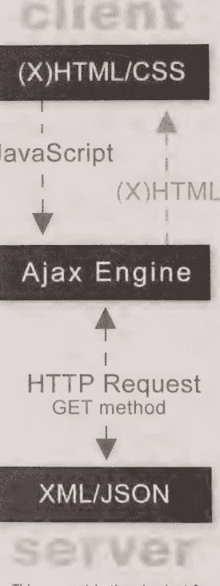

图2.1 此请求是Ajax请求/响应模型的最简单形式，仅涉及一个驻留在同一域的静态XML、JSON或文本文件。

如果精通Web的客户端或开发人员正在服务器上更新请求的文件（通常情况并非如此，尤其是在大型应用程序中），这种类型的请求可能是有益的。如果此模型无法满足您的需求，那么下一种方法提供了此模型最缺少的东西：数据库。

### 支持数据库的XHR

学习如何创建支持数据库的XHR，就像进行您的第一次数据库交互一样。它打开了一个充满可能性的新世界，并且并不像您想象的那么复杂；与通过集成数据库的Ajax可以实现的复杂功能相比，它是微不足道的。要使用此模型，我们将从请求服务器端语言开始。服务器端语言将根据请求内容，通过我们编写的用于处理特定数据库交互的自定义方法来查询数据库。在服务器端语言接收到数据后，它可以作为XML、JSON或文本返回给最初请求它的XHR，并由客户端代码进行处理。此请求允许用户根据他们发出的请求来检索自定义数据。请参见图2.2以更好地理解支持数据库的XHR中的流程。

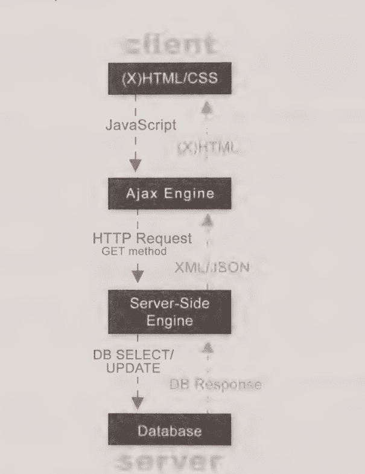

图2.2 支持数据库的XHR开启了一个充满可能性的新世界，并将把您的Ajax应用程序提升到一个全新的水平。

与标准请求相比，此请求模型功能强大得多，但您可能想要更多的控制。下一个模型将使您能够将数据发布到数据库，并根据请求接收数据，或者只是接收一个布尔值表示数据库INSERT操作成功，所有这些都无需刷新页面。

### 将数据发送到支持数据库的XHR

将数据发送到数据库始于对服务器端语言/引擎的XHR GET或POST请求。服务器收到请求后，它会解析XHR发送的XML或简单的键/值对，并相应地更新数据库。此请求模型根据用户交互更新数据库，而无需刷新浏览器。这是复制桌面应用程序中“保存”按钮功能的绝佳方式。我们将在示例中使用此模型，通过将发送的电子邮件保存到数据库，以便用户以后检索。图2.3显示了此请求类型的流程，包括可选的响应数据，我们将在第3章中介绍。

将数据发送到支持数据库的XHR提供了本章中提到的请求模型中最强大的功能。本质上，它通过XHR为我们提供了完整的数据库控制。有许多不同的情况需要您使用XHR将数据发布到服务器。例如，您可能希望通过将密码发送到服务器来对XHR进行密码保护，然后在查询数据库之前进行身份验证。或者，您可能需要在数据库中插入或更新记录，或者根据请求选择记录。

与Ajax的服务器端交互使我们能够创建按需数据库更新，就像桌面应用程序保存我们的进度一样。请求的服务器端有太多内容需要涵盖，这就是为什么我在第V部分“服务器端交互”中专门用了一整个部分来讨论这个主题。但首先，在深入研究复杂代码之前，对对象及其功能有一个扎实的理解是很重要的。

### 创建对象

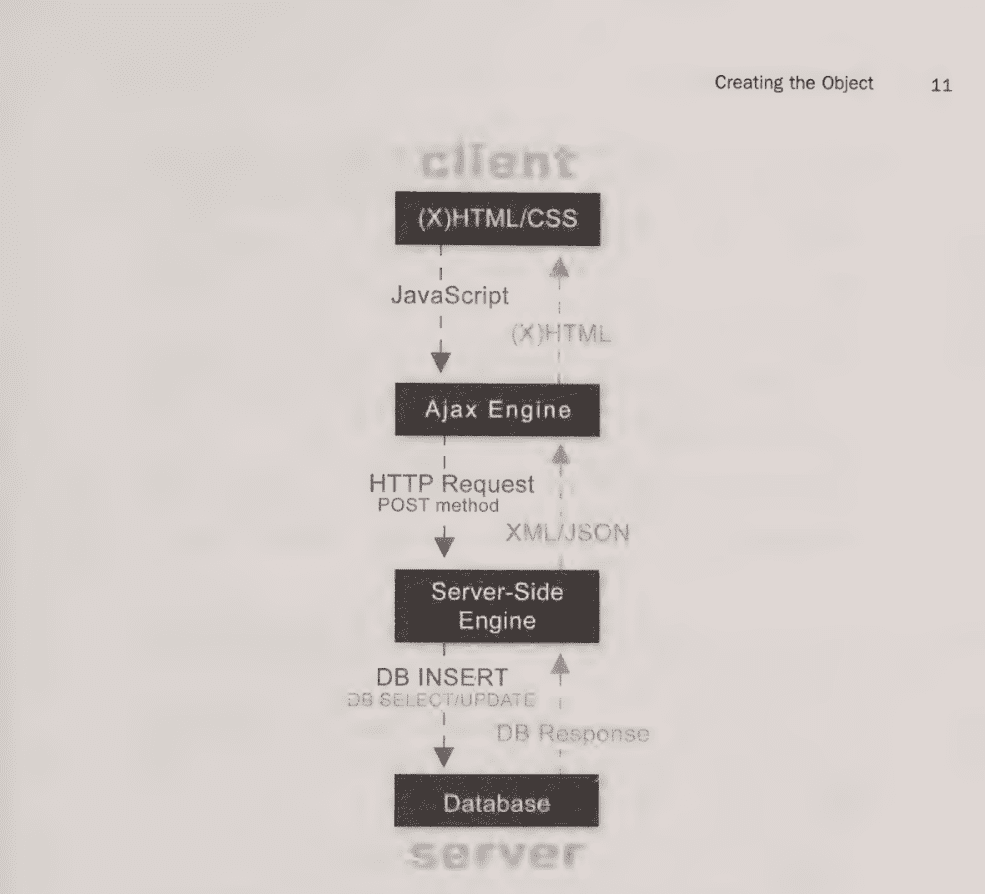

更好地理解了XHR和不同的请求模型后，我们现在可以专注于创建对象。与应用到项目时释放的功能相比，创建请求对象是微不足道的。

要创建请求对象，您必须检查浏览器使用的是XHR还是ActiveX对象。这些对象之间的主要区别在于使用它们的浏览器。Windows Internet Explorer (IE) 5及更高版本使用ActiveX对象，而Mozilla、Firefox、Netscape、Opera和Safari使用原生JavaScript XHR对象。第二个区别是我们创建每个对象的方式：Windows IE需要将对象名称作为参数传递给ActiveX构造函数，而其他浏览器则为我们提供原生JavaScript对象，我们只需要实例化它：

```
function makeRequest(url)
{
    if(window.XMLHttpRequest)
    {
        request = new XMLHttpRequest();
    }
    else if(window.ActiveXObject)
    {
        request = new ActiveXObject("Msxml2.XMLHTTP");
    }

    sendRequest(url);
}
```

从代码示例中可以看出，对象创建确实是一项非常简单的任务。我们创建一个名为makeRequest的方法来处理——您猜对了——发起请求，并通过检查原生XHR对象是否存在的条件来判断浏览器使用了哪种类型的对象。如果该对象不可用，我们再检查ActiveXObject。为当前浏览器识别出正确的对象类型后，会实例化正确的对象并创建一个请求对象。此对象现在可用于访问表2.1和2.2中列出的所有属性和方法，这些属性和方法对XHR对象是可用的。

### 表2.1 XHR属性及其定义列表

| 属性 | 定义 |
| --- | --- |
| onreadystatechange | 当请求对象状态改变时触发的事件处理程序。 |
| readyState | 返回指示对象当前状态的数字值。这些值列在表2.3中。 |
| responseText | 服务器响应的字符串版本。 |
| responseXML | 服务器响应的与DOM兼容的文档对象。 |
| status | 服务器响应的状态码。 |
| statusText | 以字符串形式返回的状态消息。 |

### 表2.2 XHR方法及其定义列表

| 方法 | 定义 |
| :--- | :--- |
| `Abort()` | 取消当前HTTP请求。 |
| `getAllResponseHeaders()` | 检索所有HTTP头的值。 |
| `getResponseHeader("label")` | 从响应体中检索指定HTTP头的值。 |
| `Open("method", "URL"[, asyncFlag [, "userName"[, "password"]]])` | 初始化MSXML2.XMLHTTP或Microsoft.XMLHTTP请求，并指定请求的方法、URL和身份验证信息。 |
| `Send(content)` | 向服务器发送HTTP请求并接收响应。 |
| `SetRequestHeader("label", "value")` | 根据标签指定HTTP头的值。 |

这两张表看起来可能只有少量选项，但正如您将在后续章节中发现的那样，当与后端代码、数据库和动态前端一起使用时，它们蕴含着强大的功能。

## 异步数据传输

如果您是数据传输的新手，并且不太确定术语*异步数据传输*的确切含义，别担心——您可能没有意识到，您在其他语言的开发中已经理解并使用过它们。这种类型的事务是编程语言中最典型的，是XHR以及最终所有企业Ajax应用程序的重要组成部分。在我们开始深入编写面向对象的Ajax引擎之前，本节将揭开异步数据传输的神秘面纱。

异步数据传输是一种双向通信类型，它发生时带有时间延迟，允许数据在可用时以其自己的时间进行响应。换句话说，您可以向服务器发出请求，继续处理其他数据，并在服务器方便时接收响应，从而使Web应用程序非常灵活。异步是Ajax引擎中XHR的请求/响应模型的默认特性。这意味着请求/响应数据不是在预定或常规的固定间隔进行传输。例如，您可以向服务器发出HTTP请求，并在后台等待响应的同时继续处理其他客户端交互。所有这一切都可能在用户处理其他任务或执行其他交互时发生——完全不知道后台的数据处理。这意味着您可以调用服务器端语言从数据库检索数据，


# 第2章 请求

将该数据以XML、JSON或文本形式返回。你也可以将数据发送给服务器端语言，以便存储到数据库，或者你也可以直接加载静态的XML、JSON或文本文件，从而在不刷新页面的情况下动态填充网站内容，也不会中断前端用户的交互操作。

为了处理这个请求，我们必须首先调用XHR的两个方法：**open**和**send**。XHR对象的**open**方法接收三个参数。第一个是字符串，代表请求发送的方式。该方法的值可以是GET、POST或PUT。第二个参数是以字符串形式表示的被请求URL，它可以是XML、JSON、文本文件，或者返回上述任一格式的服务器端语言。最后一个参数是我们要重点关注的，它是一个布尔值，默认值为**true**表示异步，为**false**则表示同步。**send**方法跟在**open**之后，是实际发送HTTP请求并接收你指定格式响应的方法。它接收一个字符串参数，可以是XML或简单的键/值对，作为POST数据发送。下面是**open**和**send**方法在一个简单Ajax请求中的使用示例：

```
request.open("method", "URL", true);
request.send(null);
```

异步数据传输在大规模场景下管理起来可能较为复杂，但它比同步数据传输更具可扩展性和可用性。为了满足技能和经验各异的复杂用户群体的需求，开发者需要创建能够处理多种任务的复杂应用。异步交互可以为该用户提供多任务处理的可能性，并高效完成任务，无需等待服务器响应的烦恼。同步事务需要等待一个请求的响应完成后，才能发起另一个请求。在健壮的Web应用中，这种事务很容易导致页面冻结，因为服务器需要逐一排队处理请求。最终，这将无法使用，并且很容易使用户流失。

### 就绪状态

XHR对象创建并发出请求后，我们需要一种方式来知道何时收到了响应。这就是**onreadystatechange**事件处理器的作用。**onreadystatechange**事件处理器在请求对象的状态发生变化时触发，允许我们设置一个回调方法来触发。回调方法触发后，如何处理响应就取决于我们了。清单2.1中所示的名为**onResponse**的自定义回调方法将在第3章中讲解，届时我们将涵盖Ajax响应的所有方面。

### 清单 2.1 发送请求

```
function sendRequest(url)
{
    request.onreadystatechange = onResponse;
    request.open("GET", url, true);
    request.send(null);
}
```

清单2.2是一个名为checkReadyState的自定义方法，它检查XHR对象的ready状态，并根据当前状态对应的数值，在单独的分支中处理每个状态。该自定义方法将从onResponse方法中调用，以确定XHR在处理响应对象解析之前的ready状态。

### 清单 2.2 确定 readyState 值

```
function checkReadyState(obj, id)
{
    switch(obj.readyState)
    {
        case 0:
            document.getElementById(id).innerHTML = "Sending Request...";
            break;
        case 1:
            document.getElementById(id).innerHTML = "Loading Response...";
            break;
        case 2:
            document.getElementById(id).innerHTML = "Response Loaded...";
            break;
        case 3:
            document.getElementById(id).innerHTML = "Response Ready...";
            break;
        case 4:
            document.getElementById(id).innerHTML = "";
            return (obj.status == 200);
            break;
        default:
            document.getElementById(id).innerHTML = "An unexpected error has occurred.";
    }}
```

### 表 2.3 readyState 值列表，包含每项的翻译和定义

| readyState 值 | 译名 | 定义 |
| :---: | :---: | :--- |
| 0 | 未初始化 | 对象尚未初始化数据。 |
| 1 | 加载中 | 对象正在加载其数据。 |
| 2 | 已加载 | 对象已完成数据加载。 |
| 3 | 交互中 | 用户可以与对象交互，即使它尚未完全加载。 |
| 4 | 完成 | 对象已完全初始化。 |

第二个参数名为*id*，是客户端XHTML中可定位的HTML元素的ID。该ID通过JavaScript的`document.getElementById`方法来定位，使用DOM在当前页面中查找指定id的元素。元素定位后，其`innerHTML`属性被设置为我们选择的自定义消息，以显示每个就绪状态的相关信息。这是向用户反馈请求状态的绝佳方式。如清单2.2所示，我们添加的文本消息实质上代表了每个请求状态特定的加载消息，以此向用户展示参考信息。`readyState`达到值4时，表示加载已完成。加载完成后，`checkReadyState`方法返回响应状态是否等于200。HTTP状态200表示请求已成功，可以开始处理。这是众多可接收HTTP状态码之一，Ajax引擎应当妥善处理这些状态码。下一节将介绍更多状态码，并提供HTTP状态码和标头的典型使用示例。

### HTTP 状态码和标头

Ajax对象的请求状态等同于被请求文件的HTTP状态。HTTP状态码表示服务器基于被请求文件状态的响应。HTTP请求和XHR共有五类状态码：

- 信息性：1xx
- 成功：2xx
- 重定向：3xx
- 客户端错误：4xx
- 服务器错误：5xx

当通过Web接收到状态码时，它显示为一个数字，例如当你尝试访问某个网站并收到404错误时。这不是一个随意的数字；它代表了文件的状态，在本例中表示"文件未找到"的响应。所有状态码都必须由服务器妥善处理的，最终由发起请求的Ajax引擎处理。使用XHR对象发起请求时，这些状态码需要由接收响应的脚本来处理。这意味着开发者有责任基于响应向用户提供反馈，以此来构建更具可用性的Web应用。通常，若响应成功，新数据会在客户端渲染为XHTML；否则，可以显示某种消息来告知用户事务未成功及其原因。错误处理可能不是最令人兴奋的编码工作，但对于创建可用的应用至关重要，而且能带给你在其他编码情境中无法获得的技能。我们将在第二部分"创建和使用JavaScript引擎"中进一步了解错误处理，届时我们将创建一个自定义对象来处理所有可用的HTTP状态码，并返回有用的调试消息，最终为用户提供反馈。欲了解更多HTTP状态码信息，可以在W3C（万维网联盟）网站http://www.w3.org/Protocols/rfc2616/rfc2616-sec10.html上找到完整的定义列表。

XHR对象还可以在服务器上获取或设置HTTP标头。标头可用于检索被请求文件的特定数据，或关于特定服务器属性的信息。这些数据的一个有用示例是根据content-type标头来确定如何解析被请求的文件。例如，如果内容类型是text/XML，我们知道可以使用XML DOM来解析它，并创建适当的方法来处理不同类型的内容。基于HTTP标头还可以做出许多其他判断。

XHR对象中有三种原生标头方法：`setRequestHeader`、`getResponseHeader`和`getAllResponseHeaders`。`setRequestHeader`方法通过指定标头标签并传递值来设置标头的值。该方法的语法为：

```
request.setRequestHeader("label", "value");
```

通过设置请求标头，你可以在该特定请求期间添加、删除、覆盖或替换服务器上HTTP请求标头的默认值。如果标头格式不正确，则不会使用它并发生错误，从而阻止标头被设置。

除了设置标头外，XHR还允许你在响应期间检索标头。有两种方法可用于检索标头：`getResponseHeader`和`getAllResponseHeaders`。`getResponseHeader`方法以标头标签为参数，用于从该标头获取特定数据。以下是每种方法的示例：

```
request.getResponseHeader("label");
request.getAllResponseHeaders();
```

## 第18章 第2章 请求

`getAllResponseHeaders` 方法返回响应中的所有头部信息，这些信息会因服务器的不同而有所差异。图2.4展示了在我网站当前运行的Windows服务器上，一个XML文件所有可用的响应头部信息的示例。

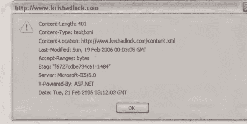

图2.4 可通过 `getAllResponseHeaders` 方法检索到的可用HTTP头部列表。

这仅仅是头部信息在Web应用中实用性的一个引言。你会发现其用途数以百计，远超本书范围。要了解更多关于HTTP头部的信息，完整的列表可以在W3C网站上找到：http://www.w3.org/Protocols/rfc2616/rfc2616-sec14.html。

### 响应

在第2章“请求”中，当我们讨论XHR的就绪状态和状态码时，我们已经开始涉及响应。本章将超越请求的这个状态，重点关注响应可以接收的两种特定的数据交换格式。Ajax响应可以有多种格式；最常见的包括JSON，以及接受度最广的XML。根据你想要实现的结果，每种格式都可能有用。然而，为你的应用确定一个单一格式可能有助于未来管理的规范化，尤其是在构建大规模应用时。例如，如果你决定在某种情况下使用XML作为响应，那么在所有其他请求中继续依赖这种格式作为响应会容易得多。这可能因应用而异，但如果可能，这是一个需要记住的重要原则。同时，记住你所选择技术的可扩展性也很重要，尤其是当你计划创建一个预期有指数级增长的可扩展应用时。让我们从深入研究XML开始：其语法、如何解析它，以及如何在你的下一个应用中使用它。

### XML

XML（可扩展标记语言）是XHR的一个流行选择，简单来说，因为它是一种所有编程语言都能共享的标准中间语言。它在服务器端和客户端都得到了支持，这使其成为最灵活的解决方案。XML本质上是一种基于自定义标签的结构，由你（开发者）来定义。XML基于标签的结构类似于HTML，只不过HTML有预定义的标签来表示其结构，如`head`、`body`、`table`等。以下是一个极其简单的HTML表格示例，它可以轻松地转换或用作XHTML：

```html
<table><tr><td></td></tr></table>
```

XML可以在前端和后端之间传递，以便于多种语言的轻松通信。在前端和后端之间拥有这种公共语言极其强大。它使我们能够创建从GUI到服务器端语言的直接连接，并最终（如果需要的话）连接到数据库。在GUI和前端之间使用XML进行通信，允许这两个应用层完全分离。GUI和后端逻辑的分离非常重要，因为它使我们能够拥有一个完全解耦的应用，GUI开发者可以处理前端，而后端开发者则处理后端。这看起来可能是常识，但这是许多公司所缺乏的一种方法。它将应用的特定部分分开以便于管理，并允许团队或单个开发者专注于需要增长的层。这种方法不仅对开发者团队是理想的，对于可能负责应用每个部分的任何个人开发者也很重要。有了这种结构，个人开发者可以专注于应用的特定层，而无需干扰或更改相邻层。

XML格式很简单，但在规划解决方案时需要考虑一些重要原则。想象一下，你需要将电子邮件数据格式化为一种可以通过Ajax引擎请求并用客户端JavaScript对象显示的结构。这正是我们在本书示例中将要创建的结构。在构建这个结构时，我们希望记住它可能在应用的多个对象或位置中使用，因此应尽可能保持其抽象性。我们将从定义创建该结构的主元素开始。

### 元素

XML由称为*元素*的自定义标签组成，这些标签在Web应用的架构阶段定义。它们可以表示你应用中将要使用的任何名称、值或数据类型。在创建XML结构时，你成为了应用的架构师，决定需要哪些数据来在屏幕上显示某些项目，或者根据用户的交互应该产生什么响应。

重要的是要保持我们的结构尽可能抽象，不要使用特定于目标应用的名称，但通常会有一些独特的情况阻止我们达到所需的抽象程度。在这些情况下，花费额外时间使我们的XML结构抽象化是没有益处的，因为甚至可能不需要在应用的多个区域重用XML数据。话虽如此，我们的电子邮件XML示例可以做到抽象，并且将在应用的其他方面重用。以下是一个可用的XML格式，但不是一个极具可扩展性或可重用性的选项：

```xml
<categories>
    <From/>
    <Subject/>
    <Date/>
</categories>
```

为了保持这些类别的抽象性，我们将元素的名称更改为**category**（参见清单3.1）。

**清单3.1** *一个抽象的类别列表（.xml）*

```xml
<categories>
    <category>From</category>
    <category>Subject</category>
    <category>Date</category>
</categories>
```

这个选项提供了灵活性，使我们能够轻松添加额外的类别。这个选项更具可扩展性的原因有很多；一个需要记住的重要事实是，我们可以添加一个新类别，而无需更改XML数据的结构。这就是为什么它如此灵活，并且比前一个示例更具可扩展性。此外，如果我们创建面向对象的对象来显示数据，我们不需要添加额外的解析和显示代码来处理新元素。这就是为什么用可以扩展并轻松移植到其他应用或对象的抽象结构来构建解决方案如此重要。例如，想象你需要以两种不同的方式显示相同的类别列表，比如在数据网格和电子邮件预览中。这组相同的元素可以用于这两个对象，消除了我们应用中代码的任何冗余。

尽管元素构成了XML，但仅靠元素所能实现的功能是有限的。让我们来看看属性以及它们如何帮助我们向XML数据添加额外信息。

### 属性

XML属性是可以添加到你的元素中的额外属性，以提供特定于结构的更多信息。从电子邮件示例中，让我们关注一个电子邮件元素。电子邮件有许多属性，例如当电子邮件被选中时触发的操作，以及根据电子邮件的已读状态（如已密封或已打开的信封）关联的图标。为了在XML中表示我们的电子邮件，我们将创建一组项目，这些项目在客户端解析时最终可以成为对象的集合或数组。这就是我们将添加`action`和`icon`属性的地方。属性是元素的简单添加。查看清单3.2，了解我们将如何将`action`和`icon`属性添加到XML元素中。

**清单3.2** *一个抽象的项目列表（email.xml）*

```xml
<items action="alert('Grace Hopper');" icon="img/mail.gif">
    <item><![CDATA[Grace Hopper]]></item>
    <item><![CDATA[<b>BUG Found</b>]]></item>
    <item>2006-03-31 09:27:26</item>
</items>
```


 ## 第3章 响应

在使用特性（attribute）时，有一些非常重要的问题需要留意，尤其是在大型应用中，架构阶段出现错误可能会在扩展时造成严重后果。特性最大的一个问题是无法在单个特性中添加多个值。如果你之后发现需要对已定义为特性的某个具体细节拥有多个实例，这就会引发问题，导致你或你的团队成员不得不在引用该特性的多个位置进行修改。

另一个重要问题，我们将在下一节讨论其解决方案，就是向 XML 中添加 HTML。HTML 无法添加到特性中，因为这会生成无效的结构。向 XML 结构中添加 HTML 的唯一方式是使用元素。添加元素比添加特性安全得多，因为如果你意识到犯了错误，忘记将元素格式化为可包含 HTML，你随时可以在之后重新格式化它以接受 HTML，而不会破坏任何可能引用它的代码。为了将 HTML 添加到元素中，使其能被解析它的编程语言读取，同时不破坏 XML 的验证，我们需要在元素标签中添加 CDATA 标签。

### CDATA

CDATA 使得 XML——以及最终使用它的 Web 应用程序——变得极其强大，因为它允许我们向元素中添加 HTML。随后，HTML 可用于在 Ajax 应用程序前端将格式化后的数据直接显示到 DOM 元素中。当 XML 被我们所使用的编程语言解析时，元素标签之间的值也会被解析。下面的示例展示了一组嵌套在 `<items>` 元素中的 `<item>` 元素：

```
<items action="alert('Grace Hopper');" icon="img/mail.gif">
    <item>Grace Hopper</item>
    <item>BUG Found</item>
    <item>2006-03-31 09:27:26</item>
</items>
```

这些嵌套元素需要由解析器解析为子元素，以便编程语言将其解释为子节点等。这意味着在 XML 元素内部嵌套 HTML 标签是行不通的，因为解析器会将这些元素视为父元素的嵌套或子元素，而非 HTML 标签，这会使 XML 无效，导致解析错误或意外结果。下面的 XML 将 HTML 加粗标签（`<b>`）解析为 XML 元素，因为解析器会将加粗标签视为嵌套的 XML 标签而非 HTML：

```
<item><b>BUG Found</b></item>
```

为了向 XML 元素中添加 HTML，我们必须使用 CDATA。XML 解析器不会解析紧跟在这些标签之后的数据，这使我们既保留了有效的 XML 结构，又最终得到了希望在页面中显示的 HTML 格式。下面的代码展示了使用 CDATA 在元素中嵌套 HTML 标签的有效 XML：

```
<item> <![CDATA[<b>BUG Found</b>]]> </item>
```

当这些数据被客户端脚本语言（在我们的案例中是 JavaScript）解析时，HTML 将原样呈现在标签之间。例如，如果我们把数据写入文档，**BUG Found** 的文本值将以粗体文本形式显示给 GUI 用户。数据可以通过简单地使用 DOM 定位 HTML 标签，并用 JavaScript 内置的 `innerHTML` 属性追加值来写入文档，或者我们可以直接使用 `document.write();` 将值写入我们放置这行代码的位置。让我们更深入地了解解析响应的过程。

### 解析 XML

在规划 XML 中将使用的格式和标签名称时，有若干事项需要牢记。例如，通常让文件中不同深度的元素具有唯一的名称是有益的。这将消除使用 JavaScript 内置的 `getElementsByTagName` 方法时的解析问题。使用该方法会返回所有指定名称的元素，而不考虑它们所处的深度。这可能导致的一个问题是，来自不同深度且不属于同一组的值可能被合并到一个数组中，该数组无法正确标明数据的位置，从而给你或你的团队成员造成解析噩梦。确实有方法可以解析使用重复名称嵌套标签的数据，例如使用 `childNodes` 属性进行定位，但这可能变得困难并延长开发过程。你也可以创建一个具有特定方法的对象，用于按名称在特定深度解析特定项目，就像 XPath 在其他语言中那样，或者使用特性来区分同名节点。但就我们的目的而言，我们将以一种无需担心此类问题的方式来定义结构。

用不同语言解析 XML 有相当标准的方式，但用 JavaScript 解析 XML 略有不同。如前所述，JavaScript 有一个名为 `getElementsByTagName` 的内置方法，它可以直接按名称定位一组元素，并允许我们访问它们，以便轻松解析元素或特性值。该方法将返回单个元素或一组元素，作为参数指定的标签名称，如下例所示：

```
response.getElementsByTagName('items');
```

当该方法找到一组元素时，它会返回一个 `childNodes` 数组，你需要对其进行解析以获取其内部的 `nodeValues`。要在解析中使用此方法，在响应完成后正确定位 XHR 对象非常重要。让我们看一看清单 3.3，了解我们将用作解析示例的完整 XML 样本。

#### 清单 3.3 最终的电子邮件 XML 文件（email.xml）

```
<?xml version="1.0" encoding="iso-8859-1"?>
<data>
    <categories>
        <category>From</category>
        <category>Subject</category>
        <category>Date</category>
    </categories>
    <row>
        <items action="alert('Grace Hopper');" icon="img/mail.gif">
            <item><![CDATA[Grace Hopper]]></item>
            <item><![CDATA[<b>BUG Found</b>]]></item>
            <item>2006-03-31 09:27:26</item>
        </items>
    </row>
    <row>
        <items action="alert('Pi Sheng');" icon="img/mail.gif">
            <item><![CDATA[Pi Sheng]]></item>
            <item><![CDATA[Movable type]]></item>
            <item>2006-01-15 12:32:45</item>
        </items>
    </row>
</data>
```

为了测试我们的解析方法，我们需要创建一个 HTML 文件，其中包含两个超链接：一个请求 XML 文件作为响应，另一个请求 JSON 响应。清单 3.4 展示了将包含请求超链接的索引 HTML 文件。

#### 清单 3.4 XML 和 JSON 请求示例的索引文件（index.html）

```
<html>
<head>
<title>The Response</title>
<script type="text/javascript" src="javascript/ajax.js"></script>
</head>

<body>
<a href="javascript:makeRequest('services/email.xml', onXMLResponse);">xml</a>
&nbsp;&nbsp;
<a href="javascript:makeRequest('services/email.js', onJSONResponse);">json</a>
<br/><hr noshade="noshade">
<div id="loading"></div>
<div id="body"></div>
</body>

</html>
```

如你所见，该文件只有两个超链接，点击时通过我们在第 2 章中创建的 `makeRequest` 方法发起请求。该方法唯一的区别是我现在添加了一个可回调薪变量方法。这使我们能够传递自己选择的回调方法，从而有机会根据所发出的具体请求来按我们想要的方式解析响应。我们还准备了两 `div` 标签用于显示不同数据。一个 `div` 标签的 id 值为 `loading`，另一个为 `body`。`loading` div 用于在检查就绪状态时返回的加载消息。`body` div 用于显示解析响应后的实际数据。这些数据可以按我们选择的任何格式进行展示——从简单的数据列表到使用 XHTML 格式化并包含交互数据的完整 GUI 都可以。要开始解析 XML 响应，我们必须首先添加在请求中指定的回调方法。我们将向在索引中导入的 ajax.js 添加一个名为 `onXMLResponse` 的方法，检查就绪状态，并使用 XHR 的一个名为 `responseXML` 的属性定位 XML 数据（见清单 3.5）。

```
清单 3.5 创建响应方法并检查就绪状态（ajax.js）
function onXMLResponse()
{
    if(checkReadyState(request, 'loading') == true)
    {
        var response = request.responseXML.documentElement;
        //在此解析
    }
}
```

通过检查就绪状态，我们完成了两件事。首先，我们检查请求的状态以判断它是否已完成加载并准备解析。其次，我们传递一个 div id 以使用其 `innerHTML` 属性显示就绪状态消息。表 2.1 中列出了两个可用于通过 XHR 定位数据的属性——一个是 `responseText`，另一个是 `responseXML`。`responseText` 属性返回服务器响应的字符串版本，`responseXML` 属性返回服务器响应的 DOM 兼容文档对象。在本例中，我们将使用 `responseXML` 属性，因为我们需要 XML 响应的 DOM 兼容对象，以便定位文件中的特定项目。编写完这段代码后，我们就可以开始从元素中解析值了。我们将从解析 XML 文件中的类别值开始，并通过 `innerHTML` 属性将它们添加到 `body` div 中，如清单 3.6 所示。


# 第三章 响应处理

代码清单 3.6 从 XML 中检索分类值 (ajax.js)

```javascript
// Categories
document.getElementById("body").innerHTML = "--------------<br/>";
document.getElementById("body").innerHTML += "<b>Categories</b><br/>";
document.getElementById("body").innerHTML += "--------------<br/>";

var categories = response.getElementsByTagName('category');
for(var i=0; i<categories.length; i++)
{
    document.getElementById("body").innerHTML +=
        response.getElementsByTagName('category')[i].firstChild.data +"</br>";
}
```

为了定位每一个分类，我们需要使用 `getElementsByTagName` 方法并传入 `category` 作为参数。这将为我们提供一个分类数组，我们可以遍历它并逐一添加到 body div 中。当我们将分类添加到文档时，我们定位每个标签内的数据，以显示每个元素的实际值。

在显示分类之后，我们可以继续处理 XML 中的 item 标签。我们将通过定位父级（即 row 标签）并接收一个行数组来稍有不同的方式解析它们。然后我们将遍历这些行，通过 JavaScript 内置的 `getAttribute` 方法来定位 items 标签中的 action 和 icon 属性。在将属性值写入 div 之后，我们可以定位每一行内的单个项目。我们将通过在用于行的 for 循环内嵌套两个 for 循环来实现这一点，从而形成一个三层循环。一个循环用于遍历 items 标签，另一个用于遍历单个 item 标签内的节点值，如代码清单 3.7 所示。

代码清单 3.7 从 XML 中检索项目值 (ajax.js)

```javascript
// Items
document.getElementById("body").innerHTML += "--------------<br/>";
document.getElementById("body").innerHTML += "<b>Items</b><br/>";
document.getElementById("body").innerHTML += "--------------<br/>";

var row = response.getElementsByTagName('row');
for(var i=0; i<row.length; i++)
{
    var action = response.getElementsByTagName('items')[i].getAttribute('action');
    var icon = response.getElementsByTagName('items')[i].getAttribute('icon');

    document.getElementById("body").innerHTML += action +"<br/>"+ icon +"</br>";

    var items = response.getElementsByTagName('items')[i].childNodes;
    for(var j=0; j<items.length; j++)
    {
        for(var k=0; k<items[j].childNodes.length; k++)
        {
            // ... 代码继续
        }
    }
}
```

代码清单 3.7 续

```javascript
{
    document.getElementById("body").innerHTML +=
    items[j].childNodes[k].nodeValue + "</br>";
}
document.getElementById("body").innerHTML += "----------<br/>";
}
```

如果你知道服务器响应的预期格式，解析请求的 XML 相当简单。如果在前面的响应示例中我们不知道预期内容，我们可以先使用 `responseText` 属性将 XML 结构显示为字符串，然后解读需要定位的标签。

```javascript
function onXMLResponse()
{
    if(checkReadyState(request, 'loading') == true)
    {
        var response = request.responseText;
        alert(response);
    }
}
```

这将把整个 XML 结构显示在 alert 提示框中。然后，我们就可以查看结构，并弄清楚想要使用 `responseXML` 属性解析什么。

如你所见，XML 基本上可以完成任何类型的数据结构——本质上取决于读取 XML 的对象如何利用它。让我们看看 JSON 的比较以及格式化响应时有什么好处。

### JSON

JSON，即 *JavaScript 对象表示法*，是一种数据交换格式，正被越来越广泛地接受为 Ajax 应用程序的可行格式。它本质上是一个关联数组或哈希表，取决于你最熟悉的编程语言。这意味着名称或标签与数组结构或逗号分隔列表中的值相关联。由于其轻量级语法以及 JavaScript 作为标准客户端脚本语言的广泛采用，这种格式在数据格式上与 XML 竞争激烈，用于 Ajax 应用程序。JSON 解析也原生地通过 JavaScript 的 `eval` 方法得到支持，这使得在 Ajax 应用程序中使用时解析极其简单。缺点是由于使用 `eval` 方法，解析可能相当缓慢，而且更重要的是，使用此方法可能非常不安全。积极的一面是，这并不意味着 JSON 失去了作为 Ajax 数据交换格式竞争者的资格。这仅仅意味着，当你选择它作为数据格式时，你需要更聪明一些。例如，可以通过向请求添加加密密码来实现这一点，我们将在第 23 章 "保护你的应用程序" 中介绍。

既然我们对 JSON 有了一点背景了解，让我们看看其结构语法。

### 语法

JSON 语法非常简单，可以说比 XML 更精简。当数据量很大时，XML 可能会变得相当冗长，这是由于元素的冗余性造成的，这使得 JSON 成为一个很好的替代品。JSON 不是标准的数据交换格式，但有许多解析器可用，使其成为一个可行的选择。在 http://www.json.org 上几乎可以找到所有类型的 JSON 解析器，如果你找不到适合你感兴趣的语言的解析器，你可以轻松编写一个，因为语法解析起来并不困难。

从面向对象的角度看，JSON 语法非常直观。JSON 文件的结构代表一个 JavaScript 对象，一个文件可以由多个对象、数组、字符串、数字和布尔值组成。表 3.1 显示了以 JSON 格式化的数据类型列表。

表 3.1 每种数据类型的 JSON 表示

| 数据类型 | JSON 表示 |
| :--- | :--- |
| 字符串 | "icon": "img/mail.gif" |
| 数字 | "mynumber": 100 |
| 布尔值 | "myboolean": true |
| 数组 | "items": [ |
| | { |
| | "action": "alert('Grace Hopper');", |
| | "icon": "img/mail.gif", |
| | "item": ["Grace Hopper", "<b>发现错误</b>", "2006-03-31 09:27:26"] |
| | }, |
| | { |
| | "action": "alert('Pi Sheng');", |
| | "icon": "img/mail.gif", |
| | "item": ["毕升", "活字印刷", "2006-01-15 12:32:45"] |
| | } |
| | ] |
| 对象 | "categories":<br>{<br>&nbsp;&nbsp;&nbsp;&nbsp;"category": ["发件人", "主题", "日期"]<br>} |

所有 JSON 数据类型都由一个名称或标签（作为字符串值）后跟冒号表示。不同之处在于值。简单类型不言自明——字符串值表示为字符串，数字表示为数字，布尔值表示为 true 或 false 值。更复杂的数据类型是数组和对象。数组表示为逗号分隔的列表，包含在方括号中。JSON 对象包含任何数据类型的属性，在花括号内，就像在其他语言中格式化一个类一样；这里的区别在于我们不给主结构命名。

### 使用 JSON

在你理解了 JSON 的语法之后，格式化它相当简单。在处理大量数据时，将 JSON 与 XML 格式进行比较很有趣，因为 JSON 格式最终成为一个小得多的数据结构。在本节中，我们将转换 XML 部分中的示例，并比较这两种不同的格式，以查看在大小和可读性方面的差异。在比较之后，我们将在下一节介绍解析 JSON 数据结构。我在代码清单 3.8 中将上一节的 XML 文件转换为 JSON 数据结构。

代码清单 3.8 完整的 JSON 示例格式 (email.js)

```javascript
{
    "data":
    {
        "categories":
        {
            "category": ["发件人", "主题", "日期"]
        },
        
        "row":
        {
            "items":
            [
                {
                    "action": "alert('Grace Hopper');",
                    "icon": "img/mail.gif",
```


"item": ["格蕾丝·霍珀", "<b>发现BUG</b>", "2006-03-31 09:27:26"]
},
{
    "action": "alert('毕升');",
    "icon": "img/mail.gif",
    "item": ["毕升", "活字印刷", "2006-01-15 12:32:45"]
}

如你所见，由于缺少XML结构中固有的标签名称冗余，它比XML版本要精简得多。请记住，这个文件可以压缩得更紧凑——我选择以更易读的方式展示它。JSON数据结构大约小200个字符，总字符数为316，而XML数据格式有519个字符，差距相当大。随着应用程序中数据的增长，这可能导致带宽问题，但正如我之前提到的，JSON的客户端解析可能更慢。最终归结为哪种格式在你的应用程序中更实用，或者哪种格式对你来说更易于解析和编写。

### 解析JSON

解析来自XHR的JSON响应，与解析可用于Ajax的其他所有数据交换格式都不同。与用于XML的`responseXML`属性不同，我们需要使用`responseText`属性。将此属性用于纯文本或纯XHTML很简单，因为我们会直接将其用作响应的值，如以下示例所示：

```
document.write(request.responseText);
```

将此属性用于JSON也很简单；区别仅仅在于我们需要对`responseText`进行求值，以便解析器能够读取。通过对响应求值，我们本质上是从数据中创建了一个JavaScript对象，然后可以在客户端用作GUI中的显示数据。为了解析数据，我们将从创建回调方法、检查请求的就绪状态以及对`responseText`求值开始（参见清单3.9）。

#### 清单3.9 创建响应对象 (ajax.js)

```
function onJSONResponse()
{
    if(checkReadyState(request, 'loading') == true)
    {
        eval("var response = ("+request.responseText+")");
    }
}
```

正如我们在本章XML部分所介绍的，checkReadyState方法有两个不同的用途——检查响应是否已完全加载，以及在指定为参数的任何HTML元素中向用户显示加载消息。响应完全加载后，我们将通过对XHR的responseText求值并创建一个名为response的对象来开始解析。然后可以使用此对象来定位在求值或数据解析期间添加到对象中的任何值。让我们首先定位数据中的类别，并将它们附加到我们index HTML文件中的body div中（参见清单3.10）。

#### 清单3.10 解析JSON类别 (ajax.js)

```
// 类别
document.getElementById("body").innerHTML = "-----------<br/>";
document.getElementById("body").innerHTML += "<b>类别</b><br/>";
document.getElementById("body").innerHTML += "-----------<br/>";

for(var i in response.data.categories.category)
{
    document.getElementById("body").innerHTML +=
        response.data.categories.category[i] +"<br/>";
}
```

如你所见，数据被解析成JavaScript对象后，定位数据非常容易。只需使用点语法通过正确的路径定位，即可访问属性值。在清单3.10中，我们定位的是类别，由于category属性中有多个值，因此它们是数组。为了定位此category数组，我们使用点语法直接写出响应对象中到该特定属性的路径。

现在我们已经将类别解析并显示在body div中，接下来我们将定位条目。为了定位条目，我们需要像XML示例中那样嵌套两个for循环，但对于实际条目及其属性的解析会略有不同。参见清单3.11了解我们如何解析这些数据。

#### 清单3.11 解析JSON条目 (ajax.js)

```
// 条目
document.getElementById("body").innerHTML += "------------<br/>";
document.getElementById("body").innerHTML += "<b>条目</b><br/>";
document.getElementById("body").innerHTML += "------------<br/>";

for(var i in response.data.row.items)
{
    for(var j in response.data.row.items[i])
    {
        document.getElementById("body").innerHTML += response.data.row.items[i][j]
        +"<br/>";
    }
    document.getElementById("body").innerHTML += "------------<br/>";
}
```

正如我提到的，定位条目属性的方式与XML解析时大不相同。我们可以简单地使用*for...in*循环来定位特定对象内的所有属性值。在这种情况下，我们使用这种数据检索方法来访问条目属性和条目数组的值。

通过在JSON响应格式中指定事件处理程序来表示可以渲染到文档的特定对象类型，使用JSON作为响应格式可以变得更加强大。我们不会深入到这个细节层次，但了解这些知识很重要，因为它可能对未来的应用程序非常有益。我将以一个如何构建此数据结构的示例作为结束：

```
"items": [
    {"value": "阅读电子邮件", "onclick": "displayEmailDetail()"}
]
```

现在我们已经详细理解了如何处理Ajax响应，接下来可以专注于使用XHTML和CSS格式化响应并创建GUI了。

## 使用XHTML和CSS渲染响应

既然我们已经介绍了如何使用XHR对象请求数据和解析响应，现在我们准备好在浏览器中渲染和显示数据了。处理显示来自XHR响应的数据的方法有很多种；在本章中，我们将专注于使用XHTML和CSS。XHTML和CSS将渲染我们的数据，并使其易于通过DOM使用JavaScript进行操作。这个方案是渲染Ajax数据和创建易于操作的HTML元素的完美答案。

### XHTML

Ajax驱动的Web应用程序的美妙之处之一在于其简洁性。这也可能被视为一个缺点：搜索引擎无法定位动态添加到页面的内容，因为它不会出现在源代码中。在某些情况下，这绝对需要考虑，但在构建Web应用程序时，你并不总是在意应用程序本身的搜索排名。相反，你通常关注的是主页或其他不在应用程序内部的页面的排名。大多数Web应用程序，例如本书中我们正在构建的示例，并不需要搜索引擎排名。大多数时候，这些应用程序包含个人和安全信息，因此自然更容易让我们隐藏源代码。

如果你习惯在HTML中创建嵌套的表格布局，那么开始使用div标签时可能会觉得有些奇怪。尽管一开始可能觉得别扭，但你会发现div标签极其易于使用，浏览器渲染速度更快，并且比杂乱的嵌套表格所需的源代码少得多。最棒的是，当使用DHTML结合Ajax数据请求时，它们更容易操作，并且样式和内容更加分离，使得更新变得容易得多。我将div标签视为存储数据的容器。这些容器通过id和name属性提供引用方式，以便我们可以定位它们来操作它们的内容、位置或任何相关的样式。

## 第4章 使用XHTML和CSS渲染响应

通过查看收到的响应，我们可以很容易地识别需要创建哪些元素。你可能还记得第3章“响应”中的内容，我们创建的XML和JSON文件包含电子邮件中将要出现的不同项目。在本节中，我们将创建HTML元素来显示这些文件中的数据。这些文件包含的第一组数据是类别。每个类别最终都将成为条目集合中项目的区段标题。因此，我们需要创建一个网格状的结构来表示这些数据，并将其格式化为可识别的对应数据区段。当我们能够识别页面内容并将其划分为不同的区段后，我们就能够创建HTML元素来包含和构建数据。

在第3章中，我们在`ajax.js`文件中创建了两个方法——一个名为`onXMLResponse`，另一个名为`onJSONResponse`。这些方法通过将数据推送到我们index HTML页面的`body` div来渲染响应。在本节中，我们将重写这些方法以创建`div`元素来封装这些数据，然后将它们附加到`body` div。这将使我们以后能够通过CSS将样式与元素关联起来。首先，我们将删除所有为了直观地分隔类别和项目而添加的不必要代码，因为样式将以更微妙的方式为我们完成这项工作。现在，我们将简单地为图标标题添加一个占位符`div`元素，再加上许多其他`div`元素，我们将为其分配一个id值`header`，并填充来自XML和JSON响应的每个类别的数据。在本书后面，我们将学习如何通过DOM动态创建HTML元素，但现在我们将保持简单，将内容添加到先前创建的`div`元素中。

### XML

```
var response = request.responseXML.documentElement;

document.getElementById("body").innerHTML = "<div id='icon'></div>";
var categories = response.getElementsByTagName('category');
for(var i=0; i<categories.length; i++)
{
    document.getElementById("body").innerHTML +=
    "<div id='header'>&nbsp;"+ response.getElementsByTagName('category')
    [i].firstChild.data +"</div>";
}
```

### JSON

```
eval("var response = ("+request.responseText+")");

document.getElementById("body").innerHTML = "<div id='icon'></div>";
for(var i in response.data.categories.category)
{
    document.getElementById("body").innerHTML += "<div id='header'>&nbsp;"+
    response.data.categories.category[i] +"<div/>";
}
```


可以看到，我们只是将图标和类别数据封装到这些 div 标签中。这些 div 标签稍后将使用 CSS 进行样式化，并与我们将要与这些类别类型关联的条目数据分开。换句话说，我们基本上会根据响应创建一个相应数据的网格。现在已经创建了 header div 元素，我们将为条目数据添加 div 元素，并为每个元素关联动作和图标。每个条目的 div 标签都会简单地获得一个 id 值为 item。动作将通过为每个条目 div 标签添加一个 onclick 事件并附加 action 变量来关联。在添加图标时，我们不希望将图标添加到每个 div；相反，我们只希望将它们作为每组条目的第一个项目添加。以下代码表示为 XML 和 JSON 响应的条目代码添加 div 标签。

### XML

```javascript
for(var i=0; i<row.length; i++)
{
    var action = response.getElementsByTagName('items')[i].getAttribute('action');
    var icon = response.getElementsByTagName('items')[i].getAttribute('icon');
    var items = response.getElementsByTagName('items')[i].childNodes;
    document.getElementById("body").innerHTML += "<div id='icon'></div>";
    for(var j=0; j<items.length; j++)
    {
        for(var k=0; k<items[j].childNodes.length; k++)
        {
            document.getElementById("body").innerHTML += "<div id='item'
             onclick=\""+ action +"\">&nbsp;"+ items[j].childNodes[k].nodeValue
             +"</div>";
        }
    }
}
```

### JSON

```javascript
for(var i in response.data.row.items)
{
    document.getElementById("body").innerHTML += "<div id='icon'></div>";

    for(var j in response.data.row.items[i].item)
    {
        document.getElementById("body").innerHTML += "<div id='item' onclick=\""+
         response.data.row.items[i].action +"\">"+
         response.data.row.items[i].item[j] +"</div>";
    }
}
```

# 第 4 章 使用 XHTML 和 CSS 渲染响应

既然我们已经将 XHTML 写入页面，现在是时候添加样式来渲染最终布局了。我们将通过与元素关联 CSS 来实现这一点。

## CSS

使用 XHTML 和 CSS 来渲染 Ajax 响应数据，可以为我们的代码增加分层分离，使我们能够更新应用程序的特定区域，而无需触碰其他区域。现在我们知道如何通过 JavaScript 将数据添加到 div 元素以 XHTML 形式渲染，我们可以开始为页面添加设计。我们将创建 CSS 类来定义单个元素样式，并最终定义整个页面布局。在我们的 HTML 页面中使用 CSS 的第一步是导入 CSS 文件，这些文件将定义页面元素的样式。首先创建一个新文件，命名为 **layout**。**layout.css**。基于第 2 章"请求"和第 3 章中的示例，我们将在 index HTML 文件的 head 中添加以下代码以导入 CSS：

```html
<link href="css/layout.css" rel="stylesheet" type="text/css" />
```

因为我们已经识别并填充了页面中的 HTML 元素，所以我们知道需要为哪些元素创建样式。在创建样式之前，我们必须设想页面布局的样子。如果脑海中难以直观想象页面布局，我们可以在图形编辑器中创建线框图或模型。无论哪种方式，在我们有了概念之后，就可以通过 CSS 开始安排元素。本示例追求的外观是一个邮件数据网格，每个部分有标题，与部分相关的数据显示在标题下方，以行组形式排列。图 4.1 显示了此网格结构中数据的最终布局。


在我们的新 CSS 文件中，我们将创建四个类：`body`、`header`、`item` 和 `icon`。这是我们在上一节的 `ajax.js` 文件中已经通过响应方法添加到页面中的四个元素。从默认添加到页面的 `body` div 开始，我们将创建一个 `width` 为 570px 的类。这个 `width` 将补偿我们将在网格中每个条目周围添加的 `margin`，但我们将在完成添加 `header` 和 `item` 类之后再详细讨论这一点。以下是创建 `body` 类的代码：

```css
#body
{
    width: 570px;
}
```

接下来，我们将为 **header** div 元素创建一个类。回顾我们正在请求的 XML 和 JSON 文件，可以看到有三个标题和三个条目。这些标题和条目并排排列以形成数据行。要实现这一点，我们必须先添加一个 `float` 属性，其值为 `left`。这将使每个 **header** 和 **item** 标签左对齐并排排列，形成一行数据。当达到容器宽度限制时，每一新行将开始，这个宽度限制是我们在 **body** 类中定义的。我们还添加了指针光标，以区分每个条目是可点击的。以下是每个标题和条目所分配的代码：

```css
#header
{
    float: left;
    width: 180px;
    padding: 10px 0px 10px 0px;
    background-color: #666;
    color: #fff;
    margin: 1px;
}
```

```css
#item
{
    float: left;
    width: 180px;
    padding: 10px 0px 10px 0px;
    background-color: #eaeaea;
    color: #333;
    margin: 1px;
    cursor: pointer;
}
```

我们为 **body** 设置的宽度可以容纳每行显示的三个条目的宽度和边距，加上图标的宽度和边距。如果我们想在每行显示更多项目，我们只需调整容器的宽度，同时考虑元素的边距和其他间距。图 4.2 揭示了网格中不同元素的内部分析。

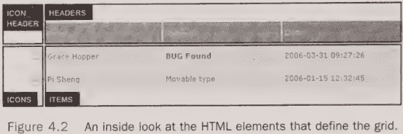

# 第 4 章 使用 XHTML 和 CSS 渲染响应

如你所见，我们已经用背景色、字体颜色和每个条目的指针光标对标题和条目进行了一些样式化，使其明显可点击。定制这些元素有数百万种方法；我的建议是享受实验的乐趣。

我们需要为其创建类的最后一个元素是 **icon** 元素。图标会非常小，因此它不应该占用与普通 `item` 相同的 `width`，这就是我们为图标创建单独类的原因。`icon` 元素既可作为每个标题中图标所需空间的占位符，也可作为将放置在条目左侧的实际图标。它像网格中所有元素一样向左浮动，以创建行。它还具有其他常见属性，如 `width`、`padding`、字体 `color` 和 `margin`。

```css
#icon
{
    float: left;
    width: 20px;
    padding: 5px 0px 5px 0px;
    color: #333;
    margin: 1px;
}
```

既然我们已经掌握了请求数据、接收响应以及使用 CSS 和 XHTML 为动态数据页面添加样式的知识，我们可以通过创建更简洁的流程并将代码封装到对象和 Ajax 引擎中来提升一个层次。下一章将解释如何使用 JavaScript 创建面向对象的 Ajax 引擎，如何调试我们的请求和响应，以及如何通过创建额外的对象来扩展引擎，从而简化创建支持 Ajax 的 Web 应用程序的过程。

## 创建和使用 JavaScript 引擎

- 5 面向对象的 JavaScript
- 6 创建引擎
- 7 使用引擎
- 8 调试
- 9 扩展引擎

## 面向对象的 JavaScript

面向对象的 JavaScript 在构建大规模 Ajax 应用程序时至关重要。这种编程方法为我们的应用程序提供了可重用性、可扩展性和灵活性。面向对象的方法为对象可重用性提供了蓝图，这最终往往会减少我们应用程序中代码的数量和重复。最小化代码数量和重复不仅帮助我们更快地构建应用程序，而且使更新和管理对开发人员来说成为一件简单的任务。当以面向对象的方式处理应用程序时，需要进行一些规划，以确保您的对象现在和*在可预见的未来*都是可重用的，为应用程序的任何添加和/或更新提供可扩展性。创建这些对象有时可能看起来有些小题大做，如果开发人员认为她可以在短时间内开窗通风段时间内快速完成一个应用程序，这种情况经常发生。然而，通过开始以这种方式处理我们所有的应用程序，我们将习惯于从新的角度思考应用程序——更多地从*工程师的角度*——我们将自动开始以更好的方式接近和构建它们。这使我们能够在其他应用程序中使用我们的对象，并以各种方式重用代码，这将*极大地加速我们的开发时间*。

本章可能不是最引人入胜的，你可能想知道为什么需要理解面向对象编程（OOP）概念才能使用 JavaScript 创建 Ajax 应用程序。在 Ajax 应用程序中使用 JavaScript 对象使得操作数据和创建可以从一个应用程序移植到下一个应用程序的图形用户界面（GUI）元素变得非常简单。这使您能够将更多时间投入到网站的规划、工程和开发中，或者希望甚至是新 Ajax 组件的开发中，而不是在每个应用程序中重写相同的代码，或者正如他们所说的，"*重新发明轮子*"。既然如此，理解这些不同对象类型的创建对于创建自定义对象、组件以及我们自己的库至关重要。

与其他编程或脚本语言不同，使用 JavaScript 创建对象有多种方法。虽然本书将主要使用原型作为首选的面向对象方法，但我们也会在本章中介绍对象构造函数。对象构造函数是创建对象的有效且有用的方法，并且可以无缝地融入我们的示例应用程序。您可以在本书示例或未来的 Ajax 应用程序中使用这种方法——选择权在您。


 42 第 5 章 面向对象的 JavaScript

### 面向对象的方法

正如我已经提到的，使用 JavaScript 进行面向对象编程有多种不同的方法。你可以使用以下任何一种方式来创建对象或伪对象：

- 对象构造函数
- 原型
- new 运算符
- 字面量表示法
- 关联数组
- JScript.NET

这些在 JavaScript 中创建对象或伪对象的方法都是有效的，但有些方法比其他方法更灵活。这并不意味着这些方法没有用——在某些情况下，某种特定方法肯定比其他所有方法都更合适。让我们简要地看看这些方法以及它们在什么情况下会很有用。

> **注意**
> 由于本章将深入探讨对象构造函数和原型，因此本节不会涵盖这两种方法。

### 使用 new 运算符

使用 new 运算符可能是 JavaScript 中创建对象的最简单方法之一，因为当然，这是原生的实现方式。要使用 JavaScript 原生的 new 运算符创建对象，我们只需为对象选择一个名称，并将其设置为一个新的 Object。

```
var employee = new Object();
employee.id = 001;
employee.firstName = "Kris";
employee.lastName = "Hadlock";

employee.getFullName = function()
{
    return this.firstName + " " + this.lastName;
}
```

在这个例子中，我们定义了一个名为 employee 的自定义对象，具有 id、firstName 和 lastName 属性，以及一个名为 getFullName 的方法，该方法返回 firstName 和 lastName 属性的拼接版本。这个解决方案是可以接受的，并且可以在许多解决方案中工作，特别是如果你不打算创建对象的多个实例的话。它的局限在于无法创建同一对象的多个实例——例如，我们无法使用此方法创建多个员工。

### 字面量表示法

44 第 5 章 面向对象的 JavaScript

如你所见，这种选项可能使定位特定项目更容易，但同样，想象一下必须创建多个员工。以下例子说明了这会变得多么难以控制。

```
var employee = new Array();
employees[001]["firstName"] = "Kris";
employees[001]["lastName"] = "Hadlock";

employees[002]["firstName"] = "John";
employees[002]["lastName"] = "Doe";
```

如果你正在处理大量数据，并且必须记住数组中某些项目的所有路径，那么这个解决方案可能会变得非常混乱。话虽如此，使用这种方法创建自定义哈希映射对象可能非常有用，但我会把这部分留给你。

### JScript.NET

JScript.NET 使我们能够创建功能完整的 .NET 应用程序——就像使用 C# 或 VB.NET 等语言一样——通过将我们的代码编译为中间语言（IL）。这种方法的一个优点是它允许我们使用严格的数据类型和访问修饰符，例如私有和公共属性，我知道这在想到 JavaScript 时似乎非常陌生。严格的数据类型可以实现更好的代码可读性和更简单的调试方法。

以下是你将用于创建 JScript.NET 对象的语法示例。

```
<script language="JScript" runat="server">

public class employee (_id, _firstName, _lastName) {

    private id : String  = _id;
    private firstName : String = _firstName;
    private lastName : String = _lastName;
    private getFullName : Function = function(e)
    {
        return this.firstName + " " + this.lastName;
    }
}

</script>
```

对于具有 OOP 背景的开发者来说，这种方法可能更容易理解。然而，数据类型的语法有点奇怪，而且你需要使用并安装 .NET Framework，这在开发方面可能是一种限制——这实际上取决于你的具体情况。

现在我们已经对使用 JavaScript 创建对象的其他方法有了一些背景了解，我们将介绍两种我认为对我们试图实现的目标最具灵活性的方法。接下来的这两种方法允许创建多个对象，因为它们为 JavaScript 提供了可重用性。让我们来看看。

### 对象构造函数

对象构造函数是一种构建对象的好方法，使其可重用，而无需在一个对象与另一个对象有细微差别时创建或重新定义一个全新的对象。这种对象创建方法允许我们通过应用不同的属性值来重用同一个对象，并从同一对象蓝图中创建多个实例。

### 实例

创建实例，或实例化对象，简单来说就是获取对象定义并创建多个模拟其定义的对象的行为。这些独立的实例可以具有不同的属性和方法参数值，这使得一个实例与另一个实例不同。对象定义本质上是开发者用于创建对象多个实例的蓝图。当对象被实例化时，它内在地包含对象定义的所有属性和方法。因此，如果我们有一个带有 `name` 属性的 `employee` 对象，我们可以创建多个实例，并为每个员工赋予不同的名称。本节将解释如何使用对象构造函数方法来创建对象的多个实例，以在我们的 Web 应用程序中获得最大的可重用性。

对象构造函数简单来说就是一个普通的 JavaScript 函数，我们在其中封装属性和方法。它是通过使用原生的 JavaScript `new` 运算符来实例化的。这种方法与字面量表示法非常相似，但语法更符合常见的编程模型。我们首先创建一个简单的函数，在其中提供对象名称。在以下示例中，我们正在创建一个 `employee` 对象构造函数。

```
function employee(_id, _firstName, _lastName)
{
}
```

如你所见，这是一个标准的 JavaScript 函数，接受三个参数：一个 `_id`、一个 `_firstName` 和一个 `_lastName`。这个函数成为我们对对象的访问点——换句话说，如果你熟悉 OOP，它就是我们的构造函数。我们将使用函数的名称作为我们的对象名称。如果你熟悉使用其他编程语言构建类，可以将这种方法视为创建类而不将对象定义为类，或者用函数而不是类声明来创建类。我们仍然有构造函数、属性和方法；我们只是没有将对象细节封装在内的类声明。有了构造函数，我们就可以开始实例化对象了。这就是我们开始看到可重用性的地方。

```
var kh001 = new employee(001, "Kris", "Hadlock");
var jd002 = new employee(002, "John", "Doe");
```

这些例子展示了使用这种方法创建对象的多个实例是多么简单。令人兴奋的是，我们可以继续将此对象用于任何我们需要添加的员工，而且如果我们需要添加方法或属性，不会对其他 `employee` 对象产生任何影响。除非它们被更新，否则它们将简单地忽略这些项目。

为了使这些对象更加灵活，我们允许将参数传递给对象构造函数。这些参数将用于定义对象内的不同属性，以使一个对象与另一个对象不同。例如，我们可能想要使用我们的 `employee` 对象创建一个新员工，并需要为每个员工提供新的名字和姓氏。在前面的示例中，我们将名字和姓氏作为参数传递，它们将作为类中的属性使用。让我们看看如何获取这些值并将其设置为对象属性。

### 属性

从对象构造函数获取参数并将其转换为本地对象属性非常简单。首先，我们需要一个值作为参数，这正是我们已经接收到的。接下来，我们必须在对象内创建本地属性，我们将使用这些属性来设置为这些参数的值。

```
function employee(_id, _firstName, _lastName耐stName)
{
    this.id = _id;
    this.firstName = _firstName;
    this.lastName = _lastName;
}
```

此方法接收一个 `_id`、一个 `_firstName` 和一个 `_lastName` 参数，我们使用它们来设置为对象中的本地属性。这些参数使我们能够区分一个员工与其他员工，并为我们提供用于检索每个员丁特定详细信息的引了用。本地对象属性可以在以后的任何情点使用。例如，我们可以用另一个对象引用这些 `employee` 对象，然后获取名和姓。这些 `employee` 对象将保留这些信息无论创建了多少员工。

```
function employee(_id, _firstName, _lastName)
{
    this.id = _id;
    this.firstName = _firstName;
    this.lastName = _lastName;
}
```

此方法接收一个 `_id`、一个 `_firstName` 和一个 `_lastName` 参数，我们使用它们来设置为对象中的本地属性。这些参数使我们能够区分一个员工与其他员工，并为我们提供用于检索每个员工特定详细信息的引用。本地对象属性可以在以后的任何点使用。例如，我们可以用另一个对象引用这些 `employee` 对象，然后获取名字和姓氏。这些 `employee` 对象将保留这些信息，无论创建了多少员工。


这些属性可以单独设置和引用，或者我们也可以使用对象中的方法来处理这个细节。在对象构造函数中使用方法，有助于我们将常用功能整合到一个引用中。现在让我们看看如何向对象构造函数添加方法，并理解它如何有利于我们应用程序的可扩展性。

### 方法

对象之所以强大，是因为它们存储的数据以及包含的方法，这些方法可以被调用来执行特定功能。这些方法可以用于为对象属性设置新值，或从对象属性中检索值。它们还可以用于执行复杂算法、调用其他方法、创建其他对象，以及任何你或你的客户需要的自定义功能。下面是一个带有`getFullName`方法的`employee`对象示例。

```javascript
function employee(_id, _firstName, _lastName)
{
    this.id = _id;
    this.firstName = _firstName;
    this.lastName = _lastName;

    this.getFullName = function()
    {
        return this.firstName + " " + this.lastName;
    }
}
```

这个方法返回两个连接起来的属性，形成员工的全名。这只是一个开始，像这样的对象还可以实现更多功能。例如，我们可以创建用于检索或设置员工职位的方法，因为当员工晋升时，职位可能会发生变化。这些方法的添加很简单，但它们为有能力更改员工职位的人提供了很大的 Help。下面是一个示例。

```javascript
function employee(_id, _firstName, _lastName, _jobTitle)
{
    this.id = _id;
    this.firstName = _firstName;
    this.lastName = _lastName;
    this.jobTitle = _jobTitle;

    this.getFullName = function()
    {
        return this.firstName + " " + this.lastName;
    }

    this.setJobTitle = function(_jobTitle)
    {
        this.jobTitle = _jobTitle;
    }

    this.getJobTitle = function()
    {
        return this.jobTitle;
    }
}
```

这些方法要求我们必须添加一个名为jobTitle的新属性。这个属性可以通过构造函数设置，也可以通过我们新的setJobTitle方法设置。在设置值之后，我们还可以使用getJobTitle方法来检索它。这些方法相当于JavaScript中的getter和setter方法，因为它们允许其他对象获取或设置对象特定属性的值。我们还可以通过只允许getter而不允许setter来使属性成为只读属性。

一个更复杂的例子是员工的病假天数。这要求我们创建一个病假天数数组用于每个员工对象。假设我们需要一种方法来检索格式化为HTML列表的病假天数列表。下面是一个如何实现此功能的示例。

```javascript
var sickDays = new Array("1-12", "1-13", "1-14");
var kh = new Employee(001, "Kris", "Hadlock", "GUI Developer", sickDays);

function employee(_id, _firstName, _lastName, _jobTitle, _sickDays)
{
    this.sickDays = _sickDays;
    this.id = _id;
    this.firstName = _firstName;
    this.lastName = _lastName;
    this.jobTitle = _jobTitle;

    this.getFullName = function()
    {
        return this.firstName + " " + this.lastName;
    }

    this.setJobTitle = function(_jobTitle)
    {
        this.jobTitle = _jobTitle;
    }

    this.getJobTitle = function()
    {
        return this.jobTitle;
    }

    this.getSickDayList = function()
    {
        var sickDayList = "<ul>";
        for(var i=0; i<this.sickDays.length; i++)
        {
            sickDayList += "<li>"+ this.sickDays[i] +"</li>";
        }
        sickDayList += "</ul>";
        return sickDayList;
    }
}
```

创建这样的独特方法是创建对象实例时的主要功能来源。这是因为对象的每个实例都包含此功能，并且可以在任何时候调用它。

### 原型

原型对象是在JavaScript 1.1中引入的，它是一个简化向现有对象添加自定义属性和方法的内置对象。当我们开始创建对象和原型时，我们正深入到JavaScript的核心机制中，将能够创建一些强大的功能。原型对象的工作原理相当简单：如果被请求的方法或属性它自身不包含，它会检查创建它的类的原型。如果找不到被调用的属性或方法，它将继续沿着这条链向上查找父对象。作为最后的手段，它会找到Object.prototype（这是创建所有对象的对象），但最有可能的是，如果作用域正确，它会在自定义对象中调用该方法。以下是所有原型对象中存在的三个层次：

- Object.prototype
- Class.prototype
- Instance

以下三个层次代表了每个员工实例中存在的层次：

- Object.prototype
- employee.prototype
- kh

这些层次代表了对象继承，这简单地意味着**kh**实例继承了**employee**和**Object**对象的所有属性和方法，而**employee**对象继承了**Object**对象的所有属性和方法。随着我们学习更多关于如何使用原型对象的知识，以及在第三部分"创建可重用组件"中真正处理一些复杂对象时，这将变得更加明显，在那里我们将创建可重用对象来处理支持Ajax的组件中的数据结构。

JavaScript比一些人认为的更强大，正如你在本书中将了解到的。它可以用来创建完整的动态应用程序、组件，甚至可以与服务器和数据库交互，正如我们在第五部分"服务器端交互"中使用Ajax实现服务器端时将看到的那样。原型是我在本书各示例中选择的创建可重用对象的方法之一。另一种方法是**new**运算符的变体，它实际上创建了一种模式，我们将在第14章"单例模式"中介绍。在那里，我们将实际上只想要一个对象的单一实例。用于创建对象的原型方法使我们能够轻松地将属性和方法追加到我们首次创建的对象，并扩展现有对象以包含额外的自定义功能。这种对象创建方法如此强大的另一个原因是，我们可以创建多个实例，使对象更具可扩展性和可重用性。让我们看看这些对象是如何实例化的，以及它们如何能够如此强大。

### 实例

为了创建基于原型的对象的实例，我们必须首先创建构造函数。构造函数是所有对象的入口点，因此是对象中第一个被创建的项。构造函数可以接收无限数量的参数来指定某些属性或属性值。这些值是区分一个对象与另一个对象的因素，也是对象在编程中如此强大的另一个原因。下面是一个名为**employee**的对象的构造函数示例，正如我们在前面的部分中创建的那样。同样，这个对象接受三个参数，指定员工的唯一ID以及他的名和姓。名和姓不足以区分一个员工与另一个员工，尤其是当两个人同名时；因此，需要**id**参数。

```javascript
function employee(_id, _firstName, _lastName)
{
    // Set properties
}
```

如你所见，为原型对象创建构造函数是很简单的，但它是对象中最重要的部分之一。

### 创建属性

向我们的对象添加属性极其简单。在这种情况下，我们需要首先在构造函数中定义参数，就像我们对其他对象所做的那样。这使我们可以将值传递给属性，并在创建实例时设置它们。在对象创建完成且参数被对象的构造函数接收后，我们创建属性并设置它们的值。在下面的示例中，我们设置每个被创建的员工对象的id、firstName和lastName。

```javascript
function employee(_id, _firstName, _lastName)
{
    this.id = _id;
    this.firstName = _firstName;
    this.lastName = _lastName;
}
```

正如我之前所说，这些属性在对象中创建和设置都非常容易。对象的属性通过使用this关键字来限定对象的作用域。使用这种语法是好的做法，因为当其中一个使用this关键字而另一个不使用时，更容易区分局部方法属性和对象属性。到目前为止，这个对象与对象构造函数没有什么不同，但现在将发生变化。如果我们有一个员工对象的实例，并且想要添加一个emailAddress属性，我们可以使用以下代码：

```javascript
var kh = new employee(001, "Kris", "Hadlock");
kh.emailAddress = "my@email.com";
```

这段代码不能被对象的其他实例使用。例如，如果我们创建另一个员工，她将没有emailAddress属性。为了将这个新属性添加到员工对象——使所有员工实例都能看到和使用——我们需要使用原型。下面是一个使用原型扩展我们的员工对象，添加emailAddress属性的示例。

```javascript
var kh = new employee(001, "Kris", "Hadlock");
employee.prototype.emailAddress = "";
kh.emailAddress = "my@email.com";
```

这不是使用原型创建新属性的最佳解决方案，但它是一个如何添加此属性并使其可被所有其他实例访问的示例。通常，属性会封装在方法中，如getter或setter，如果不在构造函数中的话。我们想要添加属性的唯一原因


# 第5章 面向对象的 JavaScript

这种方式适用于我们需要出于某种原因扩展对象的情况。这种解决方案并非最佳的原因是，如果开发者在不同位置随意扩展对象，代码将变得难以维护。将方法和属性集中在一个 JavaScript 文件中，可以使管理变得极其简单，并且允许我们从多个位置引用该文件，确保每个位置都获取到相同的代码。

## 覆盖和重写属性

我们还可以在原型对象中覆盖和重写属性。例如，我们可以为电子邮件地址设置一个默认值。

```javascript
var kh = new employee(001, "Kris", "Hadlock");
employee.prototype.emailAddress = "shared@email.com";
kh.emailAddress = "my@email.com";
var jd = new employee(002, "John", "Doe");
```

覆盖属性值仅仅是改变了你设置该属性的实例的值。所以，现在 kh 员工有了新的电子邮件地址，而 jd 员工则拥有通过原型设置的电子邮件地址。

重写对象属性则完全不同。如果我们在已经设置之后再更改 kh 员工的电子邮件地址，那就是在重写原始值。下面是一个例子：

```javascript
var kh = new employee(001, "Kris", "Hadlock");
employee.prototype.emailAddress = "";
kh.emailAddress = "my@email.com";
kh.emailAddress = "new@email.com";
```

### 属性保护

属性保护可以防止对象的本地属性被该对象的其他实例更改。换句话说，如果实例更改了其某个属性的值，该值不会在其继承的对象中发生变化。例如，假设你从父母那里继承了金发。如果你的头发颜色在童年期间变深，这并不意味着你父母的头发颜色会改变。下面是一个值会在实例中而非对象中发生变化的例子：

```javascript
function employee( ){}
employee.prototype.totalVacationDays = 10;
var kh = new employee( );
kh.totalVacationDays --;
kh.totalVacationDays --;
kh.totalVacationDays --;
```

这个实例递减的是它自己的属性，而不是对象的本地属性，因为如果该对象的其他实例也反映这些更改的属性，那就麻烦了。在这个例子中，我们使用的是一个员工剩余的 vacation days 总数。想象一下，如果修改这个属性会修改其他所有员工的属性或 vacation days，管理层就会面临大量愤怒的员工！这就是为什么属性保护如此重要，以及这些对象属性的运作方式的本质。对象属性对于对象的构成至关重要，但它们的作用有限。这就是为什么方法是对对象结构如此强大的补充。让我们看看如何向我们的原型对象添加方法。

### 方法

在原型对象中创建方法与创建典型的对象方法略有不同。要创建一个方法，我们需要通过名称调用对象，并添加原型对象，后跟方法名。下面是我们整章一直在使用的 `getFullName` 方法使用基于原型的方法的例子。

```javascript
employee.prototype.getFullName = function()
{
    return this.firstName + " " + this.lastName;
}
```

这个方法变成了一个 `employee` 方法，可以由从此定义创建的每个实例引用。每个对象实例对其返回的属性都有自己的值；因此，如果调用该方法，它将返回其自定义值。例如，如果我创建一个 `employee` 对象，并传入名字 `John` 和姓氏 `Doe`，调用 `getFullName` 方法将返回 `John Doe` 的字符串表示。

### 使用原型方法扩展对象

使用原型对象还可以让我们扩展现有对象，无论是内置 JavaScript 对象还是自定义对象。让我们以 `String` 对象为例。假设我们想要为所有字符串添加一个方法，通过调用该字符串上的方法将其转换为字母数组。为了实现这一点，我们将使用原型。

```javascript
function stringToArray()
{
    var arr = new Array();
    for (i=0; i<this.length; i++)
    {
        arr.push(this[i]);
    }
    return arr;
}

String.prototype.convertToArray = stringToArray;

var s = "Test String";
document.write(s.convertToArray());
```

我们在应用程序中创建的任何包含此代码的字符串变量，现在都将能够内在地调用 convertToArray 方法，并接收该字符串中字符的数组。当你向原生 JavaScript 对象添加代码时，你就知道你已经达到了一个成就的时刻。现在是时候创建处理常见 Ajax 数据操作的附加功能了。这正是我们可以并且将要用原型对象实现的功能的开始。正如我在本章开头提到的，我们将使用这种对象创建方法来创建自定义支持 Ajax 的组件，这些组件将在第三部分中的任何项目中复用。这些基于原型的对象极其灵活，可以扩展到任何情况。这就是为什么我选择原型作为本书示例中创建对象的主要方法。利用这些对象创建方法将使我们能够创建非常动态和交互式的 Ajax Web 应用程序。

## 创建引擎

在第2章"请求"中，我们创建了一些函数来创建 XHR，并处理接收和显示响应。这个解决方案在许多情况下都能很好地工作，特别是对于简单的基于 Ajax 的网页，但对于大型 Web 应用程序来说，这不是最佳解决方案。为了管理多个请求并将响应委派给特定的请求对象，我们将创建一个 Ajax 引擎。这个引擎将包含两个对象：`Ajax` 和 `AjaxUpdater`。`AjaxUpdater` 将管理所有请求并将它们委派给 `Ajax` 对象。`Ajax` 对象将接收来自 `AjaxUpdater` 的请求并实例化 XHR 对象。在 XHR 对象被实例化并且请求对象收到响应后，请求者可以在 `Ajax` 对象中调用另外两个方法。第一个方法检查请求的 ready state，第二个方法以完成形式返回请求对象。我们将在本章中更详细地介绍这些方法。让我们从创建 Ajax 包装器开始，之后我们将能够复用它来管理大型 Ajax 应用程序。

## 创建自定义 Ajax 包装器

我们将要创建的 Ajax 包装器简称为 `Ajax`，它是一个遵循单例模式的对象，我们将在第14章"单例模式"中详细介绍。这个对象将通过 XHR 将所有请求处理为单个对象，该对象将始终可靠且永远不会改变状态——因此称为单例模式。这样，任何需要发出请求的对象都将通过同一对象进行，使请求保持结构化和有组织。为了创建这个对象，我们首先需要像清单6.1那样构建它。

**清单 6.1 构建 Ajax 对象 (Ajax.js)**

```javascript
Ajax = {};
```

在对象构建完成后，我们可以创建所有需要调用的方法，以便发出请求、检查 ready state 并接收响应对象以进行解析，以及在客户端显示或操作数据。我们将从介绍如何创建处理 XHR 请求的方法开始。

## 发起请求

我们 `Ajax` 对象最重要的功能之一是发起 XHR。为了使这个过程更加精简和易于管理，我们将创建一个名为 `makeRequest` 的方法。这个方法将接受三个参数：第一个是发起请求的方法，包括 `POST` 或 `GET` 方法。第二个是发起请求的 URL；这个 URL 还包括我们在发出请求时用于向服务器传递数据的查询字符串。最后一个参数是回调方法，当 ready state 完成时，我们将调用它来处理响应。清单6.2展示了处理此功能的完整方法。

#### 清单 6.2 精简发起 XHR 的过程 (Ajax.js)

```javascript
Ajax.makeRequest = function(method, url, callbackMethod)
{
    this.request = (window.XMLHttpRequest)? new XMLHttpRequest(): new
        ActiveXObject("MSXML2.XMLHTTP");
    this.request.onreadystatechange = callbackMethod;
    this.request.open(method, url, true);
    this.request.send(url);
}
```

这个方法应该看起来非常熟悉，因为它包含了我们第2章中用于创建 XHR 对象并向服务器发送数据的所有相同功能。这个方法的不同之处在于，它将所有这些功能包装到一个易于管理的对象中，我们可以从大型应用程序的任何地方访问它。我们首先根据浏览器类型判断实例化哪个 XHR 对象。在我们实例化适当的 XHR 对象后，我们将 `onreadystatechange` 事件设置为此方法提供的第三个参数——回调方法。这意味着，当你提供给此方法的回调方法将在 XHR 已被接收并准备好解析以显示或操作应用程序客户端数据时触发。最后两个方法是 XHR 对象的 `open` 和 `send` 方法。`open` 方法初始化请求，并指定发起请求的方法、发起请求的 URL，以及查询字符串（如果适用），以及同步与异步的布尔值。我们将布尔值默认设置为 `true`，因为我们不想发出同步请求；它们会冻结你的应用程序，直到从请求接收到响应为止。如果你在大型应用程序中发出大量请求，这将使你的应用程序无法使用。最后一个方法，`send` 方法，用于实际将 HTTP 请求发送到服务器并等待接收响应。这个方法与 `open` 方法使用相同的 URL，加上查询字符串中可能存在的任何键值对。

在这个方法实例化 XHR 对象并根据我们提供的信息发起请求后，响应将在我们设置的回调方法中接收。回调方法需要检查所谓的 *ready state*，


XHR对象，要么在就绪状态完成后解析该对象，要么处理服务器可能返回的任何HTTP状态码错误。为了检查XHR对象的就绪状态，我们将创建一个名为 **checkReadyState** 的方法来完成此操作，该方法将成为 **Ajax** 对象的一部分。

### 就绪状态

正如我们在第2章中介绍的，对象的就绪状态告诉我们何时已从服务器收到响应，并且可供JavaScript通过文档对象模型（DOM）进行解析。当请求对象的状态发生变化时，`readyStateChange` 事件处理程序会触发，并允许我们设置一个回调方法，就像在 `makeRequest` 方法中所做的那样。在该回调方法被触发后，我们将由自己通过回调方法来处理响应。为此，我们将调用 `checkReadyState` 方法来获取 `readyState`，并最终获取响应的HTTP状态。该方法接受一个参数，即一个HTML元素的ID，该元素将在整个过程中显示一个加载消息。此消息可以针对请求的每个状态更改为自定义消息。清单6.3展示了加载消息状态以及就绪状态完成后XHR对象返回的HTTP状态的完整方法。

**清单6.3** 检查XHR的就绪状态 (Ajax.js)

```
Ajax.checkReadyState = function(_id)
{
    switch(this.request.readyState)
    {
        case 1:
            document.getElementById(_id).innerHTML = 'Loading ...';
            break;
        case 2:
            document.getElementById(_id).innerHTML = 'Loading ...';
            break;
        case 3:
            document.getElementById(_id).innerHTML = 'Loading ...';
            break;
        case 4:
            AjaxUpdater.isUpdating = false;
            document.getElementById(_id).innerHTML = '';
            return this.request.status;
    }
}
```

这个方法与我们在第2章中创建的方法非常相似，但现在它被封装到 **Ajax** 对象中，为我们的代码库提供了结构和组织性。对于 `readyState` 的每个状态，我们将一个自定义加载消息设置为我们作为参数传递其ID的HTML元素的 **innerHTML** 属性。这个消息可以更改为任何你想要的内容。实际上，每个状态都可以有其自己的加载消息，作为参数传递给该方法，从而让请求对象对显示哪些消息有更大的控制权。例如，假设我们有一个更新电子邮件应用程序收件箱的请求。我们可以显示针对此请求的特定状态，例如 `正在获取新邮件`。请记住，一旦创建了这个对象，就可以通过操作它来处理任何你需要处理的自定义功能——这正是为我们的应用程序创建面向对象代码库的魅力所在。

在 `readyState` 达到 `4` 状态后，XHR对象完成并可以使用。此时，可能会发生两种情况：HTTP状态可能是成功的，或者它可能返回一个信息性、重定向、客户端或服务器错误代码。根据返回的代码，我们将决定如何处理客户端。我们将在第9章“扩展引擎”中更深入地介绍这一点，届时我们将创建一个自定义对象来扩展 `Ajax` 对象并处理所有可用的HTTP状态码。我确信你注意到的一点是，我们将 `AjaxUpdater` 对象的 `isUpdating` 属性设置为 `false`。我确信你想知道这个对象是什么以及为什么我们要设置这个属性。这个对象将在本章的下一部分中创建，用于处理所有Ajax请求。它将作为客户端对象与引擎之间的一层分离，使我们的代码库更加有组织和安全。但在我们介绍这个对象之前，让我们看看如何在 `readyState` 完成后获取响应对象。

最后这个名为 `getResponse` 的方法非常简单，因为它只解析需要返回给请求对象的响应属性类型。查看清单6.4，了解我们如何处理此功能。

**清单6.4** 获取适当的响应对象 (Ajax.js)

```
Ajax.getResponse = function()
{
    if(this.request.getResponseHeader('Content-Type').indexOf('xml') != -1)
    {
        return this.request.responseXML.documentElement;
    }
    else
    {
        return this.request.responseText;
    }
}
```

为了从 `Ajax` 对象获取响应，我们只需在 `readyState` 完成后从回调方法调用此方法，它将返回适当的响应属性。它根据服务器随响应返回的响应头来返回适当的响应属性。如果 `Content-Type` 响应头中包含字符串xml，我们就知道响应是XML格式的，因此应作为服务器响应的DOM兼容文档对象返回给回调方法。否则，此方法返回 **responseText** 属性，这是服务器响应的字符串版本。

现在我们有了一个自定义对象来控制和管理我们所有的 **Ajax** 请求，我们可以在代码中再添加一层抽象，使我们的请求更易于管理和更安全。

### 创建Ajax更新器

为了将我们的 **Ajax** 对象保持在后台，并为引擎添加一层抽象，我们将创建一个名为 **AjaxUpdater** 的对象。这个对象是另一个遵循单例模式的对象，使其可以从应用程序的所有范围访问，以便于XHR管理和控制。该对象非常简单，仅由几个方法组成——其中一个可能是唯一会被使用的方法。另一个是可选的，或用于处理可选功能的备份。让我们开始构建该对象。

#### 构建对象

我们将像构建 **Ajax** 对象一样构建此对象。与此对象的不同之处在于，我们将初始化在上一节中简要讨论过的在 **Ajax** 对象中使用的属性。这个布尔属性称为 **isUpdating**，默认设置为 **false**（见清单6.5）。这是因为我们当前没有更新任何Ajax请求，因为该属性将被用于解码在我们的应用程序中的任何时刻是否有请求正在进行中。

**清单6.5** 构造AjaxUpdater并初始化属性 (AjaxUpdater.js)

```
AjaxUpdater = {};

AjaxUpdater.initialize = function()
{
    AjaxUpdater.isUpdating = false;
}
AjaxUpdater.initialize();
```

在构建对象后，我们立即初始化其属性，以便对象中的其他方法使用。

#### 更新请求对象

在Ajax应用程序中，使用最广泛的方法很可能是处理XHR的方法。这个方法将处理所有这些请求并直接与 **Ajax** 对象交互。该方法接受三个参数：一个用于发出请求的方法，如POST或GET；我称之为“服务参数”的参数，本质上是带有可选键/值对的URL，用于通过请求向服务器发送数据；最后一个是一个可选的回调方法。该方法中的回调方法是可选的，因为我们将有一个默认或通用方法，称为onResponse，用于在未向该方法传递回调方法时处理任何响应。在解码回调方法后，我们通过Ajax对象发起请求并将isUpdating属性设置为true（见清单6.6）。

**清单6.6** 处理XHR (AjaxUpdater.js)

```
AjaxUpdater.Update = function(method, service, callback)
{
    if(callback == undefined || callback == "") { callback = AjaxUpdater.onResponse; }
    Ajax.makeRequest(method, service, callback);
    AjaxUpdater.isUpdating = true;
}
```

这个方法是管理应用程序中所有XHR的一种相当简单的方式。使用这个抽象层的好处在于，我们可以在未来添加更多自定义代码来控制请求的其他方面，而无需影响实际的Ajax引擎。这使我们的Ajax引擎保持完整，这样我们就不必担心未来的任何逻辑更改。

### 响应

AjaxUpdater对象中的最后一个方法是我在上一节提到的名为getResponse的通用方法。此方法简单地获取所有没有在发起请求时设置回调方法的XHR的所有响应（见清单6.7）。

**清单6.7** 处理响应 (AjaxUpdater.js)

```
AjaxUpdater.onResponse = function()
{
    if(Ajax.checkReadyState('loading') == 200)
    {
        AjaxUpdater.isUpdating = false;
    }
}
```

该方法首先检查就绪状态，正如我们在Ajax对象中介绍的那样，并将加载消息发送到一个id值为'loading'的HTML元素。在readyState完成并成功后，它只是将其isUpdating属性设置为false作为预防措施，以防Ajax对象尚未完成此操作。

现在我们有了一个用于Ajax请求的可重用引擎，我们可以继续构建有趣的东西，如Ajax组件、支持数据库的请求，以及最重要的，一个完整的支持Ajax的应用程序。但首先，让我们进入下一章，在那里我们将了解如何使用这个引擎。


## 使用引擎

既然我们已经创建了一个 Ajax 引擎，接下来让我们看看如何使用它。本章将重点介绍如何通过 AjaxUpdater 发出 XHR，以及如何访问 Ajax 对象中的属性和调用各种方法。学完本章后，你将知道如何在任何 Ajax 应用程序中让引擎发挥作用，无论其规模大小。该引擎提供了极大的灵活性，因为它抽象了应用程序的所有 XHR，保持了它们的一致性，并最终使它们更易于管理。我们将从基础开始，通过将文件加载到一个示例应用程序中。

## 入门

在我们甚至能够使用上一章构建的 Ajax 引擎之前，我们将必须导入与引擎相关的所有 JavaScript 文件。我们目前总共创建了引擎运行所需的两个对象，但到本部分结束时，我们将总共有四个必要的对象，因为我们将在第 9 章“扩展引擎”中用一个 Utility 对象和一个 HTTP 对象来扩展引擎。为了便于记忆，以下代码将包含引擎最终需要导入的四个对象，以便正确运行。以下是四个导入语句在应用程序头部应如下所示：

```html
<script type="text/javascript" src="javascript/Utilities.js"></script>
<script type="text/javascript" src="javascript/model/AjaxUpdater.js"></script>
<script type="text/javascript" src="javascript/model/HTTP.js"></script>
<script type="text/javascript" src="javascript/model/Ajax.js"></script>
```

如你所见，导入 JavaScript 对象是简单的，但它是使用引擎所需的第一步，因此值得注意。在这些对象被导入后，我们可以随时发出请求、访问属性以及获取特定请求的状态。让我们继续学习如何通过 Ajax 引擎发出第一个请求。

### 发出请求

为了发出请求，我们将始终使用 `AjaxUpdater` 作为我们的访问点。这个对象在我们的代码中提供了一层分离，使我们的 XHR 更易于管理并在整个应用程序中保持一致。在本节中，我们将使用这个对象来发出我们的第一个引擎请求，并了解为什么这种抽象层是必要的。当我们通过 `AjaxUpdater` 发出请求时，我们将使用一个名为 `Update` 的方法。`Update` 方法接受三个参数：一个方法、一个服务和一个可选的回调方法。如果未指定回调方法，则会在 `AjaxUpdater` 对象中设置一个默认回调，该回调会将一个名为 `isUpdating` 的布尔值重置为 `false`。这个布尔值在每次发出请求时设置为 `true`，并在收到响应时在 `Ajax` 对象中设置为 `false`。这是一个有用的属性，用于检查对象是否正在处理请求中，并最终可以用作将项目添加到请求队列的方式。除了上一节的导入代码外，我们将添加代码来请求来自第 3 章“响应”的名为 `email.xml` 的 XML 文件。同样，我们将通过 `AjaxUpdater` 对象中的 `Update` 方法，使用 `GET` 方法，并指定一个名为 `onResponse` 的回调方法来发出请求，我们将在下一节创建该方法。

```html
<script type="text/javascript">
function initialize()
{
    AjaxUpdater.Update("GET", "services/sample.xml", onResponse);
}
</script>
</head>

<body onload="javascript:initialize();">
<div id="loading"></div>
<div id="body"></div>

</body>
</html>
```

为了确保我们所有的对象都已完全导入，我们需要将 `Update` 请求添加到一个在文档主体加载时触发的方法中。主体加载后，它将触发 `Update` 方法，正如你所看到的，该方法传递了前面提到的参数。请求的另一个重要部分是向用户提供有关请求进度的反馈。为了显示进度，我们有一个 `id` 为 `loading` 的 `div` 元素。当我们从 `Ajax` 对象收到响应时，我们将在该元素中显示加载消息，就像在本书第一部分中所做的那样。从引擎收到响应后，我们需要一个地方将其添加到页面中。这个地方将是 `div` 元素，我们为其分配了一个 id 为 body。

正如我确信你注意到的，本章的概念与本书第一部分中的完全相同。本书第二部分中唯一的区别是，我们现在有一种干净的方式来执行这些任务，这将使大规模开发更易于管理，并使我们的应用程序更具可扩展性。让我们继续创建我之前提到的 `onResponse` 方法。这个对象将包含我们对 `Ajax` 对象的第一次方法调用。

### 引擎方法和属性

当我们为请求创建回调方法时，我们需要检查响应的就绪状态，以了解它是否已完成并准备好被解析。为了使用我们的引擎检查就绪状态，我们将调用我们的第一个名为 `checkReadyState` 的 `Ajax` 方法。以下是我们的 `onResponse` 方法的代码片段，它将进行此调用：

```javascript
function onResponse()
{
    if(Ajax.checkReadyState('loading') == "OK")
    {
        // 在此处解析响应
    }
}
```

在响应的就绪状态完成后，我们可以像第 3 章那样解析数据。为了解析数据，`Ajax` 对象有另一个名为 `getResponse` 的方法。此方法将根据来自服务器的头响应提供正确的数据格式。换句话说，你不必担心它——它都会为你自动处理，这是该对象使生活更轻松的原因之一。因此，如果有响应且其内容类型是 XML，则此方法将返回带有第一个 `documentElement` 的 `responseXML`，以便数据可以立即被解析。如果数据不是 XML，该方法将返回 `responseText` 值，你可以根据需要以任何方式使用它。以下是一个快速示例，展示了在我们的 `onResponse` 回调中使用此方法是多么简单：

```javascript
function onResponse()
{
    if(Ajax.checkReadyState('loading') == "OK")
    {
        var categories = Ajax.getResponse().getElementsByTagName('category')[i]
            .firstChild.data + "</br>";
    }
}
```

此示例代码将从 XML 中获取所有 category 节点并遍历它们，以填充 **body** 元素的 **innerHTML** 属性，从而在页面上生成一个类别列表。由于 JavaScript 没有任何数据类型或成员可见性，显然不要求使用此方法来接收响应，因为它只是一种在开发过程中使事情更容易的方式。如果你只想将响应作为字符串查看，你可以直接调用 **Ajax** 对象中的 request 属性，并使用它来访问 **responseText** 和/或 **responseXML** 属性。

本章是引擎如何通过消除大量开销来简化我们的请求的示例，使我们能够专注于应用程序的其他方面。接下来的两章将解释使用该引擎进行调试是多么容易，以及该引擎通过允许我们无限制地扩展和伸缩它而具有多大的灵活性。

# 第 7 章 使用引擎

# 8 调试

多年来，调试 JavaScript 一直不是最容易完成的事情，因为缺乏工具和缺乏原生的执行方式。当然，一直存在着简单但可靠的 alert 调试，如图 8.1 所示，以及更复杂的涉及 onerror 事件的 alert 调试方法。


本章将简要介绍可以通过 onerror 事件和来自 XHR 对象的 responseText 属性实现的更复杂的 alert 调试方法。考虑到这一点，本章的主要重点将是讨论一些工具，这些工具将帮助我们极其轻松地调试我们的 Ajax 应用程序，并让我们想知道没有它们我们曾经是如何开发的。这些工具是 Internet Explorer (IE) Developer Toolbar、Safari Enhancer，以及我个人最喜欢的 FireBug。本章还将展示来自最终应用程序的截图，我们将使用本章中讨论的各种方法对其进行调试。让我们从介绍 JavaScript 自身的 onerror 事件开始。

## JavaScript 的 onerror 事件

JavaScript 有几个内置事件来处理各种情况。其中一个可以在调试我们的 Web 应用程序时提供相当大的帮助，那就是 onerror 事件。使用 onerror 事件允许我们捕获运行时发生的所有 JavaScript 错误。此事件返回三个参数，可以在我们定义的任何自定义回调函数中操作。这三个参数是收到的错误消息、出现问题的文件的 URL，以及导致该问题的文件中的行号。


错误事件在大多数情况下很有用，但它有时会相当模糊，只有对抛出错误的代码非常熟悉的人才能理解。

为了设置 `onerror` 事件，我们必须创建一个回调方法，事件将指向该方法。这个回调方法接受我之前提到的三个参数。

```javascript
function errorHandler(message, url, line)
{
    // Add custom error handling
    // return a true or false value;
}
onerror = errorHandler;
```

`errorHandler` 方法应该返回 `true` 或 `false`，这取决于我们是否想显示浏览器的标准错误消息。如果我们返回 `true`，浏览器就不会显示其标准错误消息，反之亦然。显然，使用 `false` 会有些多余，除非我们想以两种方式处理错误消息。为了显示我们自己的自定义错误处理消息，我们可以做类似以下示例的事情：

```html
<html>
<head>
<script type="text/javascript">

function errorHandler(message, url, line)
{
    var errorMessage = "Error: "+ message +"\n";
    errorMessage += "URL: "+ url +"\n";
    errorMessage += "Line Number: "+ line +"\n";
    alert(errorMessage);
    return true;
}
onerror = errorHandler;

function invokeError()
{
    alert("Hello World!");
}
</script>
</head>
<body>
    <input type="button" value="View Error" onclick="invokeError();" />
</body>

</html>
```

此示例提供了一个按钮来触发错误，因为 `invokeError` 方法中的 `alert` 函数编写不正确。错误发生后，`onerror` 事件将触发回调方法，并将关于错误的三个参数传递给它。我们创建的名为 `errorHandler` 的回调方法将拼接错误的字符串版本，并向用户显示一个警告框。在第16章“观察者模式”中，我们将创建一个更复杂的版本，该方法将向我们（作为开发者）发送一封电子邮件，其中包含一个指向包含错误文件的超链接。目前，我们可以看到这种错误处理方法对于调试很有用，因为它能比浏览器提供的一些内置错误处理提供更多的细节。当然，当我们开始讨论安装扩展时，这一切都会改变，但这种方法仍然是调试应用程序的可行解决方案。

## responseText

在讨论可用于调试应用程序的扩展之前，我们将再介绍一种警报调试的形式。为了快速粗略地查看从 XHR 接收到的响应，我们可以使用 `responseText` 属性。此属性是 XHR 对象的一部分，返回从服务器接收到的任何响应的字符串版本。这包括 XML、纯文本、JSON 等。当与警报调试结合使用时，它有助于了解您正在交互的文档结构。了解结构后，就很容易规划针对响应中特定项目的方法。使用 XML 时，我们可以看到节点的结构以及它们如何与其父节点和祖先节点等封装在一起。

完成此操作后，我们可以使用 `responseXML` 属性来实际定位我们需要接收以进行显示或确认数据检索的正确数据。

## IE 开发者工具栏

在 Internet Explorer 中调试 Web 应用程序时，IE 开发者工具栏非常有用，尤其是因为内置的 JavaScript 错误控制台极其模糊且毫无帮助。在本章中，我们将发现此工具如何为我们提供禁用缓存、浏览 DOM 以及在浏览器中查看类和 `id` 信息的能力。在学习如何使用这些功能之前，我们需要先安装此插件。

### 安装插件

IE 开发者工具栏可以从 http://www.microsoft.com/downloads 下载。下载并安装工具栏后，入门非常简单。转到“视图”菜单，选择“工具栏”，“开发者工具栏”。这将在 IE 顶部为我们提供工具栏。设置好工具栏后，我们可以单击 *查看 DOM*，或者转到“视图”菜单，从下拉列表中选择“资源管理器栏”，“IE DOM 资源管理器”。这些选项为我们提供了 DOM 资源管理器，我们可以将其用于多种调试目的，所有这些目的我们现在都将讨论。

### 禁用缓存

最有用的调试功能之一是禁用缓存的选项，如果您在 IE 中测试应用程序已有一段时间，我相信这会让您感到高兴。IE 的缓存一直难以测试，清除它的过程需要太多点击、等待时间很长，并且不太可靠。可以通过从工具栏中选择“禁用”选项并从下拉菜单中选择“缓存”来设置此选项。设置此选项后，我们将永远不必清除缓存，但需要注意的一点是，每次重新启动 IE 时，我们都必须重置此选项，因为它不会保存设置。

### 浏览 DOM

工具栏中的另一个有用功能是浏览 DOM 的能力。DOM 资源管理器允许我们查看 Web 应用程序中的所有标签，只需从工具栏中选择“查看 DOM”按钮即可。我们会在下拉菜单的左侧看到一棵树。当我们在结构中选择不同的项目时，我们将在显示中选择的元素周围获得一个烦人的、闪烁的蓝色边框。

DOM 资源管理器视图中的另一个功能是每次选择元素时，它都会显示名称的属性和样式及其当前值。请查看图 8.2，了解元素树的样子。

在大多数应用程序中查看整个 DOM 时，它可能会变得相当混乱且难以找到元素。这就是“查找元素”选项如此有用的原因。选择该选项后，我们将永远不必清除缓存，但需要注意的一点是，每次重新启动 IE 时，此选项都不会保存此设置。

***查找** 元素从 **下拉菜单**。一旦打开**，我们可以在页面中搜索任何元素*。~~选项是____元素__. 名称和类**。图 8.3 显示了 _查找元素选项___ ___正在使用中_____的示例。*

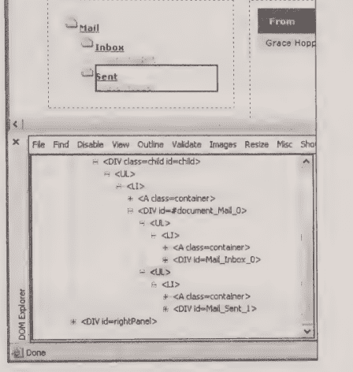

图 8.2 浏览 DOM 有助于发现运行时出现的问题。

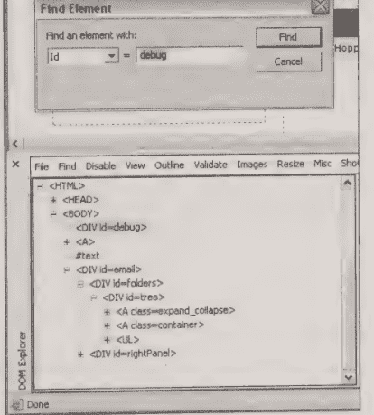

图 8.3 在 DOM 中查找特定元素并不难。

树视图是 DOM 资源管理器中显示的三个面板之一；另外两个是节点属性面板和样式详细信息面板。节点属性面板显示有关每个节点的属性信息。它还允许我们添加或删除属性，作为额外的调试功能。样式面板包含树视图中每个 HTML 标签的样式详细信息。浏览树视图时，我们选择的每个标签都将在样式面板中显示其样式详细信息。查看图 8.4，了解这两个面板的实际使用情况。

### 查看类和 ID 信息

工具栏的此功能很简单：它为我们提供了查看类和 ID 信息的能力。这是收集有关 Web 应用程序信息的好方法。如果我们难以发现特定元素在页面中的嵌套位置，我们可以使用此功能。

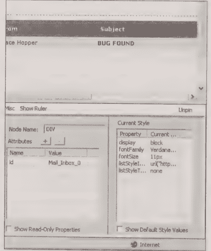

图 8.4 节点属性和样式。

## Safari 增强器

如果您碰巧使用 Mac 并且想要调试您的 JavaScript 应用程序，Safari 增强器是一个很棒的工具。Safari 增强器的作用正如其名：它是浏览器的一个很好的补充，可以帮助调试 JavaScript 问题，而据我所知，没有其他工具能做到这一点。


### 安装 Safari Enhancer

如果我们使用的是新 Mac，Safari 已经预装在系统中。因此，要安装 Safari Enhancer，我们只需访问 http://www.celestialfrontiers.com/safari_enhancer.php 并点击最新版本的下载链接。安装程序下载完成后，我们只需双击安装程序并按照提示进行安装即可。

安装完成后，我们可以打开 Safari Enhancer 并设置一个首选项，以便调试我们的应用程序。你需要勾选的选项是**激活调试菜单**（Activate Debugging Menu），如图 8.5 所示。该图还显示了**停用缓存**（Deactivate Cache）选项已被勾选。是否设置此选项取决于你，我更喜欢在开发时确保自己处理的是最新数据。

这将在 Safari 中添加一个名为"Debug"的新菜单项。在此菜单下将有一列调试选项，例如*显示 DOM 树*（Show DOM Tree）、*显示渲染树*（Show Render Tree）、*显示视图树*（Show View Tree）等等。我最喜欢的是 *JavaScript 控制台*，而且它恰好也是与我们的情况最相关的。

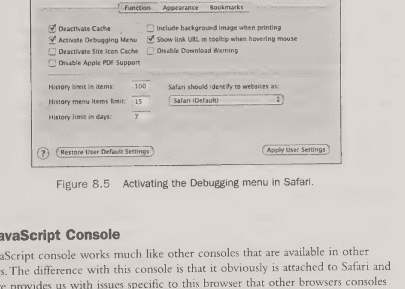

> 图 8.5 在 Safari 中激活调试菜单。

## JavaScript 控制台

JavaScript 控制台的工作原理与其他浏览器中可用的控制台类似。这个控制台的区别在于它显然与 Safari 绑定，因此为我们提供了该浏览器特有的问题，而其他浏览器的控制台可能无法检测到。由于所有浏览器处理代码的方式不同，如果你想拥有一个普遍兼容的应用程序，在所有浏览器中进行测试是至关重要的。图 8.6 显示了 JavaScript 控制台记录错误时的样子。

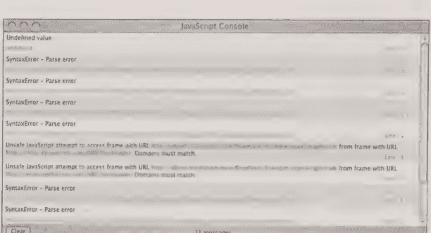

图 8.6 JavaScript 控制台中记录的错误。

## FireBug

对于这个扩展，我肯定是把最好的留到了最后。FireBug 是用于 Ajax、JavaScript、CSS 和 XHTML 应用程序的顶级调试工具之一。它支持 JavaScript 和 CSS 的错误和警告描述。这个工具不仅能提供极其准确的错误反馈——比如出了什么问题、发生在哪一行、发生在哪个文件中——它还能在**调试器**（Debugger）标签页中打开文件，并高亮显示抛出错误的代码行。这就是精准！但还有更棒的：它不仅提供错误信息，还允许我们从调试器面板在代码中设置断点，并重新运行页面，以便在到达该代码行时停止页面。我从未想过 JavaScript 能有这样的功能！与我们的 Ajax 应用程序最相关的是，它还允许我们监视 XHR，并返回足够的详细信息，从而消除在 alert 中使用 `responseText` 的需求。

### 安装 FireBug

为了安装这个扩展，我们首先需要有 Firefox 浏览器，可以从 http://www.mozilla.com/firefox/ 下载。安装好浏览器后，我们可以在 http://www.joehewitt.com/software/firebug/ 获取 FireBug 扩展。Joe Hewitt 构建了一个非常简洁且易于使用的调试工具，可以实现大量的调试技术。要在安装后使用该扩展，我们需要么点击浏览器窗口右下角的勾选标记，要么进入**工具**（Tools）> **FireBug**，然后从扩展列表中选择一个选项。图 8.7 显示了扩展打开后我们获得的选项截图。

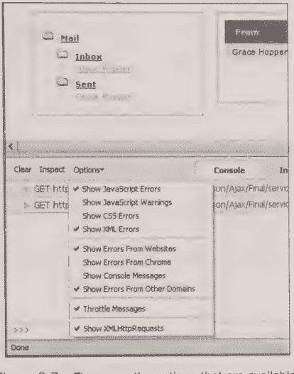

图 8.7 这些是可用的选项，用于显示错误、警告和 XHR。

## 命令行

命令行使我们能够用 JavaScript 针对页面编写参数并接收响应，这通常会显示在 alert 中（也就是说，如果我们使用 alert 调试的话）。这一步骤消除了在我们选择的开发工具之间来回切换、从服务器检出文件、编写想要测试的代码（无论是将其添加到 alert 还是写入文档）、然后重新上传文件并测试的需求。这四个步骤通过一个简单的命令行就消除了，该命令行内置于工具底部。查看图 8.8 以获取命令行实际使用的截图。

命令行使我们能够做的远不止向控制台写入简单的字符串。写入对象引用会在 FireBug 控制台中创建一个超链接。当我们在控制台中点击对象超链接时，我们会进入**检查器**（Inspector），它将选定的对象显示在适当的标签页中。例如，示例应用程序在索引中有一个名为 email 的 div 元素，它包含应用程序中的所有组件。如果我们hdr如果我们想测试对象超链接，我们可以在命令行中输入 `document.getElementById('email');` 并查看结果。图 8.9 显示了当我们编写此代码时控制台中出现的超链接示例。

```javascript
document.getElementById('email');
```

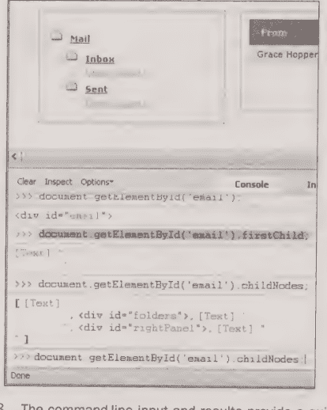

图 8.8 命令行输入和结果提供了一种快速测试 JavaScript 的方式。

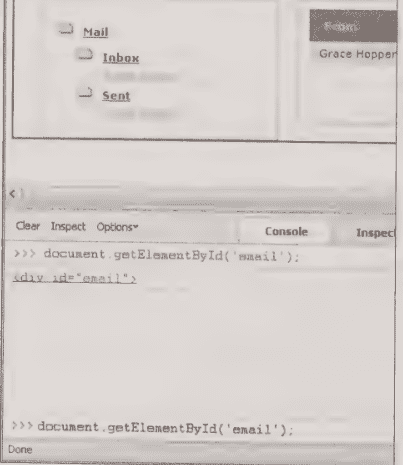

图 8.9 通过命令行定位 HTML 元素。

表 8.1 展示了可以从命令行调用的内置函数列表。这些函数是获取命令行响应的有用简写方法。

### 表 8.1 FireBug 的内置命令行函数

| 函数 | 定义 |
| :--- | :--- |
| `$("id")` | 表示以下函数：`document.getElementById()`。 |
| `$$("css")` | 返回与 CSS 选择器匹配的元素数组。 |
| `$x("xpath")` | 返回与 XPath 选择器匹配的元素数组。 |
| `$0` | 包含最近检查对象的变量。 |
| `$1` | 包含次近检查对象的变量。 |
| `$n(5)` | 返回第 n 个最近检查的对象。 |
| `inspect(object)` | 在检查器中显示指定对象。 |
| `dir(object)` | 从对象返回属性名称数组。 |
| `clear()` | 清除控制台。 |

## 在控制台中记录消息

`console.log` 方法是 alert 调试的高级替代品。此方法接受两个参数：第一个是你想在控制台中显示的任何内容，第二个是可选参数，根据指定的值在检查器中选择标签页。这将是显示我们本章前面调试的 `responseText` 的完美解决方案。使用 `console.log` 方法非常简单：

```javascript
console.log(param, 'optional tab');
```

这在其他浏览器中显然无法工作，因为 FireBug 没有兼容版本，因此当部署使用它们的应用程序的实时版本时，请确保我们将其移除。

`basic logging` 方法不仅仅是 alert 调试的替代品。正如我们在命令行中学到的，写入对象引用会在 FireBug 控制台中创建一个超链接。当我们在控制台中点击对象超链接时，我们会进入检查器，它将选定的对象显示在适当的标签页中。这也适用于将对象引用作为参数传递给 `console.log` 方法。这突然使 `console.log` 方法变得更加强大，并使其远超其他调试方法。如果这还不够，还有根据严重程度划分的不同日志级别。

### 日志级别

为了记录错误、警告、调试消息或其他随机信息，我们可以使用 FireBug 中存在的不同日志级别。它们不仅在控制台中直观地分隔不同类型的消息，还提供指向源代码中它们所在的确切行号的链接。这在开发阶段可能非常有用，可以减少过多的调试时间。要在你的 JavaScript 中使用这些不同的方法，你可以按如下方式编写：

```javascript
console.debug("message" [,objects]);
console.info("message" [,objects]);
console.warn("message" [,objects]);
console.error("message" [,objects]);
```

## 检查元素

FireBug 提供了检查页面内元素的功能，称为**即时检查**（Instant Inspecting）。我相信这是我所遇到的最有用的调试方法。即时检查可以通过进入**工具**（Tools）> **FireBug** > **检查元素**（Inspect Element）来访问，或者通过点击浏览器右下角的勾选标记并从顶部左侧菜单中选择**检查**（Inspect）按钮（位于**清除**（Clear）按钮旁边）来访问。激活检查器后，我们可以将鼠标悬停在页方以检查页面内的元素。当我们悬停时，我们可以看到页面的结构以及某些项目如何与其他项目相关联。图 8.10 显示了检查器正在工作，它高亮显示当前悬停元素在代码中的标签。

检查器包含的另一个令人难以置信的有用功能是**实时编辑**（Live editing）。实时编辑使我们能够点击标签属性值，例如 `div id` 值，并在编辑器中更改它以测试新行为。这是另一个很棒的节省时间的方法，从传统调试方法中消除了相当多的步骤。图 8.11 显示了示例应用程序中 `div id` 的实时编辑示例。

检查事件是 FireBug 提供的另一个功能，可以通过选择**检查器**（Inspector）标签页，然后从窗口底部选择**事件**（Events）标签页，接着点击**检查**（Inspect）按钮来使用。激活检查器后，我们可以悬停在应用程序上以接收页面内的所有事件。正如我们在图 8.12 中看到的，从简单的 `mousemove` 到 `DOMActivate` 的所有事件都显示在检查器中。

乍一看，很明显事件检查可能会变得相当混乱，尤其是所有的 `mousemove` 事件。幸运的是，有一个功能允许你过滤想要检查的事件。FireBug 右上角的搜索框就是用于此解决方案的。只需输入你想要查看的事件，例如 `mouseover`，它就会自动过滤掉所有其他事件——非常方便。


## 监视 Ajax

在 FireBug 中，可以利用内置的 XHR 事件监听器来监视（或追踪）XHR。该工具为我们提供了来自请求响应的 Post 或 Get 选项卡、Response 选项卡和 Headers 选项卡。要激活 XHR 监视功能，我们必须从 FireBug 的选项下拉菜单中选择“显示 XMLHttpRequest”选项。激活后，它将显示在 Web 应用程序中发出的所有 XHR。默认情况下，它会显示请求的 URL 和发出请求所使用的方法。当选择一个 XHR 时，它会展开，提供我们三个选项：Post 或 Get（基于请求类型）、Response 和 Headers。通过点击每个选项卡，我们可以查看用于每个部分的数据。Post 或 Get 选项卡显示发出的请求，而 Response 选项卡显示来自服务器的响应，例如 XML、JSON 等。Headers 选项卡显示随响应一起从服务器接收到的头部信息。再也不用编写调试警报来查看请求头部了！如果我们想查看被请求的 URL 以及在查询字符串中发送的参数，Post 或 Get 选项卡会很有用。图 8.13 显示了一个带有几个参数作为查询字符串的请求。

在这个例子中，Response 选项卡显示从服务器返回的 XML。参见图 8.14 了解其外观。

如图 8.15 所示，Headers 选项卡显示了存放示例的服务器发送的头部信息。

# 第 8 章  调试

# 扩展引擎

为 Ajax 引擎采用面向对象的设计，为我们提供了将其代码扩展或集成到任何 Web 应用程序中的灵活性。我们创建的引擎可以处理任何类型的请求。为了使这个引擎功能极其强大，我们可以创建额外的对象来扩展引擎的功能，并为我们在开发 Ajax 应用程序时处理常见情况提供方法。

本章将重点介绍使用两种完全不同类型的对象来扩展 Ajax 引擎。我们将创建的第一个对象是一个 Utilities 对象，它将处理所有常见的前端功能，例如创建 HTML 元素、简化常见的 JavaScript 函数，并为我们的应用程序提供可重用的、以 GUI 为重点的方法。第二个对象是一个 HTTP 对象，它将处理所有可能随 Ajax 响应返回的状态码。尽管 Utilities 对象完全专注于前端代码，但它具有双重目的，即为前端和后端提供适当的状态码响应作为字符串。

## 创建 Utilities 对象

我们在本书其余部分中构建的示例将大量依赖特定的 DOM 相关方法。这些方法将简化常见的 JavaScript 函数、创建我们需要的任何 HTML 元素，并可被重用以避免在应用程序中重复常见代码。

在我们创建任何方法之前，必须首先如下实例化 Utilities 对象：

```
Utilities = {};
```

此对象基于单例模式，我们将在第 14 章“单例模式”中讨论。在此对象中创建方法很简单：首先使用对象名称，后跟方法名称。看看下面的例子：

```
Utilities.createElement = function() {}
```

当前存在于 Utilities 对象中的方法具有极高的可重用性，并将在本书其余部分的示例中被大量使用。我们将首先添加两个方法：一个名为 includeJS，用于包含 JavaScript 文件（参见清单 9.1），另一个名为 includeCSS，用于包含 CSS 文件（参见清单 9.2）。每个方法通过接受一个文件路径数组，将相应的文件包含在任何文档中。

```
清单 9.1  包含 JavaScript 文件 (Utilities.js)
Utilities.includeJS = function(filepaths)
{
    for(var i=0; i<filepaths.length; i++)
    {
        document.write('<script type="text/javascript" src="'+filepaths[i]+'"></script>');
    }
}
```

```
清单 9.2  包含 CSS 文件 (Utilities.js)
Utilities.includeCSS = function(filepaths)
{
    for(var i=0; i<filepaths.length; i++)
    {
        document.write('<link href="'+filepaths[i]+'" rel="stylesheet" type="text/css" />');
    }
}
```

这些方法很简单，但它们节省了大量输入或复制粘贴的工作，并使我们的 HTML 页面更易于管理。它们还节省了时间，并在需要更改包含语句时防止出错，因为我们只需在方法中进行更改，而不是在 HTML 文件中的多个标签中进行更改。以下是如何在网页中使用这些方法的示例：

```
var cssFiles = new Array("pathto/css/file.css", "pathto/another/css/file.css");
Utilities.includeCSS(cssFiles);
```

```
var jsFiles = new Array("pathto/javascript/file.js",
    "pathto/another/javascript/file.js ");
Utilities.includeJS(jsFiles);
```

下一个名为 `getElement` 的方法比前两个更简单。此方法通过接受一个字符串参数并使用 JavaScript 内置的 `getElementById` 方法来按 ID 返回一个元素。最终，这个方法只是内置方法的简写版本，并允许我们在将来需要时仅对该方法进行更改。

```
Utilities.getElement = function(i) { return document.getElementById(i); }
```

除了我在第 8 章“调试”中提到的调试器工具外，调试是 JavaScript 方面最大的抱怨之一。下一个方法为我节省了很多麻烦，希望对你也是如此。它被方便地命名为 debug，接受任何值作为参数，并将其写入一个调试标签中，你必须在 HTML 中的任何地方指定该标签（参见清单 9.3），特别是在开发和测试期间。这个方法还为我们提供了一个如何使用我们刚刚介绍的 getElement 方法的示例。

### 清单 9.3  使用 Utilities 对象进行调试 (Utilities.js)

```
Utilities.debug = function(val)
{
    this.getElement('debug').innerHTML += val +"<br>";
}
<!-- 一个调试元素的示例 -->
<div id="debug"></div>
```

在第 18 章“交互模式”中，我们将学习交互模式以及可用于 Ajax 应用程序的 GUI 相关代码。下一个名为 toggle 的方法（参见清单 9.4）将在后续章节中被大量使用。此方法接受一个 DOM 元素的 ID，并检查该元素的显示样式是否等于空字符串或字符串值 'none'。如果为空，则将其设置为 'none'；如果为 'none'，则将其设置为空字符串。此代码可以随时从任何对象切换任何 DOM 元素（按 ID）的可见性。

### 清单 9.4  切换元素可见性 (Utilities.js)

```
Utilities.toggle = function(id)
{
    this.getElementById(id)
        .style.display = (this.getElementById(id).
        style.display == '') ? 'none' : '';
}
```

# 第 9 章  扩展引擎

我们将研究的下一个方法是创建一个 DOM 元素，稍后可以将其写入文档主体。我方便地将此方法命名为 createElement（参见清单 9.5）。createElement 方法接受两个参数：一个字符串，表示要创建的 HTML 元素类型，以及一个对象。

### 清单 9.5  使用 Utilities 对象创建元素 (Utilities.js)

```
Utilities.createElement = function(e, obj)
{
    var element = document.createElement(e);
    for(prop in obj)
    {
        element[prop] = obj[prop];
    }
    return element;
}
```

createElement 方法动态创建可用于在页面中显示数据的元素。它可以基于作为第一个参数传递的字符串创建任何 HTML 元素——几个例子是 div、span、img、a、li 等。使此方法更加非凡的事实是，它可以接受 JSON 格式的属性，并将它们及其值附加到元素上。此方法通过遍历 JSON 参数中的属性并在 DOM 元素上创建属性，将属性附加到 DOM 元素。以下是使用此方法的示例：

```
var title = Utilities.createElement("div", {id:'title', className:'title',
innerHTML:'title'});
```

此方法可能已创建了一个 HTML 元素，但 createElement 方法无法自行将此元素写入页面。这就是为什么我们需要创建下一个名为 appendChild 的方法（参见清单 9.6）。

### 清单 9.6  向文档追加子元素 (Utilities.js)

```
Utilities.appendChild = function()
{
    if(this.appendChild.arguments.length > 1)
    {
        var a = this.appendChild.arguments[0];
        for(i=1; i<this.appendChild.arguments.length; i++)
        {
            if(arguments[i])
            {
                a.appendChild(this.appendChild.arguments[i]);
            }
        }
    }
}
```


## 清单 9.6 续

```javascript
return a;
}
else
{
    return null;
}
}
```

此方法负责将HTML元素相互附加，最终通过将元素附加到文档主体来将其添加到当前文档。它使用JavaScript内置的`arguments`属性，这是一个包含当前方法所有输入参数的数组。这个`arguments`数组可以被迭代，以提供传递给方法的每个参数。该属性允许开发者创建基于参数变化的方法。以下是如何将之前创建的标题div写入文档主体的示例：

```html
<html>
<head>
<title>示例</title>
<script type="text/javascript" src="../javascript/Utilities.js"></script>
<script type="text/javascript">
function init()
{
    var title = Utilities.createElement("div", {id: 'title', className: 'title',
        innerHTML:'title'});
    Utilities.appendChild(document.body, title);
}
</script>
</head>

<body onload="javascript:init();">

</body>
</html>
```

如您所见，我们必须等待文档主体完全加载后，才能创建元素并将其附加到文档。如果我们不等待文档完全加载，那么当代码执行时，我们试图附加到的元素很可能不存在，并会抛出一个错误，导致代码失败。因此，保持耐心很重要。加载完成后，我们可以随心所欲地编写和附加元素。请记住，这是一个非常简单的示例，用于向您展示如何使用这些方法。仅仅为了在网页上写“标题”这个词（显然确实如此）似乎需要很多额外工作，但请想象一下，为页面添加一个样式表来处理您正在编写的元素的格式，或者在将其附加到主体之前，将其他元素附加到标题元素。可能性是无穷无尽的，并且当我们创建对象来管理渲染组件时，可以变得非常高效。我们所要做的就是，传递从Ajax请求中获取的新创建元素的内容，该请求根据数据库中的数据返回动态XML。别忘了，这一切都将在不刷新页面的情况下发生。

下一个方法名为`removeChildren`，它的功能正是如此。它接受一个元素作为参数，并检查该参数是否为null；如果是，则返回nothing。如果值不为null，我们基于`hasChildNodes`方法进入一个`while`循环。当元素有`childNodes`时，这会创建一个循环。在此循环中，我们对元素执行`removeChild`操作，并将其`firstChild`作为参数传递。最终，该元素的所有子节点被剥离，方法完成了其目标。清单9.7展示了完整的`removeChildren`方法。

### 清单 9.7 从父节点中移除子节点 (Utilities.js)

```javascript
Utilities.removeChildren = function(node)
{
    if(node == null)
    {
        return;
    }

    while(node.hasChildNodes())
    {
        node.removeChild(node.firstChild);
    }
}
```

接下来的两个方法对于根据浏览器处理事件的方式来添加事件监听器非常有用，因为浏览器似乎无法达成一致。第一个方法名为`addListener`，第二个名为`removeListener`。这两个方法接受相同的三个参数：一个对象、一个事件名称和一个监听器。`obj`参数代表您想要为其分配监听器的元素，例如document对象。`eventName`参数代表要注册监听器的事件，可以是`mousemove`事件到`click`事件的任何事件。最后一个参数`listener`是您希望在每次事件触发时被调用的自定义方法。这是实际执行监听的方法。两个方法的唯一区别在于一个添加监听器，一个移除监听器。清单9.8展示了在`Utilities`对象中出现的这两个方法。

### 清单 9.8 添加和移除监听器 (Utilities.js)

```javascript
Utilities.addListener = function(obj, eventName, listener)
{
    if (obj.attachEvent)
    {
        obj.attachEvent("on"+eventName, listener);
    }
    else if(obj.addEventListener)
    {
        obj.addEventListener(eventName, listener, false);
    }
    else
    {
        return false;
    }
    return true;
}

Utilities.removeListener = function(obj, eventName, listener)
{
    if(obj.detachEvent)
    {
        obj.detachEvent("on"+eventName, listener);
    }
    else if(obj.removeEventListener)
    {
        obj.removeEventListener(eventName, listener, false);
    }
    else
    {
        return false;
    }
    return true;
}
```

每个方法都会检查用户使用的浏览器。如果是IE，我们在使用`attachEvent`或`detachEvent`时，会在`eventName`前添加"on"字符串，以按照IE期望的方式引用事件名称。如果用户使用其他浏览器，该方法则使用`addEventListener`和`removeEventListener`事件，参数将原样传递给这些方法。

Utilities对象中的最后一个方法是可视化的。该对象名为`changeOpac`，它通过简单地向方法传递一个数字和一个元素ID，来改变任何浏览器中元素的透明度。清单9.9展示了此方法以及它如何处理更改所有不同浏览器的透明度。

### 清单 9.9 更改元素的透明度 (Utilities.js)

```javascript
Utilities.changeOpac = function(opacity, id)
{
    var object = Utils.ge(id).style;
    object.opacity = (opacity / 100);
    object.MozOpacity = (opacity / 100);
    object.KhtmlOpacity = (opacity / 100);
    object.filter = "alpha(opacity=" + opacity + ")";
```

## 使用HTTP对象处理状态码

HTTP状态码具有双重目的：它们不仅在后端对开发目的有用，而且在前端为用户提供其交互状态也非常有用。

正如我们在第二章“请求”中简要介绍的，Ajax对象的请求状态等同于被请求文件的HTTP状态。HTTP状态码代表基于被请求文件状态的服务器响应。这些代码分为五类，涵盖了服务器可能对HTTP请求返回的所有可能响应。HTTP状态码类别如下所列；每个数字后的`xx`代表每个类别中存在的其他数字，用于指定错误类型。

-   信息性：1xx
-   成功：2xx
-   重定向：3xx
-   客户端错误：4xx
-   服务器错误：5xx

为了处理这些状态码并提供有意义的用户反馈，我们将创建一个HTTP对象。我们将创建的对象将接受来自Ajax对象的请求状态，该状态将是一个1到4的数字。然后，它将返回与该数字值对应的状态码，该状态码将包含一个解释服务器端发生情况的字符串。在创建Web应用程序时，提供这种详细程度至关重要，因为用户应该始终了解正在发生什么，以及是否出了任何问题。HTTP对象相当简单，但由于其涵盖的详细程度，它相当大。以下是该对象及其包含方法的浓缩版本：

```javascript
HTTP = {};

HTTP.status = function(_status){}

HTTP.getInformationalStatus = function(_status){}

HTTP.getSuccessfulStatus = function(_status){}

HTTP.getRedirectionStatus = function(_status){}

HTTP.getClientErrorStatus = function(_status){}

HTTP.getServerErrorStatus = function(_status){}
```

HTTP对象被分离成不同响应类别的方法。为了使此对象更易于使用，有一个`status`方法用作访问该对象的入口点。所有状态调用都通过此方法过滤到它们所属的相应类别。每个方法接受作为参数传递的状态，并返回一个我们作为开发者选择响应的字符串。您将看到，当前对象具有默认响应，这些响应代表字面的状态码标题，但这些可以并且最终应该更改为更具信息性和用户友好性的响应。让我们看看清单9.10中的`status`方法，以了解此方法如何将状态数字值委托给相应的方法类别。

### 清单 9.10 将HTTP状态码委托给正确的方法 (HTTP.js)

```javascript
HTTP.status = function(_status)
{
    var s = _status.toString().split("");
    switch(s[0])
    {
        case "1":
            return this.getInformationalStatus(_status);
            break;
        case "2":
            return this.getSuccessfulStatus(_status);
            break;
        case "3":
            return this.getRedirectionStatus(_status);
            break;
        case "4":
            return this.getClientErrorStatus(_status);
            break;
        case "5":
            return this.getServerErrorStatus(_status);
            break;
        default:
            return "发生了意外错误。";
    }
}
```

状态码类别被分成不同的数字。当`status`方法接收到`_status`参数时，它会获取参数中的第一个数字，并根据其类别编号定位相应的方法。例如，如果对象收到404状态码值，它将使用代码中的第一个数字（即数字4）来定位适当的方法类别，并将其委托给该方法。


方法。为了使用状态代码中的第一个数字，我们需要将数字转换为字符串，并将其拆分为字符串数组。创建数组后，我们可以定位其第一项，即第0位的项目，并对其执行switch操作，以匹配相应的方法类别。

## HTTP 状态代码类别

HTTP对象包含的五个方法类别对应于HTTP状态代码定义类别。对象中的每个方法都接受一个_status参数，用于返回相应的消息。本节将介绍每个方法处理的状态代码，但不会详细说明每个状态代码的定义。作为有用的参考，我在每个方法中还添加了W3C网站上定义的状态代码定义类别的URL。我们将重点介绍的第一个方法，可以在清单9.11中查看，对应于信息类别。

**清单 9.11 处理信息性状态代码（HTTP.js）**

```
HTTP.getInformationalStatus = function(_status)
{
    // Informational 1xx
    // http://www.w3.org/Protocols/rfc2616/rfc2616-sec10.html#sec10.1
    switch(_status)
    {
        case 100:
            return "Continue";
            break;
        case 101:
            return "Switching Protocols";
            break;
        default:
            return "An unexpected error has occurred.";
    }
}
```

getInformationalStatus方法处理HTTP对象的所有信息性状态代码。信息性状态代码类别包含两个状态代码：

- Continue: 100
- Switching Protocols Bridged: 101

第二个方法名为getSuccessfulStatus（见清单9.12），处理所有成功的HTTP状态代码。

**清单 9.12 处理成功状态代码（HTTP.js）**

```
HTTP.getSuccessfulStatus = function(_status)
{
    // Successful 2xx
    // http://www.w3.org/Protocols/rfc2616/rfc2616-sec10.html#sec10.2
    switch(_status)
    {
        case 200:
            return "OK";
            break;
        case 201:
            return "Created";
            break;
        case 202:
            return "Accepted";
            break;
        case 203:
            return "Non-Authoritative Information";
            break;
        case 204:
            return "No Content";
            break;
        case 205:
            return "Reset Content";
            break;
        case 206:
            return "Partial Content";
            break;
        default:
            return "An unexpected error has occurred.";
    }
}
```

成功状态代码类别包含六个状态代码：

- OK: 200
- Created: 201
- Accepted: 202
- Non-Authoritative Information: 203
- No Content: 204
- Reset Content: 205
- Partial Content: 206

第三个状态代码方法类别是`getRedirectionStatus`方法（见清单9.13）。

### 第9章 扩展引擎

### 清单 9.13 处理重定向状态代码（HTTP.js）

```
HTTP.getRedirectionStatus = function(_status)
{
    // Redirection 3xx
    // http://www.w3.org/Protocols/rfc2616/rfc2616-sec10.html#sec10.3
    switch(_status)
   已经成功)          case 300:                              return "Multiple Choices";
            break;
        case 301:
            return "Moved Permanently";
            break;
        case 302:
            return "Found";
            break;
        case 303:
            return "See Other";
            break;
        case 304:
            return "Not Modified";
            break;
        case 305:
            return "Use Proxy";
            break;
        case 307:
            return "Temporary Redirect";
            break;
        default:
            return "An unexpected error has occurred.";
    }
}
```

`getRedirectionStatus`方法处理HTTP对象的所有重定向状态代码。重定向状态代码类别包含七个状态代码：

- Multiple Choices: 300
- Moved Permanently: 301
- Found: 302
- See Other: 303
- Not Modified: 304
- Use Proxy: 305
- Temporary Redirect: 307

第四个处理状态代码的方法是`getClientErrorStatus`方法（见清单9.14）。

### **清单 9.14** 处理客户端错误状态代码（HTTP.js）

```
HTTP.getClientErrorStatus = function(_status)
{
      // Client Error 4xx
      // http://www.w3.org/Protocols/rfc2616/rfc2616-sec10.html#sec10.4
      switch (_status) {
        case 400:
          return "Bad Request";
          break; 
        case 401: 
          return "Unauthorized";
          break; 
        case 402:
          return "Payment Required";
          break;
        case 403:
          return "Forbidden";
          break;
        case 404:
          return "Not Found";
          break;
        case 405:
          return "Method Not Allowed";
          break;
        case 406:
          return "Not Acceptable";
          break;
        case 407:
          return "Proxy Authentication Required";
          break;
        case 408:
          return "Request Timeout";
          break;
        case 409:
          return "Conflict";
          break;
        case 410:
          return "Gone";
          break;
        case 按部就班411:
          return "Length Required";
          break;
        case 412:
          return "Precondition Failed";
          break;
        case 413:
          return "Request Entity Too Large";
          break;
        case 414:
          return "Request-URI Too Long";
          break;
        case 415:
          return "Unsupported Media Type";
          break;
        case 416:
          return "Requested Range Not Satisfiable";
          break;
        case 417:
          return "Expectation Failed";
          break;
        default:
          return "An unexpected error has occurred.";
      }
}
```

### 第9章 扩展引擎

### 清单 9.14 续

```
case 413:
    return "Request Entity Too Large";
    break;
case 414:
    return "Request-URI Too Long";
    break;
case 415:
    return "Unsupported Media Type";
    break;
case 416:
    return "Requested Range Not Satisfiable";
    break;
case 417:
    return "Expectation Failed";
    break;
default:
    return "An unexpected error has occurred.";
}
}
```

`getClientErrorStatus`方法处理HTTP对象的所有客户端错误状态代码。此状态类别旨在呈现基于客户端交互中发生的错误而产生的状态。客户端错误状态代码类别是五个类别中最大的，包含十七个状态代码：

- Bad Request: 400
- Unauthorized: 401
- Payment Required: 402
- Forbidden: 403
- File not found: 404
- Method Not Allowed: 405
- Not Acceptable: 406
- Proxy Authentication Required: 407
- Request Timeout: 408
- Conflict: 409
- Gone这不见踪影: 410
- Length Required: 411
- Precondition Failed: 412
- Request Entity Too Large: 413
- Request-URI Too Long: 414
- Unsupported Media Type: 415
- Requested Range Not Satisfiable: 416
- Expectation Failed: 417

第五个也是最后一个状态代码类别方法名为getServerStatus（见清单9.15），包含可能从HTTP请求返回的所有服务器错误状态代码。客户端与服务器状态代码类别之间的区别在于，服务器状态代码不是基于客户端交互返回错误，而是相对于服务器及其无法满足请求的情况。

### 清单 9.15 处理服务器错误状态代码（HTTP.js）

```
HTTP.getServerErrorStatus = function(_status)
{
    // Server Error 5xx
    // http://www.w3.org/Protocols/rfc2616/rfc2616-sec10.html#sec10.5
    switch(_status)
    {
        case 500:
            return "Internal Server Error";
            break;
        case 501:
            return "Not Implemented";
            break;
        case 502:
            return "Bad Gateway";
            break;
        case 503:
            return "Service Unavailable";
            break;
        case 504:
            return "Gateway Timeout";
            break;
        case 505:
            return "HTTP Version Not Supported";
            break;
        default:
            return "An unexpected error has occurred.";
    }
}
```

服务器错误状态代码类别包含五个状态代码：

- Internal Server Error: 500
- Not Implemented: 501
- Bad Gateway: 502
- Service Unavailable: 503
- Gateway Timeout: 504
- HTTP Version Not Supported: 505

如你所见，HTTP对象相当简单，但由于它处理了HTTP请求可能返回的每一个状态代码，因此也相当庞大。这个对象将节省大量编码时间；对于你的应用程序，你所要做的就是根据代码提供自定义消息甚至操作。

## 使用 HTTP 对象

在将JavaScript文件导入当前文档后，将HTTP对象添加到Ajax引擎中非常简单。我们只需要调用一个方法，该方法将以字符串形式提供状态反馈。清单9.16展示了如何将状态返回给Ajax请求者。

**清单 9.16** 将HTTP状态作为字符串返回（Ajax.js）

```
Ajax.checkReadyState = function(_id)
{
    switch(this.request.readyState)
    {
        case 1:
            document.getElementById(_id).innerHTML = 'Loading ...';
            break;
        case 2:
            document.getElementById(_id).innerHTML = 'Loading ...';
            break;
        case 3:
            document.getElementById(_id).innerHTML = 'Loading ...';
            break;
        case 4:
            AjaxUpdater.isUpdating = false;
            document.getElementById(_id).innerHTML = '';
            return HTTP.status(this.request.status);
        default:
            document.getElementById(_id).innerHTML = "An unexpected error has occurred.";
    }
}
```

现在我们已经创建了HTTP对象，我们可以开始向请求对象返回有意义的状态代码，作为对用户反馈，或者我们可以使用这些状态代码为用户提供其他选项。例如，假设我们有一个连接到购物车的应用程序，我们收到了402: Payment Required响应

从服务器获取。我们可以将用户重定向到一个支付页面，或者通过DHTML动态地将一个支付表单写入页面。另一种可能性是**401: 未授权**响应，我们可以通过将用户重定向到登录页面来处理，或者再次使用DHTML向用户呈现一个用于登录/注册的表单，而无需刷新页面。当用户登录或注册时，我们可以通过Ajax发送请求。收到成功的响应后，我们可以向用户展示她最初请求的原始数据。

向用户提供反馈与向用户提供选项之间存在巨大差异。当我们向用户提供反馈时，她没有任何选择，通常只能猜测下一步该做什么。如果我们向用户提供选项，我们就能使这个过程更加直观，并让用户在不担心阅读服务器端晦涩信息的情况下自行推进。事实上，这些晦涩的信息也需要开发人员花时间编写。相反，开发人员可以规划他们的下一个响应，为用户提供新的选项。HTTP状态码只是使Ajax如此强大的特性之一，但它们却很少成为讨论话题。如果你在上下文中思考这些示例场景，你可以在项目完成后，根据用户的交互实现一些相当复杂的、动态发生的用户交互场景。它将成为一个活的应用程序，根据当前用户的状态和交互做出反应。

## 创建可重用组件

-   10. 手风琴组件
-   11. 树形视图
-   12. 客户端验证
-   13. 数据网格

### 10 手风琴组件

将大量数据添加到一个网页中并不是一种推荐的设计方法，因为它可能会让用户完全迷失方向，并可能导致他访问另一个网站。不过，总有例外情况，比如使用手风琴组件来显示数据时。使用手风琴组件可以在不使用户迷失方向的情况下，在单个网页上显示更多内容。手风琴有多个面板，可以展开和折叠，仅显示用户感兴趣查看的数据，而不会一次用所有内容淹没他。

在本章中，我们将学习如何创建一个自定义的、支持Ajax的手风琴组件。支持Ajax的手风琴可以适用于许多独特的情况。例如，你可以通过服务器端语言将组件连接到来自数据库的实时XML数据，该语言可以发送和接收XML或你偏好的任何其他格式。手风琴组件可以作为自定义Web邮件应用程序的图形用户界面，在不同的面板中显示邮件线程。当邮件在数据库中被更新、删除或添加时，服务器可以将新数据推送到组件，手风琴可以解析这些数据以更新、删除或向线程添加新面板。这是在不吓跑应用程序用户的情况下，提供大量内容访问权限的完美示例。这也是一种组织内容的绝佳方式，使应用程序最终更具可用性和目的性。

## 入门

为了开始，我们必须先做几件事。我们必须定义一个对象可以接受的XML结构，这个结构将是可扩展的，并能随着大型应用程序而增长。一旦定义了这个数据结构，我们就必须创建一个请求它的过程。本节将重点介绍这两项任务，以帮助我们开始创建对象。

##### XML架构

在开始之前，我们需要设计一个XML结构，用于表示手风琴及其所有属性。除了需要添加到文件顶部的XML声明外，我们将要创建的第一个元素将命名为**accordion**，以表示实际的对象或组件。如果我们想象一个手风琴，我们会知道它由多个面板组成，因此我们将使用`panel`作为第一个子节点名称。为了在呈现手风琴时标识默认展开的面板，我们将在`panel`元素上添加一个`expanded`属性，并将其填充为表示展开的布尔值`true`。每个面板还应包含一个标题，并在面板展开时显示内容；因此，我们将这些元素创建为面板的子节点。如果需要多个面板来呈现内容，我们可以轻松地复制面板及其包含的子元素，从而有多个面板依次排列。可以添加的面板数量没有限制，但随着更多数据的添加，手风琴组件的渲染速度会变慢。然而，最终，只有当你的XML文件变得非常大时，差异才会变得明显。查看代码清单10.1中的示例代码，了解如何构建一个将被我们的自定义组件解析的手风琴XML文件。

代码清单10.1 手风琴的XML示例 (accordion.xml)

```xml
<?xml version="1.0" encoding="iso-8859-1"?>
<accordion>
    <panel expanded="true">
        <title></title>
        <content></content>
    </panel>
    <panel>
        <title></title>
        <content></content>
    </panel>
</accordion>
```

结构创建后，我们可以在XML节点元素之间添加数据。这些数据将用于显示在手风琴组件的相应部分。在任何节点元素中接受HTML将使这个组件更加灵活，并且可以通过在内容元素之间添加CDATA标签轻松实现。以下是如何轻松完成此操作的示例：

```xml
<content><![CDATA[<b>html text goes here</b>]]></content>
```

添加CDATA标签允许我们在任何给定的面板中使用我们想要显示的任何HTML。我们可以显示从复杂表格、图像，甚至是其他组件的所有内容。在你完成创建本书中的所有组件后，你可以将它们组合起来，以创建与数据交互的额外方式。在我们填充XML文件后，我们就可以请求它并使用其内容来渲染组件。

##### 请求XML

现在是时候设置对XML的请求了。我们将请求上一节中创建的XML，并将其推送到组件中的解析方法。为了发出请求，我们将首先创建一个HTML文件，用于容纳所有将在组件和Ajax之间创建和促进通信的代码。请记住，除了构建这个示例之外，你可能不会单独使用这个组件，因为你可能有一个想要集成该组件的现有文件。通过正确的文件和对组件位置的少量调整，你可以轻松地将其添加到任何页面。在新的示例HTML文件的头部，添加对手风琴CSS和所有必要JavaScript文件的引用，如代码清单10.2所示。请记住，你必须在服务器上运行这些文件，XHR才能工作。

代码清单10.2 项目的HTML容器 (accordion.html)

```html
<!DOCTYPE html PUBLIC "-//W3C//DTD XHTML 1.0 Transitional//EN" "http://www.w3.org/TR/xhtml1/DTD/xhtml1-transitional.dtd">
<html xmlns="http://www.w3.org/1999/xhtml">
<head>
<title>Accordion</title>
<link href="css/accordion.css" rel="stylesheet" type="text/css" />
<script type="text/javascript" src="../javascript/Utilities.js"></script>
<script type="text/javascript" src="../javascript/utils/AjaxUpdater.js"></script>
<script type="text/javascript" src="../javascript/utils/HTTP.js"></script>
<script type="text/javascript" src="../javascript/utils/Ajax.js"></script>
<script type="text/javascript" src="../javascript/components/Panel.js"></script>
<script type="text/javascript" src="../javascript/components/Ajax.js"></script>
```

我们包含了几个JavaScript文件——其中一个是我们在第14章“单例模式”中创建的Utilities对象——因为它将用于创建在屏幕上呈现的手风琴HTML元素。其他JavaScript文件，Panel和Accordion，是我们将在本章剩余部分重点创建的对象。为了开始，你可以在相应的JavaScript目录中创建这些文件。

包含文件后，我们需要在头部创建一个初始化方法（参见代码清单10.3），并使用AjaxUpdater添加一个Update调用来请求手风琴XML文件。此对象将根据你传递的HTTP方法和查询参数向Ajax对象发出请求。然后Ajax对象将对我们传递的XML文件进行XHR，最终响应你指定的回调方法。在这种情况下，它是手风琴的display方法，该方法将解析XML并渲染手风琴及其面板。第一个参数是请求的HTTP方法。第二个是请求的文件，加上你需要附加的用于发布数据的任何查询字符串，我们将在第V部分“服务器端交互”中开始与服务器端语言交互时更多地使用这些。


数据库。最后一个参数是你希望用作请求回调方法的方法。

##### 清单 10.3：XHR 请求代码 (accordion.html)

```javascript
<script type="text/javascript">
function initialize()
{
    AjaxUpdater.Update("GET", "services/accordion.xml", Accordion.display);
}
</script>
</head>
```

如清单 10.3 所示，我们需要确保所有代码都已可用或完全实例化。我们必须等到页面加载完成后，才能调用发出请求的 `initialize` 方法。以下是一个 `body` `onload` 方法的示例：

```html
<body onload="javascript:initialize();">
```

我还添加了一个加载中的 `div` 元素（见清单 10.4）来处理请求的就绪状态。这是向用户展示相关状态消息的好方法。

##### 清单 10.4：用于显示加载状态的 div 元素 (accordion.html)

```html
<div id="loading"></div>
</body>
</html>
```

当 HTML 文件准备就绪后，我们就可以开始创建构成手风琴组件的对象了。让我们从 `Accordion` 对象本身开始。

## 创建 Accordion 对象

为手风琴组件需要创建的第一个对象是 `Accordion` 对象。`Accordion` 对象将处理 XML 的解析以及创建和控制可变数量的面板对象。手风琴由多个面板组成，这些面板堆叠在一起，可以展开和折叠以显示隐藏的内容。我们将创建一个 `panel` 对象，它使用我们在第 5 章“面向对象 JavaScript”中讨论过的原型结构。这将允许我们创建多个 `panel` 对象。然而，在我们进入创建面板的细节之前，我们将先完成 `Accordion` 对象的创建。创建 `Accordion` 对象和初始化属性很简单，但有一系列重要的事件顺序需要发生——否则，对象将无法正确初始化。首先，我们必须实例化该对象，以便我们可以使用它的其他方法。为了触发 `initialize` 方法，我们必须在调用它之前声明该方法。清单 10.5 中的代码片段展示了如何实现这一点的示例。

### 清单 10.5：Accordion 实例化和初始化 (Accordion.js)

```javascript
Accordion = {};

Accordion.initialize = function()
{
    panels = new Array();
    expandedPanel = 0;
}
Accordion.initialize();
```

在声明之前调用 `initialize` 方法会导致错误，因为此时该方法在内存中不存在且无法访问。请注意，`initialize` 方法中有两个属性：创建了一个新的 `panels` 数组，并将 `expandedPanel` 数字设置为 0。`panels` 数组只是一个 `panel` 对象的数组，在面板创建后 `Accordion` 对象将包含这些对象。这些面板将在 `display` 方法中添加到数组中，然后就可以被 `Accordion` 对象中的其他方法访问。`expandedPanel` 数字用于确定在渲染手风琴时哪个面板默认展开。这是我们从 XML 文件的 `expanded` 属性获取结果时将设置的属性。

为了渲染手风琴，我们将创建一个 `display` 方法。这就是我们在本章开头创建的 HTML 文件中用作 Ajax 请求回调函数的方法。我们需要在 `display` 方法中做的第一件事是检查 Ajax 对象的就绪状态。如果就绪状态返回“OK”，我们将继续执行该方法；如果我们没有收到“OK”作为值，我们可以添加多个分支来处理不同的场景。对于这个示例，我只是创建了一个 `try-catch` 来显示请求失败的通用消息。

当我们收到成功消息时，我们需要创建一个手风琴 `div` 元素作为所有面板的父容器。创建了 `accordion` `div` 元素后，我们需要通过在响应 XML 中按名称定位 `panel` 节点元素来遍历响应中的面板。从响应中获得面板数据数组后，我们可以使用 `panel` 数组的 `length` 属性遍历该数组。在遍历 `panel` 数组时，我们需要获取每个面板的 `title` 和 `content` 数据。我们将找到一个 `expanded` 属性设置为 `true` 的 `panel` 元素，并使用其迭代编号来设置 `expandedPanel` 变量。`expandedPanel` 数字对于匹配目的很有用，因为它将代表每个面板对象的唯一 ID。当我们将 XML 中的所有数据定向到局部变量后，我们就可以将一个新的 `panel` 对象推送到我们在 accordion 的 `initialize` 方法中实例化的 `panels` 数组中。在创建新的 `panel` 时，我们将传递迭代编号作为唯一 ID，以及标题和内容字符串。

现在我们已经创建了面板对象，我们可以将面板 HTML 元素附加到手风琴中。我们将通过在 Utilities 对象中使用 appendChild 方法并将手风琴 div 元素和每个面板显示方法传递给它来实现这一点。面板显示方法将传递在面板对象内部创建的所有 HTML 元素，并将它们附加到手风琴上。当我们完成遍历面板数组并将它们附加到手风琴后，我们就可以将手风琴附加到文档主体。将手风琴附加到文档主体将在网页中渲染手风琴。查看清单 10.6 以查看完整的 display 方法。

### 清单 10.6：Accordion 的 display 方法 (Accordion.js)

```javascript
Accordion.display = function()
{
    try
    {
        if(Ajax.checkReadyState('loading') == "OK")
        {
            var accordion = Utilities.createElement("div", {id:'accordion'});
            var p = Ajax.getResponse().getElementsByTagName('panel');
            for(var i=0; i<p.length; i++)
            {
                var title = Ajax.getResponse().getElementsByTagName('title')[i].firstChild.data;
                var content = Ajax.getResponse().getElementsByTagName('content')[i].firstChild.data;
                if(p[i].getAttribute('expanded')) { expandedPanel = i; }
                panels.push(new Panel(i, title, content));

                Utilities.appendChild(accordion, panels[i].display());
            }
        }

        Utilities.appendChild(document.body, accordion);
        Accordion.toggle(expandedPanel);
    }
    catch(err)
    {
        document.write(err);
    }
}
```

如你所见，有一个我未曾提及的 toggle 方法，在 display 方法的末尾被调用。这就是我们创建 panel 数组和 expandPanel 数字变量的原因。当 toggle 方法被调用时，它遍历面板数组并检查是否存在与 ID 参数匹配的面板 ID。当找到匹配项时，它通过 ID 展开该面板；当不匹配时，它折叠该面板。展开/折叠面板的方法位于面板对象中，我们将在下一节中创建它。清单 10.7 展示了 accordion 的 toggle 方法的完整代码。

### 清单 10.7：Accordion 的 toggle 方法 (Accordion.js)

```javascript
Accordion.toggle = function(id)
{
    for(var i=0; i<panels.length; i++)
    {
        if(panels[i].id == id)
        {
            panels[i].expand();
        }
        else
        {
            panels[i].collapse();
        }
    }
}
```

如上所述，toggle 方法接受一个元素 ID 作为参数，并遍历 panels 数组。当它发现匹配的 ID 时，它会展开特定的面板；否则，它会折叠它。

现在我们已经创建了 Accordion 对象，现在可以专注于创建面板了。处理手风琴面板 toggle 方法的另一种方式是允许多个面板同时打开。为此，你需要创建一个方法，该方法不折叠其他已打开的面板。你还需要检查当前被点击的面板是否已经展开（如果是，则应该关闭它）。这保持了面板展开/折叠的特性。

## 面板功能和数据显示

面板对象使用原型结构以保持其可重用性，这本质上允许我们创建多个面板对象。手风琴面板需要一个用于引用的唯一 ID，并且可以包含一个标题（显示在面板头部）和内容（当用户展开面板时显示）。id、title 和 content 值将成为面板对象的属性，并在手风琴中进行可视化表示。这些属性将在运行时可访问，并包含在创建它们的面板中。为了创建这些属性，我们将使用在 accordion display 方法中遍历它们时传递给新面板对象的值。清单 10.8 展示了这些值如何传递给面板对象的构造函数函数，并限定在面板的作用域内。

### 列表 10.8 面板对象属性与构造函数 (Panel.js)

```
function Panel(id, title, content)
{
    this.id = id;
    this.title = title;
    this.content = content;
}
```

构造函数用于实例化面板并设置对象的属性值。实例化面板后，可调用其内部的其他方法。在 `Accordion` 对象中，我们先调用的方法是显示方法。该方法用于创建用于显示传递给对象的数据的 `div` 元素。为了创建渲染面板所需的元素，我们需要使用在第十章 **Utilities** 对象中创建的一些实用程序方法。要创建显示界面，我们需要创建以下元素：面板、标题、标题文本和内容。其中，面板元素仅仅是其他元素的容器，而标题元素包含标题文本元素，并具有一个点击事件，该事件将展开或折叠单个面板。最后两个元素是标题文本和内容。它们都拥有一个 `innerHTML` 属性，该属性被设置为构造函数中设置的相应属性。在创建完所有必需的元素后，我们需要将它们附加到面板元素上。当我们完成显示方法后，会返回面板元素，并将其附加到 **Accordion** 对象的文档主体中。列表 10.9 展示了创建元素、附加元素并返回面板的完整代码。

### 列表 10.9 面板的显示方法 (Panel.js)

```
Panel.prototype.display = function()
{
    var panel = Utilities.createElement("div");

    var header = Utilities.createElement("div", {
        className: 'header',
        onclick: this.toggle(this.id)
    });

    var title = Utilities.createElement("div", {
        className: 'title',
        innerHTML: this.title
    });

    var content = Utilities.createElement("div", {
        id: 'content_'+ this.id,
        className: 'content',
        innerHTML: this.content
    });

    Utilities.appendChild(panel, Utilities.appendChild(header, title), content);
    return panel;
}
```

正如您可能记得的那样，在创建 `Accordion` 对象时，面板的显示方法作为 `appendChild` 调用的参数，由 `Accordion` 的显示方法调用，并连同父级 `Accordion` 元素一起传入。这就是面板被添加到 `Accordion` 中，随后 `Accordion` 又被添加到文档主体的方式。

列表 10.10 中的 `toggle` 方法在 `header` `div` 中作为 `onclick` 事件使用。该方法很有趣，因为它返回了另一个方法。返回的方法会在 `onclick` 事件期间被触发，并最终调用 `Accordion` 的 `toggle` 方法。此外，在执行代码时，`header` 还会传递面板 ID，以便作为参数在 `Accordion` 的 `toggle` 方法中使用。这就是用于判定应展开哪个面板以及应折叠哪些面板的 ID。

```
Panel.prototype.toggle = function(id)
{
    return function()
    {
        Accordion.toggle(id);
    }
}
```

列表 10.11 中的 `collapse` 和 `expand` 方法仅是隐藏并显示面板中的 `content` `div`。它们都使用 **Utilities** 的 `getElement` 方法，该方法在文档中根据名称获取 `content` 元素。`collapse` 方法将 `display` 样式设置为 `none` 以隐藏它，而 `expand` 方法则将 `display` 样式设置为空字符串以显示 `content` 的数据。

```
Panel.prototype.collapse = function()
{
    Utilities.getElement('content_'+ this.id).style.display = 'none';
}

Panel.prototype.expand = function()
{
    Utilities.getElement('content_'+ this.id).style.display = '';
}
```

## 创建 CSS

`Accordion` 的 CSS 文件包含其内部每个元素的样式。如列表 10.12 所示，**accordion** 元素设置了 **font-family**、**font-size**、**width** 和 **border** 属性。由于各面板封装在 **accordion** 元素内部，因此这些样式被每个面板继承。

**列表 10.12** `Accordion` 的样式定义 (accordion.css)

```
#accordion
{
    font-family: Arial, Helvetica, sans-serif;
    font-size: 12px;
    width: 600px;
    border: #ccc 1px solid;
}
```

**header** 持有每个面板的标题，并具有列表 10.13 中所示的样式，其中包含 **border-bottom** 属性，该属性与环绕面板的边框相匹配，使其看起来更像整合在 **Accordion** 中的一部分。它还具有 **background-color** 以确定可点击区域的大小，并具有 **pointer cursor** 以向用户显示他们可以点击标题来切换其状态。

**列表 10.13** `Accordion` 标题样式 (accordion.css)

```
.header
{
    border-bottom: #ccc 1px solid;
    background-color: #eaeaea;
    width: 600px;
    cursor: pointer;
}
```

列表 10.14 中的 **title** 类使用 **font-weight** 将字体加粗，改变字体的 **color**，并添加一些 **padding** 以保持标题远离包含它的标题边缘。

**列表 10.14** `Accordion` 标题样式 (accordion.css)

```
.title
{
    font-weight: bold;
    color: #333;
    padding: 5px;
}
```

面板内容的类只需将 **padding** 设置为使内容远离面板边缘，如列表 10.15 所示。这种样式很容易编辑，并且可以修改以完全改变 `Accordion` 的外观。

### 列表 10.15 `Accordion` 内容样式 (accordion.css)

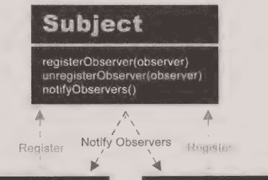

# 11

## 树形视图

在本章中，我们将创建一个支持 Ajax 的树形视图组件。该组件将接受一个 XML 文件来定义数据结构，并将其渲染为指定 HTML 元素或文档主体中的树形视图。树形视图将具备展开和折叠功能，并为文件夹提供自定义图标。每个文件夹都将具备添加启用 HTML 内容的能力，在我们的情况下，这将用于生成超链接。这些超链接可用于各种用途——例如，可用于内部或外部网站导航，或可在 Web 应用程序中使用，正如我们将在最终示例中用电子邮件应用程序所做的那样，该应用程序将显示特定文件夹以及指向电子邮件的超链接。

该组件将由两个对象组成：`TreeManager`，它将控制并利用 Ajax 引擎与图形用户界面 (GUI) 之间的接口；以及 `Tree`，该对象在解析从 `TreeManager` 接收的响应数据后渲染 GUI。完全渲染后的树形视图将类似于图 11.1。

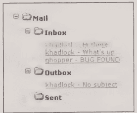

**图 11.1** 完全渲染后的树形视图。

### 结构化数据

为了构建我们的树形视图组件，我们首先必须有一种定义数据的方法。我们将定义的数据将由我们的 Ajax 引擎请求，因此我们将创建一个 XML 结构来定义它。树形视图组件将按我们定义的方式精确渲染 XML。这意味着，如果我们有一个名为 Inbox 的节点，其节点值为“New Mail"，那么树形视图组件将创建一个名为 Inbox 的文件夹，其中包含一个等于我们所定义的节点值的文本项。因此，我们要做的就是定义节点和节点值，其余部分交由组件处理。节点将表示为文件夹，节点值将以它们被定义的形式表示为内容——无论是 HTML 还是简单文本，这取决于我们。最重要的是，组件将递归地从定义的任何 childNodes 中创建子文件夹，以便渲染子类别，从而最终创建我们的树形视图结构。以下代码代表了我们树形视图组件的示例 XML 结构。列表 11.1 中的示例代表电子邮件树形视图结构，这将是我们最终样本的用法的变体。

### 列表 11.1 定义我们树形视图的 XML 结构 (tree.xml)

```
<?xml version="1.0" encoding="iso-8859-1"?>
<Mail>
    <Inbox action="alert('This is the Inbox action');">
        <![CDATA[<a href="javascript:alert('Message from khadlock');">
khadlock - Hi there</a><br/><a href="javascript:alert('Message from
khadlock');">
khadlock - What's up</a><br/><a href="javascript:alert('Message from
ghopper');">
ghopper - BUG FOUND</a>]]>
    </Inbox>
    <Outbox action="alert('This is the Outbox action');">
        <![CDATA[<a href="javascript:alert('Message from khadlock');">
khadlock - No subject</a>]]></Outbox>
    <Sent action="alert('This is the Sent action');">
    </Sent>
</Mail>
```

如你所见，这个示例 XML 非常自解释，因为只有四个节点，节点名称分别为 Mail、Inbox、Outbox 和 Sent。这些项目中的每一个都将在树中以文件夹形式表示，其中 Mail 文件夹为父文件夹，Inbox、Outbox 和 Sent 文件夹为树中的子文件夹。每个项目都有一个名为 action 的属性，该属性将指定当用户点击文件夹名称时发生的操作。在每个节点内都有一个 HTML 节点值，必须嵌入 CDATA 中才能正确解析。此 HTML 将作为每个文件夹的内容进行渲染。在这种情况下，我们使用超链接作为文件夹的内容，这些超链接将代表每个文件夹中的邮件。查看 Inbox 的节点值，它包含多个超链接，并换行由 `<br />` 标签分隔。我们将在第五部分“服务端交互 (Server-Side Interaction)"中看到如何简单地表示文件夹中的多封邮件，届时我们将使用 PHP 用数据库数据填充这些文件夹，并将其作为 XML 返回给组件。


既然我们已经有了一份 XML 结构示例，在创建实际的树形组件之前，我们需要创建一个文件来显示数据。我们将使用 HTML 文件（参见清单 11.2）来加载所有相关文件、请求 XML 并显示树形组件。首先，我们必须导入一个名为 `tree.css` 的 CSS 文件（我们将在本章末尾创建它）、所有与 Ajax 引擎相关的 JavaScript 文件，以及两个用于创建树形视图组件的对象。现在已经导入样式和 JavaScript，并且页面加载完成后，我们可以调用一个初始化方法。该方法将通过 `AjaxUpdater` 对象发出请求，获取我们刚创建的 XML 文件，并将其发送到 TreeManager 对象的 display 方法中。

## 清单 11.2 显示数据（index.html）

```html
<html>
<head>
<title>Tree View</title>
<link href="css/tree.css" rel="stylesheet" type="text/css" />
<script type="text/javascript" src="javascript/Utilities.js"></script>
<script type="text/javascript" src="javascript/model/AjaxUpdater.js"></script>
<script type="text/javascript" src="javascript/model/HTTP.js"></script>
<script type="text/javascript" src="javascript/model/Ajax.js"></script>
<script type="text/javascript" src="javascript/view/Tree.js"></script>
  <script type="text/javascript" src="javascript/controller/TreeManager.js"></script>

<script type="text/javascript">
function initialize()
{
	AjaxUpdater.Update("GET", "services/tree.xml", TreeManager.display);
}
</script>
</head>

<body onload="javascript:initialize();">
<div id="loading"></div>

</body>
</html>
```

在创建了用于显示树形视图组件的文件之后，我们应该创建渲染它的对象。我们将从 TreeManager 对象开始。

## 处理响应

TreeManager 对象是访问该组件的入口点。此对象架起了 Ajax 响应与视图或 GUI 中的 Tree 对象之间的桥梁。

TreeManager 可能是一个小对象，但它通过添加一个额外的层来作为数据控制器，帮助将后端响应数据与 GUI 分离，这一点我们将在第 15 章“模型-视图-控制器”中更详细地介绍。

display 方法（参见清单 11.3）首先检查 Ajax 对象的就绪状态是否成功。接收到 'OK' 字符串后，它就可以解析请求的响应了。此控制器与其他组件中的控制器之间的区别在于，我们实际上并不在此对象中解析响应中的任何数据；我们只是在实例化 Tree 对象时将其传递给它。当拥有一个已接收响应数据的树对象后，我们只需使用第 9 章“扩展引擎”中的 Utilities 对象，将树显示直接附加到页面主体中。或者，如果我们想将其添加到特定的 HTML 元素，也可以通过名称将其附加到特定元素。

```
Listing 11.3 Creating and Displaying the TreeManager (TreeManager.js)
TreeManager = {};

TreeManager.display = function()
{
    if(Ajax.checkReadyState('loading') == "OK")
    {
        var tree = new Tree(Ajax.getResponse());
        Utilities.appendChild(document.body, tree.display());

        //tree.toggle();
    }
}
```

你会注意到这个方法还包含一个名为 toggle 的树对象方法。此方法用于切换树项目的打开和关闭状态。由于树形视图默认会以展开状态渲染自己，display 方法可以调用 toggle 方法来默认将树形视图改为折叠状态。下一个方法是从代表展开状态的图像切换为代表折叠状态的图像，设置自定义图标（在我们的例子中是文件夹）。这个方法称为 toggleImage，可以在清单 11.4 中看到。

```
Listing 11.4 Toggling Custom Folder Icons (TreeManager.js)
TreeManager.toggleImage = function(id)
{
    if(Utilities.getElement(id) != null)
    {
        if(Utilities.getElement(id).src.indexOf('img/folder_o.gif') == -1)
        {
            Utilities.getElement(id).src = 'img/folder_o.gif';
        }
    }
}
```

清单 11.4 续

```
else
{
    Utilities.getElement(id).src = 'img/folder.gif';
}
}
```

此方法可以更改为你选择作为类别图标的任何图像。如你所见，它通过 id 检查指定的类别图标是否具有展开或折叠版本图像的索引。根据它当前拥有哪个图像，它选择另一个，从而创建切换效果。接下来，我们将创建树对象，它将渲染用于在 GUI 中显示的树形视图。

## 渲染 GUI

Tree 对象是该组件中的核心，因为它解析从 TreeManager 对象接收到的响应数据，并创建一个树结构，随后由 TreeManager 附加到 HTML 元素或 HTML 文档主体中。换句话说，这个对象几乎完成了所有工作。该对象是一个原型，这意味着它可以被实例化，并且包含一个构造函数。清单 11.5 显示了此构造函数的代码片段。

清单 11.5 构造树对象（Tree.js）

```
function Tree(data)
{
    this.data = data;
    this.childArray = new Array();
    this.tree = '';
}
```

树对象的构造函数接受一个 data 参数，即来自 TreeManager 的响应数据，并将该数据设置为一个名为 data 的本地属性。它还创建了一个名为 childArray 的新数组和一个名为 tree 的属性。childArray 数组用于在创建结构时存储所有子 id，而 tree 属性用于拼接 HTML 格式的树的字符串版本，该字符串最终被添加到父 div 的 innerHTML 属性中以供渲染。这个父 div 元素称为 tree，是在下一个方法中创建的，我们将该方法命名为 display。此方法将所有数据渲染到一个 HTML 元素中。该方法在创建并填充树对象后，从 TreeManager 调用，以在页面中显示最终的树形视图结构。清单 11.6 显示了 display 方法的代码。

## 清单 11.6 显示树（Tree.js）

```
Tree.prototype.display = function()
{
    var tree = Utilities.createElement("div", {
        id: 'tree',
        innerHTML: this.traverse(this.data, 0)
    });

    return tree;
}
```

此方法创建了我们简要讨论过的名为 tree 的 HTML div 元素。该元素仅作为一个容器，在其 innerHTML 属性中保存树元素，包括所有节点和节点值。如你所见，我们在 innerHTML 属性中调用 traverse 方法。该方法递归解析 XML 结构并创建树形视图 HTML，然后将其添加到此元素中。

traverse 方法接受两个参数：branch 和 depth。branch 表示当前正在解析的节点或类别。例如，对于当前的 XML 结构，我们将以 Mail 分支或节点作为第一个 branch 参数开始，然后递归地深入结构以解析 Inbox、Outbox 和 Sent 分支。第二个参数 depth 表示树的深度级别。例如，如果我们在解析 Mail，我们处于深度级别 0；但如果我们在解析 Inbox，我们处于深度级别 1，依此类推。巧合的是，这里的实际深度并不重要。相反，重要的是将深度用作唯一 id，以便我们可以为每个类别构建引用 id，以便后续操作，例如展开和折叠特定类别。清单 11.7 显示了方法声明及其接收的参数。

## 清单 11.7 遍历 XML（Tree.js）

```
Tree.prototype.traverse = function(branch, depth) {}
```

现在我们已经理解了参数，可以开始解析数据了。由于每个浏览器处理数据的方式不同，我们在解析数据时首先需要做的是检查 nodeName 是真正的 nodeName，而不是文本或 CDATA 引用。我们通过简单检查第一个字符的代码来确保它不等于 35，因为 35 意味着它是 # 符号，用于表示文本和 CDATA 引用。以下是执行此检查的代码示例（参见清单 11.8）。

## 清单 11.8 检查文件夹（Tree.js）

```
if(branch.nodeName.charCodeAt(0) != 35)
```


## 第11章 树状视图

下一行代码示例了为何我们需要保留对树深度层级的引用。我们构造的id可能看起来有些复杂，但它对于保持每个类别的唯一引用是必要的（参见代码清单11.9）。

### 代码清单11.9 构造唯一标识符（Tree.js）

```
var id = branch.parentNode.nodeName+'_'+branch.nodeName+'_'+depth;
```

之所以需要如此复杂的id，是为了允许在同一棵树中存在重复的名称。通过保留父节点名称、当前节点名称和深度层级的引用，可以保证我们不会出现重复的id。接下来的代码片段（参见代码清单11.10）将我们的 `childArray` 利用起来。这是我们开始将id推入数组的地方。这些id之后将很容易被引用，例如我们可能选择从 `TreeManager` 调用的 `toggle` 方法。

### 代码清单11.10 存储标识符（Tree.js）

```
this.childArray.push(id);
```

在创建了id并将它们添加到数组后，我们就可以开始创建元素，这些元素将形成我们的HTML字符串并在图形用户界面中表示树状视图。这个字符串将被拼接到我们在构造函数中创建的 `tree` 属性中。如果一个分支不包含任何 `childNodes`，我们将只添加一个表示空文件夹的图标。如果一个分支包含 `childNodes`，我们将添加一个超链接，其中包含我们的自定义文件夹图标。这个超链接将触发两个方法：来自 `Utilities` 对象的 `toggle` 方法，以及来自 `TreeManager` 对象的 `toggleImage` 方法。这些方法将切换指定文件夹内内容的可见性，并在展开和折叠的文件夹图标之间切换图标图像。我们将传递给 `toggle` 方法我们创建的id，因为它代表包含每个文件夹内容的元素，并在我们展开和折叠时导致此内容显示和隐藏。我们将传递给 `toggleImage` 方法一个id，该id代表我们将在下一行创建的 `img` 元素的id。此id将用于定位特定的图像并更改 `src` 属性。代码清单11.11展示了处理此功能的代码。

### 代码清单11.11 添加自定义图标并定义其操作（Tree.js）

```
if(branch.childNodes.length == 0)
{
    this.tree += "";
}
else
{
    this.tree += "<a href='#' onclick=\"javascript:Utilities.toggle('"+ id +"');"
            +"TreeManager.toggleImage('expand_collapse_"+ id +"');"
```

## 第11章 树状视图

### 代码清单11.11 续

```
" class='expand_collapse' onfocus='javascript:if(this.blur)
this.blur();'>
this.tree += "</a>";
}
```

这段代码作为一个字符串可能有点难读，但它只是代表我们刚刚涵盖的功能的HTML。如您所见，此代码表示一个带有嵌入图像的超链接，因此当用户单击图像时，将触发JavaScript函数并执行其指定的任务。

接下来的几行代码创建文件夹名称，并将我们在XML中指定的action属性与用户单击文件夹名称时发生的操作相关联。由于我们已将这些操作添加为属性，我们需要通过JavaScript的 `getAttribute` 方法来访问它们（参见代码清单11.12）。此方法易于使用，因为我们调用它并将属性名称作为方法的参数传递。以下是此功能的代码。

### 代码清单11.12 解析文件夹标签操作（Tree.js）

```
var action = branch.getAttribute("action");
```

现在我们已经解析了action值并将一个action变量设置为该值，我们可以在文件夹名称的超链接中使用它。以下代码创建超链接并将此操作添加到click事件（参见代码清单11.13）。

### 代码清单11.13 添加文件夹标签（Tree.js）

```
this.tree = "<a href=\"#\" onclick=\"javascript:"+ action +"\
class='container'>"+ branch.nodeName +"</a>";
```

如您所见，我们还添加了分支的 `nodeName` 作为超链接中的文本值。此值将代表我们在本章开头XML中指定的文件夹名称。此时，我们有了具有展开和折叠功能的自定义文件夹图标，以及将在XML中第一个节点的文件夹图标旁边渲染的文件夹名称。现在是更难的部分——递归添加树的值和子节点。在我们开始之前，您需要理解，我们将要么向当前节点添加节点值（换句话说，文件夹的内容），要么在树中创建一个全新的类别/文件夹。下一段代码将添加一个带有嵌入列表项的无序列表元素（参见代码清单11.14）。嵌入的列表项接收我们在方法开始时创建的id，因为这是将包含每个文件夹或节点的内容或节点值的元素。在嵌入的列表中，我们将遍历分支的直接子节点，并对每个子节点递归调用 `traverse` 方法。递归将允许我们向树添加值或新文件夹。在每次迭代中，我们需要将深度级别增加一，以确保我们向 **traverse** 方法传递唯一的深度id。添加完子节点后，我们可以简单地关闭列表项和无序列表父元素。

### 代码清单11.14 遍历子节点（Tree.js）

```
this.tree += "<ul><li id='"+id+"'>";
for(var i=0; i<branch.childNodes.length; i++)
{
    this.traverse(branch.childNodes[i], depth);
    depth++;
}
this.tree += "</li></ul>";
```

现在我们已经递归地触发了 **traverse** 方法，我们需要确定要添加到树中的元素类型。此元素将是一个带有文件夹值的 **div** 元素，或者是一个新的文件夹元素。我们根据方法中创建的第一个检查来解读。这个检查用于识别分支是节点还是文本/CDATA值。如果是节点，我们只需遵循我们刚刚创建的相同算法；否则，我们使用代码清单11.15中的代码添加节点值。

### 代码清单11.15 添加文件夹内容/值（Tree.js）

```
var value = branch.nodeValue;
if(value != undefined)
{
    this.tree += "<div class='value'>"+ value +"</div>";
}
return;
```

此代码从分支解析节点值并创建一个 `value` 变量。如果此变量不是 `undefined`，我们将它添加到保存每个文件夹内容值的 **div** 中，并将其附加到tree字符串中。在用完节点名称后，我们只需返回 **tree** 属性，并将其添加到树元素的 **innerHTML** 中，该元素将被附加到HTML页面中的特定 **div** 或，在我们的例子中，文档主体。

此对象中的最后一个方法是 **toggle** 方法。在我们的示例中，**toggle** 方法（参见代码清单11.16）可由 **TreeManager** 对象使用以展开/折叠整个树状视图，但它也可以由应用程序中的任何其他对象使用以实现相同的目标。

### 代码清单11.16 切换树状视图状态（Tree.js）

```
Tree.prototype.toggle = function()
{
    for(var i=0; i<this.childArray.length; i++)
    {
        Utilities.toggle(this.childArray[i]);
        TreeManager.toggleImage("expand_collapse_"+this.childArray[i]);
    }
}
```

## 为组件添加样式

为了给我们的组件设置样式，我们将创建一个名为 `tree.css` 的CSS（层叠样式表）文件。此文件将包含我们在树对象中创建HTML字符串时创建的元素id和类，该字符串被添加到当前文档中。此文件很简单，可以自定义为您想要的外观，包括链接颜色、间距等。代码清单11.17展示了整个文件。

代码清单11.17 为组件设置样式（tree.css）

```
body
{
    font-family: Verdana, Arial, Helvetica, sans-serif;
    font-size: 11px;
}

.container
{
    color: #333333;
    font-weight: bold;
    line-height: 21px;
    text-decoration: none;
}

ul
{
    margin: 2px 0px 5px 20px;
    list-style-type: none;
    padding: 0px;
}

li
{
    padding: 2px 0px 0px 0px;
}

.expand_collapse
{
    float: left;
```


 # 清单 11.17 续

```css
font-size: 9px;
color: #333333;
text-decoration: none;
}
.folder {
float: left;
margin: 0px 0px 0px 0px;
}
.value a {
color: #999999;
font-weight: normal;
padding-left: 15px;
}
```

这个文件相当容易理解，因为每个类和 id 都在 JavaScript 文件中有所体现。如果你想为这个树形结构创建一个新的外观，我建议修改链接的颜色和装饰，并将文件夹图像图标替换为你喜欢的任何图像。这个树形视图组件可以用来表示许多不同的数据类型，而且只需稍作调整，就能轻松用于表示其他基于 XML 的结构，例如 RSS 和播客。

# 12

## 客户端验证

**客**户端验证在基于 Web 的表单中是交互设计师的梦想。这是一种很好的方式，可以在用户使用表单时告知他们进度，而不是让他们走到最后才发现有一堆字段必须用有效信息更新。这里的问题在于所有表单都不同，在一个表单中有效的内容在另一个表单中可能无效。如果表单来自不同的网站，我们完全可以放弃寻找任何一致性。这可能不是令人惊讶的信息，而且似乎是一场不值得打的仗，但如果更多开发者使用客户端验证，Web 将成为一个更友好的表单环境。用户永远不会困惑于要在字段中输入什么信息，因为表单足够智能，可以在他们甚至尝试提交之前就当场告知他们。

本章将介绍客户端验证，结合简单的 JavaScript 和 Ajax，在用户离开指定表单元素时当场告知他们信息的有效和无效情况。

## 入门

本章的示例是一个登录/注册页面，我们最终将把它接入我们的最终示例应用程序。这个页面将执行以下两项功能之一：登录现有用户或注册新用户。当新用户到达页面时，他们会在登录表单顶部看到一个注册链接。当他们点击注册链接时，注册所需的表单元素将出现在页面上，位于用户名和密码表单元素上方（见图 12.1）。

当用户开始填写他们的用户信息时，我们会将他们的信息与数据库中的现有信息进行核对，让他们知道该信息是否已被使用，或者给他们一个视觉标识来告知他们是否通过验证。我们向用户直观呈现这些信息的一种方法是，如果特定表单元素已被使用，则将其背景色改为红色，如果该元素有效，则改为绿色。这些视觉标识显然在黑白印刷中显示不佳，但接下来的标识可以。它们是简单的字符串消息，说明数据的状态，显示在用户输入信息的表单元素旁边，如图 12.2 所示。

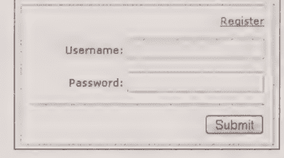

图 12.1 我们的示例登录表单，带有可选的内联注册。

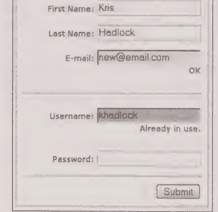

图 12.2 验证在用户输入信息时提供视觉反馈。

如图 12.2 所示，我们没有对名字和姓氏进行验证。我允许同一个人创建新账户，只要她使用新的电子邮件地址和用户名（这就是我们验证这两个字段的原因）。如果我们想验证名字和姓氏，我们必须一起验证它们，因为有很多人共享相同的名字，有时甚至是相同的姓氏。另一件需要注意的事情是，我们只在表单处于注册模式时才对表单元素运行验证。我们只希望向应用程序的新用户显示反馈，因为我们不想对存储在数据库中的敏感信息显示验证。

这个表单可能看起来很简单，但要使其成为智能表单，却需要相当多的逻辑。首先，我们有实际的登录/注册页面，其中包含一个 JavaScript 验证对象，并在每次离开指定表单元素时触发验证调用。在前端代码背后是一个 PHP 对象，当我们的 JavaScript 验证对象向其发出 XHR yp 请求时，它会在用户数据库上运行验证。这还不够，我们在登录/注册页面中包含了一个 PHP 对象实例，用于登录现有用户和注册新用户。本章将涵盖这个过程的每个方面，但主要集中在我们使用 Ajax 将 JavaScript 对象连接到后端的部分。让我们从创建 JavaScript 验证对象开始。

### 创建验证对象

由于我们要验证用户信息，我们将要创建的 JavaScript 验证对象将被称为 `UserValidator`。这个对象将有四个方法：一个 `initialize` 方法，用于初始化所有对象的本地变量；一个 `setMode` 方法，用于将表单模式从登录切换到注册；一个 `validate` 方法，这是 Ajax 部分，将向 PHP 对象发出 XHR 请求；以及一个 `onValidation` 方法，用作 XHR 的回调方法，并最终向用户显示反馈。当对象被创建时，它会自动调用 `initialize` 方法来设置本地对象变量。当发出请求时，调用 `validate` 方法，它将 `onValidation` 方法设置为回调，以便在 Ajax 对象响应时触发。当用户点击注册链接时，设置 `setMode` 方法，因为这里是模式从登录变为注册的地方。

开始使用这个对象很简单。首先，我们需要声明它，然后调用它的 `initialize` 方法，如清单 12.1 所示。

**清单 12.1** 创建和初始化 UserValidator 对象（UserValidator.js）

```
UserValidator = {};

UserValidator.initialize = function(formId, modeVal, fieldNum, submitId)
{
    UserValidator.currentSelector = '';
    UserValidator.currentForm = formId;
    UserValidator.mode = modeVal;
   Uncertainty Validator.fieldNumToValidate = fieldNum;
    UserValidator.submitId = submitId;
}
```

声明单例对象并不新鲜，但我们确实有不少仅属于此对象并在其 `initialize` 方法中设置的本地对象属性。第一个是一个名为 `currentSelector` 的属性，它将在我们的 `validate` 方法中用于保存正在验证的当前表单字段 id。第二个是 `currentForm` 属性，它将用于保存正在验证的当前表单的 id。第三个是 `mode` 属性，它将用于检查页面是处于登录模式还是注册模式。第四个名为 `fieldNumToValidate`，将用于保存一个数字，指示在启用注册按钮供用户注册之前需要验证多少个表单元素。最后一个属性名为 `submitId`，它只是保存当前表单的提交按钮的 id，将在 `setMode` 方法中使用，如果新用户点击注册链接，则将其值从登录改为注册。所有这些属性将使我们能够创建与用户交互的表单。当登录/注册页面的 body 加载时，触发 `initialize` 方法。清单 12.2 显示了如何将这个方法添加到我们的页面中。

**清单 12.2** 初始化 UserValidator 对象（index.php）

```
<body onload="UserValidator.initialize('awadForm', 'Login', 2, 'submit');">
```

我们在页面加载时将对象属性的值作为此方法的参数传递。

我们将创建的下一个方法设置表单的模式，在我们的例子中将其从登录切换到注册（见清单 12.3）。这个方法名为 `setMode`，它接受一个参数，即新的模式值。在我们的示例中，这个值将是 'Register'。

**清单 12.3** 将模式从登录设置为注册（UserValidator.js）

```
UserValidator.setMode = function(modeVal)
{
    UserValidator.mode = modeVal;
    Utilities.getElement( UserValidator.submitId ).value = modeVal;
    Utilities.getElement( UserValidator.submitId ).disabled = true;
    Utilities.getElement( UserValidator.currentForm ).action += "?mode="+ modeVal;
}
```

这个方法获取新的模式值，并将其设置为我们创建的本地 mode 属性和提交按钮的值。然后，它禁用提交按钮，直到表单根据我们在 `initialize` 方法中设置的 `fieldNumToValidate` 属性完成验证，并将模式值附加到当前表单的 action URL。附加此值使我们能够在 post-back 发生时检索它，并用它来判断我们需要注册新用户还是登录现有用户。

### 验证用户输入

为了验证我们在 `initialize` 方法中指定的两个字段，我们必须创建一个 `validate` 方法，该方法接受一个选择器参数及其值。选择器参数是被验证元素的 id，值参数是该元素的值。清单 12.4 显示了这个完整的方法，我们将在稍后介绍。


 ## 列表 12.4 验证表单数据与数据库数据（UserValidator.js）

```
UserValidator.validate = function(selector, value)
{
    if(selector != '' && value != '')
    {
        UserValidator.currentSelector = selector;

        var url = "serviceConnector.php?object=UserManager&method=
            verifyUserInformation&params="+ selector +","+ value;
        AjaxUpdater.Update("GET", url, UserValidator.onValidation);
    }
    else if(selector != '' && value == '')
    {
        Utilities.getElement( selector ).style.backgroundColor = '#ffffff';
        Utilities.getElement( selector +"Message" ).innerHTML = '';
    }
}
```

在查看了代码之后，我们可以逐行进行讲解。我们要做的第一件事是确保两个参数都不为空。如果它们不为空，我们将当前选择器（currentSelector）设置为选择器参数，并创建一个 url 变量以便通过 Ajax 请求传递。我们创建的 url 变量包含一个 serviceConnector.php 文件，一个对象参数设置为我们将要创建的 userManager 对象，以及一个方法参数设置为 verifyUserInformation 方法。查询的最后一部分称为 param，设置为传入对象的 selector 和 value 参数。参数被连接成一个以逗号分隔的列表，然后 url 变量通过 Ajax 请求发送到服务器，同时将 onValidation 方法设置为回调函数。当然，也存在这样一种可能性，即 selector 被设置了，但 value 参数可能为空字符串，因此我们有一个条件语句，将选择器元素的视觉反馈设置为默认状态，以防用户已经验证过该元素。

为了从客户端页面调用此验证方法，我们需要将代码添加到我们要验证的表单元素的 onblur 事件中。列表 12.5 显示了 index.php 示例页面的主体部分。

#### 列表 12.5 从表单调用验证方法（index.php）

```
<!DOCTYPE html PUBLIC "-//W3C//DTD XHTML 1.0 Transitional//EN"
"http://www.w3.org/TR/xhtml1/DTD/xhtml1-transitional.dtd">
<html xmlns="http://www.w3.org/1999/xhtml">
<head>
<meta http-equiv="Content-Type" content="text/html; charset=iso-8859-1" />
<title>AJAX for Web Application Developers</title>
<link href="css/user.css" rel="stylesheet" type="text/css" />
<script type="text/javascript" src="javascript/Utilities.js"></script>
<script type="text/javascript">
var jsFiles = new Array("javascript/utils/ErrorManager.js","javascript/utils/Alert.js","javascript/utils/NumberUtil.js","javascript/utils/StringUtil.js","javascript/model/AjaxUpdater.js","javascript/model/HTTP.js","javascript/model/Ajax.js","javascript/utils/UserValidator.js");Utilities.includeJS(jsFiles);</script></head></body onload="UserValidator.initialize('awadForm', 'Login', 2, 'submit');"><div id="login"><div style="color: #ff0000">=$error;</div><form id="awadForm" method="post" action="$SERVER[PHP_SELF]">First Name: <input name="firstName" id="firstName" type="text" /><br/><br/>Last Name: <input name="lastName" id="lastName" type="text" /><br/><br/>E-mail: <input name="email" id="email" type="text" onblur="javascript:UserValidator.validate(this.id, this.value);"><div id="emailMessage"></div><br/><br/></div><a href="#" onclick="document.getElementById('register').style.display='';document.getElementById('registerButton').style.display='none';UserValidator.setMode('Register');" id="registerButton">Register</a><br/><br/>Username: <input name="username" id="username" type="text" onblur="javascript;if(UserValidator.mode == 'Register')UserValidator.validate(this.id, this.value);"><div id="usernameMessage"></div><br/><br/>Password: <input name="password" id="password" type="password" /><br/><br/><div id="buttons"><input name='submit' type='submit' value='Login' id='submit'></div></form></div><div id="loading" style="display:none;"></body> </html>
```

这些验证调用非常简单，可以复制到我们想要添加它们的任何元素中，因为它们是从它们附加到的当前元素中获取参数的。唯一的必要条件是调用方法的元素必须有 id 属性。action 中有 PHP 代码使表单回发到此同一页面，这要求我们在此页面中处理登录和注册。它还包含一个 PHP $error 消息，如果存在错误，将在该页面中显示。该消息将在下一节中介绍，届时我们将在文件顶部添加更多 PHP 代码以处理登录和注册。

## 提供视觉反馈

视觉反馈在网络应用程序中非常重要，但经常被开发人员忽视。添加视觉反馈可以让用户了解他们的交互情况，不会让用户在他们点击按钮、退出表单字段等之后，不知道他们数据发生了什么而困惑。通过我们的 UserValidator 对象提供反馈并不难实现，因为我们要做的只是匹配元素 id，并根据我们 XHR 的响应更改样式。列表 12.6 显示了此代码以及它如何向用户显示视觉线索。

### 列表 12.6 向用户提供视觉反馈（UserValidator.js）

```
<?php
UserValidator.onValidation = function()
{
    if(Ajax.checkReadyState('loading') == "OK")
    {
        var color = '#ffffff';
        if(Ajax.getResponse().firstChild.data == 'success')
        {
            color = '#ff9999';
            Utilities.getElement( UserValidator.currentSelector +"Message" )
                .innerHTML = 'Already in use.';
        }
        else
        {
            color = '#ccff99';
            Utilities.getElement( UserValidator.currentSelector
                +"Message" ).innerHTML = 'OK';
            UserValidator.fieldNumToValidate--;
        }
        Utilities.getElement( UserValidator.currentSelector )
            .style.backgroundColor = color;

        if(UserValidator.fieldNumToValidate == 0)
        {
            Utilities.getElement( UserValidator.submitId ).disabled = false;
```

这个方法中有相当多的条件，但不要害怕——代码非常简单。我们要检查的第一件事是 Ajax 对象的就绪状态，这已经在我们创建的其他组件中介绍过了。验证通过后，我们检查响应，看看我们的服务端对象（我们将很快创建）是否返回了成功或失败的消息。如果响应成功，意味着我们需要将表单元素背景设置为红色，并添加一条消息说明数据已被使用，因为数据库中已经存在此数据。否则，我们将其设置为绿色，并添加“OK”消息。我们还根据响应的条件更新 `fieldNumToValidate` 属性。最后，我们检查 `fieldNumToValidate` 是否等于零，如果是，我们启用按钮。

现在我们已经创建了请求的客户端部分，我们需要检查数据库并根据匹配的数据响应 XML。

## 服务器端

我知道我们还没有到达第五部分“服务器端交互”，但这个对象确实要求我们深入探究请求的服务器端。在此说明中，我不打算涵盖 PHP 或 MySQL 的所有细节；相反，我将解释如何通过示例实现服务器和客户端之间的连接。我们将创建一个服务器端 PHP 对象，通过另一个中介 PHP 文件进行 XHR，该文件将桥接 JavaScript 和 PHP 之间的空白。PHP 对象随后将检查数据库表中的特定数据，当从服务器收到响应时，我们需要用我们的 JavaScript 对象验证这些数据。让我们先从创建数据库表开始。列表 12.7 显示了在 MySQL 数据库中创建表的 SQL 代码。

### 列表 12.7 创建用户表的 SQL 代码（awad_users.sql）

```
CREATE TABLE 'awad_users' (
    'password' varchar(50) NOT NULL default '',
    'username' varchar(25) NOT NULL default '',
    'email' varchar(100) NOT NULL default '',
    'lastName' varchar(50) NOT NULL default '',
    'firstName' varchar(25) NOT NULL default '',
    'id' int(11) NOT NULL auto_increment,
    PRIMARY KEY ('id')
) ENGINE=MyISAM DEFAULT CHARSET=utf8;
```


**我们已经在** `UserValidation` **对象中创建了 Ajax 请求，** 因此创建服务器端将变得轻而易举。我非常诚恳地这么说：记住所有步骤可能看起来很多，但一旦你做过一次，你就会惊讶于它实际上有多简单，以及它能构建出多么健壮的应用程序。正如我之前所述，我们需要一个中介 PHP 文件、一个 PHP 对象和一个数据库。中介文件就是我们在 UserValidation 对象的 Ajax 请求中调用的 serviceConnector.php 文件。这个文件非常简单，仅用于在 JavaScript 和 PHP 对象之间架起沟通的桥梁。该页面的第一件事将是设置一个头部，将返回数据的 `content` 类型设置为 XML，以便请求的 Ajax 对象能够接收。然后该文件会包含一个名为 UserManager.class.php 的 PHP 对象，我们稍后将创建它。这个对象将使用我们通过请求传递的对象变量进行实例化。实例化后，我们将传递的参数作为方法参数调用。这个文件非常抽象，实际上可以用于任何公共方法，以及任何以逗号分隔的列表形式传递的参数，这些参数包含在我们选择包含在此文件中的对象中。这赋予了该文件相当大的灵活性，这就是为什么我们需要在第五部分“服务器端交互”中添加某种安全机制的原因。清单 12.8 展示了如何使用这个中介文件实现此功能。

### **清单 12.8 在客户端与服务器端之间架起桥梁**
**(ServiceConnector.php)**

```
<?php
header("Content-Type: application/xml; charset= UTF-8")
require_once('classes/UserManager.class.php');
$o=new $_GET['object']();
echo "$_GET['method'](($_GET['params']));
?>
```

**如前所述，这个文件极其简单，却功能强大，基本上可以在任何需要通过简单包含另一个对象来建立连接的情况下使用。本例中我们使用的对象是用于用户管理的，它将被整合到我们的最终示例中。它包含的方法看起来会非常熟悉，因为我们已经在 Validation 对象中创建了请求。此对象包含的方法如表 12.7 所列。

| 方法 | 功能 |
|---------|----------|
| 构造函数 | 创建数据库连接对象 |
| verifyUserInformation | 检查数据库，查看作为参数传入的数据是否存在于数据库中 |
| register | 注册新用户 |
| insertWelcomeMessage | 由 register 方法调用，用于在新用户的收件箱中插入欢迎邮件 |
| login | 登录现有用户 |

## 构造函数

在创建构造函数函数之前，我们首先需要创建一个名为 dbConnector 的私有局部类变量，我们将在构造函数中使用它从 DatabaseConnector.class.php 获取数据库连接器对象的单例实例。创建这个变量并将其设置为单例对象后，我们将调用其 init 方法以进行初始连接并选择我们的数据库。此对象可用于我们的每个其他方法中，以连接数据库和执行查询。清单 12.9 展示了此代码的实际应用。

### 清单 12.9 创建对象构造函数 (UserManager.class.php)

```
<?php
require_once("classes/database/DatabaseConnector.class.php");
require_once("classes/utils/Constants.class.php");

class UserManager
{
    private $dbConnector;

    public function UserManager()
    {
        $this->dbConnector = DatabaseConnector::getInstance();
        $this->dbConnector->init();
    }
}
?>
```

## 注意

> 要连接到数据库，有一件非常重要的事情需要记住：更改 Constants.class.php 中的静态变量。

这些变量看起来像清单 12.10 中的代码。

### 清单 12.10 更改数据库连接信息 (Constants.class.php)

```
<?php

class Constants
{

    // 数据库连接
    static $DB_USER = "USERNAME";
    static $DB_PASSWORD = "PASSWORD";
    static $DB_HOST = "localhost";
    static $DB_NAME = "DB_NAME";

    // 数据库表
    static $AWAD_EMAIL = "awad_email";
    static $AWAD_USERS = "awad_users";

    // 密码
    static $PASSWORD = "TEMPPASSWORD";

    // 返回值
    static $SUCCESS = "<xml>success</xml>";
    static $FAILED = "<xml>failed</xml>";

    public function Constants() {}

}

?>
```

这些变量应包含你的数据库的连接信息。为了让示例在你的服务器上运行，这些是你在 Constants.class.php 中唯一需要修改的项目。出于安全考虑，将 Constants 文件放在无法通过 Web 访问的安全目录中也是一个好主意。DatabaseConnector.class.php 永远不需要修改，因为它已配置为使用此信息连接到任何数据库。

## 验证用户信息

我们所有用于客户端验证的 XHR 请求都是发送到这个方法的。如果我们回顾一下在 UserValidation 对象中创建的 Ajax 请求，它们指定了 UserManager 对象、方法名称以及验证数据与数据库匹配所必需的参数。在客户端与对象建立连接后，这些参数用于从数据库中选择指定的数据以查看是否存在匹配项。如果存在匹配，方法返回 true；否则返回 false。你会注意到我们通过 Constants.class.php 文件以 XML 形式返回这些消息。这是为了使响应成为有效的 DOM 对象，然后可以通过 Ajax 访问。示例参见清单 12.11。

### 清单 12.11 在数据库中验证用户信息 (UserManager.class.php)

```
<?php
public function verifyUserInformation($params)
{
    $param = split(",", $params);
    $selector = $param[0];
    $selectorValue = $param[1];

    $this->dbConnector->connect();
    $table = Constants::$AWAD_USERS;
    $query = "SELECT * FROM $table WHERE $selector='$selectorValue'";
    $result = mysql_query($query);
    $this->dbConnector->complete($query);

    if(mysql_num_rows($result) == 0)
    {
        return Constants::$FAILED;
    }
    else
    {
        return Constants::$SUCCESS;
    }
}
?>
```

## 注册和登录用户

虽然这些方法与 Ajax 无关，但它们确实允许我们获取用户，以便对其运行验证请求。因此，我将它们包含进来是为了让我们开始。我展示的第一个方法是清单 12.12 中的 register 方法。

### 清单 12.12 注册新用户 (UserManager.class.php)

```
<?php
public function register($firstName, $lastName, $email, $username, $password)
{
    $password = md5($password);
    $this->dbConnector->connect();
    $table = Constants::$AWAD_USERS;
```

### 清单 12.12 续

```
$query = "SELECT * FROM $table WHERE username='$username' AND
    password='$password' AND email='$email'";
$result = mysql_query($query);

if(mysql_num_rows($result) == 0)
{
    $query = "INSERT INTO $table (firstName, lastName, email, username,
    password)
VALUES ('$firstName', '$lastName', '$email', '$username', '$password')";
    $this->dbConnector->complete($query);
    $this->insertWelcomeMessage($username);
    return Constants::$SUCCESS;
}
else
{
    return Constants::$FAILED;
}
}
?>
```

此方法简单地获取在 index.php 文件表单中输入的数据，并将其添加到我们的数据库中。

> **注意**
> register 方法还会调用一个名为 insertWelcomeMessage 的方法，本章未介绍该方法，但已包含在代码示例中。此方法默认为新用户创建一封欢迎邮件。

下一个方法是针对现有用户的登录方法（参见清单 12.13）。

### 清单 12.13 登录现有用户 (UserManager.class.php)

```
<?php
public function login($username, $password)
{
    $password = md5($password);
    $this->dbConnector->connect();
    $table = Constants::$AWAD_USERS;
    $query = "SELECT * FROM $table WHERE username='$username' AND password=
    '$password'";
    $result = mysql_query($query);
    $this->dbConnector->complete($query);

    if(mysql_num_rows($result) == 0)
    {
```


# 第12章 客户端验证

```
清单 12.13  续

return Constants::$FAILED;
}
else
{
    return Constants::$SUCCESS;
}
}
?>
```

当表单回发到自身时，这两个方法会从 `index.php` 文件中触发。清单12.14展示了需要在我们的索引页面顶部添加以处理注册和登录的代码。

```
清单 12.14  处理用户登录和注册 (index.php)

<?php

require_once("classes/utils/Constants.class.php");
require_once("classes/UserManager.class.php");
$uManager = new UserManager();

$error = '';
if($_GET['mode'] == 'Register')
{
    if($_POST['firstName'] != '' && $_POST['lastName'] != '' && $_POST['email']
        != '' && $_POST['username'] != '' && $_POST['password'] != '')
    {
        $response = $uManager->register($_POST['firstName'], $_POST['lastName'],
            $_POST['email'], $_POST['username'], $_POST['password']);

        if($response == Constants::$SUCCESS)
        {
            header("Location: mail.php?username=". $_POST['username']);
        }
        else
        {
            $error = 'The username or password that you have choosen is in use.';
        }
    }
    else
    {
        $error = 'Please complete all of the form fields.';
    }
}
else
{
```

```
清单 12.14   续

if(isset($_POST['username']) && isset($_POST['password']))
{
    $response = $uManager->login($_POST['username'], $_POST['password']);

    if($response == Constants::$SUCCESS)
    {
        header("Location: mail.php?username=" . $_POST['username']);
    }
    else
    {
        $error = 'The username and password that you have entered do not match any records.';
    }
}

?>
```

当表单被提交时，它会回发到自身并运行页面顶部的PHP代码。它首先设置 `error` 变量以备后用，然后检查表单的模式（mode）。如果模式等于 `register`，它就运行注册代码；否则，它运行登录代码。在注册代码中，它验证所有字段是否已填写完整，然后通过 `UserManager` 对象注册用户。如果字段未填写完整，我们会设置一条错误信息以显示给用户。在登录模式下，我们验证用户名和密码字段是否已填写，如果已填写，则通过 `UserManager` 对象登录用户。在收到成功响应后，我们将用户重定向到应用程序中。如果此过程中出现任何失败，我们会再次设置一条错误信息。

现在我们已经创建了这个代码，我们确实可以将它用于任何Web应用程序。这种可重用性正是编写服务器端类和客户端对象的一大优点。

# 第13章 数据网格

数据整合是开发者在设计Web应用程序GUI时面临的一个典型问题，因为在动态应用程序中处理大量数据是常见做法。使用数据网格来显示大量数据，对于整合和可用性都非常有益。数据整合和更好的可用性会自然而然地出现，因为数据网格的功能就是将数据格式化为行和列，最终创建出一个更易于阅读的结构化网格。数据网格将数据格式化为不同内容的行，每行中包含分隔相应内容的列。

这种数据结构化的方式在Web应用程序中很常见。我们在本章中构建的组件，将使结构化数据网格的过程像结构化你将要传递给它的XML数据一样简单。因此，一旦创建了JavaScript对象，你通常就无需再修改它们——当然，如果你想添加额外功能的话除外。这是因为所有的样式都将在CSS文件中完成，以便帮助你设计网格的GUI并匹配你正在开发的任何应用程序。

## 入门

在我们创建将成为数据网格组件的任何JavaScript对象之前，我们需要创建一个XML文件来保存数据，以及一个HTML文件来显示组件。本节简要描述如何创建我们需要的文件以开始工作。本章的XML实际上与我们在第3章“响应”中创建的结构相同。本章将获取该XML，并将其渲染成一个自定义数据网格组件，我们将在下一节中逐步创建这个组件。唯一的区别是，我们将修改动作（actions）使其成为警报，以展示动作如何工作的一个示例。以下是 `action` 属性中新动作的一个示例：

```
<items action="alert('Grace Hopper');" icon="img/mail.gif"> </items>
```

定义好XML结构后，我们必须创建一个HTML页面来显示数据。我们将创建一个索引页面，其中包含执行XHR并将其在数据网格中显示所需的相应JavaScript文件。索引页面将等待文档的主体加载完成，然后在 `AjaxUpdater` 上触发更新调用以加载相应的XML数据。我们还将指定 `DataGrid` 的 `display` 方法作为回调，因为这是我们在创建对象后处理渲染的方法。请查看清单13.1，了解HTML应如何构建。

### 清单 13.1 显示组件的容器 (index.html)

```
<html xmlns="http://www.w3.org/1999/xhtml">
<head>
<title>DataGrid</title>
<link href="css/datagrid.css" rel="stylesheet" type="text/css" />
<script type="text/javascript" src="javascript/Utilities.js"></script>
<script type="text/javascript" src="javascript/utils/NumberUtil.js"></script>
<script type="text/javascript" src="javascript/utils/StringUtil.js"></script>
<script type="text/javascript" src="javascript/model/AjaxUpdater.js"></script>
<script type="text/javascript" src="javascript/model/HTTP.js"></script>
<script type="text/javascript" src="javascript/view/DataRow.js"></script>
<script type="text/javascript" src="javascript/view/DataColumn.js"></script>
<script type="text/javascript" src="javascript/controller/DataGrid.js"></script>

function initialize()
{
    AjaxUpdater.Update("GET", "services/email.xml", DataGrid.display);
}
</script>
</head>

<body onload="javascript:initialize();">
<div id="loading"></div>

</body>
</html>
```

这个HTML文件并不复杂——它实际上只是导入所有正确的JavaScript文件，并在页面加载完成后执行XHR。最后要添加的是加载div，它将显示关于XHR状态的信息。现在我们已经创建了数据和显示页面，让我们深入了解数据网格组件的代码。

### 创建DataGrid对象

数据网格组件提供了显示大量数据的绝佳方式。本节将向你展示如何创建一个 `DataGrid` 对象，该对象将加载XML、解析XML，并将其委托给另外两个名为 `DataRow` 和 `DataColumn` 的对象，我们将在下一节中创建这两个对象。

在开始使用之前，我们首先需要定义并实例化 `DataGrid` 对象。清单13.2展示了实现此操作的代码。在定义了数据网格之后，我们将定义它的第一个方法 `init`。该方法创建对象属性，在我们的例子中，它只是一个名为 `rows` 的新数组。

### 清单 13.2 定义和实例化DataGrid对象 (DataGrid.js)

```
DataGrid = {};

DataGrid.init = function()
{
    rows = new Array();
}
```

我们将创建的数据网格接受一个具有我们之前创建的结构的XML文件。当 `display` 方法作为XHR的回调被调用时，就会接受XML。当 `display` 方法被调用时，它会检查XHR的 `readyState`，并在我们添加到HTML中的 `loading` div中显示一条加载消息。加载消息会一直显示，直到状态达到完成状态并返回“OK”状态码，这个状态码是我们在第9章“扩展引擎”中添加到 `HTTP` 对象中的。

```
if(Ajax.checkReadyState('loading') == "OK"){}
```

创建的第一个元素是一个实际的数据网格div元素。该元素将用作所有行和列的容器，这些行和列最终将格式化解析后的XML数据。数据解析从检索类别（categories）开始，这为我们提供了一个数组，我们将遍历该数组以定位每个类别的值。在遍历类别时，我们创建 `titlebar` 元素，它们将保存类别值并将其显示为网格中每列的标题。在迭代过程中，我们将定位每个类别值，并将其添加到 `category` div元素的 `innerHTML` 属性中。填充了 `titlebar` 和类别元素后，我们就可以将带有类别的 `titlebar` 元素追加到其中。清单13.3展示了创建类别的代码。


# 第13章 数据网格

**代码清单13.3 创建分类标题 (DataGrid.js)**

```
var datagrid = Utilities.createElement("div", {id:'datagrid'});
var categories = Ajax.getResponse().getElementsByTagName('category');
for(var i=0; i<categories.length; i++)
{
    var titlebar = Utilities.createElement("div", {id:'titlebar',
    className:'titlebar'});
    var categoryText = Ajax.getResponse().getElementsByTagName
    ('category')[i].firstChild.data;
    var category = Utilities.createElement("div", {id: 'title', className:
    'title',
    innerHTML:categoryText });

    Utilities.appendChild(datagrid, Utilities.appendChild(titlebar, category));
}
```

这段代码将基本上为我们生成以下HTML结构：

```
<div id="titlebar">
    <div id="category">value1</div>
    <div id="category">value2</div>
    <div id="category">value3</div>
</div>
```

现在我们已经创建了分类标题，我们需要以网格结构显示其余数据。我们首先定位XML中的行元素。这为我们提供了一个行数组，我们可以遍历它来处理其余数据。我们需要定位行标签内的项目，并从结果中创建一个`items`数组。利用这个数组，我们可以获取每组项目包含的属性值。第一个属性是action属性，第二个是icon属性。定位这些属性可以获取它们的值。下一行代码需要一个我们即将创建的工具对象，称为`NumberUtil`。我们调用它的`getParity`方法来判断传递给它的值是偶数还是奇数。这个值最终用于`DataRow`对象，以决定行的颜色。所有这些值都作为参数传递给我们创建的`DataRow`对象，并推送到`rows`数组中以供后续检索。`DataRow`按以下顺序接收参数：id、items数组、action、parity和icon（参见代码清单13.4）。

**代码清单13.4 解析行数据 (DataGrid.js)**

```
var row = Ajax.getResponse().getElementsByTagName('row');
for(var i=0; i<row.length; i++)
{
    var items = Ajax.getResponse().getElementsByTagName('items')[i].childNodes;
    var action =
    Ajax.getResponse().getElementsByTagName('items')[i].getAttribute
    ('action');
    var icon =
    Ajax.getResponse().getElementsByTagName('items')[i].getAttribute
    ('icon');

    var parity = NumberUtil.getParity(i);
    rows.push( new DataRow(i, items, action, parity, icon ) );

    Utilities.appendChild(datagrid, rows[i].display());
}
```

在我们解析了所有项目数据并创建了所有数据行之后，我们将每一行附加到我们在方法开始时创建的datagrid div元素。如代码清单13.5所示，我们正在调用DataRow对象的display方法，该方法将返回我们将在DataRow对象中创建的所有HTML。

**代码清单13.5 显示DataGrid组件 (DataGrid.js)**

```
DataGrid.display = function()
{
    if(Ajax.checkReadyState('loading') == "OK")
    {
        var datagrid = Utilities.createElement("div", {id:'datagrid'});
        var categories = Ajax.getResponse().getElementsByTagName('category');
        for(var i=0; i<categories.length; i++)
        {
            var titlebar = Utilities.createElement("div", {id:'titlebar',
                className:'titlebar'});
            var categoryText = 
                Ajax.getResponse().getElementsByTagName('category')[i].
                firstChild.data;
            var category = Utilities.createElement("div", {id: 'title', className:
                'title', innerHTML:categoryText });

            Utilities.appendChild(datagrid, Utilities.appendChild(titlebar,
            category));
        }
    
        var row = Ajax.getResponse().getElementsByTagName('row');
        for(var i=0; i<row.length; i++)
        {
            var items = 
                Ajax.getResponse().getElementsByTagName('items')[i].childNodes;
            var action = 
                Ajax.getResponse().getElementsByTagName('items')[i].getAttribute
                ('action');
            var icon = 
                Ajax.getResponse().getElementsByTagName('items')[i].getAttribute
                ('icon');

            var parity = NumberUtil.getParity(i);
            rows.push( new DataRow(i, items, action, parity, icon) );

            Utilities.appendChild(datagrid, rows[i].display());
        }

        //Utilities.appendChild(document.body, datagrid);
        Utilities.appendChild(Utilities.getElement('list'), datagrid);
        AjaxUpdater.saving = false;
    }
}
```

包含在DataGrid对象中的最后一行代码是触发init方法来调用对象的属性。代码清单13.6向我们展示了如何实现这一点。

**代码清单13.6 初始化DataGrid对象 (DataGrid.js)**

```
DataGrid.init();
```

我们用来获取奇偶性的NumberUtil对象是一个简单的工具对象，可以处理与数字相关的函数。尽管该对象当前仅处理奇偶性，但它可以扩展以包含您选择的其他方法，例如您可能需要多次使用的复杂计算等。代码清单13.7完整展示了该对象。

**代码清单13.7 NumberUtil对象 (NumberUtil.js)**

```
NumberUtil = {};

NumberUtil.getParity = function(num)
{
    if(num % 2 == 0)
    {
        return "even";
    }
    else
    {
        return "odd";
    }
}
```

现在我们已经完成了DataGrid对象，我们需要创建行和列来构建数据结构。让我们开始创建一个DataRow对象。

## 显示数据

在网格中显示数据需要能够创建行和列。这些行和列需要将数据渲染成结构化显示。此显示将表示数据网格，通常处理交互功能，在我们的情况下，将调用我们在XML中设置的操作。

### 创建DataRow对象

DataRow对象将匹配组的数据分离成行，这些行最终将被细分为列。由于该对象是一个原型，为了创建和实例化该对象，我们需要为该对象构建一个构造函数。如代码清单13.8中的构造函数所示，我们传递了五个参数，这些参数用于我们在DataGrid对象中实例化的DataRow对象。这些参数是id、items数组、action、parity和icon。

**代码清单13.8 构造DataRow (DataRow.js)**

```
function DataRow(id, items, action, parity, icon)
{
    this.id = id;
    this.icon = icon;
    this.items = this.getAllItems(items);
    this.action = action;
    this.parity = parity;
}
```

我们在DataRow构造函数中接受的参数被设置为对象内的本地属性。所有这些参数都直接转换为本地属性，除了items数组。此参数调用对象中的另一个名为getAllItems的方法，该方法解析items中的节点值并返回一个DataColumn对象数组，然后设置为本地items数组。我们稍后将创建getAllItems方法。

display方法是我们在DataGrid对象中调用以返回每行HTML的方法。然后我们获取这些数据并将其附加到datagrid div元素。查看代码清单13.9，了解我们如何在display方法中为行创建HTML元素。

**代码清单13.9 显示DataRow (DataRow.js)**

```
DataRow.prototype.display = function()
{
    var row = Utilities.createElement("div", {
        id: 'row_' + this.id,
        className: 'row_' + this.parity,
        onclick: this.getAction(this.action),
        onmouseover: this.rollover('row_' + this.id),
        onmouseout: this.rolloOut('row_' + this.id)
    });

    for(var i=0; i<this.items.length; i++)
    {
        Utilities.appendChild(row, this.items[i]);
    }
    return row;
}
```

display方法是对象的控制中心。它不仅包含渲染行的所有代码，还包含所有事件处理程序。此方法用作其他对象的访问点，并将对象中的所有其他方法组合起来，返回一个带有交互事件处理程序的完整行元素到前端或GUI。构造元素后，我们需要遍历items数组，其中包含DataColumn元素，附加到当前行。此方法创建的行元素具有唯一的id、一个类名以及onclick、onmouseover和onmouseout事件。唯一的id用于唯一标识行，可用于提供一种通过名称定位对象的方式。类名是奇偶性发挥作用的地方。奇偶性为我们提供了一种拼接两个不同类名的方法：_row_even和_row_odd。在我们的示例中，这些类通过提供交替的背景颜色来区分偶数行和奇数行，从而让我们能够区分一行与另一行。当然，这些类可以被修改以其他独特的方式显示行，但我将这部分留给您。创建的事件为我们的行提供了交互性，并增强了组件的用户体验。第一个事件是onclick事件，我们将其设置为getAction方法，并将action属性作为参数传递。此方法接受action并向事件返回一个函数。因此，当行被单击时，将调用一个函数。该函数随后评估action并在验证后触发它。查看代码清单13.10了解此方法的实际应用。

**代码清单13.10 从解析的XML创建操作 (DataRow.js)**

```
DataRow.prototype.getAction = function(action) {
    return function() {
        eval(action);
    }
}
```

我们添加到行元素中的下一个事件处理程序是onmouseover。此事件设置为对象内的本地rollover方法。在示例中，我们使用

## 显示数据

使用**悬停方法**来处理行的样式。在本例中，我们简单地**更改**颜色并**将**光标**设置**为手型指针，以区分该行是可点击的条目（参见清单 13.11）。

**## 14**
## 单例模式
**模型-视图-控制器**
## 观察者模式
## 数据反射模式
### 交互模式
## 可用性模式

---

## 创建 DataColumn 对象

DataColumn 对象负责**将**相应的数据组**分离**成列。
DataColumn 对象接受两个**参数**：id 和 copy，两者都在构造函数中**作用域**为**局部**属性。这个对象非常**小**，因为它**仅仅**

---

# Ajax 模式

+ 15 模型-视图-控制器
+ 16 观察者模式
+ 18 交互模式
+ 19 可用性模式

---

# IV
## 单例模式

在第二部分“创建和使用 JavaScript 引擎”中，我们介绍了创建 JavaScript 对象的两种高级方法、Ajax 引擎的**创建**方法，以及如何**调试**并在 Web 应用程序中使用该引擎。我们还介绍了**扩展**引擎的方法，在这部分中我们将继续这样做。我将向你**展示**如何通过在你的代码中**使用**设计**模式**来将你的 Ajax 应用程序提升到更高水平，帮助你**优化**和构建可扩展的应用程序，使其能够轻松地通过未来的功能进行**更新**。

**## 15**
## 模型-视图-控制器
## 观察者模式
## 数据反射模式
### 交互模式
## 可用性模式

设计**模式**有助于**解决**常见的**编程** **问题**。例如，**单例** **模式** **解决**了在整个应用程序中**需要** **实例化**多个对象实例的**问题**，方法**是** **为**我们的应用程序**提供**一个永远**不变**的引用。这就是**单例** **模式** **具体**解决常见编程问题的方式。**在**本书的这部分中**，我们**将**学习** **许多**设计**模式** **以及** **如何** **将它们**应用到我们的 Ajax 应用程序中。这**个** **模式** **是**一个**容易**理解的**简单**模式，**但** **极其** **有用**。 **这些** **模式**会随着我们**继续** **深入**第四部分“**服务器端** **交互**”而**变得** **更加ortic** **更加** **先进**。

使用**单例** **模式**的对象为 Web 应用程序中的其他对象**提供** **一个**一致的引用。**单例** **对象** **是**指不能被**实例化**超过**一次**的对象。这意味着**不能** **创建**该对象的**多个** **实例**。你可能会**问** **为什么** **要** **在** Web 应用程序中**让**一个不能被其他对象**实例化**的对象。这**一章**将**解释** **原因**，**帮助**你**理解** **为什么**这**个** **模式**是有**用**的，并**向**你**展示** **如何** **在**你的**Ajax**应用程序中**使用**这**个** **模式**，方法**是** **创建**一个**处理** **所有** **Ajax** **更新**的对象。

**## 17**
## 可用性模式
### 交互模式

---

# IV
# Ajax 模式

+ 14 单例模式
+ 15 模型-视图-控制器
+ 16 观察者模式
+ 17 数据反射模式
+ 18 交互模式
+ 19 可用性模式

---

# 14
## 单例模式

在第二部分“创建和使用 JavaScript 引擎”中，我们介绍了创建 JavaScript 对象的两种高级方法、Ajax 引擎的创建，以及如何**调试**并在 Web 应用程序中使用该引擎。我们还**介绍**了 **扩展** 引擎，这在本书的这部分中我们将继续这样做。我将**展示**你如何**通过**在你的代码中**使用**设计 **模式**来将你的 Ajax 应用程序提升到更高水平，帮助你**优化**和构建可扩展的应用程序，使其能够轻松地**更新**未来的功能。

设计**模式**帮助**解决**常见的**编程** **问题**。例如，**单例** **模式** **解决**了**必须** **实例化**多个对象实例于**整个** **应用程序**中的**问题**，方法**是** **简单地** **给** **我们的**应用程序一个永远**不变**的引用。这**是** **单例** **模式** **具体**解决常见编程问题的方式。**在**本书的这部分中**我们**将**学习** **许多** 设计 **模式** 和 **如何** **将它们**应用到**我们的** **Ajax**应用程序中。这**个** **特定** **模式** **是**一个**简单**易懂的，**但** **极其** **有用**。这些 **模式**会**变得** **更加** **先进**，随着我们**继续** **深入**第四部分“**服务器端** **交互**。” 

使用**单例** **模式**的对象**提供** **一个**一致的引用给 Web 应用程序中的其他对象。**单例** **对象** **是**指不能被**实例化**超过**一次**的。这意味着**不能** **创建**该对象的**多个** **实例**。你或许会** **问** **为什么** **要** **一个**不能被其他对象**实例化**的**对象**在 Web 应用程序中。**这** **一章**将**解释** **原因**，**帮助**你**理解** **为什么**这**个** **模式**是有**用**的，并**向**你**展示** **如何** **在**你的**Ajax**应用程序中**使用**这**个** **模式**，方法**是** **创建**一个对象来**处理** **所有** **Ajax** **更新**。

**## 17**
## 可用性模式
### 交互模式
## 可用性模式

---

# IV
# Ajax 模式

+ 14 单例模式
+ 15 模型-视图-控制器
+ 16 观察者模式
+ 17 数据反射模式
+ 18 交互模式
+ 19 可用性模式

---

# IV
# Ajax 模式

+ 14 单例模式
+ 15 模型-视图-控制器
+ 16 观察者模式
+ 17 数据反射模式
+ 18 交互模式
+ 19 可用性模式

---

# IV
# Ajax 模式

+ 14 单例模式
+ 15 模型-视图-控制器
+ 16 观察者模式
+ 17 数据反射模式
+ 18 交互模式
+ 19 可用性模式

---

# IV
# Ajax 模式

+ 14 单例模式
+ 15 模型-视图-控制器
+ 16 观察者模式
+ 17 数据反射模式
+ 18 交互模式
+ 19 可用性模式

---

# IV
# Ajax 模式

+ 14 单例模式
+ 15 模型-视图-控制器
+ 16 观察者模式
+ 17 数据反射模式
+ 18 交互模式
+ 19 可用性模式

---

# IV
# Ajax 模式

+ 14 单例模式
+ 15 模型-视图-控制器
+ 16 观察者模式
+ 17 数据反射模式
+ 18 交互模式
+ 19 可用性模式

---

# IV
# Ajax 模式

+ 14 单例模式
+ 15 模型-视图-控制器
+ 16 观察者模式
+ 17 数据反射模式
+ 18 交互模式
+ 19 可用性模式

---

# IV
# Ajax 模式

+ 14 单例模式
+ 15 模型-视图-控制器
+ 16 观察者模式
+ 17 数据反射模式
+ 18 交互模式
+ 19 可用性模式

---

# IV
# Ajax 模式

+ 14 单例模式
+ 15 模型-视图-控制器
+ 16 观察者模式
+ 17 数据反射模式
+ 18 交互模式
+ 19 可用性模式

---

# IV
# Ajax 模式

+ 14 单例模式
+ 15 模型-视图-控制器
+ 16 观察者模式
+ 17 数据反射模式
+ 18 交互模式
+ 19 可用性模式

---

# IV
# Ajax 模式

+ 14 单例模式
+ 15 模型-视图-控制器
+ 16 观察者模式
+ 17 数据反射模式
+ 18 交互模式
+ 19 可用性模式

---

# IV
# Ajax 模式

+ 14 单例模式
+ 15 模型-视图-控制器
+ 16 观察者模式
+ 17 数据反射模式
+ 18 交互模式
+ 19 可用性模式

---

# IV
# Ajax 模式

+ 14 单例模式
+ 15 模型-视图-控制器
+ 16 观察者模式
+ 17 数据反射模式
+ 18 交互模式
+ 19 可用性模式

---

# IV
# Ajax 模式

+ 14 单例模式
+ 15 模型-视图-控制器
+ 16 观察者模式
+ 17 数据反射模式
+ 18 交互模式
+ 19 可用性模式

---

# IV
# Ajax 模式

+ 14 单例模式
+ 15 模型-视图-控制器
+ 16 观察者模式
+ 17 数据反射模式
+ 18 交互模式
+ 19 可用性模式

---

# IV
# Ajax 模式

+ 14 单例模式
+ 15 模型-视图-控制器
+ 16 观察者模式
+ 17 数据反射模式
+ 18 交互模式
+ 19 可用性模式

---

# IV
# Ajax 模式

+ 14 单例模式
+ 15 模型-视图-控制器
+ 16 观察者模式
+ 17 数据反射模式
+ 18 交互模式
+ 19 可用性模式

---

# IV
# Ajax 模式

+ 14 单例模式
+ 15 模型-视图-控制器
+ 16 观察者模式
+ 17 数据反射模式
+ 18 交互模式
+ 19 可用性模式

---

# IV
# Ajax 模式

+ 14 单例模式
+ 15 模型-视图-控制器
+ 16 观察者模式
+ 17 数据反射模式
+ 18 交互模式
+ 19 可用性模式

---

# IV
# Ajax 模式

玛雅
---

# IV
# Ajax 模式

+ 14 单例模式
+ 15 模型-视图-控制器
+ 16 观察者模式
+ 17 数据反射模式
+ 18 交互模式
+ 19 可用性模式

---

# IV
# Ajax 模式

+ 14 单例模式
+ 15 模型-视图-控制器
+ 16 观察者模式
+ 17 数据反射模式
+ 18 交互模式
+ 19 可用性模式

---

# IV
# Ajax 模式

+ 14 单例模式
+ 15 模型-视图-控制器
+ 16 观察者模式
+ 17 数据反射模式
+ 18 交互模式
+ 19 可用性模式

---

# IV
# Ajax 模式

+ 14 单例模式
+ 15 模型-视图-控制器
+ 16 观察者模式
+ 17 数据反射模式
+ 18 交互模式
+ 19 可用性模式

---

# IV
# Ajax 模式

+ 14 单例模式
+ 15 模型-视图-控制器
+ 16 观察者模式
+ 17 数据反射模式
+ 18 交互模式
+ 19 可用性模式

---

# IV
# Ajax 模式

+ 14 单例模式
+ 15 模型-视图-控制器
+ 16 观察者模式
+ 17 数据反射模式
+ 18 交互模式
+ 19 可用性模式

---

# IV
# Ajax 模式

+ 14 单例模式
+ 15 模型-视图-控制器
+ 16 观察者模式
+ 17 数据反射模式
+ 18 交互模式
+ 19 可用性模式

---

# IV
# Ajax 模式

+ 14 单例模式
+ 15 模型-视图-控制器
+ 16 观察者模式
+ 17 数据反射模式
+ 18 交互模式
+ 19 可用性模式

---

# IV
# Ajax 模式

+ 14 单例模式
+ 15 模型-视图-控制器
+ 16 观察者模式
+ 17 数据反射模式
+ 18 交互模式
+ 19 可用性模式

---

# IV
# Ajax 模式

+ 14 单例模式
+ 15 模型-视图-控制器
+ 16 观察者模式
+ 17 数据反射模式
+ 18 交互模式
+ 19 可用性模式

---

# IV
# Ajax 模式

+ 14 单例模式
+ 15 模型-视图-控制器
+ 16 观察者模式
+ 17 数据反射模式
+ 18 交互模式
+ 19 可用性模式

---

# IV
# Ajax 模式

+ 14 单例模式
+ 15 模型-视图-控制器
+ 16 观察者模式
+ 17 数据反射模式
+ 18 交互模式
+ 19 可用性模式

---

# IV
# Ajax 模式

+ 14 单例模式
+ 15 模型-视图-控制器
+ 16 观察者模式
+ 17 数据反射模式
+ 18 交互模式
+ 19 可用性模式

---

# IV
# Ajax 模式

+ 14 单例模式
+ 15 模型-视图-控制器
+ 16 观察者模式
+ 17 数据反射模式
+ 18 交互模式
+ 19 可用性模式

---

# IV
# Ajax 模式

+ 14 单例模式
+ 15 模型-视图-控制器
+ 16 观察者模式
+ 17 数据反射模式
+ 18 交互模式
+ 19 可用性模式

---

# IV
# Ajax 模式

+ 14 单例模式
+ 15 模型-视图-控制器
+ 16 观察者模式
+ 17 数据反射模式
+ 18 交互模式
+ 19 可用性模式

---

# IV
# Ajax 模式

+ 14 单例模式
+ 15 模型-视图-控制器
+ 16 观察者模式
+ 17 数据反射模式
+ 18 交互模式
+ 19 可用性模式

---

# IV
# Ajax 模式

+ 14 单例模式
+ 15 模型-视图-控制器
+ 16 观察者模式
+ 17 数据反射模式
+ 18 交互模式
+ 19 可用性模式

---

# IV
# Ajax 模式

+ 14 单例模式
+ 15 模型-视图-控制器
+ 16 观察者模式
+ 17 数据反射模式
+ 18 交互模式
+ 19 可用性模式

---

# IV
# Ajax 模式

+ 14 单例模式
+ 15 模型-视图-控制器
+ 16 观察者模式
+ 17 数据反射模式
+ 18 交互模式
+ 19 可用性模式

---

# IV
# Ajax 模式

+ 14 单例模式
+ 15 模型-视图-控制器
+ 16 观察者模式
+ 17 数据反射模式
+ 18 交互模式
+ 19 可用性模式

---

# IV
# Ajax 模式

+ 14 单例模式
+ 15 模型-视图-控制器
+ 16 观察者模式
+ 17 数据反射模式
+ 18 交互模式
+ 19 可用性模式

---

# IV
# Ajax 模式

+ 14 单例模式
+ 15 模型-视图-控制器
+ 16 观察者模式
+ 17 数据反射模式
+ 18 交互模式
+ 19 可用性模式

---

# IV
# Ajax 模式

+ 14 单例模式
+ 15 模型-视图-控制器
+ 16 观察者模式
+ 17 数据反射模式
+ 18 交互模式
+ 19 可用性模式

---

# IV
# Ajax 模式

+ 14 单例模式
+ 15 模型-视图-控制器
+ 16 观察者模式
+ 17 数据反射模式
+ 18 交互模式
+ 19 可用性模式

---

# IV
# Ajax 模式

+ 14 单例模式
+ 15 模型-视图-控制器
+ 16 观察者模式
+ 17 数据反射模式
+ 18 交互模式
+ 19 可用性模式

---

# IV
# Ajax 模式

+ 14 单例模式
+ 15 模型-视图-控制器
+ 16 观察者模式
+ 17 数据反射模式
+ 18 交互模式
+ 19 可用性模式

---

# IV
# Ajax 模式

+ 14 单例模式
+ 15 模型-视图-控制器
+ 16 观察者模式
+ 17 数据反射模式
+ 18 交互模式
+ 19 可用性模式

---

# IV
# Ajax 模式

+ 14 单例模式
+ 15 模型-视图-控制器
+ 16 观察者模式
+ 17 数据反射模式
+ 18 交互模式
+ 19 可用性模式

---

# IV
# Ajax 模式

+ 14 单例模式
+ 15 模型-视图-控制器
+ 16 观察者模式
+ 17 数据反射模式
+ 18 交互模式
+ 19 可用性模式

---

# IV
# Ajax 模式

+ 14 单例模式
+ 15 模型-视图-控制器
+ 16 观察者模式
+ 17 数据反射模式
+ 18 交互模式
+ 19 可用性模式

---

# IV
# Ajax 模式

+ 14 单例模式
+ 15 模型-视图-控制器
+ 16 观察者模式
+ 17 数据反射模式
+ 18 交互模式
+ 19 可用性模式

---

# IV
# Ajax 模式

+ 14 单例模式
+ 15 模型-视图-控制器
+ 16 观察者模式
+ 17 数据反射模式
+ 18 交互模式
+ 19 可用性模式

---

# IV
# Ajax 模式

+ 14 单例模式
+ 15 模型-视图-控制器
+ 16 观察者模式
+ 17 数据反射模式
+ 18 交互模式
+ 19 可用性模式

---

# IV
# Ajax 模式

+ 14 单例模式
+ 15 模型-视图-控制器
+ 16 观察者模式
+ 17 数据反射模式
+ 18 交互模式
+ 19 可用性模式

---

# IV
# Ajax 模式

+ 14 单例模式
+ 15 模型-视图-控制器
+ 16 观察者模式
+ 17 数据反射模式
+ 18 交互模式
+ 19 可用性模式

---

# IV
# Ajax 模式

+ 14 单例模式
+ 15 模型-视图-控制器
+ 16 观察者模式
+ 17 数据反射模式
+ 18 交互模式
+ 19 可用性模式

---

# IV
# Ajax 模式

+ 14 单例模式
+ 15 模型-视图-控制器
+ 16 观察者模式
+ 17 数据反射模式
+ 18 交互模式
+ 19 可用性模式

---

# IV
# Ajax 模式

+ 14 单例模式
+ 15 模型-视图-控制器
+ 16 观察者模式
+ 17 数据反射模式
+ 18 交互模式
+ 19 可用性模式

---

# IV
# Ajax 模式

+ 14 单例模式
+ 15 模型-视图-控制器
+ 16 观察者模式
+ 17 数据反射模式
+ 18 交互模式
+ 19 可用性模式

---

# IV
# Ajax 模式

+ 14 单-priced 单例模式
+ 15 模型-视图-控制器
+ 16 观察者模式
+ 17 数据反射模式
+ 18 交互模式
+ 19 可用性模式

---

# IV
# Ajax 模式

+ 14 单例模式
+ 15 模型-视图-控制器
+ 16 观察者模式
+ 17 数据反射模式
+ 18 交互模式
+ 19 可用性模式

---

# IV
# Ajax 模式

+ 14 单例模式
+ 15 模型-视图-控制器
+ 16 观察者模式
+ 17 数据反射模式
+ 18 交互模式
+ 19 可用性模式

---

# IV
# Ajax 模式

+ 14 单例模式
+ 15 模型-视图-控制器
+ 16 观察者模式
+ 17 数据反射模式
+ 18 交互模式
+ 19 可用性模式

---

# IV
# Ajax 模式

+ 14 单例模式
+ 15 模型-视图-控制器
+ 16 观察者模式
+ 17 数据反射模式
+ 18 交互模式
+ 19 可用性模式

---

# IV
# Ajax 模式

+ 14 单例模式
+ 15 模型-视图-控制器
+ 16 观察者模式
+ 17 数据反射模式
+ 18 交互模式
+ 19 可用性模式

---

# IV
# Ajax 模式

+ 14 单例模式
+ 15 模型-视图-控制器
+ 16 观察者模式
+ 17 数据反射模式
+ 18 交互模式
+ 19 可用性模式

---

# IV
# Ajax 模式

+ 14 单例模式
+ 15 模型-视图-控制器
+ 16 观察者模式
+ 17 数据反射模式
+ 18 交互模式
+ 19 可用性模式

---

# IV
# Ajax 模式

+ 14 单例模式
+ 15 模型-视图-控制器
+ 16 观察者模式
+ 17 数据反射模式
+ 18 交互模式
+ 19 可用性模式

---

# IV
# Ajax 模式

+ 14 单例模式
+ 15 模型-视图-控制器
+ 16 观察者模式
+ 17 数据反射模式
+ 18 交互模式
+ 19 可用性模式

---

# IV
# Ajax 模式

+ 14 单例模式
+ 15 模型-视图-控制器
+ 16 观察者模式
+ 17 数据反射模式
+ 18 交互模式
+ 19 可用性模式

---

# IV
# Ajax 模式

+ 14 单例模式
+ 15 模型-视图-控制器
+ 16 观察者模式
+ 17 数据反射模式
+ 18 交互模式
+ 19 可用性模式

---

# IV
# Ajax 模式

+ 14 单例模式
+ 15 模型-视图-控制器
+ 16 观察者模式
+ 17 数据反射模式
+ 18 交互模式
+ 19 可用性模式

---

# IV
# Ajax 模式

+ 14 单例模式
+ 15 模型-视图-控制器
+ 16 观察者模式
+ 17 数据反射模式
+ 18 交互模式
+ 19 可用性模式

---

# IV
# Ajax 模式

+ 14 单例模式
+ 15 模型-视图-控制器
+ 16 观察者模式
+ 17 数据反射模式
+ 18 交互模式
+ 19 可用性模式

---

# IV
# Ajax 模式

+ 14 单例模式
+ 15 模型-视图-控制器
+ 16 观察者模式
+ 17 数据反射模式
+ 18 交互模式
+ 19 可用性模式

---

# IV
# Ajax 模式

+ 14 单例模式
+ 15 模型-视图-控制器
+ 16 观察者模式
+ 17 数据反射模式
+ 18 交互模式
+ 19 可用性模式

---

# IV
# Ajax 模式

+ 14 单例模式
+ 15 模型-视图-控制器
+ 16 观察者模式
+ 17 数据反射模式
+ 18 交互模式
+ 19 可用性模式

---

# IV
# Ajax 模式

+ 14 单例模式
+ 15 模型-视图-控制器
+ 16 观察者模式
+ 17 数据反射模式
+ 18 交互模式
+ 19 可用性模式

---

# IV
# Ajax 模式

+ 14 单例模式
+ 15 模型-视图-控制器
+ 16 观察者模式
+ 17 数据反射模式
+ 18 交互模式
+ 19 可用性模式

---

# IV
# Ajax 模式

+ 14 单例模式
+ 15 模型-视图-控制器
+ 16 观察者模式
+ 17 数据反射模式
+ 18 交互模式
+ 19 可用性模式

---

# IV
# Ajax 模式

+ 14 单例模式
+ 15 模型-视图-控制器
+ 16 观察者模式
+ 17 数据反射模式
+ 18 交互模式
+ 19 可用性模式

---

# IV
# Ajax 模式

+ 14 单例模式
+ 15 模型-视图-控制器
+ 16 观察者模式
+ 17 数据反射模式
+ 18 交互模式
+ 19 可用性模式

---

# IV
# Ajax 模式

+ 14 单例模式
+ 15 模型-视图-控制器
+ 16 观察者模式
+ 17 数据反射模式
+ 18 交互模式
+ 19 可用性模式

---

# IV
# Ajax 模式

+ 14 单例模式
+ 15 模型-视图-控制器
+ 16 观察者模式
+ 17 数据反射模式
+ 18 交互模式
+ 19 可用性模式

---

# IV
# Ajax 模式

+ 14 单例模式
+ 15 模型-视图-控制器
+ 16 观察者模式
+ 17 数据反射模式
+ 18 交互模式
+ 19 可用性模式

---

# IV
# Ajax 模式

+ 14 单例模式
+ 15 模型-视图-控制器
+ 16 观察者模式
+ 17 数据反射模式
+ 18 交互模式
+ 19 可用性模式

---

# IV
# Ajax 模式

+ 14 单例模式
+ 15 模型-视图-控制器
+ 16 观察者模式
+ 17 数据反射模式
+ 18 交互模式采纳
+ 19 可用性模式

---

# IV
# Ajax 模式

+ 14 单例模式
+ 15 模型-视图-控制器
+ 16 观察者模式
+ 17 数据反射模式
+ 18 交互模式
+ 19 可用性模式

---

# IV
# Ajax 模式

+ 14 单例模式
+ 15 模型-视图-控制器
+ 16 观察者模式
+ 17 数据反射模式
+ 18 交互模式
+ 19 可用性模式

---

# IV
# Ajax 模式

+ 14 单例模式
+ 15 模型-视图-控制器
+ 16 观察者模式
+ 17 数据反射模式
+ 18 交互模式
+ 19 可用性模式

---

# IV
# Ajax 模式

+ 14 单例模式
+ 15 模型-视图-控制器
+ 16 观察者模式
+ 17 数据反射模式
+ 18 交互模式
+ 19 可用性模式

---

# IV
# Ajax 模式

+ 14 单例模式
+ 15 模型-视图-控制器
+ 16 观察者模式
+ 17 数据反射模式
+ 18 交互模式
+ 19 可用性模式

---

# IV
# Ajax 模式

+ 14 单例模式
+ 15 模型-视图-控制器
+ 16 观察者模式
+ 17 数据反射模式
+ 18 交互模式
+ 19 可用性模式

---

# IV
# Ajax 模式

+ 14 单例模式
+ 15 模型-视图-控制器
+ 16 观察者模式
+ 17 数据反射模式
+ 18 交互模式
+ 19 可用性模式

---

# IV
# Ajax 模式

+ 14 单例模式
+ 15 模型-视图-控制器
+ 16 观察者模式
+ 17 数据反射模式
+ 18 交互模式
+ 19 可用性模式

---

# IV
# Ajax 模式

+ 14 单例模式
+ 15 模型-视图-控制器
+ 16 观察者模式
+ 17 数据反射模式
+ 18 交互模式
+ 19 可用性模式

---

# IV
# Ajax 模式

+ 14 单例模式
+ 15 模型-视图-控制器
+ 16 观察者模式
+ 17 数据反射模式
+ 18 交互模式
+ 19 可用性模式

---

# IV
# Ajax 模式

+ 14 单例模式
+ 15 模型-视图-控制器
+ 16 观察者模式
+ 17 数据反射模式
+ 18 交互模式
+ 19 可用性模式

---

# IV
# Ajax 模式

+ 14 单例模式
+ 15 模型-视图-控制器
+ 16 观察者模式
+ 17 数据反射模式
+ 18 交互模式
+ 19 可用性模式

---

# IV
# Ajax 模式

+ 14 单例模式
+ 15 模型-视图-控制器
+ 16 观察者模式
+ 17 数据反射模式
+ 18 交互模式
+ 19 可用性模式

---

# IV
# Ajax 模式

+ 14 单例模式
+ 15 模型-视图-控制器
+ 16 观察者模式
+ 17 数据反射模式
+ 18 交互模式
+ 19 可用性模式

---

# IV
# Ajax 模式

+ 14 单例模式
+ 15 模型-视图-控制器
+ 16 观察者模式
+ 17 数据反射模式
+ 18 交互模式
+ 19 可用性模式

---

# IV
# Ajax 模式

+ 14 单例模式
+ 15 模型-视图-控制器
+ 16 观察者模式
+ 17 数据反射模式
+ 18 交互模式
+ 19 可用性模式

---

# IV
# Ajax 模式

+ 14 单例模式
+ 15 模型-视图-控制器
+ 16 观察者模式
+ 17 数据反射模式
+ 18 交互模式
+ 19 可用性模式

---

# IV
# Ajax 模式

+ 14 单例模式
+ 15 模型-视图-控制器
+ 16 观察者模式
+ 17 数据反射模式
+ 18 交互模式
+ 19 可用性模式

---

# IV
# Ajax 模式

+ 14 单例模式


### 使用单例模式创建对象

某些情况下需要使用单例模式，因为我们可能需要为应用程序中数十个可能发起 XHR 请求的对象提供一致的对象引用。这种模式还有助于将这一重要功能分离到特定对象中，以获得更大的灵活性，并帮助保持 Web 应用程序解耦，便于更新和未来添加代码。起初，将代码分离成许多不同的对象可能看起来有些奇怪，但随着应用程序的增长，它将使你的代码极其易于更新，并从长远来看为你节省大量时间。

### 使用单例模式创建对象

使用单例模式创建 JavaScript 对象非常简单直观，你甚至可能没有意识到在第 6 章“创建引擎”中创建 `Ajax` 对象时就已经创建了一个。要实例化一个单例对象，只需编写以下代码行：

```
AjaxUpdater = {};
```

实例化对象真的就这么简单，如你所见，它只允许我们在对象本身内部创建对该对象的一个引用。然后，这个对象将在整个 Web 应用程序的其余部分中被持续引用。现在我们已经实例化了对象，我们需要做的就是从应用程序中的任何地方通过名称调用它，以访问其属性和方法。

在单例对象中创建属性和方法就像实例化对象一样简单。写下对象的名称，后跟方法的名称，然后将其指向一个新函数，如果需要，可以包含任何相关参数。查看 **清单 14.1** 在单例对象中创建方法 (AjaxUpdater.js) 中 `initialize` 方法的示例。

```
AjaxUpdater.initialize = function()
{
    AjaxUpdater.isUpdating = false;
}
AjaxUpdater.initialize();
```

`initialize` 方法需要在创建后调用，以便在我们可以使用其所有其他方法之前初始化对象。它还可以防止 JavaScript 抛出错误，因为该方法在此时还不存在。此方法初始化 `AjaxUpdater`，虽然它不接受任何参数，但它用于设置对象的所有局部属性。如果未初始化此对象，当我们尝试访问其值时，对象的属性将无法正确实例化，从而导致意外行为。在单例对象中创建属性就像输入对象的名称，后跟要创建的属性一样简单。

```
AjaxUpdater.isUpdating = false;
```

在前面的示例中，我们正在创建一个名为 `isUpdating` 的布尔属性。此属性默认设置为 `false`，因为对象当前未激活，这意味着它当前没有更新任何请求或等待任何响应。`isUpdating` 布尔值将用于确定对象当前是否正在更新请求或等待来自 Ajax 引擎的响应。当我们有一个包含众多请求的应用程序时，此属性将非常有用，因为我们可能需要根据其值决定是否发起新请求，或者当用户试图在请求传输过程中退出页面时，我们可能想检查它以警告他可能的数据丢失。正如我们将在应用程序增长并拥有众多活跃请求时发现的那样，此布尔值还有许多其他用途。

在我们实例化对象并初始化其所有属性之后，我们可以创建它将包含的其余方法。我们将创建的方法将帮助该对象处理我们所有的 Ajax 请求，并将服务器端响应委托给正确的回调方法。在整个 Web 应用程序中我们将最常使用的方法是 `Update` 方法。此方法将处理所有请求的发出并将所有响应委托给相应的回调方法。该对象接受三个参数，以提供其 XHR 操作的最大灵活性。第一个参数称为 `method`，因为它代表我们要处理请求的方法。正如我们在第 2 章“请求”中所学到的，此参数有三个可能的值：`GET`、`POST` 和 `PUT`。第二个参数称为 `service`。此参数代表我们希望传递给服务器端以保存到数据库或用于检索特定数据的键/值对、XML 或任何其他类型的数据。第三个是名为 `callback` 的可选参数。此参数代表其他对象在发出请求时将注册使用的方法。只要在请求期间作用域正确，此方法可以位于任何其他对象中。如果未传递此参数，我们将默认使用一个回调参数，我们接下来将在 `AjaxUpdater` 对象中创建它。**清单 14.2** AjaxUpdater 中的 Update 方法 (AjaxUpdater.js)

```
AjaxUpdater.Update = function(method, service, callback)
{
    if(callback == undefined || callback == "")
    {
        callback = AjaxUpdater.onResponse;
    }
    Ajax.makeRequest(method, service, callback);
    AjaxUpdater.isUpdating = true;
}
```

`Update` 方法中的第一段代码是一个 `if` 语句，用于检查回调参数。我们检查该值是否为 undefined 或空字符串。如果是，我们将它设置为一个默认方法 `onResponse`，该方法将是 AjaxUpdater 对象中的一个方法。当我们确定设置了一个回调方法后，我们继续通过 Ajax 对象发出 XHR 请求。此时我们已经知道引擎如何处理 XHR —— 这里唯一的区别是我们将其封装到我们新的 AjaxUpdater 对象中，并从应用程序的其余部分抽象出 Ajax 对象。正如我在本节开头提到的，Ajax 对象也使用单例模式，因为我们不希望在大型 Web 应用程序中存在多个 Ajax 对象，因为这会变得非常难以管理。XHR 是通过直接调用 Ajax 对象的 `makeRequest` 方法并传递三个参数来发出的。第一个参数是我们要发送数据的方法，我们已将其传递给 Update 方法。第二个参数是我们传递给 Update 方法的 service 参数，它包含 XML 或服务器端文件以及附加的查询字符串。最后一个参数是传递给 Update 方法的回调方法，或在 `if` 语句中设置为默认响应方法的方法。此方法将根据我们提供的数据发起 XHR，并响应我们传递给它的回调方法，无论它在应用程序中的哪个位置。如你所见，基于该方法被调用时请求正在进行的事实，我们还将 `initialize` 方法中的 `isUpdating` 布尔值设置为 true。

我们用作默认回调方法的 `onResponse` 方法非常简单，可用于任何你想要的默认响应；**清单 14.3** AjaxUpdater 中的 onResponse 方法 (AjaxUpdater.js)。

```
AjaxUpdater.onResponse = function()
{
    if(Ajax.checkReadyState('loading') == "OK")
    {
        AjaxUpdater.isUpdating = false;
    }
}
```

如果我们不使用此默认回调方法，我们将需要另一种方式将 `isUpdating` 布尔值设置为 false。我决定直接在 Ajax 对象的 `checkReadyState` 方法中设置此变量。当响应的 readyState 达到第 4 级时，我们知道响应已完成且不再更新。**清单 14.4** 更新 AjaxUpdater 状态

```
Ajax.checkReadyState = function(_id)
{
    switch(this.request.readyState)
    {
```


清单 14.4（续）

```
case 1:
    document.getElementById(_id).innerHTML = 'Loading ...';
    break;
case 2:
    document.getElementById(_id).innerHTML = 'Loading ...';
    break;
case 3:
    document.getElementById(_id).innerHTML = 'Loading ...';
    break;
case 4:
    AjaxUpdater.isUpdating = false;
    document.getElementById(_id).innerHTML = '';
    return this.http.status(this.request.status);
}
}
```

如你所见，这只是对对象的一个简单补充，但它将涵盖我们未来请求中的所有响应。

### 使用单例对象

在上一节中，我们学习了如何使用单例模式创建对象。现在我们将了解如何在Web应用程序中从其他对象访问它。AjaxUpdater对象可以在你的Web应用程序中的任何其他对象中使用，我们只需要做的是导入该文件。

```
<script type="text/javascript" src="../javascript/utils/AjaxUpdater.js"></script>
```

由于该对象会自行实例化，因此从文件加载的那一刻起它就是可用的，并且可以从加载到同一页面的任何对象中直接按名称调用。使用单例对象的方法和属性，如AjaxUpdater，极其简单。以下代码行发出一个XHR并设置一个回调方法，该方法通过Ajax引擎等待服务器的响应：

```
AjaxUpdater.Update("GET", "services/accordion.xml", Accordion.display);
```

此方法通过名称调用，因为它与发出请求的对象位于同一页面中。此时我们唯一需要编写的代码是处理响应的回调方法。你可以参考清单14.3来了解这个方法的大致写法，不过如果你要编写一个自定义回调方法，那么这样做是因为你想解析一个自定义的响应。因此，你将在该方法中编写额外的代码来处理你想完成的任何自定义操作。作为一个例子，我在清单14.5中包含了一段代码片段，我们将在第16章“观察者模式”中介绍它，向你展示自定义响应处理程序可能是什么样子以及如何开始解析响应。

### 清单 14.5 访问单例对象中的方法

```
Accordion.display = function()
{
    if(Ajax.checkReadyState('loading') == "OK")
    {
        var p = Ajax.getResponse().getElementsByTagName('panel');
        for(var i=0; i<p.length; i++)
        {
            var title =
                Ajax.getResponse().getElementsByTagName('title')[i].
                firstChild.data;
        }
    }
}
```

这段代码实际上不会产生任何有用的结果，但它让我们了解了如何构建一个自定义响应处理程序。首先，我们会从清单14.5中的代码开始，发出XHR并将此方法作为回调传递。当我们收到响应时，我们需要解析返回的XML，这通过访问我们在第二部分创建的Ajax引擎的 **getResponse** 方法来获取响应数据。一旦我们有了这个响应数据，我们就可以使用JavaScript的 **getElementsByTagName** 方法按名称定位元素。在这种情况下，我们获得一个面板数组并进行迭代。在遍历面板的同时，我们可以从响应中检索特定的子数据，例如每个面板的标题。

如你所见，**AjaxUpdater** 可能是一个小对象，但它功能强大，是单例模式的完美候选者。在本章中，单例模式使得 **AjaxUpdater** 可以从应用程序中的任何地方访问，并为我们提供了一个一致的对象引用，这样我们就不必担心拥有当前信息。将重要的功能部分分离到不同的对象中，为我们提供了抽象层次，使我们的代码保持整洁且易于扩展。既然我们已经介绍了这个简单的设计模式，让我们继续探索一些更复杂的模式，这些模式将帮助我们优化Ajax应用程序中的代码。

# 第 15 章 模型视图控制器

模型视图控制器（MVC）模式是将应用程序的图形用户界面（GUI）与其核心逻辑分离。MVC没有绝对的设计，但与任何设计模式一样，它应该适应你在开发时面临的情况。模式可用于帮助解决或管理开发中的常见问题，但如果我们局限于绝对的或严格的指导原则，它们反而会阻碍开发。这些界限必须根据手头的情况在应用程序之间变得模糊。这就是为什么大多数有经验的开发人员在应用程序中使用多种模式来完成或满足独特情况，因为我们现在都知道，没有两个应用程序是相同的。话虽如此，每个应用程序都有共同的问题，这正是模式可以发挥作用的地方。

MVC自1978年就存在了，那是我出生的年份。显然，由于技术进步，这种模式在当前应用程序中的实现不会完全符合原始模式的框架。在本书中，我们将采用这一点以及我们到目前为止涵盖的其他模式，并以适合我们项目的方式实现它们。一个忠告：不要拘泥于遵循任何严格的框架；相反，要根据手头的问题自由地做出最佳决策。这个模式的目标是避免为了修改GUI中的任何内容而不得不更改核心逻辑。本章将解释如何实现这一目标。

### 模式概述

任何认识我的人都会告诉你，我是一个组织性和秩序性的忠实拥护者，尤其是在合理的代码管理方面，这就是为什么我非常喜欢这个模式。我将MVC更多地视为一种在应用程序中构建和组织代码库特定对象的方式；无论是Web还是桌面应用程序，同样的理念都适用。通过添加一个称为 *控制器* 的中心层，将核心服务器逻辑与视图或用户交互的数据分离，不仅使我们的代码保持组织性，还创建了一个更易于管理的逻辑数据流。信不信由你，理论上这个模式存在于每个Web应用程序中——它只是并不总是组织成独立的层，或者组织的组织方式有变化。看看图15.1，它展示了MVC模式在我们的Ajax应用程序中的应用。

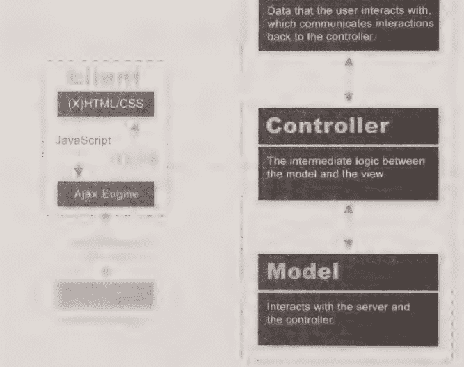

查看图15.1后，很明显这个模式存在于所有应用程序中。即使应用程序中只有一个代码文件，底层的数据流也始终存在。例如，所有应用程序都必须根据用户交互做出决策，并通过存储或检索数据（无论是连接到数据库还是仅仅发出HTTP请求）与服务器交互，并用新数据响应用户。控制器将是决策部分，模型将是服务器交互部分，视图将是用户的响应部分。理论上，XHR就是一个纯粹的MVC模式，因为它接收用户输入，通过HTTP请求与服务器交互，并通过responseType和responseXML属性响应用户。区别在于结构和设计，这些无疑是有争议的，并且可以有多种解释。可重用对象是任何应用程序的终极目标，而解耦对象正是这个模式的强大之处。因此，这个模式在理论上可能存在于所有代码中，但只有当我们将它与面向对象和结构化设计相结合时，它的真正威力才会释放出来。

## 创建模式

通常当你读到关于MVC模式时，它与JavaScript无关。然而，我相信你已经注意到，我们已经开始用我们构建的组件来实现这个模式。每个组件至少由一个控制器和一个视图对象组成，而模型则由与服务器交互的对象组成，例如我们在第二部分“创建和使用JavaScript引擎”中创建的Ajax、AjaxUpdater和HTTP对象。创建这个模式就像从我们应用程序代码文件夹中的文件夹结构开始一样简单。由于这个模式与我们正在创建的JavaScript代码相关，我们将在javascript目录中创建这个结构，如图15.2所示。

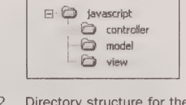

这显然是微不足道的，可能看起来是在浪费时间，但它是我们在创建希望符合此模式的对象时将使用的结构基础。让我们以第10章“Accordion”中的Accordion组件为例。这个组件由两个对象组成：Accordion和Panel。图15.3显示了带有Accordion组件和相关模型对象的先前MVC结构。

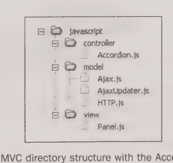

Accordion对象是此组件的控制器，因为它与另一个控制器（AjaxUpdater）交互，最终与模型（Ajax）交互，并用服务器的信息响应面板。Panel对象代表视图，并向用户展示Accordion所包含的不同面板。当用户与一个面板交互时，该面板与AjaxUpdater交互。然后此控制器


## 使用此模式

如前所述，有多种方式可以使用该模式。该模式可以与其他完全不同的模式组合，也可以与同一模式下其他 MVC 三元体结合。例如，我们可以在 PHP 代码中实现一个 MVC，而在 JavaScript 代码中实现另一个 MVC。此外，还有多种不同的方式来解释 MVC 模式——因为没有一种方式是绝对且唯一的，最适合某情境的解决方案总是最有效的那一种。如前所述，该模式既可以用于将您的 JavaScript 和 PHP 代码分别组织成独立的 MVC 模式，也可以用于将所有代码统一组织为一个联合 MVC 模式。在上一节中，我们介绍了如何将 **手风琴（Accordion）** 组件中的 JavaScript 对象结合成一个 MVC 模式——无论我们在构建手风琴时是否意识到这一点。图 15.5 展示了将 PHP 和 JavaScript 整合到一个联合 MVC 模式后的图形表示。

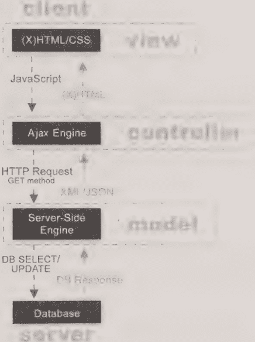

**图 15.5** PHP 和 JavaScript 整合为一个联合 MVC 模式的图形表示。

总之，该模式是一种极好的方式，可将我们的代码抽象为分层结构，使所有对象在与其它对象交互时遵循统一的模式。通过遵循此模式，我们可以避免混合连接问题，从而最终降低追踪哪些对象与其他对象相连的难度的。发现问题的难度通常大于修复问题本身，因此当使用通用模式时，维护任务将更易于管理，因为应用程序具有合乎逻辑的流程。这使我们能更快地专注于可能导致问题的特定区域，而这正是该模式的威力所在——它不仅处理编程任务，更是一种以更高效方式结构化和管理大量数据的手段。

## 观察者模式

正如您在本书的这一部分所学到的那样，设计模式在开发大型应用时极为有用。设计模式提供了代码灵活性，并有助于建立一种应对应用程序逻辑中常见情况的方法。**观察者（Observer）** 模式对示例应用的添加至关重要，因为它仅通过少量对象方法就能实现处理无限数量物体作为集合的方式。让我们进一步了解该模式如何通过如此少的资源完成这么多工作。

### 模式概述

**观察者（Observer）** 是一种用于观察应用程序中对象状态的设计模式。被观测的对象允许其他对象注册或注销以成为其观察对象。当触发它们正在观察的特定事件时，这些观察对象会收到通知。被观测对象具有三个截然不同的方法，下文将进行详细说明。

### 注册观察者概述

本质上，**观察者（Observer）** 模式允许无限的物体通过自我注册来观测或被通知来自被测对象（或主题 / Subject）的事件。在将观察对象注册到某个事件后，当事件触发时，该主题会向它们发出通知。主体通过存储一个观察对象集合并在事件发生时遍历它来实现此功能，以便通知每一个观察者。

### 通知观察者概述

当被测对象中触发某个事件时，将通过它们在注册时为观察者提供的方法来通知这些观察者。每个观察者都指定其自己的 `notify`（通知）方法，并定义在发生通知时的行为方式。例如，您可能有一个对象已注册到错误处理对象上，并且指定了一个用于向用户显示错误的“通知”方法；另一方面，您也可能拥有一个完全不同的对象，它同样指明的一个“通知”，会在 Web 应用程序中每次出现错误时发送邮件给开发人员。**观察者模式**的妙处在于：这两个不同的对象都可以由同一个被测对象统一注册并接收通知。

### 注销观察者概述

如果某个观测对象不再希望接受其所注册的主题发出的通知了，它可以自行取消注册（ unregister）。在很多场景中都存在这种方法非常实用的情况，其中之一就是您不希望一个被观测的对象收到多于一次的通知。一旦某个对象已被通知过之后，它就可以进行自我注销，而主题将从观察对象集合中将其移除。例如，设想希望等待某方法在另一个方法执行后才触发其本身的情况——如果可以遵循**观察者模式**的话，您可以注册到该方法的触发事件上并在此等待收到通知后再向前推进。请查看图 16.1以了解示例。

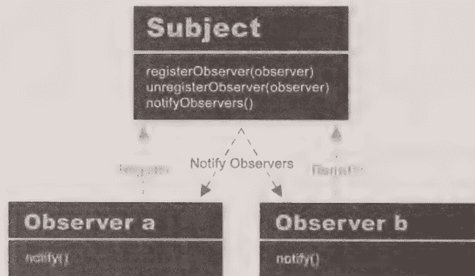

如您所见，**观察者模式**可以用单一事件影响众多对象。在本章中，我们将创建一个名为 **ErrorManager（错误管理器）** 的错误处理对象；当发生错误时，该对象将遵循**观察者模式**并通知所有已注册的对象。

### 创建错误处理对象

在处理大量 JavaScript的大型 Web 应用的构建与发布过程中，一个用于错误处理的对象是必不可少的组件。在开发阶段，错误处理对于识别代码中的 bug 非常有用，使得您能够轻松追踪这些错误并最终逐步完成应用程序的构建工作；而在应用发布后进行部署时，错误处理显得更加重要——因为用户需要知道如何应对可能出现的问题，而如果没有来自应用程序本身的反馈机制告诉他们究竟何处出错的话就无法做到这一点。同时，在后续维护阶段也极为关键：当用户使用户联系您反映某个问题时，或者您的开发团队成员需要调试时，这些对象能够协助快速定位导致问题的原因所在；对于错误处理而言，让我们创建一个名为 `ErrorManager` 的对象（如代码清单 16.1所示）。

```
Listing 16.1 实例化 ErrorManager (ErrorManager.js)
ErrorManager = {};
```

该对象的核心理念是 JavaScript固有的`onerror`事件：该方法会监听错误并触发一个可指向您指定的任意自定义 `callback（回调）`方法的事件。此外，该 `onerror` 事件还具备向回调方法传递三个参数的功能——从而提供关于任何出现错误的详细信息；这三个参数分别是实际的错误消息（用于标识发生了何种类型的错误）、发生错误的文档 URL、以及出错位置在对应文档中的行号等指标数据。这些参数具有多种用途：它们既可以用来就出现的各种错误给予用户反馈，以便使用户了解当前发生了什么状态变化或异常情况等内容；也可以用于向开发者提供有关已部署或在测试期间出现于人机交互过程中的任何问题的及时反馈信息等等内容——我们可以将该事件设置为 `ErrorManager`对象中的本地回调处理程序来实现上述目标。然而在此之前我们需要先创建一系列观察方法才行哦！

### 注册观察者（Register Observers）

我们将使用这个名为 `onerror`的事件来报告给主题即前述的 **ErrorMananeger** 类中存在的任何错误情况发生之后，它将通知所有在其内部保存并存储于其集合结构体系之中的被观测者实体。我们接下来将创建三种方法——这些内容在上一部分里已经讨论过了：所有这些用于承担全部观察功能的方法分别叫做`registerObserver（注册观察者） `、**notifyObservers（通知观察者）**以及unregisterobserver ** （取消注销观察者）。这些方法是必须在该对象声明之后立即书写并添加进类中的三个基本构建模块单元之一。代码清单 16.2展示的是 registerObserver方法的实现示例代码片段如下所示：

```
Listing 16.2   Registering Observers (ErrorManager.js)
ErrorManager.registerObserver = function(_observer)
{
    ErrorManager.observerCollection.push(_observer); 
}  
```

正如名称所暗示的那样，registerObserver 方法的功能就是精确地将一个被观测者添加到该对象的 observerCollection属性中而已；此处提到的 observerCollection本质上是一个专门用于存储观察者的数组结构类型数据结构。那些加进此集合中的每个观察者都需要在指定自身名称的同时指出其所希望作为通知机制所使用的具体方法名即可啦！


## 通知观察者

下一个方法名为 `notifyObservers`（参见清单16.3），它遍历 observerCollection 并触发观察者指定的回调方法。

**清单 16.3 通知观察者（ErrorManager.js）**

```javascript
ErrorManager.notifyObservers = function(message, url, line)
{
    for(var i in ErrorManager.observerCollection)
    {
        eval(ErrorManager.observerCollection[i] + "('"+message +"', '"+ url +"','"+ line+"');");
    }
}
```

该集合将在一个 `initialize` 方法中声明。我们将在向对象添加完所有观察者方法后立即创建此方法，以保持对象成员的作用域完整。

在遍历 observerCollection 时，`notifyObservers` 方法通过使用 JavaScript 内置的 `eval` 方法来调用观察者，该方法从传递给 `registerObserver` 方法的代码字符串创建一个方法。`eval` 方法会检查代码字符串是否有效，如果有效则执行代码。我还添加了一项额外功能：将错误参数从 `onerror` 方法传递到 `notify` 方法。这使得观察者能够感知发生的错误，并根据其判断采取相应行动。例如，一个对象可以向 ErrorManager 注册，并在错误发生时接收通知。基于我们传递给回调方法的参数，发生错误的代码行可用于在图形用户界面中高亮显示相应问题。这使得我们的对象能够向用户反馈哪里出了问题。这种模式最棒的一点在于，可以有无限数量的对象向主题注册，并且它们都能以不同的方式处理错误，具体取决于它们负责应用程序的哪个部分。这为您的应用程序提供了完全的灵活性，并使对象保持极低的耦合度，同时允许它们相互通信。

## 取消注册观察者

下一个方法是 unregisterObserver 方法，用于从集合中移除观察者，以便在事件发生时不再通知它们。

**清单 16.4 取消注册观察者（ErrorManager.js）**

```javascript
ErrorManager.unregisterObserver = function(_observer)
{
    for(var observer in ErrorManager.observerCollection)
    {
        if(_observer == ErrorManager.observerCollection[observer])
        {
            ErrorManager.observerCollection.splice(observer, 1);
        }
    }
}
```

此方法与 registerObserver 方法一样，接收一个代码字符串。然后，在遍历集合时使用此字符串，检查集合中是否存在匹配的代码字符串。如果找到匹配项，则从集合中移除该代码字符串。为了从集合中移除该字符串，我们需要使用 JavaScript 的 splice 方法来移除集合中指定的索引项。

观察者从集合中移除后，将不再收到其曾注册的任何事件通知，尽管该对象可以随时重新注册。

一旦我们创建了这三个方法，就需要初始化对象及其所有属性。清单16.5展示了我们的 ErrorManager 的初始化方法。

**清单 16.5 初始化 ErrorManager（ErrorManager.js）**

```javascript
ErrorManager.initialize = function()
{
    ErrorManager.observerCollection = new Array();
    ErrorManager.registerObserver("ErrorManager.emailError");
    onerror = ErrorManager.notifyObservers;
}
ErrorManager.initialize();
```

如您所见，initialize 方法对该对象至关重要。必须在创建后立即调用它，以确保其属性的作用域正确。正如我之前提到的，它负责处理我们在所有观察者方法中使用的 observerCollection 的创建。observerCollection 不过是一个简单的数组，用于在观察者注册时收集它们。此方法中的下两行代码注册了 ErrorManager 的两个方法：一个名为 **emailError**，另一个名为 **alert**。当应用程序中发生任何 JavaScript 错误时，这两个方法都会收到通知。现在我们已经创建了观察者方法，并且对象的属性可用，我们可以将本地 **callback** 方法设置为 JavaScript 内置的 **onerror** 事件。该事件成为此对象的核心；没有它，对象将无法工作。每当发生 JavaScript 错误时，此事件会触发回调，在本例中即 **notifyObservers** 方法。看起来我们像是在定义一个变量，但由于这是 JavaScript 的内置事件，它知道如何处理赋值。然后，此方法负责通知所有观察者发生的错误及所有详细信息，包括消息、URL 和确切的代码行。

我们将创建的第一个通知方法是 **emailError** 方法（参见清单16.6），我们在 **initialize** 方法中已注册过。此方法包含向指定开发者发送电子邮件的功能，邮件中列出了错误的所有详细信息。

**清单 16.6 通过邮件发送错误（ErrorManager.js）**

```javascript
ErrorManager.emailError = function(message, url, line)
{
    var error = "<b>Error:</b> <font color=red>"+ message +"</font><br/>";
    error += "<b>URL:</b> " + url +"<br/>";
    error += "<b>Line:</b> " + line +"<br/>";

    var page = "classes/ErrorManager.class.php";
    var subject = "My Ajax Application Error";
    AjaxUpdater.Update('POST', page +"?subject="+ subject +"&message="+ error,
    this.catchResponse);
}

ErrorManager.catchResponse = function()
{
    if(Ajax.checkReadyState('loading') == "OK")
    {
        // 处理来自服务器端的响应
    }
}
```

看看 **emailError** 方法接受的参数。它们就是我们之前讨论过的三个参数。我们将使用这些参数创建一个HTML格式的电子邮件，最终发送给我们自己或应用程序的开发者。将错误格式化为HTML后，我们将确定将用作电子邮件参数的变量。第一个参数是我们通过Ajax请求的页面，这是一个我们将很快用PHP创建的 **ErrorManager** 类；第二个是电子邮件的主题。确定请求的变量后，我们将它们发送到第14章“单例模式”中创建的 **AjaxUpdater** 的 update 方法。此请求将通过 POST 方法发送到我们指定的页面，在本例中是一个我们将用PHP创建的 ErrorManager 类。请求会附带一个查询字符串，包含我们定义的变量，例如主题和HTML格式的错误信息。我们还将指定一个名为 catchResponse 的回调方法，用于处理来自服务器的响应。所有这些信息传递给 AjaxUpdater 后，它将通过 Ajax 对象向指定的PHP页面发出请求。

尽管我们尚未涵盖 Ajax 的服务器端交互，但在本节中我们将稍微超前一步，以添加发送邮件的功能。稍后，在第五部分“服务器端交互”中，我们将深入探讨服务器端交互。PHP ErrorManager 类是一个相当小的类，因此它将是我们进行第一次服务器端交互的好对象。

> 注意：本书中使用的 PHP 类需要 PHP 5.0 版本。

**清单 16.7 ErrorManager PHP 类（ErrorManager.class.php）**

```php
<?php

$errorManager = new ErrorManager();
$errorManager->send($_GET["subject"], $_GET["message"]);

class ErrorManager
{
    public function ErrorManager() {}

    public function send($_subject, $_message)
    {
        $headers = "From: noreply@sample.com\r\n" .
                   "Reply-To: noreply@sample.com\r\n" .
                   "MIME-Version: 1.0\r\n" .
                   "Content-Type: text/html; charset=utf-8\r\n" .
                   "Content-Transfer-Encoding: 8bit\r\n\r\n";
        mail("you@yourdomain.com", $_subject, $_message, $headers);
    }
}
```

正如我提到的，这个类相当小，因为它只包含一个方法。需要注意的是，我们在同一个文件中实例化了对象。这使我们能够直接向类发出请求，而无需创建一个中间文件来做


## 使用错误处理对象

错误处理对于成功的Web应用至关重要，但它常被忽视，开发者认为这是一项枯燥的任务。使用观察者模式处理Ajax错误，能创造极其直观的用户体验，且编程过程实际上相当有趣。正如你在第9章“扩展引擎”中所学的，借助HTTP状态码，我们还能在错误发生时立即向用户提供反馈和选项，而不会中断体验流程，也不会让用户对下一步该做什么感到困惑。想象一下，有一个对象可以控制你应用中所有的警报。我创建了一个名为`Alert`的对象。该对象在实例化后立即向`ErrorManager`对象注册一个错误方法。这个方法接受`notifyObservers`方法传递给其集合中观察者的三个参数。然后，它会拼接一个错误字符串，显示在警报框中供用户查看（见清单16.8）。

### 清单 16.8 警报对象 (Alert.js)

```
Alert = {};

ErrorManager.registerObserver("Alert.error");

Alert.error = function(message, url, line)
{
    var error = "Error: "+ message +"\n";
    error += "URL: "+ url +"\n";
    error += "Line: "+ line;
    alert(error);
    //ErrorManager.unregisterObserver("Alert.error");
}
```

调用错误方法后，你可以通过取消方法中最后一行的注释来取消其作为观察者的注册。这只是在Web应用中使用观察者模式的一个简单示例。这种模式可以为你的应用带来力量的方式有数百万种。

## 第17章 数据反射模式

数据反射模式是一种保持Web应用内容与数据库及其请求文件同步的模式。该模式可用于多种场景。在我们的示例中，它将被用作一种方式，通过允许应用接收来自其他用户的新邮件来保持用户的电子邮件数据最新。这意味着，如果一个用户向另一个用户发送电子邮件，只要数据在应用后端被反射，接收用户就会收到这封新邮件。这种反射将基于我们在代码中设置的延迟或时间间隔。或者，该功能也可以扩展为用户偏好设置，允许用户选择检查邮件的延迟时间，就像当前桌面应用程序那样。限制取决于你的应用及其哪些部分可以从使用此模式中受益，因为它提供的是利基功能，并非总是必需的。

在本章中，我们将学习此模式在Web应用中有用的不同方式，以及可能从中受益的应用特定部分。

## 概览

数据反射模式保持Web应用内容与数据库同步。这是因为在用户登录并使用应用时，该模式在后端代码中运行并更新已更改的数据。与典型的XHR模型一样，数据反射模式从用户界面开始，用户与某个元素交互，应用发出请求。主要区别在于，该模式在编程上由JavaScript的`setTimeout`方法组成。该方法通过Ajax引擎持续发出XHR，调用服务器端语言检查数据库更新，或检查XML文件是否有更新。如果有更新，新数据会返回给Ajax的`callback`方法，应用内容随之更新（或反射）；否则，没有内容需要反射，因此我们不会完成请求。图17.1展示了该模式持续向服务器端语言发出XHR时的数据流。

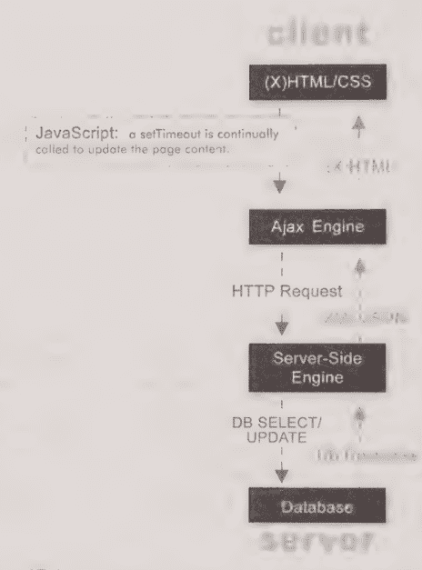

图17.1 数据反射模式的持续数据流。

此图展示了该模式向服务器端脚本最终是数据库发出请求时的数据流，但请记住，该模式也可能通过请求XML文件来循环返回。图17.1显示了应用前端的客户端，其中`setTimeout`方法持续通过Ajax引擎发出请求。当Ajax引擎接收到请求时，它会将`POST`或`GET`作为HTTP请求发送给服务器端语言或引擎。服务器端引擎检查数据库的更新，并根据结果执行两种操作之一。结果可能显示没有更改，这会导致服务器端脚本向Ajax引擎响应无更新，或者脚本可能响应数据库中存在的更新。如果数据库中有更新，引擎可以用XML或JSON响应，Ajax引擎会将其委托给`callback`方法。`callback`方法将解析此数据，并将更改反映到用户界面或图形用户界面（GUI）中，表现为(X)HTML和/或CSS。这看起来可能步骤很多，但一旦我们运行Ajax引擎和服务器端引擎，就无需再进一步修改它们。这意味着，在应用设置好之后，我们应该无需再碰代码，用户就能持续使用最新数据运行应用。现在我们已经了解了数据反射模式，让我们更进一步，为该模式添加更多层次。在下一节中，我们将扩展此模式以满足多个用户的需求，并允许他们同时与我们的应用交互，获取实时更新的内容。

## 多用户模式

数据反射模式可以扩展以容纳更多功能。一个完美的例子就是多用户模式。它基于数据反射模式，但在多个用户之间分配功能，为他们提供来自其他用户请求的更新信息。查看图17.2，了解在此模式下数据如何从一个用户流向下一个用户。

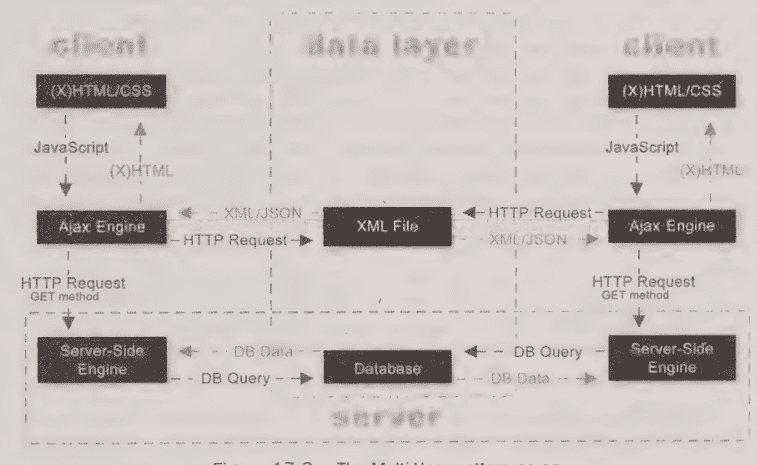

该模式的一个例子是聊天应用程序。想象一下，来自远程位置的多个用户在聊天窗口中输入数据并点击发送。每次用户点击发送按钮时，都会发出一个XHR来更新当前保存聊天内容的数据库或文件。当用户来回聊天时，此模式持续在后台轮询服务器，查看服务器上是否有用户尚未获取的内容更新。如果用户是最新的，则不会发生任何事情；但如果她不是，她将从服务器接收最新内容。这只是我们可以使用此模式的数百万个例子之一，但就功能运作和应用后端数据流而言，相同的概念适用。思考任何可能涉及多个用户的情境，此模式都可以反复应用，而无需更改我们将在下一节编写的基础代码。让我们看看这段代码以及它将如何应用于我们应用中的功能。


## 第17章 数据反射模式

### 创建该模式

既然我们已经理解了这一模式的强大之处，接下来我们将学习如何在应用程序中使用它。到目前为止，我们已经创建了构建电子邮件应用程序所需的所有组件，但还缺少一个将它们以某种方式联系起来的对象。在本节中，我们将创建一个名为 `Email` 的对象，它将执行为每个组件收集数据所需的全部职责。但我们不会关注每个方法的细节以及不同组件的数据填充，而是将重点放在如何向该对象添加数据反射模式。因此，我们会创建所有方法，但直到第21章"与数据库交互：服务器端"中将其连接到PHP数据库时才会添加代码。那么，让我们从定义填充不同组件并使应用程序运行所需的方法开始。

我们将从识别您通常与电子邮件应用程序相关联的操作开始。首先想到的操作是发送大家也请自行补充：
发送、接收和撰写电子邮件。接下来，我们将关注如何展示电子邮件线程。我选择使用在第10章"折叠面板"中构建的折叠面板组件，将特定线程中的所有邮件作为一个组来显示。组中的第一封邮件，即发起该线程的邮件，将显示在收件箱中。之后收到的回复将仅在折叠面板中作为线程的一部分显示，但我们将在第21章中对此进行更多讨论。由于我们以线程形式显示电子邮件，我们将添加一个以线程组形式显示它们的方法。最后，我们将创建一个 `initialize` 方法来设置局部变量，同时创建一个 `display` 方法作为对象的访问点，当应用程序主体加载时触发正确的方法。因此，我们需要创建以下六个方法：

- Email.initialize
- Email.display
- Email.showThread
- Email.getMail
- Email.sendMail
- Email.compose

每个方法都以 `Email` 对象为前缀，因为这是包含它们的对象的名称。既然我们已经有了这些方法，就可以继续本节的重点，即向 `Email` 对象添加数据反射模式。我们要做的第一件事是添加一个创建数据反射模式的方法。我们将适当地将该方法命名为 `dataReflection`，它将接收两个参数：一个 `callback` 方法和一个时间延迟。`callback` 方法代表我们希望在每次数据反射时被调用的方法。在我们的案例中，我们将回调 `display` 方法，因为它是我们的访问点，并将自然地为该模式创建一个一致的循环，持续反射数据库数据。时间延迟代表

## 第18章 交互模式

以毫秒为单位的、我们希望调用该方法的时间量。例如，如果我们希望每分钟反射一次数据，我们将使用60,000毫秒。在 `dataReflection` 方法内部是JavaScript的 `setTimeout` 方法，它将接收这两个参数并在时间延迟达到时触发。以下是 `dataReflection` 方法，我们将把它添加到 `Email` 对象中：

```javascript
Email.dataReflection = function(callbackMethod,delay)
{
    setTimeout(callbackMethod, delay);
}
```

由于 `display` 方法是我们对象的访问点，我们将在该方法中植入第一个数据反射模式，并创建一个持续对 `display` 方法进行回调的循环。在第21章中添加服务器端代码时，我们的对象的 `display` 方法将接收一个用户名，因为我们需要一个值在数据库中进行核对，以便向当前用户提供适当的电子邮件数据。这意味着回调方法也需要拥有这个值。以下是我们将添加到 `display` 方法中的代码，在回调方法中使用用户名参数作为值。

```javascript
Email.display = function(username)
{
    Email.dataReflection("Email.display ('" + username + "')", 60000);
}
```

如您所见，调用这个方法非常简单，因为它实际上只是 `setTimeout` 方法的一个包装器。尽管它很简单，但当与数据库一起使用时，这个模式实际上非常强大。

### 交互模式

随着Ajax的蓬勃发展，许多交互模式正在涌现。Web应用程序现在可以拥有复杂得多的前端功能，例如无需浏览器刷新即可与数据库交互。不刷新页面不仅仅是为了炫技而做的代码技巧——它允许开发者创建极其复杂的前端功能，与数据库交互，并且感觉像任何其他应用程序一样，无论它是桌面应用还是Web应用。在本章中，我们将介绍两个对您大有用处的交互模式。我们将讨论的模式是创建伪历史和拖放界面。这两个对象都将完全灵活，允许扩展性，我相信这会为您提供一些额外的想法。让我们开始创建历史，然后我们将深入探讨拖放界面。

### 使用Cookie创建历史

历史是Ajax的一个已知问题，因为当页面没有刷新时，它不会被添加到浏览器历史中。在本节中，我们将创建解决方案来解决应用程序历史方面的问题，也可以用于提供应用程序中的额外功能，例如撤销。虽然这个对象不会完全解决后退按钮问题（这是由于用户从未离开同一页面而导致的从未真正经历的历史），但它将允许用户点击后退按钮并返回到他们离开的地方，如果他们允许将Cookie保存到本地机器的话。

#### Historian对象

`Historian` 对象将是与我们在这本书中创建的其他不同类型的对象。它将使用我们在第5章"面向对象的JavaScript"中介绍的对象构造函数方法。我们之所以使用这个方法，是因为我想在灵活性方面有所考虑，能够在应用程序的一个会话中使用多个 `Historian` 实例。如果我们想要为应用程序中的特定功能保存单独的历史记录，这将非常有用。`Historian` 对象将把数据保存为Cookie，以便

> **186**
> 第18章
> 交互模式

用户离开页面后能够返回到他们离开的地方。我们要做的第一件事是为该对象创建构造函数，并且由于它保存Cookie，我们将传递Cookie应该保存到的URL。以下代码片段展示了我们如何实现这一点。

```javascript
Historian(url){}
```

在我们完成构造函数并能够传递唯一的URL之后，我们将创建一个名为 `collection` 的局部数组和一个名为 `push` 的方法。`push` 方法将使我们能够向数组添加数据，并最终将数组保存为指定构造函数参数的URL处的Cookie。它检查集合是否包含我们通过一个名为 `containsValue` 的自定义方法推送的值。

如果该值尚不存在，我们推送新值并保存集合数组。以下代码展示了我们如何将新值推入集合、调用另一个方法保存数据到Cookie，以及检查集合以确保该值尚不存在。

```javascript
this.collection = new Array();

this.push = function(_index){
    if(!this.containsValue(this.collection, _index)){
        this.collection.push(_index);
        this.save(this.collection, 1, "/", url, false);
    }
}

this.containsValue = function(_arr, _val){
    for(var i = 0; i < _arr.length; i++){
        if(_arr[i] == _val) return true; break;
    }
}
```

我们正在调用的来自`push`方法的`save`方法用于创建和存储 Cookie。它接收五个参数，所有这些对于创建 Cookie 都是必需的：

- 我们要保存的值，在本例中是我们的**collection**数组  
- 保存的天数  
- 在服务器上保存cookie的路径  
- 通过构造函数传递的域名  
- 一个布尔值，表示 cookie 是否安全保存  

该方法触发后，它简单地创建一个`date`对象，以便根据传递给该方法的天数设置到期日期。配置好`date`方法后，我们创建包含所有我们收到的数据的 Cookie：

```
this.save = function(value, days, path, domain, secure)
{
    var expdate = new Date();
    expdate.setTime(expdate.getTime() + days *24*60*60*1000);

    document.cookie= "history=" + escape(value) +
        ((expdate) ? "; expires=" + expdate.toGMTString() : "") +
        ((path) ? "; path=" + path : "") +
        ((domain) ? "; domain=" + domain : "") +
        ((secure) ? "; secure" : "");
}
```

现在我们已经有了作为 Cookie 保存数据的方法，我们需要创建一个方法用于检索它。我们将创建一个名为**getSaved**的方法，该方法将检索 Cookie，如果存在 Cookie，则用保存的数据重新填充集合。由于 Cookie 是作为字符串保存的，我们需要以多种方式解析保存的数据，以便检索我们需要的值。我们要做的第一件事是先获取 Cookie，设置一个变量作为我们保存数据的前缀，并在 Cookie 中查找该前缀的索引。如果不存在前缀，该方法将简单地返回 null 值。否则，我们将拥有一个可以查找值的索引，并将其设置为名为**begin**的变量。最后，我们在执行从开始数字加上前缀长度到 Cookie 字符串末尾的子字符串操作后，返回未转义的 Cookie 值。

```
this.getSaved = function()
{
    var dc = document.cookie;
    var prefix = "history=";
    var begin = dc.indexOf(prefix);
    if (begin != 0)
    {
        return null;
    }
    return unescape(dc.substring(begin + prefix.length, dc.length));
}
```

现在我们要创建了此方法，我们可以将集合设置为此方法的返回值。我们将通过在`getSaved`方法之后直接向对象添加 try-catch 来实现这一点。我们将使用 try-catch 来确定在执行之前代码是否能正常运行。我们将尝试在按逗号分割成数组值后，将集合设置为`getSaved` 的数据。如果出错，我们将简单地捕获错误并将集合设置为一个新数组。

```
try
{
    this.collection = this.getSaved().split(",");
}
catch(err)
{
    this.collection = new Array();
}
```

为了通过 Historian 清理并清除 Cookie，我们将创建一个名为`clear`的方法。该方法接收两个参数：Cookie 的路径和域名。它首先检查 Cookie 中是否保存了任何数据，方法是调用`getSaved`方法。如果该方法返回的值不是 null，我们只需将之前所有数据的新 Cookie 设置为过去的日期，这会使 Cookie 过期，从而从内存中清除它。

```
this.clear = function(path, domain)
{
    if(this.getSaved())
    {
        document.cookie = "history=" +
            ((path) ? "; path=" + path : "") +
            ((domain) ? "; domain=" + domain : "") +
            "; expires=Thu, 01-Jan-70 00:00:01 GMT";
    }
}
```

现在对象已经创建，我们可以使用它，但首先我们需要创建一些示例数据以便在 HTML 中加载和操作。

## 创建和显示 XML

在本节中，我们将首先创建一个 XML 结构来对我们的 Historian 进行采样，然后创建一个 HTML 文件来显示所有内容。我们的 XML 文件将包含若干对图片的引用，这些图片代表屏幕，并被分组到导航节点中。这些屏幕将变成用户将在示例中导航的内容。以下是示例 XML 数据：

```
<?xml version="1.0" encoding="iso-8859-1"?>
<navigation>
    <screen><![CDATA[]]></screen>
    <screen><![CDATA[]]></screen>
    <screen><![CDATA[]]></screen>
    <screen><![CDATA[]]></screen>
    <screen><![CDATA[]]></screen>
    <screen><![CDATA[]]></screen>
    <screen><![CDATA[]]></screen>
    <screen><![CDATA[]]></screen>

    <screen><![CDATA[]]></screen>
    <screen><![CDATA[]]></screen>
</navigation>
```

为了在屏幕之间导航并清除历史记录，我们需要创建一个具有下一个（Next）、上一个（Previous）和清除历史记录（Clear History）按钮的 HTML 页面。该页面还必须导入我们的 CSS 和 JavaScript 文件，以便渲染屏幕并发起 Ajax 请求。以下是 Historian HTML 页面的 HTML 代码：

```
<html xmlns="http://www.w3.org/1999/xhtml">
<head>
<meta http-equiv="Content-Type" content="text/html; charset=iso-8859-1">
<title>Ajax Historian</title>
<link href="css/historian.css" rel="stylesheet" type="text/css" />
<script type="text/javascript" src="javascript/utils/Historian.js"></script>
<script type="text/javascript" src="javascript/controller/Navigation.js"></script>
<script type="text/javascript" src="javascript/model/AjaxUpdater.js"></script>
<script type="text/javascript" src="javascript/model/Ajax.js"></script>
<script type="text/javascript" src="javascript/model/HTTP.js"></script>
</head>

<body onload="javascript:AjaxUpdater.Update('GET', 'services/navigation.xml', Navigation.loadScreen);">
<div id="navigation"></div>
<br/><br/>
<a href="javascript:Navigation.previous();">上一个</a> | 
<a href="javascript:Navigation.next();">下一个</a> | 
<a href="javascript:Navigation.history.clear('//','www.yourdomain.com'); document.location = document.location;">清除历史记录</a>

</body>
</html>
```

正如我们所看到的我们的 HTML 页面的源代码中，我们引用了一个名为**Navigation**的对象。此对象将允许我们在屏幕之间导航，包括反向导航，以及清除历史记录。现在我们已经有了所有其他代码到位，让我们创建**Navigation**对象来整合一切。

### Navigation 对象

我们将用于使用**Historian**的示例让我想起我在 e-learning 工作的日子。我们构建的所有课程都有多种交互式屏幕，可以点击从一个导航到下一个——有点像一个幻灯片演示，但具有大量的额外功能。这些课程还将记住您在哪里停下脚步或标记您在课程中的最后位置，这样您就可以离开后再回来时会带您回到书签位置。我们将在示例中创建此书签功能；因此，我们将创建一个**Navigation**对象来带我们从一页到另一页。**Navigation**对象是一个单例对象，它递增和递减/XML中的导航集中的屏幕显示。为了在通过我们的**Navigation**对象保存历史记录，我们必须在初始化时实例化**Historian**对象。以下是**Navigation**的实例化和初始化方法。

```
Navigation = {};

Navigation.initialize = function()
{
    Navigation.history = new Historian("www.yourdomain.com");
    Navigation.index = (Navigation.history.collection.length == 0)
        ? 0 : Navigation.history.collection.length-1;
    Navigation.screenArray = new Array();
}
Navigation.initialize ();
```

在`initialize`方法中，我们实例化**Historian**对象并Pass（传递）我们要保存 Cookie 的本地域名。我添加了一个示例域名；这将需要根据您将在示例中部署的服务器上的本地域名进行修改。在实例化我们的**Historian**对象后，我们将获取导航数组的索引，以便显示被标记的屏幕，如果有的话

 存在。否则，我们将通过设置值来显示集合中的第一个元素。最后，我们将创建一个名为 screenArray 的数组。该数组将被设置为我们在 loadScreen 方法中从 XHR 响应中接收到的屏幕集合。loadScreen 方法将在此对象的方法中用于加载每个屏幕。此方法用作 HTML 页面中 AjaxUpdater 在 body 的 onload 事件中的回调方法。当它被触发且响应为 "OK" 时，我们只需从响应中检索屏幕并将其添加到我们的 screenArray 中。当我们拥有一个屏幕数组后，我们显示在 Navigation 对象中当前设置的 screenArray 中的索引。默认情况下，此索引为 0，但如果 Historian 具有保存的历史 cookie，则将其设置为当前用户访问的最后一个屏幕索引。最后，我们将索引推入 Historian，如果它不存在于集合中，将被存储在集合数组中并保存到 cookie。

```
Navigation.loadScreen = function()
{
  if(Ajax.checkReadyState('navigation') == "OK")
  {
    Navigation.screenArray =
    → Ajax.getResponse().getElementsByTagName('screen');
    document.getElementById('navigation').innerHTML = Navigation.screenArray[
    → Navigation.index ].firstChild.data;
    Navigation.history.push(Navigation.index);
  }
}
```

为了实现从一个屏幕导航到下一个，我们将创建一个名为 next 的方法。该方法将首先确保我们不处于最后一个屏幕上。如果不是，它将增加索引并触发 loadScreen 方法。如果我们在 screenArray 的最后一个索引上，我们将不执行任何操作，因为我们将从数组中结束为 null 值，这将会破坏导航。

```
Navigation.next = function()
{
  if(Navigation.index < (Navigation.screenArray.length-1))
  {
    Navigation.index++;
    Navigation.loadScreen();
  }
}
```

为了进行反向导航，我们只需检查以确保我们不当前位于 0 索引上。如果不是，我们将减少索引并触发 loadScreen 方法。当 loadScreen 方法被触发时，它具有来自上一个屏幕的索引并将其在页面中渲染出来。

```
Navigation.previous = function()
{
    if(Navigation.index > 0)
    {
        Navigation.index--;
        Navigation.loadScreen();
    }
}
```

该对象功能强大且可以解决许多与使用 Ajax 时不刷新浏览器相关的问题。希望您在本书中尝试这些对象并创建一些极其强大的自定义功能。本章的下一节将涵盖在您的应用程序元素中添加拖放功能，所以我们开始吧。

## 拖放

拖放功能正变得越来越流行，并且在合适的情况下它可能非常有用。随着 Web 上所有新的个人数据存储应用程序的出现，当用户希望排序包含数据的元素时，此功能变得非常有用。例如，如果您使用应用程序创建待办事项列表，您可能会仅创建该列表却发现自己想先完成某些事情。这可能让人头疼，或者如果有一种方式可以按您想要的顺序拖动和拖放项目并将其变成可排序列表，则很容易解决。在本节中，我们将创建一个数据可排序列表。我们将从创建使这一切发生的对象开始。

### DragDrop 对象

DragDrop 对象是一个单例对象，允许 HTML 元素具有拖放功能。此功能允许列表与其他具有相同类名和父元素的元素一起变为可排序。这意味着如果我们有一组元素且我们希望它们全部可以进行拖放和排序，我们只需调用该对象的 initialize 方法并传递一个共享的类名，所有元素都需要有此共同类名。以下是我们将为此示例使用的 HTML：

```
<html xmlns="http://www.w3.org/1999/xhtml">
<head>
<title>Drag and Drop</title>
<link href="css/dragdrop.css" rel="stylesheet" type="text/css" />
<script type="text/javascript" src="javascript/Utilities.js"></script>
<script type="text/javascript" src="javascript/utils/DragDrop.js"></script>
</head>

<body onload="DragDrop.initialize('dItem');">

<div id="container">
    <div id="1" class="dItem">1</div>
    <div id="2" class="dItem">2</div>
    <div id="3" class="dItem">3</div>
    <div id="4" class="dItem">4</div>
    <div id="5" class="dItem">5</div>
    <div id="6" class="dItem">6</div>
    <div id="7" class="dItem">7</div>
    <div id="8" class="dItem">8</div>
    <div id="9" class="dItem">9</div>
    <div id="10" class="dItem">10</div>
</div>

</body>
</html>
```

为了在视觉上分离我们的 div 元素，并为拖拽状态的元素添加虚线轮廓，为可拖动元素添加移动光标，我们将编写以下 CSS 并将其保存到一个名为 dragdrop.css 的文件中：

```
#container
{
    float: left;
}

#drag_dummy
{
    border: #333 1px dotted;
}

.dItem
{
    width: 400px;
    height: 20px;
    background-color: #ccc;
    border: #333 1px solid;
    margin: 2px;
    cursor: move;
}
```

为了创建 DragDrop 对象，我们将首先实例化并初始化它：

```
DragDrop = {};
```

```
DragDrop.initialize = function(className)
{
    DragDrop.className = className;
    DragDrop.currentItem = '';
    document.onmousedown = DragDrop.onmousedown;
    document.onmouseup = DragDrop.onmouseup;
}
```

此方法接受拖放元素的共享类名并将其设置为对象变量以供稍后引用。然后创建名为 currentItem 的新属性并将其设置为空字符串，以便我们稍后将它设置为当前正在被拖动元素，从而在拖放事件期间引用它。最后，我们将两个事件设置为拖放事件。这些包括 onmousedown 和 onmouseup 事件，它们分别设置为 DragDrop 对象中的 onmousedown 和 onmouseup 方法。这两个方法会在每次发生 mousedown 或 mouseup 事件时触发，但我们会检查以确保该事件源自拖拽元素，以便控制调用次数。我们将通过获取接收到的事件对象来验证是否正在点击拖放项——该事件对象默认通过事件被传递给我们的方法——并检查是否存在一个事件对象。在验证存在之后，我们检查目标（即事件的源），查看其类名是否等于我们在 initialize 方法中设置的类名。如果是，我们就知道有一个拖放项已被触发，我们将继续执行 startDrag 或 stopDrag 操作。以下是处理触发事件、检查元素并调用开始和停止拖拽方法的代码：

```
DragDrop.onmousedown = function(evt)
{
    var evt = DragDrop.getEvent(evt);
    if(evt != null)
    {
        var t = DragDrop.getTarget(evt);
        if(t.className == DragDrop.className)
        {
            if (!t.isDragging)
            {
                DragDrop.startDrag(t, evt.clientX, evt.clientY);
```

```
DragDrop.onmouseup = function(evt)
{
    var evt = DragDrop.getEvent(evt);
    if(evt != null)
    {
        var t = DragDrop.getTarget(evt);
        if(t.className == DragDrop.className +' dragging')
        {
            DragDrop.stopDrag(t);
        }
    }
}
```

```
DragDrop.getEvent = function(evt)
{
    if(!evt)
    {
        var evt = window.event;
    }
    return evt;
}
```

```
DragDrop.getTarget = function(evt)
{
    return t = (evt.target) ? evt.target : evt.srcElement;
}
```

您可能想知道我们是如何触发 mousedown 事件的。这将发生在 startDrag 方法的末尾，我们将在此处为文档的 mousemove 事件添加监听器，而不是默认设置它。默认设置意味着每次鼠标移动和移动过程中都会触发该事件，这会导致大量的方法调用。

startDrag 方法接受三个参数。这些参数是 HTML 元素本身，以及由 mousedown 事件对象收集的鼠标的 x 和 y 位置。在这类方法中我们做的第一件事是为稍后使用设置一些变量。这些属性被称为 orgParent、currentItem 和 isDragging。当 startDrag 事件触发时，orgParent 被设置为拖拽元素的 parentNode，因为我们在 dragTo 方法中需要它，且拖放项将不具

当时它们拥有相同的父元素。另外两个属性是 `currentItem` 和 `isDragging`，这两个属性的名字相当不言自明。

下一段代码收集当前元素的坐标和尺寸，并设置两个名为 `dragOffsetX` 和 `dragOffsetY` 的属性，这两个属性将在 `dragTo` 方法中用于在元素移动时，使其坐标相对于鼠标坐标保持正确。下一组代码更有趣一些，为拖拽功能创造了一个很好的效果。我们将动态创建一个新元素，并赋予其 id 值为 `drag_dummy`。这个元素将获取当前 `drag` 元素的坐标，并最终取代它。不过，在替换之前，我们需要将当前元素转换为绝对定位，将其坐标设置为绝对值，并且作为额外效果，还将 alpha 值设置为 25%，这样当元素被拖拽时，我们就能透过它看到下方的其他元素。添加这个效果会使页面看起来具有深度感，使拖放操作更加逼真。现在是替换代码，它将 `drag_dummy` 放置在当前拖拽项目的位置。我们要做的最后一件事是为 `mousemove` 事件添加监听器，并将其设置为一个名为 `dragTo` 的方法，正如之前提到的。以下是 `startDrag` 方法的代码。乍一看可能觉得很多，但大部分都是为 `drag_dummy` 元素收集坐标的代码。

```
DragDrop.startDrag = function(_this, mouseX, mouseY)
{
    this.orgParent = _this.parentNode;
    DragDrop.currentItem = _this;
    this.isDragging = true;

    // Get coordinates
    var pos = Utilities.getXY(_this);
    var x = pos.x;
    var y = pos.y;
    var w = _this.offsetWidth;
    var h = _this.offsetHeight;
    this.dragOffsetX = mouseX - x;
    this.dragOffsetY = mouseY - y;

    // Create dummy
    var dummy = Utilities.createElement("div", {id:'drag_dummy'});
    dummy.style.height = (h) + 'px';
    dummy.style.width = (w) + 'px';
    Utilities.appendChild(document.body, dummy);

    // Convert to drag class
    this.className = DragDrop.className+' dragging';
    this.style.position = 'absolute';
    this.style.left = x + 'px';
    this.style.top = y + 'px';
    this.style.width = w + 'px';
    this.style.height = h + 'px';
    Utilities.changeOpac(25, _this.id);

    // Replace with dummy
    this.parentNode.replaceChild(dummy, _this);
    document.body.appendChild(_this);

    Utilities.addListener(document, "mousemove", DragDrop.dragTo);
}
```

`dragTo` 方法由 `mousemove` 事件触发，因此它默认接受一个事件对象作为参数。此方法的第一段代码收集当前的 `drag` 元素并获取鼠标的 x 和 y 位置。一旦我们收集了这些信息，就可以在后续使用。使用这些属性的第一段代码将是：我们将当前元素的 left 和 top 样式属性设置为当前鼠标位置。然后，我们会减去在 `startDrag` 方法中设置的 `dragOffset` 值，以便元素移动到当前位置。接下来，我们将创建一个等同于 `drag_dummy` 元素的 dummy 变量，以便我们可以在方法的后续部分用它来放置当前的拖拽元素。为了将元素放置在新位置，我们需要首先确定元素的位置以及它被放下时应该放置的位置。我们将通过调用 `getNewPositionElement` 方法来实现这一点，该方法将遍历我们在 `startDrag` 方法中设置的 `orgParent`，并根据鼠标的 x、y 属性及其与元素的相对关系，找出当前元素正悬停在哪个兄弟元素之上。找到正确的位置后，我们将接收到该位置的元素，并在其前面插入我们的 `drag` 元素。如果出了什么问题，我们就简单地将其附加回父元素，而不必担心确切的放置位置。以下是完整的 `dragTo` 方法，以及用于计算放置位置的 `getNewPositionElement` 方法：

```
DragDrop.dragTo = function(evt)
{
    this = DragDrop.currentItem;
    var evt = DragDrop.getEvent(evt);
    mouseX = evt.clientX;
    mouseY = evt.clientY;

    this.style.left = (mouseX - _this.dragOffsetX) + 'px';
    this.style.top = (mouseY - _this.dragOffsetY) + 'px';

    var dummy = Utilities.getElement('drag_dummy');
    var el = DragDrop.getNewPositionElement(_this, mouseX, mouseY);

    if(el != null)
    {
        el.parentNode.insertBefore(dummy, el);
    }
    else
    {
        this.orgParent.appendChild(dummy);
    }
}

DragDrop.getNewPositionElement = function(_this, mx, my)
{
    var target = null;
    var y = null;
    var ly = null;

    var p = _this.orgParent;
    for(var i in p.childNodes)
    {
        if(p.childNodes[i] != undefined)
        {
            if(p.childNodes[i].id != 'drag_dummy' && p.childNodes[i].id !=
                undefined)
            {
                var pos = Utilities.getXY(p.childNodes[i]);
                y = pos.y;
                h = p.childNodes[i].offsetHeight;

                if(my<(y+h) && (target == null || y < ly))
                {
                    target = p.childNodes[i];
                    ly = y;
                }
            }
        }
    }
    return target;
}
```

现在我们能够拖拽元素了，我们需要一种方法来停止拖拽。`stopDrag` 方法将被使用，它就是我们在开始时在 `initialize` 方法中添加 `mouseup` 事件时设置的那个。此方法只需将当前拖拽元素的类名恢复为其原始类名，以使元素恢复到初始状态。接下来，我们获取 `drag_dummy` 元素，并用实际被拖拽的元素替换它。这会使一切恢复正常，被拖拽的元素处于新位置。元素就位后，我们重置其所有其他属性。这包括它所有的样式和 `isDragging` 布尔值。最后，我们移除为 `mousemove` 事件实现的监听器，将不透明度改回 100%，并将 `currentItem` 重置为空。

```
DragDrop.stopDrag = function(_this)
{
    this.className = DragDrop.className;
    var dummy = Utilities.getElement('drag_dummy');
    dummy.parentNode.replaceChild(_this, dummy);

    this.isDragging = false;
    this.style.position = '';
    this.style.left = '';
    this.style.top = '';
    this.style.width = '';
    this.style.height = '';

    Utilities.removeListener(document, "mousemove", DragDrop.dragTo);
    Utilities.changeOpac(100, _this.id);
    DragDrop.currentItem = '';
}
```

这个对象可能有点复杂，但既然已经创建好了，就可以在不触及代码的情况下使用它。当然，我们总是可以添加更多代码来创建更多功能，例如向对象添加一个排序方法来重置项目的顺序。虽然我们还没有将这个对象与 Ajax 集成，但可以很容易地实现，以便将元素的位置保存到数据库中以供日后检索。这是许多新 Web 应用程序中的一个常见主题，因为它非常适合个性化用户数据，就像我们在本节中所做的那样。

## 可用性模式

到目前为止，我们涵盖的所有模式都是启用 Ajax 的 OOP（面向对象编程）模式，它们发生在后台代码中，对用户不可见。本章将有所不同，它将专门关注可见的设计元素、Ajax Web 应用程序界面设计中发生的可用性原则，以及图形用户界面（GUI）中发生的客户端交互。我们将讨论的可用性模式旨在提供更直观的用户体验，并消除多年来存在于许多应用程序中的所有烦人的 JavaScript 对话框。GUI 应该没有问题和不确定性。最重要的是，它绝对应该通过提供一种极其集成的错误、警告和反馈处理方法给用户，来避免突兀的 JavaScript 对话框。

作为软件开发人员，我深知在这种显而易见的界面设计中显示这些错误并不总是那么容易，但凭借 Ajax 为我们应用程序提供的所有功能，我们应该承担责任，在 Web 应用程序开发、设计和交互方面开辟新途径。有许多方法可以通过 Ajax 和 DHTML 将错误和反馈无缝地集成到应用程序中。提供这种反馈开辟了一个全新的可能交互领域，这是以前从未有过的，使我们站在了令人兴奋和有趣的事物的前沿。

我们将在本章更详细地介绍几个解决方案：在内容或数据更新时高亮显示元素，以及将错误和反馈显示为*内联消息*。当我说内联消息时，我指的是在当前页面内显示的消息，并将消息连接到它们对应的元素。错误和反馈应该是对用户有帮助的信息。然而，突然向用户抛出 JavaScript 警告或确认对话框并不是最佳解决方案，因为它们通常让用户感到相当突兀，应该从所有 Web 应用程序中消除。我们将学习如何创建优雅的消息，让用户对他们的决定感到满意，并最终让他们参与并投入到我们的 Web 应用程序中，而不妨碍他们的体验和工作流程。让用户积极参与进来为我们的 Web 应用程序注入了活力，如果他们能够有效地解决我们


## 处理反馈、错误和警告

在第12章“客户端验证”中，我们创建了一个相当强大的流程，通过`ErrorManager`和`UserValidator`对象基于数据库信息来管理自定义服务器端错误。在本章中，我们将利用已学的向用户显示这些错误的知识，更进一步，聚焦于应用程序中需要向用户呈现的所有形式的消息。我们将查看一些图示，展示向用户显示消息的不同方式，以及如何在整个Ajax应用程序中保持一致性。我们还将学习如何在“用代码设计”一节中创建一个非常简单的对话框对象，该对象将具有一个适用于各类自定义消息的显示方法。这个对象将专注于使用DOM和层叠样式表（CSS）创建视觉元素。让我们首先从所有JavaScript应用程序都会出现的一个非常明显且有害的问题开始。

Ajax应用程序最明显的问题之一是它们使用JavaScript，尽管不常见，但有些用户实际上可能禁用了JavaScript。如果我们正在开发Ajax应用程序，我们真的应该添加一行快速代码，告知非JavaScript用户如何启用它（如果他们希望使用该应用程序的话），以防他们不知道如何操作。使用`noscript` HTML标签可以非常轻松地实现这一点。清单19.1是一个如何向非JavaScript用户说明该问题的快速示例。

**清单 19.1** 为非JavaScript用户显示消息

```
<noscript>此应用程序要求您的浏览器已启用JavaScript。</noscript>
```

这个消息可以是您决定的任何内容——它可以解释如何启用JavaScript、它将提供什么好处等等。选择权在您，所以请发挥创意。

最初，我打算将反馈和错误分成本章的两个不同部分，但当我进一步思考时，我意识到最好的响应是那些在整个应用程序中以相同方式处理、只有非常微妙但明显的设计差异的响应。当我说设计差异时，我指的是颜色、字体装饰和其他显示差异，而不是交互模型。例如，错误可以使用红色背景或字体颜色，而成功的反馈消息可以使用绿色。保持交互模型相同是在应用程序中获得一致性并最终提升用户体验的关键。每次我们引入新的交互时，用户都必须花时间学习新概念，并被带出他们当前的工作流——即使只有一秒钟——这会改变他们的体验轨迹。这意味着，如果我们打算让用户花时间学习新的交互，它应该是即时的、极其明显的，以至于他们可能甚至没有意识到这个交互是我们定制的创意功能。此外，如果我们保持交互模型一致，我们就允许工作流不受干扰地推进。这使得用户能够更及时地解决他们使用我们应用程序的初衷问题。交互模型可以包括消息淡入淡出、高亮表单字段 mines 等等。再次强调，这是您的选择，所以请发挥创意。

图19.1包含了我本章到目前为止提到的多种错误处理形式的组合。结合错误处理方法确实可以帮助用户准确理解他们需要修复什么，以便继续他们的工作流。这一个图中有多少种错误处理形式？显然，没有可用的样本很难知道，但这个图实际上展示了五种错误处理方式。前两种是最明显的：第一种是页面顶部解释错误的实际消息，第二种是表单中对应消息中呈现错误的突出显示字段。同样，没有可用示例有些难以注意到，但其他错误处理程序包括：出现在第一个产生错误的表单字段中的光标，以及页面顶部消息中每个实际错误上的超链接，选择这些链接会将您带到其对应的表单元素，并将光标添加到该字段。

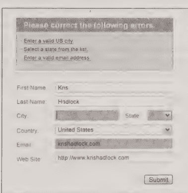

**图 19.1** 使用多种组合处理错误。

如图19.2所示，在字段更新后，已更新的错误会出现删除线，超链接变为禁用状态并消失。

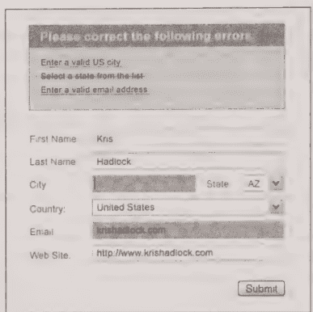

**图 19.2** 基于用户错误修正添加反馈。

图19.3展示了另一种独特的、不显眼的——的方式向用户显示错误。在表单提交并出现错误后，表单不仅会像我们之前的解决方案那样突出显示不正确的表单字段，而且还会在第一个导致错误的表单字段上方显示一个“气泡”消息，并在错误修正后随字段上的高亮颜色一起消失。此时，如果还有更多错误，气泡将出现在表单中的下一个错误上方，光标将移动到该表单元素。为了使其更加明显，如果下一个表单字段由于滚动条而不在可视范围内，页面将滚动到不正确表单字段的位置并使其进入焦点。

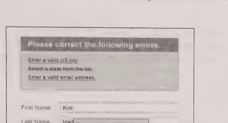

**图 19.3** 直接在表单元素上方显示反馈。

## 用代码设计

正如我在本章开头提到的，本节将解释如何使用一个名为Dialog的对象创建自定义消息。该对象将根据我们连接给它的CSS类显示消息，并根据我们在这些类中定义的属性进行自我渲染。清单19.2展示了完整的Dialog对象，它仅仅是对象的实例化和一个名为display的方法。此时我们知道实例化声明的样子，因此我们将重点介绍这个对象的核心——display方法。display方法接受三个参数。第一个是唯一的id，它将代表作为前端对话框创建的div的实际id。第二个参数是我们将用来将div连接到自定义CSS类的类名，该CSS类将定义我们指定的属性。最后一个参数是我们希望显示给用户的消息，以提供反馈、错误或警告。

在方法被调用并传递所有参数后，我们的方法首先创建一个div元素，它将成为前端的对话框，并最终向用户显示消息。在使用第9章“扩展引擎”中的Utilities对象创建元素后，我们通过将它们等于调用方法时传递给方法的参数来定义元素的id和className属性。为了向用户显示正确的消息，我们将使用div元素的innerHTML属性向用户显示我们的自定义消息。最后，我们必须有办法将完成的对话框添加到用户当前使用的页面中。我们将再次借助我们得心应手的Utilities对象，将该元素附加到文档主体。

**清单 19.2** Dialog对象（Dialog.js）

```
Dialog = {};

Dialog.display = function(id, c, message)
{
    var d = Utilities.createElement("div");
    d.id = id;
    d.className = c;

    d.innerHTML = message;
    Utilities.appendChild(document.body, d);
}
```

为了使用这个方法，我们必须有一个HTML页面来导入适当的对象。以下代码展示了如何导入Dialog和Utilities对象以及一个我们即将创建的相应CSS文件，还有一个在页面顶部显示错误的方法调用。

```
<html xmlns="http://www.w3.org/1999/xhtml">
<head>
<meta http-equiv="Content-Type" content="text/html; charset=iso-8859-1" />
<title>Ajax消息对话框</title>
<link href="css/dialog.css" rel="stylesheet" type="text/css" />
<script type="text/javascript" src="javascript/Utilities.js"></script>
<script type="text/javascript" src="javascript/utils/Dialog.js"></script>
</head>
<body onload="Dialog.display('dialog', 'error', 'Please correct the following errors.');">
</body>
</html>
```

您可能已经注意到，我们在此页面中只创建了一个错误消息，而且它甚至不对应任何东西。嗯，您说得对——这只是一个如何显示自定义对话框的示例，但我还将向您展示如何用以下代码显示另外两种类型。此代码展示了如何创建警告和成功反馈消息。

```
Dialog.display('dialog', 'warning', 'Your form submission was successful, but you did not enter a web site URL, click here in order to update this record.');
Dialog.display('dialog', 'success', 'Your form submission was successful!');
```

成功消息的工作方式与错误消息非常相似，因为它很直接，但警告的工作方式略有不同，需要我们多费些思量。如果我们向用户显示警告，我们必须为他们提供忽略警告或根据问题采取行动的方式，即更新数据。在示例代码中，我的消息中写着“click here”。作为示例，这可以是一个超链接，将用户链接到允许他们更新产生警告的信息的表单，或者他们可以选择忽略它并转到应用程序的另一个区域。

现在我们有了创建对话框的方法，并且正在从应用程序中调用它，我们将有一个向用户显示的简单消息。然而，在我们创建与定义的id和类名对应的CSS之前，元素仍然不会有任何样式。为了定义与应用程序可能需要向用户显示的不同类型消息对应的类，我们将创建一个

名为 `dialog.css` 的 CSS 文件。该文件将包含四个自定义类。第一个类是所有消息共用的类，对应于我们作为第一个参数传递给 `Dialog` 对象的 `display` 方法的对话框 id。这个类将包含消息的字体粗细和内边距，并确保我们所有的消息在这方面保持一致。清单 19.3 展示了在 `dialog.css` 文件中定义的这个类。

清单 19.3 对话框 CSS 类（dialog.css）

```
#dialog
{
    font-weight: bold;
    padding: 5px;
}
```

定义了这个共用类之后，我们就可以专注于定义对应于应用程序可以拥有的每种不同消息类型的各个类。同样，我们将关注的不同类型是错误、警告和成功反馈消息。在这个例子中，我们将根据消息类型简单地更改背景颜色，但我们可以使用许多不同的 CSS 属性来使这些消息彼此明显不同。错误将具有红色背景，警告为橙色，成功消息为绿色。没有什么比这更明显的了，但总有改进的空间。清单 19.4 展示了在 `dialog.css` 文件中定义的所有这些类。

清单 19.4 每个对应消息类型的特定类（dialog.css）

```
#dialog.error
{
    background-color: #ff0000;
}

#dialog.warning
{
    background-color: #ff9900;
}

#dialog.success
{
    background-color: #00cc33;
}
```

这些类通过将 `dialog` div 明确指定为基类，然后将每种消息类型作为每个消息的类名附加其后，扩展了 `dialog` id 元素类。这些名称恰好也是传递给 `display` 方法的名称，用于将正确的类与消息关联起来。有了所有这些代码，我们可以非常容易地为任何需要通知用户的消息形式提供反馈。

预先创建所有这些代码实际上会在长期内为你节省很多麻烦，特别是如果你在一个团队成员负责向用户显示自己的反馈的团队中工作。这样，我们作为面向设计的开发人员不需要担心每个团队成员的消息之间的不一致，而且我相信他们也会很高兴不需要定义自己的消息。

# 第五部分
服务器端交互

- 20 理解 Ajax 数据库交互
- 21 与数据库交互：服务器端
- 22 高级 Ajax 数据库交互

## 20
理解 Ajax
数据库交互

我们在前面的章节中已经开始涉及 Ajax 数据库交互，但本章将通过解释每一步来让我们更深入地理解交互模型。使用 Ajax 进行数据库交互使开发人员能够创建只有这组技术才能实现的交互范式。创建 Ajax 数据库交互所发生的操作与标准交互相同，但请求过程的发生方式却大不相同。两种交互中存在的操作都始于前端的用户交互，这会触发一个 HTTP 请求到服务器，在服务器端语言对数据库进行查询。数据库中发生的内容——例如插入、删除或选择——也都将完全相同。同样，这两个过程的唯一区别在于它们发出请求的方式。在不使用浏览器刷新中断用户体验的情况下创建数据库连接，这绝对是 Ajax 独有的特性，也是使 XHR 与标准 HTTP 请求不同的地方。

诚然，Ajax 很容易被滥用，而且经常被滥用，但在正确的情况下它可能非常有用csr，例如当示例应用程序接收和/或发送电子邮件时。想象一下，如果你正在阅读一封电子邮件，你的浏览器刷新的为了获取新消息。这将是一个无法使用的情况，因为你将完全失去你的位置，并且不得不重新熟悉界面，该界面可能由于新的电子邮件消息而发生了变化。因此，这是使用 Ajax 进行数据库连接的完美情况之一。我们可以使用前面在第 17 章"数据反射模式"中介绍的数据反射模式向服务器发出请求，如果存在新消息则接收更新，并用数据库中的新数据补充收件箱。该解决方案还使我们能够在不显眼地更新必要数据的同时，保持应用程序的其他区域不变或不受影响。换句话说，使用我们构建的组件，我们可以在用户继续阅读打开的电子邮件消息时，用新消息补充数据网格和树组件中的数据，同时保持折叠面板组件不变。在本章中，我们将深入研究服务器端代码，了解使支持数据库的 XHR 成为可能的每个步骤。

### 与 PHP 连接

在我们开始 kn beginners 之前，我们需要创建将用于此示例并最终用于我们最终样本项目的数据库。用于创建表的 SQL 代码如清单 20.1 所示。

#### 清单 20.1 创建电子邮件数据库表的 SQL 文件（awad_email.sql）

```
CREATE TABLE `awad_email` (
`message` longtext NOT NULL,
`folder` varchar(50) NOT NULL default '',
`thread_id` int(11) NOT NULL default '0',
`date` timestamp NOT NULL default CURRENT_TIMESTAMP on update
 CURRENT_TIMESTAMP,
`subject` varchar(100) NOT NULL default '',
`sender` varchar(50) NOT NULL default '',
`receiver` varchar(50) NOT NULL default '',
`id` int(11) NOT NULL auto_increment,
PRIMARY KEY (`id`)
) ENGINE=MyISAM DEFAULT CHARSET=utf8;
```

PHP 是与 Ajax 结合的绝佳语言。首先，它是开源的，其次，它非常灵活且易于学习。由于本书中的所有示例已经编写完成，我们将继续使用 PHP 5.0 的严格类型。因此，运行示例的服务器必须安装 PHP 5.0 或更高版本。让我们开始学习如何通过创建文件简单地委派请求并返回 XML 响应来弥合客户端和后端之间的差距。

### 弥合差距

通过 XHR 创建数据库连接后，使用 PHP 连接到数据库就很简单了。在示例中，我将此文件命名为 serviceConnector.php，但我们可以随意命名，因为此示例的唯一要求是它必须是 PHP，并且我们在 XHR 中通过正确的名称请求它。清单 20.2 显示了文件内容。

## 清单 20.2 该文件是客户端和数据库之间的桥梁（serviceConnector.php）

```
<?php

header("Content-Type: application/xml; charset=UTF-8");

require_once("classes/UserManager.class.php");
require_once("classes/Email.class.php");

$o = new $_GET['object']();
echo $o->$_GET['method']( $_GET['params'] );

?>
```

此清单是帮助我们建立所有连接的关键。代码以 PHP 声明标签开头（从此刻起所有 PHP 示例都将如此），以便服务器知道如何处理它。第一行代码是一个头部，它定义返回数据的内容类型为 XML。这意味着任何请求它的文件都将以 XML 形式接收数据。当然，在使用 Ajax 时这非常有用，因为我们希望在这种情况下响应是 XML。接下来的两行代码是 PHP 特有的包含语句类型，需要包含这两个文件才能编译文件中的其余代码。PHP 还有一个 require 语句，但 require_once 语句有额外的逻辑来确保如果同一个文档中两次包含同一个必需的类，则只 require 一次。如果我们想在以后调用新的对象方法，可以继续向此文件添加新的 PHP 类。

设置好所有必需的文件后，我们将实例化一个新对象，该对象将在查询中定义为 object。这是一个极其强大的语句，因为它允许我们通过简单地传递正确的查询变量从客户端实例化对象。在我们实例化正确的对象后，可以触发该对象中的一个方法，并传递我们在客户端 XHR 中定义的参数。方法调用后，我们将其返回值写入页面，这样当服务器完成文件写入时，它将返回一个 XML 文件，其中包含从对象返回的值。在我们的案例中，此值将是由数据库值表示的数据，或数据库插入或删除的成功或失败消息，但返回值可以是你能想到的从服务器端对象返回的任何内容。当然，这个解决方案带来的巨大权力的同时，也带来了巨大的安全风险。因此，我们将在到达第 23 章"保护你的应用程序"时，专注于创建一种安全的方式来进行这些从 Ajax 发出的服务器端请求，通过密码保护它们。


214 第20章 理解Ajax数据库交互

## 发起请求

我们现在已经理解了如何弥合前端与数据库之间的鸿沟；现在我们需要关注的是如何从前端发起XHR。连接到我们在上一节中创建的连接器文件，就像请求静态XML文件一样简单。这实际上只是理解要传递哪些参数以及它将如何返回数据的问题，这样你就能预判动态响应。清单20.3展示了如何从客户端的**Email** JavaScript对象向我们的`serviceConnector.php`文件发起XHR。

### 清单20.3 连接数据库以检索用户的电子邮件文件夹 (Email.js)

```
Email.display = function(username) 
{ 
 Email.currentUser = username; 
 var url = "serviceConnector.php?object=Email&method=getFolders&params="+ 
username; 
 AjaxUpdater.Update("GET", url, TreeManager.display); 
 setTimeout('Email.getMail("'+ username +':INBOX")', 500); 
 Email.dataReflection("Email.display('"+ username +'")", 100000); 
}
```

**Email**对象通过Ajax引擎将本书中的所有组件组合并连接到数据库。从index PHP文件调用的第一个方法是**display**方法。该方法接收一个用户名，该用户名在用户登录应用时由登录PHP页面传递而来。方法触发后，它会将用户名设置为对象属性，然后定义一个url变量用作XHR。如你所见，此URL由`serviceConnector.php`加上需要传递的对象、方法和其他参数组成，在本例中这些参数仅是用户名。URL定义后，它被添加到**AjaxUpdater**的Update方法中，并通过GET方法发送到服务器。**Update**方法还告知**Ajax**对象将响应返回给`TreeManager`的display方法。如果你仔细观察URL，我们会调用一个名为**Email**的PHP对象并触发一个名为**getFolders**的方法，该方法获取为所请求的特定用户创建树视图所需的所有文件夹。该方法的其余部分包含一个`setTimeout`调用，它延迟了另一个Email对象方法对**getMail**方法的调用。设置延迟是因为每个方法都会发起一个XHR。如果它们同时触发，它们的请求会交叉，最终导致意外结果。最后一行是数据反射，我们在第17章已经介绍过。图20.1展示了包含所有组件并显示数据库数据的电子邮件应用程序。

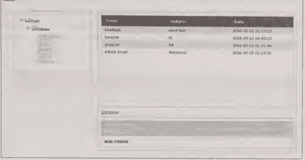

图20.1 包含本书所有组件的完整电子邮件应用程序预览。

Email JavaScript对象中的getMail和showThread方法与display方法在发起XHR并将响应委托给相应组件的方式上非常相似。清单20.4展示了getMail方法，它向serviceConnector.php发出请求，以获取显示用户指定文件夹中所有邮件所需的数据。

### 清单20.4 连接数据库以检索邮件 (Email.js)

```
Email.getMail = function(params)
{
    Utilities.removeChildren(Utilities.getElement('list'));
    DataGrid.initialize();

    var url = "serviceConnector.php?object=Email&method=getMail&params="+ params;
    AjaxUpdater.Update("GET", url, DataGrid.display);
}
```

正如我提到的，getMail方法向服务器发出请求，以从指定文件夹获取用户的邮件。如果我们查看display方法中的setTimeout，我们传递了当前用户的用户名和收件箱作为要检索邮件的特定文件夹。这些参数将用于XHR URL中。在发起请求之前，需要两行代码来重新创建DataGrid组件，以处理我们将从服务器响应委托给它的新数据。在这两行代码中，我们首先移除任何先前实例化的DataGrid元素，然后初始化一个新的DataGrid以恢复其默认值并为响应中的新数据做准备。我们使用Utilities对象的removeChildren方法移除list元素中的所有嵌套（子）元素，该元素是**DataGrid**创建时写入的目标。最后，我们通过GET方法发起请求，并将响应委托给新DataGrid的display方法。图20.2展示了包含已保存到服务器的收件箱数据的DataGrid组件。

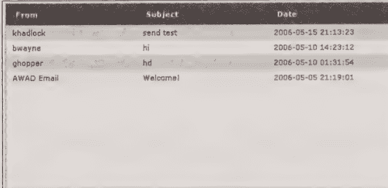

图20.2 一个填充了数据并与应用程序集成的DataGrid组件。

当用户从DataGrid组件中选择一封电子邮件时，会触发`showThread`方法。清单20.5展示了该方法的代码。

### 清单20.5 从数据库检索邮件线程 (Email.js)

```
Email.showThread = function(id, sender)
{
    Email.currentThread = id;
    Email.currentSender = sender;

    Utilities.removeChildren(Utilities.getElement('mail'));
    Accordion.initialize();

    var url = "serviceConnector.php?object=Email&method=getMessage&params="
            + id + ";" + Email.currentUser;
    AjaxUpdater.Update("GET", url, Accordion.display);

    Utilities.getElement('reply').style.display = '';
    Utilities.getElement('compose').style.display = 'none';
}
```

此方法接收一个id（代表一封邮件线程的数字）和一个**sender**（代表发送邮件的用户名）。这些参数首先用于设置**Email**对象的属性，包括作为id参数的currentThread和作为sender参数的currentSender。这两个属性将在整个对象中以多种方式使用。接下来，我们移除可能包含先前检索到的线程的父HTML元素的子节点。然后我们初始化Accordion，并在对象中实例化或重新实例化任何属性。获得一个全新的Accordion后，我们通过AjaxUpdater使用GET方法发起请求，并像前面的示例一样传递一个自定义的url变量。url变量由serviceConnector.php文件后跟一个查询字符串组成，该查询字符串包含Email对象、一个名为getMessage的方法以及两个参数：线程id和当前用户。发起请求后，我们将响应委托给Accordion对象中的display方法，一个包含所选线程的新Accordion将被显示出来。该线程代表了两个用户之间作为单个线程来回发送的所有不同邮件。图20.3展示了Accordion中包含一个线程邮件的示例。


### 图20.3 在最终应用程序中填充Accordion组件的线程邮件。

现在我们有了用于显示各种类型数据（如文件夹、邮件和线程）的所有方法，我们可以专注于如何发送新邮件或回复系统中的另一个用户。我们将用于这两种不同功能类型的方法称为compose。清单20.6展示了此方法。

### 清单20.6 向其他用户发送邮件 (Email.js)

```
Email.sendMail = function(action, username, subject, message)
{
   var params;
   if(action == 'reply' && Email.currentThread != '')
   {
      params = username +":"+ Email.currentUser +":"+ subject +":"+ message
      +"-"+ Email.currentThread;
   }
   else
   {
      params = username +":"+ Email.currentUser +":"+ subject +":"+ message;
     Email.currentReceiver = '';
   }
```

218 第20章 理解Ajax数据库交互

清单20.6 续

```
var url = "serviceConnector.php?object=Email&method=sendMail&params=" + params;
AjaxUpdater.Update("GET", url);

if(Email.currentUser == username && Email.currentThread != '')
{
    setTimeout('Email.showThread("'+ Email.currentThread +'")', 500);// 回复
}
else if(Email.currentUser == username && Email.currentThread == '')
{
    setTimeout('Email.getMail("'+ Email.currentUser +':INBOX")', 500);//
    撰写新邮件
}
else
{
    Utilities.getElement('compose').style.display = 'none';
}
}
```

这个方法比之前的要大一些，并且接收更多的参数。它接收的四个参数是：

- 一个action，表示我们是发送新邮件还是回复。
- 一个username，表示邮件发送的目标用户。
- 邮件的subject（主题）。
- 邮件的message（正文）。

我们首先检查action是回复还是新邮件。根据结果，我们创建一个本地param变量，它是一个冒号分隔的字符串，将代表邮件的参数。获得请求所需的参数后，我们将它们附加到一个由字符串组成的url变量上。这个字符串将调用serviceConnector.php文件，传递Email对象，调用名为sendMail的方法，并传递我们之前设置的参数。然后我们触发AjaxUpdater对象的Update方法，并通过GET方法传递url参数。这个调用的不同之处在于我们没有传递一个回调方法来委托响应。这是因为在setTimeout方法中，我们将通过触发showThread或getMail方法来简单地刷新当前的Accordion或DataGrid对象。这将延迟调用，以便数据得以更新。然后，当方法被调用时，它将为新数据发起另一个XHR，这将要么用回复线程填充Accordion，要么用默认的收件箱视图填充DataGrid。图20.4展示了应用程序中的“撰写”或“回复”表单。


 ## 第20章 理解Ajax数据库交互

## 建立连接

现在我们已经了解了如何向PHP文件发送请求，该文件将接收服务器端方法调用并以有效的XML格式返回响应，我们可以专注于数据库交互了。我们在本章中贯穿使用的对象就是Email对象。该文件名为`Email.class.php`，位于应用程序结构的`classes`文件夹中。这个对象包含大量功能，我不会详细讲解，因为我想提供的是理解数据库数据如何被格式化为客户端可使用的XML，这由Ajax对象或接收委托响应的对象来完成。因此，我们会看到所有涉及的代码，但我们将重点放在与Ajax相关的部分。让我们从引入必要的类以建立数据库连接、声明Email对象以及创建其构造函数开始。清单20.7展示了实现这一点的代码。

### 清单20.7 Email类入门（Email.class.php）

```
<?php
require_once("classes/database/DatabaseConnector.class.php");
require_once("classes/utils/Constants.class.php");

class Email
{
    private $dbConnector;

    public function Email()
    {
        $this->dbConnector = DatabaseConnector::getInstance();
$this->dbConnector->init();
    }
}?>
```

我们需要引入的两个类是DatabaseConnector和Constants类。DatabaseConnector包含了连接数据库的所有方法，这我们已在前一章第12章"客户端验证"中介绍过。Constants文件包含了我们在整个应用程序中需要的所有可重用数据。在继续讲解Email对象的方法之前，我们先来介绍Constants类。声明Email对象之后，我们定义了一个属性，该属性将在整个类中代表DatabaseConnector对象。构造函数获取该属性并将其设置为DatabaseConnector的一个实例，这是一个单例对象。将对象赋给属性后，我们在其中调用init方法。让我们简要看一下Constants类，了解它在后续的使用方式。请记住，该类将代表部分服务器数据，在您上传文件时需要进行修改。清单20.8展示了完整的类。

### 清单20.8 Constants对象（Constants.class.php）

```
<?php
class Constants
{
    // 数据库连接
    static $DB_USER = "your user name";
    static $DB_PASSWORD = "your password";
    static $DB_HOST = "localhost";
    static $DB_NAME = "your database name";


    // 数据库表
    static $AWAD_EMAIL = "awad_email";
    static $AWAD_USERS = "awad_users";

    // 密码
    static $PASSWORD = "TEMPPASSWORD";

    // 返回值
    static $SUCCESS = "<xml>success</xml>";
    static $FAILED = "<xml>failed</xml>";

    public function Constants() {}

}
?>
```

这个类充满了静态属性，任何已引入它的对象都可以访问。我们需要创建的第一组属性取决于我们使用的服务器。这些属性代表服务器的数据库信息。这些属性需要由您修改，以便在您的服务器上运行示例。接下来的两个属性是我们将在示例代码中与之交互的数据库表。它们是awad_email表，包含用户之间所有来回传递的电子邮件信息，以及awad_users表，包含应用程序的用户数据。此数据库已在第12章中创建，当时我们学习了如何通过Ajax对象在数据库中验证用户信息。

下一个属性叫做password，将在第23章中使用，届时我们将学习如何通过受密码保护的Ajax请求来保护应用程序。最后两个属性是作为Ajax请求响应返回的成功和失败消息，当不需要返回数据时使用。例如，如果用户删除了一封电子邮件，我们不需要返回任何数据作为响应；相反，我们会返回删除是否成功，并根据结果对响应采取相应操作。现在我们了解了该文件将如何在整个Email对象中使用，接下来我们将介绍其其余的对象。我们将重点关注的第一个方法叫做sendMail，如清单20.9所示。

### 清单20.9 发送邮件（Email.class.php）

```
<?php
public function sendMail($params)
{
    $param = split(":", $params);
    $username = $param[0];
    $sender = $param[1];
    $subject = $param[2];
    $message = $param[3];
    $threadId = $param[4];

    $this->dbConnector->connect();
    $table = Constants::AWAD_EMAIL;

    if($threadId == NULL)
    {
     // 获取下一个线程id
        $query = "SELECT MAX(thread_id) FROM $table WHERE receiver='$username'";
        $result = mysql_query($query);
        $row = mysql_fetch_array ($result);
        $threadId = $row[0]+1;
        $this->dbConnector->complete($query);
    }
}

清单20.9 续

$this->dbConnector->connect();
$query = "INSERT INTO $table (message, folder, thread_id, subject, sender, receiver) VALUES ('$message', 'Inbox', '$threadId', '$subject', '$sender', '$username')";
$this->dbConnector->complete($query);

$this->dbConnector->connect();
$query = "INSERT INTO $table (message, folder, thread_id, subject, sender, receiver) VALUES ('$message', 'Sent', '$threadId', '$subject', '$username', '$sender')";
$this->dbConnector->complete($query);

// TODO: 需要确认这是否正确
return Constants::$SUCCESS;
}
?>
```

此方法接收从Email对象发送的以冒号分隔的参数列表。该参数字符串首先在冒号处进行分割，然后设置为本地方法变量。获取本地变量后，我们检查线程id是否为空。如果是，我们知道该电子邮件属于一个新的线程。如果为真，我们进行数据库查询以获取最大的线程id，并将本地变量设置为其值。获取该值后，我们递增本地变量并将其用于两个默认查询中。这些查询将电子邮件插入接收用户的收件箱和发送用户的已发邮件文件夹中。执行查询后，我们返回一个值，说明插入是否成功。

下一个方法用于获取用户的文件夹，供TreeView组件使用。它接受一个参数，指示要检索哪个用户的文件夹。从数据库接收到数据后，它将编译一个XML字符串，其结构与第11章"树形视图"中的treeview.xml文件相同。创建该结构需要相当复杂的算法，因为我们希望属于特定文件夹的任何数据都显示在这些文件夹中。如果我们不使用此算法，该结构将简单地表示一个树，每个项目都有重复的文件夹，这将不太实用。清单20.10中展示的方法包含解释该算法的注释。

### 清单20.10 获取用户的文件夹（Email.class.php）

```
<?php
public function getFolders($receiver)
{
    // 按用户id检索所有当前文件夹，格式为treeview.xml
    $this->dbConnector->connect();
    $table = Constants::$AWAD_EMAIL;
```

清单20.10 续

```
$query = "SELECT * FROM $table WHERE receiver='$receiver' ORDER BY folder ASC";
$result = mysql_query($query);
if($result)
{
    $response = "<?xml version=\"1.0\" encoding=\"iso-8859-1\" ?>";

    $response .= "<Mail>";
    $folder = "";
    while($row = mysql_fetch_array ($result))
    {
        // 添加一个项目
        // 将文件夹设置为等于当前文件夹
        // 如果下一个项目是相同的文件夹，添加一个项目
        // 如果不是相同的文件夹且folder != ''，关闭前一个项目并创建一个新的
        // 前半部分

        if($threadId != $row['thread_id'])
        {
            $threadId = $row['thread_id'];
            if($folder == $row['folder'])
            {
                $folder = $row['folder'];

                // 如果下一个项目是相同的文件夹，添加一个项目
                $response .= "<a href=\"javascript:Email.showThread('" .
                    $threadId .
                    "', '" . $row['sender'] . "');\">" . $row['sender'] .
                    "</a><br/>";

            }
            else
            {
                if($folder != '')
                {
                    // 如果不是相同的文件夹且folder != ''，关闭前一个项目并创建一个新的前半部分
                    $response .= "]]></" . $folder . ">";
                }

                $folder = $row['folder'];
```


## **代码清单 20.10（续）**

```php
// 创建前半部分：首先发生，因为
// 不会有匹配项
$response .= "<". $folder ." action=\"Email.getMail('".
    $row['receiver'] .\":\". $row['folder']
    .');\"><![CDATA["
// 添加一项
$response .= "<a href=\"javascript:Email.showThread('".
    $threadId
    ."', '. $row['sender'] .');\">". $row['sender']
    ."</a><br/>";
}
    }
}
$response .= "]]></". $folder .">";
$response .= "</Mail>";
}
else
{
    return Constants::$FAILED;
}
$this->dbConnector->complete($query);
return $response;
?>
```

在 XML 树结构创建完成后，它会被返回到 **serviceConnector.php** 类。其内容类型被设置为 XML，以确保其有效性，并能通过 Ajax 引擎（或响应被委托给的方法）经由 DOM 访问——在本例中，该方法恰好是 **TreeManager** 的 display 方法。图 20.5 显示了该树视图在应用程序中的渲染效果。


**图 20.5** TreeView 组件渲染了文件夹以及特定线程的发件人用户名。

接下来要介绍的方法比前一个简单。它名为 getMail，见代码清单 20.11。该方法接收一个参数，即一个由冒号分隔的值字符串，我们在其中定义此方法。这意味着调用该方法时需要知道它期望的参数。在拆分并设置局部变量后，我们连接数据库，从指定文件夹中选择特定用户的邮件，并按线程 ID 排序。收到结果后，我们创建一个 XML 字符串，其结构与第 13 章"数据网格"中的 DataGrid 示例相同。

## 代码清单 20.11 获取用户邮件（Email.class.php）

```php
<?php
public function getMail($params)
{
    $param = split(":", $params);
    $receiver = $param[0];
    $folder = $param[1];

    // 全部或按 id 的特定文件夹，采用 datagrid.xml 格式
    $this->dbConnector->connect();
    $table = Constants::$AWAD_EMAIL;
    $query = "SELECT * FROM $table WHERE receiver='$receiver' AND folder='$folder'
        ORDER BY thread_id DESC";

    $result = mysql_query($query);
    if($result)
    {
        $response = "<?xml version=\"1.0\" encoding=\"iso-8859-1\" ?>";
        $response .= "<data>";
        $response .= "<categories>";
        $response .= "<category>From</category>";
        $response .= "<category>Subject</category>";
        $response .= "<category>Date</category>";
        $response .= "</categories>";
        $threadId = "";
        while($row = mysql_fetch_array ($result))
        {
            if($threadId != $row['thread_id'])
            {
                $threadId = $row['thread_id'];
                $response .= "<row>";
                $response .= "<items action=\"Email.showThread('" . $threadId . "',
                    '" . $row['sender'] . "');\" icon=\"img/mail.gif\">";
                $response .= "<item><![CDATA[" . $row['sender'] . "]]></item>";

                $response .= "<item><![CDATA[" . $row['subject'] . "]]></item>";
                $response .= "<item>" . $row['date'] . "</item>\n";
$response .= "</items>";
$response .= "</row>";
}
}
$response .= "</data>";
}
else
{
return Constants::$FAILED;
}
$this->dbConnector->complete($query);

return $response;
}
?>
```

按照 DataGrid 组件期望的格式创建结构后，我们将其作为响应返回给 XHR。当引擎收到响应后，会将其委托给 DataGrid 组件，并显示来自指定文件夹的用户邮件。

该类中的最后一个方法名为 getMessage（代码清单 20.12）。与该类中的其他方法一样，此方法也接受一个由冒号分隔的参数字符串，这些参数被拆分并设置为局部变量。设置变量后，建立数据库连接，并从客户端请求的线程中选择邮件。这些线程按照其在数据库中的 ID 降序排列。因此，Accordion 对象将按照创建顺序显示电子邮件线程。

代码清单 20.12 检索用户消息（Email.class.php）

```php
<?php
public function getMessage($params)
{
    // 按 id 检索消息，采用 accordion.xml 格式
    $param = split(":", $params);
    $threadId = $param[0];
    $receiver = $param[1];

    $this->dbConnector->connect();
    $table = Constants::$AWAD_EMAIL;
    $query = "SELECT * FROM $table WHERE receiver='$receiver' AND
              thread_id='$threadId' ORDER BY id DESC";
    $result = mysql_query($query);
    if($result)
    {
$index = 0;
$response = "<?xml version=\"1.0\" encoding=\"iso-8859-1\" ?>";
$response .= "<accordion>";
while($row = mysql_fetch_array ($result))
{
    if($index == 0)
    {
        $response .= "<panel expanded='true'>";
    }
    else
    {
        $response .= "<panel>";
    }
    $response .= "<title><![CDATA[". $row['subject'] ."]]></title>";
    $response .= "<content><![CDATA[". $row['message'] ."]]></content>";
    $response .= "</panel>";
    $index++;
}
$response .= "</accordion>";
}
else
{
    return Constants::$FAILED;
}
$this->dbConnector->complete($query);

return $response;
}
?>
```

XML 结构拼接完成后，我们将其返回到 `serviceConnector.php` 文件，该文件向请求对象提供有效的 XML 文件。与引擎在所有其他情况下所做的一样，它将响应委托给另一个对象（在本例中为 `Accordion`）。`Accordion` 对象通过其 `display` 方法接收响应，并从响应数据中创建手风琴组件。你可以回看**图 20.3**，查看应用程序中邮件线程的手风琴组件示例。

本章包含了许多完全针对 Ajax 的信息，但如果你理解了服务器端的原理，理解我们在本应用程序中构建的请求模型并不困难。当你对这些请求背后的逻辑有了扎实的理解后，基本上可以实现当今 Web 上任何你看到的 Ajax 数据库交互功能。谁知道呢——也许你会创建一些自己的标准。

# 21 与数据库交互：服务器端

本书中我们已经学习了 Ajax 交互的许多方面。在上一章中，我们学习了如何使用 PHP 将示例应用程序连接到数据库。本章将解释如何使用 ASP.NET 和 ColdFusion 连接动态服务器端数据。本书 formative 采用的示例不使用这些技术，因此如果你对这两种方法不感兴趣，可以跳过本章。我们将首先学习如何使用 ASP.NET 连接动态数据，然后使用 ColdFusion 实现相同的功能。本章将提供强大的信息，可应用于其他 Ajax Web 应用程序，以连接动态服务器端数据。

## 连接 ASP.NET

ASP.NET 是一个非常强大的编程平台。在这里，我们将学习如何通过 Ajax 请求与其建立连接。该示例使用 Visual Studio 创建，我们将在本例中以调试模式运行它，但如果你愿意，也可以配置为在 Windows IIS 中运行。

为了开始我们的示例，首先需要创建一个新的 C# 网站。创建新 C# 网站后，需要将 Utilities、AjaxUpdater、HTTP 和 Ajax JavaScript 文件移动到项目目录中。然后，我们需要将它们导入创建网站时默认生成的 Default.aspx 文件中（见代码清单 21.1）。

```
代码清单 21.1 导入适当的 JavaScript 文件（Default.aspx）
<script type="text/javascript" src="javascript/Utilities.js"></script>
<script type="text/javascript" src="javascript/model/AjaxUpdater.js"></script>
<script type="text/javascript" src="javascript/model/HTTP.js"></script>
<script type="text/javascript" src="javascript/model/Ajax.js"></script>
```


## 第21章 与数据库交互：服务器端

文件导入后，我们将添加清单21.2中的代码，以处理从用户处获取输入并向服务器端发出请求的HTML。

### 清单21.2 获取用户输入 (Default.aspx)

```
<form id="requestForm" runat="server">
<div>Request:</div>
<div><input type="text" autocomplete="off" onkeyup="request(this.value);" /></div>

<br /><br />

<div>Response:</div>
<div id="response"></div>
</form>
```

用户将使用请求输入字段输入一个值，该值随后将向服务器端发出请求。收到响应后，它将显示在ID为`response`的div中。向服务器端的请求发生在JavaScript方法中，该方法被巧妙地命名为`request`。让我们看看清单21.3中的`request`方法。

### 清单21.3 向服务器端发出请求 (Default.aspx)

```
<script type="text/javascript">
    function request(data)
    {
        AjaxUpdater.Update('GET', 'serviceConnector.aspx?request='+ data,
            onResponse);
    }
</script>
```

`request`方法接受一个名为`data`的参数，即输入字段的值。每次`keyup`事件触发时，该值都会传递给它。然后，该方法通过`GET`方法向名为`serviceConnector.aspx`的文件发起XHR请求。`data`参数被附加到URL上，并作为查询值传递给`request`键。最后，一个名为`onResponse`的方法被添加为回调方法，请求通过`AjaxUpdater`的`Update`方法发出。在我们知道从响应中将接收到什么数据并理解如何正确解析它之后，`onResponse`方法将被添加到这个文件中。`serviceConnector.aspx`文件将前端与我们将要编写的C#代码连接起来。这段C#代码将接收请求，并返回一个包含输入字段中字母的用户名。在我们创建C#代码后台之前，让我们看看清单21.4中的`serviceConnector.aspx`。

### 清单21.4 连接前端与服务器端 (serviceConnector.aspx)

```
<%@ Page ContentType="text/xml" Language="C#" AutoEventWireup="true"
CodeFile="serviceConnector.aspx.cs" Inherits="serviceConnector" %>
```

这个文件是前端与后端代码之间的链接。需要记住的两件最重要的事情是：文件中只包含这一行代码（否则响应将无效），以及确保添加了`ContentType`属性。在创建文件时，此属性默认不存在，如果没有它，响应将不是有效的XML。

这个文件的工作方式是接收请求并将数据传递给代码后台。代码后台是包含处理请求代码的C#类，它在`CodeFile`属性中定义。这个类将获取请求，通过我们定义的任何自定义方法进行处理，并根据我们定义的逻辑返回响应。在这种情况下，我们创建的C#类将简单地接收请求，搜索一个用户名数组，并返回一个字符串值形式的用户名。返回的用户名将被格式化为XML，并作为响应传递给Ajax引擎，最终传递给我们在`AjaxUpdater`请求中定义的`onResponse`回调方法。让我们看看清单21.5，了解`serviceConnector`的C#代码后台，理解它需要导入哪些类，以及它如何执行用户名搜索。

### 清单21.5 serviceConnector的代码后台 (serviceConnector.aspx.cs)

```
using System;
using System.Data;
using System.Configuration;
using System.Collections;
using System.Web;
using System.Web.Security;
using System.Web.UI;
using System.Web.UI.WebControls;
using System.Web.UI.WebControls.WebParts;
using System.Web.UI.HtmlControls;
using System.Xml;

public partial class serviceConnector : System.Web.UI.Page 
{
    protected void Page_Load(object sender, EventArgs e) 
    {
        this.SearchUsers();
    }

    private void SearchUsers()
    {
        string request = Request["request"].ToString();
        string usernameXml = "";
        string[] usernames = new string[3] { "Kris Hadlock", "Grace Hopper", "Pi Sheng" };

        foreach(string username in usernames)
        {
            if(username.ToLower().Substring(0, request.Length) == request.ToLower())
            {
                usernameXml += "<username>" + username + "</username>";
            }
        }

        usernameXml = "<?xml version='1.0' encoding='iso-8859-1' ?><usernames>" + usernameXml + "</usernames>";
        XmlDocument xDoc = new XmlDocument();
        xDoc.LoadXml(usernameXml);
        xDoc.Save(Response.OutputStream);
    }
}
```

除了通过Visual Studio的新文件选项自动导入的默认类之外，我们需要导入`System.Xml`类。这个类将允许我们向客户端返回有效的XML响应。这个类中触发的第一个方法是`Page_Load`，它立即调用`SearchUsers`方法。所有的操作都在这里发生。我们做的第一件事是收集发送过来的请求查询。这是通过使用`Request`对象，定位`request`键，并将其转换为字符串来完成的。这个字符串被设置为一个名为`request`的局部字符串，以便稍后用于执行搜索。接下来，我们定义一个名为`usernameXml`的字符串变量，并构建一个包含三个名为`usernames`值的字符串数组。这三个值可能看起来很熟悉，因为它们是我们在本书其他示例中使用过的用户名。在这个数组构建之后，我们将遍历它，并检查是否有任何用户名以请求值开头。如果匹配，这些名字将被附加到`usernameXml`字符串中，位于`username` XML元素之间，并使用CDATA包裹，以确保如果它们包含任何HTML或特殊字符也能被正确解析。遍历完`usernames`数组后，我们将在`usernameXml`字符串的开头添加一个XML声明，并将现有的`usernameXml`字符串值嵌套在`usernames`元素中。虽然我们有了一个XML字符串，但这不足以作为有效的XML返回给客户端。这就是`System.Xml`类派上用场的地方。

### 清单21.6

这个方法非常简单，因为它遵循了我们在其他示例中创建的所有响应模式。针对响应并从XML中解析出用户名数据，我们定义了一个`username`变量。定义了用户名之后，我们只需将其写入`response`元素并测试我们的应用程序。为了测试应用程序，我们需要在`Web.Config`文件中将`Debug`设置为`true`，如果我们第一次按下调试按钮时忘记了，系统应该会提示我们。应用程序在浏览器中运行后，我们可以通过简单地输入姓名的前几个字母并查看响应来测试它。让我们用ColdFusion做同样的事情。

我之所以介绍它，是因为它可以轻松地与Ajax集成，并最终与我们的引擎集成。本节将向你展示如何用比ASP.NET示例少得多的代码实现相同的结果。

为了开始，我们要做的第一件事是创建一个HTML文件来导入我们的JavaScript文件并包含我们的显示代码。`import`语句应该与清单21.7中的示例相似。

### 清单21.7 导入适当的JavaScript (index.html)

```
<script type="text/javascript" src="javascript/Utilities.js"></script>
<script type="text/javascript" src="javascript/model/AjaxUpdater.js"></script>
<script type="text/javascript" src="javascript/model/HTTP.js"></script>
<script type="text/javascript" src="javascript/model/Ajax.js"></script>
```

导入适当的文件后，我们将添加JavaScript代码来向服务器发出请求。代码与ASP.NET示例中的代码完全相同，但它请求的是ColdFusion服务连接器文件。清单21.8展示了这个`request`方法。

### 清单21.8 发出请求 (index.html)

```
<script type="text/javascript">
function request(data)
{
    AjaxUpdater.Update('GET', 'serviceConnector.cfm?request='+ data, onResponse);
}
</script>
```

正如我提到的，除了请求的文件不同，`request`方法与ASP.NET示例相同。它接受一个`data`参数，通过查询字符串将其附加到URL上，作为与`request`键匹配的值。放置在这个文件中的其他代码是显示代码。这段代码也与ASP.NET示例几乎相同。让我们看看清单21.9中的代码。

### 清单21.9 请求和响应的显示代码 (index.html)

```
<div>Request:</div>
<div><input type="text" onkeyup="request(this.value);" /></div>

<br /><br />

<div>Response:</div>
<div id="response"></div>
```

现在我们有了允许用户向服务器端发出请求的代码，让我们看看我们为本示例创建的`serviceConnector.cfm`。就像


## 第21章：ASP.NET示例与响应处理

ASP.NET示例中，这段代码将接收一个字符串请求，并在用户名数组中搜索包含该字符串的名称。我们将在这个文件中做的第一件事是创建姓名数组。如果这是一个数据库示例，我们只需从数据库中选择所有姓名，将它们推入一个数组，然后在数组中搜索该字符串。清单21.10展示了整个serviceConnector.cfm文件。

### 清单21.10 构建响应（serviceConnector.cfm）

```cfm
<cfset userNames = ArrayNew(1)>
<cfset userNames[1] = "Kris Hadlock">
<cfset userNames[2] = "Grace Hopper">
<cfset userNames[3] = "Pi Sheng">

<cfcontent type="text/xml; charset=iso-8859-1">
<cfoutput>
    <usernames>
        <cfloop from="1" to="#ArrayLen(userNames)#" index="i">
            <cfloop from="1" to="#Len(userNames[i])#" index="j">
                <cfif #Mid(userNames[i], 1, j)# IS #URL.request#>
                    <username><![CDATA[#userNames[i]#]]></username>
                </cfif>
            </cfloop>
        </cfaloop>
    </usernames>
</cfoutput>
```

与ASP.NET示例相比，这个文件相当小，因为该语言不是严格类型的，也不包含任何类。正如我所提到的，我们做的第一件事是创建用户名数组。这个数组由与ASP.NET示例中添加到数组的相同值组成。创建此数组后，需要添加一段非常重要的代码。`cfcontent`标签为我们提供了一个有效的XML响应。如果没有这行代码，XML字符串结构将只是一个字符串，因此无法用于解析。定义内容类型后，我们将把XML结构作为字符串输出。这些数据以`usernames`元素开始，然后开始遍历姓名数组。在这个循环中，我们需要嵌套另一个循环。嵌套循环将遍历每个数组字符串值中的实际字符。换句话说，它将遍历用户名中的每个字母。在这个嵌套循环中，我们将添加一个标志，使用ColdFusion的`Mid`函数，该函数类似于其他语言中的`substring`函数。此函数将用于确定当前字符集是否等于请求字符串。如果是，则将该用户名附加到`username`元素中，并使用CDATA以确保正确解析。将所有用户名添加到XML结构后，我们将关闭第一个`usernames`元素，文件将准备好由客户端解析。

现在我们已经在客户端接收到响应，必须创建一个方法来处理它。这个方法将是`onResponse`方法，我们在请求期间将其作为回调方法传递给`AjaxUpdater`。这个方法可以在清单21.11中看到。

### 清单21.11 处理响应（`index.html`）

```javascript
function onResponse()
{
    if(Ajax.checkReadyState('response') == "OK")
    {
        var usernames = Ajax.getResponse().getElementsByTagName('username');
        for(var i=0; i<usernames.length; i++)
        {
            Utilities.getElement("response").innerHTML +=
                usernames[i].firstChild.data +"<br/>";
        }
    }
}
```

这个方法可能看起来很熟悉，因为它是用于处理ASP.NET示例中响应的同一个方法。当收到响应时，我们定位用户名数组并将它们设置为`usernames`变量。然后迭代此变量，并将每个用户名添加到**response**`div`元素中。

我们在本书中创建的每个服务器端示例都以相同的方式请求。我们创建的模型将始终有效，只要我们能从服务器端语言返回适当的数据。

# 第22章：高级Ajax数据库交互

既然我们已经涵盖了使用Ajax进行基本数据库交互，我们将学习创建数据库驱动的XHR及其响应的高级方法。我们将介绍如何通过发送格式化为数组、XML或JSON的批量数据来最小化对服务器的请求数量。我们还将了解最小化请求数量将如何加快我们的应用程序，帮助我们创建与数据库更高级的交互，并为我们提供一个可通过HTTP访问的API的基础，开发人员可以通过它发送请求、传递特定数据作为参数，并从Web应用程序接收结构化数据响应或将数据存储在数据库中。本章的第二部分将介绍发送自定义响应作为XML或JSON。然后简要提醒如何在客户端处理响应。让我们从查看批量更新开始。

## 批量更新

批量更新通过减少数据库请求数量来帮助我们的Ajax应用程序更高效地运行。这是因为大量数据可以作为数组、XML或JSON发送，而不是单独的XHR。这些数据可以作为一条SQL查询从数据库删除、保存到数据库或插入数据库。想象一下，我们有一些想要保存到数据库的项目。这些项目可能是用户属性，例如名称、描述等。在大多数示例中，请求以每个属性作为单独的键/值对进行。此解决方案对于只需发送少量数据的简单XHR来说效果很好，但如果我们想要发送多个用户的数据，将其作为批量更新发送将高效得多。让我们看看通过XHR将批量数据发送到服务器的三种不同方式。

## 发送数组

以数组形式发送批量更新遵循与我们在本书中进行的其他Ajax请求相同的模式。传递数组的区别在于，我们不是每个键发送一个值，而是每个键发送一个数组（或逗号分隔列表）的数据。在我之前介绍的用户数据示例中，我们可能希望通过一个请求更新多个用户。为了做到这一点，我们可以传递带有数组作为键值的键。例如，我们可以传递与`name`键配对的姓名数组，或与`description`键配对的描述数组。这部分相当简单——数据只需在客户端使用JavaScript推入数组，连接成查询字符串，然后通过XHR发送到服务器。我们的第一个障碍出现了，因为JavaScript数组不能直接转换为服务器端语言中的数组，但这可以轻松解决。通过在我们选择的服务器端语言中取现在为逗号分隔列表的内容，我们可以将数据拆分为新数组并迭代值，以便从数据库中添加、更新或删除它们。通过以这种方式处理请求，我们可以看到查询字符串和SQL查询之间有一些直接的相关性——这仅仅是我们如何应用查询的问题。让我们使用以下HTTP查询作为示例。

```
serviceConnector.php?object=DatabaseManager&method=parseArray&
name=Grace,Pi&description=Hopper,Sheng
```

如你所见，我们有`name`和`description`键以及相应的值。作为示例，我们将模拟要将这些数据插入数据库，使用一个方法，该方法简单地根据发送给它的HTTP查询直接在数据库上执行查询。我们首先需要稍微抽象一下我们的serviceConnector.php文件，以便直接将HTTP查询数据发送到我们的处理方法，而不是像上一章那样发送数据。

```php
<?php

header("Content-Type: application/xml; charset=UTF-8");

require_once("classes/UserManager.class.php");

$o = new $_GET['object']();
echo $o->$_GET['method']( $_GET );

?>
```

我们只是将查询数据作为一个整体传递，而不是拆分它或发送特定键。以下是我们如何编写将在Ajax引擎和服务器端对象之间建立连接的方法的示例。


```
<?php
class DatabaseManager
{

    public function parseArray($q)
    {
        $names = split("", $q['name']);
        $descriptions = split("", $q['description']);

        // 打开数据库连接

        for($i=0; $i<count($names); $i++)
        {
            $query = "INSERT INTO myTable SET name='$names[$i]',
            description='$descriptions[$i]'";
            // 关闭数据库连接
        }

        return "<response>". $q['name'] ." and ". $q['description'] ."
        -: 已成功检索！</response>";
    }
}
```

此选项非常易于管理，尽管它不是最佳解决方案，但它可以为我们提供一些操作批量数据的强大方法。

## 发送 XML

发送 XML 或 JSON 与发送简单数组略有不同，因为数据可以复杂得多，从而实现更大规模的结果。在本节中，我们将重点介绍发送 XML 作为我们的请求数据，并介绍通过此方法可以实现的一些可能性。正如我们在本书的示例中所见，XML 是一种灵活的语言，可用于将静态或动态数据封装为我们定义的任何自定义结构。当然，这留下了很多解释空间，并允许我们的代码具有完全的灵活性，这使我们能够在不同语言之间交换复杂的数据类型。这就是为什么 XML 比传递简单数组或其他自定义字符分隔列表能为我们的请求提供更强大功能的原因。以下是一个简单查询的示例，该查询可以从任何应用程序发送，将数据作为 XML 传递，以在我们的服务器端根据指定的对象和方法进行使用。

```
serviceConnector.php?object=DatabaseManager&method=parseXML&xml=<names>
<name>Kris Hadlock</name></names>
```

在服务器上设置好示例后，您只需将此查询粘贴到 URL 的末尾，即可收到我们现在将要构建的响应。

```
<?php

class DatabaseManager
{
    public function parseXML($q)
    {
        $doc = new DOMDocument();
        $doc->loadXML($q['xml']);
        // 操作数据库
        return "<response>" . $doc->getElementsByTagName('name')->item(0)
            ->nodeValue . ": 已成功检索！</response>";
    }
}

?>
```

此方法将根据通过 **serviceConnector** 进行的查询来调用。在这个方法中，我仅仅是向您展示如何加载 XML 并解析我们发送给它的数据。当然，这个方法可以复杂得多，因为它可以接收 XML、在数据库中保存、插入或删除节点值，等等。在使用数据操作数据库之后，我们可以获取值并响应请求者。

## 发送 JSON

JSON 对于 JavaScript 来说是一个很好的解决方案，并为 Ajax 请求提供了强大的功能，但它在服务器端管理起来并不那么容易，因为我们必须根据我们选择使用的语言来实现或创建自己的解析器。当然，如果我们实现 http://www.json.org 上提供的解析器之一，我们的工作就会变得容易得多。如果您有兴趣使用 JSON 作为与 Ajax 交互的数据格式，我建议您查看下载网站上的示例，以真正了解可以实现的功能。

## 服务器端的 XML 和 JSON

使用服务器端语言从数据库数据创建自定义 XML 或 JSON 结构，并将其作为对 XHR 的响应返回，是创建支持 Ajax 的数据库集成的必要步骤。

### XML

尽管我们已经简要介绍了将动态数据构建为 XML 结构以用作 Ajax 响应的过程，但在本节中，我们将更多地关注该过程的服务器端。使用有效的 XML 进行响应需要几个简单的步骤，可以通过以下说明实现。

### 包含 XML 声明

为了指定我们的数据结构是 XML，我们必须在要返回给客户端的文件开头添加一个 XML 声明。以下代码显示了如何将此声明添加到结构中的示例，以及如何指定服务器应编码 XML 数据的格式。

```
$declaration = "<?xml version=\"1.0\" encoding=\"iso-8859-1\" ?>";
```

### 将内容类型设置为 Text/XML

设置内容类型是我们一直在 serviceConnector.php 文件中所做的，该文件在我们每个服务器端示例中都已创建。将头部设置为此内容类型是创建可被其他语言（如 JavaScript）访问的有效 XML 结构的关键。以下是我们一直用来使结构有效的头部示例。

```
header("Content-Type: application/xml; charset=UTF-8");
```

最后要记住的是，要仔细构建最终要用作 XML 响应的字符串，用 XML 开始和结束标签包围动态数据。这可能是过程中最明显的部分，但通常也是最容易出现问题的部分。

### JSON

以 JSON 结构响应数据允许我们简单地在客户端将 JSON 结构转换为 JavaScript 对象。在 Ajax 引擎收到响应后接收到数据，我们可以将其传递给我们的自定义解析方法。此方法只需使用 eval 方法将数据转换为有效的 JavaScript 对象。这为我们提供了一个功能完备的 JSON 对象，可用于我们在客户端想要实现的任何目标。如果我们试图实现此功能，那么 JSON 响应结构的架构就是该过程中非常重要的一环。

如果我们计划将响应作为 JSON 结构发送回客户端，我们必须编写一个自定义方法，将数据连接成一个 JSON 对象，该对象可以在 Ajax 引擎收到响应后由 JavaScript 在客户端进行评估，或者我们可以使用 http://www.json.org 上提供的解析器之一。

## 完成 T=u zubes

- 23 保护您的应用程序
- 24 最佳实践

## 23

## 保护您的应用程序

Ajax 数据库交互功能极其强大，并为 Web 应用程序提供了极大的灵活性。通过 Ajax 数据库交互，我们可以通过服务器端语言从数据库中检索、删除或添加任何数据。当然，伴随着这种强大的功能，也存在着巨大的安全风险，这些风险可能通过 Ajax 请求使您的数据库完全暴露在客户端。本章将解释我们创建的应用程序中暴露的安全漏洞，以及如何为您的 XHR 创建一个密码系统，以避免这些安全问题并保护我们存储在服务器上的重要数据。

当然，仅靠密码无法保护我们的 XHR，因此我们需要在第 20 章“理解 Ajax 数据库交互”中的 serviceConnector.php 文件的服务器端添加一个验证过程。这将使我们能够在不需要的请求到达连接到数据库的 PHP 类之前，就将它们拒之门外。这不仅将不需要的请求拒之门外，还使它们与访问有关我们数据库和其他专有信息的关键信息的类保持了一层距离。

### 安全漏洞

向 XHR 添加数据库交互会暴露安全漏洞，这些漏洞可能允许恶意黑客向我们的服务器端发出请求。他们只需要知道发出请求的文件的 URL。借助新的调试工具，例如第 8 章“调试”中介绍的工具，我们实际上可以监视请求并查看他们请求的确切 URL 以及传递的参数。这对于调试非常有用，但也为任何人提供了轻松理解您与服务器进行 Ajax 交互的能力，因为它暴露了您的请求。当然，如果您连接到与数据库交互或包含您不想与公众共享的其他重要数据的文件，这是一个巨大的威胁。一旦他们获得 URL，就可能尝试在他们的请求中注入 SQL，这可能允许他们从我们的数据库中检索信息、删除我们的数据库等。在本章的其余部分，我们将重点介绍为我们的 XHR 创建一个密码保护过程，并在服务器端对其进行验证。创建和验证这些密码的对象称为 PasswordManager，可以在清单 23.1 中看到。
```


# 第23章 保护你的应用程序

## 清单 23.1 创建并验证XHR（PasswordManager.class.php）

```
<?

class PasswordManager
{
    private $pass;

    private function PasswordManager()
    {
        // 创建一个密码
        $this->pass = "mypassword";
    }

    public static function getInstance()
    {
        static $instance;
        if (!is_object($instance))
        {
            $instance = new PasswordManager();
        }
        return $instance;
    }

    public function createPassword()
    {
        // 设置一个cookie，其中包含加密版本的密码，有效期为一天
        setcookie("uid", md5($this->pass), time() + 86400, "/",
        ".krishadlock.com", false);
    }

    public function verifyPassword()
    {
        if($_COOKIE["uid"] == md5($this->pass))
        {
            return true;
        }
        else
        {
            return false;
        }
    }

}

?>
```

## 对Ajax请求进行密码保护

为Ajax请求添加密码保护乍看之下似乎相当简单。首先，你可能认为我们可以简单地在查询字符串中附加一个额外的变量来代表密码，并在服务器端验证它。这可以正常工作，但仔细想想，任何人都可以轻易地在URL中发现密码，特别是当密码从一个请求到另一个请求从未更改时。我们将面临这样一个问题：人们可以看到通过请求传递的变量，然后他们可以简单地模仿我们的请求字符串来获取数据。在本节中，我们将学习如何通过创建PHP cookie密码来避免这个问题。这样，密码就不会在查询字符串中暴露，而只在服务器端可用。让我们看看如何在我们的新PasswordManager类中使用PHP添加一个唯一的密码，对其加密，并将其设置为一个cookie。

### 创建唯一密码

既然我们明白了为应用程序的XHR使用基于唯一PHP cookie的密码是有益的，我们将学习如何创建一个服务器端方法，该方法基于我们选择的唯一密码生成一个。我们已经通过在服务器端创建名为PasswordManager的PHP类开始了。这个对象将是一个单例对象，以便在整个应用程序范围内可访问，并且我们每次调用它时都会收到相同的实例，这将确保我们每次收到相同的数据。为了使这个对象成为单例，我们需要将构造函数设为私有，并创建一个名为getInstance的公共静态方法。此方法将检查对象是否已被实例化。如果没有，它将创建一个实例并返回它；如果它确实存在，该方法将返回之前实例化的对象版本。清单23.2展示了此对象如何使用单例设计模式。

**清单 23.2** 创建一个单例PasswordManager对象

```
<?

class PasswordManager
{
    private function PasswordManager() {}

    public static function getInstance()
    {
        static $instance;

        if (!is_object($instance))
        {
            $instance = new PasswordManager();
        }
        return $instance;
    }

}

?>
```

现在我们可以在整个应用程序范围内访问此对象，并确保每次调用时都获得相同的对象实例，我们将向类中添加一个名为`$pass`的私有属性。由于`$pass`属性是私有的，任何外部对象或脚本都无法更改它，这使得该模型更加安全。此属性将在构造函数中被设置为一个字符串值，该值代表我们选择的一个唯一密码。然后，我们将创建一个方法来将此唯一密码生成为cookie。此方法将被命名为`createPassword`。当调用该方法时，它会使用PHP的`setCookie`方法设置一个cookie。此方法接受六个参数：cookie的唯一名称、值、保持其活跃的时间长度（我们设置为一天）、保存它的目录和域，以及一个布尔值，表明它是否是安全服务器（设置为false）。在这种情况下，cookie的名称将是`uid`，值参数被设置为`$pass`属性的加密版本，以便稍后检索和使用。为确保cookie更难伪造，我们将目录设置为相对路径，域设置为应用程序所在的域。有关构造函数（我们将在此处创建唯一密码字符串）和`createPassword`方法（用于创建cookie）的示例，请参见清单23.3。

**清单 23.3** 创建密码和Cookie（PasswordManager.class.php）

```
private $pass;

private function PasswordManager()
{
    // 创建一个密码
    $this->pass = "mypassword";
}

public function createPassword()
{
    // 设置一个cookie，其中包含加密版本的密码，有效期为一天
    setcookie("uid", md5($this->pass), time() + 86400, "/", ".krishadlock.com",
false);
}
```

一旦我们有了将密码生成为cookie的方法，我们就需要在发出请求的页面中创建密码。index.php和mail.php文件目前是发出请求的文件，因此我们将包含PasswordManager，实例化它，然后从这些页面创建一个cookie密码。清单23.4展示了将添加到每个文件顶部以创建密码的代码。

**清单 23.4** 创建密码数组（Constants.class.php）

```
<?
require_once("classes/security/PasswordManager.class.php");
$pwManager = PasswordManager::getInstance();
$pwManager->createPassword();
?>
```

通过添加到这些文件的代码，密码将以cookie的形式创建，这将允许我们在发出请求时稍后在服务器端检查密码。现在我们有了一个设置为cookie的唯一密码，但如果在发出请求时不在服务器端验证密码，这并没有什么用。让我们看看如何完成此验证并确保我们的请求是安全的。

### 在服务器端验证密码

为了给我们的Ajax应用程序添加最后一层安全防护，我们将在向服务器端发送请求时验证我们创建的唯一密码。我们将创建一个名为`verifyPassword`的方法，以验证cookie是否已从之前访问过的index.php或mail.php文件中设置。如果已设置cookie，我们将检查其值是否等同于使用md5方法加密后的PasswordManager本地`$pass`属性。这将有助于确保cookie不仅存在，而且没有被黑客更改或伪造。如果验证通过，我们将返回一个布尔值true；否则，我们将返回一个布尔值false。清单23.5展示了此方法和我们刚刚介绍的代码。

**清单 23.5** 创建一个验证密码的方法（PasswordManager.class.php）

```
public function verifyPassword()
{
    if($_COOKIE["uid"] == md5($this->pass))
    {
        return true;
    }
    else
    {
        return false;
    }
}
```

为了使用此方法，我们将它添加到serviceConnector.php文件中。此文件需要包含PasswordManager对象才能使用`verifyPassword`方法。包含对象后，我们将获取Manager的实例并调用`verifyPassword`方法。然后，我们将根据方法返回的布尔值检查验证是否成功。如果验证成功，我们将继续发出请求，并返回被调用的服务器端方法的响应；否则，我们将返回一个字符串，说明“拒绝访问”。有关此代码在serviceConnector.php文件中的编写方式，请参见清单23.6。

### 清单 23.6 在服务连接器中验证密码（serviceConnector.php）

```
<?php

require_once("classes/security/PasswordManager.class.php");
$pwManager = PasswordManager::getInstance();

if($pwManager->verifyPassword())
{
    header("Content-Type: application/xml; charset=UTF-8");

    require_once("classes/UserManager.class.php");
    require_once("classes/Email.class.php");

    $o = new $_GET['object']();
    echo $o->$_GET['method']( $_GET['params'] );
}
else
{
    echo "Access denied";
}

?>
```

现在我们已经设置好了安全的请求模型，你可以通过复制一个请求的URL并将其粘贴到尚未设置cookie的浏览器中来测试它。响应将是“拒绝访问”，因为在我们的应用程序中发出请求需要cookie存在，而设置cookie的唯一方法是访问使用它的应用程序。我已将cookie设置为一天后过期，这样用户可以登录一个页面，并通过Ajax请求进行更改一天，而不会丢失cookie。唯一重置cookie的情况是刷新页面或首次进入应用程序。此模型中可以改进的一个部分是，如果用户发出请求时cookie不再可用，则添加一种将用户登出的方式，但我将这部分留给你来完成。


# 24 项最佳实践

尽管支持数据库的 XHR 相对容易实现，但我们必须牢记，如果不采取适当的安全措施，它们可能非常不安全。本章中的对象只是一个示例，展示了如何保护你的请求。为了对密码等进行更多加密，可以轻松地向 `PasswordManager` 添加其他方法。请记住，能力越大，责任越大，确保客户端和服务器端请求的安全非常重要。

至此，你已经了解了如何创建面向对象的 Ajax 引擎、创建支持 Ajax 的组件，以及将所有代码整合以创建支持数据库的 XHR。趁你对这些知识记忆犹新，现在是理解一些基本最佳实践的好时机，即基于我们在本书中涵盖的示例，何时、如何以及为何使用 Ajax。尽管 Ajax 可以创建出无需刷新浏览器就能产生出色效果和惊人交互的功能，但这并不意味着它应在所有情况下都使用。我坚信，技术总应在解决方案设计完成之后再进行选择。如果遵循此规则，所选技术通常将是解决问题的最佳方案。

本章将回顾全书涵盖的关键概念，并解释每个概念的最佳实践。让我们从 Ajax 引擎开始讨论。

## 使用引擎

我们在第二部分“创建和使用 JavaScript 引擎”中构建的 Ajax 引擎，为我们提供了一套可重用且功能多样的 JavaScript 对象，可用于任何支持 Ajax 的项目。我个人在创建的所有 Ajax 交互中都使用这个引擎，因为它提供了可重用的功能，无需修改即可用于任何项目，从小型网站到大型应用程序皆如此。它消除了每次使用 Ajax 时重写代码的需要，从而节省了开发时间，并最终消除了调试这一应用领域的需求，因为它无需在不同应用程序间进行更改。

除了是一个灵活且可重用的对象外，引擎以及所有其他组件和前端 JavaScript 逻辑都被封装成了对象。对象要容易维护得多，因为所有代码都是分离且可区分的——当然，前提是你创建了有意义的对象名称。它还能将所有代码从主页面中分离出来，只留下需要像其他编程语言一样导入的对象。

## 设计模式

设计模式解决常见的编程问题。一方面，它们非常有用，消除了产生代码变通方法的需要。另一方面，它们并非总是必要的，除非需要满足特定问题，否则不应使用。最常用的模式是单例模式和模型-视图-控制器模式，因为它们有助于解决几乎每个面向对象的 Web 应用程序中都会出现的结构性问题。

## 使用组件

我们在第三部分“创建可重用组件”中构建的组件，提供了一些示例，展示了如何构建你自己的自定义组件，并将它们与 Ajax 引擎和服务器端数据连接起来。有了这些知识，你可以继续构建自己的自定义组件，以便在多个项目中使用，从而节省你的开发时间。组件提供了基础功能，可以作为开源代码共享，也可以在多个应用程序中共享。我们在本书中制作的组件的一大优点是，由于组件完全依赖于 CSS，因此其设计可以轻松调整。依赖 CSS 总是一个会有回报的解决方案，因为组件的外观可以根据我们定义的 CSS 类和样式完全改变，使其非常灵活，并能遵循公司品牌指南等特定要求。

## 静态与动态响应

静态响应是驻留在服务器上的 XML 或 JSON 文件，它们不是基于来自数据库或第三方源的动态数据生成的。动态响应则相反，意味着它们基于来自数据库的流动、变化的数据。有时，无论最佳解决方案如何，静态响应都是你唯一的选择，例如当客户端没有数据库或无法在其服务器上使用服务器端语言时。在这些情况下，使用 XML 通常更可行，因为如果客户端需要更新内容，XML 是一种更容易理解的语言。静态 XML 或 JSON 应用于不需要定期更新的中小型单网站。XML 也是最佳的跨应用语言，例如在尝试连接应用程序 API 或 Web 服务时。

创建 XML 或 JSON 响应时，最佳实践始终是提供带有信息性元素名称的结构，同时尽可能保持其抽象性。保持结构抽象是一种很好的方式，可以提供灵活且可重用的响应，便于你自己或其他开发人员轻松解析。

对于客户端希望维护内容的 Web 应用程序甚至大型网站（例如使用内容管理系统），动态响应是最佳解决方案。

## 错误与反馈处理

作为一名开发人员，我知道考虑向用户显示消息的所有可能情况需要花费多少时间。无论是需要显示的错误消息还是成功消息，编写代码来处理每一种情况都是非常耗时的。好消息是，通过第 19 章“可用性模式”中可重用的 JavaScript `Dialog` 对象，我们可以轻松地使用它来代替 `alert`，尽管由于其简单性，大多数开发者无论如何都会使用 `alert`。`Dialog` 对象是处理我们所有前端消息的良好解决方案，因为它使用起来非常简单，只需编写一行代码即可。这个对象让我们能够轻松遵循最佳实践的另一个原因是，它使我们的消息在外观和感觉上保持一致。为每种不同类型的消息保持一致的设计将使你的应用程序更加直观。

除了应用程序运行时可能出现的消息外，我们还必须准备好，如果用户根本没有查看我们应用程序所需的技术。比显示这些消息更重要的是，确保消息清晰且信息丰富，或者更简单地，首先通过提供使用我们在第 9 章“扩展引擎”中作为 Ajax 引擎扩展创建的 `HTTP` 对象来避免它们。如果消息不可避免，例如当用户没有 JavaScript 时，请务必提供有关发生了什么以及如何继续使用我们应用程序的信息。重要的是要记住，我们是为用户构建应用程序的。如果他们无法理解如何使用我们的应用程序，我们所有的努力都将付诸东流——因此，请始终记住用户，并为他们的利益而努力。

## 应用程序历史记录

我们在第 18 章“交互模式”中创建的 `History` 对象在 Web 应用程序中非常有用，因为它可以用于多种方式，使用户体验更加直观。这个对象使过程更直观的一种方式是为用户提供他们最近选择过的选项。大多数用户使用应用程序时都有一组特定的需求，这个对象使他们每次进入应用程序时不必做出同样多的决定。我们创建的对象只是用 JavaScript 将特定任务的状态保存到客户端 Cookie 中，但如果它能连接到 Ajax 引擎，将数据发送到服务器端并将其存储在数据库中的用户偏好设置或用户历史记录表中，最终将更加强大。

## 安全性

当使用 Ajax 进行服务器端数据库连接时，我们的数据库大门敞开。这是一个巨大的问题，因为有人只需向我们的应用程序发出正确的 HTTP 请求，就可以擦除或覆盖数据。这就是为什么第 23 章“保护你的应用程序”中的安全代码应是你所有支持数据库的 Ajax Web 应用程序中的必需步骤，并且永远不应被忽视。


# 第24章 最佳实践

本书中示例的目的在于提供可重用的、支持 Ajax 的代码，这些代码可应用于任何 Web 应用程序。面向对象的 JavaScript、一个 Ajax 引擎以及所有服务端类，都是如何为一个应用程序编写可移植到另一个应用程序的代码的完美示例。从所有 JavaScript 对象到每个 XML 文档，我们都创建了足够抽象、符合面向对象模型的代码。

## 索引

### A

- **抽象**, 21
- **手风琴组件**, 107-111
  - 实例化, 105
  - 对象, 104-107
- **操作**, 解析, 120
- **添加**
  - 为数据网格设计样式, 151-153
  - 反馈, 204
  - 文件夹
    - 内容/值, 121
    - 图标, 119
  - 应用
    - FireBug, 72
      - 命令行, 73
      - 检查元素, 76
      - 安装, 72
      - 日志级别, 76
      - 记录消息, 75
      - 查看 XHR, 78-80
    - Historian 对象, 187-189
    - 面向对象的 JavaScript, 41
      - 关联数组, 43-44
      - 构造函数, 45-49
      - 创建对象, 42
      - JScript.NET, 44-45
      - 字面量表示法, 43
      - new 运算符, 42-43
      - 原型, 49-54
    - 对象
      - 创建错误处理对象, 170-177
      - DragDrop, 192-199
    - 优化, 6
    - responseText 属性, 调试 67
    - Safari Enhancer, 70
      - 安装, 71
      - JavaScript 控制台, 71
    - 更新
      - 数组, 237-239
      - JSON, 240
      - XML, 239-240
    - 更新, 237
    - 可用性模式, 202-204
- **应用**
  - 错误处理对象, 176-177
  - HTTP 对象, 96-97
  - JSON, 29-30
  - MVC, 166-167
  - 单例对象, 162
- **架构**, XML, 101-102
- **数组**
  - childArray, 117
  - 关联数组, 43-44
- **ASP.NET**, 229
  - 数据库。参见 数据库
  - 服务器, 230
- **异步数据传输**, 13-14
- **属性**, border-bottom, 110

### B-C

- **后台请求**, XHR 对象 7
- **basic.logging 方法**, 75
- **border-bottom 属性**, 110
- **C#**, 230
- **缓存**, IE 开发者工具栏, 68
- **层叠样式表**。参见 CSS
- **类别**
  - HTTP 状态码, 90-96
  - 标题, 143
  - 值, 26
- **CDATA**, 102
- **changeOpac 方法**, 87
- **checkReadyState 方法**, 160
- **childArray**, 117
- **childNodes 属性**, 23
- **子元素**, 移除, 86
- **clear 方法**, 188
- **客户端**
  - 连接, 134
  - 构造函数, 134
  - 创建对象, 128
  - 错误, 92
  - 注册用户信息, 139
  - 服务器, 132-135
  - 用户输入, 128-131
  - 验证, 125-134
  - 验证用户信息, 135
- **CodeFile 属性**, 231
- **代码, 状态**, 96。另见 **HTTP**
- **ColdFusion**, 234
  - 请求, 234
  - 服务器, 233-236
- **collapse 方法**, 109
- **组件**
  - 手风琴组件
    - 配置面板对象, 107-111
    - 创建对象, 104-107
    - 自定义 101
    - XML, 101-104
  - 数据网格
    - 添加设计样式, 151-153
    - 创建对象, 143-146
    - 概述, 141-142
    - 查看对象, 147-150
  - 数据反射模式, 182-183
  - MVC 模式, 165-166
  - 优化, 254
  - 树视图
    - 添加样式, 122-123
    - 渲染 GUI, 117-121
    - 响应, 115-117
    - 结构, 113-115
- **配置**。另见 **创建；格式化**
  - 手风琴组件
    - 创建对象, 104-107
    - 面板对象, 107-111
    - XML, 101-104
- **CSS**, 36-38
- **元素**, 84
- **HTTP**, 16-17
- **IE 开发者工具栏**, 70
  - 禁用缓存, 68
  - 安装, 68
  - 导航 DOM, 68-70
  - 查看, 70
- **JSON**, 29-32
- **对象**, 158-161
- **面板对象**, 111
- **XHR**
  - 异步数据传输, 14
  - 创建, 11-13
  - HTTP 状态码和头部, 16-18
  - 就绪状态, 14-15
- **XHTML**, 33-36
- **XML**
  - 属性, 21
  - CDATA, 22-23
  - 元素, 20
  - JSON, 27-32
  - 解析, 23-27
- **连接**
  - 客户端, 134
  - 数据库, 214-218
- **控制台, Safari Enhancer**, 71
- **console.log 方法**, 75
- **Constants 对象**, 220
- **构造函数**, 45-46, 134-135
- **容器**, HTML, 103
- **内容**
  - 手风琴, 110
  - 元素, 102
  - 格式化, 241
- **Cookie**, 260
- **createElement 方法**, 84
- **创建**。*另见* **配置；格式化**
  - 应用, 175
  - 数据网格, 143–153
  - DataReflection 模式, 179–183
  - 元素, 84
  - 错误处理, 171–177
  - MVC, 165–166
  - 密码, 247–249
  - 属性, 51–54
  - 更新器, 59
- **CSS (层叠样式表)**
  - 手风琴, 110–111
  - dialog.css 文件, 207
  - 元素, 36
  - Utilities 对象, 82
- **自定义**
  - 手风琴组件
    - 创建对象, 104–107
    - 面板对象, 107–111
    - XML, 101–104
  - 应用, 6
  - 组件, 254
  - 内容类型为 text/XML, 241
  - CSS, 36–38
  - 数据反射模式, 182–183
  - 元素, 84
  - 历史记录, 191
  - HTTP, 16–17
  - IE 开发者工具栏, 70
    - 禁用缓存, 68
    - 安装, 68
    - 导航 DOM, 68–70
    - 查看, 70
  - 接口, 6
  - JSON, 29–32
  - 对象, 158–161, 172
  - 面板对象, 111
  - 密码, 247
  - 安全性, 255
  - TreeManager, 116
  - 包装器, 55–59
- **XHR**, 245
  - 异步数据传输, 14
  - 创建, 11–13
  - HTTP 状态码和头部, 16–18
  - 就绪状态, 14–15
- **XHTML**, 33–36
- **XML**
  - 属性, 21
  - CDATA, 22–23
  - 元素, 20
  - JSON, 27–32
  - 解析, 23–27

### D

- **数据网格**
  - 添加设计样式, 151–153
  - 创建, 143–153
  - 元素, 151
  - 电子邮件, 216
  - 初始化, 146
  - 对象, 141–142
  - PHP, 215
  - 查看, 145–150
- **数据传输, 异步**, 13–14
- **数据反射模式**
  - 创建, 179–183
  - 格式化, 182–183
  - 同步, 179–181
- **数据库**
  - 连接, 214-218
  - PHP, 212-227
  - 安全漏洞, 245-246
  - 更新, 237
    - 数组, 237-238
    - JSON, 240
    - XML, 240
- **DataColumn 对象**, 150
- **DataRow 对象**, 147-150
- **调试**
  - 应用, 67
  - FireBug, 74
    - 命令行, 73
    - 检查元素, 76
    - 安装, 72
    - 日志级别, 76
    - 记录消息, 75
    - 查看 XHR, 78-80
  - IE 开发者工具栏, 67
    - 禁用缓存, 68
    - 安装, 68
    - 导航 DOM, 68-70
    - 查看, 70
  - JavaScript, 65-67
  - responseText 属性, 67
  - Safari Enhancer, 70-71
  - Utilities 对象, 83
  - 查看, 78-80
- **声明**, XML, 241
- **定义 DataGrid 对象**, 143
- **委托 HTTP 状态码**, 89
- **设计**。另见 配置
  - 应用, 175
  - 数据网格, 143-153
  - DataReflection 模式, 179-183
  - 元素, 84
  - 错误处理, 171-177
  - MVC, 165-166
  - 密码, 247-249
  - 模式, 254
  - 属性, 51-54
  - 更新器, 59
- **dialog.css 文件**, 207
- **目录**, MVC 模式, 165
- **禁用 IE 开发者工具栏**, 68
- **display 方法**, 106, 116, 204, 214
- **DOM (文档对象模型)**, IE 开发者工具栏, 68-70
- **DragDrop**
  - 应用, 192-196
  - HTML, 192
  - 对象, 192-199
  - 元素, 193-199
- **dragTo 方法**, 196

### E

- **元素**
  - 内容, 102
  - 创建, 84
  - CSS, 36
  - 数据网格, 151
  - DragDrop, 193-199
  - FireBug, 76
  - HTML, 85
  - 加载 div, 104
  - 响应, 20
- **电子邮件**
  - 数据网格, 216
  - 发送, 217, 221
  - 线程, 216
  - XML, 23
- **Email 对象**, 214
- **Email.class.php 文件**, 219
- **emailError 方法**, 174
- **加密**, 248
- **引擎**
  - 最佳实践, 253–255
  - 扩展, 81–87
  - HTTP, 88–97
  - JavaScript, 61
  - 方法, 63–64
  - 请求, 62–63
  - Utilities 对象, 81–87
- **errorHandler 方法**, 66
- **ErrorManager 对象**, 175
  - 初始化, 173
- **错误**, 255。*另见* 调试；故障排除
  - 应用, 170–176
  - 客户端, 92
  - 创建, 171–177
  - 电子邮件, 174
  - 运行时, 65–67
- **事件**
  - 处理程序, JSON, 32
  - mousedown, 194
  - onerror, 171–177
  - onmouse, 149
  - onmousedown, 194
  - readyStateChange 事件处理程序, 14
- **expand 方法**, 109
- **扩展引擎**, 82–87
  - HTTP, 88
  - Utilities 对象, 81
- **可扩展超文本标记语言**。*参见 XHTML*
- **可扩展标记语言**。*参见 XML*

### F

- **反馈**
  - 添加, 204
  - 处理, 255
  - 可用性模式, 204–208
  - 视觉反馈, 131–132
- **文件**
  - dialog.css, 207
  - Email.class.php, 219
  - ServiceConnector.cfm, 234
  - ServiceConnector.php, 238
- **FireBug**
  - 调试, 72–76
  - 功能, 73
  - 检查元素, 76
  - 日志级别, 76
  - 记录消息, 75
- **文件夹**
  - 内容, 121
  - 图标, 119
  - 标签, 120
  - 树, 119
- **格式化**。*另见 配置；创建*
  - 手风琴组件
    - 创建对象, 104–107
    - 面板对象, 107–111
    - XML, 101–104
  - 内容类型为 text/XML, 241
  - CSS, 36–38
  - 数据反射模式, 182–183
  - 元素, 84
  - 历史记录, 191
  - HTTP, 16–17
  - IE 开发者工具栏
    - 禁用缓存, 68
    - 安装, 68


### G

GET（获取）方法，第 7 页
getClientErrorStatus（获取客户端错误状态）方法，第 94 页
getElementsByTagName（获取标签名称列表的集合节点）方法，第 23 页
getInformationalStatus（获取信息状态）方法，第 90 页
getMail（获取邮件）方法，第 215、225 页
getMessage（获取消息）方法，第 217、226 页
getNewPositionElement（获取新定位元素）方法，第 197 页
getRedirectionStatus（获取重定向状态）方法，第 91 页
getSaved（获取已保存内容）方法，第 188 页
getServerStatus（获取服务器状态）方法，第 95 页
getSuccessfulStatus（获取成功状态）方法，第 90 页

GUI（图形用户界面），第 117-121、163 页。另见 MVC

### H

处理

    -   **错误**，第 255 页
        *   **反馈**，第 255 页
            *   **HTTP 状态码**，第 88-97 页

hasChildNodes（判断是否存在子节点）方法，第 86 页

headers（请求头），级联式（accordion, accordeon），第 110 页

历史学家对象（Historian object）

    -   **应用程序**，第 187–189 页
        *   **cookie**, 第 185 页
            *   **创建 XML**, 第 190 页
                *   **查看**, 第 189 页

历史记录（histories）

    +   - **cookie**, 第 185–187 页
        *   **格式化**，第 191 页
        *   **历史学家对象**，第 185 页
            *   **导航对象**，第 190 页

漏洞（holes），安全。另见 security（安全性）

### HTTP

请求，第 18 页
状态码/响应头，第 16-18、91–95 页
委托（delegating），第 89 页
处理（handling），第 96 页

超文本标记语言。另见 HTML（超文本标记语言）
超文本传输协议。另见 HTTP（超文本传输协议）

标识符存储，第 119 页
IE Developer Toolbar（Internet Explorer 开发者工具栏）

| |
|---|
| **缓存**, 68 |
| **配置**，70 |
| **调试**, 67 |
| **禁用**, 68 |
| **DOM**, 68–70 |
| **安装**, 68 |
| **导航**, 68–70 |
| **查看**, 70 |

导入 JavaScript（脚本）

ASP.NET，第 229 页
ColdFusion（冷镜像），第 234 页
引擎，第 61 页
包含语句，第 213 页
索引，XML，第 24 页
initialize（初始化）方法，第 103、127 页
初始化

DataGrid 对象，第 146 页
ErrorManager（错误管理器），第 173 页
innerHTML（内部 HTML）属性，第 25、117、205 页
input（输入），客户端，第 128–131 页

安装

FireBug，第 72 页
IE Developer Toolbar，第 68 页
Safari Enhancer（增强浏览器功能包），第 71 页

实例（instances）

构造函数，第 45-46 页
原型，第 50 页

实例化（instantiation）

级联式，第 105 页
方法，第 190 页
面板，第 108 页
单例模式（Singleton patterns），第 158 页
Utilities 对象，第 81 页

接口（interfaces），第 6、163 页
invokeError（调用错误）方法，第 67 页
isUpdating（是否在进行更新）属性，第 159 页
项目解析，第 31 页
迭代，树结构，第 121 页

### J-K

JavaScript（脚本语言）

ASP.NET，第 229 页
ColdFusion，第 234 页
调试，第 65–67 页
引擎，第 61 页
面向对象的（object-oriented）

关联数组（associative arrays），第 43-44 页
构造函数，第 45、48–49 页
JScript.NET，第 45 页
字面量表示法（literal notation），第 43 页
new 运算符，第 42–43 页
对象，第 45-49 页
**JScript.NET**, 第 44 页
*   *字面量语法*, 第 43 页
        *   原型，第 49-54 页
            *   Utilities 对象，第 82 页

JavaScript Object Notation（JSON）。另见 JSON（ JavaScript 数据交换格式）
JScript.NET，第 44-45 页

### methods

JSON (JavaScript Object Notation) （用于存储和交换数据的轻量级文本描述性语言）

*   **配置**, 29–32
        *事件处理程序*, 32
            -    **解析**，30–32
                ---      -表示法（representations），第 28 页
                    ---------------------------响应, 第 28 页
                        -----------------------------------语法,第 28-29页

### L

*   *字面量*,4386。
            <page>，105页；
*   loadScreen（加载屏幕）方法,191;
*日志记录..FireBug75–76级别:
        *levels of logging,第 76 页*
             -消息*, 第 75 页
                *用户*, 第 136 –137 页

#### login（登录）

客户端验证，第 125-127 页**；注册用户**,第 **。****methods****)** (方法列表)

access, access methods, 149–18
addListener(添加事件监听器), 86; basic logging(基础日志记录), 75; changeOpac(更改透明度), *87*; checkReadyState(检查就绪状态), **103-226**; clear**, 清**空**, **remove**,**collapse**(折叠)**, dragTo**(拖放至) emailError(error handler)**,*engines, error handling*(exception management)*expand*, getChildrenNode*getInstance, getPassword(getPassword method);getRedirectionStatus*;getSaved;getServerStatus,getSuccessfulStatus;hasChildNodes**; initialize(初始化), instantiation(instantiate object creation methods)*invokeError(loadScreen(method))**, next(next element in set)**, *objects**, onValidation(on validation complete message handlers)**prototypes*, removeChildren, request (XMLHttpRequest initialization) save**(save data to storage); SearchUser(Search User Account Information).

方法（methods）

    +   - setTimeout(**设置延迟执行**)，第 183 页
            *startDrag(启动拖拽*), **stopDrag**, toggle(toggle visibility), toggleImage, traverse(navigate DOM tree structure Update(user update action)), UserManager class(User management logic) Validate(validation check XHR(XHTML HTTP Request))

#### MVC（控制视图模型） (Model View Controller)

    +   - 应用，第 166–167
                *组件*, 105-18**创建**, directories(directories and subfolders), panels, prototypes; interfaces(interaction points); methods(method functions implementation).

### N. navigating, new operator notation object-oriented objects optimization panel patterns parsers passwords parsing pseudo registration rendering request representations requests response rows security setting syntax users XHTML XML applications components CDATA content type creating data grids debugging designing elements error-handling extending formatting HTTP IE Developer Toolbar installing implementing interfaces JSON loading modifying navigation Notification Observer observer pattern opacities operators optimization overwriting panels passwords properties prototypes ready state reflection registers registering reusing responses requesting resetting responding retrieving row rendering scripting searching security sending setting storing structure styles syntax tags templates testing tracking traversing types uploading validating verification viewing wrapping wrappers XML attributes CDATA elements formatting parsing representing

### MVC (Model View Controller)
模型 - 视图 - 控制器架构（MVC）应用指南，第 165-187页；组件设计原则,第165-166页;目录结构规划。创建过程详见...

### N. navigating IE Developer Toolbars(导航), Navigation object(Navigation Object); new operator(New Expression) notation JSON(JSON Format Syntax literals Literal Types).

object-oriented programming(object-oriented design principle)。见 JavaScript；关联数组设计模式,第43-44页;构造函数实现路径，第45、48-49页,JScript.NET集成方案 (JScriptDotNET),字面量表示法应用示例,new 运算符使用规范(NEW Keyword usage)对象创建流程,原型链构建策略。

objects. accordion components(Constants declaration); constructor declarations(current function definitions);creation procedures(create new instances logic client-side initialization modules error-handling utilities updaters data grids(DataColumn DataRow objects DragDrop Email clients ErrorManager formatting HTTP JSON Navigation NumberUtil panels passwords properties pseudo-elements Singleton patterns TreeManager XHR asynchronous transfers).

Utilities(实用工具类)创建指南，第81-86页;引擎扩展方法,第 81-87 页。

### Observer pattern. creating error-handling objects(notifying observers), notify observer methods, register/unregister observer procedures(**onerror event** handler setup), **onmouse event handling**, mousedown interaction logic,responseMethod onValidation method implementation(opacity modification techniques operators new usage optimization strategies).

# Optimization(优化)
    *   accordions (展开/折叠组件创建逻辑); panel object instantiation configuration; XML application deployment guidelines, content typing mechanisms(CSS styling rules data reflection patterns element generation history management HTTP status code handling interface definition JSON serialization overhead reduction object pooling strategies password security implementation tree manager structure enhancement).

## P. panels(面板控制), configuring(panel settings and customization options) instantiating(instance creation methods); actions items list compilation; JSON responses processing logic rows formatting specifications XML syntax validation requirements PasswordManager Object usage guidelines adding new feature implementations creating utility functions formatting output streams request handling protocols verifying unique identifiers DataReflection Design Patterns overview MultiUser pattern integration MVC architecture observer notification implementation register/unregister observee protocol definitions See HTTP prototype instances pseudo object definitions ready state monitoring readyStateChange event handler registration procedures patterns registry removeChildren method utilization rendering GUI interface design representations definition requests ColdFusion engine usage comparison passwords sending mechanism updaters wrapper class implementations Q-R(Quadrant Range) modules.

# parsing
    +   actions (parsing action identification and processing flow), items(item extraction techniques JSON data model responses response type categorization rows(row parsing XML structure elements). 23-26, **PasswordManager object usage**. 247; (
### X

XHR, 7-13
XML, 103-104

`require`语句, 213

响应

-   元素, 20
- JSON, 28
- 解析, 27
- 静态, 254
- 更新器, 60
- 包装器, 59

XHTML, 33-36

XML, 19-21

-   CDATA, 22-23
- 元素, 20
- JSON, 28-32

`responseText` 属性, 25, 30, 67

`responseXML` 属性, 25, 30, 67

行的滚动显示/遍历, 149

行

-   设计, 151
- 解析, 144
- 滚动显示/遍历, 149

运行时错误, 65-67

### S

Safari Enhancer

- 控制台, 71
- 调试, 70-71
- 安装, 71
- 工具, 70

`save` 方法, 187

`SearchUser` 方法, 232

安全性

-   加密, 248
- 漏洞, 245-247
- 优化, 255

密码, 245

故障排除, 245

发送

-   电子邮件, 217, 221
- 请求, 14

服务器端, 241

服务器

-   ASP.NET, 230
- 客户端, 132-135
- ColdFusion, 233-236
- 数据库, 229-233
- `serviceConnector.cfm`, 234
- `serviceConnector.php` 文件, 238

`setTimeout` 方法, 183

设置密码, 249

单例模式, 82, 158-162

排序, DragDrop对象, 192-199

`startDrag` 方法, 195

就绪状态, 15, 25, 57-58

语句

-   `include`, 213
- `require`, 213

静态响应, 254

状态码, 96. 另请参阅 HTTP

`stopDrag` 方法, 198

存储ID, 119

字符串, 96

样式, 151. 另请参阅 创建; CSS; 格式化

同步, DataReflection模式, 179-181

语法, JSON, 28-29

### T

标签

-   CDATA, 102
- XML, 20. 另请参阅 XML

线程, 电子邮件, 216

标题

- 折叠面板, 110
- 添加, 152
- 分类, 143

`toggle` 方法, 106, 121
`toggleImage` 方法, 116, 119

工具

FireBug

- 命令行, 73
- 检查元素, 76
- 安装, 72
- 日志级别, 76
- 记录消息, 75
- 查看 XHR, 78-80

Safari Enhancer, 70
- 安装, 71
- JavaScript 控制台, 71

翻译, 就绪状态, 15
`traverse` 方法, 118
`TreeManager` 对象, 115-116

树

- 遍历, 121
- 对象, 117

视图

- 添加样式, 122-123
- 组件, 117, 122-123
- 图形用户界面, 117-121
- 响应, 115-117
- 结构, 113-115
- 样式, 122-123
- 唯一ID, 119

故障排除

- 引擎, 253-255
- 安全漏洞, 245

### U

唯一ID, 树, 119
唯一密码, 创建, 247
注销观察者, 170, 175
`Update` 方法, 159

更新器

- `AjaxUpdater`, 158
- 创建, 59
- 请求, 59
- 响应, 60
- 更新数据库
  - 数组, 237-238
  - JSON, 240
  - XML, 240

可用性模式

-   设计, 206-208
- 错误, 202-204
- 反馈, 205-207
- JavaScript, 202
- 查看, 202-204
- 警告, 202

用户

-   注册, 138
- 验证, 135-136
- `UserValidation` 对象, 133
- `UserValidator` 对象, 131

`Utilities` 对象

-   创建, 81-86
- CSS, 36-38
- 调试, 83
- 引擎, 81-87
- 扩展引擎, 81-87
- `getElement` 方法, 109
- 实例化, 81
- JavaScript, 82

### V

#### `validate` 方法
- 128

#### 验证
-   客户端, 125-134
- 连接, 132-134
- 构造函数, 134-135
- 创建对象, 127-128
- 概述, 125-127
- 注册用户信息, 136-139
- 用户输入, 128-131
- 验证用户信息, 135
- 可视反馈, 131-132

#### 值
-   分类, 26
- 文件夹, 121
- 就绪状态, 15

#### 验证
-   密码, 249-251
- 用户信息, 135-136

#### 查看
-   `DataGrid` 对象, 145-150
- `DataRow` 对象, 147
- 调试, 78-80
- `Historian` 对象, 189
- IE 开发者工具栏, 70

#### 视图, 树
-   115-123

### W

#### 网站, 配置面板对象
-   111

#### 包装器
-   自定义, 55-59
- 就绪状态, 57-58
- 请求, 56
- 响应, 59
- XHR, 56

### X-Z

#### XHR (XMLHttpRequest)
-   5, 18, 104
- 异步数据传输, 13-14
- 格式化, 245
- HTTP状态码和头信息, 16-17
- 属性, 12
- 就绪状态, 14-16, 57-58
- 请求, 7-13
- 包装器, 56

#### XHTML (可扩展超文本标记语言)
-   JSON, 34
- 响应, 33-36
- XML, 34

#### XML (可扩展标记语言)
-   向XML添加, 22
- 架构, 101-102
- 声明, 241
- 电子邮件, 23
- 格式化, 21
- `Historian` 对象, 190
- 索引, 24
- JSON, 29-32
- 解析, 23-26
- 请求, 103-104
- 响应, 19, 21, 27
  - CDATA, 22-23
  - 元素, 20
  - JSON, 28-32
- XHTML, 34

#### XML DOM (XML文档对象模型)
-   5

#### XMLHttpRequest
- 另请参阅 XHR

## 本书支持 Safari 功能

## 包含免费45天在线版访问权

您喜爱的技术书籍封面上的 Safari® Enabled 图标意味着该书可通过 Safari Bookshelf 获取。购买本书，您将获得45天免费在线版访问权。

Safari Bookshelf 是一个电子参考库，让您可以轻松搜索数千本技术书籍、查找代码示例、下载章节，并在需要时随时随地访问技术信息。

**要获得本书的45天 Safari Enabled 访问权：**

-   前往 http://www.samspublishing.com/safarienabled
- 填写简短的注册表单
- 在本书前部的“版权”页找到优惠券代码并输入

如果您在注册 Safari Bookshelf 或访问在线版时遇到问题，请发送电子邮件至 customer-service@safaribooksonline.com。

## 开发者图书馆

编程专业人士的必备参考书

《高级PHP编程》
乔治·施洛斯纳格尔
ISBN: 0-672-32561-6
$49.99 美元 / $61.99 加元

《PHP 5实践》
埃利奥特·怀特三世
乔纳森·D·艾森哈默
ISBN: 0-672-32888-7
$39.99 美元 / $49.99 加元

《Python核心参考》
大卫·M·比兹利
ISBN: 0-672-32862-3
$34.99 美元 / $43.99 加元

## S系列图书

《使用Hibernate Eclipse进行Java开发》
拉贾尼
72-32896-8
/$49.99 加元

《PHP和MySQL Web开发》
卢克·韦林
劳拉·汤姆森
ISBN: 0-672-32672-8
$49.99 美元 / $61.99 加元

《可扩展的互联网架构》
西奥·施洛斯纳格尔
ISBN: 0-672-32699-X
$49.99 美元 / $61.99 加元

价格可能变动

边山大学
2008年11月注销

Ajax驱动应用程序的
可复用组件与模式

## 面向Web应用程序开发者的Ajax

Ajax是改进用户在线体验并创建全新、创新Web功能的最新且最强大的方式之一。通过允许网页的特定部分无需刷新整个页面即可显示，Ajax显著增强了Web应用程序的体验。它还让Web开发者能够创建直观且创新的交互流程。

*面向Web应用程序开发者的Ajax*提供了Web开发者将Web应用程序提升到更高水平所需的深入实用知识。本书展示了如何从面向对象的角度创建Ajax驱动的Web应用程序，并包含了对几种有用Ajax设计模式的讨论。

这本详尽的指南涵盖了通过自定义Ajax引擎使用PHP 5连接MySQL数据库的创建，并展示了如何使用CSS、JavaScript和XHTML优雅地格式化响应，同时确保数据的安全性。它还涵盖了在应用程序中使用四种自定义Ajax组件的方法，以及如何从头开始创建它们。

本书的最后一部分将前面章节中的各个代码示例和技术组合成一个更大的Ajax驱动应用程序——一个内部Web邮件应用程序，该程序可用于任何基于用户的应用程序，例如基于社区的Web应用程序。读者将不仅学习如何在该应用程序中创建和使用自己的可复用Ajax组件，还将学习如何将这些组件连接到他们未来可能构建的任何Ajax应用程序。

**克里斯·哈德洛克** 自1996年以来一直担任Web开发者和设计师，是InformIT和众多Web设计杂志的特约撰稿人。他是Web应用程序开发公司Studio Sedition的创始人，也是33Inc.的联合创始人。他维护着一个名为*Designing with Code*的博客，该博客从设计的角度关注Web应用程序开发，并经常提供有用的代码片段以帮助增强Web应用程序。

Web开发 / Ajax / JavaScript

封面图片 © Purestock/Getty Images

在 **www.samspublishing.com/register** 注册您的书，以便方便地获取本标题的下载、更新和勘误信息（当它们可用时）。

$34.99 美元 / $43.99 加元 / £24.99 净价英国

ISBN 0-672-32912-3

53499

开发者
图书馆
www.developers-library.com

Safari
图书
在线
启用

包含
免费45天
在线版

9 780672 329128
