# Ajax 绝对初学者指南

献给我的父母，感谢他们始终如一的支持；也献给我出色的孩子们 Alexander、William 和 Molly，以及我美丽的妻子 Mary。

# 致谢

在本书的编写过程中，有几个人给予了我极大的帮助和支持，我必须向他们表示衷心的感谢。首先，我要感谢担任本书组稿编辑的 Mitzi Koontz。同时，也要特别感谢担任项目编辑的 Jenny Davidson。我还要感谢 Keith Davenport 提供的宝贵意见和建议。此外，我要感谢 Course Technology PTR 的所有同事，感谢他们的辛勤工作。

# 关于作者

Jerry Lee Ford, Jr. 是一位作家、教育家和信息技术专业人士，拥有超过 18 年的 IT 经验，曾担任自动化分析师、技术经理、技术支持分析师、自动化工程师和安全分析师等职务。他是 28 本书的作者，并与人合著了另外两本书。他的已出版作品包括《面向完全初学者的 AppleScript Studio 编程》、《面向完全初学者的 Microsoft Windows PowerShell 编程》、《面向完全初学者的 Microsoft Visual Basic 2005 Express Edition 编程》、《Microsoft VBScript 专业项目》、《Microsoft Windows 脚本与 WSH 管理员指南》、《面向完全初学者的 Microsoft Windows Shell 脚本编程》、《周末学 JavaScript（第二版）》和《Microsoft Windows XP Professional 管理员指南》。Jerry 拥有弗吉尼亚州里士满弗吉尼亚联邦大学的工商管理硕士学位，并有超过五年的兼职讲师经验，教授信息技术网络课程。

# 引言

欢迎阅读《Ajax 初学者编程指南》！Ajax（异步 JavaScript 和 XML）是一系列网络开发技术的集合，可用于创建响应速度前所未有的网络应用程序。因此，结合高速互联网连接，你可以使用 Ajax 开发行为和响应都如同桌面应用程序的网络应用。

近年来，网络开发人员开始在 Ajax 上进行大量投资，利用它来创建全新一代的网络应用程序。例如，谷歌在其所有最新应用程序中都使用了 Ajax，包括 Google Suggest、Google Maps 和 Gmail。亚马逊在其 A9.com 搜索引擎的开发中使用了 Ajax，并用其增强和改进了其主要网站。像 Ask.com 和 Snap.com 这样的网站使用 Ajax 对其搜索引擎进行了重大改进。其他公司则使用 Ajax 来帮助开发整套的免费在线办公应用程序。例如，ThinkFree Online（`www.thinkfree.com`）可以创建文本文档、电子表格和演示文稿，所有这些都与 Microsoft Office 100% 兼容。谷歌的 Google Docs 在线办公套件（`docs.google.com`）是另一个使用 Ajax 开发的在线应用程序的例子。

谈到网络开发，Ajax 无疑是“下一个大事件”。它正在成为现代网络应用程序构成中不可或缺的一部分。Ajax 被用于开发各种令人兴奋的新应用程序，鉴于其支持创建具有桌面级性能的网络应用程序的能力，这是理所当然的。

使用 Ajax 编程技术，你可以改变网络应用程序的外观和感觉，为访问者提供显著丰富的体验。通过学习如何创建 Ajax 应用程序，你将掌握一套目前市场需求很高的高技能。为了帮助你实现这一目标，本书采用实践性教学方法，强调通过动手实践来学习，具体方式是通过开发一系列电脑游戏。

因此，无论你是刚刚报名参加使用 Ajax 的网络开发入门课程的学生，是想自得其乐的爱好者，还是希望扩展技能集的网络开发者，这本书都将帮助你良好开端。学完之后，你将准备好将你的网络应用程序提升到一个新的水平。

# 为何选择 Ajax？

Ajax 改变了网络应用程序的设计方式，用对网络服务器的小型数据查询取代了对新网页和屏幕刷新的请求。通过请求更少的数据，网络服务器能够响应得更快。Ajax 数据请求是异步进行的，这意味着用户不必再坐着等待网络服务器处理请求。相反，用户可以继续使用网络应用程序，而 Ajax 在后台收集和处理网络服务器的数据，并在需要时，利用这些数据动态更新网页，而无需强制页面重载。最终结果是一个精简、更快、更接近桌面应用的体验。

由于 Ajax 依赖于 JavaScript 和 XML 等常用技术，因此它易于获取，并受到所有主流计算机操作系统和网络浏览器的支持。你无需下载和安装任何特殊软件即可使用 Ajax，访问你网站的人也无需安装任何东西即可查看和与你的 Ajax 应用程序交互。

# 谁应该阅读本书？

《Ajax 初学者编程指南》旨在教授初次编程者、计算机爱好者以及有兴趣在技能库中添加 Ajax 的网络开发人员。要完成本书，你需要具备 HTML 理解能力。虽然先前的编程经验无疑会有所帮助，对 JavaScript、DOM、CSS、`XMLHttpRequest` 对象和 XML 的基本理解也是如此，但你并不需要成为这些技术中的任何一项的专家。在阅读本书的过程中，你将学到关于每项技术所需的一切知识。

除了教授你快速入门所需的一切知识外，本书还将使你的学习体验尽可能愉快。这将通过基于游戏的教学方法来实现，你将通过创建基于网络的电脑游戏来学习 Ajax 编程。如果这种学习方式对你来说听起来有趣且好玩，那么请继续阅读。不久之后，你就能创建各种有趣和令人兴奋的网络应用程序了。

# 开始准备

Ajax 并非你可以购买盒装产品或从互联网下载的东西。它是一系列相关技术的集合，对每个人都是开放可用的。因为它基于 JavaScript、XML 和 DOM 等技术，所以易于获取。然而，你需要一些工具和资源来开始。Ajax 使用 JavaScript 作为其编程语言。为了开发 JavaScript 代码，你需要一个文本或代码编辑器。如果你已经有一个用于开发 HTML 页面的代码编辑器，它很可能也支持 JavaScript。否则，你可以使用任何纯文本编辑器，例如 Windows 记事本，来开发 Ajax 应用程序。

除了编辑器，你还需要一个或多个网络浏览器（如 Internet Explorer、Safari、Firefox 或 Opera）来测试你的网络应用程序。由于 Ajax 应用程序设计为与网络服务器配合工作，因此你还需要访问网络服务器并能够开发在服务器上运行的程序。对大多数人来说，这意味着要在众多可用的网络服务提供商中注册一个。

大多数 Ajax 应用程序都涉及一些服务器端程序的开发。在本书中，服务器端应用程序（在 Web 服务器上运行的程序）使用 PHP 开发。尽管 PHP 的使用将是最小限度的，但为了能够跟随并测试本书中所有示例的执行，你将希望确保你的服务提供商支持 PHP 的执行。

# 使用不同的网络浏览器

Ajax 使用 JavaScript 作为其编程语言。因此，Ajax 会遇到 JavaScript 程序员面临的所有相同问题。其中一个兼容性问题涉及浏览器。由于内部设计差异，不同的网络浏览器与 JavaScript 的工作方式不同，因此与 Ajax 的工作方式也不同。为了正确测试你的 Ajax 应用程序，你应该使用所有主要的网络浏览器，包括下面列出的浏览器，以确保它们的行为符合你的预期。

- Internet Explorer
- Apple 的 Safari
- Mozilla Firefox
- Opera

你在本书中看到的大部分图示和示例都是使用 Internet Explorer 7 演示的。除非另有说明，本书中提出的所有示例都应在所有主要网络浏览器上完全相同地工作。

# 需要了解的内容

为了充分利用本书，你需要熟悉 HTML 开发的基础知识，并且当然需要一个你可以使用并有兴趣使其更具响应性和动态性的网站。除此之外，本书将提供你需要知道的所有其他内容。这包括使用 JavaScript 和文档对象模型（DOM）进行编程的概述。本书还提供了 XML 和 CSS 的基本回顾。

Ajax 应用程序有一个使其工作所需的服务器端组件。有许多不同的服务器端编程语言可供选择，包括 Ruby on Rails、PHP、Java Servlets 和 ASP。其中，PHP 可能是最流行且最容易使用的，也是本书使用的服务器端编程语言。你无需成为 PHP 专家才能完成本书的学习。但是，对 PHP 的基本理解会有所帮助。为了确保你对 PHP 编程有基本的理解，本书提供了一个快速的服务器端 PHP 编程入门。

> 大多数网络主机支持 PHP。事实上，它很可能作为你网络托管协议的一部分作为免费服务提供。为确保其可用，请访问你的提供商网站。


# 本书结构

虽然本书设计为从头到尾顺序阅读，但它涵盖了广泛的主题，你可能想根据自己的背景和以往经验选择性地回顾哪些内容。《Ajax 初学者编程指南》分为五个部分。本书第一部分由一章组成，概述了 Ajax 及其功能。你还将看到许多 Ajax 实际应用的真实案例，以更好地展示其功能。

第二部分包括三章，概述了 JavaScript 和浏览器的文档对象模型（DOM）。JavaScript 是 Ajax 的编程语言，良好理解其语法和用法对于你成为 Ajax 开发者的成功至关重要。你将学习如何创建存储数据并应用条件和循环逻辑的 JavaScript。你将学习如何将程序代码组织成函数。你还将学习如何处理浏览器和 JavaScript 对象，以及响应鼠标点击和键盘输入等事件。本部分的最后一章概述了文档对象模型，并演示了如何使用它来访问和修改网页的不同部分。

第三部分由两章组成，旨在提供开始开发 Ajax 应用程序所需的信息。这包括学习如何与网络服务通信并从中检索信息，以及在无需任何页面刷新的情况下更新网页。然后你将学习如何使用 Ajax 执行各种不同的任务。

第四部分包含四章，每章探讨一个独特主题，这些主题对于完善你的 Ajax 技能至关重要。第一章演示了在从 Web 服务器检索数据时，使用 XML 代替纯文本的好处。第二章解释了如何使用层叠样式表或 CSS 来控制网页上显示信息的呈现和格式。第三章演示了如何使用 PHP 来开发支持 Ajax 应用程序的服务器端程序代码。最后一章通过讨论一些重要的设计问题来收尾，这些问题是你在开发 Ajax 应用程序时需要考虑的。

第五部分包含两个附录。第一个附录概述了本书中介绍的所有游戏项目，并解释了如何从其配套网站下载本书的源代码。第二个附录提供了一系列在线资源列表，你可以访问这些资源以继续你的 Ajax 学习并增进你的编程知识。

本书的基本大纲如下。

- 第 1 章，“Ajax 概述”。本章对 Ajax 以及构成这一令人兴奋的 Web 开发工具的各项技术进行了广泛概述。这包括回顾 Ajax 的主要特性与能力，以及其优缺点。你还将看到一些当前使用 Ajax 来改进应用程序并为访问者提供更好、更快体验的网站示例。
- 第 2 章，“JavaScript 入门”。Ajax 使用 JavaScript 作为其编程语言。因此，扎实地理解 JavaScript 是你成为一名成功的 Ajax 开发者的关键。本章提供了一些关于 JavaScript 如何诞生以及如何在 Ajax 应用程序中使用的背景信息。然后你将开始学习 JavaScript 编程的基础知识。你将学习如何将 JavaScript 添加到 HTML 页面，以及遵守 JavaScript 语法要求所需遵循的规则。你还将学习如何存储数据以及应用条件逻辑和循环逻辑。
- 第 3 章，“深入 JavaScript”。本章完善你的 JavaScript 教学，教你如何响应事件和管理表单。你将学习如何创建函数并控制这些函数的执行，使用它们与 Web 服务器交互并检索 Ajax 应用程序所需的数据。你还将学习如何使用数组来存储和处理相关数据的集合。
- 第 4 章，“理解文档对象模型”。所有现代 Web 浏览器都使用 DOM 以层次结构的方式定义网页中显示的内容。通过使用 DOM，Ajax 程序员能够动态插入和显示从 Web 服务器检索到的信息，而无需进行耗时且浪费资源的页面刷新。本章定义并解释了 DOM，并演示了如何在 Ajax 应用程序中使用它。
- 第 5 章，“Ajax 基础”。本章将本书中已讨论的所有信息整合在一起，并解释如何将它们用于构建不同类型的 Ajax 应用程序。你将学习如何使用 `XMLHttpRequest` 对象从 Web 服务器检索文本。你还将创建你的第一个 Ajax 游戏。
- 第 6 章，“深入 Ajax”。本章深入探讨 Ajax，向你介绍 XML 以及从 Web 服务器检索 JavaScript。你将学习如何创建一个使用 Google 实时搜索来检索数据的 Ajax 应用程序，并将了解不同的 Ajax 框架，你可以使用这些框架来简化构建 Ajax 应用程序所需的时间和精力。
- 第 7 章，“使用 XML”。本章教授你如何使用 XML 来传输复杂的数据集合，而不是依赖纯文本。你将学习如何定义 XML 元素以及如何使用属性提取 XML 数据。你还将学习如何处理 XML 数据。此外，你还将了解 JavaScript 对象表示法或 JSON，它为传输复杂数据集合提供了 XML 的替代方案。
- 第 8 章，“使用层叠样式表”。Ajax Web 开发的一个重要部分是在网页中动态显示数据。这是通过显示响应于对 Web 服务器进行的后台请求而返回的数据来实现的。本章解释了层叠样式表或 CSS 如何控制和管理服务器数据的显示和外观。你将学习如何使元素可见和不可见，以及控制它们的位置、颜色、字体和边框。
- 第 9 章，“使用 Ajax 和 PHP”。Ajax 允许你仅从 Web 服务器检索所需的数据，并使用这些数据来更新网页的显示，而无需重新加载所有内容，而不是为响应对 Web 服务器的每个请求都显示全新的网页。由于这种设计上的改变，必须在 Web 服务器上开发新的程序，这些程序旨在与这种新的编程模型一起工作。本章演示了如何将 PHP 作为 Web 服务器的开发语言。
- 第 10 章，“重要的 Ajax 设计问题”。与所有新技术一样，Ajax 有一些技术障碍需要克服。本章回顾了这些问题，并讨论了 Ajax 开发者为克服它们所做的努力。
- 附录 A，“配套网站上有什么？”。本附录回顾了本书中介绍的 Ajax 项目，这些项目可在本书的配套网站（`www.courseptr.com/downloads`）上下载。
- 附录 B，“下一步？”。本附录提供了关于如何继续你的 Ajax 学习的额外指导和建议。你将找到有关额外阅读资源的信息，以及你可以阅读其他人对 Ajax 看法的网站和博客列表。

## 本书中使用的约定

为了帮助使本书尽可能易于阅读和理解，应用了一些约定来突出关键信息并强调特定要点。这些约定如下。

- *斜体。* 每当我第一次介绍一个重要的编程术语时，我都会使用斜体来突出显示该词，以赋予其额外强调，并让你知道这是一个你需要确保理解并记住的术语。

这些是关于如何以不同方式做事的技巧，并指出你可以用来成为更好的程序员的不同技术。

我会不时指出你可能遇到问题的领域，然后为你提供建议，告诉你如何处理这些情况，或者更好的是，如何从一开始就防止它们发生。

技巧是编程捷径，它们将帮助你成为更好、更高效的程序员。

## 挑战

在每章末尾，你将找到指导你开发新电脑游戏的说明。在每个游戏项目之后，你将找到一系列建议或挑战，你应该能够应用这些来改进游戏并进一步发展你的编程技能。

# 第一部分：介绍 Ajax

# Ajax 概述

Ajax 代表了一种强大的开发 Web 应用程序的新方式。它摒弃了将 Web 应用程序分解为必须不断加载和重新加载的多个页面的传统模型。相反，Ajax 支持开发能够无缝更新页面内容、在后台从 Web 服务器拉取数据而无需任何页面重新加载的应用程序。最终结果是更快、更像桌面应用的用户体验。本章概述了 Ajax 以及它为 Web 开发者提供的不同技术，这些技术是创建新一代强大、快速且响应迅速的应用程序所需的工具。本章还将概述几种不同的 Ajax 应用程序，提供 Ajax 能够执行的任务类型的示例。

具体来说，你将学习：

- 关于 Ajax 及其包含的不同技术
- 传统 Web 应用程序与 Ajax 应用程序的区别
- 如何创建你的第一个 Ajax 应用程序
- 关于 Ajax 在各种 Web 应用程序中使用的不同示例

# 项目预览：“每日笑话”应用程序

在本章以及后续每一章中，你都将学习如何创建一个 Ajax 游戏应用程序。通过创建电脑游戏来学习应用开发不仅富有指导性，还能让学习过程变得有趣。本章的游戏项目是“每日笑话”应用程序。它首先会显示一个网页，展示一个笑话的开场妙语，如图 1.1 所示。

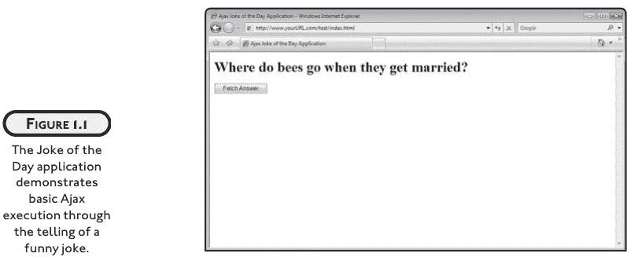

如你所见，该应用程序的起始页面由一个 HTML 标题和一个按钮组成。按下该按钮会使用 Ajax 向 Web 服务器发送请求。作为响应，存储在 Web 服务器上的一个文本文件被返回到浏览器，其内容随即显示在浏览器中，紧跟在应用程序的按钮控件下方，如图 1.2 所示。

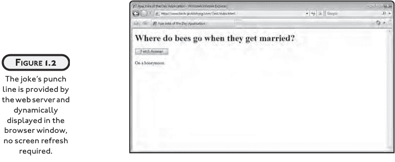

## Ajax 简介

Ajax，也称为异步 JavaScript 和 XML，是一个用于指代一组相关 Web 技术的术语。这些技术为 Web 开发者提供了创建能够与用户动态交互，并在后台与 Web 服务器协同工作以检索应用程序数据的 Web 应用程序的能力。这些数据随后可以显示在浏览器中，无需刷新任何页面。最终的结果是开发出外观和感觉都像桌面应用程序的 Web 应用程序。

到 2005 年，许多网站，尤其是 Google，正致力于开发全新的应用程序（如 Google 地图、Google 建议等）。然后，在 2005 年 2 月 18 日，Jesse James Garrett 撰写了一篇题为《Ajax：Web 应用程序的新方法》的文章，首次创造了 Ajax 这一术语。从此，事情真正开始腾飞。

Ajax 应用程序比传统的 Web 应用程序更快、响应更迅速。通过修改 Web 应用程序，使其与 Web 服务器交换更少量的数据，从而实现了性能的提升。因此，Web 服务器不再需要为每个用户请求或与应用程序的交互而生成并返回整个网页。由于只交换少量数据来代替整个网页，页面刷新得以消除。


正如本书将要展示的，Ajax 提供了一套极其强大的开发能力。然而，仅仅因为你能用 Ajax 执行各种任务，并不意味着你应该使用它。像所有好东西一样，Ajax 通常最好适度使用。例如，如果需要用户填写并提交表单，你可以不使用 Ajax 来完成。但是，如果需要动态更新网页，那么 Ajax 就是正确的选择。

使用 Ajax 时，Web 浏览器和 Web 服务器之间交换的数据在后台异步传递。这意味着 Ajax 应用程序可以向 Web 服务器提交请求，而无需暂停应用程序的执行，并且可以在请求的数据返回时随时进行处理。Ajax 应用程序不使用表单向 Web 服务器提交数据，而是使用一个称为 `XMLHttpRequest` 对象的特殊浏览器对象来提交请求。这个对象是 Ajax 的关键组件，它实现了异步通信。


在 Ajax 出现之前，Web 开发者可以使用一套统称为 DHTML 的客户端 Web 开发技术。使用 DHTML，Web 开发者能够利用与应用程序交互时从用户收集的数据来动态更新网页。

DHTML 是一系列技术的集合，包括 HTML、CSS、JavaScript 和 DOM。当它们结合使用时，为网页开发者提供了创建动态网页效果的能力，例如动画、图形悬停效果和动态菜单。它严格用于开发客户端自动化和效果。Ajax 包含了与 DHTML 相同的所有技术，并在此基础上加入了 `XMLHttpRequest` 对象和 XML。

## Ajax 技术

Ajax 是一系列技术的集合，其中每项技术都已经存在多年。每项技术最初都是出于各种与 Ajax 无关的原因而开发的。然而，由于它们的互补性，Web 开发者发现，当这些技术结合使用时，能够为创建和运行 Web 应用程序提供一个强大而稳健的环境。构成 Ajax 的单独技术包括：

- **JavaScript。** 用于开发 Ajax 应用程序的编程语言，它将所有其他 Ajax 技术的交互结合在一起。
- **XML。** 提供了在 Web 服务器和客户端之间交换结构化数据的一种方式。
- **`XMLHttpRequest` 对象。** 提供了在 Web 浏览器和 Web 服务器之间异步交换数据的能力。
- **HTML 和 CSS。** 提供了标记和设置网页文本显示样式的能力。
- **文档对象模型或 DOM。** 提供了与网页布局和内容进行动态交互并更改其的能力。

## 传统 Web 开发与 Ajax 开发

直到最近几年，Web 应用程序在外观和感觉方面都远远落后于桌面应用程序，而缓慢的互联网连接带来的性能问题使情况变得更加糟糕。然而，随着 Ajax 的出现，这一切开始改变。使用 Ajax，Web 开发者现在可以创建功能强大的基于 Web 的应用程序，能够与桌面应用程序相媲美。当与当今的高速互联网接入和强大的 Web 服务器相结合时，Ajax 应用程序能够提供一种性能水平，使基于 Web 的应用程序成为当今计算机用户的一个可行选择。

得益于 Ajax，Web 应用程序不再具有那种“网页感”。例如，而不是强迫客户在购买商品时从一个屏幕转到另一个屏幕，Ajax 应用程序可以无缝地允许客户选择商品、将其添加到购物车，然后在同一网页上完成购买，而无需强制刷新屏幕或要求客户通过一系列屏幕。

传统 Web 应用程序由任意数量松散集成的网页组成，这些网页通过嵌入在 HTML 页面中的链接按照预定义的顺序显示。

因此，为了使用传统 Web 应用程序，用户必须从一个网页转到另一个网页，以逐步的方式与应用程序的不同部分进行交互。每次客户点击下一个库存页面的链接时，都会有一个短暂的等待时间，因为客户需要等待该页面加载完成。

使用这种传统方法，HTTP 请求会根据用户操作提交给 Web 服务器。Web 服务器收到请求后，通过返回一个新网页来满足该请求，然后 Web 浏览器显示该网页。这种交互如图 1.3 所示。

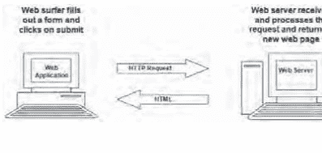

**图 1.3** 大多数 Web 应用程序的传统设计涉及大量的页面刷新和等待。

在处理传入的请求时，Web 服务器可能执行任意数量的操作，包括从文件、数据库或在服务器上运行的程序中检索数据。一旦收集到满足请求所需的数据，Web 服务器可能需要在将这些数据生成嵌入其中的 HTML 页面之前进一步处理这些数据。


> 从 Web 服务器检索的数据可以是存储在 Web 服务器上的纯文本文件，也可以是从服务器端数据库检索的数据，或是在 Web 服务器上进行一些处理后生成的数据。有多种不同的服务器端编程语言可供选择。这些语言包括 PHP、ASP、Ruby on Rails 和 Java Servlets。

考虑一个典型的在线商家示例。该商家的 Web 应用程序可能要求客户浏览数十个不同的页面，才能找到并选择不同的商品进行购买。一旦用户完成购物并选择了所有她想购买的商品，通常会显示一个摘要页面，要求客户确认其购物车的内容。从此处开始，应用程序必须加载一个包含表单的页面，客户需要在该表单中输入信用卡信息。一旦提交给应用程序的 Web 服务器进行处理，用户必须等待购买确认页面返回。在点击按钮提供确认并完成交易后，客户必须再次等待 Web 服务器完成购买，之后会显示一个作为收据的最终页面。在应用程序的每个步骤中，当 Web 服务器处理用户输入并下载新的网页进行显示时，客户都必须等待。

Ajax，你可以改变这种应用模型，使得网络浏览器和服务器之间仅需交换最少量的必要数据。这极大地提升了速度。

通过传递数据而非完整的网页，并允许数据在现有的网页内显示，Web 应用开发者能够赋予他们的应用程序类似桌面软件的体验。这用紧密集成的呈现方式替代了松散集成的网页。Ajax 应用程序还有助于更好地平衡资源的使用。这是通过在混合体中添加一个被称为 Ajax 引擎的额外层来实现的，如图 1.4 所示。

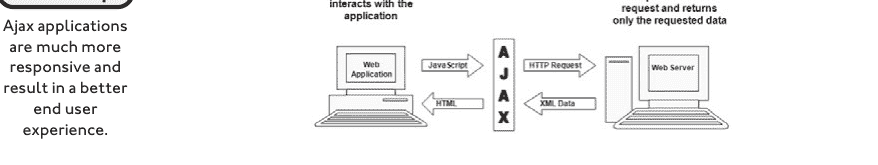

一旦初始的 Web 界面页面加载完成，Web 浏览器和 Web 服务器之间的通信就可以通过传递数据（而非整个网页）来执行。因为现在可以异步传递小量数据，网络负载得以减少，速度得以提升。异步处理是通过执行 JavaScript 函数调用来完成的。异步处理还通过消除页面刷新的需求，显著减少了等待时间。事实上，在等待 Web 服务器返回新数据时，用户可以自由地使用应用程序的其他部分。Web 服务器发回的少量数据可以以纯文本形式发送。另一方面，更大更复杂的数据集合通常使用 XML 来发送。

> **提示** 除了纯文本和 XML，Ajax 应用程序还支持使用 JavaScript 对象表示法或 `JSON` 来交换数据。本书将向你展示如何处理纯文本和 XML。尽管书中没有演示 JSON 的使用，但关于 JSON 的更多信息将在第 7 章“处理 XML”中提供。

异步处理也减轻了 Web 服务器的工作负载，允许在必要时在客户端计算机上完成更多工作。随着 Web 服务器工作负载的减少，Web 服务器能够更快地响应，并处理来自其他客户的更多连接请求。

## 真实世界 Ajax 应用与网站示例

关于 Ajax 及其能做什么的讨论已经足够了。让我们花几分钟时间看看一些 Ajax 实际应用的例子。具体来说，让我们看看一些知名和不太知名的网站，并了解它们如何使用 Ajax 来增强其 Web 应用程序。当你完成这次快速之旅时，你应该能很好地了解可以使用 Ajax 处理的多种任务类型。

### 搜索引擎改造

最早采用 Ajax 的大型搜索引擎之一，它们意识到 Ajax 可以用来极大地提升搜索引擎为用户提供更好体验的能力。使用 Ajax，搜索引擎开发者得以超越仅仅显示 URL 列表和网站描述，他们发现可以为网络冲浪者提供各种额外信息，这些信息是基于访客行为在后台快速检索的。

### A9.com

Amazon.com 是最早利用 Ajax 的网站之一。它使用 Ajax 来帮助构建其 A9.com 搜索引擎（`www.a9.com`），如图 1.5 所示，网络冲浪者可以用它来搜索互联网和 Amazon.com 的在线目录。


> 图 1.5 A9.com 网站允许你搜索互联网或 Amazon.com。

当用于执行搜索时，A9.com 返回的结果看起来与任何其他搜索引擎的结果非常相似。使用 Ajax，该搜索引擎的开发者添加了一个“站点信息”功能，当用户将鼠标指针悬停在链接上时，会显示有关该网站的附加信息，如图 1.6 所示。一切工作得相当无缝，没有任何屏幕刷新。拥有高速互联网访问的网络冲浪者几乎感觉不到任何等待时间。


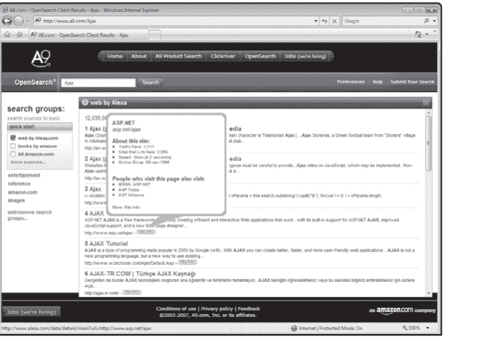

### Ask.com

Ask.com 网站搜索引擎（`www.ask.com`）的开发者使用了 Ajax 来增强其搜索引擎，允许网络冲浪者预览网站，如图 1.7 所示，并在决定是否点击该网站 URL 时参考此信息。

只有前面带有图形双筒望远镜图标的 URL 链接才可以预览。要预览网站，只需将鼠标指针悬停在双筒望远镜图标上即可。显示的预览图并非实时收集，因此可能稍显过时。

### 建议式应用程序

Ajax 另一个非常巧妙的用途是基于建议的搜索引擎，它根据用户的击键从 Web 服务器检索数据。这类 Ajax 应用程序有许多变体。

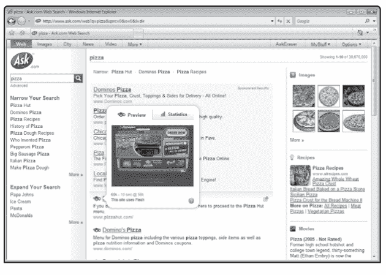

**图 1.7**

除了预览网站图片，Ask.com 还提供有关该网站的统计信息。

### Google Suggest

Google 是首批大力投资 Ajax 的网络公司之一。它将 Ajax 用于开发一系列全新的在线应用程序，包括 Google Gmail、Google Maps 和 Google Suggest（`http://www.google.com/webhp?complete=1&hl=en`），如图 1.8 所示。

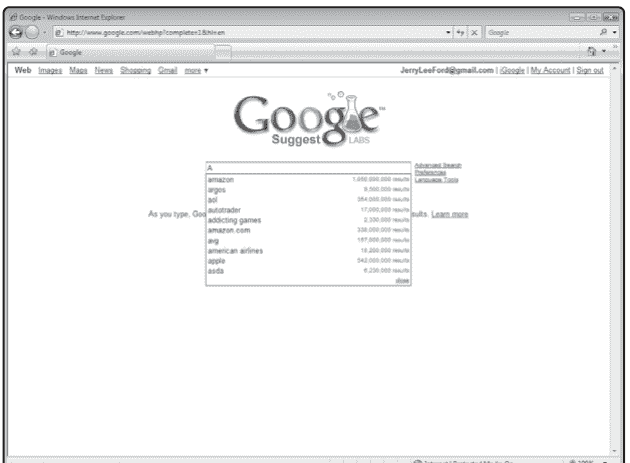

**图 1.8**

Google Suggest 监控用户的击键，并显示可供选择的相关主题列表。

要使用 Google Suggest，你只需开始输入即可。在你输入时，该应用程序会将你的击键在后台传递给 Google 的一台服务器，并检索与你当前输入内容匹配的主题列表。随着你继续输入，Google Suggest 会持续更新显示的主题列表。你可以输入自己独特的搜索词，也可以选择显示的条目之一来发起互联网搜索。

### Amazon Zuggest

建议功能的一个有趣变体是 Amazon Zuggest（`http://www.francisshanahan.com/zuggest.aspx`），如图 1.9 所示。该应用程序监控用户击键，从 Amazon.com 的目录中检索并显示与你输入内容匹配的商品。你输入得越多，应用程序就越能精确地定位你所寻找的内容。


**图 1.9** Amazon Zuggest 是一个搜索 Amazon.com 并显示与键盘输入匹配商品的应用程序。

### 在线 Ajax 词典

基于建议的搜索的另一个绝佳应用是词典和同义词库类应用程序的开发。其中一个应用是 ObjectGraph（`http://www.objectgraph.com/dictionary/`），如图 1.10 所示。

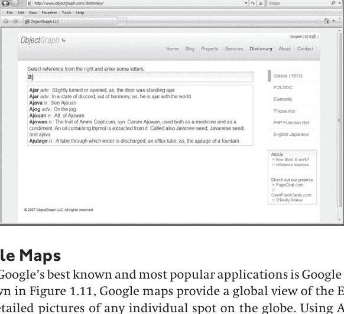

**图 1.10** ObjectGraph 在你输入时即时检索词典单词。

### Google Maps

Google 最知名和最受欢迎的应用程序之一是 Google Maps（`maps.google.com`）。如图 1.11 所示，Google Maps 提供了地球的全球视图，允许访客查看地球上任何单个地点的详细图片。使用 Ajax，Google Maps 允许你点击并拖动地图以显示不同的位置。基于用户输入，新的地图图像从服务器返回并显示在应用程序的地图部分，结果几乎即时呈现，无需刷新页面。

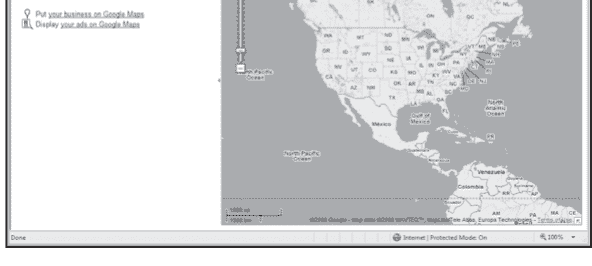

**图 1.11** Google Maps 可用于放大并显示世界任何地区的详细地图图像。

### Netflix

另一个显著使用了 Ajax 的网站是 Netflix（`www.netflix.com`）。Netflix 是一个在线 DVD 租赁服务，拥有超过 600 万订户。客户可以搜索和订购电影，然后这些电影要么下载到客户的电脑，要么邮寄到他们的住所。如图 1.12 所示，Netflix 网站使用 Ajax，当客户将鼠标指针悬停在电影标题上时，会在一个弹出窗口中显示有关该电影的额外信息。

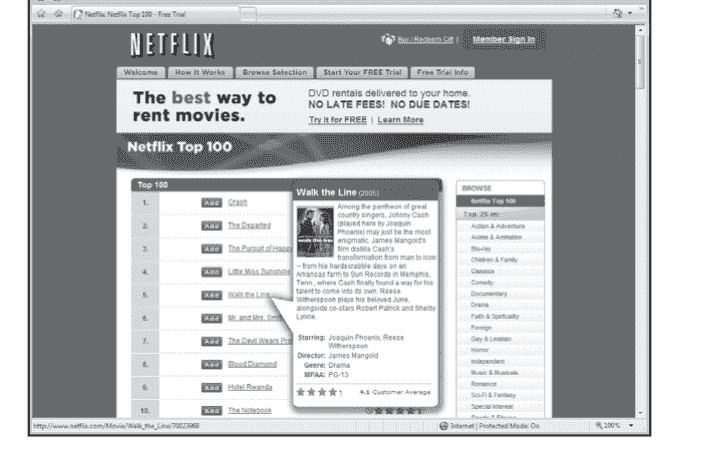

**图 1.12**

Netflix 允许客户检索和查看公司库存中任何电影的附加信息。

### 虚拟桌面应用程序

当今互联网上可用的最新一代应用程序中，有一类允许你在 Web 浏览器中运行虚拟化的计算机操作系统。此类应用的一个例子是 ajaxWindows（`www.ajaxwindows.com`），如图 1.13 所示。

图 1.14 展示了 ajaxWindows 的一个运行实例。如你所见，其整体外观类似于 Windows 操作系统。作为操作系统的一部分，包含了许多常见的桌面应用程序，包括一个名为 ajaxWrite 的文字处理器和一个名为 ajaxSketch 的绘图程序。


**图 1.13** ajaxWindows 在线桌面应用程序允许你在网络浏览器中远程运行一个虚拟操作系统。

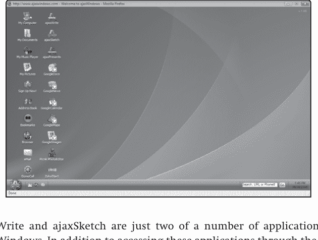

**图 1.14** ajaxWindows 提供了类似 Windows 的虚拟桌面访问。

ajaxWrite 和 ajaxSketch 只是 ajaxWindows 提供的众多应用程序中的两个。除了通过 ajaxWindows 应用程序访问这些程序外，你也可以直接在浏览器中访问和运行它们。例如，通过访问 `http://us.ajax13.com/en/ajaxwrite/`，你可以启动 ajaxWrite。如图 1.15 所示，ajaxWrite 与 Microsoft Word 非常相似。它可用于创建、编辑、撰写和打印文本文档。它甚至可以将文档保存为 Microsoft Word 格式，这些文档可以在线存储或直接保存到计算机的硬盘驱动器上。

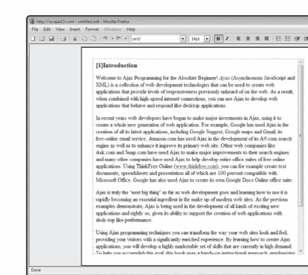

**图 1.15** ajaxWrite 是一个免费的在线文字处理应用程序。

## 使用 Flickr 进行照片管理

另一个部分使用 Ajax 构建的著名网络应用程序是 Flickr（`www.flickr.com`）。Flickr 是一个在线照片管理工具，其功能足以媲美大多数桌面照片管理程序。如图 1.16 所示，Flickr 允许你上传和管理所有个人照片。

Flickr 为用户提供了一个名为 Organizr 的应用程序。使用此应用程序，Flickr 用户可以组织和管理他们上传的照片。Organizr 允许用户拖放照片，并创建和修改照片描述及分组。Organizr 的外观和感觉就像是一个基于桌面的照片管理程序。

## Ajax 即时通讯应用程序

Ajax 常用于开发的另一类应用程序是即时通讯。其中一个即时消息应用程序是 ajax im（`www.ajaxim.net`）。如图 1.17 所示，ajax im（异步 JavaScript 和 xml 即时通讯器）是一个基于浏览器的 IM 客户端，允许用户在不刷新浏览器窗口的情况下相互发送和接收文本消息。

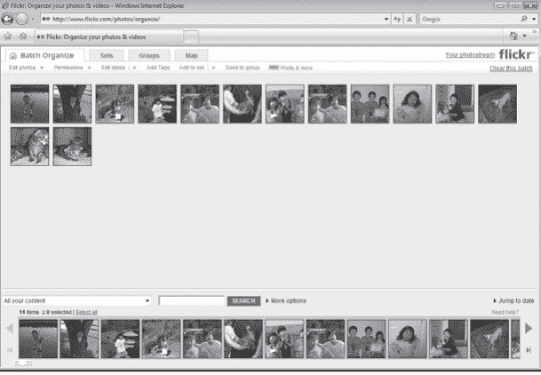

**图 1.16**

Flickr 允许你上传、编辑、组织和分享个人照片与视频。

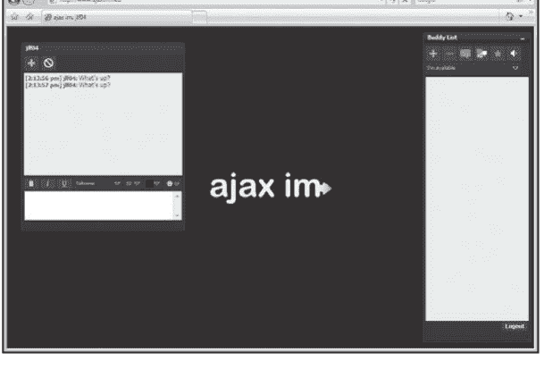

**图 1.17**

Ajax im 是一个基于浏览器的即时消息客户端。

## 在线日历

Ajax 已被用于创建的另一个有趣的应用程序类别是在线日历和时间管理应用程序。其中一个此类应用程序是 calendar hub（`www.calendarhub.com`），如图 1.18 所示。CalendarHub 让你可以使用日、周、月和列表视图查看日历数据。你可以发布任意数量的日历条目和待办事项。你甚至可以与他人共享你的日历，并通过电子邮件接收通知。

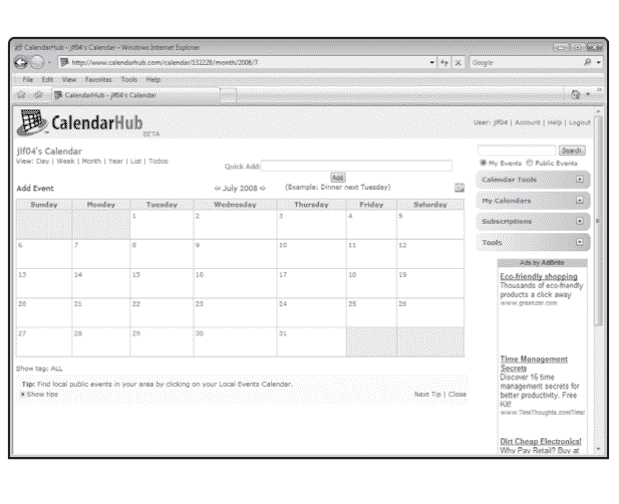

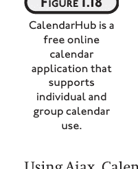

使用 Ajax，CalendarHub 支持拖放界面，允许你移动日历条目并向日历添加新条目，而无需刷新任何页面。

## 回到“每日笑话”应用程序

现在是时候将你的注意力转向本章 Ajax 项目——“每日笑话”应用程序的开发了。该应用程序加载到网络浏览器后，将向用户显示一个网页，其中展示一个笑话的开头。笑话下方有一个按钮，按下后，该按钮会指示应用程序使用 Ajax 获取存储在应用程序网络服务器上纯文本文件中的笑话笑点。

由于本书尚未向你介绍 Ajax 开发的复杂性，例如 JavaScript 或如何使用 `XMLHttpRequest` 对象，因此如果你没有完全理解应用程序中每个代码语句的作用，请不要担心。只要你能理解示例的 HTML 部分，就应该没问题。目前，请试着将注意力集中在将传统网络应用程序转换为 Ajax 应用程序的总体过程上。随着你深入阅读本书，一切都会变得清晰，当你完成时，像“每日笑话”这样的简单应用程序对你来说将显得非常基础。

### 设计应用程序

为了帮助简化事情，此应用程序的开发将按照此处概述的五个步骤进行：

1. 创建一个新的 HTML 页面。
2. 创建应用程序的文本文件。
3. 测试应用程序的 HTML 版本。
4. 使用 Ajax 增强应用程序。
5. 执行你的新 Ajax 应用程序。


前三个步骤将演示如何遵循传统的网络开发方法，使用`HTML`创建和执行应用程序，后两个步骤将向你展示如何使用`Ajax`修改应用程序。虽然这个初始应用程序相对简单，但它将引导你完成使用`Ajax`更新任何典型网页所需的基本开发步骤。只要你仔细遵循每个步骤中提供的说明，你将很快拥有并运行自己的应用程序副本。

为了跟随此示例操作，你需要能够访问一个可以上传网页的网络服务器。如果你没有网站，现在是注册网络托管服务并开始的好时机。要寻找网络托管服务，请访问`www.google.com`并搜索`"web host"`。你会发现许多网络托管服务提供商随时准备并乐意帮助你开始。如果你已经有可以上传网页的网站访问权限，我建议你首先在网站目录中创建一个子文件夹，并在阅读本书的过程中将所有`Ajax`工作都放在其中。这样，在学习和试验`Ajax`时，你就不会弄乱网站上的任何内容。

## 步骤 1：编写应用程序的 HTML

创建“每日笑话”应用程序的第一步是创建该应用程序的`HTML`版本。为此，打开你首选的代码或文本编辑器——Microsoft 记事本或任何可以保存纯文本文件的文本编辑器都可以——创建并保存一个名为`index.html`的新文件。完成后，你需要将以下所示的应用程序`HTML`语句添加到该文件中。

```html
<HTML>
  <HEAD>
    <TITLE>HTML Joke of the Day</TITLE>
  </HEAD>
  <BODY>
    <H1>Where do bees go when they get married?</H1>
    <A href="joke.txt">Fetch Answer</A>
  </BODY>
</HTML>
```

如你所见，这个版本的“每日笑话”应用程序是一个典型的`HTML`页面，由`head`和`body`标签组成。`head`部分包含一个标题标签，显示应用程序的名称，`body`部分包含一个一级标题，显示应用程序的笑话，后跟一个指向另一个名为`joke.txt`的文件的链接，该文件存储了笑话的笑点。`joke.txt`文件是一个纯文本文件，由一行文本组成。单击该链接会打开并在网络浏览器中显示文件的内容。

> 提示：如果你愿意，你可以修改此示例，使其打开另一个显示笑点的`HTML`页面，而不是文本文件。

## 步骤 2：创建应用程序的文本文件

现在你已经创建了`index.html`页面，是时候创建`joke.txt`文件了。打开你首选的文本文件编辑器，并在其中输入图 1.19 所示的句子。

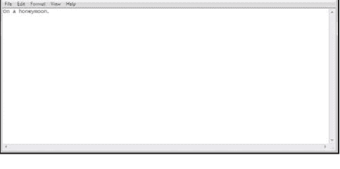

你可以使用任何纯文本来创建应用程序的文本文件。

如你所见，该文件由几个单词组成，保存为纯文本文件。输入文件文本后，将文件保存在保存`index.html`文件的同一位置。

## 步骤 3：上传并测试应用程序的 HTML 版本

创建`index.html`和`joke.txt`文件后，你需要将它们上传到网络服务器进行测试。你可能可以使用`FTP`或网络托管服务提供商提供的基于 Web 的管理界面来执行此步骤。请咨询你的网络托管服务提供商，了解这些选项中哪些可用。

将这两个文件上传到网络服务器后，你就应该准备好测试“每日笑话”应用程序的临时`HTML`版本了。为此，打开网络浏览器并输入`index.html`网页的 URL。你使用的 URL 将因网站 URL 的名称以及你上传应用程序文件的网络服务器位置而异。例如，以下 URL 将用于将应用程序加载到你的网页浏览器，如果你的网站 URL 是`www.tech-publishing.com`，并且你选择创建一个名为`"test"`的子文件夹来放置应用程序的文件。

```text
http://www.tech-publishing.com/test/index.html
```

实际上，由于此时你处理的只是`HTML`，你可以直接在桌面上测试你的应用程序，而无需先将`HTML`文件上传到你的 Web 服务器。为此，你需要做的就是启动你的 Web 浏览器，不是通过指定 URL 来加载`index.html`，而是点击文件菜单，选择打开命令，然后指定`HTML`文件的名称和位置。要正常工作，`joke.txt`文件的副本必须与`index.html`文件位于同一文件夹中。

一旦加载到你的 Web 浏览器中，你应该会看到如图 1.20 所示的网页出现，显示应用程序的笑话和一个标记为`"获取答案"`的链接。

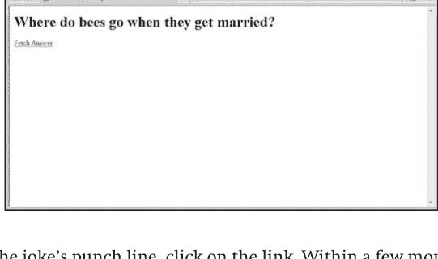

要查看笑话的点睛之笔，请点击该链接。片刻之后，浏览器窗口会闪烁，`joke.txt`的内容将被加载，如图 1.21 所示。如你所见，这是一个非常标准的`HTML`应用程序。它涉及加载一个初始网页，之后在用户等待浏览器窗口重新加载时，通过加载新的网页到浏览器窗口中来呈现额外的数据。

由于这个应用程序很小，并且没有使用大量的图形或声音，一切发生得相当快，所以你可能不会注意到明显的延迟。然而，如果网页内容繁重，延迟会更加明显。

## Ajax 编程入门

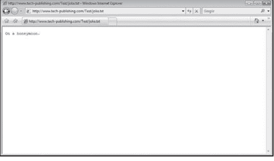

图 1.21

要打开并显示文本文件的内容，浏览器必须加载它，替换当前打开的`HTML`页面。

## 步骤 4：将 HTML 应用程序转变为 Ajax 应用程序

既然你已经让“每日笑话”应用程序的`HTML`版本运行起来，你就可以将其转换为`Ajax`应用程序了。方法是打开`index.html`应用程序在你喜欢的代码或文本编辑器中，并按照以下所示进行修改：


首先将新的`Ajax`应用程序作为`HTML`应用程序进行开发，然后将其转换为`Ajax`应用程序，是`Ajax`开发中一种非常流行的方法。将`Ajax`应用于现有的`HTML`页面通常比从头开始开发新的`Ajax`应用程序更容易。此外，正如第 10 章“重要的 Ajax 设计问题”所讨论的，由于`Ajax`确实存在一些尚未完全克服的限制，拥有应用程序的`HTML`和`Ajax`版本，能够为那些计算机支持或不支持`Ajax`应用程序的网络冲浪者提供服务。你将在第 3 章“深入了解 JavaScript”中学习更多关于处理这种情况的内容。

```html
<HTML>

<HEAD>

<TITLE>Ajax每日笑话应用程序</TITLE>

<SCRIPT language = "javascript" type = "text/javascript">

var Request = false;

if (window.XMLHttpRequest) {
    Request = new XMLHttpRequest();
} else if (window.ActiveXObject) {
    Request = new ActiveXObject("Microsoft.XMLHTTP");
}

function retrieveJoke(url, elementID) {

    if(Request) {
        var RequestObj = document.getElementById(elementID);
        Request.open("GET", url);
        Request.onreadystatechange = function()
        {
            if (Request.readyState == 4 && Request.status == 200) {
                RequestObj.innerHTML = Request.responseText;
            }
        }
        Request.send(null);
    }
}

</SCRIPT>

</HEAD>

<BODY>

    <H1>蜜蜂结婚后去哪里？</H1>

    <FORM>
        <INPUT type = "button" value = "获取答案"
        onclick = "retrieveJoke('joke.txt', 'DivTarget')">
    </FORM>

    <DIV id="DivTarget"> </DIV>

</BODY>

</HTML>
```

## Ajax 编程入门

如你所见，“每日笑话”应用程序的`Ajax`版本涉及添加相当数量的新语句。由于本书尚未回顾创建`Ajax`应用程序的复杂性，本章不会详细讨论`index.html`中每一个新语句的作用。相反，让我们保持在一个合理的高度上。图 1.22 分解了你已添加到应用程序`Ajax`版本中的新代码语句。

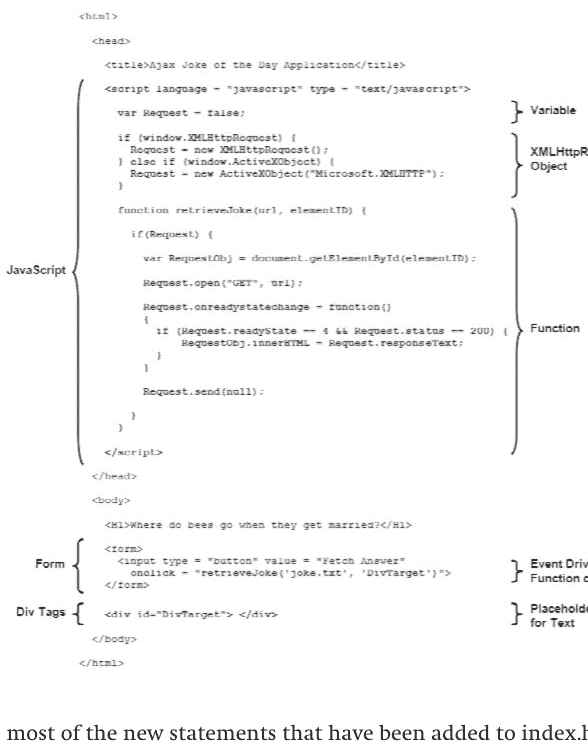

> **图 1.22** `HTML`页面已通过添加许多新的代码组件转变为`Ajax`应用程序。

如图 1.22 所示，大多数添加到`index.html`的新语句构成了一个`JavaScript`，它以`<script>`和`</script>`标签开始和结束。在脚本中，变量用于存储数据，设置了`XMLHttpRequest`对象以实现与应用程序 Web 服务器的通信，并使用一个函数来建立与 Web 服务器的连接并检索包含笑话点睛之笔的文本字符串。

添加到`index.html`的其余语句用于创建一个包含按钮的表单，当点击该按钮时，会触发一个事件，导致执行名为`retrieveJoke()`的函数。在`body`部分还有一对`Div`标签，为应用程序提供了一个占位符，用于显示笑话的点睛之笔。

> 希望你已经知道如何使用表单和`Div`标签。以防万一，本书将在第 3 章和第 4 章简要介绍它们，并向你介绍`JavaScript`编程和`XMLHttpRequest`对象。

## 步骤 5：执行你的新 Ajax 应用程序

一旦你创建了“每日笑话”应用程序的`Ajax`版本，你需要将其上传到你的网站，然后才能测试其执行情况。完成此操作后，打开你的 Web 浏览器并输入`index.html`网页的 URL。例如，如果你的网站 URL 是`www.yourURL.com`，并且你选择创建一个名为“test”的子文件夹来放置应用程序的文件，那么以下 URL 将用于加载你的`Ajax`应用程序。

```text
http://www.yourURL.com/test/index.html
```

加载后，你的“每日笑话”应用程序副本应该完全按照本章开头演示的方式运行，当按下“获取答案”按钮时，立即显示笑话的点睛之笔，无需任何页面刷新。

## 最终结果

好了，此时你的新`Ajax`版本的“每日笑话”应用程序应该已准备好进行测试。要测试该应用程序，你必须将修改后的`HTML`页面上传到你的 Web 服务器，然后使用你的 Web 浏览器加载它。加载后，你能够查看应用程序的新界面，并点击其按钮控件以检索和加载应用程序笑话的点睛之笔。假设你在创建这个新应用程序时仔细跟随操作，并且在将其上传到 Web 服务器时没有遇到任何问题，一切应该按描述运行。

如果你遇到任何错误，请确保你在浏览器中输入了正确的应用程序 URL。如果你的 URL 没问题，请返回并仔细检查构成应用程序`Ajax`版本的语句，寻找你在输入时可能犯的任何错误。

> 你可以在本书的配套网站上找到此应用程序源代码文件的副本，网址为`http://www.courseptr.com/downloads`。

## 总结

本章介绍了`Ajax`。你学习了如何利用`Ajax`所包含的不同技术来构建快速且响应迅速的类桌面应用程序。你了解了`Ajax`应用程序与传统`HTML`应用程序的不同之处，并回顾了一些使用了`Ajax`的不同网站，研究了如何使用`Ajax`来增强和改进应用程序。你还学习了如何创建你的第一个`Ajax`应用程序，它是通过修改现有的`HTML`应用程序来与远程 Web 服务器通信并从中检索文本来创建的。

在继续第 2 章“JavaScript 简介”之前，请考虑留出一点额外时间，通过解决以下挑战来改进“每日笑话”应用程序。

## 挑战

1. “每日笑话”应用程序所讲的笑话有些平淡。为什么不把它换成一个能反映你自己幽默感的笑话，来增加一点趣味性呢？
2. 考虑创建一个“每日笑话”应用程序的副本，也许制作一个“每周笑话”应用程序，并设置它来讲述一个不同的笑话。

# 第二部分：学习 JavaScript 与 DOM

## 第 2 章：JavaScript 简介

`JavaScript`是将`HTML`与其他构成`Ajax`应用程序的技术结合在一起的编程语言。因此，深入理解如何使用`JavaScript`进行编程对于`Ajax`开发者至关重要。本章及下一章的重点是帮助你建立坚实的`JavaScript`基础，为你提供支持`Ajax`应用程序开发所需的基本`JavaScript`编程概念。

具体来说，你将学到：

- 关于`JavaScript`的起源和浏览器兼容性
- 如何创建和嵌入`JavaScript`到网页中
- 如何编写`JavaScript`语句并遵守`JavaScript`语法
- 如何使用变量来收集、存储和修改数据
- 如何应用条件和迭代编程逻辑

### 项目预览：猜数字游戏

由于本章的目标是教你`JavaScript`编程的基础知识，本章将以展示如何创建一个名为“猜数字”的`JavaScript`游戏结束。如图 2.1 所示，该游戏从显示一个弹出对话框窗口开始，挑战玩家猜测一个 1 到 10 之间的数字。

**图 2.1**

要提交猜测，玩家必须输入一个数字并单击“确定”按钮。

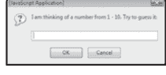

一旦提交猜测，弹出对话框窗口消失，系统会分析玩家的猜测以确定其是否正确、过低或过高。如果玩家的猜测不正确，则会显示一个类似于图 2.2 所示的对话框，为玩家提供提示以帮助指导其下一次猜测。

**图 2.2**

玩家的猜测太低了。

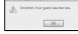

玩家可以根据需要进行多次猜测，以猜出游戏的秘密数字。图 2.3 显示了玩家最终猜出秘密数字后显示的消息。

**图 2.3**

玩家赢得了游戏。


如图 2.4 所示，每局游戏结束时，玩家都会被提示进行另一轮游戏。如果玩家输入字母`y`并单击“确定”按钮，则会生成一个新的秘密数字，一切重新开始。否则，游戏结束。

**图 2.4**

玩家被提示进行另一轮游戏。

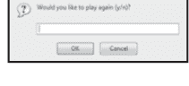

一旦玩家决定停止玩该游戏，将显示如图 2.5 所示的弹出对话框窗口，感谢玩家玩游戏。


**图 2.5**

游戏感谢玩家花时间玩游戏。

### JavaScript——Ajax 的编程语言

`JavaScript`是一种计算机编程语言，旨在 Web 浏览器内执行。`JavaScript`用于开发被称为脚本的小程序，这些脚本嵌入在`HTML`页面中。执行时，这些脚本能够为任何网页添加交互式内容。`JavaScript`是一种解释型编程语言，这意味着用`JavaScript`编写的脚本直到包含它们的`HTML`页面被处理后才会转换为可执行形式。因此，`JavaScript`比编译型编程语言稍慢，后者在开发过程结束时被转换或编译成可执行代码，从而允许更快的执行。

`JavaScript`是一种基于对象的编程语言。它将`HTML`文件和浏览器中的所有内容视为对象。对`JavaScript`而言，浏览器是一个对象；浏览器窗口是对象，表单文本字段和按钮也是对象。像图像文件这样的资源也被视为另一种类型的对象。每个对象都有属性，用于描述对象的某些特征或方面。例如，一个按钮可以显示文本，这可以使用其`text`属性来指定。图形图像也有属性。使用这些属性，你可以例如指定网页中显示的图形的大小。

除了属性，对象还有方法，它们是脚本语句的集合，当被调用执行时，能够使其关联的对象执行某些预定义的动作。例如，你可以向你的`JavaScript`添加自定义方法，当被调用执行时，将执行打开和关闭浏览器窗口等动作。使用对象属性和方法，构成`Ajax`应用程序的`JavaScript`可以动态更改网页的内容和呈现方式。

`JavaScript`的一个重要特性（对于`Ajax`编程至关重要）是能够基于不同事件的发生来执行程序代码。事件是当用户与你的 Web 应用程序交互时启动的任何操作。正如第 3 章所涵盖的，当网页打开和关闭时会发生事件。每当用户单击网页上显示的文本字段、按钮或其他对象时，也会发生事件。

### JavaScript 背景小知识

`JavaScript`最初的名字是`LiveScript`。后来，当`Java`登场并开始获得大量关注时，Netscape 决定将其重命名为`JavaScript`。除了名字相似之外，`Java`和`JavaScript`共同点很少。

使用`JavaScript`，网页开发者能够将编程逻辑融入其应用程序和网页的客户端部分。`JavaScript`为网页开发者提供了在网页中集成诸如翻转图像和文本等图形效果的能力。结合`DOM`（在第 4 章“理解文档对象模型”中涵盖），Web 开发者能够对网页以及加载和显示它们的浏览器的内容进行精确控制。

意识到 Netscape 的`JavaScript`编程语言的普及，微软决定开发自己的编程语言版本，将其命名为`Jscript`。不幸的是，微软的`Jscript`与`JavaScript`并非 100% 兼容，这导致了许多混淆并帮助引发了浏览器战争。为了试图改善这种情况，Netscape 开始与欧洲计算机制造商协会（`ECMA`）合作，以`JavaScript`的形式标准化`JavaScript`，即`ECMAScript`。

近年来，随着 Web 浏览器开发者开始接受`ECMAScript`版本的`JavaScript`，`JavaScript`和`Jscript`之间的许多差异已经消失。然而，今天不同的 Web 浏览器支持`JavaScript`的方式仍然存在细微差异。在相关的地方，本书将指出这些差异，并解释在开发`Ajax`应用程序时如何克服它们。

### 浏览器兼容性问题


Ajax 开发者关注的一个主要领域是浏览器兼容性。不幸的是，尽管 Netscape 和微软的浏览器战争已经结束多年，但现代 Web 浏览器支持 JavaScript 的方式仍然存在许多差异。由于使用了如此多不同的 Web 浏览器，情况变得更加复杂。流行的 Web 浏览器示例包括：

- Internet Explorer (`www.microsoft.com/Windows/Downloads/IE`)
- Firefox (`www.mozilla.com/en-US/firefox/`)
- Safari (`www.apple.com/safari/`)
- Konqueror (`www.konqueror.org`)
- Flock (`www.flock.com`)
- Opera (`www.opara.com`)

由于不同浏览器之间的兼容性差异，网页的外观和行为有时会根据加载和执行它们的浏览器而有所不同。

Ajax 开发的很大一部分是理解现有的兼容性问题并处理它们。

**提示** 由于主要 Web 浏览器之间的 JavaScript 支持存在差异，你将需要使用多个浏览器来测试你的 Ajax 应用程序。至少，你需要使用 Internet Explorer、Firefox 和 Safari 来测试你的 Ajax 应用程序。

Web 浏览器之间一个非常重要的差异是它们支持创建 `XMLHttpRequest` 对象的方式。该对象为 Ajax 应用程序提供了异步请求和处理从 Web 服务器检索的数据的能力。你将在第 3 章“深入 JavaScript”中全面了解该对象以及如何创建和使用它。

**陷阱** 不幸的是，同一浏览器的不同版本对 JavaScript 的支持也存在差异。为了解决这个问题，你可能需要使用主要 Web 浏览器的先前版本来测试你的 Ajax 应用程序。

### 使用 JavaScript

JavaScript 被嵌入在 HTML 页面的 `<head>` 或 `<body>` 部分中。JavaScript 使用 `<SCRIPT>` 和 `</SCRIPT>` 标签插入到 HTML 页面中。图 2.6 概述了使用这些标签时必须遵循的语法。

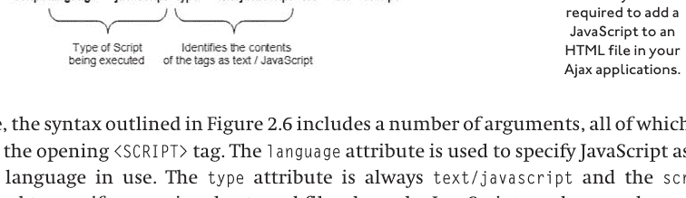

如你所见，图 2.6 中概述的语法包含许多参数，所有这些参数都位于开始的 `<SCRIPT>` 标签中。`language` 属性用于指定 JavaScript 作为使用的脚本语言。`type` 属性始终为 `text/javascript`，而 `src` 属性用于指定可存储 JavaScript 的可选外部文件。

**提示** `language` 属性代表指定脚本类型的旧方式。HTML 4.0 规范声明 `type` 属性是指定脚本类型的正确方式。如果需要，你可以同时使用两个属性。这将有助于确保较旧的浏览器能够运行你的 JavaScript。

## Ajax 编程入门

### 创建一个简单的 JavaScript

既然你已经了解了使用 `<SCRIPT>` 和 `</SCRIPT>` 标签所需的语法，让我们来看一个如何用它们向 HTML 页面添加简单 JavaScript 的示例。首先，创建并保存此处显示的 HTML 页面，将其命名为 `hello.html`。

```html
<HTML>
  <HEAD>
    <TITLE>My first JavaScript</TITLE>
  </HEAD>
  <BODY>
  </BODY>
</HTML>
```

如你所见，这是一个相当普通的 HTML 页面。现在，将以下 JavaScript 语句添加到其头部部分。

```javascript
<SCRIPT language = "javascript" type = "text/javascript">
  document.write("Hello World!");
</SCRIPT>
```

完成后，HTML 页面应如下例所示：

```html
<HTML>
  <HEAD>
    <TITLE>My first JavaScript</TITLE>
    <SCRIPT language = "javascript" type = "text/javascript">
      document.write("Hello World!");
    </SCRIPT>
  </HEAD>
  <BODY>
  </BODY>
</HTML>
```

你应该能认出第一和最后一条 JavaScript 语句是脚本的开始和结束标签。第二条语句指示浏览器将一个文本字符串 `"Hello World!"` 写入当前文档（网页）。

### 执行你的 JavaScript

要运行你的新 JavaScript，请使用 Web 浏览器打开包含它的网页。由于此示例仅包含 HTML 和 JavaScript，并且不与任何 Web 服务器交互，你甚至不需要将其上传到你的浏览器。双击它，它将自动加载到你的默认浏览器中。或者，你可以通过启动 Web 浏览器并执行位于“文件”菜单上的“打开”命令来打开并执行它。例如，以下步骤概述了使用 Internet Explorer 加载 HTML 页面的过程。

1. 启动 Internet Explorer。
2. 单击“文件”，然后单击“打开”。将显示“打开”对话框。
3. 输入 HTML 页面的位置，然后单击“确定”，或单击“浏览”按钮定位 HTML 文件，然后单击“确定”。Internet Explorer 将打开你的 HTML 页面并自动运行其嵌入的 JavaScript，如图 2.7 所示。

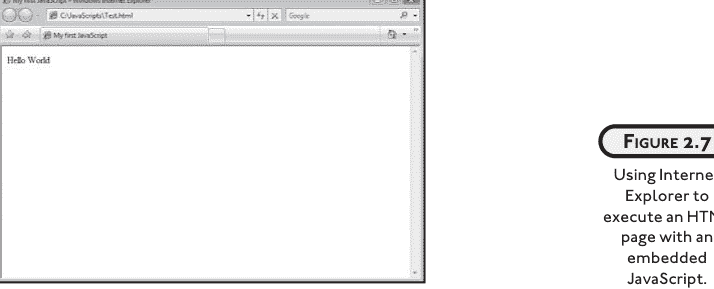

如果文字 `Hello World` 没有出现，那么你很可能犯了拼写错误，你应该能够通过重新检查 HTML 文件来定位并修复它。

### 使用 JavaScript 的四种方式

除了将 JavaScript 嵌入 HTML 页面的头部或主体部分外，你还可以将 JavaScript 存储在外部文件中。你还可以将 JavaScript 语句直接集成到 HTML 标签中。所有这四种选择将在以下部分中进行探讨。

#### 在 HEAD 部分嵌入 JavaScript

按照惯例，大多数 Ajax 开发人员将其应用程序的 JavaScript 放在 HTML 页面的头部部分。嵌入在头部部分的 JavaScript 可以设置为在 HTML 页面加载时自动或有条件地执行。大多数 Ajax 开发人员将所有 JavaScript 函数和大多数变量声明放在头部部分，以确保它们在 HTML 页面的其余部分加载之前已定义且可用，但在 HTML 页面加载时不会自动执行它们。

> `变量`是指向计算机内存中存储数据位置的指针。`函数`是一个命名的 JavaScript 语句集合，可以被调用来执行任务。

以下 HTML 页面包含一个嵌入在头部部分的 JavaScript。该 JavaScript 在 HTML 页面加载时自动执行。

```html
<HTML>
    <HEAD>
        <TITLE>Demo: Automatic JavaScript execution</TITLE>
        <SCRIPT language = "javascript" type = "text/javascript">
            window.alert("Boo!");
        </SCRIPT>
    </HEAD>
    <BODY>
    </BODY>
</HTML>
```

请注意上述示例中 `window` 对象的 `alert` 方法（`window.alert`）的使用。此方法允许你在弹出对话框窗口中显示一个带有“确定”按钮的文本消息，非常适合显示不需要用户交互的单个消息。以下语句概述了使用 `alert` 方法所需的语法。

`window.alert("message");`

你将在第 3 章中学习更多关于如何使用对象及其方法的知识。

加载时，此 HTML 页面会在弹出对话框中显示一条文本消息，如图 2.8 所示。

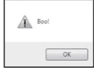

**图 2.8**

一个 JavaScript 在 HTML 页面加载时自动执行的示例。

如本示例所示，任何时候你将 JavaScript 嵌入 HTML 页面的头部部分，它都将在页面加载时自动执行。但是，如果你使用函数来组织 JavaScript，那么这些函数只会在被调用运行时执行。例如，以下 HTML 页面包含一个嵌入的 JavaScript，由一个名为 `ScareUser()` 的函数组成，该函数在 HTML 页面最初加载时不会执行。

```javascript
<HTML>
    <HEAD>
        <TITLE>Demo: Organizing Javascript into functions</TITLE>
        <SCRIPT language = "javascript" type = "text/javascript">
            function ScareUser() {
                window.alert("Boo!");
            }
        </SCRIPT>
    </HEAD>
    <BODY>
    </BODY>
</HTML>
```

因为 JavaScript 语句现在存储在一个函数中，所以除非从 HTML 页面的其他地方调用运行，否则它们不会执行。你将在第 3 章中全面了解函数及其使用方法。

#### 在 BODY 部分嵌入 JavaScript

JavaScript 也可以放在 HTML 页面的主体部分。嵌入在主体部分的脚本在页面加载时自动执行。以下示例演示了如何将 JavaScript 嵌入 HTML 页面的主体部分。

```html
<BODY>
    <SCRIPT language = "javascript" type = "text/javascript">
        document.write("Boo!");
    </SCRIPT>
</BODY>
```

如果你的 Ajax 应用程序需要，你可以在同一个 HTML 页面中嵌入多个 JavaScript，如下所示：

```html
<BODY>
    <SCRIPT language = "javascript" type = "text/javascript">
        document.write("Boo!");
    </SCRIPT>
</SCRIPT>
<BR>
<SCRIPT language = "javascript" type = "text/javascript">
    document.write("Did I scare you?");
</SCRIPT>
</BODY>
```

#### 将 JavaScript 放入外部文件

大型 Ajax 应用程序通常由复杂的 HTML 页面和大量 JavaScript 组成。当程序员将大量 JavaScript 嵌入复杂的 HTML 文件时，生成的代码可能会变得难以理解和管理。Ajax 开发人员处理此问题的一种常见方法是将 JavaScript 和 HTML 代码存储在单独的文件中。

> **技巧** 如果你将 Ajax 应用程序的 JavaScript 存储在外部脚本文件中，你可以通过为不同的浏览器创建不同的 JavaScript，然后根据所使用的浏览器调用相应的外部文件，来更好地处理跨浏览器问题。

要将 JavaScript 存储在外部文件中，请将其保存为具有 `.js` 文件扩展名的纯文本文件。完成此操作后，你可以使用 `src` 属性来引用它，如下所示：

```html
<SCRIPT src="Test.js" language="javascript" type="text/javascript">
</SCRIPT>
```

外部 JavaScript 文件可以包含一个或多个 JavaScript。它不能包含的是 HTML。否则，会发生错误。你存储在外部文件中的 JavaScript 可以是任意长度的。

Ajax 开发人员喜欢将 JavaScript 存储在外部文件中有多个原因。将 JavaScript 语句从 HTML 页面中移出，使页面更小且更易于管理。外部 JavaScript 文件可以被多个 Ajax 应用程序引用和使用。如果你以后需要修改一个外部 JavaScript，你无需修改每个引用它的 HTML 页面（如果你在每个引用它的页面中硬编码 JavaScript，就会出现这种情况）。

#### 在 HTML 标签中嵌入 JavaScript

除了将 JavaScript 放在 HTML 页面的头部或主体部分或外部文件中，你还可以将单个 JavaScript 语句嵌入 HTML 标签中，如下所示：

在这里，JavaScript 语句 `onLoad=document.write("Boo!")` 被嵌入到了 `<BODY>` 标签中。这条语句指示浏览器在加载 HTML 页面时显示指定的文本。

将单个 JavaScript 语句嵌入 HTML 标签为您提供了一种执行单个语句的简便方法。然而，正如第 3 章所述，要启动位于 `<HEAD>` 部分、`<BODY>` 部分或外部存储的脚本中的 JavaScript，您需要调用 JavaScript 函数。学习如何设置这一点是成为有效 Ajax 开发者的关键一步。

### 理解 JavaScript 语句语法

JavaScript 是一种区分大小写的编程语言。这与 HTML 不同，HTML 允许您在使用 HTML 标签时使用不同的大小写。在编写 JavaScript 语句时，您必须使用正确的拼写和大小写。例如，JavaScript 要求在引用 `document` 对象及其方法和属性时，必须全部使用小写字母。如果不这样做，将会发生错误。

除了严格区分大小写外，JavaScript 是一种非常灵活的编程语言，对脚本的编写方式没有太多限制。语句通常在一行内开始和结束。然而，如果需要，您可以在一行开始，并将语句延续到下一行。您甚至可以通过用分号（`;`）分隔在同一行放置多条语句。JavaScript 使用分号来标识语句的结束。不过，您并非必须添加它们。尽管如此，以分号结束所有 JavaScript 语句仍被视为良好的编程习惯。

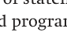

JavaScript 还允许您自由使用空白。可以在脚本语句之间插入任意数量的空行，以提高可读性。

### 处理不支持 JavaScript 的浏览器

Ajax 开发者面临的一个挑战是，许多浏览网页的人使用的 Web 浏览器要么不支持 JavaScript，要么已被配置为禁用 JavaScript 支持。解决此问题的一种方法是使用 HTML 注释标签，将 JavaScript 语句隐藏在无法理解它们的浏览器中。HTML 注释嵌入在 `<!--` 和 `-->` 字符之间。浏览器将忽略放置在这些字符内的任何文本。

所有浏览器都知道不显示 `<SCRIPT>` 标签，无论它们是否支持 JavaScript。但是，不支持 JavaScript 的浏览器不知道如何处理位于 `<SCRIPT>` 标签内的语句，并会将脚本语句作为 HTML 页面的 一部分显示出来。为了防止这种情况发生，您只需将位于 `<SCRIPT>` 和 `</SCRIPT>` 标签内的 JavaScript 语句用 HTML 注释括起来，如下所示：

```html
<HTML>
  <HEAD>
    <TITLE>Demo: Hiding JavaScript from non-supporting browsers</TITLE>
  </HEAD>
  <BODY>
    <SCRIPT language = "javascript" type = "text/javascript">
    <!-- Start hiding JavaScript statements
      document.write("Boo!");
    // End hiding JavaScript statements -->
    </SCRIPT>
  </BODY>
</HTML>
```

以这种方式编码后，不支持 JavaScript 的浏览器会将 JavaScript 语句作为注释忽略。

### 使用注释为脚本添加文档

为了使您的 JavaScript 更易于理解和维护，建议养成在 Ajax 应用程序中嵌入注释语句来记录正在发生的事情的习惯。注释对 JavaScript 的性能没有影响。JavaScript 支持两种类型的注释。首先，您可以通过在脚本中的任何位置输入 `//` 后跟注释文本来添加注释行，如下所示：

```javascript
//The following statement displays a scary message
document.write("Boo!");
```

您也可以在任何语句的末尾附加注释，如下所示：

```javascript
document.write("Boo!");  //This statement displays a scary message
```

JavaScript 还允许您通过在起始字符 `/*` 和结束字符 `*/` 之间放置文本来创建多行注释，如下所示：

```javascript
/* The following statement displays a short but very scary message directly
on the browser window */
document.write("Boo!");
```

### 处理不同类型的值

Ajax 应用程序在执行过程中会存储和操作数据。JavaScript 会对它处理的每种数据类型进行隐式确定。这种值分配对 JavaScript 处理数据的方式有直接影响。表 2.1 列出了 JavaScript 支持的不同类型的值。

#### 表 2.1 JavaScript 支持的值

| 值 | 描述 |
|---|---|
| 布尔值 (Boolean) | 表示真或假条件的值 |
| 空值 (Null) | 空值 |
| 数字 (Numbers) | 数值 |
| 字符串 (Strings) | 包含在匹配引号中的一串文本 |

您可以在 JavaScript 中使用变量来存储和操作数据。`变量`是对内存中存储单个数据位置的引用。

### 创建 JavaScript 变量

在 Javascript 中使用变量之前，必须先声明或定义它。变量声明可以显式或隐式进行。要显式声明变量，可以使用 `var` 关键字，如下所示：

```javascript
var playerName = "Wing Commander";
```


这里定义了一个名为`playerName`的变量，并赋予其值"Wing Commander"。要隐式声明变量，只需首次引用它，如下所示：

```javascript
playerName = "Wing Commander";
```

显式变量声明是一种良好的编程习惯。它有助于使您的脚本更易于阅读和理解。

## 为变量命名

JavaScript在支持变量名方面非常灵活。但是，您必须遵循一些规则，如下所述：

- 变量名只能由大小写字母、下划线字符和数字0到9组成。
- 变量名不能以数字开头。
- 变量名不能包含空格。
- 保留字不能用作变量名。

记住变量是区分大小写的。如果您声明了一个名为`playerCount`的变量，那么在整个JavaScript中引用它时必须使用完全相同的大小写。为变量命名时需要考虑的另一个重要点是，好的变量名应能描述其内容或目的。例如，`PlayerName`比`pn`更具描述性。

## 理解变量作用域

术语“作用域”指的是JavaScript中变量存在且可访问的位置。JavaScript支持两种变量作用域：全局作用域和局部作用域。具有全局作用域的变量可被嵌入HTML页面的任何JavaScript访问。局部变量是在函数内部创建的变量。局部变量只能由其定义所在函数内的语句访问。

> **提示**
>
> 对于新程序员来说，理解作用域通常很困难。如果此时作用域的概念似乎有点模糊，请不要担心。随着您获得更多的编程经验，这个概念会变得更加清晰。

## 使用全局变量

“全局变量”是网页中任何脚本语句都可以引用和修改的变量。全局变量可以通过几种方式定义，包括：

- 在函数内部首次引用新变量而不使用`var`关键字。
- 在函数外部定义变量（无论是否使用`var`关键字）。

## 使用局部变量

“局部变量”是使用`var`关键字在函数内部显式声明的。“函数”是命名的代码语句集合，可以从脚本或HTML页面中的不同位置调用执行。作为如何创建局部变量的示例，请查看以下语句。

```javascript
function DisplayGreeting() {
    var greetingText = "Hello World!";
    document.write(greetingText);
}
```

这里创建了一个名为`DisplayGreeting()`的函数，当调用执行时，它将声明一个名为`greetingText`的局部变量，为其分配一个文本字符串，然后在浏览器窗口中显示该文本字符串。分配给`greetingText`的值在函数外部无法访问。

## 进行一些数学运算

处理数值数据时，JavaScript允许您使用表2.2中列出的运算符执行算术计算。使用这些运算符，您可以编写执行几乎任何类型计算的语句，然后将结果赋给一个变量。

### 表2.2 JavaScript数学运算符

| 运算符 | 描述 | 示例 |
| :--- | :--- | :--- |
| `+` | 将两个值相加 | `playerScore = 5 + 10` |
| `-` | 从一个值中减去另一个值 | `playerScore = 10 - 5` |
| `*` | 将两个值相乘 | `playerScore = 5 * 10` |
| `/` | 将一个值除以另一个值 | `playerScore = 10 / 5` |
| `-x` | 反转变量的符号 | `count = -count` |
| `x++` | 后置自增（返回x，然后x加1） | `x = y++` |
| `++x` | 前置自增（x加1，然后返回x） | `x = ++y` |
| `x--` | 后置自减（返回x，然后x减1） | `x = y--` |
| `--x` | 前置自减（x减1，然后返回x） | `x = --y` |

表2.2中列出的前四个运算符的用途不言自明。然而，其余运算符需要额外解释。`x++`和`++x`运算符提供了将`x`的值增加1的能力。这两个运算符工作方式的区别在于更新发生的时间。例如，假设您有两个变量`playerScore`和`noOfHits`。如果`noOfHits`被设置为等于100，然后执行以下语句，那么`noOfHits`的值将被递增1，然后将值101赋给`playerScore`。

```javascript
playerScore = ++noOfHits;
```

如上所示，使用`x++`运算符会产生不同的结果。

```javascript
playerScore = noOfHits++;
```

这里发生的情况是，`noOfHits`的值（例如100）首先被赋值给`playerScore`，只有在这一步完成之后，`noOfHits`的值才会递增到101。`--x`和`x--`运算符的工作方式与`++x`和`x++`运算符完全相同，只是它们将变量的值减1。

## 赋值和修改变量值

正如你已经看到的，要为变量赋予初始值，你需要使用`=`运算符。同样，要修改变量已赋的值，你只需使用`=`运算符为其赋予一个新值即可，如下所示：

```javascript
playerScore = 0;
.
.
.
playerScore = 100;
```

除了`=`运算符，JavaScript还允许你使用表2.3中列出的任何运算符来修改变量值。

### 表2.3 JavaScript赋值运算符

| 运算符 | 描述 | 示例 |
| :--- | :--- | :--- |
| `=` | 将变量的值设置为某个值 | `x = y + 1` |
| `+=` | `x = x + y`的简写形式 | `x += y` |
| `-=` | `x = x - y`的简写形式 | `x -= y` |
| `*=` | `x = x * y`的简写形式 | `x *= y` |
| `/=` | `x = x / y`的简写形式 | `x /= y` |
| `%=` | `x = x % y`的简写形式 | `x %= y` |

为了更好地理解如何使用表2.3中所示的运算符，请看以下示例。

```html
<HTML>
	<HEAD>
		<TITLE>演示：使用 JavaScript 运算符</TITLE>
	</HEAD>
	<BODY>
		<SCRIPT language = "javascript" type = "text/javascript">
			<!-- 开始隐藏 JavaScript 语句
			var x = 3;
			var y = 10;
			var z = 0;
			z = x + y;
			document.write("x + y = " + z);
			z += 2
			document.write("<BR>x += y = " + z);
			z -= 5
			document.write("<BR>x -= y = " + z);
			z *= 3
			document.write("<BR>x *= y = " + z);
			z /= 2
			document.write("<BR>x /= y = " + z);
			z %= 4
			document.write("<BR>x %= y = " + z);
			// 结束隐藏 JavaScript 语句 -->
		</SCRIPT>
	</BODY>
</HTML>
```

> **技巧**
>
> 注意`document.write()`语句中使用的`<BR>`标签。此标签提供了一种通过JavaScript控制换行的方法。同时也要注意`+`运算符的用法，当它用于字符串而不是数字数据时，可以将两个字符串连接在一起形成一个新的字符串。

如你所见，定义了三个名为`x`、`y`和`z`的变量并赋予了初始值。接下来，使用了六对语句来演示特定运算符的使用。例如，第一对语句将`x`和`y`相加并将结果赋值给`z`。然后将结果值写入浏览器窗口。图2.9显示了执行此脚本时产生的输出。

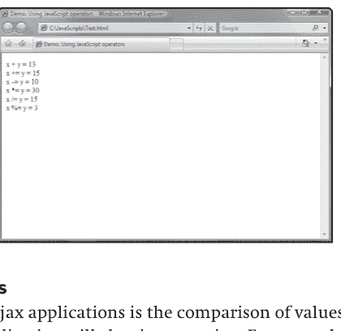

**图2.9**

一个关于如何使用JavaScript运算符的简单示例。

## 比较不同的值

在大多数Ajax应用程序中，一个非常常见的任务是值的比较。根据比较的结果，应用程序将改变其执行方式。例如，如果一个值大于100，应用程序可能采取一种操作，而如果该值小于100，则采取不同的操作。如表2.4所示，JavaScript支持多种不同的比较运算符。

| 运算符 | 描述 | 示例 |
| :--- | :--- | :--- |
| `==` | 等于 | `x == y` |
| `!==` | 不等于 | `x !== y` |
| `>` | 大于 | `x > y` |
| `>=` | 大于或等于 | `x >= y` |
| `<` | 小于 | `x < y` |
| `<=` | 小于或等于 | `x <= y` |

请注意，在检查两个值是否相等时，JavaScript要求你使用`==`比较运算符，而不是`=`赋值运算符。例如，以下语句检查分配给两个变量的值是否相等。

```javascript
if (x == y) {
    document.write("Bingo!");
}
```

通过修改此示例，如下所示，你可以轻松地调整它来构建一个测试，检查`x`的值是否大于或等于`y`。

```javascript
if (x >= y) {
    document.write("Bingo!");
}
```

## 应用条件逻辑

条件编程逻辑使你能够根据比较操作的结果来改变Ajax应用程序的逻辑执行流程。具体来说，条件逻辑允许你在测试条件为真时执行一组语句，而在测试条件为假时执行另一组语句。

### 介绍`if`语句

使用`if`语句，你可以检查逻辑条件是真还是假，并有条件地执行一个或多个语句。在最简单的形式中，`if`语句的语法概述如下：

```javascript
if (condition)
    statement
```

这里，`condition`是一个表达式，包含在括号中，其求值结果为真或假。学习如何使用`if`语句最简单的方法是观察其实际运行，所以请看以下示例。

```html
<HTML>
  <HEAD>
    <TITLE>演示：使用 if 语句</TITLE>
  </HEAD>
  <BODY>
    <SCRIPT language = "javascript" type = "text/javascript">
      <!-- 开始隐藏 JavaScript 语句
      var playerScore = 99;
      if (playerScore < 100) document.write("你输了，再试一次。");
      // 结束隐藏 JavaScript 语句 -->
    </SCRIPT>
  </BODY>
</HTML>
```

这里，检查分配给变量`playerScore`的值是否小于100，如果是，则显示字符串"你输了，再试一次。"。但是，如果分配给`playerScore`的值不小于100，则不显示该字符串。

### 多行`if`语句

使用`{`和`}`字符，你可以使用`if`语句创建一个代码块，该代码块可以包含任意数量的语句，所有这些语句都在测试条件为真时执行。要了解其工作原理，请看以下示例。

```html
<HTML>
  <HEAD>
    <TITLE>演示：使用 if 语句</TITLE>
  </HEAD>
  <BODY>
    <SCRIPT language = "javascript" type = "text/javascript">
    <!-- 开始隐藏 JavaScript 语句
    var playerScore = 101;
    if (playerScore > 100) {
      document.write("你赢了！");
      window.alert("胜者！");
    }
    // 结束隐藏 JavaScript 语句 -->
    </SCRIPT>
  </BODY>
</HTML>
```

这里，如果`playerScore`的值大于100，则执行两条语句。

### 提供替代条件

使用可选的`else`关键字，你可以修改`if`语句代码块，以便在测试条件求值为`false`时执行另一组语句。一个演示其工作原理的示例如下：

```html
<HTML>
  <HEAD>
    <TITLE>演示：使用 if 语句</TITLE>
  </HEAD>
  <BODY>
    <SCRIPT language = "javascript" type = "text/javascript">
    <!-- 开始隐藏 JavaScript 语句
    var playerScore = 99;
    if (playerScore <= 100) {
      document.write("你输了，再试一次。");
    }
    else {
      document.write("你赢了！");
    }
    // 结束隐藏 JavaScript 语句 -->
    </SCRIPT>
  </BODY>
</HTML>
```

这里，如果`playerScore`小于或等于100，则显示文本字符串"你输了，再试一次。"；如果`playerScore`不小于或等于100，则显示字符串"你赢了！"。请注意，与`else`关键字相关的语句嵌套在开始的`{`和结束的`}`字符内。

### 嵌套`if`语句

使用`if`语句的一种强大方式是将其嵌入或嵌套在另一个`if`语句代码块中，以建立更复杂和更精细的条件逻辑。以下语句提供了一个你如何使用嵌套`if`语句的示例。

```html
<HTML>
<HEAD>
<TITLE>演示：使用 if 语句</TITLE>
</HEAD>
<BODY>
<SCRIPT language = "javascript" type = "text/javascript">
<!-- 开始隐藏 JavaScript 语句
var gameOver = false;
var playerScore = 199;
if (gameOver == true) {
  if (playerScore <= 100) {
    document.write("你输了，再试一次。");
  }
  else {
    document.write("你赢了！");
  }
}
```

## 使用`switch`语句

JavaScript也支持使用`switch`语句来执行条件逻辑。该语句会评估一系列条件测试或`case`，并执行第一个求值为`true`的`case`语句所属的代码语句。`switch`语句的语法概述如下：

```javascript
switch (expression) {
    case label:
        statements;
        break;
        .
        .
        .
    case label:
        statements;
        break;
    default:
        statements;
}
```

这里，表达式的值会与每个`case`的值进行比较。第一个值等于表达式值的`case`语句所属的语句将被执行。如果没有`case`语句被证明为`true`，则执行`default`语句所属的语句。请注意，`default`语句是可选的，如果省略，则在没有任何`case`语句求值为`true`时不会发生任何操作。

请注意，位于每个`case`末尾的`break`语句也是可选的。当存在时，`break`语句会告诉脚本在找到匹配项后退出`switch`语句。如果你移除可选的`break`语句，脚本将会执行所有值与表达式值匹配的`case`语句所属的语句。

为了更好地理解如何使用`switch`语句，请看下面的示例：

```html
<HTML>
  <HEAD>
    <TITLE>示例：使用 switch 语句</TITLE>
  </HEAD>
  <BODY>
    <SCRIPT language = "javascript" type = "text/javascript">
    <!-- 开始隐藏 JavaScript 语句
      var fruit = window.prompt("选择一种水果：苹果、橙子还是梨？");
      switch (fruit) {
        case "apple":
          document.write("今年的苹果又红又好。");
          break;
        case "orange":
          document.write("橙子是今天早上手工挑选的。");
          break;
        case "pear":
          document.write("梨今天半价出售。");
          break;
        default:
          document.write("抱歉，这种水果没有库存。");
      }
    // 结束隐藏 JavaScript 语句 -->
    </SCRIPT>
  </BODY>
</HTML>
```

这里，会提示用户输入一种水果的名称。然后使用一个`switch`代码块分析用户的输入，并根据用户的输入将四条消息之一写入浏览器窗口。图2.10和2.11展示了使用Firefox浏览器执行此示例的情况。

请注意上一个示例中的变量声明语句。它使用了`window`对象的`prompt`方法，在一个弹出对话框窗口中显示一条消息，提示用户输入响应并单击对话框的确定按钮。以下语句概述了该语句的语法。

`window.prompt("message" [, "default"]);`

这里，`message`是在对话框窗口中显示的文本字符串，`default`是一个可选参数，指定时会在弹出对话框的输入字段中显示默认文本。

当你想从用户那里快速收集一些数据时，应该使用`window`对象的`prompt`方法。这将省去你定义HTML表单来收集数据的麻烦。你将在第3章学习更多关于如何使用对象及其方法的内容。

**图2.10**

使用弹出对话框窗口提示用户输入。


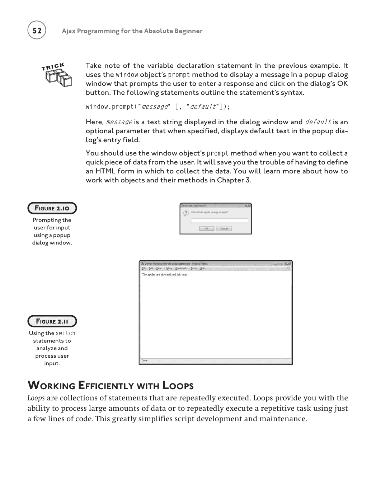

**图 2.11**

使用 `switch` 语句分析和处理用户输入。


# 高效使用循环

循环是重复执行的语句集合。循环使你能够仅用几行代码来处理大量数据或重复执行一项重复性任务。这极大地简化了脚本的开发和维护。

## 使用 `for` 语句

使用 `for` 语句，你可以设置一个循环，该循环会执行直到一个测试条件变为 `false`。此循环使用一个变量来管理循环的执行。`for` 循环由三部分组成：一个起始表达式、一个测试条件和一个递增语句。此语句的语法概述如下：

```
for (expression; condition; increment) {
    statements;
}
```

每次循环迭代（重复）时，都会执行嵌套在循环起始和结束括号内的所有语句。为了更好地理解如何使用 `for` 语句，请看以下示例。这里设置了一个循环迭代 10 次。在循环的第一次迭代开始时，`i` 的值被设置为 1。循环重复 10 次，当 `i` 的值达到 11 时终止。

```
<HTML>
    <HEAD>
        <TITLE>示例：使用 for 循环</TITLE>
    </HEAD>
    <BODY>
        <SCRIPT language = "javascript" type = "text/javascript">
        <!-- 开始隐藏 JavaScript 语句
            document.write("看我数到 10：<BR>");
            for (i=1; i<11; i++) {
                document.write(i,"<BR>");
            }
        // 结束隐藏 JavaScript 语句 -->
        </SCRIPT>
    </BODY>
</HTML>
```

图 2.12 展示了执行此示例时显示的输出。

## 使用 `while` 语句

使用 `while` 语句，你可以设置一个循环，只要测试条件保持为 `true`，该循环就会执行。此语句的语法概述如下：

```
while (condition) {
    statements;
}
```

# Ajax 编程入门

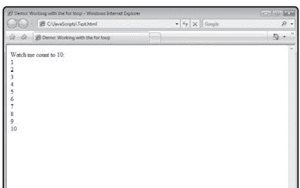

作为如何使用 `while` 语句的示例，请看下面的 HTML 页面。

```
<HTML>
  <HEAD>
    <TITLE>示例：使用 while 循环进行倒计时</TITLE>
  </HEAD>
  <BODY>
    <SCRIPT language = "javascript" type = "text/javascript">
    <!-- 开始隐藏 JavaScript 语句
      var countdown = 10;
      document.write("<B>准备发射。</B><BR><BR>");
      while (countdown > 0) {
        document.write(countdown, "<BR>");
        countdown--;
      }
      document.write("<BR><B>发射！</B>");
    // 结束隐藏 JavaScript 语句 -->
    </SCRIPT>
  </BODY>
</HTML>
```

这里，设置了一个循环，只要名为 `countdown` 的变量的值大于 0，它就会运行。每次循环迭代，`countdown` 的值都会递减 1。图 2.13 展示了执行此示例时显示的输出。

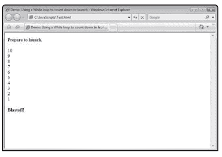

**图 2.13**

使用 `while` 循环从 10 倒数到 1。

## 使用 `do...while` 语句

JavaScript 支持的第三种循环是由 `do...while` 语句创建的，它执行循环直到测试条件变为 `false`。此语句的语法概述如下：

```
do {
    statements;
} while (condition)
```

尽管与 `while` 循环相似，`do...while` 循环的独特之处在于它总是至少执行一次，因为测试条件在循环的第一次执行结束前不会被检查。以下示例演示了如何使用 `do...while` 循环。

```
<HTML>
<HEAD>
    <TITLE>示例：使用 do...while 循环进行倒计时</TITLE>
</HEAD>
<BODY>
    <SCRIPT language = "javascript" type = "text/javascript">
    <!-- 开始隐藏 JavaScript 语句
        var countdown = 10;
        document.write("<B>准备发射。</B><BR><BR>");
        do {
            countdown--;
            document.write(countdown, "<BR>");
        } while (countdown > 0)
        document.write("<BR><B>发射！</B>");
    // 结束隐藏 JavaScript 语句 -->
    </SCRIPT>
</BODY>
</HTML>
```

生成的结果与使用 `while` 循环示例生成的结果完全相同。

## 更改循环执行

默认情况下，循环从头到尾、一遍又一遍地执行。然而，有时你会希望暂停循环执行或跳过特定的循环迭代。这可以通过 `break` 和 `continue` 语句来实现。下面的示例演示了如何使用 `break` 语句。这里，当名为 `countdown` 的变量值被设置为 5 时，`break` 语句用于停止循环。

```html
<HTML>
  <HEAD>
    <TITLE>Demo: An example of how to use the break statement</TITLE>
  </HEAD>
  <BODY>
    <SCRIPT language = "javascript" type = "text/javascript">
    <!-- Start hiding JavaScript statements
      var countdown = 10;
      document.write("<B>Prepare to launch.</B><BR><BR>");
      while (countdown > 0) {
        document.write("countdown = ", countdown , "<BR>");
        if (countdown == 5 ) {
          document.write("<BR><B>Countdown aborted!</B>");
          break;
        }
        countdown--;
      }
    // End hiding JavaScript statements -->
    </SCRIPT>
  </BODY>
</HTML>
```

图 2.14 显示了此示例执行时显示的输出。

![img/fc03f54ee586f9a787910abc92f0c00d_76_0.png]

### 图 2.14

使用 `break` 关键字过早终止循环执行。

### 跳过循环迭代

与暂停循环执行的 `break` 语句不同，`continue` 语句仅终止循环的当前迭代，允许循环继续执行。例如，下面的 HTML 页面包含一个 JavaScript，该脚本被设置为执行 10 次。当循环开始执行时，分配给 `i` 的值是 10。每次循环迭代时，分配给 `i` 的值自动递减 1。一旦 `i` 被设置为 0，循环就停止执行。

```html
<HTML>
  <HEAD>
    <TITLE>Demo: An example of how to use the continue statement</TITLE>
  </HEAD>
  <BODY>
    <SCRIPT language = "javascript" type = "text/javascript">
    <!-- Start hiding JavaScript statements
    document.write("<B>Prepare to launch.</B><BR><BR>");
    for(i=10; i>0; i--) {
      switch (i) {
        case 10:
          continue;
        case 8:
          continue;
        case 6:
          continue;
        case 4:
          continue;
        case 2:
          continue;
      }
      document.write(i, "<BR>");
    }
    document.write("<BR><B>Blastoff!</B>");
    // End hiding JavaScript statements -->
    </SCRIPT>
  </BODY>
</HTML>
```

在循环内部，设置了一个 `switch` 语句代码块，它查找值 10、8、6、4 和 2，每当分配给 `i` 的值是这些值之一时就执行 `continue` 语句。结果，只显示数字 9、7、5、3 和 1。图 2.15 显示了此示例运行时生成的输出。

![img/fc03f54ee586f9a787910abc92f0c00d_77_0.png]

### 图 2.15

使用 `continue` 关键字跳过特定的循环迭代。

## 回到数字猜谜游戏

好的，现在是时候将你的注意力转回到本章应用项目——数字猜谜游戏的开发上了。这个游戏加载到 Web 浏览器后，将挑战玩家以尽可能少的猜测次数猜出一个 1 到 10 之间的数字。开发这个游戏将有助于巩固本章涵盖的主题，并为你开发 Ajax 应用程序做好准备。

## 设计应用程序

与本书中介绍的所有游戏项目一样，你将按照此处概述的特定步骤来完成此应用程序的开发：

1. 创建一个新的 HTML 页面。
2. 开始开发应用程序的 JavaScript。
3. 开发应用程序其余的编程逻辑。
4. 执行你的新应用程序。

### 步骤 1：编写应用程序的 HTML

创建数字猜谜游戏的第一步是创建一个新的 HTML 页面，你可以使用你首选的代码或文本编辑器来完成。将以下语句添加到新的 HTML 文件中，然后将其保存为 `NumberGuess.html`。

```html
<HTML>

<HEAD>
<TITLE>The number guessing game</TITLE>
</HEAD>

<BODY>

</BODY>

</HTML>
```

如你所见，应用程序的 HTML 代码没有什么特别之处。它由标准的 `head` 和 `body` 标签组成。`head` 部分包含一个 `title` 标签，显示标识游戏的文本字符串。`body` 部分目前为空。

### 步骤 2：开始应用程序的脚本

数字猜谜游戏的执行由嵌入在 HTML 页面 `body` 部分内的 JavaScript 控制。通过将下面显示的语句添加到 HTML 文件的 `body` 部分，开始此脚本的开发。

```javascript
<SCRIPT language = "javascript" type = "text/javascript">
<!-- Start hiding JavaScript statements

//Define script variables
var randomNo = 0;
var gameOver = false;
var keepPlaying = false;
var guess = "";
var msg = "I am thinking of a number from 1 - 10. Try to guess it:";
var reply = "";

// End hiding JavaScript statements -->
</SCRIPT>
```

如你所见，这些语句定义了一个包含六个变量声明的 JavaScript。`randomNo` 将用于存储游戏随机生成的数字。`gameOver` 和 `keepPlaying` 用于管理控制游戏执行的循环。`guess` 和 `reply` 将用于存储玩家输入，而 `msg` 用于存储在游戏的弹出对话窗口之一中显示的文本字符串。

### 步骤 3：添加应用程序的控制逻辑

数字猜谜游戏中使用的其余 JavaScript 如下所示，应将其添加到脚本文件中，紧接在六个变量声明语句之后、闭合的 `</SCRIPT>` 标签之前。

```javascript
//This loop allows the player to play as many games as desired
while (gameOver == false) {

    randomNo = 1 + Math.random() * 9; //Generate a random number
                                  //from 1 - 10
    randomNo = Math.round(randomNo);  //Turn the number into an integer

    keepPlaying = false;  //Set value to indicate that the current
                          //round of play should continue

    //Loop until the player guesses the secret number
    while (keepPlaying == false) {

        //Prompt the player to guess the secret number
        guess = window.prompt(msg + randomNo);

        //Analyze the player's guess
        if (guess == randomNo) {   //See if the player guessed the number

            window.alert("Correct! You guessed the number.");
            reply = window.prompt("Would you like to play again? (y/n)");
            if (reply == "y") {  //See if the player wants to play again
                keepPlaying = true;
                gameOver = false;
            } else {              //Let the current round of play continue
                keepPlaying = true;
                gameOver = true;
            }
        } else {
            if (guess > randomNo) { //See if the player's guess is too high
                window.alert("Incorrect. Your guess was too high.");
            } else {                //See if the player's guess is too low
                window.alert("Incorrect. Your guess was too low.");
            }
        }
    }
}

window.alert("Game over. Thanks for playing.");  //Thank the player
```

如你所见，这些语句的执行由一个 `while` 循环控制，该循环被设置为只要分配给名为 `gameOver` 的变量的值为 `false` 就重复执行。接下来，使用 `Math` 对象的 `random()` 方法生成一个 1 到 10 之间的随机数。由于 `random()` 方法返回一个介于 0 和 1 之间的值，因此返回的值乘以 9，然后加一，以生成 1 到 10 范围内的数字。

`Math` 对象的 `random()` 方法用于获取 0 到 1 之间的随机数。此方法的语法如下所示：

`Math.random()`

你可以将 `random()` 方法返回的随机数存储在一个变量中，以供后续处理。

此时，分配给 `randomNo` 的值是一个介于 1 和 10 之间的小数。但是，该游戏设计为处理整数值，因此使用 `Math` 对象的 `round()` 方法将 `randomNo` 的值四舍五入到最接近的整数。接下来，将 `keepPlaying` 的值设置为 `false`，为执行另一个 `while` 循环做准备，该循环负责收集和处理玩家的猜测。

**提示**

`Math` 对象的 `round()` 方法用于将小数四舍五入为最接近的整数值。此方法的语法如下所示：


`Math.round(x)`

此处，`x`表示要四舍五入的小数。请注意，如果传递给`round()`方法的值为`.5`或更大，则函数返回的数字是下一个最大的整数值。否则，返回下一个最小整数值。

在内循环中，系统会提示玩家使用`window`对象的`prompt()`方法输入猜测。然后，玩家的输入被存储在名为`guess`的变量中。接下来，设置一个`if`语句代码块来分析玩家的输入。如果玩家的猜测不正确，系统会显示一条消息，让玩家知道猜测是太低还是太高。如果玩家的猜测正确，则使用`window`对象的`alert()`方法显示一条祝贺玩家的消息。如果这种情况发生，则随后使用`window`对象的`prompt()`方法显示一个弹出对话框窗口，提示玩家再次游玩。如果玩家通过输入`y`来回应，则`keepPlaying`和`gameOver`的值将被修改。将`keepPlaying`设置为`true`会导致内循环终止其执行，而将`gameOver`设置为`false`可确保外循环继续执行。如果玩家选择不玩，则`keepPlaying`和`gameOver`都设置为`true`，从而终止内循环和外循环，结束游戏。脚本中的最后一条语句在游戏结束时执行，显示一条感谢玩家游玩的文本消息。

## 步骤4：测试你的新应用程序

好的，假设你已仔细按照提供的说明操作，你的数字猜测游戏副本应已准备就绪，可以运行。只需将其上传到你的网站，然后使用你的网页浏览器加载它。如果遇到任何问题，请仔细检查你的输入，并查找拼写错误或遗漏的语句。

### 提示

你可以在书籍的配套网站上找到此应用程序源代码文件的副本，网址为`http://www.courseptr.com/downloads`。

## 总结

本章概述了JavaScript，使你理解支持Ajax应用程序开发所需的基本JavaScript编程概念。你了解了JavaScript的起源和围绕浏览器兼容性的问题。你还学习了如何在网页中创建和嵌入JavaScript，以使其更具交互性。本章解释了如何构建JavaScript语句并遵守JavaScript语法，并向你展示了如何使用变量收集、存储和修改数据，以及如何使用条件和迭代编程逻辑。

在继续第3章之前，请考虑留出一点额外时间，通过解决以下挑战来改进数字猜测游戏。

## 挑战

1. 根据目前的代码，数字猜测游戏要求玩家猜测一个1到10之间的数字。考虑通过将游戏支持的范围增加到1到100或1到1000，使游戏更具挑战性。
2. 考虑修改游戏，在玩家的猜测接近秘密数字时提供额外的反馈，而不仅仅是告诉玩家猜测是太高还是太低。

## 第3章：深入了解JavaScript

本章完善了本书对JavaScript编程的回顾。你将学习如何创建和执行函数。函数的使用是大多数Ajax应用程序中利用的一个基本特性。你还将学习如何使用数组管理数据集合。本章还将回顾`<DIV>`和`<SPAN>`标签的使用，这些标签对于开发动态更新网页上显示的文本的Ajax应用程序至关重要。本章还将解释如何处理不同的浏览器事件，以及如何开发能在事件发生时做出反应的应用程序，使你能够创建各种交互式应用程序。

具体来说，你将学习如何：

- 将JavaScript语句组织成函数，并设置这些函数以处理和返回数据
- 动态修改应用程序中文本的显示
- 使用数组更高效地存储和处理大量数据
- 使用浏览器事件触发函数执行

## 项目预览：石头、剪刀、布游戏

本章的游戏项目是石头、剪刀、布游戏。此应用程序让玩家与计算机对决。如图3.1所示，通过点击三个按钮控件之一来玩这个游戏。

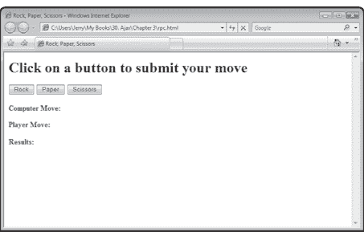

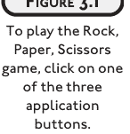

一旦点击其中一个按钮，游戏就会为计算机生成一个随机动作，然后分析结果以确定玩家是赢了、输了还是平局。游戏的胜者由以下规则集决定：

- 石头砸碎剪刀
- 纸覆盖石头
- 剪刀剪纸
- 动作匹配则平局

图3.2展示了一个典型回合的例子。这里，玩家提交了石头动作，而计算机代表生成了纸动作。

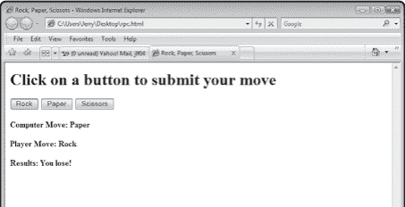

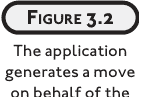

尽管该应用程序在后台不与Web服务器交互，且严格来说不是Ajax应用程序，但它将本章和前一章涵盖的许多JavaScript编程概念结合在一起。此应用程序也让你有机会处理一个动态更新自身内容的应用程序，这是Ajax应用程序的一个基本特性。

## 使用函数改进JavaScript组织

要创建与Web服务器交互式通信的Ajax应用程序，你需要一种方法来提交请求和处理返回的数据。这通过使用函数来实现。函数是被调用来执行特定任务的一组程序语句。Ajax程序员将JavaScript函数存储在HTML页面的`head`部分或`head`部分引用的外部文件中。这确保了它们在包含它们的网页加载时就被加载并可用。这使得函数更容易定位和维护。

> **陷阱**  
> 避免将函数放在HTML页面的`body`部分。如果你的JavaScript尝试在函数加载之前执行该函数，而该函数埋在HTML页面`body`部分的底部，将会发生错误。相反，将所有函数放在HTML页面的`head`部分，这样不仅可以避免错误，还能使你的JavaScript更易于管理。

Ajax开发人员使用函数来控制旨在管理与Web服务器通信的语句的执行，并控制对网页的动态更新。

## 将代码语句组织成函数

函数必须在执行之前先定义。定义函数所需的语法如下所示：

```javascript
function FunctionName(p1, p2,....pn) {
  statements;
  return
}
```

以下示例展示了一个名为`ValidateAge`的函数，它接受一个参数——用户的年龄。函数使用此参数来确定用户是否足够年龄使用包含该函数的应用程序。如果用户年龄小于18岁，则显示一条消息建议用户不要使用该应用程序。已添加`return`语句以显式将脚本的控制权返回给调用语句。然而，由于该函数不旨在返回任何数据，因此可以省略`return`语句，而不会影响函数的执行。

```javascript
function ValidateAge(age) {
    if (age < 18) {
        window.alert("Please leave. You are too young to play.");
    }
    return
}
```

在JavaScript中定义函数并不会导致该函数执行。该函数必须被调用才能执行。如果你的Ajax应用程序包含从未被调用运行的函数，那么这些函数内部的代码语句将永远不会执行。编写完成后，你可以在应用程序执行期间根据需要多次调用函数。函数可用于通过消除复制特定编程逻辑部分的需要来减少应用程序的大小。

## 控制函数执行

有两种方法可以调用JavaScript函数来执行。第一种是简单地输入其名称，如此处所示：

```javascript
ShowInstructions();
```

此处，调用了名为`ShowInstructions()`的函数来执行。请注意，即使函数调用不涉及传递任何要处理的参数，也需要左括号和右括号。当以这种方式调用时，指定的函数执行，完成后，处理流程返回，然后执行脚本中的下一条语句（紧跟在函数调用之后）。

已设置处理参数的函数可以在函数调用时传递数据，如此处所示：

```javascript
TerminateGame(100);
```

此处，调用了名为`TerminateGame()`的函数，并传递了值100。你可以向函数传递任意多个参数，只要它已设置为可以处理，前提是你使用逗号分隔每个参数，如此处所示：

```javascript
TotalPlayerScores(100, 125, 333);
```

> **注意**  
> 你必须确保函数能够处理传递给它们的所有参数，否则会发生错误。

调用函数的第二种方法是将函数作为表达式的一部分来使用。以这种方式使用时，函数可以向调用语句返回一个值（前提是该函数被设置为执行此操作）。例如，以下语句执行一个名为`DeterminePlayerAge()`的函数，然后将该函数返回的结果存储在一个名为`playerAge`的变量中。

```javascript
playerAge = DeterminePlayerAge();
```

为了更好地理解如何调用函数，让我们看几个快速示例。在下面的示例中，一个名为`ValidateAge()`的函数已被添加到HTML页面的头部部分。它由位于主体部分的`ValidateAge(userAge);`语句执行。该函数调用包括传递一个名为`userAge`的参数。调用时，该函数将`userAge`变量映射到其`age`参数。然后，该函数根据参数的值显示两条消息之一。

```html
<HTML>
  <HEAD>
    <TITLE>演示：执行存储在函数中的语句</TITLE>
    <SCRIPT language = "javascript" type = "text/javascript">
      <!-- 开始隐藏 JavaScript 语句
      function ValidateAge(age) {
        if (age >= 18) {
          window.alert("欢迎！我们开始吧。");
        } else {
          window.alert("请离开。你太小了，不能玩。");
        }
      }
      // 结束隐藏 JavaScript 语句 -->
    </SCRIPT>
  </HEAD>
  <BODY>
    <SCRIPT language = "javascript" type = "text/javascript">
      <!-- 开始隐藏 JavaScript 语句
      var userAge;
      userAge = window.prompt("请输入你的年龄：","");
      ValidateAge(userAge);
      // 结束隐藏 JavaScript 语句 -->
    </SCRIPT>
  </BODY>
</HTML>
```

图3.3和3.4展示了一个例子。

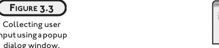

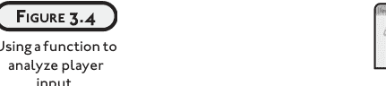

最后这个例子演示了如何调用函数并处理其返回的值。

```html
<HTML>
  <HEAD>
    <TITLE>演示：使用函数增强脚本组织性</TITLE>
    <SCRIPT language = "javaScript" type = "text/javascript">
    <!-- 开始隐藏 JavaScript 语句
      var age;
      function GetUserAge() {
        var userAge;
        userAge = window.prompt("请输入你的年龄： ","");
        return userAge;
      }
    // 结束隐藏 JavaScript 语句 -->
    </SCRIPT>
  </HEAD>
  <BODY>
    <SCRIPT language = "javaScript" type = "text/javascript">
    <!-- 开始隐藏 JavaScript 语句
      age = GetUserAge();
      if (age >= 18) {
        window.alert("欢迎！我们开始吧。");
      } else {
        window.alert("请离开。你太小了，不能玩。");
      }
    // 结束隐藏 JavaScript 语句 -->
    </SCRIPT>
  </BODY>
</HTML>
```

这里定义了一个名为`GetUserAge()`的函数。当被调用执行时，该函数会提示用户输入其年龄，并将输入赋值给一个名为`userAge`的变量，然后使用`return`语句将其传回调用语句。该函数由主体部分的一条语句调用，该语句获取函数返回的值并将其赋值给一个名为`age`的变量。

## 开发能响应事件的应用程序

到目前为止介绍的大多数JavaScript都是以自上而下的方式执行的，浏览器从每条JavaScript的第一条语句开始执行，一直到最后一条语句。唯一的例外是那些将代码语句放在位于HTML页面头部部分的函数中，而这些函数又被位于HTML页面主体部分的函数调用的例子。

## 开发事件驱动的脚本

事件是浏览器内部发生的事情。当用户使用鼠标点击某物时会发生事件。当鼠标移动、按下键盘按键、窗口被打开和关闭或调整大小时，也会发生事件。浏览器会自动识别事件并对其做出反应。例如，如果用户点击网页中嵌入的链接，则会触发`onClick`事件。在此示例中，浏览器的默认响应是加载该链接指定的网页或资源。

通过创建函数并使用事件处理程序将它们与特定事件关联起来，你可以开发能够响应用户操作的Ajax应用程序，根据需要从Web服务器检索并显示数据。事件处理程序是一种检测事件发生并对其做出反应的机制。当检测到指定事件发生时，事件处理程序可以执行一条JavaScript语句或一个JavaScript函数。你可能会设置一个事件处理程序，该程序调用一个函数来显示一个确认对话框，要求用户在允许应用程序继续之前确认其年龄。

事件与单个对象相关联。如果某个对象被触发了事件，该对象的事件处理程序（如果已定义）将执行。事件处理程序很容易设置。你所要做的就是插入定义了对象的HTML标签。以下示例演示了如何定义一个在网页加载时自动执行的事件处理程序。

```html
<BODY onLoad = "window.alert('布！')">
```

如你所见，此示例中使用的事件处理程序在加载事件发生时执行。当这种情况发生时，会显示一个警报对话框。你可以执行任何JavaScript语句作为事件处理程序。然而，事件处理程序的真正威力在于你将它们设置为执行函数时。

## 使用不同的JavaScript事件

如表3.1所示，JavaScript能够响应各种事件，例如页面加载、卸载、更改大小时，或者用户使用键盘或鼠标与页面交互时。

| 事件 | 处理程序 | 此事件在以下情况发生： |
|---|---|---|
| `abort` | `onabort` | 操作被中止 |
| `blur` | `onblur` | 一个项目失去焦点 |
| `change` | `onchange` | 与控件关联的数据被更改 |
| `click` | `onclick` | 元素被点击 |
| `dblclick` | `ondblclick` | 元素被双击 |
| `dragdrop` | `ondragdrop` | 元素被拖放 |
| `error` | `onerror` | 发生JavaScript错误 |
| `focus` | `onfocus` | 元素获得焦点 |
| `keydown` | `onkeydown` | 键盘按键被按下 |
| `keypress` | `onkeypress` | 键盘按键被按下并释放 |
| `keyup` | `onkeyup` | 键盘按键被释放 |
| `load` | `onload` | 网页被加载 |
| `mousedown` | `onmousedown` | 鼠标按钮之一被按下 |
| `mousemove` | `onmousemove` | 鼠标被移动 |
| `mouseout` | `onmouseout` | 鼠标移出元素 |
| `mouseover` | `onmouseover` | 鼠标移到元素上 |
| `mouseup` | `onmouseup` | 鼠标按钮被释放 |
| `reset` | `onreset` | 表单的重置按钮被点击 |
| `resize` | `onresize` | 元素大小被调整 |
| `submit` | `onsubmit` | 表单的提交按钮被点击 |
| `unload` | `onunload` | 浏览器卸载网页 |

如表3.1所示，JavaScript识别的每个事件都有一个相应的事件处理程序。使用这些事件处理程序，你可以设置定义在网页内的函数的自动执行。在接下来的部分中，你将看到如何使用许多这些事件和事件处理程序的示例。

## 响应窗口事件

对于许多类型的Ajax应用程序都很重要的一类事件是响应影响浏览器窗口的变化而触发的事件。这类事件包括`load`、`unload`和`resize`事件。如表3.1所示，每个事件都有一个相应的事件处理程序。要创建能够响应这些事件的Ajax应用程序，请将相应的事件处理程序嵌入到HTML页面的`<BODY>`标签中。以下示例演示了如何使用所有这三个事件。

```html
<HTML>
  <HEAD>
    <TITLE>演示：使用窗口和框架事件</TITLE>
  </HEAD>
  <BODY onLoad = "window.alert('页面已加载！')"
    onResize = "window.alert('哎哟，好痛！')"
    onUnload = "window.alert('再见了，残酷的世界...')"
  </BODY>
</HTML>
```

图3.5到3.7显示了应用程序执行时生成的输出。


**图3-5**

`onLoad`事件处理程序在网页最初加载时执行。

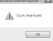

**图3-6**

`onResize`事件处理程序在用户尝试更改网页大小时执行。

## Ajax编程入门指南

## 处理鼠标事件

Ajax应用中使用的另一组事件是在用户与应用程序交互时操作鼠标触发的。这类事件包括`onMouseOver`和`onMouseOut`事件。以下示例演示了这两个事件的用法。


```html
<HTML>
  <HEAD>
    <TITLE>Demo: Working with mouse event handlers</TITLE>
    <SCRIPT language = "javascript" type = "text/javascript">
      <!-- Start hiding JavaScript statements
      function DisplayMessage(msgInput) {
        document.getElementById('Msg').innerHTML = msgInput;
      }
      // End hiding JavaScript statements -->
    </SCRIPT>
  </HEAD>
  <BODY>
    <A HREF="http://www.courseptr.com"
       onMouseOver = 'DisplayMessage("May the force be with you!")';
       onMouseOut = 'DisplayMessage("Beware the dark side.")';>
       Go to www.starwars.com</A>
    <P><B><DIV id="Msg"> </DIV></B></P>
  </BODY>
</HTML>
```

这里定义了一个链接，其显示标签为`Go to www.starwars.com`。接下来，`onMouseOver`和`onMouseOut`事件处理程序被用于调用名为`DisplayMessage()`的函数，并向其传递一个文本字符串。当被调用时，该函数使用`getElementByID()`方法获取网页中`<DIV> </DIV>`标签的对象引用，然后利用对象的`innerHTML`属性，在`<DIV> </DIV>`标签内显示传递给它的文本字符串。

图 3.8 展示了该示例首次加载时应用程序的样子。

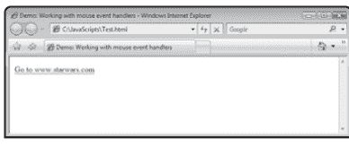

**图 3.8** 初始加载时，应用程序显示一个代表指向`www.starwars.com`链接的文本字符串。

当因执行`MouseOver`事件（例如，当用户将鼠标移到链接上时）而被调用时，将显示消息`愿原力与你同在！`，如图 3.9 所示。

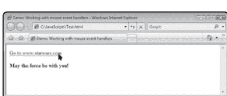

**图 3.9** 每当用户将鼠标指针移到链接上时，就会显示此消息。

当使用`MouseOut`事件调用`DisplayMessage()`函数时，将显示消息`当心黑暗面。`，如图 3.10 所示。

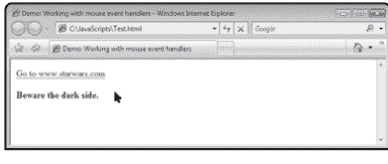

**图 3.10** 每当用户将鼠标指针移开链接时，就会显示此消息。

> **技巧** 注意，在前面的示例中，`onMouseOver`和`onMouseOut`事件处理程序被用于设置一种称为“翻转”的自动效果。

# 处理表单

表单在许多 Ajax 应用中被用作收集信息的手段，这些信息随后被发送到 Web 服务器进行处理。表单通过使用`<FORM> </FORM>`标签定义按钮和文本字段等单个表单元素来创建。当与 JavaScript 结合使用时，表单可以被处理和验证。要将表单控件连接到 JavaScript 函数，请使用控件的`onclick`属性来触发函数的执行，如下所示：

```html
<HTML>
  <HEAD>
    <TITLE>Demo: Working with mouse event handlers</TITLE>
    <SCRIPT LANGUAGE = "JavaScript" TYPE = "Text/JavaScript">
      function SayName() {
        document.getElementById('trgtDiv').innerHTML = "Hello " +
          document.getElementById('nameField').value;
      }
    </SCRIPT>
  </HEAD>
  <BODY>
    <FORM>
      Enter your name: <INPUT type = "text" id="nameField"> <BR>
      Click here to process: <INPUT type = "button" value = "OK"
        onclick = "SayName()">
    </FORM>
    <DIV id = "trgtDiv"> </DIV>
  </BODY>
</HTML>
```

这里设置了一个由一个文本字段和一个按钮元素组成的表单，用于提示用户输入他的名字并点击按钮。当点击时，分配给按钮控件的`onClicked`事件处理程序执行一个名为`SayName()`的函数。执行时，该函数在按钮控件下方显示一个欢迎用户的文本字符串。这个文本字符串由单词`Hello`与从表单文本字段元素检索到的文本字符串连接而成。图 3.11 展示了该应用程序运行的示例。

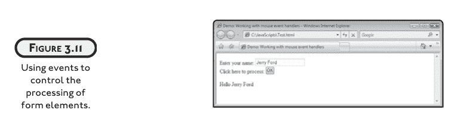

## DIV 和 SPAN 标签

Ajax 应用的核心是在不需要刷新网页的情况下动态更新网页内容。实现此目标的一种非常流行且实用的方法是使用`<DIV> </DIV>`和`<SPAN> </SPAN>`标签。这两组标签允许你对其内包含的任何文本应用更改。虽然通常用于应用样式属性，例如颜色、字体和各种其他呈现属性，但这些标签也可用于你的 Ajax 应用中，以方便动态文本替换。

## 使用`<DIV> </DIV>`标签

`<DIV> </DIV>`标签用于在网页中创建逻辑分隔，其作用在许多方面类似于`<P> </P>`标签，不同之处在于`<DIV> </DIV>`标签允许你将页面划分为更大的部分。`<DIV> </DIV>`标签是块级元素。使用这些标签，你可以将不同的样式属性应用于网页的整个部分，如下所示：

```html
<DIV style = "Color : Green">
    <H1> Once upon a time...</H1>
</DIV>
```

这里，放置在两个标签内的任何文本都将以绿色显示。除了为网页应用不同的样式外，你还可以使用`<DIV> </DIV>`标签来刷新文本显示。为了以这种方式使用这些标签，你必须首先使用`id`属性为用`<DIV> </DIV>`标签勾勒出的网页部分分配一个名称。

```html
<DIV name = "OpeningLine" style = "Color : Green">
    <H1> Once upon a time...</H1>
</DIV>
```

这里，在开头的`<DIV>`标签中添加了名称`OpeningLine`，允许对网页的这一部分进行编程引用和在需要时更新。

## 使用`<SPAN> </SPAN>`标签

`<SPAN> </SPAN>`标签与`<DIV> </DIV>`标签类似，不同之处在于`<SPAN> </SPAN>`标签允许你内联地应用样式更改和文本替换，而不是将页面划分为更大的部分。这意味着这些标签内包含的任何文本都会受到你指定的任何更改的影响，而周围的文本则不受影响。

```html
<SPAN style = "Color : Red">Once upon a time...</SPAN>
```

与`<DIV> </DIV>`标签一样，你可以为任何一对`<SPAN> </SPAN>`标签分配一个名称，允许你稍后引用和更新其内容，如下所示：

```html
<SPAN name = "" style = "Color : Red">Once upon a time...</SPAN>
```

## 无需刷新屏幕即可编程替换文本

为了更好地理解如何动态替换网页中的文本，让我们看一个使用`<DIV> </DIV>`标签来精确更新文本的示例。我们首先创建一个新的 HTML 页面，包含以下语句。

```html
<HTML>
  <HEAD>
    <TITLE>Demo: Dynamically displaying text</TITLE>
    <SCRIPT language = "javascript" type = "text/javascript">
    <!-- Start hiding JavaScript statements
      function GreetPlayer() {
        document.write("Well, hello there.");
      }
    // End hiding JavaScript statements -->
    </SCRIPT>
  </HEAD>
  <BODY onload = "GreetPlayer()">
    <H1>Knock Knock!</H1>
  </BODY>
</HTML>
```

创建后，将此示例加载到你的浏览器中。当你这样做时，你可能会对显示的结果感到惊讶。显示的不是一个一级标题`Knock Knock!`后跟文本字符串`"Well, hello there."`，而是只显示了 JavaScript 写入的文本字符串。原因是当 JavaScript 的`GreetPlayer()`函数执行时，其`document.write`语句会自动清除网页上显示的任何文本，然后写入自己的文本字符串，如图 3.12 所示。

**图 3.12**

默认情况下，使用`document.write()`语句写入网页的任何文本（在头部部分）都会清除之前写入网页的任何文本。

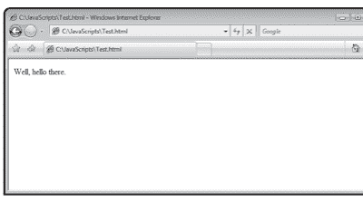

## 面向绝对初学者的 Ajax 编程

Ajax 应用程序开发者使用`<DIV> </DIV>`和`<SPAN> </SPAN>`标签来解决这类问题，如下所示。这里，之前的示例已经更新。`GreetPlayer()`函数没有尝试使用`document.write()`方法来更新网页上的文本显示，而是被更新为将其文本字符串放置在页面的`<DIV> </DIV>`标签内。

```html
<HTML>
  <HEAD>
    <TITLE>Demo: Dynamically displaying text</TITLE>
    <SCRIPT language = "javascript" type = "text/javascript">
    <!-- Start hiding JavaScript statements
    function GreetPlayer() {
      document.getElementById('GreetingMsg').innerHTML = "Well, hello there."
    }
    // End hiding JavaScript statements -->
    </SCRIPT>
  </HEAD>
  <BODY onload = "GreetPlayer()">
    <H1>Knock Knock!</H1>
    <DIV id="GreetingMsg"> </DIV>
  </BODY>
</HTML>
```

要完全理解这里发生了什么，你需要更多地了解`GreetPlayer()`函数中使用的方法和属性。首先，文档对象的`getElementByID()`方法用于检索由`<DIV> </DIV>`标签创建的对象的引用。这是通过将`GreetingMsg()`的名称作为参数传递给该方法来实现的。接下来，使用所得对象引用的`innerHTML`属性将新的文本字符串写入网页，替换`<DIV> </DIV>`标签当前显示的空文本字符串。所有这一切的最终结果是，这个修改后的 HTML 页面无需清除网页然后写入文本，只需替换`<DIV> </DIV>`标签内指定的文本字符串即可。没有混乱，没有繁琐，也不需要刷新页面！图 3.13 展示了此示例的结果与 HTML 页面之前版本的差异。

## 管理数据集合

根据你的 Ajax 应用程序的设计目的，有时一次处理单个数据不再实用，例如在设计用于处理用户输入或从 Web 服务器检索的数据列表的应用程序中。在这类情况下，你可以使用数组来存储和帮助管理应用程序数据。

数组是一个索引值列表。数组可用于存储 JavaScript 支持的任何类型的值。如下所示，数组必须在使用前声明。

```javascript
weapons = new Array(5);
weapons[0] = "Ray Gun";
weapons[1] = "Pulsar Cannon";
weapons[2] = "Phaser Pistol";
weapons[3] = "Photon Torpedo";
weapons[4] = "Cyber Tank";
```

在第一条语句中，使用`new`关键字声明了一个名为`weapons`的数组。此数组能够存储 5 个值。最后五条语句为数组赋值。数组的索引从 0 开始，到 4 结束。

```javascript
supplies = new Array("pen", "paper", "ink", "pencil", "tape",
"staples");
```

请注意，以这种方式创建时，数组由括在括号内的逗号分隔项列表组成，前面是数组的名称。此数组在功能上等同于以下数组。

```javascript
supplies = new Array(6);
supplies[0] = "pen";
supplies[1] = "paper";
supplies[2] = "ink";
supplies[3] = "pencil";
supplies[4] = "tape";
supplies[5] = "staples";
```

### 访问单个数组元素

访问存储在数组中的值很容易。你只需指定数组名称，后跟值的索引位置（嵌入在方括号中）。要了解其工作原理，请看以下示例。

```html
<HTML>
  <HEAD>
    <TITLE>Demo: Working with an array</TITLE>
  </HEAD>
  <BODY>
    <SCRIPT language = "javascript" type= "text/javascript">
    <!-- Start hiding JavaScript statements
    weapons = new Array(5);
    weapons[0] = "Ray Gun";
    weapons[1] = "Pulsar Cannon";
    weapons[2] = "Phaser Pistol";
    weapons[3] = "Photon Torpedo";
    weapons[4] = "Cyber Tank";
    document.write("The 3rd item in the weapons array is " + weapons[2]);
    // End hiding JavaScript statements -->
    </SCRIPT>
  </BODY>
</HTML>
```

JavaScript 数组是基于零的。因此，存储在数组中的第三项位于索引位置 2（例如`weapons[2]`）。图 3.15 显示了此示例执行时产生的输出。

### 使用循环处理数组

一次处理一个数组元素的内容可能会变得乏味，尤其是当这些数组包含数十、数百或数千个项目时。相反，使用`for`循环处理数组内容通常更容易、更高效，如下例所示：

```html
<HTML>
<HEAD>
<TITLE>Demo: Processing array contents using a loop</TITLE>
</HEAD>
<BODY>
<SCRIPT language = "javascript" type = "text/javascript">
<!-- Start hiding JavaScript statements
var lengthOfArray;
weapons = new Array(5);
weapons[0] = "Ray Gun";
weapons[1] = "Pulsar Cannon";
weapons[2] = "Phaser Pistol";
weapons[3] = "Photon Torpedo";
weapons[4] = "Cyber Tank";
lengthOfArray = weapons.length;
document.write("<B>Weapons Inventory</B><BR>");
for (var i = 0; i < lengthOfArray; i++) {
    document.write(weapons[i], "<BR>");
}
// End hiding JavaScript statements -->
</SCRIPT>
</BODY>
</HTML>
```

这里，建立了一个名为`weapons`的数组，并填充了 5 个项目。然后使用循环从`weapons[0]`开始处理数组内容，每次循环迭代增加 1，并在处理完最后一个项目后结束。请注意数组对象的`length`属性的使用，它用于检索表示`weapons`数组长度的数值，并将该值赋给名为`lengthOfArray`的变量。图 3.16 展示了此示例执行时显示的输出。

**图 3.16**

使用循环处理数组内容。

### 对数组内容进行排序

与所有对象一样，数组也有属性和方法。一个特别有用的方法是`sort()`方法，可用于对存储在数组中的项目进行排序。以下示例演示了如何使用此方法生成数组内容的排序列表。


```html
<HEAD>
  <TITLE>Demo: An example of how to sort the contents of an Array</TITLE>
</HEAD>
<BODY>
  <SCRIPT language = "javascript" type = "text/javascript">
  <!-- Start hiding JavaScript statements
    supplies = new Array("pen", "paper", "ink", "pencil", "tape");
    document.write(supplies.sort());
  // End hiding JavaScript statements -->
  </SCRIPT>
</BODY>
</HTML>
```

如你所见，此示例创建并填充了一个名为 `supplies` 的密集数组。然后使用数组的 `sort()` 方法对数组内容进行排序，并在浏览器窗口中显示。请注意，无需使用循环即可处理数组的全部内容。运行此示例时，会在单行上显示以逗号分隔的数组项列表。

### 回到“石头、剪刀、布”应用

好的，现在是时候将注意力转回到本章游戏项目——“石头、剪刀、布”游戏的开发了。此游戏将使用 `<SPAN></SPAN>` 标签动态更新网页上的文本显示，这是大多数 Ajax 应用程序的基本功能。加载到 Web 浏览器时，此应用程序将让玩家与计算机进行“石头、剪刀、布”游戏对决。

## 设计应用程序

就像你在这本书中已经完成的其他应用程序项目一样，“石头、剪刀、布”游戏将通过以下五个步骤创建：

1. 创建一个新的 HTML 页面。
2. 添加一个表单来收集用户数据。
3. 格式化并显示文本输出。
4. 开发游戏的控制逻辑。
5. 执行你新的 Ajax 应用程序。

前几个步骤致力于开发应用程序的 HTML 部分，而其余步骤则侧重于使用 JavaScript 开发应用程序的控制逻辑，然后执行它。

## 步骤 1：编写应用程序的 HTML

开发“石头、剪刀、布”游戏的第一步是创建应用程序的 HTML 页面。首先打开你首选的文本或代码编辑器，然后创建并保存一个名为 `rpc.html` 的新文件。完成此任务后，将以下 HTML 语句添加到文件中：

```html
<HTML>
  <HEAD>
    <TITLE>Rock, Paper, Scissors</TITLE>
  </HEAD>
  <BODY>
  </BODY>
</HTML>
```

正如你所见，这个石头剪刀布游戏的 HTML 页面没有什么特别之处。它由典型的 `<head>` 和 `<body>` 标签组成。`<head>` 部分包含一个显示应用程序名称的 `<title>` 标签。

## 第二步：创建表单

现在是时候显示一个表单了，该表单将显示三个按钮控件，分别标记为石头、剪刀和布。玩家在玩游戏时会点击这些按钮来提交出招。要将表单添加到 HTML 页面，连同描述性标题一起，请将以下语句添加到 HTML 页面的 `<body>` 部分。

```html
<H1>点击按钮提交你的出招</H1>
<FORM>
    <INPUT TYPE = "button" VALUE = " 石头 " +
        onClick = ProcessMove("Rock")
    <BR>
    <INPUT TYPE = "button" VALUE = " 布 " +
        onClick = ProcessMove("Paper")
    <BR>
    <INPUT TYPE = "button" VALUE = "剪刀" +
        onClick = ProcessMove("Scissors")
</FORM>
```

请注意，每个 `<INPUT>` 标签都使用了 `onClick` 事件处理程序，以启动执行一个名为 `ProcessMove()` 的函数，并向其传递一个文本字符串，指示按下了三个按钮中的哪一个。

## 第三步：创建输出显示模板

为了显示每一轮游戏的结果，应用程序需要一种方式来显示玩家和计算机的出招以及游戏结果。为了实现这一点，请将以下语句添加到 `<body>` 部分的末尾。

```html
<P><B>计算机出招: <SPAN id="CMove"> </SPAN></B></P>
<P><B>玩家出招: <SPAN id="PMove"> </SPAN></B></P>
<P><B>结果: <SPAN id="Msg"> </SPAN></B></P>
```

正如你所见，我们使用了一系列三对 `<SPAN> </SPAN>` 标签来帮助构建一个模板，通过该模板可以显示文本。请注意，每个语句都被分配了一个唯一的 `id`，允许应用程序的 JavaScript 语句通过这三组 HTML 语句以编程方式更新文本显示。

## 第四步：开发游戏的控制逻辑

至此，你对应用程序 HTML 的工作已经完成。现在是时候通过添加控制游戏运行所需的 JavaScript 语句，来为你的新应用程序注入生命了。首先，将以下语句添加到 HTML 页面的 `<head>` 部分：

```html
<SCRIPT language = "javascript" type = "text/javascript">
<!-- Start hiding JavaScript statements

// End hiding JavaScript statements -->
</SCRIPT>
```

这些语句提供了支持应用程序 JavaScript 执行所需的 HTML 和注释标签。应用程序的大部分语句都驻留在一个名为 `ProcessMove()` 的函数中，正如你所看到的，每当玩家点击游戏的三个按钮控件之一时，该函数就会被调用。要开始开发这个函数，请将以下语句添加到 `<head>` 部分的 `<SCRIPT>` `</SCRIPT>` 标签内：

```javascript
function ProcessMove(playerMove) {


}
```

正如你所见，函数定义包含一个名为 `playerMove` 的参数，该参数将映射到每次调用函数时传递给它的参数，用于标识玩家选择的出招（例如，石头、布或剪刀）。执行时，该函数会将玩家的出招与计算机的出招进行比较（该函数负责生成计算机的出招），以确定游戏结果。

让我们开始编写构成该函数的语句。首先，在函数的大括号内添加以下语句。正如你所见，这些语句生成一个 1 到 3 之间的随机数，代表计算机的出招。

```javascript
randomNo = 1 + Math.random() * 2; //Generate a random number
                                //from 1 - 10
randomNo = Math.round(randomNo);  //Turn the number into a integer
```

接下来，将这些语句添加到函数中，紧接在上述语句之后。

```javascript
if (randomNo == 1) computerMove = "Rock"
if (randomNo == 2) computerMove = "Paper"
if (randomNo == 3) computerMove = "Scissors"
```

这三条语句用于根据随机生成的数字的值，将一个文本字符串赋给一个名为 `computerMove` 的变量。换句话说，如果随机数是 1，则计算机的出招被指定为石头。同样，值为 2 时出招为布，值为 3 时计算机的出招被指定为剪刀。

现在函数知道了玩家和计算机的出招，它必须比较它们以确定谁赢了，或者是否平局。这是通过将以下语句添加到 `ProcessMove()` 函数中紧接在上述语句之后来实现的。

```javascript
switch (computerMove) {
    case "Rock":
        if (playerMove == "Rock") {
            document.getElementById('Msg').innerHTML = "你平局了！"
        }
        if (playerMove == "Paper") {
            document.getElementById('Msg').innerHTML = "你赢了！"
        }
        if (playerMove == "Scissors") {
            document.getElementById('Msg').innerHTML = "你输了！"
        }
        break;
    case "Paper":
        if (playerMove == "Rock") {
            document.getElementById('Msg').innerHTML = "你输了！"
        }
        if (playerMove == "Paper") {
            document.getElementById('Msg').innerHTML = "你平局了！"
        }
        if (playerMove == "Scissors") {
            document.getElementById('Msg').innerHTML = "你赢了！"
        }
        break;
    case "Scissors":
        if (playerMove == "Rock") {
            document.getElementById('Msg').innerHTML = "你赢了！"
        }
        if (playerMove === "Paper") {
            document.getElementById('Msg').innerHTML = "你输了！"
        }
        if (playerMove === "Scissors") {
            document.getElementById('Msg').innerHTML = "你平局了！"
        }
        break;
}
```

正如你所见，这些语句设置了一个由三个 `case` 语句组成的 `switch` 代码块，分别对应计算机的每种可能出招。例如，第一个 `case` 语句在计算机出招为 `Rock`（石头）时执行。每个 `case` 语句后面跟着三个 `if` 语句代码块，其中只有一个会根据玩家的出招执行。最后，每组三个 `if` 语句后面都有一个 `break` 语句。

函数分析的最终结果显示一个文本字符串，宣布玩家是赢了、输了还是平局。请注意，`document` 对象的 `getElementByID` 方法用于获取要显示文本字符串的 HTML 标签（来自第三步）的 `id` 的对象引用。然后使用该对象的 `innerHTML` 属性来显示游戏的文本消息。

构成 `ProcessMove()` 函数的最后两条语句如下所示，应添加到函数的末尾。正如你所见，这些语句也更新了 HTML 页面上的文本字符串显示。第一条语句显示代表计算机出招的文本字符串，第二条语句显示代表玩家出招的字符串。

```javascript
document.getElementById('CMove').innerHTML = computerMove
document.getElementById('PMove').innerHTML = playerMove
```

## 第五步：执行你的新游戏

好了，你现在拥有了创建石头剪刀布游戏所需的一切。只要你仔细按照步骤操作，没有跳过任何步骤或打错字，一切都应该像本章开头解释的那样运行。请将 HTML 页面上传到你的网站，在 Web 浏览器中加载它，并试用一下你的应用程序。

> 你可以在本书的配套网站上找到此应用程序源代码文件的副本，网址为 `http://www.courseptr.com/downloads`。

## 总结

本章总结了本书对 JavaScript 编程的概述。理解 JavaScript 对于开发健壮的 Ajax 应用程序至关重要。本章向你展示了如何创建和执行函数、识别和响应不同的浏览器类型，以及如何使用数组管理大型数据集合。你还学习了如何使用 `<DIV> </DIV>` 和 `<SPAN> </SPAN>` 标签来促进网页上文本的动态更新。除此之外，你还学习了如何利用浏览器事件来控制包含应用程序脚本的函数的执行。

在进入第 4 章之前，请考虑花点时间通过解决以下挑战列表来改进石头剪刀布游戏。

1. 目前的写法，石头剪刀布游戏假设玩家已经知道如何玩这个游戏。考虑显示一些额外的文本来概述游戏规则。
2. 考虑跟踪赢、输、平局的次数，并在每局游戏结束时显示此信息，以便玩家可以评估她与计算机的整体表现。（提示：创建三个变量，并在每轮游戏结束时适当递增它们。）

## 理解文档对象模型

正如你已经了解的，JavaScript 是用于构建 Ajax 应用程序的编程语言。当与 `<DIV></DIV>` 和 `<SPAN></SPAN>` 标签结合使用时，你可以在应用程序中预设的位置动态插入文本。然而，如果将文档对象模型（DOM）引入方程式，你就能完全掌控应用程序网页的布局。Web 浏览器使用文档对象模型来创建网页的逻辑表示。通过使用 JavaScript 与文档对象模型交互并对其进行操作，你可以开发能够即时添加、删除和修改网页内容，而无需任何页面刷新的 Ajax 应用程序。

具体来说，你将学习如何：

- 文档对象模型如何创建网页的树状表示
- 如何使用不同的文档对象模型属性和方法
- 如何遍历文档对象模型树并检索元素信息
- 如何使用文档对象模型修改树状布局并动态更新网页的外观

## 项目预览：今日 Ajax 故事应用

本章的游戏项目是“今日 Ajax 故事”应用。此应用演示了如何动态利用 DOM 树来讲述一个四部分故事的不同部分。图 4.1 显示了该应用最初加载到浏览器后的外观。

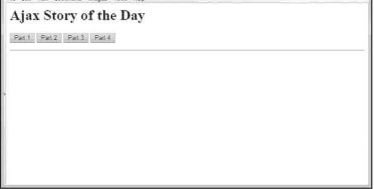

**图 4.1**

“今日 Ajax 故事”应用在 Opera 浏览器中运行的视图。

为了与应用交互并让其讲述故事，用户必须依次从左到右点击应用的每个按钮控件。每次按下按钮，故事的一部分就会显示出来。图 4.2 显示了用户点击第一个按钮后应用的外观。

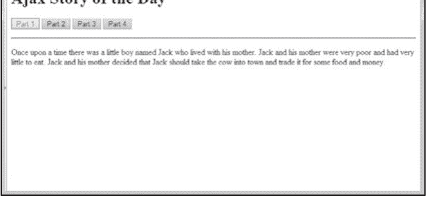

**图 4.2**

与“今日 Ajax 故事”应用交互，只需点击应用的按钮即可。

如图 4.2 所示，一旦按钮被点击，应用会将其禁用以防止再次点击。这可以防止用户意外地重新显示已经显示过的部分故事。图 4.3 显示了整个故事讲述完毕后应用的外观。

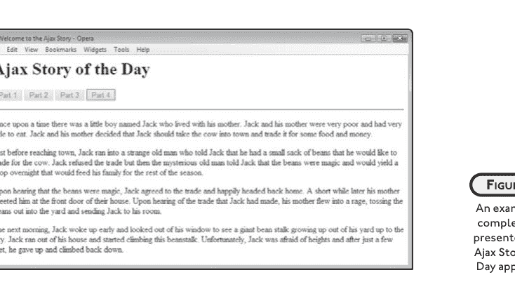

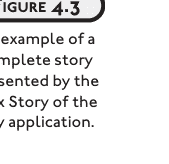

应用讲述的四个部分的故事，每一部分都是从存储在应用 Web 服务器上的文本文件中检索的。因此，只需修改存储在 Web 服务器上的文本文件，就可以随时轻松更改故事。例如，你可能想要编写多个不同的四部分故事，每隔几周更换一次 Web 服务器上的应用文本文件，从而为 Ajax 应用注入新的活力，从而鼓励网站访问者一次又一次地回访。

## 文档对象模型简介

到目前为止，本书中介绍的所有示例都依赖于使用 `<DIV></DIV>` 和 `<SPAN></SPAN>` 标签来促进在网页上显示新文本。然而，Ajax 开发者还有一个更强大的工具可用：HTML 文档对象模型（DOM）。DOM 生成构成 HTML 页面的元素的逻辑表示。DOM 不是 JavaScript 的一部分，它是由浏览器提供的。但是，你的 JavaScript 可以访问 DOM 对象（包括它们的方法和属性），并通过编程方式与它们交互，以动态更新网页。

使用不同的 DOM 方法和属性，你可以创建新元素并将其插入到 HTML 页面中，从而更改 HTML 页面的结构，进而改变页面的外观和内容。每次浏览器加载网页时，它都会渲染该 HTML 页面以便查看。同时，浏览器还会在内存中构建一个树状视图，展示构成网页的元素。

在 DOM 中，`document` 对象使 JavaScript 能够直接访问构成 DOM 树的不同元素。你的 Ajax 应用程序可以更改网页的树结构，添加、删除或更新元素，从而动态地改变页面内容和外观。

> 在 1998 年之前，每个浏览器都支持自己独特的 DOM。1998 年，第一个 W3C DOM 标准发布。2004 年，DOM 3 发布，这仍然是当前的标准。如今，所有主要的现代网络浏览器都支持这个版本的 DOM。得益于 DOM，所有现代网络浏览器都会为任何网页呈现相同的树结构。DOM 代表了一个庞大的主题，值得用一整本书来阐述。遗憾的是，本书无法完全涵盖 DOM 的所有细节。如果你想了解比本章涵盖的基础知识更多的 DOM 内容，请访问 `www.w3c.org/DOM`。

## DOM 树

当加载一个 HTML 页面时，浏览器会根据 HTML 页面的内容自动定义一组对象。这些对象按照从上到下的层次顺序组织，以 `document` 对象开始，将网页的所有元素以树状结构连接在一起。该树由不同的元素组成，每个元素代表一个不同的网页对象。

通过使用这棵树，浏览器维护着一个连接图，展示了网页的组织结构，该结构由一系列父、子和兄弟关系组成。正如你将在本章稍后看到的，你可以使用这些关系作为遍历 DOM 树的手段。DOM 树中的每个对象都提供了对方法和属性的访问，你可以通过编程方式与这些对象交互并控制它们。这使你能够使元素出现或消失，或通过其他方式修改它们，例如更改它们的颜色、大小等。

为了使用 DOM 树，你必须熟悉许多 DOM 属性和方法。表 4.1 列出了关键的 DOM 属性，这些属性可用于识别 DOM 树上的不同元素，并检索元素（节点）的名称、类型和值。

使用表 4.1 中概述的 DOM 属性，你可以遍历 DOM 树，从父级到子级、从子级到父级，或从兄弟节点到兄弟节点。表 4.2 列出了关键的 DOM 方法，这些方法允许你对 DOM 树进行修改，创建并附加新元素。如你所见，DOM 还提供了对方法的访问，允许你检索有关树元素（对象）的信息（例如它们的 ID），并将其从 DOM 树中删除。


### 表 4.1 DOM 属性

| 属性 | 描述 |
| :--- | :--- |
| `childNodes` | 属于一个对象的子对象集合（例如，数组） |
| `firstChild` | 属于一个对象的第一个子节点 |
| `lastChild` | 一个对象的最后一个子节点 |
| `nodeName` | 分配给对象 HTML 标签的名称 |
| `nodeType` | 标识与对象关联的 HTML 元素类型（标签、属性或文本） |
| `nodeValue` | 检索分配给文本节点的值 |
| `nextSibling` | 树中前一个子节点之后的子节点 |
| `previousSibling` | 当前子节点之前的子节点 |
| `parentNode` | 一个对象的父对象 |

### 表 4.2 DOM 方法

| 方法 | 描述 |
| :--- | :--- |
| `appendChild()` | 将新的子节点添加到指定元素 |
| `createAttribute()` | 创建新的元素属性 |
| `createElement()` | 创建新的文档元素 |
| `createTextNode()` | 创建新的文本项 |
| `getElementsByTagName()` | 检索项目标签名称的数组 |
| `getElementById()` | 根据 ID 检索元素 |
| `hasChildNodes()` | 根据节点是否有子节点返回 true 或 false 值 |
| `removeChild()` | 删除指定的子节点 |

使用表 4.1 和表 4.2 中列出的属性和方法，你可以创建新的 DOM 树元素，并将它们添加到 DOM 树中的特定位置。每当通过编程对 DOM 树进行更改时，它都会立即反映在网页上显示内容的外观中——无需页面刷新。例如，你可以修改 DOM 以包含新的元素，如文本或图像。这样，新的文本和图像将自动出现在网页上。反之亦然。如果你从 DOM 树中删除任何元素，这些元素所代表的对象将从网页上消失。

由于 DOM 树代表了构成网页的每个元素的映射，因此它使你能够更改网页的任何部分。你无需在整个网页的战略位置嵌入`<DIV></DIV>`或`<SPAN></SPAN>`标签，以便拥有一个预定义的位置来添加新内容。因此，DOM 树使您可以完全控制任何网页的外观和呈现方式。当然，编程、交互和操作 DOM 树确实为您的 Ajax 应用程序设计增添了复杂性。然而，为了开发真正的动态网页，任何 Ajax 开发人员都必须对如何操作 DOM 有扎实的理解。

## 遍历 DOM 树

如前所述，`document`对象位于 DOM 树的顶端。在本书中，您已经广泛使用了`document`对象。例如，为了向网页写入文本，您一直使用`document`对象的`write()`方法，如下所示：

```javascript
document.write("Easy is as easy does.");
```

如图 4.4 所示，通过`document`对象，您可以访问构成 HTML 页面的所有对象。

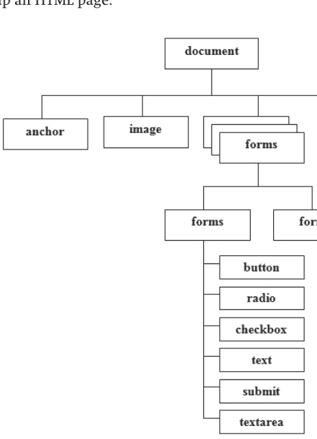

**图 4.4**

`document`对象是访问网页上元素的关键。

如您所见，`document`对象位于树的顶端。其下方是构成网页的所有不同对象。您可以通过多种不同的方式访问 HTML 页面中的 DOM 元素。访问 HTML 对象最直接的方式是通过引用标签 ID。或者，您可以使用各种 DOM 属性。这两种选项都将在接下来的部分中进行探讨。

### 通过 ID 访问 DOM 元素

使用标签 ID 访问 HTML 页面对象的优点是简单直接。这种方法的缺点是需要为所有 HTML 标签提供唯一的 ID。以下演示了此方法的使用：

```html
<HTML>
  <HEAD>
    <TITLE>Demo: Accessing DOM Elements by ID</TITLE>
    <SCRIPT language = "javascript" type = "text/javascript">
      <!-- Start hiding JavaScript statements
        function SetAlarm() {
          document.getElementById('DivTrgt').innerHTML = "Charge!"
        }
      // End hiding JavaScript statements -->
    </SCRIPT>
  </HEAD>
  <BODY onload = " SetAlarm()">
    <H1>Knock Knock!</H1>
    <DIV id="DivTrgt"> </DIV>
  </BODY>
</HTML>
```

如您所见，已设置一个名为`SetAlarm()`的函数来访问 DOM 树中名为`DivTrgt`的元素。通过向 DOM 的`getElementById()`方法传递相应 HTML 标签的名称，可以检索到对该对象的引用。一旦建立了对象引用，就可以使用对象的`innerHTML`属性修改其值。在此示例中，被引用的对象是位于页面 body 部分中的`<DIV> </DIV>`标签。

使用 ID 引用访问 HTML 对象当然很直接，但为每个标签分配唯一的 ID 需要额外的时间和精力。此外，这种方法远不如使用 DOM 属性灵活。

### 使用 DOM 属性访问 DOM 元素

您不必为 Ajax 应用程序中可能需要引用的每个 HTML 标签硬编码 ID 属性，而是可以遍历其所有 HTML 页面的 DOM 树。表 4.1 提供了可用于遍历构成 DOM 树的元素的 DOM 属性列表。使用这些 DOM 属性，您可以在树中上下左右移动，无需为特定 HTML 标签硬编码 ID 引用。

为了演示如何使用表 4.1 和 4.2 中列出的各种 DOM 属性和方法，请看以下示例。

```html
<HTML>
  <HEAD>
    <TITLE>Demo: Dissecting the DOM Tree</TITLE>
  </HEAD>
  <BODY>
    <H1>DOM Demo</H1>
    <P>Let's examine this page's DOM tree!</P>
  </BODY>
</HTML>
```

如您所见，这是一个小但典型的 HTML 页面，在 head 部分有一个`<TITLE>`标签，在 body 部分有一个一级标题和一个段落。图 4.5 显示了此页面在 Internet Explorer 中加载时的样子。

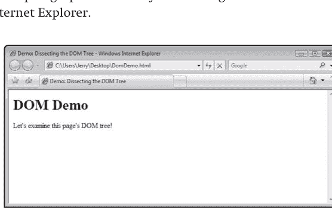

**图 4.5**

网页在 Internet Explorer 中加载时的示例。

虽然图 4.5 显示了网页在浏览器中呈现时的样子，但浏览器的内部页面视图在内存中是使用 DOM 维护的。图 4.6 提供了浏览器在加载网页时组装的 DOM 树的图形化描述。

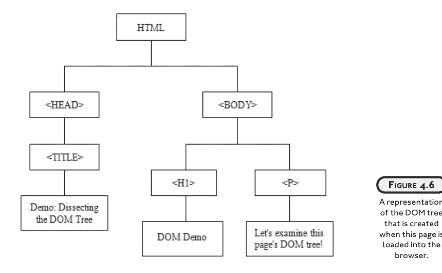

> 虽然图 4.6 中没有描绘，但`document`对象位于 DOM 树的根部，并且只有一个子对象`documentElement`。`documentElement`代表网页的开始`<HTML>`标签。您可以使用 DOM 的`documentElement`属性建立对开始`<HTML>`对象的引用，如下所示：

```javascript
var TreeTop = document.documentElement;
```

如图 4.6 所示，此 HTML 页面的 DOM 树显示了构成 HTML 页面的所有不同元素之间的父/子和兄弟关系。此外，顺序被仔细描绘。使用不同的 DOM 属性，您可以引用 HTML 页面中的任何元素，如图 4.7 所示。

如图 4.7 所示，要引用 DOM 树上的对象，您必须提供一个引用，以标识该元素在树中的位置。在图 4.7 中，定义了一个名为`root`的变量，并为其分配了`document.documentElement`的值。为了建立引用，必须使用一个已知的引用点。对于第一个引用，参考点是`documentElement`属性，即树的根元素。接下来，第二个引用通过从`root`表示的位置开始，然后引用其最后一个子元素（例如`root.lastChild`）来建立。第一个引用使用`body`的最后一个子元素建立。


### 混合导航方法

Ajax 开发人员常用的方法不是在 DOM 树中导航时仅使用 ID 属性或 DOM 属性，而是结合使用这两种方法。作为如何使用此方法的示例，让我们修改前面的网页，在几个 HTML 标签中插入几个 ID 属性，如下所示：

```html
<HTML>
  <HEAD>
    <TITLE>Demo: Dissecting the DOM Tree</TITLE>
  </HEAD>
  <BODY ID = "BodyTag">
    <H1 ID = "HeadTag">DOM Demo</H1>
    <P ID = "ParaTag">Let's examine this page's DOM tree!</P>
  </BODY>
</HTML>
```

图 4.8 显示了 HTML 页面的 DOM 树视图的新描述，这次指出了哪些树节点被分配了 ID 属性。

**图 4.8**

网页 DOM 树的新描述。


**图 4.9**

如何使用 ID 属性与 DOM 属性来遍历 DOM 树的示例。

既然 HTML 页面中有许多带有 ID 属性的标签，在建立新的元素引用时，您就有了更大的灵活性。您不必从 DOM 树的根部开始一路向下，现在可以从树中任何设置了标签 ID 的位置开始。

## 动态更新网页内容

现在您了解了浏览器如何为每个 HTML 页面生成 DOM 树，并看到了如何遍历 DOM 树，是时候学习如何修改 DOM 树以实现网页内容的动态更新了。为此，让我们创建一个如下所示的新网页：

# Ajax Programming for the Absolute Beginner

```html
<HTML>
    <HEAD>
        <TITLE>Demo: Working with mouse event handlers</TITLE>
        <SCRIPT LANGUAGE = "JavaScript" TYPE = "Text/JavaScript">
            function ChangePageLayout() {
                var newParagraph = document.createElement("p");
                var newTextNode = document.createTextNode('The DOM Rocks!');
                document.getElementById('trgtDiv').appendChild(newParagraph);
                document.getElementById('trgtDiv').appendChild(newTextNode);
            }
        </SCRIPT>
    </HEAD>
    <BODY>
        <H1>DOM Demonstration</H1>
        <FORM>
            <INPUT type = "button" value = "Click on Me" id = "formButton"
                   onclick = "ChangePageLayout()">
        </FORM>
        <DIV id = "trgtDiv"> </DIV>
    </BODY>
</HTML>
```

图 4.10 显示了此 HTML 页面最初加载到浏览器时的样子。


## 回到当日的 Ajax 故事应用

好的。让我们把注意力转回当日的 Ajax 故事应用程序的开发上。这个游戏将展示如何动态修改网页的 DOM 树，以适应从 Web 服务器检索到的文本的显示，而无需任何浏览器刷新，从而在应用程序执行期间看似无缝地显示新内容。

你可以使用`CreateElement()`方法创建另一种类型的元素。然后，你可以使用 DOM 的`AppendChild()`方法将新的文本节点附加到 HTML 页面中的现有节点上。

在 HTML 文件中，创建了一个名为`ChangePageLayout()`的函数，当调用它时，将使用 DOM 的`createElement()`方法创建一个新的 HTML 段落元素（例如`<P>`），并将其分配给一个名为`newParagraph`的变量。接下来，使用 DOM 的`createTextNode()`方法创建一个文本元素，该元素被分配给一个名为`newTextNode`的变量。使用 DOM 的`AppendChild()`方法，你可以将一个新节点附加到 HTML 页面中的任何位置。该函数的最后两条语句使用 DOM 的`appendChild()`方法，通过将两个新创建的 HTML 元素添加到其中来动态修改 DOM 树。


> 在使用 DOM 时，你还需要知道的一点是，你可以使用`nodeName`属性获取树中任何节点的名称。元素节点代表像`<DIV>`和`<P>`这样的标签，它们没有任何值。另一方面，文本节点没有名称，但会有一个值。你可以使用`nodeValue`属性检索节点的值。

## 设计应用程序

与本书中开发的所有其他应用程序一样，当日的 Ajax 故事应用程序是使用一系列特定的步骤创建的，概述如下：

1. 创建一个新的 HTML 页面。
2. 添加一个表单以收集用户数据。
3. 定义一个用于显示故事文本的段落。
4. 开始应用程序的 JavaScript 编程。
5. 创建一个`XMLHttpRequest`对象。
6. 从 Web 服务器检索故事文本。
7. 修改 DOM 树。
8. 禁用游戏按钮。
9. 创建应用程序的文本文件。
10. 执行你的新 Ajax 应用程序。

## 步骤 1：编写应用程序的 HTML

当日的 Ajax 故事应用程序开发的第一个步骤是创建应用程序的 HTML 页面。首先打开你最喜欢的文本或代码编辑器，然后添加以下 HTML 语句。添加后，将 HTML 页面保存为`AjaxStory.html`。

```html
<HTML>
  <HEAD>
    <TITLE>Welcome to the Ajax Story</TITLE>
  </HEAD>
  <BODY>
    <H1>Ajax Story of the Day</H1>
  </BODY>
</HTML>
```

如你所见，这是一个相当普通的网页，由 head 和 body 标签以及一个标题和一个一级标题组成。

## 步骤 2：创建应用程序的表单

当日的 Ajax 故事应用程序的界面由四个按钮控件组成，这些控件在网页顶部对齐。要进行设置，你需要向页面添加一个表单，你可以通过将以下 HTML 语句添加到 HTML 页面的 body 部分来实现。

```html
<FORM name = "appForm">
    <INPUT name = "Button1" type = "button" value = "Part 1"
        onclick = "TellStory('Part1.txt')">
    <INPUT name = "Button2" type = "button" value = "Part 2"
        onclick = "TellStory('Part2.txt')">
    <INPUT name = "Button3" type = "button" value = "Part 3"
        onclick = "TellStory('Part3.txt')">
    <INPUT name = "Button4" type = "button" value = "Part 4"
        onclick = "TellStory('Part4.txt')">
</FORM>
```

四个按钮中的每一个都被分配了唯一的名称和值，并配置为在单击时执行`TellStory()`函数，并传递一个不同的文本文件名，该文件将从应用程序的 Web 服务器下载。在四个按钮控件下方，会显示一条灰色的分隔线。要进行设置，请将以下 HTML 标签添加到 body 部分的末尾，就在你刚刚添加的表单语句下方。

```html
<HR>
```

## 步骤 3：添加用于显示文本的段落元素

要与应用程序交互，用户必须按照它们呈现的顺序单击四个按钮控件。每次单击一个按钮，浏览器窗口中就会显示故事的新部分。该应用程序不在 body 部分的底部硬编码四组`<DIV> </DIV>`标签来建立一个预定义位置以供添加故事文本，而是每次需要显示故事的新部分时，根据需要修改 DOM 树。

在动态修改 DOM 树时，应用程序将使用 DOM 的`appendChild()`方法重复显示故事的新部分。为了实现这一点，请将以下语句添加到 body 部分的末尾。

```html
<P id = "trgtP"> <P>
```


应用程序将使用此段落标签来建立 DOM 树中应附加新元素的位置。

## 步骤 4：开始游戏脚本的开发

当日的 Ajax 故事应用程序开发的下一步是开始组装其 JavaScript。首先将以下语句添加到 HTML 页面的 head 部分。

```
<SCRIPT language = "javascript" TYPE = "text/javascript">
<!-- Start hiding JavaScript statements


// End hiding JavaScript statements -->
</SCRIPT>
```

构建此应用程序的其余步骤涉及添加属于此脚本的 JavaScript 语句和函数。

## 步骤 5：创建 XMLHttpRequest 对象

由于当日的 Ajax 故事应用程序涉及从其 Web 服务器以四个文本文件的形式检索数据，因此你需要设置一个 `XMLHttpRequest` 对象的实例。本书尚未解释如何使用此对象，因此现在只需将以下语句复制到应用程序的 JavaScript 中，照原样即可。

```
var Request = false;

if (window.XMLHttpRequest) {
    Request = new XMLHttpRequest();
} else if (window.ActiveXObject) {
    Request = new ActiveXObject("Microsoft.XMLHTTP");
}
```

> 注意：你将在第 5 章“Ajax 基础”中全面了解 `XMLHttpRequest` 对象。现在，你只需要知道它有助于与 Web 服务器交换信息。

## 步骤 6：检索故事文本

当日的 Ajax 故事应用程序由几个不同的函数组成，每个函数执行一个独特的任务。接下来显示的 `TellStory()` 函数负责讲述应用程序的故事。构成此函数的语句应添加到应用程序的 JavaScript 末尾。

```
function TellStory(url) {
    if(Request) {
        Request.open("GET", url);
        Request.onreadystatechange = function()
        {
            if (Request.readyState == 4 && Request.status == 200) {
    ModifyDOM(Request.responseText)
    UpdateInterface(url)
  }
}

Request.send(null);
}
}
```

此函数使用上一步中建立的 `XMLHttpRequest` 对象来检索应用程序故事的一部分。检索到的文件作为参数传递给函数，然后映射到 `url` 参数。由于此函数的内部工作原理需要很好地理解 `XMLHttpRequest` 对象的使用，而这在下一章才会介绍，因此不要过分纠结于此函数的细节。你现在需要知道的是，一旦检索到指定的文本文件，它就会被传递给 `ModifyDOM()` 函数，该函数将附加 DOM 树并显示从 Web 服务器检索到的文本。此外，还会调用 `UpdateInterface()` 函数，该函数负责禁用对应用程序按钮控件的访问。

## 步骤 7：更新 DOM 树

接下来显示的 `ModifyDOM()` 函数负责修改 DOM 树的结构，以适应应用程序故事四个部分的显示。将此函数添加到应用程序的 JavaScript 中，就在 `TellStory()` 函数下方。

```
function ModifyDOM(storyText) {
  var newText = document.createTextNode(storyText);
  var newLine = document.createElement("p");
  document.getElementById('trgtP').appendChild(newLine);
  document.getElementById('trgtP').appendChild(newText);
}
```

调用时，`ModifyDOM()` 函数被传递一个参数，该参数代表应用程序故事一部分的文本（从 Web 服务器检索到）。此文本存储在一个恰如其分地命名为 `storyText` 的变量中。该函数首先定义一个名为 `newText` 的新文本节点，该节点由存储在 `storyText` 中的文本组成。接下来，定义一个名为 `newLine` 的段落元素节点。该函数的最后两条语句将 `newLine` 和 `newText` 元素附加到 `trgtP` 元素的末尾。如果你回到步骤 3，你会看到这个元素被专门添加到 HTML 页面的 body 部分的末尾，以建立一个参考点并设置一个父元素，以便于向网页添加新的子元素。

## 第 8 步：修改按钮状态

需要添加到应用程序 JavaScript 中的最后一个函数是 `UpdateInterface()` 函数。它的作用是禁用应用程序的四个按钮控件中的每一个。它使用传统的 JavaScript 完成了这项任务。

```
function UpdateInterface(selection) {
    if (selection == "Part1.txt") appForm.Button1.disabled = "disabled";
    if (selection == "Part2.txt") appForm.Button2.disabled = "disabled";
    if (selection == "Part3.txt") appForm.Button3.disabled = "disabled";
    if (selection == "Part4.txt") appForm.Button4.disabled = "disabled";
}
```

如你所见，该函数接收一个参数，该参数指示刚刚显示了故事的哪一部分。利用这个信息，通过将控件的 `disabled` 属性设置为 `disabled` 值，来禁用应用程序的四个按钮控件中的一个。这可以防止玩家在讲述故事期间意外地多次点击同一个按钮。

## 第 9 步：创建应用程序的文本文件

为了完成 Ajax 每日故事应用程序的工作，你需要创建应用程序的四个文本文件中的每一个。为此，请创建四个名为 `Part1.txt`、`Part2.txt`、`Part3.txt` 和 `Part4.txt` 的新文本文件，并将下面显示的文本添加到相应的文件中。

### `Part1.txt`

从前，有一个名叫杰克的小男孩，他和母亲一起生活。杰克和他母亲非常贫穷，几乎没有东西吃。杰克和他母亲决定，杰克应该把牛带到镇上，换一些食物和钱。

### `Part2.txt`

就在到达镇上之前，杰克遇到了一个奇怪的老人，老人告诉杰克，他有一小袋豆子，他想用这袋豆子换杰克的牛。杰克拒绝了这笔交易，但随后这位神秘的老人告诉杰克，这些豆子有魔力，一夜之间就能长出庄稼，足以让他的家人在这个季节剩下的时间里吃饱。

### `Part3.txt`

一听说豆子有魔力，杰克就同意了这笔交易，高高兴兴地回家了。不久之后，他的母亲在他们房子的前门口迎接他。一听到杰克做的这笔交易，他母亲勃然大怒，把豆子扔到院子里，并把杰克赶回了他的房间。

### `Part4.txt`

第二天早上，杰克早早地醒来，望向窗外，看到一棵巨大的豆茎从他的院子里长出来，一直伸向天空。杰克跑出房子，开始攀爬这棵豆茎。不幸的是，杰克恐高，仅仅爬了几英尺，他就放弃了，爬了下来。

## 第 10 步：运行你的新游戏

好了！此时，你已经拥有了创建 Ajax 每日故事应用程序所需的所有信息。假设你已经仔细按照提供的说明操作，并且中途没有打错字，那么一切应该会像本章开头描述的那样运行。要测试此应用程序，请将 `AjaxStory.html` 文件以及 `Part1.txt`、`Part2.txt`、`Part3.txt` 和 `Part4.txt` 文件上传到你的 Web 服务器，然后在你的 Web 浏览器中加载 `AjaxStory.html`，看看会发生什么。

**提示**：你可以在本书的配套网站 `http://www.courseptr.com/downloads` 上找到此应用程序源代码文件的副本。

## 总结

本章为你提供了文档对象模型的详细概述，并解释了如何使用它来动态修改网页外观，而无需任何页面刷新。你学习了 DOM 如何创建所有网页的 DOM 树表示，以及如何使用 `document` 对象和各种 DOM 属性和方法来操作这棵树。你学习了在 DOM 树中引用对象的不同方法，并使用对象关系作为在 DOM 树中导航的手段。你还学习了如何使用 DOM 树来更新网页内容，而无需使用 `<DIV> </DIV>` 和 `<SPAN> </SPAN>` 标签。

现在，在你继续第 5 章“Ajax 基础”之前，我建议你再花几分钟时间，通过实现以下挑战列表来完善 Ajax 每日故事应用程序。

## 挑战

1. 按照目前的写法，没有编程逻辑来防止用户按照正确的顺序点击每个按钮控件。考虑修改应用程序以解决这种情况，强制用户在每次讲述故事时都点击正确的按钮。
2. 重写应用程序的故事，讲述一个更符合你自己兴趣的故事。记住，一旦你写完，你需要将其分解为四个部分，并将这些部分保存在适当命名的文本文件中。

# 第三部分

## 构建 Ajax 应用程序

此页有意留白。


# AJAX 基础

要成为一名有效的 Ajax 程序员，你至少必须了解如何处理 HTML、JavaScript、DOM 和 `XMLHttpRequest` 对象。我们假定你具备 HTML 知识。第 1—4 章为你提供了对 JavaScript 和 DOM 的实际理解。本章向你介绍 `XMLHttpRequest` 对象，并解释如何使用它与 Web 服务器通信，并在你的 Ajax 应用程序中促进数据交换。本章将演示如何使用 `XMLHttpRequest` 对象检索文本文件，并以不同方式使用检索到的数据。本章还将向你介绍 Ajax 框架，这些是 JavaScript 函数库，你可以加载并集成到你的 Web 应用程序中，从而缩短开发时间并创建能够执行各种复杂操作的应用程序。

具体来说，你将学习：

- 如何实例化和与 `XMLHttpRequest` 对象交互
- 如何检索存储在 Web 服务器文本文件中的数据
- 如何创建使用工具栏驱动的鼠标悬停效果的 Ajax 应用程序
- 如何将 Ajax 框架集成到你的应用程序中

## 项目预览：AJAX 打字挑战

本章的游戏项目是 Ajax 打字挑战。在此应用程序中，用户将面临挑战，输入三个越来越长且越来越难的句子。图 5.1 显示了该应用程序加载到 Internet Explorer 中时的外观。


**图 5.1** 要开始 Ajax 打字挑战应用程序，用户必须点击“开始测试”按钮。

一旦点击“开始测试”按钮，应用程序就会连接到 Web 服务器并下载三个挑战句子，然后将这些句子显示在浏览器窗口中。如图 5.2 所示，挑战句子分散在应用程序的文本框字段之间。


**图 5.2** 用户的任务是按照屏幕上显示的原文准确地输入每个句子。

对于完成打字挑战所需的时间没有限制。用户重新输入完所有三个句子后，必须点击“评分测试”按钮。这会指示应用程序对测试进行评分，如图 5.3 所示。


**图 5.3** 要通过 Ajax 打字挑战，用户必须正确输入至少两个句子。

如果用户测试失败并想重新参加测试，玩家可以再次点击“开始测试”按钮。作为响应，应用程序会清除三个测试字段中显示的所有文本，允许用户再次尝试。

## 将你的应用程序连接到 Web 服务器

Ajax 应用程序利用浏览器执行客户端 JavaScript 代码的能力，这些代码可以与浏览器的 DOM 交互，并使用从 Web 服务器检索到的数据对页面的 DOM 树进行动态修改。Ajax 应用程序与 Web 服务器的通信在幕后进行，使用属于 `XMLHttpRequest` 对象的方法和属性。使用 `XMLHttpRequest` 对象，Ajax 应用程序发送和接收 HTTP 请求和响应。

> **提示**：微软创建了 `XMLHttpRequest` 对象，并于 1999 年首次将其作为 Internet Explorer 5 中的 ActiveX 对象组件发布。其他 Web 浏览器开发人员很快意识到了这个对象的有用性，并在自己的浏览器中添加了对它的支持，将其作为窗口对象属性实现。最终，微软也效仿，并从 Internet Explorer 7 开始将 `XMLHttpRequest` 对象重新设计为窗口对象属性。

Ajax 应用程序使用 `XMLHttpRequest` 对象来发起和管理向 Web 服务器提交数据请求，并监视和处理服务器数据的接收。一个可靠的

## XMLHttpRequest 对象

理解该对象的方法和属性对于 Ajax 应用程序开发人员至关重要。本章的主要目的是为您提供详细的指导，说明如何实例化并使用 `XMLHttpRequest` 对象来管理 Ajax 应用程序中的数据检索。

## XMLHttpRequest 方法

`XMLHttpRequest` 对象提供了两个方法，用于连接 Web 服务器并提交请求。下面简要介绍这些方法。

- `open()`：建立与 Web 服务器的连接。
- `send()`：向 Web 服务器发送请求。

`open()` 方法用于发起与 Web 服务器的连接。连接后，您将使用各种 `XMLHttpRequest` 属性（将在下一节讨论）来发送数据请求，并在启动后监视它们（这通过 `send()` 方法完成）。

## XMLHttpRequest 属性

为了指定 Ajax 应用程序期望从 Web 服务器接收的数据类型，并在收到 Web 服务器的数据后监视和响应这些数据，您需要使用不同的 `XMLHttpRequest` 属性。表 5.1 列出了您在 Ajax 应用程序中需要知道如何使用的各种 `XMLHttpRequest` 属性。

| 属性 | 描述 |
|---|---|
| `readyState` | 0 到 4 之间的值，表示从 Web 服务器接收数据的状态，其中值为 4 表示数据已接收。 |
| `status` | 状态码，指示 `XMLHttpRequest` 对象数据请求的总体状态，其中值为 200 表示一切正常（请参阅表 5.2）。 |
| `responseText` | 存储 Web 服务器返回的文本数据。 |
| `responseXML` | 存储 Web 服务器返回的 XML 数据。 |
| `onreadystatechange` | 接受一个函数，并在每次发生 `readystatechange` 事件时调用该函数执行。 |

## 使用 XMLHttpRequest 对象

使用 `XMLHttpRequest` 对象建立与 Web 服务器的连接、指定数据请求，然后处理返回的数据是一个多步骤的过程。理解这些步骤如何工作至关重要，并将在接下来的章节中详细介绍。

## 实例化 XMLHttpRequest 对象

使用 `XMLHttpRequest` 对象的第一步是实例化它。不幸的是，`XMLHttpRequest` 对象代表了 Web 浏览器之间的另一个分歧点。以下语句演示了如何确定 Ajax 应用程序是运行在 Firefox、Safari、Opera 上，还是任何 6 版以上的 Internet Explorer 浏览器上。

```javascript
var Request = false;
if (window.XMLHttpRequest) {    //尝试 Firefox、Safari、Opera、IE 7 或更高版本
    Request = new XMLHttpRequest();
}
```

这里，第一条语句定义了一个名为 `Request` 的变量，该变量将用于设置对 `XMLHttpRequest` 对象的引用。第二条语句执行 `window` 对象的 `XMLHttpRequest` 属性以确定是否支持它。如果支持，第二条语句使用 `new` 关键字创建一个新的名为 `Request` 的 `XMLHttpRequest` 对象。

> 实例化后，无论使用何种类型的浏览器，您都可以使用相同的属性、方法和事件集来使用 `XMLHttpRequest` 对象。

要在运行 Internet Explorer 5 或 6 的浏览器中实例化 `XMLHttpRequest` 对象，您需要使用 `ActiveXObject()` 方法，如下所示：

```javascript
if (window.ActiveXObject) {    //尝试 ActiveX（Internet Explorer）
    Request = new ActiveXObject("Microsoft.XMLHTTP");
}
```

> 尽管在撰写本书时 Internet Explorer 8 已有测试版发布，但 Internet Explorer 7 仍是该浏览器最新的正式版本，自 2006 年 10 月起一直如此。尽管如此，由于大量网络用户仍在使用 Internet Explorer 5 和 6，因此在所有 Ajax 应用程序中提供对 Internet Explorer 5 和 6 的支持是标准做法，如下所示：

```javascript
var Request = false;
if (window.XMLHttpRequest) {
    Request = new XMLHttpRequest();
} else if (window.ActiveXObject) {
    Request = new ActiveXObject("Microsoft.XMLHTTP");
}
```


与刚才演示的实例化 `XMLHttpRequest` 对象的方式不同，您有时可能会遇到其他 Ajax 开发人员使用基于异常的方法来设置 `XMLHttpRequest` 对象的实例，如下所示：

```javascript
var Request = false;
try {
    Request = new XMLHttpRequest(); //尝试 Firefox、Safari、Opera 等。
}
catch(e)
{
    Request = new ActiveXObject("Microsoft.XMLHTTP"); //尝试 ActiveX（IE）
}
```

这里，声明了一个名为 `Request` 的变量，然后设置了一个 `try` 代码块，尝试使用 Window 对象的 `XMLHttpRequest()` 方法实例化一个 `XMLHttpRequest` 对象。只要使用的浏览器不是 Internet Explorer 5 或 6，这就会起作用。如果属于这种情况，则会发生错误并执行 `catch()` 方法。此方法忽略错误，允许应用程序继续执行。如果发生这种情况，则使用 Internet Explorer 的 `ActiveXObject()` 方法设置 `XMLHttpRequest` 对象。

## 打开新连接

实例化 `XMLHttpRequest` 对象后的下一步是使用 `open()` 方法建立与 Web 服务器的连接。此方法的语法如下：

```javascript
open("method", "url" [, asyncFlag [, username [, password]]])
```

表 5.2 确定了 `open()` 方法每个参数的用途。


`XMLHttpRequest` 对象总是与 Web 服务器创建异步连接，除非您通过将 `asyncFlag` 的值设置为 `false` 来明确告诉它不要这样做。这样做会迫使 Ajax 应用程序停止执行并等待数据检索，从而完全违背了使用 Ajax 的目的。

## 表 5.2 `XMLHttpRequest` 对象 `open()` 方法参数

| 值 | 说明 |
|---|---|
| `method` | 用于建立与 Web 服务器连接的 HTTP 方法（`GET`、`POST`） |
| `url` | 要在 Web 服务器上打开的文件 URL |
| `asyncFlag` | 可选值，当设置为 `true`（默认）时，设置异步连接（值为 `false` 则指定同步连接） |
| `userName` | 可选的用户名，如果 Web 服务器需要 |
| `password` | 可选的密码，如果 Web 服务器需要 |

## 执行 `open()` 方法

要使用 `open()` 方法在 Web 服务器上打开 URL，您必须指定标准的 HTML `GET` 或 `POST` 选项。两者中，`GET` 选项（如下所示）通常用于从 Web 服务器检索适量的数据，而 `POST` 选项通常用于需要下载大量数据时。

```javascript
if(Request) {
  Request.open("GET", "url");
  .
  .
  .
}
```

`GET` 和 `POST` 选项都配置 `XMLHttpRequest` 对象以与指定的文件一起工作。但是，这两个选项都不会导致应用程序连接到 Web 服务器或访问该文件。您将在接下来的几个步骤中学习如何实现这一点。请注意，在执行 `open()` 方法之前，此示例会检查以确保已成功实例化了有效的 `XMLHttpRequest` 对象（通过确保分配给 `Request` 对象变量的值等于 `true`）。

> **技巧**
>
> 注意此处显示的示例。它检查分配给 `Request` 的值是否等于 `true`。
>
> ```javascript
> if (Request) {
>
> }
> ```

此示例在功能上与以下示例相同。这两个示例之间唯一的区别是第一个示例编写所需的击键次数更少，而第二个示例可以说更容易理解。Ajax 程序员通常使用前一个版本而不是后一个版本，但最终这是个人选择的问题。

```javascript
if (Request = true) {

}
```

## 使用绝对路径和相对路径

在指定 Ajax 应用程序的路径和文件名时，有两个选项：绝对路径和相对路径。绝对路径是指定文件确切位置的路径，如下所示：

```javascript
Request.open("GET", "http://www.tech-publishing.com/Test/Scores.txt");
```

这里，指定名为 `Scores.txt` 的文件，该文件驻留在 Web 服务器上的 `http://www.tech-publishing.com/Test/`。另一方面，相对路径根据文件在 Web 服务器上相对于应用程序文件的位置来指定文件位置。例如，以下语句查找名为 `Scores.txt` 的文件，该文件与应用程序位于同一位置。

```javascript
Request.open("GET", "Scores.txt");
```

为了简单起见，本书中的所有示例都使用相对路径。

## 等待 Web 服务器的响应

实例化 `XMLHttpRequest` 对象并使用其 `open()` 方法指定要访问的文件后，您需要添加处理 Web 服务器响应所需的编程逻辑。`XMLHttpRequest` 对象在发送 HTTP 请求、等待并最终从 Web 服务器接收数据的过程中，会经历许多不同的状态。具体来说，`XMLHttpRequest` 对象公开了两个属性，让您了解 HTTP 请求的总体状态。这些属性是 `readyState` 和 `status` 属性。

通过监视分配给 `readyState` 属性的值，您可以编程方式确定应用程序何时完成接收数据。`readyState` 属性可以报告表 5.3 中所示的任何值。

通过监视分配给 `status` 属性的值，您可以确定 HTTP 请求是否成功。具体来说，您需要确保分配给 `status` 属性的值为 `200`。任何其他值都表明出了问题。

## 5.3 `XMLHttpRequest` 对象状态属性值

| 值 | 解释 |
|---|---|
| `0` | 表示未初始化状态，此时 `XMLHttpRequest` 对象已创建但尚未初始化。 |
| `1` | 表示“已打开”状态，此时 `XMLHttpRequest` 对象的 `open()` 方法已执行，但 `send()` 方法尚未执行。 |
| `2` | 表示“已发送”状态，此时 `XMLHttpRequest` 对象正在等待服务器返回数据。 |
| `3` | 表示 `XMLHttpRequest` 对象正在接收来自 Web 服务器的数据。 |
| `4` | 表示 `XMLHttpRequest` 对象已完成从 Web 服务器接收数据。 |

```javascript
Request.onreadystatechange = function() {
    if (Request.readyState == 4 && Request.status == 200) {
        .
        .
        .
    }
}
```

这种函数被称为匿名函数。只要请求的状态发生变化，此函数就会自动执行，从而允许你添加用于监控和跟踪应用程序数据请求进度的脚本语句。

## 处理 Web 服务器响应

现在你已经添加了处理 Web 服务器将返回的数据所需的编程逻辑，接下来需要指定你的应用程序期望接收的数据类型。这可以通过以下列出的 `XMLHttpRequest` 对象属性之一来完成：

- `responseText`：数据以纯文本形式返回。
- `responseXML`：数据以 XML 形式返回。

下面的语句演示了如何设置你的 Ajax 应用程序来处理 Web 服务器返回的文本数据。

```javascript
RequestObj.innerHTML = Request.responseText;
```

或者，你可以设置你的应用程序来处理 XML 数据，如以下所示：

```javascript
RequestObj.innerHTML = Request.responseXML;
```

## 总结

到目前为止，你已经了解了如何实例化 `XMLHttpRequest` 对象、指定文件、建立服务器连接、验证连接，然后准备应用程序从 Web 服务器检索数据。要实际提交请求并检索数据，你必须执行 `send()` 方法，其语法如下：

```javascript
send("string")
```

这里，在使用 `GET` 模式时，分配给 `string` 参数的值始终是 `"null"`，如下所示：

```javascript
Request.send(null);
```

一旦执行，`send()` 方法将启动下载过程，允许你设置的 JavaScript 匿名函数开始管理下载过程。

## 将所有部分组合在一起以创建一个可工作的 Ajax 应用程序

为了帮助你理解刚刚介绍的所有信息，让我们回顾一下在第 1 章中介绍的“每日 Ajax 笑话”应用程序。这个应用程序的完整 HTML 文件如下所示：

```html
<HTML>
  <HEAD>
    <TITLE>Ajax Joke of the Day Application</TITLE>
    <SCRIPT language = "javascript" type = "text/javascript">
      var Request = false;
      if (window.XMLHttpRequest) {
        Request = new XMLHttpRequest();
      } else if (window.ActiveXObject) {
        Request = new ActiveXObject("Microsoft.XMLHTTP");
      }
      function retrieveJoke(url, elementID) {
        if(Request) {
          var RequestObj = document.getElementById(elementID);
          Request.open("GET", url);
          Request.onreadystatechange = function() {
            if (Request.readyState == 4 && Request.status == 200) {
                RequestObj.innerHTML = Request.responseText;
            }
          }
          Request.send(null);
        }
      }
    </SCRIPT>
  </HEAD>
  <BODY>
    <H1>Where do bees go when they get married?</H1>
    <FORM>
        <INPUT type = "button" value = "Fetch Answer"
        onclick = "retrieveJoke('joke.txt', 'DivTarget')">
    </FORM>
    <DIV id="DivTarget"> </DIV>
  </BODY>
</HTML>
```

如你所见，此应用程序首先定义一个变量，用于表示 `XMLHttpRequest` 对象的实例。接下来，设置一个 `if` 语句代码块，以确定运行的 Web 浏览器是 Internet Explorer 7 或更高版本，还是其他类型的浏览器。设置变量和实例化 `XMLHttpRequest` 对象的代码语句被添加到 HTML 页面中，位于任何函数之外，以便在网页加载时自动执行。

`Request` 变量被赋予初始值 `false`，这样应用程序的 JavaScript 后来就可以检查其值，以验证 `XMLHttpRequest` 对象是否已创建。然后定义一个名为 `retrieveJoke()` 的函数。当用户点击位于 HTML 页面主体部分定义的表单上的按钮时，此函数将执行。按钮的 `onClick` 事件处理程序向函数传递两个参数。第一个参数指定要从 Web 服务器下载的文本文件的名称，第二个参数指定与主体部分中的一对 `<DIV> </DIV>` 标签相关联的 `id`，文本文件的内容在由 `retrieveJoke()` 函数处理后将显示在那里。

一旦执行，`retrieveJoke()` 函数将检查是否已设置好 `XMLHttpRequest` 对象的实例，然后声明一个名为 `requestObj` 的变量，并为其分配一个代表页面主体部分中 `<DIV> </DIV>` 标签的值。接下来，使用 `GET` 选项执行 `open()` 方法，并设置一个匿名函数来处理服务器下载的文本文件，使用 `RequestObj` 对象的 `innerHTML` 属性在 HTML 页面的 `<DIV> </DIV>` 标签中显示文本文件的内容。最后，执行 `send()` 方法，启动下载过程并调用匿名函数的执行。图 5.4 展示了此应用程序运行中的一个示例。


**图 5.4** 执行每日 Ajax 笑话应用程序。

## 管理并发的 `XMLHttpRequests`

到目前为止，在本书中，你看到的 Ajax 应用程序都使用了单个 `XMLHttpRequest` 对象。然而，随着你开始开发更复杂的 Ajax 应用程序，你最终可能需要开发一个必须响应不同用户操作、同时从 Web 服务器获取多组数据的 Ajax 应用程序。这无法使用单个 `XMLHttpRequest` 对象来完成。

处理这种情况的一种方法是定义多个 `XMLHttpRequest` 对象实例。例如，以下语句定义了一对 `XMLHttpRequest` 对象。

```javascript
var Request1 = false;
var Request2 = false;
if (window.XMLHttpRequest) {
    Request1 = new XMLHttpRequest();
    Request2 = new XMLHttpRequest();
} else if (window.ActiveXObject) {
    Request1 = new ActiveXObject("Microsoft.XMLHTTP");
    Request2 = new ActiveXObject("Microsoft.XMLHTTP");
}
```

使用这种方法，你将需要为应用程序可能需要发起的每个请求创建一个唯一的 `XMLHttpRequest` 对象实例。如果你创建的应用程序需要同时支持两个或三个以上的请求，这种方法很快就会变得难以管理。相反，更好的方法是使用数组来管理你的应用程序的 `XMLHttpRequest` 对象。请记住，JavaScript 数组可用于存储任何 JavaScript 支持的对象类型的集合。

以下示例展示了设置 `XMLHttpRequest` 对象数组所需的逻辑。该数组名为 `aRequests`。数组中的每个 `XMLHttpRequest` 对象随后可以根据其在数组中的索引位置按需引用。

```javascript
var aRequests = new Array();
if (window.XMLHttpRequest) {
    aRequests.push(new XMLHttpRequest());
} else if (window.ActiveXObject) {
    aRequests.push(new ActiveXObject("Microsoft.XMLHTTP"));
}
```


JavaScript 数组支持一个名为 `push()` 的函数，执行该函数时，会通过在数组末尾添加一个新元素来增加指定数组的大小。

## 使用 Ajax 设置鼠标悬停效果

在上一节中，你看到了一个如何创建 Ajax 应用程序的示例，该程序在用户点击按钮控件时从 Web 服务器检索文本文件。Ajax 不仅限于在用户明确发起操作的情况下检索数据和修改网页内容。Ajax 应用程序同样可以轻松地设置为在用户将鼠标指针在网页上移动时，通过后台与 Web 服务器交互来为用户提供动态内容。这里提供了一个示例，展示了如何设置类似的功能：

```html
<HTML>
<HEAD>
    <TITLE>XYZ Website</TITLE>
    <SCRIPT language = "javascript" type = "text/javascript">
    <!-- Start hiding JavaScript statements
        var Request = false;
        if (window.XMLHttpRequest) {
            Request = new XMLHttpRequest();
        } else if (window.ActiveXObject) {
            Request = new ActiveXObject("Microsoft.XMLHTTP");
        }
        function updatePage(fileName, target)
```

## 126 Ajax初学者编程


```javascript
{
    if(Request) {
        var targetDiv = document.getElementById(target);
        Request.open("GET", fileName);
        Request.onreadystatechange = function() {
            if (Request.readyState == 4 && Request.status == 200) {
                targetDiv.innerHTML = Request.responseText;
            }
        }
        Request.send(null);
    }
}
// 隐藏JavaScript语句结束 -->
</SCRIPT>
</HEAD>
<BODY>
    
    
    
    
    
    <H1> <DIV id="TrgtDiv"> </DIV> </H1>
</BODY>
</HTML>
```

这里，创建了一个由五个位于浏览器窗口顶部的图形菜单组成的小型应用程序。每当用户将鼠标悬停在其中一个图像上时，每个图形对象都会调用一个名为`updatePage()`的JavaScript函数。此时，会触发鼠标悬停事件，并执行`onMouseOver()`事件处理程序，传递两个参数：一个位于Web服务器上、包含更多信息的文本文件名，以及一个用于显示从服务器检索的数据的`<DIV>` `</DIV>`标签的`id`。

当被调用时，`updatePage()`函数首先检查确保`XMLHttpRequest`对象的一个实例已被实例化。接着，创建一个名为`trgtDiv`的变量，并用它建立对`<DIV>` `</DIV>`标签的引用。然后执行`XMLHttpRequest`对象的`open()`方法，以建立到Web服务器的连接。一旦连接建立，就会设置一个匿名函数来处理Web服务器返回的数据，并将其动态发布到网页上。

图5.5显示了此应用程序在浏览器中初次加载时的外观。


一个用于控制页面内容的图形菜单系列示例。

每次用户将鼠标指针移动到位于浏览器窗口顶部的某个图形菜单上时，应用程序都会在后台连接到Web服务器，并检索描述该菜单的数据。该应用程序总共使用了五个不同的文本文件。每次被调用时，Web服务器都会返回其中某个文件中存储的文本副本。然后，这些信息无需刷新页面即可即时发布到浏览器中！图5.6显示了当用户将鼠标指针悬停在“DOWNLOADS”菜单上时，此应用程序的外观。


当用户将鼠标指针悬停在“DOWNLOADS”菜单上时，应用程序显示的内容示例。

## 利用Ajax框架

如果你曾上网浏览学习Ajax，你很可能会遇到对不同Ajax框架的引用。框架是一组旨在简化应用程序开发的程序代码集合。Ajax框架由一组JavaScript函数组成，你可以从应用程序中调用它们。一些Ajax框架还包含服务器端组件，其中包括便于服务器端数据库搜索、数据操作和处理的程序代码。

Ajax框架的范围从非常小的库到大型、健壮的代码库，后者提供了构建复杂应用所需的一切。使用Ajax框架的主要优势在于，它们通过允许你将预编写的JavaScript函数整合到你的网页和JavaScript代码中，从而加速了应用程序的开发。事实上，有数百种Ajax框架可供选择。它们范围从可在互联网上免费下载的小型通用框架，到大型商业库。一些Ajax库高度专业化，旨在支持特定类型应用程序的开发，例如在线购物车。

## 流行的Ajax框架

两个流行的Ajax框架示例包括Yahoo! 用户界面库（YUI）和Dojo。Yahoo! 用户界面库完全用JavaScript编写。它作为开源库发布，可以从`http://developer.yahoo.com/yui/`免费下载，如图5.7所示。

Yahoo! 用户界面库为Ajax开发者提供了丰富的特性和功能，包括支持日历和图表的开发和管理，以及文本自动完成和应用程序菜单等功能。该框架使Ajax开发者能够添加可点击和展开的树形视图。它还提供了一个功能丰富的富文本编辑器，提供高级文本处理功能。此框架还支持创建工具提示、生成动画效果以及支持拖放操作。此外，Yahoo! 用户界面库还提供了一个浏览器历史管理器，使Ajax应用程序能够保留前进和后退浏览器历史按钮。

Dojo Ajax框架是一个用JavaScript编写的开源库，旨在支持Ajax应用程序和网站的快速开发。它由Dojo基金会开发，该基金会是一个非营利机构，可以从`http://dojotoolkit.org`免费下载，如图5.8所示。Dojo为Ajax开发者提供了丰富的特性和功能，包括支持菜单、表格、工具提示、图表和动画效果的开发。Dojo还提供了专门设计用于支持表单管理和输入验证的函数。它还促进了树形视图和日历的开发，甚至提供了一个功能强大的富文本编辑器。

要使用大多数Ajax框架，你必须将构成框架的代码文件复制到你的Web服务器，然后使用如下所示的语句在你的Ajax应用程序中添加对它的引用：

## 第5章 • Ajax基础

129


> 图 5.7

你可以从`http://developer.yahoo.com/yui/`下载Yahoo! 用户界面库的免费副本。


> 图 5.8

你可以从`http://dojotoolkit.org`下载Dojo Ajax框架的免费副本。

```html
<SCRIPT language="javascript" type="text/javascript" src="cba.js">
.
.
.
</SCRIPT>
```

这里，建立了一个对名为`cba.js`的Ajax框架的引用。

## 框架演示——使用CBA框架

作为如何使用Ajax框架简化应用程序开发的一个简单示例，让我们看一个名为跨浏览器Ajax（Cross Browser Ajax）或CBA的小型Ajax框架。CBA可以免费下载和使用。与Yahoo! 用户界面库和Dojo相比，CBA是一个小框架，在本书出版时，其大小仅为12.8KB。

要下载CBA，请访问`http://www.crossbrowserajax.com`并点击下载按钮，如图5.9所示。


CBA下载为一个名为`CBA.js`的JavaScript文件，该文件存储在Zip文件中。要使该框架可供你的应用程序使用，请将`CBA.js`上传到你的Web服务器上存储Ajax应用程序的同一文件夹中。完成此任务后，你可以在应用程序中使用该框架，并将以下语句添加到位于你的Ajax应用程序HTML文件头部的JavaScript代码中。

```html
<SCRIPT language="javascript" type="text/javascript" src="cba.js"></SCRIPT>
```

添加后，你就可以开始调用通过该框架提供的任何JavaScript函数，如下例所示。

```html
<HTML>
  <HEAD>
    <TITLE>跨浏览器Ajax演示</TITLE>
    <SCRIPT language="javascript" type="text/javascript" src="cba.js"></SCRIPT>
  </HEAD>
  <BODY>
    输入一个术语：<BR>
    <INPUT type="textfield" id="termfield">
    <INPUT type="button" value="获取定义"
      onclick="cbaUpdateElement('TrgtDiv',
        'http://crossbrowserajax.com/data/examples/quickhelp.php?word=' +
        termfield.value);">
    <P id="TrgtDiv" style="color:blue"></P>
  </BODY>
</HTML>
```

这里，创建了一个包含一个文本字段和一个按钮的网页。用户被提示在文本字段中输入一个术语，然后点击按钮查找有关该术语的信息。当点击按钮时，会调用一个名为`cbaUpdateElement()`的函数，并传递两个参数：一个用于显示Web服务器返回文本的`<DIV></DIV>`标签对的id，以及一个名为`quickhelp.php`的PHP程序的URL，该程序接收搜索词作为参数。

`cbaUpdateElement()`函数是通过CBA框架提供给Ajax应用程序的众多函数之一。执行时，它处理与Web服务器的所有通信，并确保Web服务器返回的文本被动态添加到网页中。得益于CBA.js框架，所有这些操作的完成，无需应用程序开发人员开发任何使应用程序工作的JavaScript函数。正如这个应用程序所演示的，你可以使用框架来显著减小Ajax应用程序的大小和复杂性。图5.10显示了此应用程序在首次加载到浏览器中时的外观。

# 给绝对初学者的Ajax编程

图5.11展示了用户使用应用程序查询术语"xml"后的界面。

## 回到Ajax打字挑战应用程序

好的！现在该把注意力转回到本章项目——Ajax打字挑战的开发上了。当应用程序加载时，它会挑战用户按照屏幕上显示的方式准确输入三个句子。这三个句子都通过后台从存储在应用程序Web服务器上的三个文本文件中检索，这使得Web服务器管理员可以随时更新挑战句子。

## 设计应用程序

为了便于理解，本应用程序将按照以下步骤进行开发：

1. 创建新的HTML页面。
2. 创建应用程序的文本文件。
3. 创建应用程序的JavaScript并定义全局变量。
4. 设置`XMLHttpRequest`对象。
5. 下载并显示游戏的挑战句子。
6. 评估玩家的得分。

## 步骤1：编写应用程序的HTML

开发Ajax打字挑战的第一步是创建应用程序的HTML文件。创建一个名为`AjaxTypingTest.html`的新HTML文件，并将以下HTML语句添加到其中。

```html
<HTML>
  <HEAD>
    <TITLE>Ajax Typing Challenge</TITLE>
  </HEAD>
  <BODY>
    <H1 style = "color:blue">Ajax Typing Challenge</H1>
    <FORM>
      <P>Click on "Begin Test" when you are ready to begin and then type the sentences that are displayed in the text fields displayed below each sentence. When done, click on the "Grade Test" button.</P>
      <INPUT type = "button" value = "Begin Test" id = "btnControl1" onclick = startQuiz()>
      <INPUT type = "button" value = "Grade Test" id = "btnControl2" onclick = gradeQuiz()>
      <P><DIV id = "trgtDiv1"> </DIV></P>
      <INPUT type = "textfield" size = "100" id = "inputField1">
      <P><DIV id = "trgtDiv2"> </DIV></P>
      <INPUT type = "textfield" size = "100" id = "inputField2">
      <P><DIV id = "trgtDiv3"> </DIV></P>
      <INPUT type = "textfield" size = "100" id = "inputField3">
    </FORM>
    <P style = "color:red; font-weight:Bold" id = "trgtP"> </P>
  </BODY>
</HTML>
```

如你所见，这个HTML页面包含必需的head和body标签。body部分包括一个一级标题，后跟一个表单和一对`<P> </P>`标签（id为`trgtP`），应用程序将在测试完成后向这些标签中显示一条消息，告知用户其得分。

该表单包含两个按钮控件和三个文本框控件。按钮控件使用`onClick`事件处理程序调用名为`startQuiz()`和`gradeQuiz()`的JavaScript函数。三个文本框控件各自被分配了唯一的id，以便后续可以引用它们，使应用程序的函数能够从中获取用户的输入。

## 步骤2：创建应用程序的服务器端文本文件

Ajax打字挑战向用户展示三个挑战句子，这些句子从存储在Web服务器上的文本文件中检索。表5.4列出了这三个文件的名称并展示了其内容。

**表5.4 服务器端文本文件**

| 文本文件 | 内容 |
| --- | --- |
| `challenge1.txt` | Perhaps today is a good day to die. |
| `challenge2.txt` | Now is the time for all good men to put away their pride. |
| `challenge3.txt` | It was the best of times. It was the worst of times. It was the winter of our discontent. |

在继续进行步骤3之前，请花一点时间创建每个文本文件并将它们上传到你的Web服务器。

## 步骤3：开始编写应用程序的JavaScript

Ajax打字挑战应用程序开发的下一步是开始编写其JavaScript代码。首先在HTML页面的head部分添加以下语句。

```javascript
<SCRIPT language = "javascript" type = "text/javascript">
<!-- Start hiding JavaScript statements
    var Request1 = false;
    var Request2 = false;
    var Request3 = false;
    var sentence1 = "";
    var sentence2 = "";
    var sentence3 = "";
    var numberCorrect;
// End hiding JavaScript statements -->
</SCRIPT>
```

如你所见，除了添加JavaScript的开始和结束标签外，这些语句还定义了许多全局变量。前三个变量将在整个应用程序中用于帮助管理应用程序的`XMLHttpRequest`对象。接下来的三个变量用于存储应用程序的每个挑战句子。`numberCorrect`变量将用于跟踪用户正确输入的句子数量。

## 步骤4：实例化XMLHttpRequest对象

Ajax打字挑战应用程序涉及从Web服务器检索三个文本文件。为了方便检索存储在这些文件中的数据，你需要设置几个`XMLHttpRequest`对象实例。这通过在应用程序JavaScript的末尾添加以下语句来实现。

```javascript
if (window.XMLHttpRequest) {
    Request1 = new XMLHttpRequest();
    Request2 = new XMLHttpRequest();
    Request3 = new XMLHttpRequest();
} else if (window.ActiveXObject) {
    Request1 = new ActiveXObject("Microsoft.XMLHTTP");
    Request2 = new ActiveXObject("Microsoft.XMLHTTP");
    Request3 = new ActiveXObject("Microsoft.XMLHTTP");
}
```

如你所见，定义了三个名为`Request1`、`Request2`和`Request3`的`XMLHttpRequest`对象。

## 步骤5：检索和显示挑战句子

负责管理测试的程序代码属于名为`startQuiz()`的函数。构成此函数的语句如下所示，应将其添加到应用程序JavaScript的末尾。


```javascript
function startQuiz() {
    document.getElementById("inputField1").value = "";
    document.getElementById("inputField2").value = "";
    document.getElementById("inputField3").value = "";
    document.getElementById("trgtP").innerHTML = "";

    if (Request1) {
        var RequestObj1 = document.getElementById("trgtDiv1");
        Request1.open("GET", "challenge1.txt");
        Request1.onreadystatechange = function() {
            if (Request1.readyState == 4 && Request1.status == 200) {
                RequestObj1.innerHTML = Request1.responseText;
                sentence1 = Request1.responseText;
            }
        }
        Request1.send(null);
    }

    if (Request2) {
        var RequestObj2 = document.getElementById("trgtDiv2");
        Request2.open("GET", "challenge2.txt");
        Request2.onreadystatechange = function() {
            if (Request2.readyState == 4 && Request2.status == 200) {
                RequestObj2.innerHTML = Request2.responseText;
                sentence2 = Request2.responseText;
            }
        }
        Request2.send(null);
    }

    if (Request3) {
        var RequestObj3 = document.getElementById("trgtDiv3");
        Request3.open("GET", "challenge3.txt");
        Request3.onreadystatechange = function() {
            if (Request3.readyState == 4 && Request3.status == 200) {
                RequestObj3.innerHTML = Request3.responseText;
                sentence3 = Request3.responseText;
            }
        }
        Request3.send(null);
    }
}
```

前三个语句使用`getElementById()`方法获取应用程序三个文本框控件中每个控件的对象引用。除了对象的`value`属性外，这些文本框控件中还会显示空字符串。接下来，向应用程序表单下方的`<P> </P>`标签（`id = trgtP`）中写入一个空字符串。

接下来，使用三组几乎相同的代码语句来检索存储在应用程序三个文本文件中的每个文本。这些文本文件使用`open()`方法的`GET`选项进行检索。然后使用一个匿名函数来监控请求的状态。接着，使用`XMLHttpRequest`对象的`innerHTML`属性检索每个文本文件的内容。这些文本数据分别存储在名为`sentence1`、`sentence2`和`sentence3`的变量中。

## 第六步：对 Ajax 打字挑战的结果进行评分

用户输入完所有三个挑战句子并点击“快速评分”按钮后，`gradeQuiz()`函数将被执行。构成此函数的语句如下所示，应将其添加到应用程序 JavaScript 代码的末尾。

```javascript
function gradeQuiz() {
    numberCorrect = 0;
    var result1 = document.getElementById("inputField1").value;
    var result2 = document.getElementById("inputField2").value;
    var result3 = document.getElementById("inputField3").value;
    var score = document.getElementById("trgtP");
    if (sentence1 == result1) {
        numberCorrect++
    }
    if (sentence2 == result2) {
        numberCorrect++
    }
    if (sentence3 == result3) {
        numberCorrect++
    }
    score.innerHTML = "To pass you must type at least 2 " + 
        "out of 3 sentences correctly. You got " + numberCorrect + 
        " correct.";
}
```

执行时，此函数首先将`numberCorrect`的值重置为 0，获取用户在应用程序三个文本字段中输入的文本值，并创建一个名为`score`的变量，该变量指向应用程序表单下的`<P> </P>`标签。接下来，设置三个`if`语句代码块，用于分析用户输入的每个句子，看它们是否与存储在 Web 服务器上的文本文件内容匹配。如果用户输入的第一个句子（`sentence1`）与从 Web 服务器获取的第一个文本文件内容（`result1`）匹配，则`numberCorrect`的值增加 1。同样地，分析用户的第二个和第三个句子。最后，使用`score`对象的`innerHTML`，在应用程序的`<P> </P>`标签中发布一条消息，告知用户正确输入的句子数量。

## 最终结果

好的，至此你已掌握创建自己的 Ajax 打字挑战应用程序副本所需的所有说明。在测试新的 Ajax 应用程序之前，你需要将`AjaxTypingTest.html`文件以及应用程序的三个文本文件上传到你的 Web 服务器。上传完成后，启动你的 Web 浏览器并加载该应用程序。假设你没有打错字并仔细遵循了提供的说明，一切应如本章开头所述那样正常工作。一旦你确信应用程序按预期运行，请花些额外时间在其他类型的浏览器中验证其正确运行。

你可以在本书的配套网站上找到此应用程序源代码文件的副本，网址为<http://www.courseptr.com/downloads>。

## 总结

本章概述了`XMLHttpRequest`对象，并解释了如何在 Ajax 应用程序中使用它来促进向 Web 服务器提交数据请求。这包括学习如何实例化`XMLHttpRequest`对象，以及如何使用这些对象建立连接、请求数据，然后下载数据并使其可供你的 Ajax 应用程序使用。本章演示了如何使用`XMLHttpRequest`对象来创建使用鼠标控制的翻滚效果的 Ajax 应用程序。本章还向你介绍了 Ajax 框架的使用，作为简化和加速应用程序开发的一种手段。

现在，在继续学习第 6 章“深入 Ajax”之前，请考虑花点额外时间，通过解决以下挑战列表来改进 Ajax 打字挑战应用程序。

## 挑战

1. 按照目前的编写方式，Ajax 打字挑战仅包含三个挑战句子。考虑通过向应用程序添加一些额外的挑战句子来加强内容。
2. 通过添加第三个按钮使应用程序更易于使用，点击该按钮可显示关于如何使用应用程序的更详细说明。
3. 按照目前的编写方式，应用程序不会识别输入错误的句子，而是让用户自己弄清楚哪些挑战句子输入有误。修改应用程序以解决此问题。

# 第六章

## 深入 Ajax

在上一章中，你学习了如何使用`XMLHttpRequest`对象创建能够从 Web 服务器检索文本文件的 Ajax 应用程序。在本章中，你将学习如何更进一步，使用`XMLHttpRequest`对象来调用服务器端程序。这将包括学习如何向服务器程序传递参数，以及如何检索这些程序返回的数据。你将学习如何创建可以动态操作图形显示的 Ajax 应用程序。除此之外，本章还将向你展示如何执行从 Web 服务器返回的 JavaScript，并演示如何开发本章的应用程序项目——Ajax Google Suggest 应用程序。

具体来说，你将学习如何：

- 将 DHTML 技术融入你的 Ajax 应用程序中，以动态修改图形显示。
- 创建一个动态更改图形显示的 Ajax 应用程序。
- 向服务器端程序传递参数。
- 将从 Web 服务器下载的 JavaScript 的执行融入你的应用程序中。

## 项目预览：AJAX GOOGLE SUGGEST 应用程序

本章的应用程序项目是 Ajax Google Suggest 应用程序。虽然这不是一个游戏，但这是一个极其有趣的项目，它展示了如何将从 Web 服务器传递到 Ajax 应用程序的 JavaScript 代码的执行融入其中，以将 Google Suggest 术语整合到 Ajax 应用程序中。图 6.1 展示了该应用程序在 Internet Explorer 中初始加载时的示例。


用户一开始输入关键字或短语，应用程序就会捕获用户的按键，并在幕后将其传递给 Google Suggest Web 服务器，该服务器返回一个流行的匹配术语和短语列表，应用程序会显示该列表，如图 6.2 所示。


如图 6.3 所示，随着用户输入更多字符，显示的术语和短语列表会持续变化。


用户可以点击列表中的任何条目来执行 Google 搜索，如图 6.4 所示。


## 使用 Ajax 操作图形

尽管 Ajax 仅限于处理文本和 XML，但你可以使用它来开发从 Web 服务器下载图形的应用程序。虽然 Ajax 不能直接检索图形，但浏览器可以（得益于 DHTML）。有了这种理解加上一点巧妙的编程，你可以创建动态下载和显示图形的 Ajax 应用程序。作为 Ajax 开发者如何绕过 Ajax 仅限文本限制的一个例子，请看以下示例。

Ajax Programming for the Absolute Beginner

```html
<HTML>
  <HEAD>
    <TITLE>Demo: Ajax Graphics Demo</TITLE>
    <SCRIPT language = "javascript" type = "text/javascript">
    <!-- Start hiding JavaScript statements
      function getDataForImage(fileName) {
        var Request = false;
        if (window.XMLHttpRequest) {
          Request = new XMLHttpRequest();
        } else if (window.ActiveXObject) {
          Request = new ActiveXObject("Microsoft.XMLHTTP");
        }
        if(Request) {
          Request.open("GET", fileName);
          Request.onreadystatechange = function() {
            if (Request.readyState == 4 && Request.status == 200) {
              document.getElementById("TrgtDiv").innerHTML = "";
              delete Request;
              Request = null;
            }
          }
          Request.send(null);
        }
      }
    // End hiding JavaScript statements -->
    </SCRIPT>
  </HEAD>
  <BODY>
    <FORM>
      <INPUT type = "button" value = "Display Shell"
        onclick = "getDataForImage('Shelldown.txt')">
      <INPUT type = "button" value = "Peek Under Shell"
        onclick = "getDataForImage('Shellup.txt')">
    </FORM>
    <DIV id="TrgtDiv"> </DIV>
  </BODY>
</HTML>
```

这里，我们创建了一个 Ajax 应用程序，它包含两个按钮，这两个按钮都调用一个名为`getDataForImage()`的函数。第一个按钮标记为`Display Shell`，它将位于 Web 服务器上的一个名为`Shelldown.txt`的文本文件名传递给该函数。第二个按钮标记为`Peek Under Shell`，它将位于 Web 服务器上的一个名为`Shellup.txt`的文本文件名传递给该函数。

`getDataForImage()`函数将传递给它的文件名参数映射到一个名为`filename`的局部变量，然后将一个名为`Request`的对象实例化为`XMLHttpRequest`对象。接下来，该函数使用`XMLHttpRequest`对象的`open()`方法来下载指定文本文件中存储的文本。表 6.1 显示了应用程序文本文件中存储的文本。

### 表 6.1 服务器端文本文件

| 文本文件 | 内容 |
| --- | --- |
| `Shellup.txt` | `Shellup.jpg` |
| `Shelldown.txt` | `Shelldown.jpg` |

下载的文本是`"Shelldown.jpg"`或`"Shellup.jpg"`字符串，具体取决于点击了哪个按钮。最后，创建一个新的``标签，并将从服务器下载的文本字符串的值附加到该标签中。新的``标签被放置在一对`<DIV> </DIV>`标签内（例如`TrgtDiv`）。通过这种方式修改网页 DOM 树的最终结果是，浏览器会立即下载新``标签中指定的图形文件并显示它们。当然，这一切都在不刷新屏幕的情况下发生。

图 6.5 显示了应用程序初始加载到浏览器时的外观示例。


图 6.6 显示了当用户点击`Display Shell`按钮时，应用程序外观的变化。


图 6.6：当用户点击`Display Shell`按钮时，应用程序显示一个胡桃壳的图像。

同样，图 6.7 显示了当用户点击`Peek Under Shell`按钮时，应用程序外观的变化。


图 6.7：当用户点击`Peek Under Shell`按钮时，应用程序动态显示一个核桃以及它下面的一颗豌豆的图像。

如你所见，尽管 Ajax 不允许你直接操作和控制图形，但通过利用其与 Web 服务器进行幕后通信的能力，以及修改 DOM 树的能力，你可以轻松开发包含复杂图形效果的 Ajax 应用程序。

## 向 Web 服务器发送数据

到目前为止，在本书中，你所看到和使用的所有 Ajax 应用程序都涉及检索存储在 Web 服务器上的文本文件。然而，如前所述，Ajax 可以做的远不止从 Web 服务器下载文本文件。它还可以与任何基于 Web 服务器的程序进行交互，上传数据以及下载 Web 服务器程序返回的数据。

严格来说，Ajax 是一种客户端编程工具，开发 Ajax 应用程序你不需要知道如何编写 Web 服务器程序。然而，大多数 Ajax 应用程序都涉及与 Web 服务器程序的某种交互，这些程序接受并处理 Ajax 应用程序提供的输入，然后返回数据供 Ajax 应用程序处理。这意味着，除非你已经有权限访问预先编写的、提供 Ajax 应用程序所需数据的服务器端程序，否则你将需要与可以为你开发服务器端程序的人合作，或者你必须自己学习如何开发这些程序。


Ajax 可以与几乎任何服务器端程序协同工作，无论使用何种编程语言开发它。一种极其流行的服务器端编程语言是 PHP。PHP 与 Ajax 有很多相似之处，并且在全世界数千台 Web 服务器上使用。你的本地网站服务器提供商极有可能已经安装并准备好使用 PHP。

> 本书中演示的所有服务器端编程示例都是使用 PHP 创建的。在本章末尾，你将看到一些与 PHP 脚本交互的 Ajax 应用程序示例。你不需要具备 PHP 的实际知识就能跟随并理解这些示例。不过，第 10 章提供了一个简要的 PHP 入门介绍。

### 如何与 PHP 配合使用的快速示例

正如本书中已多次说明的，你不必是 PHP 程序员才能跟随并理解本书中介绍的应用程序。然而，具备基本的理解当然会有所帮助。下面的 Ajax 应用程序由两部分组成：一个客户端网页和一个服务器端 PHP 脚本。它提供了一个简单应用程序的示例，该程序旨在调用一个 PHP 脚本，向其传递一些文本数据（而不是从存储在 Web 服务器上的文件中检索文本数据）。

> 你将在本章中看到的 PHP 脚本非常简单。要了解更多关于 PHP 的信息以及如何使用它来开发服务器端脚本，请阅读第 9 章“使用 Ajax 和 PHP”。

```html
<HTML>
  <HEAD>
    <TITLE>Ajax Joke of the Day Application</TITLE>
    <SCRIPT language = "javascript" type = "text/javascript">
      var Request = false;
      if (window.XMLHttpRequest) {
        Request = new XMLHttpRequest();
      } else if (window.ActiveXObject) {
        Request = new ActiveXObject("Microsoft.XMLHTTP");
      }
      function retrieveJoke(url, elementID) {
          if(Request) {
              var RequestObj = document.getElementById(elementID);
              Request.open("GET", url);
              Request.onreadystatechange = function()
              {
                  if (Request.readyState == 4 && Request.status == 200) {
                      RequestObj.innerHTML = Request.responseText;
                  }
              }
              Request.send(null);
          }
      }
    </SCRIPT>
  </HEAD>
  <BODY>
      <H1>Where do bees go when they get married?</H1>
      <FORM>
          <INPUT type = "button" value = "Fetch Answer"
                 onclick = "retrieveJoke('Joke.php', 'DivTarget')">
      </FORM>
      <DIV id="DivTarget"> </DIV>
  </BODY>
</HTML>
```

如你所见，这个应用程序的客户端部分是“每日 Ajax 笑话”应用程序的修改副本，你在第 1 章中学习了如何创建它。然而，应用程序现在调用一个名为`Joke.php`的 PHP 脚本，而不是从服务器上存储的文本文件中检索笑话笑点的文本，它将表示笑话笑点文本应写入其中的一对`<DIV> </DIV>`标签的 id 传递给该脚本。这个版本的`joke.html`页面与你在第 1 章中处理的版本之间唯一的区别是，在第 1 章中你指定了要从 Web 服务器检索的文本文件，如下所示：

```html
<INPUT type = "button" value = "Fetch Answer"
       onclick = "retrieveJoke('Joke.txt', 'DivTarget')">
```

在新的`joke.html`应用程序版本中，你将对文本文件的引用替换为对 PHP 脚本的引用，如下所示：

```html
<INPUT type = "button" value = "Fetch Answer"
       onclick = "retrieveJoke('Joke.php', 'DivTarget')">
```

当然，为了使其工作，你必须创建一个名为`Joke.php`的新脚本，并将其上传到你的 Ajax 应用程序所在的 Web 服务器上的同一文件夹中。要创建 PHP 脚本，你只需创建一个名为`Joke.php`的新文件，并向其中添加以下语句：

```php
<?php
    echo 'On a honeymoon.';
?>
```

如你所见，该 PHP 脚本仅由三个语句组成。第一个和最后一个语句是所有 PHP 脚本中都会出现的必需的开始和结束语句。第二个语句由一个`echo`命令和一个文本字符串组成。在 PHP 中，`echo`命令用于将作为参数提供给它的数据输出回客户端应用程序。请注意，与 JavaScript 一样，PHP 使用分号字符来标记语句的结束。当被调用执行时，此 PHP 脚本会返回一个文本字符串`On a honeymoon.`给你的 Ajax 应用程序。

虽然在这个特定示例中使用 PHP 脚本代替文本可能有点小题大做，但调用 PHP 脚本而不是简单下载文本文件内容的主要优势在于，PHP 脚本能够执行各种复杂操作，例如读取文本文件和从服务器数据库检索数据。服务器端程序还可以处理从文件和数据库检索的应用程序数据，然后再将其返回给 Ajax 应用程序。


### 将数据发送到 Web 服务器进行处理

好了，既然你已经了解了如何开发与服务器端程序协同工作的 Ajax 应用程序，让我们更进一步，学习如何调用服务器端 PHP 脚本并传递一些数据供其处理。

你有两个选择。第一个选项是使用`open()`方法的`GET`选项。这将允许你使用一种称为 URL 编码的技术将数据传递给 Web 服务器，在这种技术中，要发送的数据被附加到用于连接 Web 服务器的 URL 字符串的末尾。你的第二个选项是使用`open()`方法的`POST`选项，它将编码的数据发送回 Web 服务器。

## 使用 GET 方法向 PHP 脚本发送数据

使用`XMLHttpRequest`对象`open()`方法的`GET`选项来调用服务器端程序并传递数据进行处理，会产生 URL 编码的数据。URL 编码的数据不安全且易于阅读，因此对于需要处理高度机密数据的应用程序来说，并不是一个好的选择。

要使用`open()`方法的`GET`选项，你必须在 URL 字符串的末尾添加一个`?`字符，然后是使用`data=value`格式的需要传递的数据。如果需要发送多个`data=pair`参数，则必须用`&`字符分隔它们。如果发送的数据包含空格，必须将这些空格替换为`+`字符。例如，假设你想将两组数据（代表苹果和橙子的数量）传递给一个名为`test.php`的 PHP 脚本，该脚本位于`http://www.somewebserver.com`。使用`GET`选项来完成此操作，你需要将请求的 URL 构造如下所示：

```text
http://www.somewebserver.com/test.php?apples=5&oranges=10
```

如果你想调用一个名为`tellstory.php`的 PHP 脚本，并将名为`story`的变量内容（其值为"Once upon a time"）传递给它，那么你需要将请求的 URL 构造如下所示：

```text
http://www.somewebserver.com/tellstory.php?story=Once+upon+a+time
```

JavaScript 提供了一个名为`escape`的方法，可以用来自动编码数据，如下所示：

```javascript
x = escape("Once upon a time")
```

为了更好地理解如何使用`open()`方法的`GET`选项，让我们看一个例子。在这个例子中，你将看到一个由五个菜单项组成的图形菜单，如图 6.8 所示。


> 如果你对这个应用感到眼熟，那是因为它确实如此。你在第 5 章中曾处理过这个应用的不同版本，该版本从存储在 Web 服务器上的文本文件中检索每个菜单项的附加信息。这个版本的应用用一个小型 PHP 脚本替换了那五个文本文件。在第 7 章中，当你学习如何为菜单添加动态子菜单列表时，你将对该应用进行进一步修改。

该应用的 HTML 页面如下所示。如你所见，body 部分中的五个``标签定义了应用程序的图形菜单。每当用户将鼠标指针移动到某个菜单上时，该菜单的`onMouseover()`事件处理程序就会被执行，并传递两个文本字符串。第一个文本字符串代表菜单项，第二个文本字符串标识了一对`<DIV> </DIV>`标签，从 Web 服务器后台下载的文本将显示在这些标签中。

```html
<HTML>
  <HEAD>
    <TITLE>XYZ Website</TITLE>
    <SCRIPT language = "javascript" type = "text/javascript">
    <!-- Start hiding JavaScript statements
    var Request = false;
    if (window.XMLHttpRequest) {
        Request = new XMLHttpRequest();
    } else if (window.ActiveXObject) {
        Request = new ActiveXObject("Microsoft.XMLHTTP");
    }
    function updatePage(category, target) {
        var url = "options.php?category=" + category;
        if(Request) {
            var targetDiv = document.getElementById(target);
            Request.open("GET", url, true);
            Request.onreadystatechange = function() {
                if (Request.readyState == 4 && Request.status == 200) {
                    targetDiv.innerHTML = Request.responseText;
                }
            }
            Request.send(null);
        }
    }
    // End hiding JavaScript statements -->
    </SCRIPT>
  </HEAD>
  <BODY>
    
    
    
    
    
    <H1> <DIV id = "TrgtDiv"> </DIV> </H1>
  </BODY>
</HTML>
```

以下示例展示了一个 Ajax 应用程序，它使用`open()`方法的`GET`选项调用名为`options.php`的 PHP 脚本，并在用户将鼠标指针移到菜单上时，传递一个代表图形菜单名称的文本字符串。

图形图像的`onMouseover()`事件处理程序调用名为`updatePage()`的函数。此函数使用`open()`方法的`GET`选项执行`options.php`，并传递一个 URL 字符串`options.php?category=XXX`，其中 XXX 代表分配给某个图形菜单项的名称。

如果你想测试此示例的执行，你还需要将`options.php`脚本的副本上传到你的 Web 服务器。组成此 PHP 脚本的语句如下所示：

```php
<?
header("Content-type: text/xml");
if ($_GET["category"] == "home")
    echo 'Welcome to the XYZ website!';
if ($_GET["category"] == "products")
    echo 'Products Page';
if ($_GET["category"] == "downloads")
    echo 'Downloads Page';
if ($_GET["category"] == "forums")
    echo 'Forums Page';
if ($_GET["category"] == "about")
    echo 'About Page';
?>
```

我们暂不深入探讨此 PHP 脚本的工作原理细节，只需注意它使用了一系列`if`语句代码块，利用`$_GET`数组来分析传递给程序的参数，并根据匹配情况执行 5 个`echo`语句中的 1 个。Ajax 应用程序捕获 PHP 脚本返回的输出文本字符串，并将其显示在 HTML 页面的`<DIV> </DIV>`标签中，如图 6.9 所示。


**图 6.9**

此应用程序包含五个菜单选项。

## 使用 POST 方法向 PHP 脚本发送数据

使用`open()`方法的第二种方式是使用其`POST`选项。当你使用此选项时，`open()`方法发送的数据会被内部编码，使其比`GET`选项更安全。以下示例演示了如何修改前面的 Ajax 应用程序，以使用`POST`方法代替`GET`方法。


```html
<HTML>
  <HEAD>
    <TITLE>XYZ Website</TITLE>
    <SCRIPT language = "javascript" type = "text/javascript">
    <!-- Start hiding JavaScript statements
    var Request = false;
    if (window.XMLHttpRequest) {
      Request = new XMLHttpRequest();
    } else if (window.ActiveXObject) {
      Request = new ActiveXObject("Microsoft.XMLHTTP");
    }
    function updatePage(category, target) {
      if(Request) {
        var targetDiv = document.getElementById(target);
        Request.open("POST", "options.php");
        Request.setRequestHeader('Content-Type', 'application/x-www-form-urlencoded');
        Request.onreadystatechange = function() {
          if (Request.readyState == 4 && Request.status == 200) {
            targetDiv.innerHTML = Request.responseText;
          }
        }
        Request.send("category=" + category);
      }
    }
    // End hiding JavaScript statements -->
    </SCRIPT>
  </HEAD>
  <BODY>
    
    
    
    
    
    <H1> <DIV id = "TrgtDiv"> </DIV> </H1>
  </BODY>
</HTML>
```

**152** Ajax Programming for the Absolute Beginner

如加粗语句所示，此版本与之前版本的唯一区别在于：执行`open()`方法时不传递 URL 编码的数据，并且必须指定一个 HTTP 头来表明要执行标准的 HTTP POST 请求。除了这两个更改之外，Ajax 应用程序中的其他一切保持不变。然而，由于应用程序现在使用 POST 选项而不是 GET 选项将数据传递给 Web 服务器，你还需要对位于 Web 服务器上的 PHP 脚本进行更改，以便它能够正确处理传递给它的数据。具体来说，你必须将对`$_GET`数组的引用替换为对`$_POST`数组的引用，如下所示。

```php
<?
header("Content-type: text/xml");
if ($_POST["category"] == "home")
  echo 'Welcome to the XYZ website!';
if ($_POST["category"] == "products")
  echo 'Products Page';

if ($_POST["category"] == "downloads")
  echo '下载页面';

if ($_POST["category"] == "forums")
  echo '论坛页面';

if ($_POST["category"] == "about")
  echo '关于页面';

?>
```

要执行此示例，请将新版本的应用程序以及更新后的 PHP 文件副本上传到您的 Web 服务器，然后将 HTML 页面加载到您的 Web 浏览器中。执行后，您应该会看到与图6.8和图6.9中所示的相同结果。

## 执行服务器提供的 JavaScript

除了从 Web 服务器下载纯文本和 XML 数据外，Ajax 应用程序还可以下载并执行 JavaScript 语句来完成这一壮举；只需下载代表 JavaScript 语句的文本，并将其传递给名为`eval()`的 JavaScript 函数。此函数会重新评估传递给它的文本语句，并将其作为 JavaScript 语句执行。

使用`eval()`函数执行从 Web 服务器下载的 JavaScript 语句可能非常方便。然而，在开发您的 Ajax 应用程序时，最好尽可能不依赖这种方法。一个良好的编程实践是使服务器端程序独立于其客户端对应程序。

> 没有理由让服务器端程序必须了解您 Ajax 应用程序的内部工作原理。尽管如此，有时您可能别无选择，例如当您想要创建一个可与任何数量的第三方 Web 服务（如 Google Maps 或 Google Suggest）协同工作的 Ajax 应用程序时。

查看以下示例，了解如何从 Web 服务器下载和执行 JavaScript：

```html
<HTML>
  <HEAD>
    <TITLE>演示：执行从Web服务器下载的JavaScript</TITLE>
    <SCRIPT language = "javascript" type = "text/javascript">
      <!-- 开始隐藏JavaScript语句
      var Request = false;

      if (window.XMLHttpRequest) {
        Request = new XMLHttpRequest();
      } else if (window.ActiveXObject) {
        Request = new ActiveXObject("Microsoft.XMLHTTP");
      }

      function getScript() {
        if(Request) {
          Request.open("GET", "serverjoke.php");
          Request.onreadystatechange = function() {
            if (Request.readyState == 4 && Request.status == 200) {
              eval(Request.responseText);
            }
          }
          Request.send(null);
        }
      }

      function SayJoke(joke, punchLine) {
        window.alert(joke);
        window.alert(punchLine);
      }

      // 结束隐藏JavaScript语句 -->
    </SCRIPT>
  </HEAD>
  <BODY>
    <FORM>
      <INPUT type = "button" value = "运行" onClick = "getScript()">
    </FORM>
  </BODY>
</HTML>
```

这里，设置了一个 Ajax 应用程序，当点击其按钮时调用名为`getScript()`的函数。调用时，`getScript()`函数调用一个名为`serverjoke.php`的 PHP 脚本，该脚本将以下 JavaScript 语句返回给 Ajax 应用程序。

`SayJoke('什么东西是黑色、白色并且通体红色？', '报纸！')`

如您所见，此语句由对`SayJoke()`的函数调用组成，并传递了两个文本字符串作为参数。下载后，JavaScript 语句被传递给`eval()`方法，该方法将其执行。该 Ajax 应用程序调用的 PHP 脚本如下所示。如您所见，除了必需的开始和结束语句外，PHP 脚本仅由一条语句组成，该语句使用`echo`命令将代表 JavaScript 语句的文本传递给 Ajax 应用程序。

```php
<?php
echo "SayJoke('什么东西是黑色、白色并且通体红色？', '报纸！')";
?>
```

为了使此示例正常工作，创建 PHP 脚本的程序员必须知道 Ajax 应用程序中存在一个名为`SayJoke()`的函数，该函数将被调用以执行。此外，PHP 程序员还需要知道该函数所需参数的数量和类型。

图6.10和图6.11显示了执行 Ajax 应用程序时产生的输出。


该应用程序在弹出对话框窗口中显示其笑话。


该应用程序在另一个弹出对话框窗口中显示笑话的“梗”或关键句。

## 回到 Ajax Google Suggest 应用程序

是时候将您的注意力转回到本章项目的开发上了，即 Ajax Google Suggest 应用程序。该应用程序利用了 Ajax 评估并执行从 Web 服务器下载的 JavaScript 代码的能力，以便于开发 Google 实时搜索的自定义实现。Google Suggest 是 Google 搜索引擎（`www.googlesuggest.com`）的一个流行功能，它监控用户的击键并显示相关关键字和术语列表，允许用户选择关键字或术语，或输入自己的搜索字符串。

当加载到 Web 浏览器中时，该应用程序显示一个文本字段，用户可以在其中输入搜索关键字或短语。该应用程序在用户输入时捕获击键，并在后台将其传递给 Google 的 Web 服务器，然后在那里返回一个流行的匹配搜索术语和短语列表。该应用程序显示返回的文本列表，并使用它来显示一个链接的术语和短语列表，用户可以单击这些术语和短语来启动 Google 搜索。每当用户在应用程序的文本字段中键入或删除一个新字符时，术语和短语列表都会更新。

Ajax Google Suggest 应用程序将通过使用`XMLHttpRequest`对象捕获并发送用户击键到 Google Web 服务器来施展其魔力。作为响应，Google 的 Web 服务器返回一个类似这样的 JavaScript 函数：

```javascript
window.google.ac.Suggest_apply(frameElement, "\x22 ajax", new Array(2,
"ajax", "113,000,000 results", "ajax toolkit", "680,000 results", "ajax control toolkit", "444,000 results", "ajax fc", "2,270,000 results", "ajax library", "827,000 results", "ajaxian", "659,000 results", "ajax soccer club", "225,000 results", "ajax ontario", "540,000 results", "ajax download", "1,090,000 results", "ajax grips", "649,000 results"), new Array(""));
```

如您所见，Web 服务器返回的文本字符串由一个名为`window.google.ac.Suggest_apply()`的 JavaScript 函数调用以及该函数要处理的数据组成。返回的数据作为四个参数传递，使用此处概述的语法：

```javascript
window.google.ac.Suggest_apply(ignoreVar, keyword, aResults, aEmpty)
```

> 不幸的是，Web 服务器返回的函数名称在 Ajax 应用程序中无法作为函数名使用。如果您尝试将名为`window.google.ac.Suggest_apply()`的函数添加到您的 Ajax 应用程序中，浏览器将生成错误，因为根据函数名称，浏览器被指示调用`window`对象的`google`属性，而该属性不存在。解决此情况的一种简单方法是在将 Web 服务器的输出字符串传递给 JavaScript `eval()`函数（您将在步骤5中执行此操作）之前，将`window.google.ac.Suggest_apply()`重命名为 Ajax 应用程序中的一个函数名称。

## 设计应用程序

Ajax Google Suggest 应用程序的开发将分七个步骤进行，概述如下：

1. 创建一个新的 HTML 页面。
2. 使用 CSS 格式化 Google Suggest 结果的显示。
3. 开始处理应用程序的 JavaScript 并实例化一个`XMLHttpRequest`对象。
4. 创建一个函数来捕获用户击键并将其传递给应用程序的 PHP 脚本。
5. 处理 Google Suggest 返回的术语列表。
6. 提交用户选择的术语或短语。
7. 创建应用程序的 PHP 文件。

## 步骤1：编写应用程序的 HTML

Ajax Google Suggest 应用程序开发的第一步是创建一个名为`google.html`的应用程序 HTML 页面，并向其添加以下语句。

```html
<HTML>
  <HEAD>
    <TITLE>演示：由Ajax驱动的Google实时搜索</TITLE>
  </HEAD>
  <BODY style="text-align:center;">
    <H1>Google实时搜索 - Ajax风格！</H1>
    搜索：<INPUT id = "textField" type = "text" size = 50
      name = "textField" onkeyup = "captureKeystrokes(event)">
    <P><CENTER><DIV id = "trgtDiv"> <div></CENTER></P>
  </BODY>
</HTML>
```

如您所见，构成 Ajax Google Suggest 应用程序的 HTML 标签简单明了。它们包含必需的`<head>`和`<body>`标签。`<head>`部分包括一个`<title>`标签，`<body>`部分由一个一级标题和一个文本字段控件组成，用户将在其中输入搜索关键字或短语。

## 步骤2：使用 CSS 控制搜索结果

执行时，此应用程序将根据用户的输入检索流行的搜索关键字或短语列表。从 Google 返回的输出列表将显示在一对引用 ID 为`trgtDiv`的`<DIV> </DIV>`标签内。为了帮助使输出突出显示，将在应用程序中添加一对嵌入式 CSS 样式标签，这些标签为`<DIV> </DIV>`标签应用背景颜色、宽度和边框样式。构成嵌入式样式标签的语句如下所示，应添加到 HTML 页面的`<head>`部分，位于`<TITLE> </TITLE>`标签下方。

```html
<STYLE>
  #trgtDiv {
    background-color: #C0C0C0;
    width: 50%;
    border-style: solid;
  }
</STYLE>
```

你将在第8章“使用级联样式表”中学习更多关于如何使用 CSS 的知识。图6.12展示了添加 CSS 内嵌样式标签对应用程序外观产生的影响。

**图6.12** Ajax Google Suggest 应用程序使用 CSS 来改善其输出的呈现效果。


## 步骤3：创建应用程序的 JavaScript 并实例化 `XMLHttpRequest` 对象

Ajax Google Suggest 应用程序开发的下一步是开始组装其 JavaScript。首先，在 HTML 页面的头部部分添加以下语句，紧接在上一步添加的 CSS 样式标签之后。

```html
<SCRIPT language = "javascript" type = "text/javascript">
<!-- Start hiding JavaScript statements

var Request = false;

if (window.XMLHttpRequest) {
    Request = new XMLHttpRequest();
} else if (window.ActiveXObject) {
    Request = new ActiveXObject("Microsoft.XMLHTTP");
}

// End hiding JavaScript statements -->
</SCRIPT>
```


如你所见，除了添加 JavaScript 的开始和结束标签外，这些语句还定义了 `XMLHttpRequest` 对象的一个实例，并将其赋值给一个名为 `Request` 的对象变量。

## 步骤 4：捕获并传递用户按键

每次用户在应用程序文本框中键入或删除一个字符时，文本框控件的 `onkeyup()` 事件处理器就会执行，并调用一个名为 `captureKeystrokes()` 的函数，传递一个表示用户输入文本的参数。组成此函数的代码语句如下所示，应将其添加到应用程序的 JavaScript 中。

```javascript
function captureKeystrokes(keyStroke) {

  var keyStroke = (keyStroke) ? keyStroke: window.event;

  var searchString =

    (keyStroke.target) ? keyStroke.target : keyStroke.srcElement;

  if (keyStroke.type == "keyup") {

    if (searchString.value) {

      getGoogleList("google.php?qu=" + searchString.value);

    }

    else {

      document.getElementById("trgtDiv").innerHTML = "<div></div>";

    }

  }

}
```

调用时，该函数首先将输入赋值给一个名为 `keyStroke` 的局部变量。不幸的是，在使用 Internet Explorer 时，你无法通过这种方式传递事件数据。相反，必须使用 `window` 对象的 `event` 属性来检索事件数据。为了绕过这种情况，函数中的第二条语句利用 JavaScript 的 `?` 运算符来评估并为 `keystroke` 赋值。如果 `keystroke` 已分配值，则该值将保留为变量值。另一方面，如果 `keystroke` 没有分配值，则会分配 `window.event` 的值。

> **提示**：`?` 运算符是 JavaScript 支持的三种逻辑布尔运算之一。其目的是基于评估条件的结果，使用以下语法将两个可能值中的一个分配给变量。
>
> `var result = condition ? value : alternativeValue;`

函数中的第三条语句第二次使用 `?` 运算符，以建立对用户正在输入的文本框控件的引用。对于非 Internet Explorer 的 Web 浏览器，你可以使用 `event` 对象的 `target` 属性获取此值。然而，Internet Explorer 不支持这一点。相反，你必须使用 `keyEvent` 对象的 `srcElement` 属性。

一旦为文本框控件建立了 `searchString` 的对象引用，就会使用 `if` 语句代码块来检索用户输入的文本字符串并将其传递给名为 `getGoogleList()` 的函数，或者（如果文本框为空，例如用户删除了其文本）删除在 `<DIV> </DIV>` 标签中显示的任何关键字或短语。注意调用 `getGoogleList()` 函数时传递的参数的格式。它由两个连接在一起的字符串组成（`"google.php?qu="` 和 `searchString.value`）。

## 步骤 5：处理 Google Suggest 提供的术语列表

调用时，`getGoogleList()` 函数处理作为参数传递给它的文本字符串，并将其发送到 Google 的服务器进行处理。组成此函数的代码语句如下所示，应将其添加到应用程序的 JavaScript 中。

```javascript
function getGoogleList(inputString) {

    if(Request) {

        Request.open("GET", inputString);

        Request.onreadystatechange = function() {

            if (Request.readyState == 4 && Request.status == 200) {

                var responseString =

                    Request.responseText.substr(30, Request.responseText.length)

                var functionalCall = "ProcessGoogleResults" + responseString

                eval(functionalCall)

            }

        }

        Request.send(null);

    }

}
```

此函数首先将返回的输出赋值给一个名为 `responseString` 的变量。响应字符串中存储的数据的前 30 个字符（例如，`window.google.ac.Suggest_apply`）使用 JavaScript 的 `substr()` 函数从字符串中移除。接下来，`ProcessGoogleResults()` 函数的名称被附加到字符串的开头，然后由 `eval()` 函数处理。此函数工作的最终结果是，从 Google 返回的输出字符串被修改为指向名为 `ProcessGoogleResults()` 的内部函数，然后像应用程序中的任何其他 JavaScript 语句一样进行处理。

## 步骤 6：提交用户选择的搜索词或短语

应用程序中的最后一个函数是 `ProcessGoogleResults()` 函数，如下所示。每当从 Google 返回的输出字符串被评估并作为 JavaScript 语句执行时，此函数就会执行。

```javascript
function ProcessGoogleResults(ignoreVar, keyword, aResults, aEmpty) {

  var googleListing = "<table>";

  if (aResults.length != 0) {

    for (var i = 1; i < aResults.length; i += 2) {

      googleListing += "<tr><td>" +

        "<a href='http://www.google.com/search?q=" +

        aResults[i] + "'>" + aResults[i] +

        "'</a></td><td>" + " - " + aResults[i + 1];

    }

  }

  googleListing += "</table>";

  document.getElementById("trgtDiv").innerHTML = googleListing;

}
```

如你所见，此函数首先将其输入分解为四个部分，每个部分都赋值给一个不同的局部变量。在这四个变量中，只有分配给第一个变量 `aResults` 的字符串被使用。实际上，`aResults` 作为一个数组传递，该数组由两种独立类型的信息组成，分别代表搜索词及其受欢迎程度。

> 如果你回头查看本练习开头展示的示例输出，你将看到以下语句展示了数组内容的示例。

```javascript
new Array(2, "ajax", "113,000,000 results", "ajax toolkit",

"680,000 results", "ajax control toolkit", "444,000 results",

"ajax fc", "2,270,000 results", "ajax library", "827,000 results",

"ajaxian", "659,000 results", "ajax soccer club", "225,000 results",

"ajax ontario", "540,000 results", "ajax download", "1,090,000 results",

"ajax grips", "649,000 results")
```

数组中列出的第一项是一个应该被忽略的数字。数组中的其余项由关键字或短语后跟一个显示其受欢迎程度的项目组成。

组成 `ProcessGoogleResults()` 函数的其余语句用于定义创建显示数组内容的表格所需的 HTML 标签。该表格由两列组成，一列显示搜索关键字或短语，另一列显示其受欢迎程度。请注意，每个关键字或短语都被转换为一个可点击的链接。这允许用户对组成 Google 返回输出的任何关键字或短语执行 Google 搜索。

## 步骤 7：创建应用程序的 PHP 脚本

Ajax Google Suggest 应用程序还有一个服务器端组件，形式为一个名为 `google.php` 的 PHP 脚本。组成此程序的代码语句概述如下：

> Ajax Google Suggest 应用程序依赖于 `google.php` 脚本将应用程序的搜索字符串传递给 Google Suggest，并收集该提交的结果并将其返回给应用程序进行处理。应用程序需要使用 PHP 应用程序而不是尝试直接管理与 Google 服务器的所有通信的原因是，安全规则阻止浏览器应用程序直接访问运行在不同互联网域上的服务器程序。要绕过此限制，你必须让你的 Web 服务器代表你处理服务器之间的信息交换。

```php
<?php

    $objRef = fopen("http://www.google.com/complete/search?hl=en&js=true&qu=" .

        $_GET["qu"], "r");

    while (!feof($objRef)){

        $results = fgets($objRef);

        echo $results;

    }

    fclose($objRef);

?>
```

PHP 脚本中的第一条和最后一条语句是程序必需的开始和结束标签。PHP 脚本中的第二条语句负责使用 `fopen()` 函数将你的应用程序的搜索词提交给 Google Suggest。从 Google 返回的输出存储在 `$objRef` 变量中。接下来，设置一个循环来处理存储在 `$objRef` 中的数据内容。每个搜索词或短语都使用 PHP `fgets()` 函数检索，然后使用 `echo` 命令作为文本返回给 Ajax 应用程序。一旦从 Google 接收到所有输出，就使用 `fclose()` 函数关闭与 Google 的连接，PHP 脚本停止执行。

## 最终结果

好的，此时你已拥有创建自己的 Ajax Google Suggest 应用程序副本所需的一切。只要你仔细遵循操作且没有输入错误，一切应完全如本章开头所述那样运行。要测试该应用程序，请将 `google.html` 文件与 `google.php` 文件一起上传到你的 Web 服务器，然后在你的 Web 浏览器中加载 `google.html`。加载后，输入几个字符看看会发生什么。尝试删除一个字符并验证应用程序是否相应地做出反应。一旦你找到了最符合你搜索意图的关键词或短语，点击其条目并确保 Google 代表你执行搜索。

> **提示**：你可以在本书的配套网站（位于 http://www.courseptr.com/downloads）上找到此应用程序的源代码文件副本。

## 总结

在本章中，你学习了如何使用 `XMLHttpRequest` 对象与运行在 Web 服务器上的程序进行交互。这包括学习如何向服务器端程序传递参数数据，并使用 `XMLHttpRequest` 对象的 `open()` 方法的 `GET` 或 `POST` 选项检索这些程序返回的数据。本章向你展示了如何创建能够动态控制图形显示的 Ajax 应用程序。你还学习了如何执行从 Web 服务器返回的 JavaScript 代码，并使用这种编程技术，你创建了自己的基于 Ajax 的 Google Suggest 实现。

现在，在继续学习第 7 章“处理 XML”之前，请花一点额外时间通过完成以下挑战列表来改进 Ajax Google Suggest 应用程序。

## 挑战

- 按照当前代码，Ajax Google Suggest 应用程序只允许用户选择并提交其输出列表中提供的搜索词之一。考虑通过修改应用程序来增强它，使其也允许用户提交在搜索文本字段中输入的搜索词。
- 为了使应用程序更易于使用，可以显示其使用说明，例如通过显示“帮助”或“说明”链接或图形，然后当用户将鼠标指针悬停在其上时动态显示文本说明。

# 第四部分：数据管理与呈现

# 第 7 章：处理 XML

XML 是一种以平台无关方式存储和传输数据的标准。本章向你介绍 XML，并解释如何开发能够处理存储在 XML 文件中的数据的应用程序。你将学习如何创建 XML 文件，以及如何使用 Ajax 访问其内容。你将学习 XML 元素语法的基础知识，以及如何构建包含文本内容和可选属性数据的 XML 标签。你还将学习浏览器如何为你的 XML 文件创建逻辑树，以及如何使用 JavaScript 属性导航这些树。除此之外，本章还将向你展示如何创建“我是谁？”应用程序，该应用程序将检索存储在应用程序 Web 服务器上不同 XML 文件中的数据。

具体来说，你将学习：

- 如何创建格式良好的 XML 文件
- 构建 XML 标签的基本语法要求
- 如何向 XML 标签添加属性，以及如何从 Ajax 应用程序内部访问属性数据
- XML 文件中的空白字符如何在 Ajax 应用程序中引发问题以及如何解决此问题
- 如何使用不同的 JavaScript 属性从 XML 文件中导航和提取数据

## 项目预览：“我是谁？”应用程序

本章的应用程序项目是“我是谁？”游戏。此应用程序挑战玩家尝试猜测不同历史人物的名字。该应用程序从存储在应用程序 Web 服务器上的小型 XML 文件中检索代表问题、答案和提示的数据。每个 XML 文件包含关于不同历史人物的信息。游戏在玩家每次启动新一局游戏时会随机下载不同的 XML 文件。

图 7.1 显示了该游戏在 Firefox 网页浏览器中初始加载时的外观。


最初，玩家只看到游戏名称、玩法说明以及一个“游戏”按钮。当用户点击“游戏”按钮时，游戏会生成一个介于 1 到 10 之间的随机数，然后根据此数值从 Web 服务器下载一个 XML 文件。下载的 XML 文件的内容随后被处理并用于填充浏览器窗口。如图 7.2 所示，玩家会看到三个提示、一个问题以及两个不同的答案选项。

一旦玩家决定了答案，就必须将其输入到文本框中，并点击“检查”按钮。游戏随后会将玩家的答案与存储在 XML 文件中的答案进行比较。此分析完成后，游戏会通过在浏览器窗口底部显示红色文本消息来通知玩家结果，如图 7.3 所示。

游戏允许玩家随心所欲地玩下去，在第一局游戏结束后，将“游戏”按钮更改为“再玩一次”按钮。


**图 7.2**

要提交答案，玩家必须将其输入到文本框中并点击“检查”按钮。


**图 7.3**

一个被正确回答的问题示例。

## XML 简介

到目前为止，所有涉及 Web 服务器和 Ajax 应用程序之间数据交换的示例都依赖于文本的使用。然而，正如其名称所示（Ajax 中的 x 代表 XML），Ajax 应用程序也能够处理 XML（可扩展标记语言）数据。

XML 是一种通用的标记语言，在很多方面与 HTML 相似。这两种标记语言都源自 SGML（标准通用标记语言），后者用于组织构成文档的不同类型的元素。HTML 用于开发网页，而 XML 则旨在管理数据的存储和传输。XML 是一个被广泛接受的标准，被 Ajax 开发者用于在应用程序之间传输结构化数据。对于 Ajax 应用程序而言，这意味着将数据从 Web 服务器传递到你的 Ajax 应用程序，在那里进行解析和处理。

与 HTML 不同（HTML 包含大量预定义标签（元素），每个标签都针对特定用途而设计），XML 允许开发者设计自己的标签来描述任何类型的数据。例如，以下 XML 文件描述了烘焙蛋糕的说明。

```xml
<cake>

    <instructions oven='microwave'>

        <heat>300 degrees</heat>

        <time>30 minutes</time>

        <method>conventional</method>

    </instructions>

    <instructions oven='conventional'>

        <heat>300 degrees</heat>

        <time>30 minutes</time>

        <method>conventional</method>

    </instructions>

</cake>
```

如你所见，提供了两组不同的说明，一组用于使用微波炉烘焙蛋糕，另一组用于在传统烤箱中烘焙。请注意使用属性来标识每个烹饪选项，以及标签如何以层次结构布局。

## 构建 XML 标签的规则

要成为有效的 XML 文件，必须格式良好。一个*格式良好*的 XML 文件是指符合所有 XML 语法规则的文件。这些规则包括：

- 所有 XML 文件必须有一个根元素（也称为*文档元素*），由一个起始（根）标签和一个对应的结束标签组成。
- 元素属性必须用单引号或双引号括起来。
- 属性在元素标签中只能出现一次。
- 标签名称不能以数字值开头。
- 所有元素必须正确嵌套。
- 标签名称不能包含空格或引号。

非法 XML 标签的示例包括：

- `<99years>`
- `<"library">`
- `<Good Times>`

XML 可用于传输任意数量的数据。与 HTML DOM 类似，XML 将数据组织成逻辑树格式，其根是文档元素。文档元素是一组开发者指定的标签，其中嵌入了其他 XML 元素。例如，以下示例显示了一个仅由文档元素组成的 XML 文件。

## XML 元素语法

大多数 XML 元素由一个开始标签和一个结束标签组成，并且可以包含零个或多个属性以及文本内容。XML 元素的基本语法如下所示：

```xml
```


`<openingtag attribute="value">content</closingtag>`

其中，`openingtag` 和 `closingtag` 标记元素的开始和结束，它们可以使用上述格式包含零个或多个属性。如果包含多个属性，则使用空格来分隔`属性`。属性值必须用引号括起来。`content` 表示元素中可选的文本内容。

虽然 HTML 不区分大小写，但 XML 标签是区分大小写的。因此，在 XML 中，`<Library>` 和 `<library>` 被视为两个不同的元素。因此，在编写 XML 文件时，必须格外小心，以确保在标签名称的大小写上不出错。

## 包含 XML 声明指令

如果你愿意，可以在 XML 文件中包含一个可选的 XML 声明指令。XML 声明的目的是将文档标识为 XML 文件。作为良好的编程实践，每个 XML 文件都应该包含一个声明指令。XML 声明语句支持以下概述的语法：

```xml
<?xml
version="versionNumber"
encoding="encodingType"
standalone="standaloneValue" ?>
```

`versionNumber` 属性指定所使用的 XML 版本。截至本书撰写时，1.0 和 1.1 是 XML 的唯一有效版本。通常的做法是指定版本 1.0。可选的 `encodingType` 属性用于指定 XML 文件使用的字符集。这里有效的选项示例包括 UTF-8、UTF-16 和 EUC-JP。对于大多数情况，UTF-8 就足够了。`standaloneValue` 属性（如果存在）必须设置为`yes`或`no`。如果 XML 文件链接到外部 DTD 或有任何外部实体引用，则应指定`no`；如果 XML 文件具有内部 DTD，则指定`yes`。


`DTD` 代表文档类型定义。DTD 用于定义控制 XML 文件创建的规则。DTD 的创建不在本书的讨论范围之内。

如果存在，声明元素必须是 XML 文件中的第一个标签。实际上，该元素必须放置在文件的第一行，否则会发生错误。如果指定，声明元素必须指定一个 `versionNumber` 属性。请注意，XML 声明没有结束标签。

## 在 XML 文件中添加注释

尽管 XML 被认为是自描述性的，但你可以通过大量使用 XML 注释来使你的 XML 文件更易于理解和处理。XML 注释的格式与 HTML 注释相同——由 `<!--` 和 `-->` 字符分隔。例如，以下语句提供了一个 XML 注释的示例：

```xml
<!--此 XML 文件包含一个自定义信息列表-->
```

你可以将 XML 注释放在 XML 文件中的任何位置。如果需要，你可以使用 XML 注释来注释掉 XML 文件中的多行，如下所示：

```xml
<!--

此 XML 文件

包含一个自定义信息

列表

-->
```


XML 注释的一个限制是，不能在注释中连续放置两个连字符（`--`）；否则，会发生错误。

## 处理没有内容的元素

XML 元素不一定必须包含任何内容，在这种情况下，该元素被认为是一个空元素。在 XML 中，一个空元素可以通过一个开始标签后跟一个匹配的结束标签来表示，如下所示：

```xml
<library></library>
```

XML 还支持一种简化的格式来编写空内容元素，允许你省略结束标签。使用这种格式，你在开始标签的末尾添加 `/` 字符。使用此格式，以下示例在功能上与上一个示例相同。

```xml
<library/>
```

虽然空元素没有内容，但它们仍然可以包含任意数量的属性，如下所示：

```xml
<library location="downtown" phonenumber="765-4321" />
```

如你所见，属性由一个名称后跟一个值组成，该值用引号括起来。XML 标签可以有任意数量的属性，只要它们彼此之间用空格分隔即可。

## 了解所使用的元素类型

即使在 XML 文件中，也可以使用多种不同类型的节点。除了不同类型的节点外，XML 允许你为节点分配属性，并支持一些其他元素，如表 7.1 所概述。

| 值 | 属性 | 描述 |
|---|---|---|
| 1 | `NODE_ELEMENT` | 表示一个元素 |
| 2 | `NODE_ATTRIBUTE` | 表示属于一个元素的属性 |
| 3 | `NODE_TEXT` | 表示标签的文本内容 |
| 4 | `NODE_CDATA_SECTION` | 表示 XML 的 CDATA 部分 |
| 5 | `NODE_ENTITY_REFERENCE` | 提供对 XML 文档中实体的引用 |
| 6 | `NODE_ENTITY` | 表示一个已展开的实体 |
| 7 | `NODE_PROCESSING_INSTRUCTION` | 表示 XML 文档处理指令 |
| 8 | `NODE_COMMENT` | 表示 XML 文档中的注释 |
| 9 | `NODE_DOCUMENT` | 表示 XML 文档中的一个对象 |
| 10 | `NODE_DOCUMENT_TYPE` | 表示 `<!DOCTYPE>` 标签的文档类型声明 |
| 11 | `NODE_DOCUMENT_FRAGMENT` | 表示一个文档片段 |
| 12 | `NODE_NOTATION` | 表示文档类型声明中的一个表示法 |

正如你将在本章稍后看到的，有时你需要了解 XML 文档中指定的元素类型信息。在这些情况下，了解表 7.1 中概述的哪些值代表哪些属性至关重要。

## 验证你的 XML 文件格式是否良好

所有 XML 文件都必须格式良好。但你如何能确保你的 XML 文件格式良好且没有错误呢？任何设计用于处理 XML 的软件应用程序都可以用来验证 XML 文件是否格式良好。由于 Internet Explorer 和 Firefox 都是兼容 XML 的 Web 浏览器，你可以使用它们中的任何一个来加载和验证你的 XML 文件是否格式良好。例如，图 7.4 显示了 Firefox 加载时一个典型的格式良好的 XML 文件的样子。


图 7.5 显示了一个格式不良的 XML 文件的示例。


显然，如果你的浏览器将你的 XML 文件标记为有错误，你必须返回并更正它，然后才能在你的 Ajax 应用程序中使用它。

## 理解 XML 树

当浏览器加载 XML 文件时，它们会自动将文件转换为相关节点的逻辑集合。这些节点彼此之间具有关系。例如，考虑以下 XML 文件。

```xml
<?xml version = "1.0" encoding="utf-8"?>

<library>

    <History>57 Volumes</History>

    <Biography>78 Volumes</Biography>

    <Military>104 Volumes</Military>

    <SciFi>61 Volumes</SciFi>

</library>
```

这里，`<library>` 文档元素节点包含四个子节点（`<History>`、`<Biography>`、`<Military>` 和 `<SciFi>`）。这四个节点是 `<library>` 的子节点，并且彼此是兄弟节点。每个子节点也都有自己的一个子节点（文本节点），其中包含文本数据。

## 一个小型 XML 文件的描绘

在处理上一节中提供的 XML 文件时，Web 浏览器会自动在内存中生成一个由组成 XML 文件的节点构成的逻辑树表示。图 7.6 显示了加载上一个 XML 文件时生成的逻辑树的示意图。


如你所见，文档元素 `<library>` 位于树的根部。它有四个子节点（`<History>`、`<Biography>`、`<Military>` 和 `<SciFi>`）。此外，每个子节点都有一个文本节点。

## 与 XML 树配合使用的 JavaScript 属性

除了 XMLHttpRequest 对象的 `responseXML` 属性外，JavaScript 还提供了大量可用于与 XML 文件交互、导航和提取数据的属性。这些属性在表 7.2 中列出并描述。

### 表 7.2 支持 XML DOM 树访问的 JavaScript 属性

| 属性 | 描述 |
| :--- | :--- |
| `attributes` | 返回属于该节点的属性列表 |
| `documentElement` | 返回节点的文档元素 |
| `parentNode` | 返回节点的父节点 |
| `childNodes` | 返回一个数组，列出节点的所有子节点 |
| `firstChild` | 返回属于节点的第一个子节点 |
| `lastChild` | 返回属于节点的最后一个子节点 |
| `name` | 返回节点的名称 |
| `localName` | 返回节点的本地名称 |
| `nodeValue` | 返回节点的值 |
| `nodeType` | 返回节点的类型 |
| `nodeName` | 返回节点的名称 |
| `nextSibling` | 返回节点的下一个兄弟节点（基于其在 XML DOM 树中的顺序） |
| `previousSibling` | 返回节点的上一个兄弟节点（基于其在 XML DOM 树中的顺序） |

其中许多属性你应该看起来很熟悉，因为它们反映了用于导航 DOM 树的同名属性。

## 导航 XML 文件

使用表 7.2 中列出的属性，你可以导航 XML 文件并提取数据。例如，以下一系列步骤演示了如何编写一个名为 `getData()` 的函数，以提取此 XML 文件中高亮显示的文本：

```xml
<?xml version = "1.0" encoding="utf-8"?>

<library>

  <History>57 Volumes</History>

  <Biography>78 Volumes</Biography>

  <Military>104 Volumes</Military>

  <SciFi>61 Volumes</SciFi>

</library>
```

创建 `getData()` 函数的第一步是写出函数的开始和结束标签，并定义一个用于下载和存储 XML 文件对象引用的变量。

```javascript
function getData() {

    var Request = false;

    var docElement, childOne, childTwo, textNode, targetData;

    if (window.XMLHttpRequest) {

        Request = new XMLHttpRequest();

    } else if (window.ActiveXObject) {

        Request = new ActiveXObject("Microsoft.XMLHTTP");

    }

    if(Request) {

        Request.open("GET", "library.xml");

        Request.onreadystatechange = function() {

            if (Request.readyState == 4 && Request.status == 200) {

                var xmlDoc = Request.responseXML;

                ClearOutWhiteSpace(xmlDoc)

                ...

            }

        }

    }

    Request.send(null);

}
```

这里下载了一个名为 `library.xml` 的 XML 文件，并将其赋值给名为 `xmlDoc` 的变量。请注意上面高亮显示的语句。它调用了一个名为 `ClearOutWhiteSpace()` 的函数。一些网络浏览器，包括 Safari 和 Firefox，对 XML 文件中空白的使用方式与其他浏览器不同。为了使应用程序能够使用相同的编程逻辑处理 XML 文件，无论使用哪种浏览器，都会调用此方法来删除 XML 文件中的空白。

导航 XML 的下一步是建立对文档元素的对象引用，你可以使用 `documentElement` 属性来完成，如下所示：

```javascript
docElement = xmlDoc.documentElement;
```

作为整个 XML 文件根元素的对象引用，`docElement` 可用于访问文档元素的所有四个子节点。文档元素的第一个子节点是 `<History>` 元素，你可以使用 `firstChild` 属性来引用它，如下所示：

```javascript
docElement = xmlDoc.documentElement;

childOne = docElement.firstChild;
```

`<Biography>` 标签是 `<History>` 标签的兄弟节点。具体来说，它是 `<History>` 标签的第一个兄弟节点。你可以使用 `nextSibling` 属性为其设置对象引用，如下所示：

```javascript
docElement = xmlDoc.documentElement;

childOne = docElement.firstChild;

childTwo = childOne.nextSibling;
```

现在你已经有了对 `<Biography>` 节点的对象引用，你需要获取它的文本节点对象，你可以使用 `firstChild` 属性来完成，如下所示：

```javascript
docElement = xmlDoc.documentElement;

childOne = docElement.firstChild;

childTwo = childOne.nextSibling;

textNode = childTwo.firstChild;
```

要获取属于第二个节点的数据，剩下的就是检索它的值，你可以使用 `nodeValue` 属性来完成，如下所示：

```javascript
docElement = xmlDoc.documentElement;

childOne = docElement.firstChild;

childTwo = childOne.nextSibling;

textNode = childTwo.firstChild;

targetData = textNode.nodeValue;
```

现在函数已经获得了它正在寻找的数据，让我们通过显示它来验证其成功，如下所示：

```javascript
docElement = xmlDoc.documentElement;

childOne = docElement.firstChild;

childTwo = childOne.nextSibling;

textNode = childTwo.firstChild;

targetData = textNode.nodeValue;

window.alert("There are " + targetData + " in the library.");
```

图 7.7 显示了在运行 Safari 浏览器的 Apple 计算机上执行此 Ajax 应用程序时显示的输出。

## 消除空白

不幸的是，不同的浏览器处理 XML 文件中空白的方式存在重大差异。虽然 Internet Explorer 等浏览器完全按照前面章节中描述的方式处理 XML，但 Firefox 和 Safari 等浏览器则不然。具体来说，Safari 和 Firefox 等浏览器不会忽略 XML 文件中标签之间存在的空白。相反，这些浏览器严格遵守 W3C 标准，将空白视为空文本节点。这些浏览器还将制表符和换行符解释为空白。由于它们严格遵守标准，导航这些浏览器为 XML 页面生成的 XML 树变得非常具有挑战性。

大多数 Ajax 开发人员不是创建一种为 Internet Explorer 处理 XML 树的方式，另一种为 Safari 和 Firefox 等浏览器处理的方式，而是简单地在他们的应用程序中添加一个额外的函数，该函数从 XML 标签中删除多余的空白。此函数的一个示例如下所示：

```javascript
function ClearOutWhiteSpace(xmlFile) {

    var i = 0;

    for (i = 0; i < xmlFile.childNodes.length; i++) {

        var tag = xmlFile.childNodes[i];

        if (tag.nodeType == 1) {

            ClearOutWhiteSpace(tag);

        }

        if ((tag.nodeType == 3) && (/^\s+$/.test(tag.nodeValue))) {

            xmlFile.removeChild(xmlFile.childNodes[i--]);

        }

    }

}
```


这里，一个名为`ClearOutWhiteSpace()`的函数被传递了一个包含 XML 文件内容的变量。设置了一个循环来处理 XML 文件中的每个节点。请注意，使用 JavaScript`childNodes`属性生成了一个节点数组。设置了一个`if`语句代码块来检查节点的节点类型。如果其值为 1（参考表 7.1），则它可能有子元素，因此为了处理子元素，对`ClearOutWhiteSpace()`函数进行了递归调用。然后设置了第二个`if`语句代码块来检查节点的节点类型是否等于 3（例如，它是一个文本节点）。此代码块还执行一个正则表达式来检查该节点是否完全由空白组成。如果是这种情况，则通过调用`removeChild()`方法删除该节点。最终结果是一个没有多余空白的 XML 文件。

现在让我们将你所学到的关于如何导航 XML 文件和如何删除多余空白的一切知识结合起来，创建一个小型 Ajax 应用程序，该程序处理以下 XML 文件，提取并显示高亮显示的数据。

```xml
<?xml version = "1.0" encoding="utf-8"?>

<library>

  <History>57 Volumes</History>

  <Biography>78 Volumes</Biography>

  <Military>104 Volumes</Military>

  <SciFi>61 Volumes</SciFi>

</library>
```

构成 Ajax 应用程序的语句如下所示：

```html
<HTML>

  <HEAD>

    <TITLE>Demo: Extracting data from an XML file</TITLE>

    <SCRIPT language = "javascript" type = "text/javascript">

    <!-- Start hiding JavaScript statements

      function getData() {

        var Request = false;

        var docElement, childOne, childTwo, textNode, targetData;

        if (window.XMLHttpRequest) {

          Request = new XMLHttpRequest();

        } else if (window.ActiveXObject) {

          Request = new ActiveXObject("Microsoft.XMLHTTP");

        }

        if(Request) {

          Request.open("GET", "library.xml");

          Request.onreadystatechange = function() {

            if (Request.readyState == 4 && Request.status == 200) {

              var xmlDoc = Request.responseXML;

              ClearOutWhiteSpace(xmlDoc)

              docElement = xmlDoc.documentElement;

              childOne = docElement.firstChild;

              childTwo = childOne.nextSibling;
              textNode = childTwo.firstChild;
              targetData = textNode.nodeValue;
              window.alert("图书馆里有 " + targetData + " 本书。");
            }
          }
          Request.send(null);
        }
      }

      function ClearOutWhiteSpace(xmlFile) {
        var i = 0;
        for (i = 0; i < xmlFile.childNodes.length; i++) {
          var tag = xmlFile.childNodes[i];
          if (tag.nodeType == 1) {
            ClearOutWhiteSpace(tag);
          }
          if ((tag.nodeType == 3) && (/^\s+$/.test(tag.nodeValue))) {
            xmlFile.removeChild(xmlFile.childNodes[i--]);
          }
        }
      }

      // 隐藏JavaScript语句结束 -->
    </SCRIPT>
  </HEAD>

  <BODY onLoad=getData()>
  </BODY>
</HTML>
```

执行此应用程序时，它会下载`library.xml`文件，清除所有多余的空白字符，遍历 XML 文件，并提取并显示所需的数据。请查看图 7.7 以了解此应用程序生成的输出示例。

## 处理 XML 元素属性

一些 XML 元素标签还包含属性数据。你可以通过编程方式访问标签属性，并在处理 XML 文件时使用它们。如果一个对象包含一个或多个属性，你可以使用`attributes`属性为这些属性设置一个对象引用。例如，查看以下 XML 文件：

```xml
<?xml version = "1.0" encoding="utf-8"?>

<toys>

    <toy color="red">

        <price>$9.99</price>

        <inventory>in stock</inventory>

    </toy>

    <toy color="blue">

        <price>$9.99</price>

        <inventory>out of stock</inventory>

    </toy>

    <toy color="green">

        <price>$8.99</price>

        <inventory>on backorder</inventory>

    </toy>

</toys>
```

此 XML 文件的`<toy>`标签包含一个名为`color`的属性。正如 XMP 文件中高亮显示的标签所示，第三个`<toy>`标签包含了关于一个玩具的颜色、价格和库存状态的信息。以下 Ajax 应用程序下载 XML 文件，清除所有额外的空白字符，然后提取第三个标签的属性和内容数据，并在弹出对话框中显示结果。

```html
<HTML>

    <HEAD>

        <TITLE>演示：从XML文件中提取数据</TITLE>

        <SCRIPT language = "javascript" type = "text/javascript">

        <!-- 开始隐藏JavaScript语句

            function getData() {

                var Request = false

                var docElement, childOne, childTwo, textNode, targetData;

                if (window.XMLHttpRequest) {

                    Request = new XMLHttpRequest();

                } else if (window.ActiveXObject) {

                    Request = new ActiveXObject("Microsoft.XMLHTTP");

                }

                if(Request) {

                    Request.open("GET", "toys.xml");

                    Request.onreadystatechange = function() {

                        if (Request.readyState == 4 && Request.status == 200) {

var xmlDoc = Request.responseXML;

ClearOutWhiteSpace(xmlDoc)

docElement = xmlDoc.documentElement;

toyThree = docElement.lastChild;

toyAttribute = toyThree.attributes;

colorType = toyAttribute.getNamedItem("color");

toyColor = colorType.nodeValue;

toyPrice = toyThree.firstChild.firstChild

toyStatus = toyThree.lastChild.firstChild

window.alert("这个 " + toyColor + " 的玩具价格是 " +

    toyPrice.nodeValue + "，状态是 " +

    toyStatus.nodeValue + "。");

}

}

}

Request.send(null);

}

function ClearOutWhiteSpace(xmlFile) {

    var i = 0;

    for (i = 0; i < xmlFile.childNodes.length; i++) {

        var tag = xmlFile.childNodes[i];

        if (tag.nodeType == 1) {

            ClearOutWhiteSpace(tag);

        }

        if ((tag.nodeType == 3) && (/^\s+$/.test(tag.nodeValue))) {

            xmlFile.removeChild(xmlFile.childNodes[i--]);

        }

    }

}

// 隐藏JavaScript语句结束 -->

</SCRIPT>

</HEAD>

<BODY onLoad=getData()>

</BODY>

</HTML>
```

需要关注的主要语句是那些已加粗高亮显示的语句。其中第一条语句使用 JavaScript 的`attributes`属性来检索属于特定节点的属性列表。生成的对象会创建一个映射，包含属于指定节点的所有属性。使用此对象的`getNamedItem()`方法，你可以通过指定其名称（例如`color`）来检索特定属性。这会为该属性创建一个属性节点。一旦创建，你就可以使用`nodeValue`属性来引用该属性节点的值。

现在应用程序已经从第三个`<toy>`标签中提取了属性数据，剩下的就是检索`<price>`和`<status>`标签的内容，然后显示结果，如图 7.8 所示。


## JSON：JavaScript 对象表示法——XML 的替代方案

JSON 是一种轻量级数据格式，允许你仅使用 JavaScript 来传输数据。与 XML 不同，你不必使用对象模型来使用 JSON。相反，你可以使用列表来访问数据。因此，许多 Ajax 开发者发现 JSON 易于学习，而学习 XML 则需要更多的时间和精力。

使用 JSON 的一个缺点是，大多数服务器端编程语言，如 PHP、Perl、Ruby 和 Java，除非你在 Web 服务器上安装一个 JSON 库，否则将无法处理它。

本书在示例中使用 XML，因为 XML 代表了一种基于标准的、被 Ajax 开发者广泛接受和采用的数据传输方法。尽管最初学习起来可能更困难，但 XML 的广泛接受使其成为一个显而易见的选择。此外，你不必担心需要在 Web 服务器上安装任何额外的库来处理它。XML 被用于许多不同的开发环境。因此，学习如何在 Ajax 应用程序中使用 XML，可能会在未来带来额外的收益。


如果你想了解更多关于 JSON 的信息，请访问`http://en.wikipedia.org/wiki/JSON`。

## 回到“我是谁？”应用程序

现在，是时候将你的注意力转回本章项目的开发——Ajax“我是谁？”应用程序。此应用程序旨在测试玩家对著名历史人物的了解。每次玩游戏时，会显示一组三个提示，以帮助用户识别所描述的人物。然后会提供两个可能的答案，并要求玩家输入正确的答案。用于生成每个问题的提示和答案的数据存储在 Web 服务器上的小型 XML 文件中。每次玩游戏时，游戏会随机下载 10 个 XML 文件中的 1 个，从而提供各种问题。

## 设计应用程序

Ajax“我是谁？”应用程序的开发将分为以下七个步骤进行：

1. 创建应用程序的 XML 文件。
2. 创建一个新的 HTML 页面。
3. 开始编写应用程序的 JavaScript。
4. 设置一个`XMLHttpRequest`对象的实例。
5. 开发`getXML()`函数。
6. 开发`ClearOutWhiteSpace()`函数。
7. 开发`checkAnswer()`函数。

## 步骤 1：创建应用程序的 XML 文件

“我是谁？”应用程序开发的第一步是创建应用程序将下载的 10 个 XML 文件。这些 XML 文件代表了 10 个单独的问题集，包括相应的提示和问题的答案。这些 XML 文件的名称如下所示，以粗体打印，后面是构成这些文件的标签。

### `whoami1.xml`

```xml
<?xml version = "1.0"?>

<question>

    <hint>提示1：我是美利坚合众国的第一任总统。</hint>

    <hint>提示2：我因砍伐樱桃树而闻名。</hint>

    <hint>提示3：我的脸印在一美元纸币上。</hint>

    <question>我是乔治·华盛顿还是亚伯拉罕·林肯？</question>

    <answer>乔治·华盛顿</answer>

</question>
```

### `whoami2.xml`

```xml
<?xml version = "1.0"?>

<question>

    <hint>提示1：我是阿波罗14号的宇航员。</hint>

    <hint>提示2：我是第一个登上月球的人。</hint>

    <hint>提示3：我喝了很多果珍。</hint>

    <question>我是尼尔·阿姆斯特朗还是乔治·布什？</question>

    <answer>尼尔·阿姆斯特朗</answer>

</question>
```

### `whoami3.xml`

```xml
<?xml version = "1.0"?>

<question>

  <hint>提示1：我是二战时期的英国首相。</hint>

  <hint>提示2：我以发表非凡的演讲能力而闻名。</hint>

  <hint>提示3：我曾担任海军大臣。</hint>

  <question>我是德怀特·艾森豪威尔还是温斯顿·丘吉尔？</question>

  <answer>温斯顿·丘吉尔</answer>

</question>
```

### `whoami4.xml`

```xml
<?xml version = "1.0"?>

<question>

  <hint>提示1：我是一名著名的法国军人。</hint>

  <hint>提示2：我出生在科西嘉岛。</hint>

  <hint>提示3：我在滑铁卢度过了一段糟糕的时光。</hint>

  <question>我是石墙杰克逊还是拿破仑·波拿巴？</question>

  <answer>拿破仑·波拿巴</answer>

</question>
```

### `whoami5.xml`

```xml
<?xml version = "1.0"?>

<question>

  <hint>提示1：我在1979年至1990年间担任英国首相。</hint>

  <hint>提示2：我的绰号是铁娘子。</hint>

  <hint>提示3：我是我国保守党的领导人。</hint>

  <question>我是托尼·布莱尔还是玛格丽特·撒切尔？</question>

  <answer>玛格丽特·撒切尔</answer>

</question>
```

### `whoami6.xml`

```xml
<?xml version = "1.0"?>

<question>

    <hint>提示1：我是罗马帝国的皇帝。</hint>

    <hint>提示2：我指挥了公元前55年罗马对不列颠的入侵。</hint>

    <hint>提示3：我征服了高卢。</hint>

    <question>我是马库斯·布鲁图斯还是尤利乌斯·凯撒？</question>

    <answer>尤利乌斯·凯撒</answer>

</question>
```

### `whoami7.xml`

```xml
<?xml version = "1.0"?>

<question>

    <hint>提示1：我是一名迦太基军事领袖。</hint>

    <hint>提示2：我曾入侵意大利。</hint>

    <hint>提示3：我在特拉西梅诺、坎尼和特雷比亚战役中获胜。</hint>

    <question>我是汉尼拔还是匈奴人阿提拉？</question>

    <answer>汉尼拔</answer>

</question>
```

### `whoami8.xml`

```xml
<?xml version = "1.0"?>

<question>
```


```xml
<hint>提示1：我是圣经中的著名人物。</hint>

<hint>提示2：我曾徒步登上西奈山。</hint>

<hint>提示3：我接受了十诫。</hint>

<question>我是摩西还是亚伯拉罕？</question>

<answer>摩西</answer>

</question>
```

### `whoami9.xml`

```xml
<?xml version="1.0"?>

<question>
    <hint>提示1：我是最后一位法老。</hint>

    <hint>提示2：我是马克·安东尼三个孩子的母亲。</hint>

    <hint>提示3：我曾藏在毯子里以便能见到尤利乌斯·凯撒。</hint>

    <question>我是波西亚还是克利奥帕特拉？</question>

    <answer>克利奥帕特拉</answer>
</question>
```

### `whoami10.xml`

```xml
<?xml version="1.0"?>

<question>
    <hint>提示1：我是第二届大陆会议的主席。</hint>

    <hint>提示2：我是马萨诸塞州的州长。</hint>

    <hint>提示3：我以签名的尺寸而闻名。</hint>

    <question>我是约翰·亚当斯还是约翰·汉考克？</question>

    <answer>约翰·汉考克</answer>
</question>
```

如你所见，这10个XML文件中的每一个都由一个声明标签后跟文档元素组成，文档元素内部又放置了另外五个标签。这五个标签中的前三个包含代表不同提示的独立文本字符串。第四个标签包含代表应用程序将要提出的问题的文本字符串。这五个标签中的最后一个包含指定问题正确答案的文本字符串。

## 步骤2：编写应用程序的HTML

下一步是创建应用程序的HTML。为此，创建一个名为`whoami.html`的HTML页面，并将以下语句添加到其中。

```html
<HTML>
  <HEAD>
    <TITLE>我是谁？</TITLE>
  </HEAD>

  <BODY>
    <H1 style="color:blue">我是谁？</H1>

    <FORM>
      <P>点击“开始游戏”查看提示列表，然后尝试通过输入显示的两个答案之一来猜猜我是谁。然后点击“检查”看看你是否猜对了。</P>

      <INPUT type="button" value="开始游戏" id="playBtn" onclick=getXML()>

      <P><DIV id="hint1Div"> </DIV></P>
      <P><DIV id="hint2Div"> </DIV></P>
      <P><DIV id="hint3Div"> </DIV></P>
      <P><DIV id="questionDiv" style="color:blue; font-weight:Bold"></DIV></P>

      <INPUT type="textfield" size="25" style="visibility:hidden" id="inputField">

      <INPUT type="button" value="检查" style="visibility:hidden" id="checkBtn" onclick=checkAnswer()>
    </FORM>

    <P style="color:red; font-weight:Bold" id="resultsP"> </P>
  </BODY>
</HTML>
```

如你所见，构成“我是谁？”应用程序的HTML标签很简单。它们由必需的`head`和`body`标签组成。`head`部分包含一个`title`标签，`body`部分包含一个一级标题后跟一个`form`。`form`标签包含许多元素，用于显示描述性文本、两个按钮控件和一个文本字段。请注意，为按钮和文本框控件指定了`id`属性，允许应用程序的JavaScript通过编程方式引用它们。

还要注意，`form`内部嵌入了许多`<P></P>`和`<DIV></DIV>`标签对。这些标签对将在游戏过程中用于以编程方式显示问题及其附带的提示。`body`部分末尾包含最后一对`<P></P>`标签，用于显示通知玩家其答案是对是错的消息。

> HTML文件中的许多标签都包含其他样式属性，用于指定各种表单控件的长度、颜色和可见性。你将在第9章“使用层叠样式表”中了解这些样式属性对应用程序外观和操作的影响。

## 步骤3：开始编写应用程序的JavaScript

应用程序开发的下一步是开始组装其JavaScript。首先将以下语句添加到HTML页面的`head`部分：

```javascript
<SCRIPT language="javascript" type="text/javascript">
  <!-- Start hiding JavaScript statements

  var correctAnswer = "";

  // End hiding JavaScript statements -->
</SCRIPT>
```

除了指定JavaScript的开始和结束标签外，还定义了一个全局变量。它将用于存储从应用程序的XML文件中下载和提取的问题的答案。

## 步骤4：实例化XMLHttpRequest对象

现在是时候将负责实例化XMLHttpRequest对象的语句添加到JavaScript中了。为此，将以下语句添加到JavaScript的末尾。

```javascript
var Request = false;

if (window.XMLHttpRequest) {
    Request = new XMLHttpRequest();
} else if (window.ActiveXObject) {
    Request = new ActiveXObject("Microsoft.XMLHTTP");
}
```

如你所见，这些语句定义了XMLHttpRequest对象的一个实例，并将其分配给名为`Request`的对象变量。

## 步骤5：创建`getXML()`函数

接下来所示的`getXML()`函数负责从应用程序的Web服务器下载随机选择的XML文件，然后检索并显示XML文件中指定为内容的问题和三个提示。要创建此函数，请将以下语句添加到应用程序JavaScript的末尾。

```javascript
function getXML() {
    if (Request) {
        var RequestObj1 = document.getElementById("hint1Div");
        var RequestObj2 = document.getElementById("hint2Div");
        var RequestObj3 = document.getElementById("hint3Div");
        var RequestObj4 = document.getElementById("questionDiv");

        randomNo = 1 + Math.random() * 9;
        randomNo = Math.round(randomNo);

        Request.open("GET", "whoami" + randomNo + ".xml");

        Request.onreadystatechange = function() {
            if (Request.readyState == 4 && Request.status == 200) {
                var xmlDoc = Request.responseXML;

                ClearOutWhiteSpace(xmlDoc);

                docElement = xmlDoc.documentElement;
                hint1 = docElement.firstChild;
```

前四条语句建立了对`<DIV></DIV>`标签的对象引用，这些标签将用于显示存储在XML文件中的三个提示和问题。接着，生成一个1到10之间的随机数，用作构建一个XML文件名的输入，该文件名代表应用程序的其中一个XML文件。该文件随后被下载并存储在一个名为`xmlDoc`的对象变量中。然后调用`ClearOutWhiteSpace()`函数，以移除XML文件中的空白。接着设置对象变量来存储对不同XML标签的引用。接下来，检索并显示存储在这些标签中的文本字符串。最后，最后九条语句配置应用程序按钮和文本框控件的可见性。

## 步骤6：创建`ClearOutWhiteSpace()`函数

下面显示的`ClearOutWhiteSpace()`函数接受一个代表XML文件的对象作为参数。然后它使用一个循环遍历XML文件的每一行，移除任何多余的空白。必要时，该函数会递归调用自身以处理嵌套在子节点中的空白。要创建此函数，请在应用程序的JavaScript代码中，紧跟在`getXML()`函数之后，添加以下语句。

```javascript
function ClearOutWhiteSpace(xmlFile) {
    var i = 0;

    for (i = 0; i < xmlFile.childNodes.length; i++) {
        var tag = xmlFile.childNodes[i];

        if (tag.nodeType == 1) {
            ClearOutWhiteSpace(tag);
        }

        if ((tag.nodeType == 3) && (/^\s+$/.test(tag.nodeValue))) {
            xmlFile.removeChild(xmlFile.childNodes[i--]);
        }
    }
}
```

关于如何构建`ClearOutWhiteSpace()`函数的详细说明已在本章前面提供。

## 步骤7：创建`checkAnswer()`函数

`checkAnswer()`函数负责判断玩家是否正确回答了游戏当前的问题。构成此函数的代码语句如下所示，应将其添加到应用程序JavaScript代码的末尾。

```javascript
function checkAnswer() {
    var answer = document.getElementById("inputField").value;
    var results = document.getElementById("resultsP");

    if (answer == correctAnswer) {
        results.innerHTML = "That's right!";
    } else {
        results.innerHTML = "Sorry, that's not me.";
    }

    var playButton = document.getElementById("playBtn");
    playButton.style.visibility = "visible";
    playButton.value = "Play Again";

    var checkButton = document.getElementById("checkBtn");
    checkButton.style.visibility = "hidden";
}
```


第一条语句从文本框控件中获取玩家的答案。第二条语句获取对位于应用程序表单下方的一对`<P></P>`标签的引用，此函数生成的文本将显示在其中。接着，建立了一个`if`语句代码块，用于将玩家的答案（存储在`answer`中）与问题的正确答案（存储在`correctAnswer`中）进行比较。根据此分析，将显示两条消息之一（使用属于`<P></P>`标签对象引用`results`的`innerHTML`属性）。最后，最后五条语句将 Play 按钮上显示的文本更改为`Play Again`并使其可见，同时将标记为`Check`的按钮隐藏。

## 最终结果

好的，假设你遵循了本章概述的步骤，并且没有在过程中出现任何拼写错误，一切应该如本章开头所述那样正常工作。要测试该应用程序，请将`whoami.html`文件以及附带的 10 个 XML 文件上传到你的 Web 服务器，然后在你的 Web 浏览器中加载`whoami.html`。加载后，单击 Play 按钮并开始回答问题。测试时，请提交正确和错误的答案，并确保应用程序能正确处理它们。

> 你可以在本书的配套网站 <http://www.courseptr.com/downloads> 上找到此应用程序源代码的副本。

## 总结

在本章中，你学习了如何开发使用通过 XML 文件提供的数据的 Ajax 应用程序。你学习了如何创建和格式化 XML 文件。你学习了 XML 元素标签语法的基础知识以及如何处理元素属性。本章解释了某些浏览器在处理空白时遇到的问题，并提供了从 XML 文件中移除空白的解决方案。除此之外，你还学习了 Web 浏览器如何将 XML 文件转换为逻辑树，以及如何使用各种相关的 JavaScript 属性来导航和访问 XML 文件的不同部分。

现在，在继续学习第 8 章“使用层叠样式表”之前，请留出一点额外的时间，通过解决以下挑战列表来改进“我是谁”应用程序。

## 挑战

1. 此版本的“我是谁”应用程序从 10 个 XML 文件中的 1 个检索问题、答案和提示。很快就会耗尽可用文件。通过创建额外的 XML 文件并更新控制游戏随机下载文件范围的逻辑，使游戏更有趣。
2. 与其让玩家输入问题的答案，不如考虑重新设计 XML 文件，使用两个单独的标签提供答案，然后修改应用程序以分别提取这两个答案并与单选按钮关联。这将使游戏更容易玩，并消除因拼写错误导致的错误答案。

# 第 8 章：使用层叠样式表

尽管 CSS 不被视为正式的 Ajax 组件，但 Ajax 程序员已经依赖它来完成各种事情。例如，使用 CSS，你可以更改前景色和背景色，指定字体类型、大小和颜色，使事物可见或不可见，甚至可以在屏幕上移动事物。简而言之，CSS 为 Ajax 开发人员提供了急需的功能，使他们能够对元素的显示进行详细控制，并能够以编程方式即时更改网页全部或部分的呈现方式，而无需刷新页面。

具体来说，你将学习：

- CSS 语法的基础
- 如何使用 CSS 修改文本的呈现方式以及修改颜色和背景
- 如何使用 CSS 控制元素的定位
- 如何使用内联、嵌入和外部样式

## 项目预览：算命游戏

本章的应用程序项目是算命游戏。这个 Ajax 应用程序使用 CSS 和 JavaScript 创建并管理一个图形菜单，该菜单基于从应用程序 Web 服务器下载的内容构建一系列菜单列表。图 8.1 展示了应用程序初次加载到浏览器中的视图。

如图 8.2 所示，游戏的菜单提供了对启动游戏操作的命令的访问，允许用户修改游戏的外观，并提供有关游戏的信息。

如图 8.3 所示，一旦启动游戏操作，玩家将被提示提出问题，然后单击 Get Answer 按钮。

### 图 8.3

玩家通过输入问题然后点击“获取答案”按钮来提问。

作为对玩家问题的回应，游戏会显示一个随机生成的答案，如图 8.4 所示。

### 图 8.4

游戏会随机生成对玩家问题的答案。

“获取答案”按钮会从屏幕上隐藏三秒钟，以给玩家时间阅读游戏的回应，之后按钮会重新显示，玩家可以提出另一个问题。

## CSS 简介

层叠样式表或 CSS 是一种样式表编程语言，网页开发者用它来指定网页内容的呈现方式。在引入 CSS 之前，所有的 HTML 呈现属性都必须使用 HTML 标记来设置。CSS 使网页开发者能够对网页布局和设计应用一致的外观和风格。这包括字体类型、大小和颜色，以及背景样式、边框和内容对齐等。得益于 CSS，网页开发者不再需要反复配置标题元素的呈现方式。通过 CSS，只需指定一次用于呈现这些标签的颜色、大小和字体，然后就可以在整个网页中一致地应用。

CSS 最早于 1997 年引入，并随着时间的推移逐渐进入主流网页开发领域。如今，CSS 代表着一个由万维网联盟维护的广泛采用的标准。目前，W3C 将 CSS 视为应用呈现标记的最佳方式，并已弃用所有 HTML 呈现标记的使用。

CSS 在网页浏览器中本地执行。其主要目的是实现呈现与内容的分离。这种分离可以帮助减少你的 Ajax 应用程序的大小，并通过消除布局指令规范中的重复来简化整体应用程序设计。它允许你指定网页的字体、颜色和布局。CSS 提供规则来确定如何应用或*层叠*冲突的样式规则。

> 遗憾的是，由于对 CSS 规范的支持存在差异，不同的网页浏览器在处理 CSS 布局时会呈现不同的结果。有效应对这一现实的唯一方法是在不同的网页浏览器上广泛测试你的 Ajax 应用程序，以确保应用程序中的数据以你期望的方式呈现。

## CSS 语法

CSS 遵循简单的语法，使用英语关键字来指定不同样式的名称及其值。样式表由规则列表组成。每条规则由一个或多个选择器和一个声明块组成。**一个声明块**由一个声明列表组成。**声明**嵌入在大括号中，包含一个属性、后跟一个冒号，然后是一个赋值。分号用于分隔多个声明。**选择器**用于指定应用样式的元素。选择器可以设置为根据匹配的属性应用于特定元素，或应用于匹配特定类型的所有属性。

## 使用 CSS 指定样式、颜色和呈现

CSS 通过指定规则来控制网页上内容的呈现。这些规则是通过为不同的 CSS 样式属性赋值来创建的。已有整本书讨论 CSS 的应用和使用。本章重点介绍了 Ajax 开发者常用的 CSS 样式规则，旨在提供关于如何在 Ajax 应用程序中应用 CSS 的基本概述。

## 控制字体呈现

CSS 使 Ajax 开发者能够明确控制字体的外观，允许指定字体类型、大小和许多其他属性。表 8.1 提供了一个常用的 CSS 属性列表，你可以使用它们在 Ajax 应用程序中操作和控制字体。

### 表 8.1 常用 CSS 字体属性

| 属性 | 描述 |
| :--- | :--- |
| `font-family` | 一个优先级字体类型列表，例如 Arial 和 Verdana，用于指定要使用的字体。字体列表必须用逗号分隔。用户计算机上第一个可用的字体将被自动使用。 |
| `font-size` | 指定字体的大小。 |
| `font-stretch` | 扩展或压缩字体的宽度。可用选项包括：`normal`、`wider` 和 `narrower`。 |
| `font-style` | 指定字体应如何显示。可用选项包括：`normal`、`italic` 和 `oblique`。 |
| `font-weight` | 指定字体的粗细。可用选项包括：`normal`、`bold`、`bolder` 和 `lighter`。 |

作为控制字体呈现的一个例子，请看以下示例。

```html
<HTML>
  <HEAD>
    <TITLE>Demo: Using CSS to set font attributes</TITLE>
  </HEAD>
  <BODY>
    <H1 style = "font-family:Arial; font-style:italic;">This heading is displayed in the Arial font using italics</H1>
    <P style = "font-family:Garamond; font-size:12;">This paragraph is displayed in the Garamond font in size 12</P>
  </BODY>
</HTML>
```

显示时，这个 HTML 页面将如图 8.5 所示。

### 图 8.5

你可以使用 CSS 修改不同的字体属性。

## 管理文本显示

除了允许你指定不同的字体属性外，CSS 还提供了许多额外的属性来影响文本的呈现。表 8.2 是一个文本相关样式属性列表，让你可以控制行高、字母间距和缩进等。

### 表 8.2 常用 CSS 文本属性

| 属性 | 描述 |
|---|---|
| `color` | 指定用作前景色的颜色。 |
| `text-align` | 设置文本对齐方式。可用选项包括：`left`、`right`、`center` 和 `justify`。 |
| `text-indent` | 缩进文本的第一行。 |
| `text-decoration` | 对文本应用装饰。可用选项包括：`none`、`underline`、`overline`、`blink` 和 `line-through`。 |
| `line-height` | 指定行与行之间的距离。 |
| `letter-spacing` | 指定字符之间的空间量。 |
| `word-spacing` | 指定单词之间的空间量。 |

作为使用 CSS 控制文本呈现的一个例子，请看以下示例。

```html
<HTML>
<HEAD>
  <TITLE>Demo: Using CSS to set text attributes</TITLE>
</HEAD>
<BODY>
  <H1 style = "text-align:center;">This heading is centered</H1>
  <P style = "text-decoration:underline; text-align:right;">This paragraph is underlined and right justified</P>
  <P style = "text-align:left;">This paragraph is left aligned</P>
</BODY>
</HTML>
```

显示时，这个 HTML 页面将产生图 8.6 所示的结果。

### 图 8.6

你可以使用不同的 CSS 样式属性来控制文本的呈现。

## 控制颜色和背景

CSS 让你能够详细控制网页上显示的颜色和背景。表 8.3 展示了一些常用的 CSS 样式属性列表，你可以使用它们来指定字体和窗口颜色以及背景等。

### 表 8.3 常用 CSS 颜色和背景属性

| 属性 | 描述 |
| --- | --- |
| `background-image` | 指定要用作背景的图像文件的 URL。 |
| `background-color` | 指定用作背景色的颜色。 |
| `background-repeat` | 指定背景图像是否应该平铺。可用选项包括：`no-repeat`、`repeat-x` 和 `repeat-y`。 |
| `background-position` | 指定背景的起始位置。可用选项包括：`center`、`top`、`bottom`、`right` 和 `left`。 |

你可以使用多种不同的选项来指定颜色值。首先，你可以使用十六进制颜色代码指定颜色（例如：`#FFFFFF`等于白色，`#000000`等于黑色，`#FF0000`等于红色）。你也可以使用 JavaScript 的`rgb()`函数来指定颜色，只需向其传递三个范围在 1 到 255 之间的数字，代表不同的红、绿、蓝值（例如：`rgb(255, 255, 255)`等于白色，`rgb(0, 0, 0)`等于黑色，以及`rgb(255, 0, 0)`等同于红色）。第三种选择是直接输入你想要使用的颜色名称（例如：`white`、`black`和`red`）。

作为如何使用表 8.3 中列出的属性的示例，请看以下内容。

```html
<HTML>
    <HEAD>
        <TITLE>示例：使用CSS设置颜色和背景属性</TITLE>
    </HEAD>
    <BODY style="color:red; background-color:lightgrey;">
        <H1>此页面上的文本应为红色</H1>
        <P>页面的背景应为浅灰色</P>
    </BODY>
</HTML>
```

图 8.7 展示了此示例在网页浏览器中加载后的效果。

### 图 8.7

指定网页前景和背景颜色的示例。


## 控制内容位置

除了让你控制文本的外观和呈现方式外，CSS 还让你能够控制内容在浏览器窗口中的放置位置。CSS 允许你使用绝对定位或相对定位来指定网页元素的放置位置。表 8.4 列出了影响元素定位的 CSS 属性。

### 表 8.4 影响元素定位的 CSS 属性

| 属性 | 属性 | 描述 |
| :--- | :--- | :--- |
| `top` | 像素值 | 从浏览器显示区域的顶部（绝对定位）或从其由浏览器确定的默认位置的偏移量。 |
| `bottom` | 像素值 | 从浏览器显示区域的底部（绝对定位）或从其由浏览器确定的默认位置的偏移量。 |
| `left` | 像素值 | 从浏览器显示区域的左上侧（绝对定位）或从其由浏览器确定的默认位置的偏移量。 |
| `right` | 像素值 | 从浏览器显示区域的右上侧（绝对定位）或从其由浏览器确定的默认位置的偏移量。 |
| `position` | `absolute` 或 `relative` | 确定一个元素的位置是根据其距离浏览器显示区域左上角的距离（绝对定位）还是相对于其他元素（相对定位）来设置。 |
| `z-index` | 数值 | 一个确定元素在重叠时显示顺序的值。 |

使用绝对定位，你可以使用图 8.8 所示的坐标系来指定元素在浏览器窗口中的位置。


要了解如何使用表 8.4 中列出的属性，请看以下示例。

```html
<HTML>
<HEAD>
  <TITLE>示例：使用CSS控制元素放置</TITLE>
</HEAD>
<BODY>
  
  
</BODY>
</HTML>
```

这里，使用绝对定位在浏览器窗口上显示了两个图像。由于使用的坐标导致图像重叠，因此指定`z-index`属性值最高的图像显示在最上层。图 8.9 展示了绝对定位对两个图像文件显示效果的影响示例。


与指定浏览器窗口中精确位置的绝对定位不同，相对定位根据网页上的其他元素来设置一个元素的位置。绝对定位的问题在于，不同用户的计算机设置使用不同的分辨率。因此，坐标系的大小因用户而异，难以确保网页具有一致的外观和感觉。解决这个挑战的方法是相对定位。例如，如果你创建一个使用相对定位来控制元素放置的应用程序，浏览器将根据显示该应用程序所使用的分辨率自动重新定位元素。这有助于防止元素相互重叠或被推出浏览器窗口边缘。

为了演示相对定位的工作原理，请看以下示例：

```html
<HTML>
  <HEAD>
    <TITLE>示例：使用CSS控制元素放置</TITLE>
  </HEAD>
  <BODY>
    <BR><BR><BR>
    The
    <SPAN style="position:relative; top:-5;">little</SPAN>
    <SPAN style="position:relative; top:-10;">boy</SPAN>
    <SPAN style="position:relative; top:-20;">pulled</SPAN>
    <SPAN style="position:relative; top:-30;">his</SPAN>
    <SPAN style="position:relative; top:-40;">little</SPAN>
    <SPAN style="position:relative; top:-50;">red</SPAN>
    <SPAN style="position:relative; top:-60;">wagon</SPAN>
    <SPAN style="position:relative; top:-50;">up</SPAN>
    <SPAN style="position:relative; top:-40;">and</SPAN>
    <SPAN style="position:relative; top:-30;">down</SPAN>
    <SPAN style="position:relative; top:-20;">the</SPAN>
    <SPAN style="position:relative; top:-10;">tall</SPAN>
    <SPAN style="position:relative; top:-5;">hill</SPAN>
    .
  </BODY>
</HTML>
```


图 8.10 展示了此页面加载后的效果。


**图 8.10**  
使用相对定位修改文本显示。

## 将 CSS 添加到你的 HTML 页面

到目前为止，你在本章中看到的所有 CSS 示例都是内联应用到单个 HTML 标签上的。这是控制单个元素呈现的一种便捷选择。然而，CSS 样式指令可以通过其他方式应用到 HTML 页面，包括嵌入式样式元素和外部样式表。这两种选项都提供了在整个网页中全局指定呈现样式的能力。

### 使用内联样式

使用内联样式，你将 CSS 样式嵌入 HTML 标签中。例如，以下语句向段落标签添加了一个内联样式，指示浏览器将其文本显示为蓝色。

```html
<P style="color:blue;">从前...</P>
```

如果需要，你可以向内联样式添加任意数量的属性规范，只要每个规范后都跟一个分号，如下所示：

```html
<P style="color:red; font-size:12; text-align:center;">从前...</P>
```

### 定义嵌入式样式元素

对于小型 HTML 页面以及需要大量详细自定义的页面，使用内联样式是可以的。然而，由于大多数 HTML 页面倾向于对相同类型的元素应用一致的外观和感觉，使用嵌入式样式元素通常会更好。

使用嵌入式样式元素时必须遵循的格式很简单。首先，向 HTML 页面的头部添加开始和结束的 `style` 标签。接下来，你在 `<STYLE>` 和 `</STYLE>` 标签内嵌入样式规则。相关的规则使用声明块分组在一起，每个声明块前面都有一个选择器，指定规则将应用于哪些元素。选择器可以设置为指定它们适用的标签类型。或者，你可以通过引用标签的 `id` 来设置它们以处理特定的标签。你可以在每个声明块中添加任意数量的规则。

要了解所有这些如何工作，请看以下示例：

```html
<HTML>
<HEAD>
<TITLE>示例：使用嵌入式样式元素</TITLE>
<STYLE>
H1 {
  color:blue;
  font-style:italic;
}

H2 {
  color:green;
  background-color:yellow;
}

P {
  text-align:center;
  font-weight:bold;
  color:red;
  text-decoration:underline;
}

#P1 {
  font-style:italic;
}
</STYLE>
</HEAD>
<BODY>
<H1>此文本应为蓝色且斜体</H1>
<P>此文本应居中、加粗、红色且带下划线</P>
<H2>此文本应为绿色，背景为黄色</H2>
<P id="P1">此文本应居中、加粗、红色且带下划线
    并且斜体</P>
</BODY>
</HTML>
```

如你所见，HTML 页面的头部部分添加了四个声明块。第一个块改变了页面一级标题的呈现方式。第二个块配置了所有二级标题的呈现，第三个块指定了包含在 `<P>` 标签中的所有文本应如何呈现。第四个块演示了 CSS 通过修改一个特定段落标签的呈现方式来层叠重叠规则的能力。第四个块并没有阻止第三个块的应用。相反，它在第三个块所做的更改上进行了添加。如果第四个块包含了与第三个块冲突的任何更改，那么第四个块（即更具体的块）中冲突的属性更改将覆盖第三个块中概述的属性规范。

图 8.11 显示了加载此页面时显示的输出。

## 使用外部样式表

如果你的 Ajax 应用程序大量使用 CSS，你可能会发现将样式移入外部样式表可以显著减小应用程序网页的整体大小和复杂性。创建外部样式表很容易。你只需将声明块从 `<STYLE>` 元素中移至一个外部文件（去掉开头的 `<STYLE>` 和结尾的 `</STYLE>` 标签）即可。

你可以将外部文件命名为任何你想要的名称，但必须为其指定 `.css` 文件扩展名。例如，以下名为 `style.css` 的 CSS 文件就是外部样式表的示例。这个外部样式表是通过提取前一个示例中的嵌入式样式规则创建的。你可以看到，除了缺少 `<STYLE>` 和 `</STYLE>` 标签外，其他一切都保持不变。

```css
H1 {
  color:blue;
  font-style:italic;
}

H2 {
  color:green;
  background-color:yellow;
}

P {
  text-align:center;
  font-weight:bold;
  color:red;
  text-decoration:underline;
}

#P1 {
  font-style:italic;
}
```

移除 CSS 样式表后，HTML 文件现在显著变小，如下所示：

```html
<HTML>
  <HEAD>
    <TITLE>DEMO: CSS Style Embedded Style Elements</TITLE>
    <LINK rel="stylesheet" href="style.css">
  </HEAD>
  <BODY>
    <H1>This text should be blue and italics</H1>
    <P>This text should be centered, bold, red and underlined</P>
    <H2>This text should be green with a yellow background</H2>
    <P id="P1">This text should be centered, bold, red and underlined and italic</P>
  </BODY>
</HTML>
```

请注意添加到 HTML 页面 `<head>` 部分的新 `<LINK>` 标签。正是这个新标签指示 Web 浏览器加载外部样式表并将其应用于 HTML 页面。`<LINK>` 标签有两个属性。`rel` 属性是必需的，设置为 `stylesheet`；`href` 属性用于告诉浏览器样式表的 URL。

使用嵌入式还是外部样式表纯粹是个人偏好的问题。如果你的 Ajax 应用程序对 CSS 的使用有限，嵌入式样式表可能就是你所需要的。但是，大型复杂的 Ajax 应用程序可能包含大量 CSS 规则，使用外部样式表可能会更有益。

## 回到算命游戏

好了，现在是时候将你的注意力重新转回到本章项目的开发上了，也就是算命游戏。通过开发这个应用，你将学习如何使用 JavaScript 和 CSS 的组合来创建和管理应用程序菜单。你将进一步获得处理内联样式和外部样式的经验。此外，你还将接触到一些新的 JavaScript 方法。

## 设计应用程序

Ajax 算命游戏的开发将按照以下概述的一系列 13 个步骤进行：

1. 组装应用程序的外部样式表。
2. 组装应用程序的外部文本文件。
3. 创建一个新的 HTML 页面。
4. 启动应用程序的 JavaScript。
5. 开发 `ProcessEvent()` 函数。
6. 开发 `getMouseData()` 函数。
7. 开发 `populateMenus()` 函数。
8. 开发 `RemoveMenus()` 函数。
9. 开发 `DisplayMenu()` 函数。
10. 开发 `ExecuteCommand()` 函数。
11. 开发 `StartPlay()` 函数。
12. 开发 `AnswerQuestion()` 函数。
13. 开发 `ResetScreen()` 函数。

## 步骤 1：创建应用程序的外部样式表

算命游戏大量使用 CSS 来控制数据的呈现。具体来说，它使用一个外部样式表来应用影响应用程序每个菜单中显示项目样式的 CSS 规则。要创建此应用程序的外部样式表，请创建并保存一个名为 `style.css` 的文件，并向其中添加以下语句。

```css
#fileMenu {
  position: absolute;
  font-family: arial;
  background-color:lightgrey;
  visibility: hidden;
}

#optionsMenu {
  position: absolute;
  font-family: arial;
  background-color:lightgrey;
  visibility: hidden;
}

#helpMenu {
  visibility: hidden;
  font-family: arial;
  background-color:lightgrey;
  position: absolute;
}
```

如你所见，外部样式表被组织为三个部分，每个菜单一个，指定菜单最初是隐藏的。还指定了字体类型、背景颜色和绝对定位。

## 步骤 2：创建应用程序的服务器文件

除了外部样式表外，此应用程序还使用存储在 Web 服务器上的三个文本文件，你需要创建它们。每个文本文件包含一个以逗号分隔的、属于应用程序菜单的项目列表（每个菜单的名称与其文本文件的名称相同）。这三个文本文件的名称如下所示，后跟显示每个文件内容的文本字符串。

**`file.txt`**

```text
New Game, Quit
```

**`options.txt`**

```text
White Background, Grey Background
```

**`help.txt`**

```text
Instructions, About
```

## 步骤 3：编写应用程序的 HTML

算命游戏开发的下一步是创建一个名为 `fortuneteller.html` 的 HTML 页面，并向其中添加以下语句。

```html
<HTML>
    <HEAD>
        <TITLE>The Fortune Telling Game</TITLE>
        <LINK rel="stylesheet" href="style.css">
    </HEAD>
    <BODY onmousemove="ProcessEvent(event)" onclick="RemoveMenus()">
        

        <DIV id="fileMenu" style="left:10; top:44; width:150; height:48;
            visibility:hidden;"></DIV>

        

        <DIV id="optionsMenu" style="left:165; top:44; width:150; height:48;
            visibility:hidden;"></DIV>

        

        <DIV id="helpMenu" style="left:319; top:44; width:150; height:48;
            visibility:hidden;"></DIV>

        <FORM>
            <BR> <BR> <BR>
            <DIV id="Label"></DIV>
            <INPUT type="textfield" size="75" style="visibility:hidden" id="inputField">
            <INPUT type="button" value="Get Answer" style="visibility:hidden" id="checkBtn" onclick="AnswerQuestion()">
            <H3><DIV id="answer"></DIV></H3>
        </FORM>
    </BODY>
</HTML>
```

如你所见，这些 HTML 标签包含一个指向应用程序外部样式表的 `<LINK>` 标签。此外，还包含三个 `` 标签来显示应用程序的图形菜单。每个图形大小为 150 x 29 像素。这三个图形并排显示在浏览器显示区域的顶部。此外，还包括三组 `<DIV> </DIV>` 标签，每组与一个图形菜单对齐。应用程序将使用 `<DIV> </DIV>` 标签在用户将鼠标指针移过它们时显示每个菜单的菜单项列表。

提示：你可以在本书的配套网站 http://www.courseptr.com/downloads/ 上找到构建此应用程序菜单所需的三幅图形图像副本。

## 步骤 4：启动应用程序的 JavaScript

应用程序开发的下一步是开始组装其 JavaScript。首先将以下语句添加到 HTML 页面的 `<head>` 部分。

```javascript
<SCRIPT language="javascript" type="text/javascript">
<!-- Start hiding JavaScript statements

var aMenuList;
var Request = false;

if (window.XMLHttpRequest) {
    Request = new XMLHttpRequest();
} else if (window.ActiveXObject) {
    Request = new ActiveXObject("Microsoft.XMLHTTP");
}

// End hiding JavaScript statements -->
</SCRIPT>
```

除了指定 JavaScript 的开始和结束标签外，还定义了一个全局变量。它将用于创建一个全局数组，该数组包含从应用程序的三个文本文件中检索到的菜单项列表。这里还定义了一个 `XMLHttpRequest` 对象的实例，并将其命名为 `Request`。

## 步骤 5：创建 `ProcessEvent()` 函数

`ProcessEvent()` 函数负责处理传递给它的参数（鼠标数据），以确定何时显示和隐藏每个菜单的项目列表。通过向应用程序的 JavaScript 添加以下语句来创建此函数。

```javascript
function ProcessEvent(event) {
  var e = new getMouseData(event);
  var appMenu;

  if ((e.x > 10) && (e.x < 470) && (e.y > 20) && (e.y < 50)) {
    if (e.x < 160) {
      populateMenus(1);
    }

    if ((e.x > 160) && (e.x < 310)) {
      populateMenus(2);
    }

    if (e.x > 310) {
      populateMenus(3);
    }
  }

  appMenu = document.getElementById("fileMenu");

  if (appMenu.style.visibility == "visible") {
    if (((e.x < 10) || (e.x > 150)) || ((e.y < 20) || (e.y > 100))) {
      RemoveMenus();
    }
  }

  appMenu = document.getElementById("optionsMenu");

  if (appMenu.style.visibility == "visible") {
    if (((e.x < 150) || (e.x > 300)) || ((e.y < 20) || (e.y > 100))) {
      RemoveMenus();
    }
  }

  appMenu = document.getElementById("helpMenu");

  if (appMenu.style.visibility == "visible") {
    if (((e.x < 300) || (e.x > 450)) || ((e.y < 20) || (e.y > 100))) {
      RemoveMenus();
    }
  }
}
```


# 绝对初学者的 Ajax 编程

每当用户移动鼠标，嵌入在 `<BODY>` 标签中的 `onmousemove()` 事件处理程序就会被执行，调用此函数并传递给它一个 `mousemove` 事件。该函数首先调用另一个名为 `getMouseData()` 的函数。然后，它基于 `getMouseData()` 函数返回的数据创建一个名为 `e` 的新事件对象。接着，执行一系列 `if` 语句，当用户将鼠标指针移动到应用程序的某个菜单上时，会调用名为 `populateMenus()` 的函数。该函数的其余部分组织成三组几乎相同的语句，每当用户将鼠标指针移离图形菜单及其产生的菜单项时，这些语句都会调用 `RemoveMenus()` 函数。

> **提示**：`getMouseData()` 函数的工作原理是将鼠标指针的 X、Y 位置与已知的坐标位置进行比较，这些坐标位置代表三个菜单及其菜单列表（当可见时）的位置。一个更优雅但更复杂的解决方案是获取所有三个 `` 标签和所有三个 `<DIV></DIV>` 标签的引用，然后以编程方式确定这些元素的坐标信息。这种方法将有助于显示元素数量各异的菜单列表。然而，为了尽可能简单，此函数依赖于使用已知坐标。

# 第 6 步：创建 `getMouseData()` 函数

下面所示的 `getMouseData()` 函数负责创建一个与浏览器无关的事件对象，用于检索并分配鼠标指针的 X 和 Y 坐标。像此应用程序中的所有函数一样，你必须将此函数的语句放在应用程序的 JavaScript 中。

```javascript
function getMouseData(event) {
    if (event) {
        this.x = event.clientX;
        this.y = event.clientY;
    } else {
        this.x = event.pageX;
        this.y = event.pageY;
    }
}
```

> **提示**：`getMouseData()` 函数是 *JavaScript 构造函数* 的一个例子，这是一种用于构造新类的函数类型。*类* 是一个面向对象的术语，基本上指一个模板，可用作实例化新对象的基础。JavaScript 构造函数根据传递给它们的参数名称创建一个新类，然后使用 `this` 关键字允许你为该类定义属性。接着可以使用 `new` 关键字创建对象。对象会自动继承其基于的类的所有特性，包括其属性。

# 第 7 步：创建 `populateMenus()` 函数

下面所示的 `populateMenus()` 函数负责检索存储在 Web 服务器上的应用程序文本文件之一的内容，并将该数据传递给名为 `DisplayMenu()` 的函数。

```javascript
function populateMenus(menu) {
    var menuList;

    if (menu == 1) {
        menuList = "file.txt";
    }

    if (menu == 2) {
        menuList = "options.txt";
    }

    if (menu == 3) {
        menuList = "help.txt";
    }

    if (Request) {
        Request.open("GET", menuList);

        Request.onreadystatechange = function() {
            if (Request.readyState == 4 && Request.status == 200) {
                DisplayMenu(menu, Request.responseText);
            }
        };

        Request.send(null);
    }
}
```

# 第 8 步：创建 `RemoveMenus()` 函数

下面所示的 `RemoveMenus()` 函数负责使当前可见的菜单项不可见（每当用户将鼠标指针移离它及其关联的图形菜单时）。

```javascript
function RemoveMenus() {
    var fileMenu = document.getElementById("fileMenu");

    if (fileMenu.style.visibility == "visible") {
        fileMenu.style.visibility = "hidden";
    }

    var optionsMenu = document.getElementById("optionsMenu");

    if (optionsMenu.style.visibility == "visible") {
        optionsMenu.style.visibility = "hidden";
    }

    var helpMenu = document.getElementById("helpMenu");

    if (helpMenu.style.visibility == "visible") {
        helpMenu.style.visibility = "hidden";
    }
}
```

# 第 9 步：创建 `DisplayMenu()` 函数

下面所示的 `DisplayMenu()` 函数的任务是显示指定菜单的菜单项列表（作为参数传递给它）。

```javascript
function DisplayMenu(choice, menuList) {
    var menu;

    aMenuList = menuList.split(", ");

    var menuTable = "<table width = '99%'>";

    for (var i = 0; i < aMenuList.length; i++) {
        menuTable += "<tr><td " + "onclick='" + "ExecuteCommand(" + i
            + ")" + "'>" + aMenuList[i] + "</td></tr>";
    }

    menuTable += "</table>";

    if (choice == "1") {
        menu = document.getElementById("fileMenu");
    }

    if (choice == "2") {
        menu = document.getElementById("optionsMenu");
    }

    if (choice == "3") {
        menu = document.getElementById("helpMenu");
    }

    menu.innerHTML = menuTable;
    menu.style.visibility = "visible";
}
```

此函数首先使用一个名为 `split()` 的内置 JavaScript 函数，用从菜单关联的文本文件下载的菜单项列表填充全局 `aMenuList` 数组。然后创建一个 HTML 表格，其中每个菜单项对应一行。注意嵌入的 `onclick()` 事件处理程序，每当用户单击菜单项时，它都会用于执行名为 `ExecuteCommand()` 的函数。该函数结束于识别被选中的菜单，并使该菜单的菜单项列表可见（位于每个应用程序的 `` 标签之后放置的 `<DIV></DIV>` 标签内）。

# 第 10 步：创建 `ExecuteCommand()` 函数

每当用户单击菜单项时，就会调用 `ExecuteCommand()` 函数。它的任务是执行用户单击的任何命令。构成此函数的程序语句如下所示，应添加到应用程序 JavaScript 的末尾。

```javascript
function ExecuteCommand(command) {
    if (aMenuList[command] == "New Game") {
        StartPlay();
    }

    if (aMenuList[command] == "Quit") {
        window.close();
    }

    if (aMenuList[command] == "White Background") {
        document.bgColor = "#FFFFFF";
    }

    if (aMenuList[command] == "Grey Background") {
        document.bgColor = "#CCCCCC";
    }

    if (aMenuList[command] == "Instructions") {
        window.alert(
            "Click on the New Game command located on the " +
            "File menu to begin game play. Next, type your question and " +
            "click on the Get Answer button to see your fortune."
        );
    }

    if (aMenuList[command] == "About") {
        window.alert("The Fortune Telling Game - Copyright 2008");
    }
}
```

如你所见，此函数传递一个参数，该参数告诉它用户单击了哪个菜单项。此参数是一个数值，表示菜单项在全局 `aMenuList` 数组中的索引位置。然后使用总共六个 `if` 语句代码块来分析和处理选定的菜单项。当用户单击“文件”菜单的“新游戏”命令时，将执行名为 `StartPlay()` 的函数。当单击“文件”菜单的“退出”命令时，将执行 `window` 对象的 `close()` 方法。`close()` 方法仅在 Internet Explorer 上有效，执行时会启动关闭浏览器窗口的操作。

接下来的两个代码块在用户单击“选项”菜单上的其中一个菜单命令时执行。执行时，它们将颜色（白色或灰色）分配给 `document` 对象的 `bgcolor` 属性（证明除了使用 CSS 属性外，还有其他方法可以操作背景颜色）。最后两个 `if` 语句代码块在用户单击“帮助”菜单的其中一个命令时执行，执行 `window` 对象的 `alert()` 方法以显示游戏说明或有关游戏的更多信息。

# 第 11 步：创建 `StartPlay()` 函数

每当用户单击“文件”菜单的“新游戏”菜单项（命令）时，就会调用 `StartPlay()` 函数。它的任务是通过显示一些文本并使游戏的文本字段和按钮控件可见来操作 DOM。

```javascript
function StartPlay() {
    document.getElementById("Label").innerHTML = "Enter Question:";
    document.getElementById("inputField").style.visibility = "visible";
    document.getElementById("checkBtn").style.visibility = "visible";
}
```

# 第 12 步：创建 `AnswerQuestion()` 函数

输入问题并单击游戏的“获取答案”按钮后，将调用 `AnswerQuestion()` 函数。此函数首先隐藏“获取答案”按钮，然后生成一个 1 到 10 之间的随机数。接着，一个 `switch` 代码块确定应显示哪个答案。

```javascript
function AnswerQuestion() {
    var checkButton = document.getElementById("checkBtn");

    checkButton.style.visibility = "hidden";

    randomNo = 1 + Math.random() * 9;
    randomNo = Math.round(randomNo);

    switch (randomNo) {
        case 1:
            document.getElementById("answer").innerHTML = "Yes!";
            break;

        case 2:
            document.getElementById("answer").innerHTML = "No.";
            break;

        case 3:
            document.getElementById("answer").innerHTML = "Maybe.";
            break;

        case 4:
            document.getElementById("answer").innerHTML = "Doubtful.";
            break;

        case 5:
            document.getElementById("answer").innerHTML = "No way.";
            break;

        case 6:
            document.getElementById("answer").innerHTML = "Unlikely.";
            break;

        case 7:
            document.getElementById("answer").innerHTML = "Very likely.";
            break;

        case 8:
            document.getElementById("answer").innerHTML = "Absolutely.";
            break;

        case 9:
            document.getElementById("answer").innerHTML = "Without a doubt.";
            break;

        case 10:
            document.getElementById("answer").innerHTML = "Cannot predict now.";
            break;
    }

    document.getElementById("inputField").style.visibility = "hidden";
    document.getElementById("checkBtn").style.visibility = "visible";
}
```

```javascript
break;

case 5:
    document.getElementById("answer").innerHTML = "此生无缘。";
    break;

case 6:
    document.getElementById("answer").innerHTML = "答案模棱两可。";
    break;

case 7:
    document.getElementById("answer").innerHTML = "请稍后再问。";
    break;

case 8:
    document.getElementById("answer").innerHTML = "今天是你的幸运日... 是的！";
    break;

case 9:
    document.getElementById("answer").innerHTML = "抱歉，答案是否定的。";
    break;

case 10:
    document.getElementById("answer").innerHTML = "没门！";
    break;
}

setTimeout("ResetScreen()", 3000);

}
```

`AnswerQuestion()` 函数最后执行的操作是调用一个名为 `setTimeout()` 的内置 JavaScript 函数，该函数接收一个待执行函数的名称以及一个表示在执行指定函数前需等待多少毫秒的数值。因此，对于本应用，向 `setTimeout()` 传递的值为 3000，指示它等待三秒钟后再调用 `ResetScreen()` 函数。

## 第 13 步：创建 `ResetScreen()` 函数

该应用程序的最后一个函数是 `ResetScreen()` 函数。它在三秒的暂停后被调用，以便让玩家有足够的时间阅读游戏的答案。一旦执行，它会将“获取答案”按钮设为可见，并清除玩家的问题和游戏的答案，使游戏准备好接受下一个问题。

```javascript
function ResetScreen() {
    document.getElementById("checkBtn").style.visibility = "visible";
    document.getElementById("inputField").value = "";
    document.getElementById("answer").innerHTML = "";
}
```


## 最终结果

假设您已仔细遵循了提供的所有说明，您的“算命游戏”副本应已准备好运行。完成后，要测试应用程序，请将`fortuneteller.html`文件以及`style.css`文件和游戏的三个文本文件（`file.txt`、`options.txt`和`help.txt`）上传到您的 Web 服务器。准备就绪后，在 Web 浏览器中加载`fortuneteller.html`并对其进行测试。


您可以在本书的配套网站 http://www.courseptr.com/downloads 上找到此应用程序的源代码副本以及构建它所需的图形文件。

## 总结

本章概述了 CSS 并演示了其在 Ajax 应用程序中的使用。您学习了 CSS 语法的基础知识，以及如何使用 CSS 修改文本的呈现方式、修改颜色和背景。您还学习了如何使用 CSS 控制浏览器窗口中元素的定位。利用这些信息，您学习了如何为您的应用程序开发自定义菜单。本章还演示了如何处理内联和嵌入式样式，并解释了外部样式表的优点和用法。

现在，在继续学习第 9 章“使用 Ajax 和 PHP”之前，请留出一些额外时间，通过解决以下挑战列表来改进“算命游戏”。

## 挑战

- 1. 运用您对 CSS 的新知识和理解，花几分钟时间美化“算命游戏”的外观。
- 2. 当前的“算命游戏”在生成答案前并不强制玩家输入任何文本。修改游戏，防止玩家提交空白问题。
- 3. 修改游戏，使其在回答玩家问题时能从更广泛的答案库中抽取。

# 第 9 章
# 使用 AJAX 和 PHP

在本章中，您将学习 PHP 编程的基础知识。PHP 是一种基于服务器的脚本语言，旨在支持基于服务器的程序的开发。PHP 脚本能够读取和写入存储在 Web 服务器上的文件，并与数据库管理系统协同工作。学习如何创建 PHP 脚本将使您能够开发基于服务器的程序，以支持您的 Ajax 应用程序的需求和要求。

具体来说，您将学习如何：

- 开发 PHP 脚本并将 PHP 与 HTML 集成
- 使用变量和数组存储和检索数据
- 执行条件和迭代编程逻辑
- 开发和使用函数
- 使用 PHP 读取和写入存储在 Web 服务器上的文件

## 项目预览：SCRAMBLE —— 猜词游戏

本章的应用项目是 Scramble —— 猜词游戏。这个游戏涉及客户端和服务器端组件的开发。在客户端，您的 Ajax 应用程序将为玩家提供一个图形用户界面，并使用从运行在应用程序 Web 服务器上的 PHP 脚本下载的数据来管理游戏的整体执行。图 9.1 显示了使用 Firefox Web 浏览器初次加载时应用程序的外观。


**图 9.1**
游戏最初显示其名称、游戏说明和一个按钮。

要开始游戏，玩家必须单击“获取单词”按钮。这会提示 Ajax 应用程序连接到 Web 服务器并执行名为`scramble.php`的 PHP 脚本，该脚本返回一个随机选择的单词供玩家尝试重新排列。如图 9.2 所示，PHP 脚本在下载和显示之前会自动打乱单词的字母顺序。


**图 9.2**
一个从 Web 服务器下载的打乱字母的单词被显示出来。

玩家的工作是尝试重新排列单词，使用位于屏幕底部的文本字段重新输入它，如图 9.3 所示。


**图 9.3**
玩家可以花任意长的时间来重新排列单词。

如果玩家无法重新排列单词，可以单击“显示单词”按钮，指示游戏显示该单词，如图 9.4 所示。


**图 9.4**
玩家可以单击“显示单词”按钮来查看打乱字母的单词是什么。

在重新排列单词或放弃之后，玩家可以通过再次单击“获取单词”按钮来启动新一轮游戏，此时 Ajax 应用程序会重新连接到其 Web 服务器上的 PHP 脚本并下载一个新单词。

## PHP 简介

PHP 是一种极其流行的服务器脚本语言，通常用于支持网页开发。*PHP* 代表 *PHP: 超文本预处理器*，可在大多数 Web 服务器上运行。PHP 于 1995 年首次发布。它由 PHP Group 开发并免费提供使用。

要执行您的 PHP 脚本，您的 Web 服务器必须安装 PHP。由于它简单且免费用于商业用途，PHP 已在全球的 Web 服务器上广泛部署。很可能您的网络服务提供商已经安装并准备好使用它了。PHP 可在所有主要的 Web 服务器和大多数操作系统上运行。PHP 包含一个内置函数库，使其能够与大多数主要的数据库管理系统协同工作。

虽然 Ajax 应用程序可以与任何基于服务器的编程语言（Ruby、Perl/CGI、ASP、Python 等）配合使用，但 PHP 是一个非常受欢迎的选择。得益于它与 JavaScript 的许多相似之处，它相对容易学习，但功能足够强大，可以构建任何类型的基于服务器的 Web 应用程序。

您不必知道如何编写基于 Web 服务器的程序才能成为一名 Ajax 程序员。然而，对 Web 服务器程序如何创建和执行有一个基本的理解无疑是有帮助的。因此，PHP 被选为本书中用于开发服务器端程序的编程语言。本章的目的是提供一个基本的 PHP 入门知识，以便您能够更好地理解本书中介绍的 PHP 脚本是如何工作的。这将使您很好地了解开发许多 Web 应用程序的服务器端部分所涉及的工作。

## PHP基础知识

要执行PHP代码，必须将其嵌入一对开启和关闭的定界符标签之间。通常，大多数PHP程序员使用`<?php`和`?>`作为定界符标签，或者使用`<?`和`?>`。所有PHP语句都必须嵌入在定界符标签内。与HTML一起使用时，PHP的定界符标签用于标识PHP语句，以便PHP解析器能够识别并处理它们。

### 将PHP嵌入你的HTML页面

PHP的一个巧妙之处在于你可以将其与HTML混合使用。当你只需要添加有限数量的PHP程序代码来完成工作时，这很有帮助。要混合PHP和HTML，你只需创建一个PHP文件（一个扩展名为`.php`的文本文件），并向其中添加标准的HTML标签。完成后，你就可以添加所需数量的PHP代码，如以下所示：

```html
<HTML>
    <HEAD>
        <TITLE>Demo: Embedding PHP into an HTML page</TITLE>
    </HEAD>
    <BODY>
        <H1>The following line was generated using PHP</H1>
        <?php
            echo "Using PHP to support Ajax applications is easy.";
        ?>
    </BODY>
</HTML>
```

如你所见，这个PHP文件包含了典型HTML页面所需的所有HTML元素，以及一个使用`echo`函数（将在几页后解释）来显示文本字符串（作为HTML页面的一部分）的小型PHP脚本。要测试此示例的执行，你需要将其上传到你的Web服务器，然后将PHP脚本加载到你的Web浏览器中，如图9.5所示。

> 请注意，与JavaScript一样，以分号结束所有PHP语句被认为是一种良好的做法。


**图 9.5**
一个包含HTML的PHP脚本示例，加载后同时显示HTML和PHP内容。

## 编写独立的PHP脚本

除了将PHP脚本嵌入HTML页面外，你还可以创建PHP脚本文件并将其上传到Web服务器执行。PHP文件具有`.php`文件扩展名，可以是任何大小。你可以设置它们来生成和返回HTML，或者当被请求时直接向你的Ajax应用程序返回数据。例如，以下名为`GetText.php`的PHP脚本已被设置为当被Ajax应用程序调用时返回一个文本字符串。

```php
<?php
echo 'Here I am!';
?>
```

如你所见，这个PHP脚本非常基础，使用`echo`函数返回一个文本字符串。下面的Ajax应用程序提供了一个如何调用和处理`GetText.php`脚本返回的文本字符串的示例。

```html
<HTML>
  <HEAD>
    <TITLE>Demo: Retrieving text from a PHP script</TITLE>
    <SCRIPT language = "javascript" type = "text/javascript">
      var Request = false;
      if (window.XMLHttpRequest) {
        Request = new XMLHttpRequest();
      } else if (window.ActiveXObject) {
        Request = new ActiveXObject("Microsoft.XMLHTTP");
      }
      function getText(url, elementID) {
        if(Request) {
          var RequestObj = document.getElementById(elementID);
          Request.open("GET", url);
          Request.onreadystatechange = function()
          {
              if (Request.readyState == 4 && Request.status == 200) {
                  RequestObj.innerHTML = Request.responseText;
              }
          }
          Request.send(null);
        }
      }
    </SCRIPT>
  </HEAD>
  <BODY>
    <H1>Demo: Retrieving text from a PHP script</H1>
    <FORM>
      <INPUT type = "button" value = "Get Text"
        onclick = "getText('GetText.php', 'DivTarget')">
    </FORM>
    <DIV id="DivTarget"> </DIV>
  </BODY>
</HTML>
```

图9.6显示了执行Ajax应用程序时生成的输出。


> 请注意，你将在本章中看到的所有Ajax和PHP示例都假设Ajax应用程序和PHP脚本位于Web服务器上的同一位置。

## PHP编码

PHP易于Ajax开发者学习的原因之一是它与JavaScript有许多相似之处。正如你将在后续章节中了解到的，PHP对变量、数组、条件逻辑和循环的支持与JavaScript的对应部分非常相似。对函数的支持，包括内置函数和你创建的自定义函数，其工作方式也非常相似。

## 将数据返回给你的Ajax应用程序

正如你已经看到的，你可以使用`echo`函数将数据从PHP脚本返回给你的Ajax应用程序，如下所示：

```html
<HTML>
  <HEAD>
    <TITLE>Demo: Embedding PHP into an HTML page</TITLE>
  </HEAD>
  <BODY>
    <H1>The following line was generated using PHP</H1>
    <?php
      echo "Using the echo function to display data.";
    ?>
  </BODY>
</HTML>
```

或者，PHP也允许你使用其`print`函数返回数据，如下所示：

```html
<HTML>
  <HEAD>
    <TITLE>Demo: Embedding PHP into an HTML page</TITLE>
  </HEAD>
  <BODY>
    <H1>The following line was generated using PHP</H1>
    <?php
      print "Using the print function to display data.";
    ?>
  </BODY>
</HTML>
```

使用这两个函数中的哪一个取决于你。使用`print`函数可能使事情看起来更直观，但`echo`函数运行得稍快一些，并且更常被使用。

除了文本，PHP还允许你返回XML。为此，你需要在PHP脚本的开头包含一个`header`语句，之后你就可以开始返回你的XML内容，如下所示：

```php
<?php
header ('Content-Type: text/xml');
echo '<?xml version = "1.0" encoding="utf-8"?>';
echo '<cats>';
echo '<name>Garfield</name>';
echo '<name>Bill</name>';
echo '</cats>';
?>
```

调用时，此PHP脚本返回图9.7所示的XML数据。


## 为你的PHP代码添加注释

与Ajax应用程序或任何其他编程应用程序一样，为代码添加注释以留下关于其工作原理的解释非常重要。PHP为你提供了三种不同的方式来为你的PHP脚本添加注释。与JavaScript一样，你可以使用`//`字符来添加注释，如下所示：

```php
//The following statement returns a text string
echo "Hello World!";
```

如果你愿意，可以用`#`字符代替`//`字符，如下所示：

```php
#The following statement returns a text string
echo "Hello World!";
```

如果你想创建多行注释，可以使用`/*`和`*/`字符，如下所示：

```php
/* Everything that you see here is
just a part of a multi-line
comment. */
```

## 在变量中存储数据

与JavaScript一样，PHP允许你将单个数据存储在变量中。PHP变量必须以`$`字符开头。与JavaScript一样，PHP变量是弱类型的，这意味着你不需要指定它们的数据类型。相反，PHP根据分配给它的数据以及它被使用的上下文自动确定变量的类型。以下示例演示了如何将值100分配给名为`$total`的变量。

```php
$total = 100;
```

PHP变量名只能由字母、数字和下划线 (`_`) 字符组成。

## 使用数组管理数据集合

使用数组，你可以在PHP脚本执行时存储数据集合。PHP数组不需要预先定义。相反，你只需开始向数组添加数据，PHP就会识别你在做什么并为你创建数组。例如，以下语句创建了一个名为`$aNames`的数组并为其添加了一个初始元素。

```php
$aNames[0] = "Washington";
```

创建后，你可以继续用额外的数据填充数组，如下所示：

```php
$aNames[0] = "Washington";
$aNames[1] = "Lincoln";
$aNames[2] = "Adams";
```

或者，你可以使用`array()`函数来创建和填充新数组，如下所示：

```php
$aNames = array("0" =>"Washington", "1" => "Lincoln", "2" => "Adams");
```

如你所见，`array`函数的工作方式是通过传递成对的数据，形式为`"索引" => "值"`，每个项目条目用逗号分隔。填充后，你可以通过指定数组的名称和要检索的数据的索引值来访问数组内容，如下所示：

```php
echo "The second item stored in the array is: " . $aNames[1];
```

在PHP中，`.`字符用作连接运算符。

## 数据赋值

PHP 提供了多种不同的运算符，可用于数据赋值。这些运算符包括：

- `=`
- `+=`
- `-=`
- `*=`
- `/=`

以下语句演示了每种运算符的工作方式。

```php
$x = 5;          // x 等于 5
$x = $x += 1;    // x 等于 6
$x = $x -= 1;    // x 等于 5
$x = $x *= 2;    // x 等于 10
$x = $x /= 2;    // x 等于 5
```

## 执行数学计算

PHP 支持与 Javascript 相同的许多算术运算符。这些运算符包括：

- `+`
- `-`
- `*`
- `/`
- `++`
- `--`

以下语句演示了每种运算符的工作方式。

```php
$x = 5 + 1;      // x 等于 6
$x = $x - 1;     // x 等于 5
$x = $x * 5;     // x 等于 25
$x = $x / 5;     // x 等于 5
$x++;             // x 等于 6
$x--;             // x 等于 5
```


JavaScript 和 PHP 的一个区别在于连接运算符的应用。JavaScript 使用 `+` 运算符来加算数值和连接字符串。PHP 也使用 `+` 运算符来加算数值，但使用 `.` 运算符来连接字符串。以下 PHP 语句演示了如何将三个字符串连接成一个更大的字符串。

```php
$firstName = "Jerry";
$lastName = "Ford";
$name = $firstName . " " . $lastName;
```

## 比较值

PHP 提供了多种允许你比较不同值的运算符。这些运算符包括：

- `==`。等于
- `!=`。不等于
- `<`。小于
- `>`。大于
- `<=`。小于或等于
- `>=`。大于或等于

## 执行条件逻辑

与 JavaScript 类似，PHP 支持使用 `if` 语句和 `switch` 语句的变体来开发条件逻辑。正如接下来的几节将要展示的，在处理这些语句时，PHP 和 JavaScript 之间并没有太大差异。

### `if` 语句

`if` 语句用于确定指定条件是真还是假。以下语句演示了如何在 PHP 脚本中使用 `if` 语句设置条件代码块。

```php
<?php
$x = 10;
if ($x == 10) {
    echo "我们匹配了！";
}
?>
```

由于 `$x` 等于 10，将执行一个 `echo` 语句，向调用应用程序返回一个文本字符串。

### `else` 语句

使用 `else` 语句，你可以修改条件代码块，以便在测试条件为 `false` 时执行另一组语句。以下示例演示了这在 PHP 中如何工作。

```php
<?php
$x = 5;
if ($x == 10) {
    echo "我们匹配了！";
} else {
    echo "休斯顿，我们遇到问题了。";
}
?>
```

### `else-if` 语句

有时你可能想测试一个条件测试的多个可能结果。实现这一点的一种方法是使用 `else if` 语句，如下所示：

```php
<?php
$x = 5;
if ($x == 10) {
    echo "我们匹配了！";
} else if ($x == 5) {
    echo "我们匹配了！";
}
?>
```

在这个例子中，设置了一个测试来查找两个可能值中的任意一个，如果匹配成功，则显示一个文本字符串。

### `switch` 语句

与 JavaScript 一样，PHP 允许你使用 `switch` 语句将一个值与多个值进行比较。以下示例演示了如何在 PHP 中使用此语句。

```php
<?php
$x = 5;
switch ($x) {
    case 1:
        echo "变量等于 1";
        break;
    case 2:
        echo "变量等于 2";
        break;
    case 3:
        echo "变量等于 3";
        break;
    case 4:
        echo "变量等于 4";
        break;
    case 5:
        echo "变量等于 5";
        break;
    default:
        echo "变量等于 1、2、3、4 或 5";
}
?>
```

### 三元运算符

与 JavaScript 类似，PHP 也支持使用三元运算符作为执行条件逻辑的替代方法。以下示例演示了此运算符的使用。

```php
<?php
$x;
$y = 100;
$x = ($y == 50) ? 50 : 100;
echo $x;
?>
```

## 使用循环

PHP 支持多种不同类型的循环，为你提供了强大的处理能力，用于执行重复逻辑和管理像数组这样的数据集合。PHP 还提供了让你提前跳出循环或跳过循环迭代的语句。

### `for` 循环

PHP 的 `for` 循环允许你将一条或多条语句的执行重复指定的次数。与 JavaScript 中一样，PHP 的 `for` 循环有三个部分：变量声明、测试条件以及递增/递减语句。以下 PHP 脚本演示了如何使用 `for` 循环向调用应用程序返回一串字符。

```php
<?php
for ($i = 1; $i <= 5; $i++) {
    echo $i . "<BR>";
}
?>
```

执行此示例将返回以下输出。

1

2

3

4

5

### `foreach` 循环

你可以使用 PHP 的 `foreach` 循环来自动处理数组和其他数据集合的内容。使用这种循环的一大好处是，你不需要预先知道需要处理多少个元素。相反，循环会自动确保所有项目都被处理，如下所示：

```php
<?php
$aPets = array("cat", "dog", "fish");
foreach ($aPets as $i) {
    echo $i . "<BR>";
}
?>
```

此 PHP 脚本生成一个名为 `$aPets` 的数组，并用三个条目填充它。然后执行一个 `foreach` 循环，遍历数组中的每个项目并将其返回给调用该 PHP 脚本的应用程序。执行此示例将返回以下输出。

cat

dog

fish

### `while` 循环

与 JavaScript 中一样，PHP 的 `while` 循环只要测试条件保持 `true`，就会重复一组语句。以下示例展示了一个使用 `while` 循环输出五个数字的 PHP 脚本。

```php
<?php
$i = 0;
while ($i < 5) {
    $i++;
    echo $i . "<BR>";
}
?>
```

执行此示例将返回以下输出。

1

2

3

4

5

### `do...while` 循环

如果你想设置一个无论测试条件的值如何都至少运行一次的循环，可以使用 `do...while` 循环。与在执行前测试其条件的 `while` 循环不同，`do...while` 循环直到循环结束才会测试其条件。以下示例演示了此循环的工作方式。

```php
<?php
$i = 5;
do {
    echo $i . "<BR>";
    $i--;
} while ($i < 3);
?>
```

这里，循环执行一次，返回值 5，然后将赋给 `$i` 的值减 1。然后循环检查 `$i` 的值是否小于 3。由于它不小于 3，因此循环停止执行。

### 跳出循环

PHP 允许你使用 `break` 关键字提前终止循环的执行。一旦循环停止，脚本执行将从循环后的下一条语句继续。此处提供了如何使用 `break` 关键字的演示：

```php
<?php
for ($i = 1; $i < 5; $i++) {
    if ($i == 3) {
        break;
    }
    echo $i . "<BR>";
}
?>
```

执行此示例将返回以下输出。

1

2

### 继续循环执行

根据你的 PHP 脚本可能执行的操作，在发生某些情况时跳过循环迭代可能很有用。你可以使用 `continue` 关键字来做到这一点，如下所示：

```php
<?php
for ($i = 1; $i < 6; $i++) {
    if ($i == 3) {
        continue;
    }
    echo $i . "<BR>";
}
?>
```

执行此脚本将返回以下输出。

1

2

4

5

## 使用函数

PHP 为函数的使用提供了强大的支持。这包括允许你创建和执行自己的自定义函数，在必要时接收参数并返回数据。此外，PHP 还为程序员提供了大量内置函数，这些函数可以通过提供预编写代码来加速开发。

### 创建和执行自定义函数

PHP 函数的布局与 JavaScript 函数的格式相同。例如，以下 PHP 脚本包含一个名为 `DisplayString()` 的函数，调用时会显示一个文本字符串。

```php
<HTML>
<HEAD>
<TITLE>演示：使用嵌入式 PHP 脚本显示文本</TITLE>
</HEAD>
<?php
function DisplayString() {
    echo "最近怎么样？";
}

displayString();
?>
<BODY>
</BODY>
</HTML>
```

正如以下示例所示，PHP 函数也可以设置为处理任意数量的参数并返回数据。

```php
<HTML>
<HEAD>
<TITLE>演示：处理 PHP 参数并返回数据</TITLE>
</HEAD>
<?php
function AddNumbers($a, $b) {
    $c = $a + $b;
    return $c;
}

echo "Player Score = " . AddNumbers(500, 100);
?>
<BODY>
</BODY>
</HTML>
```

执行此示例时，将返回以下输出。

Player Score = 600

## 利用内置的 PHP 函数

PHP 通过提供对大量预定义函数的便捷访问，真正帮助网页程序员的工作变得更加轻松。这不仅使您能够通过节省重新发明解决方案来执行已完成任务的时间来更快地工作，还允许您访问经过广泛测试并被证明可靠的程序代码。PHP 提供了处理数组、日期和时间、XML、字符串、数学、数据库、文件系统等的函数。您已经学习了如何使用两个 PHP 字符串函数，`echo` 和 `print`。您将在本章中学习使用的其他函数示例包括：

- `str_shuffle`。随机打乱字符串的内容。
- `rand`。在指定范围内生成一个随机数。

## 处理应用程序输入

正如您在第 6 章“深入了解 Ajax”中所学，Ajax 可以使用标准的 HTTP GET 和 POST 请求将数据传递给 PHP 脚本。然后，您的 PHP 脚本可以使用一对内置的全局变量访问此数据。当 PHP 脚本被外部参数调用时，这些变量会自动填充。这些变量用于存储名为 `$_GET` 或 `$_POST` 的数组。正如您所料，PHP 必须使用哪种类型的数组来访问传入参数取决于其脚本的调用方式（例如，使用 HTTP GET 或 POST 请求）。

```php
echo 'This color goes well in well-lit rooms.';
if ($_GET["color"] == "blue")
  echo 'This is a great color for boys.';
if ($_GET["color"] == "green")
  echo 'Perfect for small rooms in need of some cheer.';
?>
```

除了创建调用此 PHP 脚本的 Ajax 应用程序外，您还可以通过直接从网络浏览器输入其 URL 来调用它，如下所示：

`http://www.yourserver.com/color.php?color=blue`

如您所见，此 URL 字符串调用 PHP 脚本并传递一个蓝色参数，如图 9.8 所示。


**图 9.8**

当 PHP 脚本收到蓝色值作为参数时生成的输出示例。

## 检索使用 POST 选项传递的参数

如果 Ajax 应用程序使用 `open()` 方法的 POST 选项而非 GET 选项调用 PHP 脚本，则需要修改脚本，如下所示，以使用 `$_POST` 数组检索数据。

```php
<?php
if ($_POST["color"] == "red")
  echo 'This color goes well in well-lit rooms.';
if ($_POST["color"] == "blue")
  echo 'This is a great color for boys.';
if ($_POST["color"] == "green")
  echo 'Perfect for small rooms in need of some cheer.';
?>
```

## 存储和访问数据

除了将 PHP 脚本中嵌入的数据返回给 Ajax 应用程序外，PHP 脚本还可以访问存储在文件和数据库中的数据，并使该数据可用。这使您能够创建更复杂的应用程序，这些应用程序能够在应用程序的不同执行过程中保留数据。例如，您可能创建一个 Ajax 游戏，允许玩家通过分数来跟踪他们的成功。在每场游戏结束时，您可以安排您的 Ajax 应用程序在后台与 Web 服务器通信，以查看玩家的分数是否是 10 个历史最高分之一，如果是，然后可以让 Ajax 应用程序捕获玩家的姓名并将其保存在服务器上的文件或数据库中，以便维护此类信息。

## 创建和访问文件

为了使用 PHP 从文件读取或写入文件，您必须首先打开该文件。为此，您需要使用 `fopen` 函数，其语法如下：

`fopen(filename, mode)`

`filename` 指定 Web 服务器上文件的 URL，`mode` 指定应以何种方式打开文件。表 9.1 列出了 PHP 的 `fopen` 方法支持的所有不同类型的模式。

**表 9.1 Fopen 函数支持的模式**

| 模式 | 描述 |
| :--- | :--- |
| `r` | 以只读方式打开文件。 |
| `r+` | 以读写方式打开文件。 |
| `w` | 以只写方式打开文件。如果文件已存在，则将其截断。如果不存在，则创建它。 |
| `w+` | 以读写方式打开文件。如果文件已存在，则将其截断。如果不存在，则创建它。 |
| `a` | 以追加模式打开文件进行写入。如果不存在，则创建它。 |
| `a+` | 以追加模式打开文件进行读写。如果不存在，则创建它。 |
| `x` | 创建并打开一个文件用于写入。如果指定的文件存在，则返回 `false` 值。 |
| `x+` | 创建并打开一个文件用于读写。如果指定的文件存在，则返回 `false` 值。 |

`fopen` 函数检索一个文件句柄，然后您可以在 PHP 脚本中以编程方式引用该文件并与之交互。

## 写入文件

在使用 `fopen` 函数建立对 Web 服务器上文件的访问后，您可以使用 PHP 的 `fwrite` 函数写入该文件，向函数传递一个文件句柄和要写入的数据。以下 PHP 脚本演示了其工作原理。

```html
<HTML>
	<HEAD>
		<TITLE>DEMO: Writing data to a text file</TITLE>
	</HEAD>
	<BODY>
		<?php
			$file = fopen("story.txt", "w");
			$data = "Once upon a time a little girl went to visit her friend. ";
			$data = $data . "Along the way she met a wolf dressed in ";
			$data = $data . "sheep's clothing.";
			if (fwrite($file, $data) != true) {
				echo "Error occurred writing to file.";
			}
			fclose($file);
		?>
	</BODY>
</HTML>
```

这里引用了名为 `story.txt` 的文件，该文件与 PHP 脚本位于同一位置。接下来，一个名为 `$data` 的变量用于构建要写入文件的文本字符串。字符串组装完成后，通过调用 `fwrite` 方法将其写入，该方法被包装在一个条件代码块中，用于监控写操作的成功，如果出现任何错误则返回错误消息。请注意，在此示例中，文件是使用写（`w`）模式打开的。

> 技巧：注意脚本写入文本文件的文本字符串中 `\n` 字符的放置位置。这对字符用于指示 PHP 开始写入新行，是字符串操作的必备工具。

一旦所有写入完成，必须终止对文件的访问（关闭文件）以确保文件正确保存。这是通过执行 `fclose` 函数实现的，向其传递该文件的文件句柄。

**陷阱**

您必须拥有适当的访问权限才能写入 Web 服务器上的文件。否则，您的 PHP 脚本将失败。如果遇到这种情况，请咨询服务器管理员寻求帮助。

## 从文件读取

现在您已经学习了如何将文件写入 Web，让我们来看一下从该文件读取数据所涉及的步骤。为此，您需要使用 PHP 的 `fopen` 函数，传递要打开的文件的 URL 并指定要使用的模式，如下所示：

```html
<HTML>
	<HEAD>
		<TITLE>DEMO: Reading data from a text file</TITLE>
	</HEAD>
	<BODY>
		<?php
			$file = fopen("story.txt", "r");
			while (!feof($file)){
				$data = fgets($file);
				echo $data . "<BR>";
			}
			fclose($file);
		?>
	</BODY>
</HTML>
```

脚本以读取模式（`"r"` 模式）打开文件后，使用 `while` 循环逐行遍历文件内容，只要未到达文件末尾（`!feof($file)`）就继续执行。每次循环运行时，它使用 `fgets` 方法从文件中检索一行，存储在名为 `$data` 的变量中。然后使用 `echo` 函数显示 `$data` 的内容。图 9.9 显示了执行此示例时生成的输出。


## 关于数据库操作的几点说明

如前所述，除了处理文件，PHP 还可以与数据库管理系统进行交互。PHP 为大多数主流数据库提供支持，包括 Oracle、MySQL、MS SQL 等。PHP 为程序员提供了一整套支持数据库访问的函数。然而，数据库编程本身就是一个庞大的主题，超出了本书的讨论范围。

## 回到 Scramble——单词猜测游戏


现在，是时候将注意力转回本章项目的开发——Scramble（单词猜测游戏）。这款游戏挑战玩家去解开内容已被打乱的单词。单词的选择和打乱操作都在应用的 Web 服务器后台进行。一旦下载并显示，这个 Ajax 应用就会提供游戏的用户界面，并管理与玩家的所有交互。

## 设计应用

Scramble（单词猜测游戏）的开发将按以下五个步骤进行：

1. 创建一个新的 HTML 页面。
2. 开始开发应用的 JavaScript 文件。
3. 开发 `GetWord()` 函数。
4. 创建 `StartGame()` 函数。
5. 创建 `scramble.php` 脚本。

## 步骤一：编写应用的 HTML

开发 Scramble（单词猜测游戏）的第一步是为应用创建一个名为 `scramble.html` 的 HTML 页面，并在其中添加以下语句。

```html
<HTML>
    <HEAD>
        <TITLE>The Word Scramble Application</TITLE>
    </HEAD>
    <BODY>
        
        <BR>
        <P>
            Click on Get Word to retrieve a scrambled word and then try to
            figure out what it is. If you are unable to figure out the word,
            click on Show Word to see what it is.
        </P>
        <FORM>
            <INPUT type="button" value="Get Word" onclick="StartGame()">
            <INPUT type="button" value="Show Word" style="visibility:hidden"
                   id="showBtn" onclick="window.alert('The word is ' + aWordArray[0])">
        </FORM>
        <DIV id="ScrambledHeading" style="visibility:hidden">The scrambled
        word is:</DIV>
        <H1><DIV id="ScrambledDiv" style="color:midnightblue"></DIV></H1>
        <DIV id="UnscrambledHeading" style="visibility:hidden"><P>Unscramble
        and retype the word here:</P></DIV>
        <FORM>
            <INPUT type="textfield" size="45" style="color:midnightblue;
                   background-color:honeydew; font-size:24; font-weight:bold;
                   visibility:hidden" id="inputField">
        </FORM>
    </BODY>
</HTML>
```

如您所见，构成 Scramble 的 HTML 标签非常直接。它们包括必需的 `head` 和 `body` 标签、一些文本，以及包含应用文本框和按钮控件的一对表单。

## 步骤二：开始应用的 JavaScript

创建应用的第二步是开始开发其 JavaScript 代码，该代码位于 `head` 部分。通过在 HTML 文件的 `head` 部分添加以下语句来开始脚本的开发。

```javascript
<SCRIPT language="javascript" type="text/javascript">
<!-- Start hiding JavaScript statements

var Request = false;
var aWordArray = new Array(2);

// End hiding JavaScript statements -->
</SCRIPT>
```

除了设置脚本的开始和结束标签外，这些语句还定义了两个变量。第一个变量将用于设置 `XMLHttpRequest` 对象的实例，第二个变量设置了一个数组，用于存储从 `scramble.php` 脚本下载的数据。

## 步骤三：创建 `GetWord()` 函数

应用的其余部分被组织成两个函数。第一个函数是 `GetWord()` 函数，如下所示。与本应用中的所有函数一样，您必须将此函数的语句放在应用的 JavaScript 代码中。

```javascript
function GetWord(url, elementID) {
    if (window.XMLHttpRequest) {
        Request = new XMLHttpRequest();
    } else if (window.ActiveXObject) {
        Request = new ActiveXObject("Microsoft.XMLHTTP");
    }

    if (Request) {
        var RequestObj = document.getElementById(elementID);
        Request.open("GET", url, true);
        Request.onreadystatechange = function() {
            if (Request.readyState == 4 && Request.status == 200) {
                aWordArray = Request.responseText.split(" ");
                RequestObj.innerHTML = aWordArray[1];
            }
        };
        Request.send(null);
    }
}
```

此函数接收两个参数，分别指定 `scramble.php` 脚本的 URL 和一对 `<DIV> </DIV>` 标签的 ID，脚本返回的数据将在其中显示。接下来，建立 `XMLHttpRequest` 对象的实例，然后连接到应用的 Web 服务器并打开 PHP 脚本。调用时，该 PHP 脚本将返回十个随机选择的文本字符串之一。

每个文本字符串由一个单词、一个空格和该单词的乱序副本组成。成功下载文本字符串后，该函数使用 JavaScript 的 `split()` 函数，将字符串分解为一个包含两个项目的数组。数组中的第一个项目包含单词的未打乱副本，第二个项目包含单词的乱序版本。然后显示单词的乱序版本，以便玩家可以看到它。

## 步骤四：创建 `StartGame()` 函数

`StartGame()` 函数如下所示，当玩家点击游戏的“Get Word”按钮时被调用。调用时，此函数会启用在网页 `body` 部分 HTML 标签中定义但被隐藏的所有 HTML 元素的显示。这允许玩家看到并开始与应用的界面进行交互。

```javascript
function StartGame() {
    document.getElementById("showBtn").style.visibility = "visible";
    document.getElementById("inputField").style.visibility = "visible";
    document.getElementById("inputField").value = "";
    document.getElementById('ScrambledDiv').innerHTML = "";
    document.getElementById("ScrambledHeading").style.visibility = "visible";
    document.getElementById("UnscrambledHeading").style.visibility = "visible";

    GetWord("scramble.php?x=" + Math.round(1 + Math.random() * 9),
        "ScrambledDiv");
    //GetWord("scramble.php", "ScrambledDiv");
}
```

除了设置游戏界面外，该函数还执行 `GetWord()` 函数，该函数在后台连接到 `scramble.php` 脚本，以便下载一个供玩家猜测的单词。

> 请注意，`GetWord()` 函数被调用并传递了一个 1 到 10 之间随机生成的数字，对应于 `scramble.php` 脚本生成的 10 组可能的单词。如果省略此参数并替换为被注释掉的语句，那么该应用在 Internet Explorer 上将无法正常工作，但在 Firefox 上可以正常工作。具体来说，Internet Explorer 在下载初始单词后将无法检索和显示后续的单词组。另一方面，Firefox 工作正常。为了解决这个问题，对 `scramble.php` 脚本的调用被修改为包含一个对应于 PHP 脚本可能返回的值范围的参数，此后 Internet Explorer 就能够下载后续的单词组。这个不寻常的怪癖是 Ajax 开发人员在尝试创建跨浏览器应用程序时所面临的众多挑战的又一个例子。

## 步骤五：创建 `scramble.php` 脚本

`scramble.php` 脚本负责向 Ajax 应用返回十个随机选择的单词组之一。构成此脚本的语句如下所示：

```php
<?php
$randomNo = rand(1, 10);
switch($randomNo) {
    Case 1:
        $word = "BUILDING";
        break;
    Case 2:
        $word = "GLOBE";
        break;
    Case 3:
        $word = "COUCH";
        break;
    Case 4:
        $word = "WATER";
        break;
    Case 5:
        $word = "WATCH";
        break;
    Case 6:
        $word = "STAPLER";
        break;
    Case 7:
        $word = "HOUSE";
        break;
    Case 8:
        $word = "TELEVISION";
        break;
    Case 9:
        $word = "APPLE";
        break;
    Case 10:
        $word = "TOAST";
        break;
}
echo $word . " " . str_shuffle($word);
?>
```

此脚本首先使用 `rand` 函数生成一个 1 到 10 之间的随机数。然后，设置一个 `switch` 代码块来分析分配给 `$randomNo` 的值。`switch` 代码块中总共添加了十个 `case` 语句，每个语句都将一个不同的单词分配给名为 `$word` 的变量。一旦 `$word` 的值被设定，就会构建一个由三部分组成的字符串：`$word` 的值、一个空格，以及使用 `str_shuffle` 函数生成的该单词的乱序副本。然后，这个字符串被返回给 Ajax 应用程序，在那里它被分割成一个数组，然后呈现给玩家。

## 最终结果

好了，你应该已经掌握了完成 Scramble——单词猜谜游戏开发所需的所有说明。假设你没有出现任何拼写错误，严格按照前面概述的四个步骤操作，你会发现你的新 Ajax 应用程序完全按照本章开头所述的方式运行。完成后，要测试应用程序，请将 `scramble.html` 文件以及 `scramble.php` 和 `scramble.jpg` 文件上传到你的 Web 服务器，然后在 Web 浏览器中加载 `scramble.html`。

**提示** 你可以在本书的配套网站上找到此应用程序的源代码文件副本，网址为 `http://www.courseptr.com/downloads`。

## 总结

本章教你如何使用 PHP 开发服务器程序。你学习了如何将 PHP 和 HTML 集成在一起。你学习了如何为 PHP 文件添加注释，如何使用变量和数组存储和访问数据，如何执行条件和循环逻辑，以及如何使用内置函数和自定义函数。除了学习 PHP 编程的基础知识外，本章还解释了如何从 Web 服务器上存储的文件中读取数据和写入数据，从而让你的 PHP 脚本能够永久存储和访问数据，然后这些数据可以与你的 Ajax 应用程序共享。

在你继续学习第 10 章之前，为什么不稍微多花点时间，通过解决下面列出的挑战来改进 Scramble——单词猜谜游戏呢？

## 挑战

1. 目前，`scramble.php` 脚本只有十个单词可供选择。为了使游戏更有趣且减少重复，请通过添加新单词来扩展这个集合，并相应地修改应用程序。
2. 按照目前的编写方式，游戏要求玩家自行判断当前单词是否已被正确解乱。考虑修改游戏，使其能自动监控玩家的击键操作，并在单词被正确重新输入后自动做出响应。
3. 为了使事情更刺激，考虑修改游戏，将玩家解乱当前单词的时间限制在 30 秒或 60 秒内，如果玩家未能在规定时间内完成，则宣布游戏失败。

## 重要的 Ajax 设计问题

与任何应用程序开发框架一样，Ajax 应用程序也面临一些 Ajax 开发者必须注意的问题。在某些情况下，已经存在处理这些问题的解决方案。在其他情况下，关于如何处理事情的最佳方式，意见尚未统一。本章提供了一份非详尽的 Ajax 开发问题清单，并在可能的情况下，建议解决方案或替代的处理方法。

具体来说，本章将讨论：

- Ajax 应用程序开发特有的问题和编程挑战
- 不要过度使用 Ajax 的重要性
- 遵循良好开发实践的重要性

## 所有 Ajax 开发者都面临的编程障碍

Ajax 是一项经过验证的技术，但在许多方面它尚未完全成熟。它打破了一些规则，并带来了一些挑战，其中一些尚未被完全克服。它所依赖的许多技术，包括 DOM、CSS 和 JavaScript，都存在某种形式的固有问题。此外，还有大量用户使用无法支持 Ajax 应用程序执行的 Web 浏览器上网。

重要的是你要意识到这些顾虑，并在开发自己的 Ajax 应用程序时将它们记在心上。这正是本章的全部内容。

## 认识到并非所有浏览器都支持 JavaScript

虽然目前使用的浏览器中有近 90% 支持 JavaScript 的执行，但仍然有大量用户使用不支持 JavaScript 的浏览器上网。此外，还有无数用户出于某种原因禁用了浏览器的 JavaScript 支持。与其简单地放弃所有这些用户，你可能希望为他们提供替代的内容来源。

你应该强烈考虑采取措施，确保使用不支持 JavaScript 的浏览器的用户不会被遗忘。考虑在你的网页上始终显示一些静态内容，例如徽标和联系信息。更进一步，考虑开发你的应用程序的非 Ajax 版本。如果这不可行，那么也许你应该显示一条消息，为任何不便表示歉意，并向你的用户解释应用程序的浏览器要求。

另一种选择是使用 `<NOSCRIPT>` 和 `</NOSCRIPT>` 标签。每个 Web 浏览器都识别这些 HTML 标签。它们允许你指定一条消息，该消息将由不支持 JavaScript 的浏览器自动显示。另一方面，支持 JavaScript 的浏览器知道忽略嵌入在 `<NOSCRIPT>` 和 `</NOSCRIPT>` 标签中的任何文本。

> **提示** `<NOSCRIPT>` 和 `</NOSCRIPT>` 标签内显示的文本仅在用户的浏览器无法执行你的应用程序的 JavaScript 时才会显示。

下面的 HTML 页面展示了如何使用 `<NOSCRIPT>` 和 `</NOSCRIPT>` 标签向任何浏览器（无论是否支持 JavaScript）提供信息。

```html
<HTML>
  <HEAD>
    <TITLE>演示：使用 NOSCRIPT 标签</TITLE>
  </HEAD>
  <BODY>
    <SCRIPT language = "javascript" type = "text/javascript">
    <!--开始隐藏 JavaScript 语句
    document.write("欢迎来到 XYX 网站！");
    // 结束隐藏 JavaScript 语句 -->
    </SCRIPT>
    <NOSCRIPT>
    XYX 网站使用 Ajax 来提供丰富的最终用户体验。
    你的浏览器不具备执行 Ajax 的功能。你可以使用所有主要
    Web 浏览器的最新版本来查看此站点，包括
    Internet Explorer、FireFox 和 Opera。
    </NOSCRIPT>
  </BODY>
</HTML>
```

在这里，任何支持 JavaScript 的 Web 浏览器加载该网页时都会显示一条欢迎消息。如果该网页由不支持 JavaScript 的浏览器加载，则会显示一条替代消息，告知用户应用程序的浏览器要求。

## 不要让疏远你的用户

得益于像 Ajax 这样的新技术，桌面应用程序和网页应用程序之间的区别正在迅速消失。因此，创建桌面应用程序的网页版本非常诱人。像 Flickr 这样的照片管理应用程序和像 Google Docs 这样的在线办公套件就是这类应用程序的绝佳例子。基于 Web 的应用程序消除了分发问题，并大大简化了维护和升级。然而，有很多人无法或不愿意放弃他们的桌面应用程序。


即使在当今超高速互联网连接的时代，仍有数百万人使用较慢的拨号连接。对于这些人来说，当他们发现自己想要使用的 Ajax 应用程序过于庞大和复杂，无法在其缓慢的互联网连接上高效运行时，Ajax 应用程序的光彩和魅力常常让位于幻灭和失望。对于这些个人来说，传统的桌面应用程序模型仍然是最佳选择。例如，拥有较慢互联网连接的用户通常更喜欢使用桌面电子邮件客户端（如 Microsoft Outlook），而不是由 Ajax 驱动的在线电子邮件服务（如 Gmail）。Google 通过允许这些用户使用 POP 远程连接到其 Web 服务器来满足这些用户的需求。

在线游戏是另一个让许多人担忧的领域，特别是如果游戏允许参与者通过文本直接相互交流。鉴于网络捕食者的威胁非常真实，许多父母警惕地允许他们的孩子在线玩游戏，更喜欢独立的桌面版本电脑游戏。因此，当你开始考虑将 Ajax 作为桌面开发的可行替代方案时，请记住，很大一部分互联网用户将无法运行你的应用程序。如果你找不到满足他们需求的方法，你的竞争对手会的。

## Ajax 应用程序禁用了浏览器的“后退”和“前进”按钮

Web 浏览器旨在监控用户操作，并在浏览器历史记录对象中保存用户在浏览器中加载的所有网页记录。这对于基于传统 Web 模型（使用链接页面提供连续层级内容）的网站和应用程序来说运作得非常完美。互联网用户在跨网站浏览时，已经习惯并期望这种行为能保持一致。

然而，Ajax 应用程序并不遵循这种方法。Ajax 应用程序允许内容动态更新，而无需刷新页面。因此，Ajax 破坏了浏览器的“后退”和“前进”按钮功能。

设想一个场景：用户加载了一个使用 Ajax 的网页，并与之交互了数分钟，期间页面内容进行了多次更新。如果用户随后点击浏览器的“后退”按钮，期望看到应用程序的先前状态，但浏览器却加载了访问 Ajax 驱动页面之前的网页，失望之情便油然而生。看到情况未如预期，用户可能接着点击浏览器的“前进”按钮，期望看到应用程序恢复到上一个状态，却发现网页以其初始状态加载，关于先前状态的数据已经丢失。最终结果往往是用户感到困惑和沮丧。

目前，尚未有人提出解决此问题的完美方案。一种处理方法是创建提供自己版本“后退”按钮的应用程序。这将要求应用程序捕获并存储有关当前和先前状态的信息，以便可以通过重新加载先前状态来修改应用程序的状态。然而，这种方法需要 Ajax 开发人员付出大量努力。另一种可能的解决方案是为应用程序提供少量指向特定应用程序状态的永久链接。

此限制对你的 Ajax 应用程序的影响将因你开发的应用程序类型而异。如果你使你的 Ajax 应用程序类似于桌面应用程序，那么你的用户不会直观地期望有后退和前进功能。另一方面，如果你的 Web 应用程序需要保持传统 Web 应用程序的外观和感觉，那么或许你应该考虑实现链接式的、多页面的应用程序，并将 Ajax 的使用限制在特定的逐页任务上。

目前，已经创建了一些可能的解决方案来解决此问题，但所有这些方案都需要付出不小的努力来采用。介绍这些解决方案超出了本书的范围。要了解更多相关信息，请打开你的浏览器并搜索“修复 Ajax 的后退按钮”。

## 不要做意外的更改

与 DOM 交互并动态修改网页格式和内容的能力，使 Ajax 开发人员能够以多种不同的方式操控网页。但是，谨慎使用此能力非常重要，并且在进行更新时要格外注意不要做出剧烈且意想不到的更改。

举一个简单的例子，考虑一个设计用于显示新闻文章的 Ajax 应用程序。如果在应用程序运行期间，Web 服务器上有新的信息可用，应用程序可以下载并显示它。但是，如果新文本突然插入到页面中间，可能会出现各种问题。首先，用户可能正在阅读文章，如果所有内容突然移位以腾出空间放置新信息，用户可能会丢失阅读位置。如果信息显示在文章的开头或中间，而用户已经阅读过该部分，那么用户可能不会注意到它。在这种情况下，最好将新信息发布在文章末尾，或者通知用户有新信息可用，并显示一个提示请求许可以进行显示。为了帮助使新插入的文本易于识别，修改其背景色或前景色可能也是一个好主意。

## Ajax 应用程序不易被收藏

因为 Ajax 应用程序开发允许在需要时刷新单个网页上的内容，并且没有提供内置机制来跟踪应用程序在更新时的不同状态，用户无法收藏应用程序的不同状态。结果，用户可能与应用程序交互了几分钟，最终才看到她正在寻找的信息被显示出来。如果用户随后为该网页创建浏览器书签，期望保存页面的当前状态，那么当她稍后返回时发现应用程序已返回到其初始状态，她会感到失望。与围绕浏览器“后退”和“前进”按钮的问题类似，存在各种解决方案来处理此问题。对这些解决方案的介绍（通过快速浏览器搜索很容易获得）超出了本书的范围。

## Ajax 应用程序给搜索引擎带来问题

搜索引擎使用一种称为 `spider` 的机制来收集有关网站的信息，并将收集到的信息存储在有时称为 `index` 的数据库中。当网络用户使用搜索引擎时，他们输入关键词或短语，搜索引擎随后使用这些关键词或短语在其索引中搜索可能的匹配项。搜索引擎的 `spider` 无法区分内容文本和导航文本。因此，`spider` 必须索引它们找到的所有内容。那些将大量内容保留在 Web 服务器上、在需要时动态下载的 Ajax 应用程序，会降低搜索引擎的相关性排名（针对你的网站在关键词或短语上的流行度排名）。

如果你将你的主要网页注册到搜索引擎，其 `spider` 在访问你的网站时会寻找该页面。你可能希望确保保留一定数量的相关文本，这些文本代表你希望 `spider` 索引的关键词和短语。此外，如果你动态下载包含指向组成你 Ajax 应用程序的其他页面的链接的内容，`spider` 将无法找到它们。

为了缓解这些问题，你应该考虑在原始 HTML 页面上保留一些链接。或者，考虑包含一个指向超文本链接站点地图的链接。你可能还需要在网站的某个地方提供最相关的内容的静态版本，以便 `spider` 能够找到并索引它。

## 动态更新并非总能轻易被注意到

Ajax 应用程序的动态特性意味着可以在后台随时从 Web 服务器检索新数据。所有这些动态更新可能会让一些用户感到不安，尤其是当用户无法确定何时发生更新时。为了克服这类问题，你可能希望考虑提供某种视觉指示器，通知用户数据正在被检索或网页刚刚更新。

让用户知道应用程序当前状态发生变化的一种有效方法是利用控制文本和背景颜色的能力。例如，如果新文本被发布到页面上，你可以通过改变其颜色使其突出显示。你可以使用 CSS 实现这一点，如下所示：

```javascript
document.getElementById("DivTrgt").style.color = "blue";
```

这里，在一对 `<DIV> </DIV>` 标签内发布的文本以蓝色显示。这将文本标识为新内容，并有助于确保用户不会错过它。如果更新包含大量文本，更好的吸引注意力的方式可能是改变其背景颜色，如下所示：

```javascript
document.getElementById("DivTrgt").style.background-color = "yellow";
```

## 后台数据交换可能会让用户感到不适

如果你的 Ajax 应用程序涉及从用户收集信息，并且你设置为每次用户提供一条信息时，该信息都会立即上传到 Web 服务器进行处理，那么一些用户会开始感到不适，他们更倾向于对与应用程序的交互体验保持一定程度的控制。你在开发应用程序时应牢记这一点。

如果你的网页包含一个长表单，请考虑等到用户完全填写完毕并对所有输入的信息满意后再提交。

## Ajax 应用程序并非运行在单一平台上

在开发 Ajax 应用程序时，请务必牢记 Ajax 应用程序并非运行在单一平台上。它们可能运行在不同的网页浏览器上，如 Internet Explorer、Safari、FireFox、Opera，以及许多其他不太知名的浏览器。为确保您的应用程序按预期运行，您需要尽可能多地使用不同的网页浏览器进行测试。否则，您的应用程序可能无法在某个特定浏览器上正常工作，从而疏远一整群用户。

并非所有人都能跟上最新的技术步伐。互联网上有数以百万计的人仍在使用旧一两个版本的浏览器。因此，这些浏览器可能无法完全支持构成 Ajax 的所有不同技术。因此，您还应考虑对所有您希望支持的浏览器及其先前版本进行测试。如果它们无法正常工作，您可能需要修改您的应用程序。或者，您可以考虑显示一条消息，礼貌地告知用户访问和操作该应用程序所需的浏览器及版本。

## 不要构建缓慢的 Ajax 应用程序

Ajax 能够开发出非常酷炫且功能强大的应用程序。与非 Ajax 应用程序相比，Ajax 应用程序往往更大且复杂得多。在开发自己的 Ajax 应用程序时，请牢记整体用户体验，不要因为 Ajax 能做很多事情就沉迷于尝试实现所有功能。能构建某个功能并不意味着您就应该构建它。相反，请专注于您的应用程序为实用高效实际需要做的事情，避免用花哨但无用的特效和噱头拖累您的应用程序。

您还需要抵制滥用 Ajax 数据检索能力的诱惑。能在后台检索数据并不意味着您的 Ajax 应用程序应该下载所有可能获取的数据。一个设计良好的应用程序只请求其运行所需的数据。也许您可以利用网页服务器脚本来过滤并阻止不必要的数据下载。下载过多数据的应用程序会因不必要地消耗网络带宽而影响其他网络用户。如果您试图让 Ajax 应用程序处理超出合理处理能力的数据，您的应用程序会变得迟缓，用户体验也会受损。结果，用户可能会形成 Ajax 应用程序其实没那么酷的印象。

> **技巧**：如果无法避免在 Ajax 应用程序从网页浏览器下载数据时产生一些延迟，您应考虑向用户提供一个可视指示器，让他们知道数据正在检索中。否则，Ajax 应用程序在后台运行的特性可能会在应用程序似乎无故变慢时导致用户显著的挫败感。

提供可视指示器的一个简便方法是使用动画 GIF 文件，例如沙漏文件，来表示下载正在进行中。只要用户知道应用程序仍在工作，他们更有可能保持耐心。使用下面所示的语句，您可以在下载过程开始时显示动画 GIF。

```javascript
document.getElementById("ImgTrgt").style.visibility = "visible";
```

下载完成后，您可以使用如下所示的语句来隐藏 GIF 的显示：

```javascript
if (Request.readyState == 4 && Request.status == 200) {
    document.getElementById("ImgTrgt").style.visibility = "hidden";
}
```

其他让用户知道应用程序当前正忙的方法包括：临时更改鼠标指针的外观，或在弹出对话框窗口或浏览器状态栏中显示一条信息消息。

## Ajax 应用程序可能带来新的安全问题

启用 Ajax 的应用程序通常比其非 Ajax 对应物更大、更复杂。部分原因是新增了客户端 JavaScript 代码。客户端 JavaScript 很容易被查看，因此本质上是不安全的。因此，在开发客户端脚本时必须格外小心，确保不会意外泄露用户 ID 和密码等敏感信息。

相反，应用程序的总体设计应将敏感信息的处理转移到网页服务器上，这样可以安全地防止公众查看。此外，应进行仔细的代码审查，以确保没有敏感数据意外地进入应用程序的 JavaScript 代码中。

## 不要过度使用 Ajax

很容易被最新的工具和技术所吸引。然而，重要的是不要陷入仅仅为了使用 Ajax 而使用 Ajax 的习惯。一些应用程序，特别是那些仍然使用基于页面呈现的应用程序，可能无法从使用 Ajax 中受益。相反，这类网站通常使用通过静态链接连接的传统网页开发模型能获得更好的性能。如果您正在开发一个需要浏览器“后退”按钮的新应用程序，那么 Ajax 可能不是此应用程序的合适工具，因为 Ajax 会破坏“后退”按钮功能。

小型网页应用程序可能无法从 Ajax 中获得足够的益处，以证明开发其 Ajax 版本所需的时间、额外工作量和复杂性是合理的。

## 遵循良好的开发实践

无论 Ajax 具备何种能力，在开发网页应用程序时，没有什么能替代遵循良好的编程实践。一个设计不良的 Ajax 应用程序注定会让用户失望。设计不良应用程序的特征包括：

- 非直观的用户界面
- 糟糕的应用程序设计导致缓慢或不一致的性能
- 包含不必要的或过于复杂的功能
- 糟糕的文档和用户帮助

Ajax 开发者最容易陷入的陷阱之一是创建不符合任何标准惯例的应用程序界面。由于其灵活性，很容易创建出不直观的 Ajax 应用程序，要求用户点击不易识别的界面元素来启动某些任务或与应用程序交互。这样做会使应用程序更难学习，导致用户挫败感，并可能导致用户拒绝完全良好的应用程序。

糟糕的应用程序设计包括诸如将过多的处理负载转移到服务器或客户端，或使用过大、过多的图形和其他多媒体文件。用非必要功能拖累应用程序也会降低应用程序的性能。

至少，您应该为所有 Ajax 应用程序提供足够的文档和帮助。此外，在编写应用程序的 HTML、CSS、XML 和 JavaScript 语句时，应大量使用注释，以确保您为为何以这种方式开发应用程序留下了充分的解释。

如果您的应用程序设计为循环并像传统桌面应用程序一样运行，那么您就应该让它那样运行。在这类应用程序中没有链接的位置。用户不会期望看到它们，因此避免使用它们来在类似桌面的应用程序中导航。另一方面，如果您的应用程序具有传统网页应用程序的外观和感觉，您的用户会期望看到并点击链接。不要让他们失望。

您可以通过访问位于 <http://www.ajaxpatterns.org> 的 AjaxPatterns 网站（如图 10.1 所示）来了解更多关于 Ajax 应用程序最佳实践的信息。


**图 10.1** AjaxPatterns 网站提供了关于 Ajax 应用程序开发实践的全面信息。

## 总结

在本章中，您了解了所有 Ajax 应用程序开发者都会面临的一些环境问题和编程挑战。在可能的情况下，提出了解决这些问题的方案和建议。尽管 Ajax 开发面临固有挑战，但它已被证明是一个重要而强大的工具——当正确使用时，它正在帮助改变互联网的面貌。

## 配套网站上有什么？

在完成本书的全部十章后，你现在拥有了坚实的基础，可以在此基础上继续构建和学习。不应将本书视为 Ajax 学习之旅的终点，而应视其为起点。相较于任何一本书所能涵盖的内容，需要学习和体验的东西还有很多。

随着你 Ajax 学习的不断深入，并开始处理更大、更复杂的项目时，你会发现，如果能积累一套可靠的源代码集合，以便持续参考并将其作为特定类型任务实现方式的范例，那将非常有帮助。如果你一直在重新创建本书中介绍的计算机游戏，那么你已经拥有了这样一个集合，并且随着 Ajax 编程知识的不断增长，你应该持续向其中添加内容。

通过参考和学习本书的示例，你不仅能继续学习更多编程知识，还能更好地利用你已经完成的工作。通过将组成这些示例的代码语句的一部分复制、粘贴并修改到新的应用程序中，你可以使其适应执行不同的任务。这不仅能加快你的开发速度，还能省去重复造轮子的麻烦，让你能够专注于新的挑战。

## 下载本书源代码

使用本书学习 Ajax 的最佳方式，是按照每章提供的说明，抽出时间重新创建每个示例应用程序。如果你不得不跳过其中一项或多项应用程序的开发，你可以访问本书的配套网站（位于 <http://www.courseptr.com/downloads>）来下载并测试每章的示例应用程序的执行情况。

表 A.1 概述了你可以在配套网站上找到的所有应用项目。

| 章节 | 应用程序名称 |
|---|---|
| 第 1 章 | 每日笑话 |
| 第 2 章 | 猜数字游戏 |
| 第 3 章 | 石头、剪刀、布 |
| 第 4 章 | Ajax 每日故事 |
| 第 5 章 | Ajax 打字挑战 |
| 第 6 章 | Ajax Google 建议 |
| 第 7 章 | 我是谁？ |
| 第 8 章 | 占卜游戏 |
| 第 9 章 | Scramble – 猜词游戏 |

# 附录

## 接下来做什么？

要成为一名有效的 Ajax 开发者，你需要投入时间和精力来钻研这门技艺。这意味着你需要坐下来，创建各种新的 Ajax 项目，通过实验来学习事物运作的方式和原理。通过阅读本书并跟随所有演示的 Ajax 示例，你已经在学习如何在网站开发中集成 Ajax 方面迈出了优秀的第一步。既然你已经完成了本书的学习，请不要将其视为 Ajax 学习的终点，而应视其为起点。

为了继续提升你的编程技能并深入学习 Ajax，你需要持续了解更多关于本书涵盖的所有技术，包括：

- HTML
- DOM
- XMLHttpRequest
- CSS
- XML
- JavaScript
- Ajax

## 面向绝对初学者的 Ajax 编程

为了帮助你保持学习动力，本附录提供了一份在线资源的入门清单，你可以探索这些资源来深入了解上述所有技术。

### HTML 资源

如果你觉得自己的 HTML 知识有所欠缺或有些生疏，那么以下一组网站应该能帮助你快速掌握。这些网站概述了 HTML 及其历史，提供 HTML 4.01 规范的详细信息，并链接了一个你可以完成的教程，以便快速复习 HTML。

### 维基百科的 HTML 页面

如果你想要一个快速的 HTML 高级概述，那么访问 <http://en.wikipedia.org/wiki/HTML> 是最佳选择之一，如图 B.1 所示。在这里，你将找到关于 HTML 历史的信息，了解其主要元素，并获取大量链接，包括指向多个优秀在线教程的链接。

**图 B.1** 维基百科的 HTML 页面提供了 HTML 的全面概述。

### W3C 的 HTML 4.01 规范页面

每个认真的网页开发者都应该了解的另一个重要资源是 W3C 提供的 HTML 4.01 规范页面，位于 <http://www.w3.org/TR/html401>，如图 B.2 所示。在这里，你将了解 HTML 4.01 的规范。该网站提供的信息中，包含了关于表单、脚本和样式表的精彩概述。

### HTML.net 的免费 HTML 教程

如果你觉得只需要快速复习一下 HTML，那么花点时间学习一下 <http://www.html.net/tutorials/html/introduction.asp> 提供的教程，如图 B.3 所示。

在这里，你将获得基本的 HTML 指导以及对层叠样式表的快速概述。这些信息应该足以让你跟随并理解本书中介绍的 HTML 示例。


### HTML 文档对象模型

文档对象模型（DOM）是一种平台无关的对象模型，用于将 HTML 页面中的不同元素表示为一个逻辑树结构。使用 DOM，Web 开发者可以访问和操作构成网页的不同项目。因此，深入理解 DOM 对于任何 Ajax Web 开发者都至关重要。

### 维基百科的文档对象模型页面

网上快速了解文档对象模型的最佳地点之一是`http://en.wikipedia.org/wiki/Document_Object_Model`，如图 B.4 所示。

**图 B.4** 维基百科的文档对象模型页面提供了对 DOM 的全面概述。

该网站提供了 DOM 背景信息，并讨论了支持它的不同浏览器。该站点还提供了访问数十个其他网站的链接，你可以在这些网站上找到更多 DOM 信息。

### W3C 的文档对象模型（DOM）页面

要真正深入研究文档对象模型，你需要访问位于`http://www.w3.org/DOM/`的 W3C 文档对象模型网页，如图 B.5 所示。

**图 B.5** W3C 的文档对象模型（DOM）页面提供对详细 DOM 规范的访问。

在这里，你可以查看 DOM 技术报告，并关注文档对象模型邮件列表。

### HTML DOM 教程

如果你觉得只需要快速复习一下文档对象模型，那么可以考虑访问`http://www.w3schools.com/HTMLDOM/default.asp`，如图 B.6 所示。

该站点还提供了数十个文档对象模型示例和一个文档对象模型参考，其中对每个 DOM 对象都有详细描述。

**图 B.6** 这个 HTML DOM 教程可用于快速复习文档对象模型。

### XMLHttpRequest 资源

`XMLHttpRequest` 是一个对象，它使 Ajax 开发者能够使用 HTTP 向 Web 服务器发送数据并从 Web 服务器接收数据，而无需提交表单。该对象促进了与 Web 服务器的异步通信，允许在不需要刷新网页的情况下更新网页。

### 维基百科的 XMLHttpRequest 页面

了解 `XMLHttpRequest` 对象的最佳在线资源之一是维基百科的 XMLHttpRequest 页面，位于`http://en.wikipedia.org/wiki/XMLHttpRequest`，如图 B.7 所示。

在这里，你将找到更多关于 `XMLHttpRequest` 对象及其历史的信息，以及对其属性和方法语法的详细解释，还有代码示例和指向众多其他相关网站的链接。

### W3C 的 XMLHttpRequest 对象页面

你也可以通过访问`http://www.w3.org/TR/XMLHttpRequest/`来获取大量关于 `XMLHttpRequest` 对象的信息，如图 B.8 所示。

这里你会找到详细的技术规范，涵盖了 `XMLHttpRequest` 对象的各个方面。你还会找到大量的代码示例和许多指向其他相关网站的链接。

### XMLHttpRequest 教程

如果你只需要一个快速入门教程，那么请访问`http://jibbering.com/2002/4/httprequest.html`，如图 B.9 所示。


> 图 B.9 XMLHttpRequest 教程很好地概述了如何使用 XMLHttpRequest 对象。

这里你会找到关于如何使用 XMLHttpRequest 对象的详细解释，并看到大量展示其用法的代码示例。你还会找到一个关于如何将 XMLHttpRequest 对象与 JSON 结合使用以传输数据的示例。

### 层叠样式表资源

层叠样式表（CSS）是一种用于定义 HTML 页面布局的标准，它指定了页面元素应该如何以及在哪里布置。使用 CSS，你可以创建样式模板，这些模板指定了不同网页项目的布局。使用 CSS，你可以指定网页上显示的文本的字体、间距、边框以及其他视觉和组织特征。

### 维基百科的层叠样式表页面

理解如何使用层叠样式表来控制 Ajax 应用程序中的数据呈现，对于任何网络程序员，尤其是 Ajax 开发者来说都很重要。要全面了解层叠样式表，最佳访问网站之一就是维基百科的层叠样式表页面，网址为`http://en.wikipedia.org/wiki/Cascading_style_sheets`，如图 B.10 所示。


维基百科的层叠样式表页面提供了关于 CSS 的历史信息，并讨论了它的用途和局限性。你还会找到几十个专门讨论 CSS 的其他网站的链接。

### W3C 的层叠样式表页面

如果你想深入探究层叠样式表背后的技术规范，可以访问 W3C 的层叠样式表页面，网址为`http://www.w3.org/Style/CSS/`，如图 B.11 所示。

除了关于 CSS 规范的详细信息外，该网站还提供了关于支持层叠样式表的各种浏览器的信息，以及指向各种 CSS 创作工具的链接。


> 图 B.11 W3C 的层叠样式表页面提供了对详细 CSS 规范的访问。

### CSS 教程页面

如果你过去没有使用过层叠样式表，那么你可能会发现一个层叠样式表教程会对你有所帮助。其中一个教程可以在`http://www.w3schools.com/Css/default.asp`找到，如图 B.12 所示。


> 图 B.12 你可以使用层叠样式表在线教程来快速提升你对 CSS 的理解。

你将学习如何使用 CSS 来指定文本显示的字体、边距、外边距和内边距。你还将学习如何格式化列表和表格。除了教程本身，你还会找到超过 70 个关于如何使用 CSS 的示例，并可以通过一个免费测验来测试你对所学内容的理解。

### JAVASCRIPT 资源

JavaScript 是一种被广泛支持的脚本语言，用于网页开发，以添加使网页更具动态性和交互性的功能。它最初由网景公司开发，此后被国际社会广泛接受，并由欧洲计算机制造商协会（ECMA）标准化为 ECMAScript。

### 维基百科的 JavaScript 页面

JavaScript 最初由网景公司开发，于 1995 年首次出现。它提供了用于创建 Ajax 应用程序的编程语言。因此，扎实理解 JavaScript 是你作为 Ajax 开发者取得成功的基础。如果你觉得你对 JavaScript 的理解需要加强，可以从访问`http://en.wikipedia.org/wiki/Javascript`开始，如图 B.13 所示。


除了提供一些背景信息和该语言的高级概述外，你还会找到指向几十个不同网站的链接，以便学习更多内容。

### JavaScript.com

另一个获取 JavaScript 信息的优秀来源是 JavaScript.com，网址为`http://www.javascript.com/`，如图 B.14 所示。这个网站提供了各种示例脚本供你学习。此外，该网站还提供参考文章，深入讨论和指导如何执行特定任务。


### JavaScript 教程

如果你对 JavaScript 的知识和理解还不够深入，你可能会发现位于`http://www.w3schools.com/JS/default.asp`的教程（如图 B.15 所示）会有所帮助。

该网站提供了从上到下的 JavaScript 编程语法概述，并将向你展示各种示例供你学习。你还会找到一个免费测验，可以用来衡量你对所学内容的理解程度。


> **图 B.15** 该 JavaScript 教程将一步步引导你完成 JavaScript 编程的基础知识。

### XML 资源

可扩展标记语言（XML）是一种用于描述数据结构的文档处理标准。XML 使网络开发者能够定义自定义标签，并定义一个结构，以一种与平台无关的方式描述在应用程序之间传递的数据。

### 维基百科的 XML 页面

尽管本书已经概述了 XML，但关于这个复杂而强大的技术，仍有许多需要学习的内容。要了解更多，请访问`http://en.wikipedia.org/wiki/Xml`，如图 B.16 所示。

维基百科的 XML 页面提供了条理清晰的 XML 解释，不仅限于其在 Ajax 网页开发中的应用。你将了解更多关于 XML 的历史及其众多优缺点。除了大量指向其他 XML 相关网站的链接外，你还会找到一个指向免费在线 XML 维基教科书（`http://en.wikibooks.org/wiki/XML`）的链接，在那里你可以学到所有想了解的关于 XML 的知识。


> 图 B.16 维基百科的 XML 页面提供了对 XML 的全面概述。

### W3C 的可扩展标记语言（XML）页面

另一个你可以访问以了解更多 XML 信息的网站是`http://www.w3.org/XML/`，如图 B.17 所示。该网站对 XML 提供了良好的概述，并提供了当前致力于 XML 开发和标准化的不同小组的信息和链接。


> 图 B.17 访问 W3C 的可扩展标记语言（XML）页面，以跟上 XML 的持续发展步伐。

该网站还发布有关不同 XML 活动的信息，并提供链接供你访问，以了解更多关于 XML 书籍、培训课程、教程和许多其他类型的资源。

### XML 教程

如果你觉得需要关于 XML 使用的额外指导，可以考虑访问`http://www.w3schools.com/xml/default.asp`提供的 XML 教程，如图 B.18 所示。这里你将全面回顾 XML 语法及其所有主要元素。


> **图 B.18** 该 XML 教程提供了另一个回顾 XML 开发基础知识的机会。

除了基本的 XML 指导外，该网站还提供关于如何将 XML 与 JavaScript 结合使用的具体指导，包括如何用它来操作 DOM。

### 在线定位 Ajax 资源

异步 JavaScript 和 XML（Ajax）是一组技术的集合，这些技术结合起来可以构建交互式 Web 应用程序，这些程序在外观和性能上都非常类似于桌面应用程序。使用 Ajax，Web 开发人员无需重新加载页面即可更新网页内容，从而带来更快、更令人满意的用户体验。

### 维基百科的 Ajax 页面

本附录中先前列出的所有网站都涉及作为 Ajax 开发者需要理解的特定技术。除了跟进所有这些单独技术的最新动态外，你还需要将注意力集中在 Ajax 特定的主题和发展上。一个特别值得密切关注的网站是`http://en.wikipedia.org/wiki/Ajax`，如图 B.19 所示。


维基百科的 Ajax 页面由一个全球贡献者社区维护，旨在定义和解释 Ajax 的应用。该网站全面介绍了 Ajax 的优点、缺点和用途，并提供了各种有用的链接。

### Jesse James Garrett 的开创性文章

每一位 Ajax 开发者都应该访问的另一个 Ajax 网页是`http://www.adaptivepath.com/ideas/essays/archives/000385.php`，如图 B.20 所示。在这里，你将找到由 Jesse James Garrett 撰写的、最初创造了 Ajax 术语并帮助向世界介绍它的文章副本。


在这篇文章中，Jesse 不仅清晰地阐述了第一个全面的 Ajax 定义，还解释了它引入网页开发的根本性转变。文章末尾还包含一个问答部分，Jesse 在其中解答了许多常见的 Ajax 问题。

### 关注 Ajax 博客

除了本附录中先前讨论的所有在线资源外，还有几个不错的博客，如下所列，你可能会考虑定期访问，以了解其他 Ajax 网页开发者正在讨论的内容。

- `http://ajaxblog.com/`
- `http://ajaxian.com/`
- `http://www.ajax-blog.com`

当你访问这些博客时，你会发现关于 Ajax、Ajax 框架、教程、资源、JavaScript、PHP 等等的信息。

此页有意留白

# 索引

**A**

- 中止事件/事件处理程序，72
- 绝对路径，指定，120
- 元素的绝对定位，203–204
- ActiveX 对象，作为 `XMLHttpRequest`，115
- JavaScript 中的加法（`+`）运算符，43
- Ajax
  - 避免疏远用户，255
  - 禁用后退和前进按钮，256
  - 后台数据交换，258–260
  - 书签应用程序，257
  - 开发实践，261–262
  - 动态更新的通知，258
  - 简介，5–6
  - 过度使用，261
  - Ajax 的平台，259
  - 搜索引擎问题，257–258
  - Ajax 的安全问题，260
  - 避免缓慢的应用程序，259–260
  - 使用的技术，6
  - 与传统网页开发比较，6–8
  - 避免意外更改，257
- Ajax Google Suggest 应用程序，155–156
  - 使用 CSS 控制搜索结果，157–158
  - 设计，156–163
  - HTML 代码，157
  - 为其实例化 `XMLHttpRequest` 对象，158–159
  - JavaScript 代码，编写，158–159
    - 捕获并传递按键，159–160
    - 处理术语列表，160–161
  - PHP 代码，编写，162
  - 预览，140–141
  - 提交搜索词/短语，161–162
  - 上传和测试，163
- Ajax 每日故事应用程序
  - 修改按钮状态，108
  - 设计，104–109
  - 执行，109
  - 编写表单，104–105
  - 编写 HTML，104
  - 开发 JavaScript，105–106
  - 预览，92–93
  - 检索故事文本，106–107
  - 添加段落元素用于显示文本，105
  - 创建文本文件，108–109
  - 更新 DOM 树，107
  - 创建 `XMLHttpRequest` 对象，106
- Ajax 打字挑战
  - 设计应用程序，132–138
  - 显示挑战句子，135–136
  - 评分结果，137
  - 编写 HTML，133
  - 为其实例化 `XMLHttpRequest` 对象，134
  - 编写 JavaScript 代码，134
  - 预览，114–115
  - 检索挑战句子，135–136
  - 创建服务器端文本文件，134
  - 上传和测试，137–138
- AjaxPatterns 网站，262
- `ajaxSketch`，14–15
- `ajaxWindows`，14–16
- `ajaxWrite`，14–15
- `alert()` 方法，36
  - 在猜数字游戏中，62
- 文本对齐，200
- Amazon Zuggest，12
- Amazon.com，9–10
- 动画 GIF，用于表示下载，260
- A9.com，9–10
- 算命游戏的 `AnswerQuestion()` 函数，218–219
- `AppendChild()` 方法，103
- `aResult` 变量，161–162
- Arial 字体，199
- 用于 PHP 数据的 `array()` 函数，231
- 数组
  - 定义，80
  - 密集数组，80
  - 索引位置，引用，82
  - 访问单个元素，81–82
  - 处理数组的循环，82–83
  - 定义多个 `XMLHttpRequest` 对象实例，124
  - 管理 PHP 数据，231
  - `push()` 函数，125
  - 对数组内容排序，83–84
- Ask.com，10–11
- ASP，7，225
- `open()` 方法的 `asyncFlag` 参数，119
- 异步 JavaScript 和 XML。参见 Ajax
- 异步处理，8
- `attributes` 属性，176

**B**

- 后退按钮，Ajax 禁用，256，261
- 背景色，CSS 管理，201–202
- 后台数据交换，258–259
  - 通知用户，260
- `blur` 事件/事件处理程序，72
- BODY 部分
  - 在其中嵌入 JavaScript 代码，37–38
  - 嵌入事件处理程序，73
  - 函数定义，67
- 指定粗体字体，199
- Ajax 应用程序的书签功能，257
- 布尔值
  - JavaScript 支持，41
  - 问号（`?`）运算符，159–160
- `<BR>` 标签，45
- `break` 语句，51
  - 改变循环执行，56–58
  - 在 PHP 中，238
- Ajax 每日故事应用程序的按钮状态，108

**C**

- CalendarHub，17–18


- `日历`，在线，17–18
- `HTML` 的大小写敏感性，171
  - 在 `JavaScript` 中，39
  - `XML` 标签的大小写敏感性，171
- `case` 语句，50–51
- `Catch()` 方法，118
- `CBA` 框架演示，130–132
- `cbaUpdateElement()` 函数，131
- `change` 事件/事件处理程序，72
- “我是谁？”游戏的 `checkAnswer()` 函数，192–193
- `childNodes` 属性，95，176
- `JavaScript` 构造函数中的类，214–215
- “我是谁？”游戏的 `ClearOutWhiteSpace()` 函数，192
- `click` 事件/事件处理程序，72
- `PHP` 编码，228–238
- 颜色
  - 动态更新的通知，258
  - 文本颜色，管理，200
  - 网页颜色，`CSS` 管理，201–202
- 注释
  - `Ajax` 开发与注释，261
  - 为文档脚本添加注释，40–41
  - `PHP` 代码的多行注释，230
  - `PHP` 代码注释，230
  - `XML` 注释，172
- `JavaScript` 中的比较运算符，46
- 兼容性与 `JavaScript`，32–33
- 连接运算符，233
- 管理并发请求，124–125
- `JavaScript` 中的条件逻辑，47–52
- `CSS` 控制内容位置，202–205
- `continue` 语句
  - 使用它改变循环执行，56–57
  - 使用它跳过循环迭代，57–58
- 控制逻辑
  - 猜数字游戏的，60–62
  - 石头、剪刀、布游戏的，86–88
- `createAttribute()` 方法，95
- `createElement()` 方法，95，103
- `createTextNode()` 方法，95
- 跨浏览器 `Ajax` (`CBA`) 框架演示，130–132
- `CSS`（层叠样式表）。另见颜色；外部样式表；算命游戏
  - 在 `Ajax Google Suggest` 应用程序中，157–158
  - `Ajax` 使用 `CSS`，6
  - 控制背景，201–202
  - 控制内容位置，202–205
  - 声明块，198
  - 定义嵌入式样式元素，206–208
  - 控制字体显示，199–200
  - 向 `HTML` 页面添加 `CSS`，205–209
  - 内联样式，206
  - 简介，197–198
  - `CSS` 语法，198
  - 控制文本显示，200–201

## D

- 数据库，`PHP` 与之交互，245
- `dblclick` 事件/事件处理程序，72
- `CSS` 声明块，198
- `XML` 文件中的声明指令，171
- 文本装饰，200
- 密集数组，80
- 桌面
  - `Ajax`，桌面体验，8
  - 虚拟桌面应用程序，14–16
- `DHTML`，5–6，141
- 在线词典，12–13
- 算命游戏的 `DisplayMenu()` 函数，216
- `DisplayMessage()` 函数，75
- `<DIV>` 标签，77
  - 动态更新的颜色，258
  - 用于每日笑话应用程序，25
  - 与鼠标事件，74
  - 使用其更新文本，78–80
- `</DIV>` 标签，77
  - 动态更新的颜色，258
  - 使用其更新文本，78–80
- 除法 (`/`) 运算符，43
- `div` 过度使用，80
- `document` 对象在 `DOM` 树中的位置，94–96
- 文档对象模型 (`DOM`)。参见 `DOM`（文档对象模型）
- `Ajax` 应用程序的文档，261–262
- `documentElement` 属性，176–178
- `document.write()` 语句，78–79
- `Dojo Ajax` 框架，128–130
- `DOM`（文档对象模型），91–110。另见 `Ajax` 每日故事应用程序
  - `Ajax` 使用 `DOM`，6
  - `DHTML` 与 `DOM`，5–6
  - 使用 `DOM` 动态更新网页，101–103
  - `HTML` 标签的 `ID`，97
  - 简介，93–94
  - 支持树访问的 `JavaScript` 属性，173
  - 方法，95
  - 混合导航方式，100–101
  - 属性，94–95
  - 使用 `DOM`，98–100
- `DOM` 树的表示，99
- `DOM` 的结构，94–96
- `W3C DOM` 标准，94
- `do...while` 循环，55–56
  - 在 `PHP` 中，237
- 下载。另见后台数据交换
  - `Ajax` 要求与下载，259–260
  - 跨浏览器 `Ajax (CBA)` 框架，130
  - `Dojo Ajax` 框架，129
  - `Yahoo!` 用户界面库，129
- `dragdrop` 事件/事件处理程序，72
- `DTD`，`XML` 文件链接到，172
- 动态更新的效果，258
- 动态替换文本，78–80

## E

- `echo` 函数
  - `PHP` 使用，147，226–228
  - 使用其返回 `PHP` 数据，229
- `ECMAScript`，32
- 元素。另见 `XML`
  - `CSS` 控制元素定位，202–205
- `PHP` 中的 `else-if` 语句，234
- `JavaScript` 中的 `else` 关键字，48–49
- `PHP` 中的 `else` 语句，234
- 定义嵌入式样式元素，206–208
- 处理空 `XML` 元素，172–173
- 等于 (`==`) 运算符
  - 在 `JavaScript` 中，46
  - 在 `PHP` 中，233
- `error` 事件/事件处理程序，72
- `escape` 方法，148
- 欧洲计算机制造商协会 (`ECMA`)，32
- 用于 `JavaScript` 语句的 `eval()` 函数，153
- 事件处理程序，71–72
- 事件
  - 定义，71
  - 开发事件驱动脚本，71–72
  - 处理表单元素事件，76
  - 在 `JavaScript` 中，31
  - `JavaScript` 事件列表，72
  - 处理鼠标事件，74–75
  - 响应窗口事件，73–74
- 算命游戏的 `ExecuteCommand()` 函数，216–218
- 将 `JavaScript` 代码放入外部文件，38
- 外部样式表，208–209
  - 用于算命游戏，210

## F

- 文件。另见文本文件
  - 将 `JavaScript` 代码放入外部文件，38
- `Firefox`，第 32 页，第 259 页
  - 在其上实例化 `XMLHttpRequest` 对象，第 117 页
  - 消除 `XML` 文件中的空白字符，第 179 页
  - 下载连续词组，第 248 页
- `firstChild` 属性，第 95 页，第 176 页
- `Flickr`，第 16–17 页
- `Flock`，第 32 页
- `focus` 事件/事件处理器，第 72 页
- 字体呈现，`CSS` 控制，第 199–200 页
- `PHP` 的 `fopen` 函数，第 242 页
- `for` 循环，第 53 页
  - 处理数组，第 82–83 页
  - `PHP` 使用，第 236 页
- `PHP` 中的 `foreach` 循环，第 236 页
- `<FORM>` 标签，第 75–76 页
- `</FORM>` 标签，第 75–76 页
- 表单
  - 为“每日 `Ajax` 故事”应用编写表单，第 104–105 页
  - 处理，第 75–76 页
  - 用于“石头、剪刀、布”游戏，第 85 页
- 算命游戏
  - 其 `AnswerQuestion()` 函数，第 218–219 页
  - 设计应用，第 209–220 页
  - 创建 `DisplayMenu()` 函数，第 216 页
  - 创建 `ExecuteCommand()` 函数，第 216–218 页
  - 其外部样式表，第 210 页
  - 其 `getMouseData()` 函数，第 214–215 页
  - 其 `HTML`，第 211–212 页
  - 其 `JavaScript`，第 212–213 页
  - 创建 `populateMenus()` 函数，第 215 页
  - 预览，第 195–197 页
  - 其 `ProcessEvent()` 函数，第 213–214 页
  - 创建 `RemoveMenus()` 函数，第 215–216 页
  - 其 `ResetScreen()` 函数，第 219–220 页
  - 创建服务器文件，第 211 页
  - 其 `StartPlay()` 函数，第 217–218 页
  - 上传和测试，第 220 页
- 转发按钮，`Ajax` 禁用，第 256 页
- 框架
  - 跨浏览器 `Ajax`（`CBA`）框架演示，第 130–132 页
  - 定义，第 127–128 页
  - `Dojo Ajax` 框架，第 128–130 页
  - `Yahoo!` 用户界面库，第 128–130 页
- 函数。另见特定函数
  - 调用函数，第 68–71 页
  - 定义，第 67 页
  - 控制执行，第 68–71 页
  - 在表达式中调用函数，第 69–70 页
  - `JavaScript` 中的函数，第 36 页
  - “每日笑话”应用中的函数，第 25 页
  - 名称，第 67 页
  - 将代码语句组织成函数，第 67–68 页
  - `PHP` 中工作的函数，第 239–240 页
  - 函数与 `return` 语句，第 67–68 页
  - 定义函数的语法，第 67 页
- `fwrite` 函数，第 243–244 页

## G

- 在线游戏，第 255 页
- Jesse James Garrett，第 5 页
- `GET` 方法，第 119 页
  - `PHP` 中使用，第 148–151 页，第 240–241 页
- `getElementByID()` 方法，第 79 页，第 95 页
- `getElementsByTagName()` 方法，第 95 页
- 算命游戏的 `getMouseData()` 函数，第 214–215 页
- “Scramble - The Word Guessing Game”的 `getWord()` 函数，第 247–248 页
- “Who Am I?”游戏的 `getXML()` 函数，第 190–191 页

288 Ajax Programming for the Absolute Beginner

- `Google`
  - 桌面电子邮件客户端和 `Google`，第 255 页
  - 新应用，第 5 页
- `Google Gmail`，第 11 页，第 255 页
- `Google Maps`，第 11 页
- `Google Suggest`，第 11–12 页。另见 `Ajax Google Suggest application`
- 处理图形，第 141–144 页
- 大于（`>`）运算符
  - `JavaScript` 中，第 46 页
  - `PHP` 中，第 233 页
- 大于等于（`>=`）运算符
  - `JavaScript` 中，第 46 页
  - `PHP` 中，第 233 页

## H

- `hasChildNodes()` 方法，第 95 页
- `HEAD` 部分，在其中嵌入 `JavaScript`，第 35–36 页
- `HTML`。另见 `BODY` 部分；`DOM`（文档对象模型）；`JavaScript`；`PHP`
  - 用于 `Ajax Google Suggest` 应用，第 157 页
  - 用于“每日 `Ajax` 故事”应用，第 104 页
  - 用于“`Ajax` 打字挑战”，第 133 页
  - `Ajax` 使用 `HTML`，第 6 页
  - 大小写敏感性，第 171 页
  - 向 `HTML` 页面添加 `CSS`，第 205–209 页
  - `DHTML` 和 `HTML`，第 5–6 页
  - 在标签中嵌入 `JavaScript`，第 38 页
  - 用于算命游戏，第 211–212 页
  - `HTML` 标签的 `ID`，第 97 页
  - `CSS` 的内联样式，第 206 页
  - 用于“每日笑话”应用，第 19–20 页
  - 用于“猜数字”游戏，第 59 页
  - 用于“石头、剪刀、布”游戏，第 84–85 页
  - 用于“Scramble - The Word Guessing Game”，第 245–246 页
  - 为“Who Am I?”游戏编写 `HTML`，第 188–189 页

## I

- `HTML` 标签的 `ID`，第 97 页
- `if` 语句，第 47–48 页
  - 与 `else` 关键字，第 48–49 页
  - 多行 `if` 语句，第 48 页
  - 嵌套，第 49–50 页
  - `PHP` 中，第 233–234 页
- 用于图形的 `` 标签，第 149 页
- 处理传入请求，第 7 页
- 文本缩进，第 200 页
- 索引机制，第 257 页
- 内联样式，第 206 页
- 即时通讯应用，第 16–17 页
- 实例化 `XMLHttpRequest` 对象，第 117–118 页
- `Internet Explorer`，第 32 页，第 259 页
  - 加载 `HTML` 页面，第 35 页
  - 在其上实例化 `XMLHttpRequest` 对象，第 117–118 页
  - 捕获并传递按键，第 159–160 页
  - 版本，第 117 页
  - 消除 `XML` 文件中的空白字符，第 179 页
  - 下载连续词组，第 248 页
- 斜体字的使用，第 199–200 页

## J

- `Java` 和 `JSON`（`JavaScript` 对象表示法），第 184 页
- `Java Servlets`，第 7 页
- `JavaScript`，第 31 页。另见数组；事件；框架；函数；`if` 语句；循环；猜数字游戏；石头、剪刀、布游戏；`XML`
  - 用于 `Ajax Google Suggest` 应用，第 158–159 页
  - 用于“每日 `Ajax` 故事”应用，第 105–106 页
  - 用于“`Ajax` 打字挑战”，第 134 页
  - `Ajax` 使用 `JavaScript`，第 6 页
  - 算术计算，第 43–44 页
  - 赋值运算符，第 44–46 页
  - 异步处理和 `JavaScript`，第 8 页
  - 在 `BODY` 部分嵌入 `JavaScript`，第 37–38 页
  - 大小写敏感性，第 39 页
  - 客户端代码，安全性，第 260 页
  - 使用注释记录脚本，第 40–41 页
  - 比较不同值，第 46–47 页
  - 与浏览器的兼容性问题，第 32–33 页
  - 连接运算符的使用，第 233 页
  - 条件逻辑，第 47–52 页
  - `DHTML` 和 `JavaScript`，第 5–6 页
  - `do...while` 循环，第 55–56 页
  - `else` 关键字，第 48–49 页
  - 事件，第 31 页
  - 执行，第 34–35 页
  - 将 `JavaScript` 放入外部文件，第 38 页
  - 处理表单，第 75–76 页
  - 用于算命游戏，第 212–213 页
  - 函数，第 42–43 页
  - 全局变量，第 42 页
  - 在 `HEAD` 部分嵌入 `JavaScript`，第 35–36 页
  - 历史，第 31–32 页
  - 在 `HTML` 标签中嵌入 `JavaScript`，第 38–39 页
  - 局部变量，第 42–43 页
  - 修改变量值，第 44–46 页
  - 为变量赋值，第 42 页
  - 处理不支持 `JavaScript` 的浏览器，第 39–43 页
  - 问号（`?`）运算符，第 159–160 页
  - 用于“Scramble - The Word Guessing Game”，第 246–247 页
  - 变量作用域，第 42 页
  - 执行服务器提供的 `JavaScript`，第 153–155 页
  - 创建简单 `JavaScript`，第 34 页
  - `for` 语句，第 53 页
  - 语句语法，第 39 页
  - `switch` 语句，第 50–52 页
  - 处理值，第 41 页
  - 变量，第 36 页
    - 为变量赋值，第 44–46 页
    - 创建，第 41 页
    - 全局变量，第 42 页
    - 局部变量，第 42–43 页
    - 修改值，第 44–46 页
    - 名称，赋值，第 42 页
    - 作用域，第 42 页
  - 网页浏览器的支持，第 254–255 页
  - `while` 语句，第 53–55 页
  - 用于“Who Am I?”游戏，第 189 页
  - 使用 `JavaScript`，第 33–39 页
- `JavaScript` 构造函数，第 214–215 页
- “每日笑话”应用
  - 将 `HTML` 转换为 `Ajax` 应用，第 22–25 页
  - 设计，第 18–20 页
  - 执行，第 25 页
  - 最终结果，第 25 页
  - `HTML` 文件，第 122–124 页


- PHP中使用，第145-147页
- 预览，第4页
- 创建文本文件，第20页
- 上传和测试，第20-22页
- Jscript，第32页
- JSON（JavaScript对象表示法），第8页，第184页

## K

- `keydown`事件/事件处理器，第72页
- `keypress`事件/事件处理器，第72页
- `keyup`事件/事件处理器，第72页
- Konqueror，第32页
- Ajax Programming for the Absolute Beginner
- DOM方法，第95页
  - `XMLHttpRequest`对象的方法，第116页

## L

- JavaScript中的`language`属性，第33页
- `lastChild`属性，第95页，第176页
- 小于（`<`）运算符
  - JavaScript中，第46页
  - PHP中，第233页
- 小于等于（`<=`）运算符
  - JavaScript中，第46页
  - PHP中，第233页
- 字母间距格式，第200页
- 库。见框架
- 行高格式，第200页
- `<LINK>`标签，第209页
- Ajax应用中的链接，第262页
- LiveScript，第32页
- `load`事件/事件处理器，第72页
- `localName`属性，第176页
- 循环，第52-58页。另见特定循环
  - 改变执行流程，第56-57页
  - 处理数组，第82-83页
  - PHP支持的循环，第235-238页
  - 跳过迭代
    - JavaScript中，第57-58页
    - PHP中，第238页

## M

- `Math`对象
  - `random()`方法，第61页
  - `round()`方法，第61-62页
- 算术运算符
  - JavaScript中，第43-44页
  - PHP中，第232-233页
- 商家的网络应用，第7-8页
- `open()`方法的`method`参数，第119页
- 方法。另见JavaScript；特定方法
- 微软
  - Jscript，第32页
  - 记事本，第19页
  - Outlook，第255页
  - Word，`ajaxWrite`和Word，第16页
- “每日Ajax故事”应用的`ModifyDOM()`函数，第107页
- 鼠标事件
  - 算命游戏的`ProcessEvent()`函数，第213-214页
  - 列表，第72页
  - 处理，第74-75页
  - 设置，第125-127页
- `mousedown`事件/事件处理器，第72页
- `mousemove`事件/事件处理器，第72页
- `mouseout`事件/事件处理器，第72页
- `mouseover`事件/事件处理器，第72页
- `mouseup`事件/事件处理器，第72页
- MS SQL，PHP支持，第245页
- JavaScript中的多行`if`语句，第48页
- 乘法（`*`）运算符，第43页
- MySQL，PHP支持，第245页

## N

- `name`属性，第176页
- 名称/重命名
  - 函数名称，第67页
  - Ajax应用中的函数，第156页
  - 变量名，第42页
- 浏览XML文件，第176-179页
- 嵌套`if`语句，第49-50页
- NetFlix，第14页
- Netscape通信公司，第31-32页
- `new`关键字和类，第215页
- `nextSibling`属性，第95页，第176页
- `nodeName`属性，第95页，第176页
- `nodeType`属性，第95页
- `nodeValue`属性，第95页，第176页
- `<NSCRIPT>`标签，第254-255页
- `</NSCRIPT>`标签，第254-255页
- 不等于（`!==`）运算符
  - JavaScript中，第46页
  - PHP中，第233页
- `null`值，JavaScript支持，第41页
- 猜数字游戏
  - 添加控制逻辑，第60-62页
  - 设计应用，第58-62页
  - 编写HTML，第59页
  - 添加JavaScript，第59-60页
  - 预览，第29-30页
  - 上传和测试，第62页
- 数字，JavaScript支持，第41页

## O

- ObjectGraph，第12-13页
- 对象。见DOM（文档对象模型）；JavaScript
- `onClick`事件，第71页
- Ajax Google Suggest应用的`onkeyup()`事件处理器，第159页
- `onmouseover()`事件处理器，第126页
  - 与图形菜单，第149-150页
- `onreadystatechange`属性，第116页
- OOP（面向对象编程），第31页
- `open()`方法，第116页。另见GET方法；POST方法
  - 执行，第119-120页
  - 打开新连接，第118-120页
  - 参数，第119页
- Opera，第32页，第259页
  - 在其上实例化`XMLHttpRequest`对象，第117页
- Oracle，PHP支持，第245页
- Organizr，第16页
- 过度使用Ajax，第261页

## P

- 家长控制，第255页
- `parentNode`属性，第95页，第176页
- `open()`方法的`password`参数，第119页
- Perl/CGI，第225页
  - 和JSON（JavaScript对象表示法），第184页
- 照片管理应用，第16页
- PHP，第7页。另见 Scramble - The Word Guessing Game
  - 访问数据，第241-245页
  - 用于Ajax Google Suggest应用，第162页
  - 使用数组管理数据，第231页
  - 用于数据赋值的运算符，第232页
  - PHP中的`break`关键字，第238页
  - 使用内置函数，第240页
  - 编写代码，第228-238页
  - 代码注释，第230页
  - 比较值，第233页
  - 连接运算符的使用，第233页
  - 创建和执行自定义函数，第239-240页
  - 与数据库一起工作，第245页
  - `do...while`循环，第237页
  - `echo`命令，第147页
  - `else`语句，第234页
  - `else-if`语句，第234页
  - 将PHP嵌入HTML页面，第226-227页
  - 使用示例，第145-147页
  - 创建和访问文件，第242页
  - 用于打开文件的`fopen`函数，第242页
  - `foreach`循环，第236页
  - 使用函数，第239-240页
  - 使用GET方法，第148-151页，第240-241页
  - `if`语句，第233-234页
  - 处理输入，第240-241页
  - 简介，第225页
  - 和JSON（JavaScript对象表示法），第184页
  - `for`循环，第236页

Ajax编程入门

- 循环，使用，235–238
- 数学计算，执行，232–233
- 与PHP配合使用POST方法，151–153，241
- 从文件读取，245
- 将数据返回给Ajax应用程序，229–230
- 在循环中跳过迭代，238
- 编写独立脚本，227–228
- 存储数据，241–245
- `switch`语句，234–235
- 终止循环执行，238
- 三元运算符，235
- 在变量中存储数据，231
- `while`循环，237
- 写入文件，243–244

- PHP组，225
- 纯文本文件，7–8
- 用于“命运预测”游戏的`populateMenus()`函数，215
- 定位元素，CSS属性控制，203
- JavaScript中的后置递减（`X–`）运算符，43
- JavaScript中的后置递增（`X++`）运算符，43
- POST方法，第119页
  - 与PHP配合使用，151–153，241
- JavaScript中的前置递减（`–X`）运算符，43
- JavaScript中的前置递增（`++X`）运算符，43
- `previousSibling`属性，95，176
- 使用`print`函数返回PHP数据，229
- 用于“命运预测”游戏的`ProcessEvent()`函数，213-214
- 用于“石头剪刀布”游戏的`ProcessMove()`函数，86-88
- `prompt()`方法，第52页
  - 在“猜数字”游戏中，62
- 属性。另见DOM（文档对象模型）；JavaScript
  - CSS字体属性，199
  - `XMLHttpRequest`对象的属性，116
- `push()`函数，第125页
- Python，225

## Q

- 问号（`?`）运算符，159–160

## R

- 随机数
  - 在“猜数字”游戏中，61
  - 用于“石头剪刀布”游戏，86–87
  - 从PHP文件读取，245
- `readyState`属性，116，120–121
- 指定相对路径，120
- 元素的相对定位，204–205
- `removeChild()`方法，第95页
- 用于“命运预测”游戏的`RemoveMenus()`函数，215–216
- `Request`变量，第118页
- `reset`事件/事件处理器，第72页
- 用于“命运预测”游戏的`ResetScreen()`函数，219–220
- `resize`事件/事件处理器，第72页
- Ajax使用的资源，第8页
- Ajax Google Suggest应用程序中的`responseString`变量，160–161
- `responseText`属性，第116页
- `responseXML`属性，第116页
- 函数中的`return`语句，67–68
- JavaScript中反转变量符号（`–X`），43
- 石头剪刀布游戏
  - 控制逻辑，开发，86–88
  - 设计应用程序，84–88
  - 执行，88
  - 创建表单，85
  - HTML代码，84–85
  - 预览，66–67
  - 创建输出模板，85
- “猜数字”游戏中的`round()`方法，61–62
- Ruby，7，225
  - 以及JSON（JavaScript对象表示法），184

## S

- Safari，32，259
  - 在Safari上实例化`XMLHttpRequest`对象，117
- 消除XML文件中的空白，179

### Scramble - 猜词游戏

- 设计，245–250
- 用于此游戏的`GetWord()`函数，247–248
- HTML代码，245–246
- JavaScript代码，246–247
- 预览，223–225
- 创建`scramble.php`脚本，249–250
- 用于此游戏的`StartGame()`函数，248

- 创建`scramble.php`脚本，249–250

### `<SCRIPT>`标签

- 浏览器显示，40
- 与JavaScript一起使用，33

### `</SCRIPT>`标签

- 浏览器显示，40
- 与JavaScript一起使用，33

脚本。另见JavaScript；PHP

### 搜索引擎

- Ajax应用程序，257–258
- 基于建议的搜索引擎，10–13

- Ajax的安全顾虑，260
- `send()`方法，116，122
- 服务器端编程语言，7

### 服务器端文本文件

- 用于Ajax打字挑战，34

- `setTimeout()`函数，219

### SGML（标准通用标记语言）

- 语言，169

### 站点信息功能

- ，10

### 指定字体大小

- ，199

### 跳过循环迭代

- 。另见循环

### 避免应用程序缓慢

- ，259–260

### 对数组内容进行排序

- ，83–84

### `<SPAN>`标签

- 文本，存在的问题，80

### `</SPAN>`标签

- 文本，存在的问题，80

### 爬虫机制

- ，257

### 用于Scramble - 猜词游戏的`split()`函数

- ，247–248

### 编写独立PHP脚本

- ，227–228

### 用于Scramble - 猜词游戏的`StartGame()`函数

- ，248

### 用于“命运预测”游戏的`StartPlay()`函数

- ，217–218

### `status`属性

- ，116

### JavaScript支持的字符串

- ，41

### `<STYLE>`标签

- 外部样式表，配合使用，208–209

### `</STYLE>`标签

- 外部样式表，配合使用，208–209

### 样式

- 。另见CSS（层叠样式表）

### `submit`事件/事件处理器

- ，72

### 减法（`-`）运算符

- ，43

### 基于建议的搜索引擎

- ，10–13

### `switch`语句

- JavaScript中，50–52
- PHP中，234–235

## T

标签。另见CSS（层叠样式表）；HTML；XML

### 用于“石头剪刀布”游戏输出的模板

- ，85

PHP中的三元运算符，235

文本

- CSS管理文本显示，200–201
- 动态更新，注意事项，258
- 动态替换，78–80
- 字体呈现，CSS控制，199–200

文本文件。另见服务器端文本文件

- 用于Ajax每日故事应用程序，108–109
- 用于Ajax打字挑战，134
- 用于“命运预测”游戏，211

`<TITLE>`标签，98

传统Web开发，6–8

树结构。另见DOM（文档对象模型）；XML

JavaScript中的`type`属性，33

## U

- `unload`事件/事件处理器，72
- 用于Ajax每日故事应用程序的`UpdateInterface()`函数，108
- 用于鼠标悬停的`updatePage()`函数，126–127
- 更新DOM树，动态更新网页，101–103
- GET方法的URL编码数据，148
- `open()`方法的`url`参数，119
- `open()`方法的`userName`参数，119

## V

变量。另见JavaScript

- 存储PHP数据，231

- Verdana字体，199
- XML的`versionNumber`属性，171–172
- 虚拟桌面应用程序，14–16

## W

Web浏览器。另见JavaScript；特定浏览器

- 后退和前进按钮，禁用，256
- CSS支持，198
- DOM标准，94
- JavaScript支持，254–255

寻找Web主机，19

Web服务器

- 将应用程序连接到服务器，115–116
- 服务器处理响应，121–122
- 执行服务器提供的JavaScript，153–155
- PHP与Web服务器，225
- 处理发送的数据，147–153
- 从服务器检索数据，7
- 向服务器发送数据，144–153
- 服务器等待响应，120–121

格式良好的XML文件。另见XML

`while`循环，53–55

- 在“猜数字”游戏中，60–61
- 在PHP中，237

空白

- “我是谁”游戏，清除空白，192
- XML文件中的空白，179–181

“我是谁”游戏，184–193

- 检查答案，192–193
- 设计，185–193
- 创建`getXML()`函数，190–191
- 编写HTML，188–189
- JavaScript代码，189
- 预览，168–169
- 上传和测试，193
- 清除空白，192
- 创建XML文件，185–188
- 实例化`XMLHttpRequest`对象，190

响应窗口事件，73–74

`window`对象。另见`alert()`方法；`prompt()`方法；`XMLHttpRequest`对象

单词间距格式，200

创建可工作的Ajax应用程序，122–124

使用DOM（文档对象模型）的`write()`方法，96

写入PHP文件，243–244

## W3C

- 空白标准，179
- CSS（层叠样式表）标准，198
- DOM标准，94
- XML标准，171

## X

### XML，167–194

- Ajax使用XML，6
- 处理属性，181–184
- 大小写敏感，171
- 使用注释，172
- 包含声明指令，171–172
- `documentElement`属性，177–178
- 链接到DTD，172
- 元素语法，171
- 处理空元素，172–173
- 创建`getData()`函数，176–177
- XML简介，169–170

### JavaScript属性

- 访问，支持的属性，173
- 处理XML树，176

### JSON（JavaScript对象表示法）

- 比较，184
- 处理大量数据，8

- 浏览文件，176–179
- 没有内容的元素，172–173
- XML树中的节点，175
- 将PHP数据返回给XML，229–230
- 制定标签的规则，170–171
- 小型XML文件示意图，175
- 元素类型，173–174
- `versionNumber`属性，171–172
- 格式良好的文件，170
  - 验证，174
- 消除文件中的空白，179–181
- 创建“我是谁”游戏文件，185–188

### `XMLHttpRequest`对象，5–6

另见Web服务器


- 用于 Ajax Google Suggest 应用程序，158–159
- 用于 Ajax 每日故事应用程序，106
- 用于 Ajax 打字挑战，134
- 实例化用于 Ajax 打字挑战，134
- 属性，116
- 兼容性问题，33
- 管理并发请求，124–125
- 创建，115
- 与“每日笑话”应用程序，122–124
- 方法，116
- 定义多个实例，124
- 属性，116
- 用于 Scramble - 猜词游戏，247
- `status` 属性值，121
- 用于“我是谁”游戏，190
- 实例化用于“我是谁”游戏，190

## Y

Yahoo! 用户界面库，128–130
