# 面向程序员的 AJAX、富互联网应用与 Web 开发（Deitel 开发者系列）

## 致 Jesse James Garrett

感谢您认识到 Web 应用程序开发中“某种特殊事物正在酝酿”；感谢您创造了“Ajax”（异步 JavaScript 和 XML）一词来命名这一现象；感谢您为推广 Ajax——定义 Web 2.0 的关键技术组合——所做的不懈努力。

Paul 和 Harvey Deitel

## Deitel 资源中心

我们的资源中心专注于网络上大量的免费内容。在我们的资源中心，您可以找到诸多当今最热门编程和技术主题的资源、下载、教程、文档、书籍、电子书、期刊、文章、博客、RSS 订阅等。如需查看我们最新的资源中心列表，请访问：

`www.deitel.com/ResourceCenters.html`

请告知我们您希望看到哪些其他资源中心！同时，请注册免费的 `Deitel® Buzz Online` 电子邮件通讯：

`www.deitel.com/newsletter/subscribe.html`

### 计算机科学

正则表达式

### 编程

- ASP.NET 3.5
- Adobe Flex
- Ajax
- Apex
- ASP.NET Ajax
- ASP.NET
- C
- C++
- C++ Boost 库
- C++ 游戏编程
- C#
- 代码搜索引擎与代码站点
- 计算机游戏编程
- CSS 2.1
- Dojo
- Facebook 开发者平台
- Flash 9
- Java
- Java 认证与评估测试
- Java 设计模式
- Java EE 5
- Java SE 6
- Java SE 7 (Dolphin) 资源中心
- JavaFX
- JavaScript
- JSON
- Microsoft LINQ
- Microsoft Popfly
- .NET
- .NET 3.0
- .NET 3.5
- OpenGL
- Perl
- PHP
- 编程项目
- Python
- 正则表达式
- Ruby
- Ruby on Rails
- Silverlight
- Visual Basic
- Visual C++
- Visual Studio Team System
- Web 3D 技术
- Web Services
- Windows Presentation Foundation
- XHTML
- XML

### 游戏与游戏编程

- 计算机游戏编程
- 计算机游戏
- 移动游戏
- 数独

### 互联网商务

- 联盟计划
- 竞争分析
- Facebook 社交广告
- Google AdSense
- Google 分析
- Google 服务
- 互联网广告
- 互联网商务倡议
- 互联网公共关系
- 链接建设
- 基于位置的服务
- 在线潜在客户开发
- 播客
- 搜索引擎优化
- 数字内容销售
- 站点地图
- Web 分析
- 网站货币化
- YouTube 与 AdSense

### Java

- Java 认证与评估测试
- Java 设计模式
- Java EE 5
- Java SE 6
- Java SE 7 (Dolphin) 资源中心
- JavaFX

### Microsoft

- ASP.NET
- ASP.NET 3.5
- ASP.NET Ajax
- C#
- DotNetNuke (DNN)
- Internet Explorer 7 (IE7)
- Microsoft LINQ
- .NET
- .NET 3.0
- .NET 3.5
- SharePoint
- Silverlight
- Visual Basic
- Visual C++
- Visual Studio Team System
- Windows Presentation Foundation
- Windows Vista
- Microsoft Popfly

### 开源与 LAMP 技术栈

- Apache
- DotNetNuke (DNN)
- Eclipse
- Firefox
- Linux
- MySQL
- 开源
- Perl
- PHP
- Python
- Ruby

### 软件

- Apache
- DotNetNuke (DNN)
- Eclipse
- Firefox
- Internet Explorer 7 (IE7)
- Linux
- MySQL
- 开源
- 搜索引擎
- SharePoint
- Skype
- Web 服务器
- 维基
- Windows Vista

### Web 2.0

- 提醒服务
- 注意力经济
- 博客
- 构建 Web 社区
- 社区生成内容
- Facebook 开发者平台
- Facebook 社交广告
- Google Base
- Google Video
- Google Web Toolkit (GWT)
- 互联网视频
- Joost
- 基于位置的服务
- 混搭应用
- 微格式
- 推荐系统
- RSS
- 社交图谱
- 社交媒体
- 社交网络
- 软件即服务 (SaaS)
- 虚拟世界
- Web 2.0
- Web 3.0
- 小组件

### 《深入 Web 2.0》电子书

- Web 2 电子书

### 其他主题

- 计算机游戏
- 计算机工作
- gadgets 与小玩意
- 手机铃声
- 数独

# 索引

962

## 前言

> ……挑战在于这些应用的设计者：要忘记我们自认为了解的 Web 局限性，开始想象更广泛、更丰富的可能性。这将会很有趣。
>
> ——Jesse James Garrett，Adaptive Path
>
> “Ajax：Web 应用的一种新方法”
>
> (`adaptivepath.com/ideas/essays/archives/000385.php`)

# 引言

欢迎来到互联网与 Web 编程以及 Web 2.0 的世界！欢迎从技术、商业和社会角度深入了解 Web 2.0 现象。我们努力工作，希望为您创造一个信息丰富、引人入胜且充满挑战的学习体验。在 Deitel & Associates 公司，我们为 Prentice Hall 编写编程语言的专业书籍和教科书，在全球范围内提供企业培训，并开发 Web 2.0 互联网业务。本书反映了当今基于 Ajax 的 Web 2.0 富互联网应用开发方法论。

您将在这里学习的技术适用于构建重要信息系统的资深专业人士。您将找到“工业级强度”的代码示例。我们尝试使用最佳实践，以清晰直接的方式进行编写。

也许最重要的是，本书提供了数百个可运行的代码示例，并展示了这些示例在浏览器中呈现或在计算机上运行时产生的输出。我们在完整的可运行程序上下文中呈现所有概念。我们称之为“活代码方法”。所有源代码均可从 `www.deitel.com/books/ajaxfp/` 下载，位于“Download Code Examples and Other Premium Content for Registered Users”标题下，一旦您在我们的网站注册并登录即可获取。

早期章节精心安排了对“客户端”Web 编程的介绍，使用流行的 JavaScript 语言及其密切相关的技术：XHTML（可扩展超文本标记语言）、CSS（层叠样式表）和 DOM（文档对象模型）。JavaScript 章节的内容为本书后面 Adobe Flash、Adobe Flex、PHP 和 Ruby on Rails 章节中更深入的脚本处理奠定了坚实基础。经验丰富的程序员会快速阅读早期章节，并发现后面章节中对脚本处理的讲解既严谨又富有挑战性。

当今的用户习惯于拥有丰富图形用户界面（GUI）的桌面应用程序，例如 Apple 的 Mac OS X 系统、Microsoft Windows 系统、各种 Linux 系统等所使用的界面。用户希望应用程序采用

本书呈现了多种强大的软件技术，使您能够构建此类系统。在书的早期部分，我们专注于构建基于 Web 的应用程序中驻留在客户端的部分（即通常在 Web 浏览器如 Mozilla 的 Firefox 或 Microsoft 的 Internet Explorer 中运行的应用程序部分），使用的技术包括 XHTML、JavaScript、CSS、Flash、Flex 和可扩展标记语言（XML）。在书的后续部分，我们专注于使用 Web 服务器、数据库、PHP、Ruby on Rails、ASP.NET、ASP.NET Ajax 和 JavaServer Faces（JSF）等技术来构建基于 Web 应用程序的服务端。这些应用程序部分通常运行在承载组织关键业务网站的“重型”计算机系统上。通过掌握本书中的技术，您将能够构建功能完善的、基于 Web 的、客户端/服务器、数据库密集型、“多层”应用程序。

如果您在阅读本书时有问题，请发送电子邮件至 `deitel@deitel.com`——我们会及时回复。有关本书的更新、所有支持软件的状态，以及 Deitel 出版物和服务的最新消息，请访问 `www.deitel.com`。在 `www.deitel.com/newsletter/subscribe.html` 注册，订阅免费的 `Deitel® Buzz Online` 电子邮件通讯，并查看 `www.deitel.com/ResourceCenters.html`，获取我们不断增长的互联网和网络编程、互联网业务、Web 2.0 及相关资源中心列表。我们每周都会在通讯中发布最新的资源中心。

## 主要特点

以下是《Ajax、富互联网应用与 Web 开发（面向程序员）》的一些主要特点：

- 体现了当今基于 Web 2.0、Ajax 的富互联网应用开发方法论。
- 涵盖了两大主流 Web 浏览器——Internet Explorer 和 Firefox。书中所有客户端应用均可在两种浏览器上正确运行。
- 专注于 Web 2.0 技术和概念。
- 包含 Web 2.0 和互联网业务章节（经 Web 2.0 社区领袖评审）。
- 专注于构建具有桌面应用交互性的富互联网应用。
- 包含使用“原始” Ajax 和 Dojo JavaScript 库构建支持 Ajax 的 Web 应用的章节。本章中的应用演示了部分页面更新和类型提前功能。
- 包含 Adobe Flex 章节——一个用于创建可扩展、跨平台、多媒体丰富的富互联网应用的框架，可在企业内部或通过互联网交付。
- 包含使用 Ruby on Rails 快速开发数据库驱动的 Web 应用的章节；同时讨论了使用 Prototype 和 Script.aculo.us 库开发 Ajax 应用。
- 包含两章关于 Adobe Flash CS3 的内容，包括构建电脑游戏。
- 重点介绍了使用 JavaScript 进行客户端脚本编程。
- 重点介绍了 XHTML DOM 操作和 JavaScript 事件。
- 重点介绍了使用 JavaScript 进行 XML DOM 操作。
- 包含使用 Java 构建基于 SOAP 的 Web 服务和使用 ASP.NET（使用 Visual Basic）构建基于 REST 的 Web 服务的章节。
- 包含 PHP 5 章节。
- 涵盖 ASP.NET，特色是 ASP.NET Ajax。
- JavaServer Faces（JSF）内容强调构建支持 Ajax 的 JSF 应用。
- 包含客户端案例研究，使您能够与我们在 `test.deitel.com` 托管的预实现的服务器端应用和 Web 服务进行交互。
- 案例研究包括 Deitel 封面查看器（JavaScript/DOM）、通讯簿（Ajax）、大炮游戏（Flash）、天气/Yahoo! 地图混搭（Flex）、邮件列表（PHP/MySQL）、消息论坛和 Flickr 照片查看器（Ruby on Rails）、留言簿和安全书籍数据库（ASP.NET）、带 Google 地图的通讯簿（JavaServer Faces）以及二十一点（JAX-WS Web 服务）。

所有这些内容都经过了一个由 38 位杰出的行业开发者和学者组成的团队仔细评审。

## Ajax、富互联网应用与 Web 开发（面向程序员）的架构

本书专注于 Web 2.0 和富互联网应用（RIA）开发。我们的目标是开发具有传统桌面应用响应性、外观和感觉的 Web 桌面应用。Deitel & Associates, Inc. 已发展成为一个开发组织，同时继续专注于编程语言教材和专业书籍的创作，以及企业培训。我们正在为我们作为 Web 2.0 互联网业务计划一部分而设计和开发的互联网业务构建基础设施。本书包括我们在开发该基础设施过程中遇到的许多实际问题的讨论。

图 1 展示了《Ajax、富互联网应用与 Web 开发（面向程序员）》的架构。本书分为几个部分。第 1 章从技术、业务和社会角度介绍了 Web 2.0，并为理解富互联网应用开发奠定了基础。如果您是一名严肃的 Web 开发人员，您将希望在多种浏览器和平台上测试您的 Web 应用。本书的示例在 Microsoft Internet Explorer 7（IE7）和 Mozilla Firefox 2（FF2）浏览器上均可正确运行。大多数示例也将在 Opera 和 Safari 等其他浏览器中运行，但可能无法在早期浏览器中运行。Microsoft Windows 用户应升级到 IE7 并安装 Firefox；使用其他操作系统的读者应安装 Firefox。

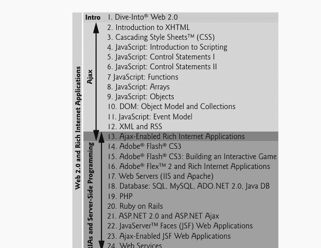

> **图 I** *《Ajax、富互联网应用与 Web 开发（面向程序员）》的架构。*

本书的第二部分，第 2–13 章，详细介绍了 Ajax 组件技术，包括横跨九章的 JavaScript 综合讲解，最后以第 13 章的 Ajax 开发讲解结束。Ajax 并非新技术——自 1999 年以来，我们一直在撰写关于其几乎所有组件技术的文章，而且其中许多技术在那之前就已存在。然而，Ajax 是 Web 2.0 和 RIA 的关键技术之一。第 2–13 章涵盖了“原始”Ajax 编程，您将亲自处理各种细节——本书后面几章演示了封装 Ajax 功能的技术，帮助您轻松构建基于 Ajax 的应用程序，这些程序可以在各种浏览器和浏览器版本中运行，而无需担心底层细节。

本书的第三部分，第 13–24 章，专注于富互联网应用开发的客户端和服务端图形用户界面和图形部分。这里我们介绍了客户端技术，如 Adobe Flash 和 Adobe Flex，它们使用或可以与 Ajax 或类似 Ajax 的能力结合来开发 RIA。每种技术也可以消费 Web 服务。接下来，我们介绍了 Web 应用开发的服务端，讨论了 Web 服务器（IIS 和 Apache）、数据库、服务器端脚本语言如 PHP 和 Ruby on Rails，以及几个服务器端框架如 ASP.NET 2.0 和 JavaServer Faces。我们以一章关于构建基于 SOAP 和基于 REST 的 Web 服务的内容完成了服务端的讨论。

您可能已经注意到，第 13 章“支持 Ajax 的富互联网应用”涵盖了本书的第二和第三部分。第 13 章起到了从“原始”Ajax 开发到使用 Dojo 库进行“封装式”Ajax 开发的桥梁作用。

## 依赖图表

图 2 说明了书中各章节之间存在的依赖关系。指向某一章的箭头表示该章依赖于箭头所指的章节的内容。例如，第 24 章“网络服务”依赖于第 21 章和第 23 章。我们建议在阅读某一章之前先阅读其所有依赖项，尽管其他顺序也是可能的。我们还在图表的脚注中对一些额外的依赖关系进行了评论。

## 教学方法

《AJAX、富互联网应用程序与程序员的 Web 开发》包含丰富的示例集。本书侧重于良好的软件工程原则，并强调程序的清晰性。我们是教育工作者，在全球工业教室中教授前沿主题。哈维·M·迪特尔博士拥有 20 年的大学教学经验以及 18 年的行业教学经验。保罗·迪特尔拥有 16 年的行业教学经验。迪特尔夫妇曾为政府、工业、军事及迪特尔 & 合作伙伴（Deitel & Associates）的学术客户开设了所有级别的课程。

### 实时代码方法

《AJAX、富互联网应用程序与程序员的 Web 开发》充满了“实时代码”示例——每个新概念都在一个完整可运行的 Web 应用程序的上下文中呈现，随后立即跟随一张或多张展示该应用程序功能的屏幕截图。这种风格体现了我们教授和撰写编程著作的方式；我们称之为“实时代码方法”。

### 语法着色

我们对所有代码进行语法着色，类似于大多数集成开发环境和代码编辑器进行语法颜色编码的方式。这提高了代码可读性——这是一个重要的目标，鉴于本书包含约 18,000 行完整可运行的程序的代码。我们的语法着色约定如下：

> 注释以斜体显示
>
> 关键字显示为粗体斜体
>
> PHP、Ruby、ASP.NET、JSP 分隔符和错误显示为黑色粗体
>
> 常量和字面值显示为灰色粗体
>
> 所有其他代码均以黑色显示

### 代码高亮

我们在每个程序的关键代码段周围放置白色矩形框。

### 使用字体强调

我们将每个定义出现的关键术语和索引的页码引用放置在粗体斜体文本中，以便更容易参考。我们使用粗体 Helvetica 字体强调屏幕组件（例如，“文件”菜单），并使用 Lucida 字体强调程序文本（例如，`int x = 5`）。

### 网络访问

《AJAX、富互联网应用程序与程序员的 Web 开发》的所有源代码示例均可从此下载：

`www.deitel.com/books/ajaxfp/`

网站注册快速、简单且免费。下载所有示例，然后随着阅读对应的文本讨论运行每个程序。对示例进行修改并查看这些修改的效果是增强您的互联网和 Web 编程学习体验的绝佳方式。

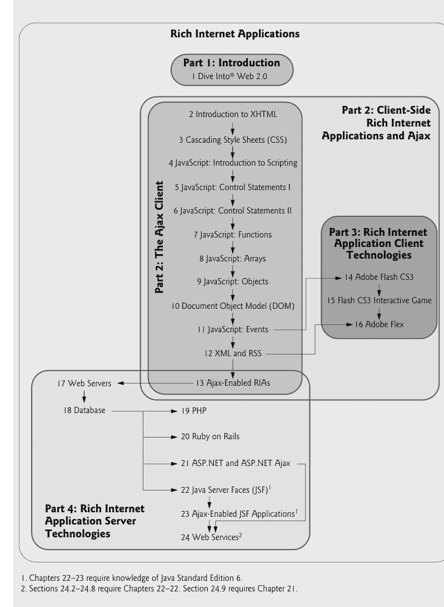

### 目标

每个章节都以目标陈述开始。这让您知道预期内容，并给您机会在阅读后确定是否达到了目标。

### 引文

学习目标之后跟着引用。有些幽默；有些哲学；其他提供有趣的见解。希望您能欣赏将引用与章节材料联系起来。

### 目录

章节大纲帮助您自上而下地学习材料，这样您就可以预见即将出现的内容并设定舒适的学习节奏。

### 插图/图表

包含丰富的图表、表格、线图、程序和程序输出。

### 编程技巧

我们包含编程技巧帮助您关注程序开发的重要方面。这些技巧和做法代表了我们从数十年的编程和教学经验积累中汲取的最佳内容。我们的读者告诉我们，她觉得这种方法就像数学书中公理、定理和推论的加高亮——它为构建优秀软件提供了基础。


## 良好的编程实践

良好的编程实践有助于引起您注意那些将帮助您编写出更清晰、更易理解且更易维护的程序的技术。


## 常见编程错误

程序员往往会经常犯某些类型的错误。指出这些常见编程错误降低了您犯同样错误的几率。


## 防错技巧

这些技巧包含关于暴露缺陷并将其从您的程序中移除的建议；许多描述了防止缺陷在最初就进入程序的编程方面。


## 性能技巧

这些技巧重点突出了使您的程序运行得更快或减少它们所占内存量的机会。

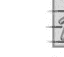

## 可移植性技巧

我们包含可移植性技巧帮助您编写可以在各种平台上运行的代码，并解释如何实现高度的可移植性。


## 软件工程观察

软件工程观察重点突出了影响软件系统构建（尤其是大规模系统）的建筑和设计问题。

数千索引条目。我们包含了一个广泛的索引，当您把书作为参考使用时特别有用。

“实时代码示例”的双重索引。书中每一个源代码程序，我们都以字母顺序和作为“示例”的子索引项索引了图表标题。这使得查找使用特定功能的示例变得更加容易。

## AJAX、富互联网应用程序与程序员的 Web 开发软件下载和附加资源

许多网络和网络开发工具可供使用。我们编写了**AJAX**，《富互联网应用程序与程序员的 Web 开发》使用 Internet Explorer 7、Firefox 2 和其他免费下载软件。额外的资源和软件下载链接可在我们的互联网和 Web 编程相关资源中心中找到：

`www.deitel.com/resourcecenters.html/`

以及本书网站：

`www.deitel.com/books/ajaxfp/`

## 迪特尔® Buzz 在线免费电子邮件通讯

每周，免费的**迪特尔®** *Buzz Online* 新闻通讯宣布我们最新的资源中心，并包括对行业趋势和发展的评论、来自我们已出版书籍的免费文章和资源链接、即将出版的出版物、产品发布计划、勘误表、挑战、轶事、关于我们的企业讲师培训课程的以及更多信息。这也是您了解与《AJAX、富互联网应用程序与程序员的 Web 开发》相关问题的一个很好方法。要订阅，请访问：

`www.deitel.com/newsletter/subscribe.html`

## 迪特尔在线资源中心

我们的网站 `www.deitel.com` 提供各种主题的资源中心，包括编程语言、软件、Web 2.0、Internet 业务和开源项目（图 3）。资源中心的发展源于我们为支持书籍和商业事业所做的研究。我们发现了许多出色的资源，包括教程、文档、软件下载、文章、博客、播客、视频、代码示例、书籍、电子书等。大多数都是免费的。在 Web 2.0 的精神下，我们与全球社区共享这些资源。每周我们在**迪特尔®** *Buzz Online*（`www.deitel.com/newsletter/subscribe.html`）中宣布我们最新的资源中心。

## 致谢

非常乐意感谢许多人的努力，他们的名字可能不出现在封面上，但他们的努力工作、合作、友谊和理解对于本书的制作至关重要。Deitel & Associates, Inc.（迪特尔 & 合作伙伴公司）的许多人投入了大量时间在这个项目上——特别感谢 Abbey Deitel 和 Barbara Deitel。

## Deitel 资源中心

### 编程

ASP.NET 3.5

Adobe Flex

Ajax

Apex

ASP.NET Ajax

ASP.NET

C

C++

C++ Boost 库

C++ 游戏编程

C#

代码搜索引擎和代码站点

计算机游戏编程

CSS 2.1

Dojo

Facebook 开发者平台

Flash 9

Java

Java 认证与评估测试

Java 设计模式

Java EE 5

Java SE 6

Java SE 7 (Dolphin) 资源中心

JavaFX

JavaScript

JSON

Microsoft LINQ

Microsoft Popfly

.NET

.NET 3.0

.NET 3.5

OpenGL

Perl

PHP

编程项目

Python

正则表达式

Ruby

Ruby on Rails

Silverlight

Visual Basic

Visual C++

Visual Studio Team System

Web 3D 技术

Web 服务

Windows Presentation Foundation

XHTML

XML

计算机科学正则表达式

### 游戏与游戏编程

计算机游戏编程

计算机游戏

移动游戏

数独

### 互联网商务

联盟计划

竞争分析

Facebook 社交广告

Google AdSense

Google Analytics

Google 服务

互联网广告

互联网商务计划

互联网公共关系

链接建设

基于位置的服务

在线潜在客户开发

播客

搜索引擎优化

销售数字内容

站点地图

Web 分析

网站盈利

YouTube 与 AdSense

### Java

Java

Java 认证与评估测试

Java 设计模式

Java EE 5

Java SE 6

Java SE 7 (Dolphin) 资源中心

JavaFX

### Microsoft

ASP.NET

ASP.NET 3.5

ASP.NET Ajax

C#

DotNetNuke (DNN)

Internet Explorer 7 (IE7)

Microsoft LINQ

.NET

.NET 3.0

.NET 3.5

SharePoint

Silverlight

Visual Basic

Visual C++

Visual Studio Team System

Windows Presentation Foundation

Windows Vista

Microsoft Popfly

### 开源与 LAMP 栈

Apache

DotNetNuke (DNN)

Eclipse

Firefox

Linux

MySQL

开源

Perl

PHP

Python

Ruby

### 软件

Apache

DotNetNuke (DNN)

Eclipse

Firefox

Internet Explorer 7 (IE7)

Linux

MySQL

开源

搜索引擎

SharePoint

Skype

Web 服务器

维基

Windows Vista

### Web 2.0

提醒服务

注意力经济

博客

构建 Web 社区

社区生成内容

Facebook 开发者平台

Facebook 社交广告

Google Base

Google 视频

Google Web Toolkit (GWT)

网络视频

Joost

基于位置的服务

混搭应用

微格式

推荐系统

RSS

社交图谱

社交媒体

社交网络

软件即服务 (SaaS)

虚拟世界

Web 2.0

Web 3.0

小部件

深入 Web 2.0 电子书

### 其他主题

计算机游戏

计算机职位

小工具与玩意儿

手机铃声

数独

图 3 | Deitel 资源中心，网址为 `www.deitel.com/resourcecenters.html`。

## 前言

我们很幸运能与 Prentice Hall 才华横溢、敬业的出版专业人员团队合作完成这个项目。我们非常感谢 Prentice Hall 工程与计算机科学部编辑总监 Marcia Horton、Prentice Hall Professional 主编 Mark Taub 以及 Prentice Hall Professional 执行编辑 John Fuller 的非凡努力。Carole Snyder 和 Dolores Mars 在招募本书庞大的审阅团队和管理审阅流程方面做出了卓越的贡献。Sandra Schroeder 和 Chuti Prasertsith 在本书封面设计方面表现出色。Bob Engelhardt 和 Marta Samsel 在本书制作管理方面做得非常出色。

本书改编自我们的著作 *Internet & World Wide Web How to Program, 4/e*。我们要感谢该书审稿人的辛勤付出。他们严格遵守紧凑的时间安排，仔细审查了文本和程序，为改进内容的准确性和完整性提供了无数建议。

### 审稿人

Roland Bouman (MySQL AB)、Peter Brandano (KoolConnect Technologies, Inc.)、Matt Chotin (Adobe)、Chris Cornutt (PHPDeveloper.org)、Phil Costa (Adobe)、Umachitra Damodaran (Sun Microsystems)、Vadiraj Deshpande (Sun Microsystems)、Justin Erenkrantz (Apache 软件基金会)、Christopher Finke (Netscape)、Jesse James Garrett (Adaptive Path)、Kevin Henrikson (Zimbra.com)、Tim Heuer (Microsoft)、Molly E. Holzschlag (W3C)、Ralph Hooper (阿拉巴马大学塔斯卡卢萨分校)、Johnvey Hwang (Splunk, Inc.)、Joe Kromer (New Perspective 和匹兹堡 Adobe Flash 用户组)、Eric Lawrence (Microsoft)、Billy B. L. Lim (伊利诺伊州立大学)、Shobana Mahadevan (Sun Microsystems)、Patrick Mineault (自由 Flash 程序员)、Anand Narayanaswamy (Microsoft)、John Peterson (Insync 和 V.I.O., Inc.)、Jennifer Powers (奥尔巴尼大学)、Robin Schumacher (MySQL AB)、José Antonio González Seco (安达卢西亚议会)、George Semeczko 博士 (Royal & SunAlliance Insurance Canada)、Steven Shaffer (宾夕法尼亚州立大学)、Tim Sneath (Microsoft)、Karen Tegtmeyer (Model Technologies, Inc.)、Paul Vencill (MITRE)、Raymond Wen (Microsoft)、Eric M. Wendelin (Auto-trol Technology Corporation)、Raymond F. Wisman (印第安纳大学) 以及 Daniel Zappala (杨百翰大学)。

好了，就是这样！我们希望您能享受这次对 Ajax、富互联网应用以及 Web 2.0 世界中 Web 开发的精彩探索。在您阅读本书的过程中，我们诚挚地期待您的评论、批评、更正以及改进建议。请将所有的意见发送至：

```text
deitel@deitel.com
```

我们会及时回复，并在以下网址发布更正和说明：

```text
www.deitel.com/books/ajaxfp/
```

我们希望您阅读 *Ajax, Rich Internet Applications and Web Development for Programmers* 时能像我们撰写它一样感到愉快！

*Paul J. Deitel*

*Harvey M. Deitel 博士*

马萨诸塞州梅纳德

## 关于作者

**Paul J. Deitel**，Deitel & Associates, Inc. 的首席执行官兼首席技术官，毕业于麻省理工学院斯隆管理学院，主修信息技术。他持有 Java 认证程序员和 Java 认证开发员证书，并被 Sun Microsystems 授予 Java 冠军称号。通过 Deitel & Associates, Inc.，他曾为众多行业客户讲授互联网和 Web 编程、Java、C、C++、C# 和 Visual Basic 课程，客户包括 IBM、Sun Microsystems、Dell、Lucent Technologies、Fidelity、NASA 肯尼迪航天中心、国家强风暴实验室、白沙导弹靶场、Rogue Wave Software、Boeing、Stratus、Cambridge Technology Partners、Open Environment Corporation、One Wave、Hyperion Software、Adra Systems、Entergy、CableData Systems、Nortel Networks、Puma、iRobot、Invensys 等。他还曾在波士顿计算机协会分会讲授 Java 和 C++ 课程。他与父亲 Harvey M. Deitel 博士是全球最畅销的编程语言教科书作者。

**Harvey M. Deitel 博士**，Deitel & Associates, Inc. 的董事长兼首席战略官，在计算机领域拥有 46 年的经验。Deitel 博士获得了麻省理工学院的学士和硕士学位以及波士顿大学的博士学位。他拥有 20 年的大学教学经验，包括在波士顿学院获得终身教职并担任计算机科学系主任，之后与儿子 Paul J. Deitel 共同创立了 Deitel & Associates, Inc.。他与 Paul 合著了数十本书籍和多媒体软件包，还有更多正在撰写中。他们的著作已被翻译成日文、德文、俄文、西班牙文、繁体中文、简体中文、韩文、法文、波兰文、意大利文、葡萄牙文、希腊文、乌尔都文和土耳其文出版，获得了国际认可。Deitel 博士已向各大公司、学术机构、政府组织和军方举办了数百场专业研讨会。

## 关于 Deitel & Associates, Inc.

Deitel & Associates, Inc. 是一家国际公认的企业培训和内容创作机构，专注于计算机编程语言、互联网和 Web 软件技术、对象技术教育以及通过其 Web 2.0 互联网商务计划进行互联网商务开发。公司提供关于主要编程语言和平台的讲师引导课程，如 C++、Java、C、C#、Visual C++、Visual Basic、XML、对象技术以及互联网和 Web 编程。Deitel & Associates, Inc. 的创始人是 Paul J. Deitel 和 Harvey M. Deitel 博士。公司的客户包括许多全球最大的公司、政府机构、军事分支机构和学术机构。通过与 Prentice Hall 32 年的出版合作，Deitel & Associates, Inc. 出版领先的编程专业书籍、教科书、交互式多媒体 *Cyber Classroom*、*Complete Training Course*、基于 Web 的培训课程、线上和线下 *LiveLessons* 视频课程，以及适用于主流课程管理系统 WebCT、Blackboard 和 Pearson's CourseCompass 的电子内容。Deitel & Associates, Inc. 和作者可以通过以下电子邮件联系：

`deitel@deitel.com`

要了解更多关于 Deitel & Associates, Inc.、其出版物及其全球 *Dive Into*® 系列企业培训课程的信息，请访问：

`www.deitel.com`

在此订阅免费的 *Deitel® Buzz Online* 电子通讯，地址为：

`www.deitel.com/newsletter/subscribe.html`

查看以下不断增长的在线资源中心列表：

`www.deitel.com/ResourceCenters.html`

希望购买 Deitel 出版物的个人可通过以下途径进行购买：

`www.deitel.com/books/index.html`

出版社为批量采购或特别促销活动提供极佳的折扣，这些活动可能包括电子版本和/或针对您企业、培训目标、营销重点及品牌形象定制的封面和内容。有关更多信息，请联系：

美国企业版与政府销售部门

(800) 382-3419

`corpsales@pearstechgroup.com`

如需美国以外地区的销售，请联系：

国际销售部

`international@pearsoned.com`

请访问出版社的网站 `www.phptr.com`。

# 在您开始之前

请遵循这些说明以下载本书示例并确保您使用最新的网络浏览器，然后再开始使用本书。

## 下载《Ajax、富互联网应用及程序员 Web 开发》源代码

《Ajax、富互联网应用及程序员 Web 开发》的源代码可从 `www.deitel.com/books/ajaxfp/` 以 ZIP 归档文件形式下载。注册并登录后，点击 **“注册用户下载代码示例和其他高级内容”** 链接下的示例链接。使用 ZIP 文件解压程序（如 WinZip (`www.winzip.com`)）将示例文件提取到您的硬盘中。在 Windows 上，我们建议您将文件提取到类似 `C:\ajaxfp_examples` 的文件夹中。在 Mac OS X 和 Linux 上，我们建议您将文件提取到家文件夹中名为 `ajaxfp_examples` 的文件夹。[注意：如果您正在计算机实验室工作，请咨询您的讲师可以保存示例代码的位置。]

## 本书使用的网络浏览器


我们已使用 Mozilla 的 Firefox 2 和 Microsoft 的 Internet Explorer 7 网络浏览器测试了本书中的每一个示例。在开始之前，请确保您的计算机上已安装其中一个或两个浏览器。Internet Explorer 7 仅适用于 Microsoft Windows 操作系统。如果您是 Windows 用户但没有 Internet Explorer 7，您可以使用 Microsoft 的 Windows 更新服务从`www.update.microsoft.com`下载该浏览器。Firefox 2 适用于大多数平台。您可以从`www.firefox.com`下载 Firefox 2。

本书中许多示例“无法”在 Internet Explorer 6 中运行。尽管本书中的示例可能可以在其他较新的网络浏览器（如 Opera（`www.opera.com`）或 Apple 的 Safari（`www.apple.com/safari/`））上运行，但我们尚未在这些或其他任何浏览器上测试过这些示例。

您现在已准备好开始使用《Ajax、富互联网应用及程序员 Web 开发》进行 Web 编程学习。希望本书能让您享受其中！如果您有任何疑问，请随时通过`deitel@deitel.com`给我们发送电子邮件。我们将 promptly 回复。

# 第 1 部分：简介

> 我们将之称为 Web 2.0 的 web 复兴兴趣已 mainstream（进入主流）。
>
> —Tim O'Reilly

# 第 1 章：深入解读® Web 2.0

## 目标

在本章中，您将学习以下内容：

- Web 2.0 的标志性特征。
- 为何搜索是 Web 2.0 的基础。
- Web 2.0 如何赋予个人力量。
- 集体智能和网络效应的重要性。
- 博客的意义与增长。
- 社交网络、社交媒体和社交书签。
- 标记（tagging）如何导向民俗分类法（folksonomies）。
- Web 服务如何使新应用程序能够从现有应用程序快速且轻松地进行“混搭”（mashed up）。
- Web 2.0 技术。
- Web 2.0 的互联网商业化和盈利模式。
- emerging Semantic Web（"meaning's web"，语义网的兴起）。

> 来自网络用户贡献的网络效应是 Web 2.0 时代市场主导地位的关键。
>
> —Tim O'Reilly

> 链接接链接，点击连点击，搜索正在构建人类历史上可能最持久、最笨重且最重要的文化产物：意图数据库（Database of Intentions）。
>
> —John Battelle, *The Search*

> Web 2.0 是一场宏大的社会实验……这是一个建立新型国际理解的机会……公民对公民，人与人之间。
>
> —Lev Grossman, *TIME*

> 像互联网、Web 或语义网这样的网络技术之一是有力之处在于，我们用它们所做的一切事情都远远超出了发明者的想象力。
>
> —Tim Berners-Lee，由 Peter Moon 采访，*IDG Now*

## 本章内容

- 1.1 简介
- 1.2 什么是 Web 2.0？
- 1.3 搜索
- 1.4 内容网络
- 1.5 用户生成内容
- 1.6 博客
- 1.7 社交网络
- 1.8 社交媒体
- 1.9 标记
- 1.10 社交书签
- 1.11 软件开发
- 1.12 富互联网应用（RIAs）
- 1.13 Web 服务、混搭、小部件和小工具
- 1.14 基于位置的服务
- 1.15 XML、RSS、Atom、JSON 和 VoIP
- 1.16 Web 2.0 盈利模式
- 1.17 Web 2.0 商业模式
- 1.18 Web 的未来
- 1.19 何处获取更多 Web 2.0 信息
- 1.20 Web 2.0 参考文献
- 1.21 Web 2.0 术语表

> **注意：**第 1 章“深入解读® Web 2.0”也可作为基于 HTML 的电子书籍免费获取，并频繁更新，地址为`http://www.deitel.com/freeWeb20ebook/`。它也可作为可下载的、完全格式化的 PDF 格式获取，需支付少量费用。请访问该网站查看最新包含超链接的版本。本章中的许多主题均由位于`http://www.deitel.com/ResourceCenters.html`的广博资源中心进行了补充。电子书和 PDF 链接到资源中心和其他 Web 资源以供进一步学习。

## 1.1 简介

> **注意：**请务必阅读序言，以了解全书的介绍和概述。

我们将从 Web 2.0 的原则、应用、技术、公司、商业模式和变现策略开始。当 Mosaic 浏览器于 1993 年推出时，web 的普及率爆发了。它在整个 90 年代继续经历巨大的增长——这一时期被称为“点 com 泡沫”；该泡沫于 2001 年破裂。2003 年，人们和企业使用 web 以及开发基于 web 的应用的方式发生了明显转变。术语 *Web 2.0*——由 **O'Reilly® Media**¹ 的 **Dale Dougherty** 于 2003 年创造，用以描述这一趋势——成为了一个主要的媒体热词，但很少有人真正了解其含义。一般来说，Web 2.0 公司利用 web 作为平台来创建协作型、社区导向的网站（例如，社交网络网站、博客、维基等）。Web 2.0 的普及归功于年度 O'Reilly Media Web 2.0 峰会（于 2004 年启动），Tim O'Reilly 撰写的关于 Web 2.0 的定义性文章《什么是 Web 2.0：下一代软件的设计模式与商业模式》²，以及 John Musser 和 Tim O'Reilly 的售报告《Web 2.0 原则与最佳实践》³。

Web 2.0 的增长可归因于一些关键因素。首先，硬件变得不断 cheaper（便宜）且 faster（快速），内存容量和速度以极快速度增加。摩尔定律（Moore's Law）指出，硬件性能每两年翻一番，而价格基本保持不变⁴。这使得开发具有高需求的应用成为可能，而这些应用此前是不可想象的。其次，宽带互联网使用量激增——2006 年 3 月皮尤互联网研究项目（Pew Internet study）发现，42% 的美国成年人家中拥有高速互联网。在已在线发布内容的 35% 互联网用户中，有 73% 拥有宽带互联网⁵。丰富的在线数字媒体如果没有高速互联网是绝对不可能实现的。第三，大量开源软件（见 1.1.1 节）的可用性导致了更便宜（通常免费）的可定制软件选项。这使得启动新的 Web 2.0 公司变得更加容易，并大大降低了失败的成本。第四，与 *Web 1.0*（90 年代至 2000 年代初的 web 状态）不同，有许多易于采用的模式可用于变现 Web 2.0 企业——立即产生（小额）收入使得新公司的增长更加稳定。

本章中关于公司的信息来源于常识、公司网站以及脚注中的书籍和文章。

## 1.2 什么是 Web 2.0？

在某种意义上，本章定义了 Web 2.0，但让我们先从简短的一节讨论开始。Web 1.0 关注的是相对少数公司和广告商为用户生产内容以供其访问——当时有些人称 web 为“宣传册 web”。Web 2.0 *涉及*用户——内容不仅经常由用户创建，而且用户帮助组织它、分享它、重新混合它、批评它、更新它等。看待 Web 1.0 的一种方式是将其视为一场*讲座*，少数教授向大量学生听众灌输信息。相比之下，Web 2.0 是一场*对话*，每个人都有机会发言和分享观点。

Web 2.0 拥抱**参与式架构**——这是一种鼓励用户互动和社区贡献的设计⁶。您，作为用户，是最重要的方面。

对于 Web 2.0 而言——其重要性甚至体现在 2006 年*《时代周刊》*（*TIME Magazine*）将“风云人物”（*Person of the Year*）评选给了“你”本身。⁷ 该文章认可了 Web 2.0 这一社会现象——即从少数强势力量向众多赋权个体的转变。

> “我们不能以设备为中心……我们必须以用户为中心。”
>
> —比尔·盖茨，MIX06 会议⁸

许多 Web 2.0 公司几乎完全建立在用户生成内容（user-generated content）和*利用集体智慧*（*harnessing collective intelligence*）的基础之上。其意义不仅在于拥有用户生成内容，更在于如何使用这些内容。谷歌（Google）——领先的搜索引擎和互联网广告公司——通过考虑用户过去集体珍视的内容，将其用户引导至用户生成内容的网站。对于像 MySpace®、Flickr™、YouTube 和 Wikipedia® 这样的网站，用户创建内容，而网站提供平台。这些公司*trusts their users*（信任用户）——没有这种信任，用户就无法对网站做出重大贡献。

> “平台总是优于应用程序。”
>
> —蒂姆·奥赖利（Tim O'Reilly）⁹

这种参与式架构也体现在软件开发中。开源软件可供任何人使用并修改，且限制极少甚至无限制——这在很大程度上推动了 Web 2.0 的发展。通过*利用集体智慧*¹⁰，社区合作开发软件，许多人认为此类软件优于专有软件。

你，作为用户，不仅贡献内容并开发开源软件，还指导媒体传播的方式，并决定你信任哪些新闻报道和信息渠道。如今许多受欢迎的博客与传统媒体巨头展开竞争。社交书签网站（如 del.icio.us 和 Ma.gnolia）允许用户推荐其喜爱的网站给他人。社交媒体网站（如 Digg™ 或 Reddit）使社区能够决定哪些新闻文章最为重要。你也在改变我们查找这些网站信息的方式：通过*标记*（tagging，即按主题或关键词标记）网络内容，以帮助任何人更有效地定位信息。这仅仅是 Web 2.0 帮助用户在已有内容中识别新意义的方式之一。RSS 订阅（第 12 章，XML 和 RSS）使你能够接收更新后的新信息——直接将内容推送到你的桌面。

*社交网络*（*social networks*）的兴起改变了我们的互动与联络方式。MySpace——最大的社交网络——迅速成为世界上最受欢迎的网站。其他受欢迎的社交 networking 网站包括 Facebook、Bebo、LinkedIn 和 Second Life——一个 3D 虚拟世界，你在其中通过在线化身（*avatar*）与他人互动。

许多 Web 2.0 企业利用*长尾效应*（*Long Tail*）。¹¹“长尾”一词由克里斯·安德森（Chris Anderson）在他 2004 年 10 月发表于 *WIRED* 杂志的文章中提出，指的是这样一种经济模式：非热门产品（通常是大量低销量商品）的市场规模可能非常显著，有时甚至大于热门产品（通常是少量高销量商品）的市场。¹² 因此，像 Netflix 这样的在线公司——其租赁目录包含超过 8 万部电影——除了从事热门影片的租赁业务外，通常还会租赁大量较不受欢迎的电影。当地的电影店的货架空间有限，仅服务于小范围的本地人口；它无法在每个门店承担存放“长尾”电影的空间成本。然而，Netflix 服务数百万人，不受实体店体的物理限制；它可以保留少量多种“长尾”电影的库存，以满足其全部客户群。利用“长尾效应”的机会，得益于经营 Web 2.0 互联网业务的相对简便性，并由 Web 2.0 产生的社会效应所驱动，后者增加了知名度较低产品的曝光度。

在本章中，我们将介绍用于创建 Web 2.0 应用程序的一些关键技术。其中许多技术在《*Ajax、富互联网应用程序和面向程序员的 Web 开发*》（*Ajax, Rich Internet Applications and Web Development for Programmers*）的编程章节中有详细讨论。你将学习 Web 开发技术，如 Ajax（第 13 章）；其组件技术，包括 XHTML（第 2 章）、层叠样式表（CSS，第 3 章）、JavaScript（第 4–9 章）、文档对象模型（DOM，第 10 章）、XML（第 12 章）和 XMLHttpRequest 对象（第 13 章）；以及流行的 Ajax 工具包——Dojo（第 13 章）和 Script.aculo.us（第 20 章）。

你将学习如何构建富互联网应用程序（RIAs）——提供与桌面应用程序相仿的响应性和丰富图形用户界面（GUI）功能的 Web 应用程序。我们将讨论构建 RIA 的关键工具，包括 Adobe 的 Flex（第 16 章）、ASP.NET Ajax（第 21 章）和 Sun 的 JavaServer Faces（第 22–23 章）。此外，我们还将讨论其他流行的开发技术，包括 JSON（第 13 章）、Web 服务器 IIS 和 Apache（第 17 章）、MySQL（第 18 章）、PHP（第 19 章）以及 ASP.NET（第 21 章）。

我们将讨论 Web 服务的出现（第 24 章），它使你能够快速而轻松地将现有应用程序的功能集成到自己的应用中。例如，使用 Amazon Web Services™，你可以创建一家特色书店，并通过 Amazon Associates 计划赚取收入；或者使用 Google™ 地图 Web 服务和 eBay Web 服务，你可以构建基于位置的混合应用程序（mashup applications），以查找特定地理区域内的拍卖商品。Web 服务、廉价计算机、丰富的高速互联网接入、开源软件以及其他多种因素，激发了新颖且令人兴奋的*轻量级商业模式*（*lightweight business models*），人们只需少量投资即可启动此类业务。一些在 20 世纪 90 年代可能需要花费数十万甚至数百万美元才能构建的功能强大的网站，现在只需适度费用即可建成。

第 1.17 节概述了关键的 Web 2.0 商业模式，其中许多模式在本章其余部分也有更深入的阐述。图 1.1 列出了与 Web 2.0 相关的会议。其中一些侧重于技术，而另一些则侧重于商业。

## 参考文献

1. O'Reilly, T. "What is Web 2.0: Design Patterns and Business Models for the Next Generation of Software." September 2005 `<http://www.oreillynet.com/pub/a/oreilly/tim/news/2005/09/30/what-is-web-20.html>`.

2. O'Reilly, T. "What is Web 2.0: Design Patterns and Business Models for the Next Generation of Software." September 2005 `<http://www.oreillynet.com/pub/a/oreilly/tim/news/2005/09/30/what-is-web-20.html>`.

3. Musser, J. and T. O'Reilly. *Web 2.0 Principles and Best Practices*. O'Reilly Media, Inc., 2006.

4. Moore, G. "Cramming More Components onto Integrated Circuits." *Electronics*, April 1965 `<ftp://download.intel.com/museum/Moores_Law/Articles-Press_Releases/Gordon_Moore_1965_Article.pdf>`.

5. Horrigan, J. B. "Home Broadband Adoption 2006." *Pew Internet & American Life Project*, May 2006 `<http://www.pewinternet.org/pdfs/PIP_Broadband_trends2006.pdf>`.

6. O'Reilly, T. "What is Web 2.0: Design Patterns and Business Models for the Next Generation of Software." September 2005 `<http://www.oreillynet.com/pub/a/oreilly/tim/news/2005/09/30/what-is-web-20.html>`.

7. Grossman, L. "TIME's Person of the Year: You." *TIME*, December 2006 `<http://www.time.com/time/magazine/article/0,9171,1569514,00.html>`.

8. "Bill Gates: Microsoft MIX06 Conference." *Microsoft*, March 2006 `<http://www.microsoft.com/presspass/exec/billg/speeches/2006/03-20MIX.mspx>`.

9. O'Reilly, T. "What is Web 2.0: Design Patterns and Business Models for the Next Generation of Software." September 2005 `<http://www.oreillynet.com/pub/a/oreilly/tim/news/2005/09/30/what-is-web-20.html>`.

10. O'Reilly, T. "What is Web 2.0: Design Patterns and Business Models for the Next Generation of Software." September 2005 `<http://www.oreillynet.com/pub/a/oreilly/tim/news/2005/09/30/what-is-web-20.html>`.

11. Anderson, C. *The Long Tail: Why the Future of Business Is Selling Less of More*. Hyperion, 2006.


12. Anderson, C. "The Long Tail." *WIRED*, October 2004 <http://www.wired.com/wired/archive/12.10/tail.html>.

**图 1.1 | Web 2.0 及相关会议**

| Web 2.0 及相关会议 |
| --- |
| AdTech |
| Affiliate Marketing Summit |
| AjaxWorld Expo |
| All Things Digital |
| Always On |
| Blog Business Summit |
| eBay Live |
| Emerging Technology |
| Emerging Telephony |
| Future of Online Advertising |
| JavaOne |
| Microsoft MIX |
| Microsoft Tech Ed |
| MySQL Conference and Expo |
| Open Source (OSCON) |
| RailsConf |
| Search Engine Strategies |
| Tools of Change for Publishing |
| Ubuntu Live |
| Web 2.0 Expo |
| Web 2.0 Summit |
| Where 2.0 |

### 1.3 搜索

> “谷歌的使命是整理全球信息，使其普遍可用且易于获取。”
>
> ——谷歌^13

在 Web 2.0 时代，“内容即王道”（content is king）的说法依然是主导主题。随着看似无穷无尽的内容在线可得，内容的*可发现性*（*findability*）变得至关重要。*搜索引擎*（*Search engines*）是人们查找网络信息的主要工具。如今，你使用关键词进行搜索，但未来网络搜索将使用自然语言（例如，参见 Powerset.com）。目前，当你输入关键词或短语时，搜索引擎会找到匹配的网页，并向你显示*搜索引擎结果页面*（*search engine results page, SERP*），上面列出了按相关性排序的推荐网页。协助式搜索引擎也已出现，例如 Mahalo，该公司支付人员开发搜索结果。^14 垂直搜索引擎的普及率正在上升——这类搜索引擎专注于特定主题或行业——尽管这类搜索引擎的流量仍远远落后于主要（更综合性的）搜索引擎。

主要搜索引擎的流量正在快速增长——根据近期 comScore（一家网络分析公司）的报告，美国人在 2007 年 6 月进行了 80 亿次搜索查询，比上一年增长了 26%。在同一份报告中，comScore 对美国主要搜索引擎的市场份额进行分析，结果显示 Google 位居榜首，占据美国搜索市场的 49.5%；其次是 Yahoo!，占 25.1%；Microsoft 占 13.2%；Ask 占 5.0%；Time Warner Network 占 4.2%。^15

John Battelle 的书 *The Search: How Google and Its Rivals Rewrote the Rules of Business and Transformed Our Culture*（《搜索：谷歌及其竞争对手如何改写商业规则并改变我们的文化》）详尽地介绍了搜索引擎的历史，并有力地论证了搜索在我们个人生活和商业生活几乎所有方面的重要性。John Battelle 的 Searchblog 讨论搜索和技术问题（http://battellemedia.com）。

### 注意力经济

> “电信带宽不是问题，但人类带宽是。”
>
> ——Thomas Davenport 和 John Beck，*The Attention Economy*¹⁶

大量信息的产生和人们有限的自由时间催生了注意力经济。可用的内容比用户能够自行筛选的还要多，尤其是考虑到他们在时间上的各种需求，比如对子女、父母、朋友、雇主等的责任。Thomas Davenport 和 John Beck 所著的 *The Attention Economy*（《注意力经济》）开篇讲述了一个耳熟能详的故事：一位男士的注意力被工作和家庭不断瓜分。

过去，获取多样化的内容曾经很困难，如今却有 seemingly 无穷无尽的选择在争夺受众的注意力。因此，搜索引擎通过帮助用户快速找到并筛选他们想要的信息而越来越受欢迎¹⁷。

### Google 搜索

Google 是领先的搜索和在线广告公司，由 Larry Page 和 Sergey Brin 在斯坦福大学攻读博士学位期间创立。Google 如此受欢迎，以至于它的名字已被收入《牛津英语词典》——动词 "Google" 意为使用 Google 搜索引擎在互联网上查找某物。（小写的 "google" 是一个板球术语，而 "googol" 或 10¹⁰⁰ 才是 Google 名称来源的数学术语。）¹⁸

Google 在搜索领域的成功很大程度上基于其 `PageRank`™ 算法（由斯坦福大学和 Larry Page 申请专利）以及其独特的服务器基础设施，该基础设施使用联网的 PC 来实现更快的响应速度和更高的可扩展性，同时降低成本¹⁹。对 Google 服务器数量的估计从数十万台到超过一百万台不等²⁰。`PageRank` 算法考虑指向某个网页的链接数量以及链接网站的质量（among other factors）来确定该网页的重要性。每个入站链接都是一张投票，表明该网站对他人有价值；然而，不同的投票会根据“投票者”网站自身的价值而被赋予不同的权重。因此，两个网页可能拥有相同的 `PageRank`，即使其中一个有大量来自其他网页的链接，而另一个链接较少但来自 `PageRank` 更高的网页。Google 搜索还会考虑页面上的所有内容、字体、标题以及相邻页面的内容。[21] `PageRank` 最高的网站将出现在搜索结果的顶部。

除了常规搜索引擎外，Google 还提供针对图片、新闻、视频、博客等的专用搜索引擎。使用 Google 网络服务，你可以将 Google Maps 和其他 Google 服务构建到你的应用程序中（参见 1.13 节，Web Services、Mashups、Widgets 和 Gadgets）。

*AdWords* 是 Google 的按点击付费（PPC）上下文广告计划（2000 年推出），是公司的主要收入来源。AdWords 广告出现在 Google 网站的搜索结果旁边（并与搜索查询相关）。广告商撰写自己的广告，这些广告不显眼且外观统一——每条广告由标题、有限文本和 URL 组成。广告商对与其广告相关的搜索关键词进行出价，并根据点击广告的用户数量付费。

*AdSense* 是 Google 面向发布商（提供内容的网站，如 http://www.deitel.com）的广告计划，由产品管理副总裁 Susan Wojcicki 提出。（1998 年，Wojcicki 将家中空余的房间租给了 Larry Page 和 Sergey Brin，他们在那里创立了 Google。）[22] AdSense 是一种基础且流行的网站变现形式，尤其对 Web 2.0 初创公司而言。Google 文字广告（以及横幅negozi和富媒体广告）被放置在参与网站的相应内容上。上下文广告的点击率通常高于非上下文广告，因为广告能够触达对相关主题表达兴趣的人群。因此，上下文按点击付费广告通常支付更高的 eCPM（每千次展示有效成本）。

### Yahoo!

*Yahoo!* 于 1994 年由 Jerry Yang 和 David Filo（也是斯坦福大学的博士生）创立，最初是一个网络目录而非搜索引擎。原始网站 "Jerry and David's Guide to the World Wide Web" 由他们最喜爱的网站手动添加到分类目录中。[23] 随着网络的发展，维护目录结构变得越来越困难，因此创建了搜索功能以便更好地访问数据。Yahoo! 更加关注搜索，同时也扩展到其他领域，成为电子邮件、用户群组等的热门提供商。2003 年，Yahoo! 收购了 Overture（现为 Yahoo! Search Marketing），后者是首家成功提供赞助搜索结果的公司。[24]

### MSN

MSN 搜索创建于 1998 年，即 Google 推出一年后。[25] 在过去几年中，微软将搜索引擎技术开发列为首要任务。[26] 微软的搜索查询量和搜索市场份额在 2007 年 6 月快速增长；分析公司 comScore 和 Compete 将这种增长主要归因于 MSN 的 Live Search club，这是 2007 年 5 月推出的奖励 Live Search 用户的计划。[27, 28] MSN 的 Live Search 包括新的搜索引擎、索引和爬虫²⁹。它可以用来搜索网页，执行专业搜索（新闻、图片或本地列表）或 MSN 内容搜索。[30] 微软增加其搜索市场份额的另一种方法是收购垂直搜索网站，如健康搜索引擎 MedStory。³¹ 微软还希望通过 Microsoft adCenter（类似于 Google AdWords 和 Yahoo! Search Marketing）在上下文广告市场获得市场份额。

### Ask

*Ask*（前身为 AskJeeves.com）由 InterActiveCorp（IAC）所有，IAC 还拥有 Ticketmaster®、Match.com®、LendingTree.com® 和 RealEstate.com® 以及许多其他互联网资产。2007 年 6 月，Ask 推出了新的搜索网站，包括全新设计的简洁主页默认界面、可自定义背景、新视频搜索（由 Blinkx 提供支持），以及观看视频预览和收听音乐片段的功能。搜索结果基于搜索者的位置——Ask 将显示相关的本地商家和活动。例如，搜索电影将显示本地放映时间。

### 垂直搜索

*Vertical search engines*（垂直搜索引擎）是 comparison to generalists（如 Google 和 Yahoo!）的专家（专注于特定主题）[32]。垂直搜索引擎使您能够在特定领域搜索资源，目标是为您提供数量更少但相关性更高的结果。流行的垂直搜索引擎包括旅游网站（如 Kayak 或 Expedia）、房地产网站（如 Zillow 或 Trulia）、求职网站（如 Indeed 或 Monster）和购物搜索引擎（如 Shopzilla 和 MySimon）。

### 基于位置的搜索

*Location-based search*（基于位置的搜索）（由大多数主要搜索引擎以及一些较小的专业搜索引擎提供）使用有关搜索者地理位置的信息来提供更相关的搜索结果。例如，搜索引擎可以询问用户的邮政编码，或根据 IP 地址估计用户的大致位置。然后，引擎可以使用这些信息来优先显示物理位置上离用户更近的搜索结果。这在搜索餐厅或汽车服务等商家时尤其有用。（有关基于位置服务的更多信息，请参见 1.14 节。）

### 创建定制搜索引擎

Rollyo——一个构建你自己的定制搜索引擎的网站——允许你探索、创建和个性化他人创建的搜索引擎（"searchrolls"）。这有助于你缩小搜索范围，将其限定在你已经信任的网站。³³ 其他自定义搜索引擎还包括 Gigablast 和 Google Custom Search Engine。

27. "comScore Releases June U.S. Search Engine Rankings." *CNNMoney*, 16 July 2007 <http://money.cnn.com/news/newsfeeds/articles/prnewswire/AQM17916072007-1.htm>.

28. Sullivan, D. "Compete: Microsoft Gaining Searches; Live Search Club Giveaway Working?" *Search Engine Land*, 10 July 2007 <http://searchengineland.com/070710-105603.php>.

29. "MSN Live Search: About Us." *MSN* <http://search.msn.com/docs/default.aspx>.

30. "Web Search: How to use MSN Search." *MSN* <http://search.msn.com/docs/help.aspx?t=SEARCH_CONC_WhatsNewWithMSNSearch.htm>.

31. "Vertical Search-Engines: Know Your Subject." *Economist.com*, 12 July 2007 <http://www.economist.com/business/displaystory.cfm?story_id=9478224>.

32. "Vertical Search-Engines: Know Your Subject." *Economist.com*, 12 July 2007 <http://www.economist.com/business/displaystory.cfm?story_id=9478224>.

### 搜索引擎优化（SEO）

**搜索引擎优化（SEO）**是指设计和调整你的网站，以最大化其可发现性并提升在自然（非付费）搜索引擎结果中的排名。为了最大化网站流量，你在设计网站时需要考虑搜索引擎的工作原理。有两种方法可以运用 SEO。第一种是**白帽 SEO**，指的是搜索引擎认可的方法，不试图欺骗搜索引擎，并能产生高质量、长期的效果。顶尖的白帽 SEO 技巧包括：提供高质量内容、使用正确的元数据和有效的关键词，以及从相关且高质量的页面获取入站链接。³⁴ **黑帽**方法则被用来欺骗搜索引擎。尽管它们可能暂时提升搜索引擎结果排名，但这些策略可能导致你的网站被搜索引擎封禁。“Google 炸弹”（或链接炸弹）就是黑帽方法的一个例子——它试图诱骗 Google 的算法来提升某个特定页面（通常出于幽默原因）。³⁵

## 链接建设

**链接建设**是通过为特定网站生成入站链接来提升搜索引擎排名和流量的过程。搜索引擎算法将每个链接视为对目标网站内容的一次投票，因此拥有最强大**链接流行度**（或大量高质量入站链接）的网站会出现在搜索引擎结果页面（SERPs）的最高位置。最常见的三种链接建设方法包括：互惠链接、链接诱饵和自然链接。**互惠链接**是两个相关网站相互链接的交换，这增加了双方网站的链接流行度，并为网站用户增添了价值。**链接诱饵**涉及创建引人注目的网页内容，专门通过社交媒体和社交书签网站进行病毒式（指数级增长）传播。**自然链接**是通过优化网站内容和用户体验来建立单向入站链接的过程，而无需明确请求反向链接。搜索算法持续更新，以防止黑帽 SEO 使用自动链接软件以及来自目录或其他低质量网站的链接来欺骗搜索引擎。来自具有强大、相关页面的网站的单向链接，其权重高于互惠链接、来自内容不相关网站的链接或来自 PageRank 值较低网站的链接。

## 搜索引擎营销（SEM）

**搜索引擎营销（SEM）**是通过提高网站在搜索引擎结果页面上的可见性，来推广你的网站以增加流量和搜索结果的方法。丹尼·沙利文（Search Engine Watch 的创始人，后来创立了 Search Engine Land）在 2001 年引入了“搜索引擎营销”一词，将其定义为包括 SEO、管理付费列表、制定在线营销策略以及向目录提交网站等。³⁶ SEO 是最流行的搜索引擎营销形式，它持续从其他营销渠道（尤其是线下渠道）分流业务。根据搜索引擎营销专业组织的年度《搜索引擎营销状况》调查，北美广告商在 2006 年花费了 94 亿美元用于搜索引擎营销，比 2005 年的支出增长了 62%。³⁷

### Search Engine Watch 和 Search Engine Land

*Search Engine Watch* 是一个搜索引擎营销资源网站。它包含文章、教程、会议等。该网站由丹尼·沙利文于 1997 年创立，灵感源于他 1996 年发布的《网站管理员搜索引擎指南》。*Search Engine Watch* 融合了 Web 2.0 功能（除了专家专栏文章外，还包括博客和论坛）。其他 *Search Engine Watch* 部门包括搜索引擎提交技巧、网络搜索技巧、流行搜索引擎和搜索引擎资源（众多与搜索引擎相关的话题）。丹尼·沙利文担任 *Search Engine Watch* 的主编直至 2006 年 11 月，之后他离开了该网站，成为 *Search Engine Land* 的主编。该网站提供有关主要搜索引擎——Google、Yahoo! 和 Microsoft——以及搜索引擎营销和搜索问题的新闻和信息。该网站还通知用户即将举行的相关会议和网络研讨会。

### Search Engine Strategies 会议

*Search Engine Strategies* 是一个专注于搜索引擎广告（包括当前的 SEO 和 SEM 问题）的全球会议系列。*Search Engine Strategies*（由 *Search Engine Watch* 主办）提供由该领域顶级专家以及搜索引擎公司代表给出的活动信息。³⁸ 由于流量和广告对大多数 Web 2.0 企业至关重要，理解搜索过程并确保你的网站容易被找到至关重要。

### 发现

与传统使用搜索引擎（针对特定主题进行搜索）不同，*发现*指的是找到你原本不会主动寻找的新内容。例如，Yahoo! 最初的目录设计允许用户浏览类别，从而发现新的有趣网站。StumbleUpon 是一个社交书签网站，它通过其推荐系统来实现“发现”，该系统帮助你根据自己的兴趣发现和分享网站。内容网络也将用户引导到他们原本不一定会去寻找的网页内容。

## 1.4 内容网络

*内容网络*是指以各种形式（如文章、维基、博客等）提供信息的网站或网站集合。这些网站提供了另一种过滤互联网海量信息的方式，即允许用户访问一个可信赖的网站，该网站已经从众多来源中筛选出最佳内容，或提供了自己的内容。图 1.2 展示了一些内容网络的例子。

### 内容网络

- **About.com**——被《纽约时报》收购，About 是涵盖广泛主题的信息集合。About 成立于 1996 年，提供由主题专家撰写的 500 多个指南。这些指南包括新内容以及指向其他网站的链接。
- **b5media**——一个博客网络，包含 200 多个与旅游、娱乐、科技等相关的博客。


- `Corante`——一个博客网络，由技术、商业、法律、科学和文化领域的权威评论员撰写。
- `Deitel`——Deitel资源中心（目前约80个网站且增长迅速）包含指向关键教程、演示、免费软件工具、文章、电子书、白皮书、视频、播客、博客、RSS订阅源等的链接和描述。资源中心按主要主题领域分组，包括Web 2.0、互联网商业、编程语言、软件开发和开源。完整列表请参见前言中的图3。
- `eHow`——eHow声称拥有超过35,000篇文章，解释“如何做几乎所有事情”。文章由专家撰写，网站还设有“操作视频”板块。
- `Gawker Media`——一个博客网络，包含14个博客，如`Gizmodo`、`Gawker`、`Valleywag`和`Lifehacker`。这些博客涵盖技术、八卦等一系列主题。
- `HowStuffWorks`——HowStuffWorks提供解释“世界实际如何运作”的文章。文章由自由撰稿人以及《消费者指南》和《Mobil旅行指南》的专家撰写。
- `LifeTips`——LifeTips提供数百位作者撰写的关于工作和日常生活的短文。小贴士由读者投票（读者也可以标记自己的收藏以便于访问）。
- `9rules`——一个博客话题广泛的博客网络。该网站还包含社交网络功能。
- `Suite101`——Suite101提供由自由撰稿人撰写的关于各种主题的数千篇文章。除了文章，该网站还提供讨论区和免费课程。
- `Weblogs, Inc.`——一个包含90个博客的博客网络，包括`Engadget`、`Autoblog`和`Joystiq`。用户可以申请为其中一个博客写作（并获得报酬），或为可能的新博客建议主题。

图 1.2 内容网络。

## 1.5 用户生成内容

*用户生成内容*是当今许多领先Web 2.0公司（如`亚马逊`、`eBay`和`Monster`）成功的关键。社区为这些网站增添了价值，在许多情况下，这些网站几乎完全建立在用户生成内容之上。例如，*eBay*（一个在线拍卖网站）依赖社区来买卖拍卖物品，而*Monster*（一个求职搜索引擎）则将求职者与雇主和招聘人员联系起来。

用户生成内容包括明确生成的内容，如文章、家庭视频和照片。它也可以包括隐含生成的内容——从用户在线行为中收集的信息。例如，你在`亚马逊`购买的每件商品和在`YouTube`观看的每个视频，都为这些网站提供了关于你兴趣的宝贵信息。像`亚马逊`这样的公司已经建立了庞大的匿名用户数据库，以了解用户如何与他们的网站互动。例如，`亚马逊`使用你的购买历史，并将其与其他具有类似兴趣的用户进行比较，来个性化推荐（例如，'购买了此商品的顾客还购买了……'）。

隐式生成的内容通常被视为隐藏内容。例如，网页链接和标签是隐藏内容；你从自己网站链接到的每个网站或在社交书签网站上收藏的每个站点，都可能被视为对该站点重要性的投票。像`Google`（使用`PageRank`算法）这样的搜索引擎利用指向某网站的链接的数量和质量来确定该网站在搜索结果中的重要性。

### 集体智慧

**集体智慧**是指协作能够产生明智想法的概念。通过共同努力，用户汇集他们的知识，使每个人受益。

Don Tapscott和Anthony D. Williams所著的*《维基经济学》*第一章讲述了`Goldcorp`的故事。受`Linux`社区工作的启发，`Goldcorp`的首席执行官向公众公开了公司土地的专有地质信息。`Goldcorp`向能够利用这些信息帮助公司找到土地上黄金的人提供现金奖励。社区帮助他的公司找到了800万盎司黄金，使`Goldcorp`的股票价值从1亿美元飙升至90亿美元。^39^ `Goldcorp`通过分享信息和鼓励社区参与获得了惊人的收益。

用户生成的内容对Web 2.0公司很重要，因为公司正在以创新的方式利用集体智慧。我们已经讨论过`Google`的`PageRank`（第1.3节），它是集体智慧的产物。`亚马逊`和`Last.fm`的个性化推荐也源于集体智慧，因为算法评估用户偏好，通过帮助你发现其他有相似兴趣的人喜欢的新产品或音乐，为你提供更好的体验。`Wesabe`是一个网络社区，成员们分享他们关于金钱和储蓄的决定——该网站利用社区的集体财务经验来提供建议。^40^ 信誉系统（如`eBay`等公司使用）也利用集体智慧，通过与社区分享用户反馈来建立买卖双方之间的信任。社交书签网站（第1.10节）和社交媒体网站（如`Digg`和`Flickr`）使用集体智慧来推广受欢迎的内容，使其他人更容易找到。

### 维基

维基是允许用户编辑现有内容和添加新信息的网站，是用户生成内容和集体智慧的典型例子。最受欢迎的维基是**维基百科**，一部由社区生成的百科全书，文章提供200多种语言版本。维基百科信任其用户遵守某些规则，例如不删除准确信息、不添加有偏见的信息，同时允许社区成员执行这些规则。其结果是产生了大量信息，其增长速度远超其他方式所能达到的。2005年，一项比较**维基百科**和《大英百科全书》（一部流行的印刷版传统百科全书）42个条目的实验显示，维基百科条目中不准确之处仅略多。^41^ 然而，维基百科条目得到了及时更正，而《大英百科全书》条目中的错误则要等到书籍下次印刷时才能更正，并会保留在已印刷的副本中。

[^39]: Tapscott, D. and A.D. Williams. *Wikinomics: How Mass Collaboration Changes Everything*. Portfolio Hardcover, 2006.
[^40]: "FAQ." *Wesabe* <http://www.wesabe.com/page/faq>.
[^41]: Cauchi, S. "Online Encyclopedias Put to the Test." *The Age*, 15 December 2005 <http://www.theage.com.au/news/national/online-encyclopedias-put-to-the-test/2005/12/14/1134500913345.html>.

### 协同过滤

尽管协作可以产生丰富的知识，但一些用户可能会提交虚假或错误的信息。

- 例如，维基百科曾经历过有人故意在条目中添加虚假信息的情况。虽然审核（工作人员监控内容）有时是必要的，但它耗时且成本高昂。
- 许多Web 2.0公司依靠社区帮助管理他们的网站。

这种协同过滤允许用户推广有价值的内容，并标记冒犯性或不当的内容。用户有能力自己选择什么是重要的。

使用协同过滤的网站示例包括一个由用户对新闻故事评分的新闻网站（见第1.8节），以及像`del.icio.us`这样的社交书签网站，用户可以轻松找到热门网站（见第3.96节）。

`亚马逊`产品上的客户评论也采用协同过滤——读者对每篇评论的有用性进行投票（帮助其他读者找到最佳评论，同时避免受到偏见的影响）。^46^ 例如，苏洛维基描述了如何计算猜测比赛中所有提交答案的平均值（例如，猜测罐子里有多少颗软糖），通常会得出近乎正确的答案，尽管大多数个人估计是不正确的且差异很大。当美国潜艇*天蝎号*于1968年沉没时，海军请各位专家独立评估可能发生了什么；然后分析他们的集体答案以确定潜艇的确切位置。^47^ 众包智慧的实际日常应用可见于采用协同过滤的网站。

## 1.6 博客

> “博客是你见过的最好的关系生成器。”
>
> —Robert Scoble，博主[^48]

### 博客历史

***博客***是按时间倒序列出条目的网站。它们自20世纪90年代中期就已存在；然而，近年来，由于易于使用的博客软件和日益经济的互联网接入，人们对博客的兴趣呈指数级增长。“博客”一词由***网络日志***演变而来，这是一个定期更新的有趣网站列表。这些博客由简短的帖子组成，按时间倒序排列，包含指向其他网页的链接以及简短的评论或反应。博客此后采用了更松散的结构——一些博客仍然遵循链接和少量文本的传统格式，而另一些则由散文组成，有时不包含任何链接。博客现在还可以整合媒体，例如音乐或视频。许多人熟悉个人日记博客，如在***Xanga***或***LiveJournal***上的博客。这些网站包含社交网络功能，在青少年博主中特别受欢迎，他们经常为朋友撰写关于日常生活的文章。

博客已成为一种主要的社会现象，使用户能够参与网络，而不仅仅是观看网络。2006年7月，大多数***博主***，或称博客作者，在开始写博客之前都没有过个人网站。^49^ 用户友好的博客软件越来越普及，使博客对更多主流互联网用户开放。

### 博客组件

***读者评论***创造了一种互动体验，允许读者对博客条目做出反应。根据皮尤互联网研究，87%的博客允许读者评论。^50^ 成功成熟的博主会关注读者并予以回应，常常能激发有趣的讨论和辩论。然而，允许评论也增加了垃圾评论的可能性（包括不相关的评论、不当语言和链接垃圾——即用户试图增加无关网站的入站链接数量）。据估计，超过90%的博客评论是垃圾评论。$^{51}$

*永久链接*为博客读者提供了一种链接到特定博客条目的方式。每篇博客文章都有一个唯一的URL，指向该单篇文章。即使博客条目离开首页并进入存档，链接仍然有效。

*引用通告*告诉博主谁链接到了他们的文章。这通过使链接双向化来增强互联网内容。博主提供一个引用通告链接，使用该链接的网站会被添加到博客条目的列表中。引用通告部分的示例，请访问<http://www.techcrunch.com/2006/08/08/web-20-the-24-minute-documentary/>。这是*TechCrunch*（一个流行的互联网技术博客）上一篇文章的永久链接，该文章特色是一个2006年的Web 2.0视频。

*博客链接列表*是博主喜爱的博客列表。虽然并非所有博客都设有博客链接列表，但博客主页通常包含指向其他几个博客的链接。例如，`LiveJournal`会自动将一个博客链接列表（由博主标记为朋友的用户组成）整合到用户的个人资料页面中。

### 博客与新闻业

> "新闻自由只有拥有报社的人才能保证。"
>
> —A.J. Liebling$^{52}$

博客鼓励了*公民新闻*，让任何人都可以成为记者。博客已成为重要的新闻资源，吸引了大量流量远离主流媒体。有人认为，这种“参与式新闻”的形式比主流媒体偏见更少，或者至少使这些偏见公开化，并提供了许多不同的观点。这种***媒体的民主化***让更多人能够参与新闻业。$^{53}$传统记者此前能够通过代表大众发言来创建一种代议制民主（很像美国的政治制度）。然而，博客让每个拥有电脑和互联网接入的人都能发声，创造了一种更直接的民主。

许多博主被认可为媒体成员。正如电视和广播提高了新闻传递速度（相对于报纸），博客已成为一种快速且深入（且常常“未经修饰”）的新闻媒介。大众媒体正在拥抱博客；许多电视新闻主播建议观众在节目后阅读他们的博客，许多报纸网站也设有记者的博客。

虽然新闻业是博客现象的重要组成部分，但根据皮尤互联网研究，只有三分之一的博主认为他们的博客是一种新闻形式。84%的博主认为这是一种爱好，只有10%的人每周花超过十个小时在博客上。$^{54}$发布新内容和回应读者评论需要投入大量时间。

[^46]: Jenkins, H. "Collective Intelligence vs. The Wisdom of Crowds." *Confessions of an Aca-Fan*, 27 November 2006 <http://www.henryjenkins.org/2006/11/collective_intelligence_vs_the.html>.
[^47]: Surowiecki, J. *The Wisdom of Crowds*. Anchor, 2005.
[^48]: Kirkpatrick, D. "Why There's No Escaping the Blog." *FORTUNE*, 10 January 2005 <http://money.cnn.com/magazines/fortune/fortune_archive/2005/01/10/8230982/index.htm>.
[^49]: Lenhart, A. and S. Fox. "Bloggers: A Portrait of the Internet's New Storytellers." *Pew Internet & American Life Project*, July 2006 <http://www.pewinternet.org/pdfs/PIP%20Bloggers%20Report%20July%2019%202006.pdf>.
[^50]: Lenhart, A. and S. Fox. "Bloggers: A Portrait of the Internet's New Storytellers." *Pew Internet & American Life Project*, July 2006 <http://www.pewinternet.org/pdfs/PIP%20Bloggers%20Report%20July%2019%202006.pdf>.

51. *Akismet*, 2007年8月10日 <http://akismet.com/stats/>.
52. "A.J. Liebling Quotes." *ThinkExist.com Quotations* <http://thinkexist.com/quotation/freedom_of_the_press_is_guaranteed_only_to_those/220714.html>.
53. Bowman, S. and C. Willis. "We Media." 2003年7月 <http://www.hypergene.net/wemedia/download/we_media.pdf>.

18 第1章 深入Web 2.0

### 博客的增长

博客的数量大约每年翻一番。$^{55}$然而，也有大量被废弃的博客。Caslon Analytics的一项研究发现，“66.0%的受访博客在两个月内没有更新。”$^{56}$

公司正在接触*博客圈*或博客社区，以保持与消费者意见的联系。许多来自`Sun Microsystems`、`Marriott International`和`General Motors`等大公司的CEO和高管现在都是常驻博主。这有助于建立消费者信任和忠诚度。`NewPR Wiki`列出了250多位CEO和高层管理人员的博客。$^{57}$

移动设备的日益普及也导致了*移动博客*或移动博客的出现，因为博主不再需要坐在电脑前更新博客。同样，*视频博客*或视频博客也日益流行。例如，`Rocketboom`每天发布一个三分钟的视频，涵盖新闻和互联网故事。

### 博客与RSS订阅源

许多流行的博客提供`RSS`和`Atom`订阅源，让读者知道新内容何时发布。通过博客软件或像*Feedburner*（2007年被`Google`收购）这样的网站提供的订阅源，帮助博主跟踪和维持稳定的读者群。这些订阅源（包含整篇文章或仅包含链接的部分内容）可以通过网络自动联合，并在用户指定的网站或应用程序上聚合。一些网站（如`Feedburner`）提供电子邮件选项，将当天的文章转发给订阅者。虽然订阅源的使用确实在增长，但皮尤互联网研究在2006年7月的一份报告中指出，只有18%的博主提供`RSS`订阅源。（参见第1.15节中的`RSS`和`Atom`。）

### 博客软件

博主现在有很多构建博客的选择。在线托管的博客软件选项包括*WordPress*（也提供服务器软件）、*TypePad*和*Blogger*。博客服务器软件程序包括*Movable Type*和*Textpattern*。这些要求用户拥有自己的网络服务器；然而，它们也允许更多的自定义。一些文字处理软件（如`Microsoft Word 2007`）也提供博客发布功能或与博客发布扩展兼容。

### 博客网络

*博客网络*是博客的集合，通常由多位编辑运营。流行的博客网络包括`Corante`、`Weblogs, Inc.`、`9rules`、`b5media`和`Gawker Media`。其中许多网络拥有多位博主和每日发布，吸引了大量的流量和广泛的受众。博客网络帮助博主建立声誉和忠实的读者。一些社交网络网站如`MySpace`和`Facebook`也支持向朋友的私有网络进行博客发布。

### 博客搜索引擎

*博客搜索引擎*，如`Technorati`和`Google Blog Search`，监测博客圈的持续变化。在处理博客时，搜索结果不能严格基于随时间建立的传统声誉等传统因素（因为博客圈非常动态）。`Technorati`在2007年7月跟踪了超过9300万个博客，满足了他们所称的“全球实时网络”的独特需求。`Google Blog Search`调整了`Google`的搜索算法，以专门针对博客圈。其他博客搜索引擎包括`Feedster`、`IceRocket`和`Blogdigger`。

## 1.7 社交网络

允许用户跟踪现有的人际关系并形成新关系的*社交网络*网站，在Web 2.0中正经历着非凡的增长。根据“Hitwise美国消费者生成媒体报告”，2006年9月，“每20次互联网访问中就有一次指向排名前20的社交网络之一”。购物网站（以及其他Web 2.0网站）的大部分流量来自像`MySpace`这样的社交网络网站。$^{59}$

### 网络效应

> "2.0的与众不同之处在于其系统设计能够利用网络效应——这是社区更广泛的含义——从而在更多人使用时变得更好。"
>
> —Tim O'Reilly$^{60}$

*网络效应*一词指的是随着用户数量的增长，网络价值的增加。*梅特卡夫定律*指出，网络的价值与用户数量的平方成正比。$^{61}$例如，考虑`eBay`——使用该网站的买家和卖家越多，该网站对用户就越有价值。`Google`的`AdSense`广告计划随着参与广告商和发布商数量的增长以及广告能更好地匹配网站内容而增加其价值（参见第1.3节）。社交网络网站也严重依赖网络效应，通常只有当朋友在网站上时才会吸引用户。

建立成功网络和创建参与架构的关键部分是将用户偏好设置为*默认共享*内容，这样用户就会自动为网络的价值做出贡献。$^{62}$大多数用户不会考虑共享功能，更不用说关心更改他们的偏好了。如果公司不自动启用共享，很少有用户会花时间分享他们的数据。*提供禁用共享的选项是一项重要的隐私功能。*

网络效应也使得进入已被成功公司占据的市场变得困难（尽管并非不可能）。当用户内容被移动到


54. Lenhart, A. and S. Fox. "Bloggers: A Portrait of the Internet's New Storytellers." *Pew Internet & American Life Project*, July 2006 <http://www.pewinternet.org/pdfs/PIP%20Bloggers%20Report%20July%202006.pdf>.

55. Walsh, B. *Clear Blogging: How People Are Changing the World and How You Can Join Them*. Apress, 2007.

56. "Blog Statistics and Demographics." *Caslon Analytics*, March 2007 <http://www.caslon.com.au/weblogprofile1.htm>.

57. "CEO Blog List." *NewPR Wiki* <http://www.thenewpr.com/wiki/pmwiki.php/Resources/CEOBlogsList?pagename=Resources.CEOBlogsList>.

58. Lenhart, A. and S. Fox. "Bloggers: A Portrait of the Internet's New Storytellers." *Pew Internet & American Life Project*, July 2006 <http://www.pewinternet.org/pdfs/PIP%20Bloggers%20Report%20July%202006.pdf>.

59. Prescott, L. "Hitwise US Consumer Generated Media Report." *Hitwise*, February 2007.

60. Heiss, J. "Open Possibilities at the First CommunityOne Conference." *JavaOne*, 7 May 2007 <http://java.sun.com/javaone/sf/2007/articles/comm1_post.jsp>.

61. "Metcalfe's Law." <http://www-ec.njit.edu/~robertso/infosci/metcalfe.html>.

62. O'Reilly, T. "What is Web 2.0: Design Patterns and Business Models for the Next Generation of Software." September 2005 <http://www.oreillynet.com/pub/a/oreilly/tim/news/2005/09/30/what-is-web-20.html>.

一个新的网络。例如，Flickr 上照片的标记（由社区创建）如果转移到其他网站就会丢失。竞争对手必须找到独特的方式来说服用户，让他们觉得值得转换。

### Friendster

`Friendster` 是社交网络领域的早期领导者。在2002年 `Friendster` 成立一年内，Google 曾提出收购该网站（`Friendster` 拒绝了这一提议）。`Friendster` 最初作为约会网站创建，迅速经历了人气暴涨，很快使其服务器不堪重负。随着 `MySpace` 等新网站的出现，`Friendster` 的受欢迎程度逐渐下降。⁶³ 尽管 `Friendster` 未能跟上竞争激烈的社交网络网站的步伐，但它仍声称在全球拥有超过4500万会员。2006年，`Friendster` 获得了一项关于社交网络关键部分的专利，具体涉及朋友网络的形成方式（即识别共同朋友及分离程度）。⁶⁴

### MySpace

`MySpace` 是最受欢迎的社交网络网站。`Hitwise` 在2007年5月报告它按市场份额计算排名第一（以1.5%的优势击败 Google）。⁶⁵ `MySpace` 自称"一个让你结识朋友的朋友的在线社区"，允许你建立朋友网络并识别共同朋友。每个用户的页面可以包含一般信息、图片、博客条目、留言板等。自定义选项，如更改背景或添加音乐，让用户能够轻松创建自己独特的网页。该网站还提供私人消息系统，以及电影、音乐、视频、分类广告等特殊版块。

`MySpace` 在音乐界扮演着重要角色，甚至企业和政治家也在创建账户。`MySpace` 覆盖的受众比大多数传统媒体更年轻。一些政治候选人利用 `MySpace` 接触年轻选民并寻找新志愿者。尽管候选人在这些网站上可能面临尴尬的联系风险（与不适当的账户），但他们通常发现收益大于风险。⁶⁶ 企业也可以创建个人资料，这成为一种免费广告形式。2005年以5.8亿美元收购 `MySpace` 的新闻集团认识到，它有利于希望获得曝光的本地企业。⁶⁷ 尽管许多人认为社交网络网站更受青少年和年轻人欢迎，但 `MySpace` 上最大的用户群体（以及其他大型社交网络网站）是35至54岁的人群。⁶⁸

### Facebook

`Hitwise` 将 `Facebook` 评为严峻的大学生”首选社交网络。由于 `Facebook` 对非学生进一步关闭，学生们感觉比 `MySpace` 更安全，`Facebook` 几乎成为寻求与同龄人联系的学生们的社交必需品。"⁶⁹ 2007年7月，`Facebook` 在美国四年制大学中占据85%的市场份额，拥有超过3100万用户。⁷⁰ 尽管 `Facebook` 后来允许没有 `.edu` 电子邮件地址的用户加入，但这种精英主义和提高隐私性的理念吸引了足够多的人群，使其能够与 `MySpace` 竞争。用户可以为网络甚至个人设置隐私级别，但 `Facebook` 用户（以及其他社交网络网站的用户）被警告他们发布的信息可能带来的后果。

> "请记住，除非你准备好将个人资料中的某些内容附加到简历或奖学金申请上，否则不要发布。"
>
> ——`Facebook`⁷¹

该网站在过去几年中增加了许多功能，包括可以标记朋友照片的相册、最近更新的个人资料列表、活动、群组、分类广告市场以及用户状态更新。2007年5月，该网站引入了可直接集成到 `Facebook` 的第三方应用程序。不过，并非所有功能的实施都一帆风顺。2006年秋季，`Facebook` 在添加"动态消息"功能时遭到了用户的抵制，该功能实时列出朋友 `Facebook` 活动的更新。⁷² `Facebook` 随后增加了隐私选项作为回应，平息了大多数投诉。

### LinkedIn

2007年6月，`LinkedIn` 声称拥有"1100万经验丰富的专业人士"会员。这家以商务为导向的社交网络网站允许用户与职业联系人保持联系、与新的联系人建立网络、核实推荐信，以及寻找工作或潜在员工。其低调的设计和功能实现使该网站不引人注目。⁷³ 由于其年龄较大、更成熟的受众，隐私问题更为普遍——一些用户担心他们的职业联系人会被其他用户甚至雇主滥用，用于营销目的。⁷⁴ 然而，该网站作为一种便捷的网络方式而受欢迎。会员可以通过共同熟人找到其他专业人士并获得介绍。

`LinkedIn` 通过广告、面向高级用户（主要是招聘人员）的高级账户以及公司和组织的群组来实现网站盈利。由于其网络规模不断增长，`LinkedIn` 在专业市场保持着强大的地位。⁷⁵

- 69. Prescott, L. "Hitwise US Consumer Generated Media Report." *Hitwise*, February 2007.
- 70. "Facebook Statistics." *Facebook*, 17 July 2007 <http://static.ak.facebook.com/press/facebook_statistics.pdf?11:44617>.
- 71. "Customer Support." *Facebook* <http://www.facebook.com/help.php?tab=safety>.
- 72. Schmidt, T. S. "Inside the Backlash Against Facebook." *TIME*, 6 September 2006 <http://www.time.com/time/nation/article/0,8599,1532225,00.html>.
- 73. Copeland, M. "The Missing Link." *CNNMoney.com*, 28 February 2007 <http://www.cnn.com/magazines/business2/business2_archive/2006/12/01/8394967/index.htm>.
- 74. "The CEO's Guide to Social Networks." *BusinessWeek*, 11 September 2006 <http://businessweek.com/medicenter/qt/podcasts/guide_to_tech/guidetotech_09_11_06.mp3>.
- 75. Copeland, M. "The Missing Link." *CNNMoney.com*, 28 February 2007 <http://money.cnn.com/magazines/business2/business2_archive/2006/12/01/8394967/index.htm>.

### Xing

`Xing` 是一家总部位于德国的专业社交网站。`Xing` 在欧洲最受欢迎，在多个国家、行业和语言中提供服务——考虑到当今组织的全球化，这是一个重要因素。凭借其发现功能和管理工具，`Xing` 帮助会员寻找专业人士、搜索工作机会和发现其他商业前景。2007年4月，`Xing` 达到了200万用户。`Xing` 还一直在收购其他社交网络，试图增加其全球影响力。

### Second Life

`Second Life` 由 `Linden Labs` 开发，是一个拥有数百万居民的3D虚拟世界。用户创建化身，即他们自己的数字表现形式，可以用来结识有相似兴趣的其他用户、开展业务、参加团体活动、上课等。一些用户在虚拟世界中创建了盈利的企业或继续他们的现实职业。例如，律师们利用 `Second Life` 结识新客户（通常是希望讨论专利法的软件开发商）。许多大型企业，如 `IBM` 和惠普，已在 `Second Life` 中建立存在感，与客户联系、举行会议，甚至招聘和面试新员工。

用户可以在虚拟世界中创建对象并添加脚本（为对象添加动画）。由于 `Second Life` 允许用户保留其创建内容的权利，一个动态的市场已经形成，每月进行数百万美元的交易——该网站有自己的交易所 `LindeX`。这不仅为用户创造了变现机会（一位女性声称在 `Second Life` 资产中赚到了超过100万美元），`Second Life` 还通过高级账户、虚拟土地购买等方式获得收入。

### Gaia Online

`Gaia Online` 是一个受欢迎的青少年虚拟世界。这个在线社区允许青少年玩游戏、交朋友和表达他们的创造力。与 `Second Life` 类似，`Gaia` 有自己的市场，会员可以通过在网站上进行的各种操作（如玩游戏或发帖）赚取 `Gaia Gold`，并在虚拟商店使用他们的收入或创建自己的商店。近30万会员每天登录，每月约有200万独立访客登录 `Gaia`。

### 移动社交网络

许多社交网络网站发现了通过互联网和移动设备（如手机和PDA）连接人们的创新方式。移动用户可以发送即时消息、查看电子邮件，以及通过支持互联网的移动设备向网络发布内容。新的苹果 `iPhone` 进一步实现了拥有互联网的梦想。

- 76. "Xing Reaches 2 Million Users." *Mashable*, <http://mashable.com/2007/04/16/xing/>.
- 77. "Second Life Lawyer." *Business 2.0*, May 2007, p.86.
- 78. Athavely, A. "A Job Interview You Don't Have to Show Up For." *The Wall Street Journal Online*, 20 June 2007 <http://online.wsj.com/article/SB118229876637841321.html>.
- 79. Bulkeley, W. "Playing Well With Others." *The Wall Street Journal Online*, 18 June 2007 <http://online.wsj.com/article/SB118194536298737221.html>.
- 80. "What is Second Life." <http://secondlife.com/whatis>.
- 81. Lawson, S. "Second Life Creates a Millionaire." *IDG News*, 30 November 2006 <http://www.itworld.com/App/4201/061130secondlife/>.
- 82. "About Us." *Gaia Online*, <http://www.gaiaonline.com/info/about.php?>.

## 1.8 社交媒体

*社交媒体* 指任何在线共享的媒体（例如，视频、音乐、照片、新闻等）。`Hitwise` 报告称，“宽带普及率的提高，加上消费者生成内容的兴起以及网络摄像头、手机和家用摄像机的广泛使用，已将在线视频观看牢固地融入了美国娱乐寻求者的习惯之中。”⁸³

诸如 `Dodgeball.com` 和 `Twitter` 之类的 *社交媒体* 工具，使得用户可以在任何有无线网络覆盖的地方，通过移动设备访问整个互联网。谷歌的 `Dodgeball.com` 为用户提供了在多个城市通过移动设备访问好友网络的服务。移动设备中的 `GPS` 芯片允许 `Dodgeball` 用户更新自己的位置，并接收附近好友或“暗恋对象”的通知。`Dodgeball` 还提供了一种便捷的方式，可以向好友群组发送消息以安排聚会。（详见第1.14节，基于位置的服务。）

其他网站如 `Twitter` 提供类似的服务，可通过短信、即时通讯或网页客户端访问。`Twitter` 用户可以向好友群组发送消息，并在手机上或通过聊天窗口自动接收好友的更新。该网站被认为是一种 *微博客* 服务（因为用户每次更新的字符数有限）。`Twitter` 提供了一个网络服务 `API`，允许开发者将 `Twitter` 集成到其他应用程序中。（有关网络服务 `API` 的更多信息，请参见第1.13节，网络服务、混搭、部件和小工具。）

### YouTube

`YouTube` 于2005年底推出，是领先的互联网视频网站。完全体现了 `Web 2.0` 的精神，整个网站基于用户生成的内容。用户上传视频，并对其他用户发布的视频进行评分和评论。`YouTube` 的 `Quick Capture Flash` 软件使得直接从网络摄像头上传内容变得轻而易举。用户可以按类别、标签浏览视频，或通过“相关视频”链接进行浏览。高评分的视频会出现在 `YouTube` 的主页上。虽然许多专业人士和电影专业的学生在该网站上发布内容，但最受欢迎的投稿往往是简单的恶搞或家庭视频。由于 `YouTube` 的病毒式网络效应，这些业余视频能够迅速获得全球关注。

用户可以订阅其他用户的内容，通过电子邮件与朋友分享视频，或将视频直接嵌入他们的博客或其他网站。`YouTube` 通过允许用户将视频设置为“公开”或“私人”，以及标记不当内容交由 `YouTube` 工作人员审核，来解决隐私和垃圾信息问题。

在正式上线后不到一年，`YouTube` 被谷歌（其旗下曾有影响力较小的 `Google Video` 网站）以16.5亿美元收购。收购后不到六个月，维亚康姆因版权侵权起诉 `YouTube`，索赔10亿美元。⁸⁴ 1998年的《数字千年版权法》保护公司免于因用户行为而被起诉，前提是他们“善意”地移除了侵权内容。⁸⁵ 然而，对该法案的解释各不相同，它已成为许多公司争论的焦点。`YouTube` 正在开发一种自动检测版权材料的机制。目前，非法内容是从网站上手动移除的。

### 网络电视

许多大众传媒公司现在在其网站上提供热门电视节目的完整剧集，以进入日益流行的网络电视市场。平均每个美国人每天观看4.5小时电视，这还不包括网络电视。<sup>86</sup> `Joost`、`Veoh` 和 `MobiTV` 等网站已成为观看电视的新方式。例如，`Joost` 使用语义技术来帮助用户找到他们感兴趣的节目。（详见第1.18节，互联网的未来。）

受限于版权问题，网络电视网站必须与主流电视网达成协议才能在线提供其内容。维亚康姆与 `Joost` 达成协议，允许该网站包含来自 `MTV`、`VH1` 和 `Comedy Central` 等电视网的部分节目。<sup>87</sup> 随着用户重新掌握选择观看内容和时间的主动权，电视网可能会发现自己需要与网络电视公司达成更多合作协议。随着技术的不断进步，网络电视有潜力从根本上改变电视行业。如今，规模较小的内容创作者已经能够接触到全球受众。2007年6月底，`MySpace` 凭借其 `MySpaceTV` 进入市场。凭借 `MySpace` 庞大的会员数量，它可能迅速成为 `YouTube` 和网络电视网站的直接竞争对手。

网络电视允许广告商比广播电视更精准地定位其市场。广告商可以使用人口统计信息，如地理位置、性别和年龄，来投放合适的广告。

### Digg

`Digg` 以新闻、视频和播客为特色，所有内容均由用户发布和评分。它通过允许用户“推荐”或“埋藏”帖子及用户评论而广受欢迎。有价值、被大量“推荐”的网站会被移到 `Digg` 首页，以便其他用户轻松找到。调整相关算法是为了确保“群体智慧”不会被试图推广自己帖子的用户所劫持。<sup>88</sup> 被“推荐”并登上首页的网站通常会经历流量激增。博主可以在他们的网站上添加 `Digg` 按钮，使读者能够轻松“推荐”他们的帖子。


Digg 使用协同过滤，通过“埋藏”来帮助减少垃圾信息（用户可以对他们不喜欢的帖子投票）。用户还可以设置推荐数的门槛，以自动过滤掉低评分的内容。该网站曾因移除了关于 HD DVD 安全破解的热门帖子（在律师建议下）而受到批评；然而，凯文·罗斯（Digg 创始人）决定支持大众，并“承担一切可能的后果”。<sup>89</sup> Digg 还具有额外的社交网络功能；用户可以查看他们朋友的 Digg 活动，以及其他兴趣相投用户的 Digg。一些类似 Digg 的网站包括 Netscape、Reddit 和 Newsvine。

### Last.fm

`Last.fm` 是一个使用 Web 2.0 理念来提供音乐推荐和建立社区的互联网广播网站。该网站提供开源的桌面软件，可以集成到大多数流行的音乐播放器中。其 `scrobbling` 功能会跟踪用户收听的音乐，以便 Last.fm 能够为用户提供个性化的推荐。一个带有“发现模式”的流媒体广播网络和志同道合的听众网络，帮助用户发现新音乐。群组和活动板块增加了社交价值。该网站还为艺术家和唱片公司提供标签和维基页面。

### 数字版权管理（DRM）

数字版权管理（DRM）系统在媒体文件上添加软件以防止其被滥用，但这些系统限制了与许多媒体播放器的兼容性。公司希望保护其数字产品免受非法分发；然而，用户希望不受限制地访问他们购买的媒体。

苹果的音乐商店 `iTunes` 因限制用户对自己音乐的访问而受到批评，因为它只允许最多五台电脑授权播放任何给定文件。然而，苹果的史蒂夫·乔布斯在 2007 年 2 月倡导无 DRM 的音乐世界，他认为盗版的最大风险在于无 DRM 的 CD，而 CD 占音乐销售的大部分。[90] CD 仍然没有 DRM，因为许多 CD 播放器不兼容 DRM 系统。2007 年 6 月，亚马逊提供了来自 12,000 多家唱片公司的无 DRM 下载，而 iTunes 和亚马逊都销售来自 EMI（四大唱片公司之一）的无 DRM 音乐。[91]

### 播客

播客因苹果 iPod 便携式媒体播放器而普及。播客是一种数字音频文件（例如，`.mp3`），通常具有电台脱口秀的特征（尽管没有实时来电听众）。[92] 就像博客使新闻业对每个人变得触手可及一样，播客引入了一种更民主的广播形式。播客使用音频软件轻松创建，可以在计算机或便携式媒体播放器上播放。文件发布在个人网站上，或通过苹果的 `iTunes` 等程序分发。听众通常可以通过 RSS 订阅源订阅播客。弗雷斯特研究公司预测，到 2010 年将有 1200 万家庭定期订阅播客。[93]

---

83. Prescott, L. "Hitwise US Consumer Generated Media Report." *Hitwise*, February 2007.

84. Mills, E. "Copyright Quagmire for Google and YouTube." *ZDNet*, 14 March 2007 <http://news.zdnet.com/2100-9588_22-6167281.html>.

85. "Conference Report Filed in House." *Library of Congress*, 8 October 1998 <http://thomas.loc.gov/cgi-bin/bdquery/z?d105:HR02281:@@@D&summ2=m&>.

86. Colvin, G. “TV Is Dying? Long Live TV!” *FORTUNE*, 5 February 2007, p.43.

87. O'Hear, S. “Viacom to Partner with Joost.” *ZDNet*, 20 February 2007 <http://blogs.zdnet.com/social/?p=96>.

88. Maney, K. “Techies Hot on Concept of ‘Wisdom of Crowds,’ But It Has Some Pitfalls.” *USA Today*, 12 September 2006 <http://www.usatoday.com/tech/columnist/kevinmaney/2006-09-12-wisdom-of-crowds_x.htm>.

89. Hefflinger, M. “Digg Users Revolt Over Deleted Posts of HD DVD Security Hack.” *digitalmediawire*, 2 May 2007 <http://www.dmmmedia.com/news/2007/05/02/digg-users-revolt-over-deleted-posts-of-hd-dvd-security-hack>.

90. Jobs, S. "Thoughts on Music." 6 February 2007 <http://www.apple.com/hotnews/thoughtsonmusic/>.

91. "Amazon.com to Launch DRM-Free MP3 Music Download Store with Songs and Albums from EMI Music and More Than 12,000 Other Labels." 16 May 2007 <http://phx.corporate-ir.net/phoenix.zhtml?c=176060&p=irol-newsArticle&ID=1003003>.

92. Torrone, P. "What Is Podcasting?" *O'Reilly Media*, 20 July 2005 <http://digitalmedia.oreilly.com/2005/07/20/whatIsPodcasting.html>.

93. D'Agostino, D. "Security in the World of Web 2.0." *Innovations*, Winter 2006, p.15.

## 1.9 标签化

### 标签化的历史

`Tagging`（即标注内容）是 Web 2.0 协作特性的组成部分。标签是指由用户生成的任何词语或短语，用于整理网页内容并以更人性化的方式进行标记。虽然标准的标签集允许用户在一定程度上对内容进行通用标识，但使用自选标签来标注项目则能形成更强的身份认同感。在皮尤互联网与美国生活研究所（Pew Internet & American Life Project）的一次采访中，戴维·韦恩伯格（David Weinberger，《万物皆可杂》*Everything is Miscellaneous*的作者）说道：

> "关于标签化最有趣的事情在于，我们现在拥有了数百万人在公开场合表达他们认为网页和图片所阐述的内容。"
>
> —戴维·韦恩伯格

作为 2006 年 12 月同一份报告的一部分，据报道有 28% 的互联网用户在网上对内容进行了“标注”。⁹⁴

### 标签云

`Tag Clouds`（标签云）是按受欢迎程度加权的标签可视化显示。许多 Web 2.0 网站都包含流行标签的图形表示（标签文字的字号大小即代表其受关注程度）。构建标签云的方式多种多样，术语通常按字母顺序排列⁹⁵。然而，标签云仅展示了大多数人或大众的看法，而忽视了众多个体独特的观点⁹⁵。图 1.3 是我们根据本章主要词汇手动创建的“文本云”示例。（要创建属于自己的文本云，不妨尝试使用 ArtViper 的 TextTagCloud 工具：http://www.artviper.net/texttagcloud/。）

### 人民分类法（Folksonomies）

`Folksonomies` 是基于标签的分类体系。该术语通常归功于 Thomas Vander Wal，他将 “taxonomy” 和 "folk" 两个词组合在一起，为这一互联网现象创造了新词汇⁹⁶。像 Flickr、Technorati 和 del.icio.us 这样的网站构建了人民分类法。用户可以通过标签搜索内容，这些标签以不同于搜索引擎所用传统关键词的（有时更有意义的）不同方式来识别内容⁹⑥。

Web 2.0 在传统技术领域之外影响力的一个例证可见于 `steve.museum project` 项目，这是一个关于博物馆馆藏标注和人民分类法的实验²。在 2005 年，大都会艺术博物馆和高地公园美术馆组织了一次研讨会以规划该项目⁹⁷。在 2007 年，他们在线发布了各种艺术品合集，并邀请社区帮助进行标注。

## Flickr

`Flickr`——一个颇受欢迎的照片分享网站——于 2004 年 2 月推出，并在 2005 年被雅虎收购。当时，Flickr 开发团队原本正在研发“永无止境的游戏”（The Game Neverending）——一款基于即时通讯和聊天界面的多人在线 Flash 游戏⁹⑧。然而，该团队听取了用户意见并开发了实时照片分享功能（Flickr Live），以及更多传统的网页服务，让用户可以查看上传的图片。

随着网络上一对照片分享及评论网页越来越受欢迎，《永无止境的游戏》和 Flickr Live 随后被撤下⁹⁹。

Flickr 是一个关键的内容标注网站。它最初旨在作为一种整理个人照片集的方法，但随着社区开始关注“全局标签景观”（即其他人如何标记照片）¹⁰⁰，该网站上进行的标注越来越流行。用户可以通过有意义的标签搜索照片。这些标签也增强了用户对网站的忠诚度，因为如果用户将照片移至其他站点，其关联的标签便会丢失¹①。

### Technorati

`Technorati` 是一个社交媒体搜索引擎，利用标签来检索相关的博客和其他形式的社交媒体内容。若要被 Technorati 收录，博主可以简单添加一行 HTML 代码为帖子标注标签，也可以使用某些博客软件包所提供的自动分类系统¹⁰¹。Technorati 的标签搜索会返回来自博客圈（blogosphere）、YouTube 视频和 Flickr 照片的结果。Technorati 的主页设有标签云以及一个“哪里起火了”（where's the fire）板块来推广最流行的标签和搜索结果。

## 1.10 社交书签网站

社交书签站点允许您通过某个网站分享您的互联网快捷方式（例如，您收藏夹中的网站、博客和文章）。用户可以从任何计算机访问这些书签，并通过搜索热门书签和标签发现新网站。一些最受欢迎的社交型书签站包括 del.icio.us、Ma.gnolia、Blue Dot、StumbleUpon、Simpy 和 Furl。

### del.

`Del.`（即 del.ico.us）自称是“收藏夹集合”，并于 2007 年三月宣布注册了其二百万用户¹⁰²。用户可以通过访问网站或使用 del.io.us 提供的可下载浏览器按钮来添加书签。某些站点提供可点击的徽章——这是由 deleco.us 提供一个“保存此页面”的按钮，让用户可以轻松使用 deleico.us 对该站点进行书签化操作。

dele.ico.us 是一个伟大的 Web 2.0 公司案例，该公司利用标签、社交网络和用户生成内容来运营。当您标记网站时，用户可以添加注释和标签以描述该站点。这些标签可被搜索并有助于整理网站，使读者根据其他用户的推荐（通过书签形式）更容易地找到他们想要的内容。此外，用户还可以为标签添加解释说明；这有助于消除对于某些标签不同人可能赋予的不同含义的疑惑¹⁰³。因此，在 dele.ico.us 上进行搜索是基于过滤而非搜索引擎算法进行的。该站点还提供了完整的播客搜索模块。

第三方可以利用 del.io.us 网络服务 API 来构建工具并将其社交型书签功能整合到应用程序中（见第 1.13 节：Web 服务体系结构、混合应用小部件和插件）。例如，Adobe Illustrator 使用 dele.ico.us 技术组织程序文档中的书签¹⁰³。

### Ma.gnolia

> "如果搜索是互联网的第一天到来，人们互相帮助找到所需内容则必须是第二天。"
>
> **Ma.gnioia**

另一个提供标签化及方便通过网站访问书签的社交型便签站点。Bookmarked pages 被保存（在可能的情况下），因此用户不必担心因页面离线而丢失内容¹⁰⁴。该站点还提供浏览器按钮（bookmarklets）供用户上传站点至 Ma.magnolia，以及一个“roots”功能，让您在浏览互联网时可以查看其他用户对某个网站的评价。Ma.nioia 通过用户群和私人消息功能鼓励社交网络的发展。为了应对垃圾邮件问题，Ma.gnologia 信任经过精心挑选的管理者，称为“园丁”¹⁰⁵。

## 1.11 软件开源

Web 2.0 软件开发的一个关键是要 KIS（保持简单；保持小巧）。在 2006 年新兴技术大会上，Rael Dornfest（现为 "value of n" 公司的首席执行官暨以前 O'Reilly 的首席技术官）解释道，“伟大的企业将在为您提供更少服务的理念上建立起来”¹⁰⁶。鉴于注意力经济中信息过多、时间不足的现状——这确实是 2006 年的大会主题——这一点尤为重要。

### Webtop

Web 现在已成为应用程序开发交付和执行平台。`Webtop`，或称网络桌面，允许用户在桌面样式的环境中通过网页浏览器运行 Web 应用程序。使用网络技术成为操作系统无关的应用程序运动的一部分，消除操作系统的障碍，使得任何单一产品的潜在受众群体得以扩大。一款流行的 Webtop 示例是 `Laszlo Webtop`（建立在 `OpenLaszlo` 框架之上），它既支持用 `OpenLaszlo` 编写的程序，也支持利用 XML 请求写入其他框架的程序¹⁰⁷。在 http://www.lazlosystems.com/showcase/samples 可以找到关于 `Lazlo.Webtapp` 应用程序的示例。此外还有其他 Webtop，包括 `eyoOS` 和 `Startforce`。

### 软件即服务（SaaS）

`Software as a Service (SaaS)` 指并非安装在客户机上而是在 Web 服务器上运行的应用软件，这种模式尤其受到商业界的青睐并日益流行。它提供诸多优势，包括但不限于减少对内部信息部门的要求、增强便于在办公室外使用，并且易于大规模维护软件。^[108]

软件不再安装在本地机器上，而是安装在提供商的 Web 服务器上，客户通过互联网以“服务”方式访问。服务器上进行的更新会影响所有计算机。这种从本地到服务器机器的转变，使得大型企业更容易在整个组织内保持软件更新的一致性。大多数 Google 软件都以 SaaS 形式提供。微软现在也提供 SaaS 产品，如 Windows Live 和 Office Live。

与世界各地的同事协作完成项目变得更容易，因为信息存储在 Web 服务器上，而不是单个桌面上。37Signals 开发了多款 SaaS 产品，包括 Basecamp（产品管理和协作工具）、Campfire（群聊工具）、Backpack（个人组织工具）、Ta-da（“待办事项”列表工具）、Highrise（客户关系工具）和 Writeboard（协作文档处理工具）。Salesforce.com 专注于客户关系管理（CRM）软件，是一家关键的 SaaS 公司——他们提供流行的销售、市场营销、客户支持、分析等商业应用。

### 永久测试版和敏捷开发

由于 Web 应用程序使用量的增加，传统的软件发布周期发生了转变。历史上，公司会花费数月甚至数年时间开发主要的新软件版本。因为发布间隔很长，每次发布都必须经过广泛的测试和测试期，以创建一个“最终”版本。现在人们更关注敏捷软件开发，它指的是每次开发较少的功能，但发布更频繁。这种“永久测试版”的频繁小规模发布，得益于将 Web 作为平台得以实现。^[109] 无法每天向所有客户分发新的 CD；但是，可以轻松更新提供应用程序的 Web 服务器。

37Signals 的 `Getting Real` 是一本讨论构建 Web 应用程序的敏捷技术的电子书，它警告不要过度使用“测试版”的诱惑。互联网是一个动态媒介——总会有缺陷和可能的升级。公司必须决定在测试期真正需要保持多久，以免它只是成为弱应用程序的借口。`Getting Real` 由 91 篇短文和大量引语及轶事组成，是必读之作，它提供了一次信息丰富、见解深刻且有趣的软件开发过程之旅。该电子书可以在其网站上免费阅读，也可以付费下载 PDF 版本。^[110]

### 开源

开源运动继续获得发展势头。其背后的理念并不新鲜（它因 1998 年 O'Reilly 的 Freeware Open Source Summit 而普及，现在称为 OSCON）。^[111] 历史上，程序在编译程序销售成为规范之前，一直通过共享源代码来分发。尽管开源软件并非总是免费的，但源代码可在许可证下提供给开发者，他们可以对其进行定制以满足其独特需求。

> “商业技术经理们对开源的格言再熟悉不过了：它是免费的，就像一只免费的小狗。一旦带回家，工作和开支就开始了。”
>
> —Larry Greenemeier, *InformationWeek*

使用开源项目，如流行的 Linux 操作系统 Red Hat 或 Ubuntu，可能比使用 Microsoft Windows 或 Apple Macintosh 操作系统需要更多的工作和技术知识。然而，高级用户能够定制软件以适应他们的需求。使用开源程序的好处包括降低的可能性（如果你有处理它的技能）以及全球用户互助的支持网络。因为源代码对所有人开放，用户可以向社区寻求错误修复和插件（添加功能的程序扩展），而不是等待软件供应商处理每个问题。例如，Ubuntu 论坛包含大量由用户帮助其他用户创建的信息。除了围绕开源项目产生的免费支持外，从开发项目扩展和咨询业务中也诞生了企业。IBM 在 2001 年向 Linux 投资了 10 亿美元。

> “Linux 可以为商业应用做互联网为网络和通信所做的一切。”
>
> —Louis Gerstner, IBM 前首席执行官

在 http://www.SourceForge.net 上，有超过 150,000 个开源项目正在开发中。其他提供开源下载的站点包括 `freshmeat.net` 和 `Tucows`。来自 *Mozilla Foundation* 的流行 `Firefox` 网页浏览器、来自 *Apache Software Foundation* 的 `Apache` Web 服务器以及 `MySQL` 数据库系统都是开源的。`DotNetNuke` 和 `PHPNuke` 提供了用于开发丰富 Internet 门户的开源框架，使开发复杂的网站变得简单且经济。（http://www.deitel.com 就是一个 `DotNetNuke` 站点。）

### 许可证：GNU 许可证和知识共享


开源项目许可证各不相同——许多项目使用 GNU 通用公共许可证（GPL），该许可证允许重新分发项目，但前提是包含源代码并保留版权信息。自由软件基金会也提供其他版本，包括 GNU 宽通用公共许可证和 GNU 自由文档许可证。开源计划组织还列出了超过 50 种可供开源软件开发者使用的许可证，包括 BSD 许可证和 MIT 许可证。

*知识共享*（`creativecommons.org`）处理所有类型数字媒体的许可问题。该组织提供多种选项，以支持*重混*（扩展现有内容）、商业问题和署名。通过允许用户通过知识共享或自由软件基金会访问通用许可证，开发者可以减少对复杂许可问题的担忧，而专注于开发。

## 1.12 富互联网应用程序（RIAs）

*富互联网应用程序*（RIAs）是提供响应性、“丰富”功能和接近桌面应用程序功能的 Web 应用程序。早期的 Internet 应用程序仅支持基本的 HTML *图形用户界面*（GUI）。尽管它们可以服务于简单功能，但这些应用程序没有桌面应用程序的外观或感觉。这些应用程序所依赖的相对缓慢的 Internet 连接导致了“World Wide Wait”（万维网等待）一词。RIAs 是当今更先进技术的结果，这些技术允许更高的响应性和先进的 GUI。

### Ajax

术语 *Ajax*（*Asynchronous JavaScript and XML*，异步 JavaScript 和 XML）由 Adaptive Path 的 Jesse James Garrett 在 2005 年 2 月提出。Ajax（参见第 13 章，支持 Ajax 的富 Internet 应用程序）允许页面部分更新——即更新网页的各个部分，而无需重新加载整个页面。这创建了一个更具响应性的 GUI，允许用户在服务器处理请求时继续与页面交互。

构成 Ajax 的技术——XHTML、CSS、JavaScript、DOM、XML 和 `XMLHttpRequest` 对象——并不新鲜。事实上，在 20 世纪 90 年代，Netscape 就在 LiveScript 中使用了异步页面更新，后来演变成了 JavaScript。然而，自命名以来，Ajax 的流行度急剧增加。Ajax 在 Web 2.0 中扮演着至关重要的角色，特别是在构建 Web 桌面应用程序和增强用户整体体验方面。以下工具包和*框架*（包含标准组件的环境，使开发更快更容易）提供了支持 Ajax 的应用程序开发的库和工具。

### Dojo

*Dojo* 是一个开源 JavaScript 工具包——它是一个库，而不是一个框架。Dojo 开发始于 2004 年底。^[115] Dojo 通过提供各种包来帮助标准化 JavaScript，以实现跨浏览器兼容性、丰富的 GUI 控件、事件处理等。（参见第 13 章的 Dojo 部分。）

## Flex

Adobe *Flex*（参见第 16 章）是一个 RIA 框架，允许你构建可扩展、跨平台、多媒体丰富的应用程序，这些应用程序可以通过互联网交付。它使用 Flash Player 9 运行时环境，该环境安装在超过 97% 的计算机上，几乎具有普遍兼容性。^[116] Flash Player 9 由 ActionScript 3 支持，ActionScript 3 是 Adobe 的面向对象脚本语言——它使用异步编程模型，允许类似于 Ajax 的部分页面更新。Flash CS3（用于创建 Flash 电影的开发工具）在第 14—15 章讨论。

^[108] Peiris, M. "The Pros and Cons of Hosted Software." *SmartBiz*, March 2006 <http://www.smartbiz.com/article/articleview/1118/1/42>.

^[109] O'Reilly, T. "What is Web 2.0: Design Patterns and Business Models for the Next Generation of Software." September 2005 <http://www.oreillynet.com/pub/a/oreilly/tim/news/2005/09/30/what-is-web-20.html>.

^[110] 37Signals. *Getting Real*. 2006 <http://gettingreal.37signals.com>.

^[111] Van Rossum, G. "Open Source Summit Trip Report." *Linux Gazette*, 10 April 1998 <http://linuxgazette.net/issue28/rossum.html>.

^[115] "History." *The Dojo Toolkit*, 10 April 2007 <http://dojotoolkit.org/book/dojo-book-0-9/introduction/history>.

^[116] "Adobe Flex 2." *Adobe* <http://www.adobe.com/products/flex/whitepapers/pdfs/flex2wp_technicaloverview.pdf>.

### JavaFX

*JavaFX* 是 Sun Microsystems 开发的、与 Flex 和 Silverlight 对标的产品，同样用于构建富互联网应用程序。它包含 JavaFX Script 和 JavaFX Mobile（用于移动设备）。JavaFX Script 利用了 Java 在大多数计算机上已安装的事实，并将以开源许可发布（参见 <https://openjfx.dev.java.net/>）。<sup>117</sup>

### Ruby on Rails

*Ruby on Rails*（参见第 20 章）由 37Signals 的 David Heinemeier Hansson 开发，是一个基于 Ruby 脚本语言的开源框架，允许你快速、轻松地构建数据库密集型应用，并且所需代码更少。Ruby on Rails 最初是为构建 37Signals 的 Basecamp（一个项目管理和协作工具）以及其他 SaaS 产品而设计的。

### Script.aculo.us

用于创建“炫目”效果的 *Script.aculo.us* 库构建在 Prototype JavaScript 框架之上。Prototype 封装了 DOM（文档对象模型，第 10 章），并提供了跨浏览器的处理能力。<sup>118</sup> Script.aculo.us 利用此框架，并添加了构建丰富用户界面的功能。其核心效果包括不透明度、缩放、变形、移动、高亮和并行（用于组合多个效果）。<sup>119</sup> Script.aculo.us 被许多热门网站使用，并被整合到其他框架（如 Ruby on Rails）中。我们将在第 20 章“Ruby on Rails”中讨论 Script.aculo.us 并提供示例。

### JavaServer Faces

*JavaServer Faces (JSF)* 是一个基于 Java 的 Web 应用框架。JSF 将设计元素与业务逻辑分离，并提供了一组用户界面组件（JSF 组件），使得开发 RIA 变得简单。*Java BluePrints* 项目之一提供了构建支持 Ajax 应用程序的额外资源和库。我们将在第 22—23 章使用 JSF 构建 RIA。

### ASP.NET Ajax

*ASP.NET Ajax*（第 21 章）是 .NET 框架的一个扩展，用于创建支持 Ajax 的应用程序。它包含一个开源 Ajax 控制工具包，用于实现异步功能。ASP.NET Ajax 可以轻松地在 Microsoft Visual Web Developer 或 Microsoft Visual Studio 中使用，以快速创建富互联网应用程序。

### Adobe Integrated Runtime 和 Google Gears

尽管 Web 应用的使用量不断增加，但许多人认为，除非解决了“离线问题”（在未连接到互联网时无法访问 Web 应用程序和数据），否则这些程序无法真正与桌面应用程序竞争。<sup>120</sup> 当出现互联网问题（如连接缓慢或中断）时，企业可能会损失宝贵的时间和金钱。

Adobe 于 2007 年 6 月以测试版形式发布了其 *Adobe Integrated Runtime*（`AIR`；之前称为 Apollo）。AIR 允许用户在桌面上运行 Flex Web 应用程序，即使他们*未*连接到互联网，从而在用户无法访问互联网或 SaaS 应用服务器宕机时保持工作效率。用户可以继续工作，并在稍后与服务器同步。

*Google Gears* 同样处于测试阶段，是一个类似的产品，允许在离线状态下使用 Web 应用程序。Google Gears 源于一位 Google 工程师的 20% 项目，灵感来自于他想在互联网连接“不稳定”的公交车上使用 Google Reader。<sup>121</sup>（Google 工程师将 20% 的时间用于日常工作的其他项目，10% 的时间用于“真正全新”的项目。）<sup>122</sup> *Dojo Offline*（使用 Dojo 库）构建在 Google Gears 之上，为离线使用 Web 应用程序创建了一个易于使用的界面。<sup>123</sup>

## 1.13 Web 服务、混搭、小部件和小工具

> “为‘可破解性’和可重混性而设计。”
>
> —Tim O'Reilly<sup>124</sup>

开发者不必在每个新项目中都重新发明轮子，可以使用现有公司的 *Web 服务* 来创建功能丰富的应用程序。将 Web 服务整合到新程序中，使人们能够快速开发新的应用程序。

### API

*API*（*应用程序编程接口*）为应用程序提供访问外部服务和数据库的途径。例如，传统的编程 API，如 Sun 的 Java API，允许程序员在程序中使用已编写好的方法和函数。Web 服务 API 现在由一些网站提供，作为在互联网上共享其部分功能和信息的方式。

独特的数据库是 Web 2.0 的核心；“数据是下一个英特尔 Inside。”<sup>125</sup> 无论数据是从专有来源获取，还是随时间从用户那里收集，网站的大部分价值都在于其数据库。许多主要的 Web 2.0 公司（例如 eBay、亚马逊、谷歌、雅虎和 Flickr）提供 API，以鼓励在开发混搭、小部件和小工具时使用其服务和数据。

### 混搭

**混搭**结合来自现有 Web 服务、网站和 RSS 源的内容或功能，以服务于新的目的。例如，*Housingmaps.com* 是谷歌地图和 Craigslist 房地产列表的混搭。带地图的混搭特别受欢迎，同样受欢迎的还有使用 RSS 源（参见第 1.15 节的 RSS 和 Atom）的混搭，这些混搭是通过使用诸如雅虎 Pipes™ 之类的工具创建的，该工具使你能够聚合和操作多个数据源。

使用 API 可以节省时间和金钱（一些很棒的混搭可以在一个下午内构建出来）；然而，该混搭随后会依赖于一个或多个第三方。如果 API 提供商出现停机，混搭也将不可用（除非混搭的程序被设计为避开停机的网站）。务必检查使用每家公司 Web 服务的“服务条款”。许多 API 提供商根据混搭对服务器的调用次数收取使用费。一些网站要求你在将它们的 API 用于商业目的之前征得许可，而另一些网站（如谷歌）则要求基于其 Web 服务的混搭必须是免费的。此外，虽然混搭为数据增加了价值，但始终存在谁拥有数据，从而谁应该从混搭中获利的问题。

图 1.4 列出了一些流行的混搭。网站 Programmable Web 收录了 API 和混搭，并提供了一个“混搭矩阵”（<http://www.programmableweb.com/matrix>），详细说明了哪些 API 被组合以形成每个混搭。随着越来越多的公司提供 API，对混搭（以及建立在它们之上的业务）的唯一限制是开发者的创造力。更复杂的混搭，使用像谷歌地球和 Second Life 这样的程序，可能即将出现。<sup>126</sup>

| 混搭 | 组合内容 |
|---|---|
| <http://www.housingmaps.com> | 谷歌地图和 Craigslist 房地产列表，创建一个标有可用房源列表的地图。 |
| <http://www.chicagocrime.org> | 谷歌地图和来自 Citizen ICAM 的犯罪数据，创建一个标有犯罪地点的芝加哥地图。 |
| <http://www.feedmashr.com> | 来自 Digg、ClipMarks、《*纽约时报*》、del.icio.us、Reddit 和 Slashdot 的 RSS 源，创建一个汇总了所有来源中最受欢迎故事的列表。 |
| <http://www.secretprices.com> | 亚马逊、Epinions.com 和 Shopping.com，创建一个比较购物网站。 |
| <http://paul.kedrosky.com/publicloos/> | 谷歌地图和“厕所日记”，创建一个标有旧金山公共厕所位置的地图。 |

图 1.4｜混搭示例。

> 126. Roush, W. "Second Earth." *Technology Review*, July/August 2007, p.38.

### 小部件和小工具

*小部件*，也称为*小工具*，是设计用于作为独立应用程序或网页中的附加功能运行的微型应用程序。《*新闻周刊*》称 2007 年为“小部件之年”，因为这些应用程序的受欢迎程度大幅增长。<sup>127</sup> 小部件可用于个性化你的互联网体验，例如显示实时天气状况、聚合 RSS 源、查看地图、接收活动提醒、提供搜索引擎的便捷访问等等。Web 服务、API 和各种工具的可用性，使得即使是初学者程序员也能轻松开发小部件。网上有许多小部件目录——其中最全面的一个是 *Widgetpedia*，它为各种平台提供了广泛的小部件和小工具目录。

### Amazon Web Services

*亚马逊*是 Web 服务的领先提供商。该网站提供历史定价数据和电子商务服务（ECS），使公司能够使用亚马逊的系统销售自己的产品。亚马逊还提供硬件和通信基础设施 Web 服务，这些服务尤其受公司欢迎，提供经济的 *Web 规模计算*。亚马逊的弹性计算云（EC2）、简单存储服务（S3）和简单队列服务（SQS）使企业只需支付任何给定期间内所需的处理或存储空间。这使得公司可以省钱（无需购买和维护新的硬件、软件和通信设备），同时仍然能够扩展其存储和计算能力以处理流量激增（或在网站人气下降时减少损失）。这在互联网世界中极其重要，因为一个网站的流量可能在一夜之间激增或崩溃。

亚马逊还通过其独特的 *Mechanical Turk* 提供“人工人工智能”。这项 Web 服务允许应用程序调用人员执行计算机更难完成的任务（例如识别图片）。人们可以注册成为 Mechanical Turk 的一员，并竞标工作（称为人类智能任务或 HIT）。这创造了一个竞争市场，降低了开发成本，为世界各地的人们创造了机会，并使更多应用变得可行。

### 基于 REST（表述性状态转移）的 Web 服务

*表述性状态转移（REST）*（最初由 Roy Thomas Fielding 在其博士论文中提出<sup>128</sup>）是指一种实现 Web 服务的架构风格。虽然 REST 不是一个标准，但 RESTful Web 服务是使用 Web 标准实现的。RESTful Web 服务中的每个操作都通过一个唯一的 URL 轻松识别。因此，当服务器收到请求时，它立即知道要执行什么操作。这样的 Web 服务可以在程序中使用，也可以直接从 Web 浏览器使用。在某些情况下，特定操作的结果可以由浏览器在本地缓存。这可以通过直接从浏览器缓存加载结果，使后续对同一操作的请求变得更快。<sup>129</sup> 亚马逊的 S3 是 RESTful 的，许多其他 Web 2.0 Web 服务也提供 RESTful 接口。<sup>130</sup>

<sup>117.</sup> "Sun Radically Simplifies Content Authoring—Previews JavaFX Script." *Sun Microsystems*, 8 May 2007 <http://www.sun.com/aboutsun/pr/2007-05/sunflash.20070508.2.xml>.

<sup>118.</sup> "Prototype Tips and Tutorials." *Prototype JavaScript* <http://prototypejs.org/learn>.

<sup>119.</sup> "Core Effects." *Script.aculo.us Wiki* <http://wiki.script.aculo.us/scriptaculous/show/CoreEffects>.

<sup>120.</sup> *原文中为简洁省略。*

<sup>121.</sup> *原文中为简洁省略。*

<sup>122.</sup> *原文中为简洁省略。*

<sup>123.</sup> *原文中为简洁省略。*

<sup>124.</sup> *原文中为简洁省略。*

<sup>125.</sup> *原文中为简洁省略。*

<sup>126.</sup> Roush, W. "Second Earth." *Technology Review*, July/August 2007, p.38.

<sup>127.</sup> Braiker, B. "Tech: Welcome, Year of the Widget." *Newsweek*, 30 December 2006 <http://www.msnbc.msn.com/id/163297939/site/newsweek/>.

<sup>128.</sup> Fielding, R. T. "Architectural Styles and the Design of Network-Based Software Architectures." <http://www.ics.uci.edu/~fielding/pubs/dissertation/top.htm>.


<sup>129.</sup> Costello, R. "REST Tutorial." *xFront*, 26 June 2002 <http://www.xfront.com/REST.html>.

<sup>130.</sup> Richardson, L. and S. Ruby. *RESTful Web Services.* O'Reilly, 2007.

## 1.14 基于位置的服务

基于位置的服务（LBS）是指在应用中加入你的地理位置信息（城市、州、移动设备位置等）进行考量的应用程序。虽然该术语通常指使用全球定位系统（GPS）在移动设备上访问的服务，但它也可以用来描述将你所在位置纳入考量的网络应用。包括 Yahoo! Local 和 Google Maps 在内的搜索引擎利用本地化技术为你提供与地理位置相关的内容。本地搜索在查找附近的商家（如水管工、出租车等）时特别有用。基于位置的服务在 Web 2.0 应用中越来越受欢迎。与 LBS 相关的会议包括 O'Reilly 的 Where 2.0 和位置智能大会。

### 全球定位系统（GPS）

全球定位系统（GPS）由美国国防部开发，利用众多卫星向 GPS 接收器发送信号，以确定其精确位置。（俄罗斯也有一个名为 GLONASS 的系统，欧洲正在开发一个名为伽利略的新系统。）20 世纪 80 年代，美国国防部将 GPS 开放给平民使用，以促进卫星技术的发展。¹³¹ 现在，众多基于位置的服务都可以使用 GPS 技术，例如在汽车或移动设备上使用的 GPS 导航设备。GPS 也被用于安全领域。美国联邦通信委员会（FCC）现在要求无线运营商提供拨打 911 的无线用户的位置信息，以便紧急服务能够更快地找到他们。为满足这一要求，无线运营商开发了支持 GPS 的手机。¹³² 这些手机还提供增值服务，如驾驶路线指引和本地信息。迪士尼家庭定位器服务使用支持 GPS 的手机帮助父母追踪孩子的位置（只要孩子携带了这款特殊的手机）。¹³³

### 地图服务

Google 地图是最受欢迎的在线地图应用之一。你可以使用 Google 地图查找你所在区域的商家、获取驾驶路线和实时交通信息、创建带有图片的自定义地图等等。你甚至可以通过移动设备获取这些信息。Google 的本地搜索允许你在地理区域内定位一家商家，并获取其地址、电话号码、驾驶路线甚至用户评价。Google 地球提供地球上几乎任何位置的卫星图像。在某些地区，你甚至可以获得街道级别的邻里全景视图。你可以使用 Google 地图 API 为你的网站和 Web 应用添加地图功能。MapQuest 由 AOL 所有，提供类似的地图服务。使用它可以在桌面或移动设备上获取路线和地图。MapQuest OpenAPI 允许你为 Web 应用添加基于位置的服务。其他地图服务包括 Yahoo! Local Maps 和 MSN Live Search。这两项服务都提供地图、驾驶路线、交通信息和本地搜索。

NAVTEQ 和 Tele Atlas 等公司提供用于车载和便携式导航设备、网站、基于位置的服务等的数字地图数据。开发商业 LBS 的开发者可以向这些公司授权购买强大的地图产品，以构建功能丰富的 Web 应用。

### GeoRSS 和地理标签

GeoRSS 基于 RSS 标准，是一套在信息流中表示地理信息的标准。GeoRSS 信息流中的位置和地理信息可用于 GPS 设备、地图应用和其他基于位置的服务。例如，一篇关于度假的博客文章可以标注所提及的位置。¹³⁴

地理标签可用于向网站、图像、RSS 信息流、视频等添加位置信息（经度、纬度等）。网站通常可以通过用户的 IP 地址确定用户的位置。为网站添加地理标签可以向用户提供有关该网站的位置信息。¹³⁵ 地理信息可以用来为搜索结果增值。地理标签还可以与现有的可视化系统（如 Google 地球或 MSN 虚拟地球）进行混搭，这些系统提供地球上任何位置的高级卫星图像。

## 1.15 XML、RSS、Atom、JSON 和 VoIP

有关以下任何技术的更多信息，请访问`http://www.deitel.com/resourcecenters.html`上相应的资源中心（有关 Deitel 资源中心的完整列表，请参见前言中的图 3）。

### XML

XML（可扩展标记语言，第 12 章）于 1996 年由万维网联盟（W3C）开发，是一种标记语言，允许你根据数据的含义为其加标签。XML 以一种对人类和计算机都有意义的方式描述数据。

XML 文档是带有`.xml`扩展名的文本文件；它们可以在文本编辑器中创建。这些文档可以引用文档类型定义（DTD）或模式，为文档定义结构。这允许文档中的信息通过验证解析器进行验证，即它们将检查以确保没有缺少元素（例如，列出全名的文档中的`last-name`元素），并且元素按正确的顺序出现。这使得 XML 数据比使用某些其他数据描述选项准备的数据更可靠。XML 还可用于创建定制的标记语言（例如，用于 Web 内容的 XHTML、用于化学的 CML、用于数学内容和公式的 MathML，以及用于金融数据的 XBRL）——这些被称为 XML 词汇表。XHTML 在第 2 章"XHTML 简介"中介绍。第 12 章"XML 和 RSS"展示了几个使用 MathML 渲染数学表达式的示例。

### RSS 和 Atom

提供 RSS（第 12 章）和 Atom 信息流的网站可以与其读者保持"开放连接"。用户不再需要定期访问网站获取更新——通过订阅网站的 Feed，用户可以在新信息发布到网站时收到更新。RSS 和 Atom 之间的差异很微妙，对大多数用户来说并不重要——许多工具同时支持这两种格式。RSS（一种基于 XML 的 Web 内容联合供稿格式）的版本自 20 世纪 90 年代末就已存在；Atom 则可追溯到 2003 年。

大多数主流 Web 浏览器都支持 RSS 和 Atom 信息流，许多聚合器（或 Feed 阅读器）可帮助用户组织他们的订阅。Feedburner（被 Google 收购）被许多博客用来通过电子邮件向读者提供新文章。该服务还帮助博主更好地了解其受众规模（通过让他们看到订阅者数量）。

### JSON

JavaScript 对象表示法（JSON）于 1999 年开发，作为 XML 的替代品。JSON（在第 13 章"支持 Ajax 的富互联网应用"中讨论）是一种基于文本的数据交换格式，用于将 JavaScript 对象表示为字符串并通过网络传输。它通常在 Ajax 应用中使用。JSON 文本易于生成和阅读——它的解析（或提取）速度也比 XML 更快。

### VoIP

互联网协议语音（VoIP）是一种用于通过互联网拨打免费或廉价电话的技术。一些企业和个人已完全转向 VoIP，并取消了传统电话线路以降低成本。有许多 VoIP 服务，如 Vonage、Packet8 或 Lingo；Skype 是最受欢迎的。eBay 收购 Skype 是为了将买卖双方的声音通信整合到拍卖中，¹³⁶ Skype 提供免费和收费服务（如拨打非 Skype 电话）。VoIP 是一种赋能技术，可以整合到 Web 2.0 公司和网站中。

## 1.16 Web 2.0 盈利模式

> "广告模式已经出现；我们低估了它的规模会有多大。"
>
> ——Bill Gates，MIX06

许多 Web 1.0 企业发现，受欢迎程度（"眼球"）并不等同于财务上的成功。Web 2.0 公司更加注重将其流量变现。现在创办互联网企业的成本比以往任何时候都低，失败的代价也更低。任何人都可以使用图 1.5 中描述的盈利模式，几乎立即开始赚取少量金钱。

Web 2.0 变现在很大程度上依赖于广告。使用 Google 的 AdSense 上下文广告程序是将新互联网企业变现的最快、最受欢迎的方式之一。更多信息请参见 Deitel 的 Google AdSense 和网站变现资源中心，网址为`http://www.deitel.com/resourcecenters.html`。

### 参考文献

131. Schiller, J. and A. Voisard. *Location-Based Services*. Morgan Kaufmann, 2004.

132. Malykhina, E. "Nokia Wants Your Cell Phone To Tell You Where You Are." *InformationWeek*, 9 October 2006 <http://www.informationweek.com/showArticle.jhtml?articleID=193105219>.

133. Magid, L. "Global Positioning by Cellphone." *New York Times*, 19 July 2007, C7.

134. "GeoRSS: Geographically Encoded Objects for RSS Feeds." *GeoRSS* <http://georss.org/>.

135. Turner, A. "Geotagging Web Pages and RSS Feeds." *Linux Journal*, 11 January 2005 <http://interactive.linuxjournal.com/node/8025>.

136. Broache, A. "eBay to Nab Skype for $2.6 Billion." *CNET*, 12 September 2005 <http://news.com.com/eBay+to+nab+Skype+for+2.6+billion/2100-1030_3-5860055.html>.

### Web 2.0 盈利模式

- **affiliate network（联盟网络）**—一种将网络出版商与按行动付费联盟计划连接起来的业务（如 Commission Junction 和 LinkShare）。参见 affiliate program（联盟计划）。

- **affiliate program（联盟计划）**—公司提供的一种收益共享 deal，即来自出版商网站流量所产生的部分收入。联盟会员提供文本和图片广告，发布在出版商的网站上。如果用户点击跳转到联盟网站并执行指定操作（例如，购买商品、填写注册表格等），出版商将获得部分收入或固定费用。提供联盟计划的公司包括 Amazon（Amazon Associates 计划）、Indeed、ClickBank、eBay 以及数千家其他公司。

- **banner ad（横幅广告）**—一种由图片组成的广告，通常放置在页面顶部。

- **blog advertising（博客广告）**—专门为博客网站展示而设计的广告。公司包括 Federated Media 和 Blogads。

- **contextual advertising（上下文广告）**—针对网页内容进行定向的广告。上下文广告计划包括 Google AdSense、Yahoo! Publisher Network、Vibrant Media、Kontera 和 Tribal Fusion。

- **cost-per-action (CPA)（按行动计费）**—向广告主按用户行动（例如，购买产品或填写抵押贷款申请）计费。公司包括 Amazon 和 Indeed。另参见 performance-based advertising（基于效果的广告）。

- **cost-per-click (CPC)（按点击计费）**—按用户点击计费的广告。网络出版商每次获得用户点击其网站上的广告时都能获得收入，无论该用户是否随后购买。公司包括 Google AdSense 和 Yahoo! Publisher Network。

- **cost-per-thousand impressions (CPM)（每千次展示计费）**—按每千次展示计费的广告（通常是横幅广告），无论用户是否点击该广告。公司包括 DoubleClick、ValueClick 以及更多其他公司。

- **e-commerce（电子商务）**—直接通过网站销售产品和/或服务。公司包括 Amazon、Dell、CafePress.com 以及数千家其他公司。

- **interstitial ad（插页广告）**—在页面加载之间播放的广告。公司包括 Tribal Fusion、DoubleClick 以及更多其他公司。

- **in-text contextual advertising（文内上下文广告）**—以网页内容中双下划线关键词或短语为标记的广告。当读者将鼠标光标悬停在双下划线的单词或短语上时，会弹出一个文本广告。通过点击广告，读者将被带到广告主的页面。提供文内上下文广告的公司包括 Vibrant Media、Text Link Ads、Kontera 和 Tribal Fusion。

- **lead generation（潜在客户开发）**—当访问者填写咨询表格时产生潜在客户，以便销售人员跟进并可能将潜在客户转化为销售。潜在客户开发是按行动付费广告的一个子集。参见 cost-per-action (CPA)。

- **paid blog post（付费博客文章）**—广告主付费请博主撰写的博客文章（通常是产品评测）。有些人质疑这种做法的伦理道德，博主们也被鼓励披露其为这些帖子获得了报酬。匹配博主和广告主的公司包括 PayPerPost、SponsoredReviews 和 ReviewMe。

- **performance-based advertising（基于效果的广告）**—根据用户行动（例如购买、填写注册表格等）付费的广告。这些通常也是联盟计划的一部分，如 Amazon 和 ClickBank。参见 cost-per-action (CPA)。

- **premium content（优质内容）**—网站上需要额外付费的内容（例如，电子书、文章等）。提供优质内容的公司包括 *The Wall Street Journal Online* 和 Search Engine Watch。

图 1.5 | Web 2.0 盈利模式。（第 1 部分，共 2 部分）

- **RSS ad（RSS 广告）**—包含在 RSS 订阅源中的广告。公司包括 Feedster、Feedburner 和 Yahoo! Search Marketing。

- **tagging for profit（标签盈利）**—一个网站从其他网站购买入站链接或标签以帮助增加流量，从而增加潜在广告收入。高流量网站可以向其他网站出售标签或链接以获取利润。*注意*：搜索引擎可能会降低带有付费链接的网站排名。例如 1000tags.com。

- **virtual worlds monetization（虚拟世界盈利）**—在在线虚拟世界网站上销售产品、高级服务、虚拟土地等。虚拟世界包括 Second Life、IMVU、Habbo、Gaia Online 和 There。

图 1.5 | Web 2.0 盈利模式。（第 2 部分，共 2 部分）

## 1.17 Web 2.0 商业模式

Web 2.0 的技术和协作性开启了新的商业模式。其中一些即使在十年前也是不可行的，但由于摩尔定律，它们不仅成为可能而且蓬勃发展。目前，摩尔定律所带来的进步还看不到尽头，因此今天不可能实现的绝妙想法可能在未来几年内成为现实。图 1.6 概述了许多流行的互联网商业模式，并列出了采用每种模式的一些公司。在几乎每种情况下，都有更多公司采用该商业模式。

### Web 2.0 商业模式

- **advertising exchange（广告交易平台）**—一个在线市场，网络出版商可以在此向广告主出售其广告库存（广告位）。公司包括 DoubleClick Advertising Exchange 和 Right Media Exchange。

- **affiliate network（联盟网络）**—一种将网络出版商与按行动付费联盟计划连接起来的业务，联盟计划是按行动付费广告的一种形式。公司包括 Commission Junction 和 LinkShare。（有关联盟计划的更多信息，请参见图 1.5。）

- **blog（博客）**—一个以倒序时间排列一系列帖子的网站。许多博客吸引了大量流量，并通过广告和联盟计划实现盈利。热门博客包括 BoingBoing、Gizmodo、TechCrunch、John Battelle's Searchblog、ProBlogger 和 Scobleizer。

- **blog search engine（博客搜索引擎）**—一个专门搜索博客圈的搜索引擎。公司包括 Technorati、Feedster、IceRocket 和 Google Blog Search。

- **blog network（博客网络）**—由多个编辑运营的一系列博客集合。热门博客网络包括 Corante、9rules、Gawker Media 和 Weblogs, Inc.

- **buying and selling domain names（买卖域名）**—公司购买域名，意图在互联网房地产变得更有价值时在未来出售。公司包括 Afternic.com 和 GreatDomains。

- **competitive intelligence（竞争情报）**—一家分析互联网使用情况以供客户网站使用的公司。公司包括 Hitwise 和 Compete, Inc.

图 1.6 | Web 2.0 商业模式。（第 1 部分，共 4 部分）

### Web 2.0 商业模式

- **content network（内容网络）**—一个提供包括文章、维基、博客等内容的网站（或网站集合）。公司包括 About.com、Deitel、LifeTips 和 Suite101。

- **discovery（发现）**—一个向用户介绍他们自己不会去寻找的有价值内容的网站。网站包括 StumbleUpon、Aggregate Knowledge、MOG 和 Deitel。

- **domain registrar（域名注册商）**—一个出售域名的网站。公司包括 Register.com、GoDaddy 和 Network Solutions。


- `encyclopedia and reference source（百科全书和参考资料）`—一个在线参考百科全书、词典、同义词词典等。网站包括 Wikipedia、Reference.com 和 Citizendium。
- `feed aggregator（订阅源聚合器）`—一种将 RSS 或 Atom 订阅源组合在一起的应用程序，以便用户可以在一个位置查看所有订阅。应用程序包括 NetNewsWire、Google Reader 和 Bloglines。
- `file sharing（文件共享）`—一种用户可以共享文件、音乐、软件等的应用程序。公司包括 BitTorrent、LimeWire、Kazaa、AllPeers 和 Shareaza。
- `infrastructure for distributing open source projects（开源项目分发基础设施）`—一个托管协作开源软件项目的网站。网站包括 SourceForge、freshmeat.net 和 Tucows。
- `Internet and web conference organizer（互联网和网络会议组织者）`—一个组织互联网和网络主题会议的公司。公司包括 O'Reilly Media、CMP 和 Jupiter。
- `Internet radio（互联网电台）`—一个通过互联网分发音乐和广播节目的网站。公司包括 Last.fm 和 Pandora。
- `Internet TV（互联网电视）`—一个通过互联网分发电视节目（或允许您分发自己的节目）的网站。公司包括 Joost 和 Brightcove。
- `Internet video（互联网视频）`—一个用户上传和分享内容的视频分享网站。公司包括 YouTube 和 Yahoo! Video。
- `job boards and job search（招聘板和求职搜索）`—一个将求职者和雇主和/或求职搜索引擎连接起来的网站。招聘板包括 Monster、CareerBuilder 和 Dice。求职搜索引擎包括 Indeed、Jobster 和 SimplyHired。
- `mashup（混搭）`—结合两个或多个现有网络服务和订阅源以创建新应用程序。例如，`http://www.housingmaps.com` 将 Craigslist 的房地产列表与 Google Maps 结合起来，这样您就可以在地图上查看列表。有关热门混搭列表，请参见 `http://www.programmableweb.com/popular`。
- `massively multiplayer online game（大型多人在线游戏）`—互联网用户相互互动的在线角色扮演或策略游戏。游戏包括 World of Warcraft、Guild Wars 和 Lineage。
- `mobile social networking（移动社交网络）`—面向移动设备（如手机）的社交网络。公司包括 Twitter、Dodgeball 和 MocoSpace。
- `music distribution site（音乐分发网站）`—一个您可以购买电子版（例如，`.mp3`）单曲或整张专辑的在线音乐网站。公司包括 iTunes、Rhapsody 和 Amie Street。
- `online advertising（在线广告）`—一家提供上下文广告、横幅广告、文内上下文广告等的在线广告公司。公司包括 Google、Yahoo!、Microsoft、DoubleClick、Vibrant Media、Tribal Fusion、Kontera、Quigo、ValueClick、Federated Media 以及更多其他公司。
- `online auction（在线拍卖）`—一个访客通过互联网对产品（和服务）进行竞标的交易市场。公司包括 eBay、Overstock.com 和 Amazon Auctions。
- `online classifieds（在线分类广告）`—一个用户可以发布招聘、房地产列表、个人广告等的分类“广告”网站。公司包括 Craigslist、Yahoo! Classifieds 和 Google Base。

图 1.6 | Web 2.0 商业模式。（第 2 部分，共 4 部分。）

### Web 2.0 商业模式

**在线调查网站**—为其他公司提供调查服务的网站。一个流行的例子是 Survey Monkey。

**开源**—软件在（许可下）可供任何人使用和修改，限制很少或没有限制。许多 Web 2.0 公司使用开源软件来驱动其站点，并提供开源产品和内容。相关公司包括自由软件基金会、Apache、Mozilla、Zend 等等。

**外包市场**—承包商和自由职业者可以在此与潜在客户建立联系，进行短期工作的在线市场。相关公司包括 Elance 和 Guru.com。

**支付**—为电子商务网站处理安全支付的网站。相关公司包括 PayPal 和 Google Checkout。

**人工辅助搜索**—由人工筛选和组织的搜索引擎或搜索驱动的内容站点，为用户提供更相关的搜索结果。相关公司包括 Mahalo 和 Deitel。

**个性化起始页**—允许你自定义包含天气、新闻等信息的起始页的网站。相关公司包括 Netvibes、iGoogle、Pageflakes 和 Protopage。

**照片共享网站**—用户可以在此发布照片并与他人分享的网站。相关公司包括 Flickr 和 Photobucket。

**房地产**—提供在线房地产列表和信息的网站。相关公司包括 Redfin、Trulia 和 Zillow。

**推荐系统**—使用协作过滤系统收集数据，以确定用户品味和兴趣的系统。网站可以收集有关你个人兴趣的信息，将你与其他具有相似兴趣的用户进行比较，并提供建议。使用推荐系统的热门网站包括 Pandora、Netflix、CleverSet、ChoiceStream、MyStrands、StumbleUpon、Last.fm 和 MovieLens。

**信誉系统**—eBay 和 Amazon 等企业用来鼓励信任的系统。例如，在每次 eBay 交易后，买卖双方都可以对对方留下正面或负面的评论。

**搜索引擎**—人们在网上查找信息的主要工具。相关公司包括 Google、Yahoo!、MSN、Ask 等等。

**销售数字内容**—销售数字媒体（例如，电子书）的电子商务网站。相关公司包括 ClickBank、Blish、Lulu 等等。

**社交书签网站**—允许用户与他人分享其书签的网站。用户收藏他们喜欢的站点、文章、博客等，并通过关键词进行标记。相关公司包括 del.icio.us、Magnolia 和 Blue Dot。

**社交媒体网站**—允许在线共享数字媒体（文本、照片、视频、音乐等）的网站。相关公司包括 Digg、YouTube、Flickr、Reddit、Wikipedia 等等。

**社交网络网站**—帮助用户组织现有关系并建立新关系的网站。相关公司包括 MySpace、Facebook、Bebo、LinkedIn、Second Life、Gaia Online 等等。

**软件即服务 (SaaS)**—在 Web 服务器上运行，而不是安装在本地客户端计算机上的软件。通过修改服务器上的软件版本，公司可以同时将所有用户更新到最新版本。SaaS 应用程序包括 Salesforce.com、Microsoft Office Live、Microsoft Windows Live、Zoho Office Suite 以及许多 Google 和 37Signals 产品。

**订阅网站**—提供仅限会员访问的区域和高级内容（需付费的额外内容）的网站。例如 Safari Books Online 和华尔街日报。

> 图 1.6 Web 2.0 商业模式。（第 3 部分，共 4 部分。）

### Web 2.0 商业模式

| Web 2.0 商业模式 |
| --- |
| **旅行网站**—在线旅行资源网站，允许你查找和预订酒店、航空旅行、租车等。相关公司包括 Expedia、Travelocity 和 Orbitz。<br>**垂直搜索引擎**—允许你将搜索范围缩小到特定主题的搜索引擎。例如，旅行搜索引擎包括 Yahoo! Fare Finder、SideStep 和 Kayak；源代码搜索引擎包括 Krugle 和 Koders。<br>**虚拟世界**—社交网络网站（或程序），用户创建化身（他们的在线形象和角色），用于结识具有相似兴趣的其他用户、开展业务、参与团体活动、上课等。相关公司包括 Second Life、Habbo、Gaia Online 和 There。<br>**网络语音协议 (VoIP) 网站**—提供通过互联网进行廉价或免费电话服务的网站。相关公司包括 Skype、Packet8、Lingo 和 Vonage。<br>**Web 2.0 软件**—用于构建 Web 2.0 站点和应用程序的软件（例如，博客软件）。相关公司包括 Six Apart、37Signals、Adobe 和 Microsoft。 | **网络分析**—分析互联网流量、人口统计、导航等的软件（桌面和 SaaS）和公司。相关公司包括 Alexa、WebTrends、ClickTracks、Google Analytics 和 WebSideStory。<br>**网络和移动消息**—允许你与来自各种即时消息服务（AIM、Yahoo! Messenger、MSN Messenger、Google Talk）的联系人聊天的服务。相关公司包括 Meebo 和 eBuddy。<br>**网络会议**—使用户能够远程协作的应用程序。通常包括聊天、VoIP 和桌面共享。相关公司包括 WebEx、GoToMeeting 和 DimDim（开源）。<br>**网络邮件**—基于 Web 的电子邮件系统，允许你使用标准浏览器发送和接收电子邮件。流行的网络邮件服务包括 Google gmail、.Mac、Yahoo! Mail 和 MSN Hotmail。<br>**维基**—提供在线协作、可编辑文档的网站。相关公司包括 Wikipedia、Wikia 和 SocialText。 |

> 图 1.6 Web 2.0 商业模式。（第 4 部分，共 4 部分。）

## 1.18 网络的未来

> “Web 2.0 将登上《时代》杂志的封面，因此其辉煌时刻将过去。然而，推动 Web 2.0 的故事只会加强，人们将为这一现象寻找下一个最好的名称。”
>
> —John Battelle¹³⁷

> “我们距离充分实现智能系统的潜力还很遥远，毫无疑问会有一个临界点，届时系统会变得足够聪明，以至于我们会准备说，‘这在本质上是不同的。我们称之为 Web 3.0。’”
>
> —Tim O’Reilly¹³⁸

137. Battelle, John. “2006 Predictions, How Did I Do?” *John Battelle Searchblog*, <http://battellemedia.com/archives/003216.php>.

138. O’Reilly, Tim. “Web 3.0 Maybe when we get there.” *O’Reilly Radar*, 13 November 2006 <http://radar.oreilly.com/archives/2006/11/web_30_maybe_wh.html>.

网站上的 XHTML 编码定义了其结构和布局，指定了颜色、字体、大小、粗体和斜体的使用、段落、表格等，但*不*指定页面上数据的*含义*。Web 1.0 服务器主要向浏览器发送用 HTML 或 XHTML 编码的静态网页，浏览器在屏幕上渲染这些页面。Web 2.0 应用程序更具动态性，通常支持用户（客户端）与计算机（服务器）之间以及用户社区之间的大量交互。

计算机很难从 XHTML 内容中解读含义。今天的网络涉及*用户*对页面和图像含义的解释，但未来将涉及从 XHTML 转向基于 XML 的更复杂系统，使*计算机*能够更好地理解含义。

Web 2.0 公司使用“数据挖掘”从 XHTML 编码的页面中尽可能多地提取含义。例如，Google 的 AdSense 上下文广告程序在根据对内容含义的某种解释，将相关广告放置在内容旁边方面表现出色。XHTML 编码的内容没有明确传达含义，但 XML 编码的内容则有。因此，如果我们能够用 XML（和衍生技术）编码网络上大部分或全部内容，我们将朝着实现语义网迈出巨大的一步。

网络开发人员和用户不太可能直接用 XML 编码所有网络内容——这太繁琐了，而且对大多数网络设计者来说可能太复杂了。相反，XML 编码将作为使用各种内容创建工具的副产品自然发生。例如，要在网站上提交简历，可能会有一个工具允许用户填写表格（包含名、姓、电话号码、职业目标等）。当简历提交时，该工具可以创建一个计算机可读的微格式，可以轻松地被处理简历的应用程序找到和读取。这样的工具可能有助于公司找到合格的潜在员工，或者帮助想要撰写简历的求职者找到具有类似资格的人的简历）。

### 标签和大众分类法

标签和大众分类法是“意义网络”的早期迹象。没有标签，在 Flickr 上搜索图片就像在大海捞针。Flickr 的标签系统允许用户主观地为图片添加意义标签，使照片可以被搜索引擎找到。标签是一个“松散”的分类系统，例如，与使用杜威十进制系统对书籍进行编目（该系统遵循严格的分类法，将你的选择限制在一组预定的类别中）截然不同。标签是一种更“民主”的标签系统，允许人们将任何他们选择的意义与图片关联起来（例如，图片中的人、拍摄地点、发生的事件、颜色、情绪等）。

### 语义网

> “人们一直在问 Web 3.0 是什么。我认为也许是当你在 Web 2.0 上叠加了可缩放矢量图形——一切都在涟漪、折叠、看起来雾蒙蒙的——并且能够访问一个覆盖了巨大数据空间的集成语义网时，你将能够访问一个难以置信的数据资源。”
>
> —Tim Berners-Lee

139. Shannon, V. “A ‘More Revolutionary’ Web.” May 2006 <http://www.iht.com/articles/2006/05/23/business/web.php>.

### 第一章 深入 Web 2.0

> "语义 Web 开发者们的终极目标是构建一个系统，能够对简单问题给出合理且完整的回答，例如：我想找一个温暖的地方度假，预算 3000 美元。哦，我还有一个 11 岁的孩子……在 Web 3.0 环境下，同样的搜索理想情况下应返回一个完整的度假方案，其规划之周密，仿佛是由人类旅行代理人精心安排的。"
>
> —约翰·马科夫<sup>140</sup>

许多人将*语义 Web*视为网络开发的下一代，它有助于实现网络的全部潜力。这正是蒂姆·伯纳斯-李最初设想的网络，也被称为“意义之网”。<sup>141</sup> 尽管 Web 2.0 应用已开始发掘内容的意义，但语义 Web 将试图使这些意义不仅对人类，也对计算机变得清晰。它将是一个能够回答复杂且微妙问题的网络。

语义 Web 的实现严重依赖于 XML 及基于 XML 的技术（参见第 12 章），这些技术有助于使网络内容更易于被计算机理解。目前，计算机在基础层面“理解”数据，但正在进步，以发现数据点之间有意义的连接和关联。新兴的语义 Web 技术突出了网络数据之间的新关系。一些强调这一点的实验包括 Flickr 和 FOAF（Friend of a Friend），后者是一个研究项目，“正在创建一个由机器可读页面构成的网络，描述人物、他们之间的联系以及他们创造和从事的事物。”<sup>142</sup> 两者的编程都涉及数据库之间的连接——最终允许用户共享、传输和使用彼此的信息（照片、博客等）。<sup>143</sup>

语义 Web 的准备工作已进行多年。XML 已广泛应用于在线和离线应用，但网络中只有极小部分是以 XML 或其衍生技术编码的。许多公司，包括信息管理公司*Zepheira*和网络电视提供商 Joost，已在数据处理中使用语义技术。决定语义 Web 发展的是对虚假信息后果和数据滥用的担忧。由于语义 Web 将依赖计算机更深入地访问信息，并将更深刻地理解其意义，一些人担心安全漏洞可能带来的后果会加剧。*策略感知网络项目*是早期尝试之一，旨在通过提供能够充分保护个人隐私的访问策略来鼓励数据共享，从而制定标准。<sup>144</sup>

### 微格式

> "我们需要人们共同认可的微格式。"
>
> —比尔·盖茨，MIX06 大会<sup>145</sup>

有些人看待网络，看到的是大量“零散”的信息。另一些人则看到逻辑上的聚合体，如名片、简历、事件等。*微格式*是表示信息聚合体的标准格式，这些聚合体可被计算机理解，从而提供更好的搜索结果和新型应用。关键在于开发者使用标准的微格式，而不是开发定制的、非标准的数据聚合方式。微格式标准鼓励网站以类似方式组织信息，从而提高互操作性。例如，如果你想创建一个事件或事件日历，可以使用 hCalendar 微格式。其他微格式包括用于地址信息的 adr、用于简历的 hresume 以及用于书签集合的 xfolk。<sup>146</sup>

### 资源描述框架（RDF）

*资源描述框架*（*RDF*）由万维网联盟（W3C）开发，基于 XML，用于以计算机理解的方式描述内容。RDF 有助于通过一致的语义连接网络上孤立的数据库。<sup>147</sup> RDF 中任何表达式的结构都是一组三元组。<sup>148</sup> *RDF 三元组*由两条信息（主体和客体）和一个关联事实（谓词）组成。让我们创建一个简单的 RDF 三元组。“第一章，深入 Web 2.0”是本文档的标题，也是我们将用于 RDF 三元组的一个属性（文档的主题）。本章的另一个属性是“Deitel”作为作者。因此，句子“第一章，深入 Web 2.0 由 Deitel 撰写”就是一个 RDF 三元组，包含两个属性和一个关联事实（“由……撰写”）。

*DBpedia.org*目前正将内容从维基百科（最大和最受欢迎的在线信息资源之一）转换为 RDF。使用*SPARQL*（SPARQL 协议和 RDF 查询语言），DBpedia.org 正在将维基百科条目中的数据转换为 RDF 三元组。2007 年 6 月，他们声称已拥有超过 9100 万个三元组——这将允许（来自维基百科的）信息通过更高级的搜索查询访问。<sup>149</sup>

### 本体


`本体`是组织和描述相关项目的方式，用于表示语义。这是以计算机可理解的方式对互联网内容进行分类的另一种手段。<sup>150</sup> `RDF`旨在格式化本体。`OWL`（`网络本体语言`）同样旨在用XML格式化本体，它超越了`RDF`本体的基本语义，使机器能更深入地理解内容。<sup>151</sup>

### 结束语

本书将助你开启Web 2.0应用开发之旅。构建“意义之网”最终将为网络开发者和企业家打开机遇之门，让他们能够编写新应用、创造新型商业模式等。我们尚不确切知晓“意义之网”将呈现何种面貌，但它已开始初具雏形。如果它能帮助实现许多网络界领袖认为可能实现的愿景，那么网络的未来确实令人兴奋。

## 1.19 在哪里找到更多信息

图1.7列出了一些流行的Web 2.0新闻和分析资源。

| 资源 | 描述 |
| --- | --- |
| TechCrunch<br>`http://www.techcrunch.com/` | 由迈克尔·阿灵顿编辑，该博客是领先的Web 2.0新闻资源，介绍创新型和重要的互联网公司及产品。 |
| Mashable<br>`http://www.mashable.com/` | 一个社交网络新闻博客，由皮特·卡什莫尔编辑。该网站包含专门针对MySpace、YouTube、Bebo、Facebook和Xanga的部分。 |
| ReadWriteWeb<br>`http://www.readwriteweb.com/` | 由理查德·麦克马努斯编辑，提供网络技术新闻、评论和分析。 |
| GigaOM<br>`http://www.gigaom.com/` | 科技新闻与分析博客，由奥姆·马利克编辑——他是GigaOmniMedia的创始人，曾任《Business 2.0》、《Red Herring》和Forbes.com的撰稿人。 |
| Dion Hinchcliffe的Web 2.0博客<br>`http://web2.socialcomputingmagazine.com/` | Dion Hinchcliffe的Web 2.0新闻与分析博客，他是《社会计算》杂志的主编。 |
| Matt Cutts的博客<br>`http://www.mattcutts.com/blog/` | Matt Cutts，谷歌的软件工程师，撰写关于小工具、谷歌和SEO的博客。 |
| O'Reilly Radar<br>`http://radar.oreilly.com/` | O'Reilly Media关于Web 2.0、开源、新兴技术等的博客。 |
| SearchEngineLand<br>`http://www.searchengineland.com/` | 搜索引擎新闻博客，由丹尼·沙利文编辑——他是领先的搜索引擎专家。 |
| SearchEngineWatch<br>`http://searchenginewatch.com/` | 搜索引擎行业的新闻与分析。包括博客、教程、论坛等。 |
| Deitel资源中心<br>`http://www.deitel.com/resourcecenters.html`<br>（资源中心列表见前言中的图3。） | 众多Web 2.0技术和互联网商业资源中心，包含教程、演示、免费软件工具、文章、电子书、白皮书、视频、播客、博客、RSS订阅等的链接和描述。 |

**图1.7 |** Web 2.0新闻、分析、技术和商业资源。

## 1.20 Web 2.0参考文献

### 通用Web 2.0

安德森，C. 《长尾理论：为什么商业的未来是销售更少但更多样化的东西。》 Hyperion出版社，2006年。

安德森，C. “长尾理论。”《连线杂志》，2004年10月 `http://www.wired.com/wired/archive/12.10/tail.html`。

巴特尔，J. 《搜索：谷歌及其对手如何重写商业规则并改变了我们的文化。》 Portfolio出版社，2005年。

“比尔·盖茨：微软MIX06会议。”《微软》，2006年3月 `http://www.microsoft.com/presspass/exec/billg/speeches/2006/03-20MIX.mspx`。

布林，S. 和 L. 佩奇。“大型超文本Web搜索引擎剖析。”`http://infolab.stanford.edu/~backrub/google.html`。

法伯，D. “ETech：衰减，Web 2.0和spimes。”《ZDNet》，2006年3月 `http://blogs.zdnet.com/BTL/?p=2667`。

格雷厄姆，P. “Web 2.0。” 2005年11月 `http://www.paulgraham.com/web20.html`。

格罗斯曼，L. “《时代》周刊年度人物：你。”《时代周刊》，2006年12月 `http://www.time.com/time/magazine/article/0,9171,1569514,00.html`。

欣奇克利夫，D. “Web 2.0的现状。” 2006年4月 `http://web2.socialcomputingmagazine.com/the_state_of_web_20.htm`。

霍里根，J. B. “2006年家庭宽带采用情况。”《皮尤互联网与美国生活项目》，2006年5月 `http://www.pewinternet.org/pdfs/PIP_Broadband_trends2006.pdf`。

马登，M. 和 S. 福克斯。“乘上‘Web 2.0’的浪潮。”《皮尤互联网与美国生活项目》，2006年10月 `http://www.pewinternet.org/pdfs/PIP_Web_2.0.pdf`。

米勒，P. “思考Web 2.0这回事。” 2005年8月 `http://paulmiller.typepad.com/thinking_about_the_future/2005/08/thinking_about_.html`。

摩尔，G. “将更多组件集成到集成电路上。”《电子学》，1965年4月 `http://ftp://download.intel.com/museum/Moores_Law/Articles-Press_Releases/Gordon_Moore_1965_Article.pdf`。

穆瑟，J. 和 T. 奥莱利。《Web 2.0原则与最佳实践。》 O'Reilly Media, Inc., 2006年。

奥莱利，T. “Web 2.0：简明定义？” 2005年10月 `http://radar.oreilly.com/archives/2005/10/web_20_compact_definition.html`。

奥莱利，T. “什么是Web 2.0：下一代软件的设计模式和商业模式。” 2005年9月 `http://www.oreillynet.com/pub/a/oreilly/tim/news/2005/09/30/what-is-web-20.html`。

“蒂姆·奥莱利的Web 2.0七项原则，如果改变顺序会更有意义。”《开放花园》，2006年4月 `http://opengardensblog.futuretext.com/archives/2006/04/tim_o_reillys_s.html`。

### 搜索

“关于Rollyo。”《Rollyo》`http://www.rollyo.com/about.html`。

“关于我们。”《微软adCenter实验室》`http://adlab.msn.com/AboutUs.aspx`。

布林，S. 和 L. 佩奇。“大型超文本Web搜索引擎剖析。”`http://infolab.stanford.edu/~backrub/google.html`。

卡洛雷，M. “回顾第一个谷歌炸弹。”《编译器》（《连线》博客），2007年1月26日 `http://blog.wired.com/monkeybites/2007/01/earlier_today_m.html`。

### 用户生成内容

Cauchi, S. "在线百科全书接受考验。" *The Age*, 2005年12月 `http://www.theage.com.au/news/national/online-encyclopedias-put-to-the-test/2005/12/14/1134500913345.html`。

"先行指标。" *FORTUNE*, 2006年11月13日, p.40。

Maney, K. "技术专家热议'群体智慧'概念，但其存在一些陷阱。" *USA Today*, 2006年9月 `http://www.usatoday.com/tech/columnist/kevinmaney/2006-09-12-wisdom-of-crowds_x.htm`。

O'Reilly, T. "参与式架构。" 2004年6月 `http://oreillynet.com/lpt/a/5994`。

Seigenthaler, J. "维基百科的虚假'传记'。" *USA Today*, 2005年11月 `http://www.usatoday.com/news/opinion/editorials/2005-11-29-wikipedia-edit_x.htm`。

"SocialText 是全球2000强企业最信赖的企业维基。" *SocialText* `http://www.socialtext.com/products/overview`。

Steel, E. "报纸广告销售加速下滑。" *The Wall Street Journal*, 2007年7月18日, A4。

Surowiecki, J. *群体智慧*. Anchor, 2005。

Tapscott, D. and A. D. Williams. *维基经济：大规模协作如何改变一切*. Portfolio Hardcover, 2006。

Vara, V. "维基在工作中。" *The Wall Street Journal*, 2007年6月18日, R11。

### 博客

Akismet `http://akismet.com/stats/`。

"博客统计与人口统计。" *Caslon Analytics*, 2007年3月 `http://www.caslon.com.au/weblogprofile1.htm`。

Blood, R. "博客：历史与视角。" *Rebecca's Pocket*, 2000年9月 `http://www.rebeccablood.net/essays/weblog_history.html`。

Bowman, S. and C. Willis. "我们的媒体。" 2003年7月 `http://www.hypergene.net/wemedia/download/we_media.pdf`。

"CEO博客列表。" *NewPR Wiki* `http://www.thenewpr.com/wiki/pmwiki.php/Resources/CEO_BlogsList?page=Resources.CEOBlogsList`。

Kirkpatrick, D. "为何无法逃避博客。" *FORTUNE*, 2005年1月10日 `http://money.cnn.com/magazines/fortune/fortune_archive/2005/01/10/8230982/index.htm`。

Lenhart, A. and S. Fox. "博主：互联网新叙事者的画像。" *Pew Internet & American Life Project*, 2006年7月 `http://www.pewinternet.org/pdfs/PIP%20Bloggers%20Report%20July%2019%202006.pdf`。

Thompson, C. "博客历史时间线。" *New York Magazine*, 2006年2月 `http://nymag.com/news/media/15971/`。

Walsh, B. *清晰博客：人们如何改变世界以及你如何加入他们*. APress, 2007。

### 社交网络

Arrington, M. "贝尔斯登：雅虎必须制定社交网络战略。" *TechCrunch*, 2007年8月3日 `http://www.techcrunch.com/2007/08/03/bear-stearns-yahoo-must-form-a-social-networking-strategy`。

"企业发现 MySpace 是接触年轻人的场所。" *Trend Watching*, 2006年7月 `http://www.trendwatching.com/about/inmedia/articles/youniversal_branding/businesses_find_myspace_is_a_p.html`。

Copeland, M. "缺失的一环。" *CNNMoney.com*, 2007年2月 `http://money.cnn.com/magazines/business2/business2_archive/2006/12/01/8394967/index.htm`。

"客户支持。" *Facebook* `http://www.facebook.com/help.php?tab=safety`。

"Facebook 统计数据。" *Facebook*, 2007年7月17日 `http://static.ak.facebook.com/press/facebook_statistics.pdf?11:44617`。

Jesdanun, A. "候选人在 MySpace 上寻求年轻人。" *ABC News*, 2006年8月 `http://abcnews.go.com/Technology/wireStory?id=2325325&page=1`。

Kirkpatrick, M. "Friendster 获社交网络专利。" *TechCrunch*, 2006年7月 `http://www.techcrunch.com/2006/07/07/friendster-awarded-patent-on-social-networking/`。

Lawson, S. "Second Life 创造百万富翁。" *IDG News*, 2006年11月30日 `http://www.itworld.com/App/4201/061130secondlife/`。

"梅特卡夫定律。" `http://www-ec.njit.edu/~robertso/infosci/metcalf.html`。

Prescott, L. "Hitwise 美国消费者生成媒体报告。" *Hitwise*, 2007年2月。

Rivlin, G. "网络派对上的壁花。" *New York Times*, 2006年10月 `http://www.nytimes.com/2006/10/15/business/yourmoney/15friend.html`。

"Second Life 律师。" *Business 2.0*, 2007年5月, p.86。

"CEO社交网络指南。" *BusinessWeek*, 2006年9月 `http://businessweek.com/mediacenter/qt/podcasts/guide_to_technology/guidetotech_09_11_06.mp3`。

"前20名网站。" *Hitwise*, 2007年5月 `http://hitwise.com/datacenter/rankings.php`。

"什么是 Second Life。" `http://secondlife.com/whatis`。

### 社交媒体

"Amazon.com 将推出无DRM的MP3音乐下载商店，提供EMI音乐及超过12,000家其他厂牌的歌曲和专辑。" 2007年5月 `http://phx.corporate-ir.net/phoenix.zhtml?c=176060&p=irol-newsArticle&ID=1003003`。

Colvin, G. "电视要死了？电视万岁！" *FORTUNE*, 2007年2月5日, p.43。

"众议院提交会议报告。" *Library of Congress*, 1998年10月8日 `http://thomas.loc.gov/cgi-bin/bdquery/z?d105:HR022181:@@@D&summ2=m&`。

D'Agostino, D. "Web 2.0世界中的安全。" *Innovations*, 2006年冬季, p.15。

Hefflinger, M. "Digg用户因HD DVD安全破解帖被删而抗议。" *digitalmediawire*, 2007年5月2日 `http://www.dmmedia.com/news/2007/05/02/digg-users-revolt-over-deleted-posts-of-hd-dvd-security-hack`。

Jobs, S. "关于音乐的一些想法。" 2007年2月 `http://www.apple.com/hotnews/thoughtsonmusic`。

"先行指标。" *FORTUNE*, 2006年11月13日, p.40。

Maney, K. "技术专家热议'群体智慧'概念，但其存在一些陷阱。" *USA Today*, 2006年9月 `http://www.usatoday.com/tech/columnist/kevinmaney/2006-09-12-wisdom-of-crowds_x.htm`。

Mills, E. "谷歌和YouTube的版权泥潭。" *ZDNet*, 2007年3月 `http://news.zdnet.com/2100-9588_22-6167281.html`。

## 1.20 Web 2.0 参考文献

O'Hear, S. "维亚康姆将与Joost合作。" ZDNet, 2007年2月20日 `http://blogs.zdnet.com/social/?p=96`。


Prescott, L. "Hitwise 美国消费者生成媒体报告。" *Hitwise*，2007年2月。

Steel, E. "报纸广告销售加速下滑。" *The Wall Street Journal*，2007年7月18日，A4。

Smith E. and K. Delaney. "维旺迪环球起诉两个网站侵犯视频分享。" *The Wall Street Journal*，2006年10月18日，B3。

Torrone, P. "什么是播客？" *O'Reilly Media*，2005年7月20日 <http://digitalmedia.oreilly.com/2005/07/20/WhatIsPodcasting.html>。

## 标签

Chun, S., R. Cherry, D. Hiwiller, J. Trant and B. Wyman. "Steve.museum：社会标签、大众分类法和博物馆的持续实验。" *Archives & Museum Informatics*，2006年3月 <http://www.archimuse.com/mw2006/papers/wyman/wyman.html>。

Garrett, J. J. "Flickr的Eric Costello访谈。" *Adaptive Path*，2005年8月 <http://www.adaptivepath.com/publications/essays/archives/000519.php>。

Masters, C. "挑衅性编程。" *TIME*，2007年3月19日，p. 84。

Mayfield, R. "买方出版。" *Ross Mayfield's Weblog*，2006年4月 <http://ross.typepad.com/blog/2006/04/buy_side_publis.html>。

Rainie, L. "标签。" *Pew Internet & American Life Project*，2006年12月 <http://www.pewinternet.org/pdfs/PIP_Tagging.pdf>。

Schonfeld, E. "雅虎的Flickr化。" *CNN Money.com*，2005年12月 <http://money.cnn.com/magazines/business2/business2_archive/2005/12/01/8364623/>。

"使用 Technorati 标签。" *Technorati* <http://support.technorati.com/support/siteguide/tags>。

Vander Wal, T. "大众分类法的创造与定义。" *Vanderwal.net*，2007年2月 <http://www.vanderwal.net/folksonomy.html>。

## 社会书签

"关于 Ma.gnolia" <http://ma.gnolia.com/about>。

"园丁们。" *Ma.gnolia 社区维基*，2007年3月 <http://wiki.ma.gnolia.com/Gardeners>。

"了解 Adobe 和 del.icio.us 如何合作？" *del.icio.us 博客*，2007年5月 <http://blog.del.icio.us/blog/2007/05/knowhow_adobe_a.html>。

"真快。" *del.icio.us 博客*，2007年3月 <http://blog.del.icio.us/blog/2007/03/that_was_fast.html>。

## 软件开发

“公司历史。” *Yahoo!* <http://yahoo.client.shareholder.com/press/history.cfm>。

“公司概况。” *Google* <http://www.google.com/intl/en/corporate/index.html>。

“comScore 搜索排名。” *CNN*，2007年7月16日 <http://money.cnn.com/news/newsfeeds/articles/prnewswire/AQM17916072007-1.htm>。

Davenport, T. and J. Beck. *注意力经济：理解商业新货币.* Harvard Business School Press, 2002。

“谷歌：百万且持续增长。” *Pandia Search Engine News*，2007年7月2日 <http://www.pandia.com/sew/481-gartner.html>。

“Mahalo 常见问题解答。” *Mahalo* <http://www.mahalo.com/Mahalo_FAQ>。

“微软数字广告解决方案。” *Microsoft*。<http://advertising.microsoft.com/advertising-online>。

Mills, E. “谷歌以雅虎为代价崛起。” *CNET*，2007年4月23日 <http://news.com.com/Google+rises+at+Yahoos+expense/2100-1038_3-6178164.html>。

Morville, P. *环境可寻址性：我们所发现的如何改变我们.* O'Reilly Media Inc., 2005。

“MSN Live Search：关于我们。” *MSN* <http://search.msn.com/docs/default.aspx?FORM=HLHP2>。

Olson, S. “MSN推出改进的搜索引擎。” *CNET*，2004年6月30日 <http://news.com.com/MSN+launches+revamped+search+engine/2100-1032_3-5254083.html>。

*搜索引擎策略：会议与博览会*，2007 <http://www.searchenginestrategies.com>。

Sherman, C. “2006年搜索引擎营销现状。” *Search Engine Land*，2007年2月8日 <http://searchengineland.com/070208-095009.php>。

Sullivan, D. “恭喜！你是一名搜索引擎营销员！” *Search Engine Watch*，2005年11月5日 <http://searchenginewatch.com/showPage.html?page=2164351>。

“技术概述。” *Google* <http://www.google.com/corporate/tech.html>。

Thompson, C. “群体时代的媒体。” *cbc.ca* <http://www.cbc.ca/10th/columns/media_thompson.html>。

Underwood, L. “搜索引擎简史。” *Web Ref.* <http://www.webreference.com/authoring/search_history/>。

“垂直搜索引擎：了解你的主题。” *Economist.com*，2007年7月12日 <http://www.economist.com/business/displaystory.cfm?story_id=9478224>。

“网络搜索：如何使用MSN搜索。” *MSN* <http://search.msn.com/docs/help.aspx?t=SEARCH_CONC_WhatsNewWithMSNSearch.htm#2D>。

Wilding, R. “黑帽与白帽搜索引擎优化技术Top 5。” *PushON* <http://www.pushon.co.uk/articles/top5-black-hat-white-hat-seo.htm>。

Pink, D. H. “为何平坦的世界。” *Wired*，2005年5月 <http://www.wired.com/wired/archive/13.05/friedman.html>。

Tapscott, D. and A. D. Williams. *维基经济学：大规模协作如何改变一切*。Portfolio Hardcover, 2006。

“浏览器中的 RIA 桌面。” *Laszlo Systems* <http://www.laszlosystems.com/software/webtop>。

Tiemann, M. “以许可证命名的规则。” *Open Source Initiative*，18 September 2006 <http://www.opensource.org/licenses/alphabetical>。

Van Rossum, G. "Linux Summit 旅行报告”。*Linux Gazette*，1998年4月 <http://linuxgazette.net/issue28/rossum.html>。

Wilcox, J。“IBM 计划于 2001 年在 Linux 上花费十亿美元。”*CNET*，2002年1月 <http://news.com.com/IBM+to+spend+1+billion+on+Linux+in+2001/2100-1001_3-249750.html>。

# 富互联网应用

“Adobe Flex 2。”*Adobe* <http://www.adobe.com/products/flex/whitepapers/pdfs/flex2wp_technicaloverview.pdf>。

Berlind, D。“Google Gears 力求成为离线 Web 应用的实际技术标准。”*ZDNet*，2007年5月31日 <http://blogs.zdnet.com/Berlind/?p=504>。

“核心效果。”*Script.aculo.us Wiki* <http://wiki.script.aculo.us/scriptaculous/show/Core Effects>。

Cubrilovic, N。“Silverlight：网络变得更丰富了。”*TechCrunch*，2007年4月 <http://www.techcrunch.com/2007/04/30/silverlight-the-web-just-got-richer>。

Mills, E. "Google Gears 向微软发起挑战。”*CNET*，2007年5月31日 <http://news.com.com/2100-1012_3-618794.html>。

“Prototype 技巧与教程。”*Prototype JavaScript* <http://prototypejs.org/learn>。

“Sun 简化内容创作预览 JavaFX Script。”*Sun Microsystems*，2007年5月8日 <http://www.sun.com/aboutsun/pr/2007-04/sunflash.20070508.xml>。

Taft, E. "Google Gears 允许离线 Web 开发”。*eWeek*，31 May 2006 <http://www.eweek.com/article2/0,1895,2139083,0.asp>。

“百分之七十的解决方案。”*Business 2.0*，12 November 2005。

"The Dojo Offline Toolkit." *The Dojo Toolkit* <http://dojotoolkit.org/offline>。

# Web 服务和混成

*Amazon Web Services* <http://aws.amazon.com>。

Braiker, B。“技术：欢迎来到部件之年。”*Newsweek*，December 2006 <http://www.msnbc.msn.com/id/13973/site/newsweek/>。

Costello, R. “REST 教程。”*xFront*，June 2005 <http://www.xfront.com/REST.html>。

Fielding, R. "Architectural Styles and the Design of Network-Based Software Architectures." <http://www.ics.uci.edu/~fielding/pubs/dissertation/top.htm>。

Richardson, L. and S. Ruby. *RESTful Web Services*. O'Reilly, 2007。

Roush, W. "Second Earth." *Technology Review*, July/August 2008。

"Location-Based Services." Morgan Kaufmann, 1999–2004。

# 基于位置的服务

Magid. "全球手机定位。”*New York Times*，July 2007，C7。

"Nokia Wants Your Cell Phone To Tell Where You Are." *InformationWeek*, October 1, 2003。

Schiller, J. "Location-Based Services." Morgan Kaufmann, 2004。

"XML RSS Atom JSON and VoIP." Broache, A. "eBay to Nab Skype for $4.1 Billion." *CNET*, September 2005 <http://news.com.com/eBay+to+nab+Skype+for+4.1+billion/2100-1030_3-585.html>。

"Introducing JSON" <http://www.json.org>。

# 互联网商业

Anderson, C. *The Long Tail: Why the Future of Business Is Selling Less*. Hyperion, 2006。

Copeland, M. "The Missing Link." *CNNmoney.com*, February 27 <http://money.cnn.com/magazines/business2/business2_archive/2007/03/01/8405644/index.htm>。

Deutschman, A. "Inside the Mind of Jeff Bezos." *Fast Company*, August 2004 <http://www.fastcompany.com/magazine/86/bez=5>。

Graham, J. "The House that Helped Build Google." *USA TODAY*, July 2007。

Helft, M. "eBay Spawns a Marketplace for the Bizarre." *CNN*, September 2007 <http://www.cnn.com/TECH/computing/2007/09/ebay.side.show.idg/>.

Newman, A. A. "Google Expands Program, Giving Newspapers a Lift." *New York Times*, July 2007，C8 <http://www.businessweek.com/magazine/content/07_03/b4013001.htm>。

O'Connell, P. "Pierre Omidyar on 'Connecting People.'" *BusinessWeek*, June 2007 <http://www.businessweek.com/technology/content/07_25/b4031048.htm>。

*Second Life* <http://www.secondlife.com/whatiscon/whatis.php>。

"Semantic Web." Berners-Lee, T. *Weaving the Web*. Harper-Collins, 2000。

"Bill Gates: Microsoft MIX06 Conference." *Microsoft*, March 2006 <http://www.microsoft.com/presspass/exec/billgates/06/03-20MIX.mspx>。

"Weaving The Semantic Web." *BusinessWeek*, July 2007，p. 89–93。

Heflin, J. "OWL Web Ontology Language Use Cases and Requirements." *W3C*, 1 February 2004 <http://www.w3.org/TR/webont-req/>。

"Introduction OWL." *W3Schools* <http://www.w3schools.com/rdf/rdf_owl.asp>。

"Microformats FAQs for RDF fans." *Microformats.org Wiki* <http://microformats.org/wiki/faq-for-RDF>。

*Microformats Wiki* <http://microformats.org/Main_Page>。

Miller, E. "An Introduction to the Resource Description Framework." *D-Lib Magazine*, May 1999 <http://dlib.org/dlib/may99/miller/05miller.html>。

Rapoza, J. "Semantic Web Technologies Stame." *eWEEK*, June 2007 <http://www.eweek.com/web_technology/semantic_web_technology_gains_steam.html>。

Rapoza, J. "SPARQL Will Make the Web Shine." *EWEEK*, May 2006 <http://www.eweek.com/article2/0,1759,1970388,00.asp>。

Rapoza, J. "Waking the Semantic Web." *EWEK*, May 2007 <http://etech.eweek.com/content/topics/web_technology/spinning_the_semantic_web.html>。

Tauberer, J. "What Is RDF?" *xml.com*, July 2006 <http://www.xml.com/pub/a/2001/01/24/rdf.html>。


"Weiting Policy-Aware Web. Disctinary Rule-ased Aess for the World WdeW., Oteber 4<htp:/ww.w.org/oo/PliyAareWeb-acl.pdf>。

# 121 Web Glossary

## Adaptive Path

—strategy and design consultint comany tha helo compna bld prodt hat mproe uers exprieceFounder Jesse JamesGaret coine h term Aa an is majroponent of th technology.

## Adobe Integrated Runtime (AIR)

—Allowsoffline accesto web applicato. \i, wene I ntet connctio s not avaiable).

## AdSense

—Google'sech advertising program forweb puishersThs is a fudamental and populrform of monetizatio particularlyfor W20 starup compaies.

## AdWords

—Googesearchadvertising progra fo adertisers.

## Affiliate network

—Acompany (seeComissionJunctio and kSharehat connectsweb publisher with cost-per-action affiliate programs. See ffiate program.

## Affiliate program

—Aprogram thatallow spublishrstodtxtand mgae ads onsies f uerclikthrough tothe affliate site takespeifid acton eg. makepurchase, ill outa registraion form etc.) thepublisers a ptio ofthesale flafee.

## Agile software development

—Aprocessthat fcusesdevelopngsma piecesandupdatesto program qulycointinuously throughoutthelife cycleof tproduct.

## Amazon

—Anolinelretalerandwb sericesriderTheAmzonAsscates afflateprograllow publisrsmonetize theire byrecmmending Amzon prducts.

## Apache

—Aensoure software foundatin responsibe fo teApahWeb Server and many otheropensource products.

## API（Application Programming Interface）

—An interfac calledbprogram Webs ericeare ften referred to APIs an ae acessible over the Internet.

## Apple

—A ladingcomputer company, responsible or Macintsh computers ipod itusand th iPhone.

## Architecture of participation

—Adesign tha encouages user interactionwhere the commuity contrbutes content and/or participates inthe design and develpoent roes Creaingwebsitehat encuragement participationisa key patofW0.

## Asynchronous JavaScript and XML

—Allowspiecefaweb pgt terefreshed sparately whilere uercontinuesto ork on the page. Asjx improves theuerset by makingwebtopapplications approach therespnsivenes fdeskttop applicatons.

## 博客搜索引擎

—专注于博客圈（blogosphere）的搜索引擎。一些顶级的博客搜索引擎包括 Technorati、Feedster、IceRocket 和 Google Blog Search。

## Blogger

—一种现在由 Google 拥有的流行博客平台。

## blogger

—博客的作者。

## blogging

—撰写博客的行为。

## 博客网络（blog network）

—由多个编辑运营的博客集合。流行的博客网络包括 Corante、9rules、Gawker 和 Weblogs, Inc.。

## 博客圈（blogosphere）

—博客社区。2007 年中期，博客数量超过 9000 万。

## 博客链接列表（blogroll）

—指向博主最喜爱博客的链接列表。

## 宽带互联网（broadband Internet）

—高速互联网，通常由有线电视公司和卫星公司提供。

## 协同过滤（collaborative filtering）

—共同协作以推广有价值的内容，并移除垃圾信息或冒犯性内容的行为。

## 集体智慧（collective intelligence）

—大规模群体通过协作和竞争产生宏大而智慧的想法的理念。

## Commission Junction

—一家流行的联属营销网络，其广告商成员包括 eBay、Best Buy、Hewlett-Packard 等数百家。

## 用户生成内容（community-generated content）

—由互联网用户创建的内容（文字、视频等）。

## 上下文广告（contextual advertising）

—针对网页内容进行定向投放的广告。由于这些广告与周边内容相关，上下文广告通常能增强内容的价值，并产生更高的点击率。

## Corante

—一个博客网络，其博客由各自领域的 leading 评论员撰写。类别包括法律、政策、商业、管理、媒体、互联网、科技和 science。

## 按行为付费广告（cost-per-action, CPA）

—按用户行为（例如购买产品或填写表单）计费的广告。

## 按点击付费广告（cost-per-click, CPC）

—按用户点击计费的广告。发布商每次获得用户点击其网站上的广告时都能获得收入，无论用户是否随后进行购买。

## 按千次展示付费广告（cost-per-thousand impressions, CPM）

—按每千次展示计费的广告，无论用户是否点击广告或随后进行购买。

## Craigslist

—一个流行的分类信息和社交网络网站，符合 Web 2.0 轻量级商业模式。该公司员工很少，所有内容均为用户生成。Craigslist 最初免费；然而，它现在正在转向对某些服务收费，如房地产和招聘信息发布。该公司部分股份由 eBay 持有。

## DBPedia.org

—一个致力于将 Wikipedia 文章转换为 RDF 三元组的网站。这是迈向语义网的一步。

## Deitel

—一个内容创作、企业培训和 Web 2.0 业务开发组织。Deitel 拥有快速增长的内容网络（目前约有 80 个资源中心），专注于 Web 2.0、互联网业务、编程语言、软件开发等 topic 类别。

## del.icio.us

—一个社会化书签网站。

## Digg

—一个社交媒体网站，用户提交新闻故事，社区对故事进行投票。最受欢迎的故事会出现在网站首页。

## 数字版权管理（Digital Rights Management, DRM）

—用于防止数字媒体盗版和滥用的技术。包括 Apple CEO 史蒂夫·乔布斯在内的 several 高层 executives 最近发起了一场反 DRM 运动。

## 发现（discovery）

—搜索的未来；向用户介绍他们可能 otherwise 不会去寻找的有价值内容的理念。例如，社会化书签网站和 Deitel 资源中心会推荐有价值的资源。

## Dodgeball.com

—一个专为移动设备设计的社交网络网站，由 Google 拥有。允许用户定位附近的朋友和"心动对象"，以便见面。

## DotNetNuke

—一个基于 Microsoft .NET 框架的开源 Web 应用程序框架。DotNetNuke 允许用户快速轻松地构建动态网站。更多信息，请访问 DotNetNuke 资源中心（`http://www.deitel.com/ResourceCenters/Software/DotNetNetukeDNN/tabid/1217/Default.aspx`）。

## DoubleClick

—一家互联网广告公司，2007 年被 Google 以 31 亿美元收购。其广告交易所连接广告商与在线发布商。

## 戴尔·多尔蒂（Dougherty, Dale）

—创造了"Web 2.0"这一术语。

## eBay

—领先的在线拍卖网站。

## 可扩展标记语言（Extensible Markup Language, XML）

—一种广泛支持的开源（即非专有的）电子数据交换和存储技术，是 Web 2.0 和语义网的基础。它可用于创建其他标记语言，以结构化的方式描述数据。

## Facebook

—一个社交网络网站。虽然它现在对公众开放，但 Facebook 最初是为大学生设计的，在大学生中尤为流行。

## Federated Media

—一家连接博主与广告商的公司。由 John Battelle 创立，他是年度 Web 2.0 峰会会议的主席，也是 *The Search: How Google and Its Rivals Rewrote the Rules of Business and Transformed Our Culture* 一书的作者。

## Feedburner

—为博客提供 RSS 订阅、订阅货币化、播客跟踪等服务。被 Google 收购。

## Firefox

—由 Mozilla 基金会开发的开源网络浏览器（基于 1994 年推出的 Netscape Navigator 浏览器）。更多信息，请访问 Firefox 资源中心（`http://www.deitel.com/ResourceCenters/Software/Firefox/tabid/1213/Default.aspx`）。

## Flex

—由 Adobe 开发的富互联网应用（RIA）框架。更多信息，请访问 Flex 资源中心（`http://www.deitel.com/ResourceCenters/Programming/AdobeFlex/tabid/1682/Default.aspx`）。

## Flickr

—一个照片分享网站，常被认为是标签内容的最佳范例之一。

## 大众分类法（folksonomy）

—基于标签内容的分类。用户为网络内容（网页、照片等）添加标签，使其更容易在线找到。大众分类法形成于 Flickr、Technorati 和 del.icio.us 等网站。用户可以搜索标签来查找内容，标识方式不同于（有时比传统搜索引擎更有意义的）传统搜索引擎。

## Friendster

—一个社交网络网站；社交网络领域的早期领导者。2006 年，Friendster 获得了一项名为"Web of Friends"的方法和工具专利，该专利收集网络中用户的描述性和关系信息。combines 数据用于展示社交网络中连接两个用户的 all 社会关系。它还允许用户找到与他们朋友的、朋友的 friends 等人有联系的人。

## 杰西·詹姆斯·加勒特（Garrett, Jesse James）

—创造了"Ajax"一词，并创立了 Adaptive Path。

## Gawker Media

—一个博客网络，包括 Gawker.com（纽约 city 八卦）、Gizmodo.com（科技和 gadget）等。

## Google

—由拉里·佩奇（Larry Page）和谢尔盖·布林（Sergey Brin）在斯坦福大学攻读博士学位时创立的 Web 2.0 搜索和在线广告公司。它是使用最广泛的搜索引擎，占据近 50% 的市场份额。除了常规搜索引擎外，Google 还提供图片、新闻、视频、博客等的专业搜索引擎。Google 提供网络服务，允许你将 Google 地图和其他 Google 服务构建到你的应用程序中。

## Google Gears

—一个开源的 Web 浏览器扩展，使开发人员能够为其 Web 应用程序提供离线使用功能。当互联网连接可用时，程序可以轻松重新同步。

## Google 地图（Google Maps）

—Google 的地图网络服务，在 mashup 中极受欢迎。

## Hitwise

—一家互联网竞争情报服务提供商。Hitwise 收集和销售来自众多行业超过一百万个网站的使用信息。客户使用这些信息来查找市场份额、关键词、网络流量和 demographic 数据。

## housingmaps.com

—Google 地图和 Craigslist 公寓及房地产列表的 mashup；常被认为是第一个 mashup。

## IceRocket

—一个博客搜索引擎。

## 英特尔（Intel）

—制造驱动全球 most 计算机的处理器的电脑硬件公司。

## 插页式广告（interstitial ad）

—在页面加载之间播放的广告。

## 内文上下文广告（in-text contextual advertising）

—通过网页内容中的双下划线关键词标记的广告。当读者将鼠标悬停在双下划线单词上时，会弹出文字广告。点击广告后，读者会被带到广告商的页面。提供内文上下文广告的公司包括 Vibrant Media、Kontera、Text Link Ads 和 Tribal Fusion。

## iPhone

—苹果公司的移动电话，2007 年 6 月发布。iPhone 旨在运行完整版的互联网。

## iPod

—苹果公司的便携式媒体播放器。

## iTunes

—苹果公司的在线音乐和视频商店；设计与 iPod 同步。

## John Battelle 的 Searchblog

—约翰·巴特尔（John Battelle）在其中讨论搜索、媒体、科技等的博客。（参见 Federated Media。）

## JSON（JavaScript Object Notation）

—一种基于文本的数据交换格式，用于表示数据结构和对象，并通过网络传输。JSON 最常与 JavaScript 一起用于 Ajax 应用程序，但也可以与其他编程语言一起使用。

## Joost

—一家使用语义技术提供高质量视频、具有 time shifting（录制供 later 观看）和社交网络功能的互联网电视公司。Joost 允许广告商精准定位其市场。广告商可以使用位置、性别、年龄等 demographic 信息来投放适当的广告，并从其广告活动中获得更好的投资回报率。

## Last.fm

—一个流行的社交音乐网站，利用群众的智慧向用户推荐音乐。Last.fm 的 Audioscrobbler 音乐引擎会自动将用户播放的每首歌曲名称发送到服务器。然后利用这些信息推荐歌曲和艺术家，连接兴趣相似的用户等。

## Laszlo Webtop

基于 OpenLaszlo 框架构建的、用于运行 Web 应用程序的类桌面环境。

## 潜在客户开发

许多网站采用的一种盈利模式，网站将流量引导至另一个网站，当访问者填写咨询表单以便销售人员跟进并可能将潜在客户转化为销售时，通常收取一定费用。

## 轻商业模式

允许公司快速启动且资本投入较少的计划。这得益于功能强大而经济的计算机、廉价宽带互联网的广泛普及、强大的开源软件产品，以及完善且易于使用的盈利模式——尤其是广告和联盟计划。

## 链接诱饵

吸引其他网站链接到你的网站，但不直接请求链接。提供高质量内容被认为是链接诱饵的最佳形式。

## 链接建设

使用各种方法鼓励其他网站链接到你的网站。人们普遍认为，增加指向你网站的外部链接数量将促使搜索引擎向你输送更多流量。

## LinkedIn

面向商务专业人士的社交网站。可用于与职业联系人保持联系，或在扩展网络中结识新联系人。

## LinkShare

一家热门的联盟网络，拥有超过 600 家会员公司（包括美国运通、欧迪办公和沃尔玛）。

## Livejournal

一个你可以创建自己博客的网站。

## 长尾

由克里斯·安德森在 2004 年 10 月《*WIRED*》杂志的一篇文章中提出（`http://www.wired.com/wired/archive/12.10/tail.html`）。指众多低销量商品的持续销售，这些销售可以累积成公司总销售额的显著部分。亚马逊和 Netflix 是经典的长尾公司。

## 混搭（mashup）

结合两个或多个现有的 Web 服务、RSS 订阅或其他数据源来创建新应用。例如，`http://www.housingmaps.com` 将 Craigslist 的房地产列表与 Google 地图结合，使你能够在地图上查看房源。有关热门混搭的列表，请参见 `http://www.programmableweb.com/popular`。

## 土耳其机器人

亚马逊的"人工智能"，使用 Web 服务中的人员来执行计算机难以完成的任务，例如识别图片主题和转录口述录音。用户可以发布 HIT（人类智能任务）。任何有兴趣完成任务的人都可以提交回复。如果回复获得发布 HIT 的人的批准，responder 将为完成的每项任务获得预先确定的报酬。关键在于人类任务与 Web 服务执行交织在一起，创造出将计算能力与全球可访问的人类智能相结合的应用。

## MediaWiki


最初为维基百科编写的开源软件，现已被许多热门维基使用。

## 梅特卡夫定律

网络的价值与其用户数量的平方成正比。梅特卡夫定律由以太网的创造者罗伯特·梅特卡夫提出。（参见网络效应。）

## 微格式

一种识别信息的通用标准，以便计算机能够理解。一些当前的微格式包括`adr`（用于地址信息）、`hresume`（用于简历和个人履历）和`xfolk`（用于书签集合）。更多信息请参见`http://microformats.org`。

## 移动技术

手机和 PDA 等设备。现在越来越多设备提供 Web 访问，这开辟了新的 Web 应用可能性。（参见 iPhone。）

## 移动博客

通过移动设备写博客。

## 内容审核

监控和审查博客或论坛帖子中的不当内容和评论。潜在的审核需求是允许用户生成内容的一个缺点。

## 盈利

通过你的网站产生收入（例如，使用上下文广告、联盟计划、电子商务和其他创收模式）。

## Moonlight

微软 Silverlight 的 Linux 操作系统开源版本。

## Movable Type

Six Apart 公司的一款博客软件包，安装在博主的服务器上。

## Mozilla 基金会

创建和维护开源软件，包括 Mozilla Firefox Web 浏览器和 Mozilla Thunderbird 电子邮件客户端。

## MySpace

最受欢迎的社交网站，也是互联网上最受欢迎的网站。

## 网络效应

网络的用户数量增加时网络价值的提升。例如，随着全球互联网连接人数的增长，互联网对所有用户的价值和收益都在增长（个人可以与更多人交流，公司可以接触更多客户等）。（参见梅特卡夫定律。）

## 9Rules

一个博客网络。

## 本体

组织和关联事物的方式。本体是语义网的关键技术。

## 开源软件

可供任何人使用和修改而限制很少或没有限制的软件。用户可以修改源代码以满足其独特需求，或与他人协作改进软件。许多 Web 2.0 公司使用开源软件为其网站提供支持，并提供开源产品和内容。

## O'Reilly Media

引入和推广 Web 2.0 这一术语的公司（由公司高管戴尔·多尔蒂创造）。O'Reilly Media 出版技术书籍 fabrics 并维护多个网站，还举办多个会议，包括 Web 2.0 峰会、Web 2.0 博览会、OSCON™（开源大会）、Emerging Technology、Emerging Telephony、Where 2.0、RailsConf、MySQL、Ubuntu Live 等。参见 O'Reilly Radar（`http://radar.oreilly.com/`）以了解最新技术趋势。

## 外包

公司雇佣独立承包商或其他公司执行各种任务。外包对公司来说通常更便宜。

## 效果广告

根据用户行为付费的广告，例如进行购买、填写注册表单等。（参见每次行动成本。）

## 固定链接（permalink）

指向特定博客条目的 URL，而非博客主页。即使博客条目从主页移入存档，链接仍然保持相关。

## 永久测试版

即使功能尚未“最终完成”也持续发布新功能的想法。这使软件公司能够通过从真实用户那里获得持续反馈来不断修复错误和改进软件。

## Pew 互联网与美国生活项目

一家非营利互联网研究公司。该项目由 Pew 慈善信托基金资助，该基金会还发起了其他研究项目和文化项目。

## PHPNuke

基于 PHP 和 MySQL 的开源内容管理系统和 Web 发布工具。

## 播客

专为在线聚合分发而设计的媒体文件。可以在个人电脑或移动媒体播放器（如 iPod 或 MP3 播放器）上播放。

## 策略感知 Web 项目

一个致力于制定互联网数据相关策略的网站。这是为了解决语义网安全问题而进行的尝试。

## 优质内容

需要付费才能访问的网站内容（例如，电子书、文章等）。这是出版商将其网站盈利的一种方式。提供优质内容的网站通常也提供免费内容。

## Problogger

一个关于博客的博客。它教博主如何使用 Google AdSense 和其他程序将其网站盈利。

## Programmable Web

一个拥有大量 Web 服务 API 和混搭目录的网站。

## 发布商

参见“Web 发布商”。

## RDF（资源描述框架）

一种基于 XML 的语言，用于描述内容属性，如页面标题、作者等。

## RDF 三元组

由两条信息和一个连接事实组成。它们用于帮助计算机理解数据，这是语义网的重要组成部分。

## 读者评论

读者在博客上留下的反馈。

## 推荐系统

使用协同过滤收集数据以确定用户在互联网搜索中的品味和兴趣的系统。例如，亚马逊的“购买此商品的顾客也同时购买……”

## Red Hat

一种流行的 Linux 操作系统版本。该公司是开源运动的领导者。

## 混搭（remixing）

将现有应用和/或内容组合成新的东西；这是 Web 2.0 的基础。

## 信誉系统

eBay 和亚马逊等企业使用的、用于鼓励信任的系统。例如，每次 eBay 交易后，买家和卖家都可以给对方留下正面或负面评论。

## REST（表征状态转移）

实现 Web 服务的 SOAP 简单替代方案。许多开发人员更喜欢基于 REST 的 Web 服务，因为它们简单、可缓存等。亚马逊提供一些基于 REST 的 Web 服务。（参见 SOAP。）

## 富互联网应用（RIA）

具有通常与桌面应用相关的响应速度和丰富 GUI 的 Web 应用。构建 RIA 的相关技术包括 Ajax、Dojo、Silverlight、Flex 等。

## RSS

一种基于 XML 的 Web 内容聚合格式。聚合的 RSS 订阅用于发布经常更新的内容，如新闻、博客条目、播客等。一些 RSS 订阅包含完整文本，但大多数只包含文档的一部分，鼓励读者访问内容网站。

## Ruby on Rails

一种开源的 Web 应用开发脚本语言和框架，可提高创建典型数据库驱动 Web 应用的速度。

## Salesforce.com

一家专注于客户关系管理（CRM）软件的 SaaS 公司；SaaS 运动的领导者。

## 音乐记录

Last.fm 的音乐跟踪和分析功能，根据你通过网站或 iPod 收听音乐的情况为你提供推荐。（参见推荐系统。）

## 搜索引擎营销（SEM）

推广你的网站以增加流量和搜索结果。这包括付费搜索、在线广告等。

### 搜索引擎优化（SEO）

旨在通过设计网站以最大化其可发现性并提升在自然搜索结果中排名的实践。

### 搜索引擎结果页（SERP）

搜索引擎根据搜索查询的相关性排序后，向用户展示的网页列表页面。

### SearchEngineLand.com

Danny Sullivan 的搜索引擎新闻博客。

### SearchEngineWatch.com

一个搜索引擎营销资源网站。包含文章、教程、会议等信息。

### Second Life

由 Linden Labs 开发的 3D 虚拟世界社交网络程序。用户创建一个化身（他们的在线形象和人设），用于结识兴趣相投的其他用户、进行商务活动、参与群体活动、上课等。

### 语义网（Semantic Web）

“意义之网”。一些人认为这将是网络的下一次进化，届时网页内容可以被软件应用程序阅读和理解。

### Silverlight

由微软开发的富互联网应用程序（RIA）框架；与 Adobe Flash 和 Flex 竞争。

### Six Apart

一家负责开发多款博客软件应用和网站的公司，包括 Movable Type、TypePad 和 Vox。

### Skype

最受欢迎的 VoIP 公司。用户可以通过互联网连接免费拨打给全球其他 Skype 用户。他们也提供付费服务，允许用户拨打非 Skype 电话号码。Skype 在 2005 年被 eBay 以 26 亿美元收购。其创始人近期推出了 Joost（一个互联网电视网站）。

### SOAP（简单对象访问协议）

一种通过网络交换基于 XML 信息的协议。SOAP 在 Web 服务中用作消息传递框架。

### 社交书签（social bookmarking）

通过 del.icio.us 或 Ma.gnolia 等网站与他人分享你的书签的行为。用户收藏他们喜欢的网站、文章、博客等，并使用关键词进行标记。

### 社交媒体（social media）

任何在线共享的媒体（例如照片、视频、音乐等）。社交媒体网站，如 Digg、YouTube 和 Flickr，通常包含用户评论、协同过滤和标记等功能。

### 社交网络（social networking）

旨在组织用户现有关系并帮助用户建立新关系的网站。流行的社交网络网站包括 MySpace、Facebook、LinkedIn、Second Life 等。

### SocialText

第一家 wiki 公司；为企业提供 wiki 服务。（另见 wiki。）

### 软件即服务（SaaS）

运行在网络服务器上的软件。它无需在本地计算机上安装，公司可以即时更新所有用户到最新版本。Salesforce.com、Google、37Signals 和 Microsoft 都提供广泛的 SaaS 产品。

### 垃圾信息（spam）

垃圾电子邮件、博客评论和论坛帖子。

### SPARQL 协议和 RDF 查询语言（SPARQL）

用于语义网的 RDF 查询语言。

### 标签（tag）

由作者和/或用户提交的，用于按主题或关键词对网络内容进行分类的标签。例如，发布在 Flickr 上的自由女神像图片可能会被标记为“newyorkcity”、“statueofliberty”、“usa”等。用户可以按标签在网站上搜索内容。有关标签使用的示例，请参见 Technorati 和 Flickr。

### 标签云（tag cloud）

网站上内容标签的加权列表。标签云通常按字母顺序排列，最受欢迎的标签通常以更大或加粗的字体显示。每个标签都链接到一个页面，在那里你可以找到该网站上所有被发布者和/或用户“标记”为该词或短语的内容。许多 Web 2.0 公司使用标签云，包括 Technorati、Flickr、del.icio.us 等。

### 标记（tagging）

向内容添加标签的行为。

### 标签景观（tagscape）

标记的“景观”；在标记和标签云中观察到的模式和趋势。

### TechCrunch

一个受欢迎的互联网技术博客，专注于 Web 2.0 的公司、产品、人物和事件。

### Technorati

一个使用标记的流行博客搜索引擎。

### 37Signals

开发了 Ruby on Rails（`http://www.deitel.com/ResourceCenters/Programming/Ruby/tabid/715/Default.aspx`）和许多 SaaS 应用程序（包括 Basecamp）的公司。

### 引用通知（trackback）

一种让网络内容作者在其它网站链接到其内容（文章、博客文章等）时请求通知的方法。这是作者跟踪链接到其网站、衡量其作品的传播效果、发现相关网站等的绝佳方式。

### Twitter

一项移动网络服务，使用户能够同时向朋友群组发送消息，并自动在手机或聊天窗口接收朋友的更新。

### Ubuntu

一个流行的 Linux 操作系统发行版。

### 用户生成内容（user-generated content）

由用户创建的内容。用户生成内容是 Web 2.0 的核心。

### ValueClick

一家互联网广告公司。

### 视频博客（vlogging）

视频博客。

### VoIP（网络语音协议）

通过互联网提供的语音服务；用于构建电话服务。领先的 VoIP 公司是 Skype，它为全球 Skype 用户之间提供免费电话服务。

### Vonage

一家 VoIP 公司。他们提供宽带互联网电话服务，可与标准电话（使用适配器）配合使用。

### Web 1.0

Web 2.0 之前的互联网体验，更侧重于静态内容。有人称之为“宣传册网络”。

### Web 2.0

由 O'Reilly Media 的 Dale Dougherty 在 2003 年创造的一个术语。它指的是网络的当前状态，强调用户参与和社区。Web 2.0 网站包括社交网络、wiki、博客、社交媒体、标记、协同过滤等。

### Web 作为平台（web as a platform）

开发者不再将操作系统视为应用程序平台并构建“基于 Windows 的应用程序”或“基于 Linux 的应用程序”，而是构建“基于 Web 的应用程序”。

### 意义之网（web of meaning）

“语义网”的另一个名称。

### Web 本体语言（OWL）

一种关键的语义网技术，用于组织数据。

### 网络发布者（web publisher）

提供内容的网站。广告商在网站发布者网站上投放广告。

### Web 规模计算（web-scale computing）

指根据需要扩展内存和处理能力的能力，通过使用通常由其他公司提供的基于 Web 的处理能力和内存来实现。Amazon 通过 Simple Storage Service（S3）和 Elastic Compute Cloud（EC2）等 Web 服务提供 Web 规模计算。

### Web 服务（web service）

在线提供的服务，可以被另一个程序通过互联网调用。

### Weblogsinc

一个博客网络。

## 1.21 Web 2.0 术语表

### Webtop

一种类似于桌面的环境（如 Laszlo Webtop），用于在 Web 浏览器中运行 Web 应用程序。

### wiki

一个可协作编辑的在线文档。wiki 最著名的例子是 Wikipedia，它已迅速成为几乎所有主题的领先网络资源。

### Wikia

一个提供关于热门电视节目、游戏、文学、购物等专门的 wiki 社区的网站。

### Wikipedia

一个使用 wiki 技术的社区生成的百科全书。

### 群体智慧（wisdom of crowds）

指一个由不一定包括专家的、多元化的大型个体群体，可以比一小群共同工作的专家提供更准确的答案的概念。

### WordPress

流行的博客软件。

### 万维网联盟（W3C）

一个制定 Web 标准的组织。

### Xanga

一个流行的个人博客网站，包含社区功能。

### XML（可扩展标记语言）

一种由万维网联盟（W3C）于 1996 年开发的标记语言，允许你根据数据的含义对其进行标记。

### XML 词汇表（XML vocabularies）

定制的基于 XML 的标记语言，如用于 Web 内容的 XHTML、用于化学的 CML、用于数学内容和公式的 MathML，以及用于财务数据的 XBRL。

### Yahoo! Pipes

一个混搭工具，使你能够聚合和操作多个数据源。

### Yahoo! Publisher Network

Yahoo 面向发布者的上下文广告计划。这是一种基础且流行的盈利形式，尤其适用于 Web 2.0 初创公司。

### Yahoo! Search Marketing

Yahoo! 面向广告主的广告计划。

### YouTube

一个创造了巨大社会现象的互联网视频分享网站。用户上传和分享视频。该公司于 2006 年被 Google 以 16.5 亿美元收购。

### Zepheira

一家提供语义网知识管理和企业数据集成产品和服务的公司。

# 第 2 章 XHTML 入门

## 2.1 简介

欢迎来到万维网创造的机遇世界。互联网已有近四十年的历史，但直到 20 世纪 90 年代网络日益普及，以及近年来 Web 2.0 时代的开启，我们所经历的机遇大爆发才真正开始。令人兴奋的新发展几乎每天都在发生——创新的步伐前所未有。在本章中，你将创建自己的网页。随着本书的深入，你将创建越来越吸引人、功能越来越强大的网页。在本书的后续章节，你将学习如何创建包含数据库和用户界面的完整 Web 应用程序。

本章将开始解锁基于 Web 的应用程序开发的力量，使用`XHTML`——可扩展超文本标记语言。本章稍后部分，我们将介绍更复杂的 XHTML 技术，例如用于更便捷页面导航的内部链接、用于从网页访客收集信息的表单，以及对于构建来自数据库（即存储结构化数据集的软件）的信息特别有用的表格。在下一章，我们将讨论一种称为层叠样式表™（`CSS`）的技术，该技术使网页在视觉上更具吸引力。

与 C、C++ 或 Java 等过程式编程语言不同，XHTML 是一种标记语言，它指定了在 Microsoft Internet Explorer 或 Mozilla Firefox 等网页浏览器中显示的文本的格式。

使用 XHTML 时，一个关键问题是将文档的呈现（即文档在浏览器中渲染时的外观）与文档信息的结构分开。XHTML 基于 HTML（超文本标记语言）——万维网联盟（W3C）的一项遗留技术。在 HTML 中，同时指定文档的结构及其格式是很常见的。格式可能指定浏览器在网页中放置元素的位置，或用于显示元素的字体和颜色。XHTML 1.0 Strict 推荐标准（本书中使用的 XHTML 版本）仅允许文档的结构出现在有效的 XHTML 文档中，而不允许其格式。通常，这种格式通过……

要打开本章的 XHTML 示例，请打开您保存书中示例文件的文件夹，浏览到`ch04`文件夹，然后双击该文件，它将在您的默认网络浏览器中打开。此时，您的浏览器窗口应与图 2.1 所示的示例屏幕截图类似。（注意，我们调整了浏览器窗口的大小以节省书籍中的空间。）

## 2.4 W3C XHTML 验证服务

开发基于 Web 的应用程序可能很复杂，必须正确编写 XHTML 文档才能确保浏览器能正确处理它们。为了促进正确编写文档，万维网联盟（W3C）提供了一个验证服务（`validator.w3.org`）来检查文档的语法。可以通过提供指定文件位置的 URL、将文件上传到`validator.w3.org/file-upload.html`或直接将代码粘贴到文本区域来对文档进行验证。上传文件会将文件从用户的计算机复制到 Internet 上的另一台计算机。W3C 的网页指出，该服务名称为标记验证服务，并且该验证服务能够验证 XHTML 文档的语法。本书中的所有 XHTML 示例都已使用`validator.w3.org`成功通过验证。


通过单击 `Choose...`，用户可以选择其计算机上的文件进行上传。选择文件后，单击 `Check` 按钮即可上传并验证该文件。如果文档包含语法错误，验证服务会显示描述错误的错误消息。

> **错误预防提示 2.1**
>
> 大多数当前浏览器即使遇到无效的 XHTML 文档也会尝试呈现它们。这通常会导致意想不到且可能不希望的结果。请使用验证服务（例如 W3C 标记验证服务）来确认 XHTML 文档在语法上是正确的。

## 2.5 标题

XHTML 文档中的某些文本可能比其他文本更重要。例如，本节中的文本比脚注更重要。XHTML 提供了六个*标题*，称为*标题元素*，用于指定信息的相对重要性。图 2.2 展示了这些元素（`h1` 到 `h6`）。标题元素 `h1`（第 13 行）被认为是最重要的标题，通常以比其他五个标题（第 14-18 行）更大的字体呈现。每个后续的标题元素（即 `h2`、`h3` 等）通常以逐渐减小的字体呈现。

```xml
<?xml version = "1.0" encoding = "utf-8"?>
<!DOCTYPE html PUBLIC "-//W3C//DTD XHTML 1.0 Strict//EN"
    "http://www.w3.org/TR/xhtml1/DTD/xhtml1-strict.dtd">

<!-- 图 2.2：heading.html -->
<!-- 标题元素 h1 到 h6。 -->
<html xmlns = "http://www.w3.org/1999/xhtml">
    <head>
        <title>标题</title>
    </head>

    <body>
        <h1>一级标题</h1>
        <h2>二级标题</h2>
        <h3>三级标题</h3>
        <h4>四级标题</h4>
        <h5>五级标题</h5>
        <h6>六级标题</h6>
    </body>
</html>
```

**图 2.2 | 标题元素 `h1` 到 `h6`。**

> **可移植性提示 2.1**
>
> 用于显示每个标题元素的文本大小在不同浏览器之间可能存在显著差异。在第 3 章中，我们将讨论如何控制文本大小和其他文本属性。

> **外观观察 2.1**
>
> 在每个 XHTML 页面的顶部放置一个标题有助于查看者理解每个页面的目的。

> **外观观察 2.2**
>
> 使用较大的标题来强调网页中更重要的部分。

## 2.6 链接

XHTML 最重要的特性之一是*超链接*，它引用（或*链接到*）其他资源，例如 XHTML 文档和图像。当用户单击超链接时，浏览器会尝试执行与其关联的操作（例如，导航到 URL、打开电子邮件客户端等）。在 XHTML 中，文本和图像都可以作为超链接。Web 浏览器通常默认以蓝色下划线显示文本超链接，以便用户能够区分超链接和纯文本。在图 2.3 中，我们创建了指向四个不同网站的文本超链接。

第 14 行引入了 `strong` 元素，它表示其内容具有很高的重要性。浏览器通常以粗体显示此类文本。

链接是使用 `a`（*锚点*）元素创建的。第 17 行定义了一个指向分配给 `href` 属性的 URL 的超链接，该属性指定链接资源的位置，例如：

```xml
<?xml version = "1.0" encoding = "utf-8"?>
<!DOCTYPE html PUBLIC "-//W3C//DTD XHTML 1.0 Strict//EN"
    "http://www.w3.org/TR/xhtml1/DTD/xhtml1-strict.dtd">

<!-- 图 2.3：links.html -->
<!-- 链接到其他网页。 -->
<html xmlns = "http://www.w3.org/1999/xhtml">
    <head>
        <title>链接</title>
    </head>

    <body>
        <h1>这是我最喜欢的网站</h1>
        <p><strong>点击名称可转到该页面。</strong></p>

        <!-- 创建四个文本超链接 -->
        <p><a href = "http://www.deitel.com">Deitel</a></p>
        <p><a href = "http://www.prenhall.com">Prentice Hall</a></p>
        <p><a href = "http://www.yahoo.com">Yahoo!</a></p>
        <p><a href = "http://www.usatoday.com">USA Today</a></p>
    </body>
</html>
```

**图 2.3 | 链接到其他网页。**

网页、文件或电子邮件地址。这个特定的锚点元素将文本 Deitel 链接到位于 `http://www.deitel.com` 的网页。当 URL 未指定网站上的特定文档时，Web 服务器会返回一个默认网页。此页面通常称为 `index.html`；但是，大多数 Web 服务器可以配置为使用任何文件作为网站的默认网页。如果 Web 服务器找不到请求的文档，它会向 Web 浏览器返回错误指示，浏览器会向用户显示包含错误消息的网页。

### 链接到电子邮件地址

锚点可以使用 `mailto` URL 链接到电子邮件地址。当有人单击此类锚点链接时，大多数浏览器会启动默认的电子邮件程序（例如 Microsoft Outlook 或 Mozilla Thunderbird），以使用户能够向链接的地址撰写电子邮件。图 2.4 演示了这种类型的锚点。第 15-17 行包含一个电子邮件链接。电子邮件锚点的形式为 `<a href = "mailto:emailAddress"></a>`。在本例中，我们链接到电子邮件地址 `deitel@deitel.com`。

```xml
<?xml version = "1.0" encoding = "utf-8"?>
<!DOCTYPE html PUBLIC "-//W3C//DTD XHTML 1.0 Strict//EN"
    "http://www.w3.org/TR/xhtml1/DTD/xhtml1-strict.dtd">

<!-- 图 2.4：contact.html -->
<!-- 链接到电子邮件地址。 -->
<html xmlns = "http://www.w3.org/1999/xhtml">
 <head>
 <title>联系页面</title>
 </head>
 <body>
 <p>
 我的电子邮件地址是
 <a href = "mailto:deitel@deitel.com">
 deitel@deitel.com
 </a>
 。点击该地址，您的默认电子邮件客户端将打开一封电子邮件并将其发送给我。
 </p>
 </body>
</html>
```

链接到电子邮件地址

## 2.7 图像

到目前为止讨论的示例演示了如何标记仅包含文本的文档。但是，大多数网页都包含文本和图像。事实上，图像即使不是网页设计中必不可少的部分，也是同等重要的部分。Web 开发者使用的三种最流行的图像格式是图形交换格式（GIF）、联合图像专家小组（JPEG）和便携式网络图形（PNG）图像。用户可以使用专业软件创建图像，例如 Adobe Photoshop Elements（`www.adobe.com`）、G.I.M.P.（`http://www.gimp.org`）和 Inkscape（`http://www.inkscape.org`）。也可以从各种网站获取图像。图 2.5 展示了如何将图像整合到网页中。

第 14–15 行使用 `img` 元素在文档中插入图像。图像文件的位置由 `img` 元素的 `src` 属性指定。此图像与 XHTML 文档位于同一目录中，因此只需要图像的文件名。可选属性 `width` 和 `height` 分别指定图像的宽度和高度。您可以通过增加或减少图像宽度和高度属性的值来缩放图像。如果省略这些属性，浏览器将使用图像的实际宽度和高度。图像以*像素*（“picture elements”）为单位，代表屏幕上的彩色点。任何图像编辑程序都会有一个功能，可以显示图像的尺寸（以像素为单位）。图 2.5 中的图像宽度为 92 像素，高度为 120 像素。

> **良好编程实践 2.5**
>
> 始终在 `` 标签内包含图像的宽度和高度。当浏览器加载 XHTML 文件时，它会立即从这些属性得知需要为图像提供多少屏幕空间，并能正确布局页面，甚至在下载图像之前。

> **性能提示 2.1**
>
> 在 `` 标签中包含宽度和高度属性可以帮助浏览器更快地加载和呈现页面。

> **常见编程错误 2.4**
>
> 输入改变图像固有宽高比的新尺寸会使图像外观失真。例如，如果您的图像宽度为 200 像素，高度为 100 像素，则应确保任何新尺寸都具有 2:1 的宽高比。

```xml
<?xml version = "1.0" encoding = "utf-8"?>
<!DOCTYPE html PUBLIC "-//W3C//DTD XHTML 1.0 Strict//EN"
    "http://www.w3.org/TR/xhtml1/DTD/xhtml1-strict.dtd">

<!-- 图 2.5：picture.html -->
<!-- XHTML 文件中的图像。 -->
<html xmlns = "http://www.w3.org/1999/xhtml">
    <head>
        <title>图像</title>
    </head>
```

```xml
<body>
    <p>
        
        
    </p>
</body>
</html>
```

**图 2.5 | XHTML 文件中的图像。（第 2 部分，共 2 部分。）**

XHTML 文档中的每个 `img` 元素都必须有一个 `alt` 属性。如果浏览器无法渲染图像，浏览器会显示 `alt` 属性的值。浏览器可能由于多种原因无法渲染图像。它可能不支持图像——就像**基于文本的浏览器**（即只能显示文本的浏览器）那样——或者客户端可能禁用了图像查看以减少下载时间。图 2.5 显示了 Internet Explorer 7 渲染一个红色 x 符号并显示 `alt` 属性的值，表明找不到图像（`jhttp.jpg`）。

`alt` 属性有助于你为有残疾的用户创建**可访问的**网页，特别是那些使用基于文本的浏览器的视力障碍用户。一种名为**语音合成器**的专用软件可以“读出”`alt` 属性的值，以便视力障碍用户了解浏览器正在显示的内容。

一些 XHTML 元素（称为*空元素*）只包含属性，不标记文本（即文本不放置在开始标签和结束标签之间）。空元素（例如 `img`）必须被终止，可以通过在开始标签的结束右尖括号（`>`）内使用**正斜杠字符**（`/`）或通过显式包含结束标签来实现。使用正斜杠字符时，我们在它前面添加一个空格以提高可读性（如第 15 行和第 17 行末尾所示）。不使用正斜杠字符，第 16-17 行也可以用结束 `</img>` 标签编写如下：

```xml
</img>
```

### 将图像用作超链接

通过将图像用作超链接，Web 开发人员可以创建链接到其他资源的图形化网页。在图 2.6 中，我们创建了六个不同的图像超链接。

```xml
<?xml version = "1.0" encoding = "utf-8"?>
<!DOCTYPE html PUBLIC "-//W3C//DTD XHTML 1.0 Strict//EN"
    "http://www.w3.org/TR/xhtml1/DTD/xhtml1-strict.dtd">

<!-- 图 2.6: nav.html -->
<!-- 图像作为链接锚点。 -->
<html xmlns = "http://www.w3.org/1999/xhtml">
    <head>
        <title>导航栏</title>
    </head>

    <body>
        <p>
            <a href = "links.html">
                
            </a>

            <a href = "list.html">
                
            </a>

            <a href = "contact.html">
                
            </a>

            <a href = "table1.html">
                
            </a>

            <a href = "form.html">
                
            </a>
        </p>
    </body>
</html>
```

**图 2.6 | 图像作为链接锚点。（第 1 部分，共 2 部分。）**

**图 2.6 | 图像作为链接锚点。（第 2 部分，共 2 部分。）**

第 14-17 行通过将 `img` 元素嵌套在锚点（`a`）元素中来创建**图像超链接**。`img` 元素的 `src` 属性值指定了此图像（`links.jpg`）位于名为 `buttons` 的目录中。`buttons` 目录与 XHTML 文档位于同一目录。也可以通过将 `src` 属性设置为图像的名称和位置来引用来自其他 Web 文档的图像。请注意，如果你托管一个使用来自其他站点的图像的公共网页，你应该获得使用该图像的许可并在自己的网站上托管一份图像副本。如果你引用另一个网站上的图像，浏览器必须从另一个站点的服务器请求图像资源。点击图像超链接会将用户带到外围锚点元素的 `href` 属性指定的网页。请注意，当鼠标悬停在任何类型的链接上时，链接指向的 URL 会显示在浏览器窗口底部的状态栏中。

## 2.8 特殊字符和水平线

在标记文本时，某些字符或符号（例如 `<`）可能难以直接嵌入 XHTML 文档。某些键盘不提供这些符号，或者这些符号的存在可能导致语法错误。例如，标记：

```xml
<p>if x < 10 then increment x by 1</p>
```

会导致语法错误，因为它使用了小于号字符（`<`），该字符被保留用于开始标签和结束标签，如 `<p>` 和 `</p>`。XHTML 提供了**字符实体引用**（形式为 `&code;`）来表示特殊字符。我们可以通过编写：

```xml
<p>if x &lt; 10 then increment x by 1</p>
```

来纠正上一行，这里使用了字符实体引用 `&lt;` 来表示小于号（`<`）。

图 2.7 演示了如何在 XHTML 文档中使用特殊字符。第 24-25 行包含其他特殊字符，它们可以表示为字符实体引用（使用单词缩写编码，如 `&amp;` 表示和号，`&copy;` 表示版权）或数字字符引用——十进制或十六进制（hex）值，代表特殊字符。例如，`&` 字符分别以十进制和十六进制表示为 `&#38;` 和 `&#x26;`。十六进制数是基数为 16 的数字——十六进制数中的数字值范围从 0 到 15（总共 16 个不同的值）。字母 A-F 代表对应于十进制值 10-15 的十六进制数字。因此，在十六进制表示法中，我们可以有像 `876` 这样完全由类似十进制数字组成的数字，像 `DA19F` 这样由数字和字母组成的数字，以及像 `DCB` 这样完全由字母组成的数字。


```html
1  <?xml version = "1.0" encoding = "utf-8"?>
2  <!DOCTYPE html PUBLIC "-//W3C//DTD XHTML 1.0 Strict//EN"
3     "http://www.w3.org/TR/xhtml1/DTD/xhtml1-strict.dtd">
4
5  <!-- 图 2.7: contact2.html -->
6  <!-- 插入特殊字符。 -->
7  <html xmlns = "http://www.w3.org/1999/xhtml">
8     <head>
9        <title>联系页面</title>
10    </head>
11
12    <body>
13       <p>
14          点击
15          <a href = "mailto:deitel@deitel.com">此处</a>
16          以打开一封发送给
17          deitel@deitel.com 的电子邮件。
18       </p>
19
20       <hr /> <!-- 插入一条水平线 -->
21
22       <!-- 使用 &code; 形式 -->
23       <!-- 输入特殊字符 -->
24       <p>本站所有信息 <strong>&copy;
25          Deitel &amp; Associates, Inc. 2007。</strong></p>
26
27       <!-- 要删除文本请使用 <del> 标签 -->
28       <!-- 要设置下标文本请使用 <sub> 标签 -->
29       <!-- 要设置上标文本请使用 <sup> 标签 -->
30       <!-- 这些标签嵌套在其他标签内 -->
31       <p><del>您可以从本站下载价值 3.14 x 10<sup>2</sup>
32          个字符的信息。</del>
33          每小时仅允许<sub>一</sub>次下载。</p>
34       <p><em>注意：此处介绍的信息中有 &lt; &frac14;
35          每日更新。</em></p>
36    </body>
37  </html>
```

图 2.7 | 插入特殊字符。（第 1 部分，共 2 部分。）

图 2.7 | 插入特殊字符。（第 2 部分，共 2 部分。）

在第 31-33 行中，我们介绍了四个新元素。大多数浏览器将 `del` 元素渲染为删除线文本。使用此格式，用户可以轻松地标记文档修订。要**上标**文本（即将文本提升到基线以上并减小字体大小）或**下标**文本（即将文本降低到基线以下并减小字体大小），分别使用 `sup` 或 `sub` 元素。第 34-35 行中的段落包含一个 `em` 元素，它表示其内容应被强调。浏览器通常以斜体字体渲染 `em` 元素。我们还使用了字符实体引用 `&lt;` 表示小于号，`&frac14;` 表示分数 1/4（第 34 行）。

除了特殊字符外，本文档还引入了一条**水平线**，由第 22 行的 `<hr />` 标签表示。大多数浏览器将水平线渲染为一条水平线，其上方和下方各有一个空行。

## 2.9 列表

到目前为止，我们已经介绍了用于链接资源、创建标题、使用特殊字符和包含图像的基本 XHTML 元素和属性。在本节中，我们讨论如何使用列表在网页上组织信息。在下一节中，我们将介绍另一种用于组织信息的功能，称为表格。

图 2.8 以**无序列表**（即不按字母或数字顺序排列其项目的列表）形式显示文本。无序列表元素 `ul` 创建一个列表，其中每个项目都以一个项目符号（称为圆盘）开头。无序列表中的每个条目（在第 17 行中为 `ul`）都是一个 `li`（**列表项**）元素（第 19-22 行）。大多数 Web 浏览器将每个 `li` 元素渲染在新行上，并带有一个从行首缩进的项目符号。

```html
1  <?xml version = "1.0" encoding = "utf-8"?>
2  <!DOCTYPE html PUBLIC "-//W3C//DTD XHTML 1.0 Strict//EN"
3  "http://www.w3.org/TR/xhtml1/DTD/xhtml1-strict.dtd">
4
```

图 2.8 | 包含超链接的无序列表。（第 1 部分，共 2 部分。）

```html
<!-- 图 2.8：links2.html -->
<!-- 包含超链接的无序列表。 -->
<html xmlns = "http://www.w3.org/1999/xhtml">
   <head>
      <title>链接</title>
   </head>

   <body>
      <h1>以下是我喜爱的网站</h1>
      <p><strong>点击名称即可跳转至对应页面。</strong></p>

      <!-- 创建一个无序列表 -->
      <ul>
         <!-- 添加四个列表项 -->
         <li><a href = "http://www.deitel.com">Deitel</a></li>
         <li><a href = "http://www.w3.org">W3C</a></li>
         <li><a href = "http://www.yahoo.com">Yahoo!</a></li>
         <li><a href = "http://www.cnn.com">CNN</a></li>
      </ul>
   </body>
</html>
```

图 2.8 | 包含超链接的无序列表。（第 2 部分，共 2 部分。）

### 嵌套列表

列表可以嵌套，以表示大纲格式中的层级关系。图 2.9 展示了嵌套列表和**有序列表**。有序列表元素 `ol` 会创建一个列表，其中每个项目以数字开头。

网页浏览器会缩进每个嵌套列表以表示层级关系。第一个有序列表始于第 30 行。有序列表中的项目按一、二、三等顺序排列。嵌套的有序列表以相同方式排列。最外层无序列表（第 16 行）中的项目前标有圆盘符号。第 16 行无序列表内部的嵌套项目前标有圆形项目符号。尽管此示例中未演示，但后续的嵌套列表项目前会标有方形项目符号。

### 列表

### 互联网的最佳特性

- 您可以结识来自世界各地的新朋友。
- 在新媒体公开发布时，您可以访问它们：
  - 新游戏
  - 新应用程序
    1. 用于商业
    2. 用于娱乐
  - 全天候新闻
  - 搜索引擎
  - 购物
  - 编程
    1. XML
    2. Java
    3. XHTML
    4. 脚本
    5. 新语言

```html
<?xml version = "1.0" encoding = "utf-8"?>
<!DOCTYPE html PUBLIC "-//W3C//DTD XHTML 1.0 Strict//EN"
  "http://www.w3.org/TR/xhtml1/DTD/xhtml1-strict.dtd">

<!-- 图 2.9：list.html -->
<!-- 嵌套列表和有序列表。 -->
<html xmlns = "http://www.w3.org/1999/xhtml">
   <head>
      <title>列表</title>
   </head>

   <body>
      <h1>互联网的最佳特性</h1>

      <!-- 创建一个无序列表 -->
      <ul>
         <li>您可以结识来自世界各地的新朋友。</li>
         <li>
            在新媒体公开发布时，您可以访问它们：

            <!-- 这里开始一个嵌套列表，使用 -->
            <!-- 修改后的项目符号。列表在 -->
            <!-- 关闭 <ul> 标签时结束。 -->
            <ul>
               <li>新游戏</li>
               <li>新应用程序

                  <!-- 嵌套有序列表 -->
                  <ol>
                     <li>用于商业</li>
                     <li>用于娱乐</li>
                  </ol>
               </li> <!-- 结束第 27 行“新应用程序”的 li -->

               <li>全天候新闻</li>
               <li>搜索引擎</li>
               <li>购物</li>
               <li>编程

                  <!-- 另一个嵌套有序列表 -->
                  <ol>
                     <li>XML</li>
                     <li>Java</li>
                     <li>XHTML</li>
                     <li>脚本</li>
                     <li>新语言</li>
                  </ol>
               </li> <!-- 结束第 39 行“编程”的 li -->
            </ul> <!-- 结束第 25 行的嵌套列表 -->
         </li>
```

图 2.9 | 嵌套列表和有序列表。（第 1 部分，共 2 部分。）

```html
53          <li>链接</li>
54          <li>与老朋友保持联系</li>
55          <li>这是未来的科技！</li>
56          </ul> <!-- 结束第 16 行的无序列表 -->
57        </body>
58        </html>
```

图 2.9 | 嵌套列表和有序列表。（第 2 部分，共 2 部分。）

## 2.10 表格

表格常用于将数据组织成行和列。我们的第一个示例（图 2.10）创建了一个包含六行两列的表格，以显示水果的价格信息。

表格使用 `table` 元素定义（第 15-62 行）。第 15-17 行指定了具有多个属性的 `table` 元素的开始标签。`border` 属性以像素为单位指定表格的边框宽度。要创建一个没有边框的表格，请将 `border` 设置为 `"0"`。此示例将属性 `width` 的值设置为 `"40%"`，以将表格宽度设置为浏览器宽度的 40%。开发人员还可以将属性 `width` 设置为指定的像素数。尝试调整浏览器窗口大小，以查看窗口宽度如何影响表格宽度。

顾名思义，属性 `summary`（第 16-17 行）描述表格的内容。语音设备使用此属性使表格更易于视觉障碍用户访问。`caption` 元素（第 21 行）描述表格的内容并帮助文本-

## 2.10 表格

85

```html
1  <?xml version = "1.0" encoding = "utf-8"?>
2  <!DOCTYPE html PUBLIC "-//W3C//DTD XHTML 1.0 Strict//EN"
3      "http://www.w3.org/TR/xhtml1/DTD/xhtml1-strict.dtd">
4  
5  <!-- 图 2.10：table1.html -->
6  <!-- 创建一个基本表格。 -->
7  <html xmlns = "http://www.w3.org/1999/xhtml">
8      <head>
9          <title>一个简单的 XHTML 表格</title>
10     </head>
11 
12     <body>
13 
14         <!-- <table> 标签打开一个表格 -->
15         <table border = "1" width = "40%"
16             summary = "本表格提供关于水果价格的信息">
17 
18             <!-- <caption> 标签总结表格的 -->
19             <!-- 内容（这有助于视障人士） -->
20             <caption><strong>水果价格</strong></caption>
21 
22             <!-- <thead> 部分首先出现在表格中 -->
23             <!-- 它格式化表头区域 -->
24             <thead>
25                 <tr> <!-- <tr> 插入一个表格行 -->
26                     <th>水果</th> <!-- 插入一个标题单元格 -->
27                     <th>价格</th>
28                 </tr>
29             </thead>
30 
31             <!-- <tfoot> 部分最后出现在表格中 -->
32             <!-- 它格式化表尾 -->
33             <tfoot>
34                 <tr>
35                     <th>总计</th>
36                     <th>$3.75</th>
37                 </tr>
38             </tfoot>
39 
40             <!-- 所有表格内容都包含在 -->
41             <!-- <tbody> 内 -->
42             <tbody>
43                 <tr>
44                     <td>苹果</td> <!-- 插入一个数据单元格 -->
45                     <td>$0.25</td>
46                 </tr>
47                 <tr>
48                     <td>橙子</td>
49                     <td>$0.50</td>
50                 </tr>
51                 <tr>
52                     <td>香蕉</td>
```

图 2.10 | 创建一个基本表格。（第 1 部分，共 2 部分。）

**86** 第 2 章 XHTML 简介

```html
53                     <td>菠萝</td>
54                 </tr>
55                 <tr>
56                     <td>菠萝</td>
57                     <td>$2.00</td>
58                 </tr>
59             </tbody>
60         </table>
61     </body>
62     </html>
```

图 2.10 | 创建一个基本表格。（第 2 部分，共 2 部分。）

### 使用 `rowspan` 和 `colspan`

图 2.10 探讨了基本表格的结构。图 2.11 展示了另一个表格示例，并引入了两个新属性，允许您构建更复杂的表格。

表格始于第 15 行。表格单元格的大小会调整为适合其包含的数据。文档作者可以使用属性 `rowspan` 和 `colspan` 创建更大的数据单元格。分配给这些属性的值指定单元格占据的行数或列数。第 23-26 行的 `th` 元素使用属性 `rowspan = "2"`，使包含骆驼图片的单元格可以使用两个垂直相邻的单元格（因此该单元格**跨越**两行）。第 29-32 行的 `th` 元素使用属性 `colspan = "4"`，将标题单元格（包含 `Camelid comparison` 和 `Approximate as of 6/2007`）加宽以跨越四个单元格。


```html
<?xml version = "1.0" encoding = "utf-8"?>
<!DOCTYPE html PUBLIC "-//W3C//DTD XHTML 1.0 Strict//EN"
   "http://www.w3.org/1999/xhtml/DTD/xhtml1-strict.dtd">

<!-- 图 2.11：table2.html -->
<!-- 复杂的 XHTML 表格。 -->
<html xmlns = "http://www.w3.org/1999/xhtml">
<head>
<title>表格</title>
</head>

<body>
<h1>表格示例页面</h1>

<table border = "1">
<caption>这是一个更复杂的示例表格。</caption>
<thead>
  <!-- rowspan 和 colspan 在垂直或水平方向上 -->
  <!-- 合并指定数量的单元格 -->
  <tr>
    <!-- 合并两行 -->
    <th rowspan = "2">
      
    </th>

    <!-- 合并四列 -->
    <th colspan = "4">
      <h1>骆驼科动物比较</h1>
      <p>截至 2007 年 6 月的近似数据</p>
    </th>
  </tr>
  <tr>
    <th>驼峰数量</th>
    <th>原生区域</th>
    <th>会吐口水吗？</th>
    <th>生产羊毛吗？</th>
  </tr>
</thead>
```

## 2.11 表单

在浏览网站时，用户经常需要提供搜索关键词、电子邮件地址和邮政编码等信息。XHTML 提供了一种称为**表单**的机制，用于从用户那里收集数据。

用户在网页上输入的数据通常会被发送到 Web 服务器，该服务器提供对站点资源的访问（例如，XHTML 文档、图像）。这些资源位于：

- Web 服务器所在的同一台机器上，或者位于 Web 服务器可以通过网络访问的机器上。当浏览器请求位于服务器上的网页或文件时，服务器处理请求并返回所请求的资源。请求包含所需资源的名称和路径以及通信方法（称为`协议`）。XHTML 文档使用超文本传输协议（HTTP）。

- 图 2.12 是一个简单的表单，它将数据发送到 Web 服务器，服务器将表单数据传递给程序。该程序处理从 Web 服务器接收到的数据，并通常将信息返回给 Web 服务器。然后，Web 服务器将信息作为 XHTML 文档发送给 Web 浏览器。我们将在第 17 章讨论 Web 服务器。

- 表单包含可视化组件。可视化组件包括可点击按钮和其他图形用户界面组件，用户可以与这些组件交互。称为`隐藏输入`的非可视化组件存储您指定的任何数据，例如电子邮件地址和作为链接的 XML 文档文件名。表单在第 21–46 行由`form`元素定义。

- 属性`method`（第 21 行）指定表单的数据如何发送到 Web 服务器。

- 使用`method="post"`将表单数据附加到浏览器请求中，该请求包含 HTTP 协议和请求的资源 URL。这种将数据传递给服务器的方法是透明的——在表单提交后它不会显示值或其他值。`Method = "get"` slower forms 直接将表单附加到脚本中，在用户地址栏中可见。`post`和`get`发送方法在第 17 章讨论。

```xml
<?xml version="1.0" encoding="utf-8"?>
<!DOCTYPE html PUBLIC "-//W3C//DTD XHTML 1.0 Strict//EN">
    "http://www.w3.org/R/xhtml1/DTD/xhtml1-strict必要"

<!-- 图 2.4: form.html -->
<!-- 包含隐藏字段和文本框的表单 -->
<html xmlns="http://www.w3.org/1999/xhtml">
<head>
    <title>Forms</title>
</head>
<body>
    <h1>反馈表单</h1>
    <p>请填写此表单以帮助我们改进网站。</p>
    <!-- 此标签开始表单，指定发送信息的方法和脚本的位置 -->
    <form method="post" action="">
```

> **图 2.12** | 包含隐藏字段和文本框的表单。（第 2 部分中的第 1 部分。）

**图 2.10** | 以文本和隐藏字段作为服务器输入的表单。

```xml
23 <!-- 隐藏输入包含非视觉 -->
24 <!-- 信息 -->
25 <input type="hidden" name="recipient"
26       value="deitel@deitel.com" />
27 <input type="hidden" name="subject"
28       value="Feedback Form" />
29 <input type="hidden" name="redirect"
30       value="main.html" />
31 </p>
32
33 <!-- <input type="text"> 插入一个文本框 -->
34 <p>
35    <label>姓名:
36       <input name="name" type="text" size="25"
37              maxlength="30" />
38    </label>
39 </p>
40
41 <p>
42 <!-- 输入类型 "submit" 和 "reset" 插入 -->
43 <!-- 用于提交和清除的按钮 -->
44 <!-- 表单内容 -->
45 <input type="submit" value="提交" />
46 <input type="reset" value="清除" />
47 </p>
48 </form>
49 </body>
50 </html>
```

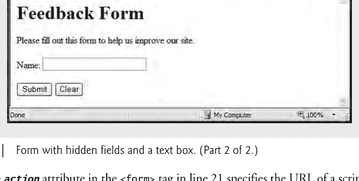

**图 2.12** 包含隐藏字段和文本框的表单。（第 2 部分中的第 2 部分。）

第 21 行`<form>`标签中的`action`属性指定了 Web 服务器上脚本的动作期间，该脚本将被调用来处理表单数据。由于我们尚未介绍服务器端编程，我们暂时将此属性留空。第 25–44 行定义了六个`input`元素，这些元素指定要提供给处理表单的脚本（也称为表单处理程序）的数据。有几种输入元素的类型。输入的类型由其`type`属性确定。此表单使用文本输入、提交输入、重置输入和三个隐藏输入。

第 35–36 行的`text` input 在表单中插入一个`文本框`。用户可以在文本框中输入数据。`label`元素（第 34–37 行）为用户提供有关输入元素用途的信息。input 元素的`size`属性指定文本框中可见的字符数。可选属性`maxlength`限制输入文本框的字符数——在这种情况下，用户不允许输入超过 30 个字符。

> **观感观察 2.3**
>
> 为每个表单元素包含一个`label`元素，以帮助用户确定每个表单元素的用途。

第 43–44 行的两个`input`元素创建了两个按钮。`submit` input 元素是一个按钮。当按下提交按钮时，用户将被发送到表单`action`属性中指定的位置。`value`属性设置按钮上显示的文本。`reset` input 元素允许用户将所有表单元素重置为其默认值。reset input 元素的`value`属性设置按钮上显示的文本（如果省略`value`属性，默认值为`Reset`）。

第 25–30 行的三个`input`元素的`type`属性为`hidden`，这允许您发送不是由用户输入的表单数据。三个隐藏输入是数据将发送到的电子邮件地址、电子邮件的主题行以及提交表单后浏览器打开的 URL。另外两个 input 属性是`name`，用于标识 input 元素，以及`value`，提供将发送（或发布）到 Web 服务器的值。

> **良好编程习惯 2.6**
>
> 将隐藏输入元素放在表单的开头，紧接在打开的`<form>`标签之后。这种放置方式使文档作者能够快速找到隐藏输入元素。

# 其他表单元素

在前面的示例中，您看到了 XHTML 表单的基本元素。既然您已经了解了表单的一般结构，我们将介绍用于创建更复杂表单的元素和属性。图 2.13 包含一个征求用户对网站反馈的表单。

```xml
1 <?xml version="1.0" encoding="utf-8"?>
2 <!DOCTYPE html PUBLIC "-//W3C//DTD XHTML 1.0 Strict//EN"
3    "http://www.w3.org/TR/xhtml1/DTD/xhtml1-strict.dtd">

5 <!-- 图 2.13: form2.html -->
6 <!-- 使用多种组件的表单。 -->
7 <html xmlns="http://www.w3.org/1999/xhtml">
8    <head>
9       <title>更多表单</title>
10    </head>

12    <body>
13       <h1>反馈表单</h1>
```

```xml
14        <p>请填写此表单以帮助我们
15           改进我们的网站。</p>

17        <form method="post" action="">
18           <p>
19              <input type="hidden" name="recipient"
20                 value="deitel@deitel.com" />
21              <input type="hidden" name="subject"
22                 value="Feedback Form" />
23              <input type="hidden" name="redirect"
24                 value="main.html" />
25           </p>

27           <p>
28              <label>姓名:
29                 <input name="name" type="text" size="25" />
30              </label>
31           </p>

33           <!-- <textarea> 创建一个多行文本框 -->
34           <p>
35              <label>评论:<br />
36                 <textarea name="comments"
37                    rows="4" cols="36">在此输入评论。</textarea>
38              </label>
39           </p>

41           <!-- <input type="password"> 插入一个 -->
42           <!-- 显示用星号字符遮罩的 -->
43           <!-- 文本框 -->
44           <p>
45              <label>电子邮件地址:
46                 <input name="email" type="password" size="25" />
47              </label>
48           </p>

50           <p>
51              <strong>你喜欢的事物：</strong><br />

53              <label>网站设计
54                 <input name="thingsliked" type="checkbox"
55                    value="Design" /></label>
56              <label>链接
57                 <input name="thingsliked" type="checkbox"
58                    value="Links" /></label>
59              <label>易用性
60                 <input name="thingsliked" type="checkbox"
61                    value="Ease" /></label>
62              <label>图像
63                 <input name="thingsliked" type="checkbox"
64                    value="Images" /></label>
65              <label>源代码
66                 <input name="thingsliked" type="checkbox"
67                    value="Code" /></label>
68           </p>

70           <!-- <input type="radio" /> 创建一个单选 -->
71           <!-- 按钮。单选按钮之间的区别 -->
```

**图 2.13** | 使用多种组件的表单。（第 4 部分中的第 2 部分。）

## 2.11 表单组件（续）

```html
<!-- 而复选框则允许多选。 -->
<p>
    <strong>您是如何来到我们网站的？：</strong><br />
    <label>搜索引擎
        <input name="howtosite" type="radio"
            value="search engine" checked="checked" /></label>
    <label>来自其他网站的链接
        <input name="howtosite" type="radio"
            value="link" /></label>
    <label>Deitel.com 网站
        <input name="howtosite" type="radio"
            value="deitel.com" /></label>
    <label>书籍中的参考
        <input name="howtosite" type="radio"
            value="book" /></label>
    <label>其他
        <input name="howtosite" type="radio"
            value="other" /></label>
</p>

<p>
    <label>请为我们的网站评分：

        <!-- <select> 标签呈现一个下拉列表， -->
        <!-- 其中的选项由 <option> 标签指示 -->
        <select name="rating">
            <option selected="selected">非常棒</option>
            <option>10</option>
            <option>9</option>
            <option>8</option>
            <option>7</option>
            <option>6</option>
            <option>5</option>
            <option>4</option>
            <option>3</option>
            <option>2</option>
            <option>1</option>
            <option>非常差</option>
        </select>
    </label>
</p>

<p>
    <input type="submit" value="提交" />
    <input type="reset" value="清除" />
</p>
</form>
</body>
</html>
```

图 2.13 | 使用各种组件的表单。（第 3 部分，共 4 部分。）

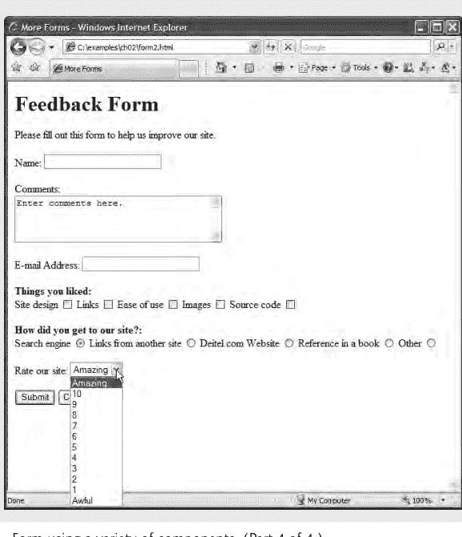

图 2.13 | 使用各种组件的表单。（第 4 部分，共 4 部分。）

在第 32 行，我们介绍了`br`元素，大多数浏览器会将其渲染为换行。`br`元素之后的任何标记或文本都会在下一行渲染。与`img`元素一样，`br`是空元素的一个示例，以斜杠终止。我们在斜杠前添加一个空格以增强可读性。

`textarea`元素（第 33–34 行）在表单中插入一个多行文本框，称为文本区域。行数通过`rows`属性指定，列数（即每行的字符数）通过`cols`属性指定。在此示例中，`textarea`高度为四行，宽度为 36 个字符。要在文本区域中显示默认文本，请将文本放在`<textarea>`和`</textarea>`标签之间。默认文本也可以通过使用`value`属性在其他输入类型（如文本框）中指定。


第 41 行的 `password` 输入插入一个具有指定 `size`（允许的最大字符数）的密码框。密码框允许用户通过“掩码”输入的信息（使用星号（`*`））来输入敏感信息，例如信用卡号和密码。实际输入的值会发送到 Web 服务器，而不是用于掩码输入的字符。

第 47–61 行介绍了 `checkbox` 表单元素。复选框允许用户从一组选项中进行选择。当用户选中复选框时，复选框中会出现一个复选标记。否则，复选框保持为空。每个 `checkbox` 输入创建一个新的复选框。复选框可以单独使用或成组使用。属于同一组的复选框被分配相同的名称（在本例中为 `"thingsliked"`）。

在复选框之后，我们又提供了两种允许用户进行选择的方法。在此示例中，我们介绍了两种新的输入类型。第一种类型是单选按钮（第 71–85 行），通过 `type="radio"` 指定。单选按钮类似于复选框，不同之处在于一组单选按钮中一次只能选中一个。一组中的所有单选按钮都具有相同的 `name` 属性，并通过不同的 `value` 属性进行区分。属性值对 `checked="checked"`（第 73 行）指示最初选中的单选按钮（如果有）。`checked` 属性也适用于复选框。

`select` 元素（第 94–107 行）提供一个下拉列表，用户可以从中选择一个项目。`name` 属性标识下拉列表。`option` 元素（第 95–106 行）向下拉列表添加项目。`option` 元素的 `selected` 属性指定最初在 `select` 元素中显示为选定项目的项目。如果没有 `option` 元素被标记为 `selected`，浏览器默认选择第一个选项。

## 2.12 内部链接

本章前面，我们讨论了如何将一个网页超链接到另一个网页。图 2.14 介绍了*内部链接*——一种使用户能够在同一文档的不同位置之间跳转的机制。内部链接对于包含许多章节的长文档非常有用。单击内部链接使用户无需滚动整个文档即可找到某个章节。

第 14 行包含一个带有 `id` 属性（设置为 `"features"`）的标签，用于内部超链接。要链接到同一网页中具有此属性的标签，锚元素的 `href` 属性包含 `id` 属性值，并以井号（`#`）开头（例如 `#features`）。第 56 行包含一个超链接，其目标 `id` 为 `features`。在 Web 浏览器中选择此超链接会将浏览器窗口滚动到第 14 行的 `h1` 标签。请注意，在单击链接之前，您可能需要将浏览器窗口调整为小窗口并向下滚动，才能看到浏览器滚动到 `h1` 元素的效果。

```xml
1  <?xml version = "1.0" encoding = "utf-8"?>
2  <!DOCTYPE html1 PUBLIC "-//W3C//DTD XHTML 1.0 Strict//EN"
3    "http://www.w3.org/TR/xhtml1/DTD/xhtml1-strict.dtd">
4  
5  <!-- 图 2.14: internal.html -->
6  <!-- 使用内部超链接使页面更易于导航。 -->
7  <html xmlns = "http://www.w3.org/1999/xhtml">
```

### 常见编程错误 2.5

> 当您的表单中有几个同名的复选框时，必须确保它们具有不同的值，否则在 Web 服务器上运行的脚本将无法区分它们。

### 常见编程错误 2.6

> 不将表单中单选按钮的 `name` 属性设置为相同的值是一个逻辑错误，因为这允许用户同时选择所有按钮。

图 2.14 | 使用内部超链接使页面更易于导航。（第 1 部分，共 3 部分。）

```html
<head>
<title>内部链接</title>
</head>

<body>
<!-- id 属性创建一个内部超链接目标 -->
<h1 id="features">互联网的最佳特性</h1>

<!-- 内部链接的地址是 "#id" -->
<p><a href="#bugs">跳转到 <em>最喜欢的 Bug</em></a></p>

<ul>
<li>您可以认识来自世界各地的人。</li>
<li>当新媒介公开时，您可以访问它：
<ul>
<li>新游戏</li>
<li>新应用程序
<ul>
<li>用于商业</li>
<li>用于娱乐</li>
</ul>
</li>
</ul>
</li>
<li>全天候新闻</li>
<li>搜索引擎</li>
<li>购物</li>
<li>编程
<ul>
<li>XHTML</li>
<li>Java</li>
<li>动态 HTML</li>
<li>脚本</li>
<li>新语言</li>
</ul>
</li>
</ul>

<li>链接</li>
<li>与老朋友保持联系</li>
<li>它是未来的科技！</li>
</ul>

<!-- id 属性创建一个内部超链接目标 -->
<h1 id="bugs">我最喜欢的 3 个 Bug</h1>
<p>
<!-- 指向 features 的内部超链接 -->
<a href="#features">跳转到 <em>最喜欢的特性</em></a>
</p>
<ol>
<li>萤火虫</li>
<li>银河蚂蚁</li>
<li>罗马梯形</li>
</ol>
</body>
</html>
```

**图 2.14** | 使用内部超链接使页面更易于导航。（第 2 部分，共 3 部分。）

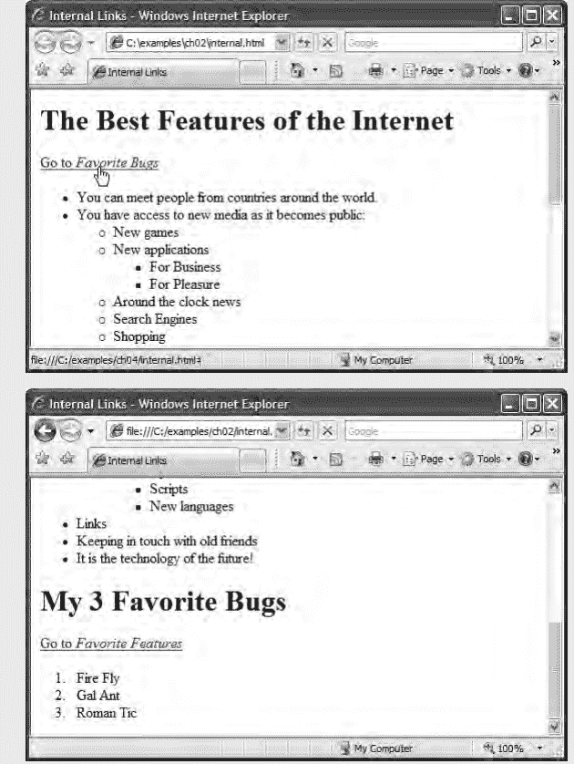

图 2.14 | 使用内部超链接使页面更易于导航。（第 3 部分，共 3 部分。）

### 外观与感觉观察 2.4

内部超链接在包含大量信息的 XHTML 文档中非常有用。指向页面不同部分的内部链接使用户更容易导航页面——他们无需滚动即可找到所需的部分。

虽然本示例未演示，但超链接可以通过指定文档名称后跟井号及 `id` 值来指向另一个文档中的内部链接，如下所示：

```html
href = "filename.html#id"
```

例如，要链接到 `books.html` 中具有名为 `booklist` 的 `id` 属性的标签，`href` 赋值为 `"books.html#booklist"`。你也可以通过在任意 URL 后追加井号和元素的 `id` 值，将浏览器指向另一个网站上的内部链接，如下所示：

```html
href = "URL/filename.html#id"
```

## 2.13 `meta` 元素

搜索引擎通常通过从一页追踪链接到另一页（通常称为蜘蛛抓取或爬行）并保存每个页面的标识和分类信息来编录网站。搜索引擎编录页面的一种方式是通过读取每个页面的 `meta` 元素中的内容，这些元素指定有关文档的信息。

`meta` 元素的两个重要属性是 `name`（标识 `meta` 元素的类型）和 `content`（提供搜索引擎用于编录页面的信息）。图 2.15 介绍了 `meta` 元素。

```html
<!-- Fig. 2.15: meta.html -->
<!-- meta elements provide keywords and a description of a page. -->
<?xml version = "1.0" encoding = "utf-8"?>
<!DOCTYPE html PUBLIC "-//W3C//DTD XHTML 1.0 Strict//EN"
     "http://www.w3.org/TR/xhtml1/DTD/xhtml1-strict.dtd">

<!-- Fig. 2.15: meta.html -->
<!-- meta elements provide keywords and a description of a page. -->
<html xmlns = "http://www.w3.org/1999/xhtml">
<head>
    <title>Welcome</title>

    <!-- <meta> tags provide search engines with -->
    <!-- information used to catalog a site -->
    <meta name = "keywords" content = "web page, design, XHTML, tutorial, personal, help, index, form, contact, feedback, list, links, deitel" />
    <meta name = "description" content = "This website will help you learn the basics of XHTML and web page design through the use of interactive examples and instruction." />
</head>
<body>
    <h1>Welcome to Our Website!</h1>

    <p>We have designed this site to teach about the wonders
      of <strong><em>XHTML</em></strong>. <em>XHTML</em> is
      better equipped than <em>HTML</em> to represent complex
      data on the Internet. <em>XHTML</em> takes advantage of
      XML's strict syntax to ensure well-formedness. Soon you
      will know about many of the great features of
      <em>XHTML.</em></p>

    <p>Have Fun With the Site!</p>
</body>
</html>
```

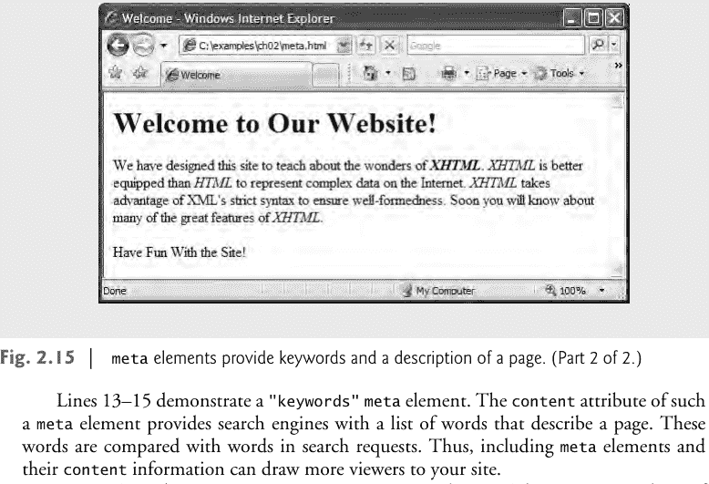

图 2.15 | `meta` 元素提供关键词和页面描述。（第 1 部分，共 2 部分）

第 13–15 行演示了一个 `"keywords"` `meta` 元素。此类 `meta` 元素的 `content` 属性向搜索引擎提供描述页面的单词列表。这些单词与搜索请求中的单词进行比较。因此，包含 `meta` 元素及其内容信息可以为你的网站带来更多访问者。

第 16–19 行演示了一个 `"description"` `meta` 元素。此类 `meta` 元素的 `content` 属性以句子形式提供对网站的三到四行描述。搜索引擎也使用此描述来编录你的网站，有时会将这些信息作为搜索结果的一部分显示。请注意，`meta` 元素的这种使用是搜索引擎优化（SEO）的众多方法之一。有关 SEO 的更多信息，请访问 Deitel 的 SEO 资源中心 `www.deitel.com/searchengineoptimization`。

> **软件工程观察 2.1**
>
> `meta` 元素对用户不可见，必须放置在 XHTML 文档的 `head` 部分中。如果 `meta` 元素未放置在此部分中，搜索引擎将无法读取它们。

## 2.14 Web 资源

`www.deitel.com/xhtml`

访问我们的在线 XHTML 资源中心，获取网络上最佳 XHTML 信息的链接。在那里，你可以找到按类别分类的链接，包括入门介绍、教程、书籍、博客、论坛、示例章节等。还可以查看有关 XHTML 2（即将发布的 XHTML 标准版本）的链接。

# 3 层叠样式表™（CSS）

时尚易逝，风格永存。

——伊夫·圣·洛朗

只要风格适应其时代，它就不会过时。当风格与某种心态不兼容时，胜利者从来不是风格。

——可可·香奈儿

## 学习目标

在本章中，你将学习：

在边缘工作，超脱于主流认知之外，是多么自由。

——唐·德里罗

- 通过创建样式表来控制网站的外观。
- 使用样式表让网站的所有页面具有相同的视觉效果。
- 使用 `class` 属性应用样式。
- 指定显示文本的精确字体、大小、颜色和其他属性。
- 指定元素的背景和颜色。
- 理解盒模型以及如何控制边距、边框和内边距。
- 使用样式表将表示与内容分离。

我逐渐从下层阶级背景上升到下层阶级前景。

——马文·科恩

### 目录

- 3.1 简介
- 3.2 内联样式
- 3.3 嵌入式样式表
- 3.4 冲突样式
- 3.5 链接外部样式表
- 3.6 元素定位
- 3.7 背景
- 3.8 元素尺寸
- 3.9 盒模型与文本流
- 3.10 媒体类型
- 3.11 构建 CSS 下拉菜单
- 3.12 用户样式表
- 3.13 CSS 3
- 3.14 Web 资源

### 3.1 简介

在第 2 章中，我们介绍了可扩展超文本标记语言（XHTML），用于标记要在浏览器中渲染的信息。在本章中，我们将重点转向格式化和展示信息。为此，我们使用一种称为*层叠样式表™*（CSS）的 W3C 技术，它允许文档作者独立于文档的结构（章节标题、正文文本、链接等）来指定网页上元素的呈现方式（例如字体、间距、颜色）。这种*结构与表示的分离*简化了网页的维护和修改。

XHTML 旨在指定文档的内容和结构。虽然它有一些控制呈现的属性，但最好不要将呈现与内容混合。如果网站的呈现完全由样式表决定，网页设计师只需替换一个新的样式表即可完全改变网站的外观。CSS 提供了一种在 XHTML 外部应用样式的方法，让 XHTML 决定内容，而 CSS 决定内容的呈现方式。

与 XHTML 一样，W3C 提供了位于 `jigsaw.w3.org/css-validator/` 的 CSS 代码验证器。使用此工具验证所有 CSS 代码是个好主意，以确保你的代码正确，并能在尽可能多的浏览器中工作。

CSS 是一个庞大的主题。因此，我们只能介绍理解本书其余示例所需的基本 CSS 知识。有关更多 CSS 参考和资源，请查看我们的 CSS 资源中心 `www.deitel.com/css21`。

W3C 的 CSS 规范目前处于第二个主要版本，第三个版本正在开发中。目前大多数主流浏览器的版本都支持 CSS 2 中的大部分功能。这使程序员能够充分利用其功能。在本章中，我们介绍 CSS，演示 CSS 2 中引入的一些功能，并讨论一些即将推出的 CSS 3 功能。在阅读本书时，请在网络浏览器中打开每个 XHTML 文档，以便按照最初设计的方式在浏览器中查看和交互。

请记住，本书中的示例已在 Internet Explorer 7 和 Firefox 2 中进行过测试。许多其他浏览器的最新版本（例如 Safari、Opera、Konqueror）应该能正确渲染本章的示例，但我们未对它们进行测试。本章中的某些示例在较旧的浏览器（如 Internet Explorer 6 及更早版本）中无法工作。在运行本章的示例之前，请确保你已安装 Internet Explorer 7（仅 Windows）或 Firefox 2（适用于所有主流平台）。

### 3.2 内联样式

你可以通过多种方式声明文档样式。本节介绍*内联样式*，使用 XHTML 属性 `style` 来声明单个元素的格式。内联样式会覆盖使用本章稍后讨论的技术应用的所有其他样式。

图 3.1 对内联样式应用于 `p` 元素以更改其字体大小和颜色。

> **良好编程实践 3.1**
>
> 内联样式并不能真正将表示与内容分离。要将相似的样式应用于多个元素，请使用嵌入式样式表或外部样式表，本章稍后将介绍。

第一个内联样式声明出现在第 17 行。属性 `style` 指定元素的样式。每个 CSS 属性（此处为 `font-size`）后跟冒号和值。在第 17 行中，我们声明此特定 `p` 元素使用 20 磅字体大小。

第 21 行指定了两个属性，`font-size` 和 `color`，用分号分隔。

在这一行中，我们将给定段落的颜色设置为浅蓝色，使用十六进制代码 `#6666ff`。颜色名称可以代替十六进制代码使用。

```html
<!-- Fig. 3.1: inline.html -->
<!-- Using inline styles -->
<html xmlns = "http://www.w3.org/1999/xhtml">
    <head>
        <title>Inline Styles</title>
    </head>
    <body>
        <p>This text does not have any style applied to it.</p>

        <!-- The style attribute allows you to declare -->
        <!-- inline styles. Separate multiple style properties -->
        <!-- with a semicolon. -->
        <p style = "font-size: 20pt">This text has the
        <em>font-size</em> style applied to it, making it 20pt.</p>

        <p style = "font-size: 20pt; color: #6666ff">
            This text has the <em>font-size</em> and
            <em>color</em> styles applied to it, making it
            20pt. and light blue.</p>
    </body>
</html>
```


### 3.3 嵌入式样式表

使用样式表的第二种技术是嵌入式样式表。嵌入式样式表允许你将整个 CSS 文档嵌入到 XHTML 文档的 `head` 部分。为了实现 CSS 代码与其所修饰的 XHTML 之间的分离，我们将使用 CSS 选择器。图 3.2 创建了一个包含四种样式的嵌入式样式表。


```xml
<?xml version = "1.0" encoding = "utf-8"?>
<!DOCTYPE html PUBLIC "-//W3C//DTD XHTML 1.0 Strict//EN"
    "http://www.w3.org/TR/xhtml1/DTD/xhtml1-strict.dtd">

<!-- Fig. 3.2: embedded.html -->
<!-- Embedded style sheets. -->
<html xmlns = "http://www.w3.org/1999/xhtml">
    <head>
        <title>Style Sheets</title>

        <!-- this begins the style sheet section -->
        <style type = "text/css">
            em      { font-weight: bold;
                    color: black }
            h1      { font-family: tahoma, helvetica, sans-serif }
            p       { font-size: 12pt;
                    font-family: arial, sans-serif }
            .special { color: #6666ff }
        </style>
    </head>
    <body>
        <!-- this class attribute applies the .special style -->
        <h1 class = "special">Deitel &amp; Associates, Inc.</h1>

        <p>Deitel &amp; Associates, Inc. is an internationally
        recognized corporate training and publishing organization
        whose clients include many <em>Fortune 1000 companies</em>,
        government agencies, branches of the military and business
        organizations. Through its publishing partnership with
        Prentice Hall, Deitel &amp; Associates, Inc. publishes
        leading-edge programming textbooks, professional books,
        interactive web-based multimedia Cyber Classrooms, satellite
        courses and World Wide Web courses.</p>
    </body>
</html>
```

`style` 元素（第 12–19 行）定义了嵌入式样式表。放置在 `head` 中的样式应用于整个文档中匹配的相应元素。`style` 元素的 `type` 属性指定了*多用途互联网邮件扩展*（MIME）类型，用于描述文件的内容。CSS 文档使用 MIME 类型 `text/css`。其他 MIME 类型包括 `image/gif`（用于 GIF 图像）、`text/javascript`（用于 JavaScript 脚本语言，我们将在第 4–9 章中讨论）等。

样式表的主体（第 13–18 行）声明了样式表的 CSS 规则。CSS 选择器决定哪些元素将按照规则进行样式设置。我们的第一条规则以选择器 `em` 开头（第 13 行），用于选择文档中所有的 `em` 元素。第 13 行中的 `font-weight` 属性指定了文本的“粗细”。可能的值包括 `bold`、`normal`（默认值）、`bolder`（比粗体更粗）和 `lighter`（比正常文本更细）。粗度也可以用 100 的倍数来指定，从 100 到 900（例如，100、200、…、900）。指定为 `normal` 的文本相当于 400，而 `bold` 文本相当于 700。然而，许多系统没有能够如此精确缩放的字体，因此使用从 100 到 900 的值可能无法显示预期的效果。

在此示例中，所有 `em` 元素将以粗体字体显示。我们还对所有 `h1`（第 15 行）和 `p`（第 16–17 行）元素应用样式。每条规则的主体都括在花括号（`{` 和 `}`）中。

第 18 行使用了一种新的选择器来声明一个名为 `special` 的样式类。样式类定义可以应用于任何元素的样式。在此示例中，我们声明了 `special` 类，它将颜色设置为蓝色。我们可以将此样式应用于任何元素类型，而此样式表中的其他规则仅适用于样式表中定义的特定元素类型（即 `em`、`h1` 或 `p`）。样式类声明前面有一个句点。我们将稍后讨论如何应用样式类。

嵌入式样式表中的 CSS 规则使用与内联样式相同的语法；属性名称后跟一个冒号（`:`）和属性的值。多个属性用分号（`;`）分隔。在 `em` 元素的规则中，`color` 属性指定文本的颜色，`font-weight` 属性使字体加粗。

`font-family` 属性（第 15 行）指定要使用的字体名称。并非所有用户的计算机上都安装了相同的字体，因此 CSS 允许你指定一个以逗号分隔的字体列表，用于特定的样式。浏览器尝试按列表中出现的顺序使用字体。建议将字体列表以通用字体系列名称结尾，以防其他字体未安装在用户计算机上。在此示例中，如果系统中找不到 `tahoma` 字体，浏览器将查找 `helvetica` 字体。如果两者都找不到，浏览器将显示其默认的 `sans-serif` 字体。其他通用字体系列包括 `serif`（例如 `times new roman`、`Georgia`）、`cursive`（例如 `script`）、`fantasy`（例如 `critter`）和 `monospace`（例如 `courier`、`fixedsys`）。

`font-size` 属性（第 16 行）指定 12 磅字体。除 `pt`（磅）之外的其他可能度量单位将在本章后面介绍。也可以使用相对值——`xx-small`、`x-small`、`small`、`smaller`、`medium`、`large`、`larger`、`x-large` 和 `xx-large`。通常，相对于 `font-size` 使用点大小，更推荐使用相对值，因为作者不知道每个客户端显示器的具体度量。相对字体大小值允许更灵活地查看网页。

例如，用户可能希望在带有小屏幕的手持设备上查看网页。在样式表中指定 18 磅字体大小将阻止此类用户一次看到超过一两个字符。但是，如果指定了相对字体大小，例如 `large` 或 `larger`，则实际大小由显示字体的浏览器决定。使用相对大小还使页面对残障用户更具可访问性。例如，视力受损的用户可能会将其浏览器配置为使用更大的默认字体，所有相对大小都基于此。作者指定为小于主文本的文本仍然以较小的字体大小显示，但对每个用户来说都清晰可见。可访问性是一个重要的考虑因素——1998 年，国会通过了《1973 年康复法》的第 508 条修正案，强制要求政府机构的网站必须对残障用户可访问。

第 23 行在 `h1` 元素中使用 XHTML 属性 `class` 来应用样式类——在此情况下为 `special` 类（在样式表第 18 行中用 `.special` 选择器声明）。当浏览器渲染 `h1` 元素时，请注意文本在屏幕上以 `h1` 元素的属性（第 17 行中定义的 `arial` 或 `sans-serif` 字体）和应用了 `.special` 样式类的属性（第 18 行中定义的 `#6666ff` 颜色）同时出现。还要注意，浏览器仍然对 `h1` 元素应用其自己的默认样式——标题仍以较大的字体大小显示。类似地，所有 `em` 元素仍将被浏览器以斜体显示，但由于我们的样式规则，它们也会以粗体显示。

`p` 元素和 `.special` 类的格式应用于第 34–41 行中的文本。在许多情况下，应用于某个元素（父元素或祖先元素）的样式也应用于该元素的嵌套元素（子元素或后代元素）。第 35 行中嵌套在 `p` 元素中的 `em` 元素继承了 `p` 元素的样式（即第 16 行中的 12 磅字体大小），但保留了其斜体样式。换句话说，为段落定义但未为 `em` 元素定义的样式被应用于 `em` 元素。由于可以在同一元素上设置或继承一个属性的多个值，它们必须在渲染之前被减少为每个元素一种样式。我们将在下一节讨论解决这些冲突的规则。

### 3.4 冲突的样式

样式可以由用户、作者或用户代理（例如 Web 浏览器）定义。用户是查看你的网页的人，你是作者——编写文档的人——而用户代理是用于渲染和显示文档的程序。样式“级联”，或说流动在一起，使得页面上元素的最终外观是结合了以多种方式定义的样式的结果。用户定义的样式优先于用户代理定义的样式，而作者定义的样式优先于用户定义的样式。

为父元素定义的大多数样式也被子（嵌套）元素继承。虽然继承大多数样式（如字体属性）是合理的，但某些属性我们不希望被继承。例如，考虑 `background-image` 属性，它允许程序员将图像设置为元素的背景。如果为 `body` 元素分配了背景图像，我们不希望相同的图像出现在我们页面主体中每个元素的背景中。相反，所有子元素的 `background-image` 属性保留其默认值 `none`。在本节中，我们讨论解决为元素定义的样式与从父元素和祖先元素继承的样式之间冲突的规则。

图 3.2 展示了继承的一个示例，其中子 `em` 元素从其父 `p` 元素继承了 `font-size` 属性。然而，在图 3.2 中，子 `em` 元素具有与其父 `p` 元素的 `color` 属性冲突的 `color` 属性（即，具有不同的值）。为子元素和后代元素定义的属性比为父元素和祖先元素定义的属性具有更大的**特异性**。冲突的解决有利于具有更高特异性的属性。换句话说，显式为子元素定义的样式比为子元素的父元素定义的样式更具体；因此，子元素的样式优先。图 3.3 说明了继承和特异性的示例。

第 12 行将 `text-decoration` 属性应用于 `class` 属性设置为 `nodec` 的所有 `a` 元素。`text-decoration` 属性为元素中的文本应用装饰。默认情况下，浏览器会为 `a`（锚点）元素的文本添加下划线。在此，我们将 `text-decoration` 属性设置为 `none`，以指示浏览器不应为超链接添加下划线。`text-decoration` 的其他可能值包括 `overline`、`line-through`、`underline` 以及 `blink`。[注：`blink` 不受 Internet Explorer 支持。] 附加在 `a` 上的 `.nodec` 是一个更具体的类选择器；此样式仅适用于在 `class` 属性中指定了 `nodec` 的 `<a>`（锚点）元素。

### 可移植性提示 3.1

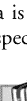

为了确保你的样式表在各种 Web 浏览器中都能正常工作，**请在所有将使用你的样式渲染文档的客户端 Web 浏览器上进行测试**，同时使用 *W3C CSS 验证器*进行验证。

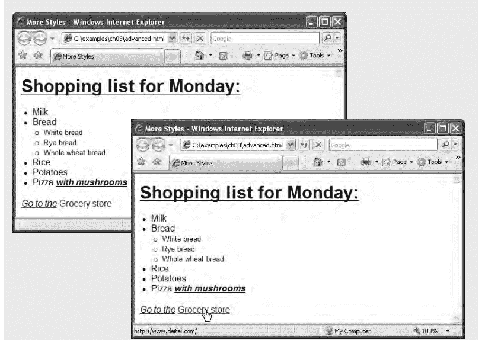

图 3.3 | 样式表中的继承。（第 2 部分，共 2 部分。）

第 13 行指定了 `hover` 的样式，这是一个*伪类*。伪类使作者能够访问文档中未明确声明的内容。**`hover` 伪类**在用户将鼠标光标移动到元素上方时动态激活。请注意，伪类与它们所应用的元素名称之间用冒号分隔（冒号前后没有空格）。

> **常见编程错误 3.1**
>
> *在分隔伪类与其所应用元素名称的冒号前后包含空格是一个错误，这会阻止伪类被正确应用。*

第 14 行使所有作为 `li` 元素子代的 `em` 元素变为粗体。在图 3.3 的屏幕输出中，请注意**Go to the**（包含在第 37 行的 `em` 元素中）未显示为粗体，因为该 `em` 元素不在 `li` 元素中。然而，包含 **with mushrooms** 的 `em` 元素（第 34 行）嵌套在 `li` 元素中；因此，它被格式化为粗体。对多个元素应用规则的语法与此类似。在第 15 行，我们用逗号分隔选择器，以便对所有 `h1` 和所有 `em` 元素应用下划线样式规则。

第 16 行为所有 `ul` 元素指定左边距为 20 像素。我们将在 3.9 节详细讨论 `margin` 属性。像素是一种*相对长度单位*——其大小会根据屏幕分辨率而变化。其他相对长度包括 `em`（字体的 *M* 高度，通常设置为大写字母 *M* 的高度）、`ex`（字体的 *x* 高度，通常设置为小写字母 *x* 的高度）和百分比（例如，`font-size: 50%`）。

要将元素的文本设置为默认文本大小的 150%，作者可以使用以下语法：

`font-size: 1.5em`

或者，你可以使用：

`font-size: 150%`

CSS 中可用的其他度量单位是**绝对长度单位**——即，不随系统而变化大小的单位。这些单位包括 `in`（英寸）、`cm`（厘米）、`mm`（毫米）、`pt`（点；1 pt = 1/72 in）和 `pc`（皮卡；1 pc = 12 pt）。第 17 行指定所有嵌套的无序列表（作为 `ul` 元素后代的 `ul` 元素）的字体大小为 `.8em`。[注：当设置采用度量值的样式属性时（例如，`font-size`、`margin-left`），如果值为零，则不需要单位。]

> **良好编程习惯 3.2**
>
> > 只要有可能，请使用相对长度单位。如果使用绝对长度单位，你的文档在某些客户端浏览器（例如，无线电话）上可能无法阅读。

## 3.5 链接外部样式表

样式表是创建具有统一主题文档的便捷方式。使用**外部样式表**（即，仅包含 CSS 规则的独立文档），你可以为整个网站提供统一的外观和感觉。网站上的不同页面都可以使用相同的样式表。当需要更改样式时，作者只需修改单个 CSS 文件即可在整个网站上进行样式更改。请注意，虽然嵌入式样式表将内容与表示分离，但两者仍然包含在单个文件中，这阻碍了 Web 设计人员和内容作者并行工作。外部样式表通过将内容和样式分离到不同的文件中解决了这个问题。

> **软件工程观察 3.1**
>
> > 在开发具有多个页面的网站时，始终使用外部样式表。外部样式表将内容与表示分离，使得外观和感觉更加一致，开发更高效，性能更好。

图 3.4 展示了一个外部样式表。第 1–2 行是 **CSS 注释**。与 XHTML 注释类似，CSS 注释描述 CSS 文档的内容。注释可以放在任何类型的 CSS 代码中（即，内联样式、嵌入式样式表和外部样式表），并且始终以 `/*` 开头，以 `*/` 结束。浏览器会忽略这些分隔符之间的文本。

```css
1  /* 图 3.4：styles.css */
2  /* 外部样式表 */
3
4  body    { font-family: arial, helvetica, sans-serif }
5
6  a.nodec { text-decoration: none }
```

图 3.4 | 外部样式表。（第 1 部分，共 2 部分。）

```css
7
8  a:hover  { text-decoration: underline }
9
10 li em    { font-weight: bold }
11
12 h1, em   { text-decoration: underline }
13
14 ul       { margin-left: 20px }
15
16 ul ul    { font-size: .8em; }
```

图 3.4 | 外部样式表。（第 2 部分，共 2 部分。）

图 3.5 包含一个引用图 3.4 中外部样式表的 XHTML 文档。第 10–11 行（图 3.5）显示了一个 `link` 元素，该元素使用 `rel` 属性来指定当前文档与另一个文档之间的*关系*。在本例中，我们将链接的文档声明为此文档的*样式表*。`type` 属性将相关文档的 MIME 类型指定为 `text/css`。`href` 属性提供包含样式表的文档的 URL。在本例中，`styles.css` 与 `external.html` 位于同一目录中。


```html
1  <?xml version = "1.0" encoding = "utf-8"?>
2  <!DOCTYPE html PUBLIC "-//W3C//DTD XHTML 1.0 Strict//EN"
3       "http://www.w3.org/TR/xhtml1/DTD/xhtml1-strict.dtd">
4
5  <!-- 图 3.5：external.html -->
6  <!-- 链接外部样式表。 -->
7  <html xmlns = "http://www.w3.org/1999/xhtml">
8      <head>
9          <title>Linking External Style Sheets</title>
10         <link rel = "stylesheet" type = "text/css"
11              href = "styles.css" />
12     </head>
13     <body>
14         <h1>Shopping list for <em>Monday</em>:</h1>
15
16         <ul>
17             <li>Milk</li>
18             <li>Bread
19                 <ul>
20                     <li>White bread</li>
21                     <li>Rye bread</li>
22                     <li>Whole wheat bread</li>
23                 </ul>
24             </li>
25             <li>Rice</li>
26             <li>Potatoes</li>
27             <li>Pizza <em>with mushrooms</em></li>
28         </ul>
29     </body>
```

图 3.5 | 链接外部样式表。（第 1 部分，共 2 部分。）

```html
<p><em>Go to the</em>
<a class="nodec" href="http://www.deOPosoft.com">Grocery store</a></p>
```

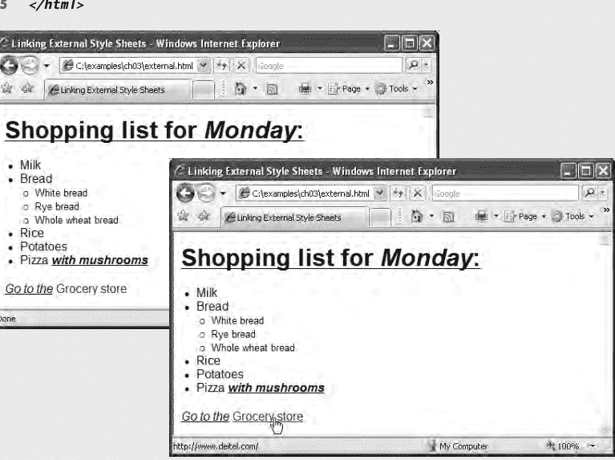

> **软件工程观察 3.2**
>
> 外部样式表是可复用的。创建一次并重复使用可以减少编程工作量。

> **性能提示 3.1**
>
> 重复使用外部样式表可以减少服务器的加载时间和带宽使用，因为样式表可以下载一次，由 Web 浏览器存储，并应用于网站上的所有页面。

## 3.6 元素定位

在 CSS 出现之前，控制 XHTML 文档中元素的定位很困难——浏览器决定定位方式。CSS 引入了 `position` 属性和一种称为绝对定位的功能，这使作者能够更好地控制文档元素的显示方式。图 3.6 演示了绝对定位。

通常，元素按照它们在 XHTML 文档中出现的顺序在页面上定位。第 11–14 行为第一个 `img` 元素定义了一个名为 `bgimg` 的样式。

```html
<?xml version = "1.0" encoding = "utf-8"?>
<!DOCTYPE html PUBLIC "-//W3C//DTD XHTML 1.0 Strict//EN"
   "http://www.w3.org/TR/xhtml1/DTD/xhtml1-strict.dtd">

<!-- 图 3.6：positioning.html -->
<!-- 元素的绝对定位。 -->
<html xmlns = "http://www.w3.org Rwong/1999/xhtml">
   <head>
      <title>Absolute Positioning</title>
      <style type = "text/css">
         .bgimg   { position: absolute;
                    top: 0px;
                    left: 0px;
                    z-index: 1 }
         .fgimg   { position: absolute;
                    top: 25px;
                    left: 100px;
                    z-index: 2 }
         .text    { position: absolute;
                    top: 25px;
                    left: 100px;
                    z-index: 3;
                    font-size: 20pt;
                    font-family: tahoma, geneva, sans-serif }
      </style>
   </head>
   <body>
      <p></p>

      <p></p>

      <p class = "text">Positioned Text</p>
   </body>
</html>
```

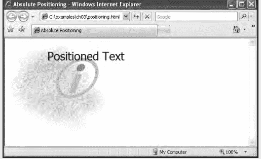

图 3.6 | 元素的绝对定位。

`i.gif` 位于页面上。将元素的定位属性设置为绝对定位（absolute）会将其从页面正常元素流中移除，而是根据其包含块级元素（即 `body` 或 `p` 等元素）的顶部、左侧、右侧或底部边距的距离来定位。这里，我们将元素定位为距离其包含元素的顶部和左侧边距均为 0 像素。在第 28 行，此样式应用于包含在 `p` 元素中的图像。

`z-index` 属性允许你正确地对重叠的元素进行分层。具有较高 `z-index` 值的元素会显示在具有较低 `z-index` 值的元素前面。在此示例中，`i.gif` 的 `z-index` 值最低（1），因此它显示在背景中。第 15–18 行的 `.fgimg` CSS 规则为圆形图像（`circle.gif`，位于第 31–32 行）设置了 `z-index` 为 2，因此它显示在 `i.gif` 的前面。第 34 行的 `p` 元素（Positioned Text）在第 22 行被赋予了 `z-index` 为 3，因此它显示在另外两个元素的前面。如果你未指定 `z-index`，或者元素具有相同的 `z-index` 值，则元素将按照在文档中出现的顺序从背景到前景放置。

绝对定位并非指定页面布局的唯一方式。图 3.7 展示了相对定位，其中元素相对于其他元素进行定位。

```html
1  <?xml version = "1.0" encoding = "utf-8"?>
2  <!DOCTYPE html PUBLIC "-//W3C//DTD XHTML 1.0 Strict//EN"
3     "http://www.w3.org/TR/xhtml1/DTD/xhtml1-strict.dtd">
4
5  <!-- 图 3.7：positioning2.html -->
6  <!-- 元素的相对定位。 -->
7  <html xmlns = "http://www.w3.org/1999/xhtml">
8      <head>
9          <title>相对定位</title>
10         <style type = "text/css">
11             p { font-size: 1.3em;
12                 font-family: verdana, arial, sans-serif }
13             span { color: red;
14                 font-size: .6em;
15                 height: 1em }
16             .super { position: relative;
17                 top: -1ex }
18             .sub { position: relative;
19                 bottom: -1ex }
20             .shiftleft { position: relative;
21                 left: -1ex }
22             .shiftright { position: relative;
23                 right: -1ex }
24         </style>
25     </head>
26     <body>
27         <p>此句子末尾的文本
28         <span class = "super">是上标</span>。</p>
29
30         <p>此句子末尾的文本
31         <span class = "sub">是下标</span>。</p>
32         <p>此句子末尾的文本
33         <span class = "shiftleft">向左偏移</span>。</p>
34
35         <p>此句子末尾的文本
36         <span class = "shiftright">向右偏移</span>。</p>
37     </body>
38 </html>
```

图 3.7 | 元素的相对定位。（第 1 部分，共 2 部分。）

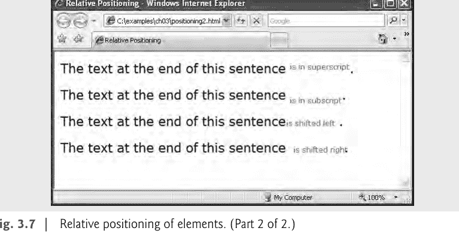

图 3.7 | 元素的相对定位。（第 2 部分，共 2 部分。）

将 `position` 属性设置为 `relative`，如 `super` 类（第 16–17 行）所示，会在页面上布局元素并使其按照指定的 `top`、`bottom`、`left` 或 `right` 值进行偏移。与绝对定位不同，相对定位保持元素在页面的常规元素流中，因此定位是相对于流中的其他元素。回想一下，`ex`（第 17 行）是字体的 *x* 高度，这是一个相对长度度量，通常等于小写 *x* 的高度。

> **常见编程错误 3.2**
>
> 由于相对定位会保持元素在文档的文本流中，请注意避免意外覆盖文本。

### 内联与块级元素

我们在第 28 行介绍了 `span` 元素。第 13–15 行定义了所有 `span` 元素的 CSS 规则。`span` 的高度决定了它将占据多少垂直空间。`font-size` 决定了 `span` 内部文本的大小。

`span` 元素是一个分组元素——它本身不对其内容应用任何固有格式。其主要目的是对文本的某一部分应用 CSS 规则或 `id` 属性。`span` 元素是一个内联级元素——它在不改变文档流的情况下对文本应用格式。内联元素的示例包括 `span`、`img`、`a`、`em` 和 `strong`。`div` 元素也是一个分组元素，但它是一个块级元素。这意味着它会在自己的行上显示，并且其周围有一个虚拟框。块级元素的示例包括 `div`、`p` 和标题元素（`h1` 到 `h6`）。我们将在第 3.9 节更详细地讨论内联和块级元素。

## 3.7 背景

CSS 提供了对块级元素背景的控制。CSS 可以为 XHTML 元素设置背景颜色或添加背景图像。图 3.8 将公司标志添加到文档的右下角。即使用户向上或向下滚动屏幕，此标志也会固定在角落中。

`background-image` 属性（第 11 行）以 `url(*fileLocation*)` 的格式指定图像 `logo.gif` 的 URL。你也可以设置 `background-color` 属性，以防图像未找到（并填充图像未覆盖的区域）。

`background-position` 属性（第 12 行）将图像放置在页面上。关键字 `top`、`bottom`、`center`、`left` 和 `right` 可单独或组合使用以进行垂直和水平定位。可以通过指定水平长度后跟垂直长度来使用长度值定位图像。例如，要将图像水平居中（定位在屏幕距离的 50% 处）且距顶部 30 像素，可使用：

```css
background-position: 50% 30px;
```

```html
<?xml version = "1.0" encoding = "utf-8"?>
<!DOCTYPE html PUBLIC "-//W3C//DTD XHTML 1.0 Strict//EN"
  "http://www.w3.org/TR/xhtml1/DTD/xhtml1-strict.dtd">

<!-- 图 3.8：background.html -->
<!-- 添加背景图像和缩进。 -->
<html xmlns = "http://www.w3.org/1999/xhtml">
    <head>
        <title>背景图像</title>
        <style type = "text/css">
            body  { background-image: url(logo.gif);
                    background-position: bottom right;
                    background-repeat: no-repeat;
                    background-attachment: fixed;
                    background-color: #eeeeee }
            p     { font-size: 18pt;
                    color: #1144AA;
                    text-indent: 1em;
                    font-family: arial, sans-serif; }
            .dark { font-weight: bold }
        </style>
    </head>
    <body>
        <p>
            此示例使用 background-image、
            background-position 和 background-attachment
            样式将 <span class = "dark">Deitel
            &amp; Associates, Inc.</span> 标志放置在页面的
            右下角。请注意，当您调整浏览器窗口大小时，
            标志如何保持在正确的位置。在没有图像的地方，
            背景色会进行填充。
        </p>
    </body>
</html>
```

图 3.8 | 添加背景图像和缩进。（第 1 部分，共 2 部分。）

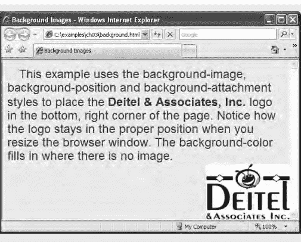

`background-repeat` 属性（第 13 行）控制背景图像的平铺，即将图像的多个副本并排放置以填充背景。这里，我们将平铺设置为 `no-repeat`，以只显示背景图像的一个副本。其他值包括 `repeat`（默认值）以垂直和水平平铺图像，`repeat-x` 仅水平平铺图像，或 `repeat-y` 仅垂直平铺图像。

最后一个属性设置 `background-attachment: fixed`（第 14 行）将图像固定在 `background-position` 指定的位置。滚动浏览器窗口不会将图像从其位置移开。默认值 `scroll` 会在用户滚动文档时移动图像。

第 18 行使用 `text-indent` 属性将元素中的第一行文本缩进指定的量，在此例中为 1em。作者可能会使用此属性来创建一个阅读起来更像小说的网页，其中每个段落的第一行都缩进。

CSS 属性 `font-style` 允许你将文本样式设置为 `none`、`italic` 或 `oblique`（`oblique` 只是比 `italic` 更倾斜——如果系统或字体不支持 `oblique` 文本，浏览器将默认使用 `italic`）。

## 3.8 元素尺寸

除了定位元素外，CSS 规则还可以指定每个页面元素的实际尺寸。图 3.9 演示了如何设置元素的尺寸。

第 17 行的内联样式说明了如何设置屏幕上元素的 `width`；这里，我们指明 `div` 元素应占据屏幕宽度的 20%。元素的高度可以使用 `height` 属性类似地设置。高度和宽度值也可以指定为相对或绝对长度。例如，


```xml
1 <?xml version = "1.0" encoding = "utf-8"?>
2 <!DOCTYPE html PUBLIC "-//W3C//DTD XHTML 1.0 Strict//EN"
3 "http://www.w3.org/TR/xhtml1/DTD/xhtml1-strict.dtd">
4
5 <!-- 图 3.9: width.html -->
6 <!-- 元素尺寸与文本对齐。 -->
7 <html xmlns = "http://www.w3.org/1999/xhtml">
8 <head>
9 <title>框尺寸</title>
10 <style type = "text/css">
11 div { background-color: #aaccff;
12 margin-bottom: .5em;
13 font-family: arial, helvetica, sans-serif }
14 </style>
15 </head>
16 <body>
17 <div style = "width: 20%">这是位于一个
18 框中的文本，该框被设置为
19 横跨屏幕宽度的百分之二十。</div>
20
21 <div style = "width: 80%; text-align: center">
22 这是位于一个框中的居中文本，
23 该框被设置为横跨屏幕宽度的
24 百分之八十。</div>
25
26 <div style = "width: 20%; height: 150px; overflow: scroll">
27 此框仅占宽度的百分之二十，
28 且具有固定高度。
29 如果内容溢出怎么办？将
30 overflow 属性设置为 scroll！</div>
31 </body>
32 </html>
```

`width: 10em` 将元素的宽度设置为字体大小的 10 倍。大多数元素默认左对齐；但是，可以更改此对齐方式以将元素定位到其他位置。第 22 行将元素中的文本设置为居中对齐；`text-align` 属性的其他值包括 `left` 和 `right`。

在第三个 `div` 中，我们指定了百分比高度和像素宽度。设置元素两个维度的一个问题是，元素内的内容可能会超出设定的边界，在这种情况下，元素会被简单地放大以容纳所有内容。然而，在第 27 行，我们将 `overflow` 属性设置为 `scroll`，此设置会在文本超出边界时添加滚动条。

## 3.9 盒模型与文本流

所有块级 XHTML 元素都基于称为盒模型的机制，其周围绘制有一个虚拟框。当浏览器使用盒模型渲染元素时，每个元素的内容都被内边距、边框和外边距包围（图 3.10）。CSS 使用三个属性控制边框：`border-width`、`border-color` 和 `border-style`。我们在图 3.11 中说明了这三个属性。

```xml
1 <?xml version = "1.0" encoding = "utf-8"?>
2 <!DOCTYPE html PUBLIC "-//W3C//DTD XHTML 1.0 Strict//EN"
     "http://www.w3.org/TR/xhtml1/DTD/xhtml1-strict.dtd">

<!-- 图 3.11: borders.html -->
<!-- 块级元素的边框。 -->
<html xmlns = "http://www.w3.org/1999/xhtml">
    <head>
        <title>边框</title>
       <style type = "text/css">
           div { text-align: center;
                width: 50%;
                position: relative;
                left: 25%;
                border-width: 4px }
       .medium { border-width: medium }
       .thin   { border-width: thin }
       .solid  { border-style: solid }
       .double { border-style: double }
      </style>
   </head>
   <body>
      <div class = "medium solid">
         这是一个具有中等宽度、实线边框的 div 元素。
     </div>
     <div class = "thin solid">
         这是一个具有细实线边框的 div 元素。
     </div>
     <div class = "medium double">
         这是一个具有中等宽度、双线边框的 div 元素。
     </div>
 </body>
 </html>
```

**图 3.11** | 块级元素的边框。（共 2 部分，第 1 部分。）

### 3.9 盒模型与文本流

```css
20  .groove { border-style: groove }
21  .inset { border-style: inset }
22  .outset { border-style: outset }
23  .dashed { border-style: dashed }
24  .red { border-color: red }
25  .blue { border-color: blue }
26  </style>
27  </head>
28  <body>
29  <div class = "solid">实线边框</div><hr />
30  <div class = "double">双线边框</div><hr />
31  <div class = "groove">凹槽边框</div><hr />
32  <div class = "inset">内嵌边框</div><hr />
33  <div class = "dashed">虚线边框</div><hr />
34  <div class = "thin red solid">细红色实线边框</div><hr />
35  <div class = "medium blue outset">中等蓝色外凸边框</div>
36  </body>
37  </html>
```

**图 3.11** 块级元素的边框。（共 2 部分，第 2 部分。）

属性 `border-width` 可以设置为任何有效的 CSS 长度（例如，`em`、`ex`、`px` 等）或预定义的 `thin`、`medium` 或 `thick` 值。`border-color` 属性设置颜色。[注意：此属性对于不同样式的边框有不同的含义。] `border-style` 的选项有 `none`、`hidden`、`dotted`、`dashed`、`solid`、`double`、`groove`、`ridge`、`inset` 和 `outset`。`groove` 和 `ridge` 边框的效果相反，`inset` 和 `outset` 也是如此。当 `border-style` 设置为 `none` 时，不渲染边框。每个边框属性都可以为框的单个边设置（例如，`border-top-style` 或 `border-left-color`）。请注意，我们通过用空格分隔多个类名来为 XHTML 元素分配多个类，如第 36–37 行所示。

正如我们在绝对定位中看到的那样，可以从文本的正常流中移除元素。**浮动**允许你将元素移动到屏幕的一侧；文档中的其他内容随后会围绕浮动元素流动。图 3.12 演示了如何使用浮动和盒模型来控制整个页面的布局。

## 第 3 章 级联样式表™（CSS）

```xml
1  <?xml version = "1.0" encoding = "utf-8"?>
2  <!DOCTYPE html PUBLIC "-//W3C//DTD XHTML 1.0 Strict//EN"
     "http://www.w3.org/TR/xhtml1/DTD/xhtml1-strict.dtd">

5  <!-- 图 3.12: floating.html -->
6  <!-- 浮动元素。 -->
7  <html xmlns = "http://www.w3.org/1999/xhtml">
8      <head>
9          <title>文本环绕浮动元素流动</title>
10         <style type = "text/css">
11             div.heading { background-color: #bbddff;
12                             text-align: center;
13                             font-family: arial, helvetica, sans-serif;
14                             padding: .2em }
15             p           { text-align: justify;
16                             font-family: verdana, geneva, sans-serif;
17                             margin: .5em }
18             div.floated { background-color: #eeeeee;
19                             font-size: 1.5em;
20                             font-family: arial, helvetica, sans-serif;
21                             padding: .2em;
22                             margin-left: .5em;
23                             margin-bottom: .5em;
24                             float: right;
25                             text-align: right;
26                             width: 50% }
27             div.section { border: 1px solid #bbddff }
28         </style>
29     </head>
30     <body>
31         <div class = "heading"></
32             </div>
33         <div class = "section">
34             <div class = "floated">企业培训与出版</div>
35             <p>Deitel &amp; Associates, Inc. 是一家国际知名的企业培训和出版机构，
36             专注于编程语言、互联网/万维网技术和对象技术教育。
37             该公司提供 Java、C++、Visual Basic、C#、C、互联网和 Web 编程、
38             对象技术等课程。</p>
39         </div>
40         <div class = "section">
41             <div class = "floated">前沿编程教材</div>
42             <p>通过与 Prentice Hall 的出版合作，Deitel &amp; Associates, Inc. 出版前沿的
43             编程教材、专业书籍、基于交互式 CD-ROM 的多媒体网络教室、
44             卫星课程以及 DVD 和基于 Web 的视频课程。</p>
45         </div>
46     </body>
47  </html>
```

**图 3.12** | 浮动元素。（共 2 部分，第 1 部分。）


观察 XHTML 代码，我们可以看到文档的通用结构由一个页眉和两个主要部分组成。每个部分包含一个小标题和一些正文段落。

块级元素（如 `div`）在内容前后都会产生换行符进行渲染，因此页头和两个部分将会垂直堆叠显示：一个紧挨着另一个。如果没有任何样式设置，位于小标题 `div` 的小标也会在其下方的 `<p>` 标签的文字上方垂直堆叠。然而，在第 24 行我们设置了类 `floated` 的 `float` 属性为 `right`，该类别被应用到了子标题上。这致使每个子标题 `div` 浮到其包含元素的右边缘，而文本段落则会环绕它流动。

第 17 行为所有段落下标签分配了 `.5em` 的边距。`margin` 属性设置页面上的边框外部与其他内容之间的空间。在第 21 行中我们应用了 `.2em` 的内边距到漂浮（floated）上的 `div`。`padding` 属性确定元素内部的内容和元素的边框内部之间的距离。可以使用以下单个属性指定特定方向的边距（第 22–23 行）：`margin-top`、`margin-right`、`margin-left` 和 `margin-bottom`。`padding` 可以用相同的方式指定，使用 `padding-top`、`padding-right`、`padding-left` 和 `padding-bottom`。要查看边距和内边距的效果，试着把边距和内边距属性放入注释并观察差异。

在第 27 行中我们对 Section 方框设置了边框，并使用边框的简写声明进行设置。CSS 允许对边框进行简写赋值，以让你在一行中定义所有三项边界属性。该简写形式的语法为 `border: <width> <style> <color>`。我们的宽度为一个像素，样式为 `solid`，且颜色与页眉 `div`（第 11 行）上的背景色相同。这使边距能够融合到页头中，并使得页面显示为一列被分开的方框的线。

## 3.10 媒体类型（CSS Media Types）

CSS 媒体类型允许程序员决定网页如何根据使用的屏幕介质而改变外观。Web 最常见的媒体类型是 `screen` 媒体类型，即标准计算机屏幕。其他 CSS2 中的媒体类型还包含 `handheld`（手持屏）、`braille`（盲文）、`aural`（听觉）和 `print`（打印）。

`handheld` 媒体用于互联网移动设备，而 `braille` 则应用于阅读或印制网页为盲文的机器。`aural` 样式允许程序员告诉语音合成的浏览器关于网页的更多信息。这使浏览器能以合理的方式呈现在视觉受损的人面前。`print` 媒体会影响 Web 页面的打印后外观。欲获取 CSS 完整类型的列表，请查看 <http://www.w3.org/TR/REC-CSS2/media.html#media-types>。

媒体类型允许程序员决定在不影响对方的基础上如何在上述任何媒体上展示页面。图 3-10 给出了一个简单例子：当文档在屏幕上被观看时，此例会实施一套样式；而当该文件打印的时候又使用另一套模式。为了查看差异，请观察段落下方的屏幕捕获（screen captures），或使用 `Print Preview`（print preview）特性在 Internet Explorer（IE）或者 Firefox 中查看。

```html
<!--xml version = "1.0" encoding = "utf-8"?-->
<!DOCTYPE html PUBLIC "-//W3C//DTD XHTML
"http://www.w3.org/TR/xhtml/DTD/xhtml-strict.dtd">

<!-- Fig. 3, 7: mediatypes.html -->
<!-- CSS media typos -->
<html xmlns="http/www/1999/xhtm">
<head>
    <title>Media Types</title>
    <style type="text/css">
        @media all {
            body {
                background-color: #4h88aa;
            }

            h {
                font-family: verdana, helvetica, sans-serif;
                color: #caffcc;
            }

            p {
                font-size: 5pt;
                color: white;
                font-family: arial, sans-serif;
            }
        }

        /* end @media declaration */

        @media print {
            body {
                background-color: white;
            }
        }
    </style>
</head>
<body>
    <h1>CSS Media Types Example</h1>

    3.10 | CSS media types. (Part 2 of /.)<br />
    This example uses CSS media types to vary how the page<br />
    appears in print and how it appears on any other media.<br />
    This text will appear in one font on the screen, and a<br />
    different font on paper or in a print preview. To see<br />
    the difference in Internet Explorer go to the Print<br />
    menu and select Print Preview. In Firefox, select Print<br />
    Preview from the File menu.

    <h2>Fig 3.8 | CSS media types. (Part of /.)</h2>
</body>
</html>
```

在第 11 行，我们开始应用于所有媒体类型的一组样式。这些由 `@media all` 进行声明并用花括号括起。第 15–24 行中为所有媒体定义了一些样式。第 20–27 行设置页面打印时应用的样式，从声明 `@media print` 开始并使用花括号闭合。

我们应用于所有媒体类型的样式在屏幕上看起来不错，但在印刷页面上看起来就不会那么好了。彩色的背景会使用大量的墨水，而黑白打印机可能会印出不易阅读的页面，因为颜色之间的对比度不足。此外，无衬线字体如 `arial`、`helvetica` 以及 `geneva` 更容易在屏幕上阅读；而有衬线的字体（比如 `times new roman`）则在纸上更易读。

> 具有深色背景和浅色文本的页面使用大量墨水，打印时可能不易于阅读，特别是在黑白打印机上。请使用 `print` 媒体类型避免这种现象。

> 一般来说，无衬线字体现在屏幕上看起来更优美，而有衬线字体在纸张上显示起来效果更好。`Print Media Type` 允许您的网站在屏幕显示无衬线字体，并且在印刷的时候转换为衬线样式。

为解决这些问题，我们应用于打印媒体类型的特定样式，把 `body` 和 `h1` 标记的颜色，以及 `p` 标签的 `font-size`、`color` 和 `font-family` 设置为更适合打印和在纸上展示的形式。注意，这些大部分样式与所有媒体的声明发生矛盾。由于 `print` 媒体类型比 `all` 媒体类型拥有更高的特异性，当页面被印刷的时候，打印样式会覆盖所有媒体样式。因为 `print` 部分中 `h1` 标记没有覆盖其 `font-family` 属性，因此它保留旧的数值，即使在页面打印时依然生效。

## 3.11 构建 CSS 下拉式菜单（Drop-Down Menus）

下拉菜单是一种在不占用太多屏幕空间的情况下向网站提供导航链接的方法。在本章节，我们将重新审视 `:hover` 伪类，并引入 `display` 属性，用来通过 CSS 和 XHTML 创建一种下拉菜单。

我们已经看到了 `:hover` 类被用于更改鼠标悬浮在其上方的超链接样式。我们使用这一功能，以更高级的方式实现当光标在 menu-button 上方时出现菜单。我们需要另一个重要属性：`display`。这个属性允许程序员决定元素是否应该呈现在页面上，可能值包括 `block`、`inline` 和 `none`。`block` 和 `inline` 值将该元素显示为块级或行内元素，而 `none` 则阻止该元素的渲染。下拉菜单的代码如图 3.14 所示。

```html
1 <?xml version = "1.0" encoding ="utf-8"?>
2 <!DOCTYPE html PUBLIC "-//W3C//DTD XHTML
3    http/www.w3.org/TR/xhtml/DTD/xhtml-strict.dtd">
5 <!-- Fig 7,7: dropdown.html -->
6 <!-- CSS drop-down menu -->
<html xmlns="http://www.w3.org/1999/xhtml">
<head>
    <title>Drop-Down Menu</title>
</head>
<body>
    Fig. 3.14 | CSS drop-down menu. (Part 1 of 2.)
</body>
</html>
```

## 3.11 构建 CSS 下拉菜单

```html
<style type="text/css">

    body              { font-family: arial, sans-serif }

    div.menu          { font-weight: bold;

                        color: white;

                        border: 2px solid #225599;

                        text-align: center;

                        width: 10em;

                        background-color: #225599 }

    div.menu:hover a  { display: block }

    div.menu a        { display: none;

                        border-top: 2px solid #225599;

                        background-color: white;

                        width: 10em;

                        text-decoration: none;

                        color: black }

    div.menu a:hover  { background-color: #dfeff }

</style>

</head>

<body>

    <div class="menu">Menu

        <a href="#">Home</a>

        <a href="#">News</a>

        <a href="#">Articles</a>

        <a href="#">Blog</a>

        <a href="#">Contact</a>

    </div>

</body>

</html>
```

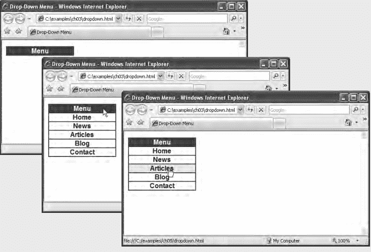

图 3.14 | CSS 下拉菜单。（第 2 部分，共 2 部分。）

首先我们来看看 XHTML 代码。在第 31–37 行，一个 class 为 `menu` 的 `div` 包含文字 "Menu" 和五个链接。这就是我们的下拉菜单。我们希望的行为如下：页面上只显示写着 "Menu" 的文字，除非鼠标悬停在 `menu` `div` 上。当鼠标光标悬停在 `menu` `div` 上时，我们希望链接显示在菜单下方，供用户选择。

要了解我们是如何实现这一功能的，让我们看看 CSS 代码。有两行代码赋予了我们下拉功能。第 21 行选择 `menu` `div` 中的所有链接，并将它们的 `display` 值设置为 `none`。这指示浏览器不要渲染这些链接。另一个重要的样式在第 20 行。这一行的选择器与第 21 行类似，但此行只选择鼠标悬停在其上的 `menu` `div` 的子 `a`（锚点）元素。这一行中的 `display: block` 意味着当鼠标悬停在 `menu` `div` 上时，其中的链接将作为块级元素显示。

第 27 行的选择器也与第 20 和 21 行类似。然而，这次该样式仅应用于 `menu` `div` 的子元素 `a`，当该子元素上有鼠标光标悬停时。此样式更改当前高亮菜单选项的背景颜色。其余的 CSS 只是为我们的菜单组件添加了美观的样式。查看屏幕截图或运行代码示例以查看菜单的实际效果。

这个下拉菜单只是更高级 CSS 格式化的一个例子。网上有许多关于 CSS 导航菜单和列表的额外资源。具体来说，可以查看 List-o-Matic，一个位于 <http://www.accessify.com/tools-and-wizards/developer-tools/list-o-matic/> 的自动 CSS 列表生成器，以及 Dynamic Drive 的垂直和水平 CSS 菜单库，网址为 <http://www.dynamicdrive.com/style/>。

## 3.12 用户样式表

用户可以定义自己的用户样式表，以根据其偏好格式化页面。例如，视觉障碍者可能希望增大页面的文字大小。网页作者需要注意，不要因定义样式而无意中覆盖用户偏好。本节讨论作者样式和用户样式之间可能存在的冲突。

图 3.15 包含一个作者样式。所有应用了 class `note` 的 `<p>` 标签的 `font-size` 被设置为 `9pt`。

用户样式表是外部样式表。图 3.16 显示了一个用户样式表，它将 `body` 的 `font-size` 设置为 `20pt`，`color` 设置为 `yellow`，`background-color` 设置为 `#000080`。

```xml
<?xml version="1.0" encoding="utf-8"?>

<!DOCTYPE html PUBLIC "-//W3C//DTD XHTML 1.0 Strict//EN"
    "http://www.w3.org/TR/xhtml1/DTD/xhtml1-strict.dtd">

<!-- Fig. 3.15: user_absolute.html -->

<!-- pt measurement for text size. -->

<html xmlns="http://www.w3.org/1999/xhtml">

    <head>

        <title>User Styles</title>

        <style type="text/css">

            .note { font-size: 9pt }

        </style>

    </head>

    <body>

        <p>Thanks for visiting my website. I hope you enjoy it.

        </p><p class="note">Please Note: This site will be

        moving soon. Please check periodically for updates.</p>

    </body>

</html>
```

图 3.15 | 文本大小的 `pt` 度量单位。（第 1 部分，共 2 部分。）

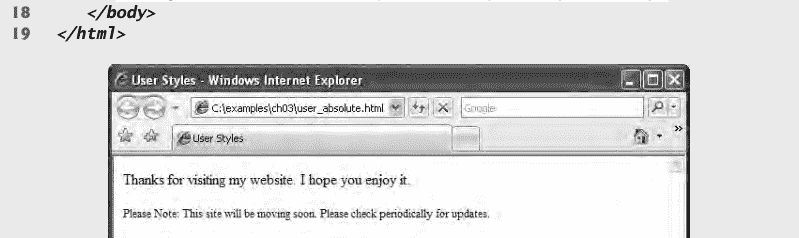

```css
/* Fig. 3.16: userstyles.css */

/* A user stylesheet */

body {
    font-size: 20pt;
    color: yellow;
    background-color: #000080;
}
```


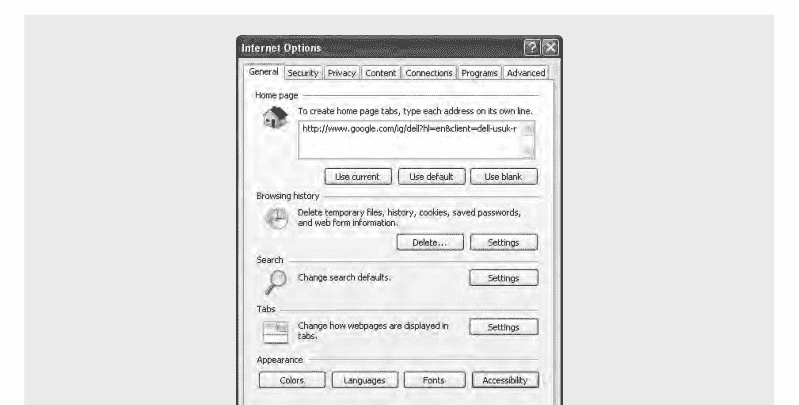

图 3.17 | Internet Explorer 7 中的用户样式表。（第 1 部分，共 2 部分。）

# 128 第 3 章 层叠样式表™（CSS）

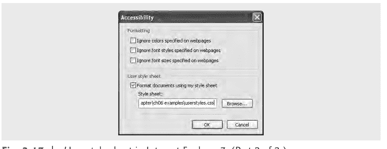

**用户样式表不是链接到文档**；相反，它们是在浏览器的选项中设置的。要在 IE7 中添加用户样式表，请在“工具”菜单中选择“Internet 选项...”。在出现的“Internet 选项”对话框（图 3.1）中，点击“辅助功能...”，勾选*使用样式表格式化文档*复选框，然后输入用户样式表的位置。Internet Explorer 7 会将用户样式表应用于它加载的任何文档。要在 Firefox 中添加用户样式表，请按照`www.mozilla.org/support/firefox/profile#locate`上的说明找到您的 Firefox 配置文件，并在`chrome`子目录中放置一个名为`userContent.css`的**样式**表。

*图 3.15 中的网页显示在*图 3.16*中，并应用了图 3.16 中的用户样式表。*

*在此示例中，*如果用户在用户样式表中定义了自己的*font-size*，则作者样式具有更高的优先级并覆盖用户样式。*作者样式表中指定的`9pt`字体覆盖了用户样式表中指定的`20pt`字体。*这种小字体可能使页面难以阅读，特别是对于视觉障碍者。您可以通过使用相对度量单位（例如`em`或`ex`）而不是绝对度量单位（如`pt`）来避免此问题。**图 3.19**将*font-size*属性更改为使用相对度量单位（第 10 行），这样不会覆盖图 3.16 中设置的用户样式。相反，显示的字体大小与用户样式表中指定的大小相对。在这种情况下，`<p>`标签中的文本显示为`20pt`，应用了`class note`的`<p>`标签以**15** pt 显示（0.75 乘以`20pt`）。

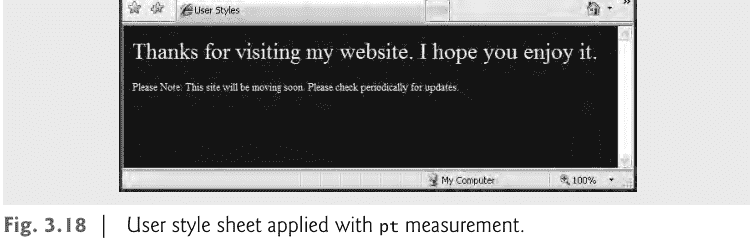

```xml
<?xml version="1.0" encoding="utf-8"?>

<!DOCTYPE html PUBLIC "-//W3C//DTD XHTML 1.0 Strict//EN"
  "http://www.w3.org/TR/xhtml1/DTD/xhtml1-strict.dtd">

<!-- Fig. 3.19: user_relative.html -->

<!-- em measurement for text size. -->

<html xmlns="http://www.w3.org/1999/xhtml">

  <head>
    <title>User Styles</title>

    <style type="text/css">
      .note { font-size: .75em }
    </style>
  </head>

  <body>
    <p>Thanks for visiting my website. I hope you enjoy it.
    </p><p class="note">Please Note: This site will be
    moving soon. Please check periodically for updates.
    </p>
  </body>

</html>
```

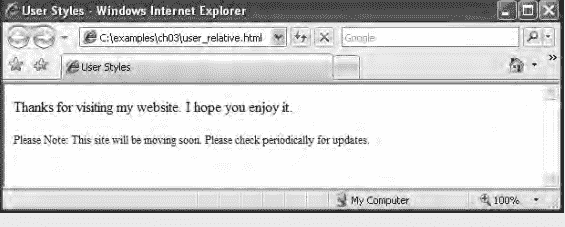

图 3.19 | 文本大小的`em`度量单位。

图 3.20 显示了将图 3.16 中的用户样式表应用于图 3.19 的网页。注意，显示的第二行文字比图 3.18 中的同一行文字更大。

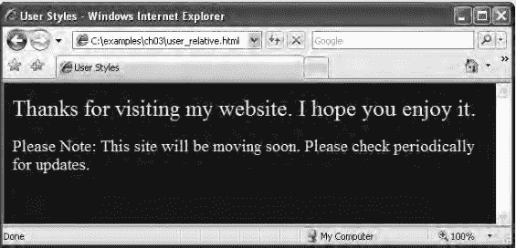

图 3.20 应用了`em`度量单位的用户样式表。

## 3.13 CSS 3

W3C 目前正在开发 CSS 3，一些浏览器也开始实现将包含在*CSS 3*规范中的一些新功能。我们讨论一些最有可能包含在 CSS 3 中的即将推出的功能。

CSS 3 将允许更高级地控制边框。除了`border-style`、`border-color`和`border-width`属性外，您还可以设置多种边框颜色、使用图像作为边框、为盒子添加阴影，以及创建圆角边框。

CSS 3 中的背景图像将更加通用，允许您设置背景图像的大小、指定偏移量以确定图像应在元素中的位置，以及在一个元素中使用多个背景图像。还将有属性来设置文本的阴影效果，以及当文本太长而无法容纳在其包含元素中时提供更多的文本溢出选项。

其他功能将包括可调整大小的盒子、增强的选择器、多列布局以及更完善的语音（听觉）样式。“Web 资源”部分将引导您访问 Deitel CSS 资源中心，在那里您可以找到有关 CSS 3 开发和最新功能的链接。

## 3.14 Web 资源

`http://www.deitel.com/css21`

Deitel CSS 资源中心包含指向网络上一些最佳 CSS 信息的链接。在那里，您可以找到分类的教程、参考资料、代码示例、演示、视频等链接。查看演示部分以获取有关布局、菜单和其他网页组件的更高级示例。

# 4 JavaScript：脚本编写入门

> 评论是自由的，但事实是神圣的。  
> ——C. P. Scott

> 债权人的记性比债务人好。  
> ——James Howell

## 学习目标

在本章中，你将学习：

> 面对抉择时，我总是问自己：“什么会是最有趣的？”  
> ——Peggy Walker

- 编写简单的 JavaScript 程序。
- 使用输入和输出语句。
- 基本的内存概念。
- 使用算术运算符。
- 算术运算符的优先级。
- 编写决策语句。
- 使用关系和相等运算符。

> 平等，在社会意义上，可分为条件平等和权利平等。  
> ——James Fenimore Cooper

### 4.1 简介

### 4.2 简单程序：在网页中显示一行文本

### 4.3 修改我们的第一个程序

### 4.4 使用`prompt`对话框获取用户输入

#### 4.4.1 动态欢迎页面

#### 4.4.2 整数加法

### 4.5 JavaScript 中的数据类型

### 4.6 算术运算

### 4.7 决策：相等和关系运算符

### 4.8 网络资源

## 4.1 简介

在前三章中，我们介绍了 Web 2.0、XHTML 和层叠样式表（CSS）。在本章中，我们开始介绍 JavaScript 脚本语言，它促进了一种规范的方法来设计增强网页功能和外观的计算机程序。

第 4 至第 9 章详细讨论了 JavaScript——基于 Web 的应用程序的事实标准客户端脚本语言，因其高度可移植的特性。我们对 JavaScript 的处理有两个目的：一是介绍客户端脚本（用于第 4 至第 11 章），使网页更加动态和交互；二是为本书后面介绍的服务器端脚本奠定基础。

我们现在介绍 JavaScript 编程，并展示几个示例来说明 JavaScript 的重要特性。每个示例都逐行仔细分析。在第 5 至第 6 章中，我们将详细讨论 JavaScript 中的程序开发和程序控制。

在计算机上运行 JavaScript 代码示例之前，您可能需要更改浏览器的安全设置。默认情况下，Internet Explorer 7 会阻止本地计算机上的脚本运行，而是在窗口顶部显示黄色警告栏。要允许本地文件中的脚本运行，请从“工具”菜单中选择“Internet 选项”。单击“高级”选项卡，然后在“设置”列表中向下滚动到“安全”部分。勾选标有“允许在我的计算机上的文件中运行活动内容”的复选框（图 4.1）。单击“确定”并重新启动 Internet Explorer。现在，您自己计算机上包含 JavaScript 代码的 XHTML 文档将正常运行。Firefox 默认启用 JavaScript。

1. 许多人将脚本语言 JavaScript 与编程语言 Java（来自 Sun Microsystems, Inc.）混淆。Java 是一种成熟的面向对象编程语言。它可用于开发在一系列设备上执行的应用程序——从最小的设备（如手机和 PDA）到超级计算机。Java 广受欢迎，用于开发大规模分布式企业应用程序和 Web 应用程序。JavaScript 是由 Netscape 开发的基于浏览器的脚本语言，并在所有主流浏览器中实现。
2. JavaScript 最初由 Netscape 创建。Netscape 和 Microsoft 在推动 JavaScript 由 ECMA International 标准化为 ECMAScript 方面都发挥了重要作用。有关当前 ECMAScript 标准的详细信息，请访问`www.ecma-international.org/publications/standards/ECMA-262.htm`。

## 4.2 简单程序：在网页中显示一行文本

JavaScript 使用的符号对程序员来说很熟悉。我们首先考虑一个简单的*脚本*（或*程序*），它在 XHTML 文档的主体中显示文本“Welcome to JavaScript Programming!”。所有主流 Web 浏览器都包含`JavaScript 解释器`，用于处理用 JavaScript 编写的命令。JavaScript 代码及其在 Internet Explorer 中的输出如图 4.2 所示。

```xml
1  <?xml version = "1.0" encoding = "utf-8"?>

2  <!DOCTYPE html PUBLIC "-//W3C//DTD XHTML 1.0 Strict//EN"
3     "http://www.w3.org/TR/xhtml1/DTD/xhtml1-strict.dtd">

4
5  <!-- Fig. 4.2: welcome.html -->
6  <!-- Displaying a line of text. -->

7  <html xmlns = "http://www.w3.org/1999/xhtml">
8     <head>
9        <title>A First Program in JavaScript</title>
10       <script type = "text/javascript">
11          <!--
12          document.writeln(
13             "<h1>Welcome to JavaScript Programming!</h1>" );
14          // -->
15       </script>
16    </head><body></body>
17 </html>
```

**图 4.2** | 显示一行文本。（第 1 部分，共 2 部分）

134 第 4 章 JavaScript：脚本编写入门

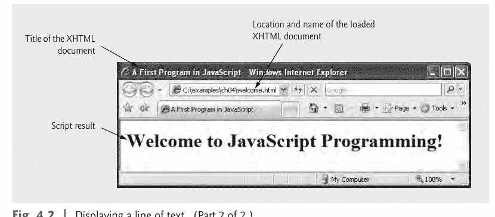

图 4.2 | 显示一行文本。（第 2 部分，共 2 部分。）

该程序说明了 JavaScript 的几个重要特性。我们详细考虑 XHTML 文档和脚本的每一行。与前几章一样，我们为每个 XHTML 文档行提供了行号以方便您使用；行号不是 XHTML 文档或 JavaScript 程序的一部分。第 12–13 行执行脚本的*“实际工作”*，即在网页中显示短语 Welcome to JavaScript Programming!。

第 8 行表示 XHTML 文档的`<head>`部分的开始。目前，我们编写的 JavaScript 代码将出现在`<head>`部分中。浏览器首先解释`<head>`部分的内容，因此我们写在那里的 JavaScript 程序在显示 XHTML 文档的`<body>`之前执行。在后面的 JavaScript 章节和动态 HTML 章节中，我们将演示*内联脚本*，即在 XHTML 文档的`<body>`中编写 JavaScript 代码。

第 10 行使用`<script>`标签向浏览器表明后面的文本是脚本的一部分。`type`属性指定文件类型以及脚本中使用的*脚本语言*——在本例中，是用 JavaScript 编写的文本文件。Internet Explorer 和 Firefox 都使用 JavaScript 作为默认脚本语言。

第 11 行包含 XHTML 开头注释标签`<!--`。一些较旧的 Web 浏览器不支持脚本。在此类浏览器中，脚本的实际文本通常会显示在网页中。为了防止这种情况发生，许多脚本程序员将脚本代码用 XHTML 注释括起来，这样不支持脚本的浏览器就会简单地忽略该脚本。使用的语法如下：

```html
<script type = "text/javascript">
    <!--
    script code here
    // -->
</script>
```


当不支持脚本的浏览器遇到前面的代码时，它会忽略 `<script>` 和 `</script>` 标签以及 XHTML 注释中的代码。支持脚本的浏览器将按预期解释 JavaScript 代码。[注意：某些浏览器需要在结束 XHTML 注释分隔符（--）之前使用 JavaScript 单行注释 `//`（参见 4.4 节的解释）才能正确解释脚本。开头的 HTML 注释标签（`<!--`）在 JavaScript 中也用作单行注释分隔符，因此不需要对其进行注释。]

> **可移植性提示 4.1**
>
> 某些浏览器不支持 `<script>...</script>` 标签。如果您的文档要用此类浏览器渲染，请将脚本代码括在这些标签之间的 XHTML 注释中，以免脚本文本作为网页的一部分显示。XHTML 注释的结束注释标签（`-->`）前面有 JavaScript 注释（`//`），以防止浏览器尝试将 XHTML 注释解释为 JavaScript 语句。

第 12–13 行指示浏览器的 JavaScript 解释器执行一个动作，即在网页中显示双引号（`"`）内包含的字符串字符。字符串有时称为字符串、消息或字符串字面量。我们将双引号之间的字符称为字符串。浏览器不会忽略字符串中单词之间的各个空白字符。但是，如果字符串中出现连续的空格，浏览器会将它们压缩为单个空格。此外，在大多数情况下，浏览器忽略前导空白字符（即字符串开头的空白）。

> **软件工程观察 4.1**
>
> JavaScript 中的字符串可以用双引号（`"`）或单引号（`'`）括起来。

第 12–13 行使用浏览器的 `document` 对象，它表示浏览器当前显示的 XHTML 文档。`document` 对象允许您指定要在 XHTML 文档中显示的文本。浏览器包含一组完整的对象，允许脚本程序员访问和操作 XHTML 文档的每个元素。在后面的章节中，我们将在讨论文档对象模型（DOM）时概述其中一些对象。

对象驻留在计算机内存中，包含脚本使用的信息。术语对象通常意味着对象的属性（数据）和行为（方法）相关联。对象的方法使用属性为对象的客户端（即调用方法的对象）执行有用的操作。方法可能需要额外的信息（参数）来执行其操作；此信息括在脚本中方法名称后面的括号中。

在第 12–13 行中，我们调用 `document` 对象的 `writeln` 方法，在 XHTML 文档中写入一行 XHTML 标记。方法名称 `writeln` 后面的括号包含方法 `writeln` 所需的一个参数（在本例中，是浏览器要显示的 XHTML 字符串）。方法 `writeln` 指示浏览器显示参数字符串。如果字符串包含 XHTML 元素，浏览器会解释这些元素并在屏幕上渲染它们。在本例中，浏览器将短语 `Welcome to JavaScript Programming!` 显示为 `h1` 级 XHTML 标题，因为该短语括在 `h1` 元素中。

第 12–13 行中的代码元素，包括 `document.writeln`、括号中的参数（字符串）和分号（`;`），统称为语句。每个语句都以分号结束（也称为语句终止符），尽管 JavaScript 不要求这样做。第 15 行表示脚本的结束。

> **良好编程实践 4.1**
>
> 始终在语句末尾添加分号以终止该语句。这种标记方式可以清楚地表明一个语句在何处结束，下一个语句在何处开始。

> **常见编程错误 4.1**
>
> 忘记为脚本添加结尾的 `</script>` 标签可能会导致浏览器无法正确解释脚本，也可能会妨碍 XHTML 文档正常加载或正确渲染。

第 16 行的 `</head>` 标签表示 `<head>` 部分的结束。同样在第 16 行，`<body>` 和 `</body>` 标签表明该 XHTML 文档的主体为空。第 17 行标志着这份 XHTML 文档的结束。

我们现在可以在网页浏览器中查看这份 XHTML 文档了——用 Internet Explorer 或 Firefox 打开即可。如果脚本中没有语法错误，它应该会产生图 4.2 所示的输出。

> **常见编程错误 4.2**
>
> JavaScript 是区分大小写的。未使用正确的大小写字母属于语法错误——即违反了用该编程语言编写正确语句的规则。Internet Explorer 中的 JavaScript 解释器通过在单独的弹出窗口中指示发生了“运行时错误”（即解释器运行脚本时出现了问题）来报告所有语法错误。[注：要在 IE7 中启用此功能，请从“工具”菜单中选择“Internet 选项…”。在出现的“Internet 选项”对话框中，选择“高级”选项卡，然后在“浏览”类别下勾选“显示每个脚本错误的通知”复选框。Firefox 有一个错误控制台，用于报告 JavaScript 错误和警告。可通过从“工具”菜单中选择“错误控制台”访问该控制台。]

### 4.3 修改我们的第一个程序

本节将通过两个示例继续介绍 JavaScript 编程，这两个示例均对图 4.2 中的示例进行了修改。

#### 显示一行彩色文本

脚本可以通过多种方式显示 `Welcome to JavaScript Programming!`。图 4.3 使用了两个 JavaScript 语句在 XHTML 文档中生成一行文本。本例还使用 CSS 的 `color` 属性以不同的颜色显示文本。

```
<?xml version = "1.0" encoding = "utf-8"?>

<!DOCTYPE html PUBLIC "-//W3C//DTD XHTML 1.0 Strict//EN"
  "http://www.w3.org/TR/xhtml1/DTD/xhtml1-strict.dtd">

<!-- Fig. 4.3: welcome2.html -->
<!-- Printing one line with multiple statements. -->

<html xmlns = "http://www.w3.org/1999/xhtml">
  <head>
    <title>Printing a Line with Multiple Statements</title>
    <script type = "text/javascript">
      <!--
        document.write( "<h1 style = \"color: magenta\">" );
```

**图 4.3** | 用独立的语句打印一行文本。（第 1 部分，共 2 部分）

```
        document.write( "Welcome to JavaScript " +
           "Programming!</h1>" );
        // -->
    </script>
  </head><body></body>
</html>
```

**图 4.3** | 用独立的语句打印一行文本。


`18 </html>`

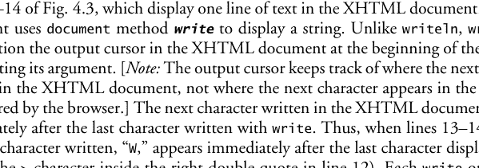

**图 4.3** | 用独立的语句打印一行文本。（第 2 部分，共 2 部分。）

这份 XHTML 文档的大部分内容与图 4.2 相同，所以我们只重点关注图 4.3 的第 12–14 行，这些行在 XHTML 文档中显示了一行文本。第一条语句使用了`document`的`write`方法来显示字符串。与`writeln`不同，`write`在写入其参数后，不会将输出光标定位到 XHTML 文档下一行的开头。[注：输出光标追踪的是 XHTML 文档中下一个字符将出现的位置，而不是浏览器渲染后的网页中下一个字符将出现的位置。] 在 XHTML 文档中，下一个写入的字符会紧接在通过`write`写入的最后一个字符之后出现。因此，当第 13–14 行执行时，第一个写入的字符“W”会紧接在通过`write`显示的最后一个字符之后（即第 12 行右侧双引号内的`>`字符）。每个`write`或`writeln`语句都会在上一个`write`或`writeln`语句停止写入字符的位置继续写入字符。所以，在一个`writeln`语句之后，下一个输出会出现在下一行的开头。实际上，第 12–14 行的两条语句产生了一行 XHTML 文本。请记住，JavaScript 中的语句是用分号（`;`）分隔的。因此，第 13–14 行仅代表一条完整的语句。JavaScript 允许将较长的语句拆分成多行。但是，不能在字符串的中间拆分语句。第 13 行的`+`运算符（在这种情况下称为“连接运算符”）用于将两个字符串连接在一起，本章稍后会更详细地解释它。

**常见编程错误 4.3**

*在字符串中间拆分语句属于语法错误。*

请注意，第 12 行中的字符`\\"`不会在浏览器中显示。字符串中的反斜杠（`\`）是一个转义字符。它指示字符串中应使用“特殊”字符。当在字符串中遇到反斜杠时，会将其与下一个字符组合形成一个转义序列。转义序列`\\"`表示双引号字符，它会在字符串中插入一个双引号字符。我们使用这个转义序列是为了在`style`的属性值两侧插入双引号，而不终止该字符串。请注意，我们也可以对属性值使用单引号，例如`document.write( "<h1 style = 'color: magenta'>" );`，因为单引号不会终止双引号字符串。我们将在稍后更详细地讨论转义序列。

需要特别指出的是，前面的讨论与 XHTML 文本的实际渲染并无关系。请记住，除非浏览器窗口对于正在渲染的文本来说太窄，或者浏览器遇到了明确开始新行的 XHTML 元素——例如，用`<br/>`开始新行，或用`<p>`开始新段落——否则浏览器不会创建新的一行文本。

**常见编程错误 4.4**

> 许多人会混淆 XHTML 文本的写入与 XHTML 文本的渲染。写入 XHTML 文本会创建将由浏览器渲染并呈现给用户的 XHTML。

### 显示多行文本

在下一个示例中，我们将演示如何通过在整个`write`或`writeln`方法调用的 XHTML 文本字符串中使用换行 XHTML 标签（`<br/>`），使单个语句就能让浏览器显示多行文本。图 4.4 演示了换行 XHTML 标签的使用。第 12–13 行在浏览器渲染 XHTML 文档时产生了三行独立的文本。

```xml
<?xml version = "1.0" encoding = "utf-8"?>

<!DOCTYPE html PUBLIC "-//W3C//DTD XHTML 1.0 Strict//EN"
  "http://www.w3.org/TR/xhtml1/DTD/xhtml1-strict.dtd">

<!-- Fig. 4.4: welcome3.html -->

<!-- Printing on multiple lines with a single statement. -->

<html xmlns = "http://www.w3.org/1999/xhtml">
    <head>
        <title>Printing Multiple Lines</title>
        <script type = "text/javascript">
        <!--
            document.writeln( "<h1>Welcome to<br />JavaScript" +
               "<br />Programming!</h1>" );
        // -->
        </script>
    </head><body></body>
</html>
```

图 4.4 | 用单个语句在多行打印。

### 4.3 修改我们的第一个程序

#### 在警示对话框中显示文本

本章前面的几个程序在 XHTML 文档中显示文本。有时，在称为对话框（或对话框窗口）的窗口中显示信息会很有用，这些窗口会在屏幕上“弹出”以吸引用户的注意。对话框通常向浏览网页的用户显示重要消息。JavaScript 可以很方便地显示一个包含消息的对话框。图 4.5 中的程序在一个称为`alert`对话框的预定义对话框中，将 Welcome to JavaScript Programming! 显示为三行。

脚本中的第 12 行使用浏览器的`window`对象显示了一个`alert`对话框。`window`对象的`alert`方法的参数是要显示的字符串。执行上述语句后，显示的对话框如图 4.5 的第一个窗口所示。该对话框的标题栏……

对话框包含字符串 Windows Internet Explorer，用于表示浏览器正在向用户呈现消息。该对话框提供了一个**确定**按钮，用户可通过单击该按钮来关闭（即关闭）对话框。要关闭对话框，请将鼠标光标（也称为鼠标指针）移至**确定**按钮上并单击鼠标。Firefox 的警告对话框看起来类似，但标题栏包含文本`[JavaScript Application]`。

#### 常见编程错误 4.5

对话框显示纯文本；它们不会渲染 XHTML。因此，在对话框中显示的字符串中指定 XHTML 元素会导致标签的实际字符被显示出来。

请注意，警告对话框包含三行纯文本。通常，对话框会完全按照字符串在双引号之间出现的样子来显示字符。但是请注意，对话框不会显示字符`\n`。转义序列`\n`是换行符。在对话框中，换行符会使光标（即当前屏幕位置指示器）移动到对话框中下一行的开头。表 4.6 列出了其他一些常见的转义序列。`\n`、`\t`和`\r`转义序列不会影响 XHTML 渲染，除非它们位于`pre`元素中（此元素会以其标签之间的文本以等宽字体精确显示，包括前导空白字符和连续空白字符）。其他转义序列会产生在纯文本对话框和 XHTML 中显示的字符。

| 转义序列 | 描述 |
| --- | --- |
| `\n` | 换行。将屏幕光标定位到下一行的开头。 |
| `\t` | 水平制表符。将屏幕光标移动到下一个制表位。 |
| `\r` | 回车。将屏幕光标定位到当前行的开头；不换到下一行。回车后输出的任何字符都会覆盖该行上先前输出的字符。 |
| `\\` | 反斜杠。用于在字符串中表示反斜杠字符。 |
| `"` | 双引号。用于在双引号包含的字符串中表示双引号字符。例如，`window.alert( ""in quotes"" );` 会在警告对话框中显示 "in quotes"。 |
| `'` | 单引号。用于在字符串中表示单引号字符。例如，`window.alert( '" in quotes\'" );` 会在警告对话框中显示 'in quotes'。 |

图 4.6 一些常见的转义序列。

### 4.4 使用 prompt 对话框获取用户输入

#### 常见编程错误 4.6

`alert`对话框消息中的 XHTML 元素不会被解释为 XHTML。这意味着，例如，使用`<br />`在警告框中创建换行是错误的。字符串`<br/>`只会被包含在您的消息中。

脚本功能使您能够在向用户展示网页时生成网页内容的部分或全部。脚本可以根据用户输入或其他变量（例如一天中的时间或客户端使用的浏览器类型）来调整内容。这类网页被称为**动态的**，而非静态的，因为它们的内容能够更改。接下来的两个子节使用脚本来演示动态网页。

#### 4.4.1 动态欢迎页面

我们的下一个脚本基于之前的脚本创建了一个动态欢迎页面，该页面获取用户的姓名，然后将其显示在页面上。该脚本使用了`window`对象的另一个预定义对话框——`prompt`对话框，该对话框允许用户输入脚本可以使用的值。程序要求用户输入一个姓名，然后在 XHTML 文档中显示该姓名。图 4.7 展示了脚本和示例输出。[注意：在后面的 JavaScript 章节中，我们将通过第 2 章介绍的 XHTML 表单中的 GUI 组件来获取输入。]

```xml
<?xml version = "1.0" encoding = "utf-8"?>

<!DOCTYPE html PUBLIC "-//W3C//DTD XHTML 1.0 Strict//EN"
   "http://www.w3.org/TR/xhtml1/DTD/xhtml1-strict.dtd">

<!-- Fig. 4.7: welcome5.html -->

<!-- Prompt box used on a welcome screen. -->

<html xmlns = "http://www.w3.org/1999/xhtml">
   <head>
      <title>Using Prompt and Alert Boxes</title>
      <script type = "text/javascript">
         <!--
         var name; // string entered by the user

         // read the name from the prompt box as a string
         name = window.prompt( "Please enter your name" );

         document.writeln( "<h1>Hello, " + name +
            ", welcome to JavaScript programming!</h1>" );
         // -->
      </script>
   </head>
   <body>
      <p>Click Refresh (or Reload) to run this script again.</p>
   </body>
</html>
```

图 4.7 | 欢迎屏幕上使用的提示框。（第 1 部分，共 2 部分）

第 12 行是一个*声明*，其中包含 JavaScript *关键字*`var`。关键字是在 JavaScript 中具有特殊意义的单词。语句开头的关键字`var`表明 word name 是一个*变量*。变量是计算机内存中可用于程序存储值的位置。所有变量都有名称、类型和值，并且应在程序中使用之前通过`var`语句声明。尽管使用`var`声明变量不是必需的，但我们在第 7 章“JavaScript：函数”中会看到，`var`有时能确保脚本的正确行为。

变量的名称可以是任何有效的*标识符*。标识符是由字母、数字、下划线（`_`）和美元符号（`$`）组成的一系列字符，不能以数字开头，也不能是保留的 JavaScript 关键字。[注意：完整的关键字列表可在图 7.2 中找到。] 标识符不能包含空格。一些有效的标识符包括`welcome`、`$value`、`_value`、`m_inputField1`和`button7`。名称`7button`不是有效的标识符，因为它以数字开头；名称`input field`无效，因为它包含空格。请记住，JavaScript 是*区分大小写*的——大写和小写字母被视为不同的字符，因此`name`、`Name`和`NAME`是不同的标识符。

> **良好的编程实践 4.2**
>
> 选择有意义的变量名称有助于脚本“自文档化”（即，仅通过阅读脚本就能轻松理解，而无需查阅手册或扩展注释）。

> **良好的编程实践 4.3**
>
> 按照惯例，变量名标识符以小写字母开头。每个后续单词的首字母应大写。例如，标识符`itemPrice`的第二个单词`Price`中 P 为大写。

> **常见编程错误 4.7**
>
> 在标识符中间拆分语句是语法错误。

声明以分号（`;`）结尾，可以拆分到多行，声明中的每个变量用逗号分隔——称为变量名的*逗号分隔列表*。多个变量可以在一个声明或多个声明中声明。

在第 12 行中，以字符`//`开头的*单行注释*说明了变量在脚本中的用途。这种注释形式称为单行注释，因为它在出现的行末尾终止。`//`注释可以在 JavaScript 代码行的任何位置开始，并持续到该行结束。

> **良好的编程实践 4.4**
>
> 每个变量单独声明在一行。这种格式便于在每个声明旁边插入描述性注释——这是广泛遵循的专业编码标准。

另一种注释符号便于编写*多行注释*。例如：

```javascript
/* This is a multiline

   comment. It can be

   split over many lines. */
```


是分布在多行上的多行注释。此类注释以定界符 `/*` 开始，以定界符 `*/` 结束。注释定界符之间的所有文本都会被解释器忽略。

> **常见编程错误 4.8**
>
> 忘记多行注释的某个定界符是语法错误。

> **常见编程错误 4.9**
>
> 嵌套多行注释（即，在另一个多行注释的定界符之间放置多行注释）是语法错误。

JavaScript 从 C 编程语言继承了以 `/*` 和 `*/` 定界的注释，从 C++ 编程语言继承了以 `//` 定界的单行注释。JavaScript 程序员通常更喜欢 C++ 风格的单行注释，而非 C 风格的注释。throughout 本书中，我们使用 C++ 风格的单行注释。

第 14 行是说明下一行语句用途的注释。第 15 行调用 `window` 对象的 `prompt` 方法，该方法显示图 4.8 中的对话框。该对话框允许用户输入表示用户姓名的字符串。

**图 4.8** | `window` 对象的 `prompt` 方法显示的 prompt 对话框。

### 良好的编程实践 4.5

> 在二元运算符两侧放置空格。这种格式使运算符更加醒目，也使程序更具可读性。

第 17–18 行使用 `document.writeln` 显示新的欢迎消息。括号内的表达式使用运算符 `+` 来“添加”一个字符串（字面量 `"<h1>Hello, "`）、变量 `name`（用户在第 15 行输入的字符串）和另一个字符串（字面量 `", welcome to JavaScript programming!</h1>"`）。

JavaScript 有一个用于字符串拼接的 `+` 运算符版本，使得字符串与另一种数据类型的值（包括另一个字符串）能够组合在一起。此操作的结果是一个新的（通常更长的）字符串。

如果我们假设 `name` 包含字符串字面量 `"Jim"`，则表达式计算如下：JavaScript 确定第一个 `+` 运算符的两个操作数（字符串 `"<h1>Hello, "` 和变量 `name` 的值）都是字符串，然后将两者拼接成一个字符串。接着，JavaScript 确定第二个 `+` 运算符的两个操作数（第一次拼接操作的结果，即字符串 `"<h1>Hello, Jim"`，和字符串 `", welcome to JavaScript programming!</h1>"`）都是字符串，并将两者拼接。

最终结果是字符串 `"<h1>Hello, Jim, welcome to JavaScript programming!</h1>"`。浏览器将此字符串作为 XHTML 文档的一部分进行渲染。请注意，`Hello,` 和 `Jim` 之间的空格是字符串 `"<h1>Hello, "` 的一部分。

稍后我们将说明，用于字符串拼接的 `+` 运算符可以在必要时将其他变量类型转换为字符串。由于字符串拼接发生在两个字符串之间，JavaScript 必须将其他变量类型转换为字符串，然后才能继续执行操作。例如，如果变量 `age` 的整数值为 21，则表达式 `"my age is " + age` 的计算结果为字符串 `"my age is 21"`。JavaScript 将 `age` 的值转换为字符串，并将其与现有的字符串字面量 `"my age is "` 拼接起来。

浏览器解释完 XHTML 文档的 `<head>` 部分（包含 JavaScript）后，接着解释 XHTML 文档的 `<body>`（第 22–24 行）并渲染 XHTML。请注意，XHTML 页面在提示框关闭之前不会渲染，因为提示框会暂停 `head` 中的执行，在 `body` 被处理之前停止。

如果你在输入名称后点击浏览器的**刷新**（Internet Explorer）或**重新加载**（Firefox）按钮，浏览器将重新加载 XHTML 文档，以便你可以再次执行脚本并更改名称。

> 注：在某些情况下，在点击**刷新**或**重新加载**按钮时可能需要按住 `Shift` 键，以确保 XHTML 文档正确重新加载。浏览器通常会在内存中保存页面的近期副本，按住 `Shift` 键会强制浏览器下载页面的最新版本。

### 4.4.2 整数相加

我们的下一个脚本展示了提示对话框的另一种用途，即从用户处获取输入。图 4.9 输入用户通过键盘键入的两个*整数*（整数，如 7、−11、0 和 31914），计算这些值的总和并显示结果。

第 12–16 行声明变量 `firstNumber`、`secondNumber`、`number1`、`number2` 和 `sum`。单行注释说明了每个变量的用途。第 19 行使用提示对话框，允许用户输入表示将要相加的两个整数中第一个的字符串。脚本将用户输入的第一个值赋给变量 `firstNumber`。

| 行 | 内容 |
| :--- | :--- |
|  | ```xml<br/>//<?xml version = "1.0" encoding = "utf-8"?><br/><!DOCTYPE html PUBLIC "-//W3C//DTD XHTML 1.0 Strict//EN"<br/>    "http://www.w3.org/TR/xhtml1/DTD/xhtml1-strict.dtd"><br/><br/><!-- Fig. 4.9: addition.html --><br/><!-- Addition script. --><br/><html xmlns = "http://www.w3.org/1999/xhtml"><br/>      <head><br/>          <title>An Addition Program</title><br/>          <script type = "text/javascript"><br/>             <!--<br/>             var firstNumber; // first string entered by user<br/>             var secondNumber; // second string entered by user<br/>             var number1; // first number to add<br/>             var number2; // second number to be added<br/>             var sum; // sum of number1 and number2<br/><br/>             // read in first number from user as a string<br/>             firstNumber = window.prompt("Enter first integer");<br/><br/>             // read in second number from user as a string<br/>             secondNumber = window.prompt("Enter second integer");<br/><br/>             // convert numbers from strings to integers<br/>             number1 = parseInt(firstNumber);<br/>             number2 = parseInt(secondNumber);<br/><br/>             // add the numbers<br/>             sum = number1 + number2;<br/><br/>             // display results<br/>             document.writeln("&lt;h1&gt;The sum is " + sum + "&lt;/h1&gt;");<br/>             // --><br/>          </script><br/>      </head><br/>      <body><br/>          <p>Click Refresh (or Reload) to run the script again</p><br/>      </body><br/></html>``` |

**图 4.9** | `Addition` 脚本。（第 1 部分，共 2 部分。）

与前面的示例一样，用户可以在提示对话框中键入任何内容。对于本程序，如果用户键入非整数值或点击**取消**按钮，将发生逻辑错误，并且两个值的总和将在 XHTML 文档中显示为 *NaN*（表示*非数字*）。逻辑错误是由语法正确但产生意外结果的代码引起的。在第 9 章“JavaScript：对象”中，我们将讨论 `Number` 对象及其可以确定某个值是否为非数字的方法。

请注意，提示对话框将用户键入的值以字符串形式返回给程序。第 25–26 行将用户输入的两个字符串转换为可用于计算的整数值。`parseInt` 函数将其字符串参数转换为整数。第 25 行将函数 `parseInt` 返回的整数赋给变量 `number1`。第 26 行以类似方式将整数值赋给变量 `number2`。`number1` 和 `number2` 的任何后续引用都使用这些整数值。

```javascript
// display results
document.writeln("<h1>The sum is " + sum + "</h1>");

<!-- -->

</script></head><body>Click Refresh (or Reload) run script again<body/>html>
39      图4.8
```

`parseInt` 是一个*函数*而非方法，因为我们在调用该函数时没有在其前面加上对象名（如 `document` 或 `window`）和点号（`.`）。术语“方法”意味着函数属于某个特定对象。例如，`writeab` 方法属于 `document` 对象，`prompt` 方法属于 `window` 对象。

第 28 行使用*加法运算符* `+` 计算变量 `number1` 和 `number2` 的和，并使用赋值运算符 `=` 将结果赋给变量 `sum`。注意，`+` 运算符既可以执行加法和字符串连接。在这种情况下，`+` 运算符执行的是加法，因为两个操作数都是整数。

第 28 行执行计算后，第 31 行使用 `document.writeln` 将加法结果显示在网页上。第 33 和 34 行分别关闭 `script` 和 `head` 元素。第 35–37 行渲染 XHTML 文档的主体。使用浏览器的**刷新**或**重新加载**按钮重新加载 XHTML 文档，然后再次运行脚本。

### 常见编程错误 4.10

> 将用于字符串连接的 `+` 运算符与用于加法的 `+` 运算符混淆，往往会导致意外结果。例如，若整型变量 `y` 的值为 5，则表达式 `"y + 2 = " + y + 2` 的结果是 `"y + 2 = 52"`，而不是 `"y + 2 = 7"`，因为首先 `y` 的值（即 5）与字符串 `"y + 2 = "` 连接，然后值 2 再与新的更长的字符串 `"y + 2 = 5"` 连接。表达式 `"y + 2 = " + (y + 2)` 产生字符串 `"y + 2 = 7"`，因为括号确保 `y + 2` 在转换为字符串之前先按数学方式执行。

### 4.5 JavaScript 中的数据类型

与其前身语言 C、C++ 和 Java 不同，JavaScript 不要求变量在使用前声明类型。JavaScript 中的变量可以包含任何数据类型的值，而且在许多情况下，JavaScript 会自动为你转换不同类型之间的值。因此，JavaScript 被称为*松散类型语言*。当在 JavaScript 中声明了变量但未赋值时，该变量具有 `undefined` 值。试图使用这种变量的值通常会导致逻辑错误。

变量声明时不会自动赋值，除非由你指定。将值 `null` 赋给变量表示该变量不包含任何值。

### 4.6 算术运算

许多脚本执行算术计算。*算术运算符*使用代数中不用的各种特殊符号。*星号*（`*`）表示乘法；*百分号*（`%`）是*取余运算符*，稍后讨论。算术运算符是二元运算符，因为每个运算符都作用于两个操作数。例如，表达式 `sum + value` 包含二元运算符 `+` 和两个操作数 `sum` 与 `value`。

JavaScript 提供了取余运算符 `%`，用于求除法后的余数。注意：`%` 运算符在某些编程语言中被称为模运算符。表达式 `x % y` 求 `x` 除以 `y` 后的余数。因此，`17 % 5` 的结果是 2（即 17 除以 5 等于 3，余数为 2），`7.4 % 3.1` 的结果是 1.2。

在后续章节中，我们将讨论取余运算符的应用，例如判断一个数是否是另一个数的倍数。JavaScript 中没有用于求幂的算术运算符。（第 6 章“JavaScript：控制语句 II”将介绍如何使用 `Math` 对象的 `pow` 方法在 JavaScript 中进行求幂运算。）

### 4.7 决策：相等运算符与关系运算符

本节介绍 JavaScript `if` 语句的一个版本，允许程序根据*条件*的真假来做出决策。如果条件满足（即条件为 `true`），则执行 `if` 语句主体中的语句。如果条件不满足（即条件为 `false`），则不执行 `if` 语句主体中的语句。我们稍后会看到一个例子。

注意：`if` 语句的其他版本在第 5 章“JavaScript：控制语句 I”中介绍。

`if` 语句中的条件可以使用*相等运算符*和*关系运算符*来形成，这些运算符总结在图 4.10 中。关系运算符都具有相同的优先级，并且从左到右结合。相等运算符也具有相同的优先级，但优先级低于关系运算符。相等运算符也从左到右结合。

> **常见编程错误 4.11**
>
> 如果运算符 `==`、`!=`、`>=` 和 `<=` 的符号之间包含空格，如 `= =`、`! =`、`> =` 和 `< =`，则是语法错误。

> **常见编程错误 4.12**
>
> 将运算符 `!=`、`>=` 和 `<=` 颠倒，如 `=!`、`=>` 和 `=<`，则是语法错误。

> **常见编程错误 4.13**
>
> 将相等运算符 `==` 与赋值运算符 `=` 混淆是逻辑错误。相等运算符应读作“等于”，赋值运算符应读作“得到”或“得到……的值”。有些人喜欢将相等运算符读作“双等号”或“等等于”。

| 标准代数相等或关系运算符 | JavaScript 相等或关系运算符 | JavaScript 条件示例 | JavaScript 条件的含义 |
| --- | --- | --- | --- |
| 相等运算符 |  |  |  |
| `=` | `==` | `x == y` | `x` 等于 `y` |
| `≠` | `!=` | `x != y` | `x` 不等于 `y` |
| 关系运算符 |  |  |  |
| `>` | `>` | `x > y` | `x` 大于 `y` |
| `<` | `<` | `x < y` | `x` 小于 `y` |
| `≥` | `>=` | `x >= y` | `x` 大于或等于 `y` |
| `≤` | `<=` | `x <= y` | `x` 小于或等于 `y` |

**图 4.10** | 相等和关系运算符。

图 4.11 中的脚本使用四个 `if` 语句在欢迎页面上显示与时间相关的问候语。该脚本从用户的计算机获取本地时间，并将其从 24 小时制（0–23）转换为 12 小时制（0–11）。使用该值，脚本显示适合当前时间的问候语。脚本和示例输出如图 4.11 所示。

```javascript
 1 <?xml version = "1.0" encoding = "utf-8"?>
 2 <!DOCTYPE html PUBLIC "-//W3C//DTD XHTML 1.0 Strict//EN"
 3   "http://www.w3.org/TR/xhtml1/DTD/xhtml1-strict.dtd">
 4
 5 <!-- Fig. 4.11: welcome6.html -->
 6 <!-- Using equality and relational operators. -->
 7 <html xmlns = "http://www.w3.org/1999/xhtml">
 8    <head>
 9       <title>Using Relational Operators</title>
10       <script type = "text/javascript">
11          <!--
12          var name; // string entered by the user
13          var now = new Date();    // current date and time
14          var hour = now.getHours(); // current hour (0-23)
15
16          // read the name from the prompt box as a string
17          name = window.prompt( "Please enter your name" );
18
19          // determine whether it is morning
20          if ( hour < 12 )
21             document.write( "<h1>Good Morning, " );
22
23          // determine whether the time is PM
24          if ( hour >= 12 )
25          {
26             // convert to a 12-hour clock
27             hour = hour - 12;
28
29             // determine whether it is before 6 PM
30             if ( hour < 6 )
31                document.write( "<h1>Good Afternoon, " );
32
33             // determine whether it is after 6 PM
34             if ( hour >= 6 )
35                document.write( "<h1>Good Evening, " );
36          } // end if
37
38          document.writeln( name +
39             ", welcome to JavaScript programming!</h1>" );
40          // -->
41       </script>
42    </head>
43    <body>
44       <p>Click Refresh (or Reload) to run this script again.</p>
45    </body>
46 </html>
```


## 图 4.11 | 使用相等和关系运算符

### 第 1 部分，共 2 部分

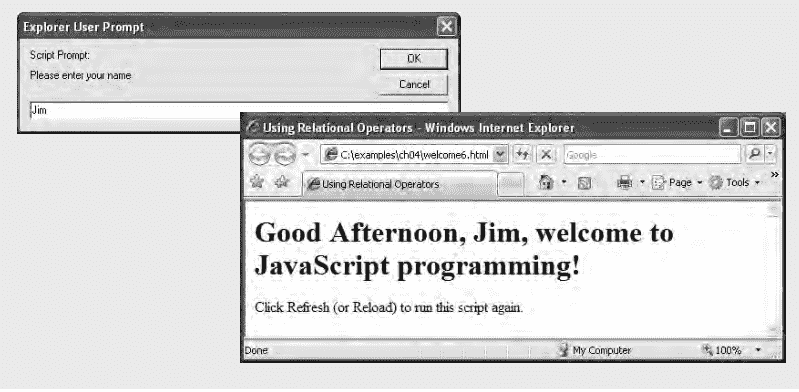

### 第 2 部分，共 2 部分

第 12–14 行声明了脚本中使用的变量。记住，变量可以在一个声明中声明，也可以在多个声明中声明。如果在一个声明中声明多个变量（如本例所示），名称之间用逗号（`,`）分隔。这个名称列表称为逗号分隔列表。再次注意每行末尾的注释，说明了程序中每个变量的用途。还要注意，有些变量在声明时就被赋值了——JavaScript 允许在声明变量时为变量赋值。

第 13 行将变量`now`设置为新的`Date`对象，该对象包含有关当前本地时间的信息。在 4.2 节中，我们介绍了`document`对象，一个封装与当前网页相关数据的对象。程序员可以选择使用其他对象来执行特定任务或获取特定信息。这里，我们使用 JavaScript 内置的`Date`对象来获取当前本地时间。我们通过使用`new`运算符，后跟对象的类型`Date`和一对括号，来创建对象的新实例。有些对象要求在括号中放置参数，以指定要创建的对象的详细信息。在这种情况下，我们将括号留空以创建一个默认的`Date`对象，其中包含有关当前日期和时间的信息。第 13 行执行后，变量`now`引用新的`Date`对象。[注意：我们使用`document`和`window`对象时不需要使用`new`运算符，因为这些对象总是由浏览器创建。] 第 14 行将变量`hour`设置为等于`Date`对象的`getHours()`方法返回的当前小时数（24 小时制）的整数。第 9 章将更详细地讨论`Date`对象的属性和方法，以及对象的一般概念。与前一个例子一样，脚本使用`window.prompt`允许用户输入一个名称，作为问候语的一部分显示（第 17 行）。

为了显示正确的时间相关问候语，脚本必须确定用户是在上午、下午还是晚上访问页面。第一个`if`语句（第 20–21 行）将变量`hour`的值与 12 进行比较。如果`hour`小于 12，则用户在上午访问页面，第 21 行的语句输出字符串`"Good morning"`。如果不满足此条件，则不执行第 21 行。第 24 行判断`hour`是否大于或等于 12。如果`hour`大于或等于 12，则用户是在下午或晚上访问页面。第 25–36 行用于确定适当的问候语。如果`hour`小于 12，则 JavaScript 解释器不会执行这些行，而是继续执行第 38 行。

第 25 行的左花括号`{`开始一个语句块（第 27–35 行）。当`hour`大于或等于 12 时，这些语句会被执行——若要在`if`结构中执行多个语句，应将它们放在花括号中。第 27 行从`hour`中减去 12，将当前小时从 24 小时制（0–23）转换为 12 小时制（0–11）。第 30 行的`if`语句判断此时`hour`是否小于 6。如果是，则时间处于中午到下午 6 点之间，第 31 行输出 XHTML `h1`元素的开头（`"<hl>Good Afternoon, "`）。如果`hour`大于或等于 6，则时间处于下午 6 点到午夜之间，脚本输出问候语`"Good Evening"`（第 34–35 行）。第 36 行的右花括号`}`结束与第 24 行`if`语句相关联的语句块。

注意，`if`语句可以嵌套，也就是说，一个`if`语句可以放在另一个`if`语句中。用于判断用户是在下午还是晚上的`if`语句（第 30–31 行和第 34–35 行）只有在脚本已经确定`hour`大于或等于 12（第 24 行）时才会执行。如果脚本已经确定当前时间是上午，则不会执行这些额外的比较。（**第 5 章**将更深入地讨论语句块和嵌套的`if`语句。）最后，第 38–39 行输出 XHTML `h1`元素的其余部分（问候语的剩余部分），这部分内容与一天中的时间无关。

### 良好编程实践 4.6

> 在控制语句（例如`if`语句）的右花括号之后添加注释，以指示语句结束的位置，如图 4.11 的第 36 行所示。

请注意，每个`if`语句第一行的末尾没有分号（`;`）。添加这样的分号会在执行时导致逻辑错误。例如：

```javascript
if ( hour < 12 ) ;
    document.write( "<h1>Good Morning, " );
```

实际上会被 JavaScript 错误地解释为：

```javascript
if ( hour < 12 )
    ;

document.write( "<h1>Good Morning, " );
```

其中，单独占一行的分号——称为空语句——是当`if`语句中的条件为`true`时要执行的语句。执行空语句时，程序不会执行任何任务。随后，程序继续执行下一条语句，而该语句无论条件为`true`还是`false`都会执行。在本例中，无论时间是什么，`"<h1>Good Morning, "`都会被输出。

### 常见编程错误 4.14

> 在`if`语句条件的右括号后立即放置分号通常是逻辑错误。分号会使`if`语句的主体为空，因此无论条件是否为`true`，`if`语句本身都不会执行任何操作。更糟糕的是，原本打算作为`if`语句主体的语句会成为`if`语句之后的顺序语句，并且总会被执行。

### 常见编程错误 4.15

> 在一系列`if`语句中遗漏某个条件通常是逻辑错误。例如，检查`hour`是否大于 12 或小于 12，却不检查`hour`是否等于 12，这意味着当`hour`等于 12 时脚本不会执行任何操作。务必确保处理所有可能的条件。

注意图 4.11 第 38–39 行中的间距。记住，空白字符（例如制表符、换行符和空格）通常会被浏览器忽略。因此，可以将语句拆分到多行中，也可以根据个人偏好设置间距，而不会影响程序的含义。但是，拆分标识符和字符串字面量是不正确的。理想情况下，语句应保持简短，但实际情况并不总能做到这一点。

图 4.12 展示了本章介绍的运算符的优先级。运算符按照优先级从高到低的顺序从上到下排列。注意，除了赋值运算符`=`之外，所有这些运算符都从左到右结合。加法是左结合的，因此像`x + y + z`这样的表达式，其求值方式相当于`(x + y) + z`。赋值运算符`=`从右到左结合，因此像`x = y = 0`这样的表达式，其求值方式相当于`x = (y = 0)`：首先将值 0 赋给变量`Y`，然后将该赋值的结果 0 赋给`x`。

| 运算符 | 结合性 | 类型 |
| :--- | :--- | :--- |
| `* / %` | 从左到右 | 乘法 |
| `+ -` | 从左到右 | 加法 |
| `< <= > >=` | 从左到右 | 关系 |
| `== !=` | 从左到右 | 相等 |
| `=` | 从右到左 | 赋值 |

图 4.12 | 目前讨论过的运算符的优先级和结合性。

## 4.8 Web 资源

`www.deitel.com/javascript`

Deitel JavaScript 资源中心包含一些优秀 JavaScript 网络资源的链接。其中有分类整理的 JavaScript 工具、代码生成器、论坛、书籍、库、框架等资源。还可以查看适合各个技能水平的教程，从入门到高级内容一应俱全。

# 5 JavaScript：控制语句 I

> 让我们都向前移动一个位置。
>
> ——刘易斯·卡罗尔

> 车轮已经转了一整圈。
>
> ——威廉·莎士比亚

> 在牛顿得到启发之前，究竟有多少个苹果掉在他的头上！
>
> ——罗伯特·弗罗斯特

## 目标

在本章中，您将学习：

- 使用`if`和`if...else`选择语句，在多个可选操作中进行选择。
- 使用`while`重复语句，在脚本中重复执行语句。
- 计数器控制的重复和哨兵控制的重复。
- 使用递增、递减和赋值运算符。

## 内容提要

5.1 简介

5.2 控制语句

5.3 `if`选择语句

5.4 `if...else`选择语句

5.5 `while`重复语句

5.6 计数器控制的重复

5.7 制定算法：哨兵控制的重复

5.8 制定算法：嵌套控制语句

5.9 赋值运算符

5.10 递增和递减运算符

5.11 Web 资源

## 5.1 简介


在编写脚本解决问题之前，必须彻底理解问题，并仔细规划解决问题的方法。在编写脚本时，同样必须了解可用构建模块的类型，并采用经过验证的程序构造原则。本章和第 6 章将在介绍结构化程序设计的理论和原则时讨论这些问题。这里所学的技术适用于大多数高级语言，包括`JavaScript`。

## 5.2 控制语句

`JavaScript`提供三种选择语句；本章和第 6 章将分别讨论这些语句。`if`选择语句在条件为真时执行（选择）某个操作，在条件为假时跳过该操作。`if...else`选择语句在条件为真时执行一个操作，在条件为假时执行另一个不同的操作。`switch`选择语句（第 6 章）根据表达式的值执行多个不同操作中的一个。

`if`语句被称为单选择语句，因为它选择或忽略单个操作（或者，正如我们很快将看到的，单个操作组）。`if...else`语句是双选择语句，因为它在两个不同的操作（或操作组）之间进行选择。`switch`语句是多选择语句，因为它在多个不同的操作（或操作组）之间进行选择。

`JavaScript`提供四种循环语句类型，即`while`、`do...while`、`for`和`for...in`。（`do...while`和`for`将在第 6 章介绍；`for...in`将在第 8 章介绍。）`if`、`else`、`switch`、`while`、`do`、`for`和`in`都是`JavaScript`关键字。这些单词由语言保留，用于实现各种功能，例如`JavaScript`的控制语句。关键字不能用作标识符（例如变量名）。图 5.1 列出了完整的`JavaScript`关键字。

### 常见编程错误 5.1

> 使用关键字作为标识符会导致语法错误。

### JavaScript 关键字

`break`、`case`、`catch`、`continue`、`default`

`delete`、`do`、`else`、`false`、`finally`

`for`、`function`、`if`、`in`、`instanceof`

`new`、`null`、`return`、`switch`、`this`

`throw`、`true`、`try`、`typeof`、`var`

`void`、`while`、`with`

**保留但 JavaScript 不使用的关键词**

`abstract`、`boolean`、`byte`、`char`、`class`

`const`、`debugger`、`double`、`enum`、`export`

`extends`、`final`、`float`、`goto`、`implements`

`import`、`int`、`interface`、`long`、`native`

`package`、`private`、`protected`、`public`、`short`

`static`、`super`、`synchronized`、`throws`、`transient`

`volatile`

图 5.1 | JavaScript 关键字。

如前所述，JavaScript 仅有八种控制结构：顺序结构、三种选择结构和四种循环结构。程序通过按需组合控制语句来实现其算法。

*单入口/单出口控制语句*使得构建程序变得简单；这些控制语句通过将一个语句的出口点连接到下一个语句的入口点而相互连接。这个过程称为*控制语句堆叠*。我们将了解到，控制语句之间只有一种其他的连接方式——*控制语句嵌套*。因此，JavaScript 程序仅由八种不同类型的控制语句以两种方式组合而成。

## 5.3 `if`选择语句

选择语句用于在程序中选择不同的操作路径。例如，假设考试的及格分数是 60（满分 100）。那么下面的 JavaScript 语句：

```javascript
if ( studentGrade >= 60 )
    document.writeln( "Passed" );
```

判断条件“学生的分数大于或等于 60”是否为真。如果条件为真，则在 XHTML 文档中输出 `"Passed"`，然后按顺序执行下一条 JavaScript 语句。如果条件为假，则忽略打印语句，然后按顺序执行下一条 JavaScript 语句。

请注意，此选择语句的第二行是缩进的。JavaScript 解释器会忽略空白字符——用于缩进和垂直间距的空格、制表符和换行符。

图 5.2 中的流程图说明了单选`if`语句。该流程图包含了一个可能是最重要的流程图符号——菱形符号（或决策符号），它表示需要做出决策。决策符号包含一个表达式，例如条件，其结果可以是`true`或`false`。决策符号有两个流出线。一条指示当符号中的表达式为真时程序应遵循的路径；另一条指示当表达式为假时程序应遵循的路径。对于任何计算结果为 JavaScript 布尔类型值的表达式（即，任何计算结果为`true`或`false`——也称为*布尔表达式*）都可以进行决策。

> **软件工程观察 5.1**
>
> 在 JavaScript 中，条件中的任何非零数值都会计算为`true`，而`0`会计算为`false`。对于字符串，任何包含一个或多个字符的字符串都会计算为`true`，而空字符串（不包含任何字符的字符串，表示为`""`）会计算为`false`。此外，已使用`var`声明但尚未赋值的变量会计算为`false`。

请注意，`if`语句是一种单入口/单出口控制语句。其余控制语句的流程图也仅包含（除了小圆圈符号和流线）矩形符号，用于指示要执行的操作，以及菱形符号，用于指示要做的决策。这种类型的流程图代表了*编程的动作/决策模型*。

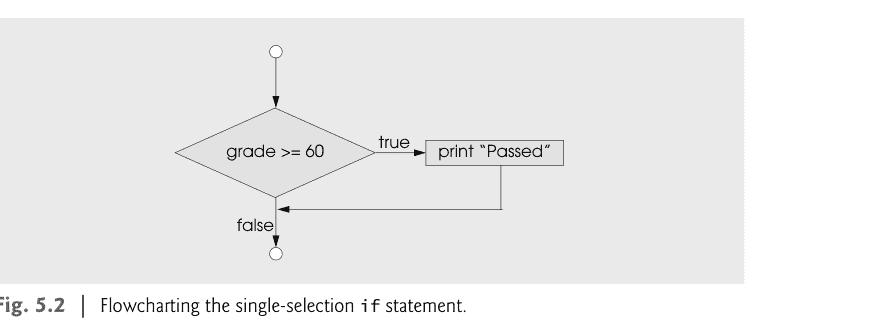

**图 5** | 单选`if`语句的流程图。

## 5.4 `if...else`选择语句

`if`选择语句仅在条件计算为真时执行指定的操作；否则，操作将被跳过。`...else`选择语句允许您指定当条件为真时执行与条件为假时不同的操作。

例如，JavaScript：

```javascript
if (studentGrade >= 60)
    document.writeln("Passed");
else
    document.writeln("Failed");
```

如果学生的分数大于或等于 60，则在 XHTML 文档中输出`Passed`，如果学生的分数小于 60，则输出`Failed`。无论哪种情况，打印发生后，都将按顺序执行下一条 JavaScript 语句（即，整个`if…else`语句之后的下一条语句）。请注意，`else`部分的主体也缩进了。图 5.3 所示的流程图说明了`if...else`选择语句的控制流程。

JavaScript 提供了一个运算符，称为*条件运算符* (`?:`)，它与`if...else`语句密切相关。运算符`?:`是 JavaScript 唯一的*三元运算符*——它接受三个操作数。操作数与`?:`一起构成一个*条件表达式*。第一个操作数是一个布尔表达式，第二个是当表达式计算为`true`时条件表达式的值，第三个是当表达式计算为`false`时条件表达式的值。例如，考虑以下语句：

```javascript
document.writeln( studentGrade >= 60 ? "Passed" : "Failed" );
```

其中包含一个条件表达式，如果条件`studentGrade >= 60`为真，则计算为字符串`"Passed"`，如果条件为假，则计算为字符串`"Failed"`。因此，使用条件运算符的此语句与前面的`if...else`语句执行基本相同的操作。条件运算符的优先级较低，因此通常将整个条件表达式放在括号中以确保其正确计算。

*嵌套的`if...else`语句*通过将`if...else`语句放在`if...else`语句内部来测试多种情况。例如，以下伪代码语句表明程序应为大于或等于 90 的考试分数打印 A，为 80 到 89 范围内的分数打印 B，为 70 到 79 范围内的分数打印 C，为 60 到 69 范围内的分数打印 D，为所有其他分数打印 F：

```javascript
if ( studentGrade >= 90 )
    document.writeln( "A" );
else
    if ( studentGrade >= 80 )
        document.writeln( "B" );
    else
        if ( studentGrade >= 70 )
            document.writeln( "C" );
        else
            if ( studentGrade >= 60 )
                document.writeln( "D" );
            else
                document.writeln( "F" );
```

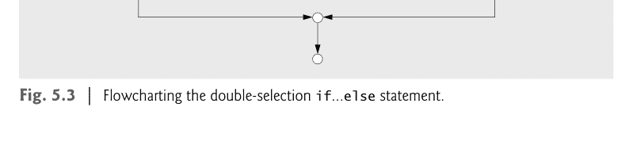

> 图 5.3 | 双选`if...else`语句的流程图。

如果`studentGrade`大于或等于 90，所有四个条件都将为真，但只有第一个测试之后的`document.writeln`语句会执行。在该特定`document.writeln`执行后，外部`if...else`语句的`else`部分将被跳过。

### 编程好习惯 5.1

> 如果有多个缩进级别，每个级别应额外缩进相同的空格量。

大多数 JavaScript 程序员更喜欢编写前面的`if`语句为：

```javascript
if ( grade >= 90 )
    document.writeln( "A" );
else if ( grade >= 80 )
    document.writeln( "B" );
else if ( grade >= 70 )
    document.writeln( "C" );
else if ( grade >= 60 )
    document.writeln( "D" );
else
    document.writeln( "F" );
```

这两种形式是等效的。后一种形式很流行，因为它避免了代码深度缩进到右边。这种深度缩进通常会减少一行的可用空间，迫使行被分割，从而降低程序的可读性。

重要的是要注意，JavaScript 解释器总是将`else`与前面的`if`关联，除非通过花括号（`{}`）的位置另有指示。这种情况被称为*悬空 else 问题*。例如：

```javascript
if ( x > 5 )
    if ( y > 5 )
        document.writeln( "x and y are > 5" );
else
    document.writeln( "x is <= 5" );
```

其缩进*似乎*表明，如果`x`大于 5，其主体中的`if`语句将确定`y`是否也大于 5。如果是，则嵌套`if`语句的主体输出字符串`"x and y are > 5"`。否则，它*似乎*表明如果`x`不大于 5，则`if...else`语句的`else`部分输出字符串`"x is <= 5"`。

小心！前面的嵌套`if`语句不会像它看起来那样执行。解释器实际上将前面的语句解释为：

```javascript
if ( x > 5 )
    if ( y > 5 )
        document.writeln( "x and y are > 5" );
    else
        document.writeln( "x is <= 5" );
```

其中第一个`if`语句的主体是一个嵌套的`if...else`语句。此语句测试`x`是否大于 5。如果是，执行将继续测试`y`是否也大于 5。如果第二个条件为真，则显示正确的字符串——`"x and y are > 5"`。但是，如果第二个条件为假，则显示字符串`"x is <= 5"`，即使我们知道`x`大于 5。

为了强制前面的嵌套`if`语句按照其原始意图执行，必须按如下方式编写：

```c
if ( x > 5 )
{
    if ( y > 5 )
        document.writeln( "x and y are > 5" );
}
else
    document.writeln( "x is <= 5" );
```

花括号（`{}`）向解释器表明第二个`if`语句位于第一个`if`语句的体内，并且`else`与第一个`if`语句匹配。

`if`选择语句在其主体中只期望一个语句。要在`if`语句的主体中包含多个语句，请将这些语句用花括号（`{`和`}`）括起来。这也可以在`if...else`语句的`else`部分中完成。包含在一对花括号中的一组语句称为一个**块**。

> **软件工程观察 5.2**
>
> 块可以放置在程序中任何可以放置单条语句的地方。

> **软件工程观察 5.3**
>
> 与单条语句不同，块不以分号结束。但是，块花括号内的每条语句都应以分号结束。

以下示例在`if...else`语句的`else`部分中包含一个块：

```c
if ( grade >= 60 )
    document.writeln( "Passed" );
else
{
    document.writeln( "Failed<br />" );
    document.writeln( "You must take this course again." );
}
```

在这种情况下，如果`grade`小于 60，程序将执行`else`主体中的两条语句并打印：

```text
Failed.

You must take this course again.
```

请注意`else`子句中包围两条语句的花括号。这些花括号很重要。如果没有它们，语句：

```javascript
document.writeln( "You must take this course again." );
```

将会位于`if`的`else`部分主体之外，并且无论`grade`是否小于 60 都会执行。

> **常见编程错误 5.2**
>
> 忘记一个或两个界定块的花括号可能导致语法错误或逻辑错误。

### 良好的编程实践 5.2

> 有些程序员更喜欢在输入花括号内的各个语句之前，先输入块的开始和结束花括号。这有助于避免遗漏一个或两个花括号。

### 软件工程观察 5.4

> 就像块可以放置在任何可以放置单条语句的地方一样，这些地方也可能根本没有语句（空语句）。空语句通过在通常放置语句的地方放置一个分号（`;`）来表示。

### 常见编程错误 5.3

> 在`if`语句的条件后放置分号会导致单选择`if`语句的逻辑错误和双选择`if`语句的语法错误（如果`if`部分包含非空主体语句）。

## 5.5 `while`循环语句

循环语句允许你指定当某个条件保持为真时，脚本要重复执行一个动作。

### 常见编程错误 5.4

> 如果`while`语句的主体从未导致`while`语句的条件变为真，则会发生逻辑错误。通常，这种循环结构永远不会终止——这种错误称为无限循环。Internet Explorer 和 Firefox 都会显示一个对话框，允许用户终止包含无限循环的脚本。

### 常见编程错误 5.5


> 请记住，JavaScript 是一种区分大小写的语言。在代码中，将关键字 `while` 的 W 大写（如 `While`）会导致语法错误。JavaScript 的所有保留关键字，如 `while`、`if` 和 `else`，都仅包含小写字母。

作为 `while` 语句的一个示例，考虑一个旨在找到第一个大于 1000 的 2 的幂的程序段。变量 `product` 初始值为 2：

```javascript
var product = 2; 
while ( product <= 1000 ) 
    product = 2 * product;
```

当 `while` 语句执行完毕时，`product` 包含结果 1024。图 5.4 中的流程图说明了上述 `while` 语句的控制流程。

当脚本进入 `while` 语句时，`product` 为 2。脚本反复将变量 `product` 乘以 2，因此 `product` 依次取值 4、8、16、32、64、128、256、512 和 1024。当 `product` 变为 1024 时，`while` 语句中的条件 `product <= 1000` 变为假。这将终止循环，`product` 的最终值为 1024。执行将继续进行到 `while` 语句后的下一条语句。

> [注意：如果 `while` 语句的条件最初为假，则主体语句将永远不会执行。]

> 图 5.4 | `while` 循环语句的流程图。

## 5.6 计数器控制的循环

考虑以下问题描述：

> 一个有十名学生的班级参加了一次测验。这次测验的成绩（0 到 100 范围内的整数）对你可用。确定该班级这次测验的平均分。

班级平均分等于所有成绩之和除以学生人数（本例中为 10）。解决此问题的程序（图 5.5）必须输入每个成绩，执行平均计算并显示结果。我们使用计数器控制的循环来一次输入一个成绩。在此示例中，当计数器超过 10 时循环终止。

```html
<?xml version = "1.0" encoding = "utf-8"?>
<!DOCTYPE html PUBLIC "-//W3C//DTD XHTML 1.0 Strict//EN"
"http://www.w3.org/TR/xhtml1/DTD/xhtml1-strict.dtd">

<!-- Fig. 5.5: average.html -->
<!-- Counter-controlled repetition to calculate a class average. -->
<html xmlns = "http://www.w3.org/1999/xhtml">
<head>
<title>Class Average Program</title>
<script type = "text/javascript">
<!--
    var total; // sum of grades
    var gradeCounter; // number of grades entered
    var grade; // grade typed by user (as a string)
    var gradeValue; // grade value (converted to integer)
    var average; // average of all grades

    // Initialization Phase
    total = 0; // clear total
    gradeCounter = 1; // prepare to loop

    // Processing Phase
    while (gradeCounter <= 10) // loop 10 times
    {
        // prompt for input and read grade from user
        grade = window.prompt( "Enter integer grade:", "0" );

        // convert grade from a string to an integer
        gradeValue = parseInt( grade );

        // add gradeValue to total
        total = total + gradeValue;

        // add 1 to gradeCounter
        gradeCounter = gradeCounter + 1;
    } // end while

    // Termination Phase
    average = total / 10; // calculate the average

    // display average of exam grades
    document.writeln(
        "<h1>Class average is " + average + "</h1>" );
// -->
</script>
</head>
<body>
    <p>Click Refresh (or Reload) to run the script again</p>
</body>
</html>
```

此对话框显示 10 次。用户输入为 100、88、93、55、68、77、83、95、73 和 62。

> 图 5.5 | 计数器控制的循环计算班级平均分。（第 2 部分，共 2 部分）

第 12-16 行声明了变量 `total`、`gradeCounter`、`grade`、`gradeValue`、`average`。变量 `grade` 将存储用户输入到提示对话框中的字符串。变量 `gradeValue` 将存储用户输入到提示对话框中的成绩的整数值。

第 19-20 行是赋值语句，将 `total` 初始化为 0，将 `gradeCounter` 初始化为 1。注意，变量 `total` 和 `gradeCounter` 在用于计算之前就已初始化。

> **常见编程错误 5.6**

> 不初始化将在计算中使用的变量会导致逻辑错误，产生值 `NaN`（非数字）。必须在将变量用于计算之前对其进行初始化。

第 23 行表明，当 `gradeCounter` 的值小于或等于 10 时，`while` 语句继续迭代。第 27 行对应伪代码语句“输入下一个成绩”。该语句在屏幕上显示一个提示对话框，提示内容为“Enter integer grade:”。

用户输入成绩后，第 30 行将其从字符串转换为整数。在此示例中，我们必须将字符串转换为整数；否则，第 33 行的加法语句将是字符串连接语句，而不是数值求和。

程序现在准备好递增变量 `gradeCounter`，以指示已处理一个成绩，并从用户那里读取下一个成绩。第 36 行向 `gradeCounter` 加 1，这样 `while` 语句中的条件最终将变为假并终止循环。执行此语句后，程序将继续测试第 23 行 `while` 语句中的条件。如果条件仍为真，则重复第 27-36 行的语句。否则，程序将继续执行循环主体之后的顺序中的第一条语句（即第 40 行）。

第 40 行将平均计算的结果赋值给变量 `average`。第 43-44 行在文档中写入一行 XHTML 文本，显示字符串“Class average is ”后跟变量 `average` 的值，作为浏览器中的 `<h1>` 元素。

通过在网页浏览器中双击 XHTML 文档（来自 Windows 资源管理器）来执行脚本。此脚本将任何用户输入解析为整数。在图 5.5 的示例程序执行中，输入值的总和（100、88、93、55、68、77、83、95、73 和 62）为 794。虽然程序将所有输入视为整数，但程序中的平均计算并不产生整数。相反，计算产生一个浮点数（即包含小数点的数字）。在此示例中，用户输入的 10 个整数的平均值为 79.4。

> **软件工程观察 5.5**

> 如果传递给 `parseInt` 的字符串包含浮点数值，`parseInt` 只会截断浮点部分。例如，字符串“27.95”得到整数 27，字符串“-123.45”得到整数 -123。如果传递给 `parseInt` 的字符串不是数值，`parseInt` 返回 `NaN`（非数字）。

JavaScript 实际上在内存中将所有数字表示为浮点数。浮点数通常通过除法产生，如本例所示。当我们用 10 除以 3 时，结果是 3.3333333...，其中 3 的序列无限重复。计算机只分配固定空间来保存这样的值，因此存储的浮点值只能是近似值。

# 5.7 制定算法：哨兵控制的循环

在第一个班级平均分的例子中，成绩的数量（10 个）是预先已知的。在这个例子中，没有给出用户将要输入多少个成绩的提示。程序必须处理任意数量的成绩。程序如何确定何时停止输入成绩？它如何知道何时计算并显示班级平均分？

解决这个问题的一种方法是使用一个特殊的值，称为*哨兵值*（也称为*信号值*、*伪值*或*标志值*），来指示数据输入的结束。用户输入成绩，直到所有合法的成绩都已输入完毕。然后用户输入哨兵值来指示最后一个成绩已经输入。

显然，必须选择一个不会与可接受的输入值混淆的哨兵值。对于这个问题，–1 是一个可接受的哨兵值，因为测验成绩通常是非负整数，范围从 0 到 100。因此，班级平均分程序的一次执行可能会处理一串输入，例如 95、96、75、74、89 和 –1。程序将计算并打印成绩 95、96、75、74 和 89 的班级平均分（–1 是哨兵值，因此不应计入平均值计算）。

图 5.6 展示了 JavaScript 程序及其示例执行。尽管每个成绩都是整数，但平均值的计算可能会产生带有小数点的数字（实数）。

```html
<?xml version = "1.0" encoding = "utf-8"?>
<!DOCTYPE html PUBLIC "-//W3C//DTD XHTML 1.0 Strict//EN"
    "http://www.w3.org/TR/xhtml1/DTD/xhtml1-strict.dtd">

<!-- Fig. 5.6: average2.html -->
<!-- Sentinel-controlled repetition to calculate a class average. -->
<html xmlns = "http://www.w3.org/1999/xhtml">
    <head>
        <title>Class Average Program: Sentinel-controlled Repetition</title>

        <script type = "text/javascript">
            <!--
            var total; // sum of grades
            var gradeCounter; // number of grades entered
            var grade; // grade typed by user (as a string)
            var gradeValue; // grade value (converted to integer)
            var average; // average of all grades

            // Initialization phase
            total = 0; // clear total
            gradeCounter = 0; // prepare to loop

            // Processing phase
            // prompt for input and read grade from user
            grade = window.prompt(
                "Enter Integer Grade, -1 to Quit:", "0" );

            // convert grade from a string to an integer
            gradeValue = parseInt( grade );

            while ( gradeValue != -1 )
            {
```

图 5.6 | 使用哨兵控制循环计算班级平均分。（第 1 部分，共 2 部分）

```javascript
                // add gradeValue to total
                total = total + gradeValue;

                // add 1 to gradeCounter
                gradeCounter = gradeCounter + 1;

                // prompt for input and read grade from user
                grade = window.prompt(
                    "Enter Integer Grade, -1 to Quit:", "0" );

                // convert grade from a string to an integer
                gradeValue = parseInt( grade );
            } // end while

            // Termination phase
            if ( gradeCounter != 0 )
            {
                average = total / gradeCounter;

                // display average of exam grades
                document.writeln(
                    "<h1>Class average is " + average + "</h1>" );
            } // end if
            else
                document.writeln( "<p>No grades were entered</p>" );
            // -->
        </script>
    </head>
    <body>
        <p>Click Refresh (or Reload) to run the script again</p>
    </body>
</html>
```

此对话框显示四次。用户输入为 97、88、72 和 –1。

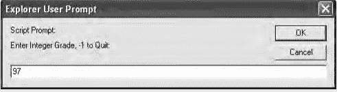

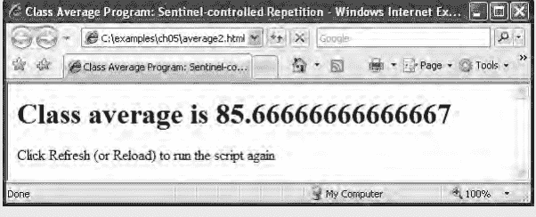

## 图 5.6 | 使用哨兵控制循环计算班级平均分。（第 2 部分，共 2 部分）

在这个例子中，我们看到控制语句可以一个接一个地堆叠（按顺序排列）。`while` 语句（第 31-45 行）之后紧跟着一个 `if...else` 语句（第 48-57 行），两者是顺序执行的。这个程序中的大部分代码与图 5.5 中的代码相同，因此我们在此示例中重点介绍新特性。

第 21 行将 `gradeCounter` 初始化为 0，因为还没有输入任何成绩。请记住，该程序使用哨兵控制循环。为了准确记录输入的成绩数量，脚本仅在处理有效的成绩值后才递增 `gradeCounter`。

请注意图 5.6 中 `while` 循环内的代码块（第 32-45 行）。如果没有大括号，循环体中的最后三条语句将会落在循环之外，导致计算机错误地解释代码，如下所示：

```javascript
while ( gradeValue != -1 )
    // add gradeValue to total
    total = total + gradeValue;

// add 1 to gradeCounter
gradeCounter = gradeCounter + 1;

// prompt for input and read grade from user
grade = window.prompt(
    "Enter Integer Grade, -1 to Quit:", "0" );

// convert grade from a string to an integer
gradeValue = parseInt( grade );
```

如果用户在第 25-26 行之前没有将哨兵值 -1 作为第一个输入值输入（即在 `while` 语句之前），这种解释将导致程序出现无限循环。

> **常见编程错误 5.7**

遗漏界定代码块的大括号可能导致逻辑错误，例如无限循环。

## 5.8 设计算法：嵌套控制语句

考虑以下问题描述：

> 一所大学开设了一门课程，为学生准备房地产经纪人的州执照考试。去年，完成这门课程的几名学生参加了执照考试。自然地，大学想知道其学生的表现如何。你被要求编写一个程序来总结考试结果。你拿到了这 10 名学生的名单。每个名字旁边写着 1 表示该学生通过了考试，2 表示该学生未通过。

你的程序应按如下方式分析考试结果：

1. 输入每个考试结果（即 1 或 2）。每次程序请求另一个考试结果时，在屏幕上显示消息“Enter result”。

2. 统计每种类型考试结果的数量。

3. 显示考试结果的总结，标明通过考试的学生人数和未通过考试的学生人数。

4. 如果超过八名学生通过了考试，打印消息“Raise tuition。”

仔细阅读问题描述后，我们对该问题做出以下观察：

1. 程序必须处理 10 名学生的考试结果。将使用计数器控制的循环。

2. 每个考试结果是一个数字——要么是 1，要么是 2。每次程序读取考试结果时，必须确定该数字是 1 还是 2。我们在算法中测试是否为 1。如果该数字不是 1，我们假定它是 2。

3. 使用两个计数器来跟踪考试结果——一个用来统计通过考试的学生人数，另一个用来统计未通过考试的学生人数。


程序处理完所有结果后，必须决定是否超过八名学生通过了考试。`JavaScript`程序及两次示例执行如图5.7所示。

```
 1  <?xml version = "1.0" encoding = "utf-8"?>
 2  <!DOCTYPE html PUBLIC "-//W3C//DTD XHTML 1.0 Strict//EN"
 3     "http://www.w3.org/TR/xhtml1/DTD/xhtml1-strict.dtd">
 4
 5  <!-- Fig. 5.7: analysis.html -->
 6  <!-- Examination-results calculation. -->
 7  <html xmlns = "http://www.w3.org/1999/xhtml">
 8     <head>
 9        <title>Analysis of Examination Results</title>
10       <script type = "text/javascript">
11          <!--
12             // initializing variables in declarations
13             var passes = 0; // number of passes
14             var failures = 0; // number of failures
15             var student = 1; // student counter
16             var result; // one exam result
17
18             // process 10 students; counter-controlled loop
19             while ( student <= 10 )
20             {
21                result = window.prompt( "Enter result (1=pass,2=fail)", "0" );
22
23                if ( result == "1" )
24                   passes = passes + 1;
25                else
26                   failures = failures + 1;
27
28                student = student + 1;
29             } // end while
30
31             // termination phase
32             document.writeln( "<h1>Examination Results</h1>" );
```

图5.7 | 考试结果计算。（第1部分，共2部分）

```javascript
33		document.writeln(
34			"通过: " + passes + "<br />失败: " + failures );
35
36		if ( passes > 8 )
37			document.writeln( "<br />提高学费" );
38		// -->
39		</script>
40	</head>
41	<body>
42		<p>点击刷新（或重新加载）以再次运行脚本</p>
43	</body>
44 </html>
```

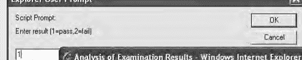

此对话框显示10次。用户输入为 1, 2, 1, 1, 1, 1, 1, 1, 1 和 1。

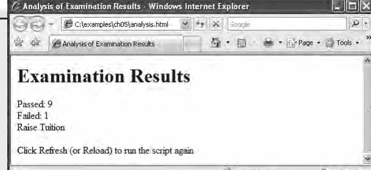

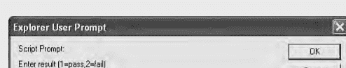

此对话框显示10次。用户输入为 1, 2, 1, 2, 2, 1, 2, 2, 1 和 1。

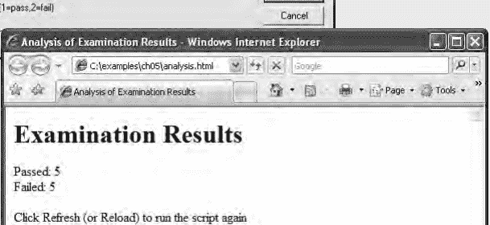

图 5.7 | 考试成绩计算。（第2部分，共2部分）

第13–16行声明了用于处理考试成绩的变量。请注意，`JavaScript`允许在声明中进行变量初始化（`passes` 被赋值为0，`failures` 被赋值为0，`student` 被赋值为1）。某些程序可能需要在每次重复的开始处重新初始化；这种重新初始化通常发生在赋值语句中。

考试成绩的处理发生在第19–29行的 `while` 语句中。请注意，循环中第23–26行的 `if…else` 语句仅测试考试成绩是否为1；它假设所有其他考试成绩都是2。通常，你应该验证用户输入的值（即，确定这些值是否正确）。

## 5.9 赋值运算符

`JavaScript`提供了几个赋值运算符（称为复合赋值运算符）用于缩写赋值表达式。例如，语句

```javascript
c = c + 3;
```

可以使用加法赋值运算符 `+=` 缩写为

```javascript
c += 3;
```

`+=` 运算符将其右侧表达式的值加上左侧变量的值，并将结果存储在左侧的变量中。任何形如

```javascript
variable = variable operator expression;
```

的语句，其中 `operator` 是二元运算符 `+`, `-`, `*`, `/` 或 `%`（或其他我们稍后将在文本中讨论的运算符），都可以写成

```javascript
variable operator= expression;
```

的形式。

因此，赋值 `c += 3` 将3加到`c`上。图5.8显示了算术赋值运算符、使用这些运算符的示例表达式以及运算符含义的说明。

| 赋值运算符 | 变量的初始值 | 示例表达式 | 说明 | 赋值结果 |
|---|---|---|---|---|
| `+=` | `c = 3` | `c += 7` | `c = c + 7` | 将10赋给`c` |
| `-=` | `d = 5` | `d -= 4` | `d = d - 4` | 将1赋给`d` |
| `*=` | `e = 4` | `e *= 5` | `e = e * 5` | 将20赋给`e` |
| `/=` | `f = 6` | `f /= 3` | `f = f / 3` | 将2赋给`f` |
| `%=` | `g = 12` | `g %= 9` | `g = g % 9` | 将3赋给`g` |

图 5.8 | 算术赋值运算符。

### 性能提示 5.1

当使用算术赋值运算符时，程序员可以编写出执行速度稍快的程序，因为赋值左侧的变量无需被求值两次。

### 性能提示 5.2

我们在本文中提到的许多性能提示只带来名义上的改进，因此你可能会倾向于忽略它们。当一个名义上的改进被置于可能重复多次的循环中时，通常能实现显著的性能提升。

## 5.10 自增和自减运算符

`JavaScript`提供了一元*自增运算符*（`++`）和*自减运算符*（`--`）（总结在图5.9中）。如果一个变量`c`需要增加1，可以使用自增运算符 `++`，而不是表达式 `c = c + 1` 或 `c += 1`。如果自增或自减运算符放置在变量之前，则分别称为*前自增*或*前自减*运算符。如果自增或自减运算符放置在变量之后，则分别称为*后自增*或*后自减*运算符。

### 防错提示 5.1

`JavaScript`的*前自减*和*后自减*运算符会导致W3C XHTML验证器错误地报告错误。验证器试图将自减运算符解释为XHTML注释标签（`<!--` 或 `-->`）的一部分。你可以通过使用减法赋值运算符（`-=`）从变量中减去1来避免此问题。请注意，一旦验证器错误地解析了自减运算符，它可能会报告更多（不存在的）错误。

前自增（或前自减）变量会导致程序先将变量增加（减少）1，然后在它出现的表达式中使用该变量的新值。后自增（后自减）变量会导致程序先在它出现的表达式中使用变量的当前值，然后将变量增加（减少）1。

| 运算符 | 示例 | 名称 | 说明 |
|---|---|---|---|
| `++` | `++a` | 前自增 | 将`a`增加1，然后在`a`所在的表达式中使用`a`的新值。 |
| `++` | `a++` | 后自增 | 在`a`所在的表达式中使用`a`的当前值，然后将`a`增加1。 |
| `--` | `--b` | 前自减 | 将`b`减少1，然后在`b`所在的表达式中使用`b`的新值。 |
| `--` | `b--` | 后自减 | 在`b`所在的表达式中使用`b`的当前值，然后将`b`减少1。 |

图 5.9 | 自增和自减运算符。

图5.10中的脚本演示了`++`自增运算符的前自增版本和后自增版本之间的区别。后自增变量`c`会导致它在`document.writeln`方法调用（第18行）中被使用*之后*增加。前自增变量`c`会导致它在`document.writeln`方法调用（第25行）中被使用*之前*增加。该程序显示了`++`运算符使用前后`c`的值。自减运算符（`--`）的工作方式类似。

> 良好编程习惯 5.3

为了可读性，一元运算符应紧邻其操作数放置，中间不加空格。

图5.7中的三个赋值语句（分别是第24、26和28行），

`passes = passes + 1;`

`failures = failures + 1;`

`student = student + 1;`

使用赋值运算符可以更简洁地写成

`passes += 1;`

`failures += 1;`

`student += 1;`

```xml
1  <?xml version = "1.0" encoding = "utf-8"?>
2  <!DOCTYPE html PUBLIC "-//W3C//DTD XHTML 1.0 Strict//EN"
3    "http://www.w3.org/TR/xhtml1/DTD/xhtml1-strict.dtd">
4
5  <!-- 图 5.10: increment.html -->
6  <!-- 前自增和后自增。 -->
7  <html xmlns = "http://www.w3.org/1999/xhtml">
8     <head>
9        <title>前自增和后自增</title>
10       <script type = "text/javascript">
11          <!--
12             var c;
13
14             c = 5;
15             document.writeln( "<h3>后自增</h3>" );
16             document.writeln( c ); // 打印 5
17             // 打印 5 然后增加
18             document.writeln( "<br />" + c++ );
19             document.writeln( "<br />" + c ); // 打印 6
20
21             c = 5;
22             document.writeln( "<h3>前自增</h3>" );
23             document.writeln( c ); // 打印 5
24             // 增加然后打印 6
25             document.writeln( "<br />" + ++c );
26             document.writeln( "<br />" + c ); // 打印 6
27          // -->
28       </script>
29    </head><body></body>
30 </html>
```

图 5.10 | 前自增和后自增。（第1部分，共2部分）

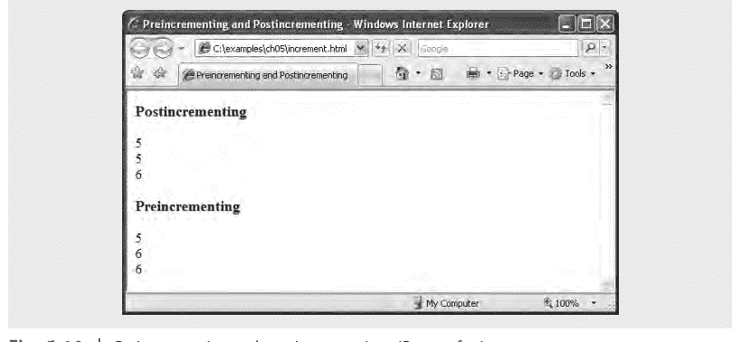

图 5.10 | 前自增和后自增。（第2部分，共2部分）

使用前自增运算符可以写成

```javascript
++passes;
++failures;
++student;
```

或者使用后自增运算符写成

```javascript
passes++;
failures++;
student++;
```

这里需要注意的重要一点是，当在一个独立的语句中增加或减少一个变量时，前自增和后自增形式具有相同的效果，前自减和后自减形式也具有相同的效果。只有当变量出现在更大的表达式上下文中时，前自增变量和后自增变量才会产生不同的效果。前自减和后自减的行为类似。

> **常见编程错误 5.8**

尝试在非左值表达式（通常称为 lvalue）上使用自增或自减运算符是语法错误。左值表达式是可以出现在赋值操作左侧的变量或表达式。例如，写 `++(x + 1)` 是语法错误，因为 `(x + 1)` 不是左值表达式。

图5.11列出了到目前为止介绍的运算符的优先级和结合性。运算符从上到下按优先级递减的顺序显示。第二列描述了每个优先级级别上运算符的结合性。请注意，条件运算符（`?:`）、一元自增（`++`）和自减（`--`）运算符以及赋值运算符 `=`, `+=`, `-=`, `*=`, `/=` 和 `%=` 是从右向左结合的。运算符优先级表（图5.11）中的所有其他运算符都是从左向右结合的。第三列命名了运算符的组。

| 运算符 | 结合性 | 类型 |
|---|---|---|
| `++` `--` | 右到左 | 一元 |
| `*` `/` `%` | 左到右 | 乘法 |
| `+` `-` | 左到右 | 加法 |
| `<` `<=` `>` `>=` | 左到右 | 关系 |
| `==` `!=` | 左到右 | 相等 |
| `?:` | 右到左 | 条件 |
| `=` `+=` `-=` `*=` `/=` `%=` | 右到左 | 赋值 |

Fig. 5.11 | Precedence and associativity of the operators discussed so far.

## 5.11 Web Resources

www.deitel.com/javascript/

The Deitel JavaScript Resource Center contains links to some of the best JavaScript resources on the web. There you'll find categorized links to JavaScript tools, code generators, forums, books, libraries, frameworks and more. Also check out the tutorials for all skill levels, from introductory to advanced. Be sure to visit the related Resource Centers on XHTML (www.deitel.com/xhtml/) and CSS 2.1 (www.deitel.com/css21/).

图 6.3 详细展示了图 6.2 中第 15 行的 `for` 语句。`for` 语句的第一行（包括关键字 `for` 以及 `for` 后面括号中的所有内容）通常称为 **`for` 语句头**。注意，`for` 语句"包揽一切"——它指定了使用控制变量进行计数器控制重复所需的每一项。

注意，图 6.3 使用了循环继续条件 `counter <= 7`。如果错误地写成 `counter < 7`，循环将只执行六次。这是常见逻辑错误**差一错误**的一个例子。

### 常见编程错误 6.2

在 `while`、`for` 或 `do...while` 语句的条件中使用错误的关系运算符或循环计数器的错误最终值，可能导致差一错误或无限循环。

### 错误预防提示 6.1

在 `while` 或 `for` 语句的条件中使用最终值，并使用 `<=` 关系运算符，有助于避免差一错误。例如，对于用于打印 1 到 10 的值的循环，`counter` 的初始值应为 1，循环继续条件应为 `counter <= 10`，而不是 `counter < 10`（这是差一错误）或 `counter < 11`（这是正确的）。然而，许多程序员更喜欢所谓的**从零开始计数**，在这种情况下，要在循环中计数 10 次，`counter` 将被初始化为零，并且循环继续测试为 `counter < 10`。

`for` 语句的一般格式为

```
for ( initialization; loopContinuationTest; increment )
    statements
```

其中 *initialization* 表达式命名循环的控制变量并提供其初始值，*loopContinuationTest* 是测试循环继续条件的表达式（包含控制变量的最终值，条件对此为真），*increment* 是递增控制变量的表达式。`for` 语句可以用等效的 `while` 语句表示，其中 *initialization*、*loopContinuationTest* 和 *increment* 放置如下（第 6.7 节讨论了此规则的一个例外情况）：

```
initialization;
while ( loopContinuationTest )
{
    statements
    increment;
}
```


如果 `for` 语句头中的 `initialization` 表达式是控制变量的第一次定义，则控制变量仍可以在 `for` 语句后的脚本中使用。脚本中可以使用变量名的部分称为变量的**作用域**。作用域将在第 7 章《JavaScript：函数》中详细讨论。

### 良好编程习惯 6.5

> 仅在 `for` 语句的初始化和递增部分放置涉及控制变量的表达式。其他变量的操作应出现在循环之前（如果它们只执行一次，如初始化语句）或循环体中（如果它们在循环的每次迭代中执行一次，如递增或递减语句）。

`for` 语句中的三个表达式是可选的。如果省略 `loopContinuationTest`，JavaScript 假定循环继续条件为 `true`，从而创建无限循环。如果控制变量在循环之前初始化，可以省略 `initialization` 表达式。如果增量由 `for` 语句体中的语句计算，或者不需要增量，可以省略 `increment` 表达式。`for` 语句中的 `increment` 表达式类似于 `for` 语句体末尾的独立语句。因此，表达式

```javascript
counter = counter + 1

counter += 1

++counter

counter++
```

在 `for` 语句的递增部分都是等效的。许多程序员更喜欢 `counter++` 形式。这是因为控制变量的递增发生在循环体执行之后，因此后缀递增形式似乎更自然。在我们的示例中，前缀递增和后缀递增具有相同的效果，因为正在递增的变量不出现在更大的表达式中。`for` 语句头中的两个分号是必需的。

### 常见编程错误 6.3

> 在 `for` 语句头中使用逗号而不是两个必需的分号是语法错误。

### 常见编程错误 6.4

> 在 `for` 语句头右括号右侧立即放置分号会使该 `for` 语句的体成为空语句。此代码通常是逻辑错误。

“递增”可以是负数，在这种情况下循环向下计数。如果循环继续条件最初为 `false`，`for` 语句的体不会执行。相反，执行会继续进行 `for` 语句之后的语句。

控制变量经常在 `for` 语句的体中打印或用于计算，但这不是必须的。其他时候，控制变量用于控制重复，但在 `for` 语句的体中从不提及。

### 错误预防提示 6.2

> 虽然在 `for` 语句体中可以更改控制变量的值，但应避免更改，因为这样做可能导致难以察觉的错误。

`for` 语句的流程图与 `while` 语句非常相似。例如，图 6.4 显示了以下 `for` 语句的流程图：

```javascript
for ( var counter = 1; counter <= 7; ++counter )

    document.writeln( "<p style = \"font-size: " +

        counter + "ex\">XHTML font size " + counter +

        "ex</p>" );
```

该流程图清楚地表明初始化只发生一次，并且递增在每次执行体语句**之后**发生。注意，除了小圆圈和箭头外，流程图只包含矩形符号和菱形符号。


### 6.4 使用 `for` 语句的示例

本节中的示例展示了在 `for` 语句中变化控制变量的方法。在每种情况下，我们编写了适当的 `for` 头。注意循环递减控制变量时关系运算符的变化。

- a) 将控制变量从 1 变化到 100，增量为 1。

  ```javascript
  for ( var i = 1; i <= 100; ++i )
  ```

- b) 将控制变量从 100 变化到 1，增量为 -1（即递减 1）。

  ```javascript
  for ( var i = 100; i >= 1; --i )
  ```

- c) 将控制变量从 7 变化到 77，步长为 7。

  ```javascript
  for ( var i = 7; i <= 77; i += 7 )
  ```

- d) 将控制变量从 20 变化到 2，步长为 -2。

  ```javascript
  for ( var i = 20; i >= 2; i -= 2 )
  ```

- e) 将控制变量按以下序列值变化：2, 5, 8, 11, 14, 17, 20。

  ```javascript
  for ( var j = 2; j <= 20; j += 3 )
  ```

- f) 将控制变量按以下序列值变化：99, 88, 77, 66, 55, 44, 33, 22, 11, 0。

  ```javascript
  for ( var j = 99; j >= 0; j -= 11 )
  ```

> ### 常见编程错误 6.5
>
> 在向下计数的循环的循环继续条件中未使用适当的关系运算符（例如，在倒数到 1 的循环中使用 `i <= 1`）通常是逻辑错误，这将在程序运行时产生不正确的结果。

接下来的两个脚本演示了 `for` 重复语句。图 6.5 使用 `for` 语句将 2 到 100 的偶数相加。注意，在每次循环迭代体执行后，递增表达式将控制变量 `number` 加 2。当 `number` 的值为 102 时循环终止（该值不加入总和）。

```html
1  <?xml version = "1.0" encoding = "utf-8"?>

2  <!DOCTYPE html PUBLIC "-//W3C//DTD XHTML 1.0 Strict//EN"

3     "http://www.w3.org/TR/xhtml1/DTD/xhtml1-strict.dtd">

4  

5  <!-- Fig. 6.5: Sum.html -->

6  <!-- Summation with the for repetition structure. -->

7  <html xmlns = "http://www.w3.org/1999/xhtml">

8     <head>

9        <title>Sum the Even Integers from 2 to 100</title>

10       <script type = "text/javascript">

11          <!--

12          var sum = 0;

13          

14          for ( var number = 2; number <= 100; number += 2 )

15             sum += number;

16          

17          document.writeln( "The sum of the even integers " +

18             "from 2 to 100 is " + sum );

19          // -->

20       </script>

21     </head><body></body>

22  </html>
```


### 6.4 使用 `for` 语句的示例

请注意，图 6.5 中 `for` 语句的主体实际上可以通过使用逗号合并到 `for` 头部最右侧的（增量）部分中，如下所示：

```javascript
for ( var number = 2; number <= 100; sum += number, number += 2 )
;
```

类似地，初始化语句 `sum = 0` 也可以合并到 `for` 语句的初始化部分中。

> **良好的编程实践 6.6**
>
> 尽管 `for` 语句之前的语句和 `for` 语句主体中的语句常常可以合并到 `for` 头部中，但应避免这样做，因为这会使程序更难阅读。

> **良好的编程实践 6.7**
>
> 为了清晰起见，如果可能的话，将控制语句头部的大小限制在单行内。

下一个示例使用 `for` 语句计算复利（每年复利）。考虑以下问题描述：

> 某人在储蓄账户中投资 $1000.00，该账户年收益率为 5%。假设所有利息都留在账户中不取出，计算并打印 10 年间每年年底账户中的金额。使用以下公式确定金额：
>
> `a = p (1 + r)ⁿ`
>
> 其中：
>
> - `p` 是原始投资金额（即本金）
> - `r` 是年利率
> - `n` 是年数
> - `a` 是第 `n` 年年底的存款金额

这个问题涉及一个循环，对资金存放在账户中的 10 年中的每一年执行指定的计算。图 6.6 展示了该问题的解决方案，以表格形式显示结果。

```html
1  <?xml version = "1.0" encoding = "utf-8"?>

2  <!DOCTYPE html PUBLIC "-//W3C//DTD XHTML 1.0 Strict//EN"

3  "http://www.w3.org/TR/xhtml1/DTD/xhtml1-strict.dtd">

4  

5  <!-- Fig. 6.6: Interest.html -->

6  <!-- Compound interest calculation with a for loop. -->

7  <html xmlns = "http://www.w3.org/1999/xhtml">

8      <head>

9          <title>Calculating Compound Interest</title>

10         <style type = "text/css">

11             table { width: 100% }

12             th    { text-align: left }

13         </style>

14     <script type = "text/javascript">

15     <!--

16         var amount; // current amount of money

17         var principal = 1000.0; // principal amount

18         var rate = .05; // interest rate

19 

20         document.writeln(

21             "<table border = \"1\">" ); // begin the table

22         document.writeln(

23             "<caption>Calculating Compound Interest</caption>" );

24         document.writeln(

25             "<thead><tr><th>Year</th>" ); // year column heading

26         document.writeln(

27             "<th>Amount on deposit</th>" ); // amount column heading

28         document.writeln( "</tr></thead><tbody>" );

29 

30         // output a table row for each year

31         for ( var year = 1; year <= 10; ++year )

32         {

33             amount = principal * Math.pow( 1.0 + rate, year );

34             document.writeln( "<tr><td>" + year +

35                 "</td><td>" + amount.toFixed(2) +

36                 "</td></tr>" );

37         } //end for

38 

39         document.writeln( "</tbody></table>" );

40     // -->

41     </script>

42     </head><body></body>

43 </html>
```

图 6.6 | 使用 `for` 循环计算复利。（第 2 部分，共 2 部分。）

第 16–18 行声明了三个变量，并将 `principal` 初始化为 1000.0，`rate` 初始化为 .05。第 20–21 行写入一个 XHTML `<table>` 标签，第 22–23 行写入一个总结表格内容的标题。第 24–25 行创建表格的头部区域（`<thead>`）、一行（`<tr>`）和一个包含 "Year" 的列标题（`<th>`）。第 26–28 行创建 "Amount on deposit" 的表格标题，并写入关闭的 `</tr>` 和 `</thead>` 标签。

`for` 语句（第 31–37 行）执行其主体 10 次，将控制变量 `year` 从 1 递增到 10（注意 `year` 代表问题描述中的 `n`）。JavaScript 不包含幂运算运算符。因此，我们使用 `Math` 对象的 `pow` 方法来实现此目的。`Math.pow(x, y)` 计算 `x` 的 `y` 次幂的值。`Math.pow` 方法接受两个数字作为参数并返回结果。

第 33 行使用问题描述中给出的公式执行计算。第 34–36 行写入一行 XHTML 标记，在表格中创建另一行。第一列是当前的年份值。第二列显示 `amount` 的值。第 39 行在循环终止后写入关闭的 `</tbody>` 和 `</table>` 标签。

第 35 行引入了 **`Number` 对象**及其 **`toFixed` 方法**。变量 `amount` 包含一个数值，因此 JavaScript 将其表示为 `Number` 对象。`Number` 对象的 `toFixed` 方法通过将值四舍五入到指定的小数位数来格式化该值。在第 35 行中，`amount.toFixed(2)` 输出带有两位小数的 `amount` 值。

变量 `amount`、`principal` 和 `rate` 在此脚本中表示数字。请记住，JavaScript 将所有数字表示为浮点数。这一特性在此示例中很方便，因为我们处理的是美元的分数部分，需要一种允许其值中包含小数点的类型。

遗憾的是，浮点数可能会带来麻烦。以下是使用浮点数表示美元金额时可能出现问题的一个简单示例（假设美元金额显示为小数点右侧有两位数字）：机器中存储的两个美元金额可能是 14.234（通常为了显示目的会四舍五入为 14.23）和 18.673（通常为了显示目的会四舍五入为 18.67）。当这些金额相加时，它们产生内部总和 32.907，通常为了显示目的会四舍五入为 32.91。因此，您的打印输出可能显示为：

```text
    14.23
  + 18.67
  -------
    32.91
```

但一个人将打印出的各个数字相加时，会期望总和为 32.90。您已被警告！

### 6.5 `switch` 多分支选择语句

有时，算法会包含一系列决策，其中变量或表达式针对其可能假设的每个值分别进行测试，并对每个值采取不同的操作。JavaScript 提供了 `switch` 多分支选择语句来处理这种决策。图 6.7 中的脚本演示了由用户输入的值决定的三种不同 CSS 列表格式。

脚本中的第 12 行声明变量 `choice`。该变量存储用户的选择，决定显示哪种类型的 XHTML 列表。第 13–14 行声明变量 `startTag` 和 `endTag`，它们将存储用于创建列表元素的 XHTML 标签。第 15 行声明变量 `validInput` 并将其初始化为 `true`。脚本使用此变量来确定用户是否做出了有效选择（由值 `true` 表示）。如果选择无效，脚本将 `validInput` 设置为 `false`。第 16 行声明变量 `listType`，它将存储一个指示列表类型的 `h1` 元素。此标题出现在 XHTML 文档中列表之前。

```html
<?xml version = "1.0" encoding = "utf-8"?>

<!DOCTYPE html PUBLIC "-//W3C//DTD XHTML 1.0 Strict//EN"

   "http://www.w3.org/TR/xhtml1/DTD/xhtml1-strict.dtd">

<!-- Fig. 6.7: SwitchTest.html -->

<!-- Using the switch multiple-selection statement. -->

<html xmlns = "http://www.w3.org/1999/xhtml">

   <head>

      <title>Switching between XHTML List Formats</title>

      <script type = "text/javascript">

         <!--

         var choice; // user's choice

         var startTag; // starting list item tag

         var endTag; // ending list item tag

         var validInput = true; // indicates if input is valid

         var listType; // type of list as a string

         choice = window.prompt( "Select a list style:\n" +

            "1 (numbered), 2 (lettered), 3 (roman)", "1" );

         switch ( choice )

         {

            case "1":
```


```javascript
startTag = "<ol>";

endTag = "</ol>";

listType = "<h1>Numbered List</h1>";

break;

case "2":

startTag = "<ol style = \"list-style-type: upper-alpha\">";

endTag = "</ol>";

listType = "<h1>Lettered List</h1>";

break;

case "3":

startTag = "<ol style = \"list-style-type: upper-roman\">";

endTag = "</ol>";

listType = "<h1>Roman Numbered List</h1>";

break;

default:

validInput = false;

} //end switch

if ( validInput == true )

{

document.writeln( listType + startTag );
```

图 6.7 | 使用 `switch` 多分支选择语句。（第 1 部分，共 3 部分。）

### 6.5 `switch` 多选语句

```javascript
for ( var i = 1; i <= 3; ++i )

    document.writeln( "<li>List item " + i + "</li>" );

document.writeln( endTag );

} //end if

else

    document.writeln( "Invalid choice: " + choice );

// -->

</script>

</head>

<body>

    <p>Click Refresh (or Reload) to run the script again</p>

</body>

</html>
```

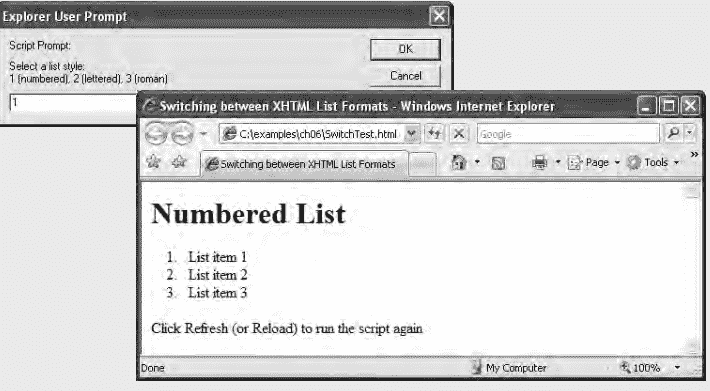

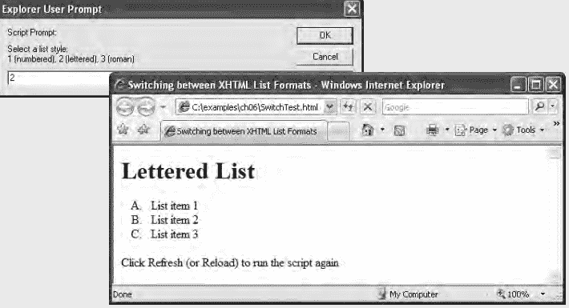

图 6.7 | 使用 `switch` 多选语句。（第 2 部分，共 3 部分）

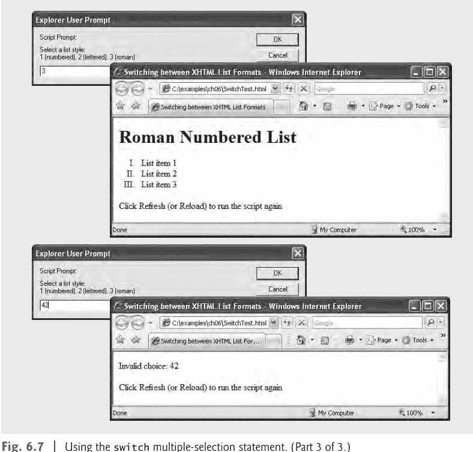

### 图 6.7 | 使用 `switch` 多选语句。（第 3 部分，共 3 部分）

第 18-19 行提示用户输入 1 以显示带编号的列表，输入 2 以显示带字母的列表，输入 3 以显示带罗马数字的列表。第 21-40 行定义了一个 `switch` 语句，它根据用户在提示对话框中输入的值，为变量 `startTag`、`endTag` 和 `listType` 赋值。我们使用 CSS 属性 `list-style-type` 来创建这些不同的列表，该属性允许我们设置列表的编号系统。可能的值包括 `decimal`（数字——默认值）、`lower-roman`（小写罗马数字）、`upper-roman`（大写罗马数字）、`lower-alpha`（小写字母）、`upper-alpha`（大写字母）以及其他一些值。

`switch` 语句由一系列 `case` 标签和一个可选的 `default case` 组成。当程序控制流到达 `switch` 语句时，脚本会计算关键字 `switch` 后括号中的控制表达式（本例中为 `choice`）。该表达式的值会与每个 `case` 标签中的值进行比较，从第一个 `case` 标签开始。假设用户输入了 `2`。请记住，用户在 `prompt` 对话框中输入的值会作为字符串返回。因此，字符串 `2` 会与 `switch` 语句中每个 `case` 里的字符串进行比较。如果匹配成功（`case "2":`），则执行该 `case` 的语句。对于字符串 2（第 29-32 行），我们将 `startTag` 设置为一个开头的 `ol` 标签，其样式属性 `list-style-type` 设置为 `upper-alpha`，将 `endTag` 设置为 `"</ol>"` 以表示有序列表的结束，并将 `listType` 设置为 `"<h1>Lettered List</h1>"`。如果控制表达式的值与任何 `case` 标签都不匹配，则执行 `default case`，并将变量 `validInput` 设置为 `false`。

第 32 行中的 `break` 语句使程序控制继续执行 `switch` 语句之后的第一条语句。之所以使用 `break` 语句，是因为 `switch` 语句中的 `case` 会顺序执行。如果在 `switch` 语句中任何地方都没有使用 `break`，那么每当在该语句中找到匹配项时，所有剩余 `case` 的语句都会执行。

接下来，控制流继续到第 42 行的 `if` 语句，该语句测试变量 `validInput` 以确定其值是否为 `true`。如果是，则第 44-49 行输出 `listType`、`startTag`、三个列表项（`<li>`）和 `endTag`。否则，脚本会在 XHTML 文档中输出文本，表明做出了无效选择（第 52 行）。

每个 `case` 可以有多个操作（语句）。`switch` 语句与其他语句的不同之处在于，`case` 中的多个操作不需要用大括号括起来。通常的 `switch` 语句（即，在每个 `case` 中使用 `break`）的流程图如图 6.8 所示。

> 注意：作为练习，请绘制不包含 `break` 语句的通常 `switch` 语句的流程图。

流程图清楚地表明，每个 `case` 末尾的 `break` 语句会导致控制立即退出 `switch` 语句。`switch` 语句中的最后一个 `case`（或者当 `default case` 出现在最后时）不需要 `break` 语句，因为程序控制会自动继续执行 `switch` 语句之后的下一条语句。

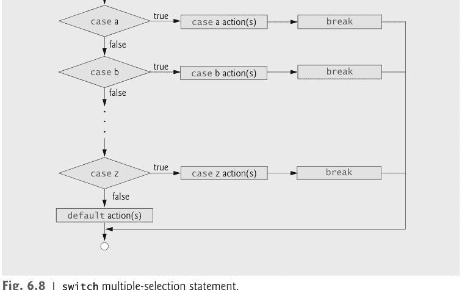

图 6.8 | `switch` 多选语句。

#### 常见编程错误 6.6

在需要 `break` 语句的 `switch` 语句中忘记使用它是一个逻辑错误。

#### 软件工程观察 6.1

在 `switch` 语句中提供 `default case`。没有 `default case` 的 `switch` 语句中未显式测试的 `case` 会被忽略。包含 `default case` 可以让你专注于处理异常情况。但是，在某些情况下不需要默认处理。

#### 良好编程实践 6.8

尽管 `switch` 语句中的 `case` 子句和 `default case` 子句可以以任何顺序出现，但将 `default` 子句放在最后更清晰（也更常见）。

#### 良好编程实践 6.9

在 `switch` 语句中，当 `default` 子句列在最后时，该 `case` 语句的 `break` 不是必需的。一些程序员为了清晰起见以及与其他 `case` 的对称性而包含这个 `break`。

请注意，将几个 `case` 标签列在一起（例如，`case 1:` `case 2:`；`case` 之间没有语句）只是意味着相同的操作集将对每个 `case` 发生。

### 6.6 `do...while` 循环语句

`do...while` 循环语句类似于 `while` 语句。在 `while` 语句中，循环继续测试发生在循环开始处，在循环体执行之前。`do...while` 语句在循环体执行之后测试循环继续条件——因此，循环体至少执行一次。当 `do...while` 终止时，执行继续到 `while` 子句之后的语句。请注意，如果循环体中只有一条语句，则在 `do...while` 语句中不必使用大括号。但是，通常会包含大括号，以避免 `while` 和 `do...while` 语句之间的混淆。例如：

```javascript
while ( condition )
```

通常被视为 `while` 语句的开头。没有大括号的单语句体的 `do...while` 语句如下所示：

```javascript
do

    statement

while ( condition );
```

这可能会引起混淆。最后一行——`while ( condition ) ;`——可能被误解为一个包含空语句（单独的分号）的 `while` 语句。因此，为了避免混淆，具有单语句体的 `do...while` 语句通常编写如下：

```javascript
do

{

    statement

} while ( condition );
```

#### 良好编程实践 6.10

> 一些程序员即使在不必要的情况下也总是在 `do...while` 语句中包含大括号。这有助于消除 `while` 语句和包含单语句体的 `do...while` 语句之间的歧义。

#### 错误预防提示 6.3

> 无限循环是由于在 `while`、`for` 或 `do...while` 语句中循环继续条件永远不变为 `false` 造成的。为了防止这种情况，确保在 `while` 或 `for` 语句的标题后没有立即出现分号。在计数器控制的循环中，确保控制变量在循环体中递增（或递减）。在哨兵控制的循环中，确保最终输入哨兵值。

图 6.9 中的脚本使用 `do...while` 语句来显示六种不同的 XHTML 标题类型（`h1` 到 `h6`）。第 12 行声明控制变量 `counter` 并将其初始化为 1。进入 `do...while` 语句后，第 15-17 行在文档中写入一行 XHTML 文本。控制变量 `counter` 的值用于创建起始和结束标题标签（例如 `<h1>` 和 `</h1>`）以及要显示的文本行（例如 `This is an h1 level head`）。第 18 行在循环底部的循环继续测试发生之前递增 `counter`。

图 6.10 中的 `do...while` 流程图清楚地表明，循环继续测试直到操作至少执行一次才发生。

```xml
<?xml version = "1.0" encoding = "utf-8"?>

<!DOCTYPE html PUBLIC "-//W3C//DTD XHTML 1.0 Strict//EN"

"http://www.w3.org/TR/xhtml11/DTD/xhtml11-strict.dtd">

<!-- Fig. 6.9: DoWhileTest.html -->

<!-- Using the do...while repetition statement. -->

<html xmlns = "http://www.w3.org/1999/xhtml1">

<head>

<title>Using the do...while Repetition Statement</title>

<script type = "text/javascript">

<!--

var counter = 1;

do {

document.writeln("<h" + counter + ">This is " +

"an h" + counter + " level head" + "</h" +

counter + ">" );

++counter;

} while ( counter <= 6 );

// -->

</script>

</head><body></body>

</html>
```

### 图 6.9 | 使用 `do...while` 循环语句。（第 1 部分，共 2 部分）

### 6.7 `break` 和 `continue` 语句

`break` 和 `continue` 语句会改变控制流程。当在 `while`、`for`、`do...while` 或 `switch` 语句中执行 `break` 语句时，会导致立即退出该语句。程序将从该结构后的第一条语句继续执行。`break` 语句常用于提前退出循环或跳过 `switch` 语句的剩余部分（如图 6.7 所示）。图 6.11 演示了 `break` 语句在 `for` 循环语句中的使用。

在第 14–20 行的 `for` 语句的每次迭代期间，脚本会将 `count` 的值写入 XHTML 文档。当第 16 行的 `if` 语句检测到 `count` 等于 5 时，第 17 行的 `break` 语句被执行。该语句终止了 `for` 语句，程序随后执行第 22 行（紧接在 `for` 语句之后的下一条语句），脚本在此处写入循环终止时的 `count` 值（即 5）。该循环仅执行了四次第 19 行。

当在 `while`、`for` 或 `do...while` 语句中执行 `continue` 语句时，它会跳过循环体中的剩余语句，并继续进行循环的下一次迭代。在 `while` 和 `do...while` 语句中，循环继续测试在 `continue` 语句执行后立即进行。在 `for` 语句中，先执行增量表达式，然后才进行循环继续测试。这是 `for` 和 `while` 的一个区别。在 `while` 循环中将 `continue` 放在增量表达式之前可能会导致无限循环。

图 6.12 在 `for` 语句中使用了 `continue`，当第 17 行的 `if` 语句确定 `count` 的值为 5 时，它跳过了第 20 行的 `document.writeln` 语句。当 `continue` 语句执行时，脚本跳过 `for` 语句体的剩余部分。程序控制继续执行 `for` 语句控制变量的增量，然后进行循环继续测试，以确定循环是否应继续执行。

#### 图 6.11 | 在 `for` 语句中使用 `break` 语句

```xml
<?xml version = "1.0" encoding = "utf-8"?>

<!DOCTYPE html PUBLIC "-//W3C//DTD XHTML 1.0 Strict//EN"

    "http://www.w3.org/TR/xhtml1/DTD/xhtml1-strict.dtd">

<!-- 图 6.11：BreakTest.html -->

<!-- 在 `for` 语句中使用 `break` 语句。 -->

<html xmlns = "http://www.w3.org/1999/xhtml">

   <head>

      <title>

         在 `for` 语句中使用 `break` 语句

      </title>

      <script type = "text/javascript">

         <!--

         for ( var count = 1; count <= 10; ++count )

         {

            if ( count == 5 )

               break; // 仅当 count == 5 时中断循环

            document.writeln( "Count is: " + count + "<br />" );

         } //end for

         document.writeln(

            "Broke out of loop at count = " + count );

         // -->

      </script>

   </head><body></body>

</html>
```

#### 图 6.12 | 在 `for` 语句中使用 `continue` 语句

```xml
<?xml version = "1.0" encoding = "utf-8"?>

<!DOCTYPE html PUBLIC "-//W3C//DTD XHTML 1.0 Strict//EN"

   "http://www.w3.org/TR/xhtml1/DTD/xhtml1-strict.dtd">

<!-- 图 6.12：ContinueTest.html -->

<!-- 在 `for` 语句中使用 `continue` 语句。 -->

<html xmlns = "http://www.w3.org/1999/xhtml">

   <head>

      <title>

         在 `for` 语句中使用 `continue` 语句

      </title>

      <script type = "text/javascript">

         <!--

         for ( var count = 1; count <= 10; ++count )

         {

            if ( count == 5 )

               continue; // 仅当 count == 5 时跳过剩余的循环代码

            document.writeln( "Count is: " + count + "<br />" );

         } //end for
```


```javascript
document.writeln("Used continue to skip printing 5");

// -->

</script>

</head><body></body>

</html>
```

### 软件工程观察 6.2

一些程序员认为 `break` 和 `continue` 违反了结构化编程原则。他们不使用 `break` 和 `continue`，因为这些语句的效果可以通过结构化编程技术来实现。

### 性能提示 6.1

在正确使用的情况下，`break` 和 `continue` 语句的执行速度比相应的结构化技术更快。

### 软件工程观察 6.3

在实现高质量软件工程与实现最佳性能软件之间存在着矛盾。通常，实现其中一个目标往往以牺牲另一个目标为代价。

## 6.8 带标签的 `break` 和 `continue` 语句

`break` 语句只能跳出最内层的 `while`、`for`、`do...while` 或 `switch` 语句。要跳出多层嵌套结构，可以使用带标签的 `break` 语句。当在 `while`、`for`、`do...while` 或 `switch` 语句中执行该语句时，它会导致立即退出该语句以及任意数量的外层循环语句；程序执行将从该带标签语句（前面带有标签的语句）之后的第一条语句继续。该带标签语句可以是一个块（一组用花括号 `{}` 括起来的语句）。带标签的 `break` 语句通常用于终止包含 `while`、`for`、`do...while` 或 `switch` 语句的嵌套循环结构。图 6.13 演示了带标签的 `break` 语句在嵌套 `for` 语句中的使用。

#### 图 6.13 | 嵌套 `for` 语句中的带标签 `break` 语句

```xml
<?xml version="1.0" encoding="utf-8"?>

<!DOCTYPE html PUBLIC "-//W3C//DTD XHTML 1.0 Strict//EN"
    "http://www.w3.org/TR/xhtml1/DTD/xhtml1-strict.dtd">

<!-- 图 6.13：BreakLabelTest.html -->

<!-- 嵌套 `for` 语句中的带标签 `break` 语句。 -->

<html xmlns="http://www.w3.org/1999/xhtml">

<head>
    <title>使用带标签的 `break` 语句</title>

    <script type="text/javascript">
        <!--

        stop: { // 带标签的块

            for (var row = 1; row <= 10; ++row)
            {
                if (row == 5)
                    break stop; // 跳出 stop 块

                document.writeln(row);
            } // end for

            document.writeln("<br />");

            document.writeln(
                "This line should not print");

        } // end block labeled stop

        document.writeln("End of script");

        // -->
    </script>
</head>

<body></body>

</html>
```

该带标签的块（第 12–28 行）以一个*标签*（一个后跟冒号的标识符）开始。这里，我们使用标签 `stop:`。该块被第 12 行末尾和第 28 行的花括号括起来，包括从第 13 行开始的嵌套 `for` 语句和第 27 行的 `document.writeln` 语句。当第 17 行的 `if` 语句检测到 `row` 等于 5 时，第 18 行的语句被执行。该语句终止了第 15 行的 `for` 语句及其外层的第 13 行的 `for` 语句，程序随后执行第 30 行的语句（带标签块之后的第一条顺序语句）。内部的 `for` 语句只执行了其主体四次。注意，第 27 行的 `document.writeln` 语句从未执行，因为它包含在带标签的块内，而外层的 `for` 语句从未完成。

`continue` 语句用于立即继续最内层的 `while`、`for` 或 `do...while` 语句的下一次迭代（重复）。带标签的 `continue` 语句，当在循环语句（`while`、`for` 或 `do...while`）中执行时，会跳过当前结构体中的剩余语句以及任意数量的外层循环语句，然后继续执行带标签的外层循环语句（一个前面带有标签的循环语句）的下一次迭代。在带标签的 `while` 和 `do...while` 语句中，循环继续测试在 `continue` 语句执行后立即进行。在带标签的 `for` 语句中，先执行增量表达式，然后才进行循环继续测试。图 6.14 在嵌套的 `for` 语句中使用了带标签的 `continue` 语句，以使执行继续到外层 `for` 语句的下一次迭代。

#### 图 6.14 | 嵌套 `for` 语句中的带标签 `continue` 语句。（第 1 部分，共 2 部分）

```xml
<?xml version="1.0" encoding="utf-8"?>

<!DOCTYPE html PUBLIC "-//W3C//DTD XHTML 1.0 Strict//EN"
    "http://www.w3.org/TR/xhtml1/DTD/xhtml1-strict.dtd">

<!-- 图 6.14：ContinueLabelTest.html -->

<!-- 嵌套 `for` 语句中的带标签 `continue` 语句。 -->
```

## 6.9 逻辑运算符

到目前为止，我们研究的仅是诸如 `count <= 10`、`total > 1000` 和 `number != sentinelValue` 这样的简单条件。这些条件通过关系运算符 `>`、`<`、`>=` 和 `<=`，以及相等运算符 `==` 和 `!=` 来表达。每个决策只测试一个条件。若要基于多个条件做出决策，我们需要在单独的语句中或在嵌套的 `if` 或 `if...else` 语句中执行这些测试。

JavaScript 提供了*逻辑运算符*，可用于将简单条件组合成更复杂的条件。逻辑运算符包括 `&&`（逻辑与）、`||`（逻辑或）和 `!`（逻辑非，也称为逻辑否定）。我们来逐一考察这些运算符的示例。

假设在程序的某个位置，我们希望确保两个条件均为真后再选择某条执行路径。此时，我们可以使用逻辑 `&&` 运算符，如下所示：

```javascript
if (gender == 1 && age >= 65)
    ++seniorFemales;
```

这条 `if` 语句包含两个简单条件。条件 `gender == 1` 可能用于判断例如一个人是否为女性。条件 `age >= 65` 用于判断一个人是否为老年人。然后，`if` 语句考虑组合条件：

```javascript
gender == 1 && age >= 65
```

此条件当且仅当两个简单条件均为真时才为真。最后，如果这个组合条件确实为真，则 `seniorFemales` 的计数增加 1。如果任一或两个简单条件为假，程序将跳过自增操作，转而执行 `if` 语句后面的语句。前面的组合条件可以通过添加冗余的括号使其更具可读性：

```javascript
(gender == 1) && (age >= 65)
```

图 6.15 中的表格总结了 `&&` 运算符。该表展示了 `expression1` 和 `expression2` 的 `false` 和 `true` 值的所有四种可能组合。这类表格通常称为*真值表*。JavaScript 会对包含关系运算符、相等运算符和/或逻辑运算符的所有表达式求值为 `false` 或 `true`。

| expression1 | expression2 | expression1 && expression2 |
| :--- | :--- | :--- |
| false | false | false |
| false | true | false |
| true | false | false |
| true | true | true |

**图 6.15** | `&&`（逻辑与）运算符的真值表。

现在让我们来考虑 `||`（逻辑或）运算符。假设我们希望确保两个条件中至少有一个为真（或两个都为真）后再选择某条执行路径。在这种情况下，我们使用 `||` 运算符，如以下程序段所示：

```javascript
if (semesterAverage >= 90 || finalExam >= 90)
    document.writeln("Student grade is A");
```

这条语句也包含两个简单条件。条件 `semesterAverage >= 90` 用于判断学生是否因为整个学期的扎实表现而应获得课程 "A" 等级。条件 `finalExam >= 90` 用于判断学生是否因为期末考试的出色表现而应获得课程 "A" 等级。然后，`if` 语句考虑组合条件：

```javascript
semesterAverage >= 90 || finalExam >= 90
```

并在任一或两个简单条件为真时授予学生 "A" 等级。注意，仅当两个简单条件均为假时，才不会打印消息 `"Student grade is A"`。图 6.16 是逻辑或运算符（`||`）的真值表。

| expression1 | expression2 | expression1 \|\| expression2 |
| :--- | :--- | :--- |
| false | false | false |
| false | true | true |
| true | false | true |
| true | true | true |

**图 6.16** | `||`（逻辑或）运算符的真值表。

`&&` 运算符的优先级高于 `||` 运算符。这两个运算符都是从左向右结合的。包含 `&&` 或 `||` 运算符的表达式仅在真假性确定时才停止求值。因此，表达式

```javascript
gender == 1 && age >= 65
```

的求值在 `gender` 不等于 1 时立即停止（即整个表达式为假），如果 `gender` 等于 1 则继续（即如果条件 `age >= 65` 为真，则整个表达式仍可能为真）。类似地，如果第一个操作数为真，`||` 运算符立即返回 `true`。逻辑与和逻辑或表达式的这种求值性能特性称为*短路求值*。

JavaScript 提供了 `!`（逻辑否定）运算符，使程序员能够“反转”条件的含义（即 `true` 值变为 `false`，`false` 值变为 `true`）。与 `&&` 和 `||` 这两个逻辑运算符（即它们是二元运算符）不同，逻辑否定运算符只有一个条件作为操作数（即它是一元运算符）。逻辑否定运算符放在条件之前，用于在原始条件（不带逻辑否定运算符）为 `false` 时选择执行路径，如以下程序段所示：

```javascript
if (!(grade == sentinelValue))
    document.writeln("The next grade is " + grade);
```

条件 `grade == sentinelValue` 周围的括号是必需的，因为逻辑否定运算符的优先级高于相等运算符。图 6.17 是逻辑否定运算符的真值表。

| expression | !expression |
| :--- | :--- |
| false | true |
| true | false |

**图 6.17** | `!`（逻辑否定）运算符的真值表。

在大多数情况下，可以通过使用适当的关系运算符或相等运算符以不同方式表达条件来避免使用逻辑否定。例如，前面的语句也可以写成如下形式：

```javascript
if (grade != sentinelValue)
    document.writeln("The next grade is " + grade);
```

图 6.18 中的脚本通过生成它们的真值表来演示所有逻辑运算符。该脚本生成一个包含结果的 XHTML 表格。

```html
<!--
<?xml version="1.0" encoding="utf-8"?>

<!DOCTYPE html PUBLIC "-//W3C//DTD XHTML 1.0 Strict//EN"
    "http://www.w3.org/TR/xhtml1/DTD/xhtml1-strict.dtd">

<!-- Fig. 6.18: LogicalOperators.html -->

<!-- Demonstrating logical operators. -->

<html xmlns="http://www.w3.org/1999/xhtml">

<head>
    <title>Demonstrating the Logical Operators</title>

    <style type="text/css">
        table { width: 100% }
        td.left { width: 25% }
    </style>
</head>

<script type="text/javascript">
    document.writeln(
        "<table border = \"\">",
        "<caption>Demonstrating Logical " +
        "Operators</caption>"
    );

    document.writeln(
        "<tr><td class = \"left\">Logical AND (&&)</td>" +
        "<td>false && false: " + (false && false) +
        "<br />false && true: " + (false && true) +
        "<br />true && false: " + (true && false) +
        "<br />true && true: " + (true && true) +
        "</td></tr>"
    );

    document.writeln(
        "<tr><td class = \"left\">Logical OR (||)</td>" +
        "<td>false || false: " + (false || false) +
        "<br />false || true: " + (false || true) +
        "<br />true || false: " + (true || false) +
        "<br />true || true: " + (true || true) +
        "</td></tr>"
    );

    document.writeln(
        "<tr><td class = \"left\">Logical NOT (!)</td>" +
        "<td>!false: " + (!false) +
        "<br />!true: " + (!true) +
        "</td></tr>"
    );

    document.writeln("</table>");
</script>

<!-- -->

</head>

<body></body>

</html>
-->
```


```

**图 6.18** | 演示逻辑运算符。（第 1 部分，共 2 部分。）

### 6.9 逻辑运算符

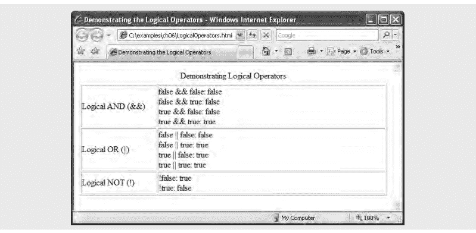

图 6.18 | 演示逻辑运算符。（第 2 部分，共 2 部分。）

在图 6.18 的输出中，字符串 `"false"` 和 `"true"` 表示每个条件中操作数的假和真。条件的结果显示为 `true` 或 `false`。请注意，当您使用连接运算符连接布尔值和字符串时，JavaScript 会自动将布尔值转换为字符串 `"false"` 或 `"true"`。第 16–39 行构建了一个包含结果的 XHTML 表格。

JavaScript 的一个有趣特性是，大多数非布尔值都可以转换为布尔值 `true` 或 `false`。非零数值被认为是 `true`。数值零被认为是 `false`。任何包含字符的字符串被认为是 `true`。空字符串（即不包含任何字符的字符串）被认为是 `false`。值 `null` 和已声明但未初始化的变量被认为是 `false`。所有对象（例如，浏览器的 `document` 和 `window` 对象以及 JavaScript 的 `Math` 对象）都被认为是 `true`。

图 6.19 显示了迄今为止介绍的 JavaScript 运算符的优先级和结合性。运算符从上到下按优先级递减顺序显示。

| 运算符 | 结合性 | 类型 |
|---|---|---|
| `++ -- !` | 从右到左 | 一元运算符 |
| `* / %` | 从左到右 | 乘法运算符 |
| `+ -` | 从左到右 | 加法运算符 |
| `< <= > >=` | 从左到右 | 关系运算符 |
| `== !=` | 从左到右 | 相等运算符 |
| `&&` | 从左到右 | 逻辑与运算符 |

图 6.19 | 至今讨论的运算符的优先级和结合性。（第 1 部分，共 2 部分。）

| 运算符 | 结合性 |
|---|---|
| `||` | 从左到右 |
| `?:` | 从右到左 |
| `=` | 从右到左 |
| 赋值 | 条件运算符 |

图 6.19 | 至今讨论的运算符的优先级和结合性。（第 2 部分，共 2 部分。）

### 6.10 Web 资源

`www.deitel.com/javascript/`

Deitel JavaScript 资源中心包含指向网络上一些最佳 JavaScript 资源的链接。在那里，您可以找到指向 JavaScript 工具、代码生成器、论坛、书籍、库、框架等的分类链接。同时，查看针对所有技能水平的教程，从入门到高级。

请务必访问 XHTML (`www.deitel.com/xhtml1/`) 和 CSS 2.1 (`www.deitel.com/css21/`) 的相关资源中心。

## 7 JavaScript：函数

> 形式永远追随功能。  
> —路易斯·沙利文

> 众中之一。  
> （由许多组成的整体。）  
> —维吉尔

> 哦！唤回昨日，让时光倒流。  
> —威廉·莎士比亚

> 叫我以实玛利。  
> —赫尔曼·梅尔维尔

> 你那样叫我的时候，请微笑。  
> —欧文·威斯特

### 目标

在本章中，您将学习：

- 如何将程序模块化地构建为称为函数的小片段。
- 如何创建新函数。
- 如何在函数之间传递信息。
- 使用随机数生成的模拟技术。
- 标识符的可见性如何被限制在程序的特定区域。

## 大纲

- `7.1` 简介
- `7.2` JavaScript 中的程序模块
- `7.3` 程序员定义的函数
- `7.4` 函数定义
- `7.5` 随机数生成
- `7.6` 示例：机会游戏
- `7.7` 另一个示例：随机图像生成器
- `7.8` 作用域规则
- `7.9` JavaScript 全局函数
- `7.10` 递归
- `7.11` 递归与迭代
- `7.12` Web 资源

### 7.1 简介

大多数解决现实世界问题的计算机程序都比本书前几章介绍的程序大得多。经验表明，开发和维护大型程序的最佳方法是将其构建为小的、简单的片段或**模块**。这种技术称为*分而治之*。本章描述了 JavaScript 的许多关键特性，这些特性有助于大型脚本的设计、实现、操作和维护。

### 7.2 JavaScript 中的程序模块

JavaScript 中的模块称为*函数*。JavaScript 程序是通过将您编写的新函数与 JavaScript 中可用的“预打包”函数和对象结合起来编写的。属于 JavaScript 对象的预打包函数（例如之前介绍的 `Math.pow` 和 `Math.round`）称为**方法**。术语 method 意味着该函数属于特定对象。我们将属于特定 JavaScript 对象的函数称为方法；所有其他函数则称为函数。

JavaScript 提供了多个对象，这些对象具有丰富的方法集合，用于执行常见的数学计算、字符串操作、日期和时间操作以及称为数组的数据集合操作。这些对象使您的工作更轻松，因为它们提供了程序员经常需要的许多功能。一些常见的 JavaScript 预定义对象及其方法在第 8 章 JavaScript：数组和第 9 章 JavaScript：对象中讨论。

> **良好编程实践 7.1**  
> *熟悉 JavaScript 提供的丰富对象和方法集合。*

> **软件工程观察 7.1**  
> *避免重复造轮子。使用现有的 JavaScript 对象、方法和函数，而不是编写新的。这减少了脚本开发时间，并有助于避免引入错误。*

**可移植性提示 7.1**

*使用 JavaScript 对象内置的方法有助于使脚本更具可移植性。*

您可以编写函数来定义在脚本中可能多次使用的特定任务。这些函数称为**程序员定义的函数**。定义函数的实际语句只编写一次，并且对其他函数隐藏。函数通过编写函数名，后跟左括号，然后是零个或多个参数的逗号分隔列表，最后是右括号来调用。例如，程序员想要将存储在变量 `inputValue` 中的字符串转换为浮点数并将其添加到变量 `total`，可能会编写：

```javascript
total += parseFloat( inputValue );
```

当此语句执行时，JavaScript 函数 `parseFloat` 将 `inputValue` 变量中的字符串转换为浮点值，并将该值添加到 `total` 中。变量 `inputValue` 是函数 `parseFloat` 的参数。函数 `parseFloat` 接受一个表示浮点数的字符串作为参数，并返回相应的浮点数值。函数参数可以是常量、变量或表达式。方法的调用方式相同，但需要方法所属对象的名称以及方法名前的点。例如，我们已经看到语法 `document.writeln("Hi there.");`。此语句调用 `document` 对象的 `writeln` 方法来输出文本。

### 7.3 程序员定义的函数

函数允许您将程序模块化。在函数定义中声明的所有变量都是**局部变量**——只能在定义它们的函数中访问。大多数函数都有一个**参数**列表，提供了通过函数调用在函数之间传递信息的方式。函数的参数也被视为局部变量。当调用函数时，函数调用中的参数被分配给函数定义中相应的参数。

> **软件工程观察 7.2**  
> *如果函数的任务无法简洁表达，也许该函数执行了太多不同的任务。通常最好将这样的函数分解为几个更小的函数。*

### 7.4 函数定义

到目前为止，我们在文本中介绍的每个脚本都由一系列顺序执行的语句和控制结构组成。这些脚本在浏览器加载网页并评估页面的 `<head>` 部分时执行。我们现在考虑如何编写您自己的自定义函数并在脚本中调用它们。

#### 程序员定义的函数 `square`

考虑一个脚本（图 7.1），该脚本使用函数 `square` 计算 1 到 10 的整数的平方。*[注意：* 我们继续展示许多示例，其中 XHTML 文档的 `body` 元素为空，文档直接由 JavaScript。在后续章节中，我们将展示许多 JavaScript 与文档主体中的元素进行交互的示例。]

第 15-17 行的 `for` 语句输出 XHTML，显示从 1 到 10 的整数的平方结果。循环的每次迭代计算控制变量 `x` 当前值的平方，并通过在 XHTML 文档中写入一行来输出结果。第 17 行通过表达式 `square(x)` 调用（或称“调用”）了函数 `square`。当程序控制流到达这个表达式时，程序会调用 `square` 函数（定义在第 23-26 行）。括号 `()` 代表函数调用运算符，其优先级很高。此时，程序会复制 `x` 的值（实参），并将程序控制权转移到 `square` 函数的第一行。`square` 函数接收 `x` 值的副本并将其存储在形参 `y` 中。然后 `square` 计算 `y * y`。结果被传递回（返回）到第 17 行调用 `square` 的位置。第 16-17 行将字符串 `"The square of "`、`x` 的值、字符串 `" is "`、`square` 函数返回的值以及一个 `<br />` 标签连接起来，并将这行文本写入 XHTML 文档。这个过程重复 10 次。

`square` 函数的定义（第 23-26 行）表明 `square` 期望一个形参 `y`。`square` 函数在其函数体中使用这个名称来操作从第 17 行传递给 `square` 的值。`square` 中的 `return` 语句将计算结果 `y * y` 传递回调用函数。请注意，JavaScript 关键字 `var` 不用于在函数的参数列表中声明变量。

> **常见编程错误 7.1**  
> 在函数参数列表中使用 JavaScript 关键字 `var` 声明变量会导致 JavaScript 运行时错误。

在此示例中，`square` 函数位于脚本的其余部分之后。当 `for` 语句终止时，程序控制流*不会*顺序流入 `square` 函数。函数必须被显式调用，其函数体中的代码才会执行。因此，在此示例中，当 `for` 语句终止时，脚本也随之终止。

> **良好编程习惯 7.2**  
> 在函数定义之间放置一个空行，以分隔函数并增强程序的可读性。

> **软件工程观察 7.3**  
> 包含在函数定义体中的语句不会被 JavaScript 解释器执行，除非该函数被显式调用。

函数定义的格式是：

```text
function 函数名( 参数列表 )
{
    声明和语句
}
```

`函数名` 可以是任何有效的标识符。`参数列表` 是一个以逗号分隔的列表，包含函数被调用时接收的参数名称（请记住，函数调用中的实参被赋值给函数定义中的相应形参）。函数调用中的实参数量应与函数定义中的形参数量一致。如果函数不接收任何值，则 `参数列表` 为空（即函数名后跟一对空的括号）。花括号中的 `声明` 和 `语句` 构成 `函数体`。

### 常见编程错误 7.2

忘记从应该返回值的函数中返回一个值，这是一种逻辑错误。

### 常见编程错误 7.3

在函数定义的参数列表的右括号之后放置分号，会导致 JavaScript 运行时错误。

### 常见编程错误 7.4

在函数中将函数形参重新定义为局部变量，这是一种逻辑错误。

### 常见编程错误 7.5

向函数传递一个与相应形参期望类型不兼容的实参，是一种逻辑错误，并可能导致 JavaScript 运行时错误。

### 良好编程习惯 7.3

虽然这样做并无错误，但不要对传递给函数的实参和函数定义中的相应形参使用相同的名称。使用不同的名称可以避免歧义。

### 软件工程观察 7.4

为了提高软件的可重用性，每个函数都应限于执行单个、定义明确的任务，并且函数名应能有效地表达该任务。这样的函数使程序更易于编写、调试、维护和修改。

有三种方法可以将控制权返回到函数被调用的位置。如果函数不返回结果，则当程序到达函数结束的右花括号时，或执行语句：

```text
return;
```

时，控制权返回。

如果函数确实返回结果，则语句：

```text
return 表达式;
```

将 `表达式` 的值返回给调用者。当执行 `return` 语句时，控制权会立即返回到函数被调用的位置。

#### 程序员定义的函数 `maximum`

我们下一个示例中的脚本（图 7.2）使用了一个名为 `maximum` 的程序员定义的函数，来确定并返回三个浮点值中的最大值。这三个浮点值由用户通过提示对话框输入（第 12-14 行）。第 16-18 行使用 `parseFloat` 函数将用户输入的字符串转换为浮点值。第 20 行的语句将这三个浮点值传递给 `maximum` 函数（定义在第 28-31 行），该函数确定最大的浮点值。该值由 `maximum` 函数中的 `return` 语句返回给第 20 行。

```xml
<?xml version = "1.0" encoding = "utf-8"?>

<!DOCTYPE html PUBLIC "-//W3C//DTD XHTML 1.0 Strict//EN"
    "http://www.w3.org/TR/xhtml1/DTD/xhtml1-strict.dtd">

<!-- 图 7.2: maximum.html -->

<!-- 程序员定义的 maximum 函数。 -->

<html xmlns = "http://www.w3.org/1999/xhtml">
    <head>
        <title>查找三个值中的最大值</title>

        <script type = "text/javascript">
            <!--
            var input1 = window.prompt( "输入第一个数字", "0" );
            var input2 = window.prompt( "输入第二个数字", "0" );
            var input3 = window.prompt( "输入第三个数字", "0" );

            var value1 = parseFloat( input1 );
            var value2 = parseFloat( input2 );
            var value3 = parseFloat( input3 );

            var maxValue = maximum( value1, value2, value3 );

            document.writeln( "第一个数字：" + value1 +
                "<br />第二个数字：" + value2 +
                "<br />第三个数字：" + value3 +
                "<br />最大值是：" + maxValue );

            // maximum 函数定义（从第 20 行调用）
            function maximum( x, y, z )
            {
               return Math.max( x, Math.max( y, z ) );
            } // 结束 maximum 函数
            // -->
        </script>
    </head>

    <body>
        <p>单击“刷新”（或“重新加载”）以再次运行脚本</p>
    </body>
</html>
```


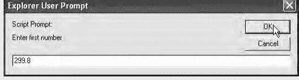

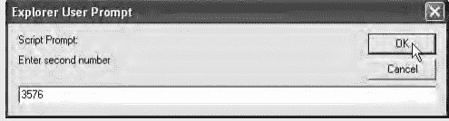

图 7.2 | 程序员定义的`maximum`函数。（第 1 部分，共 2 部分。）

## 7.5 随机数生成

现在我们短暂地、并且希望是有趣地偏离一下主题，进入一个流行的编程应用领域，即模拟和游戏。在本节和下一节中，我们将开发一个结构良好的游戏程序，该程序包含多个函数。这个程序使用了我们学习过的大部分控制语句。

赌博赌场中有一种气氛能使人们精神振奋，从豪华桃花心木和毡制赌桌旁的大赌客到老虎机前的25美分玩家，莫不如此。这就是机会的元素，运气可能将口袋里的钱变成财富之山的可能性。这种机会的元素可以通过`Math`对象的`random`方法引入。（记住，我们称`random`为方法，因为它属于`Math`。）

考虑以下语句：

```js
var randomValue = Math.random();
```

`random`方法生成一个从 0.0 开始到但不包括 1.0 的浮点数值。如果它确实随机产生数值，那么从 0.0 开始到但不包括 1.0 的每一个值在每次被调用时都有相等的机会（或概率）被选中。

`random`直接产生的数值范围通常与特定应用中需要的不同。例如，模拟抛硬币的程序可能只需要 0 表示正面和 1 表示反面。模拟掷六面骰子的程序需要 1 到 6 范围内的随机整数。在视频游戏中随机预测下一艘飞越地平线的飞船类型（共有四种可能）的程序可能需要 0-3 或 1-4 范围内的随机整数。

为了演示`random`方法，让我们开发一个程序（图 7.3），模拟掷六面骰子 20 次并显示每次掷出的值。

我们将乘法运算符（`*`）与`random`一起使用，如下所示：

```js
Math.floor( 1 + Math.random() * 6 )
```

首先，前面的表达式将`random()`调用结果乘以 6，产生一个从 0.0 开始到但不包括 6.0 的数值。这称为对随机数进行**缩放**。接下来，我们将结果加上 1，以平移数值范围，产生一个从 1.0 开始到但不包括 7.0 的数值。最后，我们使用`Math.floor`将结果向下舍入到不大于参数值的最接近整数——例如，1.75 舍入为 1。图 7.3 确认结果在 1 到 6 的范围内。

**图 7.3 | 随机整数、平移和缩放。（第 1 部分，共 2 部分。）**

```js
for ( var i = 1; i <= 20; i++ )
{
    value = Math.floor( 1 + Math.random() * 6 );
    document.writeln( "<td>" + value + "</td>" );

    // start a new table row every 5 entries
    if ( i % 5 == 0 && i != 20 )
        document.writeln( "</tr><tr>" );
} // end for

document.writeln( "</tr></table>" );
// -->
</script>
</head>

<body>
    <p>Click Refresh (or Reload) to run the script again</p>
</body>
</html>
```

**图 7.3 | 随机整数、平移和缩放。（第 2 部分，共 2 部分。）**

为了说明这些数值出现的概率大致相等，让我们用图 7.4 中的程序模拟掷骰子 6000 次。1 到 6 的每个整数应该大约出现 1000 次。使用浏览器的**刷新**（或**重新加载**）按钮再次执行脚本。

```xml
<?xml version = "1.0" encoding = "utf-8"?>

<!DOCTYPE html PUBLIC "-//W3C//DTD XHTML 1.0 Strict//EN"
    "http://www.w3.org/TR/xhtml1/DTD/xhtml1-strict.dtd">

<!-- Fig. 7.4: RollDie.html -->
<!-- Rolling a Six-Sided Die 6000 times. -->

<html xmlns = "http://www.w3.org/1999/xhtml">
    <head>
        <title>Roll a Six-Sided Die 6000 Times</title>
        <script type = "text/javascript">
            <!--
            var frequency1 = 0;
            var frequency2 = 0;
            var frequency3 = 0;
            var frequency4 = 0;
            var frequency5 = 0;
            var frequency6 = 0;
            var face;

            // roll die 6000 times and accumulate results
            for ( var roll = 1; roll <= 6000; roll++ )
            {
                face = Math.floor( 1 + Math.random() * 6 );

                switch ( face )
                {
                    case 1:
                        ++frequency1;
                        break;
                    case 2:
                        ++frequency2;
                        break;
                    case 3:
                        ++frequency3;
                        break;
                    case 4:
                        ++frequency4;
                        break;
                    case 5:
                        ++frequency5;
                        break;
                    case 6:
                        ++frequency6;
                        break;
                } // end switch
            } // end for

            document.writeln( "<table border = \"1\">" );
            document.writeln( "<thead><th>Face</th>" +
                "<th>Frequency</th></thead>" );
            document.writeln( "<tbody><tr><td>1</td><td>" + frequency1 + "</td></tr>" );
            document.writeln( "<tr><td>2</td><td>" + frequency2 + "</td></tr>" );
            document.writeln( "<tr><td>3</td><td>" + frequency3 + "</td></tr>" );
            document.writeln( "<tr><td>4</td><td>" + frequency4 + "</td></tr>" );
            document.writeln( "<tr><td>5</td><td>" + frequency5 + "</td></tr>" );
            document.writeln( "<tr><td>6</td><td>" + frequency6 + "</td></tr></tbody></table>" );
            // -->
        </script>
    </head>

    <body>
        <p>Click Refresh (or Reload) to run the script again</p>
    </body>
</html>
```

**图 7.4 | 掷六面骰子 6000 次。（第 1 部分，共 2 部分。）**

**图 7.4 | 掷六面骰子 6000 次。（第 2 部分，共 2 部分。）**

如程序输出所示，我们使用`Math`方法的`random`以及前一个示例中的缩放和平移技术来模拟掷六面骰子。注意，我们使用了嵌套控制语句来确定六面骰子的每一面出现的次数。第 12–17 行声明并初始化计数器，以跟踪六个骰子值中每个值出现的次数。第 18 行声明一个变量来存储骰子的面值。第 21–46 行的`for`语句迭代 6000 次。在循环的每次迭代中，第 23 行产生一个 1 到 6 的值，存储在`face`中。第 25–45 行的嵌套`switch`语句使用随机选择的面值作为其控制表达式。根据`face`的值，程序在循环的每次迭代中递增六个计数器变量之一。注意，此`switch`语句中没有提供默认情况，因为第 23 行的语句仅产生值 1、2、3、4、5 和 6。在此示例中，默认情况永远不会执行。在第 8 章学习数组后，我们将讨论一种方法，用单行语句替换此程序中的整个`switch`语句。

多次运行程序，并观察结果。注意，程序在脚本每次执行时产生不同的随机数，因此结果应该会有所不同。

`random`返回的值始终处于以下范围：

```text
0.0 ≤ Math.random() < 1.0
```

此前，我们演示了语句：

```js
face = Math.floor( 1 + Math.random() * 6 );
```

它模拟掷六面骰子。此语句始终将（随机的）整数赋值给变量`face`，范围为 1 ≤ face ≤ 6。注意，此范围的宽度（即范围内连续整数的数量）为 6，范围内的起始数字为 1。参考前面的语句，我们看到范围的宽度由用于通过乘法运算符缩放`random`的数字确定（前面语句中的 6），而范围的起始数字等于加到`Math.random() * 6`上的数字（前面语句中的 1）。我们可以将此结果概括为：

```js
face = Math.floor( a + Math.random() * b );
```

其中`a`是**平移值**（等于所需连续整数范围中的第一个数字），`b`是**缩放因子**（等于所需连续整数范围的宽度）。

## 7.6 示例：机会游戏

最受欢迎的机会游戏之一是一种称为掷骰子（craps）的骰子游戏，它在世界各地的小巷暗角里进行。游戏规则简单明了：

玩家掷两个骰子。每个骰子有六个面。这些面分别包含一个、两个、三个、四个、五个和六个点。骰子静止后，计算两个朝上侧面的点数之和。如果第一次掷出的和为 7 或 11，玩家获胜。如果第一次掷出的和为 2、3 或 12（称为“craps”），玩家输（即“庄家”胜）。如果第一次掷出的和为 4、5、6、8、9 或 10，该和成为玩家的“点数”。要获胜，你必须继续掷骰子直到“掷出你的点数”（即掷出你的点数值）。如果在掷出点数之前掷出 7，你就输了。

程序的第一部分（图 7.2）引入了一个`maximum`函数，用于找出三个值中的最大值。以下是该函数目的和实现的简要回顾。

返回的值被赋值给变量`maxValue`。第 22–25 行显示用户输入的三个浮点值以及计算出的`maxValue`。

注意函数`maximum`的实现（第 28–31 行）。第一行表明函数名是`maximum`，该函数接受三个参数（`x`、`y`和`z`）来完成其任务。此外，函数体包含通过两次调用`Math`对象的`max`方法返回三个浮点值中最大值的语句。首先，使用变量`y`和`z`的值调用`Math.max`方法，以确定两者中的较大值。接下来，将变量`x`的值和第一次调用`Math.max`的结果传递给`Math.max`方法。最后，第二次调用`Math.max`的结果返回到调用`maximum`的位置（即第 20 行）。再次注意，脚本在顺序到达函数`maximum`的定义之前终止。函数`maximum`体内的语句仅在从第 20 行调用该函数时执行。

## 7.6 示例：机会游戏

图 7.5 中的脚本模拟了掷骰子游戏（craps）。请注意，玩家在第一次以及后续每次掷骰子时都必须掷两个骰子。执行脚本时，点击“Roll Dice”按钮即可开始游戏。“Roll Dice”按钮下方的消息会在每次掷骰子后显示游戏状态。

到目前为止，用户与脚本的所有交互都是通过提示对话框（用户在其中为程序输入一个值）或警告对话框（向用户显示一条消息，用户可以点击 OK 关闭对话框）完成的。虽然这些对话框是接收用户输入和显示消息的有效方式，但它们的功能相当有限。提示对话框每次只能从用户那里获取一个值，而消息对话框只能显示一条消息。

```xml
<?xml version = "1.0" encoding = "utf-8"?>

<!DOCTYPE html PUBLIC "-//W3C//DTD XHTML 1.0 Strict//EN"
   "http://www.w3.org/TR/xhtml1/DTD/xhtml1-strict.dtd">

<!-- Fig. 7.5: Craps.html -->
<!-- Craps game simulation. -->

<html xmlns = "http://www.w3.org/1999/xhtml">
   <head>
      <title>Program that Simulates the Game of Craps</title>

      <style type = "text/css">
         table   { text-align: right }
         body    { font-family: arial, sans-serif }
         div.red { color: red }
      </style>

      <script type = "text/javascript">
         <!--
         // variables used to test the state of the game
         var WON = 0;
         var LOST = 1;
         var CONTINUE_ROLLING = 2;

         // other variables used in program
         var firstRoll = true; // true if current roll is first
         var sumOfDice = 0; // sum of the dice
         var myPoint = 0; // point if no win/loss on first roll
         var gameStatus = CONTINUE_ROLLING; // game not over yet

         // process one roll of the dice
         function play()
         {
            // get the point field on the page
            var point = document.getElementById( "pointfield" );

            // get the status div on the page
            var statusDiv = document.getElementById( "status" );

            if ( firstRoll ) // first roll of the dice
            {
               sumOfDice = rollDice();

               switch ( sumOfDice )
               {
                  case 7: case 11: // win on first roll
                     gameStatus = WON;

                     // clear point field
                     point.value = "";
                     break;

                  case 2: case 3: case 12: // lose on first roll
                     gameStatus = LOST;

                     // clear point field
                     point.value = "";
                     break;
```


```javascript
default: // remember point

   gameStatus = CONTINUE_ROLLING;
   myPoint = sumOfDice;
   point.value = myPoint;
   firstRoll = false;

} // end switch

} // end if

else
{
   sumOfDice = rollDice();

   if (sumOfDice == myPoint) // win by making point
      gameStatus = WON;
   else if (sumOfDice == 7) // lose by rolling 7
      gameStatus = LOST;
} // end else

if (gameStatus == CONTINUE_ROLLING)
   statusDiv.innerHTML = "Roll again";
else
{
   if (gameStatus == WON)
      statusDiv.innerHTML = "Player wins. " +
         "Click Roll Dice to play again.";
   else
      statusDiv.innerHTML = "Player loses. " +
         "Click Roll Dice to play again.";

   firstRoll = true;
} // end else

} // end function play

// roll the dice

function rollDice()
{
   var die1;
   var die2;
   var workSum;

   die1 = Math.floor(1 + Math.random() * 6);
   die2 = Math.floor(1 + Math.random() * 6);
   workSum = die1 + die2;

   document.getElementById("die1field").value = die1;
   document.getElementById("die2field").value = die2;
   document.getElementById("sumfield").value = workSum;

   return workSum;
} // end function rollDice

// -->
```

```html
</script>
</head>

<body>
<form action="">
   <table>
      <caption>Craps</caption>

      <tr>
         <td>Die 1</td>
         <td><input id="die1field" type="text" /></td>
      </tr>

      <tr>
         <td>Die 2</td>
         <td><input id="die2field" type="text" /></td>
      </tr>

      <tr>
         <td>Sum</td>
         <td><input id="sumfield" type="text" /></td>
      </tr>

      <tr>
         <td>Point</td>
         <td><input id="pointfield" type="text" /></td>
      </tr>

      <tr>
         <td></td>
         <td>
            <input
               type="button"
               value="Roll Dice"
               onclick="play()"
            />
         </td>
      </tr>
   </table>

   <div id="status" class="red">
      Click the Roll Dice button to play
   </div>
</form>
</body>

</html>
```

图 7.5 | 掷骰子游戏模拟。（第 4 部分，共 4 部分。）

更常见的情况是，通过 XHTML 表单一次接收用户的多个输入（例如用户输入姓名和地址信息的表单），或一次显示多条数据（例如本示例中的骰子值、骰子总和以及点数）。为了开始介绍更复杂的用户界面，本程序使用了 XHTML 表单（在第 2 章中讨论）和一个新的图形用户界面概念——GUI 事件处理。这是我们第一个 JavaScript 程序响应用户与 XHTML 表单中 GUI 组件交互的示例。这种交互会触发一个事件。脚本通常用于响应事件。

在我们讨论脚本代码之前，先讨论 XHTML 文档的 `body` 元素（第 105–126 行）。本节中的 GUI 组件在脚本中被广泛使用。

第 106 行开始定义 XHTML `form` 元素。XHTML 标准要求每个表单都必须包含 `action` 属性，但由于此表单不会将其信息提交到 Web 服务器，因此使用了空字符串（`""`）。

在本示例中，我们决定将表单的 GUI 组件放在 XHTML `table` 元素中，因此第 107 行开始定义 XHTML 表格。第 109–120 行创建了四个表格行。每行包含一个带有文本标签的左单元格和右侧的 `input` 元素。

创建了四个输入字段（第 110、113、116 和 119 行），用于显示第一个骰子的值、第二个骰子的值、骰子的总和以及当前的点数（如有）。它们的 `id` 属性分别设置为 `die1field`、`die2field`、`sumfield` 和 `pointfield`。`id` 属性可用于应用 CSS 样式，并使脚本代码能够引用 XHTML 文档中的元素。由于 `id` 属性（如果指定）必须具有唯一的值，因此 JavaScript 可以通过其 `id` 属性可靠地引用任何单个元素。我们稍后会看到这是如何实现的。

第 121–122 行创建了第五行，在左列有一个空单元格，然后是“Roll Dice”按钮。按钮的 `onclick` 属性指示当用户点击 XHTML 文档中的“Roll Dice”按钮时要执行的操作。在本示例中，点击按钮会调用函数 `play()`。

这种编程风格称为**事件驱动编程**——用户与 GUI 组件交互，脚本被通知发生了事件，然后脚本处理该事件。用户的交互“驱动”着程序。按钮点击称为**事件**。当事件发生时调用的函数称为**事件处理函数**或**事件处理程序**。当表单中发生 GUI 事件时，浏览器会调用指定的事件处理函数。在处理任何事件之前，每个 GUI 组件必须知道当特定事件发生时要调用哪个事件处理函数。大多数 XHTML GUI 组件都有几种不同的事件类型。事件模型在第 11 章“JavaScript：事件”中详细讨论。通过为“Roll Dice”按钮指定 `onclick = "play()"`，我们指示浏览器监听事件（特别是按钮点击事件）。这为 GUI 组件**注册**了事件处理程序，使浏览器开始监听该组件上的点击事件。如果没有为“Roll Dice”按钮指定事件处理程序，当用户按下按钮时，脚本将不会响应。

第 123–125 行分别结束了 `table` 和 `form` 元素。在表格之后，创建了一个 `id` 属性为 `"status"` 的 `div` 元素。该元素将被脚本更新，以向用户显示每次掷骰子的结果。第 13 行中的样式声明将该 `div` 中包含的文本颜色设置为红色。

这个游戏相当复杂。玩家可能在第一次掷骰子时赢或输，也可能在后续任何一次掷骰子时赢或输。第 18–20 行创建定义了三种游戏状态的变量——游戏获胜、游戏失败和继续掷骰子。与许多其他编程语言不同，JavaScript 没有提供定义**常量**（即值不可修改的变量）的机制。因此，我们对于这些变量名使用**全大写字母**，以表明我们不打算修改它们的值，并使它们在代码中更加醒目——这是真正常量的常见行业做法。

### 良好的编程实践 7.4

> 应使用大写字母（单词之间用下划线连接）来命名用作常数的变量名。这种格式使这些变量在程序中更加突出。

### 良好的编程实践 7.5

> 使用具有意义的变量名而不是字面值（如 `2`）使程序更易读。

第 23–26 行声明了几个在脚本中使用的变量。变量 `firstRoll` 指示下一轮投掷是否为当前游戏的第一轮。变量 `sumOfDice` 维护上一轮投掷的骰子总和。变量 `myPoint` 存储玩家在第一轮未赢或输掉时的点数。变量 `gameStatus` 跟踪游戏的当前状态（`WON`、`LOST` 或 `CONTINUE_ROLLING`）。

我们定义了一个函数 `rollDice()`（第 86–101 行）来投掷骰子并计算和显示它们的总和。函数 `rollDice()` 只定义一次，但在程序的两个位置被调用（第 38 和 61 行）。函数 `rollDice()` 不接受任何参数，因此具有空的参数列表。函数 `rollDice()` 返回两个骰子的总和。

用户点击“掷骰子”按钮来投掷骰子。此动作调用了脚本中的函数 `play()`（第 29–83 行）。第 32 和 35 行使用文档对象的 `getElementById()` 方法创建了两个新变量，该对象代表 XHTML 文档中的元素。该方法在给定一个 `id` 作为参数时，找到匹配 `id` 属性的 XHTML 元素，并返回代表该元素的 JavaScript 对象。第 32 行在变量 `point` 中存储代表 `pointfield` 输入元素（第 119 行）的对象。第 35 行获取代表第 124 行的 `status` `div` 的对象。稍后我们将展示如何使用这些对象来操作 XHTML 文档。

函数 `play()` 检查变量 `firstRoll`（第 36 行）以确定其是 `true` 还是 `false`。如果为 `true`，则该投掷是游戏的第一轮。第 38 行调用 `rollDice()`，该函数从 1 到 6 中选取两个随机值，显示第一个骰子的值、第二个骰子的值以及骰子之和在前三个文本框中，并返回两个骰子的总和。（我们将在稍后详细讨论函数 `rollDice()`。）第一投之后（如果 `firstRoll` 为 `false`），第 40–57 行的嵌套 `switch` 语句确定游戏是赢了还是输了，或者是否应继续进行另一轮投掷。第一投后，如果游戏未结束，则 `sumOfDice` 被保存在 `myPoint` 中，并显示在 XHTML 表单的文本字段 `point` 中。

注意第 45、50 和 55 行如何改变文本字段的值。存储在变量 `point` 中的对象允许访问 `pointfield` 文本字段的内容。表达式 `point.value` 访问由 `point` 引用的文本字段的**值属性**。该 `value` 属性指定在文本字段中显示的文本。要访问此属性，我们指定代表文本字段的对象（`point`），后跟一个**点**（`.`）和要访问的属性名称（`value`）。这种访问对象属性的技术（也用于访问方法，如 `Math.pow()`）称为**点语法**。我们将在第 10 章中更详细地讨论如何使用脚本访问 XHTML 页面中的元素。

程序继续到第 70–82 行的嵌套 `if...else` 语句，该语句使用 `statusDiv` 变量来更新显示游戏状态的 `div`。使用对象的 **`innerHTML` 属性**，我们将 `div` 内部的文本设置为反映最新状态。在第 71、75–76 和 78–79 行，我们将 `div` 的 `innerHTML` 设置为：

| 文本内容 | 条件 |
| :--- | :--- |
| “再掷一次。” | 如果 `gameStatus` 等于 `CONTINUE_ROLLING` |
| “玩家赢了。点击掷骰子再次游玩。” | 如果 `gameStatus` 等于 `WON` |
| “玩家输了。点击掷骰子再次游玩。” | 如果 `gameStatus` 等于 `LOST` |

> **第七章 JavaScript：函数**

如果 `gameStatus` 等于 `CONTINUE_ROLLING`，显示：

```text
Roll again.
```

如果 `gameStatus` 等于 `WON` 且因此第 80 行的条件为真（上文未显示），则计算第 76–79 行表达式的结果将为：

```text
Player wins. Click Roll Dice to play again.
```

如果 `gameStatus` 等于 `LOST`。如果游戏赢或输了，第 81 行将 `firstRoll` 设置为 `true` 以指示下一轮骰子投掷开始下一场比赛。程序随后等待用户点击“再次掷骰子”按钮。每次用户点击 Roll Dice，程序都会调用函数 `play()`，它进而调用 `rollDice()` 函数为 `sumOfDice` 生成一个新值。如果 `sumOfDice` 与 `myPoint` 匹配，`gameStatus` 设置为 `WON`，第 70–82 行的 `if...else` 语句执行且游戏完成。如果 `sum`（变量名可能本意为“s”或输入错误）等于 7，`gameStatus` 设置为 `LOST`，第 70–82 行的 `if...else` 语句执行且游戏完成。点击 Roll Dice 按钮开始新游戏。程序用骰子和总和的新值更新 XHTML 表单中的四个文本字段，并在每开始一轮时更新点字段。

函数 `rollDice()`（第 86–101 行）定义了自己的局部变量 `die1`、`die2` 和 `workSum`（第 88–90 行）。第 92–93 行选取两个 1 到 6 范围内的随机值并分别赋值给变量 `die1` 和 `die2`。第 96–98 行再次使用文档的 `getElementById()` 方法找到并更新与 `die1`、`die2` 和 `workSum` 的值对应的正确输入元素。注意当这些整数值被分配给每个文本字段的 `value` 属性时，它们会自动转换为字符串。第 100 行返回 `workSum` 的值供函数 `play()` 使用。

> **错误预防技巧 7.1**  
> 在声明变量时初始化它们有助于避免不正确的结果和解释器关于未初始化数据的警告信息。

## 7.8 另一个示例：随机图片生成器

变化的网页内容可以为页面添加动态、有趣的效果。在下一个示例中，我们将构建一个随机图片生成器：每当包含该脚本的页面加载时，该脚本都会显示一张随机选择的图像。

对于图 7.6 中的脚本要正常工作，包含文件 `RandomPicture.html` 的目录还必须包含七个具有整数文件名的图像（即 `1.gif`、`2.gif`、...、`7.gif`）。包含此脚本的网页每次加载页面时都显示这七张图像中的一张，该图像是随机选择的。

```html
<?xml version="1.0" encoding="utf-8"?>

<!DOCTYPE html PUBLIC "-//W3C//DTD XHTML 1.0 Strict//EN" "http://www.w3.org/TR/xhtml1/DTD/xhtml1-strict.dtd">

<!-- Fig. 7.6: RandomPicture.html -->

<!-- 使用 Math.random() 的随机图像生成。 -->

<html xmlns="http://www.w3.org/1999/xhtml">
   <head>
      <title>随机图片生成器</title>

      <script type="text/javascript">
         <!--
         document.write(
            ""
         );
         // -->
      </script>
   </head>

   <body>
      <p>点击刷新（或重新加载）以再次运行脚本</p>
   </body>
</html>
```


### 图 7.6 | 使用 `Math.random` 的随机图像生成（第 1/2 部分）

第 12–13 行随机选择要在网页上显示的图像。这个 `document.write` 语句在网页中创建一个图像标签，其 `src` 属性设置为从 1 到 7 的随机整数，并连接 `.gif`。因此，脚本动态地将图像标签的源设置为当前目录中图像文件的名称之一。

### 图 7.6 | 使用 `Math.random` 的随机图像生成（第 2/2 部分）

**图 7.** 展示了 `RandomPicture.html`。

(1)

第 12-13 行随机选择要在网页上显示的图片……[请参阅前文部分详情]

## 7.8 作用域规则

第 4–6 章用于变量名的标识符。变量的属性包括名称、值和数据类型（例如，字符串、数字或布尔值）。我们也将标识符用作用户定义函数的名称。程序中的每个标识符也有一个作用域。

变量或函数的标识符的作用域是程序中该标识符可被引用的部分。在头部元素中声明的**全局变量**或**脚本级变量**可在脚本的任何部分访问，并被称为具有**全局作用域**。因此，脚本中的每个函数都可能使用这些变量。

在函数内声明的标识符具有**函数（或局部）作用域**，只能在那些函数中使用。函数的作用域从标识符声明的函数的左花括号（`{`）开始，到函数的右花括号（`)`）终止。（注意：此处原文应为 `}`）。函数的局部变量和函数参数具有函数作用域。如果函数中的局部变量与全局变量同名，则该全局变量对函数的主体“隐藏”。

### 良好的编程实践 7.6

> 避免使用会掩盖全局变量名的局部变量名。这可以通过简单地避免在脚本中使用重复标识符来实现。

图 7.7 中的脚本演示了*作用域规则*，这些规则解决了同名全局变量和局部变量之间的冲突。此示例还演示了 **`onload` 事件**（第 52 行），它在 XHTML 文档的 `<body>` 完全加载到浏览器窗口时调用事件处理程序（`start`）。

```html
<?xml version="1.0" encoding="utf-8"?>

<!DOCTYPE html PUBLIC "-//W3C//DTD XHTML 1.0 Strict//EN" "http://www.w3.org/TR/xhtml1/DTD/xhtml1-strict.dtd">

<!-- Fig. 7.7: scoping.html -->

<!-- 作用域示例。 -->

<html xmlns="http://www.w3.org/1999/xhtml">

    <head>

        <title>一个作用域示例</title>

        <script type="text/javascript">

            <!--

                var x = 1; // 全局变量

                function start()

                {

                    var x = 5; // start 函数内的局部变量

                    document.writeln("start 中的局部 x 是 " + x );

                    functionA(); // functionA 有局部 x

                    functionB(); // functionB 使用全局变量 x

                    functionA(); // functionA 重新初始化局部 x

                    functionB(); // 全局变量 x 保留其值

                    document.writeln( "<p>start 中的局部 x 是 " + x + "</p>" );

                } // end function start

                function functionA()

                {

                    var x = 25; // 每次初始化

                        // functionA 被调用

                    document.writeln("<p>functionA 中的局部 x 是 "+x+" after entering functionA");
```

**图 7.7 | 作用域示例（第 1/2 部分）**

```javascript
36             ++x;

37             document.writeln( "<br />函数A中的局部变量x在退出函数A之前为" +

38                 x + "</p>" );

39         } // 函数A结束

40

41         function functionB()

42         {

43             document.writeln( "<p>进入函数B时，全局变量x为" + x +

44                 "</p>" );

45             x *= 10;

46             document.writeln( "<br />退出函数B时，全局变量x为" +

47                 x + "</p>" );

48         } // 函数B结束

49         // -->

50         </script>

51     </head>

52     <body onload = "start()"></body>

53 </html>
```

**图 7.7 | 作用域示例（第 2 部分，共 2 部分）**

全局变量 `x`（第 12 行）被声明并初始化为 1。在任何声明了名为 `x` 的变量的块（或函数）中，这个全局变量会被隐藏。函数 `start`（第 14–27 行）声明了一个局部变量 `x`（第 16 行）并将其初始化为 5。这个变量被输出到一行 XHTML 文本中，以显示全局变量 `x` 在 `start` 中被隐藏了。该脚本定义了另外两个函数——`functionA` 和 `functionB`，它们都不接受任何参数且不返回任何值。每个函数都在函数 `start` 中被调用了两次。

函数 `functionA` 定义了局部变量 `x`（第 31 行）并将其初始化为 25。当 `functionA` 被调用时，该变量被输出到一行 XHTML 文本中，以显示全局变量 `x` 在 `functionA` 中被隐藏了；然后该变量被递增，并在函数退出前再次输出到一行 XHTML 文本中。每次调用此函数时，局部变量 `x` 都会被重新创建并初始化为 25。

函数 `functionB` 没有声明任何变量。因此，当它引用变量 `x` 时，使用的是全局变量 `x`。当 `functionB` 被调用时，全局变量被输出到一行 XHTML 文本中，乘以 10，并在函数退出前再次输出到一行 XHTML 文本中。下一次调用函数 `functionB` 时，全局变量具有其修改后的值 10，该值再次乘以 10，输出 100。最后，程序再次将 `start` 中的局部变量 `x` 输出到一行 XHTML 文本中，以显示没有任何函数调用修改了 `start` 中 `x` 的值，因为这些函数都引用了其他作用域中的变量。

## 7.9 JavaScript 全局函数

JavaScript 提供了七个全局函数。我们已经使用了其中的两个——`parseInt` 和 `parseFloat`。全局函数在图 7.8 中进行了总结。

实际上，图 7.8 中的全局函数都是 JavaScript 的 `Global` 对象的一部分。`Global` 对象包含脚本中的所有全局变量、脚本中的所有用户定义函数以及图 7.8 中列出的所有函数。因为全局函数和用户定义函数是 `Global` 对象的一部分，一些 JavaScript 程序员将这些函数称为方法。我们只在引用为特定对象调用的函数（例如 `Math.random()`）时才使用术语“方法”。作为 JavaScript 程序员，你不需要直接使用 `Global` 对象；JavaScript 会为你引用它。

| 全局函数 | 描述 |
| --- | --- |
| `escape` | 接受一个字符串参数，并返回一个字符串，其中所有空格、标点符号、重音字符以及任何不在 ASCII 字符集中的其他字符，都以十六进制格式编码，可以在所有平台上表示。 |
| `eval` | 接受一个表示要执行的 JavaScript 代码的字符串参数。当调用 `eval` 函数时，JavaScript 解释器会评估并执行该代码。此函数允许将 JavaScript 代码存储为字符串并动态执行。[*注意*：使用 `eval` 处理用户输入的任何数据被认为存在严重的安全风险，因为恶意用户可能利用这一点运行危险代码。] |
| `isFinite` | 接受一个数字参数，如果参数的值不是 `NaN`、`Number.POSITIVE_INFINITY` 或 `Number.NEGATIVE_INFINITY`（不是数字或超出 JavaScript 支持范围的数字），则返回 `true`；否则返回 `false`。 |
| `isNaN` | 接受一个数字参数，如果参数的值不是数字，则返回 `true`；否则返回 `false`。此函数通常与 `parseInt` 或 `parseFloat` 的返回值一起使用，以确定结果是否为适当的数值。 |

**图 7.8 | JavaScript 全局函数（第 1 部分，共 2 部分）**

| 全局函数 | 描述 |
| --- | --- |
| `parseFloat` | 接受一个字符串参数，并尝试将字符串的开头转换为浮点值。如果转换不成功，函数返回 `NaN`；否则返回转换后的值（例如，`parseFloat("abc123.45")` 返回 `NaN`，而 `parseFloat("123.45abc")` 返回值 123.45）。 |
| `parseInt` | 接受一个字符串参数，并尝试将字符串的开头转换为整数值。如果转换不成功，函数返回 `NaN`；否则返回转换后的值（例如，`parseInt("abc123")` 返回 `NaN`，而 `parseInt("123abc")` 返回整数值 123）。此函数接受一个可选的第二个参数，范围从 2 到 36，用于指定数字的*进制*（或*基数*）。基数 2 表示第一个参数字符串是*二进制*格式，基数 8 表示第一个参数字符串是*八进制*格式，基数 16 表示第一个参数字符串是*十六进制*格式。 |
| `unescape` | 接受一个字符串作为参数，并返回一个字符串，其中所有先前用 `escape` 编码的字符都被解码。 |

**图 7.8 | JavaScript 全局函数（第 2 部分，共 2 部分）**

## 7.10 递归

到目前为止，我们讨论的程序通常被构造为以有纪律的、分层的方式相互调用的函数。*递归函数*是一个直接调用*自身*，或通过另一个函数间接调用自身的函数。在本节中，我们将介绍一个简单的递归示例。

我们首先从概念上考虑递归；然后我们研究几个包含递归函数的程序。递归问题解决方法有许多共同要素。一个递归函数被调用以解决一个问题。该函数实际上只知道如何处理最简单的情况，或*基本情况*。如果函数被调用时带有基本情况，函数会返回一个结果。如果函数被调用时带有更复杂的问题，它会将问题分成两个概念部分——函数知道如何处理的部分（基本情况）和函数不知道如何处理的部分。为了使递归可行，后一部分必须类似于原始问题，但必须是它的更简单或更小的版本。因为这个新问题看起来像原始问题，所以函数会调用一个新的自身副本去处理这个较小的问题；这个调用被称为*递归调用*，或*递归步骤*。递归步骤通常还包括关键字 `return`，因为其结果将与函数知道如何解决的问题部分组合，形成一个将传递回调用者的结果。

在递归步骤执行时，对函数的原始调用仍然处于打开状态（即，它尚未完成执行）。当函数将每个新子问题分成两个概念部分时，递归步骤可能导致更多的递归调用。为了使递归最终终止，每次函数用原始问题的更简单版本调用自身时，越来越小的问题序列必须收敛于基本情况。此时，函数识别基本情况，将结果返回给前一个函数副本，然后一系列返回沿着调用链向上进行，直到原始函数调用最终将最终结果返回给调用者。

作为这些概念实际应用的一个例子，让我们编写一个递归程序来执行一个流行的数学计算。一个非负整数 `n` 的阶乘，写作 `n!`（读作“`n` 的阶乘”），是乘积：

`n · (n − 1) · (n − 2) · . . . · 1`

其中 `1!` 等于 1，`0!` 被定义为 1。例如，`5!` 是乘积 `5 · 4 · 3 · 2 · 1`，等于 120。

大于或等于零的整数（下面示例中的 `number`）的阶乘可以使用 `for` 语句*迭代地*（非递归地）计算，如下所示：

```javascript
var factorial = 1;

for ( var counter = number; counter >= 1; --counter )

    factorial *= counter;
```

通过观察以下关系，可以得出阶乘函数的递归定义：

`n! = n · (n − 1)!`

例如，`5!` 显然等于 `5 * 4!`，如下列等式所示：

- `5! = 5 · 4 · 3 · 2 · 1`
- `5! = 5 · (4 · 3 · 2 · 1)`
- `5! = 5 · (4!)`

`5!` 的求值过程如图 7.9 所示。图 7.9 (a) 显示了连续的递归调用如何进行，直到 `1!` 被计算为 1，这终止了递归过程。

递归。图 7.9(b) 展示了每次递归调用返回给调用者的值，直到最终计算出结果并返回。

图 7.10 使用递归来计算并打印 0 到 10 的整数的阶乘。递归函数 `factorial` 首先测试（第 24 行）终止条件是否为真，即 `number` 是否小于或等于 1。如果是，`factorial` 返回 1，无需进一步递归，函数返回。如果 `number` 大于 1，第 27 行将问题表示为 `number` 与递归调用 `factorial` 计算 `number - 1` 的阶乘所返回的值的乘积。注意，`factorial(number - 1)` 比原始计算 `factorial(number)` 是一个更简单的问题。

函数 `factorial`（第 22–28 行）接收要计算阶乘的值作为参数。如图 7.10 中的屏幕截图所示，阶乘值增长得非常快。

> ### 常见编程错误 7.6
>
> 忘记在递归函数需要时返回值会导致逻辑错误。

```html
1  <?xml version = "1.0" encoding = "utf-8"?>
2  <!DOCTYPE html PUBLIC "-//W3C//DTD XHTML 1.0 Strict//EN"
3      "http://www.w3.org/TR/xhtml1/DTD/xhtml1-strict.dtd">
4
5  <!-- Fig. 7.10: FactorialTest.html -->
6  <!-- Factorial calculation with a recursive function. -->
7  <html xmlns = "http://www.w3.org/1999/xhtml">
8      <head>
9          <title>Recursive Factorial Function</title>
10         <script type = "text/javascript">
11         <!--
12             document.writeln( "<h1>Factorials of 1 to 10</h1>" );
13             document.writeln( "<table>" );
14
15             for ( var i = 0; i <= 10; i++ )
16                 document.writeln( "<tr><td>" + i + "!</td><td>" +
17                     factorial( i ) + "</td></tr>" );
18
19             document.writeln( "</table>" );
20
21             // Recursive definition of function factorial
22             function factorial( number )
23             {
24                 if ( number <= 1 )  // base case
25                     return 1;
26                 else
27                     return number * factorial( number - 1 );
28             } // end function factorial
29             // -->
30         </script>
31     </head><body></body>
32 </html>
```

**图 7.10 | 使用递归函数计算阶乘（第 1 部分，共 2 部分）**

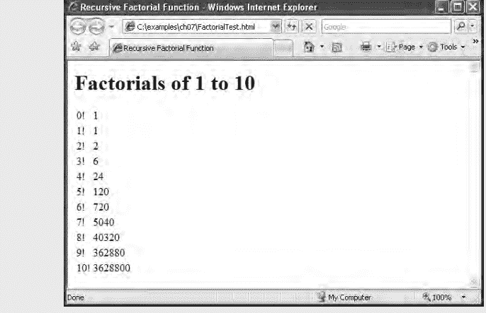

**图 7.10 | 使用递归函数计算阶乘（第 2 部分，共 2 部分）**

### 常见编程错误 7.7

> 遗漏基本情况以及错误地编写递归步骤使其无法收敛到基本情况，这两种错误都会导致无限递归，最终耗尽内存。这种情况类似于迭代（非递归）解决方案中的无限循环问题。

### 错误预防提示 7.2

> Internet Explorer 会在脚本似乎进入无限递归时显示错误消息。Firefox 在检测到问题后 simply 终止脚本。这使得网页用户可以从包含无限循环或无限递归的脚本中恢复。

## 7.11 递归与迭代


在前一节中，我们研究了一个既可以递归实现也可以迭代实现的函数。在本节中，我们比较这两种方法，并讨论为什么在特定情况下你可能会选择其中一种方法。

迭代和递归都基于控制语句：迭代使用重复语句（例如`for`、`while`或`do...while`）；递归使用选择语句（例如`if`、`if...else`或`switch`）。迭代和递归都涉及重复：迭代显式使用重复语句；递归通过重复的函数调用来实现重复。迭代和递归都涉及终止测试：迭代在循环继续条件失败时终止；递归在识别到基本情况时终止。具有计数器控制的迭代的迭代和递归都逐渐接近终止：迭代不断修改计数器，直到计数器取值使循环继续条件失败；递归不断产生原始问题的更简单版本，直到达到基本情况。迭代和递归都可以发生。

> **软件工程观察 7.5**
>
> 任何可以递归解决的问题也可以迭代（非递归）解决。当递归方法更自然地反映问题，并产生更容易理解和调试的程序时，通常优先选择递归方法而非迭代方法。选择递归解决方案的另一个原因是迭代解决方案可能不明显。

> **性能提示 7.1**
>
> 在注重性能的情况下避免使用递归。递归调用需要时间并消耗额外的内存。

> **常见编程错误 7.8**
>
> 意外地让非递归函数调用自身，要么直接调用，要么通过另一个函数间接调用，都可能导致无限递归。

## 7.12 网络资源

`www.deitel.com/javascript/`

Deitel JavaScript资源中心包含网络上一些最佳JavaScript资源的链接。在那里，你可以找到按类别分类的JavaScript工具、代码生成器、论坛、书籍、库、框架等链接。还可以查看适合所有技能水平的教程，从入门到高级。

一定要访问XHTML（`www.deitel.com/xhtml1/`）和CSS 2.1（`www.deitel.com/css21/`）的相关资源中心。

# 8 JavaScript：数组

## 学习目标

在本章中，你将学习：

- 使用数组存储值列表和表格。
- 声明数组、初始化数组以及引用数组的各个元素。
- 将数组传递给函数。
- 对数组进行排序。
- 声明和操作多维数组。

> 他哭泣着，抽泣着，挑选出
>
> 那些个头最大的……
>
> ——刘易斯·卡罗尔
>
> 尝试到底，不要
>
> 停下来怀疑；
>
> 没有什么是那么难，但寻找
>
> 会找到答案。
>
> ——罗伯特·赫里克
>
> 现在去，将它们写在
>
> 一张表上，
>
> 并记在书里。
>
> ——《以赛亚书》30:8
>
> 它锁在我的记忆里，
>
> 而你自己将保留
>
> 它的钥匙。
>
> ——威廉·莎士比亚

## 内容纲要

- 8.1 引言
- 8.2 数组
- 8.3 声明和分配数组
- 8.4 使用数组的示例
- 8.5 使用数组的随机图像生成器
- 8.6 引用和引用参数
- 8.7 将数组传递给函数
- 8.8 数组排序
- 8.9 多维数组
- 8.10 构建在线测验
- 8.11 网络资源

## 8.1 引言

数组是由相关数据项组成的数据结构（有时称为数据项集合）。JavaScript数组是"动态的"实体，因为它们在创建后可以更改大小。本章中演示的许多技术在后续章节10–11中经常使用，当我们介绍允许脚本程序员动态操作XHTML文档每个元素的集合时。

## 8.2 数组

数组是一组内存位置，它们都有相同的名称，通常类型也相同（尽管在JavaScript中这一属性不是必需的）。要引用数组中的特定位置或元素，我们指定数组的名称和该元素在数组中的位置编号。

图8.1展示了一个名为`c`的整数值数组。该数组包含12个元素。其中任何一个元素都可以通过给出数组名称后跟方括号（`[ ]`）中的元素位置编号来引用。每个数组中的第一个元素是第零个元素。因此，数组`c`的第一个元素称为`c[0]`，数组`c`的第二个元素称为`c[1]`，数组`c`的第七个元素称为`c[6]`，一般来说，数组`c`的第`i`个元素称为`c[i–1]`。数组名称遵循与其他标识符相同的约定。

方括号中的位置编号称为下标（或索引）。下标必须是整数或整数表达式。注意，带下标的数组名称是一个左值表达式——它可以用于赋值的左侧以将新值放入数组元素中。它也可以用于赋值的右侧以将其值赋给另一个左值表达式。

让我们更仔细地检查图8.1中的数组`c`。数组的名称是`c`。数组`c`的长度为12，可以使用以下表达式找到：

```javascript
c.length
```

JavaScript中的每个数组都知道自己的长度。数组的12个元素称为`c[ 0 ]`、`c[ 1 ]`、`c[ 2 ]`、...、`c[ 11 ]`。`c[ 0 ]`的值为-45，`c[ 1 ]`的值为6，`c[ 2 ]`的值为0，`c[ 7 ]`的值为62，`c[ 11 ]`的值为78。

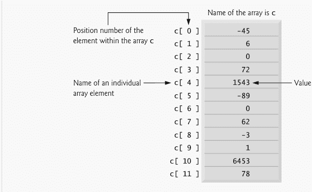

用于包围数组下标的方括号是JavaScript运算符。方括号与圆括号具有相同的优先级。图8.2中的表格展示了目前介绍的运算符的优先级和结合性。它们按照优先级从高到低的顺序自上而下排列，并标注了其结合性和类型。

| 运算符 | 结合性 | 类型 |
| :--- | :--- | :--- |
| `()` `[]` `.` | 从左到右 | 最高 |
| `++` `--` `!` | 从右到左 | 一元 |
| `*` `/` `%` | 从左到右 | 乘性 |
| `+` `-` | 从左到右 | 加性 |
| `<` `<=` `>` `>=` | 从左到右 | 关系 |
| `==` `!=` | 从左到右 | 等式 |
| `&&` | 从左到右 | 逻辑与 |
| `||` | 从左到右 | 逻辑或 |
| `?:` | 从右到左 | 条件 |
| `=` `+=` `-=` `*=` `/=` `%=` | 从右到左 | 赋值 |

**图 8.2** *目前讨论的运算符的优先级和结合性。*

## 8.3 声明和分配数组

数组在内存中占用空间。实际上，JavaScript中的数组是一个`Array`对象。你使用`operator` `new` 来动态分配（为每个数组所需的元素数量请求内存）。运算符`new`在程序执行时通过获取足够的内存来存储`new`右侧指定类型的对象，从而创建一个对象。创建新对象的过程也称为创建实例或实例化对象，而运算符`new`被称为动态内存分配运算符。数组是必须用`new`创建的对象。要为整型数组`c`分配12个元素，请使用语句：

```javascript
var c = new Array(  12 );
```

前面的语句也可以分两步执行，如下所示：

```javascript
var c; // 声明数组
c = new Array(  12 ); // 分配数组
```

当数组被分配时，元素并未被初始化——它们具有`undefined`的值。

> **常见编程错误 8.1**
>
> 假设在分配数组时元素已被初始化可能会导致逻辑错误。

## 8.4 使用数组的示例

本节介绍了创建和操作数组的几个示例。

### 创建和初始化数组

图8.3中的脚本使用运算符`new`分配一个包含五个元素的`Array`和一个空数组。该脚本演示了如何初始化一个包含现有元素的`Array`，并展示了一个`Array`可以动态增长以容纳新元素。数组的值显示在XHTML表格中。

```javascript
// 创建（声明）两个新数组
var n1 = new Array( 5 ); // 分配包含五个元素的数组
var n2 = new Array();   // 分配空数组
```

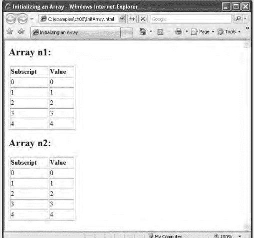

**图 8.3** | 初始化数组的元素。（第1部分，共2部分。）

```javascript
// 在数组 n2 中创建并初始化五个元素
for ( i = 0; i < 5; ++i )
   n2[ i ] = i;

outputArray( "Array n1:", n1 );
outputArray( "Array n2:", n2 );

// 输出表头，后跟一个包含 "theArray" 下标和元素的两列表格
function outputArray( heading, theArray )
{
   document.writeln( "<h2>" + heading + "</h2>" );
   document.writeln( "<table border = \"1\"" );
   document.writeln( "<thead><th>Subscript</th>" +
      "<th>Value</th></thead><tbody>" );

   // 输出每个数组元素的下标和值
   for ( var i = 0; i < theArray.length; i++ )
      document.writeln( "<tr><td>" + i + "</td><td>" +
         theArray[ i ] + "</td></tr>" );

   document.writeln( "</tbody></table>" );
} // end function outputArray
// -->
</script>
   </head><body></body>
</html>
```

**图 8.3** | 初始化数组的元素。（第2部分，共2部分。）

第17行将数组`n1`创建为包含五个元素的数组。第18行将数组`n2`创建为一个空数组。第21-22行使用`for`语句将`n1`的元素初始化为其下标数字（0到4）。注意在`for`语句的条件中使用了表达式`n1.length`来确定数组的长度。在此示例中，数组的长度为5，因此只要控制变量`i`的值小于5，循环就会继续执行。对于一个包含五个元素的数组，下标值为0到4，因此使用小于运算符`<`可以确保循环不会尝试访问数组末尾之外的元素。通常使用从零开始的计数来遍历数组。

第25-26行使用`for`语句向数组`n2`添加五个元素，并将每个元素初始化为其下标数字（0到4）。注意，数组`n2`会动态增长以容纳分配给其每个元素的值。

> **软件工程观察 8.1**
>
> 当为超出原始数组边界的元素分配值时，JavaScript会自动重新分配数组。原始数组的最后一个元素和新元素之间的元素具有`undefined`的值。

第28-29行调用函数`outputArray`（在第33-46行定义）在XHTML表格中显示每个数组的内容。函数`outputArray`接收两个参数——一个在显示数组内容的XHTML表格之前输出的字符串，以及要输出的数组。第41-43行使用`for`语句输出定义表格每一行的XHTML文本。

> **常见编程错误 8.2**
>
> 引用数组边界之外的元素通常是逻辑错误。

如果数组元素的值是已知的，可以在数组声明中分配和初始化这些元素。指定初始值有两种方式。语句：

```javascript
var n = [ 10, 20, 30, 40, 50 ];
```

使用方括号（`[`和`]`）括起来的逗号分隔的初始化列表来创建一个包含五个元素、下标为0、1、2、3和4的数组。数组的大小由初始化列表中的值的数量决定。请注意，前面的声明不需要`new`运算符来创建`Array`对象——此功能由解释器在遇到包含初始化列表的数组声明时提供。语句：

```javascript
var n = new Array( 10, 20, 30, 40, 50 );
```

同样创建一个包含五个元素、下标为0、1、2、3和4的数组。在这种情况下，数组元素的初始值被指定为`new Array`后面括号中的参数。数组的大小由括号中值的数量决定。也可以在数组中预留空间以指定稍后的值，方法是在初始化列表中使用逗号作为占位符。例如，语句：

```javascript
var n = [ 10, 20, , 40, 50 ];
```

创建一个包含五个元素的数组，其中第三个元素（`n[ 2 ]`）没有指定值。

### 使用初始化列表初始化数组

图8.4中的脚本创建了三个`Array`对象，以演示使用初始化列表初始化数组（第18-20行），并使用与图8.3中讨论的相同函数`outputArray`在XHTML表格中显示每个数组。请注意，当数组`integers2`显示在网页上时，下标为1和2（第二和第三个元素）的元素（数组中的）元素在网页中显示为`undefined`。这两个元素是我们未在脚本第20行的声明中提供值的。

```xml
<?xml version = "1.0" encoding = "utf-8"?>
<!DOCTYPE html PUBLIC "-//W3C//DTD XHTML 1.0 Strict//EN"
     "http://www.w3.org/TR/xhtml1/DTD/xhtml1-strict.dtd">

<!-- 图 8.4: InitArray2.html -->
<!-- 声明和初始化数组。 -->
<html xmlns = "http://www.w3.org/1999/xhtml">
    <head>
        <title>使用声明初始化数组</title>
        <style type = "text/css">
            table { width: 15em }
            th    { text-align: left }
        </style>
        <script type = "text/javascript">
            <!--
            // 初始化列表指定了元素的数量以及
            // 每个元素的值。
            var colors = new Array( "cyan", "magenta","yellow", "black" );
            var integers1 = [ 2, 4, 6, 8 ];
            var integers2 = [ 2, , , 8 ];

            outputArray( "Array colors contains", colors );
            outputArray( "Array integers1 contains", integers1 );
            outputArray( "Array integers2 contains", integers2 );

            // 输出表头，后跟一个包含 theArray 下标和元素的两列表格
            function outputArray( heading, theArray )
            {
                document.writeln( "<h2>" + heading + "</h2>" );
                document.writeln( "<table border = \"1\"" );
                document.writeln( "<thead><th>Subscript</th>" +
                    "<th>Value</th></thead><tbody>" );

                // 输出每个数组元素的下标和值
                for ( var i = 0; i < theArray.length; i++ )
                    document.writeln( "<tr><td>" + i + "</td><td>" +
                        theArray[ i ] + "</td></tr>" );

                document.writeln( "</tbody></table>" );
            } // end function outputArray
            // -->
        </script>
    </head><body></body>
</html>
```

**图 8.4** | 声明和初始化数组。（第1部分，共2部分。）

### 使用`for`和`for...in`对数组元素求和

图8.5中的脚本对数组`theArray`中的值求和，该数组是在第13行声明、分配并初始化的10个元素的整数数组。第一个`for`语句体中的第19行语句执行了累加操作。请注意，作为数组`theArray`初始值提供的值，也可以通过XHTML表单读入程序。

在此示例中，我们介绍了JavaScript的`for...in`语句，它使脚本能够对数组中的每个元素执行任务（或者，正如我们将在第10-11章中看到的，对集合中的每个元素执行任务）。第25-26行展示了`for...in`语句的语法。在括号内，我们声明了用于选择`in`关键字右侧对象（此处为`theArray`）中每个元素的元素变量。使用`for...in`时，JavaScript会自动确定数组中的元素数量。当JavaScript解释器遍历`theArray`的元素时，变量`element`被分配一个值，该值可用作`theArray`的下标。对于数组，分配的值是一个从0开始到（但不包括）`theArray.length`的范围内的下标。每个值都被添加到`total2`中，以产生数组中元素的总和。

### 防错提示 8.1

> 在遍历所有计数器时...


在第7章中，我们指出有一种更优雅的方法来实现图7.4中的掷骰子程序。该程序将一个六面骰子掷出6000次，并使用`switch`语句来累加每个值被掷出的次数。该脚本的数组版本如图8.6所示。图7.4中的`switch`语句被本程序的第24行所取代。此行使用随机出现的骰子面值作为数组`frequency`的下标，以确定在循环的每次迭代中递增哪个元素。由于第23行的随机数计算产生1到6（六面的骰子的值），因此`frequency`数组必须足够大，以允许1到6的下标值。一个数组要拥有这些下标值，所需的最少元素数量是七个（下标值从0到6）。在本程序中，我们忽略数组`frequency`的第0个元素，仅使用与骰子各面值对应的元素。此外，本程序的第32-34行使用了一个循环来生成在图7.4中逐行编写的表格。因为我们可以遍历数组`frequency`来帮助生成输出，所以我们不必像图7.4中那样逐个枚举每个XHTML表格行。

```html
 1  <?xml version = "1.0" encoding = "utf-8"?>
 2  <!DOCTYPE html PUBLIC "-//W3C//DTD XHTML 1.0 Strict//EN"
 3    "http://www.w3.org/TR/xhtml1/DTD/xhtml1-strict.dtd">
 4 
 5  <!-- 图 8.6: RollDie.html -->
 6  <!-- 使用数组而非 switch 语句的掷骰子程序。 -->
 7  <html xmlns = "http://www.w3.org/1999/xhtml">
 8     <head>
 9        <title>掷一个六面骰子6000次</title>
10        <style type = "text/css">
11           table { width: 15em }
12           th    { text-align: left }
13        </style>
14        <script type = "text/javascript">
15           <!--
16           var face;
17           var frequency = [ , 0, 0, 0, 0, 0, 0 ]; // 留出 frequency[0]
18                                                     // 未初始化
19 
20           // 汇总结果
21           for ( var roll = 1; roll <= 6000; ++roll )
22           {
23              face = Math.floor( 1 + Math.random() * 6 );
24              ++frequency[ face ];
25           } // 结束 for
26 
27           document.writeln( "<table border = \"1\"><thead>" );
28           document.writeln( "<th>面值</th>" +
29              "<th>频率</th></thead><tbody>" );
30 
31           // 为每个面值生成完整的频率表
32           for ( face = 1; face < frequency.length; ++face )
33              document.writeln( "<tr><td>" + face + "</td><td>" +
34                 frequency[ face ] + "</td></tr>");
35 
36         document.writeln( "</tbody></table>" );
37         // -->
38         </script>
39     </head>
40     <body>
41         <p>点击刷新（或重新加载）再次运行脚本</p>
42     </body>
43  </html>
```

### 图 8.6 | 使用数组而非`switch`语句的掷骰子程序。（共2部分，第1部分）

### 图 8.6 | 使用数组而非`switch`语句的掷骰子程序。（共2部分，第2部分）

## 8.5 使用数组的随机图像生成器

在第7章中，我们创建了一个随机图像生成器，它要求图像文件命名为`1.gif`、`2.gif`、……、`7.gif`。在这个示例（图8.7）中，我们创建了一个更优雅的随机图像生成器，它不需要图像文件名是整数。这个版本的随机图像生成器使用一个数组`pictures`来以字符串形式存储图像文件的名称。脚本生成一个随机整数，并将其用作`pictures`数组的下标。脚本输出一个XHTML`img`元素，其`src`属性包含位于`pictures`数组中随机选定位置的图像文件名。

```html
 1   <?xml version = "1.0" encoding = "utf-8"?>
 2   <!DOCTYPE html PUBLIC "-//W3C//DTD XHTML 1.0 Strict//EN"
 3      "http://www.w3.org/TR/xhtml1/DTD/xhtml1-strict.dtd">
 4
 5   <!-- 图 8.7: RandomPicture2.html -->
 6   <!-- 使用数组的随机图像生成。 -->
 7   <html xmlns = "http://www.w3.org/1999/xhtml">
 8       <head>
 9           <title>随机图像生成器</title>
10           <style type = "text/css">
11               table { width: 15em }
12               th    { text-align: left }
13           </style>
14           <script type = "text/javascript">
15               <!--
16                   var pictures =
17                       [ "CPE", "EPT", "GPP", "GUI", "PERF", "PORT", "SEO" ];
18
19                   // 从 pictures 数组中随机选取一个图像并通过
20                   // 创建 img 标签并将 src 属性附加到
21                   // 文件名来显示
22                   document.write ( "" );
24                   // -->
25           </script>
26       </head>
27       <body>
28           <p>点击刷新（或重新加载）再次运行脚本</p>
29       </body>
30   </html>
```

脚本在第16-17行声明了数组`pictures`，并用七个图像文件的名称对其进行初始化。第22-23行创建了在网页上显示随机图像的`img`标签。第22行开始`img`标签并开始`src`属性。第23行生成一个从0到6的随机整数作为`pictures`数组的索引，结果是一个随机选择的图像文件名。表达式

```javascript
pictures[ Math.floor( Math.random() * 7 ) ]
```

求值为`pictures`数组中的一个字符串，然后该字符串被写入文档（第23行）。第23行用图像文件的扩展名（`.gif`）完成了`img`标签。

## 8.6 引用和引用参数

在许多编程语言中，向函数（或方法）传递参数的两种方式是*按值传递*和*按引用传递*。当参数按值传递给函数时，会制作该参数值的一个*副本*，并将其传递给被调用的函数。在JavaScript中，数字、布尔值和字符串都是按值传递给函数的。

通过**传引用**，调用函数让被调用函数直接访问其数据，并允许被调用函数根据需要修改数据。该过程通过向被调用函数传递数据所在内存位置的地址来实现。传引用可以提高性能，因为它能消除复制大量数据的开销，但它也可能削弱安全性，因为被调用函数可以访问调用函数的数据。在JavaScript中，所有对象（因此所有数组）都是通过引用传递给函数的。

### 防错提示 8.2

通过**传值**，对被调用函数中副本的修改不会影响调用函数中原始变量的值。这可以防止意外的副作用，而这些副作用会严重阻碍正确和可靠的软件系统的开发。

### 软件工程观察 8.2

与其他一些语言不同，JavaScript不允许你选择每个参数是通过值传递还是通过引用传递。数字、布尔值和字符串通过值传递。对象通过引用传递给函数。当函数接收到一个对象的引用时，该函数可以直接操作该对象。

### 软件工程观察 8.3

当通过`return`语句从函数返回信息时，数字和布尔值总是通过值返回（即返回一个副本），而对象总是通过引用返回。请注意，在传引用的情况下，没有必要返回新值，因为对象已经被修改了。

要将对象的引用传递给函数，只需在函数调用中指定引用名称。通常，引用名称是程序用于操作对象的标识符。在被调用函数体中通过其参数名提及该引用，实际上指的是内存中的原始对象，该对象可以被被调用函数直接访问。在下一节中，我们将使用数组来演示传值和传引用。

### 8.7 将数组传递给函数

要将数组参数传递给函数（图8.8），指定数组的名称（数组的引用）而不使用方括号。例如，如果数组`hourlyTemperatures`已声明为：

```javascript
var hourlyTemperatures = new Array( 24 );
```

那么函数调用：

```javascript
modifyArray( hourlyTemperatures );
```

会将数组`hourlyTemperatures`传递给函数`modifyArray`。正如第8.2节所述，JavaScript中的每个数组对象都知道自己的大小（通过`length`属性）。因此，当我们将数组对象传递给函数时，我们不会单独传递数组的大小作为参数。在将数组`n1`和`n2`传递给函数`outputArray`以显示每个数组的内容时，图8.3说明了这个概念。

```html
<?xml version = "1.0" encoding = "utf-8"?>
<!DOCTYPE html PUBLIC "-//W3C//DTD XHTML 1.0 Strict//EN"
	"http://www.w3.org/TR/xhtml1/DTD/xhtml1-strict.dtd">

<!-- Fig. 8.8: PassArray.html -->
<!-- 将数组和单个数组元素传递给函数。 -->
<html xmlns = "http://www.w3.org/1999/xhtml">
<head>
	<title>将数组和单个数组元素传递给函数</title>
	<script type = "text/javascript">
		<!--
		var a = [ 1, 2, 3, 4, 5 ];

		document.writeln( "<h2>通过引用传递整个数组的效果</h2>" );
		outputArray( "原始数组: ", a );

		modifyArray( a ); // 数组 a 通过引用传递

		outputArray( "修改后的数组: ", a );

		document.writeln( "<h2>通过值传递数组元素的效果</h2>" +
			"a[3] 在 modifyElement 之前: " + a[3] );

		modifyElement( a[3] ); // 数组元素 a[3] 通过值传递

		document.writeln( "<br />a[3] 在 modifyElement 之后: " + a[3] );

		// 输出标题后跟 "theArray" 的内容
		function outputArray( heading, theArray )
		{
			document.writeln(
				heading + theArray.join( " " ) + "<br />" );
		} // 结束函数 outputArray

		// 修改数组元素的函数
		function modifyArray( theArray )
		{
			for ( var j in theArray )
				theArray[j] *= 2;
		} // 结束函数 modifyArray

		// 修改传入值的函数
		function modifyElement( e )
		{
			e *= 2; // 仅在函数执行期间缩放元素 e
			document.writeln( "<br />modifyElement 中的值: " + e );
		} // 结束函数 modifyElement
		// -->
	</script>
</head>
```

将数组和单个数组元素传递给函数。（第1部分，共2部分。）

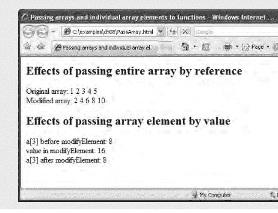

**图8.8** | 将数组和单个数组元素传递给函数。（第2部分，共2部分。）

虽然整个数组是通过引用传递的，但单个的数字和布尔数组元素是*通过值*传递的，其方式与简单的数字和布尔变量传递的方式完全相同（由对象数组的单个元素引用的对象仍然通过引用传递）。这种简单的单个数据项被称为*标量*。要将数组元素传递给函数，请在函数调用中使用该元素的带下标名称作为参数。

为了使函数能够通过函数调用接收一个数组，函数的参数列表必须指定一个将在函数体中引用该数组的参数。与其他编程语言不同，JavaScript没有为此目的提供特殊的语法。JavaScript只要求在参数列表中指定数组的标识符。例如，函数`modifyArray`的函数头可以写成：

```javascript
function modifyArray( b )
```

这表示`modifyArray`期望接收一个名为`b`的参数（调用函数中提供的参数必须是一个数组）。数组通过引用传递，因此当被调用函数使用数组名`b`时，它指的是调用函数中的实际数组（在前面的调用中是数组`hourlyTemperatures`）。图8.8中的脚本演示了传递整个数组和传递单个数组元素之间的区别。

### 软件工程观察 8.4

> *JavaScript不检查传递给函数的参数数量或参数类型。可以向函数传递任意数量的值。当使用这些值时，JavaScript会尝试进行类型转换。*

第17行的语句调用函数`outputArray`来显示数组`a`在被修改之前的内容。函数`outputArray`（在第32-36行定义）接收一个要输出的字符串和一个要输出的数组。第34-35行的语句使用数组方法`join`创建一个包含`theArray`中所有元素的字符串。方法`join`的参数是一个字符串，该字符串包含用于分隔返回字符串中数组元素的*分隔符*。如果未指定参数，则使用空字符串作为分隔符。

第19行调用函数`modifyArray`（第39-43行）并将数组`a`传递给它。`modifyArray`函数将每个元素乘以2。为了说明数组`a`的元素已被修改，第21行的语句再次调用函数`outputArray`来显示数组`a`被修改后的内容。如屏幕截图所示，`a`的元素确实被`modifyArray`修改了。

为了显示在调用`modifyElement`之前`a[3]`的值，第25行输出了`a[3]`的值。第27行调用`modifyElement`（第46-51行）并将`a[3]`作为参数传递。请记住，`a[3]`实际上是数组`a`中的一个整数值。同时请记住，数字值和布尔值总是通过值传递给函数。因此，传递的是`a[3]`的一个副本。函数`modifyElement`将其参数乘以2并将结果存储在其参数`e`中。函数`modifyElement`的参数是该函数中的一个局部变量，因此当函数终止时，该局部变量将不再可访问。因此，当控制权返回到主脚本时，第29行的语句显示了`a[3]`的未修改值。

## 8.8 数组排序

JavaScript中的`Array`对象有一个内置的`sort`方法用于对数组进行排序。图8.9演示了`Array`对象的`sort`方法。


```xml
1  <?xml version = "1.0" encoding = "utf-8"?>
2  <!DOCTYPE html PUBLIC "-//W3C//DTD XHTML 1.0 Strict//EN"
3     "http://www.w3.org/TR/xhtml1/DTD/xhtml1-strict.dtd">
4  
5  <!-- Fig. 8.9: Sort.html -->
6  <!-- 使用 sort 对数组进行排序。 -->
7  <html xmlns = "http://www.w3.org/1999/xhtml">
8     <head>
9        <title>使用 Array 方法 sort 对数组进行排序</title>
10       <script type = "text/javascript">
11          <!--
12          var a = [ 10, 1, 9, 2, 8, 3, 7, 4, 6, 5 ];
13 
14          document.writeln( "<h1>数组排序</h1>" );
15          outputArray( "原始顺序的数据项: ", a );
16          a.sort( compareIntegers );  // 对数组进行排序
17          outputArray( "升序排列的数据项: ", a );
18 
19          // 输出标题后跟 theArray 的内容
20          function outputArray( heading, theArray )
21          {
22             document.writeln( "<p>" + heading +
23                theArray.join( " " ) + "</p>" );
24          } // 结束函数 outputArray
```

图 8.9 | 使用 Array 方法 `sort` 对数组进行排序。（第 1 部分，共 2 部分。）

```javascript
26         // comparison function for use with sort
27         function compareIntegers( value1, value2 )
28         {
29             return parseInt( value1 ) - parseInt( value2 );
30         } // end function compareIntegers
31         // -->
32       </script>
33       </head><body></body>
34       </html>
```

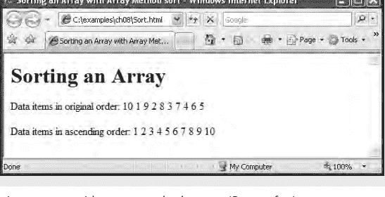

图 8.9 | 使用 Array 方法对数组排序。（第 2 部分，共 2 部分。）

默认情况下，Array 方法的 `sort`（无参数）使用字符串比较来确定数组元素的排序顺序。字符串通过其字符的 ASCII 值进行比较。[注：字符串比较在第九章“JavaScript：对象”中讨论得更详细。]在本例中，我们希望对整数数组进行排序。

排序方法（`sort`）取一个可选的参数，该参数的名称是一个函数（称为*比较器函数*），它比较两个参数并返回以下之一：

- 如果第一个参数小于第二个参数，则返回负值。
- 如果参数相等，则返回零。
- 如果第一个参数大于第二个参数，则返回正值。

本例使用函数 `compareIntegers`（在第 27–30 行定义）作为排序方法（`sort`）的比较器函数。它计算两个参数的整数值之间的差（函数 `parseInt` 确保将参数正确地处理为整数）。如果第一个参数小于第二个参数，差值将为负值。如果参数相等，差值将为零。如果第一个参数大于第二个参数，差值将为正值。

第 16 行调用对象 `a` 的 `sort` 方法，并传入比较器函数 `compareIntegers` 的名称作为参数。排序方法（`sort`）接收 `compareIntegers` 函数作为参数，然后使用该函数比较数组 `a` 的元素以确定其排序顺序。

> **软件工程观察 8.5**
>
> JavaScript 中的函数被视为数据。因此，可以将函数赋值给变量、存储在数组中并传递给函数，就像其他数据类型一样。

## 8.9 多维数组

具有两个下标（subscripts）的多维数组通常用于表示由排列在*行*和*列*中的信息组成的值表。要标识特定的表元素，必须指定两个下标；按照惯例，第一个下标标识元素的行，第二个下标标识元素的列。需要两个下标来标识特定元素的数组称为*二维数组*（two-dimensional arrays）。

多维数组可以具有超过两个维度。JavaScript 不支持多维数组的直接形式，但允许您指定其元素也是数组的数组，从而达到相同的效果。当数组包含一维数组作为其元素时，我们可以将这些一维数组想象为表中的行，而这些数组中的位置为列。图 8.10 展示了一个名为 `a` 的二维数组，它包含三行和四列（即一个 3x4 数组——三个一维数组，每个有 4 个元素）。通常，具有 `m` 行和 `n` 列的数组称为 `m-x-n 数组`。

在图 8.10 中，数组 `a` 中的每个元素都由形式为 `a[ i ][ j ]` 的元素名称标识；`a` 是数组的名称，而 `i` 和 `j` 是唯一标识 `a` 中每个元素的行和列的下标。注意第一行的所有元素名称的第一个下标都是 0；第四列的所有元素名称的第二个下标都是 3。

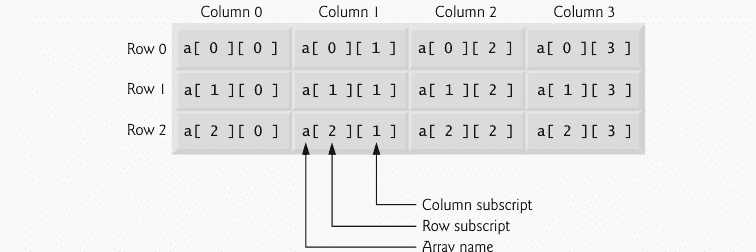

**图 8.10** | 具有三行和四列的二维数组。

### 由一维数组构成的数组

多维数组可以在声明中像一维数组一样初始化。具有两行两列的数组 `b` 可以通过以下语句声明并初始化：

```javascript
var b = [ [ 1, 2 ], [ 3, 4 ] ];
```

值按行分组在方括号内。数组 `[1, 2]` 初始化元素 `b[0]`，数组 `[3, 4]` 初始化元素 `b[1]`。因此 1 和 2 分别初始化 `b[0][0]` 和 `b[0][1]`。同样，3 和 4 分别初始化 `b[1][0]` 和 `b[1][1]`。解释器通过计算最外层数组中嵌套的子初始化列表（子数组）的数量来确定行数。解释器通过计算初始化行的子数组中的值的数量来确定每列的列数。

**250** 第 8 章 JavaScript：数组

### 具有不同长度行的二维数组

二维数组的行可以具有不同的长度。声明：

```javascript
var b = [ [ 1, 2 ], [ 3, 4, 5 ] ];
```

创建了数组 `b`，其中第 0 行包含两个元素（1 和 2），第 1 行包含三个元素（3、4 和 5）。

### 使用 `new` 创建二维数组

每行的列数不同的多维数组可以动态分配，如下所示：

```javascript
var b;
b = new Array( 2 ); // allocate rows
b[ 0 ] = new Array( 5 ); // allocate columns for row 0
b[ 1 ] = new Array( 3 ); // allocate columns for row 1
```

前面的代码创建了一个具有两行的二维数组。第 0 行有五个列，第 1 行有三个列。

### 二维数组示例：显示元素值

图 8.11 在声明中初始化二维数组，并使用嵌套的 `for...in` 循环遍历这些数组（即操作数组中的每个元素）。

```javascript
 1 <?xml version = "1.0" encoding = "utf-8"?>
 2 <!DOCTYPE html PUBLIC "-//W3C//DTD XHTML 1.0 Strict//EN"
 3    "http://www.w3.org/TR/xhtml1/DTD/xhtml1-strict.dtd">
 4
 5 <!-- Fig. 8.11: InitArray3.html -->
 6 <!-- Initializing multidimensional arrays. -->
 7 <html xmlns = "http://www.w3.org/1999/xhtml">
 8    <head>
 9       <title>Initializing Multidimensional Arrays</title>
10       <script type = "text/javascript">
11          <!--
12          var array1 = [ [ 1, 2, 3 ], // first row
13                         [ 4, 5, 6 ] ]; // second row
14          var array2 = [ [ 1, 2 ], // first row
15                         [ 3 ], // second row
16                         [ 4, 5, 6 ] ]; // third row
17
18          outputArray( "Values in array1 by row", array1 );
19          outputArray( "Values in array2 by row", array2 );
20
21          function outputArray( heading, theArray )
22          {
23             document.writeln( "<h2>" + heading + "</h2><pre>" );
24
25             // iterates through the set of one-dimensional arrays
26             for ( var i in theArray )
27             {
```

图 8.11 | 初始化多维数组。（第 1 部分，共 2 部分。）

```javascript
// iterates through the elements of each one-dimensional
// array
for ( var j in theArray[ i ] )
   document.write( theArray[ i ][ j ] + " " );

document.writeln( "<br />" );
} // end for

document.writeln( "</pre>" );
} // end function outputArray
// -->
</script>
</head><body></body>
</html>
```

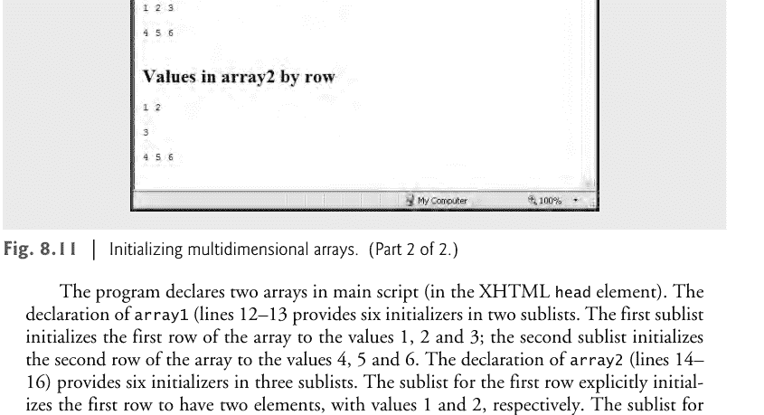

图 8.11 初始化多维数组。（第 2 部分，共 2 部分。）

程序在主要脚本的 XHTML 标题元素（head element）中声明了两个数组。`array1` 的声明（第 12-13 行）提供两个子列表中的六个初始化项。第一个子列表将数组的第一行初始化为值 1、2 和 3；第二个子列表将数组的第二行初始化为值 4、5 和 6。`array2` 的声明（第 14-16 行）提供了三个子列表中的六个初始化项。第一行的子列表明确将第一行初始化为两个元素，值分别为 1 和 2。第二行的子列表将第二行初始化为一个元素，值为 3。第三行的子列表将第三行初始化为值 4、5 和 6。

脚本调用第 18-19 行的输出函数（函数 `outputArray`）来在网页上显示每个数组的元素。函数 `outputArray`（第 21-37 行）接收两个参数：在输出数组之前输出的字符串标题（`heading`）和要输出的数组（`theArray`）。请注意嵌套的 `for...in` 语句用于输出二维数组的行。外层的 `for...in` 语句遍历数组的行。内层的 `for...in` 语句遍历当前处理行的列。本例中的嵌套 `for...in` 语句可以用 `for` 语句重写，如下所示：

```javascript
for ( var i = 0; i < theArray.length; ++i )
{
    for ( var j = 0; j < theArray[ i ].length; ++j )
        document.write( theArray[ i ][ j ] + " " );

    document.writeln( "<br />" );
}
```

在外层 `for` 语句中，表达式 `theArray.length` 确定数组的行数。在内层 `for` 语句中，表达式 `theArray[i].length` 确定数组每一行的列数。这个条件使循环能够确定每一行的确切列数。

### 使用 `for` 和 `for...in` 语句进行常见的多维数组操作

许多常见的数组操作都使用 `for` 或 `for...in` 语句。例如，下面的 `for` 语句将图 8.10 中数组 `a` 的第三行所有元素设置为零：

```javascript
for ( var col = 0; col < a[ 2 ].length; ++col )
    a[ 2 ][ col ] = 0;
```

我们指定了*第三*行；因此，我们知道第一个下标始终是 2（0 是第一行，1 是第二行）。`for` 循环仅改变第二个下标（即列下标）。上述 `for` 语句等价于以下语句：

```javascript
a[ 2 ][ 0 ] = 0;
a[ 2 ][ 1 ] = 0;
a[ 2 ][ 2 ] = 0;
a[ 2 ][ 3 ] = 0;
```

下面的 `for...in` 语句也等价于上述 `for` 语句：

```javascript
for ( var col in a[ 2 ] )
    a[ 2 ][ col ] = 0;
```

下面的嵌套 `for` 语句计算数组 `a` 中所有元素的总和：

```javascript
var total = 0;

for ( var row = 0; row < a.length; ++row )

    for ( var col = 0; col < a[ row ].length; ++col )
        total += a[ row ][ col ];
```

该 `for` 语句逐行累加数组的元素。外层 `for` 语句首先将行下标设置为 0，以便内层 `for` 语句可以累加第一行的元素。然后外层 `for` 语句将 `row` 增量到 1，以便累加第二行的元素。接着外层 `for` 语句将 `row` 增量到 2，以便累加第三行的元素。当嵌套 `for` 语句结束时，可以显示结果。上述 `for` 语句等价于下面的 `for...in` 语句：

```javascript
var total = 0;

for ( var row in a )

    for ( var col in a[ row ] )
        total += a[ row ][ col ];
```

## 8.10 构建在线测验

在线测验和投票是流行的 Web 应用，常用于教育目的或娱乐。Web 开发人员通常使用简单的 XHTML 表单构建测验，并用 JavaScript 处理结果。数组允许程序员在单个数据结构中表示多个可能的答案选项。图 8.12 包含一个由一道题目组成的在线测验。测验页面包含本书中使用过的一种提示图标，以及一个 XHTML 表单，用户通过选择四个单选按钮之一来识别图像所代表的提示类型。用户选择一个单选按钮选项并提交表单后，脚本会确定用户是否选择了与神秘图像匹配的正确提示类型。检查用户答案的 JavaScript 函数将本章和前几章中的几个概念结合在一个简洁实用的脚本中。


```html
1  <?xml version = "1.0" encoding = "utf-8"?>
2  <!DOCTYPE html PUBLIC "-//W3C//DTD XHTML 1.0 Strict//EN"
3     "http://www.w3.org/TR/xhtml1/DTD/xhtml1-strict.dtd">
4
5  <!-- Fig. 8.12: quiz.html -->
6  <!-- Online quiz graded with JavaScript. -->
7  <html xmlns = "http://www.w3.org/1999/xhtml">
8     <head>
9        <title>Online Quiz</title>
10       <script type = "text/javascript">
11          <!--
12          function checkAnswers()
13          {
14             var myQuiz = document.getElementById( "myQuiz" );
15
16             // determine whether the answer is correct
17             if ( myQuiz.elements[ 1 ].checked )
18                alert( "Congratulations, your answer is correct" );
19             else // if the answer is incorrect
20                alert( "Your answer is incorrect. Please try again" );
21          } // end function checkAnswers
22          -->
23       </script>
24    </head>
25    <body>
26       <form id = "myQuiz" onsubmit = "checkAnswers()" action = "">
27          <p>Select the name of the tip that goes with the
28             image shown:<br />
29             
30             <br />
31
32             <input type = "radio" name = "radiobutton" value = "CPE" />
33             <label>Common Programming Error</label>
34
35             <input type = "radio" name = "radiobutton" value = "EPT" />
36             <label>Error-Prevention Tip</label>
37
38             <input type = "radio" name = "radiobutton" value = "PERF" />
39             <label>Performance Tip</label>
40
41             <input type = "radio" name = "radiobutton" value = "PORT" />
42             <label>Portability Tip</label><br />
43
44             <input type = "submit" name = "submit" value = "Submit" />
45             <input type = "reset" name = "reset" value = "Reset" />
46          </p>
47       </form>
48    </body>
49 </html>
```

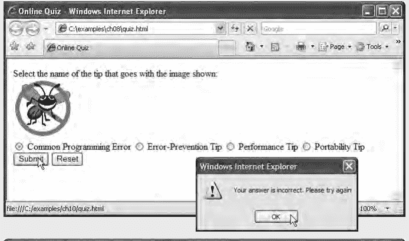

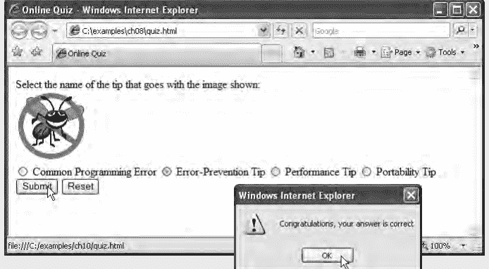

图 8.12 | 使用 JavaScript 评分的在线测验。（第 2 部分，共 2 部分）

在讨论脚本代码之前，我们先讨论 XHTML 文档的 `body` 元素（第 25–48 行）。`body` 中的 GUI 组件在脚本中起着重要作用。

第 26–47 行定义了向用户展示测验的表单。第 26 行开始 `form` 元素，并指定 `onsubmit` 属性为 `"checkAnswers()"`，表示当用户提交表单时（即点击 **Submit** 按钮或按 *Enter* 键），解释器应执行 JavaScript 函数 `checkAnswers`（第 12–21 行）。

第 29 行将提示图像添加到页面中。第 32–42 行显示单选按钮和相应的 `label`，展示可能的答案选项。第 44–45 行将 `submit` 和 `reset` 按钮添加到表单中。

现在我们检查用于检查用户提交答案的脚本。第 12–21 行声明了函数 `checkAnswers`，其中包含评分测验所需的所有 JavaScript。第 17–20 行的 `if...else` 语句确定用户是否回答了正确的问题。要求用户识别的图像是 Error-Prevention Tip 图标。因此，测验的正确答案对应第二个单选按钮。

可以使用 `getElementById` 单独访问 XHTML 表单的元素，或者通过包含表单对象的 `elements` 属性来访问。`elements` 属性包含表单所有控件的数组。单选按钮是 XHTML 表单 `myQuiz` 的一部分，所以我们在第 17 行使用点符号访问 `elements` 数组（`myQuiz.elements[1]`）。数组元素 `myQuiz.elements[1]` 对应正确答案（即第二个单选按钮）。最后，第 17 行确定第二个单选按钮的 `checked` 属性是否为 `true`。单选按钮的 `checked` 属性在选中时为 `true`，未选中时为 `false`。请记住，任何给定时刻只能选中一个单选按钮。如果属性 `myQuiz.elements[1].checked` 为 `true`，表示选择了正确答案，脚本会发出祝贺消息。如果单选按钮的 `checked` 属性为 `false`，则脚本会发出备选消息（第 20 行）。

## 8.11 Web 资源

`www.deitel.com/javascript/`

Deitel JavaScript 资源中心包含 Web 上一些最佳 JavaScript 资源的链接。在那里，你可以找到按类别分类的 JavaScript 工具、代码生成器、论坛、书籍、库、框架等链接。还可以查看适合所有技能水平的教程，从入门到高级。请务必访问相关的 XHTML（`www.deitel.com/xhtml/`）和 CSS 2.1（`www.deitel.com/css21/`）资源中心。

# 9 JavaScript：对象

> 我的目标，崇高无比  
> 终将实现，指日可待。  
> ——W. S. Gilbert
>
> 难道世界是用来隐藏美德的吗？  
> ——William Shakespeare

## 学习目标

> 继承图书馆固然好，但自己收集一个更好。  
> ——Augustine Birrell

在本章中，你将学习：

- 基于对象的编程术语和概念。
- 封装和数据隐藏的概念。
- 面向对象的价值。
- 使用 JavaScript 对象 `Math`、`String`、`Date`、`Boolean` 和 `Number`。
- 使用浏览器的 `document` 和 `window` 对象。
- 使用 cookie。
- 使用 JSON 简单表示对象。

## 9.1 简介

本章以更正式的方式探讨对象。我们首先简要介绍面向对象的概念。本章的其余部分概述了 JavaScript 的若干内置对象，并演示了它们的许多功能。我们还将简要介绍 JSON，这是一种创建 JavaScript 对象的方法。在接下来的关于文档对象模型（Document Object Model）和事件（Events）的章节中，我们将讨论浏览器提供的、使脚本能够与 XHTML 文档元素进行交互的对象。

## 9.2 对象技术简介

本节提供了面向对象的通用介绍。此处讨论的术语和技术支持书中后续章节。在这里，您将了解到对象是一种思考世界和处理操作 XHTML 文档的脚本的自然方式。在第 4–8 章中，我们使用了 JavaScript 的内置对象——`Math` 和 `Array`，以及 Web 浏览器提供的对象——`document` 和 `window`——来执行脚本中的任务。JavaScript 使用对象来执行许多任务，因此被称为基于对象的编程语言。我们的目标是帮助您培养面向对象的思想。本书中的许多技术，包括 CSS、JavaScript、Ajax、Ruby on Rails、ASP.NET 和 JavaServer Faces，都基于本章节引入的一些概念。

### 面向对象的基本概念

我们从一些关键术语开始介绍对象技术。放眼现实世界，无处不在的对象：人、动物、植物、汽车、飞机、建筑物、电脑、显示器等等。人类以对象的方式思考。电话、房屋、交通灯、微波炉和饮水机等只是我们周围常见的几种对象。

我们有时将对象分为两类：有生命和无生命。有生命的对象在某种意义上是“活”的——它们会移动和做事情。无生命的对象不会自行移动。然而，这两类对象都有一些共同之处。它们都具有*属性*（例如：大小、形状、颜色和重量），并且都表现出*行为*（例如：球滚动、弹跳、充气或放气；婴儿哭泣、睡觉、爬行、行走和眨眼；汽车加速、刹车和转向；毛巾吸水）。我们将研究软件对象所具有的属性和行为类型。

人类通过研究对象的属性并观察其行为来了解现有对象。不同的对象可能具有相似的属性并表现出相似的行为。例如，可以在婴儿和成年人之间，以及人类和大猩猩之间进行比较。

*面向对象设计（OOD）* 使用与人描述现实世界对象相似的术语对软件进行建模。它利用类之间的关系，例如某一类的对象（如车辆类）具有相同的特征——汽车、卡车、小型红色推车和溜冰鞋有很多共同点。OOD 还利用*继承*关系，即新类对象通过吸收现有类的特征并添加其自身的独特特征而衍生出来。例如，“敞篷车”类的对象当然具有更一般的“汽车”类的特征，但更具体地说，其车顶可以上升和下降。

面向对象设计提供了看待软件设计过程的自然而直观的方法——即通过属性、行为及相互关系来建模对象，正如我们描述现实世界中的对象一样。OOD 还建模对象之间的通信。正如人们互相发送消息（例如，军士命令士兵立正），对象也通过消息进行通信。一个银行账户对象可能会收到一条消息，要求将其余额减少一定金额，因为客户刚刚取走了这笔钱。

OOD*封装*（即包裹）了属性和*操作*（行为）到对象中——对象的属性和操作紧密相连。对象具有*信息隐藏*的特性。这意味着对象可以在明确定义的*接口*之间知道如何相互通信，但通常不允许知道其他对象如何实现——实现细节隐藏在对象本身之内。例如，我们可以有效地驾驶汽车，而无需了解发动机、变速器、制动系统和排气系统等内部的工作原理——只要我们知道如何使用加速踏板、制动踏板、方向盘等即可。如我们将看到的，信息隐藏对于良好的软件工程至关重要。

就像汽车的设计师一样，Web 浏览器的设计师定义了一组对象，这些对象封装了 XHTML 文档的元素，并向 JavaScript 程序员暴露属性和行为，使 JavaScript 程序能够与（或通过脚本）操作这些元素（对象）。您很快就会发现，浏览器的文档对象包含了可用于访问 XHTML 文档中每个元素的属性和行为。同样，JavaScript 也提供封装了脚本中各种功能的对象。例如，JavaScript 的 `Array` 对象提供使脚本能够操作数据集合的属性和行为。`Array` 对象的 `length` 属性（属性）包含数组中的元素数量。`Array` 对象的 `sort` 方法（行为）对数组中的元素进行排序。

一些编程语言——如 Java、Visual Basic、C# 和 C++——是**面向对象的**。在这种语言中编程被称为**面向对象编程（OOP）**，它允许计算机程序员将面向对象的设计实现为可运行的软件系统。相反，像 C 这样的语言是**过程式的**，因此编程往往倾向于**以行动为导向**。在过程式语言中，编程的基本单位是**函数**。在面向对象语言中，编程的基本单位是**类**，对象最终由此**实例化**（“实例化”是 OOP 中“创建”的同义词）。类包含实现操作的功能和构成属性的数据。

过程式程序员专注于编写函数。程序员将执行某些共同任务的动作分组到函数中，并将函数组合起来形成程序。数据在过程式语言中当然很重要，但观点认为数据主要存在于支持函数执行的动作之下。系统规范中的**动词**有助于过程式程序员确定一组协同工作以实现系统功能的函数。

### 类、属性和方法

面向对象程序员专注于创建自己的称为**类**的**用户自定义类型**。每个类包含数据以及操纵这些数据并为客户提供服务（即使用该类或其他函数）的函数集。类的数据组件称为属性。例如，银行账户类可能包括账号和余额。类的函数组件称为方法。例如，银行账户类可能包括存款（增加余额）、取款（减少余额）以及查询当前余额的方法。您使用内置类型（和其他用户自定义类型）作为构建新的用户自定义类型（类）的“积木”。系统规范中的**名词**有助于您确定创建对象的类集，这些类协同工作以实现系统。

类对于对象而言，正如蓝图对于房屋一样——类是构建该类对象的“方案”。就像我们可以从一个蓝图建造许多房屋一样，我们可以从一个类实例化（创建）许多对象。您无法在蓝图的厨房里做饭；但您可以在房屋的厨房里做饭。您无法在蓝图的卧室里睡觉；但您可以在房屋的卧室里睡觉。

类可以与其他类建立关系。例如，在银行的面向对象设计中，“银行出纳员”类需要与其他类建立关系，如“客户”类、“现金抽屉”类、“保险箱”类等。这些关系称为**关联**。

将软件打包为类使得未来的软件系统能够**重用**这些类。相关的类组通常被打包为可重用的**组件**。正如房地产经纪人常说影响房地产价格的三个最重要因素是“位置、位置、还是位置”一样，软件开发界的一些人也认为影响软件开发未来的三个最重要因素是“重用、重用还是重用”。

事实上，借助对象技术，您可以通过组合现有的类来构建您所需的大部分新软件，正如汽车制造商组合可互换的部分。你创建的每个新类都有潜力成为有价值的软件资产，你和其他程序员都可以重用这些资产来加速并提升未来软件开发工作的质量。

## 9.3 Math 对象

`Math` 对象的方法允许你进行许多常见的数学计算。如前所示，对象的方法是通过编写对象名后跟一个点（`.`）和方法名来调用的。在方法名后面的括号内是传递给方法的参数（或逗号分隔的参数列表）。例如，要计算并显示 900.0 的平方根，你可能写道：

```javascript
document.writeln( Math.sqrt( 900.0 ) );
```


该语句调用`Math.sqrt`方法来计算括号中包含的数字`900.0`的平方根，然后输出结果。数字`900.0`是`Math.sqrt`方法的参数。前一条语句将显示`30.0`。一些`Math`对象方法总结在图 9.1 中。

| 方法 | 描述 | 示例 |
| --- | --- | --- |
| `abs(x)` | `x`的绝对值 | `abs(7.2)`是`7.2`<br>`abs(0.0)`是`0.0`<br>`abs(-5.6)`是`5.6` |
| `ceil(x)` | 将`x`向上舍入到不小于`x`的最小整数 | `ceil(9.2)`是`10.0`<br>`ceil(-9.8)`是`-9.0` |
| `cos(x)` | `x`的三角余弦值<br>（`x`为弧度） | `cos(0.0)`是`1.0` |
| `exp(x)` | 指数方法`e^x` | `exp(1.0)`是`2.71828`<br>`exp(2.0)`是`7.38906` |
| `floor(x)` | 将`x`向下舍入到不大于`x`的最大整数 | `floor(9.2)`是`9.0`<br>`floor(-9.8)`是`-10.0` |
| `log(x)` | `x`的自然对数（以`e`为底） | `log(2.718282)`是`1.0`<br>`log(7.389056)`是`2.0` |
| `max(x, y)` | `x`和`y`中的较大值 | `max(2.3, 12.7)`是`12.7`<br>`max(-2.3, -12.7)`是`-2.3` |
| `min(x, y)` | `x`和`y`中的较小值 | `min(2.3, 12.7)`是`2.3`<br>`min(-2.3, -12.7)`是`-12.7` |
| `pow(x, y)` | `x`的`y`次幂（`x^y`） | `pow(2.0, 7.0)`是`128.0`<br>`pow(9.0, .5)`是`3.0` |
| `round(x)` | 将`x`舍入到最接近的整数 | `round(9.75)`是`10`<br>`round(9.25)`是`9` |
| `sin(x)` | `x`的三角正弦值<br>（`x`为弧度） | `sin(0.0)`是`0.0` |
| `sqrt(x)` | `x`的平方根 | `sqrt(900.0)`是`30.0`<br>`sqrt(9.0)`是`3.0` |
| `tan(x)` | `x`的三角正切值<br>（`x`为弧度） | `tan(0.0)`是`0.0` |

图 9.1 | `Math`对象方法。

### 常见编程错误 9.1

忘记通过以对象名`Math`和点（`.`）跟在方法名前调用`Math`方法是错误的。

### 软件工程观察 9.1

调用独立函数与调用对象方法的主要区别在于，不需要对象名和点即可调用独立函数。

`Math`对象定义了几个常用的数学常数，总结在图 9.2 中。[注：按照约定，常数的名称全部大写，以便在程序中高亮显示。]

### 良好的编程规范 9.1

使用`Math`对象的数学常数，而不是显式输入常数的数值。

| 常量 | 描述 | 值 |
| --- | --- | --- |
| `Math.E` | 自然对数的底数（`e`）。 | 约`2.718` |
| `Math.LN2` | `2`的自然对数 | 约`0.693` |
| `Math.LN10` | `10`的自然对数 | 约`2.302` |
| `Math.LOG2E` | `e`的以`2`为底的对数 | 约`1.442` |
| `Math.LOG10E` | `e`的以`10`为底的对数 | 约`0.434` |
| `Math.PI` | π——圆的周长与其直径之比 | 约`3.141592653589793` |
| `Math.SQRT1_2` | `0.5`的平方根 | 约`0.707` |
| `Math.SQRT2` | `2.0`的平方根 | 约`1.414` |

图 9.2 | `Math`对象的属性。

## 9.4 `String`对象

在本节中，我们将介绍 JavaScript 的字符串和字符处理能力。这里讨论的技术适用于处理姓名、地址、电话号码以及类似项目。

### 字符和字符串的基础

字符是 JavaScript 程序的基本构建块。每个程序都由一系列有意义地组合在一起的字符序列组成，计算机将其解释为完成任务所需的一系列指令。

字符串是将作为单个单元处理的一组字符。字符串可包括字母、数字和各种特殊字符，例如`+`、`−`、`*`、`/`和`$`。JavaScript 支持称为 Unicode® 的字符集，它代表世界大部分语言。字符串是`String`类型的对象。字符串字面量或字符串常量（通常称为匿名`String`对象）按如下方式用双引号或单引号括起来的字符序列表示：

`"John Q. Doe"`（姓名）  
`'9999 Main Street'`（街道地址）  
`"Waltham, Massachusetts"`（城市州名）  
`'(201) 555-1212'`（电话号码）

`String`（字符串）可以分配给声明中的变量。该声明

```javascript
var color = "blue";
```

用包含字符串`"blue"`的`String`对象初始化变量`color`。可以通过关系运算符（`<`、`<=`、`>`和`>=`）和相等运算符（`==`和`!=`）比较字符串。使用相应字符的 Unicode 值比较字符串。例如，表达式`"hello" < "Hello"`评估结果为`false`，因为小写字母的 Unicode 值更高。

### `String`对象的方法

`String`对象封装了字符串字符的属性（行为）。它提供许多方法（行为），完成有用的任务，例如从字符串中选择字符、合并字符串（称为连接）、获取字符串的子串、在字符串中搜索子串、将字符串分词化（即将字符串拆分为单个单词）以及将字符串转换为全大写或全小写字母。`String`对象还提供几个用于生成 XHTML 标签的方法。图 9.3 总结了`String`对象的许多方法。图 9.4–9.7 演示了这些方法的某些部分。

| 方法 | 描述 |
| :--- | --- |
| `charAt(index)` | 返回指定索引处的字符的字符串。如果该索引处没有字符，`charAt`返回空字符串。第一个字符位于索引`0`。 |
| `charCodeAt(index)` | 返回指定索引处字符的 Unicode 值，或者如果该索引处没有字符则为`NaN`（not a number）。 |
| `concat(string)` | 将其参数连接到调用方法的字符串末尾。调用此方法的字符串不会被修改；相反，返回一个新的`String`。此方法与使用字符串连接运算符`+`添加两个字符串相同（例如，`s1.concat(s2)`与`s1 + s2`相同）。 |
| `fromCharCode(value1, value2, ...)` | 将 Unicode 值列表转换为包含相应字符的字符串。 |
| `indexOf(substring, index)` | 从指定索引位置开始，在调用方法的字符串中搜索第一次出现的子字符串。该方法返回源字符串中的子字符串起始索引或`−1`（如果未找到子字符串）。如果未提供索引参数，则方法从源字符串的索引`0`开始搜索。 |

图 9.3 | `String`对象的一些方法。（第 2 部分共 2 部分。）第一部分）

| 方法 | 描述 |
| --- | --- |
| `lastIndexOf(substring, index)` | 从指定索引位置开始，向调用方法的字符串的开头搜索子字符串的最后一次出现。该方法返回源字符串中的子字符串起始索引或`−1`（如果未找到子字符串）。如果未提供索引参数，则方法从源字符串的末尾开始搜索。 |
| `replace(searchString, replaceString)` | 查找子字符串`searchString`，并将第一次出现的替换为`replaceString`，然后返回修改后的字符串，或者如果没有进行替换则返回原始字符串。 |
| `slice(start, end)` | 返回包含从索引`start`到索引`end`的字符串部分的字符串。如果未指定结束索引，则方法返回从开始索引到源字符串末尾的字符串。负的结束索引指定了从字符串末尾开始的偏移量，起始位置为最后一个字符之后的一个位置（因此`−1`表示字符串中的最后一个字符位置）。 |
| `split(string)` | 将源字符串分割为字符串数组（标记），其中字符串参数指定分隔符（即指示源字符串中每个标记结束的字符）。 |
| `substr(start, length)` | 返回包含从源字符串索引`start`开始的`length`个字符的字符串。如果未指定`length`，则返回包含从开始到源字符串末尾的字符的字符串。 |
| `substring(start, end)` | 返回包含从源字符串索引`start`起到但不包括索引`end`的字符的字符串。 |
| `toLowerCase()` | 返回一个大写的所有字母都转换为小写字母的字符串。非字母字符不会更改。 |
| `toUpperCase()` | 返回一个小写的所有字母都转换为大写字母的字符串。非字母字符不会更改。 |
| 生成 XHTML 标签的方法 |  |
| `anchor(name)` | 将源字符串包裹在名为`name`的锚点元素（`<a></a>`）中，`name`为锚点名称。 |
| `fixed()` | 将源字符串包裹在`<tt></tt>`元素中。 |
| `link(url)` | 将源字符串包裹在名为`url`的锚点元素（`<a></a>`）中，`url`为超链接位置。 |
| `strike()` | 将源字符串包裹在`<strike></strike>`元素中。 |
| `sub()` | 将源字符串包裹在`<sub></sub>`元素中。 |
| `sup()` | 将源字符串包裹在`<sup></sup>`元素中。 |

**图 9.3** | `String`对象的一些方法。（第 2 部分共 2 部分。）

### 9.4.3 字符处理方法

图 9.4 中的脚本演示了`String`对象的一些字符处理方法，包括`charAt`（返回指定位置的字符）、`charCodeAt`（返回指定位置字符的 Unicode 值）、`fromCharCode`（返回由一系列 Unicode 值创建的字符串）、`toLowerCase`（返回字符串的小写版本）和`toUpperCase`（返回字符串的大写版本）。

第 16–17 行使用`String`方法`charAt`显示字符串`s`（`"ZEBRA"`）中的第一个字符。方法`charAt`返回一个包含指定索引处字符的字符串（本例中为索引`0`）。字符串中字符的索引从`0`开始（第一个字符），一直到字符串长度之前（即如果字符串包含五个字符，索引为`0`到`4`）。如果索引超出字符串的边界，该方法将返回一个空字符串。

第 18–19 行通过调用`String`方法`charCodeAt`显示字符串`s`（`"ZEBRA"`）中第一个字符的字符编码。方法`charCodeAt`返回指定索引处字符的 Unicode 值（本例中为索引`0`）。如果索引超出字符串的边界，该方法将返回`NaN`。

`String`方法`fromCharCode`接收一个以逗号分隔的 Unicode 值列表作为参数，并构建一个包含这些 Unicode 值字符表示的字符串。第 21–23 行显示字符串`"WORD"`，它由字符编码`87`、`79`、`82`和`68`组成。注意，是`String`对象调用方法`fromCharCode`，而不是特定的`String`变量。

第 25–26 行和第 27–28 行中的语句分别使用`String`方法`toLowerCase`和`toUpperCase`来显示字符串`s2`（`"AbCdEfG"`）的全小写和全大写版本。

```html
<?xml version = "1.0" encoding = "utf-8"?>

<!DOCTYPE html PUBLIC "-//W3C//DTD XHTML 1.0 Strict//EN"
    "http://www.w3.org/TR/xhtml1/DTD/xhtml1-strict.dtd">

<!-- Fig. 9.4: CharacterProcessing.html -->

<!-- String methods charAt, charCodeAt, fromCharCode, toLowercase and
    toUpperCase. -->

<html xmlns = "http://www.w3.org/1999/xhtml">
    <head>
        <title>Character Processing Methods</title>

        <script type = "text/javascript">
            <!--
            var s = "ZEBRA";
            var s2 = "AbCdEfG";

            document.writeln("<p>Character at index 0 in '" +
                s + "' is " + s.charAt(0));

            document.writeln("<br />Character code at index 0 in '" +
                s + "' is " + s.charCodeAt(0) + "</p>");

            document.writeln("<p>'" +
                String.fromCharCode(87, 79, 82, 68) +
                "' contains character codes 87, 79, 82 and 68</p>");

            document.writeln("<p>'" + s2 + "' in lowercase is '" +
                s2.toLowerCase() + "'");

            document.writeln("<br />'" + s2 + "' in uppercase is '" +
                s2.toUpperCase() + "'</p>");
            // -->
        </script>
    </head>
    <body></body>
</html>
```

图 9.4 | `String`方法`charAt`、`charCodeAt`、`fromCharCode`、`toLowerCase`和`toUpperCase`。（第 1 部分，共 2 部分）

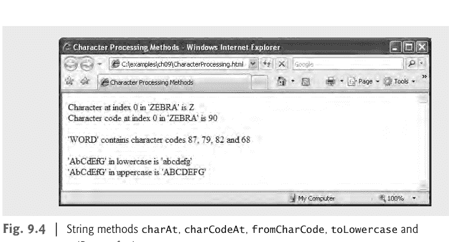

图 9.4 | `String`方法`charAt`、`charCodeAt`、`fromCharCode`、`toLowerCase`和`toUpperCase`。（第 2 部分，共 2 部分）

### 9.4.4 搜索方法

能够在字符串中搜索字符或字符序列通常很有用。例如，如果你正在创建自己的文字处理器，你可能希望提供在整个文档中进行搜索的功能。图 9.5 中的脚本演示了`String`对象的方法`indexOf`和`lastIndexOf`，用于在字符串中搜索指定的子串。本示例中的所有搜索都是在全局字符串`letters`（在脚本中第 14 行初始化为`"abcdefghijklmnopqrstuvwxyzabcdefghijklmnopqrstuvwxyz"`）上执行的。

用户在 XHTML 表单`searchForm`的`inputVal`文本字段中输入子串，然后按下`Search`按钮，在`letters`中搜索该子串。单击`Search`按钮会调用函数`buttonPressed`（在第 16–29 行定义），以响应`onclick`事件并执行搜索。每次搜索的结果都显示在`searchForm`的相应文本字段中。

第 21–22 行使用`String`方法`indexOf`确定字符串`letters`中字符串`inputVal.value`（即用户在`inputVal`文本字段中输入的字符串）第一次出现的位置。如果找到该子串，则返回该子串第一次出现的起始索引；否则返回`-1`。

第 23–24 行使用`String`方法`lastIndexOf`确定`letters`中字符串`inputVal`最后一次出现的位置。如果找到该子串，则返回该子串最后一次出现的起始索引；否则返回`-1`。

## 第 9 章 JavaScript：对象

```html
<?xml version = "1.0" encoding = "utf-8"?>

<!DOCTYPE html PUBLIC "-//W3C//DTD XHTML 1.0 Strict//EN"
    "http://www.w3.org/TR/xhtml1/DTD/xhtml1-strict.dtd">

<!-- Fig. 9.5: SearchingStrings.html -->

<!-- String searching with indexOf and lastIndexOf. -->

<html xmlns = "http://www.w3.org/1999/xhtml">
    <head>
        <title>
            Searching Strings with indexOf and lastIndexOf
        </title>

        <script type = "text/javascript">
            <!--
            var letters =
                "abcdefghijklmnopqrstuvwxyzabcdefghijklmnopqrstuvwxyz";

            function buttonPressed()
            {
```


```html
var searchForm = document.getElementById( "searchForm" );

var inputVal = document.getElementById( "inputVal" );

searchForm.elements[2].value =
    letters.indexOf( inputVal.value );

searchForm.elements[3].value =
    letters.lastIndexOf( inputVal.value );

searchForm.elements[4].value =
    letters.indexOf( inputVal.value, 12 );

searchForm.elements[5].value =
    letters.lastIndexOf( inputVal.value, 12 );

} // end function buttonPressed

// -->

</script>

</head>

<body>

<form id = "searchForm" action = "">

<h1>The string to search is:<br />

abcdefghijklmnopqrstuvwxyzabcdefghijklmnopqrstuvwxyz</h1>

<p>Enter substring to search for

<input id = "inputVal" type = "text" />

<input id = "search" type = "button" value = "Search"
    onclick = "buttonPressed()" /><br /></p>

<p>First occurrence located at index

<input id = "first" type = "text" size = "5" />

<br />Last occurrence located at index

<input id = "last" type = "text" size = "5" />

<br />First occurrence from index 12 located at index

<input id = "first12" type = "text" size = "5" />

<br />Last occurrence from index 12 located at index

<input id = "last12" type = "text" size = "5" /></p>

</form>

</body>

</html>
```

图 9.5 | 使用`indexOf`和`lastIndexOf`进行字符串搜索。（第 1 部分，共 2 部分）

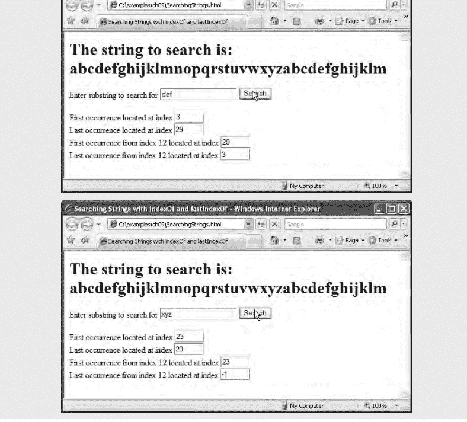

图 9.5 | 使用`indexOf`和`lastIndexOf`进行字符串搜索。（第 2 部分，共 2 部分）

第 25–26 行使用 String 方法`indexOf`确定字符串`letters`中字符串`inputVal`文本字段第一次出现的位置，从`letters`中的索引 12 开始搜索。如果找到该子串，则返回从索引 12 开始该子串第一次出现的起始索引；否则返回 -1。

第 27–28 行使用 String 方法`lastIndexOf`确定`letters`中字符串`inputVal`文本字段最后一次出现的位置，从`letters`中的索引 12 开始，向输入的开头方向移动。如果找到该子串，则返回该子串最后一次出现（如果出现在索引 12 之前）的起始索引；否则返回 -1。

### 软件工程观察 9.2

String 方法`indexOf`和`lastIndexOf`，以及它们的可选第二个参数（开始搜索的起始索引），对于在大量文本中继续搜索特别有用。

### 9.4.5 字符串拆分与获取子串

当你阅读一个句子时，你的大脑会将其拆分为单个单词，或称为词元（tokens），每一个都向你传达意义。将字符串拆分为词元的过程称为词元化（tokenization）。解释器也会执行词元化。它们将语句拆分为关键字、标识符、运算符以及编程语言的其他各个元素。

图 9.6 演示了 String 方法`split`，它将字符串拆分为其组成部分——词元。词元之间由分隔符（delimiters）隔开，通常是空白字符，如空格、制表符、换行符和回车符。其他字符也可以用作分隔符来分隔词元。

该 XHTML 文档显示了一个表单，其中包含一个文本字段，用户在其中输入要词元化的句子。词元化过程的结果显示在一个 XHTML textarea GUI 组件中。该脚本还演示了 String 方法`substring`，它返回字符串的一部分。

```xml
<?xml version = "1.0" encoding = "utf-8"?>

<!DOCTYPE html PUBLIC "-//W3C//DTD XHTML 1.0 Strict//EN"
    "http://www.w3.org/TR/xhtml1/DTD/xhtml1-strict.dtd">

<!-- Fig. 9.6: SplitAndSubString.html -->

<!-- String object methods split and substring. -->

<html xmlns = "http://www.w3.org/1999/xhtml">

<head>

<title>String Methods split and substring</title>

<script type = "text/javascript">

<!--

function splitButtonPressed()
{
    var inputString = document.getElementById( "inputVal" ).value;

    var tokens = inputString.split( " " );

    document.getElementById( "output" ).value =
        tokens.join( "\n" );

    document.getElementById( "outputSubstring" ).value =
        inputString.substring( 0, 10 );
} // end function splitButtonPressed

// -->

</script>

</head>

<body>

<form action = "">

<p>Enter a sentence to split into words<br />

<input id = "inputVal" type = "text" size = "40" />

<input type = "button" value = "Split"
    onclick = "splitButtonPressed()" /></p>

<p>The sentence split into words is<br />

<textarea id = "output" rows = "8" cols = "34">
</textarea></p>

<p>The first 10 characters of the input string are

<input id = "outputSubstring" type = "text"
    size = "15" /></p>

</form>

</body>

</html>
```

Fig. 9.6 | String object methods`split`and`substring`. (Part 1 of 2.)


Fig. 9.6 | String object methods`split`and`substring`. (Part 2 of 2.)

用户在 id 为`inputVal`的文本字段中输入一个句子，然后按下 **Split** 按钮对字符串进行词元化。函数`splitButtonPressed`（第 12–21 行）处理该按钮的`onclick`事件。

第 14 行获取输入字段的值并将其存储在变量`inputString`中。第 15 行调用 String 方法`split`对`inputString`进行词元化。`split`方法的参数是分隔字符串——即决定在原始字符串中每个词元结束位置的字符串。在本例中，空格字符作为分隔符。分隔字符串可以包含多个应用作分隔符的字符。`split`方法返回一个包含词元的字符串数组。

第 17 行使用 Array 方法`join`将数组`tokens`中的词元组合起来，并用换行符（`\n`）分隔每个词元。生成的字符串被赋给 XHTML 表单的输出 GUI 组件（一个 XHTML`textarea`）的`value`属性。

第 19–20 行使用 String 方法`substring`获取一个字符串，其中包含用户输入的字符串（仍存储在`inputString`中）的前 10 个字符。该方法返回从起始索引（本例中为 0）开始到但不包括结束索引（本例中为 10）的子串。如果结束索引大于字符串的长度，则返回的子串包含从起始索引到原始字符串末尾的字符。

### 9.4.6 XHTML 标记方法

图 9.7 中的脚本演示了`String`对象的生成 XHTML 标记标签的方法。当`String`对象调用标记方法时，该方法会将字符串的内容包装在适当的 XHTML 标签中。这些方法对于在脚本处理期间动态生成 XHTML 特别有用。

### 270 Chapter 9 JavaScript: Objects

```xml
<?xml version = "1.0" encoding = "utf-8"?>

<!DOCTYPE html PUBLIC "-//W3C//DTD XHTML 1.0 Strict//EN"
    "http://www.w3.org/TR/xhtml1/DTD/xhtml1-strict.dtd">

<!-- Fig. 9.7: MarkupMethods.html -->

<!-- String object XHTML markup methods. -->

<html xmlns = "http://www.w3.org/1999/xhtml">

<head>

<title>XHTML Markup Methods of the String Object</title>

<script type = "text/javascript">

<!--

var anchorText = "This is an anchor";
var fixedText = "This is monospaced text";
var linkText = "Click here to go to anchorText";
var strikeText = "This is strike out text";
var subText = "subscript";
var supText = "superscript";

document.writeln( anchorText.anchor( "top" ) );

document.writeln( "<br />" + fixedText.fixed() );

document.writeln( "<br />" + strikeText.strike() );

document.writeln(
    "<br />This is text with a " + subText.sub() );

document.writeln(
    "<br />This is text with a " + supText.sup() );

document.writeln( "<br />" + linkText.link( "#top" ) );

// -->

</script>

</head>

<body></body>

</html>
```


Fig. 9.7 | String object XHTML markup methods. (Part 2 of 2.)

第 12–17 行定义了调用 String 对象各个 XHTML 标记方法的字符串。第 19 行使用 String 方法`anchor`将变量`anchorText`中的字符串（"This is an anchor"）格式化为：

```html
<a name = "top">This is an anchor</a>
```

锚点的名称是方法的参数。此锚点将在本示例后面用作超链接的目标。

第 20 行使用 String 方法`fixed`，通过将变量`fixedText`中的字符串（"This is monospaced text"）格式化为如下形式，以等宽字体显示文本：

```html
<tt>This is monospaced text</tt>
```

第 21 行使用 String 方法`strike`，通过将变量`strikeText`中的字符串（"This is strike out text"）格式化为如下形式，以显示带删除线的文本：

```html
<strike>This is strike out text</strike>
```

第 22–23 行使用 String 方法`sub`，通过将变量`subText`中的字符串（"subscript"）格式化为如下形式，以显示下标文本：

```html
<sub>subscript</sub>
```

注意，XHTML 文档中生成的行显示单词 subscript 比该行其余部分小，并略低于该行。

第 24–25 行调用 String 方法`sup`，通过将变量`supText`中的字符串（"superscript"）格式化为如下形式，以显示上标文本：

```html
<sup>superscript</sup>
```

注意，XHTML 文档中生成的行显示单词 superscript 比该行其余部分小，并略高于该行。

第 26 行使用 String 方法`link`，通过将变量`linkText`中的字符串（"Click here to go to anchorText"）格式化为如下形式，来创建超链接：

```html
<a href = "#top">Click here to go to anchorText</a>
```


超链接的目标（本例中为`#top`）是方法的参数，可以是任何 URL。在本例中，超链接目标是第 19 行创建的锚点。如果你将浏览器窗口缩小并滚动到网页底部，然后点击此链接，浏览器将重新定位到网页顶部。

## 9.5 Date 对象

JavaScript 的`Date`对象提供了用于日期和时间操作的方法。日期和时间处理可以基于计算机的本地时区，或基于世界时标准的协调世界时（缩写为`UTC`）——以前称为格林尼治标准时间（`GMT`）。`Date`对象的大多数方法都有本地时区版本和`UTC`版本。`Date`对象的方法总结在图 9.8 中。

| 方法 | 描述 |
| --- | --- |
| `getDate()`<br>`getUTCDate()` | 返回一个从 1 到 31 的数字，表示本地时间或 UTC 中的月份日期。 |
| `getDay()`<br>`getUTCDay()` | 返回一个从 0（星期日）到 6（星期六）的数字，表示本地时间或 UTC 中的星期几。 |
| `getFullYear()`<br>`getUTCFullYear()` | 返回本地时间或 UTC 中的四位数字年份。 |
| `getHours()`<br>`getUTCHours()` | 返回一个从 0 到 23 的数字，表示本地时间或 UTC 中自午夜以来的小时数。 |
| `getMilliseconds()`<br>`getUTCMilliseconds()` | 返回一个从 0 到 999 的数字，分别表示本地时间或 UTC 中的毫秒数。时间以小时、分钟、秒和毫秒存储。 |
| `getMinutes()`<br>`getUTCMinutes()` | 返回一个从 0 到 59 的数字，表示本地时间或 UTC 中的分钟数。 |
| `getMonth()`<br>`getUTCMonth()` | 返回一个从 0（一月）到 11（十二月）的数字，表示本地时间或 UTC 中的月份。 |
| `getSeconds()`<br>`getUTCSeconds()` | 返回一个从 0 到 59 的数字，表示本地时间或 UTC 中的秒数。 |
| `getTime()` | 返回 1970 年 1 月 1 日与`Date`对象中的时间之间的毫秒数。 |
| `getTimezoneOffset()` | 返回本地计算机上的当前时间与 UTC（协调世界时）之间的分钟差。 |
| `setDate(val)`<br>`setUTCDate(val)` | 在本地时间或 UTC 中设置月份日期（1 到 31）。 |
| `setFullYear(y, m, d)`<br>`setUTCFullYear(y, m, d)` | 在本地时间或 UTC 中设置年份。第二个和第三个参数分别表示月份和日期，是可选的。如果未指定可选参数，则使用`Date`对象中的当前值。 |

Fig. 9.8 | Date object methods. (Part 1 of 2.)

### 9.5 Date Object 273

| Method | Description |
| :--- | :--- |
| `setHours(h, m, s, ms)`<br>`setUTCHours(h, m, s, ms)` | Sets the hour in local time or UTC. The second, third and fourth arguments, representing the minutes, seconds and milliseconds, are optional. If an optional argument is not specified, the current value in the Date object is used. |
| `setMilliseconds(ms)`<br>`setUTCMilliseconds(ms)` | Sets the number of milliseconds in local time or UTC. |
| `setMinutes(m, s, ms)`<br>`setUTCMinutes(m, s, ms)` | Sets the minute in local time or UTC. The second and third arguments, representing the seconds and milliseconds, are optional. If an optional argument is not specified, the current value in the Date object is used. |
| `setMonth(m, d)`<br>`setUTCMonth(m, d)` | Sets the month in local time or UTC. The second argument, representing the date, is optional. If the optional argument is not specified, the current date value in the Date object is used. |
| `setSeconds(s, ms)`<br>`setUTCSeconds(s, ms)` | Sets the second in local time or UTC. The second argument, representing the milliseconds, is optional. If this argument is not specified, the current millisecond value in the Date object is used. |
| `setTime(ms)` | Sets the time based on its argument—the number of elapsed milliseconds since January 1, 1970. |
| `toLocaleString()` | Returns a string representation of the date and time in a form specific to the computer's locale. For example, September 13, 2007, at 3:42:22 PM is represented as *09/13/07 15:47:22* in the United States and *13/09/07 15:47:22* in Europe. |
| `toUTCString()` | Returns a string representation of the date and time in the form: *15 Sep 2007 15:47:22 UTC* |
| `toString()` | Returns a string representation of the date and time in a form specific to the locale of the computer (*Mon Sep 17 15:47:22 EDT 2007* in the United States). |
| `valueOf()` | The time in number of milliseconds since midnight, January 1, 1970. (Same as `getTime`.) |

Fig. 9.8 | Date object methods. (Part 2 of 2.)

The script of Fig. 9.9 demonstrates many of the local time zone methods in Fig. 9.8. Line 12 creates a new`Date`object. The`new`operator allocates the memory for the`Date`object. The empty parentheses indicate a call to the`Date`object's constructor with no arguments. A constructor is an initializer method for an object. Constructors are called automatically when an object is allocated with`new`. The`Date`constructor with no arguments initializes the`Date`object with the local computer's current date and time.

### 274 Chapter 9 JavaScript: Objects

```xml
<?xml version = "1.0" encoding = "utf-8"?>

<!DOCTYPE html PUBLIC "-//W3C//DTD XHTML 1.0 Strict//EN"

    "http://www.w3.org/TR/xhtml1/DTD/xhtml1-strict.dtd">

<!-- Fig. 9.9: DateTime.html -->

<!-- Date and time methods of the Date object. -->

<html xmlns = "http://www.w3.org/1999/xhtml">

    <head>

        <title>Date and Time Methods</title>

        <script type = "text/javascript">

            <!--

            var current = new Date();

            document.writeln(

                "<h1>String representations and valueOf</h1>" );

            document.writeln( "toString: " + current.toString() +

                "<br />toLocaleString: " + current.toLocaleString() +

                "<br />toUTCString: " + current.toUTCString() +

                "<br />valueOf: " + current.valueOf() );

            document.writeln(

                "<h1>Get methods for local time zone</h1>" );

            document.writeln( "getDate: " + current.getDate() +

                "<br />getDay: " + current.getDay() +

                "<br />getMonth: " + current.getMonth() +

                "<br />getFullYear: " + current.getFullYear() +

                "<br />getTime: " + current.getTime() +

                "<br />getHours: " + current.getHours() +

                "<br />getMinutes: " + current.getMinutes() +

                "<br />getSeconds: " + current.getSeconds() +

                "<br />getMilliseconds: " + current.getMilliseconds() +

                "<br />getTimezoneOffset: " + current.getTimezoneOffset() );

            document.writeln(

                "<h1>Specifying arguments for a new Date</h1>" );

            var anotherDate = new Date( 2007, 2, 18, 1, 5, 0, 0 );

            document.writeln( "Date: " + anotherDate );

            document.writeln( "<h1>Set methods for local time zone</h1>" );

            anotherDate.setDate( 31 );

            anotherDate.setMonth( 11 );

            anotherDate.setFullYear( 2007 );

            anotherDate.setHours( 23 );

            anotherDate.setMinutes( 59 );

            anotherDate.setSeconds( 59 );

            document.writeln( "Modified date: " + anotherDate );

            // -->

        </script>

    </head><body></body>

</html>
```


```

Fig. 9.9 | Date and time methods of the Date object. (Part 1 of 2.)


Fig. 9.9 | Date and time methods of the Date object. (Part 2 of 2.)
```

> **Software Engineering Observation 9.3**

When an object is allocated with `new`, the object's constructor is called automatically to initialize the object before it is used in the program.

Lines 16–19 demonstrate the methods `toString`, `toLocaleString`, `toUTCString` and `valueOf`. Note that method `valueOf` returns a large integer value representing the total number of milliseconds between midnight, January 1, 1970, and the date and time stored in Date object `current`.

Lines 23–32 demonstrate the Date object's `get` methods for the local time zone. Note that method `getFullYear` returns the year as a four-digit number. Note as well that method `getTimezoneOffset` returns the difference in minutes between the local time zone and UTC time (i.e., a difference of four hours in our time zone when this example was executed).

Line 36 demonstrates creating a new Date object and supplying arguments to the Date constructor for `year`, `month`, `date`, `hours`, `minutes`, `seconds` and `milliseconds`. Note that the `hours`, `minutes`, `seconds` and `milliseconds` arguments are all optional. If any one of these arguments is not specified, a zero is supplied in its place. For the `hours`, `minutes` and `seconds` arguments, if the argument to the right of any of these arguments is specified, it too must be specified (e.g., if the `minutes` argument is specified, the `hours` argument must be specified; if the `milliseconds` argument is specified, all the arguments must be specified).

Lines 40–45 demonstrate the Date object `set` methods for the local time zone. Date objects represent the month internally as an integer from 0 to 11. These values are off by one from what you might expect (i.e., 1 for January, 2 for February, ..., and 12 for December). When creating a Date object, you must specify 0 to indicate January, 1 to indicate February, ..., and 11 to indicate December.

> **Common Programming Error 9.2**

Assuming that months are represented as numbers from 1 to 12 leads to off-by-one errors when you are processing Dates.

The Date object provides two other methods that can be called without creating a new Date object—`Date.parse` and `Date.UTC`. Method `Date.parse` receives as its argument a string representing a date and time, and returns the number of milliseconds between midnight, January 1, 1970, and the specified date and time. This value can be converted to a Date object with the statement:

```javascript
var theDate = new Date( numberOfMilliseconds );
```

which passes to the Date constructor the number of milliseconds since midnight, January 1, 1970, for the Date object.

Method `parse` converts the string using the following rules:

- Short dates can be specified in the form `MM-DD-YY`, `MM-DD-YYYY`, `MM/DD/YY` or `MM/DD/YYYY`. The month and day are not required to be two digits.
- Long dates that specify the complete month name (e.g., `"January"`), date and year can specify the month, date and year in any order.
- Text in parentheses within the string is treated as a comment and ignored. Commas and white-space characters are treated as delimiters.
- All month and day names must have at least two characters. The names are not required to be unique. If the names are identical, the name is resolved as the last match (e.g., `"Ju"` represents `"July"` rather than `"June"`).
- If the name of the day of the week is supplied, it is ignored.
- All standard time zones (e.g., EST for Eastern Standard Time), Coordinated Universal Time (UTC) and Greenwich Mean Time (GMT) are recognized.
- When specifying hours, minutes and seconds, separate each by colons.
- When using a 24-hour-clock format, `"PM"` should not be used for times after 12 noon.

### 9.5 Date 对象（续）

`Date` 的 `UTC` 方法返回 1970 年 1 月 1 日午夜与其参数指定的日期和时间之间的毫秒数。`UTC` 方法的参数包括必需的 `year`、`month` 和 `date`，以及可选的 `hours`、`minutes`、`seconds` 和 `milliseconds`。如果 `hours`、`minutes`、`seconds` 或 `milliseconds` 参数中有任何未指定，则在其位置上使用零作为默认值。对于 `hours`、`minutes` 和 `seconds` 参数，如果在参数列表中这些参数右侧的参数被指定，则该参数也必须被指定（例如，如果指定了 `minutes` 参数，则必须指定 `hours` 参数；如果指定了 `milliseconds` 参数，则必须指定所有参数）。与 `Date.parse` 的结果一样，`Date.UTC` 的结果可以通过将 `Date.UTC` 的结果作为参数来创建一个新的 `Date` 对象，从而转换为 `Date` 对象。

## 9.6 Boolean 和 Number 对象

JavaScript 提供了 `Boolean` 和 `Number` 对象，分别作为布尔值 `true`/`false` 和数字的对象包装器。这些包装器定义了操作布尔值和数字时非常有用的方法和属性。包装器为处理简单数据类型提供了额外的功能。

当 JavaScript 程序需要一个布尔值时，JavaScript 会自动创建一个 `Boolean` 对象来存储该值。JavaScript 程序员可以使用以下语句显式创建 `Boolean` 对象：

```javascript
var b = new Boolean( booleanValue );
```

构造函数参数 `booleanValue` 指定 `Boolean` 对象的值应为 `true` 还是 `false`。如果 `booleanValue` 为 `false`、`0`、`null`、`Number.NaN` 或空字符串（`""`），或未提供参数，则新的 `Boolean` 对象包含 `false`。否则，新的 `Boolean` 对象包含 `true`。图 9.10 总结了 `Boolean` 对象的方法。

JavaScript 会自动创建 `Number` 对象来存储 JavaScript 程序中的数值。JavaScript 程序员可以使用以下语句创建 `Number` 对象：

```javascript
var n = new Number( numericValue );
```

构造函数参数 `numericValue` 是要存储在对象中的数字。虽然你可以显式创建 `Number` 对象，但通常 JavaScript 解释器会在需要时自动创建它们。图 9.11 总结了 `Number` 对象的方法和属性。

| 方法 | 描述 |
| :--- | :--- |
| `toString()` | 如果 Boolean 对象的值为 `true`，则返回字符串 `"true"`；否则返回字符串 `"false"`。 |
| `valueOf()` | 如果 Boolean 对象为 `true`，则返回值 `true`；否则返回 `false`。 |

**图 9.10** | Boolean 对象的方法。

278 第 9 章 JavaScript：对象

| 方法或属性 | 描述 |
|---|---|
| `toString( radix )` | 返回数字的字符串表示形式。可选的 `radix` 参数（一个从 2 到 36 的数字）指定数字的基数。例如，`radix` 2 产生数字的二进制表示，8 产生八进制表示，10 产生十进制表示，16 产生十六进制表示。 |
| `valueOf()` | 返回数值。 |
| `Number.MAX_VALUE` | 此属性代表 JavaScript 程序中可以存储的最大值——约为 1.79E+308。 |
| `Number.MIN_VALUE` | 此属性代表 JavaScript 程序中可以存储的最小值——约为 5.00E-324。 |
| `Number.NaN` | 此属性代表非数字——从不产生数字的算术表达式返回的值（例如，表达式 `parseInt( "hello" )` 无法将字符串 `"hello"` 转换为数字，因此 `parseInt` 会返回 `Number.NaN`。要判断一个值是否为 NaN，可以使用函数 `isNaN` 测试其结果，如果该值为 NaN 则返回 `true`；否则返回 `false`。 |
| `Number.NEGATIVE_INFINITY` | 此属性代表小于 `-Number.MAX_VALUE` 的值。 |
| `Number.POSITIVE_INFINITY` | 此属性代表大于 `Number.MAX_VALUE` 的值。 |

**图 9.11** | Number 对象的方法和属性。

## 9.7 `document` 对象

`document` 对象用于操作当前在浏览器窗口中可见的文档。`document` 对象有许多属性和方法，例如 `document.write` 和 `document.writeln` 方法，它们都在之前的 JavaScript 示例中使用过。图 9.12 展示了本章中使用的 `document` 对象的方法和属性。你可以在我们的 JavaScript 资源中心（`www.deitel.com/javascriptostrčjavascript`）了解更多关于 `document` 对象的属性和方法。

| 方法或属性 | 描述 |
|---|---|
| `getElementById( id )` | 返回表示 `id` 属性与 `id` 匹配的 XHTML 元素的 DOM 节点。 |

**图 9.12** | 重要的 document 对象方法和属性。（第 1 部分，共 2 部分。）

| 方法或属性 | 描述 |
| --- | --- |
| `write( string )` | 将字符串作为 XHTML 代码写入 XHTML 文档。 |
| `writeln( string )` | 将字符串作为 XHTML 代码写入 XHTML 文档，并在末尾添加换行符。 |
| `cookie` | 一个字符串，包含当前文档在用户计算机上存储的所有 cookie 的值。参见 9.9 节，使用 Cookie。 |
| `lastModified` | 此文档最后修改的日期和时间。 |

**图 9.12** | 重要的 document 对象方法和属性。（第 2 部分，共 2 部分。）

## 9.8 `window` 对象

`window` 对象提供了操作浏览器窗口的方法。以下脚本展示了 `window` 对象的许多常用属性和方法，并使用它们创建了一个跨多个浏览器窗口的网站。图 9.13 允许用户通过填写 XHTML 表单并点击提交按钮来创建一个新的、完全自定义的浏览器窗口。脚本还允许用户向新窗口添加文本，并将窗口导航到不同的 URL。

脚本从第 10 行开始。第 12 行声明了一个变量来引用新窗口。我们称新窗口为子窗口，因为它是由主窗口（或父窗口）在本脚本中创建和控制的。第 14-50 行定义了 `createChildWindow` 函数，该函数确定用户选择的功能，并创建一个具有这些功能的子窗口（但不向窗口添加任何内容）。第 18-20 行声明了几个变量来存储页面上复选框的状态。第 23-38 行根据相应复选框是否被选中，将每个变量设置为 `"yes"` 或 `"no"`。

```xml
<?xml version = "1.0" encoding = "utf-8"?>

<!DOCTYPE html PUBLIC "-//W3C//DTD XHTML 1.0 Strict//EN"
  "http://www.w3.org/TR/xhtml1/DTD/xhtml1-strict.dtd">

<!-- Fig. 9.13: window.html -->

<!-- Using the window object to create and modify child windows. -->

<html xmlns = "http://www.w3.org/1999/xhtml">

<head>

<title>Using the Window Object</title>

<script type = "text/javascript">

  <!--

  var childWindow; // variable to control the child window

  function createChildWindow()

  {
```

**图 9.13** | 使用 window 对象创建和修改子窗口。（第 1 部分，共 4 部分。）

280 第 9 章 JavaScript：对象

```javascript
// these variables all contain either "yes" or "no"

// to enable or disable a feature in the child window

var toolBar;

var menuBar;

var scrollBars;

// determine whether the Tool Bar checkbox is checked

if ( document.getElementById( "toolBarCheckBox" ).checked )

    toolBar = "yes";
```


```javascript
else

    toolBar = "no";

// determine whether the Menu Bar checkbox is checked

if ( document.getElementById( "menuBarCheckBox" ).checked )

    menuBar = "yes";

else

    menuBar = "no";

// determine whether the Scroll Bar checkbox is checked

if ( document.getElementById( "scrollBarsCheckBox" ).checked )

    scrollBars = "yes";

else

    scrollBars = "no";

//display window with selected features

childWindow = window.open( "", "",

    ",toolbar = " + toolBar +

    ",menubar = " + menuBar +

    ",scrollbars = " + scrollBars );

// disable buttons

document.getElementById( "closeButton" ).disabled = false;

document.getElementById( "modifyButton" ).disabled = false;

document.getElementById( "setURLButton" ).disabled = false;

} // end function createChildWindow

// insert text from the textbox in the child window

function modifyChildWindow()

{

    if ( childWindow.closed )

        alert( "You attempted to interact with a closed window" );

    else

        childWindow.document.write(

            document.getElementById( "textForChild" ).value );

} // end function modifyChildWindow

// close the child window

function closeChildWindow()

{

    if ( childWindow.closed )

        alert( "You attempted to interact with a closed window" );
```

> 图 9.13 | 使用 `window` 对象创建和修改子窗口。（第 2 部分，共 4 部分。）

## 9.8 `window` 对象

```javascript
else

    childWindow.close();

document.getElementById("closeButton").disabled = true;

document.getElementById("modifyButton").disabled = true;

document.getElementById("setURLButton").disabled = true;

} // end function closeChildWindow

// set the URL of the child window to the URL

// in the parent window's myChildURL

function setChildWindowURL()

{

    if (childWindow.closed)

        alert("You attempted to interact with a closed window");

    else

        childWindow.location =

            document.getElementById("myChildURL").value;

} // end function setChildWindowURL

</script>

</head>

<body>

<h1>Hello, this is the main window</h1>

<p>Please check the features to enable for the child window<br/>

<input id="toolBarCheckBox" type="checkbox" value = ""

    checked="checked" /><label>Tool Bar</label>

<input id="menuBarCheckBox" type="checkbox" value = ""

    checked="checked" /><label>Menu Bar</label>

<input id="scrollBarsCheckBox" type="checkbox" value = ""

    checked="checked" /><label>Scroll Bars</label></p>

<p>Please enter the text that you would like to display

in the child window<br/>

<input id="textForChild" type="text"

    value ="<h1>Hello, I am a child window.</h1> " />

<input id="createButton" type="button"

    value ="Create Child Window" onclick="createChildWindow()" />

<input id="modifyButton" type="button" value ="Modify Child Window"

    onclick="modifyChildWindow()" disabled="disabled" />

<input id="closeButton" type="button" value ="Close Child Window"

    onclick="closeChildWindow()" disabled="disabled" ></p>

<p>The other window's URL is: <br/>

<input id="myChildURL" type="text" value = "/" />

<input id="setURLButton" type="button" value = "Set Child URL"

    onclick ="setChildWindowURL()" disabled= "disabled"></p></body>

</html>
```

> 图 9.13 | 使用 `window` 对象创建和修改子窗口。（共 4 部分之第 3 部分）

# 9.9 使用 Cookies

Cookies 为 Web 开发人员提供了一种个性化网页的工具。Cookie 是存储在用户计算机上的一段数据，用于在浏览器会话期间及会话之间维持客户端的信息。网站可以在客户端的计算机上存储一个 cookie，以记录用户偏好设置或其他信息，供网站在后续客户端访问时检索。例如，网站可以从 cookie 中检索用户名，并用它来显示个性化的问候语。

Microsoft Internet Explorer 和 Mozilla Firefox 将 cookies 存储为客户硬盘驱动器上的小文本文件。当用户访问一个网站时，浏览器会定位由该网站脚本编写的任何 cookies，并使其可用于该网站上的任何脚本。请注意，cookies 只能由其所属网站的脚本访问（即，由 `amazon.com` 上的脚本设置的 cookie 只能由 `amazon.com` 上的其他脚本读取）。

Cookies 在 JavaScript 中可以通过 `document` 对象的 `cookie` 属性进行访问。JavaScript 将 cookie 视为一个文本字符串。任何标准的字符串函数或方法都可以操作 cookie。Cookie 具有“`identifier=value`”的语法，其中 `identifier` 是任何有效的 JavaScript 变量标识符，`value` 是 cookie 变量的值。当一个网站存在多个 cookie 时，`identifier-value` 对在 `document.cookie` 字符串中用分号分隔。

Cookies 与普通字符串的不同之处在于，每个 cookie 都有一个过期日期，超过该日期后 Web 浏览器会将其删除。此日期可以通过设置 `expires` 属性来定义。

在 cookie 字符串中。如果未设置 cookie 的过期日期，则 cookie 默认在用户关闭浏览器窗口后过期。通过将 `expires` 属性设置为过去的日期和时间，可以立即删除 cookie。

赋值运算符不会覆盖整个 cookie 列表，而是将 cookie 追加到列表末尾。因此，如果我们设置两个 cookie：

```javascript
document.cookie = "name1=value1";

document.cookie = "name2=value2";
```

`document.cookie` 将包含 `"name1=value1; name2=value2"`。

图 9.15 使用 cookie 存储用户姓名，并显示个性化问候语。此示例改进了图 4.11 中动态欢迎页面示例的功能，仅在首次访问网页时要求用户输入姓名。在每次后续访问时，脚本可以显示存储在 cookie 中的用户名。

第 10 行开始脚本。第 12–13 行声明获取时间所需的变量，第 14 行声明存储用户姓名的变量。第 16–27 行包含与图 4.11 中相同的 `if…else` 语句，用于显示与时间相关的问候语。

第 30–66 行包含用于操作 cookie 的代码。第 30 行确定客户端计算机上是否存在 cookie。如果存在 cookie，则表达式 `document.cookie` 的值为 true。如果不存在 cookie，则脚本提示用户输入姓名（第 45 行）。脚本创建一个包含字符串 `"name="` 的 cookie，后跟通过内置 JavaScript 函数 `escape` 生成的用户姓名副本（第 49 行）。`escape` 函数将字符串中的任何非字母数字字符（如空格和分号）转换为其等效的十六进制转义序列，形式为 `"%XX"`，其中 `XX` 是特殊字符的两位十六进制 ASCII 值。例如，如果 `name` 包含值 `"David Green"`，则语句 `escape( name )` 的结果为 `"David%20Green"`，因为空格的十六进制 ASCII 值为 20。

```xml
<?xml version = "1.0" encoding = "utf-8"?>

<!DOCTYPE html PUBLIC "-//W3C//DTD XHTML 1.0 Strict//EN"

   "http://www.w3.org/TR/xhtml1/DTD/xhtml1-strict.dtd">

<!-- Fig. 9.15: cookie.html -->

<!-- Using cookies to store user identification data. -->

<html xmlns = "http://www.w3.org/1999/xhtml">

    <head>

       <title>Using Cookies</title>

      <script type = "text/javascript">

          <!--

          var now = new Date(); // current date and time

          var hour = now.getHours(); // current hour (0-23)

          var name;

          if ( hour < 12 ) // determine whether it is morning

              document.write( "<h1>Good Morning, " );

          else

          {

              hour = hour - 12; // convert from 24-hour clock to PM time

              // determine whether it is afternoon or evening

              if ( hour < 6 )

                document.write( "<h1>Good Afternoon, " );

              else

                document.write( "<h1>Good Evening, " );

          } // end else

          // determine whether there is a cookie

          if ( document.cookie )

          {

            // convert escape characters in the cookie string to their

            // English notation

            var myCookie = unescape( document.cookie );

            // split the cookie into tokens using = as delimiter

            var cookieTokens = myCookie.split( "=" );

            // set name to the part of the cookie that follows the = sign

            name = cookieTokens[ 1 ];

          } // end if

          else

          {

            // if there was no cookie, ask the user to input a name

            name = window.prompt( "Please enter your name", "Paul" );

            // escape special characters in the name string

            // and add name to the cookie

            document.cookie = "name=" + escape( name );

          } // end else

          document.writeln(

            name + ", welcome to JavaScript programming!</h1>" );

          document.writeln( "<a href = 'javascript:wrongPerson()'> " +

            "Click here if you are not " + name + "</a>" );

          // reset the document's cookie if wrong person

          function wrongPerson()

          {

            // reset the cookie

            document.cookie= "name=null;" +

              " expires=Thu, 01-Jan-95 00:00:01 GMT";

            // reload the page to get a new name after removing the cookie

            location.reload();

          } // end function wrongPerson

          // -->

      </script>

    </head>

    <body>

      <p>Click Refresh (or Reload) to run the script again</p>

    </body>

</html>
```


Fig. 9.15 | 使用 cookie 存储用户身份数据。（第 1 部分，共 3 部分）


点击“刷新”后，网站会回忆起之前输入的数据。


Fig. 9.15 | 使用 cookie 存储用户身份数据。（第 3 部分，共 3 部分。）

在将 cookie 值写入客户端之前，始终对其进行转义是一个好主意。此转换可防止 cookie 中的任何特殊字符被错误地解释为在代码中具有特殊含义，而不是作为 cookie 值中的字符。例如，cookie 值中的分号可能被误解为分隔两个相邻标识符-值对的分号。在从 `document.cookie` 字符串中读取 cookie 时，对 cookie 应用函数 `unescape` 可将十六进制转义序列转换回英文字符，以在网页中显示。

### 良好的编程实践 9.2

始终在 cookie 中使用自描述标识符存储值。不要忘记在存储的值之前包含标识符和等号。

如果存在 cookie（即用户之前访问过该页面），则脚本会从 cookie 字符串中解析出用户名并将其存储在局部变量中。解析通常指将字符串拆分为更小、更有用的组件的行为。第 34 行使用 JavaScript 函数 `unescape` 将 cookie 中的所有转义序列替换为其等效的英语言字符。脚本将未转义的 cookie 值存储在变量 `myCookie` 中（第 34 行），并使用第 9.4.5 节中介绍的 JavaScript 函数 `split`（第 37 行）将 cookie 拆分为标识符和值令牌。此时，脚本中的 `myCookie` 包含格式为 `"name=value"` 的字符串。我们使用 `=` 作为分隔符对 `myCookie` 调用 `split`，以获得 `cookieTokens` 数组，其第一个元素等于标识符的名称，第二个元素等于标识符的值。第 40 行将 `cookieTokens` 数组中第二个元素的值（即实际存储在 cookie 中的值）赋给变量 `name`。第 52–53 行使用存储在 cookie 中的用户名向网页添加个性化问候语。

脚本允许用户重置 cookie，这在有其他人使用计算机时非常有用。第 54–55 行创建一个超链接，点击时会调用 JavaScript 函数 `wrongPerson`（第 58–66 行）。第 61–62 行将 cookie 名称设置为 `null`，并将 `expires` 属性设置为 1995 年 1 月 1 日（尽管任何过去的日期都 suffices）。Internet Explorer 检测到 `expires` 属性设置为过去的日期后，会从用户的计算机中删除该 cookie。下次加载此页面时，将找不到任何 cookie。`location` 对象的 `reload` 方法强制页面刷新（第 65 行），由于找不到现有的 cookie，脚本会提示用户输入新名称。

## 9.10 多页面 HTML 和 JavaScript 应用程序

前几章探讨了许多 JavaScript 概念以及它们在网络上的应用。下一个 JavaScript 示例将其中许多概念整合到一个网页中。图 9.16 使用函数、cookie、数组、循环、`Date` 对象、`window` 对象和 `document` 对象创建了一个示例欢迎页面，包含个性化问候语、一个简短测验、随机图片和随机引言。我们都见过这些概念，但此示例说明了它们如何在一个网页中协同工作。

```xml
<?xml version="1.0" encoding="utf-8"?>

<!DOCTYPE html PUBLIC "-//W3C//DTD XHTML 1.0 Strict//EN"
   "http://www.w3.org/TR/xhtml1/DTD/xhtml1-strict.dtd">

<!-- Fig. 9.16: final.html -->

<!-- Rich welcome page using several JavaScript concepts. -->

<html xmlns="http://www.w3.org/1999/xhtml">

<head>

    <title>Putting It All Together</title>

    <script type="text/javascript">

<!--
```

## 9.10 多页 HTML 和 JavaScript 应用

```javascript
var now = new Date(); // 当前日期和时间

var hour = now.getHours(); // 当前小时

// 用于随机选择的图片名称数组
var pictures = [ "CPE", "EPT", "GPP", "GUI", "PERF", "PORT", "SEO" ];

// 用于随机选择的引文数组
var quotes = [ "形式永远追随功能。<br/>" +
    " 路易斯·亨利·沙利文", "合众为一。" +
    " （由多数构成整体。） <br/> 维吉尔", "难道这是" +
    " 一个隐藏美德的世界吗？<br/> 威廉·莎士比亚" ];

// 将当前日期和时间写入网页
document.write( "<p>" + now.toLocaleString() + "<br/></p>" );

// 判断是否是上午
if ( hour < 12 )
    document.write( "<h2>早上好，" );
else
{
    hour = hour - 12; // 从 24 小时制转换为下午时间

    // 判断是下午还是晚上
    if ( hour < 6 )
        document.write( "<h2>下午好，" );
    else
        document.write( "<h2>晚上好，" );
} // end else

// 判断是否存在 cookie
if ( document.cookie )
{
    // 将 cookie 字符串中的转义字符转换为
    // 英文表示法
    var myCookie = unescape( document.cookie );

    // 使用 = 作为分隔符将 cookie 分割成令牌
    var cookieTokens = myCookie.split( "=" );

    // 将 name 设置为 cookie 中 = 号之后的部分
    name = cookieTokens[ 1 ];
} // end if
else
{
    // 如果没有 cookie，则提示用户输入姓名
    name = window.prompt( "请输入您的姓名", "Paul" );

    // 对姓名字符串中的特殊字符进行转义
    // 并将姓名添加到 cookie 中
    document.cookie = "name =" + escape( name );
} // end else

// 将问候语写入页面
document.writeln(
    name + "，欢迎来到 JavaScript 编程世界！</h2>" );

// 将删除 cookie 的链接写入页面
document.writeln( "<a href = \"javascript:wrongPerson()\" > " +
    "如果你不是 " + name + "，请点击此处</a>" );

// 将随机图片写入页面
document.write ( " <br/>" );

// 将随机引文写入页面
document.write ( quotes[ Math.floor( Math.random() * 3 ) ] );

// 创建一个包含所有引文的窗口
function allQuotes()
{
    // 创建用于显示引文的子窗口
    var quoteWindow = window.open( "", "", "resizable=yes, " +
        "toolbar=no, menubar=no, status=no, location=no," +
        " scrollBars=yes" );

    quoteWindow.document.write( "<p>" );

    // 循环遍历所有引文并将其写入新窗口
    for ( var i = 0; i < quotes.length; i++ )
        quoteWindow.document.write( ( i + 1 ) + ".) " +
            quotes[ i ] + "<br/><br/>" );

    // 向新窗口写入关闭链接
    quoteWindow.document.write( "</p><br/><a href = " +
        "\"javascript:window.close()\">关闭此窗口</a>" );
} // end function allQuotes

// 如果用户错误，则重置文档的 cookie
function wrongPerson()
{
    // 重置 cookie
    document.cookie = "name=null;" +
        " expires=Thu, 01-Jan-95 00:00:01 GMT";

    // 重新加载页面，以便在移除 cookie 后获取新的姓名
    location.reload();
} // end function wrongPerson

// 打开一个包含 quiz2.html 文件的新窗口
function openQuiz()
{
    window.open( "quiz2.html", "", "toolbar = no, " +
        "menubar = no, scrollBars = no" );
} // end function openQuiz
```

```html
<!-- -->
</script>

</head>

<body>

<p><a href="javascript:allQuotes()">查看所有引文</a></p>

<p id="quizSpot">
<a href="javascript:openQuiz()">请参与我们的小测验</a></p>

<script type="text/javascript">

// 获取最后修改日期和时间的变量
var modDate = new Date( document.lastModified );

// 将最后修改的日期和时间写入页面
document.write("本页最后修改于 " +
    modDate.toLocaleString());

</script>

</body>

</html>
```

**图 9.16 | 使用多种 JavaScript 概念的丰富欢迎页面。**

## 9.11 第 9 章 JavaScript：对象

构建此页面大部分内容的脚本始于第 10 行。第 12-13 行声明了判断一天中时间所需的变量。第 16-23 行创建了两个数组，内容将从中随机选择。此网页包含一张图片（其文件名从 `pictures` 数组中随机选择）和一条引文（其文本从 `quotes` 数组中随机选择）。第 26 行使用 `Date` 对象的 `toLocaleString` 方法将用户的本地日期和时间写入网页。第 29-40 行使用与图 4.11 相同的代码显示基于时间的问候语。脚本要么使用现有的 cookie 获取用户姓名（第 43-54 行），要么提示用户输入姓名，然后脚本将该姓名存储在新的 cookie 中（第 55-63 行）。第 66-67 行将问候语写入网页，第 70-71 行生成用于重置 cookie 的链接。这与图 9.15 中用于操作 cookie 的代码相同。第 74-79 行将随机图片和随机引文写入网页。脚本通过随机选择每个数组的索引来选择它们。此代码类似于图 10.7 中用于使用数组显示随机图片的代码。

函数 `allQuotes`（第 82-98 行）使用 `window` 对象和一个 `for` 循环来打开一个新窗口，其中包含 `quotes` 数组中的所有引文。第 85-87 行创建一个名为 `quoteWindow` 的新窗口。脚本没有为此窗口分配 URL 或名称，但确实指定了要显示的窗口功能。第 88 行在 `quoteWindow` 中打开一个新段落。一个 `for` 循环（第 91-93 行）遍历 `quotes` 数组，并将每条引文写入 `quoteWindow`。第 96-97 行关闭 `quoteWindow` 中的段落，插入一个新行，并在页面底部添加一个链接，允许用户关闭该窗口。请注意，`allQuotes` 使用 JavaScript 生成一个网页并在一个全新的窗口中打开它。

函数 `wrongPerson`（第 101-109 行）重置存储用户姓名的 cookie。此函数与图 9.15 中的函数 `wrongPerson` 相同。

函数 `openQuiz`（第 112-116 行）打开一个新窗口以显示示例测验。使用 `window.open` 方法，脚本创建一个包含 `quiz2.html` 的新窗口（第 114-115 行）。我们将在本节后面讨论 `quiz2.html`。

主脚本在第 118 行结束，XHTML 文档的 `body` 部分始于第 120 行。第 121 行创建了在被点击时调用函数 `allQuotes` 的链接。第 123-124 行创建了一个包含属性 `id="quizSpot"` 的段落元素。此段落包含一个调用函数 `openQuiz` 的链接。

第 126-133 行包含第二个脚本。此脚本出现在 XHTML 文档的 `body` 中，因为它向页面添加了一个动态页脚，该页脚必须出现在 `body` 前半部分包含的静态 XHTML 内容之后。此脚本创建 `Date` 对象的另一个实例，但日期被设置为 XHTML 文档的最后修改日期和时间，而不是当前日期和时间（第 128 行）。脚本使用属性 `document.lastModified` 获取最后修改的日期和时间。第 131-132 行将此信息添加到网页。请注意，此修改日期和时间出现在页面底部，在 `body` 其余内容之后。如果此脚本在 `head` 元素中，此信息将在整个 XHTML 文档的 `body` 之前显示。第 133-135 行关闭了脚本、`body` 和 XHTML 文档。

### 测验页面

本示例中使用的测验位于一个名为 `quiz2.html` 的单独 XHTML 文档中（图 9.17）。此文档类似于图 8.42 中的 `quiz.html`。本示例中的测验与图 8.42 中的测验不同，因为结果在主窗口中显示，而之前的测验示例是通过警报显示结果。在示例测验窗口中单击提交按钮后，主窗口会发生变化以反映已进行测验，然后测验窗口关闭。

此脚本的第 15-19 行检查用户的答案并将结果输出到主窗口。第 20 行使用 `window.opener` 写入主窗口。属性 `window.opener` 始终包含对打开当前窗口的窗口的引用（如果存在该窗口）。第 21 行写入属性 `window.opener.document.getElementById(quizSpot).innerHTML`。回想一下，`quizSpot` 是主窗口中包含打开测验链接的段落。属性 `innerHTML` 指的是 `quizSpot` 段落内的 HTML 代码（即 `<p>` 和 `</p>` 之间的代码）。修改 `innerHTML` 属性会动态更改段落中的 XHTML 代码。因此，当第 16-17 行执行时，主窗口中的链接消失，并出现字符串 `"Congratulations, your answer is correct."`。第 19-22 行修改 `window.opener.document.getElementById("quizSpot").innerHTML`。第 19-22 行使用相同的技术显示 `"Your answer is incorrect. Please try again"`，后跟一个再次尝试测验的链接。


```xml
1  <?xml version = "1.0" encoding = "utf-8"?>
2  <!DOCTYPE html PUBLIC "-//W3C//DTD XHTML 1.0 Strict//EN"
3     "http://www.w3.org/TR/xhtml1/DTD/xhtml1-strict.dtd">
4  
5  <!-- Fig. 9.17: quiz2.html -->
6  <!-- Online quiz in a child window. -->
7  <html xmlns = "http://www.w3.org/1999/xhtml">
8     <head>
9        <title>Online Quiz</title>
10       <script type = "text/JavaScript">
11          <!--
12          function checkAnswers()
13          {
14             // determine whether the answer is correct
15             if ( document.getElementById( "myQuiz" ).elements[1].checked )
16                window.opener.document.getElementById( "quizSpot" ).
17                   innerHTML = "Congratulations, your answer is correct";
18             else // if the answer is incorrect
19                window.opener.document.getElementById( "quizSpot" ).
20                   innerHTML = "Your answer is incorrect. " +
21                   "Please try again <br /> <a href = " +
22                   \"javascript:openQuiz()\">Please take our quiz</a>";
23 
24             window.opener.focus();
25             window.close();
26          } // end function checkAnswers
27          //-->
28       </script>
29    </head>
30    <body>
31       <form id = "myQuiz" action = "javascript:checkAnswers()">
32          <p>Select the name of the tip that goes with the
33             image shown:<br />
34             
35             <br />
36 
37             <input type = "radio" name = "radiobutton" value = "CPE" />
38             <label>Common Programming Error</label>
39 
40             <input type = "radio" name = "radiobutton" value = "EPT" />
41             <label>Error-Prevention Tip</label>
42             
43          <input type = "radio" name = "radiobutton" value = "PERF" />
44          <label>Performance Tip</label>
45          
46          <input type = "radio" name = "radiobutton" value = "PORT" />
47          <label>Portability Tip</label><br />
48          
49          <input type = "submit" name = "Submit" value = "Submit" />
50          <input type = "reset" name = "reset" value = "Reset" />
51      </p>
52  </form>
53  </body>
54  </html>
```

图 9.17 | 子窗口中的在线测验。（第 1 部分，共 3 部分。）

图 9.17 | 子窗口中的在线测验。（第 2 部分，共 3 部分。）

图 9.17 | 子窗口中的在线测验。（第 3 部分，共 3 部分。）

在检查测验答案后，脚本使用主窗口 `window` 对象的 `focus` 方法将焦点给予主窗口（即，将主窗口置于前台，位于任何其他打开的浏览器窗口之上）。属性 `window.opener` 引用主窗口，因此 `window.opener.focus()`（第 24 行）将焦点给予主窗口，允许用户看到对主窗口 `quizSpot` 段落文本所做的更改。最后，脚本使用 `window.close` 方法（第 25 行）关闭测验窗口。

第 28-29 行关闭 XHTML 文档的 `script` 和 `head` 元素。第 30 行打开 XHTML 文档的主体。主体包含构成测验的表单、图像、文本标签和单选按钮。第 52-54 行关闭表单、主体和 XHTML 文档。

## 9.11 使用 JSON 表示对象

`JSON`（`JavaScript Object Notation`）——一种将 JavaScript 对象表示为字符串的简单方法——是作为数据交换技术的 XML 的替代方案。JSON 因其简单的格式而备受赞誉，使得对象易于读取、创建和解析。每个 JSON 对象都表示为包含在花括号中的属性名和值列表，格式如下：

```json
{ propertyName1 : value1, propertyName2 : value2 }
```

JSON 中的数组使用方括号表示，格式如下：

```json
[ value1, value2, value3 ]
```

每个值可以是字符串、数字、JSON 对象、`true`、`false` 或 `null`。为了体会 JSON 数据的简洁性，请查看第 13 章通讯录条目数组的这种表示：

```json
[ { first: 'Cheryl', last: 'Black' },
{ first: 'James', last: 'Blue' },
{ first: 'Mike', last: 'Brown' },
{ first: 'Meg', last: 'Gold' } ]
```

JSON 提供了一种在 JavaScript 中操作对象的直接方式，现在许多其他编程语言也支持这种格式。除了简化对象创建外，JSON 还允许程序轻松操作数据并高效地在互联网上传输数据。JSON 与 Ajax 应用程序集成良好——有关 JSON 的更详细讨论和 Ajax 特定示例，请参见第 13.7 节。有关 JSON 的更多信息，请访问我们的 JSON 资源中心 `www.deitel.com/json`。

## 9.12 网络资源

`www.deitel.com/javascript/`

Deitel JavaScript 资源中心包含指向网络上一些最佳 JavaScript 资源的链接。在那里，您将找到按类别划分的 JavaScript 工具、代码生成器、论坛、书籍、库、框架等链接。还要查看从入门到高级的各种技能水平的教程。

请务必访问 XHTML（`www.deitel.com/xhtml/`）和 CSS 2.1（`www.deitel.com/css21/`）的相关资源中心。

# 10 文档对象模型（DOM）：对象与集合

## 目标

在本章中，您将学习：

- 如何使用 JavaScript 和 W3C 文档对象模型创建动态网页。
- DOM 节点和 DOM 树的概念。
- 如何遍历、编辑和修改 XHTML 文档中的元素。
- 如何动态更改 CSS 样式。
- 创建 JavaScript 动画。

> 我们的孩子可能会了解过去的英雄。我们的任务是让我们自己成为未来的建筑师。
>
> ——乔莫·肯雅塔

> 虽然树叶繁多，但根只有一个。
>
> ——威廉·巴特勒·叶芝

> 关于美国，最令我印象深刻的是父母服从孩子的这种方式。
>
> ——温莎公爵

> 我们大多数人在自己不再是孩子之前就已成为父母。
>
> ——米尼恩·麦克劳克林

> 写它用了三个月；构思它用了三分钟；收集其中的数据——用了我一生的时间。
>
> ——F·斯科特·菲茨杰拉德

> 兄弟姐妹之间的竞争是不可避免的。唯一能避免这种情况的可靠方法是只有一个孩子。
>
> ——南希·萨马林

## 大纲

- 10.1 简介
- 10.2 文档建模：DOM 节点和树
- 10.3 遍历和修改 DOM 树
- 10.4 DOM 集合
- 10.5 动态样式
- 10.6 DOM 对象和集合摘要
- 10.7 网络资源

## 10.1 简介

在本章中，我们介绍*文档对象模型（DOM）*。DOM 让您可以访问网页上的所有元素。在浏览器内部，整个网页——段落、表单、表格等——都以*对象层次结构*表示。使用 JavaScript，您可以动态创建、修改和删除页面中的元素。

以前，Internet Explorer 和 Netscape 都有不同的 Dynamic HTML 版本，它们提供了与 DOM 类似的功能。然而，尽管它们提供了许多相同的功能，但这两个模型彼此不兼容。为了鼓励跨浏览器网站，W3C 创建了标准化的文档对象模型。Firefox 2、Internet Explorer 7 和许多其他主要浏览器实现了 W3C DOM 的*大部分*功能。

本章首先正式介绍 DOM 节点和 DOM 树的概念。然后我们讨论 DOM 节点的属性和方法，并介绍 `document` 对象的附加方法。我们还讨论如何动态更改样式属性，这使您能够创建多种类型的效果，例如用户定义的背景颜色和动画。然后，我们提供了一个广泛的对象层次结构图，解释了各种对象和属性，并提供了指向提供有关该主题更多信息的网站的链接。

## 软件工程观察 10.1

> 通过 DOM，XHTML 元素可以被视为对象，XHTML 元素的许多属性可以被视为这些对象的属性。然后，可以通过它们的 `id` 属性使用 JavaScript 对对象进行脚本编写，以实现动态效果。

## 10.2 文档建模：DOM 节点和树

正如我们在前面章节中看到的，文档的 `getElementById` 方法是访问页面中特定元素的最简单方法。在本节和下一节中，我们将更深入地讨论此方法返回的对象。

`getElementById` 方法返回称为*DOM 节点*的对象。XHTML 页面中的每个元素都由浏览器中的一个 DOM 节点建模。文档中的所有节点构成了页面的*DOM 树*，它描述了元素之间的关系。节点通过子父关系相互关联。在另一个元素内部的 XHTML 元素被称为包含元素的*子*元素。包含元素被称为*父*元素。一个节点可以有多个子节点，但只有一个父节点。具有相同父节点的节点被称为*同级*节点。

某些浏览器提供了工具，允许你查看文档 DOM 树的可视化表示。在安装 Firefox 时，你可以选择安装名为**DOM 检查器**的工具，它允许你查看 XHTML 文档的 DOM 树。要检查文档，Firefox 用户可以从 Firefox 的**工具**菜单中访问**DOM 检查器**。如果 DOM 检查器不在菜单中，请运行 Firefox 安装程序，在“安装类型”屏幕中选择“自定义”，并确保在“可选组件”窗口中勾选了**DOM 检查器**框。

Microsoft 为 Internet Explorer 提供了一个**开发者工具栏**，允许你检查文档的 DOM 树。该工具栏可以从 Microsoft 下载，地址是 `go.microsoft.com/fwlink/?LinkId=92716`。安装工具栏后，请重启浏览器，然后点击工具栏右侧的 `>>` 图标，并从菜单中选择“IE 开发者工具栏”。图 10.1 展示了在 Firefox 的**DOM 检查器**和 IE 的 Web 开发者工具栏中显示的 XHTML 文档及其 DOM 树。

XHTML 文档包含几个简单元素。我们将基于 Firefox **DOM 检查器**来解释此示例——IE 工具栏显示的文档仅有一些细微差别。节点可以使用节点名称旁边的 `+` 和 `-` 按钮展开或折叠。图 10.1(b) 显示了文档中所有节点完全展开的状态。树顶部的文档节点（显示为 `#document`）称为*根节点*，因为它没有父节点。在文档节点下方，**HTML** 节点相对于文档节点进行了缩进，以表示 HTML 节点是 `#document` 节点的子节点。HTML 节点代表 `html` 元素（第 7–24 行）。

```html
<div style="background:#f1f1f1; padding:10px; font-family:monospace; display:block;">
<ol type="decimal" start="1">
<li><code>&lt;?xml version = &quot;1.0&quot; encoding = &quot;utf-8&quot;&gt;</code></li>
<li><code>&lt;!DOCTYPE html PUBLIC &quot;//W3C//DTD XHTML 1.0 Strict//EN&quot;</code></li>
<li><code>&quot;http://www.w3.org/TR/xhtml1/DTD/xhtml1-strict.dtd&quot;&gt;</code></li>
</ol>

<ol type="decimal" start="5">
<li style="color:#888"><!-- Fig. 10.1: domtree.html --></li>
<li style="color:#888"><!-- Demonstration of a document's DOM tree. --></li>
</ol>

<ol type="decimal" start="7">
<li><code>&lt;html xmlns = &quot;http://www.w3.org/1999/xhtml&quot;&gt;</code></li>
<li style="padding-left:20px"><code>&lt;head&gt;</code></li>
<li style="padding-left:40px"><code>&lt;title&gt;DOM Tree Demonstration&lt;/title&gt;</code></li>
<li style="padding-left:20px"><code>&lt;/head&gt;</code></li>
</ol>

<ol type="decimal" start="10">
<li><code>&lt;/body&gt;</code></li>
</ol>

<ol type="decimal" start="12">
<li><code>&lt;h1&gt;An XHTML Page&lt;/h1&gt;</code></li>
<li><code>&lt;p&gt;This page contains some basic XHTML elements. We use the Firefox DOM Inspector and the IE Developer Toolbar to view the DOM tree of the document, which contains a DOM node for every element in the document.&lt;/p&gt;</code></li>
<li><code>&lt;p&gt;Here's a list:&lt;/p&gt;</code></li>
</ol>

<ol type="decimal" start="18">
<li style="padding-left:15px"><ul style="margin:0; padding-left:15px; display:block;"><li><code>&lt;ul&gt;</code></li><li style="padding-left:20px"><code>&lt;li&gt;One&lt;/li&gt;</code></li><li style="padding-left:20px"><code>&lt;li&gt;Two&lt;/li&gt;</code></li><li style="padding-left:20px"><code>&lt;li&gt;Three&lt;/li&gt;</code></li><li><code>&lt;/ul&gt;</code></li></ul></li>
</ol>

<ol type="decimal" start="23">
<li><code>&lt;/body&gt;</code></li>
</ol>

<ol type="decimal" start="24">
<li><code>&lt;/html&gt;</code></li>
</ol>
<div style="clear:both"></div>
</div>
```

a) XHTML 文档在 Firefox 中渲染。

b) Firefox 的 DOM 检查器在左侧面板中显示文档树。右侧面板显示当前选中节点的信息。

图 10.1 | 文档 DOM 树的演示。（第 3 部分的第 2 部分。）


## 302 第 10 章 文档对象模型（DOM）：对象与集合

有一个子文本节点 `#text` 包含文本 `DOM Tree Demonstration`，当选中该文本节点时，在 DOM 检查器的右侧窗格中可见。`BODY` 节点包含代表页面中每个元素的节点。请注意，`LI` 节点是 `UL` 节点的子节点，因为它们嵌套在其中。

另外，请注意，除了代表 body 内部的文本、段落和列表元素的文本节点外，文档中还出现了许多其他文本节点。这些文本节点仅包含空白字符。当 Firefox 将 XHTML 文档解析为 DOM 树时，兄弟元素之间的空白被解释为文本并放入文本节点中。Internet Explorer 会忽略空白，不会将其转换为空文本节点。如果你在自己的计算机上运行此示例，你会注意到 `BODY` 节点有一个在上方 Firefox 和 Internet Explorer 的 DOM 树中均未出现的 `#comment` 子节点。这是由于你下载的示例文件末尾的版权声明行导致的。

本节介绍了 DOM 节点和 DOM 树的概念。下一节将更详细地讨论 DOM 节点，探讨允许你使用 JavaScript 修改文档 DOM 树的 DOM 节点方法和属性。

## 10.3 遍历和修改 DOM 树

DOM 允许你访问文档的元素，使你能够使用事件驱动的 JavaScript 动态修改页面的内容。本节介绍：

- 所有 DOM 节点的属性和方法，这些功能使你能遍历 DOM 树、修改节点并动态创建或删除内容。

图 10.2 展示了 DOM 节点的一些功能，以及文档对象的两个额外方法。该程序允许你高亮显示、修改、插入和移除元素。

- 第 117–144 行包含基本的 XHTML 元素和内容。每个元素都有一个 `id` 属性，也在行首的方括号中显示。例如，第 117 行 `h1` 元素的 `id` 为 `bigheading`，标题文本以 [bigheading] 开头。这使用户可以看到页面上每个元素的 `id`。body 中还包含几个 `p` 元素和一个有序列表。

一个 `div` 元素（第 138–162 行）包含 XHTML body 的其余部分。第 140 行开始一个 `form` 元素，将空字符串分配给必需的 `action` 属性（因为我们不向服务器提交），并向 `onsubmit` 属性返回 `false`。当表单的 `onsubmit` 处理器返回 `false` 时，导航到 `action` 属性中指定的地址将被中止。这允许我们使用 JavaScript 事件处理程序修改页面，而无需重新加载原始的、未修改的 XHTML。

```xml
<?xml version = "1.0" encoding="utf-8" ?> 
<!DOCTYPE html PUBLIC "-//W3C//DTD XHTML 1.0 Strict//EN"
"http://www.w3.org/TR/xhtml1/DTD/xhtml1-strict.dtd">  
<!-- Fig. 10.24: dom.html --> 
<!-- Basic DOM functionality --> 
<html xmlns="http://www.w3.org/1999/xhtml">     
<head>
<style type="text/css">      
h1 { text-align: center; font-family: tahoma, geneva, sans-serif }
p { margin-left: 5%; margin-right: 10%; }
a { text-decoration: none }
ul { margin-left: 10% }
a:hover { text-decoration: underline }
.nav { width: 100%; border-top: 3px dashed blue; padding-top: 10px }
.highlighted { background-color: yellow }
p.info { width: 120px }
</style>
<script>
<!-- var currentNode; // stores the currently highlighted node
var idcount = 0; // used to assign a unique id to new elements
function byId()
{
```

```javascript
var id = document.getElementById( "gbi" ).value;
var target = document.getElementById( id );

if ( target )
    switchTo( target );
} // end function byId

// insert a paragraph element before the current element
// using the insertBefore method
function insert()
{
    var newNode = createNewNode(
        document.getElementById( "ins" ).value );
    currentNode.parentNode.insertBefore( newNode, currentNode );
    switchTo( newNode );
} // end function insert

// append a paragraph node as the child of the current node
function appendNode()
{
    var newNode = createNewNode(
        document.getElementById( "append" ).value );
    currentNode.appendChild( newNode );
    switchTo( newNode );
} // end function appendNode

// replace the currently selected node with a paragraph node
function replaceCurrent()
{
    var newNode = createNewNode(
        document.getElementById( "replace" ).value );
    currentNode.parentNode.replaceChild( newNode, currentNode );
    switchTo( newNode );
} // end function replaceCurrent

// remove the current node
function remove()
{
    if ( currentNode.parentNode == document.body )
        alert( "Can't remove a top-level element." );
    else
    {
        var oldNode = currentNode;
        switchTo( oldNode.parentNode );
        currentNode.removeChild( oldNode );
    } // end else
} // end function remove

// get and highlight the parent of the current node
function parent()
{
    var target = currentNode.parentNode;
```

图 10.2 基本 DOM 功能。（第 8 部分的第 2 部分。）

### DHTML 对象模型

#### 元素功能

文档对象模型（DOM）允许快速、动态地访问 XHTML 文档中的所有元素，以便使用 JavaScript 进行操作。

如需更多信息，请查阅 Deitel 的 [JavaScript 资源中心](http://www.deitel.com/javascript) 中的“JavaScript 和 DOM”部分。

下面的按钮演示了以下功能：

- `getElementById` 和 `parentNode`
- `insertBefore` 和 `appendChild`
- `replaceChild` 和 `removeChild`

图 10.2｜基本的 DOM 功能。（第 3 部分，共 8 部分。）

a) 这是页面首次加载时的状态。它以高亮显示的大标题开始。


图 10.2｜基本的 DOM 功能。（第 4 部分，共 8 部分。）

b) 这是使用 `Get By id` 按钮选择 `para3` 后的文档。


c) 这是在选中的段落之前插入一个新段落后的文档。


图 10.2｜基本的 DOM 功能。（第 5 部分，共 8 部分。）

d) 使用 `Append Child` 按钮，创建了一个子段落。


e) 选中的段落被替换为一个新段落。


图 10.2｜基本的 DOM 功能。（第 6 部分，共 8 部分。）

f) `Get Parent` 按钮获取所选节点的父节点。


g) 现在我们选择第一个列表项。


图 10.2｜基本的 DOM 功能。（第 7 部分，共 8 部分。）

h) `Remove Current` 按钮移除当前节点并选择其父节点。


图 10.2｜基本的 DOM 功能。（第 8 部分，共 8 部分。）

一个表格（第 135–160 行）包含用于修改和操作页面上元素的控件。六个按钮中的每一个都调用自己的事件处理函数，以执行其 `value` 属性所描述的操作。

JavaScript 代码首先声明了两个变量。变量 `currentNode`（第 27 行）用于跟踪当前高亮显示的节点，因为按钮的功能取决于当前选中的节点。`body` 的 `onload` 属性（第 116 行）将 `currentNode` 初始化为 `id` 为 `bigheading` 的 `h1` 元素。变量 `idcount`（第 28 行）用于为任何新创建的元素分配唯一的 `id`。JavaScript 代码的其余部分包含 XHTML 按钮的事件处理函数以及两个被事件处理程序调用的辅助函数。我们现在将详细讨论每个按钮及其对应的事件处理程序。

### 使用 `getElementById` 和 `className` 查找并高亮显示元素

表格的第一行（第 136–141 行）允许用户在文本字段（第 137–138 行）中输入元素的 `id`，然后点击 `Get By Id` 按钮（第 139–140 行）来查找并高亮显示该元素，如图 10.2(b) 和 (g) 所示。`onclick` 属性将按钮的事件处理程序设置为 `byId` 函数。

`byId` 函数定义在第 31–38 行。第 33 行使用 `getElementById` 将文本字段的内容分配给变量 `id`。第 34 行再次使用 `getElementById` 查找其 `id` 属性与变量 `id` 内容匹配的元素，并将其分配给变量 `target`。如果找到具有给定 `id` 的元素，`getElementById` 返回一个表示该元素的对象。如果未找到元素，则返回 `null`。第 36 行检查 `target` 是否是一个对象——回想一下，任何用作布尔表达式的对象都是 `true`，而 `null` 是 `false`。如果 `target` 计算为 `true`，第 37 行将调用 `switchTo` 函数，并将 `target` 作为其参数。

`switchTo` 函数定义在第 106–112 行，在整个程序中用于高亮显示页面上的新元素。当前元素使用在第 22 行定义的样式类 `highlighted` 被赋予黄色背景。第 108 行将当前节点的 `className` 属性设置为空字符串。`className` 属性允许你更改 XHTML 元素的 `class` 属性。在这种情况下，我们在高亮显示新元素之前，先清空 `class` 属性，以便从 `currentNode` 中移除 `highlighted` 类。

第 109 行将传入函数的参数 `newNode` 对象赋值给变量 `currentNode`。第 110 行使用 `className` 属性将 `highlighted` 样式类添加到新的 `currentNode` 上。

最后，第 111 行使用 `id` 属性将当前节点的 `id` 赋值给输入字段的 `value` 属性。就像 `className` 允许访问元素的 `class` 属性一样，`id` 属性控制元素的 `id` 属性。虽然当 `switchTo` 被 `byId` 调用时这不是必需的，但我们很快就会看到其他函数也会调用 `switchTo`。这一行确保文本字段的值与当前选定节点的 `id` 保持一致。在找到新元素、移除旧元素的高亮、更新 `currentNode` 变量并高亮显示新元素之后，程序通过用户输入的 `id` 完成了新节点的选择。

### 使用 `insertBefore` 和 `appendChild` 创建和插入元素

接下来的两行表格允许用户创建一个新元素，并将其插入到当前节点之前，或作为当前节点的子节点。第二行（第 141–145 行）允许用户在文本字段中输入文本，然后点击 `Insert Before` 按钮。文本被放入一个新的段落元素中，然后插入到当前选定元素之前，如图 10.2(c) 所示。第 143–144 行的按钮调用 `insert` 函数，该函数定义在第 42–48 行。

第 44–45 行调用函数 `createNewNode`，并将其输入字段（其 `id` 为 `ins`）的值作为参数传递。函数 `createNewNode` 定义在第 94–103 行，它创建一个包含传入文本的段落节点。第 96 行使用文档对象的 `createElement` 方法创建一个 `p` 元素。`createElement` 方法创建一个新的 DOM 节点，并接受标签名称作为参数。请注意，虽然 `createElement` 创建一个元素，但它不会将该元素插入到页面中。

第 97 行通过连接 `"new"` 和 `idcount` 的值来为新元素创建一个唯一的 `id`，然后在第 98 行递增 `idcount`。第 99 行将 `id` 分配给新元素。第 100 行将元素的 `id` 用方括号括起来连接到 `text`（包含段落文本的参数）的开头。

第 101 行引入了两个新方法。文档的 `createTextNode` 方法创建一个只能包含文本的节点。给定一个字符串参数，`createTextNode` 会将该字符串插入到文本节点中。在第 101 行，我们创建了一个包含变量 `text` 内容的新文本节点。然后，这个新节点（仍然在第 101 行）被用作 `appendChild` 方法的参数，该方法在段落节点上调用。`appendChild` 方法在父节点上调用，以在任何现有子节点之后插入一个子节点（作为参数传递）。

在 `p` 元素创建后，第 102 行将该节点返回给调用函数 `insert`，并在第 44–45 行将其赋值给变量 `newNode`。第 46 行将新创建的节点插入到当前选中的节点之前。任何 DOM 节点的 `parentNode` 属性都包含该节点的父节点。在第 46 行中，我们使用 `currentNode` 的 `parentNode` 属性来获取其父节点。

我们在父节点上调用 `insertBefore` 方法（第 46 行），并以 `newNode` 和 `currentNode` 作为参数，将 `newNode` 作为父节点的子节点直接插入到 `currentNode` 之前。`insertBefore` 方法的通用语法是：

```
parent.insertBefore( newChild, existingChild );
```

该方法在父节点上调用，以新子节点和现有子节点作为参数。节点 `newChild` 将作为 `parent` 的子节点，直接插入到 `existingChild` 之前。第 47 行使用 `switchTo` 函数（在本节前面已讨论）将 `currentNode` 更新为新插入的节点，并在 XHTML 页面中高亮显示它。

第三表格行（第 145–149 行）允许用户将一个新的段落节点附加为当前元素的子节点，如图 10.2(d) 所示。此功能使用与 `insertBefore` 功能类似的流程。`appendNode` 函数中的第 53–54 行创建一个新节点，第 55 行将其作为当前节点的子节点插入，第 56 行使用 `switchTo` 更新 `currentNode` 并高亮显示新节点。

### 使用 `replaceChild` 和 `removeChild` 替换和移除元素


接下来的两个表格行（第 149–156 行）允许用户用新的 `p` 元素替换当前元素，或直接移除当前元素。第 150–152 行包含一个文本字段和一个按钮，用于将当前高亮显示的元素替换为包含文本字段中文本的新段落节点。此功能如图 10.2(e) 所示。

第 151–152 行的按钮调用 `replaceCurrent` 函数，该函数定义在第 60–66 行。第 62–63 行调用 `createNewNode`，方式与 `insert` 和 `appendNode` 中相同，从正确的输入字段获取文本。第 64 行获取 `currentNode` 的父节点，然后在该父节点上调用 `replaceChild` 方法。`replaceChild` 方法的工作原理如下：

```javascript
parent.replaceChild( newChild, oldChild );
```

父节点的 `replaceChild` 方法将 `newChild` 插入其子女列表中，替换 `oldChild`。

“移除当前”功能如图 10.2(h) 所示，它会完全移除当前元素并高亮显示父节点。由于不会创建新元素，因此不需要文本字段。第 154–155 行的按钮调用 `remove` 函数，该函数定义在第 69–79 行。如果节点的父节点是 `body` 元素，第 72 行会发出错误警告——程序不允许选择整个 `body` 元素。否则，第 75–77 行移除当前元素。第 75 行将旧的 `currentNode` 存储在变量 `oldNode` 中。这样做是为了在更改 `currentNode` 的值之后，仍然维持对被移除节点的引用。第 76 行调用 `switchTo` 高亮显示父节点。

第 77 行使用 `removeChild` 方法从 XHTML 文档中移除 `oldNode`（新 `currentNode` 的子节点）。一般而言：

```javascript
parent.removeChild( child );
```

最后一个按钮（第 157–158 行）通过调用 `parent` 函数来选择并高亮显示当前高亮元素的父元素，该函数定义在第 82–90 行。`parent` 函数简单地获取父节点（第 84 行），确保它不是 `body` 元素（第 86 行），并调用 `switchTo` 高亮显示它（第 87 行）。第 89 行在父节点是 `body` 元素时发出错误警告。此功能如图 10.2(f) 所示。

本节介绍了 DOM 树遍历和操作的基础知识。接下来，我们将介绍集合的概念，它使您能够访问页面中的多个元素。

## 10.4 DOM 集合

文档对象模型中包含集合的概念，集合是页面上的一组相关对象。DOM 集合作为 DOM 对象（如 `document` 对象或 DOM 节点）的属性来访问。`document` 对象具有包含 `images` 集合、`links` 集合、`forms` 集合和 `anchors` 集合的属性。这些集合包含页面上所有对应类型的元素。图 10.3 给出了一个示例，使用 `links` 集合提取页面上的所有链接，并将它们一起显示在页面底部。

```html
<?xml version = "1.0" encoding = "utf-8"?>
<!DOCTYPE html PUBLIC "-//W3C//DTD XHTML 1.0 Strict//EN"   "http://www.w3.org.io/TR/xhtml1/DTD/xhtml1-strict.dtd">

<!-- Fig. 10.3: collections.html -->
<!-- Using the links collection. -->
<html xmlns = "http://www.w3.org/1999/xhtml">
    <head>
        <title>Using Links Collection</title>
        <style type = "text/css">
            body { font-family: arial, helvetica, sans-serif }
            h1 { font-family: tahoma, geneva, sans-serif;
                text-align: center }
            p { margin: 5% }
            p a { color: #aa0000 }
            .links { font-size: 14px;
                text-align: justify;
                margin-left: 10%;
                margin-right: 10% }
            .link a { text-decoration: none }
            .link a:hover { text-decoration: underline }
        </style>
        <script type = "text/javascript">
            <!--
            function processLinks() {
                var linklist = document.links;// get the document's links
                var contents = "Links in this page:<br/> | ";

                // concatenate each link to contents
                for ( var i = 0; i < linklist.length; i++ ) {
```

图 10.3 使用 `links` 集合。（第 1 部分，共 2 部分。）

# 第 10 章 文档对象模型（DOM）：对象与集合


XHTML `body` 包含一个段落（第 46–59 行），其中文本各处都有链接，以及一个空的 `div`（第 60 行），其 `id` 为 `links`。`body` 的 `onload` 属性指定在 `body` 完成加载时调用 `processlinks` 方法。

`processlinks` 方法声明变量 `linkslist`（第 27 行）来存储文档的 `links` 集合，该集合作为 `document` 对象的 `links` 属性来访问。第 28 行创建字符串（`contents`），其中将包含所有文档链接，稍后插入到 `links` `div` 中。第 31 行开始一个 `for` 语句来遍历每个链接。为了查找集合中的元素数量，我们使用集合的 `length` 属性。

`for` 语句内部的第 33 行创建一个变量（`currentLink`）来存储当前链接。注意，我们可以使用方括号中的索引来访问存储在 `linkslist` 中的集合，就像我们对数组所做的那样。DOM 集合存储在具有一种属性和两种方法的对象中——`length` 属性、`item` 方法和 `namedItem` 方法。`item` 方法——方括号索引的替代方案——可用于通过将索引作为参数来访问集合中的特定元素。`namedItem` 方法将名称作为参数，并在集合中查找其 `id` 属性或 `name` 属性与之匹配的元素（如果有的话）。

第 34–36 行将一个 `span` 元素添加到 `contents` 字符串中，其中包含当前链接。回想一下，字符串对象的 `link` 方法将字符串作为链接返回，链接到传递给该方法的 URL。第 35 行使用 `link` 方法创建一个包含正确文本和 `href` 属性的 `<a>`（锚点）元素。

注意变量 `currentLink`（表示 `<a>` 元素的 DOM 节点）具有专门的 `href` 属性来引用链接的 `href` 属性。许多类型的 XHTML 元素由特殊类型的节点表示，这些节点扩展了基本 DOM 节点的功能。第 39 行将 `contents` 插入到第 60 行为空的、`id` 为 `"links"` 的 `div` 中，以便在一个位置显示页面上的所有链接。

集合允许轻松访问页面中所有单一类型的元素。这对于将元素收集到一个地方以及对整个页面应用更改非常有用。例如，可以使用 `forms` 集合在按下提交按钮后禁用所有表单输入，以避免在加载下一页时多次提交。下一节讨论如何使用 JavaScript 和 DOM 节点动态修改 CSS 样式。

## 10.5 动态样式

元素的样式可以动态更改。通常，这种更改是作为对用户事件的响应而进行的，我们将在第 11 章讨论用户事件。此类样式更改可以创建许多效果，包括鼠标悬停效果、交互式菜单和动画。图 10.4 是一个简单的示例，它根据用户输入更改 `background-color` 样式属性。

```html
1  <?xml version = "1.0" encoding = "utf-8"?>
2  <!DOCTYPE html PUBLIC "-//W3C//DTD XHTML 1.0 Strict//EN"
3      "http://www.w3.org/TR/xhtml1/DTD/xhtml1-strict.dtd">
4  <!-- Fig. 10.4: dynamicstyle.html -->
5  <!-- Dynamic styles. -->
6  <html xmlns = "http://www.w3.org/1999/xhtml">
7      <head>
```

图 10.4 动态样式。（第 1 部分，共 2 部分。）

```html
<title>动态样式</title>
<script type = "text/javascript">
<!--
function start()
{
    var inputColor = prompt( "请输入此页面的背景颜色名称：",
        "" );
    document.body.style.backgroundColor = inputColor;
} // end function start
// -->
</script>
</head>
<body id = "body" onload = "start()">
    <p>欢迎访问我们的网站！</p>
</body>
</html>
```

函数 `start`（第 12–17 行）会提示用户输入颜色名称，然后将背景颜色设置为该值。[注意：如果输入的值不是有效的颜色，则会发生错误。] 我们将背景颜色称为 `document.body.style.backgroundColor`—`document` 对象的 `body` 属性引用的是 `body` 元素。然后我们使用 `style` 属性（大多数 XHTML 元素都具有的属性）来设置 CSS 的 `background-color` 属性。在 JavaScript 中，这被称为 `backgroundColor`—省略了连字符以避免与减法（`-`）运算符混淆。这种命名约定对大多数 CSS 属性都是一致的。例如，`borderWidth` 对应 `border-width` CSS 属性，`fontFamily` 对应 `font-family` CSS 属性。通常，CSS 属性的访问格式为 `node.style.styleproperty`。

图 10.5 介绍了 `window` 对象的 `setInterval` 和 `clearInterval` 方法，并将它们与动态样式结合以创建动画效果。此示例是一个基本的图片查看器，允许你选择一本 Deitel 的书籍封面并以更大的尺寸查看它。当点击右侧的缩略图之一时，更大的图像将从主图像区域的左上角开始增长。

`body`（第 66–85 行）包含两个 `div` 元素，它们都使用第 14 行和第 17 行定义的样式向左浮动，以便并排显示。左边的 `div` 包含全尺寸图像 `iw3htp4.jpg`（即本书的封面），它在页面加载时显示。

右边的 `div` 包含六个缩略图图像，它们通过调用 `display` 方法并传递相应全尺寸图像的文件名来响应点击事件。

`display` 函数（第 46–62 行）会根据用户的点击，动态更新左边 `div` 中的图像。第 48–49 行在 `interval` 已定义（即动画正在进行中）时，阻止函数的其余部分执行。第 51 行通过其 `id` `imgCover` 获取左边的 `div`。第 52 行创建一个新的 `img` 元素。第 53–55 行将其 `id` 设置为 `imgCover`，将其 `src` 设置为 `fullsize` 目录中正确的图像文件，并设置其必需的 `alt` 属性。第 56–59 行在第 61 行开始动画之前进行一些额外的初始化。为了创建增长动画效果，第 57–58 行将图像的宽度和高度设置为 0。第 59 行用 `newNode`（在第 52 行创建）替换当前的 `bigImage` 节点，第 60 行将控制动画的变量 `count` 设置为 0。

第 61 行介绍了 `window` 对象的 `setInterval` 方法，该方法启动动画。此方法接受两个参数——要重复执行的语句，以及一个以毫秒为单位的整数，指定执行频率。我们使用 `setInterval` 来调用：

```html
<!-- Fig. 10.5: coverviewer.html -->

<!-- 用于动画的动态样式。 -->

<html xmlns = "http://www.w3.org/1999/xhtml">

    <head>

        <title>Deitel 书籍封面查看器</title>

        <style type = "text/css">

            .thumbs  { width: 192px;

                        height: 370px;

                        padding: 5px;

                        float: left }

            .mainimg { width: 289px;

                        padding: 5px;

                        float: left }

            .imgCover { height: 373px }

            img      { border: 1px solid black }

        </style>

        <script type = "text/javascript">

            <!--

            var interval = null; // 跟踪间隔

            var speed = 6; // 决定动画的速度

            var count = 0; // 动画期间图像的大小

            // 重复调用以动画化书籍封面

            function run()

            {

                count += speed;

                // 当图像足够大时停止动画

                if ( count >= 375 )

                {

                    window.clearInterval( interval );

                    interval = null;

                } // end if

                var bigImage = document.getElementById( "imgCover" );

                bigImage.style.width = .7656 * count + "px";

                bigImage.style.height = count + "px";

            } // end function run

            // 将正确的图像插入主图像区域并开始动画

            function display( imgfile )

            {

                if ( interval )

                    return;

                var bigImage = document.getElementById( "imgCover" );

                var newNode = document.createElement( "img" );

                newNode.id = "imgCover";

                newNode.src = "fullsize/" + imgfile;

                newNode.alt = "大图";

                newNode.className = "imgCover";

                newNode.style.width = "0px";

                newNode.style.height = "0px";

                bigImage.parentNode.replaceChild( newNode, bigImage );

                count = 0; // 从大小0开始

                interval = window.setInterval( "run()", 10 ); // 动画

            } // end function display

            // -->

        </script>

    </head>

    <body>

        <div id = "mainimg" class = "mainimg">

            
</div>

<div id = "thumbs" class = "thumbs">

    

    

    

    

    

    

</div>

</body>
</html>
```

图 10.5 | 用于动画的动态样式。（第 2 部分，共 4 部分。）

a) 封面查看器页面加载时显示本书的封面。


b) 当用户点击 `C How to Program` 的缩略图时，全尺寸图像开始从窗口的左上角增长。


图 10.5 | 用于动画的动态样式。（第 3 部分，共 4 部分。）

c) 封面继续增长。


d) 当封面达到其完整尺寸时，动画结束。


图 10.5 | 用于动画的动态样式。（第 4 部分，共 4 部分。）

## 10.6 DOM 对象和集合总结

正如你在前面几节中所看到的，W3C DOM 中的对象和集合为你操作网页元素提供了灵活性。我们已经展示了如何访问页面中的对象、如何访问集合中的对象以及如何动态更改元素样式。

W3C DOM 允许你访问 XHTML 文档中的每个元素。文档中的每个元素都由一个单独的对象表示。

**图 10.6 中的图表**展示了 W3C DOM 提供的许多重要对象和集合。

> **图表**

图 10.6

W3C 文档对象模型。


| 对象或集合 | 描述 |
| --- | --- |
| **对象** |  |
| `window` | 表示浏览器窗口并提供对窗口 `document` 对象的访问。还包含 `history` 和 `location` 对象。 |
| `document` | 表示在窗口中呈现的 XHTML 文档。提供对文档中每个元素的访问并允许动态修改。包含用于访问给定类型所有元素的集合。 |
| `body` | 提供对 XHTML 文档 `body` 元素的访问。 |
| `history` | 跟踪浏览器用户访问过的网站。该对象为脚本程序员提供了在已访问网站之间前进和后退的能力。 |
| `location` | 包含已呈现文档的 URL。当此对象被设置为新的 URL 时，浏览器会立即导航到新位置。 |
| **集合** |  |
| `anchors` | 集合包含所有具有 `name` 或 `id` 属性的锚点元素（`a`）。这些元素在集合中出现的顺序与其在 XHTML 文档中定义的顺序相同。 |
| `forms` | 包含 XHTML 文档中的所有表单元素。这些元素在集合中出现的顺序与其在 XHTML 文档中定义的顺序相同。 |
| `images` | 包含 XHTML 文档中的所有 `img` 元素。这些元素在集合中出现的顺序与其在 XHTML 文档中定义的顺序相同。 |
| `links` | 包含所有具有 `href` 属性的锚点元素（`a`）。这些元素在集合中出现的顺序与其在 XHTML 文档中定义的顺序相同。 |

图 10.7 | W3C 文档对象模型中的对象和集合。

有关 W3C 文档对象模型的完整参考，请参阅 W3C 的 DOM Level 3 推荐标准，网址为 `http://www.w3.org/TR/DOM-Level-3-Core/`。DOM Level 2 HTML 规范（最新的 HTML DOM 标准），可在 `http://www.w3.org/TR/DOM-Level-2-HTML/` 获取，描述了特定于 HTML 的其他 DOM 功能，例如针对各种类型 XHTML 元素的对象。请记住，并非所有 Web 浏览器都实现了规范中包含的所有功能。

### 10.7 网络资源

`www.deitel.com/javascript/`

Deitel JavaScript 资源中心包含指向网络上一些最佳 JavaScript 资源的链接。在那里，你可以找到按类别分类的 JavaScript 工具、代码生成器、论坛、书籍、库、框架、教程等链接。查看专门介绍文档对象模型的部分。请务必访问有关 XHTML（`www.deitel.com/xhtml/`）和 CSS 2.1（`www.deitel.com/css21/`）的相关资源中心。

# 11 JavaScript：事件

> 最英明的预言家首先确保的是事件本身。  
> ——霍勒斯·沃波尔

> 你认为我能整天听这种废话吗？  
> ——刘易斯·卡罗尔

> 用户应该感觉自己在控制计算机，而不是相反。这需要在应用程序中体现三种品质：响应性、宽容性和一致性。  
> ——《Inside Macintosh, Volume 1》Apple Computer, Inc., 1985

> 我们要对因我们无法掌控的情况而采取的行动负责。  
> ——艾伦·梅西

## 学习目标

在本章中，你将学习：

- 事件、事件处理器和事件冒泡的概念。
- 创建和注册响应鼠标和键盘事件的事件处理器。
- 使用 `event` 对象获取关于事件的信息。
- 识别并响应常见事件，包括 `onload`、`onmousemove`、`onmouseover`、`onmouseout`、`onfocus`、`onblur`、`onsubmit` 和 `onreset`。

## 11.1 引言

我们已经看到，XHTML 页面可以通过脚本进行控制，并且我们已经使用了一些事件来触发脚本，例如 `onclick` 和 `onsubmit` 事件。本章将更详细地介绍 JavaScript 事件，它允许脚本响应用户交互并相应地修改页面。事件允许脚本对移动鼠标、输入表单数据或按键的用户做出响应。事件和事件处理有助于使 Web 应用程序更具响应性、动态性和交互性。

## 11.2 注册事件处理器

处理事件的函数称为事件处理器。将事件处理器分配给 DOM 节点上的事件称为注册事件处理器。此前，我们一直使用内联模型来注册事件处理器，将事件视为 XHTML 元素的属性（例如，`<p onclick="myfunction()">`）。另一种称为传统模型的注册事件处理器的方法，与内联模型一起在图 11.1 中演示。

在最早支持事件的浏览器中，内联模型是唯一的事件处理方式。后来，Netscape 开发了传统模型，Internet Explorer 也采纳了它。此后，Netscape 和 Microsoft 都各自开发了独立的（不兼容的）高级事件模型，其功能比内联模型或传统模型都更强大。Netscape 的高级模型被 W3C 采纳，制定了 DOM 事件规范。大多数浏览器支持 W3C 模型，但 Internet Explorer 7 不支持。

```html
1 <?xml version = "1.0" encoding = "utf-8"?>

2 <!DOCTYPE html PUBLIC "-//W3C//DTD XHTML 1.0 Strict//EN"
3     "http://www.w3.org/TR/xhtml1/DTD/xhtml1-strict.dtd">

4

5 <!-- Fig. 11.1: registering.html -->
6 <!-- Event registration models. -->
```

> **图 11.1** | 事件注册模型。（第 1 部分，共 3 部分。）

11.2 注册事件处理器 325

```html
7 <html xmlns = "http://www.w3.org/1999/xhtml">
8 <head>
9 <title>Event Registration Models</title>
10 <style type = "text/css">
11 div { padding: 5px;
12 margin: 10px;
13 border: 3px solid #0000BB;
14 width: 12em }
15 </style>
16 <script type = "text/javascript">
17 <!--
18 // handle the onclick event regardless of how it was registered
19 function handleEvent()
20 {
21 alert( "The event was successfully handled." );
22 } // end function handleEvent

23

24 // register the handler using the traditional model
25 function registerHandler()
26 {
27 var traditional = document.getElementById( "traditional" );
28 traditional.onclick = handleEvent;
29 } // end function registerHandler
30 // -->
31 </script>
32 </head>
33 <body onload = "registerHandler()">
34 <!-- The event handler is registered inline -->
35 <div id = "inline" onclick = "handleEvent()">
36 Inline registration model</div>

37

38 <!-- The event handler is registered by function registerHandler -->
39 <div id = "traditional">Traditional registration model</div>
40 </body>
41 </html>
```

a) 用户点击使用内联模型注册事件处理器的 `div`。


图 11.1 | 事件注册模型。（第 2 部分，共 3 部分。）

b) 事件处理器显示警告对话框。


c) 用户点击使用传统模型注册事件处理器的 `div`。


d) 事件处理器显示警告对话框。


**图 11.1 | 事件注册模型。（第 3 部分，共 3 部分。）**

这意味着要创建跨浏览器网站，我们主要局限于传统和内联事件模型。虽然高级模型提供了更多的便利和功能，但大多数功能都可以用传统模型实现。

第 35 行将 `handleEvent()` 分配给第 35–36 行中 `div` 的 `onclick` 属性。这是我们在前面的示例中看到的内联事件注册模型。第 39 行的 `div` 使用传统模型分配事件处理器。当 `body` 元素（第 33–40 行）加载时，调用 `registerHandler` 函数。

`registerHandler` 函数（第 25–29 行）使用 JavaScript 将 `handleEvent` 函数注册为 `id` 为 `"traditional"` 的 `div` 的 `onclick` 事件的事件处理器。第 27 行获取该 `div`，第 28 行将 `handleEvent` 函数分配给该 `div` 的 `onclick` 属性。

注意在第 28 行中，我们没有将 `handleEvent` 放在引号中，也没有在函数名末尾添加括号，就像我们在第 35 行的内联模型中那样。在内联模型中，XHTML 属性的值是事件发生时执行的 JavaScript 语句。DOM 节点的 `onclick` 属性的值不是可执行语句，而是事件发生时调用的函数名称。回想一下，JavaScript 函数可以被视为数据（即，可以传递给方法、分配给变量等）。

**常见编程错误 11.1**

使用内联模型注册事件处理器时，如果在函数名周围加上引号，会将字符串分配给节点的 `onclick` 属性——字符串无法被调用。

**常见编程错误 11.2**

使用内联模型注册事件处理器时，如果在函数名后加上括号，会立即调用该函数并将其返回值分配给 `onclick` 属性。

一旦在第 28 行注册了事件处理器，第 39 行的 `div` 就与第 35–36 行的 `div` 具有相同的行为，因为 `handleEvent`（第 19–22 行）被设置为处理两个 `div` 的 `onclick` 事件。当任一 `div` 被点击时，都会显示警报 `"The event was successfully handled."`。

传统模型允许我们在 JavaScript 代码中注册事件处理器。这对我们能用 JavaScript 事件做什么有重要的意义。例如，传统事件处理器注册允许我们使用循环语句快速轻松地为多个元素分配事件处理器，而不必为每个 XHTML 元素添加内联事件处理器。在本章剩余的示例中，我们根据哪种更方便来使用内联和传统注册模型。

## 11.3 onload 事件

每当元素成功完成加载时（即，其所有子元素都加载完毕），`onload` 事件就会触发。通常，此事件用于 `body` 元素中，以便在页面加载到客户端浏览器后启动脚本。图 11.2 为此目的使用 `onload` 事件。由 `onload` 事件调用的脚本会更新一个计时器，指示自文档加载以来已过去多少秒。

```html
1   <?xml version = "1.0" encoding = "utf-8"?>

2   <!DOCTYPE html PUBLIC "-//W3C//DTD XHTML 1.0 Strict//EN"
3      "http://www.w3.org/TR/xhtml1/DTD/xhtml1-strict.dtd">

4

5   <!-- Fig. 11.2: onload.html -->
6   <!-- Demonstrating the onload event. -->
7   <html xmlns = "http://www.w3.org/1999/xhtml">
8      <head>
9         <title>onload Event</title>
10         <script type = "text/javascript">
11            <!--
12            var seconds = 0;

13

14            // called when the page loads to begin the timer
15            function startTimer()
16            {
17               // 1000 milliseconds = 1 second
18               window.setInterval( "updateTime()", 1000 );
19            } // end function startTimer
20
``` 


图 11.2 | 演示 `onload` 事件。（第 1 部分，共 2 部分。）

## 11.4 鼠标移动事件（`onmousemove`）、事件对象与 `this` 关键字

本节介绍 `onmousemove` 事件，该事件在用户将鼠标移过网页时会反复触发。我们还将讨论事件对象和 `this` 关键字，它们提供了更高级的事件处理能力。图 11.3 使用了 `onmousemove` 和 `this` 来创建一个简单的绘图程序，允许用户通过按住 `Shift` 或 `Ctrl` 键，在一个方框内用红色或蓝色绘图。

XHTML 的 `body` 中有一个表格，其 `tbody` 包含一行，向用户说明了如何使用该程序。`body` 的 `onload` 属性（第 61 行）调用 `createCanvas` 函数，该函数通过填充表格来初始化程序。

`createCanvas` 函数（第 23-41 行）用一个单元格网格填充表格。第 14-15 行的 CSS 规则将每个 `td` 元素的宽度和高度设置为 4 像素。第 11 行规定表格宽度为 400 像素。第 13 行使用 `border-collapse` CSS 属性来消除表格单元格之间的间距。

第 25 行定义了变量 `side`，它决定了每行的单元格数量，以及第 28-40 行中嵌套 `for` 循环所创建的行数。我们将 `side` 设为 100，以便用 10,000 个 4 像素的单元格填满表格。第 26 行存储了 `tbody` 元素，以便我们可以在生成行时向其追加行。

> **常见编程错误 11.4**
>
> 虽然可以在 XHTML 表格中省略 `tbody` 元素，但如果没有它，你就无法使用 JavaScript 将 `tr` 元素作为表格的子元素追加进去。虽然 Firefox 会将追加的行视为表格主体的成员，但 Internet Explorer 不会渲染任何在 `thead`、`tbody` 或 `tfoot` 元素之外动态添加到表格中的单元格。

第 28-40 行的嵌套 `for` 循环用一个 100 x 100 的单元格网格填充表格。外层循环创建每个表格行，而内层循环创建每个单元格。内层循环使用 `createElement` 方法创建一个表格单元格，将 `processMouseMove` 函数指定为该单元格 `onmousemove` 事件的处理程序，并将该单元格作为子节点追加到行中。元素的 `onmousemove` 事件会在用户将鼠标移过该元素时触发。

此时，程序已初始化完毕，每当鼠标移过任何表格单元格时，它都会简单地调用 `processMouseMove`。`processMouseMove` 函数（第 44-57 行）会根据事件发生时按下的按键，为鼠标移过的单元格着色。第 44-48 行获取事件对象，该对象存储了调用事件处理函数的事件信息。

Internet Explorer 和 Firefox 实现的事件模型不同，因此我们需要考虑在处理和使用事件对象方面的一些差异。Firefox 和其他符合 W3C 标准的浏览器（如 Safari、Opera）将事件对象作为参数传递给事件处理函数。另一方面，Internet Explorer 将事件对象存储在 `window` 对象的 `event` 属性中。为了在任何浏览器中都能获取事件对象，我们采用一个两步过程。函数 `processMouseMove` 在第 44 行接收参数 `e`，以从 Firefox 获取事件对象。然后，如果 `e` 是 `undefined`（即，如果客户端是 Internet Explorer），我们就在第 48 行将 `window.event` 中的对象赋值给 `e`。

除了提供不同的访问事件对象的方式外，Firefox 和 Internet Explorer 在事件对象本身实现的功能也不同。然而，有两个浏览器都实现了相同名称的事件属性，也有一些属性在两个浏览器中名称不同。在本书中，我们使用在两种事件模型中都实现的属性，或者我们编写代码根据浏览器使用正确的属性——我们所有的代码都能在 IE7 和 Firefox 2 中正确运行。

一旦 `e` 包含了事件对象，我们就可以用它来获取有关事件的信息。第 51-56 行执行实际的绘图操作。事件对象的 `ctrlKey` 属性包含一个布尔值，反映在事件发生时 `Ctrl` 键是否被按下。如果 `ctrlKey` 为 `true`，则执行第 52 行，改变表格单元格的颜色。

为了确定要为哪个表格单元格着色，我们引入了 `this` 关键字。`this` 的含义取决于其上下文。在事件处理函数中，`this` 指向发生事件的 DOM 对象。我们的函数使用 `this` 来引用鼠标移过的表格单元格。`this` 关键字允许我们使用一个事件处理程序，根据哪个元素接收到事件，来对众多 DOM 元素中的一个应用更改。

> **常见编程错误 11.3**
>
> 在页面加载完成之前尝试获取页面中的元素是一个常见错误。请通过将脚本放在一个函数中，并使用 `onload` 事件调用该函数来避免此错误。

第 51–52 行将表格单元格的背景色变为蓝色，如果在事件发生时按下了 `Ctrl` 键。同样，第 55–56 行在按下 `Shift` 键时将单元格变为红色。为了判断这一点，我们使用事件对象的 `shiftKey` 属性。这个简单的函数允许用户在页面上的表格内用红色和蓝色进行绘制。

这个示例展示了事件对象的 `ctrlKey` 和 `shiftKey` 属性。图 11.4 提供了事件对象一些重要的跨浏览器属性的表格。

本节介绍了 `onmousemove` 事件和关键字 `this`。我们还讨论了使用事件对象获取事件信息的高级事件处理。下一节将继续介绍事件，讲解 `onmouseover` 和 `onmouseout` 事件。

| 属性 | 说明 |
| :--- | :--- |
| `altKey` | 如果事件触发时按下了 `Alt` 键，则该值为 `true`。 |
| `cancelBubble` | 设置为 `true` 以阻止事件冒泡。默认为 `false`。（参见第 11.8 节，事件冒泡。） |
| `clientX` 和 `clientY` | 鼠标光标在客户端区域中的坐标（即显示网页的活动区域，不包括滚动条、导航按钮等）。 |
| `ctrlKey` | 如果事件触发时按下了 `Ctrl` 键，则该值为 `true`。 |
| `keyCode` | 键盘事件中按下的键的 ASCII 码。 |
| `screenX` 和 `screenY` | 鼠标光标在屏幕坐标系中的坐标。 |
| `shiftKey` | 如果事件触发时按下了 `Shift` 键，则该值为 `true`。 |
| `type` | 触发的事件名称，不带前缀 `on`。 |

图 11.4 | 部分事件对象属性。

## 11.5 使用 `onmouseover` 和 `onmouseout` 实现翻转效果

鼠标移动触发的另外两个事件是 `onmouseover` 和 `onmouseout`。当鼠标光标移入某个元素时，该元素会触发一个 `onmouseover` 事件。当光标离开该元素时，会触发一个 `onmouseout` 事件。图 11.5 使用这些事件来实现一个翻转效果，当鼠标光标移过时更新文本。我们还介绍了一种创建翻转图像的技术。

```xml
<?xml version = "1.0" encoding = "utf-8"?>

<!DOCTYPE html PUBLIC "-//W3C//DTD XHTML 1.0 Strict//EN"
"http://www.w3.org/TR/xhtml1/DTD/xhtml1-strict.dtd">
```

图 11.5 | `onmouseover` 和 `onmouseout` 事件。（第 1 部分，共 5 部分。）

## 第 11 章 JavaScript：事件

```html
<!-- 图 11.5：onmouseoverout.html -->

<!-- onmouseover 和 onmouseout 事件。 -->

<html xmlns = "http://www.w3.org/1999/xhtml">

    <head>

        <title>onmouseover 和 onmouseout 事件</title>

        <style type = "text/css">

            body { background-color: wheat }

            table { border-style: groove;
                    text-align: center;
                    font-family: monospace;
                    font-weight: bold }

            td    { width: 6em }

        </style>

        <script type = "text/javascript">

            <!--

            image1 = new Image();
            image1.src = "heading1.gif";

            image2 = new Image();
            image2.src = "heading2.gif";

            function mouseOver( e )
            {
                if ( !e )
                    var e = window.event;

                var target = getTarget( e );

                // 当鼠标移过图像时交换图像
                if ( target.id == "heading" )
                {
                    target.src = image2.src;
                    return;
                } // end if

                // 如果元素的 id 已定义，将 id 赋值给其颜色
                // 以使十六进制代码的文本显示为相应颜色
                if ( target.id )
                    target.style.color = target.id;

            } // end function mouseOver

            function mouseOut( e )
            {
                if ( !e )
                    var e = window.event;

                var target = getTarget( e );

                // 当鼠标移开时恢复原始图像
                if ( target.id == "heading" )
                {
                    target.src = image1.src;
                    return;
                } // end if

        } // end function mouseOut
```

Ackremte: 283afed8-9783-4783-84d3-eg8b6e420dc7

```javascript
        // 如果元素的 id 已定义，将 id 赋值给 innerHTML
        // 以显示颜色名称

        if ( target.id )
            target.innerHTML = target.id;

    } // end function mouseOut

    // 返回 e.srcElement 或 e.target 中存在的那个
    function getTarget( e )
    {
        if ( e.srcElement )
            return e.srcElement;
        else
            return e.target;

    } // end function getTarget

    document.onmouseover = mouseOver;
    document.onmouseout = mouseOut;

    // -->

    </script>

    </head>

    <body>

        
```

你能从十六进制 RGB 代码值辨认出一种颜色吗？看看十六进制代码，猜猜它的颜色。要想知道它对应什么颜色，将鼠标移到十六进制代码上。当鼠标移出十六进制代码的表格单元格时，将显示颜色名称。

```html
<table>

    <tr>
        <td id = "Black">#000000</td>
        <td id = "Blue">#0000FF</td>
        <td id = "Magenta">#FF00FF</td>
        <td id = "Gray">#808080</td>
    </tr>

    <tr>
        <td id = "Green">#008000</td>
        <td id = "Lime">#00FF00</td>
        <td id = "Maroon">#800000</td>
        <td id = "Navy">#000080</td>
    </tr>

    <tr>
        <td id = "Olive">#808000</td>
        <td id = "Purple">#800080</td>
        <td id = "Red">#FF0000</td>
        <td id = "Silver">#C0C0C0</td>
    </tr>

    <tr>
        <td id = "Cyan">#00FFFF</td>
        <td id = "Teal">#008080</td>
        <td id = "Yellow">#FFFF00</td>
        <td id = "White">#FFFFFF</td>
    </tr>

</table>

    </body>

</html>
```


a) 页面加载时显示蓝色标题图像，所有十六进制代码为黑色。


b) 当鼠标滚过标题图像时，图像切换为带有绿色文本的图像。


图 11.5 | `onmouseover` 和 `onmouseout` 事件。（第 4 部分，共 5 部分。）

c) 当鼠标滚过十六进制代码时，文本颜色变为十六进制代码所代表的颜色。注意标题图像又变回蓝色了，因为鼠标已经不在上面了。


d) 当鼠标离开十六进制代码的表格单元格时，文本变为颜色名称。


图 11.5 | `onmouseover` 和 `onmouseout` 事件。（第 5 部分，共 5 部分。）

为了在标题中的图像上创建翻转效果，第 20–23 行创建了两个新的 JavaScript `Image` 对象——`image1` 和 `image2`。当鼠标悬停在图像上时显示 `image2`。当鼠标在图像外时显示 `image1`。脚本分别在第 21 和 23 行设置了每个 `Image` 的 `src` 属性。创建 `Image` 对象可以预加载图像（即提前加载图像），所以浏览器在脚本第一次显示该图像时不需要下载翻转图像。如果图像很大或连接速度很慢，下载会导致图像更新时出现明显的延迟。

### 性能提示 11.1

预加载翻转效果中使用的图像可以防止第一次显示图像时出现延迟。

函数 `mouseOver` 和 `mouseOut` 分别在第 74–75 行设置为处理 `onmouseover` 和 `onmouseout` 事件。两个函数都以获取事件对象并使用函数 `getTarget` 找到接收操作的元素开始（第 25–28 行和第 45–48 行）。由于浏览器事件模型的差异，我们需要 `getTarget`（在第 66–72 行定义）返回操作所针对的 DOM 节点。在 Internet Explorer 中，此节点存储在事件对象的 `srcElement` 属性中。在 Firefox 中，它存储在事件对象的 `target` 属性中。第 68–71 行使用正确的属性返回该节点，以向程序其余部分隐藏浏览器的差异。我们必须使用函数 `getTarget` 而不是 `this`，因为我们没有为文档中的每个特定元素定义事件处理程序。在这种情况下，使用 `this` 会返回整个文档。在 `mouseOver` 和 `mouseOut` 中，我们将 `getTarget` 的返回值赋给变量 `target`（第 30 行和第 50 行）。

`mouseOver` 函数中的第 33–37 行处理标题图像的 `onmouseover` 事件，通过将其 `src` 属性（`target.src`）设置为适当的 `Image` 对象的 `src` 属性（`image2.src`）。`mouseOut` 函数中对 `image1` 执行相同的操作（第 53–57 行）。

脚本在第 41–42 行处理表格单元格的 `onmouseover` 事件。此代码测试是否指定了 `id`，在此示例中仅对我们的十六进制代码表格单元格和标题图像为真。如果接收操作的元素具有 `id`，代码将元素的颜色更改为其 `id` 中存储的颜色名称。正如你在表格的代码中看到的（第 86–111 行），每个包含颜色代码的 `td` 元素的 `id` 属性都设置为 16 种基本 XHTML 颜色之一。第 61–62 行处理 `onmouseout` 事件，将鼠标光标刚离开的表格单元格中的文本更改为其所代表的颜色。

## 11.6 使用 `onfocus` 和 `onblur` 处理表单

`onfocus` 和 `onblur` 事件在处理允许用户输入的表单元素时特别有用（图 11.6）。当元素获得焦点时触发 `onfocus` 事件（即，当用户单击表单字段或使用 Tab 键在表单元素之间移动时），当元素失去焦点时触发 `onblur` 事件，这发生在另一个控件获得焦点时。在第 31–32 行，脚本根据传递给 `helpText` 函数的 `messageNum`（第 29–33 行）更改表单下方 `div` 中的文本（第 58 行）。表单的每个元素，例如第 40–41 行中的 `name` 输入，在获得焦点时（其 `onfocus` 事件触发）都会向 `helpText` 函数传递不同的值。这些值用作 `helpArray` 的索引，`helpArray` 在第 17–27 行声明和初始化，用于存储帮助消息。当元素失去焦点时，它们都向 `helpText` 传递值 6 以清除提示 `div`（注意空字符串 `""` 存储在数组的最后一个元素中）。

```xml
<?xml version = "1.0" encoding = "utf-8"?>

<!DOCTYPE html PUBLIC "-//W3C//DTD XHTML 1.0 Strict//EN"
   "http://www.w3.org/TR/xhtml1/DTD/xhtml1-strict.dtd">

<!-- 图 11.6: onfocusblur.html -->
<!-- 演示 onfocus 和 onblur 事件。 -->

<html xmlns = "http://www.w3.org/1999/xhtml">
  <head>
    <title>使用 onfocus 和 onblur 的表单</title>

    <style type = "text/css">
      .tip {
        font-family: sans-serif;
        color: blue;
        font-size: 12px
      }
    </style>

    <script type = "text/javascript">
      <!--
      var helpArray =
        [
          "在此输入框中输入您的姓名。", // 元素 0
          "在此输入框中输入您的电子邮件地址，" +
          "格式为 用户名@域名。", // 元素 1
          "如果您喜欢我们的网站，请勾选此复选框。", // 元素 2
          "在此框中，输入您希望我们" +
          "阅读的任何评论。", // 元素 3
          "此按钮将表单提交给" +
          "服务器端脚本。", // 元素 4
          "此按钮清除表单。", // 元素 5
          "" // 元素 6
        ];

      function helpText(messageNum)
      {
        document.getElementById("tip").innerHTML =
          helpArray[messageNum];
      } // 函数 helpText 结束
      // -->
    </script>
  </head>

  <body>
    <form id = "myForm" action = "">
      <div>
        姓名:
        <input type = "text" name = "name"
          onfocus = "helpText(0)" onblur = "helpText(6)" /><br />

        电子邮件:
        <input type = "text" name = "e-mail"
          onfocus = "helpText(1)" onblur = "helpText(6)" /><br />

        如果您喜欢这个网站，请点击这里
        <input type = "checkbox" name = "like"
          onfocus = "helpText(2)" onblur = "helpText(6)" /><br /><hr />

        有任何评论吗？<br />

        <textarea name = "comments" rows = "5" cols = "45"
          onfocus = "helpText(3)" onblur = "helpText(6)"></textarea>
        <br />

        <input type = "submit" value = "提交"
          onfocus = "helpText(4)" onblur = "helpText(6)" />

        <input type = "reset" value = "重置"
          onfocus = "helpText(5)" onblur = "helpText(6)" />
      </div>
    </form>

    <div id = "tip" class = "tip"></div>
  </body>
</html>
```

图 11.6 | 演示 `onfocus` 和 `onblur` 事件。（第 1 部分，共 2 部分。）

a) 当电子邮件字段获得焦点时，页面底部的蓝色消息指示用户输入电子邮件。


b) 消息会根据哪个字段获得焦点而改变。现在它为评论框提供说明。


图 11.6 | 演示 `onfocus` 和 `onblur` 事件。（第 2 部分，共 2 部分。）

## 11.7 使用 `onsubmit` 和 `onreset` 进行表单处理

另外两个用于处理表单的有用事件是 `onsubmit` 和 `onreset`。这些事件分别在表单被提交或重置时触发（图 11.7）。函数 `registerEvents`（第 35–46 行）在 `body` 加载后为表单注册事件处理程序。

```xml
<?xml version = "1.0" encoding = "utf-8"?>

<!DOCTYPE html PUBLIC "-//W3C//DTD XHTML 1.0 Strict//EN"
   "http://www.w3.org/TR/xhtml1/DTD/xhtml1-strict.dtd">

<!-- 图 11.7: onsubmitreset.html -->
<!-- 演示 onsubmit 和 onreset 事件。 -->

<html xmlns = "http://www.w3.org/1999/xhtml">
  <head>
    <title>使用 onsubmit 和 onreset 的表单</title>

    <style type = "text/css">
      .tip {
        font-family: sans-serif;
        color: blue;
        font-size: 12px
      }
    </style>

    <script type = "text/javascript">
      <!--
      var helpArray =
        [
          "在此输入框中输入您的姓名。",
          "在此输入框中输入您的电子邮件地址，" +
          "格式为 用户名@域名。",
          "如果您喜欢我们的网站，请勾选此复选框。",
          "在此框中，输入您希望我们" +
          "阅读的任何评论。",
          "此按钮将表单提交给" +
          "服务器端脚本。",
          "此按钮清除表单。",
          ""
        ];

      function helpText(messageNum)
      {
        document.getElementById("tip").innerHTML =
          helpArray[messageNum];
      } // 函数 helpText 结束

      function registerEvents()
      {
        document.getElementById("myForm").onsubmit = function()
        {
          return confirm("您确定要提交吗？");
        } // 匿名函数结束

        document.getElementById("myForm").onreset = function()
        {
          return confirm("您确定要重置吗？");
        } // 匿名函数结束
      } // 函数 registerEvents 结束
      // -->
    </script>
  </head>

  <body onload = "registerEvents()">
    <form id = "myForm" action = "">
      <div>
        姓名:
        <input type = "text" name = "name"
          onfocus = "helpText(0)" onblur = "helpText(6)" /><br />

        电子邮件:
        <input type = "text" name = "e-mail"
          onfocus = "helpText(1)" onblur = "helpText(6)" /><br />

        如果您喜欢这个网站，请点击这里
        <input type = "checkbox" name = "like"
          onfocus = "helpText(2)" onblur = "helpText(6)" /><br /><hr />

        有任何评论吗？<br />

        <textarea name = "comments" rows = "5" cols = "45"
          onfocus = "helpText(3)" onblur = "helpText(6)"></textarea>
        <br />

        <input type = "submit" value = "提交"
          onfocus = "helpText(4)" onblur = "helpText(6)" />

        <input type = "reset" value = "重置"
          onfocus = "helpText(5)" onblur = "helpText(6)" />
      </div>
    </form>

    <div id = "tip" class = "tip"></div>
  </body>
</html>
```


图 11.7 | 演示 `onsubmit` 和 `onreset` 事件。（第 2 部分，共 2 部分。）

第 37-40 行和 42-45 行引入了几个新概念。第 37 行获取表单元素（`"myForm"`，第 51-70 行），然后第 37-40 行将一个匿名函数赋给其 `onsubmit` 属性。匿名函数定义时没有名称——它的创建方式与其他函数几乎相同，只是在关键字 `function` 之后没有标识符。这种表示法在创建函数的唯一目的是将其分配给事件处理程序时很有用。我们从不自己调用该函数，因此不需要给它一个名字，并且创建函数并同时将其注册为事件处理程序更为简洁。

赋给 `myForm` 的 `onsubmit` 属性的匿名函数（第 37-40 行）在用户提交表单（即单击 **Submit** 按钮或按 *Enter* 键）时执行。第 39 行介绍了 `window` 对象的 `confirm` 方法。与 `alert` 一样，我们不需要在调用前加上对象名称 `window` 和点 (`.`) 运算符。`confirm` 对话框会询问用户一个问题，并向其提供一个 **OK** 按钮和一个 **Cancel** 按钮。如果用户单击 **OK**，`confirm` 返回 `true`；否则，`confirm` 返回 `false`。

我们为表单的 `onsubmit` 和 `onreset` 事件编写的事件处理程序只是返回 `confirm` 对话框的值，该对话框询问用户是否确定要提交或重置（分别为第 39 行和第 44 行）。通过返回 `true` 或 `false`，事件处理程序决定是否执行该事件的默认操作——在本例中是提交或重置表单。（回想一下，在第 12 章中，我们也从一些事件处理函数中返回了 `false` 以防止表单提交。）其他默认操作，例如跟随超链接，可以通过从链接的 `onclick` 事件处理程序返回 `false` 来阻止。如果事件处理程序返回 `true` 或没有返回值，则在事件处理程序完成执行后将执行默认操作。

## 11.8 事件冒泡

事件冒泡是子元素中触发的事件“冒泡”到其父元素的过程。当事件在元素上触发时，它首先被传递到该元素的事件处理程序（如果有），然后被传递到父元素的事件处理程序（如果有）。这可能导致处理非预期的事件。如果您打算仅在子元素中处理事件，应通过使用事件对象的 `cancelBubble` 属性在子元素的事件处理代码中取消该事件的冒泡，如图 11.8 所示。


```javascript
12	function documentClick()
13	{
	   alert( "您点击了文档。" );
	} // 函数 documentClick 结束

	function bubble( e )
	{
	   if ( !e )
	      var e = window.event;

	   alert( "这将产生冒泡。" );
	   e.cancelBubble = false;
	} // 函数 bubble 结束

	function noBubble( e )
	{
	   if ( !e )
	      var e = window.event;

	   alert( "这不会产生冒泡。" );
	   e.cancelBubble = true;
	} // 函数 noBubble 结束

	function registerEvents()
	{
	   document.onclick = documentClick;
	   document.getElementById( "bubble" ).onclick = bubble;
	   document.getElementById( "noBubble" ).onclick = noBubble;
	} // 函数 registerEvents 结束
	   // -->
	</script>
	</head>
	<body onload = "registerEvents()">
	   <p id = "bubble">已启用冒泡。</p>
	   <p id = "noBubble">已禁用冒泡。</p>
	</body>
	</html>
```

a) 用户点击启用了冒泡的第一个段落。

图 11.8 | 取消事件冒泡。（第 2 部分，共 3 部分。）


图 11.8 | 取消事件冒泡。（第 3 部分，共 3 部分。）

点击第一个 `p` 元素（第 45 行）会触发对 `bubble` 的调用。然后，由于第 37 行注册了文档的 `onclick` 事件，`documentClick` 也会被调用。这是因为 `onclick` 事件会冒泡到文档。这可能不是期望的结果。点击第二个 `p` 元素（第 46 行）会调用 `noBubble`，它通过将事件对象的 `cancelBubble` 属性设置为 `true` 来禁用此事件的事件冒泡。*注意：* `cancelBubble` 的默认值是 `false`，因此第 23 行的语句是不必要的。

### 常见编程错误 11.5

> 在必要时忘记取消事件冒泡可能导致脚本中出现意外结果。

### 11.9 更多事件

本章涵盖的事件是最常用的事件之一。图 11.9 列出了 Firefox 和 Internet Explorer 都支持的一些事件及其描述。

**346** 第 11 章 JavaScript：事件

| 事件 | 触发时机 |
|---|---|
| `onabort` | 图像传输被用户中断。 |
| `onchange` | 在 `select` 元素中进行了新选择，或者当文本输入被更改并且元素失去焦点时。 |
| `onclick` | 用户点击鼠标。 |
| `ondblclick` | 双击鼠标。 |
| `onfocus` | 表单元素获得焦点。 |
| `onkeydown` | 用户按下某个键。 |
| `onkeypress` | 用户按下并释放某个键。 |
| `onkeyup` | 用户释放某个键。 |
| `onload` | 一个元素及其所有子元素已加载完成。 |
| `onmousedown` | 按下鼠标按钮。 |
| `onmousemove` | 鼠标移动。 |
| `onmouseout` | 鼠标离开一个元素。 |
| `onmouseover` | 鼠标进入一个元素。 |
| `onmouseup` | 释放鼠标按钮。 |
| `onreset` | 表单被重置（即，用户点击了重置按钮）。 |
| `onresize` | 对象的大小发生变化（即，用户调整了窗口或框架的大小）。 |
| `onselect` | 开始文本选择（适用于 `input` 或 `textarea`）。 |
| `onsubmit` | 提交表单。 |
| `onunload` | 页面即将卸载。 |

图 11.9 | 跨浏览器事件。

### Web 资源

http://www.quirksmode.org/js/introevents.html

JavaScript 事件的介绍和参考网站。包含有关事件历史、不同事件模型以及使事件跨多个浏览器工作的全面信息。

wsabstract.com/dhtmltutors/domevent1.shtml

此 JavaScript Kit 教程介绍了事件处理并讨论了 W3C DOM 高级事件模型。

http://www.w3schools.com/jsref/jsref_events.asp

W3 School 的 JavaScript 事件参考站点有全面的 JavaScript 事件列表、其用法描述及其浏览器兼容性。

http://www.brainjar.com/dhtml/events/

BrainJar.com 的 DOM 事件模型站点提供了对 DOM 事件模型的全面介绍，并有示例代码来演示分配和使用事件的几种不同方式。

## 12 XML 和 RSS

了解树木，我便懂得了耐心的含义。

了解青草，我便能欣赏坚韧。

—哈尔·博兰

如同一切玄学事物，思想与现实的和谐蕴藏在语言的语法之中。

—路德维希·维特根斯坦

我把玩一个想法，变得任性；将它抛向空中；转变它；让它逃走又将它捕获；用奇思妙想为它披上彩虹色，用悖论为它插上翅膀。

—奥斯卡·王尔德

### 目标

在本章中，你将学习：

- 使用 XML 标记数据。
- XML 命名空间如何帮助提供唯一的 XML 元素和属性名称。
- 创建用于指定和验证 XML 文档结构的 DTD 和模式。
- 创建和使用简单的 XSL 样式表来呈现 XML 文档数据。
- 使用 JavaScript 以编程方式检索和操作 XML 数据。
- RSS 以及如何使用 JavaScript 以编程方式对 RSS 文档应用 XSL 转换。

### 12.1 简介

*可扩展标记语言 (XML)* 由 *万维网联盟 (W3C)* 的 XML 工作组于 1996 年开发。XML 是一种被广泛支持的 *开放技术*（即非专有技术），用于描述数据，已成为通过 Internet 在应用程序之间交换数据的标准格式。

Web 应用程序广泛使用 XML，Web 浏览器提供了许多与 XML 相关的功能。第 12.2–12.7 节介绍了 XML 和相关技术——用于提供唯一 XML 元素和属性名称的 XML 命名空间，以及用于验证 XML 文档的文档类型定义 (DTD) 和 XML 模式。这些部分为后续许多章节中使用 XML 的内容奠定了基础。第 12.8–12.9 节介绍了额外的 XML 技术和关键的 JavaScript 功能，用于以编程方式加载和操作 XML 文档——这些内容是可选的，但如果您计划在自己的应用程序中使用 XML，则建议阅读。最后，第 12.10 节介绍了 RSS——一种用于联合简单网站内容的 XML 格式——并展示了如何使用 JavaScript 和本章介绍的其他技术来格式化 RSS 元素。

### 12.2 XML 基础

XML 允许文档作者为几乎任何类型的信息创建 *标记*（即，一种基于文本的用于描述数据的表示法）。这使得文档作者能够创建全新的标记语言来描述任何类型的数据，例如数学公式、软件配置说明、化学分子结构、音乐、新闻、食谱和财务报告。XML 以人类和计算机都能理解的方式描述数据。

图 12.1 是一个简单的 XML 文档，描述了棒球运动员的信息。我们重点关注第 5-9 行来介绍基本的 XML 语法。你将在第 12.3 节中了解此文档的其他元素。

```xml
1 <?xml version = "1.0"?>

2 <!-- 图 12.1：player.xml -->
3 <!-- 用 XML 构建的棒球运动员信息 -->
4 <player>
    <firstName>John</firstName>
    <lastName>Doe</lastName>
    <battingAverage>0.375</battingAverage>
</player>
```

图 12.1 | 描述棒球运动员信息的 XML。

XML 文档包含代表内容（即数据）的文本，例如 `John`（图 12.1 第 6 行），以及指定文档结构的 *元素*，例如 `firstName`（图 12.1 第 6 行）。XML 文档用 *开始标签* 和 *结束标签* 来分隔元素。开始标签由 *尖括号* 中的元素名称组成（例如，第 5 行和第 6 行中的 `<player>` 和 `<firstName>`）。结束标签由尖括号中元素名称前加一个 *正斜杠* (`/`) 组成（例如，第 6 行和第 9 行中的 `</firstName>` 和 `</player>`）。一个元素的开始和结束标签包围着代表一段数据的文本（例如，第 6 行中运动员的 `firstName`—`John`，它被 `<firstName>` 开始标签和 `</firstName>` 结束标签包围）。每个 XML 文档必须恰好有一个包含所有其他元素的 *根元素*。在图 12.1 中，根元素是 `player`（第 5-9 行）。

基于 XML 的标记语言——称为 XML *词汇表*——提供了一种以标准化、结构化的方式描述特定类型数据的方法。一些 XML 词汇表包括 XHTML（可扩展超文本标记语言）、MathML（用于数学）、VoiceXML™（用于语音）、CML（化学标记语言——用于化学）、XBRL（可扩展商业报告语言——用于财务数据交换）以及我们在第 12.7 节中讨论的其他词汇表。

目前，大量数据以多种格式（例如，数据库、网页、文本文件）存储在 Internet 上。这些数据中的大部分，尤其是系统之间传递的数据，很快将采用 XML 格式。各组织将 XML 视为数据编码的未来。信息技术团队正在规划将 XML 集成到其系统中的方法。行业团体正在为大多数主要行业开发自定义 XML 词汇表，这将允许业务应用程序使用通用语言进行通信。例如，许多 Web 服务允许基于 Web 的应用程序通过基于 XML 的标准协议无缝交换数据。我们将在第 24 章中讨论 Web 服务。

Web 的下一代正在基于 XML 基础构建，使您能够开发更复杂的基于 Web 的应用程序。XML 允许您为原本随机的数据片段赋予含义。因此，程序可以“理解”它们所操作的数据。例如，Web 浏览器可能将简单网页中的街道地址视为一串没有真正含义的字符。然而，在 XML 文档中，可以清楚地将此数据识别（即，标记）为地址。使用该文档的程序可以将此数据识别为地址，并提供该位置的地图、从该位置出发的驾驶方向链接或其他特定于位置的信息。同样，应用程序可以识别人名、日期、ISBN 号码以及任何其他类型的 XML 编码数据。然后，应用程序可以向用户呈现其他相关信息，提供更丰富、更有意义的用户体验。


### 查看和修改 XML 文档

XML 文档具有高度的可移植性。查看或修改 XML 文档——这是一种通常以`.xml`文件扩展名结尾的文本文件——不需要特殊软件，尽管存在许多软件工具，并且新的工具不断发布，使得开发基于 XML 的应用程序更加方便。任何支持 ASCII/Unicode 字符的文本编辑器都可以打开 XML 文档进行查看和编辑。此外，大多数 Web 浏览器可以以格式化的方式显示 XML 文档，展示 XML 的结构。第 12.3 节在 Internet Explorer 和 Firefox 中演示了这一点。XML 的一个重要特点是它既是人类可读的，也是机器可读的。

### 处理 XML 文档

处理 XML 文档需要称为 XML 解析器（或 XML 处理器）的软件。解析器使文档的数据可供应用程序使用。在读取 XML 文档的内容时，解析器会检查文档是否遵循 W3C XML 建议（`www.w3.org/XML`）指定的语法规则。XML 语法要求单一的根元素、每个元素有一个开始标签和结束标签，以及正确嵌套的标签（即，嵌套元素的结束标签必须出现在其外层元素的结束标签之前）。此外，XML 区分大小写，因此在元素中必须使用正确的大小写。符合此语法的文档是格式正确的 XML 文档，并且在语法上是正确的。我们在第 12.3 节介绍基本的 XML 语法。如果 XML 解析器能够成功处理 XML 文档，那么该 XML 文档就是格式正确的。解析器只能访问格式正确文档中的 XML 编码数据。

通常，XML 解析器内置在软件中或可从互联网下载。一些流行的解析器包括 Microsoft XML Core Services（MSXML）——它随 Internet Explorer 一起提供，Apache 软件基金会的 Xerces（`xml.apache.org`），以及开源的 Expat XML 解析器（`expat.sourceforge.net`）。

### 验证 XML 文档

XML 文档可以引用文档类型定义（DTD）或模式，该模式定义了 XML 文档的适当结构。当 XML 文档引用 DTD 或模式时，一些解析器（称为验证解析器）可以读取 DTD/模式并检查 XML 文档是否遵循 DTD/模式定义的结构。如果 XML 文档符合 DTD/模式（即，文档具有适当的结构），则该 XML 文档是有效的。例如，如果在图 12.1 中我们引用了一个 DTD，该 DTD 指定`player`元素必须包含`firstName`、`lastName`和`battingAverage`元素，那么省略`lastName`元素（图 12.1 的第 7 行）将使 XML 文档`player.xml`无效。但是，该 XML 文档仍然是格式正确的，因为它遵循正确的 XML 语法（即，它有一个根元素，每个元素都有一个开始标签和一个结束标签，并且元素正确嵌套）。根据定义，有效的 XML 文档是格式正确的。无法检查文档是否符合 DTD/模式的解析器是非验证解析器——它们仅确定 XML 文档是否格式正确，而不是确定它是否有效。

我们将在第 12.5-12.6 节讨论验证、DTD 和模式，以及这两种结构规范之间的主要区别。目前，请注意，模式本身是 XML 文档，而 DTD 则不是。正如您将在第 12.6 节学到的，这种差异在使用模式而非 DTD 时带来了几个优势。

### 软件工程观察 12.1

DTD 和模式对于企业对企业（B2B）交易和关键任务系统至关重要。验证 XML 文档可确保不同的系统能够以标准化的方式操作数据，并防止由缺失或格式错误的数据引起的错误。

### 格式化和操作 XML 文档

大多数 XML 文档只包含数据，不包含格式指令，因此处理 XML 文档的应用程序必须决定如何操作或显示数据。例如，PDA（个人数字助理）可能以不同于无线电话或台式计算机的方式呈现 XML 文档。您可以使用*可扩展样式表语言（XSL）*为不同的平台指定呈现指令。我们在第 12.8 节讨论 XSL。

XML 处理程序还可以使用 XSL 搜索、排序和操作 XML 数据。其他一些与 XML 相关的技术是 XPath（XML 路径语言——一种用于访问 XML 文档部分的语言）、XSL-FO（XSL 格式化对象——一种用于描述文档格式化的 XML 词汇）和 XSLT（XSL 转换——一种将 XML 文档转换为其他文档的语言）。我们将在第 12.8 节介绍 XSLT 和 XPath。

## 12.3 构造数据

在本节以及整个本章中，我们将创建自己的 XML 标记。XML 允许您以结构良好的格式精确地描述数据。

### 文章的 XML 标记

在图 12.2 中，我们展示了一个使用 XML 标记简单文章的 XML 文档。所示的行号仅供参考，不是 XML 文档的一部分。

该文档以*XML 声明*（第 1 行）开头，该声明将文档标识为 XML 文档。*版本属性*指定文档遵循的 XML 版本。当前的 XML 标准是 1.0 版。尽管 W3C 于 2004 年 2 月发布了 1.1 版规范，但这个新版本尚未得到广泛支持。随着 XML 的发展以满足不同领域的需求，W3C 可能会继续发布新版本。

```xml
1 <?xml version = "1.0"?>

2

3 <!-- Fig. 12.2: article.xml -->

4 <!-- Article structured with XML -->

5 <article>

6    <title>Simple XML</title>

7    <date>July 4, 2007</date>

8    <author>

9       <firstName>John</firstName>

10      <lastName>Doe</lastName>

11   </author>

12   <summary>XML is pretty easy.</summary>

13   <content>This chapter presents examples that use XML.</content>

14 </article>
```

图 12.2 | 用于标记文章的 XML。

### 可移植性提示 12.1

文档应包含 XML 声明以标识所使用的 XML 版本。缺少 XML 声明的文档可能被假定为遵循最新版本的 XML——而当它并非如此时，可能会导致错误。

与大多数标记语言一样，空行（第 2 行）、空格和缩进有助于提高可读性。空行通常会被 XML 解析器忽略。XML 注释（第 3-4 行）以`<!--`开始，以`-->`结束，可以放置在 XML 文档的几乎任何地方，并且可以跨越多行。每个开始标记（`<!--`）必须恰好有一个结束标记（`-->`）。

### 常见编程错误 12.1

在 XML 声明之前放置任何字符（包括空格）都是错误的。

### 常见编程错误 12.2

在 XML 文档中，每个开始标签必须有一个匹配的结束标签；省略任一标签都是错误的。很快，您将了解如何检测此类错误。

### 常见编程错误 12.3

XML 区分大小写。对同一元素的开始标签和结束标签名称使用不同的大小写是语法错误。

在图 12.2 中，`article`（第 5-14 行）是根元素。根元素之前的行（第 1-4 行）是 XML 序言。在 XML 序言中，XML 声明必须出现在注释和任何其他标记之前。

我们示例中使用的元素并非来自任何特定的标记语言。相反，我们选择了最能描述我们特定数据的元素名称和标记结构。您可以发明元素来标记您的数据。例如，元素`title`（第 6 行）包含描述文章标题的文本（例如，Simple XML）。类似地，`date`（第 7 行）、`author`（第 8-11 行）、`firstName`（第 9 行）、`lastName`（第 10 行）、`summary`（第 12 行）和`content`（第 13 行）分别包含描述日期、作者、作者的名字、作者的姓氏、摘要和文档内容的文本。XML 元素名称可以是任意长度，并且可以包含字母、数字、下划线、连字符和句点。但是，它们必须以字母或下划线开头，并且不应以任何大写和小写字母组合的“xml”开头（例如，XML、Xml、xml），因为这是保留用于 XML 标准中的。

### 常见编程错误 12.4

在 XML 元素名称中使用空格字符是错误的。

### 良好的编程实践 12.1

XML 元素名称应该对人类有意义，并且不应使用缩写。

XML 元素是*嵌套*的，形成层次结构——根元素位于层次结构的顶部。这允许文档作者在数据之间创建父/子关系。例如，元素`title`、`date`、`author`、`summary`和`content`嵌套在`article`中。元素`firstName`和`lastName`嵌套在`author`内。我们将在本章稍后讨论图 12.2 的层次结构（图 12.25）。

> **常见编程错误 12.5**
>
> 不当嵌套 XML 标签是语法错误。例如，`<x><y>hello</x></y>`是一个错误，因为`</y>`标签必须位于`</x>`标签之前。

包含其他元素的任何元素（例如`article`或`author`）都是**容器元素**。容器元素也称为**父元素**。嵌套在容器元素内的元素是该容器元素的**子元素**（或 children）。如果这些子元素处于相同的嵌套级别，它们互为**兄弟元素**。

### 在 Internet Explorer 和 Firefox 中查看 XML 文档

图 12.2 中的 XML 文档只是一个名为`article.xml`的文本文件。该文档不包含文章格式信息。这是因为 XML 是一种描述数据结构的技术。从 XML 文档格式化并显示数据是特定于应用程序的问题。例如，当用户在 Internet Explorer 中加载`article.xml`时，MSXML（Microsoft XML Core Services）解析并显示文档数据。Firefox 具有类似的功能。每个浏览器都有一个内置的*样式表*来格式化数据。请注意，数据的最终格式（图 12.3）与图 12.2 中的列表示例的格式相似。在第 12.8 节中，我们将展示如何创建样式表来将您的 XML 数据转换为适合显示的各种格式。

请注意图 12.3 截图中显示的减号（–）和加号（+）。尽管这些符号不是 XML 文档的一部分，但两个浏览器都在每个容器元素旁边放置它们。减号表示浏览器正在显示容器元素的子元素。单击元素旁边的减号可折叠该元素（即，导致浏览器隐藏容器元素的子元素，并将减号替换为加号）。相反，单击元素旁边的加号可展开该元素（即，导致浏览器显示容器元素的子元素，并将加号替换为减号）。此行为类似于在 Windows 资源管理器或类似目录查看器中查看系统上的目录结构。事实上，目录结构通常被建模为一系列树结构，其中树的**根**代表磁盘驱动器（例如`C:`），而树中的**节点**代表目录。解析器通常将 XML 数据存储为树结构以促进高效操作，如第 12.9 节所述。


b) 在 Internet Explorer 中显示带有折叠的`author`元素的`article.xml`。


c) Firefox 中的`article.xml`。

d) 在 Firefox 中显示带有折叠的`author`元素的`article.xml`。


**图 12.3 |** Internet Explorer 7 和 Firefox 2 中显示的`article.xml`。（第 2 部分，共 2 部分。）

[注意：在 Windows XP Service Pack 2 和 Windows Vista 中，默认情况下 Internet Explorer 以展开视图显示所有 XML 元素，且单击减号（图 12.3(a)）没有任何作用。]

### 商务信函的 XML 标记

既然你已经看到了一个简单的 XML 文档，让我们检查一下更复杂的用于标记商务信函的 XML 文档（图 12.4）。再次，我们使用 XML 声明（第 1 行）开始该文档，其中声明文档符合的 XML 版本。

```xml
1   <?xml version = "1.0"?>

3   <!-- Fig. 12.4: letter.xml -->

4   <!-- Business letter marked up as XML -->

5   <!DOCTYPE letter SYSTEM "letter.dtd">

7   <letter>

8       <contact type = "sender">

9           <name>Jane Doe</name>

10          <address1>Box 12345</address1>

11          <address2>15 Any Ave.</address2>

12          <city>Othertown</city>

13          <state>Otherstate</state>

14          <zip>67890</zip>

15          <phone>555-4321</phone>

16          <flag gender = "F" />

17      </contact>

19      <contact type = "receiver">

20          <name>John Doe</name>

21          <address1>123 Main St.</address1>

22          <address2></address2>

23          <city>Anytown</city>

24          <state>Anystate</state>

25          <zip>12345</zip>

26          <phone>555-1234</phone>

27          <flag gender = "M" />

28      </contact>

30      <salutation>Dear Sir:</salutation>

32      <paragraph>It is our privilege to inform you about our new database

33          managed with XML. This new system allows you to reduce the

34          load on your inventory list server by having the client machine

35          perform the work of sorting and filtering the data.

36      </paragraph>

38      <paragraph>Please visit our website for availability and pricing.

39      </paragraph>

40
```

图 12.4 | 作为 XML 标记的商务信函。（第 1 部分，共 2 部分。）

```xml
41 <closing>Sincerely,</closing>

42 <signature>Ms. Jane Doe</signature>

43 </letter>
```

**图 12.4** | 作为 XML 标记的商务信函。（第 2 部分，共 2 部分。）

第 5 行指定此 XML 文档引用了 DTD。回想一下，第 12.2 节提到 DTD 定义 XML 文档中数据的结构。例如，DTD 指定了 XML 文档中允许的元素及其之间的父/子关系。

> **错误预防提示 12.1**
>
> XML 文档不需要引用 DTD，但验证性 XML 解析器可以使用 DTD 来确保文档具有正确的结构。

> **可移植性提示 12.2**
>
> 验证 XML 文档有助于确保独立开发人员以标准化的形式（符合 DTD）交换数据。

DOCTYPE 引用（第 5 行）包含三个项目，即 DTD 指定的根元素名称（`letter`）；关键字**SYSTEM**（表示*外部* DTD——在单独文件中声明的 DTD，而不是在同一文件中本地声明的 DTD）；以及 DTD 的名称和位置（即，当前目录中的`letter.dtd`；这也可以是一个完全限定的 URL）。DTD 文档文件名通常以`.dtd`扩展名结尾。我们在第 12.5 节中详细讨论 DTD 和`letter.dtd`。

有几个工具（许多是免费的）可针对 DTD（见第 12.5 节）和模式（见第 12.6 节）验证文档。微软的*XML Validator*可通过以下**下载示例**链接免费提供：

```text
msdn.microsoft.com/archive/en-us/samples/internet/

xml/xml_validator/default.asp
```


此验证器可用于针对 DTD 和模式验证 XML 文档。要安装它，请运行下载的可执行文件 `xml_validator.exe` 并遵循步骤完成安装。一旦安装成功，在 Internet Explorer 中打开位于您的 XML Validator 安装目录中的 `validate_js.htm` 文件以验证您的 XML 文档。我们将 XML Validator 安装在 `C:\XMLValidator`（图 12.5）。输出（图 12.6）显示了使用微软 XML Validator 验证文档的结果。您可以单击节点以展开并查看其内容。访问 `www.w3.org/XMLSchema` 以获取额外验证工具的列表。

根元素 `letter`（图 12.4 第 7-43 行）包含子元素 `contact`、`contact`、`salutation`、`paragraph`、`paragraph`、`closing` 和 `signature`。数据可以放在元素标签之间，也可以作为`属性`——出现在元素起始标签尖括号内的名称/值对。元素的起始标签中可以有任何数量的属性（用空格分隔）。与元素名称一样，属性名称区分大小写，可以是任何长度，可能包含字母、数字、下划线、连字符和句号，且必须以字母或下划线字符开头。一个 `contact`（联系人）元素存储有关联系人的各种信息，如联系人的姓名（由 `name` 元素表示）、地址（由 `address1`、`address2`、`city`、`state` 和 `zip` 元素表示）、电话号码（由 `phone` 元素表示）和性别（由 `flag` 元素的 `gender` 属性表示）。`salutation`（问候语）元素（第 30 行）标记信件开头的问候语。第 32–39 行使用两个 `paragraph`（段落）元素标记信件的正文。`closing`（结尾语）元素（第 41 行）和 `signature`（签名）元素（第 42 行）分别标记结尾句和作者的“签名”。

图 12.5 | 使用 Microsoft XML 验证器验证 XML 文档。

图 12.6 | 使用 Microsoft XML 验证器的验证结果。

### 常见编程错误 12.6

> 属性值未用双引号（`""`）或单引号（`''`）括起来会导致语法错误。

第 16 行引入了`空元素` `flag`。空元素是指没有任何内容的元素。相反，空元素有时将数据放在属性中。空元素 `flag` 具有一个属性，该属性指示联系人的性别（由父元素 `contact` 表示）。文档作者可以通过在右尖括号前立即放置斜杠来关闭空元素，如第 16 行所示；或者通过显式编写结束标签来关闭，如第 22 行所示。

```xml
<address2></address2>
```

请注意，第 22 行中的 `address2` 元素是空的，因为该联系人的地址没有第二部分。然而，我们必须包含此元素以符合 XML 文档 DTD（即我们将在第 12.5 节中介绍的 `letter.dtd`）中规定的结构规则。此 DTD 指定每个 `contact` 元素必须有一个 `address2` 子元素（即使它是空的）。在第 12.5 节中，您将学习 DTD 如何指示必需和可选元素。

## 12.4 XML 命名空间

XML 允许文档作者创建自定义元素。这种可扩展性可能导致 XML 文档中名称相同的元素之间产生`命名冲突`。例如，我们可以使用 `book` 元素来标记有关 Deitel 出版物的数据。集邮者可能使用 `book` 元素来标记有关邮票册的数据。在同一个文档中同时使用这两个元素可能会造成命名冲突，从而难以确定每个元素包含哪种类型的数据。

XML `命名空间`（namespace）是元素和属性名称的集合。XML 命名空间为文档作者提供了一种明确引用同名元素（即防止冲突）的方法。例如：

```xml
<subject>Geometry</subject>
```

和：

```xml
<subject>Cardiology</subject>
```

使用 `subject` 元素来标记数据。在第一种情况下，科目是学校里学习的内容，而在第二种情况下，科目是医学领域。命名空间可以区分这两个 `subject` 元素，例如：

```xml
<highschool:subject>Geometry</highschool:subject>
```

和：

```xml
<medicalschool:subject>Cardiology</medicalschool:subject>
```

`highschool` 和 `medicalschool` 都是`命名空间前缀`。文档作者在元素名称之前放置命名空间前缀和冒号（`:`），以指定该元素所属的命名空间。文档作者可以使用几乎任何名称创建自己的命名空间前缀，但不能使用保留的命名空间前缀 `xml`。在接下来的小节中，我们将展示文档作者如何确保命名空间的唯一性。

> ### 常见编程错误 12.7
>
> 尝试以任意大小写字母组合创建名为 `xml` 的命名空间前缀是语法错误——`xml` 命名空间前缀是 XML 本身保留用于内部使用的。

### 使用命名空间区分元素

图 12.7 演示了命名空间。在该文档中，命名空间区分了两个不同的元素——与文本文件相关的 `file` 元素和与图像文件相关的 `file` 文档。

```xml
1 <?xml composerve>xml version = "1.0"?>
2
3 <!-- Fig. 12.7: namespace.xml -->
4 <!-- Demonstrating namespaces -->
5 <text:directory
6    xmlns:text = "urn:deitel:textInfo"
7    xmlns:image = "urn:deitel:imageInfo">
8
9    <text:file filename = "book.xml">
10     <text:description>A book list</text:description>
11   </text:file>
12
13   <image:file filename = "funny.jpg">
14     <image:description>A funny picture</image:description>
15     <image:size width = "200" height = "100" />
16   </image:file>
17 </text:directory>
```

图 12.7 | XML 命名空间演示。

第 6–7 行使用 XML 命名空间保留属性 `xmlns` 创建两个命名空间前缀——`text` 和 `image`。每个命名空间前缀都绑定到一组称为`统一资源标识符（URI）`的字符，该标识符唯一地标识该命名空间。文档作者创建自己的命名空间前缀和 URI。URI 是一种识别资源的方式，通常是在互联网上。两种流行的 URI 类型是`统一资源名称（URN）`和`统一资源定位器（URL）`。

为了确保命名空间的唯一性，文档作者必须提供唯一的 URI。在本示例中，我们使用文本 `urn:deitel:textInfo` 和 `urn:deitel:imageInfo` 作为 URI。这些 URI 采用了常用于标识命名空间的 URN 方案。在这种命名方案下，URI 以 `"urn:"` 开头，后跟一系列用冒号分隔的唯一附加名称。

另一种常见做法是使用 URL，它指定文件或资源在互联网上的位置。例如，`www.deitel.com` 是标识 Deitel & Associates 网站主页的 URL。使用 URL 可以保证命名空间的唯一性，因为域名（例如 `www.deitel.com`）保证是唯一的。例如，第 5–7 行可以重写为：

```xml
<text:directory
    xmlns:text = "http://www.deitel.com/xmlns-text"
    xmlns:image = "http://www.deitel.com/xmlns-image">
```

其中与 `deitel.com` 域名相关的 URL 作为 URI 来标识文本和图像命名空间。解析器不会访问这些 URL，这些 URL 也不需要指向实际的网页。它们仅仅代表用于区分 URI 名称的独特字符序列。实际上，任何字符串都可以代表命名空间。例如，我们的图像命名空间 URI 可以是 `hgjfkd1sa4556`，在这种情况下，我们的前缀赋值将是：

```xml
xmlns:image = "hgjfkd1sa4556"
```

第 9–11 行使用文本命名空间前缀标记 `file` 和 `description` 元素。请注意，结束标签也必须指定命名空间前缀 `text`。第 13–16 行将命名空间前缀 `image` 应用于 `file`、`description` 和 `size` 元素。请注意，属性不需要命名空间前缀（虽然它们可以有），因为每个属性已经是具有指定命名空间前缀的元素的一部分。例如，属性 `filename`（第 9 行）隐式属于 `text` 命名空间，因为其元素（即 `file`）指定了 `text` 命名空间前缀。

### 指定默认命名空间

为了消除在每个元素中放置命名空间前缀的需要，文档作者可以为元素及其子元素指定`默认命名空间`。图 12.8 演示了为 `directory` 元素使用默认命名空间（`urn:deitel:textInfo`）。

第 5 行使用不带前缀指定的 `xmlns` 属性定义默认命名空间，但其值为 URI。一旦我们定义了此默认命名空间，属于该命名空间的子元素就不必使用命名空间前缀限定。因此，`file` 元素（第 8–10 行）处于默认命名空间 `urn:deitel:textInfo` 中。将此与图 12.7 的第 9–10 行进行比较，在那裡我们必须为 `file` 和 `description` 元素名称加上命名空间前缀 `text`。

```xml
<?xml version = "1.0"?>

<!-- Fig. 12.8: defaultnamespace.xml -->

<!-- Using default namespaces -->

<directory xmlns = "urn:deitel:textInfo"
   xmlns:image = "urn:deitel:imageInfo">

   <file filename = "book.xml">

      <description>A book list</description>

   </file>

   <image:file filename = "funny.jpg">

      <image:description>A funny picture</image:description>

      <image:size width = "200" height = "100" />

   </image:file>

</directory>
```

图 12.8 | 默认命名空间演示。

特定元素的命名空间不同。例如，第 12–15 行中的 `file` 元素包含 `image` 命名空间前缀，表明该元素位于 `urn:deitel:imageInfo` 命名空间中，而不是默认命名空间。

### XML 词汇表中的命名空间

基于 XML 的语言，如 XML 模式（第 12.6 节）和可扩展样式表语言（XSL）（第 12.8 节），经常使用命名空间来标识其元素。每种词汇表都定义了分组在命名空间中的专用元素。这些命名空间有助于防止预定义元素和用户定义元素之间的命名冲突。

## 12.5 文档类型定义（DTD）

文档类型定义（DTD）是您可用于指定 XML 文档结构的两种主要文档类型之一。第 12.6 节介绍了 W3C XML 模式文档，它提供了一种改进的方法来指定 XML 文档结构。

> **软件工程观察 12.2**
>
> XML 文档可以有多种不同的结构，因此应用程序无法确定收到的某个特定文档是否完整、顺序正确且没有缺失数据。DTD 和模式（schema）（12.6 节）通过提供一种可扩展的方式来描述 XML 文档结构，从而解决了这个问题。应用程序应使用 DTD 或模式来验证 XML 文档是否有效。

> **软件工程观察 12.3**
>
> 许多组织和个人正在为广泛的应用创建 DTD 和模式。这些集合称为仓库（repositories），可在网上免费下载（例如，`www.xml.org`、`www.oasis-open.org`）。

### 创建文档类型定义

图 12.4 展示了一封用 XML 标记的简单商务信函。回忆一下，`letter.xml` 的第 5 行引用了一个 DTD——`letter.dtd`（图 12.9）。该 DTD 规定了商务信函的元素类型和属性，以及它们之间的关系。

DTD 描述 XML 文档的结构，并使 XML 解析器能够验证 XML 文档是否有效（即其元素是否包含正确的属性并以正确的顺序出现）。DTD 允许用户检查文档结构，并以标准化格式交换数据。DTD 使用 EBNF（扩展巴科斯-瑙尔范式）语法来表达文档结构的规则集。DTD 本身不是 XML 文档。[注：EBNF 语法通常用于定义编程语言。要了解更多关于 EBNF 语法的信息，请访问 `en.wikipedia.org/wiki/BNF` 或 `www.garshol.priv.no/download/text/bnf.html`。]

```xml
1  <!-- 图 12.9：letter.dtd    -->

2  <!-- 用于 letter.xml 的 DTD 文档 -->

3

4  <!ELEMENT letter ( contact+, salutation, paragraph+,

5     closing, signature )>

6

7  <!ELEMENT contact ( name, address1, address2, city, state,

8     zip, phone, flag )>

9  <!ATTLIST contact type CDATA #IMPLIED>

10

11 <!ELEMENT name ( #PCDATA )>

12 <!ELEMENT address1 ( #PCDATA )>

13 <!ELEMENT address2 ( #PCDATA )>

14 <!ELEMENT city ( #PCDATA )>

15 <!ELEMENT state ( #PCDATA )>

16 <!ELEMENT zip ( #PCDATA )>

17 <!ELEMENT phone ( #PCDATA )>

18 <!ELEMENT flag EMPTY>

19 <!ATTLIST flag gender (M | F) "M">

20

21 <!ELEMENT salutation ( #PCDATA )>

22 <!ELEMENT closing ( #PCDATA )>

23 <!ELEMENT paragraph ( #PCDATA )>

24 <!ELEMENT signature ( #PCDATA )>
```

图 12.9 | 商务信函的文档类型定义（DTD）。

> **常见编程错误 12.8**
>
> 对于使用 DTD 验证的文档，任何使用 DTD 未明确定义的元素、属性或嵌套关系的文档都是无效文档。

### 在 DTD 中定义元素

第 4–5 行的 `ELEMENT` 元素类型声明定义了 `letter` 元素的规则。

在这种情况下，`letter` 按顺序包含一个或多个 `contact` 元素、一个 `salutation` 元素、一个或多个 `paragraph` 元素、一个 `closing` 元素和一个 `signature` 元素。加号（`+`）出现次数指示符指定 DTD 要求一个或多个元素的出现。其他出现次数指示符包括星号（`*`），表示可选元素，可出现零次或多次；以及`问号`（`?`），表示可选元素，最多出现一次（即零次或一次）。如果元素没有出现次数指示符，则 DTD 要求恰好出现一次。

`contact` 元素类型声明（第 7–8 行）指定 `contact` 元素按顺序包含子元素 `name`、`address1`、`address2`、`city`、`state`、`zip`、`phone` 和 `flag`。DTD 要求每个元素恰好出现一次。

### 在 DTD 中定义属性

第 9 行使用 `ATTLIST` 属性列表声明为 `contact` 元素定义了一个名为 `type` 的属性。关键字 `#IMPLIED` 指定，如果解析器发现某个 `contact` 元素没有 `type` 属性，解析器可以为该属性选择任意值，或者忽略该属性。无论哪种方式，文档仍然有效（如果文档的其余部分有效）——缺少 `type` 属性不会使文档无效。ATTLIST 声明中可用于替代 `#IMPLIED` 的其他关键字包括 `#REQUIRED` 和 `#FIXED`。关键字 `#REQUIRED` 指定属性必须出现在元素中，关键字 `#FIXED` 指定属性（如果存在）必须具有给定的固定值。例如：

```xml
<!ATTLIST address zip CDATA #FIXED "01757">
```


表示属性`zip`（如果存在于`address`元素中）必须具有值`01757`，文档才有效。如果属性不存在，则解析器默认使用`ATTLIST`声明指定的固定值。

### 字符数据与解析字符数据

关键字`CDATA`（第9行）指定属性`type`包含*字符数据*（即字符串）。

解析器会将此类数据原样传递给应用程序，不做修改。

> **软件工程观察 12.4**
>
> DTD语法无法描述元素或属性的数据类型。例如，DTD无法指定某个特定元素或属性只能包含整数数据。

关键字`#PCDATA`（第11行）指定元素（例如`name`）可以包含*解析字符数据*（即由XML解析器处理的数据）。包含解析字符数据的元素不能包含标记字符，例如小于号（`<`）、大于号（`>`）或和号（`&`）。文档作者应将`#PCDATA`元素中的任何标记字符替换为该字符对应的*字符实体引用*。例如，应使用字符实体引用`&lt;`代替小于号（`<`），使用字符实体引用`&gt;`代替大于号（`>`）。希望使用字面量和号的文档作者应使用实体引用`&amp;`——解析字符数据中只能包含用于插入实体的和号（`&`）。

> **常见编程错误 12.9**
>
> *在解析字符数据中使用标记字符（例如`<`、`>`和`&`）是错误的。请改用字符实体引用（例如`&lt;`、`&gt;`和`&amp;`）。*

### 在DTD中定义空元素

第18行定义了一个名为`flag`的空元素。关键字`EMPTY`指定该元素在其起始标签和结束标签之间不包含任何数据。空元素通常通过属性来描述数据。例如，`flag`的数据出现在其`gender`属性中（第19行）。第19行指定`gender`属性的值必须是括号中以竖线（`|`）分隔的枚举值之一（`M`或`F`），竖线表示“或”。注意，第19行还表明`gender`的默认值为`M`。

### 格式良好的文档与有效文档

在12.3节中，我们演示了如何使用Microsoft XML验证器根据指定的DTD验证XML文档。验证表明XML文档`letter.xml`（图12.4）是格式良好且有效的——它符合`letter.dtd`（图12.9）。回想一下，格式良好的文档在语法上是正确的（即每个起始标签都有对应的结束标签，文档只包含一个根元素等），而有效的文档包含以正确顺序出现的正确元素及其正确属性。XML文档除非格式良好，否则不可能有效。

当文档不符合DTD或模式时，Microsoft XML验证器会显示错误消息。例如，图12.9中的DTD表明`contact`元素必须包含子元素`name`。省略该子元素的文档仍然是格式良好的，但不是有效的。在这种情况下，Microsoft XML验证器会显示如图12.10所示的错误消息。

## 12.6 W3C XML模式文档

在本节中，我们介绍用于指定XML文档结构和验证XML文档的模式。XML社区中的许多开发人员认为DTD不够灵活，无法满足当今的编程需求。例如，DTD缺乏指示元素可以包含何种特定数据类型（例如数值、文本）的方式，而且DTD本身不是XML文档，这使得开发人员必须学习多种语法并创建多种类型的解析器。这些及其他局限性导致了模式的发展。

与DTD不同，模式不使用EBNF语法。相反，模式使用XML语法，并且实际上是程序可以操作的XML文档。与DTD一样，模式也被验证解析器用于验证文档。

在本节中，我们专注于W3C的*XML Schema*词表（注意“Schema”中的大写“S”）。在本章的其余部分，每当我们提及W3C的XML Schema词表时，都使用术语XML Schema。有关XML Schema的最新信息，请访问`www.w3.org/XML/Schema`。有关超出本文范围的XML Schema概念教程，请访问`www.w3schools.com/schema/default.asp`。

回想一下，DTD描述XML文档的结构，而不是其元素的内容。例如，

```xml
<quantity>5</quantity>
```

包含字符数据。如果包含`quantity`元素的文档引用了DTD，XML解析器可以验证该文档以确认该元素确实包含PCDATA内容。然而，解析器无法验证该内容是否为数值型；DTD不提供此功能。因此，不幸的是，解析器也认为

```xml
<quantity>hello</quantity>
```

是有效的。使用包含此标记的XML文档的应用程序应该测试`quantity`元素中的数据是否为数值型，如果不是，则采取适当的措施。

XML Schema使模式作者能够指定`quantity`元素的数据必须是数值型的，或者更具体地说，是整数。针对此模式验证XML文档的解析器可以确定`5`符合要求，而`hello`不符合。符合模式文档的XML文档称为*模式有效*（schema valid）的，不符合的称为*模式无效*（schema invalid）的。模式是XML文档，因此其本身必须是有效的。

### 根据XML模式文档进行验证

图12.11展示了一个名为`book.xml`的模式有效XML文档，图12.12展示了为`book.xml`定义结构的相关XML Schema文档（`book.xsd`）。按照惯例，模式使用`.xsd`扩展名。我们使用了以下网站提供的在线XSD模式验证器

> `www.xmlforasp.net/SchemaValidator.aspx`

来确保图12.11中的XML文档符合图12.12中的模式。为了验证模式文档本身（即`book.xsd`）并产生图12.12所示的输出，我们使用了W3C在以下地址提供的在线XSV（XML模式验证器）

> `www.w3.org/2001/03/webdata/xsv`

366 第12章 XML 与 RSS

这些工具是免费的，并强制执行W3C关于XML Schema和模式验证的规范。

```xml
<?xml version = "1.0"?>

<!-- Fig. 12.11: book.xml -->

<!-- 标记为 XML 的图书列表 -->

<deitel:books xmlns:deitel = "http://www.deitel.com/booklist">

    <book>

        <title>Visual Basic 2005 How to Program, 3/e</title>

    </book>

    <book>

        <title>Visual C# 2005 How to Program, 2/e</title>

    </book>

    <book>

        <title>Java How to Program, 7/e</title>

    </book>

    <book>

        <title>C++ How to Program, 6/e</title>

    </book>

    <book>

        <title>Internet and World Wide Web How to Program, 4/e</title>

    </book>

</deitel:books>
```

图12.11 | 描述图书列表的模式有效XML文档。

```xml
<?xml version = "1.0"?>

<!-- Fig. 12.12: book.xsd                  -->

<!-- 简单的 W3C XML Schema 文档 -->

<schema xmlns = "http://www.w3.org/2001/XMLSchema"

     xmlns:deitel = "http://www.deitel.com/booklist"

     targetNamespace = "http://www.deitel.com/booklist">

    <element name = "books" type = "deitel:BooksType"/>

    <complexType name = "BooksType">

        <sequence>

            <element name = "book" type = "deitel:SingleBookType"

                    minOccurs = "1" maxOccurs = "unbounded"/>

        </sequence>

    </complexType>

    <complexType name = "SingleBookType">

        <sequence>

            <element name = "title" type = "string"/>

        </sequence>

    </complexType>

</schema>
```


图 12.12 | `book.xml` 的 XML Schema 文档。（第 1 部分，共 2 部分）

图 12.12 | `book.xml` 的 XML Schema 文档。（第 2 部分，共 2 部分）

图 12.11 包含描述几本 Deitel 图书的标记。`books` 元素（第 5 行）具有命名空间前缀 `deitel`，表明 `books` 元素属于 `http://www.deitel.com/booklist` 命名空间。

### 创建 XML Schema 文档

图 12.12 展示了指定 `book.xml`（图 12.11）结构的 XML Schema 文档。该文档定义了一种基于 XML 的语言（即词汇表），用于编写关于图书集合的 XML 文档。模式定义了此类文档可以（或必须）包含的元素、属性和父子关系。模式还指定了这些元素和属性可能包含的数据类型。

根元素 `schema`（图 12.12，第 5–23 行）包含定义 XML 文档结构（如 `book.xml`）的元素。第 5 行将标准 W3C XML Schema 命名空间 URI——`http://www.w3.org/2001/XMLSchema`——指定为默认命名空间。此命名空间包含构成 XML Schema 词汇表的预定义元素（例如，根元素 `schema`）——即用于编写 XML Schema 文档的语言。

> ### 可移植性提示 12.3
>
> W3C XML Schema 作者在引用 XML Schema 命名空间时指定 URI `http://www.w3.org/2001/XMLSchema`。此命名空间包含构成 XML Schema 词汇表的预定义元素。指定此 URI 可确保验证工具正确识别 XML Schema 元素，不会将其与文档作者定义的元素混淆。

第 6 行将 URI `http://www.deitel.com/booklist` 绑定到命名空间前缀 `deitel`。正如我们即将讨论的，模式使用此命名空间来区分我们创建的命名空间与属于 XML Schema 命名空间的命名空间。第 7 行还将 `http://www.deitel.com/booklist` 指定为模式的 `targetNamespace`。此属性标识此模式定义的 XML 词汇表的命名空间。请注意，`book.xsd` 的 `targetNamespace` 与 `book.xml`（图 12.11）第 5 行中引用的命名空间相同。这正是将 XML 文档与其定义结构模式“连接”起来的地方。当 XML 模式验证器检查 `book.xml` 和 `book.xsd` 时，它将识别 `book.xml` 使用来自 `http://www.deitel.com/booklist` 命名空间的元素和属性。验证器还将识别此命名空间是在 `book.xsd` 中定义的模式（即模式的 `targetNamespace`）。

因此，验证器知道在哪里查找用于 `book.xml` 中的元素和属性的结构规则。

### 在 XML Schema 中定义元素

在 XML Schema 中，`element` 标签（第 9 行）定义要包含在符合模式的 XML 文档中的元素。换句话说，`element` 指定可用于标记数据的实际元素。第 9 行定义了 `books` 元素，我们将其用作 `book.xml`（图 12.11）中的根元素。属性 `name` 和 `type` 分别指定元素的名称和类型。元素的类型指示该元素可能包含的数据。可能的类型包括 XML Schema 定义的类型（例如，`string`、`double`）和用户定义的类型（例如，`BooksType`，定义于第 11–16 行）。图 12.13 列出了 XML Schema 众多内置类型中的几种。有关内置类型的完整列表，请参见 `www.w3.org/TR/xmlschema-2` 中的规范第 3 节。

| XML Schema 类型 | 说明 | 范围或结构 | 示例 |
|---|---|---|---|
| `string` | 字符串 |  | `"hello"` |
| `boolean` | 真或假 | `true`、`false` | `true` |
| `decimal` | 十进制数 | `i * (10ⁿ)`，其中 `i` 是整数，`n` 是小于或等于零的整数。 | `5`、`-12`、`-45.78` |
| `float` | 浮点数 | `m * (2ᵉ)`，其中 `m` 是绝对值小于 `2²⁴` 的整数，`e` 是 -149 到 104 范围内的整数。另外三个特殊值：正无穷、负无穷和非数（`NaN`）。 | `0`、`12`、`-109.375`、`NaN` |
| `double` | 浮点数 | `m * (2ᵉ)`，其中 `m` 是绝对值小于 `2⁵³` 的整数，`e` 是 -1075 到 970 范围内的整数。另外三个特殊值：正无穷、负无穷和非数（`NaN`）。 | `0`、`12`、`-109.375`、`NaN` |
| `long` | 整数 | -9223372036854775808 到 9223372036854775807（含）。 | `1234567890`、`-1234567890` |
| `int` | 整数 | -2147483648 到 2147483647（含）。 | `1234567890`、`-1234567890` |

图 12.13 | 部分 XML Schema 类型。（第 1 部分，共 2 部分）

| XML Schema 类型 | 说明 | 范围或结构 | 示例 |
|---|---|---|---|
| `short` | 整数 | -32768 到 32767（含）。 | `12`、`-345` |
| `date` | 由年、月、日组成的日期 | `yyyy-mm`，可选的 `dd` 和可选的时区，其中 `yyyy` 为四位数字，`mm` 和 `dd` 为两位数字。 | `2005-05-10` |
| `time` | 由小时、分钟和秒组成的时间 | `hh:mm:ss`，可选的时区，其中 `hh`、`mm` 和 `ss` 为两位数字。 | `16:30:25-05:00` |

在此示例中，`books` 被定义为 `deitel:BooksType` 类型的元素（第 9 行）。`BooksType` 是 `http://www.deitel.com/booklist` 命名空间中的用户定义类型（第 11–16 行），因此必须具有命名空间前缀 `deitel`。它不是现有的 XML Schema 类型。

XML Schema 中存在两类类型——简单类型和复杂类型。简单类型和复杂类型的唯一区别在于，简单类型不能包含属性或子元素，而复杂类型可以。

包含属性或子元素的用户定义类型必须定义为复杂类型。第 11–16 行使用元素 `complexType` 将 `BooksType` 定义为具有名为 `book` 的子元素的复杂类型。`sequence` 元素（第 12–15 行）允许你指定子元素必须出现的顺序。`complexType` 元素内嵌套的 `element` 元素（第 13–14 行）表明 `BooksType` 类型元素（例如，`books`）可以包含名为 `book`、类型为 `deitel:SingleBookType`（定义于第 18–22 行）的子元素。属性 `minOccurs`（第 14 行），值为 `1`，指定 `BooksType` 类型的元素必须包含至少一个 `book` 元素。属性 `maxOccurs`（第 14 行），值为 `unbounded`，指定 `BooksType` 类型的元素可以具有任意数量的 `book` 子元素。

第 18–22 行定义了复杂类型 `SingleBookType`。此类型的元素包含名为 `title` 的子元素。第 20 行将元素 `title` 定义为简单类型 `string`。回想一下，简单类型的元素不能包含属性或子元素。模式结束标签（`</schema>`，第 23 行）声明 XML Schema 文档的结束。

### 深入了解 XML Schema 中的类型

XML Schema 中的每个元素都有类型。类型包括 XML Schema 提供的内置类型（图 12.13）或用户定义的类型（例如，图 12.12 中的 `SingleBookType`）。

每个简单类型定义了对 XML Schema 定义类型的限制或对用户定义类型的限制。限制限定了元素可以持有的可能值。

复杂类型分为两类——具有简单 content 的类型和具有 complex content 的类型。两者都可以包含属性，但只有 complex content 可以包含子元素。具有简单内容的复杂类型必须扩展或限制某些其他现有类型。具有复杂内容的复杂类型则没有此限制。我们在下一个示例中演示每种内容类型的复杂类型。

图 12.14 中的模式文档同时创建了简单类型和复杂类型。图 12.15（`laptop.xml`）中的 XML 文档遵循图 12.14 中定义的结构来描述笔记本电脑的组件。像 `laptop.xml` 这样符合模式的文档被称为 XML 实例文档——该文档是模式的一个实例（即示例）。

第 5 行将默认命名空间声明为标准 XML Schema 命名空间——任何没有前缀的元素都假定属于 XML Schema 命名空间。第 6 行将命名空间前缀 `computer` 绑定到命名空间 `http://www.deitel.com/computer`。第 7 行将此命名空间标识为 `targetNamespace`——即当前 XML Schema 文档所定义的命名空间。

为了设计描述笔记本电脑的 XML 元素，我们首先在第 9–13 行使用 `simpleType` 元素创建了一个简单类型。我们将这个 `simpleType` 命名为 `gigahertz`，因为它将用于以千兆赫为单位描述处理器的时钟速度。简单类型是通常称为基本类型的类型的限制。对于这个 `simpleType`，第 10 行将基本类型声明为 `decimal`，并且我们通过第 11 行的 `minInclusive` 元素将值限制为至少 `2.1`。

接下来，我们声明一个名为 `CPU` 的 `complexType`，它具有 `simpleContent`（第 16–20 行）。请记住，具有简单内容的复杂类型可以有属性但不能有子元素。同时请回忆，具有简单内容的复杂类型必须扩展或限制某个 XML Schema 类型或用户定义类型。带有属性 `base` 的 `extension` 元素（第 17 行）将基本类型设置为 `string`。在这个 `complexType` 中，我们使用一个属性扩展了基本类型 `string`。`attribute` 元素（第 18 行）为 `complexType` 添加了一个名为 `model` 的 `string` 类型属性。因此，`CPU` 类型的元素必须包含字符串文本（因为基本类型是 `string`），并且可以包含一个同样为 `string` 类型的 `model` 属性。

最后，我们定义了 `portable` 类型，这是一个具有复杂内容的 `complexType`（第 23–31 行）。此类类型允许拥有子元素和属性。`all` 元素（第 24–29 行）包含在相应的 XML 实例文档中必须各包含一次的元素。这些元素可以按任意顺序包含。这个 `complexType` 包含四个元素——`processor`、`monitor`、`CPUSpeed` 和 `RAM`。它们分别被赋予类型 `CPU`、`int`、`gigahertz` 和 `int`。当使用 `CPU` 和 `gigahertz` 类型时，我们必须包含命名空间前缀 `computer`，因为这些用户定义类型是 `computer` 命名空间（`http://www.deitel.com/computer`）的一部分——即当前文档（第 7 行）中定义的命名空间。此外，`portable` 包含一个在第 30 行定义的属性。`attribute` 元素表明 `portable` 类型的元素包含一个名为 `manufacturer` 的 `string` 类型属性。

第 33 行声明了实际使用模式中定义的三个类型的元素。该元素名为 `laptop`，类型为 `portable`。我们必须在 `portable` 前使用命名空间前缀 `computer`。

我们现在已经创建了一个名为 `laptop` 的元素，它包含子元素 `processor`、`monitor`、`CPUSpeed` 和 `RAM`，以及一个属性 `manufacturer`。图 12.15 使用了 `computer.xsd` 模式中定义的 `laptop` 元素。我们再次使用在线 XSD 模式验证器（`www.xmlforasp.net/SchemaValidator.aspx`）来确保此 XML 实例文档符合模式的结构规则。

第 5 行声明了命名空间前缀 `computer`。`laptop` 元素需要此前缀，因为它是 `http://www.deitel.com/computer` 命名空间的一部分。第 6 行设置了 `laptop` 的 `manufacturer` 属性，第 8–11 行使用模式中定义的元素来描述笔记本电脑的特性。

本节介绍了用于定义 XML 文档结构的 W3C XML Schema 文档，并且我们使用在线 XSD 模式验证器对 XML 实例文档进行了验证。第 12.7 节讨论了几种 XML 词汇表并演示了 MathML 词汇表。第 12.10 节演示了 RSS 词汇表。

```xml
<?xml version = "1.0"?>

<!-- Fig. 12.14: computer.xsd -->

<!-- W3C XML Schema document -->

<schema xmlns = "http://www.w3.org/2001/XMLSchema"

    xmlns:computer = "http://www.deitel.com/computer"

    targetNamespace = "http://www.deitel.com/computer">

    <simpleType name = "gigahertz">

       <restriction base = "decimal">

          <minInclusive value = "2.1"/>

       </restriction>

    </simpleType>

    <complexType name = "CPU">

       <simpleContent>

          <extension base = "string">

             <attribute name = "model" type = "string"/>

          </extension>

       </simpleContent>

    </complexType>

    <complexType name = "portable">

       <all>

          <element name = "processor" type = "computer:CPU"/>

          <element name = "monitor" type = "int"/>

          <element name = "CPUSpeed" type = "computer:gigahertz"/>

          <element name = "RAM" type = "int"/>

       </all>

       <attribute name = "manufacturer" type = "string"/>

    </complexType>

    <element name = "laptop" type = "computer:portable"/>

</schema>
```

图 12.14 | 定义简单类型和复杂类型的 XML Schema 文档。

```xml
<?xml version = "1.0"?>

<!-- Fig. 12.15: laptop.xml -->

<!-- Laptop components marked up as XML -->

<computer:laptop xmlns:computer = "http://www.deitel.com/computer"

     manufacturer = "IBM">

    <processor model = "Centrino">Intel</processor>

    <monitor>17</monitor>

    <CPUSpeed>2.4</CPUSpeed>

    <RAM>256</RAM>

</computer:laptop>
```


图 12.15 | 使用`computer.xsd`中定义的`laptop`元素的 XML 文档。

### 12.7 XML 词汇表

XML 允许作者创建自己的标签来精确描述数据。各个研究领域的人员和组织已经创建了许多不同种类的 XML 用于构建数据。其中一些标记语言包括：`MathML`（数学标记语言）、可缩放矢量图形（`SVG`）、无线标记语言（`WML`）、可扩展商业报告语言（`XBRL`）、可扩展用户界面语言（`XUL`）和产品数据标记语言（`PDML`）。XML 词汇表的另外两个例子是 W3C XML Schema 和可扩展样式表语言（`XSL`），我们将在第 12.8 节讨论它们。以下小节将描述`MathML`和其他自定义标记语言。

### 12.7.1 MathML™

直到最近，计算机通常还需要像`TeX`和`LaTeX`这样的专用软件包来显示复杂数学表达式。本节介绍了`MathML`，这是由 W3C 开发的用于描述数学符号和表达式的语言。一个能够解析、渲染和编辑`MathML`的应用程序是 W3C 的`Amaya`™ 浏览器/编辑器，可以从`www.w3.org/Amaya/User/BinDist.html`下载。该页面包含多个平台的下载链接。`Amaya`的文档和安装说明也可在 W3C 网站上找到。Firefox 也可以渲染`MathML`，但需要额外的字体。有关下载和安装这些字体的说明可在`www.mozilla.org/projects/mathml/fonts/`获取。你可以下载一个插件（`www.dessci.com/en/products/mathplayer/`）以便在 Internet Explorer 中渲染`MathML`。

`MathML`标记用于描述数学表达式以供显示。`MathML`分为两种标记类型——内容标记和呈现标记。内容标记提供了体现数学概念的标签。Content MathML 允许程序员编写针对不同数学领域的特定数学符号。例如，乘法符号在集合论中有一种含义，在线性代数中则有另一种含义。Content MathML 区分了同一符号的不同用法。程序员可以获取内容 MathML 标记，识别数学上下文并评估标记的数学运算。Presentation MathML 则侧重于格式化和显示数学符号。我们在 MathML 示例中将重点放在 Presentation MathML 上。

#### MathML 中的简单方程式

图 12.16 使用 MathML 标记了一个简单的表达式。在这个例子中，我们展示了在 Firefox 中渲染的表达式。

```xml
1 <?xml version="1.0" encoding="iso-8859-1"?>
2 <!DOCTYPE math PUBLIC "-//W3C//DTD MathML 2.0//EN"
3     "http://www.w3.org/TR/MathML2/dtd/mathml2.dtd">
4  
5 <!-- Fig. 12.16: mathml1.mml -->
6 <!-- MathML equation. -->
7 <math xmlns="http://www.w3.org/1998/Math/MathML">
8     <mn>2</mn>
9     <mo>+</mo>
10    <mn>3</mn>
11    <mo>=</mo>
12    <mn>5</mn>
13 </math>
```

图 12.16 | 使用 MathML 标记并在 Firefox 浏览器中显示的表达式。

按照惯例，MathML 文件以`.mml`文件扩展名结尾。MathML 文档的根节点是`math`元素，其默认命名空间为`http://www.w3.org/1998/Math/MathML`（第 7 行）。`mn`元素（第 8 行）用于标记数字。`mo`元素（第 9 行）用于标记运算符（例如，`+`）。使用这种标记方式，我们定义了表达式`2 + 3 = 5`，任何支持 MathML 的浏览器都可以显示该表达式。

### MathML 中的代数方程

让我们考虑使用 MathML 来标记一个包含指数和算术运算符的代数方程（图 12.17）。对于此示例，我们再次展示在 Firefox 中渲染的表达式。

```xml
1 <?xml version="1.0" encoding="iso-8859-1"?>

2 <!DOCTYPE math PUBLIC "-//W3C//DTD MathML 2.0//EN"

3     "http://www.w3.org/TR/MathML2/dtd/mathml2.dtd">

4  

5 <!-- Fig. 12.17: mathml2.html -->

6 <!-- MathML algebraic equation. -->

7 <math xmlns="http://www.w3.org/1998/Math/MathML">

8     <mn>3</mn>

9     <mo>&InvisibleTimes;</mo>

10    <msup>

11         <mi>x</mi>

12         <mn>2</mn>

13     </msup>

14     <mo>+</mo>

15     <mn>x</mn>

16     <mo>&minus;</mo>

17     <mfrac>

18         <mn>2</mn>

19         <mi>x</mi>

20     </mfrac>

21     <mo>=</mo>

22     <mn>0</mn>

23 </math>
```

图 12.17 | 使用 MathML 标记并在 Firefox 浏览器中显示的代数方程。（第 1 部分，共 2 部分）

图 12.17 | 使用 MathML 标记并在 Firefox 浏览器中显示的代数方程。（第 2 部分，共 2 部分）

第 9 行使用实体引用`&InvisibleTimes;`来表示一个无显式符号表示的乘法运算（即，乘号不出现在 3 和 x 之间）。对于指数运算，第 10–13 行使用`msup`元素，它表示上标。此`msup`元素有两个子元素——要上标化的表达式（即底数）和上标（即指数）。相应地，`msub`元素表示下标。要显示诸如 x 这样的变量，第 11 行使用标识符元素`mi`。

要显示分数，第 17–20 行使用`mfrac`元素。第 18–19 行指定分数的分子和分母。如果分子或分母包含多个元素，则必须将其放在`mrow`元素中。

### MathML 中的微积分表达式

图 12.18 标记了一个包含积分符号和平方根符号的微积分表达式。

```xml
1 <?xml version="1.0" encoding="iso-8859-1"?>

2 <!DOCTYPE math PUBLIC "-//W3C//DTD MathML 2.0//EN"

3     "http://www.w3.org/TR/MathML2/dtd/mathml2.dtd">

4  

5 <!-- Fig. 12.18 math3.html -->

6 <!-- Calculus example using MathML -->

7 <math xmlns="http://www.w3.org/1998/Math/MathML">

8     <mrow>

9         <msubsup>

10             <mo>&int;</mo>

11             <mn>0</mn>

12             <mrow>

13                 <mn>1</mn>

14                 <mo>&minus;</mo>

15                 <mi>y</mi>

16             </mrow>

17         </msubsup>

18         <msqrt>

19             <mn>4</mn>

20             <mo>&InvisibleTimes;</mo>

21             <msup>

22                 <mi>x</mi>

23                 <mn>2</mn>

24             </msup>

25             <mo>+</mo>

26             <mi>y</mi>

27         </msqrt>

28         <mo>&delta;</mo>

29         <mi>x</mi>

30     </mrow>

31 </math>
```

图 12.18 | 使用 MathML 标记并在`Amaya`浏览器中显示的微积分表达式。[万维网联盟 (W3C) 提供。]

第 8–30 行将整个表达式分组在`mrow`元素中，该元素用于将表达式中水平排列的元素进行分组。实体引用`&int;`（第 10 行）表示积分符号，而`msubsup`元素（第 9–17 行）指定基表达式的下标和上标（例如，积分符号）。`mo`元素标记积分运算符。`msubsup`元素需要三个子元素——一个运算符（例如，积分实体，第 10 行）、下标表达式（第 11 行）和上标表达式（第 12–16 行）。`mn`元素（第 11 行）标记表示下标的数字（即 0）。`mrow`元素（第 12–16 行）标记上标表达式（即 1-y）。

`mSqrt`元素（第 18–27 行）表示平方根表达式。第 28 行引入实体引用`&delta;`来表示小写希腊字母 delta。Delta 是一个运算符，因此第 28 行将此实体放在`mo`元素中。要查看 MathML 中的其他运算符和符号，请访问`www.w3.org/Math`。

### 12.7 XML 词汇表

从 XML 派生出的标记语言有数百种之多。开发人员每天都在发现 XML 的新用途。图 12.20 总结了一些这样的标记语言。网站`www.service-architecture.com/xml/articles/index.html`提供了常见 XML 词汇表及其说明的详尽列表。

| 标记语言 | 说明 |
|---|---|
| 化学标记语言 (CML) | 化学标记语言 (CML) 是一种用于表示分子和化学信息的 XML 词汇表。许多先前存储此类信息的方法（例如，特殊文件类型）阻碍了文档的复用。CML 利用 XML 的可移植性，使文档作者能够在不破坏重要数据的情况下使用和复用分子信息。 |
| VoiceXML™ | VoiceXML 由 AT&T、IBM、Lucent 和 Motorola 创立的 VoiceXML Forum 开发。它通过电话、PDA（个人数字助理）或桌面计算机实现人类与计算机之间的交互式语音通信。IBM 的 VoiceXML SDK 可以处理 VoiceXML 文档。请访问`www.voicexml.org`了解更多关于 VoiceXML 的信息。 |
| 同步多媒体集成语言 (SMIL™) | SMIL 是一种用于多媒体演示的 XML 词汇表。W3C 是 SMIL 的主要开发者，并有一些公司的贡献。请访问`www.w3.org/AudioVideo`了解更多关于 SMIL 的信息。 |
| 研究信息交换标记语言 (RIXML) | RIXML 由多家经纪公司组成的联盟开发，用于标记投资数据。请访问`www.rixml.org`了解更多关于 RIXML 的信息。 |
| 地理标记语言 (GML) | OpenGIS 开发了地理标记语言来描述地理信息。请访问`www.opengis.org`了解更多关于 GML 的信息。 |
| 可扩展用户界面语言 (XUL) | Mozilla 项目创建了可扩展用户界面语言，用于以独立于平台的方式描述图形用户界面。 |

图 12.19 | 从 XML 派生的各种标记语言。

### 12.7.2 其他标记语言

可扩展样式表语言（`XSL`）文档指定程序如何渲染 XML 文档数据。`XSL`是一组三种技术——`XSL-FO`（XSL 格式化对象）、`XPath`（XML 路径语言）和`XSLT`（XSL 转换）。`XSL-FO`是一种用于指定格式的词汇表，而`XPath`是一种基于字符串的表达式语言，XML 及其许多相关技术使用它来有效且高效地定位 XML 文档中的结构和数据（例如特定元素和属性）。

`XSL`的第三部分——XSL 转换（`XSLT`）——是一种将 XML 文档转换为其他文档的技术，即将 XML 文档数据的结构转换为另一种结构。当您想在多个应用程序或多个平台上使用数据时，这会很有用，每个应用程序或平台可能都设计为使用以特定词汇表编写的文档。例如，`XSLT`允许您将简单的 XML 文档转换为 XHTML 文档，以呈现 XML 文档的数据（或数据的子集），格式化为在 Web 浏览器中显示。

使用`XSLT`转换 XML 文档涉及两种树结构——源树（即要转换的 XML 文档）和结果树（即要创建的 XML 文档）。`XPath`用于定位源树文档中与 XSL 样式表中定义的模板匹配的部分。当发生匹配时（即，节点与模板匹配），匹配模板执行并将其结果添加到结果树。当不再有匹配时，`XSLT`已将源树转换为结果树。`XSLT`不会分析源树的每个节点；它使用`XPath`的`select`和`match`属性选择性地导航源树。要使`XSLT`正常工作，源树必须具有正确的结构。在使用`XPath`和`XSLT`之前，可以使用架构、DTD 和验证解析器验证文档结构。

### 一个简单的 XSL 示例

图 12.20 列出了一个描述各种运动的 XML 文档。输出显示了由 Internet Explorer 渲染的转换结果（在图 12.21 的 XSLT 模板中指定）。

要执行转换，需要使用`XSLT`处理器。流行的`XSLT`处理器包括 Microsoft 的 MSXML 和 Apache 软件基金会的`Xalan 2`（`xml.apache.org`）。图 12.20 中的 XML 文档在 Internet Explorer 中加载时由 MSXML 转换为 XHTML 文档。MSXML 既是 XML 解析器又是`XSLT`处理器。Firefox 也包含一个`XSLT`处理器。

```xml
1 <?xml version = "1.0"?>

2 <?xml-stylesheet type = "text/xsl" href = "sports.xsl"?>

3 

4 <!-- Fig. 12.20: sports.xml -->

5 <!-- Sports Database -->

6 

7 <sports>

8    <game id = "783">

9       <name>Cricket</name>

10 

11      <paragraph>

12         More popular among commonwealth nations.

13      </paragraph>

14   </game>
```

图 12.20 | 描述各种运动的 XML 文档。（第 1 部分，共 2 部分。）

## 12.8 可扩展样式表语言和 XSL 转换

图 12.21 展示了将图 12.20 中 XML 文档的结构化数据转换为用于显示的 XHTML 文档的`XSL`文档。按照惯例，XSL 文档的文件名扩展名为`.xslt`。

第 6–7 行以`stylesheet`起始标签开始 XSL 样式表。属性`version`指定了该文档所遵循的 XSLT 版本。第 7 行将命名空间前缀`xmlns:xsl`绑定到 W3C 的 XSLT URI（即`http://www.w3.org/1999/XSL/Transform`）。

```xml
<?xml version = "1.0"?>

<!-- 图 12.21: sports.xsl -->

   <!-- 一个简单的 XSLT 转换 -->

5            -           <xsl:stylesheet version = "1.0" xmlns:xsl = "http://www.w3.org/1999/XSL/Transform">
```


**图 12.21** | 在 XHTML 文档中创建元素和属性的 XSLT。

第 9–12 行使用元素 `xsl:output` 将 XHTML 文档类型声明（DOCTYPE）写入结果树（即，将要创建的 XML 文档）。DOCTYPE 将 XHTML 标识为结果文档的类型。属性 `method` 被赋值为 `"html"`，表示 HTML 被输出到结果树。属性 `omit-xml-declaration` 指定转换是否应将 XML 声明写入结果树。在本例中，我们不想省略 XML 声明，因此将该属性的值赋为 `"no"`。属性 `doctype-system` 和 `doctype-public` 将 DOCTYPE DTD 信息写入结果树。

XSLT 使用**模板**（即，`xsl:template` 元素）来描述如何将源树中的特定节点转换到结果树。模板应用于在必需的 `match` 属性中指定的节点。第 14 行使用 `match` 属性来选择 XML 源文档（即，`sports.xml`）的*文档根*（即，包含根元素及其下所有内容的文档概念部分）。XPath 字符 `/`（正斜杠）始终选择文档根。回想一下，XPath 是一种基于字符串的语言，用于轻松定位 XML 文档的各个部分。在 XPath 中，开头的正斜杠表示我们使用的是*绝对寻址*（即，我们从根开始，向下定义源树的路径）。在图 12.20 的 XML 文档中，文档根的子节点是两个处理指令节点（第 1–2 行）、两个注释节点（第 4–5 行）和 `sports` 元素节点（第 7–31 行）。图 12.21 第 14 行的模板匹配一个节点（即，根节点），因此模板的内容现在被添加到结果树中。

MSXML 处理器将第 16–29 行（图 12.21）中的 XHTML 按其在 XSL 文档中出现的原样写入结果树。现在结果树由 DOCTYPE 定义和第 16–29 行的 XHTML 代码组成。第 33–39 行使用元素 `xsl:for-each` 遍历源 XML 文档，搜索 `game` 元素。属性 `select` 是一个 XPath 表达式，指定了 `xsl:for-each` 运行的节点（称为*节点集*）。同样，第一个正斜杠表示我们使用的是绝对寻址。`sports` 和 `game` 之间的正斜杠表示 `game` 是 `sports` 的子节点。因此，`xsl:for-each` 查找作为 `sports` 节点子节点的 `game` 节点。XML 文档 `sports.xml` 只包含一个 `sports` 节点，它也是文档根节点。在找到符合选择条件的元素后，`xsl:for-each` 使用第 34–38 行的代码处理每个元素（这些行每次执行时生成表格中的一行），并将第 34–38 行的结果放入结果树。

第 35 行使用元素 `value-of` 检索属性 `id` 的值，并将其放入结果树中的 `td` 元素。XPath 符号 `@` 指定 `id` 是上下文节点 `game` 的属性节点。第 36–37 行将 `name` 和 `paragraph` 元素值放入 `td` 元素，并将它们插入结果树。当 XPath 表达式没有开头的正斜杠时，该表达式使用*相对寻址*。省略开头的正斜杠告诉 `xsl:value-of select` 语句搜索上下文节点的子节点 `name` 和 `paragraph` 元素，而不是根节点的子节点。由于上一个 XPath 表达式的选择，当前上下文节点是 `game`，它确实有一个 `id` 属性、一个 `name` 子元素和一个 `paragraph` 子元素。

## 使用 XSLT 排序和格式化数据

图 12.22 展示了一个 XML 文档（`sorting.xml`），用于标记关于一本书的信息。请注意，描述该书的几个元素的标记顺序出现了错乱（例如，描述第 3 章的元素出现在描述第 2 章的元素之前）。我们特意这样安排，以演示第 2 行引用的 XSL 样式表（`sorting.xsl`）可以对 XML 文件的数据进行排序以便显示。

图 12.23 展示了一个 XSL 文档（`sorting.xsl`），用于将 `sorting.xml`（图 12.22）转换为 XHTML。回想一下，XSL 文档导航源树并构建结果树。在本例中，源树是 XML，输出树是 XHTML。图 12.23 的第 14 行匹配图 12.22 中文档的根元素。第 15 行将 `html` 起始标签输出到结果树。在第 16 行，`<xsl:apply-templates/>` 元素指定 XSLT 处理器将本 XSL 文档中定义的 `xsl:templates` 应用到当前节点（即，文档根）的子节点。应用模板的内容输出在第 17 行结束的 `html` 元素中。

第 21–84 行指定匹配元素 `book` 的模板。该模板指示如何将 `sorting.xml`（图 12.22）中 `book` 元素包含的信息格式化为 XHTML。

第 23–24 行创建 XHTML 文档的标题。我们使用图书的 ISBN（来自属性 `isbn`）和元素 `title` 的内容来创建显示在浏览器窗口标题栏中的字符串（ISBN 999-99999-9-X - Deitel's XML Primer）。

第 28 行创建一个包含图书标题的 `header` 元素。第 29–31 行创建一个包含图书作者的 `header` 元素。因为上下文节点（即，当前

## 第12章 XML与RSS

```xml
<?xml version = "1.0"?>

<!-- Fig. 12.23: sorting.xsl -->

<!-- Transformation of book information into XHTML -->

<xsl:stylesheet version = "1.0"

    xmlns:xsl = "http://www.w3.org/1999/XSL/Transform">

    <!-- write XML declaration and DOCTYPE DTD information -->

    <xsl:output method = "html" omit-xml-declaration = "no"

        doctype-system = "http://www.w3.org/TR/xhtml11/DTD/xhtml11.dtd"

        doctype-public = "-//W3C//DTD XHTML 1.1//EN"/>

    <!-- match document root -->

    <xsl:template match = "/">

      <html xmlns = "http://www.w3.org/1999/xhtml">

        <xsl:apply-templates/>

      </html>

    </xsl:template>

    <!-- match book -->

    <xsl:template match = "book">

      <head>

        <title>ISBN <xsl:value-of select = "@isbn"/> -

          <xsl:value-of select = "title"/></title>

      </head>

      <body>

        <h1 style = "color: blue"><xsl:value-of select = "title"/></h1>

        <h2 style = "color: blue">by

          <xsl:value-of select = "author/lastName"/>,

          <xsl:value-of select = "author/firstName"/></h2>

        <table style = "border-style: groove; background-color: wheat">

          <xsl:for-each select = "chapters/frontMatter/*">

            <tr>

              <td style = "text-align: right">

                <xsl:value-of select = "name()"/>

              </td>

              <td>

                ( <xsl:value-of select = "@pages"/> pages )

              </td>

            </tr>

          </xsl:for-each>

          <xsl:for-each select = "chapters/chapter">

            <xsl:sort select = "@number" data-type = "number"

              order = "ascending"/>

            <tr>

              <td style = "text-align: right">

                Chapter <xsl:value-of select = "@number"/>

              </td>

              <td>

                <xsl:value-of select = "text()"/>

                ( <xsl:value-of select = "@pages"/> pages )

              </td>

            </tr>

          </xsl:for-each>

          <xsl:for-each select = "chapters/appendix">

            <xsl:sort select = "@number" data-type = "text"

              order = "ascending"/>

            <tr>

              <td style = "text-align: right">

                Appendix <xsl:value-of select = "@number"/>

              </td>

              <td>

                <xsl:value-of select = "text()"/>

                ( <xsl:value-of select = "@pages"/> pages )

              </td>

            </tr>

          </xsl:for-each>

        </table>

        <br /><p style = "color: blue">Pages:

          <xsl:variable name = "pagecount"

            select = "sum(chapters//@pages)"/>

          <xsl:value-of select = "$pagecount"/>

        <br />Media Type: <xsl:value-of select = "media/@type"/></p>

      </body>

    </xsl:template>

</xsl:stylesheet>
```

图 12.23 | 将 `sorting.xml` 转换为 XHTML 的 XSL 文档。（第 1 部分，共 2 部分。）

图 12.23 | 将 `sorting.xml` 转换为 XHTML 的 XSL 文档。（第 2 部分，共 2 部分。）

正在处理的节点是 `book`，XPath 表达式 `author/lastName` 选择作者的姓氏，而表达式 `author/firstName` 选择作者的名字。

第 35 行选择 `frontMatter` 元素的每个子元素（由星号指示）。第 38 行调用 `name()` 函数以检索当前节点的元素名称（例如，`preface`）。当前节点是 `xsl:for-each`（第 35 行）中指定的上下文节点。第 42 行检索当前节点的 `pages` 属性的值。

第 47 行选择每个 `chapter` 元素。第 48–49 行使用元素 `xsl:sort` 按编号升序对章节进行排序。属性 `select` 选择上下文节点 `chapter` 中 `number` 属性的值。属性 `data-type`，其值为 `"number"`，指定数字排序，而属性 `order`，其值为 `"ascending"`，指定升序。属性 `data-type` 也接受值 `"text"`（第 63 行），属性 `order` 也接受值 `"descending"`。第 56 行使用 `node-set` 函数 `text()` 来获取章节开始和结束标签之间的文本（即章节的名称）。第 57 行检索当前节点的 `pages` 属性的值。第 62–75 行为每个附录执行类似的任务。

第 79–80 行使用一个 *XSL 变量* 来存储书籍总页数的值，并将页数输出到结果树中。属性 `name` 指定变量的名称（即 `pagecount`），属性 `select` 为变量赋值。函数 `sum`（第 80 行）对所有的 `page` 属性值求和。`chapters` 和 `*` 之间的两个斜杠表示 *递归下降*——MSXML 处理器将在 `chapters` 的所有后代节点中搜索包含名为 `pages` 属性的元素。XPath 表达式

```
//*
```


选择 XML 文档中的所有节点。第 81 行通过在变量名前加一个美元符号来检索新创建的 XSL 变量 `pagecount` 的值。

### XSL 样式表元素总结

本节的示例使用了几个预定义的 XSL 元素来执行各种操作。图 12.24 列出了这些元素以及其他一些常用的 XSL 元素。有关这些元素和 XSL 的更多信息，请参见 `www.w3.org/Style/XSL`。

| 元素 | 描述 |
| :--- | :--- |
| `<xsl:apply-templates>` | 将 XSL 文档的模板应用于当前节点的子节点。 |
| `<xsl:apply-templates match = "expression">` | 将 XSL 文档的模板应用于*表达式*的子节点。属性 `match` 的值（即*表达式*）必须是指定元素的 XPath 表达式。 |
| `<xsl:template>` | 包含在匹配指定节点时要应用的规则。 |
| `<xsl:value-of select = "expression">` | 选择 XML 元素的值并将其添加到转换的输出树中。必需的 `select` 属性包含一个 XPath 表达式。 |

图 12.24 | XSL 样式表元素。（第 1 部分，共 2 部分。）

| 元素 | 描述 |
| --- | :--- |
| `<xsl:for-each select = "expression">` | 将模板应用于 `select` 属性指定的 XPath 所选择的每个节点。 |
| `<xsl:sort select = "expression">` | 用作 `<xsl:apply-templates>` 或 `<xsl:for-each>` 元素的子元素。对 `<xsl:apply-template>` 或 `<xsl:for-each>` 元素选择的节点进行排序，以便按排序顺序处理节点。 |
| `<xsl:output>` | 具有各种属性，用于定义输出文档的格式（例如 XML、XHTML）、版本（例如 1.0、2.0）、文档类型和媒体类型。此标签是一个顶层元素——只能用作 `xml:stylesheet` 的子元素。 |
| `<xsl:copy>` | 将当前节点添加到输出树。 |

图 12.24 | XSL 样式表元素。（第 2 部分，共 2 部分。）

本节介绍了可扩展样式表语言（XSL），并展示了如何创建 XSL 转换以将 XML 文档从一种格式转换为另一种格式。我们展示了如何将 XML 文档转换为 XHTML 文档以便在 Web 浏览器中显示。回想一下，这些转换是由 MSXML（Internet Explorer 内置的 XML 解析器和 XSLT 处理器）执行的。在大多数商业应用程序中，XML 文档在商业伙伴之间传输，并通过编程方式转换为其他 XML 词汇表。第 12.9 节讨论了 XML 文档对象模型（DOM），并演示了如何使用 JavaScript 操作 XML 文档的 DOM。

## 12.9 文档对象模型（DOM）

虽然 XML 文档是文本文件，但使用传统的顺序文件处理技术从文档中检索数据既不实际也不高效，尤其是在动态添加和删除元素时。

成功解析文档后，一些 XML 解析器将文档数据作为树结构存储在内存中。图 12.25 展示了文档 `article.xml`（图 12.2）根元素的树结构。这种分层树结构称为文档对象模型（DOM）树，创建此类结构的 XML 解析器称为 DOM 解析器。每个元素名称（例如 `article`、`date`、`firstName`）由一个节点表示。包含其他节点（称为子节点或子节点）的节点称为父节点（例如 `author`）。一个父节点可以有多个子节点，但一个子节点只能有一个父节点。互为同级的节点（例如 `firstName` 和 `lastName`）称为兄弟节点。节点的后代节点包括其子节点、子节点的子节点等。节点的祖先节点包括其父节点、父节点的父节点等。您将在本节中看到的许多 XML DOM 功能与您在第 10 章学到的 XHTML DOM 功能相似或相同。

DOM 树有一个根节点，它包含文档中的所有其他节点。例如，表示 `article.xml` 的 DOM 树的根节点包含一个用于 XML 声明（第 1 行）的节点、两个用于注释（第 3–4 行）的节点和一个用于 XML 文档的根元素 `article`（第 5 行）的节点。

386 第12章 XML 与 RSS


图 12.25 | 图 12.2 中文档 `article.xml` 的树状结构。

为介绍如何使用 XML 文档对象模型进行文档操作，我们提供了一个脚本示例（图 12.26），该示例使用 JavaScript 和 XML。此示例加载 XML 文档 `article.xml`（图 12.2），并使用 XML DOM API 显示文档的元素名称和值。该示例还提供了一些按钮，使您能够导航 DOM 结构。当点击每个按钮时，文档的相应部分会被高亮显示。所有这些都是以使示例能够在 Internet Explorer 7 和 Firefox 2 中执行的方式完成的。图 12.26 列出了操作此 XML 文档并在 XHTML 页面中显示其内容的 JavaScript 代码。

### `body` 元素概览

第 203–217 行创建 XHTML 文档的 `body`。当 `body` 加载时，其 `onload` 事件调用我们的 JavaScript 函数 `loadXMLDocument`，以加载和显示 `article.xml` 的内容到第 216 行的 `div` 中（`outputDiv`）。第 204–215 行定义了一个包含五个按钮的表单。当按下每个按钮时，它会调用我们的一个 JavaScript 函数来导航 `article.xml` 的 DOM 结构。

### 全局脚本变量

第 16–21 行在 `script` 元素（第 14–201 行）中声明了脚本中使用的几个变量。变量 `doc` 引用 `article.xml` 的 DOM 对象表示。变量 `outputHTML` 存储将要放入 `outputDiv` 中的标记。变量 `idCounter` 用于跟踪我们为 `outputHTML` 标记中的每个元素分配的唯一 `id` 属性。这些 `id` 将用于在用户点击表单中的按钮时动态高亮显示文档的各个部分。变量 `depth` 确定 `article.xml` 中内容的缩进级别。我们使用这个变量根据 `article.xml` 中元素的嵌套结构来组织输出。变量 `current` 和 `previous` 跟踪用户在 `article.xml` 的 DOM 结构中导航时的当前节点和先前节点。

12.9 文档对象模型（DOM）387

```xml
1 <?xml version = "1.0" encoding = "utf-8"?>

2 <!DOCTYPE html PUBLIC "-//W3C//DTD XHTML 1.0 Strict//EN"

3     "http://www.w3.org/TR/xhtml1/DTD/xhtml1-strict.dtd">

4 

5 <!-- Fig. 14.26: XMLDOMTraversal.html -->

6 <!-- Traversing an XML document using the XML DOM. -->

7 <html xmlns = "http://www.w3.org/1999/xhtml">

8 <head>

9     <title>Traversing an XML document using the XML DOM</title>

10     <style type = "text/css">

11         .highlighted { background-color: yellow }

12         #outputDiv { font: 10pt "Lucida Console", monospace; }

13     </style>

14     <script type = "text/javascript">

15     <!--

16     var doc; // variable to reference the XML document

17     var outputHTML = ""; // stores text to output in outputDiv

18     var idCounter = 1; // used to create div IDs

19     var depth = -1; // tree depth is -1 to start

20     var current = null; // represents the current node for traversals

21     var previous = null; // represent prior node in traversals

22 

23     // load XML document based on whether the browser is IE7 or Firefox 2

24     function loadXMLDocument( url )

25     {

26         if ( window.ActiveXObject ) // IE7

27         {

28             // create IE7-specific XML document object

29             doc = new ActiveXObject( "Msxml2.DOMDocument.6.0" );

30             doc.async = false; // specifies synchronous loading of XML doc

31             doc.load( url ); // load the XML document specified by url

32             buildHTML( doc.childNodes ); // display the nodes

33             displayDoc();

34         } // end if

35         else if ( document.implementation &&

36             document.implementation.createDocument ) // other browsers

37         {

38             // create XML document object

39             doc = document.implementation.createDocument( "", "", null );

40             doc.load( url ); // load the XML document specified by url

41             doc.onload = function() // function to execute when doc loads

42             {

43                 buildHTML( doc.childNodes ); // called by XML doc onload event

44                 displayDoc(); // display the HTML

45             } // end XML document's onload event handler

46         } // end else

47         else // not supported

48             alert( 'This script is not supported by your browser' );

49     } // end function loadXMLDocument

50 

51     // traverse xmlDocument and build XHTML representation of its content

52     function buildHTML( childList )

53     {
```

图 12.26 | 使用 XML DOM 遍历 XML 文档。（第 1 部分，共 8 部分。）

## 第12章 XML 与 RSS

```javascript
54     ++depth; // increase tab depth

55 

56     // display each node's content

57     for ( var i = 0; i < childList.length; i++ )

58     {

59         switch ( childList[ i ].nodeType )

60         {

61             case 1: // Node.ELEMENT_NODE; value used for portability

62                 outputHTML += "<div id=\"id" + idCounter + "\">";

63                 spaceOutput( depth ); // insert spaces

64                 outputHTML += childList[ i ].nodeName; // show node's name

65                 ++idCounter; // increment the id counter

66 

67                 // if current node has children, call buildHTML recursively

68                 if ( childList[ i ].childNodes.length != 0 )

69                     buildHTML( childList[ i ].childNodes );

70 

71                 outputHTML += "</div>";

72                 break;

73             case 3: // Node.TEXT_NODE; value used for portability

74             case 8: // Node.COMMENT_NODE; value used for portability

75                 // if nodeValue is not 3 or 6 spaces (Firefox issue),

76                 // include nodeValue in HTML

77                 if ( childList[ i ].nodeValue.indexOf( "   " ) == -1 &&

78                      childList[ i ].nodeValue.indexOf( "\t  " ) == -1 )

79                 {

80                     outputHTML += "<div id=\"id" + idCounter + "\">";

81                     spaceOutput( depth ); // insert spaces

82                     outputHTML += childList[ i ].nodeValue + "</div>";

83                     ++idCounter; // increment the id counter

84                 } // end if

85         } // end switch

86     } // end for

87 

88     --depth; // decrease tab depth

89 } // end function buildHTML

90 

91 // display the XML document and highlight the first child

92 function displayDoc()

93 {

94     document.getElementById( "outputDiv" ).innerHTML = outputHTML;

95     current = document.getElementById( 'id1' );

96     setCurrentNodeStyle( current.id, true );

97 } // end function displayDoc

98 

99 // insert non-breaking spaces for indentation

100 function spaceOutput( number )

101 {

102     for ( var i = 0; i < number; i++ )

103     {

104         outputHTML += "&nbsp;&nbsp;&nbsp;&nbsp;";

105     } // end for

106 } // end function spaceOutput
```

图 12.26 | 使用 XML DOM 遍历 XML 文档。（第 2 部分，共 8 部分。）

```javascript
// highlight first child of current node

function processFirstChild()

{
```


```javascript
if ( current.childNodes.length == 1 && // only one child

     current.firstChild.nodeType == 3 ) // and it's a text node

{

    alert( "There is no child node" );

} // end if

else if ( current.childNodes.length > 1 )

{

    previous = current; // save currently highlighted node

    if ( current.firstChild.nodeType != 3 ) // if not text node

        current = current.firstChild; // get new current node

    else // if text node, use firstChild's nextSibling instead

        current = current.firstChild.nextSibling; // get first sibling

    setCurrentNodeStyle( previous.id, false ); // remove highlight

    setCurrentNodeStyle( current.id, true ); // add highlight

} // end if

else

    alert( "There is no child node" );

} // end function processFirstChild

// highlight next sibling of current node

function processNextSibling()

{

    if ( current.id != "outputDiv" && current.nextSibling )

    {

        previous = current; // save currently highlighted node

        current = current.nextSibling; // get new current node

        setCurrentNodeStyle( previous.id, false ); // remove highlight

        setCurrentNodeStyle( current.id, true ); // add highlight

    } // end if

    else

        alert( "There is no next sibling" );

} // end function processNextSibling

// highlight previous sibling of current node if it is not a text node

function processPreviousSibling()

{

    if ( current.id != "outputDiv" && current.previousSibling &&

         current.previousSibling.nodeType != 3 )

    {

        previous = current; // save currently highlighted node

        current = current.previousSibling; // get new current node

        setCurrentNodeStyle( previous.id, false ); // remove highlight

        setCurrentNodeStyle( current.id, true ); // add highlight

    } // end if

    else

        alert( "There is no previous sibling" );

} // end function processPreviousSibling
```

图 12.26 | 使用 XML DOM 遍历 XML 文档。（第 3 部分，共 8 部分。）

## 第 12 章 XML 与 RSS

```html
160

161    // 高亮当前节点的最后一个子节点

162    function processLastChild()

163    {

164        if ( current.childNodes.length == 1 &&

165             current.lastChild.nodeType == 3 )

166        {

167            alert( "There is no child node" );

168        } // end if

169        else if ( current.childNodes.length != 0 )

170        {

171            previous = current; // 保存当前高亮的节点

172            current = current.lastChild; // 获取新的当前节点

173            setCurrentNodeStyle( previous.id, false ); // 移除高亮

174            setCurrentNodeStyle( current.id, true ); // 添加高亮

175        } // end if

176        else

177            alert( "There is no child node" );

178    } // end function processLastChild

179

180    // 高亮当前节点的父节点

181    function processParentNode()

182    {

183        if ( current.parentNode.id != "body" )

184        {

185            previous = current; // 保存当前高亮的节点

186            current = current.parentNode; // 获取新的当前节点

187            setCurrentNodeStyle( previous.id, false ); // 移除高亮

188            setCurrentNodeStyle( current.id, true ); // 添加高亮

189        } // end if

190        else

191            alert( "There is no parent node" );

192    } // end function processParentNode

193

194    // 设置指定 id 节点的样式

195    function setCurrentNodeStyle( id, highlight )

196    {

197        document.getElementById( id ).className =

198           ( highlight ? "highlighted" : "" );

199    } // end function setCurrentNodeStyle

200    // -->

201    </script>

202</head>

203<body id = "body" onload = "loadXMLDocument( 'article.xml' );">

204    <form action = "" onsubmit = "return false;">

205        <input type = "submit" value = "firstChild"

206               onclick = "processFirstChild()"/>

207        <input type = "submit" value = "nextSibling"

208               onclick = "processNextSibling()"/>

209        <input type = "submit" value = "previousSibling"

210               onclick = "processPreviousSibling()"/>

211        <input type = "submit" value = "lastChild"

212               onclick = "processLastChild()"/>
```

图 12.26 | 使用 XML DOM 遍历 XML 文档。（第 4 部分，共 8 部分）

```html
213 <input type = "submit" value = "parentNode"

214 onclick = "processParentNode()"/>

215 </form><br/>

216 <div id = "outputDiv"></div>

217 </body>

218 </html>
```


a) 当 XML 文档首次加载时，`article.xml` 开头的注释节点被高亮显示。

b) 用户点击`nextSibling`按钮以高亮第二个注释节点。

c) 用户再次点击`nextSibling`按钮以高亮`article`节点。[原文如此]

**图 12.26** | 使用 XML DOM 遍历 XML 文档。（第 5 部分，共 8 部分）

392 第 12 章 XML 与 RSS

**图 12.26** | 使用 XML DOM 遍历 XML 文档。（第 6 部分，共 8 部分）

### 12.9 文档对象模型（DOM）393

394 第 12 章 XML 与 RSS

j) 用户点击`parentNode`按钮以高亮`lastName`节点`author`父节点。

### 函数 `loadXMLDocument`

`loadXMLDocument`函数（第 24–49 行）接收要加载的 XML 文档的 URL，然后根据浏览器是 Internet Explorer 7（第 26–34 行）还是 Firefox 2（第 35–46 行）来加载文档——Firefox 2 的代码同样适用于其他几种浏览器。第 26 行判断`window.ActiveXObject`是否存在。如果存在，则表示该浏览器是 Internet Explorer。第 29 行创建一个 Microsoft `ActiveXObject`，用于加载 Microsoft 的 `MSXML`解析器，该解析器提供了操作 XML 文档的功能。第 30 行表示我们希望同步加载 XML 文档，然后第 31 行使用`ActiveXObject`的`load`方法加载`article.xml`。完成后，我们调用`buildHTML`方法（定义于第 52–89 行）来构建 XML 文档的 XHTML 表示。表达式`doc.childNodes`是 XML 文档顶层节点的列表。第 33 行调用`displayDoc`函数（第 92–97 行）以在`outputDiv`中显示`article.xml`的内容。

如果浏览器是 Firefox 2，则文档对象的`implementation`属性以及该属性的`createDocument`方法将存在（第 35–36 行）。在这种情况下，第 39 行使用`createDocument`方法创建一个空的 XML 文档对象。如有需要，可以将 XML 文档的命名空间指定为第一个参数，根元素指定为第二个参数。本例中我们对两者都使用了空字符串。根据网站`www.w3schools.com/xml/xml_parser.asp`的说明，第三个参数尚未实现，因此应始终为`null`。第 40 行调用其`load`方法加载`article.xml`。Firefox 以异步方式加载 XML 文档，因此必须使用 XML 文档的`onload`属性来指定文档加载完成时要调用的函数（本例中为匿名函数）。当该事件发生时，第 43–44 行调用`buildHTML`和`displayDoc`，与我们在第 32–33 行中的做法相同。

> **常见编程错误 12.11**
>
> 在 Firefox 中文档的`onload`事件触发之前，试图处理动态加载的 XML 文档的内容是一种逻辑错误。文档内容在`onload`事件触发之前不可用。

### 函数 `buildHTML`

`buildHTML`函数（第 52–89 行）是一个递归函数，它接收一个节点列表作为参数。第 54 行增加深度以用于缩进。第 57–86 行遍历列表中的节点。`switch`语句（第 59–85 行）使用当前节点的`nodeType`属性来判断当前节点是元素节点（第 Tud61 行）、文本节点（即元素的内容文本；第 73 行）还是注释节点（第 74 行）。如果是元素节点，则我们在 XHTML 中开始一个新的`div`元素（第 62 行）并为其分配一个唯一的`id`。然后`spaceOutput`函数（定义于第 100–106 行）追加不间断空格（`&nbsp;`）——即浏览器不允许折叠的空格，或可用于保持单词在一起——以将当前元素缩进到正确的级别。第 64 行使用节点的`nodeName`属性追加当前元素的名称。如果当前元素有子元素，当前节点的`childNodes`列表长度不为零，第 69 行递归调用`buildHTML`以将当前元素的子节点追加到标记中。当该递归调用完成时，第 71 行完成我们在第 62 行开始的`div`元素。

如果当前元素是文本节点，第 77–78 行使用`nodeValue`属性获取节点的值，并使用字符串方法`indexOf`判断节点的值是否以三个或六个空格开头。不幸的是，与 MSXML 不同，Firefox 的 XML 解析器不会忽略 XML 文档中用于缩进的空白。相反，它会创建仅包含空格字符的文本节点。第 77–78 行中的条件允许我们在 Firefox 中忽略这些节点。如果节点包含文本，第 80–82 行在标记中追加一个新的`div`，并使用节点的`nodeValue`属性将该文本插入`div`中。`buildHTML`中的第 88 行递减深度计数器。

> **可移植性提示 12.4**
>
> Firefox 的 XML 解析器不会忽略 XML 文档中用于缩进的空白。相反，它会创建包含空白字符的文本节点。

### 函数 `displayDoc`

在`displayDoc`函数（第 92–97 行）中，第 94 行使用 DOM 的`getElementById`方法获取`outputDiv`元素，并将其`innerHTML`属性设置为`buildHTML`生成的新标记。然后，第 95 行将变量`current`设置为引用新标记中 id 为`id1`的`div`，第 96 行使用`setCurrentNodeStyle`方法（定义于第 195–199 行）高亮显示该`div`。

### 函数 `processFirstChild` 和 `processLastChild`

`processFirstChild`函数（第 109–130 行）由第 205–206 行按钮的`onclick`事件触发。如果当前节点只有一个子节点且该子节点是文本节点（第 111–112 行），第 114 行显示一个警告对话框，指示没有子节点——本例中我们仅导航到嵌套的 XML 元素。如果有两个或更多子节点，第 118 行将`current`的值存入`previous`，第 120–123 行将`current`设置为其`firstChild`（如果该子节点不是文本节点）或其`firstChild`的`nextSibling`（如果`firstChild`是文本节点）——同样，这是为了确保我们只导航到代表 XML 元素的节点。然后第 125–126 行取消先前节点的高亮并高亮新的当前节点。`processLastChild`函数（第 162–178 行）工作方式类似，使用当前节点的`lastChild`属性。

### 函数 `processNextSibling` 和 `processPreviousSibling`

函数`processNextSibling`（第133–144行）首先确保当前节点不是`outputDiv`，并且`nextSibling`存在。如果是，第137–140行相应地调整前一个节点和当前节点，并更新它们的高亮显示。函数`processPreviousSibling`（第147–159行）作用类似，首先确保当前节点不是`outputDiv`、`previousSibling`存在且`previousSibling`不是文本节点。

### 函数 `processParentNode`

函数`processParentNode`（第181–192行）首先检查当前节点的`parentNode`是否为 XHTML 页面的`body`。如果不是，第185–188行相应地调整前一个节点和当前节点，并更新它们的高亮显示。

### 常见 DOM 属性

图12.27–12.32中的表格描述了许多常见的 DOM 属性和方法。一些关键的 DOM 对象包括：`Node`（树中的节点）、`NodeList`（一组有序的节点）、`Document`（文档）、`Element`（元素节点）、`Attr`（属性节点）和`Text`（文本节点）。这里无法一一列举更多的对象、属性和方法。我们的 XML 资源中心（`www.deitel.com/XML/`）包含指向各种 DOM 参考网站的链接。

| 属性/方法 | 描述 |
| :--- | :--- |
| `nodeType` | 表示节点类型的整数。 |
| `nodeName` | 节点的名称。 |
| `nodeValue` | 根据节点类型，为字符串或`null`。 |
| `parentNode` | 父节点。 |
| `childNodes` | 包含该节点所有子节点的`NodeList`（图12.28）。 |
| `firstChild` | 节点`NodeList`中的第一个子节点。 |
| `lastChild` | 节点`NodeList`中的最后一个子节点。 |
| `previousSibling` | 此节点前面的节点；如果不存在则为`null`。 |
| `nextSibling` | 此节点后面的节点；如果不存在则为`null`。 |
| `attributes` | 包含该节点属性的`Attr`对象集合（图12.31）。 |
| `insertBefore` | 在现有节点（作为第二个参数传入）之前插入节点（作为第一个参数传入）。如果新节点已在树中，则在插入前先将其移除。其他添加节点的方法也具有相同的行为。 |
| `698/span>` | 用第一个参数节点替换第二个参数节点。 |
| `removeChild` | 移除传入的子节点。 |
| `appendChild` | 将接收到的节点附加到子节点列表中。 |

**图12.27** | 常见的`Node`属性和方法。

| 属性/方法 | 描述 |
| :--- | :--- |
| `item` | 接收一个索引号并返回该索引处的元素节点。索引范围从 0 到`length`– 1。你也可以通过数组索引访问`NodeList`中的节点。 |
| `length` | 列表中节点的总数。 |

**图12.28** | `NodeList`属性和方法。

| 属性/方法 | 描述 |
| :--- | :--- |
| `documentElement` | 文档的根节点。 |
| `createElement` | 创建并返回具有指定标签名的元素节点。 |
| `createAttribute` | 创建并返回具有指定名称和值的`Attr`节点（图12.31）。 |
| `createTextNode` | 创建并返回包含指定文本的文本节点。 |
| `getElementsByTagName` | 返回子树中所有名称为第一个参数指定的节点的`NodeList`，按先序遍历的顺序排列。可选的第二个参数指定直接子节点（0）或任意后代（1）。 |

**图12.29** | `Document`属性和方法。

| 属性/方法 | 描述 |
| :--- | :--- |
| `tagName` | 元素的名称。 |
| `getAttribute` | 返回指定属性的值。 |
| `setAttribute` | 将第一个参数传入的属性的值更改为第二个参数传入的值。 |
| `removeAttribute` | 移除指定的属性。 |
| `getAttributeNode` | 返回指定的属性节点。 |
| `setAttributeNode` | 添加具有指定名称的新属性节点。 |

**图12.30** | `Element`属性和方法。

| 属性 | 描述 |
| :--- | :--- |
| `value` | 指定属性的值。 |
| `name` | 属性的名称。 |

**图12.31** | `Attr`属性。

| 属性 | 描述 |
| :--- | :--- |
| `data` | 节点中包含的文本。 |
| `length` | 节点中包含的字符数。 |

**图12.32** | `Text`方法。

### 使用 XPath 在 XML 文档中定位数据

虽然你可以使用 XML DOM 功能来导航和操作节点，但这并不是在 XML 文档的 DOM 树中定位数据的最有效方式。定位节点的一种更简单的方法是搜索与 XPath 表达式编写的搜索条件匹配的节点列表。回想一下，XPath（XML 路径语言）提供了一种语法，可以有效地在 XML 文档中定位特定节点。XPath 是一种基于字符串的表达式语言，由 XML 及其许多相关技术使用（例如第12.8节讨论的 XSLT）。

图12.33允许用户在 XHTML 表单中输入 XPath 表达式。当用户点击`Get Matches`按钮时，脚本将 XPath 表达式应用于 XML DOM 并显示匹配的节点。图12.34显示了我们在此示例中使用的 XML 文档`sports.xml`。[注：图12.34和图12.20中呈现的`sports.xml`版本几乎相同。在当前示例中，我们不希望应用 XSLT，因此省略了图12.20第2行中的处理指令。我们还删除了额外的空行以节省空间。]

```xml
1  <?xml version = "1.0" encoding = "utf-8"?>

2  <!DOCTYPE html PUBLIC "-//W3C//DTD XHTML 1.0 Strict//EN"

3     "http://www.w3.org/TR/xhtml1/DTD/xhtml1-strict.dtd">

4

5  <!-- Fig. 12.33: xpath.html -->

6  <!-- Using XPath to locate nodes in an XML document. -->

7  <html xmlns = "http://www.w3.org/1999/xhtml">

8  <head>

9     <title>Using XPath to Locate Nodes in an XML Document</title>

10     <style type = "text/css">

11        #outputDiv { font: 10pt "Lucida Console", monospace; }

12     </style>

13     <script type = "text/javascript">

14        <!--

15        var doc; // variable to reference the XML document

16        var outputHTML = ""; // stores text to output in outputDiv

17        var browser = ""; // used to determine which browser is being used

18

19        // load XML document based on whether the browser is IE7 or Firefox 2

20        function loadXMLDocument( url )

21        {

22           if ( window.ActiveXObject ) // IE7

23           {

// create IE7-specific XML document object

24           doc = new ActiveXObject( "Msxml2.DOMDocument.6.0" );

25           doc.async = false; // specifies synchronous loading of XML doc

26           doc.load( url ); // load the XML document specified by url

27           browser = "IE7"; // set browser

28       } // end if

29       else if ( document.implementation &&

30       document.implementation.createDocument ) // other browsers

31       {

// create XML document object

32         doc = document.implementation.createDocument( "", "", null );

33         doc.load( url ); // load the XML document specified by url

34         browser = "FF2"; // set browser

35     } // end else

36     else // not supported

37       alert( 'This script is not supported by your browser' );

38   } // end function loadXMLDocument

// display the XML document

39   function displayDoc()

40   {

    document.getElementById( "outputDiv" ).innerHTML = outputHTML;

41  } // end function displayDoc

// obtain and apply XPath expression

42   function processXPathExpression()

43   {

       var xpathExpression = document.getElementById( "inputField" ).value

44       outputHTML = "";

       if ( browser == "IE7" )

       {


```javascript
var result = doc.selectNodes(xpathExpression);

for (var i = 0; i < result.length; i++) {
    outputHTML += "<div style='clear: both'>" +
        result.item(i).text + "</div>";
} // end if

else // browser == "FF2"
{
    var result = document.evaluate(
        xpathExpression,
        doc,
        null,
        XPathResult.ANY_TYPE,
        null
    );

    var current = result.iterateNext();

    while (current) {
        outputHTML += "<div style='clear: both'>" +
            current.textContent + "</div>";

        current = result.iterateNext();
    } // end while
} // end else
```

图 12.33 | 使用 XPath 在 XML 文档中定位节点。（第 2 部分，共 3 部分。）

```html
displayDoc();
} // end function processXPathExpression
// -->
</script>
</head>
<body id="body" onload="loadXMLDocument('sports.xml');">
    <form action="" onsubmit="return false;">
        <input id="inputField" type="text" style="width: 200px"/>
        <input type="submit" value="Get Matches"
            onclick="processXPathExpression()"/>
    </form><br/>
    <div id="outputDiv"></div>
</body>
</html>
```


图 12.33 | 使用 XPath 在 XML 文档中定位节点。（第 3 部分，共 3 部分）

```xml
<?xml version="1.0"?>

<!-- Fig. 12.34: sports.xml -->

<!-- 体育数据库 -->

<sports>
    <game id="783">
        <name>Cricket</name>
        <paragraph>
            More popular among commonwealth nations.
        </paragraph>
    </game>

    <game id="239">
        <name>Baseball</name>
        <paragraph>
            More popular in America.
        </paragraph>
    </game>

    <game id="418">
        <name>Soccer (Futbol)</name>
        <paragraph>
            Most popular sport in the world.
        </paragraph>
    </game>
</sports>
```

> 图 12.34 | 描述各种体育运动的 XML 文档。

图 12.33 中的程序加载 XML 文档`sports.xml`（图 12.34），使用的技术与我们在图 12.26 中介绍的相同，因此我们在这个示例中只关注新特性。Internet Explorer 7（MSXML）和 Firefox 2 处理 XPath 的方式不同，因此本示例声明变量`browser`（第 17 行）来存储加载页面的浏览器。在`loadDocument`函数（第 20–40 行）中，第 28 行和第 36 行为变量`browser`赋值一个字符串，指明相应的浏览器。

当这个 XHTML 文档的`body`加载时，其`onload`事件调用`loadDocument`（第 81 行）来加载`sports.xml`文件。用户在第 83 行的`input`元素中指定 XPath 表达式。当用户点击`Get Matches`按钮（第 84–85 行）时，其`onclick`事件处理程序调用我们的`processXPathExpression`函数来定位任何匹配项，并在`outputDiv`中显示结果（第 87 行）。

`processXPathExpression`函数（第 49–77 行）首先获取 XPath 表达式（第 51 行）。`document`对象的`getElementById`方法返回 id 为`"inputField"`的元素；然后我们使用其`value`属性获取 XPath 表达式。第 54–61 行在 Internet Explorer 7 中应用 XPath 表达式，第 62–74 行在 Firefox 2 中应用 XPath 表达式。在 IE7 中，XML 文档对象的`selectNodes`方法接收一个 XPath 表达式作为参数，并返回匹配该表达式的元素的集合。第 58–60 行遍历结果，并将每个结果标记在单独的`div`元素中。此循环完成后，第 76 行在`outputDiv`中显示生成的标记。

对于 Firefox 2，第 64–65 行调用 XML 文档对象的`evaluate`方法，它接收五个参数——XPath 表达式、要应用表达式的文档、命名空间解析器、结果类型和用于放置结果的`XPathResult`对象。如果最后一个参数为`null`，函数将简单地返回一个包含匹配项的新`XPathResult`对象。如果在 XPath 处理中没有使用 XML 命名空间前缀，命名空间解析器参数可以为`null`。第 66–73 行遍历`XPathResult`并对结果进行标记。第 66 行调用`XPathResult`的`iterateNext`方法定位到第一个结果。如果存在结果，第 68 行的条件将为`true`，第 70–71 行为该结果创建一个`div`。然后第 72 行定位到下一个结果。此循环完成后，第 76 行在`outputDiv`中显示生成的标记。

图 12.35 汇总了我们在图 12.33 的示例输出中演示的 XPath 表达式。有关在 Firefox 中使用 XPath 的更多信息，请访问`developer.mozilla.org/en/docs/XPath`。有关在 Internet Explorer 中使用 XPath 的更多信息，请访问`msdn.microsoft.com/msdnmag/issues/0900/xml/`。

| 表达式 | 描述 |
| :--- | :--- |
| `/sports` | 匹配作为文档根节点子节点的所有`sports`节点。 |
| `/sports/game` | 匹配作为`sports`子节点的所有`game`节点。`sports`是文档根的子节点。 |
| `/sports/game/name` | 匹配作为`game`子节点的所有`name`节点。`game`是`sports`的子节点，`sports`是文档根的子节点。 |
| `/sports/game/paragraph` | 匹配作为`game`子节点的所有`paragraph`节点。`game`是`sports`的子节点，`sports`是文档根的子节点。 |
| `/sports/game[@id='239']` | 匹配 id 号为 239 的`game`节点。`game`是`sports`的子节点，`sports`是文档根的子节点。 |
| `/sports/game[name='Cricket']` | 匹配包含名为 Cricket 的子元素的所有`game`节点。`game`是`sports`的子节点，`sports`是文档根的子节点。 |

图 12.35 | XPath 表达式及其描述。

## 12.10 RSS

`RSS`代表`RDF（资源描述框架）站点摘要`，也被称为`丰富站点摘要`和`真正简单聚合`。RSS 是一种 XML 格式，用于聚合网站内容，如新闻文章、博客条目、产品评论、播客、视频播客等，以便包含在其他网站中。RSS 源包含一个带有`version`属性的`rss`根元素，以及一个带有`item`子元素的`channel`子元素。根据 RSS 版本的不同，`channel`和`item`元素具有某些必需的和可选的子元素。`item`元素为源订阅者提供指向网页或文件的链接、页面或文件的标题和描述。最常用的 RSS 源版本是 0.91、1.0 和 2.0，其中 RSS 2.0 是最受欢迎的版本。本节我们只讨论 RSS 2.0 版本。

RSS 2.0 版本于 2002 年推出，建立在 RSS 0.9x 版本的基础上。2.0 版本没有早期版本的`item`元素长度限制和数量限制，将一些以前必需的元素变为可选，并添加了新的`channel`和`item`子元素。取消`item`描述的长度限制使 RSS 源可以包含完整的文章、博客条目和其他网页内容。你也可以提供只显示聚合内容摘要的部分源。部分源要求 RSS 订阅者访问网站以查看完整内容。RSS 2.0 允许`item`元素包含一个`enclosure`元素，提供与`item`相关的媒体文件的位置。这种附件功能使音频和视频（如播客和视频播客）能够通过 RSS 源进行聚合。通过提供最新的、可链接的内容供任何人使用，RSS 使网站开发者能够吸引更多流量。它还允许用户轻松地从多个来源获取新闻和信息，并减少内容开发时间。RSS 简化了从门户网站、博客和新闻网站导入信息的过程。任何信息都可以通过 RSS 进行聚合，不仅仅是新闻。将信息放入 RSS 格式后，RSS 程序（如源阅读器或聚合器）可以检查源的变化并对其进行响应。有关 RSS 的更多详细信息和许多 RSS 网站的链接，请访问我们的 RSS 资源中心`www.deitel.com/RSS`。

### RSS 2.0 channel 和 item 元素

在 RSS 2.0 中，`channel`的必需子元素是`description`、`link`和`title`，`item`的必需子元素是`title`或`description`。图 12.36–12.37 分别概述了`channel`和`item`的子元素。

| 元素 | 描述 |
| :--- | :--- |
| `title` | 频道或源的名称。 |
| `link` | 频道或源所来自网站的 URL。 |
| `description` | 频道或源的描述。 |
| `language` | 频道使用的语言，使用 W3C 语言值。 |
| `copyright` | 频道或源的版权材料。 |
| `managingEditor` | 频道或源编辑的电子邮件地址。 |
| `webMaster` | 频道或源网站管理员的电子邮件地址。 |
| `pubDate` | 频道或源发布的日期，使用 RFC 822 日期和时间规范——例如，Sun, 14 Jan 2007 8:00:00 EST。 |
| `lastBuildDate` | 频道或源最后更改的日期，使用 RFC 822 日期和时间规范。 |
| `category` | 频道或源的类别（或几个类别）。此元素有一个可选属性`tag`。 |
| `generator` | 指示用于生成频道或源的程序。 |

**图 12.36** | `channel`元素及其描述。（第 1 部分，共 2 部分。）

| 元素 | 描述 |
| :--- | :--- |
| `docs` | RSS 文件中所用格式的文档 URL。 |
| `cloud` | 指定支持 rssCloud 接口的 SOAP Web 服务（`cyber.law.harvard.edu/rss/soapMeetsRss.html#rsscloudInterface`）。 |
| `ttl` | （生存时间）在从源刷新之前，频道或提要可被缓存的分钟数。 |
| `image` | 可与频道或提要一起显示的 GIF、JPEG 或 PNG 图像。此元素包含必需的子元素`title`、`link`和`url`，以及可选的子元素`description`、`height`和`width`。 |
| `rating` | 频道或提要的 PICS（互联网内容选择平台）评级。 |
| `textInput` | 指定与频道或提要一起显示的文本输入框。此元素包含必需的子元素`title`、`name`、`link`和`description`。 |
| `skipHours` | 告诉聚合器它们可以跳过检查新内容的时段。 |
| `skipDays` | 告诉聚合器它们可以跳过检查新内容的日期。 |

**图 12.36** | `channel`元素及其描述。（第 2 部分，共 2 部分。）

| 元素 | 描述 |
| :--- | :--- |
| `title` | 条目的标题。 |
| `link` | 条目的 URL。 |
| `description` | 条目的描述。 |
| `author` | 条目作者的电子邮件地址。 |
| `category` | 条目的类别（或多个类别）。此元素有一个可选的属性`tag`。 |
| `comments` | 与条目相关评论页面的 URL。 |
| `enclosure` Private | 附加到条目的媒体对象的位置。此元素有必需的属性`type`、`url`和`length`。 |
| `guid` | （全局唯一标识符）唯一标识该条目的字符串。 |
| `pubDate` | 条目发布的日期，使用 RFC 822 日期和时间规范——例如，Sun, 14 Jan 2007 8:00:00 EST。 |
| `source` | 该条目来源的 RSS 频道。此元素有一个必需的属性`url`。 |

**图 12.37** | `item`元素及其描述。

### 浏览器和 RSS 提要

许多最新的网页浏览器现在可以查看 RSS 提要，确定网站是否提供提要，允许您订阅提要并创建提要列表。**RSS 聚合器**跟踪许多 RSS 提要，并将来自不同提要的信息汇集在一起。有许多可用的 RSS 聚合器，包括 Bloglines、BottomFeeder、FeedDemon、Microsoft Internet Explorer 7、Mozilla Firefox 2.0、My Yahoo、NewsGator 和 Opera 9。

为了允许浏览器和搜索引擎确定网页是否包含 RSS 提要，可以在页面的`head`中添加一个`link`元素，如下所示：

```html
<link rel="alternate" type="application/rss+xml" title="RSS" href="file">
```


许多网站提供 RSS 提要验证器。一些 RSS 提要验证器的例子是`validator.w3.org/feed`、`feedvalidator.org`和`www.validome.org/rss-atom/`。

### 创建提要聚合器

DOM 和 XSL 可用于创建 RSS 聚合器。一个简单的 RSS 聚合器使用 XSL 样式表将 RSS 提要格式化为 XHTML。图 12.38 加载两个 XML 文档——一个 RSS 提要（其一小部分如图 12.39 所示）和一个 XSL 样式表——然后使用 JavaScript 对 RSS 内容应用 XSL 转换并在页面上呈现它。

在讨论这个程序时，您会注意到在程序化应用 XSL 转换方面，Internet Explorer 7 和 Firefox 之间几乎没有共同之处。这就是为什么 JavaScript 库在 Web 开发中变得流行的原因之一——它们倾向于为您隐藏这些特定于浏览器的问题。我们在第 13.8 节讨论 Dojo 工具包——众多流行的 JavaScript 库之一。有关 JavaScript 库的更多信息，请参阅我们的 JavaScript 和 Ajax 资源中心（分别为`www.deitel.com/JavaScript/`和`www.deitel.com/Ajax/`）。

### 确定浏览器类型并加载文档

当此页面首次加载时，第 19-23 行（图 12.38）确定浏览器是 Internet Explorer 7 还是 Firefox 2，并将结果存储在变量`browser`中，供整个脚本使用。

在此 XHTML 文档的主体加载后，其`onload`事件调用函数`start`（第 26-48 行）以 XML 文档形式加载 RSS 和 XSL 文件，并转换 RSS。由于 Internet Explorer 7 可以同步下载文件，第 30-33 行按顺序执行加载、转换和显示步骤。

如前所述，Firefox 2 异步加载文件。因此，第 37 行开始加载`rss.xsl`文档（包含在此示例的代码中），第 38-46 行为该文档注册一个`onload`事件处理程序。当文档加载完成时，第 40 行开始加载`deitel-20.xml` RSS 文档。第 41-45 行为这第二个文档注册一个`onload`事件处理程序。当它加载完成时，第 43-44 行执行转换并显示结果。

### 将 RSS 转换为 XHTML

函数`applyTransform`（图 12.38，第 75-96 行）使用作为参数接收的 RSS 文档和 XSL 文档执行特定于浏览器的 XSL 转换。第 81 行使用 MSXML 对象内置的 XSLT 功能应用转换。方法`transformNode`在`rssDocument`对象上调用，并接收`xslDocument`对象作为参数。

**406** 第 12 章 XML 和 RSS

```xml
<?xml version = "1.0" encoding = "utf-8"?>

<!DOCTYPE html PUBLIC "-//W3C//DTD XHTML 1.0 Strict//EN"
    "http://www.w3.org/TR/xhtml1/DTD/xhtml1-strict.dtd">

<!-- Fig. 12.38: RssViewer.html -->
<!-- 简单的 RSS 查看器。 -->

<html xmlns = "http://www.w3.org/1999/xhtml">
<head>
    <title>Simple RSS Viewer</title>
    <style type = "text/css">
        #outputDiv { font: 12px Verdana, Geneva, Arial,
                    Helvetica, sans-serif; }
    </style>
    <script type = "text/javascript">
    <!--
    var browser = ""; // 用于确定正在使用哪种浏览器

    // 浏览器是 Internet Explorer 7 还是 Firefox 2？
    if ( window.ActiveXObject ) // IE7
        browser = "IE7";
    else if ( document.implementation &&
             document.implementation.createDocument ) // FF2 和其他浏览器
        browser = "FF2";

    // 加载 RSS 提要和 XSL 文件以进行处理
    function start()
    {
        if ( browser == "IE7" )
        {
            var xsl = loadXMLDocument( 'rss.xsl' ); // 加载 XSL 文件
            var rss = loadXMLDocument( 'deitel-20.xml' ); // 加载 RSS 提要
            var result = applyTransform( rss, xsl ); // 应用转换
            displayTransformedRss( result ); // 显示提要信息
        } // end if
        else if ( browser == "FF2" )
        {
            var xsl = loadXMLDocument( 'rss.xsl' ); // 加载 XSL 文件
            xsl.onload = function() // xsl 加载时执行的函数
            {
                var rss = loadXMLDocument( 'deitel-20.xml' ); // 加载 RSS 提要
                rss.onload = function() // rss 加载时执行的函数
                {
                    var result = applyTransform( rss, xsl ); // 应用转换
                    displayTransformedRss( result ); // 显示提要信息
                } // end onload event handler for rss
            } // end onload event handler for xsl
        } // end else
    } // end function start

    // 根据浏览器是 IE7 还是 Firefox 2 加载 XML 文档
    function loadXMLDocument( url )
    {
        var doc = ""; // 用于管理加载文件的变量

        if ( browser == "IE7" ) // IE7
        {
            // 创建特定于 IE7 的 XML 文档对象
            doc = new ActiveXObject( "MSXML.DOMDocument.6.0" );
            doc.async = false; // 指定同步加载 XML 文档
            doc.load( url ); // 加载 url 指定的 XML 文档
        } // end if
        else if ( browser == "FF2" ) // 其他浏览器
        {
            // 创建 XML 文档对象
            doc = document.implementation.createDocument( "", "", null );
            doc.load( url ); // 加载 url 指定的 XML 文档
        } // end else
        else // 不支持
            alert( '此脚本不被您的浏览器支持' );

        return doc; // 返回已加载的文档
    } // end function loadXMLDocument

    // 应用 XSL 转换并显示结果
    function applyTransform( rssDocument, xslDocument )
    {
        var result; // 存储转换后的 RSS

        // 将 RSS 提要转换为 XHTML
        if ( browser == "IE7" )
            result = rssDocument.transformNode( xslDocument );
        else // browser == "FF2"
        {
            // 创建 Firefox 对象以执行转换
            var xsltProcessor = new XSLTProcessor();

            // 指定转换中使用的 XSL 样式表
            xsltProcessor.importStylesheet( xslDocument );

            // 应用转换
            result =
                xsltProcessor.transformToFragment( rssDocument, document );
        } // end else

        return result; // 返回转换后的 RSS
    } // end function applyTransform

    // 显示 XML 文档并高亮第一个子元素
    function displayTransformedRss( resultXHTML )
    {
        if ( browser == "IE7" )
            document.getElementById( "outputDiv" ).innerHTML = resultXHTML;
        else // browser == "FF2"
            document.getElementById( "outputDiv" ).appendChild(
                resultXHTML );
    } // end function displayTransformedRss
    // -->
    </script>
</head>

<body id="body" onload="start();">
    <div id="outputDiv"></div>
</body>
</html>
```

**图 12.38** | 使用 XSLT 和 JavaScript 在网页中呈现 RSS 提要。（第 2 部分，共 3 部分。）

```xml
<?xml version="1.0" encoding="utf-8"?>

<!-- 图 12.39: deitel-20.xml -->

<!-- Deitel 资源中心的 RSS 2.0 源 -->

<rss version="2.0">
    <channel>
        <title>
            Internet &#38; World Wide Web How to Program:
            Deitel 资源中心
        </title>

        <link>http://www.deitel.com/ResourceCenters.html</link>

        <description>
            查看我们不断扩展的资源中心网络，其中专注于当今许多最热门的编程、Web 2.0 和技术主题。从这里开始搜索下载、教程、文档、书籍、电子书、博客、RSS 源、期刊、文章、培训、网络研讨会、播客、视频等等。
        </description>

        <language>en-us</language>

        <image>
            <url>
                http://www.deitel.com/Portals/0/deitel_transparent_smaller.png
            </url>
            <title>Deitel.com</title>
            <link>http://www.deitel.com/</link>
        </image>


**图 12.39** | RSS 2.0 示例源。（第 2 部分，共 2 部分。）

Firefox 以 `XSLTProcessor` 对象（在第 85 行创建）的形式提供了内置的 XSLT 处理功能。创建此对象后，你可以使用其 `importStylesheet` 方法指定要应用的 XSL 样式表（第 88 行）。最后，第 91-92 行通过调用 `XSLTProcessor` 对象的 `transformToFragment` 方法来应用转换，该方法返回一个文档片段——即文档的一部分。在我们的例子中，`rss.xsl` 文档将 RSS 转换为 XHTML 表格元素，我们将把它附加到 XHTML 页面中的 `outputDiv` 元素。`transformToFragment` 的参数是要转换的文档以及转换后的片段将属于的文档对象。要了解更多关于 `XSLTProcessor` 的信息，请访问 `developer.mozilla.org/en/docs/The_XSLT/JavaScript_Interface_in_Gecko`。

在每种浏览器的情况下，转换后，生成的 XHTML 标记被赋值给变量 `result` 并从函数 `applyTransform` 返回。然后调用函数 `displayTransformedRss`。

### 显示 XHTML 标记

函数 `displayTransformedRss`（第 99-106 行）在 `outputDiv` 元素（body 中的第 111 行）中显示转换后的 RSS。在 Internet Explorer 7 和 Firefox 2 中，我们都使用 DOM 方法 `getElementById` 来获取 `outputDiv` 元素。在 Internet Explorer 7 中，节点的 `innerHTML` 属性用于将表格作为 `outputDiv` 元素的子节点添加（第 102 行）。在 Firefox 中，必须使用节点的 `appendChild` 方法将表格（一个文档片段）附加到 `outputDiv` 元素。

## 12.11 Web 资源

`www.deitel.com/XML/`

Deitel XML 资源中心专注于网上大量可用的免费 XML 内容，以及一些付费项目。从这里开始搜索工具、下载、教程、播客、维基、文档、会议、常见问题解答、书籍、电子书、示例章节、文章、新闻组、论坛、来自 CNET download.com 的下载、工作与合同机会等，这些都将帮助你开发 XML 应用程序。

## 13 启用了 Ajax 的富互联网应用程序

> ……挑战在于这些应用程序的设计者：忘记我们以为自己了解的关于 Web 的局限性，开始想象更广泛、更丰富的可能性。这将会很有趣。
>
> ——Jesse James Garrett

> Dojo 是 JavaScript 从未拥有过的标准库。
>
> ——Alex Russell

> 懂得如何启发乃是教学的艺术。要掌握它，我们必须能够猜测什么会引起兴趣……
>
> ——Henri-Frederic Amiel

> 它的特点在于认识论传统向我们呈现部分情景，然后要求整体或绝对的回答，仿佛理应如此。
>
> ——Avrum Stroll

> 噢！唤回昨日，令时光倒流。
>
> ——William Shakespeare

### 目标

在本章中，你将学习：

- 什么是 Ajax 以及它对于构建富互联网应用程序的重要性。
- 什么是异步请求，以及它们如何帮助 Web 应用程序具有桌面应用程序的体验。
- `XMLHttpRequest` 对象是什么，以及如何使用它来创建和管理与服务器的异步请求，并接收来自服务器的异步响应。
- `XMLHttpRequest` 对象的方法和属性。
- 如何在 Ajax 应用程序中使用 XHTML、JavaScript、CSS、XML、JSON 和 DOM。
- 如何使用 Ajax 框架和工具包，特别是 Dojo，来方便地创建健壮的、启用了 Ajax 的富互联网应用程序。
- 关于研究 Ajax 相关问题的资源，例如安全性、性能、调试、“后退按钮问题”等。

**大纲**

- 13.1 简介
- 13.2 传统 Web 应用程序与 Ajax 应用程序
- 13.3 使用 Ajax 的富互联网应用程序 (RIA)
- 13.4 Ajax 的历史
- 13.5 使用 `XMLHttpRequest` 对象的“原始” Ajax 示例
- 13.6 使用 XML 和 DOM
- 13.7 创建全面的 Ajax 启用应用程序
- 13.8 Dojo 工具包
- 13.9 Web 资源

### 13.1 简介

尽管互联网在过去十年中取得了巨大的技术增长，但 Web 应用程序的可用性与桌面应用程序相比仍然滞后。Web 应用程序中的每次重要交互都会导致一个等待期，因为应用程序需要通过互联网与服务器通信。富互联网应用程序 (RIAs) 是近似于桌面应用程序外观、感觉和可用性的 Web 应用程序。RIA 有两个关键属性——性能和丰富的 GUI。

RIA 的性能来自于 Ajax（异步 JavaScript 和 XML），它使用客户端脚本使 Web 应用程序响应更快。Ajax 应用程序将客户端用户交互和服务器通信分离，并使它们并行运行，从而减少了用户通常体验到的服务器端处理延迟。

实现 Ajax 功能的方法有很多。“原始” Ajax 使用 JavaScript 向服务器发送异步请求，然后使用 DOM 更新页面（参见第 13.5 节）。“原始” Ajax 最适合创建小型 Ajax 组件，以异步方式更新页面的某个部分。然而，在编写“原始” Ajax 时，你需要直接处理跨浏览器可移植性问题，使其不适合开发大规模应用程序。这些可移植性问题被 Ajax 工具包隐藏了，例如 Dojo（第 13.8 节）、Prototype、Script.aculo.us 和 ASP.NET Ajax，它们提供强大的即用型控件和函数来丰富 Web 应用程序，并通过使其跨浏览器兼容来简化 JavaScript 编码。

传统的 Web 应用程序使用 XHTML 表单（第 2 章）来构建简单而瘦小的 GUI，与 Windows、Macintosh 以及通常的桌面系统丰富的 GUI 相比。我们通过 Ajax 工具包和 RIA 环境（如 Adobe Flex（第 16 章）和 JavaServer Faces（第 22-23 章））在 RIA 中实现丰富的 GUI。此类工具包和环境提供强大的即用型控件和函数，以丰富 Web 应用程序。

前面的章节讨论了 XHTML、CSS、JavaScript、动态 HTML、DOM 和 XML。本章使用这些技术来构建启用了 Ajax 的 Web 应用程序。Ajax 应用程序的客户端使用 XHTML 和 CSS 编写，并使用 JavaScript 为用户界面添加功能。XML 用于构建在服务器和客户端之间传递的数据结构。我们也将为此目的使用 JSON（JavaScript 对象表示法）。管理与服务器交互的 Ajax 组件通常使用 JavaScript 的 `XMLHttpRequest` 对象（通常缩写为 XHR）实现。服务器处理可以使用任何服务器端技术实现，例如 PHP、ASP.NET、JavaServer Faces 和 Ruby on Rails——我们将在后续章节中分别介绍它们。

本章从几个使用 JavaScript 和 `XMLHttpRequest` 对象构建基本 Ajax 应用程序的示例开始。然后，我们使用 Dojo Ajax 工具包构建一个具有丰富日历 GUI 的 Ajax 应用程序。在后续章节中，我们将使用 Adobe Flex、Microsoft Silverlight 和 JavaServer Faces 等工具来构建使用 Ajax 的 RIA。在第 20 章中，我们将演示 Prototype 和 Script.aculo.us Ajax 库的功能，它们随 Ruby on Rails 框架提供（也可以单独下载）。Prototype 提供了类似于 Dojo 的功能。Script.aculo.us 提供了许多“视觉糖果”效果，使你可以美化你的 Ajax 应用程序并创建丰富的界面。在第 23 章中，我们将介绍启用了 Ajax 的 JavaServer Faces (JSF) 组件。JSF 使用 Dojo 来实现其许多客户端 Ajax 功能。

## 13.2 传统 Web 应用程序与 Ajax 应用程序

在本节中，我们考虑传统 Web 应用程序和基于 Ajax 的 Web 应用程序之间的关键区别。

### 传统 Web 应用程序

图 13.1 展示了传统 Web 应用程序（例如使用用户注册表单的应用程序）中客户端和服务器之间的典型交互。首先，用户填写表单字段，然后提交表单（步骤 1）。浏览器向服务器生成一个请求，服务器接收该请求并进行处理（步骤 2）。服务器生成并发送一个响应，其中包含浏览器将渲染的确切页面（步骤 3），这会导致浏览器加载新页面（步骤 4），并暂时使浏览器窗口空白。请注意，客户端等待服务器响应，并使用响应中的数据重新加载整个页面（步骤 3）。当这样的同步请求正在处理时，在服务器处理期间，用户无法与客户端网页交互。由于网络拥塞等原因，频繁出现长时间等待，导致一些用户将万维网戏称为“全球等待”。如果用户与另一个表单交互并提交，则该过程将重新开始（步骤 5–8）。

此模型最初是为超文本文档网络设计的——有些人称之为“宣传册网络”。随着网络演变为一个完整的应用程序平台，图 13.1 所示的模型导致了“卡顿的”应用程序性能。每次整页刷新都要求用户重新理解整页内容。用户开始要求一种能提供桌面应用程序响应式体验的模型。

### Ajax Web 应用程序

Ajax 应用程序在客户端和服务器之间增加了一层来管理两者之间的通信（图 13.2）。当用户与页面交互时，客户端创建一个 `XMLHttpRequest` 对象来管理一个请求（步骤 1）。`XMLHttpRequest` 对象将请求发送到服务器（步骤 2）并等待响应。这些请求是异步的，因此用户可以在服务器处理先前请求的同时，继续在客户端与应用程序交互。其他用户交互可能导致向服务器发出额外的请求（步骤 3 和 4）。一旦服务器响应了原始请求（步骤 5），发出请求的 `XMLHttpRequest` 对象就会调用一个客户端函数来处理服务器返回的数据。这个函数——称为回调函数——使用局部页面更新（步骤 6）在现有网页中显示数据，而无需重新加载整个页面。同时，服务器可能正在响应第二个请求（步骤 7），客户端可能开始进行另一次局部页面更新（步骤 8）。回调函数仅更新页面的指定部分。这种局部页面更新有助于使 Web 应用程序更具响应性，使其感觉更像桌面应用程序。Web 应用程序在用户交互期间不会加载新页面。


**图 13.2 | 支持 Ajax 的 Web 应用程序与服务器异步交互。**

## 13.3 使用 Ajax 的富 Internet 应用程序（RIA）

Ajax 通过使交互式 Web 应用程序更具响应性来改善用户体验。考虑一个包含多个字段（例如，名字、姓氏、电子邮件地址、电话号码等）的注册表单和一个将输入数据发送到服务器的注册（或提交）按钮。通常，每个字段都有用户输入必须遵循的规则（例如，有效的电子邮件地址、有效的电话号码等）。

当用户单击注册时，一个经典的 XHTML 表单将所有要验证的数据发送到服务器（图 13.3）。在服务器验证数据时，用户无法与页面交互。服务器发现无效数据，生成一个标识表单中错误的新页面并将其发送回客户端——客户端在浏览器中呈现该页面。一旦用户修正错误并单击注册按钮，该循环将重复，直到未发现错误，然后数据存储在服务器上。每次用户提交无效数据时，都会重新加载整个页面。

支持 Ajax 的表单更具交互性。它不是将整个表单发送进行验证，而是在用户将数据输入到字段中时动态验证输入。例如，考虑一个需要唯一电子邮件地址的网站注册表单。当用户在相应的字段中输入电子邮件地址，然后移动到下一个表单字段继续输入数据时，会向服务器发送一个异步请求来验证电子邮件地址。如果电子邮件地址不是唯一的，服务器会发送一条错误消息显示在页面上，通知用户问题（图 13.4）。通过异步发送每个条目，用户可以快速处理每个无效条目，而不是反复进行编辑并重新提交整个表单，直到所有条目都有效。异步请求也可用于根据先前的字段填写某些字段（例如，根据用户输入的邮政编码自动填写“城市”和“州”字段）。

a) 一个示例注册表单，用户未填写必填字段，但尝试通过单击注册来提交表单。


**图 13.3 | 经典 XHTML 表单：** 用户将整个表单提交给服务器，服务器验证输入的数据（如果有）。服务器响应指出字段中无效或缺失的数据。（第 1 部分，共 2 部分。）

b) 服务器响应指出所有缺失或无效数据的表单字段。用户必须纠正问题，并反复重新提交整个表单，直到所有错误都被纠正。


## 13.4 Ajax 的历史

Ajax 这个术语由 Adaptive Path 的 Jesse James Garrett 在 2005 年 2 月提出，当时他正在向客户介绍这项之前未命名的技术。Ajax 的技术（XHTML、JavaScript、CSS、DOM 和 XML）都已存在多年。

异步页面更新可以追溯到早期的浏览器。在 1990 年代，Netscape 的 LiveScript 使得在网页（例如，网页表单）中包含可以在客户端运行的脚本成为可能。LiveScript 演变成了 JavaScript。1998 年，微软引入了 `XMLHttpRequest` 对象来创建和管理异步请求和响应。像 Flickr 和 Google 的 Gmail 这样的流行应用程序使用 `XMLHttpRequest` 对象来动态更新页面。例如，Flickr 将该技术用于其文本编辑、标记和组织功能；Gmail 持续检查服务器以获取新电子邮件；Google 地图允许你向任何方向拖动地图，下载地图上的新区域，而无需重新加载整个页面。

Ajax 这个名字立即流行起来，并引起了人们对其组件技术的关注。Ajax 已成为最热门的 Web 开发技术之一，使 Web 应用程序能够挑战已建立的桌面应用程序的主导地位。

## 13.5 使用 `XMLHttpRequest` 对象的“原始” Ajax 示例

在本节中，我们使用 `XMLHttpRequest` 对象来创建和管理异步请求。`XMLHttpRequest` 对象（位于客户端）是 Ajax 应用程序中管理客户端和服务器之间异步请求的那一层。该对象在大多数浏览器上都受到支持，尽管它们的实现方式可能不同——这是 JavaScript 编程中的一个常见问题。要发起异步请求（如图 13.5 所示），你需要创建一个 `XMLHttpRequest` 对象的实例，然后使用其 `open` 方法设置请求，并使用其 `send` 方法发起请求。我们在图 13.6-13.7 中总结了 `XMLHttpRequest` 的属性和方法。

图 13.5 展示了一个 Ajax 应用程序，用户通过将鼠标悬停在图书封面上与页面交互。我们使用 `onmouseover` 和 `onmouseout` 事件（在第 11 章讨论）分别在用户将鼠标移入和移出图像时触发事件。`onmouseover` 事件调用 `getContent` 函数，传入包含图书描述的文档的 URL。该函数使用 `XMLHttpRequest` 对象异步发起此请求。当 `XMLHttpRequest` 对象收到响应时，图书描述显示在图书图像下方。当用户将鼠标移出图像时，`onmouseout` 事件调用 `clearContent` 函数清除显示框。这些任务在客户端无需重新加载页面即可完成。你可以在 `test.deitel.com/examples/ajaxfp/ajax/fig13_05/SwitchContent.html` 上测试此示例。

> **性能提示 13.1**
>
> 当 Ajax 应用程序向服务器请求文件（如 XHTML 文档或图像）时，浏览器通常会缓存该文件。后续对同一文件的请求可以从浏览器的缓存中加载，而无需再次往返服务器。

### 软件工程观察 13.1

出于安全考虑，`XMLHttpRequest` 对象不允许 Web 应用程序请求来自提供该应用程序的域名之外的资源。因此，Web 应用程序及其资源必须位于同一台 Web 服务器上（这可以是你本地计算机上的 Web 服务器）。这通常被称为同源策略（SOP）。SOP 旨在关闭一种被称为跨站脚本（也称为 XSS）的漏洞，该漏洞允许攻击者通过从另一个域名向页面注入恶意脚本来危害网站的安全性。要了解更多关于 XSS 的信息，请访问 `en.wikipedia.org/wiki/XSS`。为了安全地从另一个域名获取内容，你可以实现一个服务器端代理——一个位于 Web 应用程序 Web 服务器上的应用程序——它能够代表 Web 应用程序向其他服务器发出请求。

### 异步请求

函数 `getContent`（第 19–35 行）发送异步请求。第 24 行创建了 `XMLHttpRequest` 对象，该对象管理异步请求。我们将该对象存储在全局变量 `asyncRequest`（在第 16 行声明）中，以便可以在脚本中的任何位置访问它。


```html
<?xml version = "1.0" encoding = "utf-8"?>
<!DOCTYPE html PUBLIC "-//W3C//DTD XHTML 1.0 Strict//EN"
  "http://www.w3.org/TR/xhtml1/DTD/xhtml1-strict.dtd">

<!-- Fig. 13.5: SwitchContent.html -->
<!-- Asynchronously display content without reloading the page. -->
<html xmlns = "http://www.w3.org/1999/xhtml">
<head>
  <style type="text/css">
    .box {
      border: 1px solid black;
      padding: 10px
    }
  </style>
  <title>Switch Content Asynchronously</title>
  <script type = "text/javascript" language = "JavaScript">
    <!--
    var asyncRequest; // variable to hold XMLHttpRequest object

    // set up and send the asynchronous request
    function getContent( url )
    {
      // attempt to create the XMLHttpRequest and make the request
      try
      {
        asyncRequest = new XMLHttpRequest(); // create request object

        // register event handler
        asyncRequest.onreadystatechange = stateChange;
        asyncRequest.open( 'GET', url, true ); // prepare the request
        asyncRequest.send( null ); // send the request
      } // end try
```

图13.5 | 在不重新加载页面的情况下异步显示内容。（第1部分，共3部分。）

## 13.5 使用XMLHttpRequest对象的“原始”Ajax示例

```javascript
catch ( exception )
{
    alert( 'Request failed.' );
} // end catch
} // end function getContent

// displays the response data on the page
function stateChange()
{
    if ( asyncRequest.readyState == 4 && asyncRequest.status == 200 )
    {
        document.getElementById( 'contentArea' ).innerHTML =
        asyncRequest.responseText; // places text in contentArea
    } // end if
} // end function stateChange

// clear the content of the box
function clearContent()
{
    document.getElementById( 'contentArea' ).innerHTML = '';
} // end function clearContent
// -->
</script>
</head>
<body>
<h1>鼠标悬停在书籍上以获取更多信息。</h1>


<div class = "box" id = "contentArea">&nbsp;</div>
</body>
</html>
```

图13.5 | 在不重新加载页面的情况下异步显示内容。（第2部分，共3部分。）

a) 用户将鼠标悬停在*C++ How to Program*书籍封面图片上，这会向服务器发起一个异步请求以获取该书的描述。当收到响应后，应用程序会执行部分页面更新以显示该描述。


b) 用户将鼠标悬停在*Java How to Program*书籍封面图片上，导致该过程重复。


**图13.5** | 在不重新加载页面的情况下异步显示内容。（第3部分，共3部分。）

第28行调用`XMLHttpRequest`的`open`方法来准备一个异步GET请求。在此示例中，`url`参数指定了包含特定书籍描述的HTML文档的地址。当第三个参数为`true`时，请求是异步的。该URL作为对每个图片`onmouseover`事件的响应传递给`getContent`函数。第29行通过调用`XMLHttpRequest`的`send`方法向服务器发送异步请求。参数`null`表示该请求未在请求体中提交数据。

### 异常处理

第22–34行引入了*异常处理*。*异常*是程序执行期间发生的问题的指示。“异常”这个名字意味着问题很少发生——如果“规则”是一个语句通常正确执行，那么“规则的例外”就是发生了问题。异常处理使你能够创建可以解决（或处理）异常的应用程序——在某些情况下，允许程序继续执行，就像没有遇到问题一样。

第22–30行包含一个*try块*，它封装了可能导致异常的代码，以及在异常发生时不应执行的代码（即，如果`try`块中的语句发生异常，则`try`块中剩余的代码将被跳过）。`try`块由关键字`try`后跟一个用花括号（`{}`）括起来的代码块组成。如果发送请求时出现问题——例如，如果用户尝试使用不支持`XMLHttpRequest`的旧浏览器访问页面——`try`块将立即终止，*catch块*（也称为*catch子句*或*异常处理程序*）将捕获（即接收）并处理异常。`catch`块（第31–34行）以关键字`catch`开头，后跟括号中的参数（称为异常参数）和一个用花括号括起来的代码块。异常参数的名称（本例中为`exception`）使`catch`块能够与捕获的异常对象交互（例如，通过异常对象的`name`和`message`属性获取异常的名称或特定于异常的错误消息）。在本例中，我们只是显示自己的错误消息'Request Failed'并终止`getContent`函数。请求可能失败，因为用户使用旧浏览器访问网页，或者所请求的内容位于不同的域上。

### 回调函数

`stateChange`函数（第38–45行）是`XMLHttpRequest`对象的`onreadystatechange`事件处理程序调用的回调函数。它检查`readyState`属性的值，该属性的值范围从0到4。值0表示请求未初始化，值4表示请求已完成——此属性的所有值总结在图13.6中。如果请求成功完成（第40行），第42–43行使用`XMLHttpRequest`对象的`responseText`属性获取响应数据，并将其放入名为`contentArea`的`div`元素中（定义在第81行）。我们使用DOM的`getElementById`方法获取此`div`元素，并使用该元素的`innerHTML`属性将内容放入`div`中。

### XMLHttpRequest对象的属性和方法

图13.6和图13.7分别总结了`XMLHttpRequest`对象的一些属性和方法。这些属性对于与异步请求交互至关重要。这些方法用于初始化、配置和发送异步请求。

## 第13章 支持Ajax的富互联网应用程序

| 属性 | 说明 |
|---|---|
| `onreadystatechange` | 存储回调函数——当服务器响应时调用的事件处理程序。 |
| `readyState` | 跟踪请求的进度。通常在回调函数中使用，以确定何时启动处理响应的代码。`readyState`值为0表示请求未初始化；1表示请求正在加载；2表示请求已加载；3表示数据正从服务器主动发送；4表示请求已完成。 |
| `responseText` | 服务器返回客户端的文本。 |
| `responseXML` | 如果服务器的响应为XML格式，此属性包含XML文档；否则为空。它可以像JavaScript中的文档对象一样使用，这使其适用于接收复杂数据（例如填充表格）。 |
| `status` | 请求的HTTP状态码。状态200表示请求成功。状态404表示未找到请求的资源。状态500表示服务器处理请求时出现错误。 |
| `statusText` | 请求状态的附加信息。通常在请求失败时用于向用户显示错误。 |

图13.6 | `XMLHttpRequest`对象属性。

| 方法 | 说明 |
|---|---|
| `open` | 初始化请求，有两个必需参数——`method`和`URL`。`method`参数指定请求的用途——通常GET表示从服务器获取数据，POST表示请求除请求头外还包含主体。`URL`参数指定服务器上生成响应的文件地址。第三个可选的布尔参数指定请求是否为异步——默认设置为`true`。 |
| `send` | 向服务器发送请求。它有一个可选参数`data`，指定要POST到服务器的数据——默认设置为`null`。 |
| `setRequestHeader` | 修改请求的头部。两个参数分别指定请求头及其新值。常用于设置`content-type`字段。 |

图13.7 | `XMLHttpRequest`对象方法。（第1部分，共2部分）

| 方法 | 说明 |
|---|---|
| `getResponseHeader` | 返回响应主体之前的头部数据。它接受一个参数，即要检索的头部名称。此调用通常用于确定响应的类型，以便正确解析响应。 |
| `getAllResponseHeaders` | 返回包含响应主体之前所有头部的数组。 |
| `abort` | 取消当前请求。 |

图13.7 | `XMLHttpRequest`对象方法。（第2部分，共2部分）

## 13.6 使用XML和DOM

在服务器和客户端之间传递结构化数据时，Ajax应用程序通常使用XML，因为它易于生成和解析。当`XMLHttpRequest`对象接收到XML数据时，它会将数据解析并存储为`responseXML`属性中的XML DOM对象。图13.8中的示例从服务器异步请求包含图书封面图像URL的XML文档，然后在HTML表格中显示这些图像。配置异步请求的代码与图13.5中的相同。您可以在`test.deitel.com/examples/ajaxfp/ajax/fig13_08/PullImagesOntoPage.html`上体验此应用程序（图书封面图像在屏幕上更容易看到）。


```xml
<?xml version = "1.0" encoding = "utf-8"?>
<!DOCTYPE html PUBLIC "-//W3C//DTD XHTML 1.0 Strict//EN"
   "http://www.w3.org/TR/xhtml1/DTD/xhtml1-strict.dtd">

<!-- Fig. 13.8: PullImagesOntoPage.html -->
<!-- Image catalog that uses Ajax to request XML data asynchronously. -->
<html xmlns = "http://www.w3.org/1999/xhtml">
<head>
   <title> Pulling Images onto the Page </title>
   <style type = "text/css">
      td { padding: 4px }
      img { border: 1px solid black }
   </style>
   <script type = "text/javascript" language = "Javascript">
      var asyncRequest; // variable to hold XMLHttpRequest object

      // set up and send the asynchronous request to the XML file
      function getImages( url )
      {
         // attempt to create the XMLHttpRequest and make the request
         try
         {
            asyncRequest = new XMLHttpRequest(); // create request object
         }
         catch ( errMsg )
         {
            document.getElementById( "status" ).innerHTML =
               "Error creating XMLHttpRequest: " + errMsg.toString();
         } // end catch

         // set up callback function and send the request to server
         asyncRequest.onreadystatechange = processResponse;
         asyncRequest.open( "GET", url, true );
         asyncRequest.send( null ); // end getImages

      } // end function getImages

      // handles server's response
      function processResponse()
      {
         if ( asyncRequest.readyState == 4 && asyncRequest.status == 200 )
         {
            // get the response
            var response = asyncRequest.responseXML;
            var covers = response.getElementsByTagName( "cover" );
            var baseUrl = response.getElementsByTagName( "baseUrl" )
               .item( 0 ).firstChild.nodeValue;

            // create the table to display the book covers
            var imageTable = document.createElement( "table" );
            var tableBody = document.createElement( "tbody" );
            var imageRow = document.createElement( "tr" );
            var output = document.getElementById( "covers" );
            var rowCount = 0;

            // process each cover node
            for ( var i = 0; i < covers.length; i++ )
            {
               var image = covers.item( i ).firstChild.nodeValue;
               var imageCell = document.createElement( "td" );
               var imageTag = document.createElement( "img" );

               // set img element's src attribute
               imageTag.setAttribute( "src", baseUrl + escape( image ) );
               imageCell.appendChild( imageTag ); // place img in cell
               imageRow.appendChild( imageCell ); // place cell in row
               rowCount++; // increment number of images in row

               // if there are 6 images in the row, append the row to
               // table and start a new row
               if ( rowCount == 6 && i + 1 < covers.length )
               {
                  tableBody.appendChild( imageRow );
                  imageRow = document.createElement( "tr" );
                  rowCount = 0;
               } // end if statement
            } // end for statement

            tableBody.appendChild( imageRow ); // append row to table body
            imageTable.appendChild( tableBody ); // append body to table
            output.appendChild( imageTable ); // append table to covers div
         } // end if
      } // end function processResponse

      // deletes the data in the table.
      function clearTable()
      {
         document.getElementById( "covers" ).innerHTML = '';
      } // end function clearTable
   </script>
</head>
<body>
    <input type = "radio" checked = "unchecked" name ="Books" value = "all"
        onclick = 'getImages( "all.xml" )'/> All Books
    <input type = "radio" checked = "unchecked"
        name = "Books" value = "simply"
        onclick = 'getImages( "simply.xml" )'/> Simply Books
    <input type = "radio" checked = "unchecked"
        name = "Books" value = "howto"
        onclick = 'getImages( "howto.xml" )'/> How to Program Books
    <input type = "radio" checked = "unchecked"
        name = "Books" value = "dotnet"
        onclick = 'getImages( "dotnet.xml" )'/> .NET Books
    <input type = "radio" checked = "unchecked"
        name = "Books" value = "javaccpp"
        onclick = 'getImages( "javaccpp.xml" )'/> Java, C, C++ Books
    <input type = "radio" checked = "checked" name = "Books" value = "none"
        onclick = 'clearTable()'/> None
    <br/>
    <div id = "covers"></div>
</body>
</html>
```

图 13.8 | 使用Ajax异步请求XML数据的图像目录。（第3部分，共4部分）

a) 用户点击 **All Books** 单选按钮以显示所有图书封面。应用程序向服务器发送异步请求，以获取包含图书封面文件名的XML文档。当收到响应时，应用程序执行部分页面更新，以显示一组图书封面。


b) 用户点击 **How to Program Books** 单选按钮，以选择要显示的图书封面子集。应用程序向服务器发送异步请求，以获取包含相应图书封面文件名子集的XML文档。当收到响应时，应用程序执行部分页面更新，以显示该图书封面子集。


图 13.8 | 使用Ajax异步请求XML数据的图像目录。（第4部分，共4部分。）

当`XMLHttpRequest`对象接收到响应时，它会调用回调函数`processResponse`（第38–99行）。我们使用`XMLHttpRequest`对象的`responseXML`属性来访问服务器返回的XML。第41–42行检查请求是否成功，以及`responseXML`属性是否为空。我们请求的XML文件包含一个`baseURL`节点（包含图像目录地址）和一组`cover`节点（包含图像文件名）。`responseXML`是一个文档对象，提供了`getElementsByTagName`方法，我们用它来获取基础URL和封面节点的值。`for`循环（第59–93行）处理每个封面节点，并构建一个HTML表格来显示每本图书封面。对于每个封面节点，我们创建一个新的表格单元格和图像元素，将图像源设置为基础URL与转义后的封面文件名的组合，并将图像附加到表格单元格中。如果当前行有六张图像且还有待处理的图像，我们将当前行附加到表格主体并创建新行。循环结束后，我们将最后一行附加到表格主体，将表格主体附加到表格，再将表格附加到`covers` div。`clearTable`函数删除表格中的数据。

第47–52行使用DOM的`getElementsByTagName`方法从`cover`节点提取所有图像文件名，并从`baseURL`节点提取目录的URL。由于`baseURL`没有子节点，我们使用`item(0).firstChild.nodeValue`来获取目录地址，并将其存储在变量`baseURL`中。图像文件名存储在`covers`数组中。

如图13.5所示，我们有一个占位符`div`元素（第126行），来指定图像表格将在页面上的哪个位置显示。第55行将`div`存储在变量`output`中，以便在程序稍后填充内容。

第58–93行动态生成一个XHTML表格，使用`createElement`、`setAttribute`和`appendChild`等DOM方法。方法`createElement`创建指定类型的XHTML元素。方法`setAttribute`添加或修改XHTML元素的属性。方法`appendChild`将一个XHTML元素插入到另一个元素中。第58行和第61行分别创建`table`和`tbody`元素。我们将每行限制为不超过六张图像，用变量`rowCount`来跟踪。`for`语句的每次迭代（第67–93行）获取要插入的图像文件名（第69–73行），创建一个表格单元格元素用于插入图像（第76行），并创建一个``元素（第77行）。第80行将图像的`src`属性设置为图像的URL，我们通过将文件名连接到XHTML文档的基础URL来构建该URL。第81–82行将``元素插入单元格，并将单元格插入表格行。当一行有六个单元格时，它将被插入表格，并创建新行（第87–92行）。一旦所有行都被插入表格，表格就被插入到由变量`output`引用的占位符元素`covers`中（第97行）。该元素位于网页的底部。

当用户切换单选按钮时，调用函数`clearTable`（第102–105行）来清除图像。通过将占位符元素的`innerHTML`属性设置为空字符串来清除文本。

## 13.7 创建功能完备的启用Ajax的应用程序

我们的下一个示例演示了更多Ajax功能。该Web应用程序与Web服务交互以获取数据，并修改服务器端数据库中的数据。Web应用程序和服务器使用一种称为JSON（JavaScript Object Notation）的数据格式进行通信。此外，该应用程序展示了与用户与Web应用程序交互并行发生的服务器端验证。您可以在`test.deitel.com/examples/ajaxfp/ajax/fig13_09_10/AddressBook.html`测试该应用程序。

### 使用JSON

**JSON**（*JavaScript Object Notation*）——一种将JavaScript对象表示为字符串的简单方式——是在客户端和服务器之间传递数据的另一种替代XML的方式。JSON中的每个对象都表示为包含在花括号中的属性名称和值列表，格式如下：

```json
{ "propertyName1" : value1, "propertyName2": value2 }
```

数组在JSON中用方括号表示，格式如下：

```json
[ value1, value2, value3 ]
```

每个值可以是字符串、数字、JSON对象表示、`true`、`false`或`null`。您可以使用JavaScript的`eval`函数将JSON字符串转换为JavaScript对象。

为了正确评估JSON字符串，应在字符串开头放置一个左括号，在字符串结尾放置一个右括号，然后再将字符串传递给`eval`函数。

`eval`函数存在潜在的安全风险——它会执行其字符串参数中嵌入的任何JavaScript代码，可能允许有害脚本被注入到JSON中。处理JSON的更稳定、安全的方式是使用JSON解析器。在我们的示例中，我们使用来自`www.json.org/js.html`的开源解析器。下载其JavaScript文件后，将其放在与应用程序相同的文件夹中。然后，通过在`head`部分使用以下语句将`json.js`文件链接到您的XHTML文件中：

```html
<script type = "text/javascript" src = "json.js">
```

您现在可以在JSON字符串上调用函数`parseJSON`，将其转换为JavaScript对象。

JSON字符串比XML更容易创建和解析，并且需要更少的字节。由于这些原因，JSON通常用于客户端/服务器交互中的通信。有关JSON的更多信息，请访问我们的JSON资源中心`www.deitel.com/json`。

### 丰富功能

本章前面的示例从服务器上的静态文件请求数据。图13.9中的示例是一个与服务器端应用程序通信的地址簿应用程序。该应用程序使用服务器端处理，使页面具有桌面应用程序的功能。用户可以通过再次点击已选中的条目来取消选择。

最初，地址簿加载一个条目列表，每个条目包含名字和姓氏（图13.9(a)）。每次用户点击一个名字时，地址簿使用Ajax功能从服务器加载该人的地址并展开条目*无需重新加载页面*（图13.9(b)）——而且它*与此并行*允许用户点击其他名字。该应用程序允许用户通过输入姓氏来搜索地址簿。当用户输入每个按键时，应用程序异步显示姓氏以用户到目前为止输入的字符开头的名称列表（图13.9(c)、图13.9(d)和图13.9(e)）——这是一种称为*type ahead*的流行功能。


```xml
<?xml version = "1.0" encoding = "utf-8"?>
<!DOCTYPE html PUBLIC "-//W3C//DTD XHTML 1.0 Strict//EN"
   "http://www.w3.org/TR/xhtml1/DTD/xhtml1-strict.dtd">

<!-- Fig. 13.9 addressbook.html -->
<!-- Ajax enabled address book application. -->
<html xmlns = "http://www.w3.org/1999/xhtml">
<head>
   <title>Address Book</title>
  <link rel = "stylesheet" type = "text/css" href = "address.css" />
  <script type = "text/javascript" src = "json.js"></script>
  <script type = "text/javascript">
     <!--
     // URL of the web service
     var webServiceUrl = '/AddressBookWebService/AddressService.asmx';
```

图 13.9 | 启用 Ajax 的地址簿应用程序。（第 1 部分，共 10 部分。）

```javascript
var phoneValid = false; // indicates if the telephone is valid
var zipValid = false; //indicates if the zip code is valid

// get a list of names from the server and display them
function showAddressBook()
{
    // hide the "addEntry" form and show the address book
    document.getElementById( 'addEntry' ).style.display = 'none';
    document.getElementById( 'addressBook' ).style.display = 'block';

    var params = "[]"; // create an empty object
    callWebService( 'getAllNames', params, parseData );
} // end function showAddressBook

// send the asynchronous request to the web service
function callWebService( method, paramString, callBack )
{
    // build request URL string
    var requestUrl = webServiceUrl + "/" + method;
    var params = paramString.parseJSON();

    // build the parameter string to add to the url
    for ( var i = 0; i < params.length; i++ )
    {
        // checks whether it is the first parameter and builds
        // the parameter string accordingly
        if ( i == 0 )
            requestUrl = requestUrl + "?" + params[ i ].param +
                "=" + params[ i ].value; // add first parameter to url
        else
            requestUrl = requestUrl + "&" + params[ i ].param +
                "=" + params[ i ].value; // add other parameters to url
    } // end for

    // attempt to send the asynchronous request
    try
    {
        var asyncRequest = new XMLHttpRequest(); // create request

        // set up callback function and store it
        asyncRequest.onreadystatechange = function()
        {
            callBack( asyncRequest );
        }; // end anonymous function

        // send the asynchronous request
        asyncRequest.open( 'GET', requestUrl, true );
        asyncRequest.setRequestHeader("Accept",
            "application/json; charset=utf-8" );
        asyncRequest.send(); // send request
    } // end try
```

图 13.9 | 启用 Ajax 的地址簿应用程序。（第 2 部分，共 10 部分。）

# 第 13 章 启用 Ajax 的富互联网应用程序


```javascript
catch ( exception )
{
  alert ( 'Request Failed' );
} // end catch
} // end function callWebService

// parse JSON data and display it on the page
function parseData( asyncRequest )
{
  // if request has completed successfully process the response
  if ( asyncRequest.readyState == 4 && asyncRequest.status == 200 )
  {
    // convert the JSON string to an Object
    var data = asyncRequest.responseText.parseJSON();
    displayNames( data ); // display data on the page
  } // end if
} // end function parseData

// use the DOM to display the retrieved address book entries
function displayNames( data )
{
  // get the placeholder element from the page
  var listBox = document.getElementById( 'Names' );
  listBox.innerHTML = ''; // clear the names on the page

  // iterate over retrieved entries and display them on the page
  for ( var i = 0; i < data.length; i++ )
  {
    // dynamically create a div element for each entry
    // and a fieldset element to place it in
    var entry = document.createElement( 'div' );
    var field = document.createElement( 'fieldset' );
    entry.onClick = handleOnClick; // set onclick event handler
    entry.id = i; // set the id
    entry.innerHTML = data[ i ].First + ' ' + data[ i ].Last;
    field.appendChild( entry ); // insert entry into the field
    listBox.appendChild( field ); // display the field
  } // end for
} // end function displayAll

// event handler for entry's onclick event
function handleOnClick()
{
  // call getAddress with the element's content as a parameter
  getAddress( eval( 'this' ), eval( 'this.innerHTML' ) );
} // end function handleOnClick

// search the address book for input
// and display the results on the page
function search( input )
{
  // get the placeholder element and delete its content
  var listBox = document.getElementById( 'Names' );
  listBox.innerHTML = ''; // clear the display box

  // if no search string is specified all the names are displayed
  if ( input == '' ) // if no search value specified
  {
    showAddressBook(); // Load the entire address book
  } // end if
  else
  {
    var params = '[{"param": "input", "value": "' + input + '"}]';
    callWebService( "search", params, parseData );
  } // end else
} // end function search

// Get address data for a specific entry
function getAddress( entry, name )
{
  // find the address in the JSON data using the element's id
  // and display it on the page
  var firstLast = name.split(" "); // convert string to array
  var requestUrl = webServiceUrl + "/getAddress?first="
    + firstLast[ 0 ] + "&last=" + firstLast[ 1 ];

  // attempt to send an asynchronous request
  try
  {
    // create request object
    var asyncRequest = new XMLHttpRequest();

    // create a callback function with 2 parameters
    asyncRequest.onreadystatechange = function()
    {
      displayAddress( entry, asyncRequest );
    }; // end anonymous function

    asyncRequest.open( 'GET', requestUrl, true );
    asyncRequest.setRequestHeader("Accept",
      "application/json; charset=utf-8"); // set response datatype
    asyncRequest.send(); // send request
  } // end try
  catch ( exception )
  {
    alert( 'Request Failed.' );
  } // end catch
} // end function getAddress

// clear the entry's data.
function displayAddress( entry, asyncRequest )
{
  // if request has completed successfully, process the response
  if ( asyncRequest.readyState == 4 && asyncRequest.status == 200 )
  {
    // convert the JSON string to an object
    var data = asyncRequest.responseText.parseJSON();
    var name = entry.innerHTML // save the name string
    entry.innerHTML = name + '<br/>' + data.Street +
      '<br/>' + data.City + ', ' + data.State
      + ', ' + data.Zip + '<br/>' + data.Telephone;

    // clicking on the entry removes the address
    entry.onclick = function()
    {
      clearField( entry, name );
    }; // end anonymous function

  } // end if
} // end function displayAddress

// clear the entry's data
function clearField( entry, name )
{
  entry.innerHTML = name; // set the entry to display only the name
  entry.onclick = function() // set onclick event
  {
    getAddress( entry, name ); // retrieve address and display it
  }; // end function
} // end function clearField

// display the form that allows the user to enter more data
function addEntry()
{
  document.getElementById( 'addressBook' ).style.display = 'none';
  document.getElementById( 'addEntry' ).style.display = 'block';
} // end function addEntry

// send the zip code to be validated and to generate city and state
function validateZip( zip )
{
  // build parameter array
  var params = '[{"param": "zip", "value": "' + zip + '"}]';
  callWebService ( "validateZip", params, showCityState );
} // end function validateZip

// get city and state that were generated using the zip code
// and display them on the page
function showCityState( asyncRequest )
{
  // display message while request is being processed
  document.getElementById( 'validateZip' ).
    innerHTML = "Checking zip...";

  // if request has completed successfully, process the response
  if ( asyncRequest.readyState == 4 )
  {
    if ( asyncRequest.status == 200 )
    {
      // convert the JSON string to an object
      var data = asyncRequest.responseText.parseJSON();

      // update zip code validity tracker and show city and state
      if ( data.Validity == 'Valid' )
      {
        zipValid = true; // update validity tracker

        // display city and state
        document.getElementById( 'validateZip' ).innerHTML = '';
        document.getElementById( 'city' ).innerHTML = data.City;
        document.getElementById( 'state' ).
          innerHTML = data.State;
      } // end if
      else
      {
        zipValid = false; // update validity tracker
        document.getElementById( 'validateZip' ).
          innerHTML = data.ErrorText; // display the error

        // clear city and state values if they exist
        document.getElementById( 'city' ).innerHTML = '';
        document.getElementById( 'state' ).innerHTML = '';
      } // end else
    } // end if
    else if ( asyncRequest.status == 500 )
    {
      document.getElementById( 'validateZip' ).
        innerHTML = 'Zip validation service not available';
    } // end else if
  } // end if
} // end function showCityState

// send the telephone number to the server to validate format
function validatePhone( phone )
{
  var params = '[{ "param": "tel", "value": "" + phone + ""}]';
  callWebService( "validateTel", params, showPhoneError );
} // end function validatePhone

// show whether the telephone number has correct format
function showPhoneError( asyncRequest )
{
  // if request has completed successfully, process the response
  if ( asyncRequest.readyState == 4 && asyncRequest.status == 200 )
  {
    // convert the JSON string to an object
    var data = asyncRequest.responseText.parseJSON();

    if ( data.ErrorText != "Valid Telephone Format" )
    {
```


图 13.9 | 启用 Ajax 的通讯录应用程序。（第 3/10 部分。）

图 13.9 | 启用 Ajax 的通讯录应用程序。（第 4/10 部分。）

图 13.9 | 启用 Ajax 的通讯录应用程序。（第 5/10 部分。）

图 13.9 | 启用 Ajax 的通讯录应用程序。（第 6/10 部分。）

## 第13章 支持Ajax的富互联网应用

### 13.7 创建一个全面的Ajax应用

该应用还允许用户通过点击`addEntry`按钮（图13.9(f)）向地址簿添加新条目。应用会显示一个支持实时字段验证的表单。当用户填写表单时，邮政编码值会被验证，并用于生成城市和州信息（图13.9(g)、图13.9(h)和图13.9(i)）。电话号码会验证其格式是否正确（图13.9(j)）。当点击提交按钮时，应用会检查无效数据，并将值存储在服务器上的数据库中（图13.9(k)和图13.9(l)）。您可以在`test.deitel.com/examples/ajaxfp/ajax/fig13_09_10/AddressBook.html`上试用此应用。

### 与服务器上的Web服务交互

页面加载时，`onload`事件（第339行）会调用`showAddressBook`函数，将地址簿加载到页面上。`showAddressBook`函数（第21–29行）使用HTML DOM（第24–25行）显示`addressBook`元素并隐藏`addEntry`元素。然后，它调用`callWebService`函数向服务器发出异步请求（第28行）。`callWebService`函数需要一个参数对象数组发送给服务器。在本例中，我们调用的服务器函数不需要参数，因此第27行创建了一个空数组传递给`callWebService`。我们的程序使用了一个为本例创建的ASP.NET Web服务来进行服务器端处理。该Web服务包含一系列可以从Web应用程序调用的方法。

`callWebService`函数（第32–72行）包含调用我们Web服务的代码，给定方法名、参数绑定数组（即方法的参数名和参数值）以及回调函数名。Web服务应用程序和正在调用的方法在请求URL中指定（第35行）。使用GET方法发送请求时，参数被拼接到URL中，以`?`开头，后跟一系列参数-值绑定，每个绑定之间用`&`分隔。第39–49行遍历作为参数传递的参数绑定数组，并将其添加到请求URL中。在这第一次调用中，我们没有传递任何参数，因为返回所有条目的Web方法不需要参数。但是，未来的Web方法调用将向Web服务发送多个参数绑定。第52–71行准备并发送请求，使用与前两个示例类似的功能。此应用程序中有多种用户交互类型，每种类型都需要单独的异步请求。因此，我们将相应的`asyncRequest`对象作为参数传递给由`callBack`参数指定的函数。然而，事件处理程序不能接收参数，所以第57–60行将一个匿名函数赋值给`asyncRequest`的`onreadystatechange`属性。当这个匿名函数被调用时，它调用`callBack`函数，并将`asyncRequest`对象作为参数传递。第64–65行设置了一个`Accept`请求头以接收JSON格式的数据。

### 解析JSON数据

本例中我们Web服务的每个方法都返回对象或对象数组的JSON表示。例如，当Web应用程序请求地址簿中的姓名列表时，该列表作为JSON数组返回，如图13.10所示。图13.10中的每个对象都具有`first`和`last`属性。

第11行将`json.js`脚本链接到XHTML文件，以便我们能够解析JSON数据。当`XMLHttpRequest`对象接收到响应时，它会调用`parseData`函数（第75–84行）。第81行调用字符串的`parseJSON`函数，该函数将JSON字符串转换为JavaScript对象。然后第82行调用`displayNames`函数（第87–106行），该函数显示每个传递给它的通讯录条目的名字和姓氏。第90–91行使用DOM将占位符div元素`Names`存储在变量`listbox`中，并清空其内容。一旦解析完成，通讯录条目的JSON字符串就变成了一个数组，该函数将遍历此数组（第94–105行）。

```javascript
278 phoneValid = false; // 更新有效性跟踪器
279 } // 结束 if
280 else
281 {
282 phoneValid = true; // 更新有效性跟踪器
283 } // 结束 else
284
285 document.getElementById( 'validatePhone' ).
286 innerHTML = data.ErrorText; // 显示错误
287 } // 结束 if
288 } // 结束函数 showPhoneError
289
290 // 将用户数据输入数据库
291 function saveForm()
292 {
293 // 从表单检索数据
294 var first = document.getElementById( 'first' ).value;
295 var last = document.getElementById( 'last' ).value;
296 var street = document.getElementById( 'street' ).value;
297 var city = document.getElementById( 'city' ).innerHTML;
298 var state = document.getElementById( 'state' ).innerHTML;
299 var zip = document.getElementById( 'zip' ).value;
300 var phone = document.getElementById( 'phone' ).value;
301
302 // 检查数据是否有效
303 if ( !zipValid || !phoneValid )
304 {
305 // 显示错误消息
306 document.getElementById( 'success' ).innerHTML =
307 '输入的数据无效。请检查表单获取更多信息';
308 } // 结束 if
309 else if ( ( first == "" ) || ( last == "" ) )
310 {
311 // 显示错误消息
312 document.getElementById( 'success' ).innerHTML =
313 '名字和姓氏必须有值。';
314 } // 结束 if
315 else
316 {
317 // 隐藏表单并显示地址簿
318 document.getElementById( 'addEntry' )
319 .style.display = 'none';
320 document.getElementById( 'addressBook' ).
321 style.display = 'block';
322
323 // 构建要包含在Web服务URL中的参数
324 params = '[{"param": "first", "value": "' + first +
325 '"}, { "param": "last", "value": "' + last +
326 '"}, { "param": "street", "value": "'+ street +
327 '"}, { "param": "city", "value": "' + city +
328 '"}, { "param": "state", "value": "' + state +
329 '"}, { "param": "zip", "value": "' + zip +
330 '"}, { "param": "tel", "value": "' + phone + '"}]';
```

图13.9 | 支持Ajax的地址簿应用程序。（第7部分，共10部分）

```javascript
// 调用Web服务将数据插入数据库
callWebService( "addEntry", params, parseData );
} // 结束 else
} // 结束函数 saveForm
//-->
</script>
</head>
<body onload = "showAddressBook()">
<div>
<input type = "button" value = "Address Book"
onclick = "showAddressBook()"/>
<input type = "button" value = "Add an Entry"
onclick = "addEntry()"/>
</div>
<div id = "addressBook" style = "display : block;">
Search By Last Name:
<input onkeyup = "search( this.value )"/>
<br/>
<div id = "Names">
</div>
</div>
<div id = "addEntry" style = "display : none">
First Name: <input id = 'first'/>
<br/>
Last Name: <input id = 'last'/>
<br/>
<strong> Address: </strong>
<br/>
Street: <input id = 'street'/>
<br/>
City: <span id = "city" class = "validator"></span>
<br/>
State: <span id = "state" class = "validator"></span>
<br/>
Zip: <input id = 'zip' onblur = 'validateZip( this.value )'/>
<span id = "validateZip" class = "validator">
</span>
<br/>
Telephone: <input id = 'phone'
onblur = 'validatePhone( this.value )'/>
<span id = "validatePhone" class = "validator">
</span>
<br/>
<input type = "button" value = "Submit"
onclick = "saveForm()" />
<br/>
<div id = "success" class = "validator">
</div>
</div>
</body>
</html>
```

**436** 第13章 **支持Ajax的富互联网应用**

a) 页面已加载。所有条目都已显示。

b) 用户点击一个条目。该条目展开，显示地址和电话。


**图13.9 | 支持Ajax的地址簿应用程序（第8部分，共10部分）**

g) 用户输入一个不存在的邮政编码。显示错误。


h) 用户输入一个有效的邮政编码。当服务器处理时，页面上显示`正在检查邮政编码...`。


i) 服务器找到与输入的邮政编码关联的城市和州，并在页面上显示它们。


j) 用户输入一个电话号码并尝试提交数据。应用不允许这样做，因为名字和姓氏为空。


k) 用户输入姓氏和名字，并点击提交按钮。


l) 地址簿重新显示，新添加的姓名已包含在内。


图13.9 | 支持Ajax的地址簿应用程序。（第10部分，共10部分）

## 13.8 Dojo 工具包

```json
[ { "first": "Cheryl", "last": "Black" },
  { "first": "James", "last": "Blue" },
  { "first": "Mike", "last": "Brown" },
  { "first": "Meg", "last": "Gold" } ]
```

图 13.10 | 格式为 JSON 的通讯录数据。

## 动态创建 XHTML 元素并设置事件处理程序

第99行使用XHTML的`fieldset`元素创建一个框，用于放置条目。第100行将函数`handleOnClick`注册为第98行创建的`div`的`onclick`事件处理程序。这使用户可以通过点击来展开每个通讯录条目。当用户点击条目时，函数`handleOnClick`（第109–113行）会调用`getAddress`函数。参数是动态生成的，在调用`getAddress`函数之前不会被求值。这使得每个函数都能接收到与用户点击的条目相关的特定参数。第102行通过访问数据数组中每个元素的`first`（名字）和`last`（姓氏）字段，在页面上显示姓名。

当用户点击一个条目时，会调用函数`getAddress`（第136–166行）。此请求必须跟踪地址要显示在页面上的条目。第151–154行将`displayAddress`函数（第168–187行）设置为回调函数，并将条目元素作为参数传递给它。一旦请求成功完成，第174–178行解析响应并显示地址。第181–184行更新div的`onclick`事件处理程序，以便当用户再次点击该div时隐藏地址数据。当用户点击一个已展开的条目时，会调用函数`clearField`（第190–197行）。第192–196行将条目的内容及其`onclick`事件处理程序重置为条目展开前的值。

## 实现自动完成

第348行声明的`input`元素允许用户通过姓氏搜索通讯录。用户一开始在输入框中输入，`onkeyup`事件处理程序就会调用`search`函数（第117–133行），并将`input`元素的值作为参数传递。`search`函数执行异步请求，以查找姓氏以其参数值开头的条目。当收到响应后，应用程序会显示匹配的姓名列表。每次用户更改输入框中的文本时，都会再次调用`search`函数，以发起另一个异步请求。

`search`函数（第117–133行）首先从页面中清除通讯录条目（第120–121行）。如果输入参数是空字符串，则第126行通过调用`showAddressBook`函数显示整个通讯录。否则，第130–131行向服务器发送请求以搜索数据。第130行创建一个JSON字符串，表示要作为参数传递给`callWebServices`函数的参数对象。第131行将该字符串转换为对象，并调用`callWebServices`函数。当服务器响应时，调用回调函数`parseData`，该函数调用`displayNames`函数将结果显示在页面上。

## 实现带有异步验证的表单

当点击`Add an Entry`（添加条目）按钮（第343–344行）时，会调用`addEntry`函数（第200–204行），该函数隐藏`addressBook`元素，并显示允许用户向通讯录中添加人员的`addEntry`元素。`addEntry`元素（第353–380行）包含一组条目字段，其中一些字段具有事件处理程序，可在用户继续与页面交互时启用异步验证。当用户输入邮政编码时，会调用`validateZip`函数（第207–212行）。此函数调用外部Web服务来验证邮政编码。如果有效，该外部Web服务将返回相应的城市和州。第210行构建一个参数对象，其中包含以JSON格式表示的`validateZip`的参数名和参数值。第211行使用适当的方法、第210行创建的参数对象以及`showCityState`（第216–258行）作为回调函数来调用`callWebService`函数。

由于网络延迟，邮政编码验证可能需要很长时间。每次请求对象的`readyState`属性发生变化时，都会调用`showCityState`函数。在请求完成之前，第219–220行在页面上显示`"Checking zip code . . ."`。请求完成后，第228行将JSON响应文本转换为对象。响应对象有四个属性：`Validity`（有效性）、`ErrorText`（错误文本）、`City`（城市）和`State`（州）。如果请求有效，第233行更新跟踪邮政编码有效性的变量`zipValid`（在第18行声明），第237–239行显示服务器使用邮政编码生成的城市和州。否则，第243–245行更新`zipValid`变量并显示错误代码。第248–249行清除城市和州元素。如果我们的Web服务无法连接到邮政编码验证器Web服务，第252–256行会显示相应的错误消息。

类似地，当用户输入电话号码时，函数`validatePhone`（第261–265行）会将电话号码发送到服务器。一旦服务器响应，`showPhoneNumber`函数（第268–288行）会更新`validatePhone`变量（在第17行声明），并显示Web服务返回的消息。


当点击`Submit`（提交）按钮时，会调用`saveForm`函数（第 291–335 行）。第 294–300 行从表单中检索数据。第 303–308 行检查邮政编码和电话号码是否有效，并在页面底部的`Success`元素中显示相应的错误消息。在数据可以输入服务器上的数据库之前，名字和姓氏字段都必须有值。第 309–314 行检查这些字段是否为空，如果为空，则显示相应的错误消息。一旦所有输入的数据都有效，第 318–321 行隐藏条目表单并显示通讯录。第 324–333 行使用 JSON 构建参数对象，并使用`callWebService`函数将数据发送到服务器。一旦服务器保存了数据，它会查询数据库以获取更新的条目列表并返回它们；然后`parseData`函数将这些条目显示在页面上。

# 13.8 Dojo 工具包

开发 Web 应用程序，尤其是 Ajax 应用程序，涉及大量繁琐乏味的工作。跨浏览器兼容性、DOM 操作和事件处理可能会变得很麻烦，尤其是随着应用程序规模的增大。Dojo 是一个免费的、开源的 JavaScript 库，它可以解决这些问题。Dojo 将异步请求处理简化为一个函数调用。Dojo 还提供跨浏览器的 DOM 函数，以简化页面的局部更新。它涵盖了 Web 开发的更多领域，从简单的事件处理到功能丰富的 GUI 控件。

要安装 Dojo，请从`www.DojoToolkit.org/downloads`将 Dojo 版本 0.4.3 下载到您的硬盘。将下载的存档文件解压到您的 Web 开发目录或 Web 服务器中。在您的 Web 应用程序中包含`dojo.js`脚本文件将使您可以访问所有 Dojo 功能。为此，请将以下脚本放置在 XHTML 文档的`head`元素中：

```xml
<script type = "text/javascript" src = "path/Dojo.js"></script>
```

其中`path`是指向 Dojo 工具包文件的相对或完整路径。Dojo 的快速安装说明可在`Dojotoolkit.org/book/Dojo-book-0-9/part-1-life-Dojo/quick-installation`获取。

图 13.11 是一个日历应用程序，它使用 Dojo 来创建用户界面、与服务器进行异步通信、处理事件以及操作 DOM。该应用程序包含一个日历控件，向用户显示六周的日期（参见图 13.11 中的屏幕截图）。各种箭头按钮允许用户浏览日历。当用户选择一个日期时，异步请求会从服务器获取该日期的预定事件列表。每个预定事件旁边都有一个`Edit`（编辑）按钮。当点击`Edit`按钮时，该项目将被一个文本框（包含该项目的内容）、一个`Save`（保存）按钮和一个`Cancel`（取消）按钮所替换。当用户按下`Save`时，异步请求会将新值保存到服务器并在页面上显示它。此功能通常称为`edit-in-place`（就地编辑），在 Ajax 应用程序中很常见。您可以在`test.deitel.com/examples/ajaxfp/ajax/fig13_11/calendar.html`测试运行此应用程序。

```xml
1  <?xml version = "1.0" encoding = "utf-8"?>
2  <!DOCTYPE html PUBLIC "-//W3C//DTD XHTML 1.0 Strict//EN"
3    "http://www.w3.org/TR/xhtml1/DTD/xhtml1-strict.dtd">
4  
5  <!-- Fig. 13.11 Calendar.html -->
6  <!-- 使用 dojo 构建的日历应用程序。 -->
7  <html xmlns = "http://www.w3.org/1999/xhtml">
8  <head>
9    <script type = "text/javascript" src = "/dojo043/dojo.js"></script>
10   <script type = "text/javascript" src = "json.js"></script>
11   <script type = "text/javascript">
12      <!--
13      // 指定所有需要的 dojo 脚本
14      dojo.require( "dojo.event.*" ); // 使用 event 包中的脚本
15      dojo.require( "dojo.widget.*" ); // 使用 widget 包中的脚本
16      dojo.require( "dojo.dom.*" ); // 使用 dom 包中的脚本
17      dojo.require( "dojo.io.*" ); // 使用 io 包中的脚本
18  
19      // 配置日历事件处理程序
20      function connectEventHandler()
21      {
22         var calendar = dojo.widget.byId( "calendar" ); // 获取日历
23         calendar.setDate( "2007-07-04" );
24         dojo.event.connect(
25            calendar, "onValueChanged", "retrieveItems" );
26      } // 结束函数 connectEventHandler
```


```javascript
// 检查是否有事件；
// 如果没有，则显示消息
if ( items == "" )
{
    placeholder.innerHTML = '该日期没有事件。';
}

for ( var i = 0; i < items.length; i++ )
{
    // 初始化项目容器
    var item = document.createElement( "div" );
    item.id = items[ i ].id; // 将DOM id设置为数据库id

    // 获取并粘贴项目的描述
    var text = document.createElement( "div" );
    text.innerHTML = items[i].description;
    text.id = 'description' + item.id;
    dojo.dom.insertAtIndex( text, item, 0 );

    // 创建并插入编辑按钮的占位符
    var buttonPlaceHolder = document.createElement( "div" );
    dojo.dom.insertAtIndex( buttonPlaceHolder, item, 1 );

    // 创建编辑按钮并将其粘贴到容器中
    var editButton = dojo.widget.createWidget( "Button", {}, buttonPlaceHolder );
    editButton.setCaption( "编辑" );
    dojo.event.connect( editButton, 'buttonClick', handleEdit );

    // 将项目容器插入到项目列表容器中
    dojo.dom.insertAtIndex( item, placeholder, i );
} // for 循环结束
} // else 语句块结束
} // displayItems 函数结束

// 发送异步请求以获取要编辑的内容，
// 并运行就地编辑用户界面
function handleEdit( event )
{
    var id = event.currentTarget.parentNode.id; // 检索id
    var params = '[{ "param":"id", "value":"' + id + '"}]';
    callWebService( 'getItemById', params, displayForEdit );
} // handleEdit 函数结束

// 设置用于编辑项目的界面
function displayForEdit(type, data, event)
{
    if ( type == 'error' ) // 如果请求失败
    {
        alert( '无法获取事件' ); // 显示错误
    }
    else
    {
        var item = data.parseJSON(); // 解析项目
        var id = item.id; // 设置id

        // 创建div元素以插入内容
        var editElement = document.createElement( 'div' );
        var buttonElement = document.createElement( 'div' );

        // 隐藏未编辑的内容
        var oldItem = dojo.byId( id ); // 获取原始元素
        oldItem.id = 'old' + oldItem.id; // 更改元素的id
        oldItem.style.display = 'none'; // 隐藏旧元素
        editElement.id = id; // 更改"编辑"容器的id

        // 创建一个文本框并将其插入页面
        var editArea = document.createElement( 'textarea' );
        editArea.id = 'edit' + id; // 设置文本框id
        editArea.innerHTML = item.description; // 插入描述
        dojo.dom.insertAtIndex( editArea, editElement, 0 );

        // 创建按钮占位符并插入页面
        // 这些将被转换为dojo小部件
        var saveElement = document.createElement( 'div' );
        var cancelElement = document.createElement( 'div' );
        dojo.dom.insertAtIndex( saveElement, buttonElement, 0 );
        dojo.dom.insertAtIndex( cancelElement, buttonElement, 1 );
        dojo.dom.insertAtIndex( buttonElement, editElement, 1 );

        // 创建"保存"和"取消"按钮
        var saveButton =
            dojo.widget.createWidget( "Button", {}, saveElement );
        var cancelButton =
            dojo.widget.createWidget( "Button", {}, cancelElement );
        saveButton.setCaption( "保存" ); // 设置saveButton标签
        cancelButton.setCaption( "取消" ); // 设置cancelButton文本

        // 为取消和保存按钮设置事件处理程序
        dojo.event.connect( saveButton, 'buttonClick', handleSave );
        dojo.event.connect(
            cancelButton, 'buttonClick', handleCancel );

        // 将编辑用户界面粘贴到页面上
        dojo.dom.insertAfter( editElement, oldItem );
    } // else 语句块结束
} // displayForEdit 函数结束

// 将更改的内容发送到服务器以保存
function handleSave( event )
{
    // 获取用户输入的数据
    var id = event.currentTarget.parentNode.parentNode.id;
    var descr = dojo.byId( 'edit' + id ).value;

    // 构建参数字符串并调用Web服务
    var params = '[{ "param":"id", "value":"" + id + "" }, {"param": "descr", "value":"" + descr + ""}]';
    callWebService( 'Save', params, displayEdited );
} // handleSave 函数结束

// 恢复项目的原始内容
function handleCancel( event )
{
    var voidEdit = event.currentTarget.parentNode.parentNode;
    var id = voidEdit.id; // 检索项目的id
    dojo.dom.removeNode( voidEdit, true ); // 移除编辑用户界面
    var old = dojo.byId( 'old' + id ); // 检索编辑前的版本
    old.style.display = 'block'; // 显示编辑前的版本
    old.id = id; // 重置id
} // handleCancel 函数结束

// 在编辑保存后显示更新后的事件信息
function displayEdited( type, data, event )
{
    if ( type == 'error' )
    {
        alert( '无法获取事件' );
    }
    else
    {
        editedItem = data.parseJSON(); // 获取更新后的描述
        var id = editedItem.id; // 获取id
        var editElement = dojo.byId( id ); // 获取编辑用户界面
        dojo.dom.removeNode( editElement, true ); // 删除编辑用户界面
        var old = dojo.byId( 'old' + id ); // 获取项目容器

        // 获取编辑前的元素并更新其描述
        var oldText = dojo.byId( 'description' + id );
        oldText.innerHTML = editedItem.description;

        old.id = id; // 重置id
        old.style.display = 'block'; // 显示更新后的项目
    } // else 语句块结束
} // displayEdited 函数结束

// 当页面加载时，设置日历事件处理程序
dojo.addOnLoad( connectEventHandler );
// -->
</script>
<title> 使用dojo构建的日历 </title>
</head>
<body>
    日历
    <div dojoType = "datePicker" style = "float: left"
         widgetID = "calendar"></div>
    <div id = "itemList" style = "float: left"></div>
</body>
</html>
```

a) 网页加载后的`DatePicker` Dojo 小部件。

b) 用户选择一个日期，应用程序异步请求该日期的事件列表，并通过部分页面更新显示结果。

c) 用户单击“编辑”按钮以修改事件的描述。

**图 13.11** | 使用 Dojo 构建的日历应用程序。（第 6 部分，共 7 部分。）

d) 应用程序执行部分页面更新，用文本框、“保存”按钮和“取消”按钮替换原始描述和“编辑”按钮。用户修改事件描述并单击“保存”按钮。

d) “保存”按钮的事件处理程序使用异步请求更新服务器，并使用服务器的响应执行部分页面更新，用更新后的描述和“编辑”按钮替换编辑 GUI 组件。

图 13.11 | 使用 Dojo 构建的日历应用程序。（第 7 部分，共 7 部分。）

### 加载 Dojo 包

第 9–17 行加载 Dojo 框架。第 9 行将`dojo.js`脚本文件链接到页面，使脚本能够访问 Dojo 工具包中的所有函数。Dojo 按相关功能包组织。第 14–17 行使用`dojo.js`脚本提供的`dojo.require`调用来包含我们需要的包。`dojo.io`包函数用于与服务器通信，`dojo.event`包简化了事件处理，`dojo.widget`包提供丰富的 GUI 控件，`dojo.dom`包包含可跨多种不同浏览器移植的附加 DOM 功能。

在所有包加载完成之前，应用程序无法使用任何这些功能。第 229 行使用`dojo.addOnLoad`方法在页面加载后设置事件处理。一旦所有包加载完成，就会调用`connectEventHandler`函数（第 20–26 行）。

### 使用现有的 Dojo 小部件


`Dojo小部件`是 Dojo 工具包中任何预定义的用户界面元素。页面上的日历控件是`DatePicker`小部件。要整合一个现有的

要将 Dojo 部件部署到页面上，你必须将任何 HTML 元素的 DojoType 属性设置为你希望它成为的部件类型（第 236 行）。Dojo 部件也有自己的 widgetID 属性（第 237 行）。第 22 行使用的是`dojo.widget.byId`方法，而不是 DOM 的`document.getElementById`方法，来获取日历部件元素。`dojo.events.connect`方法用于将函数链接在一起。第 24-25 行使用它将日历的`onValueChanged`事件处理程序连接到`retrieveItems`函数。当用户选择一个日期时，`DatePicker`部件内置的特殊`onValueChanged`事件会调用`retrieveItems`，并将所选日期作为参数传递。`retrieveItems`函数（第 32-41 行）构建请求服务器的参数，并调用`callWebService`函数。第 35 行使用`dojo.date.toRfc3339`方法将日历控件传递的日期转换为`yyyy-mm-dd`格式。

### Dojo 中的异步请求

`callWebService`函数（第 44-66 行）向指定的 Web 服务方法发送异步请求。第 47-61 行使用与图 13.9 相同的代码构建请求 URL。Dojo 将异步请求简化为对`dojo.io.bind`方法的单一调用（第 64-65 行），该方法适用于所有主流浏览器，如 Firefox、Internet Explorer、Opera、Mozilla 和 Safari。该方法接受一个格式化为 JavaScript 对象的参数数组。`url`参数指定请求的目标地址，`handler`参数指定回调函数，`mimetype`参数指定响应的格式。`handler`参数可以被`load`和`error`参数替代。作为`load`传递的函数处理成功的请求，作为`error`传递的函数处理不成功的请求。

在 Dojo 中，响应处理的方式有所不同。它不是在每次请求的`readyState`属性改变时都调用回调函数，而是在请求完成时调用作为“handler”参数传递的函数。此外，在 Dojo 中，脚本无法访问请求对象。所有响应数据都直接发送给回调函数。作为 handler 参数传递的函数必须有三个参数——`type`、`data`和`event`。

在第一个请求中，函数`displayItems`（第 69-115 行）被设置为回调函数。第 71-74 行检查请求是否成功，如果不成功则显示错误消息。第 77-78 行获取用于显示项目的占位符元素（`itemList`），并清空其内容。第 79 行将 JSON 响应文本转换为 JavaScript 对象，使用与图 13.9 中的示例相同的代码。

### 使用 Dojo 跨浏览器 DOM 操作能力进行局部页面更新

Dojo 工具包（与大多数其他 Ajax 库一样）提供了使你能够以跨浏览器可移植的方式操作 DOM 的功能。第 83-86 行检查服务器端是否返回了任何项目，如果没有则显示相应的消息。对于从服务器返回的每个项目对象，第 91-92 行创建一个`div`元素，并将其`id`设置为项目在数据库中的`id`。第 95-97 行为项目的描述创建一个容器元素。第 98 行使用 Dojo 的`dojo.dom.insertAtIndex`方法将描述元素插入作为项目元素的第一个子元素。

对于每个条目，应用程序都会创建一个“编辑”按钮，使用户能够在页面上编辑事件的内容。第 101-109 行以编程方式创建一个 Dojo Button 部件。第 101-102 行为按钮创建一个`buttonPlaceHolder` div 元素并将其粘贴到页面上。第 105-106 行通过调用`dojo.widget.createWidget`函数将`buttonPlaceHolder`元素转换为一个 Dojo Button 部件。此函数接受三个参数——要创建的部件类型、附加部件参数列表以及要转换为 Dojo 部件的元素。第 107 行使用按钮的`setCaption`方法设置按钮上显示的文本。第 112 行使用`insertAtIndex`方法，按照从服务器返回的顺序，将项目插入到`itemList`占位符中。

### 添加就地编辑功能

Dojo Button 部件使用其自己的`buttonClick`事件，而不是 DOM 的`onclick`事件来存储事件处理程序。第 108-109 行使用`dojo.event.connect`方法将 Dojo Button 部件的`buttonClick`事件与`handleEdit`事件处理程序（第 119-124 行）连接起来。当用户单击“编辑”按钮时，Event 对象会作为参数传递给事件处理程序。Event 对象的`currentTarget`属性包含触发事件的元素。第 121 行使用`currentTarget`属性获取项目的`id`。此`id`与项目在服务器数据库中的`id`相同。第 123 行调用 Web 服务的`getItemById`方法，使用`callWebService`函数来获取需要编辑的项目。

一旦服务器响应，`displayForEdit`函数（第 127-178 行）会用编辑项目内容的用户界面替换屏幕上的项目。其代码与`displayItems`函数中的代码类似。第 129-132 行确保请求成功并解析来自服务器的数据。第 139-140 行创建用于插入新用户界面元素的容器元素。第 143-146 行隐藏显示项目的元素并更改其`id`。现在用户界面元素的`id`与其正在编辑的、存储在数据库中的项目的`id`相同。第 149-152 行创建用于编辑项目描述的文本框元素，将其粘贴到文本框中，并将生成的文本框粘贴到页面上。第 156-173 行使用与创建“编辑”按钮部件相同的语法来创建“保存”和“取消”按钮部件。第 176 行将包含文本框和两个按钮的生成元素粘贴到页面上。

当用户编辑内容并单击“取消”按钮时，`handleCancel`函数（第 194-202 行）将项目元素恢复为单击按钮之前的样子。第 198 行使用 Dojo 的`removeNode`函数删除先前创建的编辑 UI。第 200-201 行显示带有用于显示项目的原始元素，并将其`id`更改回服务器数据库中项目的`id`。

当用户单击“保存”按钮时，`handleSave`函数（第 181-191 行）将用户输入的文本发送到服务器。第 185 行获取用户在文本框中输入的文本。第 188-190 行向服务器发送需要更新的项目的`id`和新的描述。

一旦服务器响应，`displayEdited`（第 205-226 行）在页面上显示新的项目。第 214-217 行包含与在`handleCancel`中用于删除用于编辑项目的用户界面并重新显示包含该项目的元素相同的代码。第 221 行将项目的描述更改为其新值。

## 13.9 网络资源

`www.deitel.com/ajax`

我们的 Ajax 资源中心包含了指向网络上一些最佳 Ajax 资源的链接，你可以从中了解更多关于 Ajax 及其组件技术的知识。查找按类别分列的 Ajax 工具、代码、论坛、书籍、库、框架、会议、播客等的链接。查看涵盖所有技能水平的教程，从入门到高级。查看我们全面的开发工具包和库列表。访问最受欢迎的 Ajax 社区网站和博客。探索许多流行的商业和免费开源 Ajax 应用程序。下载代码片段和完整的脚本，你可以在自己的网站上使用。此外，请务必访问我们的资源中心，其中包含有关 Ajax 组件技术的信息，包括 XHTML (`www.deitel.com/xhtml/`)、CSS 2.1 (`www.deitel.com/css21/`)、XML (`www.deitel.com/XML/`) 和 JavaScript (`www.deitel.com/javascript/`)。要获取完整的资源中心列表，请访问`www.deitel.com/ResourceCenters.html`。

# 3 部分

# 富互联网应用程序客户端技术

> 用户应该感觉是自己在控制计算机；而不是被计算机控制。这可以通过在应用程序中体现三种品质来实现：响应性、宽容性和一致性。
>
> —《Inside Macintosh, Volume 1》，Apple Computer, Inc.，1985

## 14 Adobe® Flash® CS3

### 目标

在本章你将学到：

- Flash CS3 多媒体开发。
- 制作 Flash 动画影片。
- Flash 动画技术。
- ActionScript 3.0，Flash 的对象导向编程语言。
- 为 Flash 影片创建预加载动画。
- 为 Flash 影片添加声音。
- 发布 Flash 影片。
- 用 Flash 创建特效。
- 创建启动画面。

> 科学与技术以及各种艺术形式，都在一个单一的相互联系的系统中将人类团结在一起。—卓雷斯·阿列克桑德罗维奇·梅德韦德
>
> 全世界是一个舞台，所有的男男女女不过是演员；他们都有上场和下场；一个人在他的时代扮演多个角色……—威廉·莎士比亚
>
> 音乐有魅力抚慰野蛮的胸膛，软化岩石或弯曲结橡的橡木。—威廉·格雷夫
>
> 闪光之处，原本大脑中持有死的事实，灵魂却抓住活着的真理！有时我们都是艺术家。—阿诺德·本内特

### 14.1 简介

Adobe `Flash CS3`（创意套件 3）是一款商业应用程序，你可以用它来制作交互式、动态的`影片`。Flash 可用于创建网络横幅广告、交互网站以及具有出色图形和多媒体效果的游戏和网络应用程序。它提供了绘制图形、生成动画以及添加声音和视频的工具。Flash 影片可以嵌入网页中，作为独立应用程序分发到 CD 和 DVD 上，或者转换为独立的可执行程序。Flash 包含用于在其脚本语言——`ActionScript 3.0`中进行编码的工具，它与 JavaScript 相似并支持交互应用程序。完全功能的、30 天的试用版 Flash CS3 可从以下地址下载：

```
www.adobe.com/products/flash/
```

若要跟随本章中的示例操作，请在继续之前安装此软件。按照屏幕说明安装 Flash 软件的试用版。

要播放 Flash 影片，必须在你的网络浏览器中安装`Flash Player 插件`。截至撰写本文时，插件的最新版本是第 9 版。你可以从以下地址下载最新版本：

```
www.adobe.com/go/getflashplayer
```

根据 Adobe 的统计数据，大约 98.7% 的网络用户安装了 Flash Player 6 或更高版本，而 83.4% 的网络用户安装了 Flash Player 9 版本。[1] 有多种方法可以检测用户是否拥有查看 Flash 内容的适当插件。Adobe 提供了一个名为 Flash Player Detection Kit 的工具，其中包含配合工作的文件，用于检测用户的网络浏览器中是否安装了适合版本的 Adobe Flash Player。此工具可从以下地址下载：

```
www.adobe.com/products/flashplayer/download/detection_kit/
```

本章介绍如何构建 Flash 影片。你将创建交互式按钮、为影片添加声音、创建特殊图形效果并在影片中集成 ActionScript。

### 14.2 Flash 影片开发

安装 Flash CS3 后，打开程序。**欢迎界面**默认出现。**欢迎界面**包含诸如**打开最近的项目**、**创建新项目**和**从模板创建**等选项。页面底部包含指向有用帮助主题和教程的链接。*注意：*如需额外帮助，请参考 Flash 的**帮助**菜单。

要创建空白的 Flash 文档，请在**新建**标题下点击**Flash 文件 (ActionScript 3.0)**。Flash 在 Flash 开发环境中打开一个新文件，称为**无标题 -1**（图 14.1）。

开发环境的中心是影片`舞台`——你在影片开发期间放置图形元素的白色区域。舞台上方的`时间轴`代表影片运行的时间段。时间轴被划分为称为`帧`的增量，由灰色和白色矩形表示。每帧描绘了影片中的一个时刻，其中可以插入影片元素。`播放头`指示当前帧。

#### 常见编程错误 14.1

> 放置在舞台外的元素在用户更改影片的纵横比时仍可能出现。如果元素不应可见，请使用 0% 的透明度来隐藏该元素。

开发环境包含几个窗口，为创建 Flash 影片提供选项和工具。许多这些工具位于开发环境左侧的垂直窗口**工具栏**中。**工具栏**（图 14.2）分为多个部分，每个部分都包含帮助你创建 Flash 影片的工具和功能。靠近**工具栏**顶部的工具从 Flash 影片中选择、添加和删除图形。**手形**和**缩放**工具允许你在舞台上平移和缩放。另一部分工具为形状、线条和填充区域提供颜色。最后部分包含`当前工具`（即被高亮并正在使用的工具）的设置。你可以通过从**工具栏**的选项部分中选择新模式使工具表现不同。

称为`面板`的应用程序窗口按类别组织常用影片选项。面板选项修改与影片图形元素相关的尺寸、形状、颜色、对齐方式和效果。默认情况下，面板沿着窗口的右侧和底部边缘排列。可以通过拖动其左侧边缘的标签将面板放置在开发环境中的任何位置。

上下文相关的**属性**面板（常称为**属性窗口**）默认位于屏幕底部。此面板显示当前选中对象的各类信息。它是 Flash 查看和更改对象属性最有用的工具。

**颜色**、**色板**、**属性**、**滤镜**和**参数**面板也默认出现在开发环境中。你可以通过从**窗口**菜单中选择它们来访问不同的面板。要保存和管理自定义的面板布局，请选择**窗口 > 工作区**，然后分别使用**保存当前...**和**管理...**选项来保存布局或加载现有布局。

[1] 来自 Adobe 的 Flash Player 渗透率调查网站 (`www.adobe.com/products/player_census/flashplayer/version_penetration.html`) 上的 Flash Player 统计数据。

图 14.1 | Flash CS3 开发环境。

图 14.2 | CS3 工具栏。

### 14.3 通过动手示例学习 Flash

现在你将创建几个完整的 Flash 影片。第一个示例演示了如何创建交互式、动态的按钮。每次点击按钮时，ActionScript 代码将生成一个随机文本字符串。首先，创建一个新的 Flash 影片。首先，选择**文件 > 新建**。在**新建文档**对话框（图 14.3）中，选择**常规**选项卡下的**Flash 文件 (ActionScript 3.0)**并点击**确定**。接下来，选择**文件 > 另存为...**并将影片保存为`Ceo-Assistant.fla`。`.fla`文件扩展名是用于可编辑影片的 Flash 专用扩展名。

#### 良好的编程实践 14.1

使用有意义的名称将每个项目保存在其自身的文件夹中。为每个电影创建新文件夹有助于保持项目的组织性。

右键点击舞台以打开包含不同影片选项的菜单。选择**文档属性...**以显示**文档属性**对话框（图 14.4）。也可以通过从**修改**菜单中选择**文档...**来访问此对话框。**帧速率**、**尺寸**和**背景颜色**等设置都在此对话框中配置。

图 14.3 | 新建文档对话框。

图 14.4 | 文档属性对话框。

**帧速率**设定影片帧显示的速率。较高的帧速率会导致在给定的单位时间内（标准测量单位为秒）显示更多的帧，从而创建更快的影片。网上 Flash 影片的帧速率通常在每秒 12 到 60 帧（`fps`）之间。Flash 的默认帧速率为 12 fps。对于此示例，将**帧速率**设置为每秒 10 帧。

#### 性能提示 14.1

> 较高的帧速率会增加处理的信息量，从而增加影片的处理器使用量和文件大小。在为低带宽网络用户提供服务时，要特别注意文件大小。

背景颜色决定了舞台的颜色。点击背景色框（称为**色板**）以选择背景颜色。会打开一个新面板，呈现一个网页安全调色板。网页安全调色板和颜色选择将在第 3 章中详细讨论。注意鼠标指针变成吸管形状，表示你可以选择一个颜色。选择一种浅蓝色（图 14.5）。

对话框左上角的方框显示新背景颜色。该框右侧显示所选颜色的**十六进制表示法**。十六进制表示法是 Web 浏览器用于渲染颜色的颜色代码。

图 14.5 | 选择背景颜色。

尺寸定义了影片在屏幕上显示的**大小**。在本例中，将影片宽度设置为 200 像素，影片高度设置为 180 像素。点击**确定**以应用影片设置中的更改。

> **软件工程观察 14.1**
>
> 改变影片舞台大小时，影片的内容不会被调整大小。

使用新尺寸后，舞台看起来更小。从工具箱中选择**缩放工具**（图 14.2），并单击舞台一次将其放大至原来大小的 200%（即放大）。当前缩放百分比显示在舞台编辑区域右上角。在小尺寸下编辑影片时，如果将舞台放大则更容易。按住`Alt`键的同时点击缩放工具以减少工作区域的大小（即缩小）。从工具箱中选择**抓手工具**，并拖拽舞台至编辑区域的中心。您可以随时通过按下`spacebar`键访问此工具。

#### 14.3.1 使用椭圆工具创建形状

Flash 提供了多种用于创建图形的编辑工具和选项。Flash 使用`矢量`（数学方程）——Flash 使用的定义大小、形状和颜色的数学方程——来创建图形。其他一些图形应用程序创建光栅图形或位图图形。保存矢量图形时，它们使用方程存储。`光栅图形`由彩色`像素`区域定义——大多数计算机显示器的测量单位。由于计算机保存每个像素的信息，光栅图形通常具有较大的文件大小。矢量和光栅图形在可缩放性方面也存在差异。矢量图形可以调整大小而不会丢失清晰度，而光栅图形在放大或缩小时会失去清晰度。


我们现在将创建一个圆形形状并制作成交互式按钮。您可以通过拖动形状工具来创建形状。从工具箱中选择椭圆工具（Oval tool）。如果椭圆工具尚未显示，请点击并按住矩形/椭圆工具，以显示矩形和椭圆工具列表。我们使用此工具指定按钮区域。每个形状都有`描边颜色`和`填充颜色`。描边颜色是形状的轮廓颜色，填充颜色是填充形状的颜色。点击工具箱`颜色`部分（图 14.6）中的色块，将填充颜色设置为红色，描边颜色设置为黑色。从网页安全调色板中选择颜色或输入其十六进制值。

点击`黑白`按钮会将描边颜色重置为黑色，填充颜色重置为白色。选择`交换颜色`选项可切换描边和填充颜色。可以通过在选择描边或填充色块时选择`无颜色`选项（🔲）来创建没有填充或描边颜色的形状。

在按住`Shift`键的情况下使用椭圆工具拖动，可以在舞台的任何位置创建椭圆。`Shift`键可将椭圆的比例限制为相等的高度和宽度（即圆形）。相同的技巧可用于用矩形工具创建正方形或用铅笔工具绘制直线。拖拽鼠标直到圆大约等于一角硬币的大小，然后松开鼠标按钮。


绘制椭圆后，在时间轴中`图层 1`的第 1 帧会出现一个点。该点表示`关键帧`（图 14.7），它指示时间轴上的变化点。当您在空帧中绘制形状时，Flash 会创建一个关键帧。

形状的填充和描边可以单独编辑。使用`选择`工具（黑色箭头）点击红色区域以选择圆形填充。选中对象时会显示白色圆点的网格（图 14.8）。同时按下`Shift`键点击围绕圆形的黑色描边以添加到此选择中。也可以通过使用选择工具拖动来绘制包含特定项目的选择框，从而进行多重选择。

当形状被选中时（图 14.9），可以使用`属性`面板修改形状的大小。如果该面板未打开，则从`窗口`菜单中选择`属性`，或者按`<Ctrl>-F3`打开它。

通过向`宽：`文本字段输入 30，并向`高：`文本字段输入 30 来设置圆形的宽度和高度。输入相等的高度和宽度在改变圆形大小时保持`约束宽高比`。约束宽高比在调整大小时保持对象的比例。按`Enter`应用这些值。


**图 14.9** | 使用`属性`窗口修改形状的大小。

下一步是修改形状的填充颜色。我们将应用`渐变填充`——一种填充形状的渐变色变化。打开`色板`面板（图 14.10），从`窗口`菜单中选择`色板`，或者按`<Ctrl>-F9`。`色板`面板提供四个`径向渐变`和三个`线性渐变`，您也可以通过使用`颜色`面板创建和编辑渐变。

使用选择工具点击圆形外部以取消选中圆形。现在仅使用选择工具选择红色填充。通过点击`色板`面板中的红色径向渐变填充来更改填充颜色（位于面板底部，图 14.10）。此时圆形应具有周围带有黑色描边的红色径向渐变填充。


**图 14.10** | 选择渐变填充。

#### 14.3.2 为按钮添加文本

按钮标题向用户传达按钮的功能。创建标题的最简单方法是使用`文本`工具。通过选择`文本`工具并点击按钮中心来创建按钮标题。接下来，键入`GO`（全大写）。使用`文本`工具高亮显示文本。一旦选中了文本，您就可以使用`属性`窗口（图 14.11）更改字体、文本大小和字体颜色。从字体下拉列表中选择无衬线字体，例如`Arial`或`Verdana`。将字体大小设置为 14 pt，要么通过在字体大小字段中输入尺寸，要么通过按旁边的箭头按钮并揭示`尺寸选择滑块`（垂直滑块）——移动时更改字体大小。通过点击粗体按钮（`B`）将字体粗细设置为粗体。最后，通过点击文本颜色色块并从调色板中选择白色来更改字体颜色。


> **视觉体验观察 14.1**
>
> 无衬线字体（如 Arial、Helvetica 和 Verdana）在计算机显示器上更易阅读，从而确保更好的可用性。

如果文本未出现在正确位置，请使用选择工具将其拖至按钮中心。按钮几乎完成，外观应与图 14.12 相似。


图 14.12 | 为按钮添加文本。

#### 14.3.3 将形状转换为符号

Flash 影片由`场景`和`符号`组成。每个场景包含所有图形和符号。父影片可能包含几个可重用的影片元素，如`图形`、`按钮`和`影片剪辑`。一个场景时间轴可以包含多个符号，每个都有自己时间轴和属性。一个场景可能有同一符号的多个`实例`（即同一个符号可以在一个场景中多次出现）。您可以使用符号的`编辑舞台`独立于场景编辑符号。编辑舞台与场景舞台分开且只包含一个符号。

> **良好编程实践 14.2**
>
> 重用符号可以大幅减小文件大小，从而实现更快的下载。

要使我们的按钮具有交互性，我们必须首先将按钮转换为按钮符号。按钮在父影片中存在不同的文本、颜色填充和描边元素。


**图 14.13** | 将形状转换为符号。

场景中。当按钮转换为元件时，这些项目会合并并被视为一个对象。使用选择工具在按钮周围拖动一个`选择框`，同时选中按钮填充、按钮描边和文字（图 14.13）。

现在，从`修改`菜单中选择`转换为元件…`，或使用键盘快捷键`F8`。这将打开`转换为元件`对话框，你可以在其中设置新元件的属性（图 14.14）。

Flash 影片中的每个元件都必须有唯一的名称。建议根据元件的内容或功能来命名，因为这样可以更容易地识别和重用元件。在`转换为元件`对话框的`名称`字段中输入`go button`。`行为`选项决定了元件在影片中的功能。

你可以创建三种不同类型的元件——影片剪辑、按钮和图形。`影片剪辑元件`的行为类似于场景，因此非常适合用于循环动画。`图形元件`适合静态图像和基本动画。`按钮元件`是执行按钮动作的对象，例如`rollover（悬停）`和超链接。rollover 是指当鼠标经过按钮时改变按钮外观的动作。在本例中，选择`按钮`作为元件类型，然后单击`确定`。此时按钮应该被一个蓝色方框包围，左上角带有十字准线，表示该按钮是一个元件。此外，在`属性`面板窗口中，将该`go button`元件的实例命名为`goButton`，命名位置为包含`<实例名称>`的字段。使用选择工具将按钮拖动到舞台的右下角。

`库`面板（图 14.15）存储影片中的所有元件，可以通过`窗口`菜单或快捷键`<Ctrl>-L`或`F11`访问。通过从库面板将元件拖放到舞台上，可以在影片中放置元件的多个实例。

`影片浏览器`显示影片结构，可以通过从`窗口`菜单中选择`影片浏览器`或按`<Alt>-F3`来访问（图 14.16）。`影片浏览器`面板展示了当前场景（`Scene 1`）与其元件之间的关系。


图 14.13 | 使用选择工具选择对象。


图 14.14 | 使用`转换为元件`对话框创建新元件。


**图 14.15** | 库面板。


**图 14.16** | CeoAssistant.fla 的影片浏览器。

#### 14.3.4 编辑按钮元件

本示例的下一步是使按钮元件具有交互性。按钮元件的不同组成部分，如文字、颜色填充和描边，可以在元件的编辑阶段进行编辑，你可以通过双击`库`中元件旁边的图标来访问该阶段。按钮元件的时间轴包含四个帧，分别对应每个按钮状态（上、经过和下）以及一个点击区域。

`up state（弹起状态）`（由屏幕上的`Up`帧表示）是用户在按下按钮或用鼠标悬停之前默认的状态。当用户用鼠标光标悬停在按钮上时，控制转移到`over state（悬停状态）`（即`Over`帧）。当用户按下按钮时，按钮的`down state（按下状态）`（即`Down`帧）播放。你可以通过自定义按钮在每个状态下的外观来创建交互式、响应用户的按钮。`hit state（点击状态）`（即`Hit`帧）中的图形元素对影片观看者不可见；它们仅用于定义按钮的活动区域（即可单击的区域）。点击状态将在 14.6 节中进一步讨论。

默认情况下，按钮创建时只有弹起状态被激活。你可以通过在其他三个帧中添加关键帧来激活其他状态。按钮的关键帧（在下一节中讨论）决定了当鼠标悬停或单击按钮时按钮如何反应。

#### 14.3.5 添加关键帧

关键帧是 Flash 影片中的变化点，在时间轴上以圆点表示。通过向按钮元件的时间轴添加关键帧，你可以控制按钮如何对用户交互做出反应。以下步骤展示了如何创建按钮悬停效果，即通过在按钮的 Over 帧中插入关键帧，然后更改该帧中按钮的外观。右键单击 Over 帧，从弹出的菜单中选择插入关键帧，或按 `F6`（图 14.18）。


图 14.18 | 插入关键帧。


图 14.17 | 在按钮的编辑阶段修改按钮状态。

选择`Over`帧，然后使用选择工具在按钮区域外单击，以取消选择按钮的组件。将`Over`状态中按钮的颜色从红色渐变填充更改为绿色渐变填充，方法是仅从选择工具选中按钮的填充部分。在`色板`中选择绿色渐变填充，以更改`Over`状态中按钮的颜色。更改悬停状态中按钮的颜色不会影响弹起状态中按钮的颜色。现在，当用户将光标移动到按钮上时（在弹起状态），按钮动画将被`Over`状态中的动画替换。在这里，我们只更改了按钮的颜色，但我们也可以在`Over`状态中创建一个全新的动画。当用户使用鼠标悬停在按钮上时，按钮现在将从红色变为绿色。当鼠标不再位于按钮上方时，按钮将恢复为红色。

#### 14.3.6 向按钮添加声音

下一步是添加一个当用户单击按钮时播放的音效。Flash 导入`WAV`（Windows）、`AIFF`（Macintosh）或`MP3`格式的声音。多个按钮声音可以从 Flashkit（`www.flashkit.com`）和 Muinar（`www.sounds.muinar.com`）等网站免费下载。在本示例中，从 `www.flashkit.com/soundfx/Industrial_Commercial/Cash` 下载`cash register（收银机）`声音的 WAV 格式。单击`下载`链接从该网站下载声音。此链接将打开一个新网页，用户从中选择声音格式。通过单击`mp3`链接选择 MP3 作为文件格式。将文件保存到与`CeoAssistant.fla`相同的文件夹中。解压声音文件并将其保存在与`CeoAssistant.fla`相同的文件夹中。

声音文件解压后，可以将其导入 Flash。通过从`文件`菜单的`导入`子菜单中选择`导入到库…`，将声音导入`库`。在`导入`对话框的`文件类型`字段中选择`所有格式`，以便显示所有可用文件。选择声音文件，然后按`打开`。这将导入声音文件并将其放入影片的`库`中，使其可以在影片中使用。

你可以通过将声音片段放置在关键帧中或跨越一系列帧来向影片添加声音。在本例中，我们将声音添加到按钮的按下状态，以便在用户按下按钮时播放声音。选择按钮的`Down`帧，然后按`F6`添加关键帧。

通过将声音从`库`拖动到舞台上，将其添加到`Down`关键帧。打开`属性`窗口（图 14.19），然后选择时间轴中的`Down`帧，以定义声音在影片中的属性。为确保已将所需声音添加到关键帧，请从`声音`下拉列表中选择声音文件名。此列表包含已添加到影片中的所有声音。确保`同步`字段设置为`事件`，以便在用户单击按钮时播放声音。如果`Down`帧中有蓝色波形或线条穿过，则表示已将音效添加到按钮。

接下来，针对网页优化声音。双击`库`面板中的声音图标，打开`声音属性`对话框（图 14.20）。此对话框中的设置会改变声音在最终影片中的保存方式。不同的设置适用于不同的声音和不同的受众。在本例中，将`压缩`类型设置为`MP3`，以减小文件大小。确保选择`使用导入的 MP3 品质`。如果声音片段较长，或者源 MP3 是以高比特率编码的，您可能需要取消选中此项并指定自己的比特率以节省空间。

声音片段现在已针对网页使用进行了优化。通过按`编辑场景`按钮（👉）并选择`场景 1`，或单击影片窗口顶部的`场景 1`，返回到场景。

### 14.3.7 使用测试影片验证更改

在继续开发之前，确保影片组件功能正常是个好主意。影片可以在其`发布状态`下通过 Flash Player 查看。影片的发布状态是指它通过网络或 Flash Player 查看时的外观。发布的 Flash 影片使用 Shockwave Flash 扩展名`.swf`（发音为 "swiff"）。SWF 文件可以查看但无法编辑。

从`控制`菜单中选择测试影片（或按`<Ctrl>-<Enter>`）将影片`导出`到 Flash Player 中。一个窗口会打开，显示发布状态下的影片。将光标移到`GO`按钮上查看颜色变化（图 14.21），然后单击按钮播放声音。关闭测试窗口以返回到舞台。

如果按钮的颜色没有变化，返回到按钮的编辑阶段并检查您是否按步骤正确操作。


#### 14.3.8 向影片添加图层

此示例的下一步是创建影片标题动画。为新的影片项目创建一个新的`图层`是个好主意。影片可以由多个图层组成，每个图层都有自己的属性和效果。

图层用于组织影片元素，使它们可以分别进行动画处理和编辑，从而使复杂影片的制作更加容易。较高图层中的图形显示在较低图层中的图形之上。

在创建新标题图层之前，双击时间轴中的文本`Layer 1`。通过在名称字段中输入文本`Button`来重命名图层（图 14.22）。

通过单击插入新图层按钮或从`插入`菜单的`时间轴`子菜单中选择`Layer`，为标题动画创建一个新图层。插入新图层按钮会在选定图层上方放置一个名为`Layer 2`的图层。将`Layer 2`的名称更改为`Title`。通过单击其名称激活新图层。

> **良好编程习惯 14.3**
>
> 始终为影片图层提供描述性名称。描述性名称在处理多个图层时尤其有用。

选择文本工具创建标题文本。使用文本工具单击舞台顶部中央。使用`属性`窗口将字体设置为 Arial，文本颜色设置为深蓝色（十六进制值`#000099`），字体大小设置为 20 pt（图 14.23）。通过单击居中对齐按钮将文本对齐方式设置为居中。

输入标题`CEO Assistant_1`（图 14.24），然后单击选择工具。文本周围会出现一个蓝色框，表示它是一个`组合对象`。这段文本是一个组合对象，因为每个字母都是文本字符串的一部分，无法独立编辑。文本可以分离以进行颜色编辑、形状修改或动画（在后面的示例中展示）。一旦文本被分离，就无法再使用文本工具进行编辑。


图 14.23 | 使用`属性`窗口设置文本对齐方式。


图 14.24 | 使用文本工具创建标题。

### 14.3.9 使用补间动画制作文本动画

Flash 中的动画是通过在时间轴中插入关键帧来创建的。每个关键帧代表动画对象位置或外观的重大变化。

您可以使用多种方法在 Flash 中对对象进行动画处理。一种是在时间轴中创建一系列连续的关键帧。在每个关键帧中修改动画对象，当影片播放时就会创建动画。另一种方法是在时间轴中稍后插入一个关键帧，代表对象的最终外观和位置，然后在两个关键帧之间创建补间。`补默`是 Flash 中自动创建两个关键帧之间动画中间步骤的过程。

Flash 提供两种补间方法。`形状补间`将一个对象的形状变形为另一个形状。例如，单词 "star" 可以变形为星形。形状补间只能应用于未组合的对象，不能应用于元件或组合对象。在尝试创建形状补间之前，请务必将文本分离。`动作补间`在舞台上移动对象。动作补间可以应用于元件或组合对象。

如果您打算对某个元件进行补间，则每个图层只能有一个元件。在示例影片开发的这一点上，每个图层中只有`frame 1`是有内容的。在添加动作补间之前，必须在时间轴中指定关键帧。单击`Title`图层中的`frame 15`，然后按`F6`添加新的关键帧。时间轴中的所有中间帧应变为灰色，表示它们是活动的（图 14.25）。在添加动作补间之前，每个活动帧都包含与第一帧相同的图像。


按钮在第一帧之后从影片中消失，因为按钮图层中只有第一帧是活动的。在影片完成之前，我们会将按钮移动到其图层的 frame 15，以便动画停止后按钮出现。

通过右键单击 **Title** 图层中的 frame 1 添加动作补间。然后从**插入 > 时间轴**菜单中选择**创建动作补间**。也可以使用**属性**窗口中的**补间类型**下拉菜单添加补间。Frames 2–14 应变为浅蓝色，箭头从 frame 1 的关键帧指向 frame 15 的关键帧（图 14.26）。

再次通过按 `<newspa <Ctrl>-Enter` 在 Flash Player 中测试影片以查看新动画。请注意，动画会继续循环——所有 Flash 影片默认都会循环。在影片的最后一帧添加 ActionScript 函数 `stop` 可以阻止影片循环。对于此示例，单击 **Title** 图层的 frame 15，然后通过选择**窗口 > 动作**或按 `F9` 打开**动作**面板（图 14.27）。**动作**面板用于向元件和帧添加操作（即脚本行为）。在这里，添加 `stop()`；使影片不会循环回到第一帧。


通过单击标题栏中的向下箭头最小化**动作**面板。**Title** 图层 frame 15 中的小写字母 `a` 表示新动作。再次在 Flash Player 中测试影片。现在，动画应该只播放一次。

下一步是将按钮移动到 frame 15，使其仅在影片末尾出现。向 **Button** 图层的 frame 15 添加关键帧。新关键帧中应该会出现按钮的副本。选择第一帧中的按钮并按 `Delete` 键删除。按钮现在只会出现在影片末尾的关键帧中。

### 14.3.10 添加文本字段

我们影片的最后组件是一个*文本字段*，它包含每次用户按下按钮时都会变化的文本字符串。会为文本字段指定一个实例名称，以便添加到按钮的 ActionScript 可以控制其内容。

创建一个名为 **Advice** 的新图层用于新文本字段，并向 **Advice** 图层的 frame 15 添加关键帧。选择文本工具并通过用鼠标在舞台中拖动来创建文本字段（图 14.28）。将文本字段直接放在标题下方。在**属性**窗口中将文本字体设置为 **Courier New**，12 pt，样式设置为粗体。您可以通过拖动其右上角出现的*锚点*来调整文本字段的大小。

现在为文本字段指定实例名称。选择文本字段并打开**属性**窗口（图 14.29）。**属性**窗口包含多个用于修改文本字段的选项。左上角的字段包含不同类型的文本字段。*静态文本*是该面板的默认设置，用于创建不会更改的文本。第二个选项，


动态文本，创建可以通过 ActionScript 被外部变量改变或确定的文本。当你选择此文本类型时，此字段下方会出现新的选项。"行类型"下拉列表指定文本字段的大小为单行或多行文本。"实例名称"字段允许你为文本字段指定一个实例名称，以便在脚本中引用。我们将要导入的图片位于第14章示例文件夹中。选择**文件 > 导入 > 导入到舞台...**（或按 `<Ctrl>-R`）以显示**导入**对话框。浏览到系统中包含本章示例的文件夹，然后打开名为 `images` 的文件夹。选择 `ladybug.bmp` 并点击**确定**以继续。一只瓢虫图片应该会出现在舞台上。**库**面板存储导入的图片。你可以通过选择该图片并按 `<Ctrl>-B` 或从**修改**菜单中选择**分离**，将导入的图片转换为可编辑的图形。一旦导入的图片被分离，它就可以进行形状补间或使用*编辑工具*（如

例如，如果文本字段的实例名称为 `newText`，你可以编写一个脚本，将 `newText.text` 设置为等于一个字符串或函数输出。第三种文本类型"输入文本"，创建一个观众可以在其中输入自己文本的文本字段。对于此示例，选择"动态文本"作为文本类型。将行类型设置为"单行"，并输入 `advice` 作为实例名称。此实例名称将在本示例后面的 ActionScript 中使用。

### 14.3.11 添加 ActionScript

所有影片对象现在都已就位，因此 CEO Assistant 1.0 几乎完成了。最后一步是为按钮添加 ActionScript，使脚本能够在用户每次点击按钮时更改文本字段的内容。我们的脚本调用一个内置的 Flash 函数来生成随机数。这个随机数对应于一个可能显示消息列表中的某条消息。[注意：本章中的 ActionScript 已格式化为符合本书的代码排版约定。Flash 应用程序可能会生成格式不同的代码。]选择按钮图层的第15帧，然后打开"动作"面板。我们希望动作在用户点击按钮时发生。为此，插入以下语句：

```actionscript
goButton.addEventListener( MouseEvent.MOUSE_DOWN, goFunction );
```

此语句使用按钮对象的实例名称 `goButton` 来调用 `addEventListener` 函数，该函数注册一个事件处理程序（此例中为 `goFunction`），当事件发生时将被调用（即当你点击按钮时）。第一个参数 `MouseEvent.MOUSE_DOWN` 指定当用户用鼠标按下按钮时执行一个动作。下一步是添加处理此事件的函数。使用以下代码创建一个名为 `goFunction` 的新函数：

```actionscript
function goFunction( event : MouseEvent ) : void
{
} // end function goFunction
```

该函数的一个参数是 `MouseEvent`，这意味着该函数必须被提供一个鼠标动作才能被访问。该函数不返回任何内容，因此返回值为 `void`。在此函数内部，添加以下语句：

```actionscript
var randomNumber : int = Math.floor( ( Math.random() * 5 ) );
```

这创建了一个名为 `randomNumber` 的整数变量，并为其分配一个随机值。对于此示例，我们使用 `Math.random` 函数从0到1中选择一个随机数。`Math.random` 返回一个从0.0开始（包含0.0）到1.0（不包含1.0）的随机浮点数。然后，根据范围应该是什么进行相应缩放。由于我们希望得到0到4之间（含）的所有数字，因此应将 `Math.random` 返回的值乘以5，以产生一个从0.0开始（包含0.0）到5.0（不包含5.0）的数字。

最后，这个新数字应该使用 `Math.floor` 函数向下舍入到小于自身的最大整数。

> **错误预防提示 14.1**
>
> ActionScript 区分大小写。输入参数或变量名称时请注意大小写。

`randomNumber` 的值决定了文本字段中显示的文本字符串。`switch` 语句根据 `randomNumber` 的值设置文本字段的值。[注意：有关 `switch` 语句的更多信息，请参阅第6章。]在 `goFunction` 函数的新行中，插入以下 `switch` 语句：

```actionscript
switch ( randomNumber )
{
    case 0:
        advice.text = "Hire Someone!";
        break;
    case 1:
        advice.text = "Buy a Yacht!";
        break;
    case 2:
        advice.text = "Buy stock!";
        break;
    case 3:
        advice.text = "Go Golfing!";
        break;
    case 4:
        advice.text = "Hold a meeting!";
        break;
} // end switch
```

此语句根据变量 `randomNumber` 的值在 `advice` 文本字段中显示不同的文本。文本字段的 `text` 属性指定要显示的文本。如果你雄心勃勃，可以通过产生更大范围的随机值并在 `switch` 语句中添加更多 `case` 来增加建议语句的数量。最小化**动作**面板以继续。

恭喜！你现在已完成 CEO Assistant 1.0 的构建。按 `<Ctrl>-Enter` 测试影片，然后点击**GO**按钮。在 Flash Player 中测试影片后，返回主窗口并保存文件。

## 14.4 发布 Flash 影片

Flash 影片必须*发布*，用户才能在 Flash CS3 环境和 Flash Player 之外查看它们。本节讨论发布 Flash 影片的更常见方法。对于此示例，我们希望以两种格式发布：Flash 和 *Windows Projector*，后者创建一个标准的 Windows 可执行文件，即使未安装 Flash 也能工作。从**文件**菜单中选择**发布设置...**以打开**发布设置**对话框。

勾选**Flash**、**HTML**和**Windows Projector**复选框，取消勾选所有其他选项。然后点击对话框顶部的**Flash**选项卡。对话框的此部分允许你选择 Flash 设置。如果你希望支持较旧的 Flash Player，可以将 Flash 影片发布为较旧的 Flash 版本。请注意，ActionScript 3.0 不受旧版播放器支持，因此请谨慎选择版本。点击**发布设置**对话框中的**发布**或从**文件**菜单中选择**发布**来发布影片。发布影片后，保存影片的目录中会有几个新文件（图14.30）。如果你希望将影片放在网站上，请务必将 HTML、JavaScript 和 SWF 文件复制到你的服务器。

> **良好编程习惯 14.4**
>
> 除非你希望其他用户能够下载影片的可编辑版本，否则无需将 Flash 影片的 `.fla` 版本传输到 Web 服务器。

正如我们在 CEO Assistant 1.0 示例中看到的，Flash 是一个功能丰富的程序。我们刚刚开始充分发挥 Flash 的潜力。ActionScript 可以创建复杂的程序和交互式影片。它还使 Flash 能够与 ASP.NET（第21章）、PHP（第19章）和 JavaScript（第4-9章）进行交互，使其成为一个能顺利集成到 Web 环境中的程序。

## 14.5 使用 Flash 创建特殊效果

以下部分介绍几种 Flash 特殊效果。前面的示例让你熟悉了基本的影片开发。接下来的部分涵盖许多其他主题，从导入位图到创建在网页加载前显示的启动画面。

### 14.5.1 导入和处理位图

本章中的一些示例需要将位图图像和其他媒体导入 Flash 影片。所有类型的媒体的导入过程都相似，包括图像、声音和视频。以下示例展示如何将图像导入 Flash 影片。

首先创建一个新的 Flash 文档。我们将要导入的图片位于第14章示例文件夹中。选择**文件 > 导入 > 导入到舞台...**（或按 `<Ctrl>-R`）以显示**导入**对话框。浏览到系统中包含本章示例的文件夹，然后打开名为 `images` 的文件夹。选择 `ladybug.bmp` 并点击**确定**以继续。一只瓢虫图片应该会出现在舞台上。**库**面板存储导入的图片。你可以通过选择该图片并按 `<Ctrl>-B` 或从**修改**菜单中选择**分离**，将导入的图片转换为可编辑的图形。一旦导入的图片被分离，它就可以进行形状补间或使用*编辑工具*（如

### 14.5.1 使用绘图工具

使用套索、油漆桶、橡皮擦和画笔工具。编辑工具位于工具箱中，可应用于形状。

使用**套索工具**拖动可以选择形状的区域。选中区域的颜色可以被更改，或者该区域可以被移动。点击并拖动套索工具以绘制选区边界。与上一个示例中的按钮一样，当你选择一个形状区域时，网格状的白色点会覆盖选区。一旦选中一个区域，你可以通过使用填充色板选择新的填充颜色，或者使用油漆桶工具点击选区来更改其颜色。套索工具有不同的选项（位于工具箱的**选项**部分），包括***魔棒***和***多边形模式***。魔棒选项将套索工具变为魔棒工具，用于选择颜色相似的区域。多边形套索则选择直线边缘的区域。

***橡皮擦工具***通过点击并拖动工具穿过一个区域来移除形状区域。你可以使用工具选项更改橡皮擦的大小。其他选项包括设置工具仅擦除填充或描边。

***画笔工具***的应用颜色方式与橡皮擦移除颜色的方式相同。画笔颜色通过填充色板选择。画笔工具选项包括***画笔模式***选项。这些模式是***在后方绘画***，设置工具仅在无颜色信息的区域绘画；***绘画选择***，仅在已选中的区域绘画；以及***内部绘画***，在线形边界内绘画。

这些工具中的每一个都可以创建原创图形。尝试使用不同的工具来更改导入的虫子图形的形状和颜色。

> 可移植性提示 14.1
>
> 构建 Flash 影片时，使用尽可能小的文件大小和网页安全的颜色，以确保大多数人无论带宽、处理器速度或显示器分辨率如何都能观看影片。

### 14.5.2 使用蒙版创建广告横幅

*蒙版*隐藏图层的部分内容。***蒙版图层***隐藏其下方图层中的对象，仅显示通过蒙版形状可见的区域。绘制在蒙版图层上的项目定义了蒙版的形状，在最终影片中不可见。下一个示例构建了一个网站横幅，展示了如何使用蒙版帧为文本添加动画和颜色效果。

创建一个新的 Flash 文档，并将舞台大小设置为宽 470 像素，高 60 像素。根据它们在图层层次结构中的位置，创建三个分别名为 **top**、**middle** 和 **bottom** 的图层。这些名称有助于跟踪蒙版图层和可见图层。**top** 图层包含蒙版，**middle** 图层成为蒙版动画，**bottom** 图层包含一个导入的位图标志。使用上一节描述的方法，将图形 *bug_apple.bmp*（来自本章示例文件夹中的 *images* 文件夹）导入到 **top** 图层的第一帧。此图像看起来会太大，无法放入舞台区域。使用选择工具选中该图像，并将其与舞台的左上角对齐。然后选择工具箱中的***任意变形***工具（图 14.31）。

任意变形工具允许我们调整图像大小。当使用此工具选中一个对象时，其角点和边上会出现锚点。点击并拖动锚点可以任意方向调整图像大小。在拖动角点锚点时按住 ***Shift*** 键可确保


图像保持原始的宽高比。按住 ***Alt*** 键，同时将右下角的锚点向上拖动，直到图像适合舞台。

使用文本工具为顶层的第一帧添加文本。使用 **Verdana**，**28 点粗体**作为字体。选择蓝色文本颜色，并确保在**属性**窗口中选择了**静态文本**。输入横幅文本 "Deitel and Associates"，确保文本适合舞台区域内，并使用选择工具将文本定位在图像旁边。此文本将成为蒙版动画的对象。

在将其用作蒙版之前，必须将文本转换为形状。使用选择工具点击文本字段以确保其处于活动状态，并从**修改**菜单中选择**分离**两次。将文本分离一次会将每个字母转换为其自己的文本字段。再次分离会将字母转换为无法使用文本工具编辑的形状，但可以作为普通图形进行操作。

在创建蒙版之前，将 **top** 图层的内容复制到 **bottom** 图层，以便在添加蒙版后文本仍然可见。右键单击 **top** 图层的第 1 帧，从出现的菜单中选择**复制帧**。通过右键单击 **bottom** 图层的第 1 帧并从菜单中选择**粘贴帧**，将 **top** 图层的内容粘贴到 **bottom** 图层的第 1 帧。此快捷方式会将帧的内容粘贴到与原始帧相同的位置。通过使用选择工具在 **top** 图层中选择虫子图像并按 `Delete` 键来删除多余的虫子图像副本。

接下来，你将创建 **top** 图层中横幅文本所蒙版的动画图形。点击 **middle** 图层的第一帧，使用椭圆工具在图像左侧绘制一个高于文本的圆形。该椭圆不需要适合横幅区域内。通过点击描边色板并选择**无颜色**选项，将椭圆描边设置为**无颜色**。将填充颜色设置为彩虹渐变（图 14.32），位于**颜色样本**面板底部。

使用选择工具点击椭圆以将其选中，并通过按 `F8` 将椭圆转换为元件。将元件命名为 **oval**，并将行为设置为**图形**。当横幅完成时，椭圆将穿过舞台移动；但是，它仅通过 **top** 图层中的文本蒙版可见。将椭圆移动到舞台左边缘外侧，表示椭圆开始动画的点。在 **middle** 图层的第 20 帧创建一个关键帧，在第 40 帧创建另一个关键帧。这些关键帧指示了动画期间 **oval** 元件的不同位置。点击第 20 帧并将椭圆移动到舞台右侧外，表示动画的下一个关键位置。不要移动 **oval** 图形在第 40 帧的位置，以便椭圆在动画结束时返回其原始位置。通过右键单击 **middle** 图层的第 1 帧并从菜单中选择**创建补间动画**来创建动画的第一部分。对 **middle** 图层的第 20 帧重复此步骤，使 **oval** 元件从左向右移动再返回。在 **top** 和 **bottom** 图层的第 40 帧添加关键帧，使其他影片元素在整个影片中可见。

现在所有辅助影片元素都已就位，下一步是应用蒙版效果。为此，右键单击 **top** 图层并选择**遮罩层**（图 14.33）。向 **top** 图层添加蒙版仅会蒙版其正下方图层（**middle** 图层）中的项目，因此 **bottom** 图层中的虫子标志始终可见。添加蒙版还会锁定 **top** 和 **middle** 图层以防止进一步编辑。

现在影片已完成，将其保存为 `banner.fla` 并用 Flash Player 测试。彩虹椭圆在文本中从左向右动画时可见。底部图层中的文本在不包含彩虹的部分可见（图 14.34）。

# # 图 14.33 | 创建蒙版层。


### 14.5.3 为表单添加在线帮助


在本节中，我们将基于本章前面介绍的 Flash 技术，包括补间动画、蒙版、导入声音和位图图像以及编写 ActionScript。在以下示例中，我们将应用这些不同的技术来创建一个提供交互式帮助的在线表单。交互式帮助由当用户按下位于表单字段旁边的按钮时出现的动画组成。每个按钮包含一个触发动画的脚本，每个动画为用户提供有关与所按按钮对应的表单字段的信息。

每个动画是一个影片剪辑元件，放置在场景的单独帧和图层中。向第 1 帧添加停止动作可暂停影片，直到用户按下按钮。开始创建一个新影片，使用默认影片大小设置。将帧速率设置为 24 fps。第一个图层将包含站点名称、表单标题和表单标签。将图层 1 的名称更改为`text`。向`text`图层的第 1 帧添加停止动作。使用大号粗体字体在`text`图层中创建站点名称`Bug2Bug.com`作为静态文本，并将标题放置在页面顶部。接下来，在站点名称下方放置表单名称`Registration Form`作为静态文本，使用相同的字体，但字号较小且颜色不同。添加到此图层的最后一个文本元素是包含表单标签的文本框。使用文本工具创建一个文本框，并输入文本：`Name:`、`Member #:`和`Password:`，输入每个标签后按 Enter 将其放在不同的行上。接下来，通过点击属性窗口中的“编辑格式选项”按钮（`T`），调整行距字段（文本行之间的空间量）的值。在“格式选项”对话框中将表单字段标签行距更改为 22（图 14.35），并将文本对齐方式（在属性窗口中找到）设置为右对齐。

现在我们将为帮助表单创建表单字段。这些表单字段制作的第一步是创建一个名为`form`的新图层。在`form`图层中，绘制一个与标签文本大致相同高度的矩形。此矩形将用作表单文本字段的背景（图 14.36）。我们在属性面板中将矩形角半径设置为 6 px。可以随意尝试其他形状和颜色。

下一步是将矩形转换为元件，以便可以在影片中重复使用。使用选择工具选择矩形填充和描边，并按`F8`将选区转换为元件。将元件行为设置为图形，并将元件命名为`form`。

我们现在为电影添加输入文本字段。输入文本字段是用户可以在其中输入文本的文本字段。选择文本工具，并使用属性窗口将字体设置为`Verdana, 16 pt`，颜色为深蓝色。在属性窗口中的文本类型下拉菜单中，选择输入文本。然后，在舞台上单击并拖动以创建一个文本字段，其大小略小于我们刚才创建的表单字段符号。使用选择工具，将文本字段定位在与名称相关联的表单字段符号实例上方。为会员编号和密码创建类似的文本字段。选择密码文本字段，并在属性窗口中的行类型下拉菜单中选择密码。选择密码后，用户在该字段中输入的任何文本都会显示为星号（`*`）。我们现在已经为帮助表单创建了所有输入文本字段。在此示例中，我们不会实际处理输入到这些字段中的文本。使用 ActionScript，我们可以为每个输入文本字段指定一个变量名称，并将这些变量的值发送到服务器端脚本进行处理。

现在表单字段已经就位，我们可以创建与每个字段相关联的帮助信息。

添加两个新图层。将其中一个图层命名为`button`，另一个命名为`labels`。`labels`图层将保存每个关键帧的帧标签。帧标签是与特定帧或一系列帧相对应的文本字符串。在`labels`图层中，在第 2、3 和 4 帧创建关键帧。选择第 2 帧，并在属性窗口中的帧字段输入`name`。

将第 3 帧和第 4 帧分别命名为`memberNumber`和`password`。现在这些帧可以通过编号或名称访问。我们稍后将在这个示例中再次使用这些标签。

在`button`图层的第 1 帧中，创建一个包含问号的小圆形按钮。**注意**：文本工具的文本类型属性仍将保持为输入文本，因此你必须将其更改回静态文本。将其放置在名称字段旁边。按钮完成后，使用选择工具选择其所有部分，然后按`F8`将形状转换为名为`helpButton`的按钮符号。从库面板中拖动`helpButton`符号的另外两个实例到舞台上，分别放置在每个表单字段旁边。

这些按钮将触发提供有关其对应表单字段信息的动画。将为每个按钮添加一个脚本，以便当用户按下按钮时，电影跳转到特定帧。单击与`name`字段相关联的`helpButton`符号，并为其指定实例名称`nameHelp`。如第 14.3.11 节所述，我们现在添加事件处理代码。打开`buttons`图层第一帧的动作面板，调用`nameHelp`按钮的`addEventListener`函数，将函数`nameFunction`注册为鼠标点击事件的处理程序。在`nameFunction`中，添加一个`gotoAndStop`动作，使电影播放跳转到特定帧并停止播放。在函数的括号内输入`"name"`。脚本现在应如下所示：

```actionscript
nameHelp.addEventListener( MouseEvent.MOUSE_DOWN, nameFunction );

function nameFunction( event : MouseEvent ) : void
{
    gotoAndStop( "name" );
}
```

当用户按下`nameHelp`按钮时，此脚本将前进到标记为`name`的帧并停止。**注意**：我们也可以输入`gotoAndStop( 2 )`，通过帧编号引用，来代替`gotoAndStop( "name" )`。为`memberHelp`和`passwordHelp`按钮添加类似的代码，将帧标签分别更改为`memberNumber`和`password`，按钮实例名称更改为`memberHelp`和`passwordHelp`，函数名称更改为`memberFunction`和`passwordFunction`。现在每个按钮都有一个指向时间轴中不同帧的动作。我们接下来在这些帧中添加交互式帮助动画。

与每个按钮相关联的动画被创建为影片剪辑符号，并在正确的帧插入到场景中。例如，与 Password 字段相关联的动画被放置在第 4 帧，因此当按下按钮时，`gotoAndStop`动作会跳转到包含正确动画的帧。当用户点击按钮时，一个帮助矩形将打开并显示相关联字段的用途。

每个影片剪辑都应作为新符号创建，以便可以在不影响场景的情况下进行编辑。从插入菜单中选择新建符号……（或使用快捷键`<Ctrl>-F8`），将符号命名为`nameWindow`，并将行为设置为影片剪辑。按确定打开符号的舞台和时间轴。

接下来，你将创建交互式帮助动画。此动画包含描述表单字段的文本。在添加文本之前，我们将创建一个小型背景动画，将其放置在文本后面。首先，将图层 1 的名称更改为`background`。绘制一个无边框的深蓝色矩形。此矩形可以是任意大小，因为我们将使用属性窗口自定义其尺寸。使用选择工具选择矩形，然后打开属性窗口。设置宽字段为`200`，高字段为`120`，以定义矩形的大小。接下来，通过在 X 和 Y 字段中分别输入`-100`和`-60`来居中矩形。

现在矩形已正确定位，我们可以开始创建其动画。在`background`图层的第 5 帧和第 10 帧添加关键帧。使用属性窗口更改第 5 帧中矩形的尺寸，将其高度设置为`5.0`。接下来，右键单击第 5 帧并选择复制帧。然后右键单击第 1 帧并选择粘贴帧。在第 1 帧中，将矩形的宽度更改为`5.0`。

通过对第 1 帧和第 5 帧应用形状补间来创建动画。回想一下，形状补间将一个形状变形为另一个形状。形状补间使第 1 帧中的点在第 5 帧之前成长为一条线，然后在第 10 帧时变成一个矩形。选择第 1 帧，并通过右键单击第 1 帧并选择创建形状补间来应用形状补间。对第 5 帧执行相同操作。形状补间在时间轴中显示为绿色。对第 5 帧遵循相同的步骤。

现在这部分动画已完成，可以按`Enter`在舞台上进行测试。动画应显示为第 1 帧中的点在第 5 帧之前成长为一条线，并在第 10 帧之前变成一个矩形。

下一步是为此动画添加一个模拟表单字段，以演示用户在真实字段中输入的内容。在`background`图层上方添加两个新图层，分别命名为`field`和`text`。`field`图层包含一个模拟表单字段，`text`图层包含帮助信息。

首先，为模拟表单字段创建一个与我们刚才创建的成长矩形类似的动画。在`field`和`text`图层的第 10 帧添加关键帧。幸运的是，我们已经有一个作为符号创建的表单字段。选择`field`图层的第 10 帧，然后将表单字段符号从库面板拖放到舞台上，将其置于当前影片剪辑内。符号可以相互嵌套；但不能放置在其自身内部（即，表单字段符号的实例无法拖放到表单字段符号的编辑舞台上）。将表单字段符号与背景矩形的左上角对齐，如图 14.42 所示。

接下来，通过在第 40 帧为`background`和`field`图层添加关键帧来设置此影片剪辑的结束点。同时，在`field`图层的第 20 帧和第 25 帧也添加关键帧。这些关键帧定义了动画的中间点。请参考图 14.43 了解正确的关键帧定位。

创建动画的下一步是让表单字段符号的尺寸变大。选择`field`图层的第 20 帧，该帧仅包含表单字段符号。接下来，从窗口菜单打开变形面板。变形面板可用于更改对象的大小。勾选约束复选框，以便在调整大小时保持对象的比例。选择此选项后，宽度和高度字段中的缩放因子将保持相等。缩放因子衡量比例变化。将宽度和高度的缩放因子设置为`150%`，然后按`Enter`键应用更改。对`field`图层的第 10 帧重复上一步骤，但将表单字段符号缩小到`0%`。

通过添加补间动画来创建符号的动画。为`field`图层的第 10 帧和第 20 帧添加补间动画，将使表单字段符号从原始大小的 0% 增长到 150%，然后变为 100%。图 14.43 说明了动画的这一部分。

接下来，您将向影片剪辑添加文本，以帮助用户理解相应文本字段的用途。您将设置文本显示在表单字段符号上方，作为用户的示例。显示在表单字段符号下方的文本会告诉用户应在文本字段中输入什么内容。


## 14.5 使用 Flash 创建特殊效果

要添加描述性文本，首先在`text`图层的第 25 帧插入一个关键帧。使用文本工具（白色、`Arial`字体、`16`磅文本和`3`磅行间距）键入姓名字段的帮助信息。确保文本类型为静态文本。此文本将显示在帮助窗口中。例如，我们的示例为姓名字段提供了以下说明：在此字段中输入您的姓名。名，姓。将此文本与矩形的左侧对齐。接下来，为该图层的第 40 帧添加一个关键帧，使文本在整个动画过程中都显示。

接下来，复制此影片剪辑，以便可以自定义并重用于其他两个帮助按钮动画。打开库面板并右键单击`nameWindow`影片剪辑。从出现的菜单中选择复制，并将新剪辑命名为`passwordWindow`。再次重复此步骤，将第三个剪辑命名为`memberWindow`（图 14.44）。

您必须自定义复制的影片剪辑，使其文本反映相应的表单字段。首先，通过按下编辑符号按钮（位于编辑环境的右上角）并从可用符号列表中选择`memberWindow`（图 14.44），打开`memberWindow`编辑舞台。选择`text`图层的第 25 帧，并使用文本工具更改表单字段描述，使该框包含说明：在此表单中输入您的会员编号：556677。使用文本工具选择第 25 帧的文本并使用快捷键`<Ctrl>-C`复制文本。单击`text`图层的第 40 帧，该帧包含旧文本。使用文本工具突出显示旧文本，并使用快捷键`<Ctrl>-V`将复制的文本粘贴到此帧中。对`passwordWindow`影片剪辑重复这些步骤，使用说明：在此字段中输入您的秘密密码。**注意**：在符号的编辑舞台上更改其功能或外观会更新场景中的该符号。

以下步骤进一步自定义每个表单字段的帮助框。通过单击编辑符号按钮（图 14.44）并选择`nameWindow`，打开`nameWindow`符号的编辑舞台。在此符号中，在`text`图层上方添加一个名为`typedText`的新图层。此图层包含一个动画，模拟在表单字段中输入文本的过程。


在第 25 帧插入一个关键帧。选择此帧，并使用文本工具在表单字段符号上方创建一个文本框。在文本框中键入姓名`John Doe`，然后将文本颜色更改为黑色。

以下逐帧动画创建了名称被输入字段的外观。添加一个关键帧到第 40 帧以表示动画结束。然后向第 26—31 帧添加新的关键帧。每个关键帧都包含序列中要键入的一个新字母，因此当播放头前进时，会出现新字母。选择第 25 帧的`John Doe`文本，并使用文本工具删除除第一个`J`之外的所有内容。接下来，选择第 26 帧并删除除`J`和`o`之外的所有字符。对于后续所有关键帧直到第 31 帧，都必须重复此步骤，每个关键帧比前一个多一个字母（图 14.45）。第 31 帧应显示完整的姓名。当此过程完成后，按`Enter`键预览逐帧输入动画。

为`passwordWindow`和`memberWindow`影片剪辑创建相同类型的动画，使用合适的词语。例如，我们对`passwordWindow`影片剪辑使用六个星号，对`memberWindow`影片剪辑使用六个数字。在所有三个影片剪辑的第 40 帧添加一个`stop`动作，以便动画仅播放一次。

影片剪辑现在可以添加到场景中了。单击编辑符号按钮旁边的编辑场景按钮，并选择`Scene 1`返回场景。在插入影片剪辑之前，请向时间轴添加以下图层：`nameMovie`、`memberMovie`和`passwordMovie`，每个影片剪辑对应一个图层。在`nameMovie`图层的第 2 帧添加一个关键帧。同时，在`form`、`text`和`button`图层的第 4 帧添加关键帧，确保表单和文本在整个影片中都显示。

现在您将把影片剪辑放置在场景中的正确位置。回想一下，每个帮助按钮的 ActionScript 包含以下脚本：

```actionscript
function functionName( event : MouseEvent ) : void
{
    gotoAndStop( frameLabel );
}
```

其中`functionName`和`frameLabel`取决于按钮。此脚本使影片跳转到指定帧并停止。将影片剪辑放置在正确的帧中，会使播放头跳转到所需的帧，播放动画并停止。此效果通过选择`nameMovie`图层的第 2 帧并将`nameWindow`影片剪辑拖放到舞台上来创建。将影片剪辑与 Name 字段旁边的按钮对齐，将其放置在按钮和舞台右边缘的中间位置。


前一步骤为其他两个影片剪辑重复两次，以便它们出现在正确的帧中。在`memberMovie`图层的第 3 帧添加一个关键帧，并将`memberWindow`影片剪辑拖放到舞台上。将此剪辑定位为与前一个剪辑相同的方式。对`passwordWindow`影片剪辑重复此步骤，将其拖放到`passwordMovie`图层的第 4 帧。

影片现在已完成。按`<Ctrl>-Enter`键在 Flash Player 中预览它。如果触发的动画未出现在正确的位置，请返回场景并调整它们的位置。最终影片如图 14.46 所示。

在我们的示例中，我们在文本层下方添加了一张图片。影片可以通过多种方式增强，例如更改颜色和字体或添加图片。我们的影片（`bug2bug.fla`）可以在本章的示例目录中找到。如果您想使用我们的符号重新创建影片，请从文件菜单的导入子菜单中选择打开外部库……，然后打开`bug2bug.fla`。打开外部库……选项允许您重用来自另一个影片的符号。


## 14.6 创建网站启动画面

Flash 正在成为电子商务的重要工具。许多组织使用 Flash 创建网站启动画面（即介绍）、产品演示和 Web 应用程序。其他人使用 Flash 构建游戏和互动娱乐，以吸引新访客。然而，这些类型的应用程序可能需要很长时间加载，导致访客——尤其是那些连接速度慢的访客——离开网站。缓解此问题的一种方法是向访客提供一个动画 Flash 介绍，以吸引并保持他们的注意力。Flash 动画非常适合在其余页面在“后台”下载时娱乐访客并传达信息。

预加载器或启动画面是一个简单的动画，在网页其余部分加载时播放。有多种技术可用于创建动画预加载器。以下是一个示例。

## 第 14 章 Adobe Flash CS3

本示例将创建一个动画预加载器，该预加载器使用 ActionScript 在特定帧暂停影片，直到所有影片元素加载完成。

要开始构建动画预加载器，请创建一个新的 Flash 文档。使用默认大小，并将背景颜色设置为浅蓝色。首先，您将创建稍后过程中将被加载的影片片段。创建五个新图层，并将图层 2 重命名为`C++`，图层 3 重命名为`Java`，图层 4 重命名为`IW3`。图层 5 将包含影片的 ActionScript，因此将其重命名为`actions`。由于图层 1 包含介绍性动画，请将此图层重命名为`animation`。


本示例中使用的预加载对象是动画影片剪辑元件。通过单击 C++ 图层的第 2 帧，插入一个关键帧，并创建一个名为`cppbook`的新影片剪辑元件来创建第一个元件。当元件的编辑舞台打开时，导入图像`cpphtp.gif`（可在本章示例的`images`文件夹中找到）。在图层 1 的第 20 帧放置一个关键帧，并为该帧添加一个`stop`动作。本示例中的动画是通过运动补间的“旋转”选项制作的，该选项使对象绕其轴旋转。在第 1 帧创建运动补间，在“属性”窗口中将“旋转”选项设置为“逆时针”（CCW），并将“旋转次数”字段设置为 2（图 14.47）。这使得图像`cpphtp.gif`在 20 帧的时间内逆时针旋转两次。

返回场景后，将`cppbook`元件的一个副本拖放到 C++ 图层的第 2 帧舞台上。将此元件移动到舞台的左侧。在 C++ 图层的第 25 帧插入一个普通帧。

为 Java 和 IW3 图层构建类似的影片剪辑，使用文件`java.gif`和`iw3.gif`创建元件。将 Java 图层的元件命名为`jbook`，将 IW3 元件命名为`ibook`，以标识元件与其内容。在主场景中，在 Java 图层的第 8 帧创建一个关键帧，并将`jbook`元件放置在舞台中央。在 Java 图层的第 25 帧插入一个普通帧。在 IW3 图层的第 14 帧插入一个关键帧，并将`ibook`元件放置在`jbook`元件的右侧。在 IW3 图层的第 25 帧插入一个普通帧。确保这些元件之间留有一些空间，以便它们在旋转时不会重叠（图 14.48）。在`actions`图层的第 25 帧添加一个关键帧，然后在该帧的“动作”面板中添加一个`stop`。

现在加载对象已放置完毕，是时候创建预加载动画了。通过将预加载动画放置在包含对象的帧的前一帧，我们可以使用 ActionScript 暂停影片，直到对象加载完成。首先，在`actions`图层的第 1 帧添加一个`stop`动作。选择`animation`图层的第 1 帧，并创建另一个名为`loader`的新影片剪辑元件。使用文本工具和中等大小的无衬线字体，在元件编辑舞台的中心放置单词“Loading”。此标题向用户指示对象正在加载。在第 14 帧插入一个关键帧，并将此图层重命名为`load`。

创建一个名为`orb`的新图层以包含动画。在单词“Loading”上方绘制一个无描边、大约四分之一大小的圆形。为圆形提供从绿色到白色的径向渐变填充颜色。此渐变的颜色可以在“颜色”面板中编辑（图 14.49）。

渐变范围最左边的色块表示径向渐变的最内层颜色，而最右边的色块表示径向渐变的最外层颜色。单击左边的色块以显示渐变颜色样本。单击样本并选择中等绿色作为渐变的内部颜色。选择右边的外部色块并将其颜色更改为白色。通过单击舞台的空白部分取消选择圆形。请注意，由于彩色背景，圆形周围出现了一个白色环。要使圆形融入背景，我们调整其 alpha 值。Alpha 是一个介于 0 到 100% 之间的值，对应于颜色的透明度或不透明度。Alpha 值为 0% 时显示为透明，而值为 100% 时显示为完全不透明。再次选择圆形并单击右边的渐变色块（白色）。在“颜色混合器”面板中将“Alpha”字段的值调整为 0%。取消选择圆形。它现在应该看起来融入了背景。

渐变的渐变速度也可以通过滑动色块来改变。再次选择圆形。将左边的色块滑动到中间，使渐变包含比透明白色更多的绿色，然后将滑块滑回最左侧。可以通过单击色条下方、现有色块旁边来添加中间颜色。在内部色块右侧单击以添加一个新色块（图 14.50）。将新色块向右滑动并将其颜色更改为深绿色。可以通过将任何色块向下拖出渐变范围来将其从渐变中删除。

在`orb`图层的第 7 帧和第 14 帧插入关键帧。使用选择工具选择第 7 帧中的圆形。在“颜色”面板中，将每个色块的 alpha 更改为 0%。选择时间轴中的第 1 帧并添加形状补间。将“属性”窗口中“缓和”字段的值更改为 -100。缓和控制补间动画期间的变化速率。负值导致动画变化在开始时逐渐，然后变得越来越剧烈。正值导致动画在开始几帧内变化较快，随着动画进展变得不那么剧烈。在第 7 帧添加形状补间，并将“缓和”值设置为 100。在第 14 帧，添加动作`goToAndPlay(1);`以重复动画。您可以通过按 Enter 键预览动画。圆形现在应该看起来在脉动。

在将影片剪辑插入场景之前，我们将创建一个超文本链接按钮，使用户能够跳过动画直达最终目的地。向`loader`元件添加一个名为`link`的新图层，并在第 1 帧和第 14 帧创建关键帧。使用文本工具，在“Loading”下方以较小的字体大小放置单词“skip directly to Deitel website”。使用选择工具选择这些单词，并将它们转换为名为`skip`的按钮元件。将文本转换为按钮模拟了使用 XHTML 创建的文本超链接。双击单词以打开`skip`按钮的编辑舞台。对于本示例，我们将只编辑“弹起”状态。当按钮由形状创建时，按钮的点击区域默认是形状的区域。更改由文本创建的按钮的点击状态非常重要，以便它包含字母之间的空格；否则，链接只有在用户悬停在字母区域上时才有效。在“弹起”状态插入一个关键帧。使用矩形工具绘制按钮的点击区域，覆盖文本的整个长度和高度。此矩形在最终影片中不可见，因为它仅定义了点击区域（图 14.51）。

通过给按钮添加一个将其链接到另一个网页的动作来激活按钮。返回到`loader`影片剪辑编辑舞台后，为`skip`按钮提供实例名称`skipButton`，并打开`link`图层第 1 帧的“动作”面板。使用`skipButton`实例调用`addEventListener`函数，以便在按钮被单击时调用函数`onClick`。然后，创建一个`URLRequest`类型的对象，并为其构造函数提供一个参数值`"http://www.deitel.com"`。函数`onClick`使用 Flash 的`navigateToURL`函数访问提供给它的网站。因此，代码现在读取：

```
skipButton.addEventListener( MouseEvent.CLICK, onClick );
var url : URLRequest = new URLRequest( "http://www.deitel.com" );

function onClick( e : MouseEvent ) : void
{
    navigateToURL( url, "_blank" );
} // end function onClick
```

参数`"_blank"`表示当用户按下按钮时，应打开一个显示 Deitel 网站的新浏览器窗口。

通过单击时间轴正下方的“场景 1”（位于当前元件名称旁边）返回到场景。将`loader`影片剪辑的一个副本从“库”面板拖放到`animation`图层的第 1 帧，将其居中放置在舞台上，并将其“实例名称”设置为`loadingClip`。

过程已接近完成。打开`actions`图层的“动作”面板。以下动作指示影片剪辑播放，直到场景的所有对象加载完成。首先，在该帧添加一个`stop`，以便在我们告诉它之前不会转到第二帧。使用`loadingClip`影片实例，使用`addEventListener`函数在事件`Event.ENTER_FRAME`触发时调用函数`onBegin`。`ENTER_FRAME`事件在播放头进入每一新帧时发生。由于本影片的帧速率为 12 fps（帧/秒），`ENTER_FRAME`事件每秒将发生 12 次。

```
loadingClip.addEventListener( Event.ENTER_FRAME, onBegin );
```

接下来添加到此序列中的动作是函数`onBegin`。if 语句的条件将用于确定影片的多少帧已加载。Flash 影片逐帧加载。包含复杂图像的帧需要更长时间加载。Flash 将继续播放当前帧，直到下一帧加载完成。对于我们影片，如果已加载的帧数（`framesLoaded`）等于总帧数（`totalFrames`），那么影片加载完成，因此它将播放第 2 帧。它还调用`removeEventListener`函数以确保在影片的剩余部分不再调用`onBegin`。如果已加载的帧数小于总帧数，则当前影片剪辑继续播放。代码现在读取：

```
stop();

loadingClip.addEventListener( Event.ENTER_FRAME, onBegin );

// 检查是否所有帧都已加载
function onBegin( event : Event ) : void
{
    if ( framesLoaded == totalFrames )
    {
        loadingClip.removeEventListener( Event.ENTER_FRAME, onBegin );
        gotoAndPlay( 2 );
    } // end if
} // end function onBegin
```

在场景中再创建一个图层，并将其命名为`title`。在该图层的第 2 帧处添加一个关键帧，使用文本工具创建一个标题，内容为`Recent Deitel Publications`。在标题下方，创建另一个指向 Deitel 网站的文本超链接按钮。最简单的方法是复制现有的`skip`按钮并修改文本。在“库”面板中右键单击`skip`符号，然后选择“复制”。将新按钮命名为`visit`，并将其放置在`title`图层的第 2 帧。将该实例标记为`visitButton`，然后在`actions`图层的第 2 帧创建一个关键帧。复制`loader`符号中`link`图层第 1 帧的“动作”面板中的代码，并将`skipButton`替换为`visitButton`。双击`visit`按钮，将文本编辑为`visit the Deitel website`。在`title`图层的每一帧添加关键帧，并操作文本以创建类似于我们在`bug2bug`示例中制作的打字效果。

影片现在已完成。使用 Flash Player 测试影片（图 14.52）。在测试窗口中查看时，加载序列只会播放一帧，因为您的处理器几乎可以瞬间加载所有帧。不过，Flash 可以模拟影片对在线用户的显示效果。仍在测试窗口中时，从“视图”菜单的“下载设置”子菜单中选择`56K`。同时，从“视图”菜单中选择“带宽分析器”。然后从“视图”菜单中选择“模拟下载”或按`<Ctrl>-Enter`。窗口顶部的图表显示加载每帧所需的带宽量。


**图 14.52** | 创建动画以预加载图像。

### 14.7 ActionScript

图 14.53 列出了常见 Flash ActionScript 3.0 函数。通过将这些函数附加到帧和符号，您可以构建一些相当复杂的 Flash 影片。

| 函数 | 描述 |
|---|---|
| `gotoAndPlay` | 跳转到影片中另一部分的帧或场景，并开始播放影片。 |
| `gotoAndStop` | 跳转到影片中另一部分的帧或场景，并停止影片。 |
| `play` | 从开头或停止处开始播放影片。 |
| `stop` | 停止影片。 |
| `SoundMixer.stopAll` | 停止音轨，不影响影片。 |
| `navigateToURL` | 在新窗口或现有浏览器窗口中加载 URL。 |
| `fscommand` | 将 JavaScript 或其他脚本语言插入到 Flash 影片中。 |
| `Loader`类 | 从当前影片将 SWF 或 JPEG 文件加载到 Flash Player 中。也可以将另一个 SWF 加载到特定影片中。 |
| `framesLoaded` | 检查某些帧是否已加载。 |
| `addEventListener` | 根据特定事件为影片剪辑分配函数。事件包括 load、unload、enterFrame、mouseUp、mouseDown、mouseMove、keyUp、keyDown 和 data。 |
| `if` | 设置仅在条件为 true 时运行的条件语句。 |
| `while/do while` | 在条件语句为 true 时运行一系列语句。 |
| `trace` | 在测试影片时显示编程注释或变量值。 |
| `Math.random` | 返回小于或等于 0 且小于 1 的随机数。 |

图 14.53 | 常见 ActionScript 函数。

### 14.8 网络资源

`www.deitel.com/flash9/`

Deitel Flash 9 资源中心包含网络上一些最佳的 Flash 9 和 Flash CS3 资源链接。在那里，您可以找到按类别分类的论坛、会议、博客、书籍、开源项目、视频、播客、网络广播等链接。还可以查看适合所有技能水平的教程，从入门到高级。请务必访问 Microsoft Silverlight（`www.deitel.com/silverlight/`）和 Adobe Flex（`www.deitel.com/flex/`）的相关资源中心。

# 15

## Adobe® Flash® CS3：构建交互式游戏

### 学习目标

在本章中，您将学习：

- Flash CS3 中的高级 ActionScript 3。
- 如何在本章中学习到的 Flash CS3 技能基础上进一步提高。
- Flash CS3 中面向对象编程的基础知识。
- 如何创建功能完整的交互式 Flash 游戏。
- 如何在 Flash 中使对象移动。
- 如何将声音和文本对象 Flash 影片。
- 如何在 Flash 中检测对象之间的碰撞。

> *知识必须通过行动获得。* ——索福克勒斯

> *正是环境和适当的时机赋予行动以特征，并使其成为善或恶。* ——阿格西劳

> *人生不过是一个行走的影子，一个可怜的演员，在舞台上趾高气扬、焦躁不安地度过他的时刻，然后便再也听不到了：这是一个白痴讲述的故事，充满了喧嚣与骚动，却毫无意义。* ——威廉·莎士比亚

> *来吧，华生，来吧！游戏开始了。* ——阿瑟·柯南·道尔爵士

> *他们右边的炮，他们左边的炮，他们前面的炮，齐射并轰鸣。* ——阿尔弗雷德，丁尼生勋爵

## 大纲

- 15.1 简介
- 15.2 面向对象编程
- 15.3 Flash 中的对象
- 15.4 大炮游戏：初步说明和注意事项
- 15.5 添加开始按钮
- 15.6 创建移动对象
- 15.7 添加旋转大炮
- 15.8 添加炮弹
- 15.9 向影片添加声音和文本对象
- 15.10 添加计时器
- 15.11 检测未命中
- 15.12 添加碰撞检测
- 15.13 完成游戏
- 15.14 本章介绍的 ActionScript 3.0 元素

### 15.1 简介

虽然 Adobe Flash CS3 可用于创建短动画，但它也能够构建大型交互式应用程序。在本章中，我们将构建一个功能完整的交互式视频游戏。首先，从`www.deitel.com/books/ajaxfp`下载第 15 章的示例。然后，打开`FullCannon.swf`并运行完整的游戏。

在大炮游戏中，玩家有有限的时间来击中移动目标的每个部分。击中目标会增加剩余时间，而未击中目标或击中阻挡物会减少时间。`FullCannon.swf`游戏的一些元素在正文中没有讨论。这个案例研究将巩固您在第 14 章中获得的 Flash 技能，并向您介绍更高级的 ActionScript。对于这个案例研究，我们假设您已经熟悉第 14 章中关于 Flash 的内容。

完成的游戏运行效果应类似于图 15.1 所示。注意在图 15.1(c)中，在球与


a)

图 15.1 | 从大炮发射的球击中目标。（第 1 部分，共 3 部分。）


图 15.1 | 从大炮发射的球击中目标。（第 2 部分，共 3 部分。）

### 15.2 面向对象编程


图 15.1 | 从大炮发射的球击中目标。（第 3 部分，共 3 部分。）

目标碰撞之前，计时器在时钟上显示 9 秒。一旦目标的最顶部被击中，时钟上会增加 5 秒，但在图 15.1(d)中时钟只显示 13 秒。这是因为在此时间段内已经过了一秒钟，导致计时器从 14 减少到 13。

### 15.2 面向对象编程

ActionScript 3.0 是一种面向对象的脚本语言，与 JavaScript 非常相似。您在第 4—9 章中学到的 JavaScript 知识将帮助您理解本案例研究中使用的 ActionScript。

ActionScript 类是一组称为属性的特征和称为函数的行为的集合。您可以创建自己的类，也可以使用 Flash 的任何预定义类。存储在库中的符号就是一个类。类可用于创建许多对象。将符号从库拖到舞台上就创建了该类的一个实例（对象）。一个类的多个实例可以同时存在于舞台上。对单个实例所做的任何更改（调整大小、旋转等）仅影响该实例。然而，对类所做的更改（通过库访问）会影响该类的每个实例。

### 15.3 Flash 中的对象

在本节中，我们介绍 Flash 中的面向对象编程。我们还演示动态定位（即移动对象）。我们创建两个框。每次单击左侧的框时，右侧的框将向左移动（图 15.2）。

首先创建一个名为`Box.fla`的新 Flash 文档。将影片的尺寸设置为宽 230 像素、高 140 像素。在舞台上，绘制一个宽 100 像素的蓝色方框，黑色边框


# 第15章 Adobe® Flash® CS3：构建互动游戏


图 15.2 | 动态定位。

轮廓并将其转换为影片剪辑元件。你可以将此元件命名为`box`，但这不是必须的。接下来，选择舞台上的方框并将其删除，使舞台清空。此步骤确保方框将通过 ActionScript 代码添加，并且方框最初并不在舞台上。现在，通过**File > New**菜单创建一个新的**ActionScript 文件**，将其保存为`BoxCode.as`，放在与`Box.fla`相同的目录下，并添加图 15.3 中的代码。

属性`x`和`y`分别指代方框的`x`和`y`坐标。代码顶部的两行导入（第5-6行）使得代码能够使用这两个类，即`MouseEvent`和`Sprite`，它们都是 Flash 的内置类。在类内部，声明了两个`Box`实例。通过在类开头声明这两个`Box`对象（第11-12行），它们成为了实例变量，并在整个类中具有作用域。一旦为方框分配了位置（第18-21行），就必须使用`addChild`函数将其放置在舞台上（第23-24行）。每次用户点击`box1`时，都会调用`handleClick`函数。由`box1`调用的`addEventListener`函数指定了每当`box1`被点击时都会调用`handleClick`（第27行）。

```actionscript
// 图 15.2：BoxCode.as

// ActionScript 中的对象动画。

package
{
    import flash.events.MouseEvent; // 导入 MouseEvent 类
    import flash.display.Sprite; // 导入 Sprite 类

    public class BoxCode extends Sprite
    {
        // 创建两个新的 box 对象
        public var box1 = new Box();
        public var box2 = new Box();

        // 初始化 Box 坐标，将 Box 添加到舞台并注册 MOUSE_DOWN 事件处理器
        public function BoxCode() : void
        {
            box1.x = 15; // 设置 box1 的 x 坐标
            box1.y = 20; // 设置 box1 的 y 坐标
            box2.x = 115; // 设置 box2 的 x 坐标
            box2.y = 20; // 设置 box2 的 y 坐标
```

图 15.3 | ActionScript 中的对象动画。（第1部分，共2部分）

```actionscript
22

23    addChild( box1 ); // 将 box1 添加到舞台
24    addChild( box2 ); // 将 box2 添加到舞台

25

26    // 当 box1 被点击时调用 handleClick
27    box1.addEventListener( MouseEvent.MOUSE_DOWN, handleClick );
28    } // BoxCode 构造函数结束

29

30    // 每当 box1 被点击时，将 box2 向左移动 5 像素
31    private function handleClick( args : MouseEvent )
32    {
33        box2.x -= 5;
34    } // handleClick 函数结束
35    } // BoxCode 类结束
36 } // package 结束
```

图 15.3 | ActionScript 中的对象动画。（第2部分，共2部分）

要测试代码，请返回`Box.fla`。在**库**面板中，右键点击**Box**元件并选择**链接**。在弹出的对话框中，勾选**为 ActionScript 导出**旁边的复选框，并在**类**旁边的空白处输入`Box`。忽略 Flash 关于类路径中不存在此定义的警告。一旦返回舞台，转到**属性检查器**面板，在**文档类**旁边的空白处输入`BoxCode`并按*回车键*。现在，`BoxCode` ActionScript 文件已链接到此特定 Flash 文档。按`<Ctrl>-Enter`测试影片。

# 15.4 大炮游戏：初步说明和注意事项

打开第15章示例文件夹中名为`CannonTemplate.fla`的模板文件。我们将基于此模板构建游戏。在这个案例中，图形已经创建好了，这样我们就可以专注于 ActionScript。我们使用 Flash 创建了所有图像。第14章详细介绍了 Flash 的图形功能。

花点时间熟悉**库**中的元件。注意`target`影片剪辑内部包含影片剪辑。此外，`ball`、`sound`、`text`和`scoreText`影片剪辑中已经设置了停止动作和标签。在整个游戏过程中，我们通过引用它们的帧标签来播放这些影片剪辑的不同部分。每个部分末尾的停止动作确保只会播放所需的动画。

## 标记帧

在编写任何用于构建游戏的 ActionScript 之前，我们必须在主时间轴中标记每个帧，以表示其在游戏中的用途。首先，在`Labels`层的第2帧和第3帧添加关键帧。选择`Labels`层的第一帧，并在**属性检查器**的**帧标签**字段中输入`intro`。在时间轴的相应框中应出现一个标记。将第二帧标记为`game`，第三帧标记为`end`。这些标签将在我们创建游戏时提供有用的参考。

## 使用 Actions 层

在我们的游戏中，我们使用一个`Actions`层来存放附加到特定帧的任何 ActionScript。ActionScript 程序员通常创建一个`Actions`层来更好地组织 Flash 影片。

在`Actions`层的第二帧和第三帧添加关键帧，并在所有三个帧中放置一个`stop`函数。

# 15.5 添加开始按钮

大多数游戏以介绍动画开始。在本节中，我们为游戏创建一个简单的起始帧（图 15.1(a)）。

选择`Intro/End`层的第一帧。从**库**中，将`introText`影片剪辑和`Play`按钮拖到舞台上。随意调整两个对象的大小和位置。将`Play`按钮的实例名称设置为`playButton`。不要担心`introText`在未选中时不可见；当影片播放时它会淡入。

测试影片。文本效果是通过形状补间操作 alpha 和渐变值创建的。探索**库**中的不同元件，看看它们是如何创建的。现在，在`Actions`层的第一帧中，在**动作**面板中添加图 15.4 所示的代码。当点击`Play`按钮时，影片现在将播放标记为`game`的第二帧。

```actionscript
// 图 15.4：处理 playButton 点击事件。

// 当 playButton 被点击时调用函数 playFunction

playButton.addEventListener( MouseEvent.MOUSE_DOWN, playFunction );

// 转到游戏帧

function playFunction( event : MouseEvent ) : void
{
    gotoAndPlay( "game" );
} // playFunction 函数结束
```

**图 15.4** | 处理`playButton`点击事件。

# 15.6 创建移动对象

## 添加目标

在游戏中，玩家的目标是击中一个移动的目标，我们在本节中创建它。在`Target`层的第二帧创建一个关键帧，然后从**库**中将`target`影片剪辑的一个实例拖到舞台上。使用**属性检查器**，将目标定位在`x`坐标 490 和`y`坐标 302 的位置。位置 (0, 0) 位于屏幕左上角，因此目标应出现在舞台右下角附近。给`target`元件实例命名为`target`。右键点击**库**中的`target`元件并选择**链接**。在弹出的对话框中，选择**为 ActionScript 导出**并在**类**字段中输入`Target`。

`target`元件现在与名为`Target`的类关联。通过**File > New**菜单创建一个新的**ActionScript 文件**。立即保存此文件并将其命名为`Target.as`。这将用作`Target`类定义。在此文件中，添加图 15.5 中的代码。

`Target`类有四个实例变量——Target 的速度（`speed`）、Target 的方向（`upDown`）、Target 被球击中的次数（`hitCounter`）以及 Timer 变量（`moveTargetTimer`）。我们在第18行使用冒号语法指定`moveTargetTimer`是一个 Timer。Timer 构造函数的第一个参数是计时器事件之间的延迟（以毫秒为单位）。第二个参数是

## 添加挡板

使用一个额外的移动物体来阻挡小球，从而增加游戏难度。在`Blocker`图层的第二帧插入一个关键帧，并从**库**中将`blocker`对象拖放到舞台上。将这个`blocker`实例命名为`blocker`。将该`blocker`实例的`x`和`y`坐标分别设置为415和348。创建一个`Blocker.as`文件和类，并将其链接到`blocker`元件。在此文件中，添加图15.6中的代码。

```actionscript
// Fig. 15.6: Blocker.as

// Set position and speed of Blocker.

package
{
    // import relevant classes
    import flash.display.MovieClip;
    import flash.events.TimerEvent;
    import flash.utils.Timer;

    public class Blocker extends MovieClip
    {
        var speed : int; // speed of Blocker
        var upDown : int; // direction of Blocker
        var moveBlockerTimer : Timer = new Timer ( 33, 0 );

        // call function moveBlocker as moveBlockerTimer event handler
        public function Blocker() : void
        {
            moveBlockerTimer.addEventListener (
                TimerEvent.TIMER, moveBlocker );
            moveBlockerTimer.start();
        } // end Blocker constructor

        // move the Blocker
        private function moveBlocker( t : TimerEvent )
        {
            // if Blocker is at the top or bottom of the stage,
            // change its direction
            if ( y > 347.5 )
            {
                upDown = -1;
            } // end if
            else if ( y < 52.5 )
            {
                upDown = 1;
            } // end else

            y += getSpeed() * upDown;
        } // end function moveBlocker

        // set speed for the Blocker
        public function setSpeed ( v : int )
        {
            speed = v;
        } // end function setSpeed

        // get speed of the Blocker
        public function getSpeed() : int
        {
            return speed;
        } // end function getSpeed

        // set direction for the Blocker
        public function setUpDown( newUpDown : int )
        {
            upDown = newUpDown;
        } // end function setUpDown

        // get direction of the Blocker
        public function getUpDown() : int
        {
            return upDown;
        } // end function getUpDown

        // stop moveBlockerTimer
        public function stopTimers() : void
        {
            moveBlockerTimer.stop();
        }
    } // end class Blocker
} // end package
```

**图15.6** | 设置挡板的位置和速度。（第2部分，共2部分。）

此代码与`Target.as`的代码非常相似。在`Actions`图层的第二帧中添加以下代码，以设置挡板的速度和方向：

```actionscript
blocker.setSpeed( 5 );
blocker.setUpDown( 1 );
```

测试影片。挡板和目标应以不同的速度来回振荡（图15.7）。


**图15.7** | 振荡的挡板和目标。

# 15.7 添加旋转的大炮

许多 Flash 应用程序包含响应鼠标光标移动的动画。在本节中，我们讨论如何使大炮的炮管跟随光标，从而允许玩家瞄准移动的目标。你在此处学到的技能可用于创建许多响应光标移动的效果。

在`Cannon`图层的第二帧添加一个关键帧，并从**库**中将`cannon`对象拖放到舞台上。将其`x`和`y`坐标设置为0和200。将这个`cannon`实例命名为`cannon`。大炮应出现在舞台左边缘的中间位置（图15.8）。


**图15.8** | 大炮的位置。

## 编写大炮旋转的代码

现在，将图15.9中的代码添加到`Actions`图层的第二帧。此代码用于旋转大炮炮管以指向光标。光标的`x`和`y`坐标直接使用`stage.mouseX`和`stage.mouseY`属性访问。代码ex-

504 第 15 章 Adobe® Flash® CS3：制作交互式游戏

```actionscript
// Fig. 15.9: Register mouseInHandler as MOUSE_MOVE event handler.

stage.addEventListener( MouseEvent.MOUSE_MOVE, mouseInHandler );

// rotate cannon when mouse is moved

function mouseInHandler( args : MouseEvent ) : void
{
    // rotates cannon if cursor is within stage
    if ( ( stage.mouseX > 0 ) && ( stage.mouseY > 0 ) &&
        ( stage.mouseX < 550 ) && ( stage.mouseY < 400 ) )
    {
        // adjust cannon rotation based on cursor position
        var angle = Math.atan2( ( stage.mouseY - 200 ), stage.mouseX );
        cannon.rotation = angle * ( 180 / Math.PI );
    } // end if
} // end function mouseInHandler
```


图 15.9 | 将`mouseInHandler`注册为`MOUSE_MOVE`事件处理程序。

此代码在玩家移动光标时每次执行，因此大炮始终指向鼠标光标。舞台对象的`addEventListener`函数将`mouseInHandler`函数注册为`MOUSE_MOVE`事件（第 2 行）的事件处理程序。在`mouseInHandler`函数中，`if`语句（第 8–9 行）检查光标是否位于舞台内。如果是，则代码调整大炮的旋转角度以指向光标（第 13 行）。`rotation`属性（第 13 行）控制对象的旋转，假设其自然朝向为 0 度。

ActionScript 的`Math`类包含各种在复杂运算中有用的数学函数和值。有关`Math`类函数和值的完整列表，请参阅帮助菜单中的 Flash 帮助。我们使用`Math`类帮助我们计算将大炮指向光标所需的旋转角度。

首先，我们需要找到相对于大炮的光标坐标。从光标的`y`坐标中减去 200，我们得到了光标的垂直位置，假设`(0, 0)`位于大炮的中心（图 15.10）。然后确定所需的旋转角度。注意图 15.10 中大炮和光标创建的直角三角形。根据三角函数，我们知道角度$\alpha$的正切值等于边$y$的长度除以边$x$：$\tan(\alpha) = y/x$。但我们想要的是$\alpha$的值，而不是$\tan(\alpha)$的值。由于反弧切线是正切的逆运算，我们可以将此方程重写为$\alpha = \arctan(y/x)$。`Math`对象为我们提供了一个反正切函数：`Math.atan2(y, x)`。此函数返回一个值（以弧度为单位），等于边$y$对面且与边$x$相邻的角（第 12 行）。弧度是一种类似于度数的角度测量单位，范围从 0 到$2\pi$而不是 0 到 360。要将弧度转换为度数，我们乘以$180/\pi$（第 13 行）。常量`Math.PI`提供$\pi$的值。由于每次在大炮舞台内移动鼠标时都会进行此旋转调整，大炮炮管似乎持续指向光标。测试影片以观察此效果。

> **错误预防提示 15.1**
>
> 如果代码不工作且未显示错误消息，请确保每个变量都指向正确的对象。一个错误的引用可能会阻止整个函数正常运行。

#### 隐藏大炮图层

我们不会对`Cannon`图层做出其他更改。通过选中图层名称右侧的时间轴部分中的**显示/隐藏**选择器（圆点）来隐藏`Cannon`图层（图 15.11）。红**X**应出现在圆点的位置，以表示在编辑影片时该图层已隐藏。在观看影片时，图层仍将是可见的。再次单击显示/隐藏**X**可使`Cannon`图层可见。

### 15.8 添加炮弹

在本节中，我们将炮弹添加到我们的游戏中。在`Ball`图层的第 2 帧创建一个关键帧，然后将`Library`中的`ball`符号拖放到舞台上。将`ball`对象的实例名称命名为`ball`。注意球体实例在舞台上显示为小白圆圈。此圆圈是 Flash 对于第一帧没有图形的影片剪辑的默认外观。观看影片时，球体将隐藏在炮管下方，因为它位于下层图层。为`Ball`对象提供`x`和`y`坐标分别为 0 和 200。这将把球体直接放置在炮管下方，以便当球体发射时，它看起来就像是从大炮内部发射的。

#### 初始化球的运动变量

将`ball`符号链接到`Ball`类，就像我们之前对`Target`和`Blocker`类所做的那样。接下来，创建一个名为`Ball.as`的新 ActionScript 3.0 文件，并将图 15.12 中显示的代码添加到文件中。

此代码定义了`Ball`类。它具有三个属性：x 方向的速度（第 12 行，`speedX`）、y 方向的速度（第 13 行，`speedY`）以及移动球体的计时器（第 16 行，`moveBallTimer`）。由于 x 方向的速度仅使用整数值，因此其类型为`int`。然而，y 方向的速度也依赖于`fire-Ratio`，它可以是小数值，因此`speedY`的类型为`Number`，这是 ActionScript 3 的浮点变量类型。类定义还为这些属性创建了获取和设置函数。当创建`Ball`对象时，`Ball`构造函数启动`moveBallTimer`，每隔 33 毫秒调用`moveBall`函数。`moveBall`函数（第 28–32 行）将 x-和 y-坐标增加`speedX`和`speedY`。`stopTimers`函数允许我们从类外部停止`moveBallTimer`。

```actionscript
// Fig. 15.12: Ball.as

// Move ball and set speed.

package
{

  // import relevant classes

  import flash.display.MovieClip;
  import flash.events.TimerEvent;
  import flash.utils.Timer;

  public class Ball extends MovieClip
  {
    var speedX : int; // speed in x-direction
    var speedY : Number; // speed in y-direction

    // Create Timer object to move ball
    var moveBallTimer : Timer = new Timer( 33, 0 );

    // Ball constructor starts moveBallTimer
    public function Ball() : void
    {
      // call function moveBall as moveBallTimer event handler
      moveBallTimer.addEventListener(
        TimerEvent.TIMER, moveBall );
      moveBallTimer.start();
    } // end Ball constructor

    // update the x and y coordinates using the specific speeds
    private function moveBall( t : TimerEvent )
    {
      x += speedX;
      y += speedY;
    } // end function moveBall

    // set speed in x direction
    public function setSpeedX( v : int )
    {
      speedX = v;
    } // end function setSpeedX

    // get speed in x direction
    public function getSpeedX() : int
    {
      return speedX;
    } // end function getSpeedX

    // set speed in y direction
    public function setSpeedY( v : int, fireRatio : Number )
    {
      speedY = v * fireRatio;
    } // end function setSpeedY

    // get speed in y direction
    public function getSpeedY() : Number
    {
      return speedY;
    } // end function getSpeedY

    public function stopTimers() : void
    {
      moveBallTimer.stop();
    } // end function stopTimer
  } // end class Ball
} // end package
```

图 15.12 | 移动球体并设置速度。（第 2 部分，共 2 部分。）

#### 脚本化球的运动

在`Actions`图层的第二帧中，添加图 15.13 中的代码。新代码将球体沿着一条直线移动，方向为鼠标点击时大炮所指的方向。

```actionscript
// Fig. 15.13: Fire ball on click event.

var firing : Boolean = false; // is ball firing?
var exploding : Boolean = false; // is ball exploding?
var fireRatio : Number = 0; // firing direction of ball
var speed : int = 30; // speed of ball

ball.setSpeedX( 0 );
ball.setSpeedY( 0, 0 );

// register function mouseDownHandler as MOUSE_DOWN event handler
stage.addEventListener( MouseEvent.MOUSE_DOWN, mouseDownHandler );

function mouseDownHandler( args : MouseEvent ) : void
{
  // if the mouse is within the stage and the ball has not been fired or
  // exploded yet, fire ball toward mouse cursor
  if ( ( !firing ) && ( !exploding ) && ( stage.mouseX > 0 ) &&
    ( stage.mouseY > 0 ) && ( stage.mouseX < 550 ) &&
    ( stage.mouseY < 400 ) )
  {
```

图 15.13 | 单击事件发射球体。（第 1 部分，共 2 部分。）

```actionscript
firing = true;

fireRatio = ( stage.mouseY - 200 ) / stage.mouseX;

ball.setSpeedX( speed );

ball.setSpeedY( speed, fireRatio );

} // end if

} // end function mouseDownHandler
```

图 15.13 | 点击事件发射火球。（第 2 部分，共 2 部分）

这段代码初始化四个变量——`firing`、`exploding`、`fireRatio`和`speed`（第 2–5 行）。变量`firing`和`exploding`被设置为`false`，表示球未在移动或爆炸。稍后，我们将在球落在阻挡器上时设置`exploding`为`true`并播放简短的爆炸动画。变量`fireRatio`和`speed`分别指定球的射击方向和速度。函数`addEventListener`（第 10 行）将函数`mouseDownHandler`（第 12–25 行）注册为舞台`MOUSE_DOWN`事件的事件处理程序。`mouseDownHandler`函数中的`if`语句（第 16–24 行）检查球当前未在飞行中（`!firing`）或未在爆炸（`!exploding`），并且鼠标在舞台范围内（第 16–18 行）。如果条件求值为`true`，则设置`firing`为`true`（第 20 行），并将`fireRatio`设置为鼠标的 y 坐标（相对于大炮）除以其 x 坐标（第 21 行）。这个`fireRatio`将在发射时使球移向光标的位置。第 22–23 行将球在 x 方向的速度设置为`speed`，将球在 y 方向的速度设置为`speed * fireRatio`。表达式`speed * fireRatio`返回基于给定的 x 变化量（`speed`）的适当 y 变化量。

### 15.9 向影片添加声音和文本对象

接下来，我们向影片添加声音和文本。在`Text`图层的第 2 帧添加关键帧，并将文本符号从库拖到舞台上。注意文本对象与球类似，由一个小白点表示。这个点在查看影片时不会出现。将文本符号放置在舞台中心坐标`(275, 200)`处，并将实例命名为`text`。然后，在`Sounds`和`ScoreText`图层的第 2 帧添加关键帧，并分别添加`sound`和`scoreText`对象的实例。将两个对象居中对齐在舞台上，并给它们与符号名称匹配的实例名称——`sound`和`scoreText`。通过单击时间轴中图层名称右侧的锁定/解锁选择器（圆点）来锁定这三个图层（图 15.14）。当图层被锁定时，


其元素可见，但无法编辑。这允许你使用一个图层的元素作为设计另一个图层的视觉参考，同时确保不会意外移动任何元素。要解锁图层，请单击**时间轴**中图层名称右侧的锁定符号。

现在所有必要的声音和文本功能都已添加到游戏中。在下一节中，我们将向游戏添加计时器。

### 15.10 添加计时器

使大炮游戏具有挑战性的是玩家完全摧毁目标的有限时间。时间，无论是增加还是减少，是许多游戏和应用程序的重要方面。在本节中，我们讨论添加一个随游戏进行而减少的计时器。

#### 添加时间框

在大炮游戏中，玩家有有限的时间摧毁目标的每个部分。剩余时间显示在屏幕左下角的动态文本框中。要创建这个动态文本框，首先在`Time`图层的第 2 帧添加关键帧，并将`time`符号的实例添加到舞台上。将其放置在坐标`(100, 365)`，这应该在舞台的左下角。将实例命名为`time`。从`库`中打开`time`符号并选择文本字段。在`属性检查器`中，将文本类型更改为**动态文本**，并将实例命名为`timeText`。返回主场景，并将图 15.15 中的代码添加到第 2 帧的`Actions`面板中。

变量`timer`初始化为 10（第 2 行）。该变量将保存剩余时间。`countTimer`（第 3–7 行）每秒调用`countDown`函数（第 9–18 行）。`countDown`函数将`timer`减 1，并将`time`符号的`timeText`元素的文本设置为`"TIME: "`，后跟`timer`的当前值。

```actionscript
// 图 15.15: 计时器倒计时。

var timer = 10; // 将初始计时器值设置为 10 秒
var countTimer : Timer = new Timer( 1000, 0 );

// 将 countDown 函数作为 countTimer 事件处理程序调用
countTimer.addEventListener( TimerEvent.TIMER, countDown );
countTimer.start(); // 启动 Timer

function countDown( t : TimerEvent )
{
   --timer;  // 每秒将计时器减 1
   time.timeText.text = "TIME: " + timer;

   // 如果时间耗尽，玩家输掉游戏
   if( ( !firing ) && timer <= 0 )
   {
       gotoAndPlay( "end" ); // 调用结束帧序列
   } // end if
} // end function countDown
```

**图 15.15 |** 计时器倒计时。

第 14–17 行测试时间是否已耗尽且球未在发射。如果条件为`true`，影片将跳转到（空的）结束帧。

测试影片。时间应从 10 减少到 0。当时间到达 0 时，应播放`end`帧。由于第 2 帧中的任何函数或对象目前都不存在于第 3 帧中，仍然活动的计时器将尝试调用这些函数并失败，返回错误消息。要解决这个问题，我们必须先将第 2 帧中的所有对象包含在第 3 帧中。可以通过在`Text`、`ScoreText`、`Sounds`、`Time`、`Cannon`、`Ball`、`Target`和`Blocker`图层的第 3 帧插入新帧（而非关键帧）来实现。接下来，我们必须在第 3 帧开始时停止所有计时器并隐藏大部分元素。将图 15.16 中的代码添加到`Actions`图层的第 3 帧。

第 2–3 行移除舞台`MOUSE_MOVE`和`MOUSE_DOWN`事件的事件监听器，这些不再需要。第 4–7 行停止我们使用的所有计时器，要么直接访问计时器的`stop`方法（第 4 行），要么访问类的`stopTimers`方法（第 5–7 行）。第 8–13 行通过播放每个元素的`hidden`帧来隐藏舞台上的每个元素，这是一个空帧。

```actionscript
// 图 15.16: 停止所有计时器并将对象送入隐藏帧。

stage.removeEventListener( MouseEvent.MOUSE_MOVE, mouseInHandler );
```


```actionscript
stage.removeEventListener( MouseEvent.MinEvent, mouseDownHandler );

countTimer.stop();

blocker.stopTimers();

ball.stopTimers();

target.stopTimers();

blocker.gotoAndPlay( "hidden" );

cannon.gotoAndPlay( "hidden" );

ball.gotoAndPlay( "hidden" );

target.gotoAndPlay( "hidden" );

time.gotoAndPlay( "hidden" );

scoreText.gotoAndPlay( "hidden" );
```

图 15.16 | 停止所有计时器并将对象送入隐藏帧。

### 创建最终动画序列

游戏通常有一个最终动画序列，通知玩家游戏的结果。在本节中，我们为游戏创建一个最终动画序列。

首先，我们必须创建一个`winner`布尔值来跟踪玩家是否赢了游戏。为此，将以下代码添加到 Actions 图层的第 2 帧。

```actionscript
var winner : Boolean = false; // 跟踪谁赢了
```

接下来，将图 15.17 中的代码添加到 Actions 图层的第 3 帧。这个`if`…`else`语句检查`winner`变量。如果`winner`为`true`，`text`影片剪辑转到`win`帧。否则`text`转到`lose`帧。再次测试影片。当时间耗尽时，`lose`帧应出现，包含文本`Game Over`，在 otherwise blank stage 上。

```actionscript
// 图 15.17: 检查获胜者并显示 "Winner" 或 "Game Over"。

if (winner == true)

{

    text.gotoAndPlay( "win" );

}

else

{

    text.gotoAndPlay( "lose" );

}
```

图 15.17 | 检查获胜者并显示 Winner 或 Game Over。

### 15.11 检测未命中

我们现在向球实例添加代码，检测球何时移出舞台。首先，将图 15.18 中的`checkBall`函数添加到 Actions 面板的第 2 帧。

第 5–6 行测试球是否在舞台范围之外。如果是，则 stop`checkBallTimer`（第 8 行），因为球不再运动，在再次发射之前不需要检查。布尔值`firing`设置为`false`（第 9 行）。然后，第 10–12 行播放`text`影片剪辑的`miss`帧、`scoreText`影片剪辑的`minusTwo`帧和`sound`影片剪辑的`miss`帧。这将在舞台上显示 MISS 和 -2，并播放未命中声音。另外，`timer`变量减少 2（第 13 行）。最后，Ball 对象被重置到其起始位置和速度（第 14–17 行）。

为了定期检查球，我们创建一个每 33 毫秒调用`checkBall`的计时器。首先，将以下代码添加到 Actions 图层的第 2 帧：

```actionscript
// 每 33 毫秒检查球

var checkBallTimer : Timer = new Timer( 33, 0 );
```

```actionscript
// 图 15.18: 检测未命中。

function checkBall ( e : TimerEvent )

{

    // 如果球不在舞台内，执行未命中序列

    if ( ( ball.x < 0 ) || ( ball.y < 0 ) || ( ball.x > 550 ) ||

        ( ball.y > 400 ) )

    {

        checkBallTimer.stop(); // 停止 checkBallTimer

        firing = false; // 球不再被发射

        text.gotoAndPlay( "miss" ); // 在舞台上显示 miss

        scoreText.gotoAndPlay ( "minusTwo" ); // 显示 "-2"

        sound.gotoAndPlay ( "miss" ); // 播放未命中声音

        timer -= 2; // 从计时器中扣除 2 秒

        ball.x = 0; // 将球重置回初始 x 坐标

        ball.y = 200; // 将球重置回初始 y 坐标

        ball.setSpeedX( 0 ); // 将球的 x 方向速度设置为 0

        ball.setSpeedY( 0, 0 ); // 将球的 y 方向速度设置为 0

    } // end if

} // end function checkBall
```

图 15.18 | 检测未命中。

接下来，我们必须启动定时器。由于这个定时器需要在球被发射后才开始运行，因此我们会在`mouseDownHandler`中启动定时器。将以下代码插入到图 15.13 的第 13 行和第 14 行之间。

```actionscript
// call function checkBall as checkBallTimer event handler

checkBallTimer.addEventListener( TimerEvent.TIMER, checkBall );

checkBallTimer.start(); // start Timer
```

我们还必须在游戏结束时停止这个定时器，方法是将以下代码添加到 Actions 图层的第三帧。

```actionscript
checkBallTimer.stop();
```

在打开电脑声音的情况下测试影片。此时，每个发射出去的球都会飞出舞台并计为一次失误。在接下来的几个小节中，我们将讨论如何添加让玩家获得时间和赢得游戏的功能。

### 15.12 添加碰撞检测

在向靶子和挡块添加碰撞检测之前，我们先添加一个函数来处理所有碰撞中共同的操作。将`onBallContact`函数（图 15.19）添加到 Actions 图层的第二帧。

```actionscript
// Fig. 15.19: Common actions after collision.

function onBallContact( timeChange : int )

{

	// adjust variables to play exploding sequence

	exploding = true;

	firing = false;

	timer += timeChange; // add the amount of time passed as parameter

	ball.gotoAndPlay( "explode" ); // explode the Ball object

	ball.setSpeedX( 0 ); // set ball speed in x-direction to 0

	ball.setSpeedY( 0, 0 ); // set ball speed in y-direction to 0

	// give explode animation time to finish, then call resetBall

	explodeTimer.addEventListener( TimerEvent.TIMER, resetBall );

	explodeTimer.start();

	// play appropriate sound and text based on timeChange

	if ( timeChange < 0 )

	{

		sound.gotoAndPlay( "blocked" );

		text.gotoAndPlay( "blocked" );

		if ( timeChange == -5 )

		{

			scoreText.gotoAndPlay( "minusFive" );

		} // end if

	} // end if

	else if ( timeChange >= 0 )

	{

		sound.gotoAndPlay( "hit" );

		text.gotoAndPlay( "hit" );

		// increment the hitCounter by 1

		target.setHitCounter( target.getHitCounter() + 1 );

		if ( target.getHitCounter() >= 5 ) {

		    // if if target has been hit 5 times, then declare player winner

			winner = true;

			gotoAndPlay( "end" );

		}

		if ( timeChange == 5 ) {

			scoreText.gotoAndPlay( "plusFive" );

		}

		else if ( timeChange == 10 ) {

			scoreText.gotoAndPlay( "plusTen" );

		}

		else if ( timeChange == 20 ) {

			scoreText.gotoAndPlay( "plus20" );

		}

	} // end else

}
```

图 15.19 | 碰撞后的共同操作。

`onBallContact`函数接受一个`timeChange`参数，用于指定要添加或移除的剩余时间秒数。第 7 行将`timeChange`加到`timer`上。第 8–10 行让球爆炸并停止。第 13–14 行启动一个定时器，完成后调用`resetBall`函数。我们必须通过将以下代码添加到 Actions 图层的第二帧来创建这个定时器：

```actionscript
// Delay for ball explosion

var explodeTimer : Timer = new Timer( 266 , 1 );
```

这个定时器让球的爆炸动画有时间完成，然后再调用`resetBall`。我们必须在游戏结束时停止这个定时器，方法是将以下代码添加到 Actions 图层的第三帧。

```actionscript
explodeTimer.stop();
```

`resetBall`函数（图 15.20）将`exploding`设为`false`（第 4 行），然后将球重置到起始帧和位置（第 5–7 行）。将`resetBall`函数添加到 Actions 图层的第二帧。

### 图 15.20：将球重置到原始位置

```actionscript
function resetBall( t : TimerEvent )
{
    exploding = false; // 设置球的爆炸状态为 false
    ball.gotoAndPlay( "normal" );
    ball.x = 0; // 将 x 坐标设为原始位置
    ball.y = 200; // 将 y 坐标设为原始位置
} // end function resetBall
```

图 15.20 | 将球重置到原始位置。

`onBallContact`函数还会根据`timeChange`播放`sound`、`text`和`scoreText`影片剪辑中的某一帧，以通知玩家他们击中了靶子还是挡块，并显示玩家获得或失去了多少分（第 17–56 行）。第 35–40 行检测靶子是否已被击中 5 次。如果是，则将`winner`设为`true`并播放`end`帧。

#### 为靶子和挡块添加碰撞检测

Flash 内置了*碰撞检测*功能，用于判断两个对象是否接触。函数`object1.hitTestObject(object2)`在`object1`的任何部分接触到`object2`时返回`true`。许多游戏必须检测移动对象之间的碰撞，以控制游戏玩法或添加逼真的效果。在本游戏中，我们依靠碰撞检测来判断球是否击中了挡块或靶子。

在本节中，我们向`target`和`blocker`添加代码，根据击中的对象来增加或减少剩余时间。请注意，`target`对象由五个来自三种不同符号的实例组成：一个`targetCenter`（白色）、两个`targetMiddles`（灰色）和两个`targetOuts`（红色）。`target`被击中的位置越靠近中心，添加到总时间中的秒数就越多。

将图 15.21 所示的碰撞检测函数添加到`Actions`图层的第二帧。

```actionscript
// Fig. 15.21: Detect collision using hitTestObject.

function collisionDetection()

{

    if ( target.out1.hitTestObject( ball ) && ( !exploding ) )

    {

        onBallContact ( 5 ); // hit upper outer part of target

        target.out1.gotoAndPlay( "hit" );

    } // end if

    else if ( target.mid1.hitTestObject( ball ) && ( !exploding ) )

    {

        onBallContact ( 10 ); // hit upper middle part of target

        target.mid1.gotoAndPlay( "hit" );

    } // end else

    else if ( target.center.hitTestObject( ball ) && ( !exploding ) )

    {

        onBallContact ( 20 ); // hit center of target

        target.center.gotoAndPlay( "hit" );

    } // end else

    else if ( target.mid2.hitTestObject( ball ) && ( !exploding ) )

    {

        onBallContact ( 10 ); // hit lower middle part of target

        target.mid2.gotoAndPlay( "hit" );

    } // end else

    else if ( target.out2.hitTestObject( ball ) && ( !exploding ) )

    {

        onBallContact ( 5 ); // hit lower outer part of target

        target.out2.gotoAndPlay( "hit" );

    } // end else

    else if ( blocker.hitTestObject( ball ) && ( !exploding ) )

    {

        onBallContact ( -5 );

        // if timer runs out, player loses

        if ( timer < 0 )

        {

            winner = false;

            gotoAndPlay( "end" );

        } // end if

    } // end else

} // end function collisionDetection
```

图 15.21 | 使用`hitTestObject`检测碰撞。

`collisionDetection`函数由一个`if...else`语句组成，用于检测球是否击中了挡块或靶子的某个部分。它确保球当前没有正在爆炸，以防止球同时击中靶子的多个部分。如果这些条件返回`true`，则调用`onBallContact`函数，并将适当的秒数（添加或从定时器中减去）作为参数。对于靶子的每个部分，该部分在被击中时会播放击中动画。对于挡块，一个`if`语句（第 39–43 行）检测时间是否已经耗尽（第 39 行）。如果是，则将`winner`设为`false`，影片跳转到`end`帧。

为了让`collisionDetection`函数定期运行，我们把它放在`checkBall`函数调用它。在`checkBall`函数的开头添加以下内容。

```actionscript
collisionDetection();
```


现在测试影片。靶子的各个部分在被球击中时应该会消失，如图 15.1 所示。玩家现在可以通过击中靶子来获得时间，通过击中挡块来失去时间。球应该在击中挡块的位置爆炸，然后重置到大炮下方，让玩家可以再次发射。

### 15.13 完成游戏

从库中打开`text`符号的编辑舞台。一个播放主场景中标有`intro`的帧的动作已经附加到标有`win`和`lose`的各部分的最后一帧。这些包含在原始`CannonTemplate.fla`文件中的动作会在最终文字动画播放后导致游戏重新开始。

要改变游戏难度，可以在阻挡器和/或目标中调整速度。在`timeText`实例中调整时间变化也能改变难度（较小的递减量意味着更多时间）。

恭喜！您已经创建了一个交互式Flash游戏。现在您可以玩完成后的版本了。

### 15.14 本章介绍的 ActionScript 3.0 元素

图15-22列出了本章介绍的 Flash ActionScript 3.0 元素，这些元素对于构建复杂的 Flash 动画非常有用。

| 元素 | 描述 |
| :--- | :--- |
| `object.x` | 引用`object` x坐标的属性。 |
| `object.y` | 引用`object` y坐标的属性。 |
| `addChild(object)` | 将对象添加到舞台的函数。 |
| `addEventListener(event, function)` | 响应事件调用另一个函数的函数。 |
| `mouseX` | 鼠标的x坐标属性。 |
| `mouseY` | 鼠标的y坐标属性。 |
| `rotation` | 旋转`object`的属性。 |
| `stage` | 操作舞台上的对象。 |
| `object.hitTestObject("object2")` | 确定两个对象何时碰撞的内置函数。 |
| `Math` | 包含有用函数和属性的内置对象（完整列表请参考Flash的ActionScript字典）。 |

 *ActionScript 3.0 元素。*

# 16 Adobe® Flex™ 2 与富互联网应用

> 变得更灵活、思想更开明、有能力应对变化是件好事。  
> ——艾达·勒·尚
>
> 我们在童年编织了一张网，  
> 一张阳光空气之网。  
> ——夏洛蒂·勃朗特
>
> 天才就是将心中所想  
> 化为现实的能力。  
> ——F·斯科特·菲茨杰拉德
>
> 一个合理的请求应当  
> 伴随着无声的行动。  
> ——但丁
>
> 从原因到结果，从事件到事件的转变，  
> 往往通过隐秘的步骤进行，  
> 我们的预见无法预知，  
> 我们的睿智也无法追溯。  
> ——约瑟夫·艾迪生

## 学习目标

在本章中，您将学习：

- Flex是什么以及它的用途。
- 如何在Flex的用户界面标记语言MXML中设计用户界面。
- 如何在Flex应用程序中嵌入多媒体。
- 如何使用数据绑定创建响应式用户界面。
- 如何从Flex应用程序访问XML数据。
- ActionScript 3.0，Flex的面向对象脚本语言中的客户端脚本。
- 如何与Web服务交互。
- 如何创建高级用户界面。
- Adobe集成运行时如何允许Flex应用程序在桌面运行而无需互联网连接。

## 内容大纲

- **16.** 简介
- **16.** Flex平台概述
- **16.** 创建简单用户界面
- **16.** 从应用程序访问XML数据
- **16.** 与服务器端应用程序交互
- **16.** 自定义用户界面
- **16.** 创建图表和图形
- **16.** 桌面端与连接无关的富互联网应用：Adobe集成运行时 (AIR)
- **16.** Flex 3 Beta
- **16.** 网络资源

### 16.1 简介

在第13章中，我们介绍了Ajax，它使用XHTML、JavaScript和XML的组合，通过客户端处理创建具有桌面应用体验的Web应用程序。在本章中，我们将介绍*Adobe Flex*，这是实现同一目标的另一种方式。Flex使用Adobe无处不在的Flash平台来提供丰富的图形用户界面，并由*ActionScript 3*（Adobe对*ECMAScript 4*（也称为JavaScript 2）的实现）提供支持。Flex和ActionScript之间的关系类似于Ajax库和JavaScript之间的关系。Flash强大的图形能力和跨平台特性使Web开发人员能够将富互联网应用交付给庞大的用户群。RIA一词由Macromedia在2001年创造，该公司是Flash和Flex的创建者；Adobe于2005年收购了Macromedia。

Flex提供了易于访问和自定义的用户界面库元素。您可以在Adobe的Flex 2组件浏览器 [examples.adobe.com/flex2/inproduct/sdk/explorer/explorer.html](http://examples.adobe.com/flex2/inproduct/sdk/explorer/explorer.html) 中看到这些用户界面元素的实际运行效果。该用户界面库有助于您在所有应用程序中提供一致的用户体验，这是各种Ajax和Flash应用程序所缺乏的质量。此外，Flash拥有庞大的安装基础优势——截至2007年3月，在美国，Flash 6及以上版本的市场占有率为98.6%，Flash 9的市场占有率为84.0%。[^1] 这使得在Flex中开发的应用程序可以在大多数Windows、Mac和Linux计算机上使用。由于Flash引擎在不同浏览器和平台之间几乎等效，Flex开发人员可以避免Ajax甚至Java的跨平台冲突。这显著减少了开发时间。

Flex框架支持各种各样的Web应用程序，从简单的图像查看器到RSS订阅源阅读器，再到复杂的数据分析工具。这种灵活性部分源于Flex将用户界面与数据分离。使用*MXML标记语言*可以轻松描述具有视觉吸引力且一致的用户界面，在应用程序编译时，该标记语言会转换为Flash的可执行*SWF (Shockwave Flash)*格式。

[^1]: Adobe Flash Player 版本渗透率，2007年3月，www.adobe.com/products/player_census/flashplayer/version_penetration.html。

Flex适用于在线商店，因为其多功能的用户界面库支持拖放、动态内容、多媒体、视觉反馈等。需要实时流数据的应用程序受益于Flex接受从服务器“推送”的数据并即时更新内容的能力，而无需像某些Ajax应用程序那样不断轮询服务器。需要数据可视化的应用程序受益于Flex的图表库，该库可以创建交互式和自定义的图表。ActionScript通过允许您在Flex应用程序中编写强大的逻辑，增强了Flex用户界面库的功能。

在本章中，您将学习如何在实际应用程序中实现这些元素。您将从本地计算机以及deitel.com运行示例。我们Flex资源中心的www.deitel.com/flex上提供了Flex资源的综合列表。另一个有用的资源是Adobe的Flex 2语言参考，网址为www.adobe.com/go/flex2_apiref。

### 16.2 Flex平台概述

Flex平台需要Flash Player 9运行时环境。Flash Player 9提供执行Flex应用程序的ActionScript虚拟机和图形功能。如第14-15章所述，Flash Player 9是一个多媒体丰富的应用程序环境，可在大多数平台上运行。这些章节详细介绍了Flash Player的安装，但对于最终用户，只需要Flash Player 9浏览器插件。该插件（包括调试版本）作为Flex SDK（软件开发工具包）安装的一部分提供。Flex应用程序本质上是使用Flex框架（包括用户界面元素、Web服务、动画等）的Flash程序。与以动画为中心的Flash创作工具相比，Flex开发环境以编程为中心。

除了描述用户界面，MXML还可以描述Web服务、数据对象、可视效果等。Flex的用户界面元素比HTML和AJAX的更丰富、更一致，因为它们在所有平台上都由Flash播放器以相同方式渲染。每个MXM应用程序的根元素是Application元素（`mx:Application`），所有Flex元素都位于其中。

Flex SDK是免费下载的，您可以从www.adobe.com/products/flex/downloads获取。它包括一个MXML编译器和调试器、Flex框架、用户界面组件以及一些模板和示例。您可以将zip文件解压缩到计算机上的任何位置。Flex SDK中包含的编译器和调试器是命令行实用程序。它们是用Java编写的，因此您必须安装Java运行时版本1.4.2_06（或更高版本）。要检查您当前的版本，请在命令行中运行`java -version`。

ActionScript 3是Adobe的面向对象脚本语言。Flash Player 9使用ActionScript虚拟机（AVM2）的第2版，它增加了对ActionScript 3的支持，并提供了比前一版本更多的性能改进。该虚拟机正作为开源项目提交给Mozilla Firefox项目，以提供对ActionScript 3和JavaScript 2的支持。这个名为Tamarin的引擎计划包含在Firefox 4中。

当用户界面忙于处理数据时，这是RIAs（富互联网应用）的一个重要特性。在许多情况下，您需要利用事件处理和数据绑定来处理异步操作。

Flex Builder是Adobe用于Flex应用程序的图形化集成开发环境（IDE）。www.adobe.com/go/tryflex提供30天免费试用版。它基于Eclipse，这是一个流行的开源IDE。由于Flex Builder需要付费，且您可以不使用它来开发Flex应用程序，因此本书中不会使用Flex Builder。

Adobe LiveCycle Data Services ES扩展了Flex内置的数据连接功能，支持数据推送和同步等功能。它还使Flex应用程序能够处理与服务器的断开连接，并在重新连接时同步数据。Adobe LiveCycle Data Services ES的Express版可免费从www.adobe.com/go/trylifecycle_dataservices/下载，但仅限在具有单个CPU的一台服务器上运行（许可协议包含在下载包中）。

Flex Charting提供了一个可扩展的绘图和图形元素库，包括饼图、折线图、柱状图、气泡图和散点图等。Flex Charting还为动态数据显示提供美观的动画效果。可以从Adobe购买Flex Charting，并在www.adobe.com/go/tryflex获取30天免费试用版。Flex Charting的一个优秀演示实例是位于demo.quietlycheming.com/ChartSampler/app.html的Flex Charting Sampler。

## 16.3 创建简单的用户界面

我们的第一个示例应用程序是一个简单的图像查看器（图16.1），用于显示多本Deitel书籍封面的缩略图（即小尺寸图像）。在该示例中，我们在MXML内部使用静态数组指定图像，但您也可以从Web服务动态加载此类数据。您可以选择一个缩略图以查看更大的封面图像，或使用水平滑块选择图像。这两个元素是相互绑定的，意味着当用户更改其中一个时，另一个也会随之更新。该图像查看器还支持图像缩放。您可以在`test.deitel.com/examples/ajaxfp/flex/coverViewer/`尝试此应用程序（图16.2）。

```xml
<?xml version = "1.0" encoding = "utf-8"?>

<!-- Fig. 16.1: coverViewer.mxml -->

<!-- 在 Flex 2 中创建简单的图书封面查看器 -->

<mx:Application xmlns:mx = "http://www.adobe.com/2006/mxml">

<!-- 图像数组 -->

<mx:ArrayCollection id = "bookCovers">

<!-- 每幅图像都包含 name 和 source 属性 -->

<mx:Object name = "C How to Program" source = "chtp5.jpg" />

<mx:Object name = "C++ How to Program" source = "cpphttp6.jpg" />

<mx:Object name = "Internet How to Program"

    source = "iw3http4.jpg" />

<mx:Object name = "Java How to Program" source = "jhttp7.jpg" />

<mx:Object name = "VB How to Program" source = "vbhttp3.jpg" />

<mx:Object name = "Visual C# How to Program"

    source = "vcsharphhttp2.jpg" />

<mx:Object name = "Simply C++" source = "simplycpp.jpg" />

<mx:Object name = "Simply VB 2005" source = "simplyvb2005.jpg" />

<mx:Object name = "Simply Java" source = "simplyjava.jpg" />

<mx:Object name = "Small C++ How to Program"

    source = "smallcpphtp5.jpg" />

<mx:Object name = "Small Java" source = "smalljavahtp6.jpg" />

</mx:ArrayCollection>

<!-- 将 largeImage 的 source 绑定到滑块和选中的缩略图 -->

<mx:Binding

    source = "'fullsize/' +

        bookCovers.getItemAt( selectCoverSlider.value ).source"

    destination = "largeImage.source" />

<mx:Binding source = "'fullsize/' + thumbnailList.selectedItem.source"

    destination = "largeImage.source" />

<!-- 用户界面从此处开始 -->

<mx:Panel id = "viewPanel" title = "Deitel 图书封面查看器"

    width = "100%" height = "100%" horizontalAlign = "center">

    <mx:HBox height = "100%" width = "100%">

        <mx:VSlider id = "zoomSlider" value = "100" minimum = "0"

            maximum = "100" liveDragging = "true"

            change = "largeImage.percentWidth = zoomSlider.value;

                largeImage.percentHeight = zoomSlider.value;"

            height = "100%" width = "0%"

            labels = "[ '0%', 'Zoom', '100%' ]" />

        <mx:VBox width = "100%" height = "100%"

            horizontalAlign = "center">

            <!-- 我们将此图像的 source 绑定到选中的缩略图的 source，并将其居中放置在 VBox 中。-->

            <!-- completeEffect 指示 Flex 淡入显示图像 -->

            <mx:Image id = "largeImage"

                source = ""

                horizontalAlign = "center"

                verticalAlign = "middle"

                width = "100%" height = "100%"

                completeEffect = "Fade" />

            <!-- 将此标签绑定到所选缩略图的名称 -->

            <mx:Label text = "{ thumbnailList.selectedItem.name }" />

        </mx:VBox>

    </mx:HBox>

    <!-- 滑块可用于切换图像 -->

    <mx:HSlider id = "selectCoverSlider" height = "0%"

        minimum = "0" maximum = "{ bookCovers.length - 1 }"

        showDataTip = "false" snapInterval = "1" tickInterval = "1"

        liveDragging = "true"

        change = "thumbnailList.selectedIndex =

            selectCoverSlider.value;
```


```xml
thumbnailList.scrollToIndex(selectCoverSlider.value)" />

<!-- 在以 bookCovers 为数据源的行中水平显示图像缩略图 -->

<mx:HorizontalList id="thumbnailList"
    dataProvider="{bookCovers}" width="100%" height="160"
    selectedIndex="0"
    change="selectCoverSlider.value = thumbnailList.selectedIndex">

    <!-- 定义每项的显示方式 -->

    <mx:itemRenderer>
        <mx:Component>
            <mx:VBox width="140" height="160"
                horizontalAlign="center" verticalAlign="middle"
                verticalScrollPolicy="off"
                horizontalScrollPolicy="off" paddingBottom="20">

                <!-- 显示每幅图像的缩略图 -->

                <mx:Image source="{'thumbs/' + data.source}"
                    verticalAlign="middle" />

                <!-- 显示每幅图像的名称 -->

                <mx:Label text="{data.name}" />
            </mx:VBox>
        </mx:Component>
    </mx:itemRenderer>
</mx:HorizontalList>
</mx:Panel>
</mx:Application>
```

图 16.1 | 在 Flex 2 中创建简单的图书封面查看器。（第 3 部分，共 3 部分）

图 16.1 的第 1 行声明该文档为 XML 文档，因为 MXML 是 XML 的一种类型。第 4 行定义的 `mx` 前缀通常关联于`http://www.adobe.com/2006/mxml`命名空间，该命名空间用于 MXML 文档中的 Flex 元素。`Panel` 元素（第 33–94 行）是一个容器，通常是 Flex 应用程序的外层容器。该元素具有许多属性，包括 `title`、`width`、`height`、`horizontalAlign` 和 `verticalAlign`。`id = "viewPanel"` 属性允许我们在 ActionScript 中使用标识符 `viewPanel` 引用该组件。Flex 元素可以包含 `id` 属性，以便通过编程方式访问其属性。`title` 属性的值显示在 `Panel` 顶部的边框区域。在 `Panel` 元素内部，有一个 `HBox` 元素（第 36–59 行），它是一个用于水平组织其内部元素的容器。还有一个可用的 `VBox` 元素，用于垂直组织元素，我们稍后会使用它。

在 `HBox` 中，我们有一个 `VSlider`（第 37–42 行）和一个包含 `Image` 元素（第 49–54 行）和 `Label` 元素（第 57 行）的 `VBox`（第 43–58 行）。`VSlider` 元素提供垂直方向的滑块用户界面控件。`VSlider` 控制图像的缩放级别。`value` 属性设置滑块的初始值（本例中为 100）。`minimum` 和 `maximum` 属性设置滑块可选择的值范围。`change` 属性（第 39–40 行）允许在用户更改滑块值时执行 ActionScript。第 39–40 行通过将其 `percentWidth` 和 `percentHeight` 属性设置为滑块的值来缩放图像。带有值 `"true"` 的 `liveDragging` 属性表示 `change` 属性中的 ActionScript 会立即执行。

**图 16.2** | Deitel 封面查看器正在显示 *C How to Program* 的封面。

当用户更改滑块值时，即使用户仍在点击它，也会触发。`labels` 属性在滑块旁边放置文本。你可以给它任意数量的标签，它会等间距地排列它们。

`Image` 元素具有属性 `source = ""`（第 50 行）。这是因为在第 25-28 行中，我们使用了一个绑定元素，将 `largeImage` 的 `source` 属性（第 50 行）的值绑定到 `bookCovers` `ArrayCollection`（定义在第 6-22 行）中某个元素的 `source` 属性的值。在第 27 行，我们使用水平滑块的值从 `bookCovers` 中选择一个元素并设置 `largeImage` 的 `source`。第 29-30 行设置了第二个 `Binding` 元素，将图像的 `source` 绑定到 `thumbnailList`（定义在第 71-74 行）中所选项目的 `source`。对于每个绑定，我们都前置 `'fullsize/'`，即包含全尺寸图像的目录。当用户通过 `selectCoverSlider` 或 `thumbnailList` 选择图像时，`largeImage` 会显示对应图像的全尺寸版本。

`Image` 元素的其他属性指定该元素居中（第 51-52 行）并尽可能占据包含元素中的空间（第 53 行）。`Image` 元素的 `completeEffect` 属性设置为 `"Fade"`（第 54 行），这意味着当图像加载时，它将使用 Flex 内置的 Fade 效果呈现。你可以在 `livedocs.adobe.com/flex/201/langref/mx/effects/package-detail.html` 查看内置效果列表。

**Label 元素**（第 57 行）有一个 `text` 属性，其中我们指定 `Label` 显示的字符串绑定到 `thumbnailList` 的 `selectedItem` 的 `name`。围绕此 ActionScript 的花括号是指示数据绑定的另一种方式。

`HBox` 之后是一个 `HSlider`（第 62-68 行），它为用户提供了另一种浏览图像的方式。**HSlider 元素**是 `VSlider` 的水平等效物。`change` 属性（第 66-68 行）根据 `HSlider` 的值从 `thumbnailList` 更改选中的缩略图，并通过滚动到 `HSlider` 的值来确保 `thumbnailList` 显示选中的缩略图。我们将 `HSlider` 的最大值设置为 `{bookCovers.length - 1}`，即 `bookCovers` 数组最后一个元素的索引。我们将 `showDataTip` 设置为 `"false"`（第 64 行），以在用户拖动滑块时关闭显示 `HSlider` 当前值的工具提示。最后，我们将 `snapInterval` 和 `tickInterval` 设置为 `"1"`（第 64 行），这样滑块的值以 1 为增量递增，并且刻度线以 1 为间隔显示。

**HorizontalList 元素**（id 为 `thumbnailList`，第 71-93 行）从 `dataProvider` 获取一个项目数组，并以水平配置显示它们。此 `HorizontalList` 的 `dataProvider` 是名为 `bookCovers` 的 `Object` 的 `ArrayCollection`（第 6-22 行）。**Object** 是 ActionScript 类层次结构的根类，在这里仅用于简单地保存属性。**ArrayCollection** 是 `Array` 的一种类型，提供了操作 `Array` 的方法。`HorizontalList` 中的每个项目都是可选的，`selectedIndex` 属性指定最初选择第一个数组元素。

`thumbnailList` 包含一个内联 `itemRenderer`（第 77-92 行），这让你完全控制列表的内容。在运行时，`HorizontalList` 将为 `dataProvider` 数组中的每个元素创建一个 `itemRenderer` 实例。如果你不提供 `itemRenderer`，Flex 将使用默认的 item renderer 来渲染每个项目，这取决于项目的类型。`itemRenderer` 也可以通过给 `HorizontalList` 一个等于外部 MXML 文件（包含你想要的元素）的文件名（不带扩展名）的 `itemRenderer` 属性来在外部定义。

此 `itemRenderer` 包含一个 **Component 元素**（第 78-91 行），它包含要渲染的项目。在 `Component` 元素内部，有一个包含 `Image`（第 85-86 行）和 `Label`（第 89 行）的 `VBox`。`verticalScrollPolicy` 和 `horizontalScrollPolicy` 属性（第 81-82 行）设置为 `off`，这样即使 `Image` 或 `Label` 元素不适合 `VBox`，它们也不会显示滚动条。`paddingBottom` 属性（第 82 行）确保在 `HorizontalList` 的水平滚动条底部有 20 像素的空间。`Image` 元素的 `source` 属性指定图像文件的位置。`thumbs/` 目录包含我们要显示的缩略图，`data` 指的是列表 `dataProvider` 中的对应项，在本例中是 `bookCovers` `ArrayCollection`。我们必须使用关键字 `data`，因为 `Component` 元素内部的所有内容都位于一个新的、独立的作用域中，这意味着它无法访问封闭程序的变量。`Label` 元素显示 `ArrayCollection` 中对应项目的 `name` 元素。**Spacer 元素**确保在 `thumbnailList` 底部有足够的空间用于水平滚动条，以防窗口不够宽以显示所有缩略图。

### 编译应用程序

Flex 应用程序从 MXML 转换为 ActionScript，然后编译并输出为 SWF 文件。我们将使用包含在 Flex SDK 中的 `mxmlc` 命令行编译器来编译我们的应用程序。如果你不想每次运行时都指定编译器的路径，你可以将该目录添加到你的 **Path** 系统变量中。要在 Windows XP 中执行此操作，请先右键单击**我的电脑**，单击**属性**，选择**高级**选项卡，单击**环境变量**，在**系统变量**列表中选择 **Path**，然后将你的路径附加到 `flex_sdk_2\bin` 目录（例如，如果你将其解压到 `C:\` 目录，则为 `C:\flex_sdk_2\bin`）。对于 Mac OS X 和 Linux，请访问 `www.linuxheadquarters.com/howto/basic/path.shtml` 获取说明。`mxmlc` 命令的最简单语法是 `mxmlc 文件名`。你可以通过执行 `mxmlc -help` 查看编译器参数的完整列表。例如，如果我们位于包含 `coverViewer.mxml` 的目录中，并且已将 `bin` 目录添加到 **Path** 系统变量，那么编译 `coverViewer.mxml` 的命令将是 `mxmlc coverViewer.mxml`（图 16.3）。

此命令在当前目录中创建 `coverViewer.swf`。如果愿意，你可以通过双击文件 `coverViewer.swf` 在独立的 Flash 9 播放器中测试 `coverViewer.swf`。如果这不起作用，你可以将 Flash 9 播放器定位在 `flex_sdk_2\player\debug\SAFlashPlayer.exe`（Windows）或 `flex_sdk_2/player/debug/SAFlashPlayer.dmg`（Mac OS X）。


**图 16.3** | `mxmlc` 在 Windows XP 命令提示符中运行。

### 在浏览器中运行 Flex 应用程序

因为 Flex 应用程序使用 Flash 播放器运行，所以它们可以嵌入到网页中，然后通过 Flash 播放器浏览器插件运行。Flex SDK 安装包括一个包含 HTML 模板的文件夹，用于嵌入你的应用程序。你可以复制一个模板并进行编辑以指向你的 SWF 文件。这些模板位于文件夹 `flex_sdk_2/resources/html-templates/` 中。这六个模板为你提供了 Flash 安装和版本检测（检查用户的 Flash 播放器版本）以及浏览器历史记录支持的不同组合。对于我们的示例，我们使用 `no-player-detection` 模板。如果你想实现安装和历史记录功能，可以在 `livedocs.adobe.com/flex/201/html/wrapper_131_05.html` 找到更多信息。

要为应用程序创建 HTML 包装器，首先从 `flex_sdk_2/resources/html-templates/no-player-detection` 将文件 `AC_OETags.js` 和 `index.template.html` 复制到你的 Flex 应用程序的基础目录。如果你想让它成为 Web 服务器上目录的默认 HTML 文件，请将 `index.template.html` 重命名为 `index.html`。现在，在文本编辑器中打开 HTML 文件，并将变量 `${title}`、`${swf}` 和 `${application}` 替换为你的应用程序的文件名（不带 `.swf`，在本例中为 `coverViewer`）。对于 `${height}` 和 `${width}`，使用 `100%`。对于 `${bgcolor}`，使用 `#869ca7`（这是 Flex 的默认颜色）。修改后的 `coverViewer` HTML 包装器如图 16.4 所示。

```html
<!-- Fig. 16.4: index.html -->

<!-- coverViewer.swf 的 HTML 包装器 -->

<!-- saved from url=(0014)about:internet -->

<html lang="en">
<head>
<meta http-equiv="Content-Type" content="text/html; charset=utf-8" />
<title>coverViewer</title>
<script src="AC_OETags.js" language="javascript"></script>
<style>
    body { margin: 0px; overflow: hidden; }
</style>
</head>
<body scroll="no">
<script language="JavaScript" type="text/javascript">
<!--
    AC_FL_RunContent(
        "src", "coverViewer",
        "width", "100%",
        "height", "100%",
        "align", "middle",
        "id", "coverViewer",
        "quality", "high",
        "bgcolor", "#869ca7",
        "name", "coverViewer",
        "allowScriptAccess", "sameDomain",
        "type", "application/x-shockwave-flash",
        "pluginspage", "http://www.adobe.com/go/getflashplayer"
    );
// -->
</script>
<noscript>
    <object classid="clsid:D27CDB6E-AE6D-11cf-96B8-444553540000"
        id="coverViewer" width="100%" height="100%"
        codebase="http://fpdownload.macromedia.com/get/
        flashplayer/current/swflash.cab">
        <param name="movie" value="coverViewer.swf" />
        <param name="quality" value="high" />
        <param name="bgcolor" value="#869ca7" />
        <param name="allowScriptAccess" value="sameDomain" />
        <embed src="coverViewer.swf" quality="high" bgcolor="#869ca7"
            width="100%" height="100%" name="coverViewer" align="middle"
            play="true"
            loop="false"
            quality="high"
            allowScriptAccess="sameDomain"
            type="application/x-shockwave-flash"
```


```xml
pluginspage="http://www.adobe.com/go/getflashplayer">
</object>
</noscript>
```

**图 16.4 | `coverViewer.swf` 的 HTML 包装器。（第 1 部分，共 2 部分。）**

### 嵌入图片

我们无需引用外部图片，而是可以将图片嵌入到 `SWF` 文件中，从而提高其可移植性。我们通过 `@Embed` 指令将源属性括起来来指定图片是嵌入的，例如 `source = "@Embed( 'image.jpg' )"`。这告诉编译器将图片包含在 `SWF` 文件中，这样程序不仅加载更快，而且对外部资源的依赖也更少，因为 `SWF` 包含了其所需的所有资源。

在这种情况下，嵌入图片会显著增加 `SWF` 的大小。此外，我们可能日后希望更新或更改图片。

### 使用视图状态

接下来，我们将添加隐藏缩略图 `HorizontalList` 并放大当前图片尺寸的功能。我们将通过**视图状态**（图 16.5）来实现这一点，它允许我们动态更改应用程序的布局，从而提供更可用的界面。你可以在 `test.deitel.com/examples/ajaxfp/flex/coverViewerStates/` 测试此应用程序（图 16.6）。

```xml
<?xml version = "1.0" encoding = "utf-8"?>

<!-- 图 16.5: coverViewerStates.mxml -->

<!-- 使用状态动态修改用户界面 -->

<mx:Application xmlns:mx = "http://www.adobe.com/2006/mxml">

    <!-- ActionScript 代码放在此处 -->

    <mx:Script>

       // 导入用于状态转换的三次缓动函数

       import mx.effects.easing.Cubic;

   </mx:Script>

   <!-- 图片数组 -->

   <mx:ArrayCollection id = "bookCovers">

       <!-- 每张图片都有一个名称和源属性 -->

       <mx:Object name = "C How to Program" source = "chtp5.jpg" />

       <mx:Object name = "C++ How to Program" source = "cpphtp6.jpg" />

       <mx:Object name = "Internet How to Program"

           source = "iw3htp4.jpg" />

       <mx:Object name = "Java How to Program" source = "jhtp7.jpg" />

       <mx:Object name = "VB How to Program" source = "vbhtp3.jpg" />

       <mx:Object name = "Visual C# How to Program"

           source = "vcsharphtp2.jpg" />

       <mx:Object name = "Simply C++" source = "simplycpp.jpg" />

       <!-- 第1部分在下一页继续 -->

   </mx:ArrayCollection>

</mx:Application>
```

*图 16.5 | 使用状态动态修改用户界面。（第 1 部分，共 3 部分）*

### 章节正文内容（接页码）

**页码：** 528  
**章节标题：** Adobe® Flex™ 2 与富互联网应用程序

```xml
<mx:Object name = "Simply VB 2005" source = "simplyvb2005.jpg" />

<mx:Object name = "Simply Java" source = "simplyjava.jpg" />

<!-- 第2部分在下一页继续 -->

</mx:ArrayCollection>
```

*图 16.5 | 使用状态动态修改用户界面。（第 2 部分，共 3 部分）*

**页码：** 529

[图片占位符：使用状态的 Deitel 封面查看器]

*图 16.5 | 使用状态动态修改用户界面。（第 3 部分，共 3 部分）*  
*图 16.6 | 使用状态隐藏缩略图的 Deitel 封面查看器。*

我们在 `states` 元素（第 32–40 行）中定义应用程序的状态。应用程序有一个*默认状态*，包含其初始元素、布局和属性。每个额外状态都包含在一个 `State` 元素中，并带有一个 `name` 属性，作为该状态的标识符。

视图状态允许你通过 `AddChild` 元素添加元素，通过 `RemoveChild` 元素移除元素，通过 `SetProperty` 元素修改元素属性，通过 `SetStyle` 元素设置样式，以及通过 `SetEventHandler` 元素设置事件处理器。第 34 行的 `RemoveChild` 元素移除了 `thumbnailList`。

在 `RemoveChild` 元素之后，有一个 `SetEventHandler` 元素（第 39–38 行）。每当状态被激活时，此事件处理器就会被注册。在这种情况下，我们将 `showHideButton` `LinkButton` 的 `click` 事件处理器（第 124–126 行）更改为将 `currentState` 设置为空字符串，表示应用程序的默认状态（显示缩略图查看器）。

这个 `LinkButton` 包含在 `ControlBar` 元素中（第 123–127 行）——这会将其包含的元素嵌入到 `Panel` 的底部边框中。`coverViewerStates.mxml` 的完整 MXML 代码如下：

```xml
<mx:Application xmlns:mx = "http://www.adobe.com/2006/mxml">

    <!-- ActionScript 代码放在此处 -->

    <mx:Script>

       // 导入用于状态转换的三次缓动函数

       import mx.effects.easing.Cubic;

   </mx:Script>

   <!-- 图片数组 -->

   <mx:ArrayCollection id = "bookCovers">

       <!-- 每张图片都有一个名称和源属性 -->

       <mx:Object name = "C How to Program" source = "chtp5.jpg" />

       <mx:Object name = "C++ How to Program" source = "cpphtp6.jpg" />

       <mx:Object name = "Internet How to Program"

           source = "iw3htp4.jpg" />

       <mx:Object name = "Java How to Program" source = "jhtp7.jpg" />

       <mx:Object name = "VB How to Program" source = "vbhtp3.jpg" />

       <mx:Object name = "Visual C# How to Program"

           source = "vcsharphtp2.jpg" />

       <mx:Object name = "Simply C++" source = "simplycpp.jpg" />

       <mx:Object name = "Simply VB 2005" source = "simplyvb2005.jpg" />

       <mx:Object name = "Simply Java" source = "simplyjava.jpg" />

       <mx:Object name = "Small C++ How to Program"

         source = "smallcpphtp5.jpg" />

       <mx:Object name = "Small Java" source = "smalljavahtp6.jpg" />

   </mx:ArrayCollection>

    <!-- 定义应用程序的状态 -->

    <mx:states>

      <mx:State name = "HideThumbnails">

        <mx:RemoveChild target = "{ thumbnailList }" />

         <!-- 将 showHideButton 切换为隐藏 -->

        <mx:SetEventHandler target = "{ showHideButton }" 

            name = "click"

            handler = 'currentState = ""' />

      </mx:State>

    </mx:states>

    <!-- 定义应用程序状态更改的过渡效果 -->

    <mx:transitions>

      <mx:Transition>

        <mx:Resize

          target = "{ largeImage }"

          duration = "750" 

          easingFunction = "Cubic.easeOut" />

      </mx:Transition>

    </mx:transitions>

   <!-- 将 largeImage 的源绑定到选中的缩略图 -->

    <mx:Binding

      source = "'fullsize/' + bookCoverSlider.getItemAt( selectCoverSlider.value ).source"

        destination = "largeImage.source" />

       <mx:Binding 

           source = '"/'+thumbnailList.selectedItem.source"'/> // 注意：基于上下文的语法修正，通常使用拼接或特定路径字符串。假设标准绑定："<src='fullsize/' + thumbnailList.selectedItem.source"/>

            <!-- 绑定逻辑解释 -->

        destination    = "largeImage.source" />

     <!-- 用户界面从此处开始 -->

      <mx:Panel id  ="viewPanel"   title = "Deitel Book Cover Viewer" width  = '100%"' height= '"%'" horizontalAlign="center">

       <mx:HBox height='2%' width ='3%"> //基于上下文修正百分比字符串字面量（可能是HTML实体或拼写错误）

          <!-- 假设标准解释： 

             "height   ="    %"width        == '20%', "horizontalalign"  =='left, 等等 -->

         <!-- 根据可读性进行调整，并假设值（如 "%"）是OCR错误，应为整数百分比样式 -->

<!-- 基于常见MXML模式重建，修正明显的断裂："//假设 '%' 是拼写错误或断裂的拆分"""   

        <mx:HBox   height='100%' width  ='100'><!-- 假设完整布局 -->

          <!-- 根据上下文从第64-72行重建HBox属性：-->

               <!-- 将破坏属性值的换行符替换为正确格式。对于 "percentWidth" 等，假设它们是脚本绑定或属性设置器内的赋值，此处由于截断未明确显示，但结构被保留 -->    

            <mx:HBox    height="100%" width   =" 100%"><!-- 假设这些本应是尺寸属性 -->

              <!-- 假设标准MXML布局： -->

             </mx:HBox>

<!-- 注意：OCR文本在属性值内包含大量换行符（例如 "height = '20%'"）。我已合并逻辑属性。 

     在下面的代码块逻辑中应用了具体修正以恢复语义结构，假设断行代表单个预期属性。-->

        <!-- 用户界面从此处开始 -->

       <mx:Panel  id   ="viewPanel" title= "Deitel Book Cover Viewer" width="100%" height='8%' horizontalAlign ='center'>

          </mx> HBox</ mx:HBox > 

         <!-- 滑块可以在图片之间切换 -->

            <mx :HSlider' id = selectCoverSlider 'height   ="%'"  

                    minimum  ="% " maximum= "{bookCovers.length-1}" showDataTip="false" snapInterval='"%" tickInterval="0"' liveDragging='true'> // 修正断裂的字符串，如 '"%' 为有效值或假设标准默认值，但保留结构： -->

    <!-- 假设OCR将属性拆分到多行。基于常识合并回一个功能组件。但是，严格遵循"恢复文本"与"修复代码逻辑"，我将呈现清理后的XML，其中断裂的字符串被修正为有效的属性赋值（如果可能），或者在歧义时保持原样但格式正确。 -->

    <!-- 让我们干净地格式化它，假设标准属性： 

         height="0%" // 假设标准可见性，但OCR说'height = "96%"' 也许是？或者只是2%？我将基于滑块逻辑的上下文解释`100`作为最大值等 

     <!-- 修正属性内的换行符 -->

```

`showHideButton` 元素最初将 `click` 属性设置为 `"currentState = 'Hide-Thumbnails';"`。

在定义了应用程序的状态之后，我们为状态切换定义了一个过渡效果。所有状态过渡效果都包含在 `transitions` 元素（第 43–49 行）中。对于每个 `Transition`，你可以指定一个 `fromState` 和 `toState`，使用 `State` 的名称。在本例中，我们省略了这些属性，因此过渡效果适用于所有状态切换。

在 `Transition` 内部，我们有一个 `Resize` 效果（第 45–47 行）。这个效果有一个 `targets` 属性，用于指定它适用于哪些元素。它还有一个 `duration` 属性，用于定义效果持续的毫秒数。最后，我们定义了可选的 `easingFunction` 属性。

通常，`Resize` 效果会以线性速度进行。相反，我们指定它应该使用 `Cubic.easeOut` 函数²（第 47 行），该函数控制 `Resize` 动画的加速度。我们使用 ActionScript 从 Flex 库导入此函数。一个 `Script` 元素（第 7–10 行）封装了应用程序的 ActionScript 代码。第 9 行允许 `Cubic` 函数在程序的任何地方使用。

## 16.4 从应用程序访问 XML 数据

Flex 能够使用 **E4X (ECMAScript for XML)** 标准原生访问 XML。在这个例子中，我们使用此功能创建一个地址簿应用程序。图 16.7 将包含姓名和地址的 XML 文件加载到应用程序中，并在 `DataGrid`（图 16.8）中显示其内容。

该应用程序还在嵌入式雅虎地图中显示所选联系人的位置（图 16.9）。最后，该应用程序允许你编辑所选联系人的任何数据（图 16.10）。你可以在 `test.deitel.com/examples/ajaxfp/flex/addressBook/` 测试此应用程序的在线版本。

请注意，由于此应用程序通过 HTTP 发出请求，因此必须从 Web 服务器运行。要了解如何设置自己的 Web 服务器，请参阅第 17 章。

```xml
1  <?xml version = "1.0" encoding = "utf-8"?>

2  <!-- 图 16.7：addressBook.mxml -->

3  <!-- HTTPService、验证器和新的 UI 元素 -->

4  <mx:Application xmlns:mx = "http://www.adobe.com/2006/mxml"

5     layout = "vertical"
```


```xml
xmlns:yahoo = "com.yahoo.webapis.maps.*"

creationComplete = "getContacts.send(); initMap();">

<!-- 导入 XML 文件 -->
<mx:HTTPService
   id = "getContacts"
   url = "contacts.xml"
   showBusyCursor = "true"
   resultFormat = "object"
   result = "addressCollection = ArrayCollection(
      getContacts.lastResult.contacts.contact )"
   fault = "Alert.show( event.fault.message )" />
```

图 16.7 | HTTPService、验证器和新的 UI 元素。（第 1 部分，共 5 部分。）

可用的缓动函数列表可在`livedocs.adobe.com/flex/201/langref/mx/effects/easing/package-detail.html`获取。

```xml
<!-- "编辑联系人" 字段的验证器 -->
<mx:StringValidator id = "firstnameValidator" source = "{ firstName }"
   property = "text" required = "true" trigger = "{ save }"
   triggerEvent = "click" valid = "saveContact()" />
<mx:StringValidator id = "lastnameValidator" source = "{ lastName }"
   property = "text" required = "false" />
<mx:ZipCodeValidator id = "zipValidator" source = "{ zipCode }"
   property = "text" required = "false" />
<mx:EmailValidator id = "emailValidator" source = "{ eMail }"
   property = "text" required = "false" />
<mx:PhoneNumberValidator id = "phoneValidator" source = "{ phone }"
   property = "text" required = "false" />
```

```actionscript
<mx:Script>
   import mx.collections.ArrayCollection;

   // 告诉编译器为 addressCollection 变量注册一个事件
   // 允许它与另一个对象绑定
   [Bindable]
   private var addressCollection : ArrayCollection;
</mx:Script>
```

```xml
<!-- 包含实现搜索过滤器的 ActionScript -->
<mx:Script source = "search.as" />
```

```xml
<!-- 包含实现雅虎地图组件的 ActionScript -->
<mx:Script source = "map.as" />
```

```xml
<!-- 包含实现按钮动作的 ActionScript -->
<mx:Script source = "buttonActions.as" />
```

```xml
<mx:Panel
   layout = "vertical" width = "100%" height = "100%"
   title = "地址簿">
   <mx:Accordion id = "accordion" width = "100%" height = "100%"
      creationPolicy = "all">
      <mx:VBox label = "查看联系人">
         <!-- 搜索框，在任何更改时调用过滤器函数 -->
         <mx:ApplicationControlBar>
            <mx:Label text = "搜索：" />
            <mx:TextInput id = "textFilter"
               width = "100%"
               change = "filter();"/>
         </mx:ApplicationControlBar> <!-- 结束搜索框 -->

         <!-- 联系人数据网格，用 addressCollection 填充 -->
         <!-- 在选择更改时调用 setMarkerByAddress -->
         <mx:DataGrid id = "contactsView"
            dataProvider = "{ addressCollection }"
            width = "100%" height = "100%"
            change = "setMarkerByAddress();">
            <mx:columns>
```

图 16.7 | HTTPService、验证器和新的 UI 元素。（第 2 部分，共 5 部分。）

## 16.4 从应用程序访问 XML 数据

```xml
               <mx:DataGridColumn dataField = "firstname"
                   headerText = "名字" />
               <mx:DataGridColumn dataField = "lastname"
                   headerText = "姓氏" />
               <mx:DataGridColumn dataField = "street"
                   headerText = "街道" />
               <mx:DataGridColumn dataField = "city"
                   headerText = "城市" />
               <mx:DataGridColumn dataField = "state"
                   headerText = "州/省" />
               <mx:DataGridColumn dataField = "zip"
                   headerText = "邮政编码" />
               <mx:DataGridColumn dataField = "email"
                   headerText = "电子邮件" />
               <mx:DataGridColumn dataField = "phone"
                   headerText = "电话号码" />
            </mx:columns>
         </mx:DataGrid>

         <mx:ControlBar>
            <!-- 开始联系人操作按钮 -->
            <mx:Button label = "新建"
               click = "newContact()" />
            <mx:Button label = "删除"
               click = "Alert.show( '你确定吗？',
                   '删除联系人',
                   mx.controls.Alert.YES | mx.controls.Alert.CANCEL,
                   this, deleteContact );" />
            <mx:Button label = "获取路线"
               click = "getDirections();" />
            <mx:Button label = "编辑"
               click = "accordion.selectedIndex = 2;" />
            <mx:Button label = "在地图上查看"
               click = "accordion.selectedIndex = 1;" />
            <mx:Button label = "发送邮件"
               click = "emailContact();" />
            <!-- 结束联系人操作按钮 -->
         </mx:ControlBar>
      </mx:VBox> <!-- 结束 "查看联系人" 部分 -->

      <mx:VBox label = "地图视图">
         <!-- 创建雅虎地图 -->
         <yahoo:YahooMapService id = "yahooMap" UUID = "{ UUID }"
            swfDomId = "{ swfDomID }"
            apiId = "{ YahooAPIKey }"
            mapURL = "{ mapURL }" width = "600" height = "400" />
         <mx:Button label = "返回联系人列表"
            click = "accordion.selectedIndex = 0;" />
      </mx:VBox> <!-- 结束 "地图视图" 部分 -->

      <mx:VBox label = "编辑联系人">
         <!-- 开始编辑联系人表单，将默认按钮设置为 "保存" -->
         <mx:Form width = "100%" backgroundColor = "#ffffff"
            defaultButton = "save ">
            <!-- 编辑联系人文本字段，与数据绑定 -->
            <mx:FormItem label = "名字：" required = "true">
               <mx:TextInput id = "firstName"
                  text = "{ contactsView.selectedItem.firstname }" />
            </mx:FormItem>
            <mx:FormItem label = "姓氏：">
               <mx:TextInput id = "lastName"
                  text = "{ contactsView.selectedItem.lastname }" />
            </mx:FormItem>
            <mx:FormItem label = "街道地址：">
               <mx:TextInput id = "streetAddress"
                  text = "{ contactsView.selectedItem.street }" />
            </mx:FormItem>
            <mx:FormItem label = "城市：">
               <mx:TextInput id = "city"
                  text = "{ contactsView.selectedItem.city }" />
            </mx:FormItem>
            <mx:FormItem label = "州/省：">
               <mx:TextInput id = "state"
                  text = "{ contactsView.selectedItem.state }" />
            </mx:FormItem>
            <mx:FormItem label = "邮政编码：">
               <mx:TextInput id = "zipCode"
                  text = "{ contactsView.selectedItem.zip }" />
            </mx:FormItem>
            <mx:FormItem label = "电子邮件地址：">
               <mx:TextInput id = "eMail"
                  text = "{ contactsView.selectedItem.email }" />
            </mx:FormItem>
            <mx:FormItem label = "电话号码：">
               <mx:TextInput id = "phone"
                  text = "{ contactsView.selectedItem.phone }" />
            </mx:FormItem>
            <!-- 结束联系人文本字段 -->

            <!-- 编辑联系人操作按钮 -->
            <mx:FormItem>
               <mx:Button id = "save" label = "保存" />
            </mx:FormItem>
            <mx:FormItem>
               <!-- 取消按钮将字段恢复为先前的值 -->
               <!-- 将用户返回到 "查看联系人" 部分 -->
               <mx:Button id = "cancel" label = "取消"
                  click = "cancelContact()" />
            </mx:FormItem>
            <mx:FormItem>
               <!-- 弹出 "删除联系人" 对话框 -->
               <mx:Button label = "删除"
                  click = "Alert.show( '你确定吗？',
                     '删除联系人',
                     mx.controls.Alert.YES | mx.controls.Alert.CANCEL,
                     this, deleteContact );" />
            </mx:FormItem>
         </mx:Form> <!-- 编辑联系人表单结束 -->
      </mx:VBox> <!-- "编辑联系人"部分结束 -->
   </mx:Accordion> <!-- Accordion 导航元素结束 -->
</mx:Panel> /* UI 布局结束 */
</mx:Application>
```

图 16.7 | HTTPService、验证器和新的 UI 元素。（第 3 部分，共 5 部分。）

图 16.7 | HTTPService、验证器和新的 UI 元素。（第 4 部分，共 5 部分。）

图 16.7 | HTTPService、验证器和新的 UI 元素。（第 5 部分，共 5 部分。）


图 16.8 | 通讯录的查看联系人模式。

我们首先来看`Panel`元素中的用户界面代码（图 16.7 第 50–181 行）。`Accordion`元素（第 53–180 行）使用户能够在多个`VBox`之间轻松导航。当你点击某个`VBox`的标题时，它会滑动到之前活动的`VBox`之上。这个`Accordion`包含三个`VBox`："查看联系人"、"地图视图"和"编辑联系人"（分别为第 55–109 行、第 111–119 行和第 121–179 行）。`Accordion`属性`creationPolicy`的值为`"all"`（第 54 行），这会强制 Flash 播放器加载所有组件，即使是那些最初对用户不可见的组件。这是必要的，以便在我们创建地图导航元素之前让 Yahoo! 地图加载完成。

在"查看联系人"`VBox`内（如图 16.8 所示），我们首先为搜索字段定义一个`ApplicationControlBar`容器（第 57–62 行）。`ApplicationControlBar`是一种`ControlBar`，可以放置在任意位置或停靠在应用程序的顶部。


这个`ApplicationControlBar`包含一个`Label`，向用户解释文本字段的用途，然后是`TextInput`元素本身（第 59–61 行）。该元素的`change`属性表示每当对字段进行更改时（例如添加或删除字符），应调用过滤函数（位于`search.as`文件中）。当我们查看 ActionScript 代码时，将详细讨论过滤函数。


第 66–88 行创建了一个 `DataGrid` 元素，其 `dataProvider` 属性指定了将填充行和列的数据。`dataProvider` `addressCollection` 放在花括号中（第 67 行），以表示 `dataProvider` 正在绑定到 `DataGrid`——对 `addressCollection` 的任何更改都将显示在 `DataGrid` 中。这个 `DataGrid` 也有一个 `change` 属性。它被设置为当用户选择不同的联系人时调用位于 `map.as` 文件中的 `setMarkerByAddress` 函数，以便地图更新以显示该联系人的位置。在 `DataGrid` 中，我们使用父 `columns` 元素内的 `DataGridColumn` 元素来定义每一列。每个 `DataGridColumn`（例如第 71–72 行）都有一个 `dataField` 属性，告诉元素应该显示哪些数据，以及一个 `headerText` 属性，定义列标题中的文本。


`DataGrid` 之后是一系列执行操作的 `Button`。这些 `Button` 位于 `ControlBar` 容器内（第 90–108 行），每个 `Button` 都有一个 `click` 属性，定义了用户点击 `Button` 时将执行的 ActionScript 代码。对于“新建”（第 92–93 行）、“获取路线”（第 99–100 行）和“电子邮件”（第 105–106 行）按钮，`click` 执行的代码调用位于 `button-Actions.as` 中特定于该按钮的函数。对于“删除”按钮（第 94–98 行），`click` 执行的代码调用 `Alert.show` 函数来显示一个确认用户操作的对话框。这个特定的 `Alert.show` 函数调用发送五个参数——`text`、`title`、`flags`（指定应显示哪些按钮）、`parent` 和 `closeHandler`。对于“编辑”（第 101–102 行）和“在地图上查看”（第 103–104 行）按钮，`click` 属性将 `Accordion` 的 `selectedIndex` 设置为适当 `VBox` 的索引。

下一个 `VBox` 是“地图视图”（图 16.7 第 111–119 行，如图 16.9 所示），它包含两个项目。第一个是 `YahooMapService` 元素（第 113–116 行）。请注意，该元素的 `space` 是 `yahoo`——第 6 行定义了 `yahoo` 命名空间，它将编译器指向位于应用程序基本目录中的 `com/yahoo/webapis/maps` 目录。该目录包含 `YahooMapService.as` 文件，它定义了 `YahooMapService` 元素。这个元素有七个属性。在 `id` 之后，接下来的四个是我们在 ActionScript 文件 `map.as` 中为 Yahoo! 地图设置的常量。

最后两个定义了地图元素的宽度和高度。我们将在描述 `map.as` 文件时讨论如何使用 Yahoo! 地图 API。地图之后是一个 `Button`（第 117–118 行），点击时会切换到“查看联系人”`VBox`。

最后一个 `VBox` 是“编辑联系人”（图 16.7 第 121–179 行，如图 16.10 所示）。这个元素包含一个 `Form` 元素（第 123–178 行），它将 `TextInput` 元素和 `Button` 元素分组为单个实体。这会对齐元素，还允许我们指定诸如 `defaultButton`（第 124 行）之类的内容，它被设置为“保存”按钮。每个 `TextInput` 位于一个 `FormItem` 元素中，该元素可以通过 `required` 属性指定是否必须填写该项目。如果此属性设置为 `true`，Flex 将在项目旁边显示一个红色星号。在 `addressBook` 程序中，只有 `firstName` 字段是必需的。当用户将此字段留空并点击“保存”按钮时，操作将被忽略，`firstName` 字段会被高亮显示。这比 HTML 表单有所改进，在 HTML 表单中，用户只有在表单发送到服务器后才会收到无效数据的通知（尽管可以使用 JavaScript 执行客户端验证）。

第 20–30 行创建验证器元素，检查 `TextInput` 元素的内容，以确保用户正确输入了数据。Flex 提供了针对字符串、邮政编码、电子邮件地址、电话号码等的预配置验证器。验证器元素有几个属性。`source` 属性指定要验证的对象。`required` 属性指定用户是否必须填写数据。`trigger` 属性确定要监听哪个按钮。`triggerEvent` 属性指定来自触发器的哪个事件启动验证。`valid` 属性指定如果 `triggerEvent` 被触发且数据有效，则执行什么 ActionScript。

第 10–17 行创建一个名为 `getContacts` 的 `HTTPService`。`HTTPService` 使用 HTTP 协议下载 URL。`HTTPService` 的 `send` 方法执行对服务的请求，如果服务需要参数，可以包含参数。我们将 `url` 属性指定为 `contacts.xml`（图 16.11）。我们将 `showBusyCursor` 属性设置为 `true`（第 13 行），以便在请求处理期间应用程序显示忙碌光标。我们将 `resultFormat` 设置为 `object`（第 14 行），以便将 XML 解析为 ActionScript 对象树。其他一些有效的 `resultFormat` 包括 `array`（将树解析为数组对象）、`text`（返回原始 XML）和 `e4x`（允许使用 E4X 表达式，在第 16.4 节中解释）。`result` 属性中的表达式在 HTTP 请求完成时执行。它将 `HTTPService` 的 `lastResult` 属性中的每个联系人节点存储到一个名为 `addressCollection` 的 `ArrayCollection` 中。我们在第 37–38 行创建了这个 `ArrayCollection`。`[Bindable]` 元数据标签允许后面的变量被绑定。它通过注册一个事件来跟踪变量的更改。`HTTPService` 的 `fault` 属性（第 17 行）指定在请求失败时的处理方式。在此示例中，失败的请求会触发一个显示错误消息的 `Alert`。最后，我们在第 7 行使用 `Application` 的 `creationComplete` 属性调用 `send` 方法。此属性注册一个在 Flash Player 创建所有界面元素后触发的事件处理程序。

```xml
1  <?xml version = "1.0" encoding = "utf-8" ?>
2  <!-- 图 16.11: contacts.xml -->
3  <!-- 包含联系人的 XML 文件 -->
```

图 16.11 | 包含联系人的 XML 文件。（第 1 部分，共 2 部分。）

### 搜索功能 ActionScript

`search.as` ActionScript 文件（图 16.12）包含函数 `filter`（第 3–8 行），每当 `textFilter` `TextInput` 中发生更改时都会调用该函数——由图 16.7 中第 61 行的 `change` 属性指定。该函数将 `addressCollection` 的 `filterFunction`（第 6 行）定义为 `testMatch`（第 10–31 行）。`ArrayCollection` 的 `filterFunction` 会接收集合中的每一项，如果该项符合搜索条件则返回 `true`，否则返回 `false`。函数 `testMatch` 测试 `searchTerm` 是否与每一项中任何数据字段的文本匹配。

```actionscript
1  // Fig. 16.12: search.as
2  // Using a filterFunction for a live search feature
3  private function filter() : void
4  {
5      // define filter function
6      addressCollection.filterFunction = testMatch;
7      addressCollection.refresh(); // refresh data to only display matches
8  } // end function filter
9  
10  private function testMatch( item : Object ) : Boolean
11  {
12      // save search term to variable
13      var searchTerm:String = textFilter.text.toLowerCase();
14  
15      // return whether search parameter matches any field for each item
16      return( item.firstname.toLowerCase().search( searchTerm ) != -1 ||
17            item.lastname.toLowerCase().search( searchTerm ) != -1 ||
18            item.street.toLowerCase().search( searchTerm ) != -1 ||
19            item.city.toLowerCase().search( searchTerm ) != -1 ||
20            item.state.toLowerCase().search( searchTerm ) != -1 ||
21            String( item.zip ).search( searchTerm ) != -1 ||
22            item.email.toLowerCase().search( searchTerm ) != -1 ||
23            item.phone.toLowerCase().search( searchTerm ) != -1 )
24  } // end function testMatch
```

图 16.12 | 使用 `filterFunction` 实现实时搜索功能。

### Yahoo! 地图 ActionScript

`map.as` ActionScript 文件（图 16.13）处理 `addressBook` 应用程序的地图功能。我们使用 Yahoo! 地图 API，因为 Yahoo! 提供了在 Flex 2 应用程序中嵌入地图的能力³（地图本身是一个 Flash 应用程序）。使用 Yahoo! 地图 API 的第一步是获取 Yahoo! 账户和应用程序 ID。这些可在 `developer.yahoo.com` 获取。然后你需要在 `developer.yahoo.com/flash/as3_api_libraries.html` 下载 Yahoo! AS3 API 库。将 `source/as3/com/` 文件夹和 `source/as2/as2map.swf` 文件移动到应用程序的基础目录中。这允许你使用包含基于 ActionScript 2 的地图的 `as2map.swf` 文件，以及使用 Yahoo! 提供的 ActionScript 3 函数来控制地图。

```actionscript
// Fig. 16.13: map.as
// Handle the map functions for the Address Book application
import mx.managers.CursorManager;
import com.yahoo.webapis.maps.methodgroups.*;
import mx.controls.Alert;

// define constants
private const swfDomID : String = "addressBook";
private const UUID : int = Math.random() * 10000;

// YahooAPIKey string must be your own from developer.yahoo.com
private const YahooAPIKey : String = "Your Yahoo API Key Here";
private const mapURL : String = "as2map.swf";
private var mapController : MapController;

private function initMap() : void
{
    CursorManager.setBusyCursor(); // turn on busy cursor

    // wait for map to load, then call onMapLoaded method
    yahooMap.addEventListener( 'onMapLoad', onMapLoaded );
    yahooMap.addEventListener( 'onMapError', onMapError );
} // end function initMap

// handle map after it has loaded
public function onMapLoaded( event : Object ) : void
{
    // instantiate map controller
    mapController = new MapController( yahooMap );

    // instantiate panTool method
    var panTools : PanTool = new PanTool( yahooMap );

    // allow user to pan across the map
    panTools.setPanTool( true );

    // instantiate the maps widget class
    var widgets : Widgets = new Widgets( yahooMap );

    // activate Navigator widget
    widgets.showNavigatorWidget();

    // activate map-type selection widget
    widgets.showSatelliteControlWidget();

    // turn off busy cursor
    CursorManager.removeBusyCursor();
} // end function onMapLoaded

public function onMapError( errorCode:String, httpStatus:String ) : void
{
   Alert.show( errorCode + '\n' + httpStatus, 'Map Load Error' );
} // end function onMapError

// place a labeled marker at the currently selected address
public function setMarkerByAddress() : void
{
   mapController.removeAllMarkers(); // clear previous markers

   // add marker at specified address,
   // labeled with contact's name and address
   mapController.addCustomPOIMarker(
      ( contactsView.selectedItem.street + " " +
        contactsView.selectedItem.city + " " +
        contactsView.selectedItem.state ),
      contactsView.selectedItem.firstname,
      contactsView.selectedItem.lastname,
      (contactsView.selectedItem.street + "\n" +
       contactsView.selectedItem.city + ", " +
       contactsView.selectedItem.state + " " +
       contactsView.selectedItem.zip ),
      0x990099, 0xFFFFFF );

   // instantly center on address and zoom in
   mapController.setCenterByAddressAndZoom(
      contactsView.selectedItem.street + " " +
      contactsView.selectedItem.city + " " +
      contactsView.selectedItem.state, 5, 0 );
} // end function setMarkerByAddress
```

图 16.13 | 处理通讯录应用程序的地图功能。


我们首先导入在此 ActionScript 文件中使用的类（第 3–5 行）。`CursorManager` 类允许我们设置和移除忙碌光标。我们还导入了`com/yahoo/webapis/maps/methodgroups`目录中的所有类，这些类为我们提供了控制地图和创建地图用户界面控件的能力。我们在第 8–13 行设置了使用 Yahoo! 地图所需的常量。`swfDomID`（第 8 行）是一个字符串，必须等于包含应用程序的`.html`文件中使用的对象 id。`UUID`（第 9 行）是地图元素的唯一 ID，设置为`Math.random()*10000`，因此它是从 0 到 9999 的随机整数。`YahooAPIKey`（第 12 行）应设置为从`developer.yahoo.com`获取的 Yahoo 应用程序 ID。常量`mapURL`（第 13 行）是`as2map.swf`文件的路径。由于我们将该文件放在应用程序的基础目录中，因此只需指定文件名即可。第 14 行创建了我们将在第 29 行实例化的`mapController`变量。

函数`initMap()`（第 16–23 行）在应用程序完成用户界面元素创建时被调用，由`addressBook`的`creationComplete`属性指定（图 16.7 中的第 7 行）。该函数设置忙碌光标，然后为地图的`onMapLoad`和`onMapError`事件注册事件处理程序。`onMapError`事件处理程序显示带有错误代码和 HTTP 状态的警报。`onMapLoaded`事件处理程序实例化`mapController`，允许用户平移地图，并添加导航器和卫星控制控件。

³ 更多信息请参见`developer.yahoo.com/flash/howto-maps-as3.html`。

### 按钮事件处理 ActionScript

`buttonActions.as` ActionScript 文件（图 16.14）处理地址簿应用程序中大多数按钮的功能。每个按钮都有一个对应的函数。它处理的第一个按钮是取消按钮（图 16.7 的第 167–168 行）。`cancelContact`函数（图 16.14 的第 6–19 行）将编辑联系人的字段恢复到所选联系人的上一值，然后将手风琴控件切换至查看联系人。`deleteContact`函数（第 22–35 行）处理当用户点击删除按钮（图 16.7 的第 94–98 或 172–176 行），并在确认对话框中点击是时的情况。如果用户之前不在查看联系人视图，它会将手风琴控件切换至查看联系人，并移除当前选中的联系人。`emailContact`函数（图 16.14 的第 38–46 行）创建一个新的`URLRequest`对象，其中包含当前联系人的电子邮件地址的`mailto` URL。调用`navigateToURL`会在`_self`中打开该 URL，`_self`指的是当前浏览器窗口。然而，由于该 URL 是`mailto` URL，浏览器会告知用户的默认电子邮件客户端打开并撰写一封新邮件，收件人为指定的电子邮件地址。`getDirections`函数（第 49–60 行）使用相同的方法打开 URL；然而，它不是构建`mailto` URL，而是构建一个指向 Yahoo! Maps 页面的 URL，指定我们要获取以当前选中联系人的地址为终点的路线。它在`_blank`中打开此 URL，这将创建一个具有指定 URL 的新浏览器窗口。`saveContact`函数（第 63–82 行）将`addressCollection`项中的数据（对应于当前选中的联系人）设置为等于编辑联系人中文本输入框的值。然后刷新`addressCollection`，以防`contactsView` DataGrid 正在过滤（刷新确保筛选结果是最新的）。`newContact`函数（第 85–93 行）在`addressCollection`中创建一个新项目，其`firstname`设置为`"New"`，`lastname`设置为`"Contact"`。然后它将`contactsView` DataGrid 的`selectedIndex`设置为新项目，并切换至编辑联系人视图。

> 4. 此功能支持的完整函数列表可在`developer.yahoo.com/flash/as3webapis/docs/com/yahoo/webapis/maps/methodgroups/MapController.html`查看。

```actionscript
// Fig. 16.14: buttonActions.as
// 实现每个按钮的动作
import mx.events.CloseEvent;

// “取消”按钮
private function cancelContact() : void
{
    // 将编辑字段恢复到原始值
    firstName.text = contactsView.selectedItem.firstname;
    lastName.text = contactsView.selectedItem.lastname;
    streetAddress.text = contactsView.selectedItem.street;
    city.text = contactsView.selectedItem.city;
    state.text = contactsView.selectedItem.state;
    zipCode.text = contactsView.selectedItem.zip;
    eMail.text = contactsView.selectedItem.email;
    phone.text = contactsView.selectedItem.phone;
    // 将用户返回到“查看联系人”部分
    accordion.selectedIndex = 0;
} // end function cancelContact

// “删除”按钮
private function deleteContact( event : CloseEvent ) : void
{
    // 处理用户在“删除联系人”对话框中点击“是”的情况
    if ( event.detail == Alert.YES )
    {
        // 如果用户之前在“编辑联系人”部分，则将用户返回到“查看联系人”部分
        if ( accordion.selectedIndex == 2 )
            accordion.selectedIndex = 0;

        // 移除选中的联系人
        addressCollection.removeItemAt( contactsView.selectedIndex );
    } // end if
} // end function deleteContact

// “电子邮件”按钮
public function emailContact() : void
{
    // 根据选中的电子邮件地址构造“mailto” URL
    var mailURL : URLRequest = new URLRequest( 'mailto:' +
        contactsView.selectedItem.email );

    // 在不打开新窗口的情况下打开 URL
    navigateToURL( mailURL, "_self" );
} // end function emailContact

// “路线”按钮
public function getDirections() : void
{
    // 根据选中的地址构造路线 URL
    var directionsURL : URLRequest = new URLRequest(
        'http://maps.yahoo.com/broadband#mvt=m&q2=' +
        contactsView.selectedItem.street + ' ' +
        contactsView.selectedItem.city + ' ' +
        contactsView.selectedItem.state + ' ' +
        contactsView.selectedItem.zip );

    // 在新窗口中打开 URL
    navigateToURL( directionsURL, "_blank" );
} // end function getDirections
```

图 16.14 | 实现每个按钮的动作。（第 2 部分，共 2 部分。）

```actionscript
// “保存”按钮
private function saveContact() : void
{
    // 将更改写入数据数组
    addressCollection.setItemAt( {
        firstname : firstName.text,
        lastname : lastName.text,
        street : streetAddress.text,
        city : city.text,
        state : state.text,
        zip : zipCode.text,
        email : eMail.text,
        phone : phone.text },
    contactsView.selectedIndex );

    // 刷新数据集合，以便搜索仍然有效
    addressCollection.refresh();

    // 将用户返回到“查看联系人”部分
    accordion.selectedIndex = 0;
} // end function saveContact

// “新建”按钮
private function newContact() : void
{
    addressCollection.addItem( {
        firstname : 'New', lastname : 'Contact',
        street : null, city : null, state : null,
        zip : null, email : null, phone : null } );
    contactsView.selectedIndex = addressCollection.length;
    accordion.selectedIndex = 2;
} // end function newContact
```

## 16.5 与服务器端应用程序交互

Flex 使得使用 Web 服务变得非常简单。在此示例（图 16.15）中，我们使用`WebServiceX.net`的 Web 服务来获取基于邮政编码的天气数据。用户输入邮政编码，点击按钮，屏幕上便会显示五天预报（图 16.16）。此外，在 Yahoo! 地图的该邮政编码位置放置一个标记，并在该标记的工具提示中显示预报信息（图 16.17）。您可以在`test.deitel.com/examples/ajaxfp/flex/weather/`测试该应用程序的实时版本。有关 Web 服务的更多信息，请参阅第 24 章 Web 服务，以及我们在`www.deitel.com/webservices`的 Web 服务资源中心。

## 16.5 与服务器端应用程序的交互


```xml
<?xml version = "1.0" encoding = "utf-8" ?>
<!-- Fig. 16.15: weather.mxml -->
<!-- Flex 2 天气预报应用程序 -->
<mx:Application xmlns:mx = "http://www.adobe.com/2006/mxml"
    layout = "absolute" xmlns:yahoo = "com.yahoo.webapis.maps.*"
    creationComplete = "initMap();" >

    <mx:Script source = "map.as" />

    <mx:Script>
    <![CDATA[
        import mx.controls.dataGridClasses.DataGridColumn;
        import mx.rpc.events.ResultEvent;
        import mx.managers.CursorManager;
        import mx.controls.Alert;
        import mx.collections.ArrayCollection;
        import flash.events.MouseEvent;

        // define default namespace
        default xml namespace = "http://www.webservicex.net";

        [Bindable]
        private var xmlData : XML;
        [Bindable]
        private var highLowTemp : String;
        [Bindable]
        private var fiveDayForecast : String = "";
        [Bindable]
        private var placeName : String;

        // handle getWeatherButton click action
        private function getWeather() : void
        {
            // disable button while request is pending
            getWeatherButton.enabled = false;

            // hide the old forecast data before displaying new data
            forecastBox.visible = false;

            // reset place name while loading new data
            placeNameText.text = "";

            // show the loading progress bar
            loadingBar.visible = true;

            // request the new data
            weatherService.GetWeatherByZipCode.send();
        } // end function getWeather

        private function weatherResultHandler(event : ResultEvent) : void
        {
            // save the result of the web service as XML
            xmlData = XML( event.result );

            // check that result is valid by checking length of StateCode
            if ( xmlData.GetWeatherByZipCodeResult[ 0 ].
                StateCode.text().length() != 0 )
            {
                // set placeNameText to the city and state of the zip code
                placeName = xmlData.GetWeatherByZipCodeResult[ 0 ].
                    PlaceName.text() + ", " +
                    xmlData.GetWeatherByZipCodeResult[ 0 ].StateCode.text();
                placeNameText.text = "5 Day Forecast for " + placeName;

                // set image, temperature and date for each day
                setData( weatherImage0, weatherTemp0, weatherDay0, 0 );
                setData( weatherImage1, weatherTemp1, weatherDay1, 1 );
                setData( weatherImage2, weatherTemp2, weatherDay2, 2 );
                setData( weatherImage3, weatherTemp3, weatherDay3, 3 );
                setData( weatherImage4, weatherTemp4, weatherDay4, 4 );

                forecastBox.visible = true;

                // save today's high/low as a string
                highLowTemp = xmlData.GetWeatherByZipCodeResult.
                    Details.WeatherData.MaxTemperatureF[ 0 ].text() +
                    "/" + xmlData.GetWeatherByZipCodeResult.Details.
                    WeatherData.MinTemperatureF[ 0 ].text();

                // save the five-day forecast as a string
                fiveDayForecast = highLowTemp;

                for ( var i : int = 1; i < 5; i++ )
                {
                    fiveDayForecast += ", " + xmlData.
                        GetWeatherByZipCodeResult.Details.WeatherData.
                        MaxTemperatureF[ i ].text() + "/" + xmlData.
                        GetWeatherByZipCodeResult.Details.
                        WeatherData.MinTemperatureF[ i ].text();
                } // end for

                // place a marker on the map with the forecast
                mapController.addCustomPOIMarker(
                    zipcode.text, placeName, highLowTemp, fiveDayForecast,
                    0x990099, 0xFFFFFF);

                mapController.setCenterByAddressAndZoom(
                    zipcode.text, 7, 0 );
            }
            else
            {
                Alert.show( "Invalid zip code" );
            }

            // hide the loading progress bar
            loadingBar.visible = false;

            // enable getWeatherButton
            getWeatherButton.enabled = true;
        } // end function weatherResultHandler

        private function setData( forecastImage : Image,
            tempText : Text, dateText : Text, i : int ) : void
        {
            // set the image for each day
            forecastImage.source = xmlData.GetWeatherByZipCodeResult.
                Details.WeatherData.WeatherImage[ i ].text();

            // set the temperature for each day
            tempText.text = xmlData.GetWeatherByZipCodeResult.
                Details.WeatherData.MaxTemperatureF[ i ].text() +
                "\n" + xmlData.GetWeatherByZipCodeResult.Details.
                WeatherData.MinTemperatureF[ i ].text();

            // set the date for each day
            dateText.text = xmlData.GetWeatherByZipCodeResult.
                Details.WeatherData.Day[ i ].text();
        }
    ]]>
    </mx:Script>

    <!-- show/hide animations for forecast boxes -->
    <mx:Parallel id="forecastAnimationIn">
        <mx:Fade duration="1000" alphaFrom="0.0" alphaTo="1.0" />
        <mx:Zoom zoomWidthTo="1" zoomHeightTo="1" zoomWidthFrom="0"
            zoomHeightFrom="0" />
    </mx:Parallel>

    <mx:Parallel id="forecastAnimationOut">
        <mx:Fade duration="500" alphaFrom="1.0" alphaTo="0.0" />
        <mx:Zoom zoomWidthTo="0" zoomHeightTo="0" zoomWidthFrom="1"
            zoomHeightFrom="1" />
    </mx:Parallel>

    <!-- WebService description -->
    <mx:WebService id="weatherService"
        wsdl="http://www.webservicex.net/WeatherForecast.asmx?WSDL"
        fault="Alert.show( event.fault.faultString )"
        result="weatherResultHandler( event )"
        showBusyCursor="true">
        <mx:operation name="GetWeatherByZipCode" resultFormat="e4x">
            <mx:request>
                <ZipCode>{ zipcode.text }</ZipCode>
            </mx:request>
        </mx:operation>
    </mx:WebService>

    <!-- user interface begins here -->
    <mx:Panel title="Weather" width="100%" height="100%">
        <mx:Accordion id="accordion" width="100%" height="100%"
            creationPolicy="all">
            <mx:VBox label = "Forecast View" width = "100%" height = "100%">
                <mx:ApplicationControlBar
                    defaultButton = "{ getWeatherButton }">
                    <mx:Label width = "100%"
                        text = "Enter a zip code:" />
                    <mx:TextInput id = "zipcode" left = "10" />
                    <mx:Button id = "getWeatherButton" label = "Get Weather"
                        click = "getWeather()" left = "10" />
                </mx:ApplicationControlBar>

                <mx:Text fontWeight = "bold" id = "placeNameText" />
                <mx:ProgressBar id = "loadingBar" indeterminate = "true"
                    labelPlacement = "bottom" visible = "false" minimum = "0"
                    maximum = "100" label = "Loading Weather Data"
                    direction = "right" width = "75%" />

                <!-- forecastBox holds the five-day forecast -->
                <!-- start off as hidden, define show and hide effects -->
                <mx:HBox id = "forecastBox" width = "100%" height = "100%"
                    visible = "false" showEffect = "{ forecastAnimationIn }"
                    hideEffect = "{ forecastAnimationOut }">
                    <mx:VBox id = "forecastBox0" horizontalAlign = "center"
                        borderStyle = "solid" width = "20%" height = "0%">
                        <mx:Text id = "weatherDay0" />
                        <mx:Image id = "weatherImage0" />
                        <mx:Text id = "weatherTemp0" />
                    </mx:VBox>

                    <mx:VBox horizontalAlign = "center"
                        borderStyle = "solid" width = "20%">
                        <mx:Text id = "weatherDay1" />
                        <mx:Image id = "weatherImage1" />
                        <mx:Text id = "weatherTemp1" />
                    </mx:VBox>

                    <mx:VBox horizontalAlign = "center"
                        borderStyle = "solid" width = "20%">
                        <mx:Text id = "weatherDay2" />
                        <mx:Image id = "weatherImage2" />
                        <mx:Text id = "weatherTemp2" />
                    </mx:VBox>

                    <mx:VBox horizontalAlign = "center"
                        borderStyle = "solid" width = "20%">
                        <mx:Text id = "weatherDay3" />
                        <mx:Image id = "weatherImage3" />
                        <mx:Text id = "weatherTemp3" />
                    </mx:VBox>

                    <mx:VBox horizontalAlign = "center"
                        borderStyle = "solid" width = "20%">
                        <mx:Text id = "weatherDay4" />
                        <mx:Image id = "weatherImage4" />
                        <mx:Text id = "weatherTemp4" />
                    </mx:VBox>
                </mx:HBox>
            </mx:VBox>
        </mx:Accordion>
    </mx:Panel>
</mx:Application>
```


> 图 16.15 | Flex 2 天气预报应用程序。（第 2 部分，共 5 部分。）
>
> 图 16.15 | Flex 2 天气预报应用程序。（第 3 部分，共 5 部分。）
>
> 图 16.15 | Flex 2 天气预报应用程序。（第 4 部分，共 5 部分。）

## 第 16 章 Adobe® Flex™ 2 与富互联网应用程序

```xml
213 <mx:Image id = "weatherImage4" />
214 <mx:Text id = "weatherTemp4" />
215 </mx:VBox>
216 </mx:HBox>
217 </mx:VBox>
218 <mx:VBox label = "Map View" width = "100%" height = "100%">
219 <!-- create Yahoo! Map -->
220 <yahoo:YahooMapService id = "yahooMap" UUID = "{ UUID }"
221 swfDomId = "{ swfDomID }"
222 apiId = "{ YahooAPIKey }"
223 mapURL = "{ mapURL }" width = "600" height = "400" />
224 <mx:HBox>
225 <mx:Button label = "Back"
226 click = "accordion.selectedIndex=0;" />
227 <mx:Button label = "Clear"
228 click = "mapController.removeAllMarkers();" />
229 </mx:HBox>
230 </mx:VBox> <!-- end "Map View" Section -->
231 </mx:Accordion>
232 </mx:Panel>
233 </mx:Application>
```

图 16.15 | Flex 2 中的天气预报应用程序。（第 5 部分，共 5 部分。）


图 16.16 | 马萨诸塞州波士顿市的五日天气预报**预报视图**。

我们首先查看`weather.mxml`的用户界面部分（第 158–232 行）。第 158 行开始定义一个包含手风琴组件的面板。在手风琴组件（第 159–231 行）中，有两个垂直方框：一个用于**预报视图**部分（第 161–217 行），另一个用于**地图视图**部分（第 218–230 行）。预报视图的垂直方框包含一个应用程序控制栏（第 162–169 行），该控制栏中有一个邮政编码文本输入框、一个获取天气按钮以及一个进度条，用于通知用户 Web 服务调用正在处理中。**进度条**元素允许你向用户展示操作的状态。我们将此进度条的`indeterminate`属性设置为`true`，因为应用程序不知道 Web 服务调用何时会完成。

该垂直方框还包含一个水平方框（第 179–216 行），其中包含五日预报。每一天的预报都保存在一个垂直方框中，该方框显示日期、代表天气的图像以及华氏温度的最高值和最低值。包含预报的水平方框最初不可见（第 180 行），因为我们不希望在看到任何内容之前看到其内部垂直方框的边框。它还具有`showEffect`和`hideEffect`属性（第 180–181 行）。这些属性告诉 Flex 在元素显示或隐藏时应使用哪种动画。这些动画（第 132–142 行）使用`Parallel`元素来同时播放效果。每个`Parallel`元素包含两个效果：淡入淡出（`Fade`）和缩放（`Zoom`）。**地图视图**垂直方框（第 218–230 行）包含`YahooMapService`元素以及两个按钮。第一个按钮将用户返回到**预报视图**，第二个按钮则告诉 YahooMapService 对象从地图上移除所有标记。


图 16.17 | 马萨诸塞州波士顿市五日天气预报的**地图视图**。

`weatherService` WebService 元素（第 145–155 行）指定了 Web 服务的*Web 服务描述语言*（`WSDL`）文件的 URL。WSDL 文件是一个 XML 文件，描述了服务器上可用的服务、如何使用这些服务、它们接受什么参数以及返回什么。Flex 使用此 WSDL 文件，可以无需进一步配置即可轻松访问这些服务。我们为 Web 服务指定了`fault`事件处理器（第 147 行）来显示一个警告对话框，并将`result`事件处理器指定为`weatherResultHandler`（第 148 行）。然后我们使用`operation`元素（第 150–154 行）描述一个特定的方法，该元素指定了方法名称（`GetWeatherByZipCode`）和期望的结果格式（`e4x`）。向 Web 服务发送参数的一种方法是将请求元素包含在`operation`元素中。在这种情况下，ZipCode 参数绑定到`zipcode`文本输入的`text`属性。或者，你可以在实际进行 Web 服务调用时指定参数，使用与向函数发送参数相同的语法。

## 天气应用程序的 ActionScript

一个`Script`元素（第 10–129 行）包含了该应用程序的大部分 ActionScript。因为代码位于 CDATA 部分中，MXML 编译器知道不要将此部分作为 XML 解析，以防它包含任何保留字符（如尖括号`<`和`>`），这些字符可能会使编译器混淆。在这一部分中，我们将默认 XML 命名空间定义为`http://www.webservicex.net`（第 20 行）。这样我们就不必在每次访问 Web 服务返回的 XML 时都指定此命名空间。当点击`getWeatherButton`时，函数`getWeather()`（第 32–48 行）被调用。它首先禁用`getWeatherButton`并设置忙碌光标。然后，它隐藏包含预报数据的水平方框，因为数据即将被更改，并重置`placeNameText`。接着，它显示`loadingBar`进度条（第 44 行），最后通过`weatherService.GetWeatherByZipCode`的`send`方法（第 47 行）请求天气数据。

方法`weatherResultHandler()`（第 50–109 行）在请求完成后被调用。它首先将 Web 服务的结果保存为一个 XML 对象（第 53 行）。然后通过检查服务返回的`StateCode`是否为空来验证结果是否有效。如果为空，一个警告框（第 102 行）将通知用户邮政编码无效。如果`StateCode`存在，则表明邮政编码有效，我们已收到天气数据。在这种情况下，程序继续基于服务返回的城市和州设置`placeNameText`（第 63 行），使用点运算符遍历 XML 树以获取`PlaceName`和`StateCode`项（第 60–62 行）。接下来，它通过多次调用`setData()`函数（第 66–70 行）来显示每一天的数据。

此函数（第 111–127 行）将给定日期的预报图像源 URL 设置为 XML 中相应`WeatherImage`元素的 URL（第 115–116 行）。XML 中的第一个`WeatherImage`的索引为`0`。我们应用类似的技术来填充给定日期的最高和最低温度（第 119–122 行）以及日期（第 125–126 行）。第 75–78 行将今天的最高和最低温度以及五日预报保存为字符串，用于地图标记。

最后，我们使用`mapController`的`addCustomPOIMarker()`函数（第 93–95 行）在地图上放置一个标记。我们将标记的位置指定为我们获取数据的邮政编码，并将标记的标题指定为该城镇或城市的名称，以及今天的最高和最低温度。标记的正文设置为显示五日预报。`setCenterByAddressAndZoom()`函数（第 97–98 行）将地图放大并居中到邮政编码所在位置。该函数最终隐藏进度条，移除忙碌光标，并启用`getWeatherButton`。

`map.as` ActionScript 文件（图 16.18）处理天气应用程序的地图功能。你需要将 Yahoo! Map 的`com`文件夹和`as2map.swf`文件复制到应用程序的基目录中，就像我们为`addressBook`应用程序所做的那样。此版本的`map.as`包含与`addressBook`版本相同的`initMap()`、`onMapLoaded()`和`onMapError()`函数，但不包括`setMarkerByAddress()`函数。唯一的其他更改是`swfDomID`，它被设置为`weather`（第 10 行）。

**图 16.18** | 处理天气应用程序的地图功能。

### 16.6 自定义你的用户界面

Flex 允许你自定义用户界面的样式。就像在 XHTML 中一样，你可以内联包含样式，将它们放在单独的样式部分，或者放在单独的样式表文件中。语法与 CSS 类似，但内联使用时属性名称有所不同。在这里，我们为`coverViewer`应用程序添加一个样式部分和一个内联样式（图 16.19）。你可以在`test.deitel.com/examples/ajaxfp/flex/coverViewerStyles/`尝试此应用程序。

我们做的第一个更改是添加一个`Style`元素（第 7–15 行）。`Style`元素内部是与 CSS（第 3 章）几乎相同的格式。我们首先通过设置字体系列、大小和颜色，为所有`LinkButton`和`HorizontalList`元素提供自定义样式。我们通过在样式名称前使用点（`.`）来指定自定义样式，例如`.customStyle`。然后我们可以通过添加`styleName = "customStyle"`属性将该样式应用于任何符合条件的元素，就像我们在第 101 行所做的那样。最后，我们可以像为`Panel`元素所做的那样（第 74–76 行）内联指定样式。一些内联样式属性的名称与`Style`元素和 CSS 中的不同，使用驼峰命名法而不是连字符分隔（例如`font-family`变为`fontFamily`）。

```xml
<?xml version = "1.0" encoding = "utf-8" ?>
<!-- Fig. 16.19: coverViewerStyles.mxml -->
<!-- Using a Style element and inline styles -->
<mx:Application xmlns:mx = "http://www.adobe.com/2006/mxml">
    <!-- define styles for application -->
    <mx:Style>
        LinkButton { font-family: "Helvetica, sans-serif";
                font-size: 14 } 
        HorizontalList { font-size: 12;
                color: black } 
        .customStyle { font-size: 16;
                font-weight: bold;
                color: black }
    </mx:Style>
    <!-- ActionScript goes in this section -->
    <mx:Script>
<![CDATA[
    // import the Cubic easing function for state transitions
    import mx.effects.easing.Cubic;
]]> 
</mx:Script>
    <!-- an array of images -->
    <mx:ArrayCollection id = "bookCovers">
        <!-- each image has a name and source attribute -->
        <mx:Object name = "C How to Program" source = "cht5.jpg" /> 
        <mx:Object name = "C++ How to Program" source = "cppht6.jpg" /> 
        <mx:Object name = "Internet How to Program"
                source = "iw3ht4.jpg" />
        <mx:Object name = "Java How to Program" source = "jhttp7.jpg" />
    </mx:ArrayCollection>
```

> 图 16.19 | 使用 Style 元素和内联样式。（第 1 部分，共 4 部分。）

若要使用外部样式表，其语法与`Style`元素的内部内容相同，您只需添加一个带有指向样式表文件的`source`属性的`Style`元素，例如`<mx:Style source = "styles.css" />`。

尝试不同样式的绝佳方式是 Adobe 的 Flex 样式探索器，您可以在`weblogs.macromedia.com/mc/archives/FlexStyleExplorer.html`找到它。这允许您为大多数 Flex 用户界面元素视觉化地创建样式，并生成您需要将该样式应用于应用程序的 CSS。

若要为应用程序指定主题，您可以通过向`mxmlc`命令添加`theme`参数在编译时使用这些主题中的任意一个。图 16.20 显示了如何使用`ice.css`主题编译`coverViewer.mxml`的过程。您可以在图 16.21 中看到它的效果。

## 16.7 创建图表和图形

若要使用 Flex 的图表组件，首先安装 Flex Charting。试用版本可在`www.adobe.com/go/tryflex`获取。安装说明可在`www.adobe.com/support/documentation/en/flex/2/install.html#installingcharts`获取。

## 16.7 创建图表和图形

若要使用外部样式表，其语法与`Style`元素的内部内容相同，您只需添加一个带有指向样式表文件的`source`属性的`Style`元素，例如`<mx:Style source = "styles.css" />`。

尝试不同样式的绝佳方式是 Adobe 的 Flex 样式探索器，您可以在`weblogs.macromedia.com/mc/archives/FlexStyleExplorer.html`找到它。这允许您为大多数 Flex 用户界面元素视觉化地创建样式，并生成您需要将该样式应用于应用程序的 CSS。

若要为应用程序指定主题，您可以通过向`mxmlc`命令添加`theme`参数在编译时使用这些主题中的任意一个。图 16.20 显示了如何使用`ice.css`主题编译`coverViewer.mxml`的过程。您可以在图 16.21 中看到它的效果。

## 16.7 创建图表和图形

若要使用 Flex 的图表组件，首先安装 Flex Charting。试用版本可在`www.adobe.com/go/tryflex`获取。安装说明可在`www.adobe.com/support/documentation/en/flex/2/install.html#installingcharts`获取。


```actionscript
mapController.setCenterByAddressAndZoom(
    zipcode.text, 7, 0
);

// 开始图表功能

// 将日期、最高和最低温度保存到 ArrayCollection 中
// 以便它可以作为图表的 dataProvider
weatherArray = new ArrayCollection();

for (var j:int = 0; j < weatherService.GetWeatherByZipCode.lastResult.GetWeatherByZipCodeResult.Details.WeatherData.length(); j++)
{
    // 创建要添加到数组的对象
    var weatherDataObject:Object = new Object();

    // 从 e4x 格式的结果中提取数据
    weatherDataObject.Date = weatherService.GetWeatherByZipCode.lastResult.GetWeatherByZipCodeResult.Details.WeatherData[j].Day;
    weatherDataObject.HighTemp = weatherService.GetWeatherByZipCode.lastResult.GetWeatherByZipCodeResult.Details.WeatherData[j].MaxTemperatureF;
    weatherDataObject.LowTemp = weatherService.GetWeatherByZipCode.lastResult.GetWeatherByZipCodeResult.Details.WeatherData[j].MinTemperatureF;

    // 将对象添加到数组
    weatherArray.addItem(weatherDataObject);
} // 结束 for 循环

// 结束图表功能
}

else
{
    Alert.show("无效的邮政编码");
}

// 隐藏加载进度条
loadingBar.visible = false;

// 启用获取天气按钮
getWeatherButton.enabled = true;
} // 结束函数 weatherResultHandler

private function setData(forecastImage:Image, tempText:Text, dateText:Text, i:int):void
{
    // 设置每天的图片
    forecastImage.source = xmlData.GetWeatherByZipCodeResult.Details.WeatherData.WeatherImage[i].text();

    // 设置每天的温度
    tempText.text = xmlData.GetWeatherByZipCodeResult.Details.WeatherData.MaxTemperatureF[i].text()
        + "\n"
        + xmlData.GetWeatherByZipCodeResult.Details.WeatherData.MinTemperatureF[i].text();

    // 设置每天的日期
    dateText.text = xmlData.GetWeatherByZipCodeResult.Details.WeatherData.Day[i].text();
}
]]>
</mx:Script>

<!-- 预报框的显示/隐藏动画 -->
<mx:Parallel id="forecastAnimationIn">
    <mx:Fade duration="1000" alphaFrom="0.0" alphaTo="1.0" />
    <mx:Zoom zoomWidthTo="1" zoomHeightTo="1" zoomWidthFrom="0"
        zoomHeightFrom="0" />
</mx:Parallel>

<mx:Parallel id="forecastAnimationOut">
    <mx:Fade duration="500" alphaFrom="1.0" alphaTo="0.0" />
    <mx:Zoom zoomWidthTo="0" zoomHeightTo="0" zoomWidthFrom="1"
        zoomHeightFrom="1" />
</mx:Parallel>

<mx:SeriesInterpolate id="interpolateEffect" duration="1000" />

<!-- WebService 描述 -->
<mx:WebService id="weatherService"
    wsdl="http://www.webservicex.net/WeatherForecast.asmx?WSDL"
    fault="Alert.show(event.fault.faultString)"
    result="weatherResultHandler(event)"
    showBusyCursor="true">
    <mx:operation name="GetWeatherByZipCode" resultFormat="e4x">
        <mx:request>
            <ZipCode>{zipcode.text}</ZipCode>
        </mx:request>
    </mx:operation>
</mx:WebService>

<!-- 用户界面从此处开始 -->
<mx:Panel title="天气" width="100%" height="100%">
    <mx:Accordion id="accordion" width="100%" height="100%"
        creationPolicy="all">
        <mx:VBox label="预报视图" width="100%" height="100%">
            <mx:ApplicationControlBar
                defaultButton="{getWeatherButton}">
                <mx:Label width="100%"
                    text="请输入邮政编码：" />
                <mx:TextInput id="zipcode" left="10" />
                <mx:Button id="getWeatherButton" label="获取天气"
                    click="getWeather()" left="10" />
            </mx:ApplicationControlBar>

            <mx:Text fontWeight="bold" id="placeNameText" />

            <mx:ProgressBar id="loadingBar" indeterminate="true"
                labelPlacement="bottom" visible="false" minimum="0"
                maximum="100" label="正在加载天气数据"
                direction="right" width="75%" />

            <!-- forecastBox 包含五天预报 -->
            <!-- 初始状态为隐藏，定义显示和隐藏效果 -->
            <mx:HBox id="forecastBox" width="100%" height="100%"
                visible="false" showEffect="{forecastAnimationIn}"
                hideEffect="{forecastAnimationOut}">
                <mx:VBox id="forecastBox0" horizontalAlign="center"
                    borderStyle="solid" width="20%" height="0%">
                    <mx:Text id="weatherDay0" />
                    <mx:Image id="weatherImage0" />
                    <mx:Text id="weatherTemp0" />
                </mx:VBox>

                <mx:VBox horizontalAlign="center"
                    borderStyle="solid" width="20%">
                    <mx:Text id="weatherDay1" />
                    <mx:Image id="weatherImage1" />
                    <mx:Text id="weatherTemp1" />
                </mx:VBox>

                <mx:VBox horizontalAlign="center"
                    borderStyle="solid" width="20%">
                    <mx:Text id="weatherDay2" />
                    <mx:Image id="weatherImage2" />
                    <mx:Text id="weatherTemp2" />
                </mx:VBox>

                <mx:VBox horizontalAlign="center"
                    borderStyle="solid" width="20%">
                    <mx:Text id="weatherDay3" />
                    <mx:Image id="weatherImage3" />
                    <mx:Text id="weatherTemp3" />
                </mx:VBox>

                <mx:VBox horizontalAlign="center"
                    borderStyle="solid" width="20%">
                    <mx:Text id="weatherDay4" />
                    <mx:Image id="weatherImage4" />
                    <mx:Text id="weatherTemp4" />
                </mx:VBox>
            </mx:HBox>
        </mx:VBox>

        <mx:VBox label="地图视图" width="100%" height="100%">
            <!-- 创建雅虎地图 -->
            <yahoo:YahooMapService id="yahooMap" UUID="{UUID}"
                swfDomId="{swfDomID}"
                apiId="{YahooAPIKey}"
                mapURL="unspecified" width="600" height="400" />

            <mx:HBox>
                <mx:Button label="返回"
                    click="accordion.selectedIndex=0;" />
                <mx:Button label="清除"
                    click="mapController.removeAllMarkers();" />
            </mx:HBox>
        </mx:VBox> <!-- 结束 "地图视图" 部分 -->

        <!-- 开始 "图表视图" 窗格 -->
        <mx:VBox label="图表视图" width="100%" height="100%">
            <mx:Text fontWeight="bold" id="placeNameChartText" />

            <mx:LineChart id="lineChart" width="100%" height="100%"
                dataProvider="{weatherArray}" showDataTips="true">
                <mx:verticalAxis>
                    <mx:LinearAxis baseAtZero="false" />
                </mx:verticalAxis>

                <mx:horizontalAxis>
                    <mx:CategoryAxis categoryField="Date"
                        title="日期" />
                </mx:horizontalAxis>

                <mx:series>
                    <mx:LineSeries yField="HighTemp"
                        displayName="最高温度"
                        showDataEffect="{interpolateEffect}" />
                    <mx:LineSeries yField="LowTemp"
                        displayName="最低温度"
                        showDataEffect="{interpolateEffect}" />
                </mx:series>
            </mx:LineChart>

            <mx:CandlestickChart id="candlestickChart" width="100%"
                height="100%" showDataTips="true"
                dataProvider="{weatherArray}">
                <mx:verticalAxis>
                    <mx:LinearAxis baseAtZero="false" />
                </mx:verticalAxis>
            </mx:CandlestickChart>
``` 


第113–135行声明了一个`for`循环语句，用于遍历`weatherService` WebService返回的`WeatherData`对象。在`for`循环内部，我们创建了一个`weatherDataObject`，并为其赋予了`Date`、`HighTemp`和`LowTemp`属性（第121–131行）。我们从Web服务返回的XML中提取值并赋给这些属性。最后，我们将每个`weatherDataObject`添加到`weatherArray`中（第134行）。

我们还为图表在Accordion组件中添加了一个新的面板，一个名为“图表视图”的VBox容器（第273–310行）。其中包含一个名为`placeNameChartText`的Text元素（第274行）。该元素的作用与`placeNameText`（第211行）相同。接下来，我们添加了一个LineChart元素（第275–292行）。该折线图的`dataProvider`属性设置为`{ weatherArray }`，表示图表中展示的数据绑定到`weatherArray`。我们还指定`showDataTips`为`true`（第276行），意味着当用户将鼠标悬停在图表上的数据点时，会弹出一个数据提示，为用户提供关于该点的更详细信息。第278行指定垂直轴`LinearAxis`的`baseAtZero`属性为`false`。这样，图表仅显示从最低到最高温度的范围，而不是从零开始。

在`horizontalAxis`元素内部（第280–283行），我们指定了一个名为`Date`的`CategoryAxis`。该`CategoryAxis`的`categoryField`属性设置为`"Date"`，表示该轴从`weatherArray`的`Date`字段接收数据。接下来，我们指定`LineSeries`元素，位于`series`元素中（第284–291行）。第一个`LineSeries`的`yField`属性设置为`"HighTemp"`，意味着该`LineSeries`从`weatherArray`的`HighTemp`字段获取数据。我们还将`showDataEffect`设置为`"interpolateEffect"`。这会在每次数据更新时调用我们之前创建的`interpolateEffect` SeriesEffect。我们还创建了第二个`LineSeries`，用于显示`weatherArray`中的`LowTemp`，并使用相同的效果。

第二个图表是一个CandlestickChart（蜡烛图，第293–309行）。该图表也将`showDataTips`设置为`"true"`，并使用相同的`dataProvider`（`weatherArray`）。它还将垂直轴的`baseAtZero`属性设置为`"false"`，并有一个显示日期的水平轴。在CandlestickChart的`series`元素（第303–307行）中，有一个包含多个属性的`CandlestickSeries`。定义其显示数据的四个属性是`openField`、`highField`、`lowField`和`closeField`。蜡烛图旨在显示金融数据，如股票价格。因此，除了高值和低值，它还需要一个起始值和结束值。由于我们只有天气的高值和低值数据，我们将`HighTemp`同时放入`openField`和`highField`。类似地，我们将`LowTemp`同时放入`closeField`和`lowField`。我们使用`interpolateEffect`作为`showDataEffect`。最后，`map.as`中的`swfDomID`常量必须指向我们应用程序的文件名（不含`.swf`扩展名，本例中为`weatherChart`）。

## 16.8 桌面上的网络无关富互联网应用程序：Adobe Integrated Runtime (AIR)

*Adobe Integrated Runtime (AIR)* 允许开发人员将Ajax、Flash和Flex Web应用程序部署到桌面。它需要用户下载并安装运行时环境（计划大小在5到9 MB之间）。安装后，用户可以像运行原生桌面应用程序一样下载并运行AIR应用程序，包括在与服务器断开连接时运行。这种断开连接后仍能工作的能力类似于Google的Gears。⁵

⁵ 关于Google Gears的信息可在`code.google.com/apis/gears/`找到。

AIR（截至Beta版本）支持Mac OS X 10.4.8及以上、Windows XP Service Pack 2 (SP2) 和Windows Vista。Adobe计划在1.0版本发布后“很快”添加Linux支持。⁶ AIR使用Flash Player 9以及开源的WebKit HTML渲染和JavaScript引擎（该引擎也出现在Apple的Safari和KDE的Konqueror浏览器中）。

AIR提供了文件输入输出API、SQLite嵌入式数据库、窗口支持和文件类型关联（因此你可以使其成为操作系统中某类文档的默认应用程序）。计划还将支持原生菜单（Beta版本已支持Mac OS X的此项功能）和上下文（右键单击）菜单。

Adobe的AIR网页目前位于`labs.adobe.com/technologies/air/`。从那里，你可以找到链接以了解更多关于AIR的信息、下载运行时环境、下载SDK，并试用示例应用程序。

## 16.9 Flex 3 Beta

在本文出版时，Flex 3处于Beta测试阶段。Flex 3 Beta版主页是`labs.adobe.com/technologies/flex/`。Flex 3的最终版本计划于2007年第四季度发布⁷。你可以从`labs.adobe.com/technologies/flex/sdk/flex3sdk.html`下载Flex SDK Beta版。安装说明可在`labs.adobe.com/wiki/index.php/Flex_3:Release_Notes#Installation_Instructions`获取。

关于Flex 3计划功能的介绍可在`labs.adobe.com/wiki/index.php/Flex_3:Feature_Introductions`找到。例如，Flex Builder 3将添加一个向导以方便使用Web服务、改进用户界面设计，并添加对AIR开发的支持。一些新功能在`www.adobe.com/devnet/flex/articles/flex3_whatsnew.html`讨论。

## 16.10 网络资源

`www.deitel.com/flex`

Deitel Flex资源中心包含许多资源、下载、教程、文档、书籍、电子书、文章、博客等，将帮助你开发Flex应用程序。Deitel Flex资源中心将为你提供资源，使你能够深入学习更高级的Flex编程。

⁶ 摘自`labs.adobe.com/wiki/index.php/AIR:Developer_FAQ`。  
⁷ 摘自`flexwiki.adobe.com/confluence/display/ADOBE/Flex+3+Planning`。

## 第四部分

# 富互联网应用程序服务器技术

> 像互联网、万维网或语义网这样的网络技术的美妙之处在于……我们用它们所做的事情远远超出了发明它们的人的想象。
>
> —Tim Berners-Lee，接受Peter Moon采访，*IDG Now*

# 17 Web服务器（IIS和Apache）

> 停止滥用我的诗句，或者发表一些你自己的。  
> —Martial
>
> 写作有三大难点：写出值得出版的东西，找到诚实的人来出版它，以及让明智的人去阅读它。  
> —Charles Caleb Celton
>
> 当你的守护神掌管时，不要试图有意识地思考。顺其自然，等待并服从。  
> —Rudyard Kipling

## 目标

在本章中，你将学习：

- 理解Web服务器的功能。
- 介绍Microsoft Internet Information Services (IIS) 和 Apache HTTP Server。
- 设置可提供内容的虚拟目录。
- 测试你是否正确设置了虚拟目录。

## 17.1 引言

在本章中，我们讨论一种称为*Web服务器*的专用软件，它通过提供诸如XHTML文档等资源来响应客户端（通常来自Web浏览器）的请求。例如，当用户在Web浏览器中输入一个统一资源定位符（URL）地址（如`www.deitel.com`）时，他们是在向Web服务器请求一个特定的文档。Web服务器将URL映射到服务器上的资源（或服务器网络上的文件），并将请求的资源返回给客户端。在此交互过程中，Web服务器和客户端使用平台无关的超文本传输协议（HTTP）进行通信，这是一种在互联网或本地内网上传输请求和文件的协议。

我们的Web服务器讨论将介绍*Microsoft Internet Information Services (IIS)* 和开源的*Apache HTTP Server*。第17.6和17.7节将分别讨论IIS和Apache。

## 17.2 HTTP事务

在本节中，我们讨论当用户在浏览器中请求一个网页时，幕后发生了什么。HTTP协议允许客户端和服务器以统一可靠的方式进行交互和交换信息。

最简单的形式，网页不过是一个XHTML文档，它向Web浏览器描述如何显示和格式化文档的信息。XHTML文档通常包含指向不同页面或同一页面其他部分的超链接。当用户点击超链接时，请求的网页就会加载到用户的Web浏览器中。同样，用户也可以在浏览器的地址栏中输入页面的地址。

### URI

HTTP使用URI（统一资源标识符）来标识互联网上的数据。指定文档位置的URI称为URL（统一资源定位符）。常见的URL指向文件、目录或执行复杂任务的对象，例如数据库查询和互联网搜索。如果你知道网络上任何公开资源或文件的URL，就可以通过HTTP访问它。

- 17.1 引言
- 17.2 HTTP事务
- 17.3 多层应用程序架构
- 17.4 客户端脚本与服务器端脚本
- 17.5 访问Web服务器
- 17.6 Microsoft Internet Information Services (IIS)
  - 17.6.1 Microsoft Internet Information Services (IIS) 5.1 和 6.0
  - 17.6.2 Microsoft Internet Information Services (IIS) 7.0
- 17.7 Apache HTTP Server
- 17.8 请求文档
- 17.9 网络资源

### URL的组成部分

URL包含指引浏览器访问用户所需资源的信息。运行网页服务器软件的计算机使此类资源可用。让我们来分析这个URL的组成部分：

```text
http://www.deitel.com/books/downloads.html
```

`http://`表示该资源需要使用HTTP协议获取。中间部分`www.deitel.com`是服务器的完整限定主机名——即资源所在服务器的名称。这台计算机通常被称为“主机”，因为它承载和维护资源。主机名`www.deitel.com`会被转换成IP地址——一个唯一的数值标识，就像电话号码唯一定义一条特定的电话线路一样，用于标识服务器。有关IP地址的更多信息，请访问`en.wikipedia.org/wiki/IP_address`。这种转换由域名系统服务器执行——它是一个维护主机名及其对应IP地址数据库的计算机——这个过程称为DNS查询。

URL的其余部分（即`/books/downloads.html`）指定了所请求资源的名称（XHTML文档`downloads.html`）及其在网页服务器上的路径或位置（`/books`）。路径可以指定网页服务器文件系统上实际目录的位置。然而，出于安全原因，路径通常指定的是虚拟目录的位置。服务器将虚拟目录转换为服务器上（或服务器网络中另一台计算机上）的真实位置，从而隐藏资源的真实位置。有些资源是动态创建的，使用了服务器计算机上存储的其他信息，例如数据库。此类资源的URL中的主机名指定了正确的服务器；路径和资源信息则标识出需要与之交互以响应客户端请求的资源。

### 发送请求与接收响应

当给定一个URL时，网页浏览器会执行一个简单的HTTP事务来检索并显示位于该地址的网页。图17.1展示了这个事务，显示了网页浏览器（客户端）与网页服务器应用程序（服务器端）之间的交互。

在图17.1中，网页浏览器向服务器发送一个HTTP请求。该请求（最简单的形式）是：

```http
GET /books/downloads.html HTTP/1.1
```

`GET`这个词是一个HTTP方法，表示客户端希望从服务器获取一个资源。请求的其余部分提供了资源的路径名（例如，一个XHTML文档）以及协议的名称和版本号（`HTTP/1.1`）。客户端的请求还包含一些必需的和可选的标头。

任何理解HTTP（版本1.1）的服务器都可以解析这个请求并做出适当的响应。图17.2描绘了服务器响应请求的过程。服务器首先发送一行文本作为响应，指示HTTP版本，后跟一个数字代码和一个描述事务状态的短语。例如：

```http
HTTP/1.1 200 OK
```

表示成功，而：

```http
HTTP/1.1 404 Not found
```

则通知客户端网页服务器无法定位所请求的资源。表示HTTP事务状态的数字代码的完整列表可以在`www.w3.org/Protocols/rfc2616/rfc2616-sec10.html`找到。

### HTTP标头

然后服务器会发送一个或多个HTTP标头，提供关于将要发送的数据的附加信息。在这个例子中，服务器正在发送一个XHTML文本文档，因此该示例的一个HTTP标头将是：

```http
Content-type: text/html
```


此标头中提供的信息指定了服务器正在传输到浏览器的内容的`多用途互联网邮件扩展（MIME）`类型。MIME是一个互联网标准，它指定了数据格式，以便程序可以正确解释数据。例如，MIME类型`text/plain`表示发送的信息是文本，可以直接显示，无需将内容解释为XHTML标记。同样，MIME类型`image/jpeg`表示内容是JPEG图像。当浏览器接收到这种MIME类型时，它会尝试显示图像。

标头或标头集后面跟着一个空行，它向客户端浏览器表明服务器已完成发送HTTP标头。然后服务器发送所请求的XHTML文档（`downloads.html`）的内容。客户端浏览器解析接收到的XHTML标记并渲染（或显示）结果。服务器通常会保持连接打开，以处理来自客户端的其他请求。

### HTTP `get`和`post`请求

两种最常见的HTTP请求类型（也称为请求方法）是`get`和`post`。`get`请求通常从服务器获取（或检索）信息。`get`请求的常见用途包括检索XHTML文档或图像，或根据用户提交的搜索词获取搜索结果。`post`请求通常向服务器发布（或发送）数据。`post`请求的常见用途是向服务器发送表单数据或文档。

一个HTTP请求通常会将数据发送到服务器端的表单处理程序进行处理。例如，当用户执行搜索或参与基于网络的调查时，网页服务器会收到作为请求一部分的XHTML表单中指定的信息。`get`请求和`post`请求都可以用于向网页服务器发送表单数据，但每种请求类型发送信息的方式不同。

`get`请求将信息作为URL的一部分发送给服务器，例如`www.google.com/search?q=deitel`。在这个例子中，`search`是Google服务器端表单处理程序的名称，`q`是Google搜索表单中的一个变量名，`deitel`是搜索词。请注意前面URL中的`?`。在请求中，`?`将查询字符串与URL的其余部分分开。名称/值对传递给服务器，其中名称和值由等号（`=`）分隔。如果提交了多个名称/值对，则每对之间用与号（`&`）分隔。服务器使用查询字符串中传递的数据从服务器检索相应的资源。然后服务器向客户端发送响应。`get`请求可以通过提交一个`method`属性设置为`"get"`的XHTML表单来发起，也可以通过在浏览器的地址栏中直接输入URL（可能包含查询字符串）来发起。

`post`请求在XHTML表单中通过方法`"post"`指定。`post`方法将表单数据作为HTTP消息的一部分发送，而不是作为URL的一部分。`get`请求通常将查询字符串（即`?`右边的所有内容）限制在特定的字符数（IE中为2083个；其他浏览器中更多），因此经常需要使用`post`方法发送大量信息。`post`方法有时也更受欢迎，因为它通过将提交的数据嵌入HTTP消息中，使其对用户隐藏。如果一个表单提交了多个隐藏输入值以及用户提交的数据，`post`方法可能会生成像`www.searchengine.com/search`这样的URL。表单数据仍然会到达服务器，并以类似于`get`请求的方式进行处理，但用户看不到发送的确切信息。

> **软件工程观察 17.1**
>
> 在`post`请求中发送的数据不是URL的一部分，默认情况下用户无法看到这些数据。但是，有一些工具可以暴露这些数据，因此你不应仅仅因为使用了`post`请求就假设数据是安全的。

### 客户端缓存

浏览器通常会`缓存`（保存在磁盘上）网页以实现快速重新加载。如果缓存中存储的版本与当前网络上的版本没有变化，这将加快你的浏览体验。HTTP响应可以指示内容保持“新鲜”的时长。如果这段时间尚未过去，浏览器可以避免向服务器发送另一个请求。如果没有，浏览器会从缓存加载文档。因此，浏览器最小化了查看网页所需下载的数据量。浏览器通常不会缓存服务器对`post`请求的响应，因为下一个`post`可能不会返回相同的结果。例如，在一次调查中，许多用户可能访问同一个网页并回答问题。然后调查结果可以显示给用户。每个新的答案都会改变调查的整体结果。

当你使用基于网络的搜索引擎时，浏览器通常通过`get`请求将你在HTML表单中指定的信息提供给搜索引擎。搜索引擎执行搜索，然后将结果作为网页返回给你。这类页面有时会被浏览器缓存，以防你再次执行相同的搜索。

## 17.3 多层应用架构

基于网络的应用是`多层应用`（有时称为`n层应用`），它们将功能划分为独立的`层`（即功能的逻辑分组）。虽然层可以位于同一台计算机上，但基于网络的应用的层通常位于不同的计算机上。图17.3展示了一个`三层基于网络应用`的基本结构。

`底层`（也称为数据层或信息层）维护应用程序的数据。这一层通常在关系数据库管理系统中存储数据。我们将在第18章讨论RDBMS。例如，一家零售店可能有一个库存信息数据库，包含产品描述、价格和库存数量。另一个数据库可能包含客户信息，如用户名、账单地址和信用卡号。这些数据可以存放在一台或多台计算机上，它们共同构成了应用程序的数据。

`中间层`实现业务逻辑、控制逻辑和呈现逻辑，以控制应用程序客户端与其数据之间的交互。中间层充当信息层中的数据与应用程序客户端之间的中介。中间层的`控制逻辑`处理客户端请求（例如查看产品的请求）。


图17.3 | 三层架构。

中间层的`呈现逻辑`随后处理来自信息层的数据，并将内容呈现给客户端。Web应用程序通常以XHTML文档的形式向客户端呈现数据。

中间层中的`业务逻辑`强制执行`业务规则`，并确保数据可靠，然后应用程序才会更新数据库或向用户呈现数据。业务规则规定客户端如何访问数据，以及应用程序如何处理数据。例如，零售店基于网络的应用程序中间层的业务规则可能会确保所有产品数量保持为正数。如果客户端请求将底层产品信息数据库中的数量设置为负数，中间层的业务逻辑将拒绝该请求。

`顶层`或客户端层是应用程序的用户界面，用于收集输入并显示输出。用户通过用户界面直接与应用程序交互，用户界面通常包括Web浏览器、键盘和鼠标，或移动设备。响应用户操作（例如点击超链接），客户端层与中间层交互，以发出请求并从信息层检索数据。然后，客户端层向用户显示检索到的数据。客户端层从不直接与信息层交互。

## 17.4 客户端脚本与服务器端脚本

在前面的章节中，我们重点讨论了使用JavaScript进行客户端脚本编程。客户端脚本可用于验证用户输入、与浏览器交互、通过操作页面的DOM来增强网页，以及添加Ajax功能。

客户端脚本确实存在一些限制，例如浏览器依赖性；浏览器或`脚本宿主`必须支持相应的脚本语言和功能。出于安全原因，脚本被限制访问本地硬件和文件系统。另一个问题是，客户端可以通过浏览器的查看源代码功能查看客户端脚本。密码或其他个人身份信息等敏感信息不应放在客户端。所有客户端数据验证都应在服务器上进行镜像验证。此外，将某些操作放在客户端的JavaScript中，可能使Web应用程序遭受攻击并引发其他安全问题。

程序员使用`服务器端脚本`时具有更大的灵活性，服务器端脚本通常会为客户端生成自定义响应。例如，客户端可以连接到航空公司的Web服务器，请求4月19日至5月5日期间从波士顿飞往圣安东尼奥的航班列表。服务器查询数据库，动态生成包含航班列表的XHTML内容，并将XHTML发送给客户端。通过连接航空公司的Web服务器，这项技术使客户端能够从数据库获取最新的航班信息。

服务器端脚本语言比其客户端对应语言具有更广泛的可编程功能。例如，服务器端脚本通常可以访问服务器的文件目录结构，而客户端脚本无法访问客户端的目录。

服务器端脚本还可以访问扩展服务器功能的服务器端软件——Microsoft Web服务器使用`ISAPI（Internet Server Application Program Interface）扩展`，Apache HTTP服务器使用`模块`。组件和模块的范围从编程语言支持到统计网页访问次数不等。我们将在本书的其余章节中讨论其中一些组件和模块。

> **软件工程观察 17.2**
>
> 正确配置的服务器端脚本源代码对客户端不可见；客户端只能看到XHTML以及任何客户端脚本。

## 17.5 访问Web服务器

要从Web服务器请求文档，用户必须知道Web服务器软件所在的主机名。用户可以请求`本地Web服务器`（即位于用户计算机上的服务器）或`远程Web服务器`（即位于其他计算机上的服务器）中的文档。

本地Web服务器可以通过计算机名称访问，也可以通过名称`localhost`访问——这是一个引用本地计算机的主机名，通常会解析为IP地址`127.0.0.1`（称为`回送地址`）。在本书中，我们有时会使用`localhost`进行演示。要在Windows XP、Windows Server 2003、Windows Vista、Mac OS X或Linux中显示计算机名称，请在命令提示符或终端窗口中运行`hostname`命令。

通过完全限定主机名或IP地址引用的远程Web服务器也可以提供文档。在URL`http://www.deitel.com/books/downloads.html`中，中间部分`www.deitel.com`是服务器的完全限定主机名。

### Windows防火墙设置

如果你希望通过网络测试Web服务器，可能需要更改Windows防火墙设置。出于安全原因，Windows防火墙默认不允许远程访问本地计算机上的Web服务器。要更改此设置，请打开Windows控制面板中的Windows防火墙实用程序。点击`Advanced`选项卡，从`Network Connection Settings`列表中选择网络连接，然后点击`Settings....`。在`Advanced Settings`对话框的`Services`选项卡中，确保选中`Web Server (HTTP)`。

## 17.6 Microsoft Internet Information Services（IIS）

`Microsoft Internet Information Services (IIS)`是随多个Windows版本提供的Web服务器。安装IIS可以使计算机提供文档。要在Windows XP Professional上安装IIS 5.1，请打开`Add or Remove Programs`控制面板，点击`Add/Remove Windows Components`，选中`Internet Information Services (IIS)`旁边的复选框，然后点击`Next >`。完成安装可能需要原始操作系统光盘。对于Windows Server 2003上的IIS 6.0和Windows Vista上的IIS 7.0，该软件应该已经安装（但也位于安装光盘中）。本节其余内容假设系统中已安装IIS 5.1、IIS 6.0或IIS 7.0。在Windows Server 2003中，需要使用`Manager Your Server`窗口添加`Application Server`角色。在Windows Vista中，转到`Control Panel`，选择`Programs`，然后选择`Turn Windows Features On or Off`。

以下小节说明如何配置IIS 5.1、IIS 6.0和IIS 7.0，以通过HTTP提供文档。如果使用Windows XP或Windows Server 2003，请参见第17.6.1节。如果使用Windows Vista，请跳转到第17.6.2节。

### 17.6.1 Microsoft Internet Information Services（IIS）5.1和6.0

点击`Start`按钮并打开`Control Panel`，启动Internet服务管理器。如果`Control Panel`当前处于`Category View`，请点击`Switch to Classic View`。然后双击`Administrative Tools`图标，再双击`Internet Services Manager`图标（Windows Server 2003中为`Internet Information Services (IIS) Manager`）。对于Windows XP，这将打开相应的管理窗口。

首先，在**虚拟目录创建向导**的欢迎页面上，点击`Next >`。在**虚拟目录别名**页面（图17.6）中，输入虚拟目录的名称，然后点击`Next >`。我们使用名称`Chapter17Test`，尽管虚拟目录可以使用任何名称，只要不与现有的虚拟目录名称冲突即可。

在**Web网站内容目录**页面（图17.7）中，输入包含客户将查看的文档的目录路径。我们创建了一个名为`C:\Chapter17Examples`的目录来存放我们的文档。你可以选择`Browse`按钮来导航到所需目录或创建新目录。点击`Next >`。

**访问权限**页面（图17.8）提供了虚拟目录的`安全级别`选择。选择适合Web文档的访问级别。`Read`选项允许用户读取和下载目录中的文件。`Run scripts (such as ASP)`选项允许脚本在目录中运行。`Execute`（例如ISAPI应用程序或CGI）选项允许应用程序在目录中运行。`Write`选项允许网页写入服务器上的文件，这可能存在安全风险。`Browse`选项允许用户通过网页浏览器查看文件夹中所有文件的完整列表。默认情况下，`Read`和`Run scripts`是启用的。点击`Next >`。


图17.6 | 虚拟目录创建向导的虚拟目录别名页面。


图17.7 | 虚拟目录创建向导的Web网站内容目录页面。

点击`Finish`完成虚拟目录的创建并退出**虚拟目录创建向导**。新创建的虚拟目录`Chapter17Test`现在是`Default Web Site`的一部分。IIS服务器配置为通过`Chapter17Test`虚拟目录提供文档。现在，URL`http://localhost/Chapter17Test`引用的是`C:\Chapter17Examples`目录。

要启动IIS以提供内容服务，请右键单击`Default Web Site`并选择`Start`。如果需要停止IIS，请右键单击`Default Web Site`并选择`Stop`。如果Web服务器已停止，则无法提供内容服务。

## 17.6.2 Microsoft Internet Information Services（IIS）7.0

要启动`Internet Information Services (IIS) Manager`，请点击开始（🪟）按钮，选择`Control Panel`，点击`Classic View`，双击`Administrative Tools`图标，然后双击`Internet Information Services (IIS) Manager`图标。在出现的对话框中点击`Continue`，显示`Internet Information Services (IIS) Manager`窗口（图17.9）——这是IIS 7.0的管理程序。你将需要通过IIS请求的文档放置在`默认目录`（即`C:\Inetpub\wwwroot`）或`虚拟目录`中。虚拟目录是本地机器（例如`C:\`）或网络上现有目录的别名。当通过浏览器访问服务器时，客户端只能看到默认目录和虚拟目录。

在`Internet Information Services (IIS) Manager`窗口中，左窗格包含Web服务器的目录结构。运行IIS的计算机名称（例如`QUALIFLY`）列在`Connections`列的顶部。点击计算机名称左侧的箭头（▶）符号，会显示`Application Pools`和`Web Sites`。`Application Pools`文件夹包含用于配置IIS 7.0高级功能的工具。


图17.9 | Internet Information (IIS) Services Manager窗口（IIS 7.0）。

点击`Web Sites`左侧的箭头（▶）展开它。这应该会显示`Default Web Site`。点击`Default Web Site`左侧的箭头（▶）展开它。这些是默认网站中的文件夹和虚拟目录。在此示例中，我们创建一个虚拟目录来请求我们的文档。要创建虚拟目录，请右键单击`Default Web Site`并选择`Add Virtual Directory…`。这将显示`Add Virtual Directory`对话框（图17.10）。在`Alias:`字段中，输入虚拟目录的名称。我们使用名称`Chapter17Test`，尽管虚拟目录可以使用任何名称，只要不与现有虚拟目录冲突即可。在`Physical path:`字段中，输入包含客户将查看的文档的目录路径。我们创建了一个名为`C:\Chapter17Examples`的目录来存放我们的文档。如果需要，请选择`...`按钮来导航到所需目录或创建新目录。点击`OK`创建新的虚拟目录。


图17.10 | 添加虚拟目录对话框。

在Windows Vista中，在使用IIS之前，必须启用`World Wide Web Publishing Service (W3SVC)`。为此，请转到开始（🪟）按钮，选择`Control Panel`，选择`Classic View`，双击`Administrative Tools`并双击`Services`。这将显示`Services`窗口。在服务列表中找到`World Wide Web Publishing Service`，然后右键单击它并选择`Properties`。在出现的窗口中，将`Startup type:`选项更改为`Automatic`，然后点击`OK`。接着，再次右键单击`World Wide Web Publishing Service`并选择`Start`以运行IIS，使其能够接受请求。

## 17.7 Apache HTTP Server

Apache HTTP Server由Apache Software Foundation维护，目前是最流行的Web服务器，因其稳定性、效率、可移植性、安全性和小巧的体积而备受青睐。它是一款开源软件，可在UNIX、Linux、Mac OS X、Windows以及众多其他平台上运行。

Mac OS X和许多版本的Linux都预装了Apache。如果你的系统没有预装Apache，可以从`httpd.apache.org/download.cgi`获取适用于多种平台的Apache HTTP Server。有关在Windows上安装Apache HTTP Server 2.2版本的说明，请访问：

`http://httpd.apache.org/docs-2.2/platform/windows.html`

安装Apache HTTP Server后，启动该应用程序。对于Windows，打开开始菜单，选择`Programs > Apache HTTP Server [版本号] > Control Apache Server > Monitor Apache Servers`。双击出现在任务栏中的Apache Service Monitor，选择`Apache2`，然后点击`Start`（图17.11）。对于Mac OS X，你可以通过打开“系统偏好设置”中的“共享”偏好设置窗格并勾选Web Sharing旁边的复选框来启动Apache。要在Windows中停止Apache，打开Apache Service Monitor，选择你的服务器，然后点击`Stop`。对于Mac OS X，打开“共享”偏好设置窗格并取消勾选Web Sharing旁边的复选框。

所有需要通过Apache HTTP Server请求的文档必须位于默认目录（对于Windows是`C:\Program Files\Apache Software Foundation\Apache2.2\htdocs`，对于Mac OS X是`/Library/WebServer/Documents`，对于大多数Linux发行版是`/var/www/html`或`/var/www`）或配置了Apache HTTP Server别名的目录中。别名是Apache与Microsoft IIS虚拟目录等效的概念。它是指向本地机器或网络上现有目录的指针。我们将为本章中的示例创建一个别名。

我们不是通过管理实用程序或一组向导来配置Apache HTTP Server，而是通过编辑`httpd.conf`文件。此文件包含Apache HTTP Server正常运行和提供Web文档所需的所有信息。


对于Windows，`httpd.conf`文件位于Apache安装目录的`conf`子目录中。对于Mac OS X和大多数Linux发行版，它位于`/etc/apache2/`目录中。要编辑此文件，请在文本编辑器中打开`httpd.conf`，或者在Windows中转到`Start`菜单，选择`Programs > Apache HTTP Server [版本号] > Configure Apache Server > Edit the Apache httpd.conf Configuration File`。`httpd.conf`是一个大型文本文件，包含Apache HTTP Server的所有配置信息。在此文件中，任何以`#`开头的行都是注释，用于解释各种配置选项。

> **良好的编程实践 17.1**
>
> 在你对Apache `httpd.conf`文件所做的任何更改附近放置一个小注释。

`httpd.conf`文件顶部的一个介绍性注释解释了该文件的组织方式。在此注释之后，配置信息从最重要的全局设置开始。这些设置应该已经由Apache安装程序正确配置。向下滚动文件，直到找到标题为`DocumentRoot`的部分（使用文本编辑器的搜索功能将节省时间）。`DocumentRoot`设置指定了Apache的默认目录。在Windows中，默认设置是：

```text


`DocumentRoot "C:/Program Files/Apache Software Foundation/Apache2.2/htdocs"`

现在，找到以`<IfModule alias_module>`开头并以`</IfModule>`结尾的部分。要创建别名，我们在注释下方添加以下行。

与现有别名的冲突是允许的。我们创建了一个名为`C:\Chapter17Examples`的目录来存放我们的文档（在 Linux 或 Mac OS X 上，你应该指定适当的路径）。请注意，在别名名称和别名指向的目录路径中，我们都必须使用正斜杠（`/`），而不是反斜杠（`\`）。

> **错误预防提示 17.1**
>
> 如果你在别名名称的末尾放置正斜杠（`/`），Apache 将要求在请求文档时使用此斜杠。例如，如果你的别名是`/myExamples/`，那么用户请求`http://localhost/myExamples`时将无法按预期工作。用户需要请求`http://localhost/myExamples/`才能访问该别名。如果正斜杠（`/`）没有放在别名名称的末尾，Apache 将不要求此斜杠，并且无论请求中是否存在该斜杠，都能按预期工作。

创建别名后，我们必须设置该目录的访问权限，以便用户有权访问它。每个目录的默认访问设置是拒绝所有人访问。为了覆盖我们新目录`C:\Chapter17Examples`的这些设置，我们必须创建一个新的`Directory`条目。我们将这个新的`Directory`条目追加到文件末尾：

```apache
# Begin Chapter17Examples directory access settings

<Directory "C:/Chapter17Examples">

    Options Indexes

    Order allow,deny

    Allow from all

</Directory>

# End Chapter17Examples directory access settings
```


我们首先指定目录的位置，然后继续配置该目录。`Options`行上的`Indexes`指定如果索引文件（例如`index.html`）不存在，Apache将为你生成一个包含目录中每个文档文件名的索引文件。`Order allow,deny`指定默认允许用户访问，只有被特别阻止的用户才会被拒绝。`Allow from all`指定允许所有用户访问。

现在，Apache HTTP服务器已配置为从`C:\Chapter17Examples`目录提供我们的Web文档。我们需要重新启动服务器，以便使我们对`httpd.conf`文件的更改生效。然后我们就可以从Apache HTTP服务器请求文档了。要重新启动服务器，我们必须先停止它，然后再启动它。有关如何停止和启动Apache HTTP服务器的说明，请参阅本节开头。

## 17.8 请求文档

本节演示HTTP服务器如何响应XHTML文档的请求。请求其他类型的文档也是类似的。我们讨论使用IIS和Apache HTTP服务器来提供这些文档。服务器将XHTML文档作为*静态网页*发送给客户端。对于给定的XHTML文档，服务器响应始终相同。对于其他类型的文档，例如PHP、Ruby on Rails、ASP.NET和Java Server Faces，适当的语言解释器或脚本引擎首先生成XHTML内容，然后通过HTTP将其传输给客户端。这些通常被称为**动态网页**，因为这些请求的结果可能会根据多种因素而变化，例如用户输入、一天中的时间和当前数据库内容。

**584** 第17章 Web服务器（IIS和Apache）

> 将`test.html`从第21章的示例目录复制到`C:\Chapter17Examples`目录（或你在第17.6或17.7节中创建的目录）。这是我们虚拟目录（`Chapter17Test`）所引用的目录。[注意：文件不能直接复制到虚拟目录，因为虚拟目录只是引用物理本地目录的名称。] 要从IIS或Apache请求该文档，请启动服务器，打开Web浏览器，并在**地址**栏中输入XHTML文档的URL（即`http://localhost/Chapter17Test/test.html`）。图17.12显示了在Internet Explorer 7中请求`test.html`的结果。


**图17.12** | 请求`test.html`。

### 17.9 Web资源

**www.deitel.com/WebServers/**

Web服务器资源中心将引导你学习Web服务器的基础知识，决定哪种服务器最适合你，以及配置和维护你自己的Web服务器。从这里开始搜索资源、下载、教程、文档、书籍、电子书、文章、博客等，这些都将帮助你运行自己的服务器。

**www.fiddlertool.com/fiddler/**

Fiddler是一个免费的Web调试代理，可记录计算机与Internet之间的所有HTTP流量。Fiddler允许你检查流量、设置断点，并"摆弄"传入或传出的数据。该工具包含基于JavaScript的脚本系统，并可以使用任何.NET语言进行扩展。

**addons.mozilla.org/en-US/firefox/addon/3829**

Firefox的一个附加组件，使你能够在浏览Web时查看HTTP流量。这可以帮助你更多地了解HTTP。

# 数据库：SQL、MySQL、ADO.NET 2.0和Java DB

## 学习目标

在本章中，你将学习：

- 关系数据库概念。
- 使用结构化查询语言（SQL）从数据库中检索数据并操作数据。
- 安装和配置MySQL。
- 创建MySQL数据库。
- ADO.NET 2.0对象模型。

# 大纲

- 18.1 简介
- 18.2 关系数据库
- 18.3 关系数据库概述：一个`books`数据库
- 18.4 SQL
  - 18.4.1 基本`SELECT`查询
  - 18.4.2 `WHERE`子句
  - 18.4.3 `ORDER BY`子句
  - 18.4.4 合并多个表的数据：`INNER JOIN`
  - 18.4.5 `INSERT`语句
  - 18.4.6 `UPDATE`语句
  - 18.4.7 `DELETE`语句
- 18.5 MySQL
- 18.6 安装MySQL的说明
- 18.7 设置MySQL用户账户的说明
- 18.8 在MySQL中创建数据库
- 18.9 ADO.NET对象模型
- 18.10 Java DB/Apache Derby
- 18.11 Web资源

## 18.1 简介

*数据库*是有组织的数据集合。有许多不同的策略来组织数据，以便于轻松访问和操作。*数据库管理系统（DBMS）*提供了存储、组织、检索和修改数据的机制。数据库管理系统允许访问和存储数据，而无需关心数据库中数据的内部表示。

当今最流行的数据库系统是关系数据库，其中数据存储时不考虑其物理结构（第18.2节）。一种称为**SQL**的语言——发音为"sequel"，或者逐个字母发音——是国际标准的语言，几乎普遍用于关系数据库来执行*查询*（即，请求满足给定条件的信息）和操作数据。[*注意：* 当你学习SQL时，你会看到一些作者写"a SQL statement"（假设发音为"sequel"），而另一些作者写"an SQL statement"（假设逐个字母发音）。无论哪种情况，都是正确的。] SQL受到许多数据库系统的支持，包括Oracle、Sybase、IBM DB2、Informix、PostgreSQL和MySQL。

程序通过*接口*——促进数据库管理系统与程序之间通信的软件——连接到关系数据库并与之交互。例如，Java开发人员可以使用JDBC接口与数据库交互。类似地，ASP.NET程序员通过ADO.NET提供的接口与数据库通信并操作其数据。

## 18.2 关系数据库

*关系数据库*是数据的逻辑表示，允许访问数据而不考虑其物理结构。关系数据库将数据存储在*表*中。图18.1展示了一个可能在人事系统中使用的示例表。表名是*Employee*，其主要目的是存储员工的属性。表由*行*组成，而行由*列*组成，值存储在列中。该表由六行组成。此表中每一行的*Number*列是表的*主键*——表中具有唯一值且不能在其他行中重复的列（或列组）。这保证了每一行都可以通过其主键来识别。主键列的好例子是社会安全号码、员工ID号码和库存系统中的零件号码，因为这些列中的值保证是唯一的。图18.1中的行按主键的顺序显示。在这种情况下，行按递增顺序列出，但我们也可以使用递减顺序。

表中的行不保证以任何特定顺序存储。正如我们将在接下来的示例中演示的那样，程序可以在请求数据时指定排序条件。

每一列代表一个数据属性。行在表中通常是唯一的（按主键），但特定的列值可能在行之间重复——例如，`Employee`表中`Department`列有三个不同的行包含数字413。

数据库的不同用户通常对不同的数据以及数据之间的不同关系感兴趣。大多数用户只需要行和列的子集。要获取这些子集，我们使用查询来指定要从表中选择哪些数据。我们使用SQL来定义从表中选择数据的复杂查询。例如，我们可以从*Employee*表中选择数据来创建一个结果，显示每个部门的所在地，并按部门编号递增顺序显示数据。此结果如图18.2所示。SQL查询将在第18.4节中讨论。


| Number | Name | Department | Salary | Location |
|---|---|---|---|---|
| 23603 | Jones | 413 | 1100 | New Jersey |
| 24568 | Kerwin | 413 | 2000 | New Jersey |
| 34589 | Larson | 642 | 1800 | Los Angeles |
| 35761 | Myers | 611 | 1400 | Orlando |
| 47132 | Neumann | 413 | 9000 | New Jersey |
| 78321 | Stephens | 611 | 8500 | Orlando |

| Department | Location |
|---|---|
| 413 | New Jersey |
| 611 | Orlando |
| 642 | Los Angeles |

## 18.3 关系型数据库概述：`books`数据库

现在，我们将在本章创建的示例`books`数据库的背景下概述关系型数据库。在讨论SQL之前，我们先概述`books`数据库的表。我们使用此数据库来介绍各种数据库概念，包括如何使用SQL从数据库获取信息以及操作数据。我们提供了一个创建数据库的脚本。你可以在本章的示例目录中找到此脚本。第18.8节解释了如何使用此脚本。

该数据库由三个表组成——`authors`、`authorISBN`和`titles`。`authors`表（如图18.3所述）包含三列，用于维护每位作者的唯一ID号、名字和姓氏。图18.4包含了`books`数据库`authors`表的示例数据。

`authorISBN`表（如图18.5所述）有两列，用于维护每本书的ISBN及其对应的作者ID号。此表将作者与其书籍关联起来。这两列代表了`authors`表和`titles`表之间的关系——

| 列 | 描述 |
|---|---|
| authorID | 数据库中的作者ID号。在`books`数据库中，此整数列被定义为自动递增——对于插入此表的每一行，`authorID`值会自动增加1，以确保每行都有一个唯一的`authorID`。此列表示表的主键。 |
| firstName | 作者的名字（一个字符串）。 |
| lastName | 作者的姓氏（一个字符串）。 |

**图18.3** | `books`数据库中的`authors`表。

| authorID | firstName | lastName |
|---|---|---|
| 1 | Harvey | Deitel |
| 2 | Paul | Deitel |
| 3 | Andrew | Goldberg |
| 4 | David | Choffnes |

**图18.4** | `authors`表的示例数据。

| 列 | 描述 |
|---|---|
| authorID | 作者的ID号，是`authors`表的外键。 |
| isbn | 书籍的ISBN，是`titles`表的外键。 |

**图18.5** | `books`数据库中的`authorISBN`表。

`authors`表中的一行可能与`titles`表中的多行相关联，反之亦然。图18.6包含了`authorISBN`表的示例数据。[注意：为节省空间，我们将表的内容拆分为两列，每列都包含`authorID`和`isbn`列。] `authorID`列（同样地，`isbn`列）是一个*外键*——此表中的一个列，它与另一个表（即`authors`表中的`authorID`）的主键列相匹配。外键在创建表时指定。外键有助于维护**参照完整性规则**——每个外键值必须作为另一个表的主键值出现。这使得DBMS能够确定特定书籍的`authorID`值是否有效。外键还允许多个表中的相关数据被从这些表中选择出来用于分析目的——这被称为数据*连接*。如果你从`authors`表中删除了一位作者，那么你也需要删除`authorISBN`表中的相应行。

如图18.7所述的`titles`表包含四列，分别代表每本书的ISBN、书名、版本号和版权年份。该表如图18.8所示。

| authorID | isbn | authorID | isbn |
| :--- | :--- | :--- | :--- |
| 1 | 0131869000 | 2 | 0131450913 |
| 2 | 0131869000 | 1 | 0131828274 |
| 1 | 0131483986 | 2 | 0131828274 |
| 2 | 0131483986 | 3 | 0131450913 |
| 1 | 0131450913 | 4 | 0131828274 |

**图18.6** | `books`数据库中`authorISBN`表的示例数据。

| 列 | 描述 |
| :--- | :--- |
| isbn | 书籍的ISBN（一个字符串）。表的主键。ISBN是"国际标准书号"的缩写——出版商使用的一种编号方案，用于为每本书分配一个唯一的识别号。 |
| title | 书籍的书名（一个字符串）。 |
| editionNumber | 书籍的版本号（一个整数）。 |
| copyright | 书籍的版权年份（一个字符串）。 |

**图18.7** | `books`数据库中的`titles`表。

| isbn | title | editionNumber | copyright |
| :--- | :--- | :--- | :--- |
| 0131869000 | Visual Basic How to Program | 3 | 2006 |
| 0131525239 | Visual C# How to Program | 2 | 2006 |

**图18.8** | `books`数据库`titles`表的示例数据。（第1部分，共2部分）

590 第18章 数据库：SQL、MySQL、ADO.NET 2.0与Java DB

| isbn | title | editionNumber | copyright |
|---|---|---|---|
| 0132222205 | Java How to Program | 7 | 2007 |
| 0131857576 | C++ How to Program | 5 | 2005 |
| 0132404168 | C How to Program | 5 | 2007 |
| 0131450913 | Internet and World Wide Web How to Program | 3 | 2004 |

**图18.8** | `books`数据库中`titles`表的示例数据。（第2部分，共2部分）

主键与其对应的外键之间存在一对多关系（例如，一位作者可以写多本书）。外键在两个表之间创建一种关系，其中具有给定主键的记录可以在外键表中被引用多次。图18.9是`books`数据库的**实体-关系（ER）图**。此图显示了数据库表及其之间的关系。每个框中的第一个单元格包含表的名称。斜体的名称是主键。表的主键唯一地标识表中的每一行。每一行都必须有一个主键值，并且该值在表中必须是唯一的。这被称为**实体完整性规则**。

> **常见编程错误18.1**
> 未能为主键中的每一列提供值会违反实体完整性规则，并导致DBMS报告错误。

> **常见编程错误18.2**
> 在多行中为主键提供相同的值会导致DBMS报告错误。

图18.9中连接表的线表示表之间的关系。考虑`authorISBN`表和`authors`表之间的这条线。在`authors`表的一端是数字1，在`authorISBN`表的一端是无穷大符号（∞），这表示一种**一对多关系**，即`authors`表中的每位作者都可以在`authorISBN`表中拥有任意数量的ISBN。请注意，关系线将`authors`表中的`authorID`列（即其主键）链接到`authorISBN`表中的`authorID`列（即其外键）。`authorISBN`表中的`authorID`列是一个外键。


**图18.9** | `books`数据库中的表关系。

**18.4 SQL 591**

> **常见编程错误18.3**
> 提供一个在另一个表中不作为主键值出现的外键值会违反参照完整性规则，并导致DBMS报告错误。

`titles`表和`authorISBN`表之间的线说明了另一个一对多关系；一本书可以由任意数量的作者编写。实际上，`authorISBN`表的唯一目的是在`authors`表和`titles`表之间提供多对多关系——一位作者可以编写任意数量的书籍，一本书也可以有任意数量的作者。`authorISBN`的主键是`authorID`和`ISBN`的组合。

## 18.4 SQL

现在我们将在`books`数据库的背景下概述SQL。你将能够在本章后续示例以及第19-24章的示例中使用此处讨论的SQL。

接下来的几个小节将在SQL查询和语句的背景下讨论图18.10中列出的大多数SQL关键字。其他SQL关键字超出了本文的范围。要学习其他关键字，请参考你所使用的RDBMS供应商提供的SQL参考指南。[注意：有关SQL的更多信息，请参考第18.11节的网络资源。]

| SQL关键字 | 描述 |
|---|---|
| SELECT | 从一个或多个表中检索数据。 |
| FROM | 涉及查询的表。在每个`SELECT`语句中都是必需的。 |
| WHERE | 用于选择的标准，决定要检索、删除或更新的行。在SQL查询或SQL语句中是可选的。 |
| GROUP BY | 对行进行分组的标准。在`SELECT`查询中是可选的。 |
| ORDER BY | 对行进行排序的标准。在`SELECT`查询中是可选的。 |
| INNER JOIN | 组合来自多个表的行。 |
| INSERT | 将行插入到指定表中。 |
| UPDATE | 更新指定表中的行。 |
| DELETE | 从指定表中删除行。 |

**图18.10** | SQL查询关键字。

### 18.4.1 基本`SELECT`查询

让我们考虑几个从`books`数据库中提取信息的SQL查询。SQL查询从数据库中的一个或多个表中"选择"行和列。此类选择由使用`SELECT`关键字的查询执行。`SELECT`查询的基本形式是

```
SELECT * FROM tableName
```

其中，*星号*（`*`）表示应检索`tableName`表中的所有行和所有列。例如，要检索`authors`表中的所有数据，请使用

```
SELECT * FROM authors
```


大多数程序不需要表中的所有数据。要仅从表中检索特定的列，请将星号（`*`）替换为用逗号分隔的列名列表。例如，要检索`authors`表中所有行的`authorID`和`lastName`列，请使用查询：

```sql
SELECT authorID, lastName FROM authors
```

此查询返回图 18.11 中列出的数据。

## 软件工程观察 18.1

> 对于大多数查询，不应使用星号（`*`）来指定列名。通常，您通过提前知道结果中列的顺序来处理结果——例如，从`authors`表中选择`authorID`和`lastName`可以确保列在结果中出现的顺序为：`authorID`为第一列，`lastName`为第二列。程序通常通过指定结果中的列号来处理结果列（从第一列的编号 1 开始）。按名称选择列还可以避免返回不需要的列，并防止表中列的实际顺序发生变化。

## 常见编程错误 18.4

> 如果您假设使用星号（`*`）的查询总是以相同的顺序返回列，程序可能会错误地处理结果。如果表中的列顺序发生变化，或者以后添加了额外的列，结果中的列顺序会相应改变。

| authorID | lastName |
|----------|----------|
| 1 | Deitel |
| 2 | Deitel |
| 3 | Goldberg |
| 4 | Choffnes |

**图 18.11 | 来自`authors`表的`authorID`和`lastName`示例数据。**

### 18.4.2 WHERE 子句

在大多数情况下，有必要检索数据库中满足某些*选择条件*的行。只有满足选择条件（正式称为*谓词*）的行才会被选中。SQL 在查询中使用可选的`WHERE`*子句*来指定查询的选择条件。带选择条件的基本查询形式为：

```sql
SELECT columnName1, columnName2, ... FROM tableName WHERE criteria
```

例如，要从`titles`表中选择`title`、`editionNumber`和`copyright`列，且版权年份大于 2005，请使用查询：

```sql
SELECT title, editionNumber, copyright
FROM titles
WHERE copyright > '2005'
```

图 18.12 显示了上述查询的结果。WHERE 子句条件可以包含运算符`<`、`>`、`<=`、`>=`、`=`、`<>`和`LIKE`。运算符`LIKE`用于*模式匹配*，通配符为*百分号*（`%`）和*下划线*（`_`）。模式匹配允许 SQL 搜索与给定模式匹配的字符串。

包含百分号字符（`%`）的模式用于搜索在模式中该百分号位置上有零个或多个字符的字符串。例如，以下查询查找所有姓氏以字母 D 开头的作者行：

```sql
SELECT authorID, lastName, lastName, lastName, lastName
FROM authors
WHERE lastName LIKE 'D%'
```

此查询选择图 18.13 中显示的两行——四位作者中有两位的姓氏以字母 D 开头（后跟零个或多个字符）。WHERE 子句中 LIKE 模式的`%`表示在`lastName`中字母 D 之后可以出现任意数量的字符。请注意，模式字符串用单引号字符包围。

> **可移植性提示 18.1**
>
> 请参阅数据库系统的文档，以确定您系统上的 SQL 是否区分大小写，并确定 SQL 关键字的语法（即，它们应全部大写、全部小写，还是两者的某种组合？）。

模式字符串中的下划线（`_`）表示在该位置有一个通配符字符。例如，以下查询查找所有姓氏以任意字符（由`_`指定）开头，后跟字母 o，再跟任意数量的其他字符（由`%`指定）的作者行：

```sql
SELECT authorID, firstName, lastName
FROM authors
WHERE lastName LIKE '_o%'
```

上述查询产生图 18.14 中显示的行，因为我们的数据库中只有一位作者的姓氏在其第二个字母位置包含字母 o。

| authorID | firstName | lastName |
|----------|-----------|----------|
| 3 | Andrew | Goldberg |

**图 18.14 | 来自`authors`表的作者中，唯一姓氏的第二个字母为 o 的作者。**

### 18.4.3 ORDER BY 子句

可以使用可选的`ORDER BY`子句将查询结果的行按升序或降序排序。带`ORDER BY`子句的基本查询形式为：

```sql
SELECT columnName1, columnName2, ... FROM tableName ORDER BY column ASC

SELECT columnName1, columnName2, ... FROM tableName ORDER BY column DESC
```

其中`ASC`指定升序（从低到高），`DESC`指定降序（从高到低），`column`指定排序所依据的列。例如，要按姓氏升序获取作者列表（图 18.15），请使用查询：

```sql
SELECT authorID, firstName, lastName
FROM authors
ORDER BY lastName ASC
```

请注意，默认排序顺序为升序，因此`ASC`是可选的。要按姓氏降序获取相同的作者列表（图 18.16），请使用查询：

```sql
SELECT authorID, firstName, lastName
FROM authors
ORDER BY lastName DESC
```

| authorID | firstName | lastName |
|----------|-----------|----------|
| 4 | David | Choffnes |
| 1 | Harvey | Deitel |
| 2 | Paul | Deitel |
| 3 | Andrew | Goldberg |

**图 18.15 | 按`lastName`升序排列的`authors`示例数据。**

| authorID | firstName | lastName |
|---|---|---|
| 3 | Andrew | Goldberg |
| 1 | Harvey | Deitel |
| 2 | Paul | Deitel |
| 4 | David | Choffnes |

可以使用如下形式的`ORDER BY`子句，使用多个列进行排序：

```sql
ORDER BY column1 sortingOrder, column2 sortingOrder, ...
```

其中`sortOrder`为`ASC`或`DESC`。请注意，每个列的`sortOrder`不必相同。以下查询：

```sql
SELECT authorID, firstName, lastName
FROM authors
ORDER BY lastName, firstName
```

将所有行按姓氏升序排序，然后按名字排序。如果任何行在`lastName`列中的值相同，则按`firstName`返回排序后的结果（图 18.17）。

`WHERE`和`ORDER BY`子句可以组合在一个查询中，例如：

```sql
SELECT isbn, title, editionNumber, copyright
FROM titles
WHERE title LIKE '%How to Program'
ORDER BY title ASC
```

| isbn | title | editionNumber | copyright |
| --- | --- | --- | --- |
| 0132404168 | C How to Program | 5 | 2007 |
| 0131857576 | C++ How to Program | 5 | 2005 |
| 0131450913 | Internet and World Wide Web How to Program | 3 | 2004 |
| 0132222205 | Java How to Program | 7 | 2007 |
| 0131869000 | Visual Basic 2005 How to Program | 3 | 2006 |
| 0131525239 | Visual C# How to Program | 2 | 2006 |

**图 18.18 | 来自`titles`表的、书名以*How to Program*结尾的图书示例，按`title`升序排列。**

## 18.4.4 组合来自多个表的数据：INNER JOIN

数据库设计人员通常将相关数据拆分到单独的表中，以确保数据库不冗余地存储数据。例如，books 数据库有`authors`和`titles`表。我们使用`authorISBN`表来存储作者与其对应书名之间的关系数据。如果我们不将这些信息拆分到单独的表中，就需要在每个`titles`表条目中包含作者信息。那么数据库将为撰写过多本书的作者存储重复的作者信息。

通常，有必要将多个表中的数据合并到单个结果中。这称为连接表，通过在查询中使用`INNER JOIN`运算符来指定。`INNER JOIN`通过匹配表中公共列的值来组合两个表中的行。`INNER JOIN`的基本形式为：

```sql
SELECT columnName1, columnName2, ...
FROM table1
INNER JOIN table2
    ON table1.columnName = table2.columnName
```

`INNER JOIN`的`ON`子句指定一个条件（通常比较各表的列），该条件决定哪些行被组合。例如，以下查询生成一个作者列表，其中包含每位作者所撰写书籍的 ISBN：

```sql
SELECT firstName, lastName, isbn
FROM authors
INNER JOIN authorISBN
    ON authors.authorID = authorISBN.authorID
ORDER BY lastName, firstName
```

该查询将`authors`表中的`firstName`和`lastName`列与`authorISBN`表中的`isbn`列组合起来，按`lastName`和`firstName`升序排序结果。仅组合`authorID`匹配的行。

请注意`ON`子句中`tableName.columnName`语法的用法。这种语法称为*限定名*，指定了应比较各表的哪些列来连接表。如果列在两个表中具有相同的名称，则`tableName.`语法是必需的。

相同的语法可用于任何查询，以区分具有同名列的不同表。在某些系统中，可以引用数据库名称的限定表名来进行跨数据库查询。一如既往的是，该查询可包含`ORDER BY`子句。**图 18.19**显示了前述查询结果的按`lastName`和`firstName`排序的部分结果：[注：为节省空间，我们将查询的结果分为两列，每列均包含`firstName`、`lastName`和`isbn`列。]

> **软件工程观察 18.2**
>
> 如果 SQL 语句从多个表中包括具有相同名称的列，则必须在这些列名前面加上其表名和一个点（例如：`authors.authorID`）。

> **常见编程错误 18.5**
>
> 未能对两个或更多表中存在同名的列进行限定是一种错误。

| firstName | lastName | isbn | firstName | lastName | isbn |
|---|---|---|---|---|---|
| David | Choffnes | 0131828274 | Paul | Deitel | 0131869000 |
| Harvey | Deitel | 0131869000 | Paul | Deitel | 0131525239 |
| Harvey | Deitel | 0131525239 | Paul | Deitel | 0132222205 |
| Harvey | Deitel | 0132222205 | Paul | Deitel | 0131857576 |
| Harvey | Deitel | 0131857576 | Paul | Deitel | 0132404168 |
| Harvey | Deitel | 0132404168 | Paul | Deitel | 0131450913 |
| Harvey | Deitel | 0131450913 | Paul | Deitel | 0131869000 |
| Harvey | Deitel | 0131828274 | Andrew | Goldberg | 0131450913 |

**图 18.19：**按`lastName`和`firstName`升序排列的他们所撰写书籍的作者（`authors`）和标准书号（ISBNs）抽样数据。

### 18.4.5 INSERT 语句

`INSERT`语句向表中插入一行。**该语句的基本形式如下：**

```sql
INSERT INTO tableName (columnName1, columnName2, ..., columnNameN)
VALUES (value1, value2, ..., valueN)
```

其中，`tableName`是要插入行的表。`tableName`后跟的是圆括号内逗号分隔的列名列表（如果 INSERT 操作按正确顺序指定表中每个列的值，则此列表不是必需的）。

随后的 SQL 关键字`VALUES`是紧跟在列名后的逗号分隔的一组值列表。括弧中的值指定的内容必须与表格名后列出的列在顺序和类型上匹配。例如，如果`columnName1`应该是`firstName`列，那么`value1`应该是一个表示 first name 字符串的单引号字符串。

### 良好的编程实践 18.1

> 在向表中插入行时，始终明确地列出列。

`INSERT`语句：

```sql
INSERT INTO authors (firstName, lastName)
VALUES ('Sue', 'Smith')
```


向作者 `authors` 表插入了一个 row。该语句表明为 `firstName` 和 `lastName` 字段提供了值。相应的值为 `'Sue'` 和 `'Smith'`。在此示例中，我们没有指定 `authorID`，因为 `authorID` 是作者在表中的自增列。为此表中添加到每一行，数据库分配唯一的作者 ID 值是自动递增序列的下一个值（即：1,2,3 等等）。在本书的情况下，Sue Smith 将分配给编号为 5 的作者 ID。**图 18.20** 显示了 `INSERT` 操作后 `authors` 表中的数据抽样数据：[注：并非每种数据库管理系统都支持自动自增列。有关替代方案请参考您的 DBMS 的文档说明信息]

### 常见编程错误 18.6

> 指定一个值于自增列为通常是一个错误行为。

### 常见编程错误 18.7

> SQL 采用单一引号（`'`）字符作为字串分隔符。（当在 SQL 语句中需要包括诸如 O'Malley 之类包含单引号的字符串时，则必须在该位置出现两个单个引号，例如：`'O''Malley'`。这两个中的第一个起作用的是第二个的转义符。不将单个引号放在 SQL 语句字符串内会构成一个 SQL 语法错误。）

| authorID | firstName | lastName |
|---|---|---|
| 1 | Harvey | Deitel |
| 2 | Paul | Deitel |
| 3 | Andrew | Goldberg |
| 4 | David | Choffnes |
| 5 | Sue | Smith |

**图 18.20：** 作者在 `INSERT` 操作后从表中抽样的数据。`MySQL_社区版` 是一个开源数据库管理系统，运行在 Windows、Solaris、Linux 以及 Macintosh 等平台上。**更多信息请参见：[`www.mysql.com`](http://www.mysql.com)**

### 安装 MySQL

若要安装 `MySQL 5.0 Community Edition`（也称为“我的续集”）（MySQL）（pronounced "my sequel"）：

1. 要了解有关您所在平台的安装要求，请访问网站 [`dev.mysql.com/doc/refman/5.0/en/general-installation-issues.html`](http://dev.mysql.com/doc/refman/5.0/en/general-installation-issues.html)。（注：在某些情况下需要商业许可才能使用 MySQL。详见 [`www.mysql.com/company/legal/licensing/`]）
2. 访问 [`dev.mysql.com/downloads/mysql/5.0.html`](http://dev.mysql.com/downloads/mysql/5.0.html) 并下载适合您平台的安装程序。对于我们的 MySQL 示例，您只需在 Microsoft Windows 上下载 Windows Essentials 包，或在大多数其他平台上下载 Standard 包。[注意：对于本说明，我们假设您正在运行 Microsoft Windows（原文为 Windowsoppelganger Windows，可能为笔误）。其他平台的完整安装说明可在 [`dev.mysql.com/doc/refman/5.0/en/installing.html`](http://dev.mysql.com/doc/refman/5.0/en/installing.html) 查看。]
3. 双击 `mysql-essential-5.0.45-win32.msi` 以启动安装程序。[注意：此文件名可能因 MySQL 5.0 的当前版本而异。]
4. 在安装类型中选择“典型”，然后单击“下一步 >”。接着单击“安装”。

安装完成后，系统会要求您在 MySQL.com 上设置一个帐户。如果您不愿意这样做，请选择“跳过注册”并单击“下一步 >”。完成注册过程或跳过后，您可以配置 MySQL Server。单击“完成”以启动 MySQL Server 实例配置向导。配置服务器：

1. 单击“下一步 >”，然后选择“标准配置”并再次单击“下一步 >”。
2. 您可以选择将 MySQL 安装为 Windows 服务，这使得 MySQL 服务器能够在系统每次启动时自动开始执行。对于我们的示例，这没有必要，因此请取消选中“安装为 Windows 服务”，然后选中“将 bin 目录包含在 Windows PATH 中”。这将使您能够在 Windows 命令提示符中使用 MySQL 命令。
3. 单击“下一步 >”，然后单击“执行”以执行服务器配置。
4. 单击“完成”关闭向导。

## 18.7 设置 MySQL 用户帐户的说明

为了使 MySQL 示例正确执行，您需要设置一个允许用户创建、删除和修改数据库的用户帐户。安装 MySQL 后，请按照以下步骤设置用户帐户（这些步骤假设 MySQL 安装在其默认安装目录中）：

1. 打开命令提示符，通过执行命令 `mysqld-nt.exe` 启动数据库服务器。（在 Linux 上，从 shell 或终端窗口执行 `mysqld start`。）请注意，此命令没有输出——它只是启动 MySQL 服务器。不要关闭此窗口——关闭会终止服务器。
2. 接下来，您将启动 MySQL 命令行客户端工具，以便设置用户帐户，打开另一个命令提示符并执行命令：

```bash
mysql -h localhost -u root
```

`-h` 选项表示 MySQL 服务器运行所在的主机（即计算机）——在此例中是您的本地计算机（`localhost`）。`-u` 选项表示将用于登录服务器的用户帐户——`root` 是在安装过程中创建的默认用户帐户，用于允许您配置服务器。登录后，您会看到一个 `mysql>` 提示符，您可以在其中键入命令与 MySQL 服务器进行交互。

3. 接下来，您将把 `iw3htp4` 用户帐户添加到 MySQL 内置数据库中。要创建密码为 `iw3htp4` 的 `iw3htp4` 用户帐户，请从 `mysql>` 提示符执行以下命令：

```sql
CREATE USER 'iw3htp4'@'localhost' IDENTIFIED BY 'iw3htp4';

GRANT SELECT, INSERT, UPDATE, DELETE, CREATE, DROP, REFERENCES,
    EXECUTE ON *.* TO 'iw3htp4'@'localhost';
```

这将创建 `iw3htp4` 用户，并赋予其创建本章使用的数据库以及操作这些数据库所需的权限。

4. 键入命令：

```sql
EXIT;
```

以终止 MySQL 监视器。

## 18.8 在 MySQL 中创建数据库

对于我们在本书中讨论的每个 MySQL 数据库，我们都提供了一个扩展名为 `.sql` 的 SQL 脚本文件，用于设置数据库及其表。您可以在 MySQL 命令行客户端工具中执行这些脚本。在本章的示例目录中，您将找到用于创建 `books` 数据库的 SQL 脚本 `books.sql`。对于以下步骤，我们假设 MySQL 服务器（`mysqld-nt.exe`）仍在运行。要执行 `books.sql` 脚本：

1. 打开命令提示符，使用 `cd` 命令更改目录到包含 `books.sql` 脚本的位置。
2. 键入以下命令启动 MySQL 监视器：

```bash
mysql -h localhost -u iw3htp4 -p
```

`-p` 选项会提示您输入 `iw3htp4` 用户帐户的密码。当提示时，输入密码 `iw3htp4`。

3. 键入以下命令执行脚本：

```sql
SOURCE books.sql;
```

这将在服务器的数据目录中创建一个 `books` 数据库——在 Windows 上默认位于 `C:\Program Files\MySQL\MySQL Server 5.0\data`。

4. 键入命令：

```sql
EXIT;
```


终止 MySQL 命令行客户端工具。现在您已准备好使用您的 MySQL 数据库。

## 18.9 ADO.NET 对象模型

第 21 章“ASP.NET 2.0 和 ASP.NET Ajax”中的几个示例使用 ADO.NET 2.0 来访问和操作 SQL Server 2005 Express 数据库。**ADO.NET 对象模型**提供了一个用于以编程方式访问数据库管理系统的 API。ADO.NET 是为 .NET 框架创建的，旨在替代 Microsoft 的 ActiveX Data Objects™ (ADO) 技术。Microsoft 的 Visual Studio IDE 提供了可视化编程工具，简化了在项目中使用数据库的过程。虽然您可能不需要直接操作许多 ADO.NET 对象来开发简单应用程序，但了解 ADO.NET 对象模型的工作原理对于理解 Visual Basic（我们在第 21 章使用的编程语言）中的数据访问非常重要。

### 命名空间 `System.Data`、`System.Data.OleDb` 和 `System.Data.SqlClient`

命名空间 `System.Data` 是 ADO.NET API 的根命名空间。其他重要的 ADO.NET 命名空间 `System.Data.OleDb` 和 `System.Data.SqlClient` 包含使程序能够连接和操作**数据源**（包含数据的位置，例如数据库或 XML 文件）的类。命名空间 `System.Data.OleDb` 包含旨在与任何支持 OLE DB API 的数据源一起工作的类，而 `System.Data.SqlClient` 包含为与 Microsoft SQL Server 数据库一起工作而优化的类。第 21 章的示例操作 SQL Server 2005 Express 数据库，因此我们使用命名空间 `System.Data.SqlClient` 的类。SQL Server 2005 Express 可在 `msdn.microsoft.com/vstudio/express/sql/default.aspx` 获取。

类 `SqlConnection`（命名空间 `System.Data.SqlClient`）的对象表示与数据源的连接——具体来说是与 Microsoft SQL Server 数据库的连接。`SqlConnection` 对象跟踪数据源的位置以及指定如何访问数据源的任何设置。连接要么是**活动的**（即打开并允许数据发送到数据源和从数据源检索），要么是**关闭的**。

类 `SqlCommand`（命名空间 `System.Data.SqlClient`）的对象表示数据库管理系统可以在数据库上执行的 SQL 命令。程序可以使用 `SqlCommand` 对象通过 `SqlConnection` 操作数据源。程序必须在执行一个或多个 `SqlCommand` 之前打开到数据源的连接，并在不再需要访问数据源时关闭连接。为允许多个数据操作而保持活动状态一段时间的连接被称为**持久连接**。

类 `DataTable`（命名空间 `System.Data`）表示一个数据表。`DataTable` 包含一个表示表中数据的 `DataRows` 集合。`DataTable` 还有一个描述表中列的 `DataColumns` 集合。`DataRow` 和 `DataColumn` 都位于命名空间 `System.Data` 中。类 `System.Data.DataSet` 的对象由一组 `DataTable` 及其之间的关系组成，表示一个数据**缓存**——程序在本地内存中临时存储的数据。`DataSet` 的结构模拟了关系数据库的结构。

### ADO.NET 的断开式模型

使用类 `DataSet` 的一个优点是它是**断开式**的——程序不需要与数据源保持持久连接来处理 `DataSet` 中的数据。相反，程序连接到数据源以**填充 `DataSet`**（即用数据填充 `DataSet` 的 `DataTable`），但在检索到所需数据后立即断开与数据源的连接。然后程序访问并可能操作存储在 `DataSet` 中的数据。程序操作的是这个本地数据缓存，而不是数据源中的原始数据。如果程序对 `DataSet` 中的数据进行了需要永久保存在数据源中的更改，程序会重新连接到数据源执行更新，然后立即断开连接。因此，程序不需要与数据源有任何活动的、持久的连接。

`SqlDataAdapter` 类（命名空间 `System.Data.SqlClient`）的对象连接到一个 SQL Server 数据源，并执行 SQL 语句，以便根据 `DataSet` 的当前内容来填充 `DataSet` 和更新数据源。`SqlDataAdapter` 维护一个 `SqlConnection` 对象，它根据需要打开和关闭该连接，使用 `SqlCommands` 来执行这些操作。

## 18.10 Java DB/Apache Derby

从 Java SE 6 开发工具包（JDK）开始，Sun Microsystems 现在将开源的纯 Java 数据库 *Java DB*（Apache Derby 的 Sun 品牌版本）与 JDK 捆绑在一起。第 23–24 章在数据驱动的 Web 应用程序中使用 Java DB。与 MySQL 类似，Java DB 也有嵌入式版本和网络（客户端/服务器）版本。我们在第 23–24 章中使用的工具随 Java DB 提供。对于这些示例，我们使用 Java DB 的网络版本，并提供配置每个示例数据库所需的所有信息。你可以在 `db.apache.org/derby` 了解更多关于 Apache Derby 的信息。你可以在 `developers.sun.com/javadb/` 了解更多关于 Java DB 的信息。

## 18.11 Web Resources

Web 上有许多与数据库相关的资源。本节列出了一些数据库资源。

- `www.sql.org`  
  `sql.org` 网站是一个在线资源，提供 SQL 编程语言教程。它提供到新闻组、讨论论坛、免费软件和各种数据库供应商的链接。

- `www.deitel.com/mysql/`  
  Deitel MySQL 资源中心专注于大量免费的 MySQL 在线内容，以及一些待售项目。从这里开始搜索工具、下载、教程、播客、维基、文档、会议、常见问题解答、书籍、样章、文章、新闻组、论坛、工作、合同机会等，这些将帮助你开发 MySQL 数据库应用程序。

- `www.mysql.com`  
  该网站是 MySQL 数据库的主页。你可以下载最新版本的 MySQL 并访问其在线文档。

- `www.mysql.com/products/enterprise/server.html`  
  MySQL 数据库服务器简介，以及文档和下载站点的链接。

- `dev.mysql.com/doc/mysql/en/index.html`  
  MySQL 参考手册。

- `developers.sun.com/prodtech/javadb/reference/docs/10.2.1.6/devguide/index.html`  
  *Java DB 开发者指南*。

- `www.microsoft.com/sql`  
  *Microsoft SQL Server* 网站包含产品信息、技术支持、SQL 新闻和使用 SQL Server 解决业务问题的技巧。

- `msdn.microsoft.com/vstudio/express/sql/`  
  *Microsoft SQL Server Express* 网站。

- `www.w3schools.com/sql`  
  *SQL School* 网站提供从基础到高级 SQL 命令的教程。该网站包含一个简短的测验，以巩固 SQL 概念。

- `www.sqlmag.com`  
  *SQL Server Magazine* 是一本优秀的 SQL Server 资源。订阅者每月收到一期，其中包含有关 SQL 设计的文章和有关 SQL 当前发展的信息。某些文章可在网站上免费获取。

- `db.apache.org/derby/`  
  Apache Derby 网站提供 Apache Derby 的下载和资源。

---

## 19 PHP

### 学习目标

在本章中，你将学习：

- 操作各种类型的数据。
- 使用运算符、数组和控制语句。
- 使用正则表达式搜索模式。
- 构建处理表单数据的程序。
- 使用 Cookie 在客户端存储数据。
- 创建与 MySQL 数据库交互的程序。

> 对我来说，皈依不是大马士革路上的经历。我慢慢进入了对我直觉一直所知的理性接受。  
> ——玛德琳·L·恩格尔

> 阅读健康书籍时要小心；你可能会因印刷错误而死。  
> ——马克·吐温

> 没有主人的计算者必须计算两次。  
> ——约翰·海伍德

> 有一扇门我找不到钥匙；  
> 有一层面纱我无法看透。  
> ——奥马尔·海亚姆

### 目录

- **19.1** 简介
- **19.2** PHP 基础
- **19.3** 字符串处理和正则表达式
  - **19.3.1** 比较字符串
  - **19.3.2** 正则表达式
- **19.4** 表单处理和业务逻辑
- **19.5** 连接数据库
- **19.6** 使用 Cookie
- **19.7** 动态内容
- **19.8** 运算符优先级表
- **19.9** Web 资源

### 19.1 简介

PHP，即 PHP：超文本预处理器，已成为创建动态网页最流行的服务器端脚本语言之一。PHP 由 Rasmus Lerdorf 创建，用于跟踪其网站上的用户。1995 年，Lerdorf 将其作为名为“Personal Home Page Tools Continue”的软件包发布。两年后，PHP 2 内置了数据库支持和表单处理功能。1997 年，PHP 3 发布，带有重写的解析器，大幅提高了性能并导致 PHP 使用的爆炸式增长。PHP 4 的发布搭载了来自 Zend（一家 PHP 软件公司）的新 Zend 引擎。该版本比其前身 considerably 更快、更强大，进一步增加了 PHP 的流行度。据估计，现在有超过 1500 万个域名使用 PHP，占网页总数的 20% 以上。<sup>[1]</sup> 目前，PHP 5 搭载了 Zend 引擎 2，提供进一步的速度提升、异常处理和新的面向对象编程模型。<sup>[2]</sup> 有关 Zend 引擎的更多信息可以在 `www.zend.com` 找到。

PHP 是一种开源技术，由庞大的用户和开发人员社区支持。PHP 是平台独立的——所有主要的 UNIX、Linux、Mac 和 Windows 操作系统都有其实现。PHP 还支持许多数据库，包括 MySQL。

在介绍了 PHP 脚本语言的基础知识之后，我们讨论表单处理和业务逻辑，这对电子商务应用程序至关重要。接下来，我们构建一个查询 MySQL 数据库的三层 Web 应用程序。我们还展示 PHP 如何使用 Cookie 在客户端存储信息，以便在将来访问网站时可以检索。最后，我们重新审视表单处理示例，以演示 PHP 的一些更动态的功能。

1. “History of PHP,” 30 June 2007, PHP `us.php.net/history`.
2. Suraski, Z., “The OO Evolution of PHP,” 16 March 2004, Zend `devzone.zend.com/node/view/id/1717`.

### 19.2 PHP 基础

Web 的强大之处不仅在于向用户提供内容，还在于响应用户的请求并生成具有动态内容的网页。用户与服务器之间的交互性已成为 Web 功能的关键部分，使 PHP——一种专门为与 Web 交互而编写的语言——成为一种宝贵的工具。

#### 安装 PHP

PHP 代码直接嵌入到 XHTML 文档中，尽管这些脚本段在传递给客户端之前由服务器解释。这使得文档作者能够以清晰、简洁的方式编写 XHTML。PHP 脚本文件名以 `.php` 结尾。

要运行 PHP 脚本，首先必须在系统上安装 PHP。本章中的所有示例都已使用 PHP 5.2.3 进行验证，这是发布时的最新版本。最新版本的 PHP 可以从 `www.php.net/downloads.php` 下载，安装说明可在 `www.php.net/manual/en/installation.php` 获取。请务必查找与你想要使用的服务器相关的具体说明。在安装过程中，当显示“选择要安装的项目”窗口时，通过单击其左侧的小加号展开“扩展”菜单。然后单击 MySQL 选项左侧的向下箭头，并选择“将安装在本地硬盘上”选项。这将确保你的 PHP 脚本能够访问你的 MySQL 数据库服务器，以便在本章后面的示例中使用。

尽管 PHP 可以从命令行使用，但需要 Web 服务器才能充分利用脚本语言。在继续之前，将第 19 章示例目录中的文件加载到 Web 服务器的根目录（例如，IIS 的 `C:\Inetpub\wwwroot`、Windows 上 Apache 的 `C:\Program Files\Apache Software Foundation\Apache2\htdocs`，或 Linux 上的 `/var/www/html`，以及类似目录）。

#### 简单 PHP 程序

图 19.1 展示了一个简单的 PHP 程序，显示欢迎消息。在 PHP 中，代码插入到脚本分隔符 `<?php` 和 `?>` 之间。PHP 代码可以放在 XHTML 标记中的任何位置，只要代码包含在这些分隔符内。第 1 行使用函数 `print` 输出 XML 声明。这避免了 XML 声明中的 `<?`。

```php
1  <?php print('<?xml version = "1.0" encoding = "utf-8"?>') ?>

2  <!DOCTYPE html PUBLIC "-//W3C//DTD XHTML 1.0 Strict//EN"

3     "http://www.w3.org/TR/xhtml1/DTD/xhtml1-strict.dtd">

4

5  <!-- Fig. 19.1: first.php -->

6  <!-- Simple PHP program. -->

7  <html xmlns = "http://www.w3.org/1999/xhtml">

8  <?php

9     $name = "Harvey";  // declaration and initialization

10 ?><!-- end PHP script -->

11    <head>

12       <title>Using PHP document</title>

13    </head>

14    <body style = "font-size: 2em">
```

图 19.1 | 简单 PHP 程序。（第 1 部分，共 2 部分。）

### 19.1 简单 PHP 程序

```php
15      <p>

16          <strong>

17              <!-- 打印变量名的值 -->

18              Welcome to PHP, <?php print( "$name" ); ?>!

19          </strong>

20      </p>

21  </body>

22  </html>
```


图 19.1 | 简单 PHP 程序。（第 2 部分，共 2 部分。）

第 9 行声明变量 `$name` 并赋值为字符串 `"Harvey"`。所有变量都以 `$` 开头，并在 PHP 解释器首次遇到时创建。PHP 语句以分号（`;`）结尾。

### 常见编程错误 19.1

> 变量名前未使用 `$` 会导致语法错误。

### 常见编程错误 19.2

> PHP 变量名区分大小写。未能正确使用大小写组合来引用变量将导致逻辑错误，因为脚本会为任何它不认为是先前使用过的变量名创建一个新变量。

### 常见编程错误 19.3

> 忘记用分号（`;`）结束语句是语法错误。

第 9 行还包含一个*单行注释*，它以双斜杠（`//`）开头。斜杠右侧的文本会被解释器忽略。单行注释也可以以井号（`#`）开头。多行注释以分隔符 `/*` 开头，以分隔符 `*/` 结尾。

第 18 行通过调用函数 `print` 输出变量 `$name` 的值。打印的是 `$name` 的实际值，而不是字符串 `"$name"`。当在双引号（`""`）字符串中遇到变量时，PHP 会*插值*该变量。换句话说，PHP 会在变量名出现的地方插入变量的值。因此，变量 `$name` 在打印时被替换为 Harvey。所有此类操作都在服务器上执行，然后将 XHTML 文档发送给客户端。通过查看 PHP 文档的源代码，你可以看到发送给客户端的代码不包含任何 PHP 代码。

PHP 变量是松散类型的——它们可以在不同时间包含不同类型的数据（例如，*整数、浮点数*或*字符串*）。图 19.2 介绍了这些数据类型。

| 类型 | 描述 |
|---|---|
| `int`、`integer` | 整数（即没有小数点的数字）。 |
| `float`、`double`、`real` | 实数（即包含小数点的数字）。 |
| `string` | 用单引号（`''`）或双引号（`""`）括起来的文本。[注：使用双引号允许 PHP 识别更多的转义序列。] |
| `bool`、`boolean` | 真或假。 |
| `array` | 元素的集合。 |
| `object` | 关联数据和方法的集合。 |
| `resource` | 外部源——通常是来自数据库的信息。 |
| `NULL` | 无值。 |

**图 19.2** | PHP 数据类型。

## 19.2 数据类型转换

在执行算术运算时，可能需要在不同数据类型之间进行转换。可以使用函数 `settype` 执行类型转换。图 19.3 演示了图 19.2 中介绍的一些类型的类型转换。

```php
1  <?php print( '<?xml version = "1.0" encoding = "utf-8"?>' ) ?>

2  <!DOCTYPE html PUBLIC "-//W3C//DTD XHTML 1.0 Strict//EN"
```


```php
<?php print( '<?xml version = "1.0" encoding = "utf-8"?>' ) ?>

<!DOCTYPE html PUBLIC "-//W3C//DTD XHTML 1.0 Strict//EN"
   "http://www.w3.org/TR/xhtml1/DTD/xhtml1-strict.dtd">

<!-- 图 19.3: data.php -->
<!-- 数据类型转换。 -->
<html xmlns = "http://www.w3.org/1999/xhtml">
    <head>
        <title>数据类型转换</title>
    </head>
    <body>
        <?php
            // 声明一个字符串、一个双精度浮点数和一个整数
            $testString = "3.5 seconds";
            $testDouble = 79.2;
            $testInteger = 12;
        ?><!-- 结束PHP脚本 -->

        <!-- 打印每个变量的值和类型 -->
        <?php
            print( "$testString is a(n) " . gettype( $testString )
                . "<br />" );
            print( "$testDouble is a(n) " . gettype( $testDouble )
                . "<br />" );
            print( "$testInteger is a(n) " . gettype( $testInteger )
                . "<br />" );
        ?><!-- 结束PHP脚本 -->
        <br />
        converting to other data types:<br />
        <?php
            // 调用函数 settype 将变量
            // testString 转换为不同的数据类型
            print( "$testString" );
            settype( $testString, "double" );
            print( " as a double is $testString <br />" );
            print( "$testString" );
            settype( $testString, "integer" );
            print( " as an integer is $testString <br />" );
            settype( $testString, "string" );
            print( "converting back to a string results in
                $testString <br /><br />" );

            // 使用类型转换将变量强制转换为另一种类型
            $data = "98.6 degrees";
            print( "before casting, $data is a " .
                gettype( $data ) . "<br /><br />" );
            print( "using type casting instead: <br />
                as a double: " . (double) $data .
                "<br />as an integer: " . (integer) $data );
            print( "<br /><br />after casting, $data is a " .
                gettype( $data ) );
        ?><!-- 结束PHP脚本 -->
    </body>
</html>
```


图19.3 | 数据类型转换。（第2部分，共2部分。）

图19.3的第14-16行将字符串赋值给变量`$testString`，将浮点数赋值给变量`$testDouble`，将整数赋值给变量`$testInteger`。变量会自动转换为它们被赋值的值的类型。例如，变量`$testString`在被赋值为"3.5 seconds"时变为字符串。第22-27行使用函数`print`打印每个变量的值和类型。注意，当变量在`print`语句中但不是字符串的一部分时，不需要将变量名用双引号括起来。第35、38和40行调用`settype`来修改每个变量的类型。函数`settype`接受两个参数——要更改类型的变量和变量的新类型。

调用函数`settype`可能会导致数据丢失。例如，当浮点数转换为整数时会被截断。当从字符串转换为数字时，PHP使用字符串开头出现的数字的值。如果开头没有数字，则字符串求值为0。在第35行，字符串"3.5 seconds"被转换为浮点数，将3.5存储在变量`$testString`中。在第38行，浮点数3.5被转换为整数3。当我们把这个变量转换回字符串（第40行）时，变量的值变成了"3"——原始声明（第14行）中的大部分内容都丢失了。

另一种转换类型的方法是*类型转换*（或*强制类型转换*）。与`settype`不同，类型转换不会改变变量的内容——它在内存中创建变量值的临时副本。第48-49行将变量`$data`的值（在第17行声明）从字符串强制转换为浮点数和整数。类型转换在需要特定类型的操作但又希望保留变量的原始值和类型时非常有用。第45-51行表明，即使经过多次转换，`$data`的类型和值保持不变。

*连接运算符*（`.`）可以在同一个`print`语句中组合多个字符串，如第45-51行所示。`print`语句可以跨多行——所有包含在括号中并以分号结尾的数据都会被打印到XHTML文档中。

> **错误预防提示19.1**
>
> 函数`print`可用于在程序执行的特定点显示变量的值。这在调试脚本时通常很有帮助。

## 19.3 算术运算符

PHP提供了几种算术运算符，我们在图19.4中进行演示。第13行声明变量`$a`并赋值为5。第17行调用函数`define`创建一个*命名常量*。函数`define`接受两个参数——常量的名称和值。可选的第三个参数接受一个布尔值，指定常量是否不区分大小写——常量默认是区分大小写的。

### 常见编程错误19.4

> 在常量声明后给它赋值是语法错误。

第20行将常量`VALUE`加到变量`$a`。第25行使用*乘法赋值运算符*`*=`，产生一个等价于`$a = $a * 2`的表达式（因此将`$a`赋值为20）。算术赋值运算符——就像第4章中描述的那样——是语法上的快捷方式。第33行将40加到变量`$a`的值。

```php
<?php print( '<?xml version = "1.0" encoding = "utf-8"?>' ) ?>

<!DOCTYPE html PUBLIC "-//W3C//DTD XHTML 1.0 Strict//EN"
   "http://www.w3.org/TR/xhtml1/DTD/xhtml1-strict.dtd">

<!-- 图 19.4: operators.php -->
<!-- 使用算术运算符。 -->
<html xmlns = "http://www.w3.org/1999/xhtml">
<head>
<title>使用算术运算符</title>
</head>
<body>
<?php
    $a = 5;
print( "变量 a 的值为 $a <br />" );

// 定义常量 VALUE
define( "VALUE", 5 );

// 将常量 VALUE 加到变量 $a
$a = $a + VALUE;
print( "变量 a 加上常量 VALUE 后的值为
$a<br />" );

// 将变量 $a 乘以 2
$a *= 2;
print( "变量 a 乘以 2 的结果为 $a <br />" );

// 判断变量 $a 是否小于 50
if ( $a < 50 )
    print( "变量 a 小于 50 <br/>" );

// 将 40 加到变量 $a
$a += 40;
print( "变量 a 加上 40 后的值为 $a <br />" );

// 判断变量 $a 是否小于或等于 50
if ( $a < 51 )
    print( "变量 a 仍然小于或等于 50<br>" );

// 判断变量 $a 是否在 50 到 100 之间（含边界值）
elseif ( $a < 101 )
    print( "变量 a 现在在 50 到 100 之间（含边界值）
<br>" );

else
    print( "变量 a 现在大于 100 <br />" );

// 打印一个未初始化的变量
print( "使用未初始化的变量：
$nothing<br />" ); // nothing 的值为 ""

// 将常量 VALUE 加到一个未初始化的变量
$test = $num + VALUE; // num 的值为 0

print("未初始化的变量加上常量
    VALUE 的结果为 $test <br
```

```php
30          if ( $fruits[ $i ] < "apple" )

31              print( "并且小于苹果！<br />" );

32          elseif ( $fruits[ $i ] > "apple" )

33              print( "并且大于苹果！<br />" );

34          elseif ( $fruits[ $i ] == "apple" )

35              print( "并且等于苹果！<br />" );

36      } // 结束 for 循环

37  ?> <!-- 结束 PHP 脚本 -->

38  </body>

39  </html>
```

图19.7 | 使用字符串比较运算符。（第2部分，共2部分）

第21行和第23行调用函数`strcmp`来比较两个字符串。如果第一个字符串在字母顺序上位于第二个字符串之前，该函数返回-1；如果两个字符串相等，则返回0；如果第一个字符串在字母顺序上位于第二个字符串之后，则返回1。第21-26行将`$fruits`数组中的每个元素与字符串"banana"进行比较，并打印出每个元素是大于、小于还是等于该字符串。

关系运算符（`==`、`!=`、`<`、`<=`、`>`和`>=`）也可用于比较字符串。第30-35行使用关系运算符将数组的每个元素与字符串"apple"进行比较。

## 19.3.2 正则表达式

函数`ereg`和`preg_match`使用正则表达式在字符串中搜索指定的模式。函数`ereg`识别*可移植操作系统接口（POSIX）扩展正则表达式*，而函数`preg_match`则提供*Perl兼容正则表达式（PCRE）*。要使用`preg_match`，必须在您的Web服务器上安装PCRE库，并在PHP中添加对该库的支持。有关PCRE的更多信息可以在`www.pcre.org`找到。PHP 5支持POSIX正则表达式，因此本节我们使用函数`ereg`。图19.8演示了正则表达式。

```php
1  <?php print( '<?xml version = "1.0" encoding = "utf-8"?>' ) ?>
2  <!DOCTYPE html PUBLIC "-//W3C//DTD XHTML 1.0 Strict//EN"
3      "http://www.w3.org/TR/xhtml1/DTD/xhtml1-strict.dtd">
4
5  <!-- 图 19.8: expression.php -->
6  <!-- 正则表达式。 -->
7  <html xmlns = "http://www.w3.org/1999/xhtml">
8      <head>
```

图19.8 | 正则表达式。（第1部分，共2部分）

```php
    <title>正则表达式</title>
  </head>
  <body>
    <?php
      $search = "Now is the time";
      print( "测试字符串是：'$search'<br /><br />" );

      // 调用 ereg 在变量 search 中搜索模式 'Now'
      if ( ereg( "Now", $search ) )
        print( "找到字符串 'Now'。<br />" );

      // 在字符串开头搜索模式 'Now'
      if ( ereg( "^Now", $search ) )
        print( "在行首找到字符串 'Now'。<br />" );

      // 在字符串结尾搜索模式 'Now'
      if ( ereg( "Now$", $search ) )
        print( "在行尾找到字符串 'Now'。<br />" );

      // 搜索任何以 'ow' 结尾的单词
      if ( ereg( "[[:<:]][a-zA-Z]*ow[[:>:]]", $search, $match ) )
        print( "找到以 'ow' 结尾的单词：" .
          $match[ 1 ] . "<br />" );

      // 搜索任何以 't' 开头的单词
      print( "找到以 't' 开头的单词：" );

      while ( eregi( "[[:<:]](t[[:alpha:]]+)[[:>:]]",
        $search, $match ) )
      {
        print( $match[ 1 ] . " " );

        // 移除第一个以 't' 开头的单词，以便在字符串中查找其他实例
        $search = ereg_replace( $match[ 1 ], "", $search );
      } // 结束 while 循环
    ?><!-- 结束 PHP 脚本 -->
  </body>
</html>
```

图19.8 | 正则表达式。（第2部分，共2部分）

### 搜索表达式

第13行将字符串"Now is the time"赋值给变量`$search`。第17行的条件调用函数`ereg`，在变量`$search`内部搜索*字面字符*"Now"。如果找到模式，`ereg`返回匹配字符串的长度——这在布尔上下文中计算为true——然后第18行打印一条指示已找到该模式的消息。我们在`print`语句的字符串内部使用单引号（`' '`）来强调搜索模式。任何用单引号括起来的内容都不会被插值（除非单引号嵌套在双引号字符串字面量中，如第14行）。例如，`print`语句中的`$name`将输出`$name`，而不是变量`$name`的值。

函数`ereg`接受两个参数——要搜索的正则表达式模式和要搜索的字符串。虽然模式中的大小写混合通常很重要，但PHP提供了函数`eregi`来指定不区分大小写的模式匹配。

### 表示模式

除了字面字符外，正则表达式还可以包含*元字符*，用于指定模式。元字符的例子包括`^`、`$`和`.`字符。*脱字符*（`^`）元字符匹配字符串的开头（第21行），而*美元符号*（`$`）匹配字符串的结尾（第26行）。*句点*（`.`）元字符匹配任何单个字符。第21行在`$search`的开头搜索模式"Now"。第26行在字符串结尾搜索"Now"。由于在此情况下未找到该模式，`if`语句体（第27-28行）不会执行。请注意，`Now$`不是一个变量——它是一个使用`$`来搜索字符串末尾字符"Now"的模式。

第31行（从左到右）搜索第一个以字母`ow`结尾的单词。*方括号表达式*是用方括号（`[]`）括起来的字符列表，匹配列表中的任何单个字符。可以通过提供范围的开始和结束并用*短横线*（`-`）分隔来指定范围。例如，方括号表达式`[a-z]`匹配任何小写字母，`[A-Z]`匹配任何大写字母。在这个例子中，我们组合两者来创建一个匹配任何字母的表达式。特殊的方括号表达式`[[:<:]]`和`[[:>:]]`分别匹配单词的开头和结尾。

括号内的表达式`[a-zA-Z]*ow`代表任何以`ow`结尾的单词。*量词*`*`匹配前面的模式零次或多次。因此，`[a-zA-Z]*ow`匹配任意数量的字母后跟字面字符`ow`。量词在正则表达式中用于表示特定字符或字符集在匹配中可以出现的频率。图19.9列出了一些PHP量词。

| 量词 | 匹配 |
|---|---|
| `{n}` | 恰好*n*次。 |
| `{m,n}` | 在*m*到*n*次之间，包含两端。 |
| `{n,}` | *n*次或更多。 |
| `+` | 一次或多次（与`{1,}`相同）。 |


| `*` | 零次或多次（与 `{0,}` 相同）。 |
| --- | --- |
| `?` | 零次或一次（与 `{0,1}` 相同）。 |

图 19.9 | 一些 PHP 量词。

### 查找匹配项

函数 `ereg` 的可选第三个参数是一个数组，用于存储正则表达式的匹配项。当表达式被分解为带括号的子表达式时，函数 `ereg` 从最左边的括号开始，将每个表达式首次遇到的实例存储在此数组中。第一个元素（即索引 0）存储与整个模式匹配的字符串。第一个带括号的模式的匹配项存储在第二个数组元素中，第二个存储在第三个数组元素中，依此类推。如果未遇到带括号的模式，则数组元素的值保持未初始化状态。由于第 31 行的语句是第一个带括号的模式，`Now` 被存储在变量 `$match[ 1 ]` 中（并且，因为在这种情况下它是唯一的带括号的语句，它也存储在 `$match[ 0 ]` 中）。

在字符串中搜索单个模式的多个实例稍微复杂一些，因为 `ereg` 函数只返回它遇到的第一个实例。要找到给定模式的多个实例，我们必须多次调用 `ereg`，并在再次调用该函数之前删除任何匹配的实例。第 38–46 行使用 `while` 语句和 `ereg_replace` 函数来查找字符串中所有以 `t` 开头的单词。我们稍后会进一步讨论这个函数。

### 字符类

第 38 行的模式 `[[:<:]](t[[:alpha:]]+)[[:>:]]` 匹配任何以字符 `t` 开头，后跟一个或多个字母的单词。该模式使用字符类 `[[:alpha:]]` 来识别任何字母——这等价于 `[a-zA-Z]`。图 19.10 列出了一些可以用正则表达式匹配的字符类。

字符类由分隔符 `[:` 和 `:]` 包围。当此表达式放在另一组方括号中时，例如第 38 行的 `[[:alpha:]]`，它是一个匹配属于该类的单个字符的正则表达式。包含两个或多个相邻字符类（位于类分隔符中）的方括号表达式代表这些字符集的组合。例如，表达式 `[[:upper:][:lower:]]*` 代表所有按任意顺序排列的大写和小写字母的字符串，而 `[[:upper:]][[:lower:]]*` 匹配一个大写字母后跟任意数量小写字符的字符串。另外，请注意 `([[:upper:]][[:lower:]])*` 是一个匹配所有大写和小写字符交替出现（以大写开头，以小写结尾）的字符串的表达式。

| 字符类 | 描述 |
| --- | --- |
| `alnum` | 字母数字字符（即字母 `[a-zA-Z]` 或数字 `[0-9]`）。 |
| `alpha` | 字母字符（即字母 `[a-zA-Z]`）。 |
| `digit` | 数字。 |
| `space` | 空白字符。 |
| `lower` | 小写字母。 |
| `upper` | 大写字母。 |

图 19.10 | 一些 PHP 字符类。

量词 `+` 匹配前面表达式的一个或多个连续实例。匹配的结果存储在 `$match[1]` 中。一旦找到匹配，我们在第 41 行将其打印出来。然后在第 45 行使用函数 `ereg_replace` 将其从字符串中移除。该函数接受三个参数——要匹配的模式、用于替换匹配字符串的字符串以及要搜索的字符串。修改后的字符串被返回。在这里，我们搜索使用正则表达式匹配的单词，将该单词替换为空字符串，然后将结果重新赋值给 `$search`。这使我们能够匹配字符串中以字符 `t` 开头的任何其他单词，并将其打印到屏幕上。

## 19.4 表单处理与业务逻辑

### 超全局数组

了解客户端的执行环境对系统管理员很有用，他们希望访问特定于客户端的信息，例如客户端的 Web 浏览器、服务器名称或客户端发送到服务器的数据。获取这些数据的一种方法是使用超全局数组。超全局数组是 PHP 预定义的关联数组，保存从用户输入、环境或 Web 服务器获取的变量，并且可以在任何变量作用域中访问。PHP 的一些超全局数组列于图 19.11 中。

超全局数组对于验证用户输入很有用。数组 `$_GET` 和 `$_POST` 分别检索通过 HTTP get 和 post 请求发送到服务器的信息，使脚本在加载另一个页面时能够访问这些数据。例如，如果用户输入到表单中的数据被提交到某个脚本，那么 `$_POST` 数组将在新脚本中包含所有这些信息。因此，从确认页面或验证字段是否已正确输入的页面中，可以轻松访问输入到表单中的任何信息。

| 变量名 | 描述 |
| --- | --- |
| `$_SERVER` | 关于当前运行服务器的数据。 |
| `$_ENV` | 关于客户端环境的数据。 |
| `$_GET` | 通过 get 请求发送到服务器的数据。 |
| `$_POST` | 通过 post 请求发送到服务器的数据。 |
| `$_COOKIE` | 客户端计算机上 cookie 中包含的数据。 |
| `$GLOBALS` | 包含所有全局变量的数组。 |

图 19.11 | 一些有用的超全局数组。

### 使用 PHP 处理 XHTML 表单

XHTML 表单使 Web 页面能够收集用户数据并将其发送到 Web 服务器进行处理。这种功能允许用户购买产品、请求信息、发送和接收基于 Web 的电子邮件、在在线网络服务中创建个人资料以及享受各种其他在线服务。图 19.12 中的 XHTML 表单收集信息以便将用户添加到 mailing list。

624 第 19 章 PHP

```xml
<?xml version = "1.0" encoding = "utf-8"?>

<!DOCTYPE html PUBLIC "-//W3C//DTD XHTML 1.0 Strict//EN"
"http://www.w3.org/TR/xhtml1/DTD/xhtml1-strict.dtd">

<!-- Fig. 19.12: form.html -->

<!-- XHTML form for gathering user input. -->

<html xmlns = "http://www.w3.org/1999/xhtml">
   <head>
      <title>Sample form to take user input in XHTML</title>
      <style type = "text/css">
         .prompt { color: blue;
                   font-family: sans-serif;
                   font-size: smaller }
      </style>
   </head>

   <body>
      <h1>Sample Registration Form</h1>
      <p>Please fill in all fields and click Register.</p>

      <!-- post form data to form.php -->
      <form method = "post" action = "form.php">
         <div>
            <br />
            <span class = "prompt">
               Please fill out the fields below.<br />
            </span>

            <!-- create four text boxes for user input -->
            
            <input type = "text" name = "fname" /><br />
            
            <input type = "text" name = "lname" /><br />
            
            <input type = "text" name = "email" /><br />
            
            <input type = "text" name = "phone" /><br />

            <span style = "font-size: 10pt">
               Must be in the form (555)555-5555</span>
            <br /><br />

            <br />
            <span class = "prompt">
               Which book would you like information about?
            </span><br />

            <!-- create drop-down list containing book names -->
            <select name = "book">
               <option>Internet and WWW How to Program 4e</option>
               <option>C++ How to Program 6e</option>
               <option>Java How to Program 7e</option>
               <option>Visual Basic 2005 How to Program 3e</option>
            </select>

            <br /><br />

            
            <br /><span class = "prompt">
               Which operating system are you currently using?
               <br />
            </span>

            <!-- create five radio buttons -->
            <input type = "radio" name = "os" value = "Windows XP"
                   checked = "checked" /> Windows XP
            <input type = "radio" name = "os" value =
                   "Windows Vista" /> Windows Vista<br />
            <input type = "radio" name = "os" value = "Mac OS X" /> Mac OS X
            <input type = "radio" name = "os" value = "Linux" /> Linux
            <input type = "radio" name = "os" value = "Other" />
               Other<br />

            <!-- create a submit button -->
            <input type = "submit" value = "Register" />
         </div>
      </form>
   </body>
</html>
```

图 19.12 | 用于收集用户输入的 XHTML 表单。（第 1 部分，共 2 部分。）

表单的 `action` 属性（第 21 行）表明，当用户单击**注册**按钮时，表单数据将被提交到 `form.php`（图 19.13）进行处理。使用 `method = "post"` 将表单数据附加到包含协议（即 HTTP）和所请求资源的 URL（由 `action` 属性指定）的浏览器请求中。位于 Web 服务器计算机上的脚本可以访问作为请求一部分发送的表单数据。

我们为表单的每个控件分配一个唯一的名称（例如，`email`）。当单击**注册**时，每个字段的名称和值都被发送到 Web 服务器。脚本 `form.php` 通过超全局数组 `$_POST` 访问每个字段的值，该数组包含与通过表单提交的变量的名称/值对对应的键/值对。[注意：如果表单使用 HTTP get 方法提交，超全局数组 `$_GET` 将包含这些键/值对。一般来说，get 不如 post 安全，因为它直接将信息附加到 URL 上，这对用户是可见的。] 图 19.13 处理由 `form.html` 提交的数据，并向客户端发送 XHTML。

> **良好编程习惯 19.1**
>
> 为输入字段使用有意义的 XHTML 对象名称。这使检索表单数据的 PHP 脚本更易于理解。

函数 `extract`（图 19.13 中的第 29 行）创建一个变量/值对，对应于作为参数传递的关联数组中的每个键/值对（即 `$_POST`）。这创建了变量，其各自的名称和值对应于每个提交的表单字段的名称和值。例如，图 19.12 中的第 36 行创建了一个名为 `email` 的 XHTML 文本框。在我们 PHP 脚本的第 70 行（图 19.13）中，调用函数 `extract` 后，我们通过使用变量 `$email` 来访问该字段的值。`$_POST` 中的元素也可以使用标准数组表示法访问。例如，我们可以通过引用 `$_POST['email']` 来访问表单字段 `email` 的值。

```php
<?php print( '<?xml version = "1.0" encoding = "utf-8"?>' ) ?>

<!DOCTYPE html PUBLIC "-//W3C//DTD XHTML 1.0 Strict//EN"
   "http://www.w3.org/TR/xhtml1/DTD/xhtml1-strict.dtd">

<!-- Fig. 19.13: form.php -->

<!-- Process information sent from form.html. -->

<html xmlns = "http://www.w3.org/1999/xhtml">
   <head>
      <title>Form Validation</title>
      <style type = "text/css">
         body     { font-family: arial, sans-serif }
         div      { font-size: 10pt;
                    text-align: center }
         table    { border: 0 }
         td       { padding-top: 2px;
                    padding-bottom: 2px;
                    padding-left: 10px;
                    padding-right: 10px }
         .error   { color: red }
         .distinct { color: blue }
         .name    { background-color: #ffffaa }
```

# 19.5 连接数据库

数据库通过维护关键数据，使企业能够进入电子商务领域。数据库连接性允许系统管理员维护和更新用户账户、密码、信用卡号码、邮件列表和产品库存等信息。PHP 为许多数据库提供内置支持。在此示例中，我们使用 MySQL。请按照第 18.6–18.7 节的说明安装 MySQL。然后，从 `www.deitel.com/books/ajaxfp` 上第 19 章示例目录的“脚本示例”文件夹中，执行 Products 脚本（参考第 18.8 节）。

在此示例中，客户端选择数据库中某一列的名称。然后 PHP 脚本执行——它构建一个 `SELECT` 查询，查询数据库以获取该列的数据，并以 XHTML 形式将结果集发送给客户端。第 18 章讨论了如何构建 SQL 查询。

图 19.14 是一个将包含所选数据库列的表单数据发送到服务器的网页。图 19.15 中的脚本处理该表单数据。

```php
<?xml version = "1.0" encoding = "utf-8"?>

<!DOCTYPE html PUBLIC "-//W3C//DTD XHTML 1.0 Strict//EN"
"http://www.w3.org/TR/xhtml1/DTD/xhtml1-strict.dtd">

<!-- Fig. 19.14: data.html -->

<!-- Form to query a MySQL database. -->

<html xmlns = "http://www.w3.org/1999/xhtml">
<head>
<title>Sample Database Query</title>
<style type = "text/css">
body { background-color: #F0E68C }

h2 { font-family: arial, sans-serif;
color: blue }

input { background-color: blue;
color: yellow;
font-weight: bold }
</style>
</head>

<body>

<h2> Querying a MySQL database.</h2>

<form method = "post" action = "database.php">
<div>

<p>Select a field to display:
```


```html
<!-- add a select box containing options -->

<!-- for SELECT query -->

<select name="select">
    <option selected="selected"></option>
    <option>ID</option>
    <option>Title</option>
    <option>Category</option>
    <option>ISBN</option>
</select>

<input type="submit" value="Send Query" />

</div>
</form>
</body>
</html>
```


图 19.14 | 用于查询 MySQL 数据库的表单。

```php
<?php print('<?xml version="1.0" encoding="utf-8"?>') ?>

<!DOCTYPE html PUBLIC "-//W3C//DTD XHTML 1.0 Strict//EN"
   "http://www.w3.org/TR/xhtml1/DTD/xhtml1-strict.dtd">

<!-- Fig. 19.15: database.php -->

<!-- Querying a database and displaying the results. -->

<html xmlns="http://www.w3.org/1999/xhtml">
    <head>
        <title>Search Results</title>

        <style type="text/css">
            body {
                font-family: arial, sans-serif;
                background-color: #F0E68C
            }

            table {
                background-color: #ADD8E6
            }

            td {
                padding-top: 2px;
                padding-bottom: 2px;
                padding-left: 4px;
                padding-right: 4px;
                border-width: 1px;
                border-style: inset
            }
        </style>
    </head>

    <body>
        <?php
            extract($_POST);

            // build SELECT query
            $query = "SELECT " . $select . " FROM books";

            // Connect to MySQL
            if (!( $database = mysql_connect(
                "localhost", "iw3htp4", "iw3htp4"
            ) ))
                die("Could not connect to database </body></html>");

            // open Products database
            if (!mysql_select_db("products", $database))
                die("Could not open products database </body></html>");

            // query Products database
            if (!( $result = mysql_query($query, $database) ))
            {
                print("Could not execute query! <br />");
                die(mysql_error() . "</body></html>");
            } // end if

            mysql_close($database);
        ?><!-- end PHP script -->

        <h3>Search Results</h3>

        <table>
            <?php
                // fetch each record in result set
                for ($counter = 0; $row = mysql_fetch_row($result); $counter++)
                {
```


```php
22 .email { background-color: #ffffbb }
23 .phone { background-color: #ffffcc }
24 .os { background-color: #ffffdd }
25 </style>
26 </head>
27 <body>
28 <?php
extract($_POST);

// determine whether phone number is valid and print
// an error message if not
if (!ereg("^([0-9]{3})[0-9]{3}-[0-9]{4}$", $phone))
{
    print("<p><span class='error'>Invalid phone number</span><br />
A valid phone number must be in the form<strong>(555)555-5555</strong><br />
<span class='distinct'>Click the Back button, enter a valid phone number and resubmit.<br />Thank You.</span></p> ");

    die("</body></html>"); // terminate script execution
}

?><!-- end PHP script -->

<p>Hi
<span class="distinct">
<strong><?php print("$fname "); ?></strong>
</span>
Thank you for completing the survey.<br />

You have been added to the
<span class="distinct">
<strong><?php print("$book "); ?></strong>
</span>
mailing list.
</p>

<p><strong>The following information has been saved
in our database:</strong></p>

<table>
<tr>
<td class="name">Name</td>
<td class="email">Email</td>
<td class="phone">Phone</td>
<td class="os">OS</td>
</tr>

<tr>
<?php
// print each form field's value
print("<td>$fname $lname</td>
<td>$email</td>
<td>$phone</td>
<td>$os</td>");
?><!-- end PHP script -->
</tr>
</table>

<br /><br /><br />

<div>This is only a sample form.
     You have not been added to a mailing list.</div>

</body>
</html>
```

图 19.13 | 处理从`form.html`发送的信息。（第 2/4 部分。）

a) `form.html`中的表单填写了错误的电话号码。


b) 用户被重定向到`form.php`，该页面给出了相应的说明。


图 19.13 | 处理从`form.html`发送的信息。（第 3/4 部分。）

c) 现在表单已正确填写。


d) 用户被引导至一个确认页面，该页面显示了输入的信息。


**图 19.13** | 处理从`form.html`发送的信息。（第 4/4 部分。）

第 33 行确定用户输入的电话号码是否有效。在这种情况下，电话号码必须以左括号开头，后跟区号、右括号、交换局号、连字符和线路号码。验证将要输入到数据库或用于邮件列表的信息至关重要。例如，可以使用验证来确保信用卡号码在加密并发送给商家之前具有正确位数。此脚本实现了我们应用程序的业务逻辑或业务规则。

> **软件工程观察 19.1**
>
> 使用业务逻辑确保无效信息不会存储在数据库中。如果可能，在服务器端验证重要或敏感的表单数据，因为客户端可能会禁用 JavaScript。某些数据，如密码，必须始终在服务器端进行验证。

表达式`\(`匹配电话号码的左括号。我们要匹配字面字符`(`，因此我们通过在它前面加上反斜杠字符（`\`）来转义其通常含义。表达式中的这个左括号后面必须跟着三个数字（`[0–9]{3}`）、一个右括号、另外三个数字、一个连字符和另外四个数字。请注意，我们使用`^`和`$`符号来确保字符串的开头或结尾没有多余的字符。

如果匹配了正则表达式，则电话号码格式有效，客户端会收到一份 XHTML 文档，感谢用户填写表单。否则，执行`if`语句的主体并显示错误消息。

函数`die`（第 43 行）终止脚本执行。如果用户没有输入正确的电话号码，则会调用此函数，因为我们不想继续执行脚本的其余部分。该函数的可选参数是一个字符串，在脚本退出时打印出来。

> **错误预防提示 19.3**
>
> 调用`die`函数时，务必关闭所有打开的 XHTML 标签。不这样做可能会产生无效的 XHTML 输出，导致其无法在客户端浏览器中正常显示。`die`函数有一个可选参数，用于指定退出时输出的消息，因此一种关闭标签的技术是使用`die`关闭所有打开的标签，例如`die("</body></html>")`。

## 19.5 连接数据库

数据库通过维护关键数据，使企业能够进入电子商务领域。数据库连接性允许系统管理员维护和更新用户账户、密码、信用卡号码、邮件列表和产品库存等信息。PHP 为许多数据库提供内置支持。在此示例中，我们使用 MySQL。请按照第 18.6–18.7 节的说明安装 MySQL。然后，从`www.deitel.com/books/ajaxfp`上第 19 章示例目录的“脚本示例”文件夹中，执行 Products 脚本（参考第 18.8 节）。

在此示例中，客户端选择数据库中某一列的名称。然后 PHP 脚本执行——它构建一个 SELECT 查询，查询数据库以获取该列的数据，并以 XHTML 形式将结果集发送给客户端。第 18 章讨论了如何构建 SQL 查询。

图 19.14 是一个将包含所选数据库列的表单数据发送到服务器的网页。图 19.15 中的脚本处理该表单数据。

```php
// 构建表格以显示结果

print("<tr>");

foreach ($row as $key => $value)
    print("<td>$value</td>");

print("</tr>");

} // 结束 for 循环

?>

</table>

<br />您的搜索返回了 <strong>
<?php print("$counter") ?> 条结果。<br /><br /></strong>

<h5>请将评论通过电子邮件发送至
<a href="mailto:deitel@deitel.com">Deitel and Associates, Inc.</a>
</h5>

</body>
</html>
```

**图 19.15** | 查询数据库并显示结果。（共 2 部分，这是第 2 部分。）

图 19.14 的第 21 行创建了一个 XHTML 表单，指定从该表单提交的数据将以 POST 请求方式发送到脚本`database.php`（图 19.15）。第 26–32 行向表单中添加了一个选择框，将其名称设置为`select`，并将其默认选项设置为`*`。此值指定将从数据库中检索所有行和列。每个数据库列都作为选择框中的一个选项。

脚本`database.php`（图 19.15）使用指定的字段名构建 SQL 查询，并将其发送到数据库管理系统。第 27 行将提交的字段名连接到 SELECT 查询中。第 30 行调用函数`mysql_connect`来连接 MySQL 数据库。我们向函数`mysql_connect`传递三个参数——服务器的主机名、用户名和密码（在本例中，基于我们在第 18 章建立的账户，我们的用户名和密码都是`iw3htp4`）。此函数返回一个数据库句柄——代表 PHP 与数据库的连接——我们将其赋值给变量`$database`。如果连接 MySQL 失败，该函数返回`false`，并调用函数`die`输出错误消息并终止脚本。第 35 行调用函数`mysql_select_db`来指定要查询的数据库（在本例中是 products），成功时返回`true`，失败时返回`false`。如果无法打开数据库，则调用函数`die`。

要查询数据库，第 39 行调用函数`mysql_query`，指定查询字符串和要查询的数据库。如果查询失败，该函数返回`false`。然后调用函数`die`，并将函数`mysql_error`的调用作为参数。函数`mysql_error`返回来自数据库的任何错误字符串。如果查询成功，`mysql_query`返回一个包含查询结果的资源，我们将其赋值给变量`$result`。一旦我们将数据存储在`$result`中，就在第 45 行调用`mysql_close`来关闭与数据库的连接。函数`mysql_query`还可以执行不返回结果的 SQL 语句，如`INSERT`或`DELETE`。

第 51–61 行遍历结果集中的每条记录，并根据结果构建一个 XHTML 表格。`for`语句的条件调用函数`mysql_fetch_row`，该函数返回一个数组，其中包含查询结果（`$result`）当前行每列的值。该数组存储在变量`$row`中。第 57–58 行为行中的每列构建单独的单元格。`foreach`语句获取数组的名称（`$row`），遍历数组的每个索引值（`$key`），并将值存储在变量`$value`中。然后，数组的每个元素被打印为一个单独的单元格。当结果没有更多行时，函数`mysql_fetch_row`返回`false`，这会终止`for`语句。

在结果中的所有行都显示后，写入表格的结束标签（第 63 行）。第 65 行打印`$counter`中包含的行数。或者，调用函数`mysql_num_rows($result)`将返回结果中的行数。

## 19.6 使用 Cookies

**Cookie**是存储在客户端计算机文本文件中的一段信息，用于在浏览会话期间和会话之间维护关于客户端的信息。网站可以将 cookie 存储在客户端的计算机上，以记录用户偏好和其他信息，网站可以在客户后续访问时检索这些信息。例如，网站可以使用 cookie 存储客户端的邮政编码，以便提供针对用户所在地区的天气报告和新闻更新。网站也可以使用 cookie 来跟踪有关客户端活动的信息。通过 cookie 收集的信息分析可以揭示网站或产品的受欢迎程度。此外，营销人员可以使用 cookie 来确定广告活动的效果。

网站将 cookie 存储在用户的硬盘驱动器上，这引发了有关安全性和隐私的问题。网站不应将关键信息（如信用卡号或密码）存储在 cookie 中，因为 cookie 通常存储在任何程序都可以读取的文本文件中。一些 cookie 特性解决了安全性和隐私问题。服务器只能访问它自己放置在客户端上的 cookie。例如，在`www.deitel.com`上运行的 Web 应用程序无法访问网站`www.prenhall.com`放置在客户端计算机上的 cookie。cookie 还有过期日期，超过该日期后 Web 浏览器会将其删除。担心 cookie 的隐私和安全影响的用户可以在其 Web 浏览器中禁用 cookie。但是，禁用 cookie 可能使用户无法与依赖 cookie 才能正常运行的网站进行交互。


每当用户向该特定服务器请求网页时，存储在 cookie 中的信息就会从原始 Web 服务器发回。Web 服务器可以向客户端发送反映存储在 cookie 中的偏好或信息的 XHTML 输出。

### 写入 Cookies

图 19.16 使用一个脚本将 cookie 写入客户端的计算机。`cookies.html` 文件显示了一个 XHTML 表单，允许用户输入姓名、身高和最喜欢的颜色。当用户单击“Write Cookie”按钮时，`cookies.php` 脚本（图 19.17）执行。

```html
<?xml version = "1.0" encoding = "utf-8"?>
<!DOCTYPE html PUBLIC "-//W3C//DTD XHTML 1.0 Strict//EN" "http://www.w3.org/TR/xhtml1/DTD/xhtml1-strict.dtd">

<!-- 图 19.16: cookies.html -->
<!-- 收集要写入 cookie 的数据。 -->
<html xmlns="http://www.w3.org/1999/xhtml">
<head>
<title>将 cookie 写入客户端计算机</title>
<style type = "text/css">
body { font-family:arial,sans-serif; background-color: #99CCFF}
form {font-size: 10pt}
.submit { background-color: #F0E86C;
color: navy;
font-weight: bold}
</style>
</head>
<body>
<h2>单击“Write Cookie”以保存您的 cookie 数据。</h2>
<form method = "post" action = "cookies.php">
<div>
<strong>姓名：</strong><br/>
<input type = "text" name = "Name" /><br/>
<strong>身高：</strong><br/>
<input type = "text" name = "Height" /><br />
<strong>最喜欢的颜色：</strong><br />
<input type = "text" name = "Color" /><br />
<input type = "submit" value = "Write Cookie"
class = "submit" />
</div>
</form>
</body>
</html>
```

### 636 第 19 章 PHP

```php
<?php
// 图 19.17: cookies.php
// 将 cookie 写入客户端。
extract($_POST);

// 将每个表单字段的值写入 cookie，并设置
// cookie 的过期日期
setcookie("Name", $Name, time() + 60 * 60 * 24 * 5);
setcookie("Height", $Height, time() + 60 * 60 * 24 * 5);
setcookie("Color", $Color, time() + 60 * 60 * 24 * 5);
?><!-- 结束 PHP 脚本 -->

<?php print('<?xml version = "1.0" encoding = "utf-8"?>') ?>
<!DOCTYPE html PUBLIC "-//W3C//DTD XHTML 1.0 Strict//EN"
"http://www.w3.org/TR/xhtml1/DTD/xhtml1-strict.dtd">

<html xmlns = "http://www.w3.org/1999/xhtml">
  <head>
    <title>Cookie 已保存</title>
    <style type = "text/css">
      body { font-family: arial, sans-serif }
      span { color: blue }
    </style>
  </head>
  <body>
    <p>Cookie 已使用以下数据设置：</p>

    <!-- 打印每个表单字段的值 -->
    <br /><span>姓名：</span><?php print( $Name ) ?><br />
```

**图 19.17 | 将 cookie 写入客户端。（共 2 部分，这是第 1 部分。）**

```php
<span>Height:</span><?php print( $Height ) ?><br />

<span>Favorite Color:</span>

<span style = "color: <?php print( "$Color" ) ?>"><?php print( $Color ) ?>

</span><br />

<p>Click <a href = "readCookies.php">here</a>

to read the saved cookie.</p>

</body>

</html>
```


图 19.17 | 向客户端写入 cookie。（第 2 部分，共 2 部分）


> 软件工程观察 19.2  
> 某些客户端不接受 cookie。当客户端拒绝 cookie 时，浏览器应用通常会告知用户，如果不启用 cookie，网站可能无法正常运作。

> 软件工程观察 19.3  
> 不应使用 cookie 在客户端计算机上存储电子邮件地址或私人数据。

脚本 `cookies.php`（图 19.17）调用函数 `setcookie()`（第 8–10 行）来设置从 `cookies.html` 传递过来的值的 cookie。函数 `setcookie()` 中定义的 cookie 与 HTTP 头信息同时发送给客户端；因此，需要在输出任何 XHTML（包括注释）之前调用 `setcookie()`。

函数 `setcookie()` 将要设置的 cookie 名称作为第一个参数，后面跟着要存储在 cookie 中的值。例如，第 8 行将 cookie 的名称设置为 `"Name"`，值设置为变量 `$Name`，该变量是从 `cookies.html` 传递到脚本的。可选的第三个参数表示 cookie 的过期日期。在本例中，我们通过获取当前时间（由函数 `time()` 返回），加上 cookie 过期的秒数（60 秒/分钟 * 60 分钟/小时 * 24 小时/天 * 5 = 5 天），将 cookie 设置为在 5 天后过期。

如果未指定过期日期，cookie 仅在当前会话结束前有效，即直到用户关闭浏览器为止的总时间。这种类型的 cookie 称为*会话 cookie*，而具有过期日期的 cookie 称为*持久性 cookie*。如果只将名称参数传递给函数 `setcookie()`，则会从客户端计算机上删除该 cookie。第 13–37 行向客户端发送一个网页，指示 cookie 已写入，并列出了存储在 cookie 中的值。

使用 Internet Explorer 时，cookie 存储在客户端计算机的 Cookies 目录中，而 Firefox 将它们存储在名为 `cookies.txt` 的单个文件中。图 19.18 显示了在执行 `cookies.php` 之前该目录的内容（对于 Windows XP 和 IE7 用户 harvey）。写入 cookie 后，一个文本文件会被添加到该目录中。在图 19.19 中，文件 `harvey@localhost[1].txt` 出现在 Cookies 目录中。[注意：创建的文件名称会因用户而异。]


图 19.18 | 写入 cookie 之前 IE7 的 Cookies 目录。


图 19.19 | 写入 cookie 之后 IE7 的 Cookies 目录。

## 读取现有 Cookie

图 19.20 读取在图 19.17 中写入的 cookie，并在表格中显示 cookie 的信息。PHP 创建超全局数组 `$_COOKIE`，其中包含所有按名称索引的 cookie 值，类似于发布 XHTML 表单时存储在数组 `$_POST` 中的值（参见 19.4 节）。

### 19.6 使用 Cookie 639

```php
<?php print( '<?xml version = "1.0" encoding = "utf-8"?>' ) ?>

<!DOCTYPE html PUBLIC "-//W3C//DTD XHTML 1.0 Strict//EN"
   "http://www.w3.org/TR/xhtml1/DTD/xhtml1-strict.dtd">

<!-- Fig. 19.20: readCookies.php -->
<!-- Displaying the cookie's contents. -->

<html xmlns = "http://www.w3.org/1999/xhtml">
   <head>
      <title>Read Cookies</title>
      <style type = "text/css">
         body  { font-family: arial, sans-serif }
         table { border-width: 5px;
                 border-style: outset }
         td    { padding: 10px }
         .key  { background-color: #F0E68C }
         .value { background-color: #FFA500 }
      </style>
   </head>
   <body>
      <p>
         <strong>The following data is saved in a cookie on your
            computer.</strong>
      </p>
      <table>
         <?php
            // iterate through array $_COOKIE and print
            // name and value of each cookie
            foreach ( $_COOKIE as $key => $value )
               print( "<tr><td class = 'key' >$key</td>
                  <td class = 'value' >$value</td></tr>" );
         ?><!-- end PHP script -->
      </table>
   </body>
</html>
```


图 19.20 | 显示 cookie 的内容。

第 28–30 行使用 `foreach` 语句遍历 `$_COOKIE` 数组，在 XHTML 表格中打印每个 cookie 的名称和值。`foreach` 语句接受数组的名称（`$_COOKIE`），并遍历数组的每个索引值（`$key`）。在本例中，索引值是 cookie 的名称。然后每个元素被存储在变量 `$value` 中，这些值成为表格的各个单元格。

我们还可以使用函数 `extract()` 从 `$_COOKIE` 中的键值对创建单独的变量，就像我们对 `$_POST` 所做的那样。例如，在调用函数 `extract($_COOKIE)` 之后，名称为 `"Color"` 的 cookie 的值会被赋给变量 `$Color`。尝试关闭浏览器并重新访问 `readCookies.php` 以确认 cookie 已经持久化。

## 19.7 动态内容

PHP 可以根据用户的输入动态更改其输出的 XHTML。我们现在在 19.4 节的示例基础上，将图 19.12 的 XHTML 表单和图 19.13 的 PHP 脚本合并为一个动态文档。图 19.21 中的表单使用一系列循环、数组和条件语句创建。我们为每个文本输入字段添加错误检查，并在表单本身上通知用户无效输入，而不是在错误页面上。如果存在错误，脚本会保留每个表单元素中先前提交的值。最后，在表单成功完成后，我们将用户输入存储在 MySQL 数据库中。在运行以下示例之前，请确保已安装 MySQL，然后从 `www.deitel.com/books/ajaxfp` 的第 19 章示例目录中的 Script Examples 文件夹执行 `MailingList` 脚本（参见 18.8 节）。

第 36–47 行创建三个数组 `$booklist`、`$systemlist` 和 `$inputlist`，用于动态创建表单的输入字段。我们通过在第 148 行将 `action` 设置为 `'dynamicForm.php'` 来指定在此文档中创建的表单是自我提交的（即，它提交到自身）。[注意：我们在 `print` 语句的字符串参数中使用单引号包围 XHTML 属性值，以免干扰界定字符串的双引号。我们也可以使用转义序列 `\"` 来打印双引号而非单引号。]

第 50 行使用函数 `isset()` 来确定是否按下了 Register 按钮。如果已按下，则验证每个文本输入字段的值。如果检测到错误（例如，文本字段为空或电话号码格式不正确），则向数组 `$formerrors` 添加一个条目，其中包含对应于有错误的字段名称的键和值为 `true`。同时，变量 `$iserror` 被设置为 `true`。如果未按下 Register 按钮，我们跳到第 138 行。

```php
1 <?php print( '<?xml version = "1.0" encoding = "utf-8"?>' ) ?>

2 <!DOCTYPE html PUBLIC "-//W3C//DTD XHTML 1.0 Strict//EN"
3    "http://www.w3.org/TR/xhtml1 crear-1/DTD/xhtml1-strict.dtd">

4

5 <!-- Fig. 19.21: dynamicForm.php -->
6 <!-- Dynamic form. -->
7 <html xmlns = "http://www.w3.org/1999/xhtml">
8    <head>
9       <title>Sample form to take user input in XHTML</title>
10      <style type = "text/css">
```

图 19.21 | 动态表单。（第 1 部分，共 7 部分）

```css
11  td          { padding-top: 2px;
12                padding-bottom: 2px;
13                padding-left: 10px;
14                padding-right: 10px }
15  div         { text-align: center }
16  div div     { font-size: larger }
17  .name       { background-color: #ffffaa }
18  .email      { background-color: #ffffbb }
19  .phone      { background-color: #ffffcc }
20  .os         { background-color: #ffffdd }
21  .smalltext  { font-size: smaller }
22  .prompt     { color: blue;
23                font-family: sans-serif;
24                font-size: smaller }
25  .largeerror { color: red }
26  .error      { color: red;
27                font-size: smaller }
28 </style>
29 </head>
30 <body>
31   <?php
33   $iserror = false;

35   // array of book titles
36   $booklist = array( "Internet and WWW How to Program 4e",
37      "C++ How to Program 6e", "Java How to Program 7e",
38      "Visual Basic 2005 How to Program 3e" );

40   // array of possible operating systems
41   $systemlist = array( "Windows XP", "Windows Vista",
42      "Mac OS X", "Linux", "Other");

44   // array of name values for the text input fields
45   $inputlist = array( "fname" => "First Name",
46      "lname" => "Last Name", "email" => "Email",
47      "phone" => "Phone" );

49   // ensure that all fields have been filled in correctly
50   if ( isset ( $submit ) )
51   {
52      if ( $fname == "" )
53   {
```


```php
$formerrors[ "fnameerror" ] = true;

$iserror = true;
} // end if

if ( $lname == "" )
{
    $formerrors[ "lnameerror" ] = true;
    $iserror = true
} // end if
```

**图 19.21** | 动态表单。（第 2 部分，共 7 部分）

```php
<?php print( '<?xml version = "1.0" encoding = "utf-8"?>' ) ?>

<!DOCTYPE html PUBLIC "-//W3C//DTD XHTML 1.0 Strict//EN"
    "http://www.w3.org/TR/xhtml1/DTD/xhtml1-strict.dtd">

<!-- 图 19.22：formDatabase.php -->

<!-- 显示 MailingList 数据库。 -->
```

## 第19章 PHP

```html
<html xmlns = "http://www.w3.org/1999/xhtml">

<head>
    <title>Search Results</title>

    <style type = "text/css">
        body {
            font-family: arial, sans-serif;
            background-color: #F0E68C
        }

        h3 {
            color: blue
        }

        table {
            background-color: #ADD8E6
        }

        td {
            padding-top: 2px;
            padding-bottom: 2px;
            padding-left: 4px;
            padding-right: 4px;
            border-width: 1px;
            border-style: inset
        }
    </style>
</head>

<body>
    <?php
        extract( $_POST );

        // build SELECT query
        $query = "SELECT * FROM contacts";

        // Connect to MySQL
        if ( !( $database = mysql_connect( "localhost",
            "iw3htp4", "iw3htp4" ) ) )
            die( "Could not connect to database </body></html>" );

        // open MailingList database
        if ( !mysql_select_db( "MailingList", $database ) )
            die( "Could not open MailingList database </body></html>" );

        // query MailingList database
        if ( !( $result = mysql_query( $query, $database ) ) )
        {
            print( "Could not execute query! <br />" );
            die( mysql_error() . "</body></html>" );
        } // end if
    ?><!-- end PHP script -->
```

```html
<h3>Mailing List Contacts</h3>
<table>
    <tr>
        <td>ID</td>
        <td>Last Name</td>
        <td>First Name</td>
        <td>E-mail Address</td>
        <td>Phone Number</td>
        <td>Book</td>
        <td>Operating System</td>
    </tr>
<?php
// fetch each record in result set
for ( $counter = 0; $row = mysql_fetch_row( $result );
    $counter++ )
{
    // build table to display results
    print( "<tr>" );

    foreach ( $row as $key => $value )
        print( "<td>$value</td>" );

    print( "</tr>" );
} // end for

mysql_close( $database );
?> <!-- end PHP script -->
</table>
</body>
</html>
```

**图 19.22** | 显示`MailingList`数据库。（第3部分，共3部分）

## 19.8 运算符优先级表

本节包含PHP的运算符优先级表。在图19.23中，运算符按优先级从高到低从上到下排列。

| 运算符 | 类型 | 结合性 |
| :--- | :--- | :--- |
| `new` | 构造器 | 无 |
| `[]` | 下标 | 从右到左 |
| `~ ! ++ -- - @` | 位非 非 自增 自减 一元负号 错误控制 | 从右到左 |
| `* / %` | 乘法 除法 取模 | 从左到右 |
| `+ - .` | 加法 减法 连接 | 从左到右 |
| `<< >>` | 位左移 位右移 | 从左到右 |
| `< > <= >=` | 小于 大于 小于或等于 大于或等于 | 无 |
| `== != === !==` | 等于 不等于 全等 不全等 | 无 |
| `&` | 位与 | 从左到右 |
| `^` | 位异或 | 从左到右 |
| `\|` | 位或 | 从左到右 |
| `&&` | 逻辑与 | 从左到右 |
| `\|\|` | 逻辑或 | 从左到右 |
| `= += -= *= /= &= \|= ^= .= <<= >>=` | 赋值 加法赋值 减法赋值 乘法赋值 除法赋值 位与赋值 位异或赋值 连接赋值 位左移赋值 位右移赋值 | 从左到右 |
| `and` | 逻辑与 | 从左到右 |
| `xor` | 异或 | 从左到右 |
| `or` | 逻辑或 | 从左到右 |
| `,` | 列表 | 从左到右 |

**图 19.23** | PHP运算符优先级和结合性。（第2部分，共2部分）

## 19.9 网络资源

`www.deitel.com/PHP/`

Deitel PHP资源中心包含了一些网络上最优秀的PHP信息链接。在那里你可以找到分类的PHP工具、代码生成器、论坛、书籍、库、框架等链接。还可以查看适合各种技能水平的教程，从入门到高级。务必访问相关的XHTML资源中心（`www.deitel.com/xhtml/`）和CSS 2.1资源中心（`www.deitel.com/css21/`）。

## 第20章

### Ruby on Rails

## 学习目标

在本章中你将学习：

- Ruby基础编程。
- 如何使用Rails框架。
- 模型-视图-控制器范式。
- 如何使用ActiveRecord来建模数据库。
- 如何构建与数据库交互的Web应用程序。
- 如何创建基于Web的留言论坛。
- 如何在Ruby on Rails中开发支持Ajax的应用程序。
- 如何使用内置的`Script.aculo.us`库为你的程序添加视觉效果。

> 惯例是万物的统治者。  
> ——品达

> 望远镜结束之处，显微镜开始之处。这两者中哪一个有更宏伟的视野？  
> ——维克多·雨果

> ……我们因观察者的缘故而变得更加偏袒。  
> ——亚历山大·蒲柏

> 那些不能记住过去的人注定要重蹈覆辙。  
> ——乔治·桑塔亚那

> 让我们看看记录。  
> ——阿尔弗雷德·伊曼纽尔·史密斯

> 重要的是让奇迹成为常态。  
> ——亨利·米勒

- 20.1 简介
- 20.2 Ruby
- 20.3 Rails框架
- 20.4 ActionController和ActionView
- 20.5 数据库驱动的Web应用程序
- 20.6 案例研究：留言论坛
  - 20.6.1 登录和登出
  - 20.6.2 丰富模型
  - 20.6.3 生成脚手架代码
  - 20.6.4 论坛控制器和论坛视图
  - 20.6.5 消息控制器和消息视图
  - 20.6.6 支持Ajax的Rails应用程序
- 20.7 `Script.aculo.us`
- 20.8 网络资源

### 20.1 简介

Ruby on Rails（也称为RoR或简称Rails）是一个使用Ruby脚本语言开发数据驱动Web应用程序的框架。Web框架是一组可用于构建动态Web应用程序的库和有用工具。Ruby on Rails与其他大多数编程语言不同，因为它利用了许多惯例来缩短开发时间。如果你遵循这些惯例，Rails框架会为你生成大量功能并执行许多任务。Ruby on Rails具有用于执行常见Web开发任务的内置库，例如与数据库交互、向客户端发送批量电子邮件或生成Web服务。此外，Rails具有提供Ajax功能的内置库（在第13章中讨论），以改善用户体验。Rails正迅速成为一种流行的Web开发环境。

Ruby on Rails由37Signals公司的大卫·海涅迈尔·汉森创建。在开发了Basecamp（一个用Ruby编写的、允许企业管理多个项目的Web应用程序）之后，汉森提取了可重用的组件来创建Rails框架。此后，许多开发人员增强了Rails框架。有关更多信息，请访问我们的Ruby on Rails资源中心`www.deitel.com/RubyOnRails`。Rails框架的完整文档可以在`api.rubyonrails.org`找到。

### 20.2 Ruby

前几个示例是简单的命令行程序，演示了Ruby编程的基本概念。Ruby脚本语言由松本行弘（Yukihiro "Matz" Matsumoto）于1995年开发，旨在成为一种灵活的、面向对象的脚本语言。Ruby的语法和惯例是直观的——它们试图模仿开发人员的思维方式。Ruby是一种解释型语言。

#### 安装Instant Rails

要运行本章中的Ruby脚本，首先必须在系统上安装Ruby。在本章中，我们使用`Instant Rails`包来运行我们的应用程序。`Instant Rails`包含Ruby、Rails、MySQL、Apache、PHP以及创建和运行Rails应用程序所需的其他组件。PHP专门用于`phpMyAdmin`，这是一个MySQL的Web界面。

安装`Instant Rails`后，确保停止计算机上任何现有的Web服务器，如IIS或`Apache`——`Instant Rails`需要端口80可用，以便使用`phpMyAdmin`管理MySQL。如果你不使用此工具，则不需要停止计算机上的其他Web服务器。要运行`Instant Rails`，导航到你解压zip文件的文件夹并运行`InstantRails.exe`。你应该会看到类似于图20.1的窗口。

### 图 20.2 | 简单的 Ruby 程序。（第 2 部分，共 2 部分。）

#### 运行 Ruby 脚本

Ruby 脚本可以通过几种方式运行。一种是使用`Ruby 解释器`。为此，请启动`Instant Rails`，点击左上角的按钮，然后从下拉菜单中选择`Rails Applications` > `Open Ruby Console Window`（参见图 20.3）。

在控制台中，使用`cd`命令导航到`welcome.rb`所在的目录，然后输入`ruby welcome.rb`。图 20.4 显示了 Ruby 解释器在 Ruby 控制台窗口中执行图 20.2 中的 Ruby 文件。

Ruby 也可以使用`IRB（交互式 Ruby）`以交互方式执行。IRB 逐条解释 Ruby 代码。这对于调试代码和尝试 Ruby 功能非常有用。可以通过在 Ruby 控制台中输入`IRB`来通过`Instant Rails`运行 IRB。图 20.5 显示了在 IRB 中解释的简单 Ruby 语句。

提示符`(irb(main):001:0>`之后的代码显示了使用图 20.4 中的 Ruby 解释器执行的语句。它向输出发送相同的字符串，然后返回`puts`方法的值，该值是`nil`，一个在 Ruby 中表示空值的对象。

### 图 20.4 | 使用 Ruby 解释器运行简单的 Ruby 脚本。

### 图 20.5 | 使用交互式 Ruby 执行 Ruby 语句。

## 第 20 章 Ruby on Rails

第二个 IRB 提示符之后的代码将算术表达式`2+2`发送给解释器，解释器计算表达式并返回`4`。第三个提示符之后的代码请求数字`4`的类型。解释器返回`Fixnum`——一个在 Ruby 中表示整数的类。最后，第四个提示符之后的代码调用`4.5`的`ceil`方法将数字向上舍入到下一个整数值。IRB 返回`5`。输入`exit`退出 IRB。

### Ruby 中的变量和数据类型

与大多数脚本语言一样，Ruby 使用`动态类型`，允许在运行时更改变量的类型。Ruby 有几种变量类型，包括`String`和`Fixnum`。Ruby 中一切都是对象，因此你可以在任何数据上调用方法。图 20.6 在数值和字符串数据上调用方法。

第 3 行初始化变量`myvar`。将`myvar`设置为`7.5`会暂时使其成为一个`Float`对象。第 4 行的突出显示部分是 Ruby 中`插值`的一个例子。它将花括号内变量的对象值插入到字符串中。第 6 行和第 12 行分别在`Float`对象上调用`round`方法，以分别演示将值向上或向下舍入。在第 15 行，`myvar`的类型更改为`String`。第 18 行和第 24 行通过调用其`capitalize`方法，更改此字符串中第一个单词的首字母。Ruby 类型可用方法的列表可以在`www.ruby-doc.org/core/`找到。

```ruby
# 图 20.6: types.rb

# 在数值和字符串数据上调用方法

myvar = 5.7 # 将值 5.7 绑定到 myvar

puts "The value of myvar is #{myvar}"

myvar = myvar.round # 返回一个四舍五入的 Fixnum 值

puts "The rounded value of myvar is #{myvar}"

myvar = 5.4 # 将值 5.4 绑定到 myvar

puts "The value of myvar is #{myvar}"

myvar = myvar.round # 返回一个四舍五入的 Fixnum 值

puts "The rounded value of myvar is #{myvar}"

myvar = "mystring" # 将值 'mystring' 绑定到 myvar

puts "The value of myvar is '#{myvar}'"

myvar = myvar.capitalize # 将 myvar 的值首字母大写

puts "The capitalized form of myvar is '#{myvar}'"

myvar = "my string" # 将值 'my string' 绑定到 myvar

puts "The value of myvar is '#{myvar}'"

myvar = myvar.capitalize # 将 myvar 的值首字母大写

puts "The capitalized form of myvar is '#{myvar}'"
```

```text
The value of myvar is 5.7

The rounded value of myvar is 6

The value of myvar is 5.4

The rounded value of myvar is 5

The value of myvar is 'mystring'

The capitalized form of myvar is 'Mystring'

The value of myvar is 'my string'

The capitalized form of myvar is 'My string'
```

**图 20.6** | 在数值和字符串数据上调用方法。

### 使用数组和哈希

Ruby 提供了数组（`Array`）和哈希（`Hash`）来存储数据。每个都存储一个对象列表。在数组中，使用`Fixnum`类型的索引从数组中选择一个对象。在哈希中，对象以键/值对的形式映射到其他对象。图 20.7 展示了使用数组和哈希存储信息的示例。

第 3 行实例化了一个 Ruby 数组。可以通过方括号中的索引号访问数组元素（第 5 行）。你也可以使用负数索引向后遍历数组。例如，第 6 行输出最后一个数组元素。第 8 行使用`reverse!`方法反转数组中的元素。方法名后的感叹号是 Ruby 的一个约定，表示调用该方法的对象将被修改。不带感叹号的`reverse`方法返回一个元素顺序反转的原始数组副本。许多 Ruby 方法都遵循此约定。

第 14 行是哈希的一个例子。键/值对由逗号分隔，每个键使用`=>`运算符指向其对应的值。可以通过将键传递到方括号中来找到哈希元素的值，如第 16—17 行所示。


# 图 20.7: arraysAndHashes.rb

# Ruby 中的数组和哈希。

`fruits = ["mango", "orange", "apple", "pear"]` # 创建一个数组

`puts "The length of the fruits array is #{fruits.length}"` # 输出长度

`puts "The first fruit is #{fruits[0]}"` # 输出第一个元素

`puts "The last fruit is #{fruits[-1]}\n\n"` # 输出最后一个元素

`fruits.reverse!` # 反转 `fruits` 数组中元素的顺序

`puts "The length of the fruits array is #{fruits.length}"` # 输出长度

`puts "The first fruit is #{fruits[0]}"` # 输出第一个元素

`puts "The last fruit is #{fruits[-1]}\n\n"` # 输出最后一个元素

# 一个简单的哈希

`food = {"mango" => "fruit", "banana" => "fruit", "onion" => "vegetable"}`

`puts "The length of the food hash is #{food.length}"` # 输出长度

`puts "A mango is a #{food["mango"]}"` # 输出键 `mango` 的值

`puts "An onion is a #{food["onion"]}"` # 输出键 `onion` 的值

```
> The length of the fruits array is 4
> The first fruit is mango
> the last fruit is pear
>
> The length of the fruits array is 4
> The first fruit is pear
> the last fruit is mango
>
> The length of the food hash is 3
> A mango is a fruit
> An onion is a vegetable
```

**图 20.7 | Ruby 中的数组和哈希。**

## 条件、循环和代码块

与其他任何编程语言一样，Ruby 提供了选择和重复语句。此外，Ruby 还支持代码块——可以作为参数传递给方法的 Ruby 语句组。图 20.8 展示了一个根据数字分数返回学生字母等级的程序。

图 20.8 的第 3–15 行包含一个 Ruby 方法定义。方法必须在程序中使用之前定义。所有方法以 `def` 开始，以 `end` 结束。方法不必指定参数类型，但必须指定每个参数的名称。第 4–14 行显示了一个嵌套的 `if...elsif...else` 语句，根据方法作为参数接收的数值返回相应的字母等级。如果方法没有包含显式的 `return` 语句，Ruby 在执行函数时会返回它遇到的最后一个值或变量。

第 17 行定义了一个包含学生及其数字分数的哈希。第 19–21 行展示了代码块的一个示例。一个方法可以有一个包含代码块的参数，例如 `each` 方法。代码块直接出现在方法调用之后的花括号中。代码块类似于方法，可以将参数传递给它。代码块的参数在管道字符（`|`）之间给出，并用逗号分隔。参数后面紧跟着代码块的语句。第 19–21 行中的代码块根据哈希中每个键的键/值对输出一行文本。

```ruby
# 图 20.8: controlStatements.rb
# 条件、循环和代码块。

def letter_grade(x) # 定义方法 letterGrade
    if x >= 90 # 如果 x 大于或等于 90
        "A" # 等级为 A
    elsif x >= 80 # 如果 x 大于或等于 80
        "B" # 等级为 B
    elsif x >= 70 # 如果 x 大于或等于 70
        "C" # 等级为 C
    elsif x >= 60 # 如果 x 大于或等于 60
        "D" # 等级为 D
    else # 等级小于 60
        "F" # 等级为 F
    end # if
end # 方法 letterGrade

students = {"John" => 100, "Sue" => 92, "Tom" => 56, "Jill" => 80}

students.each() { |key, value| # 显示每个学生的字母等级
    puts "#{key} received a #{letter_grade(value)}"
} # 结束代码块
```

```
Jill received a B
Sue received a A
John received a A
Tom received a F
```

## 类

你可以创建自己的类并实例化对象。类使你能够将方法和数据封装在一起。图 20.9 展示了一个名为 `Point` 的类，用于存储 x-y 坐标。

第 3 行以关键字 `class` 开始类定义，后跟类名。`initialize` 方法（第 7–11 行）类似于其他面向对象语言中的构造函数，用于声明和初始化对象的数据。当类的每个实例都维护自己的变量副本时，该变量被称为 *实例变量*。第 8–9 行使用 `@` 符号定义了实例变量 `@x` 和 `@y`。类还可以拥有由该类所有实例共享的 *类变量*。类变量始终以 `@@` 开头（第 4 行），并在其定义所在的类中对所有实例可见。第 10 行在每次定义新 `Point` 时递增 `@@num_points`。

你可以通过继承现有类并提供自己的额外或增强功能来创建新类。第 14–16 行重写了继承的 `to_s` 方法，这是所有 Ruby 对象都具有的方法。当一个对象与字符串连接时，`to_s` 方法会被隐式调用，以将对象转换为其字符串表示形式。`Point` 类的 `to_s` 方法返回一个包含 x-y 坐标的字符串。

```ruby
# 图 20.9: Classes.rb
# 一个 Ruby 类。

class Point
   @@num_points = 0 # 初始化 numPoints

   # 创建一个新的 Point 对象
   def initialize(x, y)
      @x = x # 初始化 x 坐标
      @y = y # 初始化 y 坐标
      @@num_points +=1  # 递增 numPoints 计数器
   end # 方法 initialize

   # 返回一个包含 x-y 值的字符串
   def to_s
      return "x: #{@x}; y: #{@y}"
   end # 方法 to_s

   # 返回已实例化的 Point 数量
   def num_points
      return @@num_points
   end # 方法 numPoints
end # 类 Point

p = Point.new( 8, 9 ) # 实例化一个 Point
q = Point.new( 1, 1 ) # 实例化另一个 Point

puts "the value of p is '#{p}'"
puts "the value of q is '#{q}'"
puts "the number of points created is #{p.num_points}"
```

```
> the value of p is 'x: 8; y: 9'
> the value of q is 'x: 1; y: 1'
> the number of points created is 2
```

**图 20.9 | 一个 Ruby 类。**

## 20.3 Rails 框架

虽然用户从数据库驱动的 Web 应用程序的兴起中受益，但 Web 开发人员不得不使用并非为此目的而设计的技术来实现丰富的功能。Rails 框架将 Ruby 的简洁性与快速开发数据库驱动 Web 应用程序的能力相结合。

### 模型-视图-控制器

Ruby on Rails 建立在 **约定优于配置** 和 *不要重复自己* (**DRY**) 的理念之上。如果你遵循某些编程惯例，你的应用程序将需要最少的配置，而 Rails 将为你生成大部分 Web 应用程序。其中一个惯例是使用 **模型-视图-控制器 (MVC)** 设计模式，该模式将应用程序拆分为由模型处理的业务逻辑方面和由视图处理的设计方面。控制器通过从模型获取信息并将其呈现给视图来处理客户端请求。

MVC 架构模式将应用程序数据（包含在 **模型** 中）与图形呈现组件（*视图*）和输入处理逻辑（**控制器**）分离。图 20.10 显示了 MVC 中组件之间的关系。

控制器实现了处理用户输入的逻辑。模型包含应用程序数据，视图则呈现来自模型的数据。当用户提供输入时，控制器用给定的输入修改模型。当模型发生变化时，控制器会通知视图，以便视图可以用更改后的数据更新其呈现。

MVC 并不限制应用程序只能有一个视图和一个控制器。在一个更复杂的程序中，可能会有两个文档模型视图。一个视图可能显示文档的大纲，而另一个则显示完整文档。应用程序也可能实现多个控制器——一个用于处理键盘输入，另一个用于处理鼠标选择。如果任一控制器对模型进行了更改，当控制器通知所有视图发生更改时，大纲视图和打印预览窗口都会立即显示更改。

MVC 架构模式的主要好处是开发人员可以单独修改每个组件，而无需修改其他组件。例如，开发人员可以修改显示文档大纲的视图，而无需修改模型或其他视图或控制器。


**图 20.10 |** 模型-视图-控制器架构。

### 概述

在接下来的示例中，我们将展示如何创建一个 Ruby on Rails 应用程序。我们将展示如何使用控制器直接向客户端发送信息，以及如何渲染视图以实现更清晰、更有条理的设计。然后，我们将展示如何在 Ruby on Rails 应用程序中设置数据库。最后，我们将展示如何生成一个模型，作为动态 Web 应用程序中数据库的前端。

### 创建 Rails 应用程序

Instant Rails 包附带完整的 Rails 安装，包括 **ActiveRecord**、**ActionView** 和 **ActionController**。*ActiveRecord* 用于将数据库表映射到对象。*ActionView* 是一组用于修改用户界面的辅助方法。*ActionController* 是一组用于创建控制器的辅助方法。要在 Instant Rails 中生成一个空的 Rails 应用程序，请单击  按钮，然后从下拉菜单中选择 **Rails Applications > Manage Rails Applications...** 以显示 **Rails Applications** 窗口。在该窗口中单击 **Create New Rails App...** 按钮。在出现的控制台中，在命令行输入 `rails Application Name` 来创建一个名为 *Application Name* 的目录，其中包含预构建的目录结构。对于第一个示例，使用 **Welcome** 作为应用程序名称。图 20.11 显示了由 Rails 自动生成的目录结构。我们将主要关注的目录是 `app/controllers`、`app/models` 和 `app/views`。


### ActionController 和 ActionView

Ruby on Rails 有两个协同工作的类来处理客户端请求并渲染视图。这两个类是 `ActionController` 和 `ActionView`。

#### Rails 控制器

要在 Rails 中生成一个控制器，你可以使用内置的 Controller 生成器。为此，请打开 **Ruby Console** 窗口，并通过输入以下内容导航到应用程序目录：

```
cd *pathToInstantRails*\rails_apps\*applicationName*
```

要为 welcome 应用程序生成一个控制器，请输入：

```
ruby script/generate controller Welcome
```

这将创建几个文件，包括 `welcome_controller.rb`，其中包含一个名为 `WelcomeController` 的类。图 20.12 显示了我们 Welcome 示例的控制器，其中只包含一个方法。

第 3 行定义了一个继承自 `ApplicationController` 的类 `WelcomeController`。`ApplicationController` 继承自 `ActionController::Base`，后者为控制器提供了所有默认功能。第 5–7 行中的方法使用 `render` 方法以 XHTML 格式向浏览器渲染文本。

第 6 行使用 *Ruby 符号* 指定了 `render` 变量的 `text` 参数。符号是以冒号开头的标识符，具有与之关联的特定值或变量。在方法中指定参数时，表示法如下：

*parameter_symbol* => *parameter_value*

```ruby
# 图 20.12: app/controllers/welcome_controller.rb
# 一个在网页上渲染消息的简单控制器。

class WelcomeController < ApplicationController
  # 在页面上渲染文本
  def index
    render :text => "Welcome to Ruby on Rails!"
  end # 方法 index
end # 类 WelcomeController
```


**图 20.12 |** 一个在网页上渲染消息的简单控制器。

### 运行 Ruby on Rails

Ruby on Rails 应用程序必须通过 Web 服务器运行。除了 Apache，Instant Rails 还内置了一个名为 Mongrel 的 Web 服务器，该服务器易于使用，可在本地机器上测试 Rails 应用程序。你可以通过 Instant Rails 启动 Mongrel 服务器：进入 Rails *Application* 窗口，从列表中选择 *Welcome* 应用程序，然后点击 *Start with Mongrel* 按钮（图 20.13）。

Rails 的一个重要特性是其 URL 映射能力。Rails 会自动将你的 Web 应用程序设置为树形结构，其中控制器的名称（小写）对应目录，方法名对应子目录。由于控制器名称是 *Welcome*，方法名是 `index`，因此用于显示图 20.12 中文本的 URL 是 `http://localhost:3000/welcome/index`。请注意图 20.12 的屏幕截图中，URL 实际上是 `http://localhost:3000/welcome`。任何控制器上默认调用的动作都是由 `index` 方法指定的。因此，你不需要在 URL 中显式调用 `index` 来渲染第 6 行的文本。

### 渲染视图

当生成输出时，控制器通常会渲染一个 *模板*——一个嵌入了 Ruby 代码的 XHTML 文档，文件名扩展名为 `.rhtml`。[注意：下一版本的 Rails 将使用扩展名 `.html.erb` 而非 `.rhtml`。] 嵌入的 Ruby 代码来自一个名为 `erb` 的库。控制器中的一个方法在默认情况下会自动渲染一个同名的视图。例如，一个空的 `hello` 方法会查找一个 `hello.rhtml` 视图来渲染。图 20.14 是添加了 `hello` 方法的 *Welcome* 控制器。为简洁起见，已移除 `index` 方法。

`server_software` 方法（第 6 行）在 `request` 对象上调用——该对象包含了该网页的所有环境变量和其他信息。方法 `server_software` 返回运行 Web 应用程序的服务器名称。该名称存储在一个实例变量中，视图将使用它。我们的 `hello` 方法在 Web 应用程序的 `app/views/welcome` 目录中查找 `hello.rhtml` 文件。图 20.15 展示了一个示例的 `hello.rhtml` 文件。

视图主要由 XHTML 组成。`erb` 代码显示在第 14 行，由 `<%=` 和 `%>` 标签包围。这些标签之间的所有内容都被解析为 Ruby 代码并格式化为文本。没有等号的 Ruby 定界符 `<% %>` 代表需要作为 Ruby 代码执行但不格式化为文本的语句。变量 `@server_name` 直接从控制器传递到视图中。要运行此应用程序，请修改 `welcome.rb` 控制器文件使其如图 20.14 所示。然后转到 `app/views/welcome` 目录，创建图 20.15 中的 `hello.rhtml` 文件。在 Mongrel 服务器上运行 welcome 应用程序（如果尚未运行），并将浏览器定向到 URL `http://localhost:3000/welcome/hello`。

```ruby
# Fig. 20.14: app/controllers/welcome_controller.rb
# Simple controller that passes a parameter to the view.

class WelcomeController < ApplicationController
  # set server_name to server information
  def hello
```


```ruby
@server_name = request.server_software # retrieve software of server

end # method hello

end # class WelcomeController
```

图 20.14 | 将参数传递给视图的简单控制器。

```xml
<?xml version = "1.0" encoding = "utf-8"?>

<!DOCTYPE html PUBLIC "-//W3C//DTD XHTML 1.0 Strict//EN"
   "http://www.w3.org/TR/xhtml1/DTD/xhtml1-strict.dtd">

<!-- Fig. 20.15: app/views/welcome/hello.rhtml -->

<!-- View that displays the server name. -->

<html xmlns = "http://www.w3.org/1999/xhtml">

<head>
  <title>hello</title>
</head>

<body style = "background-color: lightyellow">

  <strong>Hello from the view!</strong><br />

  The server you are coming from is

  <em><%= @server_name %></em>

</body>

</html>
```

图 20.15 | 显示服务器名称的视图。

### 使用布局

通常，信息会跨越多个网页，这些网页可以被视为页眉或页脚。Rails 允许你通过布局来添加页眉和页脚——布局是一个主视图，控制器中的每个方法都会显示它。布局可以引用正在调用的方法的模板，使用`yield`。布局与控制器同名，并放置在`app/views/layouts`目录中。图 20.16 是 Welcome 控制器的一个布局。要为应用程序添加布局，请在`apps/views/layouts`目录中创建一个`welcome.rhtml`文件。要运行此应用程序，请从图 20.15 重新加载页面。

第 9 行在控制器对象上调用了`action_name`方法。这会显示当前在控制器中被调用的方法名称。在控制器中定义的实例变量会被复制到布局和布局渲染的视图中。第 14 行是视图内容的占位符（本例中为`hello.rhtml`），它特定于控制器中调用的动作。

```xml
<?xml version = "1.0" encoding = "utf-8"?>

<!DOCTYPE html PUBLIC "-//W3C//DTD XHTML 1.0 Strict//EN"
  "http://www.w3.org/TR/xhtml1/DTD/xhtml1-strict.dtd">

<!-- Fig. 20.16: app/views/layouts/welcome.rhtml -->

<!-- Layout that displays a greeting. -->

<html xmlns = "http://www.w3.org/1999/xhtml">

<head>
  <title><%= controller.action_name %></title>
</head>

<body style = "background-color: lightyellow">

  Hello from the Layout!<br />

  <hr />

  <%= yield %> <!-- render template -->

</body>

</html>
```

图 20.16 | 显示问候语的布局。

## 20.5 数据库驱动的 Web 应用程序

典型 Rails 应用程序的第三层——模型——管理应用程序中使用的数据。在本节中，我们将设置一个数据库，并使用我们在第 20.4 节中介绍的`ActionView`和`ActionController`类构建一个功能齐全的 Web 应用程序。我们将创建一个允许用户浏览和编辑员工列表的应用程序。要创建此应用程序的结构，请在 Ruby Console 窗口中键入`rails Employees`。

### 对象关系映射

Rails 在其 Web 框架中广泛使用了对象关系映射。ORM 将表映射到应用程序对象。Rails 用来封装数据库的对象继承自`ActiveRecord`。通过使用 ActiveRecord 和 Rails 约定，你可以避免大量的显式配置。

一个 ActiveRecord 约定是，应用程序中继承自`ActiveRecord::Base`的每个模型都代表数据库中的一个表。根据约定，模型所代表的表是模型名称的小写、复数形式。例如，如果你的数据库中有一个`messages`表，那么代表它的模型名将是`Message`。ActiveRecord 遵循许多标准的英语复数规则，这意味着`Person`模型将自动对应一个`people`表。此外，如果`people`表有一个`first_name`列，`Person`模型将有一个名为`first_name`的方法，该方法返回该列的值。ActiveRecord 无需额外配置即可为你完成这些操作。

### 创建数据库

在使用 ActiveRecord 创建模型之前，我们需要创建它将使用的数据库。你可以使用 MySQL 的`mysqladmin`命令来完成此操作。Rails 会自动查找名为`applicationName_development`的数据库作为开发数据库。要为 Employees 应用程序创建数据库，请启动 Ruby Console 并键入`mysqladmin -u root create employees_development`。如果没有返回错误，说明数据库已成功创建在你的 InstantRails 安装目录的`mysql/data`目录中。

默认情况下，MySQL 使用用户名`root`且没有密码。如果你的设置不同，可以修改位于应用程序目录`config`文件夹中的`database.yml`文件的相应字段。

### 创建员工模型

由于 Rails 将模型与应用程序的其余部分分离，我们只需要将`Employee`类定义放在`models`目录中。Rails 使用生成器为 employees 表创建模型，你可以通过导航到应用程序目录，然后在 Ruby Console 中键入`ruby script/generate model employee`来使用它。结果如图 20.17 所示。

控制台返回的最后一行是`create db/migrate/001_create_employees.rb`。我们还没有创建`employees`表，因此 Ruby 会自动生成一个脚本，该脚本将在应用程序启动时创建此表。我们可以修改此脚本以对 employees 表执行额外的初始更改。图 20.18 展示了对`001_create_employees.rb`（位于你应用程序的`db/migrate`目录中）的修改，该修改创建了表并向其中添加了三条记录。

ActiveRecord 有一个名为 Migration 的特殊功能，它允许你在 Rails 中执行数据库操作。每个继承自`ActiveRecord::Migration`的对象...

## 20.5 数据库驱动的 Web 应用程序

```ruby
# Fig. 20.18: db/migrate/001_create_employees.rb

# Database migration script modified to add data to the table

class CreateEmployees < ActiveRecord::Migration

    # create the table with three columns and insert some rows.

    def self.up

        create_table :employees do |t|

            t.column :first_name, :string

            t.column :last_name, :string

            t.column :job_title, :string

        end # do block

        Employee.create :first_name => "Sue", :last_name => "Green",
            :job_title => "Programmer"

        Employee.create :first_name => "Meg", :last_name => "Gold",
            :job_title => "Programmer"

        Employee.create :first_name => "John", :last_name => "Gray",
            :job_title => "Programmer"

    end # method self.up

    # reverse the migration, delete the table that was created

    def self.down

        drop_table :employees

    end # method self.down

end # class CreateEmployees
```

图 20.18 | 修改后的数据库迁移脚本，用于向表中添加数据。

迁移必须实现两个方法——`self.up`（第 5–18 行），用于执行一组数据库操作，以及`self.down`（第 21–23 行），用于撤销`self.up`中执行的数据库操作。在本例中，`self.up`创建包含三列的表并向其中添加数据，而`self.down`删除该表。第 6 行调用`create_table`函数，并传入一个代码块作为参数，该代码块位于`do`内部，包含表的列名和类型。第 12–17 行使用 ActiveRecord 内置的`create`方法向 Employees 表添加数据。ActiveRecord 内置了许多创建、检索、更新和删除方法的功能——在 Rails 中被称为 CRUD。这些方法代表了您希望对数据库执行的基本操作。

我们可以使用 Ruby 的`rake`命令来执行迁移。为此，请打开 Ruby 控制台，导航到应用程序的目录并输入`rake db:migrate`。该命令将调用`db/migrate`目录中所有迁移的`self.up`方法。如果您希望回滚迁移，可以输入`rake db:migrate VERSION=0`，这将调用每个迁移的`self.down`方法。指定除 0 之外的版本号将调用所有版本号大于该数字的迁移的`self.down`方法。

### 常见编程错误 20.1

> 如果`self.up`中创建表之后的代码存在错误，迁移将会失败，并且无法再次执行，因为表已经存在。此外，Rails 不会将该迁移标记为成功完成，因此版本仍为 0，迁移无法回滚。防止此问题的一种方法是在每次创建表之前强制删除该表。另一种解决方案是将迁移拆分为更小的独立迁移，一个用于创建表，另一个用于向表中插入数据。

由于我们的模型不会被应用程序修改，因此不需要为其添加任何功能。图 20.19 展示了位于`app/models`目录中的`employee.rb`文件，其中包含了将 employees 数据库表集成到应用程序中所需的全部代码。

```ruby
# Fig. 20.19: employee.rb

# Generated code for an Employee Model.

class Employee < ActiveRecord::Base

end # class Employee
```

图 20.19 | 为 Employee 模型生成的代码。

### Employee 控制器

接下来，使用`ruby script/generate controller employees`命令创建控制器，如 20.4 节所示。图 20.20 展示了 Employee 应用程序的示例控制器。第 4 行调用`scaffold`方法。这是一个强大的工具，可以自动创建 CRUD 功能。它创建`new`、`edit`和`list`等方法，因此您不必自己创建它们。它还为这些方法定义了默认视图，当每个方法被调用时渲染。您可以通过定义自己的方法来覆盖默认功能。如果覆盖了所有 CRUD 方法，则可以删除`scaffold`方法。当覆盖一个方法时，您还必须创建相应的视图。由于我们不会修改 scaffold 创建的`new`方法，因此可以通过 URL`http://localhost:3000/employee/new`（图 20.21）查看`new`方法的视图。第 7–9 行覆盖了`list`方法。第 8 行查询数据库并返回所有 Employee 对象的列表，该列表存储在一个`@employees`实例数组中。这些数据将传递给视图。

### list 视图

`list`模板由 EmployeeController 的`list`方法渲染。`list`模板的代码如图 20.22 所示。此文件应放在应用程序的`app/views/employee`目录中。虽然其中大部分是标准 XHTML，但第 14–17 行包含 Ruby 代码，遍历`@employees`数组实例变量中的所有员工，并输出每个员工的名和姓（第 16 行）。在 list 视图中使用这样的`for`语句在数据库驱动的 Web 应用程序中很常见。

```ruby
# Fig. 20.20: app/controllers/employees_controller.rb

# Provides all of the functionality for the application.

class EmployeesController < ApplicationController

    scaffold :employee # create scaffold code for controller

    # override scaffold list method

    def list

        @employees = Employee.find(:all) # return an array of Employees

    end # method list

end # class EmployeeController
```

图 20.20 | Employee 控制器提供应用程序的所有功能。

```xml
<!-- Fig. 20.22 app/views/employees/list.rhtml -->

<!-- A view that displays a list of Employees. -->

<html xmlns = "http://www.w3.org/1999/xhtml">

<head>
    <title>List of Employees</title>
</head>

<body style="background-color: lightyellow">

    <h1>List of Employees</h1>

    <ol>

    <% for employee in @employees %>

    <!-- create a list item for every employee with his full name -->

        <li><%= employee.first_name %> <%= employee.last_name %></li>

    <% end %>

    </ol>

</body>

</html>
```


## 20.6 案例研究：留言论坛

我们的下一个示例使用 Ruby on Rails 创建一个留言论坛网站。留言论坛使用户能够讨论各种话题。留言论坛的常见功能包括讨论组、问答和一般评论。要查看一些流行的留言论坛，请访问`messages.yahoo.com`、`web.eesite.com/forums`和`groups.google.com`。在此示例中，用户可以向多个不同的论坛发布消息，留言论坛网站的管理员可以创建和删除论坛。

### 设计

对于我们的留言论坛应用程序，我们需要一个包含所有消息的表。该表将被称为`messages`，将包含`id`、`title`、`author`、`e-mail`、`created_on`（消息创建日期）和`forum_id`（消息所属论坛的 id）等属性。此外，我们需要一个包含所有可用论坛的表。该表称为`forums`，将包含`id`、`name`、`administrator`和`created_on`（论坛创建日期）等属性。

在我们的留言论坛应用程序中，我们希望具有创建和删除论坛的功能，但我们不希望每个使用我们应用程序的人都能执行此操作。因此，我们还将有一个`users`表，其中包含所有应用程序管理员的用户名/密码组合。

在实现此设计之前，我们必须创建名为`messageboard`的空应用程序及其数据库。在 Ruby 控制台中输入`rails Messageboard`，然后输入`mysqladmin -u root create messageboard_development`。

### 20.6.1 登录和注销

使用模型生成器生成 User 模型，在 Ruby 控制台中（从`Messageboard`目录）输入`ruby script/generate model User`。接下来，创建将与该模型关联的表。为此，修改模型生成器创建的迁移，以设置`users`表并向其中添加一些数据。图 20.23 是`001_create_users.rb`迁移（来自`db/migrate`目录），用于设置`users`表。

`create_table`函数调用（第 6–9 行）指定了表的列。默认情况下会创建一个主键`id`列，因此这里没有包含。第 7–8 行创建`name`和`password`列，并指定了适当的类型。请注意，`name`的限制为 11 个字符。第 11 行向表中添加数据。要执行此迁移，请在 Ruby 控制台中输入`rake db:migrate`。

```ruby
# Fig. 20.23: db/migrate/001_create_users.rb

# Database migration script modified to add data to the table.

class CreateUsers < ActiveRecord::Migration

  # create and configure users table

  def self.up

    create_table :users do |t|

      t.column :name, :string, :limit => 11

      t.column :password, :string

    end # do block

  end

end
```

图 20.23 | 修改后的数据库迁移脚本，用于向表中添加数据。（第 1 部分，共 2 部分。）

### 常见编程错误 20.2

> 在创建列时若未明确指定长度限制，将导致 Rails 使用数据库定义的限制来截断输入到数据库中的数据。

由于`users`表从不变化，因此无需在 User 模型中指定任何内容，但模型本身仍需存在。这将允许控制器将 User 作为 ActiveRecord 进行访问。图 20.24 展示了`users`表的空模型。

```ruby
# 图 20.24: app/models/user.rb

# User 模型的生成代码。

class User < ActiveRecord::Base

end # 方法 User
```

图 20.24 | User 模型的生成代码。

接下来，我们需要通过使用控制器（图 20.25）来提供用户创建、字段验证和用户登出功能。通过输入`ruby script/generate controller user`来创建此控制器。当用户登录时，我们将通过一个 session 变量来跟踪该 User 对象——这是一个在 Web 应用程序的多个页面间维护信息的变量。`admin`方法（第 5-7 行）的目的是将一个空白的用户对象传递到管理页面，在该页面信息将被填充，然后渲染`admin.rhtml`模板。`validate`方法（第 10-21 行）检查用户模型以确定用户名是否存在，然后根据该检查结果将应用程序重定向到下一个操作。

```ruby
# 图 20.25: app/controllers/users_controller.rb

# UsersController 为表提供验证功能。

class UsersController < ApplicationController

    # 创建一个新的 User 对象

    def admin

        @user = User.new # 创建一个新的 User 对象

    end # 方法 admin

    # 验证用户是否存在

    def validate

        # 使用正确的用户名和密码查找用户

        @user = User.find_by_name_and_password( params[ :user ][ :name ],

            params[ :user ][ :password ] )

        if ( @user == nil ) # 如果用户不存在

            redirect_to :action => "admin" # 重定向到 admin 操作

        else # 用户确实存在

            session[ :user ] = @user # 将用户存储在 session 变量中

            redirect_to :controller => "forums", :action => "index"

        end # if

    end # 方法 validate

    # 登出用户

    def logout

        reset_session # 删除所有 session 变量

        redirect_to :controller => "forums", :action => "index" # 重定向

    end # 方法 logout

end # 类 UsersController
```

图 20.25 | UsersController 为表提供验证功能。

Rails 允许我们动态生成方法以服务于特定目的。第 12-13 行调用了`find_by_name_and_password`方法，该方法使用作为参数传递的 name 和 password 来搜索模型。

`validate`方法将`find_by_name_and_password`方法返回的 User 值赋给名为`@user`的实例变量（第 12 行）。如果不存在这样的 User，客户端将被重定向到管理页面并要求重新登录（第 16 行）。如果 User 确实存在，则创建一个 session 变量（第 18 行），第 19 行将客户端重定向到 forums 控制器的索引页面，该控制器我们将在第 20.6.4 节中创建。`logout`方法（第 24-27 行）使用`reset_session`方法删除用户的所有 session 变量，迫使用户再次登录才能使用管理选项。

> **性能提示 20.1**
>
> 将完整的对象存储在 session 中效率低下。用户对象是少数例外之一，因为它变化不频繁，并且在管理唯一客户端状态信息的 Web 应用程序中经常需要。

`admin`方法的视图是一个简单的登录表单。模板如图 20.26 所示。它使用`text_field`（第 6 行）和`password_field`（第 9 行）辅助方法向用户询问姓名和密码，然后在用户点击“登录”时将信息发送到`validate`方法。

```erb
<!-- 图 20.26: app/views/users/admin.rhtml -->

<!-- 用于将数据发送到用户控制器的登录表单。 -->

<h1>请登录</h1>

<% form_tag :action => 'validate' do %> <!-- 创建 form 标签 -->

<p><label for="user_name">姓名</label><br/>

<%= text_field 'user', 'name' %></p> <!-- 创建 input 标签 -->

<p><label for="user_password">密码</label><br/>

<%= password_field 'user', 'password'  %></p> <!-- 创建 input 标签 -->

<%= submit_tag "登录" %> <!-- 创建 submit 标签 -->

<% end %> <!-- 创建 end form 标签 -->
```

图 20.26 | 用于将数据发送到用户控制器的登录表单。


Rails 辅助方法是为视图生成 XHTML 内容的方法。`password_field`辅助方法生成一个文本字段，该字段会隐藏其中的文本。`text_field`和`password_field`都指定了模型和列。此信息用于在验证键入到这些字段中的文本时，确定每个列的验证属性。当用户点击第 10 行定义的提交按钮时，`form_tag`方法（第 4 行）会自动生成一个哈希，其中键是输入字段的名称，值是用户输入的内容，并将其发送到`validate`操作。到`validate`操作的链接由 action 选项指定。要显示此操作，请运行 Mongrel 服务器并将浏览器导航到`http://localhost:3000/user/admin`。

我们在图 20.27 中定义了用户控制器的模板。因为用户控制器只有一个视图需要渲染，我们本可以直接将此 XHTML 包含在视图中。模板的好处是它允许我们轻松添加更多视图，这些视图都基于同一模板，并遵循 Ruby on Rails 的 DRY（不要重复自己）原则。第 9 行在标题栏中显示当前操作的名称。第 12 行是该操作视图内容的占位符。

```xml
<?xml version = "1.0" encoding = "utf-8"?>

<!DOCTYPE html PUBLIC "-//W3C//DTD XHTML 1.0 Strict//EN"

  "http://www.w3.org/TR/xhtml1/DTD/xhtml1-strict.dtd">

<!-- 图 20.27: app/views/layouts/users.rhtml-->

<!-- 在标题栏中显示当前操作的名称 -->

<html xmlns = "http://www.w3.org/1999/xhtml">

<head>

  <title>用户: <%= controller.action_name %></title>

</head>

<body>

  <%= yield %>

</body>

</html>
```

图 20.27 | 在标题栏中显示当前操作的名称。

### 20.6.2 完善模型

必须向模型添加若干方法，以便从应用程序对其进行修改。这些方法均由 ActiveRecord 定义。

#### 消息模型

首先，我们必须通过在 Ruby 控制台中输入`ruby script/generate model Message`来创建一个空的 Message 模型。在对模型进行任何更改之前，我们必须先创建`messages`表。图 20.28 是创建`messages`表并向其中添加数据的迁移脚本。要运行此迁移，请导航到`messageboard`目录并输入`rake db:migrate`。

```ruby
# 图 20.28: db/migrate/002_create_messages.rb

# 修改以向表添加数据的数据库迁移脚本。

class CreateMessages < ActiveRecord::Migration

  # 创建并配置 messages 表

  def self.up

    create_table :messages do |t|

      t.column :title, :string, :limit => 64

      t.column :author, :string, :limit => 20

      t.column :created_on, :timestamp

      t.column :email, :string, :limit => 40

      t.column :message, :text

      t.column :forum_id, :integer

    end # do 块

    Message.create :title => "欢迎阅读第四版",

      :author => "Bob Green",

      :email => "noone@deitel.com",

      :message => "我们希望您喜欢这本书。",

      :forum_id => 2

  end # 方法 self.up

  # 移除 messages 表

  def self.down

    drop_table :messages

  end # 方法 self.down

end # 类 CreateMessages
```

图 20.28 | 修改以向表添加数据的数据库迁移脚本。

`create_table`函数调用（第 6-13 行）指定了表的列。第 7-12 行创建了`title`、`author`、`created_on`、`email`、`message`和`forum_id`列，并指定了适当的变量类型和长度限制。第 15-20 行向表中添加了数据。Rails 会在创建新行时自动填充`created_on`列的值。要应用此迁移，请在控制台窗口中输入`rake db:migrate`。

图 20.29 展示了封装数据库中`messages`表的`Message`模型。第 4 行调用了`belongs_to`方法，该方法定义了与`forums`表的关联，可用于访问`forums`表中的元素。此方法允许`Message`通过调用名为`forum`的方法来简单地访问给定消息所属的论坛。这被称为关联方法。

第 7-9 行是可应用于继承自`ActiveRecord`的对象的验证器示例。当在消息对象上调用`save`方法试图将其存储到数据库时，会触发这些验证。如果验证成功，则对象将保存到数据库，方法返回`true`。如果验证失败，则会更新与该消息对象关联的`Errors`对象，方法返回`false`。`validates_presence_of`方法确保其参数指定的所有字段均不为空。`validates_format_of`方法使用正则表达式匹配其参数指定的所有字段。第 9 行的正则表达式代表一个有效的电子邮件地址。此正则表达式可在 Rails 框架文档`api.rubyonrails.org`中找到。

```ruby
# 图 20.29: app/models/message.rb

# 包含验证和初始化功能的 Message 模型。

class Message < ActiveRecord::Base

    belongs_to :forum # 为 Message 添加 forum 方法

    # 验证器（在 ActiveRecord.save 之前自动进行验证）

    validates_presence_of :title, :author, :email, :message

    validates_format_of :email,

        :with => /([^@\s]+)@((?:[-a-z0-9]+\.)+[a-z]{2,})$/i

end # class Message
```

图 20.29 | 包含验证和初始化功能的 Message 模型。

### 论坛模型

接下来，通过输入`ruby script/generate model forum`创建一个空的论坛模型。然后以类似于`messages`和`users`表的方式创建`forums`表。图 20.30 是用于设置`forums`表的迁移。

`create_table`函数调用（第 6-10 行）指定了表的列。第 7-9 行创建了`name`、`administrator`和`created_on`列，并指定了适当的变量类型和长度限制。第 12-16 行向表中添加了数据。要应用此迁移，请输入`rake db:migrate`。

```ruby
# 图 20.30 db/migrate/003_create_forums.rb

# 修改后的数据库迁移脚本，用于向表中添加数据。

class CreateForums < ActiveRecord::Migration

  # 创建并配置 forums 表

  def self.up

    create_table :forums do |t|

      t.column :name, :string, :limit => 64

      t.column :administrator, :string, :limit => 20

      t.column :created_on, :timestamp

      t.column :description, :text

    end # do 块

  end # 方法 self.up

end # 类 CreateForums
```


```ruby
t.column :created_on, :timestamp

end # do 块

Forum.create :name => "Ruby On Rails",
             :administrator => "user1"

Forum.create :name => "Internet and World Wide Web: 4th Edition",
             :administrator => "user1"

end # 方法 self.up

# 移除 forums 表

def self.down
  drop_table :forums
end # 方法 self.down

end # class CreateForums
```

图 20.30 | 修改后的数据库迁移脚本，用于向表中添加数据。

# 图 20.31: `app/models/forum.rb`

包含验证和初始化功能的论坛模型。

```ruby
class Forum < ActiveRecord::Base
  has_many :messages, :dependent => :destroy
  validates_presence_of :name
end # class Forum
```

图 20.31 | 包含验证和初始化功能的论坛模型。

当一个论坛被删除时，该论坛的所有消息也应被删除。第 4 行将 `has_many` 方法的 `dependent` 参数设置为 `:destroy`，以确保当一个论坛被销毁时，所有与之关联的消息也会被销毁。

### 20.6.3 生成脚手架代码

现在用户可以登录和注销我们的应用程序，我们需要创建消息和论坛的视图和控制器。由于大部分代码是标准的 CRUD 操作，我们可以通过在 Ruby 控制台中输入 `ruby script/generate scaffold message` 和 `ruby script/generate scaffold forum` 来使用 Rails 脚手架生成器。

脚手架生成器会创建使用控制器中的 `scaffold` 方法时会生成的脚手架代码。使用 `scaffold` 方法时，请注意控制器名称和视图目录都是名称的复数形式，而不是模型生成器和控制器生成器会创建的单数形式。

### 20.6.4 论坛控制器和论坛视图

`ForumsController`（图 20.32）最初是作为脚手架的一部分生成的，它处理来自客户端的所有传入请求。`index`、`list`、`new` 和 `delete` 方法都负责渲染视图，而 `create` 和 `destroy` 方法负责处理传入数据，然后重定向到另一个操作。

我们将不使用 `edit` 或 `show` 方法，因此你可以删除与它们关联的 `.rhtml` 视图文件。

第 4-5 行的 `verify` 方法调用是编辑过的脚手架代码，它确保对于每个修改数据库的请求，都使用 POST 请求来向服务器发送数据。每当一个方法修改数据库时，其参数应来自 POST 请求，这样它们就不会出现在 URL 中。

`:only` 参数指定了此验证应应用于哪些操作（此处为 `create` 和 `destroy`）。如果对 `create` 或 `destroy` 的调用不是通过 POST 请求发出的，第 5 行会将请求重定向到 `list` 操作。

# 图 20.32: `app/controllers/forums_controller.rb`

`ForumsController` 实现了 CRUD 功能。

```ruby
class ForumsController < ApplicationController
  verify :method => :post, :only => [ :destroy, :create ],
    :redirect_to => { :action => :list }

  # 指向 list 方法的快捷方式
  def index
    list
    render :action => 'list'
  end # 方法 index

  # 设置列出所有论坛的列表网页
  def list
    @forums = Forum.find( :all )
  end # 方法 list

  # 设置添加新论坛的网页
  def new
    if ( session[ :user ] == nil ) # 如果用户未登录
      flash[ :error ] = '您必须登录才能执行此操作'
      redirect_to :action => "index" and return
    end # if

    @forum = Forum.new
  end # 方法 new

  # 尝试使用传入的参数创建一个新论坛
  def create
    @forum = Forum.new( params[ :forum ] )
    @forum.administrator = session[ :user ].name

    if @forum.save # 如果 save 方法成功
      flash[ :notice ] = '论坛创建成功。'
      redirect_to :action => 'list'
    else # save 不成功
      render :action => 'new' # 转到 new 页面
    end # if...else
  end # 方法 create

  # 设置删除网页
  def delete
    if ( session[ :user ] == nil ) # 如果用户未登录
      flash[ :error ] = '您必须登录才能执行此操作'
      redirect_to :action => "index" and return
    else
      @forums = Forum.find( :all,
        :conditions => "administrator = '#{ session[:user].name }'" )
    end # if else
  end # 方法 delete

  # 使用指定参数删除一个论坛
  def destroy
    # 查找论坛并删除它
    Forum.destroy( params[ :forum ][ :id ] ) # 删除论坛
    redirect_to :action => 'list' # 重定向到列表
  end # 方法 destroy
end # class ForumsController
```

图 20.32 | `ForumsController` 实现了 CRUD 功能。

方法 `index`（第 8-11 行）将客户端重定向到 `list` 方法（第 14-16 行），后者从数据库中获取论坛列表以在页面上显示。`new` 方法（第 19-26 行）检查用户是否有权限创建新论坛。如果没有，第 21-22 行显示错误并将用户重定向到 `index` 操作。

第 21 行中名为 `flash` 的哈希用于在视图中显示消息。Flash 是一种特殊的会话存储类型，在每次请求控制器后会自动清空。如果用户有权限，第 25 行创建一个新的论坛对象实例，该实例使用用户输入的数据进行初始化。

`create` 方法（第 29-39 行）类似于脚手架代码，但不同之处在于，正在保存的论坛的 `administrator` 属性必须是已登录用户的名称。第 33 行尝试保存论坛，如果方法返回 `false`（第 37 行），则渲染模板，或者如果方法返回 `true`（第 34-35 行），则重定向到 `list` 方法并更新 `flash` 对象。

`delete` 方法（第 42-50 行）通过查找当前登录用户创建的所有论坛来设置删除操作。一旦用户在视图中选择要删除的论坛，`destroy` 方法（第 53-58 行）会销毁用户指定的论坛（第 55 行），并重新显示列表（第 56 行）。

### 列表视图

图 20.33 是由论坛控制器的 `list` 方法渲染的模板。[注意：我们替换了脚手架自动生成的 `list.rhtml`。] 这也是 `index` 方法渲染的模板。

第 10 行使用 `link_to` 方法创建一个链接，显示论坛的名称及其消息的 `list` 操作，我们将在 20.6.5 节中构建该操作。第 12-13 行包含一个条件语句，该语句使用 `minutes.ago` 方法在论坛创建后的五分钟内将其显示为斜体。

### 新建视图

图 20.34 展示了由生成器创建的控制器 `Forum`。第 5–7 行创建用于显示的表单，并表明当按下创建（Create）按钮时会调用 `create` action。

该模板渲染一个部分片段（partial）——这是一个保存于另一个文件中的 HTML 和 Ruby 代码块并被直接插入到文档中。允许在多个文档中使用相同的代码块。本例中，第 5 行使用名为 `form` 的 partial 进行显示，在该行的文件中插入了 `_form.rhtml`。Partial 文件名总是以下划线开头。

第 6 行使用 `submit_tag` 方法来创建 submit 按钮。当用户点击该按钮时，将创建一个 Hash，包含表单字段作为键和用户输入作为值。第 9 行使用的 `link_to` 函数允许用户返回论坛列表，通过重定向客户端到 forum 控制器的 `list` action。

图 20.35 中的 partial 渲染表单的 input text field。`administrator` 和 `created_on` 将在服务器生成，已从表单中删除。`created_on` 会自动设置为论坛创建时间。`administrator` 字段将由控制器设置值。

**Fig. 20.35 | Partial that contains a form used to add a new forum.**

### 删除视图（Delete View）

图 20.36 展示了删除视图。删除视图不是由生成器创建的，所以我们自己构建它。`create` 和 `delete` 类似于在渲染表单，但使用 `collection_select` 方法显示供管理员选择的可用论坛列表，以便进行删除。

`collection_select` 的五个参数分别是：要选择的对象类型、用于对选项进行分组的字段、用于获取对象的列表、选项被选中后发送的字段，以及屏幕上每个选项显示的字段。

> Fig. 20.36 | Template for Delete action used to delete a forum.

### Forum 的布局（Layout）

图 20.37 是渲染每一篇 forum 控制器模板的布局，包含所有必要的 XHTML 和登录/登出文本。

第 13–25 行包含登录状态相关的内容。第 29 行自动渲染任何使用该模板的 action 的模板。

> **Fig. 20.37 | Displays logged-in user for every Forums action. (Part I of 2.)**

图 20.37 | 显示每个 Forums action 的已登录用户。

如果用户已登录（第 14 行），第 16–18 行在页面上显示用户名，并使用 `link_to` 方法允许用户通过重定向到 `logout` action 登出。否则，第 21–23 行允许用户登录，使用 `link_to` helper 方法将用户重定向至 `admin` action。第 26–27 行显示由用户交互引起的任何错误消息或成功消息。

### 20.6.5 MessageController 和 Message Views

`MessagesController`（图 20.38）类似于 `ForumsController`，但其 `list` 方法不会列出所有消息，而只列出指定论坛的消息。论坛 ID 作为 URL 参数从论坛列表视图传入。

第 10 行使用 URL 参数更新 session 变量。如果未指定参数值，则使用论坛的 session 变量。如果两者都不存在，第 14 行显示错误，第 15 行将客户端重定向到论坛控制器的 `list` action。

对 `Message` 调用的 `find` 方法（第 8-9 行）指定消息应按照 `created_on` 日期降序排列。第 20 行也调用 `find` 方法，以获取向论坛添加消息所需的论坛对象。

`create` 方法（第 30-40 行）是使用脚手架生成的方法修改而来。第 31 行获取要添加消息的论坛，第 32 行获取用户输入的新消息。如果添加成功，第 34-35 行设置适当的视图，使用 `flash` 对象，并将客户端重定向到 `list` action。否则，第 38 行将客户端重定向到 `new` action，提示用户重新输入。

### Forum 布局

图 20.37 的布局显示每个论坛 action。

# 20.6 案例研究：消息论坛

# 图 20.38: `app/controllers/messages_controller.rb`

实现 CRUD 功能的 `MessagesController`。

```ruby
class MessagesController < ApplicationController
  verify :method => :post, :only => [ :destroy, :create ],
    :redirect_to => { :action => :list }

  # 设置显示所有消息的列表网页
  def list
    if ( params[ :forum_id ] ) # 如果提供了参数 forum_id
      session[ :forum_id ] = params[ :forum_id ]
    end # if

    if ( session[ :forum_id ] == nil ) # 如果未提供 forum_id
      flash[ :notice ] = 'there has been an error.'
      redirect_to :controller => "forums", :action => "list" and return
    end # if

    @messages = Message.find( :all, :order => "created_on desc",
      :conditions => "forum_id = #{ session[:forum_id ] }" )

    @forum = Forum.find( :first,
      :conditions => "id = #{ session[ :forum_id ] }" )
  end # 方法 list

  # 设置创建新消息的新网页
  def new
    @message = Message.new
  end # 方法 new

  # 尝试使用传入的参数创建新消息
  def create
    @message = Message.new( params[ :message ] )
    @message.forum_id = session[ :forum_id ]

    if @message.save # 如果 save 方法成功
      flash[ :notice ] = 'Message was successfully created.'
      redirect_to :action => 'list'
    else # save 失败
      render :action => 'new'
    end # if
  end # 方法 create
end # 类 MessagesController
```


```text
```

**Fig. 20.38** | 实现 CRUD 功能的 `MessagesController`。

### 列表视图

消息控制器的列表视图（Fig. 20.39）与论坛控制器的列表视图相似，只是在消息列表视图中显示的信息更多。它使用 CSS 来格式化输出。在此视图中，每个消息对象都像哈希对象一样对待——将列名作为键会返回消息对象中的相应值。要获取列的值，请在对象名称后的方括号中包含属性方法的名称。对于论坛中的每条消息，第 12 行显示标题，第 13 行显示作者。

<!-- Fig. 20.39: app/views/messages/list.rhtml -->
<!-- 用于显示论坛列表的 list 动作的模板。 -->

```html
<div style="text-align: center">
  <table style = "width: 600px; margin: 0 auto 0 auto">
    <tr class="msgHeader">
      <td><%= @forum.name %></td>
    </tr>
    <% for message in @messages %>
      <!-- 为每条消息创建两行 -->
      <tr class="msgTitle">
        <td>
          <strong><%= message['title'] %></strong><br />
          by <em><%= message['author'] %></em> at
          <%= message['created_on'].strftime("%m/%d/%Y at %I:%M%p") %>  
        </td>
      </tr>
      <tr class="msgPost">
        <!-- 消息内容 -->
        <td><%= message['message'] %></td>
      </tr>
    <% end %>
  </table>
   
  <%= link_to 'New message', :action => 'new' %> |  
  <%= link_to 'list forums',
    :controller => 'forums', :action => 'index' %>
</div>
```

**Fig. 20.39** | 用于显示消息列表的 `list` 动作的模板。

选项。第 24–26 行使用 `link_to` 方法，使用户能够在当前论坛中创建消息或返回到论坛列表。

### 新建视图

消息控制器的新模板在此处省略，因为它是脚手架代码，与论坛控制器的新模板几乎完全相同。Fig. 20.40 中显示的用于消息表单的部分也类似。第 8、12 和 16 行使用 `text_field` 辅助方法创建用于指定标题、作者和电子邮件的字段。第 20 行使用 `text_area` 辅助方法创建一定大小的输入区域，用于输入消息。当调用 `Message` 模型的 `save` 方法时，这些字段会被验证。

如果模型认为数据无效，第 3 行会显示错误消息。

<!-- Fig. 20.40: app/views/messages/_form.rhtml -->
<!-- 允许用户输入新消息的表单。 -->

```html
<%= error_messages_for 'message' %>

<table>
  <tr class = "alignRight">
    <td>标题</td>
    <td><%= text_field 'message', 'title' %></td>
  </tr>
  <tr class = "alignRight">
    <td>作者</td>
    <td><%= text_field 'message', 'author' %></td>
  </tr>
  <tr class = "alignRight">
    <td>电子邮件</td>
    <td><%= text_field 'message', 'email' %></td>
  </tr>
  <tr><td colspan = "2">消息</td></tr>
  <tr><td colspan = "2">
    <%= text_area 'message', 'message', :cols => "30", :rows => "4"%>
  </td></tr>
</table>
```

**Fig. 20.40** | 允许用户输入新消息的表单。

### 消息布局

Fig. 20.41 显示了用于呈现所有消息消息模板的布局。第 10 行调用了 `scaffold.css` 样式表，我们对它进行了轻微修改以改进页面展示。要使该样式表可用于导入，必须将其放置在应用程序的 `public/stylesheets` 目录中。当论坛被修改时，第 14 行会显示相应的消息。

```html
<?xml version = "1.0" encoding = "utf-8"?>
<!DOCTYPE html PUBLIC "-//W3C//DTD XHTML 1.0 Strict//EN"
  "http://www.w3.org/TR/xhtml1/DTD/xhtml1-strict.dtd">

<!-- Fig. 20.41: app/views/layouts/messages.rhtml -->
<!-- 链接样式表并显示消息的消息布局。 -->

<html xmlns = "http://www.w3.org/1999/xhtml">
<head>
    <title>Messages: <%= controller.action_name %></title>
    <%= stylesheet_link_tag 'scaffold' %>
</head>
<body>
    <% if ( flash[ :notice ] ) then %>
       <p style="color: green"><%= flash[ :notice ] %></p>
    <% end %>
    <%= yield %>
</body>
</html>
```

**Fig. 20.41** | 链接样式表并显示消息的消息布局。

我们现在已经实现了论坛应用程序的基本功能。要测试此应用程序，请在 Mongrel 上执行它并浏览到 `http://localhost:3000/forums`。要测试论坛的管理权限，请访问 `http://localhost:3000/user/admin`，并使用用户名 `user1` 和密码 `54321` 登录。在下一节中，我们将添加 Ajax 功能，使我们的论坛更具响应性。

### 20.6.6 支持 Ajax 的 Rails 应用程序

在 Rails 应用程序中添加 Ajax 功能非常简单。Rails 包含一个名为 Prototype 的 JavaScript 库，其中包含易于使用的跨浏览器 Ajax 函数。Fig. 20.42 是论坛文件的修改后的布局，现在它将 Prototype 库链接到应用程序中。为了使应用程序具有正确的外观，请确保将修改后的样式表（可以在我们的示例文件夹中找到）插入到应用程序的 `public/stylesheets` 目录中。

```html
<?xml version = "1.0" encoding = "utf-8"?>
<!DOCTYPE html PUBLIC "-//W3C//DTD XHTML 1.0 Strict//EN"
  "http://www.w3.org/TR/xhtml1/DTD/xhtml1-strict.dtd">

<!-- Fig. 20.42: app/views/layouts/forums.rhtml -->
<!-- 链接默认 JavaScript 库的论坛布局。 -->

<html xmlns = "http://www.w3.org/1999/xhtml">
<head>
    <title>Forums: <%= controller.action_name %></title>
    <%= stylesheet_link_tag 'scaffold' %> <!-- 链接到样式表 -->
    <%= javascript_include_tag :defaults %>
</head>
<body>
```

**Fig. 20.42** | 使用默认 JavaScript 库的论坛布局。（第 1 部分，共 2 部分。）

第 11 行使用 `javascript_include_tag` 辅助方法链接 JavaScript 库。`defaults` 参数告诉 `javascript_include_tag` 链接所有默认的 JavaScript Rails 库。布局文件的其余部分与非 Ajax 版本相同。

Fig. 20.43 将 `Forum` 对象的 `list` 视图更改为执行 Ajax 请求而不是加载新页面。现在，每当用户单击论坛名称时，页面就会通过部分页面更新将论坛的消息加载到论坛列表的右侧。

```html
<!-- Fig. 20.43: app/views/forums/list.rhtml -->
<!-- 在不重新加载页面的情况下显示消息列表。 -->

<h1>Deitel Message Forums</h1>
<div class = "forumList">
    <h2>Available Forums</h2>
    <ul>
        <% for forum in @forums %>
        <li>
            <%= link_to_remote ( forum.name,
                { :url => { :controller => 'messages',
                :action => 'list', :forum_id => forum.id },
                :update => 'currentForum' },
                { :class => ( forum.created_on < 5.minutes.ago ?
                'recent': nil ) } ) %>
        </li>
        <% end %>
    </ul>
    <% if ( session[ :user ] ) then %>
        <h2>Forum Management</h2>
        <ul>
```

**Fig. 20.43** | 在不重新加载页面的情况下显示消息列表。（第 1 部分，共 2 部分。）

```html
</div>
<div id = 'currentForum' class = "ajaxComponent">
</div>
```

**Fig. 20.43** | 在不重新加载页面的情况下显示消息列表。（第 2 部分，共 2 部分。）

关键的更改是第 9–12 行，这些行已被修改为调用 `link_to_remote` 辅助方法，而不是 `link_to` 辅助方法。`link_to_remote` 方法允许我们链接到包含在布局文件中的 JavaScript。通过在 `link_to_remote` 方法内部指定 `url` 和 `update` 参数，我们告诉 Rails 将这些标签转换为 Prototype `Ajax.Updater` 对象，以便异步更新页面。`url` 参数（第 10 行）指定在其中查找动作的控制器。`action` 参数（第 11 行）指定要调用的动作。`forum_id` 参数（第 11 行）指定 `currentForum` 为需要更新的页面中占位符 `div` 的 ID。第 26–27 行定义了占位符 `div` 元素，消息列表将在此处插入。其余代码与此应用程序的非 Ajax 版本相同。

以类似的方式，我们修改了消息对象的列表和新建视图，以便能够在不重新加载页面的情况下向论坛添加消息。首先，我们在 `message.rhtml` 布局文件中包含所有默认 JavaScript 库（此处未显示），确保消息对象中的所有视图都能访问 Prototype。之后，我们将所有对其他动作的调用修改为异步操作。图 20.44 是更新后的 `list.rhtml`。

```html
<!-- 图 20.44：app/views/messages/list.rhtml -->
<!-- 允许用户在同一页面上添加消息的论坛。 -->

<div class = "messageList">
<table style = "width: 400">
<tr class="msgHeader">
```

**图 20.44** | 允许用户在同一页面上添加消息的论坛。（第 1 部分，共 2 部分）

```html
<td><%= @forum.name %></td>
</tr>

<% for message in @messages %>
  <tr class="msgTitle">
    <td>
      <strong><%= message.title %></strong><br/>
      by <em><%= message.author %></em> at
      <%= message.created_on.strftime( "%m/%d/%Y at %I:%M%p" ) %>
    </td>
  </tr>

  <tr class="msgPost">
    <td><%= message.message %></td>
  </tr>
<% end %>
</table>

<%= link_to_remote 'New message',
    :url => { :action => 'new' },
    :update => 'currentForum'%>
</div>
```

**图 20.44** | 允许用户在同一页面上添加消息的论坛。（第 2 部分，共 2 部分）

第 22–24 行使用 `link_to_remote` 辅助方法，允许用户在不重新加载页面的情况下添加新消息。`url` 是 `new` 动作，它返回表单，而更新的占位符是 `currentForum`，定义在论坛对象的 `list.rhtml` 视图中（图 20.43）。新建视图也被修改，以便一旦用户提交新消息，名为 `currentForum` 的更新后的 `div` 会显示，而无需重新加载页面。图 20.45 显示了修改后的 `new.rhtml`。

第 3–7 行已更改为使用 `form_remote_tag` 辅助方法，该方法会将客户端重定向到下一个动作，而无需重新加载页面。一旦用户点击由 `submit_tag`（第 6 行）生成的**提交**按钮，表单将生成一个 Prototype `Ajax.Updater` 对象，该对象将数据发送到指定的动作，并在指定的占位符中显示结果。该占位符设置为 `currentForum`，即此论坛将在其中显示的同一元素。当用户完成添加新消息的操作后，一个新的论坛将替换此表单，而无需重新加载页面。第 8–9 行为用户提供了一种取消新建消息操作的方法，在这种情况下，原始论坛将显示。

```html
<!-- 图 20.45：app/views/messages/new.rhtml -->
<!-- 允许用户在不重新加载页面的情况下添加新消息。 -->

<%= form_remote_tag :url=> { :action => 'create' },
     :update => 'currentForum' %>
    <%= render :partial => 'form' %>
    <%= submit_tag "Create" %>
<%= end_form_tag %>

<%= link_to_remote 'Cancel', :url=> { :action => 'list' },
    :update => 'currentForum' %>
```


图 20.45 | 在不重新加载页面的情况下添加新消息。（第 1 部分，共 2 部分）

## 20.7 `Script.aculo.us`

### 视觉效果

Rails 内置了 `Script.aculo.us JavaScript 库`，该库允许您轻松创建类似于 Adobe Flash 和 Microsoft Silverlight 中的视觉效果。该库提供了许多预定义的视觉效果，以及从预定义效果中创建自定义效果的能力。以下示例展示了此库提供的许多效果。图 20.46 演示了 Fade（淡出）效果。当用户点击图像上方的链接时，链接中命名的效果将应用于图像。启动应用程序后，使用 Mongrel，在 Web 浏览器中打开 `http://localhost:3000/scriptacular_demo/`。

要创建此应用程序，首先在 Ruby 控制台输入 `rails scriptacular_demo`。接下来，通过执行以下命令创建控制器：

```bash
ruby script/generate controller ScriptacularDemo
```

在 `app/controllers/scriptacular_demo_controller.rb`（图 20.47）中，添加 `index` 方法。此方法将 `currentEffect` 实例变量设置为 0，该变量用于跟踪应用程序当前播放的效果。接下来，添加 `PlayEffect` 方法（第 4–6 行），当用户点击以显示下一个效果时将调用此方法。

现在，在 `app/views/layouts` 中创建 `application.rhtml`（图 20.48）。这作为默认布局。来自 `render :partial` 命令的内容将替换第 13 行。

接下来，在 `app/views/scriptacular_demo` 中创建 `index.autml`（图 20.49）。这是应用程序的默认视图。“link” div（第 3–8 行）包含一个远程链接（第 4–7 行），初始标签为“Shrink”（收缩），调用带有 `effect_index` 参数为 0 的 `playEffect`，更新自身并在 `before` 事件上播放效果。效果是使用 `visual_effect` 方法（第 6–7 行）创建的。此方法调用的参数是效果名称、效果应应用的元素名称、持续时间以及队列中的位置。队列设置为 `end`，以便任何新效果将在所有其他效果完成后播放。第 11 行的图像必须位于 `public/images` 目录中。`playEffect` 方法（第 7–10 行，图 20.47）将 `currentEffect` 实例变量设置为 `effect_index` 参数，然后在 `link` div 中渲染链接视图。在 `app/views/scriptaculous_demo/_link.rhtml`（图 20.50）中，应用程序使用嵌套的 `if` 语句检查 `currentEffect`，应用它，然后使用 `effect_index` 参数在每次效果后递增 `currentEffect`，从而演示了多种 `Script.aculo.us` 效果。链接文本对应于链接激活的效果名称。

```text
<!-- 图 20.47：app/views/scriptacular_demo/index.autml -->

<!-- Script.aculo.us 演示的默认视图。 -->

<div id = "link">

<%= link_to_remote 'Shrink', :url => {:action => 'playEffect',

:effect_index => 0}, :update => "link",

:before => visual_effect(

:Shrink, 'image', :duration => 1.0, :queue => 'end') %>

</div>

<div id = "image" style= "width: 244px; height: 320px;"> <%= image_tag "jhttp7medium.jpg" %>

</div>
```

图 20.47 | Script.aculo.us 演示的默认视图。

```ruby
class ScriptacularDemoController < ApplicationController

def index

@currentEffect = 0

end 

def playEffect

@currentEffect = params[:effect_index]

render :partial => "link"

end # method playEffect

end # class ScriptacularDemoController
```

图 20.48 | Script.aculo.us 演示控制器。

```xml
<?xml version = "1.0" encoding = "utf-8"?>

<!DOCTYPE html PUBLIC "-//W3C//DTD XHTML 1.0 Strict//EN"

    "http://www.w3.org/TR/xhtml1/DTD/xhtml1-strict.dtd">

<!-- 图 20.49：app/views/layouts/application.rhtml -->

<!-- Script.aculo.us 演示的默认布局。 -->

<html xmlns = "http://www.w3.org/1999/xhtml">

    <head>

        <title>Script.aculo.us Effects Demo</title>

        <%= javascript_include_tag :defaults %>

    </head>

    <body>

        <%= yield %>

    </body>

</html>
```

图 20.49 | Script.aculo.us 演示的默认布局。

```text
1   <!-- 图 20.50：app/views/scriptaculous_demo/_link.rhtml -->
2   <!-- Script.aculo.us 演示的链接局部视图 -->
3   <!-- Grow 效果 -->
4   <% if @currentEffect == '0' %>
5       <%= link_to_remote 'Grow', :url => { :action => 'playEffect',
6       :effect_index => 1 }, :update => "link",
7       :before => ( visual_effect(
8           :Grow, 'image', :duration => 1.0, :queue => 'end' ) ) %>
9   
10  <!-- Fade 效果 -->
11  <% elsif @currentEffect == '1' %>
12      <%= link_to_remote 'Fade', :url => { :action => 'playEffect',
13      :effect_index => 2 }, :update => "link",
14      :before => ( visual_effect(
15          :Fade, 'image', :duration => 1.0, :queue => 'end' ) ) %>
16  
17  <!-- Appear 效果 -->
18  <% elsif @currentEffect == '2' %>
19      <%= link_to_remote 'Appear', :url => {:action => 'playEffect',
20      :effect_index => 3 }, :update => "link",
21      :before => ( visual_effect(
22          :Appear, 'image', :duration => 1.0, :queue => 'end' ) ) %>
```

图 20.50 | Script.aculo.us 演示的链接局部视图。（第 1 部分，共 3 部分）

## 第 20 章 Ruby on Rails

```ruby
<!-- BlindUp效果 -->
<% elsif @currentEffect == '3' %>
    <%= link_to_remote 'BlindUp', :url => { :action => 'playEffect',
        :effect_index => 4 }, :update => "link",
        :before => ( visual_effect(
            :BlindUp, 'image', :duration => 1.0, :queue => 'end' ) ) %>

<!-- BlindDown效果 -->
<% elsif @currentEffect == '4' %>
    <%= link_to_remote 'BlindDown', :url => { :action => 'playEffect',
        :effect_index => 5 }, :update => "link",
        :before => ( visual_effect(
            :BlindDown, 'image', :duration => 1.0, :queue => 'end' ) ) %>

<!-- Puff效果 -->
<% elsif @currentEffect == '5' %>
    <%= link_to_remote 'Puff', :url => { :action => 'playEffect',
        :effect_index => 6 }, :update => "link",
        :before => ( visual_effect(
            :Puff, 'image', :duration => 1.0, :queue => 'end' ) ) %>

<!-- SwitchOff效果 -->
<% elsif @currentEffect == '6' %>
    <%= link_to_remote 'SwitchOff', :url => { :action => 'playEffect',
        :effect_index => 7 }, :update => "link",
        :before => ( visual_effect(
            :SwitchOff, 'image', :duration => 1.0, :queue => 'end' ) ) %>

<!-- SlideUp效果 -->
<% elsif @currentEffect == '7' %>
    <%= link_to_remote 'SlideUp', :url => { :action => 'playEffect',
        :effect_index => 8 }, :update => "link",
        :before => ( visual_effect(
            :SlideUp, 'image', :duration => 1.0, :queue => 'end' ) ) %>

<!-- SlideDown效果 -->
<% elsif @currentEffect == '8' %>
    <%= link_to_remote 'SlideDown', :url => { :action => 'playEffect',
        :effect_index => 9 }, :update => "link",
        :before => ( visual_effect(
            :SlideDown, 'image', :duration => 1.0, :queue => 'end' ) ) %>

<!-- Shake效果 -->
<% elsif @currentEffect == '9' %>
    <%= link_to_remote 'Shake', :url => { :action => 'playEffect',
        :effect_index => 10 }, :update => "link",
        :before => ( visual_effect(
            :Shake, 'image', :duration => 1.0, :queue => 'end' ) ) %>

<!-- Pulsate效果 -->
<% elsif @currentEffect == '10' %>
    <%= link_to_remote 'Pulsate', :url => { :action => 'playEffect',
        :effect_index => 11 }, :update => "link",
        :before => ( visual_effect(
            :Pulsate, 'image', :duration => 1.0, :queue => 'end' ) ) %>

<!-- Squish效果 -->
<% elsif @currentEffect == '11' %>
    <%= link_to_remote 'Squish', :url => { :action => 'playEffect',
        :effect_index => 12 }, :update => "link",
        :before => ( visual_effect(
            :Squish, 'image', :duration => 1.0, :queue => 'end' ) ) %>

<!-- Grow效果 -->
<% elsif @currentEffect == '12' %>
    <%= link_to_remote 'Grow', :url => { :action => 'playEffect',
        :effect_index => 13 }, :update => "link",
        :before => ( visual_effect(
            :Grow, 'image', :duration => 1.0, :queue => 'end' ) ) %>

<!-- Fold效果 -->
<% elsif @currentEffect == '13' %>
    <%= link_to_remote 'Fold', :url => { :action => 'playEffect',
        :effect_index => 14 }, :update => "link",
        :before => ( visual_effect(
            :Fold, 'image', :duration => 1.0, :queue => 'end' ) ) %>

<!-- Grow效果 -->
<% elsif @currentEffect == '14' %>
    <%= link_to_remote 'Grow', :url => { :action => 'playEffect',
        :effect_index => 15 }, :update => "link",
        :before => ( visual_effect(
            :Grow, 'image', :duration => 1.0, :queue => 'end' ) ) %>

<!-- DropOut效果 -->
<% elsif @currentEffect == '15' %>
    <%= link_to_remote 'DropOut', :url => { :action => 'playEffect',
        :effect_index => 16 }, :update => "link",
        :before => ( visual_effect(
            :DropOut, 'image', :duration => 1.0, :queue => 'end' ) ) %>

<!-- Grow效果 -->
<% elsif @currentEffect == '16' %>
    <%= link_to_remote 'Grow', :url => { :action => 'playEffect',
        :effect_index => 17 }, :update => "link",
        :before => ( visual_effect(
            :Grow, 'image', :duration => 1.0, :queue => 'end' ) ) %>

<!-- Shrink效果 -->
<% elsif @currentEffect == '17' %>
    <%= link_to_remote 'Shrink', :url => { :action => 'playEffect',
        :effect_index => 0 }, :update => "link",
        :before => ( visual_effect(
            :Shrink, 'image', :duration => 1.0, :queue => 'end' ) ) %>
<% end %>
```

图 20.50 | Script.aculo.us 演示链接部分视图。（第 3 部分，共 3 部分。）


## 20.7 Script.aculo.us

### 其他 Script.aculo.us 特性

Script.aculo.us 库也为 Rails 带来其他特性。它通过 `draggable_element` 和 `drop_receiving_element` 方法提供拖放功能。该功能的实际示例可以在 `demo.script.aculo.us/shop` 中找到。

Script.aculo.us 还提供 `sortable_element` 方法，允许您描述一个列表，使用户可以拖动并下拉列表项以重新排序它们。该功能的实际示例可以在 `demo.script.aculo.us/ajax/sortable_elements` 中找到。

另一个有趣的特性是 `text_field_with_auto_complete` 方法，它启用文本域的服务器端自动完成。该功能的实际示例可以在 `demo.script.aculo.us/ajax/autocompleter` 中找到。

### 带效果的 Flickr 相册查看器

Script.aculo.us 库的效果可用于为网页添加桌面般的感觉。在以下示例（图 20.51）中，用户可以搜索特定标签的照片，并可以指定每次搜索返回的图片数量。该应用程序使用 Script.aculo.us 滑动效果来显示从 Flickr 加载完指定标签缩略图时。该应用程序还在用户点击图片以显示完整尺寸版本时使用增长效果。

创建 FlickrPhotoViewer 应用程序后，必须安装 Ruby 的 Flickr 库。此库可以通过在 Ruby 控制台中执行 `gem install flickr` 来安装。有关此库的更多信息可以在 `redgreenblu.com/flickr/` 找到。安装后，您必须配置库以使用自己的 Flickr API 密钥。您可以在 `www.flickr.com/services/api/misc.api_keys.html` 注册免费 API 密钥。收到 API 密钥后，您必须在 `flickr.rb` 中的密钥替换为您自己的。如果您正在使用 Instant Rails，`flickr.rb` 将位于 Instant Rails 目录中。如果您运行 Mac OS X 或已在系统范围内安装 Ruby，此文件将更难找到。如果在 Mac OS X 中无法通过正常搜索找到它，打开 `Terminal` 并使用 `find / -name flickr.rb` 来定位它。要替换的 API 密钥应位于第 57 行，在初始化方法中。最后，您必须告诉应用程序包含 Flickr 库，通过在 `config/environment.rb` 末尾添加 `require 'flickr'`。

使用 `ruby script/generate controller flickr` 创建控制器。在 `app/views/flickr/index.rhtml`（图 20.52）中，我们创建应用程序的主视图。确保将此章节的文件夹中的 `flickrPhotoViewer.css` 文件复制到 `public/stylesheets/` 目录。第 15–31 行包含一个 `form_remote_tag` 元素，实现了应用程序的 photo 标签搜索功能。第 17 行为 thumbs div（第 32 行）创建 BlindDown `visual_effect`，当搜索操作完成时。第 18–19 行为加载 div（第 28–29 行）创建相应的 BlindUp `visual_effect`。第 20–21 行在失败和成功事件上分别隐藏加载 div。`fullsizeImage` div（第 33 行）稍后将被填充一个 `img` 元素。

```ruby
1  <?xml version = "1.0" encoding = "utf-8"?>
2  <!DOCTYPE html PUBLIC "-//W3C//DTD XHTML 1.0 Strict//EN"
3    "http://www.w3.org/TR/xhtml1/DTD/xhtml1-strict.dtd">
4

5  <!-- Fig. 20.52：app/view/flickr/index.rhtml -->
6  <!-- Flickr相册查看器主视图。 -->
7  <html xmlns = "http://www.w3.org/1999/xhtml">
8    <head>
9      <title>Flickr Photo Viewer</title>
10       <%= javascript_include_tag :defaults %>
11       <%= stylesheet_link_tag 'flickrPhotoViewer' %>
12    </head>
13    <body>
14      <!-- 搜索标签的表单 -->
15      <%= form_remote_tag :url => { :action => 'search' },
16        :update => 'thumbs',
17        :complete => visual_effect( :BlindDown, 'thumbs' ),
18        :before => { visual_effect( :BlindUp, 'thumbs' ),
19          %( Element.show( 'loading' ) ) },
20        :failure => %( Element.hide( 'loading' ) ),
21        :success => %( Element.hide( 'loading' ) ) %>
22          <div id = "search">
23            Tags:
24            <%= text_field_tag "tags" %>
25            #:
26            <%= text_field_tag "numImages", "8", :size => "3" %>
27            <%= submit_tag "Search" %>
28            <div id = "loading"
29              style = "display: none">Loading...</div>
30          </div>
```

图 20.52 | Flickr 相册查看器主视图。（第 1 部分，共 2 部分。）

698 第 20 章 Ruby on Rails

```ruby
31 <%= end_form_tag %>
32 <div id = "thumbs"></div>
33 <div id = "fullsizeImage"></div>
34 </body>
35 </html>
```

图 20.52 | Flickr 照片查看器的主视图。（第 2 部分，共 2 部分。）

位于 `app/controllers/flickr_controller.rb` 的控制器（图 20.53）处理图 20.52 第 15 行表单调用的搜索动作，以及图 20.54 第 3–9 行 `link_to_remote` 调用的 `fullsizeImage` 动作。在 `search` 方法中，第 6 行使用我们之前安装的 `Flickr` 类创建了 `flickr` 对象。第 7–9 行使用该 `flickr` 对象填充缩略图，并将图 20.52 第 24 行和第 26 行相应 `text_field_tag` 中的 `tags` 和 `numImages` 值作为参数传入。`fullsizeImage` 方法（第 13–15 行）获取 `imageURL` 参数的值，并用其设置 `currentURL` 变量。`thumbs` 视图（图 20.54）将每个缩略图定义为一个 `link_to_remote`，其内容为一个 `image_tag`。图像的源地址从图 20.53 第 8 行传入的 `thumbs` 集合中检索。第一个索引 `0` 指定图像尺寸为 Flickr 提供的最小尺寸。在图 20.54 的第 5–6 行，我们指定 `url` 应该

```ruby
1 # Fig. 20.53: app/controllers/flickr_controller.rb
2 # Flickr 照片查看器的控制器。
3 class FlickrController < ApplicationController
4   # 处理搜索请求
5   def search
6     flickr = Flickr.new
7     render :partial => "thumbs",
8         :collection => flickr.photos( :tags => params[ :tags ],
9         :per_page => params[ :numImages ] )
10  end # 方法 search
11
12  # 处理缩略图点击，设置 currentURL 变量
13  def fullsizeImage
14    @currentURL = params[ :imageURL ]
15  end # 方法 fullsizeImage
16  end # 类 FlickrController
```

图 20.53 | Flickr 照片查看器的控制器。

```html
1 <!-- Fig. 20.54: app/views/flickr/_thumbs.rhtml -->
2 <!-- Flickr 照片查看器的缩略图视图。 -->
3 <%= link_to_remote image_tag( thumbs.sizes[ 0 ][ 'source' ],
4     :class => "image" ),
5     :url => { :action => 'fullsizeImage',
6     :imageURL => thumbs.sizes[ 3 ][ 'source' ] },
7     :update => "fullsizeImage",
8     :success => visual_effect( :grow, 'fullsizeImage',
9     :queue => 'last' ) %>
```

图 20.54 | Flickr 照片查看器的缩略图视图。

`fullsizeImage` 视图（图 20.55）用一个 `image_tag` 填充图 20.52 第 33 行的 `fullsizeImage` `div`。该图像的源地址设置为 `currentURL` 变量。请尝试使用不同的标签搜索和图像数量来运行该程序。

```html
<!-- Fig. 20.55: app/views/flickr/fullsizeImage.rhtml -->
<!-- Flickr 照片查看器的全尺寸图像视图。 -->
<%= image_tag( @currentURL, :class => "image" ) %>
```

**图 20.55** | Flickr 照片查看器的全尺寸图像视图。

## 20.8 Web 资源

`www.deitel.com/Ruby/`

`www.deitel.com/RubyOnRails/`

Deitel Ruby 和 Ruby on Rails 资源中心包含了指向网络上一些最佳 Ruby 和 Rails 资源的链接。在那里，你会发现指向论坛、会议、博客、书籍、开源项目、视频、播客、网络广播等的分类链接。还可以查看适合所有技能水平的教程，从入门到高级。

# 21 ASP.NET 2.0 和 ASP.NET Ajax

## 目标

在本章中，你将学习：

- 使用 Active Server Pages .NET (ASP.NET) 进行 Web 应用程序开发。
- 创建 Web 窗体。
- 由多个 Web 窗体组成的 ASP.NET 应用程序。
- 使用会话跟踪和 Cookie 维护关于用户的会话状态信息。
- 使用网站管理工具修改 Web 应用程序配置设置。
- 使用表单身份验证和 ASP.NET 登录控件控制用户对 Web 应用程序的访问。
- 在 ASP.NET 应用程序中使用数据库。
- 设计母版页和内容页，为网站创建统一的外观。

> 如果有人会写下他的案件，并把他的名字放在第一页的页脚，我会立即给他答复。如果他迫使我翻页，那他必须等我有空的时候。
>
> ——三明治伯爵

> 规则一：我们的客户总是对的。
>
> 规则二：如果你认为我们的客户错了，请参考规则一。
>
> ——匿名

> 一个公正的问题之后应是默默的行动。
>
> ——但丁·阿利吉耶里

> 你将来到这里，获得能让你睁开眼睛、竖起耳朵、激发好奇心、让你由内而外（或由外而内）焕然一新的书籍。
>
> ——拉尔夫·沃尔多·爱默生

## 大纲

- 21.1 简介
- 21.2 创建并运行一个简单的从视图生成的 Web 窗体示例
  - 21.2.1 检查 ASPX 文件
  - 21.2.2 检查代码隐藏文件
  - 21.2.3 ASPX 文件与代码隐藏文件之间的关系
  - 21.2.4 ASP.NET 网页中的代码如何执行
  - 21.2.5 检查 ASP.NET 应用程序生成的 XHTML
  - 21.2.6 构建 ASP.NET Web 应用程序
- 21.3 Web 控件
  - 21.3.1 文本和图形控件
  - 21.3.2 AdRotator 控件
  - 21.3.3 验证控件
- 21.4 会话跟踪
  - 21.4.1 Cookie
  - 21.4.2 使用 HttpSessionState 进行会话跟踪
- 21.5 案例研究：在 ASP.NET 中连接数据库
  - 21.5.1 构建一个显示数据库数据的 Web 窗体
  - 21.5.2 修改来宾簿应用程序的代码隐藏文件
- 21.6 案例研究：安全书籍数据库应用程序
  - 21.6.1 查看已完成的安全书籍数据库应用程序
  - 21.6.2 创建安全书籍数据库应用程序
- 21.7 ASP.NET Ajax
- 21.8 Web 资源

## 21.1 简介

本章介绍了使用微软的 *Active Server Pages .NET (ASP.NET) 2.0* 技术进行 *Web 应用程序开发*。基于 Web 的应用程序为 Web 浏览器客户端创建 Web 内容。此 Web 内容包括可扩展超文本标记语言 (XHTML)、客户端脚本、图像和二进制数据。如果你不熟悉 XHTML，应在学习本章之前阅读第 2 章。[注：本章假设你了解 Visual Basic 并熟悉 .NET 平台版本 2.0。要了解更多关于 Visual Basic 的信息，请查阅 *Visual Basic 2005 How to Program, Third Edition*，或访问我们的 Visual Basic 资源中心 `www.deitel.com/visualbasic`。]

我们展示了几个示例，演示了使用 *Web 窗体*、*Web 控件*（也称为 *ASP.NET 服务器控件*）和 Visual Basic 编程进行 Web 应用程序开发的过程。我们还介绍了 ASP.NET Ajax 并用其增强了之前的一个示例。Web 窗体文件的扩展名是 `.aspx`，包含网页的图形用户界面。你可以通过添加 Web 控件（包括标签、文本框、图像、按钮和其他 GUI 组件）来自定义 Web 窗体。Web 窗体文件生成发送给客户端浏览器的网页。从现在开始，我们将 Web 窗体文件称为 *ASPX 文件*。

在 Visual Studio 中创建的 ASPX 文件被实现为用 .NET 语言（如 Visual Basic）编写的类。该类包含事件处理程序、初始化代码、实用程序方法和其他支持代码。包含此类的文件称为 *代码隐藏文件*，它提供 ASPX 文件的程序实现。

为了开发本章中的代码和 GUI，我们使用了 Microsoft Visual Web Developer 2005 Express——一个专为开发 ASP.NET Web 应用程序设计的集成开发环境 (IDE)。Visual Web Developer 和 Visual Basic 2005 Express 共享许多共同特性和可视化编程工具，这些工具有助于完成

```html
<p>
    <asp:Label ID="timeLabel" runat="server" BackColor="Black"
        EnableViewState="False" Font-Size="XX-Large"
        ForeColor="Yellow"></asp:Label>
</p>
</div>
</form>
</body>
</html>
```

图 21.1 | 显示 Web 服务器时间的 ASPX 文件。（第 2 部分，共 2 部分。）

## 21.2.1 检查 ASPX 文件

ASPX 文件除了包含 XHTML 之外，还包含其他信息。第 1–2 行是 *ASP.NET 注释*，指明了图号、文件名和文件的用途。ASP.NET 注释以 `<%--` 开头，以 `--%>` 结尾。我们为文件添加了这些注释。ASP.NET 注释不会作为发送给客户端的 XHTML 的一部分输出。第 3–4 行使用 *页面指令*（在 ASPX 文件中，*指令*由 `<%@` 和 `%>` 分隔）来指定 ASP.NET 处理此文件所需的信息。页面指令的 **Language** 属性指定了代码隐藏文件（code-behind file）的语言为 Visual Basic（"VB"）；代码隐藏文件（即 *CodeFile*）是 `WebTime.aspx.vb`。代码隐藏文件名通常由完整的 ASPX 文件名（例如 `WebTime.aspx`）后跟一个表示编程语言的文件扩展名（在本章示例中为 `.vb`）组成。

*AutoEventWireup* 属性（第 3 行）决定了 Web 窗体事件的处理方式。当 AutoEventWireup 设置为 true 时，ASP.NET 会确定类中的哪些方法响应页面中生成的事件。例如，ASP.NET 将调用代码隐藏文件中的 `Page_Init` 和 `Page_Load` 方法来分别处理页面的 Init 和 Load 事件。AutoEventWireup 要求事件处理方法遵循特定的命名约定。（我们将在本章稍后讨论这些事件。）


`Inherits` 属性（第 4 行）指定页面的类名——在本例中为 `WebTime`。我们稍后会进一步说明 `Inherits`。

> **注意：我们显式地将 `EnableSessionState` 属性（第 4 行）设置为 `False`。我们将在本章稍后解释此属性的重要性。IDE 有时会生成不符合我们标准代码大小写约定（即 `True` 和 `False`）的属性值（例如 `true` 和 `false`）和控件名称（正如您将在本章稍后看到的那样）。与 Visual Basic 类似，ASP.NET 标记不区分大小写，因此使用不同的大小写没有问题。为了与 IDE 生成的代码保持一致，我们不会在代码清单或随附讨论中修改这些值。**

对于这个第一个 ASPX 文件，我们对 XHTML 标记进行了简要讨论。有关 XHTML 的更多信息，请参见第 2 章。第 6–7 行包含文档类型声明，它指定了文档元素名称（HTML）和定义 XHTML 词汇表的 DTD 的公共统一资源标识符（URI）。

第 9–10 行分别包含 `<html>` 和 `<head>` 开始标签。XHTML 文档的根元素是 `html`，并在 `head` 元素中标记有关文档的信息。另请注意，`html` 元素使用 `xmlns` 属性指定了文档的 XML 命名空间（参见第 12.4 节）。

请注意第 10 行的 `runat` 属性，它被设置为 `"server"`。此属性表示当客户端请求此 ASPX 文件时，ASP.NET 会在服务器上处理 `head` 元素及其嵌套元素，并生成相应的 XHTML，然后将其发送给客户端。在这种情况下，发送给客户端的 XHTML 将与 ASPX 文件中的标记相同。然而，正如您将看到的，ASP.NET 可以从 ASPX 文件中的简单元素生成复杂的 XHTML 标记。

第 11 行设置了此网页的标题。我们稍后将演示如何通过 IDE 中的属性设置标题。第 13 行包含 `<body>` 开始标签，它开始 XHTML 文档的正文；正文包含浏览器显示的主要内容。包含我们的 XHTML 文本和控件的表单定义在第 14–24 行。同样，`form` 元素中的 `runat` 属性表示此元素在服务器上执行，它生成等效的 XHTML 并将其发送给客户端。第 15–23 行包含一个 `div` 元素，它将表单的元素分组在一个标记块中。

> **软件工程观察 21.1**
>
> 大多数 ASP.NET 控件必须放置在一个 `form` 元素中，其中 `<form>` 标签具有 `runat="server"` 属性。

第 16–17 行是一个 XHTML `h2` 标题元素。正如我们稍后演示的，IDE 会在 Web 窗体中直接输入文本并将文本选择为二级标题时生成此元素。

第 18–22 行包含一个 `p` 元素，用于标记浏览器中的一段内容。第 19–21 行标记了一个 `Label` Web 控件。我们在属性窗口中设置的属性，如 `Font-Size` 和 `BackColor`（即背景颜色），在这里就是属性。`ID` 属性（第 19 行）为控件分配了一个名称，以便可以在代码隐藏文件中通过编程方式操作该控件。我们将控件的 `EnableViewState` 属性（第 20 行）设置为 `False`。我们将在本章稍后解释此属性的重要性。

`Label` 标签声明（第 19 行）中的 `asp:` 标签前缀表示该标签是一个 ASP.NET Web 控件，而不是 XHTML 元素。每个 Web 控件都映射到一个相应的 XHTML 元素（或一组元素）——当在服务器上处理 Web 控件时，ASP.NET 会生成 XHTML 标记，这些标记将被发送到客户端，以便在 Web 浏览器中表示该控件。

> **可移植性提示 21.1**
>
> 相同的 Web 控件可以映射到不同的 XHTML 元素，具体取决于客户端浏览器和 Web 控件的属性设置。

在此示例中，`asp:Label` 控件映射到 XHTML `span` 元素（即 ASP.NET 创建一个 `span` 元素来表示客户端 Web 浏览器中的此控件）。之所以使用 `span` 特定元素，是因为 `span` 元素允许将格式样式应用于文本。应用于我们的标签的几个属性值表示为 `span` 元素的 `style` 属性的一部分。您很快就会看到生成的 `span` 元素的标记是什么样子。

此示例中的 Web 控件包含 `runat="server"` 属性-值对（第 19 行），因为此控件必须在服务器上处理，以便服务器可以将该控件转换为可以在客户端浏览器中呈现的 XHTML。如果不存在此属性对，则 `asp:Label` 元素将作为文本写入客户端（即控件不会转换为 `span` 元素，并且无法正确呈现）。

## 21.2.2 检查代码隐藏文件

图 21.2 展示了代码隐藏文件。回想一下，图 21.1 中的 ASPX 文件在第 3 行引用了 `WebTime.aspx.vb`。

图 21.2 中的第 3 行开始声明 `WebTime` 类。类声明可以跨越多个源代码文件，每个文件中类声明的各个部分称为部分类（partial class）。第 3 行中的 `Partial` 修饰符表明代码隐藏文件是一个部分类。我们稍后将讨论此类的其余部分。

第 4 行表示 `WebTime` 继承自 `System.Web.UI` 命名空间中的 `Page` 类。此命名空间包含有助于构建基于 Web 的应用程序的类和控件。`Page` 类提供了创建基于 Web 的应用程序所需的事件和对象。除了 `Page` 类，`System.Web.UI` 还包含 `Control` 类——为所有 Web 控件提供公共功能的基类。

第 7–11 行定义了处理页面 `Init` 事件的方法 `Page_Init`。此事件表示页面上的所有控件都已创建和初始化，现在可以执行其他特定于应用程序的初始化。此页面所需的唯一初始化是将 `timeLabel` 的 `Text` 属性设置为服务器上的时间（即执行此代码的计算机）。第 10 行中的语句检索当前时间并将其格式化为 `hh:mm:ss`。例如，上午 9 点格式化为 09:00:00，下午 2:30 格式化为 14:30:00。请注意，代码隐藏文件可以通过编程方式访问 `timeLabel`（ASPX 文件中 Label 的 ID），即使该文件不包含名为 `timeLabel` 的变量声明。您稍后就会知道原因。

```vb
1   ' 图 21.5：WebTime.aspx.vb
2   ' 显示当前时间的页面的代码隐藏文件。
3   Partial Class WebTime
4       Inherits System.Web.UI.Page
5
6       ' 初始化页面的内容
7       Protected Sub Page_Init(ByVal sender As Object, _
8           ByVal e As System.EventArgs) Handles Me.Init
9           ' 在 timeLabel 中显示服务器的当前时间
10          timeLabel.Text = DateTime.Now.ToString("hh:mm:ss")
11      End Sub ' Page_Init
12  End Class ' WebTime
```


图 21.2 | 显示 Web 服务器时间的页面的代码隐藏文件。

## 21.2.3 ASPX 文件与代码隐藏文件之间的关系

ASPX 文件和代码隐藏文件如何协同工作，生成发送到客户端的网页？首先，回顾类 `WebTime` 是在 ASPX 文件第 4 行中指定的基类（图 21.1）。此类（在代码隐藏文件中部分声明）继承自 `Page`，`Page` 定义了网页的一般功能。部分类 `WebTime` 继承了这一功能，并定义了自己的一些功能（即显示当前时间）。代码隐藏文件中的代码负责显示时间，而 ASPX 文件中的代码定义 GUI。

当客户端请求 ASPX 文件时，ASP.NET 会在后台创建两个部分类。代码隐藏文件包含一个名为 `WebTime` 的部分类，而 ASP.NET 会根据 ASPX 文件中的标记生成另一个部分类，包含 `WebTime` 类的其余部分。例如，`WebTime.aspx` 包含一个 ID 为 `timeLabel` 的 `Label` Web 控件，因此生成的部分类会包含一个名为 `timeLabel`、类型为 `System.Web.UI.WebControls.Label` 的变量声明。`Label` 类表示用于显示文本的 Web 控件。它定义在命名空间 `System.Web.UI.WebControls` 中，该命名空间包含用于设计页面用户界面的 Web 控件。此命名空间中的 Web 控件派生自 `WebControl` 类。编译时，声明了 `timeLabel` 的部分类会与代码隐藏文件中的部分类声明合并，形成完整的 `WebTime` 类。这就解释了为什么图 21.2 中的第 10 行可以访问 `timeLabel`——该控件在 `WebTime.aspx` 的第 19–21 行中创建——方法 `Page_Init` 和控件 `timeLabel` 实际上是同一类的成员，只是定义在不同的部分类中。

ASP.NET 生成的部分类基于定义页面视觉呈现的 ASPX 文件。这个部分类与图 21.2 中的部分类合并，后者定义了页面的逻辑。第一次请求网页时，这个类会被编译并创建一个实例。此实例代表该页面并生成发送到客户端的 XHTML。从编译的部分类创建的程序集会被放置在下述目录的子目录中：

```text
C:\WINDOWS\Microsoft.NET\Framework\VersionNumber\
            Temporary ASP.NET Files\WebTime
```

其中 `VersionNumber` 是计算机上安装的 .NET Framework 的版本号（例如 `v2.0.50727`）。

网页编译完成后，后续请求无需重新编译。将为每个请求创建网页类的新实例。只有在你修改应用程序时才会重新编译；运行时会检测更改，并重新编译应用程序以反映修改后的内容。

## 21.2.4 ASP.NET 网页中的代码如何执行

让我们简要了解网页代码的执行方式。当创建页面实例时，`PreInit` 事件首先发生，调用 `Page_PreInit` 方法，该方法可用于设置页面的主题和外观（以及执行本章范围之外的其他任务）。接下来发生 `Init` 事件，调用 `Page_Init` 方法。`Page_Init` 方法用于初始化对象和页面的其他方面。`Page_Init` 执行后，发生 `Load` 事件，`Page_Load` 事件处理程序执行。虽然本例中未出现，但 `PreInit` 和 `Load` 事件都是从 `Page` 类继承而来的。稍后在章节中你会看到 `Page_Load` 事件处理程序的示例。`Load` 事件处理程序执行完毕后，页面处理由页面控件生成的事件，例如用户与 GUI 的交互。当用户请求被视为完全处理完毕时，发生 `Unload` 事件，调用 `Page_Unload` 事件处理程序。此事件也是从 `Page` 类继承的。`Page_Unload` 通常包含释放页面所使用资源的代码。还会发生其他事件，但通常仅由 ASP.NET 控件用于生成 XHTML 以渲染客户端控件。你可以在 `msdn2.microsoft.com/en-US/library/ms178472.aspx` 了解更多关于 Page 事件生命周期的信息。

## 21.2.5 查看 ASP.NET 应用程序生成的 XHTML

图 21.3 展示了当客户端浏览器请求 `WebTime.aspx`（图 21.1）时，ASP.NET 生成的 XHTML。要查看此代码，请在 Internet Explorer 中选择 **查看 > 源文件**。我们在第 1–2 行添加了注释，并重新格式化了 XHTML 以提高可读性。

此页面中的标记与 ASPX 文件类似。第 7–9 行定义了与图 21.1 中文档头部类似的内容。第 10–25 行定义了文档的主体。第 11 行开始表单，这是收集用户信息并将其发送到 Web 服务器的机制。在此特定程序中，用户不会向 Web 服务器提交数据进行处理；但在许多应用程序中，处理用户数据是至关重要的功能，而表单为此提供了便利。我们将在后续示例中演示如何向服务器提交表单数据。

XHTML 表单可以包含可视组件和非可视组件。可视组件包括按钮和其他用户交互的 GUI 组件。非可视组件称为*隐藏输入*，用于存储数据，例如文档作者指定的电子邮件地址。隐藏输入在第 13–14 行中定义。我们将在本章稍后讨论此隐藏输入的确切含义。表单元素的 `method` 属性（第 11 行）指定 Web 浏览器将表单提交到服务器的方式。`action` 属性标识提交此表单时将请求的资源名称和位置——在此例中为 `WebTime.aspx`。回顾 ASPX 文件的表单元素包含 `runat="server"` 属性–值对（图 21.1 的第 14 行）。当表单在服务器上处理时，`runat` 属性会被移除。`method` 和 `action` 属性会被添加，然后将生成的 XHTML 表单发送到客户端浏览器。

在 ASPX 文件中，表单的 `Label`（即 `timeLabel`）是一个 Web 控件。这里，我们查看的是应用程序创建的 XHTML，因此表单包含一个 `span` 元素（图 21.3 的第 20–21 行）来表示标签中的文本。在此特定情况下，ASP.NET 将 `Label` Web 控件映射到 XHTML `span` 元素。指定为 `timeLabel` 属性的格式选项，例如 `Label` 中文本的字体大小和颜色，现在在 `span` 元素的 `style` 属性中指定。

请注意，ASPX 文件中只有那些带有 `runat="server"` 属性–值对或指定为 Web 控件的元素，在服务器处理文件时才会被修改或替换。纯 XHTML 元素，例如第 18 行的 `h2`，会按其在 ASPX 文件中的样子发送到浏览器。

## 21.2.6 构建 ASP.NET Web 应用程序

既然我们已经介绍了 ASPX 文件、代码隐藏文件以及发送到 Web 浏览器的网页，下面我们将展示在 Visual Web Developer 中创建此应用程序的步骤。

### 步骤 1：创建网站

在 Visual Web Developer 中，选择 **文件 > 新建网站...** 以显示“新建网站”对话框（图 21.4）。在此对话框中，在模板窗格中选择 **ASP.NET 网站**。在此窗格下方有两个字段，可用于指定 Web 应用程序的类型和位置。


## 21.2 创建并运行一个简单的 Web 窗体示例

选择用于创建应用程序的类型。如果尚未选择，请从最靠近 **Location** 的下拉列表中选择 **HTTP**。这表示 Web 应用程序应配置为使用 HTTP 作为 IIS 应用程序运行（可以在本地计算机或远程计算机上运行）。我们希望项目位于 `http://localhost`，这是 IIS 根目录的 URL（此 URL 通常对应于计算机上的 `C:\InetPub\wwwroot` 目录）。`localhost` 名称表示服务器位于本地计算机上。如果 Web 服务器位于其他计算机上，则应将 `localhost` 替换为相应的 IP 地址或主机名。默认情况下，Visual Web Developer 将网站创建位置设置为 `http://localhost/WebSite`，我们将其更改为 `http://localhost/WebTime`。

如果您的计算机上没有 IIS 或没有权限访问它，您可以从 **Location** 旁边的下拉列表中选择 **File System**，以在计算机上的文件夹中创建 Web 应用程序。您将能够使用 Visual Web Developer 的内置 ASP.NET 开发服务器来测试应用程序，但您将无法通过 Internet 远程访问该应用程序。

**New Web Site** 对话框中的 **Language** 下拉列表允许您指定用于编写 Web 应用程序代码隐藏文件的语言（即 Visual Basic、Visual C# 或 Visual J#）。将该设置更改为 Visual Basic。单击 OK 创建网站。此操作会在 IIS 中创建目录 `C:\Inetpub\wwwroot\WebTime`，并使其可通过 URL `http://localhost/WebTime` 访问。此操作还会在 `My Documents\Visual Studio 2005\Projects` 目录中创建 `WebTime` 目录，用于存储项目的解决方案文件（例如 `WebTime.sln`）。

### 步骤 2：查看新建项目的解决方案资源管理器


接下来的几个图介绍了新项目的内容，首先是图 21.5 所示的 `Solution Explorer`。与 Visual Basic 2005 Express 类似，Visual Web Developer 在创建新项目时会创建多个文件。它为每个新的 `ASP.NET Web Site` 项目创建一个名为 `Default.aspx` 的 ASPX 文件（即 Web 窗体）。该文件在项目首次加载时默认在 Web 窗体设计器的 `Source` 模式下打开（我们稍后会讨论这一点）。如前所述，代码隐藏文件作为项目的一部分包含在内。Visual Web Developer 创建一个名为 `Default.aspx.vb` 的代码隐藏文件。

要打开 ASPX 文件的代码隐藏文件，请右键单击该 ASPX 文件并选择 `View Code`，或单击 `Solution Explorer` 顶部的 `View Code` 按钮（）。或者，您可以展开 ASPX 文件的节点以显示代码隐藏文件的节点（参见图 21.5）。您还可以通过单击 `Nest Related Files` 按钮来选择单独列出项目中的所有文件（而不是嵌套显示）—此选项默认处于开启状态，因此单击该按钮会关闭此选项。

Visual Web Developer 的 `Solution Explorer` 中的 `Properties` 和 `Refresh` 按钮的行为与 Visual Basic 2005 Express 中的类似。Visual Web Developer 的 `Solution Explorer` 还包含 `View Designer`、`Copy Web Site` 和 `ASP.NET Configuration` 按钮。

`View Designer` 按钮允许您在 `Design` 模式下打开 Web 窗体，我们稍后会讨论这一点。`Copy Web Site` 按钮会打开一个对话框，允许您将该项目中的文件移动到其他位置，例如远程 Web 服务器。如果您是在本地计算机上开发应用程序，但希望从不同位置向公众提供该应用程序，这将非常有用。最后，`ASP.NET Configuration` 按钮会带您进入一个名为 `Web Site Administration Tool` 的网页，您可以在其中操作应用程序的各种设置和安全选项。我们将在第 21.6 节中更详细地讨论此工具。

### 步骤 3：查看 Visual Web Developer 中的工具箱

图 21.6 显示了项目加载时 IDE 中显示的 `Toolbox`。图 21.6(a) 显示了 Web 控件 `Standard` 列表的开头部分，图 21.6(b) 显示了其余的 Web 控件，以及 ASP.NET 中使用的 `Data` 控件列表。我们将在本章中使用特定控件时讨论图 21.6 中的控件。请注意，`Toolbox` 中的某些控件与 Windows 控件类似。

### 步骤 4：查看 Web 窗体设计器

图 21.7 显示了 `Source` 模式下的 Web 窗体设计器，它出现在 IDE 的中央。当项目首次加载时，Web 窗体设计器以 `Source` 模式显示自动生成的 ASPX 文件（即 `Default.aspx`），这允许您查看和编辑构成网页的标记。图 21.7 中列出的标记是由 IDE 创建的，作为我们即将修改的模板。

单击 Web 窗体设计器左下角的 `Design` 按钮可切换到 `Design` 模式（图 21.8），这允许您从 `Toolbox` 中拖放控件到 Web 窗体上并查看这些控件。您还可以在当前光标位置键入以向网页添加文本。我们稍后会演示这一点。作为对这些操作的响应，IDE 会在 ASPX 文件中生成适当的标记。请注意，`Design` 模式会指示光标当前所在的 XHTML 元素。单击 `Source` 按钮可将 Web 窗体设计器返回到 `Source` 模式，您可以在其中查看生成的标记。

### 712 第 21 章 ASP.NET 2.0 和 ASP.NET Ajax

### 步骤 5：在 IDE 中查看代码隐藏文件

下图（图 21.9）显示了 `Default.aspx.vb` — Visual Web Developer 为 `Default.aspx` 生成的代码隐藏文件。在 `Solution Explorer` 中右键单击 ASPX 文件并选择 `View Code` 以打开代码隐藏文件。当它首次创建时，此文件仅包含部分类声明。我们稍后会向此代码添加 `Page_Init` 事件处理程序。

### 步骤 6：重命名 ASPX 文件

既然您已经看到了默认 ASPX 文件和代码隐藏文件的内容，让我们重命名这些文件。在 `Solution Explorer` 中右键单击 ASPX 文件并选择 `Rename`。输入新文件名 `WebTime.aspx` 并按 *Enter*。这会更新 ASPX 文件和代码隐藏文件的名称。IDE 还会更新 `WebTime.aspx` 中 Page 指令的 `CodeFile` 属性。

### 步骤 7：重命名代码隐藏文件中的类并更新 ASPX 文件

虽然重命名 ASPX 文件会导致代码隐藏文件的名称更改，但此操作不会影响代码隐藏文件中声明的部分类的名称。打开代码隐藏文件并将类名从 `_Default`（图 21.9 中的第 2 行）更改为 `WebTime`，使部分类声明如图 21.2 中的第 3 行所示。

回想一下，此类也由 ASPX 文件中的 Page 指令引用。使用 Web 窗体设计器的 `Source` 模式，修改 `WebTime.aspx` 中 Page 指令的 `Inherits` 属性，使其如图 21.1 中的第 4 行所示。`Inherits` 属性的值和代码隐藏文件中的类名必须完全相同；否则，在构建 Web 应用程序时会出现错误。

### 步骤 8：更改页面标题

在设计 Web 窗体的内容之前，我们将其标题从默认的 `Untitled Page`（图 21.7 中的第 9 行）更改为 `A Simple Web Form Example`。为此，请在 `Source` 模式下打开 ASPX 文件并修改 `title` 元素中的文本 — 即 `<title>` 和 `</title>` 标签之间的文本。

或者，您可以在 `Design` 模式下打开 ASPX 文件并在 `Properties` 窗口中修改 Web 窗体的 `Title` 属性。要查看 Web 窗体的属性，请从 `Properties` 窗口的下拉列表中选择 `DOCUMENT`；`DOCUMENT` 代表 `Properties` 窗口中的 Web 窗体。

### 步骤 9：设计页面

设计 Web 窗体与设计 Windows 窗体一样简单。要向页面添加控件，请将它们从 `Toolbox` 拖放到 `Design` 模式下的 Web 窗体上。就像 Web 窗体本身，每个控件都是具有属性、方法和事件的对象。您可以使用 `属性` 窗口在视觉上设置这些属性和事件，也可以在后台代码文件中通过编程方式设置它们。然而，与操作 Windows Form 不同，您可以在 Web 窗体的光标位置直接输入文本，或者从 `工具箱` 插入 XHTML 元素。

控件和其他元素是顺序放置在 Web 窗体上的，就像使用 Microsoft Word 等文字处理软件在文档中放置文本和图像一样。控件是按照您将其拖放到 Web 窗体上的先后顺序依次排列的。光标表示将要插入文本和 XHTML 元素的点。如果需要将控件置于现有文本或控件之间，可以在现有元素内的特定位置释放该控件。您也可以使用拖放操作重新排列现有的控件。

默认为页面宽度控制流程；另一种布局类型称为`绝对定位`，在此模式下，控件位于在 Web 窗体上放置的确切位置。您可以在 `设计` 选项中选中`布局` > `定位` > `自动定位选项...`，然后在出现的`选项`对话框的`定位`选项面板中勾选第一个复选框，接着从下拉菜单中选择适当的定位选项来启用绝对定位。

> **可移植性提示 21.2**
>
> 不鼓励使用绝对定位，因为以此方式设计的页面可能在具有不同屏幕分辨率和字体大小的计算机上无法正常显示（渲染）。这可能导致绝相对齐的元素相互重叠或超出屏幕范围，导致客户端需要滚动才能查看全部页面内容。

在本示例中，我们使用一段文本和一个 `Label`。若要向 Web 窗体添加该段文本，请在`设计`模式下单击空白 Web 窗体，并在 Web服务器上键入：当前时间 (Current time) on the server.. Visual Web Developer是一个`所见即所得（WYSIWYG, What You See Is What You Get）`编辑器——每当您在 `设计` 模式下对Web Form进行更改时，IDE 都会生成必要的标记代码（在 `源` 模式中可见），以实现在设计模式中看到的所需视觉效果。

向 Web 窗体添加文本后，切换到`源`模式。您应该看到 IDE 已将此段文本添加到 ASPX 文件中默认出现的 `div` 元素中。回到`设计`模式，突出显示您刚添加的文本。从`块格式`下拉列表（见图 21.10）中选择 `标题 2 (Heading 2)` 将该段文本文作为标题进行格式化，使其在字体稍大于默认的粗体字出现。此操作会将该文本封装在一个`h2`元素中。

最后，单击文本右侧并按 *Enter*键以开始新段落。此操作将在ASPX文件的标记中添加一个`p`（段落）元素。此时 IDE 应如图 21.10所示。

您可以将 `Label` 放置在Web窗体上，方式是通过拖动并释放或者双击工具箱中的 `Label`控件。确保光标位于新的段落中，然后添加一个用于显示时间的 `Label`。使用“属性”窗口，将 `Label`的（ID）属性设置为`timeLabel`。在文本 (`Text`) 属性中，删除 `timeLabel`的现有文本——此文本将在后台代码文件中通过编程方式设置。

当 `Label`不包含任何文本时，其名称会以方括号形式显示在 Web Forms Designer（图21.11）（见图21.10）中的“占位符”（用于设计和布局目的）。此文本在执行期间不会显示。我们将`timeLabel`的 `BackColor`、`ForeColor`和 `Font-Size`属性分别设置为 `Black`（黑色）、`Yellow`（黄色）和 `XX-Large`。若要更改 Label 字体属性，请选中`Label`，然后在`属性`窗口中展开 `Font`节点并修改每个相关属性。

在设置`Label`的属性时，Visual Web Developer会更新ASPX文件的内容。图21.11显示了设置完这些属性后的IDE界面。

接下来，将 `Label`的 `EnableViewState` 属性设置为`False`。最后，从“属性”窗口的下拉列表中选择`DOCUMENT`，并将 Web Form 的 `EnableSessionState` 属性设置为`False`。我们将在后面的章节中讨论这两个属性的详细内容。

### 步骤 10：添加页面逻辑

既然您已经设计了用户界面，现在将在后台代码文件中添加 Visual Basic 代码以获取服务器时间。通过双击“解决方案资源管理器”节点打开`WebTime.aspx.vb`文件，如例所示。

在本示例中，我们在后台代码文件中添加了 `Page_Init` 事件处理器（图21.2的第7–11行）。请回忆一下，`Page_Init` 处理 `Init` 事件并包含初始化页面的代码。图 21.2 第 10 行的语句将 `timerLabel`的文本设置为服务器的当前时间。

### Step 11：运行程序

创建 Web Form 后，您可以通过几种方式查看它。首先，选择`调试 > 不包含配置开始`（`Debug > Start Without Debugging`），通过打开浏览器窗口来启动应用程序。

如果您在本地 IIS 服务器上创建了该应用（正如本例中所示），则浏览器中显示的 URL 为 `http://localhost/WebTime/WebTime.aspx`，这表明网页（ASPX 文件）位于本地 IIS Web 服务器上的虚拟目录 Web Time 内。运行它以测试网站（IIS 必须启动才能使用）。可以通过在`开始 > 运行...`上执行 `inetmgr.exe`，右键单击“默认网站”并选择`启动`来启动 IIS。[注]您可能需要展开代表您计算机的节点以显示“默认网站”。

如果您将 ASP.NET 应用程序创建在本地文件系统中，则在浏览器中显示的 URL 为 `http://localhost:PortNumber/WebTime/WebTime.aspx`，其中 `PortNumber` 是 Visual Web Developer 内建的测试服务器运行的随机分配端口号。IDE 会根据解决方案为基础来指定此端口。该 URL 表明正在通过运行于 `localhost:PortNumber` 的测试服务器的根目录访问 Web Time 项目文件夹。

当您选择`调试 > Start Without Debugging`时，会在屏幕右下角靠近计算机日期和位置出现托盘图标，显示 `ASP.NET Development Server`。退出 Visual Web Developer 后测试服务器将停止。

若要调试您的应用程序，可以选择`调试 > 启动调试`，在浏览器中启用调试查看网页。除非 `Web.config` 文件显式启用了调试（该文件存储 ASP.NET Web 程序的配置文件），否则无法调试 Web 应用程序。您通常很少需要手动创建或修改 `Web.config`。

第一次在项目内选择`调试 > 开始无调试`时，会弹出一个对话框询问是否要让 IDE 修改 `Web.config` 以启用调试。单击`OK`后，IDE 进入“运行中”模式。您也可以选择在 Visual Web Developer 中选择`调试 > 停止调试`或关闭 ASPX 文件显示的浏览器窗口来退出此模式。

特定查看某个 ASPX 文件时，可以右键单击 Web Forms Designer 或 Solution Explorer 中的 ASPX 文件名并选择`在浏览器中查看（View In Browser）`以加载网页。也可以在解决方案资源管理器（Solution Explorer）中右击并选择 `Browse With...`，同样会打开该页面于浏览器的显示方式，但首先允许您指定应使用哪个 Web 浏览器以及屏幕分辨率来显示此页。

最后，您可以通过手动启动运行窗口并在地址栏输入 URL 的方式来执行应用程序。当在同一台计算机上测试 ASP.NET 应用时（即 IIS），请输入 `http://localhost/ProjectFolder/PageName.aspx`，其中 `ProjectFolder` 是页面所在的文件夹（通常为项目名），而 `PageName` 为 ASP.NET 页名称。如果您的应用位于本地文件系统，则必须先运行该程序来启动 `.NET Development Server`。

使用上述方法之一运行。然后，你可以在浏览器中输入 URL（包括测试服务器托盘图标中找到的`端口号`）来执行应用程序。请注意，所有这些运行应用程序的方法都会为你编译项目。

实际上，ASP.NET 会在网页两次 HTTP 请求之间发生变化时对其进行编译。例如，假设你浏览了该页面，然后修改了 ASPX 文件或向代码隐藏文件添加了代码。当你重新加载页面时，ASP.NET 会在将 HTTP 响应返回给浏览器之前在服务器上重新编译该页面。ASP.NET 2.0 的这一重要的新行为确保客户端始终看到的是最新版本的页面。

你可以通过在 Visual Web Developer 的`生成`菜单中选择`生成页`或`生成网站`来手动编译单个网页或整个网站。

#### Windows 防火墙设置

如果你想通过网络测试你的 Web 应用程序，可能需要更改 Windows 防火墙设置。出于安全原因，Windows 防火墙默认不允许远程访问本地计算机上的 Web 服务器。

要进行更改，请在 Windows 控制面板中打开 Windows 防火墙工具。在 Windows XP 中，单击`高级`选项卡，从`网络连接设置`列表中选择你的网络连接，然后单击`设置…`。在`高级设置`对话框的`服务`选项卡中，确保勾选`Web服务器（HTTP）`。

在 Windows Vista 中，单击`更改设置`链接，然后在出现的对话框中单击`继续`。选择`例外`选项卡，并在`万维网服务（HTTP）`旁边打勾。

## 21.3 Web 控件

本节介绍`工具箱`（图21.6）中`标准`部分的一些 Web 控件。图21.12 总结了本章示例中使用的一些 Web 控件。

| Web 控件 | 说明 |
| :--- | :--- |
| `Label` | 显示用户无法编辑的文本。 |
| `TextBox` | 收集用户输入并显示文本。 |
| `Button` | 单击时触发事件。 |
| `HyperLink` | 显示超链接。 |
| `DropDownList` | 显示一个下拉选择列表，可从中选择一项。 |
| `RadioButtonList` | 对单选按钮进行分组。 |
| `Image` | 显示图像（如 GIF 和 JPG）。 |

**图 21.12** \| 常用的 Web 控件。

### 21.3.1 文本和图形控件

图21.13展示了一个用于收集用户输入的简单表单。此示例使用了图21.12中列出的所有控件，除了 `Label`（已在21.2节中使用过）。图21.13中的代码是 Visual Web Developer 根据将控件拖放到设计模式页面上而自动生成的。首先，创建一个名为 `WebControls` 的 ASP.NET 网站。

> **注意：** 此示例不包含任何功能——即用户单击 Register 时不会发生任何操作。在后续示例中，我们将演示如何为这些 Web 控件添加功能。


```html
<%-- Fig. 21.13: WebControls.aspx --%>
<%@ Page Language="VB" AutoEventWireup="false" CodeFile="WebControls.aspx.vb" Inherits="WebControls" %>

<!DOCTYPE html PUBLIC "-//W3C//DTD XHTML 1.0 Transitional//EN"
"http://www.w3.org/TR/xhtml1/DTD/xhtml1-transitional.dtd">

<html xmlns="http://www.w3.org/1999/xhtml">
<head runat="server">
    <title>Web Controls Demonstration</title>
</head>
<body>
    <form id="form1" runat="server">
        <div>
            <h3>This is a sample registration form.</h3>
            <p><em>Please fill in all fields and click Register.</em></p>
            <p>
                <asp:Image ID="userInformationImage" runat="server" EnableViewState="False" ImageUrl="~/Images/user.png" /> &nbsp;
                <span style="color: teal">
                    Please fill out the fields below.
                </span>
            </p>
            <table id="TABLE1">
                <tr>
                    <td style="width: 230px; height: 21px" valign="top">
                        <asp:Image ID="firstNameImage" runat="server" EnableViewState="False" ImageUrl="~/Images/fname.png" />
                        <asp:TextBox ID="firstNameTextBox" runat="server" EnableViewState="False"/>
                    </td>
                    <td style="width: 231px; height: 21px" valign="top">
                        <asp:Image ID="lastNameImage" runat="server" EnableViewState="False" ImageUrl="~/Images/lname.png" />
                        <asp:TextBox ID="lastNameTextBox" runat="server" EnableViewState="False"/>
                    </td>
                </tr>
                <tr>
                    <td style="width: 230px" valign="top">
                        <asp:Image ID="emailImage" runat="server" EnableViewState="False" ImageUrl="~/Images/email.png" />
                        <asp:TextBox ID="emailTextBox" runat="server" EnableViewState="False"/>
                    </td>
                </tr>
                <tr>
                    <td style="width: 231px" valign="top">
                        <asp:Image ID="phoneImage" runat="server"
                        EnableViewState="False" ImageUrl="~/Images/phone.png" />
                        <asp:TextBox ID="phoneTextBox" runat="server"
                        EnableViewState="False"></asp:TextBox>
                        Must be in the form (555) 555-5555.
                    </td>
                </tr>
            </table>
            <p>
                <asp:Image ID="publicationsImage" runat="server"
                  EnableViewState="False"
                  ImageUrl="~/Images/publications.png" /> &nbsp;
                <span style="color: teal">
                    Which book would you like information about?</span>
            </p>
            <p>
                <asp:DropDownList ID="booksDropDownList" runat="server"
                  EnableViewState="False">
                  <asp:ListItem>Visual Basic 2005 How to Program 3e
                  </asp:ListItem>
                  <asp:ListItem>Visual C# 2005 How to Program 2e
                  </asp:ListItem>
                  <asp:ListItem>Java How to Program 6e</asp:ListItem>
                  <asp:ListItem>C++ How to Program 5e</asp:ListItem>
                  <asp:ListItem>XML How to Program 1e</asp:ListItem>
                </asp:DropDownList>
            </p>
            <p>
                <asp:HyperLink ID="booksHyperLink" runat="server"
                  EnableViewState="False" NavigateUrl="http://www.deitel.com"
                  Target="_blank">
                  Click here to view more information about our books
                </asp:HyperLink>
            </p>
            <p>
                <asp:Image ID="osImage" runat="server" EnableViewState="False"
                  ImageUrl="~/Images/os.png" /> &nbsp;
                <span style="color: teal">
                    Which operating system are you using?</span>
            </p>
            <p>
                <asp:RadioButtonList ID="operatingSystemRadioButtonList"
                  runat="server" EnableViewState="False">
                  <asp:ListItem>Windows XP</asp:ListItem>
                  <asp:ListItem>Windows 2000</asp:ListItem>
                  <asp:ListItem>Windows NT</asp:ListItem>
                  <asp:ListItem>Linux</asp:ListItem>
                  <asp:ListItem>Other</asp:ListItem>
                </asp:RadioButtonList>
            </p>
            <span style="color:#000;background-color:#e9e9e9;font-family:Consolas,Courier New;">
                &lt;asp:Button ID=&quot;registerButton&quot; runat=&quot;server&quot;
                EnableViewState=&quot;False&quot; Text=&quot;Register&quot;&nbsp;/&gt;</span>
        </div>
    </form>
</body>
</html>
```

**图 21.13** | 演示 Web 控件的 Web 窗体。（第 1 部分，共 3 部分）

**图 21.13** | 演示 Web 控件的 Web 窗体。（第 2 部分，共 3 部分）


在讨论此 ASPX 文件中使用的 Web 控件之前，我们先解释创建图 21.13 所示布局的 XHTML。页面包含一个 `h3` 标题元素（第 16 行），后跟一系列其他 XHTML 块。我们将大多数 Web 控件放在 `p` 元素（即段落）中，但我们使用 XHTML `table` 元素（第 25–55 行）来组织页面用户信息部分中的 `Image` 和 `TextBox` 控件。在前一节中，我们介绍了如何在不直接操作 ASPX 文件中任何 XHTML 的情况下以可视化方式添加标题元素和段落。Visual Web Developer 允许您以类似的方式添加表格。

## 21.3.2 AdRotator 控件

网页通常包含产品或服务广告，这些广告通常由图片组成。尽管网站作者希望包含尽可能多的赞助商，但网页只能显示有限数量的广告。为了解决这个问题，ASP.NET 提供了 `AdRotator` Web 控件来显示广告。`AdRotator` 使用位于 XML 文件中的广告数据，随机选择一张图片进行显示，并生成指向与该图片关联的网页的超链接。不支持图片的浏览器会显示在 XML 文档中指定的替代文本。如果用户单击图片或替代文本，浏览器将加载与该图片关联的网页。

### 演示 AdRotator Web 控件

图 21.15 演示了 `AdRotator` Web 控件。在这个例子中，我们轮播的“广告”是 10 个国家的国旗。当用户单击显示的国旗图片时，浏览器将重定向到包含该国旗所代表国家信息的网页。如果用户刷新浏览器或再次请求该页面，将再次随机选择并显示 10 面国旗中的一面。

图 21.15 中的 ASPX 文件与图 21.1 中的类似。但是，该页面包含的是 XHTML 文本（第 1 行的 `h3` 元素）和一个名为 `countryRotator` 的 `AdRotator` 控件（第 18–19 行），而不是 XHTML 文本和一个 `Label1`。该页面还包含一个 `XmlDataSource` 控件（第 20–22 行），它为 `AdRotator` 控件提供数据。页面 `body` 元素（第 13 行）的 `background` 属性被设置为位于项目 `Images` 文件夹中的图片 `background.png`。要指定此文件，请单击属性窗口中 `DOCUMENT` 的 `Background` 属性旁边提供的省略号，然后使用弹出的对话框从 `Images` 文件夹中选择 `background.png`。此示例中使用的图片和 XML 文件都位于本章的示例目录中。

你不需要向代码隐藏文件添加任何代码，因为 `AdRotator` 控件“完成了所有工作”。输出显示了两个不同的请求。图 21.15(a) 显示初始页面，图 21.15(b) 显示刷新浏览器后的页面。

```html
<!-- Fig. 21.15: FlagRotator.aspx -->
<!-- A Web Form that displays flags using an AdRotator control. -->
<%@ Page Language="VB" AutoEventWireup="false"
    CodeFile="FlagRotator.aspx.vb" Inherits="FlagRotator" %>

<!DOCTYPE html PUBLIC "-//W3C//DTD XHTML 1.0 Transitional//EN"
    "http://www.w3.org/TR/xhtml1/DTD/xhtml1-transitional.dtd">

<html xmlns="http://www.w3.org/1999/xhtml" >
<head runat="server">
<title>Flag Rotator</title>
</head>
<body background="Images/background.png">
<form id="form1" runat="server">
<div>
<h3>AdRotator Example</h3>
<p>
<asp:AdRotator ID="countryRotator" runat="server"
    DataSourceID="adXmlDataSource" />
<!-- XmlDataSource code here -->
</p>
</div>
</form>
</body>
</html>
```

**图 21.15** | 演示 `AdRotator` Web 控件的 Web 窗体。（第 1 部分，共 2 部分）

在第一次请求页面时，显示的是美国国旗。在第二次请求中，如图 21.15(b) 所示，显示的是法国国旗。图 21.15(c) 展示了点击法国国旗后加载的网页。

### 将数据连接到 AdRotator 控件

`AdRotator` 控件访问一个 XML 文件（稍后介绍）以确定要显示和包含在页面中的广告（即国旗）图片、超链接 URL 和替代文本。要将 `AdRotator` 控件连接到 XML 文件，我们需要创建一个 `XmlDataSource` 控件——这是 ASP.NET 数据控件（位于**工具箱**的**数据**部分）之一，它封装数据源并使这些数据可供 Web 控件使用。`XmlDataSource` 引用一个包含将在 ASP.NET 应用程序中使用的数据的 XML 文件。本章后面，你将了解更多关于数据绑定 Web 控件的知识，以及从 SQL Server 数据库检索数据的 `SqlDataSource` 控件，还有封装了使数据可用的对象的 `ObjectDataSource` 控件。

要构建此示例，我们首先将 XML 文件 `AdRotatorInformation.xml` 添加到项目中。在 Visual Web Developer 中创建的每个项目都包含一个 `App_Data` 文件夹，用于存储项目使用的所有数据。在**解决方案资源管理器**中右键单击此文件夹，选择**添加现有项...**，然后在你的计算机上浏览找到 `AdRotatorInformation.xml`。我们已在本章示例目录下的 `exampleXMLFiles` 目录中提供了此文件。

将 XML 文件添加到项目后，从**工具箱**中拖动一个 `AdRotator` 控件到 Web 窗体上。**AdRotator 任务**智能标签菜单将自动打开。从此菜单的**选择数据源**下拉列表中，选择**<新建数据源...>**以启动**数据源配置向导**。选择**XML 文件**作为数据源类型。这将导致向导创建一个 `XmlDataSource`，其 ID 在向导对话框的下半部分指定。我们将控件的 ID 设置为 `adXmlDataSource`。在**数据源配置向导**对话框中单击**确定**。接下来出现**配置数据源 - adXmlDataSource**对话框。在此对话框的**数据文件**部分，单击**浏览...**，然后在**选择 XML 文件**对话框中，找到并选择你添加到 `App_Data` 文件夹的 XML 文件。单击确定退出此对话框，然后单击确定退出**配置数据源 - adXmlDataSource**对话框。完成这些步骤后，`AdRotator` 即被配置为使用 XML 文件来确定要显示哪些广告。

### 检查包含广告信息的 XML 文件


XML 文档 `AdRotatorInformation.xml`（图 21.16）——或任何与 `AdRotator` 控件一起使用的 XML 文档——必须包含一个 `Advertisements` 根元素（第 4–94 行）。在该元素内可以有多个 `Ad` 元素（例如第 5–12 行），每个元素提供关于不同广告的信息。元素 `ImageUrl`（第 6 行）指定广告图片的路径（位置），而元素 `NavigateUrl`（第 7–9 行）指定用户点击广告时加载的网页的 URL。请注意，我们为了展示目的对此文件进行了重新格式化。实际的 XML 文件不能在 `NavigateUrl` 元素中的 URL 前后包含任何空白字符，否则空白字符将被视为 URL 的一部分，页面将无法正确加载。

嵌套在每个 `Ad` 元素中的 `AlternateText` 元素（第 10 行）包含在浏览器因某种原因（即文件缺失或浏览器无法显示）无法定位或渲染图片时显示的文本，用于替代图片显示，或者用于辅助视障人士。`AlternateText` 元素的文本也是 Internet Explorer 在用户将鼠标指针悬停在图片上时显示的工具提示（图 21.15）。`Impressions` 元素（第 11 行）指定特定图片相对于其他图片的显示频率。`Impressions` 值较高的广告比值较低的广告显示更频繁。在我们的示例中，广告以相等的概率显示，因为每个 `Impressions` 元素的值都设置为 1。

```xml
 1  <?xml version="1.0" encoding="utf-8"?>
 2  <!-- 图 21.16: AdRotatorInformation.xml -->
 3  <!-- 包含广告信息的XML文件。 -->
 4  <Advertisements>
 5      <Ad>
 6          <ImageUrl>Images/france.png</ImageUrl>
 7          <NavigateUrl>http://www.cia.gov/library/publications/
 8              the-world-factbook/geos/fr.html
 9          </NavigateUrl>
10         <AlternateText>法国信息</AlternateText>
11         <Impressions>1</Impressions>
12     </Ad>
13 
14     <Ad>
15         <ImageUrl>Images/germany.png</ImageUrl>
16         <NavigateUrl>http://www.cia.gov/library/publications/
17             the-world-factbook/geos/gm.html
18         </NavigateUrl>
19         <AlternateText>德国信息</AlternateText>
20         <Impressions>1</Impressions>
21     </Ad>
22     <Ad>
23         <ImageUrl>Images/italy.png</ImageUrl>
24         <NavigateUrl>http://www.cia.gov/library/publications/the-world-factbook/geos/it.html
25         </NavigateUrl>
26         <AlternateText>意大利信息</AlternateText>
27         <Impressions>1</Impressions>
28     </Ad>
29 
30     <Ad>
31         <ImageUrl>Images/spain.png</ImageUrl>
32         <NavigateUrl>http://www.cia.gov/library/publications/the-world-factbook/geos/sp.html
33         </NavigateUrl>
34         <AlternateText>西班牙信息</AlternateText>
35         <Impressions>1</Impressions>
36     </Ad>
37 
38     <Ad>
39         <ImageUrl>Images/latvia.png</ImageUrl>
40         <NavigateUrl>http://www.cia.gov/library/publications/the-world-factbook/geos/lg.html
41         </NavigateUrlannah>
42         <AlternateText>拉脱维亚信息</AlternateText>
43         <Impressions>1</Impressions>
44     </Ad>
45 
46     <Ad>
47         <ImageUrl>Images/peru.png</ImageUrl>
48         <NavigateUrl>http://www.cia.gov/library/publications/the-world-factbook/geos/pe.html
49         </NavigateUrl>
50         <AlternateText>秘鲁信息</AlternateText>
51         <Impressions>1</Impressions>
52     </Ad>
53 
54     <Ad>
55         <ImageUrl>Images/senegal.png</ImageUrl>
56         <NavigateUrl>http://www.cia.gov/library/publications/the-world-factbook/geos/sg.html
57         </NavigateUrl>
58         <AlternateText>塞内加尔信息</AlternateText>
59         <Impressions>1</Impressions>
60     </Ad>
61 
62     <Ad>
63         <ImageUrl>Images/sw/p></ImageUrl>
64         <NavigateUrl>http://www.cia.gov/library/publications/the-world-factbook/geos/sw.html
65         </NavigateUrl>
66         <AlternateText>瑞典信息</AlternateText>
67     </Ad>
68 
69     <Ad>
70         <ImageUrl>Images/thailand.png</ImageUrl>
71         <NavigateUrl>http://www.cia.gov/library/publications/
72             the-world-factbook/geos/th.html
73         </NavigateUrl>
74         <AlternateText>泰国信息</AlternateText>
75         <Impressions>1</Impressions>
76     </Ad>
77 
78     <Ad>
79         <ImageUrl>Images/unitedstates.png</ImageUrl>
80         <NavigateUrl>http://www.cia.gov/library/publications/
81             the-world-factbook/geos/us.html
82         </NavigateUrl>
83         <AlternateText>美国信息</AlternateText>
84         <Impressions>1</Impressions>
85     </Ad>
86 </Advertisements>
```

图 21.16 | 在 `AdRotator` 示例中使用的包含广告信息的 XML 文件。（第 3 部分，共 3 部分。）

## 21.3.3 验证控件

本节介绍一种不同类型的 Web 控件，称为*验证控件*（或*验证器*），它用于确定另一个 Web 控件中的数据是否格式正确。例如，验证器可以确定用户是否在必填字段中提供了信息，或者邮政编码字段是否恰好包含五位数字。验证器提供了一种在客户端验证用户输入的机制。当页面的 XHTML 被创建时，验证器会被转换为执行验证的 JavaScript。但是，某些客户端不支持脚本或禁用了脚本。因此，出于安全原因，无论客户端是否启用了脚本，验证也总是在服务器上执行。在本示例中，我们假设客户端已启用 JavaScript。

### 在 Web 窗体中验证输入

本节中的示例提示用户输入姓名、电子邮件地址和电话号码。网站可以使用这样的表单来收集网站访问者的联系信息。在用户输入任何数据后，但在数据发送到 Web 服务器之前，验证器确保用户在每个字段中都输入了值，并且电子邮件地址和电话号码的值是可接受的格式。在本示例中，(555) 123-4567、555-123-4567 和 123-4567 都被视为有效的电话号码。一旦数据被提交，Web 服务器通过显示适当的消息和一个重复提交信息的 XHTML 表格来做出响应。请注意，实际的业务应用程序通常会将提交的数据存储在数据库或服务器上的文件中。我们只是将数据发送回表单，以演示服务器收到了数据。

图 21.17 展示了 ASPX 文件。与图 21.13 中的 Web 窗体一样，此 Web 窗体使用表格来组织页面的内容。第 24–25、36–37 和 58–59 行定义了文本框，分别用于获取用户的姓名、电子邮件地址和电话号码；第 78 行定义了一个提交按钮。第 80–82 行创建了一个名为 `outputLabel1` 的标签，用于在用户成功提交表单后显示服务器的响应。请注意，`outputLabel1` 的 `Visible` 属性最初被设置为 `False`（第 81 行），因此当页面首次加载时，标签不会出现在客户端的浏览器中。

### 使用 `RequiredFieldValidator` 控件

在此示例中，我们使用三个 `RequiredFieldValidator` 控件（位于工具箱的验证部分），以确保在提交表单时，姓名、电子邮件地址和电话号码文本框不为空。`RequiredFieldValidator` 使输入控件成为必填字段。如果此类字段为空，则验证失败。例如，第 26–30 行定义了 `RequiredFieldValidator` `nameInputValidator`，用于确认 `nameTextBox` 不为空。第 28 行通过将验证控件的 `ControlToValidate` 属性设置为 `nameTextBox`，将 `nameTextBox` 与 `nameInputValidator` 关联起来。这表明 `nameInputValidator` 会验证 `nameTextBox` 的内容。我们通过在设计模式下选择验证控件并使用属性窗口指定属性值，来设置此属性（以及验证控件的其他属性）的值。

属性 `ErrorMessage` 的文本（第 29 行）会在验证失败时显示在 Web 窗体上。如果用户在 `nameTextBox` 中未输入任何数据并尝试提交表单，`ErrorMessage` 文本将以红色显示。由于我们将验证控件的 `Display` 属性设置为 `Dynamic`（第 28 行），因此只有在验证失败时，验证控件才会显示在 Web 窗体上。验证失败时会动态分配空间，导致验证控件下方的控件向下移动以容纳 `ErrorMessage`，如图 21.17(a)–(c) 所示。

### 使用 `RegularExpressionValidator` 控件

此示例还使用 `RegularExpressionValidator` 控件，将用户输入的电子邮件地址和电话号码与正则表达式进行匹配。这些控件用于确定电子邮件地址和电话号码的输入格式是否有效。例如，第 44–51 行创建了一个名为 `emailFormatValidator` 的 `RegularExpressionValidator`。第...行将属性 `ControlToValidate` 设置为 `emailTextBox`，以表明 `emailValidator` 会验证 `emailTextBox` 的内容。

```aspx
<%-- Fig.21.17: Validation.aspx --%>
<!DOCTYPE html PUBLIC "-//W3C//DTD XHTML 1.0 Transitional//EN"
"http://www.w3.org/TR/xhtml1/DTD/xhtml1-transitional.dtd">
<html xmlns="http://www.w3.org/1999/xhtml">
<head runat="server">
    <title>Validation</title>
</head>
<body>
    <form id="form1" runat="server">
    <div>
```

**图。** 演示使用验证控件验证用户输入的表单。（第 1 部分，共 4 部分。）


```html
16 请填写以下表格。<br /><em>所有字段均为必填项，且必须包含有效信息。</em><br />
18 <br />
19 <table>
20     <tr>
21         <td style="width: 100px" valign="top">
22             姓名：</td>
23         <td style="width: 450px" valign="top">
24             <asp:TextBox ID="nameTextBox" runat="server">
25             </asp:TextBox><br />
26             <asp:RequiredFieldValidator
27                 ID="nameInputValidator" runat="server"
28                 ControlToValidate="nameTextBox" Display="Dynamic"
29                 ErrorMessage="Please enter your name.">
30             </asp:RequiredFieldValidator>
31         </td>
32     </tr>
33     <tr>
34         <td style="width: 100px" valign="top">电子邮件地址：</td>
35         <td style="width: 450px" valign="top">
36             <asp:TextBox ID="emailTextBox" runat="server">
37             </asp:TextBox>
38             &nbsp;例如，user@domain.com<br />
39             <asp:RequiredFieldValidator
40                 ID="emailInputValidator" runat="server"
41                 ControlToValidate="emailTextBox" Display="Dynamic"
42                 ErrorMessage="Please enter your e-mail address.">
43             </asp:RequiredFieldValidator>
44             <asp:RegularExpressionValidator
45                 ID="emailFormatValidator" runat="server"
46                 ControlToValidate="emailTextBox" Display="Dynamic"
47                 ErrorMessage=
48                     "Please enter an e-mail address in a valid format."
49                 ValidationExpression=
50                     "\w+([-+.']\w+)*@\w+([-.]\w+)*\.\w+([-.]\w+)*">
51             </asp:RegularExpressionValidator>
52         </td>
53     </tr>
54     <tr>
55         <td style="width: 100px; height: 21px" valign="top">
56             电话号码：</td>
57         <td style="width: 450px; height: 21px" valign="top">
58             <asp:TextBox ID="phoneTextBox" runat="server">
59             </asp:TextBox>
60             &nbsp;例如，(555) 555-1234<br />
61             <asp:RequiredFieldValidator
62                 ID="phoneInputValidator" runat="server"
63                 ControlToValidate="phoneTextBox" Display="Dynamic"
64                 ErrorMessage="Please enter your phone number.">
65             </asp:RequiredFieldValidator>
66             <asp:RegularExpressionValidator
67                 ID="phoneFormatValidator" runat="server"
68                 ControlToValidate="phoneTextBox" Display="Dynamic"
69                 ErrorMessage=
70                     "Please enter a phone number in a valid format."
71                 ValidationExpression=
72                     "(\(\d{3}\)? |\(\d{3}-\))?\d{3}-\d{4}">
73             </asp:RegularExpressionValidator>
74         </td>
75     </tr>
76 </table>
77 <br />
78 <asp:Button ID="submitButton" runat="server" Text="Submit" /><br />
79 <br />
80 <asp:Label ID="outputLabel" runat="server"
81     Text="Thank you for your submission." Visible="False">
82 </asp:Label>
83 </div>
84 </form>
85 </body>
86 </html>
```

**图 21.17** | 演示使用验证控件验证用户输入的表单。（第 3 部分，共 4 部分。）

`RegularExpressionValidator` 的 `ValidationExpression` 属性指定了用于验证 `ControlToValidate` 内容的正则表达式。在属性窗口中，点击 `ValidationExpression` 属性旁边的省略号会打开“正则表达式编辑器”对话框，其中包含用于电话号码、邮政编码和其他格式化信息的“标准表达式”列表。你也可以编写自己的自定义表达式。对于 `emailFormatValidator`，我们选择了标准表达式“Internet 电子邮件地址”，它使用了验证表达式：

```
\w+([-+.']\w+)*@\w+([-.]\w+)*\.\w+([-.]\w+)*
```

此正则表达式表明，一个电子邮件地址是有效的，如果 `@` 符号之前的部分包含一个或多个单词字符（即字母数字字符或下划线），后跟零个或多个由连字符、加号、句点或撇号以及额外单词字符组成的字符串。在 `@` 符号之后，一个有效的电子邮件地址必须包含一个或多个单词字符组（可能由连字符或句点分隔），后跟一个必需的句点和另一个由一个或多个单词字符组成的组（可能由连字符或句点分隔）。例如，`bob.white@email.com`、`bob-white@my-email.com` 和 `bob's-personal.email@white.email.com` 都是有效的电子邮件地址。如果用户在 `emailTextBox` 中输入的文本格式不正确，并且要么点击了另一个文本框，要么尝试提交表单，那么 `ErrorMessage` 文本将以红色显示。你可以在网站 `www.regular-expressions.info` 上了解更多关于正则表达式的信息。

我们还使用 `RegularExpressionValidator` `phoneFormatValidator`（第 66–73 行）来确保在提交表单之前，`phoneTextBox` 包含一个有效的电话号码。在“正则表达式编辑器”对话框中，我们选择了“美国电话号码”，它将以下表达式分配给 `ValidationExpression` 属性：

```
((\d{3}) ?|(\d{3}-))?\d{3}-\d{4}
```

此表达式表明，电话号码可以包含一个三位数的区号，该区号可以带括号并后跟一个可选空格，也可以不带括号并后跟必需的连字符。在可选的区号之后，电话号码必须包含三位数字、一个连字符和另外四位数字。例如，`(555) 123-4567`、`555-123-4567` 和 `123-4567` 都是有效的电话号码。

如果所有五个验证控件都成功（即，每个文本框都已填写，并且提供的电子邮件地址和电话号码均有效），点击提交按钮会将表单数据发送到服务器。如图 21.17(d) 所示，服务器随后会通过在 `outputLabel`（第 80–82 行）中显示提交的数据来作出响应。

### 检查接收用户输入的 Web 窗体的代码隐藏文件

图 21.18 描绘了图 21.17 中 ASPX 文件的代码隐藏文件。请注意，此代码隐藏文件不包含任何与验证控件相关的实现。我们很快会对此做更多说明。

```vb
1  ' Fig. 21.18: Validation.aspx.vb
2  ' 演示验证控件的表单的代码隐藏文件。
3  Partial Class Validation
4      Inherits System.Web.UI.Page
5
6      ' Page_Load 事件处理程序在页面加载时执行
7      Protected Sub Page_Load(ByVal sender As Object, _
8          ByVal e As System.EventArgs) Handles Me.Load
9          ' 如果这不是页面第一次加载
10         '（即用户已经提交了表单数据）
11         If IsPostBack Then
12             ' 检索用户提交的值
13             Dim name As String = nameTextBox.Text
14             Dim email As String = emailTextBox.Text
15             Dim phone As String = phoneTextBox.Text
16
17             ' 创建一个表格，用于显示提交的值
18             outputLabel.Text &= _
19                 "<br />我们收到了以下信息：" & _
20                 "<table style=""background-color: yellow"">" & _
21                 "<tr><td>姓名: </td><td>" & name & "</td></tr>" & _
22                 "<tr><td>电子邮箱地址: </td><td>" & email & "</td></tr>" & _
23                 "<tr><td>电话号码: </td><td>" & phone & "</td></tr>" & _
24                 "</table>"
25
26             outputLabel.Visible = True ' 显示输出消息
27         End If
28     End Sub ' Page_Load
29 End Class ' Validation
```

**图 21.18** | 演示验证控件的表单的代码隐藏文件。（第 2 部分，共 2 部分。）

使用 ASP.NET 的 Web 程序员通常设计他们的网页，使得当用户提交表单时，当前页面会重新加载；这使得程序能够接收输入、根据需要进行处理，并在第二次加载页面时显示结果。这些页面通常包含一个表单，当提交时，它会将所有控件的值发送到服务器，并导致再次请求当前页面。此事件称为回发（postback）。第 11 行使用 `Page` 类的 `IsPostBack` 属性来确定页面是否由于回发而正在加载。第一次请求网页时，`IsPostBack` 为 `False`，页面仅显示用于用户输入的表单。当发生回发（来自用户单击提交按钮）时，`IsPostBack` 为 `True`。

第 13–15 行检索 `nameTextBox`、`emailTextBox` 和 `phoneTextBox` 的值。当数据被发送到 Web 服务器时，XHTML 表单的数据可以通过 ASP.NET 控件的属性被 Web 应用程序访问。第 18–24 行向 `outputLabel` 的 `Text` 追加一个换行、一条附加消息以及一个包含已提交数据的 XHTML 表格，以便用户知道服务器已正确接收数据。在真正的商业应用程序中，此时数据会存储在数据库或文件中。第 26 行将 `outputLabel` 的 `Visible` 属性设置为 `True`，以便用户可以看到感谢消息和提交的数据。

### 检查带有验证的 Web 表单的客户端 XHTML

图 21.19 显示了在回发后加载 `Validation.aspx` 时发送到客户端浏览器的 XHTML 和 ECMAScript。（我们在第 1–2 行添加了注释。）要查看此代码，请在 Internet Explorer 中选择“查看”>“源文件”。第 27–55 行、第 126–190 行和第 196–212 行包含为验证控件提供实现以及执行回发的 ECMAScript。ASP.NET 会生成这些 ECMAScript。你不需要能够创建甚至理解 ECMAScript——我们应用程序中为控件定义的功能会被转换为可工作的 ECMAScript。

`EnableViewState` 属性决定了当回发发生时，Web 控件的值是否被保留。之前，我们已将此属性显式设置为 `False`。默认值 `True` 表示控件的值会被保留。在图 21.17(d) 中，注意在回发发生后用户输入被保留。XHTML 文档中的一个隐藏输入（图 21.19 的第 17–25 行）包含此页面上控件的数据。此元素始终命名为 `__VIEWSTATE`，并以编码字符串的形式存储控件的数据。

```html
<form name="form1" method="post" action="Validation.aspx" 
		onsubmit="javascript:return WebForm_OnSubmit();" id="form1">
		<div>
			<input type="hidden" name="__EVENTTARGET" id="__EVENTTARGET"
				value="" />
			<input type="hidden" name="__EVENTARGUMENT" id="__EVENTARGUMENT"
				value="" />
			<input type="hidden" name="__VIEWSTATE" id="__VIEWSTATE"
				value="/wEPDwUJMzg4NDI1NzgzD2QWAgIDD2QWAgITDw8WBB4EVGV4dAwVA1RoY
					W5RiHlvdSBmb3Igew91ciBzdWJtaXNzaW9uLjxicicAvPldl1IHJ1YZVpdmVk1HRoZ
					SBmb2xsb3dpbmcgaW5mb3JTtYXRpb246PHRHyMx1IHN0ewx1PSJiYWnrZ3JvdW5kL
					WNvbcG9OiB5ZWxsbc3CiPjx0cj48dGQ+TmFtFZTogPC90ZD48dGQ+Qm9iIFdoaXRIP
					C90ZD48L3RyPjx0cj48dGQ+RS1tyW5lSGfkZHJjc3M6IDdwvdGQ+PHRPkmPmJaG1O
					ZUBlbWFpbCjSjb2BhL3RpPjwvdHI+PHRyPjx0ZD5QaG9uZSBudW1iZXIeIDwvdGQ+
					PHRkpig1NTUPIDUINS0xMjMOPC90ZD48L3RyPjx0YWJsZTcpc2LibGVbnZRkqbqbjfgKgl1JLZfogqihktd1C7nmSk=" />
```

**图 21.19** | 当请求 `Validation.aspx` 时，由 ASP.NET 生成并发送到浏览器的 XHTML 和 ECMAScript。（第 1 部分，共 5 部分。）


```html
<table border="1">
<tr>
<td style="width: 100px"> 姓名:</td>
<td style="width: 450px" colspan="2">
<div>
&nbsp;&nbsp;请填写以下表格。<br />
&nbsp;&nbsp;<em>所有字段均为必填项，且必须包含有效信息。</em><br />
<table border="1" cellpadding="3" cellspacing="1">
<tr>
<td style="width: 100px"> 姓名:</td>
<td colspan="2">
<div>
<input type="text" name="txtName" id="txtName" value="Bob White" />
<br />
<span id="lblNameError" style="color: Red; display: none;">请输入您的姓名。</span>
</div>
</td>
</tr>
<tr>
<td>电子邮箱地址:</td>
<td colspan="2">
<div>
<input type="text" name="txtEmail" id="txtEmail" value="bwhite@email.com" />
<br />
<span>&nbsp;&nbsp;例如，user@domain.com</span><br />
<span id="lblEmailError" style="color: Red; display: none;">请输入您的电子邮箱地址。</span>
<span id="lblEmailInvalidFormat" style="color: Red; display: none;">请输入格式正确的电子邮箱地址。</span>
</div>
</td>
</tr>
<tr>
<td>电话号码:</td>
<td colspan="2">
<div>
<input type="text" name="txtPhone" id="txtPhone" value="(555) 555-1234" />
<br />
<span>&nbsp;&nbsp;例如，(555) 555-1234</span><br />
<span id="lblPhoneError" style="color: Red; display: none;">请输入您的电话号码。</span>
<span id="lblPhoneInvalidFormat" style="color: Red; display: none;">请输入格式正确的电话号码。</span>
</div>
</td>
</tr>
</table>
<br />
<input type="submit" name="btnSubmit" value="Submit" onclick="javascript:WebForm_DoPostBackWithOptions(new WebForm_PostBackOptions("$ctl01$Button1", "",
 false, "$ctl01$Button1","Page_Load" ,true,true))" id="btnSubmit" />
</div>
</td>
</tr>
</table>
```

**图 21.19** | 当请求 `Validation.aspx` 时，由 ASP.NET 生成并发送到浏览器的 XHTML 和 ECMAScript。（第 2 部分，共 5 部分。）

```html
103 new WebForm_PostBackOptions("submitButton", "", true, "", false, false)) id="submitButton" />
104 <span id="outputLabel">感谢您的提交。<br />
105 </span>
106 我们收到了以下信息：
107 <table style="background-color: yellow">
108 <tr>
109 <td>姓名: </td>
110 <td>Bob White</td>
111 </tr>
112 <tr>
113 <td>电子邮箱地址: </td>
114 <td>bwhite@email.com</td>
115 </tr>
116 <tr>
117 <td>电话号码: </td>
118 <td>(555) 555-1234</td>
119 </tr>
120 </table>
121 </span>
122 <div><script type="text/javascript">
<!-- var Page_Validators = new Array(
document.getElementById("nameInputValidator"),
document.getElementById("emailInputValidator"),
document.getElementById("emailFormatValidator"),
document.getElementById("phoneInputValidator")
</script>
<script type="text/javascript">
<!-- var nameInputValidator = document.all ?
document.all["nameInputValidator"] :
document.getElementById("nameInputValidator");
nameInputValidator.controlvalidate = "nameTextBox";
nameInputValidator.errormessage = "请输入您的姓名。";
nameInputValidator.display = "Dynamic";
nameInputValidator.evaluationfunction =
"RequiredFieldValidatorEvaluateIsValid";
nameInputValidator.initialvalue = "";
var emailInputValidator = document.all ?
document.all["emailInputValidator"] :
document.getElementById("emailInputValidator");
emailInputValidator.controlvalidate = "emailTextBox";
emailInputValidator.errormessage =
"请输入您的电子邮箱地址。";
emailInputValidator.display = "Dynamic";
```

**图 21.19** | 当请求 `Validation.aspx` 时，由 ASP.NET 生成并发送到浏览器的 XHTML 和 ECMAScript。（第 3 部分，共 5 部分。）

## 第21章 ASP.NET 2.0 和 ASP.NET Ajax

736

```
emailInputValidator.evaluationfunction =
    "RequiredFieldValidatorEvaluateIsValid";
emailInputValidator.initialvalue = "";
var emailFormatValidator = document.all ?
    document.all["emailFormatValidator"]
    : document.getElementById("emailFormatValidator");
emailFormatValidator.controltovalidate = "emailTextBox";
emailFormatValidator.errormessage =
    "Please enter an e-mail address in a valid format.";
emailFormatValidator.display = "Dynamic";
emailInputValidator.evaluationfunction =
    "RegularExpressionValidatorEvaluateIsValid";
emailFormatValidator.validationexpression =
    "\\w+([-+.'\\w]+)*@\\w+([-.]\\w+)*\\.\\w+([-.]\\w+)*";
var phoneInputValidator = document.all ?
    document.all["phoneInputValidator"]
    : document.getElementById("phoneInputValidator");
phoneInputValidator.controltovalidate = "phoneTextBox";
phoneInputValidator.errormessage =
    "Please enter your phone number.";
phoneInputValidator.display = "Dynamic";
phoneInputValidator.evaluationfunction =
    "RequiredFieldValidatorEvaluateIsValid";
phoneInputValidator.initialvalue = "";
var phoneFormatValidator = document.all ?
    document.all["phoneFormatValidator"]
    : document.getElementById("phoneFormatValidator");
phoneFormatValidator.controltovalidate = "phoneTextBox";
phoneFormatValidator.errormessage =
    "Please enter a phone number in a valid format.";
phoneFormatValidator.display = "Dynamic";
phoneFormatValidator.evaluationfunction =
    "RegularExpressionValidatorEvaluateIsValid";
phoneFormatValidator.validationexpression =
    "((\\(\\d{3}\\)) ?|(\d{3}-))?\\d{3}-\\d{4}";
// -->
</script>
<div>
    <input type="hidden" name="__EVENTVALIDATION" id="__EVENTVALIDATION"
        value="/wEWBQ6jZCBCAKLYSOBwKCkFpgDAKE8I0lCQKSuUDCUOeN037OTAqQqZQ
    OWApDOKktGC5N" />
</div>
<script type="text/javascript">
<!--
var Page_ValidationActive = false;
if (typeof(ValidatorOnLoad) == "function") {
    ValidatorOnLoad();
}

function ValidatorOnSubmit() {
    if (Page_ValidationActive) {
        return ValidatorCommonOnSubmit();
    }
    else {
        return true;
    }
}
// -->
</script>
</form>
</body>
</html>
```

**图 21.19** | 当请求 `Validation.aspx` 时，由 ASP.NET 生成并发送到浏览器的 XHTML 和 ECMAScript。（第4部分，共5部分）

**图 21.19** | 当请求 `Validation.aspx` 时，由 ASP.NET 生成并发送到浏览器的 XHTML 和 ECMAScript。（第5部分，共5部分）

**性能提示 21.1**

将 `EnableViewState` 设置为 `False` 可以减少每次请求时传递到 Web 服务器的数据量。

**软件工程观察 21.2**

服务器不能信任客户端验证，因为规避客户端验证的方法太多。因此，所有重要的验证都应在服务器端执行。

## 21.4 会话跟踪

起初，批评家指责互联网和电子商务未能提供通常在“实体”商店中体验到的那种定制化服务。为了解决这个问题，电子商务开始建立机制，以个性化用户的浏览体验，根据个人用户定制内容，并使他们能够跳过无关信息。企业通过追踪每位客户在互联网中的移动轨迹，并将收集的数据与客户提供的信息（包括计费信息、个人偏好、兴趣和爱好）相结合来实现这种服务水平。

### 个性化

个性化使得电子商务能够与客户进行有效沟通，并提高了用户查找所需产品和服务的能力。为用户提供特定感兴趣内容的公司可以与客户建立关系，并随着时间的推移加强这些关系。此外，通过向消费者提供个性化的优惠、推荐、广告、促销和服务，电子商务创造客户忠诚度。网站可以使用先进的技术允许访问者自定义主页以满足其个人需求和偏好。同样，在线购物站点通常为客户存储个人信息，根据他们的兴趣定制通知和特别优惠。此类服务鼓励客户更频繁地访问站点并更定期地进行购买。

### 隐私

然而，个性化电子商务服务与隐私保护之间存在一种权衡。有些消费者接受定制内容的想法，但其他人担心如果他们提供给电子商务的信息被发布或由跟踪技术收集，可能会产生不利后果。消费者和隐私倡导者问：如果我们给予个人数据的电子商务在不知情的情况下将该信息出售或提供给另一个组织怎么办？如果我们不想让我们在互联网上（一个 supposedly 匿名媒介）的行动被未知方跟踪和记录怎么办？如果未经授权的方访问敏感私人数据（如信用卡号码或医疗历史）怎么办？这些都是必须由程序员、消费者、电子商务和立法者共同辩论和解决的问题。

### 识别客户

为了向消费者提供个性化服务，电子商务必须能够在客户从站点请求信息时识别客户。正如我们所讨论的，Web 运行的请求/响应系统由 HTTP 促进。不幸的是，HTTP 是一种无状态协议。这意味着 Web 服务器无法确定请求是否来自特定客户，或者相同或不同的客户是否生成一系列请求。

为了解决这个问题，站点可以使用“会话”的概念来识别单个客户。会话代表网站上的唯一客户。如果客户离开站点后又返回，该客户仍会被识别为同一用户。为了帮助服务器区分各个客户，每个客户必须向服务器识别自己。追踪单个客户，即*会话跟踪*，可以通过多种方式实现。一种流行的技术使用 Cookies（21.4.1 节）；另一种使用 ASP.NET 的 `HttpSessionState` 对象（21.4.2 节）。其他会话跟踪技术包括使用类型为 `hidden` 的输入表单元素和 URL 重写。使用 `hidden` 表单元素，Web 窗体可以将会话跟踪数据写入它返回给客户端的网页中的表单，以响应先前的请求。当用户在新网页中提交表单时，所有表单数据，包括 `hidden` 字段，都会发送到 Web 服务器上的表单处理程序。当网站执行 URL 重写时，Web 窗体将会话跟踪信息直接嵌入到用户点击以向 Web 服务器发送后续请求的超链接的 URL 中。

请注意，我们之前的示例将 Web 窗体的 `EnableSessionState` 属性设置为 `False`。然而，由于我们希望在以下示例中使用会话跟踪，我们保持此属性的默认设置——`True`。

## 21.4.1 Cookies

*Cookies* 为 Web 开发人员提供了识别和跟踪 Web 用户的工具。Cookie 是存储在用户计算机上的小文本文件中的一块数据。Cookie 在浏览器会话期间和之间维护关于客户端的信息。用户第一次访问网站时，用户的计算机可能会收到一个 Cookie；然后每次用户重新访问该站点时，都会检索此 Cookie。收集的信息旨在成为一个匿名记录，包含用于个性化用户将来对该站点访问的数据。例如，购物应用程序中的 Cookies 可能会存储用户的唯一标识符。当用户将商品添加到在线购物车或执行其他导致请求到 Web 服务器的任务时，服务器接收包含用户唯一标识符的 Cookie。然后服务器使用该唯一标识符来定位购物车并执行任何必要的处理。

除了识别用户之外，Cookies 还可以指示用户的购物偏好。当 Web 服务器收到来自客户端的请求时，服务器可以检查它在以前的通信中发送给客户端的 Cookie(s)，识别用户的偏好并立即将感兴趣的产品返回给客户端。

客户端和服务器之间的每个基于 HTTP 的交互都包含一个头文件，其中包含关于请求的信息（当通信是从客户端到服务器时）或关于响应的信息（当通信是从服务器到客户端时）。当 Web 服务器收到请求时，头文件包含请求类型（例如，`Get`）以及之前从服务器发送到存储在客户端机器上的任何 Cookies 的信息。当服务器制定其响应时，头文件信息包含服务器希望存储在客户端计算机上的任何 Cookies 以及其他信息，例如响应的 MIME 类型。

Cookie 的*过期日期*决定 Cookie 在客户端计算机上保留多久。如果您没有为 Cookie 设置过期日期，Web 浏览器将在浏览会话期间维护该 Cookie。否则，Web 浏览器会将 Cookie 维护到过期日期发生。当浏览器从 Web 服务器请求资源时，之前由该 Web 服务器发送给客户端的 Cookies 将作为浏览器制定的请求的一部分返回给 Web 服务器。当它们*过期*时，Cookies 将被删除。

**便携性提示 21.3**

用户可能会在其浏览器中禁用 Cookies 以确保其隐私得到保护。此类用户在使用依赖 Cookies 维护状态信息的站点时将会遇到困难。

### 使用 Cookies 提供图书推荐


下一个 Web 应用程序演示了 Cookies 的使用。该示例包含两个页面。在第一个页面（图 21.20–21.21）中，用户从一组单选按钮中选择最喜欢的编程语言，并提交 XHTML 表单由 Web 服务器处理。Web 服务器通过创建一个 Cookie 来响应，该 Cookie 存储所选语言的记录以及该主题书籍的 ISBN 号。然后服务器向浏览器返回一个 XHTML 文档，允许用户选择另一个最喜欢的编程语言，或者查看我们应用程序的第二个页面（图 21.22–21.23），该页面列出了与用户之前选择的编程语言相关的推荐书籍。当用户点击超链接时，之前存储在客户端的 Cookies 被读取并用于形成图书推荐列表。

图 21.20 中的 ASPX 文件包含五个单选按钮（第 20–26 行），其值分别为 `Visual Basic 2005`、`Visual C# 2005`、`C`、`C++` 和 `Java`。回想一下，你可以通过 **ListItem 集合编辑器** 设置单选按钮的值，该编辑器可以通过点击 **Properties** 窗口中的 `RadioButtonList` 的 `Items` 属性打开，或者通过点击 **RadioButtonList 任务** 智能标签菜单中的 **Edit Items...** 链接打开。用户通过点击其中一个单选按钮来选择编程语言。当用户点击 **Submit** 时，我们将创建一个包含所选语言的 Cookie。然后，我们将此 Cookie 添加到 HTTP 响应头中，以便 Cookie 将存储在用户的计算机上。每次用户选择一种语言并点击 **Submit** 时，都会向客户端写入一个 Cookie。每次客户端从我们的 Web 应用程序请求信息时，Cookies 都会被发送回服务器。

当发生回发（postback）时，某些控件会被隐藏而其他控件则被显示。用于选择语言的 Label、RadioButtonList 和 Button 处于隐藏状态。在页面底部，会显示一个 Label 以及两个超链接：其中一个请求该当前页面（第 32–35 行），另一个请求 `Recommendations.aspx`（第 37–40 行）。点击第一个超链接（即请求当前页的那个）不会触发回发。`Options.aspx` 文件指定的 URL 位于 HyperLink 的 `NavigateUrl` 属性中。当用户点击该超链接时，便会发起对**此页面**的新请求。回想一下本章前面的内容：我们曾将 `NavigateUrl` 设置为远程网站地址 (`http://www.deitel.com`)。若要将其设置为同一 ASP.NET 应用程序内的某页，可打开“属性”窗口，单击位于 `NavigateUrl` 属性旁的省略号按钮以打开“选择 URL”对话框；使用此对话框可在项目中选定一页作为 HyperLink 的目标。

```aspx
<!-- Fig. 21.20: Options.aspx -->
<!-- Allows client to select programming languages and access -->
<!-- book recommendations. -->
<%@ Page Language="VB" AutoEventWireup="false"
    CodeFile="Options.aspx.vb" Inherits="Options" %>

<!DOCTYPE html PUBLIC "-//W3C//DTD XHTML 1.0 Transitional//EN"
    "http://www.w3.org/TR/xhtml1/DTD/xhtml1-transitional.dtd">

<html xmlns="http://www.w3.org/1999/xhtml" >
<head runat="server">
    <title>Cookies</title>
</head>
<body>
    <form id="form1" runat="server">
    <div>
        <asp:Label ID="promptLabel" runat="server" Font-Bold="True"
            Font-Size="Large" Text="选择一种编程语言：">
        </asp:Label>
        <asp:RadioButtonList ID="languageList" runat="server">
            <asp:ListItem>Visual Basic 2005</asp:ListItem>
            <asp:ListItem>Visual C# 2005</asp:ListItem>
            <asp:ListItem>C</asp:ListItem>
            <asp:ListItem>C++</asp:ListItem>
            <asp:ListItem>Java</asp:ListItem>
        </asp:RadioButtonList>
        <asp:Button ID="submitButton" runat="server" Text="提交" />
        <asp:Label ID="responseLabel" runat="server" Font-Bold="True"
            Font-Size="Large" Text="欢迎访问 cookies!" Visible="False">
        </asp:Label><br />
        <br />
        <asp:HyperLink ID="languageLink" runat="server"
            NavigateUrl="~/Options.aspx" Visible="False">
            点击此处选择另一种语言
        </asp:HyperLink><br />
        <br />
        <asp:HyperLink ID="recommendationsLink" runat="server"
            NavigateUrl="~/Recommendations.aspx" Visible="False">
            点击此处获取书籍推荐
        </asp:HyperLink>
    </div>
    </form>
</body>
</html>
```

图 21.20 | 呈现编程语言列表的 ASPX 文件。（共两部分的第 1 部分）

图 21.20 | 呈现编程语言列表的 ASPX 文件。（共两部分的第 2 部分）

### 添加并链接至新的 Web 窗体

将 `NavigateUrl` 属性设置为当前应用程序中的某页时，要求目标页面必须已存在。因此，若要为第二个超链接（即请求包含书籍推荐页面的那个）设置其 `NavigateUrl` 属性为 `Recommendations.aspx`，首先需在“解决方案资源管理器”中右键单击项目位置，从弹出菜单中选择“Add New Item...”以添加新项。在“添加新项”对话框中，于模板区选择 **Web Form** 并将文件名更改为 `Recommendations.aspx`。最后选中名为 **Place code in separate file** 的复选框（指示 IDE 为该 ASPX 文件生成代码隐藏文件的选项），然后单击 **Add** 创建该文件。（此处稍后将讨论此 ASPX 文件及其代码隐藏文件的内容。）一旦 `Recommendations.aspx` 文件已存在，即可在“选择 URL”对话框中将其设为超链接中的 `NavigateUrl` 值。

### 在代码隐藏文件中写入 Cookies

图 21.21 展示了 `Options.aspx`（即图 21.20）的代码隐藏文件。该文件包含如下逻辑：当用户选定一种编程语言时，会在客户端机器上创建 cookie；同时还会动态修改页面外观以响应回发操作。

```vb
' Fig. 21.21: Options.aspx.vb
' Processes user's selection of a programming language
' by displaying links and writing a cookie to the user's machine.
Partial Class Options
    Inherits System.Web.UI.Page

    ' stores values to represent books as cookies
    Private books As New System.Collections.Hashtable()

    ' initializes the Hashtable of values to be stored as cookies
    Protected Sub Page_Init(ByVal sender As Object, _
        ByVal e As System.EventArgs) Handles Me.Init
        books.Add("Visual Basic 2005", "0-13-186900-0")
        books.Add("Visual C# 2005", "0-13-152523-9")
        books.Add("C", "0-13-142644-3")
        books.Add("C++", "0-13-185757-6")
        books.Add("Java", "0-13-148398-6")
    End Sub ' Page_Init

    ' if postback, hide form and display links to make additional
    ' selections or view recommendations
    Protected Sub Page_Load(ByVal sender As Object, _
        ByVal e As System.EventArgs) Handles Me.Load

        If IsPostBack Then
            ' user has submitted information, so display message
            ' and appropriate hyperlinks
            responseLabel.Visible = True
            languageLink.Visible = True
            recommendationsLink.Visible = True

            ' hide other controls used to make language selection
            promptLabel.Visible = False
            languageList.Visible = False
            submitButton.Visible = False

            ' if the user made a selection, display it in responseLabel
            If languageList.SelectedItem IsNot Nothing Then
                responseLabel.Text &= " You selected " & _
                    languageList.SelectedItem.Text.ToString()
            Else
                responseLabel.Text &= " You did not select a language."
            End If
        End If
    End Sub ' Page_Load

    ' write a cookie to record the user's selection
    Protected Sub submitButton_Click(ByVal sender As Object, _
        ByVal e As System.EventArgs) Handles submitButton.Click
        ' if the user made a selection
        If languageList.SelectedItem IsNot Nothing Then
            Dim language As String = languageList.SelectedItem.ToString()

            ' get ISBN number of book for the lending language
            Dim ISBN As String = books(language).ToString()

            ' create cookie using language-ISBN name-value pair
            Dim cookie As New HttpCookie(language, ISBN)

            ' add cookie to response to place it on the user's machine
            Response.Cookies.Add(cookie)
        End If
    End Sub ' submitButton_Click
End Class ' Options
```

图 21.21 | 向客户端写入 cookie 的代码隐藏文件。（共两部分的第 1 部分）

图 21.21 | 向客户端写入 cookie 的代码隐藏文件。（共两部分的第 2 部分）

第 7 行创建了名为 `books` 的变量，其类型为 `Hashtable`（命名空间 `System.Collections`）——一种存储键–值对（key–value pairs）的数据结构。程序利用该键来在 Hashtable 中存取相应的值。在此示例中，键为表示编程语言名称的 `string`，而值为对应推荐书籍 ISBN 号码的 `string`。`Hashtable` 类提供了一个方法：`Add()`，它接受一个键和一个值作为参数。通过 `Add` 方法添加的值会被放置在由该键确定的位置（即 Hashtable）上。要获取特定 Hashtable 条目对应的值，只需使用该条目的键对 Hashtable 进行索引即可。表达式

`HashtableName(keyName)`

返回的正是以 `keyName` 为键的那个键–值对所存储的值。例如，第 54 行中的表达式 `books(language)` 会返回与保存在 `language` 中包含的键所对应的值。

点击 **提交**（Submit）按钮：若已选定一种语言则创建 cookie 并触发回发操作。在事件处理器 `submitButton_Click`（位于第 47–62 行）中，系统会新建一个 cookie 对象（类型为 `HttpCookie`）以存储所选的语言及其对应的 ISBN 号（见第 57 行）。该对象随后被添加至 HTTP 响应标题部分中的 `Cookies`（cookies）集合（见第 60 行）。回发操作使 `Page_Load` 方法中的 `If` 语句（第 24 行的条件，此时评估为真）执行了第 27–42 行的内容。其中：

- 第 38 行使初始被隐藏的控件 `responseLabel`、`languageLink` 和 `recommendationsLink` 可见。
- 第 31 行隐藏用于进行语言选择的控件 `promptLabel`、`languageList` 以及 `submitButton`。
- 此外，若用户已选定某种语言，则在 `responseLabel` 中显示该内容（位于第 40 行）；反之则会在 `responseLabel` 中显示未选择任何语言的文本提示（见第 28 行）。

### 根据 Cookie 值展示书籍推荐内容

在 `Options.aspx` 页完成回发后，用户可以请求获取某本书籍的推荐信息。点击书籍推荐超链接会将用户重定向至 `Recommendations.aspx`（图 21.22），进而基于其选定的编程语言显示相应的书籍推荐列表。

```aspx
<%-- 图 21.22: Recommendations.aspx --%>

<%-- 使用 Cookie 显示书籍推荐。 --%>

<%@ Page Language="VB" AutoEventWireup="false"

    CodeFile="Recommendations.aspx.vb" Inherits="Recommendations" %>

<!DOCTYPE html PUBLIC "-//W3C//DTD XHTML 1.0 Transitional//EN"

    "http://www.w3.org/TR/xhtml1/DTD/xhtml1-transitional.dtd">

<html xmlns="http://www.w3.org/1999/xhtml" >

<head runat="server">

    <title>书籍推荐</title>

</head>

<body>

    <form id="form1" runat="server">

        <div>

            <asp:Label ID="recommendationsLabel" runat="server"

                Font-Bold="True" Font-Size="X-Large" Text="推荐">

            </asp:Label><br />

            <br />
```


```aspx
<asp:ListBox ID="booksListBox" runat="server" Height="125px"
    Width="450px"></asp:ListBox><br />

<br />

<asp:HyperLink ID="languageLink" runat="server"
    NavigateUrl="~/Options.aspx">
    点击此处选择其他语言
</asp:HyperLink>&nbsp;</div>

</form>

</body>

</html>
```

**图 21.22** | 根据 Cookie 显示书籍推荐的 ASPX 文件。

`Recommendations.aspx` 包含一个 Label（第 16-18 行）、一个 ListBox（第 20-21 行）和一个 HyperLink（第 23-26 行）。如果用户选择了一种或多种语言，Label 会显示文本`推荐`；否则，它会显示`无推荐`。ListBox 显示由代码隐藏文件（图 21.23）指定的推荐内容。HyperLink 允许用户返回`Options.aspx`以选择其他语言。

### 从 Cookie 创建书籍推荐的代码隐藏文件

在代码隐藏文件（图 21.23）中，方法`Page_Init`（第 7-28 行）使用 Request 对象的`Cookies`属性（第 10 行）从客户端检索 Cookie。这返回一个类型为`HttpCookieCollection`的集合，其中包含先前写入客户端的 Cookie。只有当 Cookie 是在应用程序运行的域中创建时，应用程序才能读取它们——Web 服务器永远无法访问在该服务器关联的域之外创建的 Cookie。例如，由 deitel.com 域中的 Web 服务器创建的 Cookie 无法被任何其他域中的 Web 服务器读取。

> [注意：根据 web.config 中的设置以及其他页面是否存储了 Cookie，此 Web 应用程序可能会显示其他 Cookie 值。]

第 13 行确定是否存在至少一个 Cookie。第 14-17 行将 Cookie 中的信息添加到`booksListBox`。该循环使用循环控制变量`i`来确定集合中的当前值，从而检索每个 Cookie 的名称和值。`HttpCookie`类的`Name`和`Value`属性（分别包含语言和相应的 ISBN）与`"How to Program. ISBN#: "`拼接后添加到 ListBox。如果没有选择语言，则执行第 21-26 行。我们在图 21.24 中总结了一些常用的`HttpCookie`属性。

```vb
1   ' 图 21.23: Recommendations.aspx.vb
2   ' 根据 Cookie 创建书籍推荐。
3   Partial Class Recommendations
4       Inherits System.Web.UI.Page
5       
6   ' 读取 Cookie 并用书籍推荐填充 ListBox
7   Protected Sub Page_Init(ByVal sender As Object, _
8       ByVal e As System.EventArgs) Handles Me.Init
9   ' 检索客户端的 Cookie
10          Dim cookies As HttpCookieCollection = Request.Cookies
11          
12          ' 如果存在 Cookie，则列出相应的书籍和 ISBN 号
13          If cookies.Count <> 0 Then
14              For i As Integer = 0 To cookies.Count - 1
15                  booksListBox.Items.Add(cookies(i).Name & _
16                      "How to Program. ISBN#: " & cookies(i).Value)
17              Next
18              
19          Else
20              ' 如果没有 Cookie，则说明未选择语言，因此
21              ' 显示适当的消息并清除和隐藏 booksListBox
22              recommendationsLabel.Text = "无推荐"
23              booksListBox.Items.Clear()
24              booksListBox.Visible = False
25              
26              ' 修改 languageLink，因为未选择语言
27              languageLink.Text = "点击此处选择语言"
28          End If
29      End Sub ' Page_Init
30  End Class ' Recommendations
```

> **图 21.23** | 从客户端读取 Cookie 以确定书籍推荐。

| 属性 | 描述 |
| --- | --- |
| `Domain` | 返回一个包含 Cookie 域（即运行创建该 Cookie 的应用程序的 Web 服务器的域）的 String。这决定了哪些 Web 服务器可以接收该 Cookie。默认情况下，Cookie 会发送回最初将该 Cookie 发送给客户端的 Web 服务器。更改 Domain 属性会导致 Cookie 被发送到一个并非最初写入它的 Web 服务器。 |
| `Expires` | 返回一个 DateTime 对象，指示浏览器何时可以删除该 Cookie。 |
| `Name` | 返回一个包含 Cookie 名称的 String。 |
| `Path` | 返回一个包含服务器（即 Domain）上目录路径的 String，该 Cookie 适用于此目录。Cookie 可以“定向”到 Web 服务器上的特定目录。默认情况下，Cookie 仅返回给在与发送该 Cookie 的应用程序相同的目录或该目录的子目录中运行的应用程序。更改 Path 属性会导致 Cookie 被发送到一个并非最初写入它的目录。 |
| `Secure` | 返回一个 Boolean 值，指示该 Cookie 是否应通过安全协议传输。值 True 会导致使用安全协议。 |
| `Value` | 返回一个包含 Cookie 值的 String。 |

**图 21.24** | HttpCookie 属性。

## 21.4.2 使用 HttpSessionState 进行会话跟踪

会话跟踪功能由 FCL 类`HttpSessionState`提供。为了演示基本的会话跟踪技术，我们修改了图 21.20–21.23 中的示例，以使用`HttpSessionState`对象。图 21.25–21.26 展示了`Options.aspx`的 ASPX 文件和代码隐藏文件。图 21.28–21.29 展示了`Recommendations.aspx`的 ASPX 文件和代码隐藏文件。`Options.aspx`与图 21.20 中展示的版本类似，但图 21.25 包含两个额外的 Label（第 32-33 行和第 35-36 行），我们稍后将进行讨论。

每个 Web 窗体都包含一个`HttpSessionState`对象，可通过 Page 类的`Session`属性访问。在本节中，我们使用`Session`属性来操作我们页面的`HttpSessionState`对象。当请求网页时，会创建一个`HttpSessionState`对象并分配给 Page 的`Session`属性。因此，我们经常将`Session`属性称为 Session 对象。

### 添加会话项

当用户在 Web 窗体上按下`提交`时，代码隐藏文件（图 21.26，第 55-66 行）中会调用`submitButton_Click`。方法`submitButton_Click`通过向我们的`Session`对象添加一个键值对来响应，指定所选语言以及该语言书籍的 ISBN 号。这些键值对通常被称为会话项。接下来，会发生回发。每次用户单击提交时，`submitButton_Click`都会向`HttpSessionState`对象添加一个新的会话项。由于本示例的大部分内容与上一个示例相同，我们将专注于新功能。

```aspx
 1 <%-- 图 21.25: Options.aspx --%>
 2 <%-- 允许客户端选择编程语言并访问 --%>
 3 <%-- 书籍推荐。 --%>
 4 <%@ Page Language="VB" AutoEventWireup="false"
 5     CodeFile="Options.aspx.vb" Inherits="Options" %>
 6 
 7 <!DOCTYPE html PUBLIC "-//W3C//DTD XHTML 1.0 Transitional//EN"
 8     "http://www.w3.org/TR/xhtml1/DTD/xhtml1-transitional.dtd">
 9 
10 <html xmlns="http://www.w3.org/1999/xhtml" >
11 <head id="Head1" runat="server">
12     <title>会话</title>
13 </head>
14 <body>
15     <form id="form1" runat="server">
16     <div>
17         <asp:Label ID="promptLabel" runat="server" Font-Bold="True"
18             Font-Size="Large" Text="选择一种编程语言：">
19         </asp:Label>
20         <asp:RadioButtonList ID="languageList" runat="server">
21             <asp:ListItem>Visual Basic 2005</asp:ListItem>
22             <asp:ListItem>Visual C# 2005</asp:ListItem>
23             <asp:ListItem>C</asp:ListItem>
24             <asp:ListItem>C++</asp:ListItem>
25             <asp:ListItem>Java</asp:ListItem>
26         </asp:RadioButtonList>
27         <asp:Button ID="submitButton" runat="server" Text="提交" />
28         <asp:Label ID="responseLabel" runat="server" Font-Bold="True"
29             Font-Size="Large" Text="欢迎使用会话！" Visible="False">
30         </asp:Label><br />
31         <br />
32         <asp:Label ID="idLabel" runat="server" Visible="False">
33         </asp:Label><br />
34         <br />
35         <asp:Label ID="timeoutLabel" runat="server" Visible="False">
36         </asp:Label><br />
37         <br />
38         <asp:HyperLink ID="languageLink" runat="server"
39             NavigateUrl="~/Options.aspx" Visible="False">
40             点击此处选择其他语言
41         </asp:HyperLink><br />
42         <br />
43         <asp:HyperLink ID="recommendationsLink" runat="server"
44             NavigateUrl="~/Recommendations.aspx" Visible="False">
45             点击此处获取书籍推荐
46         </asp:HyperLink>
47     </div>
48     </form>

49 </body>
50 </html>
```


**图 21.25** | 展示编程语言列表的 ASPX 文件。（第 2 部分，共 2 部分）

> **软件工程观察 21.3**
>
> Web 窗体不应使用实例变量来维护客户端状态信息，因为每个新请求或回发都由页面的一个新实例来处理。相反，应将客户端状态信息维护在`HttpSessionState`对象中，因为此类对象是针对每个客户端的。
>
> 与 cookie 类似，`HttpSessionState`对象可以存储名称-值对。这些会话项通过调用`Add`方法放入`HttpSessionState`对象中。第 64 行调用`Add`将语言及其对应推荐书籍的 ISBN 号放入`HttpSessionState`对象中。如果应用程序调用`Add`添加一个属性，其名称与之前存储在会话中的某个属性相同，则与该属性关联的对象将被替换。

> **软件工程观察 21.4**
>
> 使用`HttpSessionState`对象（而非 cookie）的一个好处是，`HttpSessionState`对象可以将任何类型的对象（不仅仅是字符串）作为属性值存储。这为您在确定要为客户端维护哪种类型状态信息时提供了更大的灵活性。

## 21.4 会话跟踪


```vb
1 ' 图 21.26: Options.aspx.vb
2 ' 通过显示链接并将信息写入 Session 对象来处理用户的编程语言选择
3 ' Processes user's selection of a programming language
4 Partial Class Options
5     Inherits System.Web.UI.Page
6     ' 存储用于表示书籍的值
7     Private books As New System.Collections.Hashtable()
8
9     ' 初始化要存储在 Session 中的 Hashtable 值
10    Protected Sub Page_Init(ByVal sender As Object, _
11        ByVal e As System.EventArgs) Handles Me.Init
12        books.Add("Visual Basic 2005", "0-13-186900-0")
13        books.Add("Visual C# 2005", "0-13-152523-9")
14        books.Add("C", "0-13-142644-3")
15        books.Add("C++", "0-13-185757-6")
16        books.Add("Java", "0-13-148398-6")
17    End Sub ' Page_Init
18
19    ' 如果是回发，则隐藏窗体并显示链接以进行额外
20    ' 选择或查看推荐
21    Protected Sub Page_Load(ByVal sender As Object, _
22        ByVal e As System.EventArgs) Handles Me.Load
23
24        If IsPostBack Then
25            ' 用户已提交信息，因此显示消息
26            ' 和相应的超链接
27            responseLabel.Visible = True
28            idLabel.Visible = True
29            timeoutLabel.Visible = True
30            languageLink.Visible = True
31            recommendationsLink.Visible = True
32
33            ' 隐藏用于进行语言选择的其他控件
34            promptLabel.Visible = False
35            languageList.Visible = False
36            submitButton.Visible = False
37
38            ' 如果用户做出了选择，在 responseLabel 中显示它
39            If languageList.SelectedItem IsNot Nothing Then
40                responseLabel.Text &= " You selected " & _
41                    languageList.SelectedItem.Text.ToString()
42            Else
43                responseLabel.Text &= " You did not select a language."
44            End If
45
46            ' 显示会话 ID
47            idLabel.Text = "Your unique session ID is: " & Session.SessionID
48
49            ' 显示超时时间
50            timeoutLabel.Text = "Timeout: " & Session.Timeout & " minutes."
51        End If
52    End Sub ' Page_Load
```

图 21.26 | 通过显示链接并将信息写入 Session 对象来处理用户的编程语言选择。（第 1 部分，共 2 部分）

```vb
' 将用户的选择记录在 Session 中
Protected Sub submitButton_Click(ByVal sender As Object, _
    ByVal e As System.EventArgs) Handles submitButton.Click
    ' 如果用户做出了选择
    If languageList.SelectedItem IsNot Nothing Then
        Dim language As String = languageList.SelectedItem.ToString()

        ' 获取给定语言对应书籍的 ISBN 号
        Dim ISBN As String = books(language).ToString()

        Session.Add(language, ISBN) ' 将名称/值对添加到 Session
    End If
End Sub ' submitButton_Click
End Class ' Options
```

图 21.26 | 通过显示链接并将信息写入 Session 对象来处理用户的编程语言选择。（第 2 部分，共 2 部分）

应用程序在`Page_Load`方法中处理回发事件（第 24–51 行）。在这里，我们从 Session 对象的属性中检索有关当前客户端会话的信息，并将其显示在网页中。ASP.NET 应用程序包含有关当前客户端的`HttpSessionState`对象的信息。属性`SessionID`（第 47 行）包含唯一会话 ID——一串随机的字母和数字。当客户端第一次连接到 Web 服务器时，会为该客户端创建一个唯一的会话 ID，并向客户端写入一个临时 cookie，以便服务器在后续请求中识别该客户端。当客户端发出额外请求时，来自该临时 cookie 的客户端会话 ID 会与 Web 服务器内存中存储的会话 ID 进行比较，以检索客户端的`HttpSessionState`对象。回想一下，客户端可能会在其 Web 浏览器中禁用 cookie，以确保其隐私受到保护。这样的客户端在使用依赖`HttpSessionState`对象和 cookie 来维护状态信息的 Web 应用程序时会遇到困难。`HttpSessionState`属性`IsCookieless`指示是使用 URL 重写还是 cookie 来进行会话跟踪。属性`Timeout`（第 50 行）指定`HttpSessionState`对象在被丢弃之前可以保持不活动的最长时间。图 21.27 列出了一些常见的`HttpSessionState`属性。

| 属性 | 说明 |
| --- | --- |
| `Count` | 指定 Session 对象中键-值对的数量。 |
| `IsNewSession` | 指示这是否是一个新会话（即，会话是否是在加载此页面期间创建的）。 |
| `IsReadOnly` | 指示 Session 对象是否为只读。 |

图 21.27 | HttpSessionState 属性。（第 1 部分，共 2 部分）

| 属性 | 说明 |
| --- | --- |
| `Keys` | 返回包含 Session 对象键的集合。 |
| `SessionID` | 返回会话的唯一 ID。 |
| `Timeout` | 指定会话在过期之前可以保持不活动（即，未发出请求）的最大分钟数。默认情况下，此属性设置为 20 分钟。 |

图 21.27 | HttpSessionState 属性。（第 2 部分，共 2 部分）

### 基于会话值显示推荐

与 cookie 示例类似，此应用程序提供了一个指向`Recommendations.aspx`（图 21.28）的链接，该页面根据用户的语言选择显示书籍推荐列表。第 20–21 行定义了一个`ListBox` Web 控件，用于向用户展示推荐内容。

```aspx
1   <!-- 图 21.28: Recommendations.aspx -->
2   <!-- 使用 Session 对象显示书籍推荐。 -->
3   <%@ Page Language="VB" AutoEventWireup="false"
4      CodeFile="Recommendations.aspx.vb" Inherits="Recommendations" %>
5
6   <!DOCTYPE html PUBLIC "-//W3C//DTD XHTML 1.0 Transitional//EN"
7      "http://www.w3.org/TR/xhtml1/DTD/xhtml1-transitional.dtd">
8
9   <html xmlns="http://www.w3.org/1999/xhtml" >
10  <head id="Head1" runat="server">
11     <title>Book Recommendations</title>
12  </head>
13  <body>
14     <form id="form1" runat="server">
15     <div>
16        <asp:Label ID="recommendationsLabel" runat="server"
17           Font-Bold="True" Font-Size="X-Large" Text="Recommendations">
18        </asp:Label><br />
19        <br />
20        <asp:ListBox ID="booksListBox" runat="server" Height="125px"
21           Width="450px"></asp:ListBox><br />
22        <br />
23        <asp:HyperLink ID="languageLink" runat="server"
24           NavigateUrl="~/Options.aspx">
25           Click here to choose another language
26        </asp:HyperLink>&nbsp;</div>
27     </form>
28  </body>
29  </html>
```

图 21.28 | 在`ListBox`中显示基于会话的书籍推荐。（第 1 部分，共 2 部分）


**图 21.28** | 在`ListBox`中显示基于会话的书籍推荐。（第 2 部分，共 2 部分）

### 根据会话创建书籍推荐的后置代码文件

图 21.29 展示了`Recommendations.aspx`的后置代码文件。事件处理程序`Page_Init`（第 7–30 行）检索会话信息。如果用户未在`Options.aspx`上选择语言，则我们的`Session`对象的`Count`属性将为 0。此属性提供了 Session 对象中包含的会话项数量。如果`Session`对象的`Count`属性为 0（即，未选择语言），则我们显示文本`"No Recommendations"`并更新指向`Options.aspx`的`HyperLink`的`Text`。

```vb
1   ' 图 21.29: Recommendations.aspx.vb
2   ' 基于 Session 对象创建书籍推荐。
3   Partial Class Recommendations
4       Inherits System.Web.UI.Page
5
6       ' 读取 Session 项并用任何书籍推荐填充 ListBox
7       Protected Sub Page_Init(ByVal sender As Object, _
8           ByVal e As System.EventArgs) Handles Me.Init
9           ' 确定 Session 是否包含任何信息
10          If Session.Count <> 0 Then
11              For i As Integer = 0 To Session.Count - 1
12                  ' 从 Session 对象获取当前键名
13                  Dim keyName As String = Session.Keys(i)
14
15                  ' 使用 keyName 显示 Session 的一个名称-值对
16                  booksListBox.Items.Add(keyName & _
17                      " How to Program. ISBN#: " & _
18                      Session(keyName).ToString())
19              Next
20          Else
21              ' 如果不存在会话项目，则未选择语言，因此
22              ' 显示适当的消息并清空和隐藏 booksListBox 列表框
23              recommendationsLabel.Text = "无推荐"
24              booksListBox.Items.Clear()
25              booksListBox.Visible = False
26
27              ' 修改 languageLink 因为未选择语言
28              languageLink.Text = "点击此处选择语言"
29          End If
30      End Sub ' Page_Init
31  End Class ' Recommendations
```

**图 21.29** | 使用会话数据向用户提供书籍推荐。（第 1 部分，共 2 部分）


**图 21.29** | 用于向用户提供书籍推荐的会话数据。（第 2 部分，共 2 部分。）

如果用户选择了语言，则 11–19 行中的循环遍历我们的`Session`对象的会话项目，暂时存储每个键名（第 13 行）。键值对中的值通过索引`Session`对象从该对象中检索，使用我们上一节从`Hashtable`检索值时的相同过程。

第 13 行访问了类`HttpSessionState`的`Keys`属性，该属性返回包含会话中所有键的集合。第 13 行索引此集合以获取当前键。第 16–18 行将`keyName`的值与字符串`" How to Program. ISBN#: "`连接起来，并加上从`Session`对象（其中`keyName`为键）中检索的值。该字符串是出现在`ListBox`中的推荐内容。

## 21.5 案例研究：在 ASP.NET 中连接数据库

许多网站允许用户以留言簿的形式对网站提供反馈。通常，用户点击网站主页上的链接以请求留言板页面。此页面通常包含一个 XHTML 表单，其中有字段供用户输入姓名、电子邮件地址、消息/反馈等内容。然后在位于 Web 服务器计算机上的数据库中存储留言板表单提交的数据。

在本节中，我们将创建一个留言板 Web 表单应用程序。该示例的图形用户界面（GUI）比之前的例子略复杂一些。它包含一个`GridView` ASP.NET 数据控件，如图 21.30 所示，以表格格式显示留言簿中的所有条目。我们稍后解释如何创建和配置此数据控件。注意，`GridView`在**设计**模式下显示`abc`，以表示将在运行时从数据源检索的字符串数据。

呈现给用户的 XHTML 表单包括姓名字段、电子邮件地址字段和消息字段。该表单还包含一个`Submit`按钮将数据发送到服务器，以及一个`Clear`按钮重置表单上的每个字段。应用程序将留言板信息存储在名为`Guestbook.mdf`的 SQL Server 数据库中，该数据库位于 Web 服务器上。（我们为本章的示例目录提供此数据库。您可以从 www.deitel.com/books/ajaxfp 下载示例。）在 XHTML 表单下方，`GridView`以显示数据库中`Messages`表的数据（即留言板条目）。


**图 21.30** | 留言簿应用程序 GUI 在**设计**模式下。

### 21.5.1 构建一个从数据库显示数据的 Web 表单

我们现在解释如何构建此 GUI 并设置`GridView`控件与数据库之间的数据绑定。我们将在本节稍后部分介绍由 GUI 生成的 ASPX 文件，并在下一节讨论相关的代码页（code-behind）文件。要构建留言板应用程序，请执行以下步骤：

### 步骤 1：创建项目

创建一个名为`ASP.NET Web Site`的 Guestbook，并将 ASPX 文件命名为`Guestbook.aspx`。将代码页中的类重命名为`Guestbook`，并相应地更新 ASPX 文件中的 Page 指令。

### 步骤 2：创建用户输入表单

在 ASPX 文件的**设计**模式下，添加文本“请在我们的留言板中留言：”，格式化为二级标题。正如第 21.3.1 节所讨论的那样，插入一个具有两列四行的 XHTML 表格，配置为每个单元格中的文字与单元格的顶部对齐。在表格的左侧列的前三个单元格中放置适当的文本（见图 21.30）。然后在右侧列的前三个表格单元格中放置分别命名为`nameTextBox`、`emailTextBox`和`messageTextBox`的`TextBoxes`。设置`messageTextBox`为多行 TextBox。最后，添加名为`submitButton`和`clearButton`的按钮到底部右侧的表格单元格中。将按钮的`Text`属性分别设置为`Submit`和`Clear`。我们介绍当呈现代码页时讨论按钮的事件处理器。

### 步骤 3：向 Web 表单添加 GridView 控件

添加一个名为`messagesGridView`的`GridView`，它将显示留言板条目。此控件出现在**工具箱**的数据部分。**Grid 视图任务**智能标签菜单中打开时的“自动格式化...”链接指定了`GridView`的颜色。点击此链接会打开一个带有几个选项的自动格式化对话框。在本例中，我们选择了**简单**。我们将很快展示如何设置`GridView`的数据源（即它从哪里获取数据以在行和列中显示）。

### 步骤 4：向 ASP.NET Web 应用程序添加数据库

要在 ASP.NET Web 应用程序中使用 SQL Server 2005 Express 数据库，最简单的方法是先将其添加到项目的`App_Data`文件夹中。右键点击**解决方案资源管理器**中的此文件夹并选择“**添加现有项目...**”。在章节示例目录的`exampleDatabases`子目录中定位`Guestbook.mdf`文件，然后点击“添加”。

### 步骤 5：将 GridView 绑定到 Guestbook 数据库的 Messages 表

现在数据库已包含在项目中，我们可以配置`GridView`以显示其数据。打开**Grid 视图任务**智能标签菜单，然后从“选择数据源”下拉列表中选择`<新数据源>`。在出现的**数据源配置向导**中，选择**数据库**。在本例中，我们使用一个`SqlDataSource`控件，该控件允许应用程序与 Guestbook 数据库交互。将数据源的 ID 设置为`messagesSqlDataSource`并点击**OK**开始**配置数据源**向导。在“选择您的数据连接”屏幕上，从下拉列表中选择`Guestbook.mdf`（图 21.31），然后点击**Next >**两次以继续到“配置 Select 语句”屏幕。

“配置 Select 语句”屏幕（图 21.32）允许您指定`SqlDataSource`应该从数据库检索哪些数据。此页面的选择在设计对话框底部的窗格中显示 SELECT 语句。**名称**下拉列表标识数据库中的一个表。Guestbook 数据库只包含一个名为`Messages`的表，默认选中该表。在**列**窗格中，点击标有星号（`*`）的复选框，表示您想检索来自`Messages`表中所有列的数据。点击**高级**按钮，然后勾选**生成 INSERT、UPDATE 和 DELETE 语句**旁边的框。这将配置`SqlDataSource`控件，允许我们更改数据、向数据库插入新数据以及从数据库中删除数据。我们将简要讨论基于用户表单提交的插入新留言板条目。点击**OK**，然后点击**Next >**以继续**配置数据源**向导。

向导的下一页允许您测试刚刚设计的查询。点击**Test Query**预览`SqlDataSource`将检索的数据（如图 21.33 所示）。

最后，点击**Finish**完成向导。注意现在 Web 表单上直接出现在`GridView`下方（图 21.34）了一个名为`messagesSqlDataSource`的控件。此控件在**设计**模式下表示为一个包含其类型和名称的灰色框。此控件将*不会*显示在网页上——灰色框仅提供了一种通过**设计**模式视觉操纵控件的方法。同时注意`GridView`现在具有对应于`Messages`表中列的列标题，并且每行包含数字（标志着自动递增的列）或`abc`（表示字符串数据）。当执行 ASPX 文件并在 Web 浏览器中查看时，Guestbook 数据库文件中的实际数据将出现在这些行中。

### 步骤 6：修改 GridView 中显示的 DataSource 的列

当查看过去的留言板条目时，不需要让网站访客看到`MessageID`列——该列只是`Messages`表内部所需的唯一主键。因此，我们修改`GridView`以使该列不显示。

## 21.5 案例研究：在 ASP.NET 中连接数据库横琴


在 Web 窗体上。在**GridView 任务**智能标记菜单中，点击**编辑列**。在随后出现的**字段**对话框（图 21.35）中，在**已选字段**窗格中选择`MessageID`，然后点击**X**。这将从`GridView`中移除`MessageID`列。点击**确定**返回主 IDE 窗口。`GridView`现在应如图 21.30 所示。


### 第 7 步：修改 SqlDataSource 控件插入数据的方式

按照此处描述的方式创建`SqlDataSource`时，它被配置为允许对其从中收集数据的数据库表执行 INSERT SQL 操作。您必须以编程方式或通过 Web 窗体上的其他控件指定要插入的值。在本示例中，我们希望插入用户在`nameTextBox`、`emailTextBox`和`messageTextBox`控件中输入的数据。同时，我们还希望插入当前日期——我们将在稍后呈现的代码隐藏文件中，以编程方式指定要插入的日期。

要将`SqlDataSource`配置为允许此类插入，请选择`messagesSqlDataSource`控件，然后在**属性**窗口中点击该控件`InsertQuery`属性旁边的省略号按钮。出现的**命令和参数编辑器**（图 21.36）显示了`SqlDataSource`控件使用的 INSERT 命令。此命令包含参数`@Date`、`@Name`、`@Email`和`@Message`。在将这些参数插入数据库之前，您必须为它们提供值。每个参数都列在**命令和参数编辑器**的**参数**部分。由于我们将以编程方式设置`Date`参数，因此在此处不修改它。对于其余三个参数中的每一个，请选择该参数，然后从**参数源**下拉列表中选择**控件**。这表明参数的值应取自控件。**ControlID**下拉列表包含 Web 窗体上的所有控件。为每个参数选择适当的控件，然后点击**确定**。现在`SqlDataSource`已配置为向


**图 21.36** | 基于控件值设置 INSERT 参数。

访客簿数据库的`Messages`表中插入用户的姓名、电子邮件地址和消息。接下来，我们将展示如何在用户点击提交时设置 date 参数并启动插入操作。

### 与数据库交互的 Web 窗体的 ASPX 文件

由 guestbook GUI（和`messagesSqlDataSource`控件）生成的 ASPX 文件如图 21.37 所示。此文件包含大量生成的标记。我们仅讨论对当前示例而言新的或值得注意的部分。第 19–58 行包含构成收集用户输入表单的 XHTML 和 ASP.NET 元素。`GridView`控件出现在第 60–85 行。`<asp:GridView>`开始标记（第 60–63 行）包含设置`GridView`外观和行为各个方面的属性，例如是否应在行和列之间显示网格线。`DataSourceID`属性标识用于在运行时向`GridView`填充数据的数据源。

第 66–75 行定义了`GridView`中显示的列。每列都表示为`BoundField`，因为列中的值绑定到从数据源（即访客簿数据库的`Messages`表）检索的值。每个`BoundField`的`DataField`属性标识`GridView`中的列绑定到数据源中的哪个列。`HeaderText`属性表示作为列标题显示的文本。默认情况下，这是数据源中列的名称，但您可以根据需要更改此属性。第 76–84 行包含用于定义格式化`GridView`行样式的嵌套元素。IDE 根据您在`GridView`的自动套用格式对话框中对简单样式的选择配置了这些样式。

`messagesSqlDataSource`由图 21.37 中第 86–115 行的标记定义。第 87 行包含`ConnectionString`属性，它指示`SqlDataSource`控件通过哪个连接与数据库交互。此属性的值使用以`<%$`和`%>`分隔的 *ASP.NET 表达式* 来访问存储在应用程序`Web.config`配置文件`ConnectionStrings`部分中的`GuestbookConnectionString`。回想一下，我们在本节前面使用配置数据源向导创建了这个连接字符串。第 88–95 行定义了`DeleteCommand`、`InsertCommand`、`SelectCommand`和`UpdateCommand`属性，分别包含 DELETE、INSERT、SELECT 和 UPDATE SQL 语句。这些是由配置数据源向导生成的。在本示例中，我们仅使用`InsertCommand`。我们很快就会讨论调用此命令。

```aspx
<!-- 图 21.37: Guestbook.aspx -->

<!-- 带有供用户提交的表单的访客簿 Web 应用程序 -->

<!-- 访客簿条目，以及用于查看现有条目的 GridView。 -->

<%@ Page Language="VB" AutoEventWireup="false"
   CodeFile="Guestbook.aspx.vb" Inherits="Guestbook" %>

<!DOCTYPE html PUBLIC "-//W3C//DTD XHTML 1.0 Transitional//EN"
    "http://www.w3.org/TR/xhtml1/DTD/xhtml1-transitional.dtd">

<html xmlns="http://www.w3.org/1999/xhtml" >
<head runat="server">
    <title>Guestbook</title>
</head>
<body>
    <form id="form1" runat="server">
    <div>
        <h2>
            Please leave a message in our guestbook:</h2>
        <table>
            <tr>
                <td style="width: 130px; height: 21px" valign="top">
                    Your name:<br />
                </td>
                <td style="width: 300px; height: 21px" valign="top">
                    <asp:TextBox ID="nameTextBox" runat="server"
                        Width="300px"></asp:TextBox>
                </td>
            </tr>
            <tr>
                <td style="width: 130px" valign="top">
                    Your e-mail address:<br />
                </td>
                <td style="width: 300px" valign="top">
                    <asp:TextBox ID="emailTextBox" runat="server"
                        Width="300px"></asp:TextBox>
                </td>
            </tr>
            <tr>
                <td style="width: 130px" valign="top">
                    Tell the world:<br />
                </td>
```

**图 21.37** | 访客簿应用程序的 ASPX 文件。（第 1 部分，共 4 部分。）

```aspx
<td style="width: 300px" valign="top">
    <asp:TextBox ID="messageTextBox" runat="server"
        Height="100px" Rows="8" Width="300px">
    </asp:TextBox>
</td>

</tr>

<tr>
    <td style="width: 130px" valign="top">
    </td>
    <td style="width: 300px" valign="top">
        <asp:Button ID="submitButton" runat="server"
            Text="Submit" />
        <asp:Button ID="clearButton" runat="server"
            Text="Clear" />
    </td>
</tr>

</table>

<br />

<asp:GridView ID="messagesGridView" runat="server"
```


```aspx
AutoGenerateColumns="False" CellPadding="4"
DataKeyNames="MessageID" DataSourceID="messagesSqlDataSource"
ForeColor="#333333" GridLines="None" Width="600px">

<FooterStyle BackColor="#1C5E55" Font-Bold="True"
    ForeColor="White" />

<Columns>
    <asp:BoundField DataField="Date" HeaderText="Date"
        SortExpression="Date" />

    <asp:BoundField DataField="Name" HeaderText="Name"
        SortExpression="Name" />

    <asp:BoundField DataField="Email" HeaderText="Email"
        SortExpression="Email" />

    <asp:BoundField DataField="Message" HeaderText="Message"
        SortExpression="Message" />
</Columns>

<RowStyle BackColor="#E3EAEB" />
<EditRowStyle BackColor="#7C6F57" />

<SelectedRowStyle BackColor="#C5BBAF" Font-Bold="True"
    ForeColor="#333333" />

<PagerStyle BackColor="#666666" ForeColor="White"
    HorizontalAlign="Center" />

<HeaderStyle BackColor="#1C5E55" Font-Bold="True"
    ForeColor="White" />

<AlternatingRowStyle BackColor="White" />
</asp:GridView>

<asp:SqlDataSource ID="messagesSqlDataSource" runat="server"
    ConnectionString="<%$ ConnectionStrings:ConnectionString %>"
    DeleteCommand="DELETE FROM [Messages] WHERE [MessageID] = @MessageID"
    InsertCommand="INSERT INTO [Messages] ([Date], [Name], [Email], [Message]) VALUES (@Date, @Name, @Email, @Message)"
    SelectCommand="SELECT * FROM [Messages]"
    UpdateCommand="UPDATE [Messages] SET [Date] = @Date, [Name] = @Name, [Email] = @Email, [Message] = @Message" />
```

图 21.37 | 访客簿应用程序的 ASPX 文件。（第 2 部分，共 4 部分。）

## 第 21 章 ASP.NET 2.0 与 ASP.NET Ajax

```xml
95         WHERE [MessageID] = @MessageID">
96         <DeleteParameters>
97             <asp:Parameter Name="MessageID" Type="Int32" />
98         </DeleteParameters>
99         <UpdateParameters>
100            <asp:Parameter Name="Date" Type="String" />
101            <asp:Parameter Name="Name" Type="String" />
102            <asp:Parameter Name="Email" Type="String" />
103            <asp:Parameter Name="Message" Type="String" />
104            <asp:Parameter Name="MessageID" Type="Int32" />
105        </UpdateParameters>
106        <InsertParameters>
107            <asp:Parameter Name="Date" Type="String" />
108            <asp:ControlParameter ControlID="nameTextBox" Name="Name"
109                PropertyName="Text" Type="String" />
110            <asp:ControlParameter ControlID="emailTextBox" Name="Email"
111                PropertyName="Text" Type="String" />
112            <asp:ControlParameter ControlID="messageTextBox"
113                Name="Message" PropertyName="Text" Type="String" />
114        </InsertParameters>
115    </asp:SqlDataSource>
116    </div>
117    </form>
118</body>
119</html>
```


图 21.37 | 留言簿应用程序的 ASPX 文件。（第 3 部分，共 4 部分。）

## 21.5 案例研究：在 ASP.NET 中连接数据库


图 21.37 | 留言簿应用程序的 ASPX 文件。（第 4 部分，共 4 部分。）

请注意，`SqlDataSource` 所使用的 SQL 命令包含多个参数（以 `@` 为前缀）。第 96-114 行包含定义参数名称、类型以及某些参数来源的元素。以编程方式设置的参数由包含 `Name` 和 `Type` 属性的 `Parameter` 元素定义。例如，第 107 行定义了类型为 `String` 的 `Date` 参数。这对应于 `InsertCommand`（第 91 行）中的 `@Date` 参数。

从控件获取值的参数由 `ControlParameter` 元素定义。第 108-113 行包含设置 INSERT 参数与 Web 窗体 `TextBox` 之间关联的标记。我们在 `Command and Parameter Editor`（图 21.36）中建立了这些关联。每个 `ControlParameter` 都包含一个 `ControlID` 属性，指示参数从中获取值的控件。`PropertyName` 指定包含用作参数值的实际值的属性。

IDE 根据 `ControlID` 指定的控件类型（通过 `Command and Parameter Editor` 间接指定）设置 `PropertyName`。在本例中，我们仅使用了 `TextBox`，因此每个 `ControlParameter` 的 `PropertyName` 都是 `Text`（例如，参数 `@Name` 的值来自 `nameTextBox.Text`）。但是，例如，如果我们使用的是 `DropDownList`，那么 `PropertyName` 将是 `SelectedValue`。

### 21.5.2 修改留言簿应用程序的后台代码文件

构建 Web 窗体并配置本示例中使用的数据控件后，在 `Design` 视图中双击 `Submit` 和 `Clear` 按钮，以在 `Guestbook.aspx.vb` 后台代码文件（图 21.38）中创建它们对应的 `Click` 事件处理程序。

IDE 会生成空的事件处理程序，因此我们必须添加适当的代码才能使这些按钮正常工作。`clearButton` 的事件处理程序（第 33-38 行）通过将其 `Text` 属性设置为空字符串来清除每个 `TextBox`。这将重置窗体以供新的留言簿提交使用。

```vb
' 图 21.38: Guestbook.aspx.vb

' 定义留言簿事件处理程序的后台代码文件。

Partial Class Guestbook
    Inherits System.Web.UI.Page

    ' 提交按钮向数据库添加新的留言簿条目，
    ' 清除窗体并显示更新后的留言簿条目列表
    Protected Sub submitButton_Click(ByVal sender As Object, _
        ByVal e As System.EventArgs) Handles submitButton.Click

        ' 创建一个日期参数以存储当前日期
        Dim currentDate As New System.Web.UI.WebControls.Parameter( _
            "Date", TypeCode.String, DateTime.Now.ToShortDateString())

        ' 将 @Date 参数设置为日期参数
        messagesSqlDataSource.InsertParameters.RemoveAt(0)
        messagesSqlDataSource.InsertParameters.Add(currentDate)

        ' 执行 INSERT SQL 语句，向 Guestbook 数据库的 Messages 表中添加一个新行，
        ' 该行包含当前日期以及用户的姓名、电子邮件地址和消息
        messagesSqlDataSource.Insert()

        ' 清除 TextBox
        nameTextBox.Text = ""
        emailTextBox.Text = ""
        messageTextBox.Text = ""

        ' 使用新的数据库表内容更新 GridView
        messagesGridView.DataBind()
    End Sub ' submitButton_Click

    ' 清除按钮清除 Web 窗体的 TextBox
    Protected Sub clearButton_Click(ByVal sender As Object, _
        ByVal e As System.EventArgs) Handles clearButton.Click

        nameTextBox.Text = ""
        emailTextBox.Text = ""
        messageTextBox.Text = ""
    End Sub ' clearButton_Click
End Class ' Guestbook
```


图 21.38 | 留言簿应用程序的后台代码文件。

第 8–30 行包含 `submitButton` 的事件处理代码，该代码将用户信息添加到 Guestbook 数据库的 Messages 表中。回想一下，我们配置了 `messagesSqlDataSource` 的 INSERT 命令以使用 Web 窗体上 TextBox 的值作为插入数据库的参数值。然而，我们尚未指定要插入的日期值。第 11–12 行将当前日期的字符串表示形式（例如，`"3/27/06"`）分配给一个新的 `Parameter` 类型对象。此 `Parameter` 对象被标识为 `"Date"`，并被赋予当前日期作为默认值。`SqlDataSource` 的 `InsertParameters` 集合包含一个名为 `Date`（在位置 0）的项，我们在第 15 行将其 `Remove`，并在第 16 行通过 `Add` 我们的 `currentDate` 参数来替换它。在第 21 行调用 `SqlDataSource` 方法 `Insert` 将对数据库执行 `INSERT` 命令，从而向 Messages 表添加一行。数据插入数据库后，第 24–26 行清除 `TextBox`，第 29 行调用 `messagesGridView` 的 `DataBind` 方法以刷新 `GridView` 显示的数据。这会导致 `messagesSqlDataSource`（`GridView` 的数据源）执行其 `SELECT` 命令以获取 Messages 表新更新的数据。

## 21.6 案例研究：安全书籍数据库应用程序

本案例研究展示了一个 Web 应用程序，用户登录到一个安全网站以查看其选择的作者的出版物列表。该应用程序由几个 ASPX 文件组成。第 21.6.1 节介绍该应用程序并解释其每个网页的用途。第 21.6.2 节提供分步说明，指导您构建该应用程序，并展示 ASPX 文件中的标记。

### 21.6.1 检查已完成的安全书籍数据库应用程序

本示例使用一种称为 `forms authentication`（窗体身份验证）的技术来保护页面，以便只有网站已知的用户才能访问它。此类用户被称为网站的成员。身份验证对于只允许成员进入网站或网站一部分的站点来说是一个至关重要的工具。在本应用程序中，网站访问者必须先登录，才能查看 Books 数据库中的出版物。用户通常会请求的第一个页面是 `Login.aspx`（图 21.39）。您将很快学习使用 `Login` 控件创建此页面，该控件是几个 `ASP.NET login controls`（ASP.NET 登录控件）之一，有助于使用身份验证创建安全应用程序。这些控件位于工具箱的“Login”部分。

`Login.aspx` 页面允许网站访问者输入现有的用户名和密码以登录网站。首次访问者必须单击“Log In”按钮下方的链接来创建新用户，然后才能登录。这样会将访问者重定向到 `CreateNewUser.aspx`。


图 21.39 | 安全书籍数据库应用程序的 `Login.aspx` 页面。

（图 21.40），其中包含一个 `CreateUserWizard` 控件，该控件向访问者呈现一个用户注册表单。我们在 21.6.2 节详细讨论 `CreateUserWizard` 控件。在图 21.40 中，我们使用密码 `pa$$word` 进行测试——正如你将了解到的，`CreateUserWizard` 要求密码包含特殊字符以确保安全。单击**创建用户**将建立一个新的用户账户。创建账户后，用户会自动登录并显示成功消息（图 21.41）。


**图 21.41** | 显示用户账户已成功创建的消息。

单击确认页面上的“继续”按钮将用户发送到 `Books.aspx`（图 21.42），该页面提供了一个作者下拉列表和一个包含数据库中图书的 ISBN、书名、版次和版权年份的表格。默认情况下，显示 Harvey Deitel 的所有图书。表格底部会出现链接，允许你访问其他数据页。当用户选择一位作者时，会发生回发，页面会更新以显示所选作者撰写的图书信息（图 21.43）。


**图 21.42** | `Books.aspx` 默认显示 Harvey Deitel 的图书。


**图 21.43** | `Books.aspx` 显示 Andrew Goldberg 的图书。

请注意，一旦用户创建账户并登录，`Books.aspx` 会显示针对当前登录用户定制的欢迎消息。正如你很快会看到的，`LoginName` 控件提供了此功能。将此控件添加到页面后，ASP.NET 会自动处理确定用户名的细节。

单击**单击此处注销**链接会将用户注销，然后将其发送回 `Login.aspx`（图 21.44）。此链接由 `LoginStatus` 控件创建，该控件处理注销细节。注销后，用户需要通过 `Login.aspx` 重新登录才能再次查看图书列表。此页面上的 `Login` 控件接收访问者输入的用户名和密码。ASP.NET 将这些值与服务器数据库中存储的用户名和密码进行比较。如果匹配，访问者即被*认证*（即，用户的身份得到确认）。我们在 21.6.2 节详细解释认证过程。当现有用户成功通过认证时，`Login.aspx` 会将用户重定向到 `Books.aspx`（图 21.42）。如果用户的登录尝试失败，将显示适当的错误消息（图 21.45）。


**图 21.44** | 使用 `Login` 控件登录。


**图 21.45** | 登录尝试失败时显示的错误消息。

请注意，`Login.aspx`、`CreateNewUser.aspx` 和 `Books.aspx` 共享相同的页面页眉，其中包含来自虚构公司 Bug2Bug 的徽标图像。我们不必在每个页面顶部放置此图像，而是使用*母版页*来实现这一点。正如我们即将演示的，母版页定义了一组*内容页*中每个页面都继承的通用 GUI 元素。正如 Visual Basic 类可以从现有类继承实例变量和方法一样，内容页从母版页继承元素——这被称为*可视化继承*。

## 21.6.2 创建安全图书数据库应用程序

现在你已经熟悉了此应用程序的行为方式，下面将学习如何从零开始创建它。得益于 ASP.NET 提供的丰富的登录和数据控件集，你将不必编写*任何*代码来创建此应用程序。事实上，该应用程序不包含任何膨胀文件。所有功能都是通过控件的属性指定的，其中许多属性是通过向导和其他可视化编程工具设置的。ASP.NET 隐藏了针对用户名和密码数据库认证用户、显示适当的成功或错误消息以及根据认证结果将用户重定向到正确页面的细节。我们现在讨论创建安全图书数据库应用程序必须执行的步骤。

### 第 1 步：创建网站

按照前面所述，在 `http://localhost/Bug2Bug` 创建一个新建 **ASP.NET 网站**。我们将显式创建此应用程序中需要的每个 ASPX 文件，因此通过选择**解决方案资源管理器**中的 `Default.aspx` 并按 *Delete* 键删除 IDE 生成的 `Default.aspx` 文件（及其对应的 code-behind 文件）。在确认对话框中单击**确定**删除这些文件。

### 第 2 步：设置网站文件夹

在构建网站中的页面之前，我们创建文件夹来组织其内容。首先，通过右键单击**解决方案资源管理器**中的网站位置并选择**新建文件夹**来创建 `Images` 文件夹，然后将 `bug2bug.png` 文件添加到其中。此图像可以在本章的示例目录中找到。接下来，将 `Books.mdf` 数据库文件（位于本章示例目录的 `exampleDatabases` 子目录中）添加到项目的 `App_Data` 文件夹中。我们将在本节后面展示如何从此数据库检索数据。

### 第 3 步：配置应用程序的安全设置

在此应用程序中，我们希望确保只有经过认证的用户才被允许访问 `Books.aspx`（在*第 9 步*和*第 10 步*中创建）以查看数据库中的信息。以前，我们在 Web 应用程序的根目录（例如，`http://localhost/ProjectName`）中创建所有 ASPX 页面。默认情况下，任何网站访问者（无论是否经过认证）都可以查看根目录中的页面。ASP.NET 允许你限制对网站特定文件夹的访问。然而，我们不希望限制对网站根目录的访问，因为所有用户都必须能够查看 `Login.aspx` 和 `CreateNewUser.aspx` 以分别登录和创建用户账户。因此，如果我们想限制对 `Books.aspx` 的访问，它必须位于根目录以外的目录中。创建一个名为 `Secure` 的文件夹。在本节后面，我们将在此文件夹中创建 `Books.aspx`。首先，让我们在应用程序中启用表单认证，并配置 `Secure` 文件夹以仅限制对认证用户的访问。

### 第 4 步：使用网站管理员工具

在 Web 浏览器中打开**网站管理员工具**（图 21.46）。此工具允许你配置各种选项来确定应用程序的行为方式。单击**安全**链接或七杀，即可上传文件。而 ASP.NET 的登录和数据控件集，丰富了，以至于你不必为此应用程序编写任何代码。事实上，该应用程序不包含任何代码膨胀文件。所有功能都是通过控件的属性指定的，其中许多控件是通过向导和其他可视化编程工具设置的。ASP.NET 隐藏了针对用户名和密码数据库进行用户认证、显示适当的成功或错误消息以及根据认证结果将用户重定向到正确页面的细节。我们现在讨论创建安全图书数据库应用程序必须执行的步骤。


图 21.47 | **Web Site Administration Tool** 的“安全”页面。

图 21.48 | 为 ASP.NET Web 应用程序选择身份验证类型。

**772** 第 21 章 ASP.NET 2.0 和 ASP.NET Ajax

图 21.49 | 启用表单身份验证后 Web Site Administration Tool 的主页。

图 21.50 | 用于配置目录访问的“添加新访问规则”页面。

但未经过身份验证。最后，在右侧标有 **Permission** 的列中选择 **Deny**，然后单击 **OK**。此规则表明，***匿名用户***（即未通过登录确认身份的用户）应被**拒绝**访问 **Secure** 目录中的任何页面（例如，**Books.aspx**）。默认情况下，尝试加载 `Secure` 目录中页面的匿名用户将被重定向到 `Login.aspx` 页面，以便他们可以确认自己的身份。请注意，由于我们没有为 `Bug2Bug` 根目录设置任何访问规则，匿名用户仍然可以访问那里的页面（例如，**Login.aspx**、**CreateNewUser.aspx**）。我们很快就会创建这些页面。

### 步骤 4：检查自动生成的 Web.config 文件

我们已将应用程序配置为使用表单身份验证，并创建了一个访问规则以确保只有经过身份验证的用户才能访问 `Secure` 文件夹。在创建网站内容之前，我们先检查通过 **Web Site Administration Tool** 所做的更改在 IDE 中是如何显示的。回想一下，`Web.config` 是一个用于应用程序配置的 XML 文件，例如启用调试或存储数据库连接字符串。Visual Web Developer 根据我们使用 **Web Site Administration Tool** 的操作生成两个 `Web.config` 文件——一个在应用程序的根目录中，一个在 `Secure` 文件夹中。[*注意：* 你可能需要单击 **Solution Explorer** 中的 **Refresh** 按钮才能看到这些文件。] 在 ASP.NET 应用程序中，页面的配置设置由当前目录的 `Web.config` 文件决定。此文件中的设置优先于根目录 `Web.config` 文件中的设置。

为 Web 应用程序设置身份验证类型后，IDE 会在 `http://localhost/Bug2Bug/Web.config` 处生成一个 `Web.config` 文件，其中包含一个 `authentication` 元素：

```xml
<authentication mode="Forms" />
```

此元素出现在根目录的 `Web.config` 文件中，因此该设置适用于整个网站。`mode` 属性的值 `"Forms"` 指定我们要使用表单身份验证。如果我们在 **Web Site Administration Tool** 中将身份验证类型保留为 **From a local network**，则 `mode` 属性将设置为 `"Windows"`。

为 `Secure` 文件夹创建访问规则后，IDE 会在该文件夹中生成第二个 `Web.config` 文件。此文件包含一个 `authorization` 元素，指示谁有权以及谁无权通过网络访问此文件夹。在此应用程序中，我们希望只允许经过身份验证的用户访问 `Secure` 文件夹的内容，因此 `authorization` 元素显示为：

```xml
<authorization>
    <deny users="?" />
</authorization>
```

我们无需授予每个已验证身份的用户的权限，而是拒绝那些未经身份验证的用户（即那些未登录的用户）的访问。`authorization` 元素内的 `deny` 元素指定我们希望拒绝访问的用户。当 `users` 属性的值设置为 `"?"` 时，所有匿名（即未验证身份的）用户都将被拒绝访问该文件夹。因此，未验证身份的用户将无法加载 `http://localhost/Bug2Bug/Secure/Books.aspx`。相反，此类用户将被重定向到 `Login.aspx` 页面——当用户被拒绝访问网站的某个部分时，ASP.NET 默认将用户发送到应用程序根目录中名为 `Login.aspx` 的页面。

**774** 第 21 章 ASP.NET **2.0** 和 *ASP.NET* Ajax

### 步骤 5：创建母版页

既然你已经建立了应用程序的安全设置，**你可以创建应用程序的网页**。我们从母版页开始，它定义了要在每一页上显示的元素。母版页就像可视继承层次结构中的基类，而内容页就像派生类。

母版页包含用于在每个内容页中创建的**自定义** *内容* 的占位符。内容页在视觉上继承母版页的内容，然后添加内容以替代母版页的占位符。

## 21.6 案例研究：安全图书数据库应用程序

母版页的标记几乎与 Web 窗体的标记相同。一个区别是母版页包含 **Master** 指令（图 21.51 中的第 1 行），它指定此文件使用指定的 `Language` 定义母版页。由于我们选择不使用代码隐藏文件，因此母版页还包含 **script** 元素（第 6–8 行）。通常放在代码隐藏文件中的代码可以放在 `script` 元素中。但是，我们从该页面中移除了 `script` 元素，因为我们不需要编写任何额外的代码。删除此标记块后，将页面的 `title` 设置为 Bug2Bug。最后，请注意母版页包含一个 **ContentPlaceHolder** 控件（图 21.51 的第 17–18 行）。此控件用作将由内容页定义的内容的占位符。你很快就会看到如何定义内容来替换 `ContentPlaceHolder`。

此时，你可以在 **Design** 模式下编辑母版页（图 21.52），就像它是 ASPX 文件一样。请注意，`ContentPlaceHolder` 控件显示为一个带有灰色长条的大矩形，指示该控件的类型和 ID。使用 **Properties** 窗口，将此控件的 ID 更改为 `bodyContent`。

要在母版页顶部创建一个将出现在每个内容页顶部的页眉，我们在母版页中插入一个表格。将光标放在 `ContentPlaceHolder` 的左侧，然后选择 **Layout** > **Insert Table**。在 **Insert Table** 对话框中，单击 **Template** 单选按钮，然后从可用表格模板下拉列表中选择 **Header**。单击 **OK** 创建一个填满页面并包含两行的表格。将 `ContentPlaceHolder` 拖放到下方表格单元格中。将此单元格的 `valign` 属性更改为 `top`，以便 `ContentPlaceHolder` 与该单元格的顶部垂直对齐。接下来，将上方表格单元格的 `Height` 设置为 130。在此单元格中添加一个名为 `headerImage` 的 `Image` 控件，其 `ImageUrl` 属性设置为项目 `Images` 文件夹中的 `bug2bug.png` 文件。图 21.53 显示了完成的母版页的标记和 **Design** 视图。正如你将在*步骤*

图 21.52 | **Design** 模式下的母版页。

```aspx
<%-- Fig. 21.53 --%>

<%-- 定义安全图书数据库应用程序中 --%>

<%-- 所有页面共有功能的主页。 --%>
```


图 21.53 | 在安全图书数据库应用程序中为所有页面定义徽标图像页眉的 Bug2Bug.master 页面。（第 2 部分，共 2 部分。）

# 第 21 章 ASP.NET 2.0 和 ASP.NET Ajax

```aspx
<%@ Master Language="VB" %>

<!DOCTYPE html PUBLIC "-//W3C//DTD XHTML 1.0 Transitional//EN"
  "http://www.w3.org/TR/xhtml1/DTD/xhtml1-transitional.dtd">

<html xmlns="http://www.w3.org/1999/xhtml">

<head runat="server">
    <title>Bug2Bug</title>
</head>

<body>
    <form id="form1" runat="server">
        <div>
            <table border="0" cellpadding="0" cellspacing="0"
                style="width: 100%; height: 100%">
                <tr>
                    <td height="130" style="width: 887px">
                        <asp:Image ID="headerImage" runat="server"
                            ImageUrl="~/Images/bug2bug.png" />
                    </td>
                </tr>
                <tr>
                    <td style="width: 887px" valign="top">
                        <asp:contentplaceholder id="bodyContent" runat="server">
                        </asp:contentplaceholder>
                    </td>
                </tr>
            </table>
            &nbsp;
        </div>
    </form>
</body>

</html>
```

图 21.53 | 在安全图书数据库应用程序中为所有页面定义徽标图像页眉的 Bug2Bug.master 页面。（第 2 部分，共 2 部分。）

基于此主页面的内容页面将在此处定义的徽标图像以及为该特定页面设计的内容（用于代替`ContentPlaceHolder`）显示出来。

### 第 6 步：创建内容页

我们现在基于`Bug2Bug.master`创建一个内容页面。我们首先构建`CreateUser.aspx`文件。要创建此文件，请在解决方案资源管理器中右键单击主页面，然后选择“添加内容页”。此操作会导致向项目中添加一个`Default.aspx`文件（已配置以使用主页面）。将此重命名为`CreateNewUser.aspx`，然后在源模式下打开它（图 21.54）。

注意，此文件包含一个`Page`指令，带有`Language`属性、`MasterPageFile`属性和`Title`属性。`Page`指令表示用作此新页面设计起点的`MasterPageFile`。在本例中，`MasterPageFile`属性设置为`"~/Bug2Bug.master"`，表明当前文件是基于我们刚刚创建的主页面。`Title`属性指定了在内容页面加载时在 Web 浏览器标题栏中显示的标题。我们将`Create a New User`（创建一个新用户）的值替换了主页面`title`元素中设置的值（即`Bug2Bug`）。


因为`CreateNewUser.aspx`的`Page`指令将`Bug2Bug.master`指定为页面的`MasterPageFile`，所以内容页面隐式包含主页面的内容，例如`DOCTYPE`、`html`和`body`元素。内容页面文件不会复制主页面中发现的 XHTML 元素。取而代之的是，内容页面包含一个`Content`控件（图 21.54 中的第 3–5 行），我们将在此处放置特定于页面的内容，该内容在请求内容页面时将替换主页面的`ContentPlaceHolder`。`Content`控件的`ContentPlaceHolderID`属性标识应被该控件替换的主页面上的`ContentPlaceHolder`——在本例中为`bodyContent`。

内容页面与其主页面之间的关系在设计模式下更为明显（图 21.55）。灰色阴影区域包含将在 Web 浏览器中渲染为`CreateNewUser.aspx`时呈现的主页面`Bug2Bug.master`的内容。该页面唯一可编辑的部分是`Content`控件，它出现在主页面`ContentPlaceHolder`的位置。

### 第 7 步：向内容页添加 CreateUserWizard 控件

回顾 21.6.1 节，`CreateNewUser.aspx`是我们网站中允许首次访问者创建用户帐户的页面。为了提供此功能，我们使用一个`CreateUserWizard`控件。在设计模式下将光标置于`Content`控件内，双击工具栏 Login 部分中的`CreateUserWizard`以将其添加到位于当前光标位置的页面。您也可以在页面上拖放该控件。


要更改`CreateUserWizard`的外观，打开`CreateUserWizard`任务的智能标签菜单，然后单击“自动格式化”。选择专业配色方案。

如前所述，`CreateUserWizard`提供一个注册表单，网站访问者可用来创建用户帐户。ASP.NET 创建一个 SQL Server 数据库（命名为`ASPNETDB.MDF`，位于`App_Data`文件夹中）以存储应用程序用户的用户名、密码和其他帐户信息。ASP.NET 还强制实施一套默认的填表要求。表单中的每个字段都是必填的，密码必须包含至少七个字符（包括至少一个非字母数字字符），且输入的两个密码必须匹配。表单还询问安全问题和答案，以便在用户需要重置或恢复帐户密码时识别用户。

用户填写表单字段并单击“创建用户”按钮提交帐户信息后，ASP.NET 验证是否满足了所有表单要求，并尝试创建用户帐户。如果发生错误（例如，用户名已存在），`CreateUserWizard`会在表单下方显示消息。如果帐户创建成功，表单将被确认消息和允许用户继续的按钮替换。您可以在设计模式下选择`CreateUserWizard`任务智能标签菜单中`Step`下拉列表中的`Complete`来查看此确认消息。

创建用户帐户后，ASP.NET 会自动将用户登录到站点（我们稍后再详细说明登录过程）。此时，用户经过身份验证并允许访问`Secure`文件夹。在本节后续部分创建`Books.aspx`之后，我们将`CreateUserWizard`的`ContinueDestinationPageUrl`属性设置为`~/Secure/Books.aspx`，以表示用户在确认页面上单击“继续”按钮后应重定向到`Books.aspx`。

图 21.56 展示了完成的`CreateNewUser.aspx`文件（重新格式化以提高可读性）。在`Content`控件内部，`CreateUserWizard`控件由第 7–36 行的标记定义。起始标签（第 7–10 行）包含几个属性，用于指定控件的格式样式，以及`ContinueDestinationPageUrl`属性，您将在本章稍后设置它。第 11–16 行在`WizardSteps`元素中指定了向导的两个步骤——`CreateUserWizardStep`和`CompleteWizardStep`。`CreateUserWizardStep`和`CompleteWizardStep`是封装创建用户详情和发出确认消息详情的类。最后，第 17–35 行包含定义用于格式化控件特定部分的额外样式的元素。

图 21.56(a) 和图 21.56(b) 的示例输出演示了成功使用`CreateUser.aspx`创建用户帐户。我们使用密码`pa$$word`进行测试。此密码满足 ASP.NET 施加的最小长度和特殊字符要求，但在实际应用环境中，您应该使用更难被他人猜到的密码。图 21.56(c) 说明了当尝试使用相同用户名创建第二个用户帐户时出现的错误消息——ASP.NET 要求每个用户名必须唯一。

```aspx
<!-- Fig. 21.56: CreateUser.aspx -->

<!-- Content page using a CreateUserWizard control to register users. -->

<%@ Page Language="VB" MasterPageFile="~/Bug2Bug.master"
    Title="Create a New User" %>

<asp:Content ID="Content1" ContentPlaceHolderID="bodyContent"
    Runat="Server">

    <asp:CreateUserWizard ID="CreateUserWizard1" runat="server"
        BackColor="#F7F6F3" BorderColor="#E6E2D8" BorderStyle="Solid"
        BorderWidth="1px" Font-Names="Verdana" Font-Size="0.8em"
        ContinueDestinationPageUrl="~/Secure/Books.aspx">

        <WizardSteps>
            <asp:CreateUserWizardStep runat="server">
            </asp:CreateUserWizardStep>

            <asp:CompleteWizardStep runat="server">
            </asp:CompleteWizardStep>
        </WizardSteps>

        <SideBarStyle BackColor="#5D7B9D" BorderWidth="0px"
            Font-Size="0.9em" VerticalAlign="Top" />

        <TitleTextStyle BackColor="#5D7B9D" Font-Bold="True"
            ForeColor="White" />

        <SideBarButtonStyle BorderWidth="0px" Font-Names="Verdana"
            ForeColor="White" />

        <NavigationButtonStyle BackColor="#FFFBFF" BorderColor="#CCCCCC"
            BorderStyle="Solid" BorderWidth="1px" Font-Names="Verdana"
            ForeColor="#284775" />

        <HeaderStyle BackColor="#5D7B9D" BorderStyle="Solid"
            Font-Bold="True" Font-Size="0.9em"
            ForeColor="White" HorizontalAlign="Center" />

        <CreateUserButtonStyle BackColor="#FFFBFF" BorderColor="#CCCCCC"
            BorderStyle="Solid" BorderWidth="1px" Font-Names="Verdana"
            ForeColor="#284775" />

        <ContinueButtonStyle BackColor="#FFFBFF" BorderColor="#CCCCCC"
            BorderStyle="Solid" BorderWidth="1px" Font-Names="Verdana"
            ForeColor="#284775" />

        <StepStyle BorderWidth="0px" />
    </asp:CreateUserWizard>

</asp:Content>
```

图 21.56 | 提供用户注册表单的`CreateNewUser.aspx`内容页。（第 2 部分，共 2 部分。）

### 步骤 8：创建登录页面

回顾 21.6.1 节，`Login.aspx`是我们网站中允许回访者登录其用户账户的页面。要创建此功能，请添加另一个名为`Login.aspx`的内容页，并将其标题设置为`Login`。在设计模式下，将一个`Login`控件（位于工具箱的登录部分）拖到页面的`Content`控件中。从`Login`任务智能标记菜单中打开“自动套用格式”对话框，并将控件的颜色方案设置为`Professional`。

接下来，配置`Login`控件以显示指向创建新用户页面的链接。将`Login`控件的`CreateUserUrl`属性设置为`CreateNewUser.aspx`，方法是单击属性窗口中该属性右侧的省略号按钮，然后在对话框中选择`CreateNewUser.aspx`文件。然后将`CreateUserText`属性设置为`Click here to create a new user`。这些属性值会导致在`Login`控件中显示一个链接。

最后，将`Login`控件的`DisplayRememberMe`属性值更改为`False`。默认情况下，该控件会显示一个复选框和文本`Remember me next time`。这可用于允许用户在其当前计算机上的单次浏览器会话之外保持已认证状态。然而，我们希望要求用户每次访问网站时都进行登录，因此我们禁用此选项。

`Login`控件封装了将用户登录到 Web 应用程序（即认证用户）的细节。当用户输入用户名和密码，然后单击`Log In`按钮时，ASP.NET 会确定所提供的项目是否与成员资格数据库（即 ASP.NET 创建的`ASPNETDB.MDF`）中的账户匹配。如果匹配，则用户通过认证（即确认用户的身份），浏览器将重定向到由`Login`控件的`DestinationPageUrl`属性指定的页面。我们将在下一节创建`Books.aspx`页面后设置此属性。如果无法确认用户的身份（即用户未通过认证），`Login`控件将显示一条错误消息（见图 21.57），用户可以再次尝试登录。

```aspx
<!-- 图 21.57：Login.aspx -->

<!-- 使用登录控件认证用户的内容页。 -->

<%@ Page Language="VB" MasterPageFile="~/Bug2Bug.master" Title="Login" %>

<asp:Content ID="Content1" ContentPlaceHolderID="bodyContent"
    Runat="Server">

    <asp:Login ID="Login1" runat="server" BackColor="#F7F6F3"
        BorderColor="#E6E2D8" BorderPadding="4" BorderStyle="Solid"
        BorderWidth="1px" CreateUserText="Click here to create a new user"
        CreateUserUrl="~/CreateNewUser.aspx" DisplayRememberMe="False"
        Font-Names="Verdana" Font-Size="0.8em" ForeColor="#333333"
        DestinationPageUrl="~/Secure/Books.aspx">

        <TitleTextStyle BackColor="#5D7B9D" Font-Bold="True"
            Font-Size="0.9em" ForeColor="White" />

        <InstructionTextStyle Font-Italic="True" ForeColor="Black" />

        <TextBoxStyle Font-Size="0.8em" />

        <LoginButtonStyle BackColor="#FFFBFF" BorderColor="#CCCCCC"
            BorderStyle="Solid" BorderWidth="1px" Font-Names="Verdana"
            Font-Size="0.8em" ForeColor="#284775" />

    </asp:Login>

</asp:Content>
```


图 21.57 展示了完整的`Login.aspx`文件。请注意，与`CreateNewUser.aspx`一样，`Page`指令指示此内容页继承自`Bug2Bug.master`。在替换主页面`ContentPlaceHolder`（其 ID 为`bodyContent`）的`Content`控件中，第 6-19 行创建了一个`Login`控件。请注意我们使用属性窗口设置的`CreateUserText`和`CreateUserUrl`属性（第 8-9 行）。`Login`控件起始标记中的第 11 行包含`DestinationPageUrl`（您将在下一步中设置此属性）。第 12-18 行中的元素定义了应用于控件各部分的各种格式样式。请注意，所有与实际登录用户或显示错误消息相关的功能对您完全隐藏。

当用户输入现有用户账户的用户名和密码时，ASP.NET 会对用户进行认证，并向客户端写入一个*加密* cookie，其中包含有关已认证用户的信息。加密数据是指转换为只有发送者和接收者才能理解的代码的数据——从而保持其私密性。加密 cookie 包含一个`String`类型的用户名和一个`Boolean`值，该值指定此 cookie 是否应在当前会话之后持续存在（即保留在客户端计算机上）。我们的应用程序仅针对当前会话认证用户。

### 步骤 9：创建只有认证用户才能访问的内容页

已通过认证的用户将被重定向到`Books.aspx`。我们现在在`Secure`文件夹中创建`Books.aspx`文件——该文件夹是我们设置了拒绝匿名用户访问的访问规则的文件夹。如果未认证用户请求此文件，该用户将被重定向到`Login.aspx`。从那里，用户可以登录或创建新账户，这两种操作都会认证用户，从而允许用户返回`Books.aspx`。

要创建`Books.aspx`，请在解决方案资源管理器中右键单击`Secure`文件夹，然后选择*添加新项...*。在出现的对话框中，选择*Web 窗体*并指定文件名`Books.aspx`。选中*选择母版页*复选框以指示此 Web 窗体应作为引用母版页的内容页创建，然后单击*添加*。在选择母版页对话框中，选择`Bug2Bug.master`并单击*确定*。IDE 会创建该文件并在源模式下打开它。将`Page`指令的`Title`属性更改为*Book Information*。

### 步骤 10：自定义安全页面

为了为特定用户自定义`Books.aspx`页面，我们添加一个包含`LoginName`控件的欢迎消息，该控件显示当前已认证的用户名。在设计模式下打开`Books.aspx`。在`Content`控件中，键入*Welcome*，后跟逗号和空格。然后将一个`LoginName`控件从工具箱拖到页面上。当此页面在服务器上执行时，此控件在设计模式下显示的文本`[UserName]`将被替换为当前用户名。在源模式下，直接在`LoginName`控件后键入一个感叹号（`!`）（两者之间没有空格）。[注意：如果在设计模式下添加感叹号，IDE 可能会在此字符与前面的控件之间插入额外的空格或换行符。在源模式下输入`!`可确保它出现在用户姓名旁边。]

接下来，添加一个`LoginStatus`控件，该控件将允许用户在查看完数据库中的图书列表后注销网站。`LoginStatus`控件在网页上呈现为两种方式之一——默认情况下，如果用户未通过认证，该控件显示文本为`Login`的超链接；如果用户已通过认证，该控件显示文本为`Logout`的超链接。每个链接执行相应的操作。通过将`LoginStatus`控件从工具箱拖到页面上来添加它。在此示例中，任何到达此页面的用户都必须已经通过认证，因此该控件始终呈现为`Logout`链接。`LoginStatus`任务智能标记菜单允许您在控件的视图之间切换。选择*已登录*视图以查看`Logout`链接。要更改此链接的实际文本，请将控件的`LogoutText`属性修改为*Click here to log out*。接下来，将`LogoutAction`属性设置为`RedirectToLoginPage`。

### 步骤 11：将 CreateUserWizard 和 Login 控件连接到安全页面

既然我们已经创建了`Books.aspx`，我们可以指定这是`CreateUserWizard`和`Login`控件在用户通过认证后将用户重定向到的页面。在设计模式下打开`CreateNewUser.aspx`，并将`CreateUserWizard`控件的`ContinueDestinationPageUrl`属性设置为`Books.aspx`。接下来，打开`Login.aspx`并将`Books.aspx`选为`Login`控件的`DestinationPageUrl`。

此时，您可以通过选择*调试* > *开始执行（不调试）*来运行 Web 应用程序。首先，在`CreateNewUser.aspx`上创建一个用户账户，然后注意`LoginName`和`LoginStatus`控件在`Books.aspx`上的显示方式。接下来，注销网站并使用`Login.aspx`重新登录。

### 步骤 12：基于 Books.mdf 数据库生成 DataSet

现在，让我们将内容（即图书信息）添加到安全页面`Books.aspx`中。此页面将提供一个包含作者姓名的`DropDownList`和一个显示所选作者撰写的图书信息的`GridView`。用户将从`DropDownList`中选择一位作者，以使`GridView`仅显示由所选作者撰写的图书信息。正如您将看到的，我们完全在设计模式下创建此功能，无需编写任何代码。

要使用 Books 数据库，我们使用的方法与前面的案例研究中略有不同，在那种情况下我们使用`SqlDataSource`控件访问 Guestbook 数据库。在这里，我们使用`ObjectDataSource`控件，它封装了一个对象，该对象提供对数据源的访问。对象数据源（`ObjectDataSource`）可以封装表适配器（`TableAdapter`），并使用其方法来访问数据库中的数据。这有助于将数据访问逻辑与展示逻辑分离。正如您将很快看到的，在使用`ObjectDataSource`时，用于检索数据的 SQL 语句不会出现在 ASPX 页面中。

使用`ObjectDataSource`访问数据的第一步是创建一个包含应用程序所需 Books 数据库中数据的数据集（`DataSet`）。在 Visual Basic 2005 Express 中，当您向项目添加数据源时会自动发生这种情况。然而，在 Visual Web Developer 中，您必须显式生成`DataSet`。右键单击解决方案资源管理器中的项目位置，并选择**添加新项目...**。在生成的对话框中，选择**数据集（DataSet）**，并将`BooksDataSet.xsd`指定为文件名，然后单击**添加**。将出现一个对话框询问您是否将`DataSet`放在`App_Code`文件夹中——该文件夹的内容经过编译并向项目的各个部分提供。单击**是**让 IDE 创建此文件夹以存储`BooksDataSet.xsd`。

### 步骤 13：创建和配置 AuthorsTableAdapter

一旦添加了`DataSet`，**数据集设计器（Dataset Designer）**将出现，并且**表适配器配置向导（TableAdapter Configuration Wizard）**将打开。此向导允许您为填充`DataSet`中的`DataTable`的数据来自数据库而配置`TableAdapter`。`Books.aspx`页面需要两组数据——一组将在页面的`DropDownList`（即将创建）中显示的作者列表，以及一组特定作者撰写的书籍列表。我们在这里专注于第一组数据——作者。因此，我们首先使用**表适配器配置向导（TableAdapter Configuration Wizard）**来配置`AuthorsTableAdapter`。在下一步中，我们将配置`TitlesTableAdapter`。

在**表适配器配置向导（TableAdapter Configuration Wizard）**中，从下拉列表中选择`Books.mdf`。然后单击**下一步 >**两次以将连接字符串保存到应用程序的`Web.config`文件中并移动到**选择命令类型（Choose a Command Type）**屏幕。

在向导的**选择命令类型（Choose a Command Type）**屏幕上，选择**使用 SQL 语句（Use SQL statements）**并单击**下一步 >**。接下来的屏幕允许您输入从数据库检索数据的 SELECT 语句，该语句随后将放置在`BooksDataSet`中的`Authors` `DataTable`内。在文本框中输入 SQL 语句：

```sql
SELECT AuthorID, FirstName + ' ' + LastName AS Name FROM Authors
```


在**输入 SQL 语句 (Enter a SQL Statement)**屏幕上，该查询选择每行的`AuthorID`。该查询的结果还将包含由连接每行的`FirstName`和`LastName`（中间用空格分隔）创建的列`Name`。`AS` SQL 关键字允许您在查询结果中生成一个列——称为`别名 (alias)`——其中包含 SQL 表达式的结果（例如，`FirstName + ' ' + LastName`）。您很快就会看到如何使用此查询的结果使用户`DropDownList`中包含作者全名的项目。

输入 SQL 语句后，单击**高级选项...**按钮并取消选中**生成插入、更新和删除语句 (Generate Insert, Update and Delete statements)**，因为此应用程序不需要修改数据库的内容。单击**确定**关闭**高级选项 (Advanced Options)**对话框。单击**下一步 >**以进入**选择要生成的方法 (Choose Methods to Generate)**屏幕。保留默认名称并单击**完成**。注意**数据集设计器 (Dataset Designer)**（图 21.58）现在显示一个名为`Authors`的`DataTable`，具有`AuthorID`和`Name`成员以及`Fill`和`GetData`方法。

### 步骤 14：创建和配置 `TitlesTableAdapter`

`Books.aspx`需要访问特定作者的书目列表和作者列表。因此我们必须创建一个`TitlesTableAdapter`，它将从数据库的`Titles`表中检索所需信息。右键单击数据集设计器 (Dataset Designer)，并从出现的菜单中选择**添加 > 表适配器 (Add > TableAdapter...)**，以启动表适配器配置向导 (TableAdapter Configuration Wizard)。确保在向导的第一屏幕中已选中`BooksConnectionString`作为连接，然后单击**下一步 >**。选择使用 SQL 语句并单击**下一步 >**。

在**输入 SQL 语句 (Enter a SQL Statement)**屏幕中，打开**高级选项 (Advanced Options)**对话框并取消选中**生成插入、更新和删除语句 (Generate Insert, Update and Delete statements)**，然后单击**确定**。我们的应用程序允许用户按作者名过滤显示的书籍，因此我们需要构建一个查询，该查询采用`AuthorID`作为参数，并返回`Titles`表中由该作者撰写的行。以构建复杂查询，单击**查询构建器... (Query Builder...)**按钮。

在出现的**添加表 (Add Table)**对话框中，选择`AuthorISBN`并单击**添加**。然后也添加`Titles`表。我们的查询需要访问这两个表中的数据。单击**关闭**退出添加表对话框。在**查询构建器窗口 (Query Builder window)**的上部面板（图 21.59）中，检查`Titles`表中标记为`* (所有列) (All Columns)`的复选框。接下来，在中间面板中，添加一行，将`Column`设置为`AuthorISBN.AuthorID`。取消选中**输出 (Output)**框，因为我们不希望`AuthorID`出现在我们的查询结果中。在该行的**过滤器 (Filter)**列中添加入参变量`@authorID`。

这些操作生成的 SQL 语句检索了由参数`@authorID`指定的作者编写的所有书籍的信息。该语句首先合并了`AuthorISBN`和`Titles`表中的数据。`INNER JOIN`子句指定将比较每个表的`ISBN`列，以确定哪些行被合并。`INNER JOIN`产生一个包含两个表列的临时表。SQL 语句的`WHERE`子句将来自此临时表的书籍信息限制为特定作者，即`AuthorID`列等于`@authorID`的所有行。

单击**确定**退出查询构建器，然后在表适配器配置向导中单击**下一步 >**。在**选择要生成的方法 (Choose Methods to Generate)**屏幕上，输入`FillByAuthorID`和`GetDataByAuthorID`作为为`TitlesTableAdapter`生成的两个方法的名称。单击**完成 PK Finish**退出向导。您现在应该在**数据集设计器 (Dataset Designer)**（图 21.60）中看到一个`Titles` `DataTable`。

### 步骤 15：添加包含作者姓名的 `DropDownList`

现在我们创建了`BooksDataSet`并配置了必要的`TableAdapters`，我们向`Books.aspx`添加控件，以便在 Web 页面上显示数据。我们首先添加一个用户可以用来选中作者的`DropDownList`。以**设计 (Design)**模式打开`Books.aspx`，然后在新增内容下方、页面的`Content`控件中添加文本`Author:`和名为`authorsDropDownList`的`DropDownList`控件。该`DropDownList`最初显示文本`[Unbound]`。

我们现在将列表绑定到数据源，因此列表显示放置在`BooksDataSet`中的作者信息（由`AuthorsTableAdapter`放置）。在**下拉列表任务 (DropDownList Tasks)**智能标签菜单中，单击**选择数据源...**以启动数据源配置向导 (Data Source Configuration Wizard)。在第一屏幕的**选择一个数据源 (Select a data source)**下拉列表中选择**<新数据源...>**。这样做会打开**选择一个数据类型 (Choose a Data Source Type)**屏幕。选择**对象 (Object)**并将`ID`设置为`authorsObjectDataSource`，然后单击**确定**。

一个`ObjectDataSource`通过另一个对象访问数据，通常称为`业务对象 (business object)`。回想一下，三层应用程序的中间层包含控制顶层用户界面（在此案例中为`Books.aspx`）访问底层数据（在此案例中为`Books.mdf`数据库文件）方式的业务逻辑。因此，业务对象代表应用程序的中间层，并调解另外两层之间的交互。

在 ASP.NET Web 应用程序中，`TableAdapter`通常充当从底层数据库检索数据并通过`DataSet`将其提供给顶层用户界面的业务对象。在**配置数据源 (Configure Data Source)**向导的**选择一个业务对象 (Choose a Business Object)**屏幕（图 21.61）中，选择`BooksDataSetTableAdapters.AuthorsTableAdapter`。*注意：您可能需要保存项目以查看`AuthorsTableAdapter`。*已保存。

## 第 21 章：ASP.NET 2.0 与 ASP.NET Ajax

### 案例研究：`BooksDataSetTableAdapters`

这是在创建`BooksDataSet`时，IDE 声明的命名空间。单击**“下一步 >”**继续。

**“定义数据方法”**屏幕（图 21.62）允许你指定应使用业务对象（在本例中为`AuthorsTableAdapter`）的哪些方法来获取通过`ObjectDataSource`访问的数据。你只能选择返回数据的方法，因此唯一的选择是方法`GetData`，它返回一个`AuthorsDataTable`。单击**“完成”**关闭**“配置数据源”**向导，并返回到`DropDownList`的**“数据源配置向导”**（图 21.63）。新的数据源（即`authorsObjectDataSource`）现在已配置为使用`AuthorsTableAdapter`的`GetData`方法。

**图 21.61** | 为`ObjectDataSource`选择一个业务对象。

**图 21.62** | 为`ObjectDataSource`选择一个业务对象的数据方法。

### 案例研究：安全的书籍数据库应用程序

在`Books.aspx`上配置`DropDownList`的最后一步是将控件的`AutoPostBack`属性设置为`True`。此属性指示每当用户在`DropDownList`中选择一个项目时都会发生回发。你很快就会看到，这会导致页面的`GridView`（在下一步中创建）显示新的数据。

## 步骤 16：创建一个 `GridView` 以显示所选作者的书籍

我们现在向`Books.aspx`添加一个`GridView`，用于显示在`authorsDropDownList`中选定的作者的书籍信息。在页面`Content`控件中的其他控件下方添加一个名为`titlesGridView`的`GridView`。

要将`GridView`绑定到`Books`数据库中的数据，请从`GridView Tasks`智能标签菜单的**Choose Data Source**下拉列表中选择**<新建数据源...>**。当“数据源配置向导”打开时，选择`Object`，并将数据源的`ID`设置为`titlesObjectDataSource`，然后单击**确定**。在“选择业务对象”屏幕中，从下拉列表中选择`BooksDataSetTableAdapters.TitlesTableAdapter`，以指示将用于访问数据的对象。单击**“下一步 >”**。

在“定义数据方法”屏幕中，保留默认选择`GetDataByAuthorID`作为将被调用以获取在`GridView`中显示的数据的方法。单击**“下一步 >”**。

回想一下，`TitlesTableAdapter`的`GetDataByAuthorID`方法需要一个参数来指示应为其检索数据的`AuthorID`。“定义参数”屏幕（图 21.64）允许你指定从哪里获取由`GetDataByAuthorID`执行的 SQL 语句中`@authorID`参数的值。从`Parameter source`下拉列表中选择`Control`。选择`authorsDropDownList`作为`ControlID`（即参数源控件的`ID`）。接下来，输入`1`作为`DefaultValue`，这样当页面首次加载（即用户使用`authorsDropDownList`进行任何选择之前）时，会显示 Harvey Deitel（其在数据库中的`AuthorID`为 1）的书籍。

现在，`GridView`已配置为显示由`TitlesTableAdapter.GetDataByAuthorID`检索的数据，使用`authorsDropDownList`中当前选择的值作为参数。因此，当用户选择一个新作者并发生回发时，`GridView`会显示一组新的数据。

既然`GridView`已绑定到数据源，我们就修改控件的几个属性以调整其外观和行为。将`GridView`的`CellPadding`属性设置为`5`，将`AlternatingRowStyle`的`BackColor`设置为`LightYellow`，并将`HeaderStyle`的`BackColor`设置为`LightGreen`。将控件的`Width`更改为`600px`，以适应较长的数据值。

在**GridView Tasks**智能标签菜单中，勾选**启用排序**。这会导致`GridView`中的列标题变成超链接，允许用户对`GridView`中的数据进行排序。例如，在 Web 浏览器中单击`Titles`标题将导致显示的数据按字母顺序排序。再次单击此标题将导致数据按相反的字母顺序排序。ASP.NET 隐藏了实现此功能所需的详细信息。

最后，在**GridView Tasks**智能标签菜单中，勾选**启用分页**。这会导致`GridView`跨多个页面显示。用户可以单击`GridView`控件底部的编号链接来显示不同的数据页。`GridView`的`PageSize`属性决定了每页的条目数。使用**属性**窗口将`PageSize`属性设置为`4`，这样`GridView`每页只显示四本书。这种数据显示技术使网站更具可读性，并使页面加载更快（因为一次显示的数据更少）。

## 步骤 17：检查 `Books.aspx` 中的标记

图 21.66 展示了`Books.aspx`中的标记（为提高可读性已重新格式化）。除了第 8 行中的感叹号（我们在源代码模式下手动添加的）之外，所有其余的标记都是 IDE 根据我们在设计模式下执行的操作生成的。

`Content`控件（第 5-53 行）定义了特定于页面的内容，这些内容将替换名为`bodyContent`的`ContentPlaceHolder`。回想一下，此控件位于第 3 行指定的母版页中。第 8 行创建了`LoginName`控件，该控件在请求页面并在浏览器中查看时显示经过身份验证的用户的名称。第 9-11 行创建了`LoginStatus`控件。回想一下，此控件被配置为在注销后（即单击带有`LogoutText`的超链接）将用户重定向到登录页。

第 15-18 行定义了显示`Books`数据库中作者姓名的`DropDownList`。第 16 行包含控件的`AutoPostBack`属性，该属性表明更改列表中的选定项会导致回发。第 16 行中的`DataSourceID`属性指定`DropDownList`的项是基于通过`authorsObjectDataSource`（在第 19-23 行中定义）获得的数据创建的。第 21 行指定此`ObjectDataSource`通过调用`BooksDataSet`的`AuthorsTableAdapter`的`GetData`方法（第 22 行）来访问`Books`数据库。

第 26-42 行创建了`GridView`，用于显示所选作者所著书籍的信息。开始标签（第 26-29 行）表明在`GridView`中启用了分页（页面大小为`4`）和排序。`AutoGenerateColumns`属性指示`GridView`中的列是否在运行时基于数据源中的字段生成。此属性设置为`False`，因为 IDE 生成的`Columns`元素明确指定了要显示的列。

![img/07feb08ad6ab554bf668f16b325ef486_819_0.png]

![img/07feb08ad6ab554bf668f16b325ef486_819_1.png]

![img/07feb08ad6ab554bf668f16b325ef486_820_0.png]

![img/07feb08ad6ab554bf668f16b325ef486_821_0.png]

![img/07feb08ad6ab554bf668f16b325ef486_822_0.png]

![img/07feb08ad6ab554bf668f16b325ef486_823_0.png]

![img/07feb08ad6ab554bf668f16b325ef486_823_1.png]

![img/07feb08ad6ab554bf668f16b325ef486_824_0.png]

![img/07feb08ad6ab554bf668f16b325ef486_824_1.png]

![img/07feb08ad6ab554bf668f16b325ef486_824_2.png]

图 21.65 | 在设计模式下完成的`Books.aspx`文件。

图 21.66 | 完成的`Books.aspx`文件的标记。（第 2 部分，共 2 部分。）

## 步骤 21：案例研究：安全的书籍数据库应用程序

图 21.67 展示了`Books.aspx`中的标记（为提高可读性已重新格式化）。除了第 8 行中的感叹号（我们在源代码模式下手动添加的）之外，所有其余的标记都是 IDE 根据我们在设计模式下执行的操作生成的。

`Content`控件（第 5-53 行）定义了特定于页面的内容，这些内容将替换名为`bodyContent`的`ContentPlaceHolder`。回想一下，此控件位于第 3 行指定的母版页中。第 8 行创建了`LoginName`控件，该控件在请求页面并在浏览器中查看时显示经过身份验证的用户的名称。第 9-11 行创建了`LoginStatus`控件。回想一下，此控件被配置为在注销后（即单击带有`LogoutText`的超链接）将用户重定向到登录页。

第 15-18 行定义了显示`Books`数据库中作者姓名的`DropDownList`。第 16 行包含控件的`AutoPostBack`属性，该属性表明更改列表中的选定项会导致回发。第 16 行中的`DataSourceID`属性指定`DropDownList`的项是基于通过`authorsObjectDataSource`（在第 19-23 行中定义）获得的数据创建的。第 21 行指定此`ObjectDataSource`通过调用`BooksDataSet`的`AuthorsTableAdapter`的`GetData`方法（第 22 行）来访问`Books`数据库。

第 26-42 行创建了`GridView`，用于显示所选作者所著书籍的信息。开始标签（第 26-29 行）表明在`GridView`中启用了分页（页面大小为`4`）和排序。`AutoGenerateColumns`属性指示`GridView`中的列是否在运行时基于数据源中的字段生成。此属性设置为`False`，因为 IDE 生成的`Columns`元素明确指定了要显示的列。

![img/07feb08ad6ab554bf668f16b325ef486_819_0.png]

![img/07feb08ad6ab554bf668f16b325ef486_819_1.png]

![img/07feb08ad6ab554bf668f16b325ef486_820_0.png]

![img/07feb08ad6ab554bf668f16b325ef486_821_0.png]

![img/07feb08ad6ab554bf668f16b325ef486_822_0.png]

![img/07feb08ad6ab554bf668f16b325ef486_823_0.png]

![img/07feb08ad6ab554bf668f16b325ef486_823_1.png]

![img/07feb08ad6ab554bf668f16b325ef486_824_0.png]

![img/07feb08ad6ab554bf668f16b325ef486_824_1.png]

![img/07feb08ad6ab554bf668f16b325ef486_824_2.png]

图 21.65 | 在设计模式下完成的`Books.aspx`文件。

图 21.66 | 完成的`Books.aspx`文件的标记。（第 2 部分，共 2 部分。）

第 30-39 行已经使用`BoundFields`为`GridView`指定了列。第 43-52 行定义了用于为`GridView`填充数据的`ObjectDataSource`。回想一下，我们将`titlesObjectDataSource`配置为使用`Books`数据集的`TitlesTableAdapter`的`GetDataByAuthorID`方法来实现此目的。第 48-50 行的`ControlParameter`指定了`GetDataByAuthorID`方法参数的值来自`authorsDropDownList`的`SelectedValue`属性。

图 21.66(a)描绘了`Books.aspx`在 Web 浏览器中的默认外观。由于`titlesObjectDataSource`的`ControlParameter`的`DefaultValue`属性（第 49 行）设置为`1`，因此页面首次加载时显示`AuthorID`为`1`的作者（即 Harvey Deitel）的书籍。请注意，`GridView`在数据下方显示分页链接，因为`GetDataByAuthorID`返回的数据行数大于页面大小。图 21.66(b)显示了单击`2`链接查看第二页数据后的`GridView`。图 21.66(c)展示了用户在`authorsDropDownList`中选择不同作者后的`Books.aspx`。数据适合在一页内显示，因此`GridView`不显示分页链接。

## 21.7 ASP.NET Ajax

在本节中，我们将介绍如何使用 ASP.NET Ajax 快速轻松地为现有 ASP.NET Web 应用程序添加 Ajax 功能。您可以从`www.asp.net/ajax/downloads`下载最新版本的 ASP.NET Ajax。运行下载的`.msi`安装程序，并按照屏幕上的说明安装 Ajax Extensions 包。

Ajax Extensions 包实现了基本的 Ajax 功能。Microsoft 还提供了 ASP.NET Ajax Control Toolkit，其中包含丰富的支持 Ajax 的 GUI 控件。上述 ASP.NET Ajax 下载页面也有链接可下载最新版本的 Ajax Control Toolkit。该工具包不带安装程序，因此您必须将工具包 ZIP 文件的内容解压到硬盘上。

为了更方便地使用 ASP.NET Ajax Control Toolkit，您需要将其控件添加到 Visual Web Developer（或 Visual Studio）的工具箱中，这样您就可以将控件拖放到 Web 窗体上。为此，右键单击工具箱并选择“添加选项卡”。在新选项卡中输入`Ajax Toolkit`。然后右键单击该选项卡并选择“选择项”。导航到您解压 ASP.NET Ajax Control Toolkit 的文件夹，然后从`SampleWebSite\Bin`文件夹中选择`AjaxControlToolkit.dll`。在设计模式下，Ajax Toolkit 选项卡下将显示可用的 Ajax 控件列表。

为了演示 ASP.NET Ajax 的功能，我们将增强图 21.17 中的 Validation 应用程序。对该应用程序的唯一修改将出现在其`.aspx`文件中。此应用程序最初未设置为支持 Ajax 功能，因此我们必须首先修改`web.config`文件。

首先，在 Visual Web Developer 中选择“文件”>“新建网站...”以显示“新建网站”对话框。然后，创建一个空的 ASP.NET Ajax-enabled 网站。打开此新应用程序中的`web.config`文件并复制其内容。接下来，打开 Validation 应用程序，并将其`web.config`文件的内容替换为您刚刚复制的`web.config`文件的内容。

新的`web.config`文件添加了`system.web.extensions`、`httpHandlers`和`httpModules`节，这些节指定了启用 Ajax 功能的脚本的运行设置。如果您想了解更多关于这些`web.config`修改的详细信息，请访问网站`www.asp.net/ajax/documentation/live/configuringASPNETAJAX.aspx`。

现在，我们将使用支持 Ajax 的控件为此应用程序添加 Ajax 功能。

图 21.67 是一个修改后的`validation.aspx`文件，它使用`ToolkitScriptManager`、`UpdatePanel`和`ValidatorCalloutExtender`控件增强了应用程序。

```xml
```


```aspx
<%-- Fig. 21.67: Validation.aspx --%>

<%-- Validation application enhanced by ASP.NET Ajax. --%>

<%@ Page Language="VB" AutoEventWireup="false"
    CodeFile="Validation.aspx.vb" Inherits="Validation" %>

<%@ Register Assembly="AjaxControlToolkit"
    Namespace="AjaxControlToolkit"
    TagPrefix="ajax" %>

<!DOCTYPE html PUBLIC "-//W3C//DTD XHTML 1.0 Transitional//EN"
    "http://www.w3.org/TR/xhtml1/DTD/xhtml1-transitional.dtd">

<html xmlns="http://www.w3.org/1999/xhtml">
<head runat="server">
    <title>Demonstrating Validation Controls</title>
</head>

<body>
    <form id="form1" runat="server">
        <div>
            <ajax:ToolkitScriptManager ID="ToolkitScriptManager1"
                runat="server">
            </ajax:ToolkitScriptManager>

            &nbsp;Please fill out the following form.<br />
            <em>All fields are required and must contain valid information.</em>
            <br /><br />

            <table>
                <tr>
                    <td style="width: 100px" valign="top">
                        Name:
                    </td>
                    <td style="width: 450px" valign="top">
                        <asp:TextBox ID="nameTextBox" runat="server">
                        </asp:TextBox>
                        <br />

                        <asp:RequiredFieldValidator
                            ID="nameInputValidator"
                            runat="server"
                            ControlToValidate="nameTextBox"
                            Display="None"
                            ErrorMessage="Please enter your name.">

                        <ajax:ValidatorCalloutExtender
                            ID="nameInputCallout"
                            runat="server"
                            TargetControlID="nameInputValidator" />
                    </td>
                </tr>

                <tr>
                    <td style="width: 100px" valign="top">
                        E-mail address:
                    </td>
                    <td style="width: 450px" valign="top">
                        <asp:TextBox ID="emailTextBox" runat="server">
                        </asp:TextBox>
                        <br />

                        &nbsp;e.g., user@domain.com<br />

                        <asp:RequiredFieldValidator
                            ID="emailInputValidator"
                            runat="server"
                            ControlToValidate="emailTextBox"
                            Display="None"
                            ErrorMessage="Please enter your e-mail address.">
                        </asp:RequiredFieldValidator>

                        <ajax:ValidatorCalloutExtender
                            ID="emailInputCallout"
                            runat="server"
                            TargetControlID="emailInputValidator" />

                        <asp:RegularExpressionValidator
                            ID="emailFormatValidator"
                            runat="server"
                            ControlToValidate="emailTextBox"
                            Display="None"
                            ErrorMessage="Please enter an e-mail address in a valid format."
                            ValidationExpression="\w+([-.+']\w+)*@\w+([-.]\w+)*\.\w+([-.]\w+)*">
                        </asp:RegularExpressionValidator>

                        <ajax:ValidatorCalloutExtender
                            ID="emailFormatCallout"
                            runat="server"
                            TargetControlID="emailFormatValidator" />
                    </td>
                </tr>

                <tr>
                    <td style="width: 100px; height: 21px" valign="top">
                        Phone number:
                    </td>
                    <td style="width: 450px; height: 21px" valign="top">
                        <asp:TextBox ID="phoneTextBox" runat="server">
                        </asp:TextBox>

                        &nbsp;e.g., (555) 555-1234<br />

                        <asp:RequiredFieldValidator
                            ID="phoneInputValidator"
                            runat="server"
                            ControlToValidate="phoneTextBox"
                            Display="None"
                            ErrorMessage="Please enter your phone number.">
                        </asp:RequiredFieldValidator>

                        <ajax:ValidatorCalloutExtender
                            ID="phoneInputCallout"
                            runat="server"
                            TargetControlID="phoneInputValidator" />

                        <asp:RegularExpressionValidator
                            ID="phoneFormatValidator"
                            runat="server"
                            ControlToValidate="phoneTextBox"
                            Display="None"
                            ErrorMessage="Please enter a phone number in a valid format."
                            ValidationExpression="((\(\d{3}\) ?)|(\d{3}-))?\d{3}-\d{4}">
                        </asp:RegularExpressionValidator>

                        <ajax:ValidatorCalloutExtender
                            ID="PhoneFormatCallout"
                            runat="server"
                            TargetControlID="phoneFormatValidator" />
                    </td>
                </tr>
            </table>

            <asp:UpdatePanel ID="UpdatePanel1" runat="server">
                <ContentTemplate>
                    <asp:Button
                        ID="submitButton"
                        runat="server"
                        Text="Submit" />

                    <br /><br /><br />&nbsp;

                    <asp:Label
                        ID="outputLabel"
                        runat="server"
                        Text="Thank you for your submission."
                        Visible="False">
                    </asp:Label>
                </ContentTemplate>
            </asp:UpdatePanel>
        </div>
    </form>
</body>
</html>
```


### 图示

图21.67 | 由ASP.NET Ajax增强的Validation应用程序。（第2部分，共3部分）


图21.67 | 由ASP.NET Ajax增强的Validation应用程序。（第3部分，共3部分）

### ScriptManager控件

每个ASP.NET Ajax-enabled应用程序中的关键控件是`ScriptManager`，它管理启用异步Ajax功能的客户端脚本。每个页面只能有一个`ScriptManager`。要使用Ajax Control Toolkit中的控件，您应该使用工具包控件附带的`ToolkitScriptManager`，而不是ASP.NET Ajax Extensions中的`ScriptManager`。`ToolkitScriptManager`捆绑了与ASP.NET Ajax Toolkit控件关联的所有脚本，以优化应用程序的性能。

将`ToolkitScriptManager`从工具箱中的Ajax Toolkit选项卡拖到页面顶部——脚本管理器必须出现在任何使用它所管理的脚本的控件之前。这生成了第5-6行和第18-20行。第5-6行将`AjaxControlToolkit`程序集与`ajax`标记前缀关联，使我们能够在页面上放置Ajax Control Toolkit元素。第18–20行将`ToolkitScriptManager`加载到页面上。

> **常见编程错误 21.1**
>
> 在Web窗体上放置多个`ScriptManager`控件实例会导致应用程序在页面初始化时抛出`InvalidOperationException`。

### 使用 UpdatePanel 控件进行局部页面更新

`UpdatePanel`控件通过隔离页面的一部分进行局部页面更新，从而消除整页刷新。要实现局部页面更新，请将`UpdatePanel`控件从**工具箱**中的**Ajax Extensions**选项卡拖到您的窗体上。然后，将要更新的控件和触发更新的控件拖入`UpdatePanel`。

对于此示例，将`outputLabel`和`submitButton`元素拖入`UpdatePanel`。由`UpdatePanel`管理的组件放置在`UpdatePanel`（第94–102行）的`ContentTemplate`元素（第95–101行）中。当用户单击`Submit`按钮时，`UpdatePanel`拦截请求并改为向服务器发出异步请求。然后将响应插入`outputLabel`元素，`UpdatePanel`重新加载该标签以显示新文本，而无需刷新整个页面。

### 使用 Ajax Extenders 为 ASP.NET 验证控件添加 Ajax 功能

Ajax Control Toolkit中的几个控件是**扩展器**——用于增强常规ASP.NET控件的组件。第36–37行、51–52行、61–63行、78–79行和88–90行定义了`ValidatorCalloutExtender`控件，这些控件在输入字段旁边以黄色小标注显示错误消息。

第37行设置`targetControlID`属性，该属性指示`ValidatorCalloutExtender`应从中获取要显示的错误消息的验证控件。`ValidatorCalloutExtender`以更美观的外观和感觉显示错误消息，因此我们不再需要验证控件自行显示这些消息。因此，第33行将第一个验证器的`Display`属性设置为`None`。其余控件扩展器和验证控件的配置方式类似。

### 其他 ASP.NET 信息

Ajax Control Toolkit包含许多其他扩展器和独立控件。您可以使用工具包中包含的示例网站来查看它们。示例网站的实时版本可在`www.asp.net/ajax/control-toolkit/live/`找到。有关ASP.NET Ajax的更多信息，请访问我们的ASP.NET Ajax资源中心`www.deitel.com/aspdotnetajax`。

## 21.8 Web 资源

### `www.deitel.com/aspdotnet/`

Deitel ASP.NET资源中心专注于大量可免费在线获取的ASP.NET内容，以及部分付费项目。从这里开始搜索工具、下载、文本和视频教程、网络广播、播客、维基、文档、参考手册、会议、常见问题解答、书籍、电子书、样章、文章、新闻组、论坛、CNET download.com的下载、工作和合同机会等，这些将帮助您开发基于ASP.NET的应用程序。

关注ASP.NET博客以获取最新新闻和发展动态，或注册RSS订阅以即时了解每个新动态。此外，还可以下载免费的开源ASP.NET项目。

# 22 JavaServer™ Faces (JSF) Web 应用程序

## 目标

在本章中，您将学习：

- 使用Java技术和Netbeans进行Web应用程序开发。
- 使用JavaServer Faces组件创建JavaServer Pages。
- 创建由多个页面组成的Web应用程序。
- 在Web页面上验证用户输入。
- 使用会话跟踪和Cookie维护用户的会话状态信息。

> 如果任何人将他的案情写下，并在第一页底部署名，我将立即给予回复。如果他迫使我要翻过页面，他必须等待我有空时处理。  
> ——桑威奇勋爵

> 规则一：我们的客户永远是对的。  
> 规则二：如果您认为我们的客户错了，请参见规则一。  
> ——匿名

> 一个公正的问题之后应该是沉默中的行动。  
> ——但丁·阿利吉耶里

> 您将来到这里，获取那些会打开您的眼睛、您的耳朵和您的好奇心，并将您由内而外或由外而内翻转的书籍。  
> ——拉尔夫·沃尔多·爱默生

## 22.1 引言

### 本章内容

- 22.2 Java Web技术
  - 22.2.1 Servlets
  - 22.2.2 JavaServer Pages
  - 22.2.3 JavaServer Faces
  - 22.2.4 Netbeans中的Web技术
- 22.3 在Netbeans中创建和运行简单应用程序
  - 22.3.1 检查JSP文件
  - 22.3.2 检查页面Bean文件
  - 22.3.3 事件处理生命周期
  - 22.3.4 JSP与页面Bean文件之间的关系
  - 22.3.5 检查Java Web应用程序生成的XHTML
  - 22.3.6 在Netbeans中构建Web应用程序
- 22.4 JSF组件
  - 22.4.1 文本和图形组件
  - 22.4.2 使用验证器组件和自定义验证器进行验证
- 22.5 会话跟踪
  - 22.5.1 Cookie
  - 22.5.2 使用`SessionBean`对象进行会话跟踪
- 22.6 Web资源

## 22.1 引言

在本章中，我们介绍基于Java技术的Web应用程序开发。基于Web的应用程序为Web浏览器客户端创建Web内容。此Web内容包括可扩展超文本标记语言（XHTML）、客户端脚本、图像和二进制数据。如果您不熟悉XHTML，应在学习本章之前阅读第2章。

**注意：**本章假设您了解Java。要了解更多关于Java的信息，请查阅《Java How to Program, Seventh Edition》，或访问我们的Java资源中心`www.deitel.com/ResourceCenters.html`。

本章首先概述多层应用程序架构和用于实现多层应用程序的Java Web技术。然后我们展示几个演示Web应用程序开发的示例。第一个示例向您介绍Java Web开发。在第二个示例中，我们构建一个Web应用程序，简单地展示几个Web应用程序GUI组件的外观和感觉。接下来，我们演示如何使用验证组件和自定义验证方法来确保用户输入在提交到服务器处理之前是有效的。本章最后以两个自定义用户体验的会话跟踪示例结束。

在第23章中，我们将继续讨论Java Web应用程序开发的更高级概念，包括Sun的Java BluePrints中支持AJAX的组件。AJAX帮助基于Web的应用程序提供用户通常期望桌面应用程序具备的交互性和响应性。

在本章和第23章中，我们使用`Netbeans 5.5.1` IDE、其`Visual Web Pack`和`Sun Java System Application Server (SJSAS)`。Visual Web Pack帮助您使用JavaServer Pages和JavaServer Faces等Java技术构建Web应用程序。要实现本章中呈现的示例，您必须安装所有三个软件产品。`Netbeans 5.5.1`和`SJSAS`的捆绑包可在`www.netbeans.info/downloads/index.php?rs=22&p=3`获取。

Visual Web Pack可在`www.netbeans.org/products/visualweb/`获取。

## 22.2 Java Web 技术

Java Web技术不断演进，为开发人员提供更高层次的抽象和更大的应用程序各层分离。这种分离使Web应用程序更易于维护和扩展。它还允许有效的分工。图形设计师可以构建应用程序的用户界面，而无需关心底层的页面逻辑，这些逻辑将由程序员处理。同时，您可以自由专注于应用程序的业务逻辑，将构建美观且易用的应用程序的细节留给设计师。Netbeans是这一演进的最新一步，允许您在拖放式设计工具中开发Web应用程序的GUI，同时在单独的Java类中处理业务逻辑。

Java多层应用程序通常使用Java企业版（Java EE）的功能实现。我们在第22–23章中用于开发Web应用程序的技术是Java EE 5（`java.sun.com/javaee`）的一部分。

### 22.2.1 Servlets

Servlets是本章中我们将讨论的Java Web开发技术中最低层次的视图。它们使用客户端与服务器之间通信的HTTP请求/响应模型。

*Servlets*通过允许服务器生成动态内容来扩展服务器的功能。例如，servlets可以动态生成自定义XHTML文档、帮助提供对网站的安全访问、代表客户端与数据库交互以及为每个客户端维护唯一的会话信息。称为*servlet容器*的Web服务器组件执行servlets并与之交互。`javax.servlet`和`javax.servlet.http`包提供了定义servlets的类和接口。servlet容器接收来自客户端的HTTP请求，并将每个请求定向到适当的servlet。servlet处理请求并向客户端返回适当的响应——通常是以XHTML或XML（可扩展标记语言）文档的形式显示在浏览器中。XML是一种用于在Web上交换结构化数据的语言。

从架构上讲，所有servlets必须实现`javax.servlet`包的`Servlet`接口，这确保每个servlet可以在servlet容器提供的框架中执行。`Servlet`接口声明了由servlet容器用于管理servlet生命周期的方法。servlet的生命周期从servlet容器将其加载到内存中开始——通常是为了响应servlet的第一个请求。在servlet可以处理该请求之前，容器调用servlet的`init`方法，该方法在servlet的生命周期中仅调用一次以初始化servlet。`init`执行完成后，servlet即准备好响应其第一个请求。所有请求都由servlet的`service`方法处理，这是定义servlet功能的关键方法。`service`方法接收请求、处理它并向客户端发送响应。

### 22.2.2 JavaServer Pages

*JavaServer Pages*（*JSP*）技术是servlet技术的扩展。每个JSP由JSP容器翻译成servlet。与servlet不同的是，JSP帮助你将展示与内容分离。JavaServer Pages使Web应用程序程序员能够通过重用预定义组件并使用服务器端脚本与组件交互来创建动态内容。

JSP程序员可以使用称为*JavaBeans*的特殊软件组件和封装复杂动态功能的自定义标签库。*JavaBean*是一种遵循特定类设计约定的可重用组件。例如，允许读写实例变量的JavaBeans类必须提供适当的`get`和`set`方法。完整的类设计约定集在JavaBeans规范（`java.sun.com/products/javabeans/glasgow/index.html`）中讨论。

#### JSP 组件

JSP有四个关键组件——指令、动作、脚本元素和标签库。

- **指令**是发送给*JSP容器*（执行JSP的Web服务器组件）的消息。指令使你能够指定页面设置、包含来自其他资源的内容以及指定在JSP中使用的自定义标签库。
- **动作**将功能封装在预定义标签中，程序员可以将其嵌入到JSP中。动作通常基于作为特定客户端请求的一部分发送到服务器的信息来执行。它们还可以创建用于JSP中的Java对象。
- **脚本元素**使你能够插入Java代码，与JSP中的组件（以及可能的其他Web应用程序组件）交互以执行请求处理。
- **标签库**是*标签扩展机制*的一部分，使程序员能够创建自定义标签。这类标签使网页设计师无需预先具备Java知识即可操作JSP内容。*JavaServer Pages标准标签库*（*JSTL*）为许多常见的Web应用程序任务提供了功能，例如遍历对象集合和执行SQL语句。

#### 静态内容

JSP可以包含其他静态内容。例如，JSP通常包含XHTML或XML标记。这类标记称为*固定模板数据*或*固定模板文本*。JSP中的任何字面文本或XHTML标记都会在JSP的servlet表示中被转换为String字面量。

#### 处理 JSP 请求

当启用JSP的服务器收到对某个JSP的第一个请求时，JSP容器会将该JSP翻译成servlet，以处理当前请求和对该JSP的未来请求。因此，JSP与servlet一样，依赖相同的请求/响应机制来处理来自客户端的请求并向客户端发送响应。

>  **性能提示 22.1**
>
> 某些JSP容器在JSP部署时（即应用程序放置到Web服务器上时）将JSP翻译成servlet。这消除了第一个请求每个JSP的客户端的翻译开销，因为JSP将在被客户端请求之前就已经完成翻译。

### 22.2.3 JavaServer Faces

*JavaServer Faces (JSF)*是一个Web应用程序框架（类似于ASP.NET），它简化了应用程序用户界面的设计，并进一步将Web应用程序的展示与其业务逻辑分离。*框架*通过提供库，有时还提供软件工具来帮助你组织和构建应用程序，从而简化应用程序开发。

尽管JSF框架可以使用多种技术来定义Web应用程序中的页面，但本章重点介绍使用JavaServer Pages的JSF应用程序。JSF提供了一组用户界面组件，或*JSF组件*，简化了网页设计。这些组件类似于用于构建GUI应用程序的Swing组件。JSF提供了两个JSP自定义标签库，用于将这些组件添加到JSP页面。

JSF还包括用于处理组件事件（如处理组件状态变化和验证用户输入）、在Web应用程序页面之间导航等的API。你通过向JSP文件添加标签并操作其属性来设计页面的外观。你单独在相关的Java源代码文件中定义页面的行为。

尽管标准JSF组件对于大多数基本Web应用程序来说已经足够，但你也可以编写自定义组件库。其他组件库可通过*Java BluePrints*项目获得——该项目展示了开发Java应用程序的最佳实践。许多其他供应商也提供JSF组件库。例如，Oracle在其ADF Faces库中提供了近100个组件。

在下一章中，我们将讨论这样一个组件库，即BluePrints AJAX组件库，可以在`blueprints.dev.java.net/ajaxcomponents.html`找到。

### 22.2.4 Netbeans 中的 Web 技术

Netbeans Web应用程序由一个或多个在JavaServer Faces框架中构建的JSP网页组成。这些JSP文件的文件扩展名为`.jsp`，并包含网页的GUI元素。JSP还可以包含JavaScript来为页面添加功能。

在Netbeans中，可以通过添加JSF组件来自定义JSP，包括标签、文本字段、图像、按钮和其他GUI组件。IDE允许你通过拖放这些组件到页面上来可视化地设计页面；你也可以通过手动编辑`.jsp`文件来自定义网页。

在Netbeans中创建的每个JSP文件代表一个网页，并有一个相应的JavaBean类，称为`page bean`。JavaBean类必须有一个默认（或无参数）构造函数，以及该bean所有属性（即实例变量）的`get`和`set`方法。page bean为页面上的每个元素定义属性。page bean还包含事件处理程序和页面生命周期方法，用于管理页面初始化、渲染等任务，以及Web应用程序的其他支持代码。

每个Netbeans Web应用程序还有另外三个JavaBean。

- **RequestBean**对象维护在`request scope`中——该对象仅存在于HTTP请求的持续时间。
- **SessionBean**对象具有`session scope`——该对象存在于用户的整个浏览会话期间，或直到会话超时。每个用户有一个唯一的`SessionBean`对象。
- **ApplicationBean**对象具有`application scope`——该对象由应用程序的所有实例共享，只要应用程序保持在Web服务器上部署就存在。

该对象用于应用程序范围的数据存储或处理；无论有多少个开放会话，应用程序只有一个实例。

## 22.3 在 Netbeans 中创建和运行简单应用程序

我们的第一个示例在浏览器窗口中显示Web服务器的时间。运行时，该程序显示文本“Current Time on the Web Server”，后跟Web服务器的时间。

该应用程序包含单个网页，如前所述，由两个相关文件组成——一个JSP文件（图22.1）和一个支持的page bean文件（图22.3）。该应用程序还有三个用于请求、会话和应用程序作用域的作用域数据bean。由于此应用程序不存储数据，因此这些bean在此示例中未使用。

我们首先讨论JSP文件中的标记、page bean文件中的代码和应用程序输出，然后提供创建程序的逐步说明。

**注：**图22.1和本章其他JSP文件列表中的标记与Netbeans中出现的标记相同，但我们已重新格式化这些列表以便于展示，使代码更易读。


```xml
<?xml version = "1.0" encoding = "UTF-8"?>

<!-- Fig. 22.1: Time.jsp -->
<!-- JSP file generated by Netbeans that displays -->
<!-- the current time on the web server -->

<jsp:root version = "1.2"
    xmlns:f = "http://java.sun.com/jsf/core"
    xmlns:h = "http://java.sun.com/jsf/html"
    xmlns:jsp = "http://java.sun.com/JSP/Page"
    xmlns:webuijsf = "http://www.sun.com/webui/webuijsf">

    <jsp:directive.page contentType = "text/html; charset=UTF-8"
        pageEncoding = "UTF-8" />

    <f:view>
        <webuijsf:page binding = "#{Time.pagel1}" id = "pagel1">
            <webuijsf:html binding = "#{Time.html11}" id = "html11">
                <webuijsf:head binding="#{Time.head1}" id="head1"
                    title="Web Time: A Simple Example">

                    <webuijsf:link binding="#{Time.link1}" id="link1"
                        url="/resources/stylesheet.css"/>

                    <webuijsf:meta content="60" httpEquiv="refresh" />
                </webuijsf:head>

                <webuijsf:body binding="#{Time.body1}" id="body1"
                    style="-rave-layout: grid">

                    <webuijsf:form binding="#{Time.form1}" id="form1">

                        <webuijsf:staticText binding="#{Time.timeHeader}"
                            id="timeHeader" style="font-size: 18px;
                            left: 24px; top: 24px; position: absolute"
                            text="Current time on the web server:" />

                        <webuijsf:staticText binding="#{Time.clockText}"
                            id="clockText" style="background-color: black;
                            color: yellow; font-size: 18px; left: 24px;
                            top: 48px; position: absolute" />

                    </webuijsf:form>
                </webuijsf:body>
            </webuijsf:html>
        </webuijsf:page>
    </f:view>
</jsp:root>
```

图 22.1 | Netbeans 生成的 JSP 文件，用于显示 Web 服务器上的当前时间。（第 2 部分，共 2 部分。）

当你在设置网页标题、将两个静态文本组件拖到页面上并设置静态文本组件的属性时，Netbeans 生成了图 22.1 中所示的所有标记。静态文本组件显示用户无法编辑的文本。我们稍后展示这些步骤。

## 22.3.1 检查 JSP 文件

本示例及后续示例中使用的 JSP 文件几乎完全由 Netbeans 生成，它提供了一个可视化编辑器，允许你通过将组件拖放到设计区域来构建页面的 GUI。IDE 会根据你的交互生成 JSP 文件。图 22.1 的第 1 行是 XML 声明，表明该 JSP 使用 XML 语法表示，并指明了所使用的 XML 版本。第 3–5 行是我们添加到 JSP 中的注释，用于说明其图号、文件名和用途。

第 6 行开始 JSP 的根元素。所有 JSP 都必须具有此 `jsp:root` 元素，它包含一个 version 属性来指示所用 JSP 版本（第 6 行）和一个或多个 xmlns 属性（第 7–10 行）。每个 xmlns 属性指定一个标签库的前缀和 URL，允许页面使用该库中的标签。例如，第 9 行允许页面使用标准 JSP 元素。要使用这些元素，每个元素的标签必须以 `jsp` 前缀开头。Netbeans 生成的所有 JSP 都包含第 7–10 行中指定的标签库（JSF 核心组件库、JSF HTML 组件库、JSP 标准组件库和 JSF 用户界面组件库）。

第 11–12 行是 `jsp:directive.page` 元素。其 contentType 属性指定页面使用的 MIME 类型（`text/html`）和字符集（`UTF-8`）。pageEncoding 属性指定页面源代码使用的字符编码。这些属性帮助客户端（通常是 Web 浏览器）确定如何渲染内容。

所有包含 JSF 组件的页面都以组件树（图 22.2）的形式表示，其根 JSF 元素为 `f:view`，类型为 `UIViewRoot`。此组件树结构在 JSP 中通过将所有 JSF 组件标签放在 `f:view` 元素内来表示（第 13–37 行）。

第 14–21 行开始 JSP 的定义，使用了 `webuijsf:page`、`webuijsf:html` 和 `webuijsf:head` 标签，均来自 `webuijsf`（JSF 用户界面组件）标签库。这些以及许多其他 webuijsf 页面元素都具有 binding 属性。例如，`webuijsf:head` 元素（第 16 行）具有属性 `binding = "#{Time.head1}"`。该属性使用 JSF 表达式语言表示法（即 `#{Time.head1}`）引用 Time 类中代表页面 bean 的 head1 属性（你将在图 22.3 中看到该类）。你可以将 JSP 元素的属性绑定到 Web 应用程序任何 JavaBeans 中的属性。例如，`webuijsf:label` 组件的 text 属性可以绑定到应用程序 SessionBean 中的 String 属性（见第 22.5.2 节）。

`webuijsf:head` 元素（第 16–21 行）具有一个 title 属性，用于指定页面标题。该元素还包含一个 `webuijsf:link` 元素（第 18–19 行），指定页面使用的 CSS 样式表，以及一个 `webuijsf:meta` 元素（第 20 行），指定页面的刷新率。`webuijsf:body` 元素（第 22–34 行）包含一个 `webuijsf:form` 元素（第 24–33 行），后者包含两个 `webuijsf:staticText` 组件（第 25–28 行和 29–32 行），用于显示页面文本。timeHeader 组件（第 25–28 行）具有一个 text 属性（第 28 行），指定要显示的文本（即 `"Current time on the web server"`）。clockText 组件（第 29–32 行）未指定 text 属性，因为该组件的文本将通过编程方式设置。


为了使此文件中的标记能够在浏览器中显示，所有 JSP 元素都会自动映射到浏览器可识别的 XHTML 元素。同一 Web 组件可以映射到不同的 XHTML 元素，具体取决于客户端浏览器和组件的属性设置。在此示例中，`webuijsf:staticText` 组件（第 25–28 行、29–32 行）映射到 XHTML `span` 元素。span 元素包含在网页上显示的文本，通常用于控制文本的格式。JSP 的 `webuijsf:staticText` 元素的 style 属性将在浏览器渲染页面时表示为对应 span 元素 style 属性的一部分。我们很快展示当浏览器请求 `Time.jsp` 时生成的 XHTML 文档。

## 22.3.2 检查页面 Bean 文件

图 22.3 展示了页面 bean 文件。第 3 行表明该类属于包 `webtime`。此行是自动生成的，将项目名称指定为包名。第 18 行开始类 `Time` 的声明，并表明它继承自类 `AbstractPageBean`（来自包 `com.sun.rave.web.ui.appbase`）。所有支持带有 JSF 组件的 JSP 文件的页面 bean 类都必须继承抽象类 `AbstractPageBean`，它提供了页面生命周期方法。注意，IDE 使类名与页面名称匹配。包 `com.sun.webui.jsf.component` 包含许多基本 JSF 组件的类（见第 6–13 行的 import 语句）。

```java
// Fig. 22.3: Time.java
// Page bean file that sets clockText to the time on the web server.
package webtime;

import com.sun.rave.web.ui.appbase.AbstractPageBean;
import com.sun.webui.jsf.component.Body;
import com.sun.webui.jsf.component.Form;
import com.sun.webui.jsf.component.Head;
import com.sun.webui.jsf.component.Html;
import com.sun.webui.jsf.component.Link;
import com.sun.webui.jsf.component.Meta;
import com.sun.webui.jsf.component.Page;
import com.sun.webui.jsf.component.StaticText;
import java.text.DateFormat;
import java.util.Date;
import javax.faces.FacesException;

public class Time extends AbstractPageBean
{
    private int __placeholder;

    // auto-generated component initialization method.
    private void _init() throws Exception
    {
    } // end method _init

    private Page page1 = new Page();

    public Page getPage1()
    {
        return page1;
    } // end method getPage1

    public void setPage1( Page p )
    {
        this.page1 = p;
    } // end method setPage1

    private Html html1 = new Html();

    public Html getHtml1()
    {
        return html1;
    } // end method getHtml1

    public void setHtml1( Html h )
    {
        this.html1 = h;
    } // end method setHtml1

    private Head head1 = new Head();

    public Head getHead1()
    {
        return head1;
    } // end method getHead1

    public void setHead1( Head h )
    {
        this.head1 = h;
    } // end method setHead1

    private Link link1 = new Link();

    public Link getLink1()
    {
        return link1;
    } // end method getLink1

    public void setLink1( Link l )
    {
        this.link1 = l;
    } // end method setLink1

    private Body body1 = new Body();

    public Body getBody1()
    {
        return body1;
    } // end method getBody1
```

图 22.3 | 将 `clockText` 设置为 Web 服务器时间的页面 bean 文件。（第 1 部分，共 5 部分。）

## 第 22 章 JavaServer™ Faces（JSF）Web 应用程序

808

```java
82  public void setBody1( Body b )
83  {
84      this.body1 = b;
85  } // end method setBody1
86
87  private Form form1 = new Form();
88
89  public Form getForm1()
90  {
91      return form1;
92  } // end method getForm1
93
94  public void setForm1( Form f )
95  {
96      this.form1 = f;
97  } // end method setForm1
98
99  private StaticText timeHeader = new StaticText();
100
101 public StaticText getTimeHeader()
102 {
103     return timeHeader;
104 } // end method getTimeHeader
105
106 public void setTimeHeader( StaticText st )
107 {
108     this.timeHeader = st;
109 } // end method setTimeHeader
110
111 private StaticText clockText = new StaticText();
112
113 public StaticText getClockText()
114 {
115     return clockText;
116 } // end method getClockText
117
118 public void setClockText( StaticText st )
119 {
120     this.clockText = st;
121 } // end method setClockText
122
123 private Meta meta1 = new Meta();
124
125 public Meta getMeta1()
126 {
127     return meta1;
128 } // end method getMeta1
129
130 public void setMeta1( Meta m )
131 {
132     this.meta1 = m;
133 } // end method setMeta1
```

图 22.3 | 将 `clockText` 设置为 Web 服务器时间的页面 bean 文件。（第 5 部分之第 3 部分。）

## 22.3 在 Netbeans 中创建和运行简单应用程序

809


```java
135 public Time()
136 {
137 } // end Time constructor
138
139 // initializes page content
140 public void init()
141 {
142     super.init();
143
144     try
145     {
146         _init();
147     } // end try
148     catch ( Exception e )
149     {
150         log( "Time Initialization Failure", e );
151         throw e instanceof FacesException ? ( FacesException ) e :
152             new FacesException( e );
153     } // end catch
154 } // end method init
155
156 // method called when postback occurs
157 public void preprocess()
158 {
159 } // end method preprocess
160
161 // method called before the page is rendered
162 public void prerender()
163 {
164     clockText.setValue( DateFormat.getTimeInstance(
165         DateFormat.LONG ).format( new Date() ) );
166 } // end method prerender
167
168 // method called after rendering completes, if init was called
169 public void destroy()
170 {
171 } // end method destroy
172
173 // return a reference to the scoped data bean
174 protected SessionBean1 getSessionBean1()
175 {
176     return ( SessionBean1 ) getBean( "SessionBean1" );
177 } // end method getSessionBean1
178
179 // return a reference to the scoped data bean
180 protected ApplicationBean1 getApplicationBean1()
181 {
182     return ( ApplicationBean1 ) getBean( "ApplicationBean1" );
183 } // end method getApplicationBean1
184
185 // return a reference to the scoped data bean
186 protected RequestBean1 getRequestBean1()
187 {
188     return ( RequestBean1 ) getBean( "RequestBean1" );
189 } // end method getRequestBean1
190 } // end class Time
```

图22.3 | 将`clockText`设置为Web服务器时间的页面bean文件。（第5部分之第4/5部分。）

图22.3 | 将`clockText`设置为Web服务器时间的页面bean文件。（第5部分之第5部分。）

此页面bean文件为图22.1中JSP文件的每个元素提供了`get`和`set`方法。这些方法由IDE自动生成。我们在第一个示例中包含了完整的页面bean文件，但在后续示例中，为了节省空间，将省略这些属性及其`get`和`set`方法。页面bean文件的第99–109行和111–121行定义了我们拖放到页面上的两个`Static Text`组件及其`get`和`set`方法。这些组件是`com.sun.webui.jsf.component`包中`StaticText`类的对象。

此页面中唯一的逻辑是将`clockText`组件的文本设置为读取服务器上的当前时间。我们在`prerender`方法（第162–166行）中完成此操作。此页面bean方法及其他方法的含义将在下面讨论。第164–165行获取并格式化服务器上的时间，并将`clockText`的值设置为该时间。

### 22.3.3 事件处理生命周期

NetBeans的应用程序模型在页面bean中放置了多个与JSF事件处理生命周期关联的方法。这些方法代表四个主要阶段——初始化、预处理、预渲染和销毁。每个阶段分别对应页面bean类中的`init`、`preprocess`、`prerender`和`destroy`方法。NetBeans会自动创建这些方法，但您可以自定义它们以处理生命周期处理任务，例如仅在用户单击按钮时才在页面上渲染某个元素。

**`init`方法**（图22.3，第140–154行）由JSP容器在首次请求页面时以及回发时调用。回发发生在提交表单数据时，页面及其内容被发送到服务器进行处理。`init`方法调用其超类版本（第142行），然后尝试调用`_init`方法（在第23–25行中声明）。`_init`方法也是自动生成的，用于处理组件初始化任务（如果有的话），例如为一组单选按钮设置选项。

**`preprocess`方法**（第157–159行）在`init`之后调用，但仅在页面处理回发时调用。**`prerender`方法**（第162–166行）在页面被浏览器渲染（即显示）之前调用。此方法应设置为用于组件属性；如果设置得更早（如在`init`方法中），这些属性可能在页面实际被浏览器渲染之前被覆盖。因此，我们在`prerender`方法中设置`clockText`的值。

最后，**`destroy`方法**（第169–171行）在页面渲染完成后调用，但仅在调用了`init`方法时调用。此方法处理释放用于渲染页面的资源等任务。

### 22.3.4 JSP与页面bean文件之间的关系

页面bean为图22.1的JSP文件中出现的每个元素都提供了一个属性，从`html`元素到两个`Static Text`组件。回想一下，JSP文件中的元素通过每个元素的`binding`属性使用JSF表达式语言语句显式绑定到这些属性。由于这是一个JavaBean类，因此也包含了这些属性的`get`和`set`方法（第27–133行）。此代码由IDE为每个Web应用程序项目自动生成。

### 22.3.5 查看Java Web应用程序生成的XHTML

图22.4显示了当客户端Web浏览器请求`Time.jsp`（图22.1）时生成的XHTML。要查看此XHTML，请在Internet Explorer中选择**查看** > **源**，或在Firefox中选择**查看** > **页面源代码**。（*注意：*我们重新格式化了XHTML以符合我们的编码约定。）

```html
1  <!DOCTYPE html PUBLIC \"-//W3C//DTD XHTML 1.0 Transitional//EN\"
2      \"http://www.w3.org/TR/xhtml1/DTD/xhtml1-transitional.dtd\">
3  <html xmlns = \"http://www.w3.org/1999/xhtml\"
4      xmlns:wairole = \"http://www.w3.org/2005/01/wai-rdf/GUIRoleTaxonomy#\"
5      xmlns:waistate = \"http://www.w3.org/2005/07/aaa\">
6  <head>
7      <meta content = \"no-cache\" http-equiv = \"Pragma\" />
8      <meta content = \"no-cache\" http-equiv = \"Cache-Control\" />
9      <meta content = \"no-store\" http-equiv = \"Cache-Control\" />
10     <meta content = \"max-age=0\" http-equiv = \"Cache-Control\" />
11     <meta content = \"1\" http-equiv = \"Expires\" />
12     <title>Web Time: A Simple Example</title>
13     <link rel = \"stylesheet\" type = \"text/css\" href = \"/Web-desktop-web/DesktopTheme/layout/css/css_master.css\" />
14     <link rel = \"stylesheet\" type = \"text/css\" href = \"/DesktopTheme/layout/css/ie7.css\" />
15     <script type = \"text/javascript\">
16         djConfig = {
17             \"isDebug\": false,
18             \"parseWidgets\": false,
19             \"debugAtAllCosts\": false
20         };
21     </script>
22     <script type = \"text/javascript\"
23         src = \"/desktop-web/META-INF/dojo/dojo.js\"></script>
24     <script type = \"text/javascript\"
25         src = \"/desktop-web/META-INF/json/json.js\"></script>
26     <script type = \"text/javascript\"
27         src = \"/desktop-web/META-INF/prototype/prototype.js\"></script>
28     <script type = \"text/javascript\"
29         src = \"/desktop-web/META-INF/com_sun_faces_ajax.js\"></script>
```

**图22.4** | 浏览器请求`Time.jsp`时生成的XHTML响应。（第2部分之第1部分。）

```text
812    第22章   JavaServer™ Faces (JSF) Web 应用程序

32    <script type = "text/javascript">

33        dojo.hostenv.setModulePrefix( "webui.suntheme",

34            "/WebTime/theme/com/sun/webui/jsf/suntheme/javascript" );

35        dojo.require( 'webui.suntheme.*' );

36    </script>

37    <link id = "link1" rel = "stylesheet" type = "text/css"

38        href = "/WebTime/resources/stylesheet.css" />

39    <meta id = "j_id_id7" http-equiv = "refresh" content = "60" />

40  </head>

41  <body id = "body1" style = "-rave-layout:grid" onload="" onunload="">

42    <form id = "form1" class = "form" method = "post"

43        action = "/WebTime/faces/Time.jsp"

44        enctype = "application/x-www-form-urlencoded">

45        <span id = "form1:timeHeader" style = "font-size: 18px; left: 24px;

46        top: 24px; position: absolute">Web 服务器上的当前时间：

47        </span>

48        <span id = "form1:clockText" style = "background-color: black;

49        color: yellow; font-size: 18px; left: 24px; top: 48px;

50        position: absolute">下午 12:30:49 EDT</span>

51        <input id = "form1_hidden" name = "form1_hidden"

52            value = "form1_hidden" type = "hidden" />

53        <input type = "hidden" name = "javax.faces.ViewState"

54            id = "javax.faces.ViewState" value = "j_id173:j_id174" />

55        </form>

56    <script type = "text/javascript">

57        webui.suntheme.common.body = new webui.suntheme.body(

58            '/Time.jsp', '/WebTime/faces/Time.jsp', null, null,

59            'com_sun_webui_util_FocusManager_focusElementId');</script>

60  </body>

61  </html>
``` 


图 22.4 | 当浏览器请求 `Time.jsp` 时生成的 XHTML 响应。（第 2 部分，共 2 部分）

图 22.4 中的 XHTML 文档在结构上与图 22.1 中的 JSP 文件相似。第 1–2 行是文档类型声明，它声明此文档为 XHTML 1.0 Transitional 文档。第 7–11 行中的 XHTML meta 标签等同于 HTTP 头部，用于控制浏览器行为。

第 41–60 行定义了文档的 body 部分。第 42–55 行定义了一个 XHTML 表单。在这个特定的程序中，用户不向 Web 服务器提交数据进行处理。我们将在后面的示例中演示如何向服务器提交数据。`form` 元素的 `method` 属性（第 42 行）指定了 Web 浏览器将表单提交给服务器的方法。默认情况下，JSP 使用 `post` 方法。表单的 `action` 属性（第 43 行）标识了提交此表单时将请求的资源——在本例中为`/WebTime/faces/Time.jsp`。

请注意，这两个静态文本组件（即`timeHeader`和`clockText`）在 XHTML 文档中表示为两个 `span` 元素（第 45–47 行，48–50 行），如前所述。之前作为`timeHeader`和`clockText`组件的属性指定的格式化选项（例如字体大小和文本颜色），现在指定在每个 `span` 元素的 `style` 属性中。

## 22.3.6 在 Netbeans 中构建 Web 应用程序

既然我们已经介绍了 JSP 文件、页面 Bean 文件以及发送到 Web 浏览器的 resulting XHTML 网页，接下来我们将讨论创建此应用的步骤。要构建 WebTime 应用程序，请在 Netbeans 中执行以下步骤：

### 步骤 1：创建 Web 应用程序项目

选择 **文件** > **新建项目...** 以显示 **新建项目** 对话框。在此对话框中，在 **类别** 窗格中选择 **Web**，在 **项目** 窗格中选择 **Visual Web 应用程序**，然后单击 **下一步**。将项目名称更改为 **WebTime**。在 **项目位置** 字段中，指定您希望存储项目的位置。这些设置将在您指定的父目录中创建一个 **WebTime** 目录来存储项目的文件。保持其他默认设置不变，单击 **完成** 以创建 Web 应用程序项目。

### 步骤 2：查看新项目的 Visual Editor 窗口

接下来的几张图描述了 IDE 的重要功能，从 **Visual Editor** 窗口（图 22.5）开始。Netbeans 在创建新项目时会创建一个名为 **Page1** 的单页网站。当项目首次加载时，该页面默认以 **设计** 模式在 Visual Editor 中打开。当您将新组件拖放到页面上时，**设计** 模式允许您查看页面在浏览器中的呈现效果。此页面的 JSP 文件名为 **Page1.jsp**，可以通过单击 Visual Editor 顶部的 **JSP** 按钮查看，或者在 Visual Editor 的任何位置右键单击并选择 **编辑 JSP 源代码**。如前所述，每个网页都由一个页面 Bean 文件支持。Netbeans 在创建新项目时会创建一个名为 **Page1.java** 的文件。要打开此文件，可以单击 Visual Editor 顶部的 **Java** 按钮，或者在 Visual Editor 的任何位置右键单击并选择 **编辑 Java 源代码**。

Visual Editor 窗口顶部的 **在浏览器中预览** 按钮允许您在不构建和运行应用程序的情况下在浏览器中查看您的页面。**刷新** 按钮会在 Visual Editor 中重绘页面。**显示虚拟窗体** 按钮允许您查看哪些窗体元素参与了虚拟窗体（我们将在第 23 章中讨论此概念）。**目标浏览器大小** 下拉列表允许您指定用于查看页面的最佳浏览器分辨率，并让您看到页面在不同屏幕分辨率下的外观。

### 步骤 3：查看 Netbeans 中的调色板

图 22.6 显示了项目加载时 IDE 中显示的 **调色板** 面板。部分 (a) 显示了 **基本** Web 组件列表的开头，部分 (b) 显示了剩余的 **基本** 组件以及 **布局** 组件列表。我们将在本章后续部分讨论图 22.6 中的特定组件。

### 步骤 4：查看项目窗口

图 22.7 显示了 **项目** 窗口，该窗口出现在 IDE 的左上角。此窗口显示了项目中包含的所有文件的层次结构。每个页面的 JSP 文件都列在 **Web 页面** 节点下。此节点还包括 **资源** 文件夹，其中包含项目的 CSS 样式表以及页面正确显示所需的任何其他文件，例如图像文件。所有 Java 源代码，包括每个网页和应用程序、会话及请求范围的页面 Bean 文件，都可以在 **源包** 节点下找到。项目窗口中显示的另一个有用文件是 **页面导航** 文件，它定义了基于某些用户发起的事件（如单击按钮或链接）的结果来导航项目页面的规则。**页面导航** 文件也可以通过在 **设计** 模式下右键单击 Visual Editor 并选择 **页面导航** 来访问。

## 22.3 在 Netbeans 815 中创建和运行简单应用程序

### 步骤 5：在 IDE 中查看 JSP 和 Java 文件

图 22.8 显示了`Page1.jsp`——Netbeans 为 Page1 生成的 JSP 文件。注：我们重新格式化代码以符合我们的编码约定。单击 Visual Editor 顶部的 **JSP** 按钮以打开 JSP 文件。当它首次创建时，该文件包含一些用于设置页面的标签，包括链接到页面的样式表并定义必要的 JSF 库。否则，JSP 文件的标签为空，因为尚未向页面添加任何组件。

图 22.9 显示了 Page1.java 的一部分——Netbeans 为 Page1 生成的页面 Bean 文件。单击 Visual Editor 顶部的 Java 按钮以打开页面 Bean 文件。

此文件包含一个与页面同名的 Java 类（即 Page1），它扩展了类 `AbstractPageBean`。如前所述，`AbstractPageBean` 有几个管理页面生命周期的方法。其中四个方法——`init`、`preprocess`、`prerender` 和 `destroy`——被 Page1.java 重写。除 `init` 方法外，这些方法最初为空。它们作为占位符供您自定义 Web 应用程序的行为。页面 Bean 文件还包括所有页面元素（`page`、`html`、`head`、`body` 和 `link`）的 get 和 set 方法。您可以通过单击显示 Managed Component Definition 的那一行上的加号（`+`）来查看这些 get 和 set 方法。

### 步骤 6：重命名 JSP 和 JSF 文件

通常，您希望重命名项目中的 JSP 和 Java 文件，使其名称与您的应用程序相关。在项目窗口中右键单击 Page1.jsp 文件并选择重命名... 以显示重命名类 Page1 对话框。输入新文件名 Time。

如果勾选了 **预览所有更改**，当您单击 **下一步 >** 时，重构窗口将出现在 IDE 底部。重构是修改源代码以提高其可读性和可重用性的过程，而不改变其行为——例如，通过重命名方法或变量，或将长方法分解为较短的方法。Netbeans 具有内置的重构工具，可以自动化某些重构任务。使用这些工具重命名项目文件会同时更新 JSP 文件和页面 Bean 文件的名称。重构工具还会更改页面 Bean 文件中的类名以及 JSP 文件中的所有属性绑定，以反映新的类名。请注意，在重构窗口中单击 **执行重构** 之前，这些更改都不会生效。如果您不预览更改，则在重命名类 Page1 对话框中单击 **下一步 >** 时，重构就会发生。

在 designing 网页内容之前，我们为其设置标题为 `"Web Time: A Simple Example"`。默认情况下，当由 IDE 生成页面时，该页面没有标题。要添加标题，请以设计模式打开 JSP 文件。在属性窗口中，在“Title”属性旁边输入新标题并按 Enter 键。查看 JSP 以查看属性`title = "Web Time: A Simple Example"`是否已自动添加到 `webuijsf:head` 标签中。

在 Netbeans 中设计网页很简单。要将组件添加到页面，您可以从调色板中拖放它们到设计模式下的页面上。与网页本身一样，每个组件都是一个具有属性、方法和事件的对象。您可以使用属性窗口以可视方式设置这些属性和事件，或在页面 Bean 文件中以编程方式设置。为您添加到页面的每个组件，获取和设置方法会自动添加到页面 Bean 文件中。

IDE 使用网格布局为您拖放的组件生成 JSP 标签，如在 `webuijsf:body` 标签中指定那样。组件使用绝对定位进行渲染——它们出现在您将其放置在页面上的确切位置。随着您添加组件，每个组件的 JSP 元素中的 `style` 属性将包含该组件相对于页面顶部和左侧边距的像素位置。

本示例使用了两个静态文本组件。要将第一个添加到页面，请从调色板的“Basic components”列表中拖放到设计模式下的页面上。直接在组件中输入文本 `"Current time on the web server:"` 以编辑组件的文本。也可以通过在属性窗口中更改组件的 `text` 属性来编辑文本。Netbeans 是一个 WYSIWYG（所见即所得）编辑器——每当您在设计模式下更改网页时，IDE 都会创建在 JSP 模式下可见的标记（markup），以实现设计模式中看到的所需视觉效果。在网页中添加文本后，切换到 JSP 模式。您应该会看到 IDE 在页面正文中添加了一个 `webuijsf:staticText` 元素，该元素在页面 Bean 文件中绑定到对象`staticText1`，且其 `text` 属性与您刚刚输入的文本匹配。回到设计模式，点击静态文本组件以选中它。在属性窗口中，点击样式属性旁边的省略号按钮以打开对话框以编辑文本的样式。选择 18 px 作为字体大小并点击 OK。再次在属性窗口中，将 `id` 属性更改为`timeHeader`。设置 `id` 属性也会更改页面 Bean 中对应组件的属性名称，并相应地更新 JSP 中的绑定属性。请注意，`font-size: 18 px` 已添加到样式属性中，且 JSP 文件中组件标签的 `id` 属性已更改为`timeHeader`。此时 IDE 的界面应如图 22.10 所示。

将第二个静态文本组件拖放到页面上，并将其 `id` 设置为`clockText`。编辑其样式属性，使字体大小为 18 px，文本颜色为黄色，背景颜色为黑色。不要编辑组件的文本，因为这将在页面 Bean 文件中以编程方式设置。该组件在 IDE 中将显示文本 `"Static Text"`，但在运行时除非以编程方式设置文本，否则不会显示任何文本。图 22.11 显示添加第二个组件后 IDE 的界面。

设计完用户界面后，您可以修改页面 Bean 文件以设置`clockText`元素的文本。在本示例中，我们在方法`prerender`中添加了一个语句（图 22.3 的第 170-174 行）。回想一下，我们使用方法`prerender`以确保每次页面刷新时`clockText`都会更新。图 22.3 的第 164–165 行以编程方式将`clockText`的文本设置为服务器的当前时间。要使此语句工作，您还需要图 22.3 第 14–15 行显示的两个导入。

我们希望此页面自动刷新以显示最新的时间。为此，请在 JSP 文件中 `webuijsf:head` 标签结束前添加：

```html
<webuijsf:meta content = "60" httpEquiv = "refresh" />
```

此标签告诉浏览器每 60 秒自动重新加载页面。您也可以从调色板的 **Advanced** 部分拖放一个 **Meta** 组件到您的页面，然后将组件的 `content` 属性设置为 60，其 `httpEquiv` 属性设置为 **refresh**。如果您这样做，**Meta** 组件将出现在 **Outline** 窗口中。

## 步骤 10：检查 Outline 窗口

图 22.12 显示了 Netbeans 中的 **Outline** 窗口。**Time** 节点（代表页面 Bean 文件）已展开，并显示了组件树的内容。请求、会话和应用程序范围的范围 Bean 默认是折叠的，因为本示例中未向这些 Bean 添加任何属性。单击页面组件树中的某一项，将在可视化编辑器中选中该项。

## 22.4 JSF 组件

本节介绍了一些在调色板中 featured 的 JSF 组件（图 22.6）。图 22.13 总结了本章示例中使用的一些 JSF 组件。

| JSF component | Description |
|---|---|
| Label | 显示可以与输入元素关联的文本。 |
| Static Text | 显示用户无法编辑的文本。 |
| Text Field | 收集用户输入并显示文本。 |
| Button | 点击时触发事件。 |
| Hyperlink | 显示超链接。 |
| Drop Down List | 显示下拉选择列表。 |
| Radio Button Group | 分组单选按钮。 |
| Image | 显示图像（例如 GIF 和 JPG）。 |

### 22.4.1 文本和图形组件

图 22.14 显示了一个简单的表单，用于收集用户输入。此示例使用了图 22.13 中列出的所有组件，除了 Label1，您将在后续示例中看到。图 22.14 中的所有代码都是 Netbeans 在响应设计模式下的操作而生成的。此示例在用户点击 Register 时不执行任何任务。在后续的示例中，我们将演示如何为许多这些 JSF 组件添加功能。

在讨论此 JSP 文件中使用的 JSF 组件之前，我们解释创建图 22.14 布局的 XHTML。如前所述，Netbeans 使用绝对定位，因此组件在可视化编辑器中放置的位置呈现。在本示例中，除了绝对定位外，我们还使用了来自调色板布局组件组的网格面板组件（第 37-61 行）。`h:` 前缀表示它可以在 JSF HTML 标签库中找到。此组件是 `javax.faces.component.html` 包中 `HtmlPanelGrid` 类的对象，它控制其内部组件的定位。

## 22.4 JSF 组件

**Grid Panel**（网格面板）组件允许设计者指定网格应包含的列数。然后，可以将组件放置在面板内的任何位置，它们将按放置顺序自动重新定位到等间距的列中。当组件数量超过列数时，面板会将额外的组件移到新行。这样，**Grid Panel** 的行为类似于 XHTML 表格，并且实际上会作为 XHTML 表格呈现给浏览器。在这个例子中，我们使用 **Grid Panel** 来控制页面用户信息部分中 **Image**（图像）和 **Text Field**（文本框）组件的位置。


```xml
<?xml version = "1.0" encoding = "UTF-8" ?>

<!-- Fig. 22.14: WebComponents.jsp -->
<!-- Registration form that demonstrates JSF components -->
<jsp:root version = "1.2"
    xmlns:f = "http://java.sun.com/jsf/core"
    xmlns:h = "http://java.sun.com/jsf/html"
    xmlns:jsp = "http://java.sun.com/JSP/Page"
    xmlns:webuijsf = "http://www.sun.com/webui/webuijsf">
    <jsp:directive.page contentType = "text/html;charset=UTF-8"
        pageEncoding = "UTF-8" />
    <f:view>
        <webuijsf:page binding = "#{WebComponents.page1}" id = "page1">
            <webuijsf:html binding = "#{WebComponents.html1}" id = "html1">
                <webuijsf:head binding = "#{WebComponents.head1}" id = "head1"
                    title = "Sample Registration Form">
                    <webuijsf:link binding = "#{WebComponents.link1}"
                        id = "link1" url = "/resources/stylesheet.css" />
                </webuijsf:head>
                <webuijsf:body binding = "#{WebComponents.body1}" id = "body1"
                    style = "-rave-layout: grid">
                    <webuijsf:form binding = "#{WebComponents.form1}"
                        id = "form1">
                        <webuijsf:staticText binding = "#{WebComponents.header}"
                            id = "header" style = "font-size: 18px; left: 24px;
                            top: 24px; position: absolute; width: 264px"
                            text = "This is a sample registration form" />
                        <webuijsf:staticText
                            binding = "#{WebComponents.instructions}"
                            id = "instructions" style = "font-size: 12px;
                            font-style: italic; left: 24px; top: 48px;
                            position: absolute"
                            text = "Please fill in all fields and click Register"/>
                        <webuijsf:image binding = "#{WebComponents.userImage}"
                            id = "userImage" style = "left: 24px; top: 72px;
                            position: absolute" url = "/resources/user.JPG" />
                        <h:panelGrid binding = "#{WebComponents.gridPanel}"
                            columns = "4" id = "gridPanel" style = "height: 96px;
                            left: 24px; top: 96px; position: absolute"
                            width = "576">
                            <webuijsf:image binding = "#{WebComponents.image1}"
                                id = "image1" url = "/resources/fname.JPG" />
                            <webuijsf:textField
                                binding = "#{WebComponents.firstNameTextField}"
                                id = "firstNameTextField" />
                            <webuijsf:image binding = "#{WebComponents.image2}"
                                id = "image2" url = "/resources/lname.JPG" />
                            <webuijsf:textField
                                binding = "#{WebComponents.lastNameTextField}"
                                id = "lastNameTextField" />
                            <webuijsf:image binding = "#{WebComponents.image4}"
                                id = "image4" url = "/resources/email.JPG" />
                            <webuijsf:textField
                                binding = "#{WebComponents.emailTextField}"
                                id = "emailTextField" />
                            <webuijsf:image binding = "#{WebComponents.image3}"
                                id = "image3" url = "/resources/phone.JPG" />
                            <webuijsf:textField
                                binding = "#{WebComponents.phoneTextField}"
                                id = "phoneTextField" />
                        </h:panelGrid>
                        <webuijsf:image binding = "#{WebComponents.image5}"
                            id = "image5" style = "left: 24px; top: 216px;
                            position: absolute"
                            url = "/resources/publications.JPG" />
                        <webuijsf:staticText
                            binding = "#{WebComponents.publicationLabel}"
                            id = "publicationLabel" style = "font-size: 12px;
                            left: 216px; top: 216px; position: absolute"
                            text = "Which book would you like information about?"/>
                        <webuijsf:dropDown
                            binding = "#{WebComponents.booksDropDown}"
                            id = "booksDropDown" items =
                            "#{WebComponents.booksDropDownDefaultOptions.options}"
                            selected= "#{WebComponents.booksDropDownDefaultOptions.
                            selectedValue}" style = "left: 24px; top: 240px;
                            position: absolute" />
                        <webuijsf:radioButtonGroup
                            binding = "#{WebComponents.osRadioGroup}"
                            id = "osRadioGroup" items =
                            "#{WebComponents.osRadioGroupDefaultOptions.options}"
                            selected = "#{WebComponents.osRadioGroupDefaultOptions.
                            selectedValue}" style = "left: 24px; top: 336px;
                            position: absolute" />
                        <webuijsf:button binding =
                            "#{WebComponents.registerButton}" id = "registerButton"
                            style = "left: 23px; top: 480px; position: absolute;
                            width: 100px" text = "Register" />
                        <webuijsf:image binding = "#{WebComponents.image6}"
                            id = "image6" style = "left: 24px; top: 312px;
                            position: absolute" url = "/resources/os.JPG" />
                        <webuijsf:staticText binding = "#{WebComponents.osLabel}"
                            id = "osLabel" style = "font-size: 12px; left: 216px;
                            top: 312px; position: absolute"
                            text = "What operating system are you using?" />
                    </webuijsf:form>
                </webuijsf:body>
            </webuijsf:html>
        </webuijsf:page>
    </f:view>
</jsp:root>
```

图 22.14 | 展示 JSF 组件的注册表单。

## 向网页添加格式化组件

要创建图 22.14 所示表单的 **User Information**（用户信息）部分布局，请将一个 **Grid Panel** 组件拖到页面上。在 **Properties**（属性）窗口中，将组件的 id 更改为`gridPane1`，并将组件的`columns`属性设置为 4。该组件还有控制单元格填充、单元格间距和组件外观其他元素的属性。在这种情况下，接受这些属性的默认值。现在，您可以简单地将用于用户信息的 **Images**（图像）和 **Text Fields**（文本框）拖到 **Grid Panel** 中。**Grid Panel** 将管理它们的间距以及它们到行和列的组织。

# 22.4 JSF 组件

## 在示例注册表单上检查 Web 组件

图 22.14 的第 34-36 行定义了一个`Image`组件，它是`ImageComponent`类的一个对象，用于将图像插入到网页中。本示例中使用的图像位于本章的示例目录中。要在网页上显示的图像必须放置在项目的`resources`文件夹中。要将图像添加到项目中，请将一个 **Image** 组件拖到页面上，然后单击 **Properties** 窗口中`url`属性旁边的省略号按钮。这将打开一个对话框，您可以在其中选择要显示的图像。由于尚未将任何图像添加到`resources`文件夹中，请单击 **Add File** 按钮，在计算机的文件系统中找到图像并单击 **Add File**。这会将您选择的文件复制到项目的`resources`目录中。现在，您可以从`resources`文件夹中的文件列表中选择图像，然后单击 **OK** 将图像插入页面。

第 37-61 行包含一个`h:panelGrid`元素，它代表 **Grid Panel** 组件。在这个元素内，有八个 **Image** 和 **Text Field** 组件。**Text Fields** 允许您从用户那里获取文本输入。例如，第 43-45 行定义了一个 **Text Field** 控件，用于收集用户的名字。您可以通过设置 **Text Field** 的`label`属性来为其添加标签，该属性将文本直接放置在 **Text Field** 上方。或者，您可以通过将 **Label** 组件拖放到页面上来为 **Text Field** 添加标签，这允许您自定义 **Label** 的位置和样式。在这个例子中，我们使用图像来指示每个 **Text Field** 的用途。

将 **Text Fields** 拖到页面上的顺序很重要，因为它们的 JSP 标签将按该顺序添加到 JSP 文件中。当用户按 *Tab* 键在输入字段之间导航时，他们将按 JSP 标签在 JSP 文件中出现的顺序导航字段。要指定导航顺序，您应该按该顺序将组件拖到页面上。或者，您可以在 **Properties** 窗口中设置每个输入字段的`tabIndex`属性来控制用户将按 Tab 键遍历字段的顺序。Tab 索引为 1 的组件将是 Tab 序列中的第一个。


第 71–77 行定义了一个 `Drop Down List`（下拉列表）。当用户单击下拉列表时，它会展开并显示一个列表，用户可以从中进行选择。该组件是 `DropDown` 类的一个对象，并绑定到对象 `booksDropDownDefaultOptions`，这是一个 `SingleSelectOptionsList` 对象，用于控制选项列表。可以通过右键单击 `Design` 模式中的下拉列表并选择 `Configure Default Options...` 来自动配置此对象，这将打开 `Options Customizer` 对话框以向列表添加选项。

每个选项由一个显示 `String` 和一个值 `String` 组成，显示字符串将在浏览器中代表该选项，值字符串将在以编程方式从下拉列表中检索用户的选择时返回。NetBeans 基于 `Options Customizer` 对话框中输入的显示-值对，在页面 bean 文件中构造 `SingleSelectOptionsList` 对象。要查看构造对象的代码，请单击 `OK` 关闭对话框，打开页面 bean 文件，并展开文件顶部附近的 `Creator-managed Component Definition` 节点。该对象在 `_init` 方法中构造，该方法在页面首次加载时从 `init` 方法调用。

第 78–84 行定义了一个 `Radio Button Group`（单选按钮组）组件，属于 `RadioButtonGroup` 类，它提供了一系列单选按钮，用户只能选择一个。与 `Drop Down List` 一样，`Radio Button Group` 也绑定到一个 `SingleSelectOptionList` 对象。可以通过右键单击组件并选择 `Configure Default Options...` 来编辑选项。同样与下拉列表一样，`SingleSelectOptionsList` 由 IDE 自动生成并放置在页面 bean 类的 `_init` 方法中。

第 85–88 行定义了一个 `Button` 组件，当被点击时触发操作。一个 `Button` 组件通常映射到一个 `input` XHTML 元素，其属性 `type` 设置为 `submit`。如前所述，点击此示例中的注册按钮不会做任何事情。

`超链接`组件（第 96–101 行）为网页添加链接。该组件的 `url` 属性指定用户点击超链接时请求的资源（此处为 `http://www.deitel.com`）。将 `target` 属性设置为 `_blank` 表示所请求的网页应在新的浏览器窗口中打开。默认情况下，`Hyperlink` 组件会使页面在同一浏览器窗口中打开。

## 22.4.2 使用验证器组件和自定义验证器进行验证

本节介绍表单验证。对用户输入进行验证是从用户处收集信息的重要部分。验证有助于防止由于用户输入不完整或格式不正确而导致的处理错误。例如，您可能执行验证以确保已填写所有必填字段，或者 `zip-code`（邮编）字段恰好包含五个数字。

NetBeans 提供了三个验证器组件。`Length Validator` 确定字段是否包含可接受的字符数。`Double Range Validators` 和 `Long Range Validators` 确定数值输入是否在可接受范围内。包 `javax.faces.validators` 包含这些验证器的类。NetBeans 还允许通过页面 Bean 文件中的验证器方法进行自定义验证。以下示例演示了使用验证器组件和自定义验证的验证。

### 验证 Web 应用程序中的表单数据

本节的示例提示用户输入姓名、电子邮件地址和电话号码。在用户输入任何数据后，但在将数据发送到 Web 服务器之前，验证确保用户在每个字段中输入了值，输入的姓名不超过 30 个字符，并且电子邮件地址和电话号码的值处于可接受的格式。

如果客户端未启用 JavaScript，则将在服务器上执行验证。在此示例中，`(555) 123-4567`、`555-123-4567` 和 `123-4567` 均被视为有效的电话号码。一旦提交数据，Web 服务器将显示适当的消息和 `Grid Panel` 组件，以重复提交的信息。

请注意，真实的商业应用程序通常会将提交的数据存储在数据库或服务器上的文件中。我们只是将数据回发以演示服务器收到了数据。

### 构建 Web 页面

此 Web 应用程序引入了两个额外的 JSF 组件——来自 `Basic` 部分的 `Label` 和 `Message`。页面中的三个文本字段中的每一个都应该有自己的标签和消息。

`Label` 组件描述其他组件，可以通过设置其 `for` 属性与用户输入字段关联。`Message` 组件在验证失败时显示错误消息。此页面需要三个 `Text Fields`、三个 `Labels` 和三个 `Messages`，以及一个提交 `Button`。

要关联 `Label` 组件和 `Message` 组件及其相应的 `Text Field` 组件，按住 `Ctrl` 和 `Shift` 键，然后拖曳标签或消息到适当的 `Text Field`。在 `Properties` 窗口中，请注意每个 `Label` 和 `Message` 组件的 `for` 属性已设置为适当的 `Text Field`。

此外，还应添加一个静态文本组件以在页面底部显示验证成功消息。将文本设置为“感谢您的提交。<br/>我们收到以下信息：”，并将组件的 `id` 更改为 `resultText`。在属性窗口中，取消设置组件的 `rendered` 和 `escaped` 属性。`rendered` 属性控制是否在第一次加载页面时显示该组件。将 `escaped` 设置为 `false` 可让浏览器识别 `<br/>` 标签，以便它可以在文本中开始新行，而不是在网页上显示字符“`<br/>`”。

最后，在 `resultText` 组件下方添加一个 `Grid Panel` 组件。该面板应包含两列，一列用于显示标记用户已验证数据的静态文本组件，另一列用于显示回显该数据的静态文本组件。面板的 `rendered` 属性应设置为 `false`，使其最初不显示。

此页面的 JSP 文件显示在图 22.15 中。第 34–40、48–52 和 60–64 行定义了 `webuijsf:textFields`，用于分别获取用户的姓名、电子邮件地址和电话号码。第 31–33、45–47 和 57–59 行为这些文本字段定义了 `webuijsf:labels`。第 41–44、53–56 和 65–68 行定义了文本字段的 `webuijsf:message` 元素。第 69–73 行定义了一个 Submit `webuijsf:button`。第 74–78 行创建了一个名为 `resultText` 的 `webuijsf:staticText`，用于在用户成功提交表单时显示服务器的响应；第 79–99 行定义了一个包含组件的 `webuijsf:panelGrid`，用于将已验证的用户输入回显到浏览器。

```xml
<?xml version = "1.0" encoding = "UTF-8"?>

<!-- Fig. 22.15: Validation.jsp -->
<!– JSP that demonstrates validation of user input. –>
<jsp:root version = "1.2"
    xmlns:f = "http://java.sun.com/jsf/core"
    xmlns:h = "http://java.sun.com/jsf/html"
    xmlns:jsp = "http://java.sun.com/JSP/Page"
    xmlns:webuijsf = "http://www.sun.com/webui/webuijsf">
    <jsp:directive.page contentType = "text/html;charset=UTF-8"
        pageEncoding = "UTF-8"/>
    <f:view>
        <webuijsf:page binding = "#{Validation.pagel}" id = "pagel">
            <webuijsf:html binding = "#{Validation.html1}" id = "html1">
                <webuijsf:head binding = "#{Validation.head1}" id = "head1">
                    <webuijsf:link binding = "#{Validation.link1}" id = "link1"
                        url = "/resources/stylesheet.css"/>
                </webuijsf:head>
                <webuijsf:body binding = "#{Validation.body1}" id = "body1"
                    style ="-rave-layout: grid">
                    <webuijsf:form binding = "#{Validation.form1}" id = "form1">
                        <webuijsf:staticText binding = "#{Validation.headerText}"
                            id = "headerText" style = "font-size: 14px; font-weight:
                                bold; left: 24px; top: 24px; position: absolute"
                                text = "Please fill out the following form:"/>
                        <webuijsf:staticText binding =
                            "#{Validation.instructionText}" id = "instructionText"
                                style = "font-size: 12px; font-style: italic; left: 24px; top: 64px; position: absolute"
                                text = "Fields marked with an asterisk are required."/>
```

**图 22.15 | JSP 演示用户输入验证。（第 1/4 部分。）**

**图 22.15 | JSP 演示用户输入验证。（第 2/4 部分。）**

**图 22.15 | JSP 演示用户输入验证。（第 3/4 部分。）**


```xml
                                background-color: #ffff99; height: 96px; left: 24px;
                                top: 264px; position: absolute" width = "288"/>
                        <webuijsf:staticText binding =
                            "#{Validation.nameResultLabel}"
                                id = "nameResultLabel" text = "Name:"/>
                        <webuijsf:staticText binding =
                            "#{Validation.nameResult}" id = "nameResult"/>
                        <webuijsf:staticText binding =
                            "#{Validation.emailResultLabel}"
                                id = "emailResultLabel" text = "E-Mail:"/>
                        <webuijsf:staticText binding =
                            "#{Validation.emailResult}" id = "emailResult"/>
                        <webuijsf:staticText binding =
                            "#{Validation.phoneResultLabel}"
                                id = "phoneResultLabel" text = "Phone:"/>
                        <webuijsf:staticText binding =
                            "#{Validation.phoneResult}" id = "phoneResult"/>
                    </h:panelGrid>
                </webuijsf:form>
            </webuijsf:body>
        </webuijsf:html>
    </webuijsf:page>
</f:view>
</jsp:root>
```

### 图 22.15 | 演示用户输入验证的 JSP。（第 4 部分，共 4 部分。）

### 设置输入组件的 Required 属性

确保用户在必需的输入元素中已做出选择或已输入某些文本是一种基本的验证类型。这可以通过在元素的 `属性` 窗口中勾选 `required` 复选框来完成。如果向输入字段添加了验证器组件或自定义验证器方法，则必须将字段的 `required` 属性设置为 `true` 才能进行验证。

请注意，本例中的三个输入 `webuijsf:textFields` 都将其 `required` 属性设置为 `true`。另外请注意，在可视化编辑器中，必填字段的标签会自动用红色星号标记。如果用户提交了带有空文本字段的表单，则会在空字段关联的 `webuijsf:message` 组件中显示必填字段的默认错误消息。要自定义错误消息，必须提供自定义验证器。

在本例中，我们使用长度验证器组件（在调色板的 Validators 区域中）来确保用户名的长度不超过 30 个字符。这对于确保值能够适合特定的数据库字段可能很有用。

要将长度验证器添加到组件，只需从调色板中拖动验证器并将其拖放到要验证的字段上。`lengthValidator1` 节点将出现在大纲窗口中。要编辑验证组件的属性，请单击此节点，并在属性窗口中将 `maximum` 和 `minimum` 属性设置为所需的字符数。在此，我们只将 `maximum` 属性设置为 30。我们还将组件的 `id` 更改为 `nameLengthValidator`。

请注意，`nameTextField` 的 `validationExpression` 属性已绑定到页面 bean 文件中 `nameLengthValidator` 的 `validate` 方法（第 37–38 行）。请记住，大多数客户端验证都可以被规避，因此重要的验证应始终在服务器端执行。

此验证器允许用户在字段中输入任意多的文本；如果他们超出限制，用户点击提交按钮后，默认的长度验证错误消息将显示在该字段的 `webuijsf:message` 组件中。可以不使用验证来限制用户输入的长度。通过设置文本字段的 `maxLength` 属性，文本字段的光标将不会超出最大允许字符数，因此用户无法提交超出长度限制的数据。

一些最常见的验证任务涉及检查用户输入的格式是否正确。例如，可能需要检查用户输入的电子邮件地址和电话号码，以确保它们符合有效的电子邮件地址和电话号码的标准格式。将用户输入与正则表达式进行匹配是确保输入格式正确的有效方法。

NetBeans 没有提供使用正则表达式进行验证的组件，因此我们将自己的自定义验证器方法添加到页面 bean 文件中。要向输入组件添加自定义验证器，请右键单击该组件并选择`编辑事件处理程序 > validate`。这会在页面 bean 文件中创建该组件的验证方法，方法体为空。我们稍后将为这个方法添加代码。

请注意，`emailTextField` 和 `phoneTextField` 的 `validate` 属性都已绑定到页面 bean 文件中各自的自定义验证方法（第 51–52 行和第 63–64 行）。


图 22.16 包含图 22.15 中 JSP 文件的页面 bean 文件。第 31 行设置了`nameLengthValidator`的最大长度，这是此页面 bean 的一个属性。回顾一下，名称文本字段已在 JSP 文件中绑定到此属性。方法`emailTextField_validate`（第 410-422 行）和`phoneTextField_validate`（第 426-438 行）是自定义验证器方法，分别验证用户输入的电子邮件地址和电话号码。方法`submitButton_action`（第 441-452 行）在验证成功时将数据回显给用户。验证器方法在事件处理程序之前调用，因此如果验证失败，`submitButton_action`将不会被调用，用户输入也不会被回显。

此页面 bean 文件中的两个自定义验证器方法使用`String`方法`match`将文本字段的内容与正则表达式进行匹配来验证，该方法将正则表达式作为参数，如果`String`符合指定格式则返回`true`。

```java
// Fig. 22.16: Validation.java
// Validating user input.
package validation;

import com.sun.rave.web.ui.appbase.AbstractPageBean;
import com.sun.webui.jsf.component.Body;
import com.sun.webui.jsf.component.Button;
import com.sun.webui.jsf.component.Form;
import com.sun.webui.jsf.component.Head;
import com.sun.webui.jsf.component.Html;
import com.sun.webui.jsf.component.Label;
import com.sun.webui.jsf.component.Link;
import com.sun.webui.jsf.component.Message;
import com.sun.webui.jsf.component.Page;
import com.sun.webui.jsf.component.StaticText;
import com.sun.webui.jsf.component.TextField;
import javax.faces.FacesException;
import javax.faces.application.FacesMessage;
import javax.faces.component.UIComponent;
import javax.faces.component.html.HtmlPanelGrid;
import javax.faces.context.FacesContext;
import javax.faces.validator.LengthValidator;
import javax.faces.validator.ValidatorException;

public class Validation extends AbstractPageBean
{
    private int __placeholder;

    private void _init() throws Exception
    {
        nameLengthValidator.setMaximum( 30 );
    } // end method _init

    // To save space, we omitted the code in lines 34-407. The complete
    // source code is provided with this chapter's examples.

    // validates entered email address against the regular expression
    // that represents the form of a valid email address.
    public void emailTextField_validate(FacesContext context,
            UIComponent component, Object value )
    {
        String email = String.valueOf( value );

        // if entered email address is not in a valid format
        if ( !email.matches(
                "\\w+([-+.']\\w+)*@\\w+([-.]\\w+)*\\.\\w+([-.]\\w+)*" ) )
        {
            throw new ValidatorException( new FacesMessage(
                    "Enter a valid email address, e.g. user@domain.com" ));
        } // end if
    } // end method emailTextField_validate
}
```

### 图 22.16 | 用于验证用户输入并在有效时重新显示该输入的页面 bean。（第 1 部分，共 2 部分。）

```java
// validates entered phone number against the regular expression
// that represents the form of a valid phone number.
public void phoneTextField_validate(FacesContext context,
        UIComponent component, Object value )
{
    String phone = String.valueOf( value );

    // if entered phone number is not in a valid format
    if ( !phone.matches(
            "((\\d{3}) ?|\\d{3}-)?\\d{3}-\\d{4}") )
    {
        throw new ValidatorException( new FacesMessage(
                "Enter a valid phone number, e.g. (555) 555-1234" ) );
    } // end if
} // end method phoneTextField_validate

// displays the values the user entered
public String submitButton_action()
{
    String name = String.valueOf( nameTextField.getValue() );
    String email = String.valueOf( emailTextField.getValue() );
    String phone = String.valueOf( phoneTextField.getValue() );
    nameResult.setValue( name );
    emailResult.setValue( email );
    phoneResult.setValue( phone );
    resultGridPanel.setRendered( true );
    resultText.setRendered( true );
    return null;
} // end method submitButton_action
} // end class Validation
```

> 图 22.16 | 用于验证用户输入并在有效时重新显示该输入的页面 bean。（第 2 部分，共 2 部分。）

对于`emailTextField_validate`方法，我们使用验证表达式：

`\w+( [-+.']\w+)*@\w+( [-.]\w+)*\.\w+( [-.]\w+)*`

请注意，正则表达式字符串（第 417 行）中的每个反斜杠都必须用另一个反斜杠转义（如`\\`），因为在 Java 中反斜杠字符通常表示转义序列的开头。此正则表达式表明，如果`@`符号之前的部分包含一个或多个单词字符（即字母数字字符或下划线），后跟零个或多个由连字符、加号、句点或撇号和附加单词字符组成的字符串，则电子邮件地址有效。在`@`符号之后，有效的电子邮件地址必须包含一个或多个由单词字符组成的组，可能由连字符或句点分隔，后跟一个必需的句点和另一个由单词字符组成的组，可能由连字符或句点分隔。例如，电子邮件地址`bob's-personal.email@white.email.com`、`bob-white@my-email.com`和`bob.white@email.com`都是有效的。如果用户在`emailTextField`中输入的文本格式不正确并尝试提交表单，第 419-420 行将抛出`ValidatorException`。`Message`组件捕获此异常并以红色显示消息。

`phoneTextField_validate`中的正则表达式确保在表单提交之前，`phoneTextBox`包含有效的电话号码。用户输入会与以下正则表达式进行匹配：

`((\(\d{3}\) ?)|\d{3}-))?\d{3}-\d{4}`

（同样，第 433 行的正则表达式字符串中每个反斜杠都进行了转义。）该表达式表明，电话号码可以包含三位数的区号，区号可以带括号并在其后跟一个可选空格，也可以不带括号并在其后跟必须有的连字符。在可选的区号之后，电话号码必须包含三位数字、一个连字符和另外四位数字。例如，`(555) 123-4567`、`555-123-4567`和`123-4567`都是有效的电话号码。如果用户输入了无效的电话号码，第 435-436 行会抛出`ValidatorException`。`Message`组件会捕获这个异常，并以红色显示错误信息。

如果所有六个验证器都成功（即每个`TextField`都包含数据，姓名少于 30 个字符，电子邮件地址和电话号码都有效），点击`Submit`按钮就会将表单数据发送到服务器。如图 22.15(d) 所示，`submitButton_action`方法在`gridPanel`中显示提交的数据（第 446-449 行），并在`resultsText`中显示成功信息（第 450 行）。

## 22.5 会话跟踪

在互联网发展初期，电子商务企业无法提供“实体”商店中常见的那种定制化服务。为了解决这个问题，电子商务企业开始建立机制，以实现个性化用户的浏览体验，为个人用户量身定制内容，同时使他们能够跳过无关信息。企业们通过跟踪每位客户在其网站上的活动，并将收集到的数据与消费者提供的信息（包括账单信息、个人偏好、兴趣爱好等）相结合，来实现这种级别的服务。

### 个性化

**个性化**使电子商务企业能够有效地与客户沟通，同时也提高了用户找到所需产品和服务的能力。那些提供用户特别感兴趣内容的公司可以与客户建立关系，并随着时间的推移不断深化这些关系。此外，通过向消费者提供个性化的优惠、推荐、广告、促销和服务，电子商务企业能够培养客户忠诚度。网站可以使用先进的技术让访问者根据个人需求和偏好自定义主页。同样，在线购物网站通常会为存储客户的个人信息，根据客户的兴趣定制通知和特别优惠。这类服务鼓励客户更频繁地访问网站并进行购买。

### 隐私

然而，个性化电子商务服务与隐私保护之间存在权衡。一些消费者接受量身定制内容的想法，但另一些人则担心，如果他们提供给电子商务企业的信息被泄露或被跟踪技术收集，可能会产生不良后果。消费者和隐私倡导者问道：如果我们将个人数据提供给电子商务企业，而企业在未经我们知情的情况下将该信息出售或提供给其他组织怎么办？如果我们不希望在互联网上——这种 supposedly 匿名的媒介——被未知方跟踪和记录我们的行为怎么办？如果未经授权的各方获取了敏感的私人数据，如信用卡号码或病史，那该怎么办？所有这些都是必须由程序员、消费者、电子商务企业和立法者共同讨论和解决的问题。

### 识别客户

要为消费者提供个性化服务，电子商务企业必须能够在客户从网站请求信息时识别他们。正如我们所讨论的，Web 上运行的请求/响应系统是通过`HTTP`实现的。遗憾的是，`HTTP`是一种无状态协议——它不支持持久连接，这使得 Web 服务器无法维护有关特定客户端的状态信息。因此，Web 服务器无法确定请求是否来自特定客户端，也无法确定一系列请求是来自一个还是多个客户端。为了规避这个问题，网站可以提供识别个人客户的机制。会话表示网站上的唯一客户。如果客户离开网站然后稍后返回，该客户仍将被识别为同一用户。为了帮助服务器区分不同的客户，每个客户必须向服务器标识自己。

在 JSP 中，跟踪单个客户（称为*会话跟踪*）可以通过多种方式实现。一种流行的技术使用`cookie`（第 22.5.1 节）；另一种使用`SessionBean`对象（第 22.5.2 节）。其他会话跟踪技术包括使用类型为`"hidden"`的输入表单元素和 URL 重写。使用`"hidden"`表单元素时，Web 表单可以将会话跟踪数据写入网页中的表单内，该网页是作为对先前请求的响应返回给客户端的。当用户提交新网页中的表单时，所有表单数据，包括`"hidden"`字段，都会被发送到 Web 服务器上的表单处理程序。使用 URL 重写时，Web 服务器会直接将会话跟踪信息嵌入到用户点击以向 Web 服务器发送后续请求的超链接 URL 中。

## 22.5.1 Cookie

*Cookie*为 Web 开发人员提供了一种个性化网页的工具。Cookie 是通常存储在用户计算机文本文件中的一段数据。Cookie 在浏览器会话期间以及会话之间维护有关客户端的信息。用户第一次访问网站时，用户的计算机可能会收到一个 cookie；然后每次用户重新访问该站点时，该 cookie 都会被重新激活。其目的是创建一个匿名记录，其中包含的数据用于个性化用户未来对站点的访问。例如，购物应用程序中的 cookie 可能存储用户的唯一标识符。当用户将商品添加到在线购物车或执行导致向 Web 服务器发送请求的其他任务时，服务器会收到来自客户端的 cookie，其中包含用户的唯一标识符。然后服务器使用该唯一标识符来定位购物车并执行任何必要的处理。

除了识别用户之外，cookie 还可以指示客户的购物偏好。当 Web 服务器收到来自客户端的请求时，服务器可以检查它在先前通信中发送给客户端的 cookie，识别客户的偏好，并立即显示客户感兴趣的产品。

客户端和服务器之间的每次基于`HTTP`的交互都包含一个标头，其中包含有关请求（当通信从客户端到服务器时）或有关响应（当通信从服务器到客户端时）的信息。当页面收到请求时，标头包含诸如请求类型（例如`GET`或`POST`）以及之前从服务器发送并存储在客户端计算机上的任何 cookie 等信息。当服务器制定响应时，标头信息包含服务器想要在客户端计算机上存储的任何 cookie 以及其他信息，例如响应的`MIME`类型。

Cookie 的*过期日期*决定了 cookie 在客户端计算机上保持的时间。如果您没有为 cookie 设置过期日期，Web 浏览器将在浏览会话期间维护该 cookie。否则，Web 浏览器将维护该 cookie 直到过期日期到来。当浏览器从 Web 服务器请求资源时，之前由该 Web 服务器发送给客户端的 cookie 将作为浏览器制定的请求的一部分返回给 Web 服务器。Cookie 在*过期*时被删除。


### 可移植性提示 22.1

客户端可能会在其 Web 浏览器中禁用 cookie 以获得更高的隐私性。当此类客户端使用依赖 cookie 来维护状态信息的 Web 应用程序时，这些应用程序将无法正确执行。

### 使用 Cookie 提供图书推荐

下一个 Web 应用程序展示了如何使用 cookie。该示例包含两个页面。在第一个页面（图 22.17 和图 22.19）中，用户从一组单选按钮中选择最喜欢的编程语言，并将表单提交给 Web 服务器进行处理。Web 服务器通过创建一个 cookie 来响应，该 cookie 存储所选语言以及该主题推荐书籍的`ISBN`号。然后服务器在浏览器中呈现新的组件，允许用户选择另一种最喜欢的编程语言，或查看我们应用程序中的第二个页面（图 22.20-22.21），该页面列出了与用户选择的编程语言相关的推荐书籍。当用户点击超链接时，之前存储在客户端的 cookie 会被读取并用于形成图书推荐列表。

图 22.17 中的 JSP 文件包含一个单选按钮组（第 26-30 行），选项有 Java、C++、Visual Basic 2005、Visual C# 2005 和 Internet & Web（在页面 bean 中设置）。回想一下，您可以通过右键单击单选按钮组并选择`"Configure Default Options..."`来设置单选按钮的显示字符串和值字符串。用户通过点击单选按钮选择一种编程语言。当用户按下`Submit`时，Web 应用程序创建一个包含所选语言的 cookie。该 cookie 被添加到`HTTP`响应标头中，并作为响应的一部分发送给客户端。

```xml
<?xml version = "1.0" encoding = "UTF-8"?>

<!-- Fig. 22.17: Options.jsp -->
<!-- JSP file that allows the user to select a programming language -->
<jsp:root version = "1.2"
   xmlns:f = "http://java.sun.com/jsf/core"
```

图 22.17 | 允许用户选择编程语言的 JSP 文件。（第 1 部分，共 4 部分。）

# 第 22 章 JavaServer™ Faces (JSF) Web 应用程序


```xml
xmlns:h ="http://java.sun.com/jsf/html" xmlns:jsp = "http://java.sun.com/JSP/Page"
xmlns:webuijsf="http://www.sun.com/webui/webuijsf"
<jsp:directive.page content=type = "\"text/html;charset=UTF-8" pageEncoding = \"UTF-8\"/>
<f:view><webuijsf:page binding ="#{Options.page1}" id = "page1">
<webuijsf:html binding = "#{Options.html1}" id = "html1"><webuijsf:head
binding="#{Options.head1}" id = "link1" <webuijsf:link binding =
"{# Options.link1}" id ="link1"url="/resources/stylesheet.css"/>
</webuijsf:head>    <webuijsf:body binding= "#{Options.body1}"
id="body1" style="-rave-layout：grid"><webuijsf:form binding =
"# {Options.form1}" id = "form1">       <webuijsf:staticText binding= "# {Options.instructionText}
"id ="instructiontext"style = \"font-size: 18px; left :24px; top:
24px position absolute\" text="Select a programming language:"/>   </webuijsfradio
buttonGroupbinding=#{options.Languageradiogroup}" id = "languageRadioGroup items=
"{#OptionstanguageRadigroupDefaultOptions" style ="lert : 24px; top:
48pr ;position:absolute"><webutistaticTexbnding="Options.responttext"id=responseText
rendered="false stye="font-size:18p;left:24px,tops:72 px positionabsolute">Click here
to choose another language.</>          <webuijsfradiobuttongroupbinding=
#{Options.recommendationsLink_action}" id = "recommendationslink" rendered ="false style
="lert : 96; top: 1024px;position:absolute":text="Click here to get book
recommendations."url="/aces/recommendlonsjsp/></webuijsfradio>
</webuistaticText><wrbutittonactionExpression= "#{Options.sumbtButton_action}"
binding = "s#{options.submitbutton"id ="submitBouton";style="left:23px;top:190p;position:absolute;width": 100 text="Submit"/>
</webuistaticText></form>        </body>    </html>   <page/>
</f:view><jsp/root>>
```

**图 22.17 | JSP 文件允许用户选择编程语言。**（第 3/4 部分）


当用户单击**提交**时，用于选择语言的 `webuijsfrstatiext`、`webuisttongroup` 和按钮元素被隐藏，并显示一个静态文本和两个超链接。其中一个 `statictext` 和这两个超链接的初始渲染属性设置为 `false`（第 37、45、9 行）。这表明在第一次加载页面时，这些组件不可见，因为我们要让用户看到的第一个视图只包括选择编程语言和提交选择。

### 添加并链接到新 Web 页面

设置 `url` 属性为当前应用程序中的页面，要求目标页面已经存在。要将链接 `url` 属性设置为 `Recommendationsjsp`，您必须先创建此页面。在项目中右击 **Web Pages'node**，并在出现的菜单中选择 **new > Pag..**。在 New Page dialog 中，将页面名称更改为 `Recommndations`，然后单击 Finish，以创建文件 `Recommens.jsp` 和 `Recomendons.java`。（我们稍后将讨论这些文件的内容。）一旦 `Recommendationsjsp` 文件存在，您可以选择它作为 `recommendationslink` 的 `url` 值。

对于 `Options.jsp`，而不是设置 `langauageslinks` 的 `url` 属性，我们将向页面 bean 添加一个 action handler。action handler 将使我们能够显示和隐藏页面的组件，而无需将用户重定向到另一个页面。指定目标 `url` 将覆盖组件的 action handler，并将用户直接重定向到指定页面，因此在这种情况下不要设置 `url` 属性。由于我们使用此链接重新加载当前页面，因此只需从 action handler 返回 `null`，使 `Options.jsp` 重新加载。

要添加入口处理，指向应该将用户重定向到另一个页面的超链接，您必须添加 Page Navigation 文件的规则（图 22.18）。为此编辑此文件，右击 Visual Designer 中的任何位置并选择 **Page Navigation**。单击 `Options.jsp`，导航编辑器显示其组件中可能导致页面请求另一个页面的组件。定位您希望设置导航规则的链接（本例中为 `recommendationslink`），并将其拖动到目标页面。现在，该链接可以直接将用户重定向到新页面 `Recommendations.jsp`，而不覆盖此 action handler。在 Page Navigation 文件中编辑也很有用，当您希望无法指定 `url` 属性的操作元素（例如按钮）将其重定向到另一页面时。稍后在本节中，您将从 `Recommendations.jsp` 配置链接到 `Options.jsp`。


**图 11-2 |** 包含编写 cookie 的代码，以便当用户选择编程语言时写入机器。该文件还确定哪些组件出现在页面上：显示用于选择语言的组件，或显示用于导航应用程序的链接，具体取决于用户的操作。

`// Fig 12-9: Option.JavaPage bean that stores users lanuage selection as acients cookie.`

```java
package session trackingcookies; importcom.sunrave.web.ui.appbase.AbstractPaseBean;importcomsunwebuijsf.component.Body.import com.sunraveeb.component.Button;import com.wwi.jsfcomponent.Form:impotcunwoujspcomponentHed.impoc.nweujsp.component.Html:importcoounwjsp.Hyperlink.Import cunn.web.u.isfr.coponent.LinkImportcnnwebuijsf.conponnt.Pae.importomnwbiispcompoot.RadiooutgroupImpcomsunrve.model.SingleSelectOpionsList;impotjava.utlroertes.impontjavservlethttp.Cokie:import javasertt.http Httpresponse
```

**图 219 | 存储用户语言选择在内存 cookie 中的页面组件**（第 3/4 部分）

`// To save space we omited the code n lines to The coplete // sourcecode is provdedwith this chapter's examples.`

`private Properties books=newProerties();`

```java
public Options() { initialize thProperties object f values to be stred s cookies.
books.setProperty("Java", 13205);
boks.setpropery(C++", "036150");
book.setePropertyViualBasicsV,
"08900";
ooks.sesetProperty ViulC#-
205."O7S.994};
books.setProperty("Interet&Web","Ol3l 72};;)}
```

> To save space weomitted the code in lines to The comlete // sourcecode is provdedwith this chapter'sexamples

`\//action handlerfor thSubmitbutonCheckswhether alangauagewasselectedand,ifso.registersacookieforthat language and //sets therespontexttoindcathachooselanguage.`

```java
public String submit_button_action() {
Stringmsg= "Welcome to Cokes!You";
lf (languageRadioGroup.getSelected!=null)
    strlngLanguage language RadioGroupseleted.toString();
mgs+=selected"+ Language.relae('-',')+'.';
}
```

### 获取指定语言对应的书籍 ISBN 号码

```java
271         String ISBN = books.getProperty( language );

273
274         // 使用 language-ISBN 的键值对形式创建 cookie
275         Cookie cookie = new Cookie( language, ISBN );

277         // 将 cookie 添加到响应头中，以便存储到用户计算机上
278         HttpServletResponse response =
279             ( HttpServletResponse ) getExternalContext().getResponse();
280         response.addCookie( cookie );
281     } // end if
282     else
283         msg += "did not select a language.";

responseText.setValue( msg );
languageRadioGroup.setRendered( false );
instructionText.setRendered( false );
submitButton.setRendered( false );
responseText.setRendered( true );
languagesLink.setRendered( true );
recommendationsLink.setRendered( true );
return null; // 重新加载页面
} // 提交按钮事件处理方法结束

// 重新显示用于选择语言的组件
public String languagesLink_action()
{
    responseText.setRendered( false );
    languagesLink.setRendered( false );
    recommendationsLink.setRendered( false );
    languageRadioGroup.setRendered( true );
    instructionText.setRendered( true );
    submitButton.setRendered( true );
    return null;
} // 语言链接事件处理方法结束
```

**图 22.19 |** 将用户语言选择存储到客户端 cookie 的页面 bean。（第 3 部分，共 3 部分）

如前所述，`_init` 方法负责组件的初始化。由于该页面包含一个需要初始化的 `RadioButtonGroup` 对象，因此 `_init` 方法（第 26–40 行）构造了一个 `Option` 对象数组，由按钮进行显示。

构造函数中的第 208–212 行初始化了一个 `Properties` 对象——一种存储字符串键/值对的数据结构。应用程序使用键来在 `Properties` 对象中存储和检索相关联的值。在本例中，键是包含编程语言名称的字符串，值是包含推荐书籍 ISBN 号码的字符串。`Properties` 类提供了 `setProperty` 方法，该方法接收键和值作为参数。通过 `setProperty` 方法添加的值会被放置在 `Properties` 中由键确定的位置。可以通过调用 `Properties` 对象上的 `getProperty` 方法并以该值的键作为参数，来确定特定 `Properties` 条目的值。

### 软件工程观察 22.1

> NetBeans 可以自动导入 Java 文件所需的所有缺失包。例如，在 `Options.java` 中添加 `Properties` 对象后，你可以在 Java 编辑器窗口中右键单击并选择“Fix Imports”，以自动导入 `java.util.Properties`。

单击**提交**会调用事件处理程序 `submitButton_action`（第 261–293 行），该程序在 `responseText` 元素中显示一条指示所选语言的消息，并向响应中添加一个新的 cookie。如果选择了语言（第 266 行），则检索所选项目（第 268 行）。第 269 行将所选语言添加到结果消息中。

第 272 行从 `books` `Properties` 对象中检索所选语言的 ISBN。然后第 275 行创建一个新的 `Cookie` 对象（位于 `javax.servlet.http` 包中），使用所选语言作为 cookie 的名称，相应的 ISBN 作为 cookie 的值。该 cookie 在第 278–280 行被添加到 HTTP 响应头中。`HttpServletResponse` 类（来自 `javax.servlet.http` 包）的对象代表响应。可以通过在页面 bean 上调用 `getExternalContext` 方法，然后在结果对象上调用 `getResponse` 方法来访问此对象。如果未选择语言，第 283 行将结果消息设置为指示未进行选择。

第 285–291 行控制用户单击**提交**后页面的外观。第 285 行设置 `responseText` 以显示字符串 `msg`。由于用户刚刚提交了语言选择，用于收集选择的组件被隐藏（第 286–288 行），而 `responseText` 和用于导航应用程序的链接被显示出来（第 289–291 行）。操作处理程序在第 292 行返回 `null`，这会重新加载 `Options.jsp`。

第 296–305 行包含 `languagesLink` 的事件处理程序。当用户单击此链接时，`responseText` 和两个链接被隐藏（第 298–300 行），而允许用户选择语言的组件被重新显示（第 301–303 行）。该方法在第 304 行返回 `null`，导致 `Options.jsp` 重新加载。

### 基于 Cookie 值显示书籍推荐

单击**提交**后，用户可以请求书籍推荐。书籍推荐超链接将用户转发到 `Recommendations.jsp`（图 22.20），以基于用户的语言选择显示推荐。


```xml
<?xml version = "1.0" encoding = "UTF-8"?>

<!-- 图 22.20: Recommendations.jsp -->
<!-- 使用 cookie 显示书籍推荐 -->
<jsp:root version = "1.2"
    xmlns:f = "http://java.sun.com/jsf/core"
    xmlns:h = "http://java.sun.com/jsf/html"
    xmlns:jsp = "http://java.sun.com/JSP/Page"
    xmlns:webuijsf = "http://www.sun.com/webui/webuijsf">
    <jsp:directive.page contentType = "text/html;charset=UTF-8"
        pageEncoding = "UTF-8"/>
    <f:view>
        <webuijsf:page binding = "#{Recommendations.page1}" id = "page1">
            <webuijsf:html binding = "#{Recommendations.html1}" id = "html1">
                <webuijsf:head binding = "#{Recommendations.head1}" id = "head1">

<webuijsf:link binding = "#{Recommendations.link1}"
    id = "link1" url = "/resources/stylesheet.css"/>
</webuijsf:head>
<webuijsf:body binding = "#{Recommendations.body1}"
    id = "body1" style = "-rave-layout: grid">
    <webuijsf:form binding = "#{Recommendations.form1}"
 id = "form1">
        <webuijsf:label binding =
            "#{Recommendations.recommendationsLabel}" for =
            "recommendationsListbox" id = "recommendationsLabel"
            style = "font-size: 18px; left: 24px; top: 24px;
            position: absolute" text = "Recommendations"/>
        <webuijsf:listbox binding =
            "#{Recommendations.recommendationsListbox}" id =
            "recommendationsListbox" items = "#{Recommendations.
            recommendationsListboxDefaultOptions.options}"
            style = "height: 96px; left: 24px; top: 48px;
            position: absolute; width: 360px"/>
        <webuijsf:hyperlink actionExpression =
            "#{Recommendations.optionsLink_action}" binding =
            "#{Recommendations.optionsLink}" id = "optionsLink"
            style = "left: 24px; top: 168px; position: absolute"
            text = "Click here to choose another language."/>
    </webuijsf:form>
</webuijsf:body>
</webuijsf:html>
</webuijsf:page>
</f:view>
</jsp:root>
```

图 22.20 | 基于 cookie 显示书籍推荐的 JSP 文件。（第 2 部分，共 2 部分。）

`Recommendations.jsp` 包含一个 Label（第 23–27 行）、一个 Listbox（第 28–33 行）和一个 Hyperlink（第 34–38 行）。Label 在页面顶部显示文本 Recommendations。Listbox 组件显示一个选项列表，用户可以从中进行多项选择。本示例中的 Listbox 显示由 `Recommendations.java` 页面 bean（图 22.21）创建的推荐，或者显示文本 "No Recommendations. Please select a language."。Hyperlink 允许用户返回 `Options.jsp` 以选择其他语言。你可以使用本节前面介绍的页面导航文件来配置此超链接。

### 从 Cookie 创建书籍推荐的页面 Bean

在 `Recommendations.java`（图 22.21）中，方法 `prerender`（第 180–210 行）使用请求对象的 `getCookies` 方法从客户端检索 cookie（第 183–185 行）。`HttpServletRequest` 类（来自 `javax.servlet.http` 包）的对象代表请求。可以通过在页面 bean 上调用 `getExternalContext` 方法，然后在结果对象上调用 `getRequest` 方法来获得此对象。`getCookies` 调用返回先前写入客户端的 cookie 数组。应用程序只能读取由应用程序所在域中的服务器创建的 cookie——Web 服务器无法访问其他域中服务器创建的 cookie。例如，`deitel.com` 域中的 Web 服务器创建的 cookie 无法被任何其他域中的 Web 服务器读取。

```java
// 图 22.21: Recommendations.java
// 基于存储用户所选编程语言的 cookie 显示书籍推荐
package sessiontrackingcookies;

import com.sun.rave.web.ui.appbase.AbstractPageBean;
import com.sun.webui.jsf.component.Body;
import com.sun.webui.jsf.component.Form;
import com.sun.webui.jsf.component.Head;
import com.sun.webui.jsf.component.Html;
import com.sun.webui.jsf.component.Hyperlink;
import com.sun.webui.jsf.component.Label;
import com.sun.webui.jsf.component.Link;
import com.sun.webui.jsf.component.Listbox;
import com.sun.webui.jsf.component.Page;
import com.sun.webui.jsf.component.StaticText;
import com.sun.webui.jsf.model.DefaultOptionsList;
import com.sun.webui.jsf.model.Option;
import javax.faces.FacesException;
import javax.servlet.http.Cookie;
import javax.servlet.http.HttpServletRequest;

public class Recommendations extends AbstractPageBean
{
    private int _placeholder;

    private void _init() throws Exception
    {
        recommendationsListboxDefaultOptions.setOptions(
            new com.sun.webui.jsf.model.Option[] {} );
    }
}
```

图 22.21 | 基于存储用户所选语言的 cookie 显示书籍推荐的页面 bean。（第 1 部分，共 2 部分。）

为节省空间，我们省略了第 33–178 行的代码。完整源代码随本章示例提供。

```java
// 在列表框中显示图书推荐

public void prerender()
{
    // 获取客户端的 cookie

    HttpServletRequest request =
        ( HttpServletRequest ) getExternalContext().getRequest();

    Cookie [] cookies = request.getCookies();

    // 如果有 cookie，将对应的图书和 ISBN 号存储到 Options 数组中

    Option [] recommendations;

    if ( cookies.length > 1 )
    {
        recommendations = new Option[ cookies.length - 1 ];

        for ( int i = 0; i < cookies.length - 1; i++ )
        {
            String language = cookies[ i ].getName().replace( '-', ' ' );

            recommendations[ i ] = new Option( language +
                " How to Program. ISBN#: " + cookies[ i ].getValue() );
        } // end for
    } // end if
    else
    {
        recommendations = new Option[ 1 ];

        recommendations[ 0 ] = new Option(
            "No recommendations. Please select a language." );
    } // end else

    recommendationsListbox.setItems( recommendations );
} // end method prerender
```

为节省空间，我们省略了第 212–230 行的代码。完整源代码随本章示例提供。

```java
// 将用户重定向到 Options.jsp

public String optionsLink_action()
{
    return "case1"; // 返回到 Options.jsp
} // end method optionsLink_action

} // end class Recommendations
```

**图 22.21** | 基于存储用户所选语言的 cookie 显示图书推荐的页面 Bean。（第 2 部分，共 2 部分。）

第 191 行判断是否存在至少一个 cookie。第 195–200 行将 cookie 中的信息添加到一个 `Option` 数组中。`Option` 对象的数组可以作为项目列表显示在 Listbox 组件中。该循环检索每个 cookie 的名称和值，使用控制变量来确定 cookie 数组中的当前值。如果未选择任何语言，第 204–206 行会向 Options 数组添加一条提示用户选择语言的消息。第 209 行设置 `recommendationsListBox` 以显示最终的 Options 数组。我们总结了常用的 Cookie 方法，如图 22.22 所示。

| 方法 | 描述 |
|---|---|
| `getDomain` | 返回一个包含 cookie 域（即写入该 cookie 的域）的字符串。这决定了哪些 Web 服务器可以接收该 cookie。默认情况下，cookie 会发送给最初将 cookie 发送给客户端的 Web 服务器。更改 Domain 属性会导致 cookie 被返回到最初写入它的服务器以外的 Web 服务器。 |
| `getMaxAge` | 返回一个整数，表示 cookie 在浏览器上将持续多少秒。默认值为 -1，表示 cookie 将一直持续到浏览器关闭。 |
| `getName` | 返回一个包含 cookie 名称的字符串。 |
| `getPath` | 返回一个字符串，其中包含 cookie 所适用的服务器上的目录路径。Cookie 可以被“定向”到 Web 服务器上的特定目录。默认情况下，cookie 仅返回给与发送该 cookie 的应用程序在同一目录中运行的应用程序，或该目录的子目录中的应用程序。更改 Path 属性会导致 cookie 被返回到最初写入它的目录以外的目录。 |
| `getSecure` | 返回一个布尔值，指示是否应通过安全协议传输 cookie。值为 true 表示将使用安全协议。 |
| `getValue` | 返回一个包含 cookie 值的字符串。 |

**图 22.22** | `javax.servlet.http.Cookie` 方法。

## 22.5.2 使用 SessionBean 对象进行会话跟踪

你也可以使用每个 NetBeans 创建的 Web 应用程序中提供的 `SessionBean` 类来执行会话跟踪。当请求项目中的网页时，会创建一个 `SessionBean` 对象。可以通过在页面 Bean 上调用 `getSessionBean` 方法，在整个浏览器会话期间访问此对象的属性。为了演示使用 `SessionBean` 的会话跟踪技术，我们修改了图 22.19 和图 22.21 中的页面 Bean 文件，使其使用 `SessionBean` 来存储用户选择的语言。我们首先从更新后的 `Options.jsp` 文件（图 22.23）开始。图 22.26 展示了 `SessionBean.java` 文件，图 22.27 展示了 `Options.jsp` 的修改后的页面 Bean 文件。

图 22.23 中的 `Options.jsp` 文件类似于图 22.17 中 cookie 示例的文件。第 40–48 行定义了两个在 cookie 示例中不存在的 `webuijsf:staticText` 元素。第一个元素显示文本 "到目前为止的选择次数："。第二个元素的 `text` 属性绑定到 `SessionBean` 中的 `numSelections` 属性（第 48 行）。我们稍后将讨论如何将 `text` 属性绑定到 `SessionBean` 属性。


```xml
<?xml version = "1.0" encoding = "UTF-8"?>

<!-- Fig. 22.23: Options.jsp -->
<!-- 允许用户选择编程语言的JSP文件 -->
<jsp:root version = "1.2"
    xmlns:f = "http://java.sun.com/jsf/core"
    xmlns:h = "http://java.sun.com/jsf/html"
    xmlns:jsp = "http://java.sun.com/JSP/Page"
    xmlns:webuijsf = "http://www.sun.com/webui/webuijsf">
   <jsp:directive.page contentType = "text/html;charset=UTF-8"
      pageEncoding = "UTF-8"/>
   <f:view>
      <webuijsf:page binding = "#{Options.page1}" id = "page1">
         <webuijsf:html binding = "#{Options.html1}" id = "html1">
            <webuijsf:head binding = "#{Options.head1}" id = "head1">
               <webuijsf:link binding = "#{Options.link1}" id = "link1"
                  url = "/resources/stylesheet.css"/>
            </webuijsf:head>
            <webuijsf:body binding = "#{Options.body1}" id = "body1"
               style = "-rave-layout: grid">
               <webuijsf:form binding = "#{Options.form1}" id = "form1">
                  <webuijsf:staticText binding = "#{Options.instructionText}"
                     id = "instructionText" style = "font-size: 18px;
                     left: 24px; top: 24px; position: absolute"
                     text = "Select a programming language:"/>
                  <webuijsf:radioButtonGroup binding =
                     "#{Options.languageRadioGroup}" id =
                     "languageRadioGroup" items =
                     "#{Options.languageRadioGroupDefaultOptions.options}"
                     style = "left: 24px; top: 48px; position: absolute"/>
                  <webuijsf:button actionExpression =
                     "#{Options.submitButton_action}" binding =
                     "#{Options.submitButton}" id = "submitButton" style =
                     "left: 23px; top: 192px; position: absolute;
                     width: 100px" text = "Submit"/>
                  <webuijsf:staticText binding = "#{Options.responseText}"
                     id = "responseText" rendered = "false" style =
                     "font-size: 18px; left: 24px; top: 24px;
                     position: absolute"/>
                  <webuijsf:staticText binding = "#{Options.selectionsText}"
                     id = "selectionsText" rendered = "false" style =
                     "position: absolute; left: 24px; top: 72px" text =
                     "Number of selections so far:"/>
                  <webuijsf:staticText binding =
                     "#{Options.selectionsValueText}" id =
                     "selectionsValueText" rendered = "false" style =
                     "left: 168px; top: 72px; position: absolute"
                     text = "#{SessionBean1.numSelections}"/>
                  <webuijsf:hyperlink actionExpression =
                     "#{Options.languagesLink_action}" binding =
                     "#{Options.languagesLink}" id = "languagesLink"
                     rendered = "false" style = "left: 24px; top: 120px;
```

**图 22.23** | 允许用户选择编程语言的JSP文件。（第1部分，共3部分。）

## 22.5 会话跟踪


### 向会话 Bean 添加属性

在此示例中，我们使用会话跟踪不仅存储用户选择的语言，还存储进行选择的次数。为了将此信息存储在会话 Bean 中，我们向会话 Bean 类添加属性。

要添加一个属性来存储当前选择次数，请在 *Outline* 窗口中右键单击 `SessionBean1` 节点，然后选择 **Add > Property** 以显示 New Property Pattern 对话框（图 22.24）。此对话框允许你向会话 Bean 添加基本类型、字符串或基本类型包装类（例如 `Integer`、`Double`）属性。添加一个名为 `numSelections` 的 `int` 属性，并单击 OK 接受此属性的默认设置。打开 SessionBean 文件，在源代码底部，你会看到一个新的属性定义，以及 `numSelections` 的 `get` 方法和 `set` 方法。

属性 `numSelections` 在页面 Bean 文件中被操作，以存储用户选择的语言数量。要在 JSP 文件的 `selectionsValueText` 元素中显示此属性的值，请在 Outline 窗口中右键单击该元素，然后选择 **Bind to Data...**。在 Bind to Data 对话框（图 22.25）中，选择 **Bind to an Object** 选项卡，在 `SessionBean1` 节点下找到属性 `numSelections` 并单击 OK。现在，StaticText 元素将始终显示 Session Bean 1 的 `numSelections` 属性的值。如果该属性的值发生变化，文本也会随之变化，因此你无需在页面 Bean 文件中以编程方式设置文本。


既然我们已经向 `SessionBean1` 添加了一个属性来存储选择次数，我们必须添加第二个属性来存储选择本身。我们希望将选择存储为所选语言和相关图书 ISBN 号的键/值对，类似于使用 cookies 存储选择的方式。为此，我们向 Session Bean 添加一个名为 `selectedLanguages` 的 `Properties` 对象。我们手动将此属性添加到 SessionBean 文件，但你也可以使用图 22.24 中的 New Property 对话框添加它。只需在 Type 下拉列表的字段中键入 `java.util.Properties`，配置该属性并单击 OK。修改后的 SessionBean 文件（添加两个属性后）如图 22.26 所示。


### 图 22.26 | 用于存储语言选择的 SessionBean 文件

```java
// Fig. 22.26: SessionBean.java
// SessionBean file for storing language selections.
package sessiontrackingsessions;

import com.sun.rave.web.ui.appbase.AbstractSessionBean;
import javax.faces.FacesException;

public class SessionBean1 extends AbstractSessionBean
{
	// To save space, we omitted the code in lines 10-52. The complete
	// source code is provided with this chapter's examples.

	// holds value of property numSelections
	private int numSelections;

	// returns value of numSelections
	public int getNumSelections()
	{
		return this.numSelections;
	} // end method getNumSelections

	// sets new value of numSelections
	public void setNumSelections(int numSelections)
	{
		this.numSelections = numSelections;
	} // end method setNumSelections

	// holds value of property selectedLanguages
	private java.util.Properties selectedLanguages =
		new java.util.Properties();

	// returns selectedLanguages
	public java.util.Properties getSelectedLanguages()
	{
		return this.selectedLanguages;
	} // end method getSelectedLanguages

	// sets new value of property selectedLanguages
	public void setSelectedLanguages(
		java.util.Properties selectedLanguages )
	{
		this.selectedLanguages = selectedLanguages;
	} // end method setSelectedLanguages
} // end class SessionBean1
```

第 54 行声明了 `numSelections` 属性，第 57-60 行和第 63-66 行分别声明了它的 `get` 和 `set` 方法。这部分代码是在我们使用 **New Property** 对话框时自动生成的。第 69-70 行定义了将存储用户选择的 Properties 对象 `selectedLanguages`。第 73-76 行和第 79-83 行是此属性的 `get` 和 `set` 方法。

### 在页面 Bean 文件中操作会话 Bean 属性

Options.jsp 页面的页面 Bean 文件如图 22.27 所示。由于此示例的大部分内容与前面的示例相同，我们将重点介绍新功能。

### 图 22.27 | 将语言选择存储在 SessionBean 属性中的页面 Bean。（第 1 部分，共 3 部分。）


进入`/path/to/xxx`目录，找到`xxx.json`。

在表达式`cvar = avar + bvar`中，加法运算符（`+`）将`avar`与`bvar`相加，得到它们的和`cvar`

在`List.of(arg0, arg1, arg2)`中，`List`接口的工厂方法`of()`接受一系列的元素，返回包含它们的只读列表。

之后我们这样调用`cmd`命令：`cmd arg0 arg1 arg2`。

```
if (condVar > someVal) {console.log("xxx")}
```

---

```java
// Fig. 22.27: Options.java
// Page bean that stores language selections in a SessionBean property.
package sessiontrackingsessions;

import com.sun.rave.web.ui.appbase.AbstractPageBean;
import com.sun.webui.jsf.component.Body;
import com.sun.webui.jsf.component.Button;
import com.sun.webui.jsf.component.Form;
import com.sun.webui.jsf.component.Head;
import com.sun.webui.jsf.component.Html;
import com.sun.webui.jsf.component.Hyperlink;
import com.sun.webui.jsf.component.Link;
import com.sun.webui.jsf.component.Page;
import com.sun.webui.jsf.component.RadioButtonGroup;
import com.sun.webui.jsf.component.StaticText;
import com.sun.webui.jsf.model.SingleSelectOptionsList;
import java.util.Properties;
import javax.faces.FacesException;
import javax.servlet.http.Cookie;
import javax.servlet.http.HttpServletResponse;

public class Options extends AbstractPageBean
{
    private int __placeholder;

    private void _init() throws Exception
    {
        languageRadioGroupDefaultOptions.setOptions(
            new com.sun.webui.jsf.model.Option[] {
                new com.sun.webui.jsf.model.Option( "Java", "Java" ),
                new com.sun.webui.jsf.model.Option( "C++", "C++" ),
                new com.sun.webui.jsf.model.Option( "Visual Basic 2005",
                    "Visual Basic 2005" ),
                new com.sun.webui.jsf.model.Option( "Visual C# 2005",
                    "Visual C# 2005" ),
                new com.sun.webui.jsf.model.Option( "Internet & Web",
                    "Internet & Web")
            } // end array initializer
        ); // end call to setOptions
    } // end method _init

    // To save space, we omitted the code in lines 42-225. The complete
    // source code is provided with this chapter's examples.

    // Construct a new page bean instance and initialize the properties
    // that map languages to ISBN numbers of recommended books.
    public Options()
    {
```

### 图 22.27 | 将语言选择存储在 SessionBean 属性中的页面 Bean。（第 2 部分，共 3 部分。）

```java
// initialize the Properties object of values to be stored
// in the session
books.setProperty( "Java", "0132222205" );
books.setProperty( "C++", "0136152503" );
books.setProperty( "Visual Basic 2005", "0131869000" );
books.setProperty( "Visual C# 2005", "0131525239" );
books.setProperty( "Internet & Web", "0131752421" );
} // end Options constructor

// To save space, we omitted the code in lines 239-281. The complete
// source code is provided with this chapter's examples.

// Action handler for the Submit button. Checks whether a language
// was selected and, if so, registers a cookie for that language and
// sets the responseText to indicate the chosen language.
public String submitButton_action()
{
    String msg = "Welcome to sessions! You ";

    // if the user made a selection
    if ( getLanguageRadioGroup().getSelected() != null )
    {
      String language = languageRadioGroup.getSelected().toString();
      msg += "selected " + language + ".";

      // get ISBN number of book for the given language.
      String ISBN = books.getProperty( language );

      // add the selection to the SessionBean's Properties object
      Properties selections = getSessionBean1().getSelectedLanguages();
      Object result = selections.setProperty( language, ISBN );

      // increment numSelections in the SessionBean and update
      // selectedLanguages if user has not made this selection before
      if ( result == null )
      {
        int numSelected = getSessionBean1().getNumSelections();
        getSessionBean1().setNumSelections( ++numSelected );
      } // end if
    } // end if
    else
      msg += "did not select a language.";

    responseText.setValue( msg );
    languageRadioGroup.setRendered( false );
    instructionText.setRendered( false );
    submitButton.setRendered( false );
    responseText.setRendered( true );
    selectionsText.setRendered( true );
    selectionsValueText.setRendered( true );
    languagesLink.setRendered( true );
    recommendationsLink.setRendered( true );
```

### 图 22.27 在 SessionBean 属性中存储语言选择的页面 Bean。（第 3 部分，共 3 部分。）

`submitButton`的 action 处理程序（第 285–323 行）将用户的选择存储在 SessionBean 中，并在必要时递增已做的选择数量。第 299 行从 SessionBean 中检索包含用户选择的`Properties`对象。第 300 行将当前选择添加到该`Properties`对象中。`setProperty`方法返回与新键先前关联的值，如果此键尚未存储在`Properties`对象中，则返回`null`。如果添加新属性返回`null`，则表示用户做出了新的选择。在这种情况下，第 306–307 行会递增 SessionBean 中的`numSelections`属性。第 313–321 行和`languagesLink` action 处理程序（第 326–337 行）控制显示哪些组件，就像在 cookies 示例中一样。

### 软件工程观察 22.2

> 使用 SessionBean 属性（而非 cookies）的一个好处是，它们可以存储任何类型的对象（而不仅仅是字符串）作为属性值。这为您维护客户端状态信息提供了更大的灵活性。

### 基于 Session 值显示推荐内容

与 cookies 示例一样，此应用程序提供了一个指向`Recommendations.jsp`的链接，该链接根据用户的语言选择显示书籍推荐列表。由于此 JSP 与图 22.20 中的版本完全相同，我们仅在图 22.28 中显示该页面的示例输出。

### 从 SessionBean 属性创建书籍推荐的页面 Bean

图 22.29 展示了`Recommendations.jsp`的页面 Bean。同样，其中大部分与 cookies 示例中使用的页面 Bean 类似。我们只讨论新功能。

```java
// Fig. 22.29: Recommendations.java
// 基于 SessionBean 属性显示书籍推荐的页面 Bean。
package sessiontrackingsessions;
import com.sun.rave.web.ui.appbase.AbstractPageBean;
import com.sun.webui.jsf.component.Body;
import com.sun.webui.jsf.component.Form;
import com.sun.webui.jsf.component.Head;
import com.sun.webui.jsf.component.Html;
import com.sun.webui.jsf.component.Hyperlink;
import com.sun.webui.jsf.component.Label;
import com.sun.webui.jsf.component.Link;
import com.sun.webui.jsf.component.Listbox;
import com.sun.webui.jsf.model.DefaultOptionsList;
import com.sun.webui.jsf.model.Option;
import java.util.Enumeration;
import java.util.Properties;
import javax.faces.FacesException;
public class Recommendations extends AbstractPageBean {
// 为节省空间，我们省略了第 24-177 行的代码。完整的源代码包含在本章的示例中。
// 在 Listbox 中显示书籍推荐
public void prerender() {
// 检索用户的选择和已做的选择数量
Properties languages = getSessionBean1().getSelectedLanguages();
Enumeration selectionsEnum = languages.propertyNames();
}
```

> 图 22.29 | 基于 SessionBean 属性显示书籍推荐。（第 1 部分，共 2 部分。）

```java
184     int numSelected = getSessionBean1().getNumSelections();
185 
186     Option [] recommendations;
187 
188     // 如果至少做了一个选择
189     if ( numSelected > 0 )
190     {
191        recommendations = new Option[ numSelected ];
192 
193        for ( int i = 0; i < numSelected; i++ )
194        {
195           String language = (String) selectionsEnum.nextElement();
196           recommendations[ i ] = new Option( language +
197              " How to Program.  ISBN#: " +
198              languages.getProperty( language ) );
199        } // end for
200     } // end if
201     else
202     {
203        recommendations = new Option[ 1 ];
204        recommendations[ 0 ] = new Option(
205           "No recommendations. Please select a language." );
206     } // end else
207 
208     recommendationsListbox.setItems( recommendations );
209   } // end method prerender
210 
211    // 为节省空间，我们省略了第 211-229 行的代码。完整的源代码包含在本章的示例中。
212 
213    // 将用户重定向到 Options.jsp
214    public String optionsLink_action()
215    {
216       return "case1"; // 返回到 Options.jsp
217    } // end method optionsLink_action
218 } // end class Recommendations
```

图 22.29 | 基于 SessionBean 属性显示书籍推荐。（第 2 部分，共 2 部分。）

第 182 行从 SessionBean 中检索包含用户选择的`Properties`对象，第 183 行获取该`Properties`对象中所有键的枚举。第 184 行从 SessionBean 中检索已做的选择数量。如果进行了任何选择，第 191 行会构建一个大小适当的`Option`数组，以在`Recommendations.jsp`的`webuijsf:listBox`元素中显示这些选择。第 193–199 行将用户的每个选择添加到此`Option`数组中。第 195 行从键的枚举中获取下一个键，第 196–198 行向`Option`数组添加一条推荐。

## 22.6 Web 资源

我们的 Java 资源中心专注于在线可用的海量免费 Java 内容。我们目前提供六个与 Java 相关的资源中心：

- `www.deitel.com/java/`

- `www.deitel.com/JavaCertification/`

- `www.deitel.com/JavaDesignPatterns/`

- `www.deitel.com/JavaEE5/`

- `www.deitel.com/JavaFX/`

- `www.deitel.com/JavaSE6Mustang/`

您可以在以下地址查看我们完整的资源中心列表

`www.deitel.com/ResourceCenters.html`

---

**目标** 在本章中，您将学习：

- 使用数据提供程序从 Netbeans 构建的 Web 应用程序中访问数据库。

- 在 Netbeans Web 应用程序项目中包含支持 Ajax 的 JSF 组件。


- 配置虚拟表单，以将表单输入组件的子集提交到服务器。

> “任何以任何方式美丽的事物，其美的源泉都在于其自身；它自身就是完整的；赞美并非其组成部分。”
>
> ——马可·奥勒留·安东尼

> “面容中有某种东西，
>
> 一种神采，一种独特的风姿，
>
> 最大胆的画家
>
> 也无法描摹。”
>
> ——威廉·萨默维尔

> “加图说，要将善举铭记在心，
>
> 最好的方法就是用新的善举去刷新它们。”
>
> ——弗朗西斯·培根

> “我从不忘人脸，但在你这里我要破个例。”
>
> ——格劳乔·马克斯

> “绘画只是一座桥梁，
>
> 连接着画家的心灵
>
> 与观者的心灵。”
>
> ——欧仁·德拉克洛瓦

## 23.1 引言

本章通过几个高级概念继续讨论 Web 应用程序开发。我们将讨论在 Web 应用程序中访问、更新和搜索数据库，向网页添加虚拟表单以启用表单输入组件的子集提交到服务器，以及使用支持 Ajax 的组件库来提高应用程序性能和组件响应能力。

[注意：本章假设您了解 Java。要了解更多关于 Java 的知识，请查阅 *Java How to Program, Seventh Edition*，或访问我们的 Java 资源中心 `www.deitel.com/ResourceCenters.html`。]

安装此库的说明包含在第 23.3 节中。这些支持 Ajax 的组件在客户端使用 Dojo Toolkit（我们在第 13 章中介绍过）。

## 23.2 在 Web 应用程序中访问数据库

许多 Web 应用程序访问数据库以存储和检索持久化数据。在本节中，我们将构建一个 Web 应用程序，该程序使用 Java DB 数据库存储通讯录中的联系人，并在网页上显示通讯录中的联系人。

该网页允许用户在表单中输入新联系人。该表单由用于联系人的名字、姓氏、街道地址、城市、州和邮政编码的文本字段组件组成。该表单还有一个提交按钮，用于将数据发送到服务器，以及一个清除按钮，用于重置表单字段。

应用程序将通讯录信息存储在名为 `AddressBook` 的数据库中，该数据库包含一个名为 `Addresses` 的单表。（我们在本章的示例目录中提供了此数据库。您可以从 `www.deitel.com/books/ajaxfp/` 下载示例。）

此示例还介绍了 Table JSF 组件，该组件以表格格式显示数据库中的地址。我们稍后将介绍如何配置 Table 组件。

### 23.2.1 构建显示数据库数据的 Web 应用程序

我们现在解释如何构建 `AddressBook` 应用程序的 GUI 并设置数据绑定，以允许 Table 组件显示来自数据库的信息。我们将在本节稍后展示生成的 JSP 文件，并在第 23.2.2 节讨论相关的页面 Bean 文件。

要构建 `AddressBook` 应用程序，请执行以下步骤。

### 步骤 1：创建项目

在 NetBeans 中，创建一个名为 `AddressBook` 的可视 Web 应用程序项目。使用重构工具将 JSP 和页面 Bean 文件重命名为 `AddressBook`。

### 步骤 2：创建用户输入表单

在设计模式下，在页面顶部添加一个静态文本组件，显示“将联系人添加到通讯录：”，并使用该组件的 `style` 属性将字体大小设置为 `18px`。

向页面添加六个文本字段组件，并将它们重命名为 `fnameTextField`、`lnameTextField`、`streetTextField`、`cityTextField`、`stateTextField` 和 `zipTextField`。

通过选择文本字段，然后单击 `required` 属性的复选框，将每个文本字段的 `required` 属性设置为 `true`。使用标签组件为每个文本字段添加标签，并将标签的 Exported 关联到其对应的文本字段。

最后，添加一个提交按钮和一个清除按钮。将提交按钮的 `primary` 属性设置为 `true`，使其在页面上比清除按钮更突出，并允许用户通过按 Enter 键而不是单击提交按钮来提交新联系人。

将清除按钮的 `reset` 属性设置为 `true`，以防止用户单击清除按钮时进行验证。由于我们正在清除字段，因此不需要确保它们包含信息。

我们将在展示页面 Bean 文件后讨论提交按钮的 action 处理程序。清除按钮不需要 action-handler 方法，因为将 `reset` 属性设置为 `true` 会自动配置该按钮以重置页面的所有输入字段。

完成这些步骤后，您的表单应如图 23.1 所示。

### 步骤 3：向页面添加表格组件

从**调色板**的**基础**部分拖动一个**表格**组件到页面上，并将其放置在两个**按钮**组件的正下方。将其命名为 `addressesTable`。

**表格**组件用于格式化和显示来自数据库表的数据。在**属性**窗口中，将**表格**的 `title` 属性更改为 `Contacts`。我们稍后将介绍如何配置**表格**以与 `AddressBook` 数据库进行交互。

### 步骤 4：创建 Java DB 数据库

本示例使用名为 `AddressBook` 的数据库来存储地址信息。要创建此数据库，请执行以下步骤：

1. 选择 **工具** > **Java DB 数据库** > **创建 Java DB 数据库....**

2. 输入要创建的数据库名称（`AddressBook`）、用户名（`iw3htp4`）和密码（`iw3htp4`），然后单击 **确定** 以创建数据库。

在 NetBeans 的 **运行时** 选项卡（位于 **项目** 和 **文件** 选项卡的右侧），上述步骤会在 **数据库** 节点下创建一个新条目，显示数据库的 URL（`jdbc:derby://localhost:1527/AddressBook`）。

此 URL 表示数据库位于本地计算机上，并在端口 1527 上接受连接。

### 步骤 5：向 AddressBook 数据库添加表和数据

您可以使用 **运行时** 选项卡来创建表并执行 SQL 语句以向数据库填充数据：

1. 单击 **运行时** 选项卡并展开 **数据库** 节点。

2. NetBeans 必须连接到数据库才能执行 SQL 语句。如果 NetBeans 已连接，则继续第 3 步。如果 NetBeans 未连接到数据库，则数据库 URL（`jdbc:derby://localhost:1527/AddressBook`）旁边会显示 ![disconnect icon] 图标。

   在这种情况下，右键单击该图标并单击 **连接....**。连接后，图标会更改为 ![connect icon]。

3. 展开 `AddressBook` 数据库的节点，右键单击 **表** 节点并选择 **执行命令...**，以在 NetBeans 中打开一个 **SQL 命令** 编辑器。

   我们在本章的示例文件夹中提供了 `AddressBook.sql` 文件。在文本编辑器中打开该文件，复制 SQL 语句并将其粘贴到 NetBeans 的 **SQL 命令** 编辑器中。

   然后，高亮显示所有 SQL 命令，在 **SQL 命令** 编辑器内右键单击并选择 **运行选定内容**。这将创建带有图 23.2 所示示例数据的 `Addresses` 表。您可能需要刷新 **运行时** 选项卡的 **表** 节点才能看到新表。

### 步骤 6：将表格组件绑定到 AddressBook 数据库的 Addresses 表

现在我们已经为 `Addresses` 数据库表配置了数据源，就可以配置**表格**组件来显示 `AddressBook` 数据了。只需从 **服务器** 选项卡中拖动数据库表并将其放到**表格**组件上即可创建绑定。

要选择要显示的特定列，请右键单击**表格**组件并选择 **绑定到数据**，以显示 **绑定到数据** 对话框，其中包含 `Addresses` 数据库表中的列列表（图 23.3）。

**已选** 标题下的项目将显示在**表格**中。要移除一列，请选中它并单击 **<** 按钮。在此示例中，我们希望显示所有列，因此您只需单击 **确定** 退出对话框。

默认情况下，**表格**使用数据库表列名的所有大写字母作为标题。要更改这些标题，请选择一列并在 **属性** 窗口中编辑其 `headerText` 属性。

要选择一列，请在 **设计** 模式下单击该列的名称。我们还更改了每列的 `id` 属性，以使代码中的变量名更具可读性。在 **设计** 模式下，您的**表格**列标题应如图 23.4 所示。

图 23.4 | 将表格组件绑定到数据库表并编辑其列名以供显示后的效果。

通讯录可能包含许多联系人，因此我们希望一次只显示几个。在 **属性** 窗口中单击表格 `paginationControls` 属性旁边的复选框，可配置此**表格**的自动分页。

这会在**表格**底部添加用于在联系人组之间前后移动的按钮。您可以使用 **表格布局** 对话框的 **选项** 选项卡来选择一次显示的行数。

要查看此选项卡，请右键单击**表格**，选择 **表格布局...**，然后单击 **选项** 选项卡。对于本示例，我们将 **页面大小** 属性设置为 5。

接下来，设置 `addressesTable` 的 `internalVirtualForm` 属性。虚拟表单允许将表单输入组件的子集提交到服务器。设置此属性可防止**表格**上的分页控制按钮在用户希望查看下一组联系人时提交表单上的**文本字段**。虚拟表单在第 23.4.1 节中讨论。

将**表格**绑定到数据提供者会在 **Outline** 窗口的 **AddressBook** 节点中添加一个新的 `addressesDataProvider` 对象（`CachedRowSetDataProvider` 类的一个实例）。

`CachedRowSetDataProvider` 提供一个可滚动的 `RowSet`，可以将其绑定到**表格**组件以显示 `RowSet` 的数据。此数据提供者是 `CachedRowSet` 对象的包装器。

如果您在 **Outline** 窗口中单击 `addressesDataProvider` 元素，您会在 **属性** 窗口中看到其 `CachedRowSet` 属性设置为 `addressesRowSet`，这是一个（在会话 bean 中）实现 `CachedRowSet` 接口的对象。

### 步骤 7：修改 addressesRowSet 的 SQL 语句

我们的 `addressesDataProvider` 包装的 `CachedRowSet` 对象默认配置为执行一个 SQL 查询，该查询选择 `AddressBook` 数据库中 `Addresses` 表中的所有数据。

您可以通过展开 **Outline** 窗口中的 `SessionBean` 节点并双击 `addressesRowSet` 元素来打开查询编辑器窗口（图 23.5），从而编辑此 SQL 查询。

我们希望编辑 SQL 语句，以便具有重复姓氏的记录按姓氏排序，然后按名字排序。为此，请在 **LASTNAME** 行旁边的 **排序类型** 列中单击并选择 **升序**。然后，对 **FIRSTNAME** 行重复此操作。

请注意，在编辑器底部的 SQL 语句中添加了表达式：

```sql
ORDER BY IW3HTP4.ADDRESSES.LASTNAME ASC,
IW3HTP4.ADDRESSES.FIRSTNAME ASC
```

### 步骤 8：添加验证

验证此页面上的表单数据非常重要，以确保数据可以成功插入 `AddressBook` 数据库。数据库的所有列都是 `varchar` 类型（ID 列除外）且具有长度限制。

因此，您应该为每个文本字段组件添加一个长度验证器，或者设置每个文本字段组件的 `maxLength` 属性。我们选择设置每个组件的 `maxLength` 属性。

名字、姓氏、街道、城市、州和邮政编码文本字段组件分别不得超过 30、30、150、30、2 和 5 个字符。

最后，将一个消息组组件拖到您的页面上，位于文本字段的右侧。消息组组件用于显示系统消息。我们使用此组件在尝试将联系人添加到数据库失败时显示错误消息。

将消息组的 `showGlobalOnly` 属性设置为 `true`，以防止在此处显示组件级验证错误消息。

## 与数据库交互的网页的 JSP 文件

该应用程序的 JSP 文件如图 23.6 所示。此文件包含大量为第 22 章中学到的组件生成的标记。我们只讨论本示例中新组件的标记。

```xml
<?xml version="1.0" encoding="UTF-8"?>
<!-- 图 23.6: AddressBook.jsp -->
<!-- 包含添加表单和表格 JSF 组件的 AddressBook JSP。 -->
<jsp:root version="1.2"
    xmlns:f="http://java.sun.com/jsf/core"
    xmlns:h="http://java.sun.com/jsf/html"
    xmlns:jsp="http://java.sun.com/JSP/Page"
    xmlns:webuijsf="http://www.sun.com/webui/webuijsf">
    <jsp:directive.page contentType="text/html;charset=UTF-8"
        pageEncoding="UTF-8"/>
```

图 23.6 | 包含添加表单和表格 JSF 组件的 AddressBook JSP（共 5 部分，此处为第 1 部分）。

# AddressBook 应用程序的 Session Bean

图 23.6 | 带有添加表单和 Table JSF 组件的 AddressBook JSP（第 2 部分，共 5 部分）


```xml
<f:view>
  <webuijsf:page binding="#{AddressBook.page1}" id="page1">
    <webuijsf:html binding="#{AddressBook.html1}" id="html1">
      <webuijsf:head binding="#{AddressBook.head1}" id="head1">
        <webuijsf:link binding="#{AddressBook.link1}" id="link1"
          url="/resources/stylesheet.css"/>
      </webuijsf:head>
      <webuijsf:body binding="#{AddressBook.body1}" id="body1"
        style="-rave-layout: grid">
        <webuijsf:form binding="#{AddressBook.form1}" id="form1">
          <webuijsf:staticText binding="#{AddressBook.staticText1}"
            id="staticText1" style="font-size: 18px; left: 24px;
            top: 24px; position: absolute"
            text="Add a contact to the address book:"/>
          <webuijsf:label binding="#{AddressBook.fnameLabel}"
            for="fnameTextField" id="fnameLabel" style=
            "position: absolute; left: 24px; top: 72px"
            text="First name:"/>
          <webuijsf:textField binding="#{AddressBook.fnameTextField}"
            id="fnameTextField" maxLength="30" required="true"
            style="left: 100px; top: 72px; position: absolute;
            width: 192px"/>
          <webuijsf:label binding="#{AddressBook.lnameLabel}"
            for="lnameTextField" id="lnameLabel" style="left: 312px;
            top: 72px; position: absolute" text="Last name:"/>
          <webuijsf:textField binding="#{AddressBook.lnameTextField}"
            id="lnameTextField" maxLength="30" required="true"
            style="left: 390px; top: 72px; position: absolute;
            width: 214px"/>
          <webuijsf:label binding="#{AddressBook.streetLabel}"
            for="streetTextField" id="streetLabel" style="position:
            absolute; left: 24px; top: 96px" text=""/>
          <webuijsf:textField binding=
            "#{AddressBook.streetTextField}" id="streetTextField"
            maxLength="150" required="true" style="left: 100px;
            top: 96px; position: absolute; width: 504px"/>
          <webuijsf:label binding="#{AddressBook.cityLabel}"
            for="cityTextField" id="cityLabel" style="left: 24px;
            top: 120px; position: absolute" text="City:"/>
          <webuijsf:textField binding="#{AddressBook.cityTextField}"
            id="cityTextField" maxLength="30" required="true"
            style="left: 100px; top: 120px; position: absolute;
            width: 240px"/>
          <webuijsf:label binding="#{AddressBook.stateLabel}"
            for="stateTextField" id="stateLabel" style="left: 360px;
            top: 120px; position: absolute" text="State:"/>
          <webuijsf:textField binding="#{AddressBook.stateTextField}"
            id="stateTextField" maxLength="2" required="true"
            style="left: 412px; top: 120px; position: absolute;
            width: 48px"/>
          <webuijsf:label binding="#{AddressBook.zipLabel}"
            for="zipTextField" id="zipLabel" style="left: 490px;
            top: 120px; position: absolute" text=" Zip:"/>
          <webuijsf:textField binding="#{AddressBook.zipTextField}" 
          id="zipTextField" maxLength="5" required="true" 
          style="left: 534px; top: 120px; position: absolute; 
          width: 70px"/>
          <webuijsf:button actionExpression= 
          "#{AddressBook.submitButton_action}" binding= 
          "#{AddressBook.submitButton}" id="submitButton" 
          primary="true" style="left: 100px; top: 168px; 
          position: absolute; width: 100px" text="Submit"/>
          <webuijsf:button binding="#{AddressBook.clearButton}" 
          id="clearButton" reset="true" style="left: 215px; top: 
          168px; position: absolute; width: 100px" text="Clear"/>
          <webuijsf:messageGroup binding= 
          "#{AddressBook.messageGroup1}" id="messageGroup1" 
          showGlobalOnly="true" style="left: 624px; top: 72px; 
          position: absolute"/>
          <webuijsf:table augmentTitle="false" binding= 
          "#{AddressBook.addressesTable}" id="addressesTable" 
          paginateButton="true" paginationControls="true" 
          style="left: 24px; top: 216px; position: absolute" 
          title="Contacts" width="816">
            <webuijsf:tableRowGroup binding= 
            "#{AddressBook.tableRowGroup1}" id="tableRowGroup1" 
            rows="5" 
            sourceData="#{AddressBook.addressesDataProvider}" 
            sourceVar="currentRow">
              <webuijsf:tableColumn binding= 
              "#{AddressBook.fnameColumn}" headerText= 
              "First Name" id="fnameColumn" 
              sort="ADDRESSES.FIRSTNAME">
                <webuijsf:staticText binding= 
                "#{AddressBook.staticText2}" id="staticText2" 
                text="#{currentRow.value[
                'ADDRESSES.FIRSTNAME']}"/>
              </webuijsf:tableColumn>
              <webuijsf:tableColumn binding= 
              "#{AddressBook.lnameColumn}" 
              headerText="Last Name" id="lnameColumn" 
              sort="ADDRESSES.LASTNAME">
                <webuijsf:staticText binding= 
                "#{AddressBook.staticText3}" id="staticText3" 
                text="#{currentRow.value[
                'ADDRESSES.LASTNAME']}"/>
              </webuijsf:tableColumn>
              <webuijsf:tableColumn binding= 
              "#{AddressBook.streetColumn}" headerText="Street" 
              id="streetColumn" sort="ADDRESSES.STREET">
                <webuijsf:staticText binding= 
                "#{AddressBook.staticText4}" id="staticText4" 
                text="#{currentRow.value[
                'ADDRESSES.STREET']}"/>
              </webuijsf:tableColumn>
              <webuijsf:tableColumn binding="#{AddressBook.cityColumn}" headerText="City" id="cityColumn" sort="ADDRESSES.CITY">
                <webuijsf:staticText binding="#{AddressBook.staticText5}" id="staticText5"
                text="#{currentRow.value['ADDRESSES.CITY']}"/>
              </webuijsf:tableColumn>
              <webuijsf:tableColumn binding="#{AddressBook.stateColumn}" headerText="State"
              id="stateColumn" sort="ADDRESSES.STATE">
                <webuijsf:staticText binding="#{AddressBook.staticText6}" id="staticText6"
                text="#{currentRow.value['ADDRESSES.STATE']}"/>
              </webuijsf:tableColumn>
              <webuijsf:tableColumn binding="#{AddressBook.zipColumn}" headerText="Zip"
              id="zipColumn" sort="ADDRESSES.ZIP" width="106">
                <webuijsf:staticText binding="#{AddressBook.staticText7}" id="staticText7"
                text="#{currentRow.value['ADDRESSES.ZIP']}"/>
              </webuijsf:tableColumn>
            </webuijsf:tableRowGroup>
          </webuijsf:table>
        </webuijsf:form>
      </webuijsf:body>
    </webuijsf:html>
  </webuijsf:page>
</f:view>
</jsp:root>
```

图 23.6 | 带有添加表单和 Table JSF 组件的 AddressBook JSP（第 3 部分，共 5 部分）

图 23.6 | 带有添加表单和 Table JSF 组件的 AddressBook JSP（第 4 部分，共 5 部分）

第 21–75 行包含用于收集用户输入的表单的 JSF 组件。第 80–138 行定义了用于显示数据库中地址信息的 Table 元素（`webuijsf:table`）。JSF 表格可以有多组行显示不同的数据。此表有一个`webuijsf:tableRowGroup`，其开始标签位于第 85–89 行。行组的`sourceData`属性绑定到我们的`addressesDataProvider`，并赋予变量名`currentRow`。行组还定义了表的列。每个`webuijsf:tableColumn`元素（例如，第 90–98 行）包含一个`webuijsf:staticText`元素，其`text`属性绑定到数据提供器`currentRow`中的某一列。这些`webuijsf:staticText`元素使表能够显示每一行的数据。

# AddressBook 应用程序的 Session Bean

图 23.7 显示了 Netbeans 为 AddressBook 应用程序生成的`SessionBean1.java`文件。Table 组件的数据提供器用于访问 Address localizedAddressBook 数据库的`CachedRowSet`是该类的一个属性（第 31–41 行）。

```java
// Fig. 23.7: SessionBean1.java
// Session bean that initializes the data source for the
// AddressBook database.
package addressbook;

import com.sun.rave.web.ui.appbase.AbstractSessionBean;
import com.sun.sql.rowset.CachedRowSetXImpl;
import javax.faces.FacesException;
```


```java
public class SessionBean1 extends AbstractSessionBean
{
    private int __placeholder;

    private void _init() throws Exception
    {
        addressesRowSet.setDataSourceName(
            "java:comp/env/jdbc/dataSource" );
        addressesRowSet.setCommand(
            "SELECT ALL IW3HTTP4.ADDRESSES.FIRSTNAME, \n" +
            "IW3HTTP4.ADDRESSES.LASTNAME, \n" +
            "IW3HTTP4.ADDRESSES.STREET, \n" +
            "IW3HTTP4.ADDRESSES.CITY, \n" +
            "IW3HTTP4.ADDRESSES.STATE, \n" +
            "IW3HTTP4.ADDRESSES.ZIP \n" +
            "FROM IW3HTTP4.ADDRESSES\n" +
            "ORDER BY IW3HTTP4.ADDRESSES.LASTNAME ASC, \n" +
            "IW3HTTP4.ADDRESSES.FIRSTNAME ASC " );
        addressesRowSet.setTableName( "ADDRESSES" );
    } // end method _init

    private CachedRowSetXImpl addressesRowSet = new CachedRowSetXImpl();

    public CachedRowSetXImpl getAddressesRowSet()
    {
        return addressesRowSet;
    }

    public void setAddressesRowSet( CachedRowSetXImpl crsxi )
    {
        this.addressesRowSet = crsxi;
    }

    // To save space, we omitted the code in lines 42-78. The complete
    // source code is provided with this chapter's examples.
} // end class SessionBean1
```

图 23.7 | 初始化 AddressBook 数据库数据源的回话 Bean。（第 2 部分，共 2 部分）

`_init` 方法（第 14–29 行）配置 `addressesRowSet` 以与 AddressBook 数据库交互（第 16–28 行）。第 16–17 行将行集连接到数据库。第 18–27 行将 `addressesRowSet` 的 SQL 命令设置为图 23.5 中配置的查询。第 28 行设置 RowSet 的表名。

## 23.2.2 修改 AddressBook 应用程序的 Page Bean 文件

在构建网页并配置此示例中使用的组件后，双击“Submit”按钮以在 Page Bean 文件中创建该按钮的操作事件处理器。将用于将联系人插入数据库的代码放在此方法中。具有完整事件处理器的 Page Bean 如图 23.8 所示。

```java
// Fig. 23.8: AddressBook.java
// Page bean for AddressBook.jsp.
package addressbook;

import com.sun.data.provider.RowKey;
import com.sun.data.provider.impl.CachedRowSetDataProvider;
import com.sun.rave.web.ui.appbase.AbstractPageBean;
import com.sun.webui.jsf.component.Body;
import com.sun.webui.jsf.component.Button;
import com.sun.webui.jsf.component.Form;
import com.sun.webui.jsf.component.Head;
import com.sun.webui.jsf.component.Html;
import com.sun.webui.jsf.component.Label;
import com.sun.webui.jsf.component.Link;
import com.sun.webui.jsf.component.MessageGroup;
import com.sun.webui.jsf.component.Page;
import com.sun.webui.jsf.component.StaticText;
import com.sun.webui.jsf.component.Table;
import com.sun.webui.jsf.component.TableColumn;
import com.sun.webui.jsf.component.TableRowGroup;
import com.sun.webui.jsf.component.TextField;
import com.sun.webui.jsf.model.DefaultTableDataProvider;
import javax.faces.FacesException;

public class AddressBook extends AbstractPageBean
{
    private int __placeholder;

    private void _init() throws Exception
    {
        addressesDataProvider.setCachedRowSet(
            ( javax.sql.rowset.CachedRowSet ) getValue(
            "#{SessionBean1.addressesRowSet}" ) );
        addressesTable.setInternalVirtualForm( true );
    } // end method _init

    // To save space, we omitted the code in lines 37-505. The complete
    // source code is provided with this chapter's examples.

    public void prerender()
    {
        addressesDataProvider.refresh();
    } // end method prerender

    public void destroy()
    {
        addressesDataProvider.close();
    } // end method destroy

    // To save space, we omitted the code in lines 516-530. The complete
    // source code is provided with this chapter's examples.
}
```

图 23.8 | 用于向通讯录添加联系人的 Page Bean。（第 1 部分，共 2 部分）

```java
531 // action handler that adds a contact to the AddressBook database
532 // when the user clicks Submit
533 public String submitButton_action()
534 {
535 if ( addressesDataProvider.canAppendRow() )
536 {
537 try
538 {
539 RowKey rk = addressesDataProvider.appendRow();
540 addressesDataProvider.setCursorRow( rk );
541
542 addressesDataProvider.setValue( "ADDRESSES.FIRSTNAME",
543 fnameTextField.getValue() );
544 addressesDataProvider.setValue( "ADDRESSES.LASTNAME",
545 lnameTextField.getValue() );
546 addressesDataProvider.setValue( "ADDRESSES.STREET",
547 streetTextField.getValue() );
548 addressesDataProvider.setValue( "ADDRESSES.CITY",
549 cityTextField.getValue() );
550 addressesDataProvider.setValue( "ADDRESSES.STATE",
551 stateTextField.getValue() );
552 addressesDataProvider.setValue( "ADDRESSES.ZIP",
553 zipTextField.getValue() );
554 addressesDataProvider.commitChanges();
555
556 // reset text fields
557 lnameTextField.setValue( "" );
558 fnameTextField.setValue( "" );
559 streetTextField.setValue( "" );
560 cityTextField.setValue( "" );
561 stateTextField.setValue( "" );
562 zipTextField.setValue( "" );
563 } // end try
564 catch ( Exception ex )
565 {
566 error( "The address book was not updated. " +
567 ex.getMessage() );
568 } // end catch
569 } // end if
570
571 return null;
572 } // end method submitButton_action
573 } // end class AddressBook
```

图 23.8 | 用于向通讯录添加联系人的 Page Bean。（第 2 部分，共 2 部分）

第 533–572 行包含用于处理“Submit”按钮的事件代码。第 535 行确定是否可以向数据提供者追加新行。如果可以，则在第 539 行追加新行。`CachedRowSetDataProvider` 中的每一行都有自己的键；`appendRow` 方法返回新行的键。第 540 行将数据提供者的游标设置为新行，以便我们对数据提供者所做的任何更改都会影响该行。第 542–553 行将行的每一列设置为用户在相应文本字段中输入的值。第 554 行通过调用 `CachedRowSetDataProvider` 类的 `commitChanges` 方法将新联系人存储为将新行插入 AddressBook 数据库。

第 557–562 行清空表单的文本字段。如果省略这些行，则在更新数据库并重新加载页面后，这些字段将保留其当前值。此外，如果不清空文本字段，“Clear”按钮将无法正常工作。它不是清空文本字段，而是将它们重置为最后一次提交表单时持有的值。

第 564–568 行捕获在更新 AddressBook 数据库时可能发生的任何异常。第 566–567 行在页面的 `MessageGroup` 组件中显示指示数据库未更新的错误消息以及异常的错误消息。

在 `prerender` 方法中，第 508 行调用 `CachedRowSetDataProvider` 方法的 `refresh` 方法。这将重新执行包装的 CachedRowSet 的 SQL 语句并对表的行进行重新排序，以便以正确的顺序显示新行。如果您不调用 `refresh`，新地址将显示在表的末尾（因为我们将新行追加到数据提供者的末尾）。IDE 自动生成代码以在 `destroy` 方法中释放数据提供者使用的资源（第 513 行）。

## 23.3 支持 Ajax 的 JSF 组件

*Java BluePrints Ajax 组件库*提供*支持 Ajax 的 JSF 组件*。这些组件依赖 Ajax 技术，以在 Web 上提供桌面应用的感觉和响应能力。图 23.9 总结了您可以下载并用于 Netbeans 的当前组件集。我们在接下来的两个部分中演示**自动补全文本字段**和**地图查看器**组件。

| 组件 | 描述 |
|---|---|
| AutoComplete Text Field | 随着用户在文本字段中输入内容，发出 Ajax 请求以显示建议列表。 |
| Buy Now Button | 通过 PayPal 网站启动交易。 |
| Map Viewer | 使用 Google Maps API 显示地图，该地图可以平移、缩放，并可以显示感兴趣的位置的标记。 |
| Popup Calendar | 提供一个日历，使用户能够在月份和年份之间滚动。当用户选择某一天时，用格式化的日期填充文本字段。 |
| Progress Bar | 以视觉方式显示长运行操作的进度。使用程序员提供的计算来确定进度百分比。 |
| Rating | 提供可自定义的五星评分栏，当用户将鼠标悬停在评分上时，可以显示消息。 |
| Rich Textarea Editor | 提供一个可编辑的文本区域，允许用户使用字体、颜色、超链接和背景格式化文本。 |
| Select Value Text Field | 随着用户输入，在下拉列表中显示建议列表，类似于 AutoComplete Text Field。 |

图 23.9 Java BluePrints 组件库的支持 Ajax 的组件。

### 下载 Java BluePrints Ajax 启用组件

要在 Netbeans 中使用 Java BluePrints Ajax 启用组件，您必须先下载并导入它们。IDE 提供了一个向导来安装这一组组件（需要互联网访问）。要访问该向导，请选择**工具 > 更新中心**以显示**更新中心向导**对话框。点击**下一步 >**搜索可用更新。在对话框的**可用更新和新模块**区域，找到并选择**BluePrints AJAX Components**，然后点击**添加 >**按钮将其添加到您想要安装的项目列表中。点击**下一步 >**，并按照提示接受使用条款并下载组件。下载完成后，点击**下一步 >**，然后点击**完成**。点击**OK**以重新启动 IDE。

### 将 Java BluePrints Ajax 启用组件导入 Netbeans 调色板

接下来，您必须将组件导入到**调色板**中。选择**工具 > 组件库管理器**，然后点击**导入...**。在出现的**组件库管理器**对话框中，点击**浏览...**。选择 `ui.complib` 文件并点击**打开**。点击**OK**以导入**BluePrints AJAX Components**和**BluePrints AJAX Support Beans**。关闭**组件库管理器**以返回 IDE。

要在**调色板**中查看新组件，您必须将**BluePrints AJAX Components**库添加到您的可视化 Web 应用程序中。为此，请确保您的应用程序节点在**项目**选项卡中是展开的。右键单击**组件库**节点并选择**添加组件库**。在**添加组件库**对话框中，选择**BluePrints AJAX Components**库，然后点击**添加组件库**。您现在应该在**调色板**中看到两个新节点。第一个是**BluePrints AJAX Components**，提供了图 23.9 中列出的八个组件。第二个是**BluePrints AJAX Support Beans**，包含支持 Ajax 组件的组件。您现在可以通过拖放并配置组件的属性来构建高性能的 Ajax Web 应用程序。

## 23.4 AutoComplete 文本字段和虚拟表单

我们通过修改 `AddressBook` 应用程序中的表单来演示 BluePrints 目录中的**AutoComplete Text Field**组件。**AutoComplete Text Field**在用户输入时提供一个建议列表。它从数据源（如数据库或 Web 服务）获取建议。最终，新表单将允许用户按姓氏，然后名字搜索通讯录。如果用户选择一个联系人，应用程序将在邻域地图上显示该联系人的姓名和地址。我们分两个阶段构建此表单。首先，我们将添加**AutoComplete Text Field**，它将在用户输入联系人姓氏时显示建议。然后，我们将在下一步中添加搜索功能和地图显示。

### 将搜索组件添加到 AddressBook.jsp 页面


使用第 23.2 节中的`AddressBook`应用程序，在`addressesTable`下放置一个名为`searchHeader`的静态文本组件。将其文本更改为“按姓氏搜索通讯录：”，并将其字体大小更改为 18px。现在将一个 AutoComplete Text Field 组件拖到页面上，并将其命名为`nameAutoComplete`。将此字段的`required`属性设置为`true`。在 AutoComplete Text Field 左侧添加一个名为`nameSearchLabel`的标签，其中包含文本“姓氏：”。最后，在 AutoComplete Text Field 右侧添加一个名为`lookUpButton`的按钮，文本为“查找”。

## 23.4.1 配置虚拟表单

当您希望一个按钮仅将页面输入字段的一个子集提交到服务器时，可以使用虚拟表单。回想一下，表格的内部虚拟表单已启用，以便单击分页按钮不会提交用于向`AddressBook`数据库添加联系人的任何文本字段中的数据。虚拟表单对于在同一页面上显示多个表单特别有用。它们允许您为表单指定一个提交者组件和一个或多个参与者组件。当虚拟表单的提交者组件被单击时，只有其参与者组件的值将被提交到服务器。我们在`AddressBook`应用程序中使用虚拟表单，将向`AddressBook`数据库添加联系人的表单与搜索数据库的表单分开。

要向页面添加虚拟表单，请右键单击上方表单上的提交按钮，然后从弹出菜单中选择**配置虚拟表单...**以显示**配置虚拟表单**对话框。点击**新建**以添加虚拟表单，然后单击**名称**列并将新表单的名称更改为`addForm`。双击**提交**列并将选项更改为**是**，以指示此按钮应用于提交`addForm`虚拟表单。点击**OK**退出对话框。

接下来，选择上方表单中用于输入联系人信息的所有文本字段。您可以通过按住 Ctrl 键并单击每个文本来完成此操作。右键单击其中一个选定的文本字段，然后选择**配置虚拟表单...**。在`addForm`的**参与**列中，将选项更改为**是**，以指示当表单提交时，应将这些文本字段中的值提交到服务器。点击**OK**退出。

重复上述过程，为下方表单创建第二个名为`searchForm`的虚拟表单。图 23.10 显示了添加两个虚拟表单后的**配置虚拟表单**对话框。查找按钮应提交`searchForm`，而`nameAutoComplete`应参与`searchForm`。

接下来，返回设计模式，并单击可视化设计器面板顶部的**显示虚拟表单**按钮，以在页面上显示虚拟表单的图例。您的虚拟表单应按图 23.11 所示配置。蓝色轮廓的文本字段参与虚拟表单`addForm`。绿色轮廓的文本字段参与虚拟表单`searchForm`。虚线轮廓的组件提交各自的表单。设计区域右下角提供了颜色键，以便您知道哪些组件属于哪个虚拟表单。


图 23.11 | 虚拟表单图例。

## 23.4.2 包含虚拟表单和 AutoComplete 文本字段的 JSP 文件

图 23.12 展示了 NetBeans 为此阶段的`AddressBook`应用程序生成的 JSP 文件。根元素中指定了一个新的标签库（`xmlns:bp="http://java.sun.com/blueprints/ui/14"`；第 5 行）。这是 BluePrints 目录库，它提供了 AutoComplete Text Field 组件等 Ajax 启用组件。我们只关注这个 JSP 的新功能。

第 22—25 行配置了此页面的虚拟表单。第 147—151 行定义了 AutoComplete Text Field 组件。此组件的`completionMethod`属性绑定到页面 bean 的`nameAutoComplete_complete`方法（在第 23.4.3 节讨论），该方法提供了 AutoComplete Text Field 组件应建议的选项列表。要创建此方法，请在**设计**视图中右键单击`nameAutoComplete`组件，然后选择**编辑事件处理程序**>**complete**。注意**查找**按钮（第 155—157 行）没有指定`action-handler`方法绑定；我们将在第 23.5 节添加此内容。

```xml
1  <?xml version="1.0" encoding="UTF-8"?>
2  <!-- Fig. 23.12: AddressBook.jsp -->
3  <!-- AddressBook JSP with an add form and a Table JSF component. -->
4  <jsp:root version="1.2"
5      xmlns:bp="http://java.sun.com/blueprints/ui/14"
6      xmlns:f="http://java.sun.com/jsf/core"
7      xmlns:h="http://java.sun.com/jsf/html"
8      xmlns:jsp="http://java.sun.com/JSP/Page"
9      xmlns:webuijsf="http://www.sun.com/webui/webuijsf">
```

图 23.12 | 包含 AutoComplete Text Field 组件的 AddressBook JSP。（共 5 部分中的第 1 部分。）

### 图 23.12

```xml
<webuijsf:textField binding="#{AddressBook.stateTextField}" id="stateTextField" maxLength="2" required="true" style="left: 412px; top: 120px; position: absolute;width: 48px"/>

<webuijsf:label binding="#{AddressBook.zipLabel}" for="zipTextField" id="zipLabel" style="left: 490px;top: 120px; position: absolute" text="Zip:"/>

<webuijsf:textField binding="#{AddressBook.zipTextFields}" id="zipTextfield" maxLength="5" required="true"style="left: 534px; top: 120px; position: absolute;width: 70px"/>

<webuijsf:button actionExpression="#{AddressBook.submitButton_action}" binding="#{AddressBook.submitButton}" id="submitButton" primary=true style="left: 100px; top: 168px; position:absolute;width: 100px" text="Submit"/>

<webuijsf:button binding="#{AddressBook.clearButton}"id="clearButton" reset="true" style="left: 215px; top:168px; position: absolute; width: 100px" text="Clear"/>

<webuijsf:messageGroup binding="#{AddressBook.messageGroups}" id="messageGroup1"showGlobalOnly="true" style="left: 624px; top: 72px;position: absolute"/>

<webuijsf:table augmentTitle="false" binding="#{AddressBook.addressesTable}"id="addressesTable" paginateButton="true" paginationControls="true"style="left: 24px; top: 216px; position: absolute"title="Contacts" width="816">

<webuijsf:tableRowGroup binding="#{AddressBook.tableRowGroups}" id="tableRowGroup1"rows="5" sourceData="#{AddressBook.addressesDataProvider}sourceVar="currentRow">

<webuijsf:tableColumn binding="#{AddressBook.fnameColumn}" headerText= "First Name" id="fnameColumn"sort="ADDRESSES.FIRSTNAME">

<webuijsf:staticText binding="#{AddressBook.staticText2}"id="staticText2" text="#{currentRow.value['ADDRESSES.FIRSTNAME']}"/> </webuijsf:tableColumn> neighbourColumn> <:tableColumn binding= "#{AddressBook.lnameColumn}" headerText="Last Name" id="lnameColumn"sort="ADDRESSES.LASTNAME">

<webuijsf:staticText binding="#{AddressBook.staticText3}"id="staticText3" text="#{currentRow.value['ADDRESSES.LASTNAME']}"/> </webuijsf:tableColumn> <webuijsf:tableColumn binding= "#{AddressBook.streetColumn}" headerText="Street"id="streetColumn">

<webuijsf:staticText binding="#{AddressBook.staticText4}" id="staticText4" text="#{currentRow.value['ADDRESSES.STREET']}"/> </webuijsf:tableColumn> <webuijsf:tableColumn binding= "#{AddressBook.cityColumn}" headerText="City"id="cityColumn">

<webuijsf:staticText binding="#{AddressBook.staticText5}" id="staticText5" text="#{currentRow.value['ADDRESSES.CITY']}"/> </webuijsf:tableColumn> <webuijsf:tableColumn binding= "#{AddressBook.stateColumn}" headerText="State"id="stateColumn">

<webuijsf:staticText binding="#{AddressBook.staticText6}" id="staticText6" text="#{currentRow.value['ADDRESSES.STATE']}"/> </webuijsf:tableColumn> <webuijsf:tableColumn binding= "#{AddressBook.zipColumn}" headerText="Zip"id="zipColumn">

<webuijsf:staticText binding="#{AddressBook.staticText7}" id="staticText7" text="#{currentRow.value['ADDRESSES.ZIP']}"/> </webuijsf:tableColumn> </webuijsf:tableRowGroup></webuijsf:table> <webuijsf:staticText binding=#{AddressBook.searchHeader}

   style= "font-size: 18px; left: 24px;top: 420px; position:absolute" text="Search the address book by last name:"/> <bp:autoCompletebinding="#{AddressBook.nameAutoComplete}"completionMethod="#"AddressBoo.knameAutocomplete_complete"nameAutoComplete"id= "nameAutoComplelestyle=' left:96px; top : 44+ px,positio n:absolute'/> <webuijsf<labelbindin "#{AddressBoklael1}"for="nameAutocomplete" id= "labelI st yle ="left -2d xtop = 447xposition abosulte"text: Last name:"/> <webuijsfb uttin binding="#{AlddressBooklookUpButton"id= lookUpBu ttont style= left-8x.top =16pxpositio.n absotute"width 100px text="Look Up"/> </webuljsh form> </wehui jsh body> /webuijsf html> <wehuj sf page</ webujsf view>/JSP root</
```

**图 23.12 | 包含自动完成文本字段组件的 AddressBook JSP。**（第 4 部分，共 5 部分。）

## 23.4 自动完成文本字段和虚拟表单


图 23.12 | 包含自动完成文本字段组件的 AddressBook JSP。（第 5 部分，共 5 部分。）

## 23.4.3 为自动完成文本字段提供建议

图 23.13 展示了图 23.12 中 JSP 的页面 bean 文件。它包含方法`nameAutoComplete_complete`，该方法为自动完成文本字段提供功能。除此之外，此页面 bean 与图 28.8 中的完全相同：

```java
// 图 23.13: AddressBook.java 页面 bean，用于 AddressBook.jsp。
package addressbook;
import com.sundata provider RowKey-
import c om sun dat a pro vider.impl.CachedRowSetDataProvider 
import com.sun.j2ee.blueprints.ui.autocomplete.Au toComple te CompoNent.
importcomsunsun j 2 eelblueprints.ii.a utocomplete.CompletionResult-
:import com . sun rave web ui appba se AbstractPage Bean-
import c om su nwebujf sc component Bodyi 
import com.sun.webuijsfcomponentButoon;
importcsm,web uijsf.component.Form.
importcomsunw ebui.js f.oompo nt.Head-
iportco.m su n w e bu i js fc ompo neHt.H t ml-
import commsu.n webuijsfc ompon ent.Labeli
```

图 23.13 在自动完成文本字段中建议姓名的页面 bean（第 1 部分，共 3 部分。）

# 第 1 章 支持 Ajax 的 JavaServer Web 应用程序


```java
com.sun.webuijsf.component.Link.
import com.sun.webuijsf.component.MessageGroup;
import com.sun.webuijsf.component.Page;
import com.sun.webuijsf.component.StaticText;
import com.sun.webuijsf.component.Table;
import com.sun.webuijsf.component.TableColumn;
import com.sun.webuijsf.component.TableRowGroup;
import com.sun.webuijsf.component.TextField;
import javax.faces.FacesException;
import javax.faces.context.FacesContext;

public class AddressBook extends AbstractPageBean
```

为了节省空间，我们省略了第 30~625 行的代码。完整的源代码随本章示例提供。

```java
// 自动完成框的动作处理程序，从地址簿中获取姓氏前缀与到目前为止输入的字母匹配的姓名，并将其显示在建议列表中。
public void nameAutoComplete_complete(
    FacesContext context,
    String prefix,
    CompletionResult result
) {
    boolean hasNext = addressesDataProvider.cursorFirst();

    while (hasNext) {
        // 从数据库中获取姓名
        String name =
            addressesDataProvider.getValue("ADDRESSES_LASTNAME")
            + ", "
            + addressesDataProvider.getValue("ADDRESSES_FIRSTNAME");

        if (name.toLowerCase().startsWith(prefix.toLowerCase())) {
            result.addItem(name);
        } else if (prefix.compareTo(name) < 0) {
            break;
        }

        // 将游标移至数据库的下一行
        hasNext = addressesDataProvider.cursorNext();
    } // 结束 while 循环

} // 结束 try 块

catch (Exception ex) {
    result.addItem("获取匹配名称时发生异常。");
} // 结束 catch 块

} // 结束方法 nameAutoComplete_complete

} // 结束类 AddressBook
```

图 23.13 在自动完成文本字段中建议姓名的页面 bean。（第 1 部分，共 3 部分。）

图 23.13 | 在**自动完成文本字段**中建议名称的页面 bean。（第 3 部分，共 3 部分。）

方法 `nameAutoComplete_complete`（第 629–669 行）在自动完成文本字段中的每次按键后被调用，以根据用户到目前为止输入的文本更新建议列表。该方法接收一个包含用户已输入文本的字符串（`prefix`）和一个用于向用户显示建议的 `CompletionResult` 对象（`result`）。该方法遍历 `addressesDataProvider` 的行，从每一行中检索姓名，检查该姓名是否以用户到目前为止输入的字母开头，如果是，则将该姓名添加到 `result` 中。第 634 行将游标设置为数据提供者的第一行。第 636 行确定数据提供者中是否有更多行。如果有，则第 639–643 行从当前行检索姓氏和名字，并创建一个格式为姓氏，名字的 `String`。第 647 行比较 `name` 和 `prefix` 的小写版本，以确定该姓名是否以用户到目前为止输入的字符开头。如果是，则该姓名匹配，第 649 行将其添加到 `result` 中。

回想一下，数据提供者包装了一个 `CachedRowSet` 对象，该对象包含一个 SQL 查询，该查询返回数据库中按姓氏排序的行，然后按名字排序。这使我们能够在达到一行其姓名按字母顺序排在用户输入文本之后时停止遍历数据提供者——该行之后的所有行都将按字母顺序更大，因此不是潜在的匹配项。如果姓名与到目前为止输入的文本不匹配，则第 655 行测试当前姓名是否按字母顺序大于 `prefix`。如果是，则第 657 行终止循环。

# 性能提示 23.1

在使用数据库列提供自动完成文本字段中的建议时，对列进行排序消除了检查数据库中每一行以寻找潜在匹配项的需要。当处理大型数据库时，这显著提高了性能。

如果姓名既不匹配，也不是按字母顺序大于 `prefix`，则第 662 行将游标移至数据提供者的下一行。如果还有另一行，循环将再次迭代，检查下一行中的姓名是否与 `prefix` 匹配，并应添加到 `results` 中。

第 665–668 行捕获在搜索数据库时生成的任何异常。第 667 行向建议框添加文本，向用户指示错误。

## 23.5 谷歌地图地图查看器组件

我们现在通过为查找按钮添加功能来完成地址簿应用程序。当用户单击此按钮时，自动完成文本字段中的姓名将用于搜索地址簿数据库。我们还将一个支持 Ajax 的 JSF 组件地图查看器添加到页面中，以显示该地址所在区域的地图。地图查看器使用谷歌地图 API 网络服务来查找和显示地图。（网络服务的详细信息在第 24 章中介绍。）在此示例中，使用谷歌地图 API 类似于对页面 bean 文件中的地图查看器对象及其支持 bean 进行普通方法调用。当找到联系人时，我们使用一个地图标记来显示其所在街区的地图，该标记指向该位置并指示联系人的姓名和地址。

### 23.5.1 获取谷歌地图 API 密钥

要使用地图查看器组件，您必须拥有一个谷歌帐户。如果还没有，请访问 `https://www.google.com/accounts/ManageAccount` 网站注册一个免费帐户。登录帐户后，您必须从 `www.google.com/apis/maps` 获取一个使用谷歌地图 API 的密钥。您收到的密钥将特定于此 web 应用程序，并将限制该应用程序每天可以显示的地图数量。注册密钥时，系统会要求您输入将使用谷歌地图 API 的应用程序的 URL。如果您仅在 Sun Java System 应用程序服务器上部署该应用程序，请输入 `http://localhost:8080/` 作为 URL。

接受谷歌的条款和条件后，您将被重定向到一个包含您的新谷歌地图 API 密钥的页面。将此密钥保存在方便位置的文本文件中，以供将来参考。

### 23.5.2 将地图查看器组件添加到页面

现在您有了使用谷歌地图 API 的密钥，就可以完成地址簿应用程序了。在设计模式下打开 `AddressBook.jsp`，在 `nameAutoComplete` 下方添加一个名为 `mapViewer` 的地图查看器组件。在属性窗口中，将地图查看器的 `key` 属性设置为获得的用于访问谷歌地图 API 的密钥。将 `rendered` 属性设置为 `false`，这样在用户尚未搜索地址时，地图将不会显示。将 `zoomLevel` 属性设置为 `1`（放大），以便用户可以在地图上看到街道名称。

从调色板的 **BluePrints AJAX 支持 Bean** 部分，将一个地图标记（名为 `mapMarker`）拖放到页面上的任意位置。此组件（在设计视图中不可见）在地图上标记联系人的位置。您必须将标记绑定到地图，以便标记将显示在地图上。为此，请在大纲选项卡中右键单击地图查看器，然后选择属性绑定...以显示属性绑定对话框。从对话框的选择可绑定属性列中选择 `info`，然后从选择绑定目标列中选择 `mapMarker`。单击应用，然后单击关闭。

最后，从调色板的 **BluePrints AJAX 支持 Bean** 部分，将一个地理编码服务对象（名为 `geoCoder`）拖放到页面上的任意位置。此对象（在设计视图中不可见）将街道地址转换为纬度和经度，地图查看器组件使用这些数据来显示适当的地图。

### 将数据提供者添加到页面

要完成此应用程序，您需要第二个数据提供者，以便根据在自动完成文本字段中输入的名字和姓氏来搜索地址簿数据库。我们希望创建一个新的数据源，而不是重用现有的数据源，因为搜索联系人的查询与显示所有联系人的查询不同。在运行时选项卡上，展开数据库节点、`AddressBook` 数据库的节点及其表节点以显示 `Addresses` 表。将 `Addresses` 表拖放到页面上以创建新的数据提供者。在导航器选项卡中选择新的数据提供者，并将其 id 更改为 `addressesSearchDataProvider`。在大纲选项卡中，一个名为 `addressesRowSet1` 的新节点已添加到 `SessionBean1` 节点。将 `addressesRowSet1` 的 id 更改为 `addressesSearchRowSet`。

双击 `addressesSearchRowSet` 节点以编辑此 RowSet 的 SQL 语句。由于我们将使用此行集搜索数据库中给定的姓氏和名字，因此我们需要在 RowSet 将执行的 SELECT 语句中添加搜索参数。为此，在 SQL 语句编辑器表中，名字和姓氏行的 **Criteria** 列中输入文本 `= ?`。名字行的 **Order** 列中应出现数字 1，姓氏行中应出现数字 2。请注意，以下行

```sql
WHERE JHTP7.ADDRESSES.FIRSTNAME = ?
AND JHTP7.ADDRESSES.LASTNAME = ?
```

已添加到 SQL 语句中。这表明 RowSet 现在执行一个参数化 SQL 语句。参数可以以编程方式设置，名字作为第一个参数，姓氏作为第二个参数。

### 23.5.3 包含地图查看器组件的 JSP 文件

图 23.14 展示了完整地址簿应用程序的 JSP 文件。它与前两个版本应用程序的 JSP 几乎相同。新功能是用于显示包含联系人位置的地图的地图查看器组件（及其支持组件）。我们仅讨论此文件的新元素。[注意：在您于第 165-166 行指定自己的谷歌地图密钥之前，此代码将不会运行。您可以将密钥粘贴到属性窗口中地图查看器组件的 `key` 属性中。] 第 162-168 行定义了显示地址周围区域地图的 `mapViewer` 组件。该组件的 `center` 属性绑定到页面 bean 属性 `mapViewer_center`。在页面 bean 文件中操作此属性，以将地图居中于所需的地址。

```xml
1 <?xml version="1.0" encoding="UTF-8"?>
2 <!-- 图 23.14: AddressBook.jsp -->
3 <!-- 包含添加表单和 Table JSF 组件的 AddressBook JSP。 -->
4
5 <jsp:root version="1.2"
6     xml:ns:bp="http://java.sun.com/blueprints/ui/14"
7     xml:ns:f="http://java.sun.com/jsf/core"
8     xml:ns:h="http://java.sun.com/jsf/html"
9     xml:ns:jsp="http://java.sun.com/JSP/Page"
10    xml:ns:webuijsf="http://www.sun.com/webuijsf">
11  <jsp:directive-page contentType="text/html;charset=UTF-8"
12       pageEncoding="UTF-8"/>
13  <f:view>
14  <webuijsf:page binding="#{AddressBook.page1}" id="page1">
15     <webuijsf:html binding="#{AddressBook.html1}" id="html1">
```

图 23.14 | 包含地图查看器组件的 `AddressBook.jsp`。（第 1 部分，共 5 部分。）

```xml
16  <webuijsf:head binding="#{AddressBook.head1}" id="head1">

17    <webuijsf:link binding="#{AddressBook.link1}" id="link1"

18      url="/resources/stylesheet.css"/>

19  </webuijsf:head>

20  <webuijsf:body binding="#{AddressBook.body1}" id="body1"

21    style="-rave-layout: grid">

22    <webuijsf:form binding="#{AddressBook.form1}" id="form1"

23      virtualFormsConfig="addForm | zipTextField lnameTextField

24      fnameTextField streetTextField cityTextField stateTextField

25      | submitButton , searchForm | nameAutoComplete |

26      lookUpButton">

27      <webuijsf:staticText binding=

28        "#{AddressBook.staticText1}" id="staticText1" style=

29        "font-size: 18px; left: 24px; top: 24px; position:

30        absolute" text="向通讯录添加联系人："/>

31      <webuijsf:label binding="#{AddressBook.fnameLabel}"

32        for="fnameTextField" id="fnameLabel" style="position:

33        absolute; left: 24px; top: 72px" text="名："/>

34      <webuijsf:textField binding="#{AddressBook.fnameTextField}"

35        id="fnameTextField" maxLength="30" required="true"

36        style="left: 100px; top: 72px; position: absolute;

37        width: 192px"/>

38      <webuijsf:label binding="#{AddressBook.lnameLabel}"

39        for="lnameTextField" id="lnameLabel" style="left: 312px;

40        top: 72px; position: absolute" text="姓："/>

41      <webuijsf:textField binding="#{AddressBook.lnameTextField}"

42        id="lnameTextField" maxLength="30" required="true"

43        style="left: 390px; top: 72px; position: absolute;

44        width: 214px"/>

45      <webuijsf:label binding="#{AddressBook.streetLabel}"

46        for="streetTextField" id="streetLabel" style="position:

47        absolute; left: 24px; top: 96px" text="街道："/>

48      <webuijsf:textField binding=

49        "#{AddressBook.streetTextField}" id="streetTextField"

50        maxLength="150" required="true" style="left: 100px;

51        top: 96px; position: absolute; width: 504px"/>

52      <webuijsf:label binding="#{AddressBook.cityLabel}"

53        for="cityTextField" id="cityLabel" style="left: 24px;

54        top: 120px; position: absolute" text="城市："/>

55      <webuijsf:textField binding="#{AddressBook.cityTextField}"

56        id="cityTextField" maxLength="30" required="true"

57        style="left: 100px; top: 120px; position: absolute;

58        width: 240px"/>
```


```xml
59    <webuijsf:label binding="#{AddressBook.stateLabel}"
60      for="stateTextField" id="stateLabel"
61      style="left: 360px; top: 120px; position: absolute"
62      text="州："/>
63    <webuijsf:textField binding="#{AddressBook.stateTextField}"
64      id="stateTextField" maxLength="2" required="true"
65      style="left: 412px; top: 120px; position: absolute;
66      width: 48px"/>
67    <webuijsf:label binding="#{AddressBook.zipLabel}"
68      for="zipTextField" id="zipLabel" style="left: 490px;
69      top: 120px; position: absolute" text="邮编"/>
70    <webuijsf:textField binding="#{AddressBook.zipTextField}"
71      id="zipTextField" maxLength="5" required="true"
72      style="left: 534px; top: 120px; position: absolute;
73      width: 70px"/>
74    <webuijsf:button actionExpression=
75      "#{AddressBook.submitButton_action}" binding=
76      "#{AddressBook.submitButton}" id="submitButton"
77      primary="true" style="left: 100px; top: 168px; position:
78      absolute; width: 100px" text="提交"/>
79    <webuijsf:button binding="#{AddressBook.clearButton}"
80      id="clearButton" reset="true" style="left: 215px; top:
81      168px; position: absolute; width: 100px" text="清除"/>
82    <webuijsf:messageGroup binding=
83      "#{AddressBook.messageGroup}" id="messageGroup1"
84      showGlobalOnly="true" style="left: 624px; top: 72px;
85      position: absolute"/>
86    <webuijsf:table augmentTitle="false" binding=
87      "#{AddressBook.addressesTable}" id="addressesTable"
88      paginateButton="true" paginationControls="true"
89      style="left: 24px; top: 216px; position: absolute"
90      title="联系人" width="816">
91      <webuijsf:tableRowGroup binding=
92        "#{AddressBook.tableRowGroup1}" id="tableRowGroup1"
93        rows="5" sourceData=
94        "#{AddressBook.addressesDataProvider}"
95        sourceVar="currentRow">
96        <webuijsf:tableColumn binding=
97          "#{AddressBook.fnameColumn}"
98          headerText="名" id="fnameColumn"
99          sort="ADDRESSES.FIRSTNAME">
100         <webuijsf:staticText binding=
101           "#{AddressBook.staticText2}" id="staticText2"
102           text="#{currentRow.value[
103             'ADDRESSES.FIRSTNAME']}"/>
104       </webuijsf:tableColumn>
105       <webuijsf:tableColumn binding=
106         "#{AddressBook.lnameColumn}"
107         headerText="姓" id="lnameColumn"
108         sort="ADDRESSES.LASTNAME">
109         <webuijsf:staticText binding=
110           "#{AddressBook.staticText3}" id="staticText3"
111           text="#{currentRow.value[
112             'ADDRESSES.LASTNAME']}"/>
113       </webuijsf:tableColumn>
114       <webuijsf:tableColumn binding=
115         "#{AddressBook.streetColumn}" headerText="街道"
116         id="streetColumn" sort="ADDRESSES.STREET">
117         <webuijsf:staticText binding=
118           "#{AddressBook.staticText4}" id="staticText4"
119           text="#{currentRow.value[
120             'ADDRESSES.STREET']}"/>
121       </webuijsf:tableColumn>
122       <webuijsf:tableColumn binding=
123         "#{AddressBook.cityColumn}" headerText="城市"
124         id="cityColumn" sort="ADDRESSES.CITY">
125         <webuijsf:staticText binding=
126           "#{AddressBook.staticText5}" id="staticText5"
127           text="#{currentRow.value['ADDRESSES.CITY']}"/>
128       </webuijsf:tableColumn>
129       <webuijsf:tableColumn binding=
130         "#{AddressBook.stateColumn}" headerText="州"
131         id="stateColumn" sort="ADDRESSES.STATE">
132         <webuijsf:staticText binding=
133           "#{AddressBook.staticText6}" id="staticText6"
134           text="#{currentRow.value['ADDRESSES.STATE']}"/>
135       </webuijsf:tableColumn>
136       <webuijsf:tableColumn binding=
137         "#{AddressBook.zipColumn}" headerText="邮编"
138         id="zipColumn" sort="ADDRESSES.ZIP" width="106">
139         <webuijsf:staticText binding=
140           "#{AddressBook.staticText7}" id="staticText7"
141           text="#{currentRow.value['ADDRESSES.ZIP']}"/>
142       </webuijsf:tableColumn>
143     </webuijsf:tableRowGroup>
144   </webuijsf:table>
145   <webuijsf:staticText binding="#{AddressBook.searchHeader}"
146     id="searchHeader" style="font-size: 18px; left: 24px;
147     top: 420px; position: absolute"
148     text="按姓氏搜索通讯录："/>
149   <bp:autoComplete binding=
150     "#{AddressBook.nameAutoComplete}" completionMethod=
151     "#{AddressBook.nameAutoComplete_complete}"
152     id="nameAutoComplete"
153     style="left: 96px; top: 444px; position: absolute"/>
154   <webuijsf:label binding="#{AddressBook.label1}"
155     for="nameAutoComplete" id="label1" style="left: 24px;
156     top: 447px; position: absolute" text="姓氏："/>
157   <webuijsf:button actionExpression=
158     "#{AddressBook.lookUpButton_action}"
159     binding="#{AddressBook.lookUpButton}" id="lookUpButton"
160     style="left: 288px; top: 446px; position: absolute;
161     width: 100px" text="查找"/>
162   <bp:mapViewer binding="#{AddressBook.mapViewer}"
163     center="#{AddressBook.mapViewer_center}"
164     id="mapViewer" info="#{AddressBook.mapMarker}"
165     key="XXXXXXXXXXXXXXXXXXXXXXXXXXXXXXXXXXXXXXXXXXXXXXX
166       XXXXXXXXXXXXXXXXXXXXXXXXXXXXXXXXXXXXXXXXXXXXXX"
167     style="height: 550px; left: 24px; top: 480px;
168     position: absolute; width: 814px" zoomLevel="4"/>
169 </webuijsf:form>
170 </webuijsf:body>
171 </webuijsf:html>
172 </webuijsf:page>
173 </f:view>
174 </jsp:root>
```

图 23.14 | 带有地图查看器组件的 AddressBook JSP。（第 2-5 部分。）

“查找”按钮的 action 属性现在绑定到 page bean（第 157–158 行）中的 `lookUpButton_action` 方法。此动作处理器会在 AddressBook 数据库中搜索自动完成文本框中输入的名称，并将联系人的姓名和地址显示在联系人位置的地图上。我们将在第 23.5.4 节讨论此方法。

### 23.5.4 在地图查看器组件中显示地图的 Page Bean

图 23.15 展示了完整的 AddressBook 应用程序的 page bean。该文件的绝大部分与前两个版本此应用程序的 page bean 相同。我们仅讨论新的动作处理器方法 `lookUpButton_action`。

图 23.15：`AddressBook.java`——`AddressBook.jsp` 的 page bean。

```java
package addressbook;

import com.sun.data.provider.RowKey;
import com.sun.data.provider.impl.CachedRowSetDataProvider;

import com.sun.j2ee.blueprints.ui.autocomplete.AutoCompleteComponent;
import com.sun.j2ee.blueprints.ui.autocomplete.CompletionResult;
import com.sun.j2ee.blueprints.ui.geocoder.GeoCoder;
import com.sun.j2ee.blueprints.ui.geocoder.GeoPoint;
import com.sun.j2ee.blueprints.ui.mapviewer.MapComponent;
import com.sun.j2ee.blueprints.ui.mapviewer.MapMarker;
import com.sun.j2ee.blueprints.ui.mapviewer.MapPoint;
import com.sun.rave.web.ui.appbase.AbstractPageBean;
import com.sun.webui.jsf.component.Body;
import com.sun.webui.jsf.component.Button;
import com.sun.webui.jsf.component.Form;
import com.sun.webui.jsf.component.Head;
import com.sun.webui.jsf.component.Html;
import com.sun.webui.jsf.component.Label;
import com.sun.webui.jsf.component.Link;
import com.sun.webui.jsf.component.MessageGroup;
import com.sun.webui.jsf.component.Page;
import com.sun.webui.jsf.component.StaticText;
import com.sun.webui.jsf.component.Table;
import com.sun.webui.jsf.component.TableColumn;
import com.sun.webui.jsf.component.TableRowGroup;
import com.sun.webui.jsf.component.TextField;

import javax.faces.FacesException;
import javax.faces.context.FacesContext;

public class AddressBook extends AbstractPageBean {

    private int __placeholder;

    private void _init() throws Exception {
        addressesDataProvider.setCachedRowSet(
            (javax.sql.rowset.CachedRowSet)
                getValue("#{SessionBean1.addressesRowSet}")
        );

        addressesTable.setInternalVirtualForm(true);

        mapViewViewer.setRendered(false);
    }
}
```


```java
addressesSearchDataProvider.setCachedRowSet((javax.sql.rowset.CachedRowSet) getValue("#{SessionBean1.addressesSearchRowSet}"));
```

```java
} // end method _init

// 为了节省空间，我们省略了第48-741行的代码。完整的源代码在本章的示例中提供。

// lookUpButton的动作处理器，用于搜索地址簿数据库并在对应的地图上显示所请求的地址。

public String lookupButton_action() {

    // 将自动完成字段中的文本拆分为名字和姓氏

    String name = String.valueOf(nameAutoComplete.getValue());

    int splitIndex = name.indexOf(",");

    String lname = name.substring(0, splitIndex + 1); // 修正：indexOf返回','的索引，因此substring(start)对于逗号分隔的格式通常是错误的逻辑，通常为'Name'或', Name'。基于后续代码，假设格式为"Last, First"。如果输入是"Doe,Jane"，lastName=substring(0,2)="Do"？等等。

    // 重新评估OCR文本：name.substring(splitIndex + 1)？

    // 原文说：String lname = name.substring(0, splitIndex);

    // 然后：String fname = name.substring(splitIndex + 2); -> 这意味着"LastFirst"格式或特定的分隔符处理。

    // 实际上，查看lookupButton的代码逻辑通常是通过逗号". Last"来拆分。

    // 如果输入是", Last"，那么lname=""，fname="Last"？或者输入是"Last,"？

    // 我们首先严格进行OCR修正，但修复明显的变量名拼写错误（lookUp与Lookup）。

    return null; // 作为此处不完整代码块的占位符，因为第1部分中省略了剩余方法逻辑。

}
}
```

图 23.15｜获取地图以在`Map Viewer`组件中显示的页面bean。（第2部分，共3部分。）

# 23.5 Google Maps Map Viewer组件

```java
// 注意：以下代码完成上一页的lookupButton_action方法，并继续至第3部分。
try {
    // 为addressesSearchDataProvider设置参数
    addressesSearchDataProvider.getCachedRowSet().setObject(1, fname);
    addressesSearchDataProvider.getCachedRowSet().setObject(2, lname);
    addressesSearchDataProvider.refresh();

    // 从数据提供者获取地址字段
    String street = (String) addressesSearchDataProvider.getValue("ADDRESSES.STREET");
    String city   = (String) addressesSearchDataProvider.getValue("ADDRESSES.CITY");
    String state  = (String) addressesSearchDataProvider.getValue("ADDRESSES.STATE");
    String zip    = (String) addressesSearchDataProvider.getValue("ADDRESSES.ZIP");

    // 格式化Google Maps的地址
    if (street != null) {
        String googleAddress = street + ", " + city + ", " + state + " " + zip;

        // 获取地址的地理坐标点
        GeoPoint points[] = geoCoder.geoCode(googleAddress);

        // 如果Google Maps无法找到该地址
        if (points == null) {
            error("Map for " + googleAddress + " could not be found");
            mapViewer.setRendered(false); // 隐藏地图
            return null;
        }

        // 将地图中心设置为给定地址的位置
        mapViewer_center.setLatitude(points[0].getLatitude());
        mapViewer_center.setLongitude(points[0].getLongitude());

        // 为该地址创建一个标记并设置其显示文本
        mapMarker.setLatitude(points[0].getLatitude());
        mapMarker.setLongitude(points[0].getLongitude());
        String displayName = "";

        if (fname != null && lname != null) {
            displayName = fname + " " + lname;
        } else {
            // 处理名字为空或根据上一页逻辑以不同方式解析的情况？
            // 目前如果拆分失败则使用通用占位符。
            return null;
        }

        mapMarker.setMarkup((displayText != null ? displayText : ""));
    } else {
        error("Address information is missing");
    }

    mapViewer.setRendered(true); // 显示地图

} catch (Exception e) {
    error("Error processing search. " + e.getMessage());
}

return null;
```

图 23.15｜获取地图以在`Map Viewer`组件中显示的页面bean。（第3部分，共3部分。）

`lookupButton_action`方法（第744-802行）在用户点击页面下方表单中的`Look Up`按钮时调用。第747-750行从`AutoComplete Text Field`获取姓名，并将其拆分为名字和姓氏字符串。第755-758行获取`addressesSearchDataProvider`的`CachedRowSet`，然后使用其`setObject`方法为查询设置名字和姓氏参数。`setObject`方法用指定的字符串替换SQL查询中的参数。第759行刷新数据提供者，这会使用新参数执行被包装的`RowSet`的查询。结果集现在只包含与`AutoComplete Text Field`中的名字和姓氏匹配的行。第760-767行从数据库中获取此联系人的街道地址、城市、州和邮政编码。请注意，在此示例中，我们假设地址簿中没有同一名字和姓氏的多个条目，因为我们仅从数据提供者中获取第一行的地址信息。任何其他匹配名字和姓氏的行都将被忽略。

第785-786行将`Map Viewer`中心的纬度和经度设置为表示所选地址的`GeoPoint`的纬度和经度。第794行显示重新居中的地图，其中包含指示联系人位置的`Map Marker`。

第796-799行捕获整个方法体中生成的任何异常，并在`Message Group`中显示错误消息。如果用户只是从`AutoComplete Text Field`的选择列表中选择一个姓名，则搜索数据库时不会出现错误，因为该姓名保证采用正确的姓氏、名字格式，并且包含在`AddressBook`数据库中。我们没有包含任何特殊错误处理代码来处理用户输入在`AddressBook`中找不到的姓名或格式不正确的姓名的情况。

## 23.6 Web资源

我们的Java资源中心专注于网上大量免费的Java内容。我们目前提供六个与Java相关的资源中心：

- [www.deitel.com/java/](http://www.deitel.com/java/)
- [www.deitel.com/JavaCertification/](http://www.deitel.com/JavaCertification/)
- [www.deitel.com/JavaDesignPatterns/](http://www.deitel.com/JavaDesignPatterns/)
- [www.deitel.com/JavaEE5/](http://www.deitel.com/JavaEE5/)
- [www.deitel.com/JavaFX/](http://www.deitel.com/JavaFX/)
- [www.deitel.com/JavaSE6Mustang/](http://www.deitel.com/JavaSE6Mustang/)

| # | 网站名称 | 地址链接 |
|---|---|---|
| 1 | Java资源中心 | [www.deitel.com/java/](http://www.deitel.com/java/) |
| 2 | 认证培训 | [www.deitel.com/JavaCertification/](http://www.deitel.com/JavaCertification/) |
| 3 | 设计模式 | [www.deitel.com/JavaDesignPatterns/](http://www.deitel.com/JavaDesignPatterns/) |
| 4 | EE5开发 | [www.deitel.com/JavaEE5/](http://www.deitel.com/JavaEE5/) |
| 5 | JavaFX教程 | [www.deitel.com/JavaFX/](http://www.deitel.com/JavaFX/) |
| 6 | SE6 Mustang指南 | [www.deitel.com/JavaSE6Mustang/](http://www.deitel.com/JavaSE6Mustang/) |

您可以在[www.deitel.com/ResourceCenters.html](http://www.deitel.com/ResourceCenters.html)查看我们完整的资源中心列表。

# 24 Web服务

> 对我来说，委托人不过是一个单位，  
> 一个算式中的因子。  
>
> ——阿瑟·柯南·道尔爵士

> 他们只是站着等待，也在服务。  
>
> ——约翰·弥尔顿

> ……如果大自然最简单的事物有你理解的信息，rejoice，因为你的灵魂是活着的。  
>
> ——埃莱奥诺拉·杜塞

> 礼仪就是一切。  
>
> ——弗朗索瓦丝·朱利亚尼

## 学习目标

在本章中，你将学习：

- 什么是Web服务。
- 如何在`NetBeans`中发布和使用Java Web服务。
- Web服务的组成元素，如服务描述和实现Web服务的类。
- 如何创建调用Web服务方法的客户端桌面应用程序和Web应用程序。
- XML和简单对象访问协议（SOAP）在实现Web服务方面的重要作用。
- 如何在Web服务中使用会话跟踪来维护客户端状态信息。
- 如何从Web服务连接到数据库。
- 如何将用户定义类型的对象传递给Web服务，以及从Web服务返回。
- 如何在ASP.NET中构建基于REST的Web服务。

> 注意：`Netbeans`应为`NetBeans`；`6 Mustang`根据上下文推断为`SE6 Mustang`。

## 24.1 引言

本章介绍Web服务，它促进了通过互联网运行的应用程序中的软件可移植性和可重用性。Web服务是一种存储在一台计算机上的软件组件，可以通过网络上的另一台计算机的应用程序（或其他软件组件）通过方法调用来访问。Web服务使用XML和HTTP等技术进行通信。多种Java API促进了Web服务的实现。

在本章中，我们将处理基于简单对象访问协议（SOAP）的Java API——SOAP是一种基于XML的协议，允许Web服务和客户端进行通信，即使客户端和Web服务是用不同的语言编写的。还有其他Web服务技术，例如表示状态传输（REST），我们将在第24.9节关于ASP.NET Web服务的上下文中进行介绍。

有关Web服务的更多信息，请参阅第24.10节的Web资源，并访问我们的Web服务资源中心[www.deitel.com/WebServices](http://www.deitel.com/WebServices)。Web服务资源中心包括有关用多种语言设计和实现Web服务的信息，以及Google、Amazon和eBay等公司提供的Web服务信息。您还可以找到许多用于发布和消费Web服务的其他工具。

本章假设您在阅读第24.2–24.8节时已了解Java。要了解更多关于Java的知识，请查看我们的书籍《Java How to Program Seventh Edition》（[www.deitel.com/books/jhttp7/](http://www.deitel.com/books/jhttp7/)），或访问我们的Java资源中心[www.deitel.com/ResourceCenters.htm1](http://www.deitel.com/ResourceCenters.htm1)。

对于第24.9节，本章假设您了解Visual Basic和ASP.NET。要了解更多关于Visual Basic和ASP.NET的知识，请查看我们的书籍《Visual Basic 2005 How to Program, Third Edition》，或访问我们的Visual Basic资源中心（[www.deitel.com/visual-basic/](http://www.deitel.com/visual-basic/)）和ASP.NET资源中心（[www.deitel.com/aspdotnet/](http://www.deitel.com/aspdotnet/)）。

Web服务对企业对企业（B2B）交易具有重要意义。它们使企业能够通过标准化、广泛可用的Web服务进行交易，而不是依赖专有应用程序。Web服务和SOAP与平台和语言无关，因此公司可以通过Web服务进行协作，而无需担心其硬件、软件和通信技术的兼容性。Amazon、Google、eBay、PayPal等许多公司正在通过Web服务向合作伙伴提供其服务器端应用程序，从而利用Web服务的优势。

通过购买Web服务并使用与其业务相关的大量免费Web服务，公司可以减少开发新应用程序的时间，并创建创新的新应用程序。电子商务可以使用Web服务为其客户提供增强的购物体验。

考虑一个在线音乐商店。该商店的网站链接到关于各种CD的信息，使用户能够购买CD、了解艺术家、查找这些艺术家的更多标题、查找他们可能喜欢的其他艺术家的音乐等等。另一家销售音乐会门票的公司提供了一个Web服务，该服务显示各种艺术家的即将到来的音乐会日期，并允许用户购买门票。

通过在其网站上消费音乐会门票Web服务，在线音乐商店可以为其客户提供额外服务，增加其网站流量，并可能从音乐会门票销售中赚取佣金。销售音乐会门票的公司也通过销售更多门票并可能从在线音乐商店获得使用Web服务的收入而受益于这种业务关系。

任何了解Web服务的Java程序员都可以编写能够“消费”Web服务的应用程序。生成的应用程序将调用运行在可能相距数千英里之外的服务器上的对象的Web服务方法。要了解更多关于Java Web服务的知识，请阅读[java.sun.com/webservices/overview.html](http://java.sun.com/webservices/overview.html)上的Java技术和Web服务概述。

### NetBeans

NetBeans由Sun开发，是众多使程序员能够“发布”和/或“消费”Web服务的工具之一。我们演示如何使用NetBeans来实现Web服务并从客户端应用程序调用它们。

对于每个示例，我们提供Web服务的代码，然后展示一个使用该Web服务的客户端应用程序。我们的第一个示例在NetBeans中构建Web服务和客户端应用程序。然后我们演示使用更复杂功能的Web服务，例如使用JDBC操作数据库和操作类对象。

有关下载和安装NetBeans 5.5.1 IDE、其Visual Web Pack和Sun Java System Application Server（SJSAS）的信息，请参阅第22.1节。

## 24.2 Java Web服务基础

Web服务通常驻留在*服务器*上。访问该Web服务的应用程序（即客户端）通过网络向远程机器发送一个方法调用，该远程机器处理调用并通过网络将响应返回给应用程序。这种分布式计算在许多应用程序中都是有益的。

例如，无法直接访问远程服务器上数据库的客户端应用程序可能能够通过Web服务检索数据。同样，缺乏执行特定计算处理能力的应用程序可以使用Web服务来利用另一个系统的优越资源。

在Java中，Web服务被实现为一个类。在前面的章节中，应用程序的所有部分都位于一台机器上。代表Web服务的类驻留在服务器上——它不是客户端应用程序的一部分。

使Web服务可以接收客户端请求被称为**发布Web服务**；从客户端应用程序使用Web服务被称为**消费Web服务**。消费Web服务的应用程序由两部分组成——一个用于与Web服务交互的*代理类*的对象，以及一个通过调用代理类对象上的方法来消费Web服务的客户端应用程序。

客户端代码在代理对象上调用方法，该代理对象代表客户端处理与Web服务通信的细节，例如将方法参数传递给Web服务并从Web服务接收返回值。这种通信可以发生在本地网络上、互联网上，甚至与同一计算机上的Web服务。

Web服务执行相应的任务并将结果返回给代理对象，然后代理对象将结果返回给客户端代码。图24.1描述了客户端代码、代理类和Web服务之间的交互。正如您即将看到的，NetBeans会在您的客户端应用程序中为您创建这些代理类。


使用`JAX-WS 2.0`（众多不同的 Web 服务框架之一）创建的 Web 服务的请求和响应通常通过 SOAP 传输。任何能够生成和处理 SOAP 消息的客户端都可以与 Web 服务交互，无论该 Web 服务是用哪种语言编写的。我们将在第 24.5 节讨论 SOAP。


**图 24.1** | Web 服务客户端与 Web 服务之间的交互。

## 24.3 创建、发布、测试和描述 Web 服务

以下小节演示如何创建、发布和测试一个`HugeInteger` Web 服务，该服务执行对最多 100 位长（维护为数字数组）的正整数的计算。这样的整数比 Java 的整型基本类型所能表示的要大得多。`HugeInteger` Web 服务提供接受两个“巨大整数”。

## 24.3.1 在 Netbeans 中创建 Web 应用程序项目并添加 Web 服务类

在 Netbeans 中创建 Web 服务时，你只需关注 Web 服务的逻辑，让 IDE 处理其基础架构。要在 Netbeans 中创建 Web 服务，首先需要创建一个**Web 应用程序**项目。Netbeans 使用此项目类型来构建可被其他应用程序调用的 Web 服务。

### 在 Netbeans 中创建 Web 应用程序项目

要创建 Web 应用程序，请执行以下步骤：

1. 选择**文件 > 新建项目**以打开**新建项目**对话框。
2. 在对话框的**类别**列表中选择**Web**，然后在**项目**列表中选择**Web 应用程序**。点击**下一步 >**。
3. 在**项目名称**字段中指定项目名称（`HugeInteger`），并在**项目位置**字段中指定项目存储位置。你可以点击**浏览**按钮选择位置。
4. 在**服务器**下拉列表中选择`Sun Java System Application Server 9`。
5. 在**J2EE 版本**下拉列表中选择`Java EE 5`。
6. 点击**完成**关闭**新建项目**对话框。

这将创建一个可在 Web 浏览器中运行的 Web 应用程序，类似于第 22 和 23 章使用的**可视化 Web 应用程序**项目。Netbeans 会生成额外的文件来支持该 Web 应用程序。本章仅讨论与 Web 服务相关的文件。

### 将 Web 服务类添加到 Web 应用程序项目

执行以下步骤将 Web 服务类添加到项目：

1. 在 Netbeans 的**项目**选项卡中，右键点击`HugeInteger`项目节点，选择**新建 > Web 服务...**以打开**新建 Web 服务**对话框。
2. 在**Web 服务名称**字段中指定`HugeInteger`。
3. 在**包**字段中指定`com.deitel.iw3htp4.ch28.hugeinteger`。
4. 点击**完成**关闭**新建 Web 服务**对话框。

IDE 将生成一个示例 Web 服务类，其名称是你在步骤 2 中指定的名称。你可以在**项目**选项卡的**Web 服务**节点下找到此类。在此类中，你将定义 Web 服务向客户端应用程序提供的方法。最终构建应用程序时，IDE 会为你的 Web 服务生成其他支持文件（我们稍后会讨论）。

## 24.3.2 在 Netbeans 中定义 HugeInteger Web 服务

图 24.2 包含了`HugeInteger` Web 服务的代码。你可以在 24.3.1 节创建的`HugeInteger.java`文件中自行实现此代码，或者只需将`HugeInteger.java`中的代码替换为本示例文件夹中我们提供的代码副本。你可以在项目的`src\java\com\deitel\iw3htp4\ch28\hugeinteger`文件夹中找到此文件。本书的示例可从`www.deitel.com/books/ajaxfp/`下载。

```java
// 图 24.2：HugeInteger.java
// 对大整数执行操作的 HugeInteger Web 服务。
package com.deitel.iw3htp4.ch28.hugeinteger;

import javax.jws.WebService; // 程序使用注解 @WebService
import javax.jws.WebMethod; // 程序使用注解 @WebMethod
import javax.jws.WebParam; // 程序使用注解 @WebParam

@WebService( // 将类标注为 Web 服务
    name = "HugeInteger", // 设置类名
    serviceName = "HugeIntegerService" ) // 设置服务名称
public class HugeInteger
{
    private final static int MAXIMUM = 100; // 最大位数
    public int[] number = new int[ MAXIMUM ]; // 存储大整数

    // 返回 HugeInteger 的字符串表示
    public String toString()
    {
        String value = "";

        // 将 HugeInteger 转换为字符串
        for ( int digit : number )
            value = digit + value; // 将下一个数字放在 value 的开头

        // 定位第一个非零数字的位置
        int length = value.length();
        int position = -1;

        for ( int i = 0; i < length; i++ )
        {
            if ( value.charAt( i ) != '0' )
            {
                position = i; // 第一个非零数字
                break;
            }
        } // 结束 for

        return ( position != -1 ? value.substring( position ) : "0" );
    } // 结束方法 toString

    // 从字符串创建 HugeInteger
    public static HugeInteger parseHugeInteger( String s )
    {
        HugeInteger temp = new HugeInteger();
        int size = s.length();

        for ( int i = 0; i < size; i++ )
            temp.number[ i ] = s.charAt( size - i - 1 ) - '0';

        return temp;
    } // 结束方法 parseHugeInteger

    // 将字符串参数表示的大整数相加的 WebMethod
    @WebMethod( operationName = "add" )
    public String add( @WebParam( name = "first" ) String first,
        @WebParam( name = "second" ) String second )
    {
        int carry = 0; // 进位值
        HugeInteger operand1 = HugeInteger.parseHugeInteger( first );
        HugeInteger operand2 = HugeInteger.parseHugeInteger( second );
        HugeInteger result = new HugeInteger(); // 存储加法结果

        // 对每位数字执行加法
        for ( int i = 0; i < MAXIMUM; i++ )
        {
            // 将每个数字中对应的数字与进位值相加；
            // 将结果存储在 HugeInteger 结果的对应列中
            result.number[ i ] =
                ( operand1.number[ i ] + operand2.number[ i ] + carry ) % 10;

            // 设置下一列的进位
            carry =
                ( operand1.number[ i ] + operand2.number[ i ] + carry ) / 10;
        } // 结束 for

        return result.toString();
    } // 结束 WebMethod add

    // 将字符串参数表示的整数相减的 WebMethod
    @WebMethod( operationName = "subtract" )
    public String subtract( @WebParam( name = "first" ) String first,
        @WebParam( name = "second" ) String second )
    {
        HugeInteger operand1 = HugeInteger.parseHugeInteger( first );
        HugeInteger operand2 = HugeInteger.parseHugeInteger( second );
        HugeInteger result = new HugeInteger(); // 存储差值

        // 从顶位减去底位
        for ( int i = 0; i < MAXIMUM; i++ )
        {
            // 如果 operand1 中的数字小于对应位置的
            // operand2 中的数字，则从下一位借位
            if ( operand1.number[ i ] < operand2.number[ i ] )
                operand1.borrow( i );

            // 数字相减
            result.number[ i ] = operand1.number[ i ] - operand2.number[ i ];
        } // 结束 for

        return result.toString();
    } // 结束 WebMethod subtract

    // 从下一位借 1
    private void borrow( int place )
    {
        if ( place >= MAXIMUM )
            throw new IndexOutOfBoundsException();
        else if ( number[ place + 1 ] == 0 ) // 如果下一位是零
            borrow( place + 1 ); // 从下一位借位

        number[ place ] += 10; // 将借位的数字加 10
        --number[ place + 1 ]; // 将左边的数字减一
    } // 结束方法 borrow

    // 如果第一个整数大于第二个整数则返回 true 的 WebMethod
    @WebMethod( operationName = "bigger" )
    public boolean bigger( @WebParam( name = "first" ) String first,
        @WebParam( name = "second" ) String second )
    {
        try // 尝试用 second 减去 first
        {
            String difference = subtract( first, second );
            return !difference.matches( "^[0]+$" );
        } // 结束 try
        catch ( IndexOutOfBoundsException e ) // first 小于 second
        {
            return false;
        } // 结束 catch
    } // 结束 WebMethod bigger

    // 如果第一个整数小于第二个整数则返回 true 的 WebMethod
    @WebMethod( operationName = "smaller" )
    public boolean smaller( @WebParam( name = "first" ) String first,
        @WebParam( name = "second" ) String second )
    {
        return bigger( second, first );
    } // 结束 WebMethod smaller

    // 如果第一个整数等于第二个整数则返回 true 的 WebMethod
    @WebMethod( operationName = "equals" )
    public boolean equals( @WebParam( name = "first" ) String first,
        @WebParam( name = "second" ) String second )
    {
        return !( bigger( first, second ) || smaller( first, second ) );
    } // 结束 WebMethod equals
} // 结束类 HugeInteger
```

图 24.2 | 对大整数执行操作的`HugeInteger` Web 服务。（第 3 部分，共 3 部分）

第 5-7 行导入了本示例中使用的注解。默认情况下，每个使用`JAX-WS API`创建的新 Web 服务类都是一个 POJO（普通旧 Java 对象），这意味着——与之前的 Java Web 服务 API 不同——你无需扩展类或实现接口即可创建 Web 服务。当你编译一个使用这些`JAX-WS 2.0`注解的类时，编译器会创建所有支持该 Web 服务的服务器端构件。

服务——即编译后的代码框架，允许 Web 服务在部署到应用程序服务器后，等待客户端请求并响应这些请求。支持 Java Web 服务的流行应用程序服务器包括`Sun Java System Application Server`（`www.sun.com/software/products/appsvr/index.xml`）、`GlassFish`（`glassfish.dev.java.net`）、`Apache Tomcat`（`tomcat.apache.org`）、`BEA Weblogic Server`（`www.bea.com`）和`JBoss Application Server`（`www.jboss.org/products/jbossas`）。本章中我们使用`Sun Java System Application Server`。

第 9-11 行包含一个`@WebService`注解（在第 5 行导入），带有`name`和`serviceName`属性。`@WebService`注解表明`HugeInteger`类实现了一个 Web 服务。该注解后跟一组包含可选元素的圆括号。注解的`name`元素（第 10 行）指定将为客户端生成的代理类的名称。注解的`serviceName`元素（第 11 行）指定客户端用于获取代理类对象的类名。[注意：如果未指定`serviceName`元素，则假定 Web 服务的名称是类名后跟单词`Service`。] Netbeans 会将`@WebService`注解放在你创建的每个新 Web 服务类的开头。然后你可以在注解后面的圆括号中添加`name`和`serviceName`属性。

第 14 行声明了常量`MAXIMUM`，它指定了`HugeInteger`的最大位数（即本例中的 100）。第 15 行创建了用于存储大整数各位数字的数组。第 18-40 行声明了方法`toString`，它返回一个没有前导 0 的`HugeInteger`的字符串表示。第 43-52 行声明了静态方法`parseHugeInteger`，它将字符串转换为`HugeInteger`。Web 服务的方法`add`、`subtract`、`bigger`、`smaller`和`equals`使用`parseHugeInteger`将其字符串参数转换为`HugeInteger`进行处理。


`HugeInteger` 的方法 `add`、`subtract`、`bigger`、`smaller` 和 `equals` 都用 `@WebMethod` 注解（第 55、81、117、133 和 141 行）标记，以表明它们可以被远程调用。任何未用 `@WebMethod` 标记的方法对使用该 Web 服务的客户端来说都是不可访问的。这类方法通常是 Web 服务类中的实用方法。请注意，每个 `@WebMethod` 注解都使用 `operationName` 元素来指定暴露给 Web 服务客户端的方法名。

> **常见编程错误 24.1**
>
> 未能通过用 `@WebMethod` 注解声明方法来将其暴露为 Web 方法，会阻止 Web 服务的客户端访问该方法。

> **常见编程错误 24.2**
>
> 带有 `@WebMethod` 注解的方法不能是静态的。Web 服务类的对象必须存在，客户端才能访问服务的 Web 方法。

`HugeInteger` 类中的每个 Web 方法都指定了用 `@WebParam` 注解标记的参数（例如，`add` 方法的第 56-57 行）。可选的 `@WebParam` 元素 `name` 指定了暴露给 Web 服务客户端的参数名称。

第 55-78 行和第 81-102 行声明了 `HugeInteger` 的 Web 方法 `add` 和 `subtract`。为简单起见，我们假设 `add` 不会导致溢出（即结果将是 100 位或更少），并且 `subtract` 的第一个参数总是大于第二个参数。`subtract` 方法在需要从第一个参数的左边下一位借位时调用方法 `borrow`（第 105-114 行）——即当左操作数中的某个数字小于右操作数中的相应数字时。方法 `borrow` 在适当的数字上加 10，并从左边下一位减去 1。此实用方法不打算被远程调用，因此未用 `@WebMethod` 标记。

第 117-130 行声明了 `HugeInteger` 的 Web 方法 `bigger`。第 123 行调用 `subtract` 方法来计算两个数的差值。如果第一个数小于第二个数，这将导致异常。在这种情况下，`bigger` 返回 `false`。如果 `subtract` 未抛出异常，则第 124 行返回表达式的结果：

```java
!difference.matches( "^[0]+$" )
```

此表达式调用字符串方法 `matches` 来确定字符串 `difference` 是否匹配正则表达式 `"^[0]+$"`，该表达式确定字符串是否仅由一个或多个 0 组成。符号 `^` 和 `$` 表示只有当整个字符串 `difference` 匹配正则表达式时，`matches` 才应返回 `true`。然后我们使用逻辑非运算符 `!` 返回相反的布尔值。因此，如果两个数相等（即它们的差是 0），则前面的表达式返回 `false`——第一个数不大于第二个数。否则，表达式返回 `true`。

第 133-146 行声明了方法 `smaller` 和 `equals`。方法 `smaller` 返回调用方法 `bigger`（第 137 行）并反转参数的结果——如果 `first` 小于 `second`，那么 `second` 就大于 `first`。方法 `equals` 调用方法 `bigger` 和 `smaller`（第 145 行）。如果 `bigger` 或 `smaller` 任一返回 `true`，则第 145 行返回 `false`，因为两个数不相等。如果两个方法都返回 `false`，则两个数相等，第 145 行返回 `true`。

### 24.3.3 从 NetBeans 发布 HugeInteger Web 服务

既然我们已经创建了 `HugeInteger` Web 服务类，我们将使用 NetBeans 来构建和发布（即部署）Web 服务，以便客户端可以使用其服务。NetBeans 会为你处理构建和部署 Web 服务的所有细节。这包括创建支持 Web 服务所需的框架。

右键单击 NetBeans Projects 选项卡中的项目名称（`HugeInteger`）以显示图 24.3 所示的弹出菜单。要确定项目中是否存在任何编译错误，请选择 Build Project 选项。当项目成功编译后，你可以选择 Deploy Project 将项目部署到你在第 24.3.1 节设置 Web 应用程序时选择的服务器。如果自上次构建以来项目中的代码发生了更改，选择 Deploy Project 也会构建项目。

选择 Run Project 会执行 Web 应用程序。如果 Web 应用程序之前没有构建或部署过，此选项会先执行这些任务。请注意，Deploy Project 和 Run Project 选项也会在应用程序服务器（在我们的例子中是 Sun Java System Application Server）未运行时启动它。

要确保在下次构建操作期间重新编译项目中的所有源代码文件，你可以使用 Clean Project 或 Clean and Build Project 选项。如果你尚未执行此操作，请现在选择 Deploy Project。

### 24.3.4 使用 Sun Java System Application Server 的 Tester 网页测试 HugeInteger Web 服务

下一步是测试 `HugeInteger` Web 服务。我们之前选择了 Sun Java System Application Server 来执行此 Web 应用程序。该服务器可以从 Web 浏览器动态创建一个用于测试 Web 服务方法的网页。要启用此功能：

1. 右键单击 NetBeans Projects 选项卡中的项目名称（`HugeInteger`），然后从弹出菜单中选择 Properties 以显示 Project Properties 对话框。
2. 单击左侧 Categories 下的 Run 以显示运行项目的选项。
3. 在 Relative URL 字段中，键入 `/HugeIntegerService?Tester`。
4. 单击 OK 关闭 Project Properties 对话框。

Relative URL 字段指定了 Web 应用程序执行时应发生的情况。如果此字段为空，则运行项目时将显示 Web 应用程序的默认 JSP。当你在此字段中指定 `/HugeIntegerService?Tester` 并运行项目时，Sun Java System Application Server 会构建 Tester 网页并将其加载到你的 Web 浏览器中。图 24.4 显示了 `HugeInteger` Web 服务的 Tester 网页。

部署 Web 服务后，你也可以在 Web 浏览器中键入以下 URL 以查看 Tester 网页：

`http://localhost:8080/HugeInteger/HugeIntegerService?Tester`

请注意，`HugeIntegerService` 是客户端（包括 Tester 网页）用于访问 Web 服务的名称（在图 24.2 的第 11 行中指定）。

要测试 `HugeInteger` 的 Web 方法，请在特定方法按钮右侧的文本字段中键入两个正整数，然后单击按钮调用 Web 方法并查看结果。图 24.5 显示了使用值 9999999999999999 和 1 调用 `HugeInteger` 的 `add` 方法的结果。请注意，数字 9999999999999999 大于原始类型 `long` 可以表示的值。

### HugeIntegerService 网络服务测试器

此表单允许您测试您的网络服务实现（WSDL 文件）。

要调用某个操作，请填写方法参数输入框，然后点击标有该方法名称的按钮。

### 方法

- `public abstract java.lang.String com.deitel.iw3http4.ch28.hugeinteger.HugeInteger.add(java.lang.String,java.lang.String)`
  
  `add ( )`

- `public abstract boolean com.deitel.iw3http4.ch28.hugeinteger.HugeInteger.equals(java.lang.String,java.lang.String)`
  
  `equals ( )`

- `public abstract java.lang.String com.deitel.iw3http4.ch28.hugeinteger.HugeInteger.subtract(java.lang.String,java.lang.String)`
  
  `subtract ( )`

- `public abstract boolean com.deitel.iw3http4.ch28.hugeinteger.HugeInteger.bigger(java.lang.String,java.lang.String)`
  
  `bigger ( )`

- `public abstract boolean com.deitel.iw3http4.ch28.hugeinteger.HugeInteger.smaller(java.lang.String,java.lang.String)`
  
  `smaller ( )`

图 24.4 | 由 Sun Java System Application Server 为 HugeInteger 网络服务创建的测试网页。

请注意，只有当应用服务器运行时，您才能访问该网络服务。如果 NetBeans 为您启动了应用服务器，当您关闭 NetBeans 时，它会自动关闭该服务器。要保持应用服务器持续运行，您可以在 NetBeans 中部署或运行网络应用程序之前，独立于 NetBeans 启动它。对于在 Windows 上运行的 Sun Java System Application Server，您可以通过以下方式执行此操作：

a) 调用 HugeInteger 网络服务的 `add` 方法。

`public abstract java.lang.String com.deitel.iw3http4.ch28.hugeinteger.HugeInteger.add(java.lang.String,java.lang.String)`

`add ( 999999999999999999 ) ( )`

图 24.5 | 测试 HugeInteger 的 add 方法。（第 1 部分，共 2 部分。）

b) 使用 `"99999999999999999"` 和 `"1"` 调用 HugeInteger 网络服务的 `add` 方法的结果。


图 24.5 | 测试 HugeInteger 的 add 方法。（第 2 部分，共 2 部分。）

**开始 > 所有程序 > Sun Microsystems > Application Server PE 9 > 启动默认服务器**。要关闭应用服务器，您可以从同一位置选择 **停止默认服务器** 选项。

### 从另一台计算机测试 HugeInteger 网络服务

如果您的计算机已连接到网络并允许 HTTP 请求，那么您可以通过在另一台计算机的浏览器中输入以下 URL（其中 `host` 是部署网络服务的计算机的主机名或 IP 地址）从网络上的另一台计算机测试该网络服务：

`http://host:8080/HugeInteger/HugeIntegerService?Tester`

### 给 Windows XP Service Pack 2 和 Windows Vista 用户的说明

出于安全原因，默认情况下，运行 Windows XP Service Pack 2 或 Windows Vista 的计算机不允许来自其他计算机的 HTTP 请求。如果您希望允许其他计算机使用 HTTP 连接到您的计算机，请在 Windows XP SP2 上执行以下步骤：

1. 选择 **开始 > 控制面板** 以打开系统的 **控制面板** 窗口，然后双击 **Windows 防火墙** 以查看 **Windows 防火墙** 设置对话框。
2. 在 **Windows 防火墙** 对话框中，点击 **例外** 选项卡，然后点击 **添加端口...** 并添加端口 8080，名称为 SJSAS。
3. 点击 **确定** 以关闭 **Windows 防火墙** 设置对话框。

要允许其他计算机使用 HTTP 连接到您的 Windows Vista 计算机，请执行以下步骤：

1. 打开 **控制面板**，切换到 **经典视图** 并双击 **Windows 防火墙** 以打开 **Windows 防火墙** 对话框。
2. 在 Windows 防火墙对话框中，点击 **更改设置...** 链接。
3. 在 Windows 防火墙对话框中，点击 **例外** 选项卡，然后点击 **添加端口...** 并添加端口 8080，名称为 SJSAS。
4. 点击 **确定** 以关闭 **Windows 防火墙** 设置对话框。

## 24.3.5 使用 Web 服务描述语言描述网络服务

一旦您实现了一个网络服务，将其编译并部署在应用服务器上，客户端应用程序就可以使用该网络服务。但是，为此，客户端必须知道在哪里找到网络服务，并且必须提供有关如何与网络服务交互的描述——即有哪些可用方法，它们期望什么参数，以及每个方法返回什么。为此目的，JAX-WS 使用 *Web 服务描述语言*——一种以平台无关的方式描述网络服务的标准 XML 词汇表。

您无需理解 WSDL 的细节即可利用它——应用服务器软件（SJSAS）会动态为您生成网络服务的 WSDL，客户端工具可以解析该 WSDL 以帮助创建客户端用来访问网络服务的客户端代理类。由于 WSDL 是动态创建的，客户端始终会获得已部署网络服务的最新描述。要查看 HugeInteger 网络服务的 WSDL（图 24.6），请在浏览器中输入以下 URL：

```text
http://localhost:8080/HugeInteger/HugeIntegerService?WSDL
```

或点击测试网页中的 WSDL File 链接（如图 24.4 所示）。


### 从另一台计算机访问 HugeInteger 网络服务的 WSDL

最终，您希望其他计算机上的客户端使用您的网络服务。这样的客户端需要访问网络服务的 WSDL，他们将使用以下 URL 访问它：

```text
http://host:8080/HugeInteger/HugeIntegerService?WSDL
```

其中 `host` 是部署网络服务的计算机的主机名或 IP 地址。正如我们在第 24.3.4 节所讨论的，只有当您的计算机允许来自其他计算机的 HTTP 连接时，此方法才有效——这对于公共可访问的网络和应用服务器是如此。

## 24.4 使用网络服务

既然我们已经定义并部署了网络服务，我们就可以从客户端应用程序使用它了。网络客户端可以是任何类型的应用程序，甚至是另一个网络服务。您通过 *添加网络服务引用* 来使客户端应用程序能够使用网络服务。此过程定义了允许客户端访问网络服务的代理类。

### 24.4.1 在 NetBeans 中创建客户端以使用 HugeInteger 网络服务

在本节中，您将使用 NetBeans 创建一个客户端 Java 桌面 GUI 应用程序，然后将网络服务引用添加到项目中，以便客户端可以访问该网络服务。当您添加网络服务引用时，IDE 会创建并编译 *客户端工件*——支持客户端代理类的 Java 代码框架。然后，客户端调用代理类对象上的方法，该对象使用其余的工件与网络服务进行交互。

#### 在 NetBeans 中创建桌面应用程序项目

在执行本节中的步骤之前，请确保 HugeInteger 网络服务已部署并且 Sun Java System Application Server 正在运行（请参见第 24.3.3 节）。执行以下步骤在 NetBeans 中创建客户端 Java 桌面应用程序：

1. 选择 **文件 > 新建项目...** 以打开 **新建项目** 对话框。
2. 从 **类别** 列表中选择 **常规**，从 **项目** 列表中选择 **Java 应用程序**，然后点击 **下一步 >**。
3. 在 **项目名称** 字段中指定名称 `UsingHugeInteger`，并取消选中 **创建主类** 复选框。稍后，您将添加一个包含 `main` 方法的 `JFrame` 子类。
4. 点击 **完成** 以创建项目。

#### 向应用程序添加网络服务引用

接下来，您将向应用程序添加网络服务引用，以便它可以与 HugeInteger 网络服务交互。要添加网络服务引用，请执行以下步骤：

1. 在 NetBeans **项目** 选项卡中，右键点击项目名称（`UsingHugeInteger`）。
2. 从弹出菜单中选择 **新建 > 网络服务客户端...** 以显示 **新建网络服务客户端** 对话框（图 24.7）。


3. 在 WSDL URL 字段中，指定 URL `http://localhost:8080/HugeInteger/HugeIntegerService?WSDL`（图 24.7）。此 URL 告诉 IDE 在哪里可以找到网络服务的 WSDL 描述。

   [注意：如果 Sun Java System Application Server 位于不同的计算机上，请将 `localhost` 替换为该计算机的主机名或 IP 地址。]

   IDE 使用此 WSDL 描述生成构成和支持代理的客户端工件。请注意，新建网络服务客户端对话框允许您在多个位置搜索网络服务。许多公司只是分发其网络服务的精确 WSDL URL，您可以将其放入 WSDL URL 字段中。


4. 在 Package 字段中，指定`com.deitel.iw3http4.ch28.usinghugeinteger`作为包名。

5. 点击**完成**以关闭新建网络服务客户端对话框。

在 NetBeans 项目选项卡中，UsingHugeInteger 项目现在包含一个 Web Service References 文件夹，其中包含 HugeInteger 网络服务的代理（图 24.8）。请注意，代理的名称列为 HugeIntegerService，正如我们在图 24.2 的第 11 行所指定的。当您指定要使用的网络服务时，NetBeans 会访问网络服务的 WSDL 信息并将其复制到项目中的一个文件中（在此示例中名为`HugeIntegerService.wsdl`）。您可以通过展开 UsingHugeInteger 项目的 xml-resources 文件夹中的节点来从 NetBeans Files 选项卡查看此文件，如图 24.9 所示。如果网络服务发生更改，可以通过右键单击图 24.8 中所示的 HugeIntegerService 节点并选择**刷新客户端**来重新生成客户端工件和客户端的 WSDL 文件副本。

### 24.4.2 调用 HugeInteger Web Service

在本示例中，我们使用 GUI 应用程序来与 HugeInteger Web Service 进行交互。若要构建客户端应用程序的 GUI，您必须首先向项目中添加一个 JFrame 的子类。为此，请执行以下步骤：

1. **右键单击** NetBeans **项目 (Project)** 标签页中的项目名称。

2. 选择**New > JFrame Form...**以显示**新建 JFrame 表单 (New JFrame Form)**对话框。

3. 在**类名 (Class Name)**字段中指定`UsingHugeIntegerJFrame`。

4. 在**包 (Package)**字段中指定`com.deitel.iw3htp4.ch28.hugeintegerclient`。

5. 单击**Finish（完成）**以关闭**新建 JFrame 表单**对话框。

接下来，使用 NetBeans GUI 设计工具构建图 24.11 末尾示例屏幕截图中显示的 GUI。

图 24.11 中的应用程序利用 HugeInteger Web Service 来处理高达 100 位的正整数运算。为节省篇幅，我们未显示由 NetBeans 自动生成的`initComponents`方法（该方法包含构建 GUI 组件、定位它们并注册其事件处理器的代码）。若要查看完整源代码，请打开此示例文件夹下位于`src\java\com\deitel\iw3htp4\ch28\hugeintegerclient`中的`UsingHugeIntegerJFrame.java`文件。NetBeans 在类的末尾放置 GUI 组件实例变量的声明（第 326–335 行）。只要将实例变量放置在类的方法之外，Java 允许在任何位置声明实例变量。我们继续在类顶部自定义声明实例变量。

第 6–7 行导入了`HugeInteger`和`HugeIntegerService`这两类，使客户端应用程序能够与 Web Service 交互。此处仅出于文档目的包含这些导入声明。由于这两者与`UsingHugeIntegerJFrame`处于同一包中，因此不需要这些导入声明。请注意，本示例中使用的大多数 GUI 组件并未进行导入声明。当您使用 NetBeans 创建 GUI 时，它会使用限定类名（例如第 11 行中的`javax.swing.JFrame`），因此无需导入声明。

第 13–14 行分别声明了类型为`HugeIntegerService`和`HugeInteger`的变量。构造函数中在第 24 行创建了类型为`HugeIntegerService`的对象。第 25 行使用该对象的`getHugeIntegerPort()`方法获取应用程序用于调用 Web Service 方法的 HugeInteger 代理对象（proxy object）。

在各种 JButton 事件处理器中的第 165–166、189–190、213–214、240–241 以及 267–268 行调用了 HugeInteger Web Service 的 Web 方法。请注意，每次调用都是基于引用的本地代理对象`hugeIntegerProxy`进行的。随后，该代理代表客户端与 Web 服务进行通信。

用户输入两个整数（每个长达 100 位）。单击任意一个五个 JButton 中的按钮都会导致应用程序调用相应的 Web 方法来执行相应任务并返回结果。我们的客户端应用程序无法直接处理 100 位的数字；相反，它将这些数字的字符串表示传递给 Web Service 的 Web 方法，由后者代表客户完成任务。然后，客户端应用程序使用每个操作的返回值来显示适当的消息。

## 24.4 调用 Web Services：代码示例

```java
// Fig. 24.11: UsingHugeIntegerJFrame.java
// Client desktop application for the HugeInteger web service.
package com.deitel.iw3htp4.ch28.hugeintegerclient;

// import classes for accessing HugeInteger web service's proxy
import com.deitel.iw3htp4.ch28.hugeintegerclient.HugeInteger;
import com.deitel.iw3htp4.ch28.hugeintegerclient.HugeIntegerService;

import javax.swing.JOptionPane; // used to display errors to the user

public class UsingHugeIntegerJFrame extends javax.swing.JFrame
{
    private HugeIntegerService hugeIntegerService; // used to obtain proxy
    private HugeInteger hugeIntegerProxy; // used to access the web service

    // no-argument constructor
    public UsingHugeIntegerJFrame()
    {
        initComponents();

        try
        {
            // create the objects for accessing the HugeInteger web service
            hugeIntegerService = new HugeIntegerService();
            hugeIntegerProxy = hugeIntegerService.getHugeIntegerPort();
        }
        catch ( Exception exception )
        {
            exception.printStackTrace();
        }
    } // end UsingHugeIntegerJFrame constructor

    // The initComponents method is autogenerated by Netbeans and is called
    // from the constructor to initialize the GUI. This method is not shown
    // here to save space. Open UsingHugeIntegerJFrame.java in this
    // example's folder to view the complete generated code (lines 37-153).

    // invokes HugeInteger web service's add method to add HugeIntegers
    private void addJButtonActionPerformed(
        java.awt.event.ActionEvent evt )
    {
        String firstNumber = firstJTextField.getText();
        String secondNumber = secondJTextField.getText();

        if ( isValid( firstNumber ) && isValid( secondNumber ) )
        {
            try
            {
                resultsJTextArea.setText(
                    hugeIntegerProxy.add( firstNumber, secondNumber ) );
            } // end try
            catch ( Exception e )
            {
                JOptionPane.showMessageDialog( this, e.toString(),
                    "Add method failed", JOptionPane.ERROR_MESSAGE );
                e.printStackTrace();
            } // end catch
        } // end if
    } // end method addJButtonActionPerformed

    // invokes HugeInteger web service's subtract method to subtract the
    // second HugeInteger from the first
    private void subtractJButtonActionPerformed(
        java.awt.event.ActionEvent evt )
    {
        String firstNumber = firstJTextField.getText();
        String secondNumber = secondJTextField.getText();

        if ( isValid( firstNumber ) && isValid( secondNumber ) )
        {
            try
            {
                resultsJTextArea.setText(
                    hugeIntegerProxy.subtract( firstNumber, secondNumber ) );
            } // end try
            catch ( Exception e )
            {
                JOptionPane.showMessageDialog( this, e.toString(),
                    "Subtract method failed", JOptionPane.ERROR_MESSAGE );
                e.printStackTrace();
            } // end catch
        } // end if
    } // end method subtractJButtonActionPerformed

    // invokes HugeInteger web service's bigger method to determine whether
    // the first HugeInteger is greater than the second
    private void biggerJButtonActionPerformed(
        java.awt.event.ActionEvent evt )
    {
        String firstNumber = firstJTextField.getText();
        String secondNumber = secondJTextField.getText();

        if ( isValid( firstNumber ) && isValid( secondNumber ) )
        {
            try
            {
                boolean result =
                    hugeIntegerProxy.bigger( firstNumber, secondNumber );
                resultsJTextArea.setText( String.format( "%s %s %s %s",
                    firstNumber, ( result ? "is" : "is not" ), "greater than",
                    secondNumber ) );
            } // end try
            catch ( Exception e )
            {
                JOptionPane.showMessageDialog( this, e.toString(),
                    "Bigger method failed", JOptionPane.ERROR_MESSAGE );
```

图 24.11 | HugeInteger Web Service 的客户端桌面应用程序。（共 6 页的第 2 部分）

# 24.6 Web 服务中的会话跟踪

第 22.5 节介绍了使用会话跟踪来维护客户端状态信息的优点，以便为用户提供个性化的浏览体验。现在我们将会话跟踪整合到 Web 服务中。假设客户端应用程序需要调用同一个 Web 服务的多个方法，每个方法可能调用多次。在这种情况下，让 Web 服务为客户端维护状态信息是有益的，这样就无需在客户端和 Web 服务之间多次传递客户端信息。例如，一个提供本地餐厅评论的 Web 服务可以在初始请求时存储客户端用户的街道地址，然后在后续请求中使用该地址返回个性化的本地化结果。存储会话信息还使 Web 服务能够区分不同的客户端。

## 24.6.1 创建 Blackjack Web 服务

我们的下一个示例是一个帮助您开发二十一点纸牌游戏的 Web 服务。Blackjack Web 服务（图 24.13）提供了 Web 方法来洗牌、从牌堆中发牌以及评估一手牌。在介绍完 Web 服务之后，我们用它来作为二十一点游戏（图 24.14）的发牌员。Blackjack Web 服务使用 HttpSession 对象为每个客户端应用程序维护一副独立的牌。多个客户端可以同时使用该服务，但特定客户端发出的 Web 方法调用只使用该客户端会话中存储的那副牌。我们的示例使用以下二十一点规则：

> 庄家和玩家各发两张牌。玩家的牌面朝上。庄家只有第一张牌面朝上。每张牌都有一个点数。数字 2 到 10 的牌面值即为其点数。J、Q、K 每张计为 10 点。A 可以计为 1 点或 11 点——选择对玩家更有利的值（我们马上会看到）。如果玩家两张初始牌的总点数是 21（即玩家拿到了一张 10 点的牌和一张 A，在这种情况下 A 计为 11 点），那么玩家就拿到了`blackjack`（二十一点）并立即获胜——除非庄家也拿到了 blackjack（这种情况会导致`push`，即平局）。否则，玩家可以开始一张一张地要牌。这些牌面朝上发出，玩家决定何时停止要牌。如果玩家`爆牌`（即玩家牌的总点数超过 21），游戏结束，玩家输掉。当玩家对当前的一手牌满意时，玩家`停牌`（即停止要牌），然后庄家隐藏的牌被揭开。如果庄家的总点数为 16 或更少，庄家必须再要一张牌；否则，庄家必须停牌。庄家必须继续要牌，直到庄家牌的总点数大于或等于 17。如果庄家超过 21 点，玩家获胜。否则，点数较高的一方获胜。如果庄家和玩家的点数相同，则为`push`，无人获胜。注意，庄家手中 A 的点数取决于庄家的其他牌以及赌场的规则。庄家通常必须在总点数为 16 或更少时要牌，在总点数为 17 或更多时停牌。但对于`软 17`——即一手牌总点数为 17 且有一张 A 计为 11 点——有些赌场要求庄家要牌，有些要求停牌（我们要求庄家停牌）。这样的牌被称为`软 17`，因为要牌不会导致爆牌。

该 Web 服务（图 24.13）将每张牌存储为一个`String`，由数字 1–13 组成，表示牌的牌面（分别为 A 到 K），后跟一个空格和一个数字 0–3，表示牌的花色（分别为红桃、方块、梅花或黑桃）。例如，梅花 J 表示为`"11 2"`，红桃 2 表示为`"2 0"`。要创建和部署此 Web 服务，请按照第 24.3.2–24.3.3 节中为 HugeInteger 服务介绍的步骤进行。


```java
// 图 24.13: Blackjack.java
// 发牌和评估手牌的 Blackjack Web 服务
package com.deitel.iw3htp4.ch28.blackjack;

import java.util.ArrayList;
import java.util.Random;
import javax.annotation.Resource;
import javax.jws.WebService;
import javax.jws.WebMethod;
import javax.jws.WebParam;
import javax.servlet.http.HttpSession;
import javax.servlet.http.HttpServletRequest;
import javax.xml.ws.WebServiceContext;
import javax.xml.ws.handler.MessageContext;

@WebService( name = "Blackjack", serviceName = "BlackjackService" )
public class Blackjack
{
    // 使用 @Resource 创建用于会话跟踪的 WebServiceContext
    private @Resource WebServiceContext webServiceContext;
    private MessageContext messageContext; // 用于会话跟踪
    private HttpSession session; // 存储会话的属性

    // 发一张牌
    @WebMethod( operationName = "dealCard" )
    public String dealCard()
    {
        String card = "";

        ArrayList< String > deck =
            ( ArrayList< String > ) session.getAttribute( "deck" );

        card = deck.get( 0 ); // 获取牌堆顶的牌
        deck.remove( 0 ); // 从牌堆中移除顶牌

        return card;
    } // end WebMethod dealCard

    // 洗牌
    @WebMethod( operationName = "shuffle" )
    public void shuffle()
    {
        // 获取 HttpSession 对象以存储当前客户端的牌堆
        messageContext = webServiceContext.getMessageContext();
        session = ( ( HttpServletRequest ) messageContext.get(
            MessageContext.SERVLET_REQUEST ) ).getSession();

        // 填充牌堆
        ArrayList< String > deck = new ArrayList< String >();

        for ( int face = 1; face <= 13; face++ ) // 遍历点数
            for ( int suit = 0; suit <= 3; suit++ ) // 遍历花色
                deck.add( face + " " + suit ); // 将每张牌添加到牌堆

    String tempCard; // 交换过程中临时持有牌
    Random randomObject = new Random(); // 生成随机数
    int index; // 随机选中牌的索引

        for ( int i = 0; i < deck.size() ; i++ ) // 洗牌
        {
            index = randomObject.nextInt( deck.size() - 1 );

            // 将位置 i 的牌与随机选中的牌交换
            tempCard = deck.get( i );
            deck.set( i, deck.get( index ) );
            deck.set( index, tempCard );
        } // end for

        // 将此牌堆添加到用户的会话中
        session.setAttribute( "deck", deck );
    } // end WebMethod shuffle

    // 确定一手牌的总值
    @WebMethod( operationName = "getHandValue" )
    public int getHandValue( @WebParam( name = "hand" ) String hand )
    {
        // 将手牌拆分成单张牌
        String[] cards = hand.split( "\t" );
        int total = 0; // 手牌中所有牌的总值
        int face; // 当前牌的点数
        int aceCount = 0; // 手牌中 A 的数量

        for ( int i = 0; i < cards.length; i++ )
        {
            // 解析字符串并获取字符串中的第一个整数
            face = Integer.parseInt(
                cards[ i ].substring( 0, cards[ i ].indexOf( " " ) ) );

            switch ( face )
            {
                case 1: // 如果是 A，则递增 aceCount
                    ++aceCount;
                    break;
                case 11: // J
                case 12: // Q
                case 13: // K
                    total += 10;
                    break;
                default: // 否则，加上点数
                    total += face;
                    break;
            } // end switch
        } // end for

        // 计算 A 的最优使用方式
        if ( aceCount > 0 )
        {
            // 如果可能，将一张 A 计为 11
            if ( total + 11 + aceCount - 1 <= 21 )
                total += 11 + aceCount - 1;
            else // 否则，将所有 A 计为 1
                total += aceCount;
        } // end if

        return total;
    } // end WebMethod getHandValue
} // end class Blackjack
```

### 图 24.13 | 发牌和评估手牌的 Blackjack Web 服务。（第 3 部分，共 3 部分。）

### Web 服务中的会话跟踪

Blackjack Web 服务客户端首先调用`shuffle`方法（第 40-71 行）来洗牌。此方法还将牌堆放入一个特定于调用`shuffle`方法的客户端的`HttpSession`对象中。要在 Web 服务中使用会话跟踪，必须包含用于维护会话状态信息的资源的代码。过去，你有时需要编写繁琐的代码来创建这些资源。然而，JAX-WS 通过`@Resource`注解为你处理了这些。此注解使 Netbeans 等工具能够将复杂的支持代码“注入”到你的类中，从而让你专注于业务逻辑而非支持代码。使用注解添加支持类代码的概念称为**依赖注入**。像`@WebService`、`@WebMethod`和`@WebParam`这样的注解也执行依赖注入。

第 20 行将一个`WebServiceContext`对象注入到你的类中。`WebServiceContext`对象使 Web 服务能够访问和维护特定请求的信息，例如会话状态。当你查看图 24.13 中的代码时，你会注意到我们从未创建`WebServiceContext`对象。所有创建它的必要代码都由`@Resource`注解注入到类中。第 21 行声明了一个接口类型`MessageContext`的变量，Web 服务将使用它来获取当前客户端的`HttpSession`对象。第 22 行声明了 Web 服务将用于操作会话状态信息的`HttpSession`变量。

`shuffle`方法中的第 44 行使用了在第 20 行注入的`WebServiceContext`对象来获取一个`MessageContext`对象。然后，第 45-46 行使用`MessageContext`对象的`get`方法来获取当前客户端的`HttpSession`对象。方法`get`接收一个常量，指示要从`MessageContext`中获取什么。在本例中，常量`MessageContext.SERVLET_REQUEST`表示我们希望获取当前客户端的`HttpServletRequest`对象。然后我们调用方法`getSession`从`HttpServletRequest`对象中获取`HttpSession`对象。

第 49-70 行生成一个表示牌堆的`ArrayList`，洗牌并将牌堆存储在客户端的会话对象中。第 51-53 行使用嵌套循环生成“点数 花色”形式的字符串来表示牌堆中每张可能的牌。第 59-67 行通过将每张牌与随机选中的另一张牌交换来洗牌。第 70 行将`ArrayList`插入会话对象，以在特定客户端的方法调用之间维护牌堆。

第 25-37 行将`dealCard`方法定义为一个 Web 方法。第 30-31 行使用会话对象获取在`shuffle`方法第 70 行存储的“deck”会话属性。方法`getAttribute`接收一个`String`参数，该参数标识要从会话状态中获取的对象。`HttpSession`可以存储许多对象，只要每个对象都有一个唯一的标识符。请注意，在第一次为客户端调用`dealCard`方法之前，必须先调用`shuffle`方法——否则，在第 33 行会发生异常，因为第 30-31 行的`getAttribute`返回`null`。获取用户的牌堆后，`dealCard`从牌堆顶部获取一张牌（第 33 行），将其从牌堆中移除（第 34 行），并以`String`形式返回该牌的值（第 36 行）。如果不使用会话跟踪，牌堆将需要在每次方法调用时来回传递。会话跟踪使`dealCard`方法易于调用（它不需要参数），并消除了多次通过网络发送牌堆的开销。

`getHandValue`方法（第 74-116 行）通过尝试获得尽可能高的分数但不超过 21 点来确定一手牌的总值。回想一下，A 可以计为 1 或 11，所有花牌计为 10。此方法不使用会话对象，因为此方法中不使用牌堆。

正如你即将看到的，客户端应用程序将一手牌维护为一个字符串，其中每张牌由制表符分隔。第 78 行通过调用`String`方法`split`并向其传递包含分隔符（本例中仅为制表符）的字符串，将手牌（由`hand`表示）标记化为单独的牌。方法`split`使用分隔符来分隔字符串中的标记。第 83-103 行计算每张牌的值。第 86-87 行检索第一个整数——点数——并在`switch`语句（第 89-102 行）中使用该值。如果牌是 A，该方法会递增变量`aceCount`。我们稍后将讨论如何使用此变量。如果牌是 11、12 或 13（J、Q 或 K），该方法会将手牌的总值增加 10（第 97 行）。如果是其他任何牌，该方法会将总值增加该点数（第 100 行）。

因为 A 可以有两个值中的任何一个，所以需要额外的逻辑来处理 A。`getHandValue`方法的第 106-113 行在处理所有其他牌之后处理 A。如果一手牌中有几张 A，则只有一张 A 可以计为 11。第 109 行的条件确定将一张 A 计为 11 而其余计为 1 是否会导致总值不超过 21。如果可能，第 110 行相应地调整总值。否则，第 112 行调整总值，将每张 A 计为 1。

`getHandValue`方法在不超过 21 点的前提下，使当前手牌的总值最大化。例如，想象一下庄家有一张 7 并收到一张 A。新的总值可能是 8 或 18。然而，`getHandValue`总是在不超过 21 点的前提下使牌的总值最大化，因此新的总值是 18。

## 24.6.2 使用 Blackjack Web 服务

图 24.14 中的`blackjack`应用程序跟踪玩家和庄家的牌，而 Web 服务跟踪已发出的牌。构造函数（第 34-83 行）设置 GUI（第 36 行），更改窗口的背景颜色（第 40 行），并创建 Blackjack Web 服务的代理对象（第 46-47 行）。在 GUI 中，每个玩家有 11 个`JLabel`——在不自动超过 21 点的情况下可以发出的最大牌数（即四张 A、四张 2 和三张 3）。这些`JLabel`被放置在一个`JLabel`的`ArrayList`中（第 59-82 行），这样我们就可以在游戏期间索引`ArrayList`来确定显示特定卡牌图像的`JLabel`。

使用 JAX-WS 2.0 时，客户端应用程序必须指明是否希望允许 Web 服务维护会话信息。构造函数中的第 50-51 行执行了此任务。我们首先将代理对象强制转换为接口类型`BindingProvider`。`BindingProvider`使客户端能够操作将要发送到服务器的请求信息。此信息存储在实现`RequestContext`接口的对象中。`BindingProvider`和`RequestContext`是当您向应用程序添加 Web 服务客户端时，由 IDE 创建的框架的一部分。接下来，第 50-51 行调用`BindingProvider`的`getRequestContext`方法来获取`RequestContext`对象。然后，调用`RequestContext`的`put`方法将属性`BindingProvider.SESSION_MAINTAIN_PROPERTY`设置为`true`，从而在客户端启用会话跟踪，使 Web 服务能够知道是哪个客户端正在调用该服务的 Web 方法。

```java
1  // 图 24.14: BlackjackGameJFrame.java
2  // 使用 Blackjack Web 服务的 Blackjack 游戏
3  package com.deitel.iw3http4.ch28.blackjackclient;
4
5  import java.awt.Color;
6  import java.util.ArrayList;
7  import javax.swing.ImageIcon;
8  import javax.swing.JLabel;
9  import javax.swing.JOptionPane;
10 import javax.xml.ws.BindingProvider;
11 import com.deitel.iw3http4.ch28.blackjackclient.Blackjack;
12 import com.deitel.iw3http4.ch28.blackjackclient.BlackjackService;
13
14 public class BlackjackGameJFrame extends javax.swing.JFrame
15 {
16    private String playerCards;
17    private String dealerCards;
18    private ArrayList< JLabel > cardboxes; // 卡牌图像 JLabel 列表
19    private int currentPlayerCard; // 玩家的当前卡牌编号
20    private int currentDealerCard; // 二十一点代理的当前卡牌编号
21    private BlackjackService blackjackService; // 用于获取代理
22    private Blackjack blackjackProxy; // 用于访问 Web 服务
23
24    // 游戏状态的枚举
25    private enum GameStatus
26    {
27       PUSH, // 游戏以平局结束
28       LOSE, // 玩家输
29       WIN, // 玩家赢
30       BLACKJACK // 玩家获得二十一点
31    } // 枚举 GameStatus 结束
32
33    // 无参构造函数
34    public BlackjackGameJFrame()
35    {
36       initComponents();
```

图 24.14 | 使用 Blackjack Web 服务的 Blackjack 游戏。（第 1 部分，共 10 部分。）


```java
// 由于 Netbeans 中的一个错误，我们必须在这里更改 JFrame 的背景颜色
// 而不是在设计器中
getContentPane().setBackground( new Color( 0, 180, 0 ) );

// 初始化 blackjack 代理
try
{
    // 创建用于访问 Blackjack Web 服务的对象
    blackjackService = new BlackjackService();
    blackjackProxy = blackjackService.getBlackjackPort();

    // 启用会话跟踪
    ( ( BindingProvider ) blackjackProxy ).getRequestContext().put(
        BindingProvider.SESSION_MAINTAIN_PROPERTY, true );
} // try 块结束
catch ( Exception e )
{
    e.printStackTrace();
} // catch 块结束

// 将 JLabel 添加到 cardBoxes ArrayList 以便进行程序化操作
cardboxes = new ArrayList< JLabel >();

cardboxes.add( 0, dealerCard1JLabel );
cardboxes.add( dealerCard2JLabel );
cardboxes.add( dealerCard3JLabel );
cardboxes.add( dealerCard4JLabel );
cardboxes.add( dealerCard5JLabel );
cardboxes.add( dealerCard6JLabel );
cardboxes.add( dealerCard7JLabel );
cardboxes.add( dealerCard8JLabel );
cardboxes.add( dealerCard9JLabel );
cardboxes.add( dealerCard10JLabel );
cardboxes.add( dealerCard11JLabel );
cardboxes.add( playerCard1JLabel );
cardboxes.add( playerCard2JLabel );
cardboxes.add( playerCard3JLabel );
cardboxes.add( playerCard4JLabel );
cardboxes.add( playerCard5JLabel );
cardboxes.add( playerCard6JLabel );
cardboxes.add( playerCard7JLabel );
cardboxes.add( playerCard8JLabel );
cardboxes.add( playerCard9JLabel );
cardboxes.add( playerCard10JLabel );
cardboxes.add( playerCard11JLabel );
} // 无参构造函数结束

// 执行庄家的手牌操作
private void dealerPlay()
{
    try
    {
```

图 24.14 | 使用 Blackjack Web 服务的 Blackjack 游戏。（第 2 部分，共 10 部分。）

```java
// 当庄家的手牌点数低于 17 时
// 庄家必须继续要牌
String[] cards = dealerCards.split( "\t" );

// 显示庄家的卡牌
for ( int i = 0; i < cards.length; i++ )
    displayCard( i, cards[ i ] );

while ( blackjackProxy.getHandValue( dealerCards ) < 17 )
{
    String newCard = blackjackProxy.dealCard();
    dealerCards += "\t" + newCard; // 发新牌
    displayCard( currentDealerCard, newCard );
    ++currentDealerCard;
    JOptionPane.showMessageDialog( this, "庄家要牌",
        "庄家回合", JOptionPane.PLAIN_MESSAGE );
} // while 循环结束

int dealersTotal = blackjackProxy.getHandValue( dealerCards );
int playersTotal = blackjackProxy.getHandValue( playerCards );

// 如果庄家爆牌，玩家赢
if ( dealersTotal > 21 )
{
    gameOver( GameStatus.WIN );
    return;
} // if 语句结束

// 如果庄家和玩家都低于 21 点
// 点数高者赢，点数相同则平局
if ( dealersTotal > playersTotal )
    gameOver( GameStatus.LOSE );
else if ( dealersTotal < playersTotal )
    gameOver( GameStatus.WIN );
else
    gameOver( GameStatus.PUSH );
} // try 块结束
catch ( Exception e )
{
    e.printStackTrace();
} // catch 块结束
} // 方法 dealerPlay 结束

// 在指定的 JLabel 中显示由 cardValue 表示的卡牌
public void displayCard( int card, String cardValue )
{
    try
    {
        // 从 cardBoxes 中检索正确的 JLabel
        JLabel displayLabel = cardboxes.get( card );
```

图 24.14 | 使用 Blackjack Web 服务的 Blackjack 游戏。（第 3 部分，共 10 部分。）

```java
// 如果表示卡牌的字符串为空，则显示卡牌背面
if ( cardValue.equals( "" ) )
{
    displayLabel.setIcon( new ImageIcon( getClass().getResource(
        "/com/deitel/iw3htp4/ch28/blackjackclient/" +
        "blackjack_images/cardback.png" ) ) ;
    return;
} // if 语句结束

// 检索卡牌的面值
String face = cardValue.substring( 0, cardValue.indexOf( " " ) );

// 检索卡牌的花色
String suit =
    cardValue.substring( cardValue.indexOf( " " ) + 1 );

char suitLetter; // 用于构成图像文件名的花色字母

switch ( Integer.parseInt( suit ) )
{
    case 0: // 红桃
        suitLetter = 'h';
        break;
    case 1: // 方块
        suitLetter = 'd';
        break;
    case 2: // 梅花
        suitLetter = 'c';
        break;
    default: // 黑桃
        suitLetter = 's';
        break;
} // switch 语句结束

// 为 displayLabel 设置图像
displayLabel.setIcon( new ImageIcon( getClass().getResource(
    "/com/deitel/iw3htp4/ch28/blackjackclient/blackjack_images/" +
    face + suitLetter + ".png" ) ) ;
} // try 块结束
catch ( Exception e )
{
    e.printStackTrace();
} // catch 块结束
} // 方法 displayCard 结束

// 显示所有玩家的卡牌并显示适当的消息
public void gameOver( GameStatus winner )
{
    String[] cards = dealerCards.split( "\t" );

    // 显示庄家的卡牌
    for ( int i = 0; i < cards.length; i++ )
        displayCard( i, cards[ i ] );
```

图 24.14 | 使用 Blackjack Web 服务的 Blackjack 游戏。（第 4 部分，共 10 部分。）

```java
194

// 显示适当的状态图像
if ( winner == GameStatus.WIN )
    statusJLabel.setText( "你赢了！" );
else if ( winner == GameStatus.LOSE )
    statusJLabel.setText( "你输了。" );
else if ( winner == GameStatus.PUSH )
    statusJLabel.setText( "平局。" );
else // blackjack
    statusJLabel.setText( "二十一点！" );

// 显示最终分数
int dealersTotal = blackjackProxy.getHandValue( dealerCards );
int playersTotal = blackjackProxy.getHandValue( playerCards );
dealerTotalJLabel.setText( "庄家: " + dealersTotal );
playerTotalJLabel.setText( "玩家: " + playersTotal );

// 为新游戏重置
standJButton.setEnabled( false );
hitJButton.setEnabled( false );
dealJButton.setEnabled( true );
} // 方法 gameOver 结束

// initComponents 方法由 Netbeans 自动生成，并从构造函数中调用
// 以初始化 GUI。此方法未在此处显示以节省空间。打开此示例文件夹中的
// BlackjackGameJFrame.java 查看完整的生成代码（第 221-531 行）

// 处理 standJButton 点击事件
private void standJButtonActionPerformed(
    java.awt.event.ActionEvent evt )
{
    standJButton.setEnabled( false );
    hitJButton.setEnabled( false );
    dealJButton.setEnabled( true );
    dealerPlay();
} // 方法 standJButtonActionPerformed 结束

// 处理 hitJButton 点击事件
private void hitJButtonActionPerformed(
    java.awt.event.ActionEvent evt )
{
    // 让玩家再要一张牌
    String card = blackjackProxy.dealCard(); // 发新牌
    playerCards += "\t" + card; // 将卡牌添加到手牌中

    // 更新 GUI 以显示新卡牌
    displayCard( currentPlayerCard, card );
    ++currentPlayerCard;

    // 确定玩家手牌的新点数
    int total = blackjackProxy.getHandValue( playerCards );
```

图 24.14 | 使用 Blackjack Web 服务的 Blackjack 游戏。（第 5 部分，共 10 部分。）

第 24 章 Web 服务


```java
557     if ( total > 21 ) // player busts
558         gameOver( GameStatus.LOSE );
559     if ( total == 21 ) // player cannot take any more cards
560     {
561         hitJButton.setEnabled( false );
562         dealerPlay();
563     } // end if
564 } // end method hitJButtonActionPerformed
565
566 // handles dealJButton click
567 private void dealJButtonActionPerformed(
568     java.awt.event.ActionEvent evt )
569 {
570     String card; // stores a card temporarily until it's added to a hand
571
572     // clear card images
573     for ( int i = 0; i < cardboxes.size(); i++ )
574         cardboxes.get( i ).setIcon( null );
575
576     statusJLabel.setText( "" );
577     dealerTotalJLabel.setText( "" );
578     playerTotalJLabel.setText( "" );
579
580     // create a new, shuffled deck on remote machine
581     blackjackProxy.shuffle();
582
583     // deal two cards to player
584     playerCards = blackjackProxy.dealCard(); // add first card to hand
585     displayCard( 11, playerCards ); // display first card
586     card = blackjackProxy.dealCard(); // deal second card
587     displayCard( 12, card ); // display second card
588     playerCards += "\t" + card; // add second card to hand
589
590     // deal two cards to blackjackProxy, but only show first
591     dealerCards = blackjackProxy.dealCard(); // add first card to hand
592     displayCard( 0, dealerCards ); // display first card
593     card = blackjackProxy.dealCard(); // deal second card
594     displayCard( 1, "" ); // display back of card
595     dealerCards += "\t" + card; // add second card to hand
596
597     standJButton.setEnabled( true );
598     hitJButton.setEnabled( true );
599     dealJButton.setEnabled( false );
600
601     // determine the value of the two hands
602     int dealersTotal = blackjackProxy.getHandValue( dealerCards );
603     int playersTotal = blackjackProxy.getHandValue( playerCards );
604
605     // if hands both equal 21, it is a push
606     if ( playersTotal == dealersTotal && playersTotal == 21 )
607         gameOver( GameStatus.PUSH );
608     else if ( dealersTotal == 21 ) // blackjackProxy has blackjack
609         gameOver( GameStatus.LOSE );

610         else if ( playersTotal == 21 ) // blackjack
611             gameOver( GameStatus.BLACKJACK );
612 
613         // next card for blackjackProxy has index 2
614         currentDealerCard = 2;
615 
616         // next card for player has index 13
617         currentPlayerCard = 13;
618     } // end method dealJButtonActionPerformed
619 
620     // begins application execution
621     public static void main( String args[] )
622     {
623         java.awt.EventQueue.invokeLater(
624             new Runnable()
625             {
626                 public void run()
627                 {
628                     new BlackjackGameJFrame().setVisible(true);
629                 }
630             }
631         ); // end call to java.awt.EventQueue.invokeLater
632     } // end method main
633 
634     // Variables declaration - do not modify
635     private javax.swing.JButton dealJButton;
636     private javax.swing.JLabel dealerCard10JLabel;
637     private javax.swing.JLabel dealerCard11JLabel;
638     private javax.swing.JLabel dealerCard1JLabel;
639     private javax.swing.JLabel dealerCard2JLabel;
640     private javax.swing.JLabel dealerCard3JLabel;
641     private javax.swing.JLabel dealerCard4JLabel;
642     private javax.swing.JLabel dealerCard5JLabel;
643     private javax.swing.JLabel dealerCard6JLabel;
644     private javax.swing.JLabel dealerCard7JLabel;
645     private javax.swing.JLabel dealerCard8JLabel;
646     private javax.swing.JLabel dealerCard9JLabel;
647     private javax.swing.JLabel dealerJLabel;
648     private javax.swing.JLabel dealerTotalJLabel;
649     private javax.swing.JButton hitJButton;
650     private javax.swing.JLabel playerCard10JLabel;
651     private javax.swing.JLabel playerCard11JLabel;
652     private javax.swing.JLabel playerCard1JLabel;
653     private javax.swing.JLabel playerCard2JLabel;
654     private javax.swing.JLabel playerCard3JLabel;
655     private javax.swing.JLabel playerCard4JLabel;
656     private javax.swing.JLabel playerCard5JLabel;
657     private javax.swing.JLabel playerCard6JLabel;
658     private javax.swing.JLabel playerCard7JLabel;
659     private javax.swing.JLabel playerCard8JLabel;
660     private javax.swing.JLabel playerCard9JLabel;
661     private javax.swing.JLabel playerJLabel;
662     private javax.swing.JLabel playerTotalJLabel;

private javax.swing.JButton standJButton;
private javax.swing.JLabel statusJLabel;
// End of variables declaration
} // end class BlackjackGameJFrame
```

a) 用户点击 `Deal JButton` 后的庄家与玩家手牌。


b) 用户连续点击 `Hit` 两次，然后点击 `Stand` 后的庄家与玩家手牌。在这种情况下，玩家获胜。


图 24.14 | 使用 Blackjack Web 服务的 21 点游戏。（第 8/10 部分）

c) 根据初始手牌，用户点击 `Stand` 后的庄家与玩家手牌。在这种情况下，玩家输掉比赛。


d) 用户被发到 21 点（Blackjack）后的庄家与玩家手牌。


**图 24.14** | 使用 Blackjack Web 服务的 21 点游戏。（第 9/10 部分）


方法 `gameOver`（第 187–215 行）显示庄家所有的牌，在 `statusJLabel` 中显示适当的信息，并显示庄家和玩家的最终得分。`gameOver` 方法接收一个 `GameStatus` 枚举的成员作为参数（定义在第 25–31 行）。该枚举表示玩家是平局、输掉还是赢得了游戏；它的四个成员分别是 `PUSH`（平局）、`LOSE`（输）、`WIN`（赢）和 `BLACKJACK`（21 点）。

当玩家点击 `Deal JButton` 时，方法 `dealJButtonActionPerformed`（第 567–618 行）会清除所有显示牌或游戏状态信息的 `JLabel`。接下来，牌堆被洗牌（第 581 行），玩家和庄家各获得两张牌（第 584–595 行）。然后第 602–603 行计算每手牌的总分。如果玩家和庄家都得到 21 分，程序调用方法 `gameOver`，传入 `GameStatus.PUSH`（第 607 行）。如果只有庄家得到 21 分，程序向 `gameOver` 方法传入 `GameStatus.LOSE`（第 609 行）。如果只有玩家在发出前两张牌后得到 21 分，程序向 `gameOver` 方法传入 `GameStatus.BLACKJACK`（第 611 行）。

如果 `dealJButtonActionPerformed` 没有调用 `gameOver`，玩家可以通过点击 `Hit JButton` 来索取更多的牌，这将调用第 543–564 行中的 `hitJButtonActionPerformed`。每次玩家点击 `Hit`，程序就会为玩家再发一张牌并在 GUI 中显示。如果玩家超过 21 分，游戏结束，玩家输掉比赛。如果玩家恰好有 21 分，玩家不能再索取牌，并且调用方法 `dealerPlay`（第 86–131 行），使庄家索取牌直到庄家手牌价值达到 17 或更高（第 98–106 行）。如果庄家超过 21 分，玩家获胜（第 114 行）；否则，比较手牌的价值，并传入适当的参数调用 `gameOver`（第 120–125 行）。

点击 `Stand JButton` 表示玩家不希望再被发牌。方法 `standJButtonActionPerformed`（第 533–540 行）禁用 `Hit` 和 `Stand` 按钮，启用 `Deal` 按钮，然后调用 `dealerPlay` 方法。

方法 `displayCard`（第 134–184 行）更新 GUI 以显示新发出的牌。该方法将整数索引（用于必须在 `ArrayList` 中设置图像的 `JLabel`）和代表牌的 `String` 作为参数。空的 `String` 表示我们希望显示牌背。如果方法 `displayCard` 接收到一个非空的 `String`，程序会从 `String` 中提取点数和花色，并使用这些信息显示正确的图片。`switch` 语句（第 159–173 行）将代表花色的数字转换为整数，并将相应的字符分配给 `suitLetter`（`h` 代表红心，`d` 代表方块，`c` 代表梅花，`s` 代表黑桃）。`suitLetter` 中的字符用于完成图片的文件名（第 176–178 行）。

在本示例中，您学习了如何设置 Web 服务以支持会话处理，从而能够跟踪每个客户端的会话状态。您还学习了如何从桌面客户端应用程序中指示其希望参与会话跟踪。现在，您将学习如何从 Web 服务访问数据库，以及如何从客户端 Web 应用程序消费 Web 服务。

## 24.7 从 Web 应用程序消费数据库驱动的 Web 服务

我们之前的示例是从在 NetBeans 中创建的桌面应用程序访问 Web 服务。但是，我们也可以像使用桌面应用程序一样在 NetBeans 创建的 Web 应用程序中使用它们。事实上，由于基于网络的业务日益普及，Web 应用程序消费 Web 服务是非常常见的。在本节中，我们介绍一个机票预订 Web 服务，该服务接收有关顾客希望预订的座位类型信息，并在座位可用时进行预订。稍后在本节中，我们将展示一个 Web 应用程序，允许顾客指定预订请求，然后使用机票预订 Web 服务来尝试执行该请求。

### 24.7.1 在 NetBeans 中配置 Java DB 并创建预订数据库

在本示例中，我们的 Web 服务使用名为 `Seats` 的单表数据库 `Reservation` 来查找与客户端请求匹配的座位。要构建 `Reservation` 数据库，请回顾第 23.2.1 节中为构建 `AddressBook` 数据库所介绍的步骤。本章的示例目录中包含一个 SQL 脚本，用于构建 `Seats` 表并用示例数据填充它。示例数据如图 24.15 所示。

| 编号 | 位置 | 舱位 | 已占用 |
| --- | --- | --- | --- |
| 1 | 走道 | 经济舱 | 0 |
| 2 | 走道 | 经济舱 | 0 |
| 3 | 走道 | 头等舱 | 0 |
| 4 | 中间 | 经济舱 | 0 |
| 5 | 中间 | 经济舱 | 0 |

图 24.15 | `Seats` 表的数据。（第 1/2 部分）

| Number | Location | Class | Taken |
| --- | --- | --- | --- |
| 6 | Middle | First | 0 |
| 7 | Window | Economy | 0 |
| 8 | Window | Economy | 0 |
| 9 | Window | First | 0 |
| 10 | Window | First | 0 |

图 24.15 | `Seats` 表的数据。（第 2 部分，共 2 部分）

### 创建预订 Web 服务


你现在可以创建一个使用`Reservation`数据库的 Web 服务（图 24.16）。航空公司预订 Web 服务只有一个 Web 方法——`reserve`（第 26–78 行），它搜索`Seats`表以找到符合用户请求的座位。该方法接受两个参数：一个`String`表示所需的座位类型（即`"Window"`、`"Middle"`或`"Aisle"`），另一个`String`表示所需的舱位类型（即`"Economy"`或`"First"`）。如果找到合适的座位，`reserve`方法会更新数据库进行预订并返回`true`；否则，不进行预订，该方法返回`false`。注意，第 34–39 行和第 44–48 行中查询和更新数据库的语句使用了 JDBC 类型的`ResultSet`和`PreparedStatement`对象。

> **软件工程观察 24.1**
>
> 强烈推荐使用`PreparedStatement`来创建 SQL 语句，以防范所谓的 SQL 注入攻击，即将可执行代码插入到 SQL 代码中。网站`www.owasp.org/index.php/Preventing_SQL_Injection_in_Java`提供了 SQL 注入攻击及其缓解方法的摘要。

我们的数据库包含四列：座位号（即 1–10）、座位类型（即 Window、Middle 或 Aisle）、舱位类型（即 Economy 或 First），以及一列包含 1（true）或 0（false）用于指示座位是否被占用。第 34–39 行检索与请求的座位和舱位类型匹配的任何可用座位的座位号。该语句用查询结果填充`resultSet`：

```sql
SELECT "NUMBER"
FROM "SEATS"
WHERE ("TAKEN" = 0) AND ("TYPE" = type) AND ("CLASS" = class)
```

查询中的参数`type`和`class`被替换为方法`reserve`的`seatType`和`classType`参数的值。当你使用 NetBeans 工具创建数据库表及其列时，NetBeans 工具会自动将表名和列名放在双引号中。因此，你必须在与`Reservation`数据库交互的 SQL 语句中将表名和列名放在双引号中。

如果`resultSet`不为空（即至少有一个符合选定条件的座位可用），第 42 行的条件为`true`，Web 服务预订第一个匹配的座位号。回想一下，`ResultSet`方法`next`如果存在非空行则返回`true`，并将光标定位到该行。我们通过访问`resultSet`的第一列（即`resultSet.getInt(1)`——行中的第一列）来获取座位号（第 44 行）。然后第 45–48 行配置一个`PreparedStatement`并执行 SQL：

```sql
UPDATE "SEATS"
SET "TAKEN" = 1
WHERE ("NUMBER" = *number*)
```

这会将数据库中的座位标记为已占用。参数`number`被替换为`seat`的值。方法`reserve`返回`true`（第 49 行）以表示预订成功。如果没有匹配的座位，或者发生了异常，方法`reserve`返回`false`（第 52、57、62 和 75 行）以表示没有座位符合用户的请求。

```java
// 图 24.16：Reservation.java
// 航空公司预订 Web 服务。
package com.deitel.iw3htp4.ch24.reservation;

import java.sql.Connection;
import java.sql.PreparedStatement;
import java.sql.DriverManager;
import java.sql.ResultSet;
import java.sql.SQLException;
import javax.jws.WebService;
import javax.jws.WebMethod;
import javax.jws.WebParam;

@WebService( name = "Reservation", serviceName = "ReservationService" )
public class Reservation
{
    private static final String DATABASE_URL =
        "jdbc:derby://localhost:1527/Reservation";
    private static final String USERNAME = "iw3htp4";
    private static final String PASSWORD = "iw3htp4";
    private Connection connection;
    private PreparedStatement lookupSeat;
    private PreparedStatement reserveSeat;

    // 可以预订座位的 WebMethod
    @WebMethod( operationName = "reserve" )
    public boolean reserve( @WebParam( name = "seatType" ) String seatType,
        @WebParam( name = "classType" ) String classType )
    {
        try
        {
            connection = DriverManager.getConnection(
                DATABASE_URL, USERNAME, PASSWORD );
            lookupSeat = connection.prepareStatement(
                "SELECT \"NUMBER\" FROM \"SEATS\" WHERE (\"TAKEN\" = 0) " +
                "AND (\"LOCATION\" = ?) AND (\"CLASS\" = ?)" );
            lookupSeat.setString( 1, seatType );
            lookupSeat.setString( 2, classType );
            ResultSet resultSet = lookupSeat.executeQuery();
```

图 24.16 | 航空公司预订 Web 服务。（第 1 部分，共 2 部分）

```java
40         // 如果请求的座位可用，则预订它
41         if ( resultSet.next() )
42         {
43            int seat = resultSet.getInt( 1 );
44            reserveSeat = connection.prepareStatement(
45               "UPDATE \"SEATS\" SET \"TAKEN\"=1 WHERE \"NUMBER\"=?" );
46            reserveSeat.setInt( 1, seat );
47            reserveSeat.executeUpdate();
48            return true;
49         } // end if
50
51         return false;
52      } // end try
53      catch ( SQLException e )
54      {
55         e.printStackTrace();
56         return false;
57      } // end catch
58      catch ( Exception e )
59      {
60         e.printStackTrace();
61         return false;
62      } // end catch
63      finally
64      {
65         try
66         {
67            lookupSeat.close();
68            reserveSeat.close();
69            connection.close();
70         } // end try
71         catch ( Exception e )
72         {
73            e.printStackTrace();
74            return false;
75         } // end catch
76      } // end finally
77   } // end WebMethod reserve
78 } // end class Reservation
```

图 24.16 | 航空公司预订 Web 服务。（第 2 部分，共 2 部分）

## 24.7.2 创建与预订 Web 服务交互的 Web 应用程序

本节介绍一个使用`Reservation` Web 服务的`ReservationClient` Web 应用程序。该应用程序允许用户根据舱位（`"Economy"`或`"First"`）和位置（`"Aisle"`、`"窗体"`或`"窗体"`）选择座位，然后将其请求提交给航空公司预订 Web 服务。如果数据库请求不成功，应用程序会指示用户修改请求并重试。此处介绍的应用程序是使用第 22–23 章中介绍的技术构建的。我们假设你已经阅读了这些章节，因此知道如何构建 Web 应用程序的 GUI、创建事件处理程序以及向 Web 应用程序的会话 bean 添加属性（23.2.1 节）。

### Reserve.jsp

`Reserve.jsp`（图 24.17）定义了两个`DropDownList`和一个`Button`。`seatTypeDropDown`（第 26–31 行）显示用户可以选择的所有座位类型。`classTypeDropDownList`（第 32–37 行）提供舱位类型的选项。用户在`DropDownList`中进行选择后，单击`reserveButton`（第 38–42 行）提交请求。该页面还定义了三个`Label`：`instructionLabel`（第 22–25 行）用于显示说明，`errorLabel`（第 43–47 行）用于在没有符合用户选择的座位时显示适当的消息，`successLabel`（第 48–51 行）用于指示预订成功。页面 bean 文件（图 24.18）为`seatTypeDropDown`、`classTypeDropDown`和`reserveButton`附加了事件处理程序。

```xml
1  <?xml version="1.0" encoding="UTF-8"?>

3  <!-- 图 24.17：Reserve.jsp -->
4  <!-- 允许用户选择座位的 JSP -->
5  <jsp:root version="1.2"
6      xmlns:f="http://java.sun.com/jsf/core"
7      xmlns:h="http://java.sun.com/jsf/html"
8      xmlns:jsp="http://java.sun.com/JSP/Page"
9      xmlns:webuijsf="http://www.sun.com/webui/webuijsf">
10     <jsp:directive.page contentType="text/html;charset=UTF-8"
11         pageEncoding="UTF-8"/>
12     <f:view>
13         <webuijsf:page binding="#{Reserve.page1}" id="page1">
14             <webuijsf:html binding="#{Reserve.html1}" id="html1">
15                 <webuijsf:head binding="#{Reserve.head1}" id="head1">
16                     <webuijsf:link binding="#{Reserve.link1}" id="link1"
17                         url="/resources/stylesheet.css"/>
18                 </webuijsf:head>
19                 <webuijsf:body binding="#{Reserve.body1}" id="body1"
20                     style='-rave-layout: grid'>
21                     <webuijsf:form binding="#{Reserve.form1}" id="form1">
22                         <webuijsf:label binding="#{Reserve.instructionLabel}"
23                             id="instructionLabel" style="left: 24px; top: 24px;
24                             position: absolute" text="Please select the seat type
25                             and class to reserve:"/>
26                         <webuijsf:dropDown binding="#{Reserve.seatTypeDropDown}"
27                             id="seatTypeDropDown" items=
28                             "#{Reserve.seatTypeDropDownDefaultOptions.options}"
29                             style="left: 310px; top: 21px; position: absolute"
30                             valueChangeListenerExpression=
31                             "#{Reserve.seatTypeDropDown_processValueChange}"/>
32                         <webuijsf:dropDown binding="#{Reserve.classTypeDropDown}"
33                             id="classTypeDropDown" items=
34                             "#{Reserve.classTypeDropDownDefaultOptions.options}"
35                             style="left: 385px; top: 21px; position: absolute"
36                             valueChangeListenerExpression=
37                             "#{Reserve.classTypeDropDown_processValueChange}"/>
38                         <webuijsf:button binding="#{Reserve.reserveButton}"
39                             id="reserveButton" style="left: 24px; top: 54px;
40                             position: absolute" text="Reserve"/>
41                     </webuijsf:form>
42                 </webuijsf:body>
43             </webuijsf:html>
44         </webuijsf:page>
45     </f:view>
46 </jsp:root>
```

图 24.17 | 允许用户选择座位的 JSP。（第 1 部分，共 3 部分）

### Reserve.java


图 24.18 包含了为`Reserve.jsp`页面提供逻辑的页面对象代码。正如第 22.5.2 节所讨论的那样，代表该页面的 bean 类继承自`AbstractPageBean`。当用户在一个或多个下拉列表（DropDownLists）中选择一个值时，会调用相应的事件处理器——即`classTypeDropDown_processValueChange`（行 262–267）或`seatTypeDropDown_processValueChange`（行 270–275），来设置添加到 Web 应用程序会话 bean 中的 session 属性`seatType`和`classType`。这些属性的值将被用作调用 Web 服务的`reserve`方法的参数。

当用户点击 JSP 页面上的“Reserve”按钮时，事件处理器`reserveButton_action`（行 278–311）将执行。第 282–284 行使用代理对象（在第 38–39 行创建）来调用 Web 服务的`reserve`方法，并将选定的座位类型和课程类型作为参数传递。如果`reserv`返回`true`，则第 288–293 行将隐藏 JSP 中的 GUI 组件并显示成功标签页（第 292 行），以感谢用户完成预订；否则，第 297–302 行确保 GUI 组件继续保持显示状态，并显示错误标签页（第 302 行），通知用户所需的座位类型不可用，并指示用户重试。

```java
// Fig. 24.18: Reserve.java
// Page scope backing bean class for seat reservation client
package com.deitel.iw3htp4.ch28.reservationclient;

import com.sun.rave.web.ui.appbase.AbstractPageBean;
import com.sun.webui.jsf.component.Body;
import com.sun.webui.jsf.component.Button;
import com.sun.webui.jsf.component.DropDown;
import com.sun.webui.jsf.component.Form;
import com.sun.webui.jsf.component.Head;
import com.sun.webui.jsf.component.Html;
import com.sun.webui.jsf.component.Label;
import com.sun.webui.jsf.component.Link;
import com.sun.webui.jsf.component.Page;
import com.sun.webui.jsf.model.SingleSelectOptionsList;
import javax.faces.FacesException;
import javax.faces.event.ValueChangeEvent;
import reservationservice.ReservationService;
import reservationservice.Reservation;

public class Reserve extends AbstractPageBean
{
    private int __placeholder;
    private ReservationService reservationService; // reference to service
    private Reservation reservationServiceProxy; // reference to proxy

    private void _init() throws Exception
    {
        seatTypeDropDownDefaultOptions.setOptions(
            new com.sun.webui.jsf.model.Option[] {
                new com.sun.webui.jsf.model.Option( "Aisle", "过道" ),
                new com.sun.webui.jsf.model.Option( "Middle", "中间" ),
                new com.sun.webui.jsf.model.Option( "Window", "窗户" ) } );
        classTypeDropDownDefaultOptions.setOptions(
            new com.sun.webui.jsf.model.Option[] {
                new com.sun.webui.jsf.model.Option( "Economy", "经济舱" ),
                new com.sun.webui.jsf.model.Option( "First", "头等舱" ) } );
        reservationService = new ReservationService();
        reservationServiceProxy = reservationService.getReservationPort();
    } // end method

    // Lines 42-260 of the autogenerated code have been removed to save
    // space. The complete code is available in this example's folder.

    // store selected class in session bean
    public void classTypeDropDown_processValueChange(
        ValueChangeEvent event )
    {
        getSessionBean1().setClassType(
            ( String ) classTypeDropDown.getSelected() );
    } // end method classTypeDropDown_processValueChange

    // store selected seat type in session bean
    public void seatTypeDropDown_processValueChange(
        ValueChangeEvent event )
    {
        getSessionBean1().setSeatType(
            ( String ) seatTypeDropDown.getSelected() );
    } // end method seatTypeDropDown_processValueChange

    // invoke the web service when the user clicks Reserve button
    public String reserveButton_action()
    {
        try
        {
            boolean reserved = reservationServiceProxy.reserve(
                getSessionBean1().getSeatType(),
                getSessionBean1().getClassType() );

            if ( reserved ) // display successLabel; hide all others
            {
                instructionLabel.setRendered( false );
                seatTypeDropDown.setRendered( false );
                classTypeDropDown.setRendered( false );
                reserveButton.setRendered( false );
                successLabel.setRendered( true );
                errorLabel.setRendered( false );
            } // end if
            else // display all but successLabel
            {
                instructionLabel.setRendered( true );
                seatTypeDropDown.setRendered( true );
                classTypeDropDown.setRendered( true );
                reserveButton.setRendered( true );
                successLabel.setRendered( false );
                errorLabel.setRendered( true );
            } // end else
        } // end try
        catch ( Exception e )
        {
            e.printStackTrace();
        } // end catch

        return null;
    } // end method reserveButton_action
} // end class Reserve
```

## 24.8 向 Web 服务传递用户定义类型的对象

到目前为止我们演示的 Web 方法各自仅接收和返回基本类型或字符串值。Web 服务也可以接收和返回用户定义的对象，即称为`custom type`的对象。

本节介绍一个名为`EquationGenerator`的 Web 服务，该服务生成随机算术问题，问题类型为`Equation`。客户端是一个数学辅导桌面应用程序，其中用户选择要尝试的数学问题类型（加法、减法或乘法）以及用户的技能水平：1 级用户在每个问题时使用一位数，2 级用户使用两位数，3 级用户使用三位数。

客户端将此信息传递给 Web 服务，随后 Web 服务生成一个由随机数字组成的方程`Equation`，其位数符合规定数量。客户端应用程序接收该方程，并在 Java 应用中向用户显示示例问题，允许用户提供答案并检查答案以确定是否正确。

### 用户定义类型的序列化

我们之前提到过，所有传递到 SOAP Web 服务和从 SOAP Web 服务传出的类型都必须由 SOAP 支持。那么，如果某种类型甚至尚未创建，SOAP 如何提供支持呢？

发送到 Web 服务或从 Web 服务返回的首选类型会被序列化为 XML 格式，这个过程称为`XML serialization`。将对象序列化为 XML 以及将 XML 反序列化为对象的过程会自动为您处理。

### Web Methods 中定义的用户自定义类型的要求

用于指定 Web 方法参数或返回类型的所有类必须满足多项要求：

1. **它**必须提供公开的默认（无参）构造函数。当 Web 服务或 Web 服务的消费者接收 XML 序列化的对象时，JAX-WS 2.0 Framework 必须在反序列化该对象时能够调用此构造函数，即将其从 XML 转换回 Java 对象。

2. 那些需要在 XML 格式中进行序列化的实例变量必须拥有公开的`set`和`get`方法来访问私有的实例变量（推荐方式），或者这些实例变量必须是`public`的（不推荐）。

3. 那些需要被序列化的非公开实例变量必须同时提供`set`和`get`方法，即使它们的方法体为空；否则，这些变量不会被序列化。

任何未被序列化的实例变量在反序列化该类的对象时，将简单地接收其默认值或由无参构造函数提供的值。

> **Common Programming Error 24.3**
>
> 如果试图对没有默认或无参构造函数的类中的对象进行反序列化，将会发生运行时错误。

### 定义`Equation`类

图 24.19 定义了`Equation`类。第 18–37 行定义了一个接受三个参数的构造函数——两个`int`类型的左操作数和右操作数，以及一个`String`类型、表示要执行的算术运算的字符串。该构造函数设置`leftOperand`、`rightOperand`和`operationType`实例变量，然后计算适当的结果。

无参构造函数（第 13–16 行）调用三参数构造函数（第 18–37 行），并传递默认值。我们没有显式使用无参构造函数，但是当该类的对象被反序列化时，XML 序列化工具会使用它。

由于我们提供了一个带参数的构造函数，因此必须在此类中明确定义无参构造函数，以便该类中的对象能够传递给 Web 方法或从 Web 方法返回。


```java
// Fig. 24.19: Equation.java
// Class Equation that contains information about an equation
package com.deitel.iw3http4.generator;

public class Equation
{
    private int leftOperand;
    private int rightOperand;
    private int resultValue;
    private String operationType;

    // required no-argument constructor
    public Equation()
    {
        this( 0, 0, "+" );
    } // end no-argument constructor

    public Equation( int leftValue, int rightValue, String type )
    {
        leftOperand = leftValue;
        rightOperand = rightValue;
        operationType = type;

        //determine resultValue
        if ( operationType.equals( "+" ) ) // addition
            resultValue = leftOperand + rightOperand;
        else if ( operationType.equals( "-" ) ) // subtraction
            resultValue = leftOperand - rightOperand;
        else // multiplication
            resultValue = leftOperand * rightOperand;
    } // end three argument constructor

    // method that overrides Object.toString()
    public String toString()
    {
        return leftOperand + " " + operationType + " " +
            rightOperand + " = " + resultValue;
    } // end method toString

    // returns the left hand side of the equation as a String
    public String getLeftHandSide()
    {
        return leftOperand + " " + operationType + " " + rightOperand;
    } // end method getLeftHandSide

    // returns the right hand side of the equation as a String
    public String getRightHandSide()
    {
        return "" + resultValue;
    } // end method getRightHandSide

    // gets the leftOperand
    public int getLeftOperand()
    {
        return leftOperand;
    } // end method getLeftOperand

    // gets the rightOperand
    public int getRightOperand()
    {
        return rightOperand;
    } // end method getRightOperand

    // gets the resultValue
    public int getReturnValue()
    {
        return resultValue;
    } // end method getResultValue

    // gets the operationType
    public String getOperationType()
    {
        return operationType;
    } // end method getOperationType

    // required setter
    public void setLeftHandSide( String value )
    {
        // empty body
    } // end setLeftHandSide

    // required setter
    public void setRightHandSide( String value )
    {
        // empty body
    } // end method getRightHandSide 注：原文此处注释有误，应为end method setRightHandSide

    // required setter
    public void setLeftOperand( int value )
    {
        // empty body
    } // end method setLeftOperand

    // required setter
    public void setRightOperand( int value )
    {
        // empty body
    } // end method getRightHandSide 注：原文此处注释有误，应为end method setRightOperand

    // required setter
    public void setReturnValue( int value )
    {
        // empty body
    } // end method setResultValue 注：原文代码块中注释为setResult operand，此处修正逻辑但不翻译注释内容

    // required setter
    public void setOperationType( String value )
    {
        // empty body
    } // end method getRightHandSide 注：原文代码块中多次出现 copy-paste 错误，此处仅翻译文字部分不修正格式逻辑但需对应输出
}
```

图 24.19 | 保存方程有关信息的`Equation`类。`Equation`类定义了`getLeftHandside`和方法`setLeftHandSide`（第 41–47 行和第 80–83 行）；`Equation`对象定义的方法有：`getRightHandSide`和`setRightHandSide`（第 52–56 行和第 96 行）；获取左操作数和设置左操作数（`getLeftOperand`和`setLeftOperand`，第 73–80 行）；`Equation`对象定义了`getReturnValue`和`setReturnValue`（第 115–14 行），以及`getOperationType`和`setOperationType`等方法。

### 创建 EquationGenerator Web Service

图 24.20 展示了`EquationGenerator` Web Service，它创建随机的、定制的方程。此 Web Service 仅仅包含一个方法`generateEquation()`，该方法接受两个参数——数学运算符号（`"+"`、`"-"`或`"*"`之一）和一个`int`，代表难度级别（1–3）。

```java
// Fig. 24.20: Generator.java
// Web service that generates random equations
package com.deitel.iw3htp4.ch28.equationgenerator;

import java.util.Random;
import javax.jws.WebService;
import javax.jws.WebMethod;
import javax.jws.WebParam;

@WebService( name = "EquationGenerator",
    serviceName = "EquationGeneratorService" )
public class EquationGenerator
{
    private int minimum;
    private int maximum;

    // generates a math equation and returns it as an Equation object
    @WebMethod( operationName = "generateEquation" )
    public Equation generateEquation(
        @WebParam( name = "operation" ) String operation,
        @WebParam( name = "difficulty" ) int difficulty )
    {
        minimum = ( int ) Math.pow( 10, difficulty - 1 );
        maximum = ( int ) Math.pow( 10, difficulty );

        Random randomObject = new Random();

        return new Equation(
            randomObject.nextInt( maximum - minimum ) + minimum,
            randomObject.nextInt( maximum - minimum ) + minimum, operation );
    } // end method generateEquation
} // end class EquationGenerator
```

图 24.20 | 生成随机方程的 Web Service。

### 测试 EquationGenerator Web Service

图 24.21 展示了使用 Tester Web Page 对 Generator Service 进行测试的结果，如图 b 部分所示。请注意，Web Method Return Value is XML encoded，但本例与之前的例子不同的是，XML Specifies the values for all Data of returned object。The proxy class receives this return value and deseralizes it into an Equation Object then passes to client.

注意：到`Equation`对象并未在 Web Service 和客户之间传递；相反，对象中的信息是作为 XML-encoded 数据发送的。使用 Java 创建的客户将获取这些信息并创建一个新的`Equation`对象，而其他平台的客户可能会以不同的方式使用这些信息。在其他平台创建客户的读者应检查特定平台使用的 Web Services Documentation，查看他们的客户如何处理自定义类型。

### EquationGenerator Web Service Details

让我们更详细地看看 Web Method`generate`。图 40 的第 39–24 行定义了 Upper and Lower bounds，以及用于生成 Equation 的随机数。为设置这些限制，程序首先调用`Math`类的静态方法`pow`。该方法将其第一个参数提升到第二个参数指定的幂。

`minimum`值由将 10 提升到比`difficulty`小 1 的幂确定。对于难度 1，`minimum`为 1；对于难度 2，`minimum`为 10；对于难度 3，`minimum`为 100。要计算`maximum`，即用于构成方程的数字的上限，程序将指定参数提升到相应的幂。如果`difficulty`为 1，`maximum`为 10；如果`difficulty`为 2，`maximum`为 100；如果`difficulty`为 3，`maximum`为 1000。

相关代码创建并返回一个新的`Equation`对象，该对象由两个随机数和`generateEquation`接收到的字符串`operation`组成。`Random`方法`nextInt`返回一个小于指定上限的`int`。


> 图 24.21 | 测试返回 XML 序列化`Equation`对象的 Web Method（第 1 部分，共 2 部分）。

b) 生成方程的结果。

### 消费方程生成器 Web Service

**图 24.21。**测试返回一个 XML 序列化方程对象的 Web 方法。（第 2 部分，共 2 部分。）

**数学辅导**应用程序（图 24.22）使用了方程生成器 Web Service。该应用程序调用 Web Service 的`generateEquation`方法来创建一个方程对象。

辅导程序随后显示方程的左侧，并等待用户输入。第 9 行声明了一个`GeneratorService`实例变量，我们使用它来获取`EquationGenerator`代理对象。第 10–11 行声明了`EquationGenerator`和`Equation`类型的实例变量。


```java
// Fig. 24.22: EquationGeneratorClientJFrame.java
// 使用 Web 服务生成方程的数学辅导程序
package com.deitel.iw3htp4.ch28.equationgeneratorclient;

import javax.swing.JOptionPane;

public class EquationGeneratorClientJFrame extends javax.swing.JFrame {
   private EquationGeneratorService service; // used to obtain proxy
   private EquationGenerator proxy; // used to access the web service
   private Equation equation; // represents an equation
   private int answer; // the user's answer to the question
   private String operation = "+"; // mathematical operation +, - or *
   private int difficulty = 1; // 1, 2 or 3 digits in each number

   // no-argument constructor
   public EquationGeneratorClientJFrame() {
      initComponents();

      try {
         // create the objects for accessing the EquationGenerator service
         service = new EquationGeneratorService();
         proxy = service.getEquationGeneratorPort();
      } // end try
      catch (Exception ex) {
         ex.printStackTrace();
      } // end catch
   } // end no-argument constructors

   // The initComponents method is autogenerated by Netbeans and is called
   // from the constructor to initialize the GUI. This method is not shown
   // here to save space. Open EquationGeneratorClientJFrame.java in this
   // example's folder to view the complete generated code (Lines 37-156).

   // obtains the difficulty level selected by the user
   private void levelJComboBoxItemStateChanged(
      java.awt.event.ItemEvent evt) {
      // indices start at 0, so add 1 to get the difficulty level
      difficulty = levelJComboBox.getSelectedIndex() + 1;
   } // end method levelJComboBoxItemStateChanged
}
```

**图 24.22.** 数学辅导应用程序。（第 1 部分，共 4 部分。）

### 24.8 将用户定义类型的对象传递给 Web 服务

```java
// obtains the mathematical operation selected by the user
46 private void operationJComboBoxItemStateChanged(
47         java.awt.event.ItemEvent evt) {
48          String item = (String) operationJComboBox.getSelectedItem();
49 
50          if (item.equals("Addition"))
51             operation = "+"; // user selected addition
52          else if (item.equals("Subtraction"))
53             operation = "-"; // user selected subtraction
54          else
55             operation = "*"; // user selected multiplication
56          } // end method operationJComboBoxItemStateChanged
57 
58          // checks the user's answer
59          private void checkAnswerActionPerformed(
60             java.awt.event.ActionEvent evt) {
61          if (answerJTextField.getText().equals("")) {
62             JOptionPane.showMessageDialog(
63                this, "Please enter your answer.");
64          } // end if
65 
66          int userAnswer = Integer.parseInt(answerJTextField.getText());
67 
68          if (userAnswer == answer) {
69             equationJLabel.setText("");
70             answerJTextField.setText("");
71             checkAnswerJButton.setEnabled(false);
72             JOptionPane.showMessageDialog(this, "Correct! Good Job!",
73                "Correct", JOptionPane.PLAIN_MESSAGE);
74          } // end if
75          else {
76             JOptionPane.showMessageDialog(this, "Incorrect. Try again.",
77                "Incorrect", JOptionPane.PLAIN_MESSAGE);
78          } // end else
79          } // end method checkAnswerActionPerformed
80 
81          // generates a new Equation based on user's selections
82          private void generateJButtonActionPerformed(
83             java.awt.event.ActionEvent evt) {
84             try {
85                equation = proxy.generateEquation(operation, difficulty);
86                answer = equation.getReturnValue();
87                equationJLabel.setText(equation.getLeftHandSide() + " =");
88                checkAnswerJButton.setEnabled(true);
89             } // end try
90          catch (Exception e) {
91             e.printStackTrace();
92          } // end catch
93          } // end method generateJButtonActionPerformed
94 
95          // begins program execution
96          public static void main(String args[]) {
97          java.awt.EventQueue.invokeLater(
98              new Runnable() {
99                 public void run() {
100                    new EquationGeneratorClientJFrame().setVisible(true);
101                 } // end method run
102              } // end anonymous inner class
103          ); // end call to java.awt.EventQueue.invokeLater
104          } // end method main
105 
106          // Variables declaration - do not modify
107          private javax.swing.JLabel answerJLabel;
108          private javax.swing.JTextField answerJTextField;
109          private javax.swing.JButton checkAnswerJButton;
110          private javax.swing.JLabel equationJLabel;
111          private javax.swing.JButton generateJButton;
112          private javax.swing.JComboBox levelJComboBox;
113          private javax.swing.JLabel levelJLabel;
114          private javax.swing.JComboBox operationJComboBox;
115          private javax.swing.JLabel operationJLabel;
116          private javax.swing.JLabel questionJLabel;
117          // End of variables declaration
118          } // end class EquationGeneratorClientJFrame
```

**图 24.22.** 数学辅导应用程序。（第 2 部分，共 4 部分。）

显示方程后，应用程序等待用户输入答案。难度级别的默认设置为**一位数**，但用户可以通过从**选择级别** `JComboBox` 中选择一个级别来更改此设置。单击任何级别都会调用 `levelJComboBoxItemStateChanged`（第 158-163 行），该方法将变量 `difficulty` 设置为用户选择的级别。虽然问题类型的默认设置为**加法**，但用户也可以通过从**选择操作** `JComboBox` 中选择一个操作来更改此设置。这样操作会调用 `operationJComboBoxItemStateChanged`（第 166-177 行），该方法将 `String` 类型的 `operation` 设置为相应的数学符号。

当用户单击**生成方程** `JButton` 时，方法 `generateButtonActionPerformed`（第 207-221 行）会调用 `EquationGenerator` Web 服务的 `generateEquation`（第 212 行）方法。从 Web 服务收到方程对象后，处理程序在 `equationJLabel`（第 214 行）中显示方程的左侧，并启用 `checkAnswerJButton`，以便用户可以提交答案。当用户单击**检查答案** `JButton` 时，方法 `checkAnswerJButtonActionPerformed`（第 180-204 行）会确定用户提供的答案是否正确。

## 24.9 ASP.NET 中基于 REST 的 Web 服务

> **注意：** 本节假设您已经了解 ASP.NET（第 21 章）。在本节中，我们将讨论如何构建 ASP.NET 基于 REST 的 Web 服务。**表征状态转移（REST）**（最初由 Roy Thomas Fielding 在其博士论文¹中提出）指的是实现 Web 服务的一种架构风格。虽然 REST 不是一个标准，但 RESTful Web 服务是使用 Web 标准（如 HTTP、XML 和 JSON）实现的。RESTful Web 服务中的每个操作都很容易通过唯一的 URL 来识别。因此，当服务器接收到请求时，它立即知道要执行什么操作。此类 Web 服务可以从程序中调用，也可以通过在浏览器的地址栏中输入 URL 直接从 Web 浏览器调用。在某些情况下，特定操作的结果可以由浏览器在本地缓存。这可以通过直接从浏览器的缓存加载结果来使后续对同一操作的请求更快。² 许多 Web 2.0 Web 服务都提供 RESTful 接口。³

1. Fielding, R. T. "Architectural Styles and the Design of Network-based Software Architectures." <http://www.ics.uci.edu/~fielding/pubs/dissertation/top.htm>
2. Costello, R. "REST Tutorial." *xFront*, 26 June 2002 <http://www.xfront.com/REST.html>
3. Richardson, L. and S. Ruby. *RESTful Web Services.* O'Reilly, 2007.

### 24.9.1 Web 服务

我们在此使用 ASP.NET，因为它提供了一种构建基于 REST 的 Web 服务的简单方法。我们利用了 Microsoft Visual Web Developer 2005 Express 提供的工具，你可以从 `msdn.microsoft.com/vstudio/express` 下载。本节中的示例是我们 Ajax 章节图 13.11 中的 `Calendar` 应用程序所使用的那个 Web 服务。

#### 24.9.1.1 基于 REST 的 Web 服务功能

图 24.23 展示了你将在 24.9.2 节构建的 `CalendarService` Web 服务的后台代码文件。在 Visual Web Developer 中创建 Web 服务时，你几乎完全在后台代码文件中工作。此 Web 服务旨在让客户端访问一个事件数据库。客户端可以使用 `getItemsByDate` 方法访问特定日期发生的所有事件，或使用 `getItemById` 方法请求特定事件。此外，客户端可以通过调用 `Save` 方法来修改事件。


```vb
' 图 24.23 CalendarService.vb
' 基于 REST 的事件 Web 服务。
Imports System.Web
Imports System.Web.Services
Imports System.Web.Services.Protocols
Imports System.Data ' 用于访问数据库
Imports System.Web.Script.Serialization ' 用于返回 JSON

<WebService(Namespace:="http://www.deitel.com/")> _
<WebServiceBinding(ConformsTo:=WsiProfiles.BasicProfile1_1)> _
<Global.Microsoft.VisualBasic.CompilerServices.DesignerGenerated()> _
Public Class CalendarService
    Inherits System.Web.Services.WebService

    ' 用于访问数据库的变量
    Private calendarDataSet As New CalendarDataSet()
    Private eventsTableAdapter As _
        New CalendarDataSetTableAdapters.EventsTableAdapter()

    ' 根据 id 从数据库中检索事件
    <WebMethod(Description:="获取给定 id 的事件列表。")> _
    Public Sub getItemById(ByVal id As Integer)
        ' 设置数据集
        eventsTableAdapter.FillById(calendarDataSet.Events, id)

        ' 将数据插入 Item 对象。
        Dim identification As String = calendarDataSet.Events(0).ID
        Dim description As String = calendarDataSet.Events(0).Description
        Dim itemObject As New Item(identification, description)

        ' 将数据转换为 JSON 并发送回客户端
        Dim serializer As JavaScriptSerializer = New JavaScriptSerializer()
        Dim response As String = serializer.Serialize(itemObject)
        HttpContext.Current.Response.Write(response) ' 发送到客户端
    End Sub ' getItemById
End Class ' CalendarService
```

```vb
' 
<WebMethod(Description:="获取给定日期的事件列表。")> _
Public Sub getItemsByDate(ByVal eventDate As String)
    eventsTableAdapter.FillByDate(calendarDataSet.Events, eventDate)
    Dim identification As String ' 用于存储 id 的字符串
    Dim description As String ' 用于存储描述的字符串
    Dim eventRow As DataRow ' 用于遍历 DataSet
    Dim length As Integer = calendarDataSet.Events.Rows.Count
    Dim itemObject() As Item = New Item(0 To length - 1) {} ' 初始化数组
    Dim count As Integer = 0

    ' 将数据插入 Item 对象的数组中
    For Each eventRow In calendarDataSet.Events.Rows
        identification = eventRow.Item("ID")
        description = eventRow.Item("Description")
        itemObject(count) = New Item(identification, description)
        count += 1
    Next

    ' 将数据转换为 JSON 并发送回客户端
    Dim serializer As New JavaScriptSerializer()
    Dim response As String = serializer.Serialize(itemObject)
    HttpContext.Current.Response.Write(response)
End Sub ' getItemsByDate

' 修改给定 id 事件的描述
<WebMethod(Description:="更新事件的描述。")> _
Public Sub Save(ByVal id As String, ByVal descr As String)
    eventsTableAdapter.UpdateDescription(descr, id)
    getItemById(id)
End Sub ' Save
End Class ' CalendarService
```

图 24.23 | 基于 REST 的事件 Web 服务。（共 2 部分，第 1 部分。）

第 3–7 行导入了 .NET 所需的所有必要库。第 3–5 行由 Visual Web Developer 为每个 Web 服务自动生成。第 6 行使我们能够使用与数据库交互的功能。第 7 行导入了`System.Web.Script.Serialization`命名空间，该命名空间提供了将 .NET 对象转换为 JSON 字符串的工具。

第 9 行包含一个`WebService`特性。将此特性附加到 Web 服务类上表示该类实现了一个 Web 服务，并允许你指定 Web 服务的命名空间。我们使用`WebService`特性的`Namespace`属性将`http://www.deitel.com`指定为 Web 服务的命名空间。

Visual Web Developer 会将第 10 行置于所有新创建的 Web 服务中。此行表明该 Web 服务符合由 Web 服务互操作性组织（WS-I）制定的基本配置文件 1.1 (BP 1.1)，WS-I 是一个致力于促进在不同平台上使用不同编程语言开发的 Web 服务之间互操作性的组织。BP 1.1 是一份定义了 Web 服务创建和使用各方面最佳实践的文档 (`www.WS-I.org`)。将`WebServiceBinding`特性的`ConformsTo`属性设置为`WsiProfiles.BasicProfile1_1`，指示 Visual Web Developer 执行其“幕后”工作，例如生成 WSDL 文件和 ASMX 文件。

默认情况下，在 Visual Web Developer 中创建的每个新 Web 服务类都继承自`System.Web.Services.WebService`类（第 13 行）。虽然 Web 服务无需这样做，但`WebService`类提供了一些有用的成员，可用于确定有关客户端和 Web 服务本身的信息。`CalendarService`类中的所有方法都标记了`WebMethod`特性（第 21、38 和 63 行），该特性公开一个方法，使其可以被远程调用（类似于本章前面学到的 Java 的`@WebMethod`注解）。

### 访问数据库

第 16–18 行创建了用于访问数据库的`calendarDataSet`和`eventsTableAdapter`对象。当你在 Visual Web Developer 的 DataSet 设计器中向项目添加一个 DataSet 时，`CalendarDataSet`和`CalendarDataSetTableAdapters.EventsTableAdapter`类会为你创建。24.9.3 节讨论了此步骤。

我们的数据库有一个名为`Events`的表，包含三列——事件的数值 ID、事件发生的日期以及事件的描述。第 24 行调用了`FillById`方法，该方法用以下查询的结果填充`calendarDataSet`：

```sql
SELECT   ID, Description
FROM     Events
WHERE    (ID = @id)
```

参数`@id`被替换为从客户端传递过来的`id`，我们将其作为参数传递给`FillById`方法。第 27–29 行将查询结果存储在`Item`类的变量中，该类稍后将定义。`Item`对象存储事件的 id 和描述。通过访问`calendarDataSet`第一行的`ID`和`Description`值来获取 id 和描述。

第 40 行调用了`FillByDate`方法，该方法用以下查询的结果填充`CalendarDataSet`：

```sql
SELECT   ID, Description
FROM     Events
WHERE    (Date = @date)
```

参数`@date`被替换为从客户端传递过来的`eventDate`，我们将其作为参数传递给`FillByDate`方法。第 49–54 行遍历`calendarDataSet`中的行，并将`ID`和`Description`值存储在`Item`数组中。

第 65 行调用了`UpdateDescription`方法，该方法使用`UPDATE`语句修改数据库。

```sql
UPDATE  Events
SET     Description = @descr
WHERE   (ID = @id)
```

参数`@descr`和`@id`被替换为从客户端传递给`updateDescription`方法的参数。

## 以 JSON 格式格式化的响应

Web 服务使用 JSON（如图 13.7 所示）向客户端传递数据。为了返回 JSON 数据，我们必须首先创建一个类来定义将转换为 JSON 格式的对象。图 24.24 定义了一个简单的`Item`类，包含`Description`和`ID`成员，以及两个构造函数。`Description`和`ID`声明为`Public`成员，以便`Item`对象可以正确转换为 JSON。

> **常见编程错误 24.4**
>
> 不是公开的属性和实例变量不会作为对象 JSON 表示的一部分进行序列化。

在创建了`Item`对象并用数据库中的数据初始化后，图 24.23 中的第 33 行和第 58 行使用`JavaScriptSerializer`的`Serialize`方法将对象转换为 JSON 字符串。然后，第 34 行和第 59 行获取当前客户端的响应对象，使用`HttpContext`对象的`Current`属性。然后我们使用此对象将新构造的 JSON 字符串作为响应的一部分写入，启动对图 13.11 中 Ajax 应用程序的服务器响应。要了解有关 JSON 的更多信息，请访问我们的 JSON 资源中心`www.deitel.com/JSON`。

## 24.9.2 创建基于 ASP.NET 的 REST 网络服务

我们现在向您展示如何在 Visual Web Developer 中创建`CalendarService` Web 服务。在以下步骤中，您将创建一个 ASP.NET Web 服务项目，该程序将在您计算机上的本地 IIS Web 服务器上运行。请注意，当您在此计算机上运行此 Web 服务时，来自图 13.11 的 Ajax 应用程序仅在与您的计算机托管的服务交互时才能与该服务进行交互。我们将在本节末尾讨论这一点。

要创建`CalendarService` Web 服务，在 Visual Web Developer 中执行以下操作：

### 第 1 步：创建项目

首先，使用 Visual Web Developer 创建一个类型为 ASP.NET Web 服务的项目。选择**文件 > 新网站...**以显示**新网站**对话框（图 24.25）。在**模板**窗格中选择**ASP.NET Web 服务**。从**位置**下拉列表中选择**HTTP**，表示应将文件放置在 Web 服务器上。默认情况下，Visual Web Developer 表示它将在本地计算机的 IIS Web 服务器中将文件放置在一个名为`WebSite`（`http://localhost/WebSite`）的虚拟目录中。为了本示例，请将名称`WebSite`替换为`CalendarService`。接下来，从**语言**下拉列表中选择**Visual Basic**，表示您将使用 Visual Basic 构建此 Web 服务。


## 24.9 ASP.NET 中的基于 REST 的网络服务

### 第 2 步：检查新建的项目

创建项目后，您应该能看到后台代码文件`Service.vb`，其中包含简单 Web 服务的代码（图 24.26）。如果后台代码文件未打开，可以通过双击解决方案资源管理器中`App_Code`目录中的文件来打开它。Visual Web Developer 包含三个导入语句，它们有助于开发 Web 服务（第 1–3 行）。默认情况下，新创建的后台代码文件定义了一个名为`Service`的类，该类标有`WebService`和`WebServiceBinding`属性（第 5–6 行）。该类包含一个名为`HelloWorld`的示例 Web 方法（第 11–14 行）。此方法是一个占位符，您将替换为自身的方法。


### 第 3 步：修改并重命名代码后台文件

要创建本节开发的`CalendarService` Web 服务，请通过将 Visual Web Developer 提供的示例代码替换为`CalendarService`后台代码文件中的代码来修改`Service.vb`（图 24.23）。然后重命名文件为`CalendarService.vb`（在解决方案资源管理器中右键单击文件并选择“重命名”）。此代码提供在本章的示例目录中。您可以从`www.deitel.com/books/ajaxfp/`下载示例。

### 第 4 步：创建 Item 类

选择**文件 > 新建文件...**以显示添加新项目对话框。在**模板**窗格中选择**Class**，并将文件名更改为`Item.vb`。然后将`Item.vb`的代码（图 24.24）粘贴到文件中。

956 第 24 章 Web 服务

### 第 5 步：检查 ASMX 文件


**解决方案资源管理器**列出除了后台代码文件之外的`Service.asmx`文件。当通过 Web 浏览器访问 Web 服务的 ASMX 页面时，它会显示有关 Web 服务方法的说明，并提供对 Web 服务的 WSDL 信息的访问权限。但是，如果在磁盘上打开 ASMX 文件，您将看到它实际上只包含以下内容：

```aspx
<%@ WebService Language="vb" CodeBehind="~/App_Code/Service.vb"
Class="Service" %>
```

这表明了编写 Web 服务后台代码文件的编程语言、后台代码文件的位置以及定义 Web 服务的类。当您通过 IIS 请求 ASMX 页面时，ASP.NET 使用此信息生成在 Web 浏览器中显示的内容（即 Web 方法列表及其说明）。

### 第 6 步：修改 ASMX 文件

每当您更改代码后台文件或定义 Web 服务的类的名称时，都必须相应地修改 ASMX 文件。因此，在后台代码文件`CalendarService.vb`中定义类`CalendarService`后，请修改 ASMX 文件以包含以下行：

```aspx
<%@ WebService Language="vb" CodeBehind=
"~/App_Code/CalendarService.vb" Class="CalendarService" %>
```

> **错误预防提示 24.1**
>
> 每当 Web 服务的代码后台文件或类名称更改时，请适当更新 Web 服务的 ASMX 文件。Visual Web Developer 创建 ASMX 文件，但不会在您对项目中其他文件进行修改时自动更新它。

### 第 7 步：重命名 ASMX 文件

创建`CalendarService` Web 服务的最后一步是重命名 ASMX 文件为`CalendarService.asmx`。

### 第 8 步：修改 `web.config` 文件以允许 REST 请求

默认情况下，ASP.NET Web 服务使用 SOAP 与客户端通信。为了使此服务基于 REST，我们必须修改`web.config`文件以允许 REST 请求。从**解决方案资源管理器**中打开`web.config`文件，并将以下代码作为`system.web`元素中的新元素粘贴进去。

```xml
<webServices>
  <protocols>
    <add name="HttpGet"/>
    <add name="HttpPost"/>
  </protocols>
</webServices>
```

### 第 9 步：添加 `System.Web.Extensions` 引用

我们用于生成 JSON 字符串的`JavaScriptSerializer`类是 Ajax Extensions 包的一部分。您可以在第 21.7 节中找到有关安装和下载 ASP.NET Ajax 的信息。安装 ASP.NET Ajax 后，在解决方案资源管理器中右键单击项目名称并选择**添加引用...**以显示“添加引用”窗口。从`.NET`选项卡中选择`System.Web.Extensions`并点击“确定”。

## 24.9.3 向 Web 服务添加数据组件

接下来，你将使用 Visual Web Developer 的工具来配置一个 DataSet，使我们的 Web 服务能够与`Calendar.mdf` SQL Server 2005 Express 数据库文件进行交互。你可以在`www.deitel.com/books/ajaxfp`下载本示例的其余代码以及`Calendar.mdf`。你需要向项目中添加一个新的 DataSet，然后使用表适配器配置向导（TableAdapter Configuration Wizard）来配置该 DataSet 的 TableAdapter。该向导允许你选择数据源（`Calendar.mdf`），并创建支持图 24.23 描述中讨论的数据库操作所需的 SQL 语句。

### 步骤 1：向项目添加 DataSet

向项目中添加一个名为`CalendarDataSet`的 DataSet。在解决方案资源管理器中右键单击`App_Code`文件夹，然后从弹出菜单中选择“添加新项...”。在“添加新项”对话框中，选择 DataSet，在“名称”字段中指定`CalendarDataSet.xsd`，然后单击“添加”。这将在设计视图中显示`CalendarDataSet`，并打开表适配器配置向导。当你向项目中添加 DataSet 时，IDE 会创建适当的 TableAdapter 类来与数据库表进行交互。

### 步骤 2：选择数据源并创建连接

在接下来的几个步骤中，你将使用表适配器配置向导来配置一个用于操作`Calendar.mdf`数据库中`Events`表的 TableAdapter。现在，你必须选择数据库。在表适配器配置向导中，单击“新建连接...”按钮以显示“添加连接”对话框。在此对话框中，将数据源指定为 Microsoft SQL Server 数据库文件，然后单击“浏览...”按钮以显示“选择 SQL Server 数据库文件”对话框。在你的计算机上找到`Calendar.mdf`，选择它并单击“打开”按钮以返回到“添加连接”对话框。单击“测试连接”按钮来测试数据库连接，然后单击“确定”以返回到表适配器配置向导。单击“下一步 >”，然后当系统询问是否要将文件添加到项目中并修改连接时，单击“是”。单击“下一步 >”以将连接字符串保存在应用程序配置文件中。

### 步骤 3：打开查询生成器并从 `Calendar.mdf` 中添加 `Events` 表

你必须指定 TableAdapter 将如何访问数据库。在此示例中，你将使用 SQL 语句，因此选择“使用 SQL 语句”，然后单击“下一步 >”。单击“查询生成器...”以显示查询生成器和添加表对话框。在构建 SQL 查询之前，你必须指定要在查询中使用的表。`Calendar.mdf`数据库只包含一个名为`Events`的表。从“表”选项卡中选择此表，然后单击“添加”。单击“关闭”以关闭“添加表”对话框。

### 步骤 4：配置 SELECT 查询以获取特定事件

现在让我们创建一个查询，用于选择具有特定 ID 的事件。在查询生成器对话框顶部的`Events`表中选择`ID`和`Description`。接下来，指定选择座位的条件。在`ID`行的“筛选器”列中指定`=@id`，以指示此筛选器值也将作为方法参数指定。查询生成器对话框现在应如图 24.27 所示。单击“确定”以关闭查询生成器对话框。单击“下一步 >”以选择要生成的方法的名称。将 Fill 方法命名为`FillById`。单击“完成”按钮以生成此方法。

现在，你将创建一个 UPDATE 查询，用于修改特定事件的描述。在`CalendarDataSet`的设计区域中，单击`EventsTableAdapter`以选中它，然后右键单击它并选择“添加查询...”以显示表适配器查询配置向导。选择“使用 SQL 语句”并单击“下一步 >”。选择“更新”作为查询类型，然后单击“下一步 >”。清除文本字段并单击“查询生成器...”以显示查询生成器和添加表对话框。然后按照步骤 3 中的方式添加`Events`表，并单击“关闭”以返回到查询生成器对话框。

在查询生成器对话框中，在对话框顶部的`Events`表中选择`Description`列。在对话框的中间部分，在`Description`行的“新值”列中放置`@descr`，以指示新描述将作为实现此查询的方法的参数指定。在`Description`下方的行中，选择`ID`并将`@id`指定为“筛选器”值，以指示`ID`将作为实现此查询的方法的参数指定。查询生成器对话框现在应如图 24.28 所示。单击“确定”以返回到表适配器查询配置向导。然后单击“下一步 >”以选择更新方法的名称。将方法命名为`UpdateDescription`，然后单击“完成”以 Fluent 关闭表适配器查询配置向导。

使用与步骤 5–6 类似的技术，添加一个选择所有具有指定日期的事件的查询。将查询命名为`FillByDate`。


图 24.28 | 查询生成器指定用于修改描述的 UPDATE 语句。

### 步骤 8：测试 Web 服务

此时，你可以使用`CalendarService.asmx`页面来测试 Web 服务的方法。为此，从“调试”菜单中选择**“开始执行（不调试）”**。图 24.29 展示了运行 Web 服务应用程序时为此 Web 服务显示的测试页面。


图 24.29 | `CalendarService` Web 服务的测试页面。（第 1 部分，共 2 部分。）

## 24.10 Web 资源

调用基于 REST 的 Web 服务比调用前面演示的 SOAP Web 服务更简单。图 24.29 展示了你可以直接从浏览器调用 Web 服务。例如，如果你在浏览器中输入 URL `http://localhost/calendarService/calendarService.asmx/getItemById?id=1`，浏览器将调用`getItemById`方法并检索`id`值为`1`的事件。

此应用程序的客户端界面在 Ajax 章节的图 13.11 中实现。因为我们的 Calendar 应用程序使用 Dojo Toolkit，所以你的计算机上必须安装 Dojo。从`dojotoolkit.org/downloads`下载 Dojo 0.4.3，解压 Dojo 目录并将其重命名为`dojo043`。然后将包含 Web 服务的`CalendarService`文件夹、包含 Dojo 工具包的`dojo043`文件夹以及`Calendar.html`文件放在 Web 服务器根目录的同一目录中。

运行 Web 服务并将浏览器指向`Calendar.html`文件的位置。我们只在数据库中填充了 2007 年 7 月的活动，因此日历被设置为在应用程序加载时始终显示 2007 年 7 月。要测试 Web 服务是否正常工作，请单击一些日期，如 7 月 4 日、7 月 6 日或 7 月 20 日，这些日期在 Calendar 数据库中存在活动。

- `www.deitel.com/WebServices/`

  访问我们的 Web 服务资源中心，获取有关使用多种语言设计和实现 Web 服务的信息，以及 Google、Amazon 和 eBay 等公司提供的 Web 服务信息。你还可以找到许多用于发布和使用 Web 服务的其他 Java 工具。

- `www.deitel.com/java/`
- `www.deitel.com/JavaSE6Mustang/`
- `www.deitel.com/JavaEE5/`
- `www.deitel.com/JavaCertification/`
- `www.deitel.com/JavaDesignPatterns/`

  我们的 Java 资源中心提供 Java 特定的信息，如涵盖广泛 Java 主题（包括 Java Web 服务）的书籍、论文、文章、期刊、网站和博客。

- `www.deitel.com/ResourceCenters.html`

  查看我们不断增长的关于编程、Web 2.0、软件和其他有趣主题的资源中心列表。

`java.sun.com/webservices/jaxws/index.jsp`

Sun Java API for XML Web Services (JAX-WS) 的官方网站。包括 API、文档、教程和其他有用的链接。

`www.webservices.org`

提供与 Web 服务相关的行业新闻、文章和资源。

`www-130.ibm.com/developerworks/webservices`

IBM 的面向服务的架构 (SOA) 和 Web 服务网站，包含有关 Web 服务技术的文章、下载、演示和讨论论坛。

`www.w3.org/TR/wsdl`

提供关于 WSDL 的详尽文档，包括在 WSDL 背景下对 Web 服务及相关技术（如 XML、SOAP、HTTP 和 MIME 类型）的深入讨论。

`www.w3.org/TR/soap`

提供关于 SOAP 消息、将 SOAP 与 HTTP 一起使用以及 SOAP 安全问题的详尽文档。

`www.ws-i.org`

Web 服务互操作性组织网站提供有关构建基于标准的 Web 服务的详细信息，这些标准旨在促进互操作性和真正的平台独立性。

`webservices.xml.com/security`

关于 Web 服务安全性和标准安全协议的文章。

### 基于 REST 的 Web 服务

`en.wikipedia.org/wiki/REST`

解释表述性状态转移 (REST) 的 Wikipedia 资源。

`www.xfront.com/REST-Web-Services.html`

题为“以 REST 方式构建 Web 服务”的文章。

`www.ics.uci.edu/~fielding/pubs/dissertation/rest_arch_style.htm`

最初提出基于 REST 服务概念的论文。

`rest.blueoxen.net/cgi-bin/wiki.pl?ShortSummaryOfRest`

REST 的简短介绍。

`www.prescod.net/rest`

指向许多 REST 资源的链接。

# 索引

## 符号

| 符号 | 描述 | 页码 |
| :--- | :--- | :--- |
| `-` | 范围分隔符 | 621 |
| `--` | 运算符 | 170, 171 |
| `!` | 逻辑非或逻辑取反运算符 | 198, 199 |
| `!=` | 不等于运算符 | 148, 619 |
| `"` | 双引号 | 609 |
| `#` | 单行注释 | 609 |
| `$` | 用于PHP变量 | 609 |
| `$` | 元字符 | 621 |
| `$$` | 可变变量表示法 | 647 |
| `$_COOKIE` | 超全局变量 | 623, 638, 640 |
| `$_ENV` | 超全局变量 | 623 |
| `$_GET` | 超全局变量 | 623, 626 |
| `$_POST` | 超全局变量 | 623, 626 |
| `$_SERVER` | 超全局变量 | 623 |
| `$GLOBALS` | 超全局变量 | 623 |
| `%` | 运算符 | 147 |
| `%` | SQL通配符 | 593 |
| `%=` | 运算符 | 169 |
| `%>` | Ruby分隔符 | 663 |
| `&&` | 逻辑与运算符 | 197, 198 |
| `&` | 实体引用 | 80 |
| `&copy;` | 实体引用 | 80 |
| `&delta;` | 实体引用 (MathML) | 375 |
| `&frac14;` | 实体引用 | 81 |
| `&int;` | 实体引用 (MathML) | 375 |
| `&lt;` | 特殊字符 | 79, 81 |
| `&nbsp;` | 实体引用 | 395 |
| `*` | 乘法 | 384 |
| `*` | 乘法运算符 | 147 |
| `*` | 量词 | 621 |
| `*` | SQL通配符 | 592 |
| `*/` | 结束注释分隔符 | 609 |
| `/` | 多行注释分隔符 | 609 |
| `/` | 多行注释分隔符 | 143 |
| `//` | 单行注释 | 609 |
| `/=** | 除法赋值运算符 | 169 |
| `<` | 小于运算符 | 619 |
| `<!`***--`-->` | XML注释标签 | 352 |
| `<%>` |  | 663 |
| `<%--%--%>` | ASP.NET注释 | 703 |
| `<%=** | ASP.NET表达式语法 | 760 |
| `<%=` |  | 663 |
| `<%@ and %>` | 用于分隔ASP.NET指令 | 703 |
| `<=` | 小于或等于运算符 | 148, 619 |
| `<`***>` | XML元素的尖括号 | 349 |
| `<? and ?>` | XML处理指令分隔符 | 378 |
| `<?php ?>` | PHP脚本分隔符 | 608 |
| `=` | 赋值运算符 | |
| `-=` | 减法赋值运算符 | 169 |
| `==` | 等于运算符 | 148, 619 |
| `=>** | 用于Ruby哈希 | 657 |
| `=>` | PHP关联数组运算符 | 617 |
| `>` | 大于运算符 | 619 |
| `>=` | 大于或等于运算符 | 148, 619 |
| `?` | PHP量词 | 621 |
| `?:` | 条件运算符 | 157 |
| `@` | XPath属性符号 | 380 |
| `@@` | 用于声明Ruby类变量 | 659 |
| `[[:<:]]` | 方括号表达式 | 621 |
| `[::]` | 方括号表达式 | 621 |
| `[]` | 用于数组索引 | 615 |
| `[]` | 用于方括号表达式 | 621 |
| `\` | 转义字符 | 630 |
| `\"` | 双引号转义序列 | 140 |
| `\\` | 反斜杠转义序列 | 140 |
| `''` | 单引号转义序列 | 140 |
| `\n` | 换行符转义序列 | 140 |
| `\r` | 回车符转义序列 | 140 |
| `\t` | 制表符转义序列 | 140 |
| `^` | 元字符 | 621 |
| `_` | SQL通配符 | 593 |


| `{m,n}` | 量词 | 621 |
| `{n,}` | 量词 | 621 |
| `{n}` | 量词 | 621 |
| `\|\|` | 逻辑或运算符 | 197, 199 |
| `'` | 单引号 | 621 |
| `+` | 加法运算符 | 147 |
| `+` | 量词 | 621 |
| `+` | 字符串连接 | 144 |
| `++` | 自增运算符 | 169, 170, 171 |
| `.` | PHP连接运算符 | 612 |
| `.` | PHP元字符 | 621 |
| `/` | 结束标签中的正斜杠 | 349 |
| `/` | XPath根选择器 | 380 |
| `/*` | 开始注释分隔符 | 609 |

## 数字

37Signals, 653

## A

| 键/索引 | 描述 | 页码 |
| :--- | :--- | :--- |
| `a` | （锚点）元素 | 73, 79 |
| `a` | href属性 | 73, 98 |
| `a` | href属性 | 315, 322 |
| `a` | target属性 | 282 |
| abandoned blog |  | 18 |
| abbreviating assignment expressions |  | 169 |
| abort method of the Document object |  | 423 |
| About.com (content network) |  | 13, 42 |
| abs |  | 260 |
| absolute addressing (XPath) |  | 380 |
| absolute attribute value (position) |  | 113 |
| absolute positioning | 111 | 111, 113, 713, 817 |
| Absolute positioning of elements |  | 112 |
| absolute value |  | 260 |
| absolute-length measurement | 109 | 109, 128 |
| abstraction |  | 277 |
| AbstractPageBean class | 806 | 806, 816, 937 |
| Accept request header |  | 438 |
| access rule in ASP.NET |  | 770 |
| access the objects in a collection |  | 321 |
| accessible web pages |  | 77 |
| Accordion element | 535 | |
| -- creationPolicy attribute |  | 535 |
| -- selectedIndex attribute |  | 537 |
| action | 135 | 135, 801 |
| action attribute of a form element |  | 626 |
| action attribute of form element |  | 90 |
| action attribute of XHTML element form | 708 | 708, 812 |
| action oriented |  | 259 |
| action/decision model of programming |  | 156 |
| action_name method |  | 665 |
| ActionController | 661 | 661, 662 |
| ActionScript 3.0 | 32 | 32, 453, 495, 518 |
| ActionScript 3.0 elements |  | 516 |
| ActionScript Virtual Machine |  | 519 |
| ActionView | 661 | 661, 662 |
| active database connection |  | 603 |
| active tool |  | 454 |
| ActiveRecord | 661 | 661, 666, 671, 674 |
| ActiveXObject | | |
| -- load method |  | 394 |
| ActiveXObject from Internet Explorer | * | 394 |
| Ad XML element in an AdRotator advertisement file | 724 | |
| Adaptive Path | 32 | 32, 417 |
| Add method of class Hashtable |  | 743 |
| Add method of class HttpSessionState |  | 748 |
| addChild |  | 496 |
| AddChild element |  | 530 |
| addEventListener function | 471 | 471, 491, 496 |
| Adding a new message without reloading the page |  | 690 |
| adding a web service reference to a project in Netbeans |  | 905 |
| adding an intermediate color to a gradient |  | 488 |
| Adding background images and indentation | 115 | |
| adding Frame Labels using the Property Inspector | 479 | |
| adding sound to a button | 466 | |
| adding text to a button | 461 | |

### 询问

- 询问 7, 10, 43
- AskJeeves.com 10

### asp

- 标签前缀 704

### ASP.NET

- xx, 413, 473, 701
- 页面事件生命周期 707

### ASP.NET 2.0

- 701

### ASP.NET Ajax

- xx, 33, 793

### ASP.NET Ajax 控件工具包

- 793

### ASP.NET 注释

- 703

### ASP.NET 表达式

- 760

### ASP.NET 登录控件

- 765

### ASP.NET 服务器控件

- 701

### ASP.NET 验证控件

- 726

### ASP.NET 网络服务项目（在 Visual Web Developer 中）

- 954

### ASP.NET 网站（在 Visual Web Developer 中）

- 708

### ASPX 文件

- 701

### 显示 Web 服务器时间的 ASPX 文件

- 702

### `.aspx` 文件扩展名

- 701

### 为 XHTML 元素分配多个类

- 119

### 赋值

- 144

### 赋值运算符

- 144, 148, 171

### 赋值运算符 `=` 联想方式为自右向左

- 152

### 自左向右联想

- 152, 172

### 自右向左联想

- 152, 172

### 关联（在 UML 中）

- 259

### 关联方法

- 675

### 关联数组

- 617

### 运算符的结合性

- 152, 172, 201

### 星号（`*`）表示乘法

- 147

### 星号（`*`）出现次数指示符

- 363

### 星号（`*`）SQL 通配符字符

- 592

### 异步 JavaScript 和 XML（Ajax）技术

- 32

### 异步页面更新（Ajax）

- 417

### 异步编程模型

- 519

### 异步请求

- 414

### 播客（Atom）

- 18, 39

### 注意力经济

- 8, 29

### ATTRLIST 属性列表声明（DTD）

- 363

### Attr 对象

- 396

### 属性

- 259
- 在 UML 中 258

### 属性元素

- 371

### XML 中的属性

- 356

### 属性列表声明

- 363

### 属性节点

- 380

### XML 中的属性值

- 356

### 属性

- 70
- （数据）135

### 节点的 attributes 属性

- 396

### 听觉媒体类型

- 122

### 验证用户身份

- 768

### Web.config 中的 authentication element

- 773

### 作者

- 106

### 作者样式

- 126

### 作者样式覆盖用户样式

- 128

### authorIsbn 图书数据库表

- 588

### Web.config 中的 authorization element

- 773

### authors 图书数据库表

- 588

### AutoComplete 文本字段 JSF 控件

- 873

### ASP.NET 页面的 AutoEventWireup 属性

- 703

### 自动递增

- 588, 598

### DropDownList ASP.NET 控件的 AutoPostBack 属性

- 788

### 头像

- 5, 22

### 平均计算

- 164

### B2B（企业对企业）交易

- 893

### b5media（博客网络）

- 13, 18

### background-attachment 属性

- 116

### 背景颜色

- 456, 457

### background-color 属性

- 115

### background-image 属性

- 115, 116

### background-position 属性

- 115

### background-repeat 属性

- 116

### Backpack（37Signals）

- 30

### 反斜杠（`\`）转义字符

- 137

### 徽章

- 28

### Ba1l

- 505

### 带宽分析器

- 490

### 横幅广告

- 40

### base

- 227
- `ln(e)` 的 base 2 对数 261

### 元素扩展的 base 属性

- 371

### Basecamp（37Signals）

- 30, 33

### 基础 XHTML 颜色

- 338

### Bartelle, John（*The Search: How Google and Its Rivals Rewrote the Rules of Business and Transformed Our Culture* 的作者）

- 8

### Bebo

- 5, 43

### Beck, John（*The Attention Economy* 的作者）

- 8

### 行为

- 258

### 行为（方法）

- 135

### UML 中的行为

- 258

### belongs_to 关联

- 675

### Berners-Lee, Tim

- 46

### 二进制格式

- 227

### 二进制运算符

- 144, 144, 147, 199

### `[Bindable]` 元数据标记

- 538

### 将 JSF 表格绑定到数据库表

- 862

### 绑定属性

- 805, 811

### 绑定元素

- 523

### BindingProvider 接口

- 921

### getRequstContext 方法

- 921

### 位图图形

- 458

### BitTorrent

- 42

### 黑白按钮

- 458

### 黑帽 SEO

- 11

### บาคาร่า

- 916

### 空白行

- 207

### “闪烁”值（text-decoration）

- 107

### Blish

- 43

### 块

- 159, 166, 195, 196, 225

### 块维度

- 114

### 块级显示值

- 124

### 块级元素

- 121

### Blocker

- 501

### 块级元素

- 114

### 博客

- 16, 23, 24, 39, 41

### 博客搜索引擎

- 19, 41

### 博客软件

- 18

### 读者评论

- 16

### 博客广告

- 40

### Blogads

- 40

### Federated Media

- 40

### Blog Business Summit 会议

- 7

### 博客网络

- 18, 41

### b5media

- 18

### Corante

- 18, 41

### Gawker Media

- 18, 41

### 9rules

- 18, 41

### Weblogs, Inc.

- 18, 41

### Blogads

- 40

### Blogdigger（博客搜索引擎）

- 19

### Blogger

- 18

### blogger

- 16

### 博客写作

- 16, 25

### Bloglines

- 42

### 博客圈

- 18, 19

### 博客轮转

- 17

### Blue Dot

- 28, 43

### body DOM 对象

- 322

### 主体元素

- 70, 71, 205

### `for` 的循环体

- 183

### 循环的循环体

- 181

### 文档对象的 body 属性

- 316

### 主体部分

- 70

### `<body>` 标记

- 134

### BoingBoing

- 41

### 粗体值（font-weight 属性）

- 104

### 更粗值（font-weight 属性）

- 104

### 图书数据库

- 588
- 表关系 590

### 布尔表达式

- 156

### 布尔对象

- 277

### 边框

- 118

### 元素扩展的 border 属性

- 84

### 边框属性

- 119

### border-collapse 属性

- 332

### border-color 属性

- 118, 119

### border-left-color 属性

- 119

### 块级元素的边框

- 118

### border-style 属性

- 118, 119

### border-top-style 属性

- 119

### border-width 属性

- 118, 119, 316

### 底部边距

- 113, 114, 115

### 底层

- 574

### BoundField ASP.NET 元素

- 759

### 盒模型

- 118

### 块级元素的盒模型

- 118

### `<br />`

- 138

### br（换行）元素

- 94

### 大括号 `{}`

- 159

### 括号表达式

- 621

## 索引

- 包含数组下标的括号 234
- 盲文媒体类型 122
- 分离 473
- 跳出嵌套结构 195
- break 语句 190, 192, 195
- for 语句中的 break 语句 192, 193
- 实体店 737, 833
- Brightcove 42
- Brin, Sergey 8
- 大英百科全书 14
- 宽带互联网 4, 6, 23
- 宣传册式网络 4
- 浏览器访问权限 579
- 浏览器请求 88
- 画笔模式 474
- 画笔工具 474
- 冒泡 333
- Build Page 命令（在 Visual Web Developer 中）716
- Build Project 选项（在 Netbeans 中）900
- Build Site 命令（在 Visual Web Developer 中）716
- “基石”259
- 基石 154, 175
- 内置数据类型 369
- 以 XML 格式标记的商业信函 355
- 业务逻辑 575, 630, 660
- 业务对象 786
- 业务规则 575
- 业务规则 630
- 企业对企业（B2B）交易 893
- Button ASP.NET Web 控件 721
- 按钮元素 537
  - click 属性 537
- Button JSF 控件 820, 825
  - primary 属性 860
  - reset 属性 860
- 按钮符号 462
- 按钮符号 462
- button-click 事件 220
- 按钮 461
- Buy Now Button JSF 控件 872
- 购买和出售域名 41
- C 编程语言 68
- C++ 编程语言 68
- 缓存 574
- 临时存储在本地内存中的数据缓存 603
- CachedRowSet 接口 863
- CachedRowSetDataProvider 类 863, 871
  - appendRow 方法 871
  - commitChanges 方法 872
  - refresh 方法 872
- CafePress.com 40


- 计算数组元素的总和 240
- 计算 147
- 使用 MathML 标记并在 Amaya 浏览器中显示的微积分表达式 374
- 回调函数 414, 422
- Campfire (37Signals) 30
- 取消按钮 146
- 取消事件冒泡 343, 345
- 事件对象的`cancelBubble`属性 333, 343, 345
- `CandlestickChart`元素 559, 566
  - `dataProvider`属性 566
- `CandlestickSeries`元素 566
  - `closeField`属性 566
  - `highField`属性 566
  - `lowField`属性 566
  - `openField`属性 566
- `capitalize`方法 657
- 标题元素（表格）84
- CareerBuilder 42
- 脱字符（`^`）元字符 621
- 回车符 140
- 级联样式表（CSS）xix, 68, 101
- `case`标签 188, 188
- 区分大小写 136, 142
- `switch case`同时运行的情况 189
- 区分大小写 160
- 收银机 465
- Caslon Analytics 18
- 类型转换 612
- `catch`块 421
- `catch`子句 421
- `catch`关键字 421
- `CategoryAxis`元素 566
  - `categoryField`属性 566
- `categoryField`属性 566
- `CDATA`关键字（DTD）363
- `CDATA`节 552
- `ceil`方法 260, 656
- 水平居中 116
- 中心值（`background-position`属性）115
- 中心值（`text-align`属性）118
- 使用属性检查器在舞台上水平居中图像 481
- 机会 211
- 更改属性 522, 536
- 使用调色板面板更改渐变颜色 487
- `rss`元素的子元素`channel`402
- 字符 261
- 字符类 622
- XML 中的字符数据 363
- 字符实体引用 79, 363
- 字符处理能力 261
- `String`对象的字符处理方法 264, 265
- 字符串 135
- `String`对象的`charAt`方法 262, 264
- `String`对象的`charCodeAt`方法 262, 264
- 检查获胜者并显示 Winner 或 Game Over 511
- 复选框 94
- “复选框”`input`94
- `checked`属性 95
- 单选按钮对象的`checked`属性 255
- 化学标记语言（CML）376
- chicagocrime.org 35
- 子（节点）106, 299
- 子元素 353, 356
- 子节点（DOM 树）385
- 子窗口 279
- 节点的`childNodes`属性 396
- 子节点（DOM 树）385
- ChoiceStream 43
- 选择渐变填充 460
- 公民新闻 17
- 公民身份 42
- 类 258, 259, 659
- `class`属性 105, 106
- 具有计数器控制重复性的班级平均数程序 161
- 类变量 659

## 类

- `AbstractPageBean`806, 937
- `CachedRowSetDataProvider`863, 871
- `Control`705
- `Cookie`842
- `DataColumn`603
- `DataRow`603
- `DataSet`603
- `DataTable`603
- `HttpCookie`743
- `HttpCookieCollection`745
- `HttpServletRequest`844
- `HttpServletResponse`842
- `HttpSessionState`746, 747, 748, 750, 753
- `Option`845
- `Page`705, 732, 746
- `Properties`841, 850
- `SqlCommand`603
- `SqlConnection`603
- `SqlDataAdapter`604
- `UIViewRoot`805
- `ValidatorException`832, 833
- `WebControl`706

## 分类广告

- 15

### 节点类的`className`属性

- 311

### Clean and Build Project 选项（在 Netbeans 中）

- 900

### Clean Project 选项（在 Netbeans 中）

- 900

### `window`对象的`clearInterval`方法

- 316, 321

### CleverSet

- 43

### `click`属性

- 537

### ClickBank

- 40, 43

### ClickTracks

- 44

### HugeInteger 网络服务的客户端桌面应用程序

- 909

### 与 Web 服务器交互的客户端。第 1 步：GET 请求

- 572

### 与 Web 服务器交互的客户端。第 2 步：HTTP 响应

- 572

### 类的客户端

- 259

### 对象的客户端

- 135

### 客户端

- xx

### 客户端组件

- 905, 906

### 客户端脚本

- 575

### 客户端层

- 575

### 事件对象的`clientX`属性

- 333

### 事件对象的`clientY`属性

- 333

### 关闭对话框

- 140

### 关闭数据库连接

- 603

## 966 索引

- `closeField`属性 566
- `closeHandler`参数 537
- cm（厘米）109
- CML（化学标记语言）349
- CML（XML词汇表）38
- CMP 42
- 代码隐藏文件 702
- 用于每分钟更新时间的页面的代码隐藏文件 705
- 代码块 658
- `code.google.com/apis/gears/`566
- `Page`指令中的`CodeFile`属性 703
- 抛硬币 211
- 协同过滤 15, 15, 28
- 集合 313
- `collection_select`方法 681
- 数据项集合 233
- 集体智慧 5, 14
- 碰撞检测器 514
- 冒号（`:`）102, 105, 196
- 颜色名称 102
- Flash CS3 中的颜色面板 456
- `color`属性 102, 105
- 色板 457
- `cols`属性（表格）94
- `colspan`属性 87
- 列 249, 587, 588
- 结果集中的列号 592
- `columns`元素 536
- `com.sun.rave.web.ui.appbase`包 806
- `com.sun.webui.jsf.component`包 806, 810
- Comedy Central 24
- 逗号 276
- 逗号分隔列表 150
- 以逗号分隔的参数列表 260
- 以逗号分隔的变量名列表 143
- 命令行实用程序 519
- 注释 69
- Commission Junction 40, 41
- `CachedRowSetDataProvider`类的`commitChanges`方法 872
- 碰撞后的常见操作 512
- 常见 ActionScript 函数 491
- 常见编程错误概述 xxv
- 常用 JSF 组件 820
- `comparator`函数 248
- `compare.php`618
- 比较运算符 618
- Compete, Inc. 41
- 竞争情报 41
  - Compete, Inc. 41
  - Hitwise 41
- 编译器 519
- `completeEffect`属性 524
- XML Schema 中的复杂内容 369
- 复杂 XHTML 表格 87
- `complexType` XML Schema 元素 369
- `Component`元素 524
- UML 中的组件 259
- 组件树 805
- 复合赋值运算符 169
- 复利 183
- 压缩类型 465
- 计算机 xx
- comScore 7
- `concat`方法 262
- 字符串连接 262
- 连接运算符（`+`）262
- 连接运算符（`.`）612
- 条件 148, 197
- 条件为假 148
- 条件为真 148
- 条件表达式 157
- 条件运算符（`?:`）157, 172
- 条件语句、循环和代码块 658
- 会议 42
  - AdTech 7
  - Affiliate Marketing Summit 7
  - AjaxWorld Expo 7
  - All Things Digital 7
  - Always On 7
  - Blog Business Summit 7
  - CMP 42
  - eBay Live 7
  - Emerging Technology 7, 29
  - Emerging Telephony 7
  - Freeware Open Source Summit 30
  - Future of Online Advertising 7
  - JavaOne 7
  - Jupiter 42
  - Location Intelligence conference 37
  - Microsoft MIX 7, 47
  - Microsoft Tech Ed 7
  - MySQL Conference and Expo 7
  - O'Reilly Media 42
  - Open Source (OSCON) 7
  - OSCON (O'Reilly Open Source Convention) 30
  - RailsConf 7
  - Search Engine Strategies 7, 12
  - Tools of Change for Publishing 7
  - Ubuntu Live 7
  - Web 2.0 Expo 7
  - Web 2.0 Summit 4, 7
  - Where 2.0 7, 37
- `config/database.yml`666
- `window`对象的`confirm`方法 343
- `WebServiceBinding`属性的`ConformsTo`属性 951
- 将相等运算符`==`与赋值运算符`=`混淆 148
- `SqlDataSource` ASP.NET 控件的`ConnectionString`属性 759
- 常量 220, 261
- 约束的长宽比 459
- 构造函数 273, 277
- 使用 Web 服务 894, 904
- `contact.html`75, 80
- 容器元素 353
- 包含块级元素 113
- 内容 372
- `Content` ASP.NET 控件 777
- `meta`元素的`content`属性 98, 99
- Content MathML 372
- 内容网络 12, 42
  - 9rules 13
  - About.com 13, 42
  - b5media 13
  - Corante 13
- 内容网络（续）
  - Deitel 13, 42
  - eHow 13
  - Gawker Media 13
  - HowStuffWorks 13
  - LifeTips 13, 42
  - Suite101 13, 42
  - Weblogs, Inc. 13
- ASP.NET 中的内容页 769
- `ContentPlaceHolder` ASP.NET 控件 775
- 上下文节点（XPath）381
- 上下文相关的属性检查器 456
- 上下文广告 40
- `continue`语句 192, 196
- `for`语句中的`continue`语句 193, 194
- 嵌套`for`语句中的`continue`语句 196
- `Control`类 705
- 控制结构 175
- 控制变量 178
- 控制变量名 178
- `ControlBar`元素 530
- Flickr 照片查看器的控制器 698
- 控制器生成器 662
- 控制器逻辑 574
- `switch`的控制表达式 188
- `ControlParameter` ASP.NET 元素 763
- 控制语句堆叠 155
- 控制语句嵌套 155
- ASP.NET 验证控件的`ControlToValidate`属性 727
- `RegularExpressionValidator`类的`ControlToValidate`属性 727
- 约定优于配置 660
- 转换为元件... 462
- 将字符串转换为全大写或全小写字母 262
- `cookie`634, 738, 739, 745, 834, 835, 844, 845
  - 删除 739, 835
  - 域 746, 846
  - 过期 739, 835
  - 过期日期 739, 835
  - 头信息 739, 834, 835
- `Cookie`类 842
  - `getDomain`方法 846
  - `getMaxAge`方法 846
  - `getName`方法 846
  - `getPath`方法 846
  - `getSecure`方法 846
  - `getValue`方法 846
- `cookies`284
- `Cookies`数组 844
- `Response`对象的`Cookies`集合 743
- `Cookies`目录 638
- `Request`类的`Cookies`属性 745
- 协调世界时（UTC）272, 276
- 鼠标光标在客户区内的坐标 333
- 复制帧 475
- 版权侵权 23
- Corante（博客网络）13, 18, 41
- `cos`方法 260

## 索引

- 余弦 260
- 按行动付费（CPA）40
- 按点击付费（CPC）40
- 按千次展示付费（CPM）40
- 向下计数 182
- `count`函数 615
- `HttpSessionState`类的`Count`属性 752
- 计数器控制的循环 161, 167, 175, 177, 179, 191
- 使用计数器控制的循环计算班级平均分 161
- 使用`for`语句的计数器控制的循环 177
- `HttpSessionState`类的`Counts`属性 750
- Courier 字体 105
- CPA（按行动付费）40
- CPC（按点击付费）40
- CPM（按千次展示付费）40
- Craiglist 15, 35, 42
- craps 215
- 骰子游戏模拟 216
- 在 Netbeans 5.5 中创建桌面应用程序 905
- 在 Netbeans 5.5 中创建 Web 应用程序 895
- `createAttribute`方法 397
- `document`对象的`implementation`属性的`createDocument`方法 394
- `createElement`方法（XML DOM）397
- `document`对象的`createElement`方法 311, 332, 427
- `createTextNode`方法（XML DOM）397
- `document`对象的`createTextNode`方法 311
- `CreateUserWizard` ASP.NET 登录控件 777
- 创建基本 XHTML 表格 85
- 使用属性检查器创建动态文本字段 470
- 创建逐帧动画 484
- 创建遮罩层 476
- 创建运动补间 469
- 使用“转换为元件”对话框创建新元件 462
- 创建圆角矩形 478
- 使用运动补间的“旋转”选项创建旋转对象 486
- 创建形状补间 481
- 在 Flex 2 中创建简单的书籍封面查看器 520
- 创建文本字段 470
- 使用文本工具创建标题 468
- 使用元件创建动画 482
- 创建实例 235
- 创建椭圆图形 476
- 使用库面板创建元件的多个实例 479
- `creationComplete`属性 538
- `creationPolicy`属性 535
- 知识共享许可协议 31
- Critter 字体 105
- CRM（客户关系管理）30
- 跨浏览器事件 346
- 跨站脚本（XSS）418
- CRUD（创建、检索、更新、删除）667, 668
- CSS（层叠样式表）xix, 32, 68, 101, 412, 683
  - 注释 109
- CSS 2 101
- CSS 3 130
- CSS 3 功能 130
- 下拉菜单 124
- 属性 102
- 规则 104
- 选择器 103
- 样式表 805, 814
- Ctrl 键 333
- 事件对象的`ctrlKey`属性 332, 333
- `Cubic.easeIn`函数 531
- 花括号（`{}`）105
- 草书字体 105
- 光标 140
- 自定义地图 37
- 自定义标签库 801
- 自定义标签 801
- 自定义类型 939
- 客户关系管理（CRM）30
- 自定义比例 480
- `data-type`属性（XPath）384
- 日期和时间操作 272
- `Date`对象的日期和时间方法 274
- 日期操作 204


- `Date` 对象 150, 271, 272, 274, 277
- `Date` 对象方法 272
- `Date` 对象用于本地时区的 `get` 方法 275
- `Date` 对象用于本地时区的 `set` 方法 276
- `Date` 对象的 `toLocaleString` 方法 292
- `Date.parse` 276, 277
- `Date.UTC` 276, 277
- `DateTime.html` 274
- Davenport, Thomas（《注意力经济》作者）8
- `DBpedia.org` 47
- `DB2` 586
- 调试器 519
- 调试 70
- 决策 185
- 决策符号 156
- 声明 142, 143
- 在函数的参数列表中声明变量 207
- 装饰 106
- 按优先级递减排列 152
- 递减 175
- 递减运算符（`--`）170
- 深缩进 158
- 事件的默认动作 343
- `switch` 语句中的 `default` 情况 188, 190, 215
- 默认目录 577, 579
- Script.aculo.us 演示的默认布局 693
- 默认命名空间 360
- 默认命名空间演示 361
- 默认状态 530
- 显示文本字段的默认字符串 144
- 默认分享 19
- Script.aculo.us 演示的默认视图 692
- `Default Web Site` 577
- 定义按钮的点击区域 489
- Deitel 13, 42, 43
- Deitel 资源中心 xxvii
- `del` 元素 81
- `del.icio.us` 15, 26, 28, 43
- `DELETE` SQL 语句 599
- `SqlDataSource` ASP.NET 控件的 `DeleteCommand` 属性 760
- 分隔符 268
- 分隔符字符串 269
- Dell 40
- `demo.quietlyscheming.com/ChartSampler/app.html` 520
- `demo.script.aculo.us/ajax/autocompleter` 696
- `demo.script.aculo.us/ajax/sortable_elements` 696
- `demo.script.aculo.us/shop` 696
- 民主 17
- 媒体民主化 17
- 演示 `Date` 对象的日期和时间方法 274
- 演示逻辑运算符 200

### 数据

- 数据 135, 603
- 数据单元格 86
- `data` 关键字 524
- `Text` 节点的 `data` 方法 398
- 数据提供程序 863, 882
- 数据推送 519
- 数据源 603
- 数据层 574
- `data.php` 610
- 数据库 xx, 68, 586, 591, 653 表 587
- 数据库连接 630
- 数据库句柄 633
- 数据库管理系统（`DBMS`）586
- 数据库迁移脚本 667, 670, 674, 676
- `DataColumn` 类 603
- `dataField` 属性 536
- `DataGrid` 控件
  - `PageSize` 属性 789
- `DataGrid` 元素 531, 536
- `dataProvider` 属性 536
- `DataGridColumn` 元素 536
- `dataField` 属性 536
- `headerText` 属性 536
- `dataProvider` 属性（Flex）524, 536, 566
- `DataRow` 类 603
- `DataSet` 类 603
  - 在 Web 服务中使用 957
- `GridView` ASP.NET 控件的 `DataSourceID` 属性 759
- `DataTable` 类 603

# 索引

- 演示 `onfocus` 和 `onblur` 事件 339
- 演示 `onload` 事件 327
- 演示 `onsubmit` 和 `onreset` 事件 341
- 在 `Web.config` 中拒绝元素 773
- 依赖注入 919
- `Netbeans` 中的 `Deploy Project` 选项 900
- 部署 Web 服务 900
- 后代元素 106
- 后代节点 385
- 降序排序（`DESC`）594, 595
- 取消选择 460
- 在 `Java Studio Creator 2` 中的设计 860
- `Netbeans` 中的设计模式 813, 817
- `Visual Web Developer` 中的设计模式 711
- `destroy` 方法（JavaServer Faces）811, 816, 872
- 使用 `hitTestObject` 检测碰撞 514
- 检测未命中 511
- `Developer Toolbar` 300
- `developer.yahoo.com` 540
- `developer.yahoo.com/flash/as3_api_libraries.html` 540
- `developer.yahoo.com/flash/as3webapis/docs/com/yahoo/webapis/maps/methodgroups/MapController.html` 543
- `developer.yahoo.com/flash/howto-maps-as3.html` 540
- 对话框 139
- 对话框 139
- 菱形符号 155, 156, 181
- 骰子 42
- 使用数组而非 `switch` 的掷骰子程序 241
- `die` 函数 630, 634
- 前缀自增与后缀自增的区别 171
- Digg 14, 15, 24, 43
- 数字 261
- 数字版权管理（`DRM`）25
- DimDim 44
- 尺寸 456
- 指令 801
- ASP.NET 中的指令 703
- 禁用事件冒泡 343
- 光盘（无序列表的项目符号）81, 82
- 断开连接的对象模型 603
- 发现 12, 42
- 关闭（或隐藏）对话框 140
- Disney Family Locator 37
- `display` 属性 124, 126
- ASP.NET 验证控件的 `Display` 属性 727
- 在标题栏中显示当前操作的名称 673
- 无需重新加载页面即可显示消息列表 687
- 显示 cookie 的内容 639
- 显示 MailingList 数据库 647
- `div` 元素 114, 116
- 分而治之 204
- DNS（域名系统）服务器 571
- DNS 查找 571
- `do...while` 重复语句 154, 190, 191, 192, 491
- 流程图 191
- `DOCTYPE` 部分 356
- 文档 278
- `Document` 对象 396
- `document` 对象 135, 147, 221, 257, 322
  - `anchors` 集合 313
  - `appendChild` 方法 427
  - `body` 属性 316
  - `createElement` 方法 311, 332, 427
  - `createTextNode` 方法 311
  - `forms` 集合 313, 322
  - `getElementById` 方法 221, 222, 299, 310, 311, 421
  - `getElementsByTagName` 方法 427
  - `images` 集合 313, 322
  - `implementation` 属性 394
  - `links` 集合 313, 322
  - `setAttribute` 方法 427
  - `write` 方法 137
- `document` 对象的方法和属性 278, 284
- 文档对象模型 299
- 文档对象模型（`DOM`）135, 412
- 文档对象模型（`DOM`）树 385
- `document` 对象的 `cookie` 属性 284
- `document` 对象的 `write` 方法 136
- `document` 对象的 `writeln` 方法 135, 137
- Web 表单的 `DOCUMENT` 属性 712
- 文档根 380
- 文档类型声明 703, 812
- 文档类型定义（`DTD`）38, 350, 356, 362
  - 用于商务信函 362
- `document.writeln` 方法 171
- Dodgeball.com 23, 42
- Dojo 6, 32, 412, 447
- Dojo Offline 34
- Dojo 小部件 447
- 金额 185
- 美元符号（`$`）142
- 美元符号（`$`）元字符 621
- `DOM` 32, 33
- `DOM`（文档对象模型）412
- `DOM`（文档对象模型）树 385
- `DOM API`（应用程序编程接口）386
- `DOM` 集合
  - `item` 方法 315
  - `length` 属性 315
  - `namedItem` 方法 315
- `DOM` 检查器 300
- `DOM` 节点 299
  - `appendChild` 方法 311
  - `className` 属性 311
  - `id` 属性 311
  - `innerHTML` 属性 221
  - `insertBefore` 方法 312
  - `parentNode` 属性 312
  - `removeChild` 方法 312
- `DOM` 节点（续）
  - `replaceChild` 方法 312
  - `setAttribute` 方法 427
- `DOM` 节点的 `firstChild` 属性 395
- `DOM` 节点的 `lastChild` 属性 395
- `DOM` 节点的 `nextSibling` 属性 395
- `DOM` 节点的 `nodeName` 属性 395
- `DOM` 节点的 `nodeType` 属性 395
- `DOM` 节点的 `nodeValue` 属性 395
- `DOM` 节点的 `parentNode` 属性 396
- `DOM` 解析器 385
- `DOM` 树 299
- 域名系统（`DNS`）服务器 571
- `HttpCookie` 类的 `Domain` 属性 746
- 域名注册商 42
  - GoDaddy 42
  - Network Solutions 42
  - Register.com 42
- 不要重复自己 660
- Dornfest, Rael 29
- 用于访问对象属性和方法的点（`.`）符号 260
- 点表示法 221
- DotNetNuke 31
- 虚线值（`border-style` 属性）119
- 双击 346
- `double` 数据类型 610
- 等于 148
- 双引号（`'`）标记 135, 140, 358
- 双引号字符 137
- 作为字符串字面量一部分的双引号（`'`）字符 177
- `Double Range Validator` JSF 组件 825
- 双选择语句 154
- 双线值（`border-style` 属性）119
- DoubleClick 41, 42
- Dougherty, Dale（创造了术语 Web 2.0）3
- 按下状态 463
- Script.aculo.us 库的 `draggable_element` 方法 696
- `DRM`（数字版权管理）25
- `Drop Down List` JSF 组件 820, 824
- Script.aculo.us 库的 `drop_receiving_element` 方法 696
- `DropDownList` ASP.NET Web 控件 720
- `DTD`（文档类型定义）38, 350, 356
- `.dtd` 文件扩展名 356
- `DTD` 仓库 362
- 虚拟值 164
- 重复符号 490
- 使用“库”面板复制影片剪辑符号 483
- `duration` 属性 531
- Script.aculo.us 库的 `visual_effect` 方法的 `duration` 参数 692
- 使用 PHP 的动态表单 640
- 动态内存分配运算符 235
- 动态修改 XHTML 文档 322
- 动态样式 315
- 动态类型 656
- 动态网页 141, 584

## E

- `E4X`（ECMAScript for XML）531
- 缓动值 488
- `easingFunction` 属性 531
- 东部标准时间 276
- eBay 13, 19, 34, 39, 40, 43
- eBay Live 会议 7
- `EBNF`（扩展巴科斯-瑙尔范式）语法 362
- eBuddy 44
- ECMA 国际 132
- ECMAScript 132
  - `E4X`（ECMAScript for XML）531
- ECMAScript 4 518
- ECMAScript for XML（`E4X`）531
- ECMAScript 标准 132（`www.ecma-international.org/publications/standards/ECMA-262.htm`）132
- 电子商务 40, 43
- 电子商务服务（`ECS`）36
- 就地编辑 441
- 编辑按钮符号 463
- 编辑舞台 461, 463, 467, 488
- 编辑工具 473
- eHow（内容网络）13
- Elance 43
- 弹性计算云（`EC2`）36
- 元素（`XML`）349
- 元素尺寸和文本对齐 117
- `ELEMENT` 元素类型声明（`DTD`）363
- 元素获得焦点 338
- 元素失去焦点 338
- 元素名称限制（`XML`）352
- `Element` 对象 396
- 偶然元素 210
- 元素类型声明 363
- `element` XML Schema 元素 368
- 元素 70
- ActionScript 3.0 的元素 516
- 数组的元素 233, 614
- 表单对象的 `elements` 属性 255
- `em`（字体 M 高度）108, 128
- `em` 元素 81
- 用于文本大小的 `em` 度量 129
- emacs 文本编辑器 69
- 电子邮件 75
- 电子邮件链接 75
- `@Embed` 指令 527
- 嵌入式 453
- 嵌入式 Ruby 663
- 嵌入式样式表 103, 104, 105
- 新兴技术会议 7, 29
- 新兴电话会议 7
- EMI 25
- Employee 控制器提供应用程序的所有功能 668
- 空数组 237
- 空主体 136
- 空元素 77, 94, 358
- `EMPTY` 关键字（`DTD`）364
- 空语句 151, 160, 180
- 空字符串 201, 262, 264, 614
- `en.wikipedia.org/wiki/EBNF` 362
- `en.wikipedia.org/wiki/IP_address` 571
- 为 ASP.NET `GridView` 启用分页设置 789
- 为 ASP.NET `GridView` 启用排序设置 789
- Web 表单的 `EnableSessionState` 属性 703, 714
- ASP.NET Web 控件的 `EnableViewState` 属性 704, 714, 732
- 在 Internet Explorer 7 中启用 JavaScript 133
- 封装 258, 519
- 将脚本代码包含在 XHTML 注释中 134
- `enclosure` 元素（`RSS`）403
- 加密数据 782
- 百科全书和参考来源 42
  - Citizendium 42
  - Reference.com 42
  - Wikipedia 42
- 脚本结束 135
- “数据输入结束”164
- 结束标签 70, 349
- `queue` 参数的结束值 693
- 结束索引 269
- 搜索引擎优化（`SEO`）99
- 实体
  - `&amp;` 364
  - `&gt;` 364
  - `&lt;` 364
- MathML 中的实体引用 `\` 374
- 实体引用（MathML）375
- 实体关系图 590
- 环境变量 623, 663
- 相等和关系运算符 148, 149
- 相等运算符 197, 198
- 相等运算符 148, 618
- 相等运算符和字符串 262
- 等于等于 148
- 橡皮擦工具 474
- `erb` 663
- `ereg` 函数 619, 621, 622
- `ereg_replace` 函数 622, 623
- `eregi` 函数 621
- 错误预防提示概览 xxv
- ASP.NET 验证控件的 `ErrorMessage` 属性 727
- 错误 675
- 转义字符 137, 598
- 提前从循环中跳出 192
- `escape` 函数 226, 285
- 转义序列 137, 630
- 转义序列 `"` 176
- `escaped` 属性 826
- `EST`（东部标准时间）276
- `eval` 函数 226
- Firefox 2 XML 文档对象的 `evaluate` 方法 401
- 事件 220, 220
- 事件冒泡 343, 345
- 事件驱动编程 220
- 事件处理程序 220, 324
- 事件处理 219
- 事件处理函数 220
- 事件模型 324
- 事件对象 328, 332
  - `altKey` 属性 333
  - `cancelBubble` 属性 333, 343
  - `clientX` 属性 333
  - `clientY` 属性 333
  - `ctrlKey` 属性 332, 333
  - `keyCode` 属性 333
  - `screenX` 属性 333
  - `screenY` 属性 333
  - `shiftKey` 属性 333
  - `srcElement` 属性（IE）338
  - `target` 属性（FF）338
  - `type` 属性 333
- 事件处理生命周期 810
- 事件处理生命周期 806, 816
  - `destroy` 方法 811, 816, 872
  - `init` 方法 810, 816
  - `preprocess` 方法 810, 816
  - `prerender` 方法 810
- 事件处理周期
  - `prerender` 方法 816
- 事件注册模型 324
- 事件
  - `onmouseout` 417


- `onmouseover` 417
- 事件 `onmouseover` 和 `onmouseout` 333
- Everything is Miscellaneous (作者 David Weinberger) 26
- `ex`（字体的“x 高度”） 108
- `ex` 值 176
- 考试成绩问题 167
- 示例 504
  - 元素的绝对定位 112
  - 无需重新加载页面添加新消息 690
  - 向渐变中添加中间颜色 488
  - 添加背景图像和缩进 115
  - 使用属性检查器添加帧标签 479
  - 为按钮添加声音 466
  - 为按钮添加文本 461
  - 加法脚本“运行中” 145
  - `addition.html` 145
  - 带有 AutoComplete TextField 组件的 AddressBook JSP 875
  - 使用 Format Options 面板调整行间距 478
  - 显示多行的 Alert 对话框 139
  - 使用 MathML 标记并显示在 Amaya 浏览器中的代数方程 373
  - `analysis.html` 167
  - 数组操作 615
  - Ruby 中的数组和哈希 657
  - `arrays.php` 615
  - 由 Internet Explorer 显示的 `article.xml` 353
  - 显示 Web 服务器时间的 ASPX 文件 702
  - `average.html` 161
  - `average2.html` 164
  - 基本 DOM 功能 303
  - 块级元素的边框 118
  - 块级元素的盒模型 118

### 示例（续）

- `BreakLabelTest.html` 195
- `BreakTest.html` 193
- 标记为XML的商业信函 355
- 计算数组元素之和 240
- 使用MathML标记并在Amaya浏览器中显示的微积分表达式 374
- 使用属性检查器将图像居中于舞台 481
- 使用混色器面板更改渐变颜色 487
- 检查胜者并显示“胜者”或“游戏结束” 511
- 选择渐变填充 460
- 每分钟更新时间的页面代码隐藏文件 705
- 碰撞后的常见动作 512
- `compare.php` 618
- 复杂的XHTML表格 87
- 条件语句、循环和代码块 658
- `contact.html` 75
- `contact2.html` 80
- `ContinueLabelTest.html` 196
- `ContinueTest.html` 194
- Flickr照片查看器控制器 698
- 计数器控制的重复 175
- 使用计数器控制的重复计算班级平均分 161
- 使用`for`语句的计数器控制重复 177
- `coverviewer.html` 317
- Craps游戏模拟 216
- 创建基本表格 85
- 使用属性检查器创建动态文本字段 470
- 创建逐帧动画 484
- 创建遮罩层 476
- 创建运动补间 469
- 使用“转换为元件”对话框创建新元件 462
- 创建圆角矩形 478
- 使用运动补间的“旋转”选项创建旋转对象 486
- 创建形状补间 481
- 在Flex 2中创建简单的书籍封面查看器 520
- 创建文本字段 470
- 使用文本工具创建标题 468
- 使用元件创建动画 482
- 创建椭圆图形 476
- 使用库面板创建元件的多个实例 479
- CSS下拉菜单 124
- `data.php` 610
- 修改数据库迁移脚本以向表中添加数据 667, 674, 676
- 修改数据库迁移脚本以向`users`表中添加数据 670
- Script.aculo.us演示的默认布局 693
- 默认命名空间演示 361
- Script.aculo.us演示的默认视图 692
- 定义按钮的点击区域 489
- Deitel资源中心 xxvii
- 演示`Date`对象的日期和时间方法 274
- 演示逻辑运算符 200
- 演示`onfocus`和`onblur`事件 339
- 演示`onload`事件 327
- 演示`onsubmit`和`onreset`事件 341
- 文档DOM树演示 300
- 使用`hitTestObject`检测碰撞 514
- 检测未命中 511
- 使用数组而非`switch`语句的掷骰子程序 241
- 前递增和后递增的区别 171
- 禁用事件冒泡 343
- 在标题栏显示当前操作名称 673
- 不重新加载页面显示消息列表 687
- 显示Cookie内容 639
- 显示`MailingList`数据库 647
- 商业信函的文档类型定义(DTD) 362
- `dom.html` 303
- `domtree.html` 300
- `DoWhileTest.html` 191
- 使用库面板复制影片剪辑元件 483
- 使用PHP的动态表单 640
- 动态样式 315
- 用于动画的动态样式 317
- `dynamicstyle.html` 315
- 元素尺寸和文本对齐 117
- 文本大小的`em`度量 129
- 嵌入式样式表 103
- Employee控制器提供应用程序的所有功能 668
- 事件注册模型 324
- `onmouseover`和`onmouseout`事件 333
- 考试成绩问题 167
- 使用MathML标记并在Amaya浏览器中显示的表达式 373
- `expression.php` 619
- 使用递归函数计算阶乘 229
- 点击事件触发火球 507
- JavaScript中的第一个程序 133
- 第一个XHTML示例 70
- `first.php` 608
- 浮动元素 120
- `ForCounter.html` 177
- 包含单选按钮和下拉列表的表单 91
- 允许用户输入新消息的表单 685
- 用于查询MySQL数据库的表单 631
- 包含隐藏字段和文本框的表单 89
- `form.html` 89
- `form2.html` 91
- 包含验证和初始化功能的论坛模型 676
- 允许用户在同一页面添加另一条消息的表单 688
- 使用默认JavaScript库的论坛布局 686
- ForumsController实现CRUD功能 677
- Flickr照片查看器的全尺寸图像视图 699
- 收集要写入Cookie的数据 635
- 为Employee模型生成的代码 668
- 为User模型生成的代码 671
- 处理`playButton`点击事件 498
- 处理地址簿应用程序的地图功能 541
- 处理天气应用程序的地图功能 553
- 标题元素`h1`到`h6` 73
- `heading.html` 73
- `coverViewer.swf`的HTML包装器 526
- `HTTPService`、验证器和新的UI元素 531
- 执行大整数运算的`HugeInteger` Web服务 896
- 作为链接锚点的图像 78
- XHTML文件中的图像 76
- 实现每个按钮的功能 544
- `HttpCookie`类的重要方法 746
- `increment.html` 171
- 样式表中的继承 107
- 初始化多维数组 250
- 初始化数组元素 235, 238
- 输入和密码文本字段的创建 479
- 插入关键帧 464
- 插入特殊字符 80
- Web服务客户端与Web服务之间的交互 894
- `Interest.html` 183
- 使用内部超链接使页面更易导航 95
- `internal.html` 95
- 用于`AddressBook`页面的JSP文件，包含搜索表单和表格组件 864
- Netbeans生成的JSP文件，在Web服务器上显示当前时间 803
- 允许用户选择编程语言的JSP文件 835, 847
- 根据Cookie显示书籍推荐的JSP文件 842
- 根据会话作用域中存储的语言选择显示书籍推荐的JSP文件 855
- 用于`AddressBook`页面的JSP文件，包含地图查看器组件 883
- 嵌套`for`语句中的带标号`break`语句 195
- 嵌套`for`语句中的带标号`continue`语句 196
- 显示问候语的布局 665
- 为每个论坛操作显示登录用户的布局 681
- Script.aculo.us演示的链接视图 693
- 链接外部样式表 110
- 链接到电子邮件地址 75
- 链接到其他网页 74
- `links.html` 74
- `links2.html` 82
- `list.html` 83
- `LogicalOperators.html` 200
- 用于向用户控制器发送数据的登录表单 672
- Flickr照片查看器的主视图 697
- `main.html` 70
- 使用选择工具进行多重选择 459
- 混搭 35
- 媒体类型 122
- 链接样式并显示消息的消息布局 686
- 包含验证和初始化功能的消息模型 675
- 实现CRUD功能的`MessagesController` 683
- `meta`元素提供页面的关键词和描述 98
- `meta.html` 98
- 对数字和字符串数据的方法调用 656
- 使用按钮的编辑区修改按钮状态 464
- 使用属性检查器修改形状大小 460
- 移动球并设置速度 506
- 移动目标、设置方向和速度，并跟踪击中的方块数量 499
- 在Windows XP命令提示符中运行的`mxm1c` 525
- `nav.html` 78
- 嵌套和有序列表 83
- ActionScript中的对象动画 496
- 通过表单获取用户输入 626
- 使用JavaScript评分的在线测验 253
- 在子窗口中的在线测验 294
- `operators.php` 613
- 使用声音属性对话框优化声音 466
- 将`clockText`设置为Web服务器时间的页面bean文件 806
- 用于向`AddressBook`添加联系人的页面bean 870
- 用于验证用户输入并在有效时重新显示该输入的页面bean 831
- 根据`SessionBean`属性显示书籍推荐的页面bean 855
- 根据存储用户所选语言的Cookie显示书籍推荐的页面bean 844
- 获取要在`MapViewer`组件中显示的地图的页面bean 887
- 将语言选择存储在`SessionBean`属性中的页面bean 852
- 将用户语言选择存储为客户端Cookie的页面bean 839
- 在自动完成文本字段中建议名称的页面bean 879
- 包含用于添加新论坛的表单的局部视图 680
- 将数组和单个数组元素传递给函数 245
- `picture.html` 76
- 打印媒体类型 122
- 使用单条语句在多行打印 138
- 使用单独的语句在单行打印 136
- 使用单独的语句打印一行 136
- 程序员定义的`square`函数 206
- 程序员定义的`maximum`函数 209
- 在欢迎屏幕上使用的提示框 141
- 文本大小的`pt`度量 126
- 查询数据库并显示结果 632
- 使用数组生成随机图像 242
- 使用`Math.random`生成随机图像 222
- 演示JSF组件的注册表单 821
- PHP中的正则表达式 619
- 元素的相对定位 113
- 重命名图层 467
- 使用XSLT和JavaScript在网页中呈现RSS源 406
- 将球重置到其原始位置 514
- 使用自由变换工具调整图像大小 475
- 使用多个JavaScript概念的丰富欢迎页面 288
- 掷六面骰子6000次 213
- RSS 2.0示例源 408
- Ruby类 659
- 在Windows XP命令提示符中使用主题参数运行`mxm1c` 558
- 描述书籍列表的模式有效XML文档 366
- 作用域示例 224
- Script.aculo.us演示控制器 692
- 使用`indexOf`和`lastIndexOf`搜索字符串 266
- 选择背景色 457
- 使用选择工具选择对象 462
- 使用哨兵控制的重复计算班级平均分 164
- 用于存储语言选择的`SessionBean`文件 851
- 初始化`AddressBook`数据库数据源的`SessionBean` 868
- 使用属性检查器设置文本对齐 468
- 设置填充和描边颜色 458
- 使用属性检查器设置字体、大小、粗细和颜色 461
- 偏移和缩放的随机整数 211
- 向视图传递参数的简单控制器 664
- 在网页上渲染消息的简单控制器 662
- 简单的绘图程序 329
- 简单的PHP程序 608
- 简单的Ruby程序 654
- 用于`HugeInteger` Web服务的SOAP请求 915
- 一些常见的转义序列 140
- 使用`Array`方法`sort`对数组排序 247
- 停止所有计时器并将对象送入隐藏帧 510
- 字符串方法`charAt`、`charCodeAt`、`fromCharCode`、`toLowerCase`和`toUpperCase` 264
- `Sum.html` 182
- 使用`for`进行求和 182
- `SwitchTest.html` 186
- `table1.html` 85
- `table2.html` 87
- 用于显示消息列表的列表操作模板 684
- 用于向论坛表添加新论坛的新操作模板 680
- 用于删除论坛的删除操作模板 681
- 用于显示消息列表的列表操作模板 679

# 972 索引

### 示例（续）

- Deitel Web 2.0 资源中心的文字云 27
- Flickr 照片查看器的缩略图视图 698
- `Time` 类声明以24小时格式维护时间 662, 664, 665, 671, 672, 673, 675, 681
- 计时器倒计时 509
- 使用 XML DOM 遍历 XML 文档 387
- 图 14.2 的 `document article.xml` 的树结构 386
- 类型转换 610
- 包含超链接的无序列表 81
- 使用 `em` 度量应用的用户样式表 129
- 使用 `pt` 度量应用的用户样式表 128
- Internet Explorer 7 中的用户样式表 127
- `UserController` 提供表的验证功能 671
- 使用 `filterFunction` 实现实时搜索功能 540
- 使用 `Style` 元素和内联样式 554
- 使用 cookie 存储用户识别数据 285
- 使用等式和关系运算符 149
- 使用内联样式 102
- 使用 PHP 的算术运算符 613
- 使用 States 动态修改用户界面 527
- 使用 `String` 对象方法 `split` 和 `substring` 268
- 在 `for` 语句中使用 `break` 语句 193
- 在 `for` 语句中使用 `continue` 语句 194
- 使用 `do...while` 重复语句 191
- 使用 `links` 集合 313
- 使用字符串比较运算符 618
- 使用 `switch` 多重选择语句 186
- 使用 `window` 对象创建和修改子窗口 279
- 使用 XPath 在 XML 文档中定位节点 398
- 使用 Microsoft 的 XML 验证器验证 XML 文档 357
- 显示员工列表的视图 669
- 显示服务器名称的视图 664
- Flex 2 中的天气预报应用程序 546
- `welcome.html` 133
- `welcome2.html` 136
- `welcome3.html` 138
- `welcome4.html` 139
- `welcome5.html` 141
- `welcome6.html` 149

### 示例（续）

- `whileCounter.html` 176
- 向客户端写入 cookie 636
- 用于收集用户输入的 XHTML 表单 624
- `String` 对象的 XHTML 标记方法 270
- 浏览器请求 `Time.jsp` 时生成的 XHTML 响应 811
- 浏览器请求 `WebTime.aspx` 时的 XHTML 响应 707
- 包含书籍信息的 XML 文档 381
- 描述各种运动的 XML 文档 377, 401
- 使用 `computer.xsd` 中定义的 `laptop` 元素的 XML 文档 371
- 包含联系人信息的 XML 文件 538
- XML 命名空间演示 359
- 定义简单和复杂类型的 XML Schema 文档 370
- `book.xml` 的 XML Schema 文档 366
- 用于标记文章的 XML 351
- 显示错误消息的 XML 验证器 364
- 将 `sorting.xml` 转换为 XHTML 的 XSL 文档 382
- 在 XHTML 文档中创建元素和属性的 XSLT 379
- 内联元素示例 114
- `examples.adobe.com/flex2/inproduct/sdk/explorer/explorer.html` 518
- 异常 421
- 异常处理程序 421
- 异常处理 421
- 执行（例如 ISAPI 应用程序或 CGI）访问权限 579
- `exp` 方法 260
- Expat XML 解析器 350
- Expedia 10, 44
- cookie 的过期日期 739, 835
- cookie 的 `expires` 属性 284
- `HttpCookie` 类的 `Expires` 属性 746
- 指数方法 260
- 求幂 147
- 导出到 Flash Player 467
- 使用 MathML 标记并在 Amaya 浏览器中显示的表达式 373
- `expression.php` 619
- 扩展 XML Schema 数据类型 371
- 扩展巴科斯范式 (EBNF) 语法 362
- 扩展器 797
- 可扩展业务报告语言 (XBRL) 372
- 可扩展超文本标记语言 (XHTML) xix, xx, 68, 349, 570, 701, 799
- 可扩展标记语言 (XML) xx, 32, 38, 46, 800
- 可扩展样式表语言 (XSL) 351, 361, 376
- 可扩展用户界面语言 (XUL) 372, 376
- 扩展 575
- 扩展元素 `base` 属性 371
- 扩展 XML Schema 元素 371
- 外部 DTD 356
- 外部链接 109
- 外部样式表 109, 557
- `extract` 函数 626
- eyeOS (webtop) 29

**F**

- `f:view` 元素 805
- Facebook 5, 19, 21, 21, 43
- 使用递归函数计算阶乘 229
- 淡入淡出效果 524, 551
- `false` 148
- `false` 156
- `fault` 属性 551
- FCC（联邦通信委员会）37
- 联邦通信委员会 (FCC) 37
- 联合媒体 40, 42
- 源聚合器 42
- Feedburner 18, 39, 41


- `feedmashr.com` 35
- Feedster（博客搜索引擎）19, 41
- 文件扩展名 `.jsp` 802
- 文件共享 42
  - AllPeers 42
  - BitTorrent 42
  - Kazaa 42
  - LimeWire 42
  - Shareaza 42
- 文件大小 457
- 文件扩展名 `.aspx` 701
  - `.master` 774
- 填充颜色 458
- Filo, David 9
- `filterFunction` 属性 540
- Flash CS3 中的过滤器面板 456
- 控制变量的最终值 175, 178, 181
- 可发现性 7
- 触发事件 324
- 点击事件触发火球 507
- Firefox 2 31
  - `XSLTProcessor` 对象的 `importStylesheet` 方法 409
  - `XSLTProcessor` 对象的 `transformToFragment` 方法 409
  - `XSLTProcessor` 对象 409
- Firefox 2 (FF2)
  - 使用 JavaScript 动态加载 XML 文档 394
- 防火墙 914
- JavaScript 中的第一个程序 133
- 第一个 XHTML 示例 70
- `first.php` 608
- DOM 节点的 `firstChild` 属性 395
- Node 的 `firstChild` 属性 396
- 五日预报 545

# 索引 973

- `#FIXED` 关键字 (DTD) 363
- `fixed` 270
- `String` 对象的 `fixed` 方法 263, 271
- Fixedsys 字体 105
- 固定模板数据 801
- 固定模板文本 801
- Fixnum 656
- `.fla` 456
- `.fla` 文件格式 456
- 标志值 164
- `flags` 参数 537
- Flash xix, xx, 32, 518
  - ActionScript 虚拟机 519
- Flash CS3 493
  - 欢迎屏幕 454
- Flash 哈希表 678
- Flash Player 519
  - 插件 453, 467, 519
- Flex xix, xx, 6, 32
- Flex 3 Beta 567
- Flex Builder 520
- Flex 图表 520, 558
- Flex 样式资源管理器 557
- `flexwiki.adobe.com/confluence/display/ADOBE/Flex+3+Planning` 567
- Flickr 5, 14, 20, 27, 34, 43
- Flickr API 密钥 697
- Flickr Ruby 库 696
- Flickr Live 27
- `float` 属性 121
- 浮动元素 119
- 浮动 119
- 浮动元素 120
- 浮点数 163
- 向下取整 260
- `Math` 对象的 `floor` 方法 211, 215, 218
- 围绕 `div` 元素流动文本 119
- 流程图 191
  - `do...while` 重复语句流程图 192
  - 双选择 `if...else` 语句流程图 157
  - `for` 重复语句流程图 181
  - 单选择 `if` 语句流程图 156
  - `while` 重复语句流程图 161
- 焦点 296, 338
- `window` 对象的 `focus` 方法 296
- 众分类法 26
- `font-family` 属性 105, 316
- `font-size` 属性 102, 105, 176
- `font-style` 属性 116
- `font-weight` 属性 104
- `fontFamily` 属性 316
- 页脚 664
- `for` 重复语句 154, 177, 179
- `for` 重复语句流程图 181
- `for` 语句 615
- `for` 语句头 179
- `for...in` 重复语句 154, 239, 240, 252
- `foreach` 语句 618
- 外键 589, 590
- 表单 68, 88, 219, 338
- `Form` 元素 538
- `form` 元素 89
  - `action` 属性 90
  - `option` 元素 95
- XHTML 文档中的表单元元素 322
- 表单字段 338
- 表单 GUI 组件 144
- 表单处理器 90
- 包含单选按钮和下拉列表的表单 91
- `form` 对象
  - `elements` 属性 255
- 表单重置 346
- 允许用户在同一页面添加新消息的表单 685
- 用于查询 MySQL 数据库的表单 631
- 表单验证 630
- 包含隐藏字段和文本框的表单 89
- `form_remote_tag` 690
- `form_tag` 方法 673
- `FormItem` 元素 538
  - `required` 属性 538
- 表单处理事件 324
- 窗体身份验证 765
- `document` 对象的 `forms` 集合 313, 322
- Forrester Research 25
- 包含验证和初始化功能的论坛模型 676
- 允许用户在同一页面添加另一条消息的论坛 688
- 使用默认 JavaScript 库的论坛布局 686
- `ForumsController` 实现 CRUD 功能 677
- 正斜杠字符 (`/`) 77
- 结束标签中的正斜杠字符 (`/`) 349, 380
- 美元的小数部分 185
- 帧 454
- 帧标签 479
- 帧速率 456, 457
- 每秒帧数 457
- `framesLoaded` 属性 491
- 框架 802
- 框架 32
- 自由软件基金会 31, 43
- 自由变换工具 474
- Freeware Open Source Summit 30
- `freshmeat.net` 31, 42
- Friendster 20
- `FROM` SQL 子句 591
- `String` 对象的 `fromCharCode` 方法 262, 264, 265
- `fromState` 属性 531
- `fscommand` 函数 491
- Flickr 照片查看器的 `fullsizeImage` 视图 699
- 函数 147, 204, 259, 491, 495
- 函数（或局部）作用域 224
- 函数体 208
- 函数调用 207
- 函数定义 207
- 函数参数 207
- 函数 `parseint` 146
- 函数调用运算符 207
- Furl 28
- 网络广告的未来会议 7

## G

- G.I.M.P. 76
- 小程序 36
- Gaia Online 22, 41, 43
- 获得焦点 338
- 赌场 210
- `craps` 游戏 216, 220
- 游戏扮演 210
- Garrett, Jesse James 32, 417
- Gates, William 5, 39, 47
- 收集要写入 cookie 的数据 635
- Gawker Media（博客网络）13, 18, 41
- `gem` 696
- 通用汽车 18
- `Employee` 模型的生成代码 668
- `User` 模型的生成代码 671
- 在脚本处理期间动态生成 XHTML 270
- 通用字体族 105
- geneva 字体 105
- 地理编码服务对象 882, 890
- `geoCode` 方法 890
- 地理标记语言 (GML) 376
- Georgia 字体 105
- GeoRSS 38
- 地理标签 38
- Gerstner, Louis 31
- `GET` HTTP 请求 571
- 接口 `MessageContext` 的 `get` 方法 919
- `XMLHttpRequest` 对象的 `GET` 方法 422
- `get` 请求 574
- `get` 请求类型 89
- `XMLHttpRequest` 对象的 `getAllResponseHeaders` 方法 423
- `Element` 的 `getAttribute` 方法 397
- `Element` 的 `getAttributeNode` 方法 397
- `getDate` 272, 274
- `getDay` 272, 274
- `getDocumentElement` 方法 397
- `document` 对象的 `getElementById` 方法 221, 222
- `document` 对象的 `getElementById` 方法 299, 310, 311, 395, 421
- `getElementsByTagName` 方法 397
- `document` 对象的 `getElementsByTagName` 方法 427
- `getFullYear` 272, 274, 275
- `getHours` 272, 274
- `getMilliseconds` 272, 274
- `getMinutes` 272, 274
- `getMonth` 272, 274
- 接口 `BindingProvider` 的 `getRequestContext` 方法 921
- `XMLHttpRequest` 对象的 `getResponseHeader` 方法 423
- `gets` 148
- 获取值 148

# 974 索引

- `getSeconds` 272, 274
- `getTime` 272
- `getTimeZone` 275
- `getTimezoneOffset` 272, 274
- Getting Real（获取现实）(by 37Signals) 30
- `gettype` function 612
- `getUTCDate` 272
- `getUTCDay` 272
- `getUTCFullYear` 272, 274
- `getUTCHours` 272
- `getUTCMilliseconds` 272
- `getUTCMinutes` 272
- `getUTCMonth` 272
- `getUTCSeconds` 272
- Gigablast 11
- Gizmodo 41
- GlassFish 899
- `global functions`（全局函数）226
- `Global1` object 226
- `global positioning system`（全球定位系统）(GPS) 37
- `global scope` 223
- `global variable`（全局变量）223
- GML (Geography Markup Language) 376
- GML website（`www.opengis.org`）376
- GMT（格林尼治标准时间）272, 276
- GNU General Public License (GPL) 31
- GoDaddy 42
- Goldcorp 14
- Good Programming Practices overview xxv
- Google 5, 7, 8, 18, 19, 20, 23, 30, 35, 42, 43
  - AdSense 9, 40
  - AdWords 9
  - Dodgeball.com 23
  - gmail 44
  - Google Analytics 44
  - Google Base 42
  - Google Blog Search 41
  - Google Checkout 43
  - Google Custom Search Engine 11
  - Google Earth 35, 37, 38
  - Google Gears 34
  - Google Maps 6, 35, 37, 42
  - Google Reader 34, 42
  - Google Video 23
  - iGoogle 43
  - PageRank 8, 14
- Google Gears 566
- Google Maps 859
- Google Maps API 882
- `gotoAndPlay` function 491
- `gotoAndStop` function 480, 491
- GoToMeeting 44
- GPL（GNU 通用公共许可证）31
- GPS（global positioning system）37
- `gradient color` 487
- `gradient fill` 460
- `gradient range` 487
- `gradients` 460
- `graphic symbols` 462
- `graphical user interface (GUI)` xix, 32
- `graphics` 461
- Graphics Interchange Format (GIF) 76
- GreatDomains 41
- Greenwich Mean Time (GMT) 272, 276
- `Grid Panel` JSF component 820
- `GridView` ASP.NET data control 753
- `groove value`（边框样式属性）119
- `GROUP BY` clause 591
- `grouped object` 467, 468
- `grouping element` 114
- `groups.google.com` 670
- `guestbook on a website` 753
- Guggenheim Museum 26
- `GUI`（graphical user interface）xix
- `GUI component` 144
- Guild Wars 42
- Guru.com 43

## H

- `h1` heading element 72
- `h6` heading element 72
- Habbo 41, 44
- Halo Classic theme 558
- Halo theme 558
- Hand tool 458
- `handheld` media type 122
- `handle an event in a child element` 343
- `handle playButton click event` 498
- `Handle the map functions for the Address Book application` 541
- `Handle the map functions for the Weather application` 553
- Hansson, David Heinemeier（戴维·海涅迈尔·汉森）(creator of Ruby on Rails) 33, 653
- `has_many` method 675
- Hashes 657
- Hashtable class 743
- `HBox` element 522
- `hideEffect` attribute 551
- `showEffect` attribute 551
- `</head>` tag 136
- `<head>` tag 134
- `head` element 70, 104, 703
- `head` section 70
- header 664
- cell 86
- `headerText` attribute 536
- heading 72, 72
- heading element 72, 191
- Heading elements `h1` through `h6` 73
- `heading.html` 73
- `height` attribute 522
- `height` attribute of `img` element 76
- `height` property 716
- helper 673
- Hewlett-Packard 22
- `hex` 80
- `hexadecimal` 227
- `hexadecimal escape sequence` 285
- `hexadecimal notation` 457
- `hexadecimal value` 80
- `hidden element` 738, 834
- `hidden field` 738, 834
- `hidden form element` 738, 834
- `hidden input` 89
- `hidden input in an XHTML form` 707
- `hidden value`（边框样式属性）119
- `hide global variable names` 224
- `hideEffect` attribute 551
- hierarchy 352
- `highField` attribute 566
- Highrise (37Signals) 30
- history object 322
- hit area 463
- hit state 463, 489
- `hitTestObject` ActionScript collision detection method 514
- Hiwise 19, 20, 23, 41
- horizontal positioning 115
- horizontal rule 81, 81
- horizontal tab 140
- `horizontalAlign` attribute 522
- `horizontalAxis` element 566
- `HorizontalList` element 524
  - `dataProvider` attribute 524
  - `itemRenderer` element 524
  - `selectedIndex` attribute 524
  - `selectedItem` attribute 524
- host 571
- hostname 571
- hours since midnight 272
- housingmaps.com 35
- hover pseudoclass 108, 124
- hovering 337
- HowStuffWorks（内容网络）13
- `<hr />` element（水平线）81
- `href` attribute of `a` element 73, 98
- `href` property of an `a` node 315, 322
- `HSlider` element 524, 524
  - `change` attribute 522
  - `labels` attribute 523
  - `liveDragging` attribute 522


`maximum` attribute 522

`minimum` attribute 522

`showDataTip` attribute 524

`snapInterval` attribute 524

`tickInterval` attribute 524

`value` attribute 522

`.html`（XHTML 文件扩展名）69

`.html`（XHTML 文件扩展名）69

HTML (Hypertext Markup Language) 68

`html` element 70, 703

HTML markup methods of the `String` object 269

HTML wrapper for `coverViewer.swf` 526

HTTP (Hypertext Transfer Protocol) 538, 570, 738, 834

- being used with firewalls 914
- `header` 572
- `method` 571
- `request type` 573, 573
- `stateless protocol` 834
- `transaction` 571

`http://www.adobe.com/2006/mxml` namespace 522

`http://www.w3.org/2001/XMLSchema` (XMLSchema URI) 367

`HttpCookie` class 743, 745, 746

- `Domain` property 746
- `Expires` property 746
- `Name` property 745, 746
- `Path` property 746
- `Secure` property 746
- `Value` property 745, 746

`HttpCookieCollection` class 745

`httpd.conf` Apache web server configuration file 581

`HTTPService` element 538

- `URL` attribute 538

HTTPService, Validators, and new UI elements 531

`HttpServletRequest` class 844

`HttpServletResponse` class 842

`HttpSession` 919

`HttpSessionState` class 746, 747, 748, 750, 753

- `Counts` property 750
- `IsCookieless` property 750
- `IsNewSession` property 750
- `IsReadOnly` property 750
- `Keys` property 751, 753
- `SessionID` property 750, 751
- `Timeout` property 750, 751

HugeInteger web service that performs operations on large integers 896

"human bandwidth" 8

`hyperlink` 73, 271

`HyperLink` ASP.NET Web control 721

`Hyperlink` JSF component 820, 825

`hyperlink location` 263

`hyperlink target` 271

`hypertext link` 488

Hypertext Transfer Protocol (HTTP) 570, 573, 738, 834

## I

`IAC`（InterActiveCorp）10

`IBM` 22, 31

`Ice` theme 558

`IceRocket`（博客搜索引擎）19, 41

`id` attribute 114, 522

ID attribute of an ASP.NET web control 704

`id` property of a DOM node 311

`identifier` 142, 154

`identifier` element (MathML) 374

`identifier followed by a colon` 196

### IDEs

- `Netbeans` 893

`if` control structure 491

`if` selection statement 154, 155, 156, 159

`if` single-selection statement 148

`if...else` double-selection statement 154, 156, 169, 658

`IIS` (Internet Information Services) 570

`Image` ASP.NET Web control 720

`Image` element 522

- `completeEffect` attribute 524
- `percentHeight` attribute 522
- `percentWidth` attribute 522
- `source` attribute 523

`image hyperlink` 79

`Image` JSF component 820, 824

`Image` object 337

- `src` property 338

`image/gif` 104

Images as link anchors 78

images collection of the document object 313, 322

images in Web pages 76

images in XHTML files 76

`ImageUrl` element in an `AdRotator` advertisement file 724

`ImageUrl` property of an `Image` web control 720

`img` element 76, 77, 79, 111

- `alt` attribute 77
- `height` attribute 76

`img` elements in an XHTML document 322

Implement the actions of each button 544

`implementation` property of the document object 394

`#IMPLIED` keyword (DTD) 363

`import` 496

`Import to Stage...` 473

Important methods of class `HttpCookie` 746

`importStylesheet` method of the `XSLTProcessor` object (Firefox) 409

`Impressions` element in an `AdRotator` advertisement file 724

`IMVU` 41

`in`（英寸）109

`increment` 175

`increment control variable` 177, 181

`increment expression` 180

`increment operator (++)` 170

`increment section of for statement` 180

`increment.html` 171

`Indeed` 10, 40, 42

`indentation body of control structure` 177

`index` 262

`index in an array` 233

`index value` 634

`indexOf` method of the `String` object 262, 265, 266

`indices for the characters in a string` 264

`infinite loop` 160, 166, 179, 191

`infinity symbol` 590

`information hiding` 258

`information tier` 574

`infrastructure for open source projects` 42

`infrastructure web services` 36

`inherit a style` 106

`inheritance` 106, 258, 519

Inheritance in style sheets 107

`Inherits` attribute of ASP.NET page 703

`Init` event of an ASP.NET Web page 705

`_init` method 810, 841

`init` method 810, 816

`initial value` 175, 178

`initial value of control variable` 175, 181

`initialization` 179

`initialization expression in for statement header` 180

`initialize` method 659

`initializer list` 237

`initializer method for an object` 273

Initializing multidimensional arrays 250

Initializing the elements of an array 235, 238

`initiate a script` 327

`Inkscape` 76

`inline-level element` 114

`inline model of event registration` 324

`inline scripting` 134

`inline style` 102, 105

inline styles override any other styles 102

`inner for statement` 196, 197, 252

`INNER JOIN` SQL clause 591, 596

`innerHtml` property (DOM) 421

`innerHTML` property of a DOM node 221

`innerText` 294, 328

`input` 738, 834

`input and password text field creation` 479

`input` element 90

- `maxlength` attribute 91
- `name` attribute 91

`input text field` 478

`Insert Keyframe` 464

`insert layer` 467

`INSERT` SQL statement 591, 597

`insertBefore` method of a DOM node 312

`insertBefore` method of a `Node` 396

`InsertCommand` property of a `SqlDataSource` ASP.NET control 760

`inserting a keyframe` 464

Inserting special characters 80

`InsertQuery` property of a `SqlDataSource` ASP.NET data control 758

`inset value`（边框样式属性）119

installing `Rails` 661

`instance` 461, 462

`instance name` 471

`instance variables` 659, 665

`Instant Rails` 654

`instantiated` 259

`instantiating an object` 235

`Institutional` theme 558

`integer` 610

`integers` 145

`integral symbol` (MathML) 374

interaction between a web service client and a web service 894

interactive animated movies 453

InterActiveCorp (IAC) 10

`interest rate` 183

`interface` 258, 586

### Interfaces

- `CachedRowSet` 863
- `MessageContext` 919
- `RequestContext` 921
- `Servlet` 800
- `WebServiceContext` 919

`internal hyperlink` 97

Internal hyperlinks to make pages more navigable 95

`internal linking` 68, 95

`internal pointer` 617

Internet bookmark 28

`Internet Explorer` 68, 77, 353

- `Developer Toolbar` 300
- `Developer Toolbar` (`go.microsoft.com/fwlink/?LinkId=92716`) 300

#### Internet Explorer 7

- load XML document dynamically with JavaScript 394

Internet Information Services (IIS) 570, 576

Internet Information Services (IIS) Manager 579

## 975 索引

## J

### 互联网广播

互联网广播，第 **25**、**42** 页

- `Last.fm`, 见第 42 页
- `Pandora`, 见第 42 页

#### Internet Server Application Program Interface (ISAPI)

第 575 页

`Internet Services Manager`，见第 576 页

#### Internet TV

第 **24**、**42** 页

- `Brightcove`，见第 42 页
- `Joost`，见第 42 页

### Internt video

第 23、42 页

- `Yahoo! Video`，见第 42 页
- `YouTube`，见第 42 页

`Interpolation`，参见第 **609**、**621**、**656** 页

#### Interpereted function and elements

`interpret`

- `body` tag: page 145（见第 145 页）
- `head` tag: page 145（见第 145 页）

### Interpreted language

第 653 页

### Interstitial ads

第 **40** 页

`In-text contextual advertising`，见第 **40** 页

---

#### IP address, page 571（**IP 地址**）

（参见第 571 页）

## iPhone

第 22 页

`iPod`，第 25 页

Interactive Ruby (`IRB`), page 655（交互性Ruby，见第 655 页）

#### IsAPI (Internet Server Application Program Interface)

p. 575

`IsCookieless` property of `HttpSessionState` class: p. 750（`HttpSessionState`对象的`isCookieless`属性，参见第 **750** 页）

---

#### `isFinite` function

page 226（见第 226 页）

`isNaN` function, page 226（`isNaN()`函数，见第 226 页）

`isNewSession` property of `HttpSessionState` class, page 750（`HttpSessionState`对象的`isNewSession`属性，见第 750 页）

`IsPostBack` property of `Page` class: page 732（Page类的`IsPostBack`属性：参见第 **732** 页）

`IsReadonly` property of `HttpSessionState` class page 750（`HttpSessionState`对象的 `isReadonly` 属性，见第 750 页）

`isset` function, p. 640

---

#### italic value (font-style property)

p. 116

`item` method of a DOM collection, p. 315（DOM集合的`item()`方法）

`item` method: `NodeList` at p. 397。element sublevel in an RSS element channel child, page 402（RSS元素channel子元素的sublevel）

### `itemRenderer`, Page 524

iteration through loop body pages: 176, 180 and 180; iteration through array on page 617; iterative solution at 228

`iTunes` 25 and 43. Java

p. 519（`iPod Touch`、`iPhone`：see also pages **25** & **43**. Java.）


Java Runtime Edition version `1.4.2_08`（page 519）。Blueprints library pages: 33, 872 and 802；DB at pages 604 and 859；Enterprise edition (EE) on page 800；programming language p. 68；studio creator, version 2。

binding of JSF table to database, page 862

### Web Services Overview

p. 893

---

#### JavaBean

page: 801, 805 and 803；`JavaFX` at p. 44

#### JavaOne Conference

page 7

JavaScript xix xx page numbers are listed as follows: pages: 25 and then list of more specific topics. Page numbers for this section include the following details regarding ECMAScript XML transformations, XSL events interpretation keywords notation scripting language single line comments helper methods etc.

#### JavaServer Faces (JSF)

xxii + xiii；component library p. 802 with various components including drop-down lists and grid panels image labels text fields radio buttons static texts tables message groups meta elements listbox features

### JSP Container & Directives

JSP container pages: 81, page xxviii；root element page number is at least four digits long；scripting XML declaration namespace attributes etc.


# Standard Tag Library（JSPL）

Standard Tag Library（JSPL）也称为 JSTL，详见第 xxxii 至 xxi 页。

## Package Documentation

包文档包括以下内容：

- `javax.faces.validators` 包的详细信息
- Servlet 包
- HTTP 特定实现
- 与 Java EE 环境中的标签和过滤器相关的扩展

这些内容面向需要强大服务器端能力的企业级应用，涵盖以下方面：

## 核心能力

- 数据管理
- 身份验证
- 授权
- 安全配置
- 部署描述符
- 配置参数
- 注解
- 装饰器
- 监听器
- 请求与响应处理
- 会话属性
- 上下文变量
- 异常处理
- 生命周期事件
- 初始化
- 销毁
- 预处理
- 预渲染
- 验证
- 格式化
- 本地化
- 国际化
- 无障碍支持
- 响应能力
- 可扩展性
- 可靠性
- 灵活性
- 可扩展性
- 可维护性
- 可测试性
- 集成能力
- 性能优化
- 成本降低
- 用户满意度
- 业务敏捷性
- 竞争优势
- 市场份额
- 收入增长
- 盈利能力
- 稳定性
- 安全性
- 合规性
- 监管遵循
- 法律义务
- 道德考量
- 企业责任
- 社会影响
- 环境问题
- 可持续发展目标
- 目标、战略、计划、方案、项目、活动、行动、规划、政策、流程、标准、指南、原则、价值观、信念、态度、文化
- 多样性、包容性、公平、正义、人权、劳动实践
- 供应链管理
- 供应商选择
- 合同谈判
- 采购
- 物流
- 库存控制
- 成本核算
- 财务报告
- 税务规划
- 预算
- 预测
- 投资分析
- 资本结构
- 融资来源
- 资金机制
- 市场定位
- 品牌建设
- 市场沟通
- 销售促进
- 广告
- 公共关系
- 媒体关系
- 客户服务
- 支持
- 故障排除
- 技术援助
- 培训与发展
- 学习与成长
- 留存
- 忠诚度
- 获取
- 转化
- 满意度
- 用户体验
- 可用性
- 功能性
- 特性集合
- 设计
- 架构
- 实现
- 部署
- 运营
- 维护
- 监控
- 日志记录
- 告警
- 通知
- 通知升级
- 解决
- 恢复
- 备份
- 还原
- 灾难预防
- 灾难缓解
- 响应准备
- 执行
- 评估
- 审查
- 审计
- 合规报告
- 认证
- 认可
- 注册
- 备案
- 许可
- 特许权使用费支付
- 赔偿
- 保修
- 担保
- 责任保险
- 风险管理
- 安全
- 身份验证
- 授权
- 加密
- 解密
- 签名
- 验证
- 完整性
- 保密性
- 可用性
- 隐私政策
- 条款与条件
- 接受
- 使用权
- 义务
- 责任
- 权限
- 拒绝
- 撤销
- 到期
- 续订
- 终止
- 通知
- 宽限期
- 处罚
- 费用
- 罚款
- 制裁
- 惩罚
- 监禁
- 流放
- 驱逐
- 引渡
- 驱逐出境
- 遣返
- 重新安置
- 康复
- 治疗
- 咨询
- 冥想
- 正念
- 可视化
- 想象
- 直觉
- 灵感
- 创造力
- 创新
- 创业
- 领导力
- 管理
- 组织文化
- 战略
- 规划
- 执行
- 监控
- 评估
- 控制
- 纠正
- 改进
- 优化
- 性能
- 质量
- 成本
- 时间
- 能源
- 信息
- 知识
- 智慧
- 真理
- 美
- 善
- 自由
- 爱
- 和平
- 幸福
- 实现
- 成功
- 失败
- 失败与挫折
- 胜利
- 希望
- 绝望
- 恐惧
- 愤怒
- 悲伤
- 喜悦
- 哀愁
- 感恩
- 宽恕
- 和解
- 恢复
- 更新
- 再生
- 振兴
- 复兴
- 娱乐
- 改革
- 重建
- 补偿
- 赔偿
- 报销
- 退款
- 回扣
- 退回
- 交换
- 更换
- 保修
- 担保
- 责任保险
- 风险管理
- 安全
- 身份验证
- 授权
- 加密
- 解密
- 签名
- 验证
- 完整性
- 保密性
- 可用性
- 隐私政策
- 条款与条件
- 接受
- 使用权
- 义务
- 责任
- 权限
- 拒绝
- 撤销
- 到期
- 续订
- 终止
- 通知
- 宽限期
- 处罚
- 费用
- 罚款
- 制裁
- 惩罚
- 监禁
- 流放
- 驱逐
- 引渡
- 驱逐出境
- 遣返
- 重新安置
- 康复
- 治疗
- 咨询
- 冥想
- 正念
- 可视化
- 想象
- 直觉
- 灵感
- 创造力
- 创新
- 创业
- 领导力
- 管理
- 组织文化
- 战略
- 规划
- 执行
- 监控
- 评估
- 控制
- 纠正
- 改进
- 优化
- 性能
- 质量
- 成本
- 时间
- 能源
- 信息
- 知识
- 智慧
- 真理
- 美
- 善
- 自由
- 爱
- 和平
- 幸福
- 实现
- 成功
- 失败
- 失败与挫折
- 胜利
- 希望
- 绝望
- 恐惧
- 愤怒
- 悲伤
- 喜悦
- 哀愁
- 感恩
- 宽恕
- 和解
- 恢复
- 更新
- 再生
- 振兴
- 复兴
- 娱乐
- 改革
- 重建
- 补偿
- 赔偿
- 报销
- 退款
- 回扣
- 退回
- 交换
- 更换
- 保修
- 担保
- 责任保险
- 风险管理
- 安全
- 身份验证
- 授权
- 加密
- 解密
- 签名
- 验证
- 完整性
- 保密性
- 可用性
- 隐私政策
- 条款与条件
- 接受
- 使用权
- 义务
- 责任
- 权限
- 拒绝
- 撤销
- 到期
- 续订
- 终止
- 通知
- 宽限期
- 处罚
- 费用
- 罚款
- 制裁
- 惩罚
- 监禁
- 流放
- 驱逐
- 引渡
- 驱逐出境
- 遣返
- 重新安置
- 康复
- 治疗
- 咨询
- 冥想
- 正念
- 可视化
- 想象
- 直觉
- 灵感
- 创造力
- 创新
- 创业
- 领导力
- 管理
- 组织文化
- 战略
- 规划
- 执行
- 监控
- 评估
- 控制
- 纠正
- 改进
- 优化
- 性能
- 质量
- 成本
- 时间
- 能源
- 信息
- 知识
- 智慧
- 真理
- 美
- 善
- 自由
- 爱
- 和平
- 幸福
- 实现
- 成功
- 失败
- 失败与挫折
- 胜利
- 希望
- 绝望
- 恐惧
- 愤怒
- 悲伤
- 喜悦
- 哀愁
- 感恩
- 宽恕
- 和解
- 恢复
- 更新
- 再生
- 振兴
- 复兴
- 娱乐
- 改革
- 重建
- 补偿
- 赔偿
- 报销
- 退款
- 回扣
- 退回
- 交换
- 更换
- 保修
- 担保
- 责任保险
- 风险管理
- 安全
- 身份验证
- 授权
- 加密
- 解密
- 签名
- 验证
- 完整性
- 保密性
- 可用性
- 隐私政策
- 条款与条件
- 接受
- 使用权
- 义务
- 责任
- 权限
- 拒绝
- 撤销
- 到期
- 续订
- 终止
- 通知
- 宽限期
- 处罚
- 费用
- 罚款
- 制裁
- 惩罚
- 监禁
- 流放
- 驱逐
- 引渡
- 驱逐出境
- 遣返
- 重新安置
- 康复
- 治疗
- 咨询
- 冥想
- 正念
- 可视化
- 想象
- 直觉
- 灵感
- 创造力
- 创新
- 创业
- 领导力
- 管理
- 组织文化
- 战略
- 规划
- 执行
- 监控
- 评估
- 控制
- 纠正
- 改进
- 优化
- 性能
- 质量
- 成本
- 时间
- 能源
- 信息
- 知识
- 智慧
- 真理
- 美
- 善
- 自由
- 爱
- 和平
- 幸福
- 实现
- 成功
- 失败
- 失败与挫折
- 胜利
- 希望
- 绝望
- 恐惧
- 愤怒
- 悲伤
- 喜悦
- 哀愁
- 感恩
- 宽恕
- 和解
- 恢复
- 更新
- 再生
- 振兴
- 复兴
- 娱乐
- 改革
- 重建
- 补偿
- 赔偿
- 报销
- 退款
- 回扣
- 退回
- 交换
- 更换
- 保修
- 担保
- 责任保险
- 风险管理
- 安全
- 身份验证
- 授权
- 加密
- 解密
- 签名
- 验证
- 完整性
- 保密性
- 可用性
- 隐私政策
- 条款与条件
- 接受
- 使用权
- 义务
- 责任
- 权限
- 拒绝
- 撤销
- 到期
- 续订
- 终止
- 通知
- 宽限期
- 处罚
- 费用
- 罚款
- 制裁
- 惩罚
- 监禁
- 流放
- 驱逐
- 引渡
- 驱逐出境
- 遣返
- 重新安置
- 康复
- 治疗
- 咨询
- 冥想
- 正念
- 可视化
- 想象
- 直觉
- 灵感
- 创造力
- 创新
- 创业
- 领导力
- 管理
- 组织文化
- 战略
- 规划
- 执行
- 监控
- 评估
- 控制
- 纠正
- 改进
- 优化
- 性能
- 质量
- 成本
- 时间
- 能源
- 信息
- 知识
- 智慧
- 真理
- 美
- 善
- 自由
- 爱
- 和平
- 幸福
- 实现
- 成功
- 失败
- 失败与挫折
- 胜利
- 希望
- 绝望
- 恐惧
- 愤怒
- 悲伤
- 喜悦
- 哀愁
- 感恩
- 宽恕
- 和解
- 恢复
- 更新
- 再生
- 振兴
- 复兴
- 娱乐
- 改革
- 重建
- 康复
- 补偿
- 赔偿
- 报销
- 退款
- 回扣
- 退回
- 交换
- 更换
- 保修
- 担保
- 责任保险
- 风险管理
- 安全
- 身份验证
- 授权
- 加密
- 解密
- 签名
- 验证
- 完整性
- 保密性
- 可用性
- 隐私政策
- 条款与条件
- 接受
- 使用权
- 义务
- 责任
- 权限
- 拒绝
- 撤销
- 到期
- 续订
- 终止
- 通知
- 宽限期
- 处罚
- 费用
- 罚款
- 制裁
- 惩罚
- 监禁
- 流放
- 驱逐
- 引渡
- 驱逐出境
- 遣返
- 重新安置
- 康复
- 治疗
- 咨询
- 冥想
- 正念
- 可视化
- 想象
- 直觉
- 灵感
- 创造力
- 创新
- 创业
- 领导力
- 管理
- 组织文化
- 战略
- 规划
- 执行
- 监控
- 评估
- 控制
- 纠正
- 改进
- 优化
- 性能
- 质量
- 成本
- 时间
- 能源
- 信息
- 知识
- 智慧
- 真理
- 美
- 善
- 自由
- 爱
- 和平
- 幸福
- 实现
- 成功
- 失败
- 失败与挫折
- 胜利
- 希望
- 绝望
- 恐惧
- 愤怒
- 悲伤
- 喜悦
- 哀愁
- 感恩
- 宽恕
- 和解
- 恢复
- 更新
- 再生
- 振兴
- 复兴
- 娱乐
- 改革
- 重建
- `rejuvenATION`


# 索引

`Map Viewer JSF` 组件 872, 882

`MapQuest` 38

`margin` 属性（块级元素）121

`margin-bottom` 属性 121

`margin-left` 属性 121

`margin-right` 属性 121

元素的各个侧边的 `margin` 121

`margin-top` 属性 121

XML 中的 `markup` 348, 351

`markup` 语言 68

`MarkupMethods.html` 270

`Marriott International` 18

`mashup` 混合 6, 35, 42

- `chicagocrime.org` 35
- `examples chart` 示例图表 35
- `feedmash.com` 35
- `housingmaps.com` 35
- `paul.kedrosky.com/publicloos/` 35
- `Programmable Web` 可编程网络 42
- `secretprices.com` 35

`masking effect` 遮蔽效果 474, 476

`masking layer` 遮蔽层 474

`mass media` 大众媒体 17, 24

`massively multiplayer online games` 大规模多人在线游戏 42

`Master directive` 主指令 775

`.master` 文件名扩展 774

`master page in ASP.NET` ASP.NET 母版页 769

`MasterPageFile` property of a `Page` directive 页面指令的 `MasterPageFile` 属性 777

`match` attribute `match` 属性 380

`Match.com` 10

`Math` class `Math` 类 504, 944

`Math` object methods `Math` 对象方法 260

- `Math.E` 261
- `Math.floor` 241
- `Math.LN10` 261
- `Math.LN2` 261
- `Math.LOG10E` 261
- `Math.LOG2E` 261
- `Math.PI` 261
- `Math.random` 241
- `Math.random function` 函数 471, 491
- `Math.sqrt` 260
- `Math.SQRT1_2` 261
- `Math.SQRT2` 261

`mathematical calculation` 数学计算 204, 260

`mathematical constant` 数学常数 261

`Mathematical Markup Language (MathML)` 数学标记语言 (MathML) 372

`MathML` 349, 372

- `&delta;` 实体引用 375
- `&int;` 实体引用 375
- `.mml` 文件名扩展 373
- `entity reference` 实体引用 375
- `&InvisibleTimes;` 374
- `identifier element` 标识符元素 374
- `integral symbol` 积分符号 374
- `mfrac element` mfrac 元素 374
- `mi element` mi 元素 374
- `mn element` mn 元素 373
- `mo element` mo 元素 373
- `mrow element` mrow 元素 375
- `msqrt element` msqrt 元素 375
- `msubsup element` msubsup 元素 375
- `msup element` msup 元素 374
- `square-root symbol` 平方根符号 374
- `symbolic representation` 符号表示 374

`MathML (XML vocabulary)` MathML (XML 词汇表) 38

`Matsumoto, Yukihiro "Matz"` 653

`max` 260

`max` method of the `Math` object `Math` 对象的 max 方法 210

`maximum` attribute `maximum` 属性 522

`maximum function` 最大值函数 208

`maxlength` attribute of `input` element `input` 元素的 `maxlength` 属性 91

`maxOccurs` XML Schema 属性 369

`meaningful variable names` 有意义的变量名 221

`Mechanical Turk (Amazon)` 亚马逊机械工匠 36

`media types` 媒体类型 122, 122

`MediaWiki` 15

`medium relative font size` 中等相对字体大小 105

`medium value` 中等值 119

`Meebo` 44

`message` 消息 135, 258

`message dialog` 消息对话框 216

`message forum` 留言板 670

`message forum case study` 留言板案例研究 670

`Message Group` JSF component `Message Group` JSF 组件 864

`Message` JSF component `Message` JSF 组件 825

`Message layout that links a style in and displays a message` 链接样式并显示消息的消息布局 686

`Message model containing validation and initialization functionality` 包含验证和初始化功能的消息模型 675

`MessageContext` interface `MessageContext` 接口 919

- `get` method `get` 方法 919

`messages.yahoo.com` 670

`MessagesController` that implements CRUD functionality 实现 CRUD 功能的 `MessagesController` 控制器 683

`Meta` component (JSF) `Meta` 组件 (JSF) 819

`meta` element `meta` 元素 98, 99

- `content` attribute 内容属性 98, 99
- `name` attribute 名称属性 98

`meta tags provide keywords and a description of a page` 元标签提供页面关键字和描述 98

`metacharacters` 预定义字符 621

`Metcalf's Law` 梅特卡夫定律 19

`method = "get"` 89

`method = "post"` 89, 626

`method` attribute `method` 属性 89

`method` attribute of XHTML element `form` XHTML 元素 `form` 的 `method` 属性 708, 812

`Method calls on numeric and string data` 数值和字符串数据的调用方法 656

`method prompt` 方法提示 147

`method UTC` 方法 UTC 276

`method writeln` 方法 writeln 147

`mfrac` MathML element `mfrac` MathML 元素 374

`mi` MathML element `mi` MathML 元素 374

`microblogging` 微型博客 23

`microformats` 超微格式 47

- `adr` 47
- `hresume` 47
- `xfol` 47

`Microsoft` 18, 30, 31, 33, 42, 43, 44

- `AdCenter` 10
- `Live Search` 9
- `Windows` 31
- `Microsoft Internet Explorer 7` xx
- `Microsoft MIX conference` 5, 7, 39, 47
- `Microsoft Office Live` 43
- `Microsoft Silverlight` 691
- `Microsoft SQL Server` 586, 604
- `Microsoft Tech Ed conference` 7
- `Microsoft Visual Studio` 33
- `Microsoft Visual Web Developer` 33
- `Microsoft Windows Live` 43
- `Microsoft XML Core Services (MSXML)` 350, 353

`middle tier` 中间层 574

`MIME (Multipurpose Internet Mail Extensions)` 104, 110, 572, 739, 835

`minimum` attribute `minimum` 属性 522

`minInclusive` XML Schema 元素 371

`minOccurs` XML Schema 属性 369

`minus sign (-) for container elements in Internet Explorer` 在 Internet Explorer 中容器元素的减号 (`-`) 353

`mm (millimeters)` 109

`.mml` 文件名扩展用于 MathML 文档 373

`mn` element `mn` 元素 375

`mn` MathML element `mn` MathML 元素 373

`mo` MathML element `mo` MathML 元素 373

`mobile blogging` 移动博客 18

`mobile device` 移动设备 18, 22

`mobile social networking` 移动社交网络 42

- `Dodgeball.com` 42
- `MocoSpace` 42
- `Twitter` 42

`MobiTV` 24

`moblogging` 移动日志博客 18

`MocoSpace` 42

`mode` attribute of element `authentication` in `Web.config` `Web.config` 中元素模式属性认证 773

`model generator` 模型生成器 670

`Model-View-Controller (MVC)` 660

`moderation` 审核 15

`modifying button states with a button's editing stage` 使用按钮编辑阶段修改按钮状态 464

`modifying the size of a shape with the Property Inspector` 使用属性检查器修改形状大小 460

`module` 模块 204, 575

`modulus operator` 取模运算符 147

`MOG` 42

`monetization` 货币化 39

`monospace` 等宽字体 105

`Monster` 10, 13, 42

`Moore's Law` 摩尔定律 4

`Motion Tween` 动作补间

- `Rotate` option 旋转选项 486

`motion tween` 动作补间 468

`mouse button pressed down` 鼠标按钮按下 346

`mouse button released` 鼠标按钮释放 346

`mouse cursor over an element` 鼠标光标悬停在元素上 108

`mouse events` 鼠标事件 324

`mouse pointer` 鼠标指针 140

`MouseEvent` class (Flash) Flash `MouseEvent` 类 496

`Movable Type` 18

`move ball and set speed` 移动球并设置速度 506

`move target, set direction and speed, and keep track of number of blocks hit` 移动目标，设置方向和速度，并跟踪命中方块数 499

`movie clip` 剪辑 462

`movie clip symbol` 剪辑符号 462, 480

`movie clips` 剪辑 461

`movie dimensions` 影片尺寸 458

`Movie Explorer` `电影探索器` 462

`Movie Explorer for CeoAssistant.fla` `Ceassistant.fla` 的电影探索器 463

`Movie Properties` dialog `电影属性` 对话框 456

`MovieLens` 43

`movies` 影片 453

`moving the mouse` 移动鼠标 324

`Mozilla Firefox` Mozilla Firefox 浏览器 68

`Mozilla Firefox 2` xx

`Mozilla Foundation` Mozilla 基金会 31, 43

`Mozilla project` Mozilla 项目 376

`mp3` 25

`MP3 audio compression format` MP3 音频压缩格式 465

`mrow` MathML element `mrow` MathML 元素 375

`msdn.microsoft.com/vstudio/express/vwd/default.aspx` 702

`MSN` 9, 43

`MSN Hotmail` 44

`MSN Virtual Earth` 38

`msqrt` MathML element `msqrt` MathML 元素 375

`msubsup` element `msubsup` 元素 375

`msubsup` MathML element `msubsup` MathML 元素 375

`msup` MathML element `msup` MathML 元素 374

`MSXML (Microsoft XML Core Services)` 350, 353

`MSXML parser` MSXML 解析器 394

`MTV` 24

`Muinar (www.sounds.muinar.com)` 465

`multidimensional array` 多维数组 249

`multiline comment` 多行注释 609

`multiline comment (/* and */)` 143

`multimedia` xx

`multiple conditions` 多个条件 197

`multiple-selection statement` 多重选择语句 154

`multiple-selection structure` 多重选择结构 189

`multiplication assignment operator (*=)` 612

`Multipurpose Internet Mail Extensions (MIME)` 572, 739, 835

`Multipurpose Internet Mail Extensions (MIME) type` 104, 110

`multitier application` xx, 574

`music distribution sites` 音乐分发网站 42

`MVC (Model-View-Controller)` 660

`mx` prefix `mx` 前缀 522

`MXML markup language` MXML 标记语言 518

`mx:lc`

- `theme` parameter 主题参数 558

`mxmlc` command `mxmlc` 命令 525

`mxmlc running in Windows XP Command Prompt` Windows XP 命令提示符中运行的 `mxmlc` 525

`mysimon` 10

`MySpace` 5, 19, 20, 24, 43

`MySpaceTV` 24

`MySQL` 31, 586, 600, 607, 630, 654

`MySQL 5.0 Community Edition` MySQL 5.0 社区版 600

`MySQL command-line client tool` 命令行客户端工具 601, 602

`MySQL Conference and Expo` 会议和博览会 7

`MySQL database` MySQL 数据库 602

`MySQL reference manual` 参考手册 600

`mysql_close` function `mysql_close` 函数 634

`mysql_connect` function `mysql_connect` 函数 633

`mysql_error` function `mysql_error` 函数 634

`mysql_fetch_row` function `mysql_fetch_row` 函数 634

`mysql_num_rows` function `mysql_num_rows` 函数 634

`mysql_query` function `mysql_query` 函数 634

`mysql_select_db` function `mysql_select_db` 函数 634

`mysqld-nt.exe` 601

`MyStrands` 43

## N

`n-tier application` 多层应用 574

`name` attribute 名称属性 530

`name` attribute (XPath) (XPath) 名称属性 384

`name` attribute of `input` element `input` 元素的名称属性 91

`name` attribute of `meta` element `meta` 元素的名称属性 98

`name` node-set function 名称节点集函数 384

`name of an array` 数组的名称 233

`name of an attribute` 属性的名称 71

`name of the anchor` 锚点的名称 271

`name` property of an `Attr` object `Attr` 对象的 `name` 属性 397


`Name` property of class `HttpCookie` `HttpCookie` 类的 `Name` 属性 745

`Name` property of `HttpCookie` class `HttpCookie` 类的 `Name` 属性 746

`name` XML Schema attribute `name` XML Schema 属性 368

named constant 命名常数 612

`namedItem` method of a DOM collection DOM 集合的 `namedItem` 方法 315

namespace 命名空间 358

namespace prefix 命名空间前缀 359, 360, 370

`Namespace` property of a `WebService` attribute `WebService` 属性的 `Namespace` 属性 951

## Namespaces

- `System.Data` 603
- `System.Data.OleDb` 603
- `System.Data.SqlClient` 603
- `System.Web.UI` 705
- `System.Web.UI.WebControls` 706

naming collision 命名冲突 358

`NaN` 226, 262, 265, 278

`NaN` (not a number) `NaN` (非数字) 146

`NaN` (not a number) 163

natural linking 自然链接 11

natural logarithm 自然对数 260

natural logarithm of 10 10 的自然对数 261

natural logarithm of 2 2 的自然对数 261

`nav.html` 78

`navigateToURL` function `navigateToURL` 函数 543

`NavigateToUrl` function `NavigateToUrl` 函数 491

`NavigateUrl` element in an `AdRotator` advertisement file `AdRotator` 广告文件中的 `NavigateUrl` 元素 724

`NavigateUrl` property of a `HyperLink` control `HyperLink` 控件的 `NavigateUrl` 属性 721

navigation bar on a website 网站导航栏 774

NAVTEQ 38

Nested and ordered lists, 嵌套和有序列表 83

nested element 嵌套元素 71, 352

nested `for` statement 嵌套 `for` 语句 195, 196, 252

nested `for...in` statement 嵌套 `for...in` 语句 251

nested `if` or `if...else` statement 嵌套 `if` 或 `if...else` 语句 197

nested `if` statement 嵌套 `if` 语句 151, 158

nested `if...else` statements 嵌套 `if...else` 语句 157

nested list 嵌套列表 82, 109

nesting 嵌套 177

nesting multi-line comments 嵌套多行注释 143

Netbeans 799

- Visual Web Pack 799

Netbeans 5.5 IDE 893

- create a desktop application 创建桌面应用程序 905
- create a web application 创建网络应用程序 895
- `New JFrame Form` dialog `新建 JFrame 表单` 对话框 908
- `New Project` dialog `新建项目` 对话框 895
- `New Web Service Client` dialog `新建 Web 服务客户端` 对话框 905
- `New Web Service` dialog `新建 Web 服务` 对话框 895
- `Project Properties` dialog `项目属性` 对话框 901
- `Web Application` project `网络应用程序` 项目 895

Netbeans 5.5 IDE (cont.)

- `New Web Service Client` dialog `新建 Web 服务客户端` 对话框 905
- `New Web Service` dialog `新建 Web 服务` 对话框 895
- `Project Properties` dialog `项目属性` 对话框 901
- `Web Application` project `网络应用程序` 项目 895

Netflix 6, 43

NetNewsWire 42

Netscape 25, 32

- LiveScript 32

Netvibes 43

network effect 网络效应 19

Network Solutions 42

`new Date` object `new Date` 对象 273, 276

`New Document` dialog `新建文档` 对话框 456

new iframe 232

`New JFrame Form` dialog `新建 JFrame 表单` 对话框 908

new layer 新层 467

`new` operator `new` 运算符 150, 234, 237, 273

`New Project` dialog `新建项目` 对话框 895

new symbol 新符号 480

`New Web Service Client` dialog `新建 Web 服务客户端` 对话框 905

`New Web Service` dialog `新建 Web 服务` 对话框 895

newline character (`\n`) 140

newline escape sequence 换行转义序列 654

Newmark, Craig 15

News Corp 20

Newsvine 25

Newsweek 36

`next` function `next` 函数 617

`nextInt` method of class `Random` `Random` 类的 `nextInt` 方法 944

`nextSibling` property of a DOM node DOM 节点的 `nextSibling` 属性 395

`nextSibling` property of a `Node` `Node` 的 `nextSibling` 属性 396

nil 655

9rules (blog network) 13, 18, 41

no color 无颜色 458, 475

`No color` option `无颜色` 选项 475

no-repeat property 不重复属性 116

node (DOM tree) 节点 (DOM 树) 385

`Node` object `Node` 对象 396

`Node` object methods `Node` 对象方法 396

node-set function 节点集函数 384

node set of an `xsl:for-each` element `xsl:for-each` 元素的 node set 380

`NodeList` object `NodeList` 对象 396, 397

`NodeList` object methods `NodeList` 对象方法 397

`nodeName` property of a DOM node DOM 节点的 `nodeName` 属性 395

`nodeName` property of a `Node` `Node` 的 `nodeName` 属性 396

`nodeType` property of a DOM node DOM 节点的 `nodeType` 属性 395

`nodeType` property of a `Node` `Node` 的 `nodeType` 属性 396

`nodeValue` property of a DOM node DOM 节点的 `nodeValue` 属性 395

`nodeValue` property of a `Node` `Node` 的 `nodeValue` 属性 396

nonbreaking space (`&nbsp;`) 不换行空格 (`&nbsp;`) 395

none value (`border-style` property) 119

none value (`font-style` property) 116

nonvalidating XML parser 非验证性 XML 解析器 350

normal value (`font-weight` property) 104

not a number 不是数字 146

not a number (`NaN`) `NaN` (不是数字) 163

Notepad text editor 记事本文本编辑器 69

nouns in a system specification 系统规范中的名词 259

null 空值 144, 147

`Number` object `Number` 对象 146, 185, 277

- `toFixed` method 185

`Number.MAX_VALUE` 278

`Number.MIN_VALUE` 278

`Number.NaN` 278

`Number.NEGATIVE_INFINITY` 226, 278

# 索引

- `Number.POSITIVE_INFINITY` 226, 278
- 有序列表 188
- 数字字符引用 80

### O

- O'Reilly Media 3, 29, 42
- O'Reilly, Tim 4, 5, 34
- 对象 135, 226, 257
- 对象 (或实例) 257, 258
- ActionScript 中的对象动画 496
- 基于对象的编程语言 257
- 对象类 524
- 对象层次结构 299
- 面向对象 257
- 面向对象设计 (OOD) 258
- 面向对象语言 259
- 面向对象编程 (OOP) 259
- 对象关系映射 (ORM) 665
- `ObjectDataSource` ASP.NET 数据控件 783
- 斜体值 (`font-style` 属性) 116
- 通过表单获取用户输入 626
- 出现指示符 363
- 八进制 227
- 差一错误 179
- 离线问题 33
- 确定按钮 140
- `ol` 元素 82
- `omit-xml-declaration` 属性 380
- `ON` 子句 596
- `onabort` 事件 346
- `onblur` 事件 338, 339
- `onchange` 事件 346
- `onclick` 事件 220, 265, 266, 268, 269, 283, 327, 345, 346
- `ondblclick` 事件 346
- `1000tags.com` 41
- 一对多关系 590
- `onfocus` 事件 338, 339, 346
- `onfocusblur.html` 339, 341
- `onkeydown` 事件 346
- `onkeypress` 事件 346
- `onkeyup` 事件 346
- 在线广告 42
  - DoubleClick 42
  - Federated Media 42
  - Google 42
  - Kontera 42
  - Microsoft 42
  - Quigo 42
  - Tribal Fusion 42
  - ValueClick 42
  - Vibrant Media 42
  - Yahoo! 42
- 在线拍卖 42
  - Amazon Auctions 42
  - eBay 42
  - Overstock.com 42
- 在线分类广告 42
- 使用 JavaScript 评分的在线测验 253
- 子窗口中的在线测验 294
- 在线测验 253
- 在线调查网站 43
  - Survey Monkey 43
- `onload` 事件 224, 327, 346
- `onload.html` 327
- `onmousedown` 事件 346
- `onmousemove` 事件 328, 332, 333, 346
- `onmouseout` 事件 333, 338, 346, 417
- `onmouseover` 事件 333, 337, 338, 346, 417
- `onmouseup` 事件 346
- `XMLHttpRequest` 对象的 `onReadyStateChange` 属性 422
- `XMLHttpRequest` 对象的 `onReadyStateChange` 属性 421
- `onreset` 事件 341, 346
- `onresize` 事件 346
- `onselect` 事件 346
- `onsubmit` 事件 255, 341, 346
- 本体 47
- `onunload` 事件 346
- OOD (面向对象设计) 258
- OOP (面向对象编程) 259
- `XMLHttpRequest` 对象的 `open` 方法 422
- 开源 4, 5, 6, 25, 30, 43, 581, 600, 607
  - Apache 43
  - 自由软件基金会 43
  - Mozilla 基金会 43
  - Zend 43
- 开源大会 (OSCON) 7
- 开源促进会 31
- 开放技术 348
- `openfield` 属性 566
- OpenGIS 联盟 376
- OpenLaszlo 29
- 操作数 144
- `operation` 元素 551
- UML 中的操作 258
- 运算符优先级图表 649

### 运算符

- 函数调用运算符 207
- `new` 234
- 运算符
  - `!` (逻辑非或逻辑取反) 运算符 198
  - `&&` (逻辑与) 运算符 197
  - `||` (逻辑或) 运算符 197
- `operators.php` 613
- 使用声音属性对话框优化声音 466

### P

- Option 845
- `option` 元素 (表单) 95
- Oracle 公司 586
- Orbitz 44
- `order` 属性 384
- `ORDER BY` SQL 子句 591, 594, 595
- 有序列表 82
- 记录排序 591
- ORM (对象关系映射) 665
- OSCON (O'Reilly 开源大会) 30
- 外层 `for` 循环 196, 197
- 大纲窗口 819
- outset 值 (`border-style` 属性) 119
- 外包市场 43
  - Elance 43
  - Guru.com 43
- 椭圆工具 458
- 悬停状态 463
- 溢出边界 118
- `overflow` 属性 118
- 重叠文本 114
- overline 值 (`text-decoration`) 106
- Overstock.com 42
- Overture 9
- OWL (Web 本体语言) 47

### 包

- `com.sun.rave.web.ui.appbase` 806
- `com.sun.webui.jsf.component` 806, 810
- `javax.faces.validators` 825
- `javax.servlet` 800
- `javax.servlet.http` 800, 842, 844
- `javax.servlet.jsp` 801
- `javax.servlet.jsp.tagext` 801

### Packet8 (VoIP)

- Packet8 (VoIP) 39, 44
- 内边距 118
- `padding-bottom` 属性 121
- 元素各边的内边距 121
- `padding-left` 属性 121
- `padding` 属性 (块级元素) 121
- `padding-right` 属性 121
- `padding-top` 属性 121

### 页面

- 页面 bean 803, 811
- `Page` 类 705, 732, 746
  - `Session` 属性 746
- ASP.NET 中的 `Page` 指令 703
- 页面事件生命周期 (ASP.NET) 707
- Page Navigation 文件 814
- Page, Larry 8
- `Page_Init` 事件处理程序 705
- `Page_Load` 事件处理程序 706
- `Page_PreInit` 事件处理程序 706
- `Page_Unload` 事件处理程序 707
- Pageflakes 43
- PageRank 8
- `GridView` ASP.NET 控件的 `PageSize` 属性 789

### 付费博文

- 付费博文 40
  - PayPerPost 40
  - ReviewMe 40
  - SponsoredReviews 40
- 在背后绘制 474
- 在内部绘制 474
- 绘制选区 474
- 调色板 814, 817, 820
- Pandora 42, 43
- `Panel` 元素 522
  - `height` 属性 522
  - `horizontalAlign` 属性 522
  - `title` 属性 522
  - `verticalAlign` 属性 522
  - `width` 属性 522
- 面板 454
- `PanTool` 元素 543

### PCDATA

- `p` 元素 71
- `parallel` 元素 551
- 段落元素 71
- `Parallel` 元素 551
- 参数 205
- `Parameter` ASP.NET 元素 763


### 参数

- 参数面板（Flash CS3）456
- 父级 299
- 父元素 106, 353
- 父节点 385
- `parent` 参数 537
- 父窗口 279
- 数据间的父子关系 352
- 圆括号 198
- DOM 节点的 `parentNode` 属性 312, 396
- Node 的 `parentNode` 属性 396
- `parse` 276, 277
- 解析的字符数据 363
- `parseFloat` 函数 205, 208, 227
- `parseInt` 函数 145, 146, 163, 165, 227
- 解析器 350
- 解析 288
- 解析 SOAP 消息 914
- 部分 680
- 分部类 705
- `Partial` 修饰符 705
- 部分页面更新 414
- 部分 RSS 源 403
- 包含用于添加新论坛表单的 `Partial` 680
- 虚拟表单中的参与者 874
- 参与式新闻 17
- 按引用传递 243, 244
- 按值传递 243, 244
- 传递数组 245
- 将数组和单个数组元素传递给函数 245
- 密码 478
- `password` 输入 94
- `password_field` 方法 672

### 粘贴帧

- 粘贴帧 475

### 专利

- 专利
  - 社交网络 20
- `HttpCookie` 类的 `Path` 属性 746
- `Path` 系统变量 525
- 资源路径 571
- 模式匹配 593
- `paul.kedrosky.com/publicloos` / 35

### 支付

- 支付 43
  - Google Checkout 43
  - PayPal 43
- PayPal 43
- PayPerPost 40
- `pc`（西塞罗—1 pc = 12 pt）109
- `#PCDATA` 关键字（DTD）363
- PDML（产品数据标记语言）372
- 人工辅助搜索 43
- 百分号（`%`）SQL 通配符 593
- 百分号（`%`）取余运算符 147
- 百分比 108
- `percentHeight` 属性 522
- `percentWidth` 属性 522

### 性能提示

- 性能提示概述 xxv
- 基于表现的广告 40
- 性能密集型情况 195

### Perl

- Perl 兼容正则表达式 619
- 永久链接 17
- 永久测试版 30
- 持久性 cookie 637
- 持久性数据库连接 603
- 持久性信息 834
- 个性化 737, 833
- 个性化起始页 43
- 皮尤互联网与美国生活项目 4, 16, 18, 26

### 照片分享

- 照片分享 43
  - Flickr 43
  - Photobucket 43
- Photobucket 43
- Photoshop Elements 76

### PHP

- PHP xix, xx, 413, 473, 654
- PHP（PHP：超文本预处理器）607
- `.php` 扩展名 608
- PHP：超文本预处理器（PHP）607
- PHP 量词 621
- PHPNuke 31

### PI

- PI 261
- PI（处理指令）378
- 图像元素（像素）108
- `picture.html` 76
- 盗版 25
- 像素 76, 458
- 像素 458

### 占位符

- 初始化列表中的占位符 237

### 平台

- 平台 xx

### 播放

- `play` 函数 491
- 播放头 454, 480
- Internet Explorer 中用于容器元素的加号（`+`）353
- 加号（`+`）出现指示符 363

### PM

- PM 276

### PNG（便携式网络图形）

- PNG（便携式网络图形）76

### 播客

- 播客 25
- 播客制作 25, 28

### POJO

- POJO（普通旧 Java 对象）898

### 政策感知 Web 项目

- 政策感知 Web 项目 46

### 轮询

- 轮询 519

### 多边形模式

- 套索工具的多边形模式 474

### 多态

- 多态 519

### 填充

- 填充 `DataSet` 603

### 弹出式日历

- 弹出式日历 JSF 组件 872

### 弹出窗口

- 弹出窗口 328

### 可移植性提示

- 可移植性提示概述 xxv

### 便携式网络图形（PNG）

- 便携式网络图形（PNG）76

### 可移植操作系统接口

- 可移植操作系统接口（POSIX）619

### 位置编号

- 位置编号 233
- `position` 属性 111
- POSIX 扩展正则表达式 619

### Post

- `post` 677
- `post` 请求类型 626
- `post` 请求类型 89
- 回发 810
- ASP.NET 页面的回发事件 732

### 运算符

- 后缀减运算符 170, 170
- PostgreSQL 586
- 后缀加运算符 170, 172
- Java `Math` 类的 `pow` 方法 944
- `Math` 对象的 `pow` 方法 185, 204, 260
- 幂 260

### Powerset（语义搜索）

- Powerset（语义搜索）7

### 实用提取和报告语言

- 实用提取和报告语言（Perl）608

### Pre

- `pre` 元素 140

### 优先级

- 优先级 172
- 运算符的优先级和结合性 152, 173, 201
- 前缀减运算符 170, 170

### 谓词

- 谓词 592
- `preg_match` 函数 619
- 前缀加运算符 170, 172
- ASP.NET 网页的 `PreInit` 事件 706
- 预加载器 485
- 预加载图像 338

### 高级内容

- 高级内容 40
- “预打包”函数 204
- `preprocess` 方法 810, 816
- `prerender` 方法 810, 816
- 表示 372
- 表示逻辑 575
- 表示 MathML 372

### 文档表示

- 文档表示 68

### 按键

- 按下按键 346
- 按键 324
- Node 的 `previousSibling` 属性 396

### 主键

- 主键 587, 590
- JSF `Button` 的 `primary` 属性 860

### 主体

- 主体 183
- `print` 函数 609
- `print` 媒体类型 122, 122, 124
- 使用单个语句在多行打印 138
- 使用单独语句打印一行 136

### 隐私

- 隐私 19, 21, 23
- 隐私保护 738, 833

### 概率

- 概率 211

### ProBlogger

- ProBlogger 41

### 过程式编程语言

- 过程式编程语言 259

### 处理指令（PI）

- 处理指令（PI）378
- 处理指令目标 378
- 处理指令值 378

### 处理器

- 处理器 350

### 产品数据标记语言（PDML）

- 产品数据标记语言（PDML）372

### 程序

- 程序 132, 133
- 程序控制 132
- 程序开发 132
- 程序构建原则 175
- 可编程 Web 35, 42
  - 混搭矩阵 35

### 程序员定义函数

- 程序员定义函数 205
- 程序员定义函数 `square` 205, 206
- 程序员定义 `maximum` 函数 209

### 编程语言

- 编程语言
  - Ruby 653

### 进度条

- 进度条 JSF 组件 872
- `ProgressBar` 元素 551

### 项目属性对话框

- 项目属性对话框 901

### 项目窗口

- 项目窗口 814

### Prolog（XML）

- Prolog（XML）352

### 推广

- 推广 737

### 提示框

- 欢迎屏幕上使用的提示框 141
- `prompt` 对话框 141, 144, 145, 146, 208, 216
- `window` 对象的 `prompt` 方法 143, 144, 145
- 向用户提示 143

### Properties 类

- `Properties` 类 841, 850
  - `getProperty` 方法 841
  - `setProperty` 方法 841
- `Math` 对象的属性 261

## 982 索引

- 属性面板（Flash CS3）456
- 由分号分隔的属性 102
- 属性窗口 712, 713, 817
- 属性 259, 495
- 属性检查器 456, 497
- 协议 89
- Protopage 43
- Prototype 413
- Prototype Ajax 库 412
- `prototype` Ajax.Updater 对象 688
- Prototype JavaScript 框架 33
- 用于 Web 服务的代理类 894
- 处理与 Web 服务通信细节的代理对象 894
- 伪类 108
- `pt`（点）105, 109
- 文本大小的 `pt` 度量 126
- 发布 472
- 已发布的 Flash 文件 473
- 已发布状态 466
- 发布 Web 服务 894, 900
- `RequestContext` 接口的 `put` 方法 921
- `puts` 654
- 评级 JSF 组件 872
- “原始”Ajax 412
- RDBMS（关系数据库管理系统）574, 600
- RDF（资源描述框架）47, 402
- RDF 站点摘要（RSS）402
- RDF 三元组 47
- 读取访问权限 578
- 可读性 69
- `XMLHttpRequest` 对象的 `readyState` 属性 421, 422
- 房地产 43
- RealEstate.com 10
- 简易信息聚合 402
- 互惠链接 11
- 识别客户端 738, 834
- 推荐系统 43
  - ChoiceStream 43
  - CleverSet 43
  - Last.fm 43
  - MovieLens 43
  - MyStrands 43
  - Netflix 43
  - Pandora 43
  - StumbleUpon 43
- 矩形工具 459
- 递归步骤 227
- 递归基本情况 227
- 递归调用 227
- 递归下降 384
- `5!` 的递归求值 228
- 递归函数 227
- Red Hat 31
- Reddit 5, 25, 43
- Redfin 43
- `redgreenblu.com/flickr/` 696
- 重构 816
- Reference.com 42
- 刷新按钮 145
- `CachedRowSetDataProvider` 类的 `refresh` 方法 872
- 将 `mouseInHandler` 注册为 `MOUSE_MOVE` 事件处理程序 504
- 将 `mouseInHandler` 注册为 `MOUSE_MOVE` 事件处理程序 500
- Register.com 42
- 注册事件处理程序 324
  - 内联模型 324
  - 传统模型 324, 327
- 注册事件处理程序 220
- 正则表达式 618, 619, 830
- PHP 中的正则表达式 619
- `RegularExpressionValidator` ASP.NET 验证控件 727
- 关系数据库 586, 587
- 关系数据库管理系统（RDBMS）574, 586, 600
- 关系数据库表 587
- 关系运算符 148, 149, 197, 198, 619
- 关系运算符和字符串 262
- 文档之间的关系 110
- 相对寻址（XPath）380
- 相对长度度量 108, 116, 128
- 相对定位 113
- 元素的相对定位 113
- 相对值（`position` 属性）114
- 释放按键 346
- 重新加载整个网页 413
- 重新加载 XHTML 文档 145
- 重新加载按钮 145
- 浏览器 `location` 对象的 `reload` 方法 288
- 除法后的余数 147
- 取余运算符（`%`）147
- 混搭 31
- 远程 Web 服务器 576
- 元素的 `removeAttribute` 方法 397
- `RemoveChild` 元素 530
- DOM 节点的 `removeChild` 方法 312
- 节点的 `removeChild` 方法 396
- 重命名图层 467
- `render_text` 662
- JSF 组件的 `rendered` 属性 826
- 渲染视图 663
- 使用 XSLT 和 JavaScript 在网页中呈现 RSS 源 406
- `repeat` 值（`background-repeat` 属性）116
- `repeat-x` 值（`background-repeat` 属性）116
- `repeat-y` 值（`background-repeat` 属性）116
- 无限重复 163
- 重复语句 160
- 重复结构 160, 191, 192
- `String` 对象的 `replace` 方法 263
- DOM 节点的 `replaceChild` 方法 312
- 节点的 `replaceChild` 方法 396
- 表述性状态转移（REST）36, 892, 949
- 声誉系统 14, 43
  - Amazon 43
  - eBay 43
- `Request` 类
  - `Cookies` 属性 745
- `request` 方法 573
- `request` 对象 663
- ASP.NET 中的 `Request` 对象 745
- `request` 作用域 803
- `RequestBean` 803
- `RequestContext` 接口 921
  - `put` 方法 921
- `#REQUIRED` 关键字（DTD）363
- `required` 属性 538
- `required` 属性 829
- `RequiredFieldValidator` ASP.NET 验证控件 727
- 研究信息交换标记语言（RIXML）376
- `reset` 函数 617
- 重置输入 91
- JSF `Button` 的 `reset` 属性 860
- 将球重置到其原始位置 514
- `reset_session` 672
- `reset_session` 672
- `Resize` 元素 531
  - `duration` 属性 531
  - `easingFunction` 属性 531

## Q

- 限定名 596
- 量词 621
- 查询 586, 587
- Query Builder 对话框 957
- 查询字符串 573
- 查询数据库并显示结果 632
- 问号（`?`）出现指示符 363
- Script.aculo.us 库 `visual_effect` 方法的 `queue` 参数 693
- Quigo 42
- 引号（`"`）135
- `quotemeta` 函数 647

## R

- 径向 460
- 径向渐变 460
- 单选按钮 255
- Radio Button Group JSF 组件 820, 824
- 单选按钮对象
  - `checked` 属性 255
- `"radio"` 输入 95
- `RadioButtonList` ASP.NET Web 控件 721
- 基数 227, 278
- Rails 653
- Rails 应用程序生成器 661
- RailsConf（会议）7
- `Random` 类 944
- 使用数组生成随机图像 242
- 使用 `Math.random` 生成随机图像 222
- 随机图像生成器 222
- `random` 方法 218, 241
- `Math` 对象的 `random` 方法 211, 215, 226
- 光栅图形 458
- 使用自由变换工具调整图像大小 475
- `@Resource` 注解 919
- 资源描述框架（RDF）47, 402
- 资源 69
- 响应用户交互 324
- `XMLHttpRequest` 对象的 `responseText` 属性 421, 422
- `responseData` 是一个返回值为 XML 元素的 JavaScript 函数

## 984 索引

- Second Life 5, 22, 35, 41, 43, 44
- `secretprices.com` 35
- `HttpCookie` 类的 `Secure` 属性 746
- 安全协议 746, 846
- 安全级别 578
- `select` 属性（XPath）384
- `xsl:for-each` 元素的 `select` 属性 380
- `select` 元素 95
- `SELECT` SQL 关键字 591, 592, 594, 595
- Select Value Text Field JSF 组件 872
- `SqlDataSource` ASP.NET 控件的 `SelectCommand` 属性 760
- `selected` 属性 95
- `selectedIndex` 属性 524, 537
- `selectedItem` 属性 524
- 选择背景色 457
- 使用选择工具选择对象 462
- 从表中选择数据 587
- 选择框 462
- 选择条件 592
- 选择工具 459, 462
- MSXML 的 `selectNodes` 方法 401
- 选择器 104, 105
- 自文档化 142
- 销售数字内容 43
  - Blish 43
  - ClickBank 43
  - Lulu 43
  - Safari Books Online 43
- 语义技术 24
- 语义网 46
- 分号 609


- 分号 (`;`) 102, 105, 135, 137, 143
- 独占一行的分号 151
- 分号导致的逻辑错误 151
- `HTTPService` 元素的 `send` 方法 538
- `XMLHttpRequest` 对象的 `send` 方法 422
- 哨兵值 164
- 哨兵控制的循环 166
- 使用哨兵控制的循环计算班级平均分 164
- 结构与内容分离 101
- 分隔符 247
- `series` 元素 566
- `SeriesEffect` 元素 566
- 衬线字体 105, 124
- SERP (搜索引擎结果页) 7
- 服务器 894
- 服务器响应 573
- 服务器端 xx
- 服务器端制品 898
- 服务器端表单处理程序 573
- 服务器端脚本 575
- `server_software` 663
- 服务器端表单处理程序 573
- `servlet` 800
- `servlet` 容器 800
- `Servlet` 接口 800
  - `destroy` 方法 801
  - `init` 方法 800
  - `service` 方法 800
- 会话 738, 834
  - 跟踪 738
- 会话 cookie 637
- 会话项 747
- `Page` 类的 `Session` 属性 746
- `session` 作用域 803
- 会话跟踪 738, 834
  - 在 Web 服务中 916
- 会话变量 671
- `SessionBean` 803
- `HttpSessionState` 类的 `SessionID` 属性 751
- `HttpSessionState` 类的 `SessionID` 属性 750
- `SET` SQL 子句 599
- DOM 节点的 `setAttribute` 方法 427
- 元素的 `setAttribute` 方法 397
- `HttpSession` 接口的 `setAttribute` 方法 748
- `document` 对象的 `setAttribute` 方法 427
- 元素的 `setAttributeNode` 方法 397
- `setcookie` 函数 637
- `setDate` 272, 274
- `setEventHandler` 元素 530
- `setFullYear` 272, 274, 276
- `setHours` 273, 274
- `window` 对象的 `setInterval` 方法 317, 327
- `setMilliseconds` 273
- `setMinutes` 273, 274
- `setMonth` 273, 274
- `setProperty` 元素 530
- `XMLHttpRequest` 对象的 `setRequestHeader` 方法 422
- `setSeconds` 273, 274
- `setStyle` 元素 530
- `setTime` 273
- 使用属性检查器设置文本对齐 468
- 设置填充和描边颜色 458
- 使用属性检查器设置字体、大小、粗细和颜色 461
- `setType` 函数 610, 612
- `setUTCDate` 272
- `setUTCFullYear` 272
- `setUTCHours` 273
- `setUTCMilliseconds` 273
- `setUTCMinutes` 273
- `setUTCMonth` 273
- `setUTCSeconds` 273
- 形状补间 468, 481
- `Shareaza` 42
- `Shift` 键 333
- 移位数值范围 211
- 移位并缩放的随机整数 211
- 移位值 215
- 事件对象的 `shiftKey` 属性 333
- Shockwave Flash (SWF) 文件 518
- `shopzilla` 10
- 短路求值 199
- 边框的简写赋值 121
- 显示/隐藏图层 505
- `showDataEffect` 属性 566
- `showDataTip` 属性 524
- `showDataTips` 属性 566
- `showEffect` 属性 551
- 兄弟节点 385
- 兄弟节点 299, 353
- 副作用 244
- `SideStep` 44
- 信号值 164
- 简单条件 197
- XML Schema 中的简单内容 369
- 将参数传递给视图的简单控制器 664
- 在网页上呈现消息的简单控制器 662
- 简单绘图程序 329
- 简单对象访问协议 (SOAP) 37, 892
- 简单 PHP 程序 608
- 简单队列服务 (SQS) 36
- 简单 Ruby 程序 654
- 简单存储服务 (S3) 36
- 简单类型 369
- `simpleContent` XML Schema 元素 371
- `simpleType` XML Schema 元素 370
- `SimplyHired` 42
- `Simpy` 28
- 模拟下载 490
- 模拟与游戏 210
- `sin` 方法 260
- 单引号 (`'`) 135, 177, 358, 593
- 单入口/单出口控制语句 155, 156
- 单行注释 609
- 单行注释 (`//`) 143, 145
- 单选 `if` 语句 155
- 单选语句 154
- `SingleSelectOptionsList` 类 824
- `SingleSelectOptionsList` 对象 824
- 浏览器用户访问过的站点 322
- `Six Apart` 44
- `size` 属性 (`input`) 91
- 大小选择滑块 460
- 跳过 `switch` 语句的剩余部分 192
- `Skype` 39, 44
- `String` 对象的 `slice` 方法 263
- 较小的相对字号 105
- 更小的值 260
- Visual Web Developer 中的智能标记菜单 721
- SMIL (同步多媒体集成语言) 376
- SMIL 网站 (`www.w3.org/AudioVideo`) 376
- `Smoke` 主题 558
- `snapInterval` 属性 524
- SOAP 894
  - 信封 914
  - 消息 914
  - 解析 SOAP 消息 914
  - `HugeInteger` Web 服务的 SOAP 请求 915
  - `www.w3.org/TR/soap/` 914
- SOAP (简单对象访问协议) 37, 892
- 社交书签 5, 14, 15, 28, 43
  - `Blue Dot` 43
  - `del.icio.us` 43
  - `ma.gnolia` 43

# 索引

985

- 社交媒体 5, 23, 43
  - `Digg` 43
  - `Flickr` 43
  - `Reddit` 43
  - `Wikipedia` 43
  - `YouTube` 43
- 社交网络 5, 19, 24, 28, 43
  - `Bebo` 43
  - `Facebook` 43
  - `Gaia Online` 43
  - `LinkedIn` 43
  - `MySpace` 43
  - `Second Life` 43
- 社交网络专利 20
- 社交网络
  - `Gaia Online` 22
- `SocialText` 15, 44
- 软件即服务 (SaaS) 29, 43
  - `Google` 43
  - `Microsoft Office Live` 43
  - `Microsoft Windows Live` 43
  - `Salesforce.com` 43
  - `37Signals` 43
  - `Zoho` 43
- 软件资产 260
- 软件工程观察概述 xxv
- 实心值 (`border-style` 属性) 119
- 一些常见的转义序列 140
- 一些有用的全局数组 623
- `sort` 方法 259
- `Array` 对象的 `sort` 方法 247, 248
- `Script.aculo.us` 库的 `sortable_element` 方法 696
- 使用 `Array` 方法 `sort` 对数组进行排序 247
- XSL 中的排序 384
- `SoundMixer.stopAll` 函数 491
- `source` 属性 523, 538, 540
- Visual Web Developer 中的源模式 711
- 源字符串 262
- 源树 (XSLT) 377
- 源代码形式 69
- `SourceForge` 31, 42
- `Spacer` 元素 525
- `span` 17, 23, 24, 29
- `span` 作为通用分组元素 114
- `span` 元素 114, 806, 812
- `span` XHTML 元素 704, 708
- SPARQL (SPARQL 协议和 RDF 查询语言) 47
- 特殊字符 79, 80, 621
- 特殊字符 261
- 特异性 106, 124
- 语音设备 84
- 语音合成器 77
- 启动画面 485
- `split` 268
- `split` 269
- `split` 函数 288
- `String` 对象的 `split` 方法 263
- `SplitAndSubString.html` 268
- 在标识符中间分割语句 142
- `SponsoredReviews` 40
- `Sprite` 类 (Flash) 496
- SQL 586, 587, 591, 597
  - 别名 784
  - `AS` 关键字 784
  - `DELETE` 语句 591, 599
  - `FROM` 子句 591
  - `GROUP BY` 子句 591
  - `INNER JOIN` 子句 591, 596
  - `INSERT` 语句 591, 597
  - `LIKE` 子句 593, 594
  - `ON` 子句 596
  - `ORDER BY` 子句 591, 594, 595
  - `SELECT` 查询 591, 592, 594, 595
  - `SET` 子句 599
  - `UPDATE` 语句 591
  - `VALUES` 子句 597
  - `WHERE` 子句 592
- `.sql` 602
- SQL 关键字 591
- SQL 学校 (`www.w3schools.com/sql`) 604
- SQL 脚本 602
- SQL Server 604
- SQL Server 杂志 (`www.sqlmag.com`) 605
- SQL 服务器网站 (`www.microsoft.com/sql`) 604
- `SqlCommand` 类 603
- `SqlConnection` 类 603
- `SqlDataAdapter` 类 604
- `SqlDataSource` ASP.NET 数据控件 755
- SQLite 数据库 567
- `sqrt` 260
- `SQRT1_2` 261
- `SQRT2` 261
- 方括号 `[]` 233
- 平方根 260
- 平方根符号 (MathML) 374
- `src` 属性 76, 79
- `Image` 对象的 `src` 属性 338
- 事件对象的 `srcElement` 属性 (IE) 338
- 堆叠的控制结构 166
- 舞台 454, 455
- 舞台 504
- `stage.mouseX` 503
- `stage.mouseY` 503
- “标准化、可互换的零件” 259
- 斯坦福大学 8, 9
- 起始页 820
- 开始标签 70, 349, 356
- `StartForce` (桌面) 29
- 起始索引 269
- `State` 元素 530
  - `name` 属性 530
- 无状态协议 738, 834
- 语句 135, 207
- 语句终止符 135
- `states` 元素 530
- `Static Text` JSF 组件 804, 806, 820
- 静态网页 583
- 静态网页 583
- `XMLHttpRequest` 对象的 `status` 属性 422
- `XMLHttpRequest` 的 `statusText` 属性 422
- `steve.museum` 项目 26
- `stop` 497
- `stop` 函数 469, 477, 491
- 停止所有计时器并将对象发送到隐藏框架 510
- `strcmp` 函数 619
- `strike` 270
- `String` 对象的 `strike` 方法 263
- 字符串 135
- 在声明中赋给变量的字符串 262
- 字符串比较 248
- 字符串连接 144, 163
- 字符串常量 261
- 字符串数据类型 610
- 字符串字面量 135, 261
- 字符串操作 204
- `String` 方法 `charAt`, `charCodeAt`, `fromCharCode`, `toLowercase` 和 `toUpperCase` 264
- `String` 对象 261, 262, 264
  - `anchor` 方法 263, 271
  - `charAt` 方法 262, 264, 264
  - `charCodeAt` 方法 262, 264
  - `fixed` 方法 263, 271
  - `fromCharCode` 方法 262, 264, 265
  - `indexOf` 方法 262, 265, 266
  - `lastIndexOf` 方法 263, 265, 266, 267
  - `link` 方法 263
  - `replace` 方法 263
  - `slice` 方法 263
  - `split` 方法 263
  - `strike` 方法 263
  - `sub` 方法 263
  - `substr` 方法 263
  - `substring` 方法 263
  - `sup` 方法 263
  - `toLowerCase` 方法 263
  - `toUpperCase` 方法 263
- `String` 对象方法 262
- `String` 对象生成 XHTML 标记标签的方法 269
- 数字的字符串表示形式 278
- 字符串 XML Schema 数据类型 369
- 字符串的长度 264
- 字符串连接运算符 (`+`) 262
- 描边颜色 458
- 删除线文本 271
- 结构 68
- 文档结构 101
- 结构化编程 154
- 结构化查询语言 (SQL) 586, 587, 591
- `StumbleUpon` 12, 28, 42, 43
- `style` 属性 102, 176
- 样式类 105, 105
- `Style` 元素 554
- 样式表 70, 353, 805, 814
- 样式表开始标签 379
- `sub` 270
- `sub` 元素 81
- `String` 对象的 `sub` 方法 263
- `sub` 初始化列表 249
- 提交输入 91
- 虚拟表单中的提交者 874
- 下标 81, 249
- 数组的下标 233
- 订阅网站 43
- `String` 对象的 `substr` 方法 263
- 子字符串 268
- `String` 对象的 `substring` 方法 263
- 字符串的子字符串 262
- `Suite101` (内容网络) 13, 42
- `Sullivan, Danny` 11, 12
- `sum` 函数 (XSL) 384
- `summary` 属性 84
- 使用 `for` 进行求和 182
- Sun Java System Application Server 895, 899
  - 在 Windows 上启动 902
  - 在 Windows 上停止 903
  - `Tester` 网页 901
- Sun Java System Application Server (SJSAS) 799, 819
- Sun Microsystems, Inc. 18, 33, 34
  - Java API 34
- `sup` 元素 81, 270, 271
- `String` 对象的 `sup` 方法 263
- 上标 81
- `Surowiecki, James` (《群体智慧》作者) 15
- `Survey Monkey` 43
- SVG (可缩放矢量图形) 372
- 交换颜色 458
- 色板 457
- Flash CS3 中的色板面板 456
- SWF (Shockwave Flash) 文件 518
- `.swf` 文件格式 466
- `switch` 多选语句 189, 188
- `Sybase, Inc.` 586
- 符号 461
- 符号行为 462
- 符号表示 (MathML) 374
- 同步 465
- 同步 520
- 同步多媒体集成语言 (SMIL) 376
- 同步请求 413
- 语法错误 159, 172
- XML 中的 `SYSTEM` 关键字 356
- `System.Data` 命名空间 603
- `System.Data.OleDb` 命名空间 603
- `System.Data.SqlClient` 命名空间 603
- `System.Web.UI` 命名空间 705
- `System.Web.UI.WebControls` 命名空间 706

## T

- 制表符 140
- `Tab` 键 338
- 制表位 140
- 表 (数据库) 587
- 表适配器配置向导 957
- 表体 86
- 表列标题 185
- 表数据 86
- 表数据单元格 86
- `table` 元素 84, 185
  - `border` 属性 84
  - `caption` 元素 84
- 表脚 86
- 表头 86
- 表头元素 86
- `Table` JSF 组件 860
- 事件对象属性表 333
- 表行 86
- `table` XHTML 元素 68
- `Ta-da` (37Signals) 30
- 标签 23, 26, 28
- 标签云 26
- 标签扩展机制 801
- 标签库 801, 804
- 标签化 5, 25, 26, 28, 41
- 盈利标签化 `1000tags.com` 41


- `Element` 的 `tagName` 属性 397
- `tagscape` 28
- `tahoma` 字体 105
- `tan` 方法 260
- 正切 260
- Tapscott, Don（《维基经济学》作者）14
- `Target` 498
- `a`（锚点）元素的 `target` 属性 282
- 超链接的目标 271
- 事件对象的 `target` 属性（FF）338
- `HyperLink` 控件的 `Target` 属性 721
- `ValidatorCalloutExtender` 控件的 `targetControlID` 属性 797
- `targetNamespace` XML Schema 属性 367
- `tbody`（表体）元素 86
- `TeX` 600
- `td` 元素 86
- `TechCrunch` 17、41
- `Technorati` 19、26、28、41
- `Tele Atlas` 38
- 模板 663、668
  - 显示消息列表的 `list` 操作的模板 684
  - 将论坛添加到 `forums` 表的 `new` 操作的模板 680
  - 用于删除论坛的 `delete` 操作的模板 681
  - 显示消息列表的 `list` 操作的模板 679
- 终止循环 163
- 终止嵌套循环结构 195
- 终止符 135
- 三元运算符 157
- 测试 Web 服务 900
- 测试影片 467
- 从另一台计算机测试 Web 服务 903
- `TeX` 软件包 372
- `type` 属性的 `"text"` 值 218
- 文本 460
- 文本对齐 467
- `Text` 和 `Comment` 方法 398
- 文本区域 94
- `text` 属性 524
- 文本框 91
- Deitel Web 2.0 资源中心的文本云 27
- `text-decoration` 属性 106
- 文本编辑器 69
- `Text` 元素 566
- 文本字段 470
- `Text Field` JSF 组件 820、824
- 文本文件 385
- 文本输入 91
- `Text Link Ads` 40
- `text node-set` 函数 384
- `Text` 对象 396、398
- `text` 参数 537
- 文本工具 460
- `text/javascript` 104
- `text_field` 方法 672
- Script.aculo.us 库的 `text_field_with_auto_complete` 方法 696
- `text-align` 属性 118
- `textarea` 元素 94
- 基于文本的浏览器 77
- `TextBox` ASP.NET Web 控件 720
- `TextEdit` 文本编辑器 69
- `text-indent` 属性 116
- `TextInput` 元素 536、538
  - `change` 属性 536
- `Textpattern` 18
- `tfoot`（表脚）元素 86
- `th`（表头列）元素 86、185
- 《注意力经济：理解商业新货币》（作者：Thomas Davenport 和 John Beck）8
- 1998 年数字千年版权法 23
- `The Game Neverending` 27
- 大都会艺术博物馆 26
- `The NewPR Wiki` 18
- 《搜索：谷歌及其竞争对手如何改写商业规则并转变我们的文化》（作者：John Battelle）8
- 《华尔街日报在线》40、43
- `thead` 元素 86
- `theme` 参数 558
- 主题 558
- `There`（虚拟世界）41、44
- 粗边框宽度 119
- 细边框宽度 119
- `37Signals` 30、33、43、44
  - `Backpack` 30
  - `Basecamp` 30
  - `Campfire` 30
  - Hansson, David Heinemeier 33
  - `Highrise` 30
  - `Ta-da` 30
  - `Writeboard` 30
- `this` 关键字 328、332、333
- 三层 Web 应用程序 574
- Flickr 照片查看器的缩略图视图 698
- `Ticketmaster` 10
- `tickInterval` 属性 524
- 多层应用程序中的层 574
- 仅水平平铺图像 116
- 垂直和水平平铺图像 116
- `tiling no-repeat` 116
- 背景图像的平铺 116
- `time` 149
- 以 24 小时格式维护时间的 `Time` 类声明 662、664、665、671、672、673、675、681
- `time` 函数 637
- 《时代》杂志 5
- 时间操作 204

# 索引

- 时代华纳网络 7
- 时间线 454、461、468、480
- `HttpSessionState` 类的 `Timeout` 属性 750、751
- 计时器 327
- 倒计时器 509
- `Times New Roman` 字体 105
- `title` 属性 522
- 标题栏 71、139
- 对话框的标题栏 139
- `title` 元素 71
- 文档标题 70
- `title` 参数 537
- `Page` 指令的 `Title` 属性 777
- Web 窗体的 `Title` 属性 712
- 图书数据库的 `titles` 表 588、589
- `to_f` 方法 659
- `Number` 对象的 `toFixed` 方法 185
- 分词 268
- 字符串分词 269
- 分词 262
- 词元 268
- `toLocaleString` 273、274、275
- `toLowerCase` 264
- `toLowerCase` 264、265
- `String` 对象的 `toLowerCase` 方法 263
- 工具箱 712
- `ToolkitScriptManager` 控件 796
- 工具栏 454
- 出版变革工具会议 7
- 工具提示 724
- 上边距 113、114、115
- 顶层 575
- `toState` 属性 531
- `toString` 273、274、275、277、278
- `toUpperCase` 264
- `toUpperCase` 264、265
- `String` 对象的 `toUpperCase` 方法 263
- `toUTCString` 273、274、275
- `tr`（表格行）元素 86
- `trace` 函数 491
- 引用通告 17
- 跟踪客户 737、833
- 传统事件注册模型 324、327
- 传统 Web 应用程序 413
- MSXML 文档对象的 `transformNode` 方法 405
- `XSLTProcessor` 对象的 `transformToFragment` 方法（Firefox）409
- `Transition` 元素 531
- `fromState` 属性 531
- `toState` 属性 531
- `transitions` 元素 531
- 旅游网站 44
  - 亿客行 44
  - 奥比茨 44
  - 旅行社 44
- 旅行社 44
- 遍历数组 250
- 使用 XML DOM 遍历 XML 文档 387
- 树结构 354
- 图 14.2 的 document article.xml 的树结构 386
- 部落融合 40、42
- `trigger` 属性 538
- `triggerEvent` 属性 538
- 三角余弦 260
- 三角正弦 260
- `true` 148
- `true` 156
- 途尔乐 10、43
- 截断 163
- 信任 5
- 真值表 198、200
- `&&` 逻辑与运算符的真值表 198
- `||`（逻辑或）运算符的真值表 199
- 逻辑取反运算符的真值表 199
- 出世间
- `try` 块 421
- `try` 关键字 421
- 多特科斯 31、42
- 补间 468

#### 24 小时制

276

#### 电影《克雷格列表上的 24 小时》

15

#### 推特

23、42

- 二维数组 249、250
- `type` 104
- `type="text/javascript"` 134
- `type` 属性 90、134
- 处理指令中的 `type` 属性 378
- 类型转换 612
- 类型转换 610
- 事件对象的 `type` 属性 333
- `type` XML Schema 属性 368
- 提前输入 428
- 字打印记 18
- 无序列表 81
- 包含超链接的无序列表 81
- 无序列表元素（`ul`）81
- 向上状态 463

#### `UPDATE` SQL 语句

591、598

#### `SqlDataSource` ASP.NET 控件的 `UpdateCommand` 属性

760

#### `UpdatePanel` 控件

797

- 大写字母 136、142
- URI（统一资源标识符）360、570
- URL（统一资源定位符）360、570
  - 重写 738、834
- `url` 属性 538
- URL 映射 663

#### URL 参数

682

- `url`（fileLocation）115
- `URLRequest` 对象 543
- URN（统一资源名称）360
- 用户代理 106
- 用户输入 88
- 用户交互 324
- 用户界面 575
- 用户样式表 126

#### 使用 `em` 度量的用户样式表

129

#### 使用 `pt` 度量的用户样式表

128

- Internet Explorer 7 中的用户样式表 127
- 用户样式 126、128、129
- `UserController` 为表格提供验证功能 671

#### 用户定义类型

259、369

- 用户生成内容 5、13、14、23、28
- 为实时搜索功能使用 `filterFunction` 540

#### 使用 `Style` 元素和内联样式

554

- 使用 cookie 存储用户标识数据 285
- 使用相等和关系运算符 149
- 使用内联样式 102
- 使用内部超链接使页面更易导航 95
- 使用 `meta` 提供关键字和描述 98

#### 使用 PHP 的算术运算符

613

- 使用状态动态修改用户界面 527
- 使用 `String` 对象方法 `split` 和 `substring` 268
- 在 `for` 语句中使用 `break` 语句 193
- 在 `for` 语句中使用 `continue` 语句 194
- 使用 `do...while` 重复语句 191
- 使用字符串比较运算符 618

#### 使用 `switch` 多选语句

186

- 使用 `window` 对象创建和修改子窗口 279

#### 使用 XPath 在 XML 文档中定位节点

398

# U

- 乌班图 31
- 乌班图实况会议 7
- `ui:staticText` JSF 元素 868
- `ui:table` JSF 元素 868
- `ui:tableRowGroup` JSF 元素 868
- `UIViewRoot` 类 805
- `ul`（无序列表）元素 81

#### `ul` 元素

81

- 一元运算符 170、199

##### 递减（`--`）

170

##### 递增（`++`）

170

- 无界值 369
- 未定义 614
- 未定义 147
- 下划线值（`text-decoration`）106

#### 下划线（`_`）SQL 通配符

593

- `unescape` 函数 227、287
- Unicode 261、264
- Unicode 值 264
- 统一资源标识符（URI）360、570
- 统一资源定位符（URL）360、570
- 统一资源名称（URN）360

#### ASP.NET 客户端的唯一会话 ID

750

- 美国国防部 37

#### UNIX

581

- ASP.NET 页面的 `Unload` 事件 707

# 988 索引

- UTC（协调世界时）272、275、276

# V

- `valid` 属性 538
- 有效 XML 文档 350、362
- 验证 672

#### `validates_format_of`

675

#### `validates_presence_of` 方法

675

- 使用微软的 XML 验证器验证 XML 文档 357

#### 验证解析器

38

#### 验证 XML 解析器

350

- 验证 825
- 验证控件 726
- 验证服务 72
- `RegularExpressionValidator` 控件的 `ValidationExpression` 属性 730
- `RegularExpressionValidator` 类的 `ValidationExpression` 属性 730
- 验证器 726

##### `Validator` 元素

- `source` 属性 538
- `trigger` 属性 538
- `triggerEvent` 属性 538
- `valid` 属性 538

#### `validator.w3.org`

72

- `ValidatorCalloutExtender` 控件 797
- `ValidatorException` 类 832、833
- 验证器
  - 双范围 825
  - 长度 825、830
  - 长范围 825

#### 验证器

675

##### `value` 属性

91、522

- 数组元素的值 233

# 属性的值

71

- 文本字段的 `value` 属性 221
- `Attr` 对象的 `value` 属性 397
- `HttpCookie` 类的 `value` 属性 745
- `ValueClick` 42
- `valueOf` 273
- `VALUES` 598
- `n` 公司的价值观 29

##### `VALUES` SQL 子句

597

- 范德瓦尔，托马斯 26
- `var` 关键字 142、207
- 在 JavaScript 中声明变量 `var` 不是必需的 142
- 变量 142
- 变量名 142

#### 可变变量

647

- 变量的作用域 180
- 从 XML 派生的各种标记语言变量 376

##### `VBox` 元素

522

- `hideEffect` 属性 551
- `showEffect` 属性 551

- 矢量图形 458
- 矢量 458
- 呼吸 24
- 系统规范中的动词

## 索引 989

### Web 服务（续）

- Java 技术与 Web 服务概述（`java.sun.com/webservices/overview.html`）893
- `JAX-WS 2.0` 894
- `MessageContext` 接口 919
- `@WebService` 注解的 `name` 元素 899
- 解析 SOAP 消息 914
- POJO（普通旧式 Java 对象）898
- 代理类 894
- 发布 Web 服务 894
- `RequestContext` 接口 921
- REST 892
- NetBeans 中的“运行项目”选项 900
- `@WebService` 注解的 `serviceName` 元素 899
- SOAP 894
- SOAP 信封 914
- SOAP 消息 914
- Sun Java System Application Server 的 Tester 网页 901
- 测试 Web 服务 900
- 从另一台计算机测试 Web 服务 903
- 用户定义类型 939
- Web 服务描述语言（WSDL）904
- Web 服务引用 905
- `WebServiceContext` 接口 919
- 传输格式 914
- 传输协议 914
- `www.w3.org/TR/soap/` 914
- 服务器端构件 898

- Web 服务 6、9、23、28、34、519、653
- Web 服务描述语言（WSDL）551
- Web 服务互操作组织（WS-I）951、952
- `www.deitel.com/WebServices/` 的 Web 服务资源中心 892

### 网站管理工具 770

- `Web.config` ASP.NET 配置文件 715
- `web.eesite.com/forums` 670
- `WebControl` 类 706
- `WebEx` 44
- `WebKit` 渲染引擎 567
- 网志 16
- `Weblogs, Inc.`（博客网络）13、18、41
- `weblogs.macromedia.com/mc/archives/FlexStyleExplorer.html` 557
- 网页邮件 44
- `@WebMethod` 注解 899
  - `operationName` 元素 899
- `WebMethod` 属性 952
- `@WebParam` 注解 899
  - `name` 元素 899
- 网络安全调色板 457
- 网络级计算 36
- `@WebService` 注解 899
  - `name` 元素 899
  - `serviceName` 元素 899
- `WebService` 属性 951、955
- `WebService` 类 952

### `WebService` 元素

- `fault` 属性 551
- `result` 属性 551
- `WebServiceBinding` 属性 951、955
- `WebServiceContext` 接口 919
- `WebServiceX.net` 545
- `WebSideStory` 44

### 网站

- `api.rubyonrails.org` 653、675
- `code.google.com/apis/gears/` 566
- `db.apache.org/derby` 604
- `demo.quietlyscheming.com/ChartSampler/app.html` 520
- `demo.script.aculo.us/ajax/autocompleter` 696
- `demo.script.aculo.us/ajax/sortable_elements` 696
- `demo.script.aculo.us/shop` 696
- `dev.mysql.com/doc/mysql/en/index.html` 604


- `developer.yahoo.com` 540
- `developer.yahoo.com/flash/as3_api_libraries.html` 540
- `developer.yahoo.com/flash/as3webapis/docs/com/yahoo/webapis/maps/methodgroups/MapController.html` 543
- `developer.yahoo.com/flash/howto-maps-as3.html` 540
- `developers.sun.com/javadb` 604
- `en.wikipedia.org/wiki/IP_address` 571
- `examples.adobe.com/flex2/inproduct/sdk/explorer/explorer.html` 518
- `flexwiki.adobe.com/confluence/display/ADOBE/Flex+3+Planning` 567
- `go.microsoft.com/fwlink/?LinkId=92716` 300
- `httpd.apache.org/docs-2.2/platform/windows.html` 581
- `httpd.apache.org/download.cgi` 581
- `labs.adobe.com/technologies/air/` 567
- `labs.adobe.com/technologies/flex/` 567
- `labs.adobe.com/technologies/flex/sdk/flex3sdk.html` 567
- `labs.adobe.com/wiki/index.php/AIR:Developer_FAQ` 567
- `labs.adobe.com/wiki/index.php/Flex_3:Feature_Introductions` 567
- `labs.adobe.com/wiki/index.php/Flex_3:Release_Notes#Installation_Instructions` 567
- `linrails.thembid.com` 654

**网站（续）**

- `livedocs.adobe.com/flex/2/docs/wwhelp/wwhimpl/common/html/wwhelp.htm?context=LiveDocs_Parts&file=00001582.html#178239` 525
- `livedocs.adobe.com/flex/201/html/charts_intro_108_03.html` 559
- `livedocs.adobe.com/flex/201/html/wrapper_131_05.html` 525
- `livedocs.adobe.com/flex/201/langref/mx/effects/easing/package-detail.html` 531
- `livedocs.adobe.com/flex/201/langref/mx/effects/package-detail.html` 524
- `locomotive.raaum.org` 654
- `redgreenblu.com/flickr/` 696
- `weblogs.macromedia.com/mc/archives/FlexStyleExplorer.html` 557
- `WebServiceX.net` 545
- `www.adobe.com/devnet/flex/articles/flex3_whatsnew.html` 567
- `www.adobe.com/go/flex2_apiref` 519
- `www.adobe.com/go/flexsdk_download` 519
- `www.adobe.com/go/getflashplayer` 453
- `www.adobe.com/go/tryflex` 520, 558
- `www.adobe.com/go/trylifecycle_dataservices/` 520
- `www.adobe.com/products/flashplayer/download/detection_kit/` 454
- `www.adobe.com/products/player_census/flashplayer/version_penetration.html` 454, 518
- `www.adobe.com/support/documentation/en/flex/2/install.html#installingcharts` 558
- `www.deitel.com/flex` 519, 567
- `www.deitel.com/RubyOnRails` 653
- `www.deitel.com/webservices` 545
- `www.flashkit.com` 465
- `www.flickr.com/services/api/misc.api_keys.html` 697
- `www.linuxheadquarters.com/howto/basic/path.shtml` 525
- `www.mysql.com` 600, 604
- `www.mysql.com/company/legal/licensing/` 600
- `www.mysql.com/products/enterprise/server.html` 604
- `www.mysql.com/why-mysql/topreasons.html` 600
- `www.sounds.muinar.com` 465
- `www.w3.org/Protocols/rfc2616/rfc2616-sec10.html` 572

桌面 xxi, 29, 32, 65, 417

`WebTrends` 44

`webuijsf:body`元素 805

`webuijsf:form`元素 805

`webuijsf:head`元素 805

`webuijsf:html`元素 805

`webuijsf:label`元素 805

`webuijsf:link`元素 805

`webuijsf:message`元素 826

`webuijsf:meta`元素 805

`webuijsf:page`元素 805

`webuijsf:staticText`元素 805

Weinberger, David（*Everything Is Miscellaneous*作者）26

欢迎屏幕 454

格式良好的`XML`文档 350

`Wesabe` 14

Where 2.0大会 7, 37

`WHERE` SQL子句 591, 592, 593, 594, 595, 598, 599

`while`控制结构 491

`while`循环语句 154, 166, 169, 179

`while`语句 622

白帽SEO 11

空白字符 268, 276, 155, 276

字符串中的空白字符 135, 152

小部件 36

`widgets`元素 543

维基百科 36

`width`属性 76, 522

`width`属性（表格）84

`width`属性 116

宽高比 76

维基 25

`Wikia` 15, 44

*维基经济*（作者：Don Tapscott 和 Anthony D. Williams）14

维基百科 5, 14, 15, 42, 43, 44, 47

维基 14, 44

- `SocialText` 44
- `Wikia` 44
- 维基百科 44

Williams, Anthony D.（*维基经济*作者）14

`window`对象 139, 147, 257, 279, 316, 322

- `clearInterval`方法 316, 321
- `confirm`方法 343
- `setInterval`方法 317, 327

`window`对象的`open`方法 282

`window`对象的`prompt`方法 143, 145

`window.alert`方法 139

`window.closed` 283

`window.opener` 293

`window.prompt`方法 165, 186

`Windows Projector` 472

`Windows Vista` 903

`Windows XP Service Pack 2`

- 允许网络请求 903
- 来自网络上其他计算机的HTTP访问 903

传输格式 914

传输协议 914

无线标记语言（`WML`）372

群众智慧 15, 24

*智慧群体*（作者：James Surowiecki）15

`WML`（无线标记语言）372

Wojcicki, Susan（`Google`）9

木纹主题 558

文字处理器 265

`WordPress` 18

世界实时网 19

魔兽世界 42

万维网警报 32

“万维网警报”414

万维网（`WWW`）68

万维网联盟（`W3C`）38, 47, 68, 348

包装器 277

写访问权限 579

`document`对象的`write`方法 137

`Writeboard` 30

`writeln`方法 135, 137

向客户端写入`Cookie` 636

`WSDL`（Web服务描述语言）904

`WSDL`（Web服务描述语言）551

`WS-I`（Web服务互操作组织）951, 952

`WS-I`基本档案1.1（`BP 1.1`）951

`WsiProfiles.BasicProfile1_1` 951

`WWW`（万维网）68

`www.adobe.com/devnet/flex/articles/flex3_whatsnew.html` 567

`www.adobe.com/go/flex2_apiref` 519

`www.adobe.com/go/flexsdk2_download` 519

`www.adobe.com/go/getflashplayer` 453

`www.adobe.com/go/tryflex` 520, 558

`www.adobe.com/go/trylifecycle_dataservices/` 520

`www.adobe.com/products/flashplayer/download/detect_kit/` 454

`www.adobe.com/products/player_census/flashplayer/version_penetration.html` 454, 518

`www.adobe.com/support/documentation/en/flex/2/install.html#installingcharts` 558

`www.deitel.com` 74

`www.deitel.com/books/ajaxfp/` xix

`www.deitel.com/flex` 519, 567

`www.deitel.com/RubyOnRails` 653

`www.deitel.com/webservices` 545

`www.ecma-international.org/publications/standards/ECMA-262.htm`（ECMAScript标准）132

`www.flashkit.com` 465

`www.flickr.com/services/api/misc.api_keys.html` 697

`www.garshol.priv.no/download/text/bnf.html` 362

`www.linuxheadquarters.com/howto/basic/path.shtml` 525

`www.microsoft.com/sql` 604

`www.mysql.com` 600, 604

`www.oasis-open.org` 362

`www.opengis.org` 376

`www.rixml.org` 376

`www.rubycentral.com/ref/` 657

`www.sounds.muinar.com` 465

`www.sql.org` 604

`www.sqlmag.com` 605

`www.voicexml.org` 376

`www.w3.org/2001/XMLSchema` 367

`www.w3.org/Amaya/User/BinDist.html` 372

`www.w3.org/AudioVideo` 376

`www.w3.org/Math` 375

`www.w3.org/XML/Schema` 356, 365

`www.w3schools.com/schema/default.asp` 365

`www.w3schools.com/sql` 604

`www.WS-I.org` 951, 952

`www.xml.org` 362

`www.zend.com` 607

所见即所得（`WYSIWYG`）编辑器 713, 817

`x-large`相对字体大小 105

`x-small`相对字体大小 105

`Xalan` `XSLT`处理器 377

`Xanga` 16

`XBRL`（可扩展商业报告语言）349, 372

`XBRL`（XML词汇表）38

来自`Apache`的`Xerces`解析器 350

`XHR`（*XmlHttpRequest*的缩写）412

`XHTML` 32, 38, 68, 412, 415, 662, 663

`XHTML`（可扩展超文本标记语言）xix, xx, 68, 349, 377, 570, 701, 799

- 文档类型声明 812
- `span`元素 806, 812

`XHTML 1.0 Strict` 68

`XHTML`颜色 338

`XHTML`注释 69

`XHTML`文档 69

`XHTML`表单 88, 219

用于收集用户输入的`XHTML`表单 624

`String`对象的`XHTML`标记方法 270

`XHTML`注册表单 415

浏览器请求`WebTime.aspx`时的`XHTML`响应 707

`Xing` 22

# 索引

- `XML` 412, 800
  - `attribute`（属性）356
  - `attribute value`（属性值）356
  - `child element`（子元素）353
  - `container element`（容器元素）353
  - `declaration`（声明）351, 355
  - `element`（元素）349
  - `empty element`（空元素）358
  - `end tag`（结束标签）349
  - `markup`（标记）351
  - `node`（节点）354
  - `parent element`（父元素）353
  - `prolog`（序言）352
  - `root`（根）354
  - `root element`（根元素）349
  - `start tag`（开始标签）349
  - `vocabulary`（词汇）349
- `XML`（Extensible Markup Language，可扩展标记语言）xx, 32, 38, 46, 348
- `XML declaration`（XML声明）804
- `xml declaration containing book information`（包含图书信息的XML文档）381
- `XML Document Object Model`（XML文档对象模型）386
- `XML document that describes various sports`（描述各种运动的XML文档）377, 401
- `XML document using the laptop element defined in computer.xsd`（使用`computer.xsd`中定义的`laptop`元素的XML文档）371
- `XML DOM` 387
- `XML element name requirements`（XML元素名称要求）352
- `XML file containing contacts`（包含联系人的XML文件）538
- `.xml file extension`（`.xml`文件扩展名）350
- `XML instance document`（XML实例文档）370, 371
- `xml namespace prefix`（xml命名空间前缀）359
- `XML namespaces demonstration`（XML命名空间演示）`Cordova`364 `Debugging options` 调试选项 539
- `declaration` 声明 351, 355
- `XML schema` 386
- `XML processors`（XML处理器）350
- `XML Resource Center`（XML资源中心）（`www.deitel.com/XML/`）396
- `XML Schema` 361, 365, 369
  - `complex types`（复杂类型）369
  - `simple types`（简单类型）369
- `XML Schema document defining simple and complex types`（定义简单类型和复杂类型的XML Schema文档）370
- `XML Schema document for book.xml`（`book.xml`的XML Schema文档）366
- `XML Schema URI`（`http://www.w3.org/2001/XMLSchema`）367
- `XML serialization`（XML序列化）939
- `XML used to mark up an article`（用于标记文章的XML）351
- `XML Validator`（XML验证器）356
- `XML Validator displaying an error message`（显示错误消息的XML验证器）364
- `XML vocabularies`（XML词汇）38
  - `Chemical Markup Language (CML)`（化学标记语言）376


- `Extensible User Interface Language (XUL)`（可扩展用户界面语言）376
- `Geography Markup Language (GML)`（地理标记语言）376
- `Research Information Exchange Markup Language (RIXML)`（研究信息交换标记语言）376
- `Synchronized Multimedia Integration Language (SMIL)`（同步多媒体集成语言）376
- `VoiceXML`（语音XML）376
- `XML Working Group of the W3C`（W3C的XML工作组）348
- `XmlDataSource ASP.NET data control`（XmlDataSource ASP.NET数据控件）723
- `XMLHttpRequest` 32
- `XMLHttpRequest object`（XMLHttpRequest对象）412, 417, 418, 421
  - `abort method`（abort方法）423
  - `GET method`（GET方法）422
  - `getAllResponseHeaders method`（getAllResponseHeaders方法）423
  - `getResponseHeader method`（getResponseHeader方法）423
  - `onReadyStateChange property`（onReadyStateChange属性）421, 422
  - `open method`（open方法）422
  - `properties and methods`（属性和方法）421
  - `readyState property`（readyState属性）422
  - `responseText property`（responseText属性）421, 422
  - `responseXML property`（responseXML属性）421, 422
  - `send method`（send方法）422
  - `setRequestHeader method`（setRequestHeader方法）422
  - `status property`（status属性）422
  - `statusText property`（status属性）422
- `xmlns attribute in XML`（XML中的xmlns属性）360
- `xmlns attributes`（xmlns属性）804
- `XPath` 377
- `XPath (XML Path Language)`（XML路径语言）376, 398
- `XPath expression`（XPath表达式）398
- `XPathResult object`（XPathResult对象）401
- `.xsd filename extension`（.xsd文件扩展名）365
- `XSL (Extensible Stylesheet Language)`（可扩展样式表语言）351, 361, 376
- `XSL document that transforms sorting.xml into XHTML`（将sorting.xml转换为XHTML的XSL文档）382
- `.xsl filename extension`（.xsl文件扩展名）379
- `XSL-FO (XSL Formatting Objects)`（XSL格式化对象）376
- `XSL Formatting Objects (XSL-FO)`（XSL格式化对象）376
- `XSL style sheet`（XSL样式表）377, 384
- `XSL template`（XSL模板）380
- `xsl template element`（xsl模板元素）380
- `XSL transformation`（XSL转换）405
- `XSL Transformations (XSLT)`（XSL转换）377
- `XSL variable`（XSL变量）384
- `xsl:for-each element`（xsl:for-each元素）380
- `xsl:output element`（xsl:output元素）380
- `xsl:value-of element`（xsl:value-of元素）380
- `XSLT processor`（XSLT处理器）377
- `XSLT that creates elements and attributes in an XHTML document`（在XHTML文档中创建元素和属性的XSLT）379
- `XSLTProcessor object (Firefox)`（XSLTProcessor对象(Firefox)）409
- `XSS (cross-site scripting)`（跨站脚本攻击）418
- `XUL (Extensible User Interface Language)`（可扩展用户界面语言）372, 376
- `xx-large relative font size`（xx-large相对字体大小）105
- `xx-small relative font size`（xx-small相对字体大小）105
- `Yahoo!` 7, 9, 12, 27, 34, 42, 43
  - `Classifieds`（分类广告）42
  - `Fare Finder`（票价查询）44
  - `Pipes`（Pipes）35
  - `Publisher Network`（发布者网络）40
  - `Search Marketing`（搜索营销）41
  - `Video`（视频）42
  - `Yahoo! Mail`（Yahoo!邮箱）44
- `Yahoo! Map`（Yahoo!地图）531
- `Yahoo! Maps API`（Yahoo!地图API）540
- `YahooMapService` 537
- `YahooMapService element`（YahooMapService元素）551
- `Yang, Jerry`（杨致远）9
- `yField attribute`（yField属性）566
- `yield`（yield）664
- `YouTube` 5, 13, 23, 42, 43
- `z-index property`（z-index属性）113
- `Zend Engine`（Zend引擎）607
- `Zend Technologies (www.zend.com)`（Zend Technologies）43, 607
- `Zephira` 46
- `zero-based counting`（从零开始计数）179
- `zeroth element of an array`（数组的第零个元素）233
- `Zillow` 10, 43
- `Zoho` 43
- `Zoom effect`（缩放效果）551
- `Zoom tool`（缩放工具）458
