# Ajax 入门套件快速启动指南

- Ajax 基础
- 构建应用程序
- 使用库


https://archive.org/details/ajaxstarterkitqu0000ball


Phil Ballard

基什沃基学院图书馆

21193 Malta Road

Malta, IL 60150-9699


800 East 96th Street, Indianapolis, Indiana 46240

vi

Ajax 正在互联网开发社区中引起极高的兴趣。Ajax 允许开发人员为其网站访问者提供流畅、直观的用户界面，类似于桌面应用程序，而不是使用传统的基于页面的 Web 范式。

基于广为人知且易于理解的 Web 技术（如 JavaScript 和 XML），对于熟悉主流 Web 设计技术的人来说，Ajax 很容易学习，并且不需要用户拥有任何浏览器插件或其他特殊软件。

## 关于本书

作为 Sams Publishing *10 分钟自学* 系列的一部分，本书旨在教授为互联网构建 Ajax 应用程序的基础知识。本书分为简短易懂的课程，每节课的设计完成时间不超过 10 分钟，内容涵盖：

- 回顾万维网所基于的技术
- HTML、JavaScript、PHP 和 XML 的基础教程/复习
- 理解 Ajax 应用程序的架构
- Ajax 编码示例项目

完成所有课程后，你将能够编写和理解基本的 Ajax 应用程序，包括所有必要的客户端和服务器端编程。

## 什么是 Ajax？

Ajax 代表 *Asynchronous Javascript and XML*（异步 JavaScript 和 XML）。尽管严格来说 Ajax 本身并非一种技术，但它以一种不寻常的方式融合了著名的编程技术，使 Web 开发人员能够构建具有比我们习惯的那些更具吸引力的用户界面的互联网应用程序。

当使用流行的桌面应用程序时，我们期望我们的工作结果能够立即提供，无需繁琐的操作，也无需等待程序重新绘制整个屏幕。例如，使用像 Excel 这样的电子表格时，我们期望在一个单元格中进行的更改能够立即传播。

# 引言：欢迎来到 Ajax 的世界！

在我们继续输入、滚动页面或使用鼠标时，邻近的单元格会相应地更新显示。

不幸的是，这种交互方式在基于 Web 的应用程序用户中很少能体验到。更常见的情况是：在表单字段中输入数据，点击一个按钮或链接，然后等待页面缓慢重新加载以显示请求的结果。此外，我们常常发现重新加载的页面大部分内容与上一页完全相同，因此这些内容被不必要地重新加载了；背景图片、Logo 和菜单是常见的“罪魁祸首”。

Ajax 承诺为我们解决这个问题。通过在用户浏览器和 Web 服务器之间充当一个额外的层，Ajax 在后台处理服务器通信，提交服务器请求并处理返回的数据。然后，这些结果可以无缝集成到当前正在查看的页面中，而无需刷新该页面或加载新页面。

在 Ajax 应用程序中，这样的服务器请求不一定与用户操作（如点击按钮或链接）同步。一个编写良好的 Ajax 应用程序可能已经向服务器请求并获取了用户所需的数据——也许甚至在用户意识到自己需要这些数据之前。这就是 Ajax 缩写中*异步*部分的含义。

Ajax 应用程序中在用户浏览器“幕后”发生的部分，例如发送服务器查询和处理返回数据，是用*JavaScript*编写的，而*XML*是一种日益流行的格式化信息的编码和传输方式，Ajax 使用它来高效地在服务器和客户端之间传输数据。

在接下来的课程中，我们将学习所有这些技术，以及如何让它们协同工作。

Ajax 入门套件包含了 Web 开发者学习 Ajax 及其基础技术——HTML、JavaScript、PHP 和 XML——所需的一切。

本书主要面向希望为其 Web 应用程序用户构建更好界面的 Web 开发者，同时也适用于那些渴望了解最新技术如何为他们的创造力提供新出口的 Web 设计师。

尽管 Ajax 应用程序的性质意味着它们需要一些编程，但所有必要的技术都在书中从基础原理开始讲解，因此即使那些几乎没有编程经验的人也应该能够毫无困难地跟随课程学习。

## 快速入门指南

*Ajax 入门套件快速入门指南*是 Ajax 开发者入门的最佳起点。该小册子分为 21 个简短易读的课程，概述了基础知识，内容包括：

- 回顾万维网所基于的技术
- HTML、JavaScript、PHP 和 XML 的基础教程/复习
- 理解 Ajax 应用程序的架构
- Ajax 编码项目示例

完成所有课程后，你将具备编写和理解基本 Ajax 应用程序的能力，包括所有必要的客户端和服务器端编程。

## 参考库

*Ajax 入门套件*的 CD-ROM 以易于搜索和阅读的 PDF 格式，包含了一个完整的教程和操作指南库，涵盖了构成 Ajax 的所有主要技术：

- 《Sams Teach Yourself JavaScript in 24 Hours》
- 《Sams Teach Yourself HTML in 10 Minutes》
- 《Sams Teach Yourself XML in 10 Minutes》
- 《Sams Teach Yourself PHP in 10 Minutes》

## 工具包

CD-ROM 还包含了一个完整的工具包，其中包含在 Windows、Mac 或 Linux 计算机上设置测试环境所需的所有技术，这样你就可以使用书中的示例并开始创建自己的应用：

- 适用于 Windows、Mac OS X 和 Linux 的 XAMPP——一个易于安装的软件包，用于在你的计算机上设置支持 PHP 和 MySQL 的 Apache 服务器
- 适用于 Windows、Mac 和 Linux 的 jEdit 编程编辑器
- Prototype、Rico 和 XOAD——三个 JavaScript 和 Ajax 库，有助于简化开发者创建 Ajax 应用程序的任务
- 教程中所有示例的源代码

本书主要面向希望为其 Web 应用程序用户构建更好界面的 Web 开发者，以及来自桌面环境、希望将其应用程序转移到互联网的程序员。

对于那些渴望了解最新技术如何为他们的创造力提供新出口的 Web 设计师来说，它同样有用。尽管 Ajax 应用程序的性质意味着它们需要一些编程，但所有必要的技术都在书中从基础原理开始讲解，因此即使那些几乎没有编程经验的人也应该能够毫无困难地跟随课程学习。

主要要求是对探索人与计算机如何更好地协同工作感兴趣。虽然一些编程经验，尤其是在 JavaScript 方面，当然会很有帮助，但这绝不是强制性的，因为书中对所有必要的技术都提供了入门教程。

要亲自尝试程序代码，你需要访问一个 Web 服务器以及将文件上传到该服务器的方法（例如，通过文件传输协议，通常称为 FTP）。请确保你的虚拟主机允许你在服务器上使用 PHP 脚本，不过如今大多数主机都支持。

要编写和编辑程序代码，你需要一个合适的文本编辑器。Windows 记事本完全可以胜任工作，尽管一些专业的程序员编辑器提供了额外的有用功能，如行号显示和语法高亮。附录中包含了一些优秀示例的详细信息，可以免费下载和使用。

除了每课的主要文本外，你会发现一些标记为“提示”、“注意”和“警告”的框。

> **提示** 提供有用的捷径或更简单的实现方法。
>
> **注意** 是与当前文本主题相关的额外信息片段。
>
> **警告** 详细说明了可能让粗心者掉入的陷阱，并提供避免方法。

访问 Sams 出版社网站 `www.samspublishing.com`，在那里你可以下载示例代码，并获取进一步的信息和勘误详情。

我们有很多内容要讲，所以让我们开始吧。在本课程中，我们将首先回顾万维网是什么，以及使其运作的主要组成部分。

## 万维网的工作原理

万维网使用客户端/服务器网络原则运作。当你在浏览器中输入一个网页的 URL（网址）并点击“转到”时，你是在要求浏览器向拥有该地址的特定计算机发出一个 *HTTP 请求*。接收到这个请求后，该计算机以你的浏览器能够解释和显示的形式，将所需的页面返回（“提供”）给你。图 1.1 说明了这种关系。在互联网的情况下，服务器和客户端计算机当然可以位于世界任何地方。

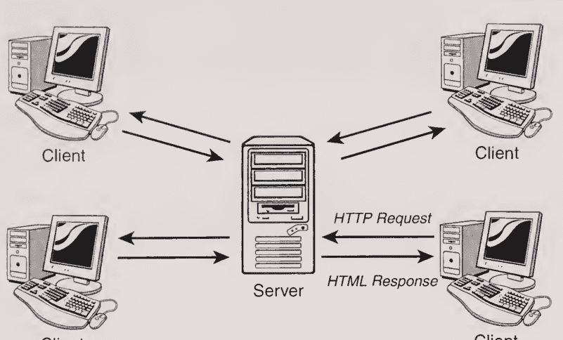

图 1.1 Web 服务器和客户端（浏览器）如何交互。

第 3 课“使用 HTTP 协议发送请求”将更详细地讨论 HTTP 请求的细节。目前，只需知道你的 HTTP 请求包含了几条必要信息，以便你的页面能够被正确识别并提供给你，包括以下内容：

- 页面存储的域（例如，`mydomain.com`）
- 页面的名称（这是 Web 服务器文件系统中的一个文件名——例如，`mypage.html`）
- 你希望随请求发送的任何参数的名称和值

## 什么是网页？

任何有过使用万维网经验的人都会熟悉*网页*这个术语。网站的传统用户界面涉及访问者在一系列相互连接的*页面*之间导航，每个页面包含文本、图像等，很像杂志的页面。

通常，每个网页实际上是服务器上的一个单独文件。构成网站的各个页面集合由一个名为*Web 服务器*的程序管理。

> **注意：** 在通俗用语中，术语 *web server*（网络服务器）通常既指网络服务器程序（如 `Apache`），也指运行该程序的计算机。

### Web 服务器

网络服务器是一种程序，它能够解析 HTTP 请求，并以浏览器能够理解的形式传递相应的网页。目前有许多可用的示例，大多数运行在 UNIX/Linux 操作系统或某种版本的 Microsoft Windows 系统下。

或许最知名的服务端应用是来自 Apache 软件基金会（`http://www.apache.org`）的 *Apache Web Server*，这是一个开源项目，用于为全球数百万网站提供服务（参见图 1.2）。

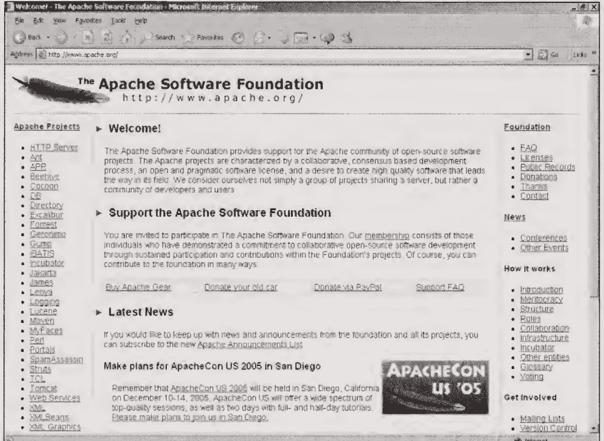

> **光盘内容：** *Ajax Starter Kit* 光盘中包含了适用于 Windows、Mac 和 Linux 的 Apache。

另一个例子是微软的 IIS（Internet Information Services，互联网信息服务），它常用于运行 Microsoft Windows 操作系统的主机计算机上。

### 服务端编程

服务端程序、脚本或语言，指的是在服务器计算机上运行的程序。用于服务端编程的语言和工具很多，包括 PHP、Java 和 ASP（后者仅可在运行 Microsoft Windows 操作系统的服务器上使用）。复杂的服务端设置通常还包括可供服务端脚本访问的数据库信息。

此类脚本的用途多种多样。但总的来说，它们都旨在将网页预处理后再返回给您。这意味着页面的部分或全部内容会被修改以适应您的请求上下文——例如，显示前往特定目的地、在特定日期的火车时刻表，或者仅显示目录中与您所述的爱好和兴趣相匹配的产品。

通过这种方式，服务端脚本使得网页可以提供丰富多样的内容，这是任何仅使用静态页面（即内容固定的页面）的设计所无法达到的。

> **注意：** 本书中的服务端编程使用流行的 PHP 脚本语言进行，该语言灵活、易于使用，并且几乎可以在所有服务器上运行。然而，Ajax 与任何服务端脚本语言配合都能同样良好地工作。

### 网页浏览器

网页浏览器是网络冲浪者计算机上的一个程序，用于解析和显示网页。第一个图形化网页浏览器 Mosaic，最终发展成了 Netscape 生产的著名浏览器系列。

> **注意：** 所谓图形化网页浏览器，指的是不仅能显示 HTML 文档的文本元素，还能显示图像和颜色的浏览器。通常，此类浏览器具有使用鼠标或类似指点设备的点击式界面。

也存在基于文本的网页浏览器，其中最知名的是 Lynx（`http://lynx.browser.org/`），它在基于字符的显示器（如终端、终端仿真器）和具有命令行界面的操作系统（如 DOS）上显示 HTML 页面。

Netscape 系列浏览器曾是最成功的可用浏览器，但最终加入了微软的 Internet Explorer，后者随后占据了市场主导地位。

### 世界万维网的工作原理

然而，近期的竞争性努力引入了多种竞争性的浏览器产品，包括 Opera、Safari、Konqueror，尤其是 Mozilla 的 Firefox，这是一款开源网页浏览器，最近赢得了一批热情的追随者（参见图 1.3）。

浏览器在许多计算机操作系统上都易于获得，包括各种版本的 Microsoft Windows、UNIX/Linux 和 Macintosh，以及其他计算设备，从移动电话到 PDA（个人数字助理）和掌上电脑。

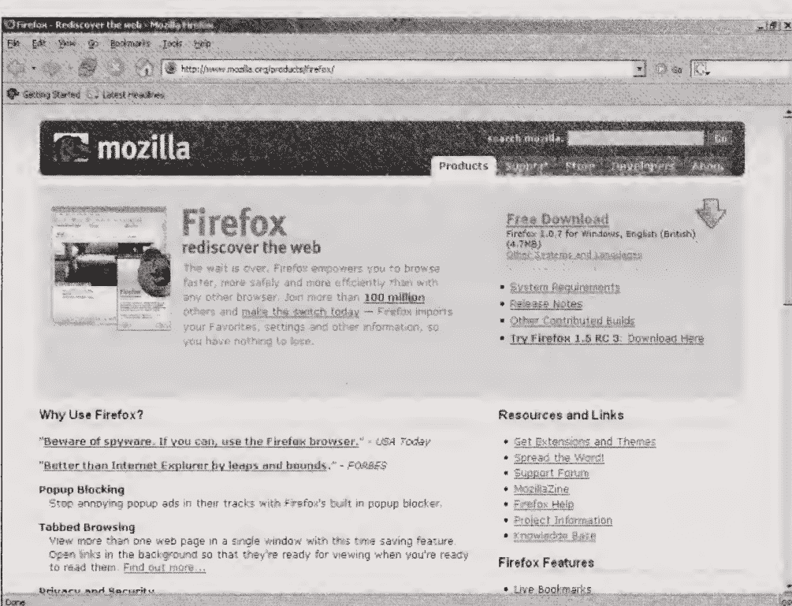

图 1.3 来自 Mozilla.org 的 Firefox 浏览器正在浏览 Firefox 项目主页。

### 客户端编程

我们已经讨论了服务端脚本如何通过提供在服务器上创建并插入到页面中再发送给您的、内容丰富多样的页面来改善您的网络体验。

另一方面，客户端编程不是发生在服务器端，而是在用户浏览器接收到页面*之后*立即在其内部发生。此类脚本允许您对已接收页面中的数据执行许多任务，包括执行计算、更改显示颜色和样式、检查用户输入的有效性等等。

几乎所有浏览器都支持某种版本的客户端脚本语言 JavaScript，它是 Ajax 的核心组成部分，也是本书中我们将用于客户端编程的语言。

### DNS——域名服务

连接到互联网的每台计算机都被分配了一个唯一的数字地址（称为 IP 地址）。然而，当您想在浏览器中查看特定网站时，通常不想输入一连串数字——您想使用相关网站的域名。毕竟，记住 `www.somedomain.com` 比记住像 `198.105.232.4` 这样的东西容易得多。

当您通过域名请求网页时，您的互联网服务提供商会将该域名提交给 DNS 服务器，DNS 服务器会尝试查找与该名称关联的数据库条目并获取相应的 IP 地址。如果成功，您就会连接到该网站；否则，您会收到错误信息。

互联网上的许多 DNS 服务器连接成一个网络，当发生更改时会不断自我更新。当网站的 DNS 信息发生变化时，修订后的地址信息会在整个互联网的 DNS 服务器中传播，通常在大约 24 小时内完成。

## 总结

在第 1 课中，我们讨论了互联网的历史和发展，并回顾了其一些主要组成部分的功能，包括网络服务器和网页浏览器。我们还考虑了基于页面的传统网站用户界面的特性，并简要了解了服务端和客户端脚本能够为改善用户网络冲浪体验所做的事情。

在本课中，我们介绍 HTML，这是几乎所有万维网页背后的标记语言。对 HTML 的扎实掌握为后续课程中讨论的 Ajax 应用程序提供了绝佳的基础。

## HTML 简介

试图对 HTML（超文本标记语言）——或者实际上对 Ajax 的任何其他组成部分技术——进行全面介绍是不合适的。我们将回顾其基本原理，并提供一些代码示例来说明，特别关注当我们开始开发 Ajax 应用程序时将变得相关的主题。

### 什么是 HTML？

万维网由数百万个独立的页面构成，而这些页面通常都是用超文本标记语言编写的，通常被称为 HTML。

这个名称透露了关于 HTML 本质的很多信息。我们用它来标记我们的文本文档，以便网页浏览器知道如何显示它们，并在其中定义超文本链接，以提供内部或之间的导航。

任何像我一样能记得旧的、所见即所得（WYSIWYG）之前的文字处理程序的人，都已经熟悉了文本标记。这些旧的应用程序大多要求在你希望显示为（例如）粗体、斜体或带下划线的文本部分的开头和结尾放置特殊字符。

> **光盘内容：** 在 Ajax Starter Kit 光盘上查找 *Sams Teach Yourself HTML in 10 Minutes*。

### 编写 HTML 需要哪些工具？

因为 HTML 标记中使用的元素只使用普通的键盘字符，所以构建 HTML 页面真正需要的只是一个好的文本编辑器。有很多可用的选择，而且大多数操作系统至少已经安装了一个这样的程序。例如，如果你使用的是某个版本的 Windows，内置的记事本应用程序就完全可以，或者你可以在 Mac 上使用 TextEdit。

> **光盘内容：** 尽管记事本或 TextEdit 是完全可用的文本编辑器，但许多所谓的*程序员编辑器*提供了有用的附加功能，如行号和语法高亮。一个功能齐全、跨平台的编辑器 `jEdit` 包含在 *Ajax Starter Kit* 光盘中。

### 我们的第一个 HTML 文档

让我们直接开始创建一个简单的 HTML 文档。打开记事本（或你选择使用的任何编辑器）并输入清单 2.1 所示的文本。HTML 标记元素（通常称为*标签*）是用 `<` 和 `>` 括起来的字符串。

```html
清单 2.1  testpage.html
<!DOCTYPE HTML PUBLIC "-//W3C//DTD HTML 4.01
-Transitional//EN" "http://www.w3.org/TR/html4/loose.dtd">
<html>
<head>
<title>A Simple HTML Document</title>
</head>
<body>
<h1>My HTML Page</h1>
Welcome to my first page written in HTML.<br />
This is simply a text document with HTML markup to show some
words in <b>bold</b> and some other words in <i>italics</i>.
```

> **注意：** 尽管文本编辑器非常适合编写程序代码，但使用文字处理软件可能会引起问题，因为这类程序通常会在输出代码中嵌入不需要的标记和其他符号。如果你选择使用文字处理程序，请确保它能够将文件保存为纯 ASCII 文本。

现在请将文档保存在计算机的某个位置，并将其命名为 `testpage.html`。

如果你现在将该页面加载到你喜欢的浏览器中，例如 Internet Explorer 或 Firefox，你应该会看到类似图 2.1 中所示的窗口。

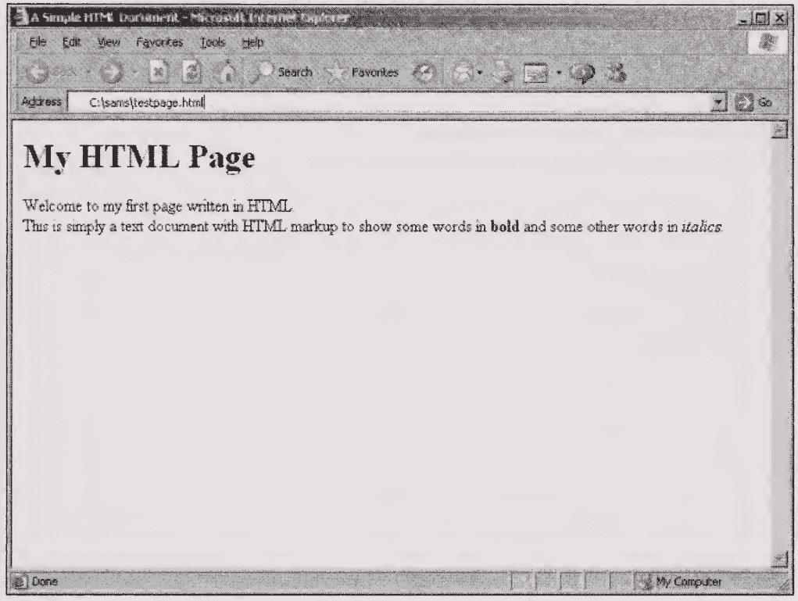

### HTML 页面的元素

让我们更详细地查看代码清单 2.1。


页面上的第一个元素被称为`DOCTYPE`元素。其目的是通知浏览器文档中使用的 HTML“版本”。本书中使用的`DOCTYPE`元素指的是 *HTML 4.0 Transitional*，这是 HTML 规范中一个相当宽松的版本，除了最新的 HTML 4.0 规范外，还允许使用一些早期的标记风格和结构。

`DOCTYPE`元素必须始终出现在 HTML 文档的最开始。接下来，请注意文档的其余部分被页面开始的`<html>`元素和结束的`</html>`元素所包围。这些标签通知浏览器，它们之间的内容应被解释并显示为 HTML 文档。

这些外部标签内的文档被进一步分为两个部分。第一部分包含在`<head>`和`</head>`标签中，第二部分包含在`<body>`和`</body>`之间。本质上，文档的 head 部分用于存储不应在浏览器窗口中显示的信息，而文档的 body 部分则包含通过浏览器窗口解释并显示给用户的文本。

> **注意：** 尽管许多现代浏览器可以正确显示没有这些标签的 HTML，但省略它们是不良实践。即使页面在你自己的 PC 上显示正确，你也无法知道访问者可能使用什么操作系统和浏览器——他可能就没那么幸运了。

### 文档的`<head>`部分

从代码清单 2.1 中我们可以看到，我们简单的 HTML 文档的 head 部分只包含一行——被`<title>`和`</title>`标签包围的“A Simple HTML Document”这几个词。

请记住，head 部分包含不显示在浏览器窗口中的信息。因此，这不是显示在页面文本顶部的标题，你可以再次查看图 2.1 来确认。文档标题也不是指文档的文件名，在这种情况下是`testpage.html`。

事实上，文档标题承担着多项功能，其中包括：

- 搜索引擎通常使用页面标题（以及其他因素）来帮助它们判断页面的内容。
- 当你为页面添加书签时，它通常默认保存为文档标题。
- 大多数浏览器在最小化时，会在其图标或任务栏按钮上显示当前文档的标题。

因此，为你创建的每个页面选择一个有意义且具有描述性的标题非常重要。

文档的 head 部分还使用了其他许多元素类型，包括`link`、`meta`和`script`元素。虽然我们在这里没有对它们进行详细说明，但它们在本书中会在出现时进行描述。

### 文档的`<body>`部分

再次参考代码清单 2.1，我们可以清楚地看到，文档 body 部分的内容由我们希望在页面上显示的文本以及一些帮助我们定义文本外观的标签组成。

例如，要定义某些词应以粗体显示，我们将这些词包含在`<b>`和`</b>`标签中。类似地，要将某些词转换为斜体，我们可以使用`<i>`和`</i>`标签。

标题“My HTML Page”包含在`<h1>`和`</h1>`标签之间。这些标签表示我们打算将包围的文本作为标题。HTML 允许六级标题，从 h1（最突出）到 h6。你可以使用任何中间值 h2、h3、h4 和 h5 来显示具有不同级别子标题的页面，例如对应于章、节和段落标题。标题标签内显示的任何内容都会单独显示在一行上。

> **提示：** 如果你想在 HTML 页面的 body 部分编写内容，但 *不* 希望它被浏览器解释并因此显示在屏幕上，你可以将其编写为 *注释*。HTML 注释以字符串`<!--`开头，以字符串`-->`结尾，如本例所示：

```html
<!-- this is just a comment and won't be displayed in the browser -->
```

到目前为止讨论的所有标签都是 *容器*——也就是说，它们由开始标签和结束标签组成，你将需要这些标签作用的文本放在它们之间。然而，有些元素不是容器，但可以单独使用。

代码清单 2.1 展示了这样一个元素：`<br />`标签，表示换行。另一个例子是`<hr />`（水平线）。

### 为 HTML 元素添加属性

有时需要确切指定标记标签应如何行为。在这种情况下，你可以添加（通常在开始标签内）参数和值对，称为 *属性*，以更改元素的行为：

```html
<body bgcolor="#cccccc">
... page content goes here ...
</body>
```

在这个例子中，`<body>`标签的行为已通过将其 BGCOLOR（背景颜色）属性调整为浅灰色而被修改。图 2.2 显示了将其应用于我们的文件`testpage.html`时的效果：

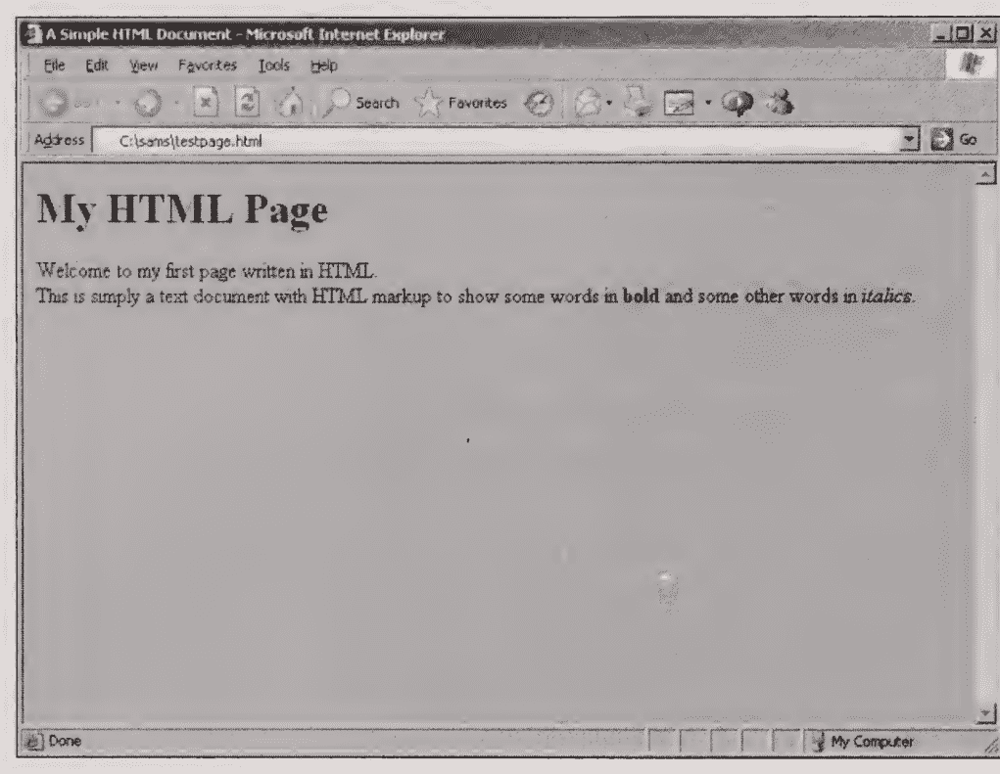

**图 2.2** 我们的测试页面，主体颜色更改为灰色。

> **提示：** HTML 中的颜色值使用十六进制系统编码。每个颜色值由三个分量值组成，分别对应红色、绿色和蓝色。每个颜色值可以是从十六进制 00 到十六进制 ff（十进制表示 0 到 255）。这三个十六进制数字连接成一个以井号字符`#`为前缀的字符串。因此，颜色值`#000000`对应黑色，`#ffffff`对应纯白色。

### 图像

可以通过``标签将图像插入我们的页面。在这种情况下，我们使用`src`属性将图像的源文件指定为参数。我们还可以通过这种方式改变图像显示的其他方面，包括图像的边框、宽度和高度：

```html

```

边框宽度、图像宽度和图像高度以 *像素* 为单位（屏幕上由单个图片元素形成的“点”）。

> **提示：** 图像的另一个有用属性是`alt`，它是 *alternative text* 的缩写。这指定了图像的简短描述，将提供给无法显示图像或配置为不显示图像的浏览器用户。替代文本对于使你的网站对视力障碍和其他残疾人士可访问也至关重要：

``

### 表格

通常你希望以表格格式显示信息，HTML 有一组专为此目的设计的元素：

```html
<table>
<tr><th>Column Header 1</th><th>Column Header 2</th></tr>
<tr><td>Data Cell 1</td><td>Data Cell 2</td></tr>
<tr><td>Data Cell 3</td><td>Data Cell 4</td></tr>
</table>
```

`<table>`和`</table>`标签包含其他标签的嵌套层次结构，包括`<tr>`和`</tr>`，定义单个表格行；`<th>`和`</th>`，表示表格标题行中的单元格；以及`<td>`和`</td>`，包含单个表格数据单元格。

请提前查看图 2.3，了解表格在浏览器窗口中显示时的示例。

### 超链接

超文本链接（*超链接*）是 HTML 操作的基础。通过单击超链接，你可以导航到新位置，可以是当前页面上的另一点，也可以是另一个网站上不同页面的某个点。

链接包含在`<a>`或锚标签中，这是一个容器标签，包围将成为链接的内容。链接的目标地址作为参数`href`传递给此标签：

`Here is <a href="newpage.html">my hyperlink</a>`

在上面的示例中单击“my hyperlink”会导致浏览器请求页面`newpage.html`。

> **提示：** 超链接可以包含图像以及文本，或代替文本。看这个例子：

`<a href="newpage.html"></a>`

在这里，用户可以单击图像`picfile.gif`来导航到`newpage.html`。

### 一个更高级的 HTML 页面

让我们重新访问我们的`testpage.html`并添加一些额外的元素。代码清单 2.2 展示了`seville.html`，它从我们的原始 HTML 页面发展而来，但在文档的`<body>`部分包含不同的内容。图 2.3 显示了这次在 Mozilla Firefox 中显示页面时的外观。

现在我们已经为文档的 body 区域应用了背景色调。body 区域的内容已在页面上居中，并且该内容现在包括一个图像（我们为其设置了两像素宽的边框）、一个标题和一个副标题、一个简单的表格和一些文本。

```html
代码清单 2.2  seville.html
<!DOCTYPE HTML PUBLIC "-//W3C//DTD HTML 4.01
Transitional//EN" "http://www.w3.org/TR/html4/loose.dtd">
<html>
<head>
<title>A Simple HTML Document</title>
</head>
<body bgcolor="#cccccc">
<center>

<h1>Guide to Seville</h1>
<h3>A brief guide to the attractions</h3>
```

## 一个更复杂的 HTML 页面

```html
<table border="2">
<tr>
    <th bgcolor="#aaaaaa">Attraction</th>
    <th bgcolor="#aaaaaa">Description</th>
</tr>
<tr>
    <td>Cathedral</td>
    <td>Dating back to the 15th century</td>
</tr>
<tr>
    <td>Alcazar</td>
    <td>The medieval Islamic palace</td>
</tr>
</table>
<p>Enjoy your stay in beautiful Seville.</p>
</center>
</body>
</html>
```

让我们更仔细地研究一下部分代码。

首先，我们使用了`<body>`标签的 BGCOLOR 属性来为页面提供整体的背景色调：

```html
<body bgcolor="#cccccc">
```

正文区域中的所有内容都包含在`<center>`标签（紧接在 body 标签之后）及其配对标签`</center>`（紧接在闭合 body 标签之前）之间。这确保了我们的所有内容在页面上都是居中的。

主标题像之前一样包含在`<h1>`...`</h1>`标签中，但现在后面跟着一个使用`<h3>`...`</h3>`标签的子标题，以提供略小的字体大小。

通过在开始的`<table>`标签中使用`border`属性，我们为表格设置了两像素的边框宽度：

```html
<table border="2">
```

同时，我们通过使用`<th>`元素的 BGCOLOR 属性，略微加深了表格表头单元格的背景：

```html
<th bgcolor="#aaaaaa">Attraction</th>
```

## 一些有用的 HTML 标签

表 2.1 列出了一些更流行的 HTML 标签。

### 表 2.1 一些常见的 HTML 标记元素

| 标签 | 描述 |
| :--- | :--- |
| **文档标签** | |
| `<html>...</html>` | 整个文档 |
| `<head>...</head>` | 文档头部 |
| `<body>...</body>` | 文档主体 |
| `<title>...</title>` | 文档标题 |
| **样式标签** | |
| `<a>...</a>` | 超链接 |
| `<b>...</b>` | 粗体文本 |
| `<em>...</em>` | 强调文本 |
| `<font>...</font>` | 更改字体 |
| `<i>...</i>` | 斜体文本 |
| `<small>...</small>` | 小号文本 |
| `<table>...</table>` | 表格 |
| `<tr>...</tr>` | 表格行 |
| `<th>...</th>` | 表格表头单元格 |
| `<td>...</td>` | 表格主体单元格 |
| `<ul>...</ul>` | 项目符号列表 |
| `<ol>...</ol>` | 有序（编号）列表 |
| `<li>...</li>` | 项目符号列表或有序列表中的列表项 |

> **提示：** 万维网联盟负责管理 HTML、HTTP、XML 以及许多其他 Web 技术的定义。其网站位于`http://www.w3.org/`。

## 两分钟理解层叠样式表

前面介绍的网页样式设置方法有一些缺点。

首先，你需要明确声明每个页面元素的属性。当你想改变页面的外观时，你需要逐行检查源代码并更改每个属性的每个实例。对于几个简单的页面来说这可能没问题，但随着内容量的增加，页面会变得更难以维护。此外，应用于 HTML 元素的属性只允许你对它们的显示方式有有限的调整范围。

如果只对代码进行一次更改，就能将该更改应用于给定类型的所有 HTML 元素，这难道不是更好吗？我相信你已经猜到了，这是可以实现的。

为了实现这个目标，你可以使用 *样式*。样式可以通过在文档头部使用`style`标签嵌入到你的 HTML 文档中：

```html
<style type="text/css">
    ... 样式定义语句 ...
</style>
```

或者，它们也可以从外部文件链接，使用`link`元素，同样放置在文档的 head 部分：

```html
<link rel=stylesheet href="mystylesheet.css" type="text/css" />
```

> **提示：** 你甚至可以即时定义样式。这些被称为内联样式，可以应用于单个 HTML 元素。以代码清单 2.2 的 body 标签为例：

`<body bgcolor="#cccccc">`

你可以使用内联样式实现相同的效果：

`<body style="background-color:#cccccc">`

## 设置样式表规则

样式表允许你为各种 HTML 元素设置样式规则。一个规则有两个组成部分：选择器，用于标识该规则应影响哪个 HTML 标签；以及声明，其中包含你的样式规则。以下示例为段落元素`<p>`定义了一个样式：

```css
P {color: #333333}
```

此示例确定，任何包含在段落标签`<p>`...`</p>`中的文本都应使用深灰色文本显示。你也可以为每个标签指定多个规则。假设除了灰色文本外，你还希望段落元素中的所有文本都以斜体显示：

```css
P {color: #333333; font-style: italic}
```

一个样式表可以根据你的需要包含任意数量的此类规则。

你还可以通过用逗号分隔标签选择器，将一个声明同时应用于多个标签。以下规则确定所有 h1、h2 和 h3 标题都显示为蓝色文本：

```css
H1, H2, H3 {color: blue}
```

## 总结

本课讨论了使用超文本标记语言进行网页布局的基础知识，包括 HTML 文档的结构、HTML 页面元素的示例，以及使用元素属性和层叠样式表进行页面样式设置。

万维网上的通信使用各种协议，其中最重要的可能是 HTTP，该协议也是 Ajax 应用程序的基础。本课介绍 HTTP 协议，并展示如何使用它来请求和接收信息。

### 介绍 HTTP

HTTP 或超文本传输协议是万维网的主要协议。当你在 Web 浏览器中输入地址来请求一个网页时，该请求就是使用 HTTP 发送的。浏览器是一个 HTTP 客户端，而网页服务器（毫不意外地）是一个 HTTP 服务器。

本质上，HTTP 定义了一套关于服务器和浏览器之间应如何格式化和交换消息及其他数据的规则。

### 为什么我需要了解这个？

Ajax 使用 HTTP 协议发送服务器请求。认识不同类型的 HTTP 请求以及服务器可能返回的响应非常重要。Ajax 应用程序需要构造 HTTP 请求来查询服务器，并将根据服务器 HTTP 响应的内容来决定下一步做什么。

### 本课涵盖（和未涵盖）的内容

完全可以用整本书来介绍 HTTP 协议的信息，但在这里我们仅从其在请求网页和传递信息方面的作用来讨论它。

在本课中，你将了解 HTTP 请求和响应的结构，并了解 HTML 表单如何使用此类请求在网页之间传输数据。

> **提示：** 有关 HTTP 的详细说明，请参阅 Sams Publishing 出版的 Chris Shiflett 所著的《HTTP Developer's Handbook》。

## HTTP 请求与响应

HTTP 协议可以比作基于一系列问题和答案的对话，我们分别称之为 *HTTP 请求* 和 *HTTP 响应*。

HTTP 请求和响应的内容易于阅读和理解，其语法非常接近纯英文。

本节将探讨这些请求和响应的结构，以及它们可能包含的一些数据类型的示例。

## HTTP 请求

与目标服务器建立连接后，HTTP 客户端以以下格式传输请求：

- 一个起始行
- 可选地，一些 *首部行*
- 一个空行
- 可选地，一个消息体

起始行通常分为三个部分：*方法*名称、所需*服务器资源*的路径以及所使用的*HTTP 版本*。一个典型的起始行可能如下所示：

```http
GET /sams/testpage.html HTTP/1.0
```

在这一行中，我们告诉服务器我们正在发送一个 GET 类型的 HTTP 请求（下一节将更详细地解释），我们使用 HTTP 版本 1.0 发送此请求，并且我们所需的服务器资源（包括其本地路径）是`/sams/testpage.html`。

### HTTP 响应头

请求头行用于发送关于请求或消息体中所发送数据的信息。每行发送一个参数和值对，参数和值之间用冒号分隔。以下是一个示例：

```http
User-Agent: [name of program sending request]
```

例如，Internet Explorer v5.5 提供的内容类似于：


```text
User-agent: Mozilla/4.0 (compatible; MSIE 5.5; Windows NT 5.0)
```

另一个常见请求头的例子是`Accept:`头，它表明了服务器响应中哪些类型的信息是可接受的：

```text
Accept: text/plain, text/html
```

> **注意：** HTTP 请求方法包括`POST`、`GET`、`PUT`、`DELETE`和`HEAD`。在我们研究 Ajax 的过程中，最有趣的是`GET`和`POST`请求。`PUT`、`DELETE`和`HEAD`请求此处不涉及。

通过发送前面示例中的头信息，请求正在告知服务器，发送应用程序可以接受纯文本或 HTML 响应（也就是说，它不具备处理音频或视频文件等数据的能力）。

> **注意：** 在此示例中，我们请求的服务器资源位于我们自己的服务器上，因此我们使用了相对路径。当然，它也可能位于其他地方的另一个服务器上，此时服务器资源将包含完整的 URL。

### HTTP 响应

为了响应这样的请求，服务器通常会发出一个 HTTP 响应，其第一行通常称为状态行。在该行中，服务器会回显 HTTP 版本，并给出一个响应状态码（一个三位数整数）和一个称为原因短语的简短消息。以下是一个 HTTP 响应示例：

```text
HTTP/1.0 200 OK
```

响应状态码和原因短语本质上是同一消息的机器可读版本和人类可读版本，尽管原因短语在不同服务器之间可能略有差异。表 3.1 列出了一些常见状态码和原因短语的示例。状态码的第一位通常提供了关于消息性质的线索：

- `1xx` — 信息性
- `2xx` — 成功
- `3xx` — 重定向
- `4xx` — 客户端错误
- `5xx` — 服务器错误

#### 表 3.1 一些常见的 HTTP 响应状态码

| 状态码 | 说明 |
| :--- | :--- |
| 200 - OK | 请求成功。 |
| 204 - No Content | 文档不包含任何数据。 |
| 301 - Moved Permanently | 资源已永久移动到不同的 URI。 |
| 401 - Not Authorized | 请求需要用户认证。 |
| 403 - Forbidden | 服务器已拒绝执行该请求。 |
| 404 - Not Found | 请求的资源在服务器上不存在。 |
| 408 - Request Timeout | 客户端未能在服务器允许的时间内发送请求。 |
| 500 - Server Error | 由于脚本错误、服务器配置错误或类似问题。 |

> **提示：** 万维网联盟 (W3C) 维护着一份详细的状态码列表，可在`http://www.w3.org/Protocols/rfc2616/rfc2616-sec10.html`查阅。

响应也可能包含头行，每行包含一个头和值对，类似于 HTTP 请求，但通常包含有关服务器和/或所返回资源的信息：

```text
Server: Apache/1.3.22
Last-Modified: Fri, 24 Dec 1999 13:33:59 GMT
```

### HTML 表单

网页通常包含可以输入信息的字段。示例包括选择框、复选框和可以输入信息的字段。表 3.2 列出了一些常用的 HTML 表单标签。

#### 表 3.2 一些常用的 HTML 表单标签

| 标签 | 描述 |
| :--- | :--- |
| `<form>...</form>` | 整个表单的容器 |
| `<input />` | 数据输入元素；包括文本、密码、复选框和单选按钮字段，以及提交和重置按钮 |
| `<select>...</select>` | 下拉选择框 |
| `<option>...</option>` | 选择框内的可选项 |
| `<textarea>...</textarea>` | 多行文本输入框 |

完成表单后，通常会提示您通过一个标签适当的按钮或其他页面元素来提交它。

此时，HTML 表单根据用户输入的数据构建并发送一个 HTTP 请求。表单可以使用`GET`或`POST`请求类型，这由`<form>`标签的`method`属性指定。

### GET 和 POST 请求

偶尔可能会听到这样的说法：`GET`和`POST`请求之间的区别在于，`GET`请求仅用于获取（即检索）数据，而`POST`请求则有多种用途，例如上传数据、发送邮件等。

尽管这种经验法则可能有一定道理，但考虑这两种 HTTP 请求在构建方式上的差异，对我们很有启发。

`GET`请求将其发送的消息编码到一个查询字符串中，并将其附加到服务器资源的 URL 后面。另一方面，`POST`请求将其消息放在请求的消息体中发送。实际上发生的情况是，输入的数据被编码，并通过 HTTP 请求发送到表单的`action`属性声明的 URL，在该 URL 处将以某种方式处理提交的数据。

HTTP 请求是`GET`类型还是`POST`类型，以及表单发送到的 URL，都是由表单的 HTML 标记决定的。让我们看一下一个典型表单的 HTML 代码：

```html
<form action="http://www.sometargetdomain.com/somepage.htm"
      method="post">
  Your Surname: <input type="text" size="50" name="surname" />
  <br />
  <input type="submit" value="Send" />
</form>
```

这段代码片段嵌入到网页中后，会产生如图 3.1 所示的简单表单。

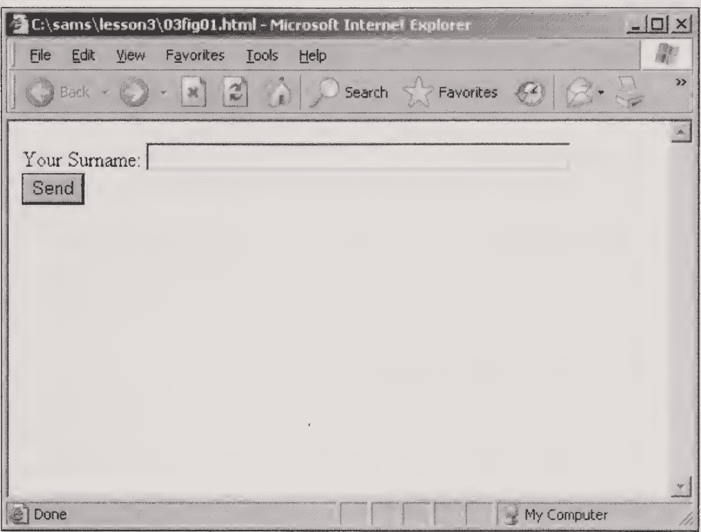

图 3.1 一个简单的 HTML 表单。

让我们逐行看一下代码。首先，我们使用`<form>`标签开始表单，在这个示例中，我们为标签添加了两个属性。`action`属性决定了提交的表单将被发送到的 URL。这可以是同一服务器上的另一个页面，并通过相对路径描述，也可以是远程域，如图 3.1 中表单背后的代码所示。

接下来我们找到`method`属性，它决定了我们希望使用`GET`还是`POST`请求来提交数据。

现在假设我们通过在`surname`字段中输入值`Ballard`来完成表单。通过单击发送按钮提交表单后，我们将被带到`http://www.sometargetdomain.com/somepage.htm`，在那里提交的数据将被处理——例如，可能会将姓氏添加到数据库中。

变量`surname`（分配给 Your Surname 输入字段的`name`属性）及其值（我们在该字段中输入的数据）也将被发送到此目标页面，编码到`POST`请求的正文中，用户不可见。

现在假设表单代码的第一行如下所示：

```html
<form action="http://www.sometargetdomain.com/somepage.htm"
      method="get">
```

使用表单时，我们仍然会被带到同一个目标页面，相同的变量及其值也会被传输。然而，这次表单将构建并发送一个包含表单数据的`GET`请求。查看浏览器的地址栏，在成功提交表单后，我们会发现它现在包含：

```text
http://www.example.com/page.htm?surname=Ballard
```

这里我们可以看到参数及其值是如何附加到 URL 后面的。如果表单包含更多输入字段，则在这些字段中输入的值也会作为`parameter=value`对附加到 URL 后面，每个对之间用`&`字符分隔。以下是一个示例，我们假设表单还有一个名为`firstname`的文本输入字段：

```text
http://www.example.com/page.htm?surname=Ballard&firstname=Phil
```

某些字符，如空格和各种标点符号，不允许以其原始形式传输。HTML 表单将这些字符编码为可以正确传输的形式。在接收页面，有一个等效的过程在处理之前解码这些值，从而使编码/解码操作对用户基本不可见。但是，我们可以通过发起`GET`请求并检查构造的 URL 来查看这种编码的样子。

假设我们的表单中没有`surname`字段，而是有一个全名字段，要求输入用户的全名，并将该信息编码到`GET`请求中。那么，提交表单后，我们可能会在浏览器中看到以下 URL：

```text
http://www.example.com/page.htm?fullname=Phil+Ballard
```

> **注意：** 在许多情况下，您可以对表单提交使用`POST`或`GET`方法，并获得基本相同的结果。但是，当您了解如何在 Ajax 应用程序中构建服务器调用时，这种差异就变得很重要了。

这里名字中的空格已被`+`字符替换；接收端的解码过程会删除此字符并还原为空格。

所有 Ajax 应用程序的核心`XMLHttpRequest`对象使用 HTTP 向服务器发出请求并接收响应。这些 HTTP 请求的内容与提交 HTML 表单时生成的内容基本相同。

## 总结

本课程涵盖了使用 HTTP 协议（万维网的主要通信协议）进行服务器请求和响应的一些基础知识。具体来说，我们讨论了`GET`和`POST`请求是如何构建的，以及它们如何在 HTML 表单中使用。此外，我们还看到了一些可能从服务器接收到的、对这些请求的响应示例。

在本课程中，我们介绍了使用 JavaScript 进行客户端脚本的概念。客户端脚本嵌入在网页中，并由浏览器内置的 JavaScript 解释器执行。它们为原本静态的 HTML 页面增添了额外的功能。

### 关于 JavaScript

JavaScript 是从一种名为 LiveScript 的语言发展而来的，该语言由网景公司为其早期浏览器开发。JavaScript 源代码嵌入在网页的 HTML 代码中，并在页面显示时由浏览器解释和执行。

使用 JavaScript，你可以为网页添加额外的功能。示例包括：

- 更改页面元素的显示方式
- 添加动画和其他图像效果
- 打开弹出窗口和对话框
- 检查用户输入数据的有效性

几乎所有现代浏览器都支持 JavaScript，尽管在某些命令上存在一些细微差异。当出现这些差异时，会在文中进行说明。

### 为什么我需要了解 JavaScript？

Ajax 中的`j`代表 JavaScript；你需要使用这种语言编写并嵌入在网页中的函数来构造 Ajax 服务器调用，并处理从服务器返回的响应。

### 本课程涵盖（和未涵盖）的内容

本课程篇幅有限，无法提供对所有 JavaScript 函数的详尽指南。相反，本课程侧重于后续开发 Ajax 应用程序所必需的该语言的各个方面。

完成本课程后，你将获得以下方面的经验：

- 将 JavaScript 命令和外部 JavaScript 文件嵌入网页
- 使用一些常见的 JavaScript 命令
- 使用事件处理程序启动 JavaScript 命令
- 处理 JavaScript 变量和对象
- 将 JavaScript 命令抽象为函数

### JavaScript 基础

可以通过将 JavaScript 命令放置在`<script>`...`</script>`标签之间，将其直接嵌入 HTML 页面。通常，JavaScript 函数也会保存在服务器上的单独文件中（通常文件扩展名为`.js`），并在需要时通过在 HTML 文件的头部添加如下一行来链接到 HTML 文件：

```html
<SCRIPT language="JavaScript" SRC="myJS.js"></SCRIPT>
```

这允许你调用文件`myJS.js`中的任何 JavaScript，就好像这些源代码直接输入到你自己的网页中一样。

> **提示：** 将 JavaScript 函数放入外部文件，可以使其在多个不同的网页中可用，而无需重新输入任何代码。这也使得它们更易于维护，因为每次请求页面时，都会自动链接到最新版本。

通过这种方式，可以构建大量的 JavaScript 库，并在其特定功能需要时链接到网页中。

> **注意：** 尽管你的浏览器很可能支持 JavaScript，但通常可以配置浏览器选项以禁用其使用。如果你发现无法使任何 JavaScript 命令工作，请查阅浏览器的帮助文件，以了解如何检查 JavaScript 是否已正确启用。

> **注意：** 微软的 Internet Explorer 浏览器实际上运行的是一种名为 Jscript 的专有微软语言，而不是 JavaScript。然而，这两者几乎完全相同，因此在很大程度上是兼容的。当出现差异时，会在文中进行说明。

> **关于 CD：** 要获得更全面的 JavaScript 课程，请尝试 Michael Moncur 所著的 *Sams Teach Yourself JavaScript in 24 Hours*，该书包含在 *Ajax Starter Kit* CD 中。

### 直接上手实践

> **注意：** JavaScript 与 HTML 不同，它区分大小写。输入 JavaScript 命令时，请注意不要输入错误的大小写字符，否则会发生错误。

让我们直接开始，为我们在第 2 课“用 HTML 编写网页”中开发的简单网页添加一个 JavaScript 命令。

打开你最喜欢的文本编辑器，并加载`seville.html`（来自第 2 课的代码清单 2.2）。我们将在第 24 行的`</p>`（结束段落标签）之后立即向页面添加以下代码：

```html
<script language="JavaScript" type="text/javascript">
document.writeln("This line was written using JavaScript!");
</script>
```

添加额外行后的完整源代码如代码清单 4.1 所示。请确保你已正确添加代码；然后将文件另存为`testpage3.html`，并将其加载到你最喜欢的浏览器中。

#### 代码清单 4.1 将 JavaScript 添加到 HTML 页面

```html
<!DOCTYPE HTML PUBLIC "-//W3C//DTD HTML 4.01
-Transitional//EN" "http://www.w3.org/TR/html4/
-loose.dtd">
<html>
<head>
<title>A Simple HTML Document</title>
</head>
<body bgcolor="#cccccc">
<center>

<h1>A More Advanced HTML Page</h1>
<h3>Welcome to my second page written in HTML.</h3>
<table border="2">
<tr>
  <th bgcolor="#aaaaaa">Vegetables</th>
  <th bgcolor="#aaaaaa">Fruits</th>
</tr>
<tr>
  <td>Carrot</td>
  <td>Apple</td>
</tr>
<tr>
  <td>Cabbage</td>
  <td>Orange</td>
</tr>
</table><br />
<p>... and here's some text in a paragraph.</p>
<script language="JavaScript" type="text/javascript">
document.writeln("This line was written using JavaScript!")
</script>
</center>
</body>
</html>
```

如果一切顺利，页面现在应该如图 4.1 所示。你现在应该能在页面底部附近看到一行额外的文本，写着“This line was written using JavaScript!”。

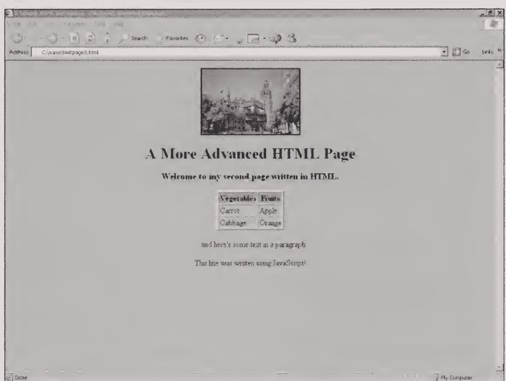

**图 4.1** 包含一行由 JavaScript 编写的 HTML 文档。

让我们来看看我们的 JavaScript 代码。第一个项目是`<script>`标签，在这里我们包含了定义`Language="JavaScript"`，它告诉浏览器包含在此脚本元素中的语句应被解释为 JavaScript。此标签中还出现了属性`type="text/javascript"`。

> **提示：** 此类脚本可以用其他可能的语言编写；每种语言都有自己的类型声明，如`type="text/vbscript"`或`type="text/xml"`。此声明表示元素中包含的脚本是用 JavaScript 编写的。

脚本在倒数第二行以熟悉的`</script>`标签结束。

现在来看核心部分：

`document.writeln("This line was written using JavaScript!")`

JavaScript（与许多其他编程语言一样）使用对象的概念。此代码行中的单词`document`指的是我们希望 JavaScript 命令在其上操作的对象。在本例中，我们处理的是文档对象，即我们在浏览器中显示的整个 HTML 文档（包括任何嵌入的 JavaScript 代码）。我们将在本课程后面进一步探讨对象。

术语`writeln`描述了我们希望 JavaScript 对文档对象执行的操作。我们说它是文档对象的一个*方法*，在本例中是一个将一行文本写入文档的方法。

括号内的字符串我们称为传递给`writeln`方法的*参数*。在本例中，它告诉该方法要向文档对象写入什么内容。

> **注意：** 除了方法，对象还拥有*属性*。这些属性告诉你一些关于对象的信息，而对象的方法则在对象上执行操作。

### 在 HTML 页面中包含 JavaScript

我们可以在页面中根据需要包含任意数量的`<script>...</script>`标签。但是，我们必须注意它们在文档中的放置位置。

JavaScript 命令按照它们在页面中出现的顺序执行。请注意，在代码清单 4.1 中，我们正是在文档中希望新文本出现的位置输入了我们的 JavaScript 代码。


JavaScript 也可以添加到 HTML 页面头部。这是保存 JavaScript 函数的常见位置，我们将在稍后描述。

### 事件处理程序

通常，你希望执行 JavaScript 代码是因为发生了某些特定事件。例如，在 HTML 表单中，你可能决定让 JavaScript 检查用户输入数据的有效性。

用户在提交表单的那一刻，或者在某些情况下，每当特定按钮被点击时，你可能希望通过弹出警告对话框来提醒用户。

为了实现这些效果，你需要使用浏览器提供的特殊接口，称为事件处理程序。事件处理程序允许你在特定类型的事件发生时自动调用 JavaScript 方法。请看以下代码：

```html
<form>
<input type="button" value="Click Here"
   onClick="alert('Thanks for clicking!')">
</form>
```

在这里，我们使用 `onClick` 事件处理程序来捕获用户点击按钮的动作。当检测到用户的点击时，脚本会执行 `input` 标签中 `onClick` 属性里列出的指令：

```javascript
onClick="alert('Thanks for clicking!')"
```

这一行调用了 JavaScript 的 `alert` 方法，该方法会弹出一个包含消息和“确定”按钮的对话框。显示在警告对话框中的消息，包含在作为参数传递给 `alert` 方法的字符串中。

让我们将这段代码添加到我们的 HTML 文档中，如清单 4.2 所示。完成修改后，将页面保存为 `testpage4.html`，然后在浏览器中加载它。

#### 清单 4.2 从 `onClick` 事件处理程序调用 `alert()`

```html
<!DOCTYPE HTML PUBLIC "-//W3C//DTD HTML 4.01 Transitional
  //EN" "http://www.w3.org/TR/html4/loose.dtd">
<html>
<head>
<title>A Simple HTML Document</title>
</head>
<body bgcolor="#cccccc">
<center>

<h1>A More Advanced HTML Page</h1>
<h3>Welcome to my second page written in HTML.</h3>
<table border="2">
<tr>
  <th bgcolor="#aaaaaa">Vegetables</th>
  <th bgcolor="#aaaaaa">Fruits</th>
</tr>
<tr>
  <td>Carrot</td>
  <td>Apple</td>
</tr>
<tr>
  <td>Cabbage</td>
  <td>Orange</td>
</tr>
</table><br />
<p>... and here's some text in a paragraph.</p>
<script language="JavaScript" type="text/javascript">
document.writeln("This line was written using JavaScript!")
</script>
<form>
<input type="button" value="Click Here" onClick="alert('Thanks for clicking!')">
</form>
</center>
</body>
</html>
```

我们的 HTML 页面现在应该会显示新的按钮，如图 4.2 所示。

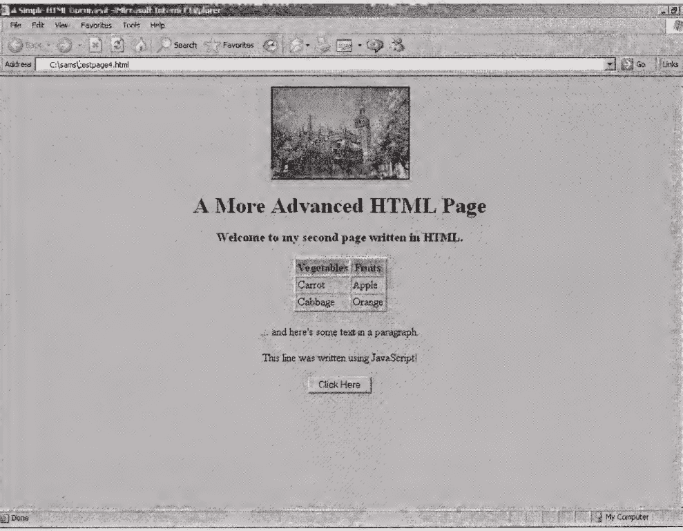

继续并点击该按钮。如果一切按计划进行，将会弹出一个警告对话框，如图 4.3 所示。你可以点击“确定”来关闭对话框。

### 创建函数

通常，你需要组合各种 JavaScript 方法和对象，可能涉及多行代码。JavaScript 允许你将这样的指令块组合起来并为其命名，使你的代码更易于编写、理解和维护。

例如，让我们使用另一个事件处理程序，但这次我们将用它来调用一个函数，而不是直接调用 JavaScript 方法。

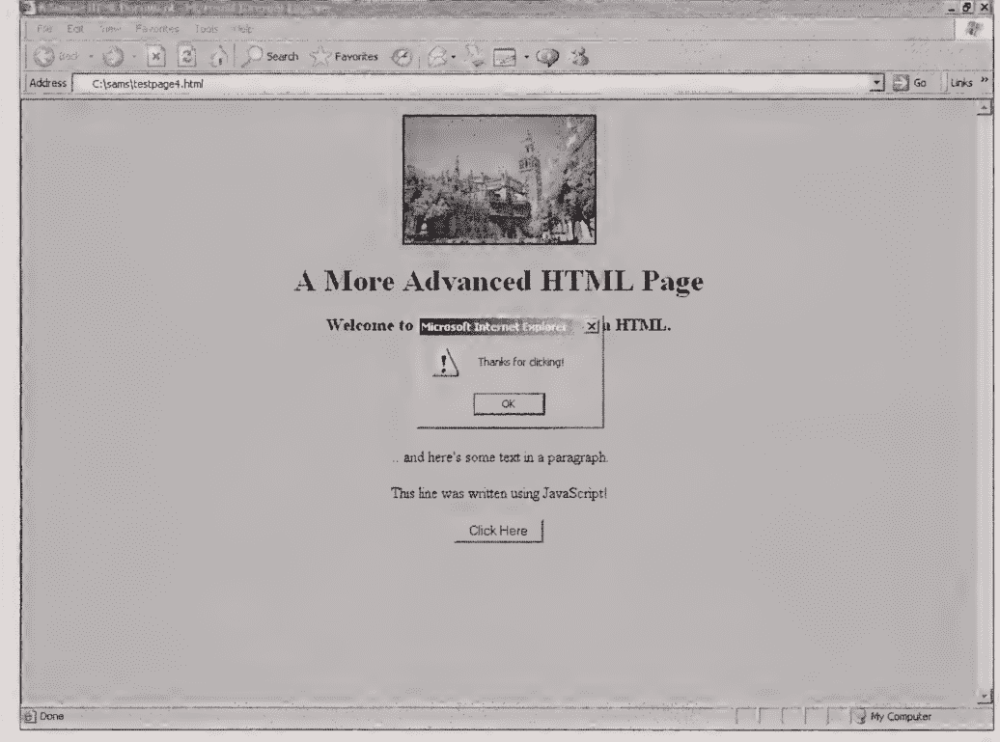

图 4.3 点击新按钮后出现的对话框。

这是我们函数的代码，我们将把它放在 HTML 文档的 `head` 部分：

```javascript
<script language="JavaScript">
function showAlert()
{
    alert("A Picture of Seville")
}
</script>
```

> 注意：请注意，函数定义总是以单词 `function` 开头，后跟函数名。函数内的语句包含在花括号 `{}` 中。

在通常的 `<script>` 标签内，我们现在定义了一个名为 `showAlert` 的函数，它执行花括号内包含的命令。在这种情况下，只有一个命令，即调用之前遇到的 `alert` 方法。

我们希望当用户的鼠标移过网页中的照片时，这个警告对话框出现。因此，我们将向包含图像的 `` 标签添加一个属性，如下所示：

```html

```

这一行使用 `onMouseOver` 事件处理程序来检测光标何时进入照片占据的区域。当这种情况发生时，我们新的函数 `showAlert` 就会被调用。

清单 4.3 显示了修改后的代码。

#### 清单 4.3 使用 `onMouseOver` 事件处理程序

```html
<!DOCTYPE HTML PUBLIC "-//W3C//DTD HTML 4.01 Transitional//EN"
"http://www.w3.org/TR/html4/loose.dtd">
<html>
<head>
<title>A Simple HTML Document</title>
<script language="JavaScript" type="text/javascript">
function showAlert()
{
alert("A Picture of Seville")
}
</script>
</head>
<body bgcolor="#cccccc">
<center>

<h1>A More Advanced HTML Page</h1>
<h3>Welcome to my second page written in HTML.</h3>
<table border="2">
<tr>
<th bgcolor="#aaaaaa">Vegetables</th>
<th bgcolor="#aaaaaa">Fruits</th>
</tr>
<tr>
<td>Carrot</td>
<td>Apple</td>
</tr>
<tr>
<td>Cabbage</td>
<td>Orange</td>
</tr>
</table><br />
<p>... and here's some text in a paragraph.</p>
<script language="JavaScript" type="text/javascript">
document.writeln("This line was written using JavaScript!")
</script>
<form>
<input type="button" value="Click Here" onClick="alert(\"Thanks for clicking!\")">
</form>
</center>
</body>
</html>
```

将此 HTML 文档加载到浏览器中后，将鼠标移到照片上方。应该会出现一个警告框，显示消息 “A Picture of Seville”。

### 向函数传递参数

当然，我们可以很容易地从页面中的各种事件处理程序中调用我们的函数，并让它弹出警告对话框。不幸的是，警告框中的消息将始终是 “A Picture of Seville”，这没什么大用！

如果我们能告诉函数要显示什么消息，这样我们就可以为不同的情况设置不同的警告消息，岂不是很好？我们可以通过将消息作为参数传递给我们的函数来实现这一点：

```javascript
<script language="JavaScript" type="text/javascript">
function showAlert(message)
{
    alert(message)
}
</script>
```

这个函数现在“期望”在调用时作为参数传递来定义消息的文本。重写图像的 `onMouseOver` 事件处理程序以提供此参数：

```html

```

我们还将重写按钮的 `onClick` 事件处理程序以使用这个函数，但使用不同的消息：

```html
<input type="button" value="Click Here"
    onClick="showAlert('Thanks for clicking!')" />
```

清单 4.4 显示了修改后的代码。

#### 清单 4.4 从事件处理程序调用 JavaScript 函数

```html
<html>
<head>
<title>A Simple HTML Document</title>
<script language="JavaScript" type="text/javascript">
function showAlert(message)
{
  alert(message)
}
</script>
</head>
<body bgcolor="#cccccc">
<center>

<h1>A More Advanced HTML Page</h1>
<h3>Welcome to my second page written in HTML.</h3>
<table border="2">
<tr>
  <th bgcolor="#aaaaaa">Vegetables</th>
  <th bgcolor="#aaaaaa">Fruits</th>
</tr>
<tr>
  <td>Carrot</td>
  <td>Apple</td>
</tr>
<tr>
  <td>Cabbage</td>
  <td>Orange</td>
</tr>
</table><br />
<p>... and here's some text in a paragraph.</p>
<script language="JavaScript" type="text/javascript">
document.writeln("This line was written using JavaScript!")
</script>
<form>
<input type="button" value="Click Here" onClick="showAlert('Thanks for clicking!')">
</form>
</center>
</body>
</html>
```

### 其他事件处理程序

到目前为止，你已经看到了 `onClick` 和 `onMouseOver` 事件处理程序的示例。还有许多其他事件处理程序可供使用；表 4.1 列出了一些最受欢迎的事件处理程序。

#### 表 4.1 一些常见的 JavaScript 事件处理程序

| 事件处理程序 | 说明 |
| :--- | :--- |
| `onChange` | 当输入字段中的值发生变化时发生 |
| `onClick` | 当用户在指定元素上点击鼠标时发生 |
| `onLoad` | 当页面完成加载时发生 |
| `onMouseOver` | 当鼠标指针进入指定元素占据的屏幕区域时发生 ... |
| `onMouseOut` | ... 以及当它离开时发生 |
| `onSubmit` | 在表单提交的那一刻发生 |

### 在 JavaScript 中操作数据

你可以使用 JavaScript 实现的功能远不止弹出对话框。JavaScript 让你有机会定义和使用变量和数组，处理日期和时间运算，以及使用循环和条件分支控制程序流程。

#### 变量

如果你曾经做过任何代数，或者用几乎任何计算机语言编写过程序，那么变量的概念你可能已经很熟悉了。变量是一段被赋予名称的数据，你可以通过这个名称方便地在以后引用它。在 JavaScript 中，你使用关键字 `var` 声明变量：

```javascript
var speed = 63;
```

上面这行代码声明了变量 `speed`，并通过赋值运算符 `=` 将其赋值为 `63`。

我们现在可以在其他语句中使用这个变量：

```javascript
var speedlimit = 55;
var speed = 63;
var excess_speed = speed - speedlimit;
```

变量不一定是数字；语句

```javascript
var lastname = 'Smith';
```

将字符串赋值给变量 `lastname`。

数字和字符串变量都可以在 JavaScript 语句中进行操作。考虑以下代码：

```javascript
var firstname = 'Susan';
var lastname = 'Smith';
document.writeln('Hello, ' + firstname + ' ' + lastname);
```

此代码将在我们的文档中输出 Hello, Susan Smith。

### 对象

你已经在本课前面遇到了对象的概念，并了解了对象既拥有描述其特性的属性，也拥有对它们执行操作的方法。

JavaScript 中的对象具有层次关系。引用从最高级别的对象开始，后续层级用句点分隔附加：

```javascript
document.image1.src
```

此字符串以对象 `document` 开始，然后引用该对象内的一个对象 `image1`，最后是属性 `src`（图像的源文件）。

> 注意：事实上，在对象层次结构中真正处于最高级别的对象是 `window`，它指的是浏览器屏幕及其内部的所有内容。通常，你不需要包含这个对象；JavaScript 假定它已存在。

假设我们页面的某个位置有以下 HTML 代码：

```html
<form name="form1" action="somepage.html" method="post">
<input type="text" name="lastname">
<input type="submit" value="Submit">
</form>
```

我们可以在 JavaScript 中，通过引用与该字段对应的对象的 `value` 属性，来引用用户在 `lastname` 字段中键入的字符串：

```javascript
document.form1.lastname.value
```

### 示例——表单验证

让我们使用此技术来检查用户输入的表单数据的有效性。我们想要捕获用户尝试提交表单的事件，并使用此事件来触发我们的 JavaScript 函数，该函数检查数据的有效性。以下是表单的 HTML 代码：

```html
<form name="form1" method="post" action="otherpage.html">
Enter a number from 1 to 10: <input size="4" type="text"
name="usernumber">
<input type="submit" value="Enter"
       onSubmit="return numcheck()">
</form>
```

我们可以看到，当点击“提交”按钮时，`onSubmit` 事件处理程序被调用，并调用一个名为 `numcheck()` 的 JavaScript 函数。我们需要这个函数来检查用户输入的内容是否有效，然后提交表单，或者（如果输入无效）发出错误提示。注意函数调用前的 `return` 一词。这里需要它是因为，我们希望函数告诉我们是否应该允许提交方法继续执行。我们希望函数在表单提交应被阻止时，向表单返回一个 `false` 值。以下是该函数：

```javascript
<script language="JavaScript" type="text/javascript">
function numcheck()
{
    var numentered = document.form1.usernumber.value;
    if((numentered>=1)&&(numentered<=10))
    {
        return true;
    } else
    {
        alert("Your entry was invalid.  Please try again.");
        return false;
    }
}
</script>
```


该函数的第一个操作是将用户输入的值赋给变量`numentered`。然后我们测试该数字的有效性，检查它是否大于或等于 1 且小于或等于 10。根据结果，我们或者向调用表单返回一个`true`值（从而允许提交表单），或者弹出一个对话框告知错误。在后一种情况下，当用户点击“确定”清除对话框时，一个`false`值被返回给调用表单，阻止表单提交，直到用户输入适当的数据。

## 总结

本课涵盖了 JavaScript 编程的基础知识。我们了解了如何将 JavaScript 命令集成到 HTML 页面中，讨论了将 JavaScript 命令分组为函数，以及学习了如何使用事件处理程序来启动 JavaScript 命令和函数。


Ajax 应用程序几乎可以与任何服务器端语言协同工作，只需服务器能对其 HTTP 请求返回格式正确的响应。本课将介绍 PHP，这是一种流行的开源脚本语言，在全球大量网络服务器上使用。

### 介绍 PHP

与 JavaScript 类似，PHP 由可以嵌入页面 HTML 代码中的命令组成。然而，PHP 是一种服务器端编程语言——也就是说，它与 Web 服务器协同工作，在将页面发送到浏览器之前处理该页面的源代码。

### 为什么我需要了解这个？

正如你已经意识到的，Ajax 应用程序会调用 Web 服务器，并随后在当前查看的页面中使用返回的信息。你需要一种在服务器上运行程序来处理 Ajax 请求并返回所需数据的方法。

Ajax 可以与各种服务器端技术协同工作，包括 PHP、ASP、Java 等。本书使用 PHP，可以说是在可用的服务器端语言中最流行且易于使用的。

本课为从未接触过 PHP 的人提供 PHP 入门介绍，并为任何接触过的人提供基础知识的复习。

### 本课涵盖（和不涵盖）的内容

就像本书这部分的每一课一样，对该主题的每个方面进行详尽的课程既不可行也不合适。

本课涵盖 PHP 编程的基础知识，并提供一些实际示例，主要集中在与我们探索 Ajax 最相关的 PHP 方面。

### 在 HTML 页面中嵌入 PHP

PHP 语句通过用`<?php`和`?>`标签包围 PHP 语句来嵌入到 HTML 文档中。在页面提供给浏览器之前，这些标签之间的任何内容都会被 Web 服务器求值，并替换为适当的 HTML 代码。

你可以在页面中使用任意多组`<?php`和`?>`标签。

### 从 PHP 输出 HTML

一些 PHP 命令可以帮助你将文本和 HTML 代码直接写入页面。也许最简单的是`echo`命令：

`echo "I wrote this line using PHP";`

上面的语句只是将 "I wrote this line using PHP" 放置在 HTML 文档中恰好是 PHP 语句所在的位置。

代码清单 5.1 显示了一个 PHP 文件的源代码，用于在浏览器窗口中打印 Hello World。

```php
<html>
<head>
<title>A Simple PHP Script</title>
</head>
<body>
<?php echo "<h1>Hello World!</h1>"; ?>
</body>
</html>
```

注意，在此脚本中，输出字符串也包含一些 HTML 标签，`<h1>` 和 `</h1>`。由于 PHP 语句在将页面提供给我们之前由 Web 服务器执行，因此这些标签与 “Hello World” 文本一起被写入文档的 HTML 中，并由我们的浏览器与文档中的所有其他 HTML 标记一起求值。图 5.1 显示了浏览器显示我们的 “Hello World” 页面。

如果我们要求浏览器显示此页面的源代码，它会显示以下代码，在其中我们可以看到 PHP 元素已被 Web 服务器完全求值，它将相关的 HTML 插入到了页面中：

```html
<html>
<head>
<title>A Simple PHP Script</title>
</head>
<body>
<h1>Hello World!</h1></body>
</html>
```

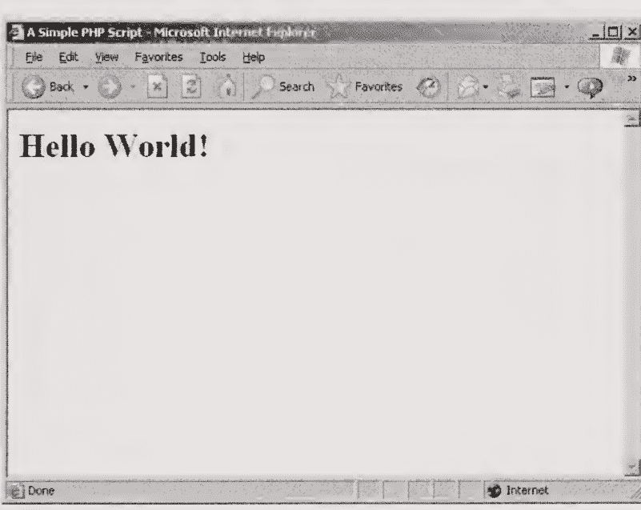

**图 5.1** PHP 中的 “Hello World”。

> **注意：** PHP 中的变量名区分大小写。例如，`$varname` 和 `$VarName` 代表两个不同的变量。请确保以正确的大小写输入变量名。

### PHP 中的变量

PHP 中的变量，与任何编程语言中的变量一样，是存储数据片段的命名*口袋*。PHP 中所有变量名必须以“$”字符开头，后跟由字母、数字和下划线组成的字符串。

我们可以在 PHP 中给变量赋值，而无需事先声明变量：

随书附赠光盘：Ajax Starter Kit 光盘中包含了适用于 Windows、Mac 和 Linux 的 PHP。

提示：想要学习更完整的 PHP 课程，请尝试 Chris Newman 编写的《Sams Teach Yourself PHP in 10 Minutes》（位于 Ajax Starter Kit 光盘上）。

提示：Web 服务器通常通过文件扩展名来识别哪些文件包含 PHP 代码，并相应地处理它们。PHP 文件最常用的扩展名是`.php`，但你也可能会看到`.php3`、`.php4`、`.phtml`和其他各种扩展名。为了让你的代码尽可能适用于多种 Web 服务器环境，最好坚持使用`.php`。

```php
$score = 71;
$player = 'Harry Scott';
```

变量可以采用多种数据类型，包括字符串、整数、浮点数和布尔值（真或假）。当为变量赋值时，如前面的示例所示，PHP 会自动分配数据类型。

### 数字

PHP 提供所有基本的数学运算符，如下例所示：

```php
$answer = 13 + 4;
$answer = 13 * 4;
$answer = 13 / 4;
$answer = 13 - 4;
```

你也可以计算取模，我们使用`%`字符：

```php
$answer = 13 % 4;
```

### 字符串

在 PHP 中，你可以将字符串用单引号或双引号括起来：

```php
$mystring = "The quick brown fox";
```

字符串可以使用句点字符进行连接：

```php
$newstring = " jumped over the lazy dog";
$concat = $mystring.$newstring;
```

> 提示：PHP 提供了`date()`命令，允许你获取服务器日期和时间，并按你的喜好进行格式化；例如，`echo date('D F Y H:I');`这行代码会以类似`Fri 16 December 2005 11:36`的形式输出当前日期。

### 数组

PHP 也支持数组。一个*数组*是一个可以包含一组值的变量，而不仅仅是一个值。以下是一个包含一周中部分日子的 PHP 数组：

```php
$daynames = array("Monday", "Tuesday", "Wednesday",
    "Thursday", "Friday");
```

数组中的项目通过键来引用，键是一个从零开始的整数，每增加一个数组项目就递增。下面这行代码将星期四输出到 HTML 页面：

```php
echo $daynames[3];
```

注意，因为索引值从零开始，前面的语句实际上输出的是数组的第四个元素。

这种类型的数组称为*数字数组*，但你也可以使用*关联*数组。在这种情况下，每个元素的键值不是数字，而是你选择的一个字符串。声明这种数组并赋值的语法略有不同：

```php
$lunch = array("Susan" => "Chicken", "Matthew" => "Beef",
                 "Louise" => "Salmon");
```

现在你可以使用键值来选择此类数组的元素：

```php
echo $lunch["Louise"];
```

此命令会将单词 Salmon 输出到我们的页面。

### 控制程序流程

PHP 包含各种用于控制程序流程的结构。最有用的结构之一是简单的*if*语句，它允许你根据条件的结果改变程序执行的流程。让我们看一个使用*if*语句的代码片段：

```php
if($temp > 80)
{
    echo $temp." degrees is too hot. Turn down
            the thermostat.";
}
```

这个*if*语句只是评估括号中包含的条件。如果条件满足，则执行花括号内的语句；否则，这些语句将被忽略。

我们也可以在*if*语句中添加一个*else*子句：

```php
if($temp > 80)
{
    echo $temp." degrees is too hot. Turn down
            the thermostat.";
}
else
{
    echo $temp." degrees is cool enough.";
}
```

PHP 还有循环结构，允许你重复执行相同的代码指令多次，直到满足终止循环的条件。这是一个`while`循环的代码：

```php
$x = 1;
while($x<=12)
{
    echo "This is trip number ". $x. " through the loop<br />";
    $x++;
}
```

语句`$x++`的意思是“将 x 递增 1”。循环反复执行，直到条件`$x<=12`不再满足（因为`$x`已经大于 12），然后花括号内的语句将被忽略。程序执行随后从结束花括号下方继续。

你也可以使用 PHP 的`for`构造创建类似的循环：

```php
for($x = 1; $x <= 12; $x++)
{
    echo "This is trip number ". $x. " through the loop<br />";
}
```

`for`语句接受一个包含三个部分的参数。第一个在第一次循环之前执行，并为`$x`提供起始值。参数的第二个部分是每次循环时评估的条件，用于测试是否应执行循环，第三个是每次循环后执行的语句，在本例中是递增`$x`。

此循环的操作与`while`示例完全相同。

## 总结

本课介绍了 PHP 服务器端语言的编程原理，包括变量的使用和程序流程控制结构。你还了解了如何将 PHP 语句嵌入到 HTML 页面中。

Ajax 中的“x”代表 XML，这是一种强大的标记语言，可以让你的 Ajax 应用程序传输和处理复杂的结构化信息。本课讨论了创建和使用 XML 文档的基础知识。

### 介绍 XML

任何进行过 HTML 标记的人都会熟悉 XML 代码的性质。XML（可扩展标记语言）在标记风格上与 HTML 有许多相似之处。

然而，HTML 旨在确定网页的显示方式，而 XML 的用途则更为广泛。XML 文档可用于各种数据存储和数据交换应用程序，从文档存储和检索到传统上由数据库程序完成的任务。

### 为什么我需要了解这个？

XML 的众多用途之一是在应用程序之间传输结构化信息。在 Ajax 中，你可以使用 XML 将信息从服务器返回到你的 Ajax 应用程序，在那里进行解析和使用。

### 本课涵盖（和未涵盖）的内容

与本书本节的其他课程一样，我们不打算提供关于 XML 的完整而详尽的论述。相反，本课涵盖了该语言及其应用的基础知识，主要集中在那些与你使用 Ajax 相关的内容上。

> **随书附赠：** 如果你想深入了解 XML 的教程，请参阅 Andrew H. Watt 所著的《Sams Teach Yourself XML in 10 Minutes》，该教程在 Ajax Starter Kit CD 上。

### XML 基础

XML 是一种标记语言，允许以结构化的、分层的方式存储和传输数据。它在标记风格上与 HTML 相似，但 HTML 有固定的元素定义列表，主要设计用于允许你定义文档应如何显示，而 XML 元素可以在特定的 XML 文档中定义，以适应其中描述的数据。

与 HTML 类似，用`<`和`>`括起来的标记元素（通常称为标签）用于注释文本文件的内容，描述其包含的信息。

> **注意：** XML 和 HTML 之间的相似之处并非完全偶然。两者都基于 SGML（标准通用标记语言），这是一种用于组织文档元素的系统。SGML 由国际标准化组织（ISO）开发和标准化。

但是，与定义固定的 HTML 标签不同，XML 标签可以定义为你想要的任何内容，允许你描述几乎任何类型的数据。考虑以下 XML 文档示例：

```xml
<race>
  <yacht raceNo='74'>
    <name>Wanderer</name>
    <skipper>Walter Jeffries</skipper>
    <helm>Sally Jacobs</helm>
  </yacht>
  <yacht raceNo='22'>
    <name>Free Spirit</name>
    <skipper>Jennifer Scully</skipper>
    <helm>Paul Thomas</helm>
  </yacht>
</race>
```

这个简短的 XML 文档描述了一场帆船比赛，包括两艘参赛帆船及其各自的人员。注意标签名称如何描述它们包含的数据，以及标签结构如何分层。你可能还会注意到，XML 标签像 HTML 标签一样，也可以具有属性。最终效果是 XML 文件相当可读——也就是说，数据的含义可以很容易地被人类读者推断出来。

> **注意：** 与 HTML 不同，XML 中的标签名称区分大小写，因此`<yacht>`和`<Yacht>`将被视为两个不同的元素。

### XML 文档结构

XML 文档的允许结构只有一个必需元素，即所谓的*文档元素*。在前面的游艇比赛示例中，这将是`<race>`元素。

> **提示：** XML 与 HTML 使用相同的语法来显示注释。任何以字符串`<!--`开头并以字符串`-->`结尾的信息都将被忽略：

`<!-- 这是一个注释 -->`

> **注意：** 文档元素内部不一定需要嵌套元素；以下是允许的 XML 文档：

`<competition>Farlington Summer Cup</competition>`

### 文档序言

可以在文档元素之前选择性地包含其他信息，形成文档的*序言*。一个例子是 XML 声明：

`<?xml version="1.0" ?>`

除了各种注释和处理指令外，序言还可以包含*文档类型声明*。

> **警告：** 如果存在这样的声明，它必须是文档中的第一项。甚至它之前也不允许有空白。

### 文档类型声明

可选的文档类型声明（通常称为*DOCTYPE 声明*）是对 XML 文档允许结构的声明。它通常包含（或引用另一个包含）有关文档中元素名称以及这些元素之间关系的信息。

让我们看一下游艇比赛文档的文档类型声明示例：

`<!DOCTYPE race SYSTEM race.dtd>`

这个声明将出现在文档中的`<race>`元素之前，指定文档元素将被命名为`<race>`，并且可以在外部文件`race.dtd`中找到文档结构定义，该文件可能包含类似以下内容：

```dtd
<!ELEMENT race (yacht+) >
<!ELEMENT yacht (name, skipper, helm) >
<!ATTLIST yacht raceNo #CDATA #REQUIRED >
<!ELEMENT name (#PCDATA) >
<!ELEMENT skipper (#PCDATA) >
<!ELEMENT helm (#PCDATA) >
```

或者，这些信息也可以在 DOCTYPE 声明本身中被引用，放置在`[`和`]`字符之间：

```dtd
<!DOCTYPE race [
<!ELEMENT race (yacht+) >
<!ATTLIST yacht raceNo #CDATA #REQUIRED >
<!ELEMENT yacht (name, skipper, helm) >
<!ELEMENT name (#PCDATA) >
<!ELEMENT skipper (#PCDATA) >
<!ELEMENT helm (#PCDATA) >
]>
```

无论哪种情况，我们都定义了四个元素——即`race`、`yacht`、`skipper`和`helm`——以及一个属性列表。

> **提示：** 声明可以同时包含内部和外部引用，称为 DTD 的*内部和外部子集*。

> **警告：** 注意不要混淆文档类型（DOCTYPE）声明和文档类型定义（DTD）。DTD 由 DOCTYPE 声明中包含的标记声明*以及*该声明所引用的任何外部文件中包含的标记声明组成。

### 元素声明

行

```dtd
<!ELEMENT race (yacht+) >
```

声明了`<race>`元素将包含类型为`<yacht>`的元素，而`+`字符表示从一个向上可能存在任意数量的此类`<yacht>`元素。或者，我们可以使用字符`*`来表示*包括零*的任意数量出现，或者使用`?`来表示*零次或一次出现*。所有这些字符的缺失表示在`<race>`内应该恰好有一个`<yacht>`元素。

`<yacht>`元素被声明为包含另外三个元素：`<name>`、`<skipper>`和`<helm>`。那些元素的声明中包含的`#PCDATA`术语代表*已解析字符数据*，并表示这些元素必须包含基于字符的数据，并且不能包含进一步的元素。其他可能的内容类型包括`MIXED`（文本和元素）和`ANY`（任何有效内容）。

### 属性列表声明

我们的示例还包含行：

`<!ATTLIST yacht raceNo #CDATA #REQUIRED >`


此类声明用于指定任何给定元素允许或必需的属性。在我们的示例中，我们指定`<yacht>`元素有一个名为`raceNo`的属性，其值由`#CDATA`（字符数据）组成。

术语`#REQUIRED`表示，在此示例中，`<yacht>`元素*必须*具有此属性。其他可能性包括`#IMPLIED`，指定此属性是可选的；`#DEFAULT`后跟引号中的值，指定如果 XML 文档中未声明该属性，则属性的默认值；或者`#FIXED`后跟引号中的值，将属性的值固定为该引号内的值。

### 有效 XML

如果一个 XML 文档包含 DOCTYPE 声明并完全遵守其中包含的声明，则称其为*有效的* XML 文档。

### JavaScript 和 XML

大多数现代浏览器已经包含一些工具来帮助你处理 XML 文档。

必须有一个 JavaScript 对象来包含 XML 文档。创建此类对象的新实例的方式略有不同，具体取决于你使用的是非 Microsoft 浏览器（如 Mozilla 的 Firefox），还是 Microsoft Internet Explorer。

对于 Firefox 和其他非 Microsoft 浏览器，请使用以下代码创建 JavaScript XML 文档对象：

```html
<script type="text/javascript">
var xmlDoc =
    document.implementation.createDocument("", "", null);

xmlDoc.load("exampleDoc.xml");

程序语句
</script>
```

要使用 Internet Explorer 创建 JavaScript XML 文档对象，请使用此代码：

```html
<script type="text/javascript">
var myxmlDoc = new ActiveXObject("Microsoft.XMLDOM")
myxmlDoc.async = "false"
myxmlDoc.load("exampleDoc.xml")

程序语句
</script>
```

在你获得一个代表 XML 文档的对象之后，你可以使用该对象的属性和方法来访问文档中包含的 XML 数据。实际上，XML 文档的层次结构和数据现在在 JavaScript 的对象层次结构，即文档对象模型（DOM）中有了等效物。

### 文档对象模型（DOM）

让我们看看一些有助于你访问和操作这些信息的方法和属性，这通常被称为*遍历 DOM*。

### 节点

假设我们的 JavaScript 对象`myxmlDoc`包含游艇比赛的 XML 列表。文档元素`<race>`包含两个类型为`<yacht>`的元素；我们说它有两个*子节点*。

通常，你可以使用对象的`childNodes.length`属性来获取属于特定元素的子节点数量。因为`<race>`是文档元素，它位于对象层次结构的顶部，我们可以简单地用变量`myxmlDoc`来引用它：

```javascript
var noYachts = myxmlDoc.childNodes.length;
```

我们还可以通过在括号中附加节点编号来确定有关各个子节点的信息：

`myxmlDoc.childNodes(0)`

上面的行指的是文档中出现的第一个`<yacht>`元素。

> **警告：** 与许多编程构造一样，第一个元素的编号为零，第二个元素的编号为一，依此类推。

我们可以使用`hasChildNodes()`方法来测试特定元素是否存在子节点：

`myxmlDoc.childNodes(1).hasChildNodes()`

此行返回`true`，因为文档中的第二个游艇有三个子节点（标签名称为`name`、`skipper`和`helm`）。然而，`myxmlDoc.childNodes(1).childNodes(0).hasChildNodes()`返回`false`，因为该`<yacht>`元素内的`<name>`元素没有子节点。

### 获取标签名称

`tagName`属性允许你查找与特定元素关联的标签名称：

`myxmlDoc.childNodes(0).childNodes(1).tagName`

上面的行返回`skipper`。

### 获取元素属性

方法`getAttribute("AttributeName")`可用于返回给定元素的属性值：

`myxmlDoc.childNodes(0).getAttribute("raceNo")`

此行返回`74`。

### 标签内容

`text`属性可用于返回特定元素的内容。行

`myxmlDoc.childNodes(0).childNodes(1).text`

将返回`Walter Jeffries`。

你将在第 14 课“以 XML 格式返回数据”中更详细地了解这些及类似的方法和属性。

## 总结

本课讨论了 XML 的基础知识，包括 XML 文档结构和文档类型声明。我们还简要介绍了如何使用 JavaScript 通过对象属性和方法来处理 XML 数据，其方式与使用任何其他 JavaScript 对象类似。这些知识在我们使用 Ajax 从服务器检索 XML 数据时将非常有用。

*在本课中，你将了解 Ajax 的各个构建模块以及它们如何组合在一起形成 Ajax 应用程序的架构。本部分“Ajax 简介”中的后续课程将更详细地研究这些组件，最终将它们组装成一个可工作的 Ajax 应用程序。*

### 对 Ajax 的需求

在第一部分“网络技术回顾”中，我们回顾了构成 Ajax 应用程序组件的核心技术。现在，希望你至少对 JavaScript、PHP 和 XML 有了基本的了解，我们将在第二部分中使用这些技术。

在讨论各个组件之前，让我们更详细地看看我们希望从 Ajax 应用程序中获得什么。

### 传统与 Ajax 客户端-服务器交互

第 1 课“网站剖析”讨论了网站用户界面的传统基于页面的模型。当你与这样的网站交互时，包含文本、图像、数据输入表单等的各个页面会逐个显示。在导航到下一个页面之前，必须单独处理每个页面。

例如，你可以完成表单的数据输入字段，随意编辑和重新编辑你的条目，知道在最终提交表单之前，数据不会发送到服务器。

图 7.1 展示了这种交互。


图 7.1 传统的客户端-服务器交互。

提交表单或遵循导航链接后，你必须等待浏览器屏幕刷新，以显示服务器交付的新页面或修订页面。

随着你作为互联网用户经验的积累，使用这种界面几乎成为第二天性。你学到一些经验法则，帮助你避免麻烦，例如“不要第二次按提交按钮”和“提交表单后不要按后退按钮”。

不幸的是，使用此模型构建的界面有一些缺点。首先，在加载每个新页面或修订页面时会有显著的延迟。这中断了我们作为用户感知到的应用程序的“流程”。

此外，每次都需要加载整个页面，即使其大部分内容与前一个页面相同。网站上许多页面共有的项目，如页眉、页脚和导航部分，可能占页面包含的数据的很大比例。

图 7.2 展示了一个网站在提交表单前后显示页面的情况，显示了多少相同的内容被重新加载，以及实际更改的显示内容相对较少。

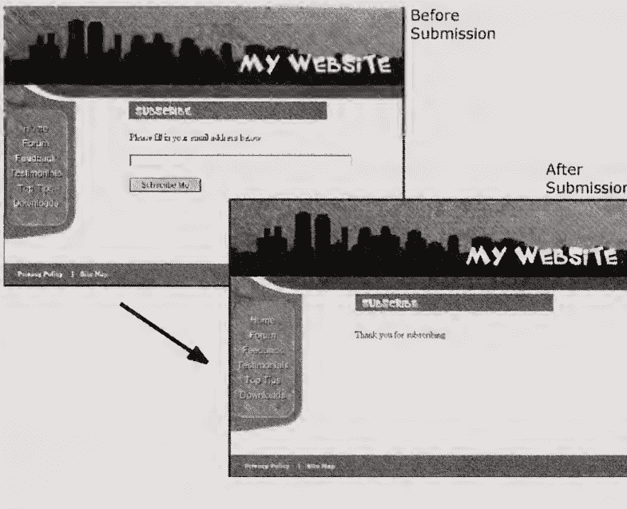

图 7.2 许多页面项目被不必要地重新加载。

这种不必要的数据下载浪费了带宽，并进一步加剧了加载每个新页面的延迟。

> **注意：** *带宽*是指通信通道承载信息的能力。在互联网上，带宽通常以每秒比特数（bps）或更高的倍数（如每秒百万比特数，Mbps）来衡量。

### 丰富的用户体验

刚刚描述的问题的综合效应是提供比绝大多数桌面应用程序差得多的用户体验。

在桌面上，你期望程序的显示内容保持可见，界面元素在计算过程在后台静默发生时响应命令。例如，当我使用文字处理器编写本课时，我可以将文档保存到磁盘、滚动或上下翻页，并更改字体和字号，而无需每次都等待整个显示刷新。

Ajax 允许你向 Web 应用程序界面添加一些在桌面应用程序中更常见且通常称为*丰富用户体验*的功能。

### Ajax 简介

为了改善用户体验，你需要在传统的基于页面的界面设计中添加一些额外的功能。你希望用户的页面具有交互性，通过修订内容响应用户的操作，并在没有任何页面加载或屏幕刷新中断的情况下进行更新。

为此，Ajax 在网页和服务器之间构建了一个额外的处理层。

这一层通常称为*Ajax 引擎*或*Ajax 框架*，它拦截来自用户的请求，并在后台安静地、不引人注目地、*异步地*处理服务器通信。我们指的是服务器请求和响应不再需要与特定用户操作同时发生，而是可以在用户方便且应用程序正确运行的任何时候发生。浏览器不会冻结并等待服务器完成最后一个请求，而是让用户继续在当前页面上滚动、点击和输入。

更新页面元素以反映从服务器收到的修订信息也由 Ajax 负责，在页面继续使用时动态发生。

图 7.3 展示了这些交互如何发生。

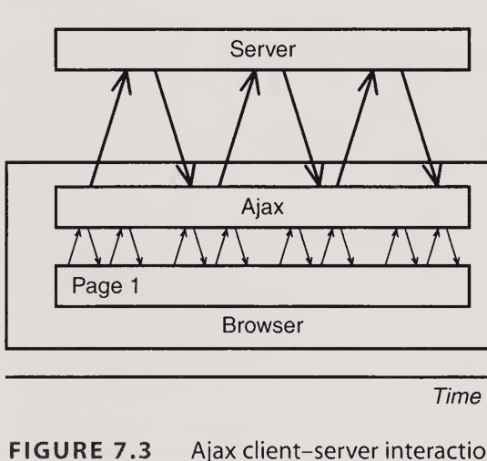

### 真实的 Ajax 应用程序——Google 建议

要查看 Ajax 应用程序运行的实际示例，让我们看看*Google 建议*。这个应用程序扩展了熟悉的 Google 搜索引擎界面，根据用户目前输入的内容，为用户提供合适的搜索词建议。

用户每次按键，应用程序的 Ajax 层都会向 Google 的服务器查询适当相似的搜索短语，并将返回的数据呈现在下拉框中。每个建议短语旁边都列出了使用该短语进行搜索时预期的结果数量。在任何时候，用户都可以选择其中一条建议，而不是继续输入并让 Google 处理选定的搜索。

由于每次按键都会查询服务器，因此该下拉列表会随着用户的输入动态更新——无需等待页面刷新或类似中断。

图 7.4 展示了程序运行的情况。你可以通过访问 Google 主页`http://www.google.com/webhp?complete=1&hl=en`上的链接亲自尝试。

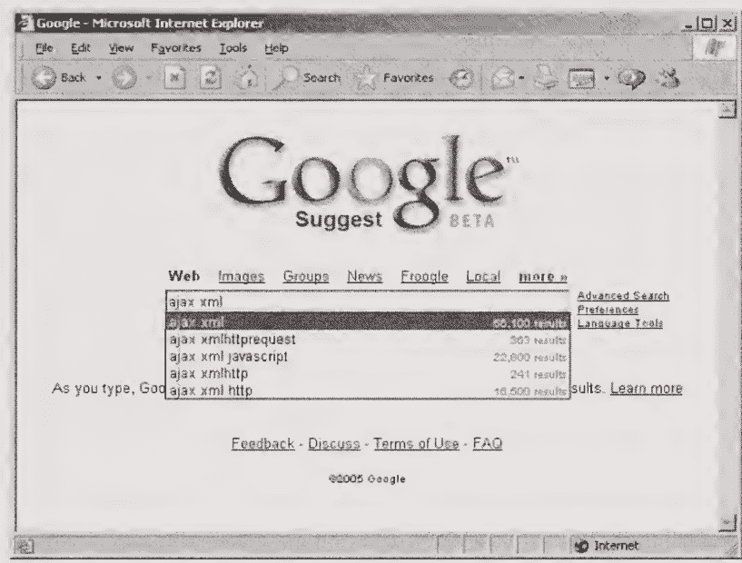

图 7.4 Ajax 应用程序示例——Google 建议。

接下来，让我们确定这种 Ajax 应用程序的各个组成部分，并了解它们如何协同工作。

> **注意：** Google 还提供了其他支持 Ajax 的应用程序供你尝试，包括*gmail*网络邮件服务和*Google 地图*街道地图程序。详情请访问 Google 网站`http://www.google.com/`。

### Ajax 的组成部分

现在让我们逐一检查 Ajax 应用程序的组件。

#### XMLHttpRequest 对象

当你点击超链接或提交 HTML 表单时，你会向服务器发送一个 HTTP 请求，服务器通过向你提供一个新的或修订过的页面来响应。然而，为了让你的 Web 应用程序异步工作，你必须有一种方法向服务器发送 HTTP 请求，*而无需*关联显示新页面的请求。

你可以通过`XMLHttpRequest`对象来实现这一点。这个 JavaScript 对象能够与服务器建立连接并发出 HTTP 请求，而无需关联的页面加载。

在后续课程中，你将了解如何创建这样一个对象的实例，以及网页中包含的 JavaScript 例程如何使用其属性和方法与服务器建立异步通信。

> **提示：** 作为一项安全措施，`XMLHttpRequest`对象通常只能调用与调用页面处于同一域内的 URL，而不能直接调用远程服务器。

第 8 课“XMLHttpRequest 对象”讨论了如何创建`XMLHttpRequest`对象的实例，并回顾了该对象的属性和方法。

#### 与服务器通信

在传统风格的网页中，当你通过超链接或表单提交发出服务器请求时，服务器接受该请求，执行任何所需的服务器端处理，然后向你提供一个适合你所采取操作的新页面。

在此处理期间，用户界面实际上是冻结的。当服务器完成任务时，你会通过浏览器中出现的新页面或修订页面非常明显地意识到这一点。

然而，使用异步服务器请求时，此类通信在后台发生，此类请求的完成不一定与屏幕刷新或加载新页面同步。因此，你必须做出其他安排来了解服务器在处理请求方面的进展。

`XMLHttpRequest`对象拥有一个方便的属性来报告服务器请求的进度。你可以检查此属性。

### 服务器端发生了什么？

就服务器端脚本而言，来自`XMLHttpRequest`对象的通信只是另一个 HTTP 请求。Ajax 应用程序不太关心服务器端存在什么语言或运行环境；只要客户端 Ajax 层能从服务器收到及时且格式正确的 HTTP 响应，一切就能正常运行。

完全有可能在不使用任何服务器端脚本的情况下构建简单的 Ajax 应用程序，只需让`XMLHttpRequest`对象调用静态服务器资源（如 XML 或文本文件）即可。

> **注意：** 这里我们将使用流行的 PHP 脚本语言来编写服务器端例程，但如果您更熟悉 ASP、JSP 或其他服务器端语言，请直接在 Ajax 应用程序中使用它。

Ajax 应用程序可以调用各种其他服务器端资源，例如 Web 服务。稍后，我们将介绍一些使用 SOAP 和 REST 等协议调用 Web 服务的示例。

### 处理服务器响应

一旦收到异步请求已成功完成的通知，您就可以使用服务器返回的信息了。

Ajax 允许以多种格式返回这些信息，包括 ASCII 文本和 XML 数据。

根据应用程序的性质，您随后可以在当前页面内翻译、显示或以其他方式处理这些信息。

我们将在第 10 课“使用返回的数据”中探讨这些问题。

### 其他维护任务

Ajax 应用程序还需要执行许多其他职责。例如，检测错误情况并妥善处理，以及让用户了解已提交的 Ajax 请求的状态。

您将在后续课程中看到各种示例。

### 整合所有内容

假设您想设计一个新的 Ajax 应用程序，或者更新一个遗留的 Web 应用程序以包含 Ajax 技术。您该怎么做呢？

首先，您需要决定哪些页面事件和用户操作将负责触发异步 HTTP 请求的发送。例如，您可能决定图像的`onMouseOver`事件将导致向服务器发送请求以检索有关图片主题的更多信息；或者按钮的`onClick`事件将生成一个服务器请求，以获取用于填充表单字段的信息。

您在第 4 课“使用 JavaScript 进行客户端编码”中了解了如何通过事件处理程序在诸如上述事件发生时执行 JavaScript 指令。在您的 Ajax 应用程序中，此类方法将负责通过`XMLHttpRequest`发起异步 HTTP 请求。

发出请求后，您需要编写例程来监视该请求的进度，直到收到服务器请求已成功完成的通知。

最后，在收到服务器已完成其任务的通知后，您需要一个例程来检索从服务器返回的信息并将其应用于应用程序。例如，您可能希望使用新返回的数据来更改页面正文内容、填充表单字段或弹出信息窗口。

图 7.5 展示了整个过程的流程图。

在第 11 课“我们的第一个 Ajax 应用程序”中，我们将运用所学知识来构建一个完整的 Ajax 应用程序。

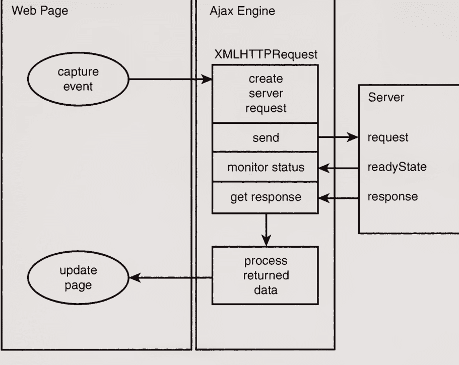

图 7.5 Ajax 应用程序组件如何协同工作。

## 总结

本课讨论了传统 Web 界面的缺点，指出了我们希望克服的具体问题。我们还介绍了 Ajax 应用程序的各种构建块，并讨论了它们如何协同工作。

在第二部分的后续课程中，我们将更详细地研究这些组件，最终使用它们来构建一个完整的 Ajax 应用程序。

在本课中，您将学习如何创建`XMLHttpRequest`对象的实例，无论用户使用哪种浏览器。我们将介绍该对象的属性和方法。

### 关于 JavaScript 对象的更多信息

第 7 课“Ajax 应用程序剖析”介绍了 Ajax 应用程序的构建块，并讨论了这些部分如何组合在一起。

本课将探讨每个 Ajax 应用程序的核心对象——`XMLHttpRequest`对象。

> **注意：** 您在第 4 课“使用 JavaScript 进行客户端编码”中简要接触过*对象*，当时我们讨论了与网页关联的`document`对象。`XMLHttpRequest`对象创建后，会成为页面对象层次结构中的另一个此类对象，并拥有自己的属性和方法。

一个对象可以看作一个单独的包，包含一组用于包含和分类数据的*属性*，以及一组*方法*，对象可以使用这些方法对数据执行操作。

例如，假设我们有一个类型为`wheelbarrow`的对象。这样的对象可能有一个属性`contents`，用于描述在任何给定时刻手推车装了多少件物品。方法可能包括`fill()`、`tip()`、`forward()`和`stop()`。使用 JavaScript 时，您可以根据需要设计此类对象。

但是，除了用户定义的对象外，JavaScript 还有一系列现成的对象可供脚本使用。这些被称为*原生*对象。JavaScript 原生对象的例子包括`Math()`、`String()`和`Date()`。

### 创建对象实例

许多对象（如您在第 4 课中看到的`document`对象）已经存在，因此不需要您创建其实例。然而，其他一些对象则需要您先创建该对象的实例才能使用。

您可以通过调用一个称为对象构造函数的方法并使用`new`关键字来创建对象的实例：

```javascript
var myBarrow = new Wheelbarrow();
```

创建了`wheelbarrow`对象的实例`myBarrow`后，可以使用简单的语法来操作该对象的属性和方法：

```javascript
myBarrow.contents = 20;
myBarrow.forward();
myBarrow.stop();
myBarrow.tip();
```

当然，您可以自由创建同一对象的其他实例，并让它们同时存在：

```javascript
var myBarrow = new Wheelbarrow();
var yourBarrow = new Wheelbarrow();
myBarrow.contents = 20;
yourBarrow.contents = 50;
```

### 文档对象模型（DOM）


我们在第 4 课中简要提到过网页中“内置”的对象层次结构，称为文档对象模型。您访问这些对象及其属性和方法的方式与访问原生对象以及您自行设计和创建的对象相同。

在后续课程中，您将看到`XMLHttpRequest`对象如何使用服务器响应`XMLHTTPRequest`调用返回的 XML 数据来创建额外的 DOM 对象，供您的脚本使用。

> **注意：** 文档对象模型（DOM）实际上不是 JavaScript 的一部分，而是存在于其外部的一个独立实体。虽然您可以使用 JavaScript 来操作 DOM 对象，但其他脚本语言同样可以访问它们。

### 介绍`XMLHTTPRequest`

`XMLHTTPRequest`得到几乎所有现代浏览器的支持，包括微软的 Internet Explorer 5+ 和各种非微软浏览器，如 Mozilla、Firefox、Konqueror、Opera 和 Safari，并且支持多种平台，包括 Microsoft Windows、UNIX/Linux 和 Mac OS X。

`XMLHTTPRequest`对象的目的是允许 JavaScript 构建 HTTP 请求并将其提交给服务器。传统编程的 Web 应用程序通常*同步地*发出此类请求，与用户触发的事件（如单击链接或提交表单）结合，导致浏览器收到新的或更新的页面。

> **注意：** 某些浏览器可能需要注意其安全设置，以确保`XMLHTTPRequest`对象正常工作。请参阅浏览器文档了解详情。

然而，使用`XMLHTTPRequest`，您可以让页面在后台*异步地*进行此类调用，允许您在不中断浏览器刷新和加载新页面或修订页面的情况下继续使用页面。

此功能是所有 Ajax 应用程序的基础，使得`XMLHTTPRequest`对象成为 Ajax 编程的关键。

> **提示：** 尽管该对象的名称以*XML*开头，但实际上，服务器可以返回任何类型的文档；ASCII 文本、HTML 和 XML 都是常见的选择，我们将在本书中遇到所有这些。

### 创建`XMLHTTPRequest`对象

在创建`XMLHTTPRequest`对象的实例之前，您无法使用它。在 JavaScript 中创建对象的实例通常只需调用一个称为对象构造函数的方法。然而，对于`XMLHTTPRequest`，您必须稍微改变此例程以适应不同浏览器的特殊性，如下一节所示。

### 不同浏览器的不同规则

微软首先引入了`XMLHTTPRequest`对象，在 Internet Explorer 5 中将其作为`ActiveX`对象实现。

### 8：`XMLHttpRequest`对象

目前大多数其他浏览器开发者也已在其产品中纳入了等效的对象，但它是作为浏览器 JavaScript 解释器中的原生对象来实现的。

> 提示：`ActiveX` 是一项专有的 Microsoft 技术，用于在网页中启用活动对象。在现有的网页浏览器中，目前仅 Microsoft 的 Internet Explorer 支持它。Internet Explorer 使用其内置的 XML 解析器 MSXML 来创建`XMLHttpRequest`对象。

由于你无法预先知道用户会使用哪种浏览器、版本或操作系统，因此你的代码必须能够动态调整其行为，以确保对象的实例能够成功创建。

对于大多数将`XMLHttpRequest`作为原生对象支持的浏览器（Mozilla、Opera 及其他），创建此对象的实例非常直接。以下代码行创建了一个名为`request`的`XMLHttpRequest`对象：

```javascript
var request = new XMLHttpRequest();
```

这里我们声明了一个变量`request`，并将语句`new XMLHttpRequest()`返回的值赋给它，这实际上是调用了`XMLHttpRequest`对象的构造方法。

要在 Microsoft Internet Explorer 中达到相同的效果，你需要创建一个`ActiveX`对象。以下是一个例子：

```javascript
var request = new ActiveXObject("Microsoft.XMLHTTP");
```

这同样是将新对象赋给了名称`request`。

更复杂的是，某些版本的 Internet Explorer 安装了不同版本的 MSXML（Microsoft XML 解析器）；在这种情况下，你需要使用以下指令：

```javascript
var request = new ActiveXObject("Msxml2.XMLHTTP");
```

### 所有浏览器的解决方案

因此，你需要创建一个脚本，无论使用哪种浏览器（当然，前提是浏览器支持`XMLHttpRequest`），它都能正确地创建`XMLHttpRequest`对象的实例。

一个好的解决方案是让你的脚本依次尝试每种创建对象实例的方法，直到其中一种成功为止。请查看清单 8.1，其中就使用了这样的策略。

```javascript
// 清单 8.1  使用对象检测实现跨浏览器解决方案
function getXMLHTTPRequest()
{
    var request = false;
    try
    {
        request = new XMLHttpRequest(); /* 例如 Firefox */
    }
    catch(err1)
    {
        try
        {
            request = new ActiveXObject("Msxml2.XMLHTTP");
            /* 某些版本的 IE */
        }
        catch(err2)
        {
            try
            {
                request = new ActiveXObject("Microsoft.XMLHTTP");
                /* 某些版本的 IE */
            }
            catch(err3)
            {
                request = false;
            }
        }
    }
    return request;
}
```

清单 8.1 使用了 JavaScript 语句`try`和`catch`。`try`语句允许我们尝试运行一段代码。如果代码运行没有错误，那就很好；但是，如果发生错误，我们可以在错误消息发送给用户之前使用`catch`语句进行干预，并决定程序应该如何处理该错误。

**提示：** 注意语法：

```javascript
catch(identifier)
```

这里的`identifier`是在捕获错误时创建的一个对象。它包含有关错误的信息；例如，如果你想提醒用户了解 JavaScript 运行时错误的性质，可以使用类似这样的代码结构：

```javascript
catch(err)
{
    alert(err.description);
}
```

来打开一个包含错误详细信息的对话框。

另一种同样有效的技术是通过检测浏览器中定义了哪些对象来判断正在使用哪种类型的浏览器。清单 8.2 展示了这种技术。

### 清单 8.2 使用浏览器检测实现跨浏览器解决方案

```javascript
function getXMLHTTPRequest()
{
    var request = false;
    if(window.XMLHTTPRequest)
    {
        request = new XMLHTTPRequest();
    } else {
        if(window.ActiveXObject)
        {
            try
            {
                request = new ActiveXObject("Msxml2.XMLHTTP");
            }
            catch(err1)
            {
                try
                {
                    request = new ActiveXObject("Microsoft.XMLHTTP");
                }
                catch(err2)
                {
                    request = false;
                }
            }
        }
    }
    return request;
}
```

在这个例子中，我们使用了如下测试：

```javascript
if(window.XMLHttpRequest) { ... }
```

来确定`XMLHttpRequest`是否是当前使用浏览器的原生对象；如果是，我们使用构造方法：

```javascript
request = new XMLHttpRequest();
```

来创建`XMLHttpRequest`对象的实例；否则，我们尝试像第一个例子中那样创建一个合适的`ActiveX`对象。

无论你使用哪种方法创建`XMLHttpRequest`对象的实例，你应该都能够像这样调用此函数：

```javascript
var myRequest = getXMLHttpRequest();
```

> 注意：JavaScript 还提供了一个`navigator`对象，其中包含有关用于查看页面的浏览器的信息。我们本可以用来分支代码的另一种方法是使用此对象的`appName`属性来查找浏览器的名称：

```javascript
var myBrowser = navigator.appName;
```

对于 IE，这将返回`"Microsoft Internet Explorer"`。

### 方法和属性

既然我们已经创建了`XMLHttpRequest`对象的实例，让我们来看看该对象的一些属性和方法，它们列在表 8.1 中。

#### 表 8.1 `XMLHttpRequest`对象和方法

| 属性 | 描述 |
| :--- | :--- |
| `onreadystatechange` | 确定当对象的`readyState`属性更改时将调用哪个事件处理程序 |
| `readyState` | 报告请求状态的整数：<br>0 = 未初始化<br>1 = 加载中<br>2 = 已加载<br>3 = 交互中<br>4 = 完成 |
| `responseText` | 服务器以文本字符串形式返回的数据 |
| `responseXML` | 服务器返回的数据，表示为文档对象 |
| `status` | 服务器返回的 HTTP 状态码 |
| `statusText` | 服务器返回的 HTTP 原因短语 |
| **方法** | **描述** |
| `abort()` | 停止当前请求 |
| `getAllResponseHeaders()` | 以字符串形式返回所有头部 |
| `getResponseHeader(x)` | 以字符串形式返回头部`x`的值 |
| `open('method', 'URL', 'a')` | 指定 HTTP 方法（例如 GET 或 POST）、目标 URL 以及请求是否应异步处理（如果是，`a='true'`——默认值；如果否，`a='false'`。） |
| `send(content)` | 发送请求，可选地包含 POST 数据 |
| `setRequestHeader('x', 'y')` | 设置参数和值对`x=y`，并将其赋给要随请求发送的头部 |

在接下来的几课中，我们将研究这些方法和属性如何用于创建构成 Ajax 应用程序构建块的功能。

现在，让我们只研究其中的几个方法。

### `open()`方法

`open()`方法为`XMLHttpRequest`对象与服务器通信做好准备。你需要为此方法提供至少两个必需参数：

- 首先，指定你打算使用的 HTTP 方法，通常是 GET 或 POST。（第 3 课“使用 HTTP 发送请求”中讨论了 GET 和 POST HTTP 请求的使用。）
- 其次，将请求的目标 URL 作为第二个参数。如果是发出 GET 请求，此 URL 需要适当地编码任何参数及其值作为 URL 的一部分。

出于安全原因，`XMLHttpRequest`对象只能与同一域内的 URL 通信。尝试连接到远程域会导致“权限被拒绝”错误消息。

你可以选择性地在`send`请求中包含第三个参数，一个布尔值来声明请求是否以异步模式发送。如果设置为`false`，请求将不会以异步模式发送，页面实际上将被锁定直到请求完成。如果省略该参数，则默认为`true`，请求将以异步方式发送。

> 注意：一个常见的错误是在从`www.mydomain.com`发出的调用中将你的域引用为`mydomain.com`。JavaScript 解释器将认为这两个是不同的，并且不允许连接。

> 注意：布尔数据类型只有两个可能的值：1（或`true`）和 0（或`false`）。

### `send()`方法

使用`open()`方法准备好`XMLHttpRequest`后，你可以使用`send()`方法发送请求。`send()`函数接受一个参数。

如果你的请求是 GET 请求，请求信息将被编码到目标 URL 中，然后你可以简单地使用参数`null`调用`send()`方法：

```javascript
objectname.send(null);
```

然而，如果你发出的是 POST 请求，请求的内容（经过适当编码）将作为参数传递：

```javascript
objectname.setRequestHeader('Content-Type', 'application/x-www-form-urlencoded');
objectname.send(var1=value1&var2=value2);
```

在这种情况下，我们使用`setRequestHeader`方法来指明我们包含的内容类型。

## 总结

本课介绍了`XMLHTTPRequest`对象——它是任何 Ajax 应用程序的驱动力，并说明了如何为 Internet Explorer 以及其他非 Microsoft 浏览器创建该对象的实例。我们还简要探讨了该对象的一些属性和方法。

后续课程将展示该对象更多方法和属性的使用方式。

在本课中，你将学习如何使用`XMLHttpRequest`对象的属性和方法，使其能够向服务器发送请求并接收数据。

### 发送服务器请求

第 8 课“`XMLHttpRequest`对象”详细讨论了 JavaScript `XMLHttpRequest`对象，以及如何在不同的浏览器中创建其实例。

现在我们已经拥有了`XMLHttpRequest`对象，接下来让我们思考如何创建和发送服务器请求，以及我们可能会从服务器接收到什么样的消息。

我们将直接开始，首先编写一些代码，运用你在第 8 课学到的知识，创建一个名为`myRequest`的`XMLHttpRequest`对象。然后，我们将编写一个名为`callAjax()`的 JavaScript 函数，使用该对象向服务器发送异步请求。之后，我们将逐行分析代码，看看它做了什么。

清单 9.1 展示了我们使用该对象准备并发送 Ajax 请求的原型函数。

**清单 9.1 发送服务器请求**

```javascript
function getXMLHttpRequest()
{
    var req = false;
    try
    {
        req = new XMLHttpRequest(); /* e.g. Firefox */
    }
    catch(err1)
    {
        try
        {
            req = new ActiveXObject("Msxml2.XMLHTTP");
            /* some versions IE */
        }
        catch(err2)
        {
            try
            {
                req = new ActiveXObject("Microsoft.XMLHTTP");
                /* some versions IE */
            }
            catch(err3)
            {
                req = false;
            }
        }
    }
    return req;
}
```

```javascript
var myRequest = getXMLHttpRequest();
```

```javascript
function callAjax() {
    // declare a variable to hold some information
    // to pass to the server
    var lastname = 'Smith';
    // build the URL of the server script we wish to call
    var url = "myserverScript.php?surname=" + lastname;
    // ask our XMLHttpRequest object to open a
    // server connection
    myRequest.open("GET", url, true);
    // prepare a function responseAjax() to run when
    // the response has arrived
    myRequest.onreadystatechange = responseAjax;
    // and finally send the request
    myRequest.send(null);
}
```


> 提示：以`//`开头的行在 JavaScript 中被视为注释。你可以使用这样的行来为你的代码添加文档或其他有用的注释，你的浏览器 JavaScript 解释器在执行代码指令时会忽略它们。

首先，我们需要创建一个`XMLHttpRequest`对象的实例，并将其命名为`myRequest`。你无疑会认出这是来自第 8 课的代码。

接下来，我们将查看`callAjax()`函数。

第一行只是声明了一个变量并为其赋值：

```javascript
var lastname = 'Smith';
```

这是我们函数打算发送给服务器的数据片段，作为我们服务器端脚本所需的名为`surname`的变量的值。当然，实际上，此类数据的值通常通过处理页面事件（如鼠标点击或键盘输入）来动态获取，但目前这将作为一个简单的示例。

我们打算发出的服务器请求是`GET`请求，因此我们必须构建一个合适的目标 URL，将我们的参数和值对适当地编码在末尾；下一行代码完成了这个工作：

```javascript
var url = "myserverscript.php?surname=" + lastname;
```

我们在第 8 课中简要介绍过`open()`方法。我们在下一行中使用它来准备我们的服务器请求：

```javascript
myRequest.open("GET", url, true);
```

这一行指定我们正在准备一个`GET`请求，并将完整的 URL（包含附加的`GET`请求内容）传递给它。

第三个参数`true`表明我们希望我们的请求以异步方式处理。在这种情况下，它可以被省略，因为默认情况下会假定为`true`。然而，为了清晰起见，包含它并无害处。

接下来，我们需要告诉我们的`XMLHttpRequest`对象`myRequest`，当它收到服务器的“进度报告”时应该做什么。`XMLHttpRequest`对象有一个名为`onreadystatechange`的属性，它包含了关于每当服务器状态变化时应调用哪个 JavaScript 函数的信息，在下一行代码中：

```javascript
myRequest.onreadystatechange = responseAjax;
```

我们将函数`responseAjax()`赋值给它来完成这项工作。我们将在本课后面编写这个函数。

#### 处理浏览器缓存

所有浏览器都会维护一个所谓的已访问网页缓存，这是一个存储在浏览器计算机硬盘上的页面内容的本地记录。当你请求一个特定的网页时，浏览器首先尝试从其缓存中加载该页面，而不是提交一个新的 HTTP 请求。

> 注意：这似乎更像是一个 IE 浏览器的问题，而非其他非 Microsoft 浏览器。只有`GET`请求会受到影响；`POST`请求不会被缓存。

虽然这有时在页面加载时间方面是有利的，但它在编写 Ajax 应用程序时会造成困难。Ajax 的核心是与服务器对话，而不是从缓存重新加载信息；因此，当你向服务器发出异步请求时，每次都必须生成一个新的 HTTP 请求。

可以向服务器端例程返回的数据添加 HTTP 头，旨在告诉浏览器不要缓存特定页面。示例包括：

“Pragma: no-cache”

和

“Cache-Control: must-revalidate”

等等。

不幸的是，这些策略的有效性差异很大。不同的浏览器有不同的缓存处理策略，并且支持不同的头声明，这使得确保页面不被缓存变得困难。

一个常用的解决此问题的技巧涉及在请求数据中添加一个带有随机且无意义值的参数。对于`GET`请求，这需要在 URL 末尾添加一个额外的参数和值对。

如果 URL 的随机部分每次不同，这实际上就“欺骗”浏览器，让它相信它是要将异步请求发送到一个以前未访问过的地址。这导致每次都会发送一个新的 HTTP 请求。

让我们看看如何实现这一点。在 JavaScript 中，你可以使用原生`Math()`对象的`Math.random()`方法生成随机数。清单 9.2 对我们的`callAjax()`函数做了一些修改。

**清单 9.2 处理浏览器缓存**

```javascript
function getXMLHttpRequest()
{
    var req = false;
    try
    {
        req = new XMLHttpRequest(); /* e.g. Firefox */
    }
    catch(err1)
    {
        try
        {
            req = new ActiveXObject("Msxml2.XMLHTTP");
            /* some versions IE */
        }
        catch(err2)
        {
            try
            {
                req = new ActiveXObject("Microsoft.XMLHTTP");
                /* some versions IE */
            }
            catch(err3)
            {
                req = false;
            }
        }
    }
    return req;
}

var myRequest = getXMLHttpRequest();

function callAjax() {
    // declare a variable to hold some information
    // to pass to the server
    var lastname = 'Smith';
    // build the URL of the server script we wish to call
    var url = "myserverscript.php?surname=" + lastname;
    // generate a random number
    var myRandom=parseInt(Math.random()*99999999);
    // ask our XMLHttpRequest object to open
    // a server connection
    myRequest.open("GET", url + "&rand=" + myRandom, true);
    // prepare a function responseAjax() to run when
    // the response has arrived
```

#### 清单 9.2 续

```javascript
myRequest.onreadystatechange = responseAjax;
// 最后发送请求
myRequest.send(null);
}
```

从清单 9.2 我们可以看出，脚本现在会为我们的 Ajax 请求生成一个目标 URL，其形式类似于：

`myserver script.php?surname=Smith&rand=XXXX`

其中 XXXX 将是一个随机数，从而防止页面从缓存返回，并强制向服务器发送新的 HTTP 请求。

> **注意：**一些程序员更喜欢添加当前时间戳而不是随机数。这是从当前日期和时间派生出的一串字符。在以下示例中，使用了原生`Date()`对象的 JavaScript`Date()`和`getTime()`方法：

```javascript
myRand = + new Date().getTime();
```

#### 监控服务器状态

`XMLHttpRequest`对象包含一些机制，通过它们我们可以随时了解 Ajax 请求的进度，并确定服务器返回的信息何时准备好在我们的应用程序中使用。

现在让我们看看相关的属性。

#### readyState 属性

`XMLHttpRequest`对象的`readyState`属性向你提供关于你已发出的请求当前状态的服务器信息。此属性由`onreadystatechange`属性监控，`readyState`值的更改会使`onreadystatechange`变为`true`，从而导致相应的函数（在我们的示例中是`responseAjax()`）被执行。

> **提示：**服务器请求完成后调用的函数通常称为*回调*函数。

`readyState`可以取以下值：

- `0` = 未初始化
- `1` = 加载中
- `2` = 已加载
- `3` = 交互中
- `4` = 完成

当首次发出服务器请求时，`readyState`的值被设置为零，即未初始化。

随着服务器请求的进展，数据开始由服务器加载到`XMLHttpRequest`对象中，`readyState`属性的值相应变化，先变为 1，然后变为 2。

`readyState`值为 3（交互中）表示对象已取得足够进展，可以对其进行某些交互，但过程尚未完全完成。

> **提示：**并非所有可能的值都会存在于任何给定对象中。如果某些状态与对象的内容类型无关，对象可能会“跳过”这些状态。

当服务器请求完全完成且对象可用于进一步处理时，`readyState`的值最终更改为 4。

在大多数实际情况下，你应该查找`readyState`属性是否达到值 4，此时你可以确信服务器已完成了其任务，并且`XMLHttpRequest`对象已准备好可供使用。

#### 服务器响应状态码

除了`readyState`属性，你还有另一种方法来检查异步请求是否正确执行：HTTP 服务器响应状态码。

第 3 课“使用 HTTP 发送请求”中讨论了 HTTP 响应。如果你参考表 3.1，你会看到状态码 200 对应于服务器的 OK 消息。

随着我们进一步开发回调函数，我们将看到如何测试这一点。

##### 回调函数

到现在为止，你已经学会了如何创建`XMLHttpRequest`对象的实例、声明回调函数的身份，并准备和发送异步服务器请求。你还知道哪个属性可以告诉你服务器响应何时可用。

让我们看看我们的回调函数`responseAjax()`。

首先，请注意，每次`onreadystatechange`属性的值发生变化时，都会调用此函数。因此，通常当调用此函数时，它需要完全不做任何事情，因为`readyState`属性的值尚未达到 4，因此我们知道服务器请求尚未完成其处理。

我们可以通过简单地使用 JavaScript`if`语句来实现这一点：

```javascript
function responseAjax() {
    // 我们只关心 readyState 为 4，
    // 即“完成”
    if (myRequest.readyState == 4) {
        ... 程序执行语句 ...
    }
}
```

除了检查服务器请求是否完成，我们还想检查 HTTP 响应状态码，以确保它等于 200，这表示对我们的异步 HTTP 请求的成功响应。

快速回顾表 8.1，我们可以看到我们的`XMLHttpRequest`对象`myRequest`有两个属性来报告 HTTP 状态响应。它们是：

`myRequest.status`

包含状态响应码，和

`myRequest.statusText`

包含原因短语。

我们可以通过使用另一个循环来利用这些属性：

```javascript
function responseAjax() {
    // 我们只关心 readyState 为 4，
    // 即“已加载”
    if (myRequest.readyState == 4) {
        // 如果服务器 HTTP 响应为“OK”
        if (myRequest.status == 200) {
            ... 程序执行语句 ...
        } else {
            // 对于任何其他 HTTP 响应，
            // 发出错误消息
            alert("发生错误：" + myRequest.statusText);
        }
    }
}
```

此代码在我们的`if`语句中引入了一个`else`子句。任何非 200 的服务器状态响应都会导致执行此`else`子句的内容，打开一个警报对话框，其中包含从服务器返回的原因短语文本。

#### 使用回调函数

那么我们如何从 HTML 页面调用我们的`callAjax()`函数呢？让我们看一个例子。以下是 HTML 页面中一个简化表单的代码：

```html
<form name='form1'>
Name: <input type='text' name='myname'><br>
Tel: <input type='text' name='telno'><br>
<input type='submit'>
</form>
```

我们将使用表单中文本输入字段的`onBlur`事件处理程序来启动该函数：

```html
<form name='form1'>
Name: <input type='text' name='myname'
onBlur='callAjax()'><br>
Tel: <input type='text' name='telno'><br>
<input type='submit'>
</form>
```

当用户离开相关字段时，`onBlur`事件处理程序被激活。在这种情况下，当用户离开该字段时，`callAjax()`将被执行，创建`XMLHttpRequest`对象的实例并向`myserverscript.php?surname=Smith`发出异步服务器请求。

这听起来不是很有用。但是，如果我们现在对`callAjax()`的代码进行轻微更改会怎样？

```javascript
function callAjax() {
// 声明一个变量来保存一些
// 要传递给服务器的信息
var lastname = document.form1.myname.value;
...
```

现在我们可以看到，当用户离开表单字段`myname`时，她输入该字段的值将通过我们的异步请求传递到服务器。这样的调用，例如，可以检查数据库以验证命名的人员是否存在，如果存在，则返回信息以填充表单上的其他字段。

对用户而言，结果是在提交——甚至完成——表单之前，她看到剩余的字段神奇地被数据填充。

我们如何使用返回的数据来实现这样的结果将在第 10 课“使用返回的数据”中讨论。

## 总结

本课探讨了我们的`XMLHttpRequest`对象与服务器通信的方式，包括发送异步请求、监控服务器状态以及执行回调函数。

在第 10 课中，你将看到 Ajax 应用程序如何处理服务器请求返回的数据。


在本课中，你将学习如何处理服务器响应 Ajax 请求而返回的信息。

### responseText 和 responseXML 属性

第 9 课“与服务器对话”讨论了服务器通信，它允许你发送和监控异步服务器请求。Ajax 拼图的最后一块是服务器响应请求而返回的信息。

本课讨论这些信息可以采取的形式，以及你如何在应用程序中处理和使用它。我们将使用`XMLHttpRequest`对象的两个属性，即`responseText`和`responseXML`。

表 8.1 列出了几个我们尚未描述的`XMLHttpRequest`对象属性。其中包括`responseText`和`responseXML`属性。

第 9 课讨论了我们如何使用`XMLHttpRequest`对象的`readyState`属性来确定`XMLHttpRequest`调用的当前状态。当我们的服务器请求完成时——通过我们的`XMLHttpRequest`对象`myRequest`的条件`myRequest.readyState == 4`检测到——那么这两个属性`responseText`和`responseXML`将分别包含服务器返回数据的文本和 XML 表示形式。

在本课中，你将了解如何访问这两个属性中包含的信息，并在 Ajax 应用程序中应用它们。

### responseText 属性

`responseText`属性尝试将服务器返回的信息表示为一个文本字符串。

让我们再次查看回调函数原型：

```javascript
function responseAjax() {
  // 我们只关心 readyState 为 4 的情况，即“已加载”
  if(myRequest.readyState == 4) {
    // 如果服务器 HTTP 响应为“OK”
    if(myRequest.status == 200) {
      ... 程序执行语句 ...
    } else {
      // 对于任何其他 HTTP 响应，发出错误消息
      alert("An error occurred: " + myRequest.statusText);
    }
  }
}
```

> 提示：如果`XMLHttpRequest`调用因错误而失败，或者尚未发送，`responseText`的值将为`null`。

让我们在`if`语句成功执行的分支中添加一条程序语句，如代码清单 10.1 所示。

#### 代码清单 10.1 显示 responseText 的值

```javascript
function responseAjax() {
  // 我们只关心 readyState 为 4，
  // 即“完成”
  if(myRequest.readyState == 4) {
    // 如果服务器 HTTP 响应为“OK”
    if(myRequest.status == 200) {
      alert("The server said: " + myRequest.responseText);
    } else {
      // 对于任何其他 HTTP 响应，发出错误消息
      alert("An error has occurred: " + myRequest.statusText);
    }
  }
}
```

### responseText 和 responseXML 属性

在这个简单的例子中，我们的脚本打开一个警报对话框来显示服务器返回的文本。这一行


```javascript
alert("The server said: " + myRequest.responseText);
```

获取服务器端例程返回的文本，将其附加到字符串“The server said: ”之后，然后在 JavaScript 警报对话框中显示。

让我们看一个使用服务器上简单 PHP 文件的例子：

```php
<?php echo "Hello Ajax caller!"; ?>
```

对这个文件的成功 `XMLHttpRequest` 调用将导致 `responseText` 属性包含字符串 `Hello Ajax caller!`，从而使回调函数产生如图 10.1 所示的对话框。

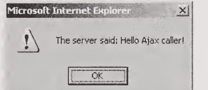

图 10.1 代码清单 10.1 生成的输出。

> **注意：** `responseText` 属性是只读的，因此在将其值首先复制到另一个变量中之前，尝试操作其值是没有意义的。

由于 `responseText` 包含一个简单的文本字符串，我们可以使用 JavaScript 中与字符串相关的任何方法来操作它。表 10.1 包含一些可用的方法。

#### 表 10.1 一些 JavaScript 字符串操作方法

| 方法 | 描述 |
| :--- | :--- |
| `charAt(number)` | 选择字符串中指定位置的单个字符 |
| `indexOf(substring)` | 查找指定子字符串开始的位置 |
| `lastIndexOf(substring)` | 查找字符串中子字符串的最后一次出现 |
| `substring(start, end)` | 获取字符串的指定部分 |
| `toLowerCase()` | 将字符串转换为小写 |
| `toUpperCase()` | 将字符串转换为大写 |

我们将在第 12 课“将数据作为文本返回”和第 13 课“AHAH——异步 HTML 和 HTTP”中探讨 `responseText` 在实际情况下如何使用。

### responseXML 属性

现在假设我们在上一个例子中在服务器上使用的 PHP 脚本看起来像代码清单 10.2。

#### 代码清单 10.2 返回 XML 的服务器端脚本

```php
<?php
header('Content-Type: text/xml');
?>
```

尽管这是一个很短的脚本，但值得详细看看它。

`<?php` 和 `?>` 分隔符内的第一行使用 PHP 的 `header` 指令向返回的数据添加一个 HTTP 头部。

返回的头部是参数和值对 `Content-Type: text/xml`，它告知我们的 `XMLHttpRequest` 对象，接下来的来自服务器的数据将格式化为 XML。

下一行是一个 PHP `echo` 语句，输出这个简单但完整的 XML 文档：

```xml
<?xml version="1.0" ?>
<greeting>
Hello Ajax caller!
</greeting>
```

> **注意：** 确保你的 PHP 脚本在发出 `header()` 指令之前不输出任何内容——甚至是空格字符，如空格和换行符；否则会发生错误。

> **注意：** 在 PHP 中，你需要转义引号字符串中出现的任何引号，以确保语句的含义明确无误。你可以使用反斜杠字符来做到这一点，因此 PHP 命令
>
> `echo "";`
>
> 产生输出：
>
> ``

> **提示：** 值得注意的是，`responseXML` 属性并不像 `responseText` 属性那样只包含一个表示 XML 文档文本形式的字符串；相反，XML 文档的整个数据和层次结构都已存储为一个与 DOM 兼容的对象。

当服务器调用完成后，我们现在发现这个 XML 文档已加载到我们的 `XMLHttpRequest` 对象的 `responseXML` 属性中。我们现在可以通过 JavaScript 的 DOM 方法和属性来访问 XML 文档的内容。

### 另一个有用的 JavaScript DOM 属性

你肯定还记得我们在第 6 课“XML 简介”中描述了其中一些方法。让我们现在再研究一个这样的方法，即 `getElementsByTagName()`。

### getElementsByTagName() 方法

这个有用的方法允许你构建一个 JavaScript 数组，其中包含所有具有特定标签名的元素。然后你可以使用普通的 JavaScript 语句来访问该数组的元素。这是一个例子：

```javascript
var myElements = object.getElementsByTagName('greeting');
```

这一行创建数组 `myElements`，并用所有标签名为 `greeting` 的元素填充它。与任何其他数组一样，你可以使用 `length` 属性来找出数组的长度（即具有声明标签名的元素数量）：`myElements.length`。

如果你想单独访问某个特定元素；第一个出现的标签名为 `greeting` 的元素可以访问为 `myElements[0]`，第二个（如果存在第二个）为 `myElements[1]`，依此类推：

```javascript
var theElement = myElements[0];
```

> **提示：** 你也可以直接访问这些单个数组元素：
>
> `var theElement = object.getElementsByTagName('greeting')[0];`

### 解析 responseXML

代码清单 10.3 给出了一个例子，说明我们如何使用 `getElementsByTagName()` 以及第 6 课中讨论的其他一些方法，在警报对话框中返回我们的问候语文本。

#### 代码清单 10.3 使用 getElementsByTagName() 解析 responseXML

```javascript
function responseAjax() {
    // 我们只关心 readyState
    // 为 4，即“完成”
    if(myRequest.readyState == 4) {
        // 如果服务器 HTTP 响应为“OK”
        if(myRequest.status == 200) {
            var greetNode = http.responseXML
                .getElementsByTagName("greeting")[0];
            var greetText = greetNode.childNodes[0]
                .nodeValue;
            alert("Greeting text: " + greetText);
        } else {
            // 对于任何其他 HTTP 响应，
            // 发出错误消息
            alert("An error has occurred: "
                + myRequest.statusText);
        }
    }
}
```

在通常检查 `readyState` 和 `status` 属性的值之后，代码使用 `getElementsByTagName()` 方法从 `responseXML` 中定位所需元素，然后使用 `childNodes[0].nodeValue` 从该元素中提取文本内容，最后在 JavaScript 警报对话框中显示返回的文本。

图 10.2 显示了警报对话框，显示从 XML 文档的 `<greeting>` 元素中恢复的文本字符串。

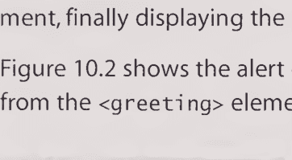

图 10.2 显示返回的问候语。

### 提供用户反馈

在具有传统界面的网页中，用户很清楚服务器何时正在忙于处理请求；在准备和提供新页面时，界面实际上无法使用。

情况在 Ajax 应用程序中略有不同。因为界面在异步 HTTP 请求期间仍然可用，用户可能不会意识到预期从服务器接收新信息。幸运的是，有一些简单的方法可以警告服务器请求正在进行中。

回想一下，我们的回调函数在 `readyState` 的值每次改变时都会被调用，但我们真正关心的条件是 `myRequest.readyState == 4`，这表示服务器请求已完成。

让我们再次参考代码清单 10.3。对于 `readyState` 的所有非 4 值，函数在没有做任何事情的情况下简单终止。我们可以利用 `readyState` 值的这些变化来向用户表明服务器请求正在进行但尚未完成。考虑以下代码：

```javascript
function responseAjax() {
    if(myRequest.readyState == 4) {
        if(myRequest.status == 200) {
            ... [成功 - 处理服务器响应] ...
        } else {
            ... [失败 - 报告 HTTP 错误] ...
        }
    } else {    // 如果 readyState 已改变
                // 但 readyState <> 4
        ... [在这里做一些事情以提供用户反馈] ...
    }
}
```

一种常用的方法是修改页面元素的内容，在请求被处理时显示一些引人注目的内容，例如闪烁或动画图形，然后在处理完成后将其移除。

#### getElementById() 方法

JavaScript 的 `getElementById()` 方法允许你通过 id 值定位单个文档元素。你可以在用户反馈例程中使用此方法，临时更改特定页面元素的内容，以提供服务器请求正在进行的视觉提示。

假设我们有一个，比如说，名为 `anim.gif` 的小动画图形文件，我们希望在等待服务器返回信息时显示它。我们希望在 HTML 页面内的一个 `<div>` 元素中显示此图形。我们从这个空的 `<div>` 元素开始：

```html
<div id="waiting"></div>
```

现在考虑回调函数的代码：

```javascript
function responseAjax() {
    if (myRequest.readyState == 4) {
        document.getElementById('waiting').innerHTML = '';
        if (myRequest.status == 200) {
            ... [成功 - 处理服务器响应] ...
        } else {
            ... [失败 - 报告 HTTP 错误] ...
        }
    } else {    // 如果 readyState 已改变
                // 但 readyState <> 4
        document.getElementById('waiting')
            .innerHTML = '';
    }
}
```

在 `readyState` 属性值每次发生变化时，回调函数都会检查条件 `readyState == 4`。每当此条件未满足时，外部循环的 `else` 条件就会使用 `innerHTML` 属性确保 id 为 `waiting` 的页面元素（我们的 `<div>` 元素）包含一个源为该动画 GIF 的图像。一旦满足条件 `readyState == 4`，我们就知道服务器请求已完成，那么

```javascript
document.getElementById('waiting').innerHTML = '';
```

这行代码会再次清除动画。

我们将在第 11 课“我们的第一个 Ajax 应用程序”中看到此技术的实际应用，届时我们将创建一个完整的 Ajax 应用程序。

> **提示：** 在页面中声明了 id 值的元素，预期每个都有一个唯一的 id 值。这使你可以识别一个唯一的元素。与此相对的是 `class` 属性，它可以应用于页面中任意数量的独立元素，更常用于设置一组对象的显示特性。

## 总结

本课研究了 Ajax 链条中的最后一个环节：如何处理同时包含文本和 XML 信息的服务器响应。

我们还介绍了另一个 JavaScript DOM 方法：`getElementsByTagName()`。

在下一课，即第二部分的最后一课，我们将运用这些知识以及之前课程中学到的内容，来构建一个完整且可运行的 Ajax 应用程序。

在本课中，你将学习如何运用前面课程中讨论的技术，构建一个完整且可运行的 Ajax 应用程序。

### 构建 Ajax 应用程序

前面的课程已经介绍了设计和编码一个完整 Ajax 应用程序所涉及的所有技术。在本课中，我们将构建这样一个应用程序。

我们的第一个应用程序功能简单，仅返回并显示从服务器内部时钟读取的时间；尽管如此，它将涉及任何 Ajax 应用程序所需的所有基本步骤：

- 一个构成应用程序基础的 HTML 文档
- JavaScript 例程，用于创建 `XMLHttpRequest` 对象的实例，以及构造和发送异步服务器调用
- 一个服务器端例程（使用 PHP），用于配置并返回所需信息
- 一个回调函数，用于处理返回的数据并在应用程序中使用它

让我们开始吧，首先从构成我们应用程序基础的 HTML 文件开始。

### HTML 文档

清单 11.1 展示了我们的 HTML 页面代码。

```html
清单 11.1  我们 Ajax 应用程序的 HTML 页面
<!DOCTYPE HTML PUBLIC "-//W3C//DTD HTML 4.01
-Transitional//EN"
-"http://www.w3.org/TR/html4/loose.dtd">
<html>
<head>
<title>Ajax 演示</title>
<style>
.displaybox {
width:150px;
background-color:#ffffff;
border:2px solid #000000;
padding:10px;
font:24px normal verdana, helvetica, arial, sans-serif;
}
</style>
</head>
<body style="background-color:#cccccc;
-text-align:center">

<h1>Ajax 演示</h1>
<h2>无需刷新页面获取服务器时间</h2>
<form>
<input type="button" value="获取服务器时间" />
</form>
<div id="showtime" class="displaybox"></div>

</body>
</html>
```

这是一个简单的 HTML 布局，仅包含标题、副标题、按钮和一个 `<div>` 元素，以及一些样式定义。图 11.1 展示了该 HTML 页面的外观。

> **提示：** 在 HTML 中，`<div> ... </div>` 元素代表 division（区域），可用于将多个页面元素分组在一起并作为一个块进行操作。

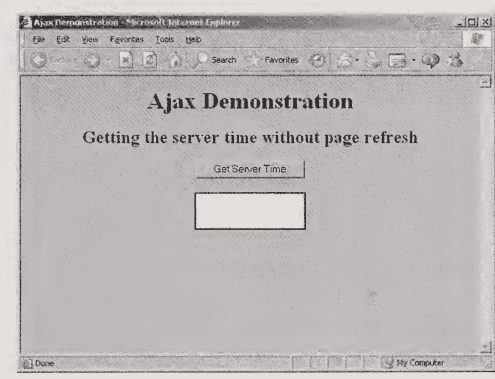

### 添加 JavaScript

我们现在可以将 JavaScript 例程添加到 HTML 页面。我们将通过将其添加到页面 `<head>` 部分内的 `<script> ... </script>` 容器中来实现这一点。

> **提示：** 或者，我们也可以将例程添加到外部 JavaScript 文件（例如 `ajax.js`）中，并通过在文档的 `<head>` 部分使用如下语句来调用此文件：
>
> `<script language="JavaScript" type="text/javascript" src="ajax.js"></script>`

#### XMLHttpRequest 对象

首先，让我们添加用于创建 `XMLHttpRequest` 对象的函数：

```javascript
function getXMLHttpRequest() {
try {
req = new XMLHttpRequest();
} catch(err1) {
try {
req = new ActiveXObject("Msxml2.XMLHTTP");
} catch (err2) {
  try {
    req = new ActiveXObject("Microsoft.XMLHTTP");
  } catch (err3) {
    req = false;
  }
}
}
return req;
}
```

现在创建我们的 `XMLHttpRequest` 对象很简单，这次我们将其命名为 `http`：

```javascript
var http = getXMLHttpRequest();
```

#### 服务器请求

现在我们需要一个函数来构造服务器请求、定义回调函数，并将请求发送到服务器。这就是将从 HTML 页面事件处理程序中调用的函数：

```javascript
function getServerTime() {
  var myurl = 'telltimeXML.php';
  myRand = parseInt(Math.random()*999999999999999);
  // 在 URL 中添加随机数以避免缓存问题
  var modurl = myurl+"?rand="+myRand;
  http.open("GET", modurl, true);
  // 设置回调函数
  http.onreadystatechange = useHttpResponse;
  http.send(null);
}
```


我们再次在 URL 中添加了一个带有随机值的参数，以避免任何缓存问题。我们的回调函数名为`useHttpResponse`，每次检测到`http`的`readyState`属性值发生变化时都会被调用。

#### 我们的 PHP 服务器端脚本

在解释回调函数的操作之前，我们需要参考清单 11.2 所示的简单 PHP 服务器例程`telltimeXML.php`的代码。

##### 清单 11.2 telltimeXML.php

```php
<?php
header('Content-Type: text/xml');
echo "<?xml version=\"1.0\" ?><clock1><timenow>"
     .date('H:i:s')."</timenow></clock1>";
?>
```

这个简短的程序使用 PHP 的`date()`函数报告服务器时间。传递给此函数的参数定义了日期和时间元素应如何格式化。在这里，我们完全忽略了与日期相关的元素，并要求以 24 小时制返回“小时:分钟:秒”格式的时间。

我们的服务器脚本返回以下格式的 XML 文件：

```xml
<?xml version="1.0" ?>
<clock1>
  <timenow>
    XX:XX:XX
  </timenow>
</clock1>
```

其中`XX:XX:XX`被当前服务器时间替换。我们将使用回调函数来提取此时间信息并将其显示在 HTML 页面的`<div>`容器中。

##### 回调函数

以下是回调函数`useHttpResponse`的代码：

```javascript
function useHttpResponse() {
  if (http.readyState == 4) {
    if(http.status == 200) {
      var timeValue = http.responseXML
                     .getElementsByTagName("timenow")[0];
      document.getElementById('showtime').innerHTML
                     = timeValue.childNodes[0].nodeValue;
    }
  } else {
    document.getElementById('showtime').innerHTML
                     = '';
  }
}
```

我们再次使用了`getElementsByTagName`方法，这次是为了选择 XML 数据中的`<timenow>`元素，我们已将其存储在变量`timeValue`中。然而，这次我们不

### 第11课：我们的第一个Ajax应用程序

本课将不像第10课“使用返回的数据”那样，将值显示在警告对话框中。

相反，我们希望使用这些信息来更新 HTML 页面中某个元素的内容。请注意清单 11.1 中 HTML 页面中`<div>`容器的定义方式：

```html
<div id="showtime" class="displaybox"></div>
```

除了类声明（用于`<style>`定义以影响`<div>`元素的显示方式）之外，我们看到该容器还定义了一个 id（标识符），其值设置为`showtime`。

目前，该`<div>`不包含任何内容。我们希望更新此容器的内容，以显示存储在`timeValue`中的服务器时间信息。我们通过使用 JavaScript 的`getElementById()`方法（我们在第 10 课中已介绍过）来选择页面元素来实现这一点。然后，我们将使用 JavaScript 的`innerHTML`属性来更新元素的内容：

```javascript
document.getElementById('showtime').innerHTML = timeValue.childNodes[0].nodeValue;
```

### 使用事件处理程序

最后，我们必须决定如何触发服务器请求。在这种情况下，我们将稍微编辑 HTML 文档，以使用`<button>`对象的`onClick()`事件处理程序：

```html
<input type="button" value="Get Server Time" onClick="getServerTime()">
```

这将正确处理单击“获取服务器时间”按钮的情况。但是，当我们首次加载页面时，`<div>`元素将为空。

为了克服这个小问题，我们可以使用页面`<body>`元素的`onLoad()`事件处理程序：

```html
<body style="background-color:#cccccc" onLoad="getServerTime()">
```

此事件处理程序在页面的`<body>`区域加载完成后立即触发。

### 整合所有内容

清单 11.3 展示了我们 Ajax 应用程序的完整客户端代码。

**清单 11.3 完整的 Ajax 应用程序**

```html
<html>
<head>
<title>Ajax Demonstration</title>
<style>
.displaybox {
width:150px;
background-color:#ffffff;
border:2px solid #000000;
padding:10px;
font:24px normal verdana, helvetica, arial, sans-serif;
}
</style>
<script language="JavaScript" type="text/javascript">
function getXMLHttpRequest() {
try {
req = new XMLHttpRequest();
} catch(err1) {
try {
req = new ActiveXObject("Msxml2.XMLHTTP");
} catch (err2) {
try {
req = new ActiveXObject("Microsoft.XMLHTTP");
} catch (err3) {
req = false;
}
}
}
return req;
}

var http = getXMLHttpRequest();

function getServerTime() {
var myurl = 'telltimeXML.php';
myRand = parseInt(Math.random()*999999999999999);
var modurl = myurl+"?rand="+myRand;
http.open("GET", modurl, true);
http.onreadystatechange = useHttpResponse;
http.send(null);
}

function useHttpResponse() {
  if (http.readyState == 4) {
    if(http.status == 200) {
      var timeValue = http.responseXML.getElementsByTagName("timenow")[0];
      document.getElementById('showtime').innerHTML
      = timeValue.childNodes[0].nodeValue;
    }
  } else {
    document.getElementById('showtime').innerHTML
    = '';
  }
}
</script>
</head>
<body style="background-color:#cccccc"
onLoad="getServerTime()">
<center>
<h1>Ajax Demonstration</h1>
<h2>Getting the server time without page refresh</h2>
<form>
<input type="button" value="Get Server Time"
onClick="getServerTime()">
</form>
<div id="showtime" class="displaybox"></div>
</center>
</body>
</html>
```

将页面加载到我们的浏览器中，我们可以看到服务器时间显示在`<div>`容器中，这表明页面加载时`<body>`的`onLoad`事件处理程序已经触发。

### 用户反馈

另请注意，我们通过以下代码行提供了用户反馈：

```javascript
document.getElementById('showtime').innerHTML
= '';
```

该行在`readyState`的值每次更改时执行，直到满足条件：

```javascript
readyState == 4
```

这行代码在时间显示元素中加载了一个带有旋转图案的动画 GIF，表示服务器请求正在进行中，如图 11.2 所示。第 10 课中更详细地描述了这种技术。

> **提示：** 如果您拥有快速的服务器和良好的 Internet 连接，可能很难看到此用户反馈的实际效果，因为时间显示几乎会立即更新。为了演示动画 GIF 图像的操作，我们可以使用 PHP 的`sleep()`命令来减慢服务器脚本的速度，以模拟更复杂的脚本和/或较差的连接的性能：

```php
<?php
header('Content-Type: text/xml');
sleep(3);
echo "<?xml version=\"1.0\" ?><clock1><timenow>"
.date('H:i:s')."</timenow></clock1>";
?>
```

代码行：

```php
sleep(x);
```

强制服务器暂停程序执行`x`秒。

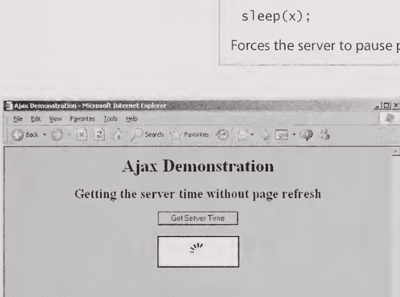

**图 11.2 动画图像提供用户反馈。**

现在，每次我们单击“获取服务器时间”按钮，时间显示都会更新。图 11.3 展示了完成后的应用程序。

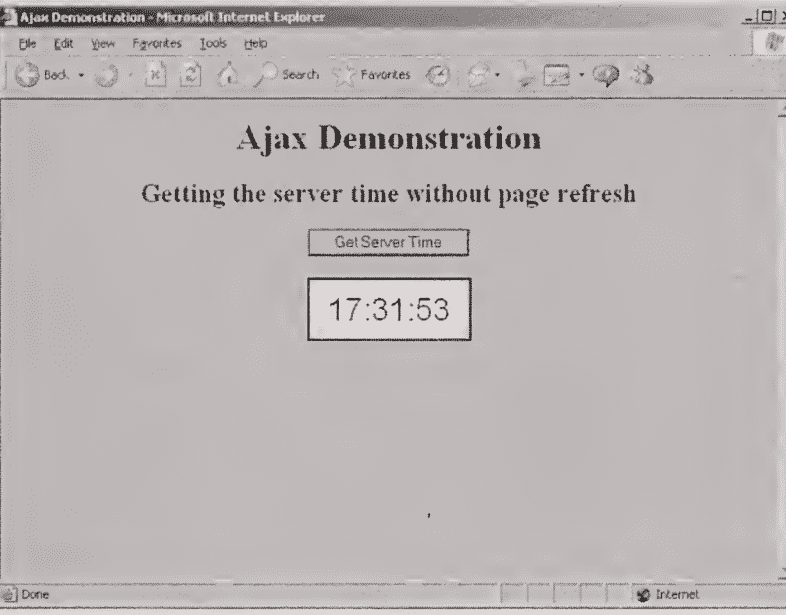

**图 11.3 我们完成的 Ajax 应用程序。**

## 总结

在本课中，我们构建了一个简单但完整的 Ajax 应用程序，它执行以下操作：

- 创建`XMLHttpRequest`对象的实例
- 响应 HTML 页面中内置的 JavaScript 事件处理程序
- 构建并发送异步服务器请求
- 使用 JavaScript DOM 方法解析从服务器接收的 XML
- 提供正在进行请求的用户反馈
- 使用接收到的数据更新显示的页面

至此完成了本书的第二部分。第三部分“更复杂的 Ajax 技术”将探讨一些更高级的 Ajax 技术。


### 以文本形式返回数据

在本课中，您将学习一些使用`responseText`属性为 Ajax 应用程序添加功能的更多技巧。

#### 从 responseText 属性获取更多内容

第二部分“介绍 Ajax”的课程讨论了使 Ajax 工作的各个组成部分，最终构建了一个完整的 Ajax 应用程序。在第三部分“更复杂的 Ajax 技术”中，每节课都将研究如何扩展您所学的知识，以开发更复杂的 Ajax 应用程序。

在本课中，我们将更仔细地研究`XMLHttpRequest`对象的`responseText`属性，并了解如何通过使用它为我们的应用程序提供一些额外的功能。

正如您在前面的课程中所看到的，`XMLHttpRequest`对象提供了两个包含从服务器接收的信息的属性，即`responseText`和`responseXML`。前者以字符串格式向调用应用程序提供服务器数据，而后者提供与 DOM 兼容的 XML，可以使用 JavaScript 方法进行解析。

尽管`responseXML`属性允许您执行一些复杂的编程任务，但仅通过操作存储在`responseText`属性中的值就可以实现很多功能。

### 返回文本

术语“文本”可能有点误导性。`responseText`属性包含一个字符串，其值可以通过简单的赋值语句分配给 JavaScript 变量：

```javascript
var mytext = http.responseText;
```

没有规则规定这样的字符串中包含的值必须是可读的文本；事实上，只要字符串仅包含 JavaScript 在字符串变量中接受的字符，该值就可以包含完全无意义的内容。

这一事实使得使用此属性可以传输的信息类型具有一定的灵活性。

### 在页面元素中直接使用返回的文本

也许最简单的例子是考虑使用`responseText`中的值来更新页面元素的文本部分，比如一个`<div>`容器。在这种情况下，您可以简单地获取返回的字符串并将其应用于相关的页面元素。

这里有一个简单的例子。以下是一个 HTML 页面的 HTML 代码，该页面构成了 Ajax 应用程序的基础：

```html
<html>
<head>
    <title>My Ajax Application</title>
</head>
<body>
Here is the text returned by the server:<br />
<div id="myPageElement"></div>
</body>
</html>
```

显然，这是一个简单的页面，就其现状而言，只会输出行“Here is the text returned by the server:”而没有其他内容。

现在假设我们向页面添加必要的 JavaScript 例程，以生成一个`XMLHttpRequest`对象实例（在本例中称为`http`），并响应页面`<body>`元素的`onLoad()`事件处理程序发出服务器请求。清单 12.1 展示了修改后页面的源代码。

### 清单 12.1 一个使用 responseText 属性的基础 Ajax 应用程序

```html
<html>
<head>
<title>My Ajax Application</title>
<script language="JavaScript">
function getXMLHttpRequest() {
  try {
    req = new XMLHttpRequest();
  } catch(err1) {
    try {
      req = new ActiveXObject("Msxml2.XMLHTTP");
    } catch (err2) {
      try {
        req = new ActiveXObject("Microsoft.XMLHTTP");
      } catch (err3) {
        req = false;
      }
    }
  }
  return req;
}

var http = getXMLHttpRequest();

function getServerText() {
  var myurl = 'textserver.php';
  myRand = parseInt(Math.random()*99999999999999);
  var modurl = myurl+"?rand="+myRand;
  http.open("GET", modurl, true);
  http.onreadystatechange = useHttpResponse;
  http.send(null);
}

function useHttpResponse() {
  if (http.readyState == 4) {
    if(http.status == 200) {
      var mytext = http.responseText;
      document.getElementById('myPageElement')
      .innerHTML = mytext;
    }
  } else {
    document.getElementById('myPageElement')
    .innerHTML = "";
  }
}
</script>
</head>
<body>
<div id="myPageElement">Content will appear here.</div>
<p><a href="javascript:getServerText()">Get Server Text</a></p>
</body>
</html>
```

### 清单 12.1 续

```html
</head>
<body onLoad="getServerText()">
Here is the text returned by the server:<br>
<div id="myPageElement"></div>
</body>
</html>
```

这段代码大部分，甚至可能全部，你在之前的课程中都已经熟悉。我们感兴趣的部分是回调函数`useHttpResponse()`，它包含以下几行：

```javascript
var mytext = http.responseText;
document.getElementById('myPageElement').innerHTML = mytext;
```

这里我们只是简单地将`responseText`中接收到的值赋给了我们选定的`<div>`容器的内容。

运行前面的代码，配合一个简单的服务器端脚本：

```php
<?php
echo "This is the text from the server";
?>
```

会产生如图 12.1 所示的屏幕显示。

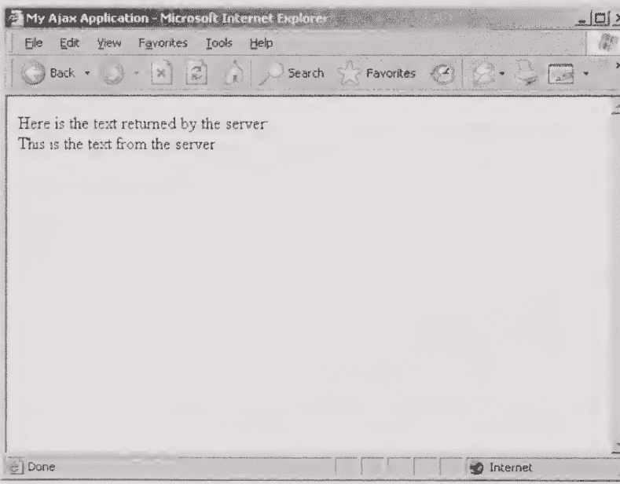

图 12.1 通过 responseText 在页面元素中显示文本。

### 在 responseText 中包含 HTML

现在让我们修改上一个示例中的代码。


正如你从之前的课程中所知，HTML 标记完全由使用文本字符编写的标签组成。如果`responseText`属性中包含的值用于修改发起服务器请求的页面的显示，那么没有任何东西可以阻止我们在服务器脚本返回的信息中包含 HTML 标记。

假设我们再次使用清单 12.1 的代码，但使用一个修改过的服务器脚本：

```php
<?php
echo "<h3>Returning Formatted Text</h3>";
echo "<hr />";
echo "We can use HTML to <strong>format</strong> text before we return it!";
?>
```

图 12.2 显示了最终的浏览器显示结果。

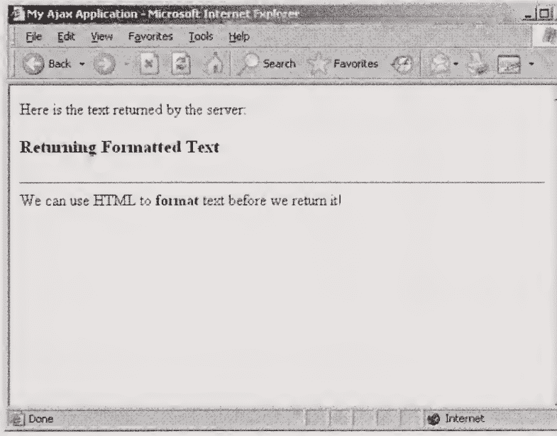

作为一个稍微复杂的例子，考虑服务器脚本生成更复杂输出的情况。我们希望应用程序接受这个服务器输出并将其显示为表格的内容。

这一次，我们将使用服务器端 PHP 脚本生成一些表格信息：

```php
<?php
$days = array('Monday', 'Tuesday', 'Wednesday', 'Thursday', 'Friday', 'Saturday', 'Sunday');
echo "<table border='2'>";
echo "<tr><th>Day Number</th><th>Day Name</th></tr>";
for($i=0;$i<7;$i++)
{
    echo "<tr><td>".$i."</td><td>".$days[$i]."</td></tr>";
}
echo "</table>";
?>
```

再次使用清单 12.1 的代码通过`XMLHttpRequest`调用服务器端脚本，我们得到了如图 12.3 所示的页面。

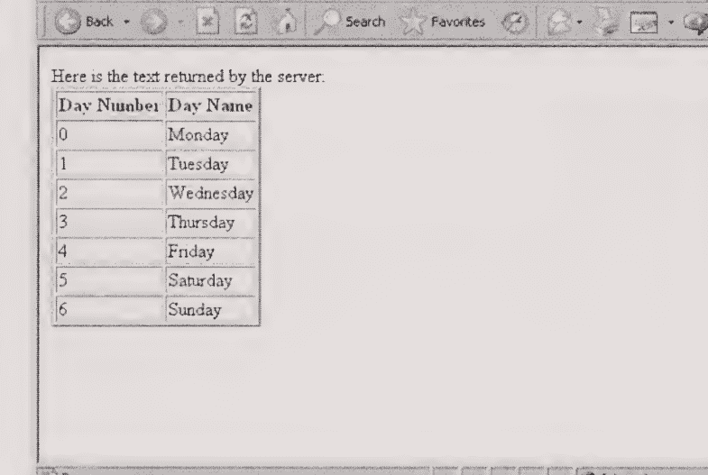

图 12.3 返回更复杂的 HTML。

### 更复杂格式的数据

到目前为止，我们已经演示了如何返回可以直接应用于网页元素的文本。目前为止，一切顺利。然而，如果你愿意在 JavaScript 中多做一些工作来操作返回的数据，你可以实现更多功能。

### 从`responseText`属性中获取更多内容

只要服务器在`XMLHttpRequest`对象的`responseText`属性中返回一个字符串值，你就可以使用任何你设计的编码格式在其中编码信息。

考虑以下服务器端脚本，它使用与前面示例相同的数据数组：

> **注意：** 注意使用了 PHP 的`sizeof()`函数来确定数组中的项目数量。在 PHP 中，与 JavaScript 一样，数组键从 0 开始编号，而不是从 1 开始。

```php
<?php
$days = array('Monday', 'Tuesday', 'Wednesday',
               'Thursday', 'Friday', 'Saturday', 'Sunday');
$numdays = sizeof($days);
for($i=0;$i<($numdays - 1);$i++)
{
    echo $days[$i]."|";
}
echo $days[$numdays-1];
?>
```

现在`responseText`属性中返回的字符串包含了星期几，并用管道符`|`分隔——或者说定界。如果我们把这个字符串复制到 JavaScript 变量`mystring`中，

```javascript
var mystring = http.responseText;
```

我们会发现变量`mystring`包含了字符串：

```text
Monday|Tuesday|Wednesday|Thursday|Friday|Saturday|Sunday
```

我们现在可以方便地使用 JavaScript 的`split()`方法将这个字符串分割成数组：

```javascript
var results = http.responseText.split("|");
```

> **提示：** JavaScript 的`split()`方法会分割一个字符串，在字符串中找到作为参数传递给它的字符处进行切割。这个字符不一定是管道符；常用的替代符号是逗号或斜杠。

现在我们有了一个包含数据的 JavaScript 数组`results`：

```javascript
results[0] = 'Monday'
results[1] = 'Tuesday'
等等...
```

我们现在不再只是简单地显示接收到的数据，而是可以在 JavaScript 例程中以任何我们想要的方式使用它。

> **提示：** 对于复杂的数据格式，XML 可能是接收和处理服务器数据的更好方式。然而，仅仅使用`responseText`属性就能完成如此多的工作，这确实值得注意。

## 总结

只需很少的努力，就可以说服`XMLHttpRequest`对象的`responseText`属性不仅仅是返回一些文本来显示在网页上。

对于所有但最复杂的数据格式，操作`responseText`可能比处理 XML 增加的复杂性更简单。

在本课中，你看到了几个这种技术的例子，范围从简单地更新页面元素内的文本内容，到操作更复杂的数据结构。

### AHAH——异步 HTML 和 HTTP

在本课中，你将学习如何使用 AHAH（异步 HTML 和 HTTP）来构建 Ajax 风格的应用程序，而无需使用 XML。

#### 介绍 AHAH

你在第 12 课“将数据作为文本返回”中看到，一个 Ajax 应用程序在完全不使用任何 XML 的情况下能实现多少功能。许多任务，从简单地更新页面上的文本到处理复杂的数据结构，都可以仅使用`XMLHttpRequest`对象的`responseText`属性返回的文本字符串来完成。

完全有可能构建完整且有用的应用程序，而根本不需要任何 XML。事实上，术语 AHAH（异步 HTML 和 HTTP）正是为这类应用程序而创造的。

本课将把第 12 课的概念再推进一步，更详细地考察 AHAH 可以在哪里以及如何被应用。

> **注意：** 这种技术，作为 Ajax 的一种子集，已被赋予了各种缩写。这些包括 AHAH（异步 HTML 和 HTTP）、JAH（Just Asynchronous HTML，即仅异步 HTML）和 HAJ（HTML And JavaScript，即 HTML 和 JavaScript）。在本书中，我们将将其称为 AHAH。

### 为什么使用 AHAH 而不是 Ajax？

毫无疑问，XML 是一项重要且具有多样化和强大功能的技术。对于具有复杂数据结构的复杂 Ajax 应用程序，它很可能是最好的——或者也许是唯一的——选择。然而，使用 XML 有时会使应用程序的设计复杂化，包括：

- 为 XML 数据设计自定义架构所涉及的工作。
- 使用 JavaScript 的 DOM 方法时的跨浏览器兼容性问题。
- 执行处理器密集型 XML 解析可能会降低性能。

使用 AHAH 可以帮助你避免这些头痛问题，同时还提供一些额外的优势：

- 轻松地重新利用一些现有的网页。
- HTML 可能比 XML 更容易进行故障排除。
- 使用 CSS 来设置返回信息的样式，而不是必须使用 XSLT。

> **注意：** XSLT 是一种转换语言，用于将 XML 文档转换为其他格式——例如，转换为适合浏览器显示的 HTML。

在接下来的章节中，我们将把我们的 AHAH 脚本打包成一个简洁的外部 JavaScript 文件，我们可以在应用程序中调用它。

### 为 AHAH 创建一个小型库

过去几课中检查的 Ajax 应用程序，虽然完整且功能齐全，但在页面中嵌入了大量 JavaScript 代码。正如你所见，每个应用程序往往包含相似的功能：

- 一个创建`XMLHttpRequest`对象实例、配置并发送它的方法。
- 一个处理`responseText`属性中包含的返回文本的回调函数。

你可以将这些函数抽象成简单的 JavaScript 函数调用，特别是在你只想用服务器返回的新值更新单个页面元素的情况下。

### 介绍`myAHAHlib.js`

请看清单 13.1；这段代码的大部分内容对你来说应该会立刻感到熟悉。

```javascript
清单 13.1  myAHAHlib.js
function callAHAH(url, pageElement, callMessage) {
    document.getElementById(pageElement)
    .innerHTML = callMessage;
    try {
        req = new XMLHttpRequest(); /* e.g. Firefox */
    } catch(e) {
        try {
            req = new ActiveXObject("Msxml2.XMLHTTP");
    /* some versions IE */
        } catch (e) {
            try {
                req = new ActiveXObject("Microsoft.XMLHTTP");
    /* some versions IE */
            } catch (E) {
                req = false;
            }
        }
    }
    req.onreadystatechange
    = function() {responseAHAH(pageElement);};
    req.open("GET",url,true);
    req.send(null);
}

function responseAHAH(pageElement) {
    var output = '';
    if(req.readyState == 4) {
        if(req.status == 200) {
            output = req.responseText;
            document.getElementById(pageElement)
            .innerHTML = output;
        }
    }
}
```

`callAHAH()`函数封装了创建`XMLHttpRequest`对象实例、声明回调函数和发送请求的任务。

### 13：AHAH—异步 HTML 与 HTTP

请注意，我们没有简单地声明：

`req.onreadystatechange = responseAHAH;`

而是使用了如下的 JavaScript 构造：

`req.onreadystatechange = function() {responseAHAH(pageElement);};`

这种声明方式允许我们向被声明的函数传递一个参数，在此例中即指定了要更新的页面元素。

`callAHAH()`还接受一个额外的参数`callMessage`。该参数包含一个字符串，用于定义在等待服务器请求结果期间应在目标元素中显示的内容。这为用户提供了一定程度的反馈，表明页面上正在发生某事。在实践中，这可以是一行文本，例如：

`'Updating page; please wait a moment ...'`

不过，同样地，你也可以选择在此字符串中嵌入一些 HTML 代码。在``元素中使用动画 GIF 图像是向用户发出进程正在进行警告的一种有效方式。

回调函数`responseAHAH()`执行的具体任务是将`responseText`属性中返回的字符串应用到所选页面元素`pageElement`的`innerHTML`属性：

`output = req.responseText;`

`document.getElementById(pageElement).innerHTML = output;`

这段代码已被打包到一个名为`myAHAHlib.js`的文件中，你可以从 HTML 页面中调用它，从而使这些函数可用于你的 AHAH 应用程序。下一节将展示一些使用示例。

### 使用`myAHAHlib.js`

在第 4 课“使用 JavaScript 进行客户端编码”中，我们接触了 JavaScript 函数可以存放在外部文件中并在页面内引用的概念。

我们将以同样的方式使用我们的新文件`myAHAHlib.js`，使用如下形式的语句：

`<SCRIPT language="JavaScript" SRC="myAHAHlib.js"></SCRIPT>`

然后，我们就可以在需要时自由调用脚本中的函数。

以下是此类 HTML 页面的框架源代码：

```html
<html>
<head>
<title>Another Ajax Application</title>
<SCRIPT language="JavaScript" SRC="myAHAHlib.js"></SCRIPT>
</head>
<body>
<form>
<input type="button" onClick="callAHAH('serverscript.php?parameter=x',
'displaydiv', 'Please wait - page updating ...')" >
This is the place where the server response
will be posted:<br>
<div id="displaydiv"></div>
</form>
</body>
</html>
```

在这个简单的 HTML 页面中，一个按钮元素被用来创建事件，该事件导致`callAHAH()`方法被调用。此方法将文本字符串

`'Please wait - page updating ...'`

放入`id`为`displaydiv`的`<div>`元素中，并向 URL`serverscript.php?parameter=x`发送异步服务器调用。

当`responseAHAH()`检测到服务器已完成响应后，`<div>`元素的内容使用存储在`responseText`中的值进行更新；`<div>`不再显示“请稍候”消息，而是显示服务器返回的任何文本。

### 在项目中应用`myAHAHlib.js`

我们可以用另一个简单的 Ajax 应用程序来演示这些技术。这次，我们将编写一个脚本，从用户输入的 URL 中抓取“keywords”元标签信息。

> **注意：** 元标签是 HTML 页面`<head>`部分中的可选 HTML 容器元素。它们包含有关网页的数据，这些数据对于搜索引擎和索引在决定如何对网页内容进行分类时很有用。如果存在“keywords”元标签，它通常包含一个以逗号分隔的单词列表，这些单词的含义与网站内容相关。

“keywords”元标签的示例如下：

`<meta name="keywords" content="programming, design,`

`development, Ajax, JavaScript, XMLHttpRequest,`

`script">`

### 清单 13.2 getkeywords.html

```html
<html>
<head>
<title>A 'Keywords' Metatag Grabber</title>
<SCRIPT language="JavaScript" SRC="myAHAHlib.js">
</SCRIPT>
</head>
<body>
<script type="text/javascript" src="ahahLib.js">
</script>
<form>
<table>
<tr>
    <td>
        URL: http://
    </td>

    <td>
        <input type="text" id="myurl" name="myurl" size=30>
        <input type="button" onclick =
            "callAHAH('keywords.php?url='+document
            .getElementById('myurl').value,'displaydiv',
            'Please wait; loading content ...')" value="Fetch">
    </td>
</tr>
<tr><td colspan=2 height=50 id="displaydiv"></td></tr>
</table>
</form>
</body>
</html>
```

最后，请看服务器端脚本：

```php
<?php
$tags = @get_meta_tags('http://'.$url);
$result = $tags['keywords'];
if(strlen($result) > 0)
{
    echo $result;
} else {
    echo "No keywords metatag is available";
}
?>
```

> **提示：** PHP 方法前的`@`字符告诉 PHP 解释器，如果该方法在执行过程中遇到问题，不要输出错误消息。我们在此例中需要它，因为并非所有网页都包含“keywords”元标签；在不存在的情况下，我们更希望该方法返回一个空字符串，以便我们可以添加自己的错误处理。

我们将选定的 URL 作为参数传递给 PHP 方法`get_meta_tags()`：

```php
$tags = @get_meta_tags('http://' . $url);
```

此方法专门设计用于以关联数组的形式解析 HTML 页面中的元标签信息。在此脚本中，数组被命名为`$tags`，我们可以通过检查数组条目`$tags['keywords']`来获取“keywords”元标签；然后，我们可以使用 PHP 的`strlen()`方法测量返回字符串的长度，以检查“keywords”元标签是否存在。


当文件`getkeywords.html`首次加载到浏览器中时，我们将看到如图 13.1 所示的显示。

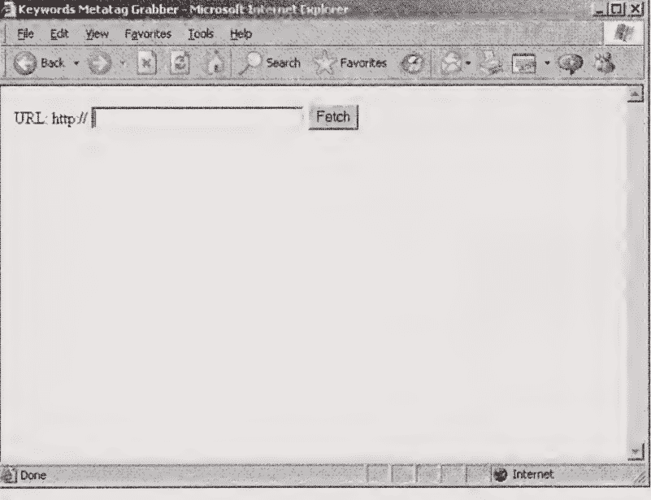

图 13.1 应用程序首次加载后的浏览器显示。

这里我们被邀请输入一个 URL。当我们点击“Fetch”按钮时，`callAHAH()` 被执行，并将我们选择的 URL 作为参数发送到服务器端脚本。同时，消息“Please wait; loading content ...”被放置在`<div>`容器中。虽然可能只显示一瞬间，但我们现在看到的显示如图 13.2 所示。

### 13：AHAH—异步 HTML 与 HTTP

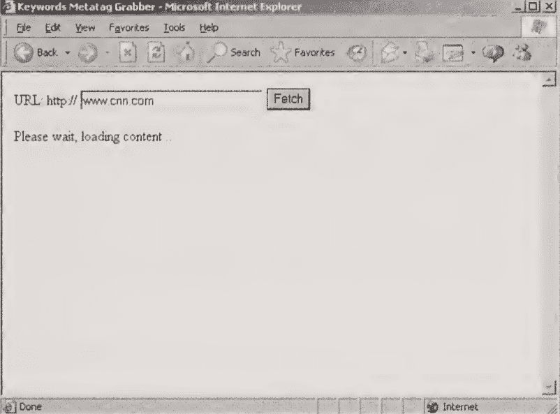

图 13.2 等待服务器响应。

最后，当服务器调用完成后，`responseText` 属性的内容被加载到`<div>`容器中，产生如图 13.3 所示的显示。

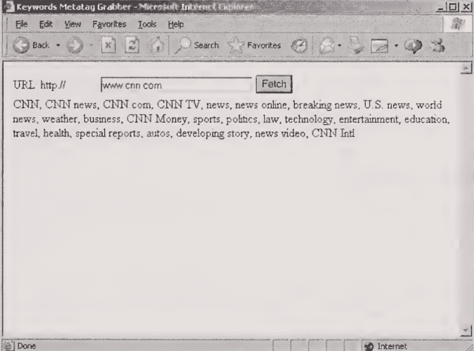

图 13.3 关键词成功返回。

### 扩展`myAHAHlib.js`

就目前而言，`myAHAHlib.js` 是 AHAH 的一个简单实现。根据其使用方式的不同，它可以通过多种方式进行改进和扩展。与其在本课中涵盖这些内容，我们将其留给你自己去实验。这里有一些建议供你入门：

- 目前仅支持 GET 请求。如何修改这些函数以允许 POST 请求？
- 在第 11 课“我们的第一个 Ajax 应用程序”中讨论的许多用户反馈尚未在`responseAHAH()`中实现。
- 是否可以修改`callAHAH()`以接受一个要更新的页面元素数组，并（借助适当的服务器端脚本）一次性处理它们？

> 提示：我们尚未考虑的一个选项是通过`responseText`返回 JavaScript 代码的想法。因为 JavaScript 源代码（就像 HTML 页面中的所有其他内容一样）是由纯文本编写的语句组成的，所以你可以从服务器在`responseText`属性中返回 JavaScript 源代码。然后你可以使用 JavaScript 的`eval()`方法执行此 JavaScript 代码：

`eval(object.responseText);`

考虑你的服务器脚本返回字符串的情况：

`"alert('Hello World!');"`

在这种情况下，`eval()`方法将执行该内容作为 JavaScript 语句，创建一个带有“OK”按钮、显示“Hello World!”的对话框。

## 总结

希望通过本课和第 12 课的内容，已经清楚地表明 Ajax 可以在完全不使用任何 XML 的情况下实现大量功能。

通过仔细结合使用 JavaScript 客户端编码和你选择的语言进行服务器端脚本编写，你可以创建高度复杂的数据方案。

### 13：AHAH—异步 HTML 与 HTTP

在较简单的应用场景中，如果你只需更新页面元素的文本，`XMLHttpRequest`对象的功能可以被抽象为一个 JavaScript 函数库，并通过简单的方法从 HTML 页面中调用。

然而，对于某些任务，你需要利用 XML 的强大功能。我们将在第 14 课“将数据作为 XML 返回”中探讨这个主题。

### 将数据作为 XML 返回

在本课中，你将学习如何通过`XMLHttpRequest`对象的`responseXML`属性使用服务器返回的 XML 数据。

### 为 Ajax 添加“X”

第 12 课“将数据作为文本返回”和第 13 课“AHAH—异步 HTML 与 HTTP”已经详细讨论了`responseText`中包含的字符串值，并探讨了在应用程序中使用此信息的几种技术。这些示例涵盖了从简单的页面元素文本更新，到使用更复杂数据结构的应用程序，这些数据结构被编码为字符串值，可以存储在`responseText`属性中并进行传输。

当然，Ajax 中的 X 代表 XML，在应用程序中利用 XML 的强大功能有充分的理由。当你需要使用高度结构化的信息，和/或在不同类型的数据表示之间执行复杂的转换时，这一点尤为重要。

如前所述，`XMLHttpRequest`对象还有一个名为`responseXML`的属性，可用于通过 XML 而非文本字符串从服务器传输信息。

你在第 11 课“我们的第一个 Ajax 应用程序”中看到了，JavaScript 的文档对象模型方法如何帮助你处理这些 XML 信息。本课将更详细地探讨这些技术，并希望让你领略 Ajax 应用程序利用 XML 力量所能实现的功能。

### `responseXML`属性

`XMLHttpRequest`对象的`responseText`属性包含一个字符串，而`responseXML`则可以被视为一个 XML 文档。

> **注意：** 你需要确保服务器提供有效且格式正确的 XML，以便通过`responseXML`属性返回。在 XML 因格式错误或不支持的字符编码等问题而无法被`XMLHttpRequest`对象正确解析的情况下，`responseXML`的内容是不可预测的，并且在不同浏览器中也可能不同。

> **注意：** 与`responseText`属性类似，存储在`responseXML`中的值是只读的，因此你不能直接写入此属性；要操作它，你必须将值复制到另一个变量：

> ```javascript
> var myobject = http.responseXML;
> ```

XML 文档中包含的完整结构和数据现在可以通过使用 JavaScript 的 DOM 方法来获取。在本课后面，我们将通过另一个可工作的 Ajax 应用程序来演示这一点，但首先让我们回顾一下 JavaScript DOM 方法，并介绍一些新的方法。

### 更多 JavaScript DOM 方法

你在之前的课程中已经接触过一些 JavaScript DOM 方法，例如`getElementById`和`getElementsByTagName`。在那些情况下，我们主要关注读取节点的值，并将这些值写入 HTML 页面元素。

本课探讨可用于实际创建元素的 DOM 方法，从而改变页面的结构。

文档对象模型可以被视为一个树状的节点结构。除了读取与这些节点相关的值之外，你还可以创建和修改节点本身，从而改变文档的结构和内容。

要向页面添加新元素，你需要先创建元素，然后将它们附加到 DOM 树中的适当位置。让我们看一个使用以下 HTML 文档的简单示例：

```html
<html>
<head>
  <title>Test Document</title>
</head>
<body>
We want to place some text here:<br />
<div id="displaydiv"></div>
</body>
</html>
```

在这个示例中，我们希望将文本“Hello World!”添加到文档正文中的`<div>`容器内。我们将把 JavaScript 代码放入一个函数中，并通过正文的`onLoad()`事件处理器调用它。

首先，我们将使用 JavaScript DOM 方法`createTextNode()`来创建一个文本节点：

```javascript
var textnode = createTextNode(‘Hello World!’);
```

现在我们需要将`textnode`附加到文档的 DOM 树中的适当位置。

你在第 4 课“使用 JavaScript 进行客户端编码”中首次了解了子节点；希望你记得，如果一个节点包含其他文档元素，则称该节点具有*子节点*。JavaScript 有一个`appendChild()`方法，它允许我们通过将新的文本节点作为现有文档节点的子节点，将其附加到 DOM 树。

> 注意：将此基于 DOM 的页面内容写入方法与第 11 课项目中使用的`innerHTML`方法进行比较。

在本例中，我们希望文本位于 id 为`displaydiv`的`<div>`容器内：

```javascript
var textnode = document.createTextNode(‘Hello World!’);
document.getElementById(‘displaydiv’).appendChild(textnode);
```

让我们看看页面的完整源代码，将此 JavaScript 代码包装到一个函数中，并添加`onLoad()`事件处理器来执行它：

> 注意：如果你在浏览器中查看此文档的源代码，你不会在`<div>`容器内看到‘Hello World!’文本。浏览器构建其对 HTML 文档的 DOM 表示，然后使用该模型显示页面。你的代码所做的修改是针对 DOM 的，而不是针对文档本身的。

```html
<html>
<head>
  <title>Test Document</title>
  <script Language="JavaScript">
  function hello()
  {
    var textnode = document.createTextNode(‘Hello World!’);
    document.getElementById(‘displaydiv’).appendChild(textnode);
  }
  </script>
</head>
<body onLoad="hello()">
We want to place some text here:<br />
<div id="displaydiv"></div>
</body>
</html>
```

图 14.1 显示了加载此页面后的浏览器显示效果。

### 14：将数据作为 XML 返回


当你想要创建除文本节点以外的其他页面元素时，可以使用`createElement()`方法来完成，该方法的工作方式与`createTextNode()`非常相似。事实上，我们可以在添加‘Hello World!’文本节点之前，使用`createElement()`来创建`<div>`容器本身：

```javascript
var newdiv = document.createElement("div");
```

通常，你只需将所需页面元素的类型作为参数传递给`createElement()`，即可生成所需类型的元素。

### DOM 方法概述

本书是关于 Ajax 的，而不仅仅是关于 JavaScript DOM 技术，因此我们不会在此提供所有可用方法和属性的综合指南。然而，表 14.1 列出了一些更有用的方法。

#### 表14.1 一些 JavaScript DOM 属性和方法

##### 节点属性

| 属性 | 描述 |
| :--- | :--- |
| `childNodes` | 子节点数组 |
| `firstChild` | 第一个子节点 |
| `lastChild` | 最后一个子节点 |
| `nodeName` | 节点名称 |
| `nodeType` | 节点类型 |
| `nodeValue` | 节点包含的值 |
| `nextSibling` | 共享同一父节点的下一个节点 |
| `previousSibling` | 共享同一父节点的上一个节点 |
| `parentNode` | 此节点的父节点 |

> 提示：如果你需要更全面了解 JavaScript DOM 方法和属性，Andrew Watt 在他出色的书籍《Sams Teach Yourself XML in 10 Minutes》（该书包含在 Ajax Starter Kit CD 中）中提供了一个有用的列表。

##### 节点方法

| 方法 | 描述 |
| :--- | :--- |
| `appendChild` | 添加一个新的子节点 |
| `hasChildNodes` | 如果此节点有子节点则为真 |
| `removeChild` | 删除一个子节点 |

##### 文档方法

| 方法 | 描述 |
| :--- | :--- |
| `createAttribute` | 为元素创建一个新属性 |
| `createElement` | 创建一个新的文档元素 |
| `createTextNode` | 创建一个文本项 |
| `getElementsByTagName` | 创建一个标签名数组 |
| `getElementById` | 通过 ID 查找元素 |

### 项目—RSS 标题阅读器

现在让我们运用从服务器返回 XML 数据所学知识，利用这些技术来处理一个新项目。

XML 数据在互联网上有多种形式。其中最流行的一种是 RSS 订阅源，这是一种特定类型的 XML 源，通常包含新闻或其他主题性且定期更新的条目。RSS 订阅源可从网络上的许多来源获取，包括大多数广播公司和报纸出版商，以及涵盖各种主题的专业网站。

我们将编写一个 Ajax 应用程序，该程序接收 RSS 订阅源的 URL，收集 XML，并列出订阅源中包含的新闻条目的标题和描述。

以下是典型 RSS 订阅源的部分 XML：

```xml
<rss version="0.91">
<channel>
<title>myRSSfeed.com</title>
```

### 14：将数据作为 XML 返回

```xml
<link>http://www.********.com/</link>
<description>My RSS feed</description>
<language>en-us</language>
<item>
<title>New Store Opens</title>
<link>http://www.********.html</link>
<description>A new music store opened today in Canal Road. The new business, Ajax Records, caters for a wide range of musical tastes.</description>
</item>
<item>
<title>Bad Weather Affects Transport</title>
<link>http://www.********.html</link>
<description>Trains and buses were disrupted badly today due to sudden heavy snow. Police advised people not to travel unless absolutely necessary.</description>
</item>
<item>
<title>Date Announced for Mayoral Election</title>
<link>http://www.********.html</link>
<description>September 4th has been announced as the date for the next mayoral election. Watch local news for more details.</description>
</item>
</channel>
</rss>
```

从第一行

```xml
<rss version="0.91">
```

我们可以看到，在本例中我们处理的是 0.91 版本的 RSS。RSS 的不同版本之间差异很大，但就我们的示例而言，我们只关心单个新闻条目的`<title>`、`<link>`和`<description>`元素，这些元素在不同版本间基本保持不变。

### 应用程序的 HTML 页面

我们的页面需要包含一个输入字段，用于输入所需 RSS 订阅源的 URL，以及一个按钮来指示应用程序收集数据。我们还将有一个`<div>`容器，用于显示我们解析后的数据：

```html
<html>
<head>
<title>An Ajax RSS Headline Reader</title>
</head>
<body>
<h3>An Ajax RSS Reader</h3>
<form name="form1">
URL of RSS feed: <input type="text" name="feed" size="50" value="http://"><input type="button" value="Get Feed">
<br /><br />
<div id="news"><h4>Feed Titles</h4></div>
</form>
</html>
```

如果我们将此代码保存为文件`rss.htm`并在浏览器中加载，我们将看到类似图 14.2 所示的显示。

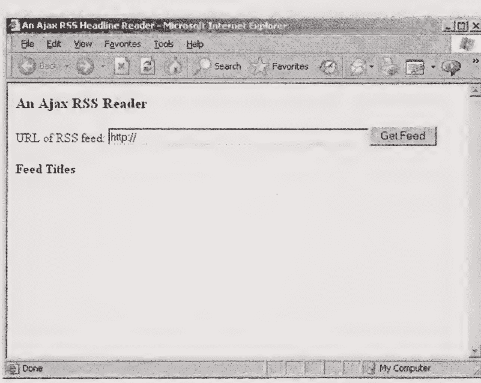

到目前为止，阅读器的大部分代码我们应该已经熟悉了；创建`XMLHttpRequest`对象实例、构造和发送服务器请求以及检查请求何时完成的方法，与之前的示例基本相同。

然而，这一次，我们将通过`responseXML`属性接收 XML 格式的数据，而不是使用`responseText`。我们将使用这些数据来修改我们 HTML 页面的 DOM，以便在页面的`<div>`容器内以列表形式显示新闻条目的标题和描述。每个标题和描述将包含在它们自己的段落元素中（我们也将为此构造），并通过样式表进行设置，以我们希望的方式显示。

### 14：将数据作为 XML 返回

### 完整代码

让我们直接查看代码，如清单 14.1 所示。

**清单 14.1** Ajax RSS 标题阅读器


```html
<html>
<head>
<title>An Ajax RSS Headline Reader</title>
</head>
<style>
.title {
font: 16px bold helvetica, arial, sans-serif;
padding: 0px 30px 0px 30px;
text-decoration:underline;
}
.descrip {
font: 14px normal helvetica, arial, sans-serif;
text-decoration:italic;
padding: 0px 30px 0px 30px;
background-color:#cccccc;
}
.link {
font: 9px bold helvetica, arial, sans-serif;
padding: 0px 30px 0px 30px;
}
.displaybox {
border: 1px solid black;
padding: 0px 50px 0px 50px;
}
</style>
<script language="JavaScript" type="text/javascript">
function getXMLHTTPRequest() {
try {
req = new XMLHttpRequest(); /* e.g. Firefox */
} catch(e) {
try {
req = new ActiveXObject("Msxml2.XMLHTTP");
/* some versions IE */
} catch (e) {
try {
req = new ActiveXObject("Microsoft.XMLHTTP");
/* some versions IE */
} catch (E) {
req = false;
}
}
}
```

## 项目—一个 RSS 标题阅读器

```javascript
    }
    return req;
}

var http = getXMLHttpRequest();

function getRSS() {
    var myurl = 'rssproxy.php?feed=';
    var myfeed = document.form1.feed.value;
    myRand = parseInt(Math.random()*999999999999999);
    // 缓存破坏
    var modurl = myurl+escape(myfeed)+"&rand="+myRand;
    http.open("GET", modurl, true);
    http.onreadystatechange = useHttpResponse;
    http.send(null);
}

function useHttpResponse() {
    if (http.readyState == 4) {
        if(http.status == 200) {
            // 首先移除当前DOM中的子节点
            while (document.getElementById('news')
                .hasChildNodes())
            {
                document.getElementById('news').removeChild(document
                    .getElementById('news').firstChild);
            }
            var titleNodes = http.responseXML
                .getElementsByTagName("title");
            var descriptionNodes = http.responseXML
                .getElementsByTagName("description");
            var linkNodes = http.responseXML
                .getElementsByTagName("link");
            for(var i =1;i<titleNodes.length;i++)
            {
                var newtext = document
                    .createTextNode(titleNodes[i]
                        .childNodes[0].nodeValue);
                var newpara = document.createElement('p');
                var para = document.getElementById('news')
                    .appendChild(newpara);
                newpara.appendChild(newtext);
                newpara.className = "title";

                var newtext2 = document
```

**清单 14.1 续**

```javascript
    .createTextNode(descriptionNodes[i]
    .childNodes[0].nodeValue);
        var newpara2 = document.createElement('p');
        var para2 = document
    .getElementById('news').appendChild(newpara2);
        newpara2.appendChild(newtext2);
        newpara2.className = "descrip";
        var newtext3 = document
    .createTextNode(linkNodes [i]
    .childNodes[0].nodeValue);
        var newpara3 = document.createElement('p');
        var para3 = document.getElementById('news')
    .appendChild(newpara3);
        newpara3.appendChild(newtext3);
        newpara3.className = "link";
    }
}
}
}
</script>
<body>
<center>
<h3>An Ajax RSS Reader</h3>
<form name="form1">
URL of RSS feed: <input type="text" name="feed"
    size="50" value="http://"><input type="button"
    onClick="getRSS()" value="Get Feed"><br><br>
<div id="news" class="displaybox">
    <h4>Feed Titles</h4></div>
</form>
</center>
</html>
```

我们主要关注的是描述回调函数 `useHttpResponse()` 的工作原理。

### 回调函数

除了检查 `XMLHttpRequest` 的 `readyState` 和 `status` 属性的常规职责外，此函数还为我们执行以下任务：

- 从显示 `<div>` 中移除先前 RSS 列表的任何显示元素。
- 解析传入的 XML 以提取 `title`、`link` 和 `description` 元素。
- 构造 DOM 元素来容纳和显示这些结果。
- 将 CSS 样式应用于这些元素，以更改它们在浏览器中的显示方式。

为了移除先前新闻导入安装的 DOM 元素（如果存在），我们首先使用其 ID 标识 `<div>` 元素，然后使用 `hasChildNodes()` DOM 方法，循环并每次从 `<div>` 元素中删除第一个子节点，直到没有剩余：

```javascript
while (document.getElementById('news').hasChildNodes())
{
  document.getElementById('news')
  .removeChild(document.getElementById('news').firstChild);
}
```

以下解释描述了 `title` 元素的处理过程，但正如从清单 14.1 中所见，我们重复完全相同的过程来检索 `description` 和 `link` 信息。

要解析 XML 内容以提取项目标题，我们从存储在 `responseXML` 中的 XML 数据构建一个数组 `titleNodes`：

```javascript
var titleNodes
= http.responseXML.getElementsByTagName("title");
```

然后我们可以循环遍历这些项目，依次处理每个项目：

```javascript
for(var i =1;i<titleNodes.length;i++)
{
  ... 处理指令 ...
}
```

对于每个标题，我们需要首先使用 `nodeValue` 属性提取标题文本：

```javascript
var newtext = document.createTextNode(titleNodes[i]
.childNodes[0].nodeValue);
```

然后我们可以创建一个段落元素：

```javascript
var newpara = document.createElement('p');
```

将该段落作为子节点附加到 `<div>` 元素：

```javascript
var para = document.getElementById('news')
.appendChild(newpara);
```

并将文本内容应用到段落元素上：

```javascript
newpara.appendChild(newtext);
```

最后，利用 `className` 属性，我们可以定义段落的显示方式。类声明出现在文档头部的 `<style>` 元素中，提供了一种便捷的方式，可以根据我们的需求更改 RSS 阅读器的外观。

```javascript
newpara.className = "title";
```

每次我们在输入框中输入不同 RSS 订阅源的 URL 并点击按钮时，`<div>` 的内容就会更新，以显示属于新 RSS 订阅源的项目。由于这是一个 Ajax 应用程序，当然无需重新加载整个页面。

### 服务器端代码

由于 `XMLHttpRequest` 对象内置的安全限制，我们无法直接调用 RSS 订阅源；我们必须使用一个 URL 位于我们自己服务器上的脚本，并让这个脚本收集远程 XML 文件并将其传递给 Ajax 应用程序。

在这种情况下，我们并不要求服务器端脚本 `rssproxy.php` 修改 XML 文件，而只是简单地通过 `XMLHttpRequest` 对象的 `responseXML` 属性将其路由回我们。我们说这个脚本充当代理，因为它代表 Ajax 应用程序检索远程资源。

清单 14.2 展示了 PHP 脚本的代码。

#### 清单 14.2 用于 RSS 标题阅读器的服务器脚本

```php
<?php
$mysession = curl_init($_GET['feed']);
curl_setopt($mysession, CURLOPT_HEADER, false);
curl_setopt($mysession, CURLOPT_RETURNTRANSFER, true);
$out = curl_exec($mysession);
header("Content-Type: text/xml");
echo $out;
curl_close($mysession);
?>
```

该脚本使用了 cURL PHP 库，这是一组使互联网文件传输更易于编程的例程。这里不适合对 cURL 进行完整描述；只需知道，这个简短的脚本首先通过引用 Ajax 应用程序发送的 `feed` 变量来接收所需 RSS 订阅源的 URL。调用 `curl_setopt()` 函数的两行代码分别声明：我们不希望收到随远程文件一起发送的头部信息，但我们确实想要文件的内容。`curl_exec()` 函数随后执行数据传输。

> **提示：** 关于在 PHP 中使用 cURL 的完整描述，请参阅 PHP 网站 http://uk2.php.net/curl 和/或 cURL 网站 http://curl.haxx.se/。

之后，只需使用熟悉的 PHP `header()` 命令添加一个适当的头部，并将数据返回给我们的 Ajax 应用程序即可。

图 14.3 展示了 RSS 阅读器的运行状态，此处显示的是来自 CNN 新闻源的内容。

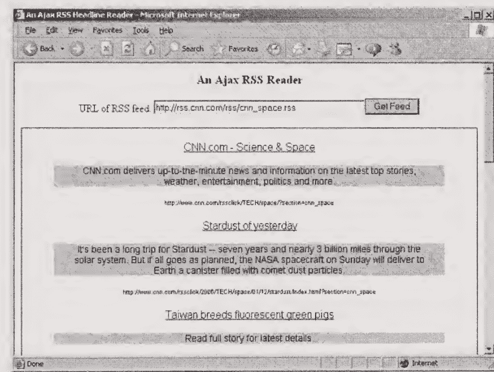

## 总结

JavaScript DOM 方法与 `XMLHttpRequest` 对象和 XML 数据结合使用时，提供了一种强大的手段，用于传输、组织，并以显示或其他方式处理具有复杂结构的数据。

在本课中，你了解了如何添加、删除和操作 DOM 元素，以根据在 `XMLHttpRequest` 对象的 `responseXML` 属性中接收到的 XML 数据来重构应用程序的 DOM。

### Web 服务与 REST 协议

在本课中，你将学习 Web 服务的基础知识，以及如何使用 REST（表述性状态转移）协议来实现它们。

#### Web 服务简介

到目前为止，你已经看到了几个示例应用程序，其中我们调用了服务器端脚本来执行任务。在每种情况下，我们都设计了数据结构来传输信息，并编写了处理与服务器双向数据传输的例程。

不过，假设你想让你的服务器端程序更广泛地可用。也许你能想象到，几个不同的 Web 应用程序可能为了各自的目的与这样的脚本进行接口交互。除了浏览器直接请求页面外，也许其他应用程序（例如通过 `XMLHttpRequest` 调用运行的 Ajax 应用程序）也可能发出数据请求，并期望收到它们能够理解和处理的响应数据。

在这种情况下，你的程序提供的接口采用某种形式的标准化将是有益的。这一原则提供了所谓的 *Web 服务* 的基础。

举个例子，假设我们的服务器应用程序生成 XML 格式的天气预报数据，以响应包含地理信息的请求。这类服务的性质使其具有广泛的适用性；这样的应用程序可能有各种各样的“客户端”，从在本地显示天气预报的简单网页，到需要该数据用于更严苛用途的复杂航空或旅行规划应用程序。

这类服务只是 Web 服务可能做的事情的一个小例子。互联网上有数千个 Web 服务在活跃运行，提供着令人难以置信的各种设施，包括用户认证、支付处理、内容联合、消息传递以及许多其他服务。

通常，Web 服务会提供一个应用程序编程接口（API），允许客户端应用程序构建与该服务的接口。虽然可以使用任何互联网协议来创建 Web 服务，但 XML 和 HTTP 是流行的选择。

已经出现了一些协议和技术来帮助你创建和利用 Web 服务。本课探讨其中最简单的一种，称为 *REST（表述性状态转移）*，而第 16 课“使用 SOAP 的 Web 服务”讨论了另一种协议，称为 *SOAP（简单对象访问协议）*。每节课都特别强调了它们如何在 Ajax 应用程序中发挥作用。

#### REST——表述性状态转移

REST 以两个主要原则为中心进行通用网络设计：

- 资源由 URL 表示——资源可以看作是一个“名词”，指的是我们希望在 Web 服务 API 中处理的某个实体；这可以是一个文档、一个人、一次会议、一个地点等等。REST 应用程序中的每个资源都有一个唯一的 URL。
- 操作通过标准 HTTP 方法执行——HTTP 方法（如 GET、POST、PUT 和 DELETE）用于对资源执行操作。通过这种方式，我们可以将这些操作视为作用于资源的“动词”。

#### 一个假设性的 REST 示例

为了理解我们如何以及为何应用这些想法，让我们看一个假设性的例子。

假设我们有一个 Web 服务，允许作者提交、编辑和阅读文章。将所谓的 RESTful 原则应用于此应用程序的设计，会产生以下情况：

- 每篇提交的文章都有一个唯一的 URL，例如：`http://somedomain.com/articles/173`。我们只要求 URL 对于每篇文章是唯一的；例如 `http://somedomain.com/articles/list.php?id=173` 也满足此要求。
- 要检索一篇文章以阅读或编辑，我们的客户端应用程序只需对相关文章的 URL 发出 HTTP GET 请求。
- 要上传新文章，将使用 POST 请求，其中包含有关文章的信息。服务器将以新上传文章的 URL 作为响应。
- 要上传已编辑的文章，将使用 PUT 请求，其中包含修订后的内容。
- HTTP DELETE 将用于删除特定的文章。

> **提示：** 尽管 REST 要求 URL 是唯一的，但这并不意味着每个资源都必须有一个对应的物理页面。在许多情况下，资源是在请求时由 Web 服务生成的——例如，通过引用数据库。

通过这种方式，Web 服务使用了一个任何使用过万维网的人都会熟悉的接口。我们不需要设计一个用于发送或检索信息的 API 方法库；我们已经拥有标准形式的 HTTP 方法。

> **注意：** 万维网本身就是一个 REST 应用程序。

#### 使用 GET 查询信息

关于在 RESTful 应用程序中使用 HTTP GET 请求的一个重要问题是，它永远不应改变服务器状态。换句话说：我们只使用 GET 请求来向服务器询问信息，绝不用于添加或更改服务器上已有的信息。


`POST`、`PUT` 和 `DELETE` 调用都可以以某种方式改变服务器状态。

### 无状态操作

RESTful 应用中的所有服务器通信都应该是无状态的。所谓无状态，是指调用本身必须包含服务器执行所需任务的全部信息，而不是依赖服务器当前存在的某种状态或上下文。例如，我们不能要求服务器参考之前请求发送的信息。

### 在实践中使用 REST

让我们扩展之前引用的文章网络服务示例。

#### 读取可用文章列表

可用文章列表是一个资源。因为该网络服务遵循 REST 原则，我们期望服务提供一个 URL 来访问此资源，例如：

`http://somedomain.com/articles/list.php`

因为我们是在查询信息，而非试图更改它，所以只需向上述 URL 发送一个 HTTP `GET` 请求。服务器可能返回如下 XML：

```xml
<articles>
  <article>
    <id>173</id>
    <title>New Concepts in Ajax</title>
    <author>P.D. Johnstone</author>
  </article>
  <article>
    <id>218</id>
    <title>More Ajax Ideas</title>
    <author>S.N. Braithwaite</author>
  </article>
  <article>
    <id>365</id>
    <title>Pushing the Ajax Envelope</title>
    <author>Z.R. Lawson</author>
  </article>
</articles>
```

#### 检索特定文章

因为这是另一个信息请求，我们同样需要提交一个 HTTP `GET` 请求。我们的网络服务可能允许我们向以下地址发出请求：

```text
http://somedomain.com/articles/list.php?id=218
```

并收到返回结果：

```xml
<article>
    <id>218</id>
    <title>More Ajax Ideas</title>
    <author>S.N. Braithwaite</author>
</article>
```

#### 上传新文章

在这种情况下，我们需要发送一个 `POST` 请求，而不是 `GET` 请求。在类似前面概述的假设场景中，服务器很可能会为新文章分配一个 `id` 值，而我们需要为 `title` 和 `author` 元素编码参数和值对：

```javascript
var articleTitle = 'Another Angle on Ajax';
var articleAuthor = 'K.B. Schmidt';
var url = '/articles/upload.php';
var poststring = "title="+encodeURI(articleTitle)
	+"&author="+encodeURI(articleAuthor);
http.onreadystatechange = callbackFunction();
http.open('POST', url, true);
http.setRequestHeader("Content-type",
	"application/x-www-form-urlencoded");
http.setRequestHeader("Content-length", poststring.length);
http.send(poststring);
```

#### 现实世界中的 REST——亚马逊 REST API

> 注意：Amazon.com 经常将 REST 协议称为 XML-over-HTTP 或 XML/HTTP。

领先的在线图书销售商 Amazon.com 提供了一套 REST 网络服务，以帮助开发者将亚马逊的浏览和购物功能集成到他们的 Web 应用中。

首先创建一个包含所需搜索参数（如出版商、排序顺序、作者等）的参数/值对的 URL，然后向此 URL 提交一个 `GET` 请求，就可以使亚马逊网络服务返回包含产品详情的 XML 文档。然后，我们可以解析该 XML 以创建 DOM 对象，用于在网页中显示，或根据应用程序的需要提供数据进行进一步处理。

> 提示：亚马逊要求你获取一个开发者令牌来为其网络服务开发客户端应用程序。你需要这个令牌来构造对亚马逊网络服务的 REST 请求。你还可以获取一个亚马逊联盟 ID，以便通过在你的网站上承载亚马逊服务来赚钱。详情请参见 `http://www.amazon.com`。

让我们通过开发一个返回书籍列表的 REST 请求来实际看看。可以进行多种类型的搜索，但在本例中，我们请求 Sams 出版的书籍列表。

我们从基础 URL 开始构建 `GET` 请求：

```php
$url = 'http://xml.amazon.com/onca/xml3';
```

然后需要添加一些参数/值对来完成请求：

```php
$assoc_id = "XXXXXXXXXX"; // your Amazon Associate's ID
$dev_token = "ZZZZZZZZZZ"; // Your Developer Token
$manuf = "Sams";
$url = "http://xml.amazon.com/onca/xml3";
$url .= "?t=".$assoc_id;
$url .= "&dev-t=".$dev_token;
$url .= "&ManufacturerSearch=".$manuf;
$url .= "&mode=books";
$url .= "&sort=+salesrank";
$url .= "&offer=All";
$url .= "&type=lite";
$url .= "&page=1";
$url .= "&f=xml";
```

提交此 URL，我们会收到一个包含所有匹配书籍详情的 XML 文件。我不会在这里重现整个文件（有超过 5,000 个标题！），但清单 15.1 显示了该 XML 文件的一个摘录，包括列表中的第一本书。

#### 清单 15.1 亚马逊网络服务返回的 XML 示例

```xml
<?xml version="1.0" encoding="UTF-8" ?>
 <ProductInfo xmlns:xsi="http://www.w3.org/2001/XMLSchema-instance"
 xsi:noNamespaceSchemaLocation
="http://xml.amazon.com/schemas3/dev-lite.xsd">
<Request>
    <Args>
        <Arg value="Mozilla/4.0 (compatible; MSIE 6.0; Windows NT 5.1; SV1; .NET CLR 1.1.4322)" name="UserAgent" />
        <Arg value="OG2CGCT7MRWB37PXAS4B" name="RequestID" />
        <Arg value="All" name="offer" />
        <Arg value="us" name="locale" />
        <Arg value="1" name="page" />
        <Arg value="ZZZZZZZZZZZ" name="dev-t" />
        <Arg value="XXXXXXXXXX" name="t" />
        <Arg value="xml" name="f" />
        <Arg value="books" name="mode" />
        <Arg value="Sams" name="ManufacturerSearch" />
        <Arg value="lite" name="type" />
        <Arg value="salesrank" name="sort" />
    </Args>
</Request>
<TotalResults>5051</TotalResults>
<TotalPages>506</TotalPages>
<Details url="http://www.amazon.com/exec/obidos/ASIN/0672327236/themousewhisp-20?dev-t=1WPTTG90FS816BXMNFG2%26camp=2025%26link_code=xm2">
    <Asin>0672327236</Asin>
    <ProductName>Sams Teach Yourself Microsoft SharePoint 2003 in 10 Minutes (Sams Teach Yourself in 10 Minutes)</ProductName>
    <Catalog>Book</Catalog>
    <Authors>
        <Author>Colin Spence</Author>
        <Author>Michael Noel</Author>
    </Authors>
    <ReleaseDate>06 December, 2004</ReleaseDate>
    <Manufacturer>Sams</Manufacturer>
    <ImageUrlSmall>http://images.amazon.com/images/P/0672327236.01.THUMBZZZ.jpg</ImageUrlSmall>
    <ImageUrlMedium>http://images.amazon.com/images/P/0672327236.01.MZZZZZZZ.jpg</ImageUrlMedium>
    <ImageUrlLarge>http://images.amazon.com/images/P/0672327236.01.LZZZZZZZ.jpg</ImageUrlLarge>
    <Availability>Usually ships in 24 hours</Availability>
    <ListPrice>$14.99</ListPrice>
    <OurPrice>$10.19</OurPrice>
    <UsedPrice>$9.35</UsedPrice>
</Details>
```

显然，我们现在可以以任何我们想要的方式处理这个 XML 文档。例如，第 14 课“将数据作为 XML 返回”讨论了如何使用 JavaScript DOM 方法从 XML 文档中选择信息，并将其放置到添加到我们文档 DOM 的页面元素中。

### REST 与 Ajax

你已经知道 `XMLHTTPRequest` 对象具有允许你直接处理 HTTP 请求类型和 URL 的方法。

因此，访问 RESTful 网络服务在很大程度上得到了简化。因为你知道网络服务 API 暴露的每个资源都有一个唯一的 URL，并且服务提供的方法是标准的 HTTP 方法，所以构造所需的 `XMLHTTPRequest` 调用就变得很简单了。

能够从 Ajax 应用程序内部访问各种各样的网络服务，并在这些应用程序中使用返回的信息，这种前景是很有吸引力的——如果你能使用一致且简单的接口协议，那就更有吸引力了。

## 总结

本课介绍了网络服务的概念以及 REST 协议的基本原理。

REST 要求所有资源通过唯一的 URL 访问，并且所有必需的操作都可以通过标准 HTTP 方法在这些资源上执行。这使得 RESTful 网络服务能够与 Ajax 应用程序良好地集成，因为 `XMLHTTPRequest` 对象具有直接引用 URL 和 HTTP 方法以创建服务器请求的方法。

第 16 课将讨论使用 SOAP 的不同风格的网络服务，以及它与 Ajax 开发的关系。

### 使用 SOAP 的 Web 服务

本课将学习如何使用 SOAP 协议的 Web 服务。

#### SOAP（简单对象访问协议）简介

在第 15 课“Web 服务与 REST 协议”中，我们讨论了 Web 服务，特别是看到了如何使用 REST（表述性状态转移）协议为此类服务提供一致的应用程序编程接口（API）。

REST 是一个很好的例子，它展示了为面向资源的服务设计的协议。这类服务提供了一种简单的机制来定位资源，以及一组可操纵该资源的基本方法。在面向资源的服务中，这些方法通常围绕创建、检索、修改和删除信息片段展开。

就 REST 而言，这些方法是指在 HTTP 规范中指定的方法——`GET`、`POST`、`PUT` 和 `DELETE`。

然而，在某些情况下，我们对 Web 服务能够执行的操作比对其能控制的资源更感兴趣。我们或许可以称此类服务为面向操作的服务。在这些情况下，资源本身可能有一定的重要性，但关键问题涉及服务所执行活动的细节。

或许最流行且广泛用于设计面向操作的 Web 服务的协议是 SOAP，即简单对象访问协议。

本课将探讨 SOAP，并在适当之处将其与第 15 课中讨论的 REST 协议进行比较和对照。

> **注意：** SOAP 规范的后期版本已弃用“简单对象访问协议”这个全名，因为人们认为项目的方向已经转变，该名称不再合适。该协议继续被称为 SOAP。

#### SOAP 协议的背景

SOAP 始于 1990 年代末，当时 XML 本身还是一项新兴的 Web 技术，并于 2000 年提交给 W3C。SOAP 和另一种基于 XML 的 Web 服务协议 XML-RPC 是一起发展起来的。

SOAP 本质上是设计为一种以标准化方式将远程过程调用（在远程机器上调用程序的请求）包装到 XML 信封中的方法。

众多企业参与了 SOAP 的早期开发，包括 IBM、Microsoft 和 Userland。SOAP 的开发后来移交给了 W3C 的 XML 协议工作组。

> 提示：您可以从 W3C 网站 `http://www.w3.org/2000/xp/Group/` 获取有关 SOAP 规范的最新信息。

#### SOAP 协议

SOAP 是一种基于 XML 的消息传递协议。SOAP 请求是一个 XML 文档，包含以下主要组成部分：

- 一个信封，用于将文档定义为 SOAP 请求。
- 一个正文元素，包含有关调用和预期响应的信息。
- 可选的头元素和错误元素，用于携带补充信息。

让我们看一个 SOAP 请求的框架：

```xml
<?xml version="1.0"?>
<SOAP-ENV:Envelope
xmlns:SOAP-ENV="http://schemas.xmlsoap.org/soap/envelope/"
SOAP-ENV:encodingStyle=
"http://schemas.xmlsoap.org/soap/encoding/">
<SOAP-ENV:Header>
... various commands ...
</SOAP-ENV:Header>
<SOAP-ENV:Body>
... various commands ...
<SOAP-ENV:Fault>
... various commands ...
</SOAP-ENV:Fault>
</SOAP-ENV:Body>
</SOAP-ENV:Envelope>
```

请注意，SOAP 请求是一个 XML 文件，其根元素是 Envelope 元素。

信封的第一行是：

```xml
<SOAP-ENV:Envelope xmlns:SOAP-ENV=
"http://schemas.xmlsoap.org/soap/envelope/"
SOAP-ENV:encodingStyle=
"http://schemas.xmlsoap.org/soap/encoding/">
```

> 提示：命名空间是一种标识符，用于唯一地对一组 XML 元素或属性进行分组，提供了一种限定其名称的方法，从而使其他模式中的名称不会与之冲突。

此行声明了 `xmlns:SOAP-ENV` 命名空间，其值必须始终为 `xmlns:SOAP-ENV="http://schemas.xmlsoap.org/soap/envelope/"`。

`encodingStyle` 属性包含定义消息中所用数据类型的信息。

接下来出现的是 Header 元素，它是可选的，但如果存在，则必须是消息中的第一个元素。在 Header 元素中定义的属性用于定义接收应用程序应如何处理该消息。

SOAP 消息的正文元素包含发送给最终接收者的消息。

序列化的方法参数包含在 SOAP 请求的正文元素中。调用的 XML 元素必须紧接在 SOAP 正文的开始 XML 标签之后，并且必须与被调用的远程方法同名。

正文还可能包含一个 Fault 元素（但不超过一个）。该元素在 SOAP 规范中定义，旨在携带有关可能发生的任何错误的信息。如果存在，它必须是正文元素的子元素。Fault 元素有多个子元素，包括 `faultcode`、`faultstring` 和 `detail`，它们包含故障条件的具体细节。

#### SOAP 请求的代码示例

让我们看看一个典型的 SOAP 请求可能是什么样子：

```xml
<?xml version="1.0"?>
<SOAP-ENV:Envelope xmlns:SOAP-ENV=
"http://schemas.xmlsoap.org/soap/envelope/"
SOAP-ENV:encodingStyle="http://schemas.xmlsoap.org/
soap/encoding/">
<SOAP-ENV:Body>
<m:GetInvoiceTotal xmlns:m=
"http://www.somedomain.com/invoices">
<m:Invoice>77293</m:Invoice>
</m:GetInvoiceTotal>
</SOAP-ENV:Body>
</SOAP-ENV:Envelope>
```

在前面的示例中，`m:GetInvoiceTotal` 和 `m:Invoice` 元素特定于该特定应用程序，并非 SOAP 本身的一部分。这些元素构成了包含在 SOAP 信封中的消息。


让我们看看来自 Web 服务的 SOAP 响应可能是什么样子：

```xml
<?xml version="1.0"?>
<SOAP-ENV:Envelope xmlns:SOAP-ENV=
    "http://schemas.xmlsoap.org/soap/envelope/" SOAP-ENV:encodingStyle="http://schemas.xmlsoap.org/
    soap/encoding/">
  <SOAP-ENV:Body>
    <m:ShowInvoiceTotal xmlns:m=
        "http://www.somedomain.com/invoices">
      <m:InvoiceTotal>3295.00</m:InvoiceTotal>
    </m:ShowInvoiceTotal>
  </SOAP-ENV:Body>
</SOAP-ENV:Envelope>
```

## 通过 HTTP 发送 SOAP 请求

SOAP 消息可以通过 HTTP GET 或 HTTP POST 传输。如果通过 HTTP POST 发送，SOAP 消息需要设置至少一个 HTTP 头；这定义了 Content-Type：

`Content-Type: text/xml`

成功的 SOAP 交换后，您将期望接收到前面带有适当 HTTP 头的 SOAP 响应：

```http
HTTP/1.1 200 OK
Content-Type: text/xml
Content-Length: yyy
<?xml version="1.0"?>
<SOAP-ENV:Envelope xmlns:SOAP-ENV=
    "http://schemas.xmlsoap.org/soap/envelope/" SOAP-ENV:encodingStyle="http://schemas.xmlsoap.org/soap/encod-
    ing/">
  <SOAP-ENV:Body>
    <m:ShowInvoiceTotal xmlns:m=
        "http://www.somedomain.com/invoices">
      <m:InvoiceTotal>3295.00</m:InvoiceTotal>
    </m:ShowInvoiceTotal>
  </SOAP-ENV:Body>
</SOAP-ENV:Envelope>
```

## 在 Ajax 中使用 SOAP

要在 Ajax 中使用 SOAP，您需要执行几个独立的步骤：

1. 创建 SOAP 信封。
2. 将特定于应用程序的信息序列化为 XML。
3. 创建包含序列化版本特定于应用程序代码的 SOAP 正文。
4. 通过`XMLHttpRequest`对象发送一个 HTTP 请求，其中包含作为有效负载的 SOAP 消息。

然后，回调函数需要负责解包 SOAP 响应并解析其中包含的 XML。

## 代码示例

生成的代码可能是什么样子？让我们看一个使用前一个示例中虚构的 SOAP Web 服务的示例：

```javascript
var invoiceno = '77293';
http.open("POST", "http://somedomain.com/invoices",true);
http.onreadystatechange=function() {
  if (http.readyState==4) {
    if(http.status==200) {
      alert('The server said: '+ http.responseText)
    }
  }
}
http.setRequestHeader("Content-Type", "text/xml")
var mySOAP = '<?xml version="1.0"?>'
  + '<SOAP-ENV:Envelope xmlns:SOAP-ENV='
    +'"http://schemas.xmlsoap.org/soap/envelope/"'
  + ' SOAP-ENV:encodingStyle='
    +'"http://schemas.xmlsoap.org/soap/encoding/">'
  + '<SOAP-ENV:Body>'
  + '<m:GetInvoiceTotal xmlns:m='
    +'"http://www.somedomain.com/invoices">'
  + '<m:Invoice>'+invoiceno+'</m:Invoice></m:GetInvoiceTotal>'
  + '</SOAP-ENV:Body></SOAP-ENV:Envelope>';
http.send(mySOAP);
```

在这里，我们将整个 SOAP 信封构造在一个 JavaScript 字符串变量中，然后将其传递给`XMLHttpRequest`对象的`send()`函数。

服务器返回的值需要先进行解析，以移除 SOAP 响应封装，然后从 SOAP 消息的主体部分恢复应用程序数据。

## 审视 SOAP 与 REST

在本课程和第 15 课的过程中，我们已经研究了使用 Web 服务的 REST 和 SOAP 方法。

尽管存在其他 Web 服务协议，但在过去几年中，开发者之间就 REST 与 SOAP 的优劣展开了一场激烈的争论。

我无意在本书中加入这场争论。相反，让我们总结一下这两种方法的异同：

- REST 利用标准的 HTTP 方法（`PUT`、`GET`、`POST`和`DELETE`）来创建功能相当的远程过程调用。使用 REST 协议的 Web 服务实现似乎特别适合基于资源的服务，其中最常用的方法通常涉及创建、编辑、检索和删除信息。不足之处在于，REST 需要对 HTTP 协议有更深入的了解。
- SOAP 协议增加了相当大的复杂性，因为必须序列化远程调用，然后构建一个 SOAP 信封来包含它。在解析数据之前，需要从返回数据的 SOAP 信封中“解包”数据，这带来了额外的工作。这些额外步骤也会影响性能，对于类似的任务，SOAP 的操作速度通常比 REST 稍慢。然而，SOAP 更彻底地将远程过程调用与其传输方式分离开来，并增加了许多额外的功能和设施，例如 Fault 元素和通过命名空间进行类型检查。

## 总结

在本课中，我们学习了 SOAP（简单对象访问协议）。SOAP 是一种流行的 Web 服务协议，其方法与第 15 课中使用的 REST 协议大不相同。

这两种风格的 Web 服务都可以通过`XMLHttpRequest`请求使用，尽管它们所涉及的代码复杂性有所不同。

## 用于 Ajax 的 JavaScript 库

在本课中，你将学习如何将目前为止所学的一些技术封装成一个小型 JavaScript 库，以便从你的应用程序中调用。

### 一个 Ajax 库

通过目前的课程和代码示例，我们已经开发了许多用于实现 Ajax 应用程序各部分的 JavaScript 代码技术。这些方法包括：

- 一种生成`XMLHTTPRequest`对象实例的方法，该方法适用于当前主流的各种浏览器。
- 用于通过`XMLHTTPRequest`对象构建和发送 GET 和 POST 请求的例程。
- 避免 GET 请求被不必要缓存的技术。
- 一种在执行你的指令之前检查`XMLHTTPRequest`调用是否正确完成的回调函数风格。
- 提供用户反馈的方法。
- 处理`responseText`中返回的文本数据的技术。
- 处理`responseXML`中返回的 XML 信息的技术。

此外，你在第 13 课“AHAH——异步 HTML 和 HTTP”中已经看到，其中一些方法可以被抽象成一个小型的 JavaScript“库”（在那种情况下仅包含两个函数）。

本课扩展了这一思想，构建了一个功能更完整的库，只需最少的额外代码，即可轻松地将 Ajax 功能添加到 HTML 页面中。

由于必要性，我们的 Ajax 库将不像后面描述的开源项目那样复杂或全面；然而，它足够完整，可用于构建功能性的 Ajax 应用程序。

### 回顾`myAHAHlib.js`

清单 17.1 展示了`myAHAHlib.js`的代码，它转载自第 13 课。

**清单 17.1 myAHAHlib.js**

```javascript
function callAHAH(url, pageElement, callMessage) {
    document.getElementById(pageElement).innerHTML = callMessage;
    try {
        req = new XMLHttpRequest(); /* e.g. Firefox */
    } catch(e) {
        try {
            req = new ActiveXObject("Msxml2.XMLHTTP");
            /* some versions IE */
        } catch (e) {
            try {
                req = new ActiveXObject("Microsoft.XMLHTTP");
                /* some versions IE */
            } catch (E) {
                req = false;
            }
        }
    }
    req.onreadystatechange = function() {responseAHAH(pageElement);};
    req.open("GET",url,true);
    req.send(null);
}

function responseAHAH(pageElement) {
    var output = '';
    if(req.readyState == 4) {
        if(req.status == 200) {
            output = req.responseText;
            document.getElementById(pageElement).innerHTML = output;
        }
    }
}
```

让我们思考一下如何扩展这个库的功能：

- 目前仅支持 HTTP GET 请求。能够至少支持 HTTP POST 请求将会很有用，特别是如果你打算使用 REST 协议（如第 15 课“Web 服务和 REST 协议”中所述）构建应用程序。
- 该库目前仅处理通过`responseText`返回的文本信息，没有处理`responseXML`的方法。

### 实现我们的库

确定了需要做的事情后，我们现在将构建一个更强大的 Ajax 库。

#### 创建`XMLHttpRequest`实例

让我们首先关注创建`XMLHttpRequest`对象实例的例程。

目前这个函数与构建和发送 HTTP GET 请求的例程紧密耦合。让我们将负责创建`XMLHttpRequest`实例的部分解耦，并将其放入一个独立的函数中：

```javascript
function createREQ() {
  try {
    req = new XMLHttpRequest(); /* e.g. Firefox */
  } catch(err1) {
    try {
      req = new ActiveXObject("Msxml2.XMLHTTP");
      /* some versions IE */
    } catch (err2) {
      try {
        req = new ActiveXObject("Microsoft.XMLHTTP");
        /* some versions IE */
      } catch (err3) {
        req = false;
      }
    }
  }
  return req;
}
```

我们现在只需调用以下函数即可创建`XMLHttpRequest`对象实例：

```javascript
var myreq = createREQ();
```

#### HTTP GET 和 POST 请求

我们从 GET 请求开始，因为我们已经支持这种请求类型：

```javascript
function requestGET(url, query, req) {
  myRand=parseInt(Math.random()*99999999);
  req.open("GET",url+'?'+query+'&rand='+myRand, true);
  req.send(null);
}
```

对于这个请求，我们必须传递两个参数：请求将被发送到的 URL 和`XMLHttpRequest`对象实例的标识。

我们可以省略 query 参数，因为在 GET 请求中，它被编码到 URL 中。我们在这里将这两个参数分开，是为了与 POST 请求的函数保持相似的接口。

query 参数在调用函数前必须进行适当的编码，不过用于破坏缓存的随机元素是由函数添加的。

接下来是 POST 函数：

```javascript
function requestPOST(url, query, req) {
  req.open("POST", url, true);
  req.setRequestHeader('Content-Type',
    'application/x-www-form-urlencoded');
  req.send(query);
}
```

#### 回调函数

我们如何处理回调函数？我们将添加一个额外的函数：

```javascript
function doCallback(callback,item) {
    eval(callback + '(item)');
}
```

这个函数使用 JavaScript 的`eval()`函数来执行另一个函数，该函数的名称作为参数传递给它，同时通过 item 向该函数传递它自己的一个参数。

让我们看看这些函数在从事件处理程序中调用时是如何交互的：

```javascript
function doAjax(url,query,callback,reqtype,getxml) {
    // 创建 XMLHttpRequest 对象实例
    var myreq = createREQ();
    myreq.onreadystatechange = function() {
        if(myreq.readyState == 4) {
            if(myreq.status == 200) {
                var item = myreq.responseText;
                if(getxml==1) {
                    item = myreq.responseXML;
                }
                doCallback(callback, item);
            }
        }
    }
    if(reqtype=='post') {
        requestPOST(url,query,myreq);
    } else {
        requestGET(url,query,myreq);
    }
}
```

我们的函数`doAjax`现在接受五个参数：

- `url`—Ajax 调用的目标 URL
- `query`—编码后的查询字符串
- `callback`—回调函数的标识
- `reqtype`—`'post'`或`'get'`
- `getxml`—`1`表示获取 XML 数据，`0`表示获取文本

清单 17.2 展示了完整的 JavaScript 源代码。

## 17：用于 Ajax 的 JavaScript 库

### 清单 17.2 Ajax 库`myAJAXlib.js`


```javascript
function createREQ() {
  try {
    req = new XMLHttpRequest(); /* e.g. Firefox */
  } catch (err1) {
    try {
      req = new ActiveXObject("Msxml2.XMLHTTP");
      /* some versions IE */
    } catch (err2) {
      try {
        req = new ActiveXObject("Microsoft.XMLHTTP");
        /* some versions IE */
      } catch (err3) {
        req = false;
      }
    }
  }
  return req;
}

function requestGET(url, query, req) {
  myRand = parseInt(Math.random() * 99999999);
  req.open("GET", url + '?' + query + '&rand=' + myRand, true);
  req.send(null);
}

function requestPOST(url, query, req) {
  req.open("POST", url, true);
  req.setRequestHeader('Content-Type', 'application/x-www-form-urlencoded');
  req.send(query);
}

function doCallback(callback, item) {
  eval(callback + '(item)');
}

function doAjax(url, query, callback, reqtype, getxml) {
  // create the XMLHttpRequest object instance
  var myreq = createREQ();

  myreq.onreadystatechange = function() {
    if (myreq.readyState == 4) {
      if (myreq.status == 200) {
        var item = myreq.responseText;
        if (getxml == 1) {
          item = myreq.responseXML;
        }
        doCallback(callback, item);
      }
    }

    if (reqtype == 'post') {
      requestPOST(url, query, myreq);
    } else {
      requestGET(url, query, myreq);
    }
  }
}
```

## 使用该库

为了演示该库的使用，我们将从另一个简单的 HTML 页面开始，其代码如下所示：

```html
<html>
<head>
</head>
<body>
<form name="form1">
<input type="button" value="test">
</form>
</body>
</html>
```

这个简单的页面只显示一个标有 "Test" 的按钮。表单上的所有功能都将使用我们的新 Ajax 库在 JavaScript 中创建。

将应用程序 "Ajaxify" 所需的步骤是：

1. 在页面的 `<head>` 区域包含 Ajax 库 `myAJAXlib.js`。

2. 编写一个回调函数来处理返回的信息。

3. 为页面添加一个事件处理程序以调用服务器调用。

我们将从演示 GET 请求并使用 `responseText` 属性中返回的信息开始。这类似于我们在第 13 课处理 AHAH 时遇到的情况。

包含 Ajax 库很简单：

```html
<head>
<script Language="JavaScript" src="myAJAXlib.js"></script>
```

接下来，我们需要定义回调函数来处理存储在 `responseText` 属性中的值。对于这些示例，我们只是简单地在警报中显示返回的文本：

```html
<head>
<script Language="JavaScript" src="myAJAXlib.js"></script>
<script Language="JavaScript">
function cback(text) {
  alert(text);
}
</script>
```

最后，我们需要为按钮添加事件处理程序调用：

```html
onClick="doAjax('libtest.php','param=hello',
 'cback','get','0')"
```

我们的服务器端脚本 `libtest.php` 简单地回显作为第二个参数发送的参数：

```php
<?php
echo "Parameter value was " . $param;
?>
```

同时，函数调用的其余参数声明回调函数名为 `cback`，我们想发送一个 HTTP GET 请求，并且我们期望返回的数据在 `responseText` 中。清单 17.3 显示了我们修改后的 HTML 页面的完整代码。

### 清单 17.3 重写为调用 `myAJAXlib.js` 的 HTML 页面

```html
<html>
<head>
<script Language="JavaScript" src="myAJAXlib.js">
</script>
<script Language="JavaScript">
function cback(text) {
  alert(text);
}
</script>
</head>
<body>
<form name="form1">
<input type="button" value="test" onClick=
 "doAjax('libtest.php','param=hello',
 'cback','get','0')">
</form>
</body>
</html>
```

图 17.1 显示了运行该程序的结果。


**图 17.1** HTTP GET 请求后返回文本。

要使用相同的库来检索 XML 数据，我们将再次使用第 11 课“我们的第一个 Ajax 应用程序”中的服务器端脚本，您可能还记得，它在一个小 XML 文档中提供当前服务器时间：

```php
<?php
header('Content-Type: text/xml');
echo "<?xml version=\"1.0\" ?><clock1><timenow>"
  . date('H:i:s') . "</timenow></clock1>";
?>
```

我们的回调函数必须修改，因为我们现在需要返回解析后的 XML。我们将使用一些现在应该熟悉的 DOM 方法：

```javascript
<script>
function cback(text) {
  var servertime = text.getElementsByTagName("timenow")[0]
    .childNodes[0].nodeValue;
  alert('Server time is ' + servertime);
}
</script>
```

我们需要改变的唯一其他事情是对 `doAjax()` 函数的调用：

```html
onClick="doAjax('telltimeXML.php','','cback','post','1')"
```

在这里，我们决定发出 POST 请求。我们的服务器端脚本 `telltimeXML.php` 不需要查询字符串，因此在这种情况下，第二个参数留空。最后一个参数已设置为 ‘1’，表示我们期望服务器在 `responseXML` 属性中以 XML 格式响应。

图 17.2 显示了运行该程序的结果。

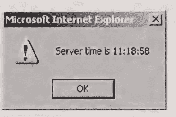

**图 17.2** 通过 POST 请求以 XML 格式返回服务器时间。

## 扩展该库

当前的库可以通过多种方式进行改进。这将留作读者的练习，尽管在许多情况下，书中的其他地方已经涵盖了这些技术。

例如，用户反馈尚未处理；我们之前讨论过如何通过显示适当的文本或图形图像来提醒用户当前正在处理请求。修订该库以包含第 11 课和其他地方讨论的技术将是有用的。

错误处理也被排除在代码之外，将其作为有用的补充将证明是有益的。例如，修改库以检测除 200 之外的 `XMLHttpRequest` 状态属性并向用户输出适当的错误消息应该不会太困难。

请随意尝试代码，看看您能实现什么。

## 总结

本课结合了迄今为止讨论的许多技术，生成了一个紧凑且可重用的 JavaScript 库，可以从 HTML 页面简单调用。

该库的代码支持 HTTP GET 和 HTTP POST 请求，并且可以处理服务器返回的文本或 XML 数据。

使用这样的库可以允许在网页中引入 Ajax，只需对 HTML 标记进行相对较小的添加。这不仅使代码保持整洁且易于阅读，而且简化了向旧版 HTML 添加 Ajax 功能以进行升级的过程。

在第 18 课“Ajax ‘陷阱’”中，也就是第三部分的最后一课，我们将讨论在开发 Ajax 应用程序时等待程序员的一些潜在问题和陷阱。


## Ajax “陷阱”

在本课中，您将了解一些常见的 Ajax 错误以及如何避免它们。

### 常见的 Ajax 错误

Ajax 有一些常见的陷阱，等待着那些粗心的开发者。在本课中，也就是第三部分的最后一课，我们将回顾其中的一些陷阱，并讨论寻找解决方案的可能方法。

这个列表并非详尽无遗，提供的解决方案也不一定适合所有场合。然而，它们应该能提供一些值得思考的东西。

### 后退按钮

所有常用浏览器的导航栏上都有一个后退按钮。浏览器在内存中维护一个最近访问页面的列表，并允许您逐步后退以重新访问最近看过的页面。

用户已经习惯了后退按钮，将其视为网络冲浪体验的标准部分，就像他们习惯了页面范式网络的其他方面一样。

正如您所了解的，Ajax 在很大程度上摆脱了将网络信息以独立的、页面大小的块来交付的想法；使用 Ajax 应用程序，您可以一次又一次地更改页面内容，而无需考虑用全新的页面重新加载浏览器显示。

提示：JavaScript 语言本身就有自己的等效后退按钮。语句 `onClick = "history.back()"` 和 `onClick = "history.go(-1)"` 都模拟了单击一次后退按钮的操作。

那么后退按钮呢？

这个问题最近在开发者中引起了相当大的争论。似乎主要有两种思想流派：

- 创建一种以编程方式记录状态的方法，并在按下后退按钮时使用它来重新创建先前的状态。
- 说服用户后退按钮不再必要。

人为地重新创建以前的状态确实是可能的，但这给 Ajax 代码增加了很大的复杂性，因此在某种程度上属于更勇敢的程序员的领域！

尽管后一种选择听起来有点像是在回避问题，但它确实可能有一些优点。如果您使用 Ajax 来重新创建类似桌面的用户界面，值得注意的是，桌面应用程序通常没有——也不需要——后退按钮，因为用户脑海中从未出现过独立的“页面”概念！

### 书签和链接

这个问题与后退按钮问题不无关系。

当您为页面添加书签时，您实际上是在尝试保存某个内容的快捷方式。在基于页面的比喻中，这是无可厚非的；尽管页面可以具有一定程度的动态内容，但能够随后找到页面本身通常足以让我们看到上次访问时看到的内容。

然而，Ajax 可以对整个应用程序使用相同的页面地址，并根据用户的操作从服务器返回大量的动态内容。

### 书签页面与分享链接

当你想要为特定的信息页面添加书签，或将该链接分享给朋友或同事时，会发生什么？仅仅使用当前页面的 URL 不太可能达到你期望的效果。

虽然彻底解决这个问题可能很困难，但通过为应用程序中特别选择的状态提供永久链接，或许能有所缓解。

### 告知用户正在发生什么

这是另一个与界面风格从独立页面转变相关的问题。

已经熟悉网页浏览的用户可能已习惯程序活动与加载新页面或更新页面同步进行。

因此，许多 Ajax 应用程序会提供一些一致的视觉提示来表明活动正在进行；例如，一个静态图像可能会被替换为动画版本，光标样式可能会改变，或者会出现弹出消息。其中一些技术已在本书的一些课程中提到过。

### 让 Ajax 优雅降级

本书的课程涵盖了使用各种现代浏览器开发 Ajax 应用程序。不过，用户仍有可能让你感到意外，尝试使用一个过于老旧、不支持必要技术的浏览器来运行你的应用程序。或者，访问者的浏览器可能禁用了 JavaScript 和/或 ActiveX（出于安全或其他原因）。

如果 Ajax 应用程序在这些情况下崩溃，那就太不幸了。

至少，应该将明显错误的发生（例如无法创建 `XMLHttpRequest` 对象的实例）报告给用户。如果 Ajax 应用程序过于复杂，无法自动回退到非 Ajax 运行模式，那么或许至少可以将用户重定向到应用程序的非 Ajax 版本。

### 处理搜索引擎蜘蛛

搜索引擎通过多种方式收集网站信息，其中一个重要的方式是使用称为*蜘蛛*的自动化程序。

顾名思义，蜘蛛通过阅读网页并跟踪链接来“爬取网络”，构建关于特定网站的内容和其他相关信息的数据库。这个数据库，通常被称为*索引*，由搜索引擎访客使用他们的关键词和短语进行查询，并返回相关页面的建议供其访问。

这可能会给高度动态的网站带来问题，这类网站依赖用户交互（而非被动浏览）来调用按需从服务器加载的新内容。访问的蜘蛛可能无法获取通过动态方式加载的内容，因此永远无法将其编入索引。

Ajax 的使用可能会进一步加剧这个问题，因为它倾向于在更少的页面中提供更多的内容。

确保蜘蛛能够在网站上的某个地方索引所有相关内容的静态版本似乎是明智的。因为蜘蛛会跟踪嵌入页面中的链接，所以提供一个带有超链接的站点地图在这方面会是一个有用的补充。

### 指出活动的页面元素

如果没有精心设计，用户可能不清楚页面上的哪些项目可以点击或以其他方式交互以触发某些操作。

值得尝试在整个应用程序中使用一致的样式来显示哪些页面元素会引发服务器请求或其他动态活动。这有点让人想起 HTML 页面中超链接通常与纯文本样式不同的方式，这样用户就能清楚地知道它们执行附加功能。

以多编写一些代码为代价，可以将关于活动元素的说明和信息整合到工具提示风格的弹出窗口中。当然，当点击活动链接可能对应用程序状态产生重大影响时，这一点尤其重要。图 18.1 显示了这样一个弹出信息框的例子。

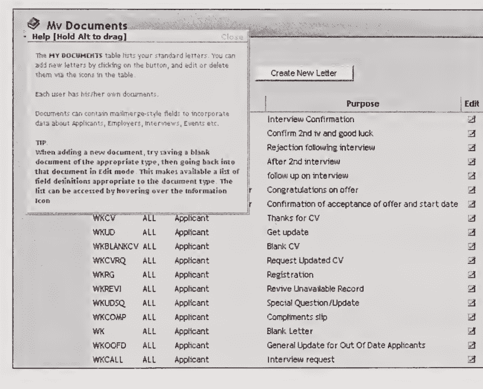

**图 18.1** 弹出信息帮助用户理解界面。

### 不要在不合适的地方使用 Ajax

尽管 Ajax 无疑在改善 Web 界面方面很有吸引力，但你需要接受这样一个事实：在许多情况下，使用 Ajax 会减损用户体验，而不是增强它。

当基于页面的界面隐喻对于网站的内容和风格完全足够，甚至可能更相关时，尤其如此。主题被方便地划分为章节式页面的文本网站，通常从智能设计的超链接中获得的好处，与从添加 Ajax 功能中获得的好处一样多。

特别是小型网站，可能难以从 Ajax 界面中获得足够的益处来平衡相关的额外代码和增加的复杂性的成本。

### 安全性

Ajax 本身似乎并没有带来任何在设计 Web 应用程序时不存在的安全问题。然而，值得注意的是，经过 Ajax 增强的应用程序往往比之前包含更多的客户端代码。

由于客户端代码的内容很容易被任何应用程序用户查看，因此确保其中不包含敏感信息非常重要。在此上下文中，敏感信息不仅限于用户名和密码之类的东西（尽管它们当然是敏感的），还包括业务逻辑。让服务器端脚本负责处理诸如数据库连接等问题。在将数据应用于任何重要处理之前，在服务器上验证数据。

### 跨多个平台测试代码

从本书的内容可以清楚地看到，各种浏览器在实现 JavaScript 方面表现不同。微软和非微软浏览器在生成 `XMLHttpRequest` 对象实例方面的主要差异是一个根本性的例子，但也存在许多细微的差异。

特别是在 DOM 处理方面，不同浏览器之间，甚至同一浏览器的不同版本之间，都存在相当大的差异。CSS 实现是另一个仍然存在许多细微差异的领域。

尽管在各种浏览器上测试新应用程序一直很重要，但在面对 Ajax 应用程序的额外复杂性时，这可能比以往任何时候都更加重要。

希望浏览器会继续变得更加符合标准，但在此之前，请尽可能在尽可能多的不同平台和不同的浏览器上测试应用程序。

### Ajax 无法修复糟糕的设计

世界上所有的动态交互性都无法纠正一个设计上存在根本缺陷的 Web 应用程序。

所有良好 Web 设计的原则仍然适用于 Ajax 应用程序：

- 为多种浏览器编写并验证你的代码。
- 为你的代码添加良好的注释和文档，以便日后调试。
- 尽可能使用小的图形，以便快速加载。
- 确保你选择的颜色、背景、字体大小和样式不会使页面难以阅读。

> 提示：W3C 在 `http://validator.w3.org/` 提供免费的在线验证器。

### 一些编程陷阱

其中一些在各种课程中已经有所暗示，但值得在这里将它们归类。这些可能是 Ajax 开发者在某个时候都会遇到的最常见编程问题！

#### 浏览器对 GET 请求的缓存

向同一个 URL 发出重复的 GET 请求通常会导致响应不是来自服务器，而是来自浏览器缓存。当使用 Internet Explorer 时，这个问题似乎尤为明显。

尽管理论上可以通过使用合适的 HTTP 头来解决这个问题，但实际上缓存可能很顽固。

绕过这个问题的一个有效方法是向请求发送的 URL 添加一个随机元素；浏览器将其解释为对不同页面的请求，并返回一个服务器页面，而不是缓存的版本。


在正文中，我们通过添加一个随机数来实现这一点。许多人喜欢的另一种方法是添加一个基于时间的数字，这当然每次都会不同：

```javascript
var url = "serverscript.php" + "?rand=" + new Date().getTime();
```

### Ajax 的“常见陷阱”

#### 权限拒绝错误

收到权限拒绝错误通常意味着你违反了安全措施，该措施用于阻止 `XMLHttpRequest` 对象发出跨域请求。

调用必须针对与调用脚本处于同一域的服务器程序。

> **注意：** 务必确保域名书写方式完全一致。`Somedomain.com` 可能会被解析为与 `www.somedomain.com` 不同的域，从而导致权限被拒绝。

#### 内容转义

在构建 `GET` 或 `POST` 请求的查询字符串时，请记住对可能包含空格或其他非文本字符的变量进行转义。在以下代码中，`idValue` 的值是从表单的文本输入字段中收集的，因此我们对其进行转义以确保正确的编码：

```javascript
http.open("GET", url + escape(idValue) + "&rand=" + myRandom, true);
```

## 总结

Ajax 无疑具有极大提升 Web 界面的潜力。然而，从传统的基于页面的界面到高度动态的应用程序的范式转变，也为开发者设置了一些需要跨越的障碍。在本课中，我们尝试总结了其中一些较为人知的陷阱。

其中一些问题已经在其他课程中遇到过，而另一些可能要到你开始开发实际应用时才会显现。

本课结束了第三部分，“更复杂的 Ajax 技术”。如果你一直跟学至此，你现在应该已经很好地掌握了 `XMLHttpRequest` 对象、JavaScript、XML 和文档对象模型（Document Object Model）的基础知识，并能够从零开始创建有用的 Ajax 应用程序。

幸运的是，你不必总是从零开始。互联网上有许多开源和商业项目提供了各种各样的 Ajax 框架、工具和资源。

第四部分，“商业和开源 Ajax 资源”，通过审视其中一些资源及其能力，来结束我们对 Ajax 开发的探索之旅。

### `prototype.js` 工具包

在本课中，你将了解 `prototype.js` JavaScript 库以及它如何减少构建功能强大的 Ajax 应用程序所需的工作量。

#### 介绍 `prototype.js`

第四部分，“商业和开源 Ajax 资源”，探讨了可用于 Ajax 开发的一些代码库和框架。

本课我们从 Sam Stephenson 的 `prototype.js` 开始，这是一个流行的 JavaScript 库，包含一系列在开发跨浏览器 JavaScript 例程时非常有用的函数，并特别支持 Ajax。你将看到如何使用该库对 DOM 操作、HTML 表单和 `XMLHttpRequest` 对象的强大支持来简化你的 JavaScript 代码。

`prototype.js` 库的最新版本可以从 `http://prototype.conio.net/` 下载。

在你的 Web 应用程序中包含该库很简单，只需在 HTML 文档的 `<head>` 部分添加以下行：

```html
<script src="prototype.js" Language="JavaScript" type="text/javascript"></script>
```

`prototype.js` 包含广泛的函数，可以加快编写 JavaScript 代码的速度，并使生成的脚本更简洁、更易于维护。

该库包括提供常用编程任务快捷方式的通用函数、HTML 表单的包装器、用于封装 `XMLHttpRequest` 对象的对象、用于简化 DOM 任务的方法和对象等等。

让我们来看看其中一些工具。

> **关于 CD：** Prototype 1.5.1 版本包含在 Ajax Starter Kit CD 中。如果你下载了不同的版本，请查看文档以了解你的版本与本文描述的版本是否存在差异。

#### `$()` 函数

`$()` 本质上是 `getElementById()` DOM 方法的快捷方式。通常，要返回特定元素的值，你会使用类似这样的表达式：

```javascript
var mydata = document.getElementById('someElementID');
```

`$()` 函数通过返回其 ID 作为参数传递给它的元素的值来简化此任务：

```javascript
var mydata = $('someElementID');
```

此外，`$()`（与 `getElementById()` 不同）可以接受多个元素 ID 作为参数，并返回关联元素值的数组。考虑这行代码：

```javascript
mydataArray = $('id1', 'id2', 'id3');
```

在此示例中：

- `mydataArray[0]` 包含 ID 为 `id1` 的元素的值。
- `mydataArray[1]` 包含 ID 为 `id2` 的元素的值。
- `mydataArray[2]` 包含 ID 为 `id3` 的元素的值。

#### `$F()` 函数

`$F()` 函数在将输入元素或其 ID 作为参数传递给它时，返回表单输入字段的值。看以下 HTML 代码片段：

```html
<input type="text" id="input1" name="input1">
<select id="input2" name="input2">
<option value="0">Option A</option>
<option value="1">Option B</option>
<option value="2">Option C</option>
</select>
```

在这里，我们可以使用 `$F('input1')` 来返回文本框中的值，使用 `$F('input2')` 来返回选择框当前选中选项的值。`$F()` 函数在复选框和文本区域输入元素上同样适用，无论输入元素类型如何，都能轻松返回元素值。

#### `Form` 对象

`prototype.js` 定义了一个 `Form` 对象，它拥有多种简化 HTML 表单操作的有用方法。

你可以通过调用 `getElements()` 方法返回表单输入字段的数组：

`inputs = Form.getElements('thisform');`

`serialize()` 方法允许将输入名称和值格式化为与 URL 兼容的列表：

`inputlist = Form.serialize('thisform');`

使用上述代码行，变量 `inputlist` 现在将包含一个序列化的参数和值对的字符串：

`field1=value1&field2=value2&field3=value3...`

`Form.disable('thisform')` 和 `Form.enable('thisform')` 的作用正如其名称所示。

#### `Try.these()` 函数

前面的课程讨论了使用异常来使你能够捕获运行时错误并干净地处理它们。`Try.these()` 函数提供了一种便捷的方式来封装这些方法，从而在 JavaScript 实现细节不同的地方提供跨浏览器的解决方案：

`return Try.these(function1(), function2(), function3(), ...);`

函数按顺序处理，当错误条件导致抛出异常时，操作会移动到下一个函数。当任何函数成功完成时，操作停止，此时函数返回 `true`。

将此函数应用于创建 `XMLHttpRequest` 实例展示了生成代码的简洁性：

```javascript
return Try.these(
    function() {return new ActiveXObject('Msxml2.XMLHTTP')},
    function() {return new ActiveXObject('Microsoft.XMLHTTP')},
    function() {return new XMLHttpRequest()}
)
```

> **注意：** 你可能希望将此代码片段与清单 8.1 进行比较，以了解代码复杂性减少了多少以及可读性提高了多少。

#### 封装 `XMLHttpRequest`——Ajax 对象

`prototype.js` 定义了一个 `Ajax` 对象，旨在简化你在构建 Ajax 应用程序时 JavaScript 代码的开发。该对象具有多个类，封装了发送服务器请求、监控其进度以及处理返回数据所需的代码。

#### `Ajax.Request`

`Ajax.Request` 处理创建 `XMLHttpRequest` 对象实例并发送正确格式化请求的细节。调用它很简单：

```javascript
var myAjax = new Ajax.Request(url, {
    method: 'post',
    parameters: mydata,
    onComplete: responsefunction
});
```

在此调用中，`url` 定义了要调用的服务器资源的位置，`method` 可以是 `post` 或 `get`，`mydata` 是包含请求参数的序列化字符串，`responsefunction` 是处理服务器响应的回调函数的名称。

`onComplete` 参数是几个选项之一，对应于 `XMLHttpRequest` `readyState` 属性的可能值，在此情况下是 `readyState` 值为 4（完成）。你也可以通过使用关联参数 `onLoading`、`onLoaded` 或 `onInteractive`，指定回调函数在之前的阶段（加载中、已加载或交互）执行。

还有其他几个可选参数，包括：

```javascript
asynchronous: false
```

用于指示应同步发出服务器调用。`asynchronous` 选项的默认值为 `true`。

> **提示：** 第二个参数是使用一种通常称为 JSON（JavaScript Object Notation）的表示法构建的。该参数由一系列 `参数: 值` 对构建而成，整个包含在花括号内。参数值本身可以是 JSON 对象、数组或简单值。JSON 作为一种数据交换协议因其易于构建、易于解析和语言无关性而广受欢迎。你可以在 `http://www.json.org` 上了解更多相关信息。

## `Ajax.Updater`

当你需要使用返回的数据来更新页面元素时，`Ajax.Updater` 类可以简化这个任务。你只需要指定哪个元素应该被更新：

```javascript
var myAjax = new Ajax.Updater(elementID, url, options);
```

这个调用与 `Ajax.Request` 有些相似，但增加了一个目标元素的 ID 作为第一个参数。以下是 `Ajax.Updater` 的一个代码示例：

```html
<script>
  function updateDIV(mydiv)
  {
    var url = 'http://example.com/serverscript.php';
    var params = 'param1=value1&param2=value2';
    var myAjax = new Ajax.Updater
    (
      mydiv,
      url,
      {method: 'get', parameters: params}
    );
  }
</script>
<input type="button" value="Go" onclick="updateDIV(targetDiv)">
<div id="targetDiv"></div>
```

在调用时，同样可以使用几个额外的选项。一个值得注意的是在选项列表中添加 `evalscripts:true`。添加此选项后，服务器返回的任何 JavaScript 代码都将被执行。

## `Ajax.PeriodicalUpdater`

`Ajax.PeriodicalUpdater` 类可用于反复创建一个 `Ajax.Updater` 实例。这样，你可以在经过一定的时间间隔后更新页面元素。这对于诸如股票行情显示或 RSS 阅读器等应用程序非常有用，因为它确保访问者始终查看到相当及时的信息。

`Ajax.PeriodicalUpdater` 为 `Ajax.Updater` 选项添加了两个额外的参数：

- `frequency`——连续更新之间的延迟，单位为秒。默认值是两秒。
- `decay`——如果服务器返回未更改的数据，则用于增加连续延迟的乘数。默认值为 1，即保持延迟恒定。

下面是调用 `Ajax.PeriodicalUpdater` 的一个示例：

```javascript
var myAjax = new Ajax.PeriodicalUpdater(elementID, url,
    {frequency: 3.0, decay: 2.0});
```

这里我们选择将初始延迟设置为 3 秒，并且每次服务器返回未更改的数据时，该延迟长度翻倍。

## 示例项目——股票价格读取器

让我们使用 `prototype.js` 库来构建一个简单的读取器，它定期更新以显示服务器返回的最新值。在这个例子中，我们将使用一个简单的服务器端脚本 `rand.php` 来模拟变化的股票价格：

```php
<?php
srand ((double) microtime( )*1000000);
$price = 50 + rand(0,5000)/100;
echo "$price";
?>
```

这个脚本首先通过调用 `srand()` 函数并传递一个从当前时间派生的参数来初始化 PHP 的随机数例程。然后使用 `rand(0,5000)` 函数生成一个随机数，通过算术运算处理后产生在 50.00 到 100.00 范围内的虚假“股票价格”。

现在，让我们构建一个简单的 HTML 页面来显示当前的股票价格。这个页面构成了我们 Ajax 应用程序的基础：

```html
<!DOCTYPE HTML PUBLIC "-//W3C//DTD HTML 4.01 Transitional//EN"
    "http://www.w3.org/TR/html4/loose.dtd">
<html>
<head>
<script src="prototype.js" Language="JavaScript"
    type="text/javascript"></script>
<title>Stock Reader powered by Prototype.js</title>
</head>
<body>
<h2>Stock Reader</h2>
<h4>Powered by Prototype.js</h4>
<p>Current Stock Price:</p>
<div id="price"></div>
</body>
</html>
```

请注意，我们通过文档头中的 `<script>` 标签包含了 `prototype.js` 库。我们还定义了一个 `id` 设置为 `"price"` 的 `<div>`，它将用于显示当前的股票价格。

我们现在需要实现 `Ajax.PeriodicalUpdater` 类，我们将其附加到文档 body 元素的 `onLoad` 事件处理程序上。清单 19.1 展示了完整的脚本。

## 清单 19.1 使用 `prototype.js` 的 Ajax 股票价格读取器

```html
<!DOCTYPE HTML PUBLIC "-//W3C//DTD HTML 4.01 Transitional//EN"
"http://www.w3.org/TR/html4/loose.dtd">
<html>
<head>
<script src="prototype.js" Language="JavaScript"
type="text/javascript"></script>
<script>
function checkprice()
{
var myAjax = new Ajax.PeriodicalUpdater('price',
'rand.php', {method: 'post', frequency: 3.0,
decay: 1});
}
</script>
<title>Stock Reader powered by Prototype.js</title>
</head>
<body onLoad="checkprice()">
<h2>Stock Reader</h2>
<h4>Powered by Prototype.js</h4>
<p>Current Stock Price:</p>
<div id="price"></div>
</body>
</html>
```

看看通过使用 `prototype.js`，应用程序的代码变得多么简单。实现这个应用程序仅仅是定义一个一行的函数 `checkprice()` 来实例化我们重复的 Ajax 调用，并从 body 元素的 `onLoad` 事件处理程序调用该函数。

从传递给 `Ajax.PeriodicalUpdater` 的参数中，你可以看到指定了 3 秒的重复间隔。由于 `decay` 值被设置为 1，这个周期不会随后续调用而改变。

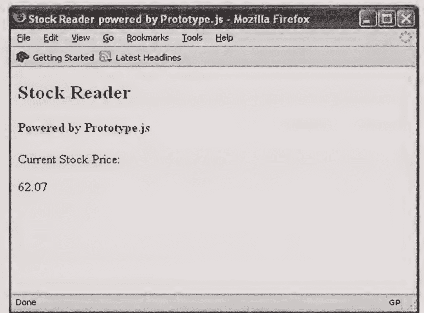

图 19.1 Ajax 股票读取器。

这个简单的例子远未展示出 `prototype.js` 库的强大功能和多功能性。相反，它旨在通过提供一个易于访问这个优秀资源的起点，让你开始自己的实验。

## 总结

在第四部分的这第一课中，我们讨论了功能强大且优雅的 `prototype.js` JavaScript 库的使用。

该库提供的功能大大简化了在开发 Ajax 应用程序时一些更棘手的编程任务。

该库为 `XMLHttpRequest` 对象提供了良好的支持，同时还提供了节省时间的快捷方式，用于 DOM 处理、HTML 表单以及与 Ajax 开发相关的许多其他技术。


## 使用 Rico

*在本课中，你将学习使用 Rico 的基础知识，这是一个强大的 Ajax 和用户界面开发框架。*

### 介绍 Rico

在第 19 课“The `prototype.js` 工具包”中，我们学习了 `prototype.js`，一个功能强大且实用的 JavaScript 库，它简化了 Ajax 开发者面临的许多编程任务。


在本课中，我们将探讨如何使用 Rico，一个复杂的 Ajax 框架，它使用了 `prototype.js` 库。

Rico 是一个开源库，它扩展了 `prototype.js` 的功能，提供了一套丰富的界面开发工具。除了目前讨论的 Ajax 开发技术外，Rico 还提供了一系列工具，例如拖放、动态效果等。

> **提示：** Rico 是西班牙语中“丰富”的意思，这似乎非常适合一个旨在构建丰富用户界面的工具包！

## 在应用程序中使用 Rico

要开始使用 Rico 构建具有丰富用户界面的应用程序，你需要在网页的 `<head>...</head>` 部分包含 Rico 和 `prototype.js` 库。

```html
<script src="scripts/prototype.js"></script>
<script src="scripts/rico.js"></script>
```

## Rico 的 AjaxEngine

包含 `rico.js` 会导致一个名为 `ajaxEngine` 的 `AjaxEngine` 对象实例自动创建，随时可供你使用。`AjaxEngine` 是 Rico 为你的网页添加 Ajax 功能的机制。

`AjaxEngine` 需要一个三步过程来通过 Ajax 更新页面元素：

1. 注册请求处理程序。注册请求处理程序将一个唯一的名称与通过 Ajax 调用的特定 URL 相关联。
2. 注册响应处理程序。Rico 可以处理从服务器返回的 XML 中包含的 HTML 数据和 JavaScript 代码的返回。在前一种情况下，响应处理程序标识一个将使用返回数据更新的页面元素；在后一种情况下，是一个处理服务器响应的 JavaScript 对象。
3. 在页面上使用适当的事件处理程序发出 Ajax 调用。

我们首先通过调用 `ajaxEngine` 的 `registerRequest()` 方法来注册请求处理程序：

```javascript
ajaxEngine.registerRequest('getData', 'getData.php');
```

现在，我们已经将名称 `getData` 与一个请求关联到服务器例程 `getData.php`。该服务器端例程需要以格式良好的 XML 返回响应。以下是一个典型响应的示例：

```xml
<ajax-response>
    <response type="element" id="showdata">
        <div class="datadisplay">
            The <b>cat</b> sat on the <b>mat</b>
        </div>
    </response>
</ajax-response>
```

这样的响应总是有一个根元素 `<ajax-response>`。此示例中包含的 `<response>` 元素有两个属性：`type` 元素和 `id` 显示数据。它们分别表示响应包含 HTML，并且此 HTML 将用于更新具有 id 显示数据的页面元素。该元素通过其 `innerHTML` 属性进行更新。

> **提示：** Rico 能够从一个请求中更新多个页面元素。要实现这一点，`<ajax-response>` 元素可以包含多个 `<response>` 元素。

Rico 可以返回的另一种响应形式是 JavaScript 对象。以下是一个示例：

```xml
<ajax-response>
  <response type="object" id="myHandler">
    <sentence>The cat sat on the mat.</sentence>
  </response>
</ajax-response>
```

此处，类型被设置为 `object`，表示内容将由 JavaScript 对象处理，该对象的标识包含在 `id` 值中（此处为 `myHandler`）。响应的内容始终传递给此对象的 `ajaxUpdate` 方法。

响应处理程序的注册方式取决于我们处理的是哪种类型的响应。对于类型为 `element` 的响应，只需调用：

```javascript
ajaxEngine.registerAjaxElement('showdata');
```

对于包含 JavaScript 对象的响应，则需要：

```javascript
ajaxEngine.registerAjaxObject('myHandler', new myHandler());
```

类型为 `element` 的响应仅用于更新 HTML 页面元素，而类型为 `object` 的响应可以拥有处理程序，以任何所需方式处理响应。这使得 Rico 应用程序能够从简单构建到复杂。

## 一个简单示例

我们可以通过使用代码清单 20.1 的简单脚本来了解 Rico 的实际运行。此应用程序通过一次对 Rico 的 `ajaxEngine` 对象的调用更新两个 HTML 元素。应用程序的脚本位于代码清单 20.1 中。

```html
代码清单 20.1 一个简单的 Rico 应用程序
<!DOCTYPE HTML PUBLIC "-//W3C//DTD HTML 4.01 Transitional//EN"
"http://www.w3.org/TR/html4/loose.dtd">
<html>
<head>
<title>Testing OpenRico</title>
<script src="prototype.js"></script>
<script src="rico.js"></script>
<script type="text/javascript">
function callRICO()
{
ajaxEngine.registerRequest('myRequest', 'ricotest.php');
ajaxEngine.registerAjaxElement('display');
ajaxEngine.registerAjaxElement('heading');
}
</script>
</head>
<body onload="callRICO();">
<div id="heading"><h3>Demonstrating Rico</h3></div>
<input type="button" value="Get Server Data"
    onclick="ajaxEngine.sendRequest('myRequest');"/>
<div id="display"><p>This text should be replaced with
    server data ...</p></div>
</body>
</html>
```

从代码中可以看到，单个函数 `callRICO()` 用于注册单个请求处理器 `myRequest` 和两个响应处理器。响应处理器用于更新两个 `<div>` 容器；其中一个包含页面标题，另一个包含一段简短文本消息。发起 Rico 请求时，两者的内容都会被更新，页面将拥有新标题，并显示一些服务器信息，而不是之前的文本消息。图 20.1 显示了更新前后的屏幕截图。

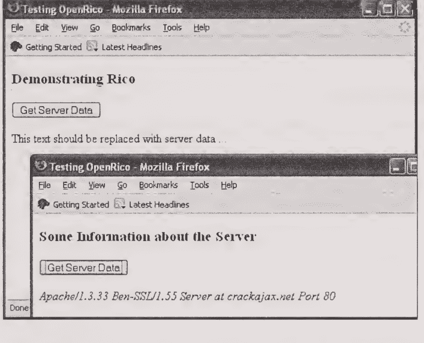

图 20.1 使用 Rico 更新多个页面元素。

服务器例程是一个简单的 PHP 脚本，用于输出所需的 XML 数据。该脚本使用 PHP 的 `$_SERVER['SERVER_SIGNATURE']` 全局变量。请注意，该脚本构建并返回两个独立的 `<response>` 元素，每个元素负责更新 HTML 页面中的特定元素。

代码清单 20.2 显示了服务器脚本。

### 代码清单 20.2 用于生成 `<ajax-response>` 的服务器脚本

```php
<?php
header("Content-Type:text/xml");
header("Cache-Control:no-cache");
header("Pragma:no-cache");
echo "<ajax-response><response type=\"element\"
-id=\"display\"><p>"
-.$_SERVER['SERVER_SIGNATURE']
-."</p></response>"
-<response type=\"element\" id=\"heading\">
-<h3>Some Information about the Server</h3>
-</response></ajax-response>";
?>
```

> **提示：** 第 9 课“与服务器通信”讨论了浏览器缓存可能导致的问题。在该课中，我们使用了一种解决方法，即在要调用的服务器资源的 URL 中添加一个随机值参数。

此脚本示例使用了另一种技术，包括以下头命令：

```php
header("Cache-Control:no-cache");
header("Pragma:no-cache");
```

指示浏览器不要缓存此页面，而是每次从服务器获取新副本。

> **注意：** PHP 的 `$_SERVER` 全局数组变量是在 PHP 4.1.0 中引入的。如果你安装的是旧版本的 PHP，则需要使用全局变量 `$HTTP_SERVER_VARS` 代替。

## Rico 的其他界面工具

Rico 的功能不限于辅助开发 Ajax 应用程序。现在让我们看看你可以使用 Rico 工具包添加到用户界面的其他一些能力。虽然这些技术本身不使用 Ajax，但稍加想象就能意识到它们与 Rico 的 Ajax 工具结合时可能实现的功能。

## 拖放功能

桌面应用程序及其运行的操作系统都广泛使用拖放功能来简化用户界面。实现拖放所需的 JavaScript 技术可能难以掌握，尤其是由于出现了许多跨浏览器问题。

然而，使用 Rico 进行拖放很简单。

在应用程序中包含 `rico.js` 文件会自动创建一个名为 `dndMgr` 的对象，即 Rico 的拖放管理器。使用 `dndMgr` 对象非常类似于使用 `AjaxEngine`；不过，这次我们需要注册的不是 Ajax 请求和响应，而是*可拖动*项目和*放置区域*（可以接收拖动项目的页面元素）。

这些任务通过 `registerDraggable` 和 `registerDropZone` 方法来完成：

```javascript
dndMgr.registerDraggable(new Rico.Draggable('test',
    'dragElementID'));
dndMgr.registerDropZone(new Rico.Dropzone('dropElementID'));
```

这两个简单的命令分别声明 ID 为 `dragElementID` 的页面元素为可拖动元素，以及 ID 为 `dropElementID` 的另一个元素为放置区域。`registerDraggable()` 方法的参数 `'test'` 为可拖动项目定义了一个类型，如果需要，后续代码可以对其进行测试和使用。

### 拖放界面示例

代码清单 20.3 展示了使用 Rico 实现拖放的简单性。显示的 HTML 页面如图 20.2 所示。

```html
代码清单 20.3 使用 Rico 的简单拖放
<!DOCTYPE HTML PUBLIC "-//W3C//DTD HTML 4.01
 Transitional//EN"
 "http://www.w3.org/TR/html4/loose.dtd">
<html>
<head>
    <script src="prototype.js"></script>
    <script src="rico.js"></script>
    <style>
    body {
        font: 10px normal arial, helvetica, verdana;
        background-color:#dddddd;
    }
    div.simpleDropPanel {
        width         : 260px;
        height        : 180px;
        background-color: #ffffff;
        padding       : 5px;
        border        : 1px solid #333333;
    }
    div.box {
        width             : 200px;
        cursor            : hand;
        background-color  : #ffffff;
        -moz-opacity      : 0.6;
        filter            : alpha(Opacity=60);
        border: 1px solid #333333;
    }
</style>
</head>
<body>
<table width="550">
<tr>
    <td><h3>Drag and Drop</h3>
        <p>Drag and drop data items into the target fields using the left mouse button in the usual way. Note how available target fields change colour during the drag operation.</p>
        <p>Reload the page to start again.</p>
        <div class="box" id="draggable1">This is a piece of draggable data</div>
        <div class="box" id="draggable2">This is another</div>
        <div class="box" id="draggable3">And this is a third</div>
        <br/>
        <table>
            <tr>
                <td>
                    <div id="droponme" class="simpleDropPanel">
                        <b>Drop Zone 1</b><br />A simple text area
                    </div>
                </td>
                <td>
                    <b>Drop Zone 2</b><br />
                    A form text entry field.
                    <form><textarea name="dropzone" id="droponme2" rows="6" cols="30"></textarea></form>
                </td>
            </tr>
        </table>
    </td>
</tr>
</table>
<script>
  dndMgr.registerDraggable(new Rico.Draggable('foo', 'draggable1'));
  dndMgr.registerDraggable(new Rico.Draggable('foo', 'draggable2'));
  dndMgr.registerDraggable(new Rico.Draggable('foo', 'draggable3'));
  dndMgr.registerDropZone(new Rico.Dropzone('droponme'));
  dndMgr.registerDropZone(new Rico.Dropzone('droponme2'));
</script>
</body>
</html>
```

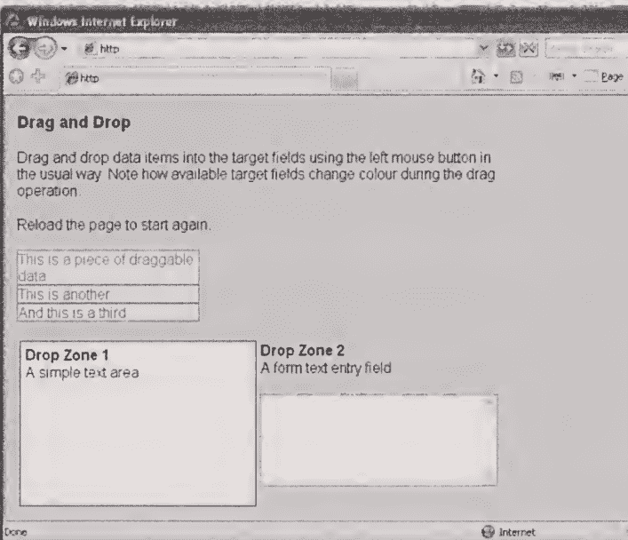

图 20.2 简单的拖放应用程序。

JavaScript 库 `rico.js` 和 `prototype.js` 与各种页面元素的样式定义一起包含在文档的 `<head>` 中。

## 20：使用 Rico

请注意，特别是两个页面元素——一个 `<div>` 容器和一个 `<textarea>` 输入框——被赋予了 `dropzone1` 和 `dropzone2` 的 ID。在代码清单更靠后的位置，通过以下行将这两个元素定义为拖放操作的放置区域：

```javascript
dndMgr.registerDropZone(new Rico.Dropzone('droponme'));
dndMgr.registerDropZone(new Rico.Dropzone('droponme2'));
```

你还会看到，页面中定义了三个小的 `<div>` 容器，并赋予了 `draggable1`、`draggable2` 和 `draggable3` 的 ID。正如你可能已经猜到的，它们将成为可拖动的页面元素，并通过以下代码行进行定义：

```javascript
dndMgr.registerDraggable(new Rico.Draggable('foo', 'draggable1'));
dndMgr.registerDraggable(new Rico.Draggable('foo', 'draggable2'));
dndMgr.registerDraggable(new Rico.Draggable('foo', 'draggable3'));
```

仅此而已！Rico 会处理所有细节，甚至在拖动项目时改变可用放置区域的外观，如图 20.3 所示。

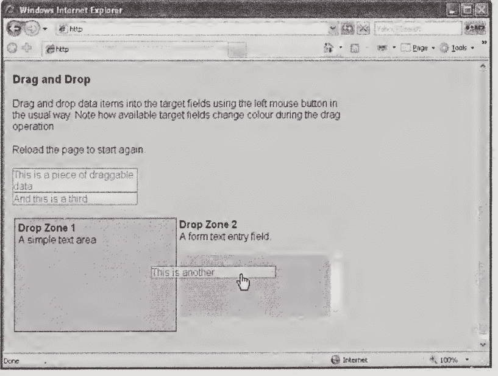

**图 20.3** 拖动操作期间高亮显示的放置区域。

当在一个可用的放置区域上方释放时，可拖动项目会根据放置区域元素的 HTML 代码自动定位，如图 20.4 所示。

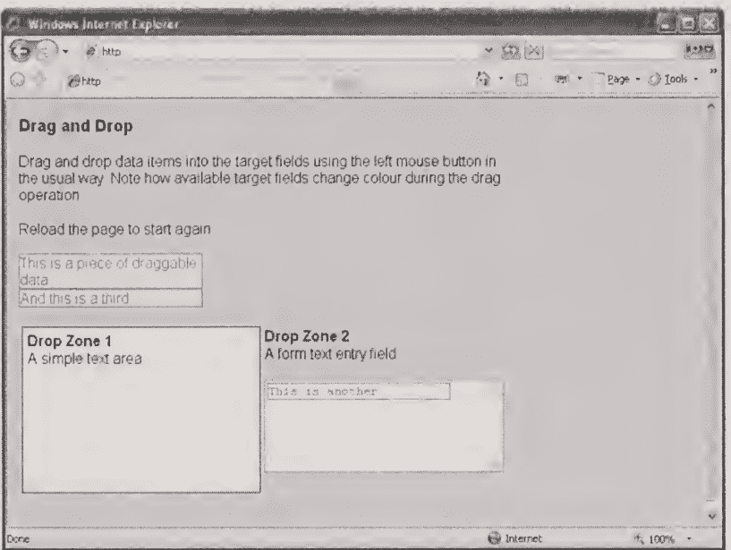


**图 20.4** 完成拖放操作后。

### 电影效果

除了 Ajax 和拖放工具，Rico 还提供了一组统称为电影效果的用户界面小工具。

**注意：** Rico 的电影效果是对`prototype.js`中`Effect`类的扩展。

这些效果包括页面元素的动画（改变其大小和/或形状）、淡入淡出效果（改变页面元素的不透明度）、为对象添加圆角以及操作对象颜色。

与前面讨论的界面技术结合使用，这些效果可以帮助你构建复杂、引人注目且用户友好的界面，使其更类似于桌面应用程序而非网页。

## 总结

在上一课（第 19 课）我们研究了`prototype.js`库之后，本课继续实验 Rico。Rico 是一个基于`prototype.js`的开源框架，它提供了一种简单的方法，将 Ajax 以及拖放和其他视觉效果集成到用户界面设计中。

最后，在第 21 课“使用 XOAD”中，我们将探讨一种采用不同方法的 Ajax 框架——基于服务器端 PHP 的 XOAD。

## 21：使用 XOAD

在本课中，你将了解由 Stanimir Angeloff 编写的、支持 Ajax 的服务器端框架 XOAD。

### 介绍 XOAD

到目前为止，在本书的这一部分，我们已经研究了`prototype.js`和 Rico 库，以及它们如何帮助你开发 Ajax 应用程序。与这些用 JavaScript 编写的客户端库不同，XOAD 是一个用 PHP 编写的服务器端 Ajax 工具包。

本课将讨论 XOAD 背后的一些概念及其使用基础知识。

到目前为止，我们所有的工作都集中在使用 JavaScript 来处理 Ajax 应用程序中的服务器请求和返回数据。XOAD 是一个基于服务器的 PHP 解决方案，它采用了略微不同的方法。

XOAD 应用程序通过将服务器端 PHP 函数的序列化版本作为 JavaScript 对象传递，使它们对客户端 JavaScript 解释器可用。

### 下载和安装 XOAD

XOAD 由许多 PHP 和支持脚本组成，可以从`http://sourceforge.net/projects/xoad`以存档文件的形式下载。要成功安装 XOAD，你需要一个支持 PHP 的 Web 服务器的 FTP 访问权限，并且（要使用 XOAD 的更高级功能）还需要 MySQL 数据库。有关安装 XOAD 的详细说明可以在下载的材料中找到，并且在`http://forums.xoad.org/`有一个公共论坛。

### 一个简单的 XOAD 页面

让我们看一个最简单的 XOAD 页面的例子。假设你有一个要在 XOAD 应用程序中使用的 PHP 类。这个类存储在 PHP 文件`myClass.class.php`中：

> 在 CD 上：所有需要的工具——XOAD、PHP、MySQL 和 Apache——都包含在 Ajax Starter Kit CD 中。

```php
<?php
class myClass {
    function stLength($mystring) {
        return strlen($mystring);
    }
    function xoadGetMeta() {
        XOAD_Client::mapMethods($this, array('stLength'));
        XOAD_Client::publicMethods($this, array('stLength'));
    }
}
?>
```

这个简单的类只有一个函数`stLength()`，它仅仅是返回一个字符串变量的长度。我们还通过`xoadGetMeta()`函数的形式为该类添加了一些元数据。这些信息告诉 XOAD 哪些类的方法可以导出到主应用程序。在这个例子中，只有一个方法，即`stLength()`。

> 警告：绝对没有必要在类中包含元数据，但建议这样做。如果没有元数据，所有方法都将是公共的，并且方法名将被转换为小写。

现在你需要开始构建主应用程序脚本`xoad.php`。

清单 21.1 展示了 XOAD 应用程序。这是一个几乎没有实际作用的程序，它仅仅返回字符串 "My XOAD Application" 的长度。尽管如此，它演示了将服务器端 PHP 类的方法作为 JavaScript 对象在客户端使用的概念。

> 提示：前面课程中开发的 Ajax 应用程序是文件扩展名为`.htm`或`.html`的 HTML 文件。因为我们的 XOAD 应用程序包含 PHP 代码，所以它必须具有合适的文件扩展名。大多数 Web 服务器和 PHP 实现都接受`.php`的文件扩展名，有些还允许其他扩展名，如`.php4`或`.phtml`。

### 清单 21.1 一个简单的 XOAD 应用程序

```php
<?php
require_once('myClass.class.php');
require_once('xoad.php');
XOAD_Server::allowClasses('myClass');
if (XOAD_Server::runServer()) {
    exit;
}
?>
<-= XOAD_Utilities::header('.') ?>
<script type="text/javascript">
var myobj = <-= XOAD_Client::register(new myClass()) ?>;
var mystring = 'My XOAD Application';
myobj.onStLengthError = function(error) {
    alert(error.message);
    return true;
}
myobj.stLength(mystring, function(result) {
    document.write('String: ' + mystring + '<br />Length: ' + result);
});
</script>
```

在将上述文档加载到浏览器中时，页面仅显示：

```text
String: My XOAD Application

Length: 19
```

我不会深入探讨 PHP 代码是如何工作的；毕竟这门课是关于 Ajax 的，而不是高级 PHP。然而，理解代码背后的概念很重要，所以让我们逐步分析清单 21.1，并尝试理解发生了什么：

```php
<?php
require_once('myClass.class.php');
require_once('xoad.php');
XOAD_Server::allowClasses('myClass');
if (XOAD_Server::runServer()) {
    exit;
}
?>
<-= XOAD_Utilities::header('.') ?>
```

脚本的第一部分包含了`xoad.php`和所需的类文件`myClass.class.php`，并通知 XOAD 它可以访问哪些类（在本例中只有一个）。

XOAD 函数`runServer()`检查 XOAD 请求是否是客户端回调，如果是，则进行相应处理。`header()`函数用于注册客户端头文件。

现在让我们看看脚本的其余部分：

```javascript
<script type="text/javascript">
var myobj = <-= XOAD_Client::register(new myClass()) ?>;
var mystring = 'My XOAD Application';
myobj.onStLengthError = function(error) {
  alert(error.message);
  return true;
}
myobj.stLength(mystring, function(result) {
  document.write('String: ' + mystring
  + '<br />Length: ' + result);
});
</script>
```

看到脚本的其余部分是一个`<script>...</script>`元素了吗？

这一行

```javascript
var myobj = <?= XOAD_Client::register(new myClass()) ?>;
```

将`myClass.class.php`中声明的公共方法导出到一个 JavaScript 对象。我们现在有了一个 JavaScript 对象，它有一个方法`stLength()`，允许我们使用 PHP 类`myClass`中同名的方法。

### XOAD HTML

XOAD HTML 是一个扩展，允许使用 XOAD 轻松更新 HTML 页面元素。以下示例展示了`XOAD_HTML::getElementByID()`和`XOAD_HTML::getElementsByTagName()`方法的用法，它们的功能与它们等效的 JavaScript DOM 方法完全相同。

#### `XOAD_HTML::getElementById()`

你会认出清单 21.2 中代码的布局与前面讨论的基本 XOAD 程序结构相似。

在本例中，我们没有包含外部类文件，而是在应用程序内部定义了一个类`Updater`。该类包含一个函数`change()`。

该函数的第一行使用`XOAD_HTML::getElementById()`识别 ID 为`display`的页面元素。随后的程序行继续更改该页面元素的文本和背景颜色。

函数`change()`被公开为 JavaScript 对象`myobj`的一个方法，然后可以像调用任何其他 JavaScript 方法一样调用它：

```html
<a href="#server" onclick="myobj.change();
return false;">Change It!</a>
```

## `XOAD_HTML::getElementsByTagName()`

`XOAD_HTML::getElementsByTagName()`方法，与它的 JavaScript 等效方法一样，返回一个包含特定元素类型的元素数组。清单 21.3 识别了所有类型为`<div>`的页面元素，并更改了它们的一些样式属性。

### 清单 21.3 更改给定类型的所有页面元素

```php
<?php
class Updater
{
    function change()
    {
        $mydivs = & XOAD_HTML::getElementsByTagName('div');
        $mydivs->style['height'] = '60';
        $mydivs->style['width'] = '350';
        $mydivs->style['backgroundColor'] = 'lightgreen';
        $mydivs->innerHTML =
        'Size and color changed by XOAD';
    }
}
define('XOAD_AUTOHANDLE', true);
require_once('xoad.php');
?>
<?= XOAD_Utilities::header('.') ?>
<script type="text/javascript">
var myobj = <?= XOAD_Client::register(new Updater()) ?>;
</script>
<style>
div {
    border:1px solid black;
    height:80;
    width:150
}
</style>
<div>Div 1</div>
<br />
<div>Div 2</div>
<br />
<div>Div 3</div>
<a href="#server" onclick="myobj.change();
return false;">Update All Divs</a>
```

页面中的三个`<div>`元素被`XOAD_HTML::getElementsByTagName()`识别，并更改了它们的样式和大小。图 21.2 展示了程序运行时的状态。

**图 21.2** 使用`XOAD_HTML`选择多个页面元素。

> **提示：** `XOAD_HTML`还有许多其他功能。所有`XOAD_HTML`中可用函数的详细信息，请查阅 XOAD 下载包。

## XOAD 高级编程

XOAD 具有一系列超出本课程讨论范围的高级功能。如果你想探究使用 XOAD 所能达到的极限，以下是当前支持的技术概述。

## XOAD 事件

XOAD 框架还支持事件。在一个客户端计算机上发起的 XOAD 事件可以存储在服务器上，随后被其他客户端检测到，从而使得构建复杂的、用户可交互的应用程序成为可能。例如，此类应用程序可能包括聊天、群件或类似的协作工具。

## XOAD 缓存处理

XOAD 允许使用`XOAD_Cache`类在服务器端进行缓存。缓存结果可以显著提升性能，尤其是在服务器端例程耗时较长时（例如对大型数据集进行排序或对庞大的数据库表执行查询）。

## XOAD 控件

你可以使用`XOAD_Controls`类在 XOAD 中定义自定义客户端控件。

> **提示：** 截至撰写本文时，XOAD 的当前版本为 0.6.0.0。如果你下载的版本不同，请查阅下载包中包含的文档。

## 总结

本课程探讨了一种 Ajax 工具包的服务器端实现，即 XOAD 的形式。

XOAD 允许将存储在服务器上的 PHP 类中的方法，通过 JavaScript 提供给客户端程序使用。这与第 19 课和第 20 课讨论的客户端技术在方法上形成了有趣的对比。

第四部分到此结束。你现在应该对 Ajax 应用架构及其基于的编码技术有了很好的理解。

祝你 Ajax 实验顺利！

## 索引

### 符号

- `+`-`@` 字符，PHP 方法，125
- `$SERVER` 全局数组变量，187
- `$()` 函数，176
- `$F()` 函数，176-177
- `<ajax-response>` 元素，Rico，184，187
- `<div>…<div>` 元素，102
- `<div>` 容器，105
- `<response>` 元素，Rico，184，187
- `<script>…<script>` 元素，103

### A

- `abort` 方法，78
- 活动页面元素，设计，171
- AHAH（异步 HTML 和 HTTP）。*另请参见* HTML；HTTP
  - 优势，120
  - `callAHAH()` 函数，121-123
  - `myAHAHlib.js`，121-123
    - 元标签信息，从 URL 检索，124-125
    - `responseText` 属性，127
  - `responseAHAH()` 函数，122-123
- Ajax
  - 应用示例，Google Suggest，64-65
  - 应用流程图，68
  - 客户端-服务器交互，61-64
  - 对象
  - `Ajax.PeriodicalUpdater` 类，179-180
  - `Ajax.request` 类，178
  - `Ajax.Updater` 类，179
  - 使用，不适用的情况，171
- Ajax 引擎，64
  - `Ajax.PeriodicalUpdater` 类，179-180
  - `Ajax.request` 类，178
  - `Ajax.Updater` 类，179
- AjaxEngine 对象，Rico 中的实例，184-185
- `alt` 属性（图像标签），19
- Amazon.com REST API，147-150
- 锚点标签（HTML），20
- Apache Web 服务器网站，9
- `appendChild` 方法，131-133
- 应用程序
  - 设计，101，171
    - 回调函数，105-106
    - 完成的应用，107-108
    - 事件处理器，106
    - HTML 文档，102
    - PHP 脚本，104-105
    - 服务器请求，104
    - 故障排除，173
    - 用户反馈，109-110
    - `XMLHttpRequest` 对象，103-104
  - 流程图，68
  - `prototype.js`，添加到，175
  - Rico，添加到，183
- 参数（JavaScript），37，42
- 文章
  - 可用文章列表，读取，146
  - 特定文章，检索，147
  - 上传，147
- ASCII 文本，服务器响应，67
- 异步服务器
  - 通信，64
  - 请求，66，81-86
- ATTLIST 声明（XML），57

### B

- 后退按钮，167
- 带宽，定义，62
- 体标签（HTML），16-18
- 书签，故障排除，168-169
- 浏览器缓存
  - `callAjax()` 函数，84-86
  - GET 请求，173
  - 服务器请求，84-86
- 浏览器
  - 可用性，11
  - 定义，10
  - 图形浏览器，10
  - HTML 文档，加载，15
  - 基于文本的浏览器，10
  - 不支持的浏览器，故障排除，169-170
- Web 服务器交互，7

### C

- 缓存（浏览器）
  - GET 请求，173
  - 服务器请求，84-86
- `callAHAH()` 函数，121-123
- `callAjax()` 函数，83
  - 浏览器缓存，84-86
  - 启动，89-90
- 回调函数，86-88
  - AHAH，122-123
  - 基本应用创建示例，105-106
  - JavaScript 库，161-162
  - 启动，89-90
  - `myAJAXlib.js`，164
  - RSS 标题阅读器，创建，138-140
- `callRICO()` 函数，186
- 居中标签（HTML），21
- `change()` 函数，196-197


- 字符串，`split()` 方法，117
- `charAt` 方法，`responseText` 属性，93
- 子节点，添加到 DOM，131
- `childNodes` 属性，132
- 电影效果（Rico），192
- 客户端-服务器交互，传统交互与 Ajax 对比，61-62
- 客户端编程，定义，11
- 代码，故障排除，172
- 颜色，HTML，18
- 注释（HTML），17
- 构造函数，创建实例，72
- `createAttribute` 方法，133
- `createElement` 方法，132-133
- `createTextNode` 方法，131-133

### D

- `data()` 函数，105
- `date` 命令（PHP），50
- DELETE 请求，145
- 设计应用，故障排除，173
- 开发者令牌，148
- DNS（域名服务）服务器，12
- `doAjax` 函数，161，164-165
- DOCTYPE 声明（XML），55-56
- DOCTYPE 元素，15-16
- 文档元素（XML），55
- DOM（文档对象模型），72-73
  - `appendChild()` 方法，131
  - 子节点，添加到，131
  - `createElement()` 方法，132
  - `createTextNode()` 方法，131
  - 文档方法表，133
  - 元素，删除，139
  - `getAttribute` 方法，59
  - `getElementByID` 方法，130
  - `getElementsByTagName` 方法，130
  - 节点方法表，133
  - 节点属性表，132
  - 节点，58-59
  - `tagname` 属性，59
  - `text` 属性，59
- DTD（文档类型定义）与 DOCTYPE 声明对比，55

### E

- onChange 事件处理器，44
- onClick 事件处理器，38-39，44
- onLoad 事件处理器，44
- onMouseOut 事件处理器，44
- onMouseOver 事件处理器，41-44
- onSubmit 事件处理器，44-46
- ELEMENT 声明（XML），56
- 引擎（Ajax），64
- 错误处理
  - 应用设计，173
  - 后退按钮代码，167
  - 书签，168-169
  - 浏览器缓存，173
  - 代码，平台测试，172
  - GET 请求，173-174
  - JavaScript 库，166
  - 链接，168-169
  - 页面设计，171
  - 权限被拒绝错误，174
  - POST 请求，174
  - 安全性，172
  - 蜘蛛程序，170
  - 不支持的浏览器，169-170
  - 用户反馈，169
- `eval()` 函数，JavaScript 库，161-162
- 事件处理器
  - 基本应用创建示例，106
  - JavaScript 函数，调用，43
  - `myAJAXlib.js`，调用，164

### F

- 反馈（用户）
  - 基本应用创建示例，109-110
  - JavaScript 库，166
  - 服务器请求，97
  - 故障排除，169
- 文件扩展名，PHP 文件，48
- `firstChild` 属性，132
- `for` 循环，52
- Form 对象，prototype.js，177
- 表单标签（HTML），28-30
- 表单验证示例（JavaScript），45-46
- 框架（Ajax），64
- 函数
  - `$()`，176
  - `$F()`，176-177
  - `callAHAH()`，121-123
  - `callAjax`，83
    - 浏览器缓存，84-86
    - 启动，89-90
  - 回调，86-88
    - AHAH，122-123
    - 基本应用创建示例，105-106
    - JavaScript 库，161-162
    - 启动，89-90
    - `myAJAXlib.js`，164
    - RSS 标题阅读器，创建，138-140
  - `callRICO()`，186
  - `change()`，196-197
  - `date()`，105
  - `doAjax`，161，164-165

## 函数

- `eval()`，JavaScript 库，161-162
- `header()`，195
- JavaScript
  - 参数，传递给，42
  - 调用，41
  - 事件处理程序，从调用，43
  - `numcheck`，46
  - 结构，40
- `responseAHAH()`，122-123
- `responseAjax()`，83，88
- `runServer()`，195
- `sizeof()`，117
- `Try.these()`，177

## 报头行（HTTP）

- 请求，27
- 响应，28

- `header()` 函数，195
- 报头，在发布 PHP 脚本之前输出，94
- Hello World 示例，在 PHP 中打印，48
- 十六进制编号系统，HTML 颜色值，18
- HTML（超文本标记语言），13。另请参见 AHAH
  - `<div>...<div>` 元素，102
  - `<div>` 容器，105
  - `<script>...<script>` 元素，103
  - 高级文档示例，20-21
  - 基本应用创建示例，102
  - 基本文档示例，14
  - 正文标签，16-17
  - DOCTYPE 元素，15
  - 头标签，16
  - HTML 标签，16
  - 标签，为添加属性，18
  - 标题标签，16
  - 颜色值，18
  - 注释，17
  - 定义，14
  - DOCTYPE 元素，15-16
  - 表单
    - 属性，30
    - 属性方法，30
    - 参数值，31
    - 处理，30
    - 简单表单示例，30-31
    - 特殊字符，传输，31
    - 标签，28-30
    - 变量，30
    - GET 请求，29-31
  - 超链接，19-20
  - JavaScript，34-37
  - 加载文档，15
  - 元标签
    - 关键词，123-125
    - `myAHAHlib.js`，124-125

### G

- GET 请求，83
- 浏览器缓存，84-86，173
- HTTP 请求，29-31
- JavaScript 库，160
- `myAJAXlib.js`，163
- 查询字符串，29
- REST，145-147
- 故障排除，174
- `getAllResponseHeaders` 方法，78
- `getAttribute` 方法（DOM），59
- `getElementByID` 方法，98，106，130
- `getElementByTagname` 方法，105-106
- `getElements()` 方法，prototype.js，177
- `GetElementsById` 方法，133
- `getElementsByTagName` 方法，95-96，130，133
- `getResponseHeader` 方法，78
- Gmail 网络邮件服务（Google），65
- Google Maps，65
- Google Suggest，64-65
- 图形化网络浏览器，10

### H

- `HasChildNodes` 方法，133
- 头标签（HTML），16

## JavaScript

- `myAJAXlib.js`，164
- PHP，48
- POST 请求，29-31
- `responseText` 属性，115-116
- RSS 标题阅读器，创建，134

## HTML

- 保存文档，15
- 脚本标签，34
- `seville.html` 文档示例，20-21
- 样式，23
- 内联样式，24
- 样式表规则，设置，24
- 标签，14
  - 为添加属性，18
  - 锚标签，20
  - 作为容器，17
  - 正文标签，16-17
  - 正文标签，为添加属性，18
  - 居中标签，21
  - 常用标签表，22-23
  - 头标签，16
  - 图像标签，19
  - 表格标签，19-21
  - 标题标签，16
- `testpage.html` 文档示例，14
- 正文标签，16-17
- 正文标签，为添加属性，18
- DOCTYPE 元素，15-16
- 头标签，16
- HTML 标签，16
- 加载，15
- 保存，15
- 标题标签，16
- 工具要求，14
- 文字处理器，14
- XML，与相似，54
- XOAD，199
- `change()` 函数，196-197
- `XOAD HTML::getElementByID()` 方法，196-197
- `XOAD HTML::getElementsByTagName()` 方法，198

## HTTP（超文本传输协议）

25。另请参见 AHAH

- 请求，7
  - GET 请求，29-31
  - 报头行，27
  - 起始行，26
  - POST 请求，29-31
- 响应
  - 报头行，28
  - 原因短语，27
  - 状态行，27
- 服务器响应状态代码，87
- SOAP 请求，发送，154
- 版本（HTTP 请求），26
- 超链接，HTML，19-20

### I - J

- `id` 值，98
- `if` 语句（PHP），51
- 图像标签（HTML），19
- 图像，定义像素，19
- `indexOf` 方法，`responseText` 属性，93
- 内联样式，24
- 实例（对象），创建，72-77
- Internet，HTTP 请求，7
- Internet Explorer（MS），Jscript，34
- IP 地址，定义，12
- JavaScript，33
  - 参数，37，42
  - 后退按钮代码，167
  - 区分大小写，35
  - 命令，执行顺序，37
  - 启用，34
  - 表单验证示例，45-46
  - 函数
    - 参数，传递给，42
    - 调用，41
    - 事件处理程序，从调用，43
    - `numcheck`，46
    - 结构，40
  - HTML 页面，为添加，35-37
  - 方法，37-42
  - 对象，37，45，57-58
  - 脚本标签，34
  - 变量，44
  - XML，57-59
- JavaScript 库，158
  - 回调函数，161-162
  - `doAjax` 函数，161，164-165
  - 错误处理，166
  - `eval()` 函数，161-162
  - GET 请求，160
  - `myAJAXlib.js`，158-162
  - 回调函数，164
  - 事件处理程序调用，164
  - GET 请求，163
  - HTML 页面，164
  - PHP 脚本，164
  - `responseText` 属性，164
  - 使用示例，163-165
  - XML 数据，检索，165
  - POST 请求，160，165
- prototype.js
  - `$()` 函数，176
  - `$F()` 函数，176-177
  - Ajax.PeriodicalUpdater 类，179-180
  - Ajax.request 类，178
  - Ajax.Updater 类，179
  - 下载网站，175
  - Form 对象，177
  - `getElements()` 方法，177
  - Rico，183-192
  - `serialize()` 方法，177
  - Stock Price Reader 构建示例，180-182
  - `Try.these()` 函数，177
  - Web 应用程序，为添加，175
- 用户反馈，166
- XMLHttpRequest 实例，创建，159-160

- Jscript，34
- JSON（JavaScript 对象表示法）网站，178

### K - L

- `keywords` 元标签，123-125
- `lastChild` 属性，132
- `lastIndexOf` 方法，`responseText` 属性，93
- 库（JavaScript）
  - 回调函数，161-162
  - `doAjax` 函数，161，164-165
  - 错误处理，166
  - `eval()` 函数，161-162
  - GET 请求，160
  - `myAHAHlib.js`，158-159
  - `myAJAXlib.js`，161-162
  - 回调函数，164
  - 事件处理程序调用，164
  - GET 请求，163
  - HTML 页面，164
  - PHP 脚本，164
  - `responseText` 属性，164
  - 使用示例，163-165
  - XML 数据，检索，165
  - POST 请求，160，165
- prototype.js
  - `$()` 函数，176
  - `$F()` 函数，176-177
  - Ajax.PeriodicalUpdater 类，179-180
  - Ajax.request 类，178
  - Ajax.Updater 类，179
  - 下载网站，175
  - Form 对象，177
  - `getElements()` 方法，177
  - Rico，183-192
  - `serialize()` 方法，177
  - Stock Price Reader 构建示例，180-182
  - `Try.these()` 函数，177
  - Web 应用程序，为添加，175
- 用户反馈，166
- XMLHttpRequest 实例，创建，159-160

- 库（开源），Rico，183
- `<response>` 元素，184，187
- AjaxEngine 实例，184-185
- `callRICO()` 函数，186
- 电影效果，192
- 拖放，188-191
- 多页面元素更新，184
- 使用示例，185-186
- Web 应用程序，为添加，183
- 链接，故障排除，168-169
- 加载 HTML 文档，15
- 循环结构（PHP），52
- Lynx 基于文本的 Web 浏览器，10

### M

- 标记元素（HTML）。另见标签，HTML
- `Math.random()` 方法，84
- 元标签
  - 关键词，123-125
  - `myAHAHlib.js`，从 URL 检索元标签信息，124-125
- 方法
  - `abort`，78
  - `AppendChild`，131-133
  - `charAt`，`responseText` 属性，93
  - `CreateAttribute`，133
  - `CreateElement`，132-133
  - `CreateTextNode`，131-133
  - `getAllResponseHeaders`，78
  - `getElementByID`，98，106，130
  - `getElementByTagname`，105-106
  - `getElements()`，prototype.js，177
  - `GetElementsById`，133
  - `getElementsByTagName`，95-96，130，133
  - `getResponseHeader`，78
  - `HasChildNodes`，133
  - HTTP 请求，26-27
  - `indexOf`，`responseText` 属性，93
  - JavaScript，事件处理程序，37
  - onClick 事件处理程序，38-39
  - onMouseOver 事件处理程序，41-42
  - `lastIndexOf`，`responseText` 属性，93
  - `Math.random()`，84
  - `open`，78-79
  - `registerDraggable`，188
  - `registerDropZone`，188
  - `RemoveChild`，133
  - `send`，78-79
  - `serialize()`，prototype.js，177
  - `setRequestHeader`，78-79
  - `split()`，117
  - `substring`，`responseText` 属性，93
  - `toLowerCase()`，`responseText` 属性，93
  - `toUpperCase()`，`responseText` 属性，93
  - XMLHttpRequest 对象，列表，78
  - `XOAD HTML::getElementByID()`，196-197
  - `XOAD HTML::getElementsByTagName()`，198
- 多平台代码测试，172
- `myAHAHlib.js`，121-123，158-159
- 元标签信息，从 URL 检索，124-125
- `responseText` 属性，127
- `myAJAXlib.js`，161-162
  - 回调函数，164
  - 事件处理程序调用，164
  - GET 请求，163
  - HTML 页面，164
  - PHP 脚本，164
  - `responseText` 属性，164
  - 使用示例，163-165
  - XML 数据，检索，165

### N - O

- 命名空间，+，153
- 原生对象，72
- `nextSibling` 属性，133
- `nodeName` 属性，133
- 节点
  - 子节点，添加到 DOM，131
  - DOM，58-59
  - DOM 文档方法表，133
  - DOM 节点方法表，133
  - DOM 节点属性表，132
- `nodeType` 属性，133
- `nodeValue` 属性，133
- `numcheck` 函数（JavaScript），46
- 数字数组，51
- 对象
  - Ajax
    - Ajax.PeriodicalUpdater 类，179-180
    - Ajax.request 类，178
    - Ajax.Updater 类，179
  - AjaxEngine，Rico 中的实例，184-185
  - 构造函数，72
  - DOM，72-73
  - Form，protoype.js，177
  - 实例，创建，72-77
  - JavaScript，45
  - 方法，37
  - XML，57-58
  - 方法，71
  - 原生对象，72
  - 属性，71
  - XMLHttpRequest
    - 基本应用创建示例，103-104
    - `callAjax()` 函数，83
    - 实例，创建，74-77
    - JavaScript 库，创建，159-160
    - 方法
      - `open`，78-79
      - `send`，79
    - 方法，列表，78
    - 属性，列表，77
    - `responseAjax()` 函数，83


服务器请求、浏览器缓存，84-86

服务器请求、回调函数，88-90

服务器请求、发送，81-83

服务器请求、状态监控，86-87

服务器请求、时间戳，86

`status` 属性，88

`statusText` 属性，88

用途，73

`XMLHttpRequest`、`readyState` 属性，86-87

`onBlur` 事件处理程序，89-90

`onChange` 事件处理程序，44

`onClick` 事件处理程序，38-39、44

`onLoad` 事件处理程序，44、106

`onMouseOut` 事件处理程序，44

`onMouseOver` 事件处理程序，41-44

`onreadystatechange` 属性，77

`onSubmit` 事件处理程序，44-46

`open` 方法，78-79

## 开源库

- `Rico`，183
- `<response>` 元素，184、187
- `AjaxEngine` 实例，184-185
- `callRICO()` 函数，186
- 电影效果，192
- 拖放，188-191
- 多页面元素更新，184
- 使用示例，185-186
- Web 应用程序，添加，183

## 起始行（HTTP 请求）

- HTTP 版本，26
- 方法，26-27
- 服务器资源，26

## P

- 页面设计，故障排除，171
- 页面元素，设计，171
- `parentNode` 属性，133
- 解析，`responseXML` 属性，96
- 权限拒绝错误，故障排除，174
- `PHP`，47
  - `$SERVER` 全局数组变量，187
  - `date` 命令，50
  - 文件扩展名，48
  - Hello World 示例，打印，48
  - HTML，48
  - `if` 语句，51
  - 循环结构，52
  - 方法，`@` 字符，125
  - `php` 标签，48
  - 程序流程，控制，51-52
  - 资源网站，48
- 脚本
  - 基本应用创建示例，104-105
  - `header()` 指令，在问题之前输出，94
  - `myAJAXlib.js`，164
  - 引号，转义，94
- 标签，48
- 变量
  - 数组，50
  - 大小写敏感，49
  - 命名约定，49
  - 数字，50
  - 字符串，50
  - 值，赋值，49
- `XOAD`
  - 缓存处理，200
  - 客户端控件，自定义，200
  - 下载/安装，193
  - 事件，199
  - `header()` 函数，195
  - `runServer()` 函数，195
  - 简单页面示例，194-196
  - `XOAD Controls` 类，200
  - `XOAD HTML`，196-199
- `PHP` 解释器，`@` 字符，125
- 像素，定义，19
- 平台代码测试，172
- 弹出窗口，171
- `POST` 请求，145-147、165
  - HTTP 请求，29-31
  - JavaScript 库，160
  - 消息体，29
  - 故障排除，174
- `previousSibling` 属性，133
- 程序员编辑器，HTML，14
- 序言（XML），55
- 属性，71
  - `childNodes`，132
  - DOM 文档方法表，133
  - DOM 节点方法表，133
  - DOM 节点属性表，132
  - `firstChild`，132
  - `lastChild`，132
  - `nextSibling`，133
  - `nodeName`，133
  - `nodeType`，133
  - `nodeValue`，133
  - `onreadystatechange`，77
  - `parentNode`，133
  - `previousSibling`，133
  - `readystate`，77、86-87
  - `responseText`，78、111
    - 字符串，112-114
    - 格式化数据，117
    - HTML，115-116
    - 操作方法列表，93-94
    - `myAHAHlib.js`，127
    - `myAJAXlib.js`，164
    - `null` 值，92
    - 返回的文本，112-114
    - 值，显示，92-93
    - 值，操作，93
  - `responseXML`，78、94-95、130
    - 解析，96
    - 存储的值，130
    - 网页，向其中添加元素，130-132
  - `status`，78、88
  - `statusText`，78、88
- `XMLHttpRequest` 对象，列表，77
- `registerDropZone` 方法，188
- `RemoveChild` 方法，133
- 请求（HTTP），起始行
  - `GET` 请求，29-31
  - 首部行，27
  - HTTP 版本，26
  - 方法，26-27
  - `POST` 请求，29-31
  - 服务器资源，26
- `prototype.js`
  - `$()` 函数，176
  - `$F()` 函数，176-177
  - `Ajax` 对象
    - `Ajax.PeriodicalUpdater` 类，179-180
    - `Ajax.request` 类，178
    - `Ajax.Updater` 类，179
  - `responseAHAH()` 函数，122-123
  - `responseAjax()` 函数，83、88
  - 下载网站，175
  - `Form` 对象，177
  - `getElements()` 方法，177
  - 响应（HTTP）
    - 首部行，28
    - 原因短语，27
    - 状态行，27
  - `Rico`
    - `<response>` 元素，184、187
    - `AjaxEngine` 实例，184-185
    - `callRICO()` 函数，186
    - 动态效果，192
    - 拖放，188-191
    - 多页面元素更新，184
    - 用法示例，185-186
    - Web 应用，添加到，183
  - `responseText` 属性，78、111
    - 字符串，在页面元素中使用，112-114
    - 格式化数据，117
    - HTML，115-116
    - 操作方法列表，93-94
    - `myAHAHlib.js`，127
    - `myAJAXlib.js`，164
    - `null` 值，92
    - 返回的文本，在页面元素中使用，112-114
    - 值
      - 显示，92-93
      - 操作，93
  - `serialize()` 方法，177
  - Stock Price Reader 构建示例，180-182
  - `Try.these()` 函数，177
  - Web 应用，添加到，175
  - `responseXML` 属性，78、94-95
    - 解析，96
    - 存储的值，130
    - 网页，向其中添加元素，130-132
- `PUT` 请求，145

## Q - R

### REST（具象状态传输）

- Amazon.com REST API，147-150
- 文章，上传，147
- `DELETE` 请求，145
- 示例，145
- `GET` 请求，145-147
- 可用文章列表，读取，146
- 特定文章，检索，147

查询字符串，`GET` 请求，29

引号，在 PHP 脚本中转义，94

`readystate` 属性，77、86-87

原因短语（HTTP 响应），27

`registerDraggable` 方法，188

### 请求

- `GET` 请求，83
- 进行中通知，97
- `readyState` 属性，86-87
- 发送，`XMLHttpRequest` 对象，81-86
- `status`，监控，86-87
- 时间戳，86
- 用户反馈，97

资源（HTTP 请求），26

### 响应

- `getElementsByTagName()` 方法，95
- 进行中通知，97
- `responseText` 属性，92-93
- `responseXML` 属性，94-96
- 用户反馈，97

### 脚本

- RSS 标题阅读器，创建，140-141
- 服务器端脚本，67

`setRequestHeader` 方法，78-79

`seville.html` 文档示例，20-21

`sizeof()` 函数，117

### 样式表

- `POST` 请求，145-147
- 原则，144
- `PUT` 请求，145
- SOAP 对比，156
- 无状态操作，146
- `Rico`
  - `<response>` 元素，184、187
  - `AjaxEngine` 实例，184-185
  - `callRICO()` 函数，186
  - 动态效果，192
  - 拖放，188-191
  - 多页面元素更新，184
  - 用法示例，185-186
  - Web 应用，添加到，183
- RSS 订阅源，133
- RSS 标题阅读器，创建，133、136-137
  - 回调函数，138-140
  - HTML 页面，134
  - 服务器脚本，140-141
- `runServer()` 函数，195

## S

- 保存 HTML 文档，15
- `script` 标签（HTML），34
- 搜索引擎蜘蛛，故障排除，170
- 安全性
  - 故障排除，172
  - `XMLHttpRequest` 对象，66
- `send` 方法，78-79
- `serialize()` 方法，`prototype.js`，177
- 服务器端编程，定义，10
- 服务器端脚本，67
- 服务器
  - 异步通信，64
  - 请求
    - 异步请求，66
    - 基本应用创建示例，104
    - 浏览器缓存，84-86
    - 回调函数，86
- SOAP（简单对象访问协议），151
  - 开发，152
  - 命名空间，153
  - 请求
    - Ajax 用法示例，155
    - 代码示例，153-154
    - 组成部分，152-153
    - HTTP，通过发送，154
  - REST 对比，156
  - 规范信息网站，152
- 蜘蛛，故障排除，170
- `split()` 方法，117
- `src` 属性（image 标签），19
- `status` 代码表（HTTP 响应），27
- `status` 行（HTTP 响应），27
- `status` 属性，78、88
- `statusText` 属性，78、88
- Stock Price Reader 构建示例，180-182
- 样式表，设置规则，24

## T

- `table` 标签（HTML），19-21

`tagname` 属性（DOM），59

### 标签

- HTML，14-15
  - 向其添加属性，18
  - 锚标签，20
  - 作为容器，17
  - `body` 标签，16-18
  - `center` 标签，21
  - 常用标签表，22-23
  - `head` 标签，16
  - `image` 标签，19
  - `table` 标签，19-21
  - `title` 标签，16
- XML，54

`testpage.html` 文档示例，14

- `body` 标签，16-18
- `DOCTYPE` 元素，15-16
- `head` 标签，16
- HTML 标签，16
- 加载，15
- 保存，15
- `title` 标签，16

文本编辑器，HTML，14

文本属性（DOM），59

基于文本的 Web 浏览器，10

时间戳，服务器请求，86

`title` 标签（HTML），16

`toLowerCase()` 方法，`responseText` 属性，93

`toUpperCase()` 方法，`responseText` 属性，93

## U - V

- 不支持的浏览器，故障排除，169-170

### URL

- RSS 标题阅读器，创建，133、136-138
  - 回调函数，138-140
  - HTML 页面，134
  - 服务器脚本，140-141

### 用户反馈

- 基本应用创建示例，109-110
- JavaScript 库，166
- 服务器请求，97
- 故障排除，169

有效的 XML 文档，定义，57

### 变量

- JavaScript，44
- PHP
  - 数组，50
  - 大小写敏感，49
  - 命名约定，49
  - 数字，50
  - 字符串，50
  - 值，赋值，49

## 故障排除

- 应用设计，173
- Back 按钮代码，167
- 书签，168-169
- 浏览器缓存，173
- 代码，平台测试，172
- `GET` 请求，173-174
- 链接，168-169
- 页面设计，171
- 权限拒绝错误，174
- `POST` 请求，174
- 安全性，172
- 蜘蛛，170
- 不支持的浏览器，169-170
- 用户反馈，169

`Try.these()` 函数，177

### 样式

- HTML 文档，23
- 内联样式，24
- 样式表规则，设置，24

`substring` 方法，`responseText` 属性，93

`XMLHTTPRequest` 对象

## W

- W3C 验证器网站，173
- W3C 网站，152
- Web（万维网），HTTP 请求，7
- Web 浏览器
  - 可用性，11
  - 定义，10
  - 图形化 Web 浏览器，10
  - HTML 文档，加载，15
  - 基于文本的 Web 浏览器，10
  - 不支持的浏览器，故障排除，169-170
  - 与 Web 服务器的交互，7
- 网页
  - 定义，8
  - 通过 `responseXML` 属性添加元素，130-132
  - HTTP 请求，7
  - `id` 值，98
- Web 服务器
  - Apache Web Server 网站，9
  - 定义，9
  - 与 Web 浏览器的交互，7
- Web 服务
  - 示例，144
  - REST
    - Amazon.com REST API，147-150
    - 上传文章，147
    - `DELETE` 请求，145
    - 示例，145
    - `GET` 请求，145-147
    - 读取可用文章列表，146
    - 检索特定文章，147
    - `POST` 请求，145-147
    - 原则，144
    - `PUT` 请求，145
    - 与 SOAP 对比，156
    - 无状态操作，146
  - SOAP，151
    - 发展，152
    - 命名空间，153
    - 请求，Ajax 使用示例，155
    - 请求，代码示例，153-154
    - 请求，组成部分，152-153
    - 通过 HTTP 发送请求，154
    - 与 REST 对比，156
    - 规范信息网站，152
- `while` 循环，52
- 文字处理软件，HTML，14

## X - Y - Z

- XML（可扩展标记语言），53
  - `ATTLIST` 声明，57
  - 显示注释，55
  - 通过 `myAJAXlib.js` 检索数据，165
  - `DOCTYPE` 声明，55-56
  - 文档元素，55
  - `ELEMENT` 声明，56
  - 与 HTML 的相似之处，54
  - JavaScript，57-59
  - 序言，55
  - `responseXML` 属性，130-132
  - 创建 RSS 标题阅读器，133、136-137
    - 回调函数，138-140
    - HTML 页面，134
    - 服务器脚本，140-141
  - 服务器响应，67
  - 标签，54
  - 定义有效文档，57
- `XMLHttpRequest` 对象
  - 创建基本应用程序示例，103-104
  - `callAjax()` 函数，83
  - 创建实例，74-77


- 创建 JavaScript 库，159-160
- 方法
  - 列表，78
  - `open`，78-79
  - `send`，79
- 属性
  - `readyState`，86-87
  - `status`，88
  - `statusText`，88
- `responseAjax()` 函数，83
- 安全性，66
- 服务器请求，66
  - 浏览器缓存，84-86
  - 回调函数，88-90
  - 发送，81-83
  - 监控状态，86-87
  - 时间戳，86
- 服务器端脚本，67
- 用途，73
- XOAD（XMLHTTP 面向对象应用程序开发）
  - 缓存处理，200
  - 自定义客户端控件，200
  - 下载/安装，193
  - 事件，199
  - `header()` 函数，195
  - `runServer()` 函数，195
  - 简单页面示例，194-196
  - XOAD Controls 类，200
  - XOAD HTML，196-199
    - `change()` 函数，196-197
    - XOAD HTML::`getElementByID()` 方法，196-197
    - XOAD HTML::`getElementsByTagName()` 方法，198
- XSLT，120

Kishwaukee College Library

21193 Malta Road

Malta, IL 60150-9699

Ajax 入门套件：快速入门指南 / Phil Ballard.

TK5105.8885.A52 B36 2007

Gen Stx

## 应还日期

|   |   |   |   |
|---|---|---|---|
| ~~2010年11月3日~~ |   |   |   |
| ~~2011年2月1日~~ |   |   |   |
| ~~2011年7月11日~~ |   |   |   |
| 2011年10月29日 |   |   |   |
| 2012年4月9日 |   |   |   |
