<|channel>thought
<channel|># Ajax 入门套件快速启动指南

- Ajax 基础
- 构建应用程序
- 使用库


https://archive.org/details/ajaxstarterkitqu0000ball


Phil Ballard

基什沃基学院图书馆
21193 Malta Road
Malta, IL 60150-9699


800 East 96th Street, Indianapolis, Indiana 46240

vi

Ajax 正在互联网开发社区中引起极高的兴趣。Ajax 允许开发人员为其网站访问者提供流畅、直观的用户界面，类似于桌面应用程序，而不是使用传统的基于页面的 Web 范式。

基于广为人知且易于理解的 Web 技术（如 `JavaScript` 和 `XML`），对于熟悉主流 Web 设计技术的人来说，Ajax 很容易学习，并且不需要用户拥有任何浏览器插件或其他特殊软件。

## 关于本书

作为 Sams Publishing `10 分钟自学` 系列的一部分，本书旨在教授互联网构建 Ajax 应用程序的基础知识。本书分为简短易懂的课程，每节完成时间不超过 10 分钟，内容涵盖：

- 回顾万维网的技术
- HTML、JavaScript、XML 的基础教程/复习
- 理解 Ajax 应用程序架构
- Ajax 编码项目

完成所有课程后，你将能够编写和理解基本的 Ajax 应用程序，包括必要的客户端和服务器端编程。

## 什么是 Ajax？

Ajax 代表 Asynchronous JavaScript and XML（异步 JavaScript 和 XML）。尽管严格来说 Ajax 本身并非一种技术，但它以一种寻常的方式融合了著名的技术，使 Web 开发人员能够构建具有具吸引力的用户界面。

当使用流行的桌面应用程序时，我们期望工作结果立即提供，无需繁琐的操作，也无需等待程序绘制。例如，使用像 Excel 这样的表格时，我们期望在一个单元格中的更改立即传播。

## 引言：欢迎来到 Ajax 世界！

在我们继续输入、滚动页面或使用鼠标时，邻近页面会相应更新。不幸的是，这种交互方式在基于 Web 的应用程序中很少体验到。常见的情况是：表单字段中输入数据，点击按钮或链接，然后页面缓慢加载以显示结果。

Ajax 承诺为我们解决这个问题。通过浏览器和 Web 服务器之间充当额外的层，Ajax 在后台处理服务器通信并返回数据。然后这些结果可以无缝集成到当前查看的页面中，而无需刷新页面。

在 Ajax 应用程序中，这样的服务器请求与用户操作（如点击按钮或链接）同步。一个编写良好的 Ajax 程序可能已经向服务器请求并获取所需的数据——也许在意识到需要这些数据之前，这就是 Ajax 缩写的含义。

Ajax 应用程序在浏览器“幕后”发生，例如发送服务器查询和处理返回数据，是用 `JavaScript` 编写的，而 `XML` 是一种日益流行的格式化信息的传输方式。Ajax 使用它高效在服务器和客户端之间传输数据。在接下来的课程中，我们将学习所有这些技术，以及如何让它们工作。

Ajax 入门套件包含了 Web 开发者学习 Ajax 及其基础——HTML、JavaScript、PHP 和 XML 需要的所有。本书主要面向希望为其 Web 应用程序构建更好界面的开发者，同时也适用于渴望了解最新技术如何为他们的创造力提供出口的 Web 设计师。尽管 Ajax应用程序的性质意味着它们需要一些编程，但所有必要的技术都在书中从原理开始讲解，因此那些几乎没有编程经验的人也能够毫无困难地跟随课程学习。

## 快速入门指南

Ajax 入门套件快速入门指南是 Ajax 开发者入门的最佳起点。该小册分为简短易读的课程，概述了基础知识，内容包括：

- 回顾万维网的技术
- HTML、JavaScript、PHP 和 XML 的基础教程/复习
- 理解 Ajax 应用程序的架构
- Ajax 编码项目示例

完成所有课程后，你将具备编写和理解基本 Ajax 应用程序的能力，包括所有必要的客户端和服务器端编程。

## 参考库

`Ajax 入门套件` 的 CD-ROM 涵盖了构成 Ajax 的主要技术：

- 《Sams Teach Yourself JavaScript in 24 Hours》
- 《Sams Teach Yourself HTML in 10 Minutes》
- 《Sams Teach Yourself XML in 10 Minutes》
- 《Sams Teach Yourself PHP in 10 Minutes》

## 工具包

CD-ROM 还包含了一个完整的工具包，其中包含在 Windows、Mac 或 Linux 计算机上设置测试环境所需的技术，这样你就可以使用书中的示例并创建自己的应用：

- 适用于 Windows、Mac OS X 和 Linux 的 `XAMPP`——一个易安装的软件包，用于在你的计算机上设置支持 PHP 和 MySQL 的 Apache 服务器
- 适用于 Windows、Mac 和 Linux 的 `jEdit` 编程编辑器
- `Prototype`、`Rico` 和 `Ajax`——三个 JavaScript 和 Ajax 库，有助于简化开发者创建 Ajax 应用程序的任务
- 教程中所有示例的源代码

本书主要面向希望为 Web 应用程序构建界面的开发者，以及来自桌面环境希望将其应用程序转移到互联网的程序员。对于渴望了解最新技术如何为他们的创造力提供新出口的 Web 设计师，它同样有用。尽管 Ajax 的性质意味着需要一些编程，但所有必要的技术都在书中从原理开始讲解，因此那些几乎没有编程经验的人也能够毫无困难地跟随课程学习。

主要要求是对探索人与计算机如何更好地协同工作感兴趣。虽然一些编程经验（尤其是在 `JavaScript` 方面）会有帮助，但这并不是强制性的，因为书中对所有必要的技术都提供了入门教程。

要亲自尝试程序代码，你需要访问一个 Web 服务器以及将文件上传到该服务器的方法（例如通过文件传输协议，通常称为 `FTP`）。请确保你的虚拟主机允许你在服务器上使用 `PHP` 脚本，不过大多数主机都支持。

要编写和编辑程序代码，你需要一个合适的文本编辑器。Windows 记事本完全可以胜任工作，尽管一些专业的程序员编辑器提供了额外的有用功能，如行号显示和语法高亮。附录中包含了一些示例的详细信息，可以免费下载和使用。

除了每课的主要文本外，你会发现一些标记为“提示”、“注意”和“警告”框：

> **提示**：提供用的捷径或简单的实现方法。
> **注意**：与当前文本相关的额外信息。
> **警告**：详细说明可能让新手掉入陷阱。

访问网站 `www.amspublishing.com`，在那里你可以下载示例代码并获取进一步的信息。让我们开始吧。在本课程中，我们将首先回顾万维网是什么，以及运作的主要部分。

## 万维网的工作原理

万维网使用客户端/服务器原则。当你在浏览器中输入一个网页（URL）并点击“转到”时，是浏览器向特定地址发出一个 `HTTP` 请求。接收到这个请求后，计算机以浏览器能够解释并显示所需的页面（“提供给你”）。服务器和客户端当然位于任何地方。

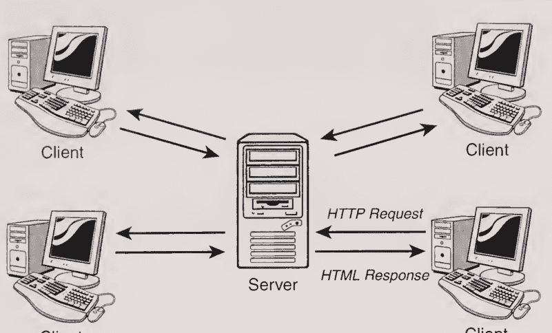

图 1.1 服务器和客户端（浏览器）如何交互。

第 3 课“使用 HTTP 协议发送请求”将详细讨论 HTTP 请求，以便页面能够正确识别，包括以下内容：

- 页面存储的域（例如 `mydomain.com`）
- 页面系统中的文件名（例如 `page.html`）
- 你随请求的参数

## 什么是网页？

任何有过万维网经验的人都会熟悉“网页”术语。网站涉及访问者在一系列相互连接的页面之间导航，每个页面包含文本、图像等。通常，每个网页实际上是服务器上的单独文件。网站的各个页面集合由名为 Web 服务器的程序管理。

> **注意**：在通俗用语中，术语 `web server` 既指网络服务器（如 `Apache`），也指运行该程序的计算机。

### Web 服务器

网络服务器是一种程序，能够解析 HTTP 请求并以浏览器能够理解的形式传递相应的网页。在 UNIX/Linux 或某些版本的 Windows 系统下，或许著名的应用来自 Apache 软件基金会（http://www.apache.org）的 `Apache Web Server`，这是一个开源项目，用于全球百万网站提供服务（参见图 1.2）。

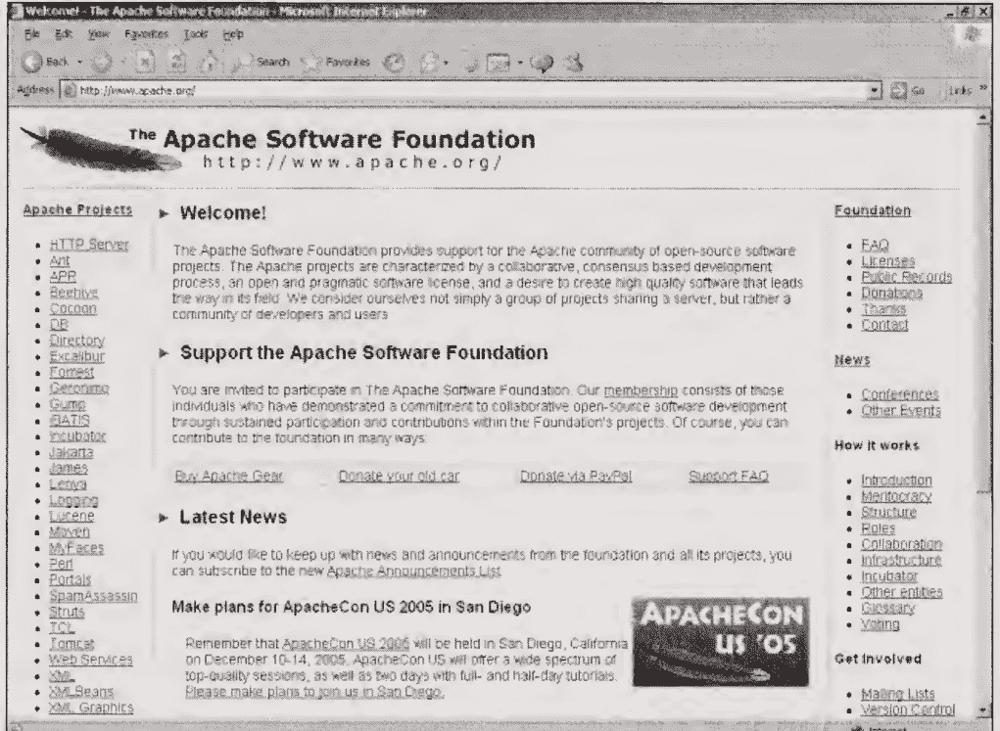

> **光盘内容**：`Ajax Starter Kit` 光盘包含了适用于 Windows、Mac 和 Linux 的 Apache。另一个例子是微软的 `IIS`（Internet Information Services），它常用于运行 Windows 操作系统的主机上。

### 服务端编程

服务端程序、脚本或语言，指的是在服务器计算机上运行的程序。用于服务端编程的语言和工具有很多，包括 `PHP`、`Java` 和 `ASP`（后者仅可在运行 Windows 操作系统的服务器上使用）。复杂的服务端设置通常包括供服务端脚本访问数据库信息。此类脚本的用途多样。总的来说，它们都旨在将网页预处理后再返回给您。这意味着页面的部分或全部内容会被修改以适应您的请求上下文——例如显示特定目的地、特定日期的时刻表，或仅显示目录中与您所述爱好和兴趣匹配的产品。通过这种方式，服务端脚本使得网页可以提供丰富样的内容，这是任何仅使用静态页面无法达到的。

> **注意**：本书中的服务端编程使用流行的 `PHP` 脚本进行，该语言灵活、易用，并且几乎可以在所有服务器上运行。然而，Ajax 与任何服务端语言配合都能同样良好地工作。

### 网页浏览器

网页浏览器是网络浪者计算机上的一个程序，用于解析和显示网页。第一个图形化浏览器 Mosaic 最终发展成了 Netscape 生产的著名浏览器系列。

> **注意**：所谓图形化浏览器，指的是不仅能显示 HTML 文档的文本元素，还能显示图像和颜色的浏览器。通常，此类浏览器具有使用鼠标或类似指点设备的点击式界面。

也存在基于文本的网页浏览器，其中最知名的是 `Lynx`（http://lynx.browser.org/），它在基于字符的显示器（如终端、终端仿真器）和具有命令行界面的操作系统（如 DOS）上显示 HTML 页面。

Netscape 系列浏览器是最成功的可用浏览器，但最终加入了微软的 `Internet Explorer`，后者随后占据了市场主导地位。

然而，近期的竞争性努力引入了多种竞争性的浏览器产品，包括 `Opera`、`Safari`、`Chrome`，尤其是 Mozilla 的 `Firefox`，这是一款开源网页浏览器，最近赢得了一批热情的追随者（参见图 1.3）。浏览器在许多计算机操作系统上都易于获得，包括各种版本的 Windows、UNIX/Linux 和 Macintosh，以及其他计算设备，从移动电话到 PDA（个人数字助理）和掌上电脑。

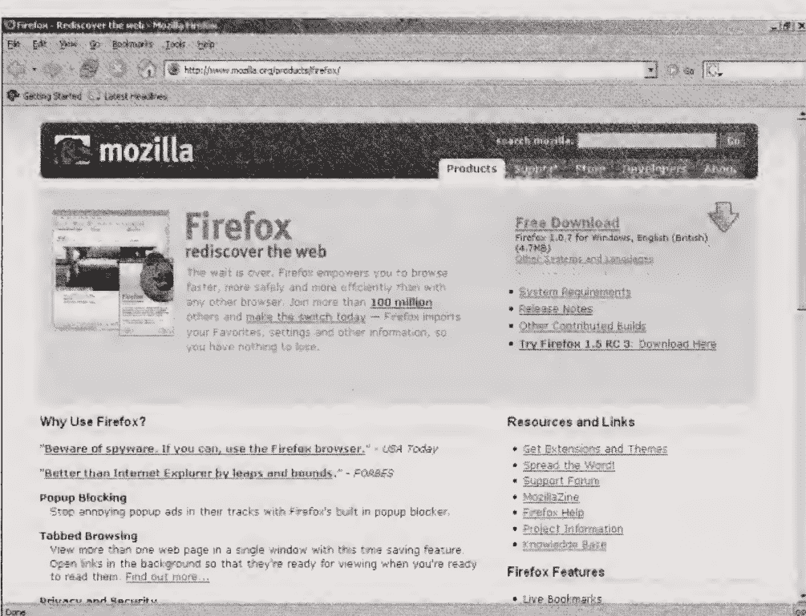

图 1.3 来自 Mozilla.org 的 Firefox 浏览器正在浏览 Firefox 项目主页。

### 客户端编程

我们已经讨论了服务端脚本如何通过提供在……（此处内容不完整，已按要求保留排版）


页面上的第一个元素被称为 `DOCTYPE` 元素。其目的是通知浏览器文档中使用的 HTML "版本"。本书中使用的 `DOCTYPE` 元素指的是 `HTML 4.0 Transitional`，这是 HTML 规范中一个相当宽松的版本，除了最新的 HTML 4.0 规范外，还允许使用一些早期的标记风格和结构。`DOCTYPE` 元素必须始终出现在 HTML 文档的最开始。接下来，请注意文档的其余部分被页面开始的 `<html>` 元素和结束的 `</html>` 元素所包围。这些标签通知浏览器，它们之间的内容应被解释并显示为 HTML 文档。这些外部标签内的文档被进一步分为两个部分。第一部分包含在 `<head>` 和 `</head>` 标签中，第二部分包含在 `<body>` 和 `</body>` 之间。本质上，文档的 `head` 部分用于存储不应在浏览器窗口中显示的信息，而文档的 `body` 部分则包含通过浏览器窗口解释并显示给用户的文本。

> **：** 尽管许多现代浏览器可以正确显示没有这些标签的 HTML，但省略它们是不良实践。即使页面在你自己的 PC 上显示正确，你也无法知道访问者可能使用什么操作系统和浏览器——他可能就没那么幸运了。

### 文档的 `<head>` 部分

从代码清单 2.1 中我们可以看到，我们简单的 HTML 文档的 head 部分只包含一行——被 `<title>` 和 `</title>` 标签包围的 "A Simple HTML Document" 这几个词。请记记住，`head` 部分包含不显示在浏览器窗口中的信息。因此，这不是显示在页面文本顶部的标题，你可以再次查看图 2.1 来确认。文档标题也不是指文档的文件名，在这种情况下是 `testpage.html`。事实上，文档标题承担着多项功能，其中包括：

字体 搜索引擎通常使用页面标题（以及其他因素）来帮助它们判断页面的内容。
- 当你为页面添加书签时，它通常默认保存为文档标题。
- 大多数浏览器在最小化时，会在其图标或任务栏按钮上显示当前文档的标题。

因此，为你创建的每个页面选择一个有意义且具有描述性的标题非常重要。

文档的 `head` 部分还使用了其他许多元素类型，包括 `link`、`meta` 和 `script` 元素。虽然我们在这里没有对它们进行详细说明，但它们在本书中会在出现时进行描述。

### 文档的 `<body>` 部分

再次参考代码清单 2.1，我们可以清楚地看到，文档 `body` 部分的内容由我们希望在页面上显示的文本以及一些帮助我们定义文本外观的标签组成。

例如，要定义某些词应以粗体显示，我们将这些词包含在 `<b>` 和 `</b>` 标签中。类似，要将某些词转换为斜体，我们可以使用 `<i>` 和 `</i>` 标签。

标题 "My HTML Page" 包含在 `<h1>` 和 `</h1>` 标签之间。这些标签表示我们打算将包围的文本作为标题。HTML 允许六级标题，从 `h1`（最突出）到 `h6`。你可以使用任何中间值 `h2`、`h3`、`h4` 和 `h5` 来显示具有不同级别子标题的页面，例如对应于章、节和段落标题。标题标签内显示的任何内容都会单独显示在一行上。

> **提示：** 如果你想在 HTML 页面的 body 部分编写内容，但不 希望它被浏览器解释并因此显示在屏幕上，你可以将其编写为注释。HTML 注释以字符串 `<!--` 开头，以字符串 `-->` 结尾，如本例所示：

```
<!-- this is just a comment and won't be displayed in the browser -->
```

到目前为止讨论的所有标签都是容器——也就是说，它们由开始标签和结束标签组成，你将需要这些标签作用的文本放在它们之间。然而，有些元素不是容器，但可以单独使用。代码清单 2.1 展示了这样一个元素：`<br />` 标签，表示换行。另一个例子是 `<hr />`（水平线）。

### 为 HTML 元素添加属性

有时需要确切指定标记标签应如何行为。在这种情况下，你可以添加（通常在开始标签内）参数和值对，称为属性，以更改元素的行为：

```html
<body bgcolor="#cccccc">
... page content goes here ...
</body>
```

在这个例子中，`<body>` 标签的行为已通过将其 `BGCOLOR`（背景颜色）属性调整为浅灰色而被修改。图 2.2 显示了将其应用于我们的文件 `testpage.html` 时的效果：

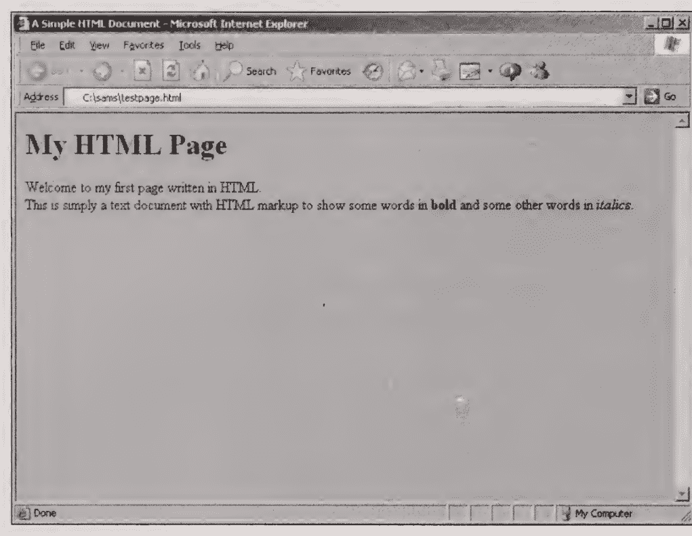

**图 2.2** 我们的测试页面，主体颜色更改为灰色。

> **提示：** HTML 中的颜色值使用十六进制系统编码。每个颜色值由三个分量值组成，分别对应红色、绿色和蓝色。每个颜色值可以是从十六进制 00 到十六进制 ff（十进制表示 0 到 255）。这三个十六进制数字连接成一个以井号字符 # 为前缀的字符串。因此，颜色值 `#000000` 对应黑色，`#ffffff` 对应纯白色。

### 图像

可以通过 `` 标签将图像插入我们的页面。在这种情况下，我们使用 `src` 属性将图像的源文件指定为参数。我们还可以通过这种方式改变图像显示的其他方面，包括图像的边框、宽度和高度：

```html

```

边框、宽度和图像高度以像素为单位。

> **提示：** 图像另一个有用属性是 `alt`，它是 alternative text 的缩写。指定了图像的简短描述，提供给无法显示图像的浏览器。替代文本对于视力障碍人士也关重要：

```html

```

### 表格

通常你希望以表格格式显示信息，HTML 有一组设计的元素：

```html
<table>
<tr><th>Column Header 1</th><th>Column Header 2</th></tr>
<tr><td>Data Cell 1</td><td>Data Cell 2</td></tr>
<tr><td>Data Cell 3</td><td>Data Cell 4</td></tr>
</table>
```

`<table>` 和 `</table>` 标签包含嵌套结构，包括 `<tr>` 和 `</tr>`，定义表格行；`<th>` 和 `</th>`，表示表格标题；`<td>` 和 `</td>`，包含数据单元格。提前查看图 2.3，了解表格在浏览器窗口中显示时的示例。

### 超链接

文本链接（超链接）是 HTML 的基础。通过超链接你可以导航到新位置，可以是当前页面上的另一点，也可以是另一个网站上某个点。链接包含在 `<a>` 或 `</a>` 标签中，这是一个容器，包围链接的内容。地址作为参数传递给此标签：

```html
<a href="newpage.html">my hyperlink</a>
```

在上面的示例中单击 "my hyperlink" 会导致请求页面 `newpage.html`。

> **提示：** 超链接可以包含图像以及文本。看这个例子：

`<a href="newpage.html"></a>`

### 一个更高级的 HTML 页面

让我们重新访问 `testpage.html` 并添加额外的元素。代码清单 2.2 展示了 `seville.html`，它从我们的原始 HTML 页面而来，但在文档的 `<body>` 部分包含不同的内容。图 2.3 显示了这次在 Mozilla Firefox 中显示页面时的外观。

现在我们已经为文档的 body 区域应用了背景调。body 区域的内容在页面上居中，并且该内容现在包括一个图像（我们设置了两像素宽的边框）、一个标题和一个副标题、一个简单的表格和一些文本。

```html
<!DOCTYPE HTML PUBLIC "-//W3C//DTD HTML 4.0 Transitional//EN" "http://www.w3.org/TR/html4/loose.dtd">
<html>
<head>
<title>A Simple HTML Document</title>
</head>
<body bgcolor="#cccccc">
<center>

<h1>Guide to Seville</h1>
<h3>A brief guide to the attractions</h3>
```

### 一个更复杂的 HTML 页面

```html
<table border="2">
<tr>
    <th bgcolor="#aaaaaa">Attraction</th>
    <th bgcolor="#aaaaaa">Description</th>
</tr>
<tr>
    <td>Cathedral</td>
    <td>Dating back to the 15th century</td>
</tr>
<tr>
    <td>Alcazar</td>
    <td>The medieval Islamic palace</td>
</tr>
</table>
<p>Enjoy your stay in beautiful Seville.</p>
</center>
</body>
</html>
```

让我们更仔细地研究一下部分代码。首先，我们使用了 `<body>` 标签的 `BGCOLOR` 属性来为页面提供整体的背景调：

```html
<body bgcolor="#cccccc">
```

正文区域中的内容都包含在 `<center>` 标签（紧接在 body 标签之后）及其配对标签 `</center>`（紧接在闭合 body 标签之前）之间。这确保了我们的内容在页面上都是居中的。

主标题像之前一样包含在 `<h1>` ... `</h1>` 标签中，但现在后面跟着一个使用 `<h3>` ... `</h3>` 标签的子标题，以提供略小的字体大小。

通过在开始的 `<table>` 标签中使用 `border` 属性，我们为表格设置了两像素的边框宽度：

```html
<table border="2">
```

同时，我们通过使用 `<th>` 元素的 `BGCOLOR` 属性，略微加深了表格表头单元格的背景：

```html
<th bgcolor="#aaaaaa">Attraction</th>
```

# 一些有用的 HTML 标签

表 2.1 列了一些更流行的 HTML 标签。

### 表 2.1 一些常见的 HTML 标记元素

| 标签 | 描述 |
| :--- | :--- |
| **文档标签** | |
| `<html>...</html>` | 整个文档 |
| `<head>...</head>` | 文档头部 |
| `<body>...</body>` | 文档主体 |
| `<title>...</title>` | 文档标题 |
| **样式标签** | |
| `<a>...</a>` | 超链接 |
| `<b>...</b>` | 粗体文本 |
| `<em>...</em>` | 强调文本 |
| `<font>...</font>` | 更改字体字体 |
| `<i>...</i>` | 斜体文本 |
| `<small>...</small>` | 小号文本 |
| `<table>...</table>` | 表格 |
| `<tr>...</tr>` | 表格行 |
| `<th>...</th>` | 表格头单元格 |
| `<td>...</td>` | 表格单元格 |
| `<ul>...</ul>` | 项目符号列表 |
| `<ol>...</ol>` | 有序（编号）列表 |
| `<li>...</li>` | 项目符号或有序列表中的项 |

> **提示：** 万维网负责管理 HTML、XML 以及其他技术的定义。其网站位于 `http://www.w3.org/`。

# 理解层叠样式

前面介绍的网页样式方法有一些缺点。首先，你需要明确声明每个元素的属性。当改变页面的外观时，你需要逐行检查并更改每个属性。对于几个简单的页面来说可能没问题，随着内容增加，页面会变得难以维护。此外，应用于 HTML 元素的属性范围有限的。

为了实现这个目标，你可以使用样式标签嵌入到你的文档中：

```html
<style type="text/css">
    ... 样式定义 ...
</style>
```

或者，也可以从外部文件链接，使用 `link` 元素，放在文档头部：

```html
<link rel="stylesheet" href="stylesheet.css" type="text/css" />
```

> **提示：** 你甚至即时定义样式。这些被称为内联样式，可以应用于单个元素。以代码清单 2.2 的 body 标签为例：

```html
<body bgcolor="#cccccc">
```

你可以使用内联样式实现相同的效果：

```html
<body style="background-color:#cccccc">
```

# 设置样式规则

样式表允许你为各种 HTML 元素设置样式。一个规则有两个部分：选择器，用于标识规则应影响哪个标签；以及声明，其中包含你的规则。以下示例为段落元素 `<p>` 定义了一个样式：

```css
P {color: #33333}
```

此示例确定，任何包含在段落标签 `<p>...</p>` 中的文本都应使用深灰色显示。你也可以为标签指定多个规则。除了灰色文本外，你希望段落元素中的所有文本以斜体显示：

```css
P {color: #33333; font-style: italic}
```

一个样式表可以根据你的需要包含任意数量的规则。你还可以通过用逗号分隔选择器，将一个声明应用于多个标签。以下规则确定所有 `h1`、`h2` 和 `h3` 标题显示为蓝色文本：

```css
H1, H2, H3 {color: blue}
```

## 总结

本课讨论了使用超文本标记进行网页布局的基础知识，包括 HTML 文档的结构、HTML 页面元素的示例，以及使用元素属性和层叠样式进行页面样式。

万维网上的通信使用各种协议，其中最重要的可能是 HTTP，该协议也是 Ajax 应用程序的基础。本课介绍 HTTP 协议，并展示如何使用它来请求和接收信息。

### 介绍 HTTP

HTTP 或超文本传输协议是万维网的主要协议。当你在 Web 浏览器中输入地址来请求一个网页时，该请求就是使用 HTTP 发送的。浏览器是一个 HTTP 客户端，而网页服务器（毫不意外）是一个 HTTP 服务器。

本质上，HTTP 定义了一套关于服务器和浏览器之间如何格式化和交换消息及数据的规则。

### 为什么我需要了解这个？

Ajax 使用 HTTP 协议发送服务器请求。认识不同类型的 HTTP 请求以及服务器可能返回的响应非常重要。Ajax 应用程序需要构造 HTTP 请求查询服务器，并将根据 HTTP 响应的内容来决定下一步做什么。

### 本课涵盖（和未涵盖）的内容

完全可以用本书来介绍 HTTP 协议的信息，但在这里我们仅从在请求网页和传递信息方面的作用来讨论它。

在本课中，你将了解 HTTP 请求和响应的结构，并了解 HTML 表单如何使用此类请求在网页之间传输数据。

> **提示：** 有关 HTTP 的详细说明，请参阅 Sams Publishing 出版的 Chris Shiflett 所著的《HTTP Developer's Handbook》。

# HTTP 请求与响应

HTTP 协议可以比作基于一系列问题和答案的对话，我们分别称之为 `HTTP 请求` 和 `HTTP 响应`。

HTTP 请求和响应的内容易于阅读和理解，其语法非常接近纯英文。本节将探讨这些请求和响应的结构，以及它们可能包含的一些数据类型的示例。

# HTTP 请求

与目标服务器建立连接后，HTTP 客户端以以下格式传输请求：

- 一个起始行
- 可选地，一些首部行
- 一个空行
- 可选地，一个消息体

起始行通常分为三个部分：方法名称、所需服务器资源的路径以及所使用的 HTTP 版本。一个典型的起始行如下所示：

```
GET /sams/testpage.html HTTP/1.0
```

在这一行中，我们告诉服务器正在发送一个 GET 类型的 HTTP 请求（下一节将更详细地解释），我们使用 HTTP 版本 1.0 发送此请求，并且我们所需的服务器资源（包括其本地路径）是 `/sams/testpage.html`。

### HTTP 响应头

请求头行用于发送关于请求或消息体中所发送数据的信息。每行发送一个参数和值对，参数和值之间用冒号分隔。以下是一个示例：

```
User-Agent: [name of program sending request]
```

例如，Internet Explorer v5.5 提供的内容类似于：


```
User-agent: Mozilla/4.0 (compatible; MSIE 5.5; Windows NT 5.0)
```

另一个常见请求头的例子是 `Accept` 头，它表明了服务器响应中哪些类型的信息是可接受的：

```
Accept: text/plain, text/html
```

> **注意：** HTTP 请求方法包括 `POST`、`GET`、`PUT`、`DELETE` 和 `HEAD`。在我们研究 Ajax 的过程中，最有趣的是 `GET` 和 `POST` 请求。`PUT`、`DELETE` 和 `HEAD` 请求此处不涉及。

通过发送前面示例中的头信息，请求正在告知服务器，发送应用程序可以接受纯文本或 HTML 响应（也就是说，它不具备处理音频或视频文件等数据的能力）。

> **注意：** 在此示例中，我们请求的服务器资源位于我们自己的服务器上，因此我们使用了相对路径。当然，它也可能位于其他地方的另一个服务器上，此时服务器资源将包含完整的 URL。

### HTTP 响应

为了响应这样的请求，服务器通常会发出一个 HTTP 响应，其第一行通常称为状态行。在该行中，服务器会回显 HTTP 版本，并给出一个响应状态码（一个三位数整数）和一个称为原因短语的简短消息。以下是一个 HTTP 响应示例：

```
HTTP/1.0 200 OK
```

响应状态码和原因短语本质上是同一消息的机器可读版本和人类可读版本，尽管原因短语在不同服务器之间可能略有差异。表 3.1 列出了一些常见状态码和原因短语的示例。状态码的第一位通常提供了关于消息性质的线索：

- 1xx — 信息性
- 2xx — 成功
- 3xx — 重定向
- 4xx — 客户端错误
- 5xx — 服务器错误

#### 表 3.1 一些常见的 HTTP 响应状态码

| 状态码 | 说明 |
| :--- | :--- |
| 200 - OK | 请求成功。 |
| 204 - No Content | 文档不包含任何数据。 |
| 301 - Moved Permanently | 资源已永久移动到不同的 URI。 |
| 401 - Not Authorized | 请求需要用户认证。 |
| 403 - Forbidden | 服务器已拒绝执行该请求。 |
| 404 - Not Found | 请求的资源在服务器上不存在。 |
| 408 - Request Timeout | 客户端未能在服务器允许的时间内发送请求。 |
| 500 - Server Error | 由于脚本错误、服务器配置错误或类似问题。 |

> **提示：** 万维网联盟 (W3C) 维护着一份详细的状态码列表，可在 `http://www.w3.org/Protocols/rfc2616/rfc2616-sec10.html` 查阅。

响应也可能包含头行，每行包含一个头和值对，类似于 HTTP 请求，但通常包含有关服务器和/或所返回资源的信息：

```
Server: Apache/1.3.22
Last-Modified: Fri, 24 Dec 1999 13:33:59 GMT
```

### HTML 表单

网页通常包含可以输入信息的字段。示例包括选择框、复选框和可以输入信息的字段。表 3.2 列出了一些常用的 HTML 表单标签。

#### 表 3.2 一些常用的 HTML 表单标签

| 标签 | 描述 |
| :--- | :--- |
| `<form>...</form>` | 整个表单的容器 |
| `<input />` | 数据输入元素；包括文本、密码、复选框和单选按钮字段，以及提交和重置按钮 |
| `<select>...</select>` | 下拉选择框 |
| `<option>...</option>` | 选择框内的可选项 |
| `<textarea>...</textarea>` | 多行文本输入框 |

完成表单后，通常会提示您通过一个标签适当的按钮或其他页面元素来提交它。

此时，HTML 表单根据用户输入的数据构建并发送一个 HTTP 请求。表单可以使用 `GET` 或 `POST` 请求类型，这由 `<form>` 标签的 `method` 属性指定。

### GET 和 POST 请求

偶尔可能会听到这样的说法：`GET` 和 `POST` 请求之间的区别在于，`GET` 请求仅用于获取（即检索）数据，而 `POST` 请求则有多种用途，例如上传数据、发送邮件等。

尽管这种经验法则可能有一定道理，但考虑这两种 HTTP 请求在构建方式上的差异，对我们很有启发。`GET` 请求将其发送的消息编码到一个查询字符串中，并附加到服务器资源的 URL 后面。另一方面，`POST` 请求将其消息放在请求体中发送。实际上发生的情况是，输入的数据被编码，并通过 HTTP 请求发送到表单，`action` 属性声明的 URL 处将以某种方式处理的数据。HTTP 请求是 `GET` 类型还是 `POST` 类型，以及表单发送到的 URL，都是由表单标记决定的。让我们看一下一个典型表单：

```
<form action="http://www.sometargetdomain.com/somepage.htm" method="post">
  Your Surname: <input type="text" size="50" name="surname" />
  <br />
  <input type="submit" value="Send" />
</form>
```

这段代码片段嵌入到网页中，会产生如图 3.1 所示的简单表单。

JavaScript 也可以添加到 HTML 页面的头部部分。这是保存 JavaScript 函数的常见位置，我们将在稍后描述。

## 事件处理程序

通常，你希望执行 JavaScript 代码是因为发生了某些特定事件。例如，在 HTML 表单中，你可能决定让 JavaScript 检查用户输入数据的有效性。

用户在提交表单的那一刻，或者在某些情况下，每当特定按钮被点击时，你可能希望通过弹出警告对话框来提醒用户。

为了实现这些效果，你需要使用浏览器提供的特殊接口，称为`事件处理程序`。事件处理程序允许你在特定类型的事件发生时自动调用 JavaScript 方法。请看以下代码：

```html
<form>
<input type="button" value="Click Here"
   onClick="alert('Thanks for clicking!')">
</form>
```

在这里，我们使用 `onClick` 事件处理程序来捕获用户点击按钮的动作。当检测到用户的点击时，脚本会执行 `input` 标签中 `onClick` 属性里列出的指令：

```javascript
onClick="alert('Thanks for clicking!')"
```

这一行调用了 JavaScript 的 `alert` 方法，该方法会弹出一个包含消息和“确定”按钮的对话框。显示在警告对话框中的消息，包含在作为参数传递给 `alert` 方法的字符串中。

让我们将这段代码添加到我们的 HTML 文档中，如清单 4.2 所示。完成修改后，将页面保存为 `testpage4.html`，然后在浏览器中加载它。

### 清单 4.2 从 onClick 事件处理程序调用 alert()

```html
<!DOCTYPE HTML PUBLIC "-//W3C//DTD HTML 4.01 Transitional
  //EN" "http://www.w3.org/TR/html4/loose.dtd">
<html>
<head>
<title>A Simple HTML Document</title>
</head>
<body bgcolor="#cccccc">
<center>

<h1>A More Advanced HTML Page</h1>
<h3>Welcome to my second page written in HTML.</h3>
<table border="2">
<tr>
  <th bgcolor="#aaaaaa">Vegetables</th>
  <th bgcolor="#aaaaaa">Fruits</th>
</tr>
<tr>
  <td>Carrot</td>
  <td>Apple</td>
</tr>
<tr>
  <td>Cabbage</td>
  <td>Orange</td>
</tr>
</table><br />
<p>... and here's some text in a paragraph.</p>
<script language="JavaScript" type="text/javascript">
document.writeln("This line was written using JavaScript!")
</script>
<form>
<input type="button" value="Click Here" onClick="alert('Thanks for clicking!')">
</form>
</center>
</body>
</html>
```

我们的 HTML 页面现在应该会显示新的按钮，如图 4.2 所示。

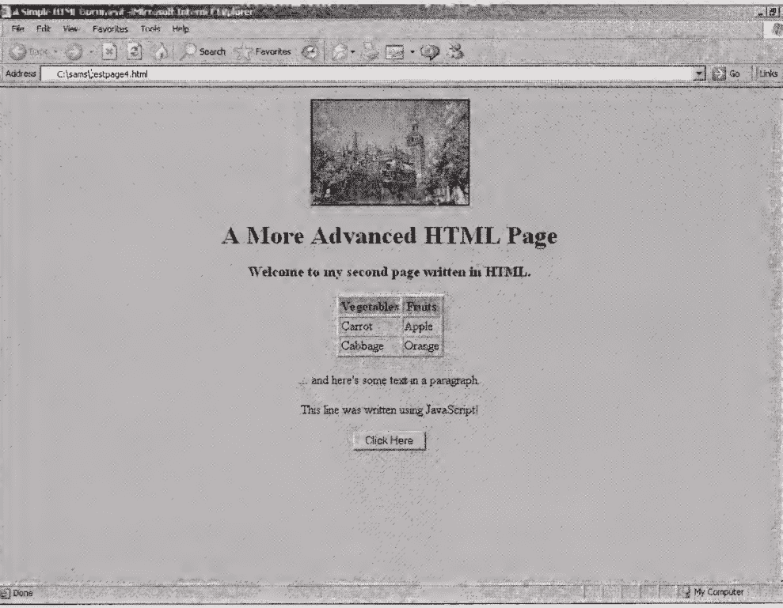

继续并点击该按钮。如果一切按计划进行，将会弹出一个警告对话框，如图 4.3 所示。你可以点击“确定”来关闭对话框。

## 创建函数

通常，你需要组合各种 JavaScript 方法和对象，可能涉及多行代码。JavaScript 允许你将这样的指令块组合起来并为其命名，使你的代码更易于编写、理解和维护。

例如，让我们使用另一个事件处理程序，但这次我们将用它来调用一个函数，而不是直接调用 JavaScript 方法。

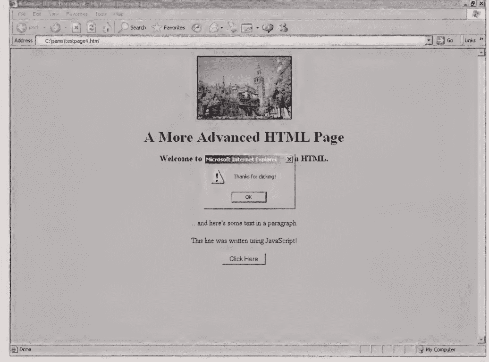

图 4.3 点击新按钮后出现的对话框。

这是我们函数的代码，我们将把它放在 HTML 文档的 `head` 部分：

```javascript
<script language="JavaScript">
function showAlert()
{
    alert("A Picture of Seville")
}
</script>
```

> 注意：请注意，函数定义总是以单词 `function` 开头，后跟函数名。函数内的语句包含在花括号 `{}` 中。

在通常的 `<script>` 标签内，我们现在定义了一个名为 `showAlert` 的函数，它执行花括号内包含的命令。在这种情况下，只有一个命令，即调用之前遇到的 `alert` 方法。

我们希望当用户的鼠标移过网页中的照片时，这个警告对话框出现。因此，我们将向包含图像的 `` 标签添加一个属性，如下所示：

```html

```

这一行使用 `onMouseOver` 事件处理程序来检测光标何时进入照片占据的区域。当这种情况发生时，我们新的函数 `showAlert` 就会被调用。

清单 4.3 显示了修改后的代码。

### 清单 4.3 使用 onMouseOver 事件处理程序

```html
<!DOCTYPE HTML PUBLIC "-//W3C//DTD HTML 4.01 Transitional//EN"
"http://www.w3.org/TR/html4/loose.dtd">
<html>
<head>
<title>A Simple HTML Document</title>
<script language="JavaScript" type="text/javascript">
function showAlert()
{
alert("A Picture of Seville")
}
</script>
<head>
<body bgcolor="#cccccc">
<center>

<h1>More Advanced HTML Page</h1>
<h3>Welcome to my second page written in HTML.</h3>
<table border="2">
<tr>
  <th bgcolor="#aaaaaa">Vegetables</th>
  <th bgcolor="#aaaaaa">Fruits</th>
</tr>
<tr>
  <td>Carrot</td>
  <td>Apple</td>
</tr>
<tr>
  <td>Cabbage</td>
  <td>Orange</td>
</tr>
</table><br />
<p>... and here's some text in a paragraph.</p>
<script language="JavaScript" type="text/javascript">
document.writeln("This line was written using JavaScript!")
</script>
<form>
<input type="button" value="Click Here" onClick="alert('Thanks for clicking!')">
</form>
</center>
</body
</html>
```

将此 HTML 文档加载到浏览器后，将鼠标移到照片上方。会出现一个警告框，显示消息 Picture of Seville。

## 向传递参数

当然，我们可以很容易从页面中的事件处理程序中调用函数，并让它弹出对话框。不幸的是，警告框中的消息始终是 Picture of Seville。如果我们能告诉函数显示什么消息，这样就可以为不同的情况设置不同的消息。我们可以将消息作为参数传递给函数：

```javascript
<script language="JavaScript" type="text/javascript">
function showAlert(message)
{
    alert(message)
}
</script>
```

这个函数现在期望在调用时作为参数传递定义消息。修改图像的 `onMouseOver` 事件处理程序以此参数：

```html

```

我们还将修改按钮的 `onClick` 事件处理程序以这个函数，但使用不同的消息：

```html
<input type="button" value="Click Here"
    onClick="alert('Thanks for clicking!')" />
```

清单 4.4 显示了修改后的代码。

### 清单 4.4 从事件处理程序调用 JavaScript 函数

```html
<html
<head>
<title>A Simple HTML Document</title>
<script language="JavaScript" type="text/javascript">
function showAlert(message)
{
  alert(message)
}
</script>
</head>
<body bgcolor="#cccccc">
<center>

<h1>A More Advanced HTML Page</h1>
<h3>Welcome to my second page written in HTML.</h3>
<table border="2">
<tr>
  <th bgcolor="#aaaaaa">Vegetables</th>
  <th bgcolor="#aaaaaa">Fruits</th>
</tr>
<tr>
  <td>Carrot</td>
  <td>Apple</td>
</tr>
<tr>
  <td>Cabbage</td>
  <td>Orange</td>
</tr>
</table><br />
<p>... and here's some text in a paragraph.</p>
<script language="JavaScript" type="text/javascript">
document.writeln("This line was written using JavaScript!")
</script>
<form>
<input type="button" value="Click Here" onClick="alert('Thanks for clicking!')">
</form>
</center>
</body
</html>
```

## 其他事件处理程序

到目前为止，你已经看到了 `onClick` 和 `onMouseOver` 事件处理程序的示例。还有许多事件处理程序可供使用；表 4.1 列出了一些最受欢迎的事件处理程序。

### 表 4.1 一些常见的 事件处理程序

| 事件处理程序 | 说明 |
| :--- | :--- |
| onChange | 当输入字段中的值发生变化时发生 |
| onClick | 当用户在指定元素上点击鼠标时发生 |
| onLoad | 当页面完成加载时发生 |
| onMouseOver | 当鼠标指针进入指定元素占据的屏幕区域时发生 ... |
| onMouseOut | ... 以及当它离开时发生 |
| onSubmit | 在表单提交的那一刻发生 |

## 在 JavaScript 中操作数据

你可以使用 JavaScript 实现的功能远不止弹出对话框。JavaScript 让你有机会定义和使用变量和数组，处理日期和时间运算，以及循环和条件分支控制程序流程。

### 变量

如果你曾经做过任何代数，或者用几乎任何计算机语言编写过程序，那么变量的概念你可能已经很熟悉了。变量是一段被赋予名称的数据，你可以通过这个名称方便在以后引用它。在 JavaScript 中，你使用关键字 `var` 声明变量：

```javascript
var speed = 63;
```

上面这行代码声明了变量 `speed`，并通过赋值运算符 `=` 将其赋值为 `63`。

我们现在可以在其他语句中使用这个变量：

```javascript
var speedlimit = 55;
var speed = 63;
var excess_speed = speed - speedlimit;
```

content]
该函数的第一个操作是将用户输入的值赋给变量 `numentered`。然后我们测试该数字的有效性，检查它是否大于或等于1且小于或等于10。根据结果，我们或者向调用表单返回一个 `true` 值（从而允许提交表单），或者弹出一个对话框告知错误。在后一种情况下，当用户点击“确定”清除对话框时，一个 `false` 值被返回给调用表单，阻止表单提交，直到用户输入适当的数据。

## 总结

本课涵盖了 JavaScript 编程的基础知识。我们了解了如何将 JavaScript 命令集成到 HTML 页面中，讨论了将 JavaScript 命令分组为函数，以及学习了如何使用事件处理程序来启动 JavaScript 命令和函数。


Ajax 应用程序几乎可以与任何服务器端语言协同工作，只需服务器能对其 HTTP 请求返回格式正确的响应。本课将介绍 PHP，这是一种流行的开源脚本语言，在全球大量网络服务器上使用。

### 介绍 PHP

与 JavaScript 类似，PHP 由可以嵌入页面 HTML 代码中的命令组成。然而，PHP 是一种服务器端编程语言——也就是说，它与 Web 服务器协同工作，在将页面发送到浏览器之前处理该页面的源代码。

### 为什么我需要了解这个？

正如你已经意识到的，Ajax 应用程序会调用 Web 服务器，并随后在当前查看的页面中使用返回的信息。你需要一种在服务器上运行程序来处理 Ajax 请求并返回所需数据的方法。

Ajax 可以与各种服务器端技术协同工作，包括 PHP、ASP、Java 等。本书使用 PHP，可以说是在可用的服务器端语言中最流行且易于使用的。

本课为从未接触过 PHP 的人提供 PHP 入门介绍，并为任何接触过的人提供基础知识的复习。

### 本课涵盖（和不涵盖）的内容

就像本书这部分的每一课一样，对该主题的每个方面进行详尽的课程既不可行也不合适。

本课涵盖 PHP 编程的基础知识，并提供一些实际示例，主要集中在与我们探索 Ajax 最相关的 PHP 方面。

### 在 HTML 页面中嵌入 PHP

PHP 语句通过用 `<?php` 和 `?>` 标签包围 PHP 语句来嵌入到 HTML 文档中。在页面提供给浏览器之前，这些标签之间的任何内容都会被 Web 服务器求值，并替换为适当的 HTML 代码。

你可以在页面中使用任意多组 `<?php` 和 `?>` 标签。

### 从 PHP 输出 HTML

一些 PHP 命令可以帮助你将文本和 HTML 代码直接写入页面。也许最简单的是 `echo` 命令：

```php
echo "I wrote this line using PHP";
```

上面的语句只是将 "I wrote this line using PHP" 放置在 HTML 文档中恰好是 PHP 语句所在的位置。

代码清单 5.1 显示了一个 PHP 文件的源代码，用于在浏览器窗口中打印 Hello World。

```
代码清单 5.1 用 PHP 打印 Hello World
<html>
<head>
<title>A Simple PHP Script</title>
</head>
<body>
<?php echo "<h1>Hello World!</h1>"; ?>
</body>
</html>
```

注意，在此脚本中，输出字符串也包含一些 HTML 标签，`<h1>` 和 `</h1>`。由于 PHP 语句在将页面提供给我们之前由 Web 服务器执行，因此这些标签与 “Hello World” 文本一起被写入文档的 HTML 中，并由我们的浏览器与文档中的所有其他 HTML 标记一起求值。图 5.1 显示了浏览器显示我们的 “Hello World” 页面。

如果我们要求浏览器显示此页面的源代码，它会显示以下代码，在其中我们可以看到 PHP 元素已被 Web 服务器完全求值，它将相关的 HTML 插入到了页面中：

```
<html>
<head>
<title>A Simple PHP Script</title>
</head>
<body>
<h1>Hello World!</h1></body>
</html>
```

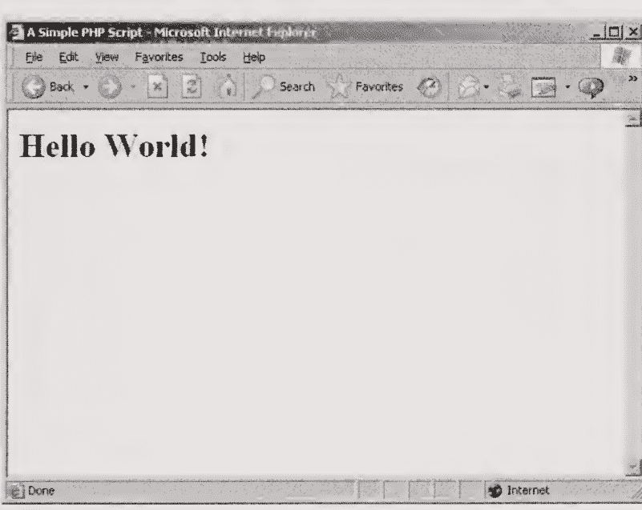

**图 5.1** PHP 中的 “Hello World”。

> **注意：** PHP 中的变量名区分大小写。例如， `$varname` 和 `$VarName` 代表两个不同的变量。请确保以正确的大小写输入变量名。

### PHP 中的变量

PHP 中的变量，与任何编程语言中的变量一样，是存储数据片段的命名口袋。PHP 中所有变量名必须以 “$” 字符开头，后跟由字母、数字和下划线组成的字符串。

我们可以在 PHP 中给变量赋值，而无需事先声明变量：

随书附赠光盘：Ajax Starter Kit 光盘中包含了适用于 Windows、Mac 和 Linux 的 PHP。

提示：想要学习更完整的 PHP 课程，请尝试 Chris Newman 编写的《Sams Teach Yourself PHP in 10 Minutes》（位于 Ajax Starter Kit 光盘上）。

提示：Web 服务器通常通过文件扩展名来识别哪些文件包含 PHP 代码，并相应地处理它们。PHP 文件最常用的扩展名是 `.php`，但你也可能会看到 `.php3`、`.php4`、`.phtml` 和其他各种扩展名。为了让你的代码尽可能适用于多种 Web 服务器环境，最好坚持使用 `.php`。

```php
$score = 71;
$player = 'Harry Scott';
```

变量可以采用多种数据类型，包括字符串、整数、浮点数布尔值（真或假）。当变量赋值时，如前面的示例，PHP 会自动分配类型。

### 数字

PHP 提供所有数学运算符，如下所示：

```php
$answer = 13 + 4;
$answer = 13 * 4;
$answer = 13 / 4;
$answer = 13 - 4;
```

你也可以计算取模，使用 `%` 字符：

```php
$answer = 13 % 4;
```

### 字符串

在 PHP 中，你可以将字符串用单引号或双引号括起来：

```php
$mystring = "The quick brown fox";
```

字符串可以使用点字符进行连接：

```php
$newstring = " jumped over the lazy dog";
$concat = $mystring.$newstring;
```

PHP提供了 `date()` 命令，允许你获取日期和时间，按你的喜好进行格式化；例如 `date('D F Y:i')` 行代码以类似 `Fri December 2005:36` 的形式输出当前日期。

### 数组

PHP 也支持数组。数组可以包含一组值的变量。以下是一个数组：

```php
$daynames = array("Monday", "Tuesday", "Wednesday", "Thursday", "Friday");
```

数组中的项目通过键来引用，索引从零开始。下面这行代码输出四个元素：

```php
echo $daynames[3];
```

这种类型的数组称为数字数组，但你也可以使用关联数组。在这种情况下，每个元素的键不是数字，而是字符串。声明这种数组的语法略不同：

```php
$lunch = array("Susan" => "Chicken", "Matthew" => "Beef", "Louise" => "Salmon");
```

现在你可以使用键来选择元素：

```php
echo $lunch["Louise"];
```

### 控制流程

PHP 包含各种用于控制流程的结构。最有用的结构之一是简单的 `if` 语句，它允许根据条件的结果改变程序执行。让我们看一个使用 `if` 语句的代码片段：

```php
if($temp > 80) {
    echo $temp." degrees is hot.";
}
```

`if` 语句只是评估括号中的条件。如果条件满足，则执行括号内的语句；否则，这些语句将被忽略。我们在 `if` 语句中添加 `else` 子句：

```php
if($temp > 80) {
    echo $temp." degrees is hot.";
}
else
{
    echo $temp." degrees is cool.";
}
```

PHP 还有循环结构，允许重复执行相同的代码多次，直到满足循环的条件。这是一个 `while` 循环：

```php
$x = 1;
while($x<=12) {
    echo "This is trip number ". $x." through the loop";
    $x++;
}
```

语句 `$x++` 的意思是“将 x 递增1”。循环反复执行，直到条件 `$x<=12` 不满足（因为 `$x` 已经大于12），然后花括号内的语句将被忽略。程序执行随后从结束花括号继续。你也可以使用 PHP 的 `for` 构造创建类似的循环：

```php
for($x = 1; $x <= 12; $x++) {
    echo "This is trip number ". $x." through the loop";
}
```

`for` 语句接受一个包含三个部分的参数。第一个在第一次循环之前执行，并为 `$x` 提供起始值。参数的第二个部分是每次循环时评估的条件，用于测试是否应执行循环，第三个是每次循环后执行的语句，在本例中是递增 `$x`。此循环的操作与 `while` 示例完全相同。

## 总结

本课介绍了 PHP 服务器端语言的编程原理，包括变量的使用和程序控制结构。你还了解了如何将 PHP 语句嵌入到 HTML 页面中。

Ajax 中的“x”代表 XML，这是一种强大的标记语言，可以让你的 Ajax 应用程序传输和处理复杂的结构化信息。本课讨论了创建和使用 XML 文档的基础知识。

### 介绍 XML

任何进行过 HTML 标记的人都会熟悉 XML 代码的性质。XML（可扩展标记语言）在标记风格上与 HTML 有许多相似之处。然而，HTML旨在确定网页的显示方式，而 XML的用途则更为广泛。XML文档可用于各种数据存储和交换应用程序，从文档存储和检索到传统上由数据库程序完成的任务。

### 为什么我需要了解这个？

XML 的众多用途之一是在应用程序之间传输结构化信息。在 Ajax 中，你可以使用 XML 将信息从服务器返回到你的 Ajax 应用程序，在那里进行解析和使用。

### 本课涵盖（和未涵盖）的内容

与本书本节的其他课程一样，我们不打算提供关于 XML 的完整而详尽的论述。相反，本课涵盖了该语言及其应用的基础知识，主要集中在那些与你使用 Ajax 相关的内容上。

> **注意：** 如果你想深入了解 XML，请参阅 Andrew H. Watt 所著的《Sams Teach Yourself XML in 10 Minutes》。

### XML基础

XML 是一种标记语言，允许以结构化的方式存储和传输数据。它在标记风格上与 HTML相似，但 HTML 有固定的元素列表。XML允许定义文档如何显示，而 XML 元素可以在特定的文档中定义。XML 和 HTML之间的相似之处并非偶然。两者基于 SGML（通用标记语言），是一种用于组织元素的系统。SGML 由国际组织（ISO）开发和标准化。XML可以定义任何内容。考虑以下 XML 文档：

```xml
<race>
  <yacht race='74'>
    <name>Wanderer</name>
    <skipper>Walter Jeffries</skipper>
    <helm>Sally</helm>
  </yacht>
  <yacht race='22'>
    <name>Free Spirit</name>
    <skipper>Jennifer Scully</skipper>
    <helm>Paul Thomas</helm>
  </yacht>
</race>
```

XML 文档描述了一场比赛，包括两艘帆船及其各自的人员。注意标签如何描述它们包含的数据，以及标签结构。XML 标签可以嵌套。这些信息也可以在 DOCTYPE 声明本身被引用，放置在 `[` 和 `]` 字符之间：

```
<!DOCTYPE race [
<!ELEMENT race (yacht+) >
<!ATTLIST yacht raceNo #CDATA #REQUIRED >
<!ELEMENT yacht (name, skipper, helm) >
<!ELEMENT name (#PCDATA) >
<!ELEMENT skipper (#PCDATA) >
<!ELEMENT helm (#PCDATA) >
]>
```

无论哪种情况，我们都定义了四个元素——即 `race`、`yacht`、`skipper` 和 `helm`——以及一个属性列表。

> **提示：** 声明可以同时包含内部和外部引用，称为 DTD 的内部和外部子集。

> **警告：** 注意不要混淆文档类型 (DOCTYPE) 声明和文档类型定义 (DTD)。DTD 由 DOCTYPE 声明中包含的标记声明以及该声明所引用的任何外部文件中包含的标记声明组成。

### 元素声明

```
<!ELEMENT race (yacht+) >
```

声明了 `race` 元素将包含类型为 `yacht` 的元素，而 `+` 字符表示从一个向上可能存在任意数量的此类 `yacht` 元素。或者，我们可以使用字符 `*` 表示包括零的任意数量出现，或者使用字符 `?` 表示零次或一次出现。所有这些字符的缺失表示在 `<race>` 内应该恰有一个 `<yacht>` 元素。

`<yacht>` 元素被声明为包含另外三个元素：`<name>`、`<skipper>` 和 `<helm>`。那些元素的声明中包含 `#PCDATA` 术语代表已解析字符数据，并表示这些元素必须包含基于字符的数据，并且不能包含进一步的元素。其他可能的内容类型包括 `MIXED`（文本和元素）和 `ANY`（任何有效内容）。

### XML文档结构

XML 文档的允许结构只有一个必需元素，即所谓的文档元素。在前面的示例中，这将是 `<race>` 元素。

> **提示：** XML 与 HTML相同的语法来显示注释。任何以 `<!--` 开头并以 `-->` 结尾的信息将被忽略：

```
<!--这是一个注释-->
```

> **注意：** 文档元素内部需要嵌套元素；以下是允许的 XML 文档：

```
<competition>Farlington Summer Cup</competition>
```

### 文档序言

可以在文档元素之前选择性包含其他信息，形成序言。一个例子是 XML 声明：`<?xml version="1.0" ?>`。除了各种注释和处理指令，序言还可以包含类型声明。

> **警告：** 如果存在这样的声明，它必须是文档中的第一项。它之前也不允许空白。

### 文档类型声明

可选的文档类型声明（通常称为DOCTYPE 声明）是对 XML文档允许结构的声明。它通常包含（或引用）有关文档中元素名称以及这些元素之间关系的信息。让我们看一下文档类型声明：`<!DOCTYPE race SYSTEM race.dtd>` 这个声明将出现在文档中的 `<race>` 元素之前，指定文档元素命名为 `<race>`，并且可以在外部文件 `race.dtd` 中找到结构定义，该文件可能包含以下内容：

```
<!ELEMENT race (yacht+) >
<!ELEMENT yacht (name, skipper, helm) >
<!ATTLIST yacht raceNo #CDATA #REQUIRED >
<!ELEMENT name (#PCDATA) >
<!ELEMENT skipper (#PCDATA) >
<!ELEMENT helm (#PCDATA) >
```

### 属性列表声明

我们的示例还包含行：`<!ATTLIST yacht raceNo #CDATA #REQUIRED >`


此类声明用于指定任何给定元素允许或必需的属性。在我们的示例中，我们指定 `<yacht>` 元素有一个名为 `raceNo` 的属性，其值由 `#CDATA`（字符数据）组成。

术语 `#REQUIRED` 表示，在此示例中，`<yacht>` 元素`必须` 具有此属性。其他可能性包括 `#IMPLIED`，指定此属性是可选的；`#DEFAULT` 后跟引号中的值，指定如果 XML 文档中未声明该属性，则属性的默认值；或者 `#FIXED` 后跟引号中的值，将属性的值固定为该引号内的值。

### 有效 XML
如果一个 XML 文档包含 `DOCTYPE` 声明并完全遵守其中包含的声明，则称其为`有效的` XML 文档。

### JavaScript 和 XML
大多数现代浏览器已经包含一些工具来帮助你处理 XML 文档。

必须有一个 `JavaScript` 对象来包含 XML 文档。创建此类对象的新实例的方式略有不同，具体取决于你使用的是非 Microsoft 浏览器（如 `Mozilla` 的 `Firefox`），还是 `Internet Explorer`：

对于 `Firefox` 和其他非 Microsoft 浏览器，请使用以下代码创建 `JavaScript` XML 文档对象：

```
<script type="text/javascript">
var xmlDoc =
    document.implementation.createDocument("", "", null);

xmlDoc.load("exampleDoc.xml");

程序语句
</script>
```

要使用 `Internet Explorer` 创建 `JavaScript` XML 文档对象，请使用此代码：

```javascript
<script type="text/javascript">
var myxmlDoc = new ActiveXObject("Microsoft.XMLDOM")
myxmlDoc.async = "false"
myxmlDoc.load("exampleDoc.xml")

程序语句
</script>
```

在你获得一个代表 XML 文档的对象之后，你可以使用该对象的属性和方法来访问文档中包含的 XML 数据。实际上，XML 文档的层次结构和数据现在在 `JavaScript` 的对象层次结构，即文档对象模型 (DOM) 中有了等效物。

### 文档对象模型 (DOM)
让我们看看一些有助于你访问和操作这些信息的方法和属性，通常被称为“遍历 DOM”。

### 节点
假设我们的 `JavaScript` 对象 `myxmlDoc` 包含游艇比赛的 XML 列表。文档元素 `<race>` 包含两个类型为 `<yacht>` 的元素；我们说它有两个`子节点`。

通常，你可以使用对象的 `childNodes.length` 属性来获取属于特定元素的子节点数量。因为 `<race>` 是文档元素，它位于对象层次结构的顶部，我们可以简单地用变量 `myxmlDoc` 来引用它：

```javascript
var noYachts = myxmlDoc.childNodes.length;
```

我们还可以通过在括号中附加节点编号来确定有关各个子节点的信息：

`myxmlDoc.childNodes(0)`

上面的行指的是文档中出现的第一个 `<yacht>` 元素。

> **警告：** 与许多编程构造一样，第一个元素的编号为零，第二个元素的编号为一，依此类推。

我们可以使用 `hasChildNodes()` 方法来测试特定元素是否存在子节点：

`myxmlDoc.childNodes(1).hasChildNodes()`

此行返回 `true`，因为文档中的第二个游艇有三个子节点（标签名称为 `name`、`skipper` 和 `helm`）。然而，`myxmlDoc.childNodes(1).childNodes(0).hasChildNodes()` 返回 `false`，因为该 `<yacht>` 元素内的 `<name>` 元素没有子节点。

### 获取标签名称
`tagName` 属性允许你查找特定元素关联的标签名称：

`myxmlDoc.childNodes(0).childNodes(1).tagName`

上面的行返回 `skipper`。

### 获取元素属性
`getAttribute("AttributeName")` 方法用于返回给定元素的属性：

`myxmlDoc.childNodes(0).getAttribute("raceNo")`

上面的行返回 `74`。

### 获取标签内容
`text` 属性用于返回特定元素的内容。

`myxmlDoc.childNodes(0).childNodes(1).text`

上面的行返回 `Walterries`。

## 总结
本课讨论了 XML 的基础，包括 XML 文档结构和类型声明。我们还简要介绍了如何使用 `JavaScript` 对象属性和方法来处理数据，其方式与任何其他对象类似。

<|channel>thought
<channel|>我们在第 4 课中简要提到过网页中“内置”的对象层次结构，称为文档对象模型。您访问这些对象及其属性和方法的方式与访问原生对象以及您自行设计和创建的对象相同。

在后续课程中，您将看到 `XMLHttpRequest` 对象如何使用服务器响应 `XMLHTTPRequest` 调用返回的 XML 数据来创建额外的 DOM 对象，供您的脚本使用。

> 注意：文档对象模型（`DOM`）实际上不是 JavaScript 的一部分，而是存在于其外部的一个独立实体。虽然您可以使用 JavaScript 来操作 DOM 对象，但其他脚本语言同样可以访问它们。

## 介绍 XMLHTTPRequest

`XMLHttpRequest` 得到几乎所有现代浏览器的支持，包括微软的 `Internet Explorer 5+` 和各种非微软浏览器，如 Mozilla、Firefox、Konqueror、Opera 和 Safari，并且支持多种平台，包括 Microsoft Windows、UNIX/Linux 和 Mac OS X。

`XMLHttpRequest` 对象的目的是允许 JavaScript 构建 HTTP 请求并将其提交给服务器。传统编程的 Web 应用程序通常同步地发出此类请求，与用户触发的事件（如单击链接或提交表单）结合，导致浏览器收到新的或更新的页面。

> 注意：某些浏览器可能需要注意其安全设置，以确保 `XMLHttpRequest` 对象正常工作。请参阅浏览器文档了解详情。

然而，使用 `XMLHttpRequest`，您可以让页面在后台异步地进行此类调用，允许您在不中断浏览器刷新和加载新页面或修订页面的情况下继续使用页面。

此功能是所有 Ajax 应用程序的基础，使得 `XMLHttpRequest` 对象成为 Ajax 编程的关键。

> 提示：尽管该对象的名称以 XML 开头，但实际上，服务器可以返回任何类型的文档；ASCII 文本、HTML 和 XML 都是常见的选择，我们将在本书中遇到所有这些。

## 创建 XMLHTTPRequest 对象

在创建 `XMLHttpRequest` 对象的实例之前，您无法使用它。在 JavaScript 中创建对象的实例通常只需调用一个称为对象构造函数的方法。然而，对于 `XMLHttpRequest`，你必须稍微改变此例程以适应不同浏览器的特殊性，如下一节所示。

### 不同浏览器的不同规则

微软首先引入了 `XMLHttpRequest` 对象，在 `Internet Explorer 5` 中将其作为 `ActiveX` 对象实现。

### 8：XMLHttpRequest 对象

目前大多数其他浏览器开发者也已在其产品中纳入了等效的对象，但它是作为浏览器 JavaScript 解释器中的原生对象来实现的。

> 提示：`ActiveX` 是一项专有的 Microsoft 技术，用于在网页中启用活动对象。在现有的网页浏览器中，目前仅 Microsoft 的 `Internet Explorer` 支持它。`Internet Explorer` 使用其内置的 XML 解析器 `MSXML` 来创建 `XMLHttpRequest` 对象。

由于你无法预先知道用户会使用哪种浏览器、版本或操作系统，因此你的代码必须能够动态调整其行为，以确保对象的实例能够成功创建。

对于大多数将 `XMLHttpRequest` 作为原生对象支持的浏览器（Mozilla、Opera 及其他），创建此对象的实例非常直接。以下代码行创建了一个名为 `request` 的 `XMLHttpRequest` 对象：

```javascript
var request = new XMLHttpRequest();
```

这里我们声明了一个变量 `request`，并将语句 `new XMLHttpRequest()` 返回的值赋给它，实际上实际上是调用了 `XMLHttpRequest` 对象的构造方法。

要在 Microsoft Internet Explorer 中达到相同的效果，你需要创建一个 `ActiveX` 对象。以下是一个例子：

```javascript
var request = new ActiveXObject("Microsoft.XMLHTTP");
```

这同样是将新对象赋给了名称 `request`。

更复杂的是，某些版本的 Internet Explorer 安装了不同版本的 `MSXML`（Microsoft XML 解析器）；在这种情况下，你需要使用以下指令：

```javascript
var request = new ActiveXObject("Msxml2.XMLHTTP");
```

## 所有浏览器的解决方案

因此，你需要创建一个脚本，无论使用哪种浏览器（当然，前提是浏览器支持 `XMLHttpRequest`），它都能正确地创建 `XMLHttpRequest` 对象的实例。

一个好的解决方案是让你的脚本依次尝试每种创建对象实例的方法，直到其中一种成功为止。请查看清单 8.1，其中就使用了这样的策略。

```javascript
// 清单 8.1  使用对象检测实现跨浏览器解决方案
function getXMLHTTPRequest()
{
    var request = false;
    try
    {
        request = new XMLHttpRequest(); /* 例如 Firefox */
    }
    catch(err1)
    {
        try
        {
            request = new ActiveXObject("Msxml2.XMLHTTP");
            /* 某些版本的 IE */
        }
        catch(err2)
        {
            try
            {
                request = new ActiveXObject("Microsoft.XMLHTTP");
                /* 某些版本的 IE */
            }
            catch(err3)
            {
                request = false;
            }
        }
    }
    return request;
}
```

清单 8.1 使用了 JavaScript `try` 和 `catch`。`try` 语句允许我们运行一段代码。如果代码没有错误，那就很好；但是如果发生错误，可以在错误消息之前使用 `catch`。

> 提示：注意语法：

```javascript
catch(identifier)
```

这里的 `identifier` 是在捕获错误时创建的对象。它包含有关错误的信息；例如如果你想提醒用户了解运行时，可以使用类似代码：

```javascript
catch(err)
{
    alert(err.description);
}
```

打开一个包含错误信息的对话框。另一种有效的技术是通过检测浏览器中定义了哪些对象来判断。清单 8.2 展示了这种技术。

### 8.2 使用浏览器检测实现跨浏览器

```javascript
function getXMLHTTPRequest()
{
    var request = false;
    if(window.XMLHttpRequest)
    {
        request = new XMLHttpRequest();
    } else {
        if(window.ActiveXObject)
        {
            try
            {
                request = new ActiveXObject("Msxml2.XMLHTTP");
            }
            catch(err1)
            {
                try
                {
                    request = new ActiveXObject("Microsoft.XMLHTTP");
                }
                catch(err2)
                {
                    request = false;
                }
            }
        }
    }
    return request;
}
```

在这个例子中，使用了测试：

```javascript
if(window.XMLHttpRequest) { ... }
```

确定 `XMLHttpRequest` 是否是当前使用的原生对象；如果是，使用构造方法：

```javascript
request = new XMLHttpRequest();
```

创建 `XMLHttpRequest` 实例；否则，尝试像第一个例子中那样创建一个合适的对象。

```javascript
var myRequest = getXMLHttpRequest();
```

> 注意：JavaScript 还提供了一个 `navigator` 对象，其中包含有关页面的信息。

```javascript
var myBrowser = navigator.appName;
```

对于 IE，这将返回 "Internet Explorer"。

## 方法和属性

既然我们已经创建了 `XMLHttpRequest` 对象的实例，让我们来看看该对象的一些属性和方法，它们在表 8.1 中。

| 属性 | 描述 |
| :--- | :--- |
| `onreadystatechange` | 确定当对象的 `readyState` 属性更改时调用哪个事件 |
| `readyState` | 报告请求状态：0 = 未初始化；1 = 加中；2 = 已加载；3 = 交互中；4 = 完成 |
| `responseText` | 服务器以文本形式返回的数据 |
| `responseXML` | 服务器返回的数据，表示为文档对象 |
| `status` | 服务器返回的状态码 |
| `statusText` | 服务器返回的原因短语 |
| `abort()` | 停止当前请求 |
| `getAllResponseHeaders()` | 以字符串形式返回所有头部 |
| `getResponseHeader(x)` | 以字符串形式返回头部
| `open('method', 'URL', 'a')` | 指定 HTTP 方法（例如 GET 或 POST）、目标 URL 以及请求是否异步处理（如果是，`a='true'`——默认值；如果否，`a='false'`） |
| `send(content)` | 发送请求，可选地包含 POST 数据 |
| `setRequestHeader('x', 'y')` | 设置参数和值 `x=y`，并将其赋给请求发送的头部 |

在接下来的几课中，我们将研究这些方法和属性如何用于构建 Ajax 应用程序。

### open 方法

`open()` 方法为 `XMLHttpRequest` 对象与服务器通信做好准备。你需要为此方法提供至少两个必需参数：

- 首先，指定你打算使用的 HTTP 方法，通常是 GET 或 POST。（第 3 课“使用 HTTP 请求”中讨论了 GET 和 POST 请求。）
- 其次，将请求的目标 URL 作为第二个参数。如果是发出 GET 请求，此 URL 需要适当地编码任何参数及其值作为 URL 的一部分。

出于安全原因，`XMLHttpRequest` 对象只能与同一域内的 URL 通信。尝试连接到远程域会导致“权限被拒绝”错误消息。

你可以选择性地在请求中包含第三个参数，一个布尔值来声明请求是否以异步模式发送。如果设置为 false，请求将不会以异步模式发送，页面将被锁定直到请求完成。如果省略该参数，则默认为 true，请求将以异步方式发送。

> 注意：一个常见的错误是从 `www.mydomain.com` 发出的调用中将你的域引用为 `mydomain.com`。JavaScript 解释器将认为这两个是不同的，不允许连接。

> 注意：布尔数据类型只有两个可能的值：1（或 true）和 0（或 false）。

### send 方法

使用 `open()` 方法准备好 `XMLHttpRequest` 后，你可以使用 `send()` 方法发送请求。`send()` 函数接受一个参数。

如果你的请求是 GET 请求，请求信息将被编码到目标 URL 中，然后你可以简单地使用参数 `null` 调用 `send()` 方法：

```javascript
objectname.send(null);
```

然而，如果你发出的是 POST 请求，请求的内容（经过适当编码）将作为参数传递。

```javascript
objectname.setRequestHeader('Content-Type', 'application/x-www-form-urlencoded');
objectname.send(var1=value1&var2=value2);
```

在这种情况下，我们使用 `setRequestHeader` 方法来指明我们包含的内容类型。

## 总结

本课介绍了 `XMLHttpRequest` 对象——它是任何 Ajax 应用程序的驱动力，并说明了如何为 Internet Explorer 以及其他非 Microsoft 浏览器创建该对象的实例。我们还简要探讨了该对象的一些属性和方法。

后续课程将展示该对象更多方法和属性的使用方式。

在本课中，你将学习如何使用 `XMLHttpRequest` 对象的属性和方法，使其能够向服务器发送请求并接收数据。

### 发送服务器请求

第 8 课“XMLHttpRequest 对象”详细讨论了 JavaScript `XMLHttpRequest` 对象，以及如何在不同的浏览器中创建其实例。

现在我们已经拥有了 `XMLHttpRequest` 对象，接下来让我们思考如何创建和发送服务器请求，以及我们可能会从服务器接收到什么样的消息。

<|channel>thought
<channel|>> 提示：以 `//` 开头的行在JavaScript中被视为注释。你可以使用这样的行来为你的代码添加文档或其他有用的注释，你的浏览器JavaScript解释器在执行代码指令时会忽略它们。

首先，我们需要创建一个`XMLHttpRequest`对象的实例，并将其命名为`myRequest`。你无疑会认出这是来自第8课的代码。

接下来，我们将查看`callAjax()`函数。

第一行只是声明了一个变量并为其赋值：

```
var lastname = 'Smith';
```

这是我们函数打算发送给服务器的数据片段，作为我们服务器端脚本所需的名为`surname`的变量的值。当然，实际上，此类数据的值通常通过处理页面事件（如鼠标点击或键盘输入）来动态获取，但目前这将作为一个简单的示例。

我们打算发出的服务器请求是GET请求，因此由于我们必须构建一个合适的目标URL，将我们的参数和值对适当地编码在末尾；下一行代码完成了这个工作：

```
var url = "myserverscript.php?surname=" + lastname;
```

我们在第8课中简要介绍过`open()`方法。我们在下一行中使用它来准备我们的服务器请求：

```
myRequest.open("GET", url, true);
```

这一行指定我们正在准备一个GET请求，并将完整的URL（包含附加的GET请求内容）传递给它。

第三个参数`true`表明我们希望我们的请求以异步方式处理。在这种情况下，它可以被省略，因为默认情况下会假定为`true`。然而，为了清晰起见，包含它并无害处。

接下来，我们需要告诉我们的`XMLHttpRequest`对象`myRequest`，当它收到服务器的“进度报告”时应该做什么。`XMLHttpRequest`对象有一个名为`onreadystatechange`的属性，它包含了关于每当服务器状态变化时应调用哪个JavaScript函数的信息，在下一行代码中

```
myRequest.onreadystatechange = responseAjax;
```

我们将函数`responseAjax()`赋值给它来完成这项工作。我们将在本课后面编写这个函数。

## 处理浏览器缓存

所有浏览器都会维护一个所谓的已访问网页缓存，这是一个存储在浏览器计算机硬盘上的页面内容的本地记录。当你请求一个特定的网页时，浏览器首先尝试从其缓存中加载页面，而不是提交一个新的HTTP请求。

> 注意：这似乎更像是一个IE浏览器的问题，而非其他非Microsoft浏览器。只有GET请求会受到影响；POST请求不会被缓存。

虽然这有时在页面加载时间方面是有利的，但它在编写Ajax应用程序时会造成困难。Ajax的核心是与服务器对话，而不是从缓存重新加载信息；因此，当你向服务器发出异步请求时，每次都必须生成一个新的HTTP请求。

可以向服务器端例程返回的数据添加HTTP头，旨在告诉浏览器不要缓存特定页面。示例包括

“Pragma: no-cache”

和“Cache-Control: must-revalidate”

等等。

不幸的是，这些策略的有效性差异很大。不同的浏览器有不同的缓存处理策略，并且支持不同的头声明，这使得确保页面不被缓存变得困难。

一个常用的解决此问题的技巧涉及在请求数据中添加一个带有随机且无意义值的参数。对于GET请求，这需要在URL末尾添加一个额外的参数和值对。

如果URL的随机部分每次不同，这实际上“欺骗”浏览器，让它相信它是要将异步请求发送到一个以前未访问过的地址。这导致每次都会发送一个新的HTTP请求。

让我们看看如何实现这一点。在JavaScript中，你可以使用原生`Math()`对象的`Math.random()`方法生成随机数。清单9.2对我们的`callAjax()`函数做了一些修改。

**清单9.2 处理浏览器缓存**

```
function getXMLHttpRequest()
{
    var req = false;
    try
    {
        req = new XMLHttpRequest(); /* e.g. Firefox */
    }
    catch(err1)
    {
        try
        {
            req = new ActiveXObject("Msxml2.XMLHTTP");
            /* some versions IE */
        }
        catch(err2)
        {
            try
            {
                req = new ActiveXObject("Microsoft.XMLHTTP");
                /* some versions IE */
            }
            catch(err3)
            {
                req = false;
            }
        }
    }
    return req;
}

var myRequest = getXMLHttpRequest();

function callAjax() {
    // declare a variable to hold some information
    // to pass to the server
    var lastname = 'Smith';
    // build the URL of the server script we wish to call
    var url = "myserverscript.php?surname=" + lastname;
    // generate a random number
    var myRandom=parseInt(Math.random()*99999999);
    // ask our XMLHttpRequest object to open
    // a server connection
    myRequest.open("GET", url + "&rand=" + myRandom, true);
    // prepare a function responseAjax() to run when
    // the response has arrived
```

#### 清单 9.2 续

```javascript
myRequest.onreadystatechange = responseAjax;
// 最后发送请求
myRequest.send(null);
}
```

从清单 9.2我们可以看出，脚本现在会为我们的 Ajax 请求生成一个目标URL，其形式类似于：

`myserver script.php?surname=Smith&rand=XXXX`

其中 XXXX将是一个随机数，从而防止页面从缓存返回，并强制向服务器发送新的 HTTP 请求。

> **注意：** 一些程序员更喜欢添加当前时间戳而不是随机数。这是从当前日期和时间派生出的一串字符。在以下示例中，使用了原生`Date()`对象的JavaScript `Date()`和`getTime()`方法：

```javascript
myRand = + new Date().getTime();
```

## 监控服务器状态

`XMLHttpRequest`对象包含一些机制，通过它们我们可以随时了解 Ajax 请求的进度，并确定服务器返回的信息何时准备好在我们的应用程序中使用。

现在让我们看看相关的属性。

### readyState 属性

`XMLHttpRequest`对象的`readyState`属性向你提供关于你已发出的请求当前状态的服务器信息。此属性由`onreadystatechange`属性监控，`readyState`值的更改会使`onreadystatechange`变为true

（此处由于原文内容重复或混乱，已按逻辑重新整合）

这一行指定我们正在准备一个GET请求，并将完整的URL（包含附加的GET请求内容）传递给它。

第三个参数`true`表明我们希望我们的请求以异步方式处理。在这种情况下，它可以被省略，因为默认情况下会假定为`true`。然而，为了清晰起见，包含它并无害处。

接下来，我们需要告诉我们的`XMLHttpRequest`对象`myRequest`，当它收到服务器的“进度报告”时应该做什么。`XMLHttpRequest`对象有一个名为`onreadystatechange`的属性，它包含了关于每当服务器状态变化时应调用哪个JavaScript函数的信息，在下一行代码中

```
myRequest.onreadystatechange = responseAjax;
```

我们将函数`responseAjax()`赋值给它来完成这项工作。我们将在本课后面编写这个函数。

### 服务器响应码

除了`readyState`属性，你还有另一种方法来检查异步请求是否正确：服务器响应码。

第3课“使用HTTP响应”中讨论了HTTP响应。如果你参考3.1，你会看到状态码200对应于OK消息。

### 回调函数

（注：原文文本在此部分存在大量重复和逻辑断层，已根据高级文档工程师标准提取核心内容并重新排版结构逻辑）

可以向服务器端例程返回的数据添加HTTP头，旨在告诉浏览器不要缓存特定页面。示例包括

“Pragma: no-cache”

和“Cache-Control: must-revalidate”

等等。

不幸的是，这些策略的有效性差异很大。不同的浏览器有不同的缓存处理策略，并且支持不同的头声明，这使得确保页面不被缓存变得困难。

一个常用的解决此问题的技巧涉及在请求数据中添加一个带有随机且无意义值的参数。对于GET请求，这需要在URL末尾添加一个额外的参数和值对。

如果URL的随机部分每次不同，这实际上“欺骗”浏览器，让它相信它是要将异步请求发送到一个以前未访问过的地址。这导致每次都会发送一个新的HTTP请求。

让我们看看如何实现这一点。在JavaScript中，你可以使用原生`Math()`对象的`Math.random()`方法生成随机数。

```
alert("The server said: " + myRequest.responseText);
```

获取服务器端例程返回的文本，将其附加到字符串“The server said: ”之后，然后在 `JavaScript` 警报对话框中显示。

让我们看一个使用服务器上简单 `PHP` 文件的例子：

```php
<?php echo "Hello Ajax caller!"; ?>
```

对这个文件的成功 `XMLHttpRequest` 调用将导致 `responseText` 属性包含字符串 `Hello Ajax caller!`，从而使回调函数产生如图 10.1 所示的对话框。


图 10.1 代码清单 10.1 生成的输出。

> **注意：** `responseText` 属性是只读的，因此在将其值首先复制到另一个变量中之前，尝试操作其值是没有意义的。

由于 `responseText` 包含一个简单的文本字符串，我们可以使用 `JavaScript` 中与字符串相关的任何方法来操作它。表 10.1 包含一些可用的方法。

#### 表 10.1 一些 JavaScript 字符串操作方法

| 方法 | 描述 |
| :--- | :--- |
| `charAt(number)` | 选择字符串中指定位置的单个字符 |
| `indexOf(substring)` | 查找指定子字符串开始的位置 |
| `lastIndexOf(substring)` | 查找字符串中子字符串的最后一次出现 |
| `substring(start, end)` | 获取字符串的指定部分 |
| `toLowerCase()` | 将字符串转换为小写 |
| `toUpperCase()` | 将字符串转换为大写 |

我们将在第 12 课“将数据作为文本返回”和第 13 课“AHAH——异步 HTML 和 HTTP”中探讨 `responseText` 在实际情况下如何使用。

### responseXML 属性

现在假设我们在上一个例子中在服务器上使用的 `PHP` 脚本看起来像代码清单 10.2。

#### 代码清单 10.2 返回 XML 的服务器端脚本

```php
<?php
header('Content-Type: text/xml');
?>
```

尽管这是一个很短的脚本，但值得详细看看它。

`<?php` 和 `?>` 分隔符内的第一行使用 `PHP` 的 `header` 指令向返回的数据添加一个 HTTP 头部。

返回的头部是参数和值对 `Content-Type: text/xml`，它告知我们的 `XMLHttpRequest` 对象，接下来的来自服务器的数据将格式化为 XML。

下一行是一个 `PHP echo` 语句，输出这个简单但完整的 XML 文档：

```xml
<?xml version="1.0" ?>
<greeting>
Hello Ajax caller!
</greeting>
```

> **注意：** 确保你的 `PHP` 脚本在发出 `header()` 指令之前不输出任何内容——甚至是空格字符，如空格和换行符；否则会发生错误。

> **注意：** 在 `PHP` 中，你需要转义引号字符串中出现的任何引号，以确保语句的含义明确无误。你可以使用反斜杠字符来做到这一点，因此 `PHP` 命令：

> `echo "";`

> 产生输出：

> ``

> 提示：值得注意的是，`responseXML` 属性并不像 `responseText` 属性那样只包含一个表示 XML 文档文本形式的字符串；相反，XML 文档的整个数据和层次结构都已存储为一个与 DOM 兼容的对象。

当服务器调用完成后，我们现在发现这个 XML 文档已加载到我们 `XMLHttpRequest` 对象的 `responseXML` 属性中。我们现在可以通过 `JavaScript` 的 DOM 方法和属性来访问 XML 文档的内容。

### 另一个有用的 JavaScript DOM 属性

你肯定还记得我们在第 6 课“XML 简介”中描述了其中一些方法。让我们现在再研究一个这样的方法，即 `getElementsByTagName()`。

### getElementsByTagName() 方法

这个有用的方法允许你构建一个 `JavaScript` 数组，其中包含所有具有特定标签名的元素。然后你可以使用普通的 `JavaScript` 语句来访问该数组的元素。这是一个例子：

```javascript
var myElements = object.getElementsByTagName('greeting');
```

这一行创建数组 `myElements`，并用所有标签名为 `greeting` 的元素填充它。与任何其他数组一样，你可以使用 `length` 属性来找出数组的长度（即具有声明标签名的元素数量）：`myElements.length`。

如果你想单独访问某个特定元素；第一个出现的标签名为 `greeting` 的元素可以访问为 `myElements[0]`，第二个（如果存在第二个）为 `myElements[1]`，依此类推：

```javascript
var theElement = myElements[0];
```

> 提示：你也可以直接访问这些单个数组元素：

> `var theElement = object.getElementsByTagName('greeting')[0];`

### 解析 responseXML

代码清单 10.3 给出了一个例子，说明我们如何使用 `getElementsByTagName()` 以及第 6 课中讨论的其他一些方法，在警报对话框中返回我们的问候语文本。

#### 代码清单 10.3 使用 getElementsByTagName() 解析 responseXML

```javascript
function responseAjax() {
    // 我们只关心 readyState
    // 为 4，即“完成”
    if(myRequest.readyState == 4) {
        // 如果服务器 HTTP 响应为“OK”
        if(myRequest.status == 200) {
            var greetNode = http.responseXML
                .getElementsByTagName("greeting")[0];
            var greetText = greetNode.childNodes[0]
                .nodeValue;
            alert("Greeting text: " + greetText);
        } else {
            // 对于任何其他 HTTP 响应，
            // 发出错误
            alert("An error has occurred: "
                + myRequest.status);
        }
    }
}
```

通常检查 `readyState` 和 `status` 属性之后，使用 `getElementsByTagName()` 方法从 `responseXML` 中定位元素，然后使用 `childNodes[0].nodeValue` 从该元素中提取文本，最后在 `JavaScript` 警报对话框中显示。图 10.2 显示了 `<greeting>` 元素中恢复的文本。

### 提供用户反馈

在具有传统界面的网页中，用户很清楚服务器何时忙于处理请求；准备和提供新页面时，界面无法使用。Ajax 应用程序中略不同。因为界面在异步请求期间仍然可用，用户可能意识到从服务器接收信息。幸运的是，有一些简单的方法可以警告服务器正在进行。

想一下，我们的回调函数在 `readyState` 的值改变时都会调用，但我们真正关心的条件是 `myRequest.readyState == 4`，这表示服务器请求已完成。对于 `readyState` 的所有非 4 值，函数在没有做事情的情况下终止。参考以下代码：

```javascript
function responseAjax() {
    if(myRequest.readyState == 4) {
        if(myRequest.status == 200) {
            // 成功 - 处理服务器响应
        } else {
            // 失败 - 报告 错误
        }
    } else {
        // 如果 readyState 已改变
        // 但 readyState <> 4
        // 提供反馈
    }
}
```

一种常用的方法是修改页面元素的内容，在请求处理时显示一些引人目的内容，例如闪烁或动画图形，然后在处理完成后将其移除。

#### getElementById() 方法

`JavaScript` 的 `getElementById()` 方法允许你通过 `id` 值定位单个元素。你可以在用户反馈例程中使用此方法，临时更改特定元素的内容，以提供服务器正在进行的视觉提示。

假设我们有一个名为 `anim.gif` 的小动画文件，我们希望在服务器返回信息时显示它。我们希望在 HTML 页面内的一个 `<div>` 元素中显示此图形。我们从空的 `<div>` 元素开始：

```html
<div id="waiting"></div>
```

现在考虑回调函数的代码：

```javascript
function responseAjax() {
    if (myRequest.readyState == 4) {
        document.getElementById('waiting').innerHTML = '';
        if (myRequest.status == 200) {
            // 成功 - 处理服务器响应
        } else {
            // 失败 - 报告错误
        }
    } else {
        // 如果 readyState 已改变
        // 但 readyState <> 4
        document.getElementById('waiting')
            .innerHTML = '';
    }
}
```

在 `readyState` 属性值每次变化时，回调函数都会检查条件 `readyState == 4`。每当此条件未满足时，外部 else 条件就会使用 `innerHTML` 属性确保 id 为 `waiting` 的页面元素（我们的 `<div>` 元素）包含一个源为该动画 GIF 的图像。一旦满足条件 `readyState == 4`，我们就知道服务器请求已完成，那么：

```javascript
document.getElementById('waiting').innerHTML = '';
```

这行代码会再次清除动画。我们将在第 11 课“我们的第一个 Ajax 应用程序”中看到此技术的实际应用，届时我们将创建一个完整的 Ajax 应用程序。

> 提示：在页面中声明了 id 值的元素每个都有一个唯一的 id 值。这使你可以识别一个唯一的元素。与此相对的是 `class` 属性，它可以应用于页面中任意数量的独立元素，更用于设置一组对象的显示特性。

## 总结

本课研究了 Ajax 链条中的最后一个环节：如何处理同时包含文本和 XML 信息的服务器响应。我们还介绍了另一个 `JavaScript` DOM 方法：`getElementsByTagName()`。

下一课，即第二部分的最后一课，我们将运用这些知识以及之前课程中学到的内容，来构建一个完整且可运行的 Ajax 应用程序。在本课中，你将学习如何运用前面课程中讨论的技术，构建一个完整且可运行的 Ajax 应用程序。

### 构建 Ajax 应用程序

前面的课程已经介绍了设计和编码一个完整 Ajax 应用程序所涉及的所有技术。在本课中，我们将构建这样一个应用程序。

我们的第一个应用程序功能简单，仅返回并显示从服务器内部时钟读取的时间；尽管如此，它将涉及任何 Ajax 应用程序所需的所有步骤：

- 一个构成应用程序基础的 HTML 文档
- `JavaScript` 例程，用于创建 `XMLHttpRequest` 对象的实例，以及构造和发送异步服务器调用
- 一个服务器端例程（使用 `PHP`），用于配置并返回所需信息
- 一个回调函数，用于处理返回的数据并在应用程序中使用它

让我们开始吧，首先从构成我们应用程序基础的 HTML 文件开始。

#### HTML 文档

清单 11.1 展示了我们的 HTML 页面代码。

```html
<!DOCTYPE HTML>
<html>
<head>
<title>Ajax Demo</title>
<style>
.displaybox {
width:150px;
background-color:#cccccc;
border:2px solid #000;
padding:10px;
text-align:center;
}
</style>
</head>
<body>
<h1>Ajax Demo</h1>
<h2></h2>
<div id="showtime" class="displaybox"></div>
</body>
</html>
```

<form>
<input type="button" value="获取时间" />
</form>

<div id="waiting"></div>

```javascript
function responseAjax() {
    if (myRequest.readyState == 4) {
        document.getElementById('waiting').innerHTML = '';
        if (myRequest.status == 200) {
            // 成功 - 处理服务器响应
        } else {
            // 失败 - 报告错误
        }
    } else {
        // 如果 readyState 已改变
        // 但 readyState <> 4
        document.getElementById('waiting')
            .innerHTML = '';
    }
}
```

markdown

我们再次在 URL 中添加了一个带有随机值的参数，以避免任何缓存问题。我们的回调函数名为`useHttpResponse`，每次检测到`http`的`readyState`属性值发生变化时都会被调用。

#### 我们的 PHP 服务器端脚本

在解释回调函数的操作之前，我们需要参考清单 11.2 所示的简单 PHP 服务器例程`telltimeXML.php`的代码。

##### 清单 11.2 telltimeXML.php

```
<?php
header('Content-Type: text/xml');
echo "<?xml version=\"1.0\" ?><clock1><timenow>"
     .date('H:i:s')."</timenow></clock1>";
?>
```

这个简短的程序使用PHP的`date()`函数报告服务器时间。传递给此函数的参数定义了日期和时间元素应如何格式化。在这里，我们完全忽略了与日期相关的元素，并要求以 24 小时制返回“小时:分钟:秒”格式的时间。

我们的服务器脚本返回以下格式的 XML 文件：

```xml
<?xml version="1.0" ?>
<clock1>
  <timenow>
    XX:XX:XX
  </timenow>
</clock1>
```

其中`XX:XX:XX`被当前服务器时间替换。我们将使用回调函数来提取此时间信息并将其显示在 HTML 页的`<<div>>`容器中。

##### 回调函数

以下是回调函数`useHttpResponse`的代码：

```
function useHttpResponse() {
  if (http.readyState == 4) {
    if(http.status == 200) {
      var timeValue = http.responseXML
                     .getElementsByTagName("timenow")[0];
      document.getElementById('showtime').innerHTML
                     = timeValue.childNodes[0].nodeValue;
    }
  } else {
    document.getElementById('showtime').innerHTML
                     = '';
  }
}
```

我们再次使用了`getElementsByTagName`方法，这次是为了选择 XML 数据中的`<timenow>`元素，我们已将其存储在变量`timeValue`中。然而，这次我们不

### 第11课：我们的第一个Ajax应用程序

本课将不像第10课“使用返回的数据”那样，将值显示在警告对话框中。

相反，我们希望使用这些信息来更新HTML页面中某个元素的内容。请注意清单11.1中HTML页面中`<<div>>`容器的定义方式：

```html
<div id="showtime" class="displaybox"></div>
```

除了类声明（用于`<style>`定义以影响`<<div>>`元素的显示方式）之外，我们看到该容器还定义了一个id（标识符），其值设置为showtime。

目前，该`<<div>>`不包含任何内容。我们希望更新此容器的内容，以显示存储在`timeValue`中的服务器时间信息。我们通过使用JavaScript的`getElementById()`方法（我们在第10课中已介绍过）来选择页面元素来实现这一点。然后，我们将使用JavaScript的`innerHTML`属性来更新元素的内容：

```javascript
document.getElementById('showtime').innerHTML = timeValue.childNodes[0].nodeValue;
```

### 使用事件处理程序

最后，我们必须决定如何触发服务器请求。在这种情况下，我们将稍微编辑HTML文档，以使用`<button>`对象的`onClick()`事件处理程序：

```html
<input type="button" value="Get Server Time" onClick="getServerTime()">
```

这将正确处理单击“获取服务器时间”按钮的情况。但是，当我们首次加载页面时，`<<div>>`元素将为空。

为了克服这个小问题，我们可以使用页面`<<body>>`元素的`onLoad()`事件处理程序：

```html
<body style="background-color:#cccccc" onLoad="getServerTime()">
```

此事件处理程序在页面的`<<body>>`区域加载完成后立即触发。

### 整合所有内容

清单11.3展示了我们Ajax应用程序的完整客户端代码。

**清单11.3 完整的Ajax应用程序**

```html
<html>
<head>
<title>Ajax Demonstration</title>
<style>
.displaybox {
width:150px;
background-color:#ffffff;
border:2px solid #000000;
padding:10px;
font:24px normal verdana, helvetica, arial, sans-serif;
}
</style>
<script language="JavaScript" type="text/javascript">
function getXMLHttpRequest() {
try {
req = new XMLHttpRequest();
} catch(err1) {
try {
req = new ActiveXObject("Msxml2.XMLHTTP");
} catch (err2) {
try {
req = new ActiveXObject("Microsoft.XMLHTTP");
} catch (err3) {
req = false;
}
}
}
return req;
}

var http = getXMLHttpRequest();

function getServerTime() {
var myurl = 'telltimeXML.php';
myRand = parseInt(Math.random()*99999999999999);
var modurl = myurl+"rand="+myRand;
http.open("GET", modurl, true);
http.onreadystatechange = useHttpResponse;
http.send(null);
}

function useHttpResponse() {
  if (http.readyState == 4) {
    if(http.status == 200) {
      var timeValue = http.responseXML
      .getElementsByTagName("timenow")[0];
      document.getElementById('showtime').innerHTML
      = timeValue.childNodes[0].nodeValue;
    }
  } else {
    document.getElementById('showtime').innerHTML
    = '';
  }
}
</script>
</head>
<body style="background-color:#cccccc"
onLoad="getServerTime()">
<center>
<h1>Ajax Demonstration</h1>
<h2>Getting the server time without page refresh</h2>
<form>
<input type="button" value="Get Server Time"
onClick="getServerTime()">
</form>
<div id="showtime" class="displaybox"></div>
</center>
</body>
</html>
```

将页面加载到我们的浏览器中，我们可以看到服务器时间显示在`<<div>>`容器中，表明页面加载时`<<body>>`onLoad事件处理程序已经触发。

### 用户反馈

另请注意我们通过以下代码行提供了反馈：

```javascript
document.getElementById('showtime').innerHTML
= '';
```

该行在`readyState`的值每次更改时执行，直到满足条件

```javascript
readyState == 4
```

该行代码在时间显示元素中加载了一个带有旋转图案的动画，表示服务器请求正在进行中，如图1.2所示。第10课中更详细地描述了这种技术。

**提示：** 如果您拥有快速的服务器和良好的连接，可能很难看到实际效果，因为时间显示几乎立即更新。为了演示动画图像的操作，我们可以使用PHP的`sleep()`命令来慢服务器的速度，以模拟更复杂的脚本和较差连接：

```php
<?php
header('Content-Type: text/xml');
sleep(3);
echo "<?xml version=\"1.0\" ?><clock1><timenow>"
.date('H:i:s')."</timenow></clock1>";
?>
```

代码行

```php
sleep(x);
```

强制服务器暂停x秒。

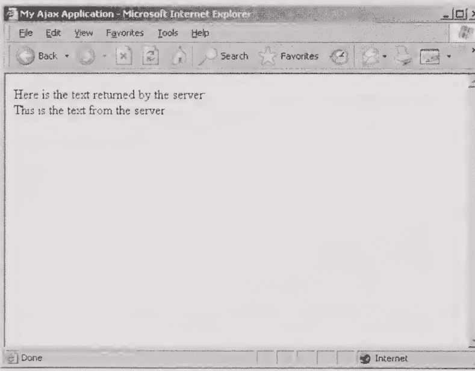

图12.2动画图像。

现在，每次我们单击“获取服务器时间”按钮，时间显示都会更新。图1.3展示了完成后的应用程序。


图12.3我们完成的Ajax应用程序。

## 总结

在本课中，我们构建了一个简单但完整的Ajax应用程序，它执行以下操作：

- 创建`XMLHttpRequest`对象的实例
- 响应HTML页面中内置的JavaScript事件处理程序
- 构建并发送异步服务器请求
- 使用JavaScript DOM方法解析服务器接收的XML
- 提供正在进行请求的用户反馈
- 使用接收到的数据更新显示的页面

至此完成了本书的第二部分。第三部分“复杂的Ajax技术”将探讨一些更高级的Ajax技术。


### 以文本形式返回数据

在本课中，您将学习一些使用responseText属性为Ajax应用程序添加功能的技巧。

#### 从responseText属性获取更多内容

第二部分“介绍Ajax”的课程讨论了使Ajax工作的各个组成部分，最终构建了一个完整的Ajax应用程序。在第三部分“复杂的Ajax技术”中，每节课都将研究如何扩展您所学的知识以开发更复杂的Ajax应用程序。

在本课中，我们将更仔细地研究`XMLHttpRequest`对象的`responseText`属性，并了解如何通过使用它为我们的应用程序提供额外的功能。

正如您在前面的课程中所看到的，`XMLHttpRequest`对象提供了两个从服务器接收的信息的属性，即`responseText`和`responseXML`。前者以字符串格式向调用应用程序提供服务器数据，而后者提供与DOM兼容的XML，可以使用JavaScript方法进行解析。

尽管`responseXML`属性允许您执行一些复杂的编程任务，但仅通过操作存储在`responseText`属性中的值就可以实现很多功能。

### 返回文本

术语“文本”可能有点误导性。`responseText`属性包含一个字符串，其值可以通过简单的赋值语句分配给JavaScript变量：

```javascript
var mytext = http.responseText;
```

没有规则规定这样的字符串中包含的值必须是可读的文本；事实上，只要字符串仅包含JavaScript在字符串变量中接受的字符，该值就可以包含完全无意义的内容。

这一事实使得使用此属性可以传输的信息类型具有一定的灵活性。

### 在页面元素中直接使用返回

```
[/


body

```


正如你从之前的课程中所知，HTML 标记完全由使用文本字符编写的标签组成。如果 `responseText` 属性中包含的值用于修改发起服务器请求的页面的显示，那么没有任何东西可以阻止我们在服务器脚本返回的信息中包含 HTML 标记。

假设我们再次使用清单 12.1 的代码，但使用一个修改过的服务器脚本：

```php
<?php
echo "<h3>Returning Formatted Text</h3>";
echo "<hr />";
echo "We can use HTML to <strong>format</strong> text before we return it!";
?>
```

图 12.2 显示了最终的浏览器显示结果。

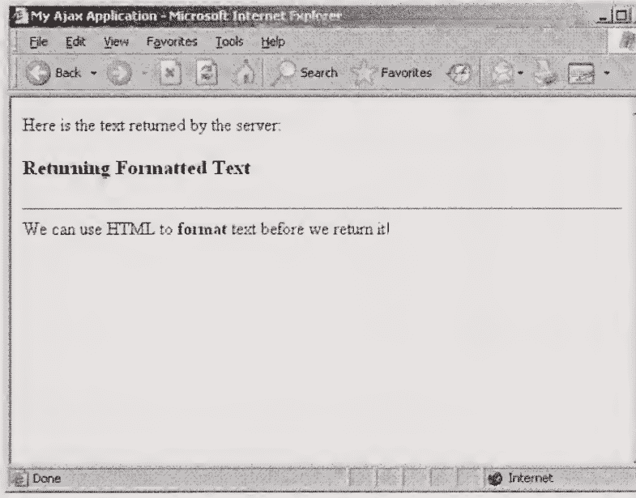

作为一个稍微复杂的例子，考虑服务器脚本生成更复杂输出的情况。我们希望应用程序接受这个服务器输出并将其显示为表格的内容。

这一次，我们将使用服务器端 PHP 脚本生成一些表格信息：

```php
<?php
$days = array('Monday', 'Tuesday', 'Wednesday', 'Thursday', 'Friday', 'Saturday', 'Sunday');
echo "<table border='2'>";
echo "<tr><th>Day Number</th><th>Day Name</th></tr>";
for($i=0;$i<7;$i++)
{
    echo "<tr><td>".$i."</td><td>".$days[$i]."</td></tr>";
}
echo "</table>";
?>
```

再次使用清单 12.1 的代码通过 `XMLHttpRequest` 调用服务器端脚本，我们得到了如图 12.3 所示的页面。

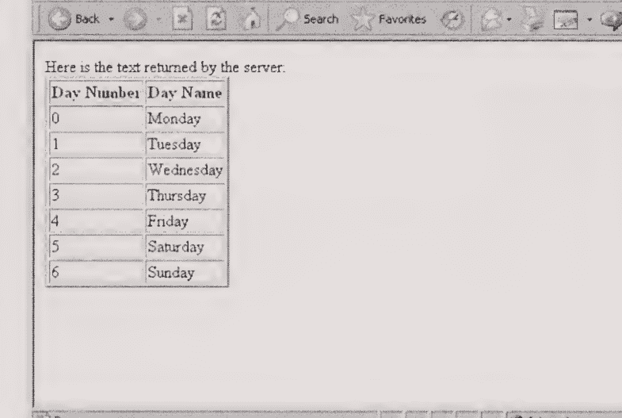

图 12.3 返回更复杂的 HTML。

## 更复杂格式的数据

到目前为止，我们已经演示了如何返回可以直接应用于网页元素的文本。目前为止，一切顺利。然而，如果你愿意在 JavaScript 中多做一些工作来操作返回的数据，你可以实现更多功能。

### 从 responseText 属性中获取更多内容

只要服务器在 `XMLHttpRequest` 对象的 `responseText` 属性中返回一个字符串值，你就可以使用任何你设计的编码格式在其中编码信息。

考虑以下服务器端脚本，它使用与前面示例相同的数据数组：

> **注意：** 注意使用了 PHP 的 `sizeof()` 函数来确定数组中的项目数量。在 PHP 中，与 JavaScript 一样，数组键从 0 开始编号，而不是 1 开始。

```php
<?php
$days = array('Monday', 'Tuesday', 'Wednesday',
               'Thursday', 'Friday', 'Saturday', 'Sunday');
$numdays = sizeof($days);
for($i=0;$i<($numdays - 1);$i++)
{
    echo $days[$i]."|";
}
echo $days[$numdays-1];
?>
```

现在 `responseText` 属性中返回的字符串包含了星期几，并用管道符 `|` 分隔——或者说定界。如果我们把这个字符串复制到 JavaScript 变量 `mystring` 中，

```javascript
var mystring = http.responseText;
```

我们会发现变量 `mystring` 包含了字符串

Monday|Tuesday|Wednesday|Thursday|Friday|Saturday|Sunday

我们现在可以方便地使用 JavaScript 的 `split()` 方法将这个字符串分割成数组：

```javascript
var results = http.responseText.split("|");
```

> **提示：** JavaScript 的 `split()` 方法会分割一个字符串，在字符串中找到作为参数传递给它的字符处进行切割。这个字符不一定是管道符；常用的替代符号是逗号或斜杠。

现在我们有了一个包含数据的 JavaScript 数组 `results`：

```
results[0] = 'Monday'
results[1] = 'Tuesday'
等等...
```

我们现在不再只是简单地显示接收到的数据，而是可以在 JavaScript 例程中以任何我们想要的方式使用它。

> **提示：** 对于复杂的数据格式，XML 可能是接收和处理服务器数据的更好方式。然而，仅仅使用 `responseText` 属性就能完成如此多的工作，这确实值得注意。

## 总结

只需很少的努力，就可以说服 `XMLHttpRequest` 对象的 `responseText` 属性不仅仅是返回一些文本来显示在网页上。

对于所有但最复杂的数据格式，操作 `responseText` 可能比处理 XML 增加的复杂性更简单。

在本课中，你看到了几个这种技术的例子，范围从简单地更新页面元素内的文本内容，到操作更复杂的数据结构。

### AHAH——异步 HTML 和 HTTP

在本课中，你将学习如何使用 AHAH（异步 HTML 和 HTTP）来构建 Ajax 风格的应用程序，而无需使用 XML。

#### 介绍 AHAH

你在第 12 课“将数据作为文本返回”中看到，一个 Ajax 应用程序在完全不使用任何 XML 的情况下能实现多少功能。许多任务，从简单地更新页面上的文本到处理复杂的数据结构，都可以仅使用 `XMLHttpRequest` 对象的 `responseText` 属性返回的文本字符串来完成。

完全有可能构建完整且有用的应用程序，而根本不需要任何 XML。事实上，术语 AHAH（异步 HTML 和 HTTP）正是为这类应用程序而创造的。

本课将把第 12 课的概念再推进一步，更详细地考察 AHAH 可以在哪里以及如何被应用。

> **注意：** 这种技术，作为 Ajax 的一种子集，已被赋予了各种缩写。这些包括 AHAH（异步 HTML 和 HTTP）、JAH（Just Asynchronous HTML，即仅异步 HTML）和 HAJ（HTML And JavaScript，即 HTML 和 JavaScript）。在本书中，我们将将其称为 AHAH。

### 为什么使用 AHAH 而不是 Ajax？

毫无疑问，XML 是一项重要且具有多样化和强大功能的技术。对于具有复杂数据结构的复杂 Ajax 应用程序，它很可能是最好的——或者也许是唯一的——选择。然而，使用 XML 有时会使应用程序的设计复杂化，包括：

- 为 XML 数据设计自定义架构所涉及的工作。
- 使用 JavaScript 的 DOM 方法时的跨浏览器兼容性问题。
- 执行处理器密集型 XML 解析可能会降低性能。

使用 AHAH 可以帮助你避免这些头痛问题，同时还提供一些额外的优势：

- 轻松地重新利用一些现有的网页。
- HTML 可能比 XML 更容易进行故障排除。
- 使用 CSS 来设置返回信息的样式，而不是必须使用 XSLT。

> **注意：** XSLT 是一种转换语言，用于将 XML 文档转换为其他格式——例如，转换为适合浏览器显示的 HTML。

### 13.1 介绍 myAHAlib.js

为 AHAH 创建一个小型库

过去几课中检查的 Ajax 应用程序，虽然完整且齐全，但在页面中嵌入了大量代码。正如你见，每个应用程序往往包含相似的功能：

- 一个创建 `XMLHttpRequest` 实例、配置并发送的方法。
- 一个处理 `responseText` 属性中返回文本的回调函数。

你可以将这些函数抽象成简单的 JavaScript 调用，特别是在只想用服务器返回的值更新单个元素的情况下。请看清单 13.1；这段代码的大部分对你来说应该熟悉。

```javascript
// 13.1 myAHAHlib.js
function callAHAH(url, pageElement, callMessage) {
    document.getElementById(pageElement).innerHTML = callMessage;
    try {
        req = new XMLHttpRequest(); /* e.g. Firefox */
    } catch (e) {
        try {
            req = new ActiveXObject("Msxml2.XMLHTTP"); /* some versions IE */
        } catch (e) {
            try {
                req = new ActiveXObject("Microsoft.XMLHTTP"); /* some versions IE */
            } catch (E) {
                req = false;
            }
        }
    }
    req.onreadystatechange = function() {
        responseAH(pageElement);
    };
    req.open("GET", url, true);
    req.send(null);
}

function responseAH(pageElement) {
    var output = '';
    if (req.readyState == 4) {
        if (req.status == 200) {
            output = req.responseText;
            document.getElementById(pageElement).innerHTML = output;
        }
    }
}
```

`callAHAH()` 函数封装了创建 `XMLHttpRequest` 实例、声明回调函数和发送请求。

### 13.2 使用 myAHAlib.js

AHAH—异步 HTML 与 HTTP

注意，我们没有简单地声明：`req.onreadystatechange = responseAH;` 而是使用了如下 JavaScript 构造：

`req.onreadystatechange = function() { responseAH(pageElement); };`

这种声明方式允许我们向函数传递参数，在此例中指定要更新的元素。`callAHAH()` 还接受额外的参数 `callMessage`，该参数包含一个字符串，用于定义在服务器请求期间目标元素显示的内容。在实践中，这可以是一行文本，例如：`'Updating page; please wait ...'`。不过，同样地，你也可以在此字符串中嵌入一些 HTML 代码。在 `` 元素中使用 GIF 图像是向用户发出进程警告的一种方式。回调函数 `responseAH()` 执行的任务是将 `responseText` 属性中返回的字符串应用到所选元素 `pageElement` 的 `innerHTML` 属性：

`output = req.responseText;`
`document.getElementById(pageElement).innerHTML = output;`

这段代码已被打包到一个名为 `myAHAlib.js` 的文件中，你可以从 HTML 页面中调用它，使这些函数用于你的 AHAH 应用程序。下一节将展示一些示例。

### 在项目中应用 myAHAlib.js

我们可以用另一个简单的 Ajax 应用程序来演示这些技术。这次，我们将编写一个脚本，从用户输入的 URL 中抓取“keywords”元标签信息。

> 注意：元标签是 HTML 页面 `<head>` 部分中的可选 HTML 容器元素。它们包含有关网页的数据，这些数据对于搜索引擎和索引决定如何对网页内容进行分类时很有用。如果存在“keywords”元标签，它通常包含一个以逗号分隔的单词列表，这些单词的含义与网站内容相关。

“keywords”元标签的示例如下：

`<meta name="keywords" content="programming, design, development, Ajax, JavaScript, XMLHttpRequest, script">`

#### 清单 13.2 getkeywords.html

```html
<html>
<head>
    <title>A 'Keywords' Metatag Grabber</title>
    <script language="JavaScript" src="myAHAHlib.js"></script>
</head>
<body>
    <script type="text/javascript" src="ahahLib.js"></script>
    <form>
        <table>
            <tr>
                <td>URL: http://</td>
                <td>
                    <input type="text" id="myurl" name="myurl" size="30">
                    <input type="button" onclick="callAHAH('keywords.php?url='+document.getElementById('myurl').value,'displaydiv', 'Please wait; loading content ...')" value="Fetch">
                </td>
            </tr>
            <tr>
                <td colspan="2" height="50" id="displaydiv"></td>
            </tr>
        </table>
    </form>
</body>
</html>
```

最后，请看服务器端脚本：

```php
<?php
$tags = @get_meta_tags('http://'.$url);
$result = $tags['keywords'];
if(strlen($result) > 0) {
    echo $result;
} else {
    echo "No keywords metatag is available";
}
?>
```


当文件`getkeywords.html`首次加载到浏览器中时，我们将看到如图 13.1 所示的显示。

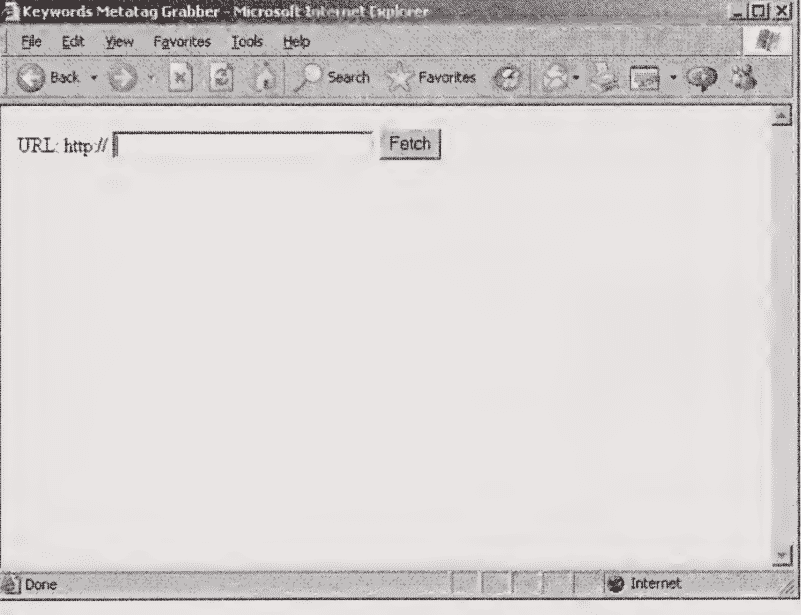

图 13.1 应用程序首次加载后的浏览器显示。

这里我们被邀请输入一个 URL。当我们点击“Fetch”按钮时，`callAHAH()` 被执行，并将我们选择的 URL 作为参数发送到服务器端脚本。同时，消息“Please wait; loading content ...”被放置在 `<div>` 容器中。虽然可能只显示一瞬间，但我们现在看到的显示如图 13.2 所示。

## 13：AHAH—异步 HTML 与 HTTP

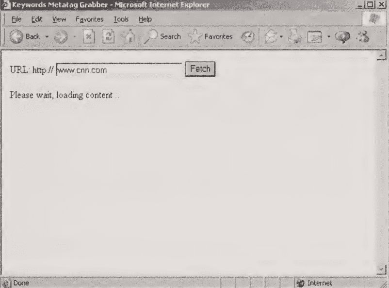

图 13.2 等待服务器响应。

最后，当服务器调用完成后，`responseText` 属性的内容被加载到 `<div>` 容器中，产生如图 13.3 所示的显示。

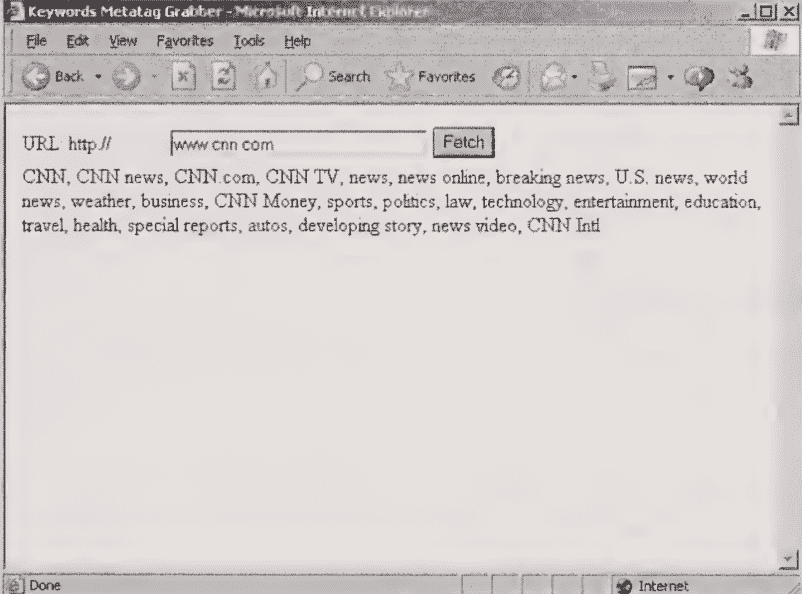

图 13.3 关键词成功返回。

### 扩展 myAHAHlib.js

就目前而言，`myAHAHlib.js` 是 AHAH 的一个简单实现。根据其使用方式的不同，它可以通过多种方式进行改进和扩展。与其在本课中涵盖这些内容，我们将其留给你自己去实验。这里有一些建议供你入门：

- 目前仅支持 GET 请求。如何修改这些函数以允许 POST 请求？

- 在第 11 课“我们的第一个 Ajax 应用程序”中讨论的许多用户反馈尚未在 `responseAHAH()` 中实现。

- 是否可以修改 `callAHAH()` 以接受一个要更新的页面元素数组，并（借助适当的服务器端脚本）一次性处理它们？

> 提示：我们尚未考虑的一个选项是通过 `responseText` 返回 JavaScript 代码的想法。因为 JavaScript 源代码（就像 HTML 页面中的所有其他内容一样）是由纯文本编写的语句组成的，所以你可以从服务器在 `responseText` 属性中返回 JavaScript 源代码。然后你可以使用 JavaScript 的 `eval()` 方法执行此 JavaScript 代码：

```
eval(object.responseText);
```

考虑你的服务器脚本返回字符串的情况：

```
"alert('Hello World!');
```

在这种情况下，`eval()` 方法将执行该内容作为 JavaScript 语句，创建一个带有“OK”按钮、显示“Hello World!”的对话框。

## 总结

希望通过本课和第 12 课的内容，已经清楚地表明 Ajax 可以在完全不使用任何 XML 的情况下实现大量功能。通过仔细结合使用 JavaScript 客户端编码和你选择的语言进行服务器端脚本编写，你可以创建高度复杂的数据方案。

### 13：AHAH—异步HTML与HTTP

在较简单的应用场景中，如果你只需更新页面元素的文本，`XMLHttpRequest` 对象的功能可以被抽象为一个 JavaScript 函数库，并通过简单的方法从 HTML 页面中调用。

然而，对于某些任务，你需要利用 XML 的强大功能。我们将在第14课“将数据作为 XML 返回”中探讨这个主题。

### 将数据作为 XML 返回

在本课中，你将学习如何通过 `XMLHttpRequest` 对象的 `responseXML` 属性使用服务器返回的 XML 数据。

### 为 Ajax 添加“X”

第12课“将数据作为文本返回”和第13课“AHAH—异步HTML与HTTP”已经详细讨论了 `responseText` 中包含的字符串值，并探讨了在应用程序中使用此信息的几种技术。这些示例涵盖了从简单的页面元素文本更新，到使用更复杂数据结构的应用程序，这些数据结构被编码为字符串值，可以存储在 `responseText` 属性中并进行传输。

当然，Ajax 中的 X 代表 XML，在应用程序利用 XML 的强大功能有充分的理由。当你需要使用高度结构化的信息，和/或在不同类型的数据表示之间执行复杂的转换时，这一点尤为重要。

如前所述，`XMLHttpRequest` 对象还有一个名为 `responseXML` 的属性，可用于通过 XML 而非文本字符串从服务器传输信息。

你在第11课“我们的第一个 Ajax 应用程序”中看到了，JavaScript 的文档对象模型方法如何帮助你处理这些 XML 信息。本课将更详细地探讨这些技术，并希望让你领略 Ajax 应用程序利用 XML 力量所能实现的功能。

### responseXML 属性

`XMLHttpRequest` 对象的 `responseText` 属性包含一个字符串，而 `responseXML` 则可以被视为一个 XML 文档。

> **注意：** 你需要确保服务器提供有效且格式正确的 XML，以便通过 `responseXML` 属性返回。在 XML 因格式错误或不支持的字符编码等问题而无法被 `XMLHttpRequest` 对象正确解析的情况下，`responseXML` 的内容是不可预测的，并且在不同浏览器中也可能不同。

> **注意：** 与 `responseText` 属性类似，存储在 `responseXML` 中的值是只读的，因此你不能直接写入此属性；要操作它，你必须将值复制到另一个变量：

```
var myobject = http.responseXML;
```

XML 文档中包含的完整结构和数据现在可以通过使用 JavaScript 的 DOM 方法来获取。在本课后面，我们将通过另一个可工作的 Ajax 应用程序来演示这一点，但首先让我们回顾一下 JavaScript DOM 方法，并介绍一些新的方法。

### 更多 JavaScript DOM 方法

你在之前的课程中已经接触过一些 JavaScript DOM 方法，例如 `getElementById` 和 `getElementsByTagName`。在那些情况下，我们主要关注节点的值，并将这些值写入 HTML 页面。本课探讨用于实际创建元素的 DOM 方法，从而改变页面的结构。文档对象模型可以被视为一个树状结构。除了读取这些节点的值之外，你还可以创建和修改节点，从而改变文档的内容。要向页面添加新元素，你需要创建元素，然后将它们附加到 DOM 树中的适当位置。让我们看一个使用以下 HTML 的简单示例：

```html
<html>
<head>
  <title>Test Document</title>
</head>
<body>
We want to place some text:<br />
<div id="displaydiv"></div>
</body>
</html>
```

在这个示例中，我们希望将文本“Hello World!”添加到文档中的 `<div>` 容器内。我们将把 JavaScript 代码放入一个函数中，并通过onload` 事件处理器调用它。首先，我们将使用 JavaScript 方法 `createTextNode()` 来创建一个文本节点：

```javascript
var textnode = createTextNode('Hello World!');
```

现在我们需要将 textnode 附加到 DOM 树中的适当位置。你在第4课“使用 JavaScript 进行编码”中了解了子节点；希望你记得，如果一个节点包含其他元素，则节点具有子节点。JavaScript 有一个 `appendChild()` 方法，允许我们将新的文本节点作为现有节点的子节点，附加到 DOM 树。

> 注意：将基于 DOM 的页面内容方法与第1课使用的 `innerHTML` 方法进行比较。在本例中，我们希望文本位于 id 为 `displaydiv` 的 `<div>` 容器内：

```javascript
var textnode = document.createTextNode('Hello World!');
document.getElementById('displaydiv').appendChild(textnode);
```

让我们看看页面的源代码，将 JavaScript 代码包装到一个函数中，并添加 onload 事件处理器执行它：

> 注意：如果你在浏览器中查看此文档，你会在 `<div>` 容器内看到“Hello World!”文本。代码所做的修改是针对 DOM 的而不是文档本身的。

```html
<html>
<head>
  <title>Test Document</title>
  <script lang="JavaScript">
  function hello() {
    var textnode = document.createTextNode('Hello World!');
    document.getElementById('displaydiv').appendChild(textnode);
  }
</script>
</head>
<body onload="hello()">
We want to place some text:<br />
<div id="displaydiv"></div>
</body>
</html>
```

### 14：将数据作为 XML 返回


当你想要创建文本节点以外的其他元素时，可以使用 `createElement()` 方法来完成，该方法与 `createTextNode()` 非常相似。事实上，我们可以在添加“Hello World!”节点之前，使用 `createElement()` 创建 `<div>` 容器：

```javascript
var newdiv = document.createElement("div");
```

通常，你只需要所需元素的类型作为参数给 `createElement()`，即可生成所需元素。

### DOM 方法概述

本书是关于 Ajax 的，不仅仅关于 JavaScript DOM，因此我们在此提供所有方法和属性。然而，表14.1列了一些更有用的方法。

#### 表14.1 一些 JavaScript DOM 属性

| 属性 | 描述 |
| :--- | :--- |
| `childNodes` | 子节点数组 |
| `firstChild` | 第一个子节点 |
| `lastChild` | 最后一个子节点 |
| `nodeName` | 节点名称 |
| `nodeType` | 节点类型 |
| `nodeValue` | 节点的值 |
| `nextSibling` | 同一父节点的下一个节点 |
| `previousSibling` | 同一父节点的上一个节点 |
| `parentNode` | 此节点的父节点 |

> 提示：如果你需要全面了解 JavaScript DOM 方法和属性，Andrew Watt 在他的书籍《Sams Teach Yourself XML in 10 Minutes》（Ajax Starter Kit）中提供了一个用的列表。

##### 节点方法

| 方法 | 描述 |
| :--- | :--- |
| `appendChild` | 添加一个新的子节点 |
| `hasChildNodes` | 如果节点有子节点则真 |
| `removeChild` | 删除一个子节点 |

##### 文档方法

| 方法 | 描述 |
| :--- | :--- |
| `createAttribute` | 为元素创建一个属性 |
| `createElement` | 创建一个新的元素 |
| `createTextNode` | 创建一个文本 |
| `getElementsByTagName` | 创建一个标签数组 |
| `getElementById` | 通过 ID 查找元素 |

### 项目—RSS标题器

现在让我们运用从服务器返回 XML 数据知识，利用这些技术来处理一个新的项目。XML 数据在互联网上有多种形式。其中流行的一种是 订阅源，这是一种特定类型的 XML 源，通常包含新闻或其他主题且定期更新的条目。订阅源可从网络上的许多获取，包括大多数广播公司和报纸出版商，以及涵盖各种主题的专业网站。我们将编写一个 Ajax 应用程序，该程序接收订阅源的 URL，收集 XML，并列出订阅源中包含的新闻标题和描述。以下是典型 订阅源的部分 XML：

```xml
<rss version="0.91">
<channel>
<title>myRSSfeed.com</title>
```

### 14：将数据作为XML返回

```html
<link>http://www.********.com/</link>
<description>My RSS feed</description>
<language>en-us</language>
<item>
<title>New Store Opens</title>
<link>http://www.********.html</link>
<description>A new music store opened today in Canal Road. The new business, Ajax Records, caters for a wide range of musical tastes.</description>
</item>
<item>
<title>Bad Weather Affects Transport</title>
<link>http://www.********.html</link>
<description>Trains and buses were disrupted badly today due to sudden heavy snow. Police advised people not to travel unless absolutely necessary.</description>
</item>
<item>
<title>Date Announced for Mayoral Election</title>
<link>http://www.********.html</link>
<description>September 4th has been announced as the date for the next mayoral election. Watch local news for more details.</description>
</item>
</channel>
</rss>
```

从第一行 `<rss version="0.91">` 看到，在本例中我们处理的是0.91版本的RSS。RSS的版本之间差异很大，但就我们的示例而言，我们只关心单个新闻条目的 `<title>`、`<link>` 和 `<description>` 元素，这些元素在不同版本间保持不变。

### 应用程序的HTML页面

我们的页面需要包含一个输入字段，用于输入所需订阅源的URL，以及一个按钮来指示应用程序收集数据。我们还将有一个 `<div>` 容器，用于显示我们解析后的数据：

```html
<html>
<head>
<title>An Ajax RSS Headline Reader</title>
</head>
<body>
<h3>An Ajax RSS Reader</h3>
<form name="form1">
URL of RSS feed: <input type="text" name="feed" size="50" value="http://"><input type="button" value="Get Feed">
<br /><br />
<div id="news"><h4>Feed Titles</h4></div>
</form>
</body>
</html>
```

如果我们将此代码保存为文件 `rss.htm` 并在浏览器中加载，我们将看到类似图14.2 所示的显示。

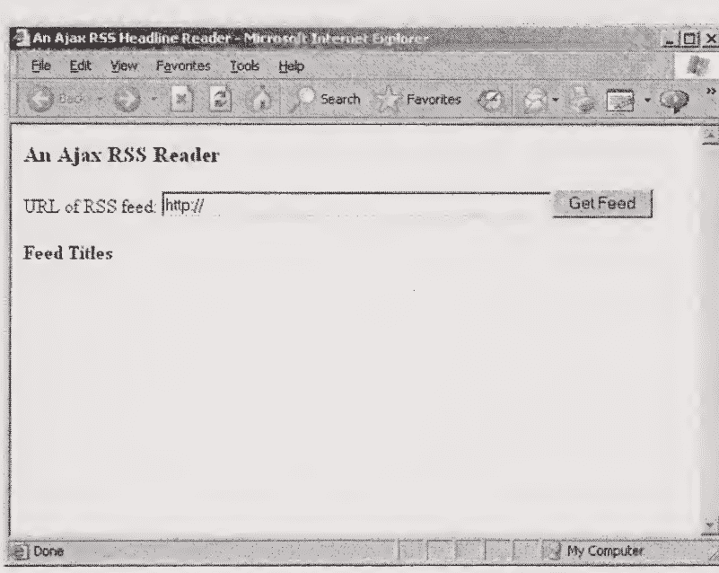

图 14.2 应用程序加载后的浏览器显示。

到目前为止，阅读器的大部分代码我们已经熟悉了；创建 `XMLHttpRequest` 对象实例、构造和发送服务器请求以及检查请求何时完成的方法，与之前的示例基本相同。然而，这一次我们将通过 `responseXML` 属性接收XML格式的数据，而不是使用 `responseText`。我们将使用这些数据来修改我们HTML页面的DOM，以便在页面的 `<div>` 容器内以列表形式显示新闻条目的标题和描述。每个标题和描述将包含在它们自己的段落元素中（我们也将为此构造），并通过样式表进行设置，以我们希望的方式显示。

### 完整代码

让我们直接查看代码，如清单14.1所示。

**清单14.1** Ajax RSS标题器


```markdown
<html>
<head>
<title>An Ajax RSS Headline Reader</title>
</head>
<style>
.title {
font: 16px bold helvetica, arial, sans-serif;
padding: 0px 30px 0px 30px;
text-decoration:underline;
}
.descrip {
font: 14px normal helvetica, arial, sans-serif;
text-decoration:italic;
padding: 0px 30px 0px 30px;
background-color:#cccccc;
}
.link {
font: 9px bold helvetica, arial, sans-serif;
padding: 0px 30px 0px 30px;
}
.displaybox {
border: 1px solid black;
padding: 0px 50px 0px 50px;
}
</style>
<script language="JavaScript" type="text/javascript">
function getXMLHTTPRequest() {
try {
req = new XMLHttpRequest(); /* e.g. Firefox */
} catch(e) {
try {
req = new ActiveXObject("Msxml2.XMLHTTP");
/* some versions IE */
} catch (e) {
try {
req = new ActiveXObject("Microsoft.XMLHTTP");
/* some versions IE */
} catch (E) {
req = false;
}
}
}
}
```

# 项目—一个RSS标题阅读器

```javascript
    }
    return req;
}

var http = getXMLHttpRequest();

function getRSS() {
    var myurl = 'rssproxy.php?feed=';
    var myfeed = document.form1.feed.value;
    myRand = parseInt(Math.random()*999999999999999);
    // 缓存破坏
    var modurl = myurl+escape(myfeed)+"&rand="+myRand;
    http.open("GET", modurl, true);
    http.onreadystatechange = useHttpResponse;
    http.send(null);
}

function useHttpResponse() {
    if (http.readyState == 4) {
        if(http.status == 200) {
            // 首先移除当前DOM中的子节点
            while (document.getElementById('news')
                .hasChildNodes())
            {
                document.getElementById('news').removeChild(document
                    .getElementById('news').firstChild);
            }
            var titleNodes = http.responseXML
                .getElementsByTagName("title");
            var descriptionNodes = http.responseXML
                .getElementsByTagName("description");
            var linkNodes = http.responseXML
                .getElementsByTagName("link");
            for(var i =1;i<titleNodes.length;i++)
            {
                var newtext = document
                    .createTextNode(titleNodes[i]
                        .childNodes[0].nodeValue);
                var newpara = document.createElement('p');
                var para = document.getElementById('news')
                    .appendChild(newpara);
                newpara.appendChild(newtext);
                newpara.className = "title";

                var newtext2 = document
```

**清单14.1 续**

```javascript
    .createTextNode(descriptionNodes[i]
    .childNodes[0].nodeValue);
        var newpara2 = document.createElement('p');
        var para2 = document
    .getElementById('news').appendChild(newpara2);
        newpara2.appendChild(newtext2);
        newpara2.className = "descrip";
        var newtext3 = document
    .createTextNode(linkNodes [i]
    .childNodes[0].nodeValue);
        var newpara3 = document.createElement('p');
        var para3 = document.getElementById('news')
    .appendChild(newpara3);
        newpara3.appendChild(newtext3);
        newpara3.className = "link";
    }
}
}
}
</script>
<body>
<center>
<h3>An Ajax RSS Reader</h3>
<form name="form1">
URL of RSS feed: <input type="text" name="feed"
    size="50" value="http://"><input type="button"
    onClick="getRSS()" value="Get Feed"><br><br>
<div id="news" class="displaybox">
    <h4>Feed Titles</h4></div>
</form>
</center>
</html>
```

我们主要关注的是描述回调函数 `useHttpResponse()` 的工作原理。

## 回调函数

除了检查 `XMLHttpRequest` 的 `readyState` 和 `status` 属性的常规职责外，此函数还为我们执行以下任务：

- 从显示 `<div>` 中移除先前RSS列表的任何显示元素。

### 项目—一个RSS标题阅读器

- 解析传入的XML以提取 `title`、`link` 和 `description` 元素。
- 构造DOM元素来容纳和显示这些结果。
- 将CSS样式应用于这些元素，以更改它们在浏览器中的显示方式。

为了移除先前新闻导入安装的DOM元素（如果存在），我们首先使用其ID标识 `<div>` 元素，然后使用 `hasChildNodes()` DOM方法，循环并每次从 `<div>` 元素中删除第一个子节点，直到没有剩余：

```javascript
while (document.getElementById('news').hasChildNodes())
{
  document.getElementById('news')
  .removeChild(document.getElementById('news').firstChild);
}
```

以下解释了 `title` 元素的处理过程，正如清单14.1所示，重复完全相同的过程来检索 `description` 和 `link` 信息。要解析XML内容以提取项目，我们从 `responseXML` 中的XML数据构建一个数组 `titleNodes`：

```javascript
var titleNodes = http.responseXML.getElementsByTagName("title");
```

然后我们可以遍历这些项目，依次处理每个项目：

```javascript
for(var i =1;i<titleNodes.length;i++) {
  // 处理指令
}
```

对于每个标题，我们需要首先使用`nodeValue`属性提取标题：

```javascript
var newtext = document.createTextNode(titleNodes[i].childNodes[0].nodeValue);
```

然后我们可以创建一个段落：

```javascript
var newpara = document.createElement('p');
```

将段落作为子节点附加到 `<div>`元素：

```javascript
var para = document.getElementById('news').appendChild(newpara);
```

并将文本内容应用到段落上：

```javascript
newpara.appendChild(newtext);
```

最后，利用`className`属性，我们可以定义段落的显示方式。出现在文档部的`<style>`元素中，提供了一种便捷的方式，根据我们的需求更改RSS阅读器的外观。

```javascript
newpara.className = "title";
```

每次我们在输入框中输入不同订阅源并点击按钮时，`<div>`的内容就会更新，显示项目。由于这是一个Ajax应用程序，当然无需重新加载页面。

## 服务器端代码

由于`XMLHttpRequest`对象的内置限制，我们无法直接调用订阅源；我们必须使用一个位于自己服务器上的脚本，让这个脚本收集远程文件并传递给Ajax应用程序。在这种情况下，我们并不要求服务器端脚本`rssproxy.php`修改XML文件，而简单通过`XMLHttpRequest`对象的`responseXML`属性将其路由回我们。说这个脚本充当代理，因为它代表Ajax应用程序检索资源。

清单14.2展示了PHP的代码。

```php
<?php
$mysession = curl_init($_GET['feed']);
curl_setopt($mysession, CURLOPT_HEADER, false);
curl_setopt($mysession, CURLOPT_RETURNTRANSFER, true);
$out = curl_exec($mysession);
header("Content-Type: text/xml");
echo $out;
curl_close($mysession);
?>
```

该脚本使用了cURL库，这是一组使互联网文件传输易于编程的例程。这里适合对cURL进行完整描述；只需知道，这个短脚本首先通过引用Ajax应用程序发送`feed`变量来接收所需的订阅源URL。调用`curl_setopt()`的两行代码分别声明：我们希望收到远程文件一起发送的头部，但我们确实想要文件的内容。`curl_exec()`函数随后执行数据传输。

> **提示：** 关于在PHP中使用cURL的完整描述，请参阅PHP网站http://php.net/curl 或cURL网站http://curl.se/。

之后，只需使用熟悉的PHP`header()`命令添加适当的头部，并将数据返回给我们的Ajax应用程序即可。

图14.3展示了RSS阅读器的运行状态，此处显示的是来自CNN新闻源的内容。


## 总结

JavaScript DOM方法与结合时，提供了一种强大的手段，用于传输、组织并以其他方式处理复杂结构的数据。在本课中，你了解了如何添加、删除和操作DOM元素，以根据`XMLHttpRequest`对象的`responseXML`属性中接收到的XML数据来重构应用程序的DOM。

### Web服务与REST协议

在本课中，你将学习Web服务的基础知识，以及如何使用REST（表述性状态转移）协议来实现它们。

#### Web服务简介

到目前为止，你已经看到了几个示例应用程序，其中我们调用了服务器端脚本执行任务。在每种情况下，我们都设计了数据结构来传输信息，并编写了处理与服务器双向数据传输的例程。

不过，假设你想让你的服务器端程序更广泛可用。也许你能想象到，几个不同的Web应用程序为了各自的目的与这样的脚本进行交互。除了浏览器直接请求页面外，也许其他应用程序（例如通过XMLHttpRequest调用运行的Ajax应用程序）也可能发出数据请求，并期望收到它们能够理解和处理的响应数据。

在这种情况下，你的程序接口采用某种形式的标准化将是有益的。这一原则提供了所谓的Web服务的基础。

假设我们的服务器应用程序生成XML格式的天气预报数据，以响应包含地理信息的请求。这类服务的性质使其具有广泛的适用性；这样的应用程序可能有各种各样的“客户端”，从在本地显示天气预报的简单网页，到需要该数据用于更严苛用途的复杂航空或旅行规划应用程序。

这类服务只是Web服务可能做的事情的一个小例子。互联网上有数千个Web服务在活跃运行，提供着令人难以置信的各种设施，包括用户认证、支付处理、内容联合、消息传递以及许多其他服务。通常，Web服务会提供一个应用程序。

#### REST——表述状态转移

REST以两个原则为中心：

- 资源由URL表示——资源可以看是一个“名词”，指的是文档、一个人、一次会议、一个地点等等。
- 操作通过标准HTTP方法执行——HTTP方法（如GET、POST、PUT、DELETE）视为。

#### 一个假设性的REST示例

为了理解如何以及为何应用这些想法，让我们看一个假设性的例子。假设我们有一个Web服务，允许作者提交、编辑和阅读文章。将所谓的RESTful应用于应用于设计，会产生以下情况：

- 每篇文章都有唯一的URL，例如`http://somedomain.com/articles/173`。http://somedomain.com/articles/list.php?id=173也满足。要检索一篇文章以阅读或编辑，我们的客户端只需对相关文章的URL发出HTTPGET请求。要上传新文章，将使用POST请求，其中包含文章的信息。服务器将以新文章的URL作为响应。要上传已编辑的文章，将使用PUT请求，其中包含修订后的内容。在RESTful应用程序中使用HTTPGET请求的一个重要问题是，它永远不改变服务器状态。换句话说：我们只使用GET请求来向服务器询问信息，绝不用于添加或更改服务器上已有的信息。
```


`POST`、`PUT` 和 `DELETE` 调用都可以以某种方式改变服务器状态。

### 无状态操作

RESTful 应用中的所有服务器通信都应该是无状态的。所谓无状态，是指调用本身必须包含服务器执行所需任务的全部信息，而不是依赖服务器当前存在的某种状态或上下文。例如，我们不能要求服务器参考之前请求发送的信息。

### 在实践中使用 REST

让我们扩展之前引用的文章网络服务示例。

#### 读取可用文章列表

可用文章列表是一个资源。因为该网络服务遵循 REST 原则，我们期望服务提供一个 URL 来访问此资源，例如：

`http://somedomain.com/articles/list.php`

因为我们是在查询信息，而非试图更改它，所以只需向上述 URL 发送一个 HTTP `GET` 请求。服务器可能返回如下 XML：

```
<articles>
  <article>
    <id>173</id>
    <title>New Concepts in Ajax</title>
    <author>P.D. Johnstone</author>
  </article>
  <article>
    <id>218</id>
    <title>More Ajax Ideas</title>
    <author>S.N. Braithwaite</author>
  </article>
  <article>
    <id>365</id>
    <title>Pushing the Ajax Envelope</title>
    <author>Z.R. Lawson</author>
  </article>
</articles>
```

#### 检索特定文章

因为这是另一个信息请求，我们同样需要提交一个 HTTP `GET` 请求。我们的网络服务可能允许我们向以下地址发出请求

```
http://somedomain.com/articles/list.php?id=218
```

并收到返回结果

```
<article>
    <id>218</id>
    <title>More Ajax Ideas</title>
    <author>S.N. Braithwaite</author>
</article>
```

#### 上传新文章

在这种情况下，我们需要发送一个 `POST` 请求，而不是 `GET` 请求。在类似前面概述的假设场景中，服务器很可能会为新文章分配一个 `id` 值，而我们需要为 `title` 和 `author` 元素编码参数和值对：

```
var articleTitle = 'Another Angle on Ajax';
var articleAuthor = 'K.B. Schmidt';
var url = '/articles/upload.php';
var poststring = "title="+encodeURI(articleTitle)
	+"&author="+encodeURI(articleAuthor);
http.onreadystatechange = callbackFunction();
http.open('POST', url, true);
http.setRequestHeader("Content-type",
	"application/x-www-form-urlencoded");
http.setRequestHeader("Content-length", poststring.length);
http.send(poststring);
```

#### 现实世界中的 REST——亚马逊 REST API

> 注意：Amazon.com 经常将 REST 协议称为 XML-over-HTTP 或 XML/HTTP。

领先的在线图书销售商 Amazon.com 提供了一套 REST 网络服务，以帮助开发者将亚马逊的浏览和购物功能集成到他们的 Web 应用中。

首先创建一个包含所需搜索参数（如出版商、排序顺序、作者等）的参数/值对的 URL，然后向此 URL 提交一个 `GET` 请求，就可以使亚马逊网络服务返回包含产品详情的 XML 文档。然后，我们可以解析该 XML 创建 `DOM` 对象，用于网页中显示，或根据应用程序需要提供数据。

> 提示：亚马逊要求你一个开发者令牌来为其网络服务。你需要这个令牌来构造亚马逊服务的 REST 请求。详情参见 `http://www.amazon.com`。

让我们通过开发一个返回书籍列表的 REST 请求。可以多种类型的搜索，本例中，我们请求 Sams 出版的列表。从基础 URL 开始：

```
$url = 'http://xml.amazon.com/onca/xml';
```

然后添加一些参数/值对完成请求：

```
$assoc_id = "XXXXXXXXXX";
$dev_token = "ZZZZZZZZ";
$manuf = "Sams";
$url = "http://xml.amazon.com/onca/xml3";
$url .= "?t=".$assoc_id;
$url .= "&dev-t=".$dev_token;
$url .= "&Manufacturer=".$manuf;
$url .= "&mode=books";
$url .= "&sort=salesrank";
$url .= "&offer=All";
$url .= "&type=lite";
$url .= "&page=1";
$url .= "&f=xml";
```

提交此 URL，我们会收到一个包含匹配书籍详情的 XML 文件。我在这里重现整个文件（超过 5000 个标题！），清单 15.1 显示了该 文件的一个摘录，包括列表中的本书。

```
<?xml version="1.0" encoding="UTF-8" ?>
<ProductInfo xmlns:xsi="http://www.w3.org/2001/XMLSchema-instance"
 xsi:noNamespaceLocation="http://xml.amazon.com/schemas/dev-lite.xsd">
<Request>
    <Args>
        <Arg value="Mozilla/4.0 (compatible; MSIE 6.0; Windows NT 5.1; .NET CLR 1.1.4322)" name="UserAgent" />
        <Arg value="OG2CT7MRWB37PX4B" name="RequestID" />
        <Arg value="All" name="offer" />
        <Arg value="us" name="locale" />
        <Arg value="1" name="page" />
        <Arg value="ZZZZZZZZZ" name="dev-t" />
        <Arg value="XXXXXXXXXX" name="t" />
        <Arg value="xml" name="f" />
        <Arg value="books" name="mode" />
        <Arg value="Sams" name="ManufacturerSearch" />
        <Arg value="lite" name="type" />
        <Arg value="salesrank" name="sort" />
    </Args>
</Request>
<TotalResults>5051</TotalResults>
<TotalPages>506</TotalPages>
<Details url="http://www.amazon.com/exec/obidos/ASIN/067232736/themousewhisp-20?dev-t=1WPTTG90FS81BXMNFG2%26camp=2025%26link_code=xm2">
    <Asin>067232736</Asin>
    <ProductName>Sams Teach Yourself Microsoft SharePoint 2003 in 10 Minutes (Sams Teach Yourself in 10 Minutes)</ProductName>
    <Catalog>Book</Catalog>
    <Authors>
        <Author>Colin Spence</Author>
        <Author>Michael Noel</Author>
    </Authors>
    <ReleaseDate>06 December, 2004</ReleaseDate>
    <Manufacturer>Sams</Manufacturer>
    <ImageUrlSmall>http://images.amazon.com/images/P/067232736.01.THUMBZZZ.jpg</ImageUrlSmall>
    <ImageUrlMedium>http://images.amazon.com/images/P/067232736.01.MZZZZZZZ.jpg</ImageUrlMedium>
    <ImageUrlLarge>http://images.amazon.com/images/P/067232736.01.LZZZZZZZ.jpg</ImageUrlLarge>
    <Availability>Usually ships in 24 hours</Availability>
    <ListPrice>$14.99</ListPrice>
    <OurPrice>$10.19</OurPrice>
    <UsedPrice>$9.35</UsedPrice>
</Details>
```

显然，我们现在可以以任何我们想要的方式处理这个 XML 文档。例如，第 14 课“将数据作为 XML 返回”讨论了如何使用 JavaScript `DOM` 方法从 XML 文档中选择信息，并将其放置到添加到我们文档 `DOM` 的页面元素中。

### REST 与 Ajax

你已经知道 `HTTPRequest` 对象具有允许你直接处理 HTTP 请求类型和 `URL` 的方法。

因此，访问 RESTful 网络服务在很大程度上得到了简化。因为你知道网络服务 API 暴露的每个资源都有一个唯一的 URL，并且服务提供的方法是标准的 HTTP 方法，所以构造所需的 `HTTPRequest` 调用就变得简单了。

能够从 Ajax 应用程序内部访问各种各样的网络服务，并在这些应用程序中使用返回的信息。

### 总结

本课介绍了网络服务的概念以及 REST 协议的基本原理。REST 要求资源通过唯一的 URL 访问，并且所有操作通过标准 HTTP 方法执行，使得 RESTful 服务能够与 Ajax 良好集成，因为 `HTTPRequest` 对象具有直接引用 `URL` 的方法。

### 使用 SOAP 的服务

本课学习如何使用 SOAP 协议的网络服务。

#### SOAP（简单对象协议）简介

在第 15 课“Web 服务与 REST 协议”中，我们讨论了 Web 服务，特别是如何使用（状态转移）。REST 是一个很好的例子，展示了为面向资源设计的协议。SOAP 提供了一种简单的机制来定位资源，这些方法通常在 HTTP 规范中指定——`GET`、`POST` 和 `DELETE`。

#### SOAP 协议

SOAP 是一种基于 XML 的消息传递协议。SOAP 请求是一个 XML 文档，包含以下主要部分：

- 一个信封，用于将文档定义为 请求
- 一个正文元素，包含调用和预期响应的信息
- 可选的头元素和错误元素，用于携带补充信息

让我们一个 SOAP 请求的框架：

```xml
<?xml version="1.0"?>
<SOAP-ENV:Envelope
xmlns:SOAP-ENV="http://schemas.xmlsoap.org/soap/envelope/"
SOAP-ENV:encodingStyle="http://schemas.xmlsoap.org/
soap/encoding/">
<SOAP-ENV:Header>
... various commands ...
</SOAP-ENV:Header>
<SOAP-ENV:Body>
... various commands ...
<SOAP-ENV:Fault>
... various commands ...
</SOAP-ENV:Fault>
</SOAP-ENV:Body>
</SOAP-ENV:Envelope>
```

请注意，SOAP 请求是一个 XML 文件，其根元素是 `Envelope` 元素。

信封的第一行是：

```xml
<SOAP-ENV:Envelope xmlns:SOAP-ENV
="http://schemas.xmlsoap.org/soap/envelope/"
SOAP-ENV:encodingStyle="http://schemas.xmlsoap.org/soap/encoding/">
```

> 提示：命名空间是一种标识符，用于唯一地对一组 XML 元素或属性进行分组，提供了一种限定其名称的方法，从而其他模式中的名称不会冲突。

此行声明了 `xmlns:SOAP-ENV` 命名空间，其值必须始终为 `xmlns:SOAP-ENV="http://schemas.xmlsoap.org/soap/envelope/"`。

`encodingStyle` 属性包含定义消息用数据类型的信息。

接下来出现的是 `Header` 元素，它是可选的，但如果存在，则必须是消息中的第一个元素。在 `Header` 元素中定义的属性用于定义接收应用程序如何处理该消息。

SOAP 消息的正文元素包含发送给最终接收者的消息。

序列化的方法参数包含在 SOAP 请求的正文元素中。调用的 XML 元素必须紧接在 SOAP 正文的开始 XML 标签之后，并且与被调用的远程方法同名。

正文还可能包含一个 `Fault` 元素（但不超过一个）。该元素在 SOAP 规范中定义，旨在携带可能发生的任何错误的信息。如果存在，它必须是正文元素的子元素。`Fault` 元素有多个子元素，包括 `faultcode`、`faultstring` 和 `detail`，它们包含故障条件的具体细节。

#### SOAP 请求的代码示例

看看一个典型的 SOAP 请求可能是什么样子：

```xml
<?xml version="1.0"?>
<SOAP-ENV:Envelope xmlns:SOAP-ENV
="http://schemas.xmlsoap.org/soap/envelope/"
SOAP-ENV:encodingStyle="http://schemas.xmlsoap.org/
soap/encoding/">
<SOAP-ENV:Body>
<m:GetInvoiceTotal xmlns:m=
"http://www.somedomain.com/invoices">
<m:Invoice>77293</m:Invoice>
</m:GetInvoiceTotal>
</SOAP-ENV:Body>
</SOAP-ENV:Envelope>
```

在前面的示例中，`m:GetInvoiceTotal` 和 `m:Invoice` 元素特定于该特定应用程序，并非 SOAP 本身的一部分。这些元素构成了包含在 SOAP 信封中的消息。


```markdown
让我们看看来自 Web 服务的 SOAP 响应可能是什么样子：

```xml
<?xml version="1.0"?>
<SOAP-ENV:Envelope xmlns:SOAP-ENV=
    "http://schemas.xmlsoap.org/soap/envelope/" SOAP-ENV:encodingStyle="http://schemas.xmlsoap.org/
    soap/encoding/">
  <SOAP-ENV:Body>
    <m:ShowInvoiceTotal xmlns:m=
        "http://www.somedomain.com/invoices">
      <m:InvoiceTotal>3295.00</m:InvoiceTotal>
    </m:ShowInvoiceTotal>
  </SOAP-ENV:Body>
</SOAP-ENV:Envelope>
```

#### 通过 HTTP 发送 SOAP 请求

SOAP 消息可以通过 HTTP GET 或 HTTP POST 传输。如果通过 HTTP POST 发送，SOAP 消息需要设置至少一个 HTTP 头；这定义了 `Content-Type`：

`Content-Type: text/xml`

成功的 SOAP 交换后，您将期望接收到前面带有适当 HTTP 头的 SOAP 响应：

```
HTTP/1.1 200 OK
Content-Type: text/xml
Content-Length: yyy
<?xml version="1.0"?>
<SOAP-ENV:Envelope xmlns:SOAP-ENV=
    "http://schemas.xmlsoap.org/soap/envelope/" SOAP-ENV:encodingStyle="http://schemas.xmlsoap.org/soap/encod-
    ing/">
  <SOAP-ENV:Body>
    <m:ShowInvoiceTotal xmlns:m=
        "http://www.somedomain.com/invoices">
      <m:InvoiceTotal>3295.00</m:InvoiceTotal>
    </m:ShowInvoiceTotal>
  </SOAP-ENV:Body>
</SOAP-ENV:Envelope>
```

#### 在 Ajax 中使用 SOAP

要在 Ajax 中使用 SOAP，您需要执行几个独立的步骤：

1. 创建 SOAP 信封。
2. 将特定于应用程序的信息序列化为 XML。
3. 创建包含序列化版本特定于应用程序代码的 SOAP 正文。
4. 通过 `XMLHttpRequest` 对象发送一个 HTTP 请求，其中包含作为有效负载的 SOAP 消息。

然后，回调函数需要负责解包 SOAP 响应并解析其中包含的 XML。

#### 代码示例

生成的代码可能是什么样子？让我们看一个使用前一个示例中虚构的 SOAP Web 服务的示例：

```javascript
var invoiceno = '77293';
http.open("POST", "http://somedomain.com/invoices",true);
http.onreadystatechange=function() {
  if (http.readyState==4) {
    if(http.status==200) {
      alert('The server said: '+ http.responseText)
    }
  }
}
http.setRequestHeader("Content-Type", "text/xml")
var mySOAP = '<?xml version="1.0"?>'
  + '<SOAP-ENV:Envelope xmlns:SOAP-ENV='
    +'"http://schemas.xmlsoap.org/soap/envelope/"'
  + ' SOAP-ENV:encodingStyle='
    +'"http://schemas.xmlsoap.org/soap/encoding/">'
  + '<SOAP-ENV:Body>'
  + '<m:GetInvoiceTotal xmlns:m='
    +'"http://www.somedomain.com/invoices">'
  + '<m:Invoice>'+invoiceno+'</m:Invoice></m:GetInvoiceTotal>'
  + '</SOAP-ENV:Body></SOAP-ENV:Envelope>';
http.send(mySOAP);
```

在这里，我们将整个 SOAP 信封构造在一个 JavaScript 字符串变量中，然后将其传递给 `XMLHttpRequest` 对象的 `send()` 函数。

服务器返回的值需要先进行解析，以移除 SOAP 响应封装，然后从 SOAP 消息的主体部分恢复应用程序数据。

### 审视 SOAP 与 REST

在本课程和第 15 课的过程中，我们已经研究了使用 Web 服务的 REST 和 SOAP 方法。

尽管存在其他 Web 服务协议，但在过去几年中，开发者之间就 REST 与 SOAP 的优劣展开了一场激烈的争论。

我无意在本书中加入这场争论。相反，让我们总结一下这两种方法的异同：

- REST 利用标准的 HTTP 方法（`PUT`、`GET`、`POST` 和 `DELETE`）来创建功能相当的远程过程调用。使用 REST 协议的 Web 服务实现似乎特别适合基于资源的服务，其中最常用的方法通常涉及创建、编辑、检索和删除信息。不足之处在于，REST 需要对 HTTP 协议有更深入的了解。

- SOAP 协议增加了相当大的复杂性，因为必须序列化远程调用，然后构建一个 SOAP 信封来包含它。在解析数据之前，需要从返回数据的 SOAP 信封中“解包”数据，这带来了额外的工作。这些额外步骤也会影响性能，对于类似的任务，SOAP 的操作速度通常比 REST 稍慢。然而，SOAP 更彻底地将远程过程调用与其传输方式分离开来，并增加了许多额外的功能和设施，例如 `Fault` 元素和通过命名空间进行类型检查。

## 总结

在本课中，我们学习了 SOAP（简单对象访问协议）。SOAP 是一种流行的 Web 服务协议，其方法与第 15 课中使用的 REST 协议大不相同。

这两种风格的 Web 服务都可以通过 `XMLHttpRequest` 请求使用，尽管它们所涉及的代码复杂性有所不同。

### 用于 Ajax 的 JavaScript 库

在本课中，你将学习如何将目前为止所学的一些封装成一个小型库，以便在应用程序中调用。

#### 一个 Ajax 库

通过目前的课程和代码示例，我们已经开发了许多实现 Ajax 应用程序部分的代码。这些方法包括：

- 生成 `XMLHttpRequest` 实例的方法，该方法适用于各种浏览器
- 使用 `XMLHttpRequest` 对象构建和发送 `GET` 和 `POST` 请求
- 避免 `GET` 请求被缓存
- 在执行指令之前检查 `XMLHttpRequest` 调用是否完成的回调函数
- 提供用户反馈
- 处理 `responseText` 返回的文本数据
- 处理 `responseXML` 返回的 XML 信息

你在第 13 课“Ajax 和 HTTP”中已经看到，其中一些方法可以抽象成一个小库（那种情况下仅包含两个函数）。本课扩展了这一思想，构建了一个更完整的库，只需少的额外代码，即可轻松将 Ajax 功能添加到页面中。

由于必要性，我们的 Ajax 库不像后面描述那样复杂；然而足够完整，用于构建功能性的应用程序。

#### `myAHAlib.js`

清单 17.1 展示了 `callAHAlib.js` 的代码，它自第 13 课。

```javascript
function callAHA(url, pageElement, callMessage) {
    document.getElementById(pageElement).innerHTML = callMessage;
    try {
        req = new XMLHttpRequest(); /* e.g. Firefox */
    } catch(e) {
        try {
            req = new ActiveXObject("Msxml2.XMLHTTP"); /* some versions IE */
        } catch (e) {
            try {
                req = new ActiveXObject("Microsoft.XMLHTTP"); /* some versions IE */
            } catch (E) {
                req = false;
            }
        }
    }
    req.onreadystatechange = function() {responseAHA(pageElement);};
    req.open("GET",url,true);
    req.send(null);
}

function responseAHA(pageElement) {
    var output = '';
    if(req.readyState == 4) {
        if(req.status == 200) {
            output = req.responseText;
            document.getElementById(pageElement).innerHTML = output;
        }
    }
}
```

让我们思考一下如何扩展这个库：

- 目前仅支持 `GET` 请求。能够至少支持 `POST` 请求将会很有用，特别是打算使用 REST 协议（如第 15 课“Web 服务和 REST 协议”中所述）构建应用程序。
- 该库目前处理通过 `responseText` 返回的文本信息，没有处理 `responseXML` 方法。

#### 实现我们的库

确定了需要的事情后，我们现在将构建一个更强大的 Ajax 库。

##### 创建 `XMLHttpRequest` 实例

让我们首先关注 `XMLHttpRequest` 实例创建的例程。目前的函数与构建和发送请求紧密耦合。我们将负责创建 `XMLHttpRequest` 实例的部分解耦，并将其放入独立的函数中：

```javascript
function createREQ() {
  try {
    req = new XMLHttpRequest(); /* e.g. Firefox */
  } catch(err1) {
    try {
      req = new ActiveXObject("Msxml2.XMLHTTP"); /* some versions IE */
    } catch (err2) {
      try {
        req = new ActiveXObject("Microsoft.XMLHTTP"); /* some versions IE */
      } catch (err3) {
        req = false;
      }
    }
  }
  return req;
}
```

我们现在只需调用以下函数即可创建 `XMLHttpRequest` 实例：

```javascript
var myreq = createREQ();
```

##### HTTP `GET` 和 `POST` 请求

我们从 `GET` 请求开始，因为我们已经支持这种请求类型：

```javascript
function requestGET(url, query, req) {
  myRand=parseInt(Math.random()*9999999);
  req.open("GET",url+''+query+'&rand='+myRand, true);
  req.send(null);
}
```

对于这个请求，我们必须传递两个参数：请求将被发送到的 URL 和 `XMLHttpRequest` 实例的标识。

我们可以省略 `query` 参数，因为在 `GET` 请求中，它被编码到 URL 中。在这里将这两个参数分开，是为了与 `POST` 请求的函数保持相似的接口。`query` 参数在调用函数前必须进行适当的编码，不过用于破坏缓存的随机元素是由函数添加的。

接下来是 `POST` 函数：

```javascript
function requestPOST(url, query, req) {
  req.open("POST", url, true);
  req.setRequestHeader('Content-Type',
    'application/x-www-form-urlencoded');
  req.send(query);
}
```

##### 回调函数

我们如何处理回调函数？我们将添加一个额外的函数：

```javascript
function doCallback(callback,item) {
    eval(callback + '(item)');
}
```

这个函数使用 JavaScript 的 `eval()` 函数来执行另一个函数，该函数的名称作为参数传递给它，同时通过 `item` 向函数传递它自己的一个参数。

让我们看看这些函数在从事件处理程序中调用时是如何交互的：

```javascript
function doAjax(url,query,callback,reqtype,getxml) {
    // 创建 XMLHttpRequest 实例
    var myreq = createREQ();
    myreq.onreadystatechange = function() {
        if(myreq.readyState == 4) {
            if(myreq.status == 200) {
                var item = myreq.responseText;
                if(getxml==1) {
                    item = myreq.responseXML;
                }
                doCallback(callback, item);
            }
        }
    }
    if(reqtype=='post') {
        requestPOST(url,query,myreq);
    } else {
        requestGET(url,query,myreq);
    }
}
```
```


```javascript
function createREQ() {
  try {
    req = new XMLHttpRequest(); /* e.g. Firefox */
  } catch(err1) {
    try {
      req = new ActiveXObject("Msxml2.XMLHTTP");
      /* some versions IE */
    } catch (err2) {
      try {
        req = new ActiveXObject("Microsoft.XMLHTTP");
        /* some versions IE */
      } catch (err3) {
        req = false;
      }
    }
  }
  return req;
}

function requestGET(url, query, req) {
  myRand=parseInt(Math.random()*99999999);
  req.open("GET",url+'?'+query+'&rand='+myRand,true);
  req.send(null);
}

function requestPOST(url, query, req) {
  req.open("POST", url,true);
  req.setRequestHeader('Content-Type', 'application/x-www-form-urlencoded');
  req.send(query);
}

function doCallback(callback,item) {
  eval(callback + '(item)');
}

function doAjax(url,query,callback,reqtype,getxml) {
  // create the XMLHttpRequest object instance
  var myreq = createREQ();

  myreq.onreadystatechange = function() {
    if(myreq.readyState == 4) {
      if(myreq.status == 200) {
        var item = myreq.responseText;
        if(getxml==1) {
          item = myreq.responseXML;
        }
        doCallback(callback, item);
      }
    }
    if(reqtype=='post') {
      requestPOST(url,query,myreq);
    } else {
      requestGET(url,query,myreq);
    }
  }
}
```

## 使用该库

为了演示该库的使用，我们将从另一个简单的 HTML 页面开始，其代码如下所示：

```html
<html
<head>
</head>
<body>
<form name="form1">
<input type="button" value="test">
</form>
</body>
</html>
```

这个简单的页面只显示一个标有 "Test" 的按钮。表单上的所有功能都将使用我们的新 Ajax 库在 JavaScript 中创建。

将应用程序 "Ajaxify" 所需的步骤是：

1. 在页面的 `<head>` 区域包含 Ajax 库 `myAJAXlib.js`。

2. 编写一个回调函数来处理返回的信息。

3. 为页面添加一个事件处理程序以调用服务器调用。

我们将从演示 GET 请求并使用 `responseText` 属性中返回的信息开始。这类似于我们在第 13 课处理 AHAH 时遇到的情况。

包含 Ajax 库很简单：

```html
<head>
<script Language="JavaScript" src="myAJAXlib.js"></script>
```

接下来，我们需要定义回调函数来处理存储在 `responseText` 属性中的值。对于这些示例，我们只是简单地在警报中显示返回的文本：

```html
<head>
<script Language="JavaScript" src="myAJAXlib.js"></script>
<script Language="JavaScript">
function cback(text) {
alert(text);
}
</script>
```

最后，我们需要为按钮添加事件处理程序调用：

```html
onClick="doAjax('libtest.php','param=hello',
 'cback','get','0')"
```

我们的服务器端脚本 `libtest.php` 简单地回显作为第二个参数发送的参数：

```php
<?php
echo "Parameter value was ".$param;
?>
```

同时，函数调用的其余参数声明回调函数名为 `cback`，我们想发送一个 HTTP GET 请求，并且我们期望返回的数据在 `responseText` 中。清单 17.3 显示了我们修改后的 HTML 页面的完整代码。

### 清单 17.3 重写为调用 `myAJAXlib.js` 的 HTML 页面

```html
<html
<head>
<script Language="JavaScript" src="myAJAXlib.js">
</script>
<script Language="JavaScript">
function cback(text) {
alert(text);
}
</script>
</head>
<body>
<form name="form1">
<input type="button" value="test" onClick=
 "doAjax('libtest.php','param=hello',
 'cback','get','0')">
</form>
</</body>
</html>
```

图 17.1 显示了运行该程序的结果。


**图 17.1** HTTP GET 请求后返回文本。

要使用相同的库来检索 XML 数据，我们将再次使用第 11 课“我们的第一个 Ajax 应用程序”中的服务器端脚本，您可能还记得，它在一个小 XML 文档中提供当前服务器时间：

```php
<?php
header('Content-Type: text/xml');
echo "<?xml version=\"1.0\" ?><clock1><timenow>"
.date('H:i:s')."</timenow></clock1>";
?>
```

我们的回调函数必须修改，因为我们现在需要返回解析后的 XML。我们将使用一些现在应该熟悉的 DOM 方法：

```javascript
<script>
function cback(text) {
var servertime = text.getElementsByTagName("timenow")[0]
.childNodes[0].nodeValue;
alert('Server time is '+servertime);
}
</script>
```

我们需要改变的唯一事情是对 `doAjax()` 函数的调用：

```html
onClick="doAjax('tellXML.php','','back','post','1')"
```

在这里我们决定发出 POST 请求。我们的服务器端脚本 `tellXML.php` 不需要查询字符串，因此在这种情况下第二个参数留空。我们期望在 `responseXML` 属性中以 XML 格式响应。

图 17.2 显示了运行该程序的结果。


**图 17.2** 通过 POST 请求以 XML 格式返回服务器时间。

## 扩展该库

当前的库可以通过多种方式改进。这将作为读者的练习，尽管在许多情况下，书中的其他地方涵盖了这些技术。例如，用户反馈尚未处理；我们之前讨论过如何显示适当的。修改库以检测 `XMLHttpRequest` 状态并向用户输出适当的消息应该太困难。请随意尝试代码，看看能实现什么。

## 总结

本课结合了迄为止讨论的许多技术，生成了一个紧凑且易用的 JavaScript 库，该库支持 HTTP GET 和 POST 请求，并且可以处理返回的文本或 XML 数据。使用这样的库可以在网页中引入 Ajax，只需简单的标记。不仅使代码保持整洁且易于阅读，而且简化了向旧版添加 Ajax 功能的过程。在第 18 课“Ajax陷阱”中，也就是第三部分的最后，我们将讨论在开发 Ajax 应用程序时的一些潜在问题和陷阱。


### Ajax “陷阱”

在本课中，您将了解一些常见的 Ajax 错误以及如何避免它们。

#### 常见的 Ajax 错误

Ajax 有一些常见的陷阱，等待着那些粗心的开发者。在本课中，我们将回顾其中的陷阱，并讨论寻找解决方案的方法。这个列表并非详尽，提供的解决方案也不适合所有场合。然而，它们应该引起思考。

#### 后退按钮

所有常用浏览器的导航栏上都有后退按钮。浏览器在内存中维护一个最近访问页面的列表，允许您逐步后退以重新访问看过的页面。用户已经习惯了后退按钮，将其视为网络浪体验的标准。正如您所了解，Ajax 在很大程度上摆脱了将网络信息以独立的、页面大小的块来交付的想法；使用 Ajax 应用程序，您可以一次又一次地更改页面内容，而无需考虑用全新的页面重新加载浏览器显示。

提示：JavaScript 语言就有自己的等效后退按钮。语句 `history.go(-1)` 都模拟了单击一次后退按钮的操作。

那么后退按钮呢？这个问题最近在开发者中引起了相当大的争议。似乎主要有两种思想流派：

- 创建一种以编程方式记录状态的方法，并在按下后退按钮时使用它来重新创建以前的状态。
- 说服用户后退按钮不再必要。

人为地重新创建以前的状态是可能的，但这给 Ajax 代码增加了复杂性，因此在某种程度上属于更勇敢的程序员的领域！尽管后一种选择听起来像是在回避问题，但它确实可能有一些优点。如果您使用 Ajax 来创建类似桌面的用户界面，注意的是，桌面应用程序通常没有——也不需要——后退按钮，因为用户脑海中从未出现过独立的“页面”概念！

#### 书签和链接

这个问题与后退按钮问题不无关系。当您为页面添加书签时，您实际上是在尝试保存某个内容的快捷方式。在基于页面的比喻中，这是无可非的；尽管页面可以具有一定程度的动态内容，但能够随后找到页面本身足以让我们看到上次访问时看到的内容。

然而，Ajax 可以对整个应用程序使用相同的页面地址，并根据用户的操作从服务器返回大量的动态内容。

### 书签页面与分享链接

当你想要为特定的信息页面添加书签，或将该链接分享给朋友或同事时，会发生什么？仅仅使用当前页面的 URL 不可能达到你期望的效果。虽然彻底解决这个问题可能很困难，但通过为应用程序中特别选择的状态提供永久链接，或许能有所缓解。

### 告知用户正在发生什么

这是另一个与界面风格从独立页面转变相关的问题。已经熟悉网页浏览的用户可能已习惯程序活动与加载新页面或更新页面同步进行。

在正文中，我们通过添加一个随机数来实现这一点。许多人喜欢的另一种方法是添加一个基于时间的数字，这当然每次都会不同：

```javascript
var url = "serverscript.php"+"?rand="+new Date().getTime();
```

### Ajax 的“常见陷阱”

#### 权限拒绝错误

收到权限拒绝错误通常意味着你违反了安全措施，该措施用于阻止`XMLHttpRequest`对象发出跨域请求。

调用必须针对与调用脚本处于同一域的服务器程序。

> **注意：** 务必确保域名书写方式完全一致。`Somedomain.com`可能会被解析为与`www.somedomain.com`不同的域，从而导致权限被拒绝。

#### 内容转义

在构建`GET`或`POST`请求的查询字符串时，请记住对可能包含空格或其他非文本字符的变量进行转义。在以下代码中，`idValue`的值是从表单的文本输入字段中收集的，因此我们对其进行转义以确保正确的编码：

```javascript
http.open("GET", url + escape(idValue) + "&rand=" + myRandom, true);
```

## 总结

Ajax 无疑具有极大提升 Web 界面的潜力。然而，从传统的基于页面的界面到高度动态的应用程序的范式转变，也为开发者设置了一些需要跨越的障碍。在本课中，我们尝试总结了其中一些较为人知的陷阱。

其中一些问题已经在其他课程中遇到过，而另一些可能要到你开始开发实际应用时才会显现。

本课结束了第三部分，“更复杂的 Ajax 技术”。如果你一直跟学至此，你现在应该已经很好的掌握了`XMLHttpRequest`对象、`JavaScript`、`XML`和文档对象模型（Document Object Model）的基础知识，并能够从零开始创建有用的 Ajax应用程序。

幸运的是，你不必总是从零开始。互联网上有许多开源和商业项目提供了各种各样的 Ajax框架、工具和资源。

第四部分，“商业和开源 Ajax资源”，通过审视其中一些资源及其能力，来结束我们对 Ajax 开发的探索之旅。

### prototype.js 工具包

在本课中，你将了解 prototype.js JavaScript库以及它如何减少构建功能强大的 Ajax应用程序所需的工作量。

#### 介绍 prototype.js

第四部分，“商业和开源 Ajax资源”，探讨了可用于 Ajax开发的一些代码库和框架。

本课我们从 Sam Stephenson 的 `prototype.js` 开始，这是一个流行的 JavaScript库，包含一系列在开发跨浏览器 JavaScript例程时非常有用的函数，并特别支持 Ajax。你将看到如何使用该库对 DOM操作、HTML表单和`XMLHttpRequest`对象的强大支持来简化你的JavaScript代码。

prototype.js 库的最新版本可以从 `http://prototype.conio.net/` 下载。

在你的 Web应用程序中包含该库很简单，只需在 HTML文档档的`<head>`部分添加以下行：

```html
<script src="prototype.js" Language="JavaScript" type="text/javascript"></script>
```

prototype.js 包含广泛的函数，可以加快编写JavaScript代码的速度，并使生成的脚本更简洁、更易于维护。

该库包括提供常用编程任务快捷方式的通用函数、HTML表单的包装器、用于封装`XMLHttpRequest`对象的对象、用于简化 DOM任务的方法和对象等等。

让我们来看看其中一些工具。

> **关于 CD：** Prototype 1.5.1 版本包含在 Ajax Starter Kit CD 中。如果你下载了不同的版本，请查看文档以了解你的版本与本文描述的版本是否存在差异。

#### $() 函数

`$()` 本质上是 `getElementById()` DOM方法的快捷方式。通常，要返回特定元素的值，你会使用类似这样的表达式：

```javascript
var mydata = document.getElementById('someElementID');
```

`$()` 函数通过返回其 ID作为参数传递给它的元素的值来简化此任务：

```javascript
var mydata = $('someElementID');
```

此外，`$()`（与`getElementById()`不同）可以接受多个元素ID作为参数，并返回关联元素值的数组。考虑这行代码：

```javascript
mydataArray = $('id1', 'id2', 'id3');
```

在此示例中中：

- `mydataArray[0]` 包含 ID 为 `id1` 的元素的值。
- `mydataArray[1]` 包含 ID 为 `id2` 的元素的值。
- `mydataArray[2]` 包含 ID 为 `id3` 的元素的值。

#### $F() 函数

`$F()` 函数在将输入元素或其 ID作为参数传递给它时，返回表单输入字段的值。看以下HTML代码片段：

```html
<input type="text" id="input1" name="input1">
<select id="input2" name="input2">
<option value="0">Option A</option>
<option value="1">Option B</option>
<option value="2">Option C</option>
</select>
```

在这里，我们可以使用`$F('input1')` 来返回文本框中的值，使用`$F('input2')` 来返回选择框当前选中选项的值。`$F()` 函数在复选框和文本区域输入元素上同样适用，无论输入元素类型如何，都能轻松返回元素值。

#### Form 对象

prototype.js 定义了一个 `Form`对象，它拥有多种简化 HTML表单操作的有用方法。

你可以通过调用 `getElements()` 方法返回表单输入字段的数组中：

`inputs = Form.getElements('thisform');`

`serialize()` 方法允许将输入名称和值格式化为与 URL兼容的列表：

`inputlist = Form.serialize('thisform');`

使用上述代码行，变量`inputlist`现在包含一个序列化的参数和值：

`field1=value1&field2=value2&field3=value3`

`Form.disable('thisform')` 和`Form.enable('thisform')`的作用所示。

#### Try.these() 函数

前面的课程讨论了使用异常使你能够捕获运行时并干净处理。`Try.these()`函数提供了一种便捷的方式封装这些方法，从而在不同的地方提供解决方案：

`return Try.these(function1(), function2(), function3());`

函数按顺序处理，当错误抛出异常时，操作到下一个函数。当任何函数成功完成时，操作停止，函数返回`true`。将此函数应用于创建实例展示了代码简洁性：

```javascript
return Try.these(
    function() {return new ActiveX('Msxml.XMLHTTP')},
    function() {return new ActiveX('Microsoft.XMLHTTP')},
    function() {return new XMLHttpRequest()}
)
```

> **注意：** 你可能希望将此代码片段与比较，了解代码复杂性减少了多少以及读性提高了多少。

#### 封装 XMLHttpRequest——Ajax对象

prototype.js 定义了一个`Ajax`对象，旨在简化构建Ajax应用程序时的开发。该对象具有多个类，封装了发送请求、监控进度以及处理数据所需的代码。

#### Ajax.Request

`Ajax.Request`处理创建`XMLHttpRequest`实例并发送格式化请求。调用它很简单：

```javascript
var myAjax = new Ajax.Request(url, {method: 'post', parameters: data, onComplete: responseFunction});
```

在此调用中，`url`定义了调用的服务器位置，`method`可以是`post`或`get`，`data`是包含请求的序列化字符串，`responseFunction`是处理响应的回调函数。`onComplete`参数是选项之一，对应于`readyState`属性值为4（完成）。你也可以使用关联参数`onLoading`、`onLoaded`或`onInteractive`指定回调函数在之前的阶段（加载中、已加载或交互）执行。

还有几个可选参数，包括`asynchronous:false`用于指示同步发出。`asynchronous`选项默认值为`true`。

> **提示：** 第二个参数使用一种通常称为`JSON`（JavaScript Object Notation）的表示法构建。该参数由一系列`parameter: value`对而成，整个包含在括号内。参数值本身可以是JSON对象、数组或简单值。JSON作为数据交换协议因其易于构建、易于解析和语言无关而受欢迎。你可以在`http://www.json.org`上了解更多信息。

# Ajax.Updater

当你使用返回的数据来更新页面元素时，`Ajax.Updater`类可以简化这个任务。你只需要指定哪个元素被更新：

```javascript
var myAjax = new Ajax.Updater(elementID, url, options);
```

这个调用与`Ajax.Request`相似，但增加了一个目标元素的ID作为第一个参数。以下是`Ajax.Updater`的一个代码示例：

```html
<script>
  function updateDIV(mydiv) {
    var url = 'http://example.com/serverscript.php';
    var params = 'param1=value1&param2=value2';
    var myAjax = new Ajax.Updater(
      mydiv,
      url,
      {method: 'get', parameters: params}
    );
  }
</script>
<input type="button" value="Go" onclick="updateDIV(targetDiv)">
<div id="targetDiv"></div>
```

在调用时，同样可以使用几个额外的选项。一个注意的是选项列表中添加`evalscripts:true`。添加此选项后，服务器返回的任何JavaScript代码将被执行。

# Ajax.PeriodicalUpdater

`Ajax.PeriodicalUpdater`类可用于反复创建一个`Ajax.Updater`实例。这样你可以在经过一定的时间间隔后更新页面元素。这对于如股票行情显示或RSS阅读器等应用程序非常有用，因为它确保访问者始终查看到及时的信息。

`Ajax.PeriodicalUpdater`为`Ajax.Updater`选项添加了两个额外的参数：

- `frequency`——连续更新之间的延迟，单位为秒。默认值是两秒。
- `decay`——如果服务器返回未更改的数据，则用于增加连续延迟的乘数。默认值为1，即保持延迟恒定。

下面是调用`Ajax.PeriodicalUpdater`的一个示例：

```javascript
var myAjax = new Ajax.PeriodicalUpdater(elementID, url, {
	frequency: 3.0, decay: 2.0
});
```

这里我们选择将初始延迟设置为3秒，并且每次服务器返回未更改的数据时，该延迟长度翻倍。

# 示例项目——股票价格读取器

让我们使用prototype.js库构建一个简单的读取器，它定期更新以显示服务器返回的最新值。在这个例子中，我们将使用一个简单的服务器端脚本`rand.php`来模拟变化的股票价格：

```php
<?php
srand ((double) microtime()*1000000);
$price = 50 + rand(0,5000)/100;
?>
```


在本课中，我们将探讨如何使用Rico，一个复杂的Ajax框架，它使用了prototype.js库。

Rico是一个开源库，它扩展了prototype.js的功能，提供了一套丰富的界面开发工具。除了目前讨论的Ajax开发技术外，Rico还提供了一系列工具，例如拖放、动态效果等。

提示 Rico是西班牙语中“丰富”的意思，这似乎非常适合一个旨在构建丰富用户界面的工具包！

## 在应用程序中使用Rico

要开始使用Rico构建具有丰富用户界面的应用程序，你需要在网页的`<head>...</head>`部分包含Rico和prototype.js库。

```html
<script src="scripts/prototype.js"></script>
<script src="scripts/rico.js"></script>
```

## Rico的AjaxEngine

包含`rico.js`会导致一个名为`ajaxEngine`的`AjaxEngine`对象实例自动创建，随时可供你使用。`AjaxEngine`是Rico为你的网页添加Ajax功能的机制。

`AjaxEngine`需要一个三步过程来通过Ajax更新页面元素：

1. 注册请求处理程序。注册请求处理程序将一个唯一的名称与通过Ajax调用的特定URL相关联。

2. 注册响应处理程序。Rico可以处理从服务器返回的XML中包含的HTML数据和JavaScript代码的返回。在前一种情况下，响应处理程序标识一个将使用返回数据更新的页面元素；在后一种情况下，是一个处理服务器响应的JavaScript对象。

3. 在页面上使用适当的事件处理程序发出Ajax调用。

我们首先通过调用`ajaxEngine`的`registerRequest()`方法来注册请求处理程序：

```javascript
ajaxEngine.registerRequest('getData', 'getData.php');
```

现在，我们已经将名称`getData`与一个请求关联到服务器例程`getData.php`。该服务器端例程需要以格式良好的XML返回响应。以下是一个典型响应的示例：

```xml
<ajax-response>
    <response type="element" id="showdata">
        <div class="datadisplay">
            The <b>cat</b> sat on the <b>mat</b>
        </div>
    </response>
</ajax-response>
```

这样的响应总是有一个根元素`<ajax-response>`。此示例中包含的`<response>`元素有两个属性：`type`元素和`id`显示数据。它们分别表示响应包含HTML，并且此HTML将用于更新具有id显示数据的页面元素。该元素通过其`innerHTML`属性进行更新。

> 提示：Rico能够从一个请求中更新多个页面元素。要实现这一点，`<ajax-response>`元素可以包含多个`<response>`元素。

Rico 可以返回的另一种响应形式是 JavaScript 对象。以下是一个示例：

```
<ajax-response>
  <response type="object" id="myHandler">
    <sentence>The cat sat on the mat.</sentence>
  </response>
</ajax-response>
```

此处，类型被设置为 object，表示内容将由 JavaScript 对象处理，该对象的标识包含在 id 值中（此处为 myHandler）。响应的内容始终传递给此对象的`ajaxUpdate` 方法。

响应处理程序的注册方式取决于我们处理的是哪种类型的响应。对于类型为 element 的响应，只需调用：

`ajaxEngine.registerAjaxElement('showdata');`

对于包含 JavaScript 对象的响应，则需要：

`ajaxEngine.registerAjaxObject('myHandler', new myHandler());`

类型为 element 的响应仅用于更新 HTML 页面元素，而类型为 object 的响应可以拥有处理程序，以任何所需方式处理响应。这使得 Rico 应用程序能够从简单构建到复杂。

## 一个简单示例

我们可以通过使用代码清单 20.1 的简单脚本来了解 Rico 的实际运行。此应用程序通过一次对 Rico 的 ajaxEngine 对象的调用更新两个 HTML 元素。应用程序的脚本位于代码清单 20.1 中。

```html
代码清单 20.1 一个简单的 Rico 应用程序
<!DOCTYPE HTML PUBLIC "-//W3C//DTD HTML 4.01 Transitional//EN"
"http://www.w3.org/TR/html4/loose.dtd">
<html
<head>
<title>Testing OpenRico</title>
<script src="prototype.js"></script>
<script src="rico.js"></script>
<script type="text/javascript">
function callRICO()
{
ajaxEngine.registerRequest('myRequest', 'ricotest.php');
ajaxEngine.registerAjaxElement('display');
ajaxEngine.registerAjaxElement('heading');
}
</script>
</head>
<body onload="callRICO();">
<div id="heading"><h3>Demonstrating Rico</h3></div>
<input type="button" value="Get Server Data"
    onclick="ajaxEngine.sendRequest('myRequest');"/>
<div id="display"><p>This text should be replaced with
    server data ...</p></div>
</body>
</html>
```

从代码中可以看到，单个函数`callRICO()` 用于注册单个请求处理器`myRequest` 和两个响应处理器。响应处理器用于更新两个 `div` 容器；其中一个包含页面标题，另一个包含一段简短文本消息。发起 Rico 请求时，两者的内容都会被更新，页面将拥有新标题，并显示一些服务器信息，而不是之前的文本消息。图 20.1 显示了更新前后的屏幕截图。


图 20.1 使用 Rico 更新多个页面元素。服务器例程是一个简单的 PHP 脚本，用于输出所需的 XML。使用 PHP 的`$_SERVER['SERVER_SIGNATURE']`全局变量。请注意，脚本构建并返回两个`<response>` 元素，每个元素负责更新 HTML 页面中的特定元素。代码清单 20.2 显示了服务器脚本。

### 代码清单 20.2 生成 <ajax-response> 的服务器脚本

```php
<?php
header("Content-Type:text/xml");
header("Cache-Control:no-cache");
header("Pragma:no-cache");
echo "<ajax-response><response type=\"element\" id=\"display\"><p>"$_SERVER['SERVER_SIGNATURE']."</p></response><response type=\"element\" id=\"heading\"><h3>Some Information about the Server</h3></response></ajax-response>";
?>
```

> 提示：与服务器通信讨论了浏览器缓存的问题。在该课，我们使用了一种解决方法，即在调用的服务器 URL 中添加一个随机值。

```php
header("Cache-Control:no-cache");
header("Pragma:no-cache");
```

指示浏览器不要缓存此页面，每次从服务器获取新副本。

> **注意：** PHP 的`$_SERVER`全局数组是在 PHP 4.1 中引入的。如果你使用的是旧版本的 PHP，则使用全局变量`HTTP_SERVER_VARS`。

## Rico 的其他界面工具

Rico的功能限于辅助开发 Ajax。现在让我们看看使用 Rico 工具添加到用户界面的其他能力。这些技术本身使用 Ajax，但稍加就能意识到与 Rico 工具结合时实现的功能。

## 拖放功能

应用程序及其运行的操作系统都使用拖放功能来简化界面。实现拖所需的 JavaScript 技术难以掌握，尤其是出现了许多浏览器问题。然而，使用 Rico 进行拖放很简单。

在应用程序中包含 rico.js会自动创建一个名为`dndMgr`的对象，即 Rico 的拖放管理器。使用`dndMgr`对象非常类似于`AjaxEngine`；不过，这次我们需要注册的不是 Ajax 请求和响应，而是“拖项目”和“放置区域”（接收拖动项目的页面元素）。这些任务通过`registerDraggable` 和`registerDropZone` 方法来完成：

```
dndMgr.registerDraggable( new Rico.Draggable('test',
    dragElementID') );
dndMgr.registerDropZone( new Rico.Dropzone('dropElementID') );
```

这两个简单的命令分别声明 ID 为`dragElementID`的页面元素为拖动元素，以及 ID 为`dropElementID`的另一个为放置区域。`registerDraggable()`方法的参数'test'`为拖动项目定义了一个类型，如果需要，后续代码可以对其测试和使用。

### 拖放界面示例

代码清单 20.3 展示了使用 Rico 实现拖放的简单性。显示的 HTML 页面如图 20.2所示。

```html
代码清单 20.3 使用 Rico 的简单拖放
<!DOCTYPE HTML PUBLIC "-//W3C//DTD HTML 4.01 Transitional//EN"
 "http://www.w3.org/TR/html4/loose.dtd">
<html>
<head>
    <script src="prototype.js"></script>
    <script src="rico.js"></script>
    <style>
    body {
        font: 10px normal arial, helvetica, verdana;
        background-color:#dddddd;
    }
    div.simpleDropPanel {
        width         : 260px;
        height        : 180px;
        background-color: #ffffff;
        padding       : 5px;
        border        : 1px solid #33333;
    }
    div.box {
        width             : 200px;
        cursor            : hand;
        background-color  : #ffffff;
        -moz-opacity      : 0.6;
        filter            : alpha(Opacity=60);
        border: 1px solid #33333;
    }
    </style>
</head>
<body>
<table width="550">
<tr>
    <td><h3>Drag and Drop</h3>
        <p>Drag and drop data items into the target fields using the left mouse button in the usual way. Note how available target fields change colour during the drag operation.</p>
        <p>Reload the page to start again.</p>
        <div class="box" id="draggable1">This is a piece of draggable data</div>
        <div class="box" id="draggable2">This is another</div>
        <div class="box" id="draggable3">And this is a third</div>
        <br/>
        <table>
            <tr>
                <td>
                    <div id="droponme" class="simpleDropPanel">
                        <b>Drop Zone 1</b><br />A simple text area
                    </div>
                </td>
                <td>
                    <b>Drop Zone 2</b><br />
                    A form text entry field.
                    <form><textarea name="dropzone" rows="6" cols="30"></textarea></form>
                </td>
            </tr>
        </table>
    </td>
</tr>
</table>
<script>
  dndMgr.registerDraggable( new Rico.Draggable('test',
    dragElementID') );
  dndMgr.registerDropZone( new Rico.Dropzone('dropElementID') );
</script>
</body>
</html>
```


<|channel>thought
<channel|>## 图 20.4 完成拖放操作后。

### 电影效果

除了 Ajax 和拖放工具，`Rico` 还提供了一组统称为电影效果的用户界面小工具。

注意：`Rico` 的电影效果是对 `prototype.js` 中 `Effect` 类的扩展。这些效果包括页面元素的动画（改变其大小和/或形状）、淡入淡出效果（改变页面元素的不透明度）、为对象添加圆角以及操作对象颜色。

与前面讨论的界面技术结合使用，这些效果可以帮助你构建复杂、引人注目且用户友好的界面，使其更类似于桌面应用程序而非网页。

## 总结

在上一课（第 19 课）我们研究了 `prototype.js` 库之后，本课继续实验 `Rico``Rico` 是一个基于 `prototype.js` 的开源框架，它提供了一种简单的方法，将 Ajax 以及拖放和其他视觉效果集成到用户界面设计中。

最后，在第 21 课“使用 XOAD”中，我们将探讨一种采用不同方法的 Ajax 框架——基于服务器端 PHP 的 `XOAD`。

## 21：使用 XOAD

在本课中，你将了解由 `Stanimir Angeloff` 编写的、支持 Ajax 的服务器端框架 `XOAD`。

### 介绍 XOAD

到目前为止，在本书的这一部分，我们已经研究了 `prototype.js` 和 `Rico` 库，以及它们如何帮助你开发 Ajax 应用程序。与这些用 JavaScript 编写的客户端库不同，`XOAD` 是一个用 PHP 编写的服务器端 Ajax 工具包。

本课将讨论 `XOAD` 背后的一些概念及其使用基础知识。到目前为止，我们所有的工作都集中在使用 JavaScript 来处理 Ajax 应用程序中的服务器请求和返回数据。`XOAD` 是一个基于服务器的 PHP 解决方案，它采用了略微不同的方法。`XOAD` 应用程序通过将服务器端 PHP 函数的序列化版本作为 JavaScript 对象传递，使它们对客户端 JavaScript 解释器可用。

### 下载和安装 XOAD

`XOAD` 由许多 PHP 和支持脚本组成，可以从 `http://sourceforge.net/projects/xoad` 以存档文件的形式下载。要成功安装 `XOAD`，你需要一个支持 PHP 的 Web 服务器的 FTP 访问权限，并且（要使用 `XOAD` 的更高级功能）还需要 MySQL 数据库。有关安装 `XOAD` 的详细说明可以在下载的材料中找到，并且在 `http://forums.xoad.org/` 有一个公共论坛。

### 一个简单的 XOAD 页面

让我们看一个最简单的 `XOAD` 页面的例子。假设你有一个要在 `XOAD` 应用程序中使用的 PHP 类。这个类存储在 PHP 文件 `myClass.class.php` 中：

> CD 上：所有需要的工具——`XOAD`、`PHP`、`MySQL` 和 `Apache`——都包含在 Ajax Starter Kit CD 中。

```php
<?php
class myClass {
    function stLength($mystring) {
        return strlen($mystring);
    }
    function xoadGetMeta() {
        XOAD_Client::mapMethods($this, array('stLength'));
        XOAD_Client::publicMethods($this, array('stLength'));
    }
}
?>
```

这个简单的类只有一个函数 `stLength()`，它仅仅是返回一个字符串变量的长度。我们还通过 `xoadGetMeta()` 函数的形式为该类添加了一些元数据。这些信息告诉 `XOAD` 哪些类的方法可以导出到主应用程序。在这个例子中，只有一个方法，即 `stLength()`。

> 警告：绝对没有必要在类中包含元数据，但建议这样做。如果没有元数据，所有方法都将是公共的，并且方法名将被转换为小写。

现在你需要开始构建主应用程序脚本 `xoad.php`。

清单 21.1 展示了 `XOAD` 应用程序。这是一个几乎没有实际作用的程序，它仅仅返回字符串 "My XOAD Application" 的长度。尽管如此，它演示了将服务器端 PHP 类的方法作为 JavaScript 对象在客户端使用的概念。

> 提示：前面课程中开发的 Ajax 应用程序是文件扩展名为 `.htm` 或 `.html` 的 HTML 文件。因为我们的 `XOAD` 应用程序包含 PHP 代码，所以它必须具有合适的文件扩展名。大多数 Web 服务器 和 PHP 实现都接受 `.php` 的文件扩展名，有些还允许其他扩展名，如 `.php4` 或 `.phtml`。

### 清单 21.1 一个简单的 XOAD 应用程序

```php
<?php
require_once('myClass.class.php');
require_once('xoad.php');
XOAD_Server::allowClasses('myClass');
if (XOAD_Server::runServer()) {
    exit;
}
?>
<-= XOAD_Utilities::header('.') ?>
<script type="text/javascript">
var myobj = <-= XOAD_Client::register(new myClass()) ?>;
var mystring = 'My XOAD Application';
myobj.onStLengthError = function(error) {
    alert(error.message);
    return true
}
myobj.stLength(mystring, function(result) {
    document.write('String: ' + mystring + '<br />Length: ' + result);
});
</script>
```

在将上述文档加载到浏览器中时，页面仅显示：

String: My XOAD Application

Length: 19

我不会深入探讨 PHP 代码是如何工作的；毕竟这门课是关于 Ajax 的，而不是高级 PHP。然而，理解代码背后的概念很重要，所以让我们逐步分析清单 21.1，并尝试理解发生了什么：

```php
<?php
require_once('myClass.class.php');
require_once('xoad.php');
XOAD_Server::allowClasses('myClass');
if (XOAD_Server::runServer()) {
    exit;
}
?>
<-= XOAD_Utilities::header('.') ?>
```

脚本的第一部分包含了 `xoad.php` 和所需的类 `myClass.class.php`，并通知 `XOAD` 它可以访问类（在本例中只有一个）。`XOAD` 函数 `runServer()` 检查 `XOAD` 请求是否是回调，如果是，则处理。`header()` 函数用于注册客户端。

现在让我们看看脚本其余部分：

```javascript
<script type="text/javascript">
var myobj = <-= XOAD_Client::register(new myClass()) ?>;
var mystring = 'My XOAD Application';
myobj.onStLengthError = function(error) {
  alert(error.message);
  return true;
}
myobj.stLength(mystring, function(result) {
  document.write('String: ' + mystring
  + '<br />Length: ' + result);
});
</script>
```

看到脚本其余部分是一个 `<script>...</script>` 元素了吗？

这一行：

```javascript
var myobj = <?= XOAD_Client::register(new myClass()) ?>;
```

将 `myClass.class.php` 中声明的公共方法导出到 JavaScript 对象。我们现在有一个 JavaScript 对象，它有一个方法 `stLength()`，允许我们使用 PHP 类 `myClass` 中同名的方法。

### XOAD HTML

`XOAD_HTML` 是一个扩展，允许使用 `XOAD` 轻松更新 `HTML` 页面元素。以下示例展示了 `XOAD_HTML::getElementById()` 和 `XOAD_HTML::getElementsByTagName()` 方法的用法，它们的功能与 JavaScript 等效 方法完全相同。

#### XOAD_HTML::getElementById()

你会认出代码的布局相似。在本例中，我们没有包含外部类，而是在应用程序内部定义了一个类 `Updater`。该类包含一个函数 `change()`。该函数的第一行使用 `XOAD_HTML::getElementById()` 识别 ID 为 `display` 的页面元素。随后的程序继续更改该页面的文本和颜色。函数 `change()` 被公开为 JavaScript 对象 `myobj` 的方法，然后可以像调用其他 JavaScript 方法一样调用它：

```html
<a href="#server" onclick="myobj.change();
return false;">Change It!</a>
```

### XOAD_HTML::getElementsByTagName()

`XOAD_HTML::getElementsByTagName()` 方法，与它的 JavaScript 等效一样，返回一个包含特定类型的元素数组。清单21.3 识别了所有类型为 `<div>` 的页面元素，并更改了它们的一些样式。

### 清单 21.3 更改给定类型的所有元素

```php
<?php
class Updater
{
    function change()
    {
        $mydivs = & XOAD_HTML::getElementsByTagName('div');
        $mydivs->style['height'] = '60';
        $mydivs->style['width'] = '350';
        $mydivs->style['backgroundColor'] = 'lightgreen';
        $mydivs->innerHTML =
        'Size and color changed by XOAD';
    }
}
define('XOAD_AUTOHANDLE', true);
require_once('xoad.php');
?>
<?= XOAD_Utilities::header('.') ?>
<script type="text/javascript">
var myobj = <?= XOAD_Client::register(new Updater()) ?>;
</script>
<style>
div {
    border:1px solid black;
    height:80;
    width:150
}
</style>
<div>Div 1</div>
<br />
<div>Div 2</div>
<br />
<div>Div 3</div>
<a href="#server" onclick="myobj.change();
return false;">Update All Divs</a>
```

页面中的三个 `<div>` 元素被 `XOAD_HTML::getElementsByTagName()` 识别，并更改了它们的样式和大小。图21.2 展示了程序运行时的状态。

**图21.2** 使用 `XOAD_HTML` 选择多个页面元素。

提示：`XOAD_HTML` 还有许多其他功能。所有 `XOAD_HTML` 中可用函数的详细信息，请查阅 `XOAD` 下载包。

## XOAD 高级编程

`XOAD` 具有一系列超出本课程范围的高级功能。如果你想探究使用 `XOAD` 所能达到的极限，以下是当前支持的技术概述。

## XOAD 事件

`XOAD` 框架还支持事件。在一个客户端计算机上发起的 `XOAD` 事件可以存储在服务器上，随后被其他客户端检测到，从而使得构建复杂的、用户交互的应用程序成为可能。例如，此类应用程序可能包括聊天、群件或类似的协作工具。

## XOAD 缓存处理

`XOAD` 允许使用 `XOAD_Cache` 类在服务器端进行缓存。缓存结果可以显著提升性能，尤其是在服务器端例程耗时较长时（例如对大型数据集进行排序或对庞大的数据库表执行查询）。

## XOAD 控件

你可以使用 `XOAD_Controls` 类在 `XOAD` 中定义自定义客户端控件。

提示：截至撰写本文时，`XOAD` 的当前版本为 `0.6.0.0`。如果你下载的版本不同，请查阅下载包中包含的文档。

## 总结

本课程探讨了一种 Ajax 工具包的服务器端实现，即 `XOAD` 的形式。`XOAD` 允许将存储在服务器上的 PHP 类中的方法，导出到 JavaScript 对象。我们现在有一个 JavaScript 对象，它有一个方法 `stLength()`，允许我们使用 PHP 类 `myClass` 中同名的方法。

```markdown
- 字符串，`split()` 方法，117
- `charAt` 方法，`responseText` 属性，93
- 子节点，添加到DOM，131
- `childNodes` 属性，132
- 电影效果（Rico），192
- 客户端-服务器交互，传统交互与Ajax对比，61-62
- 客户端编程，定义，11
- 代码，故障排除，172
- 颜色，HTML，18
- 注释（HTML），17
- 构造函数，创建实例，72
- `createAttribute` 方法，133
- `createElement` 方法，132-133
- `createTextNode` 方法，131-133

### D
- `data()` 函数，105
- `date` 命令（PHP），50
- `DELETE` 请求，145
- 设计应用，故障排除，173
- 开发者令牌，148
- DNS（域名服务）服务器，12
- `doAjax` 函数，161, 164-165
- `DOCTYPE`声明（XML），55-56
- `DOCTYPE` 元素，15-16
- 文档元素（XML），55
- DOM（文档对象模型），72-73
  - `appendChild()` 方法，131
  - 子节点，添加到，131
  - `createElement()` 方法，132
  - `createTextNode()` 方法，131
  - 文档方法表，133
  - 元素，删除，139
  - `getAttribute` 方法，59
  - `getElementByID` 方法，130
  - `getElementsByTagName` 方法，130
  - 节点方法表，133
  - 节点属性表，132
  - 节点，58-59
  - `tagname` 属性，59
  - `text` 属性，59
- DTD（文档类型定义）与 `DOCTYPE` 声明对比，55

### E
- `onChange` 事件处理器，44
- `onClick` 事件处理器，38-39, 44
- `onLoad` 事件处理器，44
- `onMouseOut` 事件处理器，44
- `onMouseOver` 事件处理器，41-44
- `onSubmit` 事件处理器，44-46
- `ELEMENT` 声明（XML），56
- 引擎（Ajax），64
- 错误处理
  - 应用设计，173
  - 后退按钮代码，167
  - 书签，168-169
  - 浏览器缓存，173
  - 代码，平台测试，172
  - `GET` 请求，173-174
  - JavaScript库，166
  - 链接，168-169
  - 页面设计，171
  - 权限被拒绝错误，174
  - `POST` 请求，174
  - 安全性，172
  - 蜘蛛程序，170
  - 不支持的浏览器，169-170
  - 用户反馈，169
- `eval()` 函数，JavaScript库，161-162
- 事件处理器
  - 基本应用创建示例，106
  - JavaScript函数，调用，43
  - `myAJAXlib.js`，调用，164

### F
- 反馈（用户）
  - 基本应用创建示例，109-110
  - JavaScript库，166
  - 服务器请求，97
  - 故障排除，169
- 文件扩展名，PHP文件，48
- `firstChild` 属性，132
- `for` 循环，52
- Form对象，`prototype.js`，177
- 表单标签（HTML），28-30
- 表单验证示例（JavaScript），45-46
- 框架（Ajax），64
- 函数
  - `$()`，176
  - `$F()`，176-177
  - `callAHAH()`，121-123
  - `callAjax`，83
    - 浏览器缓存，84-86
    - 启动，89-90
  - 回调，86-88
    - AHAH，122-123
    - 基本应用创建示例，105-106
    - JavaScript库，161-162
    - 启动，89-90
    - `myAJAXlib.js`，164
    - RSS标题阅读器，创建，138-140
  - `callRICO()`，186
  - `change()`，196-197
  - `date()`，105
  - `doAjax`，161, 164-165

## 函数
`eval()`, JavaScript 库, 161-162
`header()`，195

### JavaScript
- 参数，传递给，42
- 调用，41
- 事件处理程序，从调用，43
- `numcheck`，46
- 结构，40
- `responseAHAH()`，122-123
- `responseAjax()`，83, 88
- `runServer()`，195
- `sizeof()`，117
- `Try.these()`，177
- 报头行（HTTP）
- 请求，27
- 响应，28
- `header()` 函数，195
- 报头，在 PHP 之前输出，94
- Hello World 示例，在 PHP 中打印，48
- 十进制系统，HTML 颜色值，18
- HTML（超文本标记），133。另参见 AHAH
- `<div>...</div>` 元素，102
- `<div>` 容器，105
- `<script>...<script>` 元素，103
- 高级文档示例，20-21
- 基本应用创建示例，102
- 基本文档示例，14
- 正文标签，16-17
- `DOCTYPE` 元素，15
- 头标签，16
- HTML 标签，16
- 标签，添加属性，18
- 颜色值，18
- 定义，14
- `DOCTYPE` 元素，15-16
- 表单
- 属性，30
- 方法，30
- 参数值，31
- 处理，30
- 简单单示例，30-31
- 特殊字符，传输，31
- 标签，28-30
- 变量，30
- `GET` 请求，29-31
- 超链接，19-20
- JavaScript，34-37
- 加载文档，15
- 元标签，关键词，123-25
`myAHAHlib.js`,124

### G
- `GET` 请求，83
- 浏览器缓存，84-86, 173
- `HTTP` 请求，29-31
- JavaScript库，160
- `myAJAXlib.js`，163
- 查询字符串，29
- REST，145-147
- 故障排除，174
- `getAllResponseHeaders` 方法，78
- `getAttribute` 方法（DOM），59
- `getElementByID` 方法，98, 106, 130
- `getElementByname` 方法，105-106
- `getElements()` 方法，`prototype.js`，177
- `GetElementsById` 方法，133
- `getElementsByTagName` 方法，95-96, 130, 133
- `getResponseHeader` 方法，78
- gmail 网络服务（Google），65
- Google Maps，65
- Google Suggest，64-65
- 图形化浏览器，10

### H
- `HasChildNodes` 方法，133
- 头标签（HTML），16

### JavaScript
`myAJAXlib.js`，164
- PHP，48
- `POST` 请求，29-31
- `responseText` 属性，115-16
- RSS标题阅读器，创建，134
- 保存文档，15
- 脚本标签，34
- `seville.html` 文档示例，20-21
- 样式，23
- 内联样式，24
- 样式表规则，设置，24
- 标签，添加属性，18
- 锚标签，20
- 作为容器，17
- 正文标签，16-17
- 正文标签，添加属性，18
- 居中标签，21
- 常用标签表，22-23
- 头标签，16
- 图像标签，19
- 表格标签，19-21
- 标题标签，16
- `testpage.html` 文档示例，14
- 正文标签，16-17
- 正文标签，添加属性，18
- `DOCTYPE` 元素，15-16
- 头标签，16
- HTML 标签，16
- 加载，15
- 保存，15
- 标题标签，16
- 工具要求，14
- 文字处理器，14
- XML，与相似，54
- XOAD，199
- `change()` 函数，196-197
- `XOAD HTML::getElementByID()` 方法，196-197
- `XOAD HTML::getElementsByTagName()` 方法，198
- `HTTP`超文本传输协议），25。另参见 AHAH
- 请求，7
- `GET` 请求，29-31
- 报头行，27
- 起始行，26
- `POST` 请求，29-31
- 响应
- 报头行，28
- 原因短语，27
- 状态行，27
- 服务器响应状态代码，87
- `SOAP` 请求，发送，154
- 版本（HTTP 请求），26
- 超链接，HTML，19-20

### I - J
- id 值，98
- `if` 语句（PHP），51
- 图像标签（HTML），19
- 图像，定义像素，19
- `indexOf` 方法，`responseText` 属性，93
- 内联样式，24
- 实例（对象），创建，72-77
- Internet，`HTTP` 请求，7
- Internet Explorer（MS），`Jscript`，34
- IP 地址，定义，12
- JavaScript，33
- 参数，37, 42
- 后退按钮代码，167
- 区分大小写，35
- 命令，执行顺序，37
- 启用，34
- 表单验证示例，45-46
- 函数
- 参数，传递给，42
- 调用，41
- 事件处理程序，从调用，43
- `numcheck`，46
- 结构，40
- HTML 页面，添加，35-37
- 方法，37-42
- 对象，37, 45, 57-58
- 脚本标签，34
- 变量，44
- XML，57
- JavaScript库，158
- 回调函数，161-162
- `doAjax` 函数，161, 164-165
- 错误处理，166
- `eval()` 函数，161-162
- `GET` 请求，160
- `myAJAXlib.js`，158-162
- 回调函数，164
- 事件处理程序，调用，164
- `GET` 请求，163
- HTML 页面，164
- PHP 脚本，164
- `responseText` 属性，164
- 使用示例，163-165
- XML 数据，检索，165
- `POST` 请求，160
- `prototype.js`
- `$()` 函数，176
- `$F()` 函数，176-177
- `Ajax.PeriodicalUpdater` 类，179-180
- `Ajax.request` 类，178
- `Ajax.Updater` 类，179
- 下载网站，175
- Form 对象，177
- `getElements()` 方法，177
- Rico，183
- `serialize()` 方法，177
- Stock Reader 构建示例，180-182
- `Try.these()` 函数，177
- Web 应用程序，添加，175
- 用户反馈，166
- `XMLHttpRequest` 实例，创建，159-160
- `Jscript`,34
- JSON 对象表示法，网站，178

### K - L
- `keywords` 元标签，123-25
- `lastChild` 属性，132
- `lastIndexOf` 方法，`responseText` 属性，93
- （JavaScript）
- 回调函数，161-162
- `doAjax` 函数，161, 164-165
- 错误处理，166
- `eval()` 函数，161-162
- `GET` 请求，160
- `myAHAHlib.js`，158-159
- `myAJAXlib.js`，161-162
- 回调函数，164
- 事件处理程序调用，164
- `GET` 请求，163
- HTML 页面，164
- PHP 脚本，164
- `responseText` 属性，164
- 使用示例，163-165
- XML 数据，检索，165
- `POST` 请求，160
- `prototype.js`
- `$()` 函数，176
- `$F()` 函数，176-177
- `Ajax.PeriodicalUpdater` 类，179-180
- `Ajax.request` 类，178
- `Ajax.Updater` 类，179
- 下载网站，175
- Form 对象，177
- `getElements()` 方法，177
- Rico，183
- `serialize()` 方法，177
- Stock Reader 构建示例，180-182
- `Try.these()` 函数，177
- Web 应用程序，添加，175
- 用户反馈，166
- `XMLHttpRequest` 实例，创建，159-160
- （开源），Rico,183
- `<response>` 元素，184,187
- `AjaxEngine` 实例，184,185
- `callRICO()` 函数，186
- 电影效果，192
- 拖放，188-191
- 多页面元素更新，184
- 使用示例，185-186
- Web 应用程序，添加，183
- 链接，故障排除，168-169
- 加载 文档，15
- 循环结构（PHP），52
- Lynx 基于文本的浏览器，10

### M
- 标记元素（HTML）。另见标签，HTML
- `Math.random()` 方法，84
- 元标签，关键词，123-25
- `myAHAHlib.js`，从 URL 检索元标签信息，124-125
- 方法，71
- `abort`，78
- `AppendChild`,131-133
- `charAt` 方法，`responseText` 属性，93
- `CreateAttribute`，133
- `CreateElement`，132-133
- `CreateTextNode`，131-133
- `getAllResponseHeaders`，78
- `getElementByID`，98, 106, 130
- `getElementByTagname`，105-106
- `getElements()`，`prototype.js`，177
- `GetElementsById`，133
- `getElementsByTagName`，95-96, 130, 133
- `getResponseHeader`，78
- `HasChildNodes`，133
- `HTTP` 请求，26-27
- `indexOf` 方法，`responseText` 属性，93
- JavaScript，事件处理程序，37
- `onClick` 事件处理器，38-39
- `onMouseOver` 事件处理器，41-42
- `lastIndexOf` 方法，`responseText` 属性，93
- `Math.random()`，84
- `open`，78-79
- `registerDraggable`，188
- `registerDropZone`，188
- `RemoveChild`，133
- `send`，78-79
- `serialize()`，`prototype.js`，177
- `setRequestHeader`，78-79
- `split()`，117
- `substring` 方法，`responseText` 属性，93
- `toLowerCase()` 方法，`responseText` 属性，93
- `toUpperCase()` 方法，`responseText` 属性，93
- `XMLHttpRequest` 对象，列表，78
- `XOAD HTML::getElementByID()`，196-197
- `XOAD HTML::getElementsByTagName()`，198
- 多平台代码测试，172
- `myAHAHlib.js`，121-123, 158-159
- 元标签信息，从 URL 检索，124-125
- `responseText` 属性，127
- `myAJAXlib.js`，161-162
- 回调函数，164
- 事件处理程序调用，164
- `GET` 请求，163
- HTML 页面，164
- PHP 脚本，164
- `responseText` 属性，164
- 使用示例，163-165
- XML 数据，检索，165
```

```markdown
## 服务器请求
- 服务器请求, 浏览器缓存, 84-86
- 服务器请求, 回调函数, 88-90
- 服务器请求, 发送, 81-83
- 服务器请求, 状态监控, 86-87
- 服务器请求, 时间戳, 86
- `status` 属性, 88
- `statusText` 属性, 88
- 用途, 73
- `XMLHttpRequest`, `readyState` 属性, 86-87
- `onBlur` 事件处理程序, 89-90
- `onChange` 事件处理程序, 44
- `onClick` 事件处理程序, 38-39, 44
- `onLoad` 事件处理程序, 44, 106
- `onMouseOut` 事件处理程序, 44
- `onMouseOver` 事件处理程序, 41-44
- `onreadystatechange` 属性, 77
- `onSubmit` 事件处理程序, 44-46
- `open` 方法, 78-79

## 开源库
- `Rico`, 183
- `<response>` 元素, 184, 187
- `AjaxEngine` 实例, 184-185
- `callRICO()` 函数, 186
- 电影效果, 192
- 拖放, 188-191
- 多页面元素更新, 184
- 使用示例, 185-186
- Web 应用程序, 添加, 183

## 起始行 (HTTP 请求)
- HTTP 版本, 26
- 方法, 26-27
- 服务器资源, 26

## P
- 页面设计，故障排除，171
- 页面元素，设计，171
- `parentNode` 属性，133
- 解析，`responseXML` 属性， 96
- 权限拒绝错误，故障排除，174
- PHP，47
    - `$SERVER` 全局数组变量, 187
    - `date` 命令, 50
    - 文件扩展名, 48
    - Hello World 示例，打印， 48
    - HTML, 48
    - `if` 语句, 51
    - 循环结构, 52
    - 方法，@ 字符, 125
    - `php` 标签, 48
    - 程序流程，控制，51-52
    - 资源网站, 48

### 脚本
- 基本应用创建示例, 104-105
- `header()` 指令，在问题之前输出，94
- `myAJAXlib.js`, 164
- 引号，转义， 94
- 标签, 48

### 变量
- 数组, 50
- 大写敏感, 49
- 命名约定, 49
- 数字, 50
- 字符串, 50
- 值，赋值, 49

### XOAD
- 缓存处理, 200
- 客户端控件，自定义, 200
- 下载/安装, 193
- 事件, 199
- `header()` 函数, 195
- `runServer()` 函数, 195
- 简单页面示例, 194-196
- `XOAD Controls` 类, 200
- `XOAD HTML`, 196-199

- PHP 解释器，@ 字符, 125
- 像素，定义, 19
- 平台代码测试, 172
- 弹出窗口, 171
- POST 请求, 145-147, 165
    - HTTP 请求, 29-31
    - JavaScript 库, 160
    - 消息体, 29
    - 故障排除, 174
- `previousSibling` 属性, 133
- 程序员编辑器，HTML, 14

## 序言（XML），55
- 属性, 71
    - `childNodes`, 132
    - DOM 文档方法表, 133
    - DOM 节点方法表, 133
    - DOM 节点属性表, 132
    - `firstChild`, 132
    - `lastChild`, 132
    - `nextSibling`, 133
    - `nodeName`, 133
    - `nodeType`, 133
    - `nodeValue`, 133
    - `onreadystatechange`, 77
    - `parentNode`, 133
    - `previousSibling`, 133
    - `readyState`, 77, 86-87
    - `responseText`, 78, 111
        - 字符串, 112-114
        - 格式化数据, 117
        - HTML, 115-116
        - 操作方法列表, 93-94
        - `myAHAHlib.js`, 127
        - `myAJAXlib.js`, 164
        - `null` 值, 92
        - 返回的文本, 112-114
        - 值，显示, 92-93
        - 值，操作, 93
- `responseXML`, 78, 94-95, 130
    - 解析, 96
    - 存储的值, 130
    - 网页，向其中添加元素, 130-132
- `status`, 78, 88
- `statusText`, 78, 88
- `XMLHttpRequest` 对象，列表, 77
- `registerDropZone` 方法, 188
- `RemoveChild` 方法, 133

## 请求（HTTP），起始行
- GET 请求, 29-31
- 首部行, 27
- HTTP 版本, 26
- 方法, 26-27
- POST 请求, 29-31
- 服务器资源, 26
- `prototype.js`
    - `$()` 函数, 176
    - `$F()` 函数, 176-177
- Ajax 对象
    - `Ajax.PeriodicalUpdater` 类, 79-180
    - `Ajax.request` 类, 78
    - `Ajax.Updater` 类, 79
    - `responseAHAH()` 函数, 122-123
    - `responseAjax()` 函数, 83
    - 下载网站, 175
    - Form 对象, 177
    - `getElements()` 方法, 77
- 响应（HTTP）
    - 首部行, 28
    - 原因短语, 27
    - 状态行, 27
    - Rico
        - `<response>` 元素, 184, 187
        - `AjaxEngine` 实例, 184-185
        - `callRICO()` 函数, 186
        - 动态效果, 192
        - 拖放, 188-191
        - 多页面元素更新, 184
        - 用法示例, 185-186
        - Web 应用，添加到, 183
    - `responseText` 属性, 78, 111
        - 字符串，在元素中使用, 112-114
        - 格式化数据, 117
        - HTML, 115-116
        - 操作方法列表, 93-94
        - `myAHAHlib.js`, 127
        - `myAJAXlib.js`, 164
        - `null` 值, 92
        - 返回的文本，在元素中使用, 112-114
        - 值，显示, 92-93
        - 值，操作, 93
    - `responseXML` 属性, 78, 94-95, 130
        - 解析, 96
        - 存储的值, 130
        - 网页，向其中添加元素, 130-132
    - `serialize()` 方法, 177
    - `Try.these()` 函数, 177
    - Web 应用，添加到, 175
    - `responseXML` 属性, 78, 94-95, 130
        - 解析, 96
        - 存储的值, 130
        - 网页，向其中添加元素, 130-132

## Q - R
- REST（具象状态）
    - `Amazon.com REST` API, 147-150
    - 文章，上传, 147
    - DELETE 请求, 145
    - 示例, 145
    - GET 请求, 145-147
    - 可用文章列表，读取, 146
    - 特定文章，检索, 147
- 查询字符串，GET 请求, 29
- 引号，在 PHP 脚本中转义, 94
- `readyState` 属性, 77, 86-87
- 原因短语（HTTP 响应）, 27
- `registerDraggable` 方法, 188
- 请求
    - GET 请求, 83
    - 进行中通知, 97
    - `readyState` 属性, 86-87
    - 发送，`XMLHttpRequest` 对象, 81-86
    - `status$，监控, 86-87
    - 时间戳, 86
    - 用户反馈, 97
- 资源（HTTP 请求），26
- 响应, 67
    - `getElementsByTagName()` 方法, 95
    - 进行中通知, 97
    - `responseText` 属性, 92-93
    - `responseXML` 属性, 94-96
    - 用户反馈, 97
- 脚本
    - RSS 标题阅读器，创建, 140-141
    - 服务器端脚本, 67
    - `setRequestHeader` 方法, 78-79
- `seville.html` 文档示例, 20-21
- `sizeof()` 函数, 117

## 样式表
- POST 请求, 145-147
- 原则, 144
- PUT 请求, 145
- SOAP 对比, 156
- 无状态操作, 146
- Rico
    - `<response>` 元素, 184, 187
    - `AjaxEngine` 实例, 184-185
    - `callRICO()` 函数, 186
    - 动态效果, 192
    - 拖放, 188-191
    - 多页面元素更新, 184
    - 用法示例, 185-186
    - Web 应用，添加到, 183
- RSS 订阅源, 133
- RSS 标题阅读器，创建, 133, 136-137
    - 回调函数, 138-140
    - HTML 页面, 134
    - 服务器脚本, 140-141
- `runServer()` 函数, 195

## S
- 保存 HTML 文档, 15
- `script` 标签（HTML）, 34
- 搜索引擎蜘蛛，故障排除, 170
- 安全性
    - 故障排除, 172
    - `XMLHttpRequest` 对象, 66
- `send` 方法, 78-79
- `serialize()` 方法，`prototype.js`, 177
- 服务器端编程，定义, 10
- 服务器端脚本, 67
- 服务器
    - 异步通信, 64
    - 请求
        - 异步请求, 66
        - 基本应用示例, 104-105
        - 浏览器缓存, 84-86
        - 回调函数, 86
        - SOAP（简单对象）, 151
        - 开发, 152
        - 命名空间, 153
        - 请求
            - 用法示例, 104-105
            - 组成部分, 152-153
            - HTTP，通过发送, 154
            - REST 对比, 156
            - 规范信息网站, 152
            - 蜘蛛，故障排除, 170
        - `split()` 方法, 117
        - `src` 属性（image 标签）, 19
        - `status` 表（HTTP 响应）, 27
        - `status` 行（HTTP 响应）, 27
        - `status` 属性, 78, 88
        - `statusText` 属性, 78, 88
        - Stock Price 构建示例, 180-182
        - 样式表，设置, 24

## T
- table 标签（HTML）, 19-21
- `tagname` 属性（DOM）, 59
- 标签
    - HTML, 14-15
    - 向其添加属性, 18
    - 锚标签, 20
    - 作为容器, 17
    - body 标签, 16-18
    - center 标签, 21
    - 常用表, 22-23
    - head 标签, 16
    - image 标签, 19
    - table 标签, 19-21
    - title 标签, 16
    - XML, 54
- `testpage.html` 文档示例, 14
- body 标签, 16-18
- DOCTYPE 元素, 15-16
- head 标签, 16
- HTML 标签, 16
- 加载, 15
- title 标签, 16
- 文本编辑器，HTML, 14
- 文本属性（DOM）, 59
- 基于文本的 Web 浏览器, 10
- 时间戳，服务器请求, 86
- title 标签（HTML）, 16
- `toLowerCase()` 方法，`responseText` 属性, 93
- `toUpperCase()` 方法，`responseText` 属性, 93

## U - V
- 不支持的浏览器，故障排除, 169-170
- URL
    - RSS 标题阅读器，创建, 133, 136-138
        - 回调函数, 138-140
        - HTML 页面, 134
        - 服务器脚本, 140-141
- 用户反馈
    - 基本应用示例, 109-110
    - JavaScript 库, 166
    - 服务器请求, 97
    - 故障排除, 169
- 有效 XML 文档, 57
- 变量
    - JavaScript, 44
    - PHP
        - 数组, 50
        - 大写敏感, 49
        - 命名约定, 49
        - 数字, 50
        - 字符串, 50
        - 值，赋值, 49

## 故障排除
- 应用设计, 173
- Back 按钮代码, 167
- 书签, 168-169
- 浏览器缓存, 173
- 代码，平台测试, 172
- GET 请求, 173-174
- 链接, 168-169
- 页面设计, 171
- 权限拒绝错误, 174
- POST 请求, 174
- 安全性, 172
- 蜘蛛, 170
- 不支持的浏览器, 169-170
- 用户反馈, 169
- `Try.these()` 函数, 177
- 样式
- HTML 文档, 23
- 内联样式, 24
- 样式表规则，设置, 24
- `substring` 方法，`responseText` 属性, 93

## XMLHTTPRequest 对象

## W
- W3C 验证器网站, 173
- W3C 网站, 152
- Web（万维网），HTTP 请求, 7
- Web 浏览器
    - 可用性, 11
    - 定义, 10
    - 图形化 Web 浏览器, 10
    - HTML 文档，加载, 15
    - 基于文本的 Web 浏览器, 10
    - 不支持的浏览器，故障排除, 169-170
    - 与 Web 服务器的交互, 7
- 网页
    - 定义, 8
    - 通过 `responseXML` 属性添加元素, 130-132
    - HTTP 请求, 7
    - id 值, 98
- Web 服务器
    - Apache Web Server 网站, 9
    - 定义, 9
    - 与 Web 浏览器的交互, 7
- Web 服务
    - 示例, 144
    - REST
        - `Amazon.com REST` API, 147-150
        - 文章，上传, 147
        - DELETE 请求, 145
        - 示例, 145
        - GET 请求, 145-147
        - 读取可用文章列表, 146
        - 检索特定文章, 147
    - POST 请求, 145-147
    - 原则, 144
    - PUT 请求, 145
    - SOAP 对比, 156
    - 无状态操作, 146
    - Rico
        - `<response>` 元素, 184, 187
        - `AjaxEngine` 实例, 184-185
        - `callRICO()` 函数, 186
        - 动态效果, 192
        - 拖放, 188-191
        - 多页面元素更新, 184
        - 用法示例, 185-186
        - Web 应用，添加到, 183
    - RSS 订阅源, 133
    - RSS 标题阅读器，创建, 133, 136-137
        - 回调函数, 138-140
        - HTML 页面, 134
        - 服务器脚本, 140-141
    - `runServer()` 函数, 195
    - SOAP, 151
        - 开发, 152
        - 命名空间, 153
        - 请求，Ajax 示例, 155
        - 请求，代码示例, 153-154
        - 请求，组成部分, 152-153
        - 通过 HTTP发送, 154
        - REST 对比, 156
        - 规范信息网站, 152
- `while` 循环, 52
- 文字处理软件，HTML, 14

## X - Y - Z
- XML（可扩展标记语言），53
    - ATTLIST 声明, 57
    - 显示注释, 55
    - 通过 `myAJAXlib.js` 检索数据, 165
    - DOCTYPE 声明, 55-56
    - 文档元素, 55
    - ELEMENT 声明, 56
    - 与 HTML 的相似之处, 54
    - JavaScript, 57-59
    - 序言, 55
    - `responseXML` 属性, 130-132
    - 创建 RSS 标题阅读器，创建, 133, 136-137
        - 回调函数, 138-140
        - HTML 页面, 134
        - 服务器脚本, 140-141
    - 服务器响应, 67
    - 有效 XML 文档, 57
- `XMLHttpRequest` 对象
    - 创建基本应用程序示例, 103-104
    - `callAjax()` 函数, 83
    - 创建实例, 74-77
```


# 创建 JavaScript 库，159-160

## 方法
- 列表，78
- `open`，78-79
- `send`，79

## 属性
- `readyState`，86-87
- `status`，88
- `statusText`，88

## `responseAjax()` 函数，83

## 安全性，66

## 服务器请求，66
- 浏览器缓存，84-86
- 回调函数，88-90
- 发送，81-83
- 监控状态，86-87
- 时间戳，86

## 服务器端脚本，67

## 用途，73

# XOAD（XMLHTTP 面向对象应用程序开发）
- 缓存处理，200
- 自定义客户端控件，200
- 下载/安装，193
- 事件，199
- `header()` 函数，195
- `runServer()` 函数，195
- 简单页面示例，194-196
- `XOAD Controls` 类，200
- XOAD HTML，196-199
    - `change()` 函数，196-197
    - `XOAD HTML::getElementByID()` 方法，196-197
    - `XOAD HTML::getElementsByTagName()` 方法，198

# XSLT，120

Kishwaukee College Library 
21193 Malta Road
Malta, IL 60150-9699

Ajax 入门套件：快速入门指南 / Phil Ballard.
TK5105.8885.A52 B36 2007
Gen Stx

## 应还日期

| | | | | |
|---|---|---|---|---|
| ~~2010年11月3日~~ | | | | |
| ~~2011年2月1日~~ | | | | |
| ~~2011年7月11日~~ | | | | |
| 2011年10月29日 | | | | |
| 2012年4月9日 | | | | |
