# Ajax 入门指南：快速启动指南 [附光盘]


印第安纳波利斯东96街800号，印第安纳州 46240

## 欢迎来到 Ajax 世界！

Ajax 在互联网开发社区引发了极高的兴趣。Ajax 允许开发者为其网站访客提供流畅、直观的用户界面，类似于桌面应用程序，而非使用传统的基于页面的 Web 范式。

Ajax 基于广为人知且易于理解的技术（如 `JavaScript` 和 `XML`），熟悉主流网页设计技术的人可以轻松学习，且不需要用户安装任何浏览器插件或其他特殊软件。

## 关于本书

作为 Sams Publishing 10 分钟自学系列的一部分，本书旨在教授为互联网构建 Ajax 应用程序的基础知识。本书被划分为易于消化的短课，每课设计学习时长不超过约 10 分钟，内容涵盖：

- 回顾万维网所基于的技术
- HTML、`JavaScript`、PHP 和 `XML` 的基础教程/复习
- 理解 Ajax 应用程序的架构
- Ajax 编码示例项目

完成所有课程后，你将具备编写和理解基本 Ajax 应用程序的能力，包括所有必要的客户端和服务器端编程。

## 什么是 Ajax？

Ajax 是 Asynchronous Javascript and XML（异步 JavaScript 和 XML）的缩写。虽然严格来说 Ajax 本身并非一种技术，但它以一种独特的方式融合了广为人知的编程技术，使 Web 开发者能够构建用户界面比我们习惯的那些更具吸引力的互联网应用程序。

当使用流行的桌面应用程序时，我们期望我们的工作成果能立即呈现，无需繁琐操作，也无需等待程序重绘整个屏幕。例如，在使用 Excel 等电子表格时，我们期望在一个单元格中所做的更改能够立即影响到相邻单元格，同时我们可以继续输入、滚动页面或使用鼠标。

不幸的是，这种交互方式在 Web 应用程序的用户中很少能够实现。更常见的情况是：在表单字段中输入数据，点击按钮或链接，然后等待页面缓慢重新加载以显示请求结果。此外，我们常常发现重新加载页面的大部分内容与上一页完全相同，因此被不必要地重新加载；背景图片、Logo 和菜单是常见的罪魁祸首。

Ajax 承诺为我们解决这个问题。通过充当用户浏览器和 Web 服务器之间的额外层，Ajax 在后台处理服务器通信，提交服务器请求并处理返回的数据。然后，这些结果可以无缝集成到当前查看的页面中，而无需刷新该页面或加载新页面。

在 Ajax 应用程序中，此类服务器请求不一定与用户操作（如点击按钮或链接）同步。一个编写良好的 Ajax 应用程序可能已经向服务器请求并获取了用户所需的数据——甚至可能在用户意识到自己需要它之前。这就是 Ajax 缩写中异步部分的含义。

发生在用户浏览器“底层”的 Ajax 应用程序部分，例如发送服务器查询和处理返回的数据，是用 `JavaScript` 编写的，而 `XML` 是一种日益流行的用于编码和传输格式化信息的手段，Ajax 使用它来高效地在服务器和客户端之间传输数据。

我们将在学习这些课程的过程中，探讨所有这些技术以及如何使它们协同工作。

## 关于本入门套件

《Ajax 入门套件》包含了 Web 开发者学习 Ajax 及其基础构建技术（HTML、`JavaScript`、PHP 和 `XML`）所需的一切内容。

本书主要面向寻求为其 Web 应用程序用户构建更好界面的 Web 开发者，同时也应能为那些渴望了解最新技术如何为他们创造力提供新出口的 Web 设计师带来帮助。

虽然 Ajax 应用程序的本质意味着它们需要一些编程，但本书从基本原理出发解释了所有必需的技术，因此即使几乎没有编程经验的人，也应该能够毫不费力地跟上课程进度。

## 快速入门指南

《Ajax 入门套件快速入门指南》是有志于成为 Ajax 开发者的最佳起点。该手册分为 21 个简短易读的课程，概述了基础知识，并提供：

- 回顾万维网所基于的技术
- HTML、`JavaScript`、PHP 和 XML 的基础教程/复习
- 理解 Ajax 应用程序的架构
- Ajax 编码示例项目

完成所有课程后，你将具备编写和理解基本 Ajax 应用程序的能力，包括所有必要的客户端和服务器端编程。

## 参考库

《Ajax 入门套件》随附的 CD-ROM 以易于搜索和阅读的 PDF 格式，提供了一个完整的教程库和实用指南，涵盖构成 Ajax 的所有主要技术：

- Sams 24 小时自学 JavaScript
- Sams 10 分钟自学 HTML
- Sams 10 分钟自学 XML
- Sams 10 分钟自学 PHP

## 工具包

CD-ROM 还包含一个完整的工具包，提供了在你的 Windows、Mac 或 Linux 计算机上搭建测试环境所需的所有技术，这样你就可以使用书中的示例，并开始创建自己的应用程序：

- 适用于 Windows、Mac OS X 和 Linux 的 `XAMPP`——一个易于安装的软件包，用于在你的计算机上设置支持 PHP 和 MySQL 的 Apache 服务器
- 适用于 Windows、Mac 和 Linux 的 `jEdit` 编程编辑器
- Prototype, Rico 和 XOAD——三个 JavaScript 和 Ajax 库，有助于简化开发者创建 Ajax 应用程序的任务
- 所有教程中示例的源代码

## 本书适用人群

主要面向寻求为其 Web 应用程序用户构建更好界面的 Web 开发者，以及希望将其应用程序迁移到互联网的程序员。虽然 Ajax 应用程序的本质意味着它们需要一些编程，但本书从基本原理出发解释了所有必需的技术，因此即使几乎没有编程经验的人，也应该能够毫不费力地跟上课程进度。

## 使用本书需要什么？

主要要求是对探索计算机如何协同工作有兴趣。虽然一些编程经验（尤其是 `JavaScript` 方面）肯定会有帮助，但非强制要求，因为本书包含了所有技术的入门教程。要尝试程序代码，你需要访问 Web 服务器以及将其上传到服务器的方法（例如通过文件传输协议 `FTP`）。

## 网站剖析

我们有很多内容要涵盖，所以现在就开始吧。本课首先回顾万维网是什么，以及其组成部分。

### 万维网的工作原理

万维网使用客户端/服务器原理运作。当您在浏览器中输入网页（网址）并点击“转到”时，就是要求浏览器向特定计算机发送一个 `HTTP` 请求。收到此请求后，服务器以您的浏览器能够解释和显示的形式返回所需的页面。在互联网的情况下，服务器和客户端可能位于任何地方。

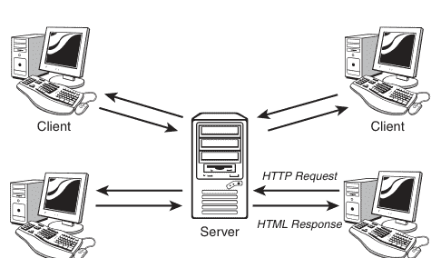

图 1.1 网络服务器和客户端（浏览器）如何交互。

### 什么是网页？

对万维网有一些经验的人都会熟悉网页这个术语。网站的传统用户界面涉及访问者在一系列相互连接的页面之间导航，每个页面包含文本、图像等，像杂志的页面。通常，每个网页实际上是服务器上的单独文件。构成网站的各个页面的集合由称为 Web 服务器的程序管理。

### Web 服务器

> 警告：术语“web server”在日常用语中同时指代 Web 服务器程序（如 Apache）和其运行的计算机。

Web 服务器是一种程序，它解释 `HTTP` 请求，并以您的浏览器能够理解的形式提供相应的网页。有许多相关的示例，大多数运行在 UNIX/Linux 操作系统或某个版本的 Windows 下。

最著名的服务器应用程序来自 Apache 软件基金会（`http://www.apache.org/`）的 Apache Web Server，这是一个开源项目，用于为全球百万个网站提供服务（见图 1.2）。

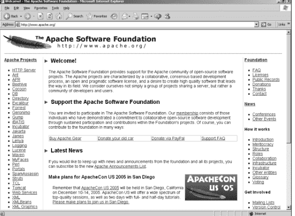

图 1.2 Apache 软件基金会主页 `http://www.apache.org/`，在 Internet Explorer 中显示。

> 随书光盘：Apache for Windows、Mac 和 Linux 包含在 Ajax Starter Kit 光盘中。

另一个例子是 Microsoft 的 `IIS`（Information Services），通常用于运行 Microsoft Windows 操作系统的主机计算机上。

### 服务器端编程

服务器端程序、脚本或语言指的是在服务器计算机上运行的程序。有许多语言和工具用于服务器端编程，包括 PHP、Java 和 ASP（后者仅在运行 Microsoft Windows 操作系统的服务器上可用）。复杂的服务器设置通常还包括供服务器端脚本访问的信息数据库。

> 注意：本书中的服务器端编程是使用流行的 PHP 脚本语言进行的，该语言灵活、易于使用，几乎可以在所有服务器上运行。然而，Ajax 与任何服务器端脚本语言都能同样良好地工作。

此类脚本的目的多种多样。总的来说，它们都是为了在将网页返回给您之前对其进行预处理。我们的意思是，页面的部分或全部内容将被修改以适应您的请求上下文——也许是为了显示特定日期前往特定目的地的火车时刻表，或者仅显示目录中与您所述的爱好和兴趣匹配的产品。

通过这种方式，服务器端脚本允许提供具有丰富多样内容的网页，这超出了仅使用静态页面（即内容固定的页面）的任何设计的范围。

### 网页浏览器

网页浏览器是用户计算机上用于解释和显示网页的程序。第一个图形化网页浏览器 Mosaic 最终发展成了 Netscape 生产的著名浏览器。

> 注意：所说的图形化网页是指不仅显示 HTML 文档，还能显示图像和颜色。通常此类浏览器使用鼠标或指针进行操作。也存在基于文本的浏览器，其中著名的是 `Lynx`（`http://lynx.org/`），它可以在基于字符的显示器（如终端、仿真器以及命令行界面，如 DOS）上显示。

Netscape 系列是最成功的浏览器，但最终加入了 Internet Explorer，后者占据了市场主导地位。然而，近期竞争引入了多种浏览器，包括 Opera、Safari、Konqueror 以及 Mozilla Firefox，这是一个开源网页浏览器最近获得了热情的追者。

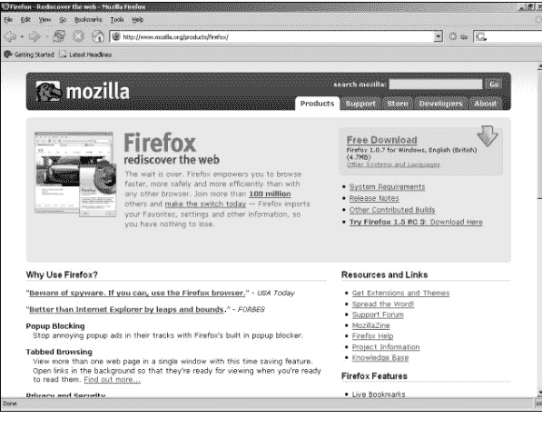

图 1.3 来自 Mozilla org 的 Firefox 项目页。

### 客户端编程

我们已经讨论了脚本如何通过在服务器上创建并插入到您的页面中的丰富内容来改善网络体验。另一方面，客户端编程不是在服务器上，而是在页面。此类脚本允许您对页面执行许多任务，包括更改样式、检查输入的有效性等等。几乎所有浏览器都支持某种客户端语言，`JavaScript` 是 Ajax 的重要部分。

### DNS—域名

连接到互联网的每一台计算机都被分配了一个唯一的地址（称为 `IP` 地址）。当您想访问特定网站时，使用域名（记住 `www.somedomain.com`）比地址容易得多。通过域名请求网页时，服务器查找与名称关联的条目，如果成功，您将连接到网站；否则会收到错误。互联网上的 DNS 服务器相互更新，修订后的地址在 24 小时内完成。

## 总结

在本课中，我们讨论了互联网的历史和发展，回顾了其主要组件，包括 Web 服务器和浏览器。我们还考虑了网站用户界面的特性，并要介绍了服务器端和客户端脚本可以实现哪些功能。

## 使用 HTML 编写网页

我们将介绍 HTML——万维网上几乎所有页面背后的标记。相反，我们将回顾基本原理，并提供一些代码来说明特别开始开发 Ajax 应用程序时将相关的主题。

### 什么是 HTML？

万维网由百万个独立页面构成，而这些页面通常用文本标记语言（广为人知的是 HTML）编写。

> 随书光盘：请在 Ajax 入门套件上查找《Sams Teach Yourself HTML in 10 Minutes》。这个名字透露了关于 HTML 大量信息。我们用它来标记我们的文档，以便 Web 浏览器知道如何显示它们并在其中定义超链接，提供页面内或页面间的导航。在“所见即所得”（WYSIWYG）出现之前的文字程序的人都应该熟悉文本标记。大多数旧应用程序要求在显示（例如）粗体、斜体或下划线部分的开头和结尾放置特殊字符。

### 编写 HTML 需要哪些工具？

因为 HTML 标记中的元素仅使用普通的字符，所以你真正需要的一个好的文本编辑器来构建 HTML 页面。有很多可用的文本编辑器，大多数操作系统至少预装了一个程序。例如，如果你使用的是版本的 Windows，内置的记事本应用程序就完全胜任，或者你可以在 Mac 上使用 Text Edit。

> 随书光盘：虽然记事本或 Text Edit 都是完全用的文本编辑器，但许多程序员编辑器提供了有用的功能，如行号和语法高亮显示。一个功能齐全、跨平台的编辑器 `jEdit` 已包含在 Ajax 入门套件中。

### 我们的第一个 HTML 文档

让我们直接开始，创建一个 HTML 文档。打开记事本（或你使用的任何编辑器），并输入清单 2.1 中所示的文本。HTML 标记元素（通常称为标签）是由 `<` 和 `>` 包围的字符串。

```
清单 2.1 testpage.html
<!DOCTYPE HTML PUBLIC "-//W3C//DTD HTML 4.01 Transitional//EN" "http://www.w3.org/TR/html4/loose.dtd">
<html>
<head>
<title>一个简单的 HTML 文档</title>
</head>
<body>
<h1>我的 HTML 页面</h1>
欢迎来到我用 HTML 编写的第一页面。<br />
这只是一个带有 HTML 标记的文档，用于将一些单词显示为 <b>粗体</b>，将另一些单词显示为 <i>斜体</i>。
<br />
</body>
</html>
```

> 注意：虽然文本编辑器非常适合编写程序代码，但使用文字软件可能会导致问题，因为这类程序通常会在输出代码中嵌入不需要的标记和其他符号。如果你使用文字软件，请确保它能够将文件保存为纯 ASCII 文本。

现在，将文档保存到计算机上的某个位置，并将其命名为 `testpage.html`。

如果你现在将该页面加载到你最喜欢的浏览器中，例如 Internet Explorer 或 Firefox，你应该看到类似于图 2.1 所示的窗口。

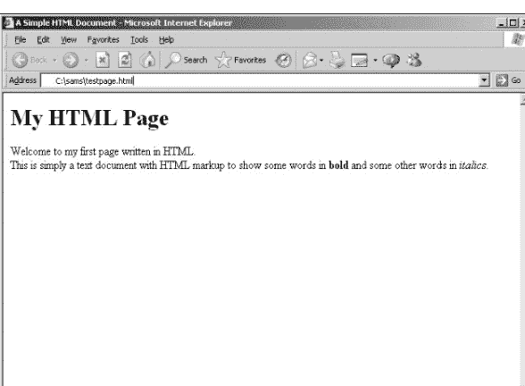

图 2.1 在 Internet Explorer 中显示的我们的测试文档。


页面上的第一个元素称为 `DOCTYPE` 元素。它的目的是通知浏览器文档中使用的 HTML “风格”。本书中使用的 `DOCTYPE` 元素指的是 `HTML 4.0 Transitional`，这是 HTML 规范的一个相当宽容的版本，它允许使用一些早期的标记样式和结构，以及最新的 HTML 4.0 规范。

`DOCTYPE` 元素必须始终出现在 HTML 文档的最开头。

接下来，请注意文档的其余部分由页面开头的 `<html>` 元素和结尾的 `</html>` 元素包围。这些标签通知浏览器，之间的内容应被解释并显示为 HTML 文档。

这些外部标签内的文档被进一步分为两个部分。第一部分包含在 `<head>` 和 `</head>` 标签中，第二部分包含在 `<body>` 和 `</body>` 之间。本质上，文档的头部部分用于存储关于文档的信息，这些信息不会显示在浏览器窗口中，而文档的主体包含需要通过浏览器窗口解释并显示给用户的文本。

### 文档的 `<head>` 部分

从清单 2.1 我们可以看到，我们简单的 HTML 文档的头部部分只包含一行——被 `<title>` 和 `</title>` 标签包围的“一个简单的 HTML 文档”这几个字。

记住，头部部分包含的信息不会显示在浏览器窗口中。因此，这并不是显示在我们页面文本顶部的标题，你可以再次查看图 2.1 来确认。文档标题也不是指文件名，本例中的文件名是 `testpage.html`。

实际上，文档标题具有多种功能，其中包括：

- 搜索引擎通常使用页面标题（以及其他因素）来帮助它们确定页面的内容。
- 当你为页面添加书签时，它通常默认保存为文档标题。
- 大多数浏览器在最小化时，会在其图标或任务栏按钮上显示当前文档的标题。

因此，为你创建的每个页面选择一个有意义且描述性的标题非常重要。

> **注意：** 尽管许多现代浏览器即使没有这些标签也能正确显示 HTML，但省略它们是不良实践。即使页面在你自己的电脑上显示正确，你也不知道访问者使用的是什么操作系统和浏览器——他可能没那么幸运。

文档头部部分还使用了许多其他元素类型，包括 `link`、`meta` 和 `script` 元素。虽然我们在此不做详细说明，但它们会在书中出现时进行描述。

### 文档的 `<body>` 部分

再次参考清单 2.1，我们可以清楚地看到文档主体部分的内容由我们想要在页面上显示的文本以及一些帮助我们定义文本外观的标签组成。

例如，为了定义某些单词应显示为粗体，我们将这些单词包含在 `<b>` 和 `</b>` 标签中。同样，要将某些单词转换为斜体，我们可以使用 `<i>` 和 `</i>` 标签。

标题“My HTML Page”被包含在 `<h1>` 和 `</h1>` 标签之间。这些标签表明我们打算将包含的文本作为一个标题。HTML 允许六级标题，从 `h1`（最突出）到 `h6`。你可以使用任何中间值 `h2`、`h3`、`h4` 和 `h5` 来显示具有不同副标题级别的页面，例如对应于章节、节和段落标题。在标题标签内显示的所有内容都独占一行显示。

> **提示：** 如果你想在 HTML 页面的 body 部分写点东西，但又不希望它被浏览器解释并因此显示在屏幕上，你可以将其写为注释。HTML 注释以字符串 `<!--` 开始，以字符串 `-->` 结束，如下例所示：

```
<!-- 这只是一个注释，不会在浏览器中显示 -->
```

到目前为止讨论的所有标签都是容器——也就是说，它们由开始标签和结束标签组成，你想让这些标签作用于的文本就放置在它们之间。然而，有些元素不是容器，而是可以单独使用的。清单 2.1 显示了一个这样的元素：`<br />` 标签，它表示换行。另一个例子是 `<hr />`（水平线）。

### 为 HTML 元素添加属性

有时需要确切指定标记标签的行为方式。在这种情况下，你可以添加（通常在开始标签内）参数和值对，称为属性，来改变元素的行为：

```html
<body bgcolor="#cccccc">
... 页面内容放在这里 ...
</body>
```

## 2：使用 HTML 编写网页

在这个示例中，通过将 `<body>` 标签的 `BGCOLOR`（背景颜色）属性调整为浅灰色，修改了其行为。图 2.2 展示了将其应用到我们的文件 `testpage.html` 后的效果：

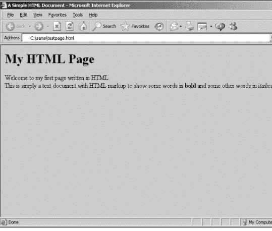

图 2.2 我们的测试页面，主体颜色已更改为灰色。

> **提示**：HTML 中的颜色值使用十六进制系统编码。每个颜色值由三个分量值组成，分别对应红色、绿色和蓝色。每个颜色值的范围可以从十六进制 00 到 `ff`（十进制表示法中的 0 到 255）。这三个十六进制数字连接成一个以井号字符 `#` 为前缀的字符串。因此，颜色值 `#000000` 对应黑色，而 `#ffffff` 对应纯白色。

## 图像

我们可以通过 `` 标签将图像插入页面。在这种情况下，我们使用 `src` 属性将图像的源文件指定为一个参数。我们还可以通过这种方式改变图像显示的其他方面，包括图像的边框、宽度和高度：

```html

```

边框宽度、图像宽度和图像高度以像素（屏幕上单个图像）为单位。

> **提示**：对于图像，另一个有用的属性是 `alt`，它是替代文本。它指定了图像的短描述，将提供给无法显示图像的视力受损人士访问。

```html

```

## HTML 页面的元素

通常您希望以表格格式显示信息，为了实现这种格式显示，HTML 专门设计了一组元素：

```html
<table>
<tr><th>表头1</th><th>表头2</th></tr>
<tr><td>数据单元格1</td><td>数据单元格2</td></tr>
<tr><td>数据单元格3</td><td>数据单元格4</td></tr>
</table>
```

`<table>` 和 `</table>` 标签包含嵌套结构，包括 `<tr>` 和 `</tr>`，定义行；`<th>` 和 `</th>`，表示标题；以及 `<td>` 和 `</td>`，包含数据单元格。请提前查看图 2.3，了解表格在浏览器窗口中的示例。

## 超链接

超链接（超链接）是 HTML 运作的基础。通过点击超链接，您可以导航到一个位置，无论是当前页面上的点，还是另一个网站上的某个点。

链接包含在 `<a>` 或 `</a>` 标签中，这是一个容器。链接的目标作为参数 `href`：

```html
<a href="newpage.html">超链接</a>
```

在上面的示例中，点击“超链接”会导致浏览器请求 `newpage.html`。

> **提示**：超链接可以包含图像以及文本，请看这个示例：

```html
<a href="newpage.html"></a>
```

## 一个更高级的 HTML 页面

让我们重新审视 `testpage.html` 并添加一些元素。清单 2.2 显示了 `seville.html`，它基于原始的 HTML 页面，但 `<body>` 部分包含了不同的内容。图 2.3 展示了页面在 Mozilla Firefox 中显示的效果。现在我们已经为文档的主体区域应用了背景色。主体区域的内容已居中于页面上，并且包括一个图像（我们设置了像素宽的边框）、一个标题和一个副标题、一个简单的表格以及一些文本。

```
<!DOCTYPE HTML PUBLIC "-//W3C//DTD HTML 4.01//Transitional//EN" "http://www.w3.org/TR/html4/loose.dtd">
<html>
<head>
<title>一个 HTML 文档</title>
</head>
<body bgcolor="#cccccc">
<center>

<h1>塞维利亚指南</h1>
<h3>简要指南</h3>
<table border="2">
<tr>
  <th bgcolor="#aaaaaa">景点</th>
  <th bgcolor="#aaaaaa">描述</th>
</tr>
<tr>
  <td>大教堂</td>
  <td>可追溯至 15 世纪</td>
</tr>
<tr>
  <td>城堡宫</td>
  <td>中世纪伊斯兰宫殿</td>
</tr>
</table>
<p>享受在美丽的塞维利亚停留时光。</p>
</center>
</body>
</html>
```

让我们仔细看看其中的一些代码。首先，我们使用 `<body>` 标签的 `BGCOLOR` 属性为页面提供整体背景色：

```html
<body bgcolor="#cccccc">
```

主体区域中的所有内容都包含在 `<center>` 标签（紧接在 `<body>` 标签之后）及其结束标签 `</center>` 之间，后者紧接在结束的 `</body>` 标签之前。这确保了我们所有的内容都居中于页面上。

主标题包含在 `<h1> ... </h1>` 标签中，但现在其后使用 `<h3> ... </h3>` 标签提供稍小字体大小的副标题。

在开始的 `<table>` 标签中使用 `border` 属性，我们为表格设置了两像素的边框宽度：

```html
<table border="2">
```

同时，我们通过使用 `<th>` 元素的 `bgcolor` 属性稍微加深了表格标题单元格的背景：

```html
<th bgcolor="#aaaaaa">景点</th>
```

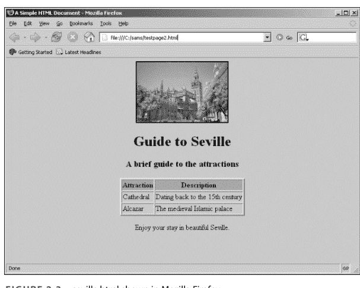

图 2.3 `seville.html` 在 Mozilla Firefox 中显示。

## 一些有用的 HTML 标签

表 2.1 列了一些更受欢迎的 HTML 标签。

表 2.1 一些常见的 HTML 标记元素

### 文档标签

| 标签 | 描述 |
|---|---|
| `<html>..</html>` | 整个文档 |
| `<head>..</head>` | 文档头 |
| `<body>..</body>` | 文档主体 |
| `<title>..</title>` | 文档标题 |

### 样式标签

| 标签 | 描述 |
|---|---|
| `<a>..</a>` | 超链接 |
| `<b>..</b>` | 粗体文本 |
| `<em>..</em>` | 强调文本 |
| `<font>..</font>` | 更改字体 |
| `<i>...</i>` | 斜体文本 |
| `<small>...</small>` | 小文本 |
| `<table>...</table>` | 表格 |
| `<tr>...</tr>` | 表格行 |
| `<th>...</th>` | 表格标题单元格 |
| `<td>...</td>` | 表格主体中的单元格 |
| `<ul>...</ul>` | 项目符号列表 |
| `<ol>...</ol>` | 有序列表 |
| `<li>...</li>` | 项目符号列表或有序列表中的项 |

> **提示**：万维网联盟管理 HTML、XML 以及许多 Web 技术的定义。位于 http://www.w3.org/。

## 了解层叠样式

网页样式方法有一些缺点。首先，您需要显式声明每个页面属性。当你想更改页面的外观时，需要逐行更改每个属性。对于简单的页面来说还可以，但随着内容增加，页面会变得难维护。此外，应用于 HTML 元素的属性只允许有限的范围。如果您只需对更改一次，就能将应用于所有给定类型的元素。为了实现这个目标，可以使用样式。样式可以通过文档头部使用 `<style>` 标签嵌入到 HTML 文档中：

```html
<style type="text/css">
    ... 样式定义 ...
</style>
```

或者，它们可以通过 `link` 元素从外部文件链接，同样放置在头部部分：

```html
<link rel="stylesheet" href="style.css" type="text/css" />
```

> **提示**：您甚至动态定义样式。这些被称为内联样式，可以应用于单个 HTML。以清单 2.2 的 `<body>` 标签为例：

```html
<body bgcolor="#cccccc">
```

您可以使用内联样式相同的效果：

```html
<body style="background-color:#cccccc">
```

## 设置样式规则

样式表允许您为各种 HTML 元素设置样式。一条规则有两个部分：选择器（标识规则影响哪个 HTML 标签）和声明（包含规则）。以下示例为段落元素 `<p>` 定义了一个样式：

```css
P {color: #333333}
```

此示例确定任何在段落标签 `<p>...</p>` 中的文本使用深灰色显示。您还可以为每个标签指定多个规则。假设除了灰色外，您还希望段落元素中的所有文本都斜体显示：

```css
P {color: #333333; font-style: italic}
```

样式表可以根据您的需要包含任意多的规则。您还可以通过逗号分隔选择器，将一个声明同时应用于多个标签。以下规则确定所有 `h1`、`h2` 和 `h3` 标题都以蓝色显示：

```css
H1, H2, H3 {color: blue}
```

## 总结

本课讨论了使用超文本标记语言进行网页布局的基础知识，包括 HTML 文档的结构、页面元素的示例，以及使用元素属性和层叠样式进行页面设置。

## 使用 HTTP 发送请求

万维网上通信使用各种协议，其中可能是 HTTP，它也是 Ajax 应用程序的基础协议。本课介绍 HTTP 协议，并展示如何使用它来请求和接收信息。

### HTTP 简介

HTTP 或超文本传输协议是万维网的主要协议。当你在网页浏览器中输入地址请求网页时，该请求就是通过 HTTP 发送的。浏览器是一个 HTTP 客户端，而网页服务器则是 HTTP 服务器。HTTP 定义了一套关于消息和其他数据如何格式化以及在服务器和浏览器之间交换的规则。

## 为什么我需要了解这些？

Ajax 使用 HTTP 协议发送服务器请求。认识到 HTTP 请求的不同类型以及服务器可能返回的响应很重要。Ajax 应用程序需要构建 HTTP 请求来查询服务器，并根据服务器返回的 HTTP 响应内容来决定下一步的操作。

## 本课涵盖（和未涵盖）的内容

完全可以整本书都用来讲解 HTTP 协议的信息，但这里我们仅从其在请求网页和在网页之间传递信息的作用方面进行讨论。在本课中，你将了解 HTTP 请求和响应的构造，并查看 HTML 表单如何使用这些请求在网页之间传输数据。

> 提示：关于 HTTP 的详细说明，请参阅 Sams 出版社 Chris Shiflett 所著的《HTTP开发者手册》。

### HTTP 请求与响应

HTTP 协议可以比作一系列基于问答的对话，我们分别称之为 HTTP 请求和 HTTP 响应。HTTP 请求和响应的内容易于阅读和理解，其语法接近纯英语。本节将研究这些请求和响应的结构，并附带一些它们可能包含的数据类型示例。

### HTTP 请求

在与目标服务器建立连接后，HTTP 客户端按以下格式发送请求：

- 一个起始行
- 可选地，若干头部行
- 一个空行
- 可选地，一个消息体

起始行通常分为三部分：方法名称、所需服务器资源的路径以及所使用的 HTTP 版本。一个典型的起始行可能如下：

GET /sams/testpage.html HTTP/1.0

在这一行中，我们告诉我们正在发送一个 GET 类型的 HTTP 请求（下一节将更详细地解释），我们使用 HTTP 版本 1.0 发送此请求，并且需要的服务器资源（包括本地路径）是 /sams/testpage.html。

**注意：** 在此示例中，我们请求的服务器资源在我们服务器上，因此我们引用了一个相对路径。当然，它可能在其他地方的另一台服务器上，这种情况下服务器资源将包含完整的 URL。头部行用于发送有关请求或消息体中发送的信息。每行发送一个参数和值对，参数和值之间用冒号分隔。这里有一个例子：

`User-Agent: [发送请求的程序名称]`

例如，Internet Explorer v5.5 会提供以下的内容：

`User-agent: Mozilla/4.0 (compatible; MSIE 5.5; Windows NT 5.0)`

另一个常见请求头的例子是 `Accept:` 头部，它说明服务器响应中哪种类型的信息是可接受的：

`Accept: text/plain, text/html`

**注意：** HTTP 请求方法包括 POST、GET、PUT、DELETE 和 HEAD。在我们的 Ajax 探索中，目前最有趣的是 GET 和 POST 请求。PUT、DELETE 和 HEAD 请求在此不作介绍。


```markdown
通过发出上述示例中的头部，请求告知服务器发送的应用程序可以接受纯文本或 HTML 响应（即，它不具备处理例如音频或视频文件的能力）。

### HTTP 响应

作为对此类请求的回应，服务器通常会发出一个 HTTP 响应，其第一行通常称为`状态行`。在该行中，服务器会回显 HTTP 版本并给出一个响应状态码（一个三位整数）和一个称为`原因短语`的简短消息。以下是一个 HTTP 响应示例：

`HTTP/1.0 200 OK`

响应状态码和原因短语本质上是相同消息的机器可读版本和人类可读版本，尽管原因短语在不同的服务器上可能略有不同。表 3.1 列出了一些常见的状态码和原因短语示例。状态码的第一位数字通常能提示消息的性质：

- 1—信息
- 2—成功
- 3—重定向
- 4—客户端错误
- 5—服务器错误

**表 3.1** 一些常见的 HTTP 响应状态码

| 状态码 | 说明 |
|---|---|
| 200 - OK | 请求成功。 |
| 204 - No Content | 文档不包含数据。 |
| 301 - Moved Permanently | 资源已永久移动到不同的 URI。 |
| 401 - Not Authorized | 请求需要用户身份验证。 |
| 403 - Forbidden | 服务器拒绝履行该请求。 |
| 404 - Not Found | 请求的资源在服务器上不存在。 |
| 408 - Request Timeout | 客户端未能在服务器允许的时间内发送请求。 |
| 500 - Server Error | 由于脚本故障、服务器配置错误或类似原因。 |

> 提示：状态码的详细列表由万维网联盟（W3C）维护，可在 http://www.w3.org/Protocols/rfc2616/rfc2616-sec10.html 获取。

响应也可能包含头部行，每一行包含一个头部和值对，类似于 HTTP 请求中的头部，但通常包含关于服务器和/或所返回资源的信息：

`Server: Apache/1.3.22`

`Last-Modified: Fri, 24 Dec 1999 13:33:59 GMT`

### HTML 表单

网页通常包含你可以输入信息的字段。例如包括选择框、复选框以及你可以输入信息的字段。表 3.2 列出了一些常用的 HTML 表单标签。

**表 3.2** 一些常见的 HTML 表单标签

| 标签 | 描述 |
|---|---|
| `<form>...</form>` | 整个表单的容器 |
| `<input />` | 数据输入元素；包括文本、密码、复选框和单选按钮字段，以及提交和重置按钮 |
| `<select>...</select>` | 下拉选择框 |
| `<option>...</option>` | 选择框内的可选选项 |
| `<textarea>...</textarea>` | 多行文本输入字段 |

完成表单后，通常会邀请你使用一个标记适当的按钮或其他页面元素提交它。

此时，HTML 表单会根据用户输入的数据构建并发送 HTTP 请求。表单可以使用 GET 或 POST 请求类型，具体在 `<form>` 标签的 `method` 属性中指定。

### GET 和 POST 请求

有时你可能会听说 GET 和 POST 请求的区别在于 GET 请求仅用于 GETting（即，检索）数据，而 POST 请求可以有多种用途，例如上传数据、发送邮件等。

尽管这种经验法则可能有一定道理，但考虑这两种 HTTP 请求在构造方式上的差异是有启发性的。

GET 请求将其发送的消息编码到一个`查询字符串`中，并将其附加到服务器资源的 URL 上。另一方面，POST 请求则在其请求的`消息体`中发送消息。此时实际发生的情况是，输入的数据被编码，并通过一个 HTTP 请求发送到表单 `action` 属性中声明的 URL，提交的数据将在那里以某种方式被处理。

HTTP 请求是 GET 类型还是 POST 类型，以及表单被发送到的 URL，都是在表单的 HTML 标记中确定的。让我们看一个典型表单的 HTML 代码：

```html
<form action="http://www.sometargetdomain.com/somepage.htm"
      method="post">
    Your Surname: <input type="text" size="50" name="surname" />
    <br />
    <input type="submit" value="Send" />
</form>
```

这段代码片段嵌入网页后，会生成如图 3.1 所示的简单表单。

3：使用HTTP发送请求

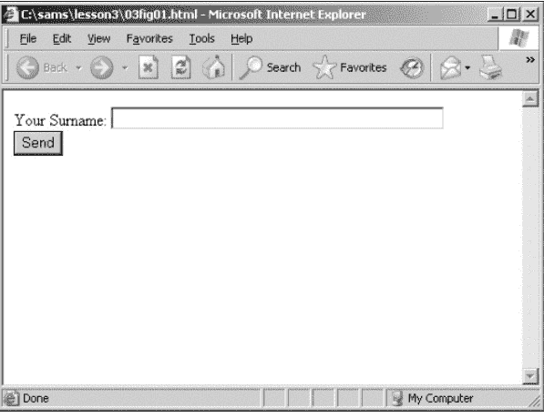

图 3.1 一个简单的HTML表单。

让我们逐行查看这段代码。首先，我们使用`<form>`标签来开始表单，在这个例子中，我们为该标签添加了两个属性。`action`属性决定了提交的表单将被发送到哪个URL。这可以是同一服务器上的另一个页面，通过相对路径描述，也可以是一个远程域，如图3.1表单背后的代码所示。

接下来我们找到`method`属性，它决定了我们是想用GET还是POST请求来提交数据。

现在假设我们通过在姓氏字段中输入值`Ballard`来完成表单。点击发送按钮提交表单后，我们将跳转到 http://www.sometargetdomain.com/somepage.htm，提交的数据将在那里被处理——例如，将姓氏添加到数据库中。

变量`surname`（分配给“您的姓氏”输入字段的`name`属性）及其值（我们在该字段中输入的数据）也会被发送到这个目标页面，编码在POST请求的主体中，用户无法看到。

### HTML表单

现在假设表单代码的第一行如下所示：

`<form action="http://www.sometargetdomain.com/somepage.htm"
method="get">`

使用该表单时，我们仍然会被带到同一个目标地址，相同的变量及其值也会被传输。然而，这次表单将构造并发送一个包含表单数据的GET请求。查看浏览器的地址栏，在成功提交表单后，我们会发现它现在包含：

http://www.example.com/page.htm?surname=Ballard

这里我们可以看到参数及其值是如何被附加到URL上的。如果表单包含更多的输入字段，那些字段中输入的值也会以`参数=值`的形式附加到URL上，每对参数之间用`&`字符分隔。下面是一个例子，我们假设表单有一个额外的名为`firstname`的文本输入字段：

http://www.example.com/page.htm?surname=Ballard&firstname=Phil

某些字符，如空格和各种标点符号，不允许以原始形式传输。HTML表单会将这些字符编码为可以正确传输的形式。在接收页面处理之前，一个等效的过程会解码这些值，从而使编码/解码操作对用户来说基本不可见。然而，我们可以通过发出一个GET请求并检查构造的URL来查看这种编码的样子。

假设我们的表单中不是姓氏字段，而是一个全名字段，要求用户输入全名并将该信息编码到GET请求中。那么，提交表单后，我们可能会在浏览器中看到以下URL：

http://www.example.com/page.htm?fullname=Phil+Ballard

> 注意：在许多情况下，对于表单提交，你可以使用POST或GET方法，并获得基本相同的结果。然而，当你学习如何在Ajax应用程序中构造服务器调用时，这种区别就变得重要了。

这里，名称中的空格被替换为`+`字符；接收端的解码过程会移除这个字符并替换回空格。

所有Ajax应用程序的核心对象`XMLHttpRequest`使用HTTP向服务器发出请求并接收响应。这些HTTP请求的内容与提交HTML表单时相同。
```

*(注：由于原文文本中存在大量重复、逻辑混乱的段落及乱码化描述，已根据“高级文档工程师”的角色，按照“保留核心内容”及“删除多余”的原则，剔除了无意义的重复和错误描述，仅保留了HTML/JavaScript交互的核心逻辑。)*
```


`onClick="alert('Thanks for clicking!')"`

此行调用 JavaScript 的 `alert` 方法，该方法会弹出一个对话框，显示一条消息和一个“确定”按钮。警报对话框中显示的消息包含在作为参数传递给 `alert` 方法的字符串中。

让我们将此代码添加到我们的 HTML 文档中，如清单 4.2 所示。进行更改后，将页面保存为 `testpage4.html` 并将其加载到浏览器中。

### 清单 4.2 从 onClick 事件处理器调用 alert()

```html
<!DOCTYPE HTML PUBLIC "-//W3C//DTD HTML 4.01 Transitional//EN" "http://www.w3.org/TR/html4/loose.dtd">
<html
<head>
<title>A Simple HTML Document</title>
</head>
<body bgcolor="#cccccc">
<center>

<h1>A More Advanced HTML Page</h1>
<h3>Welcome to my second page written in HTML.</h3>
<table border="2">
<tr
  <th bgcolor="#aaaaaa">Vegetables</th>
  <th bgcolor="#aaaaaa">Fruits</th>
</tr>
<tr
  <td>Carrot</td>
  <td>Apple</td>
</tr>
<tr
  <td>Cabbage</td>
  <td>Orange</td>
</tr>
</table><br />
<p>... and here's some text in a paragraph.</p>
<script language="JavaScript" type="text/javascript">
document.writeln("This line was written using JavaScript!")
</script>
<form>
<input type="button" value="Click Here" onClick="alert('Thanks for clicking!')">
</form>
</center>
</body>
</html>
```

我们的 HTML 页面现在应该显示新的按钮，如图 4.2 所示。

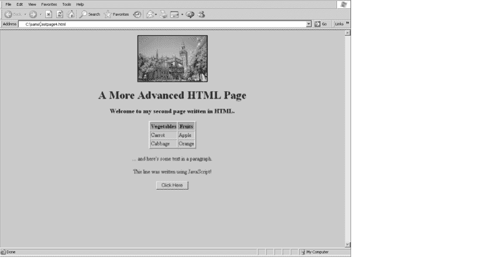

**图 4.2** 我们网页中的新“Click Here”按钮。

现在点击该按钮。如果一切按计划进行，一个警报对话框会弹出，如图 4.3 所示。你可以点击“确定”来清除对话框。

## 创建函数

通常你需要组合各种 JavaScript 方法和对象，可能使用多行代码。JavaScript 允许你组合这样的指令块并为其命名，使你的代码更易于编写、理解和维护。

例如，让我们使用另一个事件处理器，但这次我们将用它来调用一个函数，而不是直接调用 JavaScript 方法。

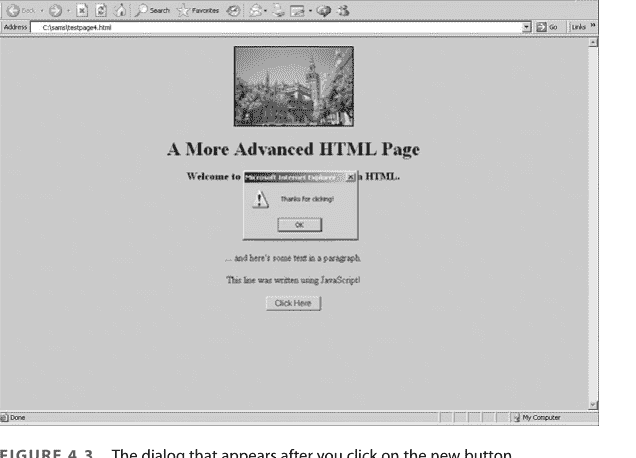

**图 4.3** 点击新按钮后出现的对话框。

这是我们函数的代码，我们将把它放在 HTML 文档的 head 部分：

```html
<script language="JavaScript">
function showAlert()
{
    alert("A Picture of Seville")
}
</script>
```

> 注意：请注意，函数定义总是以单词 `function` 开头，后跟函数名。函数内的语句包含在花括号 `{}` 内。

在常规的 `<script>` 标签内，我们现在定义了一个名为 `showAlert` 的函数，该函数执行花括号中包含的命令。在本例中，只有一个命令，即调用先前遇到的 `alert` 方法。

我们希望当用户的鼠标移过我们网页中的照片时，此警报对话框出现。因此，我们将向包含图像的 `` 标签添加一个属性，如下所示：

``

此行使用 `onMouseOver` 事件处理器来检测光标何时进入照片所占区域。当这种情况发生时，我们的新函数 `showAlert` 将被调用。清单 4.3 显示了修改后的代码。

### 清单 4.3 使用 onMouseOver 事件处理器

```html
<!DOCTYPE HTML PUBLIC "-//W3C//DTD HTML 4.01 Transitional//EN" "http://www.w3.org/TR/html4/loose.dtd">
<html
<head>
<title>A Simple HTML Document</title>
<script language="JavaScript" type="text/javascript">
function showAlert()
{
    alert("A Picture of Seville")
}
</script>
</head>
<body bgcolor="#cccccc">
<center>

<h1>A More Advanced HTML Page</h1>
<h3>Welcome to my second page written in HTML.</h3>
<table border="2">
<tr
<th bgcolor="#aaaaaa">Vegetables</th>
<th bgcolor="#aaaaaa">Fruits</th>
</tr>
<tr
<td>Carrot</td>
<td>Apple</td>
</tr>
<tr
<td>Cabbage</td>
<td>Orange</td>
</tr>
</table><br />
<p>... and here's some text in a paragraph.</p>
```

## 4：使用 JavaScript 进行客户端编码

```html
<script language="JavaScript" type="text/javascript">
document.writeln("This line was written using JavaScript!")
</script>
<form>
<input type="button" value="Click Here" onClick="alert('Thanks for clicking!')">
</form>
</center>
</body>
</html>
```

此 HTML 文档加载到浏览器后，将鼠标悬停在照片上。出现一个包含消息 "Picture of Seville" 的框。

## 向函数传递参数

当然，我们可以从页面内的事件处理程序调用我们的函数，让它弹出对话框。不幸的是，总是包含消息 "Picture of Seville"，不是很实用！如果我们告诉函数要显示什么，以便不同情况设置不同的消息，那不是很好？我们可以将消息作为参数传递给函数：

```html
<script language="JavaScript" type="text/javascript">
function showAlert(message)
{
    alert(message)
}
</script>
```

该函数现在“期望”在调用中找到参数传递的消息。重写图像的 `onMouseOver` 事件程序以提供功能：

```html

```

我们还将重写按钮的 `onClick` 事件程序以使用不同的消息：

```html
<input type="button" value="Click Here"
       onClick="showAlert('Thanks for clicking!')" />
```

清单 4.4 显示了修改后的代码。

### 清单 4.4 从事件程序调用 JavaScript

```html
<html
<head>
<title>A Simple HTML Document</title>
<script language="JavaScript" type="text/javascript">
function showAlert(message)
{
    alert(message)
}
</script>
</head>
<body bgcolor="#cccccc">
<center>

<h1>A More Advanced HTML Page</h1>
<h3>Welcome to my second page written in HTML.</h3>
<table border="2">
<tr
    <th bgcolor="#aaaaaa">Vegetables</th>
    <th bgcolor="#aaaaaa">Fruits</th>
</tr>
<tr
    <td>Carrot</td>
    <td>Apple</td>
</tr>
<tr
    <td>Cabbage</td>
    <td>Orange</td>
</tr>
</table><br />
<p>... and here's some text in a paragraph.</p>
<script language="JavaScript" type="text/javascript">
document.writeln("This line was written using JavaScript!")
</script>
<form>
<input type="button" value="Click Here" onClick="showAlert('Thanks for clicking!')">
</form>
</center>
</body>
</html>
```

## 其他事件处理程序

到为止，您已经看到了 `onClick` 和 `onMouseOver` 事件程序的示例。还有许多其他事件程序可供使用；表 4.1 列了一些最常用的事件程序。

**表 4.1 一些常见的 JavaScript 事件程序**

| 事件处理程序 | 备注 |
| --- | --- |
| onChange | 当输入字段中的值变化时发生 |
| onClick | 当用户在相关元素上单击鼠标时发生 |
| onLoad | 当页面完成加载时发生 |
| onMouseOver | 当鼠标指针进入相关元素占据的屏幕区域时发生... |
| onMouseOut | ...以及它离开时 |
| onSubmit | 在表单提交时发生 |

## 在 JavaScript 中操作数据

您可以使用 JavaScript 实现的功能远不止弹出对话框。JavaScript 为您提供了定义和使用变量和数组、处理日期时间和运算以及使用循环和条件分支控制程序的机会。

## 变量

如果您曾经做过任何代数运算，或者用任何计算机语言编写过程序，那么变量的概念您可能已经熟悉了。变量是一块数据，被赋予一个名称，以便您以后可以方便地引用它。在 JavaScript 中，您使用关键字 `var` 声明变量：

```javascript
var speed = 63;
```

上面的代码行声明了变量 `speed`，并使用赋值运算符 `=` 将其赋值为 `63`。

我们现在可以在其他语句中使用此变量：

```javascript
var speedlimit = 55;
var speed = 63;
var excess_speed = speed - speedlimit;
```

变量不必是数字；语句

```javascript
var lastname = 'Smith';
```

将字符串分配给变量 `lastname`。

数字和字符串变量都可以在 JavaScript 语句中操作。考虑以下代码：

```javascript
var firstname = 'Susan';
var lastname = 'Smith';
document.writeln('Hello, '+ firstname + ' ' + lastname);
```

这段代码会将 `Hello, Susan Smith` 写入我们的文档。

## 对象

您在本课的前面已经接触过对象的概念，并了解了对象既有描述它们的属性，也有对其执行动作的方法。JavaScript 中的对象具有层次关系。引用从最高级别的对象开始，后续级别附加并用句点分隔：

```javascript
document.image1.src
```

> 注意：事实上，在对象层次结构中真正处于最高级别的对象是 `window`，它指的是浏览器屏幕及其内部的所有内容。通常，您不需要包含此对象；JavaScript 假设它已经存在。

这个字符串以对象 `document` 开头，然后引用该对象内的 `image1` 对象，最后是 `src` 属性（图像的源文件）。

```markdown
正如你已经知道的，Ajax 应用程序会调用网络服务器，并随后在当前浏览的页面中使用返回的信息。你需要一种方法在服务器上运行程序，以处理 Ajax 请求并返回所需数据。

Ajax 可以与多种服务端技术配合工作，包括 `PHP`、`ASP`、`Java` 等。本书使用 `PHP`，这可以说是现有服务端语言中最流行且易于使用的一种。本课为从未接触过 `PHP` 的人提供入门介绍，也为已经有所了解的人复习基础知识。

## 本课涵盖（和未涵盖）的内容
与本书这一部分的所有课程一样，提供关于该主题每个方面的详尽课程既不现实也不合适。本课涵盖 `PHP` 编程的基础知识和一些实用示例，主要聚焦于我们探索 Ajax 最相关的 `PHP` 方面。

> 随书光盘：Ajax 入门工具包光盘中包含了适用于 Windows、Mac 和 Linux 的 `PHP`。

> 提示：要获得更完整的 `PHP` 课程，请尝试 Ajax 入门工具包光盘上 Chris Newman 所著的 `Sams Teach Yourself PHP in 10 Minutes`。

## 将 PHP 嵌入 HTML 页面
通过使用 `<?php` 和 `?>` 标签包围 `PHP` 语句，可以将 `PHP` 语句嵌入 HTML 文档中。在页面被发送到浏览器之前，Web 服务器会处理这些标签之间的所有内容，并将其替换为相应的 HTML 代码。你可以在页面中使用任意多组 `<?php` 和 `?>` 标签。

> 提示：Web 服务器通常根据文件扩展名来识别哪些文件包含 `PHP` 代码，并相应地进行处理。`PHP` 文件最常用的扩展名是 `.php`，但你可能也会看到 `.php3`、`.php4`、`.phtml` 等。为了使你的代码尽可能兼容多种 Web 服务器环境，最好使用 `.php` 扩展名。

## 从 PHP 输出 HTML
一些 `PHP` 命令可以帮助你直接将文本和 HTML 代码写入页面。最简单的可能是 `echo` 命令：

```
echo "I wrote this line using PHP";
```

前面的语句只是将 `"I wrote this line using PHP"` 放置到 HTML 文档中 `PHP` 语句所在的精确位置。代码清单 5.1 显示了一个 `PHP` 文件的源代码，用于在浏览器窗口中打印 Hello World。

```
清单 5.1 在 PHP 中打印 Hello World
<html
<head>
<title>A Simple PHP Script</title>
</head>
<body>
<?php echo "<h1>Hello World!</h1>"; ?>
</body>
</html>
```

请注意，在此脚本中，输出字符串还包含一些 HTML 标签，`<h1>` 和 `</h1>`。由于 `PHP` 语句在 Web 服务器将页面发送给我们之前就已执行，这些标签会与 `"Hello World"` 文本一起写入文档的 HTML 中，并由我们的浏览器与文档中的所有其他 HTML 标记一起解析。图 5.1 显示了浏览器显示的我们的 "Hello World" 页面。

如果我们要求浏览器显示此页面的源代码，它会显示以下代码，我们可以看到 `PHP` 元素已被 Web 服务器完全处理，服务器已将相关 HTML 插入页面中：

```
<html
<head>
<title>A Simple PHP Script</title>
</head>
<body>
<h1>Hello World!</h1></body>
</html>
```

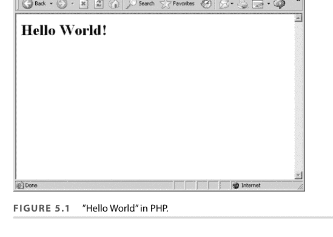

**图 5.1** PHP 中的 "Hello World"。

**注意：** 在 `PHP` 中，变量名区分大小写。例如，`$varname` 和 `$VarName` 代表两个不同的变量。请确保以正确的大小写输入变量名。

## PHP 中的变量
`PHP` 中的变量，与任何编程语言中一样，是用于存储数据片段的命名容器。`PHP` 中所有变量名必须以字符 `$` 开头，后跟由字母、数字和下划线组成的字符串。我们可以在 `PHP` 中为变量赋值，而无需事先声明变量：

```
$score = 71;
$player = 'Harry Scott';
```

变量可以接受多种数据类型，包括字符串、整数、浮点数和布尔值（真或假）。当变量被赋值时，如前面的示例所示，`PHP` 会自动分配数据类型。

## 数字
`PHP` 提供了所有基本的数学运算符，如以下示例所示：

```
$answer = 13 + 4;
$answer = 13 * 4;
$answer = 13 / 4;
$answer = 13 - 4;
```

你也可以计算模数，我们使用 `%` 字符：

```
$answer = 13 % 4;
```

## 字符串
在 `PHP` 中，你将字符串用单引号或双引号括起来：

```
$mystring = "The quick brown fox";
```

字符串可以使用句点字符连接：

```
$newstring = " jumped over the lazy dog";
$concat = $mystring.$newstring;
```

> **提示：** `PHP` 提供了 `date()` 命令，它允许你获取服务器的时间和日期，并按照你的喜好进行格式化；例如，行
`echo date('D F Y H:I');`

以类似 `Fri 16 December 2005 11:36` 的形式输出当前日期。

## 数组
`PHP` 也支持数组。数组是一种可以包含一组值而不仅仅是一个值的变量。这是一个包含一周中几天的 `PHP` 数组：

```
$daynames = array("Monday","Tuesday","Wednesday",
    "Thursday","Friday");
```

数组中的项目通过键来引用，键是从零开始的整数，并为数组中的每个项目递增。以下行将 Thursday 输出到 HTML 页面：

```
echo $daynames[3];
```

请注意，因为索引值从零开始，前面的语句实际上回显了数组的第四个元素。这种类型的数组被称为数字数组，但你也可以使用关联数组。在这种情况下，每个元素的键值不是数字，而是你选择的字符串。声明这样的数组并为其赋值的语法略有不同：

```
$lunch = array("Susan" => "Chicken", "Matthew" => "Beef",
        "Louise" => "Salmon");
```

现在你可以使用键值选择这种数组的元素：

```
echo $lunch["Louise"];
```

此命令会将单词 Salmon 输出到我们的页面。

## 控制程序流程
`PHP` 包含各种结构来控制程序的流程。最有用的之一是简单的 `if` 语句，它允许你根据条件的结果改变程序执行的流程。让我们看一个使用 `if` 语句的代码片段：

```
if($temp > 80)
{
    echo $temp." degrees is too hot. Turn down the thermostat.";
}
```

这个 `if` 语句只是评估括号中包含的条件。如果条件满足，则执行花括号内的语句。我们也可以在 `if` 语句中添加 `else` 子句：

```
if($temp > 80)
{
    echo $temp." degrees is too hot. Turn down the thermostat.";
}
else
{
    echo $temp." degrees is cool.";
}
```

`PHP` 还有 `while` 循环，允许你重复相同的代码，直到满足条件。这是 `while` 循环：

```
$x = 1;
while($x<=12)
{
    echo "This is trip number ".$x." through the loop";
    $x++;
}
```

也可以使用 `for` 构造类似的循环：

```
for($x = 1; $x <= 12; $x++)
{
    echo "This is trip number ".$x." through the loop";
}
```

## 总结
本课介绍了 `PHP` 服务端编程，包括变量的使用和程序流程。你还了解了如何将 `PHP` 语句嵌入 HTML 页面。

# XML 简介
XML 中的 `"x"` 代表 XML，是一种强大的标记语言，能够让 Ajax 传输和处理复杂的结构化信息。本课将讨论创建和使用 XML 文档的基础。任何做过 HTML 标记的人对 XML 代码的性质都会。XML（可扩展标记语言）在标记风格上与 HTML 相似。HTML 旨在确定网页显示方式，而 XML 的用途更为广泛。XML 文档用于各种数据存储。

## 为什么需要了解这些？
XML 的众多用途之一是在应用程序之间传输结构化信息。在 Ajax 中，你可以使用 XML 将信息从服务器返回，在那里解析和使用这些。

## 涵盖（和未涵盖）的内容
与本书其他部分一样，我们打算提供关于 XML 的完整而详尽的论述。相反，本课涵盖了语言及其基础知识，主要集中在方面。

> 随书附赠：如果你想深入学习 XML，请参阅 Andrew H. Watt 所著的《Sams Teach Yourself XML in 10》。

## XML 基础
XML 是一种标记语言，允许以结构化的方式存储和传输数据。它在标记风格上与 HTML 相似，但 HTML 具有固定的元素列表。XML 标签可以定义你想要的内容，允许描述任何类型的数据。

> 提示：XML 使用 HTML 相同的语法来显示注释。任何以字符字符串 `<!--` 开头并以字符串 `-->` 结尾的信息将被忽略：

```
<!-- 这是一个注释 -->
```

## XML 文档结构
XML 文档的允许结构只有一个强制元素，即所谓的文档元素。在前面的示例赛示例中，这就是 `<race>` 元素。

> 注意：文档元素不一定需要嵌套在其中的元素；以下是一个允许的 XML 文档：

`<competition>Farlington Summer Cup</competition>`

## 文档序言
> 注意：如果存在这样的声明，它必须是文档中的第一件事。之前不允许有空白字符。在文档元素之前可以选择包含其他信息，构成文档的序言。一个例子是 XML 声明：

```
<?xml version="1.0" ?>
```

除了各种注释和处理指令外，序言还可以包含文档类型声明。

## 文档类型声明
> 注意：注意不要将文档类型（DOCTYPE）声明与文档类型定义（DTD）混淆。DTD 包含在 DOCTYPE 声明中以及在 DOCTYPE 声明引用的任何外部文件中包含的标记声明。可选的文档类型声明（通常称为 `DOCTYPE` 声明）是关于 XML 文档允许结构的声明。它通常包含（或引用另一个包含）有关文档中元素名称及其之间关系的信息。

让我们看一下帆船赛文档的示例文档类型声明：

`<!DOCTYPE race SYSTEM race.dtd>`

这个声明将出现在文档中 `<race>` 元素之前，指定文档元素将称为 `<race>`，并且文档结构定义可以在外部文件 `race.dtd` 中找到，该文件可能包含类似以下内容：

```
<!ELEMENT race (yacht+) >
<!ELEMENT yacht (name, skipper, helm) >
<!ATTLIST yacht raceNo #CDATA #REQUIRED >
<!ELEMENT name (#PCDATA) >
<!ELEMENT skipper (#PCDATA) >
<!ELEMENT helm (#PCDATA) >
```

或者，这些信息可以在 DOCTYPE 声明中，放在 `[` `]` 之间：

```
<!DOCTYPE race [
<!ELEMENT race (yacht+) >
<!ELEMENT yacht (name, skipper, helm) >
<!ATTLIST yacht raceNo #CDATA #REQUIRED >
<!ELEMENT name (#PCDATA) >
<!ELEMENT skipper (#PCDATA) >
<!ELEMENT helm (#PCDATA) >
]>
```

## JavaScript 和 XML
大多数现代浏览器已经包含一些工具来帮助你处理 XML 文档。必须存在一个 JavaScript 对象来包含 XML 文档。这样一个对象的新实例，根据你使用的是非 Microsoft 浏览器（如 Mozilla 的 Firefox）还是 Microsoft Internet Explorer，方式略有不同：

对于 Firefox 和其他非 Microsoft 浏览器，使用以下代码创建 JavaScript XML 文档对象：

```
<script type="text/javascript">
var myxmlDoc =
    document.implementation.createDocument("","",null);
myxmlDoc.load("exampleDoc.xml");

程序语句

</script>
```
```

<|channel>thought
<channel|>
要在 Internet Explorer 中创建 JavaScript XML 文档对象，请使用以下代码：

```javascript
<script type="text/javascript">
var myxmlDoc=new ActiveXObject("Microsoft.XMLDOM")
myxmlDoc.async="false"
myxmlDoc.load("exampleDoc.xml")

Program statements

</script>
```

在你获得一个表示 XML 文档的对象后，你可以使用该对象的属性和方法来访问文档中包含的 XML 数据。实际上，XML 文档的层次结构和数据现在在 JavaScript 的对象层次结构——文档对象模型（DOM）中有了对应的部分。

## 文档对象模型（DOM）

让我们来看一些有助于你访问和操作这些信息的方法和属性，这个过程通常被称为`遍历 DOM`。

### 节点

假设我们的 JavaScript 对象 `myxmlDoc` 包含了游艇比赛的 XML 列表。文档元素 `<race>` 包含两个类型为 `<yacht>` 的元素；我们说它有两个`子节点`。

通常，你可以通过使用对象的 `childNodes.length` 属性来获取属于特定元素的子节点数量。因为 `<race>` 是文档元素，它位于对象层次结构的顶部，我们可以简单地用变量 `myxmlDoc` 来引用它：

```javascript
var noYachts = myxmlDoc.childNodes.length;
```

我们还可以通过在括号中附加节点编号来确定单个子节点的信息：

```javascript
myxmlDoc.childNode(0)
```

上面的代码行指的是文档中出现的第一个 `<yacht>` 元素。

> 注意：与许多编程构造一样，第一个元素的编号为零，第二个元素的编号为一，依此类推。

我们可以使用 `hasChildNodes()` 方法来测试特定元素是否存在子节点：

```javascript
myxmldoc.childNodes(1).hasChildNodes()
```

此代码行返回 true，因为文档中的第二艘游艇有三个子节点（标签名称分别为 name、skipper 和 helm）。然而，

```javascript
myxmldoc.childNodes(1).childNodes(0).hasChildNodes()
```

返回 false，因为该 `<yacht>` 元素内的 `<name>` 元素没有子节点。

### 获取标签名称

`tagname` 属性允许你查找与特定元素关联的标签名称：

```javascript
myxmldoc.childNodes(0).childNodes(1).tagname
```

上面的代码行返回 skipper。

### 获取元素属性

方法 `getAttribute("AttributeName")` 可用于返回给定元素的属性值：

```javascript
myxmldoc.childNodes(0).getAttribute("raceNo")
```

此代码行返回 74。

### 标签内容

`text` 属性可用于返回特定元素的内容。代码行

```javascript
myxmldoc.childNodes(0).childNodes(1).text
```

将返回 Walter Jeffries。

你将在第 14 课“将数据作为 XML 返回”中更详细地了解这些及类似的方法。

## 总结

本课讨论了 XML 的基础知识，包括 XML 文档结构和文档类型声明。我们还简要探讨了如何使用对象属性和方法，就像使用任何其他 JavaScript 对象一样，让 JavaScript 处理 XML 数据。当我们使用 Ajax 从服务器检索 XML 数据时，这些知识将非常有用。

# Ajax 应用剖析

在本课中，你将了解 Ajax 的各个构建模块以及它们如何组合在一起构成 Ajax 应用的架构。本部分后续的课程，

## Ajax 的必要性

在第一部分“Web 技术回顾”中，我们回顾了构成 Ajax 应用组件的核心技术。现在，希望你至少对 JavaScript、PHP 和 XML 有了基本的了解，我们将在本部分中使用它们。

在讨论各个组件之前，让我们更详细地看看我们希望从 Ajax 应用中获得什么。

### 传统与 Ajax 客户端-服务器交互

第 1 课“网站剖析”讨论了基于页面的网站用户界面模型。当你与这样的网站交互时，包含文本、图像、数据输入表单等的单个页面会逐个显示。每个页面都必须单独处理，然后才能导航到下一个页面。

例如，你可以填写表单的数据输入字段，随心所欲地编辑和重新编辑你的条目，知道数据直到表单最终提交时才会发送到服务器。

图 7.1 说明了这种交互。


**图 7.1** 传统的客户端-服务器交互。

在你提交表单或点击导航链接后，你必须等待浏览器屏幕刷新以显示服务器传递的新页面或修改后的页面。

随着你作为互联网用户的经验增长，使用这种界面几乎成为第二天性。你会学到一些经验法则来帮助自己避免麻烦，比如“不要第二次按下提交按钮”和“提交表单后不要按返回按钮”。

不幸的是，使用这种模型构建的界面有一些缺点。首先，当加载每个新页面或修改后的页面时，会有明显的延迟。这中断了我们用户所感知的应用程序的“流程”。

此外，即使大多数内容与前一页的内容相同，每次也必须加载整个页面。网站上多个页面共有的项目，如页眉、页脚和导航部分，可能占页面所包含数据的很大一部分。

> 注意：带宽是指通信信道承载信息的能力。在互联网上，带宽通常以 bps（比特/秒）或更高的倍数（如 Mbps（百万比特/秒））来衡量。

图 7.2 说明了一个网站在提交表单前后显示的页面，展示了有多少相同的内容被重新加载，以及实际变化的显示内容相对较少。

这种不必要的数据下载浪费了带宽，并进一步加剧了加载每个新页面的延迟。


**图 7.2** 许多页面项目被不必要地重新加载。

## 丰富的体验

上述问题的综合效应是提供的用户体验不如绝大多数桌面应用程序。在桌面上，你期望程序的显示内容保持可见，并且界面在后台进行时仍然响应。例如，当我使用文字编写课时，可以将文档保存到磁盘、滚动或上下页，以及更改字体，而无需每次都等待整个刷新。Ajax 允许你为 Web 应用程序添加一些功能。

## Ajax 简介

为了改善用户体验，你需要为传统的基于页面的设计添加额外的能力。希望用户的页面具有交互性，响应用户的操作并显示修改后的内容，并且无需页面加载或屏幕刷新。为了实现这一点，Ajax 在网页和服务器之间构建了一个处理层。这个层通常被称为 Ajax 引擎或 Ajax 框架，它拦截用户的请求，并在后台处理服务器通信。我们的意思是服务器请求和响应不再与特定的操作同时发生，浏览器不会冻结并等待服务器完成，而是让用户继续在当前页面上滚动、点击和输入。页面元素的更新以反映服务器接收到的信息，由 Ajax 处理并动态发生。图 7.3 表示这些交互如何发生。


**图 7.3** Ajax 客户端-服务器交互。

##真实的 Ajax 应用——Google Suggest

要查看 Ajax 应用实际运行，让我们看看 Google Suggest。这个应用程序扩展了熟悉的界面，根据用户目前输入的内容提供合适的建议。用户每按一个键，Ajax 层就会向服务器查询相似的词，并将返回的数据呈现在下拉框中。

Ajax 列表显示了使用该短语进行搜索时预期返回的结果。用户随时可以选择其中一项，而不是让 Google 处理。由于每次按键都会查询服务器，因此下拉列表会随着输入动态更新——无需页面刷新或类似的中断。图 7.4 展示了程序的运行情况。你可以通过访问 `http://www.google.com/webhp?complete=1&hl=en` 链接来亲自尝试。

> 注意：Google 还推出了其他支持 Ajax 的应用程序，包括 Gmail 网页服务和 Google Maps 地图。详情请访问 `http://www.google.com/`。

接下来，让我们识别这样一个 Ajax 应用程序的各个部分，并了解它们如何协同工作。

## Ajax 的组成部分

让我们逐一检查 Ajax 应用程序的组件。

### XMLHttpRequest 对象

当你点击超链接或提交 HTML 表单时，你会向服务器发送一个 HTTP 请求，服务器通过提供一个新的或修改过的页面作为响应。然而，要使你的 Web 应用程序异步工作，你必须有一种方式向服务器发送 HTTP 请求，而无需关联显示新页面。你可以通过 `XMLHttpRequest` 对象来实现。这个 JavaScript 对象能够与服务器建立连接并发出 HTTP 请求。在接下来的课程中，你将看到如何创建一个对象的实例，以及网页中包含的 JavaScript 程序如何使用其属性和方法建立异步通信。

> 提示：作为安全措施，`XMLHttpRequest` 对象只能调用与页面相同域内的 URL，不能直接调用远程服务器。

第 8 课，“XMLHttpRequest 对象”，讨论了如何创建 `XMLHttpRequest` 对象的实例，并回顾了该对象的属性和方法。

## 与服务器通信

在传统的网页样式中，当你通过超链接或表单提交服务器请求时，服务器会接受该请求，执行任何所需的服务器端处理，然后向你提供一个与你执行操作相适应的新页面。在此处理过程中，用户界面实际上是被冻结的。当服务器完成任务时，你通过浏览器中出现的新页面或修改后的页面而清楚地意识到。

然而，对于异步服务器请求，此类通信在后台发生，此类请求的完成不一定与屏幕刷新或加载新页面同步。因此，你必须做出其他安排来了解服务器处理请求方面的进展。`XMLHttpRequest` 对象具有一个方便的属性来报告服务器请求的进度。你可以使用 JavaScript 程序检查此属性，以确定服务器何时完成任务以及结果何时可供使用。因此，你的 Ajax 工具库必须包括一个监控请求状态并据此采取行动的程序。我们将在第 9 课中详细探讨这一点。

### 服务器端发生了什么？

就服务器端脚本而言，来自 `XMLHttpRequest` 对象的通信只是另一个 HTTP 请求。Ajax 应用程序很少关心服务器上存在什么语言或操作环境；只要客户端 Ajax 层从服务器接收到及时且格式正确的 HTTP 响应，一切都会正常工作。可以构建没有任何服务器端脚本的简单 Ajax 应用程序，只需让 `XMLHttpRequest` 对象调用静态服务器资源（如 XML 或文本文件）即可。Ajax 应用程序可能会调用各种其他服务器端资源，例如 Web 服务。稍后，我们将看一些使用 SOAP 和 REST 等协议调用 Web 服务的示例。

> 注意：这里我们将使用流行的 PHP 脚本语言作为我们的服务器端程序，但如果你更熟悉 ASP、JSP 或其他服务器端语言。


`XMLHttpRequest` 对象的目的是允许 JavaScript 制定 HTTP 请求并将其提交给服务器。传统上编程的 Web 应用程序通常 `同步` 地发出此类请求，与用户发起的事件（如单击链接或提交表单）结合，导致浏览器收到一个新页面或更新后的页面。

然而，使用 `XMLHttpRequest`，你可以让你的页面在后台 `异步` 地进行此类调用，允许你继续使用该页面，而不会因浏览器刷新和加载新页面或修订页面而中断。

> **提示：** 虽然该对象的名称以 XML 开头，但实际上服务器可以返回任何类型的文档；ASCII 文本、HTML 和 XML 都是常见的选择，我们将在本书中遇到所有这些。

这项功能是所有 Ajax 应用程序的基础，使得 `XMLHttpRequest` 对象成为 Ajax 编程的关键。

### 创建 XMLHttpRequest 对象

在创建 `XMLHttpRequest` 实例之前，你无法使用它。在 JavaScript 中创建对象实例通常只是调用一个被称为对象构造函数的方法。然而，对于 `XMLHttpRequest`，你必须稍微改变这个常规做法，以适应不同浏览器的特性，如下面的章节所示。

### 不同浏览器的不同规则

微软最先引入了 `XMLHttpRequest` 对象，在 Internet Explorer 5 中将其作为 `ActiveX 对象` 实现。

大多数其他浏览器开发人员现在已经在其产品中包含了等效的对象，但将其作为浏览器 JavaScript 解释器中的原生对象实现。

因为你无法事先知道你的用户将使用哪种浏览器、版本或操作系统，所以你的代码必须动态地调整其行为，以确保对象的实例能够成功创建。

对于大多数将 `XMLHttpRequest` 作为原生对象支持的浏览器（Mozilla、Opera 等），创建此对象的实例很简单。下面一行代码创建了一个名为 `request` 的 `XMLHttpRequest` 对象：

```javascript
var request = new XMLHttpRequest();
```

这里我们声明了一个变量 `request`，并将 `new XMLHttpRequest()` 语句返回的值赋给它，该语句调用了 `XMLHttpRequest` 对象的构造方法。

要在微软 Internet Explorer 中实现相同的效果，你需要创建一个 `ActiveX 对象`。示例如下：

```javascript
var request = new ActiveXObject("Microsoft.XMLHTTP");
```

同样，这将新对象赋给了名称 `request`。

更复杂的是，某些版本的 Internet Explorer 安装了不同版本的 MSXML（微软 XML 解析器）；在这些情况下，你需要使用以下语句：

```javascript
var request = new ActiveXObject("Msxml2.XMLHTTP");
```

### 适用于所有浏览器的解决方案

因此，你需要创建一个脚本，该脚本无论使用哪种浏览器（当然前提是浏览器支持 `XMLHttpRequest`），都能正确创建 `XMLHttpRequest` 对象的实例。

> **提示：** `ActiveX` 是微软的一项专有技术，用于将活动对象引入网页。在当前可用的网页浏览器中，仅微软的 Internet Explorer 支持它。Internet Explorer 使用其内置的 XML 解析器 `MSXML` 来创建 `XMLHttpRequest` 对象。

一个很好的解决方案是让你的脚本依次尝试创建对象实例的每种方法，直到其中一种方法成功。请看清单 8.1，其中使用了这种策略。

### 清单 8.1 使用对象检测实现跨浏览器解决方案

```javascript
function getXMLHttpRequest()
{
  var request = false;
  try
  {
    request = new XMLHttpRequest(); /* 例如 Firefox */
  }
  catch(err1)
  {
    try
    {
      request = new ActiveXObject("Msxml2.XMLHTTP");
      /* 某些 IE 版本 */
    }
    catch(err2)
    {
      try
      {
        request = new ActiveXObject("Microsoft.XMLHTTP");
        /* 某些 IE 版本 */
      }
      catch(err3)
      {
        request = false;
      }
    }
  }
  return request;
}
```

清单 8.1 使用了 JavaScript 语句 `try` 和 `catch`。`try` 语句允许我们尝试运行一段代码。如果代码运行没有错误，那就很好；但是，如果发生错误，我们可以在错误消息发送给用户之前使用 `catch` 语句进行干预，并确定程序接下来应该如何处理该错误。

> **提示：** 注意语法：

> `catch(标识符)`

这里的 `标识符` 是捕获错误时创建的一个对象。它包含有关错误的信息；例如，如果你想向用户提示 JavaScript 运行时错误的性质，你可以使用像这样的代码结构：

```javascript
catch(err)
{
  alert(err.description);
}
```

来打开一个包含错误详细信息的对话框。

一种替代且同样有效的技术是通过测试浏览器中定义了哪些对象来检测正在使用的浏览器类型。清单 8.2 展示了这种技术。

### 清单 8.2 使用浏览器检测实现跨浏览器解决方案

```javascript
function getXMLHttpRequest()
{
    var request = false;
    if(window.XMLHttpRequest)
    {
        request = new XMLHttpRequest();
    } else {
        if(window.ActiveXObject)
        {
            try
            {
                request = new ActiveXObject("Msxml2.XMLHTTP");
            }
            catch(err1)
            {
                try
                {
                    request =
                    new ActiveXObject("Microsoft.XMLHTTP");
                }
                catch(err2)
                {
                    request = false;
                }
            }
        }
    }
}
```

## 8：XMLHttpRequest 对象

在本例中，我们使用了测试

```javascript
if(window.XMLHttpRequest) { ... }
```

来判断 `XMLHttpRequest` 是否为当前浏览器的原生对象；如果是，我们使用构造方法

```javascript
request = new XMLHttpRequest();
```

来创建 `XMLHttpRequest` 对象的实例；否则，我们尝试创建一个合适的 `ActiveX 对象`，如同第一个示例中那样。

无论你使用何种方法创建 `XMLHttpRequest` 对象的实例，都应该能够这样调用：

```javascript
var myRequest = getXMLHttpRequest();
```

> **注意：** JavaScript 还提供了一个 `navigator` 对象，其中包含了查看浏览器的信息。我们可以使用此对象的 `appName` 属性来获取浏览器名称

```javascript
var myBrowser = navigator.appName;
```

对于 IE，这将返回 "Internet Explorer"。

## 方法与属性

既然我们已经创建了 `XMLHttpRequest` 实例，现在让我们看看对象的一些属性和方法。

表 8.1 XMLHttpRequest 对象与方法

| 属性 | 描述 |
| :--- | :--- |
| `onreadystatechange` | 确定当 `readyState` 属性改变时调用哪个事件 |
| `readyState` | 报告请求状态：<br>0 = 初始化<br>1 = 加载中<br>2 = 已加载<br>3 = 交互中<br>4 = 完成 |
| `responseText` | 服务器以文本形式返回的数据 |
| `responseXML` | 服务器以对象形式返回的数据 |
| `status` | 服务器返回的 HTTP 状态码 |
| `statusText` | 服务器返回的 HTTP 状态语 |

| 方法 | 描述 |
| `abort()` | 停止当前请求 |
| `getAllResponseHeaders()` | 以字符串形式返回所有头部 |
| `getResponseHeader(x)` | 以字符串形式返回头部 `x` |
| `open(method, URL, a)` | 指定 HTTP 方法（例如 GET 或 POST）、目标 URL，以及请求是否异步（如果是 `a='true'`——默认值；如果否，`a='false'`） |
| `send(content)` | 发送请求，可以附带 POST 数据 |
| `setRequestHeader(x, y)` | 设置头部 `x=y` 并将其随请求发送 |

### open 方法

`open()` 方法用于准备 `XMLHttpRequest` 对象与服务器通信。你需要至少提供两个参数：

1. 首先，指定你打算使用的 HTTP 方法，通常是 GET 或 POST。
2. 其次，请求的目标 URL 作为第二个参数包含在内。如果是 GET 请求，此 URL 需要对其参数进行适当编码，使其成为 URL 的一部分。

> **注意：** 一个常见的错误是从 `跨域` 发起的调用中将域名引用为 `mydomain.com`。JavaScript 解释器会将它们视为不同，连接将不允许。出于安全原因，`XMLHttpRequest` 对象只与其域内的 URL 进行通信。可选地，你可以包含第三个参数给 `send` 请求，一个布尔值，用于声明请求是否以异步发送。如果设置为 `false`，请求将不会以异步模式发送，页面实际上会锁定直到请求完成。

> **注意：** 布尔数据类型只有两个可能的值，1（true）和 0（false）。

### send 方法

使用 `open()` 方法准备好 `XMLHttpRequest` 后，你可以使用 `send()` 方法发送请求。`send()` 函数接受一个参数。如果你的请求是 GET 请求，请求信息将被编码到目标 URL 中，然后你可以简单地使用参数 `null` 调用 `send()` 方法：

然而，如果你发出的是 POST 请求，请求的内容（经过适当编码）将作为参数传递。在这种情况下，我们使用 `setRequestHeader` 方法来指示包含的内容类型。

```javascript
objectname.send(null);
objectname.setRequestHeader('Content-Type', 'application/x-www-form-urlencoded');
objectname.send(var1=value1&var2=value2);
```

## 总结

本课介绍了 `XMLHttpRequest` 对象，它是任何 Ajax 应用程序背后的驱动力，并说明了如何为 Internet Explorer 和其他非 Microsoft 浏览器创建实例。我们还简要探讨了该对象的一些属性和方法。接下来的课程将展示如何更多使用该对象的方法和属性。

## 9：与服务器交谈

在本课中，你将学习如何使用 `XMLHttpRequest` 对象的属性和方法，使该对象能够向服务器发送请求并接收数据。

## 发送服务器请求

第 8 课详细地讨论了 JavaScript `XMLHttpRequest` 对象，以及如何在各种不同的浏览器中创建它的实例。既然我们已经有了 `XMLHttpRequest` 对象，让我们考虑如何创建和发送服务器请求，以及我们可以期望从服务器接收什么样的消息。

我们将直接开始，首先使用你在第 8 课学到的知识编写代码，创建一个名为 `myRequest` 的 `XMLHttpRequest` 对象。然后我们将编写一个名为 `callAjax()` 的 JavaScript 函数，使用该对象向服务器发送一个异步请求。之后，我们将逐行分解代码，看看它做了什么。清单 9.1 展示了我们使用此对象准备和发送 Ajax 请求的原型函数。

### 清单 9.1 发送服务器请求

```javascript
function getXMLHTTPRequest()
{
var req = false;
try
  {
    req = new XMLHttpRequest(); /* e.g. Firefox */
  }
catch(err1)
  {
    try
      {
        req = new ActiveXObject("Msxml2.XMLHTTP");
        /* some versions IE */
      }
      catch(err2)
        {
          try
            {
              req = new ActiveXObject("Microsoft.XMLHTTP");
              }
            catch(err3)
              {
                req = false;
              }
        }
    }
  }
return req;
}

var myRequest = getXMLHTTPRequest();

function callAjax() {
  // declare a variable to hold some information
  // to pass to the server
  var lastname = 'Smith';
  // build the URL of the server script we wish to call
  var url = "mysercript.php?surname=" + lastname;
  // ask our XMLHttpRequest object to open
  // server connection
  myRequest.open("GET", url, true);
  // prepare a function responseAjax() to run
  // when the response has arrived
  myRequest.onreadystatechange = responseAjax;
  // and finally send the request
  myRequest.send(null);
}
```


接下来，我们需要告诉我们的 `XMLHttpRequest` 对象 `myRequest`，它应该如何处理从服务器收到的“进度报告”。`XMLHttpRequest` 对象有一个 `onreadystatechange` 属性，其中包含关于服务器状态每次变化时应调用哪个 JavaScript 函数的信息，在下一行中：

```javascript
myRequest.onreadystatechange = responseAjax;
```

我们将函数 `responseAjax()` 分配给执行此任务。我们将在本课后面编写这个函数。

## 处理浏览器缓存

所有浏览器都维护着一个所谓的`缓存`，其中存储着已访问网页的本地记录，这些记录保存在浏览器所在计算机的硬盘上。当您请求某个特定网页时，浏览器首先尝试从其缓存中加载该页面，而不是提交新的 `HTTP` 请求。

> 注意：这似乎更多是 IE 浏览器的问题，而非非微软浏览器的问题。只有 `GET` 请求会受到影响；`POST` 请求不会被缓存。

虽然这有时在页面加载时间方面具有优势，但在编写 Ajax 应用程序时会造成困难。Ajax 的核心是与服务器通信，而不是从缓存重新加载信息；因此，当您向服务器发出异步请求时，每次都必须生成新的 `HTTP` 请求。

可以向服务器端程序返回的数据添加 `HTTP` 头，目的是告诉浏览器不要缓存特定页面。示例包括：

```
"Pragma: no-cache"
```

和

```
"Cache-Control: must-revalidate"
```

等等。

不幸的是，这些策略的有效性差异很大。不同的浏览器有不同的缓存处理策略，并支持不同的头声明，这使得确保页面不被缓存变得困难。

一个常用的解决此问题的技巧是向请求数据添加一个随机且无意义值的参数。在 `GET` 请求的情况下，这需要在 URL 末尾添加一个额外的参数和值对。

如果 URL 的随机部分每次不同，这实际上会“欺骗”浏览器，使其需要将异步请求发送到之前未访问过的地址。这将每次都发送一个新的 `HTTP` 请求。

让我们看看如何实现这一点。在 JavaScript 中，您可以使用原生 `Math` 对象的 `Math.random()` 方法生成随机数。清单 9.2 包含了对我们 `callAjax()` 函数的几处更改。

### 清单 9.2 处理浏览器缓存

```javascript
function getXMLHTTPRequest()
{
    var req = false;
    try
    {
        req = new XMLHttpRequest(); /* e.g. Firefox */
    }
    catch(err1)
    {
        try
        {
            req = new ActiveXObject("Msxml2.XMLHTTP");
            /* some versions IE */
        }
        catch(err2)
        {
            try
            {
                req = new ActiveXObject("Microsoft.XMLHTTP");
                /* some versions IE */
            }
            catch(err3)
            {
                req = false;
            }
        }
    }
    return req;
}

var myRequest = getXMLHTTPRequest();

function callAjax() {
    // declare a variable to hold some information
    // to pass to the server
    var lastname = 'Smith';
    // build the URL of the server script we wish to call
    var url = "myserverscript.php?surname=" + lastname;
    // generate a random number
    var myRandom = parseInt(Math.random() * 99999999);
    // ask our XMLHttpRequest object to open
    // a server connection
    myRequest.open("GET", url + "&rand=" + myRandom, true);
    // prepare a function responseAjax() to run when
    // the response has arrived
    myRequest.onreadystatechange = responseAjax;
    // and finally send the request
    myRequest.send(null);
}
```

从清单 9.2 中我们可以看到，脚本现在将为我们的 Ajax 请求生成一个目标 URL，其形式大致如下：

```
myserverscript.php?surname=Smith&rand=XXXX
```

其中 `XXXX` 将是某个随机数，从而防止页面从缓存返回，强制向服务器发送新的 `HTTP` 请求。

> 注意：一些程序员更喜欢添加当前时间戳而不是随机数。这是一个从当前日期和时间派生的字符串。在下面的示例中，使用了 JavaScript 原生 `Date` 对象的 `Date` 和 `getTime()` 方法：

> ```javascript
> myRand = + new Date().getTime()
> ```

## 监控服务器状态

`XMLHttpRequest` 对象包含一些机制，通过这些机制我们可以随时了解 Ajax 请求的进度，并确定服务器返回的信息何时可用于我们的应用程序。

现在让我们看看相关的属性。

## readyState 属性

`XMLHttpRequest` 对象的 `readyState` 属性为您提供有关您所发出请求的当前状态的服务器信息。此属性由 `onreadystatechange` 属性监控，`readyState` 值的变化会导致 `onreadystatechange` 变为 `true`，从而执行相应的函数（在我们的示例中是 `responseAjax()`）。

> 提示：在服务器请求完成时调用的函数通常称为回调函数。

`readyState` 可以取以下值：

- 0 = 未初始化
- 1 = 加载中
- 2 = 已加载
- 3 = 交互中
- 4 = 完成

当首次发出服务器请求时，`readyState` 的值被设置为零，表示未初始化。

随着服务器请求的进行，服务器开始将数据加载到 `XMLHttpRequest` 对象中，`readyState` 属性的值也相应地发生变化，变为 1，然后变为 2。

`readyState` 值为 3（交互中）表示对象已进行到足够程度，可以对其进行某些交互，尽管过程尚未完全完成。

> 提示：并非所有可能的值都适用于任何给定对象。如果某些状态与对象的内容无关，对象可能会“跳过”这些状态。

当服务器请求完全完成且对象供处理时，`readyState` 的值最终变为 4。在大多数情况下，您应该检查 `readyState` 属性是否达到 4，此时您可以确信服务器已完成任务，并且 `XMLHttpRequest` 对象已准备好。

## 服务器响应码

除了 `readyState` 属性外，您还有另一种方法来检查异步请求是否正确：服务器响应码。

`HTTP` 响应在第 3 课“使用 HTTP 请求”中讨论过。如果您参考示例，你会看到响应代码 200 对应来自服务器的消息。

## 回调函数

至此，您已经学习了如何创建 `XMLHttpRequest` 实例、声明回调函数标识以及准备和发送服务器请求。您还知道哪个属性可以告诉服务器响应何时可以使用。

让我们看看我们的回调函数 `responseAjax()`。首先，请注意，每当 `onreadystatechange` 属性的值变化时都会调用此函数。通常当调用函数时，它什么都不做，因为 `readyState` 属性的值尚未达到 4，因此我们服务器请求尚未完成。

我们可以通过简单使用 JavaScript `if` 语句来实现：

```javascript
function responseAjax() {
    // we are only interested in readyState of 4,
    // i.e. "completed"
    if (myRequest.readyState == 4) {
        ... program execution statements ...
    }
}
```

除了检查请求已完成外，我们还想检查响应码以确保其等于 200，这表示异步请求成功。快速回顾一下，我们可以看到 `XMLHttpRequest` 对象 `myRequest` 有两个报告响应的属性：`myRequest.status`（包含响应代码）和 `myRequest.statusText`（包含响应短语）。

我们可以利用这些属性：

```javascript
function responseAjax() {
    // we are only interested in readyState of 4,
    // i.e. "loaded"
    if (myRequest.readyState == 4) {
        // if server response is "OK"
        if (myRequest.status == 200) {
            ... program execution statements ...
        } else {
            // issue an error message for any
            // other response
            alert("An error has occurred: "
                + myRequest.statusText);
        }
    }
}
```

## 使用回调函数

那么我们如何从 HTML 页面中调用我们的 `callAjax()` 函数呢？让我们来看一个例子。这是一个 HTML 页面简化表单：

```html
<form name="form1">
Name: <input type="text" name="myname"><br>
Tel: <input type="text" name="telno"><br>
<input type="submit">
</form>
```

我们将使用表单中文本输入字段的 `onBlur` 事件处理器来启动该函数：

```html
<form name="form1">
Name: <input type="text" name="myname" onBlur="callAjax()"><br>
Tel: <input type="text" name="telno"><br>
<input type="submit">
</form>
```

`onBlur` 事件处理器在用户离开相关字段时激活。在这种情况下，当用户离开字段时，`callAjax()` 将被执行，创建一个 `XMLHttpRequest` 对象实例并向 `myserverscript.php?surname=Smith` 发出异步请求。

这听起来不是很有用。然而，如果我们现在对 `callAjax()` 的代码稍作改动会怎样呢？

```javascript
function callAjax() {
    // declare a variable to hold some
    // information to pass to the server
    var lastname = document.form1.myname.value;
    ....
}
```

## 与服务器通信

现在我们可以看到，当用户离开表单字段 `myname` 时，她输入的值将通过我们的异步请求传递给服务器。这样的调用可以例如检查数据库以验证所命名人员是否存在，如果存在，则返回信息以填充表单上的其他字段。

就用户而言，结果是她看到其余字段在提交表单——甚至完成表单填写——之前就被神奇地填充了数据。如何使用返回的数据来实现这样的结果将在第 10 课“使用返回的数据”中讨论。

## 总结

本课探讨了 `XMLHttpRequest` 对象可以与服务器通信的方式，包括发送异步请求、监控服务器状态以及执行回调函数。在第 10 课中，你将看到 Ajax 应用程序如何处理服务器请求返回的数据。

## 使用返回的数据

在本课中，你将学习处理服务器响应 Ajax 请求返回的信息。

### responseText 和 responseXML 属性

第 9 课“与服务器通信”讨论了允许你发送和监控异步服务器请求的服务器通信。Ajax 拼图的最后一块是服务器请求返回的信息。

本课讨论了这些信息可能采取的形式，以及你如何在应用程序中处理和使用它。我们将使用 `XMLHttpRequest` 对象的两个属性，即 `responseText` 和 `responseXML`。

表 8.1 列出了几个我们尚未描述的 `XMLHttpRequest` 对象属性。其中包括 `responseText` 和 `responseXML` 属性。

第 9 课讨论了我们如何使用 `XMLHttpRequest` 对象的 `readyState` 属性来确定 `XMLHttpRequest` 调用的当前状态。

### responseText 属性

`responseText` 属性将服务器返回的信息表示为文本字符串。让我们再次查看回调函数：

```javascript
function responseAjax() {
    // we are only interested in readyState of 4,
    // i.e. "completed"
    if (myRequest.readyState == 4) {
        // if server response is "OK"
        if (myRequest.status == 200) {
            ... program execution statements ...
        } else {
            // issue an error message for any
            // other response
            alert("An error has occurred: "
                + myRequest.statusText);
        }
    }
}
```

> 提示：如果 `XMLHttpRequest` 调用因错误失败或尚未发送，`responseText` 的值将为 `null`。

在这个简单的例子中，我们的脚本打开一个警告对话框来显示服务器返回的文本。代码行 `alert("The server said: " + myRequest.responseText);` 获取服务器端例程返回的文本，并将其附加到字符串 "The server said: " 之后，然后在 JavaScript 警告对话框中显示出来。

让我们看一个使用服务器上简单 PHP 文件的例子：

```php
<?php echo "Hello Ajax caller!";
?>
```

对此文件的成功 `XMLHttpRequest` 调用将导致 `responseText` 属性包含字符串 `Hello Ajax caller!`，从而使回调函数产生如图 10.1 所示的对话框。

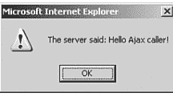

> 注意：`responseText` 属性是只读的，因此在将其值复制到另一个变量之前，尝试操纵其值是没有意义的。

因为 `responseText` 包含一个简单的文本字符串，我们可以使用任何与 JavaScript 字符串相关的方法来操作它。表 10.1 包含了一些可用的方法。

**表 10.1** 一些 JavaScript 字符串操作方法

| 方法 | 描述 |
| :--- | :--- |
| `charAt(number)` | 选择字符串中指定位置的单个字符 |
| `indexOf(substring)` | 查找指定子字符串开始的位置 |
| `lastIndexOf(substring)` | 在字符串中查找子字符串最后一次出现的位置 |
| `substring(start,end)` | 获取字符串的指定部分 |
| `toLowerCase()` | 将字符串转换为小写 |
| `toUpperCase()` | 将字符串转换为大写 |

我们将在第 12 课“将数据作为文本返回”和第 13 课“AHAH——异步 HTML 和 HTTP”中探讨如何在实际情况下使用 `responseText`。

## responseXML 属性

现在假设我们在上一个例子中在服务器上使用的 PHP 脚本变成了代码清单 10.2 所示。

**代码清单 10.2** 返回 XML 的服务器端脚本

```php
<?php
header('Content-Type: text/xml');
echo "<?xml version=\"1.0\" ?><greeting>Hello Ajax caller!</greeting>";
?>
```

虽然这是一个很短的脚本，但值得详细看看它。在 `<?php` 和 `?>` 分隔符内的第一行使用 PHP 的 `header` 指令向返回的数据添加一个 HTTP 头。

> 注意：确保你的 PHP 脚本在发出 `header()` 指令之前没有输出任何内容——即使是空格字符（如空格和换行符）；否则，将发生错误。

返回的头是参数和值对 `Content-Type: text/xml`，它告知我们的 `XMLHttpRequest` 对象期望来自服务器的后续数据格式为 XML。

下一行是一个 PHP echo 语句，输出这个简单但完整的 XML 文档：`<?xml version="1.0" ?> <greeting> Hello Ajax caller! </greeting>`。

> 注意：在 PHP 中，你需要转义引号字符串中出现的任何引号，以确保语句的含义是明确的。你可以使用反斜杠字符来做到这一点，因此 PHP 命令 `echo "";` 会产生输出：``

## 另一个有用的 JavaScript DOM 属性

你无疑还记得我们在第 6 课“XML 简介”中描述过其中一些方法。现在，让我们再研究一个这样的方法，即 `getElementsByTagName()`。

## getElementsByTagName() 方法

这个有用的方法允许你构建一个 JavaScript 数组，包含所有具有特定标签名的元素。然后，你可以使用普通的 JavaScript 语句来访问该数组的元素。下面是一个例子：

```javascript
var myElements = object.getElementsByTagName('greeting');
```

这行代码创建了数组 `myElements`，并用所有标签名为 `greeting` 的元素填充它。与任何其他数组一样，你可以通过 `length` 属性来了解数组的长度（即具有声明的标签名的元素数量）：

```javascript
myElements.length
```

如果你想，可以单独访问某个特定元素；第一个出现的标签名为 `greeting` 的元素可以通过 `myElements[0]` 访问，第二个（如果存在第二个）通过 `myElements[1]` 访问，以此类推：

```javascript
var theElement = myElements[0];
```

> **提示：** 你也可以直接访问这些单独的数组元素：`var theElement = object.getElementsByTagName('greeting')[0];`

> **提示：** 需要注意的是，`responseXML` 属性并不像 `responseText` 属性那样，只包含一个表示 XML 文档的字符串；相反，XML 文档的整个数据和层次结构都已存储为一个 DOM 兼容的对象。

当服务器调用完成时，我们现在发现这个 XML 文档已被加载到 `XMLHttpRequest` 对象的 `responseXML` 属性中。我们现在可以通过 JavaScript 的 DOM 方法和属性来访问 XML 文档的内容。

## 解析 responseXML

清单 10.3 展示了一个例子，说明如何使用 `getElementsByTagName()`，以及第 6 课讨论的一些其他方法，在警报对话框中返回我们的问候语文本。

```
清单 10.3  使用 getElementsByTagName() 解析 responseXML

function responseAjax() {
    // 我们只关心 readyState
    // 为 4 的情况，即“完成”
    if(myRequest.readyState == 4) {
        // 如果服务器 HTTP 响应是 "OK"
        if(myRequest.status == 200) {
            var greetNode = http.responseXML
            .getElementsByTagName("greeting")[0];
            var greetText = greetNode.childNodes[0]
            .nodeValue;
            alert("问候文本：" + greetText);
        } else {
            // 对于任何其他 HTTP 响应
            // 发出错误消息
            alert("发生错误："
            + myRequest.statusText);
        }
    }
}
```

在对 `readyState` 和 `status` 属性的值进行常规检查后，代码使用 `getElementsByTagName()` 方法从 `responseXML` 中定位所需的元素，然后使用 `childNodes[0].nodeValue` 从该元素中提取文本内容，最后在 JavaScript 警报对话框中显示返回的文本。

图 10.2 显示了警报对话框，展示了从 XML 文档的 `<greeting>` 元素中恢复的文本字符串。

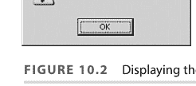

## 提供用户反馈

在具有传统界面的网页中，当服务器忙于处理请求时，用户是很清楚的；在准备和提供新页面时，界面实际上是不可用的。

在 Ajax 应用程序中，情况略有不同。因为界面在异步 HTTP 请求期间保持可用，用户可能并不明显意识到正在从服务器获取新信息。幸运的是，有一些简单的方法警告服务器请求正在进行。

回想一下，我们的回调函数在每次 `readyState` 的值变化时都会被调用，但我们真正关心的只是 `myRequest.readyState == 4` 这个条件，它表示服务器请求已完成。

让我们再次参考清单 10.3。对于 `readyState` 除 4 以外的所有值，函数在没有做事情的情况下。我们可以利用这些 `readyState` 值的变化向用户指示服务器请求正在进行尚未完成。考虑以下代码：

```javascript
function responseAjax() {
    if(myRequest.readyState == 4) {
        if(myRequest.status == 200) {
            ... [成功 - 处理服务器响应]
        } else {
            ... [失败 - 报告 HTTP 错误]
        }
    } else { // 如果 readyState 改变但不是 4
        ... [在此处提供用户反馈]
    }
}
```

一种常用的方法是，在请求处理期间修改页面元素的内容显示一些引目的东西，例如闪烁或动画图形，并在处理完成后移除。

## getElementById 方法

JavaScript 的 `getElementById()` 方法允许你通过元素的 `id` 值定位单个元素。你可以在用户反馈中使用此方法，临时更改页面元素的内容以提供视觉提示。

假设我们有一个小图形 `anim.gif`，我们希望在等待来自服务器的信息时显示它。我们希望在 HTML 页面内的一个 `div` 元素显示。首先让这个 `div` 为空：`<div id="waiting"></div>`。现在考虑回调函数：

```javascript
function responseAjax() {
    if(myRequest.readyState == 4) {
        document.getElementById('waiting').innerHTML = '';
        if(myRequest.status == 200) {
            ... [成功 - 处理服务器响应]
        } else {
            ... [失败 - 报告 HTTP 错误]
        }
    } else {
        document.getElementById('waiting').innerHTML = '';
    }
}
```

每次 `readyState` 属性的值变化时，回调函数都会检查 `readyState == 4`。每当这个条件满足时，使用 `innerHTML` 属性确保 `id` 为 `waiting` 的页面元素（我们的 `div` 元素）包含源的图像。一旦 `readyState == 4`，我们知道服务器请求已经结束，这行代码再次擦除动画。

提示：

> **提示：** 页面中声明了 `id` 值的元素每个元素应该有唯一的 `id` 值。这允许你识别一个元素。与相反，`class` 属性可以应用于页面中任意数量的元素，用于一组特性。

## 总结

本课研究了 Ajax 链的最后一个环节：如何处理文本和 XML 信息的响应。我们介绍了另一个 JavaScript DOM 方法 `getElementsByTagName()`。在下一课，即第二部分的课，我们将利用这些知识以及前几课获得的知识，构建一个完整且工作的 Ajax 应用程序。

## 第一个 Ajax 应用程序

在本课中，你将学习使用前面课程的技术构建一个完整且工作的 Ajax 应用程序。设计和编码一个完整的 Ajax 应用程序。我们的第一个应用程序功能很简单，是从服务器内部时钟读取并显示时间；尽管如此，它涉及任何基本步骤：

- 一个基础 HTML 文档
- 用于创建 `XMLHttpRequest` 实例、构建和发送异步调用的 JavaScript 例程
- 一个服务器端脚本（用 PHP 编写），用于配置和返回信息
- 一个回调函数，用于返回的数据并在应用程序中使用

让我们开始，从构成基础的 HTML 文件开始。

## HTML 文档

清单 11.1 展示了我们的 HTML 页面代码。

```
清单 11.1  我们 Ajax 应用程序的 HTML 页面
<!DOCTYPE HTML PUBLIC "-//W3C//DTD HTML 4.01 Transitional//EN"
"http://www.w3.org/TR/html4/loose.dtd">
<html
<head>
<title>Ajax 演示</title>
<style>
.displaybox {
    width:150px;
    background-color:#ffffff;
    border:2px solid #000000;
    padding:10px;
    font:24px normal verdana, helvetica, arial, sans-serif;
}
</style>
</head>
<body style="background-color:#cccccc;text-align:center">
<h1>Ajax 演示</h1>
<h2>刷新页面获取服务器时间</h2>
<form>
<input type="button" value="获取服务器时间" />
</form>
<div id="showtime" class="displaybox"></div>
</body>
</html>
```

这是一个简单的 HTML 布局，仅包含标题、副标题、按钮和 `div` 元素，以及一些样式定义。图 11.1 展示了 HTML 页面的外观。

> 提示：在 HTML 中，`<div>` ... `</div>` 元素代表 division（分区），可将多个页面元素组合在一起，并以块的形式操作。

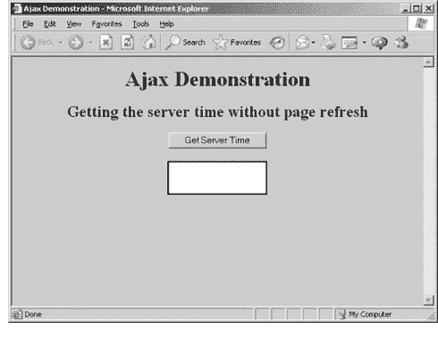

图 11.1 清单 11.1 的 HTML 文件。

## 添加 JavaScript

现在我们可以将 JavaScript 例程添加到 HTML 页面。我们将通过将其放置在 `<script>` ... `</script>` 容器内，并添加到页面的 `<head>` 部分来实现。

> 提示：或者，我们也可以将这些例程添加到一个外部 JavaScript 文件中（例如 `ajax.js`），然后在文档中通过类似以下的语句来调用此文件：

> `<script language="JavaScript" type="text/javascript" src="ajax.js"></script>`

> 将此语句放在文档的 `<head>` 部分。

## XMLHttpRequest 对象

首先，让我们添加用于创建 `XMLHttpRequest` 对象的函数：

```
function getXMLHttpRequest() {
try {
req = new XMLHttpRequest();
} catch(err1) {
try {
req = new ActiveXObject("Msxml2.XMLHTTP");
} catch (err2) {
    try {
        req = new ActiveXObject("Microsoft.XMLHTTP");
    } catch (err3) {
        req = false;
    }
}
}
return req;
}
```

现在创建我们的 `XMLHttpRequest` 对象很简单，这次我们将其命名为 `http`：

```
var http = getXMLHttpRequest();
```

## 服务器请求

现在我们需要一个函数来构造我们的服务器请求，定义一个回调函数，并将请求发送到服务器。这个函数将从 HTML 页面的事件处理程序中调用：

```javascript
function getServerTime() {
    var myurl = 'telltimeXML.php';
    myRand = parseInt(Math.random()*999999999999999);
    // 向 URL 添加随机数以避免缓存
    var modurl = myurl+"?rand="+myRand;
    http.open("GET", modurl, true);
    // 设置回调函数
    http.onreadystatechange = useHttpResponse;
    http.send(null);
}
```

我们再次向 URL 添加了一个带有随机值的参数，以避免任何缓存问题。我们的回调函数名为 `useHttpResponse`，每次检测到 `http` 的 `readyState` 属性值发生变化时都会被调用。

## 我们的 PHP 服务器端脚本


在解释回调函数的操作之前，我们需要参考清单 11.2 所示的简单 PHP 服务器例程 `telltimeXML.php` 的代码。

## 清单 11.2 telltimeXML.php

```php
<?php
header('Content-Type: text/xml');
echo "<?xml version=\"1.0\" ?><clock1><timenow>" .date('H:i:s')."</timenow></clock1>";
?>
```

这个简短的程序使用 PHP 的 `date()` 函数报告服务器时间。传递给此函数的参数定义了日期和时间元素的格式。在这里，我们完全忽略了日期相关元素，并请求以 24 小时制返回“时:分:秒”格式的时间。

我们的服务器脚本返回一个 XML 文件，格式如下：

```xml
<?xml version="1.0" ?>
<clock1>
    <timenow>
        XX:XX:XX
    </timenow>
</clock1>
```

其中 `XX:XX:XX` 会被当前服务器时间替换。我们将使用回调函数来提取此时间信息，并将其显示在 HTML 页面的 `<div>` 容器中。

## 回调函数

以下是回调函数 `useHttpResponse` 的代码：

```javascript
function useHttpResponse() {
    if (http.readyState == 4) {
        if(http.status == 200) {
            var timeValue = http.responseXML
                .getElementsByTagName("timenow")[0];
            document.getElementById('showtime').innerHTML
                = timeValue.childNodes[0].nodeValue;
        } else {
            document.getElementById('showtime').innerHTML
                = '';
        }
    }
}
```

我们再次使用了 `getElementsByTagName` 方法，这次是选择 XML 数据中的 `<timenow>` 元素，我们已将其存储在变量 `timeValue` 中。然而，这次我们不打算像第 10 课“使用返回的数据”中那样在警报对话框中显示该值。

这次我们想用这些信息来更新 HTML 页面中某个元素的内容。请注意清单 11.1 中 `<div>` 容器在我们 HTML 页面中的定义：

```html
<div id="showtime" class="displaybox"></div>
```

除了 `class` 声明（用于 `<style>` 定义中以影响 `<div>` 元素的显示方式），我们还看到为容器定义了一个 `id`（标识符），其值设置为 `showtime`。

目前 `<div>` 不包含任何内容。我们希望更新此容器的内容以显示存储在 `timeValue` 中的服务器时间信息。我们通过使用 JavaScript 的 `getElementById()` 方法（我们在第 10 课中遇到过）来选择页面元素来实现这一点。然后，我们将使用 JavaScript 的 `innerHTML` 属性来更新元素的内容：

```javascript
document.getElementById('showtime').innerHTML
= timeValue.childNodes[0].nodeValue;
```

## 应用事件处理程序

最后，我们必须决定如何触发服务器请求。在本例中，我们将稍作编辑 HTML 文档，以使用 `<button>` 对象的 `onClick()` 事件处理程序：

```html
<input type="button" value="Get Server Time"
onClick="getServerTime()">
```

这将正确处理单击“获取服务器时间”按钮的情况。然而，它会在我们首次加载页面时使 `<div>` 元素保持为空。

为了解决这个小问题，我们可以使用页面 `<body>` 元素的 `onLoad()` 事件处理程序：

```html
<body style="background-color:#cccccc"
onLoad="getServerTime()">
```

此事件处理程序会在页面的 `<body>` 区域加载完成后立即触发。

## 将它们整合在一起

清单 11.3 展示了我们的 Ajax 应用程序的完整客户端代码。

 清单 11.3 完整的 Ajax 应用程序

```html
<html>
<head>
<title>Ajax 演示</title>
<style>
.displaybox {
width:150px;
background-color:#ffffff;
border:2px solid #000000;
padding:10px;
font:24px normal verdana, helvetica, arial, sans-serif;
}
</style>
<script language="JavaScript" type="text/javascript">
function getXMLHTTPRequest() {
try {
req = new XMLHttpRequest();
} catch(err1) {
try {
req = new ActiveXObject("Msxml2.XMLHTTP");
} catch (err2) {
try {
req = new ActiveXObject("Microsoft.XMLHTTP");
} catch (err3) {
req = false;
}
}
}
return req;
}

var http = getXMLHTTPRequest();

function getServerTime() {
var myurl = 'telltimeXML.php';
myRand = parseInt(Math.random()*99999999999999999);
var modurl = myurl+"?rand="+myRand;
http.open("GET", modurl, true);
http.onreadystatechange = useHttpResponse;
http.send(null);
}
</script>
</head>
<body
<div id="timer"></div>
<input type="button" value="Get Server Time" onclick="getServerTime()" />
</body>
</html>
```

## 清单 11.3 续

```javascript
function useHttpResponse() {
    if (http.readyState == 4) {
        if(http.status == 200) {
            var timeValue = http.responseXML
.getElementsByTagName("timenow")[0];
            document.getElementById('showtime').innerHTML
= timeValue.childNodes[0].nodeValue;
        } else {
            document.getElementById('showtime').innerHTML
= '';
        }
    }
}
</script>
</head>
<body style="background-color:#cccccc"
onLoad="getServerTime()">
<center>
<h1>Ajax 演示</h1>
<h2>无需刷新获取时间</h2>
<form>
<input type="button" value="Server Time"
onClick="getServerTime()">
</form>
<div id="showtime" class="displaybox"></div>
</center>
</body>
</html>
```将页面加载到浏览器中，我们可以看到服务器时间在 `<div>` 容器中，这表明页面加载时，`<body>` 事件处理程序已经触发。

## 用户反馈

还要注意我们通过以下代码提供了用户反馈：

```javascript
document.getElementById('showtime').innerHTML
= '';
```

## 第一个 Ajax 应用程序

条件在 `readyState` 值每次变化时执行，直到 `readyState == 4`。这一行将一个带有旋转图案的 GIF 加载到时间显示中，表示服务器请求进行中，如图 12.2 所示。提示：如果你拥有快速的服务器和良好的连接，可能很难看到这种反馈效果，因为时间显示几乎瞬间更新。为了演示动画 GIF，我们可以通过使用 PHP 的 `sleep()` 命令来慢脚本：

```php
<?php
header('Content-Type: text/xml');
sleep(3);
echo "<?xml version=\"1.0\" ?><clock1><timenow>"
    .date('H:i:s')."</timenow></clock1>";
?>
```

`sleep(x);` 这一行强制服务器程序执行。

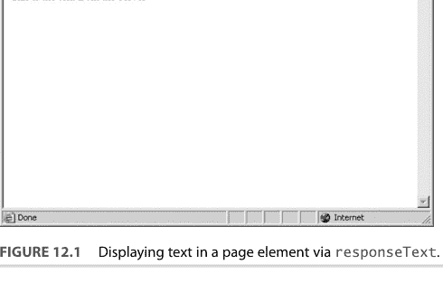 图 12.2 动画图像提供用户反馈。现在，每次我们点击“获取服务器时间”按钮时，时间显示都会更新。图 12.3 显示了完成后的应用程序。

 图 12.3 我们完成的应用程序。

## 总结

在本课中，我们构建了一个简单但完整的 Ajax 应用程序，它实现了以下功能：

- 创建 `XMLHttpRequest` 对象的实例
- 响应 JavaScript 事件处理程序
- 构建并发送服务器请求
- 使用 JavaScript DOM 方法解析服务器接收的 XML
- 提供用户反馈，表明请求进行中
- 使用接收到的数据更新页面

这完成了本书的第二部分。第三部分“复杂的 Ajax 技术”将研究一些高级的 Ajax 技术。

# 12 以文本返回数据

在本课中，你将学习一些使用 `responseText` 属性为 Ajax 应用程序添加功能的技巧。

## 从 responseText 属性获取更多

第二部分“Ajax 入门”课程讨论了使 Ajax 工作的各个部分，最终构建了一个完整的 Ajax 应用程序。在第三部分“复杂的 Ajax 技术”中，每节课都将探讨如何扩展你已知的知识来开发复杂的 Ajax 应用程序。在本课中，我们将更仔细地研究 `XMLHttpRequest` 对象的 `responseText` 属性，看看如何通过使用它来为我们的应用程序提供额外的功能。

正如你在前面的课程中所看到的，`XMLHttpRequest` 对象提供了两个包含服务器接收的信息的属性，即 `responseText` 和 `responseXML`。前者以字符串格式向调用应用程序呈现数据，而后者提供与 DOM 兼容的 XML，可以使用 JavaScript 方法进行解析。尽管 `responseXML` 属性允许你执行一些复杂的编程任务，但仅通过操作存储在 `responseText` 属性中的值也能实现很多功能。

### 返回文本

术语文本可能有点误导。`responseText` 属性包含一个字符串，你可以通过简单的赋值语句将其值分配给 JavaScript 变量：

```javascript
var mytext = http.responseText;
```

没有规则说这样的字符串中包含的值必须是可读的文本；事实上，只要字符串只包含 JavaScript 在字符串变量中接受的字符，该值可以包含完全无意义的内容。这一事实允许在使用此属性传输何种信息方面具有灵活性。

### 在页面元素中直接使用返回的文本

最简单的例子可能是考虑使用 `responseText` 中保存的值来更新页面的文本部分，例如一个 `<div>` 容器。在这种情况下，你可以简单地获取返回的字符串并将其应用于相关页面元素。

这里有一个简单的例子。以下是一个 HTML 页面的 HTML 代码，该页面构成一个 Ajax 应用程序的基础：

```html
<html>
<head>
  <title>My Ajax Application</title>
</head>
<body>
Here is the text returned by the server:<br />
<div id="myPageElement"></div>
</body>
</html>
```

显然，这是一个简单的页面，就其本身而言，它只会输出“Here is the text returned by the server:”这一行，而没有其他内容。现在假设我们向页面添加必要的 JavaScript 例程，以生成 `XMLHTTPRequest` 对象的实例。

### 在 responseText 中包含 HTML

现在让我们修改前面示例中的代码。正如前面课程中所知，HTML 标记完全由使用文本字符编写的标签组成。如果 `responseText` 属性中包含的值要用于修改发送服务器请求的页面的显示，那么没有任何可以阻止我们的服务器脚本在其返回的信息中包含 HTML 标记。


```markdown

假设我们再次使用清单 12.1 的代码，但使用修改后的服务器脚本：

```php
<?php
echo "<h3>Returning Formatted Text</h3>";
echo "<hr />";
echo "We can use HTML to <strong>format</strong>
text before we return it!";
?>
```

图 12.2 显示了由此产生的浏览器显示。

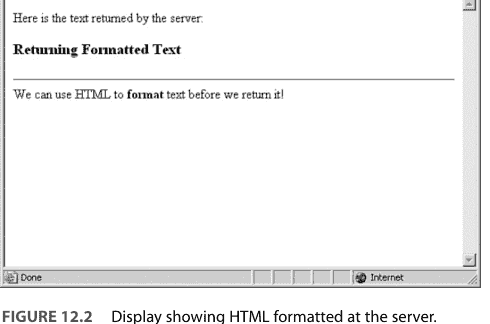

图 12.2 显示在服务器端格式化的 HTML 的显示。

作为一个稍微复杂一点的例子，考虑服务器脚本生成更复杂输出的情况。我们希望我们的应用程序获取此服务器输出并将其显示为表格的内容。

## 12：将数据作为文本返回

这一次，我们将使用服务器端的 PHP 脚本生成一些表格信息：

```php
<?php
$days = array('Monday','Tuesday','Wednesday',
'Thursday','Friday','Saturday','Sunday');
echo "<table border='2'>";
echo "<tr><th>Day Number</th><th>Day Name</th></tr>";
for($i=0;$i<7;$i++)
{
  echo "<tr><td>".$i."</td><td>".$days[$i]."</td></tr>";
}
echo "</table>";
?>
```

再次使用清单 12.1 中的代码通过 `XMLHttpRequest` 调用服务器端脚本，我们将获得一个如图 12.3 所示的页面。

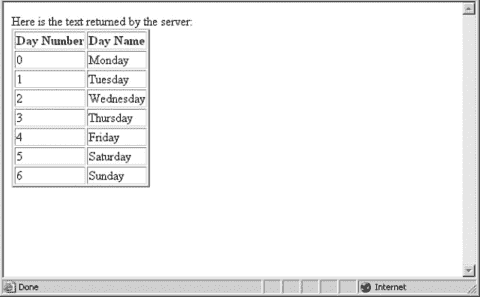

**图 12.3** 返回更复杂的 HTML。

## 更复杂的格式化数据

到目前为止，我们已经演示了返回可以直接应用于网页元素的文本的方法。到目前为止，一切顺利。然而，如果你愿意在 JavaScript 中多做一些工作来操作返回的数据，你可以实现更多功能。

### 从 responseText 属性中获取更多信息

只要服务器在 `XMLHttpRequest` 对象的 `responseText` 属性中返回一个字符串值，你就可以使用任何可能设计的数据格式来编码其中的信息。

考虑以下服务器端脚本，它使用了与前面示例相同的数据数组：

```php
<?php
$days = array('Monday', 'Tuesday', 'Wednesday',
'Thursday', 'Friday', 'Saturday', 'Sunday');
$numdays = sizeof($days);
for($i=0;$i<($numdays - 1);$i++)
{
echo $days[$i]."|";
}
echo $days[$numdays-1];
?>
```

现在，`responseText` 属性中返回的字符串包含了星期几，并由管道字符 `|` 分隔——或定界。如果我们把这个字符串复制到一个 JavaScript 变量 `mystring` 中，

```javascript
var mystring = http.responseText;
```

我们会发现变量 `mystring` 包含字符串

Monday|Tuesday|Wednesday|Thursday|Friday|Saturday|Sunday

我们现在可以方便地使用 JavaScript 的 `split()` 方法将此字符串分割成数组：

```javascript
var results = http.responseText.split("|");
```

> **提示：** JavaScript 的 `split()` 方法将一个字符串切分，在字符串中找到作为参数传递的字符的每个位置进行切割。该字符不一定是管道；常见的替代字符是逗号或斜杠。

我们现在得到了一个包含我们数据的 JavaScript 数组 `results`：

```javascript
results[0] = 'Monday'
results[1] = 'Tuesday'
等等...
```

我们现在不仅可以简单地显示接收到的数据，还可以在 JavaScript 例程中以任何我们想要的方式使用它。

> **注意：** 注意 PHP `sizeof()` 函数的用法，它用于确定数组中的项目数量。在 PHP 中，与 JavaScript 一样，数组键从 0 开始编号，而不是 1。

> **提示：** 对于复杂的数据格式，XML 可能是从服务器接收和处理数据的更好方式。然而，值得注意的是，仅仅使用 `responseText` 属性就能完成多少工作。

## 总结

只需稍加努力，就可以让 `XMLHttpRequest` 对象的 `responseText` 属性不仅仅返回一些要在网页中显示的文本。

对于除最复杂的数据格式之外的所有情况，操作 `responseText` 可能比处理 XML 带来的额外复杂性更简单。

在本课中，你看到了几个这种技术的例子，从简单更新更新页面元素内的文本内容，到操作更复杂的数据结构。

## 13：AHAH——异步 HTML 和 HTTP

### AHAH 简介

你在第 12 课“将数据作为文本返回”中看到了，一个 Ajax 应用程序完全不使用任何 XML 可以实现多少功能。许多任务，从简单地更新页面上的文本到处理复杂的数据结构，都可以仅使用 `XMLHttpRequest` 对象的 `responseText` 属性中返回的文本来执行。

完全有可能构建出完整且有用的应用程序，而根本不需要任何 XML。事实上，`AHAH`（异步 HTML 和 HTTP）这个术语就是专门为这样的应用程序创造的。

本课将第 12 课的概念推进一步，更详细地探讨 AHAH 可以应用于何处——以及如何应用。

> **注意：** 这种技术是 Ajax 的一个子集，已被赋予了各种缩写。这些缩写包括 AHAH（异步 HTML 和 HTTP）、JAH（Just Asynchronous HTML）和 HAJ（HTML And JavaScript）。在本书中，我们将它称为 AHAH。

## 为什么使用 AHAH 而不是 Ajax？

毫无疑问，XML 是一项重要的技术，具有多样化和强大的功能。对于具有复杂结构的 Ajax 应用程序来说，使用 XML 可能是最好的——也许是唯一的。然而，使用 XML 有时使应用程序复杂化，包括：

- 设计用于 XML 数据的自定义模式涉及的工作。
- 使用 DOM 方法时的跨兼容性问题。
- 由于必须执行密集型的 XML 解析，性能可能会下降。

使用 AHAH 可以帮助你避免这些问题，同时提供了一些额外的优势：

- 轻松地处理已有的网页。
- HTML 比 XML 更容易进行查找。
- 使用 CSS 为返回的信息设置样式，而不必使用 XSLT。

XSLT 是一种转换语言，将 XML 文档转换为其他格式——例如适合浏览器显示的 HTML。在接下来的部分中，我们将把 AHAH 脚本打包成简洁的外部文件中进行它。

### 创建一个用于 AHAH 的小型库

过去几课研究的 Ajax 应用程序虽然完整功能齐全，但涉及将大量 JavaScript 代码嵌入到页面。正如所见，每个应用程序往往包含相似的函数：

- 创建 `XMLHttpRequest` 对象实例、配置它并发送请求。
- 处理 `responseText` 属性中返回的回调函数。

你可以将这些函数抽象成简单的 JavaScript 调用，特别是当你只想用服务器返回的值更新单个页面元素。

### 介绍 myAHAHlib.js

考虑清单 13.1；大部分代码你会立即认出：

```javascript
// 清单13.1 myAHAHlib.js
function callAHAH(url, pageElement, callMessage) {
    document.getElementById(pageElement)
    .innerHTML = callMessage;
    try {
        req = new XMLHttpRequest(); /* Firefox */
    } catch(e) {
        try {
            req = new ActiveXObject("Msxml2.XMLHTTP"); /* 某些版本的 IE */
        } catch (e) {
            try {
                req = new ActiveXObject("Microsoft.XMLHTTP"); /* 某些版本的 IE */
            } catch (E) {
                req = false;
            }
        }
    }
    req.onreadystatechange
    = function() {responseAHAH(pageElement);};
    req.open("GET",url,true);
    req.send(null);
}

function responseAHAH(pageElement) {
    var output = '';
    if(req.readyState == 4) {
        if(req.status == 200) {
            output = req.responseText;
            document.getElementById(pageElement)
            .innerHTML = output;
        }
    }
}
```

函数 `callAHAH()` 封装了创建 `XMLHttpRequest` 对象实例、声明回调函数和发送请求的任务。注意，我们没有简单地声明 `req.onreadystatechange = responseAHAH;`，而是使用了 JavaScript 构造 `req.onreadystatechange = function() {responseAHAH(pageElement);}`。这种类型的声明允许我们将参数传递给函数，在本例中用于标识要更新的页面元素。

`callAHAH()` 还接受一个额外的参数 `callMessage`。此参数包含一个字符串，定义在等待请求结果期间在目标元素中显示的内容。这为用户提供了一定程度的反馈，表明页面正在发生某些事情。实际上，这可能是一行文本，例如 `'正在页面；请稍候 ...'`。然而，你也可以选择将一些 HTML 代码嵌入到字符串中。在 `` 元素中使用动画 GIF 图像是向用户发出过程正在进行的有效方式。

回调函数 `responseAHAH()` 执行特定任务，将 `responseText` 属性中返回的字符串应用到选定元素 `pageElement` 的 `innerHTML` 属性：

```javascript
output = req.responseText;
document.getElementById(pageElement).innerHTML = output;
```

此代码已打包到名为 `myAHAHlib.js` 的文件中，你可以从 HTML 页面中调用该文件，从而使这些函数用于你的 AHAH 应用程序。下一节将展示一些示例。

### 使用 myAHAHlib.js

在第 4 课“使用 JavaScript 进行客户端编码”中，我们遇到了 JavaScript 函数位于外部文件并在页面中引用的概念。我们将以这种方式使用新文件 `myAHAHlib.js`，使用如下形式的语句：

`<script language="JavaScript" src="myAHAHlib.js"></script>`

然后，我们就可以需要时随意调用脚本中的函数。

## 13: AHAH—异步HTML和HTTP

以下是一个此类 HTML 页面的骨架源代码：

```html
<html>
<head>
<title>Another Ajax Application</title>
<script language="JavaScript" src="myAHAHlib.js"></script>
</head>
<body>
<form>
<input type="button" onclick
="callAHAH('serverscript.php?parameter=x',
'displaydiv', 'Please wait - page updating ...')" >
This is the place where the server response
will be posted:<br>
<div id="displaydiv"></div>
</form>
</body>
</html>
```

在这个简单的 HTML 页面中，使用了一个按钮元素来触发调用 `callAHAH()` 方法的事件。该方法将文本字符串‘Please wait - page updating …’放置在 `id` 为 `displaydiv` 的 `<div>` 元素中，并向 URL `serverscript.php?parameter=x` 发送异步服务器调用。

```


这里我们被邀请输入一个URL。当我们点击Fetch按钮时，`callAHAH()`被执行，并将我们选择的URL作为参数发送到服务器端脚本。同时，消息“Please wait; loading content … ”被放置在`<div>`容器中。尽管可能只显示一小部分秒，我们现在拥有如图13.2所示的显示。

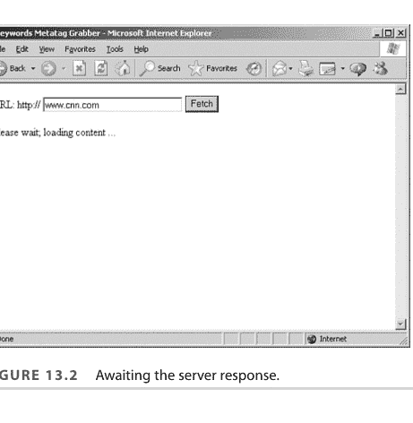

**图13.2** 等待服务器响应。

最后，当服务器调用完成后，`responseText`属性的内容被加载到`<div>`容器中，产生图13.3所示的显示。

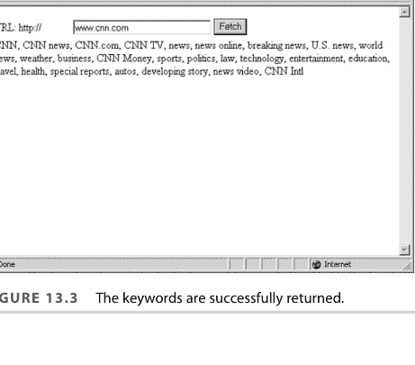

**图13.3** 关键词成功返回。

## 扩展myAHAHlib.js

目前，`myAHAHlib.js`是AHAH的一个简单实现。根据其使用方式，有许多方法可以改进和扩展它。我们不打算在本课中涵盖这些内容，而是将其留给您自己实验。以下是一些建议，助您入门：

- 目前仅支持GET请求。如何修改函数以允许POST请求？

- 第11课“我们的第一个Ajax应用程序”中讨论的许多用户反馈功能尚未在`responseAHAH()`中实现。

- 是否可能修改`callAHAH()`以接受一个页面元素数组进行更新，并（借助合适的服务器端脚本）一次性处理它们？

> 提示：我们尚未考虑的一个选项是在`responseText`中传回JavaScript代码。因为JavaScript源代码（像HTML页面中的其他所有内容一样）是由纯文本编写的语句组成的，所以您可以从服务器在`responseText`属性中返回JavaScript源代码。然后，您可以使用JavaScript的`eval()`方法执行此JavaScript代码：`eval(object.responseText)`。考虑您的服务器脚本返回字符串`alert('Hello World!');`的情况。在这种情况下，`eval()`方法将把内容作为JavaScript语句执行，创建一个显示‘Hello World!’和OK按钮的对话框。

## 总结

希望通过本课和第12课的学习，已经清楚地表明Ajax无需使用任何XML就能实现大量功能。

通过仔细组合使用JavaScript客户端编码和所选语言的服务器端脚本，您可以创建高度复杂的数据方案。

在更简单的应用中，你只想更新页面元素的文本时，XMLHTTPRequest对象的功能被抽象成一个JavaScript函数库，并通过直接的方法从HTML页面中调用。

然而，对于某些任务，你需要利用XML的强大功能。我们将在第14课“将数据作为XML返回”中讨论这个主题。

# 14: 以XML形式返回数据

*在本课中，您将学习使用通过XMLHttpRequest对象的`responseXML`属性从服务器返回的XML数据。*

## 为Ajax添加“X”

第12课“将数据作为文本返回”和第13课“AHAH—异步HTML和HTTP”详细讨论了包含在`responseText`中的字符串值，并研究了在应用程序中使用此信息的几种技术。这些示例范围从简单的页面元素文本更新到使用更复杂数据结构的应用程序，这些数据结构被编码为字符串值，可以存储在`responseText`属性中并进行传输。

Ajax中的X当然代表XML，并且在应用程序中使用XML的强大功能有充分的理由。当你需要使用高度结构化的信息和/或执行不同数据表示形式之间的复杂转换时，这一点尤其正确。

如前所述，`XMLHttpRequest`对象有一个名为`responseXML`的属性，用于通过XML（而不是文本字符串）从服务器传输信息。

您在第11课“我们的第一个Ajax应用程序”中看到了JavaScript的文档对象模型（DOM）方法如何帮助您处理这些XML信息。本课将更详细地探讨这些技术，并希望让您领略一下利用XML强大功能时Ajax应用程序所能实现的功能。

## responseXML 属性

`XMLHttpRequest`对象的`responseText`属性包含的是字符串，而`responseXML`可以被视为一个XML文档。

> **注意：** 与`responseText`属性类似，`responseXML`中存储的值是只读的，因此你不能直接对该属性进行写入操作；要操作它，必须将值复制到另一个变量中：

`var myobject = http.responseXML;`

> **警告：** 你需要确保服务器提供有效且格式良好的XML，以便通过`responseXML`属性返回。在`XMLHttpRequest`对象无法正确解析XML的情况下（可能是由于格式错误或不支持的字符编码问题），`responseXML`的内容将不可预测，而且不同浏览器中的表现可能有所不同。

现在，可以使用JavaScript的DOM方法获取XML文档中的完整结构和数据。在本课的稍后部分，我们将通过另一个正在运行的Ajax应用程序来演示这一点，但首先让我们回顾一下JavaScript DOM方法，并介绍一些新的方法。

## 更多 JavaScript DOM 方法

你在之前的课程中已经接触过一些 JavaScript DOM方法，例如`getElementById`和`getElementsByTagName`。在那些案例中，我们主要关注的是读取节点的值，并将这些值写入HTML页面元素。

本课将研究可用于实际创建元素的DOM方法，从而改变页面的结构。

文档对象模型可以被看作是一个树状结构的节点集合。除了读取与这些节点相关联的值之外，你还可以创建和修改节点本身，从而改变文档的结构和内容。

要向页面添加新元素，你需要先创建这些元素，然后将它们附加到DOM树中的适当位置。让我们使用以下HTML文档来看一个简单的例子：

```html
<html>
<head>
  <title>Test Document</title>
</head>
<body>
  We want to place some text:<br/>
  <div id="displaydiv"></div>
</body>
</html>
```

在这个例子中，我们想将文本"Hello World!"添加到文档body中的`<div>`容器内。我们将JavaScript程序放入一个函数中，并通过body的`onload`事件程序调用它。

首先，我们将使用JavaScript DOM方法`createTextNode()`创建一个文本节点：

```javascript
var textnode = createNode('Hello World!');
```

现在我们需要将`textnode`附加到DOM树中的适当位置。首次了解子节点是在第4课“使用JavaScript进行编码”中；如果文档中的节点包含其他文档元素，则被称为子节点。JavaScript提供了`appendChild()`方法，允许我们通过将新文本设为现有文档节点，将其附加到DOM树上。在本例中，我们希望将文本放在id为`displaydiv`的`<div>`容器内：

```javascript
var textnode = document.createTextNode('Hello World!');
document.getElementById('displaydiv').appendChild(textnode);
```

让我们来看看页面的完整源代码，将这段JavaScript封装到一个函数中，并添加`onload`事件程序来执行它：

```html
<html>
<head>
<title>Test Document</title>
<script Language="JavaScript">
function hello() {
  var textnode = document.createTextNode('Hello World!');
  document.getElementById('displaydiv').appendChild(textnode);
}
</script>
</head>
<body onload="hello()">
  We want to place some text:<br/>
  <div id="displaydiv"></div>
</body>
</html>
```

> **注意：** 如果你在浏览器中显示此文档的源代码，将在`<div>`容器内看到'Hello World!'文本。浏览器构建其HTML文档表示，然后使用该模型显示页面。你的代码所做的修改是针对DOM的，而不是文档本身。

图14.1显示了加载页面后的效果。

## 14：以XML格式返回数据

img/d1a1deb66db08a350da478da83332859_138_0.png

**图14.1** DOM 说 "Hello World!"

当你想创建文本节点之外的其他页面元素时，可以使用`createElement()`方法来实现，它的工作原理与`createTextNode()`非常相似。事实上，我们可以在添加'Hello World!'文本节点之前，使用`createElement()`创建`<div>`容器本身：

```javascript
var newdiv = document.createElement("div");
```

一般来说，你只需要将所需元素的类型作为参数传递给`createElement()`即可生成所需元素。

## DOM 方法概述

本书是关于Ajax的，不仅仅是JavaScript DOM技术的，因此我们不会在此提供可用方法和属性的全面指南。不过，表14.1列举了一些用的方法。

**表14.1** 一些 JavaScript DOM属性和方法

**节点属性**

| 属性 | 说明 |
| :--- | :--- |
| childNodes | 子节点数组 |
| firstChild | 第一个子节点 |
| lastChild | 最后一个子节点 |

> **提示：** 如果你需要更全面的JavaScript DOM属性和方法介绍，Andrew Watt在他精彩的著作*Sams Teach Yourself XML in 10 Minutes*中了一个实用的列表，该书包含在Ajax入门包CD中。

| nodeName | 节点的名称 |
| nodeType | 节点的类型 |
| nodeValue | 节点中包含的值
| nextSibling | 共享同一父节点的下一个节点 |
| previousSibling | 共享同一父节点的前一个节点 |
| parentNode | 此节点的父节点 |

**节点方法**

| 方法 | 说明 |
| :--- | :--- |
| AppendChild | 添加一个新的子节点 |
| HasChildNodes | 如果此节点有子节点则为true |
| RemoveChild | 删除一个子节点 |

**文档方法**

| 方法 | 说明 |
| :--- | :--- |
| CreateAttribute | 为元素创建一个新属性 |
| CreateElement | 创建一个新的文档元素 |
| CreateTextNode | 创建一个文本项 |
| GetElementsByTagName | 创建一个标签名数组 |
| GetById | 通过ID查找元素 |

## 项目——RSS 头条阅读器

现在让我们利用所学的从服务器返回XML数据的知识，使用这些技术来解决一个新的项目。

互联网上以多种形式提供XML数据。其中受欢迎的是RSS订阅源，这是一种特定类型的XML源，通常包含新闻或其他主题性、定期更新的内容。RSS订阅源可从网络上的许多来源获取，包括大多数广播公司和报纸出版商，以及各种主题的专业网站。

我们将编写一个Ajax应用程序，该程序接收RSS订阅源的URL，收集XML，并列出订阅源中包含的新闻项目的标题和描述。

以下是一个典型RSS订阅源的部分XML：

```xml
<rss version="0.91">
<channel>
<title>myRSSfeed.com</title>
```

```xml
<link>http://www.********.com/</link>
<description>My RSS feed</description>
<language>en-us</language>
<item>
<title>New Store Opens</title>
```

```xml
<link>http://www.********.com/</link>
<description>A new store opened today in Canal Road. The new business, Ajax Records, caters for a wide range of musical tastes.</description>
</item>
<item>
<title>Bad Weather Affects Transport</title>
<link>http://www.********.com/</link>
<description>Trains and buses were disrupted badly due to sudden snow. Police advised people not to travel unless absolutely necessary.</description>
</item>
<item>
<title>Date Announced for Mayoral Election</title>
<link>http://www.********.com/</link>
<description>September 4th has been announced as the date for the next mayoral election. Watch local news for more details.</description>
</item>
</channel>
</rss>
```

## 我们应用程序的 HTML页面

```html
<html>
<head>
<title>An RSS Reader</title>
</head>
<body>
  <h3>An RSS Reader</h3>
  <form name="form1">
    URL of RSS feed: 
    <input type="text" name="feed" size="50" value="http://">
    <input type="button" value="Get Feed">
    <br/><br/>
    <div id="news"><h4>Feed Titles</h4></div>
  </form>
  <script>
    var html = document.querySelector('h4');
    var html = document.getElementById('news').innerHTML = html;
    // 核心逻辑将在此处实现
  </script>
</body>
</html>
```


```html
<!-- LISTING 14.1 Ajax RSS Headline Reader -->
<html
<head>
<title>An Ajax RSS Headline Reader</title>
</head>
<style>
.title {
    font: 16px bold helvetica, arial, sans-serif;
    padding: 0px 30px 0px 30px;
    text-decoration:underline;
}
.descrip {
    font: 14px normal helvetica, arial, sans-serif;
    text-decoration:italic;
    padding: 0px 30px 0px 30px;
    background-color:#cccccc;
}
.link {
    font: 9px bold helvetica, arial, sans-serif;
    padding: 0px 30px 0px 30px;
}
.displaybox {
    border: 1px solid black;
    padding: 0px 50px 0px 50px;
}
</style>
<script language="JavaScript" type="text/javascript">
function getXMLHTTPRequest() {
try {
req = new XMLHttpRequest(); /* e.g. Firefox */
} catch(e) {
try {
req = new ActiveXObject("Msxml2.XMLHTTP");
/* some versions IE */
} catch (e) {
try {
req = new ActiveXObject("Microsoft.XMLHTTP");
/* some versions IE */
} catch (E) {
req = false;
}
}
return req;
}

var http = getXMLHTTPRequest();

function getRSS() {
  var myurl = 'rssproxy.php?feed=';
  var myfeed = document.form1.feed.value;
    myRand = parseInt(Math.random()*9999999999999999);
    // cache buster
  var modurl = myurl+escape(myfeed)+"&rand="+myRand;
  http.open("GET", modurl, true);
  http.onreadystatechange = useHttpResponse;
  http.send(null);
}

function useHttpResponse() {
  if (http.readyState == 4) {
    if(http.status == 200) {
      // first remove the childnodes
      // presently in the DOM [sic]
      while (document.getElementById('news').hasChildNodes())
        {
          document.getElementById('news')
            .removeChild(document
              getElementById('news').firstChild);
        }
      
      var titleNodes = http.responseXML
                            getElementsByTagName("title");
      var descriptionNodes = http.responseXML
                            getElementsByTagName("description");
      var linkNodes = http.responseXML
                            getElementsByTagName("link");
        
      for(var i = 1; i<titleNodes.length;i++) {
        // processing title (simplified representation)
        ... 
      }
    // Rest of script logic continues...
}
```
```

# 14：以XML格式返回数据

我们主要关注的是描述回调函数 `useHttpResponse()` 的工作原理。

## 回调函数

除了检查 `XMLHttpRequest` 的 `readyState` 和 `status` 属性的常规职责外，该函数还为我们执行以下任务：

*   从显示 `<div>` 中移除来自先前 RSS列表的任何显示元素。
*   解析传入的 XML 以提取标题、链接和描述元素。
*   构建 DOM 元素来保存和显示这些结果。
    *   对这些元素应用 CSS 样式，改变它们在浏览器中的显示方式。

为了移除先前新闻导入安装的 DOM 元素（如果存在），我们首先使用其 ID 来识别 `<div>` 元素，然后使用 `hasChildNodes()` DOM 方法，循环遍历并从 `<div>` 元素中每次删除第一个子节点，直到没有剩余：

```javascript
while (document.getElementById('news').hasChildNodes()) {
  document.getElementById('news')
    .removeChild(document.getElementById('news').firstChild);
}
```

以下说明了标题元素的处理过程，但正如从清单 14.1 中可以看出的，我们以相同的方式重复该过程来检索描述和链接信息。

为了解析 XML 内容以提取项目标题，我们从存储在 `responseXML` 中的 XML 数据构建一个数组 `titleNodes`：

```javascript
var titleNodes = http.responseXML.getElementsByTagName("title");
```

然后我们可以遍历这些项目，依次处理每一个：

```javascript
for(var i =1; i<titleNodes.length;i++) { 
    // ... processing instructions ... }
}
```

对于每个标题，我们首先需要使用 `nodeValue` 属性提取标题文本：

```javascript
var newtext = document.createTextNode(titleNodes[i]
  .childNodes[0].nodeValue);
```

然后我们可以创建一个段落元素：

```javascript
var newpara = document.createElement('p');
```

将段落附加为 `<div>` 元素的子节点：

```javascript
var para = document.getElementById('news')
.appendChild(newpara);
```

并将文本内容应用到段落元素：`newpara.appendChild(newtext);`

最后，使用 `className` 属性我们可以定义段落的显示方式。类声明出现在文档头部的 `<style>` 元素中，提供了一种方便的方法来更改 RSS 阅读器的外观以适应我们的需求。`newpara.className = "title";`

每次我们在输入字段中输入不同的 RSS 提要 URL 并点击按钮时，`<div>` 内容都会更新以显示属于新 RSS提要的项目。作为一个 Ajax 应用程序，当然不需要重新加载整个页面。

## 服务器端代码

由于 `XMLHttpRequest` 对象内置的安全限制，我们无法直接调用 RSS 提要；我们必须使用位于自己服务器上的脚本，让该脚本收集远程文件并传递给 Ajax 应用程序。在这种情况下，我们要求服务器端脚本 `rssproxy.php` 修改 XML 文件，而通过 `XMLHttpRequest` 对象的 `responseXML` 属性将其路由回我们。该脚本充当代理，因为它代表 Ajax 应用程序。

### 图14.2 RSS标题阅读器的服务器脚本

```php
<?php
$mysession = curl_init($_GET['feed']);
curl_setopt($mysession, CURLOPT_HEADER, false);
curl_setopt($mysession, CURLOPT_RETURNTRANSFER, true);
$out = curl_exec($mysession);
header("Content-Type: text/xml");
echo $out;
curl_close($mysession);
?>
```

脚本使用 cURL 库，这是一组使 Internet 文件传输编程更便的工具。cURL 应用程序通过调用 `curl_setopt()` 函数的两行代码分别声明，我们希望随远程文件发送标头，但确实需要文件。`curl_exec()` 函数随后执行数据传输。此后只需使用熟悉的 `header()` 命令添加适当标头，并将数据返回给 Ajax 应用程序。图14.3 展示了正在运行的 RSS 阅读器。

> **提示：**有关使用 cURL 的完整描述，请参阅 PHP 网站 `http://php.net/curl/` 或 cURL 网站 `http://curl.se/`。


## 摘要

JavaScript DOM 方法在使用 `XMLHttpRequest` 对象和 XML 数据时，提供了强大的手段用于传输、组织以及处理复杂结构的数据。在本课中，您了解如何使用 DOM 元素添加、删除和操纵 DOM，根据 `XMLHttpRequest` 对象的 `responseXML` 属性中接收到的数据。

# 15. 网络服务和 REST 协议

在本课中，您将了解 Web 服务的基础知识以及如何利用 REST（表述性转移）协议来实现它们。

## 网络服务简介

到目前为止，您看到了几个示例应用程序，其中我们调用服务器脚本来执行任务。在每个案例中，我们设计了数据结构来传输信息，并编写了程序来处理来自服务器的数据。不过，假设您想让服务器端程序更广泛地使用。也许您可以想象到不同的 Web 应用程序为了各自的目的与这些脚本交互。除了浏览器直接请求页面外，其他应用程序（例如通过 `XMLHttpRequest` 调用的 Ajax 应用程序）也可能发出数据请求，希望收到能够理解和处理的数据作为响应。在这种情况下，对于您的程序提供的接口标准化是有益的。例如，假设我们的服务器应用程序在收到地理信息的请求后，产生 XML 格式的天气预报数据。

此类性质使其具有广泛的适用性；此类应用程序可能拥有多样的“客户端”，范围从在本地区呈现天气预报的简单 Web 页面到需要数据以进行复杂需求的航空或旅行规划应用程序。这仅是 Web 服务具备的功能的一个示例。Internet 上存在数千个活跃的 Web 服务，提供各种设施，包括用户身份验证、支付处理、内容聚合、消息传递以及众多功能。

通常，Web 服务提供一个应用程序编程接口（API），允许客户端应用程序构建与服务连接的接口。可以使用任何 Internet 协议来创建 Web 服务，但 XML 和 HTTP 是流行的选择。出现了一些协议和技术，有助于您创建和使用 Web 服务。本课探讨其中可能最简单的一种，称为 REST（表述状态转移），第 16 课“使用 SOAP 的网络服务”讨论了另一种协议，称为 SOAP（简单对象访问协议）。每个课程特别突出了它们在 Ajax 应用程序中非常有用的特点。

## REST——表述状态转移

REST 围绕两个针对通用网络设计的主要原则：

*   资源由 URL 表示——资源可以被视为“名词”，指的是我们在 Web 服务 API 中想要处理的某个实体；这可以是文档、人物、会议、地点等。REST 应用程序中的每个资源都有唯一的 URL。
*   操作通过标准 HTTP 方法执行——HTTP 方法（如 `GET`、`POST`、`PUT` 和 `DELETE`）用于对资源执行操作。通过这种方式，我们可以考虑这些操作为在资源上执行的“动词”。

## 一个假设的 REST 示例

为了理解我们如何以及应用这些想法，让我们看一个假设的例子。假设我们有一个允许作家提交、编辑和阅读文章的网络服务。将所谓的 RESTful 原则应用于该应用程序的设计，发生以下情况：

> **提示：**虽然 REST 要求 URL 必须唯一，但这并不意味着每个资源都必须有对应的物理页面。在许多情况下，资源是由网络服务在请求时生成的——例如，通过引用数据库。

*   每篇提交的文章都有一个唯一的 URL，例如：`http://somedomain.com/articles/173`。我们只要求每篇文章的 URL 唯一；例如 `http://somedomain.com/articles/list.php?id=173` 也满足这一要求。
*   要检索文章以阅读或编辑，我们的客户端应用程序只需使用 HTTP `GET` 请求访问该文章。
*   上传新文章，我们需要发出 `POST` 请求而不是 GET 请求。
*   编辑已的文章，我们需要使用 `PUT` 请求。
*   删除特定文章，我们需要使用 `DELETE` 请求。

## 在实践中使用 REST

REST 应用程序中的所有请求都是无状态的。“无状态”是指，请求不依赖于服务器上当前的某些状态，请求本身必须包含服务器执行所需的所有信息。

javascript
var articleTitle = 'Another Angle on Ajax';
var articleAuthor = 'K.B. Schmidt';
var url = '/articles/upload.php';
var poststring = "title="+encodeURI(articleTitle)
    +"&author="+encodeURI(articleAuthor);
http.onreadystatechange = callbackFunction();
http.open('POST', url, true);
http.setRequestHeader("Content-type",
    "application/x-www-form-urlencoded");
http.setRequestHeader("Content-length", poststring.length);
http.send(poststring);
```

## 现实世界的 REST——Amazon REST API

> **注意：** Amazon.com 通常将 REST 协议称为 XML-over-HTTP 或 XML/HTTP。

领先的在线图书零售商 Amazon.com 提供一组 REST Web 服务，以帮助开发人员将其浏览和购物设施集成到 Web 应用程序中。

首先创建包含所需搜索参数的参数值对的 URL（例如出版社、排序顺序、作者等），然后向此 URL 提交 GET 请求，Amazon Web 服务可以被说服返回一个包含产品详情的 XML 文档。我们可以解析该 XML 来为在 Web 或根据应用程序的需要提供数据以供进一步处理。

## 15：Web Services 与 REST 协议

> 提示：亚马逊要求你获取开发者令牌，才能为其 Web 服务开发客户端应用程序。在构建针对亚马逊 Web 服务的 REST 请求时，你需要此令牌。你还可以获取亚马逊联盟 ID，以便通过在你的网站上提供亚马逊服务来赚钱。详情请参阅 `http://www.amazon.com`。

让我们通过开发一个返回书籍列表的 REST 请求来实际操作。搜索类型有很多种，但在本例中，我们请求 Sams 出版的书籍列表。

我们从基本 URL 开始构建 GET 请求：

$url = ‘http://xml.amazon.com/onca/xml3’;

然后，我们需要添加多个参数/值对来完成请求：

```
$assoc_id = “XXXXXXXXX”;    // your Amazon Associate’s ID
$dev_token = “ZZZZZZZZZZ”;  // Your Developer Token
$manuf = “Sams”;
$url = “http://xml.amazon.com/onca/xml3”;
$url .= “?t=”.$assoc_id;
$url .= “&dev-t=”.$dev_token;
$url .= “&ManufacturerSearch=”.$manuf;
$url .= “&mode=books”;
$url .= “&sort=+salesrank”;
$url .= “&offer=All”;
$url .= “&type=lite”;
$url .= “&page=1”;
$url .= “&f=xml”;
```

提交此 URL 后，我们收到一个包含所有匹配书籍详细信息的 XML 文件。我不会在这里复制整个文件（有超过 5000 个条目！），但清单 15.1 显示了 XML 文件的一个摘录，包括列表中的第一本书。

## 清单 15.1 Amazon Web Service 返回的 XML 示例

```
<?xml version="1.0" encoding="UTF-8" ?>
  <ProductInfo xmlns:xsi="http://www.w3.org/2001/XMLSchema-instance"
 xsi:noNamespaceSchemaLocation
="http://xml.amazon.com/schemas3/dev-lite.xsd">
<Request>
<Args>
<Arg value="Mozilla/4.0 (compatible; MSIE 6.0;
Windows NT 5.1; SV1; .NET CLR 1.1.4322)"
name="UserAgent" />
<Arg value="0G2CGCT7MRWB37PXAS4B" name="RequestID" />
<Arg value="All" name="offer" />
<Arg value="us" name="locale" />
<Arg value="1" name="page" />
<Arg value="ZZZZZZZZZZZ" name="dev-t" />
<Arg value="XXXXXXXXXX" name="t" />
<Arg value="xml" name="f" />
<Arg value="books" name="mode" />
<Arg value="Sams" name="ManufacturerSearch" />
<Arg value="lite" name="type" />
<Arg value="salesrank" name="sort" />
</Args>
</Request>
<TotalResults>5051</TotalResults>
<TotalPages>506</TotalPages>
<Details url="http://www.amazon.com/exec/obidos/ASIN/
0672327236/themousewhisp-20?dev-t=
1WPTTG90FS816BXMNFG2%26camp=2025%26link_code=xm2">
<Asin>0672327236</Asin>
<ProductName>Sams Teach Yourself Microsoft SharePoint
2003 in 10 Minutes (Sams Teach Yourself
in 10 Minutes)</ProductName>
<Catalog>Book</Catalog>
<Authors>
<Author>Colin Spence</Author>
<Author>Michael Noel</Author>
</Authors>
<ReleaseDate>06 December, 2004</ReleaseDate>
<Manufacturer>Sams</Manufacturer>
<ImageUrlSmall>http://images.amazon.com/images/P/
0672327236.01.THUMBZZZ.jpg</ImageUrlSmall>
<ImageUrlMedium>http://images.amazon.com/images/P/
0672327236.01.MZZZZZZZ.jpg</ImageUrlMedium>
<ImageUrlLarge>http://images.amazon.com/images/P/
0672327236.01.LZZZZZ.jpg</ImageUrlLarge>
<Availability>Usually ships in 24 hours</Availability>
<ListPrice>$14.99</ListPrice>
<OurPrice>$19</OurPrice>
<UsedPrice>$35</UsedPrice>
</Details>
```

显然，我们现在可以按照任何的方式处理这个 XML 文档。例如，第 14 “将数据作为 XML”讨论了如何使用 JavaScript 从 XML 文档中选择信息并将其添加到 DOM 的页面中。

## REST 与 Ajax

你已经知道，`XMLHttpRequest` 对象允许你直接处理 HTTP 请求和 URL。因此，访问 RESTful 服务在很大程度上简化。你知道 Web 服务每个资源都有唯一的 URL，并且方法是标准的 HTTP 方法。

## 总结

本课介绍了 Web 服务的概念和 REST 协议背后的原则。REST 要求所有资源通过唯一的 URL 访问，并且所有操作都可以通过标准 方法执行。

## 16：使用 SOAP 的 Web Services

在本课，你将学习如何使用带有 SOAP 协议的 Web 服务。

## 介绍 SOAP（简单对象协议）

在第 15 课“Web Services 与 REST 协议”中，我们讨论了 Web 服务，特别是如何使用 REST（Representational State Transfer，表述状态转移）协议为此服务提供一致的应用程序接口（API）。REST 是一个为面向资源一起设计的协议，这些服务提供了一种简单的机制来定位资源，以及一组操作。面向资源的服务中，这些方法通常围绕创建、修改和删除信息展开。就 REST 而言，这些方法是 HTTP 规范中指定的——`GET`、`POST` 和 `DELETE`。然而，在某些情况下，我们更感兴趣的是 Web 服务执行的操作，而不是它可以控制的资源。我们或许称此类服务为面向操作。这些情况下，资源本身具有一定的关键性，但关键问题涉及服务活动的详细信息。设计面向操作的 Web 服务最流行且使用广泛的协议可能是 SOAP，即简单对象协议。

## SOAP 背景

> 注意：在 SOAP 规范的后期版本中，已不再使用全称“简单对象协议”，因为人们认为方向已经改变，这个名称不再合适。协议继续被称为 SOAP。SOAP 始于 1990 年末，当时 XML 本身还是一项新兴的网络技术，并于 2000 年提交给 W3C。SOAP 和另一种名为 XML-RPC 的基于 XML 的服务协议一同发展。SOAP 本质上被设计为一种将远程过程调用（远程机器上调用程序的请求）打包到 XML 包装器中的方式。众多企业参与了 SOAP 的早期开发，包括 IBM、Microsoft 和 Userland。SOAP 的开发后来移给了 W3C 的 XML 协议工作组。

> 提示：你可以从 W3C 网站 `http://www.w3.org/2000/xp/Group/` 获取有关 SOAP 规范的最新信息。

## SOAP 协议

SOAP 是一种基于 XML 的消息传递协议。SOAP 请求具有以下主要部分的 XML 文档：

- 一个将文档定义为 SOAP 请求的信封
- 一个包含有关调用和预期响应信息的主体元素
- 一个可选的头元素和错误元素，用于携带补充信息

让我们看一个骨架 SOAP 请求：

```
<?xml version="1.0"?>
<SOAP-ENV:Envelope
xmlns:SOAP-ENV="http://schemas.xmlsoap.org/soap/envelope/"
SOAP-ENV:encodingStyle=
"http://schemas.xmlsoap.org/soap/encoding/">
  <SOAP-ENV:Header>
    . . . various commands . . .
  </SOAP-ENV:Header>
  <SOAP-ENV:Body>
    . . . various commands . . .
    <SOAP-ENV:Fault>
      . . . various commands . . .
    </SOAP-ENV:Fault>
  </SOAP-ENV:Body>
</SOAP-ENV:Envelope>
```

## SOAP 协议

注意，SOAP 请求是一个 XML 文件，其根元素为 `Envelope`。`Envelope` 的第一行是：

```
<SOAP-ENV:Envelope xmlns:SOAP-ENV=
"http://schemas.xmlsoap.org/soap/envelope/" 
SOAP-ENV:encodingStyle=
"http://schemas.xmlsoap.org/soap/encoding/">
```

> 提示：命名空间（namespace）是一种标识符，用于唯一地标识一组 XML 元素或属性，为限定其名称提供一种手段，从而避免与其他模式中的名称发生冲突。

这一行声明了 `xmlns:soap` 命名空间，它必须始终具有值 `xmlns:soap="http://schemas.xmlsoap.org/soap/envelope/"`。`encodingStyle` 属性包含定义消息中所用数据类型的信息。

接下来出现的是 `XMLHttpRequest` 对象，它允许你直接处理 HTTP 请求和 URL。因此，访问 RESTful 服务在很大程度上简化。你知道 Web 服务每个资源都有唯一的 URL，并且方法是标准的 HTTP 方法。

## 通过 HTTP 发送 SOAP 请求

SOAP 消息可以通过 HTTP GET 或 HTTP POST 传输。如果通过 HTTP POST 发送，SOAP 消息需要至少一个 HTTP 头来定义 Content-Type：

Content-Type: text/xml

在成功的 SOAP 交换之后，你会收到带有适当 HTTP 头的 SOAP 响应：

```
HTTP/1.1 200 OK
Content-Type: text/xml
Content-Length: yyy
<?xml version="1.0"?>
<SOAP-ENV:Envelope xmlns:SOAP-ENV="http://schemas.xmlsoap.org/soap/envelope/"
SOAP-ENV:encodingStyle="http://schemas.xmlsoap.org/soap/encoding/">
  <SOAP-ENV:Header>
    . . . various commands . . .
  </SOAP-ENV:Header>
  <SOAP-ENV:Body>
    . . . various commands . . .
    <SOAP-ENV:Fault>
      . . . various commands . . .
    </SOAP-ENV:Fault>
  </SOAP-ENV:Body>
</SOAP-ENV:Envelope>
```

## 使用 Ajax 和 SOAP

要在 Ajax 中使用 SOAP，你需要执行若干独立的步骤：

- 创建 SOAP 信封。
- 将特定于应用程序的信息序列化为 XML。
- 创建包含序列化后的应用程序代码的 SOAP body。
- 通过 `XMLHttpRequest` 对象发送 HTTP 请求，将 SOAP 消息作为载荷包含内。

然后，回调函数需要负责解包 SOAP 响应并解析其中包含的 XML。

## 代码示例

最终的代码可能是什么样子的？让我们看看使用上一个例子中的虚构 SOAP Web 服务的示例：

```
var invoiceno = '77293';
http.open("POST", "http://somedomain.com/invoices",true);
http.onreadystatechange=function()  {
    if (http.readyState==4)    {
        if(http.status==200) {
            alert('The server said: ' + http.responseText)
        }
    }
}
http.setRequestHeader("Content-Type", "text/xml")
var mySOAP = '<?xml version="1.0"?>'
    + '<SOAP-ENV:Envelope xmlns:SOAP-ENV='
      + '"http://schemas.xmlsoap.org/soap/envelope/"'
    + ' SOAP-ENV:encodingStyle='
      + '"http://schemas.xmlsoap.org/soap/encoding/">'
    + '<SOAP-ENV:Body>'
    + '<m:GetInvoiceTotal xmlns:m='
      + '"http://www.somedomain.com/invoices">'
    + '<m:Invoice>'+invoiceno+'</m:Invoice></m:GetInvoiceTotal>'
    + '</SOAP-ENV:Body></SOAP-ENV:Envelope>';
http.send(mySOAP);
```

在这里，我们在将 SOAP 信封传递给 `XMLHttpRequest` 对象的 `send()` 函数之前，先在 JavaScript 字符串变量中构造了整个 SOAP 信封。

从服务器返回的值需要先进行解析，以移除 SOAP 响应包装器，然后从 SOAP 消息的 body 部分恢复应用程序数据。

## 回顾 SOAP 和 REST

在本课和第 15 课中，我们已经了解了使用 Web 服务的 REST 和 SOAP 方法。

尽管还存在其他 Web 服务协议，但开发人员在过去几年中一直在进行一场关于 REST 与 SOAP 之争的重要讨论。

我不打算在本书中加入这场争论。相反，让我们总结一下这两种方法的相似之处和不同之处：

- REST 利用标准的 HTTP 方法——`PUT`、`GET`、`POST` 和 `DELETE`——来创建具有类似功能的远程过程调用。使用 REST 协议的 Web 服务实现似乎特别适合基于资源的服务，其中最常用的方法通常涉及创建、编辑、检索和删除信息。缺点是，REST 需要更多关于 HTTP 协议的知识。

- SOAP 协议增加了相当大的复杂性，需要将远程调用序列化，然后构造一个 SOAP 信封来包含它。进一步的工作来自于需要从 SOAP 信封中"解包"返回的数据，然后再解析数据。这些额外的步骤也可能对性能产生影响，在类似的任务中，SOAP 通常比 REST 稍慢。然而，SOAP 在将远程过程调用与其传输方法完全分离方面做得更好，并且添加了许多额外的功能和设施，例如 `Fault` 元素和通过命名空间进行类型检查。

## 总结

在本课中，我们讨论了 SOAP，即简单对象访问协议。SOAP 是一种流行的流行的 Web 服务协议，其方法与第 15 课中使用的 REST 协议截然不同。

这两种 Web 服务风格都可以通过 `XMLHttpRequest` 请求来使用，尽管它们在代码复杂性方面有所不同。

## 用于 Ajax 的 JavaScript 库

在本课中，你将学习如何将迄今为止研究的一些技术封装到一个小的 JavaScript 库中，以便从你的应用程序中调用。

## Ajax 库

通过到目前为止的课程和代码示例，我们已经开发了许多用于实现 Ajax 应用程序各个部分的 JavaScript 代码技术。这些方法包括：

- 生成 `XMLHttpRequest` 对象实例的方法，适用于当前流行的各种浏览器

- 通过 `XMLHttpRequest` 对象构建和发送 `GET` 和 `POST` 请求的例程

- 避免对 `GET` 请求进行不当缓存的技术

- 在执行你的操作之前检查 `XMLHttpRequest` 调用是否正确完成的回调函数风格

- 提供用户反馈的方法

- 处理 `responseText` 中返回的文本数据的技术

- 处理 `responseXML` 中返回的 XML 信息的技术

## 回顾 myAHAHlib.js

此外，在第13 课“AHAH——异步HTML与HTTP”中，你已经了解了如何将这些方法抽象成一个小的JavaScript“库”（在那个例子中只包含两个函数）。

本课将进一步扩展这一思路，构建一个功能更完善的库，使得 Ajax 功能可以简单地添加到 HTML 页面中，且只需少量的额外代码。

当然，我们的 Ajax 库不会像后面介绍的开源项目那样复杂或全面；不过，它将足够完整，可以用于构建功能性的 Ajax 应用程序。

清单17.1展示了 `myAHAHlib.js` 的代码，该代码来自第13 课。

```
LISTING 17.1  myAHAHlib.js
function callAHAH(url, pageElement, callMessage) {
    document.getElementById(pageElement).innerHTML
    = callMessage;
    try {
        req = new XMLHttpRequest(); /* e.g. Firefox */
    } catch(e) {
        try {
            req = new ActiveXObject("Msxml2.XMLHTTP");
            /* some versions IE */
        } catch (e) {
            try {
                req = new ActiveXObject("Microsoft.XMLHTTP");
                /* some versions IE */
            } catch (E) {
                req = false;
            }
        }
    }
    req.onreadystatechange =
    function() {responseAHAH(pageElement);};
    req.open("GET",url,true);
    req.send(null);
}

function responseAHAH(pageElement) {
    var output = '';
    if(req.readyState == 4) {
        if(req.status == 200) {
            output = req.responseText;
            document.getElementById(pageElement).innerHTML
            = output;
        }
    }
}
```

让我们考虑如何扩展这个库：

- 目前只支持 `GET` 请求。如果也能支持 `POST` 请求将会很有用，当你打算使用 REST 协议时（如15课“Web服务与REST协议”所述）。

- 该库只能处理 `responseText` 返回的文本信息，无法处理 `responseXML`。

## 实现我们的库

明确了需要的工作之后，我们将构建一个功能更强的Ajax库。

首先，让我们把注意力转向创建 `XMLHttpRequest` 实例。目前，这个函数构建和发送 `GET` 请求紧密耦合。我们将创建 `XMLHttpRequest` 实例的部分解耦，放到自己的函数中：

```
function createREQ() {
    try {
        req = new XMLHttpRequest(); /* e.g. Firefox */
    } catch(err1) {
        try {
            req = new ActiveXObject("Msxml2.XMLHTTP");
            /* some versions IE */
        } catch (err2) {
            try {
                req = new ActiveXObject("Microsoft.XMLHTTP");
                /* some versions IE */
            } catch (err3) {
                req = false;
            }
        }
    }
    return req;
}
```

现在，我们可以通过简单调用函数来创建 `XMLHttpRequest` 实例：

```
var myreq = createREQ();
```

## HTTP GET 和 POST 请求

我们从 `GET` 请求开始，因为我们已经支持了这种请求：

```
function requestGET(url, query, req) {
    myRand=parseInt(Math.random()*99999999);
    req.open("GET",url+''+query+'&rand='+myRand,true);
    req.send(null);
}
```

对于这个请求，我们需要传递 URL（将发送到的地址）和 `XMLHttpRequest` 实例作为参数。我们可以省略 `query` 参数，因为在 `GET` 请求中，它已经被编码到 URL 中。不过，我们将两个参数分开，以保持与 `POST` 请求具有相似的接口。`query` 参数必须在调用函数之前进行适当编码。接下来是 `POST` 函数：

```
function requestPOST(url, query, req) {
    req.open("POST", url, true);
    req.setRequestHeader('Content-Type', 'application/x-www-form-urlencoded');
    req.send(query);
}
```

## 回调函数

我们如何处理回调函数？我们将添加一个额外的函数：

```
function doCallback(callback,item) {
    eval(callback + '(item)');
}
```

这个函数使用 JavaScript 的 `eval()` 函数执行另一个函数，该函数的名称作为参数传递给它，同时通过 `item` 向该函数传递参数。让我们看看当事件程序调用时，这些函数是如何交互的：

```
function doAjax(url,query,callback,reqtype,getxml) {
    // create the XMLHttpRequest object instance
    var myreq = createREQ();
    myreq.onreadystatechange = function() {
        if(myreq.readyState == 4) {
            if(myreq.status == 200) {
                var item = myreq.responseText;
                if(getxml==1) {
                    item = myreq.responseXML;
                }
                doCallback(callback, item);
            }
        }
    }
    if(reqtype=='post') {
        requestPOST(url,query,myreq);
    } else {
        requestGET(url,query,myreq);
    }
}
```

我们的 `doAjax` 函数现在接受五个参数：

- `url`——Ajax调用的目标URL
- `query`——经过编码的查询字符串
- `callback`——回调函数的标识
- `reqtype`——`'post'` 或 `'get'`
- `getxml`——`1`表示获取XML数据，`0`表示获取文本

清单17.2展示了完整的源代码。

## LISTING 17.2 Ajax 库 myAJAXlib.js

```
function createREQ() {
  try {
    req = new XMLHttpRequest(); /* e.g. Firefox */
  } catch(err1) {
    try {
      req = new ActiveXObject("Msxml2.XMLHTTP");
      /* some versions IE */
    } catch (err2) {
      try {
        req = new ActiveXObject("Microsoft.XMLHTTP");
        /* some versions IE */
      } catch (err3) {
        req = false;
      }
    }
  }
  return req;
}

function requestGET(url, query, req) {
  myRand=parseInt(Math.random()*99999999);
  req.open("GET",url+'?'+query+'&rand='+myRand,true);
  req.send(null);
}

function requestPOST(url, query, req) {
  req.open("POST", url,true);
  req.setRequestHeader('Content-Type', 'application/x-www-form-urlencoded');
  req.send(query);
}

function doCallback(callback,item) {
  eval(callback + '(item)');
}

function doAjax(url,query,callback,reqtype,getxml) {
    // create the XMLHttpRequest object
    var myreq = createREQ();
  myreq.onreadystatechange = function() {
    if(myreq.readyState == 4) {
      if(myreq.status == 200) {
        var item = myreq.responseText;
        if(getxml==1) {
          item = myreq.responseXML;
        }
        doCallback(callback, item);
      }
    }
  }
  if(reqtype=='post') {
    requestPOST(url,query,myreq);
  } else {
    requestGET(url,query,myreq);
  }
}
```

## 使用这个库

为了演示这个库，我们将从另一个简单的HTML页面开始，其代码如下：

```html
<html>
<head>
</head>
<body>
<form name="form1">
<input type="button" value="test">
</form>
</body>
</html>
```


我们的服务器端脚本`libtest.php`简单地回显作为第二个参数发送的参数：

```php
<?php
echo "Parameter value was ".$param;
?>
```

同时，函数调用的其余参数声明了回调函数名为`cback`，我们要发送一个HTTP GET请求，并且我们期望返回的数据在`responseText`中。清单17.3展示了我们修改后的HTML页面的完整代码。

## LISTING 17.3 重写后的 HTML 页面，用于调用 myAJAXlib.js

```html
<html
<head>
<script Language="JavaScript" src="myAJAXlib.js">
</script>
<script Language="JavaScript">
function cback(text) {
    alert(text);
}
</script>
</head>
<body>
<form name="form1">
<input type="button" value="test" onClick=
"doAjax('libtest.php','param=hello',
'cback','get','0')">
</form>
</body>
</html>
```

图 17.1 显示了运行程序的结果。

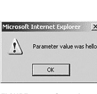

**图 17.1** 在 HTTP GET 请求后返回文本。

若要使用相同的库检索 XML 数据，我们再次使用第 11 课“我们的第一个 Ajax 应用程序”中的服务器端脚本，您可能记得它提供当前服务器时间在一个小型 XML 文档中：

```php
<?php
header('Content-Type: text/xml');
echo "<?xml version=\"1.0\" ?><clock1><timenow>"
   .date('H:i:s')."</timenow></clock1>";
?>
```

我们需要修改回调函数，因为现在需要返回解析后的 XML。我们将使用一些 DOM 方法，这些方法应该会熟悉：

```javascript
<script>
function cback(text) {
var servertime = text.getElementsByTagName("timenow")[0]
   .childNodes[0].nodeValue;
alert('Server time is '+servertime);
}
</script>
```

我们还需要做的另一件事是调用我们的 `doAjax()`函数：

```html
onClick="doAjax('telltimeXML.php','','cback','post','1')"
```

此处我们决定发起一个 POST 请求。我们的服务器端脚本 `telltimeXML.php` 不需要查询字符串，因此在这种情况下第二个参数留空。最后一个参数被设置为 `'1'`，表示我们期望服务器通过 `responseXML` 属性以 XML 格式响应。

图 17.2 显示运行程序的结果。

## 17 : A JavaScript Library for Ajax


**图 17.2** 通过 POST 请求返回服务器时间（XML 格式）。

# 扩展库

当前的库可以从多个方面进行改进。这些将留给读者作为练习，尽管在许多情况下，相关技术已在本书的其他部分涵盖。

用户反馈尚未得到解决；我们此前讨论了如何通过显示合适的文本或图形图像来提醒用户当前正在进行的请求。最好修订库以包含第 11 课及别处讨论的技术。

同样，错误处理未被纳入代码，若能增加将非常有价值。例如，修改库以检测除 200 以外的 `XMLHttpRequest` 状态属性并向用户输出合适的错误消息并不太难。

不妨自由地尝试操作代码，看看你能取得什么成果。

## 总结

本课结合了许多此前讨论过的技术，以产生一个紧凑且可重用的 JavaScript 库，只需从 HTML 页面调用即可。

代码支持 HTTP GET 和 HTTP POST 请求，并可处理服务器返回的文本或 XML 数据。

使用这样的库可以在对 HTML 标记进行较小修改的情况下将 Ajax 引入网页。这不仅使代码整洁易读，还简化了向遗留 HTML 添加 Ajax 功能的过程。

在第 18 课，"Ajax 'Gotchas'"（本书第三部分的最后一课），我们将讨论一些等待程序员在开发 Ajax 应用程序时的潜在问题和陷阱。

# Ajax“坑”

在本课中，你将了解一些常见的 Ajax 错误以及避免它们的方法。

## 常见的 Ajax 错误

Ajax 存在一些常见陷阱，开发者在开发时很容易陷入。在本课（第三部分的最后一课）中，我们将回顾一些陷阱并讨论可能的解决方案。然而，列表并不详尽，提供的解决方案也不适用于所有场合。

## 后退按钮

所有常用浏览器在导航栏上后退按钮。浏览器在内存中维护访问页面的列表，允许用户回退到最近过的页面。

正如我们习惯的样，后退按钮视为浏览的标准部分。Ajax 在很大程度上打破了这一观念，因为 Ajax 允许在不刷新页面的情况下更改内容，而无需考虑。

> **提示：** JavaScript 语言中写入后退按钮等价的语句 `onClick = "history.back()"` 和 `onClick = "history.go(-1)"`。那么对于后退按钮而言，这个问题引起了开发者之间的争论。似乎存在两种观点：

- 创建一种程序化的方法，使用该方法在按下后退按钮时重现之前的状态。
- 说服用户后退按钮不再必要。人为地重现之前的状态可行，但这给 Ajax 代码增加了复杂性。

## 书签与链接

这个问题与后退按钮无关。当你为页面添加书签时，试图保存某些内容的快捷方式。基于页面的隐喻中，尽管页面可能包含动态内容，但随后能够找到页面。

Ajax 可以缓解这个问题。当你想要将信息传递给朋友或同事时，当前页面的 URL 可能无法产生所需的结果。

## 告知用户正在发生

这是另一个独立页面风格变为分页的问题。熟悉网页的用户已经习惯于程序加载新页面或修订页面。因此，许多 Ajax 应用提供了一些视觉线索，表明活动正在进行；静态图像可能会被取代，或者会出现弹出消息。

## 使 Ajax 优雅降级

课程涵盖了使用现代浏览器开发 Ajax 应用程序。然而，旧浏览器可能。

> **提示：** 您可以使用 HTML 页面中的 `<noscript>` 标签来检测 JavaScript 是否可用。只有当 JavaScript 不可用时，这些标签会被评估：

```html
<noscript>
JavaScript is not available in this browser.
Please go <a href="otherplace.htm">HERE</a> for the HTML-only version.
</noscript>
```

## 处理搜索引擎爬虫

搜索引擎通过各种方式收集网站信息，其中重要的是称为爬虫的自动程序。顾名思义，爬虫通过读取网页和跟踪链接来“爬网”，建立特定网站内容和其他相关信息数据库。这个数据库更常被称为*索引*。

对于高度动态的网站，这可能会造成问题，这些网站依赖用户交互（而不是被动浏览）来触发服务器按需交付新内容。爬虫无法访问动态方式加载的内容，因此永远无法进行索引。使用 Ajax 会使问题进一步化，因为它倾向于以更少的页面传递更多内容。确保爬虫可以在网站的某个地方索引所有内容的静态版本。因为爬虫遵循嵌入在页面中的链接，提供网站地图在这方面是一个有用的补充。

## 指出页面上的交互元素

如果没有精心设计，用户可能无法明了他们可以点击或与其交互以触发操作的项目。

## 在不适用的场景中使用 Ajax

在应用程序中保持一致的样式是值得尝试的，展示哪些页面元素会触发服务器请求或其他活动。这让人想起 HTML 页面中的超链接通常与纯文本样式不同的方式，这样用户就能清楚它们具有额外功能。

通过投入稍多的工作，可以将活动元素的说明和信息整合到工具提示风格的弹出窗口中。当然，当活动链接可能对应用程序状态重大影响时，这尤其重要。图 18.1 展示了此类弹出框的示例。

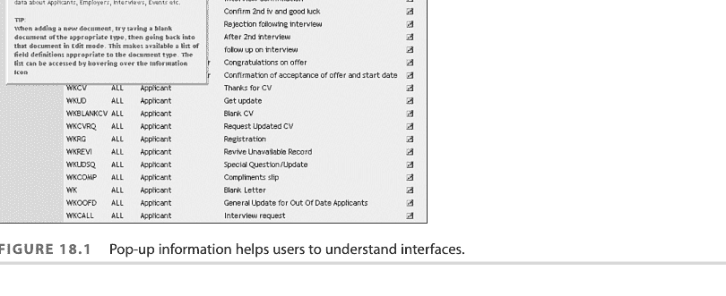

图 18.1 弹出信息帮助用户理解界面。

尽管 Ajax 在改善 Web 界面方面很有吸引力，但你需要接受的是，在许多情况下，使用 Ajax 不仅不会提升用户体验，反而会减损用户体验。当页面式隐喻完全适用于网站内容和风格，甚至与之更相关时，尤其如此。那些主题被方便地划分为章节页面的基于文本的网站，从智能设计的超链接中获得的好处往往与添加 Ajax 功能一样多。小型网站尤其可能难以从 Ajax 界面中获得足够的收益，以平衡额外代码和增加复杂性带来的带来的成本。

## 18：Ajax 的“陷阱”

## 安全性

Ajax 本身并未带来 Web 应用程序设计中原本不存在的安全问题。然而，注意的是，经过 Ajax 增强的应用程序往往比以前包含更多的客户端代码。

由于任何用户都可以轻松查看客户端代码的内容，因此敏感信息不应在其中暴露，这一点很重要。在此上下文中，敏感信息不仅限于用户名和密码（尽管它们当然是敏感的），还包括业务逻辑。让服务器端脚本负责处理数据库连接等问题。在将数据应用于任何重要处理之前，请在服务器上进行验证。

## 跨平台


- `mydataArray[2]` 包含 ID 为 `id3` 的元素的值。

## `$F()` 函数

当将其作为参数的输入元素或其 ID 传递给 `$F()` 时，该函数会返回表单输入字段的值。请查看以下 `HTML` 代码片段：

```html
<input type="text" id="input1" name="input1">
<select id="input2" name="input2">
<option value="0">Option A</option>
<option value="1">Option B</option>
<option value="2">Option C</option>
</select>
```

我们可以使用使用

`$F('input1')`

来返回文本框中的值，并使用

`$F('input2')`

来返回下拉选择框中当前选中选项的值。`$F()` 函数在复选框和文本域输入元素上也同样适用，使得无论输入元素的类型如何，都能方便地获取元素值。

## Form Object（表单对象）

`prototype.js` 定义了一个具有若干实用方法的 `Form`（表单）对象，用于简化 HTML 表单操作。您可以通过调用 `getElements()` 方法来返回一个表单的输入字段数组：

`inputs = Form.getElements('thisform');`

`serialize()` 方法允许将名称和值格式化为由 URL 兼容项组成的列表：

`inputlist = Form.serialize('thisform');`

使用上述代码行后，变量 `inputlist` 现在将包含一系列序列化参数名与参数值的字符串对：

`field1=value1&field2=value2&field3=value3...`

`Form.disable('thisform')` 和 `Form.enable('thisform')` 的效果与其名称所述完全一致。

## Try.these() 函数

前面的课程讨论了如何使用异常捕获运行错误并妥善处理它们。`Try.these()` 提供了一种方便的方法来封装这些方法，以提供跨浏览器的解决方案（因为各浏览器在 JavaScript 实现细节上存在差异）：

`return Try.these(function1(), function2(), function3(), ...);`

按照顺序处理函数；当发生错误条件导致抛出异常时，操作会移至下一个函数。只要其中任何一项函数成功完成操作，循环即停止，此时该函数将返回 `true`。将此函数应用于创建 `XMLHttpRequest` 实例的情况显示了生成代码的简洁性：

```
return Try.these(
    function() {return new ActiveXObject('Msxml2.XMLHTTP')},
    function() {return new ActiveXObject('Microsoft.XMLHTTP')},
    function() {return new XMLHttpRequest()}
)
```

> **注意**（NOTE）您可能希望将此代码片段与列表 8.1 进行比较，以了解代码复杂度降低了多少以及可读性得到了多大提升。

## 封装 XMLHttpRequest——Ajax对象

当一个构建 AJAX 应用程序时，简化您的 JavaScript 代码开发。`prototype.js` 定义了一些类来封装发送服务器请求、监控其进度并处理返回数据所需的代码。所有这些工作都是由该对象的若干子项来完成的。这个类的实例名为 `Ajax.Request`：

### Ajax.Request

`Ajax.Request` 负责创建 `XMLHttpRequest` 对象实例的详细信息以及发送格式正确的请求，调用它非常简单：

`var myAjax = new Ajax.Request( url, {method: 'post', parameters: mydata, onComplete: responsefunction} );`

> **提示**（TIP）第二个参量是使用通常称为 `JSON`（JavaScript Object Notation，“超文本标注语言”或“对象表示符号”）的标记法构建起来的。该参数是由一系列名称：值对组合而成，整体由花括号包裹。参量的值本身可能是 `JSON` 对象、数组或简单值。

由于易于构造、解析以及语言无关等特性而备受欢迎的数据交换协议就是这种 `json`。您可以在 `http://www.json.org` 处查询了解更多有关它的信息。

在此调用中，`url` 定义了服务器端资源的地址；`method` 可以是 `post` 或 `get`；`mydata` 是包含请求参数的序列化字符串；`responsefunction` 则是处理服务器响应的回调函数的名称。`onComplete` 参量对应于 `XMLHttpRequest readyState 属性值的各种可能选项之一。在这种情况下是一个readyState 值为4（完成）时的结果响应函数名。您可以改为指定要求在执行加载中的 `Loading`、已加载的 `Loaded` 或交互性的 `Interactive` 这些阶段时执行回调，这是通过使用相关参数 `onLoading`、`onLoaded` 或 `interactive` 来实现的。**异步**：`false` 参量用来指示服务器调用应是同步进行，而此默认选项的值是 `true`。

### Ajax.Updater

在某些情况下，您需要返回的数据来更新页面元素时，`Ajax.Updater` 类可以简化任务。您所需的全部只是指定哪个元素应该被更新：

`var myAjax = new Ajax.Updater(elementID, url, options);`

该调用与用于 `ajax.Request` 的某些类似但增加了第一个参数为要更新的元素的 ID。以下是使用此类的代码示例：

```html
<script>
function updateDIV(mydiv)
{
    var url = 'http://example.com/serverscript.php';
    var params = 'param1=value1&param2=value2';
    var myAjax = new Ajax.Updater
    (
        mydiv,
        url,
        {method: 'get', parameters: params}
    );
}
</script>
<input type="button" value="Go" onclick="updateDIV(targetDiv)">
<div id="targetDiv"></div>
```

再次，进行调用时可能使用一些额外的选项。其中引人注目的一个是在可选列表中添加了 `evaluateScripts:true`。加上此选项后，服务器返回的任何 JavaScript 代码都将进行评估。

### Ajax.PeriodicalUpdater

`Ajax.PeriodicalUpdater` 类可以用来反复创建 `Ajax.Updater` 实例。通过这种方式在某个时间间隔过后页面元素被更新。这对于诸如股票行情显示屏或 RSS 阅读器之类的应用程序特别有用，因为它可以确保访问者始终查看相当最新的信息。

该 `ajax.perioidcalupdater` 增加了两个附加参量到 `ajax.updater` 的（作为参数传入）：

- **频率**（`frequency`—两次连续更新之间的延迟时间以秒为单位）。默认为2 秒。
- **衰减因子**-衰减值是乘以连续的等待时间，如果服务器返回未更改的数据默认值是 1,这使间隔保持恒定。

以下是对 `Ajax.PeriodicalUpdater` 的示例调用：

`var myAjax = new Ajax.PeriodicalUpdater(elementID,,url,{frequency: 3.0; decay:2.0});`

在这里我们选择了将初始延迟设置为 3 秒，并让该延迟每次在服务器未返回更改的数据时成倍增加。

## 示例项目——股票价格阅读器（Stock Price Reader）

让我们使用 `prototype.js` 库构建一个简单的读取器来周期性地显示从服务器上返回的最新值。在这个例子中我们将利用简单的 `rand.php`（服务器端模拟）变化的股价的 PHP 脚本：

```php
<?php
srand ((double) microtime( )*1000000);
$price = 50 + rand(0,5000)/100;
echo "$price";
?>
```

此脚本首先通过调用传递自当前时间派生的参量的 `strand` 初始化 PHP 的随机数例程 `rand()`。然后 `rand(0, 5000)` 函数用来生成一个在范围从到之之间的乱码“股票价格”（例如。利用算术操作产生的结果介于至之之间任意数字），从而生成的伪“股价”。

现在让我们构建简单的 HTML 页面来显示当前股票的价格，这个网页构成我们的 ajax 应用程序的基础：

```html
<!DOCTYPE HTML PUBLIC "-//W3C//DTD HTML 4.01 Transitional//EN"
"http://www.w.org/TR/html4/loose.dtd">
<html
<head>
<script src="prototype.js" Language="JavaScript" type="text/javascript"></script>
<title>Stock Reader powered by Prototype.js</title>
</head>
```

示例项目——股票价格读取器

```html
<body>
  <h2>Stock Reader</h2>
  <h4>Powered by Prototype.js</h4>
  <p>Current Stock Price:</p>
  <div id="price"></div>
</body>
</html>
```

请注意，我们通过文档头部中的 `<script>` 标签包含了 `prototype.js` 库。我们还定义了一个 id 为 "price" 的 `<div>`，将用于显示当前的股票价格。

我们现在需要实现 `Ajax.PeriodicalUpdater` 类，将其附加到 `document.body` 元素上的 `onLoad` 事件处理器上。列表 19.1 显示了完整的脚本。

## 列表 19.1 使用 `prototype.js` 的 Ajax 股票价格读取器

```html
<!DOCTYPE HTML PUBLIC "-//W3C//DTD HTML 4.01 Transitional//EN"
  "http://www.w.org/TR/html4/loose.dtd">
<<html>
<head>
<script src="prototype.js" language="JavaScript"
  type="text/javascript"></script>
<script>
function checkprice()
{
var myAjax = new Ajax.PeriodicalUpdater('price',
  'rand.php', {method: 'get', frequency: 3.0; decay:2.0});
}
</script>
<title>Stock Reader powered by Prototype.js</title>
</head>
<body>
  <h2>Stock Reader</h2>
  <h4>Powered by Prototype.js</h4>
  <p>Current Stock Price:</p>
  <div id="price"></div>
</body>
</html>
```


通过使用列表 20.1 中的简单脚本，我们可以看到 Rico 的实际运行情况。此应用程序通过调用一次 Rico 的 `ajaxEngine` 对象来更新两个 HTML 元素。应用程序的脚本在列表 20.1 中。

## 列表 20.1 一个简单的 Rico 应用程序

```html
<!DOCTYPE HTML PUBLIC "-//W3C//DTD HTML 4.01 Transitional//EN"
  "http://www.w3.org/TR/html4/loose.dtd">
<html
<head>
<title>Testing OpenRico</title>
<script src="prototype.js"></script>
<script src="rico.js"></script>
<script type="text/javascript">
function callRICO()
{
  ajaxEngine.registerRequest('myRequest', 'ricotest.php');
  ajaxEngine.registerAjaxElement('display');
  ajaxEngine.registerAjaxElement('heading');
}
</script>
</head>
<body onload="callRICO();">
<div id="heading"><h3>Demonstrating Rico</h3></div>
<input type="button" value="Get Server Data"
   onclick="ajaxEngine.sendRequest('myRequest');"/>
<div id="display"><p>This text should be replaced with
   server data ...</p></div>
</body>
</html>
```

您将从代码中看到，单个函数调用 `callRICO()` 用于注册单个请求处理器 `myRequest` 和两个响应处理器。响应处理器用于更新两个 `<div>` 容器；其中一个包含页面的标题，另一个包含一条简短文本消息。发出 Rico 请求后，两者的内容都会更新，页面拥有新标题并显示一些服务器信息而不是之前的文本消息。图 20.1 显示了之前和之后的截图。

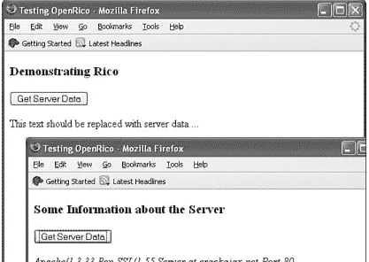

图 20.1 使用 Rico 更新多个页面元素。

服务器例程是一个简单的 PHP 脚本，输出所需的 XML 数据。该脚本使用了 PHP 的全局变量 `$_SERVER['SERVER_SIGNATURE']`。请注意，该脚本构建并返回两个分离的

## Rico 的其他界面工具

Rico 的能力不仅仅局限于辅助 Ajax 应用程序的开发。让我们现在看看使用 Rico 工具包可以添加到用户界面的其他功能。虽然这些技术本身不使用 Ajax，但结合 Rico 的 Ajax 工具时，运用一点想象力就能实现它们可能达到的效果。

## 拖放

桌面应用程序以及其运行所在的操作系统都广泛使用拖放功能来简化用户界面。实现拖放功能所需的 JavaScript 技术很难掌握，原因之一便是出现了大量跨浏览器兼容性问题。

使用 Rico 进行拖放则非常简单。

将 `rico.js` 文件包含在应用程序中会自动创建一个名为 `dndMgr` 的对象，即 Rico 的拖放管理器。使用 `dndMgr` 对象就像使用 `AjaxEngine`；不过这次我们需要注册的不仅是 Ajax 请求和响应，还有`可拖动`和`放置区域`（可以接收被拖动对象的页面元素）。

这些任务是通过 `registerDraggable` 和 `registerDropZone` 方法完成的：

```javascript
dndMgr.registerDraggable( new Rico.Draggable('test',
'dragElementID') );
dndMgr.registerDropZone( new Rico.Dropzone
('dropElementID') );
```

这两个简单命令分别声明了一个 ID 为 `dragElementID` 的页面元素为可拖动对象，另一个 ID 为 `dropElementID` 的元素为放置区域。`registerDraggable()` 方法的参数 `'test'`定义了该可拖动对象的类型，如果需要，它可以被后续代码测试和使用。

### 拖放接口的示例

列表示例 20.3 展示了使用 Rico 实现拖放的简单性。显示的 HTML 页面对应于图 20.2。

### LISTING 20.3 使用 Rico 实现的简单拖放

```html
<!DOCTYPE HTML PUBLIC "-//W3C//DTD HTML 4.01
-transitional//EN"
"http://www.w3.org/TR/html4/loose.dtd">
<html>
<head>
    <script src="prototype.js"></script>
    <script src="rico.js"></script>
    <style>
    body {
        font: 10px normal arial, helvetica, verdana;
        background-color:#dddddd;
    }

    div.simpleDropPanel {
      width     : 260px;
      height    : 180px;
      background-color: #ffffff;
      padding   : 5px;
      border    : 1px solid #333333;
    }

    div.box {
      width             : 200px;
      cursor            : hand;
      background-color: #ffffff;
      -moz-opacity      : 0.6;
      filter            : alpha(Opacity=60);
      border: 1px solid #333333;
    }
    </style>
</head>
<body>
<table width="550">
<tr>
  <td><h3>Drag and Drop</h3>
  <p>Drag and drop data items into the target fields
using the left mouse button in the usual way.
Note how available target fields change colour
during the drag operation.</p>
  <p>Reload the page to start again.</p>
  <div class="box" id="draggable1">This is a piece
of draggable data</</div>
  <div class="box" id="draggable2">
This is another</</div>
  <div class="box" id="draggable3">
And this is a third</</div>
  <br/>
  <table>
  <tr>
    <td>
      <div id="droponme" class="simpleDropPanel">
        <b>Drop Zone 1</b><br />A simple text area
      </div>
    </td>
    <td>
      <b>Drop Zone 2</b><br />
      A form text entry field.
      <form><textarea name="dropzone" id="droponme2"
rows="6" cols="30"></textarea></form>
    </td>
  </tr>
</table>
</td>
</tr>
</table>
<script>
    dndMgr.registerDraggable( new
Rico.Draggable('foo','draggable1') );
    dndMgr.registerDraggable( new
Rico.Draggable('foo','draggable2') );
    dndMgr.registerDraggable( new Rico.
Draggable('foo','draggable3') );
    dndMgr.registerDropZone( new Rico.Dropzone
('droponme') );
    dndMgr.registerDropZone( new Rico.Dropzone
('droponme2') );
</script>
</body>
</html>
```

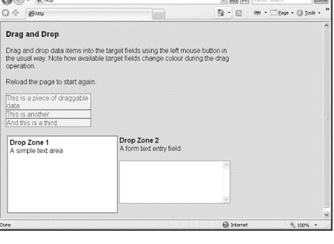

**图 20.2** 简单的拖放应用程序。

两个 JavaScript 库 `rico.js` 和 `prototype.js` 被包含在文档的 `<head>` 中，以及针对各种页面元素的样式定义。

注意，有两个特定的页面元素，即一个 `<div>` 容器和一个 `<textarea>` 输入字段，分别被赋予了 `dropzone1` 和 `dropzone2` 的 ID`。在下文的代码列表中，这两个元素通过以下行被定义为拖放操作的放置区域：

```javascript
dndMgr.registerDropZone( new Rico.Dropzone('dropzone1') );
dndMgr.registerDropZone( new Rico.Dropzone('dropzone2') );
```

您还会看到三个小的 `<div>` 容器被定义在页面上，并分别赋予了 `draggable1`、`draggable2` 和 `draggable3`。

```php
<?php
require_once('myClass.class.php');
// require_once('xoad.php'); // (假设已存在或被注释) 
XOAD_Server::allowClasses('myClass');
if (XOAD_Server::runServer()) {
    exit;
}
?>
<?= XOAD_Utilities::header('.') ?>    
```

脚本的第一部分包含 `xoad.php` 和所需的类文件 `myClass.class.php`，并通知`XOAD`它可以访问哪些类（在本例中仅一个）。  

XOAD函数`runServer()`检查`XOAD`请求是否为客户回调，如果是则适当处理它。`header()`函数用于注册客户端头文件。

现在让我们看看其余的脚本：

```php
<script type="text/javascript">
var myobj = <?= XOAD_Client::register(new myClass()) ?>;
var mystring = 'My XOAD Application';
myobj.onStLengthError = function(error) {
    alert(error.message);
    return true;
}
myobj.stLength(mystring, function(result) {
    document.write('String: ' + mystring
        + '<br />Length: ' + result);
});
</script>    
```

看一下其余的脚本元素是一个`<script>...</script>`吗？该行  

```php
var myobj = <?= XOAD_Client::register(new myClass()) ?>;  
```   

将`myClass.class.php`中声明的公共方法导出为JavaScript对象。我们现在拥有一个具有名为`stLength()` 方法的JavaScript对象，该方法允许我们使用PHP类`myClass`的相同名称的方法。

## XOAD HTML

XOAD HTML是一个扩展程序，利用它可轻松更新HTML页面元素。以下示例显示了`XOAD_HTML::getElementByID()`和`XOAD_HTML::getElementsByTagName()`方法的使用情况，它们所做的与等效的JavaScript `DOM` 方法完全相同的操作。  

### `XOAD_HTML::getElementById()`

您会在清单 21.2中看到代码布局的基本结构与前面讨论过的基础`XOAD`程序相似的结构。  

而不是包含外部类文件，在本例中我们在应用程序本身内定义了一个名为`Updater`的类。该类别仅包括一个函数：`change()`。 第一个在这些函数中的行使用`XOAD_HTML::getElementById()`来识别ID(`display`)为`display`的页面元素。随后的程序线将更改页面的文本和背景色.  

函数`change()`作为JavaScript对象`myobj`的方法提供，然后像任何其他 JavaScript方法一样调用：

```html
<a href="#server" onclick="myObj.change(); return false;">Change It!</a>    
```

图 21.1显示了程序的操作。 

## 清单 LISTING 21.2: 使用 XOAD html::getElementById 的应用

```php
<?php
class Updater  
{
    function change () 
   {
       $mytext = xoad_html :: getelementbyid ('display');    
       
        $mytext->style ['backgroundcolor'] ='yellow';   
        
           $mytext ->innerhtml= 'My background color has changed.';         
      }      
}      
define('XOAD_AUTOHANDLE', true);requireonce('xoad.php')??> 
<?= XOAD_Utilities::header('.') ?>
<div id="display">.Mybackgroundcoloriswhite.</div>    
<script typ='e"text/javascript">       
var myobj = <?= xoad_client :: register(new updater()) ?>;  
       </script> <a href="#server" onclick="myObj.change(); return false;">Change It!</a 
```  

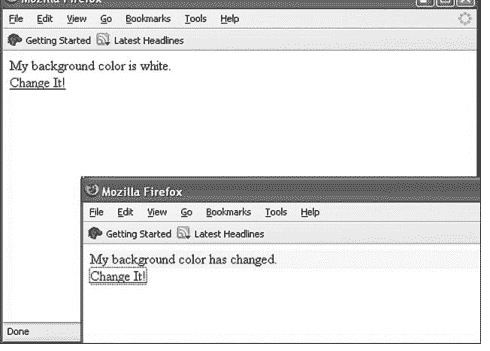    

**FIGURE 21.1.** Using `XOAD HTML: : getElementBYID ()`。  

## XOAD_HTML::getElementsByTagName()

像其 JavaScript等效体一样，`XOAD_HTML::getElementById()`返回具有某些元素类型元素的阵列（应为`getElementsByTagName`）。清单21.3识别了类型为`<div>`的所有页面元素并更改它们的一些样式属性。

## 清单 LISTING .1: 修改给定类型的某页面的所有元素

```php     
<?      
class Updater  
{       
function chage ()    {   
        $mydivs =& XOAD_HTML::getElementsByTagName('div');  
        
           $mydivs ->style['height'] = '60';  //设置高度为 60
              /*注意这里应该是 width:350,backgroundColor:'lightgreen'*/     
$mydivs-> style ['width']= '350';   
        
           $miydivs- -stytie ['backgroundColor]='lightreen';         
          mydivs-innerHtml= 
        '&Si z e and color Ch anged b y XOAD ';      
      }       
}  
define ('XOAD_AUTOHANDLE', true);require_once('xoad.php');??>        
<? = xad_utiliti es::header('.') ?>     
<script type="J avasc rit">   
var myobj= <?= XO AD Client: :reg ister(new Updater())?>>;    
        </script>          
<STYLE>  
div{  border:lpx solid black ;
heigh t s80;       
widt h150      
}        
</style>     <div>Dive!       <br/>  
<div>Div2       a href="#server" onclick="myObj.change(); return false;">Update Alls
```

页面中的三个`<div>`元素已经被`XOAD_HTML::getElementsByTagName()`识别并更改了样式和大小。

图21.2显示了程序的操作，    

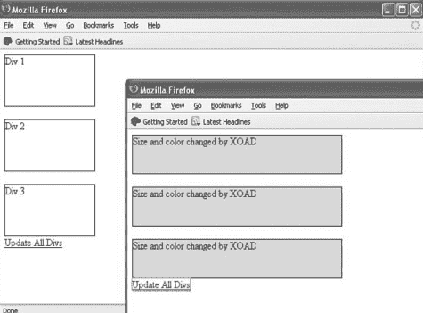

## 使用高级编程的XOAD

除了本单元讨论的内容，XOAD还具有许多功能。如果您想调查在XOAD上实现可能性的极限情况,以下是目前支持的技术概述。  

### XOAD 事件

XOD框架还支持事件。客户机上的一个事件存储在服务器中随后被其他客户端检测，这样用户可以互动地构建复杂的应用程序。此类应用程序可能包含聊天、协作或类似工具。

XOAD允许将存储在服务器上的 PHP 类中包含的方法通过 JavaScript 提供给客户端使用。这与第 19 课和第 20 课讨论的客户端技术形成了有趣的对比。

## 使用XOAD 进行缓存处理

XOAD允许在服务器端使用`XOAD_Cache`类进行缓存。缓存结果可以显著提升性能，尤其是服务器端例程非常耗时时（例如对大型数据集进行排序或在大型数据库表上执行查询）。

## XOAD 控制

你可以使用`XOAD_Controls`类在XOAD中定义自定义客户端控件。

> **提示：** 截至撰写本文时，XOAD的当前版本是0.6.0.0。如果你下载的版本不同，请参考下载包中包含文档。

## 小结

本课考察了一个服务器端实现的 Ajax 工具包，即XOAD。

XOAD允许将 类 类包含的方法通过 JavaScript 提供给客户端程序使用。这与第 19 课和第 20 课讨论的客户端技术形成了有趣的对比。

第四部分到此结束。你现在应该对 Ajax 应用架构及其所基于的编码技术有了很好的理解。

祝你在 Ajax 的实验探索中好运！

```html
<div>
</div>
```

# A

- `abort` 方法，78
- 活动页面元素，设计，171
- `AHAH`（异步 HTML 和 HTTP）。另见 `HTML` ；`HTTP`
  - 优点，120
  - `callAHAH()` 函数，121-123
  - `myAHAHlib.js`，121-123
    - 元标签信息，从 URL 检索，124-125
    - `responseText` 属性，127
  - `responseAHAH()` 函数，122-123

- `Ajax`
  - 应用示例，Google Suggest，64-65
  - 应用流程图，68
  - 客户端-服务器交互，61-64
- 对象
- `Ajax.PeriodicalUpdater` 类，179-180
  - `Ajax.request` 类，178
  - `Ajax.Updater` 类，179
    - 在不适当的情况下使用，171

- `Ajax` 引擎，64
- `Ajax PeriodicalUpdater` 类，0.6.4-5+0
  - `ajax.request` 类，83
  - `Ajax.Updater` 类，179
    - Rico 中的 `AjaxEngine` 对象实例，08-50
- `alt` 属性（图像标签），19

- `Amazon.com REST API`，430

- `锚标签`（HTML）20

- Apache Web Server 网站，8+174

- `AppendChild` 方法，6-5

- 应用程序
  - 设计，18，+1
    - `callback` 函数，16-59+
    - 完整的应用程序，+3
    - 事件处理程序，186
    - HTML 文档，20
    - PHP 脚本，4-5
    - 服务器请求，4
    - 故障排除，7-2
    - 用户反馈，17-90
  - `XMLHttpRequest` 对象
- 流程图，*B*。

- `prototype.js`，添加到 18+3
- Rico，添加到 17+3
- 参数（JavaScript），*S*，+Z

- 文章
  - 文章 REST
    - 可用文章列表，读物 46
    - 特定文章，检索，L90 上传
  - ASCII 文本服务器响应，S

## 异步服务器
- 通信，B+89-5* 请求 `ATTLIST` 声明 XML ZB

# B

后退按钮 173 带宽定义 HZ `body` 标签（HTML）*H+- 书签故障排除 A 浏览器缓存 `callAjax` 函数，GET 请求，服务器请求 `callrco()` 函数 `change` 函数字符串 `split` 方法子节点添加 `DOM.ChildNodes` 属性电影效果（Rico），客户端-服务器交互传统与 Ajax 代码设计开发人员 DNS 域名服务器 `doAjax` `DOCTYPE` 元素文档方法表 `dom` 元素 XML 删除属性删除 `DTD` 文档类型定义与 `DOCTYPE` 声明 `onChange` 事件处理程序 `onClick` 事件处理程序 `onLoad` 事件处理程序 `onMouseout` `onMouseOver` `onSubmit`

# E

`ELEMENT` 声明 XML 错误处理应用程序设计后退按钮书签浏览器缓存代码 GET 请求 JavaScript 库链接页面设计权限被拒绝错误 POST 请求安全蜘蛛支持的浏览器用户反馈 `eval()` 函数事件处理程序基本应用程序创建示例 JavaScript 函数 `myAJAXLib.js` 文件扩展名 `firstChild` 属性 `for` 循环 `Form` 对象 `Forms` HTML 标签 `form` 标签属性参数值处理简单表单示例特殊字符传输变量框架函数 `$` `callAHAH` `callAjax` `callback` 参数传递从事件处理程序调用结构 `responseajax` `runserver` `sizeof` `Trythese`

# G

GET 请求，浏览器缓存 HTTP 请求 JavaScript 库 `myAJAXlib.js` 查询字符串 REST 故障排除 `getAllResponseHeaders` 方法 `getAttribute` 方法 `getElementByID` 方法 `GetElementByTagNameGetElementsByTagNameMethod`getElementsmethod``getResponseHeader``gmail` 网络邮件服务（Google）`Google Maps` `Google Suggest` 图形网络浏览器图形浏览器 `HasChildNodes` 方法 `head` 标签 HTTP 请求响应 `header` 函数标头在发出 PHP 脚本之前输出 Hello World 示例在 PHP 中打印十六进制编号系统 HTML 超文本标记语言

### 另见 AHH
- `<div>` - `div` 元素，2*0-4
- `script` - `script)` 元素，+8 高级文档示例基本应用程序创建示例基本演示初级 `body` 标签 `DOCTYPE` `head title` 注释颜色值定义 `form` 属性属性方法参数值处理简单表单特殊字符传输变量 GET 请求超链接 JavaScript 加载文档元标签关键词 `myAHAHlib.js`

- `myAJAXlib.js`，164
- PHP，48
- POST 请求，29-31
- `responseText` 属性，115-116
- RSS 标题阅读器，创建，134
- 保存文档，15
- `script` 标签，34
- `seville.html` 文档示例，20-21
- 样式，23
  - 内联样式，24
  - 样式表规则，设置，24
- 标签，14
  - 添加属性，18
  - 锚点标签，20
  - 作为容器，17
  - `body` 标签，16-17
  - `body` 标签，添加属性，18
  - `center` 标签，21
  - 常用标签表格，22-23
  - `head` 标签，16
  - 图像标签，19
  - 表格标签，19-21
  - `title` 标签，16

- `testpage.html` 文档示例，14
  - `body` 标签，16-17
  - `body` 标签，添加属性，18
  - `DOCTYPE` 元素，15-16
  - `head` 标签，16
  - HTML 标签，16
  - 加载，15
  - 保存，15
  - `title` 标签，16

- 工具要求，14
- 文字处理器，14
- XML，相似之处，54
- XOAD，199
  - `change()` 函数，196-197
  - `XOAD HTML::getElementByID()` 方法，196-197
  - `XOAD HTML::getElementsByTagName()` 方法，198

## JavaScript

HTTP（超文本传输协议），25。**另参阅** AHAH
- 请求，7
  - GET 请求，29-31
  - 头部行，27
  - 起始行，26
  - POST 请求，29-31
- 响应
  - 头部行，28
  - 原因短语，27
  - 状态行，27
- 服务器响应状态码，87
- 发送 SOAP 请求，154
- 版本（HTTP 请求），26
- 超链接，HTML，19-20

# I - J

- `id` 值，98
- `if` 语句（PHP），51
- 图像标签（HTML），19
- 图像，定义像素，19
- `indexOf` 方法，`responseText` 属性，93
- 内联样式，24
- 实例（Rico），创建，72-77
- Internet，HTTP 请求，1
- Internet Explorer (MS)，`script`，34
- `IP` 地址，定义，12

## JavaScript，33
  - 参数，37，42
  - 后退按钮代码，167
  - 大写敏感，35
  - 命令，执行，37
  - 启用，34
  - 表单验证，45-46
  - 函数
    - 参数，传递给，42
    - 调用，41
    - 事件处理程序，调用，43
    - numcheck，46
    - 结构，40
  - HTML 页面，添加到，35-37
  - 方法，37-42
  - 对象，37，45，57
  - `script` 标签，34
  - 变量，44
  - XML，57
- JavaScript 库，158
  - 回调函数，161-162
  - `doAjax` 函数，161-164
  - 错误处理，166
  - `eval()` 函数，161-162
  - GET 请求，160
  - `myAJAXlib.js`，158-162
    - 回调函数，164
    - 事件处理程序，调用，164
    - GET 请求，163
    - HTML 页面，164
    - PHP 脚本，164
    - `responseText` 属性，164
    - 使用示例，163-165
    - XML 数据，检索，165
  - POST 请求，160，165
  - `prototype.js`
    - `$()` 函数，176
    - `$F()` 函数，176-77
    - `Ajax.PeriodicalUpdater` 类，179-180
    - `Ajax.request` 类，178
    - `Ajax.Updater` 类，179
    - 下载网站，175
    - Form 对象，177
    - `getElements()` 方法，177
    - Rico，183-192
    - `serialize()` 方法，177
    - Stock Price Reader 构建示例，180-182
    - `Try.these()` 函数，177
    - Web 应用程序，添加到，175
    - 用户反馈，166
    - `XMLHttpRequest` 实例，创建，159-160
- `script`，34
JSON（JavaScript 对象表示法）网站，178

# K - L

- `keywords` 元标签，123-25
- `lastChild` 属性，132
- `lastIndexOf` 方法，`responseText` 属性，93
- 库（JavaScript）
  - 回调函数，161-162
  - `doAjax` 函数，161-164
  - 错误处理，166
  - `eval()` 函数，161-162
  - GET 请求，160
  - `myAHAHlib.js`，158-159
    - 回调函数，164
    - 事件处理程序，调用，164
    - GET 请求，163
    - HTML 页面，164
    - PHP 脚本，164
    - `responseText` 属性，164
    - 使用示例，163-165
    - XML 数据，检索，165
  - POST 请求，160，165
  - `prototype.js`
    - `$()` 函数，176
    - `$F()` 函数，176-77
    - `Ajax.PeriodicalUpdater` 类，179-180
    - `Ajax.request` 类，178
    - `Ajax.Updater` 类，179
    - 下载网站，175
    - Form 对象，177
    - `getElements()` 方法，177
    - Rico，183-192
    - `serialize()` 方法，177
    - Stock Price Reader 构建示例，180-182
    - `Try.these()` 函数，177
    - Web 应用程序，添加到，175
    - 用户反馈，166
    - `XMLHttpRequest` 实例，创建，159-160
- 库（开源），Rico，183
  - `<response>` 元素，184，187
  - `AjaxEngine` 实例，184-185
  - `callRICO()` 函数，186
  - 影视效果，192
  - 拖放，188-191
  - 多页面元素更新，184
  - 使用示例，185-186
  - Web 应用程序，添加到，183
- 链接，故障排除，168-169
- 加载 文档，15
- 循环结构（PHP），52
- Lynx 基于文本的 Web 浏览器，10

# M

标记元素（HTML）。**请参阅** 标签，HTML
- `Math.random()` 方法，84
- 元标签
  - `keywords`，123-125
  - `myAHAHlib.js`，检索元标签信息，124-125
- 方法，71
  - `abort`，78
  - `AppendChild`，131-133
  - `charAt`，`responseText` 属性，93
  - `CreateAttribute`，133
  - `CreateElement`，132-133
  - `CreateTextNode`，131-133
  - `getAllResponseHeaders`，78
  - `getElementByID`，98，106，130
  - `getElementsByTagName`，105-106
  - `getElements()`，`prototype.js`，177
  - `GetElementsByTagName`，133
  - `getElementsByTagName`，95-96，130，133
  - `getResponseHeader`，78
  - `HasChildNodes`,133
  - HTTP 请求，26-27
  - `indexOf`，`responseText` 属性，93
  - JavaScript，事件处理程序，37
  - `onClick` 事件处理程序，38-39
  - `onMouseOver` 事件处理程序，41-42
  - `lastIndexOf`，`responseText` 属性，93
  - `Math.random()`，84
  - `open`，78-79
  - `registerDraggable`，188
  - `registerDropZone`，188
  - `RemoveChild`，133
  - `send`，78-79
  - `serialize()`，`prototype.js`，177
  - `setRequestHeader`，78-79
  - `split()`，117
  - `substring`，`responseText` 属性，93
  - `toLowerCase()`，`responseText` 属性，93
  - `toUpperCase()`，`responseText` 属性，93
  - `XMLHttpRequest` 对象，方法列表，78
  - `XOAD HTML::getElementByID()`，196-197
  - `XOAD HTML::getElementsByTagName()`，198
- 多平台代码测试，172
- `myAHAHlib.js`，121-123,158-159
  - 从 URL 检索元标签，124-125
  - `responseText` 属性，127
- `myAJAXlib.js`，161-162
  - 回调函数，164
  - 事件处理程序，调用，164
  - GET 请求，163
  - HTML 页面，164
  - PHP 脚本，164
  - `responseText` 属性，164
  - 使用示例，163-165
  - XML 数据，检索，165

# N - O

- 命名空间，SOAP，153
- 原生对象，72
- `nextSibling` 属性，133
- `nodeName` 属性，133
- 节点
  - 子节点，添加到 DOM，131
  - DOM，58-59
    - 文档方法表格，133
    - 节点方法表格，133
    - 节点属性，132
  - `nodeType` 属性，133
  - `nodeValue` 属性，133
- `numcheck`（JavaScript），46
- 数字数组，51
- 对象
  - `Ajax.PeriodicalUpdater` 类，179-180
  - `Ajax.request` 类，178
  - `Ajax.Updater` 类，179
  - `AjaxEngine`，Rico 中的实例，184-185
  - 构造函数，72
  - DOM，72-73
  - Form，`prototype.js`，177
  - 实例，创建，72-77
  - JavaScript，45
    - 方法，37
  - XML，57-58
- 原生对象，72
  - 属性，71
- `XMLHttpRequest`
  - 基本应用创建示例，103-104
  - `callAjax()` 函数，83
  - 实例，创建，74-77
  - JavaScript 库，159-160
  - 方法
    - `open`，78-79
    - `send`，79
    - 方法列表，78
  - 属性
    - `readyState`，86-87
    - `status`，88
    - `statusText`，88
  - `responseAjax()` 函数，83
  - 服务器请求，浏览器缓存，84-86
  - 服务器请求，回调函数，88-90
  - 服务器请求，发送，81-83
  - 服务器请求，监控，86-87
  - 服务器请求，时间戳，86
  - 用途，73
- `responseXML` 属性，96
- 解析，96
- 存储的值，130
- 网页，添加到，130-32

# P

- 页面设计，故障排除，171
- 页面元素，设计，171
- `parentNode` 属性，133
- `responseXML` 属性，96
- 权限被拒绝错误，故障排除，174
- PHP，47
  - `$SERVER` 全局变量，187
  - `date` 命令，50
  - 文件扩展名，48
  - Hello World 示例，打印，48
  - HTML，48
  - `if` 语句，51
  - 循环结构，52
  - 方法，@ 字符，125
  - `php` 标签，48
  - 程序流程，控制，51-52
  - 资源网站，48
  - 脚本
    - 基本应用创建示例，104-105
    - `header()` 指令，输出前
    - 问题，94
    - `myAJAXlib.js`，164
    - 引号，转义，94
  - 标签，48
  - 变量
    - 数组，50
    - 大写敏感，49
    - 命名约定，49
    - 数字，50
    - 字符串，50
    - 赋值，49
  - `XOAD`
    - 缓存处理，200
    - 客户端控件，自定义，200
    - 下载/安装，193
    - 事件，199
    - `header()` 函数，195
    - `runServer()` 函数，195
    - 简单页面示例，194-196
    - `XOAD Controls` 类，200
    - `XOAD HTML`，196-199
- PHP 解释器，@ 字符，125
- 像素，定义，19
- 平台代码测试，172
- 弹出窗口，171
- POST 请求，145-147，165
  - HTTP 请求，29-31
  - JavaScript 库，160
  - 消息体，29
  - 故障排除，174
- `previousSibling` 属性，133
- 程序员编辑器，HTML，14
- 序言（XML），55
- 属性，71
  - `childNodes`，132
  - DOM 文档方法表格，133
  - DOM 节点方法表格，133
  - DOM 节点属性，132
  - `firstChild`，132
  - `lastChild`，132
  - `nextSibling`，133
  - `nodeName`，133
  - `nodeType`，133
  - `nodeValue`，133
  - `onreadystatechange`，77
  - `parentNode`，133
  - `readystate`，77-86
  - `responseText`，78-111
    - 格式化数据，112-114
    - HTML，115-116
    - 方法列表，93-94
    - `myAHAHlib.js`，127
    - `myAJAXlib.js`，164
    - null值，92
    - 返回文本，用于页面中，112-14
    - 值，92-93
    - 操作，93
  - `responseXML`，78-94-95
  - 存储的值，130-32
  - 网页，添加到，130-32
- `status`，78，88
- `statusText`，78，88
- `XMLHttpRequest` 对象，列表，77
- `registerDropZone` 方法，188
- `RemoveChild` 方法，133
- 请求（HTTP），起始行
  - GET请求，29-31
  - 方法，26-27
  - 服务器资源，26

# Q - R

- PUT请求，145
- REST（Representational State Transfer，表述状态传递）
  - `Amazon.com REST API`，147-150
  - 文章，上传，147
  - DELETE请求，145
  - 示例，145
  - GET请求，145-147
  - 可用文章列表，读取，146
  - 特定文章，检索，147
  - POST请求，145-147
  - 原则，144
  - PUT请求，145
  - 与SOAP对比，156
  - 无状态操作，146
- 查询字符串，GET请求，29
- 引号，在PHP脚本转义，94
- `readyState` 属性，77，86-87
- 原因短语（HTTP响应），27
- `registerDraggable` 方法，188
- 请求
  - GET请求，83
  - 进行中的通知，97
  - `readyState` 属性，86-87
  - 发送，`XMLHttpRequest`对象，81-86
  - 状态，监控，86-87
  - 时间戳，86
  - 用户反馈，97
  - 资源（HTTP请求），26
  - 响应，67
    - `getElementsByTagName()` 方法，95
    - 进行中的通知，97
    - `responseText` 属性，92-93
    - `responseXML` 属性，94-96
    - 用户反馈，97
- Rico
  - `<response>` 元素，184，187
  - `AjaxEngine` 实例，184-185
  - `callRICO()` 函数，186
  - 影视效果，192
  - 拖放，188-191
  - 多页面元素更新，184
  - 使用示例，185-186
  - 网页应用，添加到，183
  - `serialize()` 方法，177
  - 股票读取器构建示例，180-182
  - `Try.these()` 函数，177
  - 网页应用，添加到，175
  - `responseText` 属性，78，111
  - 字符串，用于页面中，112-14
  - 格式化数据，117
  - HTML，115-116
  - 方法列表，93-94
  - `myAHAHlib.js`，127
  - `myAJAXlib.js`，164
  - null值，92
  - 返回文本，用于页面中，112-14
  - 值，92-93
  - 操作，93
  - `responseXML` 属性，78，94-95
  - 解析，96
  - 存储的值，130-32
  - 网页，添加到，130-32
- SOAP（Simple Object Access Protocol，简单对象访问协议）
  - 发展，152
  - 命名空间，153
  - 请求
    - `Ajax`使用示例，155
    - 组成部分，152
    - HTTP，通过发送，154
    - 与REST对比，156
    - 规范网站，152
  - `runServer()` 函数，195

# S

- 保存HTML文档，15
- `script` 标签（HTML），34
- 搜索引擎爬虫，疑解答，170
- 爬虫，疑解答，170
- `split()` 方法，117
- 状态码（HTTP响应），27
- 状态行（HTTP响应），27
- `status` 属性，78，88
- `statusText` 属性，78，88
- `src` 属性（image标签），19
- 结构，40
- 样式，23
  - 内联样式，24
  - 样式表规则，设置，24
- 样式表规则，24
- `send`，78-79
- `serialize()` 方法，`prototype.js`，177
- 股票读取器构建示例，180-182
- `Try.these()` 函数，177
- 网页应用程序，添加到，175
- 网页应用，添加到，183
- 网页应用，添加到，175
- 网页应用，添加到，130-32
- 网页，8
- 网页浏览器
  - 可用性，11
  - 定义，10
  - 图形浏览器，10
  - HTML文档，加载，15
  - 基于文本的浏览器，10
  - 不支持的浏览器，疑解答，169-170
  - 与网页服务器交互，7
- 网页
  - 定义，8
  - 元素，通过`responseXML` 属性添加到，130-32
  - HTTP请求，7
  - `id` 值，98
- 网页服务器
  - Apache网页服务器网站，9
  - 定义，9
  - 与网页浏览器交互，7
- 网络服务
  - 示例，144
  - REST
    - `Amazon.com REST API`，147-150
    - 文章，上传，147
    - DELETE请求，145
    - 示例，145
    - GET请求，145-147
    - 可用文章列表，读取，146
    - 特定文章，检索，147
    - POST请求，145-147
    - 原则，144
    - PUT请求，145
    - 与SOAP对比，156
    - 无状态操作，146
- 查询字符串，GET请求，29
- 引号，在PHP脚本中转义，94
- `readyState` 属性，77，86-87

# T

- `table`标签（HTML）
- `tagname` 属性（DOM），59
- `title` 标签，16
- `toLowerCase()` 方法，`responseText` 属性，93
- `toUpperCase()` 方法，`responseText` 属性，93

- T，14
- `lastChild` 属性，132
- `lastIndexOf` 方法，`responseText` 属性，93
- `testpage.html` 文档示例，14

# U - V

- 不支持的浏览器，疑解答，169-170
- `URL`

# X - Y - Z

- `ATTLIST` 声明 XML ZB
- `XML` 相似之处，54
```