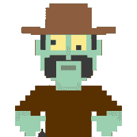

# Javascript 编程入门指南：变量、循环、函数踩踏僵尸

## 你知道还有什么能杀死僵尸吗？

真诚的反馈。喜欢这本书？发现了错误或遗漏？对某些内容仍有疑惑？想夸赞作者（或吐槽其缺乏）的幽默感？请直接发送邮件至 `feedback@undead.institute` 联系 `John`。

## 更多僵尸化网页开发内容，请访问

[`undead.institute`](https://undead.institute)

## 四个字

阻止那些僵尸牛仔！

## 内容警告（关于“愚蠢”）

本书包含大量信息、僵尸、愚蠢内容，以及某些人称之为“糟糕”的幽默感。如果你在寻找纯粹的技术资料或治疗失眠的良方，这本书不适合你。

如果你在寻找一本对没有技术背景或兴趣的人友好，并且/或者不介意在学习时笑一笑的书，那么这本书就是为你准备的。亡灵学院坚信，获取“脑仁”应该充满乐趣。加入我们，一劳永逸地阻止那些臭烘烘的僵尸吧！（不，说真的，它们的口气太可怕了。）

## 免费获取末日 JavaScript 速查表


当你订阅我们的电子邮件通讯《网络末日周刊》时，即可获得这份可打印的速查表。它涵盖了 JavaScript 循环、变量、条件语句和函数。借助你自己的末日 JavaScript 速查表，轻松编写 JavaScript。

[`undd.link/intro2js`](https://undd.link/intro2js)

## 你好，人类抵抗细胞

JavaScript 与其他前端网页语言（如 HTML 和 CSS）不同。它更具程序性，使用逻辑、变量、函数、循环以及各种东西——但别担心你的脑子会像被僵尸紧追不舍一样。我们会一步步引导你，让你快速上手，即使这是你第一次接触 JavaScript 和/或更传统的编程语言。

本书假设你具备少量 HTML/网页知识。如果你完全没有，可以从我们的免费书籍《痛击僵尸：面向作家、设计师和初学者的 HTML & CSS 快速入门指南》中获取所需内容，该书可在 [`undead.institute/death-to-boring-programming-books/`](https://undead.institute/death-to-boring-programming-books/) 获取。

## 一桶又一桶的僵尸内脏

首先要理解的一个概念是变量。变量就像你用来存放东西的桶。你可以在桶里放水、午餐、假人模特头、或者 2037 年洛杉矶僵尸道奇队人类抵抗细胞的新秀卡。你几乎可以把任何东西放进桶里。

在 JavaScript 中，也有很多不同类型的“东西”可以放进桶里，例如：

- **数字：** 就是你想的那样。
- **字符串（字符串）：** 实际上不仅仅是字母——它们是你想当作一个整体处理的任何文本或字符。字符串需要用引号括起来（JavaScript 中单引号和双引号都可以），并且可以包含任何有效字符。字符串的例子有：
  - “你好，后末日世界”
  - “别看我，Norm。僵尸把你的午餐从冰箱里拿出来吃掉了。”
  - “我知道你贴了标签。僵尸不在乎，或者它不识字。”
  - “只有一个办法能知道。它正在那边吃另外 7 份午餐。”
  - “7？”
  - “7”
  所以你也可以在字符串中包含数字字符，但它们会作为字符串而不是数字来表现——因此你不能直接对它们进行加法或乘法运算，除非先将它们转换回数字。如果某物在引号内，它就是字符串。
- **布尔值：** 值为 `true` 或 `false`，不能是其他值。这使得它非常适合用作开关，来打开或关闭某些东西。

JavaScript 中还有几种其他类型的变量，但这些足以让我们开始。

## Z 型桶

有些桶只能装一种类型的东西。例如，一个底部有洞的桶装不了水，也装不了北美最后一个还在工作的汽水机里的汽水，但它很适合装书、大石头，或者你变成僵尸的室友的个人物品。类似地，变量通常也只保存一种类型的东西。

在某些编程语言中，把错误类型的内容放进错误的桶里会导致错误，但 JavaScript 很宽容。好的一面是，JavaScript 会处理很多事情而不抱怨。坏的一面是，如果它处理出错或处理的结果与你预期不同，你可能会得到奇怪的结果或难以追踪的编程错误。



### 活死人之夜小贴士：

这类错误常见的一个地方是当你试图将一个数字（`2`）和一个看起来像数字的字符串（`"2"`）相加时。在 JavaScript 中，`2 + "2"` 的结果是 `"22"`。由于其中一个是字符串，它会将另一个也强制转换为字符串，并将它们拼接（连接）在一起。（这在需要为用户构建消息时非常有用。）因此，要小心确保你是在用数字加数字，而不是字符串。

## 变量桶的内容

我们一直在谈论的这些桶被称为变量。它们之所以叫变量，是因为它们……嗯……是可变的。你可以往里面放东西，在程序运行过程中，你可以取出它并查看，或者取出它并对其进行操作，或者取出它并放入其他东西。你可以重复任意多次。

在我们可以使用这些桶/变量来击退僵尸大军之前，我们必须给它们命名。我们可以给变量起几乎任何我们想要的名字。但是，我们只能使用字母、数字和下划线。不能使用其他字符，并且第一个字符不能是数字——例如，`7zombies` 是无效的，但 `sevenzombies`、`_7zombies` 或 `zombies_7` 都可以正常工作。另外，变量是区分大小写的，所以 `zombie` 与 `Zombie` 不同，与 `ZOMBIE` 不同。

### 活死人之夜贴士：

我们可以利用这一点，采用驼峰命名。驼峰命名法使词名易于阅读。驼峰命名法中，第一个单词全部小写，然后后续单词的首字母大写。以下是一些例子：
`sevenZombies`、`sevenFormerHumans`、`thatGuyFromZombie`、`dawnOfTheDeadFromSales`、`rickUndeadOfDoom`。最后一条规则是，不能使用保留字——那些对 JavaScript 有特殊含义的单词。那么如何在 JavaScript 中声明一个变量？三种方式：`var`、`let` 和 `const`。

#### var
`var` 是设置变量的原始方式，也是向后兼容最好的方法。
```javascript
var zombie; // 仅创建变量
var zombie = 45; /* 创建变量并赋值为数字 45，或者多行注释 */
var apocalypse = "The end of world"; // 将字符串放入桶
var zombieDoomed = true; // 将布尔放入桶
```

#### let
另一种选择是使用 `let` 代替 `var`。`let` 是一个较新的选择，因为 `var` 可能产生意外行为。JavaScript 对变量的宽松态度（或者它的宽容性）在某些情况下可能会带来麻烦。`let` 解决了这个问题。
```javascript
let zombie;
let zombie = 45;
let apocalypse = "The end of world";
let zombieDoomed = true;
```

#### const
最后一种选项是常量，程序运行期间保持恒定的值。不能在程序运行时更改常量，只能通过编辑代码来更改。量的关键字是 `const`。
```javascript
const zCuredPerSerumCC = 7;
const cell2NestRatio = 0.8271;
```

### 额外贴士：

你可以通过在变量名之间使用逗号同时定义多个变量。下面我使用 `let`，但这种方法也适用于 `var` 和 `const`。
```javascript
let zombie, undead;
```
你还可以在链式定义时设置它们的值：
```javascript
let horde = 700, humanityInTrouble = true;
```

## 不死输出

在 JavaScript 中有几种输出内容的方式。为用户显示输出几乎总是最终目标，即使程序的结果首先做了其他事情。为用户显示输出也有助于找出程序中的问题并修复它。

### 输出到警告框

输出变量最简单（但通常也最烦人）的方法之一是使用警告语句()`alert()` 是一个 JavaScript 函数，会创建一个带有消息和“确定”按钮的对话框。
```javascript
alert("The zombies are here!");
```

### 输出到页面

使用 `document.write()` 将内容或信息输出到页面。
```javascript
document.write("The zombies are here!");
```

### 输出到控制台

适合调试的方式是输出到控制台。使用 `console.log()`：
```javascript
console.log("The zombies are here!");
```

## 末日后的数学

编程中涉及大量数学运算，常见的运算符有加法、减法、乘法、除法，以及模除。

- **加法：** `undead = zombies + infected`
- **减法：** `undead = zombies - cured`
- **乘法：** `undead = humans * infectionRate`
- **除法：** `undead = zombies / antidote`
- **模除：** 与除法类似，但余数答案。例如 `13 % 5` 等于 `3`。使用 `%` 符号。
```javascript
nextHorde = zombies % hordeSize;
```

### 快捷方式

如果我们想给一个变量加上一个数并将新结果保存到该变量，可以使用赋值运算符：
- `undead += 12;`
- `undead -= 7`
- `undead *= 7`
- `undead /= 7`
- `undead %= 7`

有一种非常常见的算术运算有比使用 `+=` 更短的快捷方式。要将值增加 1，可以在变量后添加 `++`；要减少 1 则使用 `--`。
```javascript
undead++; // 等于 undead += 1
undead--; // 等于 undead -= 1
```


它仍然会递增或递减变量。但是，如果 `++` 或 `--` 放在变量后面，则变量会在查看变量/桶的内容之前递增或递减。如果 `++` 或 `--` 放在变量名前面，则变量/桶会在被查看之前递增或递减（参见下面的示例）。如果语句单独成行，那么是在之前还是之后递增或递减关系不大，这些语句是等价的。但如果它用在另一个 JavaScript 语句中，结果可能会改变。

例如：

```
let undead = 10; let zombie = 17 + undead++;
```

会将 `zombie` 设置为 28，`undead` 设置为 11；而

```
let undead = 10; let zombie = 17 + ++undead;
```

会将`zombie` 设置为 27，`undead` 设置为 11。

### 试试看：

Codepen 演示：[`codepen.io/undeadinstitute/pen/WNxYQbw`](https://codepen.io/undeadinstitute/pen/WNxYQbw)

文件演示：[`undead.institute/files/zombie-programming/006-incremental-apocalypse.html`](https://undead.institute/files/zombie-programming/006-incremental-apocalypse.html)

## 逻辑混乱的僵尸

由于变量几乎可以保存任何值，因此很难跟踪变量/桶应该保存什么。随着复杂性的增加，这个问题会加剧。但你可以通过使用 `if-then` 语句来弄清楚变量中有什么。这些语句允许你测试一个条件（`if`）并根据结果执行某些操作（`then`）。

以下是 `if-then` 语句的样子，其中 `if` 测试 `undead` 和 `zombie` 是否相等（我们稍后会讨论你可以进行的不同测试）：

```
if( undead == zombie ) { //停止尸群 }
```

如果 `undead` 和 `zombie` 相等，那么你放在花括号中的任何代码都会运行。（这类似于 CSS，当元素匹配选择器时，浏览器会应用花括号中的规则。）如果 `undead` 和 `zombie` 不相等，那么浏览器会跳过花括号中的任何代码。

以下是我们可以使用的逻辑运算符：

### 等于：

`undead == zombie` 和 `undead === zombie` 测试相等性。

三个等号比两个等号更严格，通常你会想使用它。


### 活尸小贴士：

事物怎么会或多或少相等（除了《动物农场》之外）？这是因为计算机节省内存的一种方式。我们的桶比喻在这里会有点失效，但假设我们有一个装满复杂东西的桶，比如一条面包。那里有很多信息。它很复杂，而且占用空间。

人类抵抗军指挥官需要查看可用的补给，但他正和抵抗军战士们在野外。我们可以创建面包的副本或 3D 模型（在这个计算机化的例子中超级简单），但这会占用和原物一样多的空间，我们可能会用完桶。我们还得把面包或模型运送到他那里，当你有相当多的桶需要运输时，这可能会变得复杂。

所以我们改为给面包拍张照片。通俗地说，面包和照片是等价的，因为一个是面包，另一个指向或代表同一个面包的照片。（在计算机科学中，我们类比中的照片被称为指针，因为它“指向”原物。）这就是双等号 `==` 的相等级别。三等号 `===` 则是试图判断两条面包是否相同，或者更确切地说，其中一条不是另一条的指针/照片。

在代码中，简化的版本可能如下所示：

```
7 == "7" //true
7 === "7" //false
```

### 小于：

`undead < zombie`

假设 `undead` 等于 10。`undead` 的值是否小于 `zombie` 的值？要使此条件返回 true，`zombie` 必须大于 10（例如 11、12、10.1、312 等）。如果 `zombie` 为 10 或更小（例如 9、10、7、-437 等），则返回 false。

### 大于：

`undead > zombie`

`undead` 的值是否大于 `zombie` 的值？如果 `undead = 10`，则 true 值包括 9、8、-10、0 等。false 值包括 10、11、412 等。

### 小于或等于：

`undead <= zombie`

`undead` 的值是否小于或等于 `zombie` 的值？如果 `undead = 10`，true 值包括 10、11、1017 等。false 值包括 9.9、-78、6 等。（你也可以使用 `<==` 来强制使用更严格的相等形式。）

### 大于或等于：

`undead >= zombie`

`undead` 的值是否大于或等于 `zombie` 的值？如果 `undead = 10`，true 值包括 10、9、-7 等。false 值包括 11、10.1、371 等。（你也可以使用 `>==` 来强制使用更严格的相等形式。）

### 不等于：

`undead != zombie`

`undead` 和 `zombie` 的值是两个不同的东西。如果 `undead = 10`，true 值包括 9、17、38 等。

基于 `if` 还可以做件事，但这不是必需的。`else` 语句允许你在条件为真（`then`）做一件事，在条件为假（`else`）做另一件事。它看起来这样：

```
if( undead === zombie ) {
  //停止尸群
} else {
  //停止传染
}
```

### 试试看：

Codepen 演示：[`codepen.io/undeadinstitute/pen/MWez`](https://codepen.io/undeadinstitute/pen/MWez)

文件演示：[`undead.institute/files/zombie-programming/007-logically-the-apocalypse.html`](https://undead.institute/files/zombie-programming/007-logically-the-apocalypse.html)

如果你需要多个条件，可以使用 `else if`。例如如果两个值相等，可能想要“停止尸群”。但如果它们不相等，可能想要在其中一个小时“停止尸群”。

```
if( undead === zombie ) {
  //停止尸群
} else if (undead > zombie) {
  //停止更大的
} else {
  //停止更小的
}
```

### 逻辑组合：

你可以使用 `AND`（`&&`）和 `OR`（`||`）组合。`AND` 表示两个语句都为真才能执行：

```
if( undead === zombie && zombie > human ) {
  //停止尸群
} else {
  //停止传染
}
```

`OR` 表示任一语句为真，或者两者都真，则执行“停止尸群”。

```
if( undead === zombie || zombie > human ) {
  //停止尸群
} else {
  //停止传染
}
```

只有当 `undead` 和 `zombie` 不相等并且 `zombie` 大于 `human` 时，才会执行“停止传染”。

### 活死人之贴士：

其他被视为 `false` 的值包括：`null`（表示空变量/没有值的变量）、`undefined`（从未被赋值的变量）、由两个双引号或单引号相邻表示的空字符串 `""` 或 `''`，以及 `NaN`（表示非数字）。当你尝试对非数字进行数字运算时，就会看到它，例如 `"12" / 2`（记住，引号内的任何内容都被视为字符串，而不是数字），或者出现在被威权人类定居点打上条形码的民众抗议标语上。

**注意：**这种测试最适用于原始类型：数字、字符串等。对于更复杂的类型（如数组，我们稍后会讨论），可能不适用。

### 动手试试：

Codepen 演示：[`codepen.io/undeadinstitute/pen/ZEOmvj`](https://codepen.io/undeadinstitute/pen/ZEOmvj)

文件演示：[`undead.institute/files/zombie-programming/009-zombie-brain-is-null.html`](https://undead.institute/files/zombie-programming/009-zombie-brain-is-null.html)

## 与僵尸一起循环

JavaScript 以及其他编程语言中下一个重要的内容是循环。循环正如其名，会一遍一遍地执行某些代码，直到停止条件。主要有两种循环（以及一些变体）：`for` 循环和 `while` 循环。

`for` 循环会在括号内运行固定次数的迭代。


### 活死人之贴士：

由于我们经常测试 `true` 和 `false`，每次测试都将所有内容改为字面量 `true` 或 `false`，或者编写特定的测试，都会增加额外的工作。因此，作为一种快捷方式，大多数编程语言（包括 JavaScript）会将并非严格意义上的 `false` 的值视为 `false`。例如，如果某个表达式或变量值为 `0`，则被视为 `false`。如果是其他任何数值，则会被视为 `true`。

```
let undead = 0;
if ( undead ) {
  //stop horde
} else {
  //stop contagion
}
```

在这个例子中，`undead` 等于 0 会被视为 `false`，因此会执行“停止传染”。

### `for` 循环

`i`、`j` 和 `k` 传统上用计数器。为了清晰，最好不要将 `i`、`j` 或 `k` 用于变量。JavaScript 中传统的 `for` 循环如下：

```
for( let i = 0; i < 10; i++ ) {
  horde += 10;
  humans -= 10;
}
```

如果你使用递减循环来执行相同任务：

```
let horde = 0;
let humans = 100;
for( let j = 10; j > 0; j--) {
  horde += 10;
  humans -= 10;
}
```

### `while` 循环

`while` 循环告诉浏览器在条件为真时持续循环。

```
let george = "zombie", stillAZombie = true;
while( stillAZombie ) {
  if( george == "zombie" ) {
    tryToCure( george );
  } else {
    stillAZombie = false;
  }
}
```

### `do-while` 循环

`while` 循环有一个同父异母的兄弟叫做 `do-while` 循环。当你希望将条件放在循环末尾（即希望循环中的语句至少执行一次）时，可以使用 `do-while` 循环。

```
let george = "zombie", stillAzombie = true;
do {
  if( george == "zombie" ) {
    tryToCure( george );
  } else {
    stillAzombie = false;
  }
} while( stillAzombie );
```

注意不要设置一个无法无法到的条件，否则循环会无限进行。例如，如果你的条件是 `i < 10`，而你使用了递减，那么 `i` 将始终小于 10，循环永远不会。如果你发现浏览器卡住或重复执行远预期的次数，直接关闭浏览器窗口，修复代码，然后重新打开。希望你能摆脱那些像饿肚子僵尸一样吞噬大脑的无限循环。


不过要小心这种循环，因为如果 `stillAzombie` 永远不会变成 `false`，那么你的循环将永远持续下去，僵尸们会在佛罗里达过冬，同时以你的名义贷款，毁掉你辛苦挣来的信用评分。你懂的……它们会赢。

## 僵尸狙击手与变量作用域

在继续之前，我们先谈谈变量作用域——也就是你可以在哪里使用变量。当我们用 `var`、`let` 或 `const` 定义一个“桶”时，就像在桶侧面写上名字。如果你有一大堆侧面写有名字的桶，要找到你想要的那个可能需要花点时间，对吧？所以 JavaScript 允许你创建桶的分组，并将桶名局部化，以便更容易找到，并确保没有冲突。你可以把一组桶想象成两个花括号之间定义的所有桶（变量）。在该组内命名的任何桶都不会组外使用，但在组外声明的任何变量也可以在组内使用。例如：

```
let zombie = 0; for( let i = 0; i < 10; i++ ) {

let undead = i;

zombie = i;

}

//打印两个变量的内容。 document.write(zombie); //输出为 10 document.write(undead); //输出为 undefined
```

### 动手试试：

Codepen 演示：[`codepen.io/undeadinstitute/pen/abZQPye`](https://codepen.io/undeadinstitute/pen/abZQPye)

文件演示：[`undead.institute/files/zombie-programming/013-using-scope-on-zombie-breath.html`](https://undead.institute/files/zombie-programming/013-using-scope-on-zombie-breath.html)

由于变量 `zombie` 是在 `for` 循环/花括号外部定义的，因此可以在循环内部访问并修改它。然而，`undead` 是在循环内部定义的，所以在循环外部它不存在，因此在循环外部打印时会是 `undefined`。

## 末日结局数组

还有另一种数据类型需要讨论，不过它更应被称为数据结构：数组。你可以把数组想象成一排有序的桶，或者一排端着空碗的人，等着你最近的人类抵抗组织分发的“有啥炖啥”。这种排队方式能有效地将所有人分组，你可以沿着队伍分发炖菜，也可以喊名字让他们来取，或者派出一排与饥饿人群数量相等的炖菜厨师来分发。无论你用什么方式访问队伍中的人，都能做到，因为他们都在一个地方，并且按你理解的顺序排列。数组就是一行桶或变量。你可以通过索引（在队伍中的位置）按顺序访问所有变量，取出数组中的特定变量（你也可以使用字符串名称作为索引），或者使用 `map` 函数（我们将在下一本书中介绍）一次性对所有变量进行操作。

数组使用方括号表示法来指定你当前所在的桶。默认情况下，索引从零开始编号。（空方括号表示创建一个空数组。）

```
let horde = []; horde[0] = "Bob"; horde[1] = "Fred"; horde[2] = "Leroy"; //horde 数组看起来像 ["Bob", "Fred", "Leroy"]
```

你可以这样创建数组：

```
let horde = ["Bob", "Fred", "Leroy"];
```

但你不限于一排桶。你还可以创建一排排桶，以及一排排桶，以及一排排……你懂的。你可以创建多维数组。二维数组就像正方形。如果你见过大多数军事化人类抵抗组织列队作战，或者紧密的编队，就会明白我的意思。看看这个数组： {

results[i] = tryToCure(horde[i]);
}
```

### 动手试试：

Codepen 演示：[`codepen.io/undeadinstitute/pen/Exyryj?editors=010`](https://codepen.io/undeadinstitute/pen/Exyryj?editors=010)

文件演示：[`undead.institute/files/zombie-programming/14-a-wide-of-zombies.html`](https://undead.institute/files/zombie-programming/14-a-wide-of-zombies.html)

使用上面的代码，遍历数组中的每一个桶。`horde[0]` 是数组中的第一个。当 `i` 递增时，你可以查看第二个桶即 `horde[1]`，直到遍历数组。

## 函数式末日

有时你会创建一段想要反复使用的代码——例如，治愈僵尸，或者在一群僵尸中找出僵尸。现在，在你类抵抗组织中，你可以亲自完成所有任务，让自己的负荷。你可以把任务委派给雷德或南希，然后他们都能完成任务，并且做得非常出色（而不是你每次重新学习那个任务）。与其一遍又一遍编写同一组代码，你可以将其放入一个函数中。函数是一组重用的任务。就像请雷德或南希去做任务一样。

 {

let result = Math.random() * 100;

if(result <= 10) {

  return person + " is cured!";

} else {

  return person + " is still a zombie";
}

}
```

调用该函数时，你可以这样写：

`tryToCure(spouse);`

### 动手试试：

Codepen 演示：[`codepen.io/undeadinstitute/pen/wvvXa`](https://codepen.io/undeadinstitute/pen/wvvXa)

文件演示：[`undead.institute/files/zombie-programming/15-functionally-zead.html`](https://undead.institute/files/zombie-programming/15-functionally-zead.html)

使用上面的代码，遍历数组中的每一个桶。`horde[0]` 是数组中的第一个。当 `i` 递增时，你可以查看第二个桶即 `horde[1]`，直到遍历数组。

要捕获返回值，你需要将其到一个变量中。返回值是可选的。`let human = tryToCure(spouse);`

如果你没有参数传给函数，可以写：

```
function cureAllZombies() {

//cure all zombies
  if( allCured == true ) {
    return true;

  } else {
    return false;
  }

}
```

如果治愈了所有僵尸而无需返回值，函数中就不需要 `return` 语句。调用如下：`cureAllZombies();`

如果有两个或更多参数，用逗号分隔。

```
function cureTwoZombies(zombie1, zombie2) {

//cure two zombies
}
```

不需要返回内容，调用如下：`cureTwoZombies(spouse, child);`

让我们看一个更简单的例子。你神奇地拥有数组，里面满了测试的僵尸。结果存储在一维数组中，设置如下：1表示人类，0表示僵尸。你需要一个 JavaScript 程序将数组分类为人类和僵尸，并统计各自的数量。

```
let patientList = [1, 1, 0, 1, 1, 0, 0, 1, 0, 1], i = 0; let humans = 0, zombies = 0; while (patientList[i] != null) {

  if( patientList[i] === 1 ) {
    humans++;

  } else {
    zombies++;
  }

  i++;

} //Output: humans 7, zombies 5
```

### 动手试试：

Codepen 演示：[`codepen.io/undeadinstitute/pen/KKMJw`](https://codepen.io/undeadinstitute/pen/KKMJw)

文件演示：[`undead.institute/files/zombie-programming/16-sorting-array-of-zombies.html`](https://undead.institute/files/zombie-programming/16-sorting-array-of-zombies.html)

现在我们对逻辑和编程原理有了一些了解，如何将这些内容添加到 页面中？有几种方法，但重要的是 HTML 的 `script` 标签。

```
<script type="text/javascript">

cureAllZombies();

</script>
```

你也可以使用 `script` 标签加载一个包含 JavaScript 文件。

`<script src="thecure.js" type="text/javascript"></script>`

文件：[`undead.institute/files/zombie-programming/017-our-cells-numbery-biologicy-thingy-results.html`](https://undead.institute/files/zombie-programming/017-our-cells-numbery-biologicy-thingy-results.html)

你的第一个函数 `processPerson` 应该接收受试者的姓名和 `NBT`。（在循环中运行它可能有助于你处理所有条目。）由于本练习的任意便利性，`NBT` 可以告诉你两件事：受试者是否会变成僵尸，以及一旦变成僵尸，解药是否有效。

`willZombie` 应返回 `true` 或 `false`。如果 (`NBT` * 3 + 2)  17 的结果大于 2，那么该人会被感染。

`infectionRate` 接收 `NBT` 计算感染概率。将 `NBT` 除以 19307，再乘以 0.1257。这将给出该人被感染后感染人的概率。

`curable` 接收 `NBT` 返回 `true` 或 `false`。


John 是一位兼具设计与开发技能的故事讲述者。白天他设计和构建网站与移动应用，晚上则在 StoryLab（[`storylab.us`](https://storylab.us/)）编写科幻故事，并在[`8wordstories.com`](https://8wordstories.com/)）上精心计算字数。他是一颗伪装的菠萝[`pineapplecomics.com`](https://pineapplecomics.com/)`，并且（如你所知）试图通过帮助你杀死僵尸[`undead.institute`](https://undead.institute/)`来让学习 Web 开发变得有趣。他很幸运地拥有一个妻子、五个孩子，以及六只猫、四条狗和一小群鱼。如果他记得穿裤子，那就是美好的一天。

在推特上 [@storykaboom](http://twitter.com/storykaboom)向他提问，赞美他对十三世纪格陵兰文学的品味，或者就细枝末节（比如十三世纪格陵兰是否有独立文学）与他争论。

我们希望获得脑子（`Braaains`）的过程很有趣！
