#  JavaScript 编程入门指南 (M150 数据、计算与信息)


1.2

182350B/m150b2u7i.2

本单元由Judith Segal为课程团队编写。

## 1 导论

本单元旨在向您介绍编写自己的计算机程序。具体来说，我们的目标是向您介绍：

- 编写代码以从用户读取数据，执行一些简单处理并显示结果；

- 在高级语言中进行顺序、选择和重复编程，具体包括：
    - 如何通过评估某个条件来实现程序代码片段的条件执行；
    - 如何实现程序代码片段的重复执行，要么在特定条件为真时执行，要么执行指定次数。

您将使用一种广泛可用的高级编程语言，称为JavaScript。我们为您提供了一小组程序供您运行、修改和实验，您也将从头开始编写自己的小程序。

JavaScript与Java不同。尽管JavaScript代码看起来有点像Java，并且这两种语言经常一起使用以生成基于网络的应用程序，但除此之外它们并无关联。

您应该已经从第6单元知道，在编程中，我们使用一种形式语言与机器通信。如果不严格遵守该语言的规则，即其**语法**，您的程序将无法运行或无法按预期运行。不得不寻找错误——通常称为“bug”——可能是一次非常令人沮丧的经历。

> 您可以将语言的语法视为其语法结构。

编程语言也有词汇和意义——就像自然（口头）语言一样。

我们已经为本单元的所有活动提供了可运行的代码，作为最后的手段，您可以查看并自行运行它们。然而，学习编程有点像学习骑自行车：如果您只是观察别人所做的，您的学习将极其有限。为了真正理解如何编程，您必须编写自己的程序（尽管我们会提供一点帮助）。

请不要因为犯错而气馁。许多人发现，犯错、找出错误原因并纠正错误的过程，构成了一个非常有价值——甚至令人愉快的——学习经历。您可能会发现，记录下您犯的任何错误以及如何纠正它，对您将来参考会有所帮助。

除了语法，编程语言还有保留字，有时称为**关键字**，即在特定编程语言中具有特殊含义的词（您可以将保留字视为该语言词汇或字典的一部分）。许多编程语言使用的保留字看起来像英语（例如 while, for 和 if）。但要注意：这些词在编程语言中的含义可能与其英文对应词并不完全匹配。我们将在遇到这些词时解释它们在编程语言中的含义（**语义**）。

我们需要在此指出，JavaScript区分大小写。这意味着，例如，JavaScript解释器将 If, IF 和 if 视为不同的。JavaScript中的所有保留字都是小写的，即它们没有大写字母。

编写一个行为完全符合您期望的程序，可以是一种极其令人满足、有益且富有创造性的体验。现在是向您介绍这种体验的时候了。

### 关于学习第7-10单元的重要信息

在学习本单元时，您需要经常使用计算机，因为它包含大量实践活动。在进行活动时，您需要手边备有《第2单元软件指南》以供参考。

《第2单元软件指南》不仅告诉您如何查找和运行我们提供的程序，还告诉您如何查看并可能修改程序**源代码**，即构成程序的JavaScript语句集。它还包含JavaScript语法的摘要，您可能会觉得这很有帮助。

在进一步学习之前，您应该阅读《第2单元软件指南》中题为“使用JavaScript程序”的部分。


## 2 入门指南

在本节中，你将编写一些简单的程序，这些程序将使你（或其他用户）能够通过鼠标和键盘输入数据，对数据进行一些简单的处理，然后显示处理结果。

具体而言，本节旨在：

-   描述如何编写一个显示信息的程序；
-   讨论编程变量的概念；
-   讨论数据类型的概念，涉及数字和字符串，以及它们的一些操作（数字的算术运算；字符串的连接）；
-   描述如何使用对话框来获取程序输入；
-   讨论在适当的情况下，如何将输入数据转换为数字。

### 2.1 第一个程序

JavaScript，顾名思义，是一种**脚本语言**。这意味着用 JavaScript 编写的程序不能独立运行，而必须在某个应用程序（如 Web 浏览器）中运行。（大多数高级编程语言不是脚本语言，不需要额外的应用程序来运行；它们要么被编译，要么被解释，如第 6 单元所述。）

你可能还记得第 6 单元的内容，JavaScript 是一种解释型语言。像网景浏览器这样内嵌了 JavaScript 解释器的浏览器，会获取你的 JavaScript 语句并解释它们，即把它们翻译成机器代码指令，并逐条执行。

**活动 2.1**

**在本活动中，你将运行一个程序并研究其源代码。**

**(a) 运行程序 Program_7.2.1。**

**你应该会在屏幕上看到一个浏览器窗口打开，并显示以下消息：**

`Welcome to programming!`


**M150 CD-ROM**

Block 2 软件指南会告诉你如何查找、阅读和运行我们提供的程序。

在本文中，我们使用不同的字体来区分 JavaScript 代码和文本其余部分。

**(b) 现在使用记事本读取 Program_7.2.1 的源代码（即产生上述输出的指令）。**

**你应该会看到以下内容。**

```html
<HTML>
<HEAD>
<TITLE> Program_7.2.1 First Program
</TITLE>
<SCRIPT LANGUAGE = "JavaScript">
document.write('Welcome to programming!')
</SCRIPT>
</HEAD>
<BODY>
</BODY>
</HTML>
```

### 讨论

你可能会认出这些行中的大部分是 HTML 代码，它们告诉浏览器打开一个新窗口，并在标题栏中显示 'Program_7.2.1 First Program'。

以下两行：

`<SCRIPT LANGUAGE = "JavaScript">`

和

`</SCRIPT>`

通知 HTML 系统，它们之间的代码行不是 HTML 指令，而是用脚本语言（在本例中是 JavaScript）编写的。事实上，如果没有指定特定的语言，HTML 会假设代码是 JavaScript，因此上面 HTML 行的第一行可以替换为
`<SCRIPT>`。

这个程序中只有一行 JavaScript，即读取：

```javascript
document.write('Welcome to programming!')
```

你已经在第 4 单元中接触过 HTML。

所有其他行——那些在尖括号（< 和 >）中的行——都是 HTML。除了在浏览器窗口中显示 JavaScript 结果所必需的几行外，我们不打算在本单元中教你任何 HTML。

程序 Program_7.2.1 中的 JavaScript 代码行是指令，用于显示文本：

`Welcome to programming!`

让我们更详细地研究一下。

-   `document` 是一种称为**对象**的程序结构。编程语言中的每种对象类型都与特定的行为（它能做的事情）相关联。你可以将 `document` 对象想象成由当前页面的内容组成，这些内容显示在浏览器打开的窗口中。
-   write() 是与 document 对象关联的方法，它使 JavaScript 能够向你的浏览器将显示的页面添加文本。"点表示法"（如 `document.write()`）告诉 document 对象执行其 **write**() 方法的代码。
-   圆括号 () 包含所谓的**方法参数**。它提供了方法执行其工作所需的信息，在本例中，就是要显示的文本。

### SAQ 2.1

**在上述程序中，方法 ... 的参数是什么？**

### SAQ 2.1 的答案 ✓

参数是 'Welcome to programming!'。注意，程序语句中的文本必须用引号括起来。JavaScript 接受单引号或双引号，但在 M150 中，我们将使用单引号。

你在本单元中编写的所有 JavaScript 程序都将由类似的 HTML 行开头和结尾。唯一的区别将是在浏览器当前页面的标题栏上显示的标题，例如：

`<TITLE> Whateveramental monitor display calibration document image processing artifact correction display technology visual perception compensation `

*(注意：这行似乎包含来自不同上下文的错误或占位符文本（'Whateveramental' 等），已按要求保留，尽管它看起来不正确。)*

当然，还有位于以下两行之间的 JavaScript 代码

`<SCRIPT LANGUAGE = "JavaScript"> 和 </SCRIPT>。`

因为我们不想让你反复键入相同的 HTML 行，所以我们为你提供了模板文件，其中包含课程文本中每个编程活动所需的必要 HTML 代码。如果你想试验自己的程序，我们建议你将所需的 HTML 代码复制并粘贴到你的新程序文件中。

### 活动 2.2


在本活动中，我们希望你修改程序 Program_7.2.1 的源代码（你在活动 2.1 中看到过），然后运行修改后的程序。我们为你提供了一份 Program_7.2.1 的副本，名为 `Activity_7.2.2`。在记事本中打开文件 `Activity_7.2.2.html`。

**(a)** 修改文件 Activity_7.2.2.html 中的 HTML，使浏览器页面的标题现在显示：

### 第一个活动

**(b)** 修改文件 Activity_7.2.2 中的 JavaScript 代码，使程序在运行时显示：

`Welcome to JavaScript programming!`

Block 2 软件指南会告诉你如何运行 JavaScript 程序。

保存文件并运行程序 `Activity_7.2.2`，以检查你的更改是否按要求工作。

### 讨论

**(a)** 你应该已将指定标题的 HTML 代码更改为：
```xml
<TITLE> 第一个活动 </TITLE>
```

**(b)** 你应该已将 JavaScript 代码从
`document.write('Welcome to programming!')`
更改为
`document.write('Welcome to JavaScript programming!')`

其他行应与 Program_7.2.1 中的相同。

如果你的程序没有按预期运行，那么你犯了一个错误（你的程序有一个 bug）。你记得引号吗？Block 2 软件指南提供了一些调试提示。你将在 `Solution_7.2.2` 中找到这个活动的可运行解决方案。

### 练习 2.1

为什么上述文件必须在名称末尾有 .html？

所有活动、程序和解决方案文件都以 `.html` 作为文件扩展名，但我们在文本中省略了它们。

### 讨论

记住，JavaScript 必须从浏览器中运行。因此，JavaScript 代码必须包含在具有适当 HTML 代码的文件中，以告诉浏览器打开一个窗口，如上面的示例所示。这样的文件必须在其名称末尾有 `.html`（使用术语说，就是具有 **文件扩展名** .html），这样计算机的操作系统才知道需要在浏览器中打开它。

### SAQ 2.2

你将如何修改 Activity_7.2.2 的 JavaScript 代码，以便在程序运行时显示 `Hello` 而不是 `Welcome to JavaScript programming!`？

### SAQ 2.2 的答案 ✓
你需要将现有的 JavaScript 语句替换为：
```javascript
document.write('Hello')
```

## 2.2 变量与顺序执行

你可能还记得第 6 单元的内容，**顺序执行**意味着执行一条指令，然后是下一条，依此类推，直到所有指令都被执行。第 2 节其余部分中的所有程序都以这种方式执行。

编写只是显示你作为程序（源）代码一部分编写的单词的程序并不十分有趣。我们希望你能够编写程序来获取数据，以某种方式处理数据，然后显示结果。在你这样做之前，你需要了解 JavaScript 程序如何访问存储在计算机内存中的数据。你可能还记得第 6 单元的内容，计算机内存中的位置有唯一的地址。当使用像 JavaScript 这样的高级编程语言时，我们不需要知道任何关于确切内存位置的信息；我们可以简单地向 JavaScript 声明我们需要一些内存，并给它一个名称，有时称为**标识符**。然后 JavaScript 解释器和操作系统会为我们识别一个合适的内存位置并管理它。

**变量**可以被视为计算机内存中存储值的命名位置。你可以将名称（或标识符）视为内存位置的一种标签。例如，一个存储了数字值（比如 3）的变量可能有一个名为 `sum` 的名称，如图 2.1 所示。

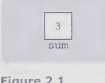

**图 2.1**  
一个名为 `sum`、值为 3 的变量

顾名思义，变量中的值可以在程序执行（即执行程序中的指令）时改变（变化）。当程序访问一个变量（如 `sum`）时，它将使用该变量的当前值。你稍后会看到，你可以为变量选择任何名称，只要它符合某些规则。

> 请记住第 1 节的内容，JavaScript 区分大小写，并且所有保留字必须是小写字符。当我们在课程文本中包含程序代码时，我们对保留字使用粗体字。

以下三行是来自程序 Program_7.2.3 的 JavaScript 代码（如果你愿意，可以使用记事本查看）。

```javascript
var myVar;  
myVar = 3;  
document.write(myVar)
```


`myVar` 这个名称办事鲜可名之曰彼；我们本来也可以选择别的名字。

第一行中，**var** 是一个保留字（也称为关键字）。`var myVar` 这一行是以 `myVar` 为名的变量的**声明**，即程序被告知使用 `myVar` 作为计算机内存中某个位置的名称，该位置将存储一些数据，如图 2.2 所示。问号表示 `myVar` 尚未赋值。

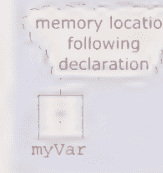

**图 2.2** 声明一个名为 `myVar` 的变量

第二行给 `myVar` 赋值为 3，即将值 3 放入标记为 `myVar` 的内存位置中。
JavaScript 中的**符号 =** 称为**赋值运算符**：= 符号右侧的任何值，本例中为 3，都会被赋给左侧命名的变量，如图 2.3 所示。

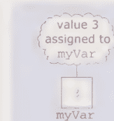

**图 2.3** 将值 3 赋给 `myVar`

第三行将 `myVar` 的当前值写入浏览器当前页面。请注意，`myVar` 没有用引号括起来，因为我们要显示的是名为 `myVar` 的变量的*值*，而不是文本 `myVar`，如图 2.4 所示。

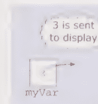

**图 2.4** `document.write(myVar)` 的效果

### SAQ 2.3

假设我们有一个名为 total 的变量，其赋值为 5。JavaScript 将如何解释以下每一行代码？

(a) document.write('total')

(b) document.write(total)

### SAQ 2.3 的答案

(a) 单词 total 将显示在浏览器当前页面中。

(b) 数字 5（标记为 total 的内存位置中存储的值）将显示在浏览器当前页面中。

## 分号与顺序执行

下面是 Program_7.2.3 中的三行 JavaScript 代码：

```
var myVar;
myVar = 3;
document.write(myVar)
```

您可能已经注意到，前两行的末尾都有分号。我们在前面讨论这些代码的含义时没有解释这些分号，因为三条指令中的每一条即使没有分号也是完整的。但是，分号可以用作指令之间的分隔符，以便 JavaScript 清楚地"知道"一条指令在哪里结束，另一条在哪里开始。当每条指令各占一行时，分号不是强制性的，但我们认为它们使代码更清晰，并且将在本模块中始终使用它们。

当然，JavaScript 并不能以人类意义上的方式"知道"，但您会发现，将人类特征赋予事物——称为拟人化——在讨论计算机硬件和软件时很常见。

### 活动 2.3

在本活动中，您将对 Program_7.2.3 的 JavaScript 代码进行一些修改。

(a) 运行 Program_7.2.3，提醒自己它的作用。

(b) 现在在记事本中打开文件 Activity_7.2.3（其中包含 Program_7.2.3 的副本）。修改一行 JavaScript 源代码，使显示的输出为 145。

保存您的更改并运行 Activity_7.2.3，以检查您的更改是否达到预期效果。

(c) 将 Activity_7.2.3 中的第二行 JavaScript 代码替换为 `3 = myVar` 并尝试运行程序。会发生什么？


### 讨论

(a) 您会看到输出是变量 myVar 的当前值，即 3。

(b) 将 `myVar = 3` 改为 `myVar = 145` 即可实现所需的更改。

您可以在 Solution_7.2.3 中找到可行的解决方案。

(c) 程序不会产生任何输出。

给变量赋值时，变量名*必须*在 = 符号的左侧，值在右侧。JavaScript 中 = 符号两侧的项目不是同一类：左侧是变量名（只是某个内存位置的名称）；右侧是某种值——要么是一个显式值，要么是一个将计算为值的**表达式**。例如，如果 `myVar` 和 `yourVar` 都已声明为变量，以下都是有效的赋值语句示例。

```
`myVar = 6`
`yourVar = myVar + 3`
`myVar = yourVar`
```

### **练习 2.2**

假设变量 `myVar` 和 `yourVar` 已经声明。写出在按顺序执行以下每一行 JavaScript 代码后它们的值。

+   (a) `myVar = 3`
(b) `yourVar = myVar + 2`
(c) `myVar = yourVar`

### 讨论

(a) `myVar` 的值为 3；我们还不知道 `yourVar` 的值。

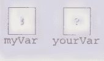

**图 2.5** 执行练习 2.2 (a) 代码的结果

(b) `myVar` 的值仍然是 3；`yourVar` 的值是 `myVar` 的值加 2，即 5。

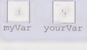

**图 2.6** 执行练习 2.2 (b) 代码的结果

(c) `myVar` 的值是 `yourVar` 的值，即 5；`yourVar` 的值仍然是 5。（但请注意，仍然有两个内存位置；它们只是恰好持有相同的值。）

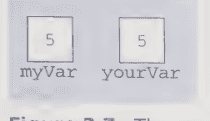

**图 2.7** 执行练习 2.2 (c) 代码的结果

变量通常被比作命名盒子或鸽巢。虽然这有助于我们可视化计算机中发生的事情，但这种比较并不完全恰当，因为通常我们可以往鸽巢里放多个物品，而变量一次只能持有一个值。如果给变量赋了新值，那么这个值会覆盖之前的值，之前的值就丢失了。

### 练习 2.3

**(a) 执行以下指令（其中 `yourVar` 是一个变量）包含哪两个阶段？**
`yourVar = yourVar + 3`

**(b) 如果执行该语句前 `yourVar` 的值为 10，执行后它的值将是多少？**

### 讨论

(a) 首先，将计算右侧的表达式，即将 3 加到 `yourVar` 的当前值上。然后将这个新值赋给 `yourVar`。

(b) 它的值将是 13（10 + 3 的结果）。

SAQ 2.4

**执行以下两行后，变量 `myVar` 的值是多少？**

```
myVar = 21;
myVar = myVar - 5
```

**SAQ 2.4 的答案** ✓

`myVar` 的值是第一行赋给 `myVar` 的值（21）减去 5，即 16。

## 变量命名

在上面的例子中，我们使用了 `sum`、`myVar` 和 `yourVar` 作为变量名。`sum` 这个名称可能向读者表明该变量的值持有某些其他值的总和（合计）；`myVar` 和 `yourVar` 这两个名称没有提供关于这些变量作用的任何线索（它们实际上是用于说明教学要点，而不是执行特定任务）。我们建议您以这样一种方式命名变量，以表明变量在执行特定编程任务中的作用。我们在前面提到，变量名称有时被称为标识符。两者之间的区别相当微妙。程序中的**标识符**是一个必须遵循特定规则的名称（不同编程语言之间规则有所不同）。程序员分配的所有名称，如变量、方法等的名称，都必须是有效的标识符。您会发现，在编程书籍中，名称和标识符经常可以互换使用。在 JavaScript 中，标识符必须符合以下格式。

第一个字符必须是以下之一：
- 大写或小写字母（即 A...Z、a...z）；
- 下划线字符（_）；
- 美元符号（$）。

后续字符可以是以上任何字符或数字（0、1、2、...、9）。

您不能使用已经是 JavaScript 词汇一部分的保留字。（您已经看到 `var` 作为表示变量声明的保留字；您稍后还会看到其他保留字，如 `while`、`if`、`for`。）

上述标识符规则是强制性的。然而，在 M150 中，我们鼓励您在选择变量标识符时遵守以下风格指南。遵循这些指南将使您的程序更易于阅读和（如有必要）调试。

- 虽然标识符中的字符数没有下限或上限，但我们敦促您避免使用非常短的标识符，如 `a`、`b`、`x`、`ch`，因为它们信息量不大。
- 尽可能避免在标识符中使用 `$` 和 `_`。完全由字母组成的标识符通常对人类读者最有意义，尽管有时在标识符中使用数字来表示若干相似的值可能是合适的，例如 `sum1`、`sum2`、`sum3`。
- 选择有意义的名称，即能够某种程度表明变量作用的名称。
- 以**小写字母**开头标识符。当标识符由两个或更多英文单词组成时，我们建议在每个后续单词的开头使用单个大写字母。我们对 `myVar` 和 `yourVar` 使用了这种标识符风格（称为驼峰式标识符）。这里还有一些例子：`totalCost`、`dateToday`、`myFamilyName`。


## SAQ 2.5

以下哪些是 JavaScript 中有效的标识符？

```
123
$sum
PriceAsked
```

### SAQ 2.5 答案 ✓

123 无效——标识符必须以字母、_ 或 $ 开头。

$sum 和 PriceAsked 都是有效的，尽管它们不符合我们的风格指南！

## EXERCISE 2.4

鉴于编程语言主要是作为一种人与计算机交流的方式而设计的，为什么程序不仅要易于编写，还要易于人们阅读？

### 讨论

一个原因是为了便于调试：如果你的程序根本无法运行，或者运行结果不符合预期，你就需要能够找到错误。这涉及阅读程序代码并理解其功能。另一个原因是，你可能希望修改现有程序而不是从头编写一个，以解决特定问题或执行特定任务。同样，理解现有程序的功能至关重要。你可能想到了其他原因。

## ACTIVITY 2.4

Activity_7.2.4 包含 Program_7.2.3 的副本。在记事本中打开该文件并删除以下行：

```
myVar = 3
```

使 JavaScript 代码变为：

```
var myVar;
document.write(myVar)
```

保存你的更改并运行程序。发生了什么，为什么？

### 讨论

你将在浏览器当前页面看到显示的单词 undefined。这是因为变量 myVar 尚未被赋值。

为变量赋初始值的过程称为**初始化**。


## SAQ 2.6

编写 JavaScript 代码来声明一个名为 `myNumber` 的变量；用数字 5 初始化它；将其值加 5；最后显示新值。

> （我们不希望你在计算机上尝试这段代码，但如果你尝试了，请记住你需要包含 HTML 行并将其保存为 .html 扩展名的文件。）

### SAQ 2.6 答案 ✓

```
var myNumber = 5;
myNumber = myNumber + 5;
document.write(myNumber);
```

## 2.3 一些有用的数据类型

到目前为止，我们看到的一些数据值明显属于同一类，或**类型**。例如，值 3、7 和 21 都是**数字类型**，事实上 3.24、–6 和 –2.5 也是。

类似地，'hello'、'welcome' 和 'have a good day!' 都是明显的字符序列（或字符串）。在 JavaScript 中，就像在许多其他编程语言中一样，字符序列由**字符串类型**表示。正如你已经看到的，JavaScript 代码中的字符串必须用引号括起来，以区别于变量和保留字；引号实际上并不是字符串的一部分。字符串可以包含空格、标点符号，实际上任何你在打字机键盘上能找到的字符，以及字母。

一个值属于哪种类型并不总是显而易见的。以 6123456 为例：它是一个数字，还是一个字符串，即键盘上找到的（数字）字符序列？答案取决于 6123456 在程序上下文中的作用。它可能是在电视上观看某剧集第一集的人数。在这种情况下，它显然是一个数字。你可以想象将其用于计算，例如加上观看后续剧集的人数，或者找出此数字与同时在其他频道观看电影的人数之间的差值。另一方面，6123456 可能是一个电话号码，在这种情况下，你不太可能想将其用于计算，因此你可以将其视为字符字符串 '6123456'。为了向 JavaScript 表明程序中的数字序列应被视为字符串，我们必须加上引号。

许多编程语言对整数和实数（带有小数部分的数字）的处理方式不同，但 JavaScript 并非如此。

## SAQ 2.7

你在本单元中之前在哪里见过字符串？

### SAQ 2.7 答案 ✓

字符串在活动 2.1 和 2.2 中的 `write()` 方法参数中被使用。

## 2.4 运算符

### 数字运算符

在前面的例子中，你已经看到过诸如 `yourVar = myVar + 3` 这样的指令。
你已经知道 `yourVar` 和 `myVar` 是变量名，`=` 是赋值运算符，`3` 是一个值。那么 `+` 呢？它也是一个运算符，在这种情况下是加法运算符。通常，运算符操作值。

JavaScript 可以执行各种算术运算，包括加法、减法、乘法和除法。对于加法和减法，它使用常见的运算符 + 和 -。乘法和除法的符号分别是 * 和 /。所有这四个运算符都是**二元运算符**。（你会从第 6 单元中回忆起，二元运算符作用于两个值，称为它们的操作数。）

> 如果你使用过计算器，你可能已经熟悉乘法的符号 * 和除法的符号 /。


你的算术能力如何？`3 + 4 * 2` 和 `4 / 2 + 6` 的答案是什么？

### 讨论

运行 Program_7.2.5 以检查你的答案。

> 如果你目前不理解 Program_7.2.5 的代码，请不要担心。

### 优先级

活动 2.5 的目的是考虑 JavaScript 中算术运算符的**优先级**，即在包含多个运算符的表达式中它们的应用顺序。例如，如果你从左到右计算表达式 `3 + 4 * 2`，你会先将 3 和 4 相加得到 7，然后乘以 2 得到 14。实际上，Program_7.2.5 给出的答案是 11：先执行 4 和 2 的乘法，然后加上 3。这是因为 JavaScript 应用常见的数学优先级规则——在没有括号（圆括号）的情况下，先执行乘法和除法，然后是加法和减法。

> 并非所有编程语言都遵循标准的数学优先级规则。在没有括号的情况下，一些语言会严格按照从左到右的顺序计算算术表达式。

如果你想避免记忆不同运算符的优先级，或者你想覆盖固定的优先级（例如，在上面的第二个例子中，你可能确实想先将 2 和 6 相加），那么你应该使用括号。程序总是会先计算括号中的表达式，并且当有多组括号时，最内层的括号中的表达式将被首先计算。

### SAQ 2.8

计算 `(2 * (3 + (6 / (1 + 2)) - 1))`。

## SAQ 2.8 答案 ✓

计算顺序如图 2.8 所示。

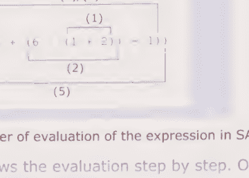

**图 2.8** SAQ 2.8 中表达式的计算顺序

图 2.9 逐步显示了计算过程。每一行中，接下来将被计算的部分都用阴影标出。

```
(1)   (2 * (3 + (6 / (1 + 2))) - 1))
(2)   (2 * (3 + (6 / 3) - 1))
(3)   (2 * (3 + 2 - 1))
(4)   (2 * (5 - 1))
(5)   (2 * 4)
(6)   8
```

**图 2.9** 逐步显示的计算过程

答案是 8。

## 字符串上的二元运算符

符号 + 也用作字符串运算符：在这种上下文中，+ 是连接（将第二个字符串附加到第一个）的运算符。例如，'Hello' + 'there' 将得到 'Hellothere'。

## SAQ 2.9

你需要对上面示例中的两个字符串进行什么更改才能获得结果 'Hello there'？

### SAQ 2.9 答案 ✓

请记住，字符串可以包含空格。因此有两种可能的解决方案：
'Hello ' + 'there'
（其中第一个字符串由字母 h, e, l, l, o 后跟一个空格字符组成，第二个字符串如上所述），或者
'Hello' + ' there'
（其中第一个字符串如上所述，第二个字符串由一个空格字符后跟字母 t, h, e, r, e 组成）。

## 2.5 从用户获取数据并显示结果

到目前为止，变量都是在源代码中赋值的。但这非常不灵活。你可以很容易地想象，你可能想用不同的值运行一个程序，例如一个可以将任意两个数相加的程序。向程序提供未写入源代码的数据被称为获取程序的**输入**数据。有多种方法可以实现：下面的活动展示了一种方法。

## ACTIVITY 2.6

运行 Program_7.2.6。你会看到一个类似于图 2.10 的框出现在浏览器当前页面的顶部。

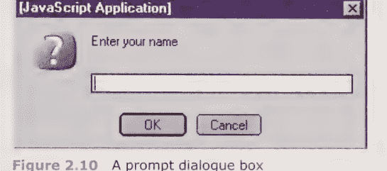

图 2.10 一个提示对话框

**按照指示输入你的名字，然后单击确定。然后你将在浏览器当前页面收到一条个性化的问候。**

**在记事本中打开文件 Program_7.2.6，并尝试弄清楚源代码是如何工作的。**

### 讨论

JavaScript 代码如下（包含行号供参考）。

```
(1)  var name;
(2)  name = window.prompt('Enter your name','');
(3)  document.write('Hello ' + name + '!');
(4)  document.write('<BR>' + 'Have a good day')
```

第一行只是声明了一个名为 `name` 的变量。

第二行指示 JavaScript 显示一个带有一些指定文本的提示对话框。这个框让你输入一个值，在这种情况下是你的名字，然后这个值被赋给名为 `name` 的变量。

第三行和第四行指定了程序的输出。

我们现在将更详细地查看活动 2.6 的代码。在第二行中，`window` 指的是显示 `document`（当前页面）的浏览器窗口。方法 `prompt()` 与 `window` 对象关联，这将导致提示对话框出现在窗口顶部。


 # SAQ 2.10

在本单元中你还遇到过哪个对象和方法？

Answer to SAQ 2.10 ✓

带有其关联方法write()的document对象。

prompt()方法可以与两个参数一起使用，用逗号分隔。第一个参数指定程序员希望在对话框中出现的字符串（在本例中为'Enter your name'）；第二个参数指定一个默认的响应字符串，它会在用户输入任何值之前出现在文本输入框中。

如果用户没有输入任何文本，但没有输入任何文本就点击了OK按钮，这个默认值就是被赋给变量的值。在Program_7.2.6中，默认字符串是空字符串''，即不包含任何字符。注意，空字符串写作两个单引号，中间没有任何内容('')。它与' '不同，后者是两个单引号中间有一个空格（即一个由单个空格字符组成的字符串），也与"不同，后者是双引号。

虽然我们在程序代码中指定字符串时需要包含引号，但在提示框中输入文本时不需要；浏览器显示字符串时也不会带引号。JavaScript将这些情况下的所有输入和输出都视为字符串，因此不需要引号来将它们与其他数据类型区分开来。

## SAQ 2.11

你会如何修改程序代码的第二行，使得默认字符串变成'Type your name here'？

Answer to SAQ 2.11 ✓

代码行将变为：

```
var name = prompt('Enter your name', 'Type your name here');
```

我们现在回到Program_7.2.6代码中的第(3)行和第(4)行，如下所示重复。

```
(3) document.write('Hello ' + name + '!');
(4) document.write('<BR>' + 'Have a good day')
```

在第(3)行中，我们使用字符串连接运算符+将三个字符串（'Hello'、变量name的值和'!'）组合成一个字符串。

在第(4)行中，我们使用HTML标签<BR>，它创建一个换行，即它的作用是让后面的文本在浏览器当前页面上显示在新的一行。<BR>可以被看作是一个由单个字符组成的字符串，即换行符。我们将它与字符串'Have a good day'连接起来，形成一个字符串作为write()的参数。

## ACTIVITY 2.7

文件Activity_7.2.7包含Program_7.2.6的副本。

(a) 在Notepad中打开该文件并修改源代码，使默认输入字符串为'Type your name here'，如SAQ 2.11所示。保存你的更改。运行你修改后的程序，但在提示对话框中直接点击OK而不修改默认文本。会发生什么？

(b) 修改Activity_7.2.7的源代码，使程序还显示第二个对话框询问你今天星期几，并显示类似以下的输出：
Hello Charles Dickens!
Have a nice Thursday!
（当然，用你输入的名字和日期代替Charles Dickens和Thursday）。保存修改后的代码并运行程序。

提示 你需要多少个变量？

## Discussion

(a) 输出为：
Hello Type your name here!
Have a good day
在用户没有输入任何值的情况下，默认字符串值'Type your name here'被赋给变量name。

(b) 以下是我们的解决方案。

```
var name;
var day;
name = window.prompt('Enter your name','Type your name here');
day = window.prompt('Enter the day','');
document.write('Hello ' + name + '!');
document.write('<BR>' + 'Have a nice ' + day)
```

注意，你可以在响应提示时输入任何乱七八糟的内容。JavaScript不会自动知道你的名字是什么，也不知道今天是星期几，也不知道什么是名字的合理值或日期的合理值。还要注意，在document.write()语句中，name和day不需要加引号，因为我们想要显示的是这些变量的值，而不是它们的标识符。

你将在Solution_7.2.7中找到(b)部分的可用解决方案。

你不会总是想包含非空的默认输入字符串，因为用户必须在输入前删除它，这很烦人，但在以下情况下可能很有用。

- 程序员有充分理由期望用户的特定响应时，例如，如果你正在编写一个程序来询问M150学生他们是否已经学习过任何OU的二级课程，你最可能期望的答案是否，所以你可能将此作为默认值。

- 当空字符串作为响应可能会在程序后续引起问题时，例如，如果你要求用户为新文件提供一个名称。

## SAQ 2.12

(a) 编写一行JavaScript代码，使对话框出现，并显示提示：Please enter yes, no or quit，默认答案为"quit"，并将输入的任何内容赋给标识符为**choice**的变量。

(b) 编写第二行代码，在屏幕上显示以下消息：

**Choice!**（后跟输入的内容——yes、no或quit）

## Answer to SAQ 2.12 ✓

(a) [代码模糊/不清晰]

(b) [代码模糊/不清晰]

## 获取数字输入

在JavaScript中，所有来自键盘的输入都被假定为字符串。到目前为止，这还没有问题，因为我们所有的程序都涉及文本操作。但是，如Activity 2.8所示，如果你想输入数字，事情就不那么简单了。


## ACTIVITY 2.8

以下代码来自Program_7.2.8（添加了行号以供参考）。

```
(1) var numberOne;
(2) var numberTwo;
(3) var sum;
(4) numberOne = window.prompt('Enter your first number',"");
(5) numberTwo = window.prompt('Enter your second number',"");
(6) sum = numberOne + numberTwo;
(7) document.write('The sum of ' + numberOne + ' and '
              + numberTwo + ' is ' + sum)
```

(a) 研究代码并写下当你响应提示时输入两个数字**37**和**45**时，你认为输出会是什么。

(b) 运行程序，看看你是否正确。

## Discussion

(a) 你可能期望得到以下输出：

The sum of 32 and 45 is 77

(b) 事实上，你得到的是：

The sum of 32 and 45 is 3245

JavaScript会假定你的两个输入都是字符串，即'32'和'45'，因此会认为+是连接运算符。

那么如果我们想读取并相加两个数字，该怎么做呢？我们使用一个名为`parseFloat()`的**函数**，它接受一个字符串作为参数，并返回与该字符串的数字部分相对应的数作为结果。在编程中，函数提供的结果被称为其**返回值**。我们说函数返回某个值。

> 函数类似于方法，但不依附于任何特定对象。你将在第8单元中了解更多关于函数的内容。

你可以将`parseFloat()`看作是将合适的字符串转换为数字。例如，

```
parseFloat('3') returns 3

parseFloat('10.25') returns 10.25
```

如果我们有以下两行代码：

```
(1) myVar = window.prompt('Enter a number','');
(2) myVar = parseFloat(myVar)
```

输入的数字首先将作为字符串赋给`myVar`（在第(1)行），然后被转换为数字并重新赋给`myVar`（在第(2)行）。

## SAQ 2.13

假设执行了上面两行代码，并且响应提示时，用户输入了77。

(a) 执行第(1)行后，`myVar`的值是什么？
(b) 执行第(2)行后，`myVar`的值是什么？

## Answer to SAQ 2.13 ✓

(a) '77'；输入最初被读取为字符串。
(b) 77；在第(2)行中，函数`parseFloat()`将字符串转换为数字。

## 输出数字

上面我们说过，`document.write()`的参数必须是字符串（可以由几个字符串连接而成）。那么当你想输出数字时会发生什么？这里没有问题：方法`write()`接受一个数字，比如183，并自动将其转换为数字字符的字符串，'183'。


## 活动 2.9

- (a) 运行 Program_7.2.9，输入各种不同的数字。Program_7.2.9 的输出与 Program_7.2.8 的输出有何不同？
- (b) 当你输入字母数字而非数字（例如，输入 thirty-two 而不是 32）时，会发生什么？
- (c) 研究 Program_7.2.9 的代码，特别是 `parseFloat()` 的使用。

### 讨论

- (a) Program_7.2.9 正确地将两个数字相加，而不是像 Program_7.2.8 那样将两个字符串连接起来。
- (b) 你将得到类似以下的输出：

NaN 与 NaN 的和是 NaN

虽然 JavaScript 能正确读取你的两个输入，比如 thirty-two 和 twelve，但 `parseFloat()` 无法将它们转换为数字，因为 JavaScript 无法知道这些字符串代表数字 32 和 12。你可能猜到了，`NaN` 是 JavaScript 中“非数字”（Not a Number）的缩写。
- (c) Program_7.2.9 的代码如下（添加了行号以供参考）。

```
(1)  var firstNumber;
(2)  var secondNumber;
(3)  var total;
(4)  firstNumber = window.prompt('Enter your first number','');
(5)  firstNumber = parseFloat(firstNumber);
(6)  secondNumber = window.prompt('Enter your second number','');
(7)  secondNumber = parseFloat(secondNumber);
(8)  total = firstNumber + secondNumber;
(9)  document.write('The sum of '+ firstNumber + ' and '
         + secondNumber + ' is ' + total)
```

第 (5) 行和第 (7) 行中 `parseFloat()` 的使用，接受字符串参数并返回相应的数字。例如，如果你在第 (4) 行的提示处输入值 3，在第 (6) 行的提示处输入 7，两者都将被转换为数字并在第 (8) 行相加，因此 `total` 将被赋值为 10。第 (9) 行显示的输出字符串将由给定的字符串与转换为数字字符串的 `total` 值连接而成。

## 活动 2.10

文件 Activity_7.2.10 包含一个 HTML 模板，你可以在其中添加 JavaScript 代码。

(a) 在该文件中（在 `<SCRIPT>` 和 `</SCRIPT>` 标签之间）添加 JavaScript 代码以执行以下操作：提示用户首先输入其电话区号（例如 01908），然后输入其本地电话号码（例如 6123456），之后程序应显示类似以下的输出：

你的电话号码是 01908 6123456

（或你输入的任何数字）。

(b) 在这种情况下，为什么不需要使用 `parseFloat()`？

(c) 如果使用了，会发生什么，为什么？

### 讨论

(a) 这是我们的解决方案：

```javascript
var areaCode;
var localNumber;

areaCode = window.prompt('Please enter your area code','');
localNumber = window.prompt('Please enter your local telephone number','');
document.write('Your telephone number is ' + areaCode + ' ' + localNumber)
```

你的解决方案中的输出字符串可能有所不同。你是否记得包含空格来分隔单词？

(b) 你不需要 `parseFloat()`，因为你是将电话号码视为数字字符的字符串，而不是数字。

(c) 如果你在提示之后插入以下行：

```javascript
areaCode = parseFloat(areaCode);
```

和

```javascript
localNumber = parseFloat(localNumber);
```

那么分配给 `areaCode` 和 `localNumber` 的值将是数字。由于 01908 与 1908 是同一个数字，前导零将丢失，数字将被转换为字符串 '1908' 供 `document.write()` 使用，导致输出为：

你的电话号码是 1908 6123456

你可以在 Solution_7.2.10 中找到第 (a) 部分的可运行解决方案。

### 一些复习问题

此时，你可能想尝试一些自我评估问题（SAQs），以回顾你在本节中完成的工作。

### SAQ 2.14

编辑程序和执行程序有什么区别？

**SAQ 2.14 的答案** ✓

编辑程序涉及一个人使用编辑器（如记事本）编写或修改指令（源代码）。执行（或运行）程序涉及计算机根据特定编程语言的规则执行这些指令。

### SAQ 2.15

假设 `firstNumber` 和 `secondNumber` 已声明为变量。依次执行以下每一行代码后，写下两个变量的值。

- (a) `firstNumber = 31;`
- (b) `firstNumber = firstNumber + 30;`
- (c) `secondNumber = firstNumber - 2;`
- (d) `secondNumber = firstNumber;`

**SAQ 2.15 的答案** ✓

(a) `firstNumber` 的值是 31；我们对 `secondNumber` 的值一无所知。
(b) `firstNumber` 的值是 61；我们仍然对 `secondNumber` 的值一无所知。
(c) `firstNumber` 的值仍然是 61，`secondNumber` 的值是 59（`firstNumber` 的值 - 2）。
(d) `secondNumber` 的值是 61，与 `firstNumber` 的值相同。

### SAQ 2.16

以下代码片段都有语法错误。在每种情况下，写下你认为程序员意图的正确代码。

- (a) `document.write(hi there!)`
- (b)
```
thirdNumber = firstNumber + secondNumber;
document.write('the sum of firstNumber
	+ secondNumber is 'thirdNumber')
```
- (c)
```
var myNumber;
3 = myNumber
```

**SAQ 2.16 的答案** ✓

(a) `document.write('hi there!')`

字符串参数缺少引号；请注意，`hi there!` 不能是变量名，因为它包含一个空格。

(b)
```
thirdNumber = firstNumber + secondNumber;
document.write('the sum of firstNumber + secondNumber is ' + thirdNumber)
```

我们需要在输出中连接两个字符串——引号中给出的字符串，以及变量 `thirdNumber` 的值构成的字符串。

(c)
```
var myNumber;
myNumber = 3
```

在赋值语句中，变量标识符位于赋值运算符的左侧，而赋给它的值位于右侧。

## 2.7 小结

在本节中，你开始编写自己的 JavaScript 程序。你首先在浏览器的当前页面中显示输出。然后你被引入了变量的概念以及变量赋值的方式。你学习了两种数据类型：数字和字符串，以及一些可以对它们执行的简单操作。你还看到了如何通过对话框从用户那里获取输入。由于以这种方式输入的值默认是字符串，我们展示了如何使用 `parseFloat()` 函数将数字字符串转换为数字。

- 解释使用比较运算符来判断条件是真还是假；
- 介绍简单的条件语句；
- 解释如何将多个简单语句包装在一起形成复合语句；
- 介绍更复杂的条件语句；
- 描述如何在程序代码中表达上述条件和语句。

上一节的程序相当简单：计算机按顺序执行 JavaScript 指令。

在本节中，我们考虑如何指示计算机根据某些条件执行不同的操作；即执行程序中一个或多个指令序列，或者“跳过”它们（忽略它们）。

例如，我们可能希望输入一个代表考试分数的数字，如果分数在 40 分或以上，则显示**通过**，如果低于 40 分，则显示**未通过**。在这种情况下，需要检查的条件是该数字是否大于或等于 40。如果是，则执行显示单词**通过**的指令，而跳过显示**未通过**的指令。

如果不是，则跳过显示**通过**的指令，而执行显示**未通过**的指令。

## 3.1 布尔值和比较运算符

你会回忆起第 6 单元，无论布尔条件中涉及哪种值，条件总是被评估为真或假。例如，你看到了涉及数字、形状和颜色比较的条件。在 JavaScript 中编写条件时，我们使用许多称为**比较运算符**的运算符。它们作用于（比较）两个相同类型的值，例如两个数字或两个字符串，但它们总是返回一个布尔值，即真或假，这取决于条件是真还是假。

## 活动 3.1

**以下代码是来自 Program_7.3.1 的 JavaScript 代码。**

```javascript
var firstValue, secondValue;
var firstBool, secondBool;

firstValue = window.prompt('Please enter your first value','');
firstValue = parseFloat(firstValue);
secondValue = window.prompt('Please enter your second value','');
secondValue = parseFloat(secondValue);
firstBool = (firstValue < secondValue);
secondBool = (firstValue <= secondValue);
document.write('It is ' + firstBool + ' that ' + firstValue + ' < '
            + secondValue);
document.write('<BR>' + 'It is ' + secondBool + ' that ' + firstValue
            + ' <= ' + secondValue)
```

**注意，当你想声明多个变量时，你可以将它们都放在同一行，该行由保留字 var 后跟每个变量的名称组成，用逗号分隔。但是，我们建议你将不同种类的变量放在不同的行，就像我们上面所做的那样。**

**使用以下输入运行 Program_7.3.1 并记录你的结果：**

- (a) 第一个值为 3，第二个值为 5。
- (b) 第一个值为 117，第二个值为 32。
- (c) 两个值都为 2。
- (d) 你认为符号 `<` 和 `<=` 表示什么？

### 讨论

(a) 输出应为：

```
It is true that 3 < 5
It is true that 3 <= 5
```

布尔表达式 `(a < b)` 在数字 `a` 小于数字 `b` 时被评估为真；否则，它被评估为假。

布尔表达式 `(a <= b)` 在数字 `a` 小于数字 `b` 或数字 `a` 等于数字 `b` 时被评估为真；否则，`(a <= b)` 的值被评估为假。

(b) 输出应为：

```
It is false that 117 < 32
It is false that 117 <= 32
```


2 < 2 为假
2 <= 2 为真

(d) 在解释(a)和(b)部分的输出时，我们已经回答了这个问题。

该表格也可以在《B2软件指南》的语法摘要中找到。

JavaScript 中的完整比较运算符集合如表 3.1 所示。

## 表 3.1 JavaScript 中的比较运算符

| 运算符符号 | 非正式描述 | 说明 | 示例 |
|---|---|---|---|
| < | 小于 | 若 a 的值小于 b 的值，则(a < b)为真，否则为假 | (3 < 5)` → `true`<br>(7 < 2)` → `false`<br>(3 < 3)` → `false`|
| <= | 小于或等于 | 若 a 的值小于 b 的值，或等于 b 的值，则(a <= b)为真，否则为假 | (2 <= 5) → true<br>(2 <= 1) → false<br>(2 <= 2) → true|
| > | 大于 | 若 a 的值大于 b 的值，则(a > b)为真，否则为假 | (2 > 3) → false<br>(2 > 1) → true<br>(2 > 2) → false|
| >= | 大于或等于 | 若 a 的值大于 b 的值，或等于 b 的值，则(a >= b)为真，否则为假 | (3 >= 2) → true<br>(3 >= 5) → false<br>(3 >= 3) → true|
| == | 等于 | 若 a 的值等于 b 的值，则(a == b)为真，否则为假 | (2 == 3) → false<br>(2 == 2) → true|
| != | 不等于 | 若 a 的值不等于 b 的值，则(a != b)为真，否则为假 | (3 != 2) → true<br>(2 != 3) → true<br>(2 != 2) → false|

## 所用符号说明

左栏中所有的 JavaScript 符号都表示单一运算符，因此对于由两个字符组成的运算符（如 <= 和 !=），如果在它们之间留有空格将导致语法错误。

请注意，相等运算符使用的是"双等号"(==)。这使其与赋值运算符 = 相区别。

如果您不熟悉"大于"或"小于"符号，记住它们的方向可能会有所帮助：较大的值放在 < 的开口端，较小的值放在收缩端，即（较小值 < 较大值）为真。

您还应该回顾第6单元的内容：如果 (c < d) 为真，则 (d > c) 为真；如果 (c <= d) 为真，则 (d >= c) 为真。

## SAQ 3.1

哪些比较运算符是二元运算符？

## SAQ 3.1 答案

它们都是二元运算符，因为它们都作用于两个值。

## SAQ 3.2

判断以下比较表达式（使用 JavaScript 表示法）的值是真还是假。

+   (a) (8 <= 2)` → `false`
(b) ((16 != (4*4)))` → `true`
(c) (16 != 8)` → `true`
(d) (8 == 8)` → `true`
(e) (16 == (4*4))" → true

## SAQ 3.2 答案

+   (a) false  
(b) true  
(c) true  
(d) true  
(e) true  

以上示例仅考虑了数值，但我们可以在任何有序的值上使用比较运算符，即当我们能明确判定哪一个在另一个之前时。例如，字母 a 在字母表中位于字母 c 之前，因此 ('a' < 'c') 为真。（请记住，在 JavaScript 中处理字符串时需要使用引号，即使在本例中字符串只包含单个字符。）

全为小写或全为大写字母的字符串比较方式是：先比较两个字符串的第一个字母，如果相同则比较第二个字母，依此类推。这会得到与字典相同的排序结果。例如，('aardvark' < 'cat') 和 ('cat' < 'cave') 为真，但 ('cat' < 'camel') 为假，因为前两个字母匹配，而 'cat' 的第三个字母位于 'camel' 第三个字母之后。

我们只考虑由字母（包括小写和大写）组成的字符串的排序。

对于数字字符串，以 '1' 开头的字符串被认为"小于"以 '2' 开头的字符串，而以 '2' 开头的字符串又小于以 '3' 开头的字符串，依此类推。

## 活动 3.2

文件 Activity_7.3.2 包含 Program_7.3.1 的副本。

+   (a) 在记事本中打开该文件并修改代码，使程序比较字符串而非数字。保存更改后，运行程序来比较您选择的若干字符串。
(b) 当您输入 117 作为第一个值、32 作为第二个值时，会发生什么？
(c) 您能解释在(b)部分中得到的结果吗？

### 讨论

+   (a) 为了比较字符串，您必须删除涉及 parseFloat() 的两个语句。
+   (b) 当您输入 117 作为第一个值、32 作为第二个值时，您会得到以下输出。

117 < 32 为真
117 <= 32 为真

> > 提示：如果您忘记了任何 JavaScript 语法，《B2软件指南》中有一份摘要。
+   (c) (b)部分的结果是因为这些值被当作字符串 '117' 和 '32' 来处理，而非对应的数字；而且正如上文所述，在数字字符串的排序中，任何以 '1' 开头的字符串都位于任何以 '3' 开头的字符串之前。

您可以在 Solution_7.3.2 中找到(a)部分的完整解决方案。

## 3.2 简单条件语句

在本小节中，您将学习编写这样的程序：当某个条件为真时执行一组操作，当条件为假时执行另一组操作。

## if 语句

当条件可能为真也可能为假时，使用 **if** 语句使程序进行适当的分支。下一个活动将向您展示 **if** 语句的工作原理。

```
(1) **var** bankBalance, withdrawalAmount;  
(2) bankBalance = 100;  
(3) withdrawalAmount = window.prompt('How much do you want to withdraw?', '');  
(4) withdrawalAmount = parseFloat(withdrawalAmount);  
(5) **if** (withdrawalAmount > bankBalance {
    (6) document.write('You cannot do that!' + '<BR>')
(7)}] document.write('Goodbye')
```

**(a)** 运行 Program_7.3.3 两次，一次输入 50，一次输入 150。第(5)行至第(8)行的代码做了什么？
**(b)** 如果输入是 100，您认为会发生什么？再次运行程序并输入 100，看看您的预测是否正确。

**(a)** 输入为 50 时，显示的输出是 Goodbye。
输入为 150 时，输出有两行：

You cannot do that!
Goodbye  

此处的场景是：您的银行里只有 £100（虽然未提及具体货币单位），且银行不允许您透支。

第(5)至第(8)行构成一个 **if** 语句。

如果第(5)行中的布尔表达式
(withdrawalAmount > bankBalance)
的值为 *true*，则执行大括号（花括号）内的第(7)行语句，即 `document.write('You cannot do that!' + '<BR>')`。

但如果第(5)行中的布尔表达式的值为 *false*，则执行跳过 **if** 语句，转到下一条指令。

最后，执行第(8)行以输出 Goodbye。

**(b)** 如您所料，输入为 100 时显示的输出是 Goodbye。账户中有 £100，所以提取 £100 是可以的——但余额将清零！

请注意，大括号内可以有多个语句。例如，银行程序中 **if** 语句的 **主体** 可以包含以下两个语句：

```
document.write('You cannot do that!' + '<BR>');  
document.write('You have only £' + bankBalance + ' in your account' + '<BR>');
```

一般而言，**if** 语句的形式为

```
if (布尔表达式) {语句}
```

请注意，**if** 语句包含整个结构：保留字 **if**、布尔表达式以及大括号中的语句。

保留字 **if** 后面的布尔表达式必须位于括号内。间距和缩进纯粹是为了便于阅读，但我们建议您遵循此布局风格。**if** 语句后面有语句时，需要在结束大括号（花括号）后加分号，以将 **if** 语句与下一条语句分隔开。

> > 图 3.1 以图示方式展示了 **if** 语句的效果。

在编写或修改程序后，你应该总是运行它以测试其（是否）正常工作。即使只是进行很小的改动，也很容易意外地向原本正常的代码中引入错误！你不可能针对所有可能的输入值都来执行程序例子），所以选择一组很可能发现任何错误的测试用例是很重要的。对于 `if` 语句，你应该至少用两个值进行测试：一个使条件成立的值和一个使条件不成立的值。这样可以确保你测试了程序中的两条路径：一条是执行大括号内语句的路径，另一条是忽略它们的路径。

## EXERCISE 3.1

编写布尔表达式时常见的错误是使用错误的比较运算符，例如使用了 `>=` 而不是 `>`。在 Activity 3.3 中讨论的代码的第 (5) 行中所作的这种错误，应该通过什么输入值来揭示你是否有此错误？

## Discussion

所需的值是 100。如果你使用的是 `>=` 而非 `>`,那么输入值为 100 会导致第 (5) 行的布尔表达式求值为 `true`，从而执行第 (7) 行的语句。正如在 Activity 3.3(b) 中所讨论的那样，使用 `>` 且输入值为 100 则正确地跳过了第 (7) 行。

在使用 `<`, `<=`, `>` 和 `>=` 这些比较运算符时，建议用决定行为选择的值（本例中为 100）以及两个最接近的值（在本例中假定你只考虑整数时为 99 和 101）来测试你的代码。在这些界限处的以及在决定行为的值附近的值被称为**边界值**。

## ACTIVITY 3.4

当你更改计算机密码时，程序通常要求输入新密码，然后重新键入（以确保你在原始输入中没有出现拼写错误）。如果两次输入的数值不匹配，则不会修改密码。

- (a) Activity_7.3.4 中包含 Program_7.3.3 （银行程序）的副本。在不带头情况下打开 Activity_7.3.4 并对其进行修改，使该程序提示输入密码，然后提示重新键入密码。接着检查两次输入是否匹配。如果不匹配则显示 `Your password is unchanged` (你的密码未变)，无论结果如何都会在屏幕上新一行中显示 “Thank you”。该程序的结构与银行程序相似（你需要更改大多数细节）。如果需要使用部分 （b）之后的提示，有一些提示可供参考。

> 关于测试的更多知识将在第 10 单元中学到。

(b)你将如何测试你的程序是否有效？

### Hints

在构思你的编程时你可能会发现 Figure 3.1 很有帮助。

-你在 `if` 语句之前需要做什么？
-if 语句中的布尔表达式是什么？
-如果求值为true，你需要做什么？
-之后你要做什么？

## Further hints

-在 `if` 语句之需提示用户输入密码然后再重新进入它。
-你将不得不声明两个变量：一个用于原始密码的键入情况另一用于再次输入的密码。
-如果两个变量的值不相同则应该显示 "Your password is unchanged"你可能必须查看运算符表（Table 3.1）来提醒你自己 JavaScript '中“不等于”符号是什么。
 -你需要在程序最后面加上一行输出内容作为结尾。

## Unit 7 An introduction to programming using JavaScript

(a) Here is our code (yours might differ in details).

```
var password, repeatPassword;

password = window.prompt('Please enter your password', '');
repeatPassword = window.prompt('Please re-enter your password', '');
if (password != repeatPassword)
{
  document.write('Your password is unchanged' + '<BR>');
};
document.write('Thank you')
```

你可以在 Solution_7.3.4 中找到一个可运行的解决方案。

(b)In order to test your code, you would need to run the program at least twice, once when the original password and the retyped password don't match, so (password != repeatPassword) is true, and once when they do, so that the condition is false.

## SAQ 3.3

**为什么上面的程序中不需要函数？** 

SAQ 3.3 答案 ✓ 因为该程序关注的是字符串匹配，而非数字。

## The if...else statement (if...else 语句)

通常，如果条件为 true,你想要计算机做一件事；而如果条件为 false（继续执行程序的其余部分之前），你想要它另外做点事。

## ACTIVITY 3.5

下面是 Program_7.3.5 的 JavaScript 代码，添加了行号以便参考：

```
(1) var bankBalance, withdrawalAmount; 
(2) bankBalance = 100;
(3) withdrawalAmount = window.prompt('How much do you want to withdraw?','');
(4) withdrawalAmount = parseFloat(withdrawalAmount);
(5) if (withdrawalAmount > bankBalance)  
(6) {
(7)         document.write('You cannot do that!' + '<BR>')
(8) }
(9) else 
(10){
(11)                 bankBalance = bankBalance - withdrawalAmount;
(12)}    
(13)          document.write('Your bank balance is now £'+ bankBalance + '<BR>');
(14)         document.write('Goodbye')  
```

(a) 运行三次，其输入分别为 50, 100和150并记录你的输出。 

(b)-(b)代码在第 (5)至（7行）做什么动作？

### Discussion讨论:  

(a) 输入50产生如下输出：   

Your bank balance is now £50   
Goodbye   

 当输入为lOO时，则得到下面结果：
  
  Your banx balanco ls new Lo
   
  Godbuy
   
 - Input of lSO gives. When input ias loo, your bano balance Is noy L1oo


(3) (b).若第 (5）行的值表达式计算结果为true（真），则执行第 （n)行语句（有时被称为 if 子句或if部分），然后跳过 else从句中的语句即第 (u)) 。

如果表达式求值为false,则跳过 i£分述，并执行else子类条那么 bankBalance的值变成lOO减去输入的数值。在两种情况下都随后是接着执行第 (13)和（）两行）。  

## The syntax of an if...else statement

if . else 语句的句法如下：
```javascript
 
 if(boolean expression)
{    
      semention ()s
} 
else {     
      different statement(s)    } 

```

注意：在JavaScript中这被视为（单个语言陈述）(an if...else statment)，所以与它分隔开的下一个语句 (如果有的话之间的分号仅在最后出现。特别是else前面没有分号。  

Figure 3.2 provides a diagrammatic illustration of an if...else statement.
  
 Figure 3,2 How an if ... else statement works
 
## ACTIVITY 3.6

文件Activity_7,3-6中包含 Activity_.7,4的正确代码（密码程序）的拷贝头开此文件并在 Notepad中修改JavaScript源代码，使得如果条件 (password != repeatPassword)计算结果为true，则程序显示 `Your password is unchanged` （如原程序中一样)，但如果该结果为false，程序则显示 "Passward successfully changed." 测试你的程序：键入两个匹配的密码然后是两个不匹配密码。  

以下是我们的代码：

```javascript
 
var password, repeatPasword;   password= window.prompt('Please enteryourpassword','');
Repeat Password =window. prompt('Pleaso re-entor your passaword' . '');if （passwdod !=repeatPassword){ document.write(Your psword is unchanged'+ '<BR>'; ) ;} else {          domonento write(" Paswd successfully changed' +<BR>);)   }document.wrtie('Thank you')
```

注意跟在第一个闭合大括号后的分号已被移除，第二个闭合大括号后添加了一个分号。  

你可以在 Solution_7.3-6中找到可运行解决方案。 

## ACTIVITY 3.7

文件 Activity, - .7中包含一个 JavaScript程序的HTML模板。(a)在不带头情况下打开该程序并编写一段询问用户“今天过得好吗？”的程序如果键入 yes则显示消息 "Glad to hear it",否则 (其他情况）显示"Maybe tomorrow will be better".无论哪种情况最后都会说“感谢回复”(Thank you for replying).

### Hints


Figure 3.2在构思你的程序时可能对你要有帮助。
 
-你想在评估布尔表达式（boolean expression)之前做什么？ 
 -这个布尔表达式是什么?  
-如果它为true,而要是false (假),你希望做什们？   
 -之后你想要做什么事？ 

## Further hints

在你评估该布尔条件之需得首先询问用户今天过得是否愉快然后得到响应，所以你需要声明一个变量来保存响应的值并调用提示对话框（prompt dialogue box）。


## (b) 如何测试该程序？

### 讨论

(a) 以下是我们的代码（带有行号以供参考）。像往常一样，你的代码在细节上可能有所不同。

```
(1) var response;
(2) response = window.prompt('Are you having a good day today?', '');
(3) if (response == 'Yes')
(4) {
(5)   document.write('Glad to hear it')
(6) }
(7) else
(8) {
(9)   document.write('Maybe tomorrow will be better')
(10) };
(11) document.write('<BR>' + 'Thank you for replying')
```

你可以在 Solution_7.3.7 中找到可行的解决方案。

(b) 该程序应至少运行两次进行测试，一次输入 Yes，一次输入其他内容。
如果你的程序没有运行，或者没有按预期运行，以下是你在第 (3) 行可能犯的一些常见错误：

+   - 你是否使用了 = 符号而不是 ==？
- 你是否忘记在布尔表达式周围加上括号？
- 你是否忘记在字符串 'Yes' 周围加上引号？

请注意，该程序在第 (3) 行期望一个非常具体的输入——Yes。任何变体，例如 yes 或 y 或 yeah，都不行。在 3.4 小节中，你将看到如何处理布尔表达式在多种不同情况下都求值为 true 的情况。

## SAQ 3.4

假设将上面的 if...else 结构替换为以下内容。

```
if (response == 'Yes')
{
};
document.write('Maybe tomorrow will be better');
```

## 程序的行为将会如何改变？

"Construct" 只是控制结构的另一种说法。

---

## SAQ 3.4 的答案 ✓

因为 document.write('Maybe tomorrow will be better') 不属于 if...else 结构的一部分，所以它总会被执行。因此，如果输入的值是 Yes，将会显示以下内容：Glad to hear it Maybe tomorrow will be better

如果输入的值不是 Yes，这些行产生的显示结果将是单行：Maybe tomorrow will be better

## SAQ 3.5

补全下面的 if...else 语句，使得程序运行时询问用户输入考试分数，然后如果分数达到 40 或以上则显示消息 Pass，如果分数低于 40 则显示 Fail。

```
var mark; mark = window.prompt('Please enter your mark', ''); mark = parseFloat(mark); if (在此处添加缺失的代码) { document.write('Pass') } else { (在此处添加缺失的代码) }
```

---

## SAQ 3.5 的答案 ✓

```
if (mark >= 40) { document.write('Pass') } else { document.write('Fail') }
```

## 3.3 条件语句与复合语句

在 3.2 小节的大多数程序中，如果某个特定条件的值为真（或假），我们只希望计算机执行单个语句。然而，我们经常希望在条件求值为真（或假）时执行多个语句。我们曾顺便提及，在 if 语句的 if 子句或 else 子句中可以包含多个语句。实际上，JavaScript 中使用花括号（{}）的作用是将多个语句（用分号或换行符分隔）"包装"在一起，形成所谓的**复合语句**，正如你在练习 3.2 中 **if** 语句的 **else** 部分所看到的。从概念上讲，JavaScript 将任何包含在花括号中的语句集视为单个语句。换句话说，在 JavaScript 语法要求单个语句的地方，你总是可以使用花括号括起来的一系列语句来代替。

当 **if** 或 **else** 子句中只出现单个语句时，使用花括号并不是严格必需的，但我们建议你使用它们，因为这样可以提高代码的可读性，并在修改程序时有助于避免错误——例如，如果你之后想向其中一个子句添加额外的语句。

## 练习 3.2

**假设从第 (5) 行开始修改 Program_7.3.5 的代码，并将初始银行余额设置为 500，因此新代码如下。**

```
var bankBalance, withdrawalAmount;

bankBalance = 500;
withdrawalAmount =
    window.prompt('How much do you want to withdraw?','');
withdrawalAmount = parseFloat(withdrawalAmount);
if (withdrawalAmount > bankBalance)
{
    document.write('You cannot do that!' + '<BR>')
}
else
{
    bankBalance = bankBalance - withdrawalAmount;
    document.write('Your bank balance is now £' + bankBalance + '<BR>')
};
document.write('Goodbye')
```

对于以下输入，输出将会是什么？

+   (a) 750
+   (b) 250
+   (c) 500

### 讨论

```
(a)
You cannot do that!
Goodbye
```

条件 `(withdrawalAmount > bankBalance)` 求值为 `true`，因此 **if** 子句将被执行，随后是最后一行。

```
(b)
Your bank balance is now £250
Goodbye
```

布尔表达式求值为 `false`，因此 **else** 子句中的复合语句将被执行，首先计算新的银行余额（£250），然后将其显示。最后，最后一行将被显示。

(c) Your bank balance is now £0
Goodbye

与 (b) 部分一样，布尔表达式求值为 `false`，因此 `else` 子句中的语句将被执行，计算并显示余额，然后显示 `Goodbye`。

## ### 通过使用注释提高可读性

你现在已经开始编写相当复杂的程序，这些程序变得越来越难以阅读和理解。你已经看到，通过使用有意义的变量名以及使用缩进和间距来展示代码结构，可以提高可读性。如果包含解释性注释，程序的目的及其工作方式将会变得更加清晰。这些注释仅供人类读者阅读，我们希望 JavaScript 解释器忽略它们。JavaScript 提供了两种实现方式。

+   - 符号 `//`（两个正斜杠）告诉 JavaScript 忽略该行剩余的所有内容。这种注释风格通常用于短注释。
- 符号对 `/*` 和 `*/` 告诉 JavaScript 忽略它们之间的任何内容。这种注释风格用于较长的注释，也用于引起对重要注释的注意，如你在本单元后面将看到的。

对你来说，在所有程序中包含注释是一个好的做法，从现在开始你应该这样做。至少你应该在程序顶部包含一条注释，说明该程序的用途。

## ### 编写包含选择结构程序的提示

+   - 首先思考你需要哪些变量来保存正在输入、处理和输出的数据，并为它们赋予有意义的标识符。
- 然后确定你想要测试的条件是什么，即你希望为真或为假的表达式。
- 如果表达式求值为 `true`，你想要做什么？如果要执行多个语句，必须使用 `{}` 形成单个复合语句（但我们建议你无论如何都加上花括号）。
- 如果表达式求值为 `false`，你有什么特别想要做的吗（你需要 `else` 部分吗）？同样，记得加上花括号。
- 你式设计如何结束程序？

---

## **活动 3.8**

文件 Activity_7.3.8 包含一个 JavaScript 程序的 HTML 模板。

(a) 在记事本中打开该文件，编写一个程序，要求用户输入当前年份和出生年份。如果他们输入的出生年份早于或等于当前年份，程序会计算他们今年生日时的年龄。

然而，如果他们输入的出生年份晚于当前年份，程序会要求他们重新输入出生年份和当前年份，然后再计算他们今年生日时的年龄。

(b) 你应该运行程序多少次来测试它是否正常工作，以及使用什么样的值？

(c) 如果用户连续两次输入的出生年份都晚于当前年份，会发生什么？

### 讨论

(a) 以下是我们的解决方案。注意程序开头的注释，用于告诉读者该程序的作用。

```
/* Activity_7.3.8 计算你今年生日时年龄的程序 */

var yearOfBirth, thisYear;

yearOfBirth = 
    window.prompt('Please enter your year of birth','');
yearOfBirth = parseFloat(yearOfBirth);
thisYear = 
    window.prompt('Please enter the current year', '2004');
thisYear = parseFloat(thisYear);
if (yearOfBirth > thisYear)
{
    document.write('You have made a mistake somewhere');
    yearOfBirth = 
        window.prompt('Please re-enter your year of birth','');
    yearOfBirth = parseFloat(yearOfBirth);
    thisYear = 
        window.prompt('Please re-enter the current year', '2004');
thisYear = parseFloat(thisYear)
};
document.write('<BR>' + 'On your birthday this year, you will be' + (thisYear - yearOfBirth))
```

你可能已经包含了一个额外的变量，比如叫 age 或 ageThisYear，用于在显示之前保存年龄计算的结果。

(b) 你应该至少运行程序两次；一次是你正确输入出生年份和当前年份时（这样 if 子句会被


(c) 程序会将年龄显示为负数。例如，如果你输入出生年份为2004年，当前年份为1962年，程序会计算出你的年龄为-42岁！在第4节中，你将学习如何让一段代码不断重复执行，直到某个条件变为假。

你可以在 Solution_7.3.8 中找到第(a)部分的完整解决方案。

## 3.4 更复杂条件语句简介

条件可能比本单元中迄今为止看到的更为复杂。正如你在第6单元所见：

-   - 布尔条件可以使用布尔运算符 NOT 进行否定。
-  复合条件可以通过布尔运算符 AND 和 OR 组合简单条件来表达。
-  不同的动作集合可能需要依赖不同的条件。（还记得第6单元中的例子吗？书籍根据它们是小说、传记还是其他类别被放置在不同的书架上。）

### 复合布尔表达式

你应该还记得第6单元的内容：

-   - NOT 是一元布尔运算符，具有以下效果：
    如果 a 为真，则 NOT a 为假；如果 a 为假，则 NOT a 为真。
- OR 是二元布尔运算符，具有以下效果：
    如果 a 或 b 中有一个为真，或者两者都为真，则 a OR b 为真；
    否则（如果 a 和 b 都不为真）a OR b 为假。
- AND 是二元布尔运算符，具有以下效果：
    如果 a 和 b 都为真，则 a AND b 为真；
    否则（如果 a 或 b 中有一个为假），a AND b 为假。

JavaScript 中逻辑运算符 NOT 的符号是 `!`；OR 的符号是 `||`；AND 的符号是 `&&`。

> 符号 | 在你的键盘上可能看起来像是两条垂直的半条线。

### 练习 3.3

将以下布尔表达式改写为 JavaScript 表示法。

(a) Either (x > 3) OR (x <= 1)。[要么 (x > 3) 要么 (x <= 1)。]
(b) Both (x > 3) AND (x <= 5)。[(x > 3) 且 (x <= 5)。]
(c) It is not true that (x > 10)。[(x > 10) 不成立。]

### 讨论

```
(a) ((x > 3) || (x <= 1))
```

```
(b) ((x > 3) && (x <= 5))
```

```
(c) !(x > 10)（(x <= 10) 也是可接受的替代方案。）
```

### 练习 3.4

当 `x` 为 21 时，以下布尔表达式（以 JavaScript 表示法书写）的值是 `true` 还是 `false`？

```
(a) ((x == 21) && (x > 22))
```

```
(b) !(x >= 21)
```

```
(c) ((x > 15) || (x < 12))
```

### 讨论

(a) `false`，因为第二个条件的值为 `false`。

(b) `false`，因为 `(x >= 21)` 的值为 `true`。

(c) `true`，因为第一个条件的值为 `true`。

### 自测题 3.6

如何修改 Activity 3.7 讨论中给出的代码的第 (3) 行，即

```
if (response == 'Yes')
```

使得输入 Yes 或 Y（但不能是其他内容）时，输出结果为：

Thank you for replying.

### 自测题 3.6 答案

```
if ((response == 'Yes') || (response == 'Y'))
```

### 自测题 3.7

假设所有年龄在 5 到 16 岁之间（含）的人都必须接受全日制教育，请在以下代码中填写布尔条件。

```
var age;

if
{
}
```

### 自测题 3.7 答案 ✓

if ((age >= 5) && (age <= 16))

### 嵌套条件语句

现在我们来考虑这种情况：我们希望在某个条件为真时让计算机执行一条语句；在另一个条件为真时执行不同的语句；在第三个条件为真时再执行另一条不同的语句，依此类推。实现这一点的一种方法是使用嵌套的 if 语句，如下面的活动所述。

> ### **活动 3.9**

假设我们要编写一个程序，提示用户输入当前摄氏温度，然后根据输入显示相应的温度描述，如图 3.3 所示。


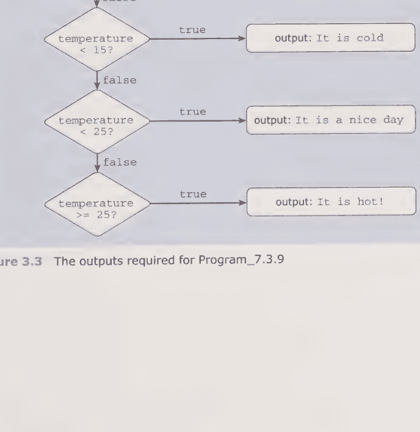
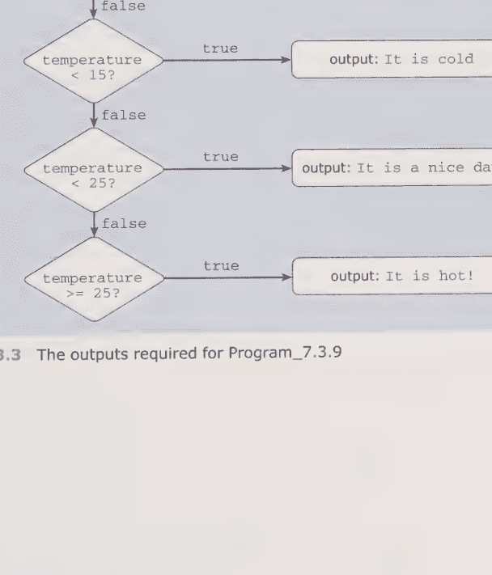

以下是我们的代码，来自 Program_7.3.9。

```
var temperature;

temperature = window.prompt('Please enter today\'s current temperature in degrees Celsius','');
temperature = parseFloat(temperature);
if (temperature <= 0)
{
    document.write('It is freezing')
}
else
{
    if (temperature < 15)
    {
        document.write('It is cold')
    }
    else
    {
        if (temperature < 25)
        {
            document.write('It is a nice day')
        }
        else
        {
            document.write('It is hot!')
        }
    }
}
```

> 重要的语法要点 `today\'s` 中的符号 \ 告诉 JavaScript 这个引号是字符串的一部分，而不是字符串的结束符。\ 被称为转义字符。

还要注意我们是如何对代码进行缩进的，以显示哪个 `else` 与哪个 `if` 配对。

写出你对上述程序在以下输入时的预期输出。

-   (a) 25
(b) 11
(c) -2
(d) 24

### 讨论

-   (a) It is hot!
(b) It is cold
(c) It is freezing
(d) It is a nice day

嵌套条件语句的工作原理如图 3.4 所示。

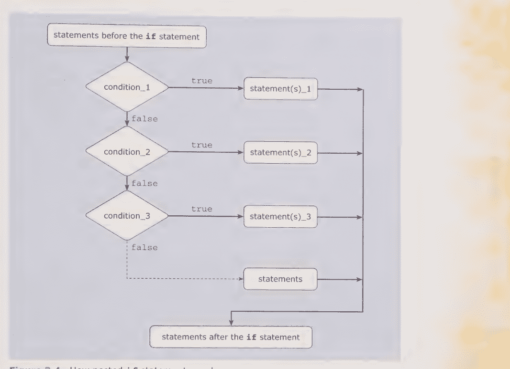

**图 3.4** 嵌套 if 语句的工作原理

### 活动 3.10

在某所大学，学生参加考试可能获得及格、不及格或优秀。及格需要40分或以上，优秀需要60分或以上。

(a) 文件 Activity_7.3.10 包含一个 JavaScript 程序的 HTML 模板。在记事本中打开该文件并编写一个程序，提示学生输入他或她的考试分数，然后显示：

Sorry, you've failed **或**
Congratulations, you've passed **或**
Many congratulations, you have honours**，视情况而定。**

**提示** 请参见活动 3.9，了解如何在 you've 中显示撇号的提示。

(b) 你应该运行程序多少次来测试它？

### 讨论

(a) 以下是我们的代码。（像往常一样，你的代码可能不同但也是正确的。）

```
var mark;

mark = window.prompt('Please enter your mark','');
mark = parseFloat(mark);
if (mark < 40)
{
  document.write('Sorry, you\'ve failed')
}
else
  if (mark < 60)
  {
    document.write('Congratulations, you\'ve passed')
  }
  else
  {
    document.write('Many congratulations, you have honours')
  }
```

请注意，我们没有在第一个 **if** 对应的 **else** 子句周围加上大括号。虽然我们曾建议在通常情况下为每个子句加上大括号是个好主意，但在嵌套 **if** 语句且每个子句只有一条语句时，这会使程序变得相当长（如我们在活动 3.9 的解决方案中所示）。记住，你只能省略大括号是因为 **else** 子句是一条单独的语句（一个完整的 **if...else** 结构在 JavaScript 中被视为一条语句）。不过我们仍然对代码进行了缩进以显示结构。

你可以在 Solution_7.3.10 中找到完整的解决方案。

(b) 你应该运行程序来测试所有可能的路径。有三种可能的路径：输入小于40时，输入大于等于40但小于60时，以及输入大于等于60时。为了真正做到彻底，你还应该测试边界值，以防你在选择比较运算符时出错。在这个例子中，边界值是39、40、41、59、60和61。

你现在可能希望通过自测题 3.8 来复习 JavaScript 条件表达式的语法知识。尽管教你 JavaScript 语法*不是*本单元的主要目的（主要目的是教你一些编程的基本概念），但语法错误可能会成为极大的挫折来源，你可能已经发现了这一点。

### 自测题 3.8

以下 JavaScript 代码片段各有什么错误？（你应该假设它们来自有意义的程序。）

(a) if mark ...
(b) if (mark ...
(c) if (mark <> 100) ...
(d) if (mark = 100) ...
(e) if ((mark1 < 50) and (mark2 < mark1)) ...

### 自测题 3.8 答案 ✓

-   (a) 应该是
    `if (mark >= 40) ....`
    记住条件表达式需要加括号。
-   (b) 应该是
    `if (mark <= 40) ....`
    < 和 = 之间不应有空格。
-   (c) 应该是
    `if (mark != 100) ....`
    <> 在 JavaScript 中不是有效的操作符（它在一些其他编程语言中使用，有时在数学中使用）。在 JavaScript 中，"不等于"的符号是 !=。
-   (d) 应该是
    `if (mark == 100) ....`
    在 JavaScript 中，= 是赋值操作符；用于相等比较的操作符是 ==。
-   (e) 应该是
    `if ((mark1 < 50) && (mark2 < mark1)) ....`
    在 JavaScript 中 `and` 不是有效的操作符。JavaScript 中逻辑运算符 AND 的符号是 &&。

### 3.5 小结

在本节中，我们讨论了如何编写一种程序结构，有时称为条件语句，它使程序根据以布尔表达式表示的条件的值在不同的操作路径之间进行选择。在 JavaScript 中，这样一种结构是 `if` 语句。我们使用了比较运算符（`<`、`<=`、`>`、`>=`、`==`、`!=`）和布尔运算符 NOT、OR、AND（在 JavaScript 中分别用 `!`、`||` 和 `&&` 表示）来构造布尔表达式。

你学习了 JavaScript 中的复合语句（使用大括号将多条语句组合成一条语句）和嵌套条件语句。我们还讨论了注释的使用以使代码更易读，以及测试程序的重要性。


## 第七单元 JavaScript 编程入门

### 4 编程实现重复：while 语句

本节旨在：

-   向你介绍 while 语句（通常称为 while 循环），其作用是在某个条件保持为真时重复执行一条或多条程序语句；
-   增进你对字符串行为的了解。

你可能还记得，在上一节中我们讨论了一个根据用户出生年份和当前年份计算年龄的程序。如果输入的当前年份早于出生年份，程序会给用户第二次输入这两个年份的机会。但如果再次输入了无效数据，程序只会返回一个荒谬的答案——负数年龄。理想情况下，我们希望程序反复提示用户输入两个日期，直到他们提供有效的输入为止。这正是使用 while 循环可以实现的功能。

### 4.1 while 语句简介


**活动 4.1**
Program_7.4.1 的功能与上述场景类似。使用当前年份（本文撰写时为2003年）和用户的出生年份，它判断该人是否有资格享受特定旅程的优惠铁路票价（我们假设60岁及以上的人可以享有），并显示相应的票价。只有1900年至2003年之间（含）的出生年份才被接受为有效年份，用户会被反复提示，直到输入有效年份为止。

以下是编号以供参考的 JavaScript 代码。

```javascript
/* Program to display the appropriate fare for a rail journey */
/* Assumptions:                                          */
/*   The current year is 2003.                           */
/*   Only years of birth in the range 1900 to 2003 are   */
/*   accepted as valid.                                 */
/*   Passengers of 60 or more are eligible for a        */
/*   concessionary fare of £18.                          */
/*   Other passengers pay £25.                           */
/*                                                     */

var currentYear, yearOfBirth;
var age;          // age this year

currentYear = 2003;
yearOfBirth = window.prompt('Please enter your year of birth','');
yearOfBirth = parseFloat(yearOfBirth);

// loop while valid input has not been received
while (yearOfBirth < 1900 || yearOfBirth > 2003)
{
    document.write('You must enter a year of birth between 1900 and 2003 (inclusive)' + '<BR>');
    yearOfBirth = window.prompt('Please enter your year of birth', '');
    yearOfBirth = parseFloat(yearOfBirth);
};
age = currentYear - yearOfBirth;
if (age >= 60)
{
    document.write('You are eligible for a concessionary fare of £18')
}
else
{
    document.write('Your fare is £25')
}
```

(a) **多次运行 Program_7.4.1，使用各种正确和错误的输入。尝试确定 `while` 语句的作用。**

(b) **为程序提出一些测试值。**

### 讨论

(a) 你应该已经注意到，如果在第(4)行的提示中输入有效年份，第(8)、(9)和(10)行的语句将被忽略。

然而，如果输入无效年份（小于1900或大于2003），第(8)、(9)和(10)行的语句将被反复执行，直到输入正确为止。换句话说，每当 `while` 语句中的布尔条件求值为 `true` 时，循环体内的指令就会重复执行。只有当条件求值为 `false` 时，控制才会跳转到完整 `while` 语句之后的行，即第(12)行。

请注意，最初请求输入并将其转换为数字的语句（第(4)和(5)行）如何在循环内部重复（作为第(9)和(10)行）。这是使用 `while` 循环重复执行首次未能达到目的的一条或多条指令的典型方式之一。

还要注意本程序中使用的两种不同的注释风格。

### 4.1 while 语句简介

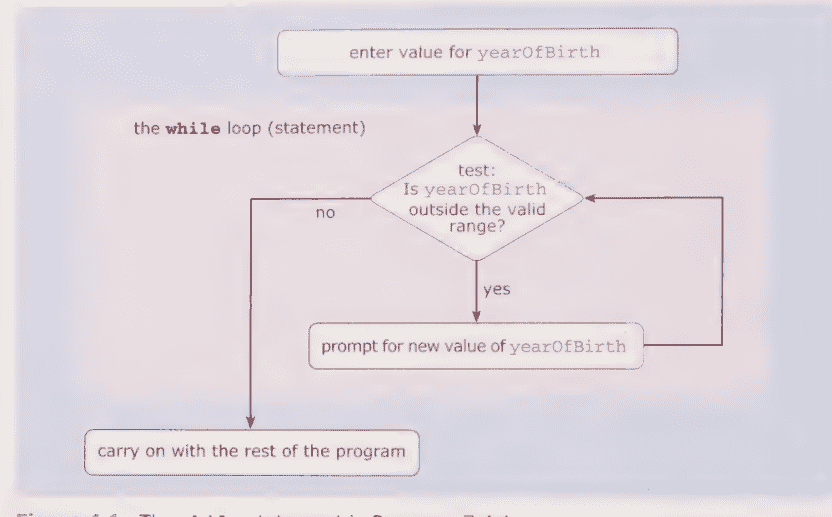

图 4.1 Program_7.4.1 中的 while 语句

### while 语句的语法

语法如下

> 如你在第3节中学到的，"布尔条件"和"布尔表达式"这两个术语可以互换使用。

```
while (Boolean condition/expression)
{
    one or more statements
}
```

只要 while 条件求值为 true 就会重复执行的语句称为 while 语句的**主体**。主体通常由多条语句组成，用分号分隔，但如第3.3小节所述，这些语句必须使用花括号包裹成一个复合语句。

### 自测题 4.1

Program_7.4.1 中哪些代码行构成了 while 语句的主体？

### 自测题 4.1 答案 ✓

主体由以下语句组成。

```
document.write('You must enter a year of birth between 1900 and 2003 (inclusive)' + '<BR>');
yearOfBirth = window.prompt('Please enter your year of birth','');
yearOfBirth = parseFloat(yearOfBirth);
```

如果控制 **while** 循环的布尔表达式求值为 `true`，则执行*整个*主体。然后执行返回到 **while** 语句的顶部，再次测试条件以查看其是否仍为真。如果是，则再次执行主体，如此反复，直到条件求值为 `false` 为止。**while** 语句的主体随后被跳过，程序其余部分的执行继续进行，如图4.2所示。

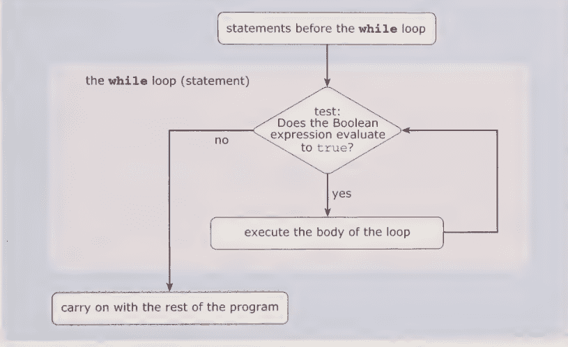

图 4.2 **while** 循环的工作原理

### 活动 4.2

**Activity_7.4.2** 包含你在活动 3.4 中被要求编写的密码更改程序的副本。修改该程序，使其反复提示你输入新密码，然后重新输入，直到两次输入匹配为止。随后显示一条消息，告知你密码已更改。

**提示** 你需要将 **if** 语句替换为 **while** 语句。

### 讨论

以下是我们的代码。

```
var password, repeatPassword;

password = window.prompt('Please enter your password','');
repeatPassword = window.prompt('Please re-enter your password','');
while (password != repeatPassword) {
	document.write('Your passwords don\'t match' + '<BR>');
	password = window.prompt('Please enter your password','');
	repeatPassword = window.prompt('Please re-enter your password','');
}
document.write('Thank you. Your password has been changed')
```

if 语句已被 while 语句取代，初始提示在其主体中重复出现。

你可以在 Solution_7.4.2 中找到可运行的解决方案。

### 练习 4.1

#### (a) 如果我对提示语句的响应是输入 37，以下 while 循环会产生什么效果？

```
myVar = window.prompt('Enter a number smaller than 30','');
myVar = parseFloat(myVar);
while (myVar > 30) {
	document.write('Please enter a number smaller than 30!')
}
```

**警告！** 我们不建议你在计算机上尝试执行此代码，但如果你这样做，可能会发现程序导致计算机以一种相当奇怪的方式运行！要停止程序运行，你可能需要按 `<Ctrl> <Q>`，即按住标有 Ctrl 的键（通常在键盘左下角）并同时按 `'Q'` 键。如果这不起作用，请使用 Windows 任务管理器停止浏览器运行。

#### (b) 你会如何修正这段代码？

### 讨论

(a) 该程序会不断显示以下行：
Please enter a number smaller than 3!

一遍又一遍，直到你按照上述说明停止程序运行为止。虽然程序不断要求用户输入小于30的数字，但循环主体中没有用于读取此新输入的程序语句。因此 myVar 的值保持为37，条件始终求值为 true。这样你就会陷入一个永无止境的（无限的）循环中，如图4.3所示。

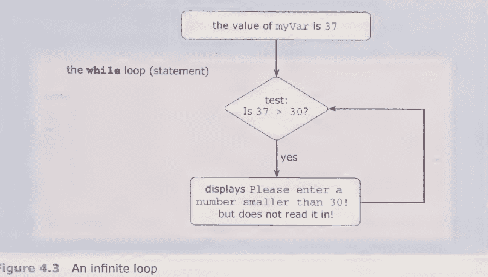

图 4.3 一个无限循环

(b) 要修正代码，你需要在循环体内添加指令，以读取新的输入、将其赋值给 `myVar` 并转换为数字。你可以重复 `while` 循环前的两行代码，这样循环体将包含以下额外代码：

```
myVar = window.prompt('Enter a number smaller than 30','');
myVar = parseFloat(myVar);
```

## 练习 4.2

`while` 循环的循环体能否仅由一条语句组成？

### 讨论

可以，只要该语句包含的代码最终会使 `while` 条件求值为 `false`。例如，在以下代码片段中，一旦输入一个正数，条件求值结果就将为 `false`。

```
var myVar;

myVar = window.prompt('Enter a positive number','');
while (myVar <=0)
{
    myVar = window.prompt('Please enter a POSITIVE number','')
};
document.write('The positive number is ' + myVar)
```

## 4.2 while 循环的更多示例

在上面的例子中，`while` 循环充当输入守卫，即它们要求你重复输入数据值，直到输入一个可接受的值。`while` 循环的另一个常见用途是在需要对连续数据值进行某种重复处理的程序中，例如，将购物清单上所有物品的成本相加。在这类场景中，你通常事先不知道会有多少数据项，因此需要一个终止值，向程序表明没有更多项目，如图 4.4 所示。这个特殊的终止值有时称为**哨兵值**。

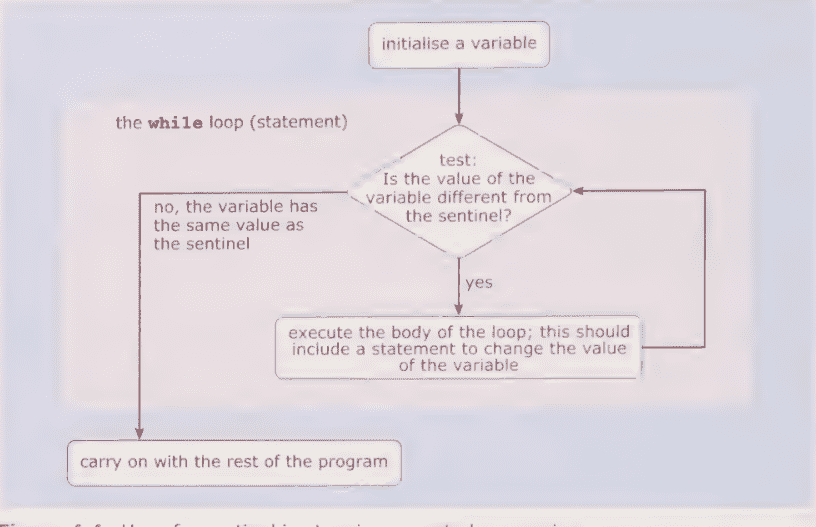

## 活动 4.3

此活动的目的是让你编写一个程序，用户一次输入一个字符串，计算机将这些字符串显示在一行上，用空格分隔。处理持续进行，直到用户输入 `halt`。然后计算机在新的一行显示 **Thank you**。

**例如，假设输入了以下七个字符串：**

**Hello!, nice, to, interact, with, you, halt**

**显示结果如下所示。**

```
Hello! nice to interact with you
Thank you
```

文件 `Activity_7.4.3` 包含一个 JavaScript 程序的 HTML 模板。在记事本中打开该文件并添加你的程序代码。使用一些字符串序列测试程序。

### 思考程序

程序读取每个单词并进行处理，直到遇到哨兵值（停止值），即字符串 `'halt'`。处理包括显示每个字符串后跟一个空格，然后读取下一个字符串。当遇到哨兵值时，**Thank you** 将显示在新的一行。

重复编程：while 语句

### 编写程序

- 你需要多少个变量来保存输入数据？声明它/它们。
- 编写一条 JavaScript 语句来读取第一个数据值。
- `while` 循环的哨兵值（停止值）是什么？
- 必须对每个数据值执行什么测试以确定它是否是哨兵值？编写 `while` 循环的条件。
- 必须对每个非哨兵值执行什么处理？编写 `while` 循环的循环体。
- 在遇到哨兵值之后必须执行什么处理？完成编写程序。
- 运行并测试程序。

### 讨论

## 自测题 4.3

你将如何修改活动 4.3 中的代码，使得哨兵值是单词 `stop` 而不是单词 `halt`？

## 自测题 4.3 答案 ✓

将 `while` 循环的条件修改如下：
`while … != "stop" …`


## 活动 4.4

以下代码来自 `Program_7.4.4`（带有行号以供参考）。

```
(1) var total, nextNumber;
(2) total = 0;
(3) document.write('The current value of the total is ' + total + '<BR>');
(4) nextNumber = window.prompt('Please enter a positive number, any negative number to stop','');
(5) nextNumber = parseFloat(nextNumber);
(6) while (nextNumber >= 0)
(7) {
(8) document.write('Adding the new value of ' + nextNumber + '<BR>');
(9) total = total + nextNumber;
(10) document.write('The current value of the total is ' + total + '<BR>');
(11) nextNumber = window.prompt('Please enter a positive number, any negative number to stop','');
(12) nextNumber = parseFloat(nextNumber)
(13) };
(14) document.write('The total sum of your numbers is ' + total)
```

**请注意，第 (3)、(8) 和 (10) 行的输出语句旨在向你显示程序执行时变量 `total` 的值。包含额外的输出语句是追踪程序的一种有用方法（类似于第 6 单元介绍的跟踪表的自动化版本）。**

**(a) 写下当你依次向程序输入数字 3、6、4、-5 时，你认为输出会是什么。运行 `Program_7.4.4` 并查看你是否正确。简要解释 `Program_7.4.4` 的功能。**

**(b) `Activity_7.4.4` 包含 `Program_7.4.4` 的一个副本。在记事本中打开它，并在上面标记为 (4) 和 (5) 的行的开头插入 `//`。（这相当于告诉 JavaScript 将这些行视为注释，因此它们将不会被评估，等同于删除这些行。）现在保存文件。当你运行 `Activity_7.4.4` 时，你预计会发生什么？使用与第 (a) 部分相同的输入运行程序，以检查你是否正确。**

(c) 再次在记事本中打开 `Activity_7.4.4`。这次删除第 (4) 和 (5) 行开头的 `//`，但通过在行首插入 `//` 将第 (2) 行注释掉。保存文件。当你这次运行 `Activity_7.4.4` 时，你预计会发生什么？使用输入 3、6 和 -5 运行它，看看结果。

### 讨论

(a) 输出应如下所示。

```
The current value of the total is 0
Adding the new value of 3
The current value of the total is 3
Adding the new value of 6
The current value of the total is 9
Adding the new value of 4
The current value of the total is 13
The total sum of your numbers is 13
```

该程序将用户输入的一系列正数相加。当输入负数时，显示总和。

第一行是代码第 (3) 行的输出。

你在第 (4) 行输入 3 作为响应。

第 (6) 行的测试求值结果为 `true`，因此执行循环体。显示输入的新数字和新的总和的值，并要求你输入另一个数字。

在第 (11) 行，你输入 6 作为响应。

执行返回到第 (6) 行。条件仍然求值为 `true`，因此再次执行循环体，导致显示下一个输入的数字和总和；然后要求你输入另一个数字。

在输入 4 时，循环体再次执行，你输入 -5。

执行返回到第 (6) 行。现在测试求值结果为 `false`（因为 -5 不大于或等于 0），因此执行跳过 `while` 循环的循环体，继续执行第 (14) 行，给出最终显示。

(b) 你应该得到以下输出。

```
The current value of the total is 0
The total sum of your numbers is 0
```

如果第 (4) 和 (5) 行被删除，则没有为 `nextNumber` 赋值，因此当在第 6 行测试条件时，JavaScript 无法如要求地将其与 0 进行比较。在这种情况下，JavaScript 简单地返回 `false`。因此跳过 `while` 循环的循环体，并执行第 (14) 行（此时 `total` 的值是第 (2) 行中为其赋的值，即 0）。

(c) 输入 3、6 和 -5 时，你应该得到以下输出。

```
The current value of the total is undefined
Adding the new value of 3
The current value of the total is NaN
Adding the new value of 6
The current value of the total is NaN
The total sum of your numbers is NaN
```

如果初始化变量 `total` 的第 (2) 行被删除，当执行第 (3) 行时，`total` 的值仍然是 `undefined`；因此第一行输出如此。当 JavaScript 在第 (9) 行尝试将一个新值添加到这个未定义的变量时，`total` 的当前值将如上所示显示。

请记住，`NaN` 是 JavaScript 中 'Not a Number'（非数字）的缩写！

## 活动 4.5

`Activity_7.4.5` 包含 `Program_7.4.4` 的一个副本。在记事本中打开它并修改它，使其将你输入的所有正数相乘，当输入哨兵值 0 时停止。

提示 注意你的初始化。

### 讨论

这是我们的解决方案。（你可能从在学校或其他地方学习数学中记得，两个或多个数字相乘的结果称为它们的乘积。）

```
var product, nextNumber;

product = 1;
document.write('The current value of the product is '
    + product + '<BR>');

nextNumber = 
    window.prompt('Please enter a positive number, 0 to stop','');
nextNumber = parseFloat(nextNumber);
while (nextNumber != 0)
{
    document.write('Multiplying by ' + nextNumber + '<BR>');
    product = product * nextNumber;
    document.write('The current value of the product is ' + product
                   + '<BR>');
    nextNumber = 
        window.prompt('Please enter a positive number, 0 to stop','');
    nextNumber = parseFloat(nextNumber)
};
document.write('The product of your numbers is ' + product)
```

请注意，将 `product` 初始化为 0 是无效的，因为 0 乘以任何其他数字总是得到 0。你将在 `Solution_7.4.5` 中找到一个有效的解决方案。

### 编写 while 循环程序的提示

- 你需要循环外的任何变量来保存数据吗？如果是，声明它/它们。（你可能至少需要一个变量用于控制循环的条件。）
- 你想在循环之前执行任何语句吗？（至少，你可能需要初始化在条件中使用的变量。）


- 你想要控制循环体重复的条件是什么？
- 对于循环体的每一次执行，你想要发生什么？循环体是否包含某个语句或语句组，最终会导致条件评估为假？（如果不是，你的程序将陷入无限循环。）
- 你是否希望在循环之后执行任何语句？

## 4.3 关于字符串的更多内容

在上文中，您已经看到了对一系列字符串和一系列数字的重复处理，使用了 while 循环。我们现在考虑对字符串内部的一系列字符进行重复处理。

首先，你需要了解更多关于字符串的知识。在 JavaScript 中，字符串是对象类型，与其他 JavaScript 对象一样，它们有许多相关联的方法。我们先讨论这样一个方法：charAt()。

> 你之前已经遇到了对象类型 Document 和 Window，以及相应的关联方法 write() 和 prompt()。

### 活动 4.6

本活动的目的是向你介绍与字符串对象关联的 charAt() 方法。

以下代码来自程序 Program_7.4.6。

```
var myString;

myString = window.prompt('Please enter a string with exactly 5 characters','');
document.write('You have chosen the following word '
               + myString + '<BR>');
document.write('The character in the first position is '
               + myString.charAt(0) + '<BR>');
document.write('The character in the fifth position is '
               + myString.charAt(4) + '<BR>')
```

- （a）想一个恰好包含五个字符的字符串。你能猜到如果你输入了这个字符串，程序的输出会是什么吗？运行程序并查看你是否猜对了。

（b）你认为 myString.charAt(n) 是什么意思，其中 n 是某个数字？

### 讨论

- （a）输出将是代码最后两行的指定输出字符串，以及输入字符串的第一个和最后一个字符。例如，如果输入的单词是 hello，输出将是：

您选择的如下单词是 hello
第一个位置的字符是 h
第五个位置的字符是 o

（b）您可能已经从我使用 0 和 4 这两个数字来输出字符串中的第一个和第五个字符中猜到了，myString.charAt(n) 将返回字符串 myString 中位置 n 之后的字符。JavaScript 字符串中的字符是从 0 开始编号（我们称为索引），直到少于字符数量的前一个数字。所以 myString.charAt(0) 返回的是分配给变量 myString 的字符串中第一个的字符（从左开始）；myString.charAt(4) 返回的是从左起第五个位置的字符。

您可能还记得在第 6 单元中提到，计算机主存储器中的位置也是从 0 开始编号而不是从 1 开始。从零开始计数在计算机世界中很常见。

### 自评问题 4.4

编写一个类似于上述的 JavaScript 语句，用于输出分配给变量 myString 的字符串中从左起的第三个字符。

### 自评问题 4.4 的答案


### 活动 4.7

文件 Activity_7.4.7 包含 Program_7.4.6 的副本。在记事本中打开该文件，并在 JavaScript 代码末尾添加以下行。

```
document.write('The character in the last position is ' + myString.charAt(5) + '<BR>')
```

运行程序，像以前一样输入五个字符的字符串。发生了什么，为什么？

### 讨论

输出的最后一行将是 `The character in the last position is`（后面是一个空格）。这是因为 myString.charAt(5) 返回的是第六个位置的字符——而你只输入了五个字符。


### 活动 4.8

在本活动中，你将编写一个程序来在单词中搜索特定字母，比如 e，并写出它在字符串中的位置。例如，如果你输入单词 'tea'，以下内容将被显示。

```
The first occurrence of letter e is in position 2 in the word tea
```

你可以假设字符串中至少有一个 e 出现。文件 Activity_7.4.8 包含 JavaScript 程序的 HTML 模板。使用记事本打开该文件，并包含你的 JavaScript 代码，然后用一些包含 e 的单词测试它。

警告 如果你用不含字母 e 的单词测试代码，程序将进入无限循环，正如练习 4.1 中所描述的。如果发生这种情况，你需要按 <Ctrl><Q> 或使用 Windows 任务管理器来停止你的浏览器运行。

思考这个程序

在你开始编写代码之前，问自己以下问题可能会有所帮助。

- （a）你需要逐个字母进行测试。哪种 JavaScript 结构允许你重复处理多个不同值？
（b）哪种方法允许你考虑字符串中的单个字母？
（c）你需要多少个变量？
（d）你将如何初始化这些变量？
（e）你打算如何测试在特定位置（假设由一个名为 index 的变量索引）处的字母不是字母 e？
（f）如果特定位置处的字母不是字母 e，index 的值应该发生什么变化？
（g）如果特定位置处的字母是字母 e，你需要显示什么？

回答这些问题后，编写程序。

### 讨论

- （a）你需要的结构是一个 while 循环。
（b）charAt() 返回的是参数中数字指定的位置处的字符，即括号内的数字。记住编号从 0 开始，而不是 1。
（c）你需要一个变量来存储字符串，例如称为 myWord，还需要一个变量来存储当前位置的值，称为 index。
（d）使用 window.prompt() 初始化 myWord 的值；index 被初始化为第一个位置，该位置索引为 0（不是 1！）。
（e）测试为 (myWord.charAt(index) != 'e')。
（f）如果测试成功，即当前位置的字母不是 e，你想考虑下一个位置的字母，并使用 index = index + 1 将 index 增加 1。
（g）由于 JavaScript 认为字符串中字符的位置比通常的人类约定少一个，我们需要在 index 上加上 1，以便在输出中给出更有意义的位置。

这是我们的代码。

```
var myWord, index;

myWord = window.prompt('Please enter a word which has an e in it','');
index = 0;
/***************************************************/
/* The loop goes from letter to letter stopping when it reaches   */
/* the letter e                                           */
/***************************************************/
while (myWord.charAt(index) != 'e')
{
    index = index + 1
};
/***************************************************/
/* Once an e has been located, the program skips to the          */
/* instruction following the body of the loop, which adds one    */
/* to index to compensate for the fact that the first character  */
/* is at position 0 rather than 1                                */
/***************************************************/
document.write('The first occurrence of letter e is in position '
             + (index + 1) + ' in ' + myWord)
```

您可以在 Solution_7.4.8 中找到工作解决方案。


### 活动 4.9

本活动的目的是将活动 4.8 的程序扩展，使其能与任意字母一起工作，而不仅仅是字母 e。程序应提示用户首先输入他们选择的字母，然后输入一个包含该字母的单词。然后将显示该字母在给定单词中首次出现的位置，如 Activity_7.4.8 所示。

文件 Activity_7.4.9 包含活动 4.8 正确代码的副本，你应该修改它以使程序按指定工作。

### 讨论

这是我们的代码。

```
var letter, myWord, index;

letter = window.prompt('Please enter your chosen letter','');
myWord = window.prompt('Please enter a word which has a(n) ' + letter + ' in it','');
index = 0;
while (myWord.charAt(index) != letter)
{
    index = index + 1
};
document.write('The first occurrence of letter ' + letter
             + ' is in position ' + (index + 1) + ' in ' + myWord)
```

您可以在 Solution_7.4.9 中找到工作解决方案。


## 第 4.4 节 小结

在本节中，我们讨论了 while 语句（通常称为 while 循环），它使你能够重复执行一系列构成循环体的语句，直到循环开头的某个布尔表达式的值为 false。你了解了如何使用 while 循环来防止错误输入——提示用户重新输入，直到输入格式正确；以及如何使用它们来重复执行，直到达到某个停止值（哨兵值）。

我们还介绍了字符串是由多个字符组成的对象这一概念，并了解了 `charAt()` 方法，它返回字符串中由方法参数指定的特定位置的字符。我们注意到，字符串中字符的位置从左到右编号（索引），最左边的字符索引为 0。

## 第 5 节 用于重复的编程：for 语句

本节旨在：

-   向你介绍 for 语句（通常称为 for 循环），它使你能够预先确定执行一块语句的次数；
-   复习 `charAt()` 字符串方法的使用，并介绍 `length` 属性。

在第 4 节研究的重复示例中，我们事先并不知道循环体中的代码会被执行多少次。迭代次数由 while 条件控制，并取决于例如用户输入无效数据的次数，或在终止哨兵值之前输入了多少个值。for 语句由计数器控制，只有在执行语句之前已知重复次数时才能使用。例如，如果你想计算一个 20 人班级的考试平均分，你知道需要将一个分数加到总分中恰好 20 次，然后再将总分除以 20。

"**迭代**"（Iteration）是重复的技术术语。

## 第 5.1 节 for 语句（循环）简介

为了控制重复次数，for 循环使用变量作为计数器。要使用 JavaScript 的 for 循环，你需要知道：

-   计数器的起始值；
-   执行循环体时计数器的最终值；
-   每次重复后计数器增加或减少的固定数值；
-   构成循环体的语句（与 while 循环相同）。

我们在活动 5.1 中对此进行了说明。

### 图 5.1 Program_7.5.1 的代码，附注释

+ (a) 你认为这个 for 循环做什么？运行 Program_7.5.1 来找出答案。
+ (b) 一旦执行了所需次数的迭代，count 的值是多少？

### 讨论

+ (a) 对于循环的每次迭代，程序输出 count 的值，然后将其增加 1。它这样执行 10 次，如下所示。

首先，执行 for 语句第一部分的赋值（`count = 1`），从而初始化计数器。

然后测试 for 循环第二部分的（`count <= 10`）条件。

如果结果为 true，

执行循环体中的语句（即显示 count 的值），

执行 for 语句第三部分的赋值语句（`count = count + 1`），

再次测试条件（如此反复）。

如果结果为 false，

跳过循环体，控制权传递给循环后面的语句（在本例中是输出 Thank you 的语句）。

+ (b) count 的最终值是 11。

请注意，这比条件中指定的"最终"值多 1，因为只有当 count 达到 11 时，for 语句中的条件才会求值为 false。

在后面的示例中，我们有时会提到循环控制语句中赋予计数器变量的"最终"值。在这种情况下，我们指的是执行循环体时的最终值，而不是所有所需迭代完成后它的值。


## for 循环的语法

```
for (declare and initialise counter;
     test value of counter;
     change value of counter)
{
    statement(s)
}
```

需要注意的要点：

- 使用分号作为分隔符。
- 在 for 语句中声明循环计数器并非强制性的——它可以与程序开头的其他变量一起声明。然而，在 M150 中，我们遵循上述语法中的惯例，因为这能清楚地表明该变量的特殊用途。
- for 循环的主体可以包含多条由分号分隔的语句，并通过花括号将它们组合成一个复合语句。

for 循环的执行效果如图 5.2 所示。

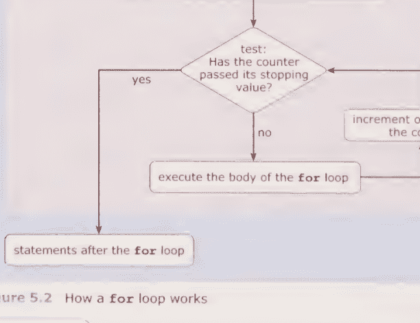

## SAQ 5.1

假设一个 for 语句用于一项涉及六次迭代的编程任务。

(a) for 循环的初始化部分会执行多少次？

(b) 布尔条件将被求值多少次？

(c) 改变计数器值的语句将执行多少次？

## SAQ 5.1 的答案

(a) 一次。无论迭代次数多少，计数器只初始化一次。

(b) 七次。该条件需要六次求值为 `true`，每次对应 `for` 循环主体中代码的一次迭代；第七次尝试时，它将求值为 `false`。

(c) 六次。用于递增或递减计数器值的语句在每次迭代结束时执行。

## ACTIVITY 5.4

**以下是 Program_7.5.4 中的代码。**

```
for (var line = 1; line <= 6; line = line + 1)
{
    document.write('I must pay attention in class' + '<BR>');
};
document.write('\'I\\'ve finished!\'')
```

**你认为输出会是什么？** 运行 Program_7.5.4 来验证。

### 讨论

该程序将在单独的行上显示六次：

```
I must pay attention in class
```

然后在新的行上输出 `I've finished!`。

注意，在这个例子中，计数器变量 `line` 的值仅用于跟踪迭代次数。在我们之前的例子中，计数器的值也被循环主体中的代码使用。

## ACTIVITY 5.5

**以下代码来自 Program_7.5.5。**

```
for (var count = 1; count <= 6; count = count + 1)
{
    document.write('*')
}
```

(a) 写下你认为程序会执行什么操作。运行 Program_7.5.5，看看你是否正确。

(b) Activity_7.5.5 是 Program_7.5.5 的副本。在记事本中打开文件 Activity_7.5.5，并修改程序，使得用户被提示输入一行星号的长度，例如，输入 3 将输出 `***`。保存你的修改并运行程序。

(c) 进一步修改 Activity_7.5.5，使得除了提示输入行的长度外，还提示用户输入要输出的字符（这样就不一定是 * 了）。保存你的修改并运行你的程序。

(d) 进一步修改 Activity_7.5.5，使得程序输出一条垂直线，而不是水平线字符。例如，对于字符输入 +，长度输入 3，将得到以下输出：
```
+
+
+
```
保存你的修改并运行你的程序。

### 讨论

(a) 该程序在一行中显示六个星号，即 `******`。

(b) 以下是我们的解决方案。

```
var length;

length = window.prompt('Please enter the length of your line','');
length = parseFloat(length);
for (var count = 1; count <= length; count = count + 1)
{
    document.write('*')
}
```

你可以在 Solution_7.5.5(b) 中找到可运行的解决方案。

(c) 需要对代码进行以下修改：

- 声明一个变量来保存选定的字符，例如 `character`；
- 在 for 循环之前添加以下行：
  ```
  character = window.prompt('Please enter your chosen character','');
  ```
- 将 for 循环的主体改为：
  ```
  document.write(character)
  ```

你可以在 Solution_7.5.5(c) 中找到可运行的解决方案。

(d) 需要修改上述 for 循环的主体，在每个字符后包含一个换行符，如下所示：
```
document.write(character + '<BR>')
```

你也可能将变量 length 替换为名为 number 之类的变量，并修改对用户的提示。

你可以在 Solution_7.5.5(d) 中找到可运行的解决方案。

## ACTIVITY 5.6

文件 Activity_7.5.6 包含一个部分完成的程序，用于计算一组五名学生的平均考试分数。对于每个学生，系统会提示用户输入一个分数，该分数将被加到目前的总分中。一旦输入并汇总了五名学生的分数，就会计算并输出平均分。我们已为你提供了计算平均值和显示它的代码。你应当添加代码来提示并读取分数，将它们转换为数字并添加到总分中。打开 Activity_7.5.6，并在指示的位置添加你的代码。用几组五名学生的分数运行程序，测试你的程序。

**如果你遇到困难，可能会发现本活动后面的提示有所帮助。**

### 讨论

以下是我们完成的代码。

```
var total;     // total of scores so far
var score;     // score for a single student
var average;   // average score

/* Insert code to initialise total */
total = 0;
/* insert code for a for loop to read in and add the 5 student scores to total */

for (var count = 1; count <= 5; count = count + 1)
{
    score = window.prompt('please enter next score','');
    score = parseFloat(score);
    total = total + score
};
average = total / 5;
document.write('average score is ' + average + '<BR>')
```

你的循环条件写对了吗？

你是否记得使用 `parseFloat()` 将输入的字符串转换为数字？

你可以在 Solution_7.5.6 中找到可运行的解决方案。

## 编写带有 for 循环的程序的提示

- 你是否需要在循环外声明任何变量来保存数据？如果是，声明它们。
- 你是否需要在循环之前执行任何语句？
- 为了编写循环控制语句（for 循环的顶部），你需要考虑希望计数器从哪里开始，希望它在哪里结束，以及希望在每次执行循环主体时如何改变它。
- 为了编写 for 循环的主体，你需要确定在每次执行循环主体时应该发生什么事。
- 你是否希望在循环之后执行任何语句？

## ACTIVITY 5.7

以下是你在 Activity 5.1 中学习过的 Program_7.5.1 的代码副本。

```
for (var count = 1; count <= 10; count = Monkcount + 1)
{
    document.write('Count is ' + count + '<BR>');
};
document.write('Thank you' + '<BR>')
```

我们已将此代码的副本放在文件 Activity_7.5.7 中。在记事本中打开该文件，看看你是否能用执行完全相同操作的 while 循环代码替换 for 循环代码。运行 Program_7.5.1 和 Activity_7.5.7，检查它们是否执行相同的操作。

### 讨论

以下是我们的解决方案。

```
var count;

count = 1
while (count <= 10)
{
    document.write('Count is ' + count + '<BR>');
    count = count + 1
};
document.write('Thank you' + '<BR>')
```

如你所见，两种方式代码的工作方式非常相似：

- 计数器变量被初始化为相同的值；
- 在每次循环迭代之前测试相同的条件；
- 计数器在每次迭代结束时更新（不过在 while 循环的情况下，这是在循环体内完成的）。

你可以在 Solution_7.5.7 中找到可运行的解决方案。

如果有 for 循环，总是可以写出等效的 while 循环，但我们建议当你知道需要多少次迭代时使用 for 循环，这使得重复次数更加清晰。

如果有 while 循环，通常不可能写出等效的 for 循环，因为 while 循环通常用于事先不知道需要多少次迭代的情况。


## 5.2 字符串和 for 循环

在第 4 节中，你了解了字符串作为一个对象的概念，以及字符串方法 `charAt()`，它返回字符串中指定位置处的字符（索引从 0 开始）。

除了与定义其行为的方法相关联外，对象还与**属性**相关联，属性保存与其结构和状态（值）相关的信息。字符串对象有一个这样的属性，称为 `length`，正如你可能猜到的那样，它保存字符串中字符的数量。`length` 属性的存在，加上我们可以使用 `charAt()` 访问字符串中特定位置的字符这一事实，意味着 `for` 循环非常适合用于处理字符串中的字符。在本节稍后你将看到一些这方面的例子。首先我们要解释如何使用 `length` 属性。

### 活动 5.8


**以下代码来自 Program_7.5.8。它会反复提示用户输入一个字符串，并在用户输入终止字符串 end 之前，显示其长度。**

```
var myString; // string entered by user

// initialise myString to an empty string
myString = '';
while (myString != 'end')
{
    myString =
        window.prompt('Please input a string; enter end to finish','');
    document.write('The length of ' + myString + ' is ' +
                  myString.length + '<BR>')
};
document.write('Thank you')
```

**请注意，“点”表示法（`myString.length`）用于指示与对象关联的属性。**

**想想一些长度和类型不同的字符串，包括空字符串和一些包含空格的字符串。写下你认为 Program_7.5.8 对于这些字符串的输出结果是什么。运行程序以检查你的答案。**

### 讨论

你应该发现，在所有情况下，`length` 属性都给出了字符串中字符的确切数量，无论字符类型如何。以下是一些示例字符串及其长度。

| String | Length |
|---|---|
| 'hello' | 5 |
| "" (empty string) | 0 |
| '******' | 6 |
| 'hello world' | 11 |
| '123456789' | 9 |
| 'length of myString' | 18 |
| 'end' | 3 |

### 自我评估题 5.2

(a) `myString.charAt(n)` 返回 `myString` 的第一个字符时，数字 n 的值是多少？

(b) 写一行 JavaScript 代码，获取字符串 `myString` 中最后一个字符的索引，并将其赋值给变量 `lastIndex`。（提示：你需要使用字符串的长度属性来找出它有多少个字符。）

### 自我评估题 5.2 的答案 ✓

(a) n 的值是 0。请记住，在 JavaScript 中，字符串中字符的索引从索引 0 开始。

(b)
由于字符串中的第一个字符索引为 0，因此最后一个字符的索引是长度值减 1。例如，长度为 3 的字符串将具有索引 0、1 和 2 的字符。

如前所述，我们可以使用 for 循环、length 属性和 charAt() 方法逐字符地遍历字符串，如图 5.3（对面）所示。


### 活动 5.9

在这个活动中，我们要你编写一个程序，从用户读取一个字符串并输出字符，每个字符后面跟一个星号。例如，如果用户输入字符串 hello，输出将是：

h*e*l*l*o*

我们已经为你提供了一个名为 Activity_7.5.9 的程序模板。在 Notepad 中打开此文件，并在我们指示的位置插入你的代码。通过使用几个不同的字符串运行程序来测试你的程序。

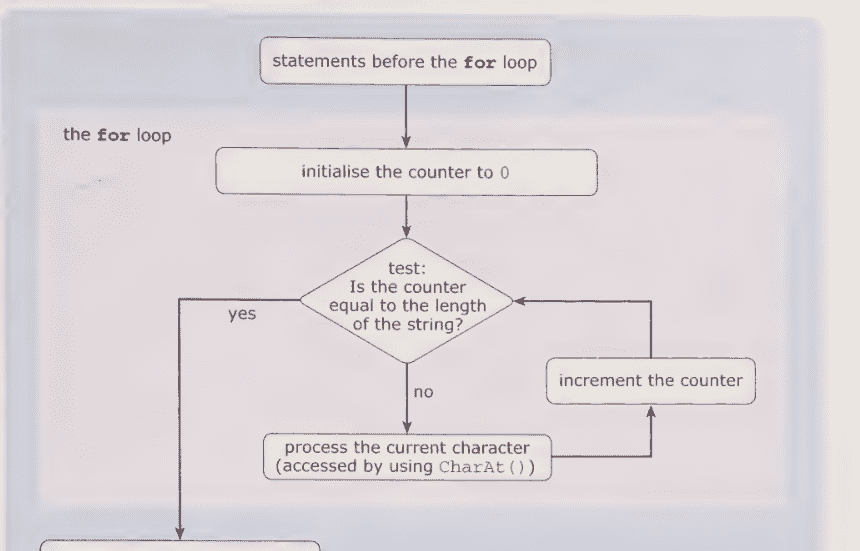

**图 5.3** 使用 **for** 循环逐字符处理字符串。

### 讨论

这是我们的代码：

```
var myString;
myString = window.prompt('Please enter a string','');
//Remember - the arguments to charAt() start at 0, not 1
for (var count = 0; count < myString.length; count = count + 1)
{
    document.write(myString.charAt(count) + '*')
}
```

你是否记得同时使用点表示法与 `length` 和 `charAt()`？

你会在 Solution_7.5.9 中找到一个可用的解决方案。


### 活动 5.10

这是来自 Program_7.5.10 的代码。

```
var word, letter;
word = window.prompt('Please enter a word','');
for (var count = 0; count < word.length; count = count + 1)
{
    letter = word.charAt(count);
    if (letter == 'e')
    {
        document.write('*')
    }
    else
    {
        document.write(letter)
    };
}
```

注意在 for 循环中使用了 if 语句。还要注意我们的缩进，以显示代码的结构。

(a) 想想几个长度不同的单词，写下你认为当输入这些单词时 Program_7.5.10 的输出结果是什么。运行 Program_7.5.10 并检查你是否正确。

(b) Activity_7.5.10 包含 Program_7.5.10 的副本。在 Notepad 中打开此文件，并修改程序，使其不执行 (a) 部分的操作，而是显示输入单词中字母 e 出现的次数。

### 讨论

(a) Program_7.5.10 从用户读取一个单词，并显示该单词，任何出现的字母 e 被替换为星号。

(b) 这是我们的代码。

```
var word, total;
word = window.prompt('please enter a word','');
total = 0;
for (var count = 0; count < word.length; count = count + 1)
{
    if (word.charAt(count) == 'e')
    {
        total = total + 1
    }
};
document.write('The number of occurrences of e in the word ' + word + ' is ' + total)
```

注意我们在 `if` 语句中直接使用 `word.charAt(count)` 以避免需要变量 `letter`。

你会在 Solution_7.5.10 中找到一个可用的解决方案。

### 自我评估题 5.3

(a) 决定在程序中使用 while 循环还是 for 循环时，你会考虑什么因素？

(b) for 循环中的循环控制语句的三个部分是什么？

(c) 当控制 while 循环的条件评估为 false 时，会发生什么？

(d) 你必须在 while 循环的正文中始终包含什么？

### 自我评估题 5.3 的答案

(a) 如果你事先知道需要多少重复次数，你可能会使用 for 循环，但如果不知道，你就需要使用 while 循环。

(b) 三个部分是：
- 计数器变量的声明和初始化；
- 指定计数器结束值的条件；
- 递增或递减计数器的语句。

(c) 程序跳转到 while 循环正文之后的语句（如果有的话）。

(d) 一条或多条语句，最终会导致控制条件评估为 false。

条件语句（如 if 语句）、while 语句和 for 语句都是**控制结构**的一种，之所以称为控制结构，是因为它们控制程序的执行流程，即语句执行的顺序。这种依赖于布尔条件评估的执行流程，通常称为**控制流**。

## 5.3 小结

在本节中，我们讨论了 for 语句的使用，它使用计数器来控制一系列语句的执行次数。

我们复习了字符串对象的 charAt() 方法，并向你介绍了字符串属性 length。

## 6 单元总结

在本单元中，我们向你介绍了 JavaScript 编程。

在第 2 节中，我们考虑了顺序执行、简单输入和输出，并介绍了变量和赋值的重要概念。我们讨论了一些数据类型及其相关的运算符。第 3 节研究了 `if...else` 语句，这是一种用于选择程序结构的语句。在第 4 和第 5 节中，我们考虑了两种用于重复的结构：第 4 节中的条件控制 `while` 语句，以及第 5 节中的计数器控制 `for` 语句。

在第 8 单元中，我们将探讨更复杂的数据类型，并讨论如何开始将编程任务分解为子任务。

### 6.1 学习目标

在学习完本单元后，你应该能够实现以下学习目标。

- 运行给定的程序。（从活动 2.1 开始）
- 读取和修改源代码。（从活动 2.2 开始）
- 使用 `document.write()` 显示输出。（从活动 2.2 开始）
- 声明变量，并为其赋值。（第 2.2 节；自我评估题 2.6；活动 2.7，从活动 3.1 开始）
- 理解使程序代码对人类读者易读的重要性。（练习 2.4）
- 使用 `window.prompt()` 从用户获取程序输入。（从活动 2.6 开始）
- 使用 `parseFloat()` 将数字字符串转换为数字。（自我评估题 2.13；从活动 2.9 开始）
- 理解和使用布尔值和比较运算符。（自我评估题 3.1、3.2；活动 3.1、3.2）
- 理解和使用 `if` 语句。（活动 3.3、3.4）
- 理解和使用 `if...else` 语句。（自我评估题 3.5；练习 3.2；活动 3.5、3.6、3.7、3.8）
- 在程序中输入适当的注释。（活动 3.8）
- 使用布尔运算符。（自我评估题 3.6、3.7；练习 3.3、3.4）

## 单元总结

- 理解嵌套条件语句的使用（活动 3.9，3.10）
- 理解并使用 `while` 语句（`while` 循环）。(简答题 4.1，4.2，4.3；练习 4.1；活动 4.2)
- 理解并使用方法 `charAt()` 的字符串对象。(活动 4.6, 4.7, 4.8, 4.9)
- 理解并使用 `for` 语句（`for` 循环）。(简答题 5.1, 5.3；活动 5.1, 5.2, 5.3, 5.4, 5.5)
- 理解字符串的 `length` 属性。(简答题 5.2；活动 5.8)
- 结合使用 `for` 循环、`length` 属性和 `charAt()` 方法来遍历字符串，处理每个字符。(活动 5.9)
- 欣赏（理解）`while` 循环和 `for` 循环之间的区别，以及各自通常使用的情况。(简答题 5.3；活动 5.7)

## 关键术语 🔑

您应能够用自己的话定义以下术语。

- 参数
- 赋值
- 二元运算符
- 主体（while 或 for 循环的）
- 布尔
- 比较运算符
- 复合语句
- 连接
- 条件执行
- 控制流/流程控制
- 控制结构
- 数据类型
- 声明（变量的）
- 函数
- 标识符
- 索引
- 初始化
- 输入（数据）
- 迭代（或重复）
- 关键字/保留字
- 方法
- 数值类型
- 对象
- 运算符
- 优先级（运算符的）
- 属性
- 保留字/关键字
- 返回值
- 脚本语言
- 选择结构
- 语义
- 哨兵
- 顺序执行
- 源代码
- 字符串类型
- 语法
- 类型
- 变量

## M150 数据、计算与信息

## 第 1 块：关于数据的学习

- **单元 1** 数据与信息：简介
- **单元 2** 表示
- **单元 3** 跨越界限：模拟宇宙与数字世界
- **单元 4** 整合数据
- **单元 5** 存储、获取和发送您的数据

## 第 2 块：计算机：处理数据

- **单元 6** 硬件与软件的结构
- **单元 7** 使用 JavaScript 进行编程简介
- **单元 8** 程序与数据
- **单元 9** 通过模块化管理复杂性
- **单元 10** 软件开发

## 第 3 块：从数据到信息

- **单元 11** 现实世界中的计算
- **单元 12** 与信息交互
- **单元 13** 感官计算
- **单元 14** 隐藏数据：安全简介
- **单元 15** 秘密太多？
- **单元 16** 现实的期望

开放大学

ISBN 0 7492 5764 4
