# Angular2 入门指南

# 第 3 章：图形与动画

## Angular 生命周期方法

## Angular 生命周期方法的简单示例

- 清单 3.1：`app.component.ts`

## GSAP 动画与 `ngAfterContentInit()` 方法

- 清单 3.2：`main.ts`
- 清单 3.3：`app.component.ts`
- 清单 3.4：`ArchTubeOvals1.ts`
- 清单 3.5：`app.module.ts`

## Angular 中的 CSS3 动画效果

- 清单 3.6：`app.component.ts`

## 通过“Angular 方式”实现动画效果

- 清单 3.7：`app.component.ts`

## Angular 中的基本 SVG 示例

- 清单 3.8：`app.component.ts`
- 清单 3.9：`MyEllipse1.ts`
- 清单 3.10：`app.module.ts`

## Angular 与 SVG 中的鼠标跟随

- 清单 3.11：`app.component.ts`
- 清单 3.12：`MouseMove.ts`
- 清单 3.13：`app.module.ts`

## D3 与 Angular

- 清单 3.14：`app.component.ts`

## D3 动画与 Angular

## Angular 中的纯 CSS3 3D 动画

- 清单 3.15：`index.html`
- 清单 3.16：`Anim240Flicker3DLGrad2SkewOpacity2Reflect1DIV6.css`

## Angular 中的 CSS3 与 jQuery 动画效果

- 清单 3.17：`index.html`
- 清单 3.18：`app.component.ts`
- 清单 3.19：`SkewAnim1.css`

## “Angular 方式”的动画效果

- 清单 3.20：`app.component.html`
- 清单 3.21：`app.component.ts`
- 清单 3.22：`app.module.ts`

## Angular 的图表工具

## 总结

# 第 4 章：HTTP 请求与路由

## Angular 中的依赖注入

## 使用 jQuery 和 Angular 进行 Flickr 图像搜索

- 清单 4.1：`app.component.ts`

## Angular 中 Promise 与 Observable 的结合

- 清单 4.2：`app.component.ts`
- 清单 4.3：`nyt.service.ts`
- 清单 4.4：`app.module.ts`

## 通过 Angular 中的 Observable 读取 JSON 数据

- 清单 4.5：`app.component.ts`
- 清单 4.6：`employees.json`
- 清单 4.7：`app.module.ts`

## Angular 中使用 `forkJoin()` 的多个并发请求

- 清单 4.8：`app.component.ts`
- 清单 4.9：`file.service.ts`
- 清单 4.10：`customers.json`

## Angular2 HTTP 与 Observable

## Angular 中的 TypeScript 接口

## 一个简单的 TypeScript 接口

- 清单 4.11：`employee.ts`

## JSON 数据与 TypeScript 接口

- 清单 4.12：`employees.ts`

## 带有 TypeScript 接口的 Angular 应用

## 在 Angular 中获取 GitHub 用户数据

- 清单 4.13：`app.component.ts`

## 使用简单服务器进行 HTTP GET 请求

- 清单 4.14：`app.component.ts`
- 清单 4.15：`posts.json`

## 使用简单服务器进行 HTTP POST 请求

- 清单 4.16：`app.component.ts`
- 清单 4.17：`authors.json`

## Angular 中的路由

## Angular 中的路由示例

- 清单 4.18：`app.component.ts`
- 清单 4.19：`about.ts`
- 清单 4.20：`login.ts`
- 清单 4.21：`users.ts`
- 清单 4.22：`user.ts`

## 使用 Webpack 的 Angular 路由

## 总结

# 第 5 章：表单、管道与服务

## Angular 表单概述

## 响应式表单

## 模板驱动表单

## 一个 Angular 表单示例

- 清单 5.1：`app.component.ts`
- 清单 5.2：`app.module.ts`

## 数据绑定与 `ngModel`

## 第三方 UI 组件

## 使用 `FormBuilder` 的 Angular 表单

- 清单 5.3：`app.component.ts`

## Angular 响应式表单

- 清单 5.4：`app.component.ts`
- 清单 5.5：`app.component.html`
- 清单 5.6：`app.module.ts`

### `FormGroup` 与 `FormArray`

### Angular 中的其他表单特性

### Angular 表单与 Bootstrap 4（可选）

### 在 Angular 中使用管道

### 使用内置管道

### `AsyncPipe`

### 创建自定义 Angular 管道

- 清单 5.7：`app.component.ts`
- 清单 5.8：`pipe.component.ts`
- 清单 5.9：`user.component.ts`
- 清单 5.10：`app.module.ts`

### 什么是 Angular 服务？

### 内置 Angular 服务

### Angular 服务示例

- 清单 5.13：`app.component.ts`

### 带有 `EventEmitter` 的服务

- 清单 5.14：`user.component.ts`
- 清单 5.15：`user.service.ts`
- 清单 5.16：`app.component.ts`
- 清单 5.17：`app.module.ts`

### 显示 GitHub 数据

- 清单 5.18：`app.component.ts`
- 清单 5.19：`user.component.ts`

### 其他与服务相关的用例

### 多个服务实例

### 单个服务实例

### 服务与组件间通信

 将服务注入到服务中

## 总结

# 第 6 章：Angular 与 Express

### 一个极简的应用程序

### 设置 Node 环境（可选）

### 创建 Express 应用程序

- 清单 6.1：`server.js`

### 启动 Express 应用程序

### 一个包含 Angular 和 Express 的应用程序

### 启动服务器和 Angular 应用程序

### Angular HTTP 与 Observables

### 服务器代码：`package.json`

- 清单 6.2：`package.json`

### 服务器代码：`server.js`

- 清单 6.3：`server.js`

### Angular 代码

- 清单 6.4：`app.component.ts`

### 并发请求与 Angular（版本 2）

### 如何启动 服务器代码

### Angular 代码

- 清单 6.5：`app.component.ts`

### 一个带有 MongoDB 的 Express 应用程序（第 1 部分）

- 清单 6.6：`package.json`

### 服务器端文件（第 2 部分）

- 清单 6.7：`server.js`

### 文件

- 清单 6.8：`index.js`

### `userlist.jade` 模板

- 清单 6.9：`userlist.jade`

### 启动服务器端应用程序

### 一个带有 Express 的 Angular 应用程序

- 清单 6.10：`app.component.ts`
- 清单 6.11：`server.js`

### Angular 与日文（可选）

- 清单 6.12：`load-japanese.js`

### Angular Universal

### 服务器文件：`main.ts`

- 清单 6.13：`main.ts`

### 网页 `index.html`

- 清单 6.14：`index.html`

### TypeScript 文件 `app.ts`

- 清单 6.15：`app.ts`

### 使用微服务（可选）

### 微服务的优势

### 微服务的劣势

## 总结

## 7 章：Flux、Redux、GraphQL 与 Relay

### 什么是 Flux？

### 什么是 Action？

### 什么是 Reducer？

### Store 与应用程序状态

### 什么是 Redux？

### 应用程序的数据结构

### 何时应该使用 Redux？

### Reducer 的简单示例

### 用于加减数值的 Reducer

### 用于数组中添加/删除字符串的 Reducer

### Redux Reducer 是同步的

### Redux Store

### 中间件

### 什么是 GraphQL？

### GraphQL 与 REST

### GraphQL 查询

### 在 GraphQL 中定义类型系统

### 有用的 GraphQL 链接

### 什么是 Apollo？

### 启动 Apollo 服务器

### 启动 Angular 客户端

### Angular 客户端中的项目结构

- 清单 7.1：`app.module.ts`

### 什么是 Relay？

### Relay Modern

## 总结

## 第 8 章：Angular 与移动应用

### 使用 Ionic 2 进行移动开发

### 安装与项目创建

### Ionic Native

### Ionic 应用程序的项目结构

- 清单 8.1：`app.component.ts`
- 清单 8.2：`app.module.ts`

### 在 Ionic 应用程序中检索 GitHub 用户

- 清单 8.3：`github.ts`
- 清单 8.4：`app.component.ts`
- 清单 8.5：`app.module.ts`
- 清单 8.6：`app.html`

### 什么是 NativeScript？

### 安装与新建项目

### Angular 与 NativeScript

### 使用 React Native

### React Native 的安装步骤

### 如何创建 React Native 应用程序

- 清单 8.7：`index.android.ts`

### 将 React Native 应用部署到移动设备

### Angular 与 React Native

- 清单 8.8：`NG2RNGraphics.ts`

### React Native 与 NativeScript：高级对比

### Angular Mobile Toolkit

### 创建移动项目

### manifest.webapp 文件

- 清单 8.9：`manifest.webapp`

### 渐进式 Web 应用（可选）

### Web Workers 与 Service Workers

### PWA 的组成部分

### 其他链接

## 总结

## 第 9 章：函数式响应式编程

## 什么是函数式响应式编程（FRP）？

### 观察者模式

### 处理异步事件

Promise 与异步事件

不使用 FRP 的运算符

关于 Observable 的类比

RxJS 的 JavaScript 文件

中间运算符与终端运算符

 运算符

`subscribe()` 和 `unsubscribe()` 运算符

`subscribe()` 和 `forEach()` 运算符

将数据源转换为 Observable

使用 `range()` 和 `filter()` 运算符

- 清单 9.1：`ObservableRangeFilter1.html`

使用 `from()` 和 `map()` 运算符

- 清单 9.2：`ObservableMapUpper1.html`

使用 `interval()`、`take()` 和 `map()` 运算符

- 清单 9.3：`ObservableTake.html`

其他中间运算符

`retry()` 运算符

合并/连接运算符列表

映射相关运算符列表

`timeout()` 运算符

冷 Observable 与热 Observable

- 清单 9.4：`ColdObservables1.html`

使 HTML 网页响应式

- 清单 9.5：`ObservableDivElement2.html`

RxJS 与 SVG 图形/动画

- 清单 9.6：`SVGObservables1.html`

RxJS 与 SVG 图形/动画

- 清单 9.7：`app.component.ts`

RxJS 与 SVG 图形/动画

- 清单 9.8：`app.component.ts`

RxJS 与 SVG 图形/动画

- 清单 9.9：`userlist.jade`

# 前言

## 本书的核心价值张

本书旨在面向全球读者，他们来自不同年龄层且背景各异。虽然许多读者能阅读英文，但他们的母语并非英语（可能是第二、第三甚至第四语言）。因此，本书使用标准英语，而非可能让这些读者感到困惑的口语表达。如你所知，许多人通过不同类型的模仿来学习，包括阅读、写作或听新材料（是的，也有一些基础视频可使用）。本书充分考虑这些因素，旨在为目标读者提供舒适且有意义的学习体验。

### 如何充分利用本书

<|channel>thought
<channel|>
有些程序员擅长通过文字学习，另一些则擅长通过示例代码（以及大量代码）学习，这意味着没有一种风格适用于所有人。

此外，有些程序员希望先运行代码，观察其效果，然后再回头深入钻研代码细节（而另一些则采用相反的方法）。

因此，本书包含多种类型的代码示例：有些简短，有些较长，还有一些代码示例是在先前代码示例的基础上“构建”而成的。

### 本书代码是如何测试的？

本书中的代码示例已在搭载 `OS X 10.16` 的 `Macbook Pro` 上的 `Google Chrome` 浏览器（版本 53）中测试过。除非另有说明，否则未使用任何特定于浏览器的特殊功能，这意味着这些代码示例在其他平台上的 `Chrome` 以及其他现代浏览器中应该也能正常工作。

另需注意，所有对“Web Inspector”的引用均指 `Chrome` 中的 `Web Inspector`，这与 Safari 中的 `Web Inspector` 不同。如果你使用的是其他（但仍属现代）浏览器或早期版本的 `Chrome`，可能需要在线查询启动和查看 `Web Inspector` 所需的按键序列。请访问以下链接获取更多有用信息：

*[`benalman.com/projects/javascript-debug-console-log/`](http://benalman.com/projects/javascript-debug-console-log/)*

### 为什么截图是黑白的？

黑白图像的成本低于原始彩色图像，因此采用黑白图像意味着本书可以以更低的价格提供。不过，彩色图像以及补充代码示例（在浏览器中启动时会彩色呈现）均可在随附光盘中找到。

### 为什么本书只有300页？

本书属于 `Pocket Primer` 系列，该系列通常在200 到 300 页之间。其次，目标读者是那些对 `HTML` 和 `JavaScript` 了解从入门到级的读者。在编写本书的过程中，我们尽努力满足这些读者的需求，使他们能够在自学过程中准备好 `SVG` 的高级功能。

### 本书是否包含生产级代码？

本书中的代码示例确实使用了生产版本来说明 `Angular` 的各种特性。清晰度重要，尤其是在一本篇幅较短书中。如果你决定在正式网站中使用本书中的任何代码，则应对该代码进行严格的分析。

### 作者的其他书籍

1) `HTML5 Canvas and CSS3`:[`http://www.amazon.com/HTML5-Canvas-CSS3-Graphics/dp/19364231`](http://www.amazon.com/HTML5-Canvas-CSS3-Graphics/dp/19364231)
2) `jQuery, HTML5, and CSS3`:[`http://www.amazon.com/jQuery-HTML5-Mobile-Devices/dp/19385401`](http://www.amazon.com/jQuery-HTML5-Mobile-Devices/dp/19385401)
3) `HTML5 Pocket Primer`:[`www.amazon.com/HTML5-Pocket-Primer-Oswald-Campesato/dp/19385404`](http://www.amazon.com/HTML5-Pocket-Primer-Oswald-Campesato/dp/19385404)
4) `jQuery Pocket Primer`:[`www.amazon.com/dp/19385417`](http://www.amazon.com/dp/19385417)

以下开源项目包含的代码示例会补充本书章节：

*[`code.google.com/p/css3-graphics/`](https://code.google.com/p/css3-graphics/)`
*[`code.google.com/p/d3-graphics/`](https://code.google.com/p/d3-graphics/)`
*[`code.google.com/p/html5-canvas-graphics/`](https://code.google.com/p/html5-canvas-graphics/)`
*[`code.google.com/p/jquery-css3-graphics/`](https://code.google.com/p/jquery-css3-graphics/)`
*[`code.google.com/p/raphael-graphics/`](https://code.google.com/p/raphael-graphics/)`
*[`code.google.com/p/svg-filters-graphics/`](https://code.google.com/p/svg-filters-graphics/)`
*[`code.google.com/p/svg-graphics/`](https://code.google.com/p/svg-graphics/)`

# 第1章：Angular快速入门

本章快速介绍如何使用`Angular`开发Web应用程序。在介绍`Angular`的一些高级特性之后，你将能够快速理解后续章节中讨论的许多代码示例（有些代码示例更为复杂）。同时，请记住，你需要投入额外的时间和精力才能更深入`Angular`。

注意：本书中的`Angular`代码示例基于2017年3月发布的生产代码。

另一个重要的考虑因素是你的学习风格：你可能更倾向于在深入第一个代码示例之前，先阅读有关Angular应用程序“脚手架”的详细信息。不过，完全可以先略读本章引言部分，然后快速“深入”本章第一个`Angular`示例代码，之后再回头复习引言部分。

本章第一部分讨论`Angular`的设计目标以及一些新特性，例如组件、模块和单向绑定。本章第二部分讨论Angular命令行界面（`CLI`），这是一个用于生成`Angular`应用程序的命令行工具。

注意：本书中的`Angular`项目基于`ng`（即`Angular CLI`）的1.0.0版本，用于创建`Angular 4`应用程序。

在阅读本章之前，有几点需要牢记：首先，本书提供了许多`Angular`应用程序的示例，因此关于`Angular`概念、设计目标和架构的细节比你在500页的书籍中可能找到要“轻量”一些。不过，你可以在Victor Savkin以及其他人士的在线文章中找到有用的信息。

其次，你可以使用`ECMA5`、`ES6`和`TypeScript`创建`Angular`应用程序。但主要建议是使用`ES6`或`TypeScript`开发`Angular`应用程序；事实上，本书中的所有代码示例都使用`TypeScript`，这使得转译过程（在“幕后”执行）变得简单直接。第三，不需要有`Angular`的使用经验，但有一些知识显然会有所帮助。

注意：![img/disc.jpg

当你从随附光盘复制项目目录时，如果`node_modules`目录不存在，请复制已软链接到该项目目录内的顶层`node_modules`目录（大多数示例应用程序都是这种情况）。

## 支持的Angular版本：工作原理

你可能已经知道，`Angular`的发展速度很快，从2017年3月`Angular 4`的生产版本开始，一直延伸到计划于2018年9月发布的`Angular 7`。

每个即将发布的版本（从2018年9月的`Angular 6`开始）可能支持前两个版本的`Angular`。例如，`Angular 6`支持`Angular 4`，而`Angular 7`支持`Angular 5`。此外，`Angular`的命名约定中存在一种“二元性”：即将发布的`Angular`版本会指定版本号，但带版本号的官方名称是`AngularJS`。`Angular`核心团队在此开发过程中的另一个重要目标是尽量减少破坏性变更，确保此类变更对升级到新版本的影响最小。

注意：尽管未来生产代码有版本号，但更高版本的Angular被称为Angular。

## 跳过Angular3的原因

`Angular`核心库位于`github.com/angular/angular`。它们都采用相同的版本控制，但作为不同的包分发：

- `@angular/core` v2.3.0
- `@angular/compiler` v2.3.0
- `@angular/compiler-cli` v2.3.0
- `@angular/http` v2.3.0
- `@angular/router` v3.3.0

如你见，路由包的版本号不同。最简单的方法是使用`Angular 4`而不是`Angular 3`。

## TypeScript版本

将`TypeScript`依赖从`v1.8`升级到`v2.1`或更高版本）确实涉及破坏性变更。幸运的是，从`Angular 2`升级到`Angular 4`并不大规模重写，只需更改几个核心库。`Angular`团队开发了一个自动升级流程，他们使用的工具对公众开放。注意：本书中的`Angular`应用程序使用`TypeScript`编译器v2.2。

## 从Angular迁移

如果你使用的是最新版本的`Angular`，则本节为可选内容，因为新版本包含了所有功能。下面简要概述了几个`Angular`功能，因为它们已添加到v2.0之后。首先，`Angular 2.2`于20161月发布提供了提前编译（AOT）兼容性，并在第10章中进行了详细讨论。接下来，Google于201612月发布了`Angular 2.3`，其中包含了与集成开发环境（IDE）集成的语言服务。该服务提供了类型补全和错误检查。此外，该服务还提供了组件的对象继承。关于TypeScript版本：`Angular 2`使用`TypeScript 1.8`，而初始版本使用`TypeScript 2.1`或更高版本），涉及一些相对较小的变更。

## 学习Angular应用程序需要的内容

本书中的`Angular`应用程序使用`TypeScript`编写，但你还需要掌握以下技术技能：

![img/greybox.jpg NodeJS (npm)
![img/greybox.jpg ECMA5、ES6 和 TypeScript
![img/greybox.jpg Webpack 2.2（更高版本）

以下小节包含上述列表项目的更多信息。

### NodeJS

本书中的代码示例需要`node v6.x.x`（更高版本）和`npm 4.x.x`（更高版本）。在终端中使用以下命令确定你机器上的版本：

```
node -v
npm -v
```

如有必要，请访问NodeJS主页下载更新版本的node可执行文件。如果你没有使用过`Node`，请阅读在线教程以了解以下命令的用途：


熟悉`ECMA5`很有用：例如，`filter()`函数很方便（例如，与Angular管道一起使用），而`map()`函数在将`Observable`与Angular应用程序中的HTTP请求结合使用时可能很有用。其他函数，如`merge()`和`flatten()`，也可能有用，你可以根据需要学习它们以及其他函数。

你还需要对`Promise`和`Observable`有基本的了解。使用`TypeScript`的`Angular`倾向于`Observable`，本书中的代码示例也是如此，但你也会遇到使用`Promise`的在线代码示例。请自行查阅有关`ECMA5`、`Promise`和`Observable`的在线资源。


`template` 属性包含 HTML 和自定义标记的混合（可以放在单独的文件中，然后通过 `templateUrl` 属性引用）。此外，`Component` 之后紧跟着一个 TypeScript 类定义，其中包含与 `template` 属性中出现的组件相关变量相关联的“支持代码”。在你使用一些 Angular 应用程序之后，这些细节将变得更加清晰。

**注意**

`templateUrl` 属性和 `styleUrls` 属性引用文件，而 `template` 属性和 `styles` 属性引用内联代码。

## 摇树优化 Angular 应用程序

摇树优化 指的是从 Angular 项目中“修剪”不必要的文件（其他技术也有类似概念），就像摇晃树上的枯枝一样，以创建 Angular 应用程序的生产版本。这个生产版本可以显著更小，因此加载时间更短。Webpack 2 和 Angular AOT 支持摇树优化，你将在第 10 章中看到一个使用 AOT 的示例。

## Angular 应用程序的高层视图

Angular 应用程序由内置组件和自定义组件（后者由你编写）组合而成，每个组件通常定义在单独的 TypeScript 文件（扩展名为 `.ts`）中。每个组件通过 `import` 语句指定其依赖项。Angular 中有多种类型的依赖项，例如指令和管道（本章稍后讨论）。

自定义指令 本质上是一个定义组件的 TypeScript 文件的内容。因此，自定义指令由 `import` 语句、`@Component` 装饰器和一个导出的 TypeScript 类组成。

Angular 提供了内置指令，例如 `*ngIf`（用于“if”逻辑）和 `*ngFor`（用于循环）。这两个指令也被称为结构型指令，因为它们会修改 HTML 页面的内容。

Angular 内置管道包括日期和数字项（`currency`、`decimal`、`number` 和 `percent`），而自定义管道由你定义。

此外，TypeScript 类使用装饰器（一种内置函数），它为类、其成员或其方法参数提供元数据。装饰器很容易识别，因为它们总是带有 `@` 前缀。Angular 提供了许多内置装饰器，例如 `@Component()` 和 `@NgModule`。

以上是对 Angular 特性的高层介绍。本章的下一部分将介绍 Angular CLI，本书将全程使用它来创建 Angular 应用程序。

## Angular CLI

在 Angular 的测试版发布期间，开发人员使用手动流程创建应用程序，或者使用“入门”或“种子”项目（通常在 GitHub 上提供）。然而，这些项目在 Angular 新版本发布后往往过时。因此，本书中的代码示例基于 Angular CLI，它是 Google 官方的 Angular 应用程序生成器。

Angular CLI 是一个名为 `ng` 的命令行工具，它可以生成完整的 Angular 应用程序，包括测试相关代码，并且（默认情况下）还会启动 `npm install` 以在 `node_modules` 中安装所需的文件。Angular CLI 的主页位于：

[`cli.angular.io`](https://cli.angular.io)

Angular CLI 生成一个名为 `package.json` 的配置文件，用于管理必要的依赖项及其版本号。生成 Angular 应用程序后，导航到 `node_modules` 子目录，你将看到各种 Angular 子目录，其中包含 Angular 应用程序所需的文件。

Angular CLI 是使用“入门”项目或手动创建项目的更优替代方案，其功能集将随着时间的推移不断改进。

## 安装 Angular CLI

你需要执行几个步骤来安装 Angular CLI。首先使用以下命令卸载之前的 CLI（如果你安装了旧版本）：

```
sudo npm uninstall -g angular-cli
npm cache clean
```

接下来，使用以下命令安装新的 CLI（注意新的包名）：

```
[sudo] npm install -g @angular/cli
```

按如下方式创建一个名为 `hello-world` 的新项目，使用 Angular 4：

```
ng new hello-world
```

Angular CLI 提供了除自定义代码之外的所有内容，并且安装所需的时间明显长于入门应用程序。其次，Angular CLI 允许你生成新的组件、路由器等，这些在入门应用程序中也是可能的。第三，Angular CLI 完全基于 TypeScript，生成的应用程序包括 JavaScript 对象表示法（JSON）文件 `tsconfig.json`、`tslint.json`、`typedoc.json` 和 `typings.json`。另一方面，入门应用程序倾向于使用 Webpack，这涉及配置文件 `webpack.config.js`，其中包含 Angular 应用程序的信息。

## Angular CLI 的特性

`ng` 可执行文件支持各种选项，以下是一些命令行调用示例：

```
ng new app-root-name
ng build
ng deploy
ng e2e
ng generate <component-type>
ng generate route
ng generate ...
ng lint
ng serve
ng test
ng g
```

`ng g` 选项同于 `ng generate` 选项，它允许你生成 Angular 自定义组件、管道管道（第 5 章中讨论）等。`ng test` 选项从源代码中提取。下一节将展示如何在应用程序中生成自定义组件，以及自动为你生成的文件。组件默认前缀是 `app`（例如 `<app-root>`），但你可以通过调用指定不同的前缀：`ng new app-root-name --prefix abc`。`ng` 创建的 Angular 应用程序始终包含 `src/app` 目录。关于升级 Angular CLI 的信息位于[`github.com/angular/angular-cli`](https://github.com/angular/angular-cli)。Angular CLI 文档位于：[`cli.angular.io`](http://cli.angular.io)。现在你了解了 `ng` 工具的一些特性，让我们创建第一个 Angular 应用程序，这是下一节的主题。

## 通过 Angular CLI 创建“Hello World”应用程序

导航到一个方便目录，使用以下命令创建一个名为 `myapp` 的 Angular 应用程序：`ng new myapp`。早期版本的 `ng` 需要 `--4` 开关。上述命令完成后，进入新项目目录：`cd myapp`。使用以下命令启动 Angular 应用程序：`ng serve`。上述命令会自动启动浏览器会话：`localhost:4200`。你将在屏幕上看到以下内容：app works!上述在文件 `app/component.ts` 的 `template` 属性中指定 `template` 属性（或 `templateUrl` 属性）是你放置自定义代码的地方，这些代码将生成 HTML 然后插入到 `index.html` 网页的 `<app-root>` 元素中。

## Angular 应用程序结构

当你调用 `ng` 命令创建 Angular 应用程序时，以下是自动创建：

- `angular-cli.json`
- `dist/`（详细省略）
- `e2e/`（详细省略）
- `karma.conf.js`
- `node_modules`
- `package.json`
- `protractor.conf.js`
- `README.md`
- `src/app/app.component.css`
- `src/app/app.component.html`
- `src/app/app.component.spec.ts`
- `src/app/app.component.ts`
- `src/app/app.module.ts`
- `src/environments/environment.prod.ts`
- `src/environments/environment.ts`
- `src/favicon.ico`
- `src/index.html`
- `src/main.ts`
- `src/polyfills.ts`
- `src/styles.css`
- `src/test.ts`
- `src/tsconfig.json`
- `tslint.json`

`dist` 子目录包含编译后的项目和 JavaScript 包，`e2e` 子目录包含端到测试的文件（调用命令 `ng test` 来执行）。`app.component.ts` 包含自定义代码，并且（较小程度上）你可能更新文件 `app.module.ts`。你需要包含 `<script>` 元素（用于 jQuery、Bootstrap 等）时，你将修改 `index.html`，而 `styles.css` 文件用于全局样式表（CSS）样式（如果有的话）。最后，文件 `angular-cli.json`、`package.json` 和 `tslint.json` 分别是 `ng`、`npm` 和 `tslint` 的配置文件。请注意，当你调用命令 `ng lint` 时，它会调用 `tslint` 工具，而该工具依赖于文件 `tslint.json`。

## Angular 项目文件的命名约定

`app` 子目录中的文件有一个命名约定，由三部分组成：功能类型、它是组件还是模块，以及指示代码类型的后缀。例如，TypeScript 文件 `app.component.ts` 包含代码，而 TypeScript 文件 `app.module.ts` 包含模块相关代码。此外，文件 `app.component.css` 包含组件的选择器，`app.component.html` 包含组件的 HTML 标记。

本章的下一部分包含两个小节：第一部分讨论 `index.html` 和各种 JavaScript 配置文件的内容，第二部分讨论包含在 `app` 子目录中的应用程序文件。阅读这些部分是一个漫的过程，虽然建议你阅读它们，但也可以随意浏览本节，并在启动第一个 Angular 应用程序后再回来。两种阅读方式有利弊，因此请以最适合你学习的方式继续学习这些材料。现在让我们看看 HTML 网页 `index.html` 的内容，它是我们 Angular 应用程序的主网页。

## index.html 网页

清单 1.1 显示了通过 `ng` 工具从命令行生成的新 Angular 应用程序的 `index.html` 内容。

### 清单 1.1：index.html

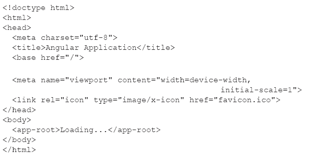

清单 1.1 非常简洁：只有自定义的 `<app-root>` 元素（你将在 `app/component.ts` 的 `selector` 属性中看到它）表明这个网页是 Angular 应用程序的一部分。

注意：

JavaScript 依赖项在项目构建期间由 Angular CLI 动态插入到 `index.html` 中。

在我们深入探讨 Angular 应用程序中的 TypeScript 文件之前，让我们快速了解一下 `import` 语句在 Angular 应用程序中是如何工作的。如果你已经熟悉 Angular 中的 `import` 和 `export` 语句，可以跳过下一节。

## 导出和导入包与类（可选）

请记住以下几点：在 TypeScript 文件中导入的 TypeScript 类都必须在定义该类的 TypeScript 文件中导出。你将看到许多 `import` 和 `export` 语句的示例；事实上，本书中的每个 Angular 应用程序都是如此。

有两种常见的 `import` 语句类型：一种涉及从 Angular 模块导入包，另一种涉及导入自定义类（由你编写）。以下是两种类型的语法：

```
import {some-package-name}   from 'some-angular-module';
import {some-class }         from 'my-custom-class';
```

以下是两种 `import` 语句的示例：

```
import { NgModule }     from '@angular/core';
import {EmpComponent}   from './example.component';
```


`declarations`数组由此应用所需的`组件`组成，例如`AppComponent`，以及自定义组件、指令和管道，所有这些都具有（模块级别的）私有作用域。具体来说，私有作用域意味着`declarations`数组中的所有内容只能通过在同一模块中声明的其他组件、指令和管道访问。

请记住，`declarations`属性中列出的组件**必须**从其各自的组件相关文件中导出。例如，`AppComponent`从`app.component.ts`（稍后显示）中导出，这使得你可以在`app.module.ts`中导入它，并在`declarations`属性中指定它。

`exports`数组包含应用中其他组件所需的组件、指令和管道。

`schemas`数组包含值`CUSTOM_ELEMENTS_SCHEMA`，它提供了应用“外部”的附加信息；请参见第 2 章中的示例。

最后，`bootstrap`数组包含当 Angular 应用在浏览器中启动将“引导”的组件名称。注意：通常建议通过`bootstrap`属性仅一个组件。

## 顶层组件文件 `app.component.ts`

清单 1.4 显示了`app.component.ts`（位于`src/app`目录）的内容，该文件导出了顶层组件`AppComponent`。

清单 1.4: `app.component.ts`

清单 1.4以导入`Component`装饰器的开头，用于类`AppComponent`定义元数据。元数据至少涉及两个属性：`selector`和`template`。除了路由相关的组件外，这两个属性在自定义组件中都是必需的。在此示例中，`selector`属性指定了你在`index.html`中看到的自定义元素`app-root`（你可以更改它）。`template`属性指定将插入到自定义元素`app-root`中的HTML标记包含一些文本。清单 1.4中的最后一行是一个导出语句，使`AppComponent`类用于其他 TypeScript 文件导入，例如清单 1.3所示的`app.module.ts`。注意：书中所有 Angular 项目的文件都位于`src/app`。导航到根目录并在 shell 中输入以下命令来启动你的 Angular 应用：

```
ng serve
```

下一节将讨论 Angular 模板，你将在`template`属性中的自定义代码中使用。

## 一个简单的 Angular 模板

如清单 1.4所示，文件`app.component.ts`包含一个`template`属性，其中包含一个`<h1>`元素包含一行文本。但是，当你将所有内容放在反引号内时，Angular允许指定多行文本。这种语法（ES6中引入）在 Angular 应用中大量使用，并且方便支持变量。清单 1.5显示了一个新的`app.component.ts`文件，该文件比清单 1.4更多内容。此代码示例说明了如何在`template`属性中使用插值。

清单 1.5: app.component.ts

清单 1.5包含两个`<h1>`元素；第一个是简单的文本字符串，第二个包含花括号，用于引用类`AppComponent`中定义的数据。Angular使用一种称为插值的方法，结合字面对象`<h1>`元素，然后将花括号内的变量替换为第二个`<h1>`元素中的实际值。

## 在 Angular 中使用组件

Angular 应用是一个嵌套组件的树，其中顶层组件就是应用本身。组件定义了用户界面（UI）元素、屏幕和路由。通常通过将每个自定义组件放在一个 TypeScript 文件中，然后将该 TypeScript 文件导入到包含顶层组件的“主”文件（通常命名为`app.component.ts`）中来组织 Angular 应用。

### 组件中的元数据

Angular 组件通常是`@Component`装饰器和类定义的组合，类定义可以选择构造函数。下面是一个简单的示例：

上面的`@Component`装饰器包含几个属性，其中一些是必需的，另一些是可选的。让我们看看前面代码块中的两种类型：`selector`属性是必需的，它指定作为 Angular 应用“根”的HTML元素（无论是现有元素还是自定义元素）。接下来，`template`属性（或`templateUrl`属性）是必需的，它包含了标记、插值变量和TypeScript 代码。一个重要的细节：当`template`属性的定义跨越多行时，需要使用反引号。`directives`属性是一个可选属性，用于指定被视为嵌套组件的组件数组。在此示例中，`directives`属性指定了组件`EmpComponent`，该组件也在代码块附近通过`import`语句导入。注意，`import`语句不包含@`符号，意味着`EmpComponent`是在文件`emp/emp.component.ts`中定义的自定义组件。

## Angular 中的有状态组件与无状态组件

从高层次来看，**有状态**组件会保留与同一 Angular应用程序的其他部分相关的信息。另一方面，无状态组件不维护应用程序状态，也不请求或获取数据：它们通过属性绑定从另一个组件（例如其父组件）接收数据。本书中的代码示例通常是有状态组件、无状态组件以及有时是“值对象”的组合，这些值对象是模拟不同实体（例如员工、客户、学生等）的自定义类的实例。你将在第 2 章看到一个表示组件的示例。同时，这里有一篇深入探讨有状态和无状态组件的好文章：

[`toddmotto.com/stateful-stateless-components#stateful`](https://toddmotto.com/stateful-stateless-components#stateful)

## 使用 Angular CLI 生成组件

之前你已经看到了`ng`实用程序的一些选项，本节将讨论如何使用`generate`选项。此外，这里还有一些不言自明的示例：

```
ng generate component mycomp
ng generate directive mydir
ng generate pipe mypipe
ng generate route myroute
ng generate service mycomp
```

以下命令与上面列表中的对应命令等效，只是它们使用了短别名：

```
ng g c mycomp
ng g d mydir
ng g p mypipe
ng g r myroute
ng g s mycomp
```

上述命令会创建新文件，这些文件位于`src/app`子目录中。例如，命令`ng g c mycomp`会创建子目录`mycomp`并用文件填充它。如果你不想创建子目录，使用`--flat`选项，新文件将放置在`src/app`中而不是`src/app/mycomp`。现在，让我们在 Angular应用程序中调用以下命令生成一个组件：

```
ng g c student
```

上述命令完成后，你将看到输出：

```
installing component
create src/app/student.component.css
create src/app/student.component.html
create src/app/student.spec.ts
create src/app/student.component.ts
```

如你见，上述输出显示了四个文件：一个CSS文件、一个HTML文件、一个测试文件和一个组件定义文件。

### 清单 1.6：student.component.ts

**注意**：当你使用`ng`创建自定义组件时，`ng`会在`app.module.ts`中插入一条`import`语句并更新`declarations`属性，添加新组件的引用。为了方便起见，当你从命令行生成组件时，`ng`还会生成一个测试文件。具体来说，清单 1.7显示了名为`student.spec.ts`的测试。

### 清单 1.7：student.spec.ts

清单 1.7包含`import`语句，使各种组件用于此测试文件，包括清单 1.6中定义的`StudentComponent`。`student.component.html`自动生成的内容如下：

```
<p>student works!</p>
```

如你见，该文件非常简约，你可以自由在此文件中添加与应用程序相关的标记。注意，文件`student.component.css`为空；添加需要的任何CSS选择器进行样式。另一个细节：`ng`允许你在现有组件内部创建组件。例如，以下命令在`student`组件内部创建一个`profile`组件：

```
ng g component student/profile
```

你必须在`student`子目录中调用上述命令，否则你将看到错误消息：

```
You have to inside an angular-cli project in order to use the generate command.
```

准备绪后，使用以下命令创建Angular应用程序的生产构建：

```
ng build --prod
```

请记住，你可以通过AOT显著缩小Angular应用程序的大小，这在第 10 章中有详细的讨论。

## Angular 中的语法、属性和特性

Angular引入了方括号`[]`表示法用于属性和特性，以及圆括号`()`表示法用于处理事件。这种新语法是有效的HTML语法。以下是指定属性和函数的代码片段：

```html
<foo [bar]="x+1" (baz)="doSomething()">Hello World</foo>
```

以下是指定属性和函数的示例：

```html
<button disabled="!inputIsValid" (click)="authenticate()">Login</button>
```

以下是带有自定义元素的数据相关元素的：

```html
<my-chart [data]="myData" (drag)="handleDrag()"></my-chart>
```

上述代码片段中的新语法消除了许多内置指令的需求，你将在本章后面看到这一点。

## Angular 中的特性与属性

请记住以下区别：属性可以指定复杂模型，而特性只能指定字符串。例如，在Angular 1.x中，你可以编写代码：

```html
<my-directive foo="{{something}}"></my-directive>
```

Angular中对应的代码（不需要插值）如下：

```html
<my-directive [foo]="something"></my-directive>
```

Angular的新架构提供了改进的性能，并提供了开发“更干净”的Angular应用程序的机制，这些应用程序可以更快开发、增强和维护。下一节包含一个涉及`<button>`元素的示例，这可能是HTML网页中最常见的UI控件之一。

## 在 Angular 中显示按钮

在经历了本章所有的代码清单并阅读了关于它们用途的解释之后，你可能会想在Angular中进行应用程序开发是否是一个漫长而繁琐的过程。幸运的是，你可以用少量代码创建许多基本应用程序。当你准备创建中型应用程序时，你可以利用Angular应用程序基于组件的特性，逐步添加新组件（和模块）。

作为一个简单的示例，本节中的文件`app.component.ts`包含了此Angular应用程序的所有自定义代码。`ng`实用程序用于生成此代码示例中的所有文件，你无需手动修改其他文件。

将配套光盘中的`ButtonClick`目录复制到方便的位置。清单 1.8显示了`app.component.ts`的内容，它演示了如何渲染一个`<button>`元素，并通过显示用户在当前会话中点击`<button>`元素的次数来响应点击事件。

### 清单 1.8：app.component.ts

清单 1.8以一条导入语句开头，该语句出现在`app.component.ts`中，你将在本书的每个地方使用。`student.component.html`自动生成的内容如下：

```html
<p>student works!</p>
```

如你见，文件`student.component.html`非常简约，你可以自由在此文件中添加与应用程序相关的标记。注意，文件`student.component.css`为空；添加需要的任何CSS选择器进行样式。另一个细节：`ng`允许你在现有组件内部创建组件。例如，以下命令在`student`组件内部创建一个`profile`组件：

```
ng g component student/profile
```

你必须在`student`子目录中调用上述命令，否则你将看到错误消息：

```
You have to inside an angular-cli project in order to use the generate command.
```

准备绪后，使用以下命令创建Angular应用程序的生产构建：

```
ng build --prod
```

## 总结

本章首先介绍了Angular的版本号、Angular的必备条件，以及Angular及其组件的分层结构。

接着，你学习了Angular CLI工具`ng`，以及如何使用`ng`工具创建一个“hello world”应用。你还了解了TypeScript文件`main.ts`、`app.component.ts`和`app.module.ts`，它们包含了Angular应用程序的代码。然后，你学习了将Angular应用程序中的代码转译为ECMA5的原因。最后，你看到了一个Angular应用程序的代码，它显示了一个响应点击事件的`<button>`元素。


本章第三部分包含两个显示用户名列表的示例：第一个示例检索存储在 JavaScript 数组中的字符串形式的用户名，第二个示例检索存储在 JavaScript 数组中的对象字面量形式的用户名。第三部分更进一步：你将学习如何定义一个包含用户相关信息（也存储在 JavaScript 数组中）的自定义用户组件。

## 注意

当你从配套光盘复制项目目录时，如果`node_modules`目录不存在，请复制该目录内已软链接的顶层 `node_modules` 目录（大多数示例应用都是这种情况）。

现在，让我们学习如何在 Angular 中执行一些基本调试。

## 在控制台中调试 Angular 代码

本节展示如何使用`ng.probe()`来“单步执行”Angular 应用的执行过程，并查找（或更新）变量的值。本节中的信息将帮助你检测应用中的简单错误。如果你感兴趣，还有一个更强大的调试器 Augury（一个 Chrome 扩展），在第 10 章中会讨论。

现在，在 Chrome 中启动第 1 章（清单 1.8）中的 Angular 应用 `ButtonClick`，并执行以下步骤：

1. 打开 Chrome Web Inspector。

2. 点击 Elements 选项卡。

3. 点击 `<app-root>`元素。

现在点击 Console 选项卡，并在控制台中输入以下代码片段：

```
ng.probe($0)
```

你将看到一个类似如下的 `DebugElement`：

```
DebugElement {nativeNode: app-root, parent: null, listeners: Array[0], providerTokens: Array[1], properties: Map…}
```

展开上述对象并仔细查看其元素。多次点击按钮（屏幕顶部），然后使用以下代码片段获取组件类实例的引用：

```
ng.probe($0).componentInstance
```

上述代码片段显示以下元素：

```
UserInput {clickCount: 3}
```

使用以下代码片段修改 `clickCount` 的值：

```
ng.probe($0).componentInstance.clickCount = 7
```

上述代码片段将 `clickCount` 的值改为 7，诚然，在这个代码示例中这没有任何实际用途。但在其他包含各种输入字段和小部件的 Angular 应用中，此功能可能对测试有用。

以下代码片段提供与组件相关的信息：

```
ng.probe($0).injector._depProvider.componentView
```

上述代码片段显示以下输出：

```
AppView {proto: AppProtoView, renderer: DebugDomRenderer, viewManager: AppViewManager_, projectableNodes: null, containerAppElement: AppElement…}
```

下一个代码片段提供更多信息：

```
ng.probe($0).injector._depProvider.componentView.changeDetector
```

```
ChangeDetector_UserInput_0 {id: "UserInput_0"", numberOfPropertyProtoRecords: 2, bindingTargets: Array[1], directiveIndices: Array[0], strategy: 5…}
```

通过展开并检查其内容来试验可用的元素。此外，以下链接包含有关 Chrome 开发工具的有用信息：

[`developers.google.com/web/tools/chrome-devtools/javascript`](https://developers.google.com/web/tools/chrome-devtools/javascript)

现在，让我们创建一个简单的 Angular 应用，展示如何通过`ngFor` 指令显示列表，如下节。

## Angular 中的 ngFor 指令

本节中的代码示例通过 `ngFor` 指令展示了一个硬编码的字符串列表。这个非常简单的代码示例是一个起点，可以在此基础上创建更复杂、更有趣的 Angular 应用。配套光盘中的 `SimpleList` 目录复制到一个方便的位置。清单 2.1 展示了 `app.component.ts` 的内容，说明了如何在 Angular 中使用 `ngFor` 指令显示项目。

### 清单2.1：app.component.ts

清单 2.1 包含一个 `@Component` 注解，该注解包含了 `selector` 属性。`template` 属性由一个 `<div>`元素组成。该元素包含 `ngFor` 指令，它遍历 `items` 数组并显示数组中的项目。注意 `items` 数组在 `AppComponent` 类中被初始化为空，然后在 `constructor` 方法中将其设置为包含字符串的数组。启动本节中的应用程序，你将在浏览器中看到输出：

one
two
three
four

现在你已经了解了如何显示数组中的项目，让我们稍微偏离一下，学习一种跟踪用户点击按钮按钮。之后我们将看到如何使用 `<button>` 元素将新的用户名添加到列表中。

## Angular 与单选按钮

配套光盘中的 `RadioButtons` 目录复制到一个方便的位置。清单 2.2 展示了 `app.component.ts` 的内容，说明了如何渲染一组单选按钮并跟踪用户点击哪个按钮。清单 2.2 定义了 `AppComponent` 组件，其 `template` 属性包含三个部分：一个`<label>`元素、一个`<input>`元素和一个`<button>`元素。`<label>`元素包含一个 `ngFor` 指令，通过遍历 `AppComponent` 类中定义的 `radioItems` 数组来显示单选按钮。默认情况下，第一个单选按钮被高亮。然而，当用户点击 `<button>`元素时，`<input>`元素的`(click)`属性将当前项设置为`model.options`，然后`<input>`元素的`[checked]`属性将当前项设置为`model.options`。如你所见，清单 2.2 中的`<input>`元素的功能比 JavaScript 实现结果更简洁。

## 在 Angular 中向列表添加项目

配套光盘中的 `AddListButton` 目录复制到一个方便的位置。清单 2.3 展示了 `app.component.ts` 的内容，说明了当用户点击按钮时将字符串追加到数组中。

### 清单2.3：app.component.ts

清单 2.3 包含与清单 2.1（显示字符串列表）类似的代码。此外，清单 2.3 中的`template`属性包含一个`<input>`元素以便用户输入文本。当用户点击`<button>`元素时，会调用`clickMe()`方法，参数为`fname.value`，它是对`<input>`元素的引用。注意使用 `#fname`作为元素的标识符，在本例中是一个`<input>`元素。因此，用户在`<input>`元素中输入的文本通过`fname.value`引用。以下代码片段提供了此功能：

```
<input #fname>
<button (click)="clickMe(fname.value)">点击我</button>
```

`AppComponent` 组件中的`clickMe()`方法包含一个`console.log()`语句来显示用户输入的文本（可选），将该文本追加到数组`user`中。清单 2.3的最后一部分是一个注释掉的伪代码块，用于防止用户输入空字符串或重复字符串。该代码块涉及纯 JavaScript，实际代码留作练习。

## 在 Angular 中从列表删除项目

本节通过在每个列表项旁边添加一个新的`<button>`元素来增强上一节的代码。配套光盘中的 `DelListButton` 目录复制到一个方便的位置。清单 2.4 展示了 `app.component.ts`的内容，说明了当用户点击数组项旁边的按钮时，如何从项目数组中删除单个元素。

### 清单2.4：app.component.ts

清单 2.4 包含一个`ngFor`指令，显示一个“对”列表，其中每个“对”由一个`<button>`元素和`users`数组中的一个用户组成。当用户点击任何`<button>`元素时，“关联的”用户作为参数传递给`deleteMe()`方法，该方法简单地从`users`数组中删除该用户。`deleteMe()`的内容是用于从数组删除项目的标准 JavaScript 代码。你可以用你在清单 2.3中添加的相同代码替换清单 2.4中的伪代码块，以防止用户输入空字符串或重复字符串。

## Angular指令与子组件

在本节中，你将看到如何在 Angular 中创建一个子组件，并可以在 Angular 应用程序中引用它。配套光盘中的 `ChildComponent` 目录复制到一个方便的位置。清单 2.5 展示了 `app.component.ts`的内容，说明了如何在 Angular 应用程序中导入组件。

### 清单2.5：app.component.ts

清单 2.5包含一个`template`属性，该属性由一个`<div>`元素组成，其中嵌套了一个`<child-comp>`元素，后者是子组件`ChildComponent`中`selector`属性的值。注意清单 2.5没有导入`ChildComponent`类：该类在清单 2.7的`app.module.ts`中导入。清单 2.6显示了`child.component.ts`的内容。

### 清单2.6：child.component.ts

清单 2.6的`template`属性指定了一个字符串，该字符串出现在清单 2.5中的`<div>`元素内部的`<child-comp>`元素中。清单 2.7显示了修改后的`app.module.ts`文件。

### 清单2.7：app.module.ts

清单 2.7中的第一个细节是导入语句，它从`child.component.ts`导入`ChildComponent`。第二个细节是在`declarations`数组中包含了`ChildComponent`。如你所见，这是在 Angular应用程序中包含子组件的相当步骤。

## Angular中的构造函数与状态

本节包含一个代码示例，说明如何在`constructor`中初始化变量，然后通过`template`属性中的插值引用该变量。配套光盘中的`StateComponent`目录复制到一个方便的位置。清单 2.8 展示了 `app.component.ts`的内容。

### 清单2.8：app.component.ts

清单 2.8与清单 2.5几乎相同：添加了一个`constructor()`方法用于初始化变量`name`以及字面量对象`emp`。`emp`变量在模板属性中显示，同时在`AppComponent`类的另外处显示。问题：启动应用程序时显示哪个名称？答案：构造函数中分配给`emp`的值。以下是启动应用程序的输出：

My name is Sarah Smith

眼尖的读者会注意到，我们在`emp`和`name`变量的声明中悄引入了`public`关键字。其他可能的关键字包括`private`和`protected`，它们（再次）的行为与 Java相同。如果你不熟悉这些关键字，可以查找在线教程来了解它们的用途。

## 构造函数中的私有参数：一种快捷方式

TypeScript提供了一种简写符号，用于通过构造函数初始化私有变量。请考虑以下代码块：

```typescript
constructor(private name: string, private employees: Employee[]) {
}
```

这里展示了一个更简单且等效的TypeScript代码块。TypeScript在构造函数中支持`private`关键字是一个很好的特性：它减少了一些样板代码，同时也除了潜在的错误来源（例如，拼写错误的变量名）。另一个例子是，以下代码片段中的`constructor()`方法使用从`EmpService`组件检索到的数据填充了一个`employees`对象。

## Angular中的条件逻辑

尽管示例示例包含一行文本的模板属性，但Angular允许你指定多行文本。如果你将插值变量放在一对匹配的反括号内，Angular将用它们的值替换（插值”）这些变量。配套光盘中的`IfLogic`目录复制到一个方便的位置。清单 2.9 展示了 `app.component.ts`的内容，说明了如何使用`*ngIf`指令。

### 清单2.9：app.component.ts

清单 2.9在模板属性中包含了一些新代码：一个`<button>`元素，当用户点击该按钮时，会调用`moreInfo()`方法。点击事件后，会显示一个`<div>`元素，其中包含一个`<h3>`元素内的城市相关信息。请注意，只有当`showMore`为`true`时，该`<div>`元素才会显示，这是通过检查`showMore`值的`ngIf`指令控制的。`showMore`的初始值为`false`，但一旦用户点击`<button>`元素，该值就被设置为`true`，此时`<div>`元素就会显示。`AppComponent`中的新代码涉及一个布尔变量`showMore`（初始值为`false`）和方法`moreInfo()`，该方法将`showMore`初始化为`true`。

## 在应用程序中检测鼠标位置

Angular支持各种鼠标事件，其中你已经在之前的章节中看到过（例如点击事件）。本节中的示例向你展示如何检测缩放矢量图形（SVG）`<svg>`元素内的鼠标位置（SVG图形在第3章讨论）。配套光盘中的`SVGMouseMove`目录复制到一个方便的位置。清单 2.10 展示了 `app.component.ts`的内容，说明了如何检测`mousemove`事件并显示当前鼠标位置的坐标。

### 清单2.10：app.component.ts


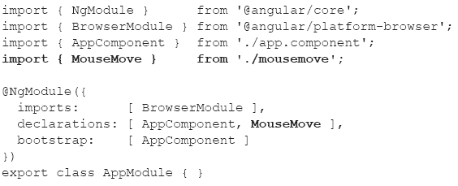

清单 2.12 导入了 `MouseMove` 类，并将此类添加到 `declarations` 属性中（两者均以粗体显示）。

## Angular 中的鼠标事件和用户输入

Angular 支持鼠标事件，并自动识别 `click`、`mousedown`、`mousemove`、`mouseover`、`mouseup` 和 `mousewheel` 事件。

以下代码片段向你展示了如何在标准 HTML 中指定一个带有事件处理程序的 `<button>` 元素：

```html
<button onclick="action()">Action</button>
```

以下代码片段向你展示了如何在 Angular 中指定一个带有事件处理程序的 `<button>` 元素：

```html
<button (click)="action($event)">Action</button>
```

清单 2.13 显示了 `mouseevents.ts` 的内容，说明了如何在 Angular 中处理 `mouseover` 事件。

### 清单2.13：mouseevents.ts

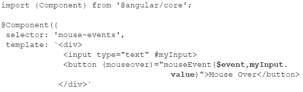

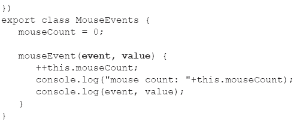

清单 2.13 包含一个模板属性，该属性由一个 `<div>` 元素、一个用户可以输入文本的 `<input>` 元素以及一个带有鼠标相关事件处理程序 `mouseEvent` 的 `<button>` 元素组成。表达式 `$event.myInput.value` 引用了 `<input>` 元素中的文本，该值被传递给 `mouseEvent()` 方法。

清单 2.13 的下一部分是导出的类 `MouseEvents`，它以变量 `mouseCount` 开头，初始值为 `0`。`MouseEvents` 的其余部分是 `mouseEvent()` 方法，该方法在每次 `mouseover` 事件期间递增并显示 `mouseCount` 的值，并显示 `<input>` 元素中的文本。

清单 2.14 显示了 `app.component.ts` 的内容，其中涉及一个用于 Angular 中鼠标相关事件的“通用” `<mouse-events>` 元素。请记住，此元素是一个自定义元素（即它不是 Angular 元素）。

### 清单2.14：app.component.ts

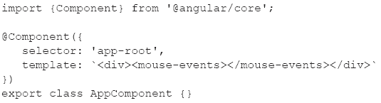

清单 2.14 包含一个模板属性，该属性由一个 `<div>` 元素组成，其中包含一个嵌套的 `<mouse-events>` 元素，后者是自定义组件 `MouseEvents` 中 `selector` 属性的值，该组件在 `mouseevents.ts` 中定义。本质上，组件 `AppComponent` 将 `mouseover` 事件的处理“委托”给 `MouseEvents` 组件，该组件定义了 `mouseEvent()` 函数来处理此类事件。

要通过鼠标点击捕获用户输入，请将 `<button>` 元素中的 `(mouseover)` 替换为 `(click)`（以及显示的文本），如下所示：

```html
<button (click)="mouseEvent($event,myInput.value)">Add</button>
```

记得更新 `app.module.ts` 的内容以包含 `MouseEvents` 类，如清单 2.15 所示。

### 清单2.15：app.module.ts

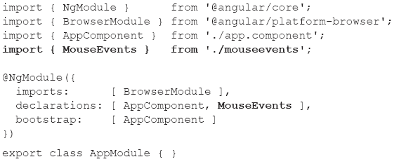

清单 2.15 很简单：它导入了 `MouseEvents` 类，并将此类添加到 `declarations` 属性中（以粗体显示）。

## 处理用户输入

本节中的代码示例演示了如何处理用户输入，并引入了 Angular 中*服务*的概念，该概念将在第 5 章中详细讨论。

正如你已经看到的，Angular 允许你创建对 HTML 元素的引用，如下所示：

```html
<input type="text" #user>
```

`#user` 语法创建了对 `<input>` 元素的引用，使你能够引用 `{{user.value}}` 来查看其值，或引用 `{{user.type}}` 来查看输入类型。此外，你可以在以下代码块中使用此引用：

```html
<p (click)="user.focus()">
获取输入焦点
</p>
<input type="text" #user (keyup)>
{{user.value}}
```

当用户点击 `<input>` 元素时，会调用 `focus()` 方法，而 `(keyup)` 属性会在 `keyup` 事件发生时更新输入框中的值。


将随附光盘中的 `TodoInput` 目录复制到方便的位置。清单 2.16 显示了 `app.component.ts` 的内容，说明了如何引用一个将用户输入追加到 Angular 数组中的组件。

### 清单2.16：app.component.ts

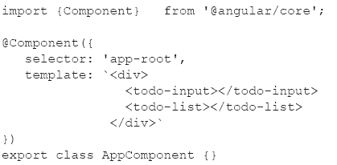

清单 2.16 包含一个标准的导入语句。`template` 属性指定了一个 `<div>` 元素，其中包含 `TodoInput` 和 `TodoList` 组件的占位符。

清单 2.17 显示了 `todoinput.ts` 的内容，说明了如何在 Angular 中显示一个 `<input>` 字段和一个 `<button>` 元素来捕获用户输入。

### 清单2.17：todoinput.ts

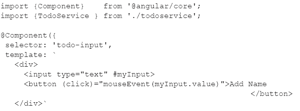

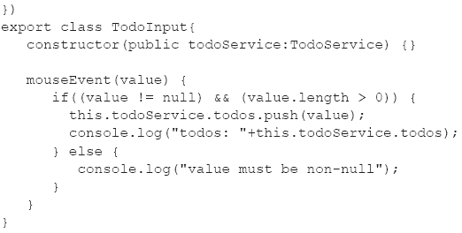

清单 2.17 包含一个 `template` 属性，该属性由一个 `<div>` 元素组成，其中包含一个用于用户输入的 `<input>` 元素，后跟一个用于处理鼠标点击事件的 `<button>` 元素。

`TodoInput` 类定义了一个空构造函数，该构造函数还初始化了自定义 `TodoService` 的一个实例，该实例在文件顶部导入。此实例包含一个数组 `todos`，当用户点击 `<button>` 元素时，该数组会更新新的待办事项，前提是新待办事项不是空字符串。

清单 2.18 显示了 `todolist.ts` 的内容，该文件跟踪待办事项列表中的项目。

### 清单2.18：todolist.ts

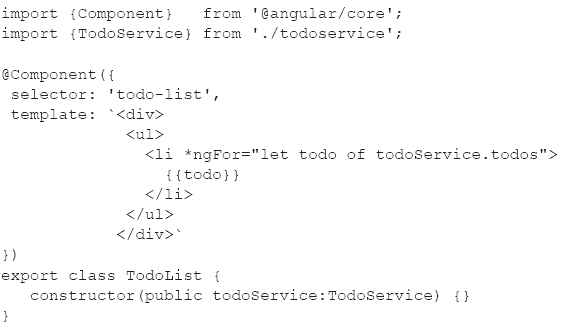

清单 2.18 包含一个 `template` 属性，其内容与清单 2.3 中 `template` 属性的内容类似，同时还有一个空构造函数，用于初始化 `TodoService` 自定义组件的实例。该实例在 `template` 属性中用于遍历 `todos` 数组中的元素。

清单 2.19 显示了 `todoservice.ts` 的内容，该文件跟踪待办事项列表。

### 清单2.19：todoservice.ts

```typescript
export class TodoService {
todos = [];
}
```

清单 2.19 包含一个 `todos` 数组，当用户点击根组件中的 `<button>` 元素时，该数组会更新新的待办事项。

最后，更新 `app.module.ts` 的内容，以包含清单 2.20 中加粗显示的类。

### 清单2.20：app.module.ts

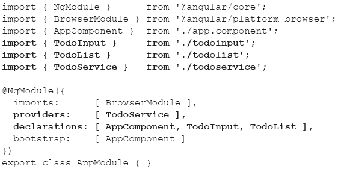

清单 2.20 导入了三个待办事项相关的类，并将它们添加到 `providers` 属性和 `declarations` 属性中（以粗体显示）。

## Angular 中的 moduleId 和 templateUrl

前面一节展示了如何在 `template` 属性中使用 `ngFor` 指令来遍历项目。Angular 还支持 `templateUrl` 属性，这意味着你可以将 `template` 属性中的代码移动到单独的文件中，将该文件的名称作为 `templateUrl` 属性进行引用。

例如，假设 `template` 属性中的代码放在 `itemdetails.html` 中。如果该文件与 `itemsapp.ts`（如下）位于同一目录，则必须包含 `moduleId` 属性来指示 `itemdetails.html`。如果没有 `moduleId` 属性，Angular 会假定 `itemdetails.html` 顶层目录。

> **注意**：使用 `moduleId` 属性为 `templateUrl` 属性指定相对路径。

清单 2.21 显示了 `itemsapp.ts` 的内容，该文件引用了 `itemdetails.html`，其中包含遍历列表的代码。`moduleId` 属性指示该文件与 `itemsapp.ts`位于同一目录。

### 清单2.21：itemsapp.ts

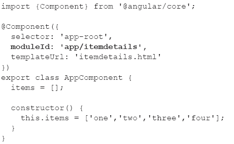

清单 2.21 包含一个 `templateUrl` 属性，该属性引用了 `itemdetails.html` 文件，其中包含显示 `items` 数组。清单 2.22 显示了 `itemdetails.html` 的内容，该文件包含显示 `items` 数组的代码，该数组在构造函数中初始化。

### 清单2.22：itemdetails.html

```html
<div *ngFor="let item of items">
{{item}}
</div>
```

你可以轻松地将清单 2.22 的内容移动到清单 2.21 的 `template` 属性中；此文件的唯一目的是你展示如何使用 `templateUrl` 属性。

## 在 Angular 中使用自定义类

你已经看到了表示自定义类的示例。本节向你展示如何使用自定义类的实例。

清单 2.23 显示了 `newuser.ts` 的内容，说明了如何创建一个用户的自定义类。

### 清单2.23：newuser.ts

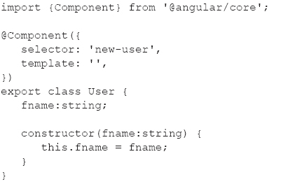

为了说明，清单 2.23 定义了一个非常简单的 `User` 自定义组件，该组件具有 `fname` 属性。

清单 2.24 显示了 `app.component.ts` 的内容，该文件使用 `User` 自定义组件填充一个数组，该数组包含由 `User` 类表示的用户组，然后在列表中显示与用户的信息。当属性之外还包含其他用户属性时，`User` 类显然更有用。

### 清单2.24：app.component.ts

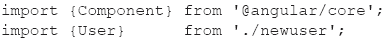

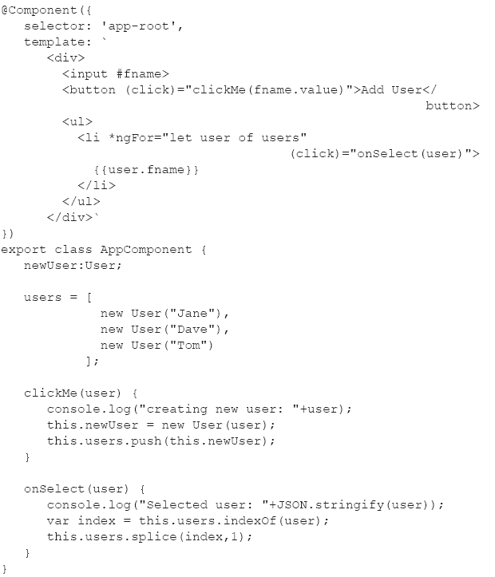

清单 2.24 包含一个 `template` 属性，该属性遍历 `users` 数组中的实例，并显示每个实例包含的名称。注意 `users` 数组在 `AppComponent` 组件中初始化：从 `newuser.ts` 中定义的 `User` 自定义组件创建了三个 `User` 实例。

清单 2.24 还包含一个 `clickMe()` 方法，当用户点击 `<button>` 元素时调用该方法，之后一个用户会被追加到 `users` 数组中。最后，清单 2.24 包含一个 `onSelect()` 方法，当用户在列表中选择不同的项目时调用该方法。

## 多个组件中的点击事件

一个 Angular 应用程序可以包含多个组件，每个组件都可以声明同名的事件处理程序。本节包含一个示例，展示 Angular 应用程序中点击事件的处理顺序。


将随附光盘中的 `ClickItems` 目录复制到方便的位置。清单 2.25 显示了 `app.component.ts` 的内容，该文件为列表中的每个项目声明了一个 `onClick()` 事件程序。

### 清单2.25：app.component.ts

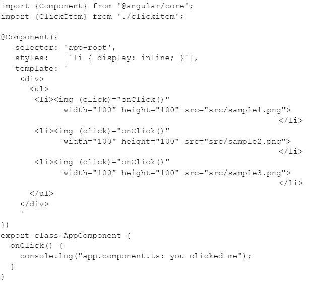

清单 2.25 中的 `template` 属性显示了一个无序列表，其中每个项目都是一个可点击的基于 PNG 的图像。当用户点击其中一个图像时，会调用 `onClick()` 方法，该方法仅通过 `console.log()` 显示一条消息。

清单 2.26 显示了 `clickitem.ts` 的内容，该文件为列表中的每个项目声明了一个 `onClick()` 事件处理程序。

### 清单2.26：clickitem.ts

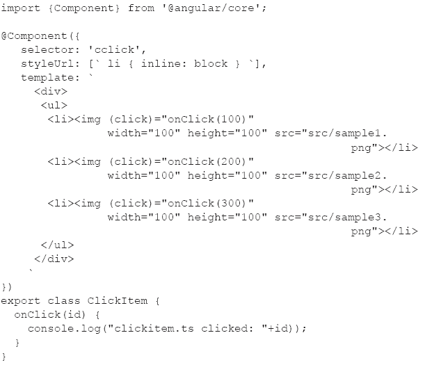

清单 2.26 在功能上与清单 2.25 类似。启动应用程序，在浏览器中的不同位置点击，并观察 Chrome Web Inspector 中显示的不同消息。

## 使用 @Input、@Output 和 EventEmitter

Angular 支持使用 `@Input` 和 `@Output` 注解在组件之间传递值。`@Input` 注解用于从父组件接收变量，而 `@Output` 注解则在给定值被修改时，将数据从组件发送（或“发射”）到其父组件。

此代码示例的输出结果并不出人意料。然而，该代码示例的目的是让你关注一些不太直观的代码片段（尤其是在 `app.module.ts` 中）。此外，该代码示例在 TypeScript 编译器 2.1.5 版本下能正常工作，但未来版本可能需要对代码进行修改（请记住这一点）。


现在，将随附光盘中的 `ParentChildEmitters` 目录复制到一个方便的位置。清单 2.27 显示了 `app.component.ts` 的内容，展示了如何从父组件更新子组件属性的值。

### 清单2.27：app.component.ts

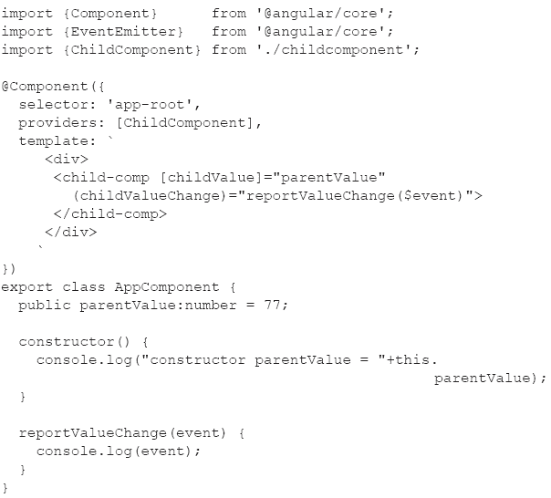

清单 2.27 中的模板属性包含一个顶级 `<div>` 元素，该元素内有一个 `<child-comp>` 元素，它有两个属性，如下所示：

```html
<child-comp [childValue]="parentValue" (childValueChange)="reportValueChange($event)">
</child-comp>
```

`[childValue]` 属性将 `parentValue` 的值赋给 `childValue`。清单 2.27 的下一部分是导出的类，它包含 `reportValueChange` 方法，该方法通过 `console.log()` 显示一条消息。

清单 2.28 显示了 `childcomponent.ts` 的内容，展示了如何使用 `EventEmitter` 类型。

### 清单2.28：childcomponent.ts

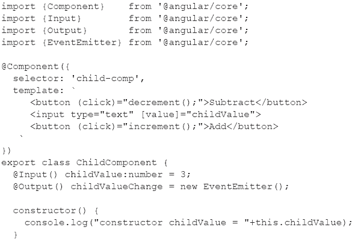


清单 2.28 包含一个 `childValueChange` 属性，其类型为 `EventEmitter`。清单 2.28 的下一部分是导出的类，它包含 `increment()` 和 `decrement()` 方法，该方法分别增加和减少 `childValue`。

```typescript
this.childValueChange.emit({
  value: this.childValue
})
```

按照清单 2.29 所示更新 `app.module.ts` 的内容，*这与前面示例中的代码不同*。

### 清单2.29：app.module.ts

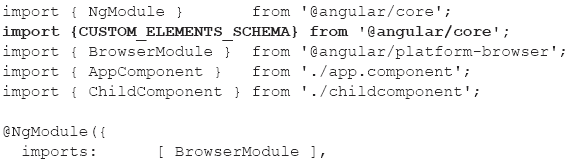

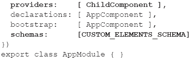

如果你在 `declarations` 属性中指定 `ChildComponent` 而不是 `providers` 属性，你可能会看到错误消息：

```
"Can't bind to <child-comp> since it isn't a known native property"
```

## 展示型组件

展示型组件接收数据作为输入，并生成视图作为输出（因此它们不维护应用程序状态）。考虑以下组件：

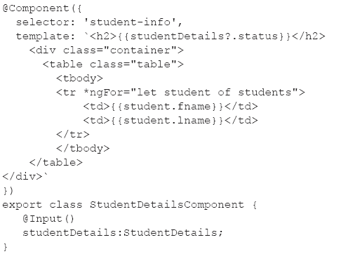

`StudentDetailsComponent` 组件主要承担展示职责。该组件接收输入数据并将其显示在屏幕上。因此，该组件是可复用的。

相比之下，特定于应用程序的组件（也称为“智能”组件）与特定的 Angular 应用程序紧密耦合。因此，智能组件可以包含展示型组件（但反之则不成立）。

由于数据是同步传递给此组件的（而不是通过 `Observable`），数据最初可能不存在，这就是包含所谓的 Elvis 运算符（模板中的“?”）的原因。


## Angular 中的样式元素和 Shadow DOM

Angular 支持层叠样式表（CSS）封装，这意味着 CSS 选择器只会匹配在同一自定义组件中定义的元素。这种封装之所以可行，是因为 Angular 中的 `ShadowDOM` 模拟。具体来说，这涉及导入 `ViewEncapsulation` 的 `import` 语句，并指定以下值之一：

-  `ViewEncapsulation.Emulated`

-  `ViewEncapsulations.Native`

-  `ViewEncapsulation.None`

组件的默认值是 `ViewEncapsulation.Emulated`，它会在样式旁边输出类的命名空间，并继承全局样式。相比之下，`ViewEncapsulations.Native` 使用原生 `ShadowDOM`（并非所有浏览器都支持），并且会丢失全局样式。最后，`ViewEncapsulation.None` 会移除组件中的所有样式封装。

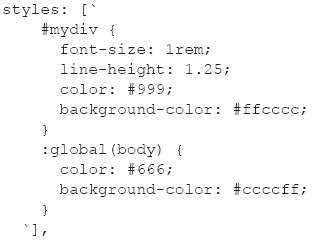


将随附光盘中的 `ViewEncapsulation` 目录复制到一个方便的位置。清单 2.30 显示了 `app.component.ts` 的内容，其中包含一个 CSS 选择器，该选择器匹配 `app.component.ts` 中的 `<button>` 元素，但不匹配 `index.html` 中的 `<button>` 元素。

### 清单 2.30：app.component.ts

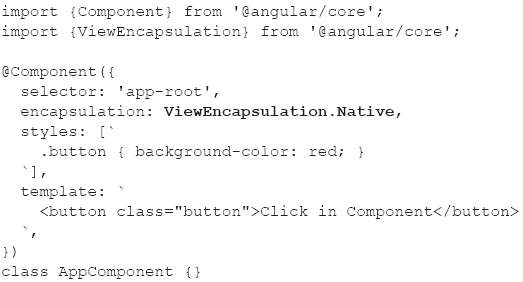

清单 2.30 包含两条 `import` 语句和一个 `encapsulation` 属性，其值设置为 `ViewEncapsulation.Native`。接下来，`styles` 属性为模板部分中声明的 `<button>` 元素指定了红色。

现在修改 `index.html` 中的 `<body>` 元素，添加一个 `<button>` 元素，如下所示：

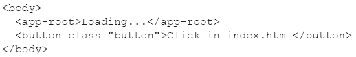

启动 Angular 应用程序，你将看到组件中有一个红色的 `<button>` 元素，而 HTML 页面中有一个深灰色的 `<button>` 元素。

## Angular UI 组件

本章中的代码示例向你展示了如何在 Angular 应用程序中使用 HTML 小部件。然而，你也可以使用作为 HTML 小部件“包装器”的 Angular UI 组件。Angular 官方网站包含大量 UI 组件集合：

[`angular.io/resources/#!#UI%20Components`](https://angular.io/resources/)

上述网站包含指向其他工具包的链接，例如 `ng-bootstrap`（Bootstrap 的原生 Angular 2 指令）和 Angular Material 2（Angular 2 的 Material Design 组件）。

以下网站包含大量 Angular UI 组件（例如表格、树、菜单和图表）：

[`github.com/brillout/awesome-angular-components`](https://github.com/brillout/awesome-angular-components)

请记住，上述链接中的 UI 组件适用于 Angular 2，因此最好在最新版本的 Angular 中测试它们。此外，第 5 章 包含一些在 Angular 4 版本中确实可用的表单相关 UI 组件。

你也可以通过互联网搜索其他开源（或商业）替代方案，以确定哪种方案适合你的需求。

## Angular 的新特性

Angular 的一些新特性包括在 `ngIf` 指令中支持 if/else 逻辑，以及 `NgComponentOutlet` 指令。

`ngIf` 指令根据表达式的值有条件地包含一个模板。接着，`ngIf` 会计算表达式，然后根据表达式为真值或假值，分别渲染 `then` 或 `else` 模板。通常，`then` 模板是 `ngIf` 的内联模板，除非绑定到不同的值；而 `else` 模板默认为空，除非进行了绑定。更多信息请参见此处：

[`angular.io/docs/ts/latest/api/common/index/NgIfdirective.html`](https://angular.io/docs/ts/latest/api/common/index/NgIfdirective.html)

`NgComponentOutlet` 指令是一个实验性指令，提供了一种声明式方法来创建动态组件，示例如下：

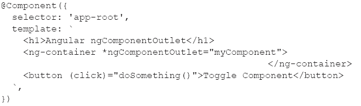

你可能已经猜到，`ng-container` 指令是一个用于“分组”节点的逻辑容器。在前面的代码块中，`ng-container` 指令包含一个 `NgComponentOutlet`，其值为 `Input` 类型，而 `Input` 又引用了一个自定义组件。接下来，请确保将动态组件添加到 `ngModule` 的 `entryComponents` 部分，如下所示：

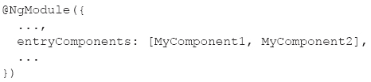

`NgComponentOutlet` 指令支持其他选项，详情请参见此处：

[`angular.io/docs/ts/latest/api/common/index/NgComponentOutlet-directive.html`](https://angular.io/docs/ts/latest/api/common/index/NgComponentOutlet-directive.html)

## 总结

本章介绍了如何在 Angular 应用程序中使用 UI 控件。你学习了如何渲染按钮、如何渲染名称列表，以及如何从这些列表中添加和删除名称。你还了解了条件逻辑以及如何创建子组件。

接着，你学习了如何处理鼠标相关事件，例如 `mousemove` 事件。然后你学习了父组件与子组件之间的通信，随后讨论了表示型组件。你还学习了如何在 Angular 应用程序中指定不同类型的 CSS 封装。最后，简要介绍了 Angular 中一些与 UI 相关的新特性。

# 第 3 章：图形与动画

本章介绍如何通过 HTML5 技术和各种开源工具包，在 Angular 应用程序中创建图形和动画效果。本章之所以较早地引入图形相关内容，是因为图形提供了一种有趣的学习技术的方式。即使你不打算在 Angular 应用程序中使用图形和动画，也值得浏览本章内容，因为图形提供了一种有趣的学习技术的方式。很快会看到，本章的代码示例使用了与 Angular 无关的技术，例如缩放图形（`SVG`）、数据驱动（`D3`）、GreenSock 动画平台（`GSAP`）、层叠样式表（`CSS3`）和 jQuery。实际上，有一个示例使用了“纯”`CSS3` 在 Angular 应用程序中创建动画，然后将其改编为使用 Angular 的 `animations` 属性。如果你是图形效果方面的新手，可能是学习如何使用 Angular 创建图形和效果的最快途径。因此，你将受益于两个原因：首先，“Angular 方式”动画效果有相当多的文档；其次，无需花费额外时间学习使用无关技术在 Angular 中创建动画。本章的第一节讨论了 Angular 生命周期，部分原因是本章中 GSAP 相关的代码示例。关于本章代码示例的一个重要说明：它们假设你具备 `SVG`、`D3`、`GSAP` 和 `CSS3` 的基础。如果你对这些技术不熟悉，可以阅读描述其功能的教程，或者深入代码示例，找出需要从在线资源中学习。即使你决定跳过图形示例，也阅读本章第一节，该节提供了有关 Angular 应用程序的有用信息。本章第二节展示了如何在 `SVG` 以及 `D3` 中渲染图形和效果。尽管本节中的示例非常简单，但它们提供了起点，以便在 Angular 应用程序中创建此类效果。第三节包含基于 `D3` 的图形和效果示例。如果你还不知道，`D3` 是极其流行且非常适合可视化的开源工具。第四节包含一个使用“纯”`CSS3` 创建动画的示例，以及将 `CSS3` 与 jQuery 结合的代码示例。接下来你将学习如何在 Angular 应用程序中处理鼠标事件。最后一节要讨论了用于创建图表和图形的 Angular 模块 `ng2-charts`。当你从配套光盘复制项目目录时，如果 `node_modules` 目录不存在，请复制该项目内已软链接的顶层 `node_modules` 目录（大多数示例都是这种情况）。在深入图形相关的代码示例之前，让我们先看看 Angular 生命周期方法。

## Angular 生命周期方法

（此处文省略关于 `ElementRef`、`Renderer` 的说明）

由于 Angular 在创建组件时会调用该组件的构造函数，因此构造函数是初始化组件状态的便捷位置。然而，在访问子组件中定义的任何属性或数据之前，必须先初始化子组件。在这种情况下，应将自定义代码放在 `ngOnInit` 生命周期方法中，以便从子组件访问数据。

完整的 Angular 生命周期事件列表位于此处：

[`angular.io/docs/ts/latest/api/common/index/NgIfdirective.html`](此处为重复链接）

## Angular 生命周期方法

Angular 应用程序具有生命周期方法，你可以在其中放置自定义代码来处理各种事件（应用程序启动、运行等）。生命周期钩子接口在 `@angular/core` 库中，如下所示：

-  `OnInit`

-  `OnDestroy`

-  `DoCheck`

-  `OnChanges`

-  `AfterContentInit`

-  `AfterContentChecked`

-  `AfterViewInit`

-  `AfterViewChecked`

每个接口都有一个方法，其方法名是接口名前缀 `ng`。例如，`OnInit` 接口有一个名为 `ngOnInit` 的方法。Angular 按以下顺序调用这些生命周期方法：

-  `ngOnChanges`：当输入或输出绑定值发生变化时调用

-  `ngOnInit`：在第一次 `ngOnChanges` 之后调用

-  `ngDoCheck`：开发者的自定义变更检测

-  `ngAfterContentInit`：组件内容初始化后调用

-  `ngAfterContentChecked`：每次检查组件内容后调用

-  `ngAfterViewInit`：组件视图初始化后调用

-  `ngAfterViewChecked`：每次检查组件视图后调用

-  `ngOnDestroy`：在指令销毁之前调用。

## 注意


*当你从配套光盘复制项目目录时，如果 `node_modules` 目录不存在，请复制项目内已软链接的顶层 `node_modules` 目录（大多数示例都是这种情况）。*

## Angular 生命周期方法与与与与与方法

（此处部分为重复文本排版，已已按逻辑逻辑））

本节中的代码示例是一个简单的图形效果演示，您可以通过将 `Angular` 与 `GSAP` 结合来创建这些效果。涉及 `SVG`、`GSAP` 和 `Angular`（但使用 beta 级别的 `Angular` 代码）的各种示例位于此处：

[`github.com/ocampesato/react-svg-gsapi`](https://github.com/ocampesato/react-svg-gsapi)

下一节将向您展示如何在 `Angular` 应用中添加 CSS3 动画效果。

## Angular 中的 CSS3 动画效果

本节中的代码示例通过添加 CSS3 动画效果，增强了上一节中的代码示例。


将随附光盘中的 `SimpleCSS3Anim` 目录复制到一个方便的位置。清单 3.6 显示了 `app.component.ts` 的内容，演示了当用户将鼠标悬停在每个列表项上时，如何更改列表项的颜色。

清单 3.6：app.component.ts

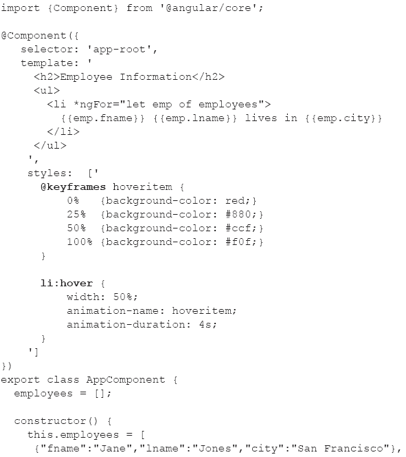

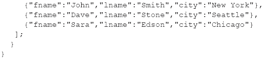

清单 3.6 包含 `styles` 属性，其中包含一个 `@keyframes` 定义，用于创建涉及颜色变化的动画效果。`styles` 属性还包含一个 `li:hover` 选择器，该选择器引用了 `@keyframes` 定义，并指定了动画效果的持续时间为 4 秒。您看到的颜色在 `@keyframes` 定义中指定。

启动 `Angular` 应用。当名称列表在浏览器中显示时，将鼠标缓慢移动到每个名称上，观察其颜色变化。尽管这个例子确实很简单，但您可以修改其内容以实现其他基于 CSS3 的动画效果。

## 通过“Angular 方式”实现动画效果

本节中的代码示例也通过添加一些 CSS3 选择器来创建动画效果。


将随附光盘中的 `SimpleNG2Anim` 目录复制到一个方便的位置。清单 3.7 显示了 `app.component.ts` 的内容，演示了当用户将鼠标悬停在 `<li>` 元素上时，如何移动它们的位置。此代码基于对清单 3.6 中代码的修改（稍后讨论）。

清单 3.7：app.component.ts

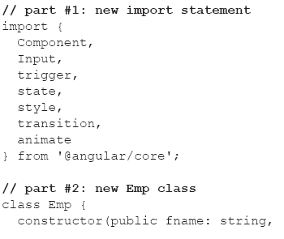

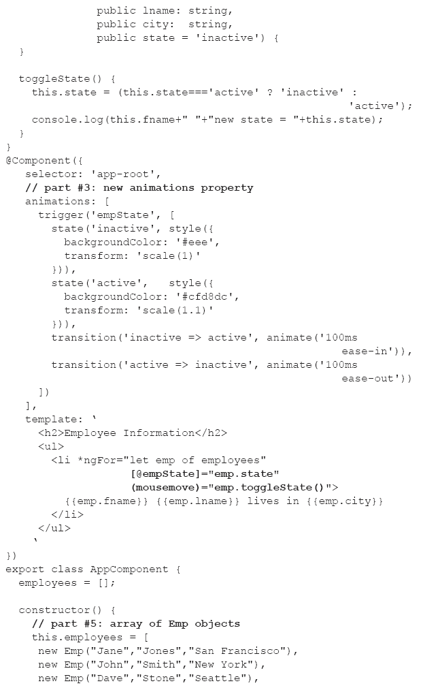

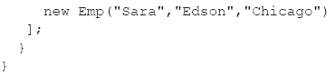

清单 3.7 对清单 3.6 中的代码进行了五处修改。具体来说，标记为“part #1”的部分是一个新的导入语句，替换了原来的导入语句。标记为“part #2”的部分是新添加的 `Emp` 类，用于保存每个员工的数据。

标记为“part #3”的部分是新的 `transitions` 属性，它定义了动画事件触发时的行为（当鼠标移动事件“悬停”在 `<li>` 元素上时发生）。`ngFor` 元素中粗体部分（未标记，但为“part #4”）本质上将鼠标移动事件绑定到 `Emp` 类中的 `toggleState()` 方法。最后，标记为“part #5”的部分是一个 `Emp` 对象数组，替换了原来的数组，其中每个员工表示为 JavaScript 对象表示法（JSON）字符串。

## Angular 中的基本 SVG 示例

本节中的代码示例向您展示如何指定一个包含 `SVG` 代码的自定义组件，用于显示 `SVG` 元素。此示例作为下一节代码的基础，下一节涉及动态创建 `SVG` 元素并将其附加到 DOM。


将目录 `SVGEllipse1` 从配套光盘复制到一个方便的位置。清单 3.8 显示了 `app.component.ts` 的内容，该文件引用了一个 `Angular` 自定义组件，用于渲染 `SVG` 椭圆。

### 清单 3.8: app.component.ts

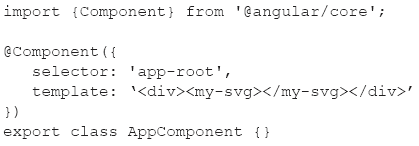

清单 3.8 非常简单：代码定义了一个组件，其模板属性包含一个自定义的 `<my-svg>` 元素，该元素位于 `<div>` 元素内部。

清单 3.9 显示了 `MyEllipse1.ts` 的内容，其中包含用于 `SVG` 椭圆的 `SVG` 代码。

### 清单 3.9: MyEllipse1.ts

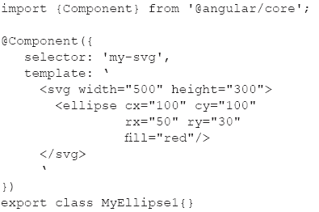

清单 3.9 很直接：模板属性包含一个带有 `width` 和 `height` 属性的 `SVG` `<svg>` 元素，以及一个 `<ellipse>` 元素，该元素为必需属性 `cx`、`cy`、`rx`、`ry` 和 `fill`。

清单 3.10 显示了 `app.module.ts` 的内容，其中新内容以其显示。

### 清单 3.10: app.module.ts

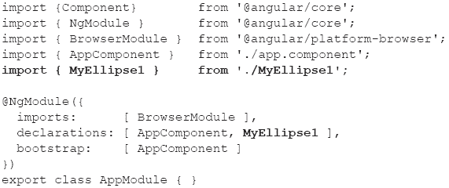

清单 3.10 包含你从第 2 章熟悉的通用代码，以及一个 `MyEllipse1` 类的新导入语句。清单 3.10 中的另一个修改是在 `declarations` 数组中包含了 `MyEllipse1` 类。

启动 `Angular` 应用，你将看到一个彩色的 `SVG` 椭圆。

### 顺便一下，以下链接解释了如何创建 `SVG` 渐变，以及如何在 `Angular` 应用中创建 `SVG` 渐变：[developer.mozilla.org/en-US/docs/SVG/Tutorial/Gradients](https://developer.mozilla.org/en-US/docs/SVG/Tutorial/Gradients)

[`medium.com/@OlegVarsin/how-to-proper-use-svg-gradients-in-angularjs-224167e4de2ah0z1k`](https://medium.com/@OlegVarsin/how-to-proper-use-svg-gradients-in-angularjs-224167e4de2ah0z1k)

## Angular 与 SVG 中的跟随效果


本节中的代码示例创建了一个组件，并使用鼠标事件来创建动态图形。将目录 `SVGFollowMe` 从配套光盘复制到一个方便的位置。清单 3.11 显示了 `app.component.ts` 的内容，该文件说明了如何引用一个 `Angular` 组件，该组件在当前鼠标位置渲染一个 `SVG` `<ellipse>` 元素。

### 清单 3.11: app.component.ts

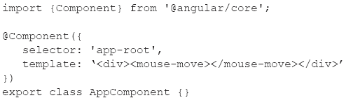

如你见，清单 3.11 中的模板属性指定了一个 `<div>` 元素，该元素包含一个 `<svg>` 元素。清单 3.12 显示了 `MouseMove.ts` 的内容，该文件说明了如何引用一个 `Angular` 组件，该组件在当前鼠标位置渲染一个 `SVG` `<ellipse>` 元素。

### 清单 3.12: MouseMove.ts

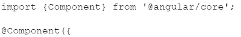

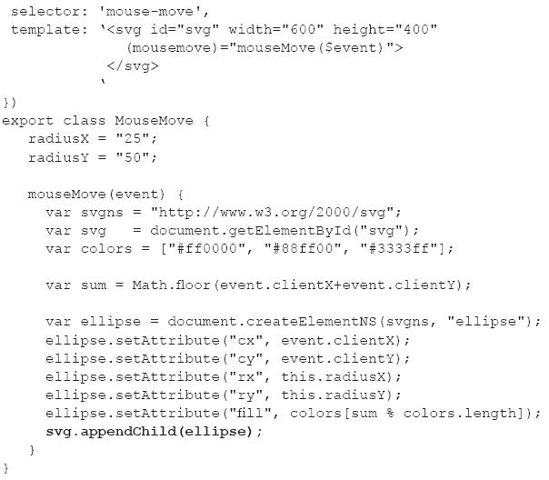

清单 3.12 包含一个模板属性，该属性定义了一个 `<svg>` 元素。每当用户移动鼠标时，`(mousemove)` 事件就会执行，进而执行自定义方法 `mouse()`。`mouse()` 方法接受一个 `event` 参数，该参数是一个对象，坐标由 `event.clientX` 和 `event.clientY` 指定，分别是当前鼠标位置的 x 和 y 坐标。

`mouse()` 方法中的下一个代码块动态创建一个 `<ellipse>` 元素，设置五个必需属性的值，然后将新创建的 `SVG` 元素附加到 DOM。注意，`mouse()` 方法中的最后一行将 `SVG` 元素直接附加到 DOM；如果可能，避免这种方法。

### 清单 3.13: app.module.ts

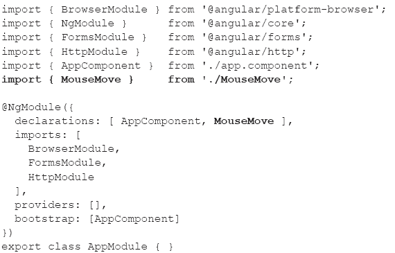

清单 3.13 中的代码遵循一个熟悉的模式：从“基线”代码开始，添加一个导入语句，引用一个导出的类（本例中为 `MouseMove`），并将同一个类添加到 `declarations` 数组中。启动 `Angular` 应用。在浏览器会话启动后，慢慢移动鼠标你会你会鼠标附近渲染出不同颜色的 `SVG` 椭圆。作为练习，修改 `MouseMove.ts` 中的代码，使新的 `SVG` 椭圆居于鼠标下方。

## D3 与 Angular

前两节展示了带有 `SVG` 的 `Angular` 应用示例。本节展示如何将 `D3` 与 `Angular` 结合使用。注意，代码示例也将 `SVG` 元素直接附加到 DOM。如果你不知道，`D3` 是一个开源工具包，它提供了基于 JavaScript 的 `SVG` 抽象层。幸运的是，每个 `SVG` 元素的属性与你在 `D3` 中指定的属性相同（因此工作量减少了一半）。


将目录 `D3Angular2` 从配套光盘复制到一个方便的位置。清单 3.14 显示了 `app.component.ts` 的内容，该文件说明了如何在 `Angular` 应用中使用 `D3` 渲染基本的 `SVG` 图形。

### 清单 3.14: app.component.ts

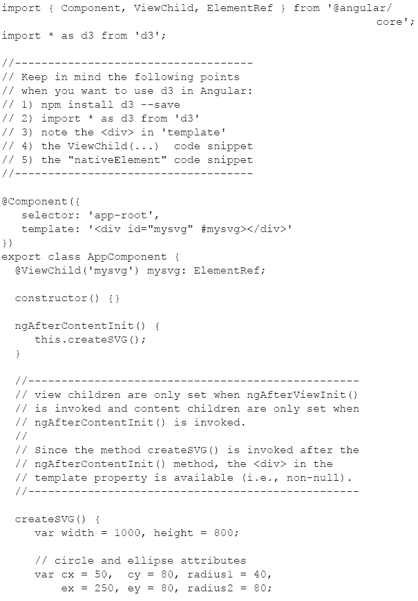

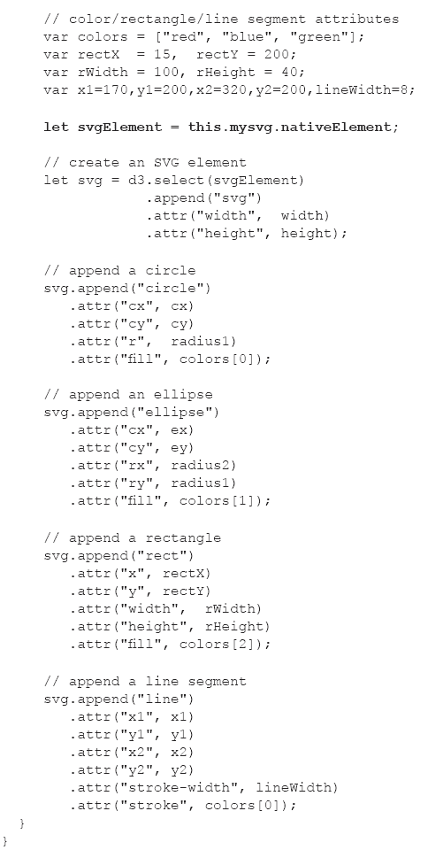

清单 3.14 以两个导入语句开头，随后是一个注释块，总结了在 `Angular` 应用中使用 `D3.js` 的关键点。模板属性包含一个 `<div>` 元素，该元素在 `ngAfterContentInit` 方法中可用，该方法随后调用 `createSVG()` 方法，该方法用四个形状（一个圆、一个椭圆、一个矩形和一条线段）填充 `SVG` `<svg>` 元素。

注意 `@ViewChild` 装饰器定义了变量 `mysvg`，其类型为 `ElementRef`；该变量将模板中的 `<div>` 元素与 `createSVG()` 方法中定义的变量 `svgElement` 链接起来：

```
let svgElement = this.mysvg.nativeElement;
```

注意各种 SVG 元素是如何动态创建的，以及它们的必需属性是如何通过 `attr()` 方法赋值的，如下所示：

```
// 附加一个圆
svg.append("circle")
  .attr("cx", cx)
  .attr("cy", cy)
  .attr("r", radius1)
  .attr("fill", colors[0]);
```

在学习了 `SVG` 元素的必需属性名称后，你可以使用上述语法创建并将这些元素附加到 DOM。你还可以在此处找到许多涉及 `SVG` 和 `Angular`（使用 beta 版本的 `Angular` 代码）的类似代码示例：

[`github.com/ocampesato/angular2-svg-graphics`](https://github.com/ocampesato/angular2-svg-graphics)


上述代码块产生了一个涉及倾斜、缩放和旋转变换以及阴影效果的变换效果。上述代码块中以粗体显示的两行将 `animCube1`（在其他地方定义）中的动画效果“链接”到选择器 `skewAnim1`，并指定动画效果的持续时间为 10 秒（10s）。

## “Angular 方式”的动画效果

现在你已经看到了使用各种其他技术创建图形和动画效果的 Angular 应用程序，本节包含一个代码示例，其中涉及基于 CSS 的功能和少量 Bootstrap 代码的动画效果。如果你不熟悉 Bootstrap，仍然可以跟随其余代码并查看动画效果。


将随附光盘中的 `NgGraphicsAnimation` 目录复制到一个方便的位置。清单 3.20 显示了 `app.component.html` 的内容，其中包含用于渲染两个 `<div>`` 元素和两个触发动画效果的 `<button>` 元素的 HTML 标记。

### 清单 3.20：app.component.html

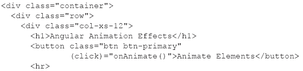

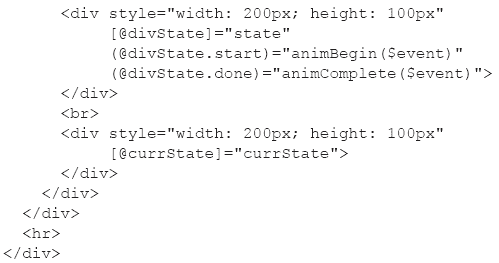

清单 3.20 包含三个嵌套的 `<div>` 元素，分别具有 Bootstrap 的 `container` 类、`row` 类和 `col-xs-12` 类。最内层的 `<div>` 元素包含一个 `<button>` 元素，当用户点击该按钮时，会触发动画效果（如清单 3.21 所示）。点击按钮会调用 `onAnimate()` 方法，该方法更新变量 `state` 和 `currState` 的值。

清单 3.20 的下一部分是一个 `<div>` 元素，它根据 `state` 属性的值进行更新，该值可以是 `normal` 或 `animated`。这两个值中的每一个都在你将在清单 3.21 中看到的 `animations` 属性中有对应的条目。这个 `<div>` 元素显示为椭圆，因为 `width` 和 `height` 属性不同，并且由于 `border-radius` 属性。

请注意，第二个 `<div>` 元素有一个基于 `currState` 值的 `@currState` 属性，而第一个 `<div>` 元素基于 `state` 的值。

### 清单 3.21：app.component.ts

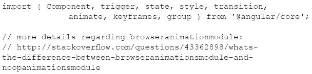

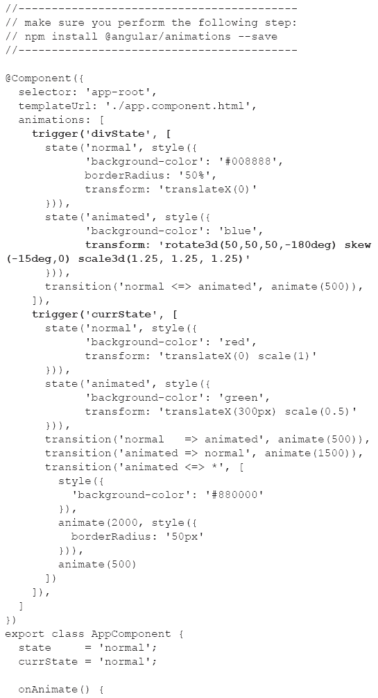

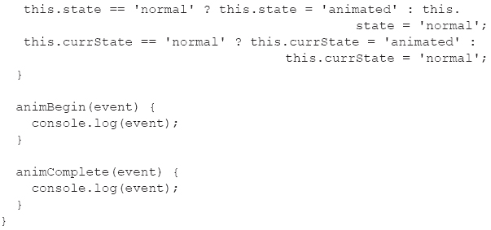

清单 3.21 包含一段较长的 `animations` 属性代码块，其中包含两个触发器函数（均以粗体显示）。第一个触发器根据 `divState` 的值是 `normal` 还是 `animated` 来执行一段代码。类似地，第二个触发器根据 `currState` 的值是 `normal` 还是 `animated` 来执行一段代码。

在所有四种情况下，都会更新一组简单的 CSS 属性来设置背景颜色和 `transform` 方法。除了此代码示例中的 CSS 变换之外，你还可以使用许多其他 CSS 变换，包括 `rotate()`、`perspective()`、`matrix()` 以及其他 3D CSS3 变换。

第一个触发器的第二个状态中的变换值很有趣，如下所示：

```
transform: 'rotate3d(50,50,50,-180deg) skew(-15deg,0) scale3d(1.25, 1.25, 1.25)'
```

上述变换是 3D 旋转、2D 倾斜效果和 3D 缩放效果的组合。如果你需要创建复杂的视觉效果，请放心，CSS3 提供了一组极其强大的变换，用于创建丰富且美观的视觉效果。视觉效果的选择显然取决于目标受众（例如，企业环境与高中生）。

请注意，第二个 `trigger()` 函数包含多个 `transition()` 函数，这些函数指定了 `<div>` 元素的行为。例如，第一个 `transition()` 指定了从正常状态过渡到动画状态时的持续时间为 500 毫秒，而反向过渡则持续 1500 毫秒。第三个 `transition()` 指定了在更新 `background-color` 属性和 `borderRadius` 属性时的持续时间为 500 毫秒。

清单 3.22 显示了 `app.module.ts` 的内容，其中新增内容以粗体显示。

### 清单 3.22：app.module.ts

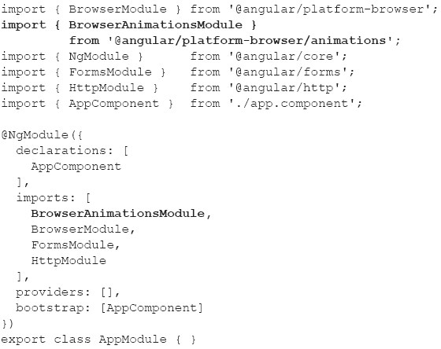

清单 3.22 中的代码包含你熟悉的代码，以及以粗体显示的代码，这些代码对于动画效果是必需的。

## Angular 图表

Angular 有多个开源包提供图表。其中之一是 `ng2-charts`，用于创建图表和图形，其主页位于 `mean.expert/2016/09/17/angular-chart-component-revised/`。另一个选项是 `ng2d3` 框架，它是一个 Angular + D3 可用的图表框架，其主页位于 `github.com/swimlane/ng2d3`。

`ng2d3` 框架使用 Angular 来渲染 SVG 元素，并使用 D3 进行数学、坐标轴和形状生成等。请注意，Angular 负责实际的渲染。此外，`ng2d3` 支持自定义，可以通过 CSS 进行自定义。

## 总结

本章向你展示了如何在 Angular 应用程序中渲染 SVG 图形。学习了如何使用 D3 和 GSAP 创建图形和动画效果，在一种情况下你看到了如何自定义代码放置在 Angular 生命周期方法中，以便应用效果。此外，你学习了如何在 Angular 中使用纯 图形和动画效果。

## 第 4 章：HTTP 请求与路由

本章向你展示如何在 Angular 应用程序中发起 HTTP 请求，以及如何在 Angular 应用程序中使用 `Observable`。示例展示了如何从各种来源获取数据，以及从 `Promise` 创建 `Observable`。如果需要，你可以访问各种教程，其中关于 `Observable` 和 `Promise` 的介绍。

第一部分讨论了依赖注入（DI）和 `@Injectable` 装饰器。第二部分展示了如何在 Angular 应用程序中发起 HTTP 请求以读取文件中定义的 JSON 数据。第三部分展示了如何在 Angular 应用程序中发起 HTTP 请求以检索 GitHub 信息。你还将看到通过 `forkJoin()` 方法发起并发请求。本章的最后一部分讨论了 Angular 中的路由。


当你从配套光盘复制项目时，如果 `node_modules` 目录不存在，请复制该目录。

## Angular 中的依赖注入

Angular 提供了一种简单的依赖注入机制：依赖项被注入到类的构造函数中。你可以通过在类的构造函数中指定参数来注入依赖项。

`Injectable` 装饰器，以及一个包含想要注入类型的构造函数。本中的代码示例使用了 `Http` 服务，该服务也在 TypeScript 文件中导入。

你需要执行两个简单的步骤：首先，在 `app.component.ts`（以及可能的自定义类）中导入 `Http`，然后更新 `app.module.ts` 的内容。

例如，以下代码块（步骤 1）注入了 `Http` 类的一个实例：

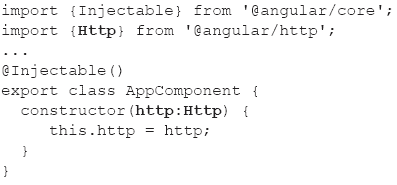

`Http` 模块使用 `rxjs` 在 Angular 中返回 `Observable`。正如你在前面的代码中看到的，`Injectable` 服务位于 `@angular/core` 中，而 `Http` 服务位于 `@angular/http` 中。当你导入 `Http` 时，还必须更新 `app.module.ts` 的内容。

步骤 2 涉及更新 `app.module.ts`，如下所示：

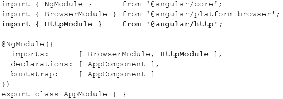

从 `@angular/http` 导入了 `HttpModule`，并将其指定为 `imports` 属性中的依赖项。

## 使用 jQuery 和 Angular 进行 Flickr 图像搜索

本节中的代码示例展示了如何在 Angular 应用程序中使用 jQuery，这对于通过 jQuery 执行 HTTP 请求的现有 Web 页面非常有用。


将配套光盘中的 `SearchFlickr` 目录复制到方便的位置。注意，文件 `index.html` 包含以下代码片段，该片段允许在此项目中使用 jQuery：

```
<script src="http://code.jquery.com/jquery-latest.js"></script>
```

清单 4.1 显示了 `app.component.ts` 的内容，该文件演示了如何发起 HTTP GET 请求从 Flickr 检索图像。此请求基于用户在搜索框中输入的文本字符串。

### 清单 4.1：app.component.ts

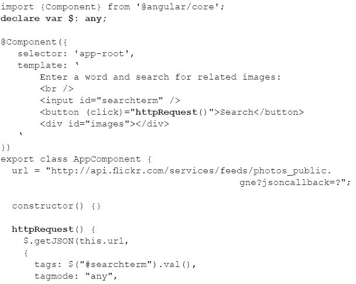


清单 4.1 包含一个标准的导入语句，后跟以下代码片段：

```
declare var $: any;
```

代码片段对于 TypeScript 能够“找到”通过 `index.html` 中的 `<script>` 元素加载的 jQuery 是必需的。如果你删除前面的代码片段，你将看到以下错误：

```
app/app.component.ts(20,5): error TS2304: Cannot find name '$'.
```

清单 4.1 的下一部分是 `@Component` 装饰器，其 `template` 属性包含 `<input>`、`<button>` 和 `<div>` 元素，分别用于捕获用户的搜索字符串、使用该字符串执行搜索以及显示搜索结果。

清单 4.1 的下一部分是导出的类 `AppComponent`，它定义了 `url` 变量，该变量初始化为一个硬编码的字符串值，该值“指向” Flickr 网站。

接下来，定义了一个空的构造函数，后跟 `httpRequest()` 方法，该方法在用户单击 `<button>` 元素时被调用。此方法调用 jQuery 的 `getJSON()` 方法，该方法基于在 `<input>` 元素中输入的文本字符串执行 Flickr 图像搜索，原因在于以下代码片段：

```
tags: $("#searchterm").val()
```

检索到匹配的图像时，它们通过 `data.items` 可用，并且 jQuery 的 `each()` 方法遍历图像列表。每个图像通过以下代码片段动态插入到 `<images>` 元素中：

```
$("").attr("src", item.url)
```


清单 4.1 的最后部分是 `AppComponent` 类，它定义了 `url` 变量，该变量初始化为一个硬编码的字符串值，该值“指向”Flickr 网站。


`AppComponent` 类包含变量 `employees`，后面跟着一个构造函数，该构造函数初始化了 `http` 变量，它是 `Http` 类的一个实例。`httpRequest()` 方法包含发起 HTTP GET 请求的代码，该请求返回一个 `Observable`。`subscribe()` 方法包含常规代码，在本例中，它还从子目录 `app/src` 中的文件 `employees.json` 的内容初始化了 `employees` 数组。

清单 4.6 显示了 `employees.json` 的内容，其中包含员工相关信息。该文件位于 `src/app` 子目录中，如清单 4.5 中的粗体所示。

### 清单 4.6: employees.json

```json
[
  {"fname":"Jane","lname":"Jones","city":"San Francisco"},
  {"fname":"John","lname":"Smith","city":"New York"},
  {"fname":"Dave","lname":"Stone","city":"Seattle"},
  {"fname":"Sara","lname":"Edson","city":"Chicago"}
]
```

清单 4.7 显示了 `app.module.ts` 的内容，该文件导入了 Angular 的 `HttpModule`。

### 清单 4.7: app.module.ts


清单 4.7 包含一组标准的 import 语句，以及 `HttpModule`，后者列在 `@NgModule` 装饰器的 imports 数组中。


**图 4.3** 来自 JSON 文件的员工列表。

图 4.3 显示了启动此 Angular 应用程序并从文件中检索基于 JSON 的员工数据后的输出。

下一节包含一个使用 `forkjoin()` 的示例，其代码与清单 4.5 的内容类似。

## 在 Angular 中使用 forkJoin() 进行多个并发请求

上一节中的代码示例读取了单个文件的内容。然而，在某些情况下，您可能需要从多个源加载数据，延迟加载后的逻辑，直到所有数据都加载完毕。`Observables` 提供了一种名为 `forkJoin()` 的方法来“包装”多个 `Observables`，并发出多个并发的 `http.get()` 请求。请注意，如果任何一个单独的请求失败，整个操作就会失败。`subscribe()` 方法为整个 `Observables` 集合设置处理程序。


将配套光盘中的 `ForkJoin` 目录复制到一个方便的位置。清单 4.8 显示了 `app.component.ts` 的内容，该文件演示了如何引用自定义组件 `FileService`，该组件读取 `employees.json` 和 `customers.json` 的内容。

### 清单 4.8: app.component.ts


清单 4.8 中的模板属性包含一个员工无序列表和一个客户无序列表，两者都通过自定义 `AppComponent` 组件中的 `getBothFiles()` 方法检索。请注意，检索到的数据是一个包含两个元素的数组，其中第一个元素包含客户相关数据，第二个元素包含员工相关数据。

`getBothFiles()` 方法在 `ngOnInit()` 生命周期方法中被调用，实际的 HTTP GET 请求在 `FileService` 自定义组件中定义的一个方法（也名为 `getBothFiles()`）中执行。

清单 4.9 展示了定义 `FileService` 类的 `file.service.ts` 文件的内容。该类包含一个 `getBothFiles()` 方法，该方法使用 `forkJoin()` 从两个基于 JSON 的文件中读取数据。

### 清单 4.9: file.service.ts


清单 4.9 包含 `getBothFiles()` 方法，该方法调用 `Observable` 类的 `forkJoin()` 方法，以检索文件 `src/app/customers.json` 和 `src/app/employees.json` 中的 JSON 数据。

以下代码片段在清单 4.9 中出现了三次，每次都在 `Observable` 内部返回 JSON 格式的数据：

```
.map((res:Response) => res.json())
```

与员工相关的数据显示在清单 4.6 中，而清单 4.10 展示了包含客户相关信息的 `customers.json` 文件的内容。

### 清单 4.10: customers.json

```
[
{"fname":"Paolo","lname":"Friulano","city":"Maniago"},
{"fname":"Luigi","lname":"Napoli","city":"Vicenza"},
{"fname":"Miko","lname":"Tanaka","city":"Yokohama"},
{"fname":"Yumi","lname":"Fujimoto","city":"Tokyo"}
]
```

通过 `ng serve` 命令启动 Angular 应用。你将在浏览器会话中看到以下输出，地址为 `localhost:4200`：

**Angular2 HTTP 和 Observables**

部分员工信息

Paolo Friulano 居住在 Maniago

Luigi Napoli 居住在 Vicenza

Miko Tanaka 居住在 Yokohama

Yumi Fujimoto 居住在 Tokyo

部分客户信息

Jane Jones 居住在 San Francisco

John Smith 居住在 New York

Dave Stone 居住在 Seattle

Sara Edson 居住在 Chicago

现在你已经基本掌握了如何在 Angular 应用中使用 Observables，接下来让我们看看如何在 TypeScript 接口中表示 JSON 数据。

## Angular 中的 TypeScript 接口

JSON 文件 `customers.json` 包含关于客户的记录式信息，每个客户都可以通过一种称为接口（interface）的东西来建模，这在许多编程语言中都存在。接口在某种程度上类似于 Apple Swift、Google Go 或 C 语言中的结构体（struct）。

通常，TypeScript 接口指定一个变量列表及其类型，以及一个或多个方法。当你想要关联逻辑上相关的数据项（即信息片段）时，TypeScript 接口是一个有用的构造。有许多包含多个数据项的实体示例，例如客户、员工、学生、采购订单等。你可以使用 TypeScript 接口对所有这些（以及许多其他）进行建模，下一节将讨论一个示例。

## 一个简单的 TypeScript 接口

清单 4.11 展示了 `employee.ts` 的内容，其中包含一个假设员工的接口。实际示例中，这样的接口会包含许多其他信息片段（和方法），而这个高度简化的示例旨在说明如何在 Angular 中使用 TypeScript 接口。

### 清单 4.11: employee.ts

```
export interface Employee {
fname: string,
lname: string,
city: string
}
```

注意，清单 4.11 中 `Employee` 接口的结构与 `employees.json` 中的内容匹配。

## JSON 数据和 TypeScript 接口

清单 4.12 展示了 `employees.ts` 的内容，其中包含一个 `Employee` 实例数组。`employees.ts` 说明了如何用 TypeScript 接口填充数组。注意，当前代码示例未使用清单 4.10，其目的仅仅是演示可以从文件加载数据（这对测试很有用）。

### 清单 4.12: employees.ts


## 使用 TypeScript 接口的 Angular 应用

本节讨论如何创建一个使用 TypeScript 接口的 Angular 应用。通过克隆 Angular 应用 `ReadFile` 创建名为 `ReadFileTS` 的应用，然后对 `ReadFileTS` 中的 `app.component.ts` 文件进行两处修改。

第一处修改是添加导入语句：

```
import {Employee} from './employee';
```

第二处修改是将清单 4.10 中增加的代码替换为以下代码片段，该片段将 `employees` 变量声明为 `Employee` 数组：

```
employees : Employee[];
```

启动应用，你将看到相同的结果。记住，此项目中唯一的区别在于 TypeScript 接口。尽管在此示例中使用 TypeScript 接口并未提供显著优势，但考虑包含多个 TypeScript 接口的 Angular 应用，其中可能包含数十个元素。在这种情况下，TypeScript 接口简化了相关数据的任务，在执行创建、读取、更新和删除（CRUD）操作时非常有用。

关于 TypeScript 接口，有一些事实记住：首先，它们可以在类中实现。其次，TypeScript 接口可以扩展现有接口（因此可以继承）。第三，TypeScript 接口可以扩展类。虽然本章没有说明这些额外功能，但你可以在线搜索找到相关示例。

## 在 Angular 中获取 GitHub 数据


将配套光盘中的 `Users` 目录复制到一个方便的位置。清单 4.13 展示了 `app.component.ts` 的内容，该文件说明了如何发出 GET 请求检索 GitHub 用户。

### 清单 4.13: app.component.ts


清单 4.13 中的代码与清单 4.5 中的代码类似。不同之处在于 `httpRequest()` 方法，它从端点发出 GET 请求，而不是从文件读取数据。另一个之处在于数据出现在浏览器的控制卡中。启动本节中的代码；在控制卡中，你将看到类似输出：

`followers = 16`
`following = 2`
`created_at = 2014-07-14T23:06:13`

本节中的代码为你提供了一个起点，用于显示用户的详细信息，以更美观的方式展示。

## 使用简单服务器的 GET 请求

本节向你展示如何使用命令行工具 `json-server`，它可以提供基于 JSON 的数据。程序执行一个简单的服务器功能：客户端发出 GET 请求从服务器检索数据。此外，在启动 `json-server` 的控制台中输入一个命令，即可将内存中的数据保存到文件中。尽管 `json-server` 不能执行包含 Express 和 MongoDB 的基于应用的功能，但它是一个方便的程序，可以帮助你学习 Angular 应用如何与交互。

你需要执行以下步骤：

步骤 1：安装 `json-server`。

步骤 2：启动 `json-server`。

步骤 3：启动 Angular 应用。

通过以下命令安装 `json-server`：

```
npm install –g json-server
```

导航到包含文件 `posts.json` 的目录，并调用以下命令：

```
json-server posts.json
```

上述命令在端口 3000 启动一个文件服务器，并将 `posts.json` 的内容读入内存，使该数据用于 GET 请求。


将配套光盘中的 `JSONGET` 复制到一个方便的位置。清单 4.14 展示了 `app.component.ts` 的内容，演示了如何发起 GET 请求从服务器检索数据。

### 清单 4.14: app.component.ts


清单 4.14 包含与之前示例相似的代码。第一个不同在于模板属性中显示的无序列表的细节。第二个不同在于 GET 请求中的本地端点 `http://localhost:3000/users`。该端点通过监听端口 3000 的 `json-server` 提供 JSON 数据。

清单 4.15 显示了 `posts.json` 的内容，该文件在清单 4.14 的 GET 请求中被检索。

### 清单 4.15: posts.json


## 使用简单服务器的 POST 请求

本节展示如何使用工具 `json-server` 发起 POST 请求，该工具可以提供基于 JSON 的数据。记住，此代码示例中的服务器仅处理基本的数据；本章不涉及“通用”JavaScript（有时称为“同构”JavaScript）。

导航到 `src/app` 子目录，其中包含文件 `authors.json`，并启动以下命令：

`json-server authors.json`

上述命令在端口 3000 启动一个文件服务器，并将 `authors.json` 的内容读入内存，这些数据用于 GET 请求。


现在将配套光盘中的 `JSONPOST` 复制到一个方便的位置。清单 4.16 显示了 `app.component.ts` 的内容，演示了如何向本地文件服务器发起 POST 请求。

### 清单 4.16: app.component.ts


清单 4.16 包含与清单 4.14 相同的导入语句，随后是一个模板属性，显示一个作者数据的表格。当用户点击 `<button>` 元素时，`postAuthorData()` 方法向作者列表中添加一个硬编码的新作者。刷新后你需要点击“Author Info”按钮看到新添加的作者。

### 清单 4.17: authors.json


如您所见，清单 4.17 是一个非常简单的作者数据项集合，每个数据项包含 `id`、`title` 和 `author` 元素。

> **注意：** *当前功能仅支持插入新作者。作为练习，请修改代码以支持多个作者。*


无论用户点击哪个链接，相关组件都会显示在 `<router-outlet>` 元素中（在 `app.component.ts` 的模板定义中指定）。当用户点击一个链接时，`<router-outlet>` 中的所有现有内容都会被移除，并替换为与当前点击链接关联的组件。

用选项卡类比，当用户点击一个选项卡时，当前屏幕内容会被最近点击的选项卡的内容替换。

更通用的路由配置场景支持重定向和指定参数，如下所示：


有关 Angular 路由的更多详细信息，请访问：

*[`angular.io/docs/ts/latest/guide/router.html`](https://angular.io/docs/ts/latest/guide/router.html)*

请记住，与路由相关的代码已从早期版本的 Angular 中更改，并且将来也可能更改，因此最好查看 `Stack Overflow` 网站上的最新帖子以及在线文档。

下一节包含一个简单但完整的代码示例，使用了 Angular 路由。

## Angular 中的路由示例


本节中的代码示例向您展示如何在 Angular 应用中设置基本路由。将配套光盘中的目录 `BasicRouting` 复制到一个方便的位置。请注意 `index.html` 中 `<body>` 元素上方的以下代码片段：

`<base href="/">`

上述代码片段对于任何涉及路由相关功能的 Angular 应用都是必需的；事实上，Angular 依赖此标签来确定如何构建其路由信息。

清单 4.18 显示了 `app.component.ts` 的内容，演示了 Angular 中路由的简单示例。

### 清单 4.18: app.component.ts


清单 4.18 包含三个与路由功能相关的导入语句，随后是用于访问自定义组件 `About`、`Login` 和 `Users` 的导入语句。

清单 4.18 中的模板属性包含一个 `<nav>` 元素，该元素包含三个锚点元素，用于设置指向三个自定义组件的链接。模板属性还包含 `<router-outlet>` 元素，每个自定义组件的输出将在此处渲染。

清单 4.17 的最后一部分包含 `RouteConfig` 映射，该映射将自定义组件与路径元素关联起来。

清单 4.19 显示了 `about.ts` 的内容，这是一个允许用户登录应用的组件。

### 清单 4.19: about.ts


清单 4.19 很简单：模板属性包含一个 `<p>` 元素，其中包含一个文本字符串，该字符串显示在根组件的 `<router-outlet>` 元素中。

清单 4.20 显示了 `login.ts` 的内容，这是一个允许用户登录应用的组件。

### 清单 4.20: login.ts


清单 4.21 包含一个模板属性，用于模拟用户的登录过程。提供了用户名和密码的输入字段，当用户点击 `<button>` 元素时，会调用 `clickMe()` 方法，但该方法中不执行实际的验证。

### 清单 4.21：users.ts


清单 4.21 包含一个模板属性，用于显示 `users` 数组中用户姓名的列表，该数组在 `Users` 类中初始化。每个用户都作为 `User` 类的一个实例创建，该类目前仅包含用户的名字；一个实际的示例显然会包含更多与用户相关的属性。

清单 4.22 显示了 `user.ts` 的内容，这是一个允许用户在应用程序中注册自己的组件。

### 清单 4.22：user.ts


清单 4.22 定义了 `User` 类，其中包含一个用于初始化用户名字的构造函数。

## 使用 Webpack 的 Angular 路由

如果你将 Webpack 与 Angular 应用程序结合使用，可以通过以下路由器加载器使用 Webpack 执行 Angular 路由：

*[`www.npmjs.com/package/angular2-router-loader`](https://www.npmjs.com/package/angular2-router-loader)*

GitHub 仓库位于：

*[`github.com/brandonroberts/angular2-router-loader`](https://github.com/brandonroberts/angular2-router-loader)*

一篇描述如何使用上述路由器的文章位于：

*[`medium.com/@daviddoom/angular-2-lazy-loading-with-webpack-d5fe71c98rgkl44h`](https://medium.com/@daviddoom/angular-2-lazy-loading-with-webpack-d5fe71c988rgkl44h)*

## 总结

本章首先向你展示了如何发起 HTTP 请求来读取 JSON 的文件。接着，你学习了如何发起 HTTP 请求来获取用户信息，以及如何将数据转换为 `Promise`，然后再转换为 `Observable`。最后，你学习了如何在 Angular 应用程序中设置路由。

## 第 5 章：表单、管道

本章向你展示如何创建 Angular 表单、管道和服务。代码示例依赖于前面章节的理解，例如如何在 Angular 中发起 HTTP 请求。

### Angular 表单概述

Angular 的 `FormControl` 表示单个输入字段，`FormGroup` 由多个逻辑相关的字段组成，`FormArray` 则表示一组表单控件。Angular 支持两种表单：模板驱动表单（Template-driven forms）和响应式表单（Reactive forms）。

模板驱动表单使用 `FormsModule`，而响应式表单使用 `ReactiveFormsModule`，两者属于 `@angular/forms`。然而，响应式表单是同步，而模板驱动表单是异步的。

### 模板驱动表单

模板驱动表单将 HTML 控件（例如 `<input>`、`<select>` 等）放置在组件模板中。此外，表单控件通过指令（如 `ngModel`）绑定到组件中的数据模型。注意，`ngModel` 指令根据提供的数据中的信息创建表单对象。Angular 使用 `ngModel` 来处理值的传输，并在用户更改时更新模型。


在深入本节之前，配套光盘中包含 Angular 应用程序 `MasterForm`，其中包含表单相关的代码。尽管此示例未使用 `FormGroup`，但你可能会在代码中找到一些有用的功能。下一节将向你展示如何使用 Angular 的 `FormsModule` 组件以“Angular方式”创建表单。然后你将看到一个示例，展示如何在 Angular 应用程序中使用 `FormGroup`。

## 一个 Angular 表单示例


将配套光盘中的 `FormsModule` 目录复制到一个方便的位置。清单 5.1 显示了 `app.component.ts` 的内容，该文件说明了如何在 Angular 应用程序中使用 `ngModel` 属性的 `<input>` 元素。

### 清单 5.1：app.component.ts


清单 5.1 定义了一个模板属性，其中包含一个带有两个 `<div>` 元素的 `<form>` 元素，每个 `<div>` 元素包含一个 `<input>` 元素。第一个 `<input>` 元素用于新用户的名字，第二个 `<input>` 元素用于新用户的姓氏。

Angular 提供了 `ngModel` 指令，使你能够在 Angular 表单中使用实例变量 `myForm`。例如，以下代码片段将 `myForm` 指定为给定表单的控件：

```html
<form [ngModel]="myForm" (ngSubmit)="onSubmit(myForm.value)">
```

注意，`onSubmit` 指定了 `myForm`，并且一个控件绑定到了输入元素。

**注意**：在`<form>` 元素中添加 `novalidate` 属性以禁用浏览器验证。

清单 5.2 显示了 `app.module.ts` 的内容，该文件导入了 `FormsModule` 并将其包含在 `imports` 属性中。

### 清单 5.2：app.module.ts


清单 5.2 很直接：它包含两行涉及 `FormsModule` 的代码，这些代码是此代码示例必需的。

## 数据绑定与 ngModel

Angular 支持表单中的三种绑定类型：无绑定、单向绑定和双向绑定。以下是一些示例：

```html
<!-- 无绑定 -->
<input name="fname" ngModel>

<!-- 单向绑定 -->
<input name="fname" [ngModel]="fname">

<!-- 双向绑定 -->
<input name="fname" [ngModel]="fname" (ngModelChange)="fname=$event">

<!-- 双向绑定 -->
<input name="fname" [(ngModel)]="fname">
```


清单 5.6 包含一行新代码：导入 `ReactiveFormsModule` 的语句（可与 `FormsModule` 的导入语句合并），该模块也在 `imports` 属性中被引用。

## FormGroup 与 FormArray

如你所知，`FormGroup` 将 `FormControl` 元素的值聚合到一个对象中，其中控件名称作为键。Angular 还支持 `FormArray`（`FormGroup` 的一种“变体”），它将 `FormControl` 元素的值聚合到一个数组中。

`FormGroup` 数据序列化为对象，而 `FormArray` 数据序列化为数组。如果你不知道给定组中有多少个控件，请考虑使用 `FormArray`（否则使用 `FormGroup`）。以下链接包含使用 `FormArray` 的示例：

*[`alligator.io/angular/reactive-forms-formarray-dynamic-fields/`](https://alligator.io/angular/reactive-forms-formarray-dynamic-fields/)*

## Angular 中的其他表单特性

上一节让你初步了解了 Angular 表单的模块化风格，本小节将简要介绍 Angular 中其他与表单相关的特性，例如：

表单验证

自定义验证器

嵌套表单

动态表单

模板驱动表单

验证器允许你对表单字段执行验证，例如指定必填字段以及字段的最小和最大长度。你还可以指定字段必须匹配的正则表达式，这对于邮政编码、电子邮件地址等非常有用。或者，你也可以通过编程方式指定验证器。

Angular 表单还提供了事件监听器，用于检测与表单状态相关的各种事件，如下面的代码片段所示：

```
{{myform.form.touched}}
{{myform.form.untouched}}
{{myform.form.pristine}}
{{myform.form.dirty}}
{{myform.form.valid}}
{{myform.form.invalid}}
```

例如，如果有一个或多个表单字段无效，则会显示以下 `<span>` 元素：

```html
<span *ngIf="!myform.form.valid">表单无效
```

你还可以使用 `ngIf` 指令显示特定字段的状态，如下所示：


你可以在此处找到动态表单示例：[`angular.io/docs/ts/latest/cookbook/dynamic-form.html`](https://angular.io/docs/ts/latest/cookbook/dynamic-form.html)

你可以在此处找到模板驱动表单的示例：[`toddotto.com/angular-2-forms-template-driven`](https://toddotto.com/angular-2-forms-template-driven)

## Angular 表单与 Bootstrap（可选）

尽管 Bootstrap 是 Angular 的外部库，但你可能希望为 Angular 应用程序添加一些样式，尤其是它们包含许多控件。例如，前面章节中的 `ReactiveForm` 应用程序提供了朴素界面，而 Bootstrap 可以帮助你极大地改善外观。


然而，你并不限于 Bootstrap，因此本节向你展示使用 Bootstrap 非常容易。如果你想查看相应的代码，将随附光盘中的 `FormBootstrap` 目录复制到一个方便的位置，并查看 `app.component.ts` 内容。

图 5.1 显示了启动 `FormBootstrap` 应用程序后的输出，该应用程序展示了各种按钮。至此，本章关于 Angular 表单的部分结束。

## 在 Angular 中使用管道

Angular 支持一种称为管道（类似于 Unix 管道 `|`）的功能，它允许根据条件逻辑（由你指定）过滤数据。Angular 支持内置管道、异步管道以及自定义管道。接下来的节将展示一些内置管道，随后介绍异步管道。另外单独节将展示如何自定义管道。


### 使用内置管道

Angular 支持多种内置管道，例如 `DatePipe`、`UpperCasePipe`、`LowerCasePipe`、`CurrencyPipe` 和 `PercentPipe`。这些名称提供了你期望的功能：`DatePipe` 处理日期值，`UpperCasePipe` 将字符串转换为大写。作为一个简单示例，假设变量 `food` 的值为 pizza。那么以下代码片段将显示字符串：

`<p>I eat too much {{ food | uppercase }}</p>`

你还可以为某些 Angular 管道设置参数，例如下：

`<p>My brother's birthday is {{ birthday | date:"MM/dd/yy" }}</p>`

事实上，你甚至可以链式使用管道，如下所示：

`My brother's birthday is {{ birthday | date | uppercase }}`

在上面的代码片段中，`birthday` 是一个自定义管道（由你编写）。再举一个例子，假设一个 Angular 应用程序包含变量 `employees`，它是一个 JSON 的数组。你可以通过以下代码片段显示该数组的内容：

`<div>{{employees | json }}</div>`

### AsyncPipe

Angular 的 `AsyncPipe` 接受一个 `Promise` 或 `Observable` 作为输入，并自动订阅该输入，最终返回出的值。此外，`AsyncPipe` 是有状态的：该管道会保持对输入 `Observable` 的订阅，并在值到达时持续传递。

以下代码块展示了如何显示报价，其中变量 `quotes$` 是一个 `Observable`：


记住，`AsyncPipe` 有两个优点。首先，`AsyncPipe` 减少了样板代码。其次，无需手动订阅或取消订阅 `Observable`（后者有助于避免内存泄漏）。

另一点：Angular 不提供用于过滤或排序列表的管道（即没有 `FilterPipe` 或 `OrderByPipe`），因为这两者都可能消耗大量计算资源，从而对应用程序的感知性能产生不利影响。下一节的代码示例将展示如何创建一个自定义管道，该管道根据自定义代码中定义的条件逻辑过滤后的用户列表。

### 创建自定义 Angular 管道


将随附光盘中的 `SimplePipe` 目录复制到一个方便的位置。清单 5.7 显示了 `app.component.ts` 内容，该文件演示了如何在 Angular 应用程序中定义和使用自定义管道，以显示硬编码用户列表的子集。

清单 5.7 app.component.ts


清单 5.7 引用了自定义组件 `User` 和自定义组件 `MyPipe`，其中后者在 `pipes` 属性的值数组中指定。`template` 属性显示两个无序的用户名列表。第一个列表显示完整列表，当用户（用鼠标）悬停在第一个列表中的某个用户上时，通过 `mouseEvent()` 方法（在 `AppComponent` 类中定义）中的代码将当前用户设置为该用户。请注意，`AppComponent` 类中的构造函数使用一组用户初始化了 `userList` 数组，每个用户都是自定义组件 `User` 的一个实例。

第二个列表根据自定义管道 `MyPipe` 中的条件逻辑显示过滤后的用户列表。清单 5.8 显示了 `pipe.component.ts` 内容。

清单 5.8 pipe.component.ts


清单 5.8 包含 `MyPipe` 类，其中包含 `transform()` 方法。这里给出了三个定义的示例，第一个示例返回名字大写的用户（有些刻意，但足以说明相关功能）。清单 5.9 显示了用于创建 `User` 实例的自定义组件 `user.component.ts`。

清单 5.9 user.component.ts


清单 5.9 内容很简单：有一个 `User` 类，包含 `fname` 和 `lname`，分别表示每个用户的名字和姓氏。最后，我们需要更新 `app.module.ts` 内容，如清单 5.10 所示，其中修改。

清单 5.10 app.module.ts


清单 5.10 包含两个 `import` 语句，以便在 `declarations` 属性中引用自定义组件 `MyPipe` 和 `User`。启动应用程序，稍后将在浏览器会话中看到内容：完整用户列表：


.Image](img/greybox.jpg)

.Image](img/greybox..)


Image](img/greybox.jpg)

Image](img/greybox.jpg)

Image](img/greybox.jpg)

Image](img/greybox.jpg)

Image](img/greybox.jpg)

Image](img/greybox.jpg)

Image](img/greybox.jpg)

Image](img/greybox.jpg)

Image](img/greybox.jpg)

Image](img/greybox.jpg)

Image](img/greybox.jpg)

Image](img/greybox.jpg)

Image](img/greybox.jpg)

Image](img/greybox.jpg)

Image](img/greybox.jpg)

Image](img/greybox.jpg)

Image](img/greybox.jpg)

Image](img/greybox.jpg)

Image](img/greybox.jpg)

Image](img/greybox.jpg)

Image](img/greybox.jpg)

Image](img/greybox.jpg)

Image](img/greybox.jpg)

Image](img/greybox.jpg)

Image](img/greybox.jpg)

Image](img/greybox.jpg)

Image](img/greybox.jpg)

Image](img/greybox.jpg)

Image](img/greybox.jpg)

Image](img/greybox.jpg)

Image](img/greybox.jpg)

Image](img/greybox.jpg)

Image](img/greybox.jpg)

Image](img/greybox.jpg)

Image](img/greybox.jpg)

Image](img/greybox.jpg)

Image](img/greybox.jpg)

Image](img/greybox.jpg)

Image](img/greybox.jpg)

Image](img/greybox.jpg)

Image](img/greybox.jpg)

Image](img/greybox.jpg)

Image](img/greybox.jpg)

Image](img/greybox.jpg)

Image](img/greybox.jpg)

Image](img/greybox.jpg)

Image](img/greybox.jpg)

Image](img/greybox.jpg)

Image](img/greybox.jpg)

Image](img/greybox.jpg)

Image](img/greybox.jpg)

Image](img/greybox.jpg)

Image](img/greybox.jpg)

Image](img/greybox.jpg)

Image](img/greybox.jpg)

Image](img/greybox.jpg)

Image](img/greybox.jpg)

Image](img/greybox.jpg)

Image](img/greybox.jpg)

Image](img/greybox.jpg)

Image](img/greybox.jpg)

Image](img/greybox.jpg)

Image](img/greybox.jpg)

Image](img/greybox.jpg)

Image](img/greybox.jpg)

Image](img/greybox.jpg)

Image](img/greybox.jpg)

Image](img/greybox.jpg)

Image](img/greybox.jpg)

Image](img/greybox.jpg)

Image](img/greybox.jpg)

Image](img/greybox.jpg)

Image](img/greybox.jpg)

Image](img/greybox.jpg)

Image](img/greybox.jpg)

Image](img/greybox.jpg)

Image](img/greybox.jpg)

Image](img/greybox.jpg)

Image](img/greybox.jpg)

Image](img/greybox.jpg)

Image](img/greybox.jpg)

Image](img/greybox.jpg)

Image](img/greybox.jpg)

Image](img/greybox.jpg)

Image](img/greybox.jpg)

Image](img/greybox.jpg)

Image](img/greybox.jpg)

Image](img/greybox.jpg)

Image](img/greybox.jpg)

Image](img/greybox.jpg)

Image](img/greybox.jpg)

Image](img/greybox.jpg)

Image](img/greybox.jpg)

Image](img/greybox.jpg)

Image](img/greybox.jpg)

Image](img/greybox.jpg)

Image](img/greybox.jpg)

Image](img/greybox.jpg)

Image](img/greybox.jpg)

Image](img/greybox.jpg)

Image](img/greybox.jpg)

Image](img/greybox.jpg)

Image](img/greybox.jpg)

Image](img/greybox.jpg)

Image](img/greybox.jpg)

Image](img/greybox.jpg)

Image](img/greybox.jpg)

Image](img/greybox.jpg)

Image](img/greybox.jpg)

Image](img/greybox.jpg)

Image](img/greybox.jpg)

Image](img/greybox.jpg)

Image](img/greybox.jpg)

Image](img/greybox.jpg)

Image](img/greybox.jpg)

Image](img/greybox.jpg)

Image](img/greybox.jpg)

Image](img/greybox.jpg)

Image](img/greybox.jpg)

Image](img/greybox.jpg)

Image](img/greybox.jpg)

Image](img/greybox.jpg)

Image](img/greybox.jpg)

Image](img/greybox.jpg)

Image](img/greybox.jpg)

Image](img/greybox.jpg)

Image](img/greybox.jpg)

Image](img/greybox.jpg)

Image](img/greybox.jpg)

Image](img/greybox.jpg)

Image](img/greybox.jpg)

Image](img/greybox.jpg)

Image](img/greybox.jpg)

Image](img/greybox.jpg)

Image](img/greybox.jpg)

Image](img/greybox.jpg)

Image](img/greybox.jpg)

Image](img/greybox.jpg)

Image](img/greybox.jpg)

Image](img/greybox.jpg)

Image](img/greybox.jpg)

Image](img/greybox.jpg)

Image](img/greybox.jpg)

Image](img/greybox.jpg)

Image](img/greybox.jpg)

Image](img/greybox.jpg)

Image](img/greybox.jpg)

Image](img/greybox.jpg)

Image](img/greybox.jpg)

Image](img/greybox.jpg)

Image](img/greybox.jpg)

Image](img/greybox.jpg)

Image](img/greybox.jpg)

Image](img/greybox.jpg)

Image](img/greybox.jpg)

Image](img/greybox.jpg)

Image](img/greybox.jpg)

Image](img/greybox.jpg)

Image](img/greybox.jpg)

Image](img/greybox.jpg)

Image](img/greybox.jpg)

Image](img/greybox.jpg)

Image](img/greybox.jpg)

Image](img/greybox.jpg)

Image](img/greybox.jpg)

Image](img/greybox.jpg)

Image](img/greybox.jpg)

Image](img/greybox.jpg)

Image](img/greybox.jpg)

Image](img/greybox.jpg)

Image](img/greybox.jpg)

Image](img/greybox.jpg)

Image](img/greybox.jpg)

Image](img/greybox.jpg)

Image](img/greybox.jpg)

Image](img/greybox.jpg)

Image](img/greybox.jpg)

Image](img/greybox.jpg)

Image](img/greybox.jpg)

Image](img/greybox.jpg)

Image](img/greybox.jpg)

Image](img/greybox.jpg)

Image](img/greybox.jpg)

Image](img/greybox.jpg)

Image](img/greybox.jpg)

Image](img/greybox.jpg)

Image](img/greybox.jpg)

Image](img/greybox.jpg)

Image](img/greybox.jpg)

Image](img/greybox.jpg)

Image](img/greybox.jpg)

Image](img/greybox.jpg)

Image](img/greybox.jpg)

Image](img/greybox.jpg)

Image](img/greybox.jpg)

Image](img/greybox.jpg)

Image](img/greybox.jpg)

Image](img/greybox.jpg)

Image](img/greybox.jpg)

Image](img/greybox.jpg)

Image](img/greybox.jpg)

Image](img/greybox.jpg)

Image](img/greybox.jpg)

Image](img/greybox.jpg)

Image](img/greybox.jpg)

Image](img/greybox.jpg)

Image](img/greybox.jpg)

Image](img/greybox.jpg)

Image](img/greybox.jpg)

Image](img/greybox.jpg)

Image](img/greybox.jpg)

Image](img/greybox.jpg)

Image](img/greybox.jpg)

Image](img/greybox.jpg)

Image](img/greybox.jpg)

Image](img/greybox.jpg)

Image](img/greybox.jpg)

Image](img/greybox.jpg)

Image](img/greybox.jpg)

Image](img/greybox.jpg)

Image](img/greybox.jpg)

Image](img/greybox.jpg)

Image](img/greybox.jpg)

Image](img/greybox.jpg)

Image](img/greybox.jpg)

Image](img/greybox.jpg)

Image](img/greybox.jpg)

Image](img/greybox.jpg)

Image.img/greybox.jpg)

.](img/greybox.jpg)

..img/grey...)

.img/greybox.jpg)

.img/greybox.jpg)

.img/greybox.jpg)

.img/greybox.jpg)

.img/greybox.jpg)

.img/greybox.jpg)

.img/greybox.jpg)

.img/greybox.jpg)

.img/greybox.jpg)

.img/greybox.jpg)

.img/greybox.jpg)

.img/greybox.jpg)

.img/greybox.jpg)

.img/greybox.jpg)

.img/greybox.jpg)

.img/greybox.jpg)

.img/greybox.jpg)

.img/greybox.jpg)

.img/greybox.jpg)

.img/greybox.jpg)

.img/greybox.jpg)

.img/greybox.jpg)

.img/greybox.jpg)

.img/greybox.jpg)

.img/greybox.jpg)

.img/greybox.jpg)

.img/greybox.jpg)

.img/greybox.jpg)

.img/greybox.jpg)

.img/greybox.jpg)

.img/greybox.jpg)

.img/greybox.jpg)

.img/greybox.jpg)

.img/greybox.jpg)

.img/greybox.jpg)

.img/greybox.jpg)

.img/greybox.jpg)

.img/greybox.jpg)

.img/greybox.jpg)

.img/greybox.jpg)

.img/greybox.jpg)

.img/greybox.jpg)

.img/greybox.jpg)

.img/greybox.jpg)

.img/greybox.jpg)

.img/greybox.jpg)

.img/greybox.jpg)

.img/greybox.jpg)

.img/greybox.jpg)

.img/greybox.jpg)

.img/greybox.jpg)

.img/greybox.jpg)

.img/greybox.jpg)

.img/greybox.jpg)

.img/greybox.jpg)

.img/greybox.jpg)

.img/greybox.jpg)

.img/greybox.jpg)

.img/greybox.jpg)

.img/greybox.jpg)

.img/greybox.jpg)

.img/greybox.jpg)

.img/greybox.jpg)

.img/greybox.jpg)

.img/greybox.jpg)

.img/greybox.jpg)

.img/greybox.jpg)

.img/greybox.jpg)

.img/greybox.jpg)

.img/greybox.jpg)

.img/greybox.jpg)

.img/greybox.jpg)

.img/greybox.jpg)

.img/greybox.jpg)

.img/greybox.jpg)

.img/greybox.jpg)

.img/greybox.jpg)

.img/greybox.jpg)

.img/greybox.jpg)

.img/greybox.jpg)

.img/greybox.jpg)

.img/greybox.jpg)

.img/greybox.jpg)

.img/greybox.jpg)

.img/greybox.jpg)

.img/greybox.jpg)

.img/greybox.jpg)

.img/greybox.jpg)

.img/greybox.jpg)

.img/greybox.jpg)

.img/greybox.jpg)

.img/greybox.jpg)

.img/greybox.jpg)

.img/greybox.jpg)

.img/greybox.jpg)

.img/greybox.jpg)

.img/greybox.jpg)

.img/greybox.jpg)

.img/greybox.jpg)

.img/greybox.jpg)

.img/greybox.jpg)

.img/greybox.jpg)

.img/greybox.jpg)

.img/greybox.jpg)

.img/greybox.jpg)

.img/greybox.jpg)

.img/greybox.jpg)

.img/greybox.jpg)

.img/greybox.jpg)

.img/greybox.jpg)

.img/greybox.jpg)

.img/greybox.jpg)

.img/greybox.jpg)

.img/greybox.jpg)

.img/greybox.jpg)

.img/greybox.jpg)

.img/greybox.jpg)

.img/greybox.jpg)

.img/greybox.jpg)

.img/greybox.jpg)

.img/greybox.jpg)

.img/greybox.jpg)

.img/greybox.jpg)

.img/greybox.jpg)

.img/greybox.jpg)

.img/greybox.jpg)

.img/greybox.jpg)

.img/greybox.jpg)

.img/greybox.jpg)

.img/greybox.jpg)

.img/greybox.jpg)

.img/greybox.jpg)

.img/greybox.jpg)

.img/greybox.jpg)

.img/greybox.jpg)

.img/greybox.jpg)

.img/greybox.jpg)

.img/greybox.jpg)

.img/greybox.jpg)

.img/greybox.jpg)

.img/greybox.jpg)

.img/greybox.jpg)

.img/greybox.jpg)

.img/greybox.jpg)

.img/greybox.jpg)

.img/greybox.jpg)

.img/greybox.jpg)

.img/greybox.jpg)

.img/greybox.jpg)

.img/greybox.jpg)

.img/greybox.jpg)

.img/greybox.jpg)

.img/greybox.jpg)

.img/greybox.jpg)

.img/greybox.jpg)

.img/greybox.jpg)

.img/greybox.jpg)

.img/greybox.jpg)

.img/greybox.jpg)

.img/greybox.jpg)

.img/greybox.jpg)

.img/greybox.jpg)

.img/greybox.jpg)

.img/greybox.jpg)

.img/greybox.jpg)

.img/greybox.jpg)

.img/greybox.jpg)

.img/greybox.jpg)

.img/greybox.jpg)

.img/greybox.jpg)

.img/greybox.jpg)

.img/greybox.jpg)

.img/greybox.jpg)

.img/greybox.jpg)

.img/greybox.jpg)

.img/greybox.jpg)

.img/greybox.jpg)

.img/greybox.jpg)

.img/greybox.jpg)

.img/greybox.jpg)

.img/greybox.jpg)

.img/greybox.jpg)

.img/greybox.jpg)

.img/greybox.jpg)

.img/greybox.jpg)

.img/greybox.jpg)

.img/greybox.jpg)

.img/greybox.jpg)

.img/greybox.jpg)

.img/greybox.jpg)

.img/greybox.jpg)

.img/greybox.jpg)

.img/greybox.jpg)

.img/greybox.jpg)

.img/greybox.jpg)

.img/greybox.jpg)

.img/greybox.jpg)

.img/greybox.jpg)

.img/greybox.jpg)

.img/greybox.jpg)

.img/greybox.jpg)

.img/greybox.jpg)

.img/greybox.jpg)

.img/greybox.jpg)

.img/greybox.jpg)

.img/greybox.jpg)

.img/greybox.jpg)

.img/greybox.jpg)

.img/greybox.jpg)

.img/greybox.jpg)

.img/greybox.jpg)

.img/greybox.jpg)

.img/greybox.jpg)

.img/greybox.jpg)

.img/greybox.jpg)

.img/greybox.jpg)

.img/greybox.jpg)

.img/greybox.jpg)

.img/greybox.jpg)

.img/greybox.jpg)

.img/greybox.jpg)

.img/greybox.jpg)

.img/greybox.jpg)

.img/greybox.jpg)

.img/greybox.jpg)

.img/greybox.jpg)

.img/greybox.jpg)

.img/greybox.jpg)

.img/greybox.jpg)

.img/greybox.jpg)

.img/greybox.jpg)

.img/greybox.jpg)

.img/greybox.jpg)

.img/greybox.jpg)

.img/greybox.jpg)

.img/greybox.jpg)

.img/greybox.jpg)

.img/greybox.jpg)

.img/greybox.jpg)

.img/greybox.jpg)

.img/greybox.jpg)

.img/greybox.jpg)

.img/greybox.jpg)

.img/greybox.jpg)

.img/greybox.jpg)

.img/greybox.jpg)

.img/greybox.jpg)

.img/greybox.jpg)

.img/greybox.jpg)

.img/greybox.jpg)

.img/greybox.jpg)

.img/greybox.jpg)

.img/greybox.jpg)

.img/greybox.jpg)

.img/greybox.jpg)

.img/greybox.jpg)

.img/greybox.jpg)

.img/greybox.jpg)

.img/greybox.jpg)

.img/greybox.jpg)

.img/greybox.jpg)

.img/greybox.jpg)

.img/greybox.jpg)

.img/greybox.jpg)

.img/greybox.jpg)

.img/greybox.jpg)

.img/greybox.jpg)

.img/greybox.jpg)

.img/greybox.jpg)

.img/greybox.jpg)

.img/greybox.jpg)

.img/greybox.jpg)

.img/greybox.jpg)

.img/greybox.jpg)

.img/greybox.jpg)

.img/greybox.jpg)

.img/greybox.jpg)

.img/greybox.jpg)

.img/greybox.jpg)

.img/greybox.jpg)

.img/greybox.jpg)

.img/greybox.jpg)

.img/greybox.jpg)

.img/greybox.jpg)

.img/greybox.jpg)

.img/greybox.jpg)

.img/greybox.jpg)

.img/greybox.jpg)

.img/greybox.jpg)

.img/greybox.jpg)

.img/greybox.jpg)

.img/greybox.jpg)

.img/greybox.jpg)

.img/greybox.jpg)

.img/greybox.jpg)

.img/greybox.jpg)

.img/greybox.jpg)

.img/greybox.jpg)

.img/greybox.jpg)

.img/greybox.jpg)

.img/greybox.jpg)

.img/greybox.jpg)

.img/greybox.jpg)

.img/greybox.jpg)

.img/greybox.jpg)

.img/greybox.jpg)

.img/greybox.jpg)

.img/greybox.jpg)

.img/greybox.jpg)

.img/greybox.jpg)

.img/greybox.jpg)

.img/greybox.jpg)

.img/greybox.jpg)

.img/greybox.jpg)

.img/greybox.jpg)

.img/greybox.jpg)

.img/greybox.jpg)

.img/greybox.jpg)

.img/greybox.jpg)

.img/greybox.jpg)

.img/greybox.jpg)

.img/greybox.jpg)

.img/greybox.jpg)

.img/greybox.jpg)

.img/greybox.jpg)

.img/greybox.jpg)

.img/greybox.jpg)

.img/greybox.jpg)

.img/greybox.jpg)

.img/greybox.jpg)

.img/greybox.jpg)

.img/greybox.jpg)

.img/greybox.jpg)

.img/greybox.jpg)

.img/greybox.jpg)

.img/greybox.jpg)

.img/greybox.jpg)

.img/greybox.jpg)

.img/greybox.jpg)

.img/greybox.jpg)

.img/greybox.jpg)

.img/greybox.jpg)

.img/greybox.jpg)

.img/greybox.jpg)

.img/greybox.jpg)

.img/greybox.jpg)

.img/greybox.jpg)

.img/greybox.jpg)

.img/greybox.jpg)

.img/greybox.jpg)

.img/greybox.jpg)

.img/greybox.jpg)

.img/greybox.jpg)

.img/greybox.jpg)

.img/greybox.jpg)

.img/greybox.jpg)

.img/greybox.jpg)

.img/greybox.jpg)

.img/greybox.jpg)

.img/greybox.jpg)

.img/greybox.jpg)

.img/greybox.jpg)

.img/greybox.jpg)

.img/greybox.jpg)

.img/greybox.jpg)

.img/greybox.jpg)

.img/greybox.jpg)

.img/greybox.jpg)

.img/greybox.jpg)

.img/greybox.jpg)

.img/greybox.jpg)

.img/greybox.jpg)

.img/greybox.jpg)

.img/greybox.jpg)

.img/greybox.jpg)

.img/greybox.jpg)

.img/greybox.jpg)

.img/greybox.jpg)

.img/greybox.jpg)

.img/greybox.jpg)

.img/greybox.jpg)

.img/greybox.jpg)

.img/greybox.jpg)

.img/greybox.jpg)

.img/greybox.jpg)

.img/greybox.jpg)

.img/greybox.jpg)

.img/greybox.jpg)

.img/greybox.jpg)

.img/greybox.jpg)

.img/greybox.jpg)

.img/greybox.jpg)

.img/greybox.jpg)

.img/greybox.jpg)

.img/greybox.jpg)

.img/greybox.jpg)

.img/greybox.jpg)

.img/greybox.jpg)

.img/greybox.jpg)

.img/greybox.jpg)

.img/greybox.jpg)

.img/greybox.jpg)

.img/greybox.jpg)

.img/greybox.jpg)

.img/greybox.jpg)

.img/greybox.jpg)

.img/greybox.jpg)

.img/greybox.jpg)

.img/greybox.jpg)

.img/greybox.jpg)

.img/greybox.jpg)

.img/greybox.jpg)

.img/greybox.jpg)

.img/greybox.jpg)

.img/greybox.jpg)

.img/greybox.jpg)

.img/greybox.jpg)

.img/greybox.jpg)

.img/greybox.jpg)

.img/greybox.jpg)

.img/greybox.jpg)

.img/greybox.jpg)

.img/greybox.jpg)

.img/greybox.jpg)

.img/greybox.jpg)

.img/greybox.jpg)

.img/greybox.jpg)

.img/greybox.jpg)

.img/greybox.jpg)

.img/greybox.jpg)

.img/greybox.jpg)

.img/greybox.jpg)

.img/greybox.jpg)

.img/greybox.jpg)

.img/greybox.jpg)

.img/greybox.jpg)

.img/greybox.jpg)

.img/greybox.jpg)

.img/greybox.jpg)

.img/greybox.jpg)

.img/greybox.jpg)

.img/greybox.jpg)

.img/greybox.jpg)

.img/greybox.jpg.

.img/greybox.jpg)

.img/greybox.jpg.

.img/greybox.jpg)

.img/greybox.jpg)

.img/greybox.jpg)

.img/greybox.jpg)

.img/greybox.jpg)

.img/greybox.jpg)

.img/greybox.jpg)

.img/greybox.jpg)

.img/greybox.jpg.

.img/greybox.jpg)

.img/greybox.jpg)

.img/greybox.jpg)

.img/greybox.jpg)

.img/greybox.jpg)

.img/greybox.jpg)

.img/greybox.jpg)

.img/greybox.jpg)

.img/greybox.jpg)

.img/greybox.jpg)

.img/greybox.jpg)

.img/greybox.jpg)

.img/greybox.jpg)

.img/greybox.jpg)

.img/greybox.jpg)

.img/greybox.jpg)

.img/greybox.jpg)

.img/greybox.jpg)

.img/greybox.jpg)

.img/greybox.jpg)

.img/greybox.jpg)

.img/greybox.jpg)

.img/greybox.jpg)

.img/greybox.jpg)

.img/greybox.jpg)

.img/greybox.jpg)

.img/greybox.jpg)

.img/greybox.jpg)

.img/greybox.jpg)

.img/greybox.jpg)

.img/greybox.jpg)

.img/greybox.jpg)

.img/greybox.jpg)

.img/greybox.jpg)

.img/greybox.jpg)

.img/greybox.jpg)

.img/greybox.jpg)

.img/greybox.jpg)

.img/greybox.jpg)

.img/greybox.jpg)

.img/greybox.jpg)

.img/greybox.jpg)

.img/greybox.jpg)

.img/greybox.jpg)

.img/greybox.jpg)

.img/greybox.jpg)

.img/greybox.jpg)

.img/greybox.jpg)

.img/greybox.jpg)

.img/greybox.jpg)

.img/greybox.jpg)

.img/greybox.jpg)

.img/greybox.jpg)

.img/greybox.jpg)

.img/greybox.jpg)

.img/greybox.jpg)

.img/greybox.jpg)

.img/greybox.jpg)

.img/greybox.jpg)

.img/greybox.jpg)

.img/greybox.jpg)

.img/greybox.jpg)

.img/greybox.jpg)

.img/greybox.jpg)

.img/greybox.jpg)

.img/greybox.jpg)

.img/greybox.jpg)

.img/greybox.jpg)

.img/greybox.jpg)

.img/greybox.jpg)

.img/greybox.jpg)

.img/greybox.jpg)

.img/greybox.jpg)

.img/greybox.jpg)

.img/greybox.jpg)

.img/greybox.jpg)

.img/greybox.jpg)

.img/greybox.jpg)

.img/greybox.jpg)

.img/greybox.jpg)

.img/greybox.jpg)

.img/greybox.jpg)

.img/greybox.jpg)

.img/greybox.jpg)

.img/greybox.jpg)

.img/greybox.jpg)

.img/greybox.jpg)

.img/greybox.jpg)

.img/greybox.jpg)

.img/greybox.jpg)

.img/greybox.jpg)

.img/greybox.jpg)

.img/greybox.jpg)

.img/greybox.jpg)

.img/greybox.jpg)

.img/greybox.jpg)

.img/greybox.jpg)

.img/greybox.jpg)

.img/greybox.jpg)

.img/greybox.jpg)

.img/greybox.jpg)

.img/greybox.jpg)

.img/greybox.jpg)

.img/greybox.jpg)

.img/greybox.jpg)

.img/greybox.jpg)

.img/greybox.jpg)

.img/greybox.jpg)

.img/greybox.jpg)

.img/greybox.jpg)

.img/greybox.jpg)

.img/greybox.jpg)

.img/greybox.jpg)

.img/greybox.jpg)

.img/greybox.jpg)

.img/greybox.jpg)

.img/greybox.jpg)

.img/greybox.jpg)

.img/greybox.jpg)

.img/greybox.jpg)

.img/greybox.jpg)

.img/greybox.jpg)

.img/greybox.jpg)

.img/greybox.jpg)

.img/greybox.jpg)

.img/greybox.jpg)

.img/greybox.jpg)

.img/greybox.jpg)

.img/greybox.jpg)

.img/greybox.jpg)

.img/greybox.jpg)

.img/greybox.jpg)

.img/greybox.jpg)

.img/greybox.jpg)

.img/greybox.jpg)

.img/greybox.jpg)

.img/greybox.jpg)

.img/greybox.jpg)

.img/greybox.jpg)

.img/greybox.jpg)

.img/greybox.jpg)

.img/greybox.jpg)

.img/greybox.jpg)

.img/greybox.jpg)

.img/greybox.jpg)

.img/greybox.jpg)

.img/greybox.jpg)

.img/greybox.jpg)

.img/greybox.jpg)

.img/greybox.jpg)

.img/greybox.jpg)

.img/greybox.jpg)

.img/greybox.jpg)

.img/greybox.jpg)

.img/greybox.jpg)

.img/greybox.jpg)

.img/greybox.jpg)

.img/greybox.jpg)

.img/greybox.jpg)

.img/greybox.jpg)

.img/greybox.jpg)

.img/greybox.jpg)

.img/greybox.jpg)

.img/greybox.jpg)

.img/greybox.jpg)

.img/greybox.jpg)

.img/greybox.jpg)

.img/greybox.jpg)

.img/greybox.jpg)

.img/greybox.jpg)

.img/greybox.jpg)

.img/greybox.jpg)

.img/greybox.jpg)

.img/greybox.jpg)

.img/greybox.jpg)

.img/greybox.jpg)

.img/greybox.jpg)

.img/greybox.jpg)

.img/greybox.jpg)

.img/greybox.jpg)

.img/greybox.jpg)

.img/greybox.jpg)

.img/greybox.jpg)

.img/greybox.jpg)

.img/greybox.jpg)

.img/greybox.jpg)

.img/greybox.jpg)

.img/greybox.jpg)

.img/greybox.jpg)

.img/greybox.jpg)

.img/greybox.jpg)

.img/greybox.jpg)

.img/greybox.jpg)

.img/greybox.jpg)

.img/greybox.jpg)

.img/greybox.jpg)

.img/greybox.jpg)

.img/greybox.jpg)

.img/greybox.jpg)

.img/greybox.jpg)

.img/greybox.jpg)

.img/greybox.jpg)

.img/greybox.jpg)

.img/greybox.jpg)

.img/greybox.jpg)

.img/greybox.jpg)

.img/greybox.jpg)

.img/greybox.jpg)

.img/greybox.jpg)

.img/greybox.jpg)

.img/greybox.jpg)

.img/greybox.jpg)

.img/greybox.jpg)

.img/greybox.jpg)

.img/greybox.jpg)

.img/greybox.jpg)

.img/greybox.jpg)

.img/greybox.jpg)

.img/greybox.jpg)

.img/greybox.jpg)

.img/greybox.jpg)

.img/greybox.jpg)

.img/greybox.jpg)

.img/greybox.jpg)

.img/greybox.jpg)

.img/greybox.jpg)

.img/greybox.jpg)

.img/greybox.jpg)

.img/greybox.jpg)

.img/greybox.jpg)

.img/greybox.jpg)

.img/greybox.jpg)

.img/greybox.jpg)

.img/greybox.jpg)

.img/greybox.jpg)

.img/greybox.jpg)

.img/greybox.jpg)

.img/greybox.jpg)

.img/greybox.jpg)

.img/greybox.jpg)

.img/greybox.jpg)

.img/greybox.jpg)

.img/greybox.jpg)

.img/greybox.jpg)

.img/greybox.jpg)

.img/greybox.jpg)

.img/greybox.jpg)

.img/greybox.jpg)

.img/greybox.jpg)

.img/greybox.jpg)

.img/greybox.jpg)

.img/greybox.jpg)

.img/greybox.jpg)

.img/greybox.jpg)

.img/greybox.jpg)

.img/greybox.jpg)

.img/greybox.jpg)

.img/greybox.jpg)

.img/greybox.jpg)

.img/greybox.jpg)

.img/greybox.jpg)

.img/greybox.jpg)

.img/greybox.jpg)

.img/greybox.jpg)

.img/greybox.jpg)

.img/greybox.jpg)

.img/greybox.jpg)

.img/greybox.jpg)

.img/greybox.jpg)

.img/greybox.jpg)

.img/greybox.jpg)

.img/greybox.jpg)

.img/greybox.jpg)

.img/greybox.jpg)

.img/greybox.jpg)

.img/greybox.jpg)

.img/greybox.jpg)

.img/greybox.jpg)

.img/greybox.jpg)

.img/greybox.jpg)

.img/greybox.jpg)

.img/greybox.jpg)

.img/greybox.jpg)

.img/greybox.jpg)

.img/greybox.jpg)

.img/greybox.jpg)

.img/greybox.jpg)

.img/greybox.jpg)

.img/greybox.jpg)

.img/greybox.jpg)

.img/greybox.jpg)

.img/greybox.jpg)

.img/greybox.jpg)

.img/greybox.jpg)

.img/greybox.jpg)

.img/greybox.jpg)

.img/greybox.jpg)

.img/greybox.jpg)

.img/greybox.jpg)

.img/greybox.jpg)

.img/greybox.jpg)

.img/greybox.jpg)

.img/greybox.jpg)

.img/greybox.jpg)

.img/greybox.jpg)

.img/greybox.jpg)

.img/greybox.jpg)

.img/greybox.jpg)

.img/greybox.jpg)

.img/greybox.jpg)

.img/greybox.jpg)

.img/greybox.jpg)

.img/greybox.jpg)

.img/greybox.jpg)

.img/greybox.jpg)

.img/greybox.jpg)

.img/greybox.jpg)

.img/greybox.jpg)

.img/greybox.jpg)

.img/greybox.jpg)

.img/greybox.jpg)

.img/greybox.jpg)

.img/greybox.jpg)

.img/greybox.jpg)

.img/greybox.jpg)

.img/greybox.jpg)

.img/greybox.jpg)

.img/greybox.jpg)

.img/greybox.jpg)

.img/greybox.jpg)

.img/greybox.jpg)

.img/greybox.jpg)

.img/greybox.jpg)

.img/greybox.jpg)

.img/greybox.jpg)

.img/greybox.jpg)

.img/greybox.jpg)

.img/greybox.jpg)

.img/greybox.jpg)

.img/greybox.jpg)

.img/greybox.jpg)

.img/greybox.jpg)

.img/greybox.jpg)

.img/greybox.jpg)

.img/greybox.jpg)

.img/greybox.jpg)

.img/greybox.jpg)

.img/greybox.jpg)

.img/greybox.jpg)

.img/greybox.jpg)

.img/greybox.jpg)

.img/greybox.jpg)

.img/greybox.jpg)

.img/greybox.jpg)

.img/greybox.jpg)

.img/greybox.jpg)

.img/greybox.jpg)

.img/greybox.jpg)

.img/greybox.jpg)

.img/greybox.jpg)

.img/greybox.jpg)

.img/greybox.jpg)

.img/greybox.jpg)

.img/greybox.jpg)

.img/greybox.jpg)

.img/greybox.jpg)

.img/greybox.jpg)

.img/greybox.jpg)

.img/greybox.jpg)

.img/greybox.jpg)

.img/greybox.jpg)

.img/greybox.jpg)

.img/greybox.jpg)

.img/greybox.jpg)

.img/greybox.jpg)

.img/greybox.jpg)

.img/greybox.jpg)

.img/greybox.jpg)

.img/greybox.jpg)

.img/greybox.jpg)

.img/greybox.jpg)

.img/greybox.jpg)

.img/greybox.jpg)

.img/greybox.jpg)

.img/greybox.jpg)

.img/greybox.jpg)

.img/greybox.jpg)

.img/greybox.jpg)

.img/greybox.jpg)

.img/greybox.jpg)

.img/greybox.jpg)

.img/greybox.jpg)

.img/greybox.jpg)

.img/greybox.jpg)

.img/greybox.jpg)

.img/greybox.jpg)

.img/greybox.jpg)

.img/greybox.jpg)

.img/greybox.jpg)

.img/greybox.jpg)

.img/greybox.jpg)

.img/greybox.jpg)

.img/greybox.jpg)

.img/greybox.jpg)

.img/greybox.jpg)

.img/greybox.jpg)

.img/greybox.jpg)

.img/greybox.jpg)

.img/greybox.jpg)

.img/greybox.jpg)

.img/greybox.jpg)

.img/greybox.jpg)

.img/greybox.jpg)

.img/greybox.jpg)

.img/greybox.jpg)

.img/greybox.jpg)

.img/greybox.jpg)

.img/greybox.jpg)

.img/greybox.jpg)

.img/greybox.jpg)

.img/greybox.jpg)

.img/greybox.jpg)

.img/greybox.jpg)

.img/greybox.jpg)

.img/greybox.jpg)

.img/greybox.jpg)

.img/greybox.jpg)

.img/greybox.jpg)

.img/greybox.jpg)

.img/greybox.jpg)

.img/greybox.jpg)

.img/greybox.jpg)

.img/greybox.jpg)

.img/greybox.jpg)

.img/greybox.jpg)

.img/greybox.jpg)

.img/greybox.jpg)

.img/greybox.jpg)

.img/greybox.jpg)

.img/greybox.jpg)

.img/greybox.jpg)

.img/greybox.jpg)

.img/greybox.jpg)

.img/greybox.jpg)

.img/greybox.jpg)

.img/greybox.jpg)

.img/greybox.jpg)

.img/greybox.jpg)

.img/greybox.jpg)

.img/greybox.jpg)

.img/greybox.jpg)

.img/greybox.jpg)

.img/greybox.jpg)

.img/greybox.jpg)

.img/greybox.jpg)

.img/greybox.jpg)

.img/greybox.jpg)

.img/greybox.jpg)

.img/greybox.jpg)

.img/greybox.jpg)

.img/greybox.jpg)

.img/greybox.jpg)

.img/greybox.jpg)

.img/greybox.jpg)

.img/greybox.jpg)

.img/greybox.jpg)

.img/greybox.jpg)

.img/greybox.jpg)

.img/greybox.jpg)

.img/greybox.jpg)

.img/greybox.jpg)

.img/greybox.jpg)

.img/greybox.jpg)

.img/greybox.jpg)

.img/greybox.jpg)

.img/greybox.jpg)

.img/greybox.jpg)

.img/greybox.jpg)

.img/greybox.jpg)

.img/greybox.jpg)

.img/greybox.jpg)

.img/greybox.jpg)

.img/greybox.jpg)

.img/greybox.jpg)

.img/greybox.jpg)

.img/greybox.jpg)

.img/greybox.jpg)

.img/greybox.jpg)

.img/greybox.jpg)

.img/greybox.jpg)

.img/greybox.jpg)

.img/greybox.jpg)

.img/greybox.jpg)

.img/greybox.jpg)

.img/greybox.jpg)

.img/greybox.jpg)

.img/greybox.jpg)

.img/greybox.jpg)

.img/greybox.jpg)

.img/greybox.jpg)

.img/greybox.jpg)

.img/greybox.jpg)

.img/greybox.jpg)

.img/greybox.jpg)

.img/greybox.jpg)

.img/greybox.jpg)

.img/greybox.jpg)

.img/greybox.jpg)

.img/greybox.jpg)

.img/greybox.jpg)

.img/greybox.jpg)

.img/greybox.jpg)

.img/greybox.jpg)

.img/greybox.jpg)

.img/greybox.jpg)

.img/greybox.jpg)

.img/greybox.jpg)

.img/greybox.jpg)

.img/greybox.jpg)

.img/greybox.jpg)

.img/greybox.jpg)

.img/greybox.jpg)

.img/greybox.jpg)

.img/greybox.jpg)

.img/greybox.jpg)

.img/greybox.jpg)

.img/greybox.jpg)

.img/greybox.jpg)

.img/greybox.jpg)

.img/greybox.jpg)

.img/greybox.jpg)

.img/greybox.jpg)

.img/greybox.jpg)

.img/greybox.jpg)

.img/greybox.jpg)

.img/greybox.jpg)

.img/greybox.jpg)

.img/greybox.jpg)

.img/greybox.jpg)

.img/greybox.jpg)

.img/greybox.jpg)

.img/greybox.jpg)

.img/greybox.jpg)

.img/greybox.jpg)

.img/greybox.jpg)

.img/greybox.jpg)

.img/greybox.jpg)

.img/greybox.jpg)

.img/greybox.jpg)

.img/greybox.jpg)

.img/greybox.jpg)

.img/greybox.jpg)

.img/greybox.jpg)

.img/greybox.jpg)

.img/greybox.jpg)

.img/greybox.jpg)

.img/greybox.jpg)

.img/greybox.jpg)

.img/greybox.jpg)

.img/greybox.jpg)

.img/greybox.jpg)

.img/greybox.jpg)

.img/greybox.jpg)

.img/greybox.jpg)

.img/greybox.jpg)

.img/greybox.jpg)

.img/greybox.jpg)

.img/greybox.jpg)

.img/greybox.jpg)

.img/greybox.jpg)

.img/greybox.jpg)

.img/greybox.jpg)

.img/greybox.jpg)

.img/greybox.jpg)

.img/greybox.jpg)

.img/greybox.jpg)

.img/greybox.jpg)

.img/greybox.jpg)

.img/greybox.jpg)

.img/greybox.jpg)

.img/greybox.jpg)

.img/greybox.jpg)

.img/greybox.jpg)

.img/greybox.jpg)

.img/greybox.jpg)

.img/greybox.jpg)

.img/greybox.jpg)

.img/greybox.jpg)

.img/greybox.jpg)

.img/greybox.jpg)

.img/greybox.jpg)

.img/greybox.jpg)

.img/greybox.jpg)

.img/greybox.jpg)

.img/greybox.jpg)

.img/greybox.jpg)

.img/greybox.jpg)

.img/greybox.jpg)

.img/greybox.jpg)

.img/greybox.jpg)

.img/greybox.jpg)

.img/greybox.jpg)

.img/greybox.jpg)

.img/greybox.jpg)

.img/greybox.jpg)

.img/greybox.jpg)

.img/greybox.jpg)

.img/greybox.jpg)

.img/greybox.jpg)

.img/greybox.jpg)

.img/greybox.jpg)

.img/greybox.jpg)

.img/greybox.jpg)

.img/greybox.jpg)

.img/greybox.jpg)

.img/greybox.jpg)

.img/greybox.jpg)

.img/greybox.jpg)

.img/greybox.jpg)

.img/greybox.jpg)

.img/greybox.jpg)

.img/greybox.jpg)

.img/greybox.jpg)

.img/greybox.jpg)

.img/greybox.jpg)

.img/greybox.jpg)

.img/greybox.jpg)

.img/greybox.jpg)

.img/greybox.jpg)

.img/greybox.jpg)

.img/greybox.jpg)

.img/greybox.jpg)

.img/greybox.jpg)

.img/greybox.jpg)

.img/greybox.jpg)

.img/greybox.jpg)

.img/greybox.jpg)

.img/greybox.jpg)

.img/greybox.jpg)

.img/greybox.jpg)

.img/greybox.jpg)

.img/greybox.jpg)

.img/greybox.jpg)

.img/greybox.jpg)

.img/greybox.jpg)

.img/greybox.jpg.

.img/greybox.jpg.

.img/greybox.jpg.

.img/greybox.jpg)

.img/greybox.jpg)

.img/greybox.jpg)

.img/greybox.jpg)

.img/img/.jpg.

.img/img/.jpg.

.img/img/.jpg.

.img/img/.jpg.

.img/img/.jpg.

.img/img/.jpg.

.img/img/.jpg.

.img/img/.jpg.

.img/img/.jpg.

.img/img/.jpg.

.img/img/.jpg.

.img/img/.jpg.

.img/img/.jpg.

.img/img/.jpg.

.img/img/.jpg.

.img/img/.jpg.

.img/img/.jpg.

.img/img/.jpg.

.img/img/.jpg.

.img/img/.jpg.

.img/img/.jpg.

.img/img/.jpg.

.img/img/.jpg.

.img/img/.jpg.

.img/img/.jpg.

.img/img/.jpg.

.img/img/.jpg.

.img/img/.jpg.

.img/img/.jpg.

.img/./.jpg.

.jpg/img/.jpg.

.jpg/img/.jpg.

.jpg/img/.jpg.

.jpg/img/.jpg.

.jpg/img/.jpg.

.jpg/img/.jpg.

.jpg/img/.jpg.

.jpg/img/.jpg.

.jpg/img/.jpg.

.jpg/img/.jpg.

.jpg/img/.jpg.

.jpg/img/.jpg.

.jpg/img/.jpg.

.jpg/img/.jpg.

.jpg/img/.jpg.

.jpg/img/.jpg.

.jpg/img/.jpg.

.jpg/img/.jpg.

.jpg/img/.jpg.

.jpg/img/.jpg.

.jpg/img/.jpg.

.jpg/img/.jpg.

.jpg/img/.jpg.

.jpg/img/.jpg.

.jpg/img/.jpg.

.jpg/img/.jpg.

.jpg/img/.jpg.

.jpg/img/.jpg.

.jpg/img/.jpg.

.jpg/img/.jpg.

.jpg/img/.jpg.

.jpg/img/.jpg.

.jpg/img/.jpg.

.jpg/img/.jpg.

.jpg/img/.jpg.

.jpg/img/.jpg.

.jpg/img/.jpg.

.jpg/img/.jpg.

.jpg/img/.jpg.

.jpg/img/.jpg.

.jpg/img/.jpg.

.jpg/img/.jpg.

.jpg/img/.jpg.

.jpg/img/.jpg.

.jpg/img/.jpg.

.jpg/img/.jpg.

.jpg/img/.jpg.

.jpg/img/.jpg.

.jpg/img/.jpg.

.jpg/img/.jpg.

.jpg/img/.jpg.

.jpg/img/.jpg.

.jpg/img/.jpg.

.jpg/img/.jpg.

.jpg/img/.jpg.

.jpg/img/.jpg.

.jpg/img/.jpg.

.jpg/img/.jpg.

.jpg/img/.jpg.

.jpg/img/.jpg.

.jpg/img/.jpg.

.jpg/img/.jpg.

.jpg/img/.jpg.

.jpg/img/.jpg.

.jpg/img/.jpg.

.jpg/img/.jpg.

.jpg/img/.jpg.

.jpg/img/.jpg.

.jpg/img/.jpg.

.jpg/img/.jpg.

.jpg/img/.jpg.

.jpg/img/.jpg.

.jpg/img/.jpg.

.jpg/img/.jpg.

.jpg/img/.jpg.

.jpg/img/.jpg.

.jpg/img/.jpg.

.jpg/img/.jpg.

.jpg/img/.jpg.

.jpg/img/.jpg.

.jpg/img/.jpg.

.jpg/img/.jpg.

.jpg/img/.jpg.

.jpg/img/.jpg.

.jpg/img/.jpg.

.jpg/img/.jpg.

.jpg/img/.jpg.

.jpg/img/.jpg.

.jpg/img/.jpg.

.jpg/img/.jpg.

.jpg/img/.jpg.

.jpg/img/.jpg.

.jpg/img/.jpg.

.jpg/img/.jpg.

.jpg/img/.jpg.

.jpg/img/.jpg.

.jpg/img/.jpg.

.jpg/img/.jpg.

.jpg/img/.jpg.

.jpg/img/.jpg.

.jpg/img/.jpg.

.jpg/img/.jpg.

.jpg/img/.jpg.

.jpg/img/.jpg.

.jpg/img/.jpg.

.jpg/img/.jpg.

.jpg/img/.jpg.

.jpg/img/.jpg.

.jpg/img/.jpg.

.jpg/img/.jpg.

.jpg/img/.jpg.

.jpg/img/.jpg.

.jpg/img/.jpg.

.jpg/img/.jpg.

.jpg/img/.jpg.

.jpg/img/.jpg.

.jpg/img/.jpg.

.jpg/img/.jpg.

.jpg/img/.jpg.

.jpg/img/.jpg.

.jpg/img/.jpg.

.jpg/img/.jpg.

.jpg/img/.jpg.

.jpg/img/.jpg.

.jpg/img/.jpg.

.jpg/img/.jpg.

.jpg/img/.jpg.

.jpg/img/.jpg.

.jpg/img/.jpg.

.jpg/img/.jpg.

.jpg/img/.jpg.

.jpg/img/.jpg.

.jpg/img/.jpg.

.jpg/img/.jpg.

.jpg/img/.jpg.

.jpg/img/.jpg.

.jpg/img/.jpg.

.jpg/img/.jpg.

.jpg/img/.jpg.

.jpg/img/.jpg.

.jpg/img/.jpg.

.jpg/img/.jpg.

.jpg/img/.jpg.

.jpg/img/.jpg.

.jpg/img/.jpg.

.jpg/img/.jpg.

.jpg/img/.jpg.

.jpg/img/.jpg.

.jpg/img/.jpg.

.jpg/img/.jpg.

.jpg/img/.jpg.

.jpg/img/.jpg.

.jpg/img/.jpg.

.jpg/img/.jpg.

.jpg/img/.jpg.

.jpg/img/.jpg.

.jpg/img/.jpg.

.jpg/img/.jpg.

.jpg/img/.jpg.

.jpg/img/.jpg.

.jpg/img/.jpg.

.jpg/img/.jpg.

.jpg/img/.jpg.

.jpg/img/.jpg.

.jpg/img/.jpg.

.jpg/img/.jpg.

.jpg/img/.jpg.

.jpg/img/.jpg.

.jpg/img/.jpg.

.jpg/img/.jpg.

.jpg/img/.jpg.

.jpg/img/.jpg.

.jpg/img/.jpg.

.jpg/img/.jpg.

.jpg/img/.jpg.

.jpg/img/.jpg.

.jpg/img/.jpg.

.jpg/img/.jpg.

.jpg/img/.jpg.

.jpg/img/.jpg.

.jpg/img/.jpg.

.jpg/img/.jpg.

.jpg/img/.jpg.

.jpg/img/.jpg.

.jpg/img/.jpg.

.jpg/img/.jpg.

.jpg/img/.jpg.

.jpg/img/.jpg.

.jpg/img/.jpg.

.jpg/img/.jpg.

.jpg/img/.jpg.

.jpg/img/.jpg.

.jpg/img/.jpg.

.jpg/img/.jpg.

.jpg/img/.jpg.

.jpg/img/.jpg.

.jpg/img/.jpg.

.jpg/img/.jpg.

.jpg/img/.jpg.

.jpg/img/.jpg.

.jpg/img/.jpg.

.jpg/img/.jpg.

.jpg/img/.jpg.

.jpg/img/.jpg.

.jpg/img/.jpg.

.jpg/img/.jpg.

.jpg/img/.jpg.

.jpg/img/.jpg.

.jpg/img/.jpg.

.jpg/img/.jpg.

.jpg/img/.jpg.

.jpg/img/.jpg.

.jpg/img/.jpg.

.jpg/img/.jpg.

.jpg/img/.jpg.

.jpg/img/.jpg.

.jpg/img/.jpg.

.jpg/img/.jpg.

.jpg/img/.jpg.

.jpg/img/.jpg.

.jpg/img/.jpg.

.jpg/img/.jpg.

.jpg/img/.jpg.

.jpg/img/.jpg.

.jpg/img/.jpg.

.jpg/img/.jpg.

.jpg/img/.jpg.

.jpg/img/.jpg.

.jpg/img/.jpg.

.jpg/img/.jpg.

.jpg/img/.jpg.

.jpg/img/.jpg.

.jpg/img/.jpg.

.jpg/img/.jpg.

.jpg/img/.jpg.

.jpg/img/.jpg.

.jpg/img/.jpg.

.jpg/img/.jpg.

.jpg/img/.jpg.

.jpg/img/.jpg.

.jpg/img/.jpg.

.jpg/img/.jpg.

.jpg/img/.jpg.

.jpg/img/.jpg.

.jpg/img/.jpg.

.jpg/img/.jpg.

.jpg/img/.jpg.

.jpg/img/.jpg.

.jpg/img/.jpg.

.jpg/img/.jpg.

.jpg/img/.jpg.

.jpg/img/.jpg.

.jpg/img/.jpg.

.jpg/img/.jpg.

.jpg/img/.jpg.

.jpg/img/.jpg.

.jpg/img/.jpg.

.jpg/img/.jpg.

.jpg/img/.jpg.

.jpg/img/.jpg.

.jpg/img/.jpg.

.jpg/img/.jpg.

.jpg/img/.jpg.

.jpg/img/.jpg.

.jpg/img/.jpg.

.jpg/img/.jpg.

.jpg/img/.jpg.

.jpg/img/.jpg.

.jpg/img/.jpg.

.jpg/img/.jpg.

.jpg/img/.jpg.

.jpg/img/.jpg.

.jpg/img/.jpg.

.jpg/img/.jpg.

.jpg/img/.jpg.

.jpg/img/.jpg.

.jpg/img/.jpg.

.jpg/img/.jpg.

.jpg/img/.jpg.

.jpg/img/.jpg.

.jpg/img/.jpg.

.jpg/img/.jpg.

.jpg/img/.jpg.

.jpg/img/.jpg.

.jpg/img/.jpg.

.jpg/img/.jpg.

.jpg/img/.jpg.

.jpg/img/.jpg.

.jpg/img/.jpg.

.jpg/img/.jpg.

.jpg/img/.jpg.

.jpg/img/.jpg.

.jpg/img/.jpg.

.jpg/img/.jpg.

.jpg/img/.jpg.

.jpg/img/.jpg.

.jpg/img/.jpg.

.jpg/img/.jpg.

.jpg/img/.jpg.

.jpg/img/.jpg.

.jpg/img/.jpg.

.jpg/img/.jpg.

.jpg/img/.jpg.

.jpg/img/.jpg.

.jpg/img/.jpg.

.jpg/img/.jpg.

.jpg/img/.jpg.

.jpg/img/.jpg.

.jpg/img/.jpg.

.jpg/img/.jpg.

.jpg/img/.jpg.

.jpg/img/.jpg.

.jpg/img/.jpg.

.jpg/img/.jpg.

.jpg/img/.jpg.

.jpg/img/.jpg.

.jpg/img/.jpg.

.jpg/img/.jpg.

.jpg/img/.jpg.

.jpg/img/.jpg.

.jpg/img/.jpg.

.jpg/img/.jpg.

.jpg/img/.jpg.

.jpg/img/.jpg.

.jpg/img/.jpg.

.jpg/img/.jpg.

.jpg/img/.jpg.

.jpg/img/.jpg.

.jpg/img/.jpg.

.jpg/img/.jpg.

.jpg/img/.jpg.

.jpg/img/.jpg.

.jpg/img/.jpg.

.jpg/img/.jpg.

.jpg/img/.jpg.

.jpg/img/.jpg.

.jpg/img/.jpg.

.jpg/img/.jpg.

.jpg/img/.jpg.

.jpg/img/.jpg.

.jpg/img/.jpg.

.jpg/img/.jpg.

.jpg/img/.jpg.

.jpg/img/.jpg.

.jpg/img/.jpg.

.jpg/img/.jpg.

.jpg/img/.jpg.

.jpg/img/.jpg.

.jpg/img/.jpg.

.jpg/img/.jpg.

.jpg/img/.jpg.

.jpg/img/.jpg.

.jpg/img/.jpg.

.jpg/img/.jpg.

.jpg/img/.jpg.

.jpg/img/.jpg.

.jpg/img/.jpg.

.jpg/img/.jpg.

.jpg/img/.jpg.

.jpg/img/.jpg.

.jpg/img/.jpg.

.jpg/img/.jpg.

.jpg/img/.jpg.

.jpg/img/.jpg.

.jpg/img/.jpg.

.jpg/img/.jpg.

.jpg/img/.jpg.

.jpg/img/.jpg.

.jpg/img/.jpg.

.jpg/img/.jpg.

.jpg/img/.jpg.

.jpg/img/.jpg.

.jpg/img/.jpg.

.jpg/img/.jpg.

.jpg/img/.jpg.

.jpg/img/.jpg.

.jpg/img/.jpg.

.jpg/img/.jpg.

.jpg/img/.jpg.

.jpg/img/.jpg.

.jpg/img/.jpg.

.jpg/img/.jpg.

.jpg/img/.jpg.

.jpg/img/.jpg.

.jpg/img/.jpg.

.jpg/img/.jpg.

.jpg/img/.jpg.

.jpg/img/.jpg.

.jpg/img/.jpg.

.jpg/img/.jpg.

.jpg/img/.jpg.

.jpg/img/.jpg.

.jpg/img/.jpg.

.jpg/img/.jpg.

.jpg/img/.jpg.

.jpg/img/.jpg.

.jpg/img/.jpg.

.jpg/img/.jpg.

.jpg/img/.jpg.

.jpg/img/.jpg.

.jpg/img/.jpg.

.jpg/img/.jpg.

.jpg/img/.jpg.

.jpg/img/.jpg.

.jpg/img/.jpg.

.jpg/img/.jpg.

.jpg/img/.jpg.

.jpg/img/.jpg.

.jpg/img/.jpg.

.jpg/img/.jpg.

.jpg/img/.jpg.

.jpg/img/.jpg.

.jpg/img/.jpg.

.jpg/img/.jpg.

.jpg/img/.jpg.

.jpg/img/.jpg.

.jpg/img/.jpg.

.jpg/img/.jpg.

.jpg/img/.jpg.

.jpg/img/.jpg.

.jpg/img/.jpg.

.jpg/img/.jpg.

.jpg/./.jpg.

.jpg/./.jpg.

.jpg/./.jpg.

.jpg/./.jpg.

.jpg/./.jpg.

.././.jpg.

.jpg/./.jpg.

.jpg/./.jpg.

.jpg/./.jpg.

.jpg/./.jpg.

.jpg/./.jpg.

.jpg/./.jpg.

.././.jpg.

.jpg/./.jpg.

.jpg/./.jpg.

.jpg/./.jpg.

.jpg/./.jpg.

.jpg/./.jpg.

.jpg/./.jpg.

.jpg/./.jpg.

.jpg/./.jpg.

.jpg/./.jpg.

.jpg/./.jpg.

.jpg/./.jpg.

.jpg/./.jpg.

.jpg/./.jpg.

.jpg/./.jpg.

.jpg/./.jpg.

.jpg/./.jpg.

.jpg/./.jpg.

.jpg/./.jpg.

.jpg/./.jpg.

.jpg/./.jpg.

.jpg/./.jpg.

.jpg/./.jpg.

.jpg/./.jpg.

.jpg/./.jpg.

.jpg/./.jpg.

.jpg/./.jpg.

.jpg/./.jpg.

.jpg/./.jpg.

.jpg/./.jpg.

.jpg/./.jpg.

.jpg/./.jpg.

.jpg/./.jpg.

.jpg/./.jpg.

.jpg/./.jpg.

.jpg/./.jpg.

.jpg/./.jpg.

.jpg/./.jpg.

.jpg/./.jpg.

.jpg/./.jpg.

.jpg/./.jpg.

.jpg/./.jpg.

.jpg/./.jpg.

.jpg/./.jpg.

.jpg/./.jpg.

.jpg/./.jpg.

.jpg/./.jpg.

.jpg/./.jpg.

.jpg/./.jpg.

.jpg/./.jpg.

.jpg/./.jpg.

.jpg/./.jpg.

.jpg/./.jpg.

.jpg/./.jpg.

.jpg/./.jpg.

.jpg/./.jpg.

.jpg/./.jpg.

.jpg/./.jpg.

.jpg/./.jpg.

.jpg/./.jpg.

.jpg/./.jpg.

.jpg/./.jpg.

.jpg/./.jpg.

.jpg/./.jpg.

.jpg/./.jpg.

.jpg/./.jpg.

.jpg/./.jpg.

.jpg/./.jpg.

.jpg/./.jpg.

.jpg/./.jpg.

.jpg/./.jpg.

.jpg/./.jpg.

.jpg/./.jpg.

.jpg/./.jpg.

.jpg/./.jpg.

.jpg/./.jpg.

.jpg/./.jpg.

.jpg/./.jpg.

.jpg/./.jpg.

.jpg/./.jpg.

.jpg/./.jpg.

.jpg/./.jpg.

.jpg/./.jpg.

.jpg/./.jpg.

.jpg/./.jpg.

.jpg/./.jpg.

.jpg/./.jpg.

.jpg/./.jpg.

.jpg/./.jpg.

.jpg/./.jpg.

.jpg/./.jpg.

.jpg/./.jpg.

.jpg/./.jpg.

.jpg/./.jpg.

.jpg/./.jpg.

.jpg/./.jpg.

.jpg/./.jpg.

.jpg/./.jpg.

.jpg/./.jpg.

.jpg/./.jpg.

.jpg/./.jpg.

.jpg/./.jpg.

.jpg/./.jpg.

.jpg/./.jpg.

.jpg/./.jpg.

.jpg/./.jpg.

.jpg/./.jpg.

.jpg/./.jpg.

.jpg/./.jpg.

.jpg/./.jpg.

.jpg/./.jpg.

.jpg/./.jpg.

.jpg/./.jpg.

.jpg/./.jpg.

.jpg/./.jpg.

.jpg/./.jpg.

.jpg/./.jpg.

.jpg/./.jpg.

.jpg/./.jpg.

.jpg/./.jpg.

.jpg/./.jpg.

.jpg/./.jpg.

.jpg/./.jpg.

.jpg/./.jpg.

.jpg/./.jpg.

.jpg/./.jpg.

.jpg/./.jpg.

.jpg/./.jpg.

.jpg/./.jpg.

.jpg/./.jpg.

.jpg/./.jpg.

.jpg/./.jpg.

.jpg/./.jpg.

.jpg/./.jpg.

.jpg/./.jpg.

.jpg/./.jpg.

.jpg/./.jpg.

.jpg/./.jpg.

.jpg/./.jpg.

.jpg/./.jpg.

.jpg/./.jpg.

.jpg/./.jpg.

.jpg/./.jpg.

.jpg/./.jpg.

.jpg/./.jpg.

.jpg/./.jpg.

.jpg/./.jpg.

.jpg/./.jpg.

.jpg/./.jpg.

.jpg/./.jpg.

.jpg/./.jpg.

.jpg/./.jpg.

.jpg/./.jpg.

.jpg/./.jpg.

.jpg/./.jpg.

.jpg/./.jpg.

.jpg/./.jpg.

.jpg/./.jpg.

.jpg/./.jpg.

.jpg/./.jpg.

.jpg/./.jpg.

.jpg/./.jpg.

.jpg/./.jpg.

.jpg/./.jpg.

.jpg/./.jpg.

.jpg/./.jpg.

.jpg/./.jpg.

.jpg/./.jpg.

.jpg/./.jpg.

.jpg/./.jpg.

.jpg/./.jpg.

.jpg/./.jpg.

.jpg/./.jpg.

.jpg/./.jpg.

.jpg/./.jpg.

.jpg/./.jpg.

.jpg/./.jpg.

.jpg/./.jpg.

.jpg/./.jpg.

.jpg/./.jpg.

.jpg/./.jpg.

.jpg/./.jpg.

.jpg/./.jpg.

.jpg/./.jpg.

.jpg/./.jpg.

.jpg/./.jpg.

.jpg/./.jpg.

.jpg/./.jpg.

.jpg/./.jpg.

.jpg/./.jpg.

.jpg/./.jpg.

.jpg/./.jpg.

.jpg/./.jpg.

.jpg/./.jpg.

.jpg/./.jpg.

.jpg/./.jpg.

.jpg/./.jpg.

.jpg/./.jpg.

.jpg/./.jpg.

.jpg/./.jpg.

.jpg/./.jpg.

.jpg/./.jpg.

.jpg/./.jpg.

.jpg/./.jpg.

.jpg/./.jpg.

.jpg/./.jpg.

.jpg/./.jpg.

.jpg/./.jpg.

.jpg/./.jpg.

.././.jpg.

.jpg/./.jpg.

.jpg/./.jpg.

.jpg/./.jpg.

.jpg/./.jpg.

.jpg/./.jpg.

.././.jpg.

.jpg/./.jpg.

.jpg/./.jpg.

.jpg/./.jpg.

.jpg/./.jpg.

.jpg/./.jpg.

.jpg/./.jpg.

.jpg/./.jpg.

.jpg/./.jpg.

.jpg/./.jpg.

.jpg/./.jpg.

.jpg/./.jpg.

.jpg/./.jpg.

.jpg/./.jpg.

.jpg/./.jpg.

.jpg/./.jpg.

.jpg/./.jpg.

.jpg/./.jpg.

.jpg/./.jpg.

.jpg/./.jpg.

.jpg/./.jpg.

.jpg/./.jpg.

.jpg/./.jpg.

.jpg/./.jpg.

.jpg/./.jpg.

.jpg/./.jpg.

.jpg/./.jpg.

.jpg/./.jpg.

.jpg/./.jpg.

.jpg/./.jpg.

.jpg/./.jpg.

.jpg/./.jpg.

.jpg/./.jpg.

.jpg/./.jpg.

.jpg/./.jpg.

.jpg/./.jpg.

.jpg/./.jpg.

.jpg/./.jpg.

.jpg/./.jpg.

.jpg/./.jpg.

.jpg/./.jpg.

.jpg/./.jpg.

.jpg/./.jpg.

.jpg/./.jpg.

.jpg/./.jpg.

.jpg/./.jpg.

.jpg/./.jpg.

.jpg/./.jpg.

.jpg/./.jpg.

.jpg/./.jpg.

.jpg/./.jpg.

.jpg/./.jpg.

.jpg/./.jpg.

.jpg/./.jpg.

.jpg/./.jpg.

.jpg/./.jpg.

.jpg/./.jpg.

.jpg/./.jpg.

.jpg/./.jpg.

.jpg/./.jpg.

.jpg/./.jpg.

.jpg/./.jpg.

.jpg/./.jpg.

.jpg/./.jpg.

.jpg/./.jpg.

.jpg/./.jpg.

.jpg/./.jpg.

.jpg/./.jpg.

.jpg/./.jpg.

.jpg/./.jpg.

.jpg/./.jpg.

.jpg/./.jpg.

.jpg/./.jpg.

.jpg/./.jpg.

.jpg/./.jpg.

.jpg/./.jpg.

.jpg/./.jpg.

.jpg/./.jpg.

.jpg/./.jpg.

.jpg/./.jpg.

.jpg/./.jpg.

.jpg/./.jpg.

.jpg/./.jpg.

.jpg/./.jpg.

.jpg/./.jpg.

.jpg/./.jpg.

.jpg/./.jpg.

.jpg/./.jpg.

.jpg/./.jpg.

.jpg/./.jpg.

.jpg/./.jpg.

.jpg/./.jpg.

.jpg/./.jpg.

.jpg/./.jpg.

.jpg/./.jpg.

.jpg/./.jpg.

.jpg/./.jpg.

.jpg/./.jpg.

.jpg/./.jpg.

.jpg/./.jpg.

.jpg/./.jpg.

.jpg/./.jpg.

.jpg/./.jpg.

.jpg/./.jpg.

.jpg/./.jpg.

.jpg/./.jpg.

.jpg/./.jpg.

.jpg/./.jpg.

.jpg/./.jpg.

.jpg/./.jpg.

.jpg/./.jpg.

.jpg/./.jpg.

.jpg/./.jpg.

.jpg/./.jpg.

.jpg/./.jpg.

.jpg/./.jpg.

.jpg/./.jpg.

.jpg/./.jpg.

.jpg/./.jpg.

.jpg/./.jpg.

.jpg/./.jpg.

.jpg/./.jpg.

.jpg/./.jpg.

.jpg/./.jpg.

.jpg/./.jpg.

.jpg/./.jpg.

.jpg/./.jpg.

.jpg/./.jpg.

.jpg/./.jpg.

.jpg/./.jpg.

.jpg/./.jpg.

.jpg/./.jpg.

.jpg/./.jpg.

.jpg/./.jpg.

.jpg/./.jpg.

.jpg/./.jpg.

.jpg/./.jpg.

.jpg/./.jpg.

.jpg/./.jpg.

.jpg/./.jpg.

.jpg/./.jpg.

.jpg/./.jpg.

.jpg/./.jpg.

.jpg/./.jpg.

.jpg/./.jpg.

.jpg/./.jpg.

.jpg/./.jpg.

.jpg/./.jpg.

.jpg/./.jpg.

.jpg/./.jpg.

.jpg/./.jpg.

.jpg/./.jpg.

.jpg/./.jpg.

.jpg/./.jpg.

.jpg/./.jpg.

.jpg/./.jpg.

.jpg/./.jpg.

.jpg/./.jpg.

.jpg/./.jpg.

.jpg/./.jpg.

.jpg/./.jpg.

.jpg/./.jpg.

.jpg/./.jpg.

.jpg/./.jpg.

.jpg/./.jpg.

.jpg/./.jpg.

.jpg/./.jpg.

.jpg/./.jpg.

.jpg/./.jpg.

.jpg/./.jpg.

.jpg/./.jpg.

.jpg/./.jpg.

.jpg/./.jpg.

.jpg/./.jpg.

.jpg/./.jpg.

.jpg/./.jpg.

.jpg/./.jpg.

.jpg/./.jpg.

.jpg/./.jpg.

.jpg/./.jpg.

.jpg/./.jpg.

.jpg/./.jpg.

.jpg/./.jpg.

.jpg/./.jpg.

.jpg/./.jpg.

.jpg/./.jpg.

.jpg/./.jpg.

.jpg/./.jpg.

.jpg/./.jpg.

.jpg/./.jpg.

.jpg/./.jpg.

.jpg/./.jpg.

.jpg/./.jpg.

.jpg/./.jpg.

.jpg/./.jpg.

.jpg/./.jpg.

.jpg/./.jpg.

.jpg/./.jpg.

.jpg/./.jpg.

.jpg/./.jpg.

.jpg/./.jpg.

.jpg/./.jpg.

.jpg/./.jpg.

.jpg/./.jpg.

.jpg/./.jpg.

.jpg/./.jpg.

.jpg/./.jpg.

.jpg/./.jpg.

.jpg/./.jpg.

.jpg/./.jpg.

.jpg/./.jpg.

.jpg/./.jpg.

.jpg/./.jpg.

.jpg/./.jpg.

.jpg/./.jpg.

.jpg/./.jpg.

.jpg/./.jpg.

.jpg/./.jpg.

.jpg/./.jpg.

.jpg/./.jpg.

.jpg/./.jpg.

.jpg/./.jpg.

.jpg/./.jpg.

.jpg/./.jpg.

.jpg/./.jpg.

.jpg/./.jpg.

.jpg/./.jpg.

.jpg/./.jpg.

.jpg/./.jpg.

.jpg/./.jpg.

.jpg/./.jpg.

.jpg/./.jpg.

.jpg/./.jpg.

.jpg/./.jpg.

.jpg/./.jpg.

.jpg/./.jpg.

.jpg/./.jpg.

.jpg/./.jpg.

.jpg/./.jpg.

.jpg/./.jpg.

.jpg/./.jpg.

.jpg/./.jpg.

.jpg/./.jpg.

.jpg/./.jpg.

.jpg/./.jpg.

.jpg/./.jpg.

.jpg/./.jpg.

.jpg/./.jpg.

.jpg/./.jpg.

.jpg/./.jpg.

.jpg/./.jpg.

.jpg/./.jpg.

.jpg/./.jpg.

.jpg/./.jpg.

.jpg/./.jpg.

.jpg/./.jpg.

.jpg/./.jpg.

.jpg/./.jpg.

.jpg/./.jpg.

.jpg/./.jpg.

.jpg/./.jpg.

.jpg/./.jpg.

.jpg/./.jpg.

.jpg/./.jpg.

.jpg/./.jpg.

.jpg/./.jpg.

.jpg/./.jpg.

.jpg/./.jpg.

.jpg/./.jpg.

.jpg/./.jpg.

.jpg/./.jpg.

.jpg/./.jpg.

.jpg/./.jpg.

.jpg/./.jpg.

.jpg/./.jpg.

.jpg/./.jpg.

.jpg/./.jpg.

.jpg/./.jpg.

.jpg/./.jpg.

.jpg/./.jpg.

.jpg/./.jpg.

.jpg/./.jpg.

.jpg/./.jpg.

.jpg/./.jpg.

.jpg/./.jpg.

.jpg/./.jpg.

.jpg/./.jpg.

.jpg/./.jpg.

.jpg/./.jpg.

.jpg/./.jpg.

.jpg/./.jpg.

.jpg/./.jpg.

.jpg/./.jpg.

.jpg/./.jpg.

.jpg/./.jpg.

.jpg/./.jpg.

.jpg/./.jpg.

.jpg/./.jpg.

.jpg/./.jpg.

.jpg/./.jpg.

.jpg/./.jpg.

.jpg/./.jpg.

.jpg/./.jpg.

.jpg/./.jpg.

.jpg/./.jpg.

.jpg/./.jpg.

.jpg/./.jpg.

.jpg/./.jpg.

.jpg/./.jpg.

.jpg/./.jpg.

.jpg/./.jpg.

.jpg/./.jpg.

.jpg/./.jpg.

.jpg/./.jpg.

.jpg/./.jpg.

.jpg/./.jpg.

.jpg/./.jpg.

.jpg/./.jpg.

.jpg/./.jpg.

.jpg/./.jpg.

.jpg/./.jpg.

.jpg/./.jpg.

.jpg/./.jpg.

.jpg/./.jpg.

.jpg/./.jpg.

.jpg/./.jpg.

.jpg/./.jpg.

.jpg/./.jpg.

.jpg/./.jpg.

.jpg/./.jpg.

.jpg/./.jpg.

.jpg/./.jpg.

.jpg/./.jpg.

.jpg/./.jpg.

.jpg/./.jpg.

.jpg/./.jpg.

.jpg/./.jpg.

.jpg/./.jpg.

.jpg/./.jpg.

.jpg/./.jpg.

.jpg/./.jpg.

.jpg/./.jpg.

.jpg/./.jpg.

.jpg/./.jpg.

.jpg/./.jpg.

.jpg/./.jpg.

.jpg/./.jpg.

.jpg/./.jpg.

.jpg/./.jpg.

.jpg/./.jpg.

.jpg/./.jpg.

.jpg/./.jpg.

.jpg/./.jpg.

.jpg/./.jpg.

.jpg/./.jpg.

.jpg/./.jpg.

.jpg/./.jpg.

.jpg/./.jpg.

.jpg/./.jpg.

.jpg/./.jpg.

.jpg/./.jpg.

.jpg/./.jpg.

.jpg/./.jpg.

.jpg/./.jpg.

.jpg/./.jpg.

.jpg/./.jpg.

.jpg/./.jpg.

.jpg/./.jpg.

.jpg/./.jpg.

.jpg/./.jpg.

.jpg/./.jpg.

.jpg/./.jpg.

.jpg/./.jpg.

.jpg/./.jpg.

.jpg/./.jpg.

.jpg/./.jpg.

.jpg/./.jpg.

.jpg/./.jpg.

.jpg/./.jpg.

.jpg/./.jpg.

.jpg/./.jpg.

.jpg/./.jpg.

.jpg/./.jpg.

.jpg/./.jpg.

.jpg/./.jpg.

.jpg/./.jpg.

.jpg/./.jpg.

.jpg/./.jpg.

.jpg/./.jpg.

.jpg/./.jpg.

.jpg/./.jpg.

.jpg/./.jpg.

.jpg/./.jpg.

.jpg/./.jpg.

.jpg/./.jpg.

.jpg/./.jpg.

.jpg/./.jpg.

.jpg/./.jpg.

.jpg/./.jpg.

.jpg/./.jpg.

.jpg/./.jpg.

.jpg/./.jpg.

.jpg/./.jpg.

.jpg/./.jpg.

.jpg/./.jpg.

.jpg/./.jpg.

.jpg/./.jpg.

.jpg/./.jpg.

.jpg/./.jpg.

.jpg/./.jpg.

.jpg/./.jpg.

.jpg/./.jpg.

.jpg/./.jpg.

.jpg/./.jpg.

.jpg/./.jpg.

.jpg/./.jpg.

.jpg/./.jpg.

.jpg/./.jpg.

.jpg/./.jpg.

.jpg/./.jpg.

.jpg/./.jpg.

.jpg/./.jpg.

.jpg/./.jpg.

.jpg/./.jpg.

.jpg/./.jpg.

.jpg/./.jpg.

.jpg/./.jpg.

.jpg/./.jpg.

.jpg/./.jpg.

.jpg/./.jpg.

.jpg/./.jpg.

.jpg/./.jpg.

.jpg/./.jpg.

.jpg/./.jpg.

.jpg/./.jpg.

.jpg/./.jpg.

.jpg/./.jpg.

.jpg/./.jpg.

.jpg/./.jpg.

.jpg/./.jpg.

.jpg/./.jpg.

.jpg/./.jpg.

.jpg/./.jpg.

.jpg/./.jpg.

.jpg/./.jpg.

.jpg/./.jpg.

.jpg/./.jpg.

.jpg/./.jpg.

.jpg/./.jpg.

.jpg/./.jpg.

.jpg/./.jpg.

.jpg/./.jpg.

.jpg/./.jpg.

.jpg/./.jpg.

.jpg/./.jpg.

.jpg/./.jpg.

.jpg/./.jpg.

.jpg/./.jpg.

.jpg/./.jpg.

.jpg/./.jpg.

.jpg/./.jpg.

.jpg/./.jpg.

.jpg/./.jpg.

.jpg/./.jpg.

.jpg/./.jpg.

.jpg/./.jpg.

.jpg/./.jpg.

.jpg/./.jpg.

.jpg/./.jpg.

.jpg/./.jpg.

.jpg/./.jpg.

.jpg/./.jpg.

.jpg/./.jpg.

.jpg/./.jpg.

.jpg/./.jpg.

.jpg/./.jpg.

.jpg/./.jpg.

.jpg/./.jpg.

.jpg/./.jpg.

.jpg/./.jpg.

.jpg/./.jpg.

.jpg/./.jpg.

.jpg/./.jpg.

.jpg/./.jpg.

.jpg/./.jpg.

.jpg/./.jpg.

.jpg/./.jpg.

.jpg/./.jpg.

.jpg/./.jpg.

.jpg/./.jpg.

.jpg/./.jpg.

.jpg/./.jpg.

.jpg/./.jpg.

.jpg/./.jpg.

.jpg/./.jpg.

.jpg/./.jpg.

.jpg/./.jpg.

.jpg/./.jpg.

.jpg/./.jpg.

.jpg/./.jpg.

.jpg/./.jpg.

.jpg/./.jpg.

.jpg/./.jpg.

.jpg/./.jpg.

.jpg/./.jpg.

.jpg/./.jpg.

.jpg/./.jpg.

.jpg/./.jpg.

.jpg/./.jpg.

.jpg/./.jpg.

.jpg/./.jpg.

.jpg/./.jpg.

.jpg/./.jpg.

.jpg/./.jpg.

.jpg/./.jpg.

.jpg/./.jpg.

.jpg/./.jpg.

.jpg/./.jpg.

.jpg/./.jpg.

.jpg/./.jpg.

.jpg/./.jpg.

.jpg/./.jpg.

.jpg/./.jpg.

.jpg/./.jpg.

.jpg/./.jpg.

.jpg/./.jpg.

.jpg/./.jpg.

.jpg/./.jpg.

.jpg/./.jpg.

.jpg/./.jpg.

.jpg/./.jpg.

.jpg/./.jpg.

.jpg/./.jpg.

.jpg/./.jpg.

.jpg/./.jpg.

.jpg/./.jpg.

.jpg/./.jpg.

.jpg/./.jpg.

.jpg/./.jpg.

.jpg/./.jpg.

.jpg/./.jpg.

.jpg/./.jpg.

.jpg/./.jpg.

.jpg/./.jpg.

.jpg/./.jpg.

.jpg/./.jpg.

.jpg/./.jpg.

.jpg/./.jpg.

.jpg/./.jpg.

.jpg/./.jpg.

.jpg/./.jpg.

.jpg/./.jpg.

.jpg/./.jpg.

.jpg/./.jpg.

.jpg/./.jpg.

.jpg/./.jpg.

.jpg/./.jpg.

.jpg/./.jpg.

.jpg/./.jpg.

.jpg/./.jpg.

.jpg/./.jpg.

.jpg/./.jpg.

.jpg/./.jpg.

.jpg/./.jpg.

.jpg/./.jpg.

.jpg/./.jpg.

.jpg/./.jpg.

.jpg/./.jpg.

.jpg/./.jpg.

.jpg/./.jpg.

.jpg/./.jpg.

.jpg/./.jpg.

.jpg/./.jpg.

.jpg/./.jpg.

.jpg/./.jpg.

.jpg/./.jpg.

.jpg/./.jpg.

.jpg/./.jpg.

.jpg/./.jpg.

.jpg/./.jpg.

.jpg/./.jpg.

.jpg/./.jpg.

.jpg/./.jpg.

.jpg/./.jpg.

.jpg/./.jpg.

.jpg/./.jpg.

.jpg/./.jpg.

.jpg/./.jpg.

.jpg/./.jpg.

.jpg/./.jpg.

.jpg/./.jpg.

.jpg/./.jpg.

.jpg/./.jpg.

.jpg/./.jpg.

.jpg/./.jpg.

.jpg/./.jpg.

.jpg/./.jpg.

.jpg/./.jpg.

.jpg/./.jpg.

.jpg/./.jpg.

.jpg/./.jpg.

.jpg/./.jpg.

.jpg/./.jpg.

.jpg/./.jpg.

.jpg/./.jpg.

.jpg/./.jpg.

.jpg/./.jpg.

.jpg/./.jpg.

.jpg/./.jpg.

.jpg/./.jpg.

.jpg/./.jpg.

.jpg/./.jpg.

.jpg/./.jpg.

.jpg/./.jpg.

.jpg/./.jpg.

.jpg/./.jpg.

.jpg/./.jpg.

.jpg/./.jpg.

.jpg/./.jpg.

.jpg/./.jpg.

.jpg/./.jpg.

.jpg/./.jpg.

.jpg/./.jpg.

.jpg/./.jpg.

.jpg/./.jpg.

.jpg/./.jpg.

.jpg/./.jpg.

.jpg/./.jpg.

.jpg/./.jpg.

.jpg/./.jpg.

.jpg/./.jpg.

.jpg/./.jpg.

.jpg/./.jpg.

.jpg/./.jpg.

.jpg/./.jpg.

.jpg/./.jpg.

.jpg/./.jpg.

.jpg/./.jpg.

.jpg/./.jpg.

.jpg/./.jpg.

.jpg/./.jpg.

.jpg/./.jpg.

.jpg/./.jpg.

.jpg/./.jpg.

.jpg/./.jpg.

.jpg/./.jpg.

.jpg/./.jpg.

.jpg/./.jpg.

.jpg/./.jpg.

.jpg/./.jpg.

.jpg/./.jpg.

.jpg/./.jpg.

.jpg/./.jpg.

.jpg/./.jpg.

.jpg/./.jpg.

.jpg/./.jpg.

.jpg/./.jpg.

.jpg/./.jpg.

.jpg/./.jpg.

.jpg/./.jpg.

.jpg/./.jpg.

.jpg/./.jpg.

.jpg/./.jpg.

.jpg/./.jpg.

.jpg/./.jpg.

.jpg/./.jpg.

.jpg/./.jpg.

.jpg/./.jpg.

.jpg/./.jpg.

.jpg/./.jpg.

.jpg/./.jpg.

.jpg/./.jpg.

.jpg/./.jpg.

.jpg/./.jpg.

.jpg/./.jpg.

.jpg/./.jpg.

.jpg/./.jpg.

.jpg/./.jpg.

.jpg/./.jpg.

.jpg/./.jpg.

.jpg/./.jpg.

.jpg/./.jpg.

.jpg/./.jpg.

.jpg/./.jpg.

.jpg/./.jpg.

.jpg/./.jpg.

.jpg/./.jpg.

.jpg/./.jpg.

.jpg/./.jpg.

.jpg/./.jpg.

.jpg/./.jpg.

.jpg/./.jpg.

.jpg/./.jpg.

.jpg/./.jpg.

.jpg/./.jpg.

.jpg/./.jpg.

.jpg/./.jpg.

.jpg/./.jpg.

.jpg/./.jpg.

.jpg/./.jpg.

.jpg/./.jpg.

.jpg/./.jpg.

.jpg/./.jpg.

.jpg/./.jpg.

.jpg/./.jpg.

.jpg/./.jpg.

.jpg/./.jpg.

.jpg/./.jpg.

.jpg/./.jpg.

.jpg/./.jpg.

.jpg/./.jpg.

.jpg/./.jpg.

.jpg/./.jpg.

.jpg/./.jpg.

.jpg/./.jpg.

.jpg/./.jpg.

.jpg/./.jpg.

.jpg/./.jpg.

.jpg/./.jpg.

.jpg/./.jpg.

.jpg/./.jpg.

.jpg/./.jpg.

.jpg/./.jpg.

.jpg/./.jpg.

.jpg/./.jpg.

.jpg/./.jpg.

.jpg/./.jpg.

.jpg/./.jpg.

.jpg/./.jpg.

.jpg/./.jpg.

.jpg/./.jpg.

.jpg/./.jpg.

.jpg/./.jpg.

.jpg/./.jpg.

.jpg/./.jpg.

.jpg/./.jpg.

.jpg/./.jpg.

.jpg/./.jpg.

.jpg/./.jpg.

.jpg/./.jpg.

.jpg/./.jpg.

.jpg/./.jpg.

.jpg/./.jpg.

.jpg/./.jpg.

.jpg/./.jpg.

.jpg/./.jpg.

.jpg/./.jpg.

.jpg/./.jpg.

.jpg/./.jpg.

.jpg/./.jpg.

.jpg/./.jpg.

.jpg/./.jpg.

.jpg/./.jpg.

.jpg/./.jpg.

.jpg/./.jpg.

.jpg/./.jpg.

.jpg/./.jpg.

.jpg/./.jpg.

.jpg/./.jpg.

.jpg/./.jpg.

.jpg/./.jpg.

.jpg/./.jpg.

.jpg/./.jpg.

.jpg/./.jpg.

.jpg/./.jpg.

.jpg/./.jpg.

.jpg/./.jpg.

.jpg/./.jpg.

.jpg/./.jpg.

.jpg/./.jpg.

.jpg/./.jpg.

.jpg/./.jpg.

.jpg/./.jpg.

.jpg/./.jpg.

.jpg/./.jpg.

.jpg/./.jpg.

.jpg/./.jpg.

.jpg/./.jpg.

.jpg/./.jpg.

.jpg/./.jpg.

.jpg/./.jpg.

.jpg/./.jpg.

.jpg/./.jpg.

.jpg/./.jpg.

.jpg/./.jpg.

.jpg/./.jpg.

.jpg/./.jpg.

.jpg/./.jpg.

.jpg/./.jpg.

.jpg/./.jpg.

.jpg/./.jpg.

.jpg/./.jpg.

.jpg/./.jpg.

.jpg/./.jpg.

.jpg/./.jpg.

.jpg/./.jpg.

.jpg/./.jpg.

.jpg/./.jpg.

.jpg/./.jpg.

.jpg/./.jpg.

.jpg/./.jpg.

.jpg/./.jpg.

.jpg/./.jpg.

.jpg/./.jpg.

.jpg/./.jpg.

.jpg/./.jpg.

.jpg/./.jpg.

.jpg/./.jpg.

.jpg/./.jpg.

.jpg/./.jpg.

.jpg/./.jpg.

.jpg/./.jpg.

.jpg/./.jpg.

.jpg/./.jpg.

.jpg/./.jpg.

.jpg/./.jpg.

.jpg/./.jpg.

.jpg/./.jpg.

.jpg/./.jpg.

.jpg/./.jpg.

.jpg/./.jpg.

.jpg/./.jpg.

.jpg/./.jpg.

.jpg/./.jpg.

.jpg/./.jpg.

.jpg/./.jpg.

.jpg/./.jpg.

.jpg/./.jpg.

.jpg/./.jpg.

.jpg/./.jpg.

.jpg/./.jpg.

.jpg/./.jpg.

.jpg/./.jpg.

.jpg/./.jpg.

.jpg/./.jpg.

.jpg/./.jpg.

.jpg/./.jpg.

.jpg/./.jpg.

.jpg/./.jpg.

.jpg/./.jpg.

.jpg/./.jpg.

.jpg/./.jpg.

.jpg/./.jpg.

.jpg/./.jpg.

.jpg/./.jpg.

.jpg/./.jpg.

.jpg/./.jpg.

.jpg/./.jpg.

.jpg/./.jpg.

.jpg/./.jpg.

.jpg/./.jpg.

.jpg/./.jpg.

.jpg/./.jpg.

.jpg/./.jpg.

.jpg/./.jpg.

.jpg/./.jpg.

.jpg/./.jpg.

.jpg/./.jpg.

.jpg/./.jpg.

.jpg/./.jpg.

.jpg/./.jpg.

.jpg/./.jpg.

.jpg/./.jpg.

.jpg/./.jpg.

.jpg/./.jpg.

.jpg/./.jpg.

.jpg/./.jpg.

.jpg/./.jpg.

.jpg/./.jpg.

.jpg/./.jpg.

.jpg/./.jpg.

.jpg/./.jpg.

.jpg/./.jpg.

.jpg/./.jpg.

.jpg/./.jpg.

.jpg/./.jpg.

.jpg/./.jpg.

.jpg/./.jpg.

.jpg/./.jpg.

.jpg/./.jpg.

.jpg/./.jpg.

.jpg/./.jpg.

.jpg/./.jpg.

.jpg/./.jpg.

.jpg/./.jpg.

.jpg/./.jpg.

.jpg/./.jpg.

.jpg/./.jpg.

.jpg/./.jpg.

.jpg/./.jpg.

.jpg/./.jpg.

.jpg/./.jpg.

.jpg/./.jpg.

.jpg/./.jpg.

.jpg/./.jpg.

.jpg/./.jpg.

.jpg/./.jpg.

.jpg/./.jpg.

.jpg/./.jpg.

.jpg/./.jpg.

.jpg/./.jpg.

.jpg/./.jpg.

.jpg/./.jpg.

.jpg/./.jpg.

.jpg/./.jpg.

.jpg/./.jpg.

.jpg/./.jpg.

.jpg/./.jpg.

.jpg/./.jpg.

.jpg/./.jpg.

.jpg/./.jpg.

.jpg/./.jpg.

.jpg/./.jpg.

.jpg/./.jpg.

.jpg/./.jpg.

.jpg/./.jpg.

.jpg/./.jpg.

.jpg/./.jpg.

.jpg/./.jpg.

.jpg/./.jpg.

.jpg/./.jpg.

.jpg/./.jpg.

.jpg/./.jpg.

.jpg/./.jpg.

.jpg/./.jpg.

.jpg/./.jpg.

.jpg/./.jpg.

.jpg/./.jpg.

.jpg/./.jpg.

.jpg/./.jpg.

.jpg/./.jpg.

.jpg/./.jpg.

.jpg/./.jpg.

.jpg/./.jpg.

.jpg/./.jpg.

.jpg/./.jpg.

.jpg/./.jpg.

.jpg/./.jpg.

.jpg/./.jpg.

.jpg/./.jpg.

.jpg/./.jpg.

.jpg/./.jpg.

.jpg/./.jpg.

.jpg/./.jpg.

.jpg/./.jpg.

.jpg/./.jpg.

.jpg/./.jpg.

.jpg/./.jpg.

.jpg/./.jpg.

.jpg/./.jpg.

.jpg/./.jpg.

.jpg/./.jpg.

.jpg/./.jpg.

.jpg/./.jpg.

.jpg/./.jpg.

.jpg/./.jpg.

.jpg/./.jpg.

.jpg/./.jpg.

.jpg/./.jpg.

.jpg/./.jpg.

.jpg/./.jpg.

.jpg/./.jpg.

.jpg/./.jpg.

.jpg/./.jpg.

.jpg/./.jpg.

.jpg/./.jpg.

.jpg/./.jpg.

.jpg/./.jpg.

.jpg/./.jpg.

.jpg/./.jpg.

.jpg/./.jpg.

.jpg/./.jpg.

.jpg/./.jpg.

.jpg/./.jpg.

.jpg/./.jpg.

.jpg/./.jpg.

.jpg/./.jpg.

.jpg/./.jpg.

.jpg/./.jpg.

.jpg/./.jpg.

.jpg/./.jpg.

.jpg/./.jpg.

.jpg/./.jpg.

.jpg/./.jpg.

.jpg/./.jpg.

.jpg/./.jpg.

.jpg/./.jpg.

.jpg/./.jpg.

.jpg/./.jpg.

.jpg/./.jpg.

.jpg/./.jpg.

.jpg/./.jpg.

.jpg/./.jpg.

.jpg/./.jpg.

.jpg/./.jpg.

.jpg/./.jpg.

.jpg/./.jpg.

.jpg/./.jpg.

.jpg/./.jpg.

.jpg/./.jpg.

.jpg/./.jpg.

.jpg/./.jpg.

.jpg/./.jpg.

.jpg/./.jpg.

.jpg/./.jpg.

.jpg/./.jpg.

.jpg/./.jpg.

.jpg/./.jpg.

.jpg/./.jpg.

.jpg/./.jpg.

.jpg/./.jpg.

.jpg/./.jpg.

.jpg/./.jpg.

.jpg/./.jpg.

.jpg/./.jpg.

.jpg/./.jpg.

.jpg/./.jpg.

.jpg/./.jpg.

.jpg/./.jpg.

.jpg/./.jpg.

.jpg/./.jpg.

.jpg/./.jpg.

.jpg/./.jpg.

.jpg/./.jpg.

.jpg/./.jpg.

.jpg/./.jpg.

.jpg/./.jpg.

.jpg/./.jpg.

.jpg/./.jpg.

.jpg/./.jpg.

.jpg/./.jpg.

.jpg/./.jpg.

.jpg/./.jpg.

.jpg/./.jpg.

.jpg/./.jpg.

.jpg/./.jpg.

.jpg/./.jpg.

.jpg/./.jpg.

.jpg/./.jpg.

.jpg/./.jpg.

.jpg/./.jpg.

.jpg/./.jpg.

.jpg/./.jpg.

.jpg/./.jpg.

.jpg/./.jpg.

.jpg/./.jpg.

.jpg/./.jpg.

.jpg/./.jpg.

.jpg/./.jpg.

.jpg/./.jpg.

.jpg/./.jpg.

.jpg/./.jpg.

.jpg/./.jpg.

.jpg/./.jpg.

.jpg/./.jpg.

.jpg/./.jpg.

.jpg/./.jpg.

.jpg/./.jpg.

.jpg/./.jpg.

.jpg/./.jpg.

.jpg/./.jpg.

.jpg/./.jpg.

.jpg/./.jpg.

.jpg/./.jpg.

.jpg/./.jpg.

.jpg/./.jpg.

.jpg/./.jpg.

.jpg/./.jpg.

.jpg/./.jpg.

.jpg/./.jpg.

.jpg/./.jpg.

.jpg/./.jpg.

.jpg/./.jpg.

.jpg/./.jpg.

.jpg/./.jpg.

.jpg/./.jpg.

.jpg/./.jpg.

.jpg/./.jpg.

.jpg/./.jpg.

.jpg/./.jpg.

.jpg/./.jpg.

.jpg/./.jpg.

.jpg/./.jpg.

.jpg/./.jpg.

.jpg/./.jpg.

.jpg/./.jpg.

.jpg/./.jpg.

.jpg/./.jpg.

.jpg/./.jpg.

.jpg/./.jpg.

.jpg/./.jpg.

.jpg/./.jpg.

.jpg/./.jpg.

.jpg/./.jpg.

.jpg/./.jpg.

.jpg/./.jpg.

.jpg/./.jpg.

.jpg/./.jpg.

.jpg/./.jpg.

.jpg/./.jpg.

.jpg/./.jpg.

.jpg/./.jpg.

.jpg/./.jpg.

.jpg/./.jpg.

.jpg/./.jpg.

.jpg/./.jpg.

.jpg/./.jpg.

.jpg/./.jpg.

.jpg/./.jpg.

.jpg/./.jpg.

.jpg/./.jpg.

.jpg/./.jpg.

.jpg/./.jpg.

.jpg/./.jpg.

.jpg/./.jpg.

.jpg/./.jpg.

.jpg/./.jpg.

.jpg/./.jpg.

.jpg/./.jpg.

.jpg/./.jpg.

.jpg/./.jpg.

.jpg/./.jpg.

.jpg/./.jpg.

.jpg/./.jpg.

.jpg/./.jpg.

.jpg/./.jpg.

.jpg/./.jpg.

.jpg/./.jpg.

.jpg/./.jpg.

.jpg/./.jpg.

.jpg/./.jpg.

.jpg/./.jpg.

.jpg/./.jpg.

.jpg/./.jpg.

.jpg/./.jpg.

.jpg/./.jpg.

.jpg/./.jpg.

.jpg/./.jpg.

.jpg/./.jpg.

.jpg/./.jpg.

.jpg/./.jpg.

.jpg/./.jpg.

.jpg/./.jpg.

.jpg/./.jpg.

.jpg/./.jpg.

.jpg/./.jpg.

.jpg/./.jpg.

.jpg/./.jpg.

.jpg/./.jpg.

.jpg/./.jpg.

.jpg/./.jpg.

.jpg/./.jpg.

.jpg/./.jpg.

.jpg/./.jpg.

.jpg/./.jpg.

.jpg/./.jpg.

.jpg/./.jpg.

.jpg/./.jpg.

.jpg/./.jpg.

.jpg/./.jpg.

.jpg/./.jpg.

.jpg/./.jpg.

.jpg/./.jpg.

.jpg/./.jpg.

.jpg/./.jpg.

.jpg/./.jpg.

.jpg/./.jpg.

.jpg/./.jpg.

.jpg/./.jpg.

.jpg/./.jpg.

.jpg/./.jpg.

.jpg/./.jpg.

.jpg/./.jpg.

.jpg/./.jpg.

.jpg/./.jpg.

.jpg/./.jpg.

.jpg/./.jpg.

.jpg/./.jpg.

.jpg/./.jpg.

.jpg/./.jpg.

.jpg/./.jpg.

.jpg/./.jpg.

.jpg/./.jpg.

.jpg/./.jpg.

.jpg/./.jpg.

.jpg/./.jpg.

.jpg/./.jpg.

.jpg/./.jpg.

.jpg/./.jpg.

.jpg/./.jpg.

.jpg/./.jpg.

.jpg/./.jpg.

.jpg/./.jpg.

.jpg/./.jpg.

.jpg/./.jpg.

.jpg/./.jpg.

.jpg/./.jpg.

.jpg/./.jpg.

.jpg/./.jpg.

.jpg/./.jpg.

.jpg/./.jpg.

.jpg/./.jpg.

.jpg/./.jpg.

.jpg/./.jpg.

.jpg/./.jpg.

.jpg/./.jpg.

.jpg/./.jpg.

.jpg/./.jpg.

.jpg/./.jpg.

.jpg/./.jpg.

.jpg/./.jpg.

.jpg/./.jpg.

.jpg/./.jpg.

.jpg/./.jpg.

.jpg/./.jpg.

.jpg/./.jpg.

.jpg/./.jpg.

.jpg/./.jpg.

.jpg/./.jpg.

.jpg/./.jpg.

.jpg/./.jpg.

.jpg/./.jpg.

.jpg/./.jpg.

.jpg/./.jpg.

.jpg/./.jpg.

.jpg/./.jpg.

.jpg/./.jpg.

.jpg/./.jpg.

.jpg/./.jpg.

.jpg/./.jpg.

.jpg/./.jpg.

.jpg/./.jpg.

.jpg/./.jpg.

.jpg/./.jpg.

.jpg/./.jpg.

.jpg/./.jpg.

.jpg/./.jpg.

.jpg/./.jpg.

.jpg/./.jpg.

.jpg/./.jpg.

.jpg/./.jpg.

.jpg/./.jpg.

.jpg/./.jpg.

.jpg/./.jpg.

.jpg/./.jpg.

.jpg/./.jpg.

.jpg/./.jpg.

.jpg/./.jpg.

.jpg/./.jpg.

.jpg/./.jpg.

.jpg/./.jpg.

.jpg/./.jpg.

.jpg/./.jpg.

.jpg/./.jpg.

.jpg/./.jpg.

.jpg/./.jpg.

.jpg/./.jpg.

.jpg/./.jpg.

.jpg/./.jpg.

.jpg/./.jpg.

.jpg/./.jpg.

.jpg/./.jpg.

.jpg/./.jpg.

.jpg/./.jpg.

.jpg/./.jpg.

.jpg/./.jpg.

.jpg/./.jpg.

.jpg/./.jpg.

.jpg/./.jpg.

.jpg/./.jpg.

.jpg/./.jpg.

.jpg/./.jpg.

.jpg/./.jpg.

.jpg/./.jpg.

.jpg/./.jpg.

.jpg/./.jpg.

.jpg/./.jpg.

.jpg/./.jpg.

.jpg/./.jpg.

.jpg/./.jpg.

.jpg/./.jpg.

.jpg/./.jpg.

.jpg/./.jpg.

.jpg/./.jpg.

.jpg/./.jpg.

.jpg/./.jpg.

.jpg/./.jpg.

.jpg/./.jpg.

.jpg/./.jpg.

.jpg/./.jpg.

.jpg/./.jpg.

.jpg/./.jpg.

.jpg/./.jpg.

.jpg/./.jpg.

.jpg/./.jpg.

.jpg/./.jpg.

.jpg/./.jpg.

.jpg/./.jpg.

.jpg/./.jpg.

.jpg/./.jpg.

.jpg/./.jpg.

.jpg/./.jpg.

.jpg/./.jpg.

.jpg/./.jpg.

.jpg/./.jpg.

.jpg/./.jpg.

.jpg/./.jpg.

.jpg/./.jpg.

.jpg/./.jpg.

.jpg/./.jpg.

.jpg/./.jpg.

.jpg/./.jpg.

.jpg/./.jpg.

.jpg/./.jpg.

.jpg/./.jpg.

.jpg/./.jpg.

.jpg/./.jpg.

.jpg/./.jpg.

.jpg/./.jpg.

.jpg/./.jpg.

.jpg/./.jpg.

.jpg/./.jpg.

.jpg/./.jpg.

.jpg/./.jpg.

.jpg/./.jpg.

.jpg/./.jpg.

.jpg/./.jpg.

.jpg/./.jpg.

.jpg/./.jpg.

.jpg/./.jpg.

.jpg/./.jpg.

.jpg/./.jpg.

.jpg/./.jpg.

.jpg/./.jpg.

.jpg/./.jpg.

.jpg/./.jpg.

.jpg/./.jpg.

.jpg/./.jpg.

.jpg/./.jpg.

.jpg/./.jpg.

.jpg/./.jpg.

.jpg/./.jpg.

.jpg/./.jpg.

.jpg/./.jpg.

.jpg/./.jpg.

.jpg/./.jpg.

.jpg/./.jpg.

.jpg/./.jpg.

.jpg/./.jpg.

.jpg/./.jpg.

.jpg/./.jpg.

.jpg/./.jpg.

.jpg/./.jpg.

.jpg/./.jpg.

.jpg/./.jpg.

.jpg/./.jpg.

.jpg/./.jpg.

.jpg/./.jpg.

.jpg/./.jpg.

.jpg/./.jpg.

.jpg/./.jpg.

.jpg/./.jpg.

.jpg/./.jpg.

.jpg/./.jpg.

.jpg/./.jpg.

.jpg/./.jpg.

.jpg/./.jpg.

.jpg/./.jpg.

.jpg/./.jpg.

.jpg/./.jpg.

.jpg/./.jpg.

.jpg/./.jpg.

.jpg/./.jpg.

.jpg/./.jpg.

.jpg/./.jpg.

.jpg/./.jpg.

.jpg/./.jpg.

.jpg/./.jpg.

.jpg/./.jpg.

.jpg/./.jpg.

.jpg/./.jpg.

.jpg/./.jpg.

.jpg/./.jpg.

.jpg/./.jpg.

.jpg/./.jpg.

.jpg/./.jpg.

.jpg/./.jpg.

.jpg/./.jpg.

.jpg/./.jpg.

.jpg/./.jpg.

.jpg/./.jpg.

.jpg/./.jpg.

.jpg/./.jpg.

.jpg/./.jpg.

.jpg/./.jpg.

.jpg/./.jpg.

.jpg/./.jpg.

.jpg/./.jpg.

.jpg/./.jpg.

.jpg/./.jpg.

.jpg/./.jpg.

.jpg/./.jpg.

.jpg/./.jpg.

.jpg/./.jpg.

.jpg/./.jpg.

.jpg/./.jpg.

.jpg/./.jpg.

.jpg/./.jpg.

.jpg/./.jpg.

.jpg/./.jpg.

.jpg/./.jpg.

.jpg/./.jpg.

.jpg/./.jpg.

.jpg/./.jpg.

.jpg/./.jpg.

.jpg/./.jpg.

.jpg/./.jpg.

.jpg/./.jpg.

.jpg/./.jpg.

.jpg/./.jpg.


markdown

清单 5.17 的内容与第 2 章中包含 `schemas` 属性的示例基本相同。以粗体显示的行是本节代码示例所需的修改。

## 显示 GitHub 用户数据

本节展示如何从输入字段读取 GitHub 用户名，在 GitHub 中搜索该用户，然后将该用户的一些详细信息附加到列表中。


将随附光盘中的 `GithubUsersForm` 目录复制到一个方便的位置。清单 5.18 显示了 `app.component.ts` 的内容，该文件说明了如何发出 HTTP GET 请求以检索有关 GitHub 用户的信息。

### 清单 5.18：app.component.ts


清单 5.18 包含常见的 `import` 语句，后面跟着一个 `@Component` 装饰器，其中包含常见的 `selector` 属性和一个内容丰富的模板属性。

模板属性由一个顶级 `<div>` 元素组成，该元素包含一个 `<form>` 元素和另一个 `<div>` 元素。`<form>` 元素包含一个 `<input>` 元素，用户可以在其中输入 GitHub 用户名，而 `<div>` 元素包含一个 `<ul>` 元素，该元素进而渲染当前用户列表。注意，`<ul>` 元素中的每个 `<li>` 元素通过将当前用户设置为用户鼠标高亮显示的元素来处理 `mouseover` 事件。

清单 5.18 的下一部分是导出类 `AppComponent` 的定义，它初始化了一些实例变量，然后是一个构造函数，该构造函数用两个硬编码的用户初始化了 `users` 数组。接下来，`currUser()` 方法“指向”用户鼠标高亮显示的用户。这个功能不是必需的，但如果你需要跟踪当前高亮显示的用户，它也是可用的。

`findGithubUser()` 方法在 `<input>` 元素为空时显示一个警告框（这可以防止冗余调用 `http()` 方法）。如果在 `<input>` 元素中输入了用户，代码会向 GitHub 网站发出 HTTP GET 请求，并将新用户（作为 `UserComponent` 类的实例）追加到 `users` 数组中。此外，如果没有与输入字符串匹配的 GitHub 用户，则会显示一个警告框。

另一个小而重要的细节是以下代码片段，它跟踪用户指定的输入字符串：

```
this.guserStr = guser.value;
```

上述代码片段是必需的，因为在调用 `get()` 方法内部会发生上下文变化，从而丢失对 `guser` 参数的引用。

清单 5.19 显示了 `user.component.ts` 的内容，其中包含三个字符串，用于跟踪三个与用户相关的字段。

### 清单 5.19：user.component.ts


清单 5.19 包含了字符串属性 `field1`、`field2` 和 `field3`，用于跟踪基于 JSON 的 GitHub 用户信息字符串中的三个属性。`UserComponent` 类中的属性名称是通用的，这样你就可以存储 JSON 字符串中的不同属性，例如 `followers`、`following` 和 `created_at`。

现在你已经有了一个起点，可以显示关于用户的更多详细信息，并且可以通过使用 Bootstrap 或其他 UI 相关布局工具包来改进显示效果。

图 5.3 展示了启动这个 Angular 应用并添加 GitHub 用户信息后的输出。需要注意的一点是，当前示例允许重复（防止重复的代码留作练习）。


**图 5.3** 在列表中搜索并显示 GitHub 用户。

## 其他与服务相关的用例

正如你在上一节中所看到的，服务对于获取外部数据非常有用。此外，在 Angular 应用中还有其他涉及共享数据和服务的情况。特别是，一个应用可能需要服务类的多个实例，而另一个应用可能需要强制使用服务类的单个实例。还有一种情况涉及在 Angular 应用的组件之间共享数据。

以下小节简要讨论了这三种场景，它们基于一个非常简单的 `UserService` 类，定义如下：


### 多个服务实例

假设 `UserService`、`MyComponent1` 和 `MyComponent2` 分别定义在 TypeScript 文件 `user.service.ts`、`component1.ts` 和 `component2.ts` 中。如果你需要在每个组件中使用 `UserService` 类的不同实例，可以在它们的构造函数中注入这个类，如下所示：


在上述代码中，`MyComponent1` 中的 `UserService` 类实例与 `MyComponent2` 中的 `UserService` 类实例是不同的。

### 单个服务实例

考虑这样一种情况：两个 Angular 组件必须共享 `UserService` 类的同一个实例。为简单起见，假设这两个组件是根组件的子组件。在这种情况下，执行以下步骤序列：

1. 创建一个新的服务组件`ng g s service`）。
2. 在 `app.module.ts` 的 `providers` 数组中包含 `UserService`。
3. 在 `service.component.ts` 中导入 `MyComponent1` 和 `MyComponent2`。
4. 从 `MyComponent1` 的 `providers` 数组中移除 `UserService` 类。
5. 从 `MyComponent2` 的 `providers` 数组中移除 `UserService` 类。

步骤 2 确保 `UserService` 类对此 Angular 应用中的*所有*组件都可用，并且整个应用中只有一个 `UserService` 类的实例。

### 服务与组件间通信

将新用户从 `MyComponent1` 发送到 `MyComponent2` 需要三个步骤。

步骤 1：在 `UserService` 中定义一个变量 `sendUser`，它是 `EventEmitter` 的实例，以及一个 `sendUser()` 方法：


步骤 2：在 `MyComponent1` 中定义 `onSend()` 方法，用于向 `Component2` 发送新用户：


步骤 3：在 `Component2` 中定义一个 `Observable`，用于“监听”从 `Component1` 发出的数据：


另一种总结上述代码块中逻辑的方式：


`UserService` 实例将数据发送给 `Component1`。


`Component1` 实例发出新用户。


`Component2` 实例通过 `Observable` “监听”用户。

### 将服务注入到组件

你已经了解了如何使用 DI 通过构造函数将服务注入到组件中。也可以将服务注入到其他服务中。为此，使用 `@Injectable` 装饰器：

```
@Injectable
@Component({
})
export class MyService
```

> **注意**：Angular 中的 DI 适用于类定义中包含适当装饰器。

## 总结

本章向你展示了如何创建包含 HTML 表单的 Angular 应用。你还了解了如何将表单的数据保存到本地存储。接下来你学习了 Angular 服务并展示了如何实现此功能。你学习了如何使用 `http()` 方法（返回一个 `Observable`）来检索 GitHub 用户的数据，并将该数据显示在列表中。

## 第 6 章：ANGULAR 与 EXPRESS

本章包含通常被称为“Node 栈”的服务器端技术工作的 Angular 应用。你将学习如何在服务器上使用 Express 和 NoSQL 数据库。本章还将介绍微服务。

第一部分展示了如何设置一个简单的 JavaScript 对象表示法（JSON）服务器（称为 `json-server`），它可以与许多客户端应用一起使用。第二部分介绍了基于 Express 的应用，这些应用可以处理客户端请求。

第三部分稍微偏离主题，介绍了微服务，以及一个包含 `forkJoin()` 方法的 Angular 应用用于模拟一个简单的微服务示例。服务器端代码由三个 Express 应用组成，它们监听不同端口上的请求。

第四部分结合了一个基于 Express 的应用和一个向 Express 应用发出数据请求的 Angular 应用。数据从实例中检索一组用户，然后将其列表返回给 Angular 应用。此外，此代码示例使用了你在 4 章中看到的技术，将服务器返回的数据转换为 Promise，再转换为 Observable，然后在 Angular 应用内部进行处理。

### 一个极简的 Node 应用

在第 4 章中，你学习了如何创建能够使用 `json-server` 向服务器发出 GET 和 POST 请求的 Angular 应用。使用 `json-server` 的优势在于“零配置”，对于创建原型和演示非常方便。在本节中，你将看到如何使用 Express 创建一个极简的代码示例，它只需要文件 `server.js`。


将配套的 `SimpleNode` 目录复制到一个方便的位置。该目录包含本节的所有文件。如果你想自己执行这些步骤，下一节将解释如何操作。如果你使用现有代码，请跳过下面的设置部分。

#### 设置 Node 环境（可选）

在机器上安装 NodeJS 后，导航到一个方便的目录并输入以下命令：

```bash
npm init -y
```

第二步是使用以下命令安装 Express（我们在下一节中需要它）：

```bash
npm install express --save
```

上述命令执行完毕，当前目录将包含文件 `package.json`，其内容类似于：


#### 创建一个 Express 应用


如果你还没有这样做，请将随附的 `SimpleNode` 目录复制到一个方便的位置。清单 6.1 显示了 `server.js` 的内容，这是一个基于 Express 的简单应用程序。

### 清单 6.1：server.js


清单 6.1 包含一条 `require` 语句，然后是一段初始化 `app` 变量的代码片段。定义了两个路由：第一个路由是默认路由 `/`，第二个路由是 `/pasta`，当用户导航到 URL `localhost:3000/pasta` 时，它会显示相应的消息。

## 启动 Express 应用程序

在启动应用程序之前，你必须使用以下命令安装 Node 相关的依赖项：

```bash
npm install
```

当上一步完成后，调用以下命令：

```bash
npm start
```

该命令将显示以下输出：

```
Listening on port 3000
```

现在，启动一个浏览器会话并导航到 `localhost:3000/pasta`，如果一切设置正确，你将在浏览器中看到字符串 `hello pasta`。

## 使用 Angular 和 Express 的应用程序

在第 4 章中，你了解了如何使用 `Observable` 类中的 `forkJoin`。

```

上一节的代码示例创建了一个 `Node` 应用程序，该应用程序通过`forkJoin()` 方法为 `Angular` 应用程序提供数据请求服务。此方法发出多个并发请求，然后聚合响应。此示例还启动了监听三个不同端口号（4500、5500 和 6500）的 `Express` 应用程序。


将随附光盘中的 `NodeForkJoin2` 目录复制到一个方便的位置，以便你可以查看以下小节中讨论的代码。

## 如何启动 Express 服务器代码

`NodeForkJoin2` 目录包含子目录 `server`，其中包含一个配置文件 `package.json`、四个简单的 `Express` 应用程序以及一个简单的 脚本（为方便起见），用于启动将为 `Angular` 应用程序提供数据的 `Express` 应用程序。`server` 子目录中的文件列表如下：

- `package.json`
- `server.js`
- `server4500.js`
- `server5500.js`
- `server6500.js`
- `start.sh`

文件`server.js` 是一个通用的 `Express` 应用程序，它响应来自给定端口号的请求。此外，`server.js` 被复制到三个 JS 文件`server4500.js`、`server5500.js` 和 `server6500.js`。请注意，这些 JS 文件中的每一个都从其各自的端口号提供数据（仅此而已）。因此，文件`server4500.js`、`server5500.js` 和 `server6500.js` 将分别“监听”端口 4500、5500 和 6500。

导航到`server` 子目录（如上一节所述），并启动以下命令来安装 `Express` 相关代码：

```
npm install
```

shell 脚本`start.sh` 包含启动三个 `Express` 应用程序的 `node` 命令，其内容如下所示：

```
node server4500.js &
node server5500.js &
node server6500.js &
```

你可以手动调用上述三个命令，或者调用以下命令在后台启动三个 `Express` 应用：

`./start.sh`

启动浏览器，分别访问上述三个端口号（在 localhost 上），确认它们都能正确响应。

至此，你已经准备好查看本应用的 `Angular` 代码，下一节将对此进行讨论。

## Angular 代码

清单 6.5 显示了文件`app.component.ts` 的内容，该文件从你在上一节启动的三个 `Express` 应用中请求数据。

### 清单 6.5：`app.component.ts`


清单 6.5 与清单 6.4 类似，修改后的代码以粗体显示（原始代码保留以供比较）。关键思想是为每个请求指定一个包含端口号和学生 ID 的 URL。清单 6.5 中`getStudents()` 方法内修改后的`forkJoin()` 命令展示了如何构造每个 URL 以发出 HTTP 请求。

现在考虑以下泛化：指定多个包含你想要在浏览器中聚合的信息的外部网页，这是结合 `Angular` 和微服务的一个示例。

本章接下来的部分包含一些 `Angular` 应用示例，这些示例向基于 `Express` 的应用发出请求，这些应用使用 `MongoDB` 作为数据存储以及 `Jade` 模板。如果你熟悉 `Jade`，可以用 `EJS` 或其他你偏好的模板引擎替换 `Jade`。尽管 `Jade` 已被弃用并由 `pug` 取代，但你仍会发现大量使用 `Jade` 的在线代码示例，本节将帮助你理解这些代码示例。另外，如果你理解了如何使用 `Jade`（许多人认为它有些困难），那么其他模板引擎对你来说可能更容易学习。

如果你熟悉 `MongoDB`，请阅读一篇介绍 `MongoDB` 的在线教程。然后你就可以进入下一节，该节将展示如何设置一个连接到 `MongoDB` 数据库实例的基于 `Express` 的应用。

## 使用 MongoDB 的 Express 应用（第一部分）

本节（第一部分）解释如何设置一个使用 `Mongo` 的 `Express` 应用，随后一节（第二部分）将讨论 `Express` 应用中的文件。


在尝试启动本节中的应用之前，请确保你的机器上已安装 `Mongo`、`node` 和 `nodemon`。接下来，将目录`ExpressMongoJade` 从随附光盘复制到一个方便的位置。该目录包含服务器端代码，用于处理来自 `Angular` 应用`NG2NodeApp` 的请求，该应用将在本节后面讨论。

以下是启动现有访问 `MongoDB` 数据库中数据的 `Express` 应用所需执行的步骤：

1) 在你的机器上安装 `Mongo`。
2) 启动`mongod`。
3) 执行`cd ExpressMongoJade`。
4) 执行`mongo load-newusers.js`。
5) 执行`npm install`。
6) 执行`npm start`。
7) 访问`localhost:3000`。

安装 `Mongo` 后，将`bin` 目录添加到命令 shell 的 `PATH` 环境变量中，然后启动`mongod` 守护进程：

```
mongod
```

你也可以为数据文件指定不同的目录：

```
mongod --dbpath <目录的完整路径>
```

第 4 步用种子数据填充 `Mongo` 数据库。如果你还没有 `node_modules` 目录（示例代码中存在），则需要执行第 5 步；第 6 步通过执行脚本`bin/www` 启动 `Express` 应用。

如果一切顺利，你将在浏览器会话中看到以下文本：

Express
Welcome to Express

`localhost:3000/userlist` 显示 `Mongo` 数据库中的当前用户，例如：

用户列表
 0 Janice Smith
 1 Steven Stone
 2 Yuki Tanaka
 3 Hideki Hiura
 4 Himiko Yamamoto

现在让我们看看`package.json` 的内容（显示在清单 6.6 中），它列出了该应用的所有依赖。

### 清单 6.6：`package.json`

清单 6.6 指定了各种模块，例如`express`、`jade`（一个模板）和`mongo`。请注意，版本号在某些情况下可能会变化，你的机器上`node` 和 `npm` 版本也不同。

## 服务器端文件（第二部分）

在深入探讨上一节中与 `Angular` 相关的文件之前，浏览一些重要文件的名称及其用途。

首先，文件`app.js`（清单 6.7）包含 `Node` 应用代码。该代码包含中间件、对`Mongo` 数据库实例的引用、对`views` 目录的引用以及`routes` 子目录中的路由。你可以通过以下命令启动`app.js`：

`npm start`

当你发出一个有效的 GET 请求时，该请求通过三步处理：第一步涉及`Express` 应用中的相应代码（在`app.js` 中定义），该代码作为第二步调用`routes/index.js` 中的相应代码，然后数据作为第三步传递给`Jade` 模板。

按照惯例，该应用的 `Jade` 模板位于`views` 目录中。在本例中，`Jade` 模板包括`userlist.jade`（显示所有用户）和`index.jade`（显示简单消息）。每个 `Jade` 模板都会处理从`routes/index.js` 中的路由接收到的数据，以填充`Jade` 模板。由于`Jade` 模板和数据是动态组合以生成 HTML 网页的，因此应用中不存在`Jade` 模板对应的 HTML 网页。

一点：匹配`/userlist` 的路由是最复杂的路由，因为它首先从`Mongo` 数据库中提取所有列表，然后该用户列表传递给`Jade` 模板`views/userlist.jade`。

以要点形式总结，逻辑流程如下：

1) 客户端请求到达，由`app.js` 处理。
2) 该请求路由到`routes/index.js`。
3) 数据传递给`views` 目录中的`Jade` 模板。
4) 生成一个 HTML 网页。
5) 生成的 HTML 网页返回给客户端。

## app.js 文件

清单 6.7 显示了从`Mongo` 数据库检索用户相关数据的基于 `Node` 应用 `app.js` 内容。

### 清单 6.7：`app.js`


清单 6.7 中的代码让初学者感到特别困惑，部分原因是文档有限（或许还有代码的不观性）。经过足够重复后，你会对这段代码感到熟悉，它在基于 `Node` 应用中频繁出现。

清单 6.7 的第一部分包含标准的`require` 语句，初始化路由（`routes/index.js`）和用户（`routes/users.js`），然后将`app` 初始化为一个 `Express` 应用。清单 6.7 的另一部分设置了中间件，随后是`Mongo`相关的变量，例如`url`（带有默认值）。

## index.js 文件

清单 6.8 显示了`routes/index.js` 的内容，它定义了用户相关的路由，例如从`Mongo` 实例检索用户列表和保存新用户。

### 清单 6.8：`index.js`


清单 6.8 包含了`router`变量，它管理默认路由和另外两个路由。然而，清单 6.8 中的路由将基于 `JSON` 的数据传递给位于`views`子目录中的`Jade` 模板。命名约定使其变得简单：默认路由将`title`的值传递给模板`views/index.jade`，第二个路由将`title`（不同的值）传递给模板`views/helloworld.jade`。

第二个路由中的代码执行以下步骤序列：

1. 首先，将变量`collection`初始化为对`users`数据库的引用。
2. 将`userlist`初始化为对`users`数据库的引用。
3. 将`userlist`变量传递给`views/userlist.jade`模板。

如你所见，在第三个路由中，大量工作已经为你代劳。

请注意，在动态生成发送回浏览器的 HTML 网页的过程中，`Jade` 模板会被填充各种信息。

回到清单 6.3，你会看到以下代码片段，它指定了`Jade` 模板引擎：

```
app.set('view engine', 'jade');
```

使用清单 6.4 中的代码定义文件`index.js`的一个好处是，避免了使主要包含初始化代码的`app.js`内容变得杂乱。

为了方便起见，此应用程序包含可选文件`load-newusers.js`。


清单 6.12 显示了`load-japanese.js`的内容，它用一个简单的英语单词及其日语对应词的字典填充 Mongo 集合。

### 清单 6.12：load-japanese.js


现在将以下新路由添加到`index.js`中：


前面的代码块与上一节中修改后的路由非常相似：不是将数据传递给 Jade 模板，而是通过以粗体显示的代码片段直接返回数据。

## Angular Universal

Universal Angular 支持 Angular 的服务器端渲染，原始主页位于此处（但本节未使用）：

[`github.com/angular/universal`](https://github.com/angular/universal)

然而，Angular 核心团队进行了非常广泛的修改，将前面链接中的代码集成到了 Angular 中。Universal Angular 代码已集成到`@angular/platform-server`中。

一个非常基础的涉及 Universal Angular 的示例应用程序可在此处下载：

[`github.com/robwormald/ng-universal-demo/`](https://github.com/robwormald/ng-universal-demo/)

从上述链接下载并解压代码到方便的位置，然后输入以下命令：

```
npm install
```

上述命令完成后，启动应用程序：

```
npm start
```

导航到 URL `localhost:8000`，你将看到以下简单界面：

通用演示

*首页 懒加载*

首页视图

点击上述任一链接，你将看到一些基本文本显示。

## 服务器文件 main.server.ts

清单 6.13 显示了文件`main.server.js`的内容，该文件在你启动上一节中的 Angular Universal 应用程序时执行。

### 清单 6.13: main.server.js


清单 6.13 包含了 Angular 代码和 Express 相关代码的导入语句，这些代码在本章第一部分的代码示例中已经熟悉。具体来说，`app`变量被初始化为一个 Express 应用程序，随后是一些中间件设置步骤。定义了两个简单的路由——`/`和`/lazy`——以演示如何处理基于路由的请求。注意，具有多个路由的应用程序可能会将其定义放在单独的文件中（位于单独的子目录中）。

注意，清单 6.13 将`src`目录指定为包含视图相关文件的目录。具体来说，`/lazy`路由被“映射”到文件`index.html`，该文件位于`src`子目录中。

## 网页 index.html

清单 6.14 显示了包含自定义元素`<demo-app>`的网页`index.html`的内容。

### 清单 6.14: index.html


清单 6.14 很直接：`<body>`元素包含`<demo-app>`自定义元素，这是 Angular 应用程序的顶级元素。

## TypeScript 文件 app.ts

TypeScript 文件`app.ts`包含与路由相关的代码，这在第 5 章中有更详细的讨论。

清单 6.15 显示了`app.ts`文件的内容，该文件也位于`src`子目录中。

### 清单 6.15: app.ts


清单 6.15 包含三个主要部分：`HomeView`类、`AppComponent`类和`AppModule`类（所有这些都被导出）。

`HomeView`类与`home`路由相关联，这是该示例应用程序中两个路由中的第一个。

`AppComponent`类前面有一个`@Component`装饰器，其`selector`属性指定了`<demo-app>`自定义元素。此外，`template`属性包含了两个路由的定义。

最后，`AppModule`类前面有一个`@NgModule`装饰器，其内容通常位于单独的文件中，例如`app.module.ts`。

本质上，Universal Angular 应用程序涉及一个两步过程：使用`npm`启动一个基于 Express 的应用程序，该应用程序包含一个指向`index.html`网页的路由。这个网页包含一个元素，该元素是 Angular 应用程序的根，而后者在 TypeScript 文件中定义。

## 使用微服务（可选）

本节包含对微服务的精简和简化概述。你将了解微服务的一些优点和缺点，然后是一个使用微服务的 Angular 应用程序示例。尽管 Angular 支持微服务（因此这是本章的相关主题），但你可以跳过本节而不会影响连续性。

### 微服务的优点

微服务架构将单体应用分解为一组服务，而不减少原始应用的功能。每个服务通过其暴露的应用程序编程接口（API）可访问。使用微服务简化了开发、维护和增强“单一用途”服务的过程。

其次，微服务允许以独立的方式开发服务。每个新服务可以使用最适合该服务的技术来编写（这意味着当前技术不是强制性的）。

第三个优点是微服务可以独立于其他微服务进行部署。第四，服务可以彼此独立地扩展。

### 微服务的缺点

许多独立微服务的集合可能会产生复杂性。微服务之间的通信需要决定进程间通信的方式。此外，微服务的分布式特性要求处理由于超时和其他原因可能出现的故障。

例如，如果面向事务的微服务与多个数据库交互，那么处理和协调这些事务可能会很复杂。请记住，采用微服务的主要目标之一是减少大型单体应用中可能出现的相互依赖的复杂性。

有些人认为微服务是一种“细粒度的面向服务架构”。然而，SOA 需要 Web 服务定义并且是强类型的，而微服务是有状态的另一个重要区别是 SOA 通常是无状态的，而微服务是有状态的，并将数据和逻辑在一起。总的来说，SOA 复杂且重量级，而微服务是简单、轻量级的。

## 总结

本章向你展示了如何创建简单的基于 Express 的应用程序，这些应用程序可以处理来自 Angular 的请求。你了解了如何使用 MongoDB 数据库来存储和检索数据。你学习了如何在启动多个 Express 应用程序，以便为 Angular 应用程序提供数据。然后看到了微服务的概述，它可以与 Angular 无缝协作。最后，你学习了一些关于 Angular 的基本概念，涉及到 Universal。。Universal Angular 支持 Angular 的服务器端渲染。

# 第 7 章：FLUX、REDUX、GRAPHQL、APOLLO 和 RELAY

本章对基于 JavaScript 的技术 Flux、`Redux`、`GraphQL`、`Apollo` 和 `Relay`进行了广泛介绍。除了 Apollo（由 Meteor 支持）之外上述技术均由 Facebook 开发。尽管这些技术用于 React 应用程序，但它们也可以用于 Angular 应用程序。

由于你可以在不使用本章任何内容的情况下创建 Angular 应用程序，因此主要目的是解释上述技术中的概念。此外，本章只有一个完整的代码示例（参见 Apollo 部分）。由于 Apollo 相对于 Relay，它最近获得了关注。

## 什么是 Flux？

Flux 模式基于其他设计模式（如观察者模式和命令职责分离 [CQRS]）。Flux 为开发复杂应用程序提供了良好的基础。Flux 的主要目的是支持单向数据流。观看此视频获取技巧：[`angular-university.io/course/angular2-ngrx`](https://angular-university.io/course/angular2-ngrx)


***图 7.1*** Flux 模式的元素。

Flux 模式的组件包括 `Action`、`Dispatcher` 和 `Store`。这些组件之间的关系如下：

`Action` -> `Dispatcher` -> `Store` -> `View`（回到 Action）

图 7.1 中的图表展示了 Flux 架构（复制自 GitHub 仓库[`github.com/lgvalle/android-flux-todo-app`](https://github.com/lgvalle/android-flux-todo-app)）。

以下是对 Flux 模式的一段描述：当用户在 Web 应用程序中执行一个手势（例如点击按钮）时，该手势被转换为一个 `Action`，该 Action 通过 (1)一个描述动作类型的 `type` 和 (2)一个包含新值的 `value` 来“建模”状态变化。该 Action 被发送到 `Dispatcher`，`Dispatcher` 又将 `Action` 和当前 `Store` 发送给适当的 `reducer` 函数来处理该 `Action`。`reducer` 函数包含一个 `switch` 语句和条件逻辑，以确定哪个 `case` 语句与 `Action` 类型匹配，然后执行匹配的 `case` 语句中的代码，最后从 `reducer` 函数返回更新后的 `Store`（有时 `Store` 不变）。接下来，注册用于检测状态变化的 `View` 对象将相应地更新 Web 页面的内容。每当用户在 Web 应用程序中执行手势时，这个过程就会重复。更一般的场景涉及多个 `reducer` 和多个 `store`，这意味着 `Dispatcher` 中需要额外的逻辑。此外，`Action`既可以来自服务器，也可以来自用户发起的事件。

**注意**

在基于 Flux 的 Web 应用程序中，应用程序组件不会直接相互通信。

注意，上述数据流始终是单向的。此外，数据只能在 `reducer` 中的一个 `case` 语句中更新，这反过来简化了调试过程。

## 什么是 Action？

`Action` 是一个包含基于 JSON 的数据的 JavaScript 对象，具有一个名为 `type` 的必需属性。`Action` 的目的是指定需要在应用程序状态中修改什么以创建新状态。将 `Action` 视为包含用于更新应用程序状态的信息或指令的“消息”（例如添加新用户、删除用户等）。关键点：不是修改当前状态，而是通过将 action“应用”到当前状态来创建一个新对象。

简而言之，一个应用程序涉及许多 `Action`（作为异步操作执行）：一个 `Dispatcher`、一个或多个 `Store` 以及一个或多个 `View` 组件。`Action` 通常是字符串。

## 什么是 Reducer？

`Reducer` 是一个纯函数，它接收当前状态和动作，并返回新的状态。例如：

```javascript
function reducer(state, action) {
  switch (action.type) {
    case 'ADD_TODO':
      return state.concat(action.payload);
    default:
      return state;
  }
}
```

## 什么是 Redux？

`Redux` 是一个用于管理应用程序状态的库。它基于 Flux 模式，但更加规范。它使用单一的 `store` 来存储应用程序状态。

## 什么是 GraphQL？

`GraphQL` 是一种用于查询和获取数据的语言。它允许客户端只请求所需的数据。

## 什么是 Apollo？

`Apollo` 是一个用于构建 GraphQL API 的框架，它可以用于客户端和服务器。

## 什么是 Relay？

`Relay` 是 Facebook 开发的一个用于 React 的框架，用于构建使用 GraphQL 的应用程序。


顺便提一下，除了 Redux 之外，还有许多 Flux 的实现，因此你确实有选择（到目前为止，Redux 是最流行的一种）。另一种选择是 Mobx，本章后面会讨论。

## Reducers 的简单示例

正如你将在本节中看到的，`reducers` 中的自定义代码通常包含一个带有多个 `case` 语句（以及一个 `default case`）的 `switch` 语句。以下代码块是一个一个 reducer 的通用示例，它接受一个 `state` 参数（初始化为空对象），后跟一个 `action` 参数：


`case` 语句的细节显然是特定于应用的。以下小节展示了状态为数字计数器的 `reducers`，以及状态为字符串数组的示例。请注意，某些代码示例使用了 JavaScript 中的“展开”运算符。

### 用于加减数值的 Reducer

在 HTML 网页中，JavaScript 变量可以跟踪一个数字计数器。现在让我们学习如何使用 `reducer` 函数来跟踪这样一个计数器。计数器的 `state` 就是它的当前值，该值将与网页中的 JavaScript 代码分开“存储”。

假设我们有一个包含两个按钮的网页：一个按钮从计数器减 1，另一个按钮给计数器加 1（计数器的初始值为 0）。

`ACTION` 元素 `{type:'ADD'}` 和 `{type:'SUBTRACT'}` 分别对应加按钮和减按钮。

该网页的 `reducer` 由一个 `switch` 语句组成，其中包含三个 `case` 语句，分别处理 ADD、SUBTRACT 和一个默认操作，如下所示：


注意

`Reducers` 同步处理状态变化。

上述示例的通用版本涉及一个包含 `amt` 字段的 `ACTION` 元素，其数值是要从计数器中增加或减少的量。在种情况下，典型的 `ACTION` 是 `{type:'ADD', amt:3}` 或 `{type:'SUBTRACT', amt:5}`，其中 `amt` 的值在其他地方填充。此外，修改后的 `CountReducer` 代码块如下：


实际应用中的 `reducer` 与上述 `CountReducer` 类似：区别在于具体的 `case` 语句以及每个 `case` 语句中执行的代码。

### 用于从数组中添加/删除字符串的 Reducer

以下代码块定义了一个 `reducer`，它可以向数组添加项（`ADD_ITEM`）和从数组中删除项（`DEL_ITEM`）：


在上述代码块中，通过创建一个包含当前状态的新数组，并将该项追加到该数组中，从而添加一个新项。注意展开运算符“...”如何提供了一种简洁的方式来列出当前状态中的项。

通过`filter()` 方法中的条件逻辑删除现有项：返回当前状态中除该项之外的所有内容。

### Redux Reducers 是同步的

请记住关于 Redux `reducers` 的以下几点。首先，上一节中的 `arrReducer()` 方法是一个纯函数，因为该函数中没有发生突变；不需要外部变量，并且创建了一个新状态，而不是使用数组的 `push()` 方法（这是一个修改器）。

其次，`reducers` 是同步的；但是，如果你需要一个执行异步计算的 `reducer`，可以使用 `redux-observable`。第三，`reducer()` 中的数据逻辑与视图层分离。第四，可以在应用中定义多个 `reducers`。

RxFlux 是一个基于 RxJS 的 Flux 实现，其主页位于：

[`github.com/fdecampredon/rx-flux`](https://github.com/fdecampredon/rx-flux)

关于 Redux 的一个非常好的介绍是 Dan Abramov 制作的这个视频系列：

[`egghead.io/series/getting-started-with-redux`](https://egghead.io/series/getting-started-with-redux)

## Redux Store

Redux Store 维护应用的状态，该状态表示为一个全局状态树。`Store`提供了两个函数：`getState()` 和 `dispatch()`。

`getState()` 函数允许应用的不同部分访问与状态相关的信息。

关于 Store 还有另外两点需要记住。首先，store 持有 `reducers`，并在 actions 被派发时以“广播”方式调用它们。其次，store 提供了一种订阅机制，当状态树被修改时，通知应用的各个部分（如 UI）。

以下代码块展示了如何创建一个 store：

```
import { createStore } from 'redux'

import RootReducer from '../Reducers/'

const store = createStore(RootReducer)
```

## 中间件

Redux Store 还可以通过中间件形式的插件进行扩展。有多种类型的第三方中间件可用于执行各种任务，例如持久化、日志记录和流程控制。

总结一下，Redux 的工作方式如下：

应用状态封装在一个名为 `state` 的 JavaScript 对象中。

状态保存在 store 中。

store 是不可变的，永远不会被直接更改。

用户交互触发 actions，这些 actions 描述事件并封装数据。

一个名为 `reducer` 的函数将旧状态和 action 结合起来，创建状态的新版本，该版本保存在 store 中。Redux 通过将功能代码与表示代码分离，简化了状态管理的任务。在 Angular 应用中使用 Redux 时，更简单的方法是使用 Redux 的实现，例如 `ngrx-store`。

[`github.com/mgechev/angular-seed`](https://github.com/mgechev/angular-seed)

关于 `ngrx-store` 的详细描述（同时也强化了本章第一部分的内容）可以在这里找到：

[`gist.github.com/btroncone/a6e4347326749f938510`](https://gist.github.com/btroncone/a6e4347326749f938510)

这里有一部关于 ngrx-store 的免费 10 分钟视频（截至本书出版时）：

[`egghead.io/lessons/angular-2-ngrx-store-in-10-minutes`](https://egghead.io/lessons/angular-2-ngrx-store-in-10-minutes)

至此，关于 Angular 应用和 Redux 的部分就结束了。如果你认为 Redux 对你的需求来说过于复杂，那么 MobX 是 Redux 的一个替代方案，它比 Redux 更简单。MobX 被认为是 Redux 的流行（且更简单）替代方案之一，其主页位于：

[`github.com/mobxjs/mobx`](https://github.com/mobxjs/mobx)

## 什么是 GraphQL?

GraphQL 是 Facebook 推出的一种数据查询语言和运行时，可以向移动和 Web 应用发送数据；其主页位于：

[`graphql.org/`](https://graphql.org/)

GraphQL 是一种规范，这意味着它可以与任何平台和语言一起使用。Facebook 维护着其参考实现，该实现是用 JavaScript 编写的。GraphQL 规范位于：

[`facebook.github.io/graphql/`](https://facebook.github.io/graphql/)

GraphQL 模式充当数据存储的“包装器”，数据存储可以包含 NoSQL 数据和关系数据。例如，以下链接解释了将 GraphQL 与 Mongo一起使用：

[`www.compose.io/using-graphql-with-mongodb`](https://www.compose.io/using-graphql-with-mongodb/)Facebook 的模式位于：[`goo.gl/oCrKF`](https://goo.gl/oCrKF)

以下是 GraphQL 的几个方面：


GraphQL 查询语言是 GraphQL 的主要部分，你将在后续章节中看到其示例。GraphQL 查询使你可以向查询传递值，显然比使用硬编码值更好。允许你更改 GraphQL 背后的数据集。与 GraphQL 查询中的字段非常相似，但 GraphQL 假定具有副作用并更改背后的数据集。GraphQL 片段提供了一种机制对常用字段进行分组并重用。一些实现语言位于：[`graphql.org/code/`](http://graphql.org/code/) 使用 GraphQL 包括 Coursera、Intuit 和 Shopify。此外，GitHub 从 2016 年开始支持 GraphQL，发布其公共 API：[`githubengineering.com/the-github-api`](https://githubengineering.com/the-github-api/)

## GraphQL 与 REST 对比

正如你将在后续章节看到的，GraphQL 允许你指定细粒度的查询，这些查询仅返回客户端所需的数据。记住以下要点：在 GraphQL 中，数据获取由客户端决定，而在使用 REST 的应用中，数据获取由服务器决定。这种方法有几个优点：

不会向客户端发送冗余数据。

在服务器上添加新字段不会影响查询。

只需要一次往返。

GraphQL 的上述优点对于移动应用尤其重要，因为这些应用中检索数据的成本很高。另一方面，基于 REST 的请求粒度更粗，涉及“过度获取”：此类请求返回客户对象中所有的字段，而不区分必需和非必需字段。添加新字段会增加给客户端的有效负载。

## GraphQL 查询

GraphQL 查询是由服务器解释字符串，以指定格式返回数据。以下是一个简单的 GraphQL 查询示例：


上述查询可以理解为“emp 实体的 fname 属性”。如所见，emp 实体后面跟着花括号，其中包含一个名为 `fname` 的属性。下一个查询要复杂得多，但遵循与上一个相同的机制：


上述查询请求 id 为 3000 的用户的 `id`、`name` 和 `isFriend` 属性。此外，该查询还请求同一用户的 `profilePicture`（50 × 50 像素）的 `uri`、`width` 和 `height` 属性。上述查询的响应所示：


GraphQL 查询可能非常复杂，有时返回的数据包含重复的“子树”。开源项目 Apollo（本章后面会讨论）会从服务器返回的数据中删除重复子树。

## 在 GraphQL 中定义类型

本节包含一个类型系统的示例，该示例对 `employees.json` 中基于 JavaScript 对象法的数据建模。类型系统的第一部分定义了一个 `Employee` 接口，第二部分定义了一个 `Query` 类型，如下所示：


对于本节，让我们先做一个简化的假设：只有一个名为“John Smith”的员工。以下查询指定了员工的 `fname` 字段：


上述查询的结果如下所示：


以下查询是指定员工 `fname` 字段的更详细方式：


上述查询的结果如下：


包含 `query` 关键字和操作名称（例如 `EmpNameQuery`）的查询需要指定多个字段。例如，以下查询指定了 `fname` 和 `lname` 字段：


上述查询的结果如下：


现在假设我们的数据集包含以下员工：


让我们再次查看之前的查询：


现在，上述查询的结果涉及三名员工的 `fname` 和 `lname` 字段，如下所示：


上述代码示例非常基础地介绍了 GraphQL 中定义的查询类型。你还可以定义参数化查询以及返回分层数据集的查询。例如，以下参数化查询指定了名字为 Jane 的员工的 `fname`、`lname` 和 `city` 字段：


上述查询返回以下数据：


## 有用的 GraphQL 链接

Reindex 是一个 GraphQL 生成器，其主页位于：

[`www.reindex.io/`](https://www.reindex.io/)

Scaphold.io 是一个用于创建 GraphQL 模式的在线服务，其主页位于：

www.scaphold.io

GraphQL 的工具以及与各种语言和数据存储引擎的集成列表位于：

[`www.npmjs.com/search?q=graphql`](https://www.npmjs.com/search?q=graphql)


图 7.4 展示了 Angular 客户端（如果配置正确）在 Chrome 浏览器中渲染的部分内容。

现在让我们看看一些客户端 Angular 代码。


***图 7.3*** Chrome 浏览器中的 Apollo 服务器。


***图 7.4*** Chrome 浏览器中的 Angular 客户端。

## Angular 客户端中的项目结构

上一节中 Angular 代码的`app/src`子目录包含以下文件：

`./app.component.html`
`./app.component.ts`
`./app.module.ts`
`./client.ts`
`./comments`
`./comments/comment.component.html`
`./comments/comment.component.ts`
`./comments/comments-page.component.html`
`./comments/comments-page.component.ts`
`./comments/comments-page.model.ts`
`./comments/index.ts`
`./feed/feed-entry.component.html`
`./feed/feed-entry.component.ts`
`./feed/feed-entry.model.ts`
`./feed/feed.component.html`
`./feed/feed.component.ts`
`./feed/feed.model.ts`
`./feed/index.ts`
`./feed/vote-buttons.component.html`
`./feed/vote-buttons.component.ts`
`./feed/vote-buttons.model.ts`
`./index.ts`
`./navigation/navigation.component.html`
`./navigation/navigation.component.ts`
`./new-entry/new-entry.component.html`
`./new-entry/new-entry.component.ts`
`./new-entry/new-entry.model.ts`
`./profile/profile.component.html`
`./profile/profile.component.ts`
`./profile/profile.model.ts`
`./routes.ts`
`./shared/index.ts`
`./shared/info-label.component.ts`
`./shared/loading.component.ts`
`./shared/repo-info.component.html`
`./shared/repo-info.component.ts`
`./shared/repo-info.model.ts`
`./subscriptions.ts`

文件`app.component.ts`仅包含`AppComponent`类的定义。

清单 7.1 显示了执行所有工作的文件`app.module.ts`的内容，这与本书中的其他代码示例不同。

***清单 7.1: app.module.ts***


清单 7.1 首先通过初始导入语句导入各种自定义组件，包括与 Apollo 相关的`ApolloModule`。接下来，`NgModule`装饰器包含一个`declarations`属性，指定了一些组件，其中一些涉及展开运算符（你在之前的示例中未见过）。`NgModule`装饰器还包含一个`imports`属性，使用`ApolloModule.forRoot()`语法来引用在`client.ts`中定义的导出函数`provideClient()`。该函数处理从服务器获取数据的细节。

包含 Apollo 示例的各种 GitHub 仓库可在此处找到：

*[`github.com/apollostack`](https://github.com/apollostack)*

Apollo 相对于 Relay（稍后讨论）的优势之一是能够移除 GraphQL 查询返回的数据集中的重复子树。然而，Relay 由 Facebook 开发，是下一节的主题。

## 什么是 Relay？

Relay 是 Facebook 基于 JavaScript 的技术，作为需要从服务器获取数据的 ReactJS 组件的“包装器”。Relay 主页位于：

*[`github.com/facebook/relay`](https://github.com/facebook/relay)*

ReactJS 应用程序可以使用 Relay（本章稍后讨论）向 GraphQL 发出数据请求。此外，GraphQL 可以向不使用 Relay 的客户端（如 Angular 客户端）提供数据。

注意

*GraphQL 可以独立于 Relay 使用，而 Relay 不能在没有 GraphQL 的情况下使用。*

作为对比，基于 REST 的请求返回实体的数据（例如客户的数据），而 Relay 允许你请求实体的单个字段（例如客户的名字和姓氏）。简而言之，你可以将 Relay 视为 REST 的更细粒度替代方案。

Relay 使用网络层与 GraphQL 服务器通信。Relay 提供了一个与`express-graphql`兼容的网络层，并且随着开发，网络层将添加更多功能。

以下链接包含 Relay 的交互式教程：

*[`www.learnrelay.org/`](https://www.learnrelay.org/)*

注意

*GraphQL 可以独立于 Relay 使用，而 Relay 不能在没有 GraphQL 的情况下使用。*

## Relay Modern

Facebook 在 2017 年初发布了 React Fiber，这是对 ReactJS 的大规模重写，目标是提高性能和可扩展性。Facebook 还重写了 Relay，称为 Relay Modern。Relay Modern 的新功能包括静态查询、AOT（提前）编译和内置垃圾回收。

Relay Modern 还提供了一个兼容性 API，以防你已经在使用旧版本的 Relay。

## 总结

本章从 Flux 开始，这是一种 Web 应用程序的单向模式。你还学习了 Redux，它是 Flux 模式的一种实现。此外，你了解了如何在 Angular 应用程序中使用 Flux/Redux。接着你学习了 Relay 和 GraphQL，两者均由 Facebook 开发。然后你看到了一个使用 GraphQL 检索基于 JSON 文件定义的服务器端数据的应用程序示例。

# 第 8 章：Angular 与移动应用

本章将探讨使用多种工具包进行移动应用程序开发，包括 Ionic 2、Ionic 2 与 NativeScript、Angular 与 NativeScript，以及 Angular 与 React Native。

本章的第一部分讨论 Ionic 2。Ionic 2 扩展了 Apache Cordova，后者是 Adobe 旗下 PhoneGap 的开源对应产品。由于 Ionic 2 依赖于 Cordova，因此你可以开发跨平台的混合移动应用。此外，Ionic 2 使用 Angular 作为用户界面（UI）层，这也是将其纳入本章的原因。你将学习如何创建一个显示用户列表的简单 Ionic 2 移动应用。请注意，Ionic 2 是本章中唯一依赖 WebView 的工具包；本章中所有其他技术都生成跨平台的原生移动应用（即不涉及文档对象模型 [DOM]）。

本章的第二部分向你介绍 NativeScript，你可以将其与 Ionic 2 结合使用来创建原生移动应用。该工具包生成不涉及 DOM 的原生应用，这与 Facebook 的 React Native 类似。

第三部分将 NativeScript 与 Angular 结合，创建跨平台的原生移动应用。

第四部分可能会让你感到惊讶：它概述了用于开发跨平台原生应用的 React Native。虽然 React Native 最初是 ReactJS 结合用于 UI，但你可以将 React Native 与 Angular（用于 层）结合，创建跨平台的原生应用。

本章的第五部分讨论 Angular Toolkit，它基于 Angular CLI，因此你可以使用`ng`命令行创建应用。该工具包生成渐式 Web 应用（PWA）的移动应用，本章不讨论 PWA。

## 使用 Ionic 2 进行移动开发

Angular 旨在多平台应用，包括移动应用。还有基于 Angular 的工具包用于移动应用。著名的工具包是 Ionic 2，其主页位于：[`ionic.io`](https://ionic.io)。Ionic 2 构建在 Angular 之上并利用了 Cordova 工具包。Ionic 框架提供了一个模仿 UI 的框架，用于创建混合应用。

注意 本书时 Ionic 3 已发布，以下链接讨论了主要变化和新功能：[`blog.ionic.io/`](http://blog.ionic.io/)

### 安装与项目创建

使用以下命令安装 Ionic 2：

```bash
npm install -g ionic
```

如果你已安装旧版本的 Ionic，并在一步中遇到错误，以下命令有助于解决该错误：

```bash
npm uninstall -g ionic
npm i -g ionic
```

现在使用以下命令创建一个 Ionic 应用：

```bash
ionic start firstProject blank --v2
```

我们的项目名称为`firstProject`，它基于模板。参数 `--v2` 表示 Ionic 2（否则认为 1）。

```bash
cd firstProject
```

使用以下命令启动 Ionic 服务器：

```bash
ionic serve
```

你将看到上述命令输出如下：

```
> ionic-hello-world@ionic:serve firstProject
> ionic-app-scripts serve "--v2" "--address" "0.0.0.0" "--port" "8100" "--livereload-port" "35729"
[ionic-app-scripts 1.4] watch ...
[ionic-app-scripts 1.4] build ...
[ionic-app-scripts 1.4] clean ...
[ionic-app-scripts 1.4] clean finished in 1 ms
[ionic-app-scripts 1.4] copy ...
[ionic-app-scripts 1.4] transpile ...
[ionic-app-scripts 1.4] transpile finished in 13.07 s
[ionic-app-scripts 1.4] preprocess ...
[ionic-app-scripts 1.4] preprocess finished in 1 ms
[ionic-app-scripts 1.4] webpack ...
[ionic-app-scripts 1.4] copy finished in 14.11 s
[ionic-app-scripts 1.4] webpack finished in 15.74 s
[ionic-app-scripts 1.4] sass ...
[ionic-app-scripts 1.4] sass finished in 3.17 s
[ionic-app-scripts 1.4] postprocess ...
[ionic-app-scripts 1.4] postprocess finished in 1 ms
[ionic-app-scripts 1.4] lint ...
[ionic-app-scripts 1.4] build finished in 32.05 s
[ionic-app-scripts 1.4] build finished in 32 s
[ionic-app-scripts 1.4] watch ready in 32.18 s
[ionic-app-scripts 1.4] dev server running: http://localhost:8100/
```

此外，浏览器会话会自动在`localhost:8080`启动，你将看到图 8.1 的内容。你也可以通过以下命令在移动设备上查看应用的效果：

```bash
ionic serve -l
```

上述命令会在`localhost:8100`启动浏览器，并在模拟的 iPhone 和 Android 设备上输出，其中是从右上角列表中选择的方式。图 8.2 在浏览器中显示了模拟的 iPhone 和 Android 设备。下一节将简要讨论 Ionic 原生移动应用。


***图 8.1*** Chrome 浏览器中的最小 Ionic 应用。


***图 8.2*** Chrome 浏览器中模拟的 iOS 和 Android 上的 Ionic 应用。

### Ionic Native

Ionic Native 的主页位于：[`ionicframework.com/docs/v2/native/`](http://ionicframework.com/docs/v2/native/)

Ionic Native 将插件回调封装在`Promise`或`Observable` 中，为所有插件提供通用接口，并确保原生事件触发 Angular 中的变更检测。以下代码块演示了如何向 Ionic Native添加地理定位：


下一节将讨论项目结构以及 TypeScript 文件`app.component.ts`的内容。

### Ionic 应用的项目结构

上一节中的`firstProject`目录包含以下文件和文件夹：


`app/src`目录包含你在前面章节代码示例中见过的 TypeScript 文件。清单 8.1 显示了`app.component.ts`的内容，其内容与 Angular Web 应用有显著不同。

***清单 8.1: app.component.ts***


清单 8.1以标准的`import`语句开头，随后是三个 Ionic 特定的`import`语句。请注意，`@Component`装饰器不包含`selector`属性，而该属性在 Angular 应用中是必需的。`templateUrl`属性引用了 HTML 页面`app.html`，其内容与 Cordova 应用中的 Web 页面`index.html`非常相似。

清单 8.1输出了类`MyApp`，它初始化了`rootPage`变量（Ionic 特有），随后是构造函数。如果你使用过 Cordova，构造函数中的`ready()`方法可能看起来很熟悉。但在 Ionic 应用中，`platform.ready()`返回一个`Promise`，当该Promise被解析时，`then()`方法会根据`app.html`的内容显示主屏幕。

清单 8.2显示了`app.module.ts`的内容，它具有熟悉的结构（例如 `@NgModule`装饰器），以及 Ionic 特定的内容。

***清单 8.2: app.module.ts***


清单 8.2导入了`MyApp`类（如清单 8.1所示）和`HomePage`类（此处未显示），两者列在`declarations`属性中。你可以阅读 Ionic 文档以了解清单 8.2中的其他组件。下一节将向你展示如何通过 Ionic 应用检索 GitHub 用户（类似于第 4 章中的示例）。

### 在 Ionic 应用中检索 GitHub 用户


将随附光盘中的`IonicGithub`目录复制到方便的位置。该应用包含以下包含自定义代码的文件所有这些文件都在`src/app`目录中：

* `github.ts`
* `app.component.ts`
* `app.module.ts`
* `app.html`

清单 8.3显示了`github.ts`的内容，它定义了自定义组件 `GitHubService`，用于检索给定 GitHub 相关信息。

***清单 8.3: github.ts***


清单 8.3定义并导出了自定义类`GitHubService`，其中包含获取指定用户 GitHub 仓库列表的方法`getRepos()`。在该应用中，用户被硬编码为`ocampesato`，你可以将其替换为一个`<input>`元素，以接受任意 GitHub 用户。

方法`getRepos()`调用了`http`实例变量的`get()`方法，该变量在构造函数中被实例化为私有变量，然后返回该方法调用的结果。

清单 8.4展示了`app.component.ts`的内容，它定义并导出了`MyApp`组件，该组件调用了`GitHubService`类中的`getRepos()`方法。

### 清单 8.4：app.component.ts


清单 8.4 修改了默认构造函数，添加了变量`github`，它是`GitHubService`类（定义于清单 8.3）的一个私有实例。当用户在 HTML 网页中点击按钮时，会调用`getRepos()`方法。该方法订阅了从`GitHubService`类的`getRepos()`方法返回的`Observable`。

清单 8.5 展示了`app.module.ts`的内容，它定义并导出了`AppModule`组件。

### 清单 8.5：app.module.ts


清单 8.5 包含与之前 Ionic 代码示例相似的代码，但增加了对`GitHubService`的导入语句，并修改了`providers` 属性的内容，这两处均以粗体显示。

清单 8.6 展示了`app.html`的内容，其中包含用于显示 GitHub 用户仓库列表的 HTML 标记。

### 清单 8.6：app.html


清单 8.6 包含三个部分：第一部分显示用于执行 GitHub 查询的 GitHub 用户名；第二部分包含一个`<div>`元素，其中嵌套了一个`<button>`元素，用户点击该按钮时会调用`getRepos()`方法；第三部分包含一个 Ionic 的`<ion-card>`元素，其中使用了`*ngFor` 指令遍历 GitHub 仓库列表，并以卡片式容器显示每个仓库。

图 8.3 展示了某个 GitHub 用户的仓库列表。

以下链接描述了 PhoneGap、Ionic、Titanium（本章未讨论）和 Cordova 之间的区别：

[`maheshkariya.wordpress.com/2017/04/18/what-are-the-basic-differences-between-phonegap-ionic-titanium-and-cordova`](https://maheshkariya.wordpress.com/2017/04/18/what-are-the-basic-differences-between-phonegap-ionic-titanium-and-cordova)

开发跨平台原生移动应用的另一个选择是结合使用 Ionic 2 和 NativeScript。在查看代码示例之前，我们先快速了解一下 NativeScript 的一些基本特性，这是下一节的主题。


**图 8.3** 某个 GitHub 用户的仓库列表。

### 什么是 NativeScript？

NativeScript 2.0 允许你为多个平台创建原生移动应用，其主页位于：

[`www.nativescript.org/`](https://www.nativescript.org/)

NativeScript 使用原生平台的渲染引擎（即不使用 WebView）来渲染 UI，从而获得接近原生的性能。然而，NativeScript 为 Android 和 iOS 生成原生应用，而 Ionic 2 为 Android 和 iOS 生成混合应用。因此，NativeScript 与 React Native“相当”，而 Ionic 2 则与 PhoneGap“相当”。

NativeScript 具有以下特性：

原生 UI（无 WebView）

可扩展

易于学习

跨平台

由 Telerik 支持

开源（Apache 2 许可证）

请记住，用于 Angular 的 NativeScript 为 Android 和 iOS 生成原生应用，而 Ionic 2 为 Android 和 iOS 生成混合应用。因此，NativeScript 与 Angular 的组合是 React Native 的“对应物”（其中 UI 层可以是 ReactJS 或 Angular）。

### 安装与创建新项目

使用以下命令安装 NativeScript：

```bash
[sudo] npm install –g nativescript
```

上述命令完成后，你可以通过执行以下三个命令来创建和部署 NativeScript 应用：

```bash
tns create FirstNSProject --template nativescript-template-tutorial
cd FirstNSProject
tns run android
```

为简单起见，`FirstNSProject`项目基于现有的 NativeScript 模板。

调用以下命令部署到 iOS 设备：

```bash
tns run ios
```

图 8.4 展示了 Android 设备上 NativeScript `FirstNSProject`的（显然很简单的）内容。

NativeScript 插件列表位于：

[`plugins.telerik.com/nativescript`](http://plugins.telerik.com/nativescript)

如果你想知道，图 8.4 中的文本是在文件`main-page.xml`（位于`app`子目录中）指定的，其内容如下：

```xml
<Page loaded="pageLoaded">
<ActionBar title="My App" class="action-bar"></ActionBar>
<!-- Your UI components go here -->
</Page>
```

如你所见，NativeScript 使用 XML 文件来定义 NativeScript 应用的内容和布局。


**图 8.4** Android 设备上的 NativeScript 应用。

你也可以将现有的 Ionic 2 应用转换为 NativeScript：

[`www.thepolyglotdeveloper.com/2016/05/converting-ionic-2-mobile-app-nativescript`](https://www.thepolyglotdeveloper.com/2016/05/converting-ionic-2-mobile-app-nativescript)

### Angular 与 NativeScript

如果你尚未安装 NativeScript，请按照上一节所述进行安装，然后执行以下步骤：

```bash
tns create FirstNSNGProject --template nativescript-template-ng
cd FirstNSNGProject
tns run android
```

调用以下命令将基于 NativeScript 的应用部署到 iOS：

```bash
tns run ios
```

如果你更倾向于模拟器中启动，调用以下命令：

```bash
tns run android --emulator
```

本章关于 NativeScript 的部分到此。下一节将探讨 React Native，这是一个用于 Android 和 iOS 生成原生应用的跨平台包。

### 使用 React Native

React Native 是 Facebook 开发用于开发移动应用的工具包，其主页位于：

[`facebook.github.io/react-native/`](https://facebook.github.io/react-native/)

由于本书是关于 Angular 的，为什么本章包含 React Native？答案可能会惊讶：你可以结合使用 Angular 和 React Native 创建原生应用，这将在后面看到。尽管如此，本节对某些读者来说是可选的，请跳过。另一点需要记住：React Native 开发至少基本的 ReactJS 知识。

### React Native 的设置

在创建 React Native 应用将其部署到 iOS 和 Android 设备之前，请确保安装以下硬件和软件（步骤中支持其他版本）：

1) 一台装有 Capitan (10.4) 和 Xcode 7.3 的 MacBook
2) 一台装有 Capitan 的 iOS 设备
3) 一台装有 Android Studio 的 MacBook

接下来，执行以下步骤：

4) 在 MacBook 上安装 Android SDK、Android NDK
5) 设置环境变量 `ANDROID_HOME`、`NDK_HOME` 和 `JAVA_HOME`

你还需要在 Android 设备上安装 Android 4.x。如果尚未安装，请在 MacBook 上安装 `node`，然后使用以下命令安装 React Native：

```bash
npm install -g react-native-cli
```

以下链接包含更详细的 React Native 安装：

1. [`facebook.github.io/react-native/docs/getting-started.html#content`](https://facebook.github.io/react-native/docs/getting-started.html#content)
2. [`facebook.github.io/react-native/docs/android-setup.html`](https://facebook.github.io/react-native/docs/android-setup.html)
3. [`facebook.github.io/react-native/docs/running-on-device.html`](https://facebook.github.io/react-native/docs/running-on-device.html)

下一节将向你展示如何创建 React Native 应用并部署到移动设备。

### 如何创建 React Native 应用

完成前面各节的步骤后，按如下方式创建一个 React Native 项目：

1. 导航到一个方便的位置。
2. 调用此命令：`react-native FirstRNProject`。
3. 进入根目录：`cd FirstRNProject`。

使用以下命令安装依赖项（这需要一些时间）：

```bash
npm install
```

上述命令完成后，你可以查看 `FirstRNProject`的内容，为了方便，下面列出了这些内容：

- `android/`
- `index.android.js`
- `index.ios.js`
- `ios/`
- `node_modules/`
- `package.json`

清单 8.7 显示了 `index.android.js`的内容，它与 `index.ios.js`的内类似。

### 清单 8.7：index.android.ts


```javascript
AppRegistry.registerComponent('MyRNProject', () => MyRNProject);
```

清单 8.7 以各种所需组件的 `import` 语句开头，包括稍后在代码中需要的`StyleSheet`组件。清单 8.7 的下一部分定义了`MyRNProject`组件，该组件包含一个`render()`方法，该方法返回一个顶级的`<View>`组件。请注意，`<View>`组件包含三个`<Text>`组件，这些组件包含纯文本字符串。清单 8.5 的第三部分从`StyleSheet`组件定义了变量`styles`，该变量又定义了三个属性，这些属性在三个`<Text>`组件中被引用。

清单 8.7 中的最后一段代码调用了`AppRegistry`组件的`registerComponent()`方法，以注册自定义的`MyRNProject`类：这一步对于 React Native 应用是必需的，但对于JS 则不是。

### 将 React Native 应用部署到移动设备

将原生 Android 应用部署到 Android 设备，步骤如下：

1. `adb devices`（检查设备是否可用）
2. `cd <项目根目录>`
3. `react-native run-android`

将原生 iOS 应用部署到 iOS 设备，步骤如下：

1. `cd <项目根目录>`
2. `react-native run-ios`

你可以使用以下命令刷新屏幕内容：

`command-r`

现在你已经完成了这一入门部分，可以开始学习如何创建使用 Angular 和 React Native 的移动应用，这是下一节的主题。

### Angular 和 React Native

一个将 Angular 与 React Native 结合使用的代码 GitHub 仓库位于：

[`github.com/angular/react-native-renderer`](https://github.com/angular/react-native-renderer)

从上述链接下载代码，并执行以下步骤（这些步骤列在`README.md`文件中）：

```bash
npm install -g gulp react-native
```


这些要点将帮助你结合项目需求权衡各种利弊，从而确定最适合你需求的环境。

## Angular 移动工具包

Angular 移动工具包（AMT）使你能够创建渐进式 Web 应用，其主页位于：

[`mobile.angular.io/`](https://mobile.angular.io/)

包含可下载代码的 GitHub 链接位于：

[`github.com/angular/mobile-toolkit`](https://github.com/angular/mobile-toolkit)

以下引用（来自 `README.md` 文件）是对该 GitHub 仓库的简洁描述：

本仓库是一系列帮助构建渐进式 Web 应用（PWA）的工具和指南。所有指南目前均基于 Angular CLI，所有工具均被视为 alpha 质量。未来，这里以及 [`mobile.angular.io`](https://mobile.angular.io) 上将添加更多涵盖不同工具和用例的指南与方案。

如果你对渐进式 Web 应用不熟悉（本章稍后会简要讨论 PWA），可以在此处找到一份很好的介绍：

[`developers.google.com/web/fundamentals/getting-started/codelabs/your-first-pwapp/#download_the_code`](https://developers.google.com/web/fundamentals/getting-started/codelabs/your-first-pwapp/#download_the_code)

接下来的几节将涵盖以下主题：

使用 `ng` 创建 AMT 项目

`manifest.webapp` 文件的内容

安装移动应用

构建应用外壳

通过 Service Worker 添加离线功能

## 创建移动项目

完成以下步骤，通过 `ng` 命令行工具在 Angular 中创建基于 PWA 的移动应用：

步骤 1：按照第 1 章所述安装 Angular CLI。

步骤 2：使用以下命令创建一个新项目：

```bash
ng new hello-mobile --mobile
```

步骤 3：提供移动应用服务：

```bash
cd hello-mobile
ng serve
```

步骤 4：导航至 `localhost:4200`（通常会自动打开）。

当你使用 `--mobile` 标志调用 `ng` 时，`ng` 工具会创建一个包含以下内容的 PWA：

一个 Web 应用清单，其中包含将应用安装到主屏幕所需的信息

一个构建步骤，用于从根组件生成应用外壳

一个 Service Worker 脚本，用于自动缓存你的应用以实现快速加载（即使没有网络连接）

请记住，Service Worker 仅在生产模式下安装，即 `ng serve --prod` 或 `ng build --prod`。

## manifest.webapp 文件

上一节中的代码示例包含一个 Web 应用清单，该清单在项目创建期间自动生成。清单 8.9 显示了 `src` 子目录中 `manifest.webapp` 文件的内容。

### 清单 8.9：manifest.webapp


清单 8.9 包含基于 JavaScript 对象表示法（JSON）的数据，其中最长的属性是 `icons`，它是一个由六个 PNG 文件属性组成的数组。清单 8.9 还包含颜色相关属性，以及 `start_url` 属性（它指定了 HTML 网页 `index.html`）。

有关安装移动应用、构建应用外壳以及添加离线功能的信息，请导航至以下 GitHub 链接：

[`github.com/angular/mobile-toolkit`](https://github.com/angular/mobile-toolkit)

## 渐进式 Web 应用（可选）

最近，PWA 在移动社区中引起了极大的兴趣。如果你不熟悉 PWA，以下是维基百科的一段引用：

渐进式 Web 应用（PWA）是一个术语，用于表示一种新的软件开发方法。与传统应用不同，渐进式 Web 应用可以被视为常规网页（或网站）与移动应用的混合体。这种新的应用生命周期模型结合了大多数浏览器提供的功能以及移动体验的优势。（[`en.wikipedia.org/wiki/Progressive_web_app`](https://en.wikipedia.org/wiki/Progressive_web_app)））

PWA 是类似原生移动应用的应用程序，由 HTML5、CSS3、JavaScript 和 Service Worker 创建。PWA 加载速度快，可以离线工作，并支持推送通知。PWA 的图标会出现在移动设备上，就像“常规”的原生移动应用一样。然而，PWA 在任何应用商店中都是不可发现的，根据你的视角，这可能是优势（例如，省去了发布流程）或劣势（例如，其他人找不到你的 PWA，可能会减少流量）。

目前，Chrome 支持 PWA，未来其他浏览器也可能在某个时候支持 PWA。

## Web Worker 和 Service Worker

Service Worker 提供了 Web Worker 的功能以及额外的特性。你可以在此处了解 Service Worker：

[`developers.google.com/web/fundamentals/getting-started/primers/service-workers?hl=en`](https://developers.google.com/web/fundamentals/getting-started/primers/service-workers?hl=en)

## PWA 的组成部分

一个 PWA 通常包含以下文件：

一个 `index.html` 网页，

一个用于导航和 UI 逻辑的 `app.js` 文件，

一个应用外壳文件，

一个缓存文件。

你可以在线搜索文章，这些文章会显示上述文件的内容。你还可以在此站点浏览各种 PWA：

[`pwa.rocks`](https://pwa.rocks/)

## 其他链接

以下链接包含 PWA 与 Android 的对比：

[`stackoverflow.com/questions/3550194/what-features-do-progressive-web-apps-have-vs-native-apps-and-vice-versa-on-an`](https://stackoverflow.com/questions/3550194/what-features-do-progressive-web-apps-have-vs-native-apps-and-vice-versa-on-an)

以下链接包含 Angular 与 PWA 的相关信息：

[`www.slideshare.net/ManfredSteyer/progressive-web-apps-with-angular-2`](https://www.slideshare.net/ManfredSteyer/progressive-web-apps-with-angular-2)

## 总结

本章向你展示了多种创建移动应用的方法，了解了如何使用 Angular 和 NativeScript 创建跨平台应用。

# 第 9 章：函数式响应式编程

本章讨论函数式响应式（FRP），重点介绍一些 RxJS 代码示例，这些示例可以帮助你开发简单的应用（即使没有 Angular）。从第 4 章开始，你已经看到了许多 `Observables`。然而，本章将深入探讨之前未涉及的 RxJS 其他方面。

很快就会看到，本章中的大多数代码示例都是简单的网页。这种方法减少了开发时间，因为你只需在浏览器中启动网页，无需命令行（也无需 `node_modules` 子目录）。因此，你能够专注于 RxJS 的各个方面。

第一部分包含 FRP 的高层介绍，以及一些流行的 JavaScript 工具包列表。第二部分讨论 RxJS 中的中间操作符和终端操作符，包括说明如何方法链调用多个操作符。本节还讨论了冷 `Observable` 与热 `Observable` 之间的区别，以及如何将前者“转换”为后者。本节中所有的代码示例都是完整且自包含的，因此你可以在浏览器中启动它们，并在 Chrome Inspector 中查看其输出。

第三部分包含使用 RxJS 与可放图形（SVG）生成图形和动画效果的示例。你还将看到一个在网页中“reactify”某些元素的示例。最后部分提供了一个非常短的章节，介绍 RxJS 第 5 版，以及与 4 版之间的一些差异。

## 什么是函数式响应式编程（FRP）？

网络上找到 FRP 的各种定义。就我们的目的而言，FRP 基于观察者模式、迭代器模式和函数式编程的组合。其主页位于：

[`reactivex.io`](http://reactivex.io/)

响应式编程于 1997 年引入，可以概括如下：

它是使用异步数据流进行编程。

它是事件驱动的，而非主动式。

有多种工具包和库可用。

它支持 JS、Java、Scala、Android 和 Swift 等语言。

Conal Elliott 被认为是 FRP 的创始人，你可以在此处找到他对 FRP 的非常具体的定义：

[`stackoverflow.com/questions/1028250/what-is-functional-reactive-programming`](https://stackoverflow.com/questions/1028250/what-is-functional-reactive-programming)

FRP 的另一个定义涉及两个其他概念的组合：响应式编程（异步数据流）和函数式编程（纯函数、不可变性以及最小化变量和状态的使用）。

响应式编程支持许多操作符，这些操作符在处理异步流时提供了强大的功能。响应式编程范式避免了其他环境中可能出现的“回调地狱”。此外，与基于 Promise 的工具包和库相比，Observable 提供了更大的灵活性。

FRP 基于函数式编程，函数式编程之所以流行，是因为它可以减少程序中的状态量，有助于减少代码错误的数量。然而，FRP 比函数式编程更具声明性，通常具有更多的抽象性，并且可能涉及高阶函数。因此，响应式编程和函数式编程的结合使你能够编写更简洁但更强大的代码。

根据 Reactive 主页的说法，FRP 能够正确处理异步流中的错误，并避免编写自定义代码来处理线程、同步和并发。从另一个角度来看，FRP 是从集合到流，再到异步流这条路径的“顶峰”。

以下是 JavaScript 中用于 FRP 的几个工具包：

RxJS：[`github.com/Reactive-Extensions/RxJS`](https://github.com/Reactive-Extensions/RxJS)

Bacon.js：[`baconjs.github.io/`](https://baconjs.github.io/)

Kefir.js：[`kefirjs.org`](https://kefirjs.org/)

Most.js：[`mostjs.org`](https://mostjs.org/)

以下网站可以找到 Angular 移动工具包相关：

[`github.com/angular/mobile-toolkit`](https://github.com/angular/mobile-toolkit)

`manifest.webapp`

`index.html`

`app.js`

`icons`

`src`

`Observable`

`node_modules`


## 冷 Observable 与热 Observable

*冷* `Observable` 类似于观看录制的电影（例如，在浏览器中观看）。尽管用户在不同时间访问相同的 URL，但他们都能看到电影的完整内容。对于 `Observables`，每个消费者（相当于观看电影）都会创建一个新的生产者（电影实例）。

相比之下，*热* `Observable` 类似于观看在线直播演示。用户在不同时间访问网站，他们看到的不是整个演示，而是从他们启动演示的时间点开始的部分。对于热 `Observables`，每个消费者（观看演示的人）都使用同一个生产者（流式演示）。


默认情况下，所有 `Observables` 都是冷的，而所有 `Promises` 默认都是热的。

将冷 `Observable` 转换为热 `Observable` 的一种方法是通过 `publish()` 操作符，如下所示：

[`blog.thoughtram.io/angular/2016/06/16/cold-vs-hot-observables.html`](http://blog.thoughtram.io/angular/2016/06/16/cold-vs-hot-observables.html)

## 使 HTML 网页响应式

包含用于访问外部数据的按钮元素的网页是使用 `Observables` 的良好候选。

`清单 9.5` 显示了 `ObservableDivElement2.html` 的内容，该页面演示了如何使用 `Observable` 使 HTML 网页响应式。

### 清单 9.5 `ObservableDivElement2.html`


`清单 9.5` 包含两个 `<div>` 元素，后面跟着一个引用这两个元素的 `<script>` 元素。`<script>` 元素还定义了一个 `Observable`，它发射前 10 个整数，数据项之间间隔 500 毫秒。

`Observable` 的下一部分调用了 `map()` 操作符来计算每个数据项的平方。`subscribe()` 方法将新计算出的数字追加到两个 `<div>` 元素的当前内容中。

运行 `清单 9.5` 中的代码，在 `Observable` 完成后，你将在浏览器会话中看到以下输出：

```
This is a DIV element0149162536496481
This is a DIV element0149162536496481
```

## RxJS 与 SVG 图形/动画

清单 9.6 展示了网页 SVG Observables 1 Anim1.html 的内容，该页面演示了如何使用 `Observable` 在 HTML 网页中生成并显示带有动画效果的 SVG `<ellipse>` 元素。

### 清单 9.6 SVGObservables1Anim1.html


清单 9.6 包含一个 `<script>` 元素，用于初始化一组 JavaScript 变量。接下来，清单 9.6 获取一个 `id` 属性值为 `svg1` 的 `<div>` 元素的引用，然后通过一个简单循环初始化 JavaScript 数组 `XPoints`。初始化 `XPoints` 后，有一段有趣的代码，它基于 `XPoints` 数组创建 `Observable` 项，并设置一个延迟属性来产生动画效果（即相邻 SVG `<ellipse>` 元素渲染之间间隔 1 秒）。

清单 9.6 的第三部分调用了 `subscribe()` 方法，该方法从填充的数组中检索数据值，以计算一组椭圆的位置。通过 `createElementNS()` 方法创建 SVG 椭圆，然后通过 `setAttribute()` 方法为其分配属性。椭圆被完全填充并渲染，连续椭圆之间间隔 1 秒，直到总共渲染了 10 个椭圆。

## RxJS 与 HTML 网页中的鼠标事件

清单 9.7 展示了 SVGObservables1MouseMove1.html 的内容，该页面演示了如何处理鼠标相关事件。此代码示例创建了一个跟随鼠标的效果，当用户移动鼠标时，会渲染不同颜色的椭圆。

### 清单 9.7 SVGObservables1MouseMove1.html


清单 9.7 包含一个 `<script>` 元素，用于初始化一些 JavaScript 变量。接下来，清单 9.7 定义了处理鼠标按下、鼠标松开和鼠标移动事件的 Observables。第三部分调用了 `subscribe()` 方法，该方法从填充的数组中检索数据值，以计算一组椭圆的位置。

通过 `createElementNS()` 方法创建 SVG 椭圆，然后通过 `setAttribute()` 方法为其分配属性。代码使用 JavaScript 变量 `colorIndex` 的值作为 `colors` 数组的索引，如下所示：

```
elem.setAttribute("fill", colors[(colorIndex++)%colors.length]);
elem.setAttribute("stroke", colors[(1+colorIndex)%colors.length]);
```

在其他必需属性初始化后，新创建的 SVG `<ellipse>` 通过 jQuery 的 `$` 函数附加到文档对象模型（DOM）中。

更多使用 RxJS 处理鼠标事件的示例可在此处获取：

*[`jsfiddle.net/dinkleburg/ay8afp5f`](http://jsfiddle.net/dinkleburg/ay8afp5f)*

*[`reactivex.io/learnrx/`](http://reactivex.io/learnrx/)*

*[`rxmarble.com`](http://rxmarble.com)*

*[`cycle.js.org/basic-examples.html`](http://cycle.js.org/basic-examples.html)*

其他涉及 RxJS 和 SVG 图形/动画的代码示例位于：

*[`github.com/ocampesato/rxjs-svg-graphics`](https://github.com/ocampesato/rxjs-svg-graphics)*

以下网站演示了如何使用 RxJS 创建切换按钮：

*[`www.themarketingtechnologist.co/create-a-simple-toggle-button-with-rxjs-using-scan-and-startwith`](https://www.themarketingtechnologist.co/create-a-simple-toggle-button-with-rxjs-using-scan-and-startwith)*

## 一个可观察的表单本节中的代码示例展示了如何在 Angular 应用中将中间操作符 `interval()` 与 async 操作符结合，以固定发出整数。


将随附目录中的 `ObservableForm` 目录复制到位置。清单 9.9 展示了 `app.component.ts` 的内容，该文件演示了如何监听 `<input>` 元素的变化，然后从姓名数组中随机选择一个。

### 清单 9.9 app.component.ts


清单 9.9 是 Form 目录的副本，新增的代码部分显示：用户在第一个 `<input>` 元素中输入字符串并暂停 750 毫秒后，构造函数 `subscribe()` 方法会调用 `getUserName()` 方法，并将输入的字符串（本例中未使用）传入。接着，`getUserName()` 方法从 `names` 数组中随机选择一个，并将显示在第三个 `<input>` 元素中。如您见，当您希望在点击 `<submit>` 按钮之前执行验证时，这种功能非常有用。

## Angular 应用中的取消订阅

文档指出，对于在 Angular 应用中定义的 Observables，Angular 会为您调用订阅方法。然而，此功能存在一个错误（在本书付印时发现），该错误通过这篇博客中的代码示例描述：

[`rxjs.com/when-unsubscribe-in-angular-d61b21bad`](https://rxjs.com/when-unsubscribe-in-angular-d61b21bad)

## 一个 RxJS 与定时器示例节中的代码示例展示了如何在 Angular 应用中将中间操作符 `interval()` 与 async 操作符结合，以固定发出整数。


将随附中的 `ObservableTimer` 目录复制到位置。清单 9.8 展示了 `app.component.ts` 的内容，该文件演示了如何在 Angular 应用中使用简单的定时器。

### 清单 9.8 app.component.ts


清单 9.8 包含一个标准导入语句，随后是两个额外的导入语句，分别用于 `Observable` 和 `interval()`。接下来，一个模板包含名为 `mytimer` 的 `Observable`，其输出通过管道传递给 async 操作符。`AppComponent` 类包含 `mytimer` 的定义，该定时器每 1500 毫秒（本例中为 `pause` 的值）发出一个整数。至此，您可以轻松通过合并本章中的 Observables 来修改此示例。

## RxJS 版本 5

RxJS 版本 5 提供了更好的调试和模块化。版本 5 还遵循 ES7 规范，而 RxJS v4 遵循 ES6 规范。版本5 在性能上有显著提升：在 Google Chrome V8 中，RxJS 版本 5 比 RxJS v4 快 5 倍。

使用 RxJS v5 和 ES6 的代码片段：

```
import {Observable} from "rxjs/Observable";
import { map } from "rxjs/operator/map";
map.call(Observable.of(1,2,3), x => x*x).subscribe(console.log.bind(console));
```

使用 RxJS v5 和 Babel 的 ES6 代码片段：

```
import {Observable} from "rxjs/Observable";
import { map } from "rxjs/operator/map";
Observable.of(1,2,3):map(x => x*x).subscribe(console.log);
```

以下代码片段使用 TypeScript 中 RxJS 版本 5 的语法：

```
import {Observable} from "rxjs/Observable";
import "rxjs/add/operator/map";
Observable.of(1,2,3).map(x => x*x).subscribe(console.log.bind(console));
```

## 在 RxJS 版本 5 中创建 Observables

在版本 5 中创建 `Observable` 的语法与版本 4 略有不同：版本 5 中已去掉了“on”前缀。RxJS 版本 5 的语法如下：


将上述语法与本章前面 Observables 的示例进行比较。

## 在 RxJS 中缓存结果

RxJS 第 5 版支持 `cache()` 操作符，它允许你缓存 `Observable` 的结果。如果你使用的是 RxJS 第 4 版，并且希望在代码中使用缓存，以下链接包含有关缓存结果的信息：

[`www.syntaxsuccess.com/viewarticle/caching-with-rxjs-observables-in-angular-2.0`](http://www.syntaxsuccess.com/viewarticle/caching-with-rxjs-observables-in-angular.2.0)

## d3.express：集成探索环境

在第 3 章中，你看到了一些创建基于 D3 图形的 Angular 应用程序。在本书付印之际，D3.js 的创建者 Mike Bostock 正在开发 d3.express，他在以下文章中对此进行了描述：

[`medium.com/@mbostock/a-better-way-to-code-2b1d2876a3a0`](https://medium.com/@mbostock/a-better-way-to-code-2b1d2876a3a0)


如果你想使用 `lite-server` 可执行文件作为此应用程序的服务器，你可以手动调用 `npm` 来安装 `lite-server`（如果尚未安装）。

`devDependencies` 部分指定了仅开发所需的模块，例如用于执行测试的 `karma` 相关模块。

###### tsconfig.json 配置文件

TypeScript 编译器 `tsc` 使用 `tsconfig.json` 配置文件中的参数值将 TypeScript 文件转译为 JavaScript 文件，而不是从命令行指定参数值。

请记住，有时 Angular 应用程序无法正常工作，但浏览器的检查器中不会显示编译错误。如果发生这种情况，请从命令行调用 `tsc` 以检查未报告的错误。

清单 10.2 显示了 `tsconfig.json` 的内容，其中包含与配置相关的属性，使你能够从命令行调用 `tsc` 而无需指定任何参数。

**清单 10.2: tsconfig.json**


清单 10.2 包含 TypeScript 编译器的各种编译器相关属性及其值。请注意，`outDir` 属性指定 `dist/out-tsc` 子目录作为生成文件的位置。`sourceMap` 为 true，这意味着在转译过程中会生成源映射。`src` 子目录包含更多配置文件，你可以随时查看其内容。关于 Angular 应用程序中配置相关文件的简要介绍到此结束。

##### 什么是 AOT？

Angular AOT 是预编译的缩写，它涉及在应用程序加载到浏览器之前编译一次应用程序，从而缩短加载时间。

正如你已经看到的，Angular 在浏览器中通过即时编译（JIT）加载应用程序。然而，JIT 编译会带来运行时性能损失，并且应用程序更大，因为它包含了 Angular 编译器和许多不必要的库代码。JIT 编译可以在运行时发现组件-模板绑定错误，而 AOT 可以提前发现模板错误，并通过构建时编译提高性能。

此外，AOT 与 Angular 命令行界面（CLI）集成良好。例如，以下命令在创建 Angular 应用的生产构建时使用了 AOT 编译：

```
ng build --prod --aot
```

##### AOT 的优势

AOT 的部分优势如下：

更快的渲染

更少的异步请求

更小的 Angular 框架下载体积

更早检测模板错误

更好的安全性

更好的性能

模板的编译时错误报告

更小的应用体积

移除死代码（摇树优化）

直到最近，`ng` 模板中的错误会在运行时（有时静默）失败，这使得调试 Angular 模板变得困难。现在 AOT 会在编译时报告模板错误，但目前 AOT 只能与 Webpack 2 一起使用。这种情况未来可能会有所改变。

##### AOT 配置

在 Angular 应用中启用 AOT 有两种方式：使用 `@ngtools/webpack`（下文讨论）或使用 `ngc` 工具（在另一节中讨论）。第一种方式提供更细粒度的控制，而第二种方式更简单且配置更少。请记住一个重要点：Angular AOT 仅适用于静态分析的代码和元数据。阅读以下章节后，你将更好地决定哪种技术适合你的需求。你可以参考以下内容获取更多信息：[`github.com/UltimateAngular/aot-loader`](https://github.com/UltimateAngular/aot-loader)

###### 设置 @ngtools/webpack

安装 `@ngtools/webpack` 并将其保存为开发依赖，如下：

```
npm install -D @ngtools/webpack
```

接下来，将以下代码添加到配置文件 `webpack.config.js` 中（Webpack 将后面讨论）：


`@ngtools/webpack` 加载器与 `AngularPlugin` 配合使用以启用 T 编译。Angular CLI 并非在所有场景都支持。

###### 使用 ngc 编译器

`ngc` 编译器是 `tsc` 的替代品，配置方式类似。然而，`ngc` 在缺乏上下文的情况下尝试内联样式表（CSS）。例如，`index.css` 中的 `@import` 语句会导致错误，因为 `@import` 位于 `node_modules` 中。

另一方面，`@ngtools/webpack` 提供了 `AngularPlugin` 和一个 Webpack 加载器，该加载器与其他加载器共享上下文。因此，当 `@ngtools/webpack` 调用 `ngc` 时，`ngc` 可以从其他插件（如 `postcss-import`）获取信息，以编译如 `@import` 内容。

###### tsconfig-ot.json 文件

`ngc` 工具依赖于 `tsconfig-ot.json`，它是 `tsconfig.json` 的变体。`tsconfig-ot.json` 包含面向 AOT 的设置，如下：


注意两行，它们指定了 `app.module.ts` 和 `main.ts`，这两个文件都在 `src/app` 子目录中。

###### 编译步骤

现在，打开 shell 并安装这些依赖：

```
npm install @angular/compiler-cli @angular/platform-server --save
```

接下来，调用 `node_modules/@angular/compiler-cli` 中的 `ngc` 编译器，通过以下命令创建 AOT 相关文件：

```
./node_modules/.bin/ngc -p .
```

上述命令完成后，你将看到一个 `out` 目录，其内容如下：

```
./out
./out/src
./out/src/app
./out/src/app/app.component.ngfactory.ts
./out/src/app/app.component.ngsummary.json
./out/src/app/app.module.ngfactory.ts
./out/src/app/app.module.ngsummary.json
```

简而言之，组件“工厂”文件通过将原始类文件与组件中模板的 JavaScript 表示相结合来创建组件实例。此外，生成的工厂会引用原始组件类。AOT 和动态 Angular 组件的示例在此处找到：[`angularjs.blogspot.com/2017/01/understanding-aot-and-dynamic-components.html`](http://angularjs.blogspot.com/2017/01/understanding-aot-and-dynamic-components.html)

###### AOT、CLI 和 Angular Universal 的状态

Angular CLI 不支持 Universal。有一个单独的 Angular CLI 分支支持 Universal，但该分支不支持 AOT。不过，Angular Universal 的一些关键部分将被放入 Angular 核心中。

###### 摇树优化与 Rollup 工具

AOT 编译将 Angular 应用的大一部分转换为 JavaScript。下一步是调用所谓的摇树优化，它涉及移除冗余代码，从而减小 Angular 应用的体积。请记住，摇树优化仅适用于 JavaScript 代码。

Angular 提供了一个名为 `rollup` 的摇树优化工具，它执行静态代码分析以创建一个代码包，该包排除了所有从未导入的导出代码。`rollup` 工具仅适用于包含 `import` 和 `export` 语句的 ES2015 模块。

现在使用以下命令安装 `rollup` 依赖：

```
npm install rollup rollup-plugin-node-resolve rollup-plugin-commonjs rollup-plugin-uglify --save-dev
```

###### rollup-config.js 文件

在项目根目录中创建配置文件 `rollup-config.js`，内容如下：


上述文件中的 `entry` 属性指定 `app/main.js` 作为应用入口点，`dest` 属性使 `rollup` 在 `dist` 子目录中创建文件 `build.js`。

###### 调用 rollup 工具

通过调用以下命令从命令行调用 `rollup` 工具：

```
node_modules/.bin/rollup -c rollup-config.js
```

上述命令创建文件 `dist/build.js`，你可以在 HTML 页面 `index.html` 中引用它，如下所示：


现在使用以下命令启动 Angular 应用：

```
npm run lite
```

片刻之后，你将看到一个新的浏览器会话，如果一切正常，你应该看到 Angular 应用。

###### 减小 Angular 应用的体积

使用 Angular AOT 结合摇树优化可以减小应用代码体积，并使代码执行更快。最简单的选项是使用以下命令为生产环境构建项目：

```
ng build --prod
```

然而，你可以通过以下命令进一步减小文件：

```
ng build --prod --ot
```

上述命令移除未使用的代码和 Angular 编译器。有关 AOT 编译器的更多信息在此处找到：[`angular.io/docs/ts/latest/cookbook/aot-compiler`](https://angular.io/docs/ts/latest/cookbook/aot-compiler)

###### 减小包体积

本节描述了一个测量 Angular 应用包体积的简单过程。第一步是执行安装：

```
sudo npm install -g source-map-explorer
```

接下来，使用源映射构建应用，如下：

```
ng build --prod -sm
```

 图 10 Angular 应用中代码大小。第三步，检查其中一个包，示例如：

```
source-map-explorer dist/main.js
```

上述命令将启动一个 Chrome 浏览器会话，显示总大小以及各个模块占百分比。

##### Angular 变更检测

Angular 中的变更检测基于 `zone.js`，它监控所有异步事件。每个组件都有自己的变更器。变更检测（默认情况下）检查任何模板表达式是否变化。变更方向是单向的，只进行一次遍历，从组件树的顶部到底。你可以通过编程方式指定变更检测策略。上述代码包含 `changeDetection` 属性，其值为 `ChangeDetectionStrategy.OnPush`，这意味着只有当组件中的数据被修改时，组件才会重新渲染。正如你所知，Angular 应用是一个由组件组成的层次化树，每个组件都有自己的变更器。每当组件被修改时，整个树触发一次变更检测。实际上，Angular 在扫描变更时从上下遍历。`ChangeDetectionStrategy.Default` 是 `changeDetection` 的默认值，而 `ChangeDetectionStrategy.OnPush` 是另一个值。根据 Angular 文档：

> OnPush 意味着在 hydration 期间，变更器的模式设置为 `CheckOnce`。

> Default 意味着在 hydration 期间，变更器的模式设置为 `CheckAlways`。

上述引用来自 Angular 文档：[`angular.io/docs/ts/latest/api/core/ChangeDetectionStrategy-enum.html#OnPush`](https://angular.io/docs/ts/latest/api/core/ChangeDetectionStrategy-enum.html#OnPush)

然而，如果 Angular 应用使用了不可变对象或 `Observable`，则可以修改检测系统以提高性能。你可以通过指定仅在其输入值发生变化时执行检查，来修改任何组件的检测行为。回想一下，输入值是组件从其他地方接收到的属性。考虑以下示例：


要使变更检测在发生变化（输入属性）时发生，请将其 `changeDetection` 属性设置为 `ChangeDetectionStrategy.OnPush`，如下：


##### zone.js 库

Angular 在以下情况下使用 `zone.js` 库进行变更检测：

- 当文档对象模型（DOM）事件发生时（例如 `click`、`change` 等）
- 当 HTTP 请求被解析时
- 当定时器被触发时（`setTimeout` 或 `setInterval`）

然而，在某些情况下，`zone.js` 无法检测到变更，例如：

- 使用异步运行的第三方库
- 不可变数据
- `Observable`

##### 什么是 Webpack？

尽管本章不包含依赖 Webpack 的项目，但它是 Angular 应用的事实标准工具，其主页位于：webpack.org

Webpack 是一个模块打包器，意味着 Webpack 接收带有依赖关系的模块，并生成代表这些模块的静态资源。Webpack 被认为是 Web 应用开发中的最新“热门”工具，并且在许多方面，Webpack 取代了 Gulp 的功能（但后者仍然相关且有用）。幸运的是，你还可以将 Webpack 与 `grunt`、`gulp`、`bower` 和 `karma` 结合使用（参见在线文档中的示例）。

Webpack 的目标如下：

- 将依赖树拆分为按需加载的块。
- 保持初始加载时间较短。
- 每个静态资源都能够成为一个模块。
- 将第三方库作为模块集成。
- 自定义模块打包器的几乎每个部分。
- 适用于大型项目。

Webpack 的口头禅很简单：一切都是加载器。

此外，你可以将 AOT 与 Webpack 结合使用。一个用于 AOT 的 Webpack 配置文件示例如：


`index.html` 的内容如下：


现在调用以下命令：

`webpack ./entry.js bundle.js`

上述命令完成后，你将在同一目录中找到 `bundle.js` 文件。

## 一个简单的 webpack.config.js 文件

清单 10.3 显示了 `webpack.config.js` 的内容，这是一个示例 Webpack 配置文件。

### 清单 10.3: webpack.config.js


清单 10.3 包含有关生成的输出文件名称（此处为 `bundle.js`）以及 CSS 样式表加载器的信息。

## 热模块替换（HMR）与 Webpack

热模块替换指的是文件的动态重新编译。你可以从命令行调用 HMR，或者在 `webpack.config.js` 中指定 HMR 属性。

具体来说，有三种从命令行调用 HMR 的方法。

第一种方法涉及 `webpack-dev-server` 工具（你可以通过 npm 全局安装），示例如下：

```
//选项 #1：WDS 已全局安装
webpack-dev-server --inline --hot
```

第二种方法涉及将 `webpack-dev-server` 作为依赖项安装在 `package.json` 中，如下所示：

```
//选项 #2：WDS 作为开发依赖项安装
node_modules/webpack-dev-server/bin/webpack-dev-server.js --inline –hot
```

第三种方法涉及将 `webpack-dev-server` 指定为 `package.json` 中 `scripts` 元素的目标之一，如下所示：


选择最适合你需求的选项。

## 通过修改后的 webpack.config.js 实现 AOT

除了上一节中介绍的三种使用 AOT 的方法之外，你还可以修改 `webpack.config.js` 以支持 AOT，如清单 10.4 所示。

### 清单 10.4: webpack.config.js


清单 10.4 通过添加 `plugins` 部分和 `loaders` 部分中的额外加载器，扩展了清单 10.3 的内容。在对 `webpack.config.js` 进行上述修改后，你可以使用前面章节中描述的选项之一从命令行调用 HMR。

由于 Angular 4.1.0 支持 TypeScript 2.1 及以上版本，请阅读以下关于 AOT、TypeScript 和 Webpack 的注意事项：

[`stackoverflow.com/questions/43276853/angular-4-aot-with-webpack/43282448`](http://stackoverflow.com/questions/43276853/angular-4-aot-with-webpack/43282448)

## Angular Material

Angular Material 包含用于 Angular 应用的 Material Design 组件；其主页位于：

[`github.com/angular/material2`](https://github.com/angular/material2)

从上述链接下载 zip 文件并解压到方便的位置。注意此代码示例中 `package.json` 对 `HammerJS` 的依赖。

进入 `material2-master` 目录，使用以下命令安装依赖：

`npm install`

接下来，通过 `npm`（而非 `ng`）使用以下命令启动应用：

`npm run demo-app`

导航到 URL `localhost:4200`，你将看到 图 10.2 中显示的输出。

图 10.2 展示了使用 Angular Material（在 Chrome 浏览器中）渲染用户界面（UI）组件的示例。

点击汉堡菜单（屏幕左上角），你将看到各种 UI 组件的列表，例如 Button、Card、Checkbox、Dialog、Grid List 和 Menu。点击其中任意一项，你将看到该 UI 组件使用 Angular Material 渲染的示例。

你可以查看 `package.json` 的内容，它几乎有两页长（因此本章不会列出）。


图 10.2**使用 Angular Material 的一些 UI 组件。

`src/demo-app/demo-app` 子目录包含 `demo-app` 代码示例的代码，其中包含 30 多个子目录，每个子目录对应一个 UI 组件（包括上面列出的那些）。

上述子目录还包含 TypeScript 文件 `demo-app-module.ts`（也接近两页长），其与 Material 相关的导入语句如下所示：

```
import {
  MaterialModule,
  OverlayContainer,
  FullscreenOverlayContainer,
  MdSelectionModule,
} from '@angular/material';
```

此代码示例为你提供了一个良好的起点，帮助你将自己的 Angular 应用中融入基于 Material 的功能。

## 其他 Angular 功能

当你时间充裕时，还可以探索其他几个主题，以下小节将简要介绍（按重要性不分先后顺序）。

## Angular 应用中的 I18n 和 L10n 支持

Angular 支持本地化（称为 L10n）和国际化（称为 I18n）。本地化指以不同语言显示文本，而国际化指显示正确的格式和符号，例如货币、日期/时间、数字符号（小数点与逗号在不同语言中含义不同）、邮政编码和电话号码。

通常，L10n 也涉及 I18n。例如，如果你从美式英语切换到法语，那么货币、日期/时间和数字中的符号（以及其他符号）都会发生变化。虽然 I18n 也可能涉及 L10n，但有时变化“较小”。例如，美式英语和澳式英语之间的差异是地域性的，差异相对较小（显然远小于美式英语和法语之间的差异）。

Android 设备（以及笔记本和台式机）上的默认语言取决于设备所在的国家/地区（例如，美国使用美式英语，英国使用英式英语）。幸运的是，用户可以通过菜单更改默认语言。

## 使用组件容器

使用 `this.elementRef` 访问子组件或创建新元素。示例如：


请记住，允许直接访问 DOM 存在风险，如下：

[`angular.io/docs/js/latest/api/core/ElementRef-class.html`

## ViewChild 装饰器

`ViewChild` 装饰器使你能够访问 Angular 应用中的子元素，如下：

`@ViewChild('input') input: ElementRef;`

Angular 支持 `@ViewChild` 装饰器来搜索模板中名为 `input` 的元素。注意其类型为 `ElementRef`，因为无法特定的类名。当只有一个元素时，上述代码变体如下：

`@ViewChild(ElementClassName) variableName: ElementClassName;`

你还需要在 Angular 应用中导入 `ElementClassName`。

## 在何处指定服务

根据你打算使用该服务，有几种指定方式，说明如下：

选项 1：如果你希望整个应用中使用共享服务的单个实例，则在 `NgModule` `providers` 中指定服务。

选项 2：如果你希望类的实例都使用同一个实例，则在 `Component` `providers` 中注入服务。

选项 3：如果你希望类的实例都拥有不同的实例，则在类的 `constructor` 中注入服务。

选项 4：如果你希望每个组件有一个实例，并且与组件视图共享而非组件内容共享，则在 `Component` 的 `viewProviders` 中注入服务。

有关上述场景的详细信息，请查阅在线文档。

## 测试 Angular 应用

这是一个重要主题，但本书未涉及。不过，以下链接提供了良好的信息（包括代码示例）：

[`medium.com/google-developer-experts/angular-2-testing-guide-a485b6cb0ef-s7grua2`](https://medium.com/google-developer-experts/angular-2-testing-guide-a485b6cb0ef-s7grua2)

[`www.discoversdk.com/blog/writing-unit-tests-in-angular-2`](http://www.discoversdk.com/blog/writing-unit-tests-in-angular-2)

[`blog.nrwl.io/essential-angular-testing-192315fbe9b-yybrld04`](https://blog.nrwl.io/essential-angular-testing-192315fbe9b-yybrld04)

## 有用的 Angular 工具

有多种第三方工具可用，它们以 Chrome 扩展、可安装模块（通过 `npm`）或命令行执行文件的形式提供额外功能。下面简要介绍两个工具：提供调试支持的 Augury Chrome 扩展，以及用于显示 Angular 应用中依赖树的 `ngd` 工具。

### Augury Chrome 扩展

Augury Chrome 开发者工具扩展为 Angular 应用提供了很好的调试支持，可从以下链接下载：

[`augury.angular.io/`](https://augury.angular.io/)

Augury 选项卡显示两个面板，你可以在左侧面板中查看 Angular 组件的组件树或路由器树（如果有）。当你在左侧面板中选择一个组件时，该组件的详细信息（包括变量）会显示在右侧面板中。此外，你还可以动态修改右侧面板中的变量值，将这些修改应用到当前的 Angular 应用中。

图 10.3 显示了 Chrome 浏览器中一个简单 Angular 应用的 Augury 控制卡的示例内容。

图 10.4 显示了 Chrome 浏览器中一个简单 Angular 应用的 Augury 组件树选项卡的示例内容。

### 显示 Angular 组件的依赖树

`ngd` 工具是一个开源工具，提供 Angular 应用中组件的层次结构显示，其主页位于：

[`github.com/compodoc/ngd`](https://github.com/compodoc/ngd)


### 图 10.3 Angular 应用的 Augury 控制台卡


### 图 10.4 Angular 应用的 Augury 组件树选项卡

按如下方式安装 `ngd`：

`npm install -g @compodoc/ngd-cli` 或

`yarn global add @compodoc/ngd-cl`

接下来，在 Angular 应用中添加一些与 `ngd` 相关的额外代码（如 `README.txt` 文件所述），以便使用 `ngd` 工具。添加所需代码后，导航到 Angular 应用的根目录并执行以下步骤。

步骤 1：按如下方式启动 `ngd`：

`ngd` 或

`ngd -p ./tsconfig.json`

步骤 2：指定包含根组件的文件：

`ngd -f src/main.ts`

你还可以通过导航到 screenshots 子目录查看一些示例，该目录包含以下示例：

`dependencies-1.png`

`dependencies-2.png`

`dependencies-3.png`

`dependencies-4.png`

`dependencies.html`

`dataset.ts`

`heatmap.ts`

`linechart.ts`

`main.ts`

`nn.ts`

`polyfills.ts`

`seedrandom.d.ts`

`state.ts`

`typings.d.ts`

上述 TypeScript 文件（不包括 `typings.d.ts`）还通过添加以下片段进行了修改：

```
import * as d3 from 'd3';
```

上述代码片段使 TypeScript 文件能够访问 `node_modules` 子目录中的 D3 相关。

通过导航到 `src` 子目录并执行以下命令启动 Angular 应用：

`ng serve`

图 10.5 显示了在 Chrome 浏览器中 Angular 应用内的 TensorFlow playground 内容。


### 图 10.5 Angular 应用中的 TensorFlow playground

## 总结

本章首先介绍了 Angular 4.1.0 的更新，随后介绍了 `npm` 工具和 `tsc` 工具的配置文件。接下来，你学习了 AOT，这是 Angular 中用于优化 Web 应用大小和性能的高级部分。

你还了解了如何使用 `ngc` 编译器、tree-shaking 功能和 `rollup` 工具的目的。接着，你学习了 Angular 变更检测和 `Webpack` 工具。你还了解了与 `Webpack` 结合使用的 HMR（热模块重载）。然后，你看到了一个使用 Angular Material 的示例，它可以提升 Angular 应用的美学价值。


最后，你看到了一个包含深度学习神经网络交互式可视化的 Angular 应用。

## 索引

### A

`about.ts`，路由，123

Abramov, Dan，191，192

Action，Flux 模式，189–190

预编译（AOT），3

编译，267，271

优势，272

配置，272–273

通过修改后的 `webpack.config.js`，283–284

AMT，参见 Angular Mobile Toolkit

Angular 应用

变更检测，278–280

减小大小，277–278

结构，11–12

测试，288

取消订阅，262

工具，288–291

Angular 命令行界面（CLI），1，8-9，275

功能，9–10

使用 `CLI` 生成组件，20–23

使用 `CLI` 创建“Hello World”应用，10–11

安装，9

Angular 组件，使用，19–20

AngularDLPG，291–292

`@angular/http`，98

Angular 语言服务，3

Angular 生命周期方法，65–66

`app.component.ts`，66–67

Angular Material，284–286

Angular Mobile Toolkit（AMT），210，230–233

Angular Universal，275

Angular 4 版本，6

Angular 4.1.0 版本，267–268

Angular 2.x，3

动画效果，63

通过“Angular 方式”，73-75，90–94

层叠样式表，3，72–73

GreenSock 动画平台，68–72

`animCube1`，90

AOT，参见预编译

Apache Cordova，209

API，参见应用程序编程接口

Apollo，188

Angular 客户端代码，204–205

Angular 客户端中的项目结构，205–207

服务器，启动，203–204

`AppComponent` 类，17，19，25，103，107，166，185

`clickMe()` 方法，35

`app.component.html`

Angular 动画效果，90–91

响应式 Angular 表单，135–136

`app.component.ts`，12，17，24，66

Angular 代码，165-166，168-169，177–178

动画效果，91–93

`ChildComponent`，36，37

`clickMe()` 函数，25，26

CSS3 动画效果，72–73

自定义管道，141–142

数据驱动文档，80–82

`DelListButton`，35–36

`FormBuilder`，132–133

GitHub 用户，151–154

GitHub 用户数据，113–114

基于 GSAP 的动画，69

HTTP GET 请求，99-100，115–116

HTTP POST 请求，117–119

`@Input` 注解，54

Ionic 应用程序，214–217

jQuery 和 CSS3，87–89

生命周期方法，66–67

`mouseEvent()` 方法，44–45

`mouseMove` 方法，42，77–78

`ngFor`，32

`*ngIf`，40–41

`ngModel` 属性，129–130

`Observable`，102–103

`ObservableForm`，260–263

`onClick()` 事件，52

`Promise`，102–103

响应式 Angular 表单，134–135

在 `ReadJSONFileTS` 中，113

路由，122–123

可缩放矢量图形，75–76

`StateComponent`，38–39

`template`/`templateUrl` 属性，18–19

`TodoInput`，46

顶级组件，17–18

`User` 类，50–51

`UserService` 自定义组件，149–150

`ViewEncapsulation`，59

`app.html`，218–220

`app.js`，172-174，179

应用程序编程接口（API），6，64

`AppModule`，14，15，185

`app.module.ts`，12，15-18，71，79，206-207，215，217–218

`ChildComponent`，36–38

自定义管道，143–144

`FormsModule`，130

`HttpModule`，98-99，107

`@Input` 注解，56–57

`mouseEvent()` 方法，45

`MouseMove`，43

`NYTService` 类，104–105

响应式 Angular 表单，136

可缩放矢量图形，76–77

`UserService` 自定义组件，150–151

`ArchOvals.ts`，70

`ArchOvals1.ts`，70–71

异步事件处理，240–241

Promise 与，240–241

异步管道，140

`AsyncPipe`，140

属性（attributes）与属性（properties），24

`attr()` 方法，82

Augury Chrome 扩展，288–289

`authors.json`，120

### B

“盒子中的香蕉”语法，131

Bootstrap，4，138，139

bootstrap 数组，17

Bootstrap 组件，131–132

浏览器，6

`BrowserModule`，16

内置指令，8

内置管道，8，139–140

内置服务，146

按钮，24–27

### C

层叠样式表（CSS3），63，64

动画效果，72–73

与 jQuery，85–90

3D 动画，83–85

层叠样式表（CSS），封装，58

CDN，参见内容分发

`changeDetection` 属性，279

`ChangeDetectionStrategy.Default`，279

`ChangeDetectionStrategy.OnPush`，279，280

图表，94–95

`ChildComponent`，36–38

`childcomponent.ts`，37

`@Input` 注解，55–56

`childValue`，55–56

`childValueChange`，55

CLI，参见命令行界面

click events（点击事件），52–53

`ClickItems`，52

`clickitem.ts`，53

`clickMe()`，25，26，34，35，51，124

`ColdObservables.html`，253–254

冷与热 observables，252–254

`colorIndex`，260

命令行界面（CLI），1，272

命令职责分离（CQRS），188

Compodoc，291

基于组件的架构，6

`@Component` 装饰器，19

组件，定义，7

`concat()`，252

`concatMap()`，252

并发请求与 Angular，166–169

`console`，67

在 `console` 中调试 Angular 代码，30–31

`console.log()`，67，247

构造函数与状态存储，38–40

构造函数方法，32，39，40

内容分发（CDN），243

CQRS，参见命令职责分离

`createElementNS()`，259

创建、读取和删除（CRUD），113

`createSVG()` 方法，82

CRUD，参见创建、读取和删除

CSS3，参见层叠样式表，3

`CSS3JQueryAnim`，85

自定义类，50–51

自定义指令，8

`customers.json`，110–111

自定义管道，8，141–145

### D

数据绑定模型，131

数据驱动文档（D3），79–83

在 `console` 中调试 Angular 代码，30–31

声明数组，16

装饰器，7，8

`deleteMe()` 方法，36

`DelListButton`，35

依赖类型，8

依赖注入（DI），97–99

机制，145

devDependencies 部分，270

`d3.express`，265

DI，参见依赖注入

directives 属性，20

`document.dom-Method()`，64

文档对象模型（DOM）操作，64

`duration()` 方法，83

### E

`each()` 方法，100

ECMA5，4–6

元素与属性，26–27

Elliott, Conal，238

Elvis 运算符，58

`EmpComponent` 类，14，20

`employees.json`，107

`employee.ts`，112

`enableProdMode()` 函数，15

ES6，4–6

`EventEmitters`，53-57，147–151

exports 数组，17

Express 应用，159

与 Angular 结合，177–180

创建，161

启动，161–162

与 MongoDB 结合，169–171

### F

`file.service.ts`，109

`filter()` 操作符，241，246–247

`flatMap()`，252

`flatten()` 函数，5

Flickr 图片搜索，99–101

Flux 架构，187

Action，189–190

组件，189–191

Reducer，190–191

Store，191

`#fname` 语法，34

`focus()` 方法，46

`forEach()` 方法，245–246

`forkJoin()` 方法，97，108-111，159，162，166，251

`FormArray` 类，136–137

`FormBuilder` 类，132–134

`FormGroup` 类，132，136

FRP，参见函数式编程

函数式响应编程（FRP），237

定义，238

函数式编程，238–239

在 JavaScript 中，239

观察者模式，239

不使用操作符，241–242

函数

`clickMe()`，25，26

`enableProdMode()`，15

`flatten()`，5

`merge()`，5, 252

`mouseMove()`，43

`rotate()`，90

`scale()`，90

`transition()`，93–94

`trigger()`，93

### G

`generateGraphics()`，71

`getAuthorData()`，119

`getBothFiles()`，109，110

`getJSON()`，100

`getState()`，195

`gettNYTInfo()`，103，104

`getUserList()` 方法，149

GitHub，64，203–204，230–231，291

用户数据，113–114，151–155

`github.ts`，215

GitHunt 服务器，204

图形效果，63

GraphQL，188，196，197

定义系统，199–202

链接，202–203

查询，198–199

表述性转移，197–198

GreenSock 动画平台（GSAP），63，68–72

### H

处理用户输入，45–48

hello-world 项目，9

`HomeView` 类，184

热对比冷观察对象，252–254

HTML 网页

响应式，254–255

RxJS 和鼠标事件在 HTML 中，257–260

HTTP GET 请求，115–117

HTTP POST 请求，117–120

`httpRequest()` 方法，100，107，114

### I

IDE，参见集成开发环境

`index.html`，CSS3 3D 动画，83–84

CSS3JQueryAnim，85–86

`index.html` 网页，12–13

`index.js` 文件，174–175

`@Injectable`，98

注入的服务，157–158

`@Input` 注解，53–57

`app.component.ts`，54

`app.module.ts`，56–57

`childcomponent.ts`，55–56

集成开发环境（IDE），4

IDE，

组件间通信，157

中间操作符，244–246，250–252

国际化（I18n），286–287

`interval()`，248–250，260，262，263

Ionic 应用

GitHub 用户，215–220

项目结构，213–215

Ionic 2，移动开发，209，210–213

安装和项目创建，210–213

Ionic Native 主页，213

`itemdetails.html`，49

### J

Jade 模板，169

日文文本和 Angular，181–182

JavaScript 数组，29

JavaScript 对象表示法（JSON），9, 75， 97, 105–108

和 TypeScript 接口，112

jQuery 动画效果，63， 85–90

使用 jQuery 的 Flickr 图片搜索，99–101

JSON，参见 JavaScript 对象表示法

`json-server`，113，159，160

即时（JIT）编译，272

### K

`@keyframes`，73

### L

生命周期钩子接口，65

`load-japanese.js`，180–181

本地化（L10n），286–287

`login.ts`，124

### M

`main.server.js`，182–183

`main.ts`

引导模块，14–15

gsap 在 `main.ts` 中，68

`manifest.webapp` 文件，232–233

`map()` 操作符，241, 247–250

`merge()` 操作符，5, 252

元数据，19–20

微服务

优点，185

缺点，186

模型-视图-控制器（MVC），187

MongoDB，169–171

`moreInfo()` 方法，41

`mouseCount`，44

`mouseEnter()` 方法，150

`mouseMove()` 函数，43, 44

`mouseMove` 方法，41-43, 78

`MouseMove.ts`，42-44

`MouseMove.ts`，77–78

鼠标位置，41–43

`myapp``，54

`MyPipe` 类，142–143

`mytimer`，263

### N

命名约定，针对 Angular

NativeScript，209

Angular 和 NativeScript，222

特性，220

安装和创建新项目，220–223

React Native对比，229–230

`newuser.ts`，50

`onAnimate()` 方法，68–72

`ng-bootstrap`，60

`ng2-charts`，94–95

`NgComponentOutlet`，60–61

`ngd` 工具，289–291

`ngFor` 指令，31–32

`NgGraphics`，90

`ngIf`，60

`ngModel` 属性，128–130

`ngModule`，61

`@NgModule`，16–17

`ngOnInit` 生命周期方法，65，66

`NG2Rraphics.ts`，226–228

`ngrx-store`，196

`ngSubmit` 动作，127

`@ngtools/webpack`，272–273

节点环境设置，160

`NodeForkJoin`，162

`NodeForkJoin2` 目录，167

NodeJS，4

`node server.js`，162–163

`node stack`，159

`npm` 依赖项，274–275

`nyt.service.ts`，103–104

### O

`Observable`，101–105

Angular2 HTTP 与，111

`ObservableDivElement2.html`，254–255

`ObservableMapUpper1.html`，247–248

`ObservableRangeFilter1.html`，246–247

`Observables`，244，265

类比，242–243

Angular HTTP 与，163–165

将数据源转换为，246

在 RxJS 第 5 版中，264

`ObservableTake.html`，248–250

观察者模式，239

`onAnimate()` 方法，91

`onClick()` 事件，53

`onClick()` 方法，52

单向数据绑定，7，131

`OnInit` 接口，65

`onSelect()` 方法，51，52

`@Output` 注解，53–57

### P

`package.json`，8，68，160，163，167，171，268–270，285

`parentValue`，55


`pipe.component.ts`，142–143

管道，138–139

异步，140

内置，139–140

自定义，141–145

`postAuthorData()` 方法，119

`posts.json`，117

展示组件，57–58

渐进式 Web 应用（PWA），210, 233–235
- 组件，234
- 链接，234
- Service Worker，234
- Web Worker，234

`Promise`，101–105

异步事件与，240–241

`providers` 数组，16

`PureCSS3Anim`，83

### R

R

`range()` 操作符，246–247

响应式表单，128, 134–137

React Native，209, 222

Angular 与，226–229
- 创建，223–226
- 部署，225–226
- NativeScript 对比，229–230
- 设置步骤，223

`ReadJSONFileTS`，113

`Reducer`，Flux 模式，190–191

Redux，187–188, 191

应用数据的数据结构，192

中间件，196

reducers，参见 Redux reducers

store，195–196

使用时机，192

Redux reducers
- 从数组中添加/删除字符串，194–195
- 用于数值的加减，193–194
- 同步，193–194

Reindex，GraphQL 生成器，202

Relay，207–208

`reportValueChange`，55

表述性状态转移（REST），GraphQL 对比，197–198

`retry()` 操作符，250–251

`rollup-config.js`，276

`rollup` 工具，275–276
- 调用，276–277

`rom()` 操作符，247–248

`rotate()` 函数，90

路由，120–122

与 Webpack，126

RxJS，237, 239

JavaScript 文件，243–244

与 HTML 网页中的鼠标事件，257–260

SVG 图形/动画，255–257

计时器示例，262–263

第 5 版，263–265

### S

脚手架工具，5

可缩放矢量图形（SVG），41, 63

`app.component.ts`，75–76

`app.module.ts`，76

创建渐变效果，77

椭圆，257, 259–260

跟随鼠标，77–79

`MyEllipse1.ts`，76

可缩放矢量图形（SVG），238

`scale()` 函数，90

Scaphold.io，202

`schemas` 数组，17

`selector` 属性，7, 17–18, 25, 27

`sendNewUser()` 方法，157

`server.js`，164–165, 167

服务端自定义文件，171–177
- `app.js` 文件，172–174
- `index.js` 文件，174–175
- 启动，176–177
- `userlist.jade` 模板，176

面向服务架构（SOA），186

服务与组件间通信，157

`setAttribute()` 方法，259

ShadowDOM，58–59

`SimpleCSS3Anim`，72

`SimpleNG2Anim`，73

`SimpleNode`，160

单一服务实例，156

`SkewAnim1.css`，89

跳过 Angular 3 的原因，3

智能组件，58

`StateComponent`，38

有状态与无状态组件，20

`Store`，Flux 模式，191

`StrictNullChecks`，268

结构型指令，8

`student.component.html`，22–23

`student.component.spec.ts`，22

`student.component.ts`，21–22

`StudentDetailsComponent`，57

`styles` 属性，25

`subscribe()` 方法，101, 103, 107, 244–245

SVG，参见可缩放矢量图形

`SVGEllipse1`，75

`SVG Observables 1 Anim1.html`，255–257

`SVGObservables1MouseMove1.html`，257–260

语法，23

### T

`take()`，248–250

模板驱动表单，128–129

`template`/`templateUrl` 属性，7, 11, 17-18, 20, 25, 33, 48

终端操作符，244–246

第三方用户界面组件，131–132

`this.elementRef`

3D 动画效果，83–85

`timeout()` 操作符，252

`TodoInput` 类，46, 47

`todoinput.ts`，46–47

`todolist.ts`，47

`TodoService` 类，47–48

`todoservice.ts`，48

`transition()` 函数，83, 94

摇树优化，7, 275–277

`trigger()` 函数，93

`tsconfig-aot.json`，274

`tsconfig.json`，268, 270–271

双向数据绑定，7, 131

TypeScript 文件 `app.ts`，183–185

TypeScript 文件，4-7, 291–292

`app.component.ts`，12

`app.module.ts`，12

接口，111–113

版本，3

### U

Universal Angular，181–185

`main.server.js`，182–183

`unsubscribe()` 方法，245

`UpperCaseService`，145–146

`User` 类，50

`user.component.ts`

自定义管道，143

Github 用户，154–155

`User` 类，147–148

`userForm` 变量，135

用户界面 (UI)

组件，59–60

控件，29

`userlist.jade` 模板，176

`UserService` 类，155

`user.service.ts`，148

`users.ts`，124–125

### V

验证器，137

`ViewChild` 装饰器，287

`ViewEncapsulation`，58

`ViewEncapsulation.Emulated`，58

`ViewEncapsulation.Native`，58

`ViewEncapsulation.None`，58

### W

`Webpack`，5, 9, 126, 280–281

目标，281

热模块重载与，283–284

使用，281–283
