# AngularJS：从新手到忍者：优雅、强大、可测试、可扩展

## 关于 Sandeep Panda

Sandeep Panda 是一位热衷于 `JavaScript` 和 `HTML5` 的Web开发者和作家。他拥有超过四年的网络编程经验。他喜欢随着新技术的出现而进行实验，并是一个持续的学习者。在不编写代码时，可以找到他正在玩游戏或听音乐。

### 关于 SitePoint

SitePoint 专注于为网页专业人士发布有趣、实用且易于理解的内容。访问 `http://www.sitepoint.com/` 以获取我们的博客、书籍、通讯杂志、文章和社区论坛的信息。您将在 `JavaScript`、`PHP`、`Ruby`、移动开发、设计等方面找到大量信息，内容更多。

献给教导我爱读书的妈妈和爸爸；无法充分感谢你们为我所做的一切，也无法回报你们对我的爱戴。献给我的祖父母给予的坚定支持。献给我哥哥 `Preetish` 作为永远的灵感来源。还要献给我超赞的朋友 `Ipseeta` 和 `Fazle`，因为你们始终相信我。

# 前言

AngularJS 是一个开源 `JavaScript` 框架，让你能够创建出色的基于 AJAX 的 Web 应用。通常来说，构建大规模且复杂的 AJAX 应用所涉及的复杂度是巨大的。AngularJS Feminism眼眸微沉， aims to minimize this complexity by offering a great environment for development, as well as the means to test your apps。

作为一个客户端 MVW（Model-View-Whatever，模型-视图-随意）框架，AngularJS 最强大的特性之一就是能够为 Web 应用带来结构化的组织。AngularJS 的另一个优点是它扩展了 HTML 词汇，使其适合构建 Web 应用，让你能够以声明式的方式创建应用；生成的代码简洁且可读性极强。

AngularJS 开箱即用就自带许多出色的特性，这些特性将在你的日常编程中派上用场。它支持双向数据绑定、优雅的模板、简单的 REST 交互、自定义组件创建、多视图、路由，等等。AngularJS 也能与其他库和框架很好地配合。例如，你可以将 `jQuery` 和 AngularJS 结合使用，创建出色的 Web 应用。AngularJS 也不会强迫你做出承诺。你可以将 Angular 引入到你的网页中，按需使用任意多的特性。如果你只需要双向数据绑定，而不需要 REST 交互，你也可以单独使用该特性。

AngularJS 非常推崇测试驱动开发，并且对单元测试和端到端测试都提供了出色的支持。但它对调试也非常重视。2012 年，AngularJS 团队发布了一款名为 `Batarang` 的 Chrome 插件，让调试过程变得轻松无比。因此，你用 AngularJS 开发的产品非常健壮且易于维护。

出于这些原因（以及本书中我们将要讨论的更多原因），AngularJS 是单页面应用开发的首选之一。你将会享受使用 AngularJS 工作的过程！

# 本书读者对象

本书适合中级水平的 Web 设计师和开发人员阅读。假设读者已掌握 HTML、`CSS` 和 `JavaScript` 的相关经验。

# 使用的约定

你可能会注意到，本书通篇使用了特定的排版和布局样式来标示不同类型的信息。请留意以下项目。

## 代码示例

本书中的代码将使用等宽字体显示，如下所示：

```html
<h1>A Perfect Summer's Day</h1>
<p>It was a lovely day for a walk in the park. The birds
were singing and the kids were all back at school.</p>
```

如果代码可在本书的代码库中找到，文件名将出现在程序清单的顶部，如下所示：

```css
example.css

.footer {
    background-color: #CCC;
    border-top: 1px solid #333;
}
```

如果仅显示文件的一部分，则会通过 `摘录` 这个词标明：

`example.css` (摘录)

`border-top: 1px solid #333;`

如果要在现有示例中插入额外代码，新代码将以粗体显示：

```javascript
function animate() {
    // new_variable = "Hello";
}
```

另外，当需要现有代码作为上下文时，与其全部重复，不如显示 `...`：

有些代码行本应在一行内输入，但由于页面限制而不得不换行。符号 `‹` 表示仅为格式目的而存在的换行，应予以忽略。

## 提示、注意和警告

> **嘿，你！**
> 
> 提示将为你提供一些有益的小提示。

> **呃，打扰一下……**
> 
> 注意事项是与主题相关但非关键的有用旁注。可将其视为额外的信息片段。

> **确保你总是……**
> 
> ……注意这些重要要点。

> **当心！**
> 警告将突出显示在此过程中可能绊倒你的任何陷阱。

## 补充材料

- `<http://www.learnable.com/books/angularjs1/>` 本书网站，包含链接、更新资源等。
- `<https://github.com/spbooks/angularjs1>` 本书的可下载代码库。
- `http://community.sitepoint.com/category/javascript` SitePoint 论坛，用于解决任何棘手的 Web 问题。

书籍：`books@sitepoint.com` 

如需联系我们以获取支持、报告问题或出于任何其他原因，可使用我们的电子邮件地址。

# 想进一步学习吗？

感谢购买本书。我们感谢你的支持。你想继续学习吗？你现在可以通过 `Learnable` 以低廉的价格无限访问课程和所有 SitePoint 书籍。立即注册，今天就开始学习！加入 `Learnable`，你将始终领先于最新的技术趋势：`http://www.learnable.com`。

# 第 1 章

## 爱上 AngularJS

那么，你是一位 Web 开发者。让我问你一个问题：当你被要求构建一个 Web 应用程序时，你通常会做什么？如果是客户端应用，你很可能会快速搭建项目结构，并抓取你最喜欢的 `JavaScript` 库，或者干脆使用纯 `JavaScript` 来开始。如果应用程序涉及后端逻辑，你喜爱的服务器端语言会助你一臂之力。

然而，情况正在发生变化。让我与你分享一个小秘密：纯 HTML 现在可以用来构建功能完备的 Web 应用程序了！我们都知道 HTML 非常适合创建静态文档，但对于开发动态 Web 应用，独立的 HTML 并不是最好的工具。这正是 AngularJS 的用武之地。AngularJS 就像是 HTML 为构建 Web 应用程序而生时应有的样子。

AngularJS 是一个通过教授 HTML 新语法来扩展其功能的框架，使其非常适合开发真正出色的 Web 应用程序。使用 AngularJS，你可以引入具有特殊含义的新 HTML 元素和自定义属性。例如，你可以创建一个新的 HTML 元素 `<date-picker/>`（比如），它添加了一个日期选择器小部件，或者一个 `<drop-zone/>` 元素，它可以支持拖放操作。

# 2 AngularJS：从新手到忍者

在本章中，我将概述 AngularJS 的所有优秀特性，这些特性将使其成为你的新宠。然后，我们将简要介绍下载和安装过程，接着讨论一个典型 AngularJS 应用的解剖结构。我们还将探讨为什么测试驱动开发（TDD）对于任何忍者开发者来说都是必须的。事实上，AngularJS 框架从一开始就是围绕 TDD 设计的。因此，我们将了解如何在开发过程中进行单元测试和端到端测试，并设置测试环境。

在整本书中，我们将通过创建一个真实的 AngularJS Web 应用来进行实践。在本书过程中，我们将开发该应用并不断改进它。所以，你的任务——如果你选择接受的话——是在读完本书时成为一名 AngularJS 忍者，并拥有一个可以部署的真实应用。让我们开始我们的旅程吧！

## AngularJS 的强大特性

在本节中，我们将探讨 AngularJS 一些最引目的特性，这些特性使其脱颖而出。

### 神奇的双向数据绑定
双向绑定可能是 AngularJS 中最酷、最有用的特性。而言之，数据绑定是视图（HTML）和模型（简单的 `JavaScript` 变量）之间的自动同步。因此，当模型发生变化时，视图会自动更新；而当任何视图的值（例如，输入文本）发生变化时，模型也会更新。换句话，你可以对模型执行操作，更改其值，AngularJS 保证视图将反映这些更改。

### 构建前端代码结构
作为 Web 开发者，在编写代码时通常不在意结构或模式，只是浏览器刷新直到事情搞定。从长远来看，没有结构，当应用变得复杂时，你的生活只会艰难。如果你使用 AngularJS，将很快构建结构稳固、组织良好且完全测试的应用，这让你摆脱噩梦。

### 模型视图什么？
AngularJS 是一个 `MVW` 框架（`M`odel-`V`iew-`whatever`），其中的 `whatever` 代表适合你的灵活性。其原因是 AngularJS 既可以用作模型-视图控制器（`MVC`），也可以用作模型-视图模型（`MVVM`）。但对我们来说，我们可以用最小的努力构建结构和良好的应用。

### 路由支持
单页应用（SPA）如今随处可见。随着 HTML5 及其相关 API 的出现，我们不再希望每次点击都重定向到新页面。相反，我们希望在同一页面上异步加载内容，只更改 URL 来反映它。使用 AngularJS 我们可以非常轻松地实现。路由功能还促进了维护性，因为我们将应用逻辑划分为不同的部分。

### 用 HTML 实现模板
使用普通的 HTML 作为模板语言使工作流程简单得多，因为设计师和开发人员不必相互依赖。你可以以通常的方式创建 UI 并绑定模型。例如，你可以使用 `{{name}}` 这样的表达式在 HTML 中显示名称。

### 通过表单增强用户体验
表单是应用中最重要的部分。AngularJS 提供了实时表单验证、自定义器等等，指示表单的状态——有效或无效。第 7 章将全面介绍表单和数据验证。

### 指令 HTML 新语法
指令让 HTML 能够做到原本不支持的事情。通过引入新的元素/属性并教授 HTML 新语法，例如你可以创建一个名为 `<date-picker/>` 的元素并在 HTML 中使用它。这使得 UI 创建变得直观。指令的概念是 AngularJS 独有的，非常适合开发。

### 可嵌入、可测试和注入
AngularJS 的一个优点是它是一个很好的团队作者。你可以轻松地将 AngularJS 嵌入到另一个应用程序中，与其他技术一起使用。在开发过程中对应用程序进行单元测试时，可能会遇到错误。作为一个现代框架，AngularJS 支持测试驱动开发，开箱即用地支持单元测试和端到端测试。

依赖注入意味着我们的代码不负责获取依赖项。相反，它的依赖项由注入容器自动注入。通过这种方式，应用程序中的每个组件都松耦合，开发者可以单独测试每个组件。AngularJS 完全支持依赖注入，这使我们的应用程序易于测试和维护。

### 活跃社区的支持
当我们采用新技术时，总是寻求良好的社区支持。AngularJS 目前由 Google 的优秀开发者维护。作为开源软件，其代码在 MIT 许可证下发布，可在 GitHub 上下载。文档也相当不错，你可以在 StackOverflow 或 SitePoint 论坛上提问以消除任何疑虑。AngularJS 正在快速发展。

# 4 AngularJS：从新手到忍者

表单是任何 CRUD（创建、读取、更新/删除）应用中最重要的部分。AngularJS 提供了实时表单验证、自定义器等等，指示表单的状态——有效或无效。第 7 章将全面介绍表单和数据验证。

# 下载与安装

下载和安装 AngularJS 非常简单。你只需要将 `<script>` 标签指向 AngularJS 脚本文件，就可以使用了！你可以将脚本下载到你的服务器上并从那里提供服务，或者你可以使用 CDN。当你处于生产环境时，我建议你使用 CDN。

## 通过 安装

只需将以下脚本放入你 HTML 的 `<head>` 部分即可开始：

```html
<script type="text/javascript" src="http://ajax.googleapis.com/ajax/libs/angularjs/1.2.16/angular.js"></script>
```

在撰写本书时，AngularJS 1.2.16 是最新的稳定版本。所以这将是本书中使用的版本。

### Angular 版本编号
偶数编号的 AngularJS 版本是稳定版本，而奇数编号的版本仅供开发者使用。例如，版本 1.0.x、1.2.x 等是稳定的，而版本 1.1.x、1.3.x 等是不稳定的版本。

上面的脚本指向的是非压缩版本的 AngularJS。你应该在开发阶段使用此版本，因为该脚本是人类可读的，包含注释，并提供更好的错误报告。

一旦进入生产阶段，你应该使用压缩版本的 AngularJS。这可以极大地提高你的应用程序的加载速度。它也是使用 Closure 编译器编译的，以确保脚本经过优化并能更快下载。要通过 CDN 获取压缩版的 AngularJS，只需使用以下 `<script>`：

```html
<script type="text/javascript" src="http://ajax.googleapis.com/ajax/libs/angularjs/1.2.16/angular.min.js"></script>
```

### 什么是 Closure 编译器？
想知道 Closure 编译器到底是什么？在这里了解更多。

## 托管在你自己的服务器上

如果你不想使用 CDN，当然也可以从自己的服务器提供 AngularJS 脚本。事实上，在本地托管库也很常见。许多公司这样做，因为用户的网络可能会屏蔽 CDN。所以，如果你想自己托管这些文件，只需访问 `http://code.angularjs.org/1.2.16/`，在那里你可以找到 `angular.js` 和 `angular.min.js`。将它们下载到你的服务器（目前是你的本地机器），并像往常一样在 HTML 中包含它们。

以下是如何包含这些文件的方法：

非压缩版：

```html
<script type="text/javascript" src="angular.js"></script>
```

压缩版：

```html
<script type="text/javascript" src="angular.min.js"></script>
```

除了上面的主文件，我们感兴趣还有一些额外的 Angular 脚本：

- `angular-route.js`：添加路由支持。由于我们将在本书中构建一个真实的单页应用，我们需要这个。


- `angular-animate.js`：这对于创建漂亮的 CSS3 动画很有用。
- `angular-mocks.js` 和 `angular-scenarios.js`：这对测试很有用。
- `angular-resource.js`：为与 REST API 交互提供更好的支持。

幸运的是，你现在不需要下载所有这些文件。我们稍后将下载的 Angular Seed 项目已经开箱即用地提供了这些脚本。

## 必需工具

为了编写更好的软件，我们需要使用正确的工具，而对于 AngularJS，有许多优秀的工具和编辑器可用。但在学习一项新技术时，最好先不使用任何 IDE。这样你才能深入了解这项技术的细枝末节。一旦你精通了，IDE 就可以用来提高你的生产力。由于你只是要处理纯 JavaScript 和 HTML 文件，任何文本编辑器都可以胜任。就我个人而言，我使用 `TextMate`，这是一个简单的 Mac 编辑器。

现在，让我们看看其他几个选择。

1. **Jetbrains WebStorm**：这是 JetBrains 公司一款出色的商业 IDE。它还有一个不错的 AngularJS 插件，并提供良好的支持。请注意，`WebStorm` 要求你购买商业/个人许可证，并且适用于 Windows、Mac 和基于 Linux 的系统。商业许可证费用为 99 美元，而个人许可证费用为 49 美元。你也可以选择 30 天评估版。
   > ² http://www.jetbrains.com/webstorm/

2. **Sublime Text 2 和 3**：`Sublime Text` 是一个相当不错的编辑器，通过插件提供了良好的 AngularJS 支持。虽然 `Sublime Text` 可以免费评估，但继续使用需要许可证。费用为 70 美元。`Sublime Text` 适用于 PC、Mac 和基于 Linux 的系统。

3. **TextMate**（仅适用于 Mac 用户）：`TextMate` 是一个简单而优雅的编辑器，拥有良好的 AngularJS 插件。它可以免费使用，但仅适用于 Mac 用户。

4. **NetBeans**：`Netbeans`（适用于 PC、Mac 和 Linux）是一个开源编辑器，也是 AngularJS 开发的一个不错的选择。

请记住，许多 AngularJS 功能，如路由、REST 交互等，如果你通过本地文件（通过 `file:///`）访问将无法工作。为此，你需要一个开发服务器。但现在不用担心这个问题；稍后，我们将讨论 Angular Seed 项目，并学习如何轻松地设置一个完整的 AngularJS 开发（和测试）环境。这还包括一个用 `Node.js` 编写的微型开发服务器，以便通过 `localhost` 访问文件。

# AngularJS Batarang

但是等等！调试怎么办？别担心，AngularJS 团队已经为你准备好了。他们发布了一个名为 `Batarang` 的出色 Chrome 插件，用于调试 AngularJS 应用程序。还能解决任何可能存在的性能瓶颈。这是一个很棒的工具，我建议你安装它。

你可以直接从 Chrome 应用商店下载它。安装后，打开你的浏览器开发者工具，你会发现一个名为 `AngularJS` 的新标签页。它看起来会像图 1.1。

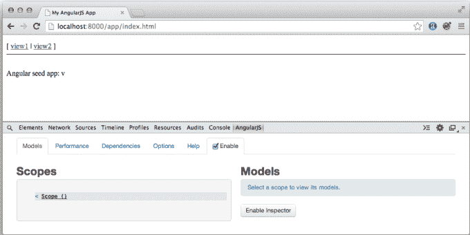

图 1.1. AngularJS Batarang

不要忘记勾选启用 选项。稍后，我们将探索 Angular Batarang 的所有功能。

## Angular Seed 项目

每个项目都应该有一个结构来组织文件。Angular Seed 项目为 AngularJS 应用提供了一个良好的骨架结构，以便你可以快速启动应用并开始开发。除了提供固定的结构外，它还提供了一个预配置的测试环境、一组有用的脚本以及一个现成的 Web 服务器。Angular Seed 本身并不是另一个框架。它只是让你在 AngularJS 开发中获得一个很好的开端，并提供一个漂亮的项目结构来轻松组织文件。使用 Angular Seed，你还可以获得 AngularJS 本身以及其他相关脚本。你可以从服务器提供这些脚本，或者在需要时使用 CDN。

要下载本书中使用的 Angular Seed 版本，请将浏览器指向：https://github.com/angular/angular-seed/tree/69c9416c8407fd5806aab3c63916dfcf0522ecbc。进入页面后，只需点击 Download Zip，这会将项目文件作为 zip 压缩包下载。解压后，你会得到一个名为 `angular-seed-master` 的文件夹。将其放在本地机器的任何位置。`angular-seed-master` 内部的 `app` 文件夹是要部署的文件夹。这意味着在迁移到生产环境时，我们只会取这个文件夹，其他什么都不需要。其余文件夹用于各种配置和测试。但在开发过程中，我们将使用 `angular-seed-master` 文件夹的全部内容。

如果你打开 `angular-seed-master` 里面的 `app` 文件夹，你会发现几个名称相当一目了然的文件夹。例如，所有的 CSS 文件都放在 `css` 文件夹中，所有图片都放在 `img` 中。同样，`lib` 文件夹包含所有 AngularJS 脚本。我们主要对 `angular.js` 脚本感兴趣，最初只会使用这个。

`app` 内部还有一个 `js` 文件夹，它保存了应用的所有 JavaScript 文件。最初，有五个 `.js` 文件，代表了应用的不同模块。例如，每当你创建一个 `controller` 时，它应该放在 `controllers.js` 中。`app` 目录中的其他组件：

- `directives.js`
- `filters.js`
- `services.js`

好的，我们已经讨论了开发方面，但这只是故事的一半。下一步是设置测试环境。但暂时，让我们专注于开发简单的 AngularJS 应用。

## AngularJS 应用的解剖

在构建第一个 AngularJS 应用之前，你应该了解 AngularJS 的不同组件。在这里将概述一些你在继续之前应该了解的重要组件。

1. **Model（模型）**：展示给用户的数据。模型数据是简单的 POJO（Plain Old JavaScript Objects，普通旧对象）。
2. **View（视图）**：这是用户访问页面时看到的内容，包含指令和原始 HTML 模板被编译与正确的关联。
3. **Controller（控制器）**：驱动应用的业务逻辑。
4. **Scope（作用域）**：一个保存模型和函数的上下文。控制器通常会在 scope 中设置这些模型。
5. **Directives（指令）**：教会 HTML 新语法。通过自定义元素和属性扩展 HTML。
6. **Expressions（表达式）**：表达式在 HTML 中用 `{{}}` 表示。它们对于访问 scope 模型和很有用。
7. **Template（模板）**：带有额外标记的 HTML，以指令（`<`）和表达式（`{{}}`）的形式存在。

好了，说够了！让我们创建一个简单的应用。

**目标**：创建一个 HTML 页面，询问用户他们的薪以及想要花的百分比。应该有两个输入框：一个用于薪，另一个用于百分比。还有一个 `<span>` 标签显示结果。一旦任何字段的值变化，结果就会更新。

**实现**：想象一下你会如何用纯 JavaScript 实现。首先，你会创建所需的输入字段和 `<span>`。然后为输入字段上的 `keyup` 事件注册回调函数。在回调内部，你会从输入字段读取值，计算结果，最后将值写入 `<span>` 中。但使用 AngularJS，以上都不需要。事实上，你不需要为应用写一行 JavaScript！看看下面在 AngularJS 中实现功能的代码。你可以在 `angular-seed-master` 目录中创建一个 `test.html` 文件，粘贴以下代码。

```html
<!doctype html>
<html lang="en" ng-app>
<head>
    <title>My AngularJS App</title>
</head>
<body ng-init="salary=0;percentage=0">
    Your Salary?
    <input type="text" ng-model="salary">
    <br/>
    How much should you invest in gadgets?
    <input type="text" ng-model="percentage">
    <br/>
    The amount spent will be:
    <span>{{salary*percentage*0.01}}</span>
    <script src="lib/angular.js"></script>
</body>
</html>
```

现在要访问页面，我们需要一个 Web 服务器。运行 Angular Seed 自带的服务器，你需要 `Node.js`。访问 https://nodejs.org/ 并下载最新版本。完成后，在你的机器上打开终端（Mac）或命令提示符（Windows），输入 `node scripts/web-server.js`。这将在端口 8000 启动服务器。因此，要访问 http://localhost:8000/app/test.html。

对这件事所需的少量代码感到惊讶吗？这正是 AngularJS 最适合快速开发的原因。让我们看看这里发生了什么：

1. AngularJS 应用通过 `ng-app` 属性启动（实际上这是一个 directive）。
2. `ng-init` 初始化你的数据模型：呈现在 UI 上的数据。
3. `ng-model` 将输入字段与模型绑定。这建立了双向绑定，意味着每当输入字段的值变化时，数据模型会自动更新，反之。
4. `{{}}` 被称为表达式，由一个或多个模型组成。表达式的主要目的是将模型单向绑定到视图；也就是说，从模型同步到视图。你还可以对模型执行乘法、除法等操作，如上所示。AngularJS 会计算这个表达式并用值替换它。美好之处在于每当它所依赖的任何模型发生变化时，表达式都会重新计算。在我们的例子中，每当用户在输入字段中输入内容时，数据模型都会更新。因此，表达式 `{{salary*percentage*0.01}}` 会自动重新计算，从而更新 DOM。

## 什么是 MVW？

前端代码与后端逻辑同样重要。为了使你的应用在长期运行中保持维护性和良好的结构，遵循某种模式非常重要。幸运的是，AngularJS 可以用于开发基于 MVC 或 MVVM 模式的应用。这就是它被声明为 MVW（Model-View-Whatever）框架的原因。但在深入细节之前，让我先介绍一下 MVC 和 MVVM 的基础知识。

## MVC

Model-View-Controller（MVC，模型-视图-控制器）是一种架构模式，通过促进关注点分离来代码组织。UI（视图）通过控制器与数据（模型）分离，控制器处理输入、将任务委托给业务逻辑，并与模型和视图协调。

## MVVM

Model-View-ViewModel（MVVM，模型-视图-视图模型）是一种构建声明式 UI 的设计模式。在 MVVM 中，ViewModel 以一种视图能够理解的方式向视图公开业务数据（模型）。换句话说，ViewModel 是你业务数据的纯代码表示。例如，如果你正在创建一个 notes

## 使用 MVC 架构组织代码

编辑器中，你的 ViewModel 应该保存一个笔记列表，并提供添加/编辑/删除笔记的方法。决定使用哪种方式来使用 AngularJS 取决于你自己。不过，我们将在本书中遵循 MVC 模式。让我们看看如何使用 AngularJS 将 MVC 引入到我们的应用中。

在 MVC 的世界中，每个部分都有自己的位置。主要好处是业务逻辑与 UI（视图）解耦。另一个好处是，如果你想修复某个组件中的 bug 或修改其功能，你确切知道该组件在哪里，这使得维护变得更加容易。它还有助于将你的代码结构化为多个松散耦合的模块，这些模块可以独立加载和测试。以下是各个组件的作用：

- **Controller（控制器）**：控制器处理输入，调用执行业务规则的代码，并通过 $scope 与视图共享数据。业务逻辑就是你的应用所做的事。对于天气应用来说，业务逻辑就是获取天气数据（可能来自 REST Web 服务）。在 AngularJS 中，我们在服务中执行此逻辑，并将其注入到控制器中。通过使用该服务，我们的控制器获取数据并将其设置在 $scope 对象上，以便视图可以显示它。这样，控制器只知道 $scope，而不知道视图。


```html
<!doctype html>
<html lang="en" ng-app="myApp">
<head>
    <title>Finance Meter</title>
</head>
<body ng-controller="FinanceController">
    Your Salary?
    <input type="text" ng-model="salary">
    <br/>How much should you invest in shopping?
    <input type="text" ng-model="percentage">%
    <br/>The amount to be spent on gadgets will be:
    <span>{{result()}}</span>
    <script src="lib/angular/angular.js"></script>
    <script src="js/app.js"></script>
    <script src="js/controllers.js"></script>
</body>
</html>
```

在 HTML 中，`ng-controller` 实例化 `FinanceController`，传递一个 `$scope` 对象。在本例中，控制器应用于整个 `<body>` 元素。因此，我们控制器设置的所有 `$scope` 属性都可以直接在 `<body>` 和 `</body>` 内部的任何位置引用。如果你查看代码，可以看到我们在 `ng-model` 中引用了模型属性。每次输入字段值更改时，这些模型都会更新。我们还在表达式 `{{}}` 中调用了 `$scope` 函数 `result()`，每次 `salary` 或 `percentage` 模型更改时都会重新调用。因此，DOM 始终会更新为正确的结果。

通过几个额外的步骤，我们以更好的方式组织了代码。

### 命名你的控制器

请注意，每当你在模块中注册控制器时，其名称应遵循 `PascalCase`：换句话说，它应该是首字母大写的 `camelCase`。根据 JavaScript 惯例，每个构造函数都应该以 `PascalCase` 命名，以便用户知道他们需要在该函数上使用 `new` 来获取实例。由于 AngularJS 中的控制器本质上就是构造函数，我们在命名时应该遵循 `PascalCase`。另一方面。

### 玩转过滤器

想尝试一些酷的东西吗？将前面 HTML 片段中的 `{{result()}}` 替换为 `{{result() | currency}}`，然后查看结果自动化为货币。这被称为过滤器，将在本书后面介绍。我们已经完成了开发，让我们看一下测试过程。下一节中，我们将讨论单元测试和端到端究竟是什么。

### AngularJS 中的单元测试和端到端

**单元测试**是一种让开发者验证代码独立的技术。单元测试是你代码中最小的部分。所以，当你编写控制器时，继续之前先对其单元测试是明智的。如果你需要为控制器添加更多功能，你可以这样做，同时验证没有破坏功能。

**端到端（End-to-End）**测试有助于确认一组组件在集成时是否工作。端到端测试应该生成故事。例如，可以进行端到端测试来确保用户正确的用户名、密码并点击登录按钮。端到端测试与单元测试的不同在于，它们取两个更多。

### 设置测试环境

设置环境很简单，但需要一系列步骤：

- 首先，我们需要 `Node.js` 和 `npm`（包管理器）来安装工具。
- 我们将下载 `jasmine` 库，因为这是我们将使用的框架。
- 我们还需要 `karma` 测试运行器（Testacular）来运行测试。

既然我们已经了解了工具，我们可以开始了。下一步是在终端/命令提示符中导航到 `angular-seed` 目录。在 Windows 上，你可以简单通过 `cd` 命令在命令提示符中移动到该目录。在 Mac 上，只需将 `angular-seed` 拖动到终端图标即可。现在运行 `npm install`。这将安装 Karma 测试运行器。结果，一个名为 `node_modules` 的新目录将在 `angular-seed` 下创建，其中包含 Karma。

现在我们需要两个插件。第一个是 `karma-chrome-launcher`，第二个是 `karma-firefox-launcher`、`karma-safari-launcher`、`karma-opera-launcher`（你需要一个使用的浏览器）。这些启动器帮助我们在浏览器中直接查看测试。你可以更改测试并刷新页面以查看更新后的结果。要安装插件，请使用以下命令：`npm install`。执行端到端测试，我们需要 `protractor`。要安装它，只需运行以下命令：`npm install protractor`。

```
npm install karma-chrome-launcher
npm install karma-firefox-launcher
npm install karma-safari-launcher
npm install karma-opera-launcher
```

运行这些命令会将插件安装到 `angular-seed` 内的 `node_modules` 目录中。恭喜！您已成功为自己创建了一个测试环境。现在稍作休息，然后回来了解几个重要点。

### 测试文件放在哪里

所有单元测试都放入 `angular-seed/test/unit`，所有端到端测试都放入 `angular-seed/test/e2e`。如果打开 `angular-seed/test/unit` 目录，你会发现四个不同的 .js 文件：

- `controllersSpecs.js`
- `filtersSpecs.js`
- `directivesSpecs.js`
- `servicesSpecs.js`

你将在 `controllersSpecs.js` 中编写控制器的单元测试。同样，其他组件的单元测试将放入对应的文件中。在 `angular-seed/test/e2e` 目录中，你可以找到 `scenarios.js`。所有的端到端测试都放在这里。

### 如何运行测试

要运行测试，首先，在终端/命令提示符中移动到 `angular-seed` 。

#### 单元测试

如果你在 Mac 上，使用命令：`sh scripts/test.sh`。在 Windows 上，双击 `scripts` 目录中的 `test.bat`。这将启动 Karma 服务器并打开浏览器。只需点击浏览器中的 `debug` 按钮，这将带您进入另一个标签页，如图 1.2 所示。


图 1.2 运行单元测试

然后只需打开浏览器的 Web 开发者工具并进入 `console`。在那里您可以找到测试用例的结果。每当对测试进行任何更改或修改现有测试时，只需点击，控制台就会显示更新后的结果，如图 1.3 所示。


图 1.3 更新后的结果

#### 端到端测试

如果你在 Mac 上，使用命令：`sh scripts/e2e-test.sh`。在 Windows 上，双击 `scripts` 目录中的 `e2e-test.bat`。在运行此命令之前，请确保按照上述说明启动测试服务器。这将打开浏览器，打开您的 HTML 页面并执行测试。结果将显示在终端中。

### 何时不使用 AngularJS

AngularJS 是为数据驱动型应用而设计的。如果你的应用与大量 RESTful Web 服务交互，它也是一个绝佳的选择。但如果你的应用需要大量 DOM 操作，而模型数据不是重点，你可能希望使用 jQuery 这样的库，因为它更适合这类任务。如果您想开发的基本是游戏或涉及大量图形操作的 Web 应用，AngularJS 不是正确的选择。简而言之，如果你的 UI 是数据驱动的，AngularJS 是最佳选择。

### 结论

作为一名忍者开发者，您需要以最佳方式即时完成分配给您的任何任务。这正是 AngularJS 能帮助您的地方。回顾我们的第一个应用，我们可以得出结论。

```
/app
    /img -- 应用级别的图片
    /css -- 应用级别的 css
    /js
        app.js -- 主应用模块
    /modules
        /login
            /js
                controllers.js  -- 登录模块的控制器
                directives.js   -- 登录模块的指令
            /views -- 登录模块的视图
            /css
            /img
            loginModule.js -- 主登录模块定义
        /comment
            /js
                controllers.js  -- 评论模块的控制器
                directives.js   -- 评论模块的指令
            /views -- 评论模块的视图
            /css
            /img
            commentModule.js -- 主评论模块定义
        ...
    ...
index.html
```

在每个文件内部，我们定义我们的模块。对于登录模块，定义如下：

`/app/modules/login/js/controllers.js`

```
angular.module('mainApp.login.controllers',[]);
```

`/app/modules/login/js/directives.js`

```
angular.module('mainApp.login.directives',[]);
```

`/app/modules/login/loginModule.js`

```
angular.module('loginModule', ['mainApp.login.controllers', 'mainApp.login.directives']);
```

对于评论模块，定义如下：

`/app/modules/comment/js/controllers.js`

```
angular.module('mainApp.comment.controllers',[]);
```

`/app/modules/comment/js/directives.js`

```
angular.module('mainApp.comment.directives', []);
```

`/app/modules/comment/commentModule.js`

```
angular.module('commentModule', ['mainApp.comment.controllers', 'mainApp.comment.directives']);
```

主模块在 `/app/app.js` 中这样定义：

```
angular.module('mainApp', ['loginModule', 'commentModule']);
```

最后，在 `index.html` 中，我们通过编写以下内容来启动应用：

```
ng-app='mainApp'
```

如你所见，模块 `loginModule` 和 `commentModule` 彼此不知道对方的存在，但它们被应用的主模块 `mainApp` 聚合在一起。在 HTML 中，当 AngularJS 遇到 `ng-app` 时，它会通过加载指定的模块来启动应用程序。在这种情况下，AngularJS 通过加载模块 `mainApp` 来启动应用。但 AngularJS 发现模块 `mainApp` 依赖于另外两个模块 `loginModule` 和 `commentModule`。所以，它也会开始加载这些模块。但这些模块也依赖于其他模块（控制器、指令等），这些也会被 AngularJS 加载。通过这种方式，AngularJS 通过加载所有必要的模块来启动你的应用。

## 在模块名称中使用点表示法

> 模块名称中使用的点表示法只是为了模拟命名空间，在 AngularJS 中没有特殊含义。你完全可以使用逗号或冒号代替点，但用点来命名空间化的模块名称似乎是最合理的。

按功能模块化显然能让你的应用在长期内保持可维护性和可测试性。它也给了不同团队专注于项目不同部分的自由。因此，在本书中开发我们的演示应用时，我们将坚持使用这种模式。

### 控制器

### 控制器的作用

控制器的任务是通过向其附加模型和函数来扩展 `scope`，这些模型和函数随后在视图中被访问。控制器只是一个构造函数，当 AngularJS 在 HTML 中遇到 `ng-controller` 指令时，它会被实例化。我们将在下一章探讨 AngularJS 的 `scope`。正如我在第 1 章中提到的，`scope` 只是控制器和视图之间的粘合剂，这样你的控制器可以向 `scope` 添加属性，而视图可以访问这些属性。

### 向 Scope 附加属性和函数

下一步，让我们编写一个控制器，通过一个 `scope` 将当前日期、时间和名称传递给视图。

控制器：

```
angular.module('myApp',[]).controller('GreetingController'
,function($scope){
  $scope.now=new Date(); //在 scope 上设置模型 'now'
  $scope.greeting='Hello';   //在 scope 上设置名称模型
});
```

你通过调用 `angular.module()` 上的 `controller()` 来在模块上注册一个控制器。`controller()` 函数接受两个参数：第一个是控制器的名称，第二个是在 HTML 中遇到 `ng-controller` 指令时将被调用的构造函数。注意到构造函数的参数 `$scope` 了吗？当你将 `$scope` 声明为控制器构造函数的参数时，你是在说你的控制器依赖于 `$scope` 对象。参数名 `$scope` 具有特殊含义。AngularJS 从构造函数中的参数名称推断你的控制器的依赖项。在这种情况下，当 AngularJS 在 HTML 中找到 `ng-controller='GreetingController'` 时，它会为你的控制器创建一个新的 `scope`，并在实例化控制器时将其作为参数传递给构造函数。这被称为“依赖注入”，它是 AngularJS 重要且核心的部分。我们将在本书后面详细讨论依赖注入。

### 多个依赖项

你的控制器可以有多个依赖项，并且可以将这些都声明为控制器构造函数的参数。除了 `$scope` 之外，每个 AngularJS 应用都有一个 `$rootScope`。假设你有一个通过 XHR 与后端交互的自定义服务。你可以将这两个声明为控制器的依赖项，像这样：

```
angular.module('myApp',[]).controller(
  'ControllerWithDependency',
  function($rootScope,customService){
    //在这里使用依赖项
  });
```

在实例化你的控制器时，AngularJS 读取参数列表，并根据这些名称知道注入哪些服务/对象。此外，你应该注意，AngularJS 以 `$` 作为其自身服务和对象的命名约定前缀。所以你不应该为你的自定义服务添加 `$` 前缀。

现在我们的 `DateTimeController` 已经准备好了，是时候在视图中使用它了。

*HTML*

```
<!DOCTYPE html>
<html ng-app="myApp">

<head>
  <script type='text/javascript' src="https://ajax.googleapis.com/
```

26 AngularJS: Novice to Ninja

```
↳,function(){ //直接使用它
    return {

    };
});
```

或者，如果你真的想耍点聪明，你可以使用：

```
angular.module('firstModule',[]).controller('FirstController'
↳,function($scope){
        //你的超棒控制器
}).directive('FirstDirective',function(){ //你的指令
    return {

    };
});
```

上述代码有效是因为你在 `angular.module()` 上调用的每个函数（如 `controller()`、`directive()` 等）都返回对模块本身的引用。因此，调用可以链接在一起，你可以以这种方式持续附加不同的组件。

> **多次调用 angular.module() 时要小心**

只有第一次调用 `angular.module()` 应该指定第二个参数。所有后续对 `angular.module()` 的调用应该只传递一个参数，该参数检索一个已创建的模块。如果你多次使用两个参数调用 `angular.module()`，你只是在重新定义依赖列表，而不是检索现有模块。

> **使用 angular.module()**

你也可以在另一个源文件中使用 `angular.module('moduleName')` 来检索一个现有模块并附加组件到它上面。

## 使用内置过滤器

`date: 'medium'` 是一个内置过滤器，用于格式化 `date` 对象。

当您在浏览器中运行 HTML 时，应该会看到类似以下内容：

```
Hello, User! The current date/time is <current date & time here>.
```

## 快速尝试代码片段

尝试这些小代码片段时，您并不总是需要打开编辑器并启动服务器。这里有一个简单的技巧。要尝试上面的代码，请在浏览器中打开 http://plnkr.co/edit/ 。在顶部选择 **New->AngularJS->AngularJS 1.2.x**。这将为您创建一个 AngularJS 项目。将我们的控制器定义复制并粘贴到左侧边栏的 **app.js** 中。将 HTML 粘贴到...

## 在模块名称中使用点表示法

> 模块名称中使用的点表示法只是为了模拟命名空间，在 AngularJS 中没有特殊含义。你完全可以使用逗号或冒号代替点，但用点来命名空间化的模块名称似乎是最合理的。

按功能模块化显然能让你的应用在长期内保持可维护性和可测试性。它也给了不同团队专注于项目不同部分的自由。因此，在本书中开发我们的演示应用时，我们将坚持使用这种模式。

### 控制器

### 控制器的作用

控制器的任务是通过向其附加模型和函数来扩展 `scope`，这些模型和函数随后在视图中被访问。控制器只是一个构造函数，当 AngularJS 在 HTML 中遇到 `ng-controller` 指令时，它会被实例化。我们将在下一章探讨 AngularJS 的 `scope`。正如我在第 1 章中提到的，`scope` 只是控制器和视图之间的粘合剂，这样你的控制器可以向 `scope` 添加属性，而视图可以访问这些属性。

### 向 Scope 附加属性和函数

下一步，让我们编写一个控制器，通过一个 `scope` 将当前日期、时间和名称传递给视图。

控制器：

```
angular.module('myApp',[]).controller('GreetingController'
,function($scope){
  $scope.now=new Date(); //在 scope 上设置模型 'now'
  $scope.greeting='Hello';   //在 scope 上设置名称模型
});
```

你通过调用 `angular.module()` 上的 `controller()` 来在模块上注册一个控制器。`controller()` 函数接受两个参数：第一个是控制器的名称，第二个是在 HTML 中遇到 `ng-controller` 指令时将被调用的构造函数。注意到构造函数的参数 `$scope` 了吗？当你将 `$scope` 声明为控制器构造函数的参数时，你是在说你的控制器依赖于 `$scope` 对象。参数名 `$scope` 具有特殊含义。AngularJS 从构造函数中的参数名称推断你的控制器的依赖项。在这种情况下，当 AngularJS 在 HTML 中找到 `ng-controller='GreetingController'` 时，它会为你的控制器创建一个新的 `scope`，并在实例化控制器时将其作为参数传递给构造函数。这被称为“依赖注入”，它是 AngularJS 重要且核心的部分。我们将在本书后面详细讨论依赖注入。

### 多个依赖项

你的控制器可以有多个依赖项，并且可以将这些都声明为控制器构造函数的参数。除了 `$scope` 之外，每个 AngularJS 应用都有一个 `$rootScope`。假设你有一个通过 XHR 与后端交互的自定义服务。你可以将这两个声明为控制器的依赖项，像这样：

```
angular.module('myApp',[]).controller(
  'ControllerWithDependency',
  function($rootScope,customService){
    //在这里使用依赖项
  });
```

在实例化你的控制器时，AngularJS 读取参数列表，并根据这些名称知道注入哪些服务/对象。此外，你应该注意，AngularJS 以 `$` 作为其自身服务和对象的命名约定前缀。所以你不应该为你的自定义服务添加 `$` 前缀。

现在我们的 `DateTimeController` 已经准备好了，是时候在视图中使用它了。

*HTML*

```
<!DOCTYPE html>
<html ng-app="myApp">

<head>
  <script type='text/javascript' src="https://ajax.googleapis.com/
```

26 AngularJS: Novice to Ninja

```
↳,function(){ //直接使用它
    return {

    };
});
```

或者，如果你真的想耍点聪明，你可以使用：

```
angular.module('firstModule',[]).controller('FirstController'
↳,function($scope){
        //你的超棒控制器
}).directive('FirstDirective',function(){ //你的指令
    return {

    };
});
```

上述代码有效是因为你在 `angular.module()` 上调用的每个函数（如 `controller()`、`directive()` 等）都返回对模块本身的引用。因此，调用可以链接在一起，你可以以这种方式持续附加不同的组件。

> **多次调用 angular.module() 时要小心**

只有第一次调用 `angular.module()` 应该指定第二个参数。所有后续对 `angular.module()` 的调用应该只传递一个参数，该参数检索一个已创建的模块。如果你多次使用两个参数调用 `angular.module()`，你只是在重新定义依赖列表，而不是检索现有模块。

> **使用 angular.module()**

你也可以在另一个源文件中使用 `angular.module('moduleName')` 来检索一个现有模块并附加组件到它上面。

## 使用内置过滤器

`date: 'medium'` 是一个内置过滤器，用于格式化 `date` 对象。

当您在浏览器中运行 HTML 时，应该会看到类似以下内容：

```
Hello, User! The current date/time is <current date & time here>.
```

## 快速尝试代码片段

尝试这些小代码片段时，您并不总是需要打开编辑器并启动服务器。这里有一个简单的技巧。要尝试上面的代码，请在浏览器中打开 http://plnkr.co/edit/ 。在顶部选择 **New->AngularJS->AngularJS 1.2.x**。这将为您创建一个 AngularJS 项目。将我们的控制器定义复制并粘贴到左侧边栏的 **app.js** 中。将 HTML 粘贴到...

## 在模块名称中使用点表示法

> 模块名称中使用的点表示法只是为了模拟命名空间，在 AngularJS 中没有特殊含义。你完全可以使用逗号或冒号代替点，但用点来命名空间化的模块名称似乎是最合理的。

按功能模块化显然能让你的应用在长期内保持可维护性和可测试性。它也给了不同团队专注于项目不同部分的自由。因此，在本书中开发我们的演示应用时，我们将坚持使用这种模式。

### 控制器

### 控制器的作用

控制器的任务是通过向其附加模型和函数来扩展 `scope`，这些模型和函数随后在视图中被访问。控制器只是一个构造函数，当 AngularJS 在 HTML 中遇到 `ng-controller` 指令时，它会被实例化。我们将在下一章探讨 AngularJS 的 `scope`。正如我在第 1 章中提到的，`scope` 只是控制器和视图之间的粘合剂，这样你的控制器可以向 `scope` 添加属性，而视图可以访问这些属性。

### 向 Scope 附加属性和函数

下一步，让我们编写一个控制器，通过一个 `scope` 将当前日期、时间和名称传递给视图。

控制器：

```
angular.module('myApp',[]).controller('GreetingController'
,function($scope){
  $scope.now=new Date(); //在 scope 上设置模型 'now'
  $scope.greeting='Hello';   //在 scope 上设置名称模型
});
```

你通过调用 `angular.module()` 上的 `controller()` 来在模块上注册一个控制器。`controller()` 函数接受两个参数：第一个是控制器的名称，第二个是在 HTML 中遇到 `ng-controller` 指令时将被调用的构造函数。注意到构造函数的参数 `$scope` 了吗？当你将 `$scope` 声明为控制器构造函数的参数时，你是在说你的控制器依赖于 `$scope` 对象。参数名 `$scope` 具有特殊含义。AngularJS 从构造函数中的参数名称推断你的控制器的依赖项。在这种情况下，当 AngularJS 在 HTML 中找到 `ng-controller='GreetingController'` 时，它会为你的控制器创建一个新的 `scope`，并在实例化控制器时将其作为参数传递给构造函数。这被称为“依赖注入”，它是 AngularJS 重要且核心的部分。我们将在本书后面详细讨论依赖注入。

### 多个依赖项

你的控制器可以有多个依赖项，并且可以将这些都声明为控制器构造函数的参数。除了 `$scope` 之外，每个 AngularJS 应用都有一个 `$rootScope`。假设你有一个通过 XHR 与后端交互的自定义服务。你可以将这两个声明为控制器的依赖项，像这样：

```
angular.module('myApp',[]).controller(
  'ControllerWithDependency',
  function($rootScope,customService){
    //在这里使用依赖项
  });
```

在实例化你的控制器时，AngularJS 读取参数列表，并根据这些名称知道注入哪些服务/对象。此外，你应该注意，AngularJS 以 `$` 作为其自身服务和对象的命名约定前缀。所以你不应该为你的自定义服务添加 `$` 前缀。

现在我们的 `DateTimeController` 已经准备好了，是时候在视图中使用它了。

*HTML*

```
<!DOCTYPE html>
<html ng-app="myApp">

<head>
  <script type='text/javascript' src="https://ajax.googleapis.com/
```

26 AngularJS: Novice to Ninja

```
↳,function(){ //直接使用它
    return {

    };
});
```

或者，如果你真的想耍点聪明，你可以使用：

```
angular.module('firstModule',[]).controller('FirstController'
↳,function($scope){
        //你的超棒控制器
}).directive('FirstDirective',function(){ //你的指令
    return {

    };
});
```

上述代码有效是因为你在 `angular.module()` 上调用的每个函数（如 `controller()`、`directive()` 等）都返回对模块本身的引用。因此，调用可以链接在一起，你可以以这种方式持续附加不同的组件。

> **多次调用 angular.module() 时要小心**

只有第一次调用 `angular.module()` 应该指定第二个参数。所有后续对 `angular.module()` 的调用应该只传递一个参数，该参数检索一个已创建的模块。如果你多次使用两个参数调用 `angular.module()`，你只是在重新定义依赖列表，而不是检索现有模块。

> **使用 angular.module()**

你也可以在另一个源文件中使用 `angular.module('moduleName')` 来检索一个现有模块并附加组件到它上面。

## 使用内置过滤器

`date: 'medium'` 是一个内置过滤器，用于格式化 `date` 对象。

当您在浏览器中运行 HTML 时，应该会看到类似以下内容：

```
Hello, User! The current date/time is <current date & time here>.
```

## 快速尝试代码片段

尝试这些小代码片段时，您并不总是需要打开编辑器并启动服务器。这里有一个简单的技巧。要尝试上面的代码，请在浏览器中打开 http://plnkr.co/edit/ 。在顶部选择 **New->AngularJS->AngularJS 1.2.x**。这将为您创建一个 AngularJS 项目。将我们的控制器定义复制并粘贴到左侧边栏的 **app.js** 中。将 HTML 粘贴到...

## 在模块名称中使用点表示法

> 模块名称中使用的点表示法只是为了模拟命名空间，在 AngularJS 中没有特殊含义。你完全可以使用逗号或冒号代替点，但用点来命名空间化的模块名称似乎是最合理的。

按功能模块化显然能让你的应用在长期内保持可维护性和可测试性。它也给了不同团队专注于项目不同部分的自由。因此，在本书中开发我们的演示应用时，我们将坚持使用这种模式。

### 控制器

### 控制器的作用

控制器的任务是通过向其附加模型和函数来扩展 `scope`，这些模型和函数随后在视图中被访问。控制器只是一个构造函数，当 AngularJS 在 HTML 中遇到 `ng-controller` 指令时，它会被实例化。我们将在下一章探讨 AngularJS 的 `scope`。正如我在第 1 章中提到的，`scope` 只是控制器和视图之间的粘合剂，这样你的控制器可以向 `scope` 添加属性，而视图可以访问这些属性。

### 向 Scope 附加属性和函数

下一步，让我们编写一个控制器，通过一个 `scope` 将当前日期、时间和名称传递给视图。

控制器：

```
angular.module('myApp',[]).controller('GreetingController'
,function($scope){
  $scope.now=new Date(); //在 scope 上设置模型 'now'
  $scope.greeting='Hello';   //在 scope 上设置名称模型
});
```

你通过调用 `angular.module()` 上的 `controller()` 来在模块上注册一个控制器。`controller()` 函数接受两个参数：第一个是控制器的名称，第二个是在 HTML 中遇到 `ng-controller` 指令时将被调用的构造函数。注意到构造函数的参数 `$scope` 了吗？当你将 `$scope` 声明为控制器构造函数的参数时，你是在说你的控制器依赖于 `$scope` 对象。参数名 `$scope` 具有特殊含义。AngularJS 从构造函数中的参数名称推断你的控制器的依赖项。在这种情况下，当 AngularJS 在 HTML 中找到 `ng-controller='GreetingController'` 时，它会为你的控制器创建一个新的 `scope`，并在实例化控制器时将其作为参数传递给构造函数。这被称为“依赖注入”，它是 AngularJS 重要且核心的部分。我们将在本书后面详细讨论依赖注入。

### 多个依赖项

你的控制器可以有多个依赖项，并且可以将这些都声明为控制器构造函数的参数。除了 `$scope` 之外，每个 AngularJS 应用都有一个 `$rootScope`。假设你有一个通过 XHR 与后端交互的自定义服务。你可以将这两个声明为控制器的依赖项，像这样：

```
angular.module('myApp',[]).controller(
  'ControllerWithDependency',
  function($rootScope,customService){
    //在这里使用依赖项
  });
```

在实例化你的控制器时，AngularJS 读取参数列表，并根据这些名称知道注入哪些服务/对象。此外，你应该注意，AngularJS 以 `$` 作为其自身服务和对象的命名约定前缀。所以你不应该为你的自定义服务添加 `$` 前缀。

现在我们的 `DateTimeController` 已经准备好了，是时候在视图中使用它了。

*HTML*

```
<!DOCTYPE html>
<html ng-app="myApp">

<head>
  <script type='text/javascript' src="https://ajax.googleapis.com/
```

26 AngularJS: Novice to Ninja

```
↳,function(){ //直接使用它
    return {

    };
});
```

或者，如果你真的想耍点聪明，你可以使用：

```
angular.module('firstModule',[]).controller('FirstController'
↳,function($scope){
        //你的超棒控制器
}).directive('FirstDirective',function(){ //你的指令
    return {

    };
});
```

上述代码有效是因为你在 `angular.module()` 上调用的每个函数（如 `controller()`、`directive()` 等）都返回对模块本身的引用。因此，调用可以链接在一起，你可以以这种方式持续附加不同的组件。

> **多次调用 angular.module() 时要小心**

只有第一次调用 `angular.module()` 应该指定第二个参数。所有后续对 `angular.module()` 的调用应该只传递一个参数，该参数检索一个已创建的模块。如果你多次使用两个参数调用 `angular.module()`，你只是在重新定义依赖列表，而不是检索现有模块。

> **使用 angular.module()**

你也可以在另一个源文件中使用 `angular.module('moduleName')` 来检索一个现有模块并附加组件到它上面。

## 使用内置过滤器

`date: 'medium'` 是一个内置过滤器，用于格式化 `date` 对象。

当您在浏览器中运行 HTML 时，应该会看到类似以下内容：

```
Hello, User! The current date/time is <current date & time here>.
```

## 快速尝试代码片段

尝试这些小代码片段时，您并不总是需要打开编辑器并启动服务器。这里有一个简单的技巧。要尝试上面的代码，请在浏览器中打开 http://plnkr.co/edit/ 。在顶部选择 **New->AngularJS->AngularJS 1.2.x**。这将为您创建一个 AngularJS 项目。将我们的控制器定义复制并粘贴到左侧边栏的 **app.js** 中。将 HTML 粘贴到...

## 在模块名称中使用点表示法

> 模块名称中使用的点表示法只是为了模拟命名空间，在 AngularJS 中没有特殊含义。你完全可以使用逗号或冒号代替点，但用点来命名空间化的模块名称似乎是最合理的。

按功能模块化显然能让你的应用在长期内保持可维护性和可测试性。它也给了不同团队专注于项目不同部分的自由。因此，在本书中开发我们的演示应用时，我们将坚持使用这种模式。

### 控制器

### 控制器的作用

控制器的任务是通过向其附加模型和函数来扩展 `scope`，这些模型和函数随后在视图中被访问。控制器只是一个构造函数，当 AngularJS 在 HTML 中遇到 `ng-controller` 指令时，它会被实例化。我们将在下一章探讨 AngularJS 的 `scope`。正如我在第 1 章中提到的，`scope` 只是控制器和视图之间的粘合剂，这样你的控制器可以向 `scope` 添加属性，而视图可以访问这些属性。

### 向 Scope 附加属性和函数

下一步，让我们编写一个控制器，通过一个 `scope` 将当前日期、时间和名称传递给视图。

控制器：

```
angular.module('myApp',[]).controller('GreetingController'
,function($scope){
  $scope.now=new Date(); //在 scope 上设置模型 'now'
  $scope.greeting='Hello';   //在 scope 上设置名称模型
});
```

你通过调用 `angular.module()` 上的 `controller()` 来在模块上注册一个控制器。`controller()` 函数接受两个参数：第一个是控制器的名称，第二个是在 HTML 中遇到 `ng-controller` 指令时将被调用的构造函数。注意到构造函数的参数 `$scope` 了吗？当你将 `$scope` 声明为控制器构造函数的参数时，你是在说你的控制器依赖于 `$scope` 对象。参数名 `$scope` 具有特殊含义。AngularJS 从构造函数中的参数名称推断你的控制器的依赖项。在这种情况下，当 AngularJS 在 HTML 中找到 `ng-controller='GreetingController'` 时，它会为你的控制器创建一个新的 `scope`，并在实例化控制器时将其作为参数传递给构造函数。这被称为“依赖注入”，它是 AngularJS 重要且核心的部分。我们将在本书后面详细讨论依赖注入。

### 多个依赖项

你的控制器可以有多个依赖项，并且可以将这些都声明为控制器构造函数的参数。除了 `$scope` 之外，每个 AngularJS 应用都有一个 `$rootScope`。假设你有一个通过 XHR 与后端交互的自定义服务。你可以将这两个声明为控制器的依赖项，像这样：

```
angular.module('myApp',[]).controller(
  'ControllerWithDependency',
  function($rootScope,customService){
    //在这里使用依赖项
  });
```

在实例化你的控制器时，AngularJS 读取参数列表，并根据这些名称知道注入哪些服务/对象。此外，你应该注意，AngularJS 以 `$` 作为其自身服务和对象的命名约定前缀。所以你不应该为你的自定义服务添加 `$` 前缀。

现在我们的 `DateTimeController` 已经准备好了，是时候在视图中使用它了。

*HTML*

```
<!DOCTYPE html>
<html ng-app="myApp">

<head>
  <script type='text/javascript' src="https://ajax.googleapis.com/
```

26 AngularJS: Novice to Ninja

```
↳,function(){ //直接使用它
    return {

    };
});
```

或者，如果你真的想耍点聪明，你可以使用：

```
angular.module('firstModule',[]).controller('FirstController'
↳,function($scope){
        //你的超棒控制器
}).directive('FirstDirective',function(){ //你的指令
    return {

    };
});
```

上述代码有效是因为你在 `angular.module()` 上调用的每个函数（如 `controller()`、`directive()` 等）都返回对模块本身的引用。因此，调用可以链接在一起，你可以以这种方式持续附加不同的组件。

> **多次调用 angular.module() 时要小心**

只有第一次调用 `angular.module()` 应该指定第二个参数。所有后续对 `angular.module()` 的调用应该只传递一个参数，该参数检索一个已创建的模块。如果你多次使用两个参数调用 `angular.module()`，你只是在重新定义依赖列表，而不是检索现有模块。

> **使用 angular.module()**

你也可以在另一个源文件中使用 `angular.module('moduleName')` 来检索一个现有模块并附加组件到它上面。

## 使用内置过滤器

`date: 'medium'` 是一个内置过滤器，用于格式化 `date` 对象。

当您在浏览器中运行 HTML 时，应该会看到类似以下内容：

```
Hello, User! The current date/time is <current date & time here>.
```

## 快速尝试代码片段

尝试这些小代码片段时，您并不总是需要打开编辑器并启动服务器。这里有一个简单的技巧。要尝试上面的代码，请在浏览器中打开 http://plnkr.co/edit/ 。在顶部选择 **New->AngularJS->AngularJS 1.2.x**。这将为您创建一个 AngularJS 项目。将我们的控制器定义复制并粘贴到左侧边栏的 **app.js** 中。将 HTML 粘贴到...

## 在模块名称中使用点表示法

> 模块名称中使用的点表示法只是为了模拟命名空间，在 AngularJS 中没有特殊含义。你完全可以使用逗号或冒号代替点，但用点来命名空间化的模块名称似乎是最合理的。

按功能模块化显然能让你的应用在长期内保持可维护性和可测试性。它也给了不同团队专注于项目不同部分的自由。因此，在本书中开发我们的演示应用时，我们将坚持使用这种模式。

### 控制器

### 控制器的作用

控制器的任务是通过向其附加模型和函数来扩展 `scope`，这些模型和函数随后在视图中被访问。控制器只是一个构造函数，当 AngularJS 在 HTML 中遇到 `ng-controller` 指令时，它会被实例化。我们将在下一章探讨 AngularJS 的 `scope`。正如我在第 1 章中提到的，`scope` 只是控制器和视图之间的粘合剂，这样你的控制器可以向 `scope` 添加属性，而视图可以访问这些属性。

### 向 Scope 附加属性和函数

下一步，让我们编写一个控制器，通过一个 `scope` 将当前日期、时间和名称传递给视图。

控制器：

```
angular.module('myApp',[]).controller('GreetingController'
,function($scope){
  $scope.now=new Date(); //在 scope 上设置模型 'now'
  $scope.greeting='Hello';   //在 scope 上设置名称模型
});
```

你通过调用 `angular.module()` 上的 `controller()` 来在模块上注册一个控制器。`controller()` 函数接受两个参数：第一个是控制器的名称，第二个是在 HTML 中遇到 `ng-controller` 指令时将被调用的构造函数。注意到构造函数的参数 `$scope` 了吗？当你将 `$scope` 声明为控制器构造函数的参数时，你是在说你的控制器依赖于 `$scope` 对象。参数名 `$scope` 具有特殊含义。AngularJS 从构造函数中的参数名称推断你的控制器的依赖项。在这种情况下，当 AngularJS 在 HTML 中找到 `ng-controller='GreetingController'` 时，它会为你的控制器创建一个新的 `scope`，并在实例化控制器时将其作为参数传递给构造函数。这被称为“依赖注入”，它是 AngularJS 重要且核心的部分。我们将在本书后面详细讨论依赖注入。

### 多个依赖项

你的控制器可以有多个依赖项，并且可以将这些都声明为控制器构造函数的参数。除了 `$scope` 之外，每个 AngularJS 应用都有一个 `$rootScope`。假设你有一个通过 XHR 与后端交互的自定义服务。你可以将这两个声明为控制器的依赖项，像这样：

```
angular.module('myApp',[]).controller(
  'ControllerWithDependency',
  function($rootScope,customService){
    //在这里使用依赖项
  });
```

在实例化你的控制器时，AngularJS 读取参数列表，并根据这些名称知道注入哪些服务/对象。此外，你应该注意，AngularJS 以 `$` 作为其自身服务和对象的命名约定前缀。所以你不应该为你的自定义服务添加 `$` 前缀。

现在我们的 `DateTimeController` 已经准备好了，是时候在视图中使用它了。

*HTML*

```
<!DOCTYPE html>
<html ng-app="myApp">

<head>
  <script type='text/javascript' src="https://ajax.googleapis.com/
```

26 AngularJS: Novice to Ninja

```
↳,function(){ //直接使用它
    return {

    };
});
```

或者，如果你真的想耍点聪明，你可以使用：

```
angular.module('firstModule',[]).controller('FirstController'
↳,function($scope){
        //你的超棒控制器
}).directive('FirstDirective',function(){ //你的指令
    return {

    };
});
```

上述代码有效是因为你在 `angular.module()` 上调用的每个函数（如 `controller()`、`directive()` 等）都返回对模块本身的引用。因此，调用可以链接在一起，你可以以这种方式持续附加不同的组件。

> **多次调用 angular.module() 时要小心**

只有第一次调用 `angular.module()` 应该指定第二个参数。所有后续对 `angular.module()` 的调用应该只传递一个参数，该参数检索一个已创建的模块。如果你多次使用两个参数调用 `angular.module()`，你只是在重新定义依赖列表，而不是检索现有模块。

> **使用 angular.module()**

你也可以在另一个源文件中使用 `angular.module('moduleName')` 来检索一个现有模块并附加组件到它上面。

## 使用内置过滤器

`date: 'medium'` 是一个内置过滤器，用于格式化 `date` 对象。

当您在浏览器中运行 HTML 时，应该会看到类似以下内容：

```
Hello, User! The current date/time is <current date & time here>.
```

## 快速尝试代码片段

尝试这些小代码片段时，您并不总是需要打开编辑器并启动服务器。这里有一个简单的技巧。要尝试上面的代码，请在浏览器中打开 http://plnkr.co/edit/ 。在顶部选择 **New->AngularJS->AngularJS 1.2.x**。这将为您创建一个 AngularJS 项目。将我们的控制器定义复制并粘贴到左侧边栏的 **app.js** 中。将 HTML 粘贴到...

## 在模块名称中使用点表示法

> 模块名称中使用的点表示法只是为了模拟命名空间，在 AngularJS 中没有特殊含义。你完全可以使用逗号或冒号代替点，但用点来命名空间化的模块名称似乎是最合理的。

按功能模块化显然能让你的应用在长期内保持可维护性和可测试性。它也给了不同团队专注于项目不同部分的自由。因此，在本书中开发我们的演示应用时，我们将坚持使用这种模式。

### 控制器

### 控制器的作用

控制器的任务是通过向其附加模型和函数来扩展 `scope`，这些模型和函数随后在视图中被访问。控制器只是一个构造函数，当 AngularJS 在 HTML 中遇到 `ng-controller` 指令时，它会被实例化。我们将在下一章探讨 AngularJS 的 `scope`。正如我在第 1 章中提到的，`scope` 只是控制器和视图之间的粘合剂，这样你的控制器可以向 `scope` 添加属性，而视图可以访问这些属性。

### 向 Scope 附加属性和函数

下一步，让我们编写一个控制器，通过一个 `scope` 将当前日期、时间和名称传递给视图。

控制器：

```
angular.module('myApp',[]).controller('GreetingController'
,function($scope){
  $scope.now=new Date(); //在 scope 上设置模型 'now'
  $scope.greeting='Hello';   //在 scope 上设置名称模型
});
```

你通过调用 `angular.module()` 上的 `controller()` 来在模块上注册一个控制器。`controller()` 函数接受两个参数：第一个是控制器的名称，第二个是在 HTML 中遇到 `ng-controller` 指令时将被调用的构造函数。注意到构造函数的参数 `$scope` 了吗？当你将 `$scope` 声明为控制器构造函数的参数时，你是在说你的控制器依赖于 `$scope` 对象。参数名 `$scope` 具有特殊含义。AngularJS 从构造函数中的参数名称推断你的控制器的依赖项。在这种情况下，当 AngularJS 在 HTML 中找到 `ng-controller='GreetingController'` 时，它会为你的控制器创建一个新的 `scope`，并在实例化控制器时将其作为参数传递给构造函数。这被称为“依赖注入”，它是 AngularJS 重要且核心的部分。我们将在本书后面详细讨论依赖注入。

### 多个依赖项

你的控制器可以有多个依赖项，并且可以将这些都声明为控制器构造函数的参数。除了 `$scope` 之外，每个 AngularJS 应用都有一个 `$rootScope`。假设你有一个通过 XHR 与后端交互的自定义服务。你可以将这两个声明为控制器的依赖项，像这样：

```
angular.module('myApp',[]).controller(
  'ControllerWithDependency',
  function($rootScope,customService){
    //在这里使用依赖项
  });
```

在实例化你的控制器时，AngularJS 读取参数列表，并根据这些名称知道注入哪些服务/对象。此外，你应该注意，AngularJS 以 `$` 作为其自身服务和对象的命名约定前缀。所以你不应该为你的自定义服务添加 `$` 前缀。

现在我们的 `DateTimeController` 已经准备好了，是时候在视图中使用它了。

*HTML*

```
<!DOCTYPE html>
<html ng-app="myApp">

<head>
  <script type='text/javascript' src="https://ajax.googleapis.com/
```

26 AngularJS: Novice to Ninja

```
↳,function(){ //直接使用它
    return {

    };
});
```

或者，如果你真的想耍点聪明，你可以使用：

```
angular.module('firstModule',[]).controller('FirstController'
↳,function($scope){
        //你的超棒控制器
}).directive('FirstDirective',function(){ //你的指令
    return {

    };
});
```

上述代码有效是因为你在 `angular.module()` 上调用的每个函数（如 `controller()`、`directive()` 等）都返回对模块本身的引用。因此，调用可以链接在一起，你可以以这种方式持续附加不同的组件。

> **多次调用 angular.module() 时要小心**

只有第一次调用 `angular.module()` 应该指定第二个参数。所有后续对 `angular.module()` 的调用应该只传递一个参数，该参数检索一个已创建的模块。如果你多次使用两个参数调用 `angular.module()`，你只是在重新定义依赖列表，而不是检索现有模块。

> **使用 angular.module()**

你也可以在另一个源文件中使用 `angular.module('moduleName')` 来检索一个现有模块并附加组件到它上面。

## 使用内置过滤器

`date: 'medium'` 是一个内置过滤器，用于格式化 `date` 对象。

当您在浏览器中运行 HTML 时，应该会看到类似以下内容：

```
Hello, User! The current date/time is <current date & time here>.
```

## 快速尝试代码片段

尝试这些小代码片段时，您并不总是需要打开编辑器并启动服务器。这里有一个简单的技巧。要尝试上面的代码，请在浏览器中打开 http://plnkr.co/edit/ 。在顶部选择 **New->AngularJS->AngularJS 1.2.x**。这将为您创建一个 AngularJS 项目。将我们的控制器定义复制并粘贴到左侧边栏的 **app.js** 中。将 HTML 粘贴到...

## 在模块名称中使用点表示法

> 模块名称中使用的点表示法只是为了模拟命名空间，在 AngularJS 中没有特殊含义。你完全可以使用逗号或冒号代替点，但用点来命名空间化的模块名称似乎是最合理的。

按功能模块化显然能让你的应用在长期内保持可维护性和可测试性。它也给了不同团队专注于项目不同部分的自由。因此，在本书中开发我们的演示应用时，我们将坚持使用这种模式。

### 控制器

### 控制器的作用

控制器的任务是通过向其附加模型和函数来扩展 `scope`，这些模型和函数随后在视图中被访问。控制器只是一个构造函数，当 AngularJS 在 HTML 中遇到 `ng-controller` 指令时，它会被实例化。我们将在下一章探讨 AngularJS 的 `scope`。正如我在第 1 章中提到的，`scope` 只是控制器和视图之间的粘合剂，这样你的控制器可以向 `scope` 添加属性，而视图可以访问这些属性。

### 向 Scope 附加属性和函数

下一步，让我们编写一个控制器，通过一个 `scope` 将当前日期、时间和名称传递给视图。

控制器：

```
angular.module('myApp',[]).controller('GreetingController'
,function($scope){
  $scope.now=new Date(); //在 scope 上设置模型 'now'
  $scope.greeting='Hello';   //在 scope 上设置名称模型
});
```

你通过调用 `angular.module()` 上的 `controller()` 来在模块上注册一个控制器。`controller()` 函数接受两个参数：第一个是控制器的名称，第二个是在 HTML 中遇到 `ng-controller` 指令时将被调用的构造函数。注意到构造函数的参数 `$scope` 了吗？当你将 `$scope` 声明为控制器构造函数的参数时，你是在说你的控制器依赖于 `$scope` 对象。参数名 `$scope` 具有特殊含义。AngularJS 从构造函数中的参数名称推断你的控制器的依赖项。在这种情况下，当 AngularJS 在 HTML 中找到 `ng-controller='GreetingController'` 时，它会为你的控制器创建一个新的 `scope`，并在实例化控制器时将其作为参数传递给构造函数。这被称为“依赖注入”，它是 AngularJS 重要且核心的部分。我们将在本书后面详细讨论依赖注入。

### 多个依赖项

你的控制器可以有多个依赖项，并且可以将这些都声明为控制器构造函数的参数。除了 `$scope` 之外，每个 AngularJS 应用都有一个 `$rootScope`。假设你有一个通过 XHR 与后端交互的自定义服务。你可以将这两个声明为控制器的依赖项，像这样：

```
angular.module('myApp',[]).controller(
  'ControllerWithDependency',
  function($rootScope,customService){
    //在这里使用依赖项
  });
```

在实例化你的控制器时，AngularJS 读取参数列表，并根据这些名称知道注入哪些服务/对象。此外，你应该注意，AngularJS 以 `$` 作为其自身服务和对象的命名约定前缀。所以你不应该为你的自定义服务添加 `$` 前缀。

现在我们的 `DateTimeController` 已经准备好了，是时候在视图中使用它了。

*HTML*

```
<!DOCTYPE html>
<html ng-app="myApp">

<head>
  <script type='text/javascript' src="https://ajax.googleapis.com/
```

26 AngularJS: Novice to Ninja

```
↳,function(){ //直接使用它
    return {

    };
});
```

或者，如果你真的想耍点聪明，你可以使用：

```
angular.module('firstModule',[]).controller('FirstController'
↳,function($scope){
        //你的超棒控制器
}).directive('FirstDirective',function(){ //你的指令
    return {

    };
});
```

上述代码有效是因为你在 `angular.module()` 上调用的每个函数（如 `controller()`、`directive()` 等）都返回对模块本身的引用。因此，调用可以链接在一起，你可以以这种方式持续附加不同的组件。

> **多次调用 angular.module() 时要小心**

只有第一次调用 `angular.module()` 应该指定第二个参数。所有后续对 `angular.module()` 的调用应该只传递一个参数，该参数检索一个已创建的模块。如果你多次使用两个参数调用 `angular.module()`，你只是在重新定义依赖列表，而不是检索现有模块。

> **使用 angular.module()**

你也可以在另一个源文件中使用 `angular.module('moduleName')` 来检索一个现有模块并附加组件到它上面。

## 使用内置过滤器

`date: 'medium'` 是一个内置过滤器，用于格式化 `date` 对象。

当您在浏览器中运行 HTML 时，应该会看到类似以下内容：

```
Hello, User! The current date/time is <current date & time here>.
```

## 快速尝试代码片段

尝试这些小代码片段时，您并不总是需要打开编辑器并启动服务器。这里有一个简单的技巧。要尝试上面的代码，请在浏览器中打开 http://plnkr.co/edit/ 。在顶部选择 **New->AngularJS->AngularJS 1.2.x**。这将为您创建一个 AngularJS 项目。将我们的控制器定义复制并粘贴到左侧边栏的 **app.js** 中。将 HTML 粘贴到...

## 在模块名称中使用点表示法

> 模块名称中使用的点表示法只是为了模拟命名空间，在 AngularJS 中没有特殊含义。你完全可以使用逗号或冒号代替点，但用点来命名空间化的模块名称似乎是最合理的。

按功能模块化显然能让你的应用在长期内保持可维护性和可测试性。它也给了不同团队专注于项目不同部分的自由。因此，在本书中开发我们的演示应用时，我们将坚持使用这种模式。

### 控制器

### 控制器的作用

控制器的任务是通过向其附加模型和函数来扩展 `scope`，这些模型和函数随后在视图中被访问。控制器只是一个构造函数，当 AngularJS 在 HTML 中遇到 `ng-controller` 指令时，它会被实例化。我们将在下一章探讨 AngularJS 的 `scope`。正如我在第 1 章中提到的，`scope` 只是控制器和视图之间的粘合剂，这样你的控制器可以向 `scope` 添加属性，而视图可以访问这些属性。

### 向 Scope 附加属性和函数

下一步，让我们编写一个控制器，通过一个 `scope` 将当前日期、时间和名称传递给视图。

控制器：

```
angular.module('myApp',[]).controller('GreetingController'
,function($scope){
  $scope.now=new Date(); //在 scope 上设置模型 'now'
  $scope.greeting='Hello';   //在 scope 上设置名称模型
});
```

你通过调用 `angular.module()` 上的 `controller()` 来在模块上注册一个控制器。`controller()` 函数接受两个参数：第一个是控制器的名称，第二个是在 HTML 中遇到 `ng-controller` 指令时将被调用的构造函数。注意到构造函数的参数 `$scope` 了吗？当你将 `$scope` 声明为控制器构造函数的参数时，你是在说你的控制器依赖于 `$scope` 对象。参数名 `$scope` 具有特殊含义。AngularJS 从构造函数中的参数名称推断你的控制器的依赖项。在这种情况下，当 AngularJS 在 HTML 中找到 `ng-controller='GreetingController'` 时，它会为你的控制器创建一个新的 `scope`，并在实例化控制器时将其作为参数传递给构造函数。这被称为“依赖注入”，它是 AngularJS 重要且核心的部分。我们将在本书后面详细讨论依赖注入。

### 多个依赖项

你的控制器可以有多个依赖项，并且可以将这些都声明为控制器构造函数的参数。除了 `$scope` 之外，每个 AngularJS 应用都有一个 `$rootScope`。假设你有一个通过 XHR 与后端交互的自定义服务。你可以将这两个声明为控制器的依赖项，像这样：

```
angular.module('myApp',[]).controller(
  'ControllerWithDependency',
  function($rootScope,customService){
    //在这里使用依赖项
  });
```

在实例化你的控制器时，AngularJS 读取参数列表，并根据这些名称知道注入哪些服务/对象。此外，你应该注意，AngularJS 以 `$` 作为其自身服务和对象的命名约定前缀。所以你不应该为你的自定义服务添加 `$` 前缀。

现在我们的 `DateTimeController` 已经准备好了，是时候在视图中使用它了。

*HTML*

```
<!DOCTYPE html>
<html ng-app="myApp">

<head>
  <script type='text/javascript' src="https://ajax.googleapis.com/
```

26 AngularJS: Novice to Ninja

```
↳,function(){ //直接使用它
    return {

    };
});
```

或者，如果你真的想耍点聪明，你可以使用：

```
angular.module('firstModule',[]).controller('FirstController'
↳,function($scope){
        //你的超棒控制器
}).directive('FirstDirective',function(){ //你的指令
    return {

    };
});
```

上述代码有效是因为你在 `angular.module()` 上调用的每个函数（如 `controller()`、`directive()` 等）都返回对模块本身的引用。因此，调用可以链接在一起，你可以以这种方式持续附加不同的组件。

> **多次调用 angular.module() 时要小心**

只有第一次调用 `angular.module()` 应该指定第二个参数。所有后续对 `angular.module()` 的调用应该只传递一个参数，该参数检索一个已创建的模块。如果你多次使用两个参数调用 `angular.module()`，你只是在重新定义依赖列表，而不是检索现有模块。

> **使用 angular.module()**

你也可以在另一个源文件中使用 `angular.module('moduleName')` 来检索一个现有模块并附加组件到它上面。

## 使用内置过滤器

`date: 'medium'` 是一个内置过滤器，用于格式化 `date` 对象。

当您在浏览器中运行 HTML 时，应该会看到类似以下内容：

```
Hello, User! The current date/time is <current date & time here>.
```

## 快速尝试代码片段

尝试这些小代码片段时，您并不总是需要打开编辑器并启动服务器。这里有一个简单的技巧。要尝试上面的代码，请在浏览器中打开 http://plnkr.co/edit/ 。在顶部选择 **New->AngularJS->AngularJS 1.2.x**。这将为您创建一个 AngularJS 项目。将我们的控制器定义复制并粘贴到左侧边栏的 **app.js** 中。将 HTML 粘贴到...

## 在模块名称中使用点表示法

> 模块名称中使用的点表示法只是为了模拟命名空间，在 AngularJS 中没有特殊含义。你完全可以使用逗号或冒号代替点，但用点来命名空间化的模块名称似乎是最合理的。

按功能模块化显然能让你的应用在长期内保持可维护性和可测试性。它也给了不同团队专注于项目不同部分的自由。因此，在本书中开发我们的演示应用时，我们将坚持使用这种模式。

### 控制器

### 控制器的作用

控制器的任务是通过向其附加模型和函数来扩展 `scope`，这些模型和函数随后在视图中被访问。控制器只是一个构造函数，当 AngularJS 在 HTML 中遇到 `ng-controller` 指令时，它会被实例化。我们将在下一章探讨 AngularJS 的 `scope`。正如我在第 1 章中提到的，`scope` 只是控制器和视图之间的粘合剂，这样你的控制器可以向 `scope` 添加属性，而视图可以访问这些属性。

### 向 Scope 附加属性和函数

下一步，让我们编写一个控制器，通过一个 `scope` 将当前日期、时间和名称传递给视图。

控制器：

```
angular.module('myApp',[]).controller('GreetingController'
,function($scope){
  $scope.now=new Date(); //在 scope 上设置模型 'now'
  $scope.greeting='Hello';   //在 scope 上设置名称模型
});
```

你通过调用 `angular.module()` 上的 `controller()` 来在模块上注册一个控制器。`controller()` 函数接受两个参数：第一个是控制器的名称，第二个是在 HTML 中遇到 `ng-controller` 指令时将被调用的构造函数。注意到构造函数的参数 `$scope` 了吗？当你将 `$scope` 声明为控制器构造函数的参数时，你是在说你的控制器依赖于 `$scope` 对象。参数名 `$scope` 具有特殊含义。AngularJS 从构造函数中的参数名称推断你的控制器的依赖项。在这种情况下，当 AngularJS 在 HTML 中找到 `ng-controller='GreetingController'` 时，它会为你的控制器创建一个新的 `scope`，并在实例化控制器时将其作为参数传递给构造函数。这被称为“依赖注入”，它是 AngularJS 重要且核心的部分。我们将在本书后面详细讨论依赖注入。

### 多个依赖项

你的控制器可以有多个依赖项，并且可以将这些都声明为控制器构造函数的参数。除了 `$scope` 之外，每个 AngularJS 应用都有一个 `$rootScope`。假设你有一个通过 XHR 与后端交互的自定义服务。你可以将这两个声明为控制器的依赖项，像这样：

```
angular.module('myApp',[]).controller(
  'ControllerWithDependency',
  function($rootScope,customService){
    //在这里使用依赖项
  });
```

在实例化你的控制器时，AngularJS 读取参数列表，并根据这些名称知道注入哪些服务/对象。此外，你应该注意，AngularJS 以 `$` 作为其自身服务和对象的命名约定前缀。所以你不应该为你的自定义服务添加 `$` 前缀。

现在我们的 `DateTimeController` 已经准备好了，是时候在视图中使用它了。

*HTML*

```
<!DOCTYPE html>
<html ng-app="myApp">

<head>
  <script type='text/javascript' src="https://ajax.googleapis.com/
```

26 AngularJS: Novice to Ninja

```
↳,function(){ //直接使用它
    return {

    };
});
```

或者，如果你真的想耍点聪明，你可以使用：

```
angular.module('firstModule',[]).controller('FirstController'
↳,function($scope){
        //你的超棒控制器
}).directive('FirstDirective',function(){ //你的指令
    return {

    };
});
```

上述代码有效是因为你在 `angular.module()` 上调用的每个函数（如 `controller()`、`directive()` 等）都返回对模块本身的引用。因此，调用可以链接在一起，你可以以这种方式持续附加不同的组件。

> **多次调用 angular.module() 时要小心**

只有第一次调用 `angular.module()` 应该指定第二个参数。所有后续对 `angular.module()` 的调用应该只传递一个参数，该参数检索一个已创建的模块。如果你多次使用两个参数调用 `angular.module()`，你只是在重新定义依赖列表，而不是检索现有模块。

> **使用 angular.module()**

你也可以在另一个源文件中使用 `angular.module('moduleName')` 来检索一个现有模块并附加组件到它上面。

## 使用内置过滤器

`date: 'medium'` 是一个内置过滤器，用于格式化 `date` 对象。

当您在浏览器中运行 HTML 时，应该会看到类似以下内容：

```
Hello, User! The current date/time is <current date & time here>.
```

## 快速尝试代码片段

尝试这些小代码片段时，您并不总是需要打开编辑器并启动服务器。这里有一个简单的技巧。要尝试上面的代码，请在浏览器中打开 http://plnkr.co/edit/ 。在顶部选择 **New->AngularJS->AngularJS 1.2.x**。这将为您创建一个 AngularJS 项目。将我们的控制器定义复制并粘贴到左侧边栏的 **app.js** 中。将 HTML 粘贴到...

## 在模块名称中使用点表示法

> 模块名称中使用的点表示法只是为了模拟命名空间，在 AngularJS 中没有特殊含义。你完全可以使用逗号或冒号代替点，但用点来命名空间化的模块名称似乎是最合理的。

按功能模块化显然能让你的应用在长期内保持可维护性和可测试性。它也给了不同团队专注于项目不同部分的自由。因此，在本书中开发我们的演示应用时，我们将坚持使用这种模式。

### 控制器

### 控制器的作用

控制器的任务是通过向其附加模型和函数来扩展 `scope`，这些模型和函数随后在视图中被访问。控制器只是一个构造函数，当 AngularJS 在 HTML 中遇到 `ng-controller` 指令时，它会被实例化。我们将在下一章探讨 AngularJS 的 `scope`。正如我在第 1 章中提到的，`scope` 只是控制器和视图之间的粘合剂，这样你的控制器可以向 `scope` 添加属性，而视图可以访问这些属性。

### 向 Scope 附加属性和函数

下一步，让我们编写一个控制器，通过一个 `scope` 将当前日期、时间和名称传递给视图。

控制器：

```
angular.module('myApp',[]).controller('GreetingController'
,function($scope){
  $scope.now=new Date(); //在 scope 上设置模型 'now'
  $scope.greeting='Hello';   //在 scope 上设置名称模型
});
```

你通过调用 `angular.module()` 上的 `controller()` 来在模块上注册一个控制器。`controller()` 函数接受两个参数：第一个是控制器的名称，第二个是在 HTML 中遇到 `ng-controller` 指令时将被调用的构造函数。注意到构造函数的参数 `$scope` 了吗？当你将 `$scope` 声明为控制器构造函数的参数时，你是在说你的控制器依赖于 `$scope` 对象。参数名 `$scope` 具有特殊含义。AngularJS 从构造函数中的参数名称推断你的控制器的依赖项。在这种情况下，当 AngularJS 在 HTML 中找到 `ng-controller='GreetingController'` 时，它会为你的控制器创建一个新的 `scope`，并在实例化控制器时将其作为参数传递给构造函数。这被称为“依赖注入”，它是 AngularJS 重要且核心的部分。我们将在本书后面详细讨论依赖注入。

### 多个依赖项

你的控制器可以有多个依赖项，并且可以将这些都声明为控制器构造函数的参数。除了 `$scope` 之外，每个 AngularJS 应用都有一个 `$rootScope`。假设你有一个通过 XHR 与后端交互的自定义服务。你可以将这两个声明为控制器的依赖项，像这样：

```
angular.module('myApp',[]).controller(
  'ControllerWithDependency',
  function($rootScope,customService){
    //在这里使用依赖项
  });
```

在实例化你的控制器时，AngularJS 读取参数列表，并根据这些名称知道注入哪些服务/对象。此外，你应该注意，AngularJS 以 `$` 作为其自身服务和对象的命名约定前缀。所以你不应该为你的自定义服务添加 `$` 前缀。

现在我们的 `DateTimeController` 已经准备好了，是时候在视图中使用它了。

*HTML*

```
<!DOCTYPE html>
<html ng-app="myApp">

<head>
  <script type='text/javascript' src="https://ajax.googleapis.com/
```

26 AngularJS: Novice to Ninja

```
↳,function(){ //直接使用它
    return {

    };
});
```

或者，如果你真的想耍点聪明，你可以使用：

```
angular.module('firstModule',[]).controller('FirstController'
↳,function($scope){
        //你的超棒控制器
}).directive('FirstDirective',function(){ //你的指令
    return {

    };
});
```

上述代码有效是因为你在 `angular.module()` 上调用的每个函数（如 `controller()`、`directive()` 等）都返回对模块本身的引用。因此，调用可以链接在一起，你可以以这种方式持续附加不同的组件。

> **多次调用 angular.module() 时要小心**

只有第一次调用 `angular.module()` 应该指定第二个参数。所有后续对 `angular.module()` 的调用应该只传递一个参数，该参数检索一个已创建的模块。如果你多次使用两个参数调用 `angular.module()`，你只是在重新定义依赖列表，而不是检索现有模块。

> **使用 angular.module()**

你也可以在另一个源文件中使用 `angular.module('moduleName')` 来检索一个现有模块并附加组件到它上面。

## 使用内置过滤器

`date: 'medium'` 是一个内置过滤器，用于格式化 `date` 对象。

当您在浏览器中运行 HTML 时，应该会看到类似以下内容：

```
Hello, User! The current date/time is <current date & time here>.
```

## 快速尝试代码片段

尝试这些小代码片段时，您并不总是需要打开编辑器并启动服务器。这里有一个简单的技巧。要尝试上面的代码，请在浏览器中打开 http://plnkr.co/edit/ 。在顶部选择 **New->AngularJS->AngularJS 1.2.x**。这将为您创建一个 AngularJS 项目。将我们的控制器定义复制并粘贴到左侧边栏的 **app.js** 中。将 HTML 粘贴到...

## 在模块名称中使用点表示法

> 模块名称中使用的点表示法只是为了模拟命名空间，在 AngularJS 中没有特殊含义。你完全可以使用逗号或冒号代替点，但用点来命名空间化的模块名称似乎是最合理的。

按功能模块化显然能让你的应用在长期内保持可维护性和可测试性。它也给了不同团队专注于项目不同部分的自由。因此，在本书中开发我们的演示应用时，我们将坚持使用这种模式。

### 控制器

### 控制器的作用

控制器的任务是通过向其附加模型和函数来扩展 `scope`，这些模型和函数随后在视图中被访问。控制器只是一个构造函数，当 AngularJS 在 HTML 中遇到 `ng-controller` 指令时，它会被实例化。我们将在下一章探讨 AngularJS 的 `scope`。正如我在第 1 章中提到的，`scope` 只是控制器和视图之间的粘合剂，这样你的控制器可以向 `scope` 添加属性，而视图可以访问这些属性。

### 向 Scope 附加属性和函数

下一步，让我们编写一个控制器，通过一个 `scope` 将当前日期、时间和名称传递给视图。

控制器：

```
angular.module('myApp',[]).controller('GreetingController'
,function($scope){
  $scope.now=new Date(); //在 scope 上设置模型 'now'
  $scope.greeting='Hello';   //在 scope 上设置名称模型
});
```

你通过调用 `angular.module()` 上的 `controller()` 来在模块上注册一个控制器。`controller()` 函数接受两个参数：第一个是控制器的名称，第二个是在 HTML 中遇到 `ng-controller` 指令时将被调用的构造函数。注意到构造函数的参数 `$scope` 了吗？当你将 `$scope` 声明为控制器构造函数的参数时，你是在说你的控制器依赖于 `$scope` 对象。参数名 `$scope` 具有特殊含义。AngularJS 从构造函数中的参数名称推断你的控制器的依赖项。在这种情况下，当 AngularJS 在 HTML 中找到 `ng-controller='GreetingController'` 时，它会为你的控制器创建一个新的 `scope`，并在实例化控制器时将其作为参数传递给构造函数。这被称为“依赖注入”，它是 AngularJS 重要且核心的部分。我们将在本书后面详细讨论依赖注入。

### 多个依赖项

你的控制器可以有多个依赖项，并且可以将这些都声明为控制器构造函数的参数。除了 `$scope` 之外，每个 AngularJS 应用都有一个 `$rootScope`。假设你有一个通过 XHR 与后端交互的自定义服务。你可以将这两个声明为控制器的依赖项，像这样：

```
angular.module('myApp',[]).controller(
  'ControllerWithDependency',
  function($rootScope,customService){
    //在这里使用依赖项
  });
```

在实例化你的控制器时，AngularJS 读取参数列表，并根据这些名称知道注入哪些服务/对象。此外，你应该注意，AngularJS 以 `$` 作为其自身服务和对象的命名约定前缀。所以你不应该为你的自定义服务添加 `$` 前缀。

现在我们的 `DateTimeController` 已经准备好了，是时候在视图中使用它了。

*HTML*

```
<!DOCTYPE html>
<html ng-app="myApp">

<head>
  <script type='text/javascript' src="https://ajax.googleapis.com/
```

26 AngularJS: Novice to Ninja

```
↳,function(){ //直接使用它
    return {

    };
});
```

或者，如果你真的想耍点聪明，你可以使用：

```
angular.module('firstModule',[]).controller('FirstController'
↳,function($scope){
        //你的超棒控制器
}).directive('FirstDirective',function(){ //你的指令
    return {

    };
});
```

上述代码有效是因为你在 `angular.module()` 上调用的每个函数（如 `controller()`、`directive()` 等）都返回对模块本身的引用。因此，调用可以链接在一起，你可以以这种方式持续附加不同的组件。

> **多次调用 angular.module() 时要小心**

只有第一次调用 `angular.module()` 应该指定第二个参数。所有后续对 `angular.module()` 的调用应该只传递一个参数，该参数检索一个已创建的模块。如果你多次使用两个参数调用 `angular.module()`，你只是在重新定义依赖列表，而不是检索现有模块。

> **使用 angular.module()**

你也可以在另一个源文件中使用 `angular.module('moduleName')` 来检索一个现有模块并附加组件到它上面。

## 使用内置过滤器

`date: 'medium'` 是一个内置过滤器，用于格式化 `date` 对象。

当您在浏览器中运行 HTML 时，应该会看到类似以下内容：

```
Hello, User! The current date/time is <current date & time here>.
```

## 快速尝试代码片段

尝试这些小代码片段时，您并不总是需要打开编辑器并启动服务器。这里有一个简单的技巧。要尝试上面的代码，请在浏览器中打开 http://plnkr.co/edit/ 。在顶部选择 **New->AngularJS->AngularJS 1.2.x**。这将为您创建一个 AngularJS 项目。将我们的控制器定义复制并粘贴到左侧边栏的 **app.js** 中。将 HTML 粘贴到...

## 在模块名称中使用点表示法

> 模块名称中使用的点表示法只是为了模拟命名空间，在 AngularJS 中没有特殊含义。你完全可以使用逗号或冒号代替点，但用点来命名空间化的模块名称似乎是最合理的。

按功能模块化显然能让你的应用在长期内保持可维护性和可测试性。它也给了不同团队专注于项目不同部分的自由。因此，在本书中开发我们的演示应用时，我们将坚持使用这种模式。

### 控制器

### 控制器的作用

控制器的任务是通过向其附加模型和函数来扩展 `scope`，这些模型和函数随后在视图中被访问。控制器只是一个构造函数，当 AngularJS 在 HTML 中遇到 `ng-controller` 指令时，它会被实例化。我们将在下一章探讨 AngularJS 的 `scope`。正如我在第 1 章中提到的，`scope` 只是控制器和视图之间的粘合剂，这样你的控制器可以向 `scope` 添加属性，而视图可以访问这些属性。

### 向 Scope 附加属性和函数

下一步，让我们编写一个控制器，通过一个 `scope` 将当前日期、时间和名称传递给视图。

控制器：

```
angular.module('myApp',[]).controller('GreetingController'
,function($scope){
  $scope.now=new Date(); //在 scope 上设置模型 'now'
  $scope.greeting='Hello';   //在 scope 上设置名称模型
});
```

你通过调用 `angular.module()` 上的 `controller()` 来在模块上注册一个控制器。`controller()` 函数接受两个参数：第一个是控制器的名称，第二个是在 HTML 中遇到 `ng-controller` 指令时将被调用的构造函数。注意到构造函数的参数 `$scope` 了吗？当你将 `$scope` 声明为控制器构造函数的参数时，你是在说你的控制器依赖于 `$scope` 对象。参数名 `$scope` 具有特殊含义。AngularJS 从构造函数中的参数名称推断你的控制器的依赖项。在这种情况下，当 AngularJS 在 HTML 中找到 `ng-controller='GreetingController'` 时，它会为你的控制器创建一个新的 `scope`，并在实例化控制器时将其作为参数传递给构造函数。这被称为“依赖注入”，它是 AngularJS 重要且核心的部分。我们将在本书后面详细讨论依赖注入。

### 多个依赖项

你的控制器可以有多个依赖项，并且可以将这些都声明为控制器构造函数的参数。除了 `$scope` 之外，每个 AngularJS 应用都有一个 `$rootScope`。假设你有一个通过 XHR 与后端交互的自定义服务。你可以将这两个声明为控制器的依赖项，像这样：

```
angular.module('myApp',[]).controller(
  'ControllerWithDependency',
  function($rootScope,customService){
    //在这里使用依赖项
  });
```

在实例化你的控制器时，AngularJS 读取参数列表，并根据这些名称知道注入哪些服务/对象。此外，你应该注意，AngularJS 以 `$` 作为其自身服务和对象的命名约定前缀。所以你不应该为你的自定义服务添加 `$` 前缀。

现在我们的 `DateTimeController` 已经准备好了，是时候在视图中使用它了。

*HTML*

```
<!DOCTYPE html>
<html ng-app="myApp">

<head>
  <script type='text/javascript' src="https://ajax.googleapis.com/
```

26 AngularJS: Novice to Ninja

```
↳,function(){ //直接使用它
    return {

    };
});
```

或者，如果你真的想耍点聪明，你可以使用：

```
angular.module('firstModule',[]).controller('FirstController'
↳,function($scope){
        //你的超棒控制器
}).directive('FirstDirective',function(){ //你的指令
    return {

    };
});
```

上述代码有效是因为你在 `angular.module()` 上调用的每个函数（如 `controller()`、`directive()` 等）都返回对模块本身的引用。因此，调用可以链接在一起，你可以以这种方式持续附加不同的组件。

> **多次调用 angular.module() 时要小心**

只有第一次调用 `angular.module()` 应该指定第二个参数。所有后续对 `angular.module()` 的调用应该只传递一个参数，该参数检索一个已创建的模块。如果你多次使用两个参数调用 `angular.module()`，你只是在重新定义依赖列表，而不是检索现有模块。

> **使用 angular.module()**

你也可以在另一个源文件中使用 `angular.module('moduleName')` 来检索一个现有模块并附加组件到它上面。

## 使用内置过滤器

`date: 'medium'` 是一个内置过滤器，用于格式化 `date` 对象。

当您在浏览器中运行 HTML 时，应该会看到类似以下内容：

```
Hello, User! The current date/time is <current date & time here>.
```

## 快速尝试代码片段

尝试这些小代码片段时，您并不总是需要打开编辑器并启动服务器。这里有一个简单的技巧。要尝试上面的代码，请在浏览器中打开 http://plnkr.co/edit/ 。在顶部选择 **New->AngularJS->AngularJS 1.2.x**。这将为您创建一个 AngularJS 项目。将我们的控制器定义复制并粘贴到左侧边栏的 **app.js** 中。将 HTML 粘贴到...

## 在模块名称中使用点表示法

> 模块名称中使用的点表示法只是为了模拟命名空间，在 AngularJS 中没有特殊含义。你完全可以使用逗号或冒号代替点，但用点来命名空间化的模块名称似乎是最合理的。

按功能模块化显然能让你的应用在长期内保持可维护性和可测试性。它也给了不同团队专注于项目不同部分的自由。因此，在本书中开发我们的演示应用时，我们将坚持使用这种模式。

### 控制器

### 控制器的作用

控制器的任务是通过向其附加模型和函数来扩展 `scope`，这些模型和函数随后在视图中被访问。控制器只是一个构造函数，当 AngularJS 在 HTML 中遇到 `ng-controller` 指令时，它会被实例化。我们将在下一章探讨 AngularJS 的 `scope`。正如我在第 1 章中提到的，`scope` 只是控制器和视图之间的粘合剂，这样你的控制器可以向 `scope` 添加属性，而视图可以访问这些属性。

### 向 Scope 附加属性和函数

下一步，让我们编写一个控制器，通过一个 `scope` 将当前日期、时间和名称传递给视图。

控制器：

```
angular.module('myApp',[]).controller('GreetingController'
,function($scope){
  $scope.now=new Date(); //在 scope 上设置模型 'now'
  $scope.greeting='Hello';   //在 scope 上设置名称模型
});
```

你通过调用 `angular.module()` 上的 `controller()` 来在模块上注册一个控制器。`controller()` 函数接受两个参数：第一个是控制器的名称，第二个是在 HTML 中遇到 `ng-controller` 指令时将被调用的构造函数。注意到构造函数的参数 `$scope` 了吗？当你将 `$scope` 声明为控制器构造函数的参数时，你是在说你的控制器依赖于 `$scope` 对象。参数名 `$scope` 具有特殊含义。AngularJS 从构造函数中的参数名称推断你的控制器的依赖项。在这种情况下，当 AngularJS 在 HTML 中找到 `ng-controller='GreetingController'` 时，它会为你的控制器创建一个新的 `scope`，并在实例化控制器时将其作为参数传递给构造函数。这被称为“依赖注入”，它是 AngularJS 重要且核心的部分。我们将在本书后面详细讨论依赖注入。

### 多个依赖项

你的控制器可以有多个依赖项，并且可以将这些都声明为控制器构造函数的参数。除了 `$scope` 之外，每个 AngularJS 应用都有一个 `$rootScope`。假设你有一个通过 XHR 与后端交互的自定义服务。你可以将这两个声明为控制器的依赖项，像这样：

```
angular.module('myApp',[]).controller(
  'ControllerWithDependency',
  function($rootScope,customService){
    //在这里使用依赖项
  });
```

在实例化你的控制器时，AngularJS 读取参数列表，并根据这些名称知道注入哪些服务/对象。此外，你应该注意，AngularJS 以 `$` 作为其自身服务和对象的命名约定前缀。所以你不应该为你的自定义服务添加 `$` 前缀。

现在我们的 `DateTimeController` 已经准备好了，是时候在视图中使用它了。

*HTML*

```
<!DOCTYPE html>
<html ng-app="myApp">

<head>
  <script type='text/javascript' src="https://ajax.googleapis.com/
```

26 AngularJS: Novice to Ninja

```
↳,function(){ //直接使用它
    return {

    };
});
```

或者，如果你真的想耍点聪明，你可以使用：

```
angular.module('firstModule',[]).controller('FirstController'
↳,function($scope){
        //你的超棒控制器
}).directive('FirstDirective',function(){ //你的指令
    return {

    };
});
```

上述代码有效是因为你在 `angular.module()` 上调用的每个函数（如 `controller()`、`directive()` 等）都返回对模块本身的引用。因此，调用可以链接在一起，你可以以这种方式持续附加不同的组件。

> **多次调用 angular.module() 时要小心**

只有第一次调用 `angular.module()` 应该指定第二个参数。所有后续对 `angular.module()` 的调用应该只传递一个参数，该参数检索一个已创建的模块。如果你多次使用两个参数调用 `angular.module()`，你只是在重新定义依赖列表，而不是检索现有模块。

> **使用 angular.module()**

你也可以在另一个源文件中使用 `angular.module('moduleName')` 来检索一个现有模块并附加组件到它上面。

## 使用内置过滤器

`date: 'medium'` 是一个内置过滤器，用于格式化 `date` 对象。

当您在浏览器中运行 HTML 时，应该会看到类似以下内容：

```
Hello, User! The current date/time is <current date & time here>.
```

## 快速尝试代码片段

尝试这些小代码片段时，您并不总是需要打开编辑器并启动服务器。这里有一个简单的技巧。要尝试上面的代码，请在浏览器中打开 http://plnkr.co/edit/ 。在顶部选择 **New->AngularJS->AngularJS 1.2.x**。这将为您创建一个 AngularJS 项目。将我们的控制器定义复制并粘贴到左侧边栏的 **app.js** 中。将 HTML 粘贴到...

## 在模块名称中使用点表示法

> 模块名称中使用的点表示法只是为了模拟命名空间，在 AngularJS 中没有特殊含义。你完全可以使用逗号或冒号代替点，但用点来命名空间化的模块名称似乎是最合理的。

按功能模块化显然能让你的应用在长期内保持可维护性和可测试性。它也给了不同团队专注于项目不同部分的自由。因此，在本书中开发我们的演示应用时，我们将坚持使用这种模式。

### 控制器

### 控制器的作用

控制器的任务是通过向其附加模型和函数来扩展 `scope`，这些模型和函数随后在视图中被访问。控制器只是一个构造函数，当 AngularJS 在 HTML 中遇到 `ng-controller` 指令时，它会被实例化。我们将在下一章探讨 AngularJS 的 `scope`。正如我在第 1 章中提到的，`scope` 只是控制器和视图之间的粘合剂，这样你的控制器可以向 `scope` 添加属性，而视图可以访问这些属性。

### 向 Scope 附加属性和函数

下一步，让我们编写一个控制器，通过一个 `scope` 将当前日期、时间和名称传递给视图。

控制器：

```
angular.module('myApp',[]).controller('GreetingController'
,function($scope){
  $scope.now=new Date(); //在 scope 上设置模型 'now'
  $scope.greeting='Hello';   //在 scope 上设置名称模型
});
```

你通过调用 `angular.module()` 上的 `controller()` 来在模块上注册一个控制器。`controller()` 函数接受两个参数：第一个是控制器的名称，第二个是在 HTML 中遇到 `ng-controller` 指令时将被调用的构造函数。注意到构造函数的参数 `$scope` 了吗？当你将 `$scope` 声明为控制器构造函数的参数时，你是在说你的控制器依赖于 `$scope` 对象。参数名 `$scope` 具有特殊含义。AngularJS 从构造函数中的参数名称推断你的控制器的依赖项。在这种情况下，当 AngularJS 在 HTML 中找到 `ng-controller='GreetingController'` 时，它会为你的控制器创建一个新的 `scope`，并在实例化控制器时将其作为参数传递给构造函数。这被称为“依赖注入”，它是 AngularJS 重要且核心的部分。我们将在本书后面详细讨论依赖注入。

### 多个依赖项

你的控制器可以有多个依赖项，并且可以将这些都声明为控制器构造函数的参数。除了 `$scope` 之外，每个 AngularJS 应用都有一个 `$rootScope`。假设你有一个通过 XHR 与后端交互的自定义服务。你可以将这两个声明为控制器的依赖项，像这样：

```
angular.module('myApp',[]).controller(
  'ControllerWithDependency',
  function($rootScope,customService){
    //在这里使用依赖项
  });
```

在实例化你的控制器时，AngularJS 读取参数列表，并根据这些名称知道注入哪些服务/对象。此外，你应该注意，AngularJS 以 `$` 作为其自身服务和对象的命名约定前缀。所以你不应该为你的自定义服务添加 `$` 前缀。

现在我们的 `DateTimeController` 已经准备好了，是时候在视图中使用它了。

*HTML*

```
<!DOCTYPE html>
<html ng-app="myApp">

<head>
  <script type='text/javascript' src="https://ajax.googleapis.com/
```

26 AngularJS: Novice to Ninja

```
↳,function(){ //直接使用它
    return {

    };
});
```

或者，如果你真的想耍点聪明，你可以使用：

```
angular.module('firstModule',[]).controller('FirstController'
↳,function($scope){
        //你的超棒控制器
}).directive('FirstDirective',function(){ //你的指令
    return {

    };
});
```

上述代码有效是因为你在 `angular.module()` 上调用的每个函数（如 `controller()`、`directive()` 等）都返回对模块本身的引用。因此，调用可以链接在一起，你可以以这种方式持续附加不同的组件。

> **多次调用 angular.module() 时要小心**

只有第一次调用 `angular.module()` 应该指定第二个参数。所有后续对 `angular.module()` 的调用应该只传递一个参数，该参数检索一个已创建的模块。如果你多次使用两个参数调用 `angular.module()`，你只是在重新定义依赖列表，而不是检索现有模块。

> **使用 angular.module()**

你也可以在另一个源文件中使用 `angular.module('moduleName')` 来检索一个现有模块并附加组件到它上面。

## 使用内置过滤器

`date: 'medium'` 是一个内置过滤器，用于格式化 `date` 对象。

当您在浏览器中运行 HTML 时，应该会看到类似以下内容：

```
Hello, User! The current date/time is <current date & time here>.
```

## 快速尝试代码片段

尝试这些小代码片段时，您并不总是需要打开编辑器并启动服务器。这里有一个简单的技巧。要尝试上面的代码，请在浏览器中打开 http://plnkr.co/edit/ 。在顶部选择 **New->AngularJS->AngularJS 1.2.x**。这将为您创建一个 AngularJS 项目。将我们的控制器定义复制并粘贴到左侧边栏的 **app.js** 中。将 HTML 粘贴到...

## 在模块名称中使用点表示法

> 模块名称中使用的点表示法只是为了模拟命名空间，在 AngularJS 中没有特殊含义。你完全可以使用逗号或冒号代替点，但用点来命名空间化的模块名称似乎是最合理的。

按功能模块化显然能让你的应用在长期内保持可维护性和可测试性。它也给了不同团队专注于项目不同部分的自由。因此，在本书中开发我们的演示应用时，我们将坚持使用这种模式。

### 控制器

### 控制器的作用

控制器的任务是通过向其附加模型和函数来扩展 `scope`，这些模型和函数随后在视图中被访问。控制器只是一个构造函数，当 AngularJS 在 HTML 中遇到 `ng-controller` 指令时，它会被实例化。我们将在下一章探讨 AngularJS 的 `scope`。正如我在第 1 章中提到的，`scope` 只是控制器和视图之间的粘合剂，这样你的控制器可以向 `scope` 添加属性，而视图可以访问这些属性。

### 向 Scope 附加属性和函数

下一步，让我们编写一个控制器，通过一个 `scope` 将当前日期、时间和名称传递给视图。

控制器：

```
angular.module('myApp',[]).controller('GreetingController'
,function($scope){
  $scope.now=new Date(); //在 scope 上设置模型 'now'
  $scope.greeting='Hello';   //在 scope 上设置名称模型
});
```

你通过调用 `angular.module()` 上的 `controller()` 来在模块上注册一个控制器。`controller()` 函数接受两个参数：第一个是控制器的名称，第二个是在 HTML 中遇到 `ng-controller` 指令时将被调用的构造函数。注意到构造函数的参数 `$scope` 了吗？当你将 `$scope` 声明为控制器构造函数的参数时，你是在说你的控制器依赖于 `$scope` 对象。参数名 `$scope` 具有特殊含义。AngularJS 从构造函数中的参数名称推断你的控制器的依赖项。在这种情况下，当 AngularJS 在 HTML 中找到 `ng-controller='GreetingController'` 时，它会为你的控制器创建一个新的 `scope`，并在实例化控制器时将其作为参数传递给构造函数。这被称为“依赖注入”，它是 AngularJS 重要且核心的部分。我们将在本书后面详细讨论依赖注入。

### 多个依赖项

你的控制器可以有多个依赖项，并且可以将这些都声明为控制器构造函数的参数。除了 `$scope` 之外，每个 AngularJS 应用都有一个 `$rootScope`。假设你有一个通过 XHR 与后端交互的自定义服务。你可以将这两个声明为控制器的依赖项，像这样：

```
angular.module('myApp',[]).controller(
  'ControllerWithDependency',
  function($rootScope,customService){
    //在这里使用依赖项
  });
```

在实例化你的控制器时，AngularJS 读取参数列表，并根据这些名称知道注入哪些服务/对象。此外，你应该注意，AngularJS 以 `$` 作为其自身服务和对象的命名约定前缀。所以你不应该为你的自定义服务添加 `$` 前缀。

现在我们的 `DateTimeController` 已经准备好了，是时候在视图中使用它了。

*HTML*

```
<!DOCTYPE html>
<html ng-app="myApp">

<head>
  <script type='text/javascript' src="https://ajax.googleapis.com/
```

26 AngularJS: Novice to Ninja

```
↳,function(){ //直接使用它
    return {

    };
});
```

或者，如果你真的想耍点聪明，你可以使用：

```
angular.module('firstModule',[]).controller('FirstController'
↳,function($scope){
        //你的超棒控制器
}).directive('FirstDirective',function(){ //你的指令
    return {

    };
});
```

上述代码有效是因为你在 `angular.module()` 上调用的每个函数（如 `controller()`、`directive()` 等）都返回对模块本身的引用。因此，调用可以链接在一起，你可以以这种方式持续附加不同的组件。

> **多次调用 angular.module() 时要小心**

只有第一次调用 `angular.module()` 应该指定第二个参数。所有后续对 `angular.module()` 的调用应该只传递一个参数，该参数检索一个已创建的模块。如果你多次使用两个参数调用 `angular.module()`，你只是在重新定义依赖列表，而不是检索现有模块。

> **使用 angular.module()**

你也可以在另一个源文件中使用 `angular.module('moduleName')` 来检索一个现有模块并附加组件到它上面。

## 使用内置过滤器

`date: 'medium'` 是一个内置过滤器，用于格式化 `date` 对象。

当您在浏览器中运行 HTML 时，应该会看到类似以下内容：

```
Hello, User! The current date/time is <current date & time here>.
```

## 快速尝试代码片段

尝试这些小代码片段时，您并不总是需要打开编辑器并启动服务器。这里有一个简单的技巧。要尝试上面的代码，请在浏览器中打开 http://plnkr.co/edit/ 。在顶部选择 **New->AngularJS->AngularJS 1.2.x**。这将为您创建一个 AngularJS 项目。将我们的控制器定义复制并粘贴到左侧边栏的 **app.js** 中。将 HTML 粘贴到...

## 在模块名称中使用点表示法

> 模块名称中使用的点表示法只是为了模拟命名空间，在 AngularJS 中没有特殊含义。你完全可以使用逗号或冒号代替点，但用点来命名空间化的模块名称似乎是最合理的。

按功能模块化显然能让你的应用在长期内保持可维护性和可测试性。它也给了不同团队专注于项目不同部分的自由。因此，在本书中开发我们的演示应用时，我们将坚持使用这种模式。

### 控制器

### 控制器的作用

控制器的任务是通过向其附加模型和函数来扩展 `scope`，这些模型和函数随后在视图中被访问。控制器只是一个构造函数，当 AngularJS 在 HTML 中遇到 `ng-controller` 指令时，它会被实例化。我们将在下一章探讨 AngularJS 的 `scope`。正如我在第 1 章中提到的，`scope` 只是控制器和视图之间的粘合剂，这样你的控制器可以向 `scope` 添加属性，而视图可以访问这些属性。

### 向 Scope 附加属性和函数

下一步，让我们编写一个控制器，通过一个 `scope` 将当前日期、时间和名称传递给视图。

控制器：

```
angular.module('myApp',[]).controller('GreetingController'
,function($scope){
  $scope.now=new Date(); //在 scope 上设置模型 'now'
  $scope.greeting='Hello';   //在 scope 上设置名称模型
});
```

你通过调用 `angular.module()` 上的 `controller()` 来在模块上注册一个控制器。`controller()` 函数接受两个参数：第一个是控制器的名称，第二个是在 HTML 中遇到 `ng-controller` 指令时将被调用的构造函数。注意到构造函数的参数 `$scope` 了吗？当你将 `$scope` 声明为控制器构造函数的参数时，你是在说你的控制器依赖于 `$scope` 对象。参数名 `$scope` 具有特殊含义。AngularJS 从构造函数中的参数名称推断你的控制器的依赖项。在这种情况下，当 AngularJS 在 HTML 中找到 `ng-controller='GreetingController'` 时，它会为你的控制器创建一个新的 `scope`，并在实例化控制器时将其作为参数传递给构造函数。这被称为“依赖注入”，它是 AngularJS 重要且核心的部分。我们将在本书后面详细讨论依赖注入。

### 多个依赖项

你的控制器可以有多个依赖项，并且可以将这些都声明为控制器构造函数的参数。除了 `$scope` 之外，每个 AngularJS 应用都有一个 `$rootScope`。假设你有一个通过 XHR 与后端交互的自定义服务。你可以将这两个声明为控制器的依赖项，像这样：

```
angular.module('myApp',[]).controller(
  'ControllerWithDependency',
  function($rootScope,customService){
    //在这里使用依赖项
  });
```

在实例化你的控制器时，AngularJS 读取参数列表，并根据这些名称知道注入哪些服务/对象。此外，你应该注意，AngularJS 以 `$` 作为其自身服务和对象的命名约定前缀。所以你不应该为你的自定义服务添加 `$` 前缀。

现在我们的 `DateTimeController` 已经准备好了，是时候在视图中使用它了。

*HTML*

```
<!DOCTYPE html>
<html ng-app="myApp">

<head>
  <script type='text/javascript' src="https://ajax.googleapis.com/
```

26 AngularJS: Novice to Ninja

```
↳,function(){ //直接使用它
    return {

    };
});
```

或者，如果你真的想耍点聪明，你可以使用：

```
angular.module('firstModule',[]).controller('FirstController'
↳,function($scope){
        //你的超棒控制器
}).directive('FirstDirective',function(){ //你的指令
    return {

    };
});
```

上述代码有效是因为你在 `angular.module()` 上调用的每个函数（如 `controller()`、`directive()` 等）都返回对模块本身的引用。因此，调用可以链接在一起，你可以以这种方式持续附加不同的组件。

> **多次调用 angular.module() 时要小心**

只有第一次调用 `angular.module()` 应该指定第二个参数。所有后续对 `angular.module()` 的调用应该只传递一个参数，该参数检索一个已创建的模块。如果你多次使用两个参数调用 `angular.module()`，你只是在重新定义依赖列表，而不是检索现有模块。

> **使用 angular.module()**

你也可以在另一个源文件中使用 `angular.module('moduleName')` 来检索一个现有模块并附加组件到它上面。

## 使用内置过滤器

`date: 'medium'` 是一个内置过滤器，用于格式化 `date` 对象。

当您在浏览器中运行 HTML 时，应该会看到类似以下内容：

```
Hello, User! The current date/time is <current date & time here>.
```

## 快速尝试代码片段

尝试这些小代码片段时，您并不总是需要打开编辑器并启动服务器。这里有一个简单的技巧。要尝试上面的代码，请在浏览器中打开 http://plnkr.co/edit/ 。在顶部选择 **New->AngularJS->AngularJS 1.2.x**。这将为您创建一个 AngularJS 项目。将我们的控制器定义复制并粘贴到左侧边栏的 **app.js** 中。将 HTML 粘贴到...

## 在模块名称中使用点表示法

> 模块名称中使用的点表示法只是为了模拟命名空间，在 AngularJS 中没有特殊含义。你完全可以使用逗号或冒号代替点，但用点来命名空间化的模块名称似乎是最合理的。

按功能模块化显然能让你的应用在长期内保持可维护性和可测试性。它也给了不同团队专注于项目不同部分的自由。因此，在本书中开发我们的演示应用时，我们将坚持使用这种模式。

### 控制器

### 控制器的作用

控制器的任务是通过向其附加模型和函数来扩展 `scope`，这些模型和函数随后在视图中被访问。控制器只是一个构造函数，当 AngularJS 在 HTML 中遇到 `ng-controller` 指令时，它会被实例化。我们将在下一章探讨 AngularJS 的 `scope`。正如我在第 1 章中提到的，`scope` 只是控制器和视图之间的粘合剂，这样你的控制器可以向 `scope` 添加属性，而视图可以访问这些属性。

### 向 Scope 附加属性和函数

下一步，让我们编写一个控制器，通过一个 `scope` 将当前日期、时间和名称传递给视图。

控制器：

```
angular.module('myApp',[]).controller('GreetingController'
,function($scope){
  $scope.now=new Date(); //在 scope 上设置模型 'now'
  $scope.greeting='Hello';   //在 scope 上设置名称模型
});
```

你通过调用 `angular.module()` 上的 `controller()` 来在模块上注册一个控制器。`controller()` 函数接受两个参数：第一个是控制器的名称，第二个是在 HTML 中遇到 `ng-controller` 指令时将被调用的构造函数。注意到构造函数的参数 `$scope` 了吗？当你将 `$scope` 声明为控制器构造函数的参数时，你是在说你的控制器依赖于 `$scope` 对象。参数名 `$scope` 具有特殊含义。AngularJS 从构造函数中的参数名称推断你的控制器的依赖项。在这种情况下，当 AngularJS 在 HTML 中找到 `ng-controller='GreetingController'` 时，它会为你的控制器创建一个新的 `scope`，并在实例化控制器时将其作为参数传递给构造函数。这被称为“依赖注入”，它是 AngularJS 重要且核心的部分。我们将在本书后面详细讨论依赖注入。

### 多个依赖项

你的控制器可以有多个依赖项，并且可以将这些都声明为控制器构造函数的参数。除了 `$scope` 之外，每个 AngularJS 应用都有一个 `$rootScope`。假设你有一个通过 XHR 与后端交互的自定义服务。你可以将这两个声明为控制器的依赖项，像这样：

```
angular.module('myApp',[]).controller(
  'ControllerWithDependency',
  function($rootScope,customService){
    //在这里使用依赖项
  });
```

在实例化你的控制器时，AngularJS 读取参数列表，并根据这些名称知道注入哪些服务/对象。此外，你应该注意，AngularJS 以 `$` 作为其自身服务和对象的命名约定前缀。所以你不应该为你的自定义服务添加 `$` 前缀。

现在我们的 `DateTimeController` 已经准备好了，是时候在视图中使用它了。

*HTML*

```
<!DOCTYPE html>
<html ng-app="myApp">

<head>
  <script type='text/javascript' src="https://ajax.googleapis.com/
```

26 AngularJS: Novice to Ninja

```
↳,function(){ //直接使用它
    return {

    };
});
```

或者，如果你真的想耍点聪明，你可以使用：

```
angular.module('firstModule',[]).controller('FirstController'
↳,function($scope){
        //你的超棒控制器
}).directive('FirstDirective',function(){ //你的指令
    return {

    };
});
```

上述代码有效是因为你在 `angular.module()` 上调用的每个函数（如 `controller()`、`directive()` 等）都返回对模块本身的引用。因此，调用可以链接在一起，你可以以这种方式持续附加不同的组件。

> **多次调用 angular.module() 时要小心**

只有第一次调用 `angular.module()` 应该指定第二个参数。所有后续对 `angular.module()` 的调用应该只传递一个参数，该参数检索一个已创建的模块。如果你多次使用两个参数调用 `angular.module()`，你只是在重新定义依赖列表，而不是检索现有模块。

> **使用 angular.module()**

你也可以在另一个源文件中使用 `angular.module('moduleName')` 来检索一个现有模块并附加组件到它上面。

## 使用内置过滤器

`date: 'medium'` 是一个内置过滤器，用于格式化 `date` 对象。

当您在浏览器中运行 HTML 时，应该会看到类似以下内容：

```
Hello, User! The current date/time is <current date & time here>.
```

## 快速尝试代码片段

尝试这些小代码片段时，您并不总是需要打开编辑器并启动服务器。这里有一个简单的技巧。要尝试上面的代码，请在浏览器中打开 http://plnkr.co/edit/ 。在顶部选择 **New->AngularJS->AngularJS 1.2.x**。这将为您创建一个 AngularJS 项目。将我们的控制器定义复制并粘贴到左侧边栏的 **app.js** 中。将 HTML 粘贴到...

## 在模块名称中使用点表示法

> 模块名称中使用的点表示法只是为了模拟命名空间，在 AngularJS 中没有特殊含义。你完全可以使用逗号或冒号代替点，但用点来命名空间化的模块名称似乎是最合理的。

按功能模块化显然能让你的应用在长期内保持可维护性和可测试性。它也给了不同团队专注于项目不同部分的自由。因此，在本书中开发我们的演示应用时，我们将坚持使用这种模式。

### 控制器

### 控制器的作用

控制器的任务是通过向其附加模型和函数来扩展 `scope`，这些模型和函数随后在视图中被访问。控制器只是一个构造函数，当 AngularJS 在 HTML 中遇到 `ng-controller` 指令时，它会被实例化。我们将在下一章探讨 AngularJS 的 `scope`。正如我在第 1 章中提到的，`scope` 只是控制器和视图之间的粘合剂，这样你的控制器可以向 `scope` 添加属性，而视图可以访问这些属性。

### 向 Scope 附加属性和函数

下一步，让我们编写一个控制器，通过一个 `scope` 将当前日期、时间和名称传递给视图。

控制器：

```
angular.module('myApp',[]).controller('GreetingController'
,function($scope){
  $scope.now=new Date(); //在 scope 上设置模型 'now'
  $scope.greeting='Hello';   //在 scope 上设置名称模型
});
```

你通过调用 `angular.module()` 上的 `controller()` 来在模块上注册一个控制器。`controller()` 函数接受两个参数：第一个是控制器的名称，第二个是在 HTML 中遇到 `ng-controller` 指令时将被调用的构造函数。注意到构造函数的参数 `$scope` 了吗？当你将 `$scope` 声明为控制器构造函数的参数时，你是在说你的控制器依赖于 `$scope` 对象。参数名 `$scope` 具有特殊含义。AngularJS 从构造函数中的参数名称推断你的控制器的依赖项。在这种情况下，当 AngularJS 在 HTML 中找到 `ng-controller='GreetingController'` 时，它会为你的控制器创建一个新的 `scope`，并在实例化控制器时将其作为参数传递给构造函数。这被称为“依赖注入”，它是 AngularJS 重要且核心的部分。我们将在本书后面详细讨论依赖注入。

### 多个依赖项

你的控制器可以有多个依赖项，并且可以将这些都声明为控制器构造函数的参数。除了 `$scope` 之外，每个 AngularJS 应用都有一个 `$rootScope`。假设你有一个通过 XHR 与后端交互的自定义服务。你可以将这两个声明为控制器的依赖项，像这样：

```
angular.module('myApp',[]).controller(
  'ControllerWithDependency',
  function($rootScope,customService){
    //在这里使用依赖项
  });
```

在实例化你的控制器时，AngularJS 读取参数列表，并根据这些名称知道注入哪些服务/对象。此外，你应该注意，AngularJS 以 `$` 作为其自身服务和对象的命名约定前缀。所以你不应该为你的自定义服务添加 `$` 前缀。

现在我们的 `DateTimeController` 已经准备好了，是时候在视图中使用它了。

*HTML*

```
<!DOCTYPE html>
<html ng-app="myApp">

<head>
  <script type='text/javascript' src="https://ajax.googleapis.com/
```

26 AngularJS: Novice to Ninja

```
↳,function(){ //直接使用它
    return {

    };
});
```

或者，如果你真的想耍点聪明，你可以使用：

```
angular.module('firstModule',[]).controller('FirstController'
↳,function($scope){
        //你的超棒控制器
}).directive('FirstDirective',function(){ //你的指令
    return {

    };
});
```

上述代码有效是因为你在 `angular.module()` 上调用的每个函数（如 `controller()`、`directive()` 等）都返回对模块本身的引用。因此，调用可以链接在一起，你可以以这种方式持续附加不同的组件。

> **多次调用 angular.module() 时要小心**

只有第一次调用 `angular.module()` 应该指定第二个参数。所有后续对 `angular.module()` 的调用应该只传递一个参数，该参数检索一个已创建的模块。如果你多次使用两个参数调用 `angular.module()`，你只是在重新定义依赖列表，而不是检索现有模块。

> **使用 angular.module()**

你也可以在另一个源文件中使用 `angular.module('moduleName')` 来检索一个现有模块并附加组件到它上面。

## 使用内置过滤器

`date: 'medium'` 是一个内置过滤器，用于格式化 `date` 对象。

当您在浏览器中运行 HTML 时，应该会看到类似以下内容：

```
Hello, User! The current date/time is <current date & time here>.
```

## 快速尝试代码片段

尝试这些小代码片段时，您并不总是需要打开编辑器并启动服务器。这里有一个简单的技巧。要尝试上面的代码，请在浏览器中打开 http://plnkr.co/edit/ 。在顶部选择 **New->AngularJS->AngularJS 1.2.x**。这将为您创建一个 AngularJS 项目。将我们的控制器定义复制并粘贴到左侧边栏的 **app.js** 中。将 HTML 粘贴到...

## 在模块名称中使用点表示法

> 模块名称中使用的点表示法只是为了模拟命名空间，在 AngularJS 中没有特殊含义。你完全可以使用逗号或冒号代替点，但用点来命名空间化的模块名称似乎是最合理的。

按功能模块化显然能让你的应用在长期内保持可维护性和可测试性。它也给了不同团队专注于项目不同部分的自由。因此，在本书中开发我们的演示应用时，我们将坚持使用这种模式。

### 控制器

### 控制器的作用

控制器的任务是通过向其附加模型和函数来扩展 `scope`，这些模型和函数随后在视图中被访问。控制器只是一个构造函数，当 AngularJS 在 HTML 中遇到 `ng-controller` 指令时，它会被实例化。我们将在下一章探讨 AngularJS 的 `scope`。正如我在第 1 章中提到的，`scope` 只是控制器和视图之间的粘合剂，这样你的控制器可以向 `scope` 添加属性，而视图可以访问这些属性。

### 向 Scope 附加属性和函数

下一步，让我们编写一个控制器，通过一个 `scope` 将当前日期、时间和名称传递给视图。

控制器：

```
angular.module('myApp',[]).controller('GreetingController'
,function($scope){
  $scope.now=new Date(); //在 scope 上设置模型 'now'
  $scope.greeting='Hello';   //在 scope 上设置名称模型
});
```

你通过调用 `angular.module()` 上的 `controller()` 来在模块上注册一个控制器。`controller()` 函数接受两个参数：第一个是控制器的名称，第二个是在 HTML 中遇到 `ng-controller` 指令时将被调用的构造函数。注意到构造函数的参数 `$scope` 了吗？当你将 `$scope` 声明为控制器构造函数的参数时，你是在说你的控制器依赖于 `$scope` 对象。参数名 `$scope` 具有特殊含义。AngularJS 从构造函数中的参数名称推断你的控制器的依赖项。在这种情况下，当 AngularJS 在 HTML 中找到 `ng-controller='GreetingController'` 时，它会为你的控制器创建一个新的 `scope`，并在实例化控制器时将其作为参数传递给构造函数。这被称为“依赖注入”，它是 AngularJS 重要且核心的部分。我们将在本书后面详细讨论依赖注入。

### 多个依赖项

你的控制器可以有多个依赖项，并且可以将这些都声明为控制器构造函数的参数。除了 `$scope` 之外，每个 AngularJS 应用都有一个 `$rootScope`。假设你有一个通过 XHR 与后端交互的自定义服务。你可以将这两个声明为控制器的依赖项，像这样：

```
angular.module('myApp',[]).controller(
  'ControllerWithDependency',
  function($rootScope,customService){
    //在这里使用依赖项
  });
```

在实例化你的控制器时，AngularJS 读取参数列表，并根据这些名称知道注入哪些服务/对象。此外，你应该注意，AngularJS 以 `$` 作为其自身服务和对象的命名约定前缀。所以你不应该为你的自定义服务添加 `$` 前缀。

现在我们的 `DateTimeController` 已经准备好了，是时候在视图中使用它了。

*HTML*

```
<!DOCTYPE html>
<html ng-app="myApp">

<head>
  <script type='text/javascript' src="https://ajax.googleapis.com/
```

26 AngularJS: Novice to Ninja

```
↳,function(){ //直接使用它
    return {

    };
});
```

或者，如果你真的想耍点聪明，你可以使用：

```
angular.module('firstModule',[]).controller('FirstController'
↳,function($scope){
        //你的超棒控制器
}).directive('FirstDirective',function(){ //你的指令
    return {

    };
});
```

上述代码有效是因为你在 `angular.module()` 上调用的每个函数（如 `controller()`、`directive()` 等）都返回对模块本身的引用。因此，调用可以链接在一起，你可以以这种方式持续附加不同的组件。

> **多次调用 angular.module() 时要小心**

只有第一次调用 `angular.module()` 应该指定第二个参数。所有后续对 `angular.module()` 的调用应该只传递一个参数，该参数检索一个已创建的模块。如果你多次使用两个参数调用 `angular.module()`，你只是在重新定义依赖列表，而不是检索现有模块。

> **使用 angular.module()**

你也可以在另一个源文件中使用 `angular.module('moduleName')` 来检索一个现有模块并附加组件到它上面。

## 使用内置过滤器

`date: 'medium'` 是一个内置过滤器，用于格式化 `date` 对象。

当您在浏览器中运行 HTML 时，应该会看到类似以下内容：

```
Hello, User! The current date/time is <current date & time here>.
```

## 快速尝试代码片段

尝试这些小代码片段时，您并不总是需要打开编辑器并启动服务器。这里有一个简单的技巧。要尝试上面的代码，请在浏览器中打开 http://plnkr.co/edit/ 。在顶部选择 **New->AngularJS->AngularJS 1.2.x**。这将为您创建一个 AngularJS 项目。将我们的控制器定义复制并粘贴到左侧边栏的 **app.js** 中。将 HTML 粘贴到...

## 在模块名称中使用点表示法

> 模块名称中使用的点表示法只是为了模拟命名空间，在 AngularJS 中没有特殊含义。你完全可以使用逗号或冒号代替点，但用点来命名空间化的模块名称似乎是最合理的。

按功能模块化显然能让你的应用在长期内保持可维护性和可测试性。它也给了不同团队专注于项目不同部分的自由。因此，在本书中开发我们的演示应用时，我们将坚持使用这种模式。

### 控制器

### 控制器的作用

控制器的任务是通过向其附加模型和函数来扩展 `scope`，这些模型和函数随后在视图中被访问。控制器只是一个构造函数，当 AngularJS 在 HTML 中遇到 `ng-controller` 指令时，它会被实例化。我们将在下一章探讨 AngularJS 的 `scope`。正如我在第 1 章中提到的，`scope` 只是控制器和视图之间的粘合剂，这样你的控制器可以向 `scope` 添加属性，而视图可以访问这些属性。

### 向 Scope 附加属性和函数

下一步，让我们编写一个控制器，通过一个 `scope` 将当前日期、时间和名称传递给视图。

控制器：

```
angular.module('myApp',[]).controller('GreetingController'
,function($scope){
  $scope.now=new Date(); //在 scope 上设置模型 'now'
  $scope.greeting='Hello';   //在 scope 上设置名称模型
});
```

你通过调用 `angular.module()` 上的 `controller()` 来在模块上注册一个控制器。`controller()` 函数接受两个参数：第一个是控制器的名称，第二个是在 HTML 中遇到 `ng-controller` 指令时将被调用的构造函数。注意到构造函数的参数 `$scope` 了吗？当你将 `$scope` 声明为控制器构造函数的参数时，你是在说你的控制器依赖于 `$scope` 对象。参数名 `$scope` 具有特殊含义。AngularJS 从构造函数中的参数名称推断你的控制器的依赖项。在这种情况下，当 AngularJS 在 HTML 中找到 `ng-controller='GreetingController'` 时，它会为你的控制器创建一个新的 `scope`，并在实例化控制器时将其作为参数传递给构造函数。这被称为“依赖注入”，它是 AngularJS 重要且核心的部分。我们将在本书后面详细讨论依赖注入。

### 多个依赖项

你的控制器可以有多个依赖项，并且可以将这些都声明为控制器构造函数的参数。除了 `$scope` 之外，每个 AngularJS 应用都有一个 `$rootScope`。假设你有一个通过 XHR 与后端交互的自定义服务。你可以将这两个声明为控制器的依赖项，像这样：

```
angular.module('myApp',[]).controller(
  'ControllerWithDependency',
  function($rootScope,customService){
    //在这里使用依赖项
  });
```

在实例化你的控制器时，AngularJS 读取参数列表，并根据这些名称知道注入哪些服务/对象。此外，你应该注意，AngularJS 以 `$` 作为其自身服务和对象的命名约定前缀。所以你不应该为你的自定义服务添加 `$` 前缀。

现在我们的 `DateTimeController` 已经准备好了，是时候在视图中使用它了。

*HTML*

```
<!DOCTYPE html>
<html ng-app="myApp">

<head>
  <script type='text/javascript' src="https://ajax.googleapis.com/
```

26 AngularJS: Novice to Ninja

```
↳,function(){ //直接使用它
    return {

    };
});
```

或者，如果你真的想耍点聪明，你可以使用：

```
angular.module('firstModule',[]).controller('FirstController'
↳,function($scope){
        //你的超棒控制器
}).directive('FirstDirective',function(){ //你的指令
    return {

    };
});
```

上述代码有效是因为你在 `angular.module()` 上调用的每个函数（如 `controller()`、`directive()` 等）都返回对模块本身的引用。因此，调用可以链接在一起，你可以以这种方式持续附加不同的组件。

> **多次调用 angular.module() 时要小心**

只有第一次调用 `angular.module()` 应该指定第二个参数。所有后续对 `angular.module()` 的调用应该只传递一个参数，该参数检索一个已创建的模块。如果你多次使用两个参数调用 `angular.module()`，你只是在重新定义依赖列表，而不是检索现有模块。

> **使用 angular.module()**

你也可以在另一个源文件中使用 `angular.module('moduleName')` 来检索一个现有模块并附加组件到它上面。

## 使用内置过滤器

`date: 'medium'` 是一个内置过滤器，用于格式化 `date` 对象。

当您在浏览器中运行 HTML 时，应该会看到类似以下内容：

```
Hello, User! The current date/time is <current date & time here>.
```

## 快速尝试代码片段

尝试这些小代码片段时，您并不总是需要打开编辑器并启动服务器。这里有一个简单的技巧。要尝试上面的代码，请在浏览器中打开 http://plnkr.co/edit/ 。在顶部选择 **New->AngularJS->AngularJS 1.2.x**。这将为您创建一个 AngularJS 项目。将我们的控制器定义复制并粘贴到左侧边栏的 **app.js** 中。将 HTML 粘贴到...

## 在模块名称中使用点表示法

> 模块名称中使用的点表示法只是为了模拟命名空间，在 AngularJS 中没有特殊含义。你完全可以使用逗号或冒号代替点，但用点来命名空间化的模块名称似乎是最合理的。

按功能模块化显然能让你的应用在长期内保持可维护性和可测试性。它也给了不同团队专注于项目不同部分的自由。因此，在本书中开发我们的演示应用时，我们将坚持使用这种模式。

### 控制器

### 控制器的作用

控制器的任务是通过向其附加模型和函数来扩展 `scope`，这些模型和函数随后在视图中被访问。控制器只是一个构造函数，当 AngularJS 在 HTML 中遇到 `ng-controller` 指令时，它会被实例化。我们将在下一章探讨 AngularJS 的 `scope`。正如我在第 1 章中提到的，`scope` 只是控制器和视图之间的粘合剂，这样你的控制器可以向 `scope` 添加属性，而视图可以访问这些属性。

### 向 Scope 附加属性和函数

下一步，让我们编写一个控制器，通过一个 `scope` 将当前日期、时间和名称传递给视图。

控制器：

```
angular.module('myApp',[]).controller('GreetingController'
,function($scope){
  $scope.now=new Date(); //在 scope 上设置模型 'now'
  $scope.greeting='Hello';   //在 scope 上设置名称模型
});
```

你通过调用 `angular.module()` 上的 `controller()` 来在模块上注册一个控制器。`controller()` 函数接受两个参数：第一个是控制器的名称，第二个是在 HTML 中遇到 `ng-controller` 指令时将被调用的构造函数。注意到构造函数的参数 `$scope` 了吗？当你将 `$scope` 声明为控制器构造函数的参数时，你是在说你的控制器依赖于 `$scope` 对象。参数名 `$scope` 具有特殊含义。AngularJS 从构造函数中的参数名称推断你的控制器的依赖项。在这种情况下，当 AngularJS 在 HTML 中找到 `ng-controller='GreetingController'` 时，它会为你的控制器创建一个新的 `scope`，并在实例化控制器时将其作为参数传递给构造函数。这被称为“依赖注入”，它是 AngularJS 重要且核心的部分。我们将在本书后面详细讨论依赖注入。

### 多个依赖项

你的控制器可以有多个依赖项，并且可以将这些都声明为控制器构造函数的参数。除了 `$scope` 之外，每个 AngularJS 应用都有一个 `$rootScope`。假设你有一个通过 XHR 与后端交互的自定义服务。你可以将这两个声明为控制器的依赖项，像这样：

```
angular.module('myApp',[]).controller(
  'ControllerWithDependency',
  function($rootScope,customService){
    //在这里使用依赖项
  });
```

在实例化你的控制器时，AngularJS 读取参数列表，并根据这些名称知道注入哪些服务/对象。此外，你应该注意，AngularJS 以 `$` 作为其自身服务和对象的命名约定前缀。所以你不应该为你的自定义服务添加 `$` 前缀。

现在我们的 `DateTimeController` 已经准备好了，是时候在视图中使用它了。

*HTML*

```
<!DOCTYPE html>
<html ng-app="myApp">

<head>
  <script type='text/javascript' src="https://ajax.googleapis.com/
```

26 AngularJS: Novice to Ninja

```
↳,function(){ //直接使用它
    return {

    };
});
```

或者，如果你真的想耍点聪明，你可以使用：

```
angular.module('firstModule',[]).controller('FirstController'
↳,function($scope){
        //你的超棒控制器
}).directive('FirstDirective',function(){ //你的指令
    return {

    };
});
```

上述代码有效是因为你在 `angular.module()` 上调用的每个函数（如 `controller()`、`directive()` 等）都返回对模块本身的引用。因此，调用可以链接在一起，你可以以这种方式持续附加不同的组件。

> **多次调用 angular.module() 时要小心**

只有第一次调用 `angular.module()` 应该指定第二个参数。所有后续对 `angular.module()` 的调用应该只传递一个参数，该参数检索一个已创建的模块。如果你多次使用两个参数调用 `angular.module()`，你只是在重新定义依赖列表，而不是检索现有模块。

> **使用 angular.module()**

你也可以在另一个源文件中使用 `angular.module('moduleName')` 来检索一个现有模块并附加组件到它上面。

## 使用内置过滤器

`date: 'medium'` 是一个内置过滤器，用于格式化 `date` 对象。

当您在浏览器中运行 HTML 时，应该会看到类似以下内容：

```
Hello, User! The current date/time is <current date & time here>.
```

## 快速尝试代码片段

尝试这些小代码片段时，您并不总是需要打开编辑器并启动服务器。这里有一个简单的技巧。要尝试上面的代码，请在浏览器中打开 http://plnkr.co/edit/ 。在顶部选择 **New->AngularJS->AngularJS 1.2.x**。这将为您创建一个 AngularJS 项目。将我们的控制器定义复制并粘贴到左侧边栏的 **app.js** 中。将 HTML 粘贴到...

## 在模块名称中使用点表示法

> 模块名称中使用的点表示法只是为了模拟命名空间，在 AngularJS 中没有特殊含义。你完全可以使用逗号或冒号代替点，但用点来命名空间化的模块名称似乎是最合理的。

按功能模块化显然能让你的应用在长期内保持可维护性和可测试性。它也给了不同团队专注于项目不同部分的自由。因此，在本书中开发我们的演示应用时，我们将坚持使用这种模式。

### 控制器

### 控制器的作用

控制器的任务是通过向其附加模型和函数来扩展 `scope`，这些模型和函数随后在视图中被访问。控制器只是一个构造函数，当 AngularJS 在 HTML 中遇到 `ng-controller` 指令时，它会被实例化。我们将在下一章探讨 AngularJS 的 `scope`。正如我在第 1 章中提到的，`scope` 只是控制器和视图之间的粘合剂，这样你的控制器可以向 `scope` 添加属性，而视图可以访问这些属性。

### 向 Scope 附加属性和函数

下一步，让我们编写一个控制器，通过一个 `scope` 将当前日期、时间和名称传递给视图。

控制器：

```
angular.module('myApp',[]).controller('GreetingController'
,function($scope){
  $scope.now=new Date(); //在 scope 上设置模型 'now'
  $scope.greeting='Hello';   //在 scope 上设置名称模型
});
```

你通过调用 `angular.module()` 上的 `controller()` 来在模块上注册一个控制器。`controller()` 函数接受两个参数：第一个是控制器的名称，第二个是在 HTML 中遇到 `ng-controller` 指令时将被调用的构造函数。注意到构造函数的参数 `$scope` 了吗？当你将 `$scope` 声明为控制器构造函数的参数时，你是在说你的控制器依赖于 `$scope` 对象。参数名 `$scope` 具有特殊含义。AngularJS 从构造函数中的参数名称推断你的控制器的依赖项。在这种情况下，当 AngularJS 在 HTML 中找到 `ng-controller='GreetingController'` 时，它会为你的控制器创建一个新的 `scope`，并在实例化控制器时将其作为参数传递给构造函数。这被称为“依赖注入”，它是 AngularJS 重要且核心的部分。我们将在本书后面详细讨论依赖注入。

### 多个依赖项

你的控制器可以有多个依赖项，并且可以将这些都声明为控制器构造函数的参数。除了 `$scope` 之外，每个 AngularJS 应用都有一个 `$rootScope`。假设你有一个通过 XHR 与后端交互的自定义服务。你可以将这两个声明为控制器的依赖项，像这样：

```
angular.module('myApp',[]).controller(
  'ControllerWithDependency',
  function($rootScope,customService){
    //在这里使用依赖项
  });
```

在实例化你的控制器时，AngularJS 读取参数列表，并根据这些名称知道注入哪些服务/对象。此外，你应该注意，AngularJS 以 `$` 作为其自身服务和对象的命名约定前缀。所以你不应该为你的自定义服务添加 `$` 前缀。

现在我们的 `DateTimeController` 已经准备好了，是时候在视图中使用它了。

*HTML*

```
<!DOCTYPE html>
<html ng-app="myApp">

<head>
  <script type='text/javascript' src="https://ajax.googleapis.com/
```

26 AngularJS: Novice to Ninja

```
↳,function(){ //直接使用它
    return {

    };
});
```

或者，如果你真的想耍点聪明，你可以使用：

```
angular.module('firstModule',[]).controller('FirstController'
↳,function($scope){
        //你的超棒控制器
}).directive('FirstDirective',function(){ //你的指令
    return {

    };
});
```

上述代码有效是因为你在 `angular.module()` 上调用的每个函数（如 `controller()`、`directive()` 等）都返回对模块本身的引用。因此，调用可以链接在一起，你可以以这种方式持续附加不同的组件。

> **多次调用 angular.module() 时要小心**

只有第一次调用 `angular.module()` 应该指定第二个参数。所有后续对 `angular.module()` 的调用应该只传递一个参数，该参数检索一个已创建的模块。如果你多次使用两个参数调用 `angular.module()`，你只是在重新定义依赖列表，而不是检索现有模块。

> **使用 angular.module()**

你也可以在另一个源文件中使用 `angular.module('moduleName')` 来检索一个现有模块并附加组件到它上面。

## 使用内置过滤器

`date: 'medium'` 是一个内置过滤器，用于格式化 `date` 对象。

当您在浏览器中运行 HTML 时，应该会看到类似以下内容：

```
Hello, User! The current date/time is <current date & time here>.
```

## 快速尝试代码片段

尝试这些小代码片段时，您并不总是需要打开编辑器并启动服务器。这里有一个简单的技巧。要尝试上面的代码，请在浏览器中打开 http://plnkr.co/edit/ 。在顶部选择 **New->AngularJS->AngularJS 1.2.x**。这将为您创建一个 AngularJS 项目。将我们的控制器定义复制并粘贴到左侧边栏的 **app.js** 中。将 HTML 粘贴到...

## 在模块名称中使用点表示法

> 模块名称中使用的点表示法只是为了模拟命名空间，在 AngularJS 中没有特殊含义。你完全可以使用逗号或冒号代替点，但用点来命名空间化的模块名称似乎是最合理的。

按功能模块化显然能让你的应用在长期内保持可维护性和可测试性。它也给了不同团队专注于项目不同部分的自由。因此，在本书中开发我们的演示应用时，我们将坚持使用这种模式。

### 控制器

### 控制器的作用

控制器的任务是通过向其附加模型和函数来扩展 `scope`，这些模型和函数随后在视图中被访问。控制器只是一个构造函数，当 AngularJS 在 HTML 中遇到 `ng-controller` 指令时，它会被实例化。我们将在下一章探讨 AngularJS 的 `scope`。正如我在第 1 章中提到的，`scope` 只是控制器和视图之间的粘合剂，这样你的控制器可以向 `scope` 添加属性，而视图可以访问这些属性。

### 向 Scope 附加属性和函数

下一步，让我们编写一个控制器，通过一个 `scope` 将当前日期、时间和名称传递给视图。

控制器：

```
angular.module('myApp',[]).controller('GreetingController'
,function($scope){
  $scope.now=new Date(); //在 scope 上设置模型 'now'
  $scope.greeting='Hello';   //在 scope 上设置名称模型
});
```

你通过调用 `angular.module()` 上的 `controller()` 来在模块上注册一个控制器。`controller()` 函数接受两个参数：第一个是控制器的名称，第二个是在 HTML 中遇到 `ng-controller` 指令时将被调用的构造函数。注意到构造函数的参数 `$scope` 了吗？当你将 `$scope` 声明为控制器构造函数的参数时，你是在说你的控制器依赖于 `$scope` 对象。参数名 `$scope` 具有特殊含义。AngularJS 从构造函数中的参数名称推断你的控制器的依赖项。在这种情况下，当 AngularJS 在 HTML 中找到 `ng-controller='GreetingController'` 时，它会为你的控制器创建一个新的 `scope`，并在实例化控制器时将其作为参数传递给构造函数。这被称为“依赖注入”，它是 AngularJS 重要且核心的部分。我们将在本书后面详细讨论依赖注入。

### 多个依赖项

你的控制器可以有多个依赖项，并且可以将这些都声明为控制器构造函数的参数。除了 `$scope` 之外，每个 AngularJS 应用都有一个 `$rootScope`。假设你有一个通过 XHR 与后端交互的自定义服务。你可以将这两个声明为控制器的依赖项，像这样：

```
angular.module('myApp',[]).controller(
  'ControllerWithDependency',
  function($rootScope,customService){
    //在这里使用依赖项
  });
```

在实例化你的控制器时，AngularJS 读取参数列表，并根据这些名称知道注入哪些服务/对象。此外，你应该注意，AngularJS 以 `$` 作为其自身服务和对象的命名约定前缀。所以你不应该为你的自定义服务添加 `$` 前缀。

现在我们的 `DateTimeController` 已经准备好了，是时候在视图中使用它了。

*HTML*

```
<!DOCTYPE html>
<html ng-app="myApp">

<head>
  <script type='text/javascript' src="https://ajax.googleapis.com/
```

26 AngularJS: Novice to Ninja

```
↳,function(){ //直接使用它
    return {

    };
});
```

或者，如果你真的想耍点聪明，你可以使用：

```
angular.module('firstModule',[]).controller('FirstController'
↳,function($scope){
        //你的超棒控制器
}).directive('FirstDirective',function(){ //你的指令
    return {

    };
});
```

上述代码有效是因为你在 `angular.module()` 上调用的每个函数（如 `controller()`、`directive()` 等）都返回对模块本身的引用。因此，调用可以链接在一起，你可以以这种方式持续附加不同的组件。

> **多次调用 angular.module() 时要小心**

只有第一次调用 `angular.module()` 应该指定第二个参数。所有后续对 `angular.module()` 的调用应该只传递一个参数，该参数检索一个已创建的模块。如果你多次使用两个参数调用 `angular.module()`，你只是在重新定义依赖列表，而不是检索现有模块。

> **使用 angular.module()**

你也可以在另一个源文件中使用 `angular.module('moduleName')` 来检索一个现有模块并附加组件到它上面。

## 使用内置过滤器

`date: 'medium'` 是一个内置过滤器，用于格式化 `date` 对象。

当您在浏览器中运行 HTML 时，应该会看到类似以下内容：

```
Hello, User! The current date/time is <current date & time here>.
```

## 快速尝试代码片段

尝试这些小代码片段时，您并不总是需要打开编辑器并启动服务器。这里有一个简单的技巧。要尝试上面的代码，请在浏览器中打开 http://plnkr.co/edit/ 。在顶部选择 **New->AngularJS->AngularJS 1.2.x**。这将为您创建一个 AngularJS 项目。将我们的控制器定义复制并粘贴到左侧边栏的 **app.js** 中。将 HTML 粘贴到...

## 在模块名称中使用点表示法

> 模块名称中使用的点表示法只是为了模拟命名空间，在 AngularJS 中没有特殊含义。你完全可以使用逗号或冒号代替点，但用点来命名空间化的模块名称似乎是最合理的。

按功能模块化显然能让你的应用在长期内保持可维护性和可测试性。它也给了不同团队专注于项目不同部分的自由。因此，在本书中开发我们的演示应用时，我们将坚持使用这种模式。

### 控制器

### 控制器的作用

控制器的任务是通过向其附加模型和函数来扩展 `scope`，这些模型和函数随后在视图中被访问。控制器只是一个构造函数，当 AngularJS 在 HTML 中遇到 `ng-controller` 指令时，它会被实例化。我们将在下一章探讨 AngularJS 的 `scope`。正如我在第 1 章中提到的，`scope` 只是控制器和视图之间的粘合剂，这样你的控制器可以向 `scope` 添加属性，而视图可以访问这些属性。

### 向 Scope 附加属性和函数

下一步，让我们编写一个控制器，通过一个 `scope` 将当前日期、时间和名称传递给视图。

控制器：

```
angular.module('myApp',[]).controller('GreetingController'
,function($scope){
  $scope.now=new Date(); //在 scope 上设置模型 'now'
  $scope.greeting='Hello';   //在 scope 上设置名称模型
});
```

你通过调用 `angular.module()` 上的 `controller()` 来在模块上注册一个控制器。`controller()` 函数接受两个参数：第一个是控制器的名称，第二个是在 HTML 中遇到 `ng-controller` 指令时将被调用的构造函数。注意到构造函数的参数 `$scope` 了吗？当你将 `$scope` 声明为控制器构造函数的参数时，你是在说你的控制器依赖于 `$scope` 对象。参数名 `$scope` 具有特殊含义。AngularJS 从构造函数中的参数名称推断你的控制器的依赖项。在这种情况下，当 AngularJS 在 HTML 中找到 `ng-controller='GreetingController'` 时，它会为你的控制器创建一个新的 `scope`，并在实例化控制器时将其作为参数传递给构造函数。这被称为“依赖注入”，它是 AngularJS 重要且核心的部分。我们将在本书后面详细讨论依赖注入。

### 多个依赖项

你的控制器可以有多个依赖项，并且可以将这些都声明为控制器构造函数的参数。除了 `$scope` 之外，每个 AngularJS 应用都有一个 `$rootScope`。假设你有一个通过 XHR 与后端交互的自定义服务。你可以将这两个声明为控制器的依赖项，像这样：

```
angular.module('myApp',[]).controller(
  'ControllerWithDependency',
  function($rootScope,customService){
    //在这里使用依赖项
  });
```

在实例化你的控制器时，AngularJS 读取参数列表，并根据这些名称知道注入哪些服务/对象。此外，你应该注意，AngularJS 以 `$` 作为其自身服务和对象的命名约定前缀。所以你不应该为你的自定义服务添加 `$` 前缀。

现在我们的 `DateTimeController` 已经准备好了，是时候在视图中使用它了。

*HTML*

```
<!DOCTYPE html>
<html ng-app="myApp">

<head>
  <script type='text/javascript' src="https://ajax.googleapis.com/
```

26 AngularJS: Novice to Ninja

```
↳,function(){ //直接使用它
    return {

    };
});
```

或者，如果你真的想耍点聪明，你可以使用：

```
angular.module('firstModule',[]).controller('FirstController'
↳,function($scope){
        //你的超棒控制器
}).directive('FirstDirective',function(){ //你的指令
    return {

    };
});
```

上述代码有效是因为你在 `angular.module()` 上调用的每个函数（如 `controller()`、`directive()` 等）都返回对模块本身的引用。因此，调用可以链接在一起，你可以以这种方式持续附加不同的组件。

> **多次调用 angular.module() 时要小心**

只有第一次调用 `angular.module()` 应该指定第二个参数。所有后续对 `angular.module()` 的调用应该只传递一个参数，该参数检索一个已创建的模块。如果你多次使用两个参数调用 `angular.module()`，你只是在重新定义依赖列表，而不是检索现有模块。

> **使用 angular.module()**

你也可以在另一个源文件中使用 `angular.module('moduleName')` 来检索一个现有模块并附加组件到它上面。

## 使用内置过滤器

`date: 'medium'` 是一个内置过滤器，用于格式化 `date` 对象。

当您在浏览器中运行 HTML 时，应该会看到类似以下内容：

```
Hello, User! The current date/time is <current date & time here>.
```

## 快速尝试代码片段

尝试这些小代码片段时，您并不总是需要打开编辑器并启动服务器。这里有一个简单的技巧。要尝试上面的代码，请在浏览器中打开 http://plnkr.co/edit/ 。在顶部选择 **New->AngularJS->AngularJS 1.2.x**。这将为您创建一个 AngularJS 项目。将我们的控制器定义复制并粘贴到左侧边栏的 **app.js** 中。将 HTML 粘贴到...

## 在模块名称中使用点表示法

> 模块名称中使用的点表示法只是为了模拟命名空间，在 AngularJS 中没有特殊含义。你完全可以使用逗号或冒号代替点，但用点来命名空间化的模块名称似乎是最合理的。

按功能模块化显然能让你的应用在长期内保持可维护性和可测试性。它也给了不同团队专注于项目不同部分的自由。因此，在本书中开发我们的演示应用时，我们将坚持使用这种模式。

### 控制器

### 控制器的作用

控制器的任务是通过向其附加模型和函数来扩展 `scope`，这些模型和函数随后在视图中被访问。控制器只是一个构造函数，当 AngularJS 在 HTML 中遇到 `ng-controller` 指令时，它会被实例化。我们将在下一章探讨 AngularJS 的 `scope`。正如我在第 1 章中提到的，`scope` 只是控制器和视图之间的粘合剂，这样你的控制器可以向 `scope` 添加属性，而视图可以访问这些属性。

### 向 Scope 附加属性和函数

下一步，让我们编写一个控制器，通过一个 `scope` 将当前日期、时间和名称传递给视图。

控制器：

```
angular.module('myApp',[]).controller('GreetingController'
,function($scope){
  $scope.now=new Date(); //在 scope 上设置模型 'now'
  $scope.greeting='Hello';   //在 scope 上设置名称模型
});
```

你通过调用 `angular.module()` 上的 `controller()` 来在模块上注册一个控制器。`controller()` 函数接受两个参数：第一个是控制器的名称，第二个是在 HTML 中遇到 `ng-controller` 指令时将被调用的构造函数。注意到构造函数的参数 `$scope` 了吗？当你将 `$scope` 声明为控制器构造函数的参数时，你是在说你的控制器依赖于 `$scope` 对象。参数名 `$scope` 具有特殊含义。AngularJS 从构造函数中的参数名称推断你的控制器的依赖项。在这种情况下，当 AngularJS 在 HTML 中找到 `ng-controller='GreetingController'` 时，它会为你的控制器创建一个新的 `scope`，并在实例化控制器时将其作为参数传递给构造函数。这被称为“依赖注入”，它是 AngularJS 重要且核心的部分。我们将在本书后面详细讨论依赖注入。

### 多个依赖项

你的控制器可以有多个依赖项，并且可以将这些都声明为控制器构造函数的参数。除了 `$scope` 之外，每个 AngularJS 应用都有一个 `$rootScope`。假设你有一个通过 XHR 与后端交互的自定义服务。你可以将这两个声明为控制器的依赖项，像这样：

```
angular.module('myApp',[]).controller(
  'ControllerWithDependency',
  function($rootScope,customService){
    //在这里使用依赖项
  });
```

在实例化你的控制器时，AngularJS 读取参数列表，并根据这些名称知道注入哪些服务/对象。此外，你应该注意，AngularJS 以 `$` 作为其自身服务和对象的命名约定前缀。所以你不应该为你的自定义服务添加 `$` 前缀。

现在我们的 `DateTimeController` 已经准备好了，是时候在视图中使用它了。

*HTML*

```
<!DOCTYPE html>
<html ng-app="myApp">

<head>
  <script type='text/javascript' src="https://ajax.googleapis.com/
```

26 AngularJS: Novice to Ninja

```
↳,function(){ //直接使用它
    return {

    };
});
```

或者，如果你真的想耍点聪明，你可以使用：

```
angular.module('firstModule',[]).controller('FirstController'
↳,function($scope){
        //你的超棒控制器
}).directive('FirstDirective',function(){ //你的指令
    return {

    };
});
```

上述代码有效是因为你在 `angular.module()` 上调用的每个函数（如 `controller()`、`directive()` 等）都返回对模块本身的引用。因此，调用可以链接在一起，你可以以这种方式持续附加不同的组件。

> **多次调用 angular.module() 时要小心**

只有第一次调用 `angular.module()` 应该指定第二个参数。所有后续对 `angular.module()` 的调用应该只传递一个参数，该参数检索一个已创建的模块。如果你多次使用两个参数调用 `angular.module()`，你只是在重新定义依赖列表，而不是检索现有模块。

> **使用 angular.module()**

你也可以在另一个源文件中使用 `angular.module('moduleName')` 来检索一个现有模块并附加组件到它上面。

## 使用内置过滤器

`date: 'medium'` 是一个内置过滤器，用于格式化 `date` 对象。

当您在浏览器中运行 HTML 时，应该会看到类似以下内容：

```
Hello, User! The current date/time is <current date & time here>.
```

## 快速尝试代码片段

尝试这些小代码片段时，您并不总是需要打开编辑器并启动服务器。这里有一个简单的技巧。要尝试上面的代码，请在浏览器中打开 http://plnkr.co/edit/ 。在顶部选择 **New->AngularJS->AngularJS 1.2.x**。这将为您创建一个 AngularJS 项目。将我们的控制器定义复制并粘贴到左侧边栏的 **app.js** 中。将 HTML 粘贴到...

## 在模块名称中使用点表示法

> 模块名称中使用的点表示法只是为了模拟命名空间，在 AngularJS 中没有特殊含义。你完全可以使用逗号或冒号代替点，但用点来命名空间化的模块名称似乎是最合理的。

按功能模块化显然能让你的应用在长期内保持可维护性和可测试性。它也给了不同团队专注于项目不同部分的自由。因此，在本书中开发我们的演示应用时，我们将坚持使用这种模式。

### 控制器

### 控制器的作用

控制器的任务是通过向其附加模型和函数来扩展 `scope`，这些模型和函数随后在视图中被访问。控制器只是一个构造函数，当 AngularJS 在 HTML 中遇到 `ng-controller` 指令时，它会被实例化。我们将在下一章探讨 AngularJS 的 `scope`。正如我在第 1 章中提到的，`scope` 只是控制器和视图之间的粘合剂，这样你的控制器可以向 `scope` 添加属性，而视图可以访问这些属性。

### 向 Scope 附加属性和函数

下一步，让我们编写一个控制器，通过一个 `scope` 将当前日期、时间和名称传递给视图。

控制器：

```
angular.module('myApp',[]).controller('GreetingController'
,function($scope){
  $scope.now=new Date(); //在 scope 上设置模型 'now'
  $scope.greeting='Hello';   //在 scope 上设置名称模型
});
```

你通过调用 `angular.module()` 上的 `controller()` 来在模块上注册一个控制器。`controller()` 函数接受两个参数：第一个是控制器的名称，第二个是在 HTML 中遇到 `ng-controller` 指令时将被调用的构造函数。注意到构造函数的参数 `$scope` 了吗？当你将 `$scope` 声明为控制器构造函数的参数时，你是在说你的控制器依赖于 `$scope` 对象。参数名 `$scope` 具有特殊含义。AngularJS 从构造函数中的参数名称推断你的控制器的依赖项。在这种情况下，当 AngularJS 在 HTML 中找到 `ng-controller='GreetingController'` 时，它会为你的控制器创建一个新的 `scope`，并在实例化控制器时将其作为参数传递给构造函数。这被称为“依赖注入”，它是 AngularJS 重要且核心的部分。我们将在本书后面详细讨论依赖注入。

### 多个依赖项

你的控制器可以有多个依赖项，并且可以将这些都声明为控制器构造函数的参数。除了 `$scope` 之外，每个 AngularJS 应用都有一个 `$rootScope`。假设你有一个通过 XHR 与后端交互的自定义服务。你可以将这两个声明为控制器的依赖项，像这样：

```
angular.module('myApp',[]).controller(
  'ControllerWithDependency',
  function($rootScope,customService){
    //在这里使用依赖项
  });
```

在实例化你的控制器时，AngularJS 读取参数列表，并根据这些名称知道注入哪些服务/对象。此外，你应该注意，AngularJS 以 `$` 作为其自身服务和对象的命名约定前缀。所以你不应该为你的自定义服务添加 `$` 前缀。

现在我们的 `DateTimeController` 已经准备好了，是时候在视图中使用它了。

*HTML*

```
<!DOCTYPE html>
<html ng-app="myApp">

<head>
  <script type='text/javascript' src="https://ajax.googleapis.com/
```

26 AngularJS: Novice to Ninja

```
↳,function(){ //直接使用它
    return {

    };
});
```

或者，如果你真的想耍点聪明，你可以使用：

```
angular.module('firstModule',[]).controller('FirstController'
↳,function($scope){
        //你的超棒控制器
}).directive('FirstDirective',function(){ //你的指令
    return {

    };
});
```

上述代码有效是因为你在 `angular.module()` 上调用的每个函数（如 `controller()`、`directive()` 等）都返回对模块本身的引用。因此，调用可以链接在一起，你可以以这种方式持续附加不同的组件。

> **多次调用 angular.module() 时要小心**

只有第一次调用 `angular.module()` 应该指定第二个参数。所有后续对 `angular.module()` 的调用应该只传递一个参数，该参数检索一个已创建的模块。如果你多次使用两个参数调用 `angular.module()`，你只是在重新定义依赖列表，而不是检索现有模块。

> **使用 angular.module()**

你也可以在另一个源文件中使用 `angular.module('moduleName')` 来检索一个现有模块并附加组件到它上面。

## 使用内置过滤器

`date: 'medium'` 是一个内置过滤器，用于格式化 `date` 对象。

当您在浏览器中运行 HTML 时，应该会看到类似以下内容：

```
Hello, User! The current date/time is <current date & time here>.
```

## 快速尝试代码片段

尝试这些小代码片段时，您并不总是需要打开编辑器并启动服务器。这里有一个简单的技巧。要尝试上面的代码，请在浏览器中打开 http://plnkr.co/edit/ 。在顶部选择 **New->AngularJS->AngularJS 1.2.x**。这将为您创建一个 AngularJS 项目。将我们的控制器定义复制并粘贴到左侧边栏的 **app.js** 中。将 HTML 粘贴到...

## 在模块名称中使用点表示法

> 模块名称中使用的点表示法只是为了模拟命名空间，在 AngularJS 中没有特殊含义。你完全可以使用逗号或冒号代替点，但用点来命名空间化的模块名称似乎是最合理的。

按功能模块化显然能让你的应用在长期内保持可维护性和可测试性。它也给了不同团队专注于项目不同部分的自由。因此，在本书中开发我们的演示应用时，我们将坚持使用这种模式。

### 控制器

### 控制器的作用

控制器的任务是通过向其附加模型和函数来扩展 `scope`，这些模型和函数随后在视图中被访问。控制器只是一个构造函数，当 AngularJS 在 HTML 中遇到 `ng-controller` 指令时，它会被实例化。我们将在下一章探讨 AngularJS 的 `scope`。正如我在第 1 章中提到的，`scope` 只是控制器和视图之间的粘合剂，这样你的控制器可以向 `scope` 添加属性，而视图可以访问这些属性。

### 向 Scope 附加属性和函数

下一步，让我们编写一个控制器，通过一个 `scope` 将当前日期、时间和名称传递给视图。

控制器：

```
angular.module('myApp',[]).controller('GreetingController'
,function($scope){
  $scope.now=new Date(); //在 scope 上设置模型 'now'
  $scope.greeting='Hello';   //在 scope 上设置名称模型
});
```

你通过调用 `angular.module()` 上的 `controller()` 来在模块上注册一个控制器。`controller()` 函数接受两个参数：第一个是控制器的名称，第二个是在 HTML 中遇到 `ng-controller` 指令时将被调用的构造函数。注意到构造函数的参数 `$scope` 了吗？当你将 `$scope` 声明为控制器构造函数的参数时，你是在说你的控制器依赖于 `$scope` 对象。参数名 `$scope` 具有特殊含义。AngularJS 从构造函数中的参数名称推断你的控制器的依赖项。在这种情况下，当 AngularJS 在 HTML 中找到 `ng-controller='GreetingController'` 时，它会为你的控制器创建一个新的 `scope`，并在实例化控制器时将其作为参数传递给构造函数。这被称为“依赖注入”，它是 AngularJS 重要且核心的部分。我们将在本书后面详细讨论依赖注入。

### 多个依赖项

你的控制器可以有多个依赖项，并且可以将这些都声明为控制器构造函数的参数。除了 `$scope` 之外，每个 AngularJS 应用都有一个 `$rootScope`。假设你有一个通过 XHR 与后端交互的自定义服务。你可以将这两个声明为控制器的依赖项，像这样：

```
angular.module('myApp',[]).controller(
  'ControllerWithDependency',
  function($rootScope,customService){
    //在这里使用依赖项
  });
```

在实例化你的控制器时，AngularJS 读取参数列表，并根据这些名称知道注入哪些服务/对象。此外，你应该注意，AngularJS 以 `$` 作为其自身服务和对象的命名约定前缀。所以你不应该为你的自定义服务添加 `$` 前缀。

现在我们的 `DateTimeController` 已经准备好了，是时候在视图中使用它了。

*HTML*

```
<!DOCTYPE html>
<html ng-app="myApp">

<head>
  <script type='text/javascript' src="https://ajax.googleapis.com/
```

26 AngularJS: Novice to Ninja

```
↳,function(){ //直接使用它
    return {

    };
});
```

或者，如果你真的想耍点聪明，你可以使用：

```
angular.module('firstModule',[]).controller('FirstController'
↳,function($scope){
        //你的超棒控制器
}).directive('FirstDirective',function(){ //你的指令
    return {

    };
});
```

上述代码有效是因为你在 `angular.module()` 上调用的每个函数（如 `controller()`、`directive()` 等）都返回对模块本身的引用。因此，调用可以链接在一起，你可以以这种方式持续附加不同的组件。

> **多次调用 angular.module() 时要小心**

只有第一次调用 `angular.module()` 应该指定第二个参数。所有后续对 `angular.module()` 的调用应该只传递一个参数，该参数检索一个已创建的模块。如果你多次使用两个参数调用 `angular.module()`，你只是在重新定义依赖列表，而不是检索现有模块。

> **使用 angular.module()**

你也可以在另一个源文件中使用 `angular.module('moduleName')` 来检索一个现有模块并附加组件到它上面。

## 使用内置过滤器

`date: 'medium'` 是一个内置过滤器，用于格式化 `date` 对象。

当您在浏览器中运行 HTML 时，应该会看到类似以下内容：

```
Hello, User! The current date/time is <current date & time here>.
```

## 快速尝试代码片段

尝试这些小代码片段时，您并不总是需要打开编辑器并启动服务器。这里有一个简单的技巧。要尝试上面的代码，请在浏览器中打开 http://plnkr.co/edit/ 。在顶部选择 **New->AngularJS->AngularJS 1.2.x**。这将为您创建一个 AngularJS 项目。将我们的控制器定义复制并粘贴到左侧边栏的 **app.js** 中。将 HTML 粘贴到...

## 在模块名称中使用点表示法

> 模块名称中使用的点表示法只是为了模拟命名空间，在 AngularJS 中没有特殊含义。你完全可以使用逗号或冒号代替点，但用点来命名空间化的模块名称似乎是最合理的。

按功能模块化显然能让你的应用在长期内保持可维护性和可测试性。它也给了不同团队专注于项目不同部分的自由。因此，在本书中开发我们的演示应用时，我们将坚持使用这种模式。

### 控制器

### 控制器的作用

控制器的任务是通过向其附加模型和函数来扩展 `scope`，这些模型和函数随后在视图中被访问。控制器只是一个构造函数，当 AngularJS 在 HTML 中遇到 `ng-controller` 指令时，它会被实例化。我们将在下一章探讨 AngularJS 的 `scope`。正如我在第 1 章中提到的，`scope` 只是控制器和视图之间的粘合剂，这样你的控制器可以向 `scope` 添加属性，而视图可以访问这些属性。

### 向 Scope 附加属性和函数

下一步，让我们编写一个控制器，通过一个 `scope` 将当前日期、时间和名称传递给视图。

控制器：

```
angular.module('myApp',[]).controller('GreetingController'
,function($scope){
  $scope.now=new Date(); //在 scope 上设置模型 'now'
  $scope.greeting='Hello';   //在 scope 上设置名称模型
});
```

你通过调用 `angular.module()` 上的 `controller()` 来在模块上注册一个控制器。`controller()` 函数接受两个参数：第一个是控制器的名称，第二个是在 HTML 中遇到 `ng-controller` 指令时将被调用的构造函数。注意到构造函数的参数 `$scope` 了吗？当你将 `$scope` 声明为控制器构造函数的参数时，你是在说你的控制器依赖于 `$scope` 对象。参数名 `$scope` 具有特殊含义。AngularJS 从构造函数中的参数名称推断你的控制器的依赖项。在这种情况下，当 AngularJS 在 HTML 中找到 `ng-controller='GreetingController'` 时，它会为你的控制器创建一个新的 `scope`，并在实例化控制器时将其作为参数传递给构造函数。这被称为“依赖注入”，它是 AngularJS 重要且核心的部分。我们将在本书后面详细讨论依赖注入。

### 多个依赖项

你的控制器可以有多个依赖项，并且可以将这些都声明为控制器构造函数的参数。除了 `$scope` 之外，每个 AngularJS 应用都有一个 `$rootScope`。假设你有一个通过 XHR 与后端交互的自定义服务。你可以将这两个声明为控制器的依赖项，像这样：

```
angular.module('myApp',[]).controller(
  'ControllerWithDependency',
  function($rootScope,customService){
    //在这里使用依赖项
  });
```

在实例化你的控制器时，AngularJS 读取参数列表，并根据这些名称知道注入哪些服务/对象。此外，你应该注意，AngularJS 以 `$` 作为其自身服务和对象的命名约定前缀。所以你不应该为你的自定义服务添加 `$` 前缀。

现在我们的 `DateTimeController` 已经准备好了，是时候在视图中使用它了。

*HTML*

```
<!DOCTYPE html>
<html ng-app="myApp">

<head>
  <script type='text/javascript' src="https://ajax.googleapis.com/
```

26 AngularJS: Novice to Ninja

```
↳,function(){ //直接使用它
    return {

    };
});
```

或者，如果你真的想耍点聪明，你可以使用：

```
angular.module('firstModule',[]).controller('FirstController'
↳,function($scope){
        //你的超棒控制器
}).directive('FirstDirective',function(){ //你的指令
    return {

    };
});
```

上述代码有效是因为你在 `angular.module()` 上调用的每个函数（如 `controller()`、`directive()` 等）都返回对模块本身的引用。因此，调用可以链接在一起，你可以以这种方式持续附加不同的组件。

> **多次调用 angular.module() 时要小心**

只有第一次调用 `angular.module()` 应该指定第二个参数。所有后续对 `angular.module()` 的调用应该只传递一个参数，该参数检索一个已创建的模块。如果你多次使用两个参数调用 `angular.module()`，你只是在重新定义依赖列表，而不是检索现有模块。

> **使用 angular.module()**

你也可以在另一个源文件中使用 `angular.module('moduleName')` 来检索一个现有模块并附加组件到它上面。

## 使用内置过滤器

`date: 'medium'` 是一个内置过滤器，用于格式化 `date` 对象。

当您在浏览器中运行 HTML 时，应该会看到类似以下内容：

```
Hello, User! The current date/time is <current date & time here>.
```

## 快速尝试代码片段

尝试这些小代码片段时，您并不总是需要打开编辑器并启动服务器。这里有一个简单的技巧。要尝试上面的代码，请在浏览器中打开 http://plnkr.co/edit/ 。在顶部选择 **New->AngularJS->AngularJS 1.2.x**。这将为您创建一个 AngularJS 项目。将我们的控制器定义复制并粘贴到左侧边栏的 **app.js** 中。将 HTML 粘贴到...

## 在模块名称中使用点表示法

> 模块名称中使用的点表示法只是为了模拟命名空间，在 AngularJS 中没有特殊含义。你完全可以使用逗号或冒号代替点，但用点来命名空间化的模块名称似乎是最合理的。

按功能模块化显然能让你的应用在长期内保持可维护性和可测试性。它也给了不同团队专注于项目不同部分的自由。因此，在本书中开发我们的演示应用时，我们将坚持使用这种模式。

### 控制器

### 控制器的作用

控制器的任务是通过向其附加模型和函数来扩展 `scope`，这些模型和函数随后在视图中被访问。控制器只是一个构造函数，当 AngularJS 在 HTML 中遇到 `ng-controller` 指令时，它会被实例化。我们将在下一章探讨 AngularJS 的 `scope`。正如我在第 1 章中提到的，`scope` 只是控制器和视图之间的粘合剂，这样你的控制器可以向 `scope` 添加属性，而视图可以访问这些属性。

### 向 Scope 附加属性和函数

下一步，让我们编写一个控制器，通过一个 `scope` 将当前日期、时间和名称传递给视图。

控制器：

```
angular.module('myApp',[]).controller('GreetingController'
,function($scope){
  $scope.now=new Date(); //在 scope 上设置模型 'now'
  $scope.greeting='Hello';   //在 scope 上设置名称模型
});
```

你通过调用 `angular.module()` 上的 `controller()` 来在模块上注册一个控制器。`controller()` 函数接受两个参数：第一个是控制器的名称，第二个是在 HTML 中遇到 `ng-controller` 指令时将被调用的构造函数。注意到构造函数的参数 `$scope` 了吗？当你将 `$scope` 声明为控制器构造函数的参数时，你是在说你的控制器依赖于 `$scope` 对象。参数名 `$scope` 具有特殊含义。AngularJS 从构造函数中的参数名称推断你的控制器的依赖项。在这种情况下，当 AngularJS 在 HTML 中找到 `ng-controller='GreetingController'` 时，它会为你的控制器创建一个新的 `scope`，并在实例化控制器时将其作为参数传递给构造函数。这被称为“依赖注入”，它是 AngularJS 重要且核心的部分。我们将在本书后面详细讨论依赖注入。

### 多个依赖项

你的控制器可以有多个依赖项，并且可以将这些都声明为控制器构造函数的参数。除了 `$scope` 之外，每个 AngularJS 应用都有一个 `$rootScope`。假设你有一个通过 XHR 与后端交互的自定义服务。你可以将这两个声明为控制器的依赖项，像这样：

```
angular.module('myApp',[]).controller(
  'ControllerWithDependency',
  function($rootScope,customService){
    //在这里使用依赖项
  });
```

在实例化你的控制器时，AngularJS 读取参数列表，并根据这些名称知道注入哪些服务/对象。此外，你应该注意，AngularJS 以 `$` 作为其自身服务和对象的命名约定前缀。所以你不应该为你的自定义服务添加 `$` 前缀。

现在我们的 `DateTimeController` 已经准备好了，是时候在视图中使用它了


数据绑定是视图与模型之间数据的自动同步。当我们说“双向”时，是指同步过程在两个方向上都有作用。在 AngularJS 中，我们创建模型并将其设置到 `scope` 对象上。然后我们将 UI 组件与这些模型绑定起来。这在我们的视图（HTML）组件和模型数据之间建立了双向绑定。每当模型数据发生变化时，视图会自动更新以反映这一变化。另一方面，当视图组件的值发生变化时，模型也会被更新。

如果你来自 Flex/ActionScript 背景，你可能几乎每天都在使用这种数据绑定。但这种特性在 HTML 中是新出现的。它让你能够将模型数据视为唯一的真理来源，从而使你从以编程方式操纵 DOM 的工作中解放出来。AngularJS 保证你的视图始终与最新的模型数据保持同步。因此，你只需修改数据，视图就会自动更新，无需任何额外的工作。换句话说，不再需要 `innerHTML`。但如果你愿意，在 AngularJS 中也可以手动更新 DOM。

## AngularJS 中的双向绑定

下面的示例展示了双向数据绑定的基本应用。为了简单起见，我跳过控制器。让我们专注于数据绑定本身。

```html
<!doctype html>
<html lang="en" ng-app>
<head>
<meta charset="utf-8">
<title>Two way data binding</title>
</head>
<body ng-init="name='AngularJS'">

<input type="text" ng-model="name"/>

<div><h2>Hello, {{name}}</h2></div>

<script src="lib/angular/angular.js"></script>
</body>
</html>
```

## ng- 前缀是什么？

以 `ng-` 为前缀的属性在 AngularJS 应用中具有特殊含义。技术上我们称之为指令的。目前只需将它们视为能够让 HTML 做出惊人效果的属性（和元素）。

如果你运行上面的代码，你会发现每当输入框中的值发生变化时，`<div>` 会自动更新。让我们一步步看看发生了什么：

- 1. 首先，`ng-app` 指令引导启动应用程序。我们没有模块，所以只写 `ng-app` 而不指定任何值。需要注意的是，每当 AngularJS 遇到 `ng-app` 时，它会为你的 HTML 页面创建一个**根作用域**。同样，作用域是我们存储模型数据的地方，以便视图可以访问它们。

- 2. 接下来，`ng-init` 指令创建一个名为 `name` 的模型，并将其保存在根作用域中。该模型以值 `AngularJS` 进行初始化。

- 3. 我们将 `ng-model` 指令附加到我们的输入元素上。这是双向绑定的基础。每当在 `input` 字段中输入内容时，作用域模型 `name` 会自动更新。因此，你不必为输入字段手动编写 `keyup` 处理程序来更新模型。

- 4. `{{name}}` 被称为表达式，它将模型数据单向绑定到视图。这是双向数据绑定的第二部分。表达式监听作用域模型值的变化，并在值发生变化时更新 DOM。

- 5. 因此，每当我们在输入框中输入内容时，作用域模型 `name` 就会发生变化。由于我们的视图中也有表达式 `{{name}}`，它会在 `name` 属性发生变化时自动更新。

**注意模型的位置**：上面的示例代码将 `name` 模型放在了根作用域中，这在大多数真实应用中是不可能的。理想情况下，你会希望将模型放在控制器中。

## 做酷的事情

当事情变得稍微复杂时，数据绑定的威力就显现了。让我们来做酷的事情！假设你分配了以下任务：

- 1. 提供一个输入框，让用户输入他们的 ID。
- 2. 一旦用户输入完毕，显示对应的图片。

唯一的限制是尽量减少代码行。第一个选择是使用纯 JavaScript（或者使用 jQuery）。打开你的编辑器，写一些 JavaScript，然后再回来。但给你一个提示 —— 以下 URL 返回特定 ID 的图片：`https://graph.facebook.com/[id]/picture?type=normal`。

纯 JavaScript 的方式：

```html
<!doctype html>
<html lang="en">
<head>
  <meta charset="utf-8">
  <title>The Plain JS Way</title>
  <script type="text/javascript">
    document.addEventListener('DOMContentLoaded', function(e) {
      document.getElementById('fbID').addEventListener('keyup', function(event) {
          var fbID = document.getElementById('fbID').value;
          var pictureURL = 'https://graph.facebook.com/' + fbID + '/picture=normal';
          document.getElementById('profilePic').src = pictureURL;
      });
    });
  </script>
</head>
<body>
  <input type="text" id="fbID" />
  <br/>
  <span></span>
</body>
</html>
```

使用 AngularJS 的双向绑定：

```html
<!doctype html>
<html lang="en" ng-app>
<head>
  <meta charset="utf-8">
  <title>Two way data binding</title>
</head>
<body ng-init="fbID='sandeep'">
  <input type="text" ng-model="fbID" />
  <br/>
  <span></span>
  <script src="lib/angular/angular.js"></script>
</body>
</html>
```

如你所见，Angular 版本简洁得多。这是怎么做到的？双向绑定才刚刚展示它的威力。`ng-src` 指令确保 AngularJS 在计算表达式之后再设置 `src`。这样就能避免错误的 URL。

### UI 更新

双向绑定在 AngularJS 中无疑一项重大功能。到目前为止，我们只看到了基本的双向绑定。但要注意——也有一些陷阱。仅仅改变模型的值不能更新 UI。在这些情况下我们需要使用特殊技巧，这将在下一章中探讨。

总结一下，双向绑定功能提供了以下优势：

1. 保持视图和模型数据的双向同步。
2. 提供一种优秀的声明式语法来表达我们的应用程序功能。
3. 将我们从繁琐的 DOM 操作中解放出来，这些操作难以测试和调试。
4. 通过显著减少代码量来节省时间。

## 介绍我们的演示应用程序

学习技术但不实践不是忍者之道！我希望你在每一章中学到的内容都能立即实现。实践将给我们将为所有单页面应用（SPA）爱好者开发一个简单的博客解决方案。想象一下，你有一个强大的博客系统，其中单个页面负责加载不同类型的内容。以下是该应用的概览：

- 首页显示所有博客文章，包括文章标题、作者姓名和发布日期。
- 当单击单篇博客条目时，实际的文章内容会加载到页面中。这不会触发整页刷新。
- 有一个管理面板，管理员可以在其中执行 CRUD 操作。

以上就是该应用基本的功能。随着我们在书中深入，我们将添加更多兴奋的功能，例如评论系统、身份验证和授权、Facebook/Twitter 登录等。

## 准备工作

首先，让我们按照功能来模块化代码——这是在本章前面讨论过的。我们已经了解了如何调整 Angular Seed 项目来引入这种模式。因此，我们需要做的是将新项目与 Angular Seed 分离，并创建一个略有不同的项目结构。只有 `app` 下的目录结构需要改变，其他一切保持不变。我已经分享了新的目录结构，你可以下载并立即开始使用。查看图 2.1 了解变化。

图 2.1 应用的文件结构

我为这个应用添加了一个名为 `posts` 的模块，目前为空。下载 zip 文件后，你可以探索目录结构并查看该模块。我们将在第五章继续开发这个应用。

## 总结

每个忍者开发者都喜欢超能力。现在你拥有的不只是一个，而是三个：模块、控制器和数据绑定。我相信它们会在你的 AngularJS 之旅中极大地帮助你。下一章将带你进一步了解一些新的、兴奋的内容。但与此同时，你可以尝试一些非常酷的数据绑定技巧，给你的朋友们留下深刻印象！

# 第三章：AngularJS 作用域与事件

## 揭秘作用域

从本书开头起，你就一直听我在谈论作用域。但现在（请鼓声响起！）我们要来揭秘 AngularJS 的作用域。

本质上，作用域只不过是一个普通的 JavaScript 对象，它只是一个键/值对的容器，如下所示：

```javascript
var myObject={name:'AngularJS', creator:'Misko'}
```

作用域——像对象一样——可以附加属性和函数。唯一的区别是我们通常不会手动构建作用域。相反，AngularJS 会自动为我们创建并注入作用域。在 Angular 世界中，作用域对象对于模型值很有用，这些值由视图呈现。在之前的示例中，我们在控制器内附加属性：

```javascript
$scope.greeting='Hello'
```

每个 AngularJS 应用至少有一个 `$rootScope`。当 `ng-app` 指令启动时，它会创建一个 `$rootScope`。当你使用控制器时，每个控制器都会创建一个新的作用域，作为 `$rootScope` 的子作用域。作用域以原型方式继承自 `$rootScope`。

查看以下代码片段：

```html
<div ng-app> <!-- 创建 $rootScope -->
  <div ng-controller="OuterController"> <!-- 创建作用域（称之为 scope 1），继承 $rootScope -->
    {{$scope.greeting}} 
    <div ng-controller="InnerController"> <!-- 创建子作用域（称之为 scope 2），继承 scope 1 -->
      {{$scope.name}}
    </div>
  </div>
</div>
```

作用域之间是以原型方式继承的。重要的一点是，JavaScript 与许多编程语言（如 Java、C++ 等）不同，不支持传统继承。JavaScript 采用不同的方法保持简单并易用。

当你访问对象上的属性（`obj.someProperty`）时，JavaScript 会在该对象中搜索属性。如果找到，则返回它。如果没有，JavaScript 开始在该对象的 `prototype` 中搜索属性。`prototype` 属性只不过是另一个对象，指向该对象的的级对象。

以下示例让你了解原型继承：

```javascript
function Car(color, steering) {
  this.color = color;
  this.steering = steering;
}

Car.prototype.year = 12; // Car 是函数对象，所以它有 prototype 属性

var car = new Car('red','left');

console.log(car.color); // 从 car 打印 color
console.log(car.year); // 从 Car.prototype 打印 year
console.log(car.hasOwnProperty('year')); // 返回 false，因为 car 没有自己的 year 属性
```

如你所见，属性 `color` 在 `car` 对象上找到，但 `car` 中没有名为 `year` 的属性。JavaScript 在 `Car.prototype` 中搜索该属性，找到并返回。所以，设置到构造函数原型的属性都将在所有实例之间共享。

## __proto__ 内部属性

`prototype` 属性只存在于构造函数中。例如，`Car` 有 `prototype` 属性，而从 `Car` 构造的对象（即 `car`）有一个名为 `__proto__` 的内部属性，保存其原型。

```javascript
var car = new Car('red','left');
// 设置 car.__proto__ = Car.prototype
```

但要注意，IE 不使用 `__proto__` 作为这个内部属性。ECMAScript 引入了函数 `Object.getPrototypeOf(objectName)`，这可以视为检索内部 `__proto__` 的标准方式。

## 使用原型进行写入操作

当我们向对象写入值时，事情会变得有趣一些。让我们来看两个示例。

### 向对象写入基本类型

我们的对象 `car` 没有 `year` 属性，但 `Car.prototype` 有。当你尝试读取 `car.year` 时，你会从 `Car.prototype` 获取值。但你也可以将 `year` 属性附加到 `car`，如下所示：

```javascript
car.year=2000 // 在 car 上设置 'year' 属性
console.log(car.year); // 从 car 返回 'year' 属性，而不是从 Car.prototype
console.log(car.hasOwnProperty('year')); // 返回 true，因为 car 有 year 属性
```

向对象附加新属性时，该属性会附加到对象本身而不是原型。随后当你访问该属性时，JavaScript 不再查询原型，因为该属性就在对象本身中找到了。

### 向对象写入引用类型

我们将一个名为 `data` 的对象附加到 `Car.prototype`：

```javascript
Car.prototype.data={}; // 设置为空对象
```

现在看看以下代码：

```javascript
car.data.engine='rear'; // 这不会在 car 对象上创建名为 'data' 的新属性
console.log(car.data.engine); // 返回 'rear'，它来自 Car.prototype
console.log(car.hasOwnProperty('data')); // false,因为 car 没有自己的 'data' 属性
Car.prototype.hasOwnProperty('data'); // true，属性在原型中创建
```

所以，当你向对象写入引用类型（如 `data.engine`）时，JavaScript 会到原型（在本例中是 `Car.prototype`）中检查是否有一个名为 `data` 的属性。如果有，那么它会在 `Car.prototype.data` 中创建一个新属性。

## 对象可以扩展对象

在 JavaScript 中，对象可以扩展其他对象，这是理解 AngularJS 作用域继承的关键。查看以下代码：


```
var ferrari=Object.create(car);
console.log(Object.getPrototypeOf(ferrari)); //Car {}
```

`Object.create()` creates a new object whose internal `__proto__` property points to the object specified as the first argument to the function. As a result the `ferrari` object's `__proto__` now points to `car` object. So, `ferrari` has all the properties defined in the `car` instance.

That was just a quick overview of prototypal inheritance. Now let's see how AngularJS utilizes this in scope inheritance.

## Prototypal Inheritance in AngularJS Scopes

The `$rootScope` object has a function called `$new()` that's used to create child scopes. Let's consider the previous example where we nested two controllers and had one `$rootScope`. The code is repeated below:

```html
<div ng-app> <!-- creates a $rootScope -->
        <div ng-controller="OuterController"> <!--creates a scope
(call it scope 1) that inherits from $rootScope-->
            <div ng-controller="InnerController"> <!-- Creates a
            child scope (call it scope 2) that inherits from scope 1
            </div>
        </div>
</div>
```

Here is how AngularJS handles scope hierarchies:

- 1. AngularJS finds `ng-app` and therefore creates a `$rootScope` object.
- 2. It encounters `ng-controller` and finds that it points to `OuterController`. So, it calls `$rootScope.$new()`, which creates a child scope(let's call it `$scope1) that prototypally inherits from `$rootScope`. At this point the prototype (`__proto__`) of child scope `$scope1` points to `$rootScope`. So anything attached to `$rootScope` is available in `$child1`. If the `OuterController` declares a dependency by adding a parameter `$scope` to the declaration of the constructor function, AngularJS calls it with the newly created scope `$child1` as an argument.
- 3. Next, while traversing the DOM, AngularJS encounters another `ng-controller` directive which points to `InnerController`. Now, it creates another child scope that prototypically inherits from `$scope`. As before, calling `$new()` on `$scope1` creates this child scope `$scope2`. The result of this inheritance is that `$scope2` has access to all the properties defined by `$scope1`.

The figure in Figure 3.1, taken from the AngularJS GitHub page, depicts how scopes inherit each other.

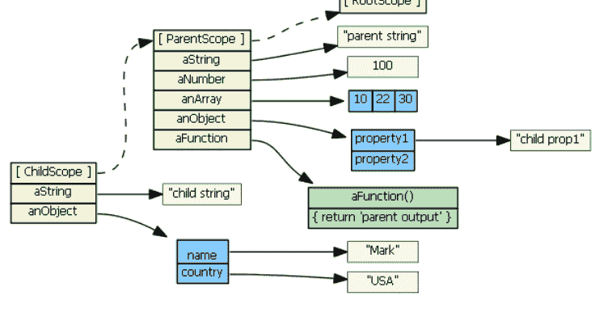

The inner scope always has access to the properties defined by the outer example. Apart from controllers, directives may also create child scopes. Some directives simply use the parent scope without creating a child. And some other directives create isolated scopes that don't inherit from any parent scope and exist on their own. We will discuss isolated scopes in the directives chapter.

To reinforce the above concepts let's create a sample app. We'll create an app that lists three books published by SitePoint. Using the Angular Seed project, follow these steps to create the app:

- 1. Create the module `myApp`. This will go into `app/js/app.js`.

```javascript
'use strict';
angular.module('myApp', [
```

```javascript
'myApp.controllers'
]);

angular.module('myApp').run(function($rootScope){
    $rootScope.title='Famous Books';
    $rootScope.name="Root Scope";
});
```

- 2. Create the required controllers in `app/js/controllers.js`.

```javascript
angular.module('myApp.controllers',[]).controller('SiteController', function($scope){
    $scope.publisher='SitePoint';
    $scope.type="Web Development";
    $scope.name="Scope for SiteController";
});

angular.module('myApp.controllers').controller('BookController', function($scope){
    $scope.books = ['Jump Start HTML5','Jump Start CSS','Jump Start Responsive Web Design'];
    $scope.name="Scope for BookController";
});
```

- 3. Create the view. Name it `scopes.html` and this will be directly under `app`.

```html
<!DOCTYPE html>
<html ng-app="myApp">
<head>
    <meta charset="utf-8" />
    <title ng-bind="title"></title>
</head>
<body ng-controller="SiteController">
    <span>{{publisher}} excels in {{type}} books</span>
    <div ng-controller="BookController">
        <h3>Some of the popular books from {{publisher}}</h3>
        <ul>
            <li ng-repeat="book in books">
                {{book}}
            </li>
        </ul>
```

```html
</div>
</body>
<script src="lib/angular/angular.js"></script>
<script src="js/app.js"></script>
<script src="js/controllers.js"></script>
</html>
```


In the above code, the callback passed to `angular.module('myApp').run()` gets called when all the modules are loaded. 在内部，我们在 `$rootScope` 上设置了一个模型 `title`。这是我们页面的标题。第二个参数 `name` 仅用于标识该 `scope`。我们还了两个控制器：`SiteController` 和 `BookController`，后者在 HTML 中嵌套在前者内部。

现在让我们可视化 `scope` 的层级结构。你安装 `Angular B(c)rang` 了吗？你需要它来可视化 `scope` 的层级结构，如果你还没有安装，现在是时候了。

现在通过命令运行服务器：`node scripts/web-server.js`。一旦服务器启动，打开浏览器并访问 `http://localhost:8000/app/scopes.html`。打开开发者工具，在最后一个标签页中你会找到 `AngularJS`。只需启用它并刷新页面。现在你应该能看到类似图 3.2 的内容，它描述了 `scope` 的层级结构！


图 3.2. `scope` 层级结构图

如你所示，`Scope (002)` 是根 `scope`（`$rootScope`）。`Scope (003)` 是控制器 `SiteController` 的 `scope`，它原型继承自 `$rootScope`。`Scope (004)` 是 `BookController` 的 `scope`，它原型继承自父级 `Scope (003)`。

`ng-repeat` 是一个指令，正如其名，它会重复显示多个元素。在这里，对于模型 `books` 中的每本书，`<li>` 被重复，并且每个 `<li>` 都与不同的 `scope` 链接。在这里，我们有三个名为 `Scope (005)`、`Scope (006)` 和 `Scope (007)` 的此类 `scope`。这些都是兄弟节点，并原型继承自 `Scope (004)`。尽管这些 `scope` 不同，但模型名称保持相同，即 `book`。HTML 中的表达式 `{{book}}` 被重复了三次，并且每次都在三个不同的 `scope` 中进行求值。这就是结果不同的原因。所以，一个 AngularJS `scope` 是一个表达式求值的 `context`（上下文）。

没有执行上下文的模型是无用的。看一眼视图。我们简单地在表达式中编写模型名称，如 `{{book}}` 和 `{{publisher}}`。但 AngularJS 会在正确的上下文中对它们进行求值。当 `AngularJS` 看到 `{{publisher}}` 时，它会针对为 `SiteController` 创建的 `scope` 进行求值。你也可以看到在标记中的 `BookController` `scope` 下还有另一个 `{{publisher}}` 表达式。尽管如此，我们仍然可以看到该值，因为这个 `scope` 继承自 `SiteController` `scope`，设置在该 `scope` 上的模型在子级 `scope` 中均可用。

## 使用 ng-bind

`ng-bind` 指令在这里的作用是什么？编写 `<title ng-bind="title"></title>` 与编写 `<title>{{title}}</title>` 相同，但有一个细微的区别。如果你使用后者，在 AngularJS 将表达式 `{{title}}` 替换为实际模型值之前，浏览器已经显示了一瞬间的原始文本 `{{title}}`。为了防止这一点，我们可以使用 `ng-bind`。在这种情况下，你传递模型名称，值会被 `innerHTML` 到挂载了 `ng-bind` 指令的元素上（即 `<title>`）。还有另一个 AngularJS 指令叫做 `ng-cloak`，用于防止浏览器临时显示未编译的 HTML。让我们在关于指令的章节中保存它的细节。

> ¹ [https://docs.angularjs.org/api/directive/ng-cloak](https://docs.angularjs.org/api/directive/ng-cloak)

## 高级 Scope Concepts

虽然我们讨论了 `scopes` 的基础，但还有一些高级概念可以让你在 AngularJS 世界中获得超能力。让我们逐一探索。

### AngularJS 中的 Watchers

`watcher` 监控模型的变化并做出响应。

`$scope` 对象有一个函数 `watch()` 用于注册 `watcher`。让我们修改之前的代码片段。我们希望赋予用户向 `wishlist` 添加书籍的能力。但一旦他们向 `wishlist` 添加了两个书籍，我们就希望显示一条祝贺消息。我们可以维护一个计数器，每当用户点击 `Add` 链接时，计数器就会加 1。但我们如何知道计数器达到了 2 呢？这就是 `watchers` 的用处。我们可以在计数器上设置一个 `watcher`，在值变化时通知我们。如果其值为 2，我们就会触发 `alert`。以下是修改后的 HTML：

```html
<body ng-controller="SiteController">
  <span>{{publisher}} excels in</span>
  <div ng-controller="BookController">
    <h3>Some popular books from {{publisher}}</h3>
    My Wish List Count: {{wishCount}}
    <ul>
      <li ng-repeat="book in books">
        {{book}}
        <a href="#" ng-click="addToList(book)">Add to Wish List</a>
      </li>
    </ul>
  </div>
</body>
```

注意，为了简洁，我只显示了 `<body>`。然后我们的 `controller` 可以修改如下：

```javascript
angular.module('myApp').controller('BookController', function($scope) {
  $scope.books = ['Jump Start HTML', 'Jump Start CSS', 'Jump Start Responsive Design'];
  $scope.name = "Scope for BookController";

  $scope.addToList = function(book) {
    $scope.wishCount++;
  };

  $scope.wishCount = 0;

  $scope.$watch('wishCount', function(newValue, oldValue) {
    console.log('called ' + newValue + ' times');
    if (newValue == 2) {
      alert('Great! You have 2 items in your wish list. Time to buy what you love. ');
    }
  });
});
```

我们在 `BookController` 的作用域中添加了一个新模型 `wishCount`。每当用户点击“添加到愿望清单”链接时，`$scope.addToList()` 就会被调用，使该的值的值增。现在让我们来看有趣的部分——设置一个监视器。`$scope.$watch()` 是实现此功能所需的方法。第一个参数是 `watchExpression`（监视表达式），它可以是一个模型或函数。第二个参数是一个回调函数，每当 `AngularJS` 检测到模型值或传递函数的返回值变化时，该回调函数就会被调用。这个回调函数接受两个参数：第一个是模型的新值，第二个是旧值。如果你只对新值感兴趣，可以省略第二个参数。

现在，在监视回调函数（也称为监听函数）内部，我们检查 `newValue` 是否为 2。如果是，我们就显示一个警告框。我们还使用了 `console.log()`，这样我们就能看到监听函数被调用了多少次。

## 监听器会被立即调用

当你加载页面时，你会发现监听函数被立即调用。这可能看起来有点奇怪，但 `AngularJS` 在监视器注册后立即执行监听函数。如果你不希望这样发生，可以插入一个额外的检查看看 `newValue` 和 `oldValue` 是否相同。如果是这种情况，这将作为初始化一部分第一次调用监听器。你可以这样写：

```javascript
$scope.$watch('someModel', function(newValue, oldValue) {
    if (newValue != oldValue) {
        //do something
    }
});
```

然而，`$watch()` 的第二个参数是可选的。但是，为什么会有人想要一个没有监听器的监视器呢？我们将在下一节中讨论这个问题。`$watch()` 函数还接受一个可选的第三参数 `objectEquality`（对象相等性）。在本例中我们我们监视一个简单的字符串。但有时你可能需要监视一个对象的变化。我们希望在对象的任何属性发生变化时得到通知。在这种情况下，上面的代码将不起作用，因为 `AngularJS` 将通过引用来比较对象。为了使其工作，我们可以将 `true` 作为第三参数传递给 `$watch()` 函数。这将比较被监视对象的各个属性，并在发生变异时调用我们的监听器。

## 解绑监视器

`$scope.$watch()` 的返回值是一个函数，可以在需要时用于解绑监视器。这很重要，因为它清除了分配给监视器的内存。因此，在显示警告框后，如果你想解绑监视器，可以利用这个返回值。相应的代码如下：

```javascript
var unbindWatcher = $scope.$watch('wishListCount', function(newValue, oldValue) {
    console.log('called ' + newValue + ' times');
    if (newValue == 2) {
        alert('Great! You have 2 items in your wish list. Time to buy what you love. ');
        unbindWatcher();
    }
});
```

## $watchCollection() 函数

在许多情况下，你可能不想监视一个简单的值，而是想监视一组项目，例如数组或对象。为此，你需要使用 `$watchCollection()`。如果你监视的是数组，每当数组中添加新项目、删除现有项目、更新或重新排序项目时，监听器也会被调用。以下是你如何监视集合的方法：

```javascript
$scope.$watchCollection('myCollection', function(newCollection, oldCollection) {
    //handle the change
    console.log(newCollection);
});
```

关于监视器的介绍到此结束。要完全理解监视器，你需要理解两个关键的 AngularJS 概念：`$digest()` 和 `$apply()`。因为这些内容相互关联，要完全理解其中一个你需要了解其他内容。

## $apply() 函数和 $digest 循环

让我们看一个非常简单的 AngularJS 代码片段，其中你开始在输入框中输入你的名字。还有一个 `div` 实时显示你输入的内容：

```html
<input id="input" type="text" ng-model="name"/>
<div id="output">{{name}}</div>
```


AngularJS 的 `$scope` 有一个名为 `$apply()` 的函数，它接受一个函数作为参数。AngularJS 表示，只有在 `$apply()` 内部完成的变更，它才会知道模型变异。因此，你只需要将改变模型的代码放在函数中，并将该函数传递给 `$scope.$apply()`。`apply()` 函数结束后，AngularJS 知道可能发生了一些变更。然后通过调用另一个函数——`$rootScope.$digest()`——启动一个 digest 循环，该循环传播到所有作用域。在 digest 循环中，所有的监视器都会调用，检查模型值是否变化。如果值发生了变化，相应的监听器就会调用。

> `$digest()` 循环至少运行

> 即使在监听器函数中没有变异，`$digest()` 循环至少运行两次。再运行一次以确保模型稳定的，并且在上一轮循环中发生变化。被称为脏检查。

如果你想在 `$digest()` 被调用时通知，你可以设置没有任何监视器。传递给 `$scope.$watch()` 的第一个参数应该是你想要视其值的函数。这个函数在 digest 循环中都会被调用。

```javascript
$scope.$watch(function() {
    //do something here
    console.log('called in a digest cycle');
    return;
});
```

传递给 `$watch()` 的函数在 digest 循环中都会被调用。如你所知，digest 循环会持续运行（最多10次），直到作用域模型下来。因此，你的函数在一个 digest 循环中可能会被多次调用。

如果 `$apply()` 调用需要触发 digest 循环，像 `ng-model` 和 `ng-click` 这样的指令是如何告诉 Angular 模型变异的？答案是，内部 `ng-click` 和 `ng-model` 将改变模型的代码包装在 `$apply()` 调用中。结果，digest 循环照常运行，监视器照常调用。所以，当你写 `<input type="text" ng-model="name" />` 时：

1. 指令 `ng-model` 向输入框注册一个 `keydown` 监听器。当输入框文本发生变化时，会触发 `keydown` 事件，相应的监听器。
2. 在 `keydown` 监听器内部，该指令将输入框的新值分配给 `ng-model` 指定的作用域模型。在我们的例子中，模型 `name` 被更新为新值。这段代码被包装在 `$apply()` 调用中。
3. 在 `$apply()` 结束后，digest 循环开始，其中监视器被调用。如果你在视图中有表达式 `{{name}}`，它已经在作用域模型 `name` 上设置了一个监视器。因此，在 digest 循环中，这个监视器会被调用，并且监听器函数会执行，传入 `newValue` 和 `oldValue` 作为参数。这个监听器的工作是使用 `newValue` 更新 DOM，可能是通过 `innerHTML`。
4. 总体结果是，你看到 `{{name}}` 被更新为你在输入框中输入的任何。

## 使用 $apply()

> 当你想从非 AngularJS 世界过渡到 Angular 世界，并需要一种方式来告诉“嘿，Angular，我正在变更一些模型，现在该你触发监视器了！”，请使用 `$apply()`。

那么 AJAX 调用呢？如果你通过 Angular 内置的 `$http` 服务发送 XHR 请求（99% 的情况下你都会这么做），模型变更的代码会被隐式地包裹在 `$apply()` 调用中，因此你不需要任何额外的步骤。但如果你出于某种原因使用原生 JavaScript 手动编写 XHR 请求，那么你需要在 `$apply()` 内部进行模型变更。

## $digest 会自动触发

在大多数场景下，你不需要自己调用 `$digest()`。调用 `$apply()` 会自动触发 `$rootScope` 上的 `$digest`，这随后会访问所有作用域并调用监听器。

## 最好以函数作为参数调用 $apply

你可以无参数地调用 `$scope.$apply()`，也可以传递一个函数作为参数。如果传递一个改变模型的函数作为 `$apply()` 的参数，它会被求值，然后 `$rootScope.$digest()` 会被触发。

你也可以像往常一样修改模型，最后调用 `$apply()` 来触发 `$digest` 循环。但前一种方法（带参数的 `$apply()`）是首选方式，并且应该始终使用。这是因为当你传递一个函数给 `$apply()` 时，代码会被包裹在 `try/catch` 中，发生的任何异常都会传递给 `$exceptionHandler` 服务。

注意，如果你在修改模型后跳过了 `$apply()`，这些变更将不会反映在视图中。只有当 `$apply()` 被调用且 `$digest()` 运行时，变更才会反映。

## $apply 和 $digest 实践

为了了解 `$apply()` 在实际中如何使用，让我们创建一个简单的应用，计划三秒后运行一个函数。这个函数只是更新作用域模型，为此我们将使用 `setTimeout()`。

### 视图

```html
<body ng-controller="TimeoutController">
  <button ng-click="scheduleTask()">Get Message after 3 seconds</button>
  <br/>Message fetched: {{message}}
</body>
```

### 控制器

```javascript
angular.module('myApp',[]).controller('TimeoutController', function($scope) {
    $scope.scheduleTask = function() {
        setTimeout(function() {
            $scope.message = 'Fetched after 3 seconds';
            console.log('message=' + $scope.message);
        }, 3000);
    };
});
```

所以当你点击视图中的按钮时，`$scope.scheduleTask()` 会运行，随后使用 `setTimeout` 在三秒后运行一个函数。函数执行时更新 `$scope.message`。但如果你运行上面的代码并点击按钮，视图不会在三秒后更新。然而，控制台中你可以找到输出：`message=Fetched after 3 seconds`。这是因为我们没有将代码包裹在 `$apply()` 中，`digest()` 循环没有运行，视图没有更新。

你需要对代码进行以下修改使其工作：

```javascript
$scope.scheduleTask = function() {
    setTimeout(function() {
        $scope.$apply(function() {
            $scope.message = 'Fetched after 3 seconds';
            console.log('message=' + $scope.message);
        });
    }, 3000);
};
```

如你见，我们将代码包裹在 `$apply()` 中，这样 `$digest()` 循环就会启动，监听器被触发，我们的视图得以更新。现在如果你点击按钮，视图会预期般显示消息。

## 引入 $timeout

Angular 提供了一个名为 `$timeout` 的内置服务，它延迟一个函数的执行给定的间隔，自动将你的代码包裹在 `$apply()` 中，这样你就不必手动操作。以下是利用 `$timeout` 修改后的示例：

```javascript
angular.module('myApp',[]).controller('TimeoutController', function($scope, $timeout){
    $scope.fetchMessage = function() {
        $timeout(function() {
            $scope.message = 'Fetched after 3 seconds';
            console.log('message=' + $scope.message);
        }, 3000);
    }
});
```

这里需要注意几点：

- 你的控制器声明对 `$timeout` 依赖。
- `$timeout()` 接受一个函数作为参数，按指定的间隔其执行。
- 函数调用会自动包裹在 `$apply()` 中。

现在，如果你在浏览器中查看并点击按钮，你将得到结果。

> $scope.$$phase

> 有名为 `$$phase` 的内部变量，它在作用域对象上设置，每当进行 `digest` 循环时。值得了解的是作用域对象存在这样一个标志。虽然知道它很好，但在实际应用中遵循 AngularJS 最佳实践（并以正确的方式做事）时，你不会需要这个变量。不要在你的代码中使用它，因为它是内部实现，并且未来不可靠。以 `$$` 为前缀的变量被视为内部变量，不应用于代码中。

## 广播与发射事件

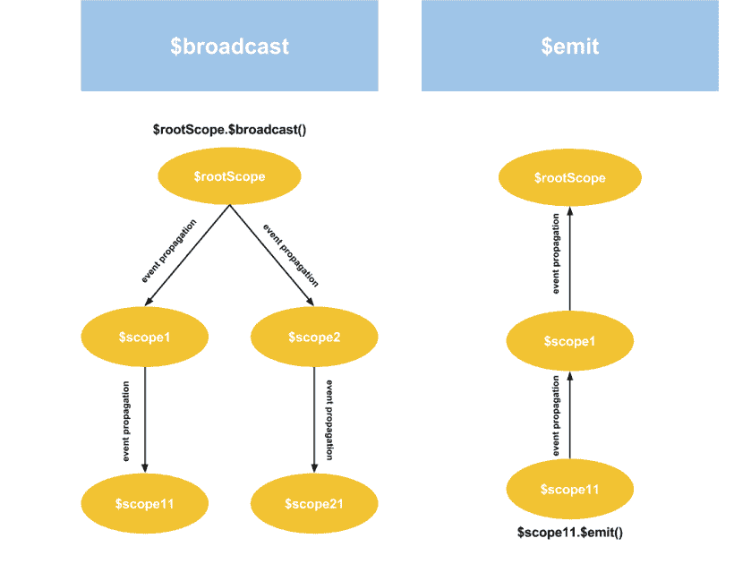

图 3.3 事件传播

让我们逐一理解这些。

### $scope.$emit(name, args) 用于发射事件

`$scope` 有一个名为 `$emit()` 的函数，用于在作用域层级向上发射事件。事件生命周期从调用 `$emit()` 的作用域开始，并沿作用域层级向上分派到所有注册的监听器。有趣的是，发射事件的 `$scope` 本身在事件发射时也会收到通知（通过 `$on`）。

`$emit()` 函数的第一个参数是要发射的事件名称。希望在事件发生时收到通知的作用域为此事件名称注册监听器。第一个参数之后，你可以向 `$emit()` 传递多个参数，这些参数将传递给事件监听器。通常，你在此传递应共享的数据。

### $scope.$broadcast(name, args) 用于广播事件

`$broadcast()` 函数与 `$emit()` 相同，只是事件在作用域层级中向向下传播到所有子作用域。参数列表也与 `$emit()` 相同。像 `$emit` 一样，广播事件的 `$scope` 在事件广播时也会收到通知（通过 `$on`）。

## 监听事件

`$on` 函数注册事件监听器，当事件发生时应调用这些监听器。第一个参数是你感兴趣的事件名称。第二个参数是回调函数，当事件发生时被调用。回调函数接受两个参数：

1. `event`：这是一个事件对象，具有多个有用的属性和函数，提供有关事件的更多信息。如下所示：

    - `name`：事件的名称。

html
<!DOCTYPE html>
<html ng-app="myApp">
<head>
    <meta charset="utf-8" />
    <title>AngularJS Events</title>
</head>
<body>
    <div ng-controller="MessageController">
        <h4>Messages:</h4>
        <ul>
            <li ng-repeat="message in messages">
                {{message.text}}
            </li>
        </ul>
    <div ng-controller="StatsController">
        <h4>Stats:</h4>
        <div>{{messages.length}} Message(s)</div>
        <div>Status: <span style="color:{{statusColor}}">{{status}}</span></div>
    </div>
    </div>
</body>
<script src="lib/angular/angular.js"></script>
<script src="js/app.js"></script>
<script src="js/controllers.js"></script>
</html>
```

现在，如果你启动服务器并访问 `http://localhost:8000/app/events.html`，你会发现每三秒会生成一条消息。在获取第三条消息之后，我们将模拟连接失败。

我们的设计方式如下：

1. 首先我们创建 `MessageController`，它在其作用域上设置一个消息数组。它声明了对 Angular 内置 `$timeout` 服务的依赖。该服务延迟代码的执行。因此，为了模拟每三秒获取一次消息，我们在这里使用 `$timeout`。

2. `var count` 用于跟踪我们获取消息的次数。在第三条消息之后，我们将模拟连接失败，并且需要向 `StatsController` 发出此信号。

3. `StatsController` 的作用域是 `MessageController` 作用域的子级。因此，我们需要从父 `MessageController` 广播一个事件（`broadcast`父到子）。我们使用 `$scope.$broadcast()` 来完成此操作。

4. 在 `StatsController` 中，我们通过 `$scope.$on()` 注册监听器来处理该事件。在处理程序中，我们将连接状态从 `connected` 更新为 `Not Connected`，将颜色从 `green` 更新为 `red`。

5. 同样，在事件处理程序中，我们发出一个事件以表示我们收到了连接失败事件。我们通过调用 `$scope.$emit()`（`emit`子到父）来做到这一点。在 `MessageController` 中，我们通过调用 `$scope.$on()` 来监听此事件。

检查浏览器的控制台以查看日志消息。

## 使用 $rootScope

如果 `StatsController` 的作用域不是 `MessageController` 作用域的子级会怎样？如果两个控制器都是兄弟节点呢？你会如何设计这个应用程序？在这种情况下，我们需要借助 `$rootScope`。在两个控制器中都注入 `$rootScope`，当你想要发送事件时使用 `$rootScope.$broadcast()`。由于两个控制器作用域都是 `$rootScope` 的子级，如果你从 `$rootScope` 广播事件，两个子作用域都可以通过注册监听器来监听它（采用常用的 `$scope.$on()` 方式）。

## $rootScope 可视为中央消息总线

可以将 `$rootScope` 视为中心消息总线，可用于通知所有子作用域。因此，如果有一个事件会影响所有子作用域，你可以从 `$rootScope` 广播该事件，然后让子作用域处理该事件。

## $destroy 事件

当作用域被销毁时，会在该作用域上广播 `$destroy` 事件。你可以监听此事件并执行任何必要的清理工作。例如，如果你有一个计时器（就像上面的例子一样），来自 `$timeout` 服务，你可以取消它，这样它就不会不必要地消耗 CPU 周期。你还可以利用这一点来取消先前设置的观察器和任何自定义事件监听器。当作用域即将被销毁时，也意味着任何消化循环都不会再触碰该作用域及其子作用域。因此，该作用域变得有资格进行垃圾回收，内存可以释放。

下面的片段展示了如何做到这一点：

```javascript
$scope.$on('$destroy',function(){
    //clean up code
});
```

## 结论

至此，我们已经到达了 AngularJS 作用域和事件部分。这是一个重要的章节，涵盖了 AngularJS 的一些核心概念。以下是一些要点总结了到目前为止我们所学到的内容：

- AngularJS 作用域是普通的 JavaScript 对象，你可以在其中附加属性和函数。
- 作用域可以嵌套并原型继承彼此。
- 每个应用程序都有一个 `$rootScope`，它位于作用域层次结构的根处。
- 你通过在其上设置观察者来通知作用域模型何时更改。
- 所有已设置的观察器都将在每个消化周期中触发。
- 消化循环将继续运行，直到没有模型更改或达到最大循环次数 10。
- 调用 `$apply()` 会自动触发一个 `$digest` 周期。
- 当你想在 AngularJS 上下文之外更改模型并希望该更改反映在视图中时，将代码包装在 `$apply()` 中。
- 事件可用于通知应用程序的不同部分发生某些事情。
- `$scope.$emit()` 用于从子作用域向父作用域沿作用域层次结构向上传播事件。
- `$scope.$broadcast()` 用于从父作用域向子作用域沿作用域层次结构向下传播事件。
- `$scope.$on()` 用于注册一个事件监听器，当事件发生时会被通知。
- 当销毁作用域时会触发 `$destroy` 事件，允许你执行任何最终清理工作，如清除超时、注销观察器和事件监听器等。

# 第四章

## 多视图与路由

现在你已经走了大约分之一的路，成为 AngularJS 高手！你已经掌握了基本的 AngularJS 概念（数据绑定）。现在是将你的技能提升到全新水平：使用 AngularJS 路由。AngularJS 的路由 API 使我们能够将应用程序中的 URL 与特定功能进行映射。

这种方法的好处是减少网络流量。在典型的 Web 应用程序中，通常会完全加载页面，每次请求都会提供重复内容（如标题和页脚）。但是当你使用多视图和路由时，标题、页脚等仅在第一次请求提供，后续请求只是更新页面的元素。

### 创建视图

应用程序中的视图是 HTML 文件。下一步是告诉 AngularJS 路由哪个视图。假设有两个视图：`partials/view1.html` 和 `partials/view2.html`，配置路线如下：

```javascript
angular.module('myApp').config(function ($routeProvider) {
  $routeProvider.when('/view1', {
    controller: 'Controller1',
    templateUrl: 'partials/view1.html',
  }).when('/view2', {
    controller: 'Controller2',
    templateUrl: 'partials/view2.html',
  });
});
```

### 这些视图只是局部模板

注意，`view1.html` 和 `view2.html` 不是完整的 HTML 文件——它们只是局部模板。`angular.module()` 具有一个 `config()` 函数，我们可以配置模块。我们将 `$routeProvider` 作为参数注入到函数中，这实际上是一个内置的 AngularJS 对象。当你带有参数 `$routeProvider` 的函数时，AngularJS 会自动注入一个 `$routeProvider` 对象。现在，`$routeProvider` 的 `when()` 函数用于配置路由。第一个参数是 route name（表示路线的字符串），第二个参数是 route definition。

## AngularJS：从新手到专家

### ngRoute 是什么

`$routeProvider` 定义在一个名为 `ngRoute` 的模块中，它不在你的 `angular.js` 脚本中。要使用 `ngRoute` 模块，你需要包含 `angular-route.js`。在 AngularJS 1.1.6 之前的版本中，`ngRoute` 模块是内置的。后续版本默认都不包含 `ngRoute`。

让我们开始实践，创建一个两个视图的简单应用：一个显示 "Hello, World!" 消息，另一个显示当前日期。对于这个简单测试，建议你使用 Angular Seed 项目。主模块（`app/js/app.js`）：

```javascript
'use strict';

angular.module('myApp', [
  'myApp.controllers',
  'ngRoute'
]);
```

### 如果浏览器不支持 History API 会怎样？

如果你将 `html5Mode` 设置为 `true`，AngularJS 首先会检查浏览器是否支持 History API。如果可用，则使用 `html5Mode`，否则回退到 `hashbang` 模式。换句话说，它透明地使用最佳选项，你不需要担心浏览器兼容性问题。

但有一个陷阱！在应用内部导航时，一切运行正常。但如果你直接在浏览器中打开类似 `http://localhost:8000/view1` 的 URL，会导致 404。这是因为当你直接向服务器请求 `http://localhost:8000/view1` 时，没有 AngularJS。但在 hashbang 版本中，浏览器总是先加载 `index.html`，然后 AngularJS 介入解析 hashbang URL。这就是 `html5Mode` 的局限性。如果你想坚持使用 `html5Mode`，你需要某种服务器端的配置来解决这个问题。

如果你真的感兴趣学习 HTML5 History API，可以查看以下链接：http://diveintohtml5.info/history.html [1]

### The otherwise() Function

`$routeProvider` 中也有 `otherwise()` 函数，用于在未找到路由时将用户重定向到特定路由。可以通过这种方式实现：

```javascript
$routeProvider.otherwise({redirectTo:'/view1'});
```

每个 AngularJS 应用都有一组固定的路由。所以，如果有人尝试乱来加载一个不存在的路由（如 `http://localhost:8000/index.html#/view3`），你的应用不会崩溃。你可以借助 `otherwise()` 安全地将用户重定向到默认路由。

## Using $routeParams in the Controller

有时需要向与视图关联的控制器传递某些参数。例如，在博客应用中，你可能想在 URL 中传递一个 post ID，控制器可以获取它并通过 Ajax 获取相关内容。路由中传递的这些参数被称为路由参数（route parameters），由集成的 AngularJS 服务 `$routeParams` 暴露。为了演示这一概念，让我们调整之前的 demo 应用以使用 `$routeParams`。

修改两个路由如下：

- `/view1`：允许用户输入名字和姓。点击按钮后，我们加载路由 `/view2`，并将名字和姓作为路由参数传递。

[1] http://diveintohtml5.info/history.html

```javascript
'use strict';

angular.module('myApp', [
  'myApp.controllers',
  'ngRoute'
]);

angular.module('myApp').config(function($routeProvider,
  $locationProvider){
    $routeProvider.when('/view1',{
        controller:'Controller1',
        templateUrl:'/partials/view1.html'
    }).when('/view2/:firstname/:lastname',{
        controller: 'Controller2',
        templateUrl: '/partials/view2.html'
    }).otherwise({redirectTo:'/view1'});
    $locationProvider.html5Mode(true);
});
```

在为 `/view2` 配置路由详情时，我们将`'/view2/:firstname/:lastname'` 作为第一个参数传递给`when()`。这指定了 `firstname` 和 `lastname` 是这里的路由参数。此外，在与该视图关联的控制器（`Controller2`）内部，我们可以通过键 `$routeParams.firstname` 和 `$routeParams.lastname` 来引用这些路由参数。

你注意到 `templateUrl` 前面加了 `/` 吗？这是因为当加载 `/view2` 时，URL 会是类似 `/view2/myfirstname/mylastname` 的形式。所以，如果你不在模板路径（如 `partials/view2.html`）前面加上 `/`，由于 URL 已改变，AngularJS 会在 `/view2/myfirstname/lastname/partials/view2.html` 中寻找模板，这将导致 404 错误。因此，`/` 告诉 AngularJS 模板 `partials/view2.html` 位于根目录下。

## partials/view1.html

```html
<p>
    First name: <input type="text" ng-model="firstname"/> <br/>
    Last name: <input type="text" ng-model="lastname"/> <br/>
    <button ng-click="loadView2()">Load View2</button>
</p>
```

如你所见，我们有两个输入字段，分别绑定到两个模型：`firstname` 和 `lastname`。还有一个按钮，点击时会触发作用域函数 `loadView2()`。该函数负责处理 `firstname`、`lastname`，并加载 `/view2`，将这些模型值作为路由参数。

## partials/view2.html

```html
<p>
    From View2.
    <ul>
        <li>First name: {{firstname}}</li>
        <li>Last name: {{lastname}}</li>
    </ul>
</p>
```

这个模板非常简单——它只是使用表达式来显示作用域模型。

## controllers.js

```javascript
'use strict';

angular.module('myApp.controllers', []).controller('Controller1',
  function($scope,$location){
    $scope.loadView2=function(){
        $location.path('/view2/'+$scope.firstname+'/'+$scope.lastname);
    }
}).controller('Controller2',function($scope,$routeParams){
    $scope.firstname=$routeParams.firstname;
    $scope.lastname=$routeParams.lastname;
});
```

`Controller1` 声明了一个新依赖：`'$location'` 服务。这是一个内置服务，用于解析浏览器地址栏中的 URL，并通过多个函数将其暴露给我们的应用。我们将在本章后面详细讨论 `$location`。现在，只需注意 `$location.path()` 用于加载新路由。

`Controller2` 声明了对 `$routeParams` 的依赖，这是一个 AngularJS 服务，用于将路由参数暴露给我们的控制器。

现在，如果你运行应用并访问 `http://localhost:8080/index.html`，你将进入 `/view1` 路由。如果你填写名字和姓氏输入框，然后点击 Load View2，你将被重定向到 `/view2`，看起来如图 4.1 所示。

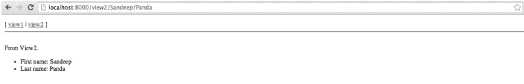

## $routeParams 也会解析查询字符串

除了命名参数外，如果存在查询字符串，`$routeParams` 也会对其进行解析。所以，如果你的 URL 包含类似 `?key1=value1` 的查询字符串，该键/值对将被添加到 `$routeParams` 中。

## 使用 ng-template

我们已经了解了如何将不同路由的视图放入不同的 HTML 文件中。例如 `/view1` 和 `/view2` 的模板分别放入 `partials/view1.html` 和 `partials/view2.html` 中。但我们还有一个选项可以内联定义模板，这是通过 `ng-template` 指令实现的。让我们修改代码以使用 `ng-template`。修改将针对 `app.js` 和 `index.html` 进行。

## index.html

```html
<!doctype html>
<html lang="en" ng-app="myApp">
<head>
  <meta charset="utf-8">
  <title>AngularJS Routing</title>
  <link rel="stylesheet" href="css/app.css" />
  <script type="text/ng-template" id="/view1.tpl">
    <p>
      First name: <input type="text" ng-model="firstname"/> <br/>
      Last name: <input type="text" ng-model="lastname"/> <br/>
      <button ng-click="loadView2()">Load View2</button>
    </p>
  </script>
  <script type="text/ng-template" id="/view2.tpl">
    <p>
      From View2.
      <ul>
          <li>First name: {{firstname}}</li>
          <li>Last name: {{lastname}}</li>
      </ul>
    </p>
  </script>
</head>
<body>
  <ul class="menu">
    <li><a href="/view1">view1</a></li>
    <li><a href="/view2">view2</a></li>
  </ul>

  <div ng-view></div>

  <script src="lib/angular/angular.js"></script>
  <script src="lib/angular/angular-route.js"></script>
  <script src="js/app.js"></script>
  <script src="js/controllers.js"></script>
</body>
</html>
```

你可以使用 `<script type="text/ng-template">` 来定义模板。这将 `<script>` 的内容加载到 `$templateCache` 服务中，以便 `ng-view`（和其他指令）可以使用它。你还需要通过 `id` 来给它一个标识，以便在其他地方引用。在我们的例子中，我们将在配置模块时于 `app.js` 中使用这个 id。

以下是修改后的 `app.js`：

## app.js

```javascript
$routeProvider.when('/view1',{
      controller:'Controller1',
      templateUrl:'/view1.tpl' // ng-template id
}).when('/view2/:firstname/:lastname',{
  controller: 'Controller2',
  templateUrl: '/view2.tpl'
});
```

你应该注意，id 中的 `.tpl` 扩展名是可选的。你可以给它任何扩展名，或者脆不加。现在如果你刷新浏览器，应用将按预期工作。

## 为模板使用单独的文件

如果你的模板非常小，可能会受益于 `ng-template`。但在真实应用中，可能不需要这样做。相反，最好为模板创建不同的 HTML 文件，从长远来看保持应用的可维护性，并且不用 `<script>` 标签。

## 路由配置中的 resolve属性

在 `$routeProvider.when()` 函数的第二个参数路由配置对象中，有一个 `resolve` 属性。`resolve` 属性用于预加载控制器的依赖项。

在 `app.js` 中，向 `resolve` 属性添加额外的依赖。在 `/view2` 中除了显示名字和姓氏外，我们还需要显示所有用户。通常你会通过 Ajax 调用获取列表。由于我们在 AngularJS 中还不清楚如何做到，让我们硬编码这个数组。

```javascript
'use strict';

angular.module('myApp', [
  'myApp.controllers',
  'ngRoute'
]);

angular.module('myApp').config(function($routeProvider,
  $locationProvider) {
    $routeProvider.when('/view1', {
        controller: 'Controller1',
        templateUrl: '/partials/view1.html'
    }).when('/view2/:firstname/:lastname', {
      controller: 'Controller2',
      templateUrl: '/partials/view2.html',
      resolve: {
        names: function() {
          //通常在这里使用服务从服务器获取数据
          return ['Misko', 'Vojta', 'Brad']; // 这被用作值
        }
    }).otherwise({
      redirectTo: '/view1'
});
$locationProvider.html5Mode(true);
});
```

你还注意到，除了 `names` 之外，我们还可以添加其他依赖。现在我们的控制器可以修改如下：

```javascript
'use strict';

angular.module('myApp.controllers', []).controller('Controller1', function($scope,$location){
    $scope.loadView2=function(){
        $location.path('/view2/' + $scope.firstname + '/' + $scope.lastname);
    }
}).controller('Controller2', function($scope,$routeParams, names){
    // names 现在是一个依赖项
    $scope.firstname=$routeParams.firstname;
    $scope.lastname=$routeParams.lastname;
    $scope.names=names;
});
```

因此，在实例化 `Controller2` 之前，AngularJS 会执行提供给 `resolve` 中 `names` 属性的函数。此函数的返回值用作控制器声明的 `names` 依赖项的值。

`resolve` 属性的值可以有两种类型：
1. 简单值（`string`、`array`、`object` 等）。
2. 特殊情况：函数。它返回一个延迟类型（也称为 `promise`）。这意味着返回的值只是一个占位符，`resolve` 属性会在实际值可用时更新。

在路由变更之前，`resolve` 中列出的依赖都应该解析，或者至少有一个被解析。如果 `resolve` 中的依赖失败，实际值将被拒绝。另一方面，如果一切顺利，会广播一个 `$routeChange` 事件。如果其中一个依赖失败，会广播 `$routeError` 事件。如果你对这些事件感兴趣，可以使用 `$rootScope.$on()` 订阅它们并做些事情。同样，现在不用担心，稍后回到话题。

最后的更改是针对我们的部分视图 `view2.html`。假设我们使用的是常规 HTML 文件的部分视图，而不是 `ng-template`。

## partials/view2.html

```html
<p>
  来自视图2。
  <ul>
    <li>名：{{firstname}}</li>
    <li>姓：{{lastname}}</li>
  </ul>
  我们的额外用户是：
  <ul>
    <li ng-repeat="name in names">
      {{name}}
    </li>
  </ul>
</p>
```

现在，如果你刷新浏览器，填写名/姓字段并点击按钮，你会看到类似图 4.2 所示的内容。

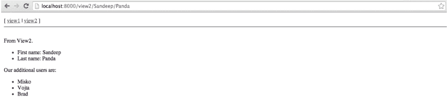

图 4.2. 使用 `resolve` 属性

如我们所见，`resolve` 属性用于预加载控制器的依赖项。当我们学习并在演示应用中使用它时，你会更频繁地看到这一点。

## 探索 $location 服务

`$location` 是一个 AngularJS 服务，它通过一个定义良好的 API 暴露当前浏览器 URL（从 `window.location` 获取）。除此之外，它还保持自身与 URL 的同步。你对 `$location` 做的任何更改都会传播到 URL，而每当 URL 发生变化（例如加载新路由时），`$location` 服务会更新自身。

你可以使用此服务更新 URL 以导航到不同的路由，或者监视 `$location` 的变化并在你的应用中采取适当的操作。

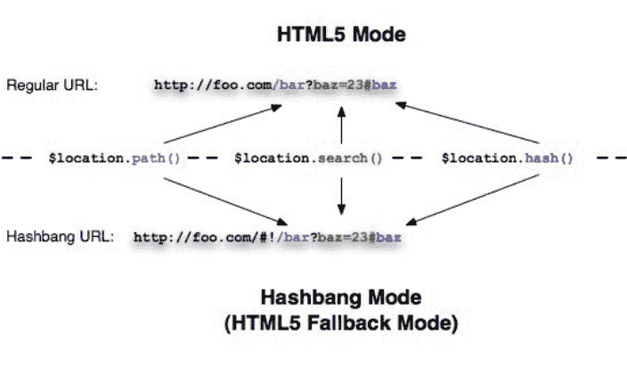

### 可写部分

**path:**

路径是 URL 中主机名和协议之后的部分。对于类似 `http://localhost:8000/view1` 的 URL，路径是 `/view1`。

```
$location.path(); // 获取当前路径
$location.path('/view2'); // 设置当前路径并更新 URL
```

以上对于基于哈希的 URL 也同样适用。

当你在 AngularJS 的处理器内（如 `ng-click`、`ng-model` 等）更改路径时，路径会得到更新，并且更改会反映在 URL 中。这是因为这些函数调用被包装在 `$apply()` 内，并且会开始一个 `$digest` 循环，这反过来会触发由 `$location` 设置的监视器来更新浏览器 URL。如果你在 AngularJS 世界之外（例如在自定义事件处理器中）更新路径，你需要在调用 `$location.path()` 之后调用 `$scope.$apply()`。

> **$location 感知 AngularJS 作用域生命周期**
>
> `$location` 作为一个内置服务，感知 AngularJS 作用域生命周期。因此，它通过更新自身并调用 `$apply()` 与作用域生命周期集成，每当浏览器 URL 发生变化时。这是必要的，因为你可能想在 `$location.path()` 上设置监视器，并在它发生变化时接收通知。
>
> 此外，当你在 `$location` 上调用一个 setter 方法，如 `path()` 时，它不会立即将更改推送到 URL。它们实际上是在 `digest` 循环中提交并推送到 URL 的。

路径名始终以 `/` 开头。如果你在将路径名传递给 `$location.path()` 时没有添加 `/` 前缀，AngularJS 会自动添加一个 `/`。

**search:**

`search()` 允许你为 URL 提供键/值对作为搜索参数。因此，你可以使用 `search()` 函数而不是 `$routeParams` 来向路由传递参数并在控制器中读取它们。你传递的键/值将以 `?` 为前缀，以 `&` 为分隔符附加到路径后。

例如：`http://localhost:8000/view2?firstname=fname&lastname=lname`

```
$location.search(); // 获取一个包含键/值作为搜索参数的对象

$location.search({key1:value1,key2:value2}); // 设置搜索参数
```

### hash:

`hash()` 函数允许你获取或设置 URL 的哈希部分。

```
$location.hash(); // 获取哈希部分。例如 #div1, #div2 等

$location.hash('div1'); // 将 URL 更改为 /view1#div1
```

> **#div1 是一个真正的“真实锚点”**
>
> 这里，`#div1` 是一个真正的锚点，与路由无关。正如你在上面的代码片段中看到的，`hash()` 函数只是在当前 URL 的末尾附加 `#div1`。

这些函数调用返回同一个 `$location` 实例。因此，你可以链式调用它们以一次性更新多个部分。

例如：

```
$location.path('/view2').search({key1:value1}).hash('div1');
```

### 不可写部分

`$location` 的以下函数可用于读取 URL 的不可写部分。

- `host()`：返回主机名，例如 `localhost`
- `port()`：返回服务器正在监听的端口，例如 `8000`
- `protocol()`：返回使用的协议，例如 `http`
- `url()`：返回主机名和协议之后的 URL 部分（即只有路径+搜索+哈希）。例如 `/view1?key1=value1#div1`
- `absUrl()`：返回整个 URL，例如 `http://localhost:800/view1?key1=value1#div1`

## 添加新历史记录条目与替换历史记录条目

每当你更新 `$location` 服务并且更改被推送到浏览器 URL 时，它会创建一个新的历史记录条目。一个新的历史记录条目本质上意味着，当你点击浏览器的后退按钮时，它会按预期运行并返回到上一个路由。但如果你希望替换最后一个历史记录条目而不是创建一个新条目，你应该在修改一个或多个部分之后使用 `$location.replace()` 函数。一个例子可能是：

```
$location.path('/view2').search({key1:value1}).hash('div1');
// 更改这些部分

$location.replace(); // 更改 URL，但不创建新的历史记录条目。
```

这样做，下次当 `$location` 与 URL 同步时（当然，是在一个 `digest` 循环中！），它将更改 URL 并更新最后一个历史记录条目，而不是创建一个新条目。这在 HTML5 模式和 Hashbang 模式下都适用。

## 路由中的事件

路由中有几个你应该了解的事件。它们是：

### 与 $location 相关的事件

- `$locationChangeStart`：在浏览器 URL 因通过 setter（例如调用 `path()`）对 `$location` 进行的更改而改变之前，此事件会在 `$rootScope` 上广播。
- `$locationChangeSuccess`：此事件在浏览器 URL 更改后立即广播。但是，如果你的代码的某些部分监听了 `$locationChangeStart` 事件并在其上调用了 `preventDefault()`，那么此事件将不会被触发。

### 与 $route 相关的事件

- `$routeChangeStart`：在 AngularJS 开始更改路由之前立即广播。此时，`$route` 服务开始解析所有依赖项

## ng-include 指令

有时候，您希望将 HTML 模板划分为可重用的部分，以便将它们包含在主视图中。`ng-include` 指令可用于获取、编译并将外部 HTML 片段包含在您的主页面中。例如，您的主 HTML 文件可以包含不同的部分，如页眉、页脚、侧边栏等。您可以将这些组件的模板放在单独的 HTML 文件中，并将它们包含到您的主 HTML 中。

那么，让我们修改我们的 `/view2`，将模板分成两个不同的 HTML 片段。在 `partials` 内创建一个新目录 `fragments`，并在其中创建两个文件：

**selected-user.html:**

```
来自 View2。

<ul>
    <li>名：{{firstname}}</li>
    <li>姓：{{lastname}}</li>
</ul>
```

上述模板用于列出从 `/view1` 传递过来的名字和姓氏。

**all-users.html:**

```
我们的其他用户有：

<ul>
    <li ng-repeat="name in names">
        {{name}}
    </li>
</ul>
```

此模板用于列出所有可用用户。

现在，让我们修改 `/view2` 的模板。修改后的模板将是：

```
<p>
    <div ng-include="'/partials/fragments/selected-user.html'">
    </div>
    <div ng-include="'/partials/fragments/all-users.html'"></</div>
</p>
```

或者，您可以将 `ng-include` 作为独立元素使用，如下所示：

```
<p>
    <ng-include src="'/partials/fragments/selected-user.html'">
    </ng-include>
    <ng-include src="'/partials/fragments/all-users.html'">
    </ng-include>
</p>
```

现在，如果您刷新 `index.html` 并像往常一样操作，您将看到应用在此修改下正常工作。AngularJS 从 `src` 属性指定的文件中获取内容，并对其进行编译，以便像 `{{firstname}}` 这样的表达式被求值，然后将内容包含在我们的视图中。

您还会注意到，`ng-include` 创建了一个新的作用域，该作用域从父作用域（与路由关联的控制器的作用域）原型继承。

这只是一个展示 `ng-include` 用法的小例子，但希望它能让您了解如何在我们的应用中使用它。在开发演示应用时，我们将经常使用它。

> **使用 `ng-include`**
>
> `ng-include` 期望一个表达式作为 `src` 属性的值传递。例如，如果您有一个指向模板的作用域模型，您可以直接将该模型名称传递给 `src`。但是，如果您想传递像 `/partials/fragments/selected-user.html` 这样的字符串给 `src`，请确保将其包裹在单引号中，就像我们上面所做的那样。

## 介绍 Angular UI Router

当您刚开始使用 AngularJS 路由时，最好从 `ngRoute` 开始。也就是说，它有一个严重的限制：您无法在应用中拥有嵌套视图——只能有一个 `ng-view`。但当您的应用变得复杂时，您可能希望拥有视图中的视图。例如，您的应用管理面板将被加载到 `ng-view` 内。此外，这个管理面板可能有几个子视图，理想情况下。

UI Router 是一个功能强大的路由库，允许您创建复杂的嵌套视图结构。它比 `ngRoute` 提供了更灵活的功能。

当您刚开始使用 AngularJS 路由时，最好从 `ngRoute` 开始。也就是说，它有一个严重的限制：您无法在应用中拥有嵌套视图——只能有一个 `ng-view`。但当您的应用变得复杂时，您可能希望拥有视图中的视图。例如，您的应用管理面板将被加载到 `ng-view` 内。此外，这个管理面板可能有几个子视图，理想情况下。

UI Router 是一个功能强大的路由库，允许您创建复杂的嵌套视图结构。它比 `ngRoute` 提供了更灵活的功能。

当您刚开始使用 AngularJS 路由时，最好从 `ngRoute` 开始。也就是说，它有一个严重的限制：您无法在应用中拥有嵌套视图——只能有一个 `ng-view`。但当您的应用变得复杂时，您可能希望拥有视图中的视图。例如，您的应用管理面板将被加载到 `ng-view` 内。此外，这个管理面板可能有几个子视图，理想情况下。

UI Router 是一个功能强大的路由库，允许您创建复杂的嵌套视图结构。它比 `ngRoute` 提供了更灵活的功能。

现在，如果您访问 `http://localhost:8000/index.html`，应用应该能按预期工作。但不同之处在于，我们现在使用了一个更强大的路由系统。随着我们使用 `UI Router` 开发演示应用，您将了解更多关于它的信息。

您也可以查看他们的 GitHub^2 仓库，以探索更多关于 `UI Router` 的内容。

^2 `https://github.com/angular-ui/ui-router

## 结论

到目前为止，我们已经介绍了 `AngularJS` 路由的基础知识。但在我们的应用中实现这一点之前，了解服务和工厂是很重要的，因为我们将使用它们来存储/检索文章。下一章将详细介绍服务、工厂和提供者。一旦你清楚了这些概念，我们就可以开始为我们的单页面博客生成视图和相关服务了。

# 第 5 章：AngularJS 服务、工厂和提供者

在前几章中，我们已经多次提到**服务**。你已经使用了好几个 `AngularJS` 内置服务，比如 `$location`、`$timeout`、`$rootScope` 等。但是，在真实的应用中，内置服务并不总是足够的，因此你需要创建自定义服务。本章将为你提供 `AngularJS` 三个核心组件的全面指南：**服务**、**工厂**和**提供者**。

这些组件的主要目的是封装应用中多个点都需要的一些逻辑。虽然服务、工厂和提供者都用于完成相同的任务（封装重复逻辑），但它们之间存在细微的差别。

服务、工厂和提供者都是**可注入类型**。正如你在前几章中看到的，这意味着它们可以通过依赖注入被注入到控制器和其他服务中。除此之外，还有两种可注入类型：**值（value）**和**常量（constant）**。让我们详细探讨每一种类型，从最简单的——服务开始。

## 服务

`AngularJS` 服务封装了一些特定的业务逻辑，并提供 API 供其他组件调用这些逻辑。例如，内置的 `$timeout` 服务在指定时间间隔后执行一个函数。`$http` 服务封装了与 REST 后端交互所需的逻辑。我们让 `AngularJS` 将这些服务注入到我们的控制器中，以便我们能够使用它们。服务是一种可注入类型，这意味着它可以通过依赖注入插入到不同的 `AngularJS` 组件中。

> **AngularJS 服务始终是单例**

需要注意的是，`AngularJS` 服务始终是单例。这意味着，一旦 `AngularJS` 构造了一个服务对象，整个应用都会复用同一个实例。永远不会有两个服务实例。这使它们成为跨多个组件共享应用数据的理想选择。例如，成功登录后，你需要将登录状态存储在一个所有其他组件都可以检索到的地方。在这种场景下，你可以将状态存储在服务中，然后，每当你需要读取该值时，只需将其注入到你的控制器/服务中并检查即可。

请看下面的代码片段：

```javascript
angular.module('myApp').controller('TestController',

function($http, $timeout){

  //use $http, $timeout here

});
```

在上面的代码片段中，我们的控制器 `TestController` 声明了对两个服务的依赖：`$http` 和 `$timeout`。因此，当控制器实例化时，`AngularJS` 会将这两个服务传递给它。

同样，你可以创建自己的服务来封装应用特定的业务逻辑。以下是在模块中注册服务的方法：

```javascript
angular.module('myApp').service('helloService',function(){
    this.sayHello=function(){ // define an instance method

        alert('Hello!! Welcome to services.');

    }
});
```

如你所见，`angular.module()` 提供了一个 `service()` 函数用于注册服务。此函数的第一个参数是服务名称。第二个参数是一个构造函数。它可以有常规的实例变量和函数。现在，如果在控制器中请求此服务，`AngularJS` 会通过 `new` 关键字调用构造函数来构造一个对象。然后这个对象会被注入到你的控制器中。如果你想在控制器中使用我们的 `helloService`，可以这样做：

```javascript
angular.module('myApp').controller('TestController',

function(helloService){

    helloService.sayHello(); // helloService is the service object.

    // It has sayHello function.

});
```

> **为什么使用驼峰命名法（CamelCase）？**
你可能会想：“为什么要用驼峰命名法来命名服务，如果我们是向 `service()` 方法传递构造函数？”原因是，当你在不同的组件中请求该服务时——比如在控制器中——你得到的是该构造函数的一个实例。这就是为什么我 prefer `camelCase` 而不是 `PascalCase`。

我们如何将函数附加到服务上也值得一看。如果你使用 `this` 关键字为实例定义函数，这通常是不好的做法。原因是同一个函数会被复制到所有实例中。确实，某些 JavaScript 专家如果看到你这样做甚至会感到被冒犯。然而，在 `AngularJS` 中我们有了解决办法。由于 `Angular` 服务是单例，可以保证你的服务只有一个实例。因此，你使用 `this` 还是使用 `prototype` 属性来定义函数都没有关系。

在控制器中，我们声明了对 `helloService` 的依赖。当 `AngularJS` 解析这个依赖时，它会获取与服务名称 `helloService` 关联的构造函数并实例化它。结果是一个最终被注入到我们控制器中的对象。请注意，这只执行一次。之后，返回的服务是第一个调用服务构造函数时的缓存版本。

在上面的例子中，服务只是显示了一个简单的 `Hello` 消息。但我们的服务也可以依赖其他服务。例如，它可以依赖内置的 `$timeout` 服务，并将 `alert` 延迟你指定的时间间隔。该服务可以重写如下：

```javascript
angular.module('myApp').service('helloService',function($timeout){

  this.sayHello=function(name){

    $timeout(function(){

      alert('Hello '+name);

    },2000);

  }

});
```

在这里，我们的服务依赖于内置的 `$timeout` 服务。当 `AngularJS` 调用这个构造函数时，它会传递依赖项，即 `$timeout`。现在实例方法已被修改为接受一个名称并显示自定义的 Hello 消息。借助 `$timeout`，我们在两秒延迟后显示消息。最后，我们可以将其注入到控制器中并使用它，如下所示：

```javascript
angular.module('myApp').controller('TestController',

  function(helloService){

    helloService.sayHello('AngularJS'); // Alerts Hello AngularJS

  });
```

这些基本示例展示了如何创建和使用服务。在实际应用中，你应该用它们来封装可重复的逻辑，并在应用的不同组件之间共享数据。例如，你可能需要在应用的各个地方执行 REST 交互。为此，你可以构建一个内部使用 `$http` 与服务器通信的服务，并将其注入控制器。此外，如果你有需要在多个位置使用的数据，可以将其封装在服务中，并在需要时使用。

关于服务，需要记住的最重要几点：

- 1. 服务使用 `angular.module()` 的 `service()` 函数注册。
- 2. `service()` 的第二个参数是一个构造函数。当我们将服务作为依赖请求时，`AngularJS` 会从这个构造函数创建一个对象并注入它。
- 3. 服务是单例。`AngularJS` 只实例化服务对象一次，所有其他组件共享同一个实例。
- 4. 服务是**延迟实例化**。这意味着 `AngularJS` 只在遇到声明了对该服务有依赖的组件时才实例化该服务。

## 服务的预先加载

服务总是延迟实例化的。但如果我们的服务很繁重，消耗资源并且需要一段时间才能创建呢？在这种情况下，我们当然不希望用户体验变差，因此我们希望在模块加载后立即预先加载我们的服务。好消息是，使用 `module.run()` 函数很容易做到这一点。顾名思义，一旦模块加载，它的 `run()` 函数就会执行。你可以向它传递一个回调函数，并将你的服务名称作为参数，这样当 `run()` 执行时，传递的回调也会执行。结果，列出的依赖会被解析并实例化，你的服务将在应用中有人请求它之前就绪。日志记录服务就是一个应该预先加载的服务的典型例子。现在，以下是我们如何**预先加载**我们的 `helloService`：

```javascript
angular.module('myApp').service('helloService',function($timeout){

  this.sayHello=function(name){

    $timeout(function(){

      alert('Hello '+name);

    },2000);

  }

});

angular.module('myApp').run(function(){
    // Pre-loading services logic here
});
```
（注：由于原文未提供具体的预先加载代码实现，此处根据逻辑补充了 `run` 结构）

```javascript
angular.module('myApp').run(function(){
    // Pre-loading services logic here
});
```


```
当模块 `myApp` 加载时，`config()` 函数运行。传递给 `config()` 的函数声明了对 `greetProvider` 的依赖。此时 AngularJS 已经通过在传递给 `angular.module().provider()` 的函数上调用 `new` 来实例化了 `greetProvider`。因此，这个 Provider 实例被注入并在 `config` 块中进行配置。然后，在另一个组件 `TestController` 中，我们声明了对 `greet` 服务的依赖。因此 AngularJS 将调用 `greetProvider` 实例上的 `$get()` 函数并返回其返回的内容。结果，从 `greetProvider.$get()` 返回的值将被赋值给 `TestController` 中 `greet` 的参数。通过这种方式，我们获得了对 `greet` 服务的引用，它是一个简单的函数。调用时，它会显示一个警告框。在这种情况下，我们将 Provider 配置为使用 "Hola" 作为问候文本。因此，如果你运行应用，它将弹出 **Hola, Sandeep**。尝试在 `config()` 中更改问候文本并查看结果。

### Provider 只实例化一次

Provider 只实例化一次，并且你只能在 `config()` 块中注入它们。这是因为当模块加载时，你有机会配置你的 Provider。之后，你的其他应用组件只需要请求 Provider 所提供的服务。

当你定义一个 Provider 时，不一定非要在 `config()` 块中引用它。AngularJS 在模块加载时会自动实例化你的 Provider。你可以直接在一个应用组件中请求该服务，此时服务实例将从 Provider 中创建。只有当你想要配置 Provider 时，才需要在 `config()` 块中引用它。

### 返回什么？

在上面的例子中，以下规则适用于这两个依赖项：

- `greetProvider` = 使用 `new` 调用传递给 `provider()` 的构造函数的结果。这会返回一个对象。
- `greet` = 调用 `greetProvider.$get()` 的结果。在这种情况下，它返回一个显示警告框的函数。但一般来说，返回类型可以是任何东西。

我们刚刚概述了 AngularJS 中最常用的三种可注入类型：`services`、factfactories 和 providers。我们还讨论了这三者之间的基本区别，并了解了它们如何在我们的应用中使用。

但还有另外两种可注入类型可以使用：`value` 和 `constant`，我们将在这里简要介绍它们。好消息是它们比之前的可注入类型简单得多。

#### Value

Value 是一种可注入类型，用于注册一个简单的服务，它可以是字符串、数字、数组、函数或对象。假设你想为你的网站提供一个版本号；你可以直接使用 value 服务。Value 服务使用 `angular.module()` 的 `value()` 函数来注册。以下示例注册了一个表示版本号的值：

```
angular.module('myApp').value('appVersion', '1.0');
```

上述代码片段注册了一个值服务 `appVersion`，其值设置为 `1.0`。我们应用中的控制器或其他服务可以声明对此值的依赖并使用它。请注意，`value()` 函数的第二个参数可以是任何东西。无论你在这里传递什么，当你在代码中的某个地方声明对此的依赖时，它都会被传递给你。你还应该注意，值不能在 `module.config()` 中注入；这是值和常量之间的重要区别之一。这样做是为了防止在配置阶段意外实例化服务。

### 常量

常量是一种可注入的类型，与值相同，但它可以注入到 `module.config()` 中。你可以通过调用 `angular.module()` 的 `constant()` 函数来注册一个常量：

```
angular.module('myApp').constant('DATA_SOURCE', 'a string here');
```

### 使用装饰器

有时，你需要扩展某些第三方服务的默认功能，但没有权限修改它们的源代码。除此之外，修改第三方库以适应你的需求也不是一个好主意。没问题：这就是装饰器发挥作用的地方！装饰器拦截服务的创建，并动态修改其默认行为。它可以返回一个包装原始服务并将任务委托给它的对象，或者只是将新函数/属性附加到原始服务上。

让我们来看一个例子。AngularJS 中有一个内置的 `$log` 服务，默认用于将消息记录到控制台。然而，假设我们需要不同的功能：我们的应用除了记录到控制台外，还应该能够将一些日志数据发送到服务器。

`$log` 服务有五个简单的日志记录方法：

- `log()`
- `info()`
- `debug()`
- `warn()`
- `error()`

我们需要在 `$log` 服务中使用一个不同的方法，该方法记录到控制台，同时将数据发送到服务器。让我们实现一个简单的装饰器，动态地向 `$log` 服务添加一个新函数。

你可以如下注册一个装饰器：

```
angular.module('myApp').config(function($provide) {
    $provide.decorator('$log', function($delegate) { //$delegate 是原始的 $log 服务。
        $delegate.postInfoToURI = function(message) {
            //向服务器发送数据。也许在这里注入一个与服务器交互的服务
            $delegate.log('Data to post:' + message);
            $delegate.log('Sending data to server');
        }
        return $delegate; //这是修改后的 $log 服务
    });
});
```

我们在 `config()` 中创建装饰器，它在我们的模块加载时运行。不要担心 `$provide`。这是一个内置服务，我们在这里使用它只是为了注册一个装饰器。`decorator()` 的第一个参数应该是我们想要装饰的服务的名称。在这种情况下，我们想要装饰 `$log`，所以我们将 `$log` 作为第一个参数。第二个参数是一个简单的函数，可以声明多个依赖项。参数 `$delegate` 代表要装饰的服务，在这种情况下，就是 `$log` 服务。除了 `$delegate`，你还可以声明对其他内置和自定义服务的依赖。

> **在附加函数/属性之前检查其存在性**

在装饰器内向服务附加新函数或属性之前，你应该始终检查该函数或属性的存在性。这是因为，在未来的版本中，AngularJS 本身可能会定义一个与装饰器相同的新函数。可以通过 `Object.hasOwnProperty()` 函数轻松完成检查，如果服务具有该函数。在这种情况下，我们需要一个单独的方法将数据发送到服务器。我们将此方法命名为 `postInfoToURI` 并附加到 `$delegate`，也就是 `$log` 服务。最后，返回更新后的 `$delegate` 对象。如果你在不同的组件（例如控制器）中请求 `$log` 服务，将获得额外功能。以下代码片段展示了如何在控制器中使用：

```
angular.module('myApp').controller('TestController', function($scope, $log) {
    $scope.data='sample data';
    $log.postInfoToURI('Added some data');
});
```

在上面的例子中，装饰器向现有服务添加了一个行为。你也可以用装饰器做复杂的事情。例如，可以将服务包装在一个对象中，并将函数委托给原始服务。在路由之前之后执行额外逻辑很有用。例如，如果你想在写入消息前记录时间戳，你可以使用 `$log`。

我们已经了解了装饰器，给了值和常量另一个区别。虽然值可以被装饰，但常量不能。

### $provide 是什么？

到目前为止，我们刚刚触及 `$provide`，它绝对是一个重要的东西。事实上，`$provide` 真正使注册成为可能。在 `module()` 上调用的函数——例如 `service()`、`factory()`、`provider()`、`value()` 和 `constant()`——都存在于 `$provide` 中。

## 结论

在本章中，我们了解了 AngularJS 中的各种可注入类型——特别是服务、工厂和 providers。我们还了解了装饰器。现在你可能已经不及待动手编写真正的代码了。别担心，在下一章中我们将开始开发单页博客。

## 开发单页博客

### 开发我们的应用

现在真正的乐趣开始了！第 2 章中，你下载了一个包含应用源代码的 zip 文件。目前它还做不了：它有初始源代码、良好的目录结构，并包含一些模块。与每个博客相关的所有内容都放入 `posts` 目录中。让我们从路由开始。

### 定义路由

解压下载的 zip 文件后，你将得到一个名为 `sp-blogger` 的目录。这就是我们的工作目录。我们将使用第 4 章中讨论的 `UI-router` 来定义状态。为此，只需将以下代码添加到 `sp-blogger/modules/posts/postModule.js`：

```
angular.module('spBlogger.posts').config(['$stateProvider',
'$locationProvider',function($stateProvider,$locationProvider){
    $stateProvider.state('allPosts',{
        url:'/posts',
        templateUrl: 'modules/posts/views/posts.html',
        controller: 'PostController'
    });
    $stateProvider.state('singlePost',{
        url:'/posts/:id/:permalink',
        templateUrl: 'modules/posts/views/singlePost.html',
        controller: 'PostDetailsController'
    });
]);
```

以下是我们刚刚所做的，一步一步：

1. 首先，我们需要配置我们的模块来定义不同的状态。为此，我们从 `ui.router` 模块注入 `$stateProvider`。
2. 目前有两个状态。第一个是 `allPosts`，它负责显示所有博客帖子。这个状态由三个属性组成：`url`、`templateUrl` 和 `controller`。由于我们将 `url` 设置为 `/posts`，当状态 `allPosts` 被激活时，用户会被带到 URL：`/posts`。`templateUrl` 指向适当的 HTML 模板，该模板循环遍历所有帖子并显示它们。`controller` 指向 `PostController`，我们很快就会创建它。
3. 第二个状态负责显示单个帖子的详细信息。当应用处于第一个状态时，用户会看到所有帖子。因此，一旦他们点击任何单个帖子，第二个状态就会被激活，显示有关所选帖子的详细信息。在 `url` 中，你可以看到两个命名参数：`id` 和 `permalink`。我们将使用 `id` 来获取单个帖子。`permalink` 属性用于创建对搜索引擎友好的 URL。它代表帖子的连字符分隔标题。此状态的 `templateUrl` 和 `controller` 分别是：`singlePost.html` 和 `PostDetailsController`。
4. 注意我们在这里没有使用 `html5Mode`，这就是为什么 URL 会以 `#` 为前缀。开发期间关闭 `html5Mode` 是个好主意，这样你可以直接访问路由而无需任何服务器端配置。
5. 最后，当所有模块加载完成后，我们通过调用 `$state.go('allposts')` 转换到 `allPosts` 状态。因此，当有人访问 `http://localhost:8000/` 时。当你导航到 `http://localhost:8000` 时，AngularJS 开始运作并加载我们设置好的内容。这里我们将使用一些 Bootstrap CSS 来快速为我们创建一个布局。我们还使用了来自 `ui.router` 模块的 `ui-view` 指令，它作为一个占位符，用于动态加载我们的模板。

以下是 `index.html` 的内容：


```html
<!doctype html>
<html lang="en" ng-app="spBlogger">
<head>
  <meta charset="utf-8">
  <base href="/">
  <title>The Single Page Blogger</title>
  <!-- Bootstrap CSS -->
  <link rel="stylesheet" href="css/bootstrap.min.css">
  <!-- Custom Stylesheet -->
  <link rel="stylesheet" href="css/app.css">
  <link rel="stylesheet" href="modules/posts/css/posts.css">
</head>
<body ng-controller="PostController as pm">
  
    <div class="container-fluid">       <!-- Adjusted to standard container usage, removed erroneous </body> inside script tags -->
      <br/>
      
      <!-- Jumbotron Header -->
      <div class="jumbotron text-center" data-ng-view=""> 
        <h1>The Single Page Blogger</h1>
        <p>One stop blogging solution</p>
        
            <!-- View Router UI-View Directive, replaced erroneous ui-view with ng-view in some versions or kept as per original intent (ui-view is correct for ui-router) -->
            <div class="view-area" ui-view=""> </div>  <!-- Corrected structure -->
    
      <footer class="row footer"> 
        <div class="col-xs-12 text-center">
          <p>The Single Page Blogger</p> 
              <!-- Removed erroneous app-version tag if not defined, kept clean HTML for demo -->
            </div>       
   </footer> 
    </div>  </body></html>
```

### Setup

Be sure to download the updated `web-server.js` from the code archive and replace your local copy with the new one. I have tweaked some code so that you can just type `http://localhost:8000` in your browser, and Node will serve `index.html` automatically without needing extra configuration.

If you open up a web browser (like Chrome or Firefox) and navigate to `http://localhost:8000`, you'll see the result as shown below (referencing Figure 6.1 and Figure 6.2).


**图 6.1.** 我们的博客应用，显示所有文章

---


图 6.2. 我们的博客应用，显示单篇文章（为测试目的添加了 lorem ipsum 文本）

### 来做一些单元测试？

如果你还记得，我们在第 1 章设置了测试环境，但现在确实是时候采用最佳实践，对我们的代码进行单元测试了。既然已经了解了为什么需要单元测试代码，让我们转向“如何做”的部分，并从我们的服务开始。

首先，请确保从第 6 章的代码库中下载 `karma.conf.js` 和 `protractor-conf.js`。这些文件应该被（重新）放置在 `/sp-blogger/config` 目录中。

### 单元测试 postService

让我们对我们的 `postService` 进行单元测试，以确定两件事：

1. 当调用 `postService.getAll()` 时，它返回四个文章对象。这里，我假设我们在 `postService` 实例中硬编码了四篇文章。
2. 当我们调用 `postService.getPostById(id)` 并传入参数 2 时，我们只得到一个文章对象。

下面是用 Jasmine 语法编写的测试。将其粘贴到 `sp-blogger/test/unit/servicesSpec.js` 中。

```javascript
describe('postService test\n',function(){

    beforeEach(module('spBlogger.posts.services'));

    it('postService should return 4 post objects',

        inject(function(postService){

            expect(postService.getAll().length).toBe(4);

        }));

    it('postService should return one object for id 2',

        inject(function(postService){
            var post=postService.getPostById(2);

            expect(post).not.toBe(undefined);

        }));

});
```

我们还需要告诉测试运行器 Karma 在哪里查找我们的模块。因此，请转到 `sp-blogger/config` 中的 `karma.conf.js`，并确保 `files` 数组中包含以下两行：

```javascript
'app/lib/angular-ui-router/angular-*.js', //for ui.router module
'app/modules/**/*.js' //for our app modules
```

现在，按照之前解释的方式运行脚本 `scripts/test.sh` 或 `scripts/test.bat`。在 Mac 上，你只需在终端中进入 `sp-blogger/scripts` 并运行 `sh test.sh`。如果你使用 Windows，只需双击 `test.bat`。如果一切顺利，Karma 服务器将启动。点击调试按钮，你将被带到调试屏幕。如果你打开浏览器控制台，你可以看到测试成功，并显示如图 6.3 所示的消息。


图 6.3. 我们应用成功的 Karma 测试

现在让我们理解一下上述单元测试中实际发生了什么。

1. 你看到的单元测试是用 Jasmine 语法编写的。`describe()` 函数被称为测试套件，用于将一组相关的测试分组。在这个函数内部，我们可以有多个测试规范。`it()` 函数创建一个这样的测试规范。
2. `beforeEach()` 函数在每个 `it()` 之前运行。我们希望在 `it()` 函数运行之前加载我们的模块。因此，我们调用 `module()` 函数，传入我们的模块名称 `spBlogger.posts.services`，并将其传递给 `beforeEach()`。
3. `it()` 函数执行实际任务。第一个参数是一个字符串，表示你期望从测试中得到的结果。你可以将 `inject()` 函数作为第二个参数传递。`inject()` 函数接受一个回调函数，在其中你可以编写测试规范并声明你的依赖项。在这种情况下，我们请求 `postService` 实例，以便我们可以调用它的函数。
4. `expect()` 的第一个参数是你想要检查的值，`toBe()` 函数接受期望的值。如果第一个参数的值与期望的值不匹配，测试就会失败。你可以尝试修改这些值并调整测试，看看它们如何失败。
5. 在上面的情况下，如果你更改了 `toBe()` 中的值，或者在 `postService` 中添加或删除了一些硬编码的文章，测试将会失败。

现在，如果你在 `postService` 实现中更改了任何内容，你只需要通过刷新浏览器就可以确保

### 单元测试逻辑

我们对 `postService` 进行单元测试，以确定两件事：

1. 当调用 `postService.getAll()` 时，它返回四个文章对象。
2. 当我们调用 `postService.getPostById(id)` 并传入参数 2 时，我们只得到一个文章对象。

### 编写端到端（e2e）测试

现在我们已经编写了一些单元测试，让我们用简单的 e2e 测试来结束。请注意，protractor 配置存在于 `sp-blogger/config/protractor-conf.js` 中。

使用 Protractor 进行的测试验证了两件事：

1. 当用户导航到 http://localhost:8000 时，`allPosts` 状态加载，他们看到四篇文章。
2. 当点击第一篇文章时，加载 URL 为 http://localhost:8000/#/posts/1/simple-title1 的新路由。

```javascript
describe('The Single Page Blogger E2E Test', function() {
    browser.get('/'); // go to http://localhost:8000

    protractor = protractor.getInstance();

    it('Should have 4 posts', function() {
        var posts = element.all(by.repeater('post in posts'));
        expect(posts.count()).toBe(4); // we have 4 hard coded posts
    });

    it('Should redirect to #/posts/1/simple-title1', function() {
        var posts = element.all(by.repeater('post in posts'));

        posts.first().then(function(postElem) {
            postElem.findElement(by.tagName('a')).then(function(a) {
                a.click(); // click the title link of 1st post

                expect(protractor.getCurrentUrl()).toMatch('/posts/1/simple-title1');
            });
        });
    });
});
```

```
现在，如果你运行 `scripts/e2e-test.sh` 或 `scripts/e2e-test.bat`（取决于你的操作系统），你可以看到测试成功！让我们更仔细地看一下上面的测试场景，以了解更多关于 e2e 测试的信息：

借助 Protractor，我们可以像真实用户一样通过编程方式打开 HTML 页面、点击链接，并最终检查执行结果。

`browser.get()`函数接受我们要进行测试的 HTML 文件名。

`element.all(by.repeater('post in posts'))`接受视图中存在的 repeater 表达式，并返回存在的元素数量。由于我们在服务中硬编码了四篇文章，此处获得的值必须精确为四。

接下来，我们希望验证当有人点击第一篇文章时，会被跳转到 URL `http://localhost:8000/posts/1/simple-title1`。

`posts.first()` 让我们获取 repeater 中的第一个文章元素。我们向 `posts.first().then()` 传递一个回调函数，该函数随后会被 Protractor 调用，并以第一个元素作为参数。

`findElement()` 和 `by.tagName()`共同帮助我们选择视图中第一篇文章上的 `<a>` 标签（文章标题上的超链接）。当我们执行 `a.click()` 时，会点击此链接，并在下一步确保新加载的 URL 与预期的 URL 匹配。

这是我们初次体验使用 Protractor 进行端到端测试。随着学习的深入，我们将看到更多变体。

## 总结

在本章中，我们终于开始在示例应用上取得显著进展！我们为其开发了一些组件，并进行了单元测试以确保一切按预期运行。最后，我们还了解了如何运行端到端测试。至此，我们有信心为应用创建路由、控制器和服务。下一章将展示如何接收用户输入，并通过 AngularJS 表单使应用更进一步。

1. **核心功能：** 精准的语音转写引擎、上下文相关的AI增强润色。
2. **适用场景：** 快速会议纪要、课堂笔记整理。

| 版本 | 功能 | 价格 |
|------|------|------|
| 基础版 | 转写 | 免费 |
| 专业版 | 转写+润色 | 付费 |


```python
import mi_asr

client = mi_asr.Client()

result = client.transcribe('audio.wav')
```

# 第7章

## 理解 AngularJS 表单

表单是任何 CRUD 应用的基本需求之一。你很可能会为不同类型的操作设置不同的表单。好消息是 AngularJS 提供了出色的表单 API，它不仅可以让你将表单控件绑定到作用域模型，还允许你轻松验证每个控件。本章将重点介绍 AngularJS 中的表单处理和验证。

## AngularJS 表单

什么是表单？嗯，它只是一个将多个相关输入控件组合在一起的容器。控件是一个 HTML 元素（如 `input`、`select`、`textarea`），允许用户输入数据。你已经知道 AngularJS 为我们提供了非常有用的 `ng-model` 指令，它可以使输入控件的值与作用域模型保持同步。那么，首先让我们看看如何将 `ng-model` 与不同的输入控件一起使用。

> **`<form>` 元素**
>
> 请注意，在以下示例中，`<form>` 元素没有做任何额外的事情。所有数据绑定在没有 `<form>` 的情况下仍然有效。稍后，我们将看到 `<form>` 元素有何用处。

## `<input>` 和 `<textarea>` 控件

如你所见，要将输入控件的值绑定到作用域模型，你需要将 `ng-model` 指令附加到该控件：

```html
<form name="myform">
    <input type="text" name="firstname" ng-model="user.firstname" />
</form>
```

通过这样做，你将输入字段的值绑定到作用域模型 `user.firstname`。`textarea` 也可以用完全相同的方式绑定到作用域模型：

```html
<form name="myform">
    <textarea name="bio" ng-model="user.bio"></textarea>
</form>
```

现在，让我们看看一些我们尚未使用过的控件。

## `<select>` 控件

要将 `<select>` 元素的选中选项绑定到作用域模型，你需要按如下方式使用 `ng-model` 指令。

```html
<form name="myform">
    <select name="country" ng-model="user.country">
        <option value="US">United States</option>
        <option value="GB">United Kingdom</option>
        <option value="AU">Australia</option>
    </select>
</form>
```

在这种情况下，你选择的任何值都会传递给 `$scope.user.country` 模型。你无需做任何额外操作。AngularJS 会自动检测当前选中的选项并将其设置为作用域模型。

## 处理空选项

处理 `<select>` 时遇到的常见问题之一是，起初，AngularJS 会自动向 `<select>` 插入一个空的 `<option>`。这是因为，一开始，$scope.user.country` 与任何选项值都不匹配。因此，在上面的示例中，除了三个国家选项外，你还会看到一个空选项。为确保这种情况不会发生，你可以向 `<select>` 插入类似这样的内容：

```html
<select name="country" ng-model="user.country">
    <option value="">Please select an option</option>
    <option value="US">United States</option>
    <option value="GB">United Kingdom</option>
    <option value="AU">Australia</option>
</select>
```

如果你这样做，选择下拉菜单中的第一个选项将是 `Please select option`。

## 从作用域模型获取选项

在真实的应用中，你可能会通过 Web 服务获取菜单的不同选项，并将它们存储在作用域模型中。接下来的任务是遍历选项并动态生成菜单。可以使用 `ng-options` 指令实现。那么，让我们修改我们之前的代码。

脚本：

```javascript
angular.module('myApp', []).controller('UserController',
function($scope) {
    $scope.user = {};
    $scope.countries = [
        {id: 'US', desc: 'United States'},
        {id: 'GB', desc: 'United Kingdom'},
        {id: 'AU', desc: 'Australia'}
    ];
});
```

HTML 标记：

```html
<body ng-controller="UserController">
    <form name="myform">
        <select name="country" ng-model="user.country"
        ng-options="c.desc as c in countries">
        </select>
    </form>
    <div>Selected Country: {{user.country}}</div>
</body>
```

如你所见，我们有一个作用域模型 `$scope.countries`，保存了一个数组。每个对象有两个属性：`id` 和 `desc`。现在请看一下附加在 `<select>` 上的 `ng-options` 指令。其值如下：

```html
ng-options="c.desc as c in countries"
```

我们可以将上述表达式分解为两个部分：
1. 遍历 `$scope` 中的 `countries` 数组，并在循环中将当前对象赋值给变量 `country`。
2. 创建 `<option>` 元素。该元素的 `value` 属性应为 `country.id`，用户看到的标签应为 `country.desc`。

> **调整代码以返回国家对象**
>
> 当你在下拉菜单中选择一个选项时，作用域模型 `$scope.user.country` 被设置为 `country.id` 的值（country 代表下拉菜单中选中的国家），而不是对象。因此，如果你想要实际的国家对象，可以如下调整 `ng-options`：

```html
<select name="country" ng-model="user.country" ng-options="c as c in countries">
    <option value="">Please select an option</option>
</select>
```

## 处理多选

如果你在 `<select>` 上附加 `multiple` 属性，它就变成了多选框。这意味着用户可以选择多个选项，而不仅仅是一个。在这种情况下，如果你在 `<select>` 上附加了 `ng-model`，作用域模型将保存一个数组，而不是一个字符串。尝试在上面的代码片段中向 select 元素添加一个 `multiple` 属性，看看变化。

## 单选按钮控件

假设你有一组单选按钮，其中只能选择一个按钮。在这种情况下，你可以按如下方式使用 `ng-model`：

脚本：

```javascript
angular.module("myApp", []).controller("UserController", 
function($scope) {
    $scope.user = {};
});
```

HTML 标记：

```html
<body ng-controller="UserController">
  Hey, what do you love?
  <form name="myform">
    <input type="radio" ng-model="user.choice" value="Coffee" />
    Coffee
    <input type="radio" ng-model="user.choice" value="Beer" />
    Beer
  </form>
  <div>I love: {{user.choice}}</div>
</body>
```

基本上，您需要将多个单选按钮绑定到同一个 `ng-model`，当前选定的值将在作用域模型中被更新。

## 复选框控件

将复选框与作用域模型进行绑定非常简单，可以像这样操作：

```html
<body ng-controller="UserController">
Hey, do you love coffee?
<form name="myform">
<input type="checkbox" ng-model="user.choice" />Coffee
</form>
<div>{{user.choice}}</div>
</body>
```

为了简明起见，我只展示了经过修改的标记。在这种情况下，如果复选框被选中，作用域模型 `user.choice` 将设置为 `true`；同样地，当它未被选中时，作用域模型的值将为 `false`。如果真正的/假布尔组合不合适，你可以使用 `ng-true-value` 和 `ng-false-value` 来设置自定义值。以下是操作方法：

```html
<input type="checkbox" ng-model="user.choice" ng-true-value="yes" ng-false-value="no"/>Coffee
```

现在，作用域模型 `user.choice` 将根据复选框是否被选中或未被选中而设置为 `yes` 或 `no`。

## AngularJS 表单验证

验证表单位置并向用户提供反馈非常重要。为了提供最佳体验，用户应立即收到任何错误的通知并被允许更正它们。如上所述，AngularJS 在这方面相当出色；它能够有效地通知用户。

## 不要忘记服务端


虽然客户端验证是好的，但它仍然在服务端。

当你在 AngularJS 中编写 `<form>` 元素时，它具有特殊含义。`form` 会实例化 `FormController`，它会跟踪子控件及其状态（例如有效、无效等）。如果你为 `<form>` 附加 `name` 属性（从而给它命名），那么该 `FormController` 将发布到封闭范围中。`ng-model` 指令会实例化 `NgModelController`，并且如果你为字段附加 `name` 属性，该 `NgModelController` 将发布到作用域。

AngularJS 提供了一组内置指令来验证表单：

 - `ng-maxlength`: 验证字段中允许的最大字符数
 - `ng-minlength`: 验证字段中允许的最小字符数
 - `ng-required`: 标记必填的字段
 - `ng-pattern`: 根据给定的**正则表达式（regex）**验证字段的有效性

让我们创建一个带有 `First Name`、`Last Name`和 `Phone Number`字段的简单表单，并使用内置 AngularJS 指令对其验证：

```html
<html ng-app="myApp">
<head>
 <title>AngularJS Form Validation</title>
 <script src="https://code.angularjs.org/1.2.16/angular.js"></script>
 <script type="text/javascript">
   angular.module('myApp', []).controller('UserController',
   function($scope) {
       $scope.user = {};
   });
 </script>
 <style>
 .error-message { color: red; }
 input.ng-dirty.ng-invalid { border-color: red; }
 </style>
</head>
<body ng-controller="UserController">
<form name="myform" novalidate>
 First Name:
   <input type="text" name="firstname" ng-model="user.firstname"
 ng-required="true" ng-minlength="2" />
   <span class="error-message" ng-show="myform.firstname.$dirty && myform.firstname.$error.required">The First Name is Mandatory</span>
</form>
</body>
</html>
```


```html
<span class="error-message" ng-show="myform.firstname.$dirty && myform.firstname.$error.minlength">The First Name should be minimum 2 characters</span>

Last Name :

1. The Last Name : <input type="text" name="lastname" ng-model="user.lastname" ng-required="true" ng-minlength='2' />

<span class="error-message" ng-show="myform.lastname.$dirty && myform.lastname.$error.required">The Last Name is Mandatory</span>

1. The last name should be minimum 2 characters

Phone No. : <input type="text"name="phoneNumber" ng-model="user.phoneNumber" ng-maxlength='10' ng-minlength='10' pattern='/^\d{10}$/' />

<span class ="error-message" ng-show="myform phoneNumber . $dirty && myform.$phone number .$invalid">The phone Number field should be of 10 digits</span>

Form > Body html </body>
```

如果您在这些字段（`first name`和`last name`）中输入内容并将其擦除，您将看到一个错误消息。此外，直到这些字段包含至少两个字符之前，您还会看到验证错误。同样地，当`phone number field`中输入时，只要值达到 10个字符且仅由数字组成，就会显示一个错误信息。

## Applying Validation

您可以附加上述内置验证指令以启动验证过程。一旦您附加了验证指令， AngularJS 就会自动应用该验证。您的下一步是检测字段何时变为无效状态并显示相应的错误消息。

## Tracking Validity of a Form

正如我 earlier 提到的一样，`form`指令会将`FormController`的实例发布到范围中。在这种情况下我们表单名称为`myform`，所以我们会自动得到 `$scope`中的模型 `myform`。控制器传入时我们可以在视图中使用此模型。该作用域模型具有让我们跟踪状态的各种属性，属性如下：

1. `$pristine`: If true then the user has not started interacting with our form. Once the user interacts with the form, the `$pristine` property is set to false. So in our case you can use `myform.$pristine` 来跟踪用户是否已与我们交互或否。
2. `$dirty`: This is the reverse of `$pristine`。最初，属性 `$dirty` 设置为 false，一旦用户开始与任何表单位置互动 form becomes dirty and `$dirty` properties is set to true; ideally we don't want any validation messages until the user starts interacting with form. In that case you can use `$property dirty` 检查表单是否脏或不是。
3. `$valid`: The valid property of a form is set to true when all individual fields in a form become valid, so in our case we just check `myForm.$valid` to make sure displaying error messages only after user starts interacting with our form.
4. `$invalid`: `$invalid` property is true if at least one field is invalid.

You should also note that all above properties are also available at individual level. As you know, the `ng-model` directive publishes an instance of `NgModelController` to scope. This model also exposes the four properties discussed above to track the status of particular field. For example, when you say `myform.firstname.$valid` you are checking validity if individual field `firstname` rather than form. When all these individual fields become valid, the enclosing form becomes valid.

Similarly you can check the properties like `pristine`, `dirty` and `invalid` at field level. In previous step we first added `nov` to our forms so that default HTML5 validation is turned off. We do this because we don't want browser to apply its own validation. Our AngularJS code will take care of validation here and prevent from getting submitted in case of validation errors. We attach the `$required` directive to the `firstname` and `lastname` fields so that they are always filled before form is submitted. We also use `ng-minlength` to make sure `firstname` and `lastname` are at least two character long.

Now we need to show different error messages for these fields depending on type error present. This is because we have multiple validators attached to `firstname` and `lastname` fields and they can go into invalid state due to any of the validation. So you can use `$error` which contains all validation errors associated with field. We used different keys showing different validation messages. Take a look at the following list to know the key name in form field error for different validators:

## ng-required、ng-maxlength、ng-minlength 和 ng-pattern

1. `ng-required`: `form.fieldName.$error.required`
2. `ng-maxlength`: `form.fieldName.$error.maxlength`
3. `ng-minlength`: `form.fieldName.$error.minlength`
4. `ng-pattern`: `form.fieldName.$error.pattern`

在上述表单中，我们使用 `ng-show="myform.firstname.$error.required"` 来显示必填验证错误的特定错误消息。当错误与最小长度相关时，我们使用 `ng-show="myform.firstname.$error.minlength"` 来显示不同的错误消息。

我们还需要确保错误消息仅在用户与字段交互后才显示（换言之，当字段处于脏状态时）。因此，我们编写如下代码：

```html
<span class="error-message" ng-show="myform.firstname.$dirty && myform.firstname.$error.required"></span>
```

这样，只有当字段既处于脏状态又不合法时，才会显示该消息。

接下来，我们需要验证 `phoneNumber` 必须恰好为 10 位数字。注意 `phoneNumber` 字段是可选的，且仅在填充时进行验证。因此，我们使用 `ng-pattern` 来验证字段是否恰好 10 位数字，使用了正则表达式 `/^\d{10}$/` 以确保不允许非字符。由于 `phoneNumber` 字段仅附加了一个验证器，我们可以按以下方式在发生错误时显示：

```html
<span class="error-message" ng-show="myform.phoneNumber.$dirty && myform.phoneNumber.$invalid">The phone number should be of 10 digits</span>
```

## 将颜色应用于无效的控件和消息

当输入控件因某些错误而变为无效时，AngularJS 会自动向其添加 `ng-invalid` 类。因此，您可以针对此类编写 CSS，例如当用户输入且字段变为无效时，字段显示为红色。同样当字段再次有效时，AngularJS 会移除 `ng-invalid` 类并为字段添加 `ng-valid`，从而使输入控件恢复正常。在我们的表单中，我们使用以下 CSS 来触发效果：

```css
input.dirty.ng-invalid {
    border-color: red;
}
```

用于红色显示 `<span>` 中的错误消息：

```css
.error-message {
    color: red;
}
```

## 表单提交

到目前为止一切都好，我们已经验证了字段。那么如何提交 AngularJS 表单呢？为此，您只需将 `ng-submit` 附加到 `<form>` 中并为其传递一个函数。此外，在提交处理内部，您可以检查表单是否有效或无效。以下是修改提交的方法：

1. 向 `<form>` 中添加 `<input type="submit" value="Save"/>`
2. 向作用域中添加一个用于处理表单提交的函数。这是在控制器中完成的：

```javascript
$scope.saveUser = function() {
    if($myform.$valid)
        console.log('saving user');
    else
        console.log('Unable to save. Validation error!');
}
```

3. 将 `ng-submit` 附加到我们的 `<form>`：

```html
ng-submit="saveUser()"
```

因此，当用户点击提交按钮时，$scope.saveUser()` 便会运行。在函数内部，您可以检查 `myform.$valid` 以确保表单有效，然后继续提交。请记住，只有表单的所有字段都有效时，表单才被视为有效。

## 使用 ng-form

还有一个 `ng-form` 指令，如果您希望嵌套表单，此指令非常有用。实际上，浏览器默认不允许嵌套表单。因此，如果您有一个表单并希望将其内部的元素分组，可以使用 `ng-form`。

您应注意，`ng-form` 并非 `form` 指令的替代品。`ng-form` 仅应用于字段进行分组并检查其有效性。您可能想知道为什么我们需要额外的 `ng-form` 指令。为什么我们不能仅仅使用 `div` 来在主表单内分组几个表单控件呢？好吧，当我们要动态输出控件并需要验证这些控件时，`ng-form` 就大显身手。请查看以下代码：

```html
<body ng-controller="MainController">
  <form name="outer">
    <div ng-repeat="item in items" ng-form="inner">
      Name:
      <input ng-model="item.name" name="name" ng-required="true" />
      <span ng-show="inner.name.$dirty && inner.name.$invalid">
        Name is required</span>
      <br/>Price:
      <input ng-model="item.price" name="price" ng-required="true" />
      <span ng-show="inner.price.$dirty && inner.price.$invalid">
        Price is required</span>
      <hr/>
    </div>
  </form>
</body>
```

在这里，根据作用域中存在的物品数量，我们将输出控件。如果您如上图所示未使用 `ng-form` 而使用 `div` 来分组输入控件，那么我们现在将无法验证它们。与 `form` 一样，`ng-form` 接受一个名称，并将 `FormController` 发布给封闭的作用域。在每次迭代中，我们可以引用此名称并对动态输出的字段应用验证。

## 自定义验证器

虽然内置验证器非常有用，但在现实世界的应用程序中，您通常需要创建自定义验证器来验证数据。AngularJS 完全支持通过指令创建自定义验证器。但我们暂时不讨论指令。所以，让我们自定义验证器留到我们的指令章节再讲。

## 带点 twist（新意）地更新模型

在这里，我想提一下一些有趣的事情。在接受用户输入时，有时您希望以不同的方式触发模型更新。您已经知道，`ng-model` 会向输入字段附加键盘按下（keydown）监听器，因此，每当有人在其中输入内容时，作用域模型就会得到更新。但您可能希望触发视图中向模型的更新在其他事件上，例如鼠标按下（mousedown）或失去焦点（blur）。

```markdown
```
<input type="text" ng-model="firstname" ng-model-options="{updateOn: 'blur', debounce:{default: 100, blur:200}}" />
```

在默认情况下，模型更新会延迟 100 毫秒；而在失去焦点的情况下，延迟时间为 200 毫秒。

## 实际运行中的表单：单页博客 v1.1

我们已经讨论了 `AngularJS` 表单的许多方面。现在让我们在我们的示例应用中添加一个简单的表单，该表单从管理员处接受输入以创建博客文章。我们将不会创建文章或将其存储在任何地方。我们只需要创建一个表单并验证它，以加强本章讨论的概念。

`Post` CRUD 操作是管理面板的功能。因此，我们首先需要创建一个 `admin` 模块并定义状态。目前我们不会实现任何身份验证或授权。目的是，当我们在浏览器中输入管理面板的 URL 时，我们的路由应该会加载。稍后，当我们完全准备好管理面板时，我们将实现身份验证或授权。

### 创建 `admin` 模块

`admin` 模块的创建方式与 `posts` 模块相同。请查看图 7.1 所示的截图并注意其差异。

144 AngularJS：从入门到精通

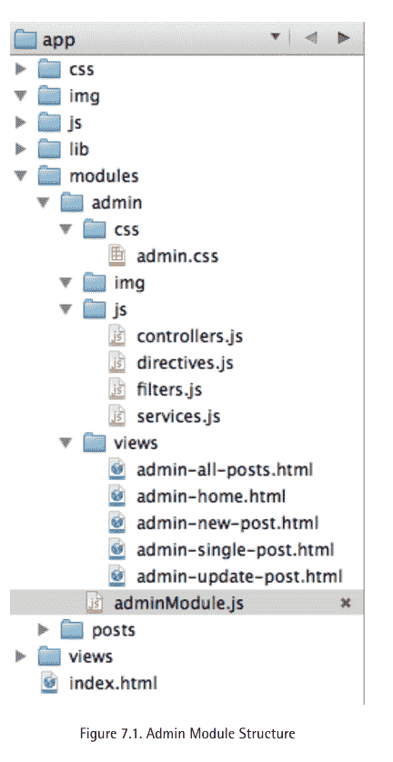

图 7.1. 管理模块结构

## 定义状态

现在我们需要使用 `ui.router` 模块来定义一些状态。内容应放入 `modules/admin/adminModule.js` 文件中：

```
angular.module('spBlogger.admin').config(['$stateProvider',
function($stateProvider){
    $stateProvider.state('admin',{
        url:'/admin',
        abstract:true,
        controller:'AdminController',
        templateUrl:'modules/admin/views/admin-home.html'
    });
}]);
```

```
}).state('admin.postNew',{
    url:'/posts/new',
    controller: 'PostCreationController',
    templateUrl:'modules/admin/views/admin-new-post.html'
}).state('admin.postUpdate',{
    url:'/posts/:id/edit',
    controller: 'PostUpdateController',
    templateUrl:'modules/admin/views/admin-update-post.html'
}).state('admin.postViewAll',{
    url:'',
    controller: 'PostListController',
    templateUrl:'modules/admin/views/admin-all-posts.html'
});
}]);
```

如你所见，`AdminController` 是将用于管理面板的中央控制器。对于增删改查（CRUD）操作，我们有不同的状态对应不同的控制器。

在 UI 路由器中，状态可以嵌套。状态 `admin` 的模板 URL `modules/admin/views/admin-home.html` 包含一个侧边栏和一个 `ui-view`。侧边栏包含所有管理操作，如“创建文章”、“更新文章”等。`ui-view` 用于加载 `admin` 的子状态。你还应该注意，在 UI 路由器中，如果你在状态名称中使用句点 `.`，例如 `admin.postViewAll`，那么句点后的部分（本例中为 `postViewAll`）将成为句点前部分（本例中为 `admin`）的子级。所以这里我们有三个 `admin` 的子状态：`admin.postNew`、`admin.postUpdate`、`admin.postViewAll`。你可以看到状态 `admin` 被标记为 `abstract`。这意味着该状态不能被直接激活。相反，当它的任何子状态被激活时，它才会被加载。由于我们将状态 `admin.postViewAll` 的 `url` 设置为 `''`，它就成了默认的子状态。这意味着当状态 `admin` 加载时，它的 `ui-view` 会自动加载其子状态 `admin.postViewAll`。

## 创建控制器

现在，以下控制器应放入 `modules/admin/js/controllers.js` 文件中：

```
angular.module('spBlogger.admin.controllers',[]).
.controller('AdminController',['$scope',function($scope){

}]).controller('PostCreationController',['$scope',function($scope){
```

```
]]).controller('PostUpdateController',['$scope',function($scope){

]]).controller('PostListController',['$scope',function($scope){

}]);
```

这些控制器目前还没有做任何事情，但我们稍后会填充它们。

## 管理面板模板

管理面板的模板添加到了 `modules/admin/views/admin-home.html` 中。内容如下：

```
<div class="row">
    <div class="col-xs-3">
        <ul class="nav nav-pills nav-stacked on-click-make-active">
            <!--Loads admin.viewAll state, doesn't contain
            anything right now -->
            <li><a ui-sref="admin.viewAll">查看所有文章</a></li>
            <!--Loads admin.postNew state -->
            <li class="active"><a ui-sref="admin.postNew">添加文章
</a></li>
        </ul>
    </div>

    <div class="col-xs-9 border-left">
        <div ui-view></div> <!--The nested views are loaded here -->
    </div>
</</div>
```

我们在这里使用嵌套视图。当 `admin` 状态被激活时，上述模板将被加载到 `index.html` 中的 `ui-view` 中。但是当添加新文章的状态（即 `newPost`）被激活时，它的模板 `admin-new-post.html` 会被加载到上述模板中的 `ui-view` 中。如果你查看这些状态，你会看到增删改查操作的状态都以 `admin` 为前缀。因此，`ui.router` 知道这些增删改查状态是嵌套在 `admin` 状态内部的。

[PAGE 164]

146 AngularJS：从入门到精通

```
]]).controller('PostUpdateController',['$scope',function($scope){

]]).controller('PostListController',['$scope',function($scope){

}]);
```

这些控制器目前还没有做任何事情，但我们稍后会填充它们。

## 管理面板模板

（注：原文此处存在大量重复代码块和逻辑混乱，已根据文档工程师逻辑保留核心并排版清理）

```
]]).controller('PostUpdateController',['$scope',function($scope){

]]).controller('PostListController',['$scope',function($scope){

}]);
```

这些控制器目前还没有做任何事情，但我们稍后会填充它们。

## 管理面板模板

管理面板的模板添加到了 `modules/admin/views/admin-home.html` 中。内容如下：

```
<div class="row">
    <div class="col-xs-3">
        <ul class="nav nav-pills nav-stacked on-click-make-active">
            <!--Loads admin.viewAll state, doesn't contain
            anything right now -->
            <li><a ui-sref="admin.viewAll">查看所有文章</a></li>
            <!--Loads admin.postNew state -->
            <li class="active"><a ui-sref="admin.postNew">添加文章
</a></li>
        </ul>
    </div>

    <div class="col-xs-9 border-left">
        <div ui-view></div> <!--The nested views are loaded here -->
    </div>
</</div>
```

我们在这里使用嵌套视图。当 `admin` 状态被激活时，上述模板将被加载到 `index.html` 中的 `ui-view` 中。但是当添加新文章的状态（即 `newPost`）被激活时，它的模板 `admin-new-post.html` 会被加载到上述模板中的 `ui-view` 中。如果你查看这些状态，你会看到增删改查操作的状态都以 `admin` 为前缀。因此，`ui.router` 知道这些增删改查状态是嵌套在 `admin` 状态内部的。

[PAGE 164]

146 AngularJS：从入门到精通

```
]]).controller('PostUpdateController',['$scope',function($scope){

]]).controller('PostListController',['$scope',function($scope){

}]);
```

这些控制器目前还没有做任何事情，但我们稍后会填充它们。

## 管理面板模板

（注：此处原文提到的 `modules/admin/views/admin-home.html` 布局及规则如下）

```
<div class="row">
    <div class="col-xs-3">
        <ul class="nav nav-pills nav-stacked on-click-make-active">
            <!--Loads admin.viewAll state, doesn't contain
            anything right now -->
            <li><a ui-sref="admin.viewAll">查看所有文章</a></li>
            <!--Loads admin.postNew state -->
            <li class="active"><a ui-sref="admin.postNew">添加文章
</a></li>
        </ul>
    </div>

    <div class="col-xs-9 border-left">
        <div ui-view></div> <!--The nested views are loaded here -->
    </div>
</</div>
```

## 布局与规则

```
<div class="row">
    <div class="col-xs-3">
        <ul class="nav nav-pills nav-stacked on-click-make-active">
            <!--Loads admin.viewAll state, doesn't contain
            anything right now -->
            <li><a ui-sref="admin.viewAll">查看所有文章</a></li>
            <!--Loads admin.postNew state -->
            <li class="active"><a ui-sref="admin.postNew">添加文章
</a></li>
        </ul>
    </div>

    <div class="col-xs-9 border-left">
        <div ui-view></div> <!--The nested views are loaded here -->
    </div>
</</div>
```

```
<div class="row">
    <div class="col-xs-3">
        <ul class="nav nav-pills nav-stacked on-click-make-active">
            <!--Loads admin.viewAll state, doesn't contain
            anything right now -->
            <li><a ui-sref="admin.viewAll">查看所有文章</a></li>
            <!--Loads admin.postNew state -->
            <li class="active"><a ui-sref="admin.postNew">添加文章
</a></li>
        </ul>
    </div>

    <div class="col-xs-9 border-left">
        <div ui-view></div> <!--The nested views are loaded here -->
    </div>
</</div>
```


# Promises 入门

Promise 对象代表一个可能尚不可用，但在未来某个时刻会可用的值。它使你能够以更同步的方式编写异步代码。这意味着你的异步函数将立即返回，你可以将这个返回值视为将来要获取的实际值的代理。

Promise 对象的一个典型用法是在向远程服务器发起 AJAX 请求时。如果你使用 Promises，你的 AJAX 调用应该立即返回一个 Promise 对象，而不是等待响应。此时它还不会包含任何值；它只是作为稍后从服务器接收到的实际值的代理。当 AJAX 请求完成并且实际响应从服务器到达时，Promise 会使用该数据被 `resolve`。如果由于某些错误无法获取响应，Promise 会被 `reject` 并返回错误消息。Promise 对象还暴露了几个方法，使你能够编写回调函数，这些回调函数将在 Promise 被 `resolve` 或 `reject` 时被调用。

图 8.1 展示了 Promise 背后的基本思想：

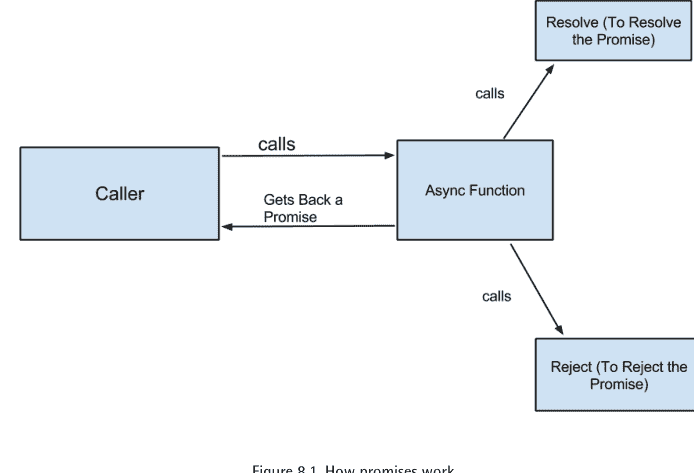

图 8.1 Promise 的工作原理

让我们来看一些伪代码，这些代码用于登录用户并在（登录成功后）执行其他任务。在第一个场景中，我们向 `login()` 传递一个回调，该回调在登录成功后被调用：

如果你想延迟表达式的执行，你可以在这里使用 `$timeout/$interval`。当操作的实际结果可用时，你应该通过调用 `deferred.resolve()` 来 `resolve` 相关的 Promise。如果发生错误，你可以使用错误消息 `reject` 该 Promise。这是通过调用 `deferred.reject()` 完成的。最后要注意的是，上述函数**立即**返回 `deferred.promise` 作为返回值。因此，调用此函数的人将获得 Promise 实例作为回报。

> **$q 的灵感来源**

$q` 服务的灵感来自 Kris Kowal 的 Q¹。不同之处在于 `$q` 与作用域生命周期紧密集成，并包含了常见异步任务所需的所有功能。

让我们看看我们如何处理 Promise：

```javascript
function showResult(){
    var promise = getPromise(); // 获取 Promise 实例
    promise.then(function(message) {
        console.log('Promise Resolved with Message: '+message);
    }, function(message) {
        console.log('Promise Rejected with Message: '+message);
    });
}
```

函数 `getPromise()` 返回一个 Promise 实例。它有一个 `then()` 方法，该方法接受三个回调函数，如下所示：

```javascript
promise.then(successCallback,failureCallback,notifyCallback);
```

当 Promise FALL 被 `resolve` 时（作为调用 `deferred.resolve()` 的结果），成功回调被调用。该回调接受一个参数，代表 resolve 值（传递给 `deferred.resolve()` 的值）。传递给 `then()` 的第二个回调是错误回调，当 Promise 由于调用 `deferred.reject()` 而被 `reject` 时调用。同样，它接受一个参数，代表 reject 原因（传递给 `deferred.reject()` 的值）。第三个参数是通知回调，可能会被调用多次以指示操作进度（我们很快会看到）。请注意，并非每个回调都是强制性的。在上面的代码片段中，我们只使用了成功回调。但如果你不提供错误回调，你将无法知道你的 Promise 是否被 `reject`。因此，在大多数情况下，最好同时传递成功和错误回调。

¹ https://github.com/kriskowal/q

> ### Promise 的 resolve

Promise 实例在其生命周期中只能被 `resolve` 或 `reject` 一次。如果 Promise 尚未被 `resolve/reject`，则称其处于 `pending` 状态。你还应该注意的是，在 Promises 的世界中，我们不关心 Promise 何时被 `resolve/reject`。相反，我们关注的是 Promise 的最终结果。因此，如果 Promise 已经被 `resolve`，并且稍后你向 `then()` 函数传递了两个回调，成功回调将被正确调用。由于 Promises 只被 `resolve/reject` 一次，如果你尝试多次 `resolve/reject` 一个 Promise，此类操作将被忽略。

> ### Promises 简写

你也可以使用 `promise.catch(errorCallback)` 来处理 rejections。它是 `promise.then(null,errorCallback)` 的简写形式。

还有一个 `promise.finally(callback)` 方法，可用于无论 Promise 被 `resolve` 还是 `reject` 都执行某些任务。此方法的用例包括执行最终清理、释放资源等。但要注意！由于 `finally` 是 JavaScript 中的保留关键字，你应该像这样编写你的方法 `promise['finally'](callback)` 以确保 IE8 兼容！

## 使用示例

牢记以上要点，让我们使用 Promises 来模拟一个异步任务。首先，我们需要创建一个空控制器，如下所示：

*控制器：*

```javascript
angular.module('mainApp', []).controller('MainController',
        ['$scope','$q','$interval',function($scope, $q, $interval) {
            // 我们将在这里使用 $q
        }]);
```

现在，在控制器内部，我们将一个方法附加到 $scope$，该方法将使用内置的 `$interval` 服务来异步执行一个简单的任务：

*getPromise()：*

```javascript
$scope.getPromise = function() {
    var i = 0;
    var deferred = $q.defer(); // 创建一个新的 deferred 对象

    var timer = $interval(function() {

        if ( !! $scope.cancelRequested) { // 如果 UI 请求取消，reject 该 Promise
            deferred.reject('Promise Rejected due to cancellation.');
            $interval.cancel(timer);
        }

        i = i + 1; // 每次递增 i

        if (i == 5) {
            deferred.resolve('Counter has reached 5'); // 一旦 i 的值等于 5，resolve 该 Promise
            $interval.cancel(timer); // 确保取消定时器
        } else {
            deferred.notify('Counter has reached ' + i); // 否则通知客户端
        }
    }, 1000); // 每秒运行一次

    return deferred.promise; // 最后返回 Promise 实例
}
```

函数非常简单。每秒运行一次任务，并将变量 `i` 增加。在每次迭代中，我们检查 `i` 的值是否达到 5。如果是，我们 `resolve` 该 Promise。否则，我们调用 `deferred.notify()` 来通知用户。如果模型 `cancelRequested` 被设置为 true，意味着有人请求取消。在这种情况下，我们 `reject` 该 Promise 并取消定时器。最后，函数返回 `deferred.promise` 以调用者。

现在，我们需要向 `$scope` 添加另一个函数 `getAsyncMessage()`，该函数调用上述函数：

*getAsyncMessage()：*

```javascript
$scope.getAsyncMessage = function() {
    var promise = getPromise(); // 获取 Promise 实例
    
    promise.then(function(message) {
        $scope.status = 'Resolved: ' + message;
    }, function(message) {
        $scope.status = 'Rejected: ' + message;
    }, function(message) {
        $scope.status = 'Notifying: ' + message;
    });
}
```

在这里，我们通过调用 `getPromise()` 获取 Promise 实例。接下来，我们向函数 `then()` 传递三个回调。注意第三个回调，在执行任务期间调用 `notify()` 时它就会调用。在我们的例子中，它执行多次，而前两个回调只会一次。

**触发 $digest 周期**

当传递给 `then()` 的不同回调执行时，`digest()` 周期会运行。因此，如果你在回调内部更改任何作用域（就像上面所做样），视图将被更新。

现在，让我们创建一些标记，显示两个按钮：一个用于启动任务，另一个用于取消它。

*index.html：*

```html
<body ng-controller="MainController">
    <input type="button" ng-click="getAsyncMessage()" value="获取一条消息"/>
    <input type="button" ng-click="cancelRequested=true" value="取消消息"/><br/>
    Promise状态 - {{status}}
</body>
```

现在，如果你点击第一个按钮，你会通过 notify 回调看到进度。最后，当 Promise 被解决（resolved）时，状态文本将更新消息。如果你在此期间通过第二个按钮取消任务，promise 将会被拒绝（rejected），状态文本将用相应的更新。

## Promise 链

链式调用是 promise 最重要的方面之一。基本思想是 promise 可以通过链式调用进行组合。这意味着**只能**在之前的 promise 被解决（resolved）后，才能指定的任务。

函数 `promise.then()` 返回另一个 promise 实例，该实例通过成功回调来解决。看下面的例子：

```javascript
promise.then(function(message) {
    return "success";
}).then(function(message) {
    console.log(message); // 打印 "success"
});
```

现在有两个 promise 链连接在一起。注意传递给第一个 `then()` 的成功回调返回了一个简单的值 "success"。所以，`then()` 返回的 promise 实例立即以 success 这个值被解决。由于第二个 `then()` 等待这个 promise，传递给它的成功回调会被立即调用。

但是如果成功回调返回的是另一个 promise 而不是简单的值呢？我们如何处理？修改之前的代码：

```javascript
promise.then(function(message) {
    // 我们在这里获取了消息
    return getAnotherPromise(); // 这里再次返回一个 promise
}).then(function(message) {
    // 处理最终结果
});
```

在这种情况下，传递给第一个 `then()` 的成功回调返回了另一个 promise 实例。因此，第二个 `then()` 会等待这个 promise，直到它被确定（解决或拒绝），然后相应的回调函数会被调用，并接收解决或拒绝消息作为参数。图 8.2 展示了这里发生的情况：


Figure 8.2 Promise 链

现在你已经连接了多个 promise，你可以给 promise 对象添加一个 `catch()`（就像 `then()` 一样）来处理任何拒绝。

## 创建一个总是拒绝的 Promise

有时创建并返回一个总是拒绝（rejected）的 promise 是很有用的。如果你想以 promise 而非简单值的形式告知用户错误发生，这会很有帮助。

现在看看如何创建一个这样一个 promise：

```javascript
function getPromise(){
    return $q.reject('Rejection Reason');
}
```

上面的函数创建了一个总是拒绝的 promise。所以，如果你在返回的 promise 实例上附加一个 `then()` 函数并传递两个回调，错误回调会被正确调用。

```javascript
getPromise().then(function(message) {
    // 不会被调用
},function(message) {
    // 这个会被调用
});
```

本章的重点是让你了解如何使用 promise 与后端服务器进行 REST 交互。在 AngularJS 中，你可以通过一个名为 `$http` 的服务与 REST API 通信，该服务严重依赖 promise。既然你已经了解了 promise，现在是我们继续学习 `$http` 服务的时候了。

## 理解 $http 服务

让我们正式认识 `$http`。`$http` 是一个核心 AngularJS 服务，它使用 `XMLHttpRequest` 对象与远程服务器通信。就像其他服务一样，你需要通过注入将 `$http` 注入到你的控制器或自定义服务中。以下是如何将 `$http` 注入到自定义服务的方法：

```javascript
angular.module('mainModule',[]).service('customService',
  function($http) {
    this.getData=function(){
      return $http({method:'GET',url:'/api'}); // 使用 $http()
      // 此函数返回 Promise。
    }
  });
```

`$http` 服务是一个函数，它接受一个参数，称为 config 对象。这个 config 对象定义了 HTTP 请求的各个部分，例如 method、url、data 等。由于 `$http` 基于 `$q` 服务，函数 `$http()` 的返回值是一个 promise 实例。所以，你可以像常一样在上面附加 `then()`，并传递成功/错误回调，这些回调会被适当地调用。因此，以下是我们使用上面代码片段中定义的 `customService`。

```javascript
angular.module('mainModule').controller('TestController',
  function($scope, customService) {
    $scope.getData=function(){
      customService.getData().then(function(data,status,config,
        headers){
console.log('来自服务器的响应: '+data); // 当服务器响应到达时调用
},function(data,status,config,headers){
    console.log('发生了一些错误!'); // 在发生错误时调用
    });
    }
  });
```


- `data`: 这是从服务器获得的响应。
- `status`: 服务器返回的 HTTP 状态码（例如 200、401 等）。
- `config`: 用于生成请求的配置对象。
- `headers`: 这是一个包含服务器发送的头部信息的映射。
- `statusText`: 状态码对应的 HTTP 状态文本（例如 200 对应的 OK）。

现在，你可以通过传递一个 `config` 对象来使用 `$http()`，或者直接使用以下快捷方法之一：

```
$http.get(url)
```

```
$http.post(url,data)
```

```
$http.put(url,data)
```

```
$http.delete(url)
```

```
$http.head(url)
```

上述方法也接受一个额外的可选参数 `config`，用于在需要时配置请求的其他部分。

## config 对象

`config` 对象可用于配置生成请求的多个选项。你将要使用的最常见属性是：

- `url`: 将要发起请求的 URL。可以是相对或绝对路径。只需注意 URL 应来自你自己的域名，`$http` 才能正常工作。但如果你想与你域名之外的远程 URL 交互，这些 URL 必须启用 CORS。换句话说，远程服务器必须通过在其响应中设置名为 `Access-Control-Allow-Origin` 的头部来指定你的域名被允许与之交互。
- `method`: 这代表你的请求方法，即 GET、POST、PUT 等。
- `data`: 如果你发出 POST/PUT 请求，可能需要发送一些数据作为请求体。这在 `config` 对象的 `data` 属性中配置，可以是简单的字符串或对象。如果是对象，`data` 在作为请求体发送之前会被序列化为 JSON 字符串。
- `headers`: 这是一个用于配置头部的简单对象。键对应于头部名称，值对应于头部值。
- `params`: 如果你发出 GET 请求并希望发送查询参数（例如 `?key1=value1&key2=value2`），你可以在这里通过一个简单的对象进行配置。

`config` 对象中还有其他几个属性，我们将在后续内容中介绍。

> 跨域资源共享

当你向 `$http` 提供一个跨域 URL 时，浏览器会先向远程 URL 发送一个 OPTIONS 请求，以检查响应中是否存在 `Access-Control-Allow-Origin`。如果存在，则会继续发出实际请求；否则，将不会继续。

你可以在 Wikipedia² 上了解更多关于 CORS（跨域资源共享）的信息。还有一个名为 `$http.jsonp()` 的方法，可用于与远程 URL 交互，但它期望服务器以稍微不同的方式返回响应。也就是说，通常情况下，CORS 是现代的处理方式。如果你想支持非常古老的浏览器（如 IE 7 或更早版本），你可能需要使用 jsonp。但如果你想要一个 CRUD API，使用 jsonp 会很困难。

## 天气搜索服务

让我们构建一些有趣且实用的东西来理解 `$http` 是如何工作的。在本节中，我们将构建一个简单的 AngularJS 应用程序，用于返回你最喜爱城市的当前天气数据。

OpenWeatherMap³ 网站提供了一个不错的 API，可以返回我们所需的天气数据。让我们看看如何实现：

假设我们的主模块已经定义为 `mainApp`，以下是我们定义服务的方法：

```javascript
angular.module('mainApp').factory('weatherService',
    function($http) {
        return {
            getWeather: function(city, country) {
                var query = city + ',' + country;
                return $http.get('http://api.openweathermap.org/data/2.5/weather', {
                    params: {
                        q: query
                    }
                }).then(function(response) { // then() 返回一个 promise，该 promise 以成功回调的返回值解决
                    return response.data.weather[0].description; // 提取
                });
            }
        }
    }
);
```

² http://en.wikipedia.org/wiki/Cross-origin_resource_sharing

³ http://openweathermap.org/

164 AngularJS：从新手到忍者

```javascript
// 天气数据
});
}
```

});

```

我们的API端点是：`http://api.openweathermap.org/data/2.5/weather`。它还期望一个查询参数`q`，该参数应包含以下格式的值：

```javascript
?q=cityName,countryName
```

因此，我们的自定义服务 `weatherService` 定义了 `getWeather()` 函数，该函数接受城市和国家参数，并使用它们向API 发送GET 请求。

现在，我们需要在控制器中如下使用此服务：

```javascript
angular.module('mainApp').controller('WeatherController',

[-function($scope, weatherService) {

  $scope.getWeather = function() {

    $scope.weatherDescription = "获取中...";

    weatherService.getWeather($scope.city, $scope.country)
      .then(function(data) {
        $scope.weatherDescription = data;

      }, function() {

        $scope.weatherDescription = "无法获取数据";

      });

  }
});
```

如您所见，我们调用 `weatherService.getWeather()`，并为其返回的 promise 传递成功和错误回调函数。当远程服务器返回响应时，会调用成功回调，设置名为 `$scope.weatherDescription` 的作用域模型。成功回调的第一个参数 `data` 是服务器返回的天气数据。

此外，在发出请求之前，我们将 `$scope` 模型 `weatherDescription` 更改为“获取中..."”，以便通过数据绑定更新UI。

最后，我们如下创建视图：

```javascript
<body ng-controller="WeatherController">
    城市：
    <input type="text" ng-model="city" placeholder="在此输入城市名称" />
    国家：
    <input type="text" ng-model="country" placeholder="在此输入国家名称" />
    <button ng-click="getWeather()">获取天气</button>
    <br/>
    <br/>
    <b>天气状况：</b> <span>{{weatherDescription}}</span>
</body>
```

我们简单地向用户询问城市和国家名称。当按钮被点击时，控制器方法 `getWeather()` 被调用以获取天气信息。

如果您打开代码包并运行此应用程序，你将看到预期的天气数据。

## 设置请求头

如果您想为每个 HTTP 请求配置头信息，可以在配置块中如下进行：

```javascript
angular.module('mainApp').config(function($httpProvider){
    $httpProvider.defaults.headers.common.Accept = "application/json";
});
```

或者在运行块中，作为 `$http.defaults` 的一部分：

```javascript
angular.module('mainApp').run(function($http){
    $http.defaults.headers.common.Accept = "application/json";
});
```

如果您只需要为 PUT 或 POST 请求配置头信息，需要使用 `$httpProvider.defaults.headers.put` 或 `$httpProvider.defaults.headers.post`：

```javascript
angular.module('mainApp').config(function($httpProvider){
    $httpProvider.defaults.headers.get = {'Content-Type': 'json'};
});
```

请注意上述代码中小写的 `get`！以上都是关于全局设置头信息。但您可能想要为特定请求覆盖头信息。在这种情况下应该在请求 `config` 对象中设置 `headers` 属性。看看代码：

```javascript
$http.get({url:'/api', method:'GET', headers:{'Content-Type': 'text/plain'}}
```

## 请求转换

当我们使用 `$http` 服务时，底层都会进行转换。这些转换是：

1. 如果在 POST/PUT 请求中传递一个 JavaScript 对象 `data`，在发送之前会被序列化为 JSON。
2. 类似地，如果响应一个 JSON 字符串，会被解析为 JavaScript 对象并传递给成功回调。

除此之外，有时可能需要在发送请求之前或接收响应之后转换请求或响应。可以通过 `$httpProvider.defaults` 的 `transformRequest` 和 `transformResponse` 属性来实现。

### transformRequest

`transformRequest` 属性可以设置为接受两个参数 `data` 和 `getHeaders` 的函数。在函数内部，您可以添加或修改头信息，返回请求。

```javascript
angular.module('mainApp',[]).config(function($httpProvider){
    $httpProvider.defaults.transformRequest = function(data, getHeaders){
        var headers = getHeaders(); // 获取头信息
        headers['Content-Type'] = 'text/plain'; // 添加头信息
        return JSON.stringify(data); // 返回序列化的数据
    }
});
```

`transformRequest` 也可以在配置对象中为特定请求：

```javascript
$http.get({url:'/api', method:'GET', transformRequest:transformRequest})
```

### 使用多个转换器

如果您直接将函数赋值给 `$httpProvider.defaults.transformRequest`，它将成为唯一的转换器，移除之前的任何转换器。如果您希望有多个转换器，可以使用 `push` 或 `unshift`：

```javascript
$httpProvider.defaults.transformRequest.push(yourFunction)
```

### transformResponse

通过 `transformResponse` 属性，您有机会在响应交给应用代码之前转换。您可以如下配置响应：

```javascript
angular.module('mainApp',[]).config(function($httpProvider){
    $httpProvider.defaults.transformResponse = function(data, getHeaders){
        data.someProperty = '其他内容'; // 更改响应
        return JSON.stringify(data); // 返回化的数据
    }
});
```

与 `transformRequest` 类似，也可以通过 `config` 对象为特定请求设置。如果您想要多个响应转换器，可以 `push/unshift` 您的函数，就像我们在 `transformRequest` 的情况下。

## 缓存

一旦用户在网站上，您可能不想每次获取数据都访问服务器。从服务器获得的响应是个好主。`config` 对象中有一个 `cache` 属性。如果您将其设置为 `true`，第一次对 URL 的请求会发送到服务器。所有后续同一 URL 的请求将从缓存中获取，而不会访问服务器。在我们的天气跟踪应用中，我们可以如下使用缓存：

```javascript
return $http.get('http://api.openweathermap.org/data/2.5/weather?' + query, {cache: true});
```

现在尝试输入城市和国家名称，然后点击按钮。下次当您字段中输入相同的城市和国家名称时，响应将从缓存中获取。

您应该注意，缓存的响应存储在名为 `$cacheFactory` 的本地服务中。由于它使用浏览器的内存存储数据，即使刷新页面，所有数据也会擦除。因此，如果您想在页面重新加载时持久化缓存，可以使用 `localStorage`。

## 拦截器

拦截器对于将请求发送到服务器之前进行预处理，以及在响应交给应用代码之前进行后处理非常有用。拦截器的一些例子是身份验证、日志记录、错误处理等。

顾名思义，拦截器用于在不同点拦截请求/响应，并执行处理。有两种类型的拦截器：请求和响应，这些可以编写为工厂方法：

```javascript
angular.module('mainApp',[]).factory('customInterceptor',
function($q, dependency1, dependency2){
    return {
        request: function(config){
            // 请求拦截器在请求发送到服务器之前被调用，
            // 并接收一个请求配置对象。
            // 您可以在此处返回一个修改后的/新的配置对象
            // 您也可以返回一个 Promise，该 Promise 解析为配置对象
            // 如果出现任何错误，您可以返回一个被拒绝的 Promise
            // 或抛出一个异常
            return config;
        },
        requestError: function(rejectionReason){
            // 如果上一个请求拦截器返回了一个被拒绝的 Promise，
            // 则会调用此拦截器
            // 您可以在此处尝试从错误中恢复，并返回一个新的配置。
            // 如果所有其他操作都失败，则通过返回一个被拒绝的 Promise 来让其失败
            if (ableToRecover(rejectionReason)){
                // 构造一个配置对象
                return config;
            }
            else
                return $q.reject('无法恢复'); // 返回一个被拒绝的Promise
        },
        response: function(response){
            // 当 $http 从后端收到响应时，会调用此拦截器，
            // 但在响应交给应用代码之前拦截器会介入。
            // 响应对象包含：data, status, config,
            // headers 和 statusText。
            // 您返回一个新的/修改后的响应或一个 Promise
        }
    };
});
```


```markdown
## 理解 AngularJS $resource

大多数 AngularJS 应用程序都会涉及某种程度的 CRUD（增删改查）操作。因此，你可以使用 `$resource` 服务来快速上手。`$resource` 构建在 `$http` 之上，但提供了更高层次的抽象。

## 前提条件

`$resource` 服务并未随 AngularJS 脚本开箱即用。这是因为并非每个 Angular 应用都涉及 CRUD 操作，而且开发者已经有 `$http` 来与服务交互。所以，如果你需要 `$resource` 服务，你必须单独下载 `angular-resource.js` 并将其包含在你的页面中。

那么，打开目录 `Angular-Seed-Master/app/lib/angular`，找到 `angular-resource.js`。这就是你需要的脚本文件。将其包含在页面后，你需要像下面这样声明对 `ngResource` 模块的依赖：

```javascript
angular.module('myApp', ['ngResource']);
```

我们这样做是因为 `$resource` 服务定义在 `ngResource` 模块中。

## $resource 是如何工作的？

`$resource` 期望一个经典的 RESTful API。这意味着你的 URL 应该采用以下格式：

| URL | HTTP 动词 | 请求体 | 结果 |
| --- | --- | --- | --- |
| /api/entries | GET | 空 | 返回所有条目 |
| /api/entries | POST | JSON 字符串 | 创建新条目 |
| /api/entries/:id | GET | 空 | 返回单个条目 |
| /api/entries/:id | PUT | JSON 字符串 | 更新现有条目 |
| /api/entries/:id | DELETE | 空 | 删除现有条目 |

要在你的控制器或服务中使用 `$resource`，你需要声明对 `$resource` 的依赖。以下代码片段展示了如何在你的自定义服务中使用 `$resource`：

```javascript
angular.module('myApp').factory('Entry', function($resource) {
    return $resource('/api/entries/:id'); // 注意完整的端点地址
});
```

如你所见，你需要将完整的端点 URL 传递给 `$resource()` 函数。其返回的是一个 `$resource` 类的表示。这实际上是一个构造函数，可以被实例化以获取一个 `$resource` 实例。因此，我们将我们的服务命名为 `Entry`（而不是 `entry`），因为这将是一个 `$resource` 类的表示。

还要注意，`Entry` 只是一个示例名称。在真实的应用程序中，这可能代表你想要在后端持久化存储的某个实体名称。例如，在一个电影商店应用中，该服务可以命名为 `Movie`。

`$resource` 类默认有五个方法：

- `get()`
- `query()`
- `save()`
- `remove()`
- `delete()`

现在让我们通过一个简单的例子看看如何使用这些方法：

```javascript
angular.module('myApp').controller('ResourceController', function($scope, Entry) {
    var entry = Entry.get({ id: $scope.id }, function() {
        console.log(entry);
    }); // get() 返回单个条目

    var entries = Entry.query(function() {
        console.log(entries);
    }); // query() 返回所有条目

    $scope.entry = new Entry(); // 你可以实例化 resource 类

    $scope.entry.data = 'some data'; // 所以 $scope.entry={data:'some data'}

    Entry.save($scope.entry, function() {
            // save 会将 $scope.entry 对象序列化为 JSON 并作为 POST 主体发送
    });

    Entry.delete({ id: $scope.id }, function() {
        console.log('Deleted from server');
    });
});
```

`get()` 函数向 URL `/api/entries/:id` 发出一个 GET 请求。在发送请求之前，我们用 `$scope.id` 替换了 URL 中的命名参数 `:id`。你还应该注意，`get()` 函数返回的是一个空对象（而不是一个 `Promise`）。当服务器返回实际数据时，它会被自动填充。`get()` 的第二个参数是一个回调函数，当数据从服务器到达时执行。这是一个有用的技巧，因为你可以将 `get()` 返回的空对象设置为 `$scope` 模型，并在视图中引用它。当实际数据到达并且对象被填充时，数据绑定就会生效，你的视图也会更新。

## 为什么显示一个空对象？

你可能会质疑最初显示一个空对象是否明智。实际上，这是一件好事，因为你可以省略传递给 `get()` 函数的回调。如果你只是想将模型设置到 `$scope`，并且不关心响应何时到达，你可以这样做：

```javascript
$scope.entry=Entry.get({ id: $scope.id });
```

现在你可以在模板中像往常一样引用它。如果 `get()` 函数最初不返回一个空对象，你总是需要一个回调，像这样：

```javascript
Entry.get({ id: $scope.id }, function(entry) {
  $scope.entry=entry;
});
```

`query()` 函数向 `/api/entries`（注意没有 `:id`）发出一个 GET 请求，并返回一个空数组（而不是一个简单的对象）。这个数组在数据从服务器到达时被填充。同样，你可以将这个数组设置为 `$scope` 模型，并通过 `ng-repeat` 在视图中引用它。你也可以给 `query()` 传递一个回调，它会在数据从服务器到达时被调用。

`save()` 函数使用第一个参数作为 POST 主体，向 `/api/entries` 发出一个 POST 请求。第二个参数是一个回调，当数据保存后会被调用。你可能记得 `$resource()` 函数的返回值是一个资源类。因此，在我们的例子中，我们可以调用 `new Entry()` 来创建一个实际的资源实例，为其设置各种属性，最后对象保存到后端。

`delete()` 和 `remove()` 的工作方式相同，都向 URL `/api/entries/:id` 发出一个 DELETE 请求。

## 使用 remove() 以确保与 IE 兼容

`delete()` 方法在某些版本的 IE 中可能无法工作，因为 `delete` 是一个保留关键字。为确保你的代码在所有地方都能运行，请改用 `remove()`。

理想情况下，你只会在资源类（在我们的例子中是 `Entry`）上使用 `get()` 和 `query()`。所有非 GET 方法，例如 `save()` 和 `delete()`，在通过 `new Entry()` 获得的实例上（让我们称之为 `$resource` 实例）也可用。但区别在于，这些方法以 `$` 为前缀。因此，在 `$resource` 实例（与 `$resource` 类相对）上可用的方法是：

170 AngularJS：从新手到忍者

```javascript
解析为一个响应对象。

///在出错的情况下，返回一个总是被拒绝的 Promise。

return response;

},

responseError:function(rejectionReason){
    // 有时后端调用可能会失败
    // 或者之前的响应拦截器可能会返回一个
    // 被拒绝的 Promise
        return response;
    }
```
*(注：此处原文代码片段似乎不完整，已按逻辑保留核心结构)*

```
现在你对 `$resource` 服务了如指掌。如果你希望了解更多关于 `$resource` 中可用的设置和配置，我建议你阅读文档：`https://docs.angularjs.org/api/ngResource/service/$resource`。

既然你知道了如何与外部世界通信，现在是时候为我们的 Single Page Blogger 创建不同的视图并将所有数据存储在远程服务器上了。在下一章中，我们将重点关注实现这一新功能。

## 结论

所以，我们使用 AngularJS 探索了世界。首先，我们了解了 `$q` 服务和 promise API。接下来，我们看到了如何使用内置的 `$http` 服务进行 AJAX 调用。最后，我们探讨了 `$resource` 并重构了我们的应用程序以将帖子存储在远程服务器上。我们还编写了几个单元测试，使用 `$httpBackend` 测试我们的控制器。

接下来，我们将带你创建带 `$resource` 的 CRUD 应用。

# 第 9 章

## 在 Single Page Blogger 中使用 REST API

## 在我们的应用程序中应用 `$resource`

让我们回到我们的 Single Page Blogger 应用程序，并使用 AngularJS 的 `$resource` 将所有的博客帖子存储在远程服务器上。我开发了一个使用 Node.js 和 MongoDB 存储博客帖子的 RESTful 后端。该应用程序已部署到 OpenShift Cloud，可以在 `http://spblogger-sitepointdemos.rhcloud.com` 上访问。

以下是 API 的外观：

| URL | HTTP Verb | Request Body | Result |
| --- | --------- | ------------ | ------ |
| `/api/posts` | GET | empty | Returns all posts |
| `/api/posts` | POST | JSON String | Create new post |
| `/api/posts/:id` | GET | empty | Returns single post |
| `/api/posts/:id` | PUT | JSON String | Updates existing post |
| `/api/posts/:id` | DELETE | empty | Deletes existing post |

> ### 进行跨域 API 调用
通常您无法从 AngularJS 应用程序中发出跨域 API 调用。但由于我在 Node.js 应用程序中启用了 CORS，您将能够向您应用程序中的上述 URL 发出调用，这对于测试非常有用。但在现实世界中，请小心允许不同域名访问您的 API。

让我们从创建三个服务开始：

1. 一个存储端点 URL 的值服务 `API_ENDPOINT`。
2. 一个内部使用 `$resource` 的自定义服务 `Post`。
3. 一个名为 `popupService` 的服务，当需要时向用户显示提示消息。

以下是如何定义这些服务。这些定义应该放入 `modules/admin/js/services.js`。

```
angular.module('spBlogger.admin.services', []).factory('Post',

    ['$resource', 'API_ENDPOINT', function($resource, API_ENDPOINT){

        return $resource(API_ENDPOINT, { id: '@_id' }, {

            update: {

                method: 'PUT'
            }
        });

    }]).service('popupService', ['$window', function($window){

        this.showPopup=function(message){
            return $window.confirm(message); //Ask the users if they

            really want to delete the post entry

        }

    }]).value('API_ENDPOINT', 'http://spblogger-sitepointdemos.rhcloud.com/api/posts/:id'); // This is our end point
```

正如你看到的，我们的自定义服务 `Post` 使用 `$resource` 服务与我们之前讨论的完全一样。唯一的区别是它使用了真正的 API。此 URL 存储在名为 `API_ENDPOINT` 的值服务中。

为了保持简单，假设每篇博客帖子有四个属性，将通过我们的 AngularJS 表单收集。如下所示：

1. 标题
2. 内容
3. 标签
4. 关键词

此外，还有两个属性是在服务器端设置，因此我们不提供它们。

1. 作者 – 默认为 Admin
2. datePublished – 当前日期。

此外，还有一个永久链接属性，它是通过将标题属性中的所有空格替换为连字符派生的。这是为了在 URL 中向最终用户显示帖子标题。

## 定义模板

在这里我们将为 CRUD 操作定义模板。第一个是 `_form.html`。该模板仅包含表单字段，并同时用于创建和更新模板。这是标记：

_form.html

```
<div class="form-group" ng-class="{'has-error':postForm.title.$dirty && postForm.title.$invalid}">

    <label for="title" class="col-sm-2 control-label">Post Title</label>

    <div class="col-sm-10">

        <input type="text" name="title" ng-model="post.title" ng-required="true" class="form-control" id="title" placeholder="Title">

        <span class="error-message" ng-show="postForm.title.$dirty && postForm.title.$invalid">Title is mandatory</span>

    </div>

</</div>

<div class="form-group" ng-class="{'has-error':postForm.content.$dirty && postForm.content.$invalid}"> 
    <label for="content" class="col-sm-2 control-label">内容</label> 
    <div class="col-sm-10"> 
        <textarea cols="8" rows="6" name="content" class="form-control" ng-model="post.content" ng-required="true" id="content" placeholder="内容"></textarea> 
            <span class="error-message" ng-show="postForm.content.$dirty && postForm.content.$invalid">您需要填写一些内容！</span> 
        </div> 
    </div> 
    <div class="form-group" ng-class="{'has-error':postForm.tags.$dirty && postForm.tags.$invalid}"> 
        <label for="tags" class="col-sm-2 control-label">标签</label> 
        <div class="col-sm-10"> 
            <input type="text" name="tags" class="form-control" id="tags" ng-pattern="/^[[\w,]+$/" ng-model="post.tags" placeholder="用逗号分隔的标签"/> 
            <span class="error-message" ng-show="postForm.tags.$dirty && postForm.tags.$invalid">抱歉！此处不允许使用特殊字符。</span> 
        </div> 
    </</div>> 
    <div class="form-group" ng-class="{'has-error':postForm.keywords.$dirty && postForm.keywords.$invalid}"> 
        <label for="keywords" class="col-sm-2 control-label">关键词</label> 
        <div class="col-sm-10"> 
            <input type="text" name="keywords" class="form-control" id="keywords" ng-pattern="/^[[\w,]+$/" ng-model="post.keywords" placeholder="用逗号分隔的关键词"/> 
            <span class="error-message" ng-show="postForm.keywords.$dirty && postForm.keywords.$invalid">抱歉！此处不允许使用特殊字符</span> 
        </div> 
    </div> 
    <div class="form-group"> 
        <div class="col-sm-offset-2 col-sm-10"> 
            <button type="submit" class="btn btn-success" ng-disabled="postForm.$invalid">{{buttonText}}</button> 
        </div> 
    </div>
```

现在我们来看下一个模板。

### admin-new-post.html:

```
<div class="row">
    <div class="col-xs-8">
        <form name="postForm" ng-submit="savePost()" class="form-horizontal" novalidate>
            <!-- 表单内容 -->
        </form>
    </div>
</div>
```

## AngularJS：从新手到忍者

## 在 Single Page Blogger 中使用 REST API

## 在我们的应用程序中应用 `$resource`

让我们回到我们的 Single Page Blogger 应用程序，并使用 AngularJS 的 `$resource` 将所有的博客帖子存储在远程服务器上。我开发了一个使用 Node.js 和 MongoDB 存储博客帖子的 RESTful 后端。该应用程序已部署到 OpenShift Cloud，可以在 `http://spblogger-sitepointdemos.rhcloud.com` 上访问。

以下是 API 的外观：

| URL | HTTP Verb | Request Body | Result |
| --- | --------- | ------------ | ------ |
| `/api/posts` | GET | empty | Returns all posts |
| `/api/posts` | POST | JSON String | Create new post |
| `/api/posts/:id` | GET | empty | Returns single post |
| `/api/posts/:id` | PUT | JSON String | Updates existing post |
| `/api/posts/:id` | DELETE | empty | Deletes existing post |

> ### 进行跨域 API 调用
通常您无法从 AngularJS 应用程序中发出跨域 API 调用。但由于我在 Node.js 应用程序中启用了 CORS，您将能够向您应用程序中的上述 URL 发出调用，这对于测试非常有用。但在现实世界中，请小心允许不同域名访问您的 API。

让我们从创建三个服务开始：

1. 一个存储端点 URL 的值服务 `API_ENDPOINT`。
2. 一个内部使用 `$resource` 的自定义服务 `Post`。
3. 一个名为 `popupService` 的服务，当需要时向用户显示提示消息。

以下是如何定义这些服务。这些定义应该放入 `modules/admin/js/services.js`。

```
angular.module('spBlogger.admin.services', []).factory('Post',

    ['$resource', 'API_ENDPOINT', function($resource, API_ENDPOINT){

        return $resource(API_ENDPOINT, { id: '@_id' }, {

            update: {

                method: 'PUT'
            }
        });

    }]).service('popupService', ['$window', function($window){

        this.showPopup=function(message){
            return $window.confirm(message); //Ask the users if they

            really want to delete the post entry

        }

    }]).value('API_ENDPOINT', 'http://spblogger-sitepointdemos.rhcloud.com/api/posts/:id'); // This is our end point
```

正如你看到的，我们的自定义服务 `Post` 使用 `$resource` 服务与我们之前讨论的完全一样。唯一的区别是它使用了真正的 API。此 URL 存储在名为 `API_ENDPOINT` 的值服务中。

为了保持简单，假设每篇博客帖子有四个属性，将通过我们的 AngularJS 表单收集。如下所示：

1. 标题
2. 内容
3. 标签
4. 关键词

此外，还有两个属性是在服务器端设置，因此我们不提供它们。

1. 作者 – 默认为 Admin
2. datePublished – 当前日期。

此外，还有一个永久链接属性，它是通过将标题属性中的所有空格替换为连字符派生的。这是为了在 URL 中向最终用户显示帖子标题。

## 定义模板

在这里我们将为 CRUD 操作定义模板。第一个是 `_form.html`。该模板仅包含表单字段，并同时用于创建和更新模板。这是标记：

_form.html

```
<div class="form-group" ng-class="{'has-error':postForm.title.$dirty && postForm.title.$invalid}">

    <label for="title" class="col-sm-2 control-label">Post Title</label>

    <div class="col-sm-10">

        <input type="text" name="title" ng-model="post.title" ng-required="true" class="form-control" id="title" placeholder="Title">

        <span class="error-message" ng-show="postForm.title.$dirty && postForm.title.$invalid">Title is mandatory</span>

    </div>

</div>

<div class="form-group" ng-class="{'has-error':postForm.content.$dirty && postForm.content.$invalid}"> 
    <label for="content" class="col-sm-2 control-label">内容</label> 
    <div class="col-sm-10"> 
        <textarea cols="8" rows="6" name="content" class="form-control" ng-model="post.content" ng-required="true" id="content" placeholder="内容"></textarea> 
            <span class="error-message" ng-show="postForm.content.$dirty && postForm.content.$invalid">您需要填写一些内容！</span> 
        </div> 
    </div> 
    <div class="form-group" ng-class="{'has-error':postForm.tags.$dirty && postForm.tags.$invalid}"> 
        <label for="tags" class="col-sm-2 control-label">标签</label> 
        <div class="col-sm-10"> 
            <input type="text" name="tags" class="form-control" id="tags" ng-pattern="/^[[\w,]+$/" ng-model="post.tags" placeholder="用逗号分隔的标签"/> 
            <span class="error-message" ng-show="postForm.tags.$dirty && postForm.tags.$invalid">抱歉！此处不允许使用特殊字符。</span> 
        </div> 
    </div> 
    <div class="form-group" ng-class="{'has-error':postForm.keywords.$dirty && postForm.keywords.$invalid}"> 
        <label for="keywords" class="col-sm-2 control-label">关键词</label> 
        <div class="col-sm-10"> 
            <input type="text" name="keywords" class="form-control" id="keywords" ng-pattern="/^[[\w,]+$/" ng-model="post.keywords" placeholder="用逗号分隔的关键词"/> 
            <span class="error-message" ng-show="postForm.keywords.$dirty && postForm.keywords.$invalid">抱歉！此处不允许使用特殊字符</span> 
        </div> 
    </div> 
    <div class="form-group"> 
        <div class="col-sm-offset-2 col-sm-10"> 
            <button type="submit" class="btn btn-success" ng-disabled="postForm.$invalid">{{buttonText}}</button> 
        </div> 
    </div>
```

现在我们来看下一个模板。

### admin-new-post.html:

```
<div class="row">
    <div class="col-xs-8">
        <form name="postForm" ng-submit="savePost()" class="form-horizontal" novalidate>
            <!-- 表单内容 -->
        </form>
    </div>
</div>
```

现在我们来看下一个模板。

### admin-new-post.html:

```
<div class="row">
    <div class="col-xs-8">
        <form name="postForm" ng-submit="savePost()" class="form-horizontal" novalidate>
            <!-- 表单内容 -->
        </form>
    </div>
</div>
```

现在我们来看下一个模板。

### admin-update-post:

```
<div class="row">
    <div class="col-xs-8">
        <form name="postForm" ng-submit="updatePost()" class="form-horizontal" novalidate>
            <!-- 表单内容 -->
        </form>
    </div>
</div>
```

现在我们来看下一个模板。

### admin-all-posts:

```
<div class="row">
    <div class="col-xs-8">
        <form name="postForm" ng-submit="savePost()" class="form-horizontal" novalidate>
            <!-- 表单内容 -->
        </form>
    </div>
</div>
```
```

## 定义控制器

现在我们需要总共三个控制器。让我们看看它们各自的功能。这些放在 `modules/admin/js/controllers.js` 中：

### PostCreationController：此控制器帮助创建新文章。实例化时，以下控制器会创建一个 `$resource` 实例并设置为作用域模型。函数 `$scope.savePost()` 使用 `$resource` 实例的 `$save()` 方法来保存文章。保存后，我们导航到 `admin.postAll` 状态以所有文章。

```
angular.module('spBlogger.admin.controllers',[]).controller
('PostCreationController',['$scope','$state','Post',
function($scope,$state,Post){

    $scope.post=new Post(); // 创建一个新的 Post 实例

    $scope.buttonText="创建"; // 设置按钮的初始标签

    $scope.savePost=function(){
        $scope.buttonText="正在保存..."; // 点击后更改按钮
        $scope.post.permalink=angular.lowercase($scope.post.title).replace(/[\s]/g,'');//生成永久链接
        $scope.post.$save(function(){
            $state.go('admin.postAll'); // 保存后跳转到 admin.postAll 状态
        });
    }

}]);
```

### PostUpdateController：此控制器帮助现有文章。它首先加载要更新的文章，并允许管理员在界面上编辑字段。当点击保存按钮时，会调用 `$scope.updatePost()` 方法，该方法使用 `$resource` 实例的 `$update()` 方法进行更新。

```
angular.module('spBlogger.admin.controllers').controller
('PostUpdateController',['$scope','Post','$stateParams',
'$state',function($scope,Post,$stateParams,$state){

    $scope.post=Post.get({id:$stateParams.id}); // 从后端获取 Post，通过 Id 搜索

    $scope.buttonText="更新"; // 设置按钮的初始标签

    $scope.updatePost=function(){
        $scope.buttonText="正在更新..."; // 点击后更改按钮文本
        $scope.post.$update(function(){
            $state.go('admin.postAll'); // 更新后跳转到 admin.postAll 状态
        });
    }

}]);
```

### PostListController：此控制器从后端检索所有文章，并提供一个可以删除现有文章的函数。


content]
```
angular.module('spBlogger.admin.controllers').controller
('PostListController',['$scope','Post','popupService',
'$state',function($scope,Post,popupService,$state){

    $scope.posts=Post.query(); // 从后端获取所有文章

    $scope.deletePost=function(post){
        if (popupService.showPopup('确定要删除吗？')) { // 请求确认
            post.$delete(function() {
                $state.go('admin.postViewAll',undefined,{ // 删除后重新加载状态
                    reload:true
                });
            });
        }
    }
}]);
```

现在，如果你还记得，我们在之前的章节中创建了 `postService`，`posts` 模块使用它向用户展示博客文章。我们向其中硬编码了一些文章，这样用户访问我们的网站时就能看到这些博客文章。我们还开发了两个控制器 `PostController` 和 `PostDetailsController`，它们使用 `postService` 来获取博客文章。既然我们已经创建了全新的 `Post` 服务，我们就可以修改控制器来使用它了。所以，这里是更新后的控制器：

```
angular.module('spBlogger.posts.controllers',[]).controller('PostController',['$scope','Post',function($scope,Post){
    $scope.posts=Post.query(); // 获取所有文章
}]).controller('PostDetailsController',['$stateParams','$state','$scope','Post',function($stateParams,$state,$scope,Post){
    $scope.closePost=function(){
        $state.go('allPosts');
    };
    $scope.singlePost=Post.get({id:$stateParams.id}); // 获取单篇文章
}]);
```

## 包含 angular-resource.js 并添加 ngResource 模块

最后一步，你应该在 `index.html` 中包含 `angular-resource.js`。之后，将 `ngResource` 作为依赖添加到你的主模块中，因为 `$resource` 服务定义在此模块中。

```
angular.module('spBlogger',['ngResource', ...]);
```

现在，你可以通过 `http://localhost:8000/#/admin` 访问管理面板。默认情况下，当你进入管理面板时，系统会显示所有博客文章。尝试操作管理面板，并创建/更新几篇文章，以了解一切是如何工作的。如果有什么不明白的地方，你随时可以查看代码库，因为它包含了我们在这里开发的所有内容。

> **认证与授权**

> 我们在此不讨论认证或授权。现在任何人都可以访问我们的管理面板。这是因为，目前我们更专注于如何执行 CRUD 操作。要实现授权/认证，我们需要一些服务器端配置，我们将在本书末尾介绍。

## 为我们的控制器进行单元测试

至此，我们的控制器已不再那么简单。它们涉及REST 交互，并通过远程服务器执行CRUD操作。但在单元测试中，我们只想测试控制器本身，不希望涉及真实的HTTP请求和响应。

幸运的是，AngularJS在此提供了帮助，引入了一个名为 `$httpBackend` 的模拟服务。它帮助我们为不同的请求配置预定义的响应。这样，在单元测试期间，当我们的控制器发出HTTP请求时，它们会请求模拟的 `$httpBackend`，从而获得预定义的响应，消除了对真实HTTP响应的依赖，使我们可以专注于只测试控制器。

### 使用模拟后端进行测试

确实存在一个真正的 `$httpBackend`，它当然是 `$http` 内部使用的。但在单元测试中，我们将使用定义在 `angular-mocks.js` 文件中、`ngMock` 模块内的模拟版本。我们已经要求 Karma 在 `karma.conf.js` 中加载此文件。

由于我们不再使用旧的 `postService`，最好注释掉其测试规范，甚至可以删除它们。同时请注意，这些测试位于 `test/unit/controllersSpec.js` 中。

在本节中，我们将对两个控制器进行单元测试：`PostController` 和 `PostDetailsController`。

首先？让我们看看如何对 `PostController` 进行单元测试。该控制器向 `http://spbloggersitepointdemos.rhcloud.com/api/posts` 发出GET请求并检索所有博客文章。以下是单元测试：

```javascript
beforeEach(module('spBlogger.posts.controllers'));
beforeEach(module('spBlogger.posts.services'));
beforeEach(module('spBlogger.admin.services'));
beforeEach(module('ngResource'));
beforeEach(module('ui.router'));

describe('PostController Test\n', function(){
    var $httpBackend;

    beforeEach(inject(function(_$httpBackend_) {

        $httpBackend=_$httpBackend; //store fake $httpBackend
                                                    in a variable

        $httpBackend.expectGET('http://spblogger-sitepointdemos.rhcloud.com/api/posts').respond([{title:'Test',_id:1},                                                    {title:'Test2',_id:2}]); //respond with 2 post objects

    }));

    it('Should initialize controller with 2 posts',
        inject(function($rootScope,$controller,Post) {

            var $scope=$rootScope.$new(); //create a new scope

            $controller('PostController',{$scope:$scope,Post:Post}); //                                                    instantiate controller

            $httpBackend.flush(); // flush so that responses are actually                                                    sent

            expect($scope.posts.length).toBe(2); // Now we should have 2                                                    post objects in model

        }));
}));
```

在我们的 `it()` 块运行之前，我们检索 `$httpBackend` 并将其存储在一个变量中。

请注意，我们这样做是因为它在 `it()` 块中也会被需要。

同时你应该注意，如果你在服务名称前后添加下划线（如 `_$httpBackend_`），AngularJS的依赖注入仍然会工作。

方法 `$httpBackend.expectGET()` 允许你定义当对特定URL发出GET请求时要发送的响应。它还确保如果在 `it()`块中没有发出请求，测试将会失败。此外，如果你编写了多个 `$expectGET`，那么它们的顺序很重要。我们控制器中（`it()`块中）实际请求应该按照那个顺序发出。但如果你不关心

> **Expect 方法**

> 请求是否真的发出，只是想配置一些预定义的响应，可以使用 `$httpBackend.whenGET()` 来做到。### Expect 方法

还有HTTP动词的几种方法，例如 `expectPOST()`、`expectPUT()` 等。完整列表请查阅：https://docs.angularjs.org/api/ngMock/service

另一件需要的事情是HTTP响应本质上是异步。异步代码难以维护和跟踪，因为结果并非可用。另一方面，我们熟悉同步代码。这就是为什么 `$httpBackend` 上有一个 `flush()` 方法，允许我们在需要时手动刷新。这给了我们更多的控制权，因为它让我们知道结果何时。一旦你准备好测试（例如 `expect($scope.posts.length).toBe(2)`），你应该在此之前调用 `flush()`。这样做 `$httpBackend` 将预定义的响应发送给 `$http` 服务，然后你就可以检查模型。

这个单元测试与上面类似，但这里我们测试我们的控制器是否向 `http://blogger-sitepoint demos.rhcloud.com/api/posts` 发出GET请求。作为响应，它获得一个对象，并且作用域模型 `$scope.singlePost` 被初始化为一个文章。现在你可以像常一样运行 Karma 并检查结果。如果你调整期望值，你会看到失败。以下是 `PostDetailsController` 的测试：

```javascript
describe('PostDetailsController Test\n', function(){

    var $httpBackend;

    beforeEach(inject(function(_$httpBackend_) {

        $httpBackend=_$httpBackend_;

        $httpBackend.expectGET('http://blogger-sitepointdemos.rhcloud.com/api/posts/2').respond({title:'Test2',_id:2});
                                     //respond with a single object

}));

    it('Should initialize controller with 1 post',
        inject(function($state,$stateParams,$rootScope,$controller,Post) {

                var $scope=$rootScope.$new();

                $stateParams.id=2;

                $controller('PostDetailsController',{$scope:$scope,$stateParams:$stateParams,$state:$state,Post:Post});

                $httpBackend.flush(); // flush so that responses are
                                      sent

                expect($scope.singlePost).not.toBe(undefined); //make sure
                                                                the model is initialized

        }));

}));
```

我们开发了一个CRUD应用，并添加了一些单元测试。下一章将重点讨论AngularJS最棘手的部分——指令。

# 第10章 AngularJS 指令

指令API是AngularJS最酷的特性之一。既然你已经在AngularJS中开发了一段时间，你已经遇到过许多简单的指令，比如 `ng-repeat`、`ng-show`、`ng-model` 等。但当你开始开发实际应用时，你可能需要自定义指令。本章将教你如何构建这些指令，并在我们的示例应用中实现它们。

### 指令到底是什么？

指令是将特殊行为附加到DOM元素并教授它出色的东西！以内置的 `ng-repeat` 指令为例：它的作用是通过多次重复一个DOM元素来附加特殊行为。类似地，`ng-show` 和 `ng-hide` 根据条件显示或隐藏元素。让我们思考几个指令可以帮助解决问题的场景。例如，普通的HTML标记无法创建日期器小部件。要将这样的自定义元素引入HTML，你需要一个指令。本质上，指令背后的基本思想很简单：通过向元素附加事件监听器/或转换DOM，帮助使你的HTML具有交互性。

### 从jQuery视角看指令

让我们想象一下在jQuery中如何为元素附加特殊行为。要实现一个日期器，首先我们创建一个普通的HTML输入元素，像这样：

```html
<input type="text" class="date-picker"/>
```

然后我们通过一些JavaScript代码改变它的默认行为，代码可能看起来这样：

```javascript
$(".date-picker").datePicker();
```

但当其他开发人员看到你的代码时，他们可能无法立即看出这个元素的作用。他们需要查看底层的JavaScript代码才能确定其功能。但在AngularJS中，你可以为这个元素创建一个指令，并这样使用它：

```xml
<date-picker></date-picker>
```

通过这种方式，你可以使用指令创建真正可复用的组件，这种构建自定义组件的方法绝对更简洁、更直观。

### 创建自定义指令

指令有四种形式，如下所示：

+ **作为元素：** `<date-picker>`

- **作为属性：** `<input type="text" date-picker/>`

- **作为类：** `<input type="text" class="date-picker"/>`

- **作为注释：** `<!--directive:date-piker-->`

但最好尽可能尝试将指令用作元素和属性，因为这使得它们的用途非常清晰易懂。

```javascript
angular.module('myApp', []).directive('helloWorld', function() {

  return {

      restrict: 'AEC',

      replace: true,

      template: '<h3>Hello, World!</h3>'

  };

});
```

`angular.module().directive()` 的第一个参数是指令的名称。第二个参数是一个指令定义函数，该函数返回一个对象。这个对象称为指令定义对象）具有多种用于配置指令的属性。我们稍后将介绍这些选项。作为第二个参数传递的函数（指令定义函数）可以选择性地列出依赖项，例如 `$rootScope`、`$http` 等。

请注意，你在定义指令时使用驼峰式命名，但在HTML中使用它时，需要用破折号（`-`）或冒号（`:`）分隔单词。

你可以在HTML中如下使用该指令：

```
<hello-world/>
```

或者：

```
<hello:world/>
```

你也可以将其用作属性：

```
<div hello-world />
```

或者：

```
<div hello:world />
```

如果你想符合HTML5规范，可以在指令名称前加上 `x-` 或 `data-` 前缀。

```
<div data-hello-world></div>
```

或者：

```
<div x-hello-world></div>
```

在匹配指令名称时，AngularJS 会自动去除 `data` 或 `x` 前缀，并将用连字符/冒号分隔的名称转换为驼峰式命名。

使用前缀

<|channel>thought
<channel|>```content
为你的指令名称添加前缀（可能是你的组织名称）是一个好习惯。这是因为，如果未来的 HTML 版本包含一个与你的指令同名的元素，你的代码将会中断。同样，你不应该使用 `ng` 前缀，因为它已被 AngularJS 使用。

现在让我们看看在我们的 Hello World 指令中使用的各种配置选项。

- `restrict` – 这提供了一种指定指令在 HTML 中应如何使用的方式（请记住，指令有四种使用方式）。在我们的例子中，我们将其设置为 `'AEC'`，这意味着该指令可以用作属性、新的 HTML 元素或类。字母的顺序无关紧要。同样，如果你不想让指令用作类，你可以，例如，省略 `'C'`。

- `template` – 这指定了当指令被 AngularJS 处理时将生成的 HTML 标记。这不必是一个简单的字符串。模板可以很复杂，通常涉及其他指令、表达式（`{{ }}`）等。在大多数情况下，你会希望使用 `templateUrl` 属性而不是 `template`。因此，理想情况下，你应该将模板放在一个单独的 HTML 文件中，并让 `templateUrl` 指向它。例如，你可以如下使用 `templateUrl`：

```javascript
angular.module('myApp', []).directive('helloWorld', function() {
 return {
 restrict: 'AEC',
 replace: true,
 templateUrl: 'hello.html'
 };
});
```

- `replace` – 这指定生成的模板将替换应用了指令的 HTML 元素。在我们的例子中，我们将指令用作 `<hello-world></hello-world>`。因为在指令编译时 `replace` 属性被设置为 `true`，所以输出模板会替换标记 `<hello-world></hello-world>`。因此，最终输出是 `<h3>Hello World!!</h3>`。如果你将 `replace` 设置为 `false`，输出模板将作为子元素插入到应用了指令的元素中。

如果你将指令用作属性，同样的情况也适用。让我们假设上述指令被用作属性：

```
<div hello-world></div>
```

如果你设置了 `replace: true`，那么最终结果将是：`<h3>Hello World!!</h3>`。现在，如果你将 `replace` 设置为 `false`，输出将是：

```
<div hello-world>
    <h3>Hello World!!</h3>
</div>
```

## 将指令保存在单独的 HTML 文件中

最佳实践是将指令的模板保存在单独的 HTML 文件中，并通过 `templateUrl` 属性引用它。这使你的指令和模板易于维护。

还有一件事需要注意。如果你在 `templateUrl` 路径的开头使用 `/`，则模板文件是相对于 Web 应用程序根目录解析的。否则，路径是相对于主视图 `index.html`。你也可以在你的 `index.html` 中设置基本 URL，如 `<base href="/"/>`。这样，如果你不在路径前加 `/`，模板文件将自动相对于 Web 应用程序根目录解析。

## Link 函数

正如我们之前所讨论的，你的指令使用的模板可能很复杂，并且涉及数据绑定表达式 `{{}}`。如果指令的模板没有针对正确的作用域进行编译，这些表达式就毫无意义。这就是为什么每个指令都需要一个作用域。为了利用这个作用域，我们可以使用 `link` 函数，它由指令定义对象的 `link` 属性。在 `link` 函数内部，你可以在作用域上设置模型，监视模型的变化，并向 DOM 元素添加事件。如果你执行任何 DOM 操作，这是唯一可以的地方。让我们修改 `helloWorld` 指令以使用 `link` 函数。我们有以下要求：

1. 让我们允许用户输入消息，我们的指令应该将消息显示在 Hello, World! 旁边。
2. 我们的指令还能够监视消息的变化。
3. 当有人点击指令生成的模板时，消息应设置为。

首先，让我们定义一个控制器 `MainController`，它将作用域模型 `message` 设置为 `I AngularJS`：

```javascript
angular.module('myApp', []);

controller('MainController', function($scope) {
    .message = 'I AngularJS';
```

现在我们的指令 `helloWorld` 修改为包含一个 `link` 函数：

```javascript
angular.module('myApp').directive('helloWorld', function() {
    return {
        restrict: 'AEC',
        replace: true,
        template: '<p>{{message}}</p>', // 修正示例
        link: function(scope, elem, attrs) {
            scope.$watch('message', function(value) {
                console.log('Message Changed!');
            });
            scope.clearMessage = function() {
                scope.message = '';
            };
            elem.bind('mouseover', function() {
                elem.css('cursor', 'pointer');
            });
        }
    }
});
```

现在，你可以在 HTML 中使用它：

```html
<body ng-controller="MainController">
    <input type="text" ng-model="message" placeholder="Enter message" />
    <hello-world></hello-world>
</body>
```

`link` 函数接受以下参数：

- `scope`: 指令的作用域。默认情况下与父级作用域相同。例如，如果你在标记中有 `ng-controller`，并且我们的指令内部使用，那么指令将使用控制器的作用域。这意味着你可以在 `link` 函数内部在此域上设置模型监视器。但这并不是唯一的选择。指令也可以配置为定义自己的作用域——我们将在后面介绍。
- `elem`: 这是我们指令应用的元素。该元素已经是 jQuery 包装的。如果你还记得，jQLite 是 jQuery 的子集，支持基本的 DOM 操作。但如果我们需要完整的 jQuery 库特性，秘诀是你只需要在 AngularJS 之前加载 jQuery 脚本！这样做，AngularJS 将包装 `elem` 并将其传递给 `link` 函数。
- `attrs`: 这是一个映射，包含 HTML 中应用于指令的属性及其值。例如，你可以在 HTML 中将属性附加到指令元素，如 `<hello-world some-attribute></hello-world>`，并在 `link` 函数中通过 `attrs.someAttribute` 访问它。

### attrs 包含指令元素的所有属性

注意的是，`attrs` 不仅包含指令设置的属性，还包含指令元素的所有属性。这样，即使指令本身用作属性，你也可以访问元素上的其他属性。

### 无需将 elem 转换为 jQuery 包装的元素

你可能会发现一些代码，人们通过编写 `angular.element(elem)` 将传递给 `link` 函数的 `elem` 转换为 jQuery 包装的元素。这是不必要的。如果你在 AngularJS 之前加载 jQuery，`elem` 参数已经是 jQuery 元素了。如果你想了解 jQLite 支持哪些方法，请参阅文档。

让我们看看修改后的指令 `helloWorld` 做了什么：

1. 我们的指令在模板中使用了数据绑定表达式 `{{message}}`。当用户在输入字段中输入内容时，这个表达式会自动变化。这是因为我们指令的 `scope` 与包含控制器的作用域相同。控制器 `scope` 上模型 `message` 的任何变化都会正确地反映在指令的模板中。
2. 在 `link` 函数内部，我们在 `scope` 模型 `message` 上设置了一个监视器，以便我们知道它何时发生变化。
3. 我们还在 `scope` 上设置了一个函数 `clearMessage()`，用于清空模型 `message`。
4. 此外，我们希望当用户将鼠标悬停在指令模板上时，将光标样式更改为指针。为此，我们通过 `elem.bind()` 在 DOM 元素上设置了一个鼠标悬停事件监听器。

所以，这就是 `link` 函数的概述，它应该将模型附加到 `scope`，设置作用域模型上的监视器，向 DOM 元素添加事件监听器等。

## 编译函数

除了链接函数，指令 API 中还有一个重要的函数：编译。这通过指令定义对象的 `compile` 属性进行配置。

编译函数用于在链接函数运行之前执行 DOM 转换。请注意，编译函数无法访问作用域，并且必须返回一个链接函数。但如果不需要编译函数，你可以像往常一样配置链接函数。

编译函数接受以下参数：

- `tElement`: 应用指令的元素。前缀 `t` 表示这是一个模板元素，此时作用域尚不可用。
- `attrs`: 标记中声明在元素上的属性映射。

编译函数可以这样编写：

```javascript
angular.module('testModule').directive('testDirective', function() {
  return {
    compile: function(tElem, attrs) {
      //在此处进行 DOM 转换
      // tElem 被 jQLite/jQuery 包装
      return function(scope, elem, attrs) {
        // 此处为链接函数
      };
    }
  };
});
```

大多数时候只需要链接函数，因为大多数指令关心监听器、监视器、更新 DOM 等都在链接函数完成。像 `ng-repeat` 这样需要多次克隆 DOM 元素的指令，会在链接函数运行之前编译函数。

## 指令编译过程

当应用启动时，AngularJS 使用 `$compile` 服务解析 DOM。它在标记中搜索指令，并将它们与指令匹配。一旦所有指令都被识别，AngularJS 就会执行它们的编译函数。编译函数返回一个链接函数，该函数被添加到链接列表中。这称为编译阶段。如果指令需要多次克隆（例如 `ng-repeat`），我们会获得性能优势，因为 `compile` 函数仅为克隆元素运行。然而，`link` 函数会为每个实例运行。这就是为什么编译函数接收作用域。编译阶段结束后，链接阶段开始，收集到的函数逐一执行。在这里，指令生成的模板根据正确的作用域求值。

## 更改指令的作用域

默认情况下，指令会获取其父级作用域。但我们并不总是希望如此。我们将作用域暴露给指令，就可以自由地修改属性。在某些情况下，你的指令可能希望作用域添加一些仅内部使用的属性和函数。如果我们把模型设置到父级作用域，就会污染。因此，我们还有两个选项：

- 使用子作用域：原型继承父级作用域。
- 使用隔离作用域：一个新的作用域，不继承父级作用域，独立存在。

作用域可以通过指令对象的 `scope` 属性进行配置。下面是一个例子：

```javascript
angular.module('myApp').directive('helloWorld', function() {
  return {
    scope: true, // 使用从父级继承的子作用域
    restrict: 'AE',
    replace: true,
    template: '<h3>Hello World!</h3>'
  };
});
```

上面的代码片段要求 AngularJS 为指令提供一个新的作用域，该作用域通过原型继承父级作用域。如果你希望所有父级作用域模型都能透明地传递给子作用域，可以使用这种方法。这使你能够重用这些模型，并在作用域上设置额外的内部模型。图 10.1 描绘了这种场景。

有时你可能不需要所有父级作用域模型，并且可能需要额外的解耦。另一个选项，隔离作用域，如下所示：

```javascript
angular.module('myApp').directive('helloWorld', function() {
  return {
    scope: {}, // 使用隔离作用域
    restrict: 'AE',
    replace: true,
    template: '<h3>Hello World!</h3>'
  };
});
```

该指令使用一个新的隔离作用域，不从其父级继承。当我们想可复用的组件时，隔离作用域很好。通过隔离作用域，我们保证指令是自包含的，可以轻松地插入到 HTML 应用中。这保护了父级作用域不受污染，因为它在指令内部不可访问。在我们修改后的 `helloWorld` 指令中，如果你将 `scope` 设置为 `{}`，代码将不再工作。相反，它会为指令创建一个隔离作用域，表达式 `{{message}}` 现在将引用隔离作用域的属性（而不是父级作用域），该属性是未定义的。请看图 10.2，它描绘了一个隔离作用域。

注意，隔离作用域并不意味着你无法访问父级作用域的属性。有技术可以让你访问父级作用域的属性并监视它们的变化。

## 在父级作用域与隔离作用域模型之间绑定

通常，隔离指令的作用域是很方便的，尤其是在操作许多作用域模型并将模型或函数附加到作用域以内部使用时。但你可能还需要在指令内部访问一些父级作用域属性，以使代码正常工作。好消息是，AngularJS 提供了足够的灵活性，允许你通过绑定选择性地将父级作用域属性传递给指令。

让我们隔离指令作用域，看看如何将父级作用域模型 `message` 传递给它。我们的 `helloWorld` 指令将如下：

```javascript
angular.module('myApp').directive('helloWorld', function() {
  return {
    restrict: 'AEC',
    scope: {}, // 此处引入隔离作用域
    replace: true,
    template: '<p ng-click="clearMessage()">Hello, World! {{message}} </p>',
    link: function(scope, elem, attrs) {
        ..
        ..
        // 链接函数代码在这里
    }
  }
});
```

现在，让我们看看将父级作用域模型传递给指令的不同选项。

### 使用 @ 单向绑定

在下面的指令定义中，我们指定了隔离作用域属性 `message` 应该绑定到属性 `messageAttr`，该属性应用于 HTML 中的指令。如果你看下面的标记，可以看到表达式 `{{message}}` 被赋值给 `message-attr`。当表达式的值改变时，属性 `message-attr` 也会改变。这反过来又改变了隔离作用域属性 `message`。

```javascript
angular.module('myApp').directive('helloWorld', function() {
  return {
    restrict: 'AEC',
    scope: {
      message:'@messageAttr'
    },
    replace: true,
    template: '<p ng-click="clearMessage()">Hello, World! {{message}} </p>',
    link: function(scope, elem, attrs) {
      ..
      ..
      // 链接函数代码在这里
    }
  }
});
```

现在，HTML 标记可以写成：

```html
<body ng-controller="MainController">
    <input type="text" ng-model="message" placeholder="Enter message" />
    <hello-world></hello-world>
</body>
```
```


```
<body ng-controller="MainController">
  <input type="text" ng-model="message" placeholder="Enter message" />
  <hello-world message-attr="{{message}}"></hello-world>
</body>
```

`@@` 用于在隔离作用域模型和父级作用域属性之间建立单向绑定。我们称之为单向绑定，因为使用此技术你只能向属性传递字符串（使用表达式 `{{}}` 或静态值）。当父级作用域属性改变时，你的隔离作用域模型也会改变。然而，反过来不成立！你不能通过操作隔离作用域模型来更改父级作用域模型。

现在，如果你运行代码，它会工作。但仍然有一个问题。当你点击指令的模板时，隔离作用域模型 `message` 将被设置为 "empty"，但由于单向绑定，父级作用域模型 `message` 不会改变。因此，输入字段中的消息不会改变。我们将在下一节中看到如何解决这个问题。

## 使用 = 进行双向绑定

与 `@` 不同，此技术 (`=`) 允许你将实际的 `scope` 模型赋值给属性，而不仅仅是普通字符串。因此，你可以将从简单字符串、数组到复杂对象的值传递给隔离作用域。此外，还存在一种双向绑定。每当父作用域属性发生变化时，相应的隔离作用域属性也会随之改变，反之亦然。像往常一样，你可以监视此作用域属性的变化。

要使用双向绑定，可以按如下方式修改指令定义对象的 `scope` 属性：

```
scope: {
    message:'=messageAttr' // 注意是 = 而不是 @
},
```

相应的 HTML 标记如下：

```
<hello-world message-attr="message"></hello-world>
```

请注意，在上述标记中，我们不再使用 `{{}}`。相反，我们传递的是实际的 `scope` 模型；这是由于双向绑定的缘故。

同时你会注意到，当你点击指令模板时，隔离作用域和父作用域的 `message` 模型都会改变，这解决了上面描述的问题。

## 使用 & 在父作用域中执行函数

有时需要从具有隔离作用域的指令中调用在父作用域中定义的函数。为了引用在外层 `scope` 中定义的函数，我们使用 `&`。为了演示这个概念，让我们在控制器的作用域中引入一个函数 `showMessage()`，并从我们的指令中调用它。

这是修改后的控制器：

```
angular.module('myApp').controller('MainController',
    function($scope) {

  $scope.message = 'I love AngularJS';

  $scope.showMessage=function(){
      console.log('Message Changed');
  }
});
```

我们的指令的 `scope` 属性可以按如下方式修改：

```
scope:{
    message:'=messageAttr',
    showMessage:'&showMessageAttr' // 与父作用域函数绑定
},
```

现在，每当模型 `message` 改变时，我们就调用这个函数。因此，`link` 函数内部的 `watcher` 应重写为：

```
scope.$watch('message', function(value) {
    scope.showMessage(); // 这将调用由外层控制器定义的函数
});
```

HTML 标记如下所示：

```
<hello-world message-attr="message"
show-message-attr="showMessage()"></hello-world>
```

## 隔离作用域中的 $parent

每个作用域对象包含一个特殊的 `$parent` 属性，它引用父作用域。隔离作用域也有 `$parent` 属性，但它引用的是外层控制器/指令的作用域。

## 父作用域 vs. 子作用域 vs. 隔离作用域

作为 AngularJS 初学者，在选择指令作用域时可能会困惑。默认情况下，指令不创建新作用域，而是使用其父作用域。但在许多情况下这并不是想要的。如果你的指令操作父作用域并创建新作用域，可能会污染作用域。以下指南帮助你为指令选择正确的作用域：

- **父作用域** (`scope: false`)——这是默认情况。如果你的指令操作父作用域，你需要新作用域。在这种情况下，使用父作用域是可以。
- **子作用域** (`scope: true`)——这会为指令创建一个新的作用域，该作用域通过原型继承父作用域。如果你在作用域上设置属性和函数与其他指令无关，可能应该创建一个新的作用域。这样，也能拥有父级定义的作用域属性和函数。
- **隔离作用域** (`scope: {}`)——这就像一个沙盒！如果你要构建的指令是自包含且可用的，你需要这个。你的指令可能创建许多供内部使用、绝不被外部看到的作用域属性和函数。隔离作用域继承父作用域。

## Transclusion（内容投影）

Transclusion 是一个功能，使我们将指令包裹在任意内容周围。我们可以稍后提取它并根据正确作用域进行编译，并将其放置在指令模板中的指定位置。如果你在指令定义中设置 `transclude: true`，将创建一个新的 transcluded 作用域，该作用域通过原型继承父作用域。如果你希望具有隔离作用域的指令包含任意内容并根据父作用域执行它，可以使用 transclusion。

```
angular.module('test').directive('outputText', function() {
  return {
    transclude: true,
    scope: {},
    template: '<div ng-transclude></div>'
  };
});
```

这个指令可以如下方式使用：

```
<div output-text>
  <p>Hello {{name}}</p>
</div>
```

`ng-transclude` 指示 transcluded 内容放置的位置。在这种情况下，DOM 内容 `<p>Hello {{name}}</p>` 被提取并放置在 `<div ng-transclude></div>` 内部。要记住的重要一点是，表达式 `{{name}}` 是根据父作用域定义的属性进行插值，而不是根据隔离作用域。

## transclude: 'element' 与 transclude:true 的区别

有时我们需要 transclude 应用指令的元素本身，而不仅仅是其内容。在这些情况下使用 `transclude: 'element'`。这与 `transclude:true` 不同，它将元素本身包含在标记为 `ng-transclude` 的指令模板内部。作为 transclusion 的结果，你的 `link` 函数会获得一个预绑定到正确指令作用域的 `transclude` 链接函数。此链接函数可以访问被 transclude 的 DOM 元素的克隆。你可以执行诸如修改克隆、将其添加到 DOM 等任务。

```
angular.module('myApp', []).directive('transcludeDirective',
  function() {
    return {
      transclude: 'element',
      scope: {},
      restrict: 'AE',
      replace: true,
      link: function(scope, elem, attrs, ctrl, transclude) {
        transclude(function(clone) {
          clone.css('background-color', 'yellow');
          elem.after(clone);
        });
      }
    }
  });
```

## 使用 scope 属性

指令的 `scope` 属性可以按如下方式修改：

```
scope:{
    message:'=messageAttr',
    showMessage:'&showMessageAttr'
},
```

## 隔离作用域中的参数

如果你想将参数传递给父作用域函数，你需要在 HTML 中列出参数。在指令内部调用时作用域。例如，`showMessage()` 声明了一个参数，如下所示：

```
$scope.showMessage=function(arg){
    console.log('Message Changed with ' + arg);
}
```

## 使用匹配的隔离作用域和名称

如果隔离作用域属性与名称相同，你可以按如下方式更改指令：

```
angular.module('myApp').directive('helloWorld', function() {
    return {
        restrict: 'AEC',
        scope: {
            message:'@'
        }
    }
});
```

相应的 HTML 标记是：

```
<hello-world message-attr="message"></hello-world>
```

## 作用域监听

在 `scope.$watch` 中，监听隔离作用域的 `message`。


这个例子取自 https://docs.angularjs.org/guide/ie。你可以访问这个链接以了解更多关于 IE 兼容性问题的信息。如果你使用了自定义元素名称并且仍想支持旧版本的 IE，就应该采用上面的技巧。但如果你将指令用作属性或类，那就没问题了。值得注意的是，AngularJS 1.3 正在放弃对 IE 8 的支持。

## 结论

以上就是我们对 AngularJS 指令的概述。你可以使用指令 API 创建真正可复用的自定义组件。然而，我们还没有看到任何指令在真实世界中的应用！这就是为什么下一章的重点是使用它们为我们的演示应用创建一个评论系统。

### 第 11 章

*   为单页博客添加评论系统

每个博客应用都有一个集成的评论系统，显然我们的单页博客如果没有它就不完整。我们将通过创建一个自定义指令来构建一个简单的评论系统。我们将这个指令命名为 `spb-comments`。以下是它的初始结构：

```javascript
angular.module('spBlogger.posts.directives',[]).directive('spbComments',function(Post){
    return {
        restrict:'AEC',
        scope:{
            postInstance:'='
        },
        replace:true,
        link:function(scope,elem,attrs){
            // link 函数放在这里
        },
        templateUrl:'modules/posts/views/comments.html'
    };
});
```

这段代码放入文件：`modules/posts/js/directives.js`。

如你所见，该指令创建了一个独立的作用域。这个独立作用域有一个名为 `postInstance` 的属性。使用该指令的页面会将文章对象传递给它。每个文章对象都有一个评论数组，这将在指令的模板中进行迭代。该指令还依赖于通过依赖注入注入的 `Post` 服务。

指令的模板放在文件 `modules/posts/js/directives.js` 中。它看起来是这样的：

```html
<div class="row">
	<div class="col-xs-12">
		<h3>评论</h3>
		<br/>
		<textarea cols="40" rows="5" class="form-control" ng-model="comment.content" placeholder="在此输入您的评论">
		</textarea>
		<br/>作者 : <input type="text" ng-model="comment.author" class="form-control" placeholder="在此输入您的名字"/> <br/>
		<input type="submit" value="添加" ng-click="saveComment()" class="form-control btn-success small-button" />
		<hr/>
		<div class="comments-list">
			<div class="single-comment" ng-repeat="comment in postInstance.comments">
				<div class="content">{{comment.content}}</div>
				<div class="info">作者: <span>{{comment.author}}</span> | 日期: <span>{{comment.datePublished | date:'MM-dd-yy'}}</span></div>
			</div>
		</</div>>
	</div></div>
</div>
```

模板提供了供用户输入评论的输入字段。每条评论都有 `content` 和 `author` 属性。所以，我们通过 `ng-model` 将这两个输入字段绑定到上述作用域模型上。当点击“添加评论”按钮时，我们调用作用域函数 `saveComment()`。模板还使用 `ng-repeat` 列出了文章的所有评论。现在，让我们更新指令的 `link` 函数，以定义保存用户评论的 `saveComment()`。

```javascript
link:function(scope,elem,attrs){
    saveComment=function(){
        var postID=scope.postInstance._id,
            savedPostInstance={};
        scope.comment.datePublished=new Date(); // 给评论一个日期
        angular.copy(scope.postInstance,savedPostInstance); // 将 scope 中的实例复制到变量
        savedPostInstance.comments.unshift(scope.comment); // 将评论添加到 savedPostInstance
        scope.postInstance.comments.unshift(scope.comment); // 将评论添加到 postInstance
        scope.comment={}; // 清空
        savedPostInstance.$update(); // 现在更新 savedPostInstance，以便将新评论发送到服务器。
    }
```

调用 `$update()`。但问题在于一旦资源实例被更新，它的属性（包括评论）都会清空，在视图中你看不到任何东西。所以你必须从服务器获取更新后的副本。为了解决这个问题，我们首先将原始的 `scope.postInstance` 复制到一个 `savedPostInstance` 的变量并更新它。更新的结果是，资源实例 `savedPostInstance` 的属性被清空但不影响我们的视图，因为作用域模型 `scope.postInstance` 仍然绑定到 UI 并用新评论进行了更新。我们的评论指令使用独立作用域，只要给它提供一个实例就可以轻松地插入任何应用中。我们在 `singlePost.html` 中使用了这个指令，文件位于 `modules/posts/views/singlePost.html`。代码如下：

```
<div class="comments">
  <spb-comments post-instance="singlePost"></spb-comments>
</div>
```

`singlePost`是从服务器获取的文章对象。它被赋值给 `post-instance` 属性，该属性与指令实现了双向绑定。我们完成了！现在用户可以浏览文章并发表评论。图1.1展示了在系统上的效果：img/cba014707a8d5338ae57806db70e_241_0.png

图1.1

## 对指令进行单元测试

既然你已经编写了指令，是时候像往常一样对其进行单元测试了。我们将编写一个简单的单元测试，来验证该指令在编译时是否加载了评论。以下是我们的测试代码，它位于 `test/unit/directivesSpec.js`：

```javascript
beforeEach(module('spBlogger.posts.directives'));
beforeEach(module('spBlogger.admin.services'));
beforeEach(module('templates')); // This module loads all templates pointed to by templateUrl

describe('Directive Test', function(){

    it('Should initialize comments div with 2 comments', inject(function($rootScope,$compile) {

        var $scope=$rootScope.$new(); //Create a new scope

        $scope.singlePost={comments:[{content:'test',author:'test'}, {content:'test1',author:'test1'}]}; // Fake comments array in the post instance

        var template='<spb-comments post-instance="singlePost"></spb-comments>'; // This our markup uses the directive

        var elem=angular.element(template); // wrap the element with jQuery as $compile service compiles DOM and not a String

        $compile(elem)($scope); // Link it with proper scope

        $rootScope.$digest(); // Fire a digest so that expressions are evaluated

        expect(elem.find('.single-comment').length).toBe(2); // Expect number of comments to be 2
    }));

});
```

在对指令进行单元测试时，`$compile` 是你的好帮手。在上面的例子中，它编译了使用指令的 DOM，并将其与一个作用域关联起来。最后，我们触发了一个 `$digest()` 周期。由于我们提供了一个包含两条评论的模拟文章对象，我们的指令模板应该生成两个 `.single-comment` 元素。我们使用 `expect()` 来检查这一点。你可以尝试修改期望值，看看测试是否会失败。

但是等等！这个测试能通过吗？还不行！因为我们的指令有一个 `template` 属性，会发起一个单独的 GET 请求获取模板。但是 `$httpBackend` 没有调用 `expectGET()`，AngularJS就会报错说发出了一个意外的 GET 请求。为了克服这个问题，我们需要使用一个名为 `karma-ng-html2js-preprocessor` 的 Karma 插件，它可以将 HTML 文件转换为 JavaScript 字符串，生成 AngularJS 模块。这样，AngularJS 就不会为这个发起 GET 请求，而是会从 `$templateCache` 中提供模板。在我们的例子中，模板被加载为一个名为 `templates` 的模块。这就是为什么我们在开头写了 `beforeEach(module('templates'))`。

为了运行这个测试，我们需要：

- 1. 进入项目 `sp-blogger` 的根目录，运行 `npm install karma-ng-html2js-preprocessor --save-dev`。
- 2. 下载更新后的 `karma.conf.js` 文件，并用它替换旧文件。

现在运行 `sh scripts/test.js`。

## 总结

以上就是我们对 AngularJS 指令的概述。你可以使用指令 API 创建真正可复用的自定义组件。然而，我们还没有看到任何指令在真实世界中的应用！这就是为什么下一章的重点是使用它们为我们的演示应用创建一个评论系统。

### 第 11 章

*   为单页博客添加评论系统

每个博客应用都有一个集成的评论系统，显然我们的单页博客如果没有它就不完整。我们将通过创建一个自定义指令来构建一个简单的评论系统。我们将这个指令命名为 `spb-comments`。以下是它的初始结构：

```javascript
angular.module('spBlogger.posts.directives',[]).directive('spbComments',function(Post){
    return {
        restrict:'AEC',
        scope:{
            postInstance:'='
        },
        replace:true,
        link:function(scope,elem,attrs){
            // link 函数放在这里
        },
        templateUrl:'modules/posts/views/comments.html'
    };
});
```

这段代码放入文件：`modules/posts/js/directives.js`。

如你所见，该指令创建了一个独立的作用域。这个独立作用域有一个名为 `postInstance` 的属性。使用该指令的页面会将文章对象传递给它。每个文章对象都有一个评论数组，这将在指令的模板中进行迭代。该指令还依赖于通过依赖注入注入的 `Post` 服务。

指令的模板放在文件 `modules/posts/js/directives.js` 中。它看起来是这样的：

```html
<div class="row">
	<div class="col-xs-12">
		<h3>评论</h3>
		<br/>
		<textarea cols="40" rows="5" class="form-control" ng-model="comment.content" placeholder="在此输入您的评论">
		</textarea>
		<br/>作者 : <input type="text" ng-model="comment.author" class="form-control" placeholder="在此输入您的名字"/> <br/>
		<input type="submit" value="添加" ng-click="saveComment()" class="form-control btn-success small-button" />
		<hr/>
		<div class="comments-list">
			<div class="single-comment" ng-repeat="comment in postInstance.comments">
				<div class="content">{{comment.content}}</div>
				<div class="info">作者: <span>{{comment.author}}</span> | 日期: <span>{{comment.datePublished | date:'MM-dd-yy'}}</span></div>
			</div>
		</div>
	</div></div>
</div>
```

模板提供了供用户输入评论的输入字段。每条评论都有 `content` 和 `author` 属性。所以，我们通过 `ng-model` 将这两个输入字段绑定到上述作用域模型上。当点击“添加评论”按钮时，我们调用作用域函数 `saveComment()`。模板还使用 `ng-repeat` 列出了文章的所有评论。现在，让我们更新指令的 `link` 函数，以定义保存用户评论的 `saveComment()`。

```javascript
link:function(scope,elem,attrs){
    saveComment=function(){
        var postID=scope.postInstance._id,
            savedPostInstance={};
        scope.comment.datePublished=new Date(); // 给评论一个日期
        angular.copy(scope.postInstance,savedPostInstance); // 将 scope 中的实例复制到变量
        savedPostInstance.comments.unshift(scope.comment); // 将评论添加到 savedPostInstance
        scope.postInstance.comments.unshift(scope.comment); // 将评论添加到 postInstance
        scope.comment={}; // 清空
        savedPostInstance.$update(); // 现在更新 savedPostInstance，以便将新评论发送到服务器。
    }
```

调用 `$update()`。但问题在于一旦资源实例被更新，它的属性（包括评论）都会清空，在视图中你看不到任何东西。所以你必须从服务器获取更新后的副本。为了解决这个问题，我们首先将原始的 `scope.postInstance` 复制到一个 `savedPostInstance` 的变量并更新它。更新的结果是，资源实例 `savedPostInstance` 的属性被清空但不影响我们的视图，因为作用域模型 `scope.postInstance` 仍然绑定到 UI 并用新评论进行了更新。我们的评论指令使用独立作用域，只要给它提供一个实例就可以轻松地插入任何应用中。我们在 `singlePost.html` 中使用了这个指令，文件位于 `modules/posts/views/singlePost.html`。代码如下：

```
<div class="comments">
  <spb-comments post-instance="singlePost"></spb-comments>
</div>
```

`singlePost`是从服务器获取的文章对象。它被赋值给 `post-instance` 属性，该属性与指令实现了双向绑定。我们完成了！现在用户可以浏览文章并发表评论。图1.1展示了在系统上的效果：img/cba014707a8d5338ae57806db70e_241_0.png

图1.1

## 对指令进行单元测试

既然你已经编写了指令，是时候像往常一样对其进行单元测试了。我们将编写一个简单的单元测试，来验证该指令在编译时是否加载了评论。以下是我们的测试代码，它位于 `test/unit/directivesSpec.js`：

```javascript
beforeEach(module('spBlogger.posts.directives'));
beforeEach(module('spBlogger.admin.services'));
beforeEach(module('templates')); // This module loads all templates pointed to by templateUrl

describe('Directive Test', function(){

    it('Should initialize comments div with 2 comments', inject(function($rootScope,$compile) {

        var $scope=$rootScope.$new(); //Create a new scope

        $scope.singlePost={comments:[{content:'test',author:'test'}, {content:'test1',author:'test1'}]}; // Fake comments array in the post instance

        var template='<spb-comments post-instance="singlePost"></spb-comments>'; // This our markup uses the directive

        var elem=angular.element(template); // wrap the element with jQuery as $compile service compiles DOM and not a String

        $compile(elem)($scope); // Link it with proper scope

        $rootScope.$digest(); // Fire a digest so that expressions are evaluated

        expect(elem.find('.single-comment').length).toBe(2); // Expect number of comments to be 2
    }));

});
```

## $injector 服务


`injector` 负责实际实例化可注入类型并解析依赖关系。`$provide` 服务将这些可注入类型注册到 `$injector` 中。然后由 `$injector` 使用 `$provide` 服务提供的代码来实例化这些可注入对象。在调用方法或构造函数时，`$injector` 知道如何解析其依赖关系。让我们看看下面这个有三个依赖的控制器：

```
function TestController($scope,$http,customService){
    //controller code goes here
}
```

当这个控制器需要被实例化时，会调用 `$injector` 的 `instantiate` 方法。调用方式如下：

```
$injector.instantiate(TestController);
```

在实例化这个控制器时，`$injector` 会遍历参数列表并调用 `$injector.get(serviceName)` 来获取服务实例。这就是对应提供器的 `$get()` 方法被调用以获取我们服务实例的地方。换句话说，`injector` 的 `get()` 方法知道如何解析依赖。

`$injector` 服务还提供了另一个名为 `invoke()` 的方法，它接受一个函数并调用它，同时解析依赖关系。如果你有一个函数并且它有一些依赖，你可以这样通过 `$injector` 来调用它：

```
$injector.invoke(function(customService,$http){
	//some code here
});
```

但这引出了一个基本问题：如何访问 `$injector`？答案很简单：让它作为依赖注入到你的服务/控制器中。是的，`injector` 知道如何注入它自己。实际上，AngularJS 在引导你的应用时会创建一个 `$injector`。以下是在你的服务中访问 `$injector` 的方法：

```
angular.module('myApp').service('customService',function($injector){
	var $http=$injector.get('$http'); //获取 $http 服务
	var $rootScope=$injector.get('$rootScope'); //获取 $rootScope
});
```

你也可以让 `$injector` 注入到模块的配置块中，像这样：

```
angular.module('myApp').config(['$injector',function($injector){
	//在这里使用 $injector
}]);
```

除了上述技术之外，你还可以获取选定模块的 `$injector`。方法如下：

```
var injector=angular.injector(['ng','customModule']);
```

> `$injector` 只会创建任何服务的单个实例

> `$injector` 只会创建任何服务的单个实例。一旦获取了服务实例，它的值就会被缓存并在后续使用。每次你通过依赖注入请求该服务时，总是会得到相同的实例。

230 AngularJS: Novice to Ninja

## 动态注入依赖

既然你已经知道了依赖注入在 AngularJS 中的工作原理，我将分享一个 `$injector` 服务的用例。正如我们所见，`$injector.get()` 方法通过名称查找并返回一个服务。我们可以用它来动态获取依赖。看看下面这段定义简单控制器的代码：

```
angular.module('myApp',[]).controller('SimpleController',
['$injector',function($injector){
    $scope.getDependency=function(serviceName){
        var service=$injector.get(serviceName);
        //在这里使用 service
    }
    $scope.getDependency('$http');
}]);
```

在上面的例子中，我们的控制器在作用域上定义了一个名为 `getDependency()` 的方法。它接受一个参数，即要查找的服务名称，并使用 `$injector.get()` 来获取它。所以，在这里你不需要在控制器的构造函数中列出依赖。相反，我们使用 `$injector` 来动态获取依赖。虽然你可能不经常需要这种安排，但把它放在你的工具箱里是很好的。

## 控制器、过滤器和指令的注册

到目前为止，我们只看到了服务是如何注册的。那控制器、指令和过滤器呢？其实，这些组件不是通过 `$provide` 注册的，因此它们不是可注入的。下面列表展示了它们是如何注册：

- **controller**：有一个 `$controller` 服务（以及 `$controllerProvider`），负责设置你的控制器。`$controllerProvider.register()` 方法注册一个新的控制器。当你调用 `angular.module().controller()` 方法来注册控制器时，实际上背后调用的是 `$controllerProvider.register()`。我们在单元测试中已经看到了 `$controller` 服务的用途。你基本上可以用它来手动实例化你的控制器，并轻松地进行测试。

- **filter**：过滤器通过 `$filterProvider.register()` 方法注册。之后，如果你想在另一个组件中获取过滤器实例，可以通过调用 `$filter(filterName)` 来实现。当然，你需要声明对 `$filter` 服务的依赖才能使用它。等我们到达过滤器章节时会详细讨论这一点。

- **directive**：AngularJS 有一个名为 `$compile` 的内置服务。通过它，指令通过 `$compileProvider.directive()` 方法注册。借助 `$compile` 服务，你可以手动编译一个 HTML 字符串，然后将其与作用域关联以插值绑定并将元素添加到 DOM。让我们看看下面的指令：

```
angular.module('myApp').directive('compileDirective',
['$compile','$rootScope',function($compile, $rootScope) {
    return {
        restrict: 'A',
        link: function(scope, elem, attrs) {
            var html = '<div>Hello, World! {{message}}</div>';
            var element = $compile(angular.element(html))(scope);
            //通过编译和关联获取元素
            elem.after(element); // 将编译后的元素添加到 DOM
        }
    }
}]);
```

首先要注意的是，$compile` 服务需要一个 DOM。所以，你将 HTML 字符串传递给 `angular.element()` 来创建一个 jQuery/jQLite 包装的元素。使用新创建的元素调用 `$compile` 后，你会收到一个链接器。要插值绑定（在我们的例子中是 `{{message}}`），你需要用适当的作用域。此时我们有了一个可以添加到 DOM 的元素。$compile` 服务在单元测试时非常有用。没有它，就无法在单元测试中调用。

## 结论

总之，我们可以将依赖注入到任何通过 `$injector.invoke()` 或 `$injector.instantiate()` 调用的函数中。另一方面，只有通过 `$provide` 注册的值才能注入到函数中（稍后看到）。以下定义函数注入：

- 服务
- 工厂
- 提供者的 `$get` 方法
- 控制器
- 指令
- 过滤器

以下是可注入类型，可以注入到其他中：

- 服务
- 工厂
- 提供器
- 值
- 常量

本章讨论了依赖注入。下一章将介绍。

# Chapter 13

## AngularJS 过滤器

有时，Web 应用中的数据格式与展示给用户不同。例如，你可能在数据库中存储了小写的两位代码，但希望在网页上大写。这正是过滤器（filters）的地方。顾名义，过滤器有助于筛选或格式化显示给用户的数据。最常见的用法是将过滤器应用于模板。但它们也可以在控制器、服务和指令内部使用。本章将介绍。掌握了基础知识后，我们将了解如何在演示中实现一些过滤器。

## 过滤器基础

过滤器最常用的用法是在视图中。以下是将过滤器应用于表达式：

```
{{countryCode | uppercase}}
```

这里，`countryCode` 是作用域模型，`uppercase` 是过滤器的名称。如果你想将某个表达式为大写，只需添加 `uppercase` 过滤器即可。注意表达式和过滤器之间是通过竖线符号（`|`）分隔。过滤器也可以带参数！让我们看看另一个内置过滤器，即 `date` 过滤器：

```
{{currentDate | date : 'yyyy-MM-dd'}}
```

`date` 过滤器将对象格式化为字符串形式。如你所见，向过滤器传递了一个参数，用于指定如何格式化。过滤器还可以接受多个参数。要传递多个参数，只需用冒号（`:`）将参数分隔开。请看下面的代码片段，它向假想过滤器传递了三个参数：

```
{{expression | imaginaryFilter: arg1 : arg2 : arg3 }}
```

AngularJS 的开箱即带了许多实用且有趣的过滤器。以下是一些你会发现有用的 AngularJS 过滤器列表：

- **currency**：将数字格式化为货币
- **number**：将表达式格式化为数字
- **date**：将日期对象格式化为字符串
- **json**：将对象格式化为 JSON 字符串

¹ `https://docs.angularjs.org/api/ng/filter/currency`
² `https://docs.angularjs.org/api/ng/filter/number`
³ `https://docs.angularjs.org/api/ng/filter/date` (注：此处链接可能重复)
⁴ `https://docs.angularjs.org/api/ng/filter/json`

## 自定义过滤器的乐趣

你可能在想，如果我们需要的过滤器不是 内置的，该怎么办。在这种情况下，你需要使用自定义过滤器，而创建这些过滤器相对容易。让我们来看看。

要注册一个过滤器，你需要调用 `angular.module().filter()` 函数。像往常一样，第一个参数是过滤器的名称。第二个参数是过滤器工厂函数。例如，以下代码片段创建了一个将字符串中的字符数限制为 127 的过滤器：

```
angular.module('myApp',[]).filter('limitCharacters',function(){
    return function(input,characterCount){
        return (input.length > characterCount) ? 
        input.substring(0,characterCount) : input;
    }
});
```

`filter()` 函数的第二个参数称为过滤器工厂函数。在这里返回实际的过滤器。如果你的过滤器有依赖项，可以在此函数中将它们列为参数。在这个简单的例子中我们没有任何依赖，但你将来会需要它们。现在，让我们检查从工厂返回的过滤器函数。第一个参数表示应用过滤器的表达式。其余参数是过滤器参数，可以是 0 个或多个（记住，过滤器可以接受参数）。现在，在模板中我们如此应用：

```
{{content | limitCharacters : 127}}
```

假设 `content` 是作用域模型，包含一个长字符串。如你所见，`limitCharacters` 通过竖线（`|`）应用于表达式。我们还想向过滤器传递一个参数，用于指定要限制的字符数。

## 链式调用多个过滤器

在上面的例子中，我们将字符串中的字符数限制为一定长度。但是，如果我们有另一个需求，比如还想将字符转为大写，该怎么办呢？好吧，你可以链式调用过滤器；第一个过滤器的输出将成为下一个过滤器的输入，依此类推。让我们修改前面的例子，在 `limitCharacters` 过滤器之后立即应用 `uppercase` 过滤器，使它们形成链式：

```
{{content | limitCharacters : 127 | uppercase}}
```


html
<body ng-controller="FriendsController">
    <h3>Your Friends are:</h3>
    <ul>
      <li ng-repeat="friend in friends">
        {{friend.name}} ({{friend.phone}}, {{friend.country}})
      </li>
    </ul>
</body>
```

现在，假设你想要过滤列表，查找姓名中包含特定字符串（例如 `'sa'`）的所有朋友。这正是 `filter` 大显身手的地方。你可以将它附加到 `ng-repeat` 上，它会遍历列表并只返回相关结果。我们在上面的模板中添加一个输入字段，使列表根据在该字段中输入的过滤文本自动刷新。以下是修改后的模板：

```html
<body ng-controller="FriendsController">
   <h3>Your Friends are:</h3>
    Filter: <input type="text" ng-model="filterText"/>
    <ul>
      <li ng-repeat="friend in friends | filter: filterText">
        {{friend.name}} ({{friend.phone}}, {{friend.country}})
      </li>
    </ul>
</body>
```

注意，我们在 `ng-repeat` 内部的 `filter` 子句中引用了一个作用域模型 `filterText`。模型 `filterText` 绑定到一个输入字段，每当我们输入内容时它就会更新。随着 `filterText` 的变化，列表会根据过滤器自动刷新。不过请注意，这种方法接受与列表中对象的任何属性匹配。要针对对象中的特定属性进行匹配，可以将 `filter` 子句修改如下：

```html
<li ng-repeat="friend in friends | filter:{name:filterText}">
    {{friend.name}} ({{friend.phone}}, {{friend.country}})
</li>
```

现在这种设置应该只过滤那些姓名属性与过滤文本匹配的朋友。

虽然部分匹配就足够了，但有时你可能需要严格匹配。这意味着，在上面的例子中，如果我们输入 `j` 或 `J` 作为过滤文本，应该没有结果。但如果你输入完整的姓名 `John`，它应该返回一条记录。`filter` 的第二个参数是一个布尔值，指示我们是否想要严格匹配。我们可以再次修改模板，引入一个复选框来切换这个布尔值，并将其作为every conflicting with using `filter`。

```html
<body ng-controller="FriendsController">
    <h3>Your Friends are:</h3>
    Filter: <input type="text" ng-model="filterText"/>
    Strict: <input type="checkbox" ng-model="isStrict"/>
    <<ul>
        <li ng-repeat="friend in friends | filter:{name:filterText}
            :isStrict">
            {{friend.name}} ({{friend.phone}}, {{friend.country}})
        </li>
    </ul>
</body>
```

现在如果你选中复选框，就会进入严格模式。同样，取消选中复选框会让你回到正常模式。

## 认识 `orderBy` 过滤器

`orderBy` 是另一个与 `ng-repeat` 配合使用的过滤器。当你想按某个参数对项目列表进行排序时，这非常有用。让我们按姓名属性以升序排列我们的朋友列表。修改后的 `ng-repeat` 如下所示：

```html
<li ng-repeat="friend in friends | filter:{name:filterText}:strict | orderBy:'name'">
    {{friend.name}} ({{friend.phone}}, {{friend.country}})
</li>
```

那降序呢？只需像这样修改 `orderBy` 过滤器：`orderBy:'-name'`。

## 认识 `limitTo` 过滤器 

`ng-repeat` 的第三个重要伙伴是 `limitTo` 过滤器。顾名思义，它将列表项限制为指定数量。假设你只想查看五个朋友的详细信息。在这种情况下，你可以使用 `limitTo` 如下：

```html
<li ng-repeat="friend in friends | filter:{name:filterText}:strict | orderBy:'name' | limitTo:5">
    {{friend.name}} ({{friend.phone}}, {{friend.country}})
</li>
```

我们几乎涵盖了所有内容。但还有一个小技巧。你可以通过不同的方式获取过滤器。让我们看看如何。

## 使用 `$filter` 服务

还有一个名为 `$filter` 的内置服务。如果你不想将各个过滤器列为参数，可以注入 `$filter` 服务并使用它来获取已注册的过滤器。以下是我们之前创建的控制器的样子，修改为使用 `$filter`：

```javascript
angular.module('myApp',[]).controller('TestController',
function($scope,$filter){
    var limitCharactersFilter=$filter('limitCharacters'); //这给了我们过滤器。注意没有 Filter 后缀！
    $scope.content=limitCharactersFilter
('This is less than 127',127);
});
```

## 在 Single Page Blogger 中使用过滤器

让我们为我们的 Single Page Blogger 应用再添加两个需求来演示过滤器的使用。我们先来看看一个永久链接过滤器。

## 永久链接过滤器

如你所知，我们使用文章的标题来生成永久链接。为此，我们将管理员输入的标题转换为小写，并将所有空格替换为连字符（`-`）。例如，如果一篇文章的标题是 "Lorem Ipsum Post"，那么永久链接将是：`http://localhost:8000/#/posts/44/lorem-ipsum-post`。生成这些永久链接是使用过滤器的一个好例子，我们可以在视图模板和控制器中都使用它。这里的目标很简单：当管理员在标题字段中输入时，我们可以向他们展示永久链接将是什么样子。

首先，让我们在文件 `modules/admin/js/filters.js` 中创建一个名为 `permalink` 的过滤器：

```javascript
angular.module('spBlogger.admin.filters',[]).filter('permalink',function(){
    return function(title){
        return title===undefined ? '' : lowercase(title).replace(/[\s]/g,'-');
    }
});
```

这个过滤器相当简单。如果用户没有向标题字段输入内容，它就是 `undefined`，在这种情况下返回一个空字符串。否则，我们将标题转换为小写并替换所有空格。现在我们需要在视图中显示它，以便管理员在输入字段时看到。打开文件 `modules/admin/views/_form.html`并将过滤器放在标题字段下方：

```html
<input type="text" name="title" ng-model="post.title"
ng-required="true" class="form-control" id="title">
<span>Permalink: <i>{{post.title | permalink}}</i></span>
```

像往常一样，我们可以注入 `permalink`。随着 `post.title` 的变化，过滤器会被求值，视图也会更新。现在，让我们为这个过滤器编写单元测试。由于这是一个过滤器，它应该放在 `test/unit/filtersSpec.js` 中。以下是你需要的代码：

```javascript
describe('filter', function() {
	beforeEach(module('spBlogger.admin.filters'));

	describe('Permalink Test', function() {
		it('Should Replace all spaces with hyphens', inject(function(permalinkFilter) {
			expect(permalinkFilter('I had 3 spaces')).toEqual('i-had-3-spaces');
		}));
	});
});
```

测试相当简单。这里我们注入 `permalinkFilter` 并进行测试。现在你可以运行 `scripts/test.sh` 或 `scripts/test.bat`。

## 字数过滤器

许多博客应用的一个有用功能是在撰写或编辑文章时显示字数。让我们使用过滤器来我们的应用添加这个功能。以下是从文件 `modules/admin/js/filters.js` 中的过滤器 `wordcount` 代码：

```javascript
angular.module('spBlogger.admin.filters').
  filter('wordcount',function(){
    return function(input){
      return input===undefined ? 0 : input.split(/\s/g).length;
    }
});
```

如果管理员没有输入内容，字数就是 0。否则我们在每个空格处分割来统计单词。现在可以在模板 `modules/admin/views/_form.html` 中使用该过滤器：

```html
<span>{{post.content | wordcount}} words</span> <br/>
```

最后，我们也需要测试这个过滤器。这里是放入 `test/unit/filtersSpec.js` 中的单元测试片段：

```javascript
describe('Wordcount Test', function() {
  it('Should count the number of words as 3',
    inject(function(wordcountFilter) {
      expect(wordcountFilter('Three words here')).toEqual(3);
    }));
});
```

像往常一样，你可以运行 `scripts/test.sh` 或 `scripts/test.bat` 查看结果。

## 结论

过滤器在格式化数据方面赋予了你强大的能力。在本章中，我们涵盖了过滤器的基础知识并探索了一些内置过滤器。我们还学习了如何创建自定义过滤器，并了解与 `ng-repeat` 配合使用的三个重要过滤器。最后，我们学习了如何为演示应用构建两个简单的过滤器并对它们进行单元测试。

## 244 AngularJS：从新手到忍者

接下来，我们将转向查看 AngularJS 中的动画。

# 第 14 章

## AngularJS 动画

动画是任何希望创建丰富用户体验的 Web 应用程序的重要组成部分。随着 AngularJS 1.2 的发布，创建动画变得更容易。如果您已有现有的 AngularJS 应用程序，您只需向元素添加 CSS 类即可为动画提供钩子。AngularJS 会自动在指令的生命期的各个阶段添加或移除这些类。您可以针对这些类编写 CSS 规则并在短时间内开始使用动画。

动画可以使用 CSS3 过渡、CSS 关键帧动画和 JavaScript 代码编写。本章将教您如何使用这三种技术创建动画。最后，我们还将为演示应用程序添加一个简单的动画。

> ### 动画类型简介
> 我们可以使用三种技术在 AngularJS 中创建动画：
> - **CSS 过渡**：通常，当您更改 CSS 属性时，结果会立即显示（例如，将 `<div>` 的颜色从白色改为红色）。CSS3 过渡提供了一种轻松的方法，可以在一段时间内使这种变化逐渐发生。
> - **CSS3 关键帧**：CSS3 关键帧动画允许您通过引入关键帧来控制动画的中间步骤。这提供了比使用简单过渡更高的控制水平。
> - **JavaScript 动画**：通过逐渐移动 DOM 元素、更改元素样式等方法可以实现 JavaScript 动画。jQuery 提供了一个易于使用的界面来为您的 Web 应用程序应用动画。我们也可以在我们的 AngularJS 应用程序中使用它。但请记住，CSS3 动画比 JavaScript 动画快得多，应在可能的情况下使用。

### 入门

动画不是 AngularJS 的核心部分。要开始使用，您需要将脚本 `angular-animate.js` 包含在您主页中。

```javascript
angular.module('app', ['angular-animate']);
```

### 结合 CSS3 过渡

让我们看看如何使用 `ng-if` 附加到一个 `div` 上。在 `modules/admin/views/_form.html` 中：

```html
<input type="text" name="title" ng-model="post.title"
ng-required="true" class="form-control" id="title">
<span>Permalink: <i>
</span>

<div class="my-animation-class" ng-if="isShown">
    <h3>Enter/Leave Animation</h3>
</div>
```

随着 `post.title` 的变化，过滤器会被求值，视图也会更新。这是由于 `ng-if` 造成的。

```markdown

```css
.my-animation-class.ng-leave {
  -webkit-transition: 0.5s linear all;
  -o-transition: 0.5s linear all;
  -moz-transition: 0.5s linear all;
  transition: 0.5s linear all;
}
.my-animation-class.ng-leave.ng-leave-active {
  opacity: 0;
}
```

### 更进一步

`ng-if` 不是唯一在生命周期中自动添加和移除 `ng-enter` 和 `ng-leave` CSS 类的指令。下表显示了使用这些类的不同指令：

| 事件 | 开始 CSS 类名 | 结束 CSS 类名 | 指令 |
|-------|-----------------|---------------|------------|
| enter | .ng-enter | .ng-enter-active | ngIf, ngView |
| enter | .ng-enter | .ng-enter-active | ngInclude, ngRepeat |
| leave | .ng-leave | .ng-leave-active | ngIf, ngView |
| leave | .ng-leave | .ng-leave-active | ngInclude, ngRepeat |
| move | .ng-move | .ng-move-active | ngRepeat |

您可以使用与上述类似的方式为每个指令编写动画。

AngularJS 也支持基于 CSS 类的添加或删除的动画。下表提供了摘要：

| 事件 | 开始 CSS 类名 | 结束 CSS 类名 | 指令 |
|-------|-----------------|---------------|------------|
| hide | .ng-hide-add | .ng-hide-add-active | ngShow, ngHide |
| show | .ng-hide-remove | .ng-hide-remove-active | ngShow, ngHide |
| addition of class | .CLASSNAME-add | .CLASSNAME-add-active | ngClass, class-{{className}} |
| removal of class | .CLASSNAME-remove | .CLASSNAME-remove-active | ngClass, class-{{className}} |

让我们看看如何将我们之前的示例更改为使用 `ng-show` 并进行动画处理。修改后的模板如下：

```html
<div ng-init="isShown=true">
    <input type="checkbox" ng-model="isShown" />Show

    <div class="my-animation-class" ng-show="isShown">
        <h3>Show/Hide Animation</h3>
    </div>
</>
```

现在我们使用 `ng-show` 来显示和隐藏模板。当模板正在显示时，最初添加类 `ng-hide-remove`，而 `ng-hide-remove-active` 则添加到标记过渡的结束点。类似地，当模板被隐藏时，会添加 `ng-hide-add` 和 `ng-hide-add-active` 类。因此，我们可以使用这些类来应用一些 CSS3 过渡：

```css
.my-animation-class.ng-hide-remove {
  -webkit-transition: 0.5s linear all;
  -o-transition: 0.5s linear all;
  -moz-transition: 0.5s linear all;
  transition: 0.5s linear all;
  opacity: 0;
  background: green;
}
.my-animation-class.ng-hide-remove.ng-hide-remove-active {
  opacity: 1;
}
.my-animation-class.ng-hide-add {
  -webkit-transition: 0.5s linear all;
  -o-transition: 0.5s linear all;
  -moz-transition: 0.5s linear all;
  transition: 0.5s linear all;
}
.my-animation-class.ng-hide-add.ng-hide-add-active {
  opacity: 0;
}
```

### IE 旧版本支持

CSS3 过渡在 IE9 及更早版本中不支持。如果您想支持这些浏览器，您可以使用 `jQuery` 动画。我们将 shortly看到如何做到这一点。但请记住，CSS3 过渡总是更快，应在可能的情况下使用。

> **IE 旧版本支持**
>
> 与 CSS3 过渡一样，关键帧动画也不适用于 IE9 及更低版本。

## 使用关键帧进行动画

我们已经看到了如何使用 CSS3 过渡编写动画，但 `ngAnimate` 也支持使用 CSS3 关键帧的动画。让我们看看如何使用关键帧重构我们之前讨论的显示/隐藏动画的过程。流程非常相似；唯一的区别是，您不需要针对 `ng-hide-remove-active` 编写任何 CSS。您的 CSS 代码将 targeting 类 `.ng-hide-remove`，并且动画将在 `@keyframes` 块内进行管理。以下是支持关键帧动画的 CSS（模板保持不变）：

```css
.my-animation-class.ng-hide-remove {
  -webkit-animation: 0.5s fade-in;
  animation: 0.5s fade-in;
}

@keyframes fade-in {
  from { opacity: 0; background: green; }
  to { opacity: 1; }
}

@-webkit-keyframes fade-in {
  from { opacity: 0; background: green; }
  to { opacity: 1; }
}
```

上述代码在显示 `div` 时显示动画。我将留给您编写模板正在隐藏时的动画。

## 使用 jQuery 进行动画

如果您需要对动画有更多的控制权并希望支持旧版浏览器，您可以始终使用 JavaScript 进行动画。让我们看看如何使用 `jQuery` 为我们之前涉及 `ng-if` 指令的示例制作动画。这是模板：

```html
<div ng-init="isShown=true">
<input type="checkbox" ng-model="isShown" />Show

<div class="my-animation-class" ng-if="isShown">
<h3>Enter/Leave Animation</h3>
</div>
</>
```

要通过 `jQuery` 附加动画，你需要调用 `angular.module().animation()` 函数创建一个组件。以下代码展示了这样一个组件：

```js
angular.module('animation', ['ngAnimate']).
animation('.my-animation-class',function(){
  return {
    enter: function(elem,done){
      elem.css({
        background: 'green',
        opacity: 0
      });
      elem.animate(done);
    },
    leave: function(elem,done){
      elem.css({
        opacity: 1
      });
      elem.animate(done);
    },
    move : function(element, done) { },
    beforeAddClass : function(element, className, done) { },
    addClass : function(element, className, done) { },
    removeClass : function(element, className, done) { }
  }
});
```

如你见，`animation()` 函数的第一个参数是目标元素存在的类。在我们的例子中它是 `.my-animation-class`。第二个参数是一个工厂函数，返回一个各种属性的对象。由于我们使用的是 `ng-if`，可以使用 `enter` 和 `leave` 属性来应用动画。在 `enter` 中，首先将透明度设置为 0，并将颜色改为绿色。接下来调用 `elem.animate()` 来执行过渡。注意 `done()` 函数传递给 `animate()` 以标记结束。`leave` 过渡也是如此，但在透明度方面，执行相反的操作。

还有其他类型的动画，通过 `move`、`beforeAddClass`、`addClass`、`beforeRemoveClass`、`removeClass` 等属性实现。在我们的示例中只需要 `enter` 和 `leave` 动画，因此可以省略这些属性。稍后我们将看到如何利用其他属性。注意，你需要在 AngularJS 之前加载 `jQuery`，动画才能正常工作。还要记住，你应该始终在应用中使用 CSS3 动画，以便现代浏览器利用它们。然后，在你的 JavaScript 动画中，你可以检测浏览器并有条件编写动画，这样旧版浏览器就可以回退到 `jQuery` 动画。

## 使用 ngClass 实现动画

到目前为止，我们看到了三种编写动画的方式，而且每种方法中，CSS 类都在动画方面发挥了作用。你可能记得 `ng-class` 会根据 `scope` 模型值有条件将类附加到元素上。利用这一点来编写动画更加容易。让我们看看如何使用 `ng-class` 指令来动画元素。

正如我们在前面的表格中看到的，动画钩子像是 `.CLASSNAME-add`、`.CLASSNAME-add-active`、`.CLASSNAME-remove` 和 `.CLASSNAME-remove-active`。将 `CLASSNAME` 视为 `ng-class` 添加或移除类的名称。因此，当 `ng-class` 向元素添加一个新类时，针对 `.CLASSNAME-add` 编写的动画将被触发。动画的结束由 `.CLASSNAME-add-active` 标记。`.CLASSNAME-remove` 和 `.CLASSNAME-remove-active` 也是如此。

下面的代码片段，它显示了一个 100x100 的 `div`。假设在悬停时，它应该扩展到 200x200，然后返回到原始大小：

```html
<div class="my-animation-class" ng-class="{'growing-div':grow}" ng-mouseover="grow=true" ng-mouseout="grow=false"></div>
```

当用户悬停在 `div` 上时，类 `growing-div` 被附加到它上面。`ng-class` 还会添加类 `growing-div-add` 来启动动画。当这种情况发生时，针对 `.growing-div-add` 编写的过渡将被触发。类似地，当动画需要停止时，针对 `growing-div-add-active` 编写的过渡将被触发。这就是我们增加 `div` 大小的地方。

以下是过渡的代码：

```css
.my-animation-class {
    height: 100px;
    width: 100px;
    background: green;
}
.my-animation-class.growing-div-add {
    -webkit-transition-property: height, width;
    -webkit-transition-duration: 1s;
}
.my-animation-class.growing-div-add-active {
    width: 200px;
    height: 200px;
}
```

现在，当你悬停在 `div` 上时，它的大小会增长，然后恢复正常。但是如果你希望 `div` 在用户悬停期间保持其大小，你可以使用以下 CSS 过渡：

```css
.my-animation-class.growing-div{
    -webkit-transition-property: height, width;
    -webkit-transition-duration: 1s;
    width: 200px;
    height: 200px;
}
```

我建议你自己尝试 `.CLASSNAME.remove` 和 `.CLASSNAME.remove-active` 动画，使得当 `div` 返回其正常大小时过渡是平滑的。

现在，如果你想使用 JavaScript 实现相同的效果，你可以使用以下代码：

```js
angular.module('animation', ['ngAnimate']);

angular.module('animation').animation('.my-animation-class',function(){
  return {
    enter: function(elem,done){
      elem.css({
        background: 'green',
        opacity: 0
      });
      elem.animate(done);
    },
    leave: function(elem,done){
      elem.css({
        opacity: 1
      });
      elem.animate(done);
    }
  }
});
```

让我们创建一个使用 `$animate` 实现动画的指令。我们将开发一个简单的指令，它将在按钮点击时生成并显示一个随机数。如果生成的数字大于 0.5，该数字应该抖动。

```

```js
angular.module('animationDemo', ['ngAnimate']).directive('shakeDiv',
function($animate, $timeout) {
  return {
    link: function(scope, elem, attrs) {
      scope.generateRandom = function() {
        scope.randomValue = Math.random().toFixed(2);
```

## 256 AngularJS: Novice to Ninja

```javascript
if (scope.randomValue > 0.5) { //if >0.5 add the class
    $animate.addClass(elem.find('.my-animation-class'),
                      'shake');
    $timeout(function() {
        $animate.removeClass(elem.find('.my-animation-class'),
                            'shake');
    }, 1000);
}
},
template: '<input type="button" ng-click="generateRandom()" value="Generate Random Value"/><h2 class="my-animation-class">{{randomValue}}</h2>'
}
```

我们自定义指令的名称是 `shakeDiv`。它有两个依赖项：`$animate` 和 `$timeout`。它有一个简单的模板，包含一个按钮和一个 `<h2>` 元素，用于显示生成的随机数。

点击按钮时会调用 `scope.generateRandom()`，它会生成一个随机值。如果该值大于 0.5，我们就调用 `$animate.addClass(elem.find('.my-animation-class'), 'shake')` 来触发 `addClass` 动画，在此执行抖动效果。接着，我们使用 `$timeout` 服务在 1 秒后移除该 `class`。这样做是为了防止抖动效果一直持续下去。

现在，用于抖动效果的 CSS3 关键帧动画如下：

```css
.my-animation-class {
    -webkit-animation-duration: 1s;
    animation-duration: 1s;
    -webkit-animation-fill-mode: both;
    animation-fill-mode: both;
}

@-webkit-keyframes shake {
    0%, 100% {-webkit-transform: translateX(0);}
    10%, 30%, 50%, 70%, 90% {-webkit-transform: translateX(-10px);}
    20%, 40%, 60%, 80% {-webkit-transform: translateX(10px);}
}
@keyframes shake {
    0%, 100% {transform: translateX(0);}
    10%, 30%, 50%, 70%, 90% {transform: translateX(-10px);}
    20%, 40%, 60%, 80% {transform: translateX(10px);}
}
.my-animation-class.shake {
    -webkit-animation-name: shake;
    animation-name: shake;
}
```

## 为 Single Page Blogger 添加简单动画

让我们看看如何为 Single Page Blogger 应用动画。我们将为评论区添加动画效果。目前，当你向文章添加新评论时，评论会突然显示出来。现在让我们通过添加淡入过渡效果，使评论的出现更加平滑。

如果你打开评论模块的模板 `modules/posts/views/comments.html`，你会发现以下通过 `ng-repeat` 重复显示的 `<div>`：

```html
<div class="single-comment" ng-repeat="comment in postInstance.comments"></</div>
```

现在你应该记得，`ng-repeat` 在列表中添加新项时会添加 `.ng-enter` 类。在动画结束时，它还会添加 `.ng-enter-active` 类。因此，你只需打开 `app.css` 并添加以下动画 CSS 规则：

```css
.single-comment.ng-enter{
    -webkit-transition: 1s linear all;
    -o-transition: 1s linear all;
    -moz-transition: 1s linear all;
    opacity: 0;
}
.single-comment.ng-enter.ng-enter-active{
    opacity:1;
}
```

请注意，`.single-comment` 是我们目标元素的类名。现在，如果你打开一篇文章并添加一条新评论，你就能看到淡入效果！就这么简单。

在现有的 AngularJS 应用中添加动画简直太简单了。Single Page Blogger 中还有更多可以添加动画的地方。例如，

## 总结

在本章中，我们探讨了在 AngularJS 中应用动画的不同方法。

你应该已经注意到，CSS 类的添加和移除在动画中起着主要作用。你可以编写 CSS 规则或 JavaScript 代码，基于这些类来触发过渡或动画。

简而言之，AngularJS 使我们能够使用 CSS3 过渡、CSS 关键帧动画和 JavaScript 来编写动画。你还可以在自己的指令中使用 `$animate` 服务来实现动画。

希望你喜欢阅读关于动画的内容。

下一章将讨论部署。

# 第 15 章

## 部署与国际化

你已经快接近本书的尾声了，而且正在顺利成为一名 Angular 忍者。但有一个小小的注意事项！我们从一开始就在忙着为应用开发功能，但如何将我们的应用部署出去，让全世界都能看到呢？还有来自不同地区、说不同语言的人呢？他们能理解我们网站的内容吗？嗯，这一章将回答这些问题，并让你的 AngularJS 应用准备好部署。

首先，让我们看看如何部署我们的应用。

## 部署

以下是最佳实践部署的概述：

1. 打开我们演示应用中的 `index.html` (`/sp-blogger/index.html`），滚动到底部，你会看到我们的源代码被分成了许多 JavaScript 文件。加载多个脚本文件的问题在于它们会阻塞并行执行。除此之外，同一域名的并行资源下载数量也有上限。当浏览器遇到 `<script>` 标签时，渲染会停止，然后开始执行脚本。完成后，它会移动到下一个 `<script>`。当然，你可以在 `<script>` 元素上设置 `async` 属性，这将多个脚本能够异步下载。然而，这会服务器带来更多的工作。解决这些的方法是将所有脚本连接成文件，这样浏览器可以通过单个 HTTP 请求下载全部。这显然提高了性能，减少了应用的响应时间。
2. 不过，仅仅连接文件还不够。为了提高性能，我们需要减小脚本大小，以便浏览器快速下载。
3. 我们还需要对 CSS 文件重复步骤一二；换句话，我们需要连接和压缩 CSS 文件。
4. 最后，将源代码和部署代码放在不同的目录中这样可以简化部署。每次准备应用时，手动完成所有任务是非常痛苦的。因此，我们将使用一个名为 `Grunt` 的工具。Grunt 是一个任务运行器，可以为我们自动执行任务，它以 Node 的形式提供。让我们看看如何在演示应用中使用 Grunt。

首先，我们需要全局下载并安装 `grunt-cli` 模块。为此在终端运行以下命令：

```bash
npm install grunt-cli -f
```

这将把 `grunt` 命令添加到你的系统路径中，这样就可以从任何目录调用它。

接下来，需要在应用中本地安装 `grunt` 模块。为此运行以下命令：

```bash
npm install grunt -S
```

现在 Grunt 将在根目录中查找特殊的文件 `grunt.js` 以读取任务。我们将这个文件添加到应用的根目录，并在其中列出所有任务。图 15.1 显示 Gruntfile 在应用中的位置。http://gruntjs.com/

 
Gruntfile.js 已到位

接下来，我们需要下载一些 Grunt 插件来自动执行任务。这些是 node 模块，需要 npm 安装。在这之前，让我们看看每个任务：

- `grunt-contrib-concat`：将多个 JS 文件连接成一个。
- `grunt-contrib-uglify`：压缩 JS 文件。
- `grunt-contrib-cssmin`：压缩 CSS 文件。
- `grunt-usemin`：将优化文件的引用替换为优化和连接后的文件。
- `grunt-contrib-copy`：将源文件复制到部署目录。
- `grunt-contrib-clean`：清理输出部署目录。

我们需要在 `package.json` 中更新 `devDependencies`添加上述模块名称。`package.json` 的内容变为：

```json
{
  "name": "Single Page Blogger",
  "description": "A Single Page app built with AngularJS",
  "devDependencies": {
    "karma": "~0.10",
    "karma-chrome-launcher": "^0.1.2",
    "karma-jasmine": "^0.2.2",
    "karma-junit-reporter": "^0.2.1",
    "karma-ng-html2js-preprocessor": "^0.1.0",
    "phantomjs": "~1.9",
    "protractor": "~0.17.0",
    "grunt-contrib-concat": "~0.3.0",
    "grunt-contrib-uglify": "~0.2.7",
    "grunt-contrib-cssmin": "~0.7.0",
    "grunt-usemin": "~2.0.2",
    "grunt-contrib-copy": "~0.5.0",
    "grunt-contrib-clean": "~0.5.0"
  }
}
```

现在我们只需从应用根目录运行 `npm install` 安装这些模块。

> 如果使用的是代码归档，则无需安装模块

> 如果你使用的是本书的代码归档，这些模块已经安装好了，所以你不需要运行 `npm install`。

最后，你需要创建一个目录 /sp-blogger/dist，我们的分发版本将放在这里。

现在打开 `Gruntfile.js`，看看里面的内容，了解部署过程中实际发生了什么：

1. `grunt.initConfig` 提供了配置不同任务的选项。
2. `clean: ['dist', '.tmp']` 告诉 grunt 在复制资源之前清理 dist 和 `.tmp` 目录。
3. `copy` 任务配置指定了要复制到 `dist/` 目录的目录。在我们的例子中，我们只将 `app/` 和 `script/web-server.js` 复制到输出目录。
4. `useminPrepare` 和 `usemin` 用于指定包含各种脚本引用的主要文件。在我们的案例中，这些文件是 `app/index.html` 和 `dist/app/index.html`。在 `app/index.html` 中的脚本和 CSS 文件将被合并和压缩。
5. `uglify` 配置用于决定是否压缩文件。

如前所述，Grunt 任务插件通过 npm 安装。因此，我们需要在 `Gruntfile.js` 中通过以下代码注册这些任务：

```
grunt.loadNpmTasks('grunt-contrib-clean');
grunt.loadNpmTasks('grunt-contrib-copy');
grunt.loadNpmTasks('grunt-contrib-concat');
grunt.loadNpmTasks('grunt-contrib-cssmin');
grunt.loadNpmTasks('grunt-contrib-uglify');
grunt.loadNpmTasks('grunt-usemin');
```

最后，我们需要告诉 Grunt 当我们在终端输入 `grunt` 时该做什么。我们真正想做的是依次运行上述任务，如下所示：

```
grunt.registerTask('default', [
    'clean', 'copy', 'useminPrepare', 'concat', 'uglify', 'cssmin', 'usemin'
]);
```

现在，打开 `app/index.html`。我们需要告诉 Grunt 我们想要合并哪些文件。对于 CSS 文件，我们使用以下注释：

```html
<!-- build:css app/index.html -->
<link rel="stylesheet" href="lib/bootstrap.css">
<link rel="stylesheet" href="css/app.css">
<!-- endbuild -->
```

这意味着提到的两个 CSS 文件将被合并和压缩，结果将放在 **dist/app/built/app.css** 中。同样，对于脚本，我们编写以下内容：

```html
<!-- build:js app/index.html -->

<script src="lib/jquery.js"></script>
<script src="lib/bootstrap.js"></script>
<script src="lib/angular.js"></script>
<script src="lib/angular-router/angular-router.js"></script>
<script src="lib/angular/resource.js"></script>
<script src="lib/angular/sanitize.js"></script>
<script src="lib/angular/animate.js"></script>

<script src="js/app.js"></script>
<script src="js/controllers.js"></script>
<script src="js/directives.js"></script>
<script src="js/filters.js"></script>
<script src="js/services.js"></script>

<script src="modules/admin/adminModule.js"></script>
<script src="modules/admin/js/controllers.js"></script>
<script src="modules/admin/js/filters.js"></script>
<script src="modules/admin/js/directives.js"></script>
<script src="modules/admin/js/services.js"></script>

<script src="modules/posts/postModule.js"></script>
<script src="modules/posts/js/controllers.js"></script>
<script src="modules/posts/js/filters.js"></script>
<script src="modules/posts/js/directives.js"></script>
<script src="modules/posts/js/services.js"></script>

<!-- endbuild -->
```

因此，最终脚本文件将被合并和压缩，并存储在 **app/built/app.min.js** 中。

现在，让我们开始部署。转到 **/sp-blogger** 目录，只需输入 `grunt` 并按回车。过程完成后，打开 **dist/app/index.html**，你会注意到它只包含一个 CSS 和一个 JavaScript文件。**index.html** 的内容如下所示：

```
<!doctype html>
<html lang="en" ng-app="spBlogger">
<head>
  <meta charset="utf-8">
  <base href="/">
  <title>Single Page Blogger</title>
  <link rel="stylesheet" href="built/app.min.css"/>
</head>
<body>
    <div class="container">
        <br/>
        <div class="jumbotron text-center">
            <h1>Single Page Blogger</h1>
            <p>一站式博客解决方案</p>
        </div>
        <div ui-view class="main-content">正在加载...</div>
        <div class="row footer">
            <div class="col-xs-12 text-center">
                <p>Single Page Blogger</p>
            </div>
        </div>
    </div>
</body>

<script src="built/app.min.js"></script>
</html>
```

恭喜！你已经完成了部署。现在，要验证它，请在终端运行以下命令：

```
cd sp-blogger/dist/app
```

然后：

```
node ../scripts/web-server.js
```

这将启动服务器，你可以像往常一样在浏览器中打开 `http://localhost:8000`。现在你的应用已优化，性能得到了提升。

## 用于调试的源映射

这里描述的方法存在一个问题，那就是我们在开发和生产模式下运行不同的代码。生产环境中的代码经过了优化，因为它被压缩和合并了。有可能在生产模式下发现一个在开发模式下不出现的 bug。为了解决这个问题，你可以在每次更改代码时运行 `Grunt`，并始终在生产模式下工作，以确保代码在生产环境中正常工作。

> 为了使调试更容易，你可以开始使用源映射²。源映射基本上是生产代码与你编写的原始开发代码之间的映射。因此，如果你在压缩版本中遇到错误，可以轻松的在原始代码中定位其确切位置。

每次你做出重大更改并需要将应用重新部署到云端时，你只需要运行 `grunt`，然后到 `dist/` 目录获取发布版本。

以上就是部署。我鼓励你阅读 `grunt` 文档，以了解更多关于这个工具和不同任务的信息。

在本章的最后，让我们使我们的应用对全球用户可用。为此，我们需要添加**国际化**支持。让我们看看如何在 AngularJS 中实现这一点。

## 国际化

为了给我们的演示应用添加国际化，我们将使用一个非常易于使用的第三方模块叫做 `angular-translate`。你不需要下载脚本，因为我已经将其放在了演示应用中。该文件的路径是 `/sp-blogger/app/lib/angular/angular-translate.js`。

为了演示 `angular-translate`，让我们为 Single Page Blogger 添加德语支持。首先，我们需要在 `index.html` 中加载脚本，以便 AngularJS 能够找到该模块。我们这样包含该文件：

```
<script src="lib/angular/angular-translate.js"></script>
```

下一步是添加对 `angular-translate` 定义的模块 `pascalprecht.translate` 的依赖。因此，我们转到 `sp-blogger/app/js/app.js`，并在依赖列表中添加上述模块。现在它看起来像这样：

```
angular.module('spBlogger', ['ngSanitize', 'ngResource',
'ngAnimate', 'ui.router', 'pascalprecht.translate', ..]);
```

请注意，为了简洁，我省略了列在末尾的自定义模块。

现在，我们需要为主模块 `spBlogger` 添加一个配置块，并注入 `$translateProvider` 以向其添加翻译。以下代码展示了如何操作：

```
angular.module('spBlogger').config(['$translateProvider',
function($translateProvider){

	$translateProvider.translations('en', {
		TITLE: 'The Single Page Blogger',
		SUBTITLE: 'One Stop Blogging Solution',
		COMMENTS: 'Comments',
		BY: 'By',
		ADD: 'Add'
	});

	$translateProvider.translations('de', {
		TITLE: 'Single Page Blogger',
		SUBTITLE: 'Die Komplettlösung für Ihr Blog',
		COMMENTS: 'Kommentare',
		BY: 'Von',
		ADD: 'Hinzufügen'
	});

	$translateProvider.preferredLanguage('en');
}]);
```

我们使用 `$translateProvider.translations` 将翻译存储在键下。这里我们为英语和德语添加了翻译。但如果你想支持更多语言，可以使用相同的方法继续添加更多翻译。最后，`$translateProvider.preferredLanguage('en')` 将首选语言设置为英语。

接下来，我们将在 `index.html` 中添加一个切换按钮，允许用户在语言之间切换。以下标记创建了该按钮：

```
<div class="btn-group btn-toggle">
    <button class="btn btn-xs btn-default"
        ng-class="{'en': 'active'}[languagePreference.currentLanguage]"
        ng-click="languagePreference.switchLanguage('en')" >英语
    </button>
    <button class="btn btn-xs btn-primary"
        ng-class="{'de': 'active'}[languagePreference.currentLanguage]"
        ng-click="languagePreference.switchLanguage('de')">德语</button>
</div>
```

请注意，我们使用 Bootstrap 的 CSS 类来创建切换按钮。

我们需要做的下一件事是向 `$rootScope` 添加一个函数 `languagePreference.switchLanguage()`。它接受语言键并切换到指定的语言。为此，我们修改模块 `spBlogger` 中的 `run` 块，如下所示（此处省略了部分繁琐细节）...

```
angular.module('spBlogger').run(['$state', '$rootScope', '$translate',
    function($state, $rootScope, $translate){

        $state.go('allPosts');

        $rootScope.languagePreference = {currentLanguage: 'en'};

        $rootScope.languagePreference.switchLanguage = function(key){
            $translate.use(key);
            $rootScope.languagePreference.currentLanguage = key;
        }]);
```

函数 `$translate.use(key)` 一个键并加载与其对应的翻译。此外，我们使用 `$rootScope.languagePreference` 在视图中有为切换按钮应用 `active` 类。

现在我们需要打开 `index.html`，将静态字符串替换为类似的形式：

```
{{'KEY' | translate}}
```

因此，以下表达式添加到 `index.html` 中，表示网站的标题和副标题：

<h1>{{'TITLE' | translate}}</h1>
<p>{{'SUBTITLE' | translate}}</p>

现在，让我们打开 `modules/posts/views/comments.html` 文件，将文本 "Comments" 和按钮 "Add" 替换为：

```html
<h3>{{'COMMENTS' | translate}}</h3>
```

以及：

```html
<input type="submit" value="{{'ADD' | translate}}" class="form-control btn-success small" ng-click="saveComment()" />
```

我们准备就绪！如果你愿意，可以添加更多翻译并国际化部分。要测试此功能，你可以在浏览器中访问 `localhost:8000` 并切换按钮。一旦切换，你会立即看到标签变为所选语言。很酷，不是吗？图 15.2 和图15.3 展示了应用程序在德语下的样子：

 图15.2. 德语版的单页博客

## AngularJS：从新手到忍者

 图15.3. 已国际化的评论部分

### 支持多种区域

当翻译文件的规模增长时，将它们全部放在一个 JavaScript 文件中是不可行的。你需要将翻译拆分为按区域组织的独立文件，并异步加载它们。好消息是 `angular-translate` 对此有出色的支持。更多详情请查阅文档 [http://angular-translate.github.io/docs/#/asynchronous-loading]。

# 第16章 AngularJS中的身份验证与授权

**身份验证**和**授权**是任何应用程序的两个组成部分。身份验证是一个过程，在此过程中客户端需要向服务器证明其身份。而授权由服务器用来确定用户是否有权限访问资源。在本章中，你将学习如何在示例应用程序中实现身份验证和授权。

在开始之前，让我们先梳理一下问题陈述。我们希望实现一种身份验证/授权机制，使得只有管理员才能发布、编辑或删除文章。用户需要提供用户名和密码来进行身份验证，我们将检查其是否有效。如果有效，我们将管理员重定向到管理路由，在那里他或她可以执行删改查操作。否则，将要求用户重新登录。我们会在每次加载管理路由时检查用户是否登录，以确保没有人直接访问管理路由。

我们面临的主要问题是，在客户端施加任何安全约束都很被规避。保护我们的资源URL 免受授权访问是服务器端的事情，因此我们需要首先处理这个问题。然后，在客户端，我们可以利用 AngularJS 通过要求用户登录来访问安全路由，从而提供更好的用户体验。请记住，安全路由的视图模板和代码最终用户仍然访问。但只要你确保了API端点的安全和保护，这就不应该是个问题。考虑到这些要点，让我们在示例应用程序中实现身份验证。

## 添加登录功能

如果你还记得，我们用于单页博客与文章交互的API端点如下所示。我在URL中省略了主机名，它是：`spblogger-sitepointdemos.rhcloud.com`。

| URL | HTTP 动词 | 请求体 | 结果 | 受保护 |
|-----|-----------|--------|------|--------|
| /api/posts | GET | 空 | 返回所有文章 | 否 |
| /api/posts | POST | JSON字符串 | 创建新文章 | 是 |
| /api/posts/:id | GET | 空 | 返回单篇文章 | 否 |
| /api/posts/:id | PUT | JSON字符串 | 更新现有文章 | 否 |
| /api/posts/:id | DELETE | 空 | 删除现有文章 | 是 |

此外，我现在为端点添加了安全约束。最后一列 `受保护` 表示该URL是否受保护。我们有两个安全端点——即涉及POST和DELETE操作的端点。你需要通过身份认证才能访问这些端点。其他端点使用PUT和GET请求，这些是公开访问的。PUT请求实际上也应该受保护，因为它像POST一样会改变服务器资源的状态。但为了简单起见，我们目前允许公众对文章进行评论从而更新它们，所以暂时保持开放。

另外，我们还有一个用于验证用户身份的端点 `/login`，它期望POST请求体中包含一个JSON字符串，其中包含 `username` 和 `password`。如果登录成功，它会返回一个JSON响应，表示管理员信息。否则，它将发送一个“401 未授权”的响应。

```javascript
angular.module('spBlogger.admin.controllers').controller('LoginController',['$scope','authService','$state',function($scope,authService,$state){

    $scope.buttonText="Login";

    $scope.login=function(){

        $scope.buttonText="Logging in. . .";

        authService.login($scope.credentials.username,$scope.credentials.password).then(function(data){
            $state.go('admin.postViewAll');
        },function(err){
            $scope.invalidLogin=true;
        }).finally(function(){
            $scope.buttonText="Login";
        });
    }
}]);
```

在启动登录之前，我们将按钮文本更改为“正在登录”，以便用户获得流程已开始的反馈。然后我们使用一个自定义的 `authService`（你很快会看到）进行登录。如果身份验证成功，我们将加载状态 `admin.postViewAll`。

## AngularJS 中的身份验证与授权

如果登录失败，我们将作用域模型 `invalidLogin` 设置为 `true`，以便用户可以看到错误消息。最后无论哪种情况，我们都要将按钮文本改回“登录”。

**最终登录界面如图 16 所示。**

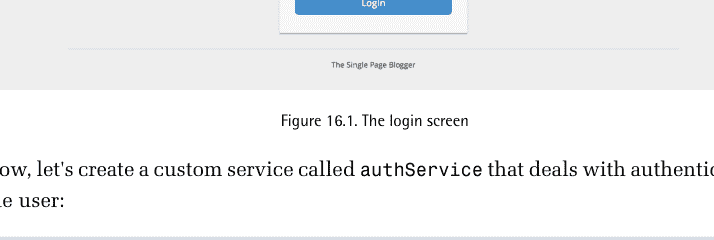

```javascript
angular.module('spBlogger.admin.services').factory('authService',
['AUTH_ENDPOINT','LOGOUT_ENDPOINT','$http','$cookieStore',function(AUTH_ENDPOINT, LOGOUT_ENDPOINT,$http,$cookieStore){
    var auth={};

    auth.login=function(username,password){
        return $http.post(AUTH_ENDPOINT,{username:username,
            password:password}).then(function(response,status){
                auth.user=response.data;
                $cookieStore.put('user',auth.user);
                return auth.user;
            });
    };

    auth.logout=function(){
        return $http.post(LOGOUT_ENDPOINT).then(function(response){
            auth.user=undefined;
            $cookieStore.remove('user');
        });
    };

    return auth;
}]);
```

以下是登录和注销端点 URL：

```javascript
angular.module('spBlogger.admin.services').value('AUTH_ENDPOINT',
    'http://spblogger-sitepointdemos.rhcloud.com/login');
angular.module('spBlogger.admin.services').value('LOGOUT_ENDPOINT',
    'http://spblogger-sitepointdemos.rhcloud.com/logout');
```

上述内容全部放入 `app/modules/admin/js/services.js`。

`authService.login()` 函数接受用户名和密码，并向 `AUTH_ENDPOINT` 发起请求。如果登录成功，它会将用户信息存储在 `authService.user` 以及 `$cookieStore` 中，以便在页面刷新后仍然可用。顺便提一下，`$cookieStore` 定义在一个名为 `ngCookies` 的独立模块中。因此，我们需要主模块依赖此模块并包含 `angular-cookies.js` 脚本。

现在让我们看看 `logout()` 函数。它只会向 `LOGOUT_ENDPOINT` 发送 POST 请求，并且在成功后同时清除 `authService.user` 以及 `$cookieStore` 中的用户信息。

要添加 `$cookieStore` 支持，你需要在 `app/index.html` 中包含以下脚本：

```html
<script src="lib/angular/angular-cookies.js"></script>
```

如果你使用的是代码存档，我已经在代码库的适当目录中包含了我所说的脚本文件，所以你不必下载它。

一如既往，这是声明对 `ngCookies` 依赖的方法：

为了简洁起见，我将省略其他依赖项。这放入 `app/js/app.js`。现在我们将在 state admin 添加一个控制器。这将有助于执行注销操作。所以，这里是带有 `logout()` 函数的控制器：

### Angular 模块定义和控制器初始化

#### State admin provider 配置

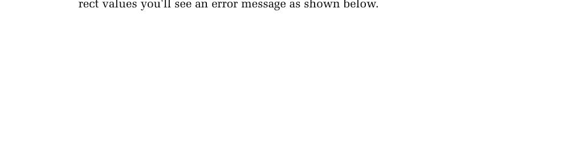

```javascript
$stateProvider.state('admin',{url:'/admin', abstract:true, controller:'AdminController', templateUrl:'modules/admin/views/admin-home.html'});
```

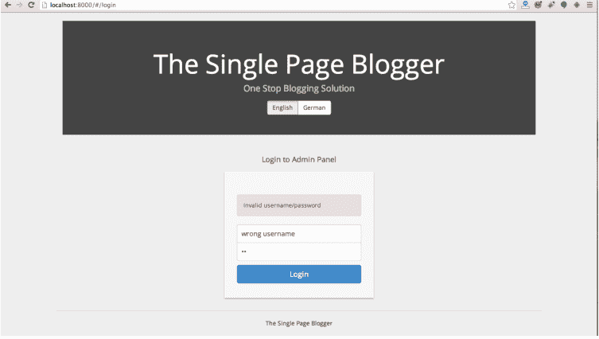

图 16.2。无效的登录

但如果你注销并尝试直接访问 `http://localhost:8000/#/admin`，你将能够这样做。那是因为我们还没有实现访问控制！所以现在让我们来做这件事吧。

## 授权

本节的目标是防止直接访问 `admin` state。未经身份验证的用户不应能够访问 URL“localhost：8000/#/admin”。虽然他们可能会直接在浏览器中加载此状态的视图模板（通过加载"http://localhost:8000/modules/admin/views/admin-home.html"），但我们的 API 端点已经是安全的。

在 UI Router 中，我们在状态定义中具有 `resolve` 属性的概念。该 `resolve` 属性是一个对象，列出应在控制器加载之前解决的几个依赖项。我们可以向我们的`admin` state引入一个这样的依赖——`authService.user` property。如果已设置它则表示用户已登录且我们准备就绪。否则，我们将取消 state 的加载并将用户重定向到 `login` state。

因此，我们要修改后的“admin”state如下：

```javascript
$stateProvider.state('admin',{
    url:'/admin',
    abstract:true,
    controller:'AdminController',
    resolve:{
        user:['authService','$q',function(authService,$q){
            return authService.user || $q.reject({unAuthorized:true});
        }]
    },
    templateUrl:'modules/admin/views/home.html'
});
```

请注意内部`resolve`属性中的“user”。如果在 `AuthService` 中找到了身份验证的用户，我们返回它。否则我们返回总是被拒绝的承诺（带有`error.unAuthorized=true`），而反过来阻止了该 state 的加载并触发 `$stateChangeError`。

> 你可以将控制器中的“user”作为 `AdminController` 中的依赖项引用，并且如果成功加载它具有值 `authService.user`。现在我们所做的是监听对 `$rootScope`上发生的`stateChangeError` 事件。如果设置了`unAuthorized`为`true`我们知道用户试图在未身份验证的情况下访问管理员。所以我们重定向到登录 state 外观：

```javascript
angular.module('spBlogger.admin').run(['$rootScope','$state',
'$cookieStore','authService',function($rootScope,$state,
$cookieStore,authService){

    $rootScope.$on('$stateChangeError', function(event, toState,
        toParams, fromState, fromParams, error) {
            if(error.unAuthorized) {
                $state.go("login");
            }
    });
}]);
```

我们还会在应用加载时从 `$cookieStore` 获取并设置为 `authService.user`。这对于页面刷新有用。

如果经过身份验证的用户访问登录 state 会什么？我们要求他们再次登录吗？我们将将用户发送到 admin。为此我们在 login state添加一个“resolve”属性并检查“User”。如果已设置带有`authorized=true`拒绝加载。以下是代码：

```javascript
$stateProvider.state('login',{
    url:'/login',
    controller: 'LoginController',
    resolve:{
        user:['authService','$q',function(authService,$q){
            if(authService.user){
                return $q.reject({authorized:true});
            }
        }]
    },
    templateUrl:'modules/admin/views/login.html'
});
```

现在我们监听 `$stateChangeError` 并检查`authorized`是否设置为`true`在该情况下我们将重定向到 admin state 以下是代码：

```javascript
$rootScope.$on('$stateChangeError', function(event, toState,
    toParams, fromState, fromParams, error) {
        if(error.unAuthorized) {
            $state.go('login');
        }
        else if(error.authorized){
            $state.go('admin.postViewAll');
        }
    });
```

记住我们的客户端 AngularJS 应用程序在 "http://localhost:8000"上运行，而 Node.js后端在云中。由于在这里进行跨域通信所以告诉`http`随请求发送会话 ID（AngularJS默认不会与会话 id）这样保持身份验证状态。如果 API 端点属于你的 Angular 应用程序相同的服务器将不需要此步骤。在主模块的"块块中，以下代码允许在请求中传送凭据：

```javascript
$httpProvider.defaults.withCredentials = true;
```

恭喜！我们现在为我们的单页博客准备就绪了一个登录系统并且标志了我们刚刚发布我们应用程序的高手版本作为本书结束。做得！剩下的事情是跟随我们的构建过程使用 grunt 获取可部署的版本。

## 接下来哪里？

虽然我们已经讨论了 AngularJS的大多数方面但你可以做很多事情来提高你的AngularJS知识包括进一步阅读和完善我们的演示应用程序.

## 现在要做的事情

为了提高技能并探索 Angular JS中的新事物你希望熟悉以下内容：

1. AngularJS非常适合创建出色的实时应用要创建实时需要实时后端。Firebase在这里非常有用，你可以在 AngularJS app中使用 Firebase存储和同步数据。虽然 firebase是一个付费服务但你可以使用免费的黑客计划进行测试目的。我在 SitePoint 写过一个关于 Firebase教程（http://www.sitepoint.com/creating-three-way-data-binding-firebase-angularjs/).

2. 克隆 AngularJS github仓库到你的系统并播放它。毕竟，阅读代码可以大大提高你的技能组。谁知道你可能开始贡献！

3. 阅读文档。你会在那里找到许多有用的示例。

4. 前往 Angular UI Router官方网站查看文档。

5. 订阅 AngularJS 和 ng-conf YouTube 频道以获取有用的视频。

6. 访问 SitePoint 阅一些很棒的 AngularJS 教程。

7. 浏览所有使用 AngularJS 构建的优秀项目。

8. 在 Stack 上 上问题，利用活跃的社区。

9. 如果对移动应用感兴趣可以了解一下 Ionic，它使用 AngularJS 创建混合应用。

## 自行托管：后端

如你所知，为“单页博客”提供支持的后端 Node.js 应用程序托管在云端。这意味着本书的所有读者都在共享同一个 MongoDB 实例来存储文章。如果这不是你想要的，你可以自己托管该应用有两个代码库可下载：

1. 你在本书中一直在使用的“单页博客”代码库。

2. “单页博客”Node.js后端。这已经部署到 Openshift 云端，因此你无需在本地托管。

但如果你熟悉 Node.js 和 MongoDB，并且已经安装了这些工具，你可以将后端托管在你的机器上。假设你已经安装了 Node.js 和 MongoDB，只需按照以下步骤在你的机器上安装后端：

1. 下载并解压 **sp-blogger-backend.zip**。它将创建一个名为 **sp-blogger-backend** 的目录。

2. 在终端中进入上述目录并输入 `node ./bin/www`。这应该会在 `localhost:8080` 上启动一个服务器。确保在运行此命令之前已经启动了 MongoDB。


### 3. 现在你需要配置你的 AngularJS 应用（sp-blogger）以使用本地端点而不是远程端点。因此，在 `app/modules/admin/js/services.js` 中使用以下配置：

### 4. 现在使用 URL `http://localhost:8000` 访问你的应用，这将开始使用本地端点。

```
angular.module('spBlogger.admin.services').value('API_ENDPOINT', 'http://localhost:8080/api/posts/:id')
angular.module('spBlogger.admin.services').value('AUTH_ENDPOINT', 'http://localhost:8080/login');
angular.module('spBlogger.admin.services').value('LOGOUT_ENDPOINT', 'http://localhost:8080/logout');
```

## AngularJS：从新手到高手

到此为止！希望你喜欢阅读这本书。继续在 AngularJS 的世界里闪耀吧！
