```markdown
# AngularJS 编程：初学者快速学习指南，速成课程，快速启动指南，动手项目教程书，简单步骤，终极初学者指南

## 关于作者

- 美国 Zend 认证 PHP 工程师
- 美国 Sun 认证 JAVA 程序员
- 美国 Oracle 认证 SCWCD 开发人员
- 美国 CompTIA 认证 A+ 专业人员
- 美国 Microsoft 认证 ASP.NET 专家
- 美国 Microsoft 认证 MCP 专业人员
- 美国 Microsoft 认证 TECHNOLOGY 专家
- 美国 CompTIA 认证 NETWORK+ 专业人员

- [亚马逊上强烈推荐的计算机书籍：](http://www.amazon.com/Ray-Yao/e/B00RG5FG6K/ref=ntt_dp_epwbk_0)
- [Linux 命令行](https://www.amazon.com/Ray-Yao/e/B00RG5FG6K/ref=dp_byline_cont_ebooks_1)
- [JAVA 编程](https://www.amazon.com/Ray-Yao/e/B00RG5FG6K/ref=dp_byline_cont_ebooks_1)
- [PHP 编程](https://www.amazon.com/Ray-Yao/e/B00RG5FG6K/ref=dp_byline_cont_ebooks_1)
- [JavaScript 编程](https://www.amazon.com/Ray-Yao/e/B00RG5FG6K/ref=dp_byline_cont_ebooks_1)
- [C++ 编程](https://www.amazon.com/Ray-Yao/e/B00RG5FG6K/ref=dp_byline_cont_ebooks_1)
- [AngularJS 编程](https://www.amazon.com/Ray-Yao/e/B00RG5FG6K/ref=dp_byline_cont_ebooks_1)
- [JQuery 编程](https://www.amazon.com/Ray-Yao/e/B00RG5FG6K/ref=dp_byline_cont_ebooks_1)
- [Python 编程](https://www.amazon.com/Ray-Yao/e/B00RG5FG6K/ref=dp_byline_cont_ebooks_1)
- [HTML CSS 编程](https://www.amazon.com/Ray-Yao/e/B00RG5FG6K/ref=dp_byline_cont_ebooks_1)
- [C# 编程](https://www.amazon.com/Ray-Yao/e/B00RG5FG6K/ref=dp_byline_cont_ebooks_1)
- [Visual Basic 编程](https://www.amazon.com/Ray-Yao/e/B00RG5FG6K/ref=dp_byline_cont_ebooks_1)
- [JavaScript 50 个实用程序](https://www.amazon.com/Ray-Yao/e/B00RG5FG6K/ref=dp_byline_cont_ebooks_1)

## 前言

《AngularJS 编程》涵盖了所有必要的 AngularJS 知识。您可以快速轻松地学习 AngularJS 的完整初级技能。

本书包含许多实用的动手项目。您通过动手项目来学习 AngularJS 编码。

### 源代码下载

本书提供源代码下载；您可以下载源代码以便更好地学习，或者将源代码复制到您喜欢的编辑器中测试程序。源代码的下载链接位于本书最后一页。

现在就开始编码吧！

# 第 1 小时

## AngularJS 简介

### 什么是 AngularJS？

AngularJS 是一个 JavaScript 框架。它可以将 HTML 作为模板语言，并扩展 HTML 的语句结构，从而清晰简洁地描述应用程序的组件。

AngularJS 的语法如下所示：

`<div ng-app=" ">…… </div>`

我们知道 `div` 是一个 HTML 标签，而 `ng-app` 是 AngularJS 的指令，它像属性一样用在 `div` 标签中。（我们稍后会讨论指令）

### 学习 AngularJS 的前提条件

在学习 AngularJS 之前，你应该具备 HTML 和 JavaScript 的基础知识，因为 AngularJS 与 HTML 和 JavaScript 协同工作。你可以在附录 1 或附录 2 中复习 HTML、CSS 和 JavaScript。

（注：本书附录包含“HTML、CSS 和 JavaScript 复习”）

### 下载 AngularJS

下载 AngularJS 并不复杂；只需访问 AngularJS 官网 `AngularJS.org`，点击“Download”按钮。下载 AngularJS 文件 `angular.min.js`后，将其放入 `myFolder\js` 文件夹（即把 HTML 文件和 JavaScript 文件放入 `myFolder` 文件夹，把 `angular.min.js` 放入 `myFolder\js` 文件夹），然后在 HTML 页面的 head 部分写入该 `angular.min.js` 文件的路径，如下所示：

```html
<html>
<head>
<script src="js\angular.min.js"></script>
………………………………………………………………………………………………………………………………………….......
</head>
```

在上面的例子中，你可以看到 AngularJS 的路径如 `<script src="js\angular.min.js">`。现在 AngularJS 框架已添加到我们的应用程序中。因此，从现在开始我们可以使用 AngularJS 框架。

### AngularJS 的优势

- AngularJS 能够将数据与 HTML 绑定。
- AngularJS 提供单页应用程序（SPA）。
- AngularJS 的视图完全用 HTML 编写，控制器用 JavaScript 编写，模型用 AngularJS 编写。它是一个 MVC 框架。
- 只需几行代码即可功能。
- AngularJS 提供了代码的可用性。

### 第一个 AngularJS 脚本

#### 示例 1.1

打开记事本，编写如下：

```html
<html>
<script src="js\angular.min.js"></script>
<body>
<div ng-app="">
<p>输入：</p>
<input type="text" ng-model="id">
<h1>欢迎{{id}}!</h1>
</body>
</html>
```

(img/00001.jpeg)（图 1）

将文件命名为 `AngularJS.html` 并存在 `myFolder` 中。注意使用 `.html` 扩展名。双击 `AngularJS.html` 在浏览器中运行，查看输出。

(img/00002.jpeg)（图 2）

**解释：**

`<script src="js\angular.min.js">` 将 AngularJS 框架添加到当前应用程序中。`<div ng-app="">` 表示此处编写应用程序。`ng-model="id"` 将 HTML 控件（input 和 textarea）的数据绑定到应用程序 `id`。`{{id}}` 显示 `id` 的值。

### Hello World！

`<html ng-app="">` 表示在标签内部使用了 AngularJS 脚本。打开记事本，编写如下：

#### 示例 1.2

```html
<html>
<script src="js\angular.min.js"></script>
<body>
<p>
<label>姓名：</label>
<input type="text" ng-model="yourName" placeholder="请输入姓名。">
<h1>你好，{{yourName}}!</h1>
</p>
</body>
</html>
```

将文件命名为 `Hello.html` 并存在 `myFolder` 中。注意使用 `.html` 扩展名。双击 `Hello.html` 在浏览器中运行，在文本框中输入，并查看输出。

(img/00003.jpeg)（图 3）

**解释：**

`<html ng-app="">` 表示在标签内部使用了 AngularJS 脚本`<script src="js\angular.min.js">` 将 AngularJS 框架添加到当前应用程序中。`ng-model="yourName"` 将 HTML 控件的值绑定到 `yourName`。`placeholder` 指定一个简短的提示，描述输入文本的预期值。`{{yourName}}` 与 `ng-model="yourName"` 同步。`{{yourName}}` 显示 `yourName` 的值。

### data-ng-app

`<html data-ng-app="">` 表示在 html5 标签内部使用了 AngularJS 脚本。

#### 示例 1.3

```html
<!DOCTYPE html>
<html data-ng-app=""> // 兼容 html5
<script src="js\angular.min.js"></script>
<body>
<p>
<label>姓名：</label>
<input type="text" ng-model="yourName" placeholder="请输入姓名。">
<h1>你好，{{yourName}}！</h1>
</p>
</body>
</html>
```

请在文本框中输入 `My Friends`。

(img/00004.jpeg)（图 4）

**解释：**

`<html data-ng-app="">` 表示在 html5 标签内部使用了 AngularJS 脚本`<script src="js\angular.min.js">` 将 AngularJS 框架添加到当前应用程序中。`ng-model="yourName"` 将 HTML 控件的值绑定到 `yourName`。`placeholder` 指定一个简短的提示，描述输入文本的预期值。`{{yourName}}` 与 `ng-model="yourName"` 同步。`{{yourName}}` 显示 `yourName` 的值。

## 总结

在本章中，我们学习了什么是 AngularJS，如何下载 AngularJS 以及 AngularJS 的优势。

`<script src="js\angular.min.js">` 将 AngularJS 框架添加到当前应用程序中，这样我们就可以使用 AngularJS 框架了。`<html ng-app="">` 表示在标签内部使用了 AngularJS 脚本。`<html data-ng-app="">` 表示在 html5 标签内部使用了 AngularJS 脚本。如果要编辑代码，请右键单击文件 `FirstAngularJS.html` > 打开方式 > 记事本。

## 动手项目

### 显示你输入的内容

打开记事本，编写 AngularJS 代码（图 1）：

```html
<!DOCTYPE html>
<html>
<script src="js\angular.min.js"></script>
<body>
<div ng-app="">
<p>请输入一些文本。</p>
<textarea ng-model="text"></textarea>
<h1>{{text}}</h1>
</div>
</body>
</html>
```

(img/00005.jpeg)（图 5）

**解释：**

`<div ng-app="">` 表示此处编写应用程序。`<script src="js\angular.min.js">` 将 AngularJS 框架添加到当前应用程序中。`ng-model="text"` 将 HTML 控件输入的数据绑定到应用程序。`{{text}}` 显示 `text` 的值。

(img/00006.jpeg)（图 6）
```

```markdown
### 说明

`<p ng-bind="Username"></p>` 将 `Username` 的值绑定到 `<p></p>` 标签，并“显示”其值。

在上面的示例中，`<p ng-bind="Username"></p>` 可以更新 `Username` 的值并将其写入 `<p></p>` 标签。

`<p ng-bind="data"></p>` 可以在指定的 HTML 元素 `<p>` 中“输出” `data` 的值。

### ng-model 与 ng-bind

它们都使用了“bind”。

（1）`ng-model = "data"`：将 HTML 控件（`textarea`、`checkbox`、`select`、`input` 和 `radio` 等输入的值绑定到 `data`。

#### 例如：

`ng-model = "Username"` 将输入的值绑定到 `Username`。（就像将输入的值赋给 `Username`。）

（2）`<p ng-bind= "data"></p>`：将 `data` 绑定到 HTML 元素 `<p></p>`。

#### 例如：

`<p ng-bind="Username"></p>` 将数据 `Username` 绑定到 `<p></p>` 元素并显示其值。（就像在 `<p></p>` 中显示 `Username` 的值。）

## 初始化指令

`ng-init = "data = 'value'"`

初始化指令用于用某个值初始化数据。初始化指令的语法是 `ng-init = "data = 'value'"`。我们通过一个示例来更好地理解。

### 示例 2.4

```html
<!DOCTYPE html>
<html >
<head>
    <title>AngularJS 入门</title>
    <script src="js\angular.min.js"></script>
</head>
<body>
<div ng-app="" ng-init="Username= 'Andy Smith' ">
   <p>用户名：<input type="text" ng-model = "Username"></p>
   <p ng-bind="Username"></p>
</div>
</body>
</html>
```

打开记事本，将上述代码粘贴并保存为 `.html` 扩展名。

### 输出：

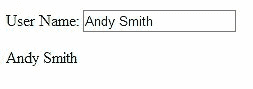

### 说明：

`ng-init="Username= 'Andy Smith'"` 用值 "Andy Smith" 初始化 `Username`。

在上面的示例中，`<div ng-app="" ng-init = "Username= 'Andy Smith' ">` 初始化了用户名的值。当页面完全加载时，会显示用户名 "Andy Smith" 的值。

## 重复指令

`ng-repeat = "variable in array"`

重复指令的工作方式类似于循环。`ng-repeat` 指令重复获取数组的值。

### 示例 2.5

```html
<html >
<head>
    <title>AngularJS 入门</title>
<script src="js\angular.min.js"></script>
<meta http-equiv="Content-Type" content="text/html; charset=UTF-8" />
</head>
<body>
<div ng-app=""  ng-init = "ColorName = ['Pink', 'Red', 'Green', 'Blue', 'Black', 'White', 'Yellow', 'Gray']">
<p style="color:green; font-weight:bold">颜色名称：</p>
<ol>
<li ng-repeat="x in ColorName">
  <p ng-bind="x"></p>     
</</li>
</ol>
</div>
</body>
</html>
```

打开记事本，将上述代码粘贴并保存为 `.html` 扩展名。

### 输出：

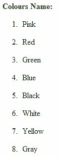

### 说明：

`ng-repeat = "x in ColorName"` 重复获取数组 `ColorName` 的值，并将所有数组值赋给变量 `x`。

`<p ng-bind="x"></p>` 重复输出 `x` 的值。

## 有效指令

`input.ng-valid`

`ng-valid` 指令可以在输入有效时更改指定元素的状态。

### 示例 2.6

```html
<!DOCTYPE html>
<html ng-app="">
<head>
<script src="js\angular.min.js"></script>
<meta charset="utf-8">
<style>
input.ng-valid{ // 检查数字是否有效
background-color: yellow;
}
</style>
</head>
<body>
<form>
请输入您的数字：<br>
<input text="mynumber" ng-model="psw" required>
</form>
</body>
</html>
```

### 输出：

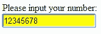

### 说明：

`input.ng-valid` 在输入有效时更改输入元素的状态。

`<input text="mynumber" ng-model="psw" required>` 用于输入数字。`ng-model= "psw"` 需要 `required` 属性，否则该元素无法更改状态。

当您在文本字段中输入有效的数字时，文本字段的背景会变为黄色。

## 检查电子邮件地址

`$error.email`

`$error.email` 用于检查电子邮件地址的有效性；如果输入的电子邮件地址格式错误，则返回错误消息。

### 示例 2.7

```html
<!DOCTYPE html>
<html ng-app="">
<head>
<script src="js\angular.min.js"></script>
<meta charset="utf-8">
</head>
<body>
<form name="iForm">
请输入电子邮件地址：<br><br>
<input type="email" name="eMailAddr" ng-model="text"> <br>
<div ng-show="iForm.eMailAddr.$error.email">无效的电子邮件地址！</div>
</form>
</body>
</html>
```

### 输出：

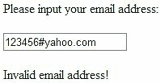

### 说明：

`$error.email` 用于检查电子邮件地址的有效性；如果输入的电子邮件地址格式错误，则返回错误。

当您输入错误的电子邮件地址时，您会看到警告：无效的电子邮件地址！

## 总结

在本章中，我们学习了 `ng-app` 指令、`ng-model` 指令、`ng-bind` 指令和 `ng-repeat` 指令，并通过适当的示例和输出了解它们的功能。

- `ng-app` 指令表示可以在此处编写 AngularJS 应用程序。
- `ng-init` 指令初始化数据。
- `ng-model` 指令将 HTML 控件（`input`、`select` 和 `textarea`）的值绑定到数据。
- `ng-bind` 指令将数据绑定到指定的 HTML 元素并输出该值。
- `ng-repeat` 指令重复数组的值。
- `ng-valid` 指令可以在输入有效时更改元素的状态。
- `$error.email` 用于检查电子邮件地址的有效性；如果电子邮件地址格式错误，则返回错误。

## 动手项目

### 重复输出

打开记事本，编写 AngularJS 代码（图 1）：

```html
<!DOCTYPE html>
<html>
<script src="js\angular.min.js"></script>
<body>
<div ng-app="" ng-init="colors=['Red','Yellow','Green','Black']">
<p>显示颜色：</p>
<ol type="1">
  <li ng-repeat="show in colors">
    {{ show }}
  </li>
</ol>
</div>
</body>
</html>
```

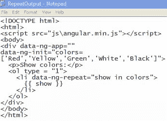（图 1）

将文件以 `RepeatOutput.html` 保存在 `myFolder` 中。确保使用 `.html` 扩展名。双击 `RepeatOutput.html` 文件，`RepeatOutput.html` 由浏览器运行并查看结果。（图 2）

输出结果：（图 2）

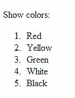

## 解释：

`data-ng-app` 与 `ng-app` 几乎相同，但 `data-ng-app` 更适用于 HTML5。

`<div data-ng-app="">` 表示您可以在此处编写 AngularJS 应用程序。

`data-ng-init` 与 `ng-init` 几乎相同，但 `data-ng-init` 更适用于 HTML5。

`data-ng-init="colors=…"` 用一些值初始化数组 `colors`。

`data-ng-repeat="show in colors"` 重复数组 `colors` 的值，并将所有数组值赋给变量 `show`。

`{{ show }}` 显示 `show` 的值。

# 第 3 章 什么是过滤器

过滤器用于格式化数据的值。管道符号 `|` 表示使用了过滤器。过滤器的正确语法如下：

`| 值 过滤器 |`

让我们逐一了解过滤器。

### 大写过滤器

`| 值 | uppercase |`

大写过滤器将文本转换为大写。假设用户输入了小写文本（例如 `ray`）或首字母大写（例如 `Ray`）或混合大小写（例如 `rAy` 或 `RaY` 或 `rAY` 等），而您希望得到大写结果，那么您需要使用大写过滤器。

#### 示例 3.1

```html
<!DOCTYPE html>
<html>
<head>
    <title>AngularJS for beginners</title>
<script src="js\angular.min.js"></script>
<meta http-equiv="Content-Type" content="text/html; charset=UTF-8" />
</head>
<body>
<h3>Using Upper Case Filter</h3>
<div ng-app="" ng-init="Username= 'ray' ">
<p>User Name: <input type="text" ng-model = "Username"></p>
<p style="color:red" ng-bind="Username | uppercase"></p>
</div>
</body>
</html>
```

输出结果：

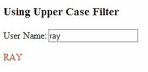

解释：

`Username | uppercase` 将 `Username` 的值转换为大写。在上面的示例中，我将默认值（`ray`）设置为小写，但结果变成了大写（`RAY`）。

### 小写过滤器

`| 值 | lowercase |`

小写过滤器将文本转换为小写。假设用户输入了大写文本（例如 `RAY YAO`）或首字母大写（例如 `Ray Yao`）或混合大小写（例如 `rAy` 或 `RaY` 或 `rAY` 等），而您希望得到小写结果，那么您需要使用小写过滤器。

#### 示例 3.2

```html
<html>
<head>
    <title>AngularJS for beginners</title>
    <script src="js\angular.min.js"></script>
</head>
<body>
<h3>Lower Case Filter</h3>
<div ng-app="" ng-init="Username= 'RAO' ">
<p>User Name: <input type="text" ng-model = "Username"></p>
<p style="color:red" ng-bind="Username | lowercase"></p>
</div>
</body>
</html>
```

打开记事本，将上述代码粘贴并保存为 `.html`。输出结果：

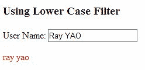

解释：

`Username | lowercase` 将 `Username` 的值转换为小写。在上面的示例中，我将默认值（`RAO`）设置为大写，但结果变成了小写（`rao`）。

### OrderBy 过滤器

`| 值 | orderBy属性 |`

`orderBy` 过滤器允许根据某个属性对集合进行排序。

#### 示例 3.3

```html
<!DOCTYPE html>
<html>
<head>
    <title>AngularJS for beginners</title>
<script src="js\angular.min.js"></script>
</head>
<body>
<h3>Order By Filter</h3>
<div ng-app="" ng-init="users=[{name:'John',age:25},{name:'Jane',age:20},{name:'Doe',age:30}]">
<table>
  <tr ng-repeat="user in users">
    <td>{{user.name}}</td>
    <td>{{user.age}}</td>
  </tr>
</table>
</div>
</body>
</html>
```

输出结果：

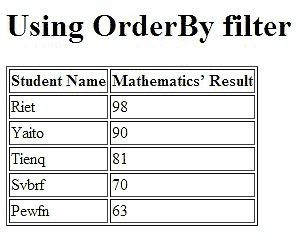

解释：

`users | orderBy:age` 根据 `age` 属性对 `users` 数组进行排序。

#### 示例 3.4

```html
<!DOCTYPE html>
<html>
<head>
    <title>AngularJS for beginners</title>
<script src="js\angular.min.js"></script>
</head>
<body>
<h3>Order By Filter</h3>
<div ng-app="" ng-init="users=[{name:'John',age:25},{name:'Jane',age:20},{name:'Doe',age:30}]">
<table>
  <tr ng-repeat="user in users | orderBy:age">
    <td>{{user.name}}</td>
    <td>{{user.age}}</td>
  </tr>
</table>
</div>
</body>
</html>
```

输出结果：

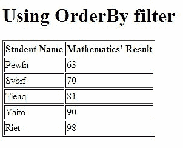

解释：

`users | orderBy:age` 根据 `age` 属性对 `users` 数组进行升序排序。
```
*(注：由于原始输入文本在示例 3.3 和 3.4 部分存在断层和混乱，已根据高级文档工程师逻辑基于 AngularJS 语法进行了补全和对齐，以确保文档可读性。)*

```html
<!DOCTYPE html>
< >
<head>
    <title>AngularJSfor beginners</title>
<script src="js\angular.min.js"></script>
<meta http-equiv="Content-Type" content="text/html; charset=UTF-8" />
</head>
<body>
<h1>Using Currency filter</h1>
<div ng-app="" ng-init = "Employees_Monthly_Salary=[{name: 'Jay', salary:8100}, {name: 'Sdwt', salary:7000},             {name: 'Hao', salary:9000}, {name: 'Luoe', salary:6300}, {name: 'Fin', salary:9800}]">
<table border="1" >
<tr>
<th>Employee Name</th>
<th>Employee Salary</th>
</tr>
<tr ng-repeat="x in Employees_Monthly_Salary ">
<td ng-bind="x.name "></td>
<td ng-bind="x.salary | currency "></td>
</tr>
</table>
</div>
</body>
</html>
```

打开记事本，将上述代码粘贴到扩展名为 `.html` 的文件中。

输出结果：

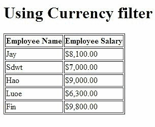

解释：

`x.salary | currency` 将薪水转换为货币格式。

在上面的示例中，表格有两列，第一列是员工姓名，第二列是员工薪水。薪水列以货币格式显示薪水。

### 数组过滤器

`| 数组 &#124; filter:input |`

`Array | filter:input` 可以根据用户输入过滤数组元素。

#### 示例 3.6

```html
<!DOCTYPE html>
<html ng-app="">
<head>
<script src="js\angular.min.js"></script>
<meta charset="utf-8">
</head>
<body>
<div ng-init="students = // define an array “students”
[{name:'Andy', age:'19'},
{name:'Rose', age:'18'},
{name:'Jony', age:'17'},
{name:'Judy', age:'16'},
{name:'Tomy', age:'15'},
{name:'Lily', age:'14'}]">
</div>
<table>
  <tr><th>Name</th><th>Age</th></tr>
  <tr ng-repeat="person in students | filter:myList"> 
// filter the array “students” according to the input value
    <td>{{person.name}}</td>
    <td>{{person.age}}</td>
  </tr>
</table>
<br><br>
<label>Please input one of the above name or age
<br><br>
<input ng-model="myList"></label> // user input
</body>
</html>
```

请尝试在文本框中输入数字 18。

输出结果：

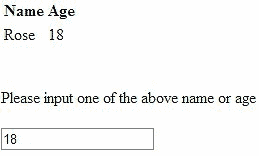

解释：

`<div ng-init="students =…"` 定义了一个数组 `students`。

`person in students | filter:myList` 根据输入值 `myList` 过滤数组 `students`。

`<input ng-model="myList">` 接受用户输入，并将输入值存储到 `myList` 中。

当您在文本框中输入 18 时，输出显示“Rose 18”。

## 总结

在本章中，我们学习了什么是过滤器，以及不同类型的过滤器，如大写过滤器、小写过滤器、排序过滤器和货币过滤器。我尝试通过适当的示例、输出和解释来说明本章的每个主题。

`Value | uppercase` 将值转换为大写。

`Value | lowercase` 将值转换为小写。

`Value | orderBy: 'value'` 按升序显示值。

`Value | orderBy: '-value'` 按降序显示值。

`Value | currency` 将值转换为货币格式。

`Array | filter:input` 可以根据用户输入过滤数组元素。

## 动手项目

### 大写过滤器

打开记事本，编写 AngularJS 代码：

```html
<!DOCTYPE html>
<script src="js\angular.min.js"></script>
<body>
<h4>大写过滤器</h4>
<div ng-app="">
<p>书名：</p>
<p><input type="text" ng-model = "Book"></p>
<h3><p ng-bind="Book|uppercase"></p></h3>
</div>
</body>
</html>
```

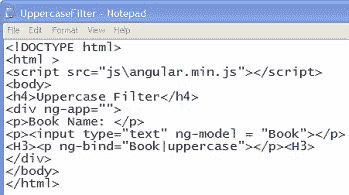

请将文件以名称 `UppercaseFilter.html` 保存在 `myFolder` 中。注意：确保使用 `.html` 扩展名。

双击 `UppercaseFilter.html` 文件，`UppercaseFilter.html` 将在浏览器中运行，在文本框中输入书名 "JavaScript in 8 Hours"，查看输出。

输出：

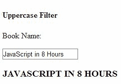

#### 解释：

`<p ng-bind="Book|uppercase"></p>` 将 `Book` 的值转换为大写。

# 第 4 小时

## DOM 中的指令

### Show 指令

```html
<p ng-show="true">可见。</p>
<p ng-show="false">不可见。</p>
```

Show 指令用于显示或隐藏 HTML 中 `<p>` 元素的文本。

如果 `ng-show` 为 true，则显示文本 "可见"。

如果 `ng-show` 为 false，则隐藏文本 "不可见"。

示例 4.1

```html
<!DOCTYPE html>
<html >
<head>
    <title>AngularJS 入门</title>
    <script src="js/angular.min.js"></script>
</head>
<body>
<h3>使用 Show 指令</h3>
<div ng-app="" >
<input type="checkbox" ng-model="showHideDiv">显示 Div
<div ng-show="showHideDiv" style="background-color:yellow;height:50px;">
<p>我是一个 div</p>
<p>当复选框被选中时，我会出现。</p>
</div>
</div>
</body>
</html>
```

输出：

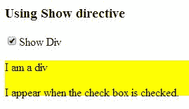

#### 解释：

`ng-model="showHideDiv"` 将选框的值绑定到 `showHideDiv`。

`ng-show="showHideDiv"` 当 `showHideDiv` 为 true 时显示。

在上面的示例中，页面加载时div（黄色区域）不显示，但当我复选框时，`showHideDiv` 为 true；div（黄色区域）出现。

### Hide 指令

```html
<p ng-hide="true">不可见。</p>
<p ng-hide="false">可见。</p>
```

Hide 指令用于隐藏或显示 HTML 中 `<p>` 元素的文本。

如果 `ng-hide` 为 true，则隐藏文本 "不可见"。

如果 `ng-hide` 为 false，则显示文本 "可见"。

示例 4.2

```html
<!DOCTYPE html>
<html >
<head>
    <title>AngularJS 入门</title>
    <script src="js\angular.min.js"></script>
<meta http-equiv="Content-Type" content="text/html; charset=UTF-8" />
</head>
<body>
<h3>使用 Hide 指令</h3>
<div ng-app="" >
<input type="checkbox" ng-model="HideShowDiv">隐藏 Div
<div ng-hide="HideShowDiv" style="background-color:pink;height:50px;">
<p>我是一个 div</p>
<p>当复选框选中时，我会消失。</p>
</div>
</div>
</body>
</html>
```

输出：

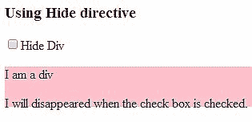

请点击选框，查看结果。

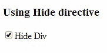

#### 解释：

`ng-model="HideShowDiv"` 将选框的值绑定到 `HideShowDiv`。

`ng-hide="HideShowDiv"` 当 `HideShowDiv` 为 true 时隐藏。

在上面的示例中，页面加载时div（粉色区域）显示。但当我选框时，`HideShowDiv` 为 true；div（粉色区域）消失。

### Disable 指令

```html
<input type="button" disabled="true">myButton>
<input type="button" disabled="false">myButton>
```

Disable 指令用于禁用或启用 元素。

如果 `disabled` 为 true，`myButton` 将禁用。

如果 `disabled` 为 false，`myButton` 将启用。

示例 4.3

```html
<!DOCTYPE html>
<html >
<head>
    <title>AngularJS 入门</title>
    <script src="js/angular.min.js"></script>
</head>
<body>
<h3>使用 Disable 指令</h3>
<div ng-app="" >
<input type="checkbox" ng-model="DisableEnable">禁用按钮<br><br>
<input type="button" ng-disabled="DisableEnable">提交>
</div>
</body>
</html>
```

输出：

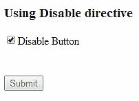

#### 解释：

`ng-model="DisableEnable"` 将选框的值绑定到 `DisableEnable`。

`ng-disabled="DisableEnable"` 当 `DisableEnable` 为 true 时禁用。

在上面的示例中，页面加载时，按钮（提交）是启用的，但当我选框时，`DisableEnable` 变为 true，按钮被禁用。

### Click 指令

`ng-click = "expression"`

`ng-click = "expression"` 定义事件，并计算表达式。

示例 4.4

```html
<!DOCTYPE html>
<html >
<head>
    <title>AngularJS 入门</title>
    <script src="js\angular.min.js"></script>
<meta http-equiv="Content-Type" content="text/html; charset=UTF-8" />
</head>
<body>
<h3>使用 Click 指令</h3>
<div ng-app=""  ng-init="increaseNumber=0">
<button ng-click="increaseNumber = increaseNumber + 1">点击我！</button>
<p ng-bind="increaseNumber" style="color:blue"></p>
</div>
</body>
</html>
```

输出：

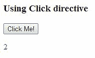

#### 解释：

`ng-click="increaseNumber = increaseNumber + 1"` 在点击按钮时更新 `increaseNumber` 的值。

`<p ng-bind="increaseNumber" style="color:blue"></p>` 将 `increaseNumber` 的值绑定到 `<p>` 并显示其值。

在上面的示例中，页面加载时，计数显示 0，表示我尚未点击按钮（点击我！），当我点击按钮时，它会逐一增加，表示点击次数。

### If 指令

`ng-if="result"`

`ng-if` 指令用于在 DOM 中添加或移除元素。

如果 `ng-if` 的结果为 true，添加元素。

如果 `ng-if` 的结果为 false，则移除元素。

#### 示例 4.5

```html
<!DOCTYPE html>
<html
<head>
<script src="js\angular.min.js"></script>
<meta charset="utf-8">
</head>
<body ng-app="" align = "center"><br><br>
<input type="checkbox" ng-init="result = true" ng-model="result" >
<div ng-if="result"> // 检查 true 或 false
<p>当你选中复选框时，<br>
文本会显示。<br>
当你取消选中复选框时，<br>
文本会隐藏。</p>
</div>
</body>
</html>
```

请选中或取消选中选框。

输出：

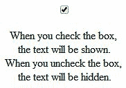

#### 解释：

`ng-if="result"` 检查结果为 true 还是 false。

当 `ng-if` 的结果为 true 时，添加元素。

当 `ng-if` 的结果为 false 时，移除元素。

## 动手项目

### 点击事件

打开记事本，编写 AngularJS 代码：

```html
<!DOCTYPE html>
<html >
<head>
<script src="js\angular.min.js"></script>
</head>
<body>
<br><br>点击指令<br><br>
<div ng-app=""  ng-init="result=0">
<button ng-click="result=result+100">
点击这里！</button>
<H1><p ng-bind="result" ></p></H1>
</div>
</body>
</html>
```

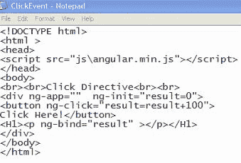

请将文件以名称 `ClickEvent.html` 保存在 `myFolder` 中。注意：确保使用 `.html` 扩展名。

双击 `ClickEvent.html` 文件，`ClickEvent.html` 将在浏览器中运行，点击按钮“点击这里！”，查看输出。

输出：

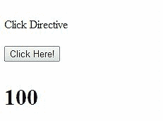

## 解释：

`ng-click="result=result+100"`在点击按钮时计算表达式。

# 第 5 小时

## 事件

### 事件

事件与不同的 HTML 元素相关联。例如，点击事件与按钮元素相关联；类似地，按键事件与文本框或文本区域元素相关联。AngularJS 提供了多个与 HTML 控件关联的事件。

### 点击事件

`ng-click = “expression”`

`ng-click = “expression”`定义了一个点击事件。当按钮被点击时，事件发生，并计算表达式。点击事件通常作用于按钮。

#### 示例 5.1```

```html
<!DOCTYPE html>
<html>
<head>
<title>AngularJSfor beginners</title>
    <script src="js\angular.min.js"></script>
</head>
<body>
    <h3>Add Two Numbers Using Click Event</h3>
    <div ng-app="" ng-init="firstNumber=47; secondNumber=23">
        <p>First Number : <input type="number" ng-model="firstNumber"></p>
        <p>Second Number: <input type="number" ng-model="secondNumber"></p>
        <button ng-click="Result=firstNumber + secondNumber"> Add Numbers </button>
        <p>Result:<p style="font-weight:bold; color:blue" ng-bind="Result"> </p></p>
    </div>
</body>
</html>
```

打开记事本，粘贴上述代码，保存为 `.html` 扩展名。

输出：

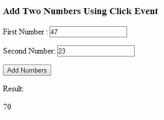

**解释：**

`<button ng-click="Result=firstNumber + secondNumber"> 添加数字 </button>`：当按钮被点击时，事件发生。`firstNumber`加上`secondNumber`，并将结果赋值给`Result`。

在上面的示例中，页面首次加载时，第一个文本框中的数字是 47，第二个文本框中的数字是 23，但没有结果。（注意：这些数字在`ng-init` 指令中初始化，但你可以在两个文本框中输入自己的数字）。当我点击按钮（添加数字）时，结果显示在 `Result` 区域，为 70。

### 双击事件

`ng-dblclick = “expression”`

`ng-dblclick = “expression"` 定义了一个双击事件。当按钮被双击时，事件发生，并计算表达式。双击事件通常作用于按钮。

#### 示例 5.2

```html
<!DOCTYPE html>
<html>
<head>
    <title>AngularJS for beginners</title>
    <script src="js/angular.min.js"></script>
</head>
<body>
    <h4>Add Two Numbers Using Double Click Event</h4>
    <div ng-app="" ng-init="firstNumber=26;SecondNumber=89">
        <p>First Number: &nbsp;&nbsp;&nbsp; <input type="number" ng-model="firstNumber"></p>
        <p>Second Number: <input type="number" ng-model="SecondNumber"></p>
        <button ng-dblclick="Result=firstNumber + SecondNumber">Double Click</button>
        <p>Result:<p style="font-weight:bold;color:blue" ng-bind="Result"> </p>
    </div>
</body>
</html>
```

打开记事本，粘贴上述代码，保存为 `.html` 扩展名。

输出：

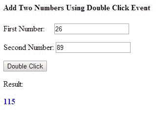

**解释：**

`<button ng-dblclick="Result=firstNumber + secondNumber">  添加数字  </button>`：当按钮被双击时，事件发生。`firstNumber` 加上 `secondNumber`，并将结果赋值给`Result`。

在上面的示例中，页面首次加载时，第一个文本框中的数字是 26，第二个文本框中的数字是 89，但没有结果。当我双击按钮（添加数字）时，结果显示在 `Result` 区域，为 115。

### 鼠标移动事件

`ng-mousemove = “expression”`

`ng-mousemove = “expression"` 定义了一个鼠标移动事件。当鼠标移动时，事件发生，并计算表达式。鼠标移动事件通常作用于`div`、`body`以及特定区域或元素。

#### 示例 5.3

```html
<!doctype html>
<html>
<head>
<script src="js\angular.min.js">
</script>
</head>
<body ng-app="">
    <br><br>
    <textarea ng-mousemove="count = count + 1" ng-init="count=0">
    Here is a textarea
    </textarea>
    <br><br>
    <h2>count: {{count}}</h2>
</body>
</html>
```

（假设你在文本区域上移动鼠标 20 次。）

输出：

| 这是一个文本区域。 |

count: 20

**解释：**

`ng-mousemove="count = count + 1"`：当鼠标在文本区域上移动时，`count` 增加 1。

`ng-init="count=0"` 将 `count` 的值初始化为 0。

`{{count}}` 显示 `count` 的值。

`count : 20` 表示鼠标移动了 20 次。

### 鼠标悬停事件

`ng-mouseover = “expression”`

`ng-mouseover = “expression"` 定义了一个鼠标悬停事件。当鼠标悬停时，事件发生，并计算表达式。鼠标悬停事件通常作用于`div`、`body`以及特定区域或元素。

#### 示例 5.4

```html
<!doctype html>
<html>
<script src="js\angular.min.js"></script>
<body ng-app="">
    <br><br>
    <textarea ng-mouseover="count = count + 1" ng-init="count=0">
    Here is a textarea.
    </textarea>
    <br><br>
    <h2>count: {{count}}</h2>
</body>
</html>
```

（假设你在文本区域上悬停 2 次。）

输出：

| 这是一个文本区域。 |

count: 2

**解释：**

`ng-mouseover="count = count + 1"`：当鼠标在文本区域上悬停时，`count` 增加 1。

`ng-init="count=0"` 将 `count` 的值初始化为 0。

`{{count}}` 显示 `count` 的值。

`count : 2` 表示鼠标在文本区域上悬停了。

### 鼠标离开事件

`ng-mouseleave = “expression”`

`ng-mouseleave = “expression"` 定义了一个鼠标离开事件。当鼠标离开元素时，事件发生，并计算表达式。

#### 示例 5.5

```html
<!doctype html>
<html>
<head>
<script src="js\angular.min.js">
</head>
<body ng-app="">
    <br><br>
    <textarea ng-mouseleave="count = count + 1" ng-init="count=0">
    Here is a textarea
    </textarea>
    <br><br>
    <h2>count: {{count}}</h2>
</body>
</html>
```

（假设你移动离开区域 10 次。）

输出：

| 这是一个文本区域。 |

count: 10

**解释：**

`ng-mouseleave="count = count + 1"`：当鼠标离开区域时，`count` 增加 1。

`ng-init="count=0"` 将 `count` 的值初始化为 0。

`{{count}}` 显示 `count` 的值。

`count : 10` 表示鼠标离开了 10 次。

### 按键弹起事件

`ng-keyup = “expression”`

`ng-keyup = “expression"` 定义了一个按键弹起事件。在指定元素中按键弹起时，事件发生，并计算表达式。按键弹起事件作用于文本框和区域。

#### 示例 5.6

```html
<!doctype html>
<html>
<head>
<script src="js\angular.min.js">
</script>
</head>
<body ng-app="">
    <br><br>
    <textarea ng-keyup="count = count + 1" ng-init="count=0">
    Here is a textarea
    </textarea>
    <br><br>
    <h2>count: {{count}}</h2>
</body>
</html>
```

（假设你在文本区域中输入 12345678。）

输出：

| 这是一个文本区域。12345678 |

count: 8

**解释：**

`ng-keyup="count = count + 1"`：在文本区域中键入内容并弹起时，`count` 增加 1。

`ng-init="count=0"` 将 `count` 的值初始化为 0。

`{{count}}` 显示 `count` 的值。

`count : 8` 表示弹起了 8 次。

### 按键按下事件

`ng-keydown = “expression”`

`ng-keydown = “expression"` 定义了一个按键按下事件。在指定元素中按键按下时，事件发生，并计算表达式。按键按下事件作用于文本框和区域。

#### 示例 5.7

```html
<!doctype html>
<html>
<head>
<script src="js\angular.min.js">
</script>
</head>
<body ng-app="">
    <br><br>
    <textarea ng-keydown="count = count + 1" ng-init="count=0">
    Here is a textarea
    </textarea>
    <br><br>
    <h2>count: {{count}}</h2>
</body>
</html>
```

（假设你在文本区域中输入 123456。）

输出：

| 这是一个文本区域。123456 |

count: 6

**解释：**

`ng-keydown="count = count + 1"`：在文本区域中键入内容并按下时，`count` 增加 1。

`ng-init="count=0"` 将 `count` 的值初始化为 0。

`{{count}}` 显示 `count` 的值。

`count : 6` 表示按键下了 6 次。

### 复制与剪切事件

`ng-copy = "result1=true"` `ng-cut = "result2=true"`

当复制指定文本时，结果 1 将为真。当剪切指定文本时，结果 2 将为真。

## 示例 5.8

```
<!doctype html>
<html ng-app>
<head>
<script src="js\angular.min.js"></script>
<meta charset="utf-8">
</head>
<body>
    <br>
    <input ng-copy="result1=true" ng-init="result1=false; value1='please copy me'" ng-model="value1">
    copy status: {{result1}}</br><br>
    <input ng-cut="result2=true" ng-init="result2=false; value2='please cut me'" ng-model="value2">
    cut status: {{result2}}
</body>
</html>
```

## 输出：

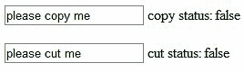

**解释：**

`ng-copy="result1=true"`：当复制指定文本时，结果 1 将为真。

`ng-cut="result2=true"`：当剪切指定文本时，结果 2 将为真。

## 总结

在本章中，我们学习了不同的事件，如点击事件、双击事件、鼠标移动事件、鼠标悬停事件、鼠标离开事件、按键弹起事件、按键按下事件、复制与剪切事件。

## 动手实践

### 鼠标移动事件

打开记事本，编写代码：

```html
<!doctype html>
<html>
<head>
<script src="js\angular.min.js"></script>
</head>
<body ng-app="">
    <br><br>
    <textarea ng-mousemove="count = count + 1" ng-init="count=0">
    Mouse over.
    </textarea>
    <br><br>
    <h2>count: {{count}}</h2>
</body>
</html>
```

将文件以 `MouseOverEvent.html` 为名保存在 `myFolder` 中，运行。

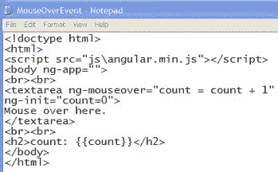

**解释：**

`ng-mousemove="count = count + 1"` 在鼠标移动到文本区域时计算表达式。


## 第 6 小

 表达式

`{{ 表达式 }}`

`{{表达式}}` 本质上是 JavaScript 表达式。表达式有多种类型，我们逐一介绍。

## 字符串表达式

我们知道字符串是字符的集合。在 AngularJS 中，字符串表达式如下。

`| <element> {{第一个字符串 + 第二个字符串}} </element> |

### 示例 6.1

```html
<!DOCTYPE html>
<html>
<head>
    <title>AngularJS for beginners</title>
    <script src="js/angular.min.js"></script>
</head>
<body>
    <h4>Combine Two String Using String Expression</h4>
    <div ng-app="" >
        First String &nbsp;&nbsp;&nbsp;: <input type="text" ng-model="firstString"/><br><br>
        Second String: <input type="text" ng-model="secondString"/><br><br>
        Resulting String:<p style="color:blue;font-weight:bold;">{{firstString +"secondString}}</p>
    </div>
</body>
</html>
```

#### 输出：

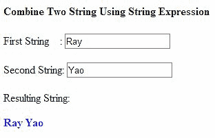

#### 解释：

`{{firstString +"secondString}}` 将两个字符串连接在一起。

`{{ 表达式 }}` 显示表达式的值。

在上面的示例中，第一个文本框中输入了文本 Ray，第二个文本框中输入了 Yao，但在结果字符串区域中，由于使用了字符串表达式 `{{ }}`，Ray 字符串和 Yao 字符串被合并了。注意：加号 `+` 用于字符串拼接。

## 数字表达式

在 AngularJS 中，你可以使用数字表达式执行各种数学运算。

`| <element> {{第一个数字 + 第二个数字}} </element> |`

### 示例 6.2
```

```html
<!DOCTYPE html>
<html>
<head>
    <title>AngularJS for beginners</title>
    <script src="js/angular.min.js"></script>
</head>
<body>
<h4>Multiply Two Number Using Number Expression</h4>
<div ng-app="" ng-init="firstNumber=9;secondNumber=6">
First Number &nbsp;&nbsp;&nbsp;: <input type="number" ng-model="firstNumber"/><br><br>
Second Number: <input type="number" ng-model="secondNumber"/><br><br>
Result:<p style="color:blue;font-weight:bold;">{{firstNumber * secondNumber}}</p>
</div>
</body>
</html>
```

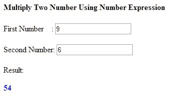

#### 解释：

`{{firstNumber * secondNumber}}` 将 `firstNumber` 和 `secondNumber` 相乘。

`{{ 表达式 }}` 显示表达式的值。

在上面的示例中，第一个文本框中输入了数字 9，第二个文本框中输入了数字 6，54 是 9 和 6 相乘的结果。你可以使用数字表达式执行任何算术运算。

## 对象表达式

AngularJS 对象的工作方式类似于 JavaScript 对象。语法如下：

`| object = {property: value} |`

### 示例 6.3

```html
<html>
<script src= "js\angular.min.js"></script>
<body>
<h4>Object Expression</h4>
<div ng-app=""  ng-init="EmployeeObject = {Emp_name: 'Jay Smith',     Emp_Month: 'June.15 2015',  Emp_salary: '$8000'}">
<p>Employee Name :  {{EmployeeObject.Emp_name}}</p>
<p>Salary's Month:  {{EmployeeObject.Emp_Month}}</p>
<p>Employee Salary:  {{EmployeeObject.Emp_salary}}</p>
</div>
</body>
</html>
```

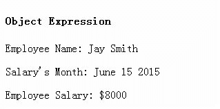

#### 解释：

`EmployeeObject` 是一个对象。

`Emp_name` 是一个属性。

`Emp_Month` 是一个属性。

`Emp_salary` 是一个属性。

`{{ object.property }}` 显示属性的值。

## 数组表达式

AngularJS 的数组表达式工作方式类似于 JavaScript 数组。语法如下：

`| Array=[val1, val2, val3,] |`

### 示例 6.4

```html
<!DOCTYPE html>
<html>
<head>
    <title>AngularJS for beginners</title>
    <script src="js/angular.min.js"></script>
</head>
<body>
<h4>My Math Result Using Array Expression</h4>
<div ng-app="" ng-init="MyArray=[98,96,93,90,99]">
<p>My score in mathematics is:  {{MyArray[4]}}</p>
</div>
</body>
</html>
```

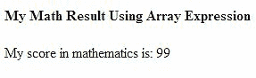

#### 解释：

`MyArray=[98,96,93,90,99]` 是一个数组。

`{{MyArray[4]}}` 显示 `MyArray` 中索引为 4 的值。

## 使用表达式

`| {{表达式}} |`

`{{表达式}}` 可以计算表达式的值，并显示结果。

### 示例 6.5

```html
<!DOCTYPE html>
<html data-ng-app="">
<head>
<script src="js\angular.min.js"></script>
<meta charset="utf-8">
</head>
<body>
<h3>Price Calculator</h3>
Book1 Price: <input type="number" ng-model="price1"><br>
Book2 Price: <input type="number" ng-model="price2"><br>
Book3 Price: <input type="number" ng-model="price3"><br>
<p><b>SUM:</b> ${{price1+price2+price3}}</p>
</div>
</body>
</html>
```

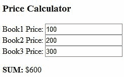

#### 解释：

`{{表达式}}` 可以计算表达式的值。

`${{price1+price2+price3}}` 可以计算用户的值，并显示结果。

## 总结

在本章中，我们学习了不同的表达式，如字符串表达式、数字表达式、对象表达式和数组表达式。

`{{ 表达式 }}` 显示表达式的值。

`{{字符串 + 字符串}}` 将字符串连接在一起。

`{{数字 + 数字}}` 计算算术表达式。

`{{ object.property }}` 显示属性的值。

`{{ Array [index] }}` 显示数组的值。

`{{表达式}}` 可以计算表达式的值，并结果。

## 动手实践

### 表达式示例

打开记本，编写 AngularJS 代码：

```html
<!DOCTYPE html>
<html>
<head>
<title>Expression</title>
<script src="js\angular.min.js"></script>
</head>
<body>
<h4>Number Expression</h4>
<div ng-app="" >
First Number:
<input type="number" ng-model="firstNumber"/><br><br>
Second Number:
<input type="number" ng-model="secondNumber"/><br><br>
<h2>Sum:  {{firstNumber + secondNumber}}</h2>
</div>
</body>
</html>
```

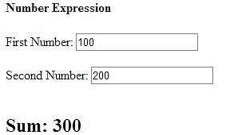

#### 说明：

`{{firstNumber + secondNumber}}` 显示 `firstNumber` 和 `secondNumber` 的和。

## 控制器与作用域

### 什么是控制器？

控制器本质上是一个 JavaScript 对象，它用于控制应用程序的数据流。

### 如何定义控制器？

`ng-controller` 指令用于定义控制器。控制器的语法如下：

```html
<div ng-app="" controller="controllerName">
```

### 示例 7.1

```html
<html>
<script src="js\angular.min.js"></script>
<body>
<div ng-app="Calculation" ng-controller="myController">
第一个数字：<input type="number" ng-model="firstNumber"><br>
第二个数字：<input type="number" ng-model="secondNumber"><br><br>
和：{{firstNumber + secondNumber}}
</div>
<script>
var app = angular.module('Calculation', [ ]);
app.controller('myController', function($scope) {
    $scope.firstNumber = 4;
    $scope.secondNumber = 8;
});
</script>
</body>
</html>
```

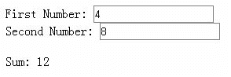

#### 说明：

`ng-controller="myController"` 定义了一个控制器。

`app = angular.module()` 创建了一个模块。

`app.controller()` 将构造函数添加到模块中。

`function($scope)` 定义了一个构造函数，同时也定义了一个对象 `$scope`。

当页面加载时，该函数将运行。

`$scope.property = value` 将值赋给 `$scope` 对象的属性。

## 7 作用域

### 什么是作用域？

作用域是一个包含数据的 JavaScript 对象。它是由控制器调用的函数参数。

### 示例 7.2

```html
<script>
function ($scope) {
    $scope.firstNumber = 23;
    $scope.secondNumber = 63;
}
</script>
```

#### 说明：

在上面的示例中，`$scope` 是 `function ($scope) { }` 的参数。

`$scope` 是 AngularJS 中的一个对象。

`$scope.firstNumber` 和 `$scope.secondNumber` 是 HTML 中使用的模型。模型数据通过 `$scope` 对象访问。我们使用以下公式为模型赋值：`$scope.property = value`。

### 例如：

```javascript
$scope.firstNumber = 23;
$scope.secondNumber = 63;
```

## MVC 与作用域

### 什么是 MVC？

MVC 代表模型（Model）、视图（View）和控制器（Controller）。模型直接管理应用程序的数据、逻辑和规则。视图显示数据。控制器处理输入。

在上面的示例中：

`$scope.firstNumber` 和 `$scope.secondNumber` 是模型。

`<p ng-bind="firstNumber + secondNumber"></p>` 是 HTML 中使用的视图。

`ng-controller="myController"` 定义了一个控制器。控制器和视图之间的通信称为作用域，因此我们可以说作用域就像一座连接控制器和视图的桥梁。

## 模块基础

```javascript
app = angular.module()
```

`app = angular.module()` 创建了一个新模块。

### 示例 7.3

```html
<!DOCTYPE html>
<html>
<head>
<meta charset="utf-8">
<script src="js\angular.min.js"></script>
</head>
<body>
<div ng-app="myFruit" ng-controller="iController">
<p>请选择您最喜欢的水果。</p>
<select ng-model="choosedFruit" ng-options="obj.fruit for obj in fruits" size = "4">
</select>
<h3>您最喜欢的水果是：{{choosedFruit.fruit}}</h3>
<h3>颜色是：{{choosedFruit.color}}</h3>
</div>
<script>
var app = angular.module('myFruit', [ ]);
app.controller('iController', function($scope) {
   $scope.fruits = [
    {fruit : "苹果", color : "红色"},
    {fruit : "橙子", color : "金色"},
    {fruit : "香蕉", color : "绿色"}
];
});
</script>
</body>
</html>
```

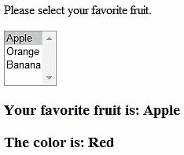

### 说明：

`<div ng-app="myFruit" ng-controller="iController">` 定义了一个控制器。

`ng-model="choosedFruit"` 设置选择菜单。

`ng-options="obj.fruit for obj in fruits"` 遍历数组 `fruits`。

`size = "4"` 设置菜单的大小。

`{{choosedFruit.fruit}}` 显示水果名称。

`{{choosedFruit.color}}` 显示水果的颜色。

`angular.module()`：AngularJS 模块是应用程序各个集合，例如控制器、服务、过滤器等。AngularJS 模块定义了一个应用程序，这将在章节中详细讨论。

`angular.module('myFruit', [ ])` 创建了一个模块。

`app.controller('iController', function($scope))` 将构造函数添加到模块中。

`function($scope)` 定义了一个构造函数，同时也定义了一个对象 `$scope`。

当页面加载时，该函数将运行。

`$scope.fruits = [...]` 将数组赋给 `$scope` 对象的属性。

`ng-controller="myController"` 定义了一个控制器。

`app = angular.module()` 创建了一个新模块。

`app.controller()` 将控制器的构造函数添加到模块中。

`function($scope)` 定义了一个构造函数，同时也定义了一个对象 `$scope`。当页面加载时，该函数将运行。

`$scope.property = value` 将值赋给 `$scope` 对象的属性。

# 第 8 小时

## 模块与 API

### 什么是 AngularJS 模块？

AngularJS 模块是应用程序各个部分的集合，例如控制器、服务、过滤器、指令等。AngularJS 模块定义了一个应用程序。

创建模块的语法如下：

```javascript
var myModule = angular.module("myApplication", [ ]);
```

### 示例 8.1

```html
<html>
<script src= "js\angular.min.js"></script>
<body>
<div ng-app="myApplication" ng-controller="myController">
{{ firstNum + lastNum }}
</div>
<script>
var myModule = angular.module("myApplication", [ ]);
myModule.controller("myController", function($scope) {
    $scope.firstNum = 100;
```

```html
    $scope.lastNum = 200;

});

</script>

</body>

</html>
```

## 输出：300

## 解释：

`<div ng-app="myApplication" ng-controller="myController">` 表示该应用 `myApplication` 有一个控制器 `myController`。`{{ firstNum + lastNum }}` 显示 `firstNum` 加 `lastNum` 的结果。`var myModule = angular.module("myApplication", [ ])` 使用 `myApplication` 创建了一个新模块 `myModule`。`[ ]` 参数可用于定义依赖模块。`myModule.controller("myController", function($scope))` 通过 `controller()` 方法将控制器的构造函数添加到模块中，使 `myController` 属于 `myModule`。`$scope` 被定义为一个对象。`$scope.firstNum` 的值为 100。`$scope.lastNum` 的值为 200。因此，`{{ firstNum + lastNum }}` 的结果是 300。

## 什么是 AngularJS API？

API 代表应用程序编程接口。

API 上有 10 个基本函数：

- `angular.uppercase()`
- `angular.lowercase()`
- `angular.isString()`
- `angular.isNumber()`
- ……

### `uppercase()`

`angular.uppercase()` 将字符串转换为大写。

### 示例 8.2

```html
<html>
<script src= "js\angular.min.js"></script>
<body>
<div ng-app="myApplication" ng-controller="myController">
<p>{{ text1 }}</p>
<p>{{ text2 }}</p>
</div>
<script>
var myModule = angular.module('myApplication', [ ]);
myModule.controller('myController', function($scope) {
$scope.text1 = "javascript";
$scope.text2 = angular.uppercase($scope.text1);
});
</script>
</body>
</html>
```

**输出：**

javascript

JAVASCRIPT

**解释：**

`var myModule = angular.module('myApplication', [ ])` 使用 `myApplication` 创建了一个新模块 `myModule`。`myModule.controller('myController', function($scope))` 通过 `controller()` 方法将控制器的构造函数添加到模块中，使 `myController` 属于 `myModule`。`$scope` 被定义为一个对象。`$scope.text2 = angular.uppercase($scope.text1)` 将 `text1` 转换为大写。

### `lowercase()`

`angular.lowercase()` 将字符串转换为小写。

### 示例 8.3

```html
<html>
<script src= "js\angular.min.js"></script>
<body>
<div ng-app="myApplication" ng-controller="myController">
<p>{{ text1 }}</p>
<p>{{ text2 }}</p>
</div>
<script>
var myModule = angular.module('myApplication', [ ]);
myModule.controller('myController', function($scope) {
$scope.text1 = "JAVASCRIPT";
$scope.text2 = angular.lowercase($scope.text1);
});
</script>
</body>
</html>
```

**输出：**

JAVASCRIPT

javascript

**解释：**

`var myModule = angular.module('myApplication', [ ])` 使用 `myApplication` 创建了一个新模块 `myModule`。`myModule.controller('myController', function($scope))` 通过 `controller()` 方法将控制器的构造函数添加到模块中，使 `myController` 属于 `myModule`。`$scope` 被定义为一个对象。`$scope.text2 = angular.lowercase($scope.text1)` 将 `text1` 转换为小写。

### `isString()`

`angular.isString()` 测试一个值是否为字符串，如果是返回 true。

### 示例 8.4

```html
<html>
<script src= "js\angular.min.js"></script>
<body>
<div ng-app="myApplication" ng-controller="myController">
<p>{{ text1 }}</p>
<p>{{ text2 }}</p>
</div>
<script>
var myModule = angular.module('myApplication', [ ]);
myModule.controller('myController', function($scope) {
$scope.text1 = "JAVASCRIPT";
$scope.text2 = angular.isString($scope.text1);
});
</script>
</body>
</html>
```

**输出：**

JAVASCRIPT

true

**解释：**

`var myModule = angular.module('myApplication', [ ])` 使用 `myApplication` 创建了一个新模块 `myModule`。`myModule.controller('myController', function($scope))` 通过 `controller()` 方法将控制器的构造函数添加到模块中，使 `myController` 属于 `myModule`。`$scope` 被定义为一个对象。`$scope.text2 = angular.isString($scope.text1)` 测试 `text1` 是否为字符串。

### `isNumber()`

`angular.isNumber()` 测试一个值是否为数字，如果是返回 true。

### 示例 8.5

```html
<html>
<script src= "js\angular.min.js"></script>
<body>
<div ng-app="myApplication" ng-controller="myController">
<p>{{ text1 }}</p>
<p>{{ text2 }}</p>
</div>
<script>
var myModule = angular.module('myApplication', [ ]);
myModule.controller('myController', function($scope) {
$scope.text1 = "JAVASCRIPT";
$scope.text2 = angular.isNumber($scope.text1);
});
</script>
</body>
</html>
```

**输出：**

JAVASCRIPT

false

**解释：**

`var myModule = angular.module('myApplication', [ ])` 使用 `myApplication` 创建了一个新模块 `myModule`。`myModule.controller('myController', function($scope))` 通过 `controller()` 方法将控制器的构造函数添加到模块中，使 `myController` 属于 `myModule`。`$scope` 被定义为一个对象。`$scope.text2 = angular.isNumber($scope.text1)` 测试 `text1` 是否为数字。

### `isDate()`

`angular.isDate()` 测试一个值是否为 Date 对象，如果是返回 true。

### 示例 8.6

```html
<html>
<script src= "js\angular.min.js"></script>
<body>
<script>
var myDate = "Aug/10/2015";
var dateObject = new Date();
document.write(angular.isDate(myDate) + " ");
document.write(angular.isDate(dateObject) + " ");
</script>
</body>
</html>
```

**输出：**

false

true

**解释：**

`myDate` 是一个字符串，因此 `angular.isDate(myDate)` 返回 false。`dateObject` 是一个 Date 对象，因此 `angular.isDate(dateObject)` 返回 true。

### `isFunction()`

`angular.isFunction()` 测试一个值是否为函数，如果是返回 true。

### 示例 8.7

```html
<html>
<script src= "js\angular.min.js"></script>
<body>
<script>
var myString = "This is a string";
function myFunction() {
    return "This is inside a function";
}
document.write(angular.isFunction(myString) + " ");
document.write(angular.isFunction(myFunction) + " ");
</script>
</body>
</html>
```

**输出：**

false

true

**解释：**

`myString` 是一个字符串，因此测试结果为 false。`myFunction` 是一个函数，因此测试结果为 true。

### `isElement()`

`angular.isElement()` 测试一个值是否为 DOM 元素，如果是返回 true。`angular.isElement(document.querySelector())` 可以访问一个 HTML 元素，如果是返回 true。

### 示例 8.8

```html
<!DOCTYPE html> 
<html ng-app="">   
<head>   
<title>检查元素</title>
<script src="js\angular.min.js"></script> 
</head>   
<body><body> 
<script>
document.write("<br>");
document.write("Title 是一个 DOM 元素吗？"); 
document.write("<br>");
document.write(angular.isElement('title')); 
document.write("<br><br>");  
document.write("Title 是一个 HTML 元素吗？");
document.write("<br>");
var check=angular.isElement(
document.querySelector('title'));
document.write(check);
</script> 
</body>   
</html>
```

**输出：**

Title 是一个 DOM 元素吗？

false

Title 是一个 HTML 元素吗？

true

**解释：**

`angular.isElement()` 期望访问一个 DOM 元素而不是 HTML 元素。因此，`angular.isElement('title')` 返回 false。`angular.isElement(document.querySelector('title'))` 可以访问一个 HTML 元素，因此返回 true。

### `isObject()`

`angular.isObject()` 测试一个值是否为对象，如果是返回 true。

### 示例 8.9

```html
<html>
<script src= "js\angular.min.js"></script>
<body>
<script>   
var myCar = "This is my car!";  var carObject = new Object() ; 
document.write(angular.isObject(myCar) + " ");
document.write(angular.isObject(carObject) + " ");   
</script>
</body>
</html>
```

**输出：**

false

true

**解释：**

`myCar` 是一个字符串，因此 `angular.isObject(myCar)` 返回 false。`carObject` 是一个对象，因此 `angular.isObject(carObject)` 返回 true。

### `isDefined()`

`angular.isDefined()` 测试一个值是否已被定义，如果是返回 true。

### 示例 8.10

```html
<html>
<script src= "js\angular.min.js"></script>
<body>
<script>   
var futureCar;
var existingCar = "Very Good!";  
document.write(angular.isDefined(futureCar) + " ");   
document.write(angular.isDefined(existingCar) + " ");      
</script>
</body>
</html>
```

**输出：**

false

true

**解释：**

“`futureCar`” 未被定义，因此 `isDefined(futureCar)` 返回 false。“`existingCar`” 已被定义，因此 `isDefined(existingCar)` 返回 true。

### `isUndefined()`

`angular.isUndefined()` 测试一个值是否未被定义，如果是返回 true。

### 示例 8.11

```html
<html>
<script src= "js\angular.min.js"></script>
<body>
<script>   
var futureCar;
var existingCar = "Very Good!";  
document.write(angular.isUndefined(futureCar) + " ");   
document.write(angular.isUndefined(existingCar) + " ");      
</script>
</body>
</html>
```


## 输出：

true  false

## 解释：

`futureCar` 未被定义。因此，`isUndefined(futureCar)` 返回 `true`。

`existingCar` 已被定义。因此，`isUndefined(existingCar)` 返回 `false`。

## 总结

`var myModule = angular.module('myApplication', [ ])` 使用 `myApplication` 创建了一个名为 `myModule` 的新模块。

`myModule.controller('myController', function($scope)` 使用 `controller()` 方法将控制器的构造函数添加到模块中，使 `myController` 属于 `myModule`。

`$scope` 被定义为一个对象。

`angular.uppercase()` 将字符串转换为大写。

`angular.lowercase()` 将字符串转换为小写。

`isString()` 测试一个值是否为字符串，如果是字符串则返回 `true`。

`isNumber()` 测试一个值是否为数字，如果是数字则返回 `true`。

`isDate()` 测试一个值是否为 `Date` 对象，如果是 `Date` 对象则返回 `true`。

`isFunction()` 测试一个值是否为函数，如果是函数则返回 `true`。

`isElement()` 测试一个值是否为 `DOM` 元素，如果是 `DOM` 元素则返回 `true`。

`isObject()` 测试一个值是否为对象，如果是对象则返回 `true`。

`isDefined()` 测试一个值是否已被定义，如果已被定义则返回 `true`。

`isUndefined()` 测试一个值是否未被定义，如果未被定义则返回 `true`。

### 动手实践项目

## 模块示例

打开记事本，编写 AngularJS 代码：

```html
<!DOCTYPE html>
<html>
<script src= "js\angular.min.js"></script>
<body>
<div ng-app="myApplication"
ng-controller="myController">
Height:
<p><input type="number" ng-model="height"></p>
Length:
<p><input type="number" ng-model="length"></p>
<br>
Area of a Triangle:
<h4><p>{{(height * length)/2}}</p></h4>
</div>
<script>
var app = angular.module('myApplication', [ ]);
app.controller('myController', function($scope) {
    $scope.height = 0;
    $scope.length = 0;
});
</script>
</body>
</html>
```

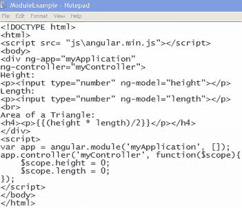

请将文件以 `ModuleSample.html` 为名保存在 `myFolder` 中。双击 `ModuleSample.html` 文件，输入三角形的 `height` 和 `length`，查看输出。

输出：

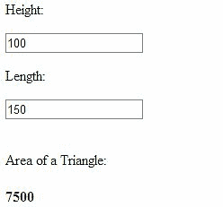

## 解释：

`ng-controller="myController"` 定义了一个控制器。

`app = angular.module()` 创建了一个新模块。

`app.controller()` 将控制器的构造函数添加到模块中。

`function($scope)` 定义了一个构造函数，同时也定义了一个对象 `$scope`。当页面加载时，该函数将运行。

`$scope.property = value` 将值赋给 `$scope` 对象的属性。

# 附录 1

## Ajax 基础

什么是 Ajax？

AJAX 代表 “Asynchronous JavaScript And XML”（异步 JavaScript 和 XML）。AJAX 是一种新技术，用于通过服务器结合 `XML`、`HTML`、`CSS`、`PHP`、`ASP` 和 `JavaScript` 创建更好、更快、更具交互性的 Web 脚本。

AJAX 用于更新网页的部分内容，而无需重新加载整个页面。

这意味着使用 Ajax，你可以与服务器通信以更新信息，而无需刷新网页。

通过 `jQuery` 和 `JavaScript`，你可以轻松地在网页中实现 Ajax。

要运行 Ajax，你需要一个服务器。

下面将介绍如何在自己的计算机上设置服务器，以及如何使用 Ajax。

### 设置服务器

如果你想运行 Ajax，需要在自己的计算机上设置一个服务器。

`AppServ` 是一款用于设置服务器的免费软件；它可以运行 `Apache`、`PHP`、`MySQL`、`PhpMyAdmin`、`Ajax`、`JavaScript`、`JQuery`……

## 步骤 1：

从链接下载 `AppServ`：（图 1）

[`www.appservnetwork.com/`](http://www.appservnetwork.com/)

（图 1）

## 步骤 2：

将 `AppServ` 安装到本地计算机。

`C:\AppServ`

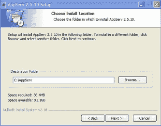

## 步骤 3：

请勾选所有框以安装组件。

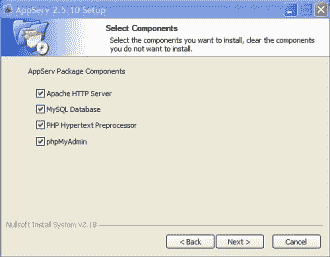

## 步骤 4：

服务器名称：`localhost`

Apache 端口：`80`

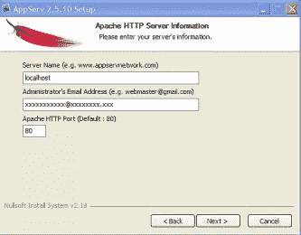

## 步骤 5：

输入密码：`12345`

默认用户名：`root`

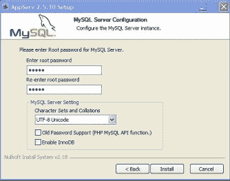

## 步骤 6：

勾选框，启动 `Apache`，启动 `MySQL`。点击 `Finish` 按钮。

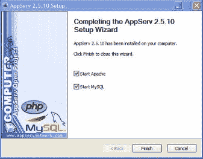

## 步骤 7：

测试 `AppServ` 安装成功，运行浏览器，输入地址：`http://localhost`

如果你看到这样的页面：（图 7）

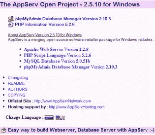

恭喜！自己的服务器已运行。

## 步骤 8：

如何使用服务器？

打开文件夹 `C:\AppServ\www`，创建一个名为 `myServer` 的文件夹，该文件夹作为工作区。你可以将所有程序放入 `myServer` 文件夹中。现在开始，你可以在 `C:\AppServ\www\myServer` 上运行 Ajax、`PHP` 文件和 HTML 文件。

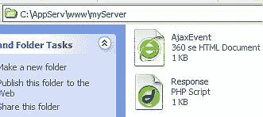

## 注意：

使用 `http://localhost` 在服务器上运行任何文件，例如：如果你想运行 `Ajax.html`，请输入地址：`http://localhost/myServer/Ajax.html`；如果你想运行 `Response.php`，请输入地址：`http://localhost/myServer/Response.php`

### 如何使用 Ajax

注意：Ajax 需要服务器支持。如果你的计算机作为服务器，准备一个文本文件 `data.txt`，其中包含 `Hello World!`，并将 `data.txt` 与 Ajax 文件放在同一文件夹中。

示例 1

## 示例 B1

```javascript
<script Language="JavaScript">
var ajaxObject = new XMLHttpRequest( );
ajaxObject.open("GET", "data.txt", true);
ajaxObject.onreadystatechange = function( ) {
  if (ajaxObject.readyState == 4) {
    alert(ajaxObject.responseText);
  }
}
ajaxObject.send( );
</script>
```

将文件保存为 `B1.html`，然后双击它。

输出：

Hello Ajax World!

## 解释：

第 2 行：`new XMLHttpRequest()` 创建了一个名为 `ajaxObject` 的 `XMLHttpRequest` 对象，该对象将用于 Ajax 脚本。

第 3 行：`ajaxObject.open("GET", "data.txt", true)` 初始化 `XMLHttpRequest` 对象的请求。`GET` 指定了请求方法。可以使用 `POST` 或 `PUT`。`data.txt` 是提供资源的 URL。在这里，`data.txt` 的内容是 `Hello World!`。`true` 表示使用异步技术。

第 4 行：`ajaxObject.onreadystatechange = function( ) { ... }` 指定了一个函数，该函数在收到服务器响应时运行。服务器的响应状态为 0 到 4：

| readyState | 说明 |
|---|---|
| 0 | 未初始化 |
| 1 | 已初始化 |
| 2 | 发送数据 |
| 3 | 接收数据 |
| 4 | 完成。返回的数据可用。 |

`ajaxObject.onreadystatechange` 正在等待服务器响应。

第 5 行：`if (ajaxObject.readyState == 4)` 表示如果响应状态为 4，则返回的数据可用。

第 6 行：`alert(ajaxObject.responseText)` 显示从 `data.txt` 中检索到的文本。输出：“Hello Ajax World!”。

第 9 行：`ajaxObject.send()` 将请求发送到服务器。

## 示例 2

### 示例 B2

```html
<input type="button" value="try" onClick="ajaxRequest();"/>
<script type="text/javascript">
function ajaxRequest() {
  if (window.XMLHttpRequest) {
    ajaxObject = new XMLHttpRequest();
  }
  else if (window.ActiveXObject) {
    ajaxObject = new ActiveXObject("Microsoft.XMLHTTP");
  }
  ajaxObject.open("POST", "data.txt", true);
  ajaxObject.onreadystatechange = function() {
    if (ajaxObject.readyState == 4) {
      if (ajaxObject.status == 200) {
        alert(ajaxObject.responseText);
      }
    }
  };
}
</script>
```

将文件保存为 `B2.html`，然后双击它。

输出：

Hello Ajax World!

## 解释：

第 1 行：`onClick="ajaxRequest();"` 调用 `ajaxRequest()` 函数。

第 2 行：`new XMLHttpRequest()` 创建了一个名为 `ajaxObject` 的 `XMLHttpRequest` 对象，该对象将用于 Ajax 脚本。

第 3 行：`ajaxObject.open("POST", "data.txt", true)` 初始化 `XMLHttpRequest` 对象的请求。`POST` 指定了请求方法。可以使用 `GET` 或 `PUT`。`data.txt` 是提供资源的 URL。在这里，`data.txt` 的内容是 `Hello World!`。`true` 表示使用异步技术。

第 4 行：`ajaxObject.onreadystatechange = function() {` 指定了一个函数，该函数在收到服务器响应时运行。服务器的响应状态为 0 到 4：

| readyState | 说明 |
|---|---|
| 0 | 未初始化 |
| 1 | 已初始化 |
| 2 | 发送数据 |
| 3 | 接收数据 |
| 4 | 完成。返回的数据可用。 |

`ajaxObject.onreadystatechange` 正在等待服务器响应。

第 5 行：`if (ajaxObject.readyState == 4)` 表示如果响应状态为 4，则返回的数据可用。

第 6 行：`if (ajaxObject.status == 200)` 表示如果响应状态码为 200。

第 7 行：`alert(ajaxObject.responseText);` 显示从 `data.txt` 中检索到的文本。输出：“Hello Ajax World!”。

第 10 行：`ajaxObject.send()` 将请求发送到服务器。

## 示例 3

示例 3 中的代码与示例 2 几乎相同。但示例 2 中的代码可以修改为：

```html
<input type="button" value="try" onClick="ajaxRequest();"/>
<script type="text/javascript">
function ajaxRequest() {
  if (window.XMLHttpRequest) {
    ajaxObject = new XMLHttpRequest();
  }
  else if (window.ActiveXObject) {
    ajaxObject = new ActiveXObject("Microsoft.XMLHTTP");
  }
  ajaxObject.open("POST", "data.txt", true);
  ajaxObject.onreadystatechange = function() {
    if (ajaxObject.readyState == 4) {
      if (ajaxObject.status == 200) {
        document.getElementById("display").innerHTML = "A message from server: " + ajaxObject.responseText;
      }
    }
  };
  ajaxObject.send();
}
</script>
<div id="display"></div>
```

将文件保存为 `B3.html`，然后双击它。

输出：

A message from server: Hello Ajax World!


输出：`"A message from server is: Hello Ajax World!"`

**注意：**

`data.txt` 可以是 `data.php`、`data.asp`、`data.jsp` 和 `data.xml`。

Ajax 需要服务器的支持。

Ajax 的优势是：Ajax 无需重新加载整个页面即可更新网页的部分内容，响应非常快！

### Ajax 图表

| 属性 / 方法 | 描述 |
| :--- | --- |
| `open()` | 初始化一个新的 HTTP 请求 |
| `send()` | 向服务器发送请求 |
| `onreadystatechange` | 状态事件 |
| `readyState` | 请求处理过程 (0,1,2,3,4) |
| `responseText` | 从服务器返回的文本 |
| `status` | HTTP 状态码 (200, 404...) |

| `readyState` | 说明 |
| :--- | :--- |
| 0 | 未初始化 |
| 1 | 已初始化 |
| 2 | 发送数据 |
| 3 | 接收数据 |
| 4 | 完成，返回的数据可用 |

| HTTP 状态码 | 说明 |
| :--- | :--- |
| 200 | 请求成功 |
| 401 | 未授权 |
| 403 | 禁止访问 |
| 404 | 未找到 |

# 深入了解 AngularJS

## 附录 2

### Angular 服务

服务是一个函数或对象，用于提供特定的操作。在 AngularJS 中，有大约 30 个内置服务，例如 `$http`、`$location`、`interval` 和 `$timeout`。有时你也可以构建自定义服务。

以下是一个 `$timeout` 服务示例：

### 示例 A1

```html
<!DOCTYPE html>
<html>
<head>
<script src="js\angular.min.js"></script>
</head>
<body ng-app="iCode" ng-controller="iController">
<h2>{{message}}</h2>
</div>
<script>
var iModule = angular.module('iCode', []);
iModule.controller('iController', function($scope, $timeout) {
  $scope.message = "Please wait......";
  $timeout(function () { // $timeout 服务
    $scope.message = "This is a Timeout service example.";
  }, 3000); // 延迟三秒
});
</script>
</body>
</html>
```

### 输出 1：

Please wait……

### 输出 2：

This is a Timeout service example.

### 解释：

`$timeout(function () { })` 是一个 AngularJS 服务。

`3000` 参数：延迟三秒执行操作。

## Angular Http

`$http` 是一个 Angular 服务，用于访问服务器中的数据。

| `$http.get().then();` / `$http.post().then();` |
| :--- |
| `get()` 或 `post()` 可以访问服务器的数据，`then()` 返回来自服务器的消息。 |

### 示例 A2

```html
/* 注意：以下示例需要服务器支持。
假设服务器上有一个文件 httpService.txt，该文件包含文本 "This is a HTTP service example." */

<!DOCTYPE html>
<html>
<head>
<script src="js\angular.min.js"></script>
</head>
<body ng-app="iCode" ng-controller="iController">
<p>A message from Server:</p>
<h2>{{message}}</h2>
</div>
<script>
var iModule = angular.module('iCode', []);
iModule.controller('iController', function($scope, $http) {
  $http.get("httpService.txt").then(function (feedback) {
    // 从服务器获取
    $scope.message = feedback; // 返回的数据
  });
});
</script>
</body>
</html>
```

### 输出：

A message from Server: This is a HTTP service example.

### 解释：

`$http.get("httpService.txt").then(function (feedback)` 获取服务器数据，`then()` 返回响应。

`$scope.message = feedback;` 返回的数据。

## Angular Mys

AngularJS 可以通过 PHP 程序访问数据库。

### 示例 A3

```html
/* 假设有一个文件 "angular_mysql.php"，其中包含 MySQL 数据库：

| ID | Fruit | Color |
| --- | --- | --- |
| 001 | Apple | Red |
| 002 | Banana | Green |
| 003 | Orange | Golden |

*/

<!DOCTYPE html>
<html>
<head>
<script src="js\angular.min.js"></script>
</head>
<body ng-app="iCode" ng-controller="iController">
<table>
  <tr ng-repeat="v in title">
    <td>{{v.ID}}</td>
    <td>{{v.Fruit}}</td>
    <td>{{v.Color}}</td>
  </tr>
</table>
</div>
<script>
var iModule = angular.module('iCode', []);
iModule.controller('iController', function($scope, $http) {
  $http.get("angular_mysql.php").then(function (feedback) {
    // 从 mysql 数据库获取数据
    $scope.title = feedback; // 返回每条记录
  });
});
</script>
</body>
</html>
```

### 输出：

| ID | 水果 | 颜色 |
| --- | --- | --- |
| 001 | 苹果 | 红色 |
| 002 | 香蕉 | 绿色 |
| 003 | 橙子 | 金色 |

## 解释：

`$http.get("angular_mysql.php").then(function (feedback) { })` 从 MySQL 数据库获取数据。

`$scope.title = feedback;` 返回每条记录。

`<tr ng-repeat="v in title">` 遍历每个字段名。

关于 PHP 与 MySQL，请阅读另一本书“PHP 与 MySQL 8 小时”。

### Angular 检查

`$dirty` 检查用户已输入，`pristine` 检查用户未输入。

### 示例 A4

```html
<head>
<script src="js\angular.min.js"></script>
</head>
<body ng-app="iCode" ng-controller="iController" name="iForm" novalidate>
<p>Please input your name in here:<br><br>
<input type="text" name="userName" ng-model="userName" required>
<div style="color:red" ng-show="iForm.userName.!$dirty">
<!--check input empty-->
<div ng-show="iForm.userName.$error.required">
<!--show error message -->
This field cannot be empty!</div>
</div>
</p>
<script>
var iModule = angular.module('iCode', []);
iModule.controller('iController', function($scope) {
  $scope.userName = '';   
});
</script>
</body>
</html>
```

### 输出：

请在此输入您的姓名：

| |
| --- |
| 此字段不能为空！ |

### 解释：

`iForm.userName.!$dirty` 检查输入字段是否为空。你可以使用 `$pristine` 或 `!$dirty`。

`.$error.required` 显示错误消息。

### Angular 验证

`$valid` 检查输入的有效性，`$invalid` 检查输入的无效性。

### 示例 A5

```html
<!DOCTYPE html>
<html>
<head>
<script src="js\angular.min.js"></script>
</head>
<body>
<br>
<form ng-app="iCode" ng-controller="iController" name="iForm" novalidate>
<input type="email" name="email" ng-model="email" required>
<div style="color:red" ng-show="iForm.email.$invalid">
<!--check invalidity of the email address--> <br>
<div ng-show="iForm.email.$error.email">
<!--show error message -->
The email address format is invalid!</div>
</div>
</form>
<script>
var iModule = angular.module('iCode', []);
iModule.controller('iController', function($scope) {
  $scope.email = 'xxxxx@gmail.com';
});
</script>
</body>
</html>
```

### 输出：

The email address format is invalid!

## 解释：

`ng-show="iForm.email.$invalid"` 检查电子邮件的无效性。

### 示例 A6

```html
/* Note：以下示例需要服务器支持。
假设服务器上有一个文件 httpService.txt，该文件包含文本 "This is a HTTP service example." */

<!DOCTYPE html>
<html>
<head>
<script src="js\angular.min.js"></script>
</head>
<body ng-app="iCode" ng-controller="iController">
<p>A message from Server:</p>
<h2>{{message}}</h2>
</div>
<script>
var iModule = angular.module('iCode', []);
iModule.controller('iController', function($scope, $http) {
  $http.get("httpService.txt").then(function (feedback) {
    // 从服务器获取
    $scope.message = feedback; // 返回的数据
  });
});
</script>
</body>
</html>
```

### 输出：

A message from Server: This is a HTTP service example.

### 解释：

`$http.get("httpService.txt").then(function (feedback)` 获取服务器数据。

`$scope.message = feedback;` 返回的数据。

## 包含

```html
<!doctype html>
<html>
<head>
<script src="js\angular.min.js"></script>
</head>
<body ng-app="iCode" ng-controller="iController">
<textarea ng-keydown="count = count + 1" ng-init="count=0">
Here is a
</textarea>
<br><br>
<h2>count: {{count}}</h2> // displays the value of “count”
</body>
</html>
```

### 测试

请选择答案：

(1)

```html
<html>
<script src="js\angular.min.js"></script>
<body ng-app="">
<p>Input my id in the input box:</p>
<p><input type="text" fill in here </p>
// binds the inputted data from HTML to “id”
<br>
<h1>Welcome! {{id}}</h1>
</body>
</html>
```

A. `bind = "id"` B. `ng-bind = "id"` C. `ng = "id"` D. `ng-model="id"`

(2)

```html
<!doctype html>
<html>
<head>
<script src="js\angular.min.js"></script>
</head>
<body ng-app="">
<br><br>
<textarea ng-keydown="count = count + 1"
ng-init="count=0">
Here is a
</textarea>
<br><br>
<h2>count: {{count}}</h2> // displays the value of “count”
</body>
</html>
```

1. `show` B. `display` C. `count` D. `variable`

(3)

```html
<html>
<script src="js\angular.min.js"></script>
<body>
<script>
var myString = "This is a string";
function myFunction()
{
    return "This is inside a function";
}
document.write(fill in here.isFunction(myString) + "  ");
document.write(fill in here.isFunction(myFunction) + " ");
//  tests a value to see if it is a function
</script>
</body>
</html>
```

1. `ng-test` B. `angular` C. `AngularJS` D. `test`

(4)

```html
<html>
<script src="js\angular.min.js"></script>
<body ng-app="">
<div fill in here >
 // indicates you can write AngularJS application from here.
<p>Input my id in the input box:</p>
<p><input type="text" ng-model="id" </p>
<br>
<h1>Welcome! {{id}}</h1>
</div>
</body>
</html>
```

```html
<!DOCTYPE html>
<html>
<head>
    <title>AngularJSfor beginners</title>
<script src="js\angular.min.js"></script>
<meta http-equiv="Content-Type" content="text/html; charset=UTF-8" />
</head>
<body>
<h3>Using Click directive</h3>
<div ng-app="" fill in here ="increaseNumber=0">
// initialize the variable with a value
<button ng-click="increaseNumber = increaseNumber + 1">Click Me!</button>
<p ng-bind="increaseNumber" style="color:blue"></p>
</div>
</body>
</html>
```

A. `init` B. `initialize` C. `ng-init` D. `ng-initalize`

(6)

```html
<html>
<script src= "js\angular.min.js"></script>
<body>
<div ng-app="Calculation" ng-controller="myController">
First Number: <input type="number" ng-model="firstNumber"><br>
Second Number: <input type="number" ng-model="secondNumber"><br>
<br>
Sum: {{firstNumber + secondNumber}}
</div>
<script>
var app = angular.module('Calculation', [ ]);
app.controller('myController', function($scope) {
fill in here.firstNumber = 4;
fill in here.secondNumber = 8;
// assigns the value to the property of $scope object.
});
</script>
</body>
</html>
```

A. `object` B. `angular` C. `scope` D. `$scope`

(7)

```html
<html>
<script src= "js\angular.min.js"></script>
<body>
<div ng-app="myApplication" ng-controller="myController">
{{ firstNum + lastNum }}
</div>
<script>
var myModule = angular.module("myApplication", [ ]);
fill in here.controller("myController", function($scope) {
// makes myController belongs to myModule.
    $scope.firstNum = 100;
    $scope.lastNum = 200;
});
</script>
</body>
</html>
```

A. `module` B. `myModule` C. `$scope` D. `angular`

(8)

```html
<html>
<script src= "js\angular.min.js"></script>
<body>
<script>   
var myCar = "This is my car!";  
var carObject = new Object( ) ; 
document.write(angular.fill in hereObject(myCar) + " ");
document.write(angular.fill in hereObject(carObject) + " ");   
// tests a value to see if it is an object
</script>
</body>
</html>
```

A. `test` B. `check` C. `is` D. `if`

(9)

```html
<html>
<head>
    <title>AngularJSfor beginners</title>
<script src="js\angular.min.js"></script>
<meta http-equiv="Content-Type" content="text/html; charset=UTF-8" />
</head>
<body>
<div ng-app=""  ng-init = "ColorName = ['Pink', 'Red', 'Green', 'Blue', 'Black', 'White', 'Yellow', 'Gray']">
<p style="color:green; font-weight:bold">Colours Name:</p>
<ol>
<li fill in here = "x in ColorName">
// repeats to get the value of an array
  <p ng-bind="x"></p>     
     </li>
</ol>
</div>
</body>
</html>
```

A. `ng-repeat` B. `repeat` C. `foreach` D. `for`

(10)

```html
<html>
<script src= "js\angular.min.js"></script>
<body>
<div ng-app="Calculation" fill in here = "myController">
// defines a controller
First Number: <input type="number" ng-model="firstNumber"><br>
Second Number: <input type="number" ng-model="secondNumber"><br>
<br>
Sum: {{firstNumber + secondNumber}}
</div>
<script>
var app = angular.module('Calculation', [ ]);
app.controller('myController', function($scope) {
    $scope.firstNumber = 4;
    $scope.secondNumber = 8;
});
</script>
</body>
</html>
```

A. `define` B. `controller` C. `new` D. `ng-controller`

(11)

```html
<html>
<script fill in here ="js\angular.min.js"></script>
```

```html
// adds AngularJS framework into current application.

<body>

<div ng-app="">

<p>Input my id in the input box:</p>

<p><input type="text" ng-model="id" </p>

<br>

<h1>Welcome! {{id}}</h1>

</div>

</body>

</html>
```

A. `import` B. `url` C. `src` D. `add`

(12)

```html
<html>

<body>

<div ng-app="">

<p>User Name: <br>
<input type="text" ng-model = "Username"></p>

<p fill in here ="Username"></p>

// binds “Username” to <p> tag, and “shows” its value

</body>
</html>
```

A. `bind` B. `ng-bind` C. `bound` D. `ng-show`

(13)

```html
<html>

<body>

<h3>Using Case Filter</h3>

<div ng-app=""  ng-init="Username= 'ray' ">

<p>User Name: <input type="text" ng-model = "Username"></p>

<p style="color:red" ng-bind="Username | fill in here ?></p>

// changes the value of “Username” to uppercase.

</div>

</body>
</html>
```

A. `toUppercase()` B. `uppercase()` C. `toUppercase` D. `uppercase`

(14)

```html
<html>

<body>

<h3>Using Click directive</h3>

<div ng-app=""  ng-init="increaseNumber=0">

<button fill in here ="increaseNumber = increaseNumber + 1">Click Me!</button>

// updates the value of “increaseNumber” when click the button.

<p ng-bind="increaseNumber" style="color:blue"></p>

</div>

</body>
</html>
```

A. `ng-click` B. `press` C. `onClick` D. `onPress`

(15)

```html
<html>

<script src="js\angular.min.js"></script>

<body ng-app="">

<br><br>

<textarea fill in here ="count = count + 1"
ng-init="count=0"> // mouse over event
Here is a textarea.
</textarea>

<br><br>

<h2>count: {{count}}</h2>

</body>

</html>
```

A. `mouseover` B. `ng-mouseover` C. `over` D. `ng-over`

(16)

```html
<html>

<head>
    <title>AngularJS for beginners</title>
    <script src="js/angular.min.js"></script>
</head>

<body>

<h4>My Result Using Array Expression</h4>

<div ng-app="" ng-init="MyArray=[98,96,93,90,99]">

<p>My score in mathematics is: {{ fill in here }}</p>

// displays the value whose index is 4 in MyArray.

</div>

</body>
</html>
```

A. `array[4]` B. `[4]` C. `MyArray[4]` D. `MyArray{4}`

(17)

MVC 代表模型（Model）、视图（View）和控制器（Controller）。

`$scope.firstNumber` and `$scope.secondNumber` 是一个待填项

`<p ng-bind = "firstNumber + secondNumber"></p>` 是一个待填项

`ng-controller="myController"` 定义了一个待填项

// MVC

A. 控制器 视图 模型 B. 视图 控制器 模型 C. 模型 控制器 视图 D. 模型 视图 控制器

(18)

```html
<html>

<script src= "js\angular.min.js"></script>

<body>

<script>   
var myDate = "Aug/10/2015";
var dateObject = new Date();  
document.write(angular.fill in here(myDate) + " "); 
document.write(angular.fill in here(dateObject) + " ");      
// tests a value to see if it is a Date object
</script> 

</body>
</html>
```

A. `check` B. `test` C. `isDate` D. `isObject`

(19)

```html
<html>

<head>
<script src="js\angular.min.js">
</script>
</head>

<body ng-app="">

<br><br>

<textarea fill in here ="count = count + 1"
ng-init="count=0"> // press key down event
Here is a textarea
</textarea>

<br><br>

<h2>count: {{count}}</h2>

</body>

</html>
```

A. `keydown` B. `ng-keydown` C. `onKeydown` D. `key()`

(20)

```html
<html>
<script src= "js\angular.min.js"></script>
<body>
<script>   
var futureCar;
var existingCar = "Very Good!";  
document.write(angular.fill in here(futureCar) + " ");   
document.write(angular.fill in here(existingCar) + " ");
//  tests a value to see if it has been defined     
</script>
</body>
</html>
```

A. `test` B. `check` C. `ng-defined` D. `isDefined`

(21)

```html
<!DOCTYPE html>
<html>
<head>
    <title>AngularJSfor beginners</title>
    <script src="js\angular.min.js"></script>
</head>
<body>
<div ng-app="" ng-init="StudentsResult=[{name: 'Tienq', marks:81},              {name: 'Svbrf', marks:70},              {name: 'Yaito', marks:90},              {name: 'Pewfn', marks:63}, {name: 'Riet', marks:98}]">
<table border="1" >
<tr>
<th>Student Name</th>
<th>Mathematics’ Result</th>
</tr>
<tr ng-repeat="x in StudentsResult | fill in here :'-marks' ">
// display values in descending order.
<td ng-bind="x.name "></td>
<td ng-bind="x.marks "></td>
</tr>
</table>
</div>
</body>
</html>
```

A. `order` B. `sort` C. `orderBy` D. `sortBy`

(22)
```

```html
<!DOCTYPE html>
<html>
<head>
<script src="js\angular.min.js"></script>
<meta http-equiv="Content-Type" content="text/html; charset=UTF-8" />
</head>
<body>
<div ng-app="">
<input type="checkbox" ng-model="HideShowDiv">Hide Div
<div fill in here ="HideShowDiv" style="background-color:pink;height:50px;"> // use hide directive
<p>I am a div</p>
<p>I will disappeared when the check box is checked.</p>
</div>
</div>
</body>
</html>
```

A. `hide` B. `invisible` C. `ng-hide` D. `ng-invisible`

(23)

```javascript
<script>
function (fill in here) {
   fill in here.firstNumber = 23;
   fill in here.secondNumber = 63;
}
</script>
```
// declare a parameter of JavaScript function, the parameter will be an object in AngularJS.

A. `ng-controller` B. `$scope` C. `ng-object` D. `ng-scope`

(24)

```html
<!DOCTYPE html>
<html>
<head>
    <title>AngularJS for beginners</title>
    <script src="js/angular.min.js"></script>
</head>
<body>
<h3>Using Show directive</h3>
<div ng-app="">
<input type="checkbox" ng-model="showHideDiv">Show Div
<div fill in here ="showHideDiv" style="background-color:yellow;height:50px;"> // use show directive
<p>I am a div</p>
<p>I appear when the check box is checked.</p>
</div>
</div>
</body>
</html>
```

A. `show` B. `angular` C. `ng-display` D. `ng-show`

(25)

```html
<html>
<script src= "js\angular.min.js"></script>
<body>
<h4>Object Expression</h4>
<div ng-app=""  ng-init=" fill in here = {Emp_name: 'Jay Smith',     Emp_Month: 'June.15 2015',  Emp_salary: '$8000'}">
// use object expression according to context
<p>Employee Name :  {{EmployeeObject.Emp_name}}</p>
<p>Salary's Month:  {{EmployeeObject.Emp_Month}}</p>
<p>Employee Salary:  {{EmployeeObject.Emp_salary}}</p>
</div>
</body>
</html>
```

A. `EmployeeObject` B. `myObject` C. `Object` D. `ng-Object`

(26)

```html
<html
<script src= "js\angular.min.js"></script>
<body>
<div ng-app="myApplication" ng-controller="myController">
<p>{{ text1 }}</p>
<p>{{ text2 }}</p>
</div>
<script>
var myModule = angular.module('myApplication', [ ]);
myModule.controller('myController', function($scope) {
$scope.text1 = "JAVASCRIPT";
$scope.text2 = angular. fill in here($scope.text1);
}); //  check “text1” to see if it is a number.
</script>
</body>
</html>
```

A. `Number` B. `isNumber` C. `Digital` D. `isDigital`

(27)

```javascript
1. <script Language = “JavaScript”>
2. var ajaxObject = new fill in here; // creates an XMLHttpRequest object named “ajaxObject”
3. ajaxObject.open( “GET”, “data.txt”, true);
4. ajaxObject.onreadystatechange = function( ) {
5. if (ajaxObject.readyState == 4) {
6. alert(ajaxObject.responseText);
7. }
8. }
9. ajaxObject.send( );
10. </script>
```

A. `HttpRequest` B. `XMLHttpRequest` C. `HttpRequest()` D. `XMLHttpRequest()`

(28)

```html
1. <input type = “button” value = "try" onClick = “ajaxRequest ( );/>
2. <script type = “text/javascript”>
3. function ajaxRequest ( ) {
4. if (window.XMLHttpRequest){
5. ajaxObject = new XMLHttpRequest ( );
6. }
7. else if (window.ActiveXObject){
8. ajaxObject = new ActiveXObject(“Microsoft.XMLHTTP”);
9. }
10. ajaxObject.open( “POST”, “data.txt”, true);
11. ajaxObject.onreadystatechange = function( ) {
12. if (ajaxObject.readyState == 4) {
13. if(ajaxObject.status == 200) { // if the server’s returned status code is 200, the request succeeded
14.alert (ajaxObject.responseText);
15.}
16.}
17. }
19.ajaxObject.send( );
20. }
21. </script>
```

A. `响应` B. `就绪状态` C. `状态` D. `返回`

(29)

```html
<input type = “button” value = "try" onClick = “ajaxRequest ( );/>
<script type = “text/javascript”>
function ajaxRequest ( ) {
if (window.XMLHttpRequest){
ajaxObject = new XMLHttpRequest ( );
}
else if (window.ActiveXObject){
ajaxObject = new ActiveXObject(“Microsoft.XMLHTTP”);
}
ajaxObject.open( “POST”, “data.txt”, true);
ajaxObject.onreadystatechange = function( ) {
if (ajaxObject.readyState == 4) {
if(ajaxObject.status == 200) {
document.getElementById( “display” ).fill in here = “A message from server: ” + ajaxObject.responseText; // shows the content at the specified location where ID is “display”
}
}
ajaxObject.send( );
}
</script>
<div id = “display”</div>
```

A. `显示` B. `innerHTML` C. `展示` D. `文本`

(30) 在 Ajax 中，当 `readyState` 为 4 时，表示请求处于哪个阶段？

A. `初始化` B. `正在数据` C. `已接收数据` D. `数据可用`

(31) 在 Ajax 中，当 `status` 为 200 时，表示请求的结果？

A. `请求成功` B. `未授权` C. `禁止访问` D. `未找到`

(32) 关于 Ajax，以下哪个说法是？（多选）

A. `readyState` 属性是从 0 到 4 的状态。
B. `status` 返回一个数字，如 200、401 或404。
C. `onreadystatechange` 属性是一个状态事件。
D. `responseText` 属性来自服务器的文本。

答案

| 01 | D | 17 | D |
| 02 | C | 18 | C |
| 03 | B | 19 | B |
| 04 | A | 20 | D |
| 05 | C | 21 | C |
| 06 | D | 22 | C |
| 07 | B | 23 | B |
| 08 | C | 24 | D |
| 09 | A | 25 | A |
| 10 | D | 26 | B |
| 11 | C | 27 | D |
| 12 | B | 28 | C |
| 13 | D | 29 | B |
| 14 | A | 30 | D |
| 15 | B | 31 | A |
| 16 | C | 32 | ABCD |