# AngularJS 实战

## 关于作者

**菲利普·塔拉谢维奇** (`philipp.tarasiewicz@angularjs.de`) 是一位技术顾问、作家、演讲者和教练。多年来他专注于企业级 JavaScript 领域，特别是 AngularJS，为客户提供员工教育和培训并协助他们启动项目。他共同运营 `angularjs.de` 网站。

**罗宾·伯姆** (`robin.boehm@angularjs.de`) 是一位软件开发人员、顾问和作家，专注于 Web 技术，尤其是企业级 JavaScript。多年来他广泛从事客户端应用程序的创建，帮助企业进行教育和培训以及项目实施。他还共同创立了 AngularJS 网站。

## 简介

AngularJS 是一个 JavaScript 框架，帮助你创建现代客户端 Web 应用程序。通过优雅的约定，AngularJS 为常见问题提供了解决方案，为你节省了大量需要编写的代码。本书通过逐步构建示例向你介绍 AngularJS，基础概念使你能够创建结构化、模块化且易维护的应用程序。特别是解释了诸如模块、作用域、服务和指令等概念并展示了如何使用它们。此外我们讨论了诸如 `Bower`、`Grunt` 和 `Yeoman` 等工具，这些工具可以使某些任务变得不必要为你节省时间。我们概述了如何利用这些工具创建一个高效的开发环境。阅读本书后，你应能够：

- 理解如何使用 AngularJS 中的每个模块以及它们如何交互
- 开发模块化、结构化且易维护的客户端应用程序
- 通过测试驱动开发方法创建高质量的 AngularJS

## 读者对象

本书主要面向具有 JavaScript 经验的开发者，他们已经掌握了语言的基础知识，希望通过测试驱动开发方法以及代码结构化和模块化技术将他们的知识提升到下一个水平。如果你有过 `jQuery` 使用经验也会帮助。

## 前置知识

你不需要任何关于 AngularJS 的先验知识就能理解本书的内容。然而你需要对 JavaScript 有基本的了解。此外你还应该了解 HTML 和 CSS 的基础知识。如果你已经学习了测试驱动开发的基本概念，将更有优势。

## 本书适合谁

由于需要 Web 环境和 JavaScript 经验，任何该领域的开发者建议阅读本书。此外你不把它当作一本解答 AngularJS 框架问题的参考书。本书并未讨论所有特性和指令，相反它通过小型实用示例演示了框架的主要特性和概念。

## 关于本书

本书从第一章 `AngularJS 快速入门`开始，通过简短示例介绍 AngularJS 的核心概念。本章展示了 AngularJS 的潜力和价值，你应该感受到为什么值得使用 AngularJS。然而我们不会详细解释这些示例。如果你想快速产生深刻的结果，请阅读本章。接下来，第二章 `基本原则与概念`深入探讨了框架的原理和概念。本章首先解释了 AngularJS 的几个关键概念，包括模型-视图模型（MVVM）、双向绑定、依赖注入和测试性。它还展示了 AngularJS 提供的各个模块，你可以使用它们来编写应用程序。讲解了基础知识后，本书继续通过第三章 `BookMonkey 项目`开发一个名为 BookMonkey 的示例项目。这是本书部分，展示了如何使用 AngularJS 创建一个小型 Web 应用程序来浏览图书。此示例演示了 AngularJS 的基本概念和功能如何应用于应用程序中。因此我们在开发此应用程序时确保了遵循测试驱动方法。在第四章 `扩展应用程序`中，我们扩展项目以包含部分和自定义指令，并解释如何消费 REST 服务。在第五章 `项目管理和自动化`和第六章 `调试`中，我们讨论了与项目相关的问题如项目管理、任务自动化、调试以及自动化测试。在第七章 `常见问题解答`中，我们回答了人们在一个项目中经常提出的问题。

对于 AngularJS 的完全学者，建议先阅读第一章 `AngularJS 快速入门`和第二章 `基本原则与概念`以学习框架术语。在此基础上，第三章 `BookMonkey 项目`和第四章 `扩展项目`中的实际示例可以容易地更新。第五章、第六章和第七章可以独立于前面的章节阅读，以准备即将来的项目或熟悉项目中使用的工具。

## 下载示例获取更新

本书中的示例可从网站下载，网址为 http://books.brainy.com。这些示例是使用 AngularJS 版本 1.2.10 开发的。该版本反映了写本书时的最新版本。然而如果未来版本的 AngularJS 出现不兼容情况，我们将相应地更新这些示例。

## 联系作者

自 2013 年以来，作者一直在运营 AngularJS.de 门户网站。该网站定期发布关于 AngularJS 当前议题的文章，AngularJS 开发者可以在此交流并提供服务。如果你的开发团队需要顾问或培训，你可以直接联系作者。

# 第 1 章 AngularJS 快速入门

本章通过简短示例展示了 AngularJS 的强大功能。我们还想向你展示 AngularJS 应用中典型的代码片段是什么样的。示例故意做得简单，以便在没有大量框架知识的情况下轻松理解和执行。我们不会解释所有细节，相反我们会保持解释简短。阅读完整本书后，你会详细了解这些示例。

## 双向数据绑定：样板代码已成为过去

双向绑定无疑是使 AngularJS 具有吸引力的最重要特性之一。双向绑定确保数据模型中的变化自动反映在视图中的相应元素上。当用户对相关视图进行修改时，它也会自动更新数据模型。这种双向的自动调整就是我们所说的双向绑定。由于这一特性，你可以节省大量原本需要编写以实现等效同步逻辑的样板代码。清单 1.1 中的示例展示了该功能的实际应用。

### 清单 1.1：带输入字段的双向数据绑定

```
<!DOCTYPE html>
<html ng-app>
<head>
<meta charset="utf-8">
</head>
<body>
<div>
    <label>Name:</label>
    <input type="text" ng-model="yourName">
    <hr>
    <h1>Hello {{yourName}}!</h1>
</div>
</div>
<script src="lib/angular.js"></script>
</body>
</html>
```

清单 1.1 中的简单 HTML 文件包含一个输入字段和一个 `<h1>` 标题。如果你在浏览器中运行此示例，你会发现每次在输入字段中输入内容，标题都会自动更新。这就是双向绑定。

 图1.1：清单 1.1 中的输出

#### 你好，AngularJS！

为了让双向绑定在示例中作用，你需要在输入字段中使用 `ng-model` 属性。在 AngularJS 中，这个特殊的 HTML 属性被称为 `ng-model` 指令在输入字段和变量 `yourName` 之间建立了双向绑定。由于有了这个指令，当输入字段的值变化时，变量的值也会自动变化。<h1>` 标签内花括号中的表达式是 AngularJS 的输出。更准确地说，使用表达式来输出变量值。表达式受双向绑定约束。如果变量 `yourName` 的值发生变化，表达式会被重新计算，最终导致视图更新。通过这种方式，AngularJS 框架将输入字段的内容转移到 `<h1>` 标签中。

我们应该提到 `ng-app` 指令，它标注了 `html` 标签。`ng-app` 指令告诉 DOM（文档对象）哪一部分被视为 应用。你在 `html` 标签中添加 `ng-app` 指令时，整个 DOM 子树成为 AngularJS 应用。在后一种情况下，所有子树外的表达式将被保留原样被忽略。你也可以用 `ng-app` 标注 DOM 中的多个兄弟节点，以便在一个文档中定义多个 AngularJS 应用。对于大多数应用程序来说这没什么意义，因为各个应用之间没有交互。尽管如此，我们还是要提到这一点。

#### 第二个示例

即使只有双向绑定，许多应用程序也可以在不写一行 JavaScript 代码的情况下优雅实现。我们将通过一个更复杂的示例——颜色选择器来证明这一点。颜色选择器是一个用户界面（UI）组件，让用户通过提供实时反馈来轻松颜色。

#### 清单 1.2：带 HTML5 滑块的双向绑定

```html
<!DOCTYPE html>
<html ng-app>
<head>
<meta charset="utf-8">
</head>
<body ng-init="r=255; g=0; b=123; a=0.7">

R:<input type="range" name="color_r" min="0" max="255" step="1" ng-model="r"><br>
G:<input type="range" name="color_g" min="0" max="255" step="1" ng-model="g"><br>
B:<input type="range" name="color_b" min="0" max="255" step="1" ng-model="b"><br>
A:<input type="range" name="color_a" min="0" max="1" step="0.01" ng-model="a">

<div style="width: 300px; height: 100px; background-color: rgba({{ r }}, {{ g }}, {{ b }}, {{ a }});"></div>

<script src="lib/angular.js"></script>
</body>
</html>
```

清单 1.2 展示了一个简单的颜色选择器。在基本设计中，这个示例与前面的示例类似。我们通过四个 `input` 标签的 `type` 属性赋值 "range"，定义了四个 HTML5 滑块。我们还使用 `min` 和 `max` 属性为每个输入标签提供了取值范围。我们需要三个滑块控制颜色选择器的红、绿、蓝值，第四个用于 alpha 通道（透明度）。`step` 属性指定了增量。同样在这个示例中，我们使用 `ng-model` 指令来绑定滑块和相应的作用域变量 `r`、`g` 和 `a`。同样是双向绑定。表达式也可以使用，而这一次我们使用表达式不是直接生成输出，而是设置 `div` 元素的 CSS `background-color` 属性的各个分量，`div` 元素中渲染颜色预览。

结果 impressive。基本上我们使用四个滑块来控制 RGBA 属性的四个独立分量，这些分量基于作用域变量 `r`、`g` 和 `a`，并创建双向绑定。如图 1.2 所示，我们几乎毫不费力地创建了一个带有实时颜色预览的简单颜色选择器。每当我们移动四个滑块中的任意一个时，`div` 元素的颜色就会改变。

注意，当前示例与前面的示例有一个细微差别。在当前示例中，我们在 `body` 标签中使用 `ng-init` 指令为变量 `r`、`g` 和 `a` 分派初始值。

---

图 1.2：清单 1.2 中的颜色选择器示例

##### ng-init

在较大的项目中应避免在模板中写入初始值，因为这意味着将部分逻辑转移到模板中。我们在示例中仅使用为了为了不得不使用 JavaScript 代码来初始化值。

### 指令：HTML 元素和属性

指令是另一个强大的功能，也是 AngularJS 的独特功能之一。正如你在前面两个示例中所见，指令在 AngularJS 中无处不在。该框架本身非常重地基于这一概念。

通过指令，你可以扩展自己的 HTML 元素和属性。你可以将这种技术用于许多有趣的事情。例如，你可以定义自己的标签集合，并使用这些标签以声明式方式描述应用程序的许多部分。或者你可以编写一个可复用的库，将 HTML 扩展为对你的应用程序至关重要的各种专用 UI 组件。想象一下像 `<chart>`、`<spreadsheet>` 或 `<input auto-complete="data">` 这样的标签。然后你可以在指令中封装所需的逻辑。

---

#### 一个示例

在以下示例中，我们创建一个 `<color-picker>` 标签，它封装了颜色选择器示例中的逻辑，从而使其可复用。

content]
```
清单 1.4 中的定义有趣之处在于，AngularJS 的 `MainCtrl` 控制器具有作用域。作用域的概念已经在第一个示例中介绍过。作用域定义了在特定上下文中必须有效的所有变量和函数。它负责确保双向数据绑定可以在该上下文中使用。

---

## 12 AngularJS

在框架中，某些组件在调用时会创建新的作用域。控制器就是这些组件之一。在清单 1.4 的代码中，AngularJS 将作用域传递给控制器。在这个作用域中，你可以通过给定的 `$scope` 参数访问控制器的内部。在代码中，我们还在 `MainCtrl` 控制器的作用域内定义了回调函数 `onColorChange()`。该函数接受四个参数（r、g、b 和 a），并在每次颜色变化时由我们的 `color-picker` 指令调用`onColorChange` 函数做的事情不多；它只是向浏览器控制台写入一些内容。

现在我们来定义实际的 `color-picker` 指令。我们从清单 1.5 中 `<color-picker>` 标签背后的模板开始。

### 清单 1.5：定义 color-picker 指令的模板

```html
R:<input type="range"
    min="0" max="255" step="1"
    ng-model="r"><br>
G:<input type="range"
    min="0" max="255" step="1"
    ng-model="g"><br>
B:<input type="range"
    min="0" max="255" step="1"
    ng-model="b"><br>
A:<input type="range"
    min="0" max="1" step="0.01"
    ng-model="a">
<div style="width: 300px; height: 100px;
    background-color:
    rgba({{ r }}, {{ g }}, {{ b }}, {{ a }});">
</div>
```

如你在清单 1.5 中所见，该模板与清单 1.2 中颜色选择器示例的模板相同。

### 指令定义

现在我们来看看示例中最有趣的部分，即指令的实际定义，如清单 1.6 所示。

### 清单 1.6：颜色选择器指令的定义

```javascript
colorPickerApp.directive('colorPicker', function () {
    return {
        scope: {
            r: '@initR',
            g: '@initG',
            b: '@initB',
            a: '@initA',
            onChange: '&'
        },

        restrict: 'E',
        templateUrl: 'colorPickerTemplate.html',
        link: function(scope) {
            var COLORS = ['r', 'g', 'b', 'a'];

            COLORS.forEach(function(value) {
                scope.$watch(value, function(newValue, oldValue) {
                    if (newValue !== oldValue) {
                        if (angular.isFunction(scope.onChange)) {
                            scope.onChange(generateColorChangeObject());
                        }
                    }
                });
            });

            var generateColorChangeObject = function() {
                var obj = {};

                COLORS.forEach(function(value) {
                    obj[value] = scope[value];
                });

                return obj;
            };
        }
    };
});
```

目前我们不会详细讨论清单 1.6 中的代码，而只会涉及一些关键点，以突出该指令是如何实现的。

看看清单 1.6 第一行中 `directive()` 函数的调用。我们使用 `directive()` 来注册一个新指令。`directive()` 的第一个参数是你想要注册的指令名称。这个名称直接决定了相应 HTML 标签或属性的调用方式，并在我们的模板中代表该指令。在这里，我们可以看出本例的一个特殊之处。我们的颜色选择器的 HTML 标签是 `color-picker`，而指令名称是 `colorPicker`。

指令名称到 HTML 元素或属性的映射遵循 AngularJS 的一条内部规则，如下所述。

作为第二个参数，`directive()` 函数期望接收一个函数，该函数返回一个函数或所谓的指令定义对象（DDO）的实例，其中包含某些属性。在此阶段，这两种返回类型之间的区别并不重要。在绝大多数情况下，你以返回一个 DDO 的方式定义指令，该 DDO 基于某些对象属性来描述指令的行为。在本例中，我们使用这样一个对象来定义我们的颜色选择器指令。你可以在配置对象中设置许多属性以实现特定的行为，包括 `scope`、`restrict`、`templateUrl` 和 `link`。

#### 指令名称和标签/属性映射的规则

如果指令名称由两个或更多单词组成，请使用驼峰表示法，例如 `ColorPicker`。对于相应的 HTML 标签或 HTML 属性，使用蛇形表示法、冒号（:`）、连字符（`-`）或下划线（`_`）均可用作分隔符。也就是说，`color:picker`、`color_picker` 或 `color-picker` 都可以用来指代 `colorPicker` 指令。然而，你通常会使用连字符作为分隔符。

此外，AngularJS 还有其他调用指令的方式，即使用前缀 `data-` 或 `x-`。原因是为了让旧浏览器仅允许这些自定义标签或属性具有这些前缀。因此，我们可以使用 `<data-color-picker>` 或 `x-color-picker` 来引用我们的选择器。了解命名约定对于创建指令很重要。

#### templateUrl 属性

`templateUrl` 属性指定了指令模板。在清单 1.6 中我们引用了之前定义的模板 `colorPickerTemplate.html`。

#### restrict 属性

`restrict` 属性指示哪些 HTML 元素受到指令的影响。`restrict` 的有效值包含字母 `E`、`A`、`C` 或 `M`：

- `E`: HTML 元素或标签
- `A`: 属性
- `C`: CSS 类
- `M`: 注释

这四个字符的组合也是允许的。例如，字符串 `"EA"` 会导致影响标签和属性，而忽略 CSS 类和注释。

#### scope 属性

使用 `scope` 属性来指定指令实例是否拥有自己的作用域。在指令文中，还有特殊形式：隔离作用域。隔离作用域将指令内部分离，将外部作用域映射到指令内部。

#### link 属性

`link` 属性定义指令的核心功能。这就是链接函数。简单来说，AngularJS 恰好执行链接函数一次，从而允许为每个实例初始化代码。通常你会在链接函数中注册事件处理，或者必要时执行 DOM 操作。在链接函数中我们并没有监听变化，而是使用观察者（`watch`）监听作用域变量 `r`、`g`、`b` 的变化。总之，我们现在创建了一个 HTML 标签 `<color-picker>`，我们可以在 AngularJS 应用中重用它。

### 过滤器（Filters）

虽然在 AngularJS 中模板起着重要作用，但框架并没有模板引擎。原因是普通 HTML 结合表达式已经足够完成典型模板的任务。

此外，框架提供了格式化和集合过滤器。我们将通过日期过滤器（一种格式化过滤器）来解释过滤器。使用此过滤器，你可以格式化一个日期。

#### 清单 1.7：使用日期过滤器

```html
<!DOCTYPE html>
<html ng-app="dateApp">
<head>
    <meta charset="utf-8">
</head>

<body ng-controller="DateCtrl">
Today's date:
{{ now | date:'dd. MMMM yyyy' }}<br> And the time is:
{{ now | date:'HH:mm:ss' }}

<script src="lib/angular.js"></script>
<script src="scripts/dateApp.js"></script>

</body>
</html>
```

清单 1.7 显示了日期过滤器的一个示例。你可以看到，所有日期过滤器的实例——像其他格式化过滤器一样——都嵌入在表达式中。其语法类似于各种 Unix Shell 中的管道语法。你基本上使用管道字符（`|`）告诉 AngularJS，在求值并显示结果之前，表达式需要过滤器的处理。过滤器紧跟在管道之后。就像在常见的 Unix Shell 中一样，多个过滤器可以串联使用，处理从左到右进行。

此时过滤器过滤器所做的功能而易见。在返回作用域变量 `now` 的值之前，日期过滤器会尝试根据给定的格式字符串对其格式化。该字符串可以包含要使用的日期或时间组件。为了让过滤器正常工作，作用域变量 `now` 必须满足一个要求。你为其赋值如下之一：

- 一个 `Date` 对象
- 一个字符串或数字对象，指定自 1970 年 1 月 1 日以来的毫秒数
- 一个包含 ISO 8601 格式有效日期的字符串，例如遵循以下模式的日期：yyyy-MM-DDTHH:mm:ss.SSSZ`

为了完成源代码，下面在清单 1.8 中展示了 `dateApp` 模块和 `DateCtrl` 控制器。

#### 清单 1.8：DateApp 模块和 DateCtrl 控制器的定义

```javascript
var DateApp = angular.module("DateApp", []);
dateApp.controller("DateCtrl", function ($scope, $timeout) {
  $scope.now = 'Loading...';

  var updateTime = function() {
    $timeout(function() {
      $scope.now = new Date();
      updateTime();
    }, 1000);
  };

  updateTime();
});
```

#### 清单 1.9：truncate 过滤器的定义

```javascript
dateApp.filter('truncate', function () {
    return function (input, charCount) {
        var output = input;
        if (output.length > charCount) {
            output = output.substr(0, charCount) + '...';
        }
        return output;
    };
});
```

清单 1.9 展示了我们的 `truncate` 过滤器的定义。在 AngularJS 中，你通过调用 `filter()` 函数来定义一个过滤器。该函数接受两个参数。第一个参数是一个包含过滤器名称的字符串。作为第二个参数，该函数期望一个返回函数的函数。整个东西在这个时候可能听起来有点复杂，但正如你在前面的示例中已经看到的，使用匿名函数和高阶函数来定义应用组件是 AngularJS 中的一个常见模式。

过滤器定义的关键是所谓的过滤器函数。在清单 1.9 中，这是位于过滤器逻辑中的函数，我们最终返回它。框架每次重新评估使用该过滤器的表达式。
# 第 2 章

## 基本原则和概念

在我们详细介绍 AngularJS 之前，我们将首先概述 AngularJS 框架的基本概念。这尤其重要，因为了解 AngularJS 工作原理的人需要了解一些基本原则。完成本章后，你将理解 AngularJS 世界中的重要术语，并了解该框架如何帮助客户端 Web 应用。

### 关键概念

AngularJS 框架基于某些经过验证的设计。在本节中，我们介绍这些模式并解释它们在 AngularJS 上下文中的用途。

## 模型-视图-控制器还是模型-视图-模型？

### 模型-视图-控制器模式

软件工程中最基本的架构模式之一是模型-视图-控制器（MVC）模式。任何编写过图形用户界面的开发者肯定使用过或至少听说过这种模式，它最早在 Smalltalk 中使用。1979 年，挪威计算机科学家 Trygve Reenskaug 在意识到将数据存储、业务逻辑和表示方面的责任分离并外包到单独的层对 GUI 应用程序很有用后，制定了这种模式。

自从第一个为 HTTP 请求动态组装响应的动态网站出现以来，MVC 模式经历了重大繁荣。人们很快意识到，将 MVC 的职责应用于服务器端 Web 应用程序领域是很有用的。无论是 Ruby on Rails、Zend Framework 还是 Spring MVC，每个相关的 Web 框架都需要 MVC 作为基础架构。


在基于经典往返（round-trip）的 Web 应用程序上下文中，MVC 模式的实际实现通常意味着应用程序包含一组控制器，每个控制器处理特定 URL 上的请求。一旦客户端（通常是浏览器）向服务器发送 HTTP 请求，该请求由负责处理被调用 URL 的控制器处理。现在该控制器具有上述责任：数据验证、根据某些业务逻辑处理数据以及向模型层报告可能的操纵，模型层通常以数据库和相应访问对象的形式体现。此外，控制器的任务是将数据和 HTML 模板合并，该模板使用用于组装 HTTP 响应的框架。这种以动态生成的 HTML 形式提供的 HTTP 响应然后被发送到客户端。

浏览器最终接收并显示的生成 HTML 代码，原则上是视图组件的一部分。Web 在其原始形式上基于往返原则，因此任何形式的 HTTP 通信要求客户端发送请求，服务器进行响应，这意味着在数据存储层和浏览器中显示的 HTML 代码（视图组件）之间无法建立顺畅的通信通道。因此，经典 Web 应用程序的视图组件仅仅是在更新 HTTP 响应的上下文中，而这种更新必须以 HTTP 请求为前提。这样一来，交互性就受到了影响。

总之，可以明确地说，在经典的基于往返处理的 Web 应用程序中，模型、控制器以及大部分视图逻辑都位于服务器端。这种类型的软件被称为**瘦客户端**。

虽然基于往返处理的机制在交互性较低的经典 Web 应用程序中表现良好，但要创建现代应用程序，你需要将大部分逻辑放在浏览器端。在这种架构中，服务器仅作为数据源和存储使用，通过基于 REST 的接口向运行在浏览器中的应用程序提供应用数据。因此，显而易见，即使在所谓的**胖客户端**中，也需要考虑如何应用 MVC 模式。

### Model-View-ViewModel 模式

事实上，MVC 模式在浏览器中扮演着主导角色。所有流行的 JavaScript 框架，包括 `AngularJS`，都将此模式作为构建应用程序的基本方法。然而，在客户端 Web 应用领域，更常使用的是一个扩展版的 MVC 模式：Model-View-ViewModel 模式，简称 MVVM。

MVVM 模式最初来自 Adobe Flex 和 Microsoft Silverlight 环境。它现已在 JavaScript 世界中确立了自己的地位。由于模型层（即应用数据）首先位于服务器端，并通过 REST API 对外提供服务，因此在客户端引入一个代理层是合理的，该代理层仅返回当前实际使用的数据。这个代理层被称为 `ViewModel`。

数据通常需要以某种方式进行转换，然后才能用于显示。这种数据转换也是 ViewModel 的职责。此外，它还定义了我们在显示中所需的功能。例如，你可以在 `ViewModel` 中定义一个包含按钮点击处理逻辑的函数。图 2.1 说明了这种关系。

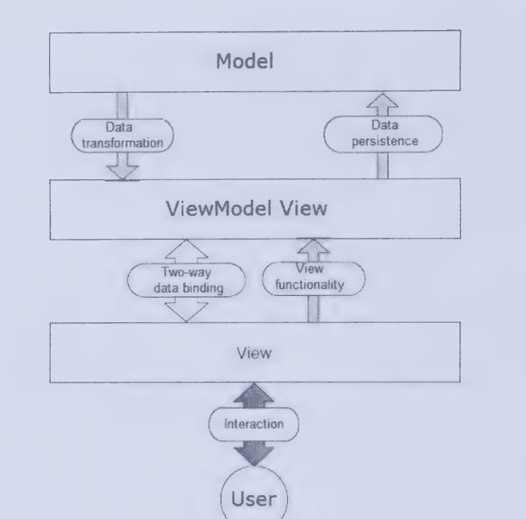

Figure 2.1: Model-View-ViewModel (completed)

在与 MVVM 相关的语境中，双向数据绑定的概念也频繁使用。你可以在下一节中详细了解这一点。总之，ViewModel 层有两个主要任务：

1. 提供并转换位于服务器上的应用数据的一部分
2. 在显示的上下文中提供所需的功能。

ViewModel 概念的实际实现是通过 `AngularJS` 中的 `scopes`（作用域）来完成的。`Scopes` 将在下一节中介绍。

> 没有后端的应用程序中的 MVVM
 即使你正在处理的应用程序不需要与后端通信，使用 ViewModel 概念也是有意义的。一方面，双向数据绑定的概念是建立在 ViewModel 层之上的。另一方面，在大多数情况下，你的应用程序仍然会有一个数据源，其数据在显示之前需要以某种方式进行转换。

### 双向数据绑定和 Scopes

双向数据绑定是一种机制，用于在用户更改 GUI 中的内容时自动更新数据模型。反向过程——即响应底层数据模型的变化而自动更新视图——也被这一概念所涵盖。这个概念的名称含义就是双向的数据绑定。

由于这个概念是 `AngularJS` 的组成部分，我们可以节省大量代码，否则我们就需要自己实现相应的更新逻辑。如果你将 `AngularJS` 与 `jQuery` 进行比较，你会发现使用 `jQuery` 时，你需要在 DOM 元素上注册事件监听器，当事件触发时会调用回调函数。`jQuery` 的回调函数随后会修改数据模型的相应变量。此外，使用 `jQuery` 时，反方向的绑定也必须手动处理。换句话说，当你的变量发生变化时，你需要实现一些逻辑来更新相应 DOM 元素的值。这会涉及大量所谓的"样板代码"，即繁琐的应用程序逻辑，而在 `AngularJS` 中，得益于双向数据绑定，你可以省去这些麻烦。

在 `AngularJS` 中，双向数据绑定的实现本质上基于 `scopes`。一个 `scope` 包含在特定上下文中定义的所有变量和函数。这个上下文是 DOM（文档对象模型）的特定部分。重要的是，要理解，AngularJS 只能对 `scope` 中定义的变量或函数建立双向数据绑定。同样重要的是认识到，框架会为应用程序创建一个根 scope。

`Scopes` 的另一个特性是它们可以通过原型相互继承，从而形成一个层次结构。从语义上讲，这对应于 JavaScript 中的原型继承，这是一种将通用数据和逻辑卸载到更高层级构造中的常见方式，以避免冗余。

如果 `Scope B` 继承自 `Scope A`，通俗地说，这意味着在 `Scope B` 的上下文中，你不仅可以访问 `B` 中定义的变量和函数，还可以访问 `A` 中定义的变量和函数。然而，请注意，同名变量或函数可能会被覆盖。因此，如果 `A` 和 `B` 中存在相同的变量或函数，那么 `Scope B` 中的变量或函数会隐藏 `Scope A` 中同名的变量或函数。在 `Scope B` 的上下文中，那么你只能通过迂回的方式保证访问 `A` 中同名的变量或函数。

#### 隔离 Scopes

在 `AngularJS` 中，你可以定义隔离的 scopes。隔离 scopes 允许你精确控制如何授予对父 scope 中变量或函数的访问权限。这种特殊形式的 scope 主要用于指令（directives）中。通过隔离 scopes，你可以确保自包含的可复用组件在访问共享变量时不会意外冲突。由此产生的错误通常很难识别，因此在这种情况下，你应该始终致力于实现这种隔离。指令的概念将在本章后面介绍。

除了双向数据绑定中的 scopes 之外，你还需要一种机制来决定何时同步用户界面和数据模型。你通常可以在脏检查（dirty checking）和基于观察者的解决方案之间进行选择。`AngularJS` 使用的是脏检查。

顾名思义，脏检查本质上是一个算法，它检查当前视图的所有相关 scope 以找到"脏"变量，并在发现视图和 ViewModel 之间存在差异时执行一些同步逻辑。请注意，该算法运行频繁，因此必须针对执行时间进行高度优化，以免对响应产生负面影响。幸运的是，你不必担心算法执行，因为框架会处理这一点。尽管如此，你应该记住这个机制的工作原理，以免在应用程序中遇到问题。你应该注意的最重要规则是：只在 scope 中定义视图中实际需要的数据和函数。视图中所有必要但未定义的 scope 中的数据和函数都会增加脏检查的时间，而不会带来价值。

#### 控制反转和依赖注入

`AngularJS` 还利用控制反转（IoC）和依赖注入（DI）。Java 和 .NET 等平台多年提供了广泛的可能性，以便在应用程序中无缝使用这些模式。亏了 `AngularJS`，这些概念首次出现在客户端 Web 应用中。这些概念解决了软件开发中的根本问题：如何管理应用程序组件，使其与现有解耦，并实现高度的灵活性和互换性？最终确保应用程序是可测试且易于适应。没有使用过 IoC 和 DI 的 JavaScript 开发人员可能会问这些问题：到底什么反转了？这里有什么优势？IoC 和 DI 有什么区别？为什么这些模式对于生成高质量软件如此重要？为了回答这些问题，我们将要要谈 IoC 和 DI。要解决应用程序的依赖关系，在 JavaScript 中你有三种选择：

- 使用 `new` 运算符手动实例化
- 通过全局变量集成
- 通过服务定位

第一个选项意味着在设计时，你必须编写代码来实例化组件，而在运行时是难以改变的。第二个选项通过全局变量集成存在缺点，会使应用程序命名空间变得混乱。第三种解决方案——通过服务定位——虽然优于前两种，并非最优，因为无论如何都必须访问服务定位。利用服务定位提供的间接性，组件可以解耦。然而，你必须获取服务定位的实例。最优的是将组件创建的责任转移给环境。这为约定奠定了基础，该约定自动确定应用程序所需的依赖项，并在运行时将其交给组件。这样，当需要不同的依赖项时，你可以重新配置应用程序。组件不再负责生成依赖项，因此我们称之为控制反转（IoC）。事实上，正是 IoC 这一属性使得软件工程中如此重要，并且影响深远。为了在应用程序中解析依赖项，人们选择了更明确且易懂的依赖注入（Dependency Injection, DI）这个名字。因此，DI 是 IoC 的一种特殊形式。

#### 可测试性

与大多数 JavaScript 框架不同，`AngularJS` 从设计之初就重视可测试性。依赖注入（DI）使得你能够广泛地隔离和集成组件。测试驱动开发方法使你能够实现单元测试。所有应用程序模块——特别是控制器、服务和过滤器——都有测试的概念。此外，你可以使用特定领域语言（DSL）定义端到端测试（E2E）。这些测试将单个应用程序视为黑盒。使用 DSL 函数，你可以触发用户交互并检查结果符合预期。

###### 清单 2.1：用户登录

```javascript
describe('User Login', function() {
  it('should successfully login the user', function() {
    input('user', 'John');
    input('23asd');
    element(':button').click();
    expect(element('h1')).text()).toEqual('Hello, Tom!');
  });
});
```

此外，`AngularJS` 自带模拟服务，你可以用它来产生特定的条件。例如，有一个用于 `$http` 服务的，你可以用 `$httpBackend` 模拟对象，它可以阻止对后端的真实请求，只调用 `$http` 服务的相应功能。同样，你可以轻松模拟后端，并考虑特定的记录会发生什么。

##### 关键概念总结

- AngularJS 基于模型-视图-模型模式（MVVM）
- 视图层在框架中通过作用域（scopes）实现
- AngularJS 中一个重要的特性是双向数据绑定。它确保当作用域中的数据发生更改时，视图会自动更新
- 双向数据绑定基于作用域。这种类型绑定的所有数据都在作用域中定义
- AngularJS 中另一个关键的概念是依赖注入，即依赖项的自动解析
- AngularJS 从设计之初就考虑到了测试性。框架内的每个设计决策强烈激励开发者编写整洁且可测试的源代码

#### 应用程序构建块

AngularJS 定义了一组具有明确功能的应用程序模块。通常，应用程序主要由构建块构成。在本节中，我们将简要介绍这些模块，让你了解组件如何相互关联。

##### 模块

在 `AngularJS` 中，模块代表最大的结构，它封装了一组相关的应用程序组件。特别是作为控制器、服务和过滤器的容器。符合软件工程定义，一个 AngularJS 模块至少具有以下属性：

- 高内聚性
- 明确的 API
- 高度的重用性

在模块级别，AngularJS 也使用依赖注入。因此，其他模块可以轻松集成进来。只要该模块之前通过 `<script>` 标签包含在 `index.html` 中，AngularJS 就会自动提供依赖解析。一个 AngularJS 应用程序至少包含一个模块，该模块在 DOM 完全加载时由框架自动启动和执行。使用 `ngApp` 指令，你可以告诉 AngularJS 哪个模块是起始模块。互联网上的许多示例基于单个模块，该模块包含了所有应用程序组件（控制器、服务、指令、过滤器）。这种最小化的组合类型对于大多数小型应用程序来说已经足够。然而，在一个有多团队的大项目中，你应该考虑如何将各部分划分到模块中，以实现高度的可用性。与官方的 AngularJS 开发者指南（http://docs.angularjs.org/guide/module）说的“模块应根据其包含的技术组件来定义”相反，我们自己的经验表明，技术定义在大项目中通常更有用。因此，在一个虚拟应用程序中，如果有一个名为用户管理的模块，其中实现了用户管理的完整方面，那么除了包含所有应用程序部分的 `app-controllers` 模块之外，几乎还有更多模块。

除了你自己的应用程序模块之外，还有各种由第三方实现和管理的开源模块。

### 3 AngularJS

本节包含 AngularJS 模块，例如 `angular-translate`、`Angular UI` 和 `AngularStrap`。

#### 控制器

控制器包含对作用域的设计要求，因此定义了特定视图所需的数据和逻辑。控制器实例获得自己的作用域，在其中定义变量或函数。然后可以从视图内部访问这些变量和函数。正如已经提到的，作用域可以通过原型链相互继承，从而形成一个层次结构。当你在应用程序中嵌套控制器时，这个层次结构的很大一部分就建立在 AngularJS 之上。

在 AngularJS 中，控制器与服务有密切的联系。服务再次通过依赖注入获得。这也意味着你可以在测试中用一个模拟实现来替换服务。

在实现控制器时，你应该遵守某些准则。控制器实现应该是专注的，并且源代码有意义。这意味着你应该将任何复杂逻辑封装在服务中，然后通过依赖注入将其注入到控制器中。此外，控制器不应该持有任何数据，而只应在它们的作用域中提供对数据的引用。

#### 路由


单页应用程序（SPA）中的一个典型问题是通过 URL 寻址应用程序的各个部分，同时与浏览器的前进和后退功能相结合。在这个语境中，我们也称之为深度链接。这方面对于经典的往返式 Web 应用程序来说有简单的解决方案，但在客户端 Web 应用程序中需要更高的开销。幸运的是，现代浏览器提供了 `History API`，允许对浏览历史进行读写访问。这样，你可以根据应用程序状态以编程方式更改 URL（例如，在浏览器的地址栏中），而无需重新加载完整的应用程序。

尽管 `History API` 很简单，Angular 通过将此逻辑抽象到路由中更进一步。因此，你可以方便地将模板上的 URL 与相关的控制器进行映射。

### 清单 2.3：AngularJS 应用程序的路由定义

```angular
angular.module('myApp').config(function ($routeProvider) {
    $routeProvider
        .when('/', {
            templateUrl: 'templates/mainTemplate.html',
            controller: 'MainCtrl'
        })
        .when('/user/:userId', {
            templateUrl: 'templates/userDetailsTemplate.html',
            controller: 'UserDetailsCtrl'
        })
        .when('/user', {
            templateUrl: 'templates/
```

正如你在清单 2.6 的模板中看到的，花括号中写了一个表达式。在这些花括号内，你可以使用 JavaScript 的一个子集来生成输出。然而，该表达式无法使用 JavaScript 的 `eval()` 函数进行简单求值。因此，关于表达式有以下特别说明：

1. 求值并非像 `eval()` 那样针对全局的 `window` 对象进行，而是针对模板上下文中有效的作用域进行。
2. 求值结果为 `undefined` 或 `null` 的表达式表达式不会生成输出，因为潜在的异常（如 `ReferenceError` 或 `TypeError`）会被捕获并忽略。
3. 不能使用控制流语句，如条件语句或循环语句。

你也可以在表达式中执行简单的计算（参见清单 2.7）。

### 清单 2.7：表达式中的简单计算

```html
<div>
    <p>
        Hello, {{user.name}}!<br>
        Five years ago you were
        {{user.age - 5}} years old.
    </p>
</div>
```

我们已经提到，表达式主要存在于模板中求值作用域数据。结合双向数据绑定，这意味着 AngularJS 确保当对应的作用域值发生改变时，表达式会自动再次求值。因此，如果底层数据发生了改变，框架会自动更新视图。

表达式之所以如此强大，是因为你可以使用格式化过滤器来重新格式化数据。更详细的解释可以在后续的小节中找到。

#### 过滤器

在 AngularJS 中有两类过滤器。在上一章中我们提到了格式化过滤器。在同一章的另一节中，我们讨论了集合过滤器，它可以与 `ngRepeat` 指令结合使用，用于过滤或转换集合。此处的集合可以是数组或对象哈希。

##### 格式化过滤器

你在表达式中使用格式化过滤器来格式化或转换表达式的结果。你可以在表达式中使用管道语法，如清单 2.8 所示。

#### 清单 2.8：应用于表达式的过滤器

```html
<div>
    <p>
        Hello, {{user.name | uppercase}}!<br>
        Five years ago you were
        {{user.age - 5}} years old.
    </p>
</div>
```

在清单 2.8 的示例中，`uppercase` 过滤器被应用于求值后的表达式 `user.name`。作为 AngularJS 附带过滤器集的一部分，该过滤器将字符串转换为大写。此模板在视图中的输出结果将是清单 2.9 中的字符串。

#### 清单 2.9：uppercase 过滤器的结果

```
Hello, JOHN DOE!
Five years ago you were
22 years old.
```

除了 `uppercase` 过滤器，AngularJS 还包含其他有用的格式化过滤器，我们将在后面讨论。此外，你可以定义自己的格式化过滤器。清单 2.10 展示了一个示例。

#### 清单 2.10：alternatingCase 过滤器

```javascript
angular.module('myApp').filter('alternatingCase', function () {
    return function (input) {
        var output = '',
            tmp;

        for (var i = 0; i < input.length; i++) {
            tmp = input.charAt(i);
            if (i % 2 === 0) {
                output += tmp.toUpperCase();
            }
            else {
                output += tmp.toLowerCase();
            }
        }
        return output;
    };
});
```

`alternatingCase` 过滤器可能有些刻意，但其存在的唯一目的就是教学。过滤器的作用是将输入字符串的大小写交替。过滤器的编程接口非常简单。它接收求值后的表达式作为参数，然后对输入执行任何操作。最后，它返回一个输出，该输出会被显示。

#### 清单 2.11：使用 alternatingCase 过滤器

```html
<div>
    <p>
        Hello, {{user.name | alternatingCase}}!<br>
        Five years ago you were
        {{user.age - 5}} years old.
    </p>
</div>
```

#### 清单 2.12：alternatingCase 过滤器的结果

```
Hello, John!
Five years ago you were
22 years old.
```

#### 集合过滤器

除了格式化过滤器，还有集合过滤器。从 API `角度看，集合过滤器的结构与格式化过滤器相同，但它们在不同的文中，与 `ng-repeat` 指令结合使用。此时你还不知道指令能用做什么。然而，我们应该提到 `ng-repeat` 指令用于在模板中输出数组或对象哈希。你可以将 `ng-repeat` 看作循环的声明。

#### 清单 2.13：使用 ng-repeat

```html
<div>
    Family members of {{user.name}}:
    <ul>
        <li ng-repeat="member in family">{{member}}</li>
    </ul>
</div>
```

在清单 2.13 的示例中，作用域变量 `family` 引用一个数组，包含家庭成员。`ng-repeat` 指令确保每个元素在视图中渲染为一个 `li` 标签。因此，你得到家庭成员的视图。HTML 代码如清单 14 所示。

#### 清单 2.14：视图中的 HTML 代码

```html
<div>
Family members of John Doe:
<ul>
    <li>James Doe</li>
    <li>Clarissa Doe</li>
    <li>Ted Doe</li>
</ul>
</div>
```

过滤器过滤输出，只返回集合的子集。根据某些元素过滤集合，或者以特定方式转换其元素。

#### 清单 2.15：在 ng-repeat 中使用过滤器

```html
<div>
    Family members of {{user.name}}:
    <ul>
        <li ng-repeat="member in family | filter:'clarissa'">
            {{member}}
        </li>
    </ul>
</div>
```

在这里使用 `filter` 过滤器，是因为我们只想打印包含 `clarissa` 的家庭的名字。该过滤器区分大小写。AngularJS 的标准库中还有其他过滤器，包括 `limitTo` 和 `orderBy`。由于两者都影响输出，它们的作用从名字上很清楚了。如果这些过滤器都满足你的需求，你可以定义一个新的集合过滤器。在以下示例中，我们定义了一个名为 `endsWithDoe` 的独立集合过滤器。使用这个过滤器，我们希望只返回以字符串 `Doe` 结尾的项目。

#### 清单 2.16：我们在 ng-repeat 中的 endsDoe 过滤器

```javascript
angular.module('myApp').filter('endsWithDoe', function () {
  return function (inputArray) {
    var outputArray = [];
    angular.forEach(inputArray, function(item) {
      if (item.length >= 3 && item.substring(item.length - 3) === 'Doe') {
        outputArray.push(item);
      }
    });
    return outputArray;
  };
});
```

正如你在清单 2.16 的示例中所看到的，集合过滤器的 API 与格式化过滤器非常相似。唯一的区别是，在这个示例过滤器函数中，我们得到一个数组作为输入（而不是格式化过滤器那样的字符串），AngularJS 相应地期望函数返回一个数组。在过滤器函数内部，你可以操作输出数组以实现所需的行为，或者构建一个全新的数组。在 `endsWithDoe` 过滤器中，我们选择了后一种方式。为了完整性，下面的示例展示了如何使用自己的集合过滤器。为了解释效果，我们还应该向原始数组补充不以字符串 `Doe` 结尾的姓名。

#### 清单 2.17：向我们的数组添加成员

```javascript
angular.module('myApp').controller('MyCtrl', function ($scope) {
  $scope.user = {
    name: 'John Doe',
    age: 27,
    email: 'john@doe.com'
  };
  $scope.family = [
    'James Doe', 'Clarissa Doe', 'Ted Doe',
    'Burk Smith', 'Samantha Jones', 'Bill Brooks'
  ];
  $scope.loggedIn = true;
});
```

#### 清单 2.18：在 ng-repeat 中使用我们的 endsWith 过滤器

```html
<div>
  Family members of {{user.name}}:
  <ul>
    <li ng-repeat="member in family | endsWithDoe">{{member}}</li>
  </ul>
</div>
```

如果你运行这个示例，你会发现只返回了三个名字，它们都以 `Doe` 结尾，尽管输出现在包含了六个名字。最后，我们应该进行重构，使我们的过滤器更加通用。它不仅能过滤字符串“Doe”，而且能过滤任何任意字符串。

### 第 2 章：基本原则与概念

由于过滤器 API 支持过滤器参数，我们可以轻松融入这一改动。此外，我们还应该将过滤器重命名为 `endsWith`。

##### 清单 2.19：带参数的 endsWith 过滤器

```javascript
angular.module('myApp').filter('endsWith', function () {
	return function (inputArray, endsWith) {
		var outputArray = [],
			subString,
			hasMinLen,
			isSubStringMatching;
			angular.forEach(inputArray, function(item) {
				if (item.length >= 3 && item.substring(item.length - 3) === 'Doe') {
					outputArray.push(item);
				}
			});

		return outputArray;
	};
});
```

这里使用 `filter` 过滤器。过滤器的新版本如清单 20 所示。

##### 清单 2.20：使用 endsWith 过滤器

```html
<div>
    Family members of {{user.name}}:
    <ul>
        <li ng-repeat="member in family | filter:'clarissa'">
            {{member}}
        </li>
    </ul>
</div>
```


```javascript
log('INFO', message);

},

debug: function(message) {

    log('DEBUG', message);

}

};

});
```

清单 2.21 展示了一个简单的服务，它定义了一个相当基础的日志 API，并基于`console.log()` 提供实现。该服务实现远未达到可在生产环境中使用的水平，出于教学目的而有意保持简单。

这段代码有趣的是，我们没有使用名为`service()` 的函数来定义服务，而是使用了`factory()` 函数。事实上，在 AngularJS 中，服务可以通过多种方式之一来定义。其中，可以使用`service()` 函数注册服务。通常仅在特定应用中使用此方法，即当你想将现有类的属性注册为服务实例时。

具体而言，有五种定义服务的方法。表 2.1 提供了一个概览，简要介绍了这五种方法。

最 常见的形式是所谓的*工厂*方法，我们在清单 2.21 中使用了它。除了`factory()` 之外，还可以使用`value()`、`constant()`、`provider()` 和 `service()` 函数来定义服务。

| 服务定义 | API | 描述 |
| --- | --- | --- |
| Provider | `provider(...)` | 定义服务的基本 API，可在配置阶段进行配置。必须提供返回相应服务实例的 `$get()` 函数。可以使用构造函数或对象调用。 |
| Factory | `factory(...)` | 基于 Provider API 构建。从可配置性方面进行了抽象，如果可配置性无关紧要，可提供更便捷的服务定义。 |
| 构造函数 | `service(...)` | 基于 Factory API 构建。使用 `new` 运算符结合给定的构造函数实例化服务实例。因此，现有类的实例可以注册为服务。 |
| 值作为服务 | `value(...)` | 基于 Factory API 构建。允许将值注册为服务。该值可以是原始类型、对象或函数。 |
| 常量作为服务 | `constant(...)` | 将常量值注册为服务。该值在运行时无法更改。 |

表 2.1：五种服务定义方法

现在，你当然可能会问这个合理的问题：所有这些服务定义方法之间有什么区别？

如图 2.2 所示，各种服务定义方法大多是构建在彼此之上的。`providerCache` 和 `instanceCache` 作为 AngularJS 应用的提供者或服务实例的基本容器。使用`provider()` 函数可以访问`providerCache`，并以这种方式注册提供者。因此，服务提供者是一个必须定义 `$get()` 函数的组件，该函数最终由框架调用，并必须返回服务实例。你的服务的单例实例在 `instanceCache` 中管理。然而，在实际服务对象实例化之前，你可以在应用的配置阶段使用提供者配置服务对象。其他方法则不具备此选项。因此，提供者的服务定义是最强大但同时也是最复杂的获取服务实例的方式。

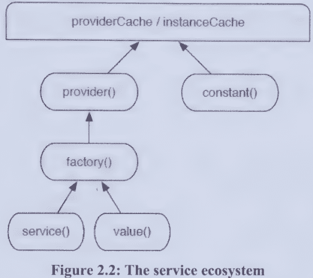

##### 图 2.2：服务生态系统

服务工厂（我们在定义 `log` 服务时使用了它）在内部使用`provider()` 函数，并通过从可配置性方面进行抽象来简化定义。这样，你可以通过简单地定义返回服务对象的工厂函数来创建服务定义。缺点是你无法再配置你的服务。

图 2.2 还显示 `service()` 和 `value()` 函数依次构建在工厂之上。因此，`service()` 函数除了服务名称外还期望一个构造函数。在内部，`service()` 函数创建一个服务工厂，最终使用传递的构造函数实例化服务对象。实例化在内部使用 `new` 运算符完成，这允许你在构造函数内定义你的服务对象。这意味着你可以很简单地将现有类的实例注册为服务实例。

`value()` 函数是最简单但也是最原始的服务定义获取方式。顾名思义，`value()` 函数将一个值注册为服务。在这种情况下，该值可以包含原始数据类型，例如数字或布尔值。然而，任何对象或函数都可以轻松地作为服务进行部署，并通过依赖注入在整个应用程序中使用。从纯粹技术的角度来看，`value()`函数创建一个工厂，该工厂进而将传递的值封装并返回到服务实例中。因此，在内部，`value()`函数使用`factory()`函数。

除了相互构建的服务定义方法之外，还有`constant()`函数。该函数将常量值注册为服务。这意味着注册的值在运行时不能更改。因此，`constant()`函数可以直接访问`providerCache` 和 `instanceCache` 容器。

现在我们将枯燥的理论注入一些活力，并通过一些示例服务定义来阐明上述描述。

##### 清单 2.21：使用工厂定义日志服务

基于我们在清单 2.21 中使用工厂定义的日志服务，我们现在将使用 provider 来实现相同的服务，以便仍然能够进行一些小的配置。

```javascript
angular.module('myApp').provider('log', function() {

    /* 私有状态/方法 */

    var prefix = '', suffix='';

    // 服务实现

    var log = function(level, message) {

        console.log(prefix + '[' + level +']' +
            ' ' + suffix);
    };

    return {
        $get: function() {
            return {
                error: function(message) {
                    log('ERROR', message);
                },

                info: function(message) {
                    log('INFO', message);
                },

                debug: function(message) {
                    log('DEBUG', message);
                }

            };
        }
    };

});
```

清单 2.22 展示了使用 provider 定义我们的 `log` 服务。这段代码中有趣的是，我们使用服务名称和一个 provider 的构造函数来调用`provider()` 函数。如表 2.1 所示，除了构造函数之外，我们还可以选择传递一个需要类似构造的对象。特别是，这个对象也需要有一个名为 `$get()` 的函数。当框架需要创建适当的服务实例时，AngularJS 将调用该函数，一旦它首次作为依赖被请求。在这种情况下，每个服务恰好调用一次该函数，因为如前所述，服务是单例对象。

无论如何，此时我们选择了构造函数的替代方案。一般来说，这个选项也常被使用，因为它允许你定义无法从外部访问的变量。具体来说，在这个例子中，`prefix` 和 `suffix` 变量包含我们日志消息的前缀或后缀。此外，引用函数的 `log` 变量是我们 API 实现的基础，它是“私有的”，无法从外部访问。

另一方面，使用 `this` 定义的 `setPrefix()` 和 `setSuffix()` provider 函数是公共的，在配置阶段（在`config()` 块中）被调用以进行服务的必要设置，即为所有日志消息定义前缀或后缀。`$get()` 函数也是公开的，因此可以从外部访问。

#### JavaScript 中的函数

在 JavaScript 中，函数是一种强大的构造，你可以在其上映射许多验证的软件工程概念。特别是，例如，在 provider 定义中，采用了构造函数的概念。在我们准备好 provider 以启用前缀或后缀后，现在应该转向实际配置。

##### 清单 2.23：在 config() 块中配置我们的 provider

```javascript
angular.module('myApp').config(function (logProvider) {

    logProvider.setPrefix('[myApp ');

    logProvider.setSuffix('.');

});
```

清单 2.23 展示了 `log` 服务的一种可能配置。要配置该服务，我们使用框架（通过依赖注入）传递先前定义的 provider。使用 `setPrefix()` 和 `setSuffix()` 公共方法设置字符串。

#### 配置块

在本章前面，我们使用`config()` 块来配置路由。你可以使用配置块在应用程序启动之前，通过适当的服务注入。注意的是，在配置块中注入的是 provider 而不是服务。后者，因为框架除了一些例外外，只允许在配置块中注入。你可能希望在应用程序启动时调用实际服务，因此 AngularJS 还为你提供了一个特殊的构造，即 `run()` 块。在我们的日志服务完成后，展示一个示例。

##### 清单 24：使用我们的服务

```javascript
angular.module('myApp').controller('MyCtrl', function($scope, log) {

    log.debug('MyCtrl has been invoked');

});
```

清单 24 展示了我们可以轻松在控制器中使用服务，只需将其名称指定为参数。然后我们可以访问公共的函数。对于日志服务，这些函数是 `debug()`、`info()` 和 `error()`。

#### 指令

指令可能是 AngularJS 中最有趣的特性，因为框架通过这一特性展现了独特的卖点。你可以使用指令扩展 HTML。这意味着你可以发明新的 HTML 标签和属性。将复杂的逻辑隐藏在标签或属性后面。主要优势是你可以使用指令创建重用的 Web 组件。例如，你可以编写一个指令来封装应用程序中频繁使用的 UI 部件，从而消除大量冗余代码。通过这种方式使用指令，你可以创建具有统一外观和感觉的组件。指令还可以确保重复部件不需要重新开发。使用指令，应用程序还可以声明方式描述。开发人员对此产生的清晰度和维护感到满意。

##### 指令命名

认识和理解这种命名约定非常重要，这样在创建自己的指令时才能避免任何令人意外。特别不建议给指令起一个不符合隐式约定的名称。

##### 带链接函数的定义

AngularJS 期望你作为第二个参数传递的工厂函数返回一个函数或指令定义对象。如果你返回一个函数，那么这个函数就被称为链接函数。在指令定义对象的情况下，你可以通过许多属性来精细地控制指令的行为。因此，返回一个函数（链接函数）代表简单情况，而返回一个指令定义对象代表复杂情况。

###### 清单 2.26：通过返回链接函数定义 colorPicker 指令

```javascript
angular.module('myApp').directive('colorPicker', function () {

    return function(scope, element, attrs) {
        // 实现放在这里
    }

});
```

在清单 2.26 中，我们首先考虑简单情况，即在 colorPicker 指令的工厂函数中返回一个函数（一个链接函数）。对于指令的每个实例，链接函数恰好被调用一次。因此，在链接函数内，你可以注册事件处理器来执行 DOM 操作，并执行其他特定该实例的例程。简而言之，链接函数允许你为指令的每个实例执行初始化操作。在调用链接函数时，AngularJS至少传递三个参数。

清单 2.26 中链接函数的实现只是向浏览器控制台写入一条消息。为了查看这个最小指令的实际运行情况，我们需要编写一个使用该指令的小模板。

###### 清单 2.27：在模板中使用 colorPicker 指令

```html
<div color-picker></div>
<div color-picker></div>
<div color-picker></div>
```

清单 2.27 展示了一个使用我们最小 `colorPicker` 指令的示例模板。如模板中所示，我们使用我们的最小指令定义创建了一个新的 HTML 属性。该属性不一定非要放在 `div` 标签中，可以在任何其他标签中使用。因此，如果你通过简单地在工厂函数中返回一个链接函数来实现指令，那么默认情况下你会创建一个 HTML 属性。

##### 命名约定

按照约定，指令名称以小写开头，如果名称由多个单词组成，则遵循驼峰命名。HTML 标签或指令定义的标识将驼峰命名法映射为短线分隔命名法来完成。例如，`spreadsheet`、`chart` 或 `colorPicker` 都是有效的指令。相应的 HTML 标签是 `<spreadsheet>`、`<chart>` 和 `<color-picker>`。对于 `colorPicker`，你还可以使用 `<color:picker>` 和 `<color_picker>`，因为 AngularJS 使用冒号(:)、连字符(-) 和下划线(_) 作为分隔符。正如上一章提到的，还有另外两种调用指令的方式，即使用 `data-` 或 `x-` 前缀。因为旧浏览器只允许带有这些前缀之一的用户标签和属性。因此，你还可以在模板中使用 `<data-spreadsheet>` 或 `<x-spreadsheet>`。


最后但同样重要的是，我们仍然需要我们 `colorPicker` 指令的最小定义（`color-picker.js` 文件），如清单 2.30 所示。

> 示例的项目结构

对于这个示例，我们将临时模块 `myApp` 重命名为 `colorPickerApp`。此外，我们为 JavaScript 文件创建了一个 `scripts` 子目录。该目录包含 `app.js` 文件（其中包含我们的模块定义）以及一个名为 `directives` 的子目录，其中包含 `color-picker.js` 文件。该文件包含我们的最小指令定义。此结构与使用 Yo 工具创建应用程序组件时自动生成的结构相对应。事实证明，对于单模块应用程序（即只有一个模块的应用程序），这是一种有用且适用的最佳实践。

### 带指令定义对象的定义

如上一节所述，你可以通过在工厂函数中返回一个链接函数来定义指令。现在让我们更仔细地研究一下指令定义对象（DDO）。这种类型的定义要复杂得多，但允许非常细粒度地描述指令的行为。你在上一章开发 `colorPicker` 指令时学习了这种定义，当时我们使用了这样一个 DDO。因此，我们对这种类型定义的讨论也是基于 `colorPicker` 示例。我们将前一节中返回链接函数的指令转换为 DDO。

#### 清单 2.31：使用指令对象定义 colorPicker 指令

```
colorPickerApp.directive('colorPicker', function() {
  return {
    link: function(scope, element, attrs) {
      console.log("It's me, colorPicker as DDO!");
    }
  };
});
```

清单 2.31 显示了使用 DDO 定义的 `colorPicker` 指令。在这种形式下，此定义等效于清单 30 中的定义。你也可以在 DDO 中通过函数赋值给 `link` 属性。接下来，我们想更改指令，使其定义一个 HTML 标签而不是属性。我们在 DDO 中使用 `restrict` 属性来实现。

#### 清单 2.32：使用 restrict 定义作用域

```
colorPickerApp.directive('colorPicker', function() {
  return {
    restrict: 'E',
    link: function(scope, element, attrs) {
      console.log("It's me, colorPicker as DDO!");
    }
  };
});
```

清单 2.32 显示我们将 `restrict` 设置为 `E`，这将指令限制为 HTML 元素或标签。现在我们只能将指令用作 HTML 标签。因此，我们需要将模板修改为清单 33 中的。

#### 清单 2.33：将 colorPicker 指令用作 HTML 标签

```
<color-picker></color-picker>
<color-picker></color-picker>
<color-picker></color-picker>
```

`restrict` 属性的值是一个字符串，其中包含 `'E', 'A', 'C', 'M'`。这些字母具有以下含义：
- `E`: HTML 元素或标签
- `A`: HTML 属性
- `C`: CSS 类
- `M`: HTML 注释

因此，指令也可以与 CSS 类或注释使用。注意的是，对于大多数指令，相应的 HTML 标签或属性背后隐藏着逻辑，通常在 `link` 函数中实现。至于指令标记，通常使用 `template` 或 `templateUrl` 属性。对于这两个属性，AngularJS 都期望一个字符串。你可以使用 `template` 属性在 DDO 中直接以字符串形式设置标记。另一方面，`templateUrl` 属性期望指向模板。作为指导，较短的模板直接在 DDO 中定义，而较长的模板存储在单独的文件中并通过 `templateUrl` 属性引用。

####指令模板

##### 清单 2.34：引用 colorPicker 指令的模板

```
colorPickerApp.directive('colorPicker', function() {
  return {
    templateUrl: 'templates/colorPickerTemplate.html',
    restrict: 'E',
    link: function(scope, element, attrs) {
      console.log("It's me, colorPicker as DDO!");
    }
  }
});
```

清单 2.34 表明，我们的 `colorPicker` 指令的模板可以在 `colorPickerTemplate.html` 文件中找到，该文件位于 `templates` 子目录下。这与我们在前一章使用的模板相同。不过，为了便于阅读，我们在清单 2.35 中将其列出。

##### 清单 2.35：colorPicker 指令的模板定义

```
input type="range" min="0" max="255" step="1" ng-model="r">
input type="range" min="0" max="255" step="1" ng-model="g">
input type="range" min="0" max="255" step="1" ng-model="b">
input type="range" min="0" max="1" step="0.01" ng-model="a">
<div style="width: 300px; height: 100px; background-color: rgba({{ r }}, {{ g }}, {{ b });"></div>
```

我们的 `colorPicker` 现在已完成，示例将会工作。你可以在浏览器中看到 AngularJS 创建了三个颜色选择器实例。然而，如果仔细观察，你会发现两个缺陷：到为止，我们的颜色选择器没有初始值。因此，最初没有颜色预览，因为相应的 `r`、`g`、`b` 和 `a` 作用域变量最初是未定义的，所以 CSS `background-color` 属性无法渲染。只有在我们至少移动滑块一次后，变量才会被赋予适当的值，颜色才会出现。

除此之外，我们的颜色选择器不是一个独立的组件，并且对周围上下文有不愉快的影响。也就是说，这三个实例并非相互独立。如果我们移动其中一个实例的 `r` 控制器，另外两个实例的 `r` 控制器也会同时移动。其原因在于在这个阶段实例还没有自己的作用域。因此，每个颜色选择器实例当前仍然绑定到根作用域的 `r`、`g`、`b` 和 `a` 变量，并在滑块移动时修改这些值。这种情况在图 2.3 中再次进行了可视化。由此产生的双向绑定导致了 `colorPicker` 实例之间的交互。

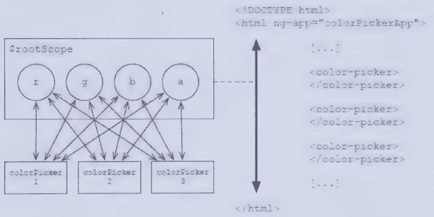

### 指令的独立作用域

在查看初始值之前，我们首先需要确保我们的 `colorPicker` 实例拥有它们自己的作用域。

#### 清单 2.36：为 colorPicker 指令定义独立作用域

```
colorPickerApp.directive('colorPicker', function() {
  return {
    scope: true,
    templateUrl: 'templates/colorPickerTemplate.html',
    restrict: 'E',
    link: function(scope, element, attrs) {
        console.log("It's me, colorPicker as DDO!");
    }
  };
});
```

清单 2.36 表明，通过将我们的 DDO 的 `scope` 属性设置为 `true`，指令实例将获得自己的作用域。因此，如果你运行这个示例，你会看到颜色选择器实例不再相互干扰。每个实例都有自己的作用域，其中定义了 `r`、`g`、`b` 和 `a` 变量。这意味着双向绑定作用于每个实例自身，而不会影响根作用域。这个解决方案让我们离独立且可用的组件更近一步。然而，仍然有些不尽如意：我们的 `colorPicker` 指令实例有自己的作用域，但该作用域仍然继承父作用域的原型。在这种情况下我们可以在 `colorPicker` 指令中访问父作用域变量并可能纵它们。如果我们创建一个独立且可用的组件，那么当前的 `colorPicker` 指令显然并不理想，因为它依赖父作用域的变量，结果是我们的组件只有在这种上下文中才能工作。它不是一个独立且可用的组件。

此外，无意操纵父作用域变量会导致棘手且难以识别的错误。为了避免这个问题与父作用域彻底分离，AngularJS 引入了隔离作用域。

### 隔离作用域

你可以在指令内创建隔离作用域。尽管隔离作用域仍然是应用程序作用域结构的一部分，但它不再继承父作用域的原型。这意味着你无法从隔离作用域访问父作用域的数据或逻辑。隔离作用域是独立组件的关键。

#### 清单 2.37：colorPicker 指令定义隔离作用域

```
colorPickerApp.directive('colorPicker', function() {
  return {
    scope: {},
    templateUrl: 'templates/colorPickerTemplate.html',
    restrict: 'E',
    link: function(scope, element, attrs) {
      console.log("It's me, colorPicker as DDO!");
    }
  };
});
```

如清单 2.37 所示，通过向 DDO 的 `scope` 属性分配一个空对象（`{}`）告诉 AngularJS 创建隔离作用域。这一点上，我们拥有了任何上下文的可用。当我们通过实现 `link` 函数中的逻辑时，仍然可能操纵父作用域变量。隔离作用域的配置可以在图 2.4 中看到。到为止，一切顺利。然而，正如已经提到的，通过隔离作用域你可以访问父作用域的数据和函数。仔细想想你会发现大多数独立组件都需要与上下文建立连接。这些连接用于多种目的：其中之一是让组件从周围文中接收数据；另一方面，我们希望在 `colorPicker` 指令内部更改值时通知父作用域。

#### 清单 2.38：隔离作用域定义，并与父作用域建立控制连接

```
colorPickerApp.directive('colorPicker', function() {
    return {
        scope: {
            r: '@initR',
            g: '@initG',
            b: '@initB',
            a: '@initA',
            onChange: '&'
        },
        templateUrl: 'templates/colorPickerTemplate.html',
        restrict: 'E',
        link: function(scope, element, attrs) {
          console.log("It's me, colorPicker as DDO!");
        }
    };
});
```

清单 2.38 展示了如何在使用隔离作用域的同时建立与父作用域的多个连接。这样你可以访问父作用域的数据和函数。主要因素在于你不再向 DDO 的 `scope` 属性分配空对象，相反你指定一个配置对象。该配置对象中的键用于指定隔离作用域中的哪些作用域变量应该连接到父作用域。如前所述，基本上有三种形式，由 `=`、`@` 和 `&` 指定：

- `=` 表示隔离作用域中指定键的作用域变量与父作用域中的变量建立双向数据绑定。
- `@`: 表示隔离作用域中指定键的作用域变量与父作用域建立单向数据绑定。
- `&`: 表示指定键的作用域变量引用父作用域中的函数，并能够调用该函数并传递指令内部的数据。

当你查看清单 2.38 中如何使用 `colorPicker` 指令定义时，这一点会变得更加清晰。

#### 清单 2.39：通过指定初始值来使用 colorPicker 指令

```
<color-picker init-r="255"
  init-g="0"
  init-b="0"
  init-a="1.0">
</color-picker>
```

### 连接父级作用域

前缀后的字符串指定了指令 HTML 标签的哪个 HTML 属性包含了连接应涉及父级作用域中哪个变量或函数的信息。如果键的对应 HTML 属性名称与隔离作用域变量的名称相同，那么你可以省略前缀后的字符串。在代码清单 2.38 中，`onChange` 作用域变量就展示了这一点。

代码清单 2.39 展示了一个使用我们的 `colorPicker` 指令的模板片段。尽管具有隔离作用域，我们仍希望向其传递数据。在这种情况下，我们传递的是各个颜色分量的初始值。这里使用的 HTML 属性 `init-r`、`init-g`、`init-b` 和 `init-a` 与代码清单 2.38 中的指令定义相对应，必须用蛇形命名法指定。因为颜色分量的作用域变量是 `r`、`g`、`b` 和 `a`（而不是 `initR`、`initG` 等），除了连接类型（这里是：`@`）之外，我们还需要用驼峰命名法指定 HTML 属性。

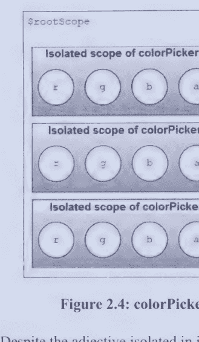

图 2.4：具有隔离作用域的 colorPicker 实例


<|channel>thought
<channel|>在指令内部，然后你可以观察作用域变量 `r`，并根据更改执行某些逻辑。实际上，你使用 `$observe()` 函数在 `attrs` 对象上，AngularJS 将该对象作为 `link` 函数的第三个参数传递。

我们现在为 `colorPicker` 指令分配了一个隔离作用域，将其变成了一个自包含且可重用的组件。此外，我们定义了与父级作用域的五个受控连接。具体来说，这四个是单向连接（`initR`、`initG` 等），通过它们我们可以将初始值传递给颜色选择器实例，还有一个工作链接（`&`），我们随后将在颜色更改时使用它来调用回调函数。

在讨论 `link` 函数的实现之前，我们将首先介绍 `MainCtrl` 控制器，我们在其中定义了回调函数。关键在于，尽管具有隔离作用域，我们仍然可以通过使用 `onChange` 拥有这个回调函数。

代码清单 2.40：带有 `handleColorChange()` 回调函数的 `MainCtrl` 控制器定义

```
colorPickerApp.controller('MainCtrl', function ($scope) {
    $scope.handleColorChange = function(r,g,b,a) {
        console.log('handleColorChange', r, g, b, a);
    };
});
```

代码清单 2.40 展示了刚刚提到的 `MainCtrl` 控制器的实现。我们在控制器作用域中定义的 `handleColorChange()` 函数，代表了我们希望使其可被 `colorPicker` 指令访问的回调函数。在这个例子中，我们用简单的控制台输出来响应颜色选择器中的颜色更改。此外，我们还提供每个颜色分量的值以供查看。

为了保持良好的风格，我们将这个控制器定义在一个名为 `mainCtrl.js` 的单独文件中。我们还在 `scripts` 目录下创建了一个名为 `controllers` 的目录来存放我们的控制器。然后 `mainCtrl.js` 文件保存在 `controllers` 目录中。我们必须修改我们的 `index.html` 文件，使其加载新创建的 `mainCtrl.js` 文件。此外，我们仍然必须使用 `ngController` 指令来确定应为控制器的哪个 DOM 部分定义新的作用域。我们必须确保启动该部分的 DOM 元素是我们的 `colorPicker` 实例的父元素。因此，我们将 `ng-controller` 属性添加到 `<body>` 元素。这些更改的结果可以在代码清单 2.41 中看到。

代码清单 2.41：带有 `ngController` 指令的 `index.html`

```
<!DOCTYPE html>
<html ng-app="colorPickerApp">
<head>
    <meta charset="utf-8">
</head>
<body ng-controller="MainCtrl">
<color-picker init-r="255" init-g="0" init-b="0" init-a="1.0">
</color-picker>
<script src="lib/angular/angular.js"></script>
<script src="scripts/app.js"></script>
<script src="scripts/directives/colorPickerDirective.js"></script>
<script src="scripts/controllers/mainCtrl.js"></script>
</body>
</html>
```

接下来，我们改变调用 `colorPicker` 指令的方式，以便可以传递回调函数。`index.html` 的相关部分如代码清单 2.42 所示。

代码清单 2.42：通过指定回调函数补充 `colorPicker` 调用

```
<color-picker init-r="255" init-g="0" init-b="0" init-a="1.0"
               on-change="handleColorChange(r, g, b, a)">
</color-picker>
```

我们使用 `on-change` 属性将 `handleColorChange()` 函数的引用传递给我们的 `colorPicker` 实例。同样，使用蛇形命名法，因为我们在指令定义中编写了将包含该引用的 `onChange` 作用域变量。回想一下，从 DDO 到相应 HTML 属性的名称映射是通过将驼峰命名法替换为蛇形命名法来完成的。

为了检查创建的连接函数，我们应该进行一个简单的测试，并在 `colorPicker` 指令的 `link` 函数中通过 `onChange` 属性调用 `handleColorChange` 函数。代码清单 2.43 打印了相应的源代码。

代码清单 2.43：通过 `onChange` 引用调用 `handleColorChange` 函数

```
colorPickerApp.directive('colorPicker', function() {
  return {
    scope: {
      r: '@initR',
      g: '@initG',
      b: '@initB',
      a: '@initA',
      onChange: '&'
    },
    templateUrl: 'templates/colorPickerTemplate.html',
    restrict: 'E',
    link: function(scope, element, attrs) {
      console.log("It's me, colorPicker as DDO!");
      scope.onChange();
    };
  };
});
```

作用域层次结构和刚刚描述的场景在图 2.6 中进行了总结。圆角矩形表示引用函数的作用域变量。

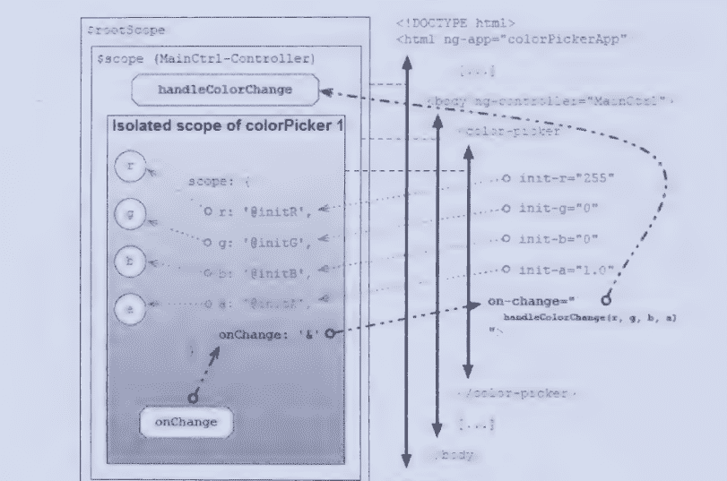

如果你运行这个示例，你将在控制台中得到预期的输出，如图 2.7 所示。


图 2.7：Chrome 中的控制台输出

这意味着，尽管我们的 `colorPicker` 指令具有隔离作用域，我们仍然可以创建一个到父级作用域和 `MainCtrl` 控制器作用域的工作链接，因此可以通过 `onChange` 作用域变量访问 `handleColorChange` 函数。包含颜色分量，但目前的值是 `undefined`。然而，很明显这是我们在指令内部的调用中没有传递参数。

好了，现在我们可以专注于最终要求，实现 `link` 函数，使得 `handleColorChange` 回调函数仅在颜色更改时被调用。link` 函数的最终实现如代码清单 2.44 所示。

代码清单 2.44：我们的 `colorPicker` 指令的 `link` 函数的最终实现

```
colorPickerApp.directive('colorPicker', function() {
  return {
    [...]
    link: function(scope, element, attrs) {
      var COLORS = ['r', 'g', 'b', 'a'];
      COLORS.forEach(function(value) {
        scope.$watch(value, function(newValue, oldValue) {
          if (newValue !== oldValue) {
            if (angular.isFunction(scope.onChange)) {
              scope.onChange(generateColorChangeObject());
            }
          }
        });
      });
      var generateColorChangeObject = function() {
        var obj = {};
        COLORS.forEach(function(value) {
          obj[value] = scope[value];
        });
        return obj;
      };
    }
  };
});
```

```markdown

基本上，实现相当简单。首先，我们定义一个数组，其中包含各个颜色值的`scope`变量名称。这样做purely是为了让后续源代码更清晰、更简洁。然后，我们遍历这个数组（使用`forEach`），并使用`scope.$watch`为每个颜色分量注册一个监听器。`$watch`函数需要两个参数。第一个参数是要监控变更的`scope`变量名称。第二个参数我们传入一个函数，该函数在发生变更时会被调用。框架会传递两个参数，`newValue`和`oldValue`，分别包含`scope`变量的新值和旧值。然后，我们检查这两个值是否相等，如果不相等，就调用`handleColorChange`回调函数，该函数可以通过`onChange` `$scope`变量访问。在此之前，我们确保`onChange`确实引用了一个函数。

现在，我们引入另一个AngularJS约定。`handleColorChange`回调函数定义为接受四个参数，即各个颜色分量`r`、`g`、`b`和`a`。通过这个函数，我们可以将这些参数传递到一个参数对象中。图2.8展示了这样一个参数对象的样子。

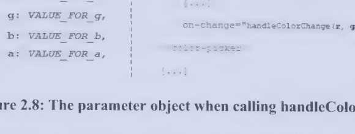

基本上，对象的键参数必须与模板中的参数名称匹配，以便参数最终能够正确传递。在图2.8中，必要的匹配项以粗体显示。在我们的实现中，我们使用一个名为`generateColorChangeObject`的小型辅助函数来生成这个参数对象。

至此，我们完成了。通过指令，我们创建了一个自包含且可复用的组件，称为`colorPicker`。它可以在模板中通过指定`<color-picker>`来使用。由于AngularJS还以其他一些名称注册了这个指令，因此也可以使用`<color:picker>`和`<data-color-picker>`来使用它。此外，我们可以通过HTML属性向我们的颜色选择器传递初始值。最后，我们实现了一种机制，通过调用回调函数通知父组件颜色已发生变更。

如果你运行示例并移动任何滑块，你会得到一堆控制台输出，应该与图2.9中的类似。


除了这里提到的DDO属性外，还有其他属性可用于控制指令的操作。你完全可以想象，这里展示的示例还远未耗尽指令的全部潜力。然而，要解释指令的每一个细节，还需要另一本专门介绍这个概念的书。表2.2提供了概览。

## 与Polymer的关系

尽管指令的概念以及相关的独立HTML元素创建使AngularJS独树一帜，但不可否认这个概念仍然存在弱点。尽管通过隔离作用域可以实现一定程度的隔离，但指令实例仍然是DOM的一部分。这意味着不仅可以引用DOM中相应的HTML元素，还可以编写CSS选择器来选择由指令HTML模板定义的DOM元素。换句话说，在指令中，你只能在数据层面实现隔离。然而，在DOM层面，你可以轻松地编写一个脚本来修改指令的内部工作机制，这最终可能导致严重的错误。

## 72 AngularJS

| DDO属性 | 有效值 | 说明 |
| :--- | :--- | :--- |
| link | 最多四个参数的函数 | 定义链接函数，对于每个指令实例恰好调用一次。AngularJS向该函数传递3个或4个参数，具体取决于`require`属性：<br>- `scope`。作用域<br>- `element`。HTML元素<br>- `attrs`。访问HTML属性<br>- `ctrl`。控制器（如果设置了require） |
| compile | 最多三个参数的函数 | 定义编译函数，对于每个指令（不是实例！）恰好调用一次。AngularJS向该函数传递三个参数：<br>- `tElement`。模板元素<br>- `tAttrs`。访问模板属性<br>- `transclude`。用于transclusion的链接函数 |
| restrict | 字符串 | 限制范围，其值可以是属性（A）、元素（E）、CSS类（C）、注释（M）或它们的组合 |
| template | 字符串 | 定义HTML模板 |
| templateUrl | 字符串 | 定义HTML模板的URL，如果模板位于单独的文件中 |
| scope | 布尔值或对象 | 作用域定义 |
| replace | 布尔值 | 指示指令标签是否会被指令模板替换 |
| require | 字符串 | 定义对另一个指令的控制器依赖 |
| controller | 函数 | 更复杂的指令可以拥有自己的控制器 |
| transclude | 布尔值 | 定义transclusion，如果我们在调用指令标签时允许innerHTML字段。与`ngTransclude`指令配合使用 |
| terminal | 布尔值 | 指示该指令是否在模板指令中处理 |
| priority | 数字 | 确定多个指令作用于同一DOM元素时的处理顺序。优先级高的指令优先于优先级低的指令处理。如果两个指令优先级相同，则处理顺序未定义。 |

表2.2：指令DDO属性概览

然而，这个弱点是有原因的。在AngularJS的初始阶段，shadow DOM、自定义元素、模板等能够实现DOM层面隔离和封装的技术，甚至还没有出现在任何W3C规范的初稿中。因此，你只能接受这个限制，并在缺乏这种隔离的情况下实现指令概念。

在撰写本书时，我们离目标更近了一步。当时已经有了W3C规范，尽管还没有任何浏览器实现。至少已经有了初稿，这样专注的开发人员就可以使用polyfill或shim。这些小型软件组件可以弥补本机不可用功能的不足，通过模拟相同的API来实现。因此，即使是新浏览器的功能，也可以在一定程度上在旧浏览器中使用。

在这一点上，Polymer项目（http://polymer-project.org）开始发挥作用。Polymer为上述W3C规范提供了polyfill，并支持使用所讨论的功能，其中一些甚至在旧版本的Internet Explorer中也能使用。Polymer更进一步，基于上述规范定义了真正自包含且可复用的组件。当然，也可以使用Polymer来开发具有这些特性的自己的组件。

因此，很明显你应该尝试在指令实现中使用Polymer方法。事实上，AngularJS的开发者已经宣布，在未来的AngularJS版本中，指令功能将基于Polymer。

#### 总结

- 模块是AngularJS中最粗粒度的结构。它作为控制器、过滤器、服务和指令的容器。此外，它可以有任意数量的`config()`和`run()`代码块。
- 使用控制器为DOM定义独立的作用域。你应该尽量保持服务精简，并将复杂逻辑外包到控制器。
- 与大多数其他JavaScript框架不同，模型层由普通的JavaScript构造组成，如对象或原始数据类型。尽管如此，该框架仍通过使用脏检查来检测这些普通JavaScript结构的变化，从而提供双向数据绑定功能。
- 模块是AngularJS中最粗粒度的结构。它作为控制器、过滤器、服务和指令的容器。此外，它可以有任意数量的`config()`和`run()`代码块。

```


```
这里我们创建了一个新的文本字段，并使用`ngModel`指令将其绑定到作用域变量`name`。我们还将标题替换为表达式`Hello {{name}}`，并为`ngInit`指令提供了作用域变量`name`的初始值。我们的`index.html`页面现在应该看起来像清单3.2那样。

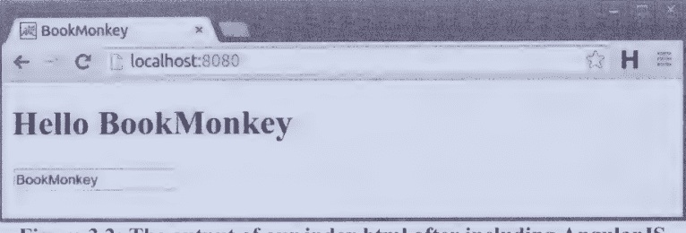

如果你重新加载浏览器窗口，页面应该看起来像图3.2所示。它已经支持交互了。如果你更改我们框中的文本，标题中的文本也会立即更新。双向数据绑定工作了。这意味着你已成功将AngularJS集成到我们的项目中。

> 使用下载的项目
> 或者，你可以使用从出版商网站下载的随附项目。在这种情况下，请切换到`ch03_01_project_init/app`目录并从那里启动`http-server`。

## 为什么在这里使用自动更新？并且，这里到底发生了什么？

因为我们在`<html>`上使用了`ngApp`指令进行注解，AngularJS将评估此DOM部分内的所有指令和表达式。在实践中，这意味着整个DOM都会被评估。通过在消息中使用`ngInit`指令...

`<h1>`标签中的表达式`Hello {{name}}`会触发 AngularJS 使用此区域的`作用域`。实际上，框架会检查作用域变量`name`是否在`$rootScope`中定义，如果已定义，则显示其值。此外，每次作用域变量`name`的值发生变化时，该表达式都会重新求值。

在`<input>`标签中使用`ngModel`指令，我们在作用域变量`name`上建立了双向数据绑定。因此，对该作用域变量名称的任何更改都会反映在`<input>`字段中。反之亦然。如果输入字段发生变化，作用域变量`name`也会自动更新。

## 项目启动：图书详情视图

既然我们已经为项目奠定了基础并成功集成了 AngularJS，我们现在需要着手处理 BookMonkey 项目。为此，我们引入了框架的更多概念和机制来解决相关问题。那么，让我们看看我们的第一个任务，我们以用户故事的形式来定义它：

> 作为用户 Michael，我想要获取一本图书的详细信息，以便更多地了解这本书。

这个故事的核心方面是显示特定图书的详细信息。为此，我们应该首先制作视图的线框图（参见图 3.3）。

基于这个线框图，我们尝试推导出一个能直接导向 JSON 结构的数据模型。我们选择了清单 3.3中的数据模型。

82 AngularJS

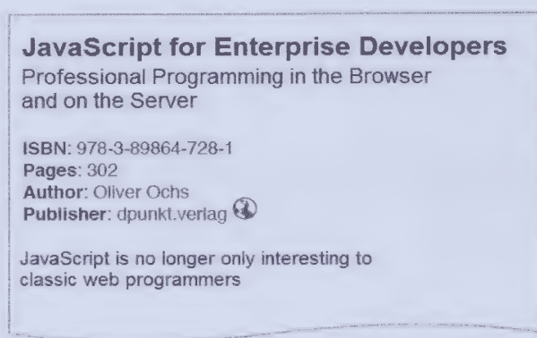

图 3.3：详情视图的线框图

### 清单 3.3：以 JSON 格式表示的图书详情视图的数据模型

```
{
    "title"    : "JavaScript for Enterprise Developers",
    "subtitle" : "Professional Programming in the Browser"
                 + "and on the Server",
    "isbn"     : "978-3-89864-728-1",
    "abstract" : "JavaScript is no longer only interesting to"
                 + " classic web programmers.",
    "numPages" : 302,
    "author" : "Oliver Ochs",
    "publisher": {
        "name" : "dpunkt.verlag",
        "url" : "http://dpunkt.de/"
    }
}
```

### 下载的项目
测试本节的代码，您可以使用出版商网站下载的随附项目。为此，请将目录更改为ch03_02_details_view/app`并从那里启动`http-server`。

### 使用表达式的详情视图
我们继续创建视图。为此，我们在`app`目录中创建一个名为`templates`的新目录来存放我们的模板。在新目录中，我们创建一个名为`book_details.html`的HTML文件。此文件包含模板。

#### 清单 3.4：详情视图的模板

```
<h2>{{ book.title }}</h2>
<h3>{{ book.subtitle }}</h3>
<p>
  <ul>
    <li>ISBN: {{ book.isbn }}</li>
    <li>Number of Pages: {{ book.numPages }}</li>
    <li>Author: {{ book.author }}</li>
    <li>
      Publisher:
      <a ng-href="{{ book.publisher.url }}"
        target="_blank">
        {{ book.publisher.name }}
      </a>
    </li>
  </ul>
</p>
<hr>
<p>
  {{ book.abstract }}
</p>
```

清单3.4显示了详情视图的HTML代码。我们使用表达式`{{book.title}}`、`{{book.subtitle}}`等显示信息。为了使这些表达式求值，作用域变量`book`必须位于该视图的作用域中，并且`book`必须指向包含相应属性（`title`、`subtitle`等）的对象。我们将使用控制器来定义此视图的作用域。但是，首先让我们再看一下。

> 国际化
在此处的示例中，我们并未涉及国际化。然而，有一些 AngularJS 模块可以处理它。最著名且使用广泛的模块是 Pascal Precht 的 ng-translate。它可以轻松适应现有的服务结构，拥有广泛的文档，并且仍在积极开发。您可以从 http://pascalprecht.github.io/angular-translate 下载此模块。

### 使用 ngBind 和 ngBindTemplate 的模板
考虑清单 3.5中的 HTML模板。

#### 清单 3.5：使用 ngBind 显示图书信息

```
<h2 ng-bind="book.title"></h2>
<h3 ng-bind="book.subtitle"></h3>
<p>
  <ul>
    <li ng-bind-template="ISBN: {{ book.isbn }}"></li>
    <li ng-bind-template="Number of Pages:
    {{ book.numPages }}</li>
    <li ng-bind-template="Author: {{ book.author }}</li>
    <li
      Publisher:
      <a ng-bind="book.publisher.name"
        ng-href="{{ book.publisher.url }}"
        target="_blank">
      </a>
    </li>
  </ul>
</p>
<hr>
<p ng-bind="book.abstract">
</p>
```

### 使用 ngBind 和 ngBindTemplate 的模板

在清单 3.5中，我们基本上用特殊的`ng-bind`属性替换了表达式。定义`ng-bind`属性的`ngBind`指令也是框架标准配置的一部分。从技术上讲，该指令将作为属性值的作用域变量的值绑定到注解的HTML元素上。最后，使用此指令产生的输出与等效表达式相同。然而，与表达式相比，`ngBind`指令有两个决定性的优势：

1. 在 AngularJS 完成对表达式的求值之前，表达式在视图上可见。使用`ngBind`时则发生这种情况。
2. 当从表达式生成输出时，如果相应变量作用域的值变化，AngularJS总是创建一个新的DOM元素来替换旧值的旧DOM元素。如果您改用`ngBind`指令输出，框架将不会创建新的DOM元素，而是用作用域变量的新值更新现有DOM元素的文本内容。与表达式相比，`ngBind`具有性能优势，并且通常在我们的应用程序中消耗少的内存。

此外，清单 3.5中的模板还使用了一个与`ngBind`相关的指令，即`ngBindTemplate`指令。顾名思义，您可以使用它来定义HTML元素的文本内容模板。当我们想要生成将静态字符串与变量作用域的值组合在一起的输出时，`ngBindTemplate`指令非常有用。此外，`ngBindTemplate`还可以生成混合多个作用域变量值的输出，因为我们可以使用此指令指定多个表达式。`ngBindTemplate`指令与`ngBind`对于简单表达式具有相同的优势。

## 定义应用模块

在优化模板之后，我们现在想要实现为该视图提供作用域并在`book`变量的作用域中包含相应`Book`对象的控制器。此外，我们还想创建我们的第一个路由。为此，我们需要扩展我们的项目结构和`index.html`文件。我们`index.html`文件的新版本如清单 3.6所示。

#### 清单 3.6：index.html 的高级版本

```
<!DOCTYPE html>
<html ng-app="bmApp">
<head>
<meta charset="utf-8">
<title>BookMonkey</title>
</head>
<body>
  <header>
    <h1>BookMonkey</h1>
  </header>
  <div ng-view></div>
  <!-- Scripts -->
  <script src="lib/angular.js"></script>
  <script src="lib/angular-route/angular-route.js"></script>
  <script src="scripts/app.js"></script>
  <script src="scripts/controllers/book_details.js"></script>
</body>
</html>
```

清单3.6显示了一个使用`ngApp`指令指定的模块，当DOM加载完成后，AngularJS自动加载该模块。一旦浏览器加载了DOM，就启动`bmApp`模块。此时我们已经可以，我们的BookMonkey应用程序只有一个模块。

#### 第一个路由

查看清单3.6中的`<script>`标签，我们意识到还需要两个JavaScript文件：`app.js`和`book_details.js`。`app.js`文件包含我们的`bmApp`模块的定义和路由。在`book_details.js`文件中，我们将实现`BookDetailsCtrl`控制器，该控制器为详情视图提供数据。为此，我们首先在`app`目录下创建一个`scripts`目录。在新目录中，我们将存储BookMonkey应用程序的所有源代码。接下来，我们在`scripts`目录中创建一个名为`app.js`的文件。在`scripts`目录下，还创建一个名为`controllers`目录，同时我们还将另一个控制器并存储在其中。

#### 清单 3.7：app.js 中 bmApp 模块的定义和第一路由

```
var bmApp = angular.module('bmApp', ['ngRoute']);
bmApp.config(function ($routeProvider) {
    $routeProvider.when('/books/:isbn', {
        templateUrl: 'templates/book_details.html',
        controller: 'BookDetailsCtrl'
    });
});
```

清单3.7展示了`app.js`的源代码。第一行中，我们使用 AngularJS的`module()`函数定义了`bmApp`模块。重要的是模块名称作为第一个参数。模块名称与`index.html`文件中用于`ngApp`指令相对应。第二个参数是一个数组，我们的`bmApp`模块依赖于其他模块。因为我们希望在BookMonkey应用程序中使用路由，所以需要引入`ngRoute`模块。这个模块可用，是因为我们在`index.html`文件中包含了`angular-route.js`文件。

此外，我们在`config()`块中使用`$routeProvider`来配置我们的第一路由。回想一下，我们可以使用依赖注入来注入服务者在应用程序的配置阶段`config()`块。这意味着我们可以使用`$routeProvider`来配置`$route`服务的路由。路由是模板上的URL。可选地，如我们的示例所示，我们还可以指定一个控制器。`$route`服务在运行时评估哪条路由是活动的，它与我们在`index.html`文件中使用的`<div>`容器标注的`ngView`指令密切协作（参见清单 3.6）。根据当前URL，配置模板将被加载到该`<div>`元素的`innerHTML`属性中。此外，如果某条路由配置了控制器，将为模板创建一个新的作用域并调用控制器的构造函数。这种关系如图3.4所示。

88 AngularJS

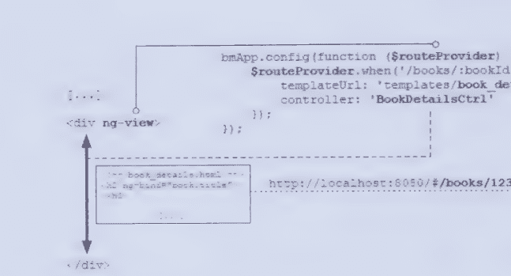

图 3.4：ngView指令与$routeProvider之间的关系

查看映射到图书详情视图的`/books/:isbn`路由，还有一个小特性。可以用冒号指定路径参数。在此路由中，`isbn`是一个路径参数。这意味着URL的这部分可以是变量，但仍将映射到配置的模板和控制器。在图书信息的后续开发阶段，我们可以使用`isbn`路径参数访问相应的图书。在`BookDetailsCtrl`控制器内部，通过所谓的`$routeParams`服务可以实现访问。

### 使用 BookDetailsCtrl 控制器创建的作用域

在清单3.8中BookDetailsCtrl的基本实现里，我们暂时还不关心ISBN。相反，我们希望将一个`Book`对象赋值给作用域变量`book`，以便制作出详细视图的第一个可用版本。回想一下，DOM元素的控制器定义了它自己的作用域。`BookDetailsCtrl`控制器也是如此。在模板的DOM部分（`book_details.html`）中，AngularJS在每次调用路由都会创建一个新的作用域。在这个作用域中，我们可以访问控制器的构造函数内部部分。在作用域中，我们最终用包含模板中通过`ngBind`或`ngBindTemplate`指令指定的所有属性的`Book`对象来设置`book`变量。

#### 清单 3.8：BookDetailsCtrl 的实现

```
bmApp.controller('BookDetailsCtrl', function($scope)
{
  $scope.book = {
    title : 'JavaScript for Enterprise Developers',
    subtitle :
      'Professional Programming in the Browser'
          + ' and on the Server',
    isbn : '978-3-89864-728-1',
    abstract : 'JavaScript is no longer only'
          + ' interesting to classic web programmers',
    numPages : 302,
    author : 'Oliver Ochs',
    publisher: {
        name : 'dpunkt.verlag',
        url : 'http://dpunkt.de/'
    }
  };
});
```

现在，如果您在浏览器中输入匹配已定义路由的URL，您应该能看到如图3.5所示的详细视图的初版。一个可能的URL是：

```
http://localhost:8080/#/books/123
```


```markdown
当然，您也可以传递除 `123` 以外的值作为路径参数。由于我们在创建详细视图时还未处理 `isbn` 路径参数，因此始终渲染相同的详细视图。

## 首先，测试

如前所述，采用测试驱动开发的方法非常重要。从这个角度来看，我们已经犯了一个错误，因为我们没有在实现之前先编写测试。因此我们想在此时编写第一个简单的测试，以证明在模板中使用 `ngBind` 或 `ngBindTemplate` 指令将产生与表达式相同的结果。

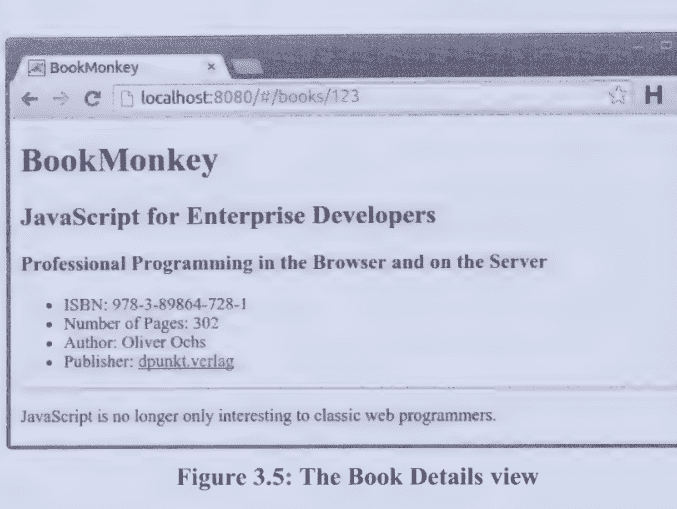

### 图 3.5：图书详细视图

我们在 `BookMonkey` 主目录中有一个名为 `test` 的目录用于存放将要编写的测试。现在在 `test` 目录中，我们将创建两个名为 `unit` 和 `e2e` 的子目录。在 `unit` 目录中，我们将存储单元测试，而在 `e2e` 目录中，我们将进行 E2E 测试。

总之，您使用单元测试来测试与应用程序其余部分隔离的小型应用程序单元。此类火炉此类单元的示例包括控制器、服务、指令和过滤器。在单元测试中，您运行部分逻辑，然后检查执行结果是否符合预期。为了编写真正的隔离测试，应用程序单元的依赖通常会被模拟。这意味着您用模拟对象替换依赖的实际实现。模拟对象是一个具有为被测应用程序单元提供的相同公共 API 的对象。模拟对象不是实际实现，而是提供返回某些硬编码值的实现。基于这些硬编码值，您可以确定依赖在测试用例中应该如何表现。AngularJS 自带自己的模拟实现，可以在进行测试时为您节省大量工作。

然而，在 E2E 测试中，您应该将应用程序视为黑盒。您无法访问 JavaScript 代码的内部状态，因此无法基于这个条件来制定预期。相反，你只能制定与 DOM 状态相关的预期。

使用领域特定语言（DSL），您可以控制潜在用户应该如何行为。这样，您可以将应用程序置于特定状态，然后检查 DOM 以确定应用程序是否正常运行。

此时，我们想要通过 E2E 测试来检查图书详细视图的模板。为此，我们需要再次扩展模板，使其能够轻松引用我们想要在测试中检查其内容的相应 DOM 节点。

### 清单 3.9：扩展模板以包含 CSS 类

```html
<h2 ng-bind="book.title" class="bm-book-title"></h2>

<h3 ng-bind="book.subtitle" class="bm-book-subtitle"></h3>

<p>
  <ul>
    <li ng-bind-template="ISBN: {{ book.isbn }}"
        class="bm-book-isbn"></li>
    <li ng-bind-template="Number of Pages:{{ book.numPages }}"
        class="bm-book-num-pages"></li>
    <li ng-bind-template="Author: {{ book.author }}"
        class="bm-book-author"></li>
    <li>
      Publisher: <a ng-bind="book.publisher.name"
                   ng-href="{{ book.publisher.url }}"
                   target="_blank"
                   class="bm-book-publisher-name">
      </a>
    </li>
  </ul>
</p>

<hr>

<p ng-bind="book.abstract" class="bm-book-abstract"></p>
```

清单 3.9 展示了扩展后模板的标记。如您所见，包含相关图书信息的 HTML 元素补充了 CSS 类（如 `bm-book-title`）。这使得我们可以制定简短的 CSS 选择器来引用这些 HTML 元素，并在 E2E 测试中检查其内容。

## 92 AngularJS

在编写实际的 E2E 测试之前，我们需要在 `e2e` 目录中创建一个名为 `templates` 的子目录。我们还需要在 `templates` 中创建一个 `book_details.spec.js` 文件，并在该文件中定义书籍详情的 E2E 测试。

> **测试的文件名与结构**
> 通常所有测试文件都使用 `.spec.js` 扩展名。此外，测试目录的结构应与 `app` 目录中应用程序的结构相似。

### 清单 3.10：模板的 E2E 测试

```javascript
describe('E2E: book details view', function(){
    beforeEach(function() {
        browser().navigateTo('/'); 
    });

    it("should show the correct book details",function(){   
        browser().navigateTo('#/books/978-3-89864-728-1');
        expect(element('.bm-book-title').html()).toBe('JavaScript for Enterprise Developers');   
        expect(element('.bm-book-subtitle').html()).toBe('Professional Programming in the Browser' + ' and on the Server');   
        expect(element('.bm-book-isbn').html()).toBe('ISBN: 978-3-89864-728-1');   
        expect(element('.bm-book-num-pages').html()).toBe('Number of Pages: 302');   
        expect(element('.bm-book-abstract').html()).toBe('JavaScript is no longer only interesting to classic web programmers.');
    });
});
```

清单 3.10 展示了书籍详情的 E2E 测试（参见 `book_details.spec.js`），该测试检查作用域中的数据是否正确返回。如果你熟悉 Jasmine 测试框架（http://pivotal.github.io/jasmine），你可能会立即看出其中的相似之处。事实上，AngularJS 用于 E2E 测试的 `ngScenario` 就是基于 Jasmine 设计的。

### Protractor 框架

Protractor 项目可以从 http://github.com/angular/protractor 下载，它是一个用于定义 E2E 测试的框架。它与 `ngScenario` 类似，但基于 WebDriver 规范，可以对浏览器进行更多的控制。AngularJS 官方文档提到，Protractor 将来会取代 AngularJS 的 E2E 环境。测试环境的配置和 API 的某些部分存在差异。然而，此处描述的 E2E 测试定义概念可以类似地应用，并且是普遍适用的。

基本上，E2E 测试的构建方式与单元测试相同。首先使用一个 `describe()` 函数来定义测试套件。该函数的第一个参数是测试套件的名称。第二个参数包含一个匿名函数，在其中定义测试用例。使用 `it()` 函数定义的单个测试用例，其第一个参数期望是一个自然语言表达预期行为的字符串。第二个参数是一个匿名函数，测试用例在其中定义。这种测试用例的特点是先创建一个条件，然后执行被测试的功能，最后以一个或多个 `expect()` 函数表述预期的后置条件。如果多个测试用例需要相同的条件，或者你想在每个测试用例之前执行某些逻辑，那么可以使用 `beforeEach()` 函数。该函数期望一个参数，即一个将在每个测试用例之前执行的函数。

在清单 3.10 的 E2E 测试套件中，我们使用 `beforeEach()` 函数在每个测试用例之前导航到应用程序的首页。具体的调用如下所示。

```javascript
browser().navigateTo('/')
```

在当前开发阶段，这是我们可能对测试套件中所有测试用例相关的唯一条件。由于我们只定义了一个测试用例，我们可以将这个前置条件直接编码到测试用例中。然而，将来我们可能会添加更多需要这个条件的测试用例。着眼于未来，我们因此将其放入 `beforeEach()` 函数中。

在我们的单个测试用例中，我们导航到与之前手动在浏览器中打开的相同 URL。不过，这次我们添加了一个带有真实 ISBN 的路径参数，为未来的开发准备这个测试用例。最终，我们将使用它来显示相应书籍的详情。

```javascript
browser().navigateTo('#/books/978-3-89864-728-1')
```

在当前开发阶段，这是我们可能对测试套件中所有测试用例相关的唯一条件。由于我们只定义了一个测试用例，我们可以将这个前置条件直接编码到测试用例中。然而，将来我们可能会添加更多需要这个条件的测试用例。着眼于未来，我们因此将其放入 `beforeEach()` 函数中。

在我们的单个测试用例中，我们导航到与之前手动在浏览器中打开的相同 URL。不过，这次我们添加了一个带有真实 ISBN 的路径参数，为未来的开发准备这个测试用例。最终，我们将使用它来显示相应书籍的详情。

在当前开发阶段，这是我们可能对测试套件中所有测试用例相关的唯一条件...（此处原文存在重复内容，已按要求保留核心逻辑）

为了编写真正的隔离测试，应用程序单元的依赖通常会被模拟。这意味着您用模拟对象替换依赖的实际实现。模拟对象是一个具有为被测应用程序单元提供的相同公共 API 的对象。模拟对象不是实际实现，而是提供返回某些硬编码值的实现。基于这些硬编码值，您可以确定依赖在测试用例中应该如何表现。AngularJS 自带自己的模拟实现，可以在进行测试时为您节省大量工作。

然而，在 E2E 测试中，您应该将应用程序视为黑盒。您无法访问 JavaScript 代码的内部状态，因此无法基于这个条件来制定预期。相反，你只能制定与 DOM 状态相关的预期。

使用领域特定语言（DSL），您可以控制潜在用户应该如何行为。这样，您可以将应用程序置于特定状态，然后检查 DOM 以确定应用程序是否正常运行。

此时，我们想要通过 E2E 测试来检查图书详细视图的模板。为此，我们需要再次扩展模板，使其能够轻松引用我们想要在测试中检查其内容的相应 DOM 节点。
```

```
    // Derive an array that only contains titles

    // for easier expectation checks.

    var orderedTitles = expectedBooks.map(function(book) {

        return book.title;

    });

    [...]

});
```

清单 3.12 展示了测试套件的基本结构。在编写实际测试用例之前，我们定义了一些辅助构造以简化测试用例的实现。此时相关的辅助构造是 `expectedBooks` 书籍数组。在该数组中，我们定义了希望在列表视图中看到的书籍条目，即一个具有 `title`、`isbn` 和 `author` 属性的对象。特别地，在此定义中重要的是 `Book` 对象应按预期顺序排列，这样我们就可以在测试用例中轻松检查列表视图是否已正确排序条目。在此我们选择了按书名字母顺序进行定义。

此外，我们使用 `map()` 函数从 `expectedBooks` 数组派生出一个名为 `orderedTitles` 的第二个数组，其中我们只按相同顺序存储书名。`orderedTitles` 数组是后续测试用例的辅助构造。

### 清单 3.13：E2E 测试套件的 `beforeEach()` 代码块，用于验证列表视图

```javascript
describe("E2E: book list view", function () {

    [...]

    beforeEach(function () {

        browser().navigateTo('#/books');

        browser().reload();

    });

    [...]

```
```

清单 3.13 展示了我们在清单 3.12 中测试套件的延续。与书籍详情的 E2E 测试一样，这里我们使用 `beforeEach()` 代码块来生成测试的前提条件。在此情况下，我们告诉 Karma 在每次测试用例之前导航到 `/books` 路由并重新加载文档。重新加载是必要的，因为在某些未来的测试用例中我们将更改视图状态。因此，我们确保在每次测试用例执行之前，视图处于其原始状态。仅仅导航到 `/books` 路由在这里是不够的，因为当我们导航到相同 URL 之间时，通常不会重新生成初始状态。

### 清单 3.14：验证正确书籍数量的测试用例

```javascript
describe("E2E: book list view", function () {

    [...]

    var selector = 'table.bm-book-list tr';

    it('should show the correct number of books', function () {

        expect(repeater(selector).count()).toEqual(

                expectedBooks.length);

    });

    [...]

});
```

我们在清单 3.14 中继续。由于我们在多个测试用例中需要该 CSS 选择器，因此将其存储在一个名为 `selector` 的变量中。

我们现在使用 `it()` 函数和 `repeater` 来编写第一个测试用例，以测试列表视图是否具有与 `expectedBooks` 数组中 `Book` 对象数量相同的条目。`repeater` 是 `ngScenario` 提供的一种构造，用于方便地从表格化的类 DOM 结构（其中大多数使用 `ngRepeat` 指令生成）中检索信息。此类表格化 DOM 结构的示例包括 HTML 表格。这种结构的特点是重复特定的 DOM 模式若干次。HTML 表格因此是这种结构的完美示例，因为每一行（`<tr>`>）通常具有相同数量的列（`<td>`>），从而具有一致的结构。

基于我们作为参数传递给 `repeater` 的 CSS 选择器，我们隐含地确定了列表视图应基于 HTML 表格。这样，我们可以使用 `repeater` 来确定列表视图中包含多少条目。`repeater` 上与此相关的函数是 `count()`。因此，我们现在可以表述该测试的期望。

接下来是下一个测试，该测试检查列表视图中的条目是否按书名降序正确排序。

### 清单 3.15：验证正确顺序的测试用例

```javascript
describe("E2E: book list view", function () {

    [

        it('should show the books in the proper order', function() {

            // Are they in the expected order

            // (ascending sorted by title)?

            expect(repeater(selector).column('book.title')).toEqual(

                orderedTitles);

            });
        ...

itte

        ...

    ]);

});
```

相应的测试用例如清单 3.15 所示。同样，我们使用 `repeater` 从 DOM 读取信息。然而，这次我们使用 `repeater` 的 `column()` 函数，从中可以再次看出 `repeater` 实际上是与 `ngRepeat` 指令配套的测试构造。`column()` 函数接受一个数据绑定表达式作为参数，这正是我们在与 `ngBind` 指令结合使用时用于生成模板输出的片段。此时我们确定该表达式应读取 `book.title`。之后，在实现中我们将必须使用以下表达式来生成输出：
ng-bind="book.title"

使用 `column()` 函数，我们可以轻松读取包含书名的表格列的值。该函数返回一个包含所有行相应列值的数组。因此，我们可以使用 `toEqual()` 匹配器来比较返回的数组是否与我们的 `orderedTitles` 数组相符。如果该期望得到满足，则意味着列表条目符合我们手动在 `expectedBooks` 数组中指定的顺序，因为 `orderedTitles` 数组是从 `expectedBooks` 数组派生而来的。

> **toEqual 匹配器**
> `toEqual()` 匹配器基于 AngularJS 的 `angular.equals()` 函数执行比较。该函数使用更复杂的算法来检查两个对象的相等性。除其他功能外，它还会检查两个数组中的各个元素是否匹配。使用该匹配器和 `repeater`，我们可以轻松编写相对复杂的期望。

在继续实际实现列表视图之前，我们还缺少最后一个测试用例，该用例验证在书名之后是否正确返回了作者和 ISBN。该测试用例可在清单 3.16 中找到。

#### 清单 3.16：验证正确列表内容的测试用例

```javascript
describe("E2E: book list view", function () {

    [...]

    it('should show the correct book information', function() {

        // Do the other book details (isbn, author) match?

        for (var i = 0, n = expectedBooks.length; i < n; i++) {

            expect(repeater(selector).row(i))
                .toEqual(

                    [
                        expectedBooks[i].title,
                        expectedBooks[i].author,
                        expectedBooks[i].isbn
                    ]
                );

        }
    });

});
```

此测试用例的特殊之处在于，我们使用了 `repeater` 的一个新特性，即 `row()` 函数。顾名思义，该函数接受一个表格行索引作为参数，并返回包含该行中各列值的数组。因此，我们可以很容易使用 `for` 循环来表达预期：每一行中的书名、作者和 ISBN 必须始终与 `expectedBooks` 数组中的相应定义等价。至此，我们已定义了列表视图上的最后一条预期。因此，我们现在可以按预期创建实现。在此之前，我们应该再次运行 E2E 测试，确保刚刚创建的测试套件中的测试失败，因为目前尚无实现。

```bash
karma start karma-e2e.conf.js
```

相应的负面反馈应如下所示。

```
Chrome 30.0.1599: Executed 4 of 4 (3 FAILED)
                                     (1.217 secs / 0.971 secs)
```

我们的 `Details` 视图 E2E 测试仍然是“绿色”，而我们刚刚定义的三个测试失败了。在输出中，我们还可以找出哪些测试失败了。

#### 列表视图的基础架构

定义完列表视图的 E2E 测试后，在开始实际实现之前，我们需要先创建基础架构。这意味着我们必须创建适当的文件，并在 `app.js` 中配置路由。

##### 清单 3.17：路由配置

```javascript
var bmApp = angular.module('bmApp', ['ngRoute']);

bmApp.config(function ($routeProvider) {

    $routeProvider.when('/books', {
        templateUrl: 'templates/list.html',
        controller: 'BooksCtrl'
    })
    .when('/books/:isbn', {
        templateUrl: 'templates/details.html',
        controller: 'BookDetailsCtrl'
    });

});
```


```javascript
// book_list.spec.js

var selector = 'table.bm-book-list tr';

it('[...]', function() {
  expect(
    repeater(selector).column('book.title')
  ).toEqual(orderedTitles);
});
```

##### 图 3.8：ngRepeat 与 repeater 之间的关系

`ngRepeat` 的第二个特殊之处在于，它为迭代的数组的每个元素创建一个新的作用域。这一事实对我们当前的列表视图示例没有影响。然而，了解这些背景信息很重要，以避免在创建更复杂的视图时出现意外。这个方面在使用 `ngRepeat` 指令渲染表单字段时尤为重要。你应该始终清楚在哪个作用域中将字段绑定到变量。

`ngRepeat` 指令为底层数组的每个元素创建作用域，在我们的应用程序中，这导致了图 3.9 所示的列表。为了更好地理解这一点，我们在图中添加了 `ngRepeat` 生成的 HTML 代码。

你可以在图 3.9 中看到，AngularJS 在 `ngRepeat` 指令产生的每个作用域中定义了作用域变量 `book`。作用域变量 `book` 引用了相应的 `Book` 对象。

要查看列表视图，请将浏览器定向到以下 URL。

```
http://localhost:8080/#/books
```

如果你没有出错，应该会看到如图 3.10 所示的列表视图。

## 108 AngularJS

**图 3.9：** 显示列表视图时的作用域层次结构

**图 3.10：** 列表视图

如果你得到了与图 3.10 相同的输出，那么逻辑上三个端到端（E2E）测试中至少有一个应该是“绿色”（即通过）的。最后，你可以使用熟悉的 Karma 调用来验证书籍的正确数量：

```bash
karma start karma-e2e.conf.js
```

现在只有两个测试失败了，如以下输出所示：
```
Chrome 30.0.1599: Executed 4 of 4 (2 FAILED)
(1.233 secs / 0.983 secs)
```
那个测试书籍数量的测试现在应该能通过了。你可以继续让另外两个测试也“变绿”。

#### orderBy 过滤器：确定排序顺序

如前所述，你可以使用 `ngRepeat` 指令根据特定条件对数组进行排序。你可以使用 AngularJS 自带的 `orderBy` 过滤器。

所以现在让我们扩展列表视图的模板，以便我们的书籍能按书名升序排列。我们已经制定了相应的端到端测试来满足这个要求。扩展内容可见于清单 3.20。

**清单 3.20：使用 orderBy 过滤器确定排序顺序**

```html
<table class="bm-book-list">
  <tbody>
    <tr ng-repeat="book in books | orderBy: 'title'">
      <td ng-bind="book.title"></td>
      <td ng-bind="book.author"></td>
      <td ng-bind="book.isbn"></td>
    </tr>
  </tbody>
</table>
```

你可以通过相应地扩展结构化的 `ng-repeat` 表达式来使用集合过滤器。为此，你可以使用管道符号，就像使用格式化过滤器一样。管道符号位于集合过滤器的名称之后（此处为：`orderBy`）。名称后面是一个冒号，将过滤器与其参数列表分隔开。你可以使用静态值，也可以引用作用域变量。作为清单 3.20 中代码的替代方案，你也可以在 `BookListCtrl` 控制器的作用域中定义一个名为 `booksOrderedBy` 的变量，并将字符串 `"title"` 赋值给它。这样，`ng-repeat` 表达式就会变成这样：

```
ng-repeat="book in books | orderBy: booksOrderedBy"
```

这里，`orderBy` 过滤器也受双向数据绑定的影响。这意味着你只需要在运行时更改作用域变量 `booksOrderedBy` 的值，就能根据不同的属性（如 ISBN）对书籍进行排序。

具体来说，`orderBy` 过滤器接受两个参数。第一个参数是比较谓词，你可以用几种不同的方式来指定。

- 如果你传递一个在当前有效作用域定义的函数的引用引用那么这个函数被理解为一个 getter 函数，其返回值被解释为每个元素的比较值。然后排序将基于每个元素的比较值进行，使用比较运算符 `>`、`<` 或 `==`。过滤器会将相应的数组元素传递给该函数，这样你（在对象的情况下）就可以轻松访问对象的某些属性并将其作为参考值返回。
- 如果你传递一个字符串，这个字符串将被解释为一个 AngularJS 表达式，并最终在数组的每个元素上求值以确定比较值。因此，这种比较谓词的指定方式仅对包含对象的数组有意义。此外，你可以在前面加上减号或加号，以使数组元素按升序（`+`）或降序（`-`）排序。不加前缀时，默认按升序排序。
- 你可以指定一个 getter 函数或表达式的数组。你使用第一个谓词进行比较。如果数组的两个元素相等，则使用下一个谓词来评估这两个元素。如果使用第二个谓词比较后，这两个元素仍然相等，则使用下一个谓词进行比较，依此类推。

`orderBy` 过滤器的第二个参数是可选的。如果你将 `true` 作为第二个参数传递，那么借助第一个参数完成的排序将被反转。如果你不提供该值，则假定排序不应被反转。

在我们清单 3.20 中的扩展模板中，我们使用了第二种方式来指定比较谓词。我们传递字符串 `"title"`，这表示排序应基于我们 `Book` 对象的 `title` 属性。

因此，我们通过这个小扩展在端到端测试中指定了排序。这样一来，剩下的两个测试用例现在也应该通过了。在浏览器中的手动版本应显示正确的顺序（参见图 3.11）。

**图 3.11：** 在列表视图中对书籍进行排序

接下来，我们想使用第一种方式来指定比较谓词，以实现相同的排序效果。我们通过更改 `ng-repeat` 表达式来实现这一点：

```
ng-repeat="book in books | orderBy: getBookOrder"
```

现在 `getBookOrder` 必须是当前有效作用域中的一个变量，并且引用一个函数，该函数为 `books` 数组中的每个 `Book` 对象返回比较值。当前有效的作用域仍然 `BookListCtrl` 控制器的作用域。这意味着我们必须扩展这个控制器的实现，使其达到清单 3.21 所示的程度。

**清单 3.21：带有 getBookOrder() 函数的 BookListCtrl 控制器**

```javascript
bmApp.controller('BookListCtrl', function ($scope) {
  $scope.books = [
    [...]
  ];
  $scope.getBookOrder = function(book) {
    return book.title;
  };
});
```

每次调用 `getBookOrder()` 函数时，`orderBy` 过滤器会将相应的 `Book` 对象作为参数传递。因为我们想按书名排序，所以返回书名作为比较值。至此，我们完成了使用 getter 函数定义比较词的工作。为了验证这个解决方案，我们可以重新运行我们的端端测试。

```
Chrome 30.0.1599: Executed 4 of 4 (401 secs / 32 secs)
```

#### 以编程方式调用过滤器

到为止，我们只在 `ngRepeat` 指令中使用了 `orderBy` 过滤器。这是一种常见的使用方式。然而，你可能也想编程方式调用过滤器，以便在控制器或服务中作为辅助函数使用。在 AngularJS 中你可以这样做。

**清单 22：在 BookListCtrl 控制器中以编程方式调用 orderBy**

```javascript
bmApp.controller('BookListCtrl', function ($scope, $filter) {
  $scope.books = [
    [...]
  ];
  $scope.getBookOrder = function(book) {
    return book.title;
  };
  // 这只是演示过滤器的用法
  var orderBy = $filter('orderBy');
  var titles = $scope.books.map(function(book) {
    return {title: book.title};
  });

  console.log('排序前的标题', titles);
  // 这是过滤器的实际调用
  titles = orderBy(titles, 'title');
  console.log('排序后的标题', titles);
});
```

如清单 22 所示，要编程方式调用过滤器，你需要使用 `$filter` 服务，AngularJS 可以通过注入将其给你。为此，你需要在构造函数中添加 `$filter`。`$filter` 服务本身就是一个函数，返回过滤器函数的引用，你可以通过过滤器名称来获取该引用。我们在清单 22 中做的就是调用 `$filter('orderBy')` 来获取过滤器引用。我们将这个引用存储在一个局部变量 `orderBy` 中。现在可以通过 `orderBy()` 调用 `orderBy` 过滤器。

为了展示编程用的实际例子，我们定义了一个名为 `titles` 的新数组并使用 `Array.map()` 函数从我们的 `books` 数组中填充数据。这个新数组只包含书名。起初，这个数组中的元素与 `books` 数组中的顺序相同。然而，在我们对数组应用 `orderBy` 过滤器函数之后，我们得到了一个新的数组，其中的标题按升序排列。编程方式调用的过滤器参数与其模板中使用时相同。然而，对于集合过滤器（如数组），我们必须将数组作为第一个参数传递。

### 第 3 章：摘要

- 你可以使用 `orderBy` 过滤器对集合（如数组）进行排序。
- `filter` 过滤器是一种集合过滤器，与 `ngRepeat` 指令关联使用。
- 在模板中使用：`repeat_expression | orderBy:predicate`
- 使用 `$filter` 服务以编程方式调用：`$filter('orderBy')(array, reverse)`
- 作为谓词，你可以定义一个函数、字符串或数组根据上述选项进行排序。
- 你可以通过第二个参数传入 `true` 来反转顺序。第二个参数是可选的。

#### 数据过滤

上一节了解了 `orderBy` 过滤器之后，现在我们将更进一步，实现一个函数来为列表视图过滤条目。我们将使用另一个 `filter` 过滤器。通过 `filter` 过滤器，我们可以根据特定条件限制数组的输出。

然而，在编写实际实现之前，我们将先实现指定过滤器预期行为的测试用例。为此，我们扩展列表视图的 E2E 测试套件，并编写三个测试用例。这一扩展如清单 23 所示。

# 清单 23：搜索功能的 E2E 测试

```javascript
describe("E2E: book list view", function () {
  it('should allow filtering by book title', function() {
    // Coffee
    var searchText = orderedTitles[0].substr(0, 6);
    input('searchText').enter(searchText);
    expect(
      repeater(selector).column('book.title')
    ).toEqual([orderedTitles[0]]);
  });

  it('should allow filtering by author', function() {
    // Andreas
    var searchText = expectedBooks[0].author.substr(0, 7);
    input('searchText').enter(searchText);
    expect(
      repeater(selector).column('book.title')
    ).toEqual([orderedTitles[0]]);
  });

  it('should allow filtering by isbn', function() {
    // 050-1
    var searchText = expectedBooks[0].isbn.substr(-5, 5);
    input('searchText').enter(searchText);
    expect(
      repeater(selector).column('book.title')
    ).toEqual([orderedTitles[0]]);
  });
});
```

为了表述实际预期，在三个测试用例中我们使用了前面章节中相同的机制，即 `repeater`。然而，与之前的测试用例不同，在新的测试用例中使用了 ngScenario 的 `input()` 函数。使用此函数，你可以引用模板中使用 `<input>` 标签定义的 DOM 元素。这意味着你可以使用 `input()` 函数与输入字段、单选按钮和复选框等进行交互。因此，`input()` 函数需要一个参数，即 `<input>` 元素绑定到的作用域变量的名称。在过滤器函数的实现中，我们可以使用 `ngModel` 指令将 `<input>` 标签绑定到作用域变量。因此，使用 `input()` 函数，我们规定在列表视图中必须有一个列表框，通过 `ngModel` 指令绑定到作用域变量 `searchText`。此输入字段用于输入搜索字符串，列表视图中的条目将据此进行过滤。

你可以使用 `enter()` 以编程方式向此框中输入字符串。

将字符串作为第一个参数传递给 `enter()` 函数。如果你仔细查看三个新的测试用例，你会发现它们都遵循相同的模式。我们让执行环境在输入字段中输入字符串，然后检查图书列表是否包含正确的条目。在每个测试用例中，我们分别随机定义了一个针对标题、作者和 ISBN 的过滤器。因此，在测试用例 1 中输入 `"Coffee"`、测试用例 2 中输入 `"Andreas"`、测试用例 3 中输入 `"050-1"` 后，过滤后的列表应始终产生相同的结果，即只显示一个条目：Andreas Schubert 的"CoffeeScript"图书。

自然，此时执行列表视图的 E2E 测试套件将导致三个失败的测试。

```
Chrome 30.0.1599: Executed 7 of 7 (3 FAILED)
(1.479 secs / 1.186 secs)
```

我们现在可以着手满足测试中国的预期了。首先，我们扩展列表视图的模板，添加刚才提到的搜索功能的输入字段（参见清单 24）。

# 清单 24：搜索功能输入字段的定义

```html
<input type="text" placeholder="Search..." ng-model="searchText">

<table class="bm-book-list">
  <tbody>
    <tr ng-repeat="book in books | orderBy: getBookOrder">
      <td ng-bind="book.title"></td>
      <td ng-bind="book.author"></td>
      <td ng-bind="book.isbn"></td>
    </tr>
  </tbody>
</table>
```


```markdown
这里有趣的是与 `<input>` 标签一起使用的 `ngModel` 指令。它确保在输入框和 `searchText` 作用域变量之间建立了双向数据绑定。我们在列表视图 DOM 部分有效的作用域中引用 `searchText` 变量。这将是我们 `BookListCtrl` 控制器的作用域。我们并没有随意选择作用域变量 `searchText` 的名称。我们知道，在我们的测试用例中，我们已经指定输入字段应该绑定到名为 `searchText` 的作用域变量。

我们在第 1 章"AngularJS 快速入门"中已经看到了 `ngModel` 指令的实际应用。通过双向数据绑定，AngularJS 在输入字段的值发生变化时自动更新 `searchText` 作用域变量。反之亦然。因此，作用域变量 `searchText` 的值发生变化时，输入字段中也会立即显示出来。对于我们的过滤器函数而言，双向数据绑定的第一个方面才是相关的。

如果我们没有犯错，搜索框现在应该出现在我们的图书列表中了（参见图 3.13）。然而，条目尚未被限制在列表中，因为我们还没有安装 `filter` 过滤器。

我们现在可以引入 `filter` 过滤器，如清单 3.25 所示。

#### 图 3.13：列表视图中的搜索字段

### 清单 3.25：使用 filter 过滤器的搜索功能

```html
<input type="text" placeholder="Search..." ng-model="searchText">

<table class=" BM-book-list">
  <tbody>
    <tr ng-repeat="book in books | orderBy: getBookOrder
      | filter: searchText">
      <td ng-bind="book.title"></td>
      <td ng-bind="book.author"></td>
      <td ng-bind="book.isbn"></td>
    </tr>
  </tbody>
</table>
```

### 过滤器的工作原理

由于 `filter` 过滤器与 `orderBy` 过滤器一样也是集合过滤器，我们将其与 `ngRepeat` 指令一起使用。为此，我们用管道符号扩展 `ng-repeat` 表达式。

如前所述，`searchText` 作用域变量作为过滤器的过滤谓词。因此，我们将此变量的值作为第一个参数传递给过滤器。这样，创建的 `searchText` 变量与 `filter` 过滤器之间建立了从输入框到过滤器的连接。结果，过滤器根据输入限制图书列表。AngularJS 执行过滤逻辑，使得每次 `searchText` 的值发生变化时，你都会立即获得一个过滤后的列表，该列表代表对 `Book` 对象数组的全文搜索结果。

如果你在浏览器中运行示例，例如在输入字段中输入字符串 "coffee"，你会立即获得预期的效果，如图 3.14 所示。我们的列表视图应该只包含 Andreas Schubert 的 "CoffeeScript" 图书这一项，因为这是唯一一本在其属性中包含 "Coffee" 字符串的图书。我们应该在此强调，我们实现搜索功能时没有编写一行 JavaScript 代码。

#### 图 3.14：过滤后的列表视图

我们创建的测试现在必须成功运行。Karma 对我们 E2E 测试配置的结果如下。

```text
Chrome 30.0.1599: Executed 7 of 7 SUCCESS (1.763 secs / 1.474 secs)
```

在我们更详细地讨论 `filter` 过滤器的操作之前，我们可以在图 3.15 中看到 `ngModel` 指令、`filter` 过滤器和 E2E 测试中的 `input()` 函数之间的关系。

```html
<!-- book_list.html -->
<input type="text" placeholder="Search..." ng-model="searchText">

<table class="bm-book-list">
  <tbody>
    <tr ng-repeat="book in books | orderBy: getBookOrder | filter: searchText">
      <td ng-bind="book.title"></td>
      <td ng-bind="book.author"></td>
      <td ng-bind="book.isbn"></td>
    </tr>
  </tbody>
</table>

// book_list.spec.js
var selector = 'table.bm-book-list tr';

it('[...]', function() {
  // Coffee
  var searchText = orderedTitles[0].substr(0, 6);
  input('searchText').enter(searchText);
  expect(repeater(selector).column('book.title')).toEqual([orderedTitles[0]]);
});
```

#### 图 3.15：ngModel、filter 与 input() 之间的关系

### 摘要

- 使用 `filter` 过滤器，可以根据特定条件过滤数组。例如，您可以实现客户端搜索功能。
- 除了支持全文检索外，您还可以彻底控制数据集合的过滤方式。
- 通过可选的比较器（`comparator`），您可以为比较操作定义过滤逻辑。
- 在模板中使用：`ng_repeat_expression | filter:predicate[:comparator]`
- 程序式地调用 `$filter` 服务：`$filter('filter')(array, predicate[, comparator]);`

在例程 3.25 中，`filter` 过滤器会根据包含字符串或可转换为字符串的任何 `Book` 对象属性来过滤数组。因此，匹配是基于子串的比较确定的，且不进行区分大小写。这意味着这种类型的过滤器使用等同于全文搜索。

与 `orderBy` 过滤器类似，您可以通过传递一个过滤器谓词（而不是字符串或函数）进一步配置 `filter` 过滤器。因此，存在以下可能的方式：

- 如果您将字符串作为过滤器谓词传入（如例程 3.25），则该过滤条件将根据数组元素比较的情况来筛选底层数组。如果某个元素与不包含区分大小写的该字符串或其任何子串匹配，则将其包含在返回的数组中。如果是对象形式的数组元素（如在 `books` 数组的情况下），则会比较所有对象的字符串属性以及所有可转换为字符串的属性。此外，您可以通过在该过滤谓词前加上感叹号 ("!"`) 对其进行取反操作。
- 如果底层数组的元素是对象（如我们的 `books` 数组），您可以使用过滤器谓词来确定应检查哪些对象属性以进行匹配。您还可以为每个对象的属指定单独的搜索字符串。示例：`book in books | filter: {title: 'Coffee', author: 'Andreas'}`。在这种情况下，只有满足两个条件的书才会被包含在结果中（标题中包含字符串 "coffee" 且作者中包含字符串"Andreas"）。由于比较时不区分大小写，因此值 "coffee"和"andreas"也将视为匹配项。
- 如果您将函数作为过滤器谓词传入，则可以在该函数中指定任何过滤逻辑。当评估过滤器时，AngularJS会对数组中的每个元素调用此函数。框架将该相应元素的第一参数传递给该函数。约定是：如果要将元素包含在返回的数组中，则该函数必须返回 `true`。否则，它必须返回 `false`。示例：`book in books | filter: funcName()`。
```
```
```

排版后：

如 **清单 3.28** 所示，从详情视图返回列表视图的测试用例与之前的测试用例具有相同的结构。我们导航到 ISBN 为 `978-3-89864-728-1` 的书籍的详细描述，并让 `karma` 点击我们通过 `.bm-list-view-btn` CSS 选择器引用的 DOM 元素。然后，我们期望应用程序显示列表视图。我们通过将浏览器地址栏的值与 URL 的路径组件进行比较来检查这一点。

在扩展了两个测试套件之后，我们可以使用 `E2E` 配置运行我们的 E2E` 测试，并确保它们失败。然后我们可以继续实现所需的功能，最终满足用户故事。

## 使用 Hashbang URL 进行导航

要在详情视图中添加链接，我们可以利用 `ngHref` 指令轻松扩展列表视图的模板。我们在 `BookMonkey` 项目开始时使用这个指令在详情视图中放置了一个指向出版社网站的超链接。

我们需要将 `ngHref` 指令与 `<a>` 标签一起使用，以定义包含一个或多个表达式的超链接。这样做的原因是 `AngularJS` 使用这个指令来确保链接只在表达式被求值后才设置。如果我们不使用这个指令，用户可能会看到一个无效的链接，因为框架尚未对表达式进行求值。由于 `AngularJS` 通常非常快地对表达式进行求值，显示无效链接的概率相当小，但并非为零。

因此，我们使用 `ngHref` 指令和 `<a>` 标签将列表视图中的书籍标题与相应的详情视图链接起来。我们通过将 `ng-href` 指令设置为详情视图的相对路径来实现这一点（参见**清单 3.29**）。使用表达式 `{{book.isbn}}`，我们确保为每本书使用正确的 ISBN。然而，我们需要在相对路径之前加上一个哈希键（`#`），以便旧浏览器不会用此 URL 完全重新加载网页。

我们现在来谈谈 hashbang URL。我们实际上使用 HTML 锚点机制来显示应用程序的不同部分。`AngularJS` 持续监控地址栏的内容，并将任何变化加载到相应的视图中。

为了使应用程序中的各个区域（列表视图、详情视图以及以后的其他视图）可以通过深度链接访问，我们在这里使用 hashbang URL。这些 URL 中，我们主要在 URL 的哈希部分（哈希符号后面的部分）编码以调用应用程序状态。本质上，我们使用 hashbang URL 来防止旧浏览器在用户点击应该加载应用程序另一部分的链接时重新加载页面。

除了 hashbang 方法之外——admittedly 这感觉像是一个临时解决方案，而且也让深度链接看起来很难看——我们可以使用 HTML5 History API。使用这个 API，可以使用常规 URL 并仍然防止 Web 应用程序的完全重新加载。在 `AngularJS` 中，你可以为应用程序激活所谓的 HTML5 模式。

通过激活 HTML5 模式，框架将在旧浏览器中使用 hashbang URL 进行导航，而在现代浏览器中使用带有 HTML5 History API 的常规 URL。为了实现这一点，`AngularJS` 会在运行时相应地重写所有链接。

然而，使用 HTML5 模式有一个缺点，这就是为什么默认情况下它是禁用的。如果你为应用程序启用 HTML5 模式，你还需要在提供应用程序的 Web 服务器上描述任何深度链接。最后，你必须确保每个用于调用应用程序的深度链接在到达浏览器执行时都会产生请求的客户端应用程序状态。

你可以通过在配置块（`config()`）中使用 `$locationProvider` 组件来启用 HTML5 模式。实际调用如下：

```
$locationProvider.html5Mode(true)
```

## 搜索引擎优化

搜索引擎的爬虫程序是为静态网页设计的，无法轻松索引单页应用程序。由于当前的发展越来越趋向于动态网页和应用程序，现在已经有了针对 Ajax 爬虫和 HTML 快照的规范。使用主流搜索引擎达成的规范，动态页面有可能被纳入搜索索引。关于这一点的优秀文章可以在 `ng-newsletter` 网站上找到：

```
http://www.ng-newsletter.com/posts/serious-angular-seo.html#.Ut6K6GSIUnV
```

## 清单 3.29：带有调用详情视图超链接的列表视图模板

```
<input type="text" placeholder="Search..."
       ng-model="searchText">

<table class="bm-book-list">
    <tbody>
        <tr ng-repeat="book in books | orderBy: getBookOrder
            | filter: searchText">
            <td><a ng-href="#/books/{{ book.isbn }}"
                ng-bind="book.title"></a></td>
            <td ng-bind="book.author"></td>
            <td ng-bind="book.isbn"></td>
        </tr>
    </tbody>
</table>
```

通过**清单 3.29** 中的扩展，我们有了从列表视图到详情视图的链接。在浏览器中执行代码应该显示预期的结果，我们的书籍标题应该被渲染为链接（参见**图 3.16**）。因此，我们定义的测试之一现在应该通过。

**图 3.16：书籍标题作为链接的列表视图**

仍然缺少的是详情视图中返回列表视图的链接。要添加该链接，我们需要一个 `<a>` 标签。然而，我们不需要 `ngHref` 指令，因为列表视图的相对路径不包含表达式。只需为链接提供普通的 `href` 属性就足够了。

但是，有一个方面我们必须考虑。在 E2E 测试中，我们使用 `.bm-list-view-btn` CSS 选择器来引用要点击的 DOM 元素。这意味着我们需要用 `bm-list-view-btn` CSS 类来标注我们的返回链接，以便 `karma` 可以在 E2E 测试中引用该 DOM 元素。**清单 3.30** 中可以看到必要的更改。

## 清单 3.30：带有返回列表视图链接的详情视图模板

```
<h2 ng-bind="book.title" class="bm-book-title"></h2>

<h3 ng-bind="book.subtitle" class="bm-book-subtitle"></h3>

[...]

<a href="#/books" class="bm-list-view-btn">Back</a>
```

我们现在已经实现了所需的导航。如果我们再次运行 E2E 测试套件，之前创建的两个测试用例应该不再失败。此外，浏览器中的手动测试应该反映所需的行为。点击列表视图上的书籍标题应该将我们带到详情视图。要返回列表视图，我们可以点击"Back"链接。

**图 3.17：带有返回链接的详情视图**

当然，在详情视图中你仍然只能看到书籍"JavaScript for Enterprise Developers"的详细信息，因为我们在 `BookDetailsCtrl` 控制器中没有使用通过 URL 传递的 ISBN（参见**图 3.17**）。我们将在下一节介绍我们的第一个服务时处理这个问题。

## ngClick 指令：响应点击事件

到目前为止，一切顺利。不过，我们要再次处理“详情”视图中“返回”链接的实现，以引入 AngularJS 的另外两个有趣特性：`ngClick` 指令和 `$location` 服务。

通过 `ngClick` 指令，我们可以指定当用户点击某个 DOM 元素时调用哪个函数。因此，使用此指令来实现“返回”链接似乎是合乎逻辑的，尽管这样做除了用于教学目的外不会带来任何其他优势。

### 清单 3.31：使用 ngClick 指令从控制器作用域调用函数

```
<h2 ng-bind="book.title" class="bm-book-title"></h2>

<h3 ng-bind="book.subtitle" class="bm-book-subtitle"></h3>

[...]

<a ng-click="goToListView()" href=""
  class="bm-list-view-btn">Back</a>
```

如清单 3.31 所示，我们使用 `ngClick` 指令来指定当用户点击 `<a>` 元素时调用 `goToListView()` 函数。因此，`AngularJS` 期望 `goToListView()` 函数在“详情”视图的当前有效作用域或其父作用域中被定义。“详情”视图的当前有效作用域仍然是 `BookDetailsCtrl` 控制器的作用域。因此，`AngularJS` 期望 `goToListView()` 函数在“详情”视图的当前有效作用域或其父作用域中被定义。


```markdown
清单 3.33 展示了我们针对 `BookDataService` 的单元测试的初步步骤。与端到端测试一样，我们使用 `describe()` 函数为单元测试定义一个测试套件。此测试套件包含两个 `beforeEach()` 调用，它们定义了在每个单元测试之前要执行的函数。在这些 `beforeEach()` 调用中，我们甚至可以看到两个主要函数 `module()` 和 `inject()` 的实际应用。这些函数由 `ngMock` 模块提供。

使用 `module()` 函数，我们将为测试加载我们的 `bmApp` 应用模块。这确保我们可以访问在此模块中实现的所有组件（服务、指令、控制器等）。

`inject()` 函数主要负责确保你在加载模块后能够访问模块的组件。顾名思义，你可以使用此函数告诉 `AngularJS` 通过依赖注入来注入应用组件。这基本上遵循与我们组件的匿名构造函数相同的模式。`inject()` 函数接受一个函数作为参数，在该函数内，你可以在参数中指定框架应提供哪些应用模块。正如你在清单 3.33 中看到的，这些目前还是一个很小的功能。

我们希望 `AngularJS` 注入 `BookDataService`，因为我们想在测试中测试该服务中的函数。一个好做法是将服务的对象的引用存储在一个同名的局部变量中，这样你就可以在单元测试中轻松访问该服务。这里，我们将传递的引用保存在一个名为 `BookDataService` 的局部变量中。我们在测试套件的开头声明了这个变量（`var BookDataService`）。然而，现在我们遇到了一个问题。

根据依赖注入规则，依赖解析基于参数名称。不幸的是，我们不能在第二个 `beforeEach()` 调用中将参数命名为 `BookDataService`，因为这会覆盖我们的局部 `BookDataService` 变量。幸运的是，`inject()` 函数允许我们用下划线括起变量名（`_BookDataService_`）。`AngularJS` 注入器（解析依赖的内部组件）知道在测试中解析依赖时应忽略下划线。因此，我们可以将服务的对象的引用赋给我们的局部变量 `BookDataService`，以便在后续的单元测试中使用。

> 测试中的依赖注入
将引用服务的局部变量命名为与服务相同的名称是一个好做法。这样，`AngularJS` 注入器就可以解析用下划线括起来的依赖项。

但是，如果你必须将局部变量命名为不同的名称，你可以在 `inject()` 调用中按照不带下划线的常规依赖项规范进行。

既然我们已经创建了测试套件的基本结构，就可以继续为 `BookDataService` 编写第一个单元测试了。

如清单 3.34 所示，嵌套 `describe()` 块从而更细致地组织测试套件是完全可能的。我们在外部 `describe()` 块中定义的用于获取 `BookDataService` 引用的 `beforeEach()` 调用，同样适用于内部 `describe()` 块中定义的所有测试用例。这里我们应该提到，`describe()` 块可以嵌套到任意深度，并且它们也可以包含 `beforeEach()` 和 `afterEach()` 块，这些块会在每个内部测试用例之前和之后执行。

**清单 3.34：验证公共 API 定义的单元测试**

```javascript
describe('Service: BookDataService', function () {

    [...]

    describe('Public API', function() {

        it('should include a getBookByIsbn() function', function ()
        {
            expect(BookDataService.getBookByIsbn).toBeDefined();
        });

        it('should include a getBooks() function', function () {
            expect(BookDataService.getBooks).toBeDefined();
        });

    });

});
```

```javascript
[...]
});
```

首先，我们验证 `BookDataService` 公共接口的定义。在第一步中，我们要求服务提供两个函数：`getBookByIsbn()` 和 `getBooks()`。为此，我们在一个独立的子套件中用 `it()` 定义相应的测试用例。

就像 `ngScenario` 一样，`Jasmine` 附带了一个漂亮的匹配器集合，你可以用它们来方便的表达期望。在清单 3.34 中，我们使用匹配器 `toBeDefined()` 来确保这两个 API 函数（`getBookByIsbn()` 和 `getBooks()`）的存在。

> 结构性测试
JavaScript 是一种解释型编程语言，具有动态类型系统。这意味着你必须接受这种语言的所有优点和缺点。许多批评者认为的一个很大缺点是，没有编译器可以警告类型不匹配。为了解决这个问题，我们在清单 3.34 中编写了 JavaScript 的结构性测试。确保所谓的鸭子类型得到维护。在软件工程的背景下，这个术语最初由 Alex Martelli 于 2000 年在新闻组 `comp.lang.python` 中提出：“换句话说，不要检查它是否是一只鸭子：检查它是否像鸭子一样嘎嘎叫，像鸭子一样行走，等等，这完全取决于你需要用哪种鸭子的行为子集来玩你的语言游戏。”

既然我们已经确保服务的公共 API 提供了 `getBookByIsbn()` 和 `getBooks()` 函数，我们现在就可以继续编写这些函数的具体实现。为此，我们定义了一个独立的套件（见清单 3.35），该套件又包含两个子套件，每个函数一个。从这个例子中我们可以看到，在一个文件内组织单元测试是多么容易。

## 清单 3.35：检查公共 API 功能的单元测试

```javascript
describe('Service: BookDataService', function () {

    [...]

describe('Public API usage', function() {

    describe('getBookByIsbn()', function() {

        it('should return the proper book object (valid isbn)',
        function() {
            var isbn = '978-3-3-86490-050-1';
            book = BookDataService.getBookByIsbn(isbn);
            expect(book.title).toBe('CoffeeScript');
        });

        it('should return null (invalid isbn)',
        function() {
            var isbn = 'test';
            book = BookDataService.getBookByIsbn(isbn);
            expect(book).toBeNull();
        });

    });

    describe('getBooks()', function() {

        it('should return a proper array of book objects',
        function() {
            var books = BookDataService.getBooks();
            expect(books.length).toBe(3);
        });

    });

});
```

这两个 API 函数的功能从名字上已经明显了。`getBookByIsbn()` 函数返回传入 ISBN 匹配的对象，而 `getBooks()` 返回所有书籍的数组。相应的单元测试在清单 3.35 中实现。我们期望当传入 ISBN `978-3-86490-050-1` 调用 `getBookByIsbn()` 函数时，它会返回标题为 "CoffeeScript" 的对象。我们使用匹配器 `toBe()` 进行检查。如果传入 ISBN 没有关联的书籍，该函数应返回 null，我们在第二个测试用例中使用匹配器 `toBeNull()`。第三个测试用例验证了 `getBooks()` 函数返回包含三个元素的数组。我们没有输入更多书籍。在这个用例中，我们当然实现更多逻辑来检查返回的对象是否真的是数组，以及相应的元素具有对象的结构（关键词：鸭子类型）。我们保持了测试的简单性，因为我们只想解释基本概念而不是深入细节。因此，我们以单元测试的形式制定了对 `BookDataService` 的期望。我们可以运行创建的测试套件一次，确保测试用例失败。毕竟我们还没有实现 `BookDataService` 服务。我们还需要注意，我们现在使用的是单元测试的 Karma 配置。此配置位于 `karma.conf.js` 文件中，也在我们项目的根目录中。如果没有这样做，你应该从根目录复制此配置。以下是调用 Karma 运行单元测试的配置文件

```bash
karma start karma.conf.js
```

如果没有出错，Karma 应该会给你关于失败测试的信息。

```
Chrome 30.0.1599: Executed 5 of 5 (FAILED) ERROR (0.727 secs / 0.022 secs)
```

除了汇总输出，对于每个测试用例，我们都会得到详细的堆栈跟踪和失败原因。可能是因为我们错误地表述了期望，或者是因为程序流程中的错误。在我们的情况下，五个测试用例都应该因为相同的原因失败。

```
Error: Unknown provider: BookDataService
```

此错误消息意味着 `AngularJS` 注入器找不到 `BookDataService`，因此 `inject()` 函数无法解析依赖。这是非常合逻辑，因为我们还没有实现该服务。

#### BookDataService：封装数据访问

我们现在可以开始编写 `BookDataService` 的第一个实现。首先在 `/app/scripts` 目录下创建一个名为 `services` 的目录。然后在此目录中创建一个 `book_data.js` 文件，并实现 `BookDataService`。

### 代码清单3.36：BookDataService 的公共 API

```javascript
bmApp.factory('BookDataService', function() {

    [...]

    // Public API
    return {
        getBookByIsbn: function(isbn) {
            [...]
        },
        getBooks: function() {
            [...]
        }
    };
});
```

正如你在第 2 章“基本原则与概念”中所学，`AngularJS` 自带了多种服务。在代码清单 336 中，你可以看到我们为 `BookDataService` 使用了服务工厂（`factory()` 函数）。相比于工厂，服务的优势在于可以在 `config()` 块中进行配置。然而，我们的 `BookDataService` 不需要配置，因此我们可以省去编写提供的时间。另一种可能的选择是使用 `service()` 函数将类的实例注册为一个服务。此外，我们决定不让示例变得不复杂。服务工厂是创建服务最常见的方式。

代码清单 336 显示，第一步中我们根据单元测试为 `BookDataService` 设定了公共接口。我们通常在定义服务的匿名函数中返回一个所谓的 API 对象。我们将所有属于公共 API 的函数都定义在这个对象中。这些都是我们希望提供给其他组件的功能。正如之前的单元测试所规定，第一步应该包含在 `getBookByIsbn()` 和 `getBooks()` 函数中。

在定义了 API 将要返回的对象之后，我们现在可以开始关注实现。第一步，我们将在服务内部存储静态的书籍数据。在着手这一步之前，我们应该为实现创建一个本地命名空间。为此，我们创建一个新对象并将其赋值给一个名为 `srv` 的局部变量。

一个良好的实践是将完整的内部实现写在一个命名空间中，这样你就不会意外地用内部函数污染全局命名空间，如果应用程序的其他部分错误地调用了这些函数，可能会导致难以识别的错误。

> ECMAScript 是 JavaScript 语言背后标准的名称。在撰写本书时，最新版本是 5.1 版，尽管 6 版正在开发中。

> 严格模式 使用命名空间对象的中间方案外，还有其他方法来应对 ECMAScript 5 中缺乏命名空间的问题。这些方法包括所谓的模块设计模式。


接下来，我们在 `srv` 命名空间内实现第二个 API 函数 `getBooks()`（见代码清单 3.39）。实现相当简单。由于我们不想暴露对内部数据结构 `srv._books` 的引用，我们在返回数组之前先复制它。这样，我们就不必担心潜在的调用者可能获得我们数据结构的引用并对其进行操作。和之前一样，我们必须将对 API `getBooks()` 的调用委托给内部实现函数 `srv.getBooks()`。在这种情况下，JavaScript 运行时环境在返回 API 对象后不会清除 `srv.getBooks()`，因为 `getBooks()` 闭包包含了对这个实现函数的引用。

### 代码清单 3.39：getBooks() 函数的内部实现

```javascript
bmApp.factory('BookDataService', function() {

    var srv = {};

    [...]

    // Service implementation

    [...]

    srv.getBooks = function() {

        // Copy the array in order not to expose
        // the internal data structure

        return angular.copy(srv._books);

    };

    // Public API

    return {

        [...]

        getBooks: function() {
            return srv.getBooks();
        }

    };
});
```

到目前为止，我们已经实现了 `BookDataService` 的第一个版本。因此，之前定义的单元测试应该通过了。为了证明这一点，再次使用我们的单元测试配置调用 karma。

```bash
karma start karma.conf.js
```

你应该会得到以下反馈。

```
Chrome 31.0.1650: Executed 5 of 5 SUCCESS (0.892 secs / 0.016 secs)
```

#### 集成 BookDataService

现在我们可以将 `BookDataService` 集成到我们的两个控制器 `BookListCtrl` 和 `BookDetailsCtrl` 中。首先，我们看 `BookListCtrl` 控制器（见代码清单 3.40）。为此，我们通过指定它为控制器匿名构造函数的第三个参数，告诉 AngularJS 通过依赖注入将 `BookDataService` 传递给我们。之后，我们就可以在控制器内部使用这个服务了。

我们不再使用作用域变量 `books` 来引用本地定义的 `Book` 对象数组，而是通过 `BookDataService` 的 `getBooks()` API 函数来访问信息。从语义上讲，我们的 `BookListCtrl` 控制器没有任何改变。

### 代码清单 3.40：在 BookListCtrl 控制器中调用 getBooks

```javascript
bmApp.controller('BookListCtrl', function (
    $scope, $filter, BookDataService) {
  $scope.getBookOrder = function(book) {
    return book.title;
  };

  $scope.books = BookDataService.getBooks();

  // 这只是为了演示过滤器的编程用法
  var orderBy = $filter('orderBy');
  var titles = $scope.books.map(function(book) {
    return {title: book.title};
  });

  console.log('titles before ordering', titles);
  // 这是过滤器的实际调用
  titles = orderBy(titles, 'title');
  console.log('titles after ordering', titles);
});
```

在我们编辑 `BookListCtrl` 控制器时，我们也可以移除那些用于编程方式调用过滤器的不必要部分。毕竟，它们对我们的应用没有任何价值。

结果如代码清单 3.41 所示。由于我们的 `BookListCtrl` 控制器现在看起来好多了，我们可以来处理 `BookDetailsCtrl` 控制器了。

### 代码清单 3.41：经过清理后的 BookListCtrl 控制器

```javascript
bmApp.controller('BookListCtrl',
function ($scope, BookDataService) {
  $scope.getBookOrder = function(book) {
    return book.title;
  };

  $scope.books = BookDataService.getBooks();
});
```

#### $routeParams 服务：选择 URL 参数

实现我们用户故事的一个重要方面是读取 URL 路径参数中传递的 ISBN。我们需要 ISBN 来通过 `BookDataService` 获取正确书籍的详情。我们将在 `BookDataService` 中实现 `getBookByIsbn()` 函数。

### 代码清单 3.42：在 BookDetailsCtrl 控制器中使用 $routeParams 服务读取 URL 路径参数

```javascript
bmApp.controller('BookDetailsCtrl',
function ($scope, $location, $routeParams, BookDataService) {
    var isbn = $routeParams.isbn;
    [...]
});
```

如代码清单 3.42 所示，我们使用 AngularJS 的 `$routeParams` 服务来读取 URL 路径参数。和往常一样，我们通过将其指定为控制器匿名构造函数的参数来让依赖注入传递它。`$routeParams` 服务包含了我们为路由配置设置的所有 URL 路径参数的值。如您在以下代码片段中所见，我们只有一个 ISBN（`:isbn`）作为路径参数在相应的路由中传递。

```javascript
$routeProvider.when('/books/:isbn', {
    templateUrl: 'templates/book_details.html',
    controller: 'BookDetailsCtrl'
});
```

我们可以通过访问 `$routeParams` 服务的匹配属性来获取值。在这种情况下，访问方式如下：

```javascript
var isbn = $routeParams.isbn;
```

我们将 ISBN 存储在局部变量 `isbn` 中。我们现在可以使用这个变量来调用 `BookDataService` 的 `getBookByIsbn()` 函数，并获取调用其详情视图的 `Book` 对象。在此之前，我们必须通过依赖注入获取 `BookDataService`。`BookDetailsCtrl` 控制器的最终版本如代码清单 3.43 所示。

### 代码清单 3.43：在 BookDetailsCtrl 控制器中调用 getBookByIsbn

``````
bmApp.controller('BookDetailsCtrl',
function ($scope, $location, $routeParams, BookDataService) {
    var isbn = $routeParams.isbn;
    $scope.book = BookDataService.getBookByIsbn(isbn);
    $scope.goToListView = function() {
        $location.path('/books');
    };
});
```

我们将 `BookDetailsCtrl` 扩展为使用 `BookDataService` 之后，我们可以在浏览器中运行应用程序，看看现在是否能获取每本书的详情。为此，我们调用列表视图。

`http://localhost:8080/#books`

似乎不对劲，因为列表视图只有一条记录。如果我们仔细检查控制台，会注意到一条消息。

`Error: Unknown provider: BookDataServiceProvider`

这个错误看起来熟悉。在创建 `BookDataService` 之前运行测试，我们看到相同的消息。AngularJS 注入器无法找到 `BookDataService`，因此无法解析 `BookListCtrl` 控制器。这是合乎逻辑的，因为我们尚未在 `index.html` 中导入 `book_data.js`。

### 代码清单 3.44：在 index.html 中包含 BookDataService

```html
<!DOCTYPE html>
<html ng-app="bmApp">
<head>
    [...]
</head>
<body>
    [...]
    <!-- Scripts -->
    <script src="lib/angular.js"></script>
    <script src="lib/angular-route/angular-route.js"></script>
    <script src="scripts/app.js"></script>
    <script src="scripts/controllers/book_details.js"></script>
    <script src="scripts/controllers/book_list.js"></script>
    <script src="scripts/services/book_data.js"></script>
</body>
</html>
```

在我们导入 `book_data.js` 文件（参见代码清单 3.44）之后，我们的 BookMonkey 应用程序应该正确运行，列表视图应包含正确的条目。此外，我们现在可以通过点击相应的条目来获取每本书的详情。图 18 显示了“CoffeeScript”书籍的详情视图。


##### 图 18：CoffeeScript 书籍的详情视图

我们也可以通过运行端端测试来判断应用程序是否正常工作。这些测试应该确认引入 `BookDataService` 没有对应用程序产生影响。

#### 总结

- 除了用于创建端端测试的 `ngScenario` DSL，AngularJS 还附带了 `ngMock` 模块，您可以使用它来包含 AngularJS 模块，允许应用组件通过依赖注入传递，并允许您为这些组件编写单元测试。
- 我们选择了 Jasmine 来创建单元测试。本可以使用的其他框架包括 Mocha 和 QUnit。
- `ngMock` 的主要函数是 `module()` 和 `inject()`。
- 我们使用服务工厂 `factory()` `factory()` 实现了 `BookDataService`。
- `BookDataService` 具有清晰的公共 API 和一个的基础实现。
- 我们可以通过依赖注入将 `BookDataService` 传递给其他组件。我们目前在 `BookListCtrl` 和 `BookDetailsCtrl` 控制器中使用。
- 我们可以使用 `$routeParams` 服务读取 URL 路径参数。

# 第 4 章

#### 扩展应用程序

在上一章中，我们实现了显示书籍的基本功能。在本章中，我们将处理书籍的创建、编辑和删除，并构建一个小型管理区域来执行这些操作。此外，本章的第二部分通过设计特殊指令来处理标签，以便对书籍进行分类。

最后，为了让更多客户端使用 BookMonkey，我们将应用程序连接到一个 REST Web 服务，以便我们可以在服务器上集中管理书籍。

## 管理区域

在本节中，我们将构建管理区域。具体来说，我们将编写函数处理三个方面。我们将首先在 `BookDataService` 中实现创建、编辑和删除书籍的剩余 CRUD 操作。我们最终将需要这些函数在管理区域中实现相应的功能。

扩展服务之后，我们将了解如何在 AngularJS 表单中轻松处理和验证输入。`formControl` 和 `ngModel` 是 AngularJS 核心组件的一部分。最后，我们将熟悉一些新的指令，这些指令将允许我们在其他视图中重用现有的模板。

对于这些功能，我们将编写以下用户故事。

> 作为管理员 Stefan，我希望能够创建、编辑和删除书籍，以便始终在不受限制的主页上向应用程序用户提供最新的信息。

#### 使用下载的项目

要测试本节中的代码，您可以使用从出版商网站下载的附带项目。为此，将目录更改为 `ch04_01_admin/app` 并从那里启动 http-server。

#### 首先是测试

在第一步中，我们扩展 `BookDataService` 以包含创建、编辑和删除书籍的剩余 CRUD 操作。和往常一样，我们通过单元测试指定 API 函数所需的行为。这样，我们通过代码清单 4.1 中的测试用例扩展了 `BookDataService` 的测试套件。

### 代码清单 4.1：BookDataService 公共 API 的单元测试

```javascript
describe('Service: BookDataService', function () {

    var BookDataService;

    // 加载应用模块
    [...]

    // 获取服务的引用
    [...]

    describe('Public API', function() {
        [...]

        it('should include a storeBook() function', function () {
            expect(BookDataService.storeBook).toBeDefined();
        });

        it('should include a updateBook() function', function () {
            expect(BookDataService.updateBook).toBeDefined();
        });
```

# 第 4 章：扩展应用程序 153

```javascript
it('should include a deleteBookByIsbn() function',
  function () {
    expect(BookDataService.deleteBookByIsbn).toBeDefined();
  });

});

});
```

清单 4.1 定义了剩余函数的单元测试。我们规定创建函数应调用**存储图书**，更新函数**更新图书**和删除函数**通过 ISBN 删除图书**。

对于**存储图书**函数的单元测试还有更多内容。如常例所示，我们为新的函数创建一个独立的测试套件（参见清单 4.2）。

##### 清单 4.2：存储图书的单元测试

```javascript
describe('Service: BookDataService', function () {

  var BookDataService;

  [...]

  describe('Public API usage', function() {
    [...]

    describe('storeBook()', function() {
      it('should properly store the passed book object',
      function() {
        var beforeCount = BookDataService.getBooks().length;

        // store an example book
        var book = storeExampleBook();

        expect(BookDataService.getBooks().length).toBe(
                    beforeCount + 1);

        expect(BookDataService.getBookByIsbn(
                    book.isbn)).not.toBeNull();
      });
    });

    [...]

  });

  [...]

});
```


```
```
测试的实现非常清晰。我们将当前图书数量存储在局部变量`前计数`中。我们从数组的`长度`属性获取此信息（该信息由`获取图书列表()`函数返回）。随后，我们借助函数`存储示例图书()`创建一本新书。正如清单 4.3 所示，我们在该函数内使用 API 函数`通过 ISBN 获取图书()`，这正是需要测试的目标函数。其他测试用例同样需要一个样本图书。因此，我们可以将创建`书籍`对象逻辑外包给外部函数。需要注意的是，`存储示例图书()`函数返回一本样本图书。

如果实现成功，图书数量必须增加一个。我们使用与`等于` `()`匹配器相结合的`期望` `()`函数进行检查。结果数量应等于`前计数 + 1`。此外，利用 API 函数`通过 ISBN 获取图书()`，我们确保服务确实识别出了新创建的图书。根据`通过 ISBN 获取图书()`函数的规范，该函数不能返回 `null`。如果您将`期望` `()`的调用与`not` 链接起来，则`为 null` `()`匹配器会被否定。

### 清单 4.3：辅助函数存储示例图书 ()

```javascript
describe('Service: BookDataService', function () {

    var BookDataService;

    [...]

    // Helper functions

    var storeExampleBook = function() {

        var isbn = '978-3-86490-127-0',
            book = {
                title : 'Effective JavaScript (German edition)',
                subtitle : '68 Specific Ways to Harness the Power of' + ' JavaScript',
                isbn : isbn,
                abstract :'Do you realy want to master JavaScript?',
                numPages : 240,
                author : 'David Herman',
                publisher : {
                    name: 'dpunkt.verlag',
                    url : 'http://dpunkt.de/'
                }
            };
        BookDataService.storeBook(book);
        return book;
    };

});
```

原则上，API 函数`更新图书()`的测试用例遵循相同的模式（参见清单 4.4）。接下来，我们通过调用`存储示例图书` `()` 创建我们的示例图书。随后，通过将`book.abstract` 设置为“TEST”来更改示例图书的简短描述(`book.abstract`)。通过调用我们要测试的 API 函数`更新图书()`来更新该对象。因此，BookDataService 的`getBookByIsbn`现在应返回具有更新后简短描述的对象。最后，我们可以编写删除图书的测试用例。

### 清单 4.4：API 函数 BookDataService 中 updateBook () 的单元测试

```javascript
describe('Service: BookDataService', function () {

    var BookDataService;

    [...]

    describe('Public API usage', function() {

        [...]

        describe('updateBook()', function() {

            it('should properly update the book object',
                function() {

                    // store an example book

                    var book = storeExampleBook();

                    // change it

                    book.abstract = 'TEST';

                    // update the example book

                    BookDataService.updateBook(book);

                    expect(BookDataService.getBookByIsbn(
                        book.isbn).abstract).toBe(book.abstract);
                });

        });

        [...]
    });

    [...]
});
```

正如清单 4.5 所示，API 函数`通过 ISBN 删除图书()` ()的单元测试比前两个测试用例更清晰。这里我们使用`存储示例图书` `()` 提供示例。当我们调用我们要测试的`通过 ISBN 删除图书()`函数时，将立即删除这本示例图书。有了正确的结果，`通过 ISBN 获取图书()`函数应返回 `null`。

### 清单 4.5：API 函数 BookDataService 中 deleteBookByIsbn () 的单元测试

```javascript
describe('Service: BookDataService', function () {

    var BookDataService;

    [...]

    describe('Public API usage', function() {

        [...]

        describe('deleteBookByIsbn()', function() {

            it('should properly delete the book object with
                the passed isbn', function() {

                // store an example book

                var book = storeExampleBook();

                // delete the example book

                BookDataService.deleteBookByIsbn(book.isbn);

                expect(BookDataService.getBookByIsbn(
                    book.isbn)).toBeNull();
            });

        });
    });

    [...]
});
```

此时，一如既往，我们将执行一次单元测试以确保新的测试用例失败。如果我们没有犯错，所有新创建的测试用例都将失败。现在我们可以着手实现剩余的 API 函数。

#### BookDataService 的 CRUD 操作

由于我们已经通过一些单元测试指定了新 API 函数`存储图书()` `()`、`更新图书()` `()` 和`通过 ISBN 删除图书()`的行为，我们可以继续进行实现。

首先我们将讨论`存储图书()` `()`函数。沿此方向，我们将扩展由该指定函数返回的 API 对象，并将调用委派给我们的内部实现函数`srv.storeBook()`。因为到目前为止我们的 BookDataService仍然无法与后端系统通信，`srv.storeBook()`函数的实现由“一行代码”组成，我们将新的`Book`对象插入内部数组`srv._books`（参见清单 4.6）。

### 清单 4.6：API 函数 storeBook ()在 BookDataService 中的实现

```javascript
bmApp.factory('BookDataService', function() {

    var srv = {};

    srv._books = [
        ...
    ];

    // Service implementation

    [...]

    srv.storeBook = function(book) {
        srv._books.push(book);
    };

    [...]

    // Public API

    return {
        [...]

        storeBook: function(book) {
            srv.storeBook(book);
        },

        [...]
    };
});
```

基本上，我们将以相同的方式处理其他两个 API 函数。我们将进一步扩展`updateBook()` `()`的API对象并将调用委派给`srv.updateBook()` `()`。因此，`srv.updateBook()`函数的实现比`srv.storeBook()` `的实现稍微复杂一些。我们将在`for`循环中遍历我们的`srv._books`数组并查找ISBN与传递的ISBN匹配的`Book`对象。当我们找到正确的对象时，我们调用来自 AngularJS 的函数`angular.extend()`以将传递给该函数的`Book`对象的属性复制到找到的`Book`对象（参见清单 4.7）。调用`extend()`函数后，我们用`return`语句让函数提前终止。这是一种小的优化，可防止我们不必要地遍历更多书籍。

顾名思义，辅助函数`angular.extend()`将第二个对象的属性扩展至第一个对象。在相同属性名的情况下，第一个对象的属性将被第二个对象的属性覆盖。

### 清单 4.7：API 函数 updateBook ()在 BookDataService 中的实现

```javascript
bmApp.factory('BookDataService', function() {

    var srv = {};

    srv._books = [
        ...
    ];

    // Service implementation

    [...]

    srv.updateBook = function(book) {
        for (var i = 0, n = srv._books.length; i < n; i++) {
            if (book.isbn === srv._books[i].isbn) {
                angular.extend(srv._books[i], book);
                return;
            }
        }
    };

    [...]

    // Public API

return {
    [...]
    updateBook: function(book) {
        srv.updateBook(book);
    },
    [...]
};
});
```

API 函数`deleteBookByIsbn()` 尚未讨论。我们扩展 API 对象，并将调用进一步委托给内部实现函数`srv.deleteBookByIsbn()`。在该函数内部，我们再次遍历所有`Book`对象，搜索与传入的 ISBN 相同的书籍。使用数组函数`splice`，我们将从数组中删除。

### 清单 4.8：APIDataService 中 deleteBookByIsbn 的实现

```javascript
bmApp.factory('BookDataService', function() {

    var srv = {};

    srv._books = [
        ...
    ];

    // Service implementation

    [...]

    srv.deleteBookByIsbn = function(isbn) {
        var i;
        for (i = 0; i < srv._books.length; i++) {
            if (srv._books[i].isbn === isbn) {
                srv._books.splice(i, 1);
                return;
            }
        }
    };

    [...]

    // Public API

    return {
        [...]
        deleteBookByIsbn: function(isbn) {
            srv.deleteBookByIsbn(isbn);
        },
        [...]
    };
});
```


```markdown
```html
<h2 ng-show="isAdmin">管理区域</h2>
[...]
    <tr ng-repeat="[...]
        <td ng-hide="isAdmin">
            <a class="bm-details-link"
               ng-href="#/books/{{ book.isbn }}"
               ng-bind="book.title">
            </a>
        </td>

        <td ng-show="isAdmin">
            <a class="bm-edit-link"
               ng-href="#/admin/books/{{ book.isbn }}/edit"
               ng-bind="book.title">
            </a>
        </td>
        <td ng-bind="book.author"></td>
        <td ng-bind="book.isbn"></td>
        <td ng-show="isAdmin">
            <a class="bm-delete-link"
               ng-href="#/admin/books/{{ book.isbn }}/delete">
                删除
            </a>
        </td>
    </tr>
[...]
<p ng-show="isAdmin">
    <a class="bm-new-book-link" ng-href="#/admin/books/new">
        创建新书
    </a>
</p>
```

本质上，我们扩展了模板，使得现在多个 HTML 元素可以分别使用 `ngShow` 和 `ngHide` 指令来显示和隐藏。显示和隐藏取决于作用域变量 `isAdmin`。我们在 `AdminBookListCtrl` 控制器中将其设置为 `true`，而在 `BookListCtrl` 控制器中不为其赋值。这实际上使其值为 `false`。这意味着我们希望仅在应用程序显示管理员列表视图时显示这些特定的 HTML 元素。然而，在无限制的列表视图中，我们希望隐藏这些元素。

## 标题“管理区域”、编辑书籍的超链接（`<a class="bm-edit-link">`）、删除书籍的超链接（`<a class="bm-delete-link">`）以及创建新书的超链接（`<a class="bm-new-book-link">`）是应该在管理员变体中显示的 HTML 元素。相比之下，在管理员列表视图中打开详情视图的超链接应该隐藏。因此，基于 `ngShow` 和 `ngHide` 指令的 `resulting mutual exclusion` 意味着在管理员变体中，书籍标题与编辑视图链接，而在无限制变体中，它与书籍的详情视图链接。

现在我们可以继续构建 `AdminBookListCtrl` 控制器。为此，我们将在 `/app/scripts/controllers/` 目录中创建文件 `admin_book_list.js`。

### 清单 4.11：AdminBookListCtrl 控制器

```
bmApp.controller('AdminBookListCtrl',
function ($scope, BookDataService) {
    $scope.isAdmin = true;

    $scope.getBookOrder = function(book) {
        return book.title;
    };

    $scope.books = BookDataService.getBooks();
});
```

清单 4.11 展示了 `AdminBookListCtrl` 控制器，它定义了管理员列表视图的作用域：除了将值 `true` 分配给作用域变量 `isAdmin` 之外，它的实现与无限制变体的 `BookListCtrl` 控制器定义了相同的作用域。

关于列表视图的管理员变体，需要介绍的就是这些。此时，我们可以在浏览器中调用该视图。管理员列表视图应该如图 4.2 所示。

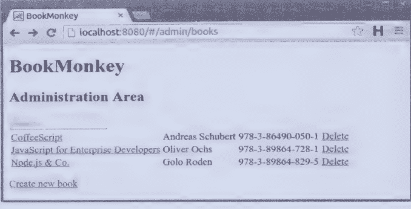

#### 图 4.2：管理员列表视图

### 使用 FormController 和 NgModelController 进行表单处理和验证

大多数 Web 应用程序需要用户输入。HTML 标准已经为此定义了表单和字段，如文本字段、复选框和单选按钮。HTML5 扩展了各种其他小部件，如滑块控件以及数字和 URL 输入字段。在内部，支持 HTML5 的浏览器会验证用户输入，以确保用户输入有效的数据。

在本节中，我们将讨论表单处理和验证。尽管浏览器进行了内部验证，AngularJS 带来了自己的机制来轻松验证表单输入。原因是需要有一种方法来影响验证的工作方式。HTML5 的默认机制朝着正确的方向前进。然而，它相当有限。例如，使用它无法使用 CSS 格式化错误消息或显示条件错误消息。因此，许多关于错误处理的需求无法被实现。使用 AngularJS

### BookMonkey 管理后台

创建新书籍

### 创建新书籍表单的路由配置

```javascript
var bmApp = angular.module('bmApp', ['ngRoute']);

bmApp.config(function ($routeProvider) {

    [...]

    /* 管理路由 */
    [...]

    .when('/admin/books/new', {
        templateUrl: 'templates/admin/book_form.html',
        controller: 'AdminNewBookCtrl'
    })

    [...]

});
```

如清单 4.12 所示，代码中引用了 `/admin/books/new` 路由、`book_form.html` 文件中的模板以及 `AdminNewBookCtrl` 控制器。这意味着我们还需要创建两个文件。首先，我们需要在 `/app/templates/admin` 目录中创建一个 `book_form.html` 文件。为此，我们需要在 `templates` 目录中创建一个名为 `admin` 的子目录。我们将在位于 `/app/scripts/controllers` 目录的 `admin_new_book.js` 文件中实现 `AdminNewBookCtrl` 控制器。

接下来，我们查看用于创建和编辑书籍的模板（`book_form.html`）。如清单 4.13 所示，此模板将被设计得像列表视图的模板一样可重用。使用作用域变量 `isEditMode` 作为开关，我们可以显示或隐藏某些元素。我们最终将在 `AdminEditBookCtrl` 控制器中将此作用域变量设置为 `true`，并在 `AdminNewBookCtrl` 控制器中将其设置为 `false`。

正如预期的那样，你将在 `<form>` 元素内找到表单处理和验证中最有趣的部分。在 AngularJS 中，`<form>` 元素具有特殊语义。当你在 AngularJS 中使用 `<form>` 标签时，你不仅仅是在定义一个 HTML 表单。在 AngularJS 中，`<form>` 标签代表 `form` 指令。当处理 `<form>` 标签时，会执行 `form` 指令并创建 `FormController` 的实例。这个 `FormController` 的内部状态存储有关表单的信息，例如表单是否已被用户修改以及是否有效。你不应该实现它的逻辑，因为它已经由 `form` 指令覆盖了。

使验证如此方便的关键点在于，你可以将此控制器的实例设置在当前有效的作用域中。而且你知道，你可以使用模板来输出作用域内定义的所有变量和函数，或用它们来“驱动”指令。这意味着你可以在模板中使用 `FormController` 的内部状态属性，特别是使用 `ngShow` 指令来显示特定内容。

脑海中的问题是：你如何告诉 AngularJS 将 `FormController` 实例传递到作用域？哪个作用域变量引用了这个实例？这些问题的答案在于 `<form>` 元素的 `name` 属性。`name` 属性在框架内也具有特殊含义。使用此属性，你可以告诉 AngularJS 在作用域中设置 `FormController` 的实例。你用来访问实例的作用域变量由属性值决定。在这种情况下，它是作用域变量 `bookForm`。有了这个，你现在可以在模板中使用内部属性来有条件地显示指定内容。`FormController` 的属性包括：

- `$pristine` – 一个布尔值，指示用户是否已经与表单进行过交互。
- `$dirty` – 包含 `$pristine` 的否定值。
- `$valid` – 一个布尔值，指示表单的当前状态是否有效。其值由每个相应表单组件的验证器决定。
- `$invalid` – 包含 `$valid` 的否定值。
- `$error` – 指向一个错误对象，该对象指定表单当前状态。

#### 使验证如此方便的关键点在于，你可以将此控制器的实例设置在当前有效的作用域中。而且你知道，你可以使用模板来输出作用域内定义的所有变量和函数，或用它们来“驱动”指令。这意味着你可以在模板中使用 `FormController` 的内部状态属性，特别是使用 `ngShow` 指令来显示特定内容。

#### 验证与提交按钮
```

`FormController` 和 `NgModelController` 相当于五个条件属性 `$pristine`、 `$dirty`、 `$valid`、 `$invalid` 和 `$error`。`FormController` 和 `NgModelController` 将确保为表单及其组件设置指定的 CSS 类。例如，如果 `$dirty` 和 `$valid` 均为 true，则 `NgModelController` 将相应的 `<input>` 元素注释上 CSS 类 `ng-dirty` 和 `ng-valid`。

这意味着您可以为这些 CSS 类定义特定规则，以便在验证期间通过错误消息向用户提供视觉反馈。我们不再对此多说。如果您已从出版商网站下载了 `BookMonkey` 项目，您将了解到我们在 `main.css` 文件中为许多示例定义了 CSS 规则。这些规则将为有效输入显示绿色背景，为无效输入显示红色背景。

此外，我们在清单 4.15 中使用 `ngDisabled` 指令使 ISBN 在编辑模式下不可编辑。

除了 `required` 指令之外，AngularJS 内部还包含更多验证器指令，它们故意以对相应 HTML5 属性的原生验证器命名，以实现无缝转换。具体来说，有属性的验证器指令：

- `required`。定义必填输入。
- `pattern`。检查输入是否匹配正则表达式。
- `min`。为数值设置最小值。
- `max`。为数值设置最大值。
- `minlength`。设置输入的最小长度。
- `maxlength`。设置输入的最大长度。

此外，框架还为 HTML5 新输入字段提供验证器指令。

- `<input type="number"/>`。检查数值。
- `<input type="url"/>`。检查输入是否指定了有效 URL。
- `<input type="email"/>`。检查输入是否指定了电子邮件地址。

Listing 4.16 显示了一个定义 `numPages` 输入字段的模板片段。由此可知，您除了使用 `required` 验证器之外，还使用了两个额外验证器。第一个是 `<input type="number"/>` 带来的验证器，另一个是 `min` 验证器，它指定了输入字段的最小值。这意味着表达式 `bookForm.numPages.$invalid` 的结果取决于这三个验证器。

### 清单 4.16：数字输入字段中的 min 验证器

```html
<h2>Administration Area</h2>
<div
    <h3 ng-hide="isEditMode">Create new book</h3>
    <h3 ng-show="isEditMode">Edit book</h3>

    <form name="bookForm" novalidate>

        [...]

        <input type="number" min="1" placeholder="Number of pages..."
               ng-model="book.numPages" name="numPages" required>
        <span ng-show="bookForm.numPages.$dirty
                      && bookForm.numPages.$invalid">
            <span ng-show="bookForm.numPages.$error.min">
                The book must have a minimum number of pages.
            </span>
            <span ng-hide="bookForm.numPages.$error.min">
                Please enter a valid number of pages.
            </span>
        </span>
    </form>
</div>
```

我们希望仅在 `required` 或数值验证器失败时显示一个聚合错误消息。此外，如果 `min` 验证器失败，我们希望代之以显示一个特殊错误消息，指示用户输入更高数量的页面。为此，我们使用 `NgModelController` 的 `$error` 属性。

正如前面提到的，`$error` 属性引用了一个错误对象，其属性是确定当前输入无效的验证器的字符串表示形式。对于 `NgModelController` 来说，这些属性的值绝对不是组件数组，而是布尔值，每个布尔值指示相应的验证器是否认为输入有效或无效。因此，您可以使用表达式 `bookForm.numPages.$error.min` 显示或隐藏您的特殊错误消息。在此处，您使用了众所周知的互斥模式，就像您在应用 `ngShow` 和 `ngHide` 指令时所做的那样。

### 清单 4.17：URL 输入字段中的 URL 验证器

```html
<h2>Administration Area</h2>
<div
    <h3 ng-hide="isEditMode">Create new book</h3>
    <h3 ng-show="isEditMode">Edit book</h3>

    <form name="bookForm" novalidate>

        [ ... ]

        <input type="url" placeholder="Publisher's website..."
               ng-model="book.publisher.url" name="publisherUrl"
               required>
        <span ng-show="bookForm.publisherUrl.$dirty
               && bookForm.publisherUrl.$invalid">
            <span ng-show="bookForm.publisherUrl.$error.url">
                Please enter a valid URL.
            </span>
            <span ng-hide="bookForm.publisherUrl.$error.url">
                Please enter the publisher's website.
            </span>
        </span>
        <br>

        [...]
    </form>
</div>
```

现在，请查看清单 4.17 中的代码。输入字段看起来与清单 4.16 中的相同，只是我们输入的是 URL 而不是页数。在这种情况下，我们肯定想要显示一个取决于 `url` 验证器的特殊错误消息。

完成创建书功能所缺的唯一内容是一个 `AdminNewBookCtrl` 控制器，我们将在 `admin_new_book.js` 文件中编写它。在清单 18 中，您将看到我们依赖注入 `BookDataService`。我们在 `submitAction()` 函数中使用此服务保存新的 `Book` 对象，当用户点击“Create new book”按钮时。为此，在此函数中我们调用 `goToAdminListView()` 从保存操作返回到 List 视图。我们在 `goToAdminListView()` 函数中使用了已知的 `$location` 服务。

### 清单 18：AdminNewBookCtrl 控制器

```javascript
bmApp.controller('AdminNewBookCtrl',
    function ($scope, $location, BookDataService) {
    $scope.book = {};
    $scope.submitBtnLabel = 'Create book';

    $scope.submitAction = function() {
        BookDataService.storeBook($scope.book);
        goToAdminListView();
    };

    $scope.cancelAction = function() {
        goToAdminListView();
    };

    var goToAdminListView = function() {
        $location.path('/admin/books');
    };
});
```

原因在于我们在 `Book` 对象属性与 `ngModel` 指令中的表单定义之间使用了双向绑定。这使得在用户填写表单时，`Book` 对象能够填充所需信息。最终，所有的书籍信息都位于 `Book` 对象中，因此该对象可以直接传递给 `BookDataService` 的 `storeBook()` 函数。实际上，我们不必在作用域（`scope`）中初始化 `Book` 对象（即 `$scope.book = {}`）。AngularJS 会在用户与表单交互时自动处理。当然，也有许多指令无法处理未初始化的对象；在这种情况下，您应该自行初始化。

#### 使用 ngModel 指令数据绑定

`ngModel` 指令的值应使用分隔符（例如 `ng-model="book.title"`）。这样就可以轻松地填充相应数据。此外，您还可以利用它避免作用域变化产生的副作用。如果到目前我们没有出错，那么应该创建一个新书。表单应如图 4.4 所示。当您与表单交互时，您将发现我们定义的验证器也在生效，因此收到的错误信息会以状态显示。

#### 使用 ngInclude 指令绑定

在构建了用于创建和编辑书籍的表单之后，我们现在处理预览功能。当输入书籍信息时，用户将获得即时反馈，如图 4.5 所示。


**图 4.4：创建新的表单**

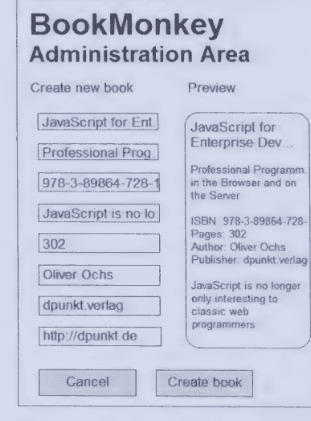
**图 4.5：带有预览的新书视图**

# 第 4 章：扩展应用程序

使用双向绑定，您可以轻松实现预览功能，即通过 `ngModel` 指令建立数据绑定，以便在将来的某个时刻在模板中显示该内容。此时，如果我们重用 Details 视图的模板，肯定可以节省大量的编码工作。实现这种重用的关键元素是 `ngInclude` 指令。

### 清单 4.19：使用 ngInclude 指令

```
<h2>管理区域</h2>
<div class="split-screen">
    <h3 ng-hide="isEditMode">创建新书</h3>
    <h3 ng-show="isEditMode">编辑书籍</h3>

    <form name="bookForm" novalidate>

        [...]

    </form>
</div>
<div class="split-screen">
    <h3>预览</h3>
    <div class="simple-border padded"
         ng-include="'templates/book_details.html'">
    </div>
</div>
```

正如清单 4.19 所示，您可以使用 `ngInclude` 指令在一个模板中包含另一个模板。为此，您需要提供模板的相对路径。请注意，`ngInclude` 指令期望相对路径由作用域变量提供。因此，静态路径必须使用单引号。

#### 预览功能说明

为了确保预览仅在表单右侧的帧中渲染，我们已用一些 CSS 类（`split-screen`、`simple-border` 和 `padded`）标注了对应的 HTML 元素。此处不再详细讨论具体的 CSS 规则。感兴趣的人士可以在随本书提供的下载 ZIP 文件中找到相应的样式表。如果在这一步骤中没有出错，浏览器界面应类似于图 4.6。

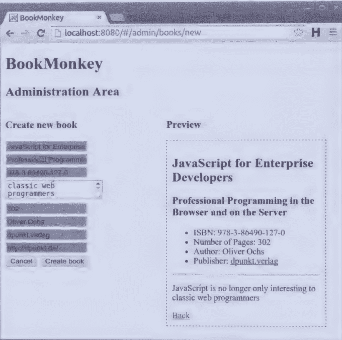
**图 4.6：带有创建新书表单（含即时预览）的视图**

在表单中输入数据时，您应该会注意到，所输入的内容会立即出现在右侧的预览区域中。为了实现此功能，我们确保所有对象属性（`title`、`subtitle` 等）与输入字段的名称完全相同。

#### 编辑书籍的功能

我们的 `BookMonkey` 应用程序应该允许管理员编辑现有的书籍。我们已经在管理员列表视图中添加了相应的超链接以导航至编辑书籍表单。因此，我们需要再次配置路由。

### 清单 4.20：路由配置

```
var bmApp = angular.module('bmApp', ['ngRoute']);

bmApp.config(function ($routeProvider) {

    /* 管理员路由 */

    $routeProvider.when('/admin', {
        templateUrl: 'templates/admin-list.html',
        controller: 'AdminListCtrl'
    })
    .when('/admin/edit/:id', {
        templateUrl: 'templates/edit-form.html',
        controller: 'AdminEditBookCtrl'
    });

});
```

排版后：

我们已在管理员列表视图中为删除功能添加了超链接。我们只需编辑 `app.js` 以更新路由配置即可，这样当调用路由 `/admin/books/:isbn/delete` 时，将加载 `book_delete.html` 模板和 `AdminDeleteBookCtrl` 控制器（见清单 4.22）。

### 清单 4.22：删除书籍对话框的路由配置

```
var bmApp = angular.module('bmApp', ['ngRoute']);

bmApp.config(function ($routeProvider) {
    [...]

    /* 管理员路由 */
    [...]

    .when('/admin/books/:isbn/delete', {
        templateUrl: 'templates/admin/book_delete.html',
        controller: 'AdminDeleteBookCtrl'
    })

    [...]
});
```

与之前一样，我们需要为它创建文件。对于模板，我们在 `/app/templates/admin/` 目录中创建 `book_delete.html` 文件。文件内容如清单 4.23 所示。

### 清单 4.23：删除书籍对话框的模板

```
<h2>管理区域</h2>
<h3>
删除书籍
"{{ book.title }}"</h3>
```

#### 扩展应用程序

我们在模板中只使用已经讨论过的函数。我们询问管理员是否真的要删除该书，并让他或她确认或取消操作。对于这两个操作，我们都定义了一个按钮。如果管理员确认删除，我们就调用 `deleteBook()` 函数并传递 ISBN。否则，如果管理员取消操作，则调用 `cancel()` 函数。

`AdminDeleteBookCtrl` 控制器也包含最少量的代码。我们在 `/app/scripts/controllers/` 目录下为控制器创建一个 `admin_delete_book.js` 文件。与我们使用的所有其他 JavaScript 文件一样，我们还必须使用 `<script>` 标签在 `index.html` 中包含 `admin_delete_book.js`。

### 清单 4.24：AdminDeleteBookCtrl 控制器

```javascript
bmApp.controller('AdminDeleteBookCtrl',
    function ($scope, $routeParams, $location, BookDataService) {
    var isbn = $routeParams.isbn;
    $scope.book = BookDataService.getBookByIsbn(isbn);

    $scope.deleteBook = function(isbn) {
        BookDataService.deleteBookByIsbn(isbn);
        goToAdminListView();
    };

    $scope.cancel = function() {
        goToAdminListView();
    };

    var goToAdminListView = function() {
        $location.path('/admin/books');
    };
});
```

清单 4.24 展示了 `AdminDeleteBookCtrl` 控制器的实现。与 `AdminEditBookCtrl` 控制器类似，我们使用 `$routeParams` 服务获取要删除的图书的 ISBN。然后将 ISBN 传递给服务函数 `BookDataService.getBookByIsbn()`，并将返回的 `Book` 对象赋值给作用域变量 `book`，这样我们就可以在模板中访问图书标题和 ISBN。最后，我们定义了两个函数 `deleteBook()` 和 `cancel()`，当用户点击其中一个按钮时会被调用。`deleteBook()` 函数内部调用 `BookDataService.deleteBookByIsbn()` 函数，该函数在管理员确认删除后实际删除图书。随后，我们使用 `$location` 服务跳转到管理员列表视图。如果用户取消删除操作，也会发生跳转。

图 4.9 展示了"删除图书"对话框的外观。要查看它，你必须在管理员列表视图中点击"删除"超链接。点击"Delete"会删除图书并将你带到管理员列表视图。点击"Cancel"会将你带回管理员列表视图，但在这种情况下，没有图书被删除。

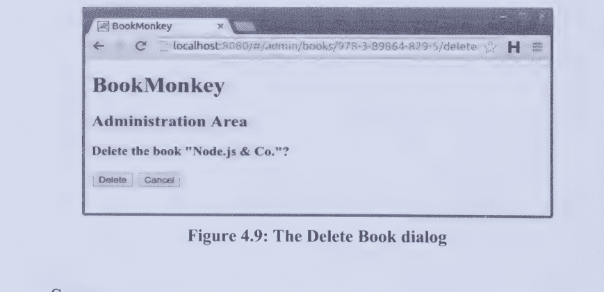

#### 小结

- 你可以使用 `ngShow` 和 `ngHide` 指令来显示或隐藏模板内容。
- AngularJS 包含一个验证机制。
- 对于 AngularJS 实例化的每个 HTML 表单，你可以在五对象属性（`$pristine`、`$dirty`、`$valid`、`$invalid` 和 `$error`）中立即找到表单的整体状态和 `FormController`。
- 整体状态是相关 `NgModelController` 实例个体状态的聚合。
- 对于每个表单组件，将依据表单组件的状态创建一个 `NgModelController`，并附带之前讨论的五个属性。
- 验证器在验证中扮演重要角色。AngularJS 包含所有 HTML5 属性和表单组件的相应验证器。
- 你可以使用 `ngInclude` 指令将一个模板与另一个模板绑定，从而使模板易于复用。

#### 使用标签创建分类

在上一节中，我们搭建了一个基本的图书管理区域，可以在其中创建、编辑和删除图书。现在，我们希望引入一种将图书分类的方法。许多现代 Web 应用程序使用标签来标注图书，标签可以代表图书所属的类别（参见图 4.10）。我们还可以使用这些标签，例如，来限制搜索结果或在特定分类中搜索图书。但就目前而言，我们只会为图书创建标签列表。

标签通常具有特定的格式。它们通常是小写的，并且不包含空格。因此，在我们的应用程序中，典型的标签可能如下所示：`javascript`、`web`、`browser` 或 `realtime`。

像往常一样，我们为此功能定义了一个用户故事。

> 作为用户 Michael，我希望看到表单中标签的信息，并了解图书属于哪些分类。

#### 使用下载

要测试本节中的代码，你可以从出版网站下载配套项目。为此，将目录切换到 `ch04_02_tags/app`，然后启动 `http-server`。

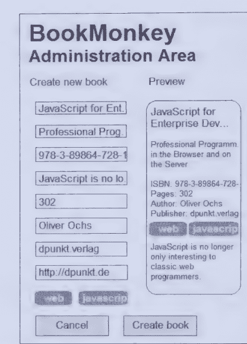
图 4.10：带有标签的视图

#### 用标签扩展数据模型

为了能够用标签对图书进行分类，显然我们需要扩展模型。为此，打开 `BookDataService` 实现的 `book_data.js` 文件，并为 `srv.books` 数组中的每个 `Book` 对象添加标签（参见清单 25）。

### 清单 25：用标签扩展数据模型

```javascript
bmApp.factory('BookDataService', function() {
    var srv = {};

    srv._books = [
        {
            title : 'JavaScript for Developers',
            [...]
            tags : [
                'javascript', 'enterprise',
                'nodejs', 'web', 'browser'
            ]
        },
        {
            title : 'Node.js & Co.',
            [...]
            tags : [
                'javascript', 'nodejs', 'web',
                'realtime', 'socketio'
            ]
        },
        {
            title : 'CoffeeScript',
            [...]
            tags : [
                'coffeescript', 'web'
            ]
        }
    ];

    [...]
});
```

如清单 25 所示，`JavaScript for Developers` 被标注了 `javascript`、`enterprise`、`nodejs`、`web` 和 `browser`。我们还为 `Node.js & Co.` 分配了 `javascript`、`nodejs`、`web`、`realtime` 和 `socketio`。此外，我们用 `coffeescript` 和 `web` 标注了 `CoffeeScript`。除此之外，我们还必须用 `getTags()` 函数扩展 `BookDataService`（参见清单 26）。我们将在 `tokenfield` 指令中使用此函数，以便能够为输入字段提供自动完成。目前，我们只编写 `getTags()` 函数。定义适当的测试用例留给读者作为练习。

### 清单 26：用 getTags() 扩展 BookDataService

```javascript
bmApp.factory('BookDataService', function() {
    var srv = {};

    [...]
    srv.getTags = function() {
        var obj = {},
            tag;

        for (var i = 0, n = srv._books.length; i < n; i++) {
            for (var j = 0, m = srv._books[i].tags.length; j < m; j++)
            {
                tag = srv._books[i].tags[j];
                if (!obj.hasOwnProperty(tag)) {
                    obj[tag] = true;
                }
            }
        }

        return Object.keys(obj);
    };

    // Public API
    return {
        [...]
        getTags: function() {
            return srv.getTags();
        },
        [...]
    };
});
```

本质上，在清单 26 中我们使用一对 `for` 循环遍历图书中的所有标签，并将它们作为键放入 `obj` 对象中。由于对象中的每个键只能使用一次，该对象实际上是一个集合。换句话说，它不允许重复的标签。然后我们使用 `Object.keys()` 返回一个包含所有键的数组。这就是 `tokenfield` 插件期望作为数据源的数据结构。

#### 首先，测试

#### 用于 Bootstrap 的 jQuery 插件 Tokenfield

当我们在上一节讨论标签时，核心焦点是构建特殊指令。此时，我们想为 `tokenfield` 指令指定一些单元测试。

`tokenfield` 指令将简化用于创建/书籍书籍 HTML 表单中的输入标签，因为它将普通的 `<input>` 字段转换为所谓的 `token` 输入字段。这个 token 输入字段由名为 "Tokenfield for Bootstrap" 的 jQuery 插件提供，您可以从该网站下载：http://sliptree.github.io/bootstrap-tokenfield

要利用此 jQuery 插件提供的功能，您必须使用我们的 `tokenfield` 指令将其连接，以便它与双向数据绑定无缝集成。在 AngularJS 中绑定 jQuery 插件是一种可以在许多应用中使用的技术。我们也希望 jQuery 巨大的生态系统也能在 AngularJS 内部使用。

在我们能为未来的 `tokenfield` 指令编写单元测试之前，我们首先需要澄清 tokenfield 插件是如何工作的。正如 jQuery 插件的惯例，tokenfield 插件通过一个 `tokenfield()` 函数扩展了一个 jQuery 基础对象。由此，我们可以使用 jQuery 将每个 `<input>` 元素转换为一个 `token` 输入字段，该字段允许我们选择并最终调用 `tokenfield()` 函数。同时，我们可以向此函数传递一个配置对象来设置 `token` 输入字段的工作方式。一个可能的调用如下所示：

```
$('input').tokenfield({
    autocomplete: {
        source: ['javascript','web','browser'],
        delay: 100
    },
    showAutocompleteOnFocus: false,
    allowDuplicates: false,
    createTokensOnBlur: true
});
```

您可以通过使用 `source` 设置令牌的来源以进行自动完成，并设置完成应生效的延迟 (`delay`)）。`showAutocompleteOnFocus` 属性控制输入字段获得焦点时应显示自动完成。此外，您可以使用 `allowDuplicates` 属性来确定是否在输入中允许重复。最近使用的属性 `createTokensOnBlur` 控制输入字段失去焦点时，是否将输入文本转换为令牌。

因此，当您使用上述配置对象的 `tokenfield()` 函数时，tokenfield 插件会将 `<input>` 元素渲染为以下 DOM 结构：

```
<div class="tokenfield form-control">
  <input type="text" tabindex="-1"
         style="position: absolute; left: -10000px;">
  <span role="status"
        aria-live="polite"
        class="ui-helper-hidden-accessible"></span>
  <input type="text" class="token-input ui-autocomplete-input"
         placeholder=""
         id="1385909441234157-tokenfield"
         style="min-width: 60px; width: 431px;"
         autocomplete="off">
</div>
```

得益于 CSS 属性 `position: absolute` 和 `left: -10000px`，原始的 `<input>` 元素将被隐藏，取而之的是插件将显示其他 HTML 元素来建立令牌功能。特别在这个阶段，我们应该提到第二个带有 CSS 类 `token-input` 的 `<input>` 元素，也就是我们在最终将输入数据转换为令牌之前输入数据的输入字段。此外，值得注意的是，原始的 `<input>` 元素现在是插件生成的 `<div>` 元素的子元素。

此外，我们还应更仔细地观察当我们输入一些令牌时插件生成的 DOM 元素。使用输入 `javascript`、`web` 和 `browser`，会生成以下 DOM 元素：

html
<div class="tokenfield form-control">
  [...]
  <div class="token" data-value="javascript">
    <span class="token-label" style="max-width: 419px;">
      javascript
    </span>
    <a href="#" class="close" tabindex="-1">x</a>
  </div>

  <div class="token" data-value="web">
    <span class="token-label" style="max-width: 419px;">
      web
    </span>
    <a href="#" class="close" tabindex="-1">x</a>
  </div>
</div>

<div class="token" data-value="browser">
  <span class="token-label" style="max-width: 419px;">browser
  </span>
  <a href="#" class="close" tabindex="-1">×</a>
</div>

[...]
</div>
```
```

如上述代码所示，插件为每个令牌生成一个带有 CSS 类 `token` 的 `<div>` 元素。在此元素内部是一个包含令牌文本的 `<span>` 元素。此外，在 `<div>` 元素内部还有一个带有 CSS 类 `close` 的 `<a>` 标签。这是用于移除相应令牌的超链接。

## tokenfield 指令的单元测试

我们现在可以编写单元测试了。我们需要在 `/test/unit/` 目录下创建一个名为 `directives` 的目录。在 `directives` 目录中，我们将创建一个名为 `tokenfield.spec.js` 的文件，其中将包含 `tokenfield` 指令的测试套件。

### 清单 4.27：tokenfield 指令测试套件的 `beforeEach()` 块

```javascript
describe('Directive: tokenfield', function () {

  var $compile,
      $rootScope,
      element,
      scope;

  var testTags = ['test1", "test2", "test3'];

  // 加载应用模块
  beforeEach(module('bmApp'));

  // 获取所有需要的 AngularJS 组件的引用
  beforeEach(inject(function ($compile_, $rootScope_) {
      $compile = $compile_;
      $rootScope = $rootScope_;
  }));

  // 每个测试用例的初始化逻辑
  beforeEach(function() {
      scope = $rootScope.$new();

      scope.book = {
          tags: angular.copy(testTags)
      };

      element = $compile('<input tokenfield="book">')(scope);
  });

  [...]
});
```

如您在清单 4.27 中所见，我们在测试套件中定义了三个 `beforeEach()` 块。我们在第一个块中放入了应用模块 `bmApp`。第二个块使用依赖注入将 `$compile` 和 `$rootScope` 服务分配给类级别变量。我们需要这两个组件在第三个 `beforeEach()` 块中实现每个测试用例的实际初始化逻辑。

如果在执行单元测试期间 AngularJS 的自动化机制不起作用，您必须手动完成一些指令测试任务，以便为开发者提供对测试序列的完全控制。这意味着您需要创建指令正常运行所需的作用域层次结构。

在我们的案例中，这意味着我们必须使用 `$new()` 作用域函数为每个测试用例创建一个新的作用域。我们在这个作用域中定义了一个基本的 `Book` 对象（`scope.book`），它只有一个 `tags` 属性。使用此属性，我们通过复制 `testTags` 数组来引用一个测试标签数组。我们之前在测试套件中将三个测试标签 `test1`、`test2` 和 `test3` 定义为局部变量。

第三个 `beforeEach()` 块的最后一行是指令测试最重要的部分。我们使用 `$compile` 服务来编译简单的模板 `<input tokenfield="book">`。这实际上执行了作为属性指定的 `tokenfield` 指令。我们将处理后的模板赋值给变量 `element`，在这种情况下，它仅由受 `tokenfield` 指令影响的 `<input>` 元素组成。然后，我们可以使用变量 `element` 来访问各个测试用例。

在使用 `beforeEach()` 块进行必要的准备后，我们可以开始第一个测试用例，以便轻松实现测试用例。

### 清单 4.28：确保正确初始化的测试用例

```javascript
describe('Directive: tokenfield', function () {

    [...]

    it('should properly create available tokens on initialization',
        function () {
            var tokens = element.parent().find('div.token');
            expect(tokens.length).toBe(testTags.length);
            tokens.each(function (index, token) {
                expect(
                    angular.element(token).data('value')
                ).toEqual(testTags[index]);
            });
        });
    [...]
});
```

清单 4.28 展示了我们即将实现的 `tokenfield` 指令的第一个测试用例。在第一步中，我们希望在这个测试用例中测试 `Book` 对象中的三个标签是否每个都生成了相应的令牌。我们知道每个令牌 `tokenfield` 插件都会创建一个包含其他元素的 `<div>` 元素。

然而，由于我们只有对原始 `<input>` 元素的引用（该元素仍将作为子节点插入父 `<div>` 元素中），因此我们必须采取一些措施来引用父 `<div>` 元素。

在我们的指令成功执行后，`element` 将包含正好三个带有 CSS 类 `token` 的 `<div>` 元素。我们使用语句 `find('div.token')` 获取一个 jQuery 对象，该对象包含在找到的带有 CSS 类 `token` 的 `<div>` 元素中。我们将此 jQuery 对象赋值给局部变量 `tokens`。最后，我们可以使用 `length` 属性来期望带有 CSS 类 `token` 的 `<div>` 元素数量与 `testTags` 数组中的标签数量相同。

# 194

此外，我们可以使用 `each()` 遍历各个 `div.token` 元素，并期望每个元素的 token 内容必须与 `testTags` 数组中的相应标签匹配。我们必须小心操作，以便在回调函数中不仅能获取索引，还能获取对应的 DOM 元素。从 DOM 元素创建 jQuery 对象并能够调用 `data()` 函数，我们必须使用 `angular.element()` 函数。

> **在 AngularJS 中使用 jQuery 的说明**

AngularJS 包含其自己的 jQuery 实现，称为 jqLite。你可以通过 AngularJS 的 `angular.element()` 函数访问 jqLite 实现，该函数接受一个 CSS 选择器作为参数。顾名思义，jqLite 仅实现了 jQuery 中部分可用的函数。

基本上，如果可能的话，你应该熟悉熟悉这个功能子集，这样就不必依赖外部依赖项。

然而，大多数大型项目，包括 BookMonkey，仍然需要一个或多个 jQuery 插件，意味着你仍然需要将正确的 jQuery 库作为依赖项。在这种情况下，你必须确保在 `index.html` 中在 AngularJS 之前包含 jQuery。这样，AngularJS 将确保包含正确的 jQuery 库，并继续将所有来自 `angular.element()` 的调用委托给 jQuery。换句话说，即使你使用了完整的 jQuery 库，也应该始终使用 `angular.element()`。`angular.element()` 的输出将始终包含一个完整的 jQuery 对象。

我们的第二个测试用例涉及创建新 token。为此，我们首先使用之前使用的相同调用来确定当前输入 token 的数量，然后将其赋值给局部变量 `tokenCount`（参见清单 4.29）。此外，我们获取对 `input.token-input` 输入字段的引用，并将其存储在局部变量 `tokenInput` 中。回想一下，这是用户将实例化并最终将其内容转换为 token 的输入字段。

### 清单 4.29：用于添加新 token 的测试用例

```javascript
describe('Directive: tokenfield', function () {
[...]

it('should properly add new tokens', function () {
    var tokenCount = element.parent().find(`div.token`).length,
        tokenInput = element.parent().find(`input.token-input`),
        testToken = 'test4';

    
    tokenInput.focus();
    tokenInput.val(testToken);
    tokenInput.blur();
});
```


bmApp.directive('tokenfield', function(BookDataService) {
    return {
        restrict: 'A',
        scope: {
            // tokenfield 保存一个双向绑定的
            // 对 book 对象的引用
```

##### tokenfield 指令#### 代码清单 4.32：The tokenfield 指令

```javascript
bmApp.directive('tokenfield', function(BookDataService) {
  return {
    [...]
    link: function(scope, elem) {
      elem.tokenfield({
        autocomplete: {
          source: BookDataService.getTags(),
          delay: 100
        },
        showAutocompleteOnFocus: false,
        allowDuplicates: false,
        createTokensOnBlur: true
      }).on('afterCreateToken', function (e) {
        addToken(e.token.value);
      }).on('removeToken', function (e) {
        removeToken(e.token.value);
      });
      [...]
    }
  }
});
```

在第二章“基本原则与概念”中，您了解到`指令`（directive）的特征在于其 `link` 函数。您通过将函数分配给 DDO 的 `link` 属性来定义 `link` 函数。`AngularJS` 会为每个指令实例仅调用一次 `link` 函数。这意味着您可以在 `link` 函数内初始化实例。通常，您在 `link` 函数中注册特定事件处理器并执行 DOM 操作。

在代码清单 4.32 中，我们注册了两个事件处理器以响应`tokenfield`插件内的某些事件。然而，在此之前，我们通过调用`tokenfield()`函数初始化该插件。由于`elem`对象是一个 jQuery 对象，它包装了指令作用的 DOM 元素，且我们在单元测试中决定我们的`tokenfield`指令主要用于作用于 `<input>` 元素，因此我们可以直接在该`elem`对象上调用此函数。

因此，我们使用与上一部分引入插件时相同的配置对象。然而，此处我们要使用不同的自动完成源。允许相应的`source`数组通过调用`getTags()` 接收来自`BookDataService`的输出。这需要`BookDataService`通过依赖注入进行集成。具体而言，重要的是我们在配置对象中将`createTokensOnBlur` 属性设置为 `true`，以便当 tokenfield 字段失去焦点时自动转换 token 中的所有文本。回想一下，我们定义了一个只能通过该属性满足的单元测试。

正如之前所述，我们在初始化后注册了两个事件处理器。首先，我们希望当`afterCreateToken`事件发生时，本地函数`addToken()` 被调用。其次，`removeToken`事件的发生应调用本地函数`removeToken()`。在这两种情况下，我们都传递创建或删除的 token，可以通过`e.token.value` 访问它。

##### tokenfield 指令#### 代码清单 4.33：The tokenfield 指令

```javascript
bmApp.directive('tokenfield', function(BookDataService) {
    return {
        [...]
        link: function(scope, elem) {
            [...]
            // only call $apply when directive is initialized
            // to avoid 'digest already in progress'
            var initialized = false;
            function addToken(token) {
                if (initialized) {
                    // $apply() to trigger dirty checking
                    // because of 3rd-party callback
                    scope.$apply(function() {
                        scope.tokenfield.tags.push(token);
                    });
                }
            }
            function removeToken(token) {
                if (initialized) {
                    // $apply() to trigger dirty checking
                    // because of 3rd-party callback
                    scope.$apply(function() {
                        var tags = scope.tokenfield.tags,
                            i = tags.length;
                        while(i--) {
                            if (token === tags[i]) {
                                tags.splice(i, 1);
                                break;
                            }
                        }
                    });
                }
            }
            [...]
        }
    }
});
```

现在我们可以处理本地函数`addToken()` 和`removeToken()` 的实现。这两个函数都负责将 tokenfield 插件集成到双向数据绑定循环中。

让我们来看看代码清单 4.33 中的`addToken()` 函数。该函数的设计实际上非常简单，因为它所做的只是向我们的`Book` 对象的`tags` 数组（`scope.tokenfield`）插入了一个新 token。关键在于，我们将此逻辑实现为传递给`scope.$apply()` 函数的回调函数。这意味着在执行插入逻辑之后，立即触发 AngularJS 的脏检查，从而确保新输入的更改在所有 AngularJS 组件中可见。我们必须这样做，因为在来自第三方库的回调函数中进行范围操作。因此，我们必须使用`scope.$apply()` 来通知任何更改。如果我们不这样做，框架内的其他组件将直到下一个脏检查循环才会注册这些更改。

> **AngularJS 中的脏检查**

在您在回调函数中（AngularJS 之外）进行范围操作后，您必须调用相应的范围的 `$apply()` 函数，以便为该范围触发脏检查。当脏检查处于活动状态时，AngularJS 将注意到该范围内的某些数据已更改，并确保所有受影响的组件会根据双向数据绑定自动更新。该原则适用于第三方库（例如 tokenfield 插件）在回调函数中做出的任何更改。然而，即使在回调函数`setTimeout()` 或`setInterval()` 中进行范围操作，您也必须使用`$apply()` 触发脏检查。因此，AngularJS 还包括等效服务`$timeout` 和 `$interval`。这些服务也可以使用`$apply()` 内部工作。

此外，我们引入了一个名为`initialized` 的标记（flag），并且仅在将标记设置为`true` 时执行我们要讨论的逻辑。您了解到需要此标记来避开"Digest in progress"错误。如果您尝试已经在脏检查循环中触发脏检查，AngularJS 会抛出错误。由于`link` 函数是在脏检查循环中执行，因此在某些条件下，当您调用`scope.$apply()` 时可能会遇到"Digest in progress"错误。相同的规则也适用于`removeToken()` 函数。然而，在此函数中通过插件调用的回调函数操作范围，必须手动使用`scope.$apply()` 触发脏检查。tokenfield 插件返回的实际删除的逻辑非常简单。我们遍历标签，一旦匹配项就删除。

最后，我们讨论我们在定义后立即调用的`init()` 函数（见代码清单 4.35）。此时，标记`initialized` 如何帮助我们摆脱“Digest in progress”错误也变得清楚。

#### tokenfield 指令#### 代码清单 35：The tokenfield 指令

```javascript
bmApp.directive('tokenfield', function(BookDataService) {
    return {
        [...]
        link: function(scope, elem) {
            [...]
            function init() {
                if (angular.isDefined(scope.tokenfield.tags)) {
                    if (scope.tokenfield.tags.length > 0) {
                        // this call emits an 'afterCreateToken'
                        // event and this would imply a 'digest
                        // already in progress without the
                        // initialized flag
                        elem.tokenfield('setTokens',
                                         scope.tokenfield.tags);
                    }
                } else {
                    scope.tokenfield.tags = [];
                }
                initialized = true;
            }
            init();
        }
    }
});
```

我们的指令必须处理两个潜在场景：即编辑书籍和创建书籍。在第一种情况下，`Book`对象可能已经被指定标签。这意味着，在这种情况下，我们必须确保 tokenfield 插件用现有标签填充，以便生成相应的 token。该调用所示：

```javascript
elem.tokenfield('setTokens', scope.tokenfield.tags);
```

此调用的效果是，如果我们没有使用`initialized`标记，我们会得到"Digest in progress"错误。通过此调用，tokenfield 插件的默认设置意味着每当创建一个标记（token）时，该插件都会触发`afterCreateToken` 事件。回想一下，我们正是通过响应此事件调用`addToken()` 函数，这意味着它内部使用`scope.$apply()` 初始化脏检查。如果我们在此过程中又发起一次脏检查循环，就会引发上述错误。因此，在我们操作完成并初始化之后（即启动默认行为后），先将`initialized`标志设置为`true`，即可排除此类错误。

##### Listing 4.36：在模板中使用 tokenfield 指令以实现书籍的创建/编辑表单

```html
<h2>管理区域</h2>
<div class="split-screen">
    <div class="split-screen">
        <h3>预览</h3>
        <div class="simple-border padded"
            ng-include="'templates/book_details.html'">
        </div>
    </div>
</div>
```

至此，我们完成了 AngularJS 中 tokenfield 插件的封装。如果我们按照我们在模板中的定义（参见 Listing 436），在书籍创建/编辑表单（`book_form.html`）中使用我们的`tokenfield`指令，那么我们应该能看到一个无缝集成到双向数据循环中的输入字段（见图 4.11）。利用这个输入字段，我们现在可以轻松地为每本书分配适当的标签将书籍归类分组。此外，定义的单元测试应该可以通过验证了。一旦我们在下一节实现了输出标签的指令标记时，结果将更加清晰明了。

图 4.11：带有 tokenfield 指令的书籍创建/编辑表单

#### tags Directive

除了标签提供的输入选项外，我们当然还需要创建一个显示标签的机制。正如之前提到的，我们还希望再次实现一个针对此问题的指令。`tags`指令应定义一个新的 HTML 元素 `<tags>`。此外，我们应该能够通过 HTML 属性`tag-data` 指定用于标签输出的数据源。我们希望将该字符串数组作为数据源进行指定。Listing 4.37 展示了使用我们的`tags`指令的书籍详情视图（`book_details.html`）模板。我们将`tag-data`属性设置为`book.tags`，以此将书籍标记数组传递给该指令。

##### Listing 4.37：在详情页中使用 tags 指令

```html
<h2 ng-bind="book.title" class="bm-book-title"></h2>
<h3 ng-bind="book.subtitle" class="bm-book-subtitle"></h3>
<p>
    [...]
    <tags tag-data="book.tags"></tags>
</p>
<hr>
<p ng-bind="book.abstract" class="bm-book-abstract">
</p>
<a ng-click="goToListView()"
    href=""
    class="bm-list-view-btn">
  返回
</a>
```
注意：链接 `[Zurück](#)` 翻译为 "返回"。


```javascript
bmApp.directive('tags', function() {
    return {
        restrict: 'E',
        templateUrl: 'component_templates/directives/tags.html',
        scope: {
            tagData: '='
        }
    }
});
```

在 Listing 4.38 中，我们使用指令定义对象 (DDO) 定义了该指令。我们将 `restrict` 属性设置为“E”，以此告知 `AngularJS` 我们希望使用该定义来定义 HTML 元素。此外，我们还通过 `templateUrl` 属性为指令提供了自定义模板。同时，我们在 `scope` 属性上赋予了一个包含 `tagData` 属性的对象。通过这个属性，我们为仪表板（directive）提供了对 `tag-data` 访问权。所有这些均符合第二章“基本原理和概念”中讨论的命名规范要求。由于我们希望保持双向绑定引用，我们将 `=` 赋值给 `tagData` 属性。稍您将了解到，这种双向绑定对于自动更新指令中的标签输出至关重要，因为当数组内容发生变化时能够实现这一功能。

现在我们需要定义模板。为此，我们在应用程序目录下的 `app` 文件夹中创建一个名为 `component_templates` 的目录。在此目录我们还要创建一个名为 `directives` 的子目录，该子目录将存放我们之前在 Listing 4.38 的属性 `templateUrl` 指向的 `tags.html` 文件。`tags` 指令如 Listing 4.39 所示。对于双向数据绑定的输出，我们使用 `ngRepeat` 指令遍历 `tagData` 数组并显示循环中使用的标签变量的值。<span> 元素中的 CSS 类名称 `bm-tag` 给予我们的标签蓝色背景和圆角效果。此处我们不深入探讨 CSS 类的工作原理细节。

### Listing 4.39：标签（tags）指令的模板
```html
<span class="bm-tag" ng-repeat="tag in tagData"> {{ tag }} </span>
```

由于 `ngRepeat` 指令会自动为数组中的每个元素生成一个 `<span>` 元素，并且在发生数据变化时自动更新输出内容，因此当我们使用 `tokenfield` 指令添加或删除标签（通过填充或移除）后，在书籍创建/编辑表单的预览中将立即获得直接的反馈信息。回想一下，我们在书籍创建/编辑表单模板中复用了详情视图 (Details view) 的模板以创建实时预览效果。（见图4.12：带有 tags 指令的书本形式实时更新预览）。
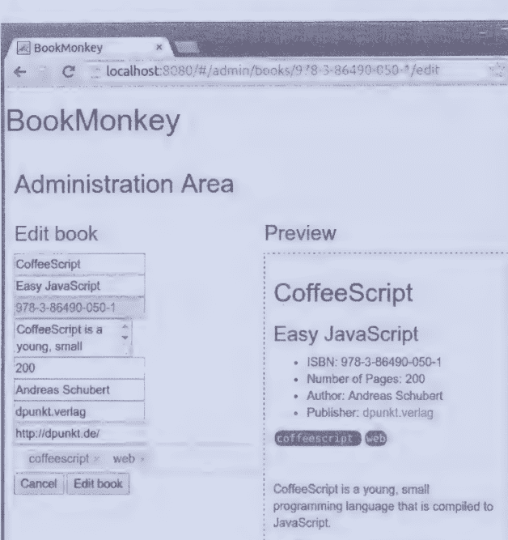图 4.12：带有 tags 指令的书籍创建/编辑表单实时预览

#### 摘要
- `AngularJS` 在单元测试中的内部机制不会自动执行，以便让开发者完全掌控测试流程。这意味着您需要手动处理某些方面（即那些框架通常在正常操作下会自动执行的）。特别是意味着你必须使用 `$compile` 服务手动编译用于指令的模板；`AngularJS` 将因此识别出被测试的指令并据此执行其 `link` 函数。
- 您始终针对某个作用域（scope）对模板进行编译。您可以生成一个新的作用域：通过在单元测试中传递 `AngularJS` 中的 `$rootScope`（通过依赖注入），并在其上调用 `$new()` 功能以生成新上下文。
- 测试用于指令的 `Directive` 时，你应经常使用 `jqLite` over `angular.element()` 来审查 DOM 的状态。这是 `AngularJS` 提供的唯 `jQuery` 实现版本（注意：此处原文 "using jqLite" 意指利用 Jquery-lite 库）。然而，权衡在于 `jqLite` 只提供 `jQuery` 功能的一个子集。
- 如果您在 `index.html` 中先包含正确的 `jQuery` 实现后再引入 `AngularJS`，则 `AngularJS` 会设立并委托每一次来自 `angular.element()` 用的动作至相应的 `jQuery` 实现。`AngularJS` 会自动将 `angular.element()` 的调用分配给 `jQuery` 实现。
- 在 `AngularJS` 中，使用指令来连接现有的 `jQuery` 插件以及其他第三方库似乎很简单。我们可以利用指令很方便地连接到现有 `jQuery` 插件和其他第三方库，但需注意确保将插件集成到双向数据循环绑定过程中。因此建议每次在使用第三方函数库内部回调 `function within callback function` 中执行 `scope manipulation` 时都必须手动使用 `scope.$apply()` 发起脏检查。
- 如果包括正确的 `jQuery` 实现在您的 `index.html` 前包括了 `AngularJS`...

#### 连接 REST 服务
老实说，由于每个用户的数据都存储在浏览器中且缺乏统一管理，我们的应用目前显得相当燥。这意味着无法在活跃应用程序之间同步书籍数据。在本节中，我们希望在一个中央服务器上管理数据。后端通信是单页应用的典型场景之一。正如我们在项目开始时提到的，我们将基于 Node.js 实现一个后端；因此我们将使用 `Express` 框架设置一个端点，使 `AngularJS` 应用能够发送 HTTP 请求。我们已经尽可能将后台接口设计为 RESTful。在此处利用用户故事定义：
> 作为用户 Michael，我想要能够在中央服务器上保存数据，以便从多个终端检索到这些数据。

#### 使用下载的项目
为了测试本节中的代码，您可以使用从出版网站下载的配套项目目录 `04_03_http/app` 来完成任务。请改变工作目录至上述路径并从那里启动 `http-server` 服务进行测试搭建。

#### BookMonkey 后端
在此时我们想简要介绍一下后端情况：REST 端点允许操作书籍和标签资源，并使用 JSON 作为数据格式。特别是，我们允许对这些资源的 HTTP 请求如下（包括 `GET`、`POST`、`DELETE` 操作）：

```javascript
// books resource (books资源)
GET /api/books // get all books // 获取所有图书
POST /api/books // create a new book // 创建新图书
GET /api/books/:isbn // get a book by isbn // 根据ISBN检索某本书
PUT /api/books/:isbn // update the book with specified isbn // 使用指定 ISBN更新该书
DELETE /api/books/:isbn // delete the book // 删除拥有特定isbn的书

// tags resource (标签资源)
GET /api/tags // get all tags // 获取所有标签
```

得益于这一定义接口，我们可以描述 `BookDataService` 提供的基本 CRUD（增删改查）操作。例如，通过 `GET/api/books` 可以获取一个图书对象的数组；另一方面，`POST /api/books/:isbn` 返回单个书籍对象；同时 `POST` 和 `PUT` 方法后端会接收 `Book` 对象作为参数用于创建或者更新资源。删除书籍的请求 `DELETE/api/books/:isbn` 将按预期进行处理（尽管用户未参与）。

#### 通过 $http 服务进行 HTTP 通信
为了在应用程序运行时使用 HTTP 异步重新加载单页应用数据，浏览器需要使用所谓的 `XMLHttpRequest` 对象。底层程序模型被称为 AJAX。不建议直接使用 `XMLHttpRequest` 对象，因为你仍然需要编写代码并处理浏览器问题。使用 AJAX 的最佳方式是通过像 `jQuery` 这样的库，它为 `XMLHttpRequest` 提供了一个封装。

`AngularJS` 还包含一个大大简化了 HTTP 请求发送的组件：`$http` 服务。它是处理 AJAX 的最佳选择，因为它确保在接收到 HTTP 响应后，任何作用域操作都会触发脏检查。`$http` 服务 API 基于 `promise`。`promise` 代表一个异步操作最终的结果，它在很大程度上是你能够轻松使用异步 API 的关键。它尤其让你不会在“回调忙乱”中迷失方向，并避免“回调地狱”。我们将在第 7 章“常见问题”中提供相关的背景信息。

如果 `$http` 服务只包含一个函数，你可以指定一个 HTTP 请求来调用这个函数。该函数将期望一个描述如何构建 HTTP 请求的配置对象作为参数。以下属性是此配置对象最重要的属性之一：
- `method`: 将 HTTP 方法指定为字符串（例如，“GET”或“POST”）
- `url`: 指定要请求的绝对或相对 URL
- `data`: 应与请求一起发送的用户数据。该服务自动处理从 JSON 的反序列化和序列化。
- `headers`: 一个描述应发送哪些 HTTP 头的对象。

为了调用，例如，我们后端的 `books` 资源，相应的 `$http()` 调用将如下所示：

```javascript
$http({
  method: 'GET',
  url: 'http://localhost:4730/api/books'
});
```


```markdown
$http 调用的输出总是一个 promise。这意味着在我们的完整应用程序中，我们可以传递这个 promise，并为所有对此 HTTP 请求感兴趣的组件注册一个回调函数。我们稍后将在设计 `BookDataService` 后看到如何做到这一点。

该框架提供以下帮助函数：

- `$http.get()`
- `$http.head()`
- `$http.post()`
- `$http.put()`
- `$http.delete()`
- `$http.jsonp()`

例如，你可以使用以下代码简化对 books 资源的检索：
`$http.get('http://localhost:4730/api/books');`

## 1 首先是测试

我们已经一再提到，AngularJS 从一开始就考虑了可测试性。除了用于 E2E 测试的 `ngScenario` DSL 和 `ngMock` 模块的 `module()` 和 `inject()` 基础函数外，为此属性提供的模拟实现也特别重要。

在本节中，我们将重点介绍这些模拟对象之一，即 `$httpBackend` 模拟对象。背景是 `$http` 服务使用 `$httpBackend` 对象来执行实际的 HTTP 请求。在单元测试中，你通常用 `$httpBackend` 模拟对象替换这个 `$httpBackend` 对象，以避免向服务器发送实际请求，并使你能够定义自己的响应。此外，$httpBackend` 模拟对象允许你设定期望，以确保组件在生产环境中执行时确实会执行某些请求。这些就是所谓的请求期望。通过这种方式，你可以轻松测试与后端通信的组件。

我们的 `BookDataService` 就是这样一个组件。因此，我们现在将修改文件 `book_data.spec.js` 中现有的测试套件，以指定我们期望的 HTTP 请求以及何时调用 `BookDataService` 的 API 函数。为了设定请求期望，我们将使用 `$httpBackend` 模拟对象。我们不会详细描述所有测试用例。相反，我们将选择一个测试用例来展示我们如何使用 `$httpBackend` 模拟对象轻松设置预定义响应并设定请求期望。

接下来，我们必须使用依赖注入注入 `$httpBackend` 模拟对象。我们将模拟对象分配给局部变量 `$httpBackend`，以便所有对 `beforeEach()`、`afterEach()` 以及 `describe()` 或 `it()` 的调用都可以访问它。在此阶段我们不需要做任何事情来实际获取模拟对象，因为我们已经在单元测试的 Karma 配置（`karma.conf.js`）中包含了文件 `angular-mocks.js` 和 `angular.js`。对于单元测试，$httpBackend` 对象将被 `$httpBackend` 模拟对象覆盖。

### 代码清单 4.40：新版本 BookDataService 测试套件的 beforeEach 块

```javascript
describe('Service: BookDataService', function () {

  // just to match the baseUrl in the service

  var baseUrl = 'http://localhost:4730';

  var BookDataService, $httpBackend;

  // load the application module

  beforeEach(module('bmApp'));

  // get a reference to all used services

  beforeEach(inject(function (_BookDataService_, __$$httpBackend__) {

    BookDataService = _BookDataService_;

    $httpBackend = _$$httpBackend_;

  }));

  [...]

});
```

在最后一个 `beforeEach()` 块中，我们为 `$httpBackend` 模拟对象设置一些预定义的 HTTP 响应（参见代码清单 4.41）。为此，我们使用 `$httpBackend` 模拟对象的 `when()` 函数。因此，如果 `$http` 服务在执行单元测试期间向 `baseUrl` + '/api/books' 发送 HTTP GET 请求，$httpBackend` 组件将使用我们的测试 Book 对象数组（`testBooks`）进行响应。这个测试数组包含我们经常使用的三本书。

通过这种方式，我们为单元测试期间提交的每个 HTTP 请求设置了预定义响应。重要的是，我们至少要为每个将在测试用例中设定请求期望的 HTTP 请求执行此步骤。否则，测试用例那些没有预定义响应的请求将失败，并显示消息“No response defined!”（未定义响应！）。

## 清单 4.41：预定义 HTTP 响应的定义

```javascript
describe('Service: BookDataService', function () {

    [...]

    // 定义已训练的响应

    beforeEach(function() {

        $httpBackend.when(
            'GET', baseUrl + '/api/books'
        ).respond(testBooks);

        $httpBackend.when(
            'GET', baseUrl + '/api/books/' + csBook.isbn
        ).respond(csBook);

        $httpBackend.when(
            'GET', baseUrl + '/api/books/test'
        ).respond(404, '');

        $httpBackend.when(
            'POST', baseUrl + '/api/books'
        ).respond(true);

        $httpBackend.when(
            'PUT', baseUrl + '/api/books/' + csBook.isbn
        ).respond(true);

        $httpBackend.when(
            'DELETE', baseUrl + '/api/books/' + csBook.isbn
        ).respond(true);
    });

    [...]

});
```

在清单 4.42 中，我们首次使用了 `afterEach()` 块。如你所知，此块在每个测试用例执行完毕后执行一次。在此块中，我们使用 `verifyNoOutstandingExpectation()` 来在每个测试用例之后检查是否仍存在尚未满足的请求期望。如果情况确实如此，意味着通过被测试代码发送的一个期望的 HTTP 请求没有被删除。因此，这将导致测试用例失败。

接下来，我们使用 `verifyNoOutstandingRequest()` 来测试是否仍存在现有的 HTTP 请求。通过这种方式，我们检查相反的情况：是否仍有现有的请求？如果情况确实如此，那么在我们已经制定了期望之后，又提交了额外的请求。我们通常不允许这种情况，因此我们在每个测试用例之后构建一个 `verifyNoOutstandingRequest()` 测试。

### 清单 4.42：BookDataService 测试套件的 afterEach 块

```javascript
describe('Service: BookDataService', function () {

    [...]

    afterEach(function() {
        $httpBackend.verifyNoOutstandingExpectation();
        $httpBackend.verifyNoOutstandingRequest();
    });

[...]
});
```

现在，我们终于可以向你展示一个测试用例，在清单 43 中。这是一个用于保存书的测试用例。其他测试用例遵循相同的模式。

### 清单 4.43：用于保存书测试用例

```javascript
describe('Service: BookDataService', function () {
    [...]
    describe('Public API usage', function() {
        [...]
        describe('storeBook()', function() {
            it('should store the passed object',
            function() {
                $httpBackend.expect(
                    baseUrl + '/api/books', effectiveJsBook
                );
                BookDataService.storeBook(effectiveJsBook);
                $httpBackend.flush();
            });
        });
    });
});

[...]

// 辅助对象
var effectiveJsBook = {
    title: 'Effective JavaScript (German Edition)',
[...]
};
```

制定期望时的关键点是调用 `expect()` 函数。如你在清单 43 中见，对于每种 HTTP 方法（GET、POST 等），都有一个相应的函数，使你更容易制定期望。因此，在这种情况下，我们期望 `BookDataService.storeBook()` 函数内部使用 `$http` 服务向 `baseUrl` + '/api/books' 提交一个 HTTP 请求。此外，我们期望通过此请求返回本地变量 `effectiveJsBook` 中定义的数据。我们不应忘记在函数末尾调用 `$httpBackend.flush()`。否则，`afterEach()` 块中的 `verifyNoOutstandingRequest()` 测试将会失败。其原因是实际的 `$httpBackend` 对象是异步工作的。因此，模拟对象也必须遵守这些规则以避免代码执行。测试异步代码并不简单，需要一些 Jasmine 构造，如 `runs()` 和 `waitsFor()`。通过使用 `flush()`，我们可以确保我们的测试尽管是异步的，但在单元测试中同步执行。通过这个调用，我们可以在测试中设置返回相应的 HTTP 响应，从而模拟服务器的响应。通过 `$httpBackend` 模拟对象，你可以轻松测试你的 AngularJS 应用程序。

## 在 BookDataService 中使用 $http

上一节中，我们调整了 `BookDataService` 的单元测试，以便当其 API 函数被调用时，它会向我们的后端发送 HTTP 请求。现在，我们想要更新实现以满足这些规范。我们需要进行一次破坏性更改。如清单 44 所示，我们让 `$http` 服务通过依赖注入传入，以便可以使用此服务发送 HTTP 请求。此外，我们必须稍微调整一下返回的 API 对象。在新版本中，所有 API 函数基本上都返回 promise。调用者（例如所有控制器）可以决定 HTTP 响应从服务器到达时应该发生什么。更重要的是，调用者可以决定如果收到错误响应应该发生什么。

### 清单 4.44：BookDataService 的 API 对象

```javascript
bmApp.factory('BookDataService', function($http) {
    [...]
    // 公共 API
    return {
        getBookByIsbn: function(isbn) {
            return srv.getBookByIsbn(isbn);
        },
        getBooks: function() {
            return srv.getBooks();
        },
        getTags: function() {
            return srv.getTags();
        },
        storeBook: function(book) {
            return srv.storeBook(book);
        },
        updateBook: function(book) {
            return srv.updateBook(book);
        },
        deleteByIsbn: function(isbn) {
            return srv.deleteByIsbn(isbn);
        }
    };
});
```

清单 4.45 展示了读操作的实现。正如预期的那样，这些实现进行了破坏性更改，因为我们只是使用 `$http` 向服务器发送一个请求，并返回生成的 promise。通过这种方式，我们将所有 API 调用定向到我们在 REST Web 服务中可用的相应资源。

## 清单 4.45：读取访问转换为转换为 HTTP GET 请求

```javascript
bmApp.factory('BookDataService', function($http) {
    var srv = {};
    srv._baseUrl = 'http://localhost:4730';

    // 服务实现
    srv.getBookIsbn = function(isbn) {
        return $http.get(
            srv._baseUrl + '/api/books/' + isbn
        );
    };

    srv.getBooks = function() {
        return $http.get(
            srv._baseUrl + '/api/books'
        );
    };

    srv.getTags = function() {
        return $http.get(
            srv._baseUrl + '/api/tags'
        );
    };
}];
```

那么写操作呢？自然，我们也按照清单 4.46 所示处理写操作。这里同样，API 调用将简单地被定向到相关的 REST 端点。我们像以前一样返回生成的 promise，以便调用者可以处理 HTTP 响应。

### 清单 4.46：写操作使用 HTTP POST/PUT/DELETE 请求

```javascript
bmApp.factory('BookDataService', function($http) {
    var srv = {};
    srv._baseUrl = 'http://localhost:4730';

    // 服务实现
    srv.storeBook = function(book) {
        return $http.post(
            srv._baseUrl + '/api/books', book
        );
    };

    srv.updateBook = function(book) {
        return $http.put(
            srv._baseUrl + '/api/books/' + book.isbn, book
        );
    };

    srv.deleteByIsbn = function(isbn) {
        return $http.delete(
            srv._baseUrl + '/api/books/' + isbn
        );
    };
});
```
```


经过修订后，我们的 `BookDataService` 看起来非常简洁，因为我们只在相关的 HTTP 请求中设计了 API 函数。然而，这些更改对我们的应用程序功能产生了深远的影响。

当我们执行单元测试时，针对 `BookDataService` 修改后的测试用例现在应该“变绿”（通过）。但是，我们 `tokenfield` 指令的测试用例将会失败，因为该指令——像 `BookDataService` 的所有其他使用者一样——并不期望我们的服务现在返回 promise。

通过这一改动，我们确实对大量的端到端测试进行了重大调整。

### 修复应用

由于我们在上一节中对 `BookDataService` 所做的更改，我们的应用程序在很大程度上已经无法正常工作。然而，很明显这是因为所有 `BookDataService` 的调用者还不知道如何处理返回的 promise。

在本节中，我们将展示调用者应如何处理基于 promise 的 `BookDataService` API，以恢复应用程序的功能。我们不会讨论每个组件中所有必要的更改。相反，我们将通过两个示例来展示如何让相关组件重新运作起来。

特别说明，我们将描述失败的测试用例。在本书附带的 zip 文件中，我们已经解决了项目中所有现存的问题。

基于我们现在展示的两个示例，你应该知道需要对调用组件进行哪些更改，以使整个应用程序再次运行起来。

> 我们假设你已经了解了 promise。如果不是这样，你可以回顾第 7 章 “常见问题解答” 中必要的信息。

### 修复编辑功能

我们必须在调用 `BookDataService` API 函数的地方进行必要的更改。作为示例，我们选择了如清单 4.47 所示的 `AdminEditBookCtrl` 控制器，因为那里需要进行最多的更改。

具体来说，它处理对 `getBookByIsbn()` 函数的调用。以前，这个函数直接返回相关的 `Book` 对象。从现在起，我们可以将数据赋值给作用域变量 `book`。我们可以这样做是因为这个函数现在返回一个 promise。为了能够响应 HTTP 响应的到达，promise 为我们提供了 `then()` 函数。

该函数的第一个参数是所谓的成功函数，当 promise 被解析（resolved）时执行。因此，我们包含了来自服务器的成功的 HTTP 响应。这个函数包含一个代表 HTTP 响应的 `Response` 对象作为参数。使用该对象，我们可以特别通过访问 `data` 属性来包含接收到的用户数据。如果这里的用户数据来自一个 `Book` 对象，我们可以在成功函数中直接将 `res.data` 赋值给作用域变量 `book`。

我们可以向 `then()` 函数传递第二个参数。第二个参数是一个错误函数，当 promise 被拒绝（rejected）或在 HTTP 请求过程中及请求期间发生错误时被调用。错误函数包含一个 `Error` 对象作为参数，该对象告诉我们哪里出了问题。在这种情况下，我们只是在控制台上显示错误。当然，我们可以在这里编写更智能的错误处理器。

#### $http 服务中的 Promises

当 HTTP 响应包含 200 到 299 之间的状态码时，`$http` 服务会解析 promise。对于 HTTP 重定向，服务会透明地跟随重定向，而不解析或拒绝 promise。在所有其他情况下，promise 都会被拒绝。

#### 清单 4.47：调用 getBookByIsbn() 函数时对 AdminEditBookCtrl 控制器的必要更改

```javascript
bmApp.controller('AdminEditBookCtrl',
function ($scope, $routeParams, $location, BookDataService) {
    $scope.isEditMode = true;
    $scope.submitBtnLabel = 'Buch editieren';
    var isbn = $routeParams.isbn;
    BookDataService.getBookByIsbn(isbn).then(function(res) {
        $scope.book = res.data;
    }, function(error) {
        console.log('An error occurred!', error);
    });
    [...]
});
```

在清单 4.48 中调用 `updateBook()` 函数时，我们必须完全这样做。我们不能在调用 `updateBook()` 后直接调用 `goToAdminListView()` 函数。相反，只有当服务器成功响应并且相应的书籍也已在服务器上更新后，我们才能首先进行此调用。

#### 清单 4.48：调用 updateBook() 函数时在 AdminEditBookCtrl 控制器中的必要更改

```javascript
bmApp.controller('AdminEditBookCtrl',
    function ($scope, $routeParams, $location, BookDataService) {
        [...]
        $scope.submitAction = function() {
            BookDataService.updateBook($scope.book).then(function() {
                goToAdminListView();
            }, function(error) {
                console.log('An error occurred!', error);
            });
        };
        $scope.cancelAction = function() {
            goToAdminListView();
        };
        var goToAdminListView = function() {
            $location.path('/admin/books');
        };
    });
```

目前，这就是我们为了让书籍编辑视图再次工作所需做的一切。

### 修复 tokenfield 指令

除了 `AdminEditBookCtrl` 控制器外，我们还想看看 `tokenfield` 指令，因为异步操作在该组件中有双重影响。

如你所知，`tokenfield` 指令依赖于 `BookDataService` 来访问系统中所有可用的标签，以填充 tokenfield 插件的自动完成功能。由于现在 `getTags()` 函数返回一个 promise，我们只能在成功函数中执行 tokenfield 插件的实际初始化，此时我们已经用服务器返回的标签填充了数组，如清单 4.49 所示。为了更好地组织源代码，我们为初始化程序定义了本地函数 `initializeTokenfield`。我们在成功函数中调用此函数，并将仅存在于 `tags` 数组中的服务器返回的用户数据传递给它。

#### 清单 4.49：在 tokenfield 指令中调用 getTags() 时的必要更改

```javascript
bmApp.directive('tokenfield', function(BookDataService) {
    return {
        [...]
        link: function(scope, elem) {
            var initialized = false;
            // Fetch the tags from the server
            // and initialize directive.
            BookDataService.getTags().then(function(res) {
                initializeTokenfield(res.data);
            }, function(error) {
                console.log('An error occurred!', error);
            });
            // Main initialization routine
            function initializeTokenfield(tokens) {
                elem.tokenfield({
                    autocomplete: {
                        source: tokens,
                        delay: 100
                    },
                    [...]
                }).on('afterCreateToken', function (e) {
                    addToken(e.token.value);
                }).on('removeToken', function (e) {
                    removeToken(e.token.value);
                });
                function addToken(token) { [...] }
                function removeToken(token) { [...] }
                [...]
            }
        }
    }
})
```

实际初始化逻辑现在看起来与之前版本的 `tokenfield` 指令相似。然而，存在一个差异，这个差异显示在清单 4.50 中。这个差异是 `initializeTags()` 函数，在上一节中被称为 `init()`。

#### 清单 4.50：tokenfield指令中的必要更改

```javascript
initializeTags();
```

该指令必须处理这样一个事实：来自父域（例如 `AdminEditBookCtrl` 控制器）的 `Book` 对象（我们可以通过双向绑定的 `scope.tokenfield` 获得）也是从服务器加载。因此，我们必须注册一次观察者（one-time watcher），以防 `Book` 对象不可用。想一下，我们在颜色选择中使用了观察者。然而，我们不想一直监听 `scope.tokenfield` 更改，只想听到作用域变量 `book` 被赋值。因此，我们将这种模式称为一次观察者。使用 `initialized` 标志，我们可以确保只有 `Book` 对象可用时执行。基于我们现在展示的两个示例，你应该知道需要对调用组件进行哪些更改，以使整个应用程序再次运行起来。

### BookDataService 与后端

由于我们已经努力确保所有 `BookDataService` API 函数再次工作，现在可以运行整个项目。为此，我们必须使用以下命令：

```bash
node server.js
```

此外，我们必须确保正确的 URL。

```javascript
srv.baseUrl = 'http://localhost:4730';
```

使用 `http-server` 模块部署我们的应用程序。通过这种方式，我们的应用程序发送 HTTP 请求。我们可以在 Chrome 的标签页中查看执行情况。

#### 图 4.14：$http 服务总结

- 你可以使用 `$http` 服务轻松地与 REST 服务进行通信。
- 除了 `$http()` 基本函数外，该服务还提供了特定的 HTTP 方法（`GET`、`POST` 等）。
- `$http` 服务总是返回一个 promise，调用者可以使用 `then()` 函数注册成功或错误作为回调。
- 使用 promise，你可以优雅地处理异步操作。
- 依赖于 `$http` 应用程序易于测试，因为 AngularJS 模块中提供了 `$httpBackend`。
- 使用这个对象，你可以制定请求并设置定义的 HTTP 响应。

# 第五章：项目管理与自动化

软件开发并非易事。许多挑战需要开发者的全注。单调的任务可能导致错误，减慢开发过程。因此，利用自动化来快速且重要的成果是有意义的。近年来，已经开发了许多工具完成任务并解决 JavaScript 开发的问题。这些工具除了其他功能外，还管理依赖项、自动化任务、生成源代码。在本章中，我们将介绍各个工具并探讨 Yeoman，一个为 Web 开发提供预定义流程的项目。

## Node.js：运行时环境

我们将再次使用 Node.js 作为本章介绍的运行时环境。我们的 BookMonkey 应用程序使用了 Node.js。该平台还为 `http-server` 模块和 Karma 提供了运行时环境。Node.js 是一个基于 Google V8 引擎的平台。它在服务器端执行 JavaScript 源代码。它的主要优势是非阻塞的事件驱动 I/O 模型，允许你编写轻量且高效的应用程序。Node.js 安装程序可以从其官方网站下载：http://nodejs.org

#### 使用 npm 进行包管理

在前端开发领域，你可以在 Node.js 平台上编写 JavaScript 应用程序。为了管理这些包，该平台提供了 `npm`（Node.js 包管理器）。`npm` 是一个用于搜索、管理和卸载包的命令行工具。目前，在其官方注册表 https://npmjs.org 上有超过 50,000 个用的包。

> **给 Ruby 经验的开发者的说明**
>
> npm 与 Ruby 世界中流行的工具 gem 非常相似。使用 gem，你可以从 Ruby gems 注册表中管理的庞大选择中挑选包。Ruby gems 的网站是 http://rubygems.org。

Node.js 模块包含一个名为 `package.json` 的数据文件。除了其他信息外，该文件还包含包名、版本号以及对其他包的依赖关系信息。由于应用程序可以定义为 Node.js 模块，你可以使用 `package.json` 定义对其他包的依赖关系。如清单 5.1 所示，你可以使用 `npm init` 命令生成此数据文件。该脚本将询问一系列关于配置的问题。

##### 清单 5.1：创建 package.json 文件

```
[app] $ npm init

This utility will walk you through
creating a package.json file.
It only covers the most common items,
and tries to guess sane defaults.
See 'npm help json' for definitive
documentation on these fields
and exactly what they do.
Use 'npm install <pkg> --save'
afterwards to install a package and
save it as a dependency in the package.json file.
Press ^C at any time to quit.
name: (app) bookMonkey
version: (0.0.0) 1.0.0
description: Example Application
git repository:
keywords: javascript angularjs
author: Robin Boehm, Philipp Tarasiewicz
license: (BSD-2-Clause) MIT

About to write [...]
```

```json
{
  "name": "bookmonkey",
  "version": "1.0.0",
  "description": "Example Application",
  "main": "index.js",
  "scripts": {
```


```json
{
  "test": "echo \"Error: no test specified\" && exit 1",
},
  "author": "Robin Boehm, Philipp Tarasiewicz",
  "license": "MIT",
  "dependencies": {},
  "devDependencies": {},
  "keywords": [
    "javascript",
    "angularjs"
  ]
}
```

要向项目添加依赖项，请使用 `npm install {packagename}` 命令。使用附加参数 `--save`，你可以自动将你的应用程序依赖项输入到 `package.json` 中。借助 `--save-dev`，你可以对开发依赖项进行相同的操作。以下示例安装 Node.js 包 `http-server` 并允许其在你的 `package.json` 的 `devDependencies` 下输入。

```bash
npm install http-server --save-dev
```

生成的 `package.json` 文件如清单 5.2 所示。你可以使用 `npm` 安装本章中的其他工具。

##### 清单 5.2：已安装包的自动条目

```json
{
  "name": "bookmonkey",
  "version": "1.0.0",
  "description": "Example Application",
  "main": "index.js",
  "scripts": {
    "test": "echo \"Error: no test specified\" && exit 1"
  },
  "author": "Robin Boehm, Philipp Tarasiewicz",
  "license": "MIT",
  "dependencies": {},
  "devDependencies": {
    "http-server": "0.6.1"
  },
  "keywords": [
    "javascript",
    "angularjs"
  ]
}
```

Node.js 使用 Common JS 模块系统，让你在创建新模块时可以轻松地嵌入现有模块。

#### 总结

- Node.js 是一个在服务器端执行 JavaScript 源代码的平台。所有平台的安装程序都可以从 http://nodejs.org 获取。
- 该平台的主要优势之一是具有非阻塞的事件驱动 I/O 模型。
- 通过 `npm`，Node.js 带来了一个简化包管理的包管理器。你可以访问其官方注册表中超过 50,000 个包。
- 你已经学习了如何安装 Node.js 模块和依赖项。
- 所有旨在简化 Web 开发过程的现代工具都使用 Node.js 作为运行时环境。

##### 使用 Bower 管理前端依赖项

Bower (http://bower.io) 是一个用于管理 Web 前端应用程序依赖项的开源工具。项目特定的依赖项可以轻松地在名为 `bower.json` 的 JSON 文件中定义。借助命令行中的一个简单命令，所有定义的包都可以加载到相应的项目中。另一方面，也可以在 Node.js 进程中使用 JavaScript API 激活 Bower。

未配置的包存储在名为 `bower_components` 的目录中。一个包可以包含任何内容并提供 Web 组件。使用 Bower，可以轻松地将 Twitter Bootstrap、jQuery 以及 AngularJS 等项目嵌入你自己的项目中。包可以通过多种不同方式引用，包括：

- Bower 注册表中的官方注册包
- 一个 Git 仓库
- 一个直接引用 GitHub 的简写形式，例如 `angular/angular.js`
- 一个指向 `.zip` 或 `.tar.gz` 格式文件的 URL

由于 Bower 使用 Node.js 作为其运行时环境，你需要使用 `npm` 安装 Bower。你应该将 Bower 安装为全局包，以便你可以系统中的任何位置使用。你可以使用以下命令实现此目的：

```bash
npm install -g bower
```

###### 定义 bower.json 文件

你可以在 `bower.json` 文件中定义包特定于 Bower 的信息。除了依赖项定义，它还包含项目名称、版本号和描述。你不必自己创建文件；你可以使用 `bower init` 命令交互式地生成。如清单 5.3 所示，你可以在命令行中调用此命令。然后它将询问一系列问题。在你回答完问题后，将得到一个配置。如果你对最后一个问题（Looks good?）回答 `yes`，当前目录中创建一个相应内容的 `bower.json` 文件。

### 清单 5.3：使用 bower init 生成 bower.json

```bash
[my-angular-project] $ bower init
[?] name: my-angular-project
[?] version: 1.0.0
[?] description: Sample project
[?] main file: path/to/app.js
[?] keywords: angularjs, bower, example
[?] authors: Robin Böhm, Philipp Tarasiewicz
[?] license: MIT
[?] homepage: http://www.angularjs.de
[?] set currently installed as dependencies? yes
```

##### 定义依赖项

此文件实际的任务是通过 `dependencies` 属性来定义项目的外部。此外，依赖项可以列在 `devDependencies` 属性中，表明它们仅在开发期间需要，属于交付的一部分。使用 `bower install {packagename}` 命令，你可以安装单个包。你可以使用 `bower install angular` 来安装。如清单 5.4 所示，你可以使用 `--save` 或 `--save-dev` 参数将安装的包自动添加到已有的 `bower.json` 配置文件中。

 清单 5.4：安装外部项

```bash
bower install angular --save
bower install angular-route --save
bower install angular-mocks --save-dev
```

执行此命令后，我们的 `my-angular-project` 项目生成的 `bower.json` 将包含 `angular` 和 `angular-route` 包的依赖。此外，`angular-mocks` 包作为开发项提供。使用 `search` 参数，你可以通过命令行进行搜索来查询 Bower 注册表。或者，也可以通过访问其网站 http://bower.io 来搜索。要从本项目中删除一个包，可以使用 `bower uninstall angular`。我们当前 `bower.json` 文件的一部分如清单 5.5 所示。

##### 清单 5.5：bower.json 结构

```json
{
  "name": "my-angular-project",
  "version": "1.0.0",
  "dependencies": {
    "angular": "1.2.3",
    "angular-router": "1.2.3"
  },
  "devDependencies": {
    "angular-mocks": "1.2.3"
  }
}
```

###### 从特定版本安装包

如果你想使用命令行从特定版本安装包，可以在包名后面加上一个井号 (#) 和版本描述。因此，要安装 AngularJS 1.0.0 版本，请使用命令 `bower install angular#1.0.0 --save`。它也会添加到您的配置中。然而，有时可能希望始终使用存储库的开发版本。为此，只需在存储库中提供所需的包即可。

###### 包含已安装的包

如果项目目录包含您的配置文件，你可以使用 `bower install` 下载配置中定义的所有项。当使用 Git 等版本管理工具时，`bower_components` 目录通常不会导入，该目录也列在 Git 的 `.gitignore` 文件中。导出项目后，你可以通过执行 `bower install` 命令以正确的版本重新加载所有包。安装依赖项后，你可以根据需要实现以下内容。清单 5.6 展示了一个使用 `<script>` 标签包含依赖项的 `index.html` 示例。

##### 清单 5.6：包含由 Bower 安装的包

```html
<!DOCTYPE html>
<html ng-app>
<head>
    <title>AngularJS.DE Bower Example</title>
</head>
<body>
<script src="bower_components/angular/angular.js"></script>
<script src="bower_components/angular-route/angular-route.js"></script>
</body>
</html>
```

###### 配置 Bower

你可以使用 `.bowerrc` 文件配置 Bower。你可以在项目目录中创建此文件并添加配置，从而为特定项目进行配置。此外，你也可以在用户的主目录中为用户创建全局配置。项目特定的配置会覆盖任何全局参数。在此文件中，你可以设置以下配置参数：

- `directory`:组件的安装位置
- `endpoint`:你自己的 bower 注册表的定义
- `json`:项目中 Bower 元数据文件的名称
- `searchpath`:其他 Bower 注册表的列表
- `shorthand_resolver`:简写形式的模板。

清单 5.7 展示了一个 `.bowerrc` 文件示例。

##### 清单 5.7：.bowerrc 文件结构

```json
{
  "directory": "bower_components",
  "endpoint": "https://bower.mycompany.com",
  "json": "myOwnBower.json",
  "searchpath": [
    "https://bower.io/"
  ],
  "shorthand_resolver": "git://github.com"
}
```


> http://gruntjs.com/getting-started

#### 配置任务

要配置 Grunt 应为你执行的任务，请在 `Gruntfile.js` 文件中使用脚本。Grunt 期望你在此脚本中将函数作为 `CommonJS` 模块导出。在此函数中，你可以配置所有你希望 Grunt 自动执行的任务。这样做的时候，Grunt 会执行导出的函数，并将其委托给你可以访问的所谓的 `Grunt API`。此时，你应该确保 JavaScript 源代码包含在 `Gruntfile.js` 文件中，并且不包含 `JSON` 格式的配置（如在 `package.json` 中）。

##### 清单 5.11：Gruntfile.js 文件的基本结构

```javascript
module.exports = function (grunt) { 

// do some stuff

};
```

> 面向 CoffeeScript 开发者的说明
也可以使用 CoffeeScript 创建此定义。但是，配置文件的扩展名必须是 `.coffee`。例如，`Gruntfile.coffee` 是一个有效的文件名。

#### 注册任务

你可以将 JavaScript 函数注册到 Grunt。在 Grunt 的世界里，这样的函数被称为任务。你使用 `grunt.registerTask` 函数注册任务。此函数需要三个参数。第一个参数提供一个你可以用于检索该函数的名称。第二个参数包含一个描述，当你输入 `grunt -help` 时会显示。第三个参数指定一个函数，该函数在调用此任务时应执行。清单 5.12 展示了一个非常简单任务的定义。

##### 清单 5.12：在 Grunt 中定义你自己的函数

```javascript
module.exports = function(grunt) {

// A very basic default task.

grunt.registerTask('log', 'Log some stuff.', function() {

grunt.log.write('Logging some stuff...');

});

};
```

你可以使用命令行命令 `grunt` 执行此任务。你需要将应执行的任务名称作为参数指定给 `grunt` 命令。执行结果如清单 5.13 所示。

##### 清单 5.13：使用命令行执行你自己的函数

```bash
[app] $ grunt log

Running "log" task

Logging some stuff...
```

完成，无错误。

> 确定默认任务
Grunt 中有一个约定，允许你定义一个默认任务，该任务将在不带参数调用 Grunt 时执行。你只需使用 `grunt.registerTask` 定义一个名为 `default` 的任务。通常，这将是对一个或多个任务的委托。

你还可以使用 `grunt.registerTask` 函数注册多个函数。但是，函数应该有唯一的名称，否则它们会相互覆盖。在后一种情况下，你只能访问最近定义的函数。

你可以将参数传递给一个任务。两个参数应使用冒号分隔。清单 5.14 向你展示了如何将参数传递给任务。

##### 清单 5.14：使用命令行执行你自己的命令

```bash
[app (master)] $ grunt count

Running "count" task

Arguments: 0

```

[app (master)] $ grunt count:1:2:3

Running "count:1:2:3" (count) task

Arguments: 3
```

完成，无错误。

你还可以使用 `grunt.registerTask` 函数将多个任务与一个名称关联。在这种情况下，你需要提供两个参数。与之前一样，第一个参数指定任务的名称。第二个参数指定一个包含所需任务名称的数组。你在数组中定义任务的顺序决定了执行顺序。清单 5.15 展示了一个定义了三个任务的 `Gruntfile.js` 文件。最后一个任务名为 `all`，并与前两个任务相关联。

##### 清单 5.15：在 Grunt 中定义你自己的函数

```javascript
module.exports = function(grunt) {

  // A very basic log task

  grunt.registerTask('log', 'Log some stuff.', function() {

    grunt.log.writeln('Logging some stuff...');

  });

  // A very basic task with arguments

  grunt.registerTask('count', 'Count given Arguments.', function() {

    grunt.log.writeln('Arguments: ' + arguments.length);

  });

  // An aggregation task

  grunt.registerTask('all', ['log', 'count:a:b']);

};
```

此外，你可以使用 `grunt.initConfig()` 函数，将一个包含项目特定配置的 JavaScript 对象作为参数传递给任务。清单 5.16 展示了配置 `log` 任务的示例。你可以使用 `grunt.config` 方法访问这些配置设置，传递一个 JavaScript 表达式。在这种情况下，它是 `grunt.config('log.prefix')`。

##### 清单 5.16：配置 Grunt 任务

```javascript
module.exports = function(grunt) {

  grunt.initConfig({

    log: {
      prefix: "LOG"
    }
  });

// A very basic log task with prefix

grunt.registerTask('log', 'Log some stuff.', function() {

    grunt.log.write('[' + grunt.config('log.prefix') + ']');

    grunt.log.writeln('Logging some stuff...');

});
```

#### 定义多任务

除了注册简单任务，你还可以使用 `grunt.registerMultiTask()` 函数注册多任务。多任务是一个可以接收多个已知配置值（称为目标）的任务。如果在执行任务时未定义目标，则将执行此任务注册的所有目标。

在多任务函数中，你可以访问正在执行的目标名称。你可以使用 `this.target` 访问一个目标。使用 `this.data`，你可以访问附带的数据。你可以通过 API 函数 `grunt.initConfig()` 以配置对象的形式来包含这些目标的定义。清单 5.17 展示了一个 `log` 任务，它显示附带参数的数量、当前目标和附带的数据。

##### 清单 5.17：在 Grunt 中定义多任务

```javascript
module.exports = function(grunt) {

  grunt.initConfig({
      log: {
        string: 'Logging some stuff...',
        array: [1, 2, 3],
        object: { x: 5 }
      }
  });

  // Register Multi Task

  grunt.registerMultiTask('log', 'Log stuff.', function() {

    grunt.log.writeln('args: '
                      + arguments.length
                      + '\n'
                      + this.target
                      + ': '
                      + this.data);
});

};
```

该示例展示了注册多任务的配置以及多任务本身。为此，我们使用熟悉的 `grunt.initConfig()` 方法。你可以通过使用配置对象的属性名称来为特定多任务定义目标。此目标的名称对应于所选对象属性的名称，在我们的例子中是 `log`。目标定义可以是任何类型的 JavaScript 数据结构。如果你遵循命名约定，由 `grunt.initConfig()` 定义的数据结构将连接到多任务函数中的 `this.data` 属性。因此，你不必使用 `grunt.config` 导出此数据，因为你可以直接访问数据结构。在清单 5.18 中，你可以看到使用冒号指定目标来检索多任务 `log` 的情况。也可以在目标后使用冒号包含更多参数。

##### 清单 5.18：使用不同目标执行多任务

```bash
[app] $ grunt log
Running "log:string" (log) task
args: 0
string: Logging some stuff...

Running "log:array" (log) task
args: 0
array: 1,2,3

Running "log:object" (log) task
args: 0
object: [Object]
Done, without errors.

[app] $ grunt log:array
Running "log:array" (log) task
args: 0
array: 1,2,3
Done, without errors.

[app] $ grunt log:array:hello:world
Running "log:array:hello:world" (log) task
args: 2
array: 1,2,3
```

完成，没有。通常，一个多任务（multi-task）期望一个 JavaScript 对象来定义配置，然后你可以在多任务函数中使用这些配置。

#### Grunt 的替代品：Gulp

除了 Grunt，还有其他使用 Node.js 作为平台的构建工具。其中一种方案是 Gulp (https://github.com/gulpjs/gulp)。Gulp 令人印象深刻，因为它的配置非常简单。后者可以通过流 代码来描述。它非常年轻；尽管如此，它值得研究。

#### 任务外包

使用 Grunt，你可以将任务外包给不同的文件。要做的就是在 Grunt 文件中加载这些任务。实现功能的命令是 `grunt.loadTasks`。使用这个命令，你可以提供一个任务目录，该路径将被搜索。我们将多任务函数 `log` 转移到一个名为 `log` 的目录中。在这种情况下，文件名并不重要，因为 Grunt 会搜索整个目录。唯一的要求是文件名有 `.js` 扩展名。此文件的内容在清单 5.19 中给出。

##### 清单 5.19：将任务转移到外部

```javascript
module.exports = function(grunt) {

  // Register Task

  grunt.registerMultiTask('log', 'Log stuff.', function() {

    grunt.log.writeln('args: '
                     + arguments.length
                     + '\n'
                     + this.target
                     + ': '
                     + this.data);

  });

};
```

清单 5.20 展示了一个包含 `grunt.loadTasks('log')` 的 Grunt 文件。这样，你可以搜索 `log` 目录并加载任务。使用 `grunt.initConfig`，你可以像常一样定义任务。

```javascript
module.exports = function(grunt) {

    grunt.loadTasks('log');

    grunt.initConfig({
        log: {
            string: 'Logging some stuff...',
            array: [1, 2, 3],
            object: { x: 5 }
        }
    });
};
```

##### 清单 5.20：从外部加载任务

#### 加载 Grunt 插件

你可以使用 npm 来注册 Grunt 插件并使其可用。和其他开发者也可以安装已发布的插件，并将它们添加到 `package.json` 文件中。这将允许你定义 Node.js 模块及其依赖项。就像你将 Grunt 安装为一个模块一样，现在可以使用 npm 安装 Grunt 插件。

清单 5.21 展示了安装了两个 Grunt 插件 `contrib-copy` 和 `contrib-uglify` 之后的示例 `package.json` 文件。两者都在 `devDependencies` 下。

##### 清单 5.21：将 Grunt 插件作为依赖项的 package.json 文件

```json
{
    "devDependencies": {
  "grunt": "0.4.1",
  "contrib-copy": "0.4.1",
  "contrib-uglify": "0.2.7"
  }
}
```

在 npm 上有很多可用的 Grunt 插件。你可以使用函数 `grunt.loadNpmTasks` 来加载 npm 安装的 Grunt 插件。正如你在清单 5.22 中看到的，你只需要将已安装插件的名称作为参数添加即可

##### 清单 5.22：加载 Node.js Grunt 插件

```javascript
module.exports = function(grunt) {

  // [...]

  grunt.loadNpmTasks('contrib-uglify');

  grunt.loadNpmTasks('contrib-clean');

  // [...]
};
```

就像你自己的任务一样，该任务的配置通过一个你提供给 `grunt.initConfig` 函数的 JavaScript 对象来完成。我们在这里讨论这两个插件的配置细节。但是，你可以在清单 5.23 中看到一个小的示例配置。

##### 清单 5.23：Grunt 插件的配置示例

```javascript
module.exports = function(grunt) {
  grunt.initConfig({
    uglify: {
      build: {
        src: 'src/app.js',
        dest: 'build/app.min.js'
      },
    },
    clean: ['build/**/*'],
});

grunt.registerTask('build', ['clean', 'uglify']);

};
```

在此配置的最后，你使用 `grunt.registerTask` 函数创建了一个名为 `build` 的新任务。这将按照正确的顺序执行 `clean` 和 `uglify` 任务。如果你在命令行中使用 `build` 参数调用 Grunt，你将得到清单 5.24 中打印的结果。

##### 清单 5.24：执行示例配置

```bash
[app] $ grunt build

Running "clean:dist" (clean) task

Running "uglify:build" (uglify) task

File "build/app.min.js" created.

Done, without errors.
```

#### 使用模板

你可以在 Grunt 中使用一个小的模板机制。在 Grunt 的上下文中，模板是以 `<%` 开头并以 `%>` 结尾的字符串。在两者之间，你可以使用模板变量，这些变量对应于对象访问表达式以访问对象属性。后者非常依赖于你在 JavaScript 中使用的表示法。让我们扩展我们的示例，并在配置对象中定义一个 `pkg` 属性。该属性分配一个对象，其中包含我们应用程序的一些数据。清单 5.25 通过模板展示了我们 `uglify` 任务的扩展配置。

##### 清单 5.25：使用模板

```javascript
module.exports = function(grunt) {

    grunt.initConfig({

        pkg: {
            name: 'app',
            version: '0.0.1'
        },

        uglify: {
build: {
  src: 'src/<%= pkg.name %>-<%= pkg.version %>.js',
```


```markdown
  dest: 'build/<%= pkg.name %>-<%= pkg.version %>.min.js'

},

clean: ['build/**/*'],

}

});

grunt.registerTask('build', ['clean' , 'uglify']);

});

```

为了减少冗余，你可以在 Grunt 中访问 `package.json` 文件并分配其属性的内容。清单 5.26 展示了这一点。Grunt 提供了一个 `grunt.file.readJSON` 函数来帮助你完成此任务，这是一件好事。

**清单 5.26：将文件作为配置对象导入**

```javascript
module.exports = function(grunt) {

  grunt.initConfig({

    pkg: grunt.file.readJSON('package.json'),

    uglify: {
      build: {
        src: 'src/<%= pkg.name %>-<%= pkg.version %>.js',
        dest: 'build/<%= pkg.name %>-<%= pkg.version %>.min.js'
      },

    clean: ['build/**/*'],

    }
  });

  grunt.registerTask('build', ['clean' , 'uglify']);

};

```

因此，你可以将项目特定的信息集中定义在一个地方，即 `package.json` 文件中，这比所有信息分散在项目中要容易得多。

### 适用于开发的合适包

接下来，我们想讨论一些在 AngularJS 开发中几乎总是必不可少的公共 Grunt 插件。在实践中，有几个 Grunt 插件可以插入到几乎每个程序中。

##### load-grunt-tasks

加载第一个包之后，你很快就会遇到重复的行，除了 `loadNpmTasks` 语句，这使得配置难以理解。为了解决这个问题，你可以使用一个名为 `load-grunt-tasks` (https://npmjs.org/package/load-grunt-tasks) 的 Node.js 模块。清单 5.27 给出了一个示例。

**清单 5.27：load-grunt-tasks 的配置示例**

```javascript
module.exports = function(grunt) {

  require('load-grunt-tasks')(grunt);

};
```

这个插件使用一个约定，即所有专门为 Grunt 创建的 Node.js 包都有前缀 `grunt-`。因此，这个插件可以导出你的 `node_modules` 目录，并加载所有匹配正则表达式 `grunt-*` 的模块。你可以使用 npm 安装此插件，使用此命令。

```bash
npm install load-grunt-tasks --save-dev
```

如果你需要一个更通用的版本，你可以使用替代模块 `matchdep` (https://npmjs.org/package/matchdep)。

##### ng-min

包 `grunt-ngmin` (https://npmjs.org/package/grunt-ngmin) 是 AngularJS 应用程序的预压缩器。你需要这个包，因为 AngularJS 中依赖注入的实现使用你函数的参数名来在此处取消依赖。

由于在最小化过程中会进行替换，此机制在此过程之后将不再起作用。

##### 清单 5.28：ng-min 效果示例
```javascript
// ng-min 之前

angular.module('bmApp').controller('MyCtrl',function ($scope, $http){

    [...]

});

// ng-min 之后

angular.module('bmApp').controller('MyCtrl',['$scope', '$http', function ($scope, $http) {

    [...]

}]);
```

为了使 AngularJS 项目能够进行最小化（minification），在 AngularJS 中存在一种关于函数注释的约定。该约定指出，函数应作为数组的最后一个元素给出，并且所有在依赖项之前的参数都应作为字符串传递。由于字符串不受最小化影响，依赖项的取消（cancellation）在此之后将再次正常工作。像往常一样，配置必须添加到你的 `Gruntfile.js` 文件中。这里使用的参数 `src` 和 `dest` 分别代表源文件和目标文件。有关所有参数的确切目录及说明，可参见项目文档。

##### 清单 5.29：ng-min 配置示例
```javascript
module.exports = function (grunt) {

    grunt.initConfig({

        [...]

        ngmin:{
            files:{
                src:'build/**/*.js',
                dest:'build/'
            }
        },

        [...]});

}

// 来自第 261 页的代码片段结束，下面继续...
```

[第 262 页] (续)
[...]
```javascript
});

grunt.registerTask('build',[

    'clean',
    'copy:build',
    'ngmin',
    'uglify'
]);
```

你可以使用 npm 通过以下命令安装此插件。
`npm install grunt-ngmin --save-dev`

#### concat 和 uglify

借助 `uglify` 包（https://github.com/gruntjs/grunt-contrib-uglify），可以减小应用程序的文件大小。这可以通过对变量名称进行智能替换来实现。然而，这会导致人类阅读者的可读性下降。不出所料，正因为这一事实，该项目才得名“Uglify”（意为丑化）。进行最小化处理是值得的，这样可以使用户的加载时间尽可能短。

##### 清单 5.30：concat 和 uglify 的配置示例
```javascript
module.exports = function (grunt) {

    grunt.initConfig({

        [...]

        concat:{
            src:['src/module.js' ,'src/book.js',[...] ],
            dest:'build/bookmonkey.js',
        },

                uglify:{
                    files:{
                        'build/bookmonkey.min.js':
                            [
                                'bookMonkeyMinBookmonkeyJs'
                           , 'build/bookmonkey.js',
                            ]
                }
```

[第 263 页] (续)
}
}`

`{ ... };`

});

};


在清单 5.30 所示的配置中，`bookmonkey.js` 文件被转换为 `bookmonkey.min.js` 文件。此任务通常在构建过程的最后执行。在本例中，它位于我们使用 `Concat`（https://github.com/gruntjs/grunt-contrib-concat）将 JavaScript 文件连接成 `bookmonkey.js` 文件之后。

你可以使用 npm 通过以下命令安装这两个插件。
`npm install grunt-contrib-concat --save-dev`
`npm install grunt-contrib-uglify --save-dev`

#### 总结

*   Grunt 是一个基于 Node.js 的开源工具，用于自动化处理重复性任务。你可以使用 npm 来安装它。
*   你可以定义自己的任务，这些任务可以接受参数。此外，还有“多任务”的概念，允许你从配置中使用不同的目标（targets）。
*   有许多公共插件也可以通过 npm 安装。
*   你可以使用名为 `Gruntfile.js` 的文件来配置这些任务。
*   我们看了一些对 AngularJS 必不可少的插件及其配置。其中包括 `ng-min` 插件。

#### 使用 Karma 自动执行测试
Karma（http://karma-runner.github.io）是一个用于自动测试 JavaScript 应用程序的运行时环境。它是为 AngularJS 创建的开源项目，由开发 AngularJS 的同一团队开发。Karma 的主要目标是使测试 Web 应用程序变得尽可能简单。定义的测试规范将在真实设备上执行，以尽量减少最终产品的差异。Karma 启动自己的 Web 服务器，并向任何连接到它的设备发送页面。要测试的设备必须能够处理 HTTP 并解释 JavaScript。该页面包含一个 [第 264 页]

iframe，用作实际的运行时环境。高层数据由此指导。每个连接的浏览器都通过 Web Socket 连接或相应的后备传输机制（如长轮询）直接从运行的 Karma 进程接收命令。

由于 Karma 像大多数之前讨论的工具一样在 Node.js 平台上运行，你可以使用以下命令通过 npm 安装它：
`npm install karma`

```bash

你可以使用 `karma` 启动，清单 5.31 所示。

##### 清单 5.31：启动 Karma
```bash
karma
```

```

你可以使用 `karma` .js  配置文件。

在配置中，使用 `karma.conf.js`。

##### 最重要的参数

在此，我们简要解释配置中最重要的参数。完整且最新的列表可以在在线 Karma 文档中找到，网址：http://karma-runner.github.io/latest/config/configuration.html。

##### basePath
为了减少大量的打字工作量，你可以设置 `basePath` 属性作为其他路径（包括 `files` 和 `exclude` 属性定义的路径）的基础。

##### files 和 exclude
你可以使用 `files` 和 `exclude` 属性来指定在运行 Karma 时应包含或排除的文件列表。

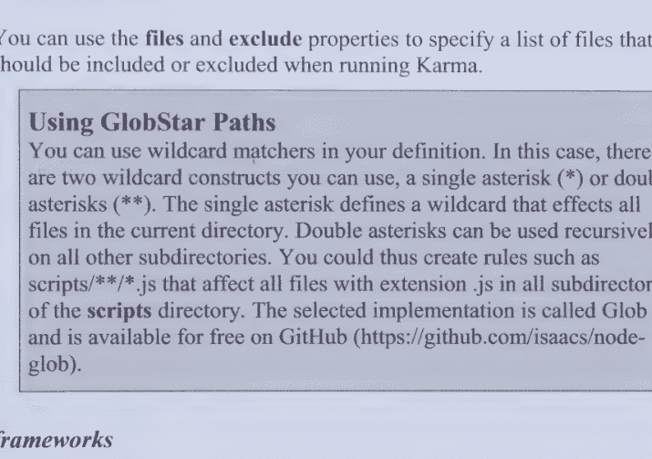

##### frameworks
你使用 **frameworks** 属性在环境中嵌入不同的框架。你可以在 npm 注册表中查看可用的框架适配器：https://npmjs.org/browse/keyword/karma-adapter

要使用此测试框架，首先必须使用 npm 安装它。
`npm install karma-<test-framework> --save-dev`

此外，你还必须在配置中指定该框架。清单 5.32 展示了如何指定流行的测试框架 Jasmine。

##### CoffeeScript 中的配置
也可以提供 CoffeeScript 格式的配置文件。你可以将配置保存为扩展名为 `.coffee` 的文件。Karma 会识别该格式并自动使用相应的 CoffeeScript 处理器。
```

```markdown
# browsers (标题格式修正)

你可以使用 `browsers` 属性选择器 Karma 应自动启动以执行你的测试的各种浏览器。Karma 原生支持 `Chrome` 和 `PhantomJS` 浏览器。但是，你可以使用 `npm` 安装 `Firefox`、`Opera`、`Internet Explorer` 和 `Safari` 的包。

### 无头浏览器 PhantomJS

无头浏览器 `PhantomJS`（http://phantomjs.org）是一个功能完整的 WebKit 浏览器，没有图形用户界面。因此，你可以在没有窗口系统的平台上使用该浏览器执行测试。尽管如此，你拥有其他浏览器提供的所有功能，并可以接收被测网站的当前报告。

### 生成初始 Karma 配置文件

你不需要自己创建初始 Karma 配置文件。Karma 自带一个生成器，当你运行带有 `karma init` 参数的 Karma 时，它可以创建初始配置文件。通过回答一些关于你所需的测试环境的问题，该工具会生成你特定的 `karma.conf.js` 文件，并将其存储在你执行命令的目录中。对于我们的 BookMonkey 项目，对话将类似于清单 5.34 所示的内容。

#### 清单 5.34：通过命令行生成 Karma 配置文件

```
[bookMonkey] $ karma init

你想使用哪个测试框架？
按 Tab 键列出可用选项。
按 Enter 键进入下一个问题。
> jasmine

你想使用 Require.js 吗？
这将添加 Require.js 插件。
按 Tab 键列出可用选项。
按 Enter 键进入下一个问题。
> no

你想自动捕获浏览器吗？
按 Tab 键列出可用选项。
输入空字符串进入下一个问题。
> Chrome >

你的源代码和测试文件位于何处？
你可以使用 glob 模式，例如 "js/*.js" 或 "test/**/*Spec.js"。
输入空字符串进入下一个问题。
> scripts/**/.js
之前模式包含的文件中，是否需要排除某些文件？
你可以使用 glob 模式，例如 "/**/.*.wp"。
输入空字符串进入下一个问题。
>
你希望 Karma 监视所有文件并在文件更改时自动运行测试吗？按 Tab 键列出可用选项。
> no
配置文件已生成于 "/Users/AngularJS/bookMonkey/karma.conf.js"。
你现在可以扩展或修改生成的文件。其格式和核心参数已设置妥当，因此你可以立即运行测试用例。诸如忘记某些必需参数或偏离支持格式等错误来源因此被降至最低。

#### 自动执行更改

使用 Karma，你可以在每次更改源代码时自动运行测试。你可以使用 `singleRun` 和 `autoWatch` 属性来启用此功能。为实现此目的，你必须在配置文件中将 `singleRun` 设置为 `false`，将 `autoWatch` 设置为 `true`。但是，在处理大量数据时，这可能会导致较高的系统利用率。因此，我们建议你再次检查 `files` 属性中定义的规则，并在必要时使用 `exclude` 属性排除文件。

#### 使用 Karma 扩展

你可以扩展 Karma。已有大量插件可供使用。你可以使用此 URL 上的 npm 注册表搜索并安装它们。

```
https://npmjs.org/browse/keyword/karma-plugin
```

要实现此目的，请使用你已经熟悉的 `npm` 命令。

```bash
npm install karma-<plugin name> --save-dev
```

在这种情况下，遵循以下约定：Karma 会自动包含所有以 `karma-` 为前缀的 `npm` 模块。如果你需要使用不遵循此约定的插件，可以通过 `plugins` 属性扩展你的 Karma 配置。

#### 清单 5.35：在 Karma 配置中嵌入插件

```javascript
plugins: [
  'karma-*',
  'plugin-example'
]
```

#### 在 WebStorm 中直接执行测试

目前，WebStorm IDE 是最受欢迎的 JavaScript 开发环境之一。我们将在第 6 章“调试”中讨论它。因此，我们将在此讨论如何在此环境中安装 Karma。

我们从一个已安装 Node.js 和 Karma 的系统开始。自 WebStorm 7 起，你可以使用官方的 Karma 插件，这使得 WebStorm 集成变得非常简单。如图 5.1 所示，你可以在运行/调试配置对话框的“Karma”节点下选择测试类型。

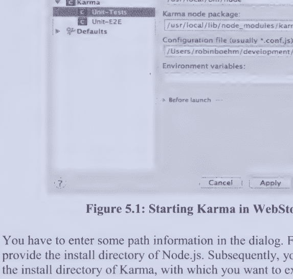

你必须在对话框中输入一些路径信息。首先，你必须提供 Node.js 的安装目录。随后，你必须输入用于执行测试的 Karma 的安装目录。如果 WebStorm 能识别你的 Node.js 和 Karma 安装，这两个字段将自动填充正确的路径。如果你想使用另一个版本的 Node.js 或 Karma 来执行测试，可以在此进行配置。同样，你还必须为测试环境提供 `karma.conf.js` 文件，这一点不足为奇。如果你正确输入了这些参数，就可以通过“运行”来启动执行。也可以在调试模式下执行。图 5.2 展示了我们的测试执行结果。

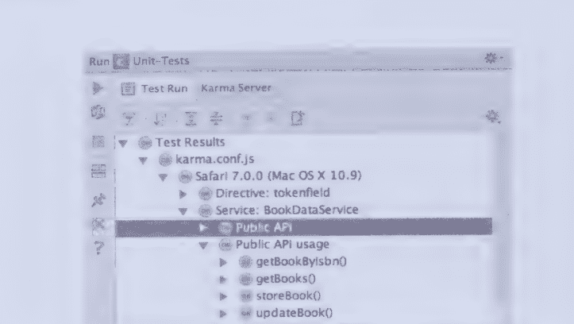

图 5.2：测试执行结果

#### 测试框架

正如示例配置中已经暗示的那样，你可以使用 Karma 以外的测试框架。目前已有针对 Jasmine (http://pivotal.github.io/jasmine/)、Mocha (http://visionmedia.github.io/mocha) 和 Qunit (http://qunitjs.com) 的插件。你也可以为其他测试框架创建自己的插件并将其嵌入。Jasmine 和 Mocha 是行为驱动开发 (BDD) 框架的示例。如清单 5.36 和 5.37 所示，它们的语法也非常相似。

#### 清单 5.36：一个 Jasmine 测试规格说明

```javascript
describe("A suite", function() {
  it("contains spec with an expectation", function() {
    expect(true).toBe(true);
  });
});
```

#### 清单 5.37：一个 Mocha 测试规格说明

```javascript
describe('A suite', function(){
  it('contains spec with an expectation', function(){
    ok(true);
  })
})
```

#### 清单 5.38：一个 QUnit 测试规格说明

```javascript
test( "a basic test example", function() {
  var value = "hello";
  equal(value, "hello", "We expect value to be hello");
});
```

无论你决定使用哪种测试框架，都可以使用 `npm` 安装它，并通过 `frameworks` 属性将其嵌入你的 Karma 配置。

```bash
npm install karma-jasmine --save-dev
```

作为示例，清单 5.39 展示了如何嵌入 Jasmine。

#### 清单 5.39：嵌入 Jasmine 框架

```javascript
frameworks: ['jasmine'],
```

#### 持续集成

持续集成 (CI) 主题也被 Karma 所涵盖。目前，已集成 CI 系统 Jenkins、Travis 和 Teamcity。在本节中，我们主要讨论同时使用 Jenkins 和 Maven，因为这在企业架构中是非常流行的配置。

至此，我们假设 Node.js 和 Karma 已经安装。在你的 `pom.xml` 文件（Maven 的项目文件）中，你现在可以通过使用 Maven Antrun 插件 (http://maven.apache.org/plugins/maven-antrun-plugin) 来启动 Karma 进程的执行。清单 5.40 展示了 `pom.xml` 文件中的摘要。

#### 清单 5.40：使用 Maven Antrun 插件从 Maven 启动 Karma

```xml
<plugin>
    <artifactId>maven-antrun-plugin</artifactId>
    <version>1.7</version>
    <executions>
        <execution>
            <phase>generate-sources</phase>
            <configuration>
                <target name="building">
                    <exec
                        executable="cmd"
                        dir="${project.basedir}"
                        osfamily="windows"
                    />
                    <exec
                        executable="karma"
                        dir="${project.basedir}"
                        osfamily="windows"
                    />
                </target>
            </configuration>
            <goals>
                <goal>run</goal>
            </goals>
        </execution>
    </executions>
</plugin>
```

#### 总结

什么是 Karma？

Karma 是一个测试运行器，它允许你在多个浏览器中运行你的测试。通过其插件系统，你可以轻松扩展它的功能。

什么是 Yeoman？

Yeoman 是一个命令行工具，用于帮助你创建复杂的项目结构。它通过“生成器”（Generators）来自动化创建项目脚架。
```

```
在 `test` 目录中，有一个名为 `spec` 的子目录，其中包含应用程序不同模块的规格说明。`spec` 目录的存在是因为可能存在另一个并行的目录 `e2e`，用于定义端到端测试。这种类型的测试不容易自动生成，因为它们差异很大。因此，你必须自己创建它们。

## 模块化大型项目

生成器创建的目录结构适用于较小的项目或模块。在大型项目中，你应该使用 `AngularJS` 的模块系统来组织你的应用程序，并将其划分为不同的技术组件。遗憾的是，`AngularJS` 生成器生成的目录结构仅适用于单模块应用程序。不过，可以在单个模块内部使用生成器。目前还无法使用 `Yo` 来自动化管理多个模块。我们将在第 7 章“常见问题解答”中讨论如何借助模块来构建我们的应用程序。

你可以通过传递一个参数来为工具指定所需的生成器。例如，要使用 `AngularJS`，请使用参数 `angular`。

```
yo angular
```

如果你不添加任何进一步的说明，`Yo` 将为 `AngularJS` 应用程序生成基础的项目结构。你可以从列表中选择一个子生成器，并用冒号分隔来生成应用程序模块。如果你想添加一个新的控制器，可以使用参数 `angular:controller` 来执行 `Yo`。你可以使用一个额外的参数来定义待生成控制器的名称。可用的子生成器在清单 5.43 中列出。

### 清单 5.43：有效的 AngularJS 生成器命令摘要

```
yo angular [applicationName]

yo angular:controller controllerName

yo angular:decorator serviceName

yo angular:directive directiveName

yo angular:filter filterName

yo angular:route routeName

yo angular:service serviceName

yo angular:view viewName
```

> 使用 CoffeeScript
>  偏好用 `CoffeeScript` 编写应用程序的开发者，可以通过传递参数 `--coffee` 来使用相应的 `CoffeeScript` 模板。也可以使用在源代码被压缩后仍能继续工作的模板。这通过参数 `--minsafe` 实现。这应该由构建过程来处理，这样你在开发过程中就不用担心压缩问题了。

使用生成器时，你应该特别注意组件的命名约定。作为参数提供的名称会通过 `Underscore.js` JavaScript 库的 `camelize()` 函数（https://github.com/epeli/underscore.string）从连字符命名法转换为驼峰命名法。这意味着使用以下命令生成的 `AngularJS` 控制器将被命名为 `MyControllerCtrl`。

```
yo angular:controller my-controller
```

生成的文件将被命名为 `my-controller.js`，可以在 `app/scripts/controllers/` 下找到。在某些情况下这可能会令人困惑。因此，你应该熟悉这个约定。

除了创建组件，生成器还会确保生成的文件被自动添加到 `index.html` 文件的正确位置。由于 `AngularJS` 在开发时就考虑了可测试性，所以生成器能够为你的组件生成所需的测试文件也就不足为奇了。

## Yo Angular

你可以使用 `yo` 命令创建一个新的 `AngularJS` 应用程序。在内部，它使用子生成器 `angular:app`。如果未明确指定子生成器，`angular:app` 被定义为默认的子生成器。你可以使用参数 `UserManager` 创建一个名为 `UserManagerApp` 的新应用程序。当这个子生成器执行时，它生成的初始应用程序已经可以运行。因此，以下初始化任务将被完成：

- 底层目录结构
- 一个嵌入嵌入 `AngularJS` 的 `index.html` 文件
- 第一个路由，包含模板和控制器
- 通用文件，如 404 模板或 .htaccess 文件
- 用于单元测试和集成测试的测试环境

此外，你可以选择性地包含以下模块：

- Twitter Bootstrap
- Angular Resource
- Angular Cookies
- Angular Sanitize

另外，`Yo` 在生成时会询问一个相关问题，你可以用一个请求条目来回答。最后，脚本会使用 `npm install` 命令启动，该命令也会安装构建过程所需的依赖项。这些依赖项在 `package.json` 文件中定义。我们将在下一节中更详细地讨论这个方面。

> Yeoman 中的 Grunt
> 除了为你的项目生成项目结构，`Yo` 还会生成一个 `Gruntfile.js` 文件，该文件为你的项目定义了开发环境和构建环境。我们将在本章末尾讨论在 Yeoman 中使用 Grunt 服务器。

## yo angular:controller

借助控制器子生成器，你可以创建一个新的控制器。名称像往常一样通过第一个参数提供。需要注意的是，模板中的名称会被 `Underscore.js` 的 `classify()` 函数修改，并追加字符串 "Ctrl"。因此，参数 `my-controller` 会生成文件名 `myController` 和内部组件名 `MyControllerCtrl`。此外，生成的文件会被添加到 `index.html` 中，并生成相应的测试文件。你可以通过查看清单 5.44 中的模板源代码来理解其上下文。

### 清单 5.44：yo angular:controller 的模板

```
angular.module('<%_ = _.camelize(appname) %>App')

.controller('<%= _.classify(name) %>Ctrl',

    ['$scope', function ($scope) {

    // Your logic here

    }]);
```

## yo angular:directive

你可以使用指令子生成器来创建一个指令。清单 5.45 中的模板用于生成指令。

### 清单 5.45：yo angular:directive 的模板

```
angular.module('<%_ = _.camelize(appname) %>App')

.directive('<%= _.camelize(name) %>', [function () {

return {

    template: '<div></div>',

    restrict: 'E',

    link: function postLink(scope, element, attrs) {

        element.text('<% _ = _.camelize(name) %> directive');

    }

}]);
```

生成的文件存储在 `app/scripts/directives/` 目录中，并自动添加到 `index.html` 文件中。

## yo angular:filter

你可以使用命令 `yo angular:filter` 创建一个过滤器。生成的过滤器将存储在 `app/scripts/filters/` 目录中。其模板可参见清单 5.46。

### 清单 5.46：yo angular:filter 的模板

```
angular.module('<%= _.camelize(appname) %>App')

  .filter('<%= _.camelize(name) %>', [function () {

    return function (input) {

      return '<%= _.camelize(name) %> filter: ' + input;

    };

  }]);
```

## yo angular:route

你可以使用 `route` 子生成器为应用程序添加一个新路由。该脚本会自动生成控制器和模板文件，并将路由自动添加到路由提供程序的配置中。控制器像往常一样自动添加到 `index.html` 中。

### 清单 5.47：使用 yo angular:route 扩展路由配置

```
$routeProvider

  .when('/', {

    templateUrl: 'views/main.html',

    controller: 'MainCtrl'
  })

  // this route has been generated by yo angular:route

  .when('/myRoute', {

    templateUrl: 'views/myRoute.html',

    controller: 'MyRouteCtrl'
  })

  .otherwise({

    redirectTo: '/'

  });
```

## yo angular:service

你可以使用 `service` 子生成器生成一个新的服务。此服务的独特之处在于让你有机会选择服务类型。你可以从以下类型中选择：

- constant
- factory
- provider
- service
- value

如果未提供类型，`Yo` 通常会选择 `factory` 作为默认值。你可以在清单 5.48 中查看相应的模板。

### 清单 5.48：yo angular:service 的模板

```
angular.module('<%= _.camelize(appname) %>App')

  .factory('<%= _.camelize(name) %>', [function() {

    var meaningOfLife = 42;

    // Public API here

    return {

      someMethod: function() {

        return meaningOfLife;

      }

    };

  }]);
```

## yo angular:decorator

装饰器模式是扩展或修改组件的一种非常有用的方式。它允许你后期修改现有服务。这可能是特定功能的扩展或替换。借助 `decorator` 子生成器，你可以为 Generator 参数提供的服务创建一个新的装饰器。装饰器生成在 `app/scripts/decorators` 目录中，其文件名通常由服务名称后接字符串 "Decorator" 组成。由于多个装饰器可以装饰同一个服务，因此可能存在同名文件已存在。此时，子生成器会通过输入请求替代名称。你可以在清单 5.49 中找到相应的模板。

### 清单 5.49：yo angular:decorator 的模板

```
angular.module('<%= _.camelize(appname) %>App')

.config(['$provide', function ($provide) {

  $provide.decorator('<%= _.camelize(name) %>',

    function ($delegate) {

      // decorate the $delegate

      return $delegate;

    });

}]
);
```

```markdown

```

#### 生成的 Grunt 配置

Yo 还会通过命令 `yo angular` 生成 Grunt 的基本配置。在此配置中，定义了三个主要任务。我们现在将描述这些任务。你可以在本书关于 Grunt 的章节中找到 Grunt 以及 `Gruntfile.js` 文件构建的详细描述。

#### grunt server

当你使用参数 `server` 启动 Grunt 时，会启动一个最小化的 Web 服务器来为你的 Web 应用程序提供服务。此外，Grunt 会在默认浏览器中打开你的 Web 应用程序。然后 Grunt 连接到默认浏览器。Grunt 进程会持续监控你的项目变化，并在发生变化时导致浏览器中的应用程序完全重新加载。因此，繁琐的手动重新加载就不再必要了。

#### grunt test

通过命令 `grunt test`，你可以在应用程序中执行单元测试。由于 AngularJS 生成器将测试环境 `Karma` 嵌入到你的项目中，你也可以在 `karma.conf.js` 文件中使用参数 `singleRun` 激活持续测试执行。当你使用此功能时，每次项目目录发生变化时都会执行你的测试。我们在关于 Karma 的章节中已经详细讨论了 `Karma` 及其有效配置参数。

#### grunt

当你不带参数启动 Grunt 时，可以启动应用程序的构建过程。在这种情况下，将执行以下任务：

- JavaScript 代码压缩
- JavaScript 代码合并
- CSS 代码压缩
- CSS 代码合并
- 通过 CDN 嵌入 AngularJS
- JavaScript 代码压缩（uglify）

此此过程生成的构建产物通常可以在 `dist` 目录中找到。

#### 小结

- Yeoman 是一套用于创建 Web 应用程序的既定工作流程。
- 借助 `Yo` 工具，你可以通过生成器非常轻松地创建新的应用程序组件。
- 所有相关的 JavaScript 框架都有生成器，尤其是针对 AngularJS 组件。
- 可以通过 `npm` 进行安装。
- 这些工具通过 Bower、Grunt 和 `Karma` 的依赖关系自动为我们的项目安装和配置。
- AngularJS 生成器模板为你提供了用于开发、测试和交付应用程序的完整 Grunt 任务配置。

## Chapter 6 调试

软件开发人员会犯错。通过采用测试驱动开发（TDD）方法，你可以避免许多这类错误。尽管如此，你仍然会发现有时必须手动调试应用程序。在本章中，我们介绍一些工具和方法，以使这方面的工作更加轻松。

为了调试应用程序，你需要一个监控应用程序运行状况的工具。借助这个工具，你可以在特定的点设置断点，使应用程序执行暂停。然后你可以分析当前的执行状态。此外，你可以一步一步地查看应用程序状态的变化。

#### Chrome 开发者工具

毫无疑问，Chrome 开发者工具是最受欢迎且最常用的 Web 调试工具之一。这些工具随 Google Chrome 浏览器一起提供，并提供了多种实用的功能。我们在本节中介绍其中一些功能。

你可以通过以下两种方法之一打开 Chrome 开发者工具。首先，你可以在网页上右键单击，在出现的上下文菜单中选择`检查` 菜单项。其次，键盘组合 `Ctrl+Shift+I`（在 Macintosh 上为 `Cmd+Alt+I`）可以打开此视图。只要当前没有其他设置打开，你就可以在当前执行程序的浏览器底部打开一个新区域。

##### “元素”选项卡

在“元素”选项卡中，你可以分析和操作当前的文档对象模型（DOM）。如图 6.1 所示，DOM 以可导航的 XML 结构形式呈现。语法高亮让 HTML 代码非常易读。如果你将鼠标移到某个结构上，就会在浏览器窗口中看到对应的容器，并带有一个半透明的蓝色覆盖层。如果你用鼠标点击选择一个元素，就会看到该元素的信息显示在窗口右侧。这些信息包含在各种窗格中，用于组织大量关于该 HTML 元素的数据。然后你可以检查应用于此元素的 CSS 样式。

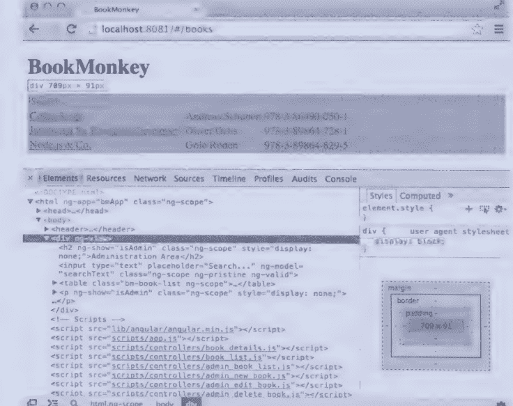

**图 6.1：Chrome 开发者工具的“元素”选项卡**

##### 键盘控制

Chrome 开发者工具提供了一些实用的键盘快捷键。你可以在其官方文档中了解这些快捷键：`https://developers.google.com/chrome-developer-tools/docs/shortcuts`

通过双击，你可以操作一个 HTML 元素。如果你双击一个元素或属性，会打开一个小文本框，让你修改当前值。你只需输入新值并按回车即可。数值可以用箭头键递增或递减。

"DOM 断点"子菜单显示当前注册的 DOM 操作断点。这个工具非常有用，因为有时你不清楚 JavaScript 代码的哪一部分修改了某个 HTML 元素。通过在相应元素上右键单击，你可以在`Break on...`下设置断点，直接修改属性、删除元素或修改子树。如果某个语句激活了此断点，处理将停止，并跳转到相应的 JavaScript 代码行。

##### “控制台”选项卡

在“控制台”选项卡下，你可以查看当前打开选项卡的控制台。在这里，你可以查看不同的日志结果，并按日志级别进行过滤。此外，你可以在控制台的一个输入字段中输入 JavaScript 语句。你还可以直接在当前网站的上下文中评估这些语句。在这种情况下，控制台通过提供自动补全功能为你提供便利。执行语句的返回值也会直接显示在执行之后。如果返回值是一个对象，你可以在控制台中分析它。因此，控制台提供了树状视图。`clear()`函数在控制台中也可用。这允许你删除当前的控制台结果。通过控制台，你可以导出和操作当前网站中定义的所有变量。此外，你可以使用`$()`函数轻松地从 DOM 中选择 HTML 元素。大多数 Web 开发人员应该对这个语法很熟悉。你可以将 CSS 选择器的字符串表示传递给此函数，使用 jQuery 风格的语法。返回值是对匹配元素的引用，如果没有匹配则返回 null。


**图 6.2：Chrome 开发者工具的“控制台”选项卡**

分析 AngularJS 应用程序时，你通常可以访问全局变量`angular`。通过这个变量，你可以调用`angular.element()`函数，该函数允许你通过 CSS 选择器选择 DOM 元素。`angular.element()`返回的 DOM 元素包含你可以调用的函数，用于分析特定的 AngularJS。例如，你可以调用`scope()`函数来获取有效的 scope。你可以从以下网页了解更多关于`angular.element()`的信息：`http://docs.angularjs.org/api.element`

##### “源代码”选项卡：调试 JavaScript 代码

“源代码”选项卡提供了当前网站加载的所有 JavaScript 文件的概览。在此选项卡中，你可以在源代码中定义断点，应用程序将在断点处停止，以便你分析当前的状态。


**图 6.3：Chrome 开发者工具的“源代码”选项卡**

与任何强大的集成环境（IDE）一样，你可以在任何代码行设置断点。双击某一行切换断点。如果运行时成功执行到有断点的行，应用程序将停止。然后你可以分析当前的 scope 以及可能的继承 scope。当你对状态不再感兴趣时，可以继续运行到下一个断点。以下键盘用于帮助调试：

- `F8` – 继续执行
- `F10` – 单步跳过下一个函数
- `F11` – 步入下一个函数
- `Shift+F11` – 步出当前函数

###### 条件断点

如果你正在调试提供的 JavaScript 代码，可以使用格式化源代码。这也允许你在源代码的任何行设置断点。断点位于编辑器中，由对象字量法中的空对象表示。要分析应用程序中的异常，你有以下暂停功能：

- 在异常处暂停
- 对所有异常暂停
- 对未捕获的异常暂停

由于此功能，你可以发现被 try-catch 块掉的错误。

#### 总结

- Chrome 开发者工具是每位 Web 开发人员宝贵的工具集。
- 在“元素”选项卡中，你可以检查和操作当前的 DOM。此外你还可以使用断点暂停操作。
- “控制台”选项卡提供了一个交互式控制台，允许你在网站的上下文中执行 JavaScript 代码。你还可以使用 CSS 选择器选择 DOM 元素。
- 你可以在“源代码”选项卡中检查加载的文件并设置断点。

#### Batarang：检查运行中的 AngularJS 应用程序

除了 Chrome 开发者工具、Firebug 和各种 JavaScript 调试器等建立工具外，还有一个特殊工具用于检查运行中的 AngularJS 应用程序。借助 Chrome 扩展程序 Batarang，你可以查看有关 AngularJS 应用程序状态和性能的信息。你可以查看各个依赖项、测量控制器函数的执行时间。正是这最后一个方面使 Batarang 成为众多开发人员的必备工具。Batarang 项目是由 Brian Ford 创建的开源项目。源代码可以以下 GitHub 网站获取：`https://github.com/angular/angularjs-batarang`

向下查看安装说明。你可以从 Chrome 网上应用店或从源代码安装 Batarang。前者是简单的安装方法，你只需点击链接并确认安装即可。Batarang 成功安装后，名为 AngularJS 的选项卡将添加到 Chrome 开发者工具集合中。在 AngularJS 选项卡内有五个子选项卡：Models、Performance、Dependencies、Options 和 Help。还有一个名为`Enable` 的复选框，你必须勾选它才能开始使用。

#### 查看 Scope

如第二章“基本原则和概念”中所述，scope 构成模型层和表示层之间的连接纽带。许多人很快会想知道视图上可以访问哪些数据，或者某个 scope 内定义了哪些变量。由于 scope 的状态在程序执行期间会变化，有时在程序运行时查看 scope 是很有用的。Batarang 在模型子选项卡中提供了运行应用程序当前作用域层次结构的概览。

通过选择一个作用域，你可以查看当前的变量分配。scope 后面的三位数代表 scope ID。值得一提的是，你可以在选项卡中查看你的 scope 和绑定。这是通过简单的 CSS 类实现的，它会在新创建的 scope 所对应的元素周围绘制一个红色边框。通过此功能，不完全理解 scope 概念的开发者可以直观地看到它。此外，在安装 Batarang 之后，你可以在 Chrome 开发者工具的“元素”选项卡中找到更多功能。

一旦你在概览中选择一个 DOM 元素，你会在“AngularJS”选项卡下的信息列中找到该元素的有效 scope。与 Batarang 中的模型分析不同，AngularJS 内部的变量（可以通过 `$` 和 `$$` 前缀识别）并未被隐藏。此外，Batarang 将选定 scope 的引用存储在全局变量 `$scope` 中。然后你可以使用控制台来分析或操纵选定的 scope。

> ## 通过 $scope 操作作用域
在控制台中使用 `$scope` 操作作用域非常简单。

```

```markdown
```


图 6.8：JetBrains IDE 扩展

扩展安装后，Chrome 地址栏旁边会显示 JB 图标。安装扩展后，你可以创建一个新的启动配置类型 `JavaScript Remote Debug`。你只需提供一个基础 URL 并在你的项目结构上定义一个本地映射。

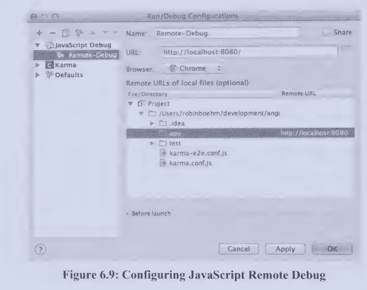

现在使用调试图标或键盘组合 `Shift+F9` 以调试模式启动 Chrome。你可以通过点击所需位置的左边缘轻松地在 IDE 内设置断点。当应用程序到达定义的断点之一时，执行将停止。

```javascript
$scope.books = [

{
title : 'JavaScript for Enterp
subtitle : 'Professional programm
isbn : '978-3-89864-728-1',
```

图 6.10：在 WebStorm 中设置断点

然后你可以检查当前的堆栈跟踪和变量分配。此外，你可以使用以下键盘快捷键控制程序执行：

- F9 – 恢复程序
- F8 – 跳过下一个函数调用
- F10 – 步入下一个函数调用
- Shift+F8 – 跳出当前函数调用

#### 总结

- WebStorm 是最受欢迎的 JavaScript 开发 IDE 之一。它提供了调试 Web 应用程序的工具。
- 要将 WebStorm 连接到 Chrome，你需要一个名为 JetBrains IDE Support 的特殊 Chrome 扩展。
- 为应用程序设置调试配置并不是一项 艰巨的任务。在调试过程中，你可以使用键盘快捷键控制执行流程。

# 第 7 章

# 常见问题

## AngularJS 模块：如何用模块构建应用程序？

什么是模块？在软件工程中，模块是形成封闭功能单元并表现出高度内聚性的构建块。根据这个定义，一个模块应该只负责一项任务，并且模块应该通过松耦合形成一个完整的系统。通常，你应该总是尝试创建模块化软件。当封装的功能被重用或者由于项目的复杂性需要更具结构性时，尤其如此。此外，模块具有明确定义的接口，其用户使用该接口与模块集成。然后，模块的内部实现可以更改，而无需更改模块用户。

#### AngularJS 中的模块

在 AngularJS 中，模块由一系列特定于框架的组件组成，例如服务、过滤器或指令（参见图 7.1）。这些组件定义了模块的接口。

#### 图 7.1：AngularJS 中可能的模块组合

AngularJS 模块始终具有一个由字符串指定的唯一名称。此外，一个模块可以有一个或多个对其他模块的依赖关系。其他模块必须以可解析的方式加载。清单 7.1 展示了一个小例子。

#### 清单 7.1：具有依赖关系的模块定义

```javascript
// 初始化应用模块
angular.module('yourAppName', ['yourAppDependency']);

// 定义依赖模块
angular.module('yourAppDependency', []);

angular.module('yourAppDependency').factory(...);

angular.module('yourAppDependency').filter(...);

angular.module('yourAppDependency').directive(...);
```

清单 7.1 中的 JavaScript 代码创建了一个名为 `yourAppName` 的模块。它需要使用模块 `yourAppDependency`，该模块也必须加载以便依赖关系可以被解析。两个模块中哪个先定义并不重要，因为 AngularJS 在运行应用程序之前会异步加载所有已定义和集成的模块。

在模块 `yourAppDependency` 中，通过使用 AngularJS 函数如 `factory`、`filter` 和 `directive` 来注册应作为模块一部分的组件。

注册后，`yourAppDependency` 中的组件可以被 `yourAppName` 访问。由于 `yourAppName` 现在是 AngularJS 应在 DOM 完全加载后执行的模块，你有两个选择。第一，你可以使用 `ngApp` 指令声明 `yourAppName` 模块为启动模块。第二，你可以使用 `angular.bootstrap()` 函数以编程方式执行模块。其他选项在 Bootstrap 的官方文档中有说明，网址为 http://docs.angularjs.org/guide/bootstrap。

#### AngularJS 中的模块加载

AngularJS 模块是异步加载的。这并不意味着模块可以异步重新加载。而是说 AngularJS 首先加载文档中定义或包含的所有模块，然后再启动应用程序。换句话说，所有模块必须在应用程序启动时完成加载。AngularJS 中没有模块延迟加载的机制。

#### 模块化何时有用？

定义一组模块并非易事，因为它们无法被泛化，必须根据应用程序的不同来解决。你需要大量经验才能做出正确的决定。这通常伴随着一个迭代过程。没有正式的规则。

然而，我们可以从大型项目的经验中推导出一些指导方针。

AngularJS 官方文档（网址为 http://docs.angularjs.org/guide/module）建议模块应按技术要点进行结构化。这意味着你应该为所有指令创建一个模块。另一个Kind 管理服务的模块，以及另一个用于过滤器的模块。

然而，根据我们的经验，按技术方面划分意味着在大多数情况下代码重用几乎是不可能的。这是因为解决不同技术问题的组件通常在同一模块中进行管理。这意味着即使你只需要模块中一小部分组件，也必须实现整个模块。

#### 模块组合

此时应该注意的是，官方 AngularJS 文档中关于模块组合的建议是该框架早期时期的遗留产物。当时，没有关于大型 AngularJS 项目的具体案例研究。因此，团队只能根据他们当时的知识提出建议。AngularJS 团队现在已经承认，基于技术标准的划分更有意义。

根据我们的经验，通过按技术标准划分模块可以实现优雅的模块组合。因此，解决技术问题的所有组件都是模块的一部分。这意味着在重用模块组合时，很可能确实需要包含的大多数组件。

自 1.0 版本以来，AngularJS 按照这种方法构建其模块。许多以前属于核心部分的技术组件现在已外包到它们自己的模块中。以下列表显示了 AngularJS 中当前模块结构的一部分。

- angular
- angular-animation
- angular-cookies
- angular-route
- angular-touch
- angular-...

你还可以在 AngularJS 的模块划分中看到，主模块中的开发逐渐朝着将非必要部分逐步外包到它们自己的模块中。你可以在自己的项目中非常成功地使用这种方法。当你在家族产品中开发项目时，将对所有项目有用的通用概念外包到实用模块或通用模块中是有意义的。这可以显著缩短开发时间和延迟。然而，这通常需要更多的同步工作。

## 第 7 章：常见问题

#### 对于实用模块，你应该记住这些概念不仅在 AngularJS 上下文中有用。一种好的方法应该允许独立于框架约定开发某些所需功能，并为相应的框架提供适配器模块（在这种情况下是 AngularJS）。因此，使用不同 JavaScript 框架的其他团队也可以从该模块中受益。

#### 如果你正在开发开源模块，你可以使用 Bower 使其向公众开放。此时，你需要正确的版本控制策略。在开源世界中，Tom Preston-Werner 的语义化版本控制已成为一种非官方标准。其网站为 http://semver.org。

#### 由于 AngularJS 中的模块是通过其名称识别的，并且没有权威机构来确定谁可以使用什么前缀，因此无法避免名称冲突。如果两个模块具有相同的名称，则最后加载的模块会毫无警告地覆盖先前注册的模块。因此，你和你的同事应该为整个组织商定命名约定。现有模块的一个良好来源是 http://ngmodules.org 的模块仓库。清单 7.2 展示了命名 AngularJS 模块的可能模式。

#### 清单 7.2：模块命名约定

```javascript
// <命名空间>.<名称>-<可选类型>

angularjsde.bookmonkey

angularjsde.bookmonkey-1t8n

angularjsde.bookmonkey-util

angularrsde.bookmonsterlth
```

#### 目录结构

在 JavaScript 世界中，没有目录结构的约定。然而，你可以从成功的项目中学习最佳实践。清单 7.3 中展示的结构，

```
/app-root
    /controllers
    /directives
    /filters
    /services
    /views
    app.js
    index.html
```

#### AngularJS 中的模块模块


...
.

..


..


```
在此示例中，`makeHTTPRequestPromise()`返回一个 Promise 对象。`Promise`最重要的功能是`then()`函数。你可以使用`then()`来定义当异步操作的结果可用或发生错误时应该调用哪个回调函数来实现此目的。然后`then()`函数接收两个参数：第一个是成功函数，它将在异步回调执行成功且结果可用的情况下被调用；第二个是错误函数、它在回调过程中出现错误时将予以执行。在下列清单中可以看到一个使用 `Promise`的 API 摘要:

```
// onSuccess and onError are functions!

promise.then(onSuccess, onError)
```

由于返回值会自动传递给下一个异步操作，而且每个操作都返回 `promise`（承诺），你可以如图案所示地链接 `then()` 回调函数。但是为了向 `performOperation()` function provide data from `response.data.user` object而非整个响应对象提供数据)，需要在`makeHttpRequestPromise()`与`performOperation()"之间构建一个转换步骤来处理任何可能的错误：通过给 `then`提供一个匿名的 `error function`（仅打印）,并在成功调用 `doSomething`的同时，由于潜在的错误会自动处理因此只需在一个位置即可。

为了向你展示如何实现基于 Promise 的自定义异步操作我们将使用`Q`库。`Q` (http://documentup.com/kriskowal/q/)是 promises/A+规范的流行实现之一我们之所以选择`Q`是因为AngularJS对`Promises`的实现也基于`Q`的子集。

在清单 7.9中概述了使用`Q`实现的`makeHTTPRequestPromise()`函数的可能实现方案这是一个包装器函数它将传统的回调方式封装成返回promise的形式使得回调中包含`response as promise`实现来实现这一目标，我们需要利用`Q.defer"`这个异步非阻塞的API来创建一个`deferred`对象该 `deferred` 是转换基于回调式的调用到基于Promise式调用的关键组件我们将对象的引用存储在局部变量`deferred`中。

##### 清单 7.9：将基于回调的调用转换为基于 Promise 的调用

```
// Wrap makeHttpRequest

var makeHttpRequestPromise = function(url) {

  var deferred = Q.defer();

  makeHttpRequest(url, deferred.resolve, deferred.reject);

  return deferred.promise;

};
```

`deferred`对象可以通过`promise`属性访问相关的 promise。你把这个 Promise传递给`makeHTTPRequestPromise()`函数从而满足了使其返回承诺的需求调用者现可使用

## AngularJS 中的 Promise

你可以在 AngularJS 中使用 `promise`。几乎所有提供的组件操作都会返回一个 promise。这包括 `$http` 服务，它简化了 HTTP 请求的构建。AngularJS 中的 `promise` 实现在很大程度上基于`Q`的一个子集。你可以通过依赖注入提供一个 `$q` 服务来访问这个实现。

与`Q`相比，AngularJS 的内部实现在几个方面存在差异，这是因为该框架必须将实现在 dirty checking（脏检查）上下文中无缝集成。如第 4 章“扩展应用”中所讨论的，AngularJS 外部发生的 `scope` 操作需要通过`$scope.$apply()`手动调用 dirty checking 回调。为了确保这不会在异步操作后迫使浏览器重绘 DOM 元素，这些函数会在 `$rootScope` 中借助一个辅助函数执行，以解决这一问题。

清单 7.10 展示了名为`promisesService`的 AngularJS 服务中的`makeHTTPRequest()`示例。为此，除了 `$q` 服务外，我们还需要应用的 `$rootScope`，因为我们必须在异步函数执行后手动激活 dirty checking。如果我们不这样做，我们的 AngularJS 应用将不会收到此函数触发的更改通知。

使用`then()`注册成功或错误函数，如清单 7.8 所示。现在你需要确保根据`makeHTTPRequest()`回调的结果，promise 是被 fulfilled（完成）还是 rejected（拒绝）。你可以通过`resolve()`和`reject()`函数来实现这一点。`resolve()`用于处理成功的完成，而`reject()`函数确保在发生错误时 promise 被拒绝。

你刚才看到，`makeHTTPRequest()`函数接受一个回调函数作为第二个参数，以便在成功时调用它。通常，基于回调的异步函数也会提供一个错误处理器。这是通过使用相应的回调函数来解决的。因此，假设`makeHTTPRequest()`函数期望第三个参数是一个错误函数，如清单 7.9 所示。这意味着你可以将`makeHTTPRequest()`分别以`deferred.resolve`和`deferred.reject`作为第二个和第三个参数传入，以便完成 promise 或拒绝错误。通过这种方式，我们将基于回调的函数`makeHTTPRequest()`转换为基于 promise 的函数`makeHTTPRequestPromise()`。`Q`也提供了以更优雅的方式格式化源码的工具，但这在 AngularJS 上下文中并不相关。

> **Promises（Promise）**
> 要使用`Q`将基于回调的函数转换为基于 promise 的函数，请使用通过`Q.defer()`创建的`deferred`对象。通过使用这个`deferred`对象，你可以通过`deferred.promise`访问关联的 promise。然后你将此 promise传递给回调函数。现在，你需要弄清楚为什么 `deferred`对象和 promise 之间存在区分。为什么你不能直接使用 promise？答案其实非常明显。

你通常不希望将控制 promise 何时被完成或拒绝的权力交给回调函数。因此，你传递 promise，然后可以在函数简化过程中借助`deferred`对象控制何时发生完成或拒绝。如果你只使用 promise（没有`deferred`对象），回调函数自己就可以完成或拒绝该 promise。

### 清单 7.10：在 AngularJS 中使用 $q

```javascript
angular.module('app').factory('promisesService',

function ($rootScope, $q) {

return {

makeHttpRequestPromise: function (url) {

var deferred = $q.defer();

// 手动触发 dirty checking

$rootScope.$apply(function () {

makeHttpRequest(

url,

deferred.resolve,

deferred.reject

);

});

return deferred.promise;

}

}

});
```

```javascript
angular.module('app').controller('PromisesCtrl',

function ($scope, promisesService) {

promisesService

.makeHttpRequestPromise('http://server/user')

.then(function(result) {

$scope.user = result;

});

});
```

通过在此处嵌入`promisesService`（参见 PromisesCtrl），我们可以在调用`promisesService.makeHttpRequestPromise()`后使用`then()`函数来处理成功或错误。

AngularJS 的 `$q`实现提供了额外的 API 函数，使处理 promise 变得更加容易。例如，`$q.all()`函数期望一个 promise 数组，并返回一个 promise。返回的 promise 将在数组中所有 promise 都 resolved 后 resolved。因此，影响q`允许你同步执行一系列异步操作，只要它们彼此不依赖。此外，你可以执行一个后续操作，该操作处理来自异步操作的各项结果。就像通常情况一样，你可以以带有`then()`的成功函数的形式指定后续操作（参见清单 7.11）。这样，当每个单独的异步操作完成并且其结果可用时，此成功函数就会被执行。在这种情况下，AngularJS 会将各个结果以数组形式返回。如果至少有一个异步操作导致错误并且其 promise 被 rejected，那么结果 promise 也会被 rejected。

### 清单 7.11：PromiseCtrl 的实现

```javascript
function ($scope, $q, promisesService) {

$q.all([

promisesService

.makeHttpRequest('http://server/user/1'),

promisesService

.makeHttpRequest('http://server/user/2')

]).then(function(resultsArray) {

$scope.users = resultsArray;

});

}
```

`$q.when()`是 `$q` 服务中的另一个有用函数。这个函数允许你模拟基于 promise 的 API。你可以向此函数传递一个值，它将返回一个代表该值的 promise。此外，借助此函数，你可以将一个属于第三方库的 promise 转换为 `Q` promise。这只有在外部 promise 实现了 promises/A+ 规范时才可行。

要使用 `$q.when()`模拟异步 API，让我们再次使用 BookMonkey 项目中的*BookDataService*（参见第 3 章“Bookmonkey 项目”）。

在第 4 章“扩展应用”中介绍 `$http` 服务之前，我们没有从函数返回 promise。相反，我们直接返回数据。之所以这样做，是因为直到那时为止没有执行任何异步操作，我们希望避免使示例过于复杂。然而，我们的解决方案是，


```markdown
#### 小结

- 在本节中，我们讨论了如何在 `JavaScript` 中优雅地处理异步函数。许多异步 API 基于回调函数。由于异步回调的嵌套可能导致难以阅读的构造（尤其是回调地狱），我们引入了 `Promise` 来解决这个问题。
- 有一个名为 `Promises/A+` 的开放规范。
- 该规范确保不同的 `Promise` 实现彼此兼容。
- 我们了解了 `Promise` 实现 `Q`。
- 我们可以在 `AngularJS` 中实现 `Q` 的一个子集。
- 在在 `AngularJS` 中，我们可以通过 `$q` 服务访问这个子集。
- 在本节末尾，我们了解了如何使用 `$q` 服务基于 `Promise` 实现异步操作。
- 我们还展示了如何简化 `AngularJS` 中基于 `Promise` 的 API 的测试。该框架允许我们在测试中同步调用 `Promise`。

#### AngularJS 与 RequireJS：这是正确的组合吗？

##### 什么是 RequireJS？

RequireJS 可从 `http://requirejs.org/` 下载，是一个 `JavaScript` 框架，支持文件和模块的异步加载。它允许你定义模块及其依赖关系。为此，`RequireJS` 实现了异步模块定义（AMD）`API`，这是 `JavaScript` 世界中模块定义的正式标准。`AMD API` 提供以下优势：

- 依赖项不再需要手动排序，而是隐式解析。
- 依赖项可以在需要时异步加载。
- `AMD API` 阻止使用全局变量。
- 模块名称可以被覆盖，以便在测试中使用模拟实现进行替换。
- 框架自动识别当前需要哪些依赖项，并按正确顺序加载它们。`RequireJS` 为每个依赖项在我们的应用程序的 `head` 标签中添加一个 `script` 标签。一旦该标签被添加到 `DOM`，浏览器就会尝试加载并执行该文件。这可以加快初始加载速度。

##### RequireJS 示例

我们在一个小项目中演示如何使用 `RequireJS`。项目结构如清单 7.15 所示。

##### 清单 7.15：RequireJS 示例的目录结构

```
index.html
scripts/
  app.js
  require.js
  helper/
    util.js
    i18n.js
```

项目包含一个 `index.html` 文件，我们在其中加载 `RequireJS` 脚本（见清单 7.16）。注意额外的 `data-main` 属性，它定义了我们应用程序的入口点。

##### 清单 7.16：我们 RequireJS 示例的 index.html

```html
<!DOCTYPE html>
<html>
<head>
  <title>My Sample Project</title>
  <!-- data-main 属性告诉 require.js 在 require.js 加载后加载
    scripts/app.js。 -->
  <script data-main="scripts/app" src="scripts/require.js">
  </script>
</head>
<body>
  <h1>My Sample Project</h1>
</body>
</html>
```

浏览器加载脚本后，开始执行 `RequireJS`。通过 `data-main` 属性定义的脚本（`scripts/app`）现在被重新加载并执行。在 `app.js` 中，我们使用 `AMD API` 并通过 `require()` 引入所提供函数的执行（见清单 7.17）。然而，该函数只有在所有依赖项完全加载后才会执行。依赖项通过第一个参数作为字符串数组提供。在我们的例子中，我们需要模块 `helper/util` 作为依赖项。该模块提供要执行的函数作为第一个参数。

##### 清单 7.17：我们 RequireJS 应用程序的入口点（app.js）

```javascript
require(["helper/util"], function(util) {
  var output = util.translateFn("Hello World");
  console.log(output);
});
```

> **定义 RequireJS 依赖项**
> 模块依赖项的路径相对于入口点定义（由 `data-main` 属性定义）。如果你需要不同的行为，可以使用参数 `baseUrl` 进行配置。你可以在官方文档 `http://requirejs.org/docs/api.html#config-baseUrl` 中查看准确定义。

你可以使用 `RequireJS` 的 `define()` 函数定义模块，如清单 7.18 所示。你可以在数组中为一个模块指定依赖项。在我们的 `util` 模块中，我们将模块 `helper/i18n` 指定为依赖项。在 `util` 模块中，我们使用来自 `i18n` 模块的 `translate()` 函数。在这个例子中，`util` 模块返回一个提供公共函数 `translateFn()` 的 `API` 对象。这样，我们可以让其他模块使用本地函数 `translate()`。

##### 清单 7.18：使用 RequireJS 定义的 util 模块

```javascript
define(["helper/i18n"], function (i18n) {
    var translate = function(input){
        return "Translated: "+i18n.translate(input);
    };
    // Public API
    return {
        translateFn: translate
    };
});
```

因此，通过为每个组件定义一个 AMD 模块，你可以在简单的 `JavaScript` 应用中实现组件。此外，你不必处理 `index.html` 中各种 `JavaScript` 文件的正确顺序，因为 `RequireJS` 会处理这一点。

#### 加载依赖项

有时，你需要加载在 `baseUrl` 路径下找到的依赖项。为此，有一个约定可以覆盖标准行为。然后你可以加载那些路径相对于当前地址指定的脚本。以下情况下，`baseUrl` 约定：

1. 输入依赖项以 `.js` 结尾。
2. 输入依赖项以 `/` 开头。
3. 输入依赖项包含协议，如 `http://` 或 `https://`。

图 7.2 以图形方式展示了示例项目中的依赖关系。

#### AngularJS 与 RequireJS

在本节中，你将学习如何实现 `AngularJS` 和 `RequireJS`。为此，针对特定的 `RequireJS` 构建方式，我们决定基于我们的 `BookMonkey` 项目来实现这些扩展。上一节中的 `AngularJS` 版本提供了基础。现在的思路是将各个 `AngularJS` 组件定义在自己的 AMD 模块中。此外，我们将创建一个 `requireConfig.js` 文件，它将作为应用程序的入口点。我们还将使用 `Bower` 来管理依赖项。目录结构如清单 7.19 所示。

##### 清单 7.19：使用 Bower 进行管理的 BookMonkey 目录结构

```
bower_components/
  angular/
    angular.min.js
  angular-route/
    angular-route.min.js
  requirejs/
    require.js
scripts/
  config/
    routes.js
  controllers/
    book_details.js
    book_list.js
  services/
    book_data.js
  app.js
  requireConfig.js
index.html
bower.json
```

作为第一步，我们在 `index.html` 中包含 `RequireJS`。我们使用 `data-main` 属性来标识入口点。如清单 7.20 所示，该属性引用了定义在 `scripts/requireConfig.js` 文件中的 AMD 模块。此外，我们移除注释掉之前的 `script` 标签，因为 `RequireJS` 会负责文件加载。

##### 清单 7.20：集成了 RequireJS 的 BookMonkey 的 index.html

```html
<script src="bower_components/requirejs/require.js" data-main="scripts/requireConfig"></script>
<!--
这些标签现在已过时！
<script src="lib/angular/angular.min.js"></script>
<script src="lib/angular-route/angular-route.min.js"></script>
<script src="scripts/app.js"></script>
<script src="scripts/controllers/book_details.js"></script>
<script src="scripts/controllers/book_list.js"></script>
<script src="scripts/services/book_data.js"></script>
-->
```

接下来，我们配置应用程序所需的 AMD 模块 `angular` 和 `angularRoute`（参见清单 7.21）。为此，我们可以使用 `RequireJS` 的 `require.config()` 函数。该函数接收一个配置对象。为了嵌入 `AngularJS`，我们需要 `paths` 属性。此属性允许我们指定那些在 `baseUrl` 路径下直接找到的依赖项。此外，我们为这些依赖项指定一个确切的模块名。由于 `AngularJS` 和 `ngRoute` 模块是外部依赖，我们只能通过 `Bower` 来管理它们，因此我们在此处指定了指向 `bower_components` 目录的相对路径。

为了确保我们的 `AngularJS` 被正确嵌入，我们必须告诉 `RequireJS` 将 `AngularJS` 赋值给全局变量 `angular`。这可以通过使用 `shim` 属性来完成。为了获得正确的初始化顺序，我们将 AMD 模块 `angular` 定义为 AMD 模块 `angularRoute` 的依赖项。

##### 清单 7.21：在 RequireJS 上文中配置 AngularJS

```javascript
require.config({
  paths: {
    angular: '../bower_components/angular/angular',
    angularRoute: '../bower_components/angular-route/angular-route'
  },
  shim: {
    'angular' : {'exports' : 'angular'},
    'angularRoute': ['angular']
  }
});
```

你可以通过内容分发网络（CDN）加载库。前述的 `RequireJS` 模块约定在此处同样重要。你甚至可以指定一个回退选项（`http://requirejs.org/docs/api.html#pathsfallbacks`）。这样，你可以将 CDN 资源指定为第一个参数，而将本地资源作为备选方案，在 CDN 不可达时进行加载。这如清单 7.22 所示。

##### 清单 7.22：在 RequireJS 上下中使用 CDN 和回退选项配置 AngularJS

```javascript
require.config({
  [...]
  paths: {
    angular: [
      '//ajax.googleapis.com/ajax/libs/angularjs/1/',
      '../bower_components/angular/angular'
    ]
  }
});
```

#### 第七章：常见解答

针对特定的 `RequireJS` 构建方式，我们决定基于我们的 `BookMonkey` 项目来实现这些扩展。上一节中的 `AngularJS` 版本提供了基础。现在的思路是将各个 `AngularJS` 组件定义在自己的 AMD 模块中。此外，我们将创建一个 `requireConfig.js` 文件，它将作为应用程序的入口点。我们还将使用 `Bower` 来管理依赖项。

##### 清单 23：AMD 模块 angular

```javascript
define([
  'angular'
], function (angular) {
  return angular.module('app', []);
});
```

当 `AngularJS` 和 `RequireJS` 一起使用时，我们必须确保 `AngularJS` 脚本在加载完成后才执行。为此，我们使用 `RequireJS` 的 `ready()` 函数来手动引导 `AngularJS`（参见清单 7.24）。

##### 清单 7.24：在 RequireJS 上文中手动引导 AngularJS

```javascript
require([
  'angular',
  'app',
  'config/routes'
], function (angular, app) {
  var elem = document.getElementsByTagName('html')[0];
  angular.bootstrap(elem, ['app']);
});
```
```

```markdown
像往常一样，我们在 `define()` 函数中添加一个新的 AMD 模块。在这种情况下，我们处理的是 AMD 模块 `controllers/book_list`。我们还依赖于 `app` 模块，以便我们可以将控制器作为定义添加。由于此控制器还需要 `BookDataService`，我们也应将相应的 AMD 模块 `services/book_data` 指定为依赖项。像往常一样，AngularJS 的内部机制（如依赖注入）在模块定义中仍然可用。AngularJS 可以毫无问题地指定作用域（`scope`）以及 `BookDataService`。

为完整起见，我们在清单 7.27 中展示了另一个摘要，即 `BookDataService` 的 AMD 模块 `services/book_data` 的定义。值得一提的是，我们也可以嵌入 AMD 模块 `angular` 并使用 AngularJS 的全局 API（例如 `angular.element()`、`angular.copy()` 等）。

## 清单 7.27：在 RequireJS 上下文中，作为 AMD 模块的 AngularJS 服务工厂

```javascript
define([
    'angular',
    'app'
], function (angular, app) {
    app.factory('BookDataService', function () {
        // angular.element()
        // angular.copy()
        // ...
    });
});
```

因此，我们已经展示了如何在 RequireJS 上下文中执行 AngularJS 应用程序。作为总结，我们应用程序的依赖关系如图 7.3 所示。该图在技术上并不完全准确，因为我们需要在其他每个模块中都包含 `app` 这个 AMD 模块。然而，这将使图表变得非常难以阅读。因此，我们在图中考虑略去了这些依赖关系。

### 使用 RequireJS 进行测试

在本节中，我们将探讨为了在 RequireJS 上下文中使用 AngularJS 应用程序所需执行的步骤。首先，我们必须使用 `npm` 安装 RequireJS Karma 适配器。我们还必须在 `frameworks`下的 Karma 配置中指定它。Karma 适配器的安装是在命令行中通过以下命令完成的：

```bash
npm install karma-requirejs
```

# 第 7 章：常见问题

### 图 7.3：RequireJS 上下文中 BookMonkey 的模块依赖关系

完成上述步骤后，我们必须调整 Karma 配置中的 `files` 块。

由于 RequireJS 本身嵌入文件并异步重新加载它们，因此我们需要在测试套件中提供各种所需的文件，而无需直接嵌入它们。我们通过将属性 `included` 设置为 `false` 来实现这一点（参见清单 7.28）。因此，我们可以定义 Karma 启动的 Web 服务器允许在不使用 `<script>` 标签嵌入的情况下发送这些文件。Karma 已在第 5 章中介绍过。

## 清单 7.28：在 RequireJS 上下文中测试 AngularJS 应用程序的 Karma 配置

```javascript
// frameworks to use
frameworks: ['jasmine','requirejs'],
// list of files / patterns to load in the browser
files: [
  {
    pattern: 'app/bower_components/angular/angular*.js',
    included: false
  },
  {
    pattern: "app/bower_components/angular-route/angular-route*.js",
    included: false
  },
  {
    pattern: 'app/bower_components/angular-mocks/angular-mocks*.js',
    included: false
  },
  'test/unit/**/*.ts',
  {
    included: true
  },
  'test/testRequireConfig.js'
]
```

此外，我们还需要为我们在 Karma 中执行的测试指定一个适配的 RequireJS 配置（参见清单 7.29）。在这个过程中，我们需要注意以下几点：

- AngularJS 必须包含所有必需的模块。
- 必须包含 angularJS 模块 `ngMock`。
- 路径配置应进行调整以适应 Karma。必须调整 `baseUrl`。我们的测试必须被指定为依赖项。
- 我们必须定义一个启动测试的回调函数。由于 Karma 会沿着路径提供已加载的文件，因此我们在定义模块时必须对此加以注意。
- 我们也应相应地调整路径条目。

此外，我们将测试分组在一个名为 `tests` 的数组中。在此过程中，我们遍历 Karma 加载的所有文件，以查找匹配 `spec.js` 的文件。

## 清单 7.29：在 RequireJS 上下文中测试我们的 AngularJS 应用程序的 testRequireConfig.js 文件

```javascript
// we get all the test files automatically
var tests = [];
for (var file in window.__karma__.files) {
    if (window.__karma__.files.hasOwnProperty(file)) {
        if (/spec\.js$/i.test(file)) {
            tests.push(file);
        }
    }
}
require.config({
    paths: {
        angular: '/base/app/bower_components/angular/angular',
        angularRoute:
            '/base/app/bower_components/angular-route/angular-route',
        angularMocks:
            '/base/app/bower_components/angular-mocks/angular-mocks'
    },
    baseUrl: '/base/app/scripts/',
    shim: {
        'angular' : {'exports' : 'angular'},
        'angularRoute': ['angular'],
        'angularMocks': {
            deps:['angular'],
            'exports':'angular.mock'
        }
    },
    deps: tests,
    callback: window.__karma__.start
});
```

完成这些之后，我们可以将测试定义为 AMD 模块。一如既往，在这个模块中，我们可以使用我们选择的任何测试框架（例如 Jasmine）。

清单 7.30 中的 AMD 模块展示了一些对我们 `DataBookService` 的测试。

## 清单 7.30 包含 BookDataService 测试用例的 AMD 模块

```javascript
define([
    'angular',
    'angularMocks',
    'services/book_data'
], function (angular, mock) {
    describe('Service: BookDataService', function () {
        var BookDataService;
        // load the application module
        beforeEach(module('bmApp'));
        // get a reference to the service
        beforeEach(inject(function (_BookDataService_) {
            BookDataService = _BookDataService_;
        }));
        describe('Public API', function () {
            it('should include a getBookByIsbn() function', function () {
                expect(BookDataService.getBookByIsbn).toBeDefined();
            });
            it('should include a getBooks() function', function () {
                expect(BookDataService.getBooks).toBeDefined();
            });
        });
    });
});
```

结合 RequireJS 对 AngularJS 应用程序进行测试最初需要稍多一些 effort。然而，在克服早期的障碍后，您可以通过以 AMD 模块的形式提供它们，像往常一样定义测试用例。

### 答案

正如你刚刚见，使用 RequireJS 实现 AngularJS 是可能的。不幸的是，RequireJS 的最大优势——模块重新加载——被这样一个事实抵消：每个组件（控制器、服务）必须在应用程序启动时即可。AngularJS 和 RequireJS 结合的另一个问题是，无法执行我们的端（E2E）测试。

### 总结

- RequireJS 是一个 JavaScript 框架，支持文件和异步加载。它实现了模块定义（`AMD`）。
- 通过一个小例子，我们展示了如何将 AngularJS 与 RequireJS 结合，以及会带来什么影响。
- 通常不建议将 AngularJS 与 RequireJS一起使用，因为这种组合有很多缺点。

### 移动设备：AngularJS 支持移动设备吗？

由于使用移动设备的趋势日益增长，许多人想知道 AngularJS 是否特别适合此类设备。除了独立设备的常用技术（例如响应式设计）之外，AngularJS 还提供了一些专门为移动开发的扩展。

####移动设备上的性能
虽然 AngularJS 适合手机和平电脑创建 Web 应用程序，但你应该注意一些事项。了解在作用域中存储了哪些数据，否则 AngularJS 的脏检查可能会花费很长时间。建议使用 `ngBind` 指令而非 `$interpolate` 服务来进行输出。这样可以避免表达式的评估显示出来。

####支持触摸事件

AngularJS 提供了 `ngTouch` 模块，其中包含与触摸设备交互的扩展。`ngTouch` 不是核心库的一部分。如果你想使用它，必须通过 `<script>` 标签嵌入。如果不使用 Bower，可以在 http://code.angularjs.org/ 下载该模块来管理前端。此外，在定义你的模块时，你必须将其指定为依赖。

### 清单 7.31：嵌入 ngTouch

```javascript
angular.module('app', ['ngTouch']);
```

当你嵌入 `ngTouch` 模块时，`ngClick` 指令会被替换为专为触摸设计的替代实现。原因是大多数浏览器在点击和释放事件后 300 毫秒才会向发送事件。因此，在移动设备上使用 `ngClick` 指令时，点击交互显得较慢。另一方面`ngTouch` 模块的替代实现会立即反应，因此应用程序显得更加流畅。此外，它会抑制原生事件以避免重复。

你可以在简单模板中使用 `ngClick` 指令，并使用支持触摸的设备应用程序来测试此行为（参见清单 7.32）。

### 清单 7.32：在 ngTouch 模块中使用 ngClick

```html
<!DOCTYPE html>
<html ng-app="app">
  <body>
    <div ng-click="click=click+1" ng-bind="click"></div>
    <!-- Scripts -->
    <script src="lib/angular/angular.min.js"></script>
    <script src="lib/angular-touch/angular-touch.min.js"></script>
    <script src="scripts/app.js"></script>
  </body>
</html>
```

ngClick 指令的 CSS 扩展
在你的应用程序中嵌入 `ngTouch` 模块时，替代 `ngClick` 指令会在你用手指按下相应元素时设置名为 `ng-click-active` 的 CSS 类。这适用于触摸事件以及鼠标点击事件。因此，你可以使用这个 CSS 类为元素的按下状态设置特殊样式。

#### 滑动手指令

`ngTouch` 模块的另一项扩展是对滑动手势的支持。滑动是指用手指在触摸屏上划过。这种手势通常用于显示元素的上下文菜单。

AngularJS 选择的实现基于 jQuery Mobile。不需要将 jQuery Mobile 作为依赖项，因为 `ngTouch` 包含了该库的相关部分。该模块为滑动手势提供了两个指令。`ngSwipeLeft` 指令处理向左的滑动手势，而 `ngSwipeRight` 指令处理向右的滑动。清单 7.33 展示了这些指令的使用。

### 清单 7.33：使用 ngSwipeLeft 和 ngSwipeRight

```html
<!DOCTYPE html>
<html ng-app="app">
<body>
  <div ng-swipe-right="right=right+1" ng-swipe-left="left=left+1">
    <div>Swipe-right: {{right}}</div>
    <div>Swipe-left: {{left}}</div>
  </div>
</body>
</html>
```
```


```

#### $swipe 服务

如果你想实现更复杂的滑动交互，或者希望对滑动的行为有更多控制，仅使用 `ngSwipeLeft` 或 `ngSwipeRight` 是无法做到的。因此，`ngTouch` 模块包含了 `$swipe` 服务，上述两个指令在内部也使用了它。通过它，你可以在更低级别处理滑动事件。

该服务的公共 API 包含一个名为 `bind` 的函数，用于监听事件。支持的不同事件类型列于表 7.1 中。

| 类型 | 描述 | 激活方式 |
|------|-------------|--------------|
| start | 交互开始 | mousedown, touchstart |
| move | 交互期间的当前位置 | mousemove, touchmove |
| end | 交互结束 | mouseup, touchend |
| cancel | 当前交互被取消时发生 | touchcancel |

表 7.1：`$swipe` 服务支持的事件

`bind()` 函数的第一个参数是要监控滑动事件的 DOM 元素的引用。

第二个参数是一个配置对象，定义了表 7.1 中事件的回调函数。`start`、`move` 和 `end` 事件的回调函数返回一个包含滑动坐标的对象。因此，你可以访问手指移动的当前 x 和 y 位置。此外，在回调期间，该服务提供了对由滑动事件激活的原生浏览器元素的访问。清单 7.34 展示了一个示例 `bind()` 函数。

### 清单 7.34：`$swipe` 服务的 `bind()` 函数的回调

```javascript
$swipe.bind(element, {
  'start' : function(coords, event) {
    console.log('start', coords.x, coords.y);
  },
  'move' : function(coords, event) {
    console.log('move', coords.x, coords.y);
  },
  'end' : function(coords, event) {
    console.log('end', coords.x, coords.y);
  },
  'cancel': function(event) {
    console.log('cancel', event);
  }
});
```

作为示例，我们使用 `$swipe` 服务创建一个指令，允许我们拖动元素，即通过手指手势移动它。这样的对象可以说是可拖动的，因此我们将指令命名为 `draggable`。

由于我们希望将此行为用于现有元素，因此我们创建了一个可以作为 HTML 属性实现的指令（参见清单 7.35）。在 `link` 函数中，我们可以通过 `$swipe.bind()` 的回调来创建所需的功能。为此，我们使用 `move` 事件，并通过 `top` 和 `left` 属性设置元素的位置。在此过程中，我们确保 CSS 属性 `position` 相对于其父容器设置。被指令注释的元素必须具有此 CSS 属性。然而，对于该元素，其值为 `absolute`。

### 清单 7.35：基于 `$swipe` 服务的 `Draggable` 指令

```javascript
angular.module('app').directive('draggable', function ($swipe) {
  return {
    restrict: 'A',
    link: function (scope, element) {
      var width = element[0].offsetWidth,
        height = element[0].offsetHeight;
      var toggleActive = function () {
        element.toggleClass('swipe-active');
      };
      $swipe.bind(element, {
        'start': toggleActive,
        'move': function (coords) {
          element.css('left', coords.x-(width/2) + "px");
          element.css('top', coords.y-(height/2) + "px");
        },
        'end': toggleActive,
        'cancel': caredit
      });
    }
  };
});
```

此外，我们定义了一个 `toggleActive()` 函数，一旦该手势处于活动状态，就为元素设置 `swipe-active` CSS 类。这样，我们可以通过边框或透明效果更好地可视化这一状态。

现在，我们可以通过创建一个带有 HTML 属性 `draggable` 的元素，将此指令嵌入到我们的示例中（参见清单 7.36）。

## 清单 7.36：使用我们的 `draggable` 指令

```html
<!DOCTYPE html>
<html ng-app="app">
<head>
  <meta charset="utf-8">
  <title>Usage of Draggable Directive</title>
  <link rel="stylesheet" href="css/draggable.css" media="screen">
</head>
<body>
  <div class="draggable" draggable></div>
  <div ng-click="click=click+1">
    <div>Click: {{click}}</div>
  </div>
  <div ng-swipe-right="right=right+1" ng-swipe-left="left=left+1">
    <div>Swipe-right: {{right}}</div>
    <div>Swipe-left: {{left}}</div>
  </div>
  <!-- Scripts -->
  <script src="lib/angular/angular.min.js"></script>
  <script src="lib/angular-touch/angular-touch.min.js"></script>
  <script src="scripts/app.js"></script>
  <script src="scripts/directives/draggable.js"></script>
</body>
</html>
```


markdown
### 小结

- 在在本节中，我们讨论了 AngularJS 对移动设备的支持程度。
- 通过使用 `ngTouch` 模块，你可以访问 AngularJS 为移动设备提供的扩展。它包含针对触摸优化的 `ngClick` 指令实现，还包含用于处理滑动事件的指令。
- 借助 `$swipe` 服务（它是 `ngTouch` 的一部分），你可以实现拖放等触摸功能。

# 索引

| 术语 | 页码 |
| :--- | :--- |
| AJAX | 212 |
| allowDuplicates 属性 | 189 |
| Angular UI | 32 |
| angular-translate | 32 |
| AngularJS 生成器 | 269 |
| AngularStrap | 32 |
| 异步模块定义 (asynchronous module definition) | 313 |
| 自动化 | 231 |
| autoWatch 属性 | 262 |
| Backbone.js | 269 |
| background-color 属性 | 8, 58 |
| basePath 属性 | 259 |
| Batarang | 285 |
| 行为驱动开发 (behavior-driven development) | 264 |
| 样板代码 | 25 |
| Bower | 268, 299, 301 |
| bower install 命令 | 238 |
| Bower 注册库 | 239 |
| bower.json 文件 | 235, 239 |
| 断点 | 279, 281, 283 |
| browsers 属性 | 260 |
| 浏览历史 | 33 |
| 回调函数 | 25 |
| 驼峰命名法 (camel case notation) | 14, 52, 64, 67 |
| CamelCase | 271 |
| Chrome | 260 |
| 经典 Web 应用程序 | 23 |
| click 函数 | 124 |
| CoffeeScript | 243, 258, 271 |
| 集合过滤器 (collection filter) | 20, 39, 109 |
| column 函数 | 101 |
| Common JS | 234 |
| 编译器 | 137 |
| 配置阶段 | 87 |
| constant 函数 | 48 |
| 持续集成 | 257, 265 |
| 控制器 | 10, 32, 83 |
| 数据访问对象 | 32 |
| 数据模型 | 25 |
| date 过滤器 | 17 |
| 调试 | 279 |
| 装饰器模式 (Decorator pattern) | 276 |
| 深层链接 (deep link) | 127 |
| 深层链接 (deep linking) | 33, 126 |
| 默认任务 | 244 |
| dependencies 属性 | 237 |
| 依赖注入 (dependency injection) | 27, 31p., 44, 87, 113, 121, 134p., 174, 192, 199, 215, 219 |
| 依赖解析 | 135 |
| describe 函数 | 93, 135 |
| 设计模式 | 21 |
| devDependencies 属性 | 237 |
| 指令 | 6, 9, 51 |
| 指令定义对象 (directive definition object) | 14, 53, 56, 198, 206 |
| directive 函数 | 13, 52 |
| 脏检查 (dirty checking) | 26, 201p., 204, 288p., 307 |
| 领域特定语言 (domain specific language) | 29, 91 |
| 双星号 | 259 |
| 鸭子类型 (duck typing) | 137 |
| E2E 测试 | 90 |
| ECMAScript | 76 |
| element 函数 | 94, 124 |
| Ember.js | 269 |
| Emmet | 291 |
| 端到端测试 | 29 |
| 端点配置参数 | 240 |
| 事件 | 25 |
| 事件处理程序 | 16 |
| 事件监听器 | 25 |
| 事件循环 | 302 |
| exclude 属性 | 259, 262 |
| expect 函数 | 94 |
| 表达式 | 6, 37p. |
| factory 函数 | 45, 52 |
| 胖客户端 | 23 |
| files 属性 | 259 |
| 过滤器 | 38 |
| filter 过滤器 | 121 |
| filter 函数 | 18p. |
| Firefox | 260 |
| 格式化过滤器 (formatting filter) | 20, 37 |
| frameworks 属性 | 259, 265 |
| future | 304 |
| gem | 232 |
| Git | 238, 241 |
| Google | 231 |
| Grunt | 242p., 268 |
| Grunt API | 243 |
| Grunt 服务器 | 273 |
| Gulp | 248 |
| hashbang URL | 132 |
| History API | 33 |
| HTML5 模式 | 127, 132 |
| HTTP | 256 |
| http-server 模块 | 76, 231 |
| ignore 属性 | 236 |
| initConfig 函数 | 245, 249p. |
| inject 函数 | 135 |
| 接口 | 295 |
| Internet Explorer | 260 |
| 控制反转 | 27 |
| 隔离域 | 15, 60, 64, 71 |
| it 函数 | 93 |
| Jasmine | 93, 134, 218, 259, 264, 310, 325 |
| JavaScript | 256 |
| Jenkins | 265 |
| jQuery | 25, 212, 234, 269 |
| jQuery Mobile | 330 |
| JUnit | 266 |
| Karma | 94, 215, 231, 262, 264, 266 |
| karma init 命令 | 260 |
| karma start 命令 | 257 |
| karma-junit-reporter 插件 | 266 |
| link 函数 | 15, 53, 57, 202 |
| link 属性 | 15, 199 |
| loadNpm 函数 | 250 |
| loadTasks 命令 | 248 |
| 长轮询 | 257 |
| 松耦合 | 295 |
| main 属性 | 236 |
| map 函数 | 99 |
| 匹配器 | 94, 137 |
| Maven | 265, 267 |
| max 属性 | 8 |
| min 属性 | 8 |
| min 验证器 | 172 |
| 压缩 (minification) | 254p.
| Mocha | 149, 264, 269 |
| 模拟对象 | 90 |
| 模型-视图-控制器 (Model-View-Controller) | 21 |
| 模型-视图-模型 (Model-View-ViewModel) | 23 |
| 模块 | 31, 295 |
| 模块组合 | 298 |
| module 函数 | 87, 135 |
| 模块模式 (Module pattern) | 141 |
| 模块仓库 | 299 |
| 命名冲突 | 299 |
| new 运算符 | 47 |
| ng-app 指令 | 7, 11 |
| ng-bind 属性 | 84 |
- ng-controller 属性 | 66 |
- ng-controller 指令 | 11 |
- ng-init 指令 | 8 |
- ng-min 插件 | 256 |
- ng-model 属性 | 6 |
- ng-model 指令 | 8
- ng-repeat 指令 | 40 |
- ng-translate 模块 | 84 |
- ngApp 指令 | 79, 297 |
- ngBind 指令 | 84p., 88 |
- ngBindTemplate 指令 | 88 |
- ngClick 指令 | 130, 330 |
- ngDisabled 指令 | 168, 171 |
- ngHide 指令 | 163 |
- ngHref 指令 | 97, 126, 128, 132 |
- ngInclude 指令 | 177 |
- ngMock 模块 | 134p.
- ngModel 控制器 | 169 |
- ngModel 指令 | 81, 169 |
- ngRepeat 指令 | 20, 98, 105, 112, 207 |
- ngRoute 模块 | 35, 78p., 87 |
- ngScenario | 134, 137 |
- ngScenario 框架 | 77 |
- ngShow 指令 | 163, 167, 170 |
- ngSwipeLeft 指令 | 330 |
- ngSwipeRight 指令 | 330 |
- ngTouch 模块 | 329p.
- ngView 指令 | 87
- Node.js | 76, 231p.
- Node.js 安装程序 | 231
- Node.js 平台 | 257
- novalidate 属性 | 168
- npm | 76, 232
- 观察者 | 16, 26
- Opera | 260
- orderBy 过滤器 | 112
- otherwise 函数 | 34
- package.json 文件 | 241
- path 函数 | 131
- PhantomJS | 271-- 260
- 管道语法 | 17
- plugins 属性 | 262
- polyfill | 73
- Polymer 项目 | 73
- promise | 212., 304, 307
- promises/A+ | 304., 309
- 原型继承 | 26
- Protractor 项目 | 93
- Q | 305, 307
- QUnit | 149
- Rails | 269
- readJSON 函数 | 252
- register | 240
- registerMultiTask 函数 | 246
- registerTask 函数 | 244, 251
- repeater | 100, 116
- required 属性 | 168
- required 指令 | 168, 171
- required 验证器 | 168., 172
- RequireJS | 313p., 318, 327
- REST API | 23
- restrict 属性 | 15, 57, 206
- 可复用性 | 31
- 根作用域 | 25, 59
- 往返原则 | 22
- route | 34, 88
- 路由 | 35, 79
- row 函数 | 103
- Ruby | 232
- Ruby on Rails | 22
- 运行时环境 | 231, 235
- Safari | 260
- 作用域 | 11, 25
- scope 属性 | 15, 206
- scope 变量 | 8, 16, 18, 58, 80.
- searchpath 配置参数 | 240
- 语义版本控制 | 299
- 服务 | 32, 44, 112
- 服务工厂 | 140
- 服务提供者 | 87, 140
- shim | 73
- 单星号 | 259
- 单页应用 | 33, 35
- 单 属性 | 262
- startsWith 模式 | 44
- 蛇形命名法 | 14, 52, 64, 67
- Spring MVC | 22
- SSH | 240
- step 属性 | 8
- 严格模式 | 141
- Teamcity | 265
- 模板 | 35
- 模板引擎 | 16
- template 属性 | 57
- templateUrl 属性 | 15, 57, 206.
- 测试执行环境 | 95
- 测试框架 | 77
- 测试驱动开发 | 29, 75, 89, 279
- 可测试性 | 29, 44, 214

### 340 AngularJS

- 线程 | 302
- toBe 匹配器 | 94
- toContain 匹配器 | 94
- toEqual 匹配器 | 102
- token 输入字段 | 189
- 透明性 | 8
- Travis | 265
- Trygve Reenskaug | 21
- Twitter Bootstrap | 234
- Twitter Flight | 269
- 双向数据绑定 | 6p., 11, 18, 24p., 37, 59, 62, 80, 106, 175, 177, 189, 195, 288
- type 属性 | 8
- 类型不匹配 | 137
- UI Router | 35
- Underscore.js | 271, 274
- 单元测试 | 29, 90, 134
- uppercase 过滤器 | 38
- V8 引擎 | 231
- 验证器 | 168
- 版本控制 | 295
- 视图 | 35, 307.
- ViewModel | 23
- 监听器 | 16, 26
```

``````

### 小结

- 在在本节中，我们讨论了 AngularJS 对移动设备的支持程度。
- 通过使用 `ngTouch` 模块，你可以访问 AngularJS 为移动设备提供的扩展。它包含针对触摸优化的 `ngClick` 指令实现，还包含用于处理滑动事件的指令。
- 借助 `$swipe` 服务（它是 `ngTouch` 的一部分），你可以实现拖放等触摸功能。

# 索引

| 术语 | 页码 |
| :--- | :--- |
| AJAX | 212 |
| allowDuplicates 属性 | 189 |
| Angular UI | 32 |
| angular-translate | 32 |
| AngularJS 生成器 | 269 |
| AngularStrap | 32 |
| 异步模块定义 (asynchronous module definition) | 313 |
| 自动化 | 231 |
| watch 属性 | 262 |
| Backbone.js | 269 |
| background-color 属性 | 8, 58 |
| basePath 属性 | 259 |
| Batarang | 285 |
| 行为驱动开发 (behavior-driven development) | 264 |
| 样板代码 | 25 |
| Bower | 268, 299, 301 |
| bower install 命令 | 238 |
| Bower 注册库 | 239 |
| bower.json 文件 | 235, 239 |
| 断点 | 279, 281, 283 |
| browsers 属性 | 260 |
| 浏览历史 | 33 |
| 回调函数 | 25 |
| 驼峰命名法 (camel case notation) | 14, 52, 64, 67 |
| CamelCase | 271 |
| Chrome | 260 |
| 经典 Web 应用程序 | 23 |
| click 函数 | 124 |
| CoffeeScript | 243, 258, 271 |
| 集合过滤器 (collection filter) | 20, 39, 109 |
| column 函数 | 101 |
| Common JS | 234 |
| 编译器 | 137 |
| 配置阶段 | 87 |
| constant 函数 | 48 |
| 持续集成 | 257, 265 |
| 控制器 | 10, 32, 83 |
| 数据访问对象 | 32 |
| 数据模型 | 25 |
| date 过滤器 | 17 |
| 调试 | 279 |
| 装饰器模式 (Decorator pattern) | 276 |
| 深层链接 (deep link) | 127 |
| 深层链接 (deep linking) | 33, 126 |
| 默认任务 | 244 |
| dependencies 属性 | 237 |
| 依赖注入 (dependency injection) | 27, 31p., 44, 87, 113, 121, 134p., 174, 192, 199, 215, 219 |
| 依赖解析 | 135 |
| describe 函数 | 93, 135 |
| 设计模式 | 21 |
| devDependencies 属性 | 237 |
| 指令 | 6, 9, 51 |
| 指令定义对象 (directive definition object) | 14, 53, 56, 198, 206 |
| directive 函数 | 13, 52 |
| 脏检查 (dirty checking) | 26, 201p., 204, 288p., 307 |
| 领域特定语言 (domain specific language) | 29, 91 |
| 双星号 | 259 |
| 鸭子类型 (duck typing) | 137 |
| E2E 测试 | 90 |
| ECMAScript | 76 |
| element 函数 | 94, 124 |
| Ember.js | 269 |
| Emmet | 291 |
| 端到端测试 | 29 |
| 端点配置参数 | 240 |
| 事件 | 25 |
| 事件处理程序 | 16 |
| 事件监听器 | 25 |
| 事件循环 | 302 |
| exclude 属性 | 259, 262 |
| expect 函数 | 94 |
| 表达式 | 6, 37p. |
| factory 函数 | 45, 52 |
| 胖客户端 | 23 |
| files 属性 | 259 |
| 过滤器 | 38 |
| filter 过滤器 | 121 |
| filter 函数 | 18p. |
| Firefox | 260 |
| 格式化过滤器 (formatting filter) | 20, 37 |
| frameworks 属性 | 259, 265 |
| future | 304 |
| gem | 232 |
| Git | 238, 241 |
| Google | 231 |
| Grunt | 242p., 268 |
| Grunt API | 243 |
| Grunt 服务器 | 273 |
| Gulp | 248 |
| hashbang URL | 132 |
| History API | 33 |
| HTML5 模式 | 127, 132 |
| HTTP | 256 |
| http-server 模块 | 76, 231 |
| ignore 属性 | 236 |
| initConfig 函数 | 245, 249p. |
| inject 函数 | 135 |
| 接口 | 295 |
| Internet Explorer | 260 |
| 控制反转 | 27 |
| 隔离域 | 15, 60, 64, 71 |
| it 函数 | 93 |
| Jasmine | 93, 134, 218, 259, 264, 310, 325 |
| JavaScript | 256 |
| Jenkins | 265 |
| jQuery | 25, 212, 234, 269 |
| jQuery Mobile | 330 |
| JUnit | 266 |
| Karma | 94, 215, 231, 262, 264, 266 |
| karma init 命令 | 260 |
| karma start 命令 | 257 |
| karma-junit-reporter 插件 | 266 |
| link 函数 | 15, 53, 57, 202 |
| link 属性 | 15, 199 |
| loadNpm 函数 | 250 |
| loadTasks 命令 | 248 |
| 长轮询 | 257 |
| 松耦合 | 295 |
| main 属性 | 236 |
| map 函数 | 99 |
| 匹配器 | 94, 137 |
| Maven | 265, 267 |
| max 属性 | 8 |
| min 属性 | 8 |
| min 验证器 | 172 |
| 压缩 (minification) | 254p.
| Mocha | 149, 264, 269 |
| 模拟对象 | 90 |
| 模型-视图-控制器 (Model-View-Controller) | 21 |
| 模型-视图-模型 (Model-View-ViewModel) | 23 |
| 模块 | 31, 295 |
| 模块组合 | 298 |
| module 函数 | 87, 135 |
| 模块模式 (Module pattern) | 141 |
| 模块仓库 | 299 |
| 命名冲突 | 299 |
| new 运算符 | 47 |
| ng-app 指令 | 7, 11 |
| ng-bind 属性 | 84 |
| ng-controller 属性 | 66 |
| ng-controller 指令 | 11 |
| ng-init 指令 | 8 |
| ng-min 插件 | 256 |
| ng-model 属性 | 6 |
| ng-model 指令 | 8
- ng-repeat 指令 | 40 |
- ng-translate 模块 | 84 |
- ngApp 指令 | 79, 297 |
- ngBind 指令 | 84p., 88 |
- ngBindTemplate 指令 | 88 |
- ngClick 指令 | 130, 330 |
- ngDisabled 指令 | 168, 171 |
- ngHide 指令 | 163 |
- ngHref 指令 | 97, 126, 128, 132 |
- ngInclude 指令 | 177 |
- ngMock 模块 | 134p.
- ngModel 控制器 | 169 |
- ngModel 指令 | 81, 169 |
- ngRepeat 指令 | 20, 98, 105, 112, 207 |
- ngRoute 模块 | 35, 78p., 87 |
- ngScenario | 134, 137 |
- ngScenario 框架 | 77 |
- ngShow 指令 | 163, 167, 170 |
- ngSwipeLeft 指令 | 330 |
- ngSwipeRight 指令 | 330 |
- ngTouch 模块 | 329p.
- ngView 指令 | 87
- Node.js | 76, 231p.
- Node.js 安装程序 | 231
- Node.js 平台 | 257
- novalidate 属性 | 168
- npm | 76, 232
- 观察者 | 16, 26
- Opera | 260
- orderBy 过滤器 | 112
- otherwise 函数 | 34
- package.json 文件 | 241
- path 函数 | 131
- PhantomJS | 271
- 管道语法 | 17
- plugins 属性 | 262
- polyfill | 73
- Polymer 项目 | 73
- promise | 212., 304, 307
- promises/A+ | 304., 309
- 原型继承 | 26
- Protractor 项目 | 93
- Q | 305, 307
- QUnit | 149
- Rails | 269
- readJSON 函数 | 252
- register | 240
- registerMultiTask 函数 | 246
- registerTask 函数 | 244, 251
- repeater | 100, 116
- required 属性 | 168
- required 指令 | 168, 171
- required 验证器 | 168., 172
- RequireJS | 313p., 318, 327
- REST API | 23
- restrict 属性 | 15, 57, 206
- 可复用性 | 31
- 根作用域 | 25, 59
- 往返原则 | 22
- route | 34, 88
- 路由 | 35, 79
- row 函数 | 103
- Ruby | 232
- Ruby on Rails | 22
- 运行时环境 | 231, 235
- Safari | 260
- 作用域 | 11, 25
- scope 属性 | 15, 206
- scope 变量 | 8, 16, 18, 58, 80.
- searchpath 配置参数 | 240
- 语义版本控制 | 299
- 服务 | 32, 44, 112
- 服务工厂 | 140
- 服务提供者 | 87, 140
- shim | 73
- 单星号 | 259
- 单页应用 | 33, 35
- 单 属性 | 262
- startsWith 模式 | 44
- 蛇形命名法 | 14, 52, 64, 67
- Spring MVC | 22
- SSH | 240
- step 属性 | 8
- 严格模式 | 141
- Teamcity | 265
- 模板 | 35
- 模板引擎 | 16
- template 属性 | 57
- templateUrl 属性 | 15, 57, 206.
- 测试执行环境 | 95
- 测试框架 | 77
- 测试驱动开发 | 29, 75, 89, 279
- 可测试性 | 29, 44, 214

### 340 AngularJS

- 线程 | 302
- toBe 匹配器 | 94
- toContain 匹配器 | 94
- toEqual 匹配器 | 102
- token 输入字段 | 189
- 透明性 | 8
- Travis | 265
- Trygve Reenskaug | 21
- Twitter Bootstrap | 234
- Twitter Flight | 269
- 双向数据绑定 | 6p., 11, 18, 24p., 37, 59, 62, 80, 106, 175, 177, 189, 195, 288
- type 属性 | 8
- 类型不匹配 | 137
- UI Router | 35
- Underscore.js | 271, 274
- 单元测试 | 29, 90, 134
- uppercase 过滤器 | 38
- V8 引擎 | 231
- 验证器 | 168
- 版本控制 | 295
- 视图 | 35, 307.
- ViewModel | 23
- 监听器 | 16, 26
```
---
**注：** 以上内容已根据您的要求进行了排版优化。。**。**。**。**。**。**。**。**。**。**。**。**。**。**。**。**。**。**。**。**。**。**。**。**。**。**。**。**。**。**。**。**。**。**。**。**。**。**。**。**。**。**。**。**。**。**。**。**。**。**。**。**。**。**。**。**。**。**。**。**。**。**。**。**。**。**。**。**。**。**。**。**。**。**。**。**。**。**。**。**。**。**。**。**。**。**。**。**。**。**。**。**。**。**。**。**。**。**。**。**。**。**。**。**。**。**。**。**。**。**。**。**。**。**。**。**。**。**。**。**。**。**。**。**。**。**。**。**。**。**。**。**。**。**。**。**。**。**。**。**。**。**。**。**。**。**。**。**。**。**。**。**。**。**。**。**。**。**。**。**。**。**。**。**。**。**。**。**。**。**。**。**。**。**。**。**。**。**。**。**。**。**。**。**。**。**。**。**。**。**。**。**。**。**。**。**。**。。。**。**。**。**。**。**。**。**。**。**。。。**。**。**。**。**。。。。。。。**。**。**。**。**。**。。。。。。。。。。。。。。。。。。。。。。。。。。。。。。。。。。。。。。。。。。。。。。。。。。。。。。。。。。。。。。。。。。。。。。。。。。。。。。。。。。。。。。。。。。。。。。。。。。。。。。。**。**。**。**。**。**。**。**。**。**。**。**。**。**。**。**。**。**。**。**。**。**。**。**。**。**。**。**。**。**。**。**。**。**。**。**。**。**。**。**。**。**。**。**。**。**。**。**。**。**。**。**。**。**。**。**。**。**。**。。。。。。。。。。。。。。。。。。。。。。。。。。。。。。。。。。。。。。。。。。。。。。。。。。。。。。。。。。。。。。。。。。。。。。。。。。。。。。。。。。。。。。。。。。。。。。。。。。。。。。。。。。。。。。。。。。。。。。。。。。。。。。。。。。。。。。。。。。。。。。。。。。。。。。。。。。。。。。。。。。。。。。。。。。。。。。。。。。。。。。。。。。。。。。。。。。。。。。。。。。。。。。。。。。。。。。。。。。。。。。。。。。。。。。。。。。。。。。。。。。。。。。。。。。。。。。。。。。。。。。。。。。。。。。。。。。。。。。。。。。。。。。。。。。。。。。。。。。。。。。。。。。。。。。。。。。。。。。。。。。。。。。。。。。。。。。。。。。。。。。。。。。。。。。。。。。。。。。。。。。。。。。。。。。。。。。。。。。。。。。。。。。。。。。。。。。。。。。。。。。。。。。。。。。。。。。。。。。。。。。。。。。。。。。。。。。。。。。。。。。。。。。。。。。。。。。。。。。。。。。。。。。。。。。。。。。。。。。。。。。。。。。。。。。。。。。。。。。。。。。。。。。。。。。。。。。。。。。。。。。。。。。。。。。。。。。。。。。。。。。。。。。。。。。。。。。。。。。。。。。。。。。。。。。。。。。。。。。。。。。。。。。。。。。。。。。。。。。。。。。。。。。。。。。。。。。。。。。。。。。。。。。。。。。。。。。。。。。。。。。。。。。。。。。。。。。。。。。。。。。。。。。。。。。。。。。。。。。。。。。。。。。。。。。。。。。。。。。。。。。。。。。。。。。。。。。。。。。。。。。。。。。。。。。。。。。。。。。。。。。。。。。。。。。。。。。。。。。。。。。。。。。。。。。。。。。。。。。。。。。。。。。。。。。。。。。。。。。。。。。。。。。。。。。。。。。。。。。。。。。。。。。。。。。。。。。。。。。。。。。。。。。。。。。。。。。。。。。。。。。。。。。。。。。。。。。。。。。。。。。。。。。。。。。。。。。。。。。。。。。。。。。。。。。。。。。。。。。。。。。。。。。。。。。。。。。。。。。。。。。。。。。。。。。。。。。。。。。。。。。。。。。。。。。。。。。。。。。。。。。。。。。。。。。。。。。。。。。。。。。。。。。。。。。。。。。。。。。。。。。。。。。。。。。。。。。。。。。。。。。。。。。。。。。。。。。。。。。。。。。。。。。。。。。。。。。。。。。。。。。。。。。。。。。。。。。。。。。。。。。。。。。。。。。。。。。。。。。。。。。。。。。。。。。。。。。。。。。。。。。。。。。。。。。。。。。。。。。。。。。。。。。。。。。。。。。。。。。。。。。。。。。。。。。。。。。。。。。。。。。。。。。。。。。。。。。。。。。。。。。。。。。。。。。。。。。。。。。。。。。。。。。。。。。。。。。。。。。。。。。。。。。。。。。。。。。。。。。。。。。。。。。。。。。。。。。。。。。。。。。。。。。。。。。。。。。。。。。。。。。。。。。。。。。。。。。。。。。。。。。。。。。。。。。。。。。。。。。。。。。。。。。。。。。。。。。。。。。。。。。。。。。。。。。。。。。。。。。。。。。。。。。。。。。。。。。。。。。。。。。。。。。。。。。。。。。。。。。。。。。。。。。。。。。。。。。。。。。。。。。。。。。。。。。。。。。。。。。。。。。。。。。。。。。。。。。。。。。。。。。。。。。。。。。。。。。。。。。。。。。。。。。。。。。。。。。。。。。。。。。。。。。。。。。。。。。。。。。。。。。。。。。。。。。。。。。。。。。。。。。。。。。。。。。。。。。。。。。。。。。。。。。。。。。。。。。。。。。。。。。。。。。。。。。。。。。。。。。。。。。。。。。。。。。。。。。。。。。。。。。。。。。。。。。。。。。。。。。。。。。。。。。。。。。。。。。。。。。。。。。。。。。。。。。。。。。。。。。。。。。。。。。。。。。。。。。。。。。。。。。。。。。。。。。。。。。。。。。。。。。。。。。。。。。。。。。。。。。。。。。。。。。。。。。。。。。。。。。。。。。。。。。。。。。。。。。。。。。。。。。。。。。。。。。。。。。。。。。。。。。。。。。。。。。。。。。。。。。。。。。。。。。。。。。。。。。。。。。。。。。。。。。。。。。。。。。。。。。。。。。。。。。。。。。。。。。。。。。。。。。。。。。。。。。。。。。。。。。。。。。。。。。。。。。。。。。。。。。。。。。。。。。。。。。。。。。。。。。。。。。。。。。。。。。。。。。。。。。。。。。。。。。。。。。。。。。。。。。。。。。。。。。。。。。。。。。。。。。。。。。。。。。。。。。。。。。。。。。。。。。。。。。。。。。。。。。。。。。。。。。。。。。。。。。。。。。。。。。。。。。。。。。。。。。。。。。。。。。。。。。。。。。。。。。。。。。。。。。。。。。。。。。。。。。。。。。。。。。。。。。。。。。。。。。。。。。。。。。。。。。。。。。。。。。。。。。。。。。。。。。。。。。。。。。。。。。。。。。。。。。。。。。。。。。。。。。。。。。。。。。。。。。。。。。。。。。。。。。。。。。。。。。。。。。。。。。。。。。。。。。。。。。。。。。。。。。。。。。。。。。。。。。。。。。。。。。。。。。。。。。。。。。。。。。。。。。。。。。。。。。。。。。。。。。。。。。。。。。。。。。。。。。。。。。。。。。。。。。。。。。。。。。。。。。。。。。。。。。。。。。。。。。。。。。。。。。。。。。。。。。。。。。。。。。。。。。。。。。。。。。。。。。。。。。。。。。。。。。。。。。。。。。。。。。。。。。。。。。。。。。。。。。。。。。。。。。。。。。。。。。。。。。。。。。。。。。。。。。。。。。。。。。。。。。。。。。。。。。。。。。。。。。。。。。。。。。。。。。。。。。。。。。。。。。。。。。。。。。。。。。。。。。。。。。。。。。。。。。。。。。。。。。。。。。。。。。。。。。。。。。。。。。。。。。。。。。。。。。。。。。。。。。。。。。。。。。。。。。。。。。。。。。。。。。。。。。。。。。。。。。。。。。。。。。。。。。。。。。。。。。。。。。。。。。。。。。。。。。。。。。。。。。。。。。。。。。。。。。。。。。。。。。。。。。。。。。。。。。。。。。。。。。。。。。。。。。。。。。。。。。。。。。。。。。。。。。。。。。。。。。。。。。。。。。。。。。。。。。。。。。。。。。。。。。。。。。。。。。。。。。。。。。。。。。。。。。。。。。。。。。。。。。。。。。。。。。。。。。。。。。。。。。。。。。。。。。。。。。。。。。。。。。。。。。。。。。。。。。。。。。。。。。。。。。。。。。。。。。。。。。。。。。。。。。。。。。。。。。。。。。。。。。。。。。。。。。。。。。。。。。。。。。。。。。。。。。。。。。。。。。。。。。。。。。。。。。。。。。。。。。。。。。。。。。。。。。。。。。。。。。。。。。。。。。。。。。。。。。。。。。。。。。。。。。。。。。。。。。。。。。。。。。。。。。。。。。。。。。。。。。。。。。。。。。。。。。。。。。。。。。。。。。。。。。。。。。。。。。。。。。。。。。。。。。。。。。。。。。。。。。。。。。。。。。。。。。。。。。。。。。。。。。。。。。。。。。。。。。。。。。。。。。。。。。。。。。。。。。。。。。。。。。。。。。。。。。。。。。。。。。。。。。。。。。。。。。。。。。。。。。。。。。。。。。。。。。。。。。。。。。。。。。。。。。。。。。。。。。。。。。。。。。。。。。。。。。。。。。。。。。。。。。。。。。。。。。。。。。。。。。。。。。。。。。。。。。。。。。。。。。。。。。。。。。。。。。。。。。。。。。。。。。。。。。。。。。。。。。。。。。。。。。。。。。。。。。。。。。。。。。。。。。。。。。。。。。。。。。。。。。。。。。。。。。。。。。。。。。。。。。。。。。。。。。。。。。。。。。。。。。。。。。。。。。。。。。。。。。。。。。。。。。。。。。。。。。。。。。。。。。。。。。。。。。。。。。。。。。。。。。。。。。。。。。。。。。。。。。。。。。。。。。。。。。。。。。。。。。。。。。。。。。。。。。。。。。。。。。。。。。。。。。。。。。。。。。。。。。。。。。。。。。。。。。。。。。。。。。。。。。。。。。。。。。。。。。。。。。。。。。。。。。。。。。。。。。。。。。。。。。。。。。。。。。。。。。。。。。。。。。。。。。。。。。。。。。。。。。。。。。。。。。。。。。。。。。。。。。。。。。。。。。。。。。。。。。。。。。。。。。。。。。。。。。。。。。。。。。。。。。。。。。。。。。。。。。。。。。。。。。。。。。。。。。。。。。。。。。。。。。。。。。。。。。。。。。。。。。。。。。。。。。。。。。。。。。。。。。。。。。。。。。。。。。。。。。。。。。。。。。。。。。。。。。。。。。。。。。。。。。。。。。。。。。。。。。。。。。。。。。。。。。。。。。。。。。。。。。。。。。。。。。。。。。。。。。。。。。。。。。。。。。。。。。。。。。。。。。。。。。。。。。。。。。。。。。。。。。。。。。。。。。。。。。。。。。。。。。。。。。。。。。。。。。。。。。。。。。。。。。。。。。。。。。。。。。。。。。。。。。。。。。。。。。。。。。。。。。。。。。。。。。。。。。。。。。。。。。。。。。。。。。。。。。。。。。。。。。。。。。。。。。。。。。。。。。。。。。。。。。。。。。。。。。。。。。。。。。。。。。。。。。。。。。。。。。。。。。。。。。。。。。。。。。。。。。。。。。。。。。。。。。。。。。。。。。。。。。。。。。。。。。。。。。。。。。。。。。。。。。。。。。。。。。。。。。。。。。。。。。。。。。。。。。。。。。。。。。。。。。。。。。。。。。。。。。。。。。。。。。。。。。。。。。。。。。。。。。。。。。。。。。。。。。。。。。。。。。。。。。。。。。。。。。。。。。。。。。。。。。。。。。。。。。。。。。。。。。。。。。。。。。。。。。。。。。。。。。。。。。。。。。。。。。。。。。。。。。。。。。。。。。。。。。。。。。。。。。。。。。。。。。。。。。。。。。。。。。。。。。。。。。。。。。。。。。。。。。。。。。。。。。。。。。。。。。。。。。。。。。。。。。。。。。。。。。。。。。。。。。。。。。。。。。。。。。。。。。。。。。。。。。。。。。。。。。。。。。。。。。。。。。。。。。。。。。。。。。。。。。。。。。。。。。。。。。。。。。。。。。。。。。。。。。。。。。。。。。。。。。。。。。。。。。。。。。。。。。。。。。。。。。。。。。。。。。。。。。。。。。。。。。。。。。。。。。。。。。。。。。。。。。。。。。。。。。。。。。。。。。。。。。。。。。。。。。。。。。。。。。。。。。。。。。。。。。。。。。。。。。。。。。。。。。。。。。。。。。。。。。。。。。。。。。。。。。。。。。。。。。。。。。。。。。。。。。。。。。。。。。。。。。。。。。。。。。。。。。。。。。。。。。。。。。。。。。。。。。。。。。。。。。。。。。。。。。。。。。。。。。。。。。。。。。。。。。。。。。。。。。。。。。。。。。。。。。。。。。。。。。。。。。。。。。。。。。。。。。。。。。。。。。。。。。。。。。。。。。。。。。。。。。。。。。。。。。。。。。。。。。。。。。。。。。。。。。。。。。。。。。。。。。。。。。。。。。。。。。。。。。。。。。。。。。。。。。。。。。。。。。。。。。。。。。。。。。。。。。。。。。。。。。。。。。。。。。。。。。。。。。。。。。。。。。。。。。。。。。。。。。。。。。。。。。。。。。。。。。。。。。。。。。。。。。。。。。。。。。。。。。。。。。。。。。。。。。。。。。。。。。。。。。。。。。。。。。。。。。。。。。。。。。。。。。。。。。。。。。。。。。。。。。。。。。。。。。。。。。。。。。。。。。。。。。。。。。。。。。。。。。。。。。。。。。。。。。。。。。。。。。。。。。。。。。。。。。。。。。。。。。。。。。。。。。。。。。。。。。。。。。。。。。。。。。。。。。。。。。。。。。。。。。。。。。。。。。。。。。。。。。。。。。。。。。。。。。。。。。。。。。。。。。。。。。。。。。。。。。。。。。。。。。。。。。。。。。。。。。。。。。。。。。。。。。。。。。。。。。。。。。。。。。。。。。。。。。。。。。。。。。。。。。。。。。。。。。。。。。。。。。。。。。。。。。。。。。。。。。。。。。。。。。。。。。。。。。。。。。。。。。。。。。。。。。。。。。。。。。。。。。。。。。。。。。。。。。。。。。。。。。。。。。。。。。。。。。。。。。。。。。。。。。。。。。。。。。。。。。。。。。。。。。。。。。。。。。。。。。。。。。。。。。。。。。。。。。。。。。。。。。。。。。。。。。。。。。。。。。。。。。。。。。。。。。。。。。。。。。。。。。。。。。。。。。。。。。。。。。。。。。。。。。。。。。。。。。。。。。。。。。。。。。。。。。。。。。。。。。。。。。。。。。。。。。。。。。。。。。。。。。。。。。。。。。。。。。。。。。。。。。。。。。。。。。。。。。。。。。。。。。。。。。。。。。。。。。。。。。。。。。。。。。。。。。。。。。。。。。。。。。。。。。。。。。。。。。。。。。。。。。。。。。。。。。。。。。。。。。。。。。。。。。。。。。。。。。。。。。。。。。。。。。。。。。。。。。。。。。。。。。。。。。。。。。。。。。。。。。。。。。。。。。。。。。。。。。。。。。。。。。。。。。。。。。。。。。。。。。。。。。。。。。。。。。。。。。。。。。。。。。。。。。。。。。。。。。。。。。。。。。。。。。。。。。。。。。。。。。。。。。。。。。。。。。。。。。。。。。。。。。。。。。。。。。。。。。。。。。。。。。。。。。。。。。。。。。。。。。。。。。。。。。。。。。。。。。。。。。。。。。。。。。。。。。。。。。。。。。。。。。。。。。。。。。。。。。。。。。。。。。。。。。。。。。。。。。。。。。。。。。。。。。。。。。。。。。。。。。。。。。。。。。。。。。。。。。。。。。。。。。。。。。。。。。。。。。。。。。。。。。。。。。。。。。。。。。。。。。。。。。。。。。。。。。。。。。。。。。。。。。。。。。。。。。。。。。。。。。。。。。。。。。。。。。。。。。。。。。。。。。。。。。。。。。。。。。。。。。。。。。。。。。。。。。。。。。。。。。。。。。。。。。。。。。。。。。。。。。。。。。。。。。。。。。。。。。。。。。。。。。。。。。。。。。。。。。。。。。。。。。。。。。。。。。。。。。。。。。。。。。。。。。。。。。。。。。。。。。。。。。。。。。。。。。。。。。。。。。。。。。。。。。。。。。。。。。。。。。。。。。。。。。。。。。。。。。。。。。。。。。。。。。。。。。。。。。。。。。。。。。。。。。。。。。。。。。。。。。。。。。。。。。。。。。。。。。。。。。。。。。。。。。。。。。。。。。。。。。。。。。。。。。。。。。。。。。。。。。。。。。。。。。。。。。。。。。。。。。。。。。。。。。。。。。。。。。。。。。。。。。。。。。。。。。。。。。。。。。。。。。。。。。。。。。。。。。。。。。。。。。。。。。。。。。。。。。。。。。。。。。。。。。。。。。。。。。。。。。。。。。。。。。。。。。。。。。。。。。。。。。。。。。。。。。。。。。。。。。。。。。。。。。。。。。。。。。。。。。。。。。。。。。。。。。。。。。。。。。。。。。。。。。。。。。。。。。。。。。。。。。。。。。。。。。。。。。。。。。。。。。。。。。。。。。。。。。。。。。。。。。。。。。。。。。。。。。。。。。。。。。。。。。。。。。。。。。。。。。。。。。。。。。。。。。。。。。。。。。。。。。。。。。。。。。。。。。。。。。。。。。。。。。。。。。。。。。。。。。。。。。。。。。。。。。。。。。。。。。。。。。。。。。。。。。。。。。。。。。。。。。。。。。。。。。。。。。。。。。。。。。。。。。。。。。。。。。。。。。。。。。。。。。。。。。。。。。。。。。。。。。。。。。。。。。。。。。。。。。。。。。。。。。。。。。。。。。。。。。。。。。。。。。。。。。。。。。。。。。。。。。。。。。。。。。。。。。。。。。。。。。。。。。。。。。。。。。。。。。。。。。。。。。。。。。。。。。。。。。。。。。。。。。。。。。。。。。。。。。。。。。。。。。。。。。。。。。。。。。。。。。。。。。。。。。。。。。。。。。。。。。。。。。。。。。。。。。。。。。。。。。。。。。。。。。。。。。。。。。。。。。。。。。。。。。。。。。。。。。。。。。。。。。。。。。。。。。。。。。。。。。。。。。。。。。。。。。。。。。。。。。。。。。。。。。。。。。。。。。。。。。。。。。。。。。。。。。。。。。。。。。。。。。。。。。。。。。。。。。。。。。。。。。。。。。。。。。。。。。。。。。。。。。。。。。。。。。。。。。。。。。。。。。。。。。。。。。。。。。。。。。。。。。。。。。。。。。。。。。。。。。。。。。。。。。。。。。。。。。。。。。。。。。。。。。。。。。。。。。。。。。。。。。。。。。。。。。。。。。。。。。。。。。。。。。。。。。。。。。。。。。。。。。。。。。。。。。。。。。。。。。。。。。。。。。。。。。。。。。。。。。。。。。。。。。。。。。。。。。。。。。。。。。。。。。。。。。。。。。。。。。。。。。。。。。。。。。。。。。。。。。。。。。。。。。。。。。。。。。。。。。。。。。。。。。。。。。。。。。。。。。。。。。。。。。。。。。。。。。。。。。。。。。。。。。。。。。。。。。。。。。。。。。。。。。。。。。。。。。。。。。。。。。。。。。。。。。。。。。。。。。。。。。。。。。。。。。。。。。。。。。。。。。。。。。。。。。。。。。。。。。。。。。。。。。。。。。。。。。。。。。。。。。。。。。。。。。。。。。。。。。。。。。。。。。。。。。。。。。。。。。。。。。。。。。。。。。。。。。。。。。。。。。。。。。。。。。。。。。。。。。。。。。。。。。。。。。。。。。。。。。。。。。。。。。。。。。。。。。。。。。。。。。。。。。。。。。。。。。。。。。。。。。。。。。。。。。。。。。。。。。。。。。。。。。。。。。。。。。。。。。。。。。。。。。。。。。。。。。。。。。。。。。。。。。。。。。。。。。。。。。。。。。。。。。。。。。。。。。。。。。。。。。。。。。。。。。。。。。。。。。。。。。。。。。。。。。。。。。。。。。。。。。。。。。。。。。。。。。。。。。。。。。。。。。。。。。。。。。。。。。。。。。。。。。。。。。。。。。。。。。。。。。。。。。。。。。。。。。。。。。。。。。。。。。。。。。。。。。。。。。。。。。。。。。。。。。。。。。。。。。。。。。。。。。。。。。。。。。。。。。。。。。。。。。。。。。。。。。。。。。。。。。。。。。。。。。。。。。。。。。。。。。。。。。。。。。。。。。。。。。。。。。。。。。。。。。。。。。。。。。。。。。。。。。。。。。。。。。。。。。。。。。。。。。。。。。。。。。。。。。。。。。。。。。。。。。。。。。。。。。。。。。。。。。。。。。。。。。。。。。。。。。。。。。。。。。。。。。。。。。。。。。。。。。。。。。。。。。。。。。。。。。。。。。。。。。。。。。。。。。。。。。。。。。。。。。。。。。。。。。。。。。。。。。。。。。。。。。。。。。。。。。。。。。。。。。。。。。。。。。。。。。。。。。。。。。。。。。。。。。。。。。。。。。。。。。。。。。。。。。。。。。。。。。。。。。。。。。。。。。。。。。。。。。。。。。。。。。。。。。。。。。。。。。。。。。。。。。。。。。。。。。。。。。。。。。。。。。。。。。。。。。。。。。。。。。。。。。。。。。。。。。。。。。。。。。。。。。。。。。。。。。。。。。。。。。。。。。。。。。。。。。。。。。。。。。。。。。。。。。。。。。。。。。。。。。。。。。。。。。。。。。。。。。。。。。。。。。。。。。。。。。。。。。。。。。。。。。。。。。。。。。。。。。。。。。。。。。。。。。。。。。。。。。。。。。。。。。。。。。。。。。。。。。。。。。。。。。。。。。。。。。。。。。。。。。。。。。。。。。。。。。。。。。。。。。。。。。。。。。。。。。。。。。。。。。。。。。。。。。。。。。。。。。。。。。。。。。。。。。。。。。。。。。。。。。。。。。。。。。。。。。。。。。。。。。。。。。。。。。。。。。。。。。。。。。。。。。。。。。。。。。。。。。。。。。。。。。。。。。。。。。。。。。。。。。。。。。。。。。。。。。。。。。。。。。。。。。。。。。。。。。。。。。。。。。。。。。。。。。。。。。。。。。。。。。。。。。。。。。。。。。。。。。。。。。。。。。。。。。。。。。。。。。。。。。。。。。。。。。。。。。。。。。。。。。。。。。。。。。。。。。。。。。。。。。。。。。。。。。。。。。。。。。。。。。。。。。。。。。。。。。。。。。。。。。。。。。。。。。。。。。。。。。。。。。。。。。。。。。。。。。。。。。。。。。。。。。。。。。。。。。。。。。。。。。。。。。。。。。。。。。。。。。。。。。。。。。。。。。。。。。。。。。。。。。。。。。。。。。。。。。。。。。。。。。。。。。。。。。。。。。。。。。。。。。。。。。。。。。。。。。。。。。。。。。。。。。。。。。。。。。。。。。。。。。。。。。。。。。。。。。。。。。。。。。。。。。。。。。。。。。。。。。。。。。。。。。。。。。。。。。。。。。。。。。。。。。。。。。。。。。。。。。。。。。。。。。。。。。。。。。。。。。。。。。。。。。。。。。。。。。。。。。。。。。。。。。。。。。。。。。。。。。。。。。。。。。。。。。。。。。。。。。。。。。。。。。。。。。。。。。。。。。。。。。。。。。。。。。。。。。。。。。。。。。。。。。。。。。。。。。。。。。。。。。。。。。。。。。。。。。。。。。。。。。。。。。。。。。。。。。。。。。。。。。。。。。。。。。。。。。。。。。。。。。。。。。。。。。。。。。。。。。。。。。。。。。。。。。。。。。。。。。。。。。。。。。。。。。。。。。。。。。。。。。。。。。。。。。。。。。。。。。。。。。。。。。。。。。。。。。。。。。。。。。。。。。。。。。。。。。。。。。。。。。。。。。。。。。。。。。。。。。。。。。。。。。。。。。。。。。。。。。。。。。。。。。。。。。。。。。。。。。。。。。。。。。。。。。。。。。。。。。。。。。。。。。。。。。。。。。。。。。。。。。。。。。。。。。。。。。。。。。。。。。。。。。。。。。。。。。。。。。。。。。。。。。。。。。。。。。。。。。。。。。。。。。。。。。。。。。。。。。。。。。。。。。。。。。。。。。。。。。。。。。。。。。。。。。。。。。。。。。。。。。。。。。。。。。。。。。。。。。。。。。。。。。。。。。。。。。。。。。。。。。。。。。。。。。。。。。。。。。。。。。。。。。。。。。。。。。。。。。。。。。。。。。。。。。。。。。。。。。。。。。。。。。。。。。。。。。。。。。。。。。。。。。。。。。。。。。。。。。。。。。。。。。。。。。。。。。。。。。。。。。。。。。。。。。。。。。。。。。。。。。。。。。。。。。。。。。。。。。。。。。。。。。。。。。。。。。。。。。。。。。。。。。。。。。。。。。。。。。。。。。。。。。。。。。。。。。。。。。。。。。。。。。。。。。。。。。。。。。。。。。。。。。。。。。。。。。。。。。。。。。。。。。。。。。。。。。。。。。。。。。。。。。。。。。。。。。。。。。。。。。。。。。。。。。。。。。。。。。。。。。。。。。。。。。。。。。。。。。。。。。。。。。。。。。。。。。。。。。。。。。。。。。。。。。。。。。。。。。。。。。。。。。。。。。。。。。。。。。。。。。。。。。。。。。。。。。。。。。。。。。。。。。。。。。。。。。。。。。。。。。。。。。。。。。。。。。。。。。。。。。。。。。。。。。。。。。。。。。。。。。。。。。。。。。。。。。。。。。。。。。。。。。。。。。。。。。。。。。。。。。。。。。。。。。。。。。。。。。。。。。。。。。。。。。。。。。。。。。。。。。。。。。。。。。。。。。。。。。。。。。。。。。。。。。。。。。。。。。。。。。。。。。。。。。。。。。。。。。。。。。。。。。。。。。。。。。。。。。。。。。。。。。。。。。。。。。。。。。。。。。。。。。。。。。。。。。。。。。。。。。。。。。。。。。。。。。。。。。。。。。。。。。。。。。。。。。。。。。。。。。。。。。。。。。。。。。。。。。。。。。。。。。。。。。。。。。。。。。。。。。。。。。。。。。。。。。。。。。。。。。。。。。。。。。。。。。。。。。。。。。。。。。。。。。。。。。。。。。。。。。。。。。。。。。。。。。。。。。。。。。。。。。。。。。。。。。。。。。。。。。。。。。。。。。。。。。。。。。。。。。。。。。。。。。。。。。。。。。。。。。。。。。。。。。。。。。。。。。。。。。。。。。。。。。。。。。。。。。。。。。。。。。。。。。。。。。。。。。。。。。。。。。。。。。。。。。。。。。。。。。。。。。。。。。。。。。。。。。。。。。。。。。。。。。。。。。。。。。。。。。。。。。。。。。。。。。。。。。。。。。。。。。。。。。。。。。。。。。。。。。。。。。。。。。。。。。。。。。。。。。。。。。。。。。。。。。。。。。。。。。。。。。。。。。。。。。。。。。。。。。。。。。。。。。。。。。。。。。。。。。。。。。。。。。。。。。。。。。。。。。。。。。。。。。。。。。。。。。。。。。。。。。。。。。。。。。。。。。。。。。。。。。。。。。。。。。。。。。。。。。。。。。。。。。。。。。。。。。。。。。。。。。。。。。。。。。。。。。。。。。。。。。。。。。。。。。。。。。。。。。。。。。。。。。。。。。。。。。。。。。。。。。。。。。。。。。。。。。。。。。。。。。。。。。。。。。。。。。。。。。。。。。。。。。。。。。。。。。。。。。。。。。。。。。。。。。。。。。。。。。。。。。。。。。。。。。。。。。。。。。。。。。。。。。。。。。。。。。。。。。。。。。。。。。。。。。。。。。。。。。。。。。。。。。。。。。。。。。。。。。。。。。。。。。。。。。。。。。。。。。。。。。。。。。。。。。。。。。。。。。。。。。。。。。。。。。。。。。。。。。。。。。。。。。。。。。。。。。。。。。。。。。。。。。。。。。。。。。。。。。。。。。。。。。。。。。。。。。。。。。。。。。。。。。。。。。。。。。。。。。。。。。。。。。。。。。。。。。。。。。。。。。。。。。。。。。。。。。。。。。。。。。。。。。。。。。。。。。。。。。。。。。。。。。。。。。。。。。。。。。。。。。。。。。。。。。。。。。。。。。。。。。。。。。。。。。。。。。。。。。。。。。。。。。。。。。。。。。。。。。。。。。。。。。。。。。。。。。。。。。。。。。。。。。。。。。。。。。。。。。。。。。。。。。。。。。。。。。。。。。。。。。。。。。。。。。。。。。。。。。。。。。。。。。。。。。。。。。。。。。。。。。。。。。。。。。。。。。。。。。。。。。。。。。。。。。。。。。。。。。。。。。。。。。。。。。。。。。。。。。。。。。。。。。。。。。。。。。。。。。。。。。。。。。。。。。。。。。。。。。。。。。。。。。。。。。。。。。。。。。。。。。。。。。。。。。。。。。。。。。。。。。。。。。。。。。。。。。。。。。。。。。。。。。。。。。。。。。。。。。。。。。。。。。。。。。。。。。。。。。。。。。。。。。。。。。。。。。。。。。。。。。。。。。。。。。。。。。。。。。。。。。。。。。。。。。。。。。。。。。。。。。。。。。。。。。。。。。。。。。。。。。。。。。。。。。。。。。。。。。。。。。。。。。。。。。。。。。。。。。。。。。。。。。。。。。。。。。。。。。。。。。。。。。。。。。。。。。。。。。。。。。。。。。。。。。。。。。。。。。。。。。。。。。。。。。。。。。。。。。。。。。。。。。。。。。。。。。。。。。。。。。。。。。。。。。。。。。。。。。。。。。。。。。。。。。。。。。。。。。。。。。。。。。。。。。。。。。。。。。。。。。。。。。。。。。。。。。。。。。。。。。。。。。。。。。。。。。。。。。。。。。。。。。。。。。。。。。。。。。。。。。。。。。。。。。。。。。。。。。。。。。。。。。。。。。。。。。。。。。。。。。。。。。。。。。。。。。。。。。。。。。。。。。。。。。。。。。。。。。。。。。。。。。。。。。。。。。。。。。。。。。。。。。。。。。。。。。。。。。。。。。。。。。。。。。。。。。。。。。。。。。。。。。。。。。。。。。。。。。。。。。。。。。。。。。。。。。。。。。。。。。。。。。。。。。。。。。。。。。。。。。。。。。。。。。。。。。。。。。。。。。。。。。。。。。。。。。。。。。。。。。。。。。。。。。。。。。。。。。。。。。。。。。。。。。。。。。。。。。。。。。。。。。。。。。。。。。。。。。。。。。。。。。。。。。。。。。。。。。。。。。。。。。。。。。。。。。。。。。。。。。。。。。。。。。。。。。。。。。。。。。。。。。。。。。。。。。。。。。。。。。。。。。。。。。。。。。。。。。。。。。。。。。。。。。。。。。。。。。。。。。。。。。。。。。。。。。。。。。。。。。。。。。。。。。。。。。。。。。。。。。。。。。。。。。。。。。。。。。。。。。。。。。。。。。。。。。。。。。。。。。。。。。。。。。。。。。。。。。。。。。。。。。。。。。。。。。。。。。。。。。。。。。。。。。。。。。。。。。。。。。。。。。。。。。。。。。。。。。。。。。。。。。。。。。。。。。。。。。。。。。。。。。。。。。。。。。。。。。。。。。。。。。。。。。。。。。。。。。。。。。。。。。。。。。。。。。。。。。。。。。。。。。。。。。。。。。。。。。。。。。。。。。。。。。。。。。。。。。。。。。。。。。。。。。。。。。。。。。。。。。。。。。。。。。。。。。。。。。。。。。。。。。。。。。。。。。。。。。。。。。。。。。。。。。。。。。。。。。。。。。。。。。。。。。。。。。。。。。。。。。。。。。。。。。。。。。。。。。。。。。。。。。。。。。。。。。。。。。。。。。。。。。。。。。。。。。。。。。。。。。。。。。。。。。。。。。。。。。。。。。。。。。。。。。。。。。。。。。。。。。。。。。。。。。。。。。。。。。。。。。。。。。。。。。。。。。。。。。。。。。。。。。。。。。。。。。。。。。。。。。。。。。。。。。。。。。。。。。。。。。。。。。。。。。。。。。。。。。。。。。。。。。。。。。。。。。。。。。。。。。。。。。。。。。。。。。。。。。。。。。。。。。。。。。。。。。。。。。。。。。。。。。。。。。。。。。。。。。。。。。。。。。。。。。。。。。。。。。。。。。。。。。。。。。。。。。。。。。。。。。。。。。。。。。。。。。。。。。。。。。。。。。。。。。。。。。。。。。。。。。。。。。。。。。。。。。。。。。。。。。。。。。。。。。。。。。。。。。。。。。。。。。。。。。。。。。。。。。。。。。。。。。。。。。。。。。。。。。。。。。。。。。。。。。。。。。。。。。。。。。。。。。。。。。。。。。。。。。。。。。。。。。。。。。。。。。。。。。。。。。。。。。。。。。。。。。。。。。。。。。。。。。。。。。。。。。。。。。。。。。。。。。。。。。。。。。。。。。。。。。。。。。。。。。。。。。。。。。。。。。。。。。。。。。。。。。。。。。。。。。。。。。。。。。。。。。。。。。。。。。。。。。。。。。。。。。。。。。。。。。。。。。。。。。。。。。。。。。。。。。。。。。。。。。。。。。。。。。。。。。。。。。。。。。。。。。。。。。。。。。。。。。。。。。。。。。。。。。。。。。。。。。。。。。。。。。。。。。。。。。。。。。。。。。。。。。。。。。。。。。。。。。。。。。。。。。。。。。。。。。。。。。。。。。。。。。。。。。。。。。。。。。。。。。。。。。。。。。。。。。。。。。。。。。。。。。。。。。。。。。。。。。。。。。。。。。。。。。。。。。。。。。。。。。。。。。。。。。。。。。。。。。。。。。。。。。。。。。。。。。。。。。。。。。。。。。。。。。。。。。。。。。。。。。。。。。。。。。。。。。。。。。。。。。。。。。。。。。。。。。。。。。。。。。。。。。。。。。。。。。。。。。。。。。。。。。。。。。。。。。。。。。。。。。。。。。。。。。。。。。。。。。。。。。。。。。。。。。。。。。。。。。。。。。。。。。。。。。。。。。。。。。。。。。。。。。。。。。。。。。。。。。。。。。。。。。。。。。。。。。。。。。。。。。。。。。。。。。。。。。。。。。。。。。。。。。。。。。。。。。。。。。。。。。。。。。。。。。。。。。。。。。。。。。。。。。。。。。。。。。。。。。。。。。。。。。。。。。。。。。。。。。。。。。。。。。。。。。。。。。。。。。。。。。。。。。。。。。。。。。。。。。。。。。。。。。。。。。。。。。。。。。。。。。。。。。。。。。。。。。。。。。。。。。。。。。。。。。。。。。。。。。。。。。。。。。。。。。。。。。。。。。。。。。。。。。。。。。。。。。。。。。。。。。。。。。。。。。。。。。。。。。。。。。。。。。。。。。。。。。。。。。。。。。。。。。。。。。。。。。。。。。。。。。。。。。。。。。。。。。。。。。。。。。。。。。。。。。。。。。。。。。。。。。。。。。。。。。。。。。。。。。。。。。。。。。。。。。。。。。。。。。。。。。。。。。。。。。。。。。。。。。。。。。。。。。。。。。。。。。。。。。。。。。。。。。。。。。。。。。。。。。。。。。。。。。。。。。。。。。。。。。。。。。。。。。。。。。。。。。。。。。。。。。。。。。。。。。。。。。。。。。。。。。。。。。。。。。。。。。。。。。。。。。。。。。。。。。。。。。。。。。。。。。。。。。。。。。。。。。。。。。。。。。。。。。。。。。。。。。。。。。。。。。。。。。。。。。。。。。。。。。。。。。。。。。。。。。。。。。。。。。。。。。。。。。。。。。。。。。。。。。。。。。。。。。。。。。。。。。。。。。。。。。。。。。。。。。。。。。。。。。。。。。。。。。。。。。。。。。。。。。。。。。。。。。。。。。。。。。。。。。。。。。。。。。。。。。。。。。。。。。。。。。。。。。。。。。。。。。。。。。。。。。。。。。。。。。。。。。。。。。。。。。。。。。。。。。。。。。。。。。。。。。。。。。。。。。。。。。。。。。。。。。。。。。。。。。。。。。。。。。。。。。。。。。。。。。。。。。。。。。。。。。。。。。。。。。。。。。。。。。。。。。。。。。。。。。。。。。。。。。。。。。。。。。。。。。。。。。。。。。。。。。。。。。。。。。。。。。。。。。。。。。。。。。。。。。。。。。。。。。。。。。。。。。。。。。。。。。。。。。。。。。。。。。。。。。。。。。。。。。。。。。。。。。。。。。。。。。。。。。。。。。。。。。。。。。。。。。。。。。。。。。。。。。。。。。。。。。。。。。。。。。。。。。。。。。。。。。。。。。。。。。。。。。。。。。。。。。。。。。。。。。。。。。。。。。。。。。。。。。。。。。。。。。。。。。。。。。。。。。。。。。。。。。。。。。。。。。。。。。。。。。。。。。。。。。。。。。。。。。。。。。。。。。。。。。。。。。。。。。。。。。。。。。。。。。。。。。。。。。。。。。。。。。。。。。。。。。。。。。。。。。。。。。。。。。。。。。。。。。。。。。。。。。。。。。。。。。。。。。。。。。。。。。。。。。。。。。。。。。。。。。。。。。。。。。。。。。。。。。。。。。。。。。。。。。。。。。。。。。。。。。。。。。。。。。。。。。。。。。。。。。。。。。。。。。。。。。。。。。。。。。。。。。。。。。。。。。。。。。。。。。。。。。。。。。。。。。。。。。。。。。。。。。。。。。。。。。。。。。。。。。。。。。。。。。。。。。。。。。。。。。。。。。。。。。。。。。。。。。。。。。。。。。。。。。。。。。。。。。。。。。。。。。。。。。。。。。。。。。。。。。。。。。。。。。。。。。。。。。。。。。。。。。。。。。。。。。。。。。。。。。。。。。。。。。。。。。。。。。。。。。。。。。。。。。。。。。。。。。。。。。。。。。。。。。。。。。。。。。。。。。。。。。。。。。。。。。。。。。。。。。。。。。。。。。。。。。。。。。。。。。。。。。。。。。。。。。。。。。。。。。。。。。。。。。。。。。。。。。。。。。。。。。。。。。。。。。。。。。。。。。。。。。。。。。。。。。。。。。。。。。。。。。。。。。。。。。。。。。。。。。。。。。。。。。。。。。。。。。。。。。。。。。。。。。。。。。。。。。。。。。。。。。。。。。。。。。。。。。。。。。。。。。。。。。。。。。。。。。。。。。。。。。。。。。。。。。。。。。。。。。。。。。。。。。。。。。。。。。。。。。。。。。。。。。。。。。。。。。。。。。。。。。。。。。。。。。。。。。。。。。。。。。。。。。。。。。。。。。。。。。。。。。。。。。。。。。。。。。。。。。。。。。。。。。。。。。。。。。。。。。。。。。。。。。。。。。。。。。。。。。。。。。。。。。。。。。。。。。。。。。。。。。。。。。。。。。。。。。。。。。。。。。。。。。。。。。。。。。。。。。。。。。。。。。。。。。。。。。。。。。。。。。。。。。。。。。。。。。。。。。。。。。。。。。。。。。。。。。。。。。。。。。。。。。。。。。。。。。。。。。。。。。。。。。。。。。。。。。。。。。。。。。。。。。。。。。。。。。。。。。。。。。。。。。。。。。。。。。。。。。。。。。。。。。。。。。。。。。。。。。。。。。。。。。。。。。。。。。。。。。。。。。。。。。。。。。。。。。。。。。。。。。。。。。。。。。。。。。。。。。。。。。。。。。。。。。。。。。。。。。。。。。。。。。。。。。。。。。。。。。。。。。。。。。。。。。。。。。。。。。。。。。。。。。。。。。。。。。。。。。。。。。。。。。。。。。。。。。。。。。。。。。。。。。。。。。。。。。。。。。。。。。。。。。。。。。。。。。。。。。。。。。。。。。。。。。。。。。。。。。。。。。。。。。。。。。。。。。。。。。。。。。。。。。。。。。。。。。。。。。。。。。。。。。。。。。。。。。。。。。。。。。。。。。。。。。。。。。。。。。。。。。。。。。。。。。。。。。。。。。。。。。。。。。。。。。。。。。。。。。。。。。。。。。。。。。。。。。。。。。。。。。。。。。。。。。。。。。。。。。。。。。。。。。。。。。。。。。。。。。。。。。。。。。。。。。。。。。。。。。。。。。。。。。。。。。。。。。。。。。。。。。。。。。。。。。。。。。。。。。。。。。。。。。。。。。。。。。。。。。。。。。。。。。。。。。。。。。。。。。。。。。。。。。。。。。。。。。。。。。。。。。。。。。。。。。。。。。。。。。。。。。。。。。。。。。。。。。。。。。。。。。。。。。。。。。。。。。。。。。。。。。。。。。。。。。。。。。。。。。。。。。。。。。。。。。。。。。。。。。。。。。。。。。。。。。。。。。。。。。。。。。。。。。。。。。。。。。。。。。。。。。。。。。。。。。。。。。。。。。。。。。。。。。。。。。。。。。。。。。。。。。。。。。。。。。。。。。。。。。。。。。。。。。。。。。。。。。。。。。。。。。。。。。。。。。。。。。。。。。。。。。。。。。。。。。。。。。。。。。。。。。。。。。。。。。。。。。。。。。。。。。。。。。。。。。。。。。。。。。。。。。。。。。。。。。。。。。。。。。。。。。。。。。。。。。。。。。。。。。。。。。。。。。。。。。。。。。。。。。。。。。。。。。。。。。。。。。。。。。。。。。。。。。。。。。。。。。。。。。。。。。。。。。。。。。。。。。。。。。。。。。。。。。。。。。。。。。。。。。。。。。。。。。。。。。。。。。。。。。。。。。。。。。。。。。。。。。。。。。。。。。。。。。。。。。。。。。。。。。。。。。。。。。。。。。。。。。。。。。。。。。。。。。。。。。。。。。。。。。。。。。。。。。。。。。。。。。。。。。。。。。。。。。。。。。。。。。。。。。。。。。。。。。。。。。。。。。。。。。。。。。。。。。。。。。。。。。。。。。。。。。。。。。。。。。。。。。。。。。。。。。。。。。。。。。。。。。。。。。。。。。。。。。。。。。。。。。。。。。。。。。。。。。。。。。。。。。。。。。。。。。。。。。。。。。。。。。。。。。。。。。。。。。。。。。。。。。。。。。。。。。。。。。。。。。。。。。。。。。。。。。。。。。。。。。。。。。。。。。。。。。。。。。。。。。。。。。。。。。。。。。。。。。。。。。。。。。。。。。。。。。。。。。。。。。。。。。。。。。。。。。。。。。。。。。。。。。。。。。。。。。。。。。。。。。。。。。。。。。。。。。。。。。。。。。。。。。。。。。。。。。。。。。。。。。。。。。。。。。。。。。。。。。。。。。。。。。。。。。。。。。。。。。。。。。。。。。。。。。。。。。。。。。。。。。。。。。。。。。。。。。。。。。。。。。。。。。。。。。。。。。。。。。。。。。。。。。。。。。。。。。。。。。。。。。。。。。。。。。。。。。。。。。。。。。。。。。。。。。。。。。。。。。。。。。。。。。。。。。。。。。。。。。。。。。。。。。。。。。。。。。。。。。。。。。。。。。。。。。。。。。。。。。。。。。。。。。。。。。。。。。。。。。。。。。。。。。。。。。。。。。。。。。。。。。。。。。。。。。。。。。。。。。。。。。。。。。。。。。。。。。。。。。。。。。。。。。。。。。。。。。。。。。。。。。。。。。。。。。。。。。。。。。。。。。。。。。。。。。。。。。。。。。。。。。。。。。。。。。。。。。。。。。。。。。。。。。。。。。。。。。。。。。。。。。。。。。。。。。。。。。。。。。。。。。。。。。。。。。。。。。。。。。。。。。。。。。。。。。。。。。。。。。。。。。。。。。。。。。。。。。。。。。。。。。。。。。。。。。。。。。。。。。。。。。。。。。。。。。。。。。。。。。。。。。。。。。。。。。。。。。。。。。。。。。。。。。。。。。。。。。。。。。。。。。。。。。。。。。。。。。。。。。。。。。。。。。。。。。。。。。。。。。。。。。。。。。。。。。。。。。。。。。。。。。。。。。。。。。。。。。。。。。。。。。。。。。。。。。。。。。。。。。。。。。。。。。。。。。。。。。。。。。。。。。。。。。。。。。。。。。。。。。。。。。。。。。。。。。。。。。。。。。。。。。。。。。。。。。。。。。。。。。。。。。。。。。。。。。。。。。。。。。。。。。。。。。。。。。。。。。。。。。。。。。。。。。。。。。。。。。。。。。。。。。。。。。。。。。。。。。。。。。。。。。。。。。。。。。。。。。。。。。。。。。。。。。。。。。。。。。。。。。。。。。。。。。。。。。。。。。。。。。。。。。。。。。。。。。。。。。。。。。。。。。。。。。。。。。。。。。。。。。。。。。。。。。。。。。。。。。。。。。。。。。。。。。。。。。。。。。。。。。。。。。。。。。。。。。。。。。。。。。。。。。。。。。。。。。。。。。。。。。。。。。。。。。。。。。。。。。。。。。。。。。。。。。。。。。。。。。。。。。。。。。。。。。。。。。。。。。。。。。。。。。。。。。。。。。。。。。。。。。。。。。。。。。。。。。。。。。。。。。。。。。。。。。。。。。。。。。。。。。。。。。。。。。。。。。。。。。。。。。。。。。。。。。。。。。。。。。。。。。。。。。。。。。。。。。。。。。。。。。。。。。。。。。。。。。。。。。。。。。。。。。。。。。。。。。。。。。。。。。。。。。。。。。。。。。。。。。。。。。。。。。。。。。。。。。。。。。。。。。。。。。。。。。。。。。。。。。。。。。。。。。。。。。。。。。。。。。。。。。。。。。。。。。。。。。。。。。。。。。。。。。。。。。。。。。。。。。。。。。。。。。。。。。。。。。。。。。。。。。。。。。。。。。。。。。。。。。。。。。。。。。。。。。。。。。。。。。。。。。。。。。。。。。。。。。。。。。。。。。。。。。。。。。。。。。。。。。。。。。。。。。。。。。。。。。。。。。。。。。。。。。。。。。。。。。。。。。。。。。。。。。。。。。。。。。。。。。。。。。。。。。。。。。。。。。。。。。。。。。。。。。。。。。。。。。。。。。。。。。。。。。。。。。。。。。。。。。。。。。。。。。。。。。。。。。。。。。。。。。。。。。。。。。。。。。。。。。。。。。。。。。。。。。。。。。。。。。。。。。。。。。。。。。。。。。。。。。。。。。。。。。。。。。。。。。。。。。。。。。。。。。。。。。。。。。。。。。。。。。。。。。。。。。。。。。。。。。。。。。。。。。。。。。。。。。。。。。。。。。。。。。。。。。。。。。。。。。。。。。。。。。。。。。。。。。。。。。。。。。。。。。。。。。。。。。。。。。。。。。。。。。。。。。。。。。。。。。。。。。。。。。。。。。。。。。。。。。。。。。。。。。。。。。。。。。。。。。。。。。。。。。。。。。。。。。。。。。。。。。。。。。。。。。。。。。。。。。。。。。。。。。。。。。。。。。。。。。。。。。。。。。。。。。。。。。。。。。。。。。。。。。。。。。。。。。。。。。。。。。。。。。。。。。。。。。。。。。。。。。。。。。。。。。。。。。。。。。。。。。。。。。。。。。。。。。。。。。。。。。。。。。。。。。。。。。。。。。。。。。。。。。。。。。。。。。。。。。。。。。。。。。。。。。。。。。。。。。。。。。。。。。。。。。。。。。。。。。。。。。。。。。。。。。。。。。。。。。。。。。。。。。。。。。。。。。。。。。。。。。。。。。。。。。。。。。。。。。。。。。。。。。。。。。。。。。。。。。。。。。。。。。。。。。。。。。。。。。。。。。。。。。。。。。。。。。。。。。。。。。。。。。。。。。。。。。。。。。。。。。。。。。。。。。。。。。。。。。。。。。。。。。。。。。。。。。。。。。。。。。。。。。。。。。。。。。。。。。。。。。。。。。。。。。。。。。。。。。。。。。。。。。。。。。。。。。。。。。。。。。。。。。。。。。。。。。。。。。。。。。。。。。。。。。。。。。。。。。。。。。。。。。。。。。。。。。。。。。。。。。。。。。。。。。。。。。。。。。。。。。。。。。。。。。。。。。。。。。。。。。。。。。。。。。。。。。。。。。。。。。。。。。。。。。。。。。。。。。。。。。。。。。。。。。。。。。。。。。。。。。。。。。。。。。。。。。。。。。。。。。。。。。。。。。。。。。。。。。。。。。。。。。。。。。。。。。。。。。。。。。。。。。。。。。。。。。。。。。。。。。。。。。。。。。。。。。。。。。。。。。。。。。。。。。。。。。。。。。。。。。。。。。。。。。。。。。。。。。。。。。。。。。。。。。。。。。。。。。。。。。。。。。。。。。。。。。。。。。。。。。。。。。。。。。。。。。。。。。。。。。。。。。。。。。。。。。。。。。。。。。。。。。。。。。。。。。。。。。。。。。。。。。。。。。。。。。。。。。。。。。。。。。。。。。。。。。。。。。。。。。。。。。。。。。。。。。。。。。。。。。。。。。。。。。。。。。。。。。。。。。。。。。。。。。。。。。。。。。。。。。。。。。。。。。。。。。。。。。。。。。。。。。。。。。。。。。。。。。。。。。。。。。。。。。。。。。。。。。。。。。。。。。。。。。。。。。。。。。。。。。。。。。。。。。。。。。。。。。。。。。。。。。。。。。。。。。。。。。。。。。。。。。。。。。。。。。。。。。。。。。。。。。。。。。。。。。。。。。。。。。。。。。。。。。。。。。。。。。。。。。。。。。。。。。。。。。。。。。。。。。。。。。。。。。。。。。。。。。。。。。。。。。。。。。。。。。。。。。。。。。。。。。。。。。。。。。。。。。。。。。。。。。。。。。。。。。。。。。。。。。。。。。。。。。。。。。。。。。。。。。。。。。。。。。。。。。。。。。。。。。。。。。。。。。。。。。。。。。。。。。。。。。。。。。。。。。。。。。。。。。。。。。。。。。。。。。。。。。。。。。。。。。。。。。。。。。。。。。。。。。。。。。。。。。。。。。。。。。。。。。。。。。。。。。。。。。。。。。。。。。。。。。。。。。。。。。。。。。。。。。。。。。。。。。。。。。。。。。。。。。。。。。。。。。。。。。。。。。。。。。。。。。。。。。。。。。。。。。。。。。。。。。。。。。。。。。。。。。。。。。。。。。。。。。。。。。。。。。。。。。。。。。。。。。。。。。。。。。。。。。。。。。。。。。。。。。。。。。。。。。。。。。。。。。。。。。。。。。。。。。。。。。。。。。。。。。。。。。。。。。。。。。。。。。。。。。。。。。。。。。。。。。。。。。。。。。。。。。。。。。。。。。。。。。。。。。。。。。。。。。。。。。。。。。。。。。。。。。。。。。。。。。。。。。。。。。。。。。。。。。。。。。。。。。。。。。。。。。。。。。。。。。。。。。。。。。。。。。。。。。。。。。。。。。。。。。。。。。。。。。。。。。。。。。。。。。。。。。。。。。。。。。。。。。。。。。。。。。。。。。。。。。。。。。。。。。。。。。。。。。。。。。。。。。。。。。。。。。。。。。。。。。。。。。。。。。。。。。。。。。。。。。。。。。。。。。。。。。。。。。。。。。。。。。。。。。。。。。。。。。。。。。。。。。。。。。。。。。。。。。。。。。。。。。。。。。。。。。。。。。。。。。。。。。。。。。。。。。。。。。。。。。。。。。。。。。。。。。。。。。。。。。。。。。。。。。。。。。。。。。。。。。。。。。。。。。。。。。。。。。。。。。。。。。。。。。。。。。。。。。。。。。。。。。。。。。。。。。。。。。。。。。。。。。。。。。。。。。。。。。。。。。。。。。。。。。。。。。。。。。。。。。。。。。。。。。。。。。。。。。。。。。。。。。。。。。。。。。。。。。。。。。。。。。。。。。。。。。。。。。。。。。。。。。。。。。。。。。。。。。。。。。。。。。。。。。。。。。。。。。。。。。。。。。。。。。。。。。。。。。。。。。。。。。。。。。。。。。。。。。。。。。。。。。。。。。。。。。。。。。。。。。。。。。。。。。。。。。。。。。。。。。。。。。。。。。。。。。。。。。。。。。。。。。。。。。。。。。。。。。。。。。。。。。。。。。。。。。。。。。。。。。。。。。。。。。。。。。。。。。。。。。。。。。。。。。。。。。。。。。。。。。。。。。。。。。。。。。。。。。。。。。。。。。。。。。。。。。。。。。。。。。。。。。。。。。。。。。。。。。。。。。。。。。。。。。。。。。。。。。。。。。。。。。。。。。。。。。。。。。。。。。。。。。。。。。。。。。。。。。。。。。。。。。。。。。。。。。。。。。。。。。。。。。。。。。。。。。。。。。。。。。。。。。。。。。。。。。。。。。。。。。。。。。。。。。。。。。。。。。。。。。。。。。。。。。。。。。。。。。。。。。。。。。。。。。。。。。。。。。。。。。。。。。。。。。。。。。。。。。。。。。。。。。。。。。。。。。。。。。。。。。。。。。。。。。。。。。。。。。。。。。。。。。。。。。。。。。。。。。。。。。。。。。。。。。。。。。。。。。。。。。。。。。。。。。。。。。。。。。。。。。。。。。。。。。。。。。。。。。。。。。。。。。。。。。。。。。。。。。。。。。。。。。。。。。。。。。。。。。。。。。。。。。。。。。。。。。。。。。。。。。。。。。。。。。。。。。。。。。。。。。。。。。。。。。。。。。。。。。。。。。。。。。。。。。。。。。。。。。。。。。。。。。。。。。。。。。。。。。。。。。。。。。。。。。。。。。。。。。。。。。。。。。。。。。。。。。。。。。。。。。。。。。。。。。。。。。。。。。。。。。。。。。。。。。。。。。。。。。。。。。。。。。。。。。。。。。。。。。。。。。。。。。。。。。。。。。。。。。。。。。。。。。。。。。。。。。。。。。。。。。。。。。。。。。。。。。。。。。。。。。。。。。。。。。。。。。。。。。。。。。。。。。。。。。。。。。。。。。。。。。。。。。。。。。。。。。。。。。。。。。。。。。。。。。。。。。。。。。。。。。。。。。。。。。。。。。。。。。。。。。。。。。。。。。。。。。。。。。。。。。。。。。。。。。。。。。。。。。。。。。。。。。。。。。。。。。。。。。。。。。。。。。。。。。。。。。。。。。。。。。。。。。。。。。。。。。。。。。。。。。。。。。。。。。。。。。。。。。。。。。。。。。。。。。。。。。。。。。。。。。。。。。。。。。。。。。。。。。。。。。。。。。。。。。。。。。。。。。。。。。。。。。。。。。。。。。。。。。。。。。。。。。。。。。。。。。。。。。。。。。。。。。。。。。。。。。。。。。。。。。。。。。。。。。。。。。。。。。。。。。。。。。。。。。。。。。。。。。。。。。。。。。。。。。。。。。。。。。。。。。。。。。。。。。。。。。。。。。。。。。。。。。。。。。。。。。。。。。。。。。。。。。。。。。。。。。。。。。。。。。。。。。。。。。。。。。。。。。。。。。。。。。。。。。。。。。。。。。。。。。。。。。。。。。。。。。。。。。。。。。。。。。。。。。。。。。。。。。。。。。。。。。。。。。。。。。。。。。。。。。。。。。。。。。。。。。。。。。。。。。。。。。。。。。。。。。。。。。。。。。。。。。。。。。。。。。。。。。。。。。。。。。。。。。。。。。。。。。。。。。。。。。。。。。。。。。。。。。。。。。。。。。。。。。。。。。。。。。。。。。。。。。。。。。。。。。。。。。。。。。。。。。。。。。。。。。。。。。。。。。。。。。。。。。。。。。。。。。。。。。。。。。。。。。。。。。。。。。。。。。。。。。。。。。。。。。。。。。。。。。。。。。。。。。。。。。。。。。。。。。。。。。。。。。。。。。。。。。。。。。。。。。。。。。。。。。。。。。。。。。。。。。。。。。。。。。。。。。。。。。。。。。。。。。。。。。。。。。。。。。。。。。。。。。。。。。。。。。。。。。。。。。。。。。。。。。。。。。。。。。。。。。。。。。。。。。。。。。。。。。。。。。。。。。。。。。。。。。。。。。。。。。。。。。。。。。。。。。。。。。。。。。。。。。。。。。。。。。。。。。。。。。。。。。。。。。。。。。。。。。。。。。。。。。。。。。。。。。。。。。。。。。。。。。。。。。。。。。。。。。。。。。。。。。。。。。。。。。。。。。。。。。。。。。。。。。。。。。。。。。。。。。。。。。。。。。。。。。。。。。。。。。。。。。。。。。。。。。。。。。。。。。。。。。。。。。。。。。。。。。。。。。。。。。。。。。。。。。。。。。。。。。。。。。。。。。。。。。。。。。。。。。。。。。。。。。。。。。。。。。。。。。。。。。。。。。。。。。。。。。。。。。。。。。。。。。。。。。。。。。。。。。。。。。。。。。。。。。。。。。。。。。。。。。。。。。。。。。。。。。。。。。。。。。。。。。。。。。。。。。。。。。。。。。。。。。。。。。。。。。。。。。。。。。。。。。。。。。。。。。。。。。。。。。。。。。。。。。。。。。。。。。。。。。。。。。。。。。。。。。。。。。。。。。。。。。。。。。。。。。。。。。。。。。。。。。。。。。。。。。。。。。。。。。。。。。。。。。。。。。。。。。。。。。。。。。。。。。。。。。。。。。。。。。。。。。。。。。。。。。。。。。。。。。。。。。。。。。。。。。。。。。。。。。。。。。。。。。。。。。。。。。。。。。。。。。。。。。。。。。。。。。。。。。。。。。。。。。。。。。。。。。。。。。。。。。。。。。。。。。。。。。。。。。。。。。。。。。。。。。。。。。。。。。。。。。。。。。。。。。。。。。。。。。。。。。。。。。。。。。。。。。。。。。。。。。。。。。。。。。。。。。。。。。。。。。。。。。。。。。。。。。。。。。。。。。。。。。。。。。。。。。。。。。。。。。。。。。。。。。。。。。。。。。。。。。。。。。。。。。。。。。。。。。。。。。。。。。。。。。。。。。。。。。。。。。。。。。。。。。。。。。。。。。。。。。。。。。。。。。。。。。。。。。。。。。。。。。。。。。。。。。。。。。。。。。。。。。。。。。。。。。。。。。。。。。。。。。。。。。。。。。。。。。。。。。。。。。。。。。。。。。。。。。。。。。。。。。。。。。。。。。。。。。。。。。。。。。。。。。。。。。。。。。。。。。。。。。。。。。。。。。。。。。。。。。。。。。。。。。。。。。。。。。。。。。。。。。。。。。。。。。。。。。。。。。。。。。。。。。。。。。。。。。。。。。。。。。。。。。。。。。。。。。。。。。。。。。。。。。。。。。。。。。。。。。。。。。。。。。。。。。。。。。。。。。。。。。。。。。。。。。。。。。。。。。。。。。。。。。。。。。。。。。。。。。。。。。。。。。。。。。。。。。。。。。。。。。。。。。。。。。。。。。。。。。。。。。。。。。。。。。。。。。。。。。。。。。。。。。。。。。。。。。。。。。。。。。。。。。。。。。。。。。。。。。。。。。。。。。。。。。。。。。。。。。。。。。。。。。。。。。。。。。。。。。。。。。。。。。。。。。。。。。。。。。。。。。。。。。。。。。。。。。。。。。。。。。。。。。。。。。。。。。。。。。。。。。。。。。。。。。。。。。。。。。。。。。。。。。。。。。。。。。。。。。。。。。。。。。。。。。。。。。。。。。。。。。。。。。。。。。。。。。。。。。。。。。。。。。。。。。。。。。。。。。。。。。。。。。。。。。。。。。。。。。。。。。。。。。。。。。。。。。。。。。。。。。。。。。。。。。。。。。。。。。。。。。。。。。。。。。。。。。。。。。。。。。。。。。。。。。。。。。。。。。。。。。。。。。。。。。。。。。。。。。。。。。。。。。。。。。。。。。。。。。。。。。。。。。。。。。。。。。。。。。。。。。。。。。。。。。。。。。。。。。。。。。。。。。。。。。。。。。。。。。。。。。。。。。。。。。。。。。。。。。。。。。。。。。。。。。。。。。。。。。。。。。。。。。。。。。。。。。。。。。。。。。。。。。。。。。。。。。。。。。。。。。。。。。。。。。。。。。。。。。。。。。。。。。。。。。。。。。。。。。。。。。。。。。。。。。。。。。。。。。。。。。。。。。。。。。。。。。。。。。。。。。。。。。。。。。。。。。。。。。。。。。。。。。。。。。。。。。。。。。。。。。。。。。。。。。。。。。。。。。。。。。。。。。。。。。。。。。。。。。。。。。。。。。。。。。。。。。。。。。。。。。。。。。。。。。。。。。。。。。。。。。。。。。。。。。。。。。。。。。。。。。。。。。。。。。。。。。。。。。。。。。。。。。。。。。。。。。。。。。。。。。。。。。。。。。。。。。。。。。。。。。。。。。。。。。。。。。。。。。。。。。。。。。。。。。。。。。。。。。。。。。。。。。。。。。。。。。。。。。。。。。。。。。。。。。。。。。。。。。。。。。。。。。。。。。。。。。。。。。。。。。。。。。。。。。。。。。。。。。。。。。。。。。。。。。。。。。。。。。。。。。。。。。。。。。。。。。。。。。。。。。。。。。。。。。。。。。。。。。。。。。。。。。。。。。。。。。。。。。。。。。。。。。。。。。。。。。。。。。。。。。。。。。。。。。。。。。。。。。。。。。。。。。。。。。。。。。。。。。。。。。。。。。。。。。。。。。。。。。。。。。。。。。。。。。。。。。。。。。。。。。。。。。。。。。。。。。。。。。。。。。。。。。。。。。。。。。。。。。。。。。。。。。。。。。。。。。。。。。。。。。。。。。。。。。。。。。。。。。。。。。。。。。。。。。。。。。。。。。。。。。。。。。。。。。。。。。。。。。。。。。。。。。。。。。。。。。。。。。。。。。。。。。。。。。。。。。。。。。。。。。。。。。。。。。。。。。。。。。。。。。。。。。。。。。。。。。。。。。。。。。。。。。。。。。。。。。。。。。。。。。。。。。。。。。。。。。。。。。。。。。。。。。。。。。。。。。。。。。。。。。。。。。。。。。。。。。。。。。。。。。。。。。。。。。。。。。。。。。。。。。。。。。。。。。。。。。。。。。。。。。。。。。。。。。。。。。。。。。。。。。。。。。。。。。。。。。。。。。。。。。。。。。。。。。。。。。。。。。。。。。。。。。。。。。。。。。。。。。。。。。。。。。。。。。。。。。。。。。。。。。。。。。。。。。。。。。。。。。。。。。。。。。。。。。。。。。。。。。。。。。。。。。。。。。。。。。。。。。。。。。。。。。。。。。。。。。。。。。。。。。。。。。。。。。。。。。。。。。。。。。。。。。。。。。。。。。。。。。。。。。。。。。。。。。。。。。。。。。。。。。。。。。。。。。。。