# Apache Cordova 3 编程

## 前言

移动技术时代开启至今已大约有二十五年了。而本书的作者约翰·沃戈，我与他相识也恰好差不多同样长的时间，这难道只是一种巧合吗？1988年，移动技术领域还只有手提箱大小的移动电话和看起来像高级金融计算器的个人数字助理。无线网络和像互联网这样的资源广泛接入还都是遥不可及的梦想。除非你是科幻小说作家，否则很难想象我们今天习以为常的互联世界。但如果你像我一样了解约翰，那么他最终会成为四本书的作者，这一点儿也不令人感到意外。

展望未来的二十五年，我想可以肯定地说，我们在准确预测技术进步方面的能力将继续不足。像Cordova这样强大的开发工具，以及全球数百万应用开发者的综合创造力，几乎保证了我们无法猜测出明天或后天我们的移动设备上会出现什么不可或缺的功能。未来的设备会直接与我们的人类神经系统交互吗？它们会由有机化合物自行组装，并在受损时自我修复吗？谁知道呢。

无论移动技术的未来为我们带来什么，只要有某种方式可以对其进行编程或控制，我希望约翰会继续整理一些文字，为他人指明正确的方向。

——戴维·M·维亚
AT&T

### 序言

这是一本关于使用Apache Cordova 3（同时也涵盖部分PhoneGap 3）编写跨平台移动应用程序的书。在Apache Cordova 3中，Cordova开发团队对框架做了一些重大改动，而本书正是你理解Cordova 3全貌所需要的。本书可以被视为我的*PhoneGap Essentials*的续作，并针对Cordova 3进行了更新。

这是一本关于Cordova 3的书。本书的目标读者是希望学习Cordova 3的移动开发者。如果你是Cordova的新手，那么本书正是你开始所需的。如果你已经熟悉旧版本的Cordova，本书将详细展示如何使用Cordova 3中的所有新功能。不过，你需要至少具备一些移动开发经验才能从本书中获益。目标读者可能是希望进入移动开发领域的现有Web开发者，但本书并未包含所需的许多原生移动开发背景方面的知识。

本书包含的内容：

- 大量关于Apache Cordova的详细信息：它是什么以及它是如何工作的
- 大量示例和代码

本书不包含的内容：

- 移动Web开发和移动开发主题；本书是关于Apache Cordova的，不是关于移动开发的
- 除英语以外的其他语言的表达或短语（我讨厌作者在书中使用拉丁语或法语的短语）
- 对流行文化主题的晦涩引用（尽管有一处明显引用了道格拉斯·亚当斯*的银河系漫游指南*，以及一处对"巨蟒剧团"的晦涩引用）
- 我的孩子或宠物的照片

本书不是为经验丰富的Cordova 3开发者准备的——如果你自认为是一名经验丰富的Cordova 3开发者，那么你可能不应该购买本书。

在此我试图全面覆盖Cordova 3；提供足够的细节，让读者离开时对Cordova是什么、它做什么、如何工作以及如何在移动应用项目中使用它有完整的理解。Cordova还有更多精彩之处；许多高级主题和更详细的Cordova API覆盖可以在Cordova文档中找到，也可能在我未来撰写的某本书中。

### Cordova：一个移动的目标

撰写关于开源项目的书籍所面临的挑战之一是，如果项目人员充足且活跃，项目会定期更新。就Cordova而言，它是地球上发展最快的开源项目之一，因此随着它们的每月更新和每年主要版本发布，它绝对是一个移动的目标。

我非常努力地构建和打磨这本书，使其能够经受住项目的快速发展，但唯有时间能证明一切。你可能会发现我在这里所写的内容已经发生变化，书中的内容与现实不符。对此我无能为力，只能持续关注，并在发现某些内容变化到足以破坏书中部分内容时，在本书的网站（稍后介绍）上发布更新。

### 关于源代码

当你查看书中包含的源代码时，你会注意到我特别关注代码的格式，以便其易于阅读和理解。我没有让源代码在必要时随意换行以适应印刷页面，而是在代码中强制换行，以一种对读者有益的方式构建代码。因此，当你将源代码复制到你的Cordova应用程序中时，你可能会发现一些影响代码功能的额外换行。抱歉。

## 资源

我为本书创建了一个网站www.cordovaprogramming.com，如图P1所示，我将在那里发布更新、勘误表以及我从读者那里收到的问题的答案。

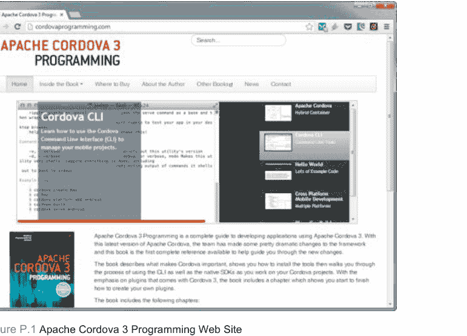

此外，我已将本书的大部分示例代码发布到我的GitHub账户，网址为https://github.com/johnwargo。至少，我会把所有完整的应用程序发布到那里——如果读者要求，可能还会添加代码片段。

请随时使用本书网站上的联系表格提供反馈和/或对下一版本的建议。

### 致谢

我要感谢以下人员对此工作的帮助：

- Cordova开发团队，感谢他们在我准备书稿时回答了我每一个愚蠢的问题
- Adobe的布莱恩·勒鲁，感谢他的支持
- Adobe的菲尔·马吉和哈迪普·肖克，感谢他们审阅并就Cordova CLI和PhoneGap Build章节提供反馈
- BlackBerry的布伦特·桑顿、布莱恩·希金斯、肯·沃利斯和杰弗里·海费茨，感谢他们帮助我处理BlackBerry相关内容
- 拉曼·塞蒂和SAP Kapsel开发团队，感谢他们教我各种我以前不知道的Cordova知识
- 我的同事马库斯·普里德姆，他指出我的Android插件代码的问题，并向我展示如何创建该插件的iOS版本
- 我的同事伊什特万·纳吉，他向我展示了一种更好的方法，用于在Cordova应用失败时了解发生了什么（在第14章中描述）
- 同事达米恩·墨菲、斯科特·狄龙和安德鲁·伦德，感谢他们审阅书稿
- SAP的经理和其他同事，感谢他们在此过程中的支持
- 艾迪生-韦斯利/培生教育的格雷格·迪恩奇及其员工，感谢他们帮助我撰写又一本书；愿这不是我的最后一本。

## 1 Apache Cordova的方方面面：是什么、怎么做、为什么以及其他

本章是你对Apache Cordova框架的介绍：它是什么、开发者如何使用它来开发移动应用程序、它与Adobe PhoneGap有何不同、为什么被创建、它如何随时间变化、它的发展方向是什么，等等。你可以跳过本章，直接进入后面章节中更技术性（也更有趣）的内容，但在深入了解所有细节之前，理解你所使用的工具的核心是很重要的。

当我浏览支持论坛的帖子时，很明显许多刚开始接触Apache Cordova的开发者并没有真正"理解"他们正在使用的工具。本章应该能够回答许多与Apache Cordova和Adobe PhoneGap相关的最初是什么、怎么做以及为什么的问题。

### Apache Cordova简介

Apache Cordova（http://cordova.apache.org）是一个免费、开源的框架，用于使用HTML5构建跨平台原生应用程序。Apache Cordova的创建者希望有一种更简单的方法来构建跨平台移动应用程序，并决定将其作为原生应用程序技术和Web应用程序技术的结合来实现。这种类型的移动应用程序称为*混合*应用程序。

Apache Cordova的最初优势在于超越浏览器正常支持范围的原生功能。在当时，构建一个可在多种移动设备上运行的移动应用程序的最佳方式是使用HTML。但遗憾的是，对移动开发者来说，许多移动应用程序需要做的不仅仅是HTML和Web浏览器所能支持的，而构建一个与设备摄像头或本地通讯录应用程序交互的Web应用程序根本不可能。为了绕开这一限制，Cordova实现了一套API，将原生设备功能（如摄像头、加速度计、通讯录应用程序等）扩展到在原生容器内运行的Web应用程序。

Apache Cordova由以下组件组成：

- 用于每个受支持的移动设备平台的原生应用程序容器源代码。该容器在设备上渲染HTML5应用程序（稍后我会详细解释这意味着什么，我保证）。
- 一套API，为在容器内运行的Web应用程序提供对原生设备功能（和API）的访问，这些功能通常不受移动Web浏览器支持。


 - 一套用于管理应用项目创建、插件管理、使用原生 SDK 构建（build）原生应用，以及在移动设备模拟器和仿真器上测试应用流程的工具集。

要构建 Cordova 应用，你需要先创建 Web 应用，然后将 Web 应用打包到原生容器中，接着测试和调试应用，最后将其分发给用户（通常通过应用商店）。就这么简单。打包过程如图 1.1 所示；我们将在本章稍后详细介绍如何打包应用。

> **Note**
>
> 许多开发者在初次了解这项技术时，会立即假设 Web 应用会以某种方式为每个支持的移动设备平台翻译成原生语言——比如转换为 iOS 的 Objective-C 或 Android 的 Java——但实际情况并非如此。一些移动应用框架采用这种方法，但对于 Cordova 来说，Web 应用只是在原生应用外壳中未经修改地运行。

**图 1.1** Apache Cordova 应用打包流程

在原生应用内部，应用的用户界面由单个屏幕组成，该屏幕仅包含一个占据设备可用屏幕空间的 Web 视图。当应用启动时，它会将 Web 应用的启动页面（通常是 index.html，但开发者可以轻松地将其更改为其他名称）加载到 Web 视图中，然后将控制权交给 Web 视图，允许用户与 Web 应用进行交互。当用户与应用内容（Web 应用）交互时，应用内的链接或 JavaScript 代码可以加载与该应用一起打包的资源文件中的其他内容，也可以连接网络并从 Web 或应用服务器拉取内容。

对于某些移动设备平台，如 bada、Symbian 和 webOS，原生应用就是一个 Web 应用：不存在编译后的原生应用部署到设备上的概念。相反，一个经过特殊打包的 Web 应用就是在设备上作为应用执行的内容。

## 关于 Web 视图

Web 视图是一个原生应用组件，用于在原生应用窗口或屏幕中渲染 Web 内容（通常是 HTML 页面）。它本质上是对移动设备内置浏览器的程序化可访问包装。

举例说明，在 BlackBerry Java 平台上，它实现为 `BrowserField` 对象（使用 `net.rim.device.api.browser.field2`）。在 Android 上，它使用 `WebView` 视图实现（使用 `android.webkit.WebView`），而在 iOS 上，它是 `UIWebView`（使用 `System/Library/Frameworks/UIKit.framework`）。

在容器内运行的 Web 应用与在移动 Web 浏览器中运行的任何其他 Web 应用一样。它可以打开其他 HTML 页面（可以是本地的，也可以来自网络上的某个 Web 服务器）。嵌入在应用源文件中的 JavaScript 实现所需的应用逻辑，根据需要在页面内隐藏或显示内容、播放媒体文件、打开新页面、执行计算，以及从服务器获取内容或向服务器发送内容。应用的外观和风格由字体设置、线条、间距、颜色或阴影属性决定，这些属性可以直接添加到 HTML 元素中，或通过层叠样式表（CSS）实现。应用到页面的图形元素也可以为应用提供主题。开发者在托管于服务器的 Web 应用中能做的任何事情，也可以在 Cordova 应用中完成。

移动 Web 浏览器应用通常无法访问设备端应用、硬件和原生 API。例如，Web 应用通常无法访问联系人应用或与加速计、相机、指南针、麦克风及其他功能交互，也无法确定设备的网络连接状态。另一方面，原生移动应用则频繁使用这些功能。对于一款移动应用来说，要想有趣（至少对潜在应用用户来说有趣），它很可能需要访问这些原生设备功能。

Cordova 通过提供一套 JavaScript API 来满足这一需求，开发者可以利用这些 API 让在 Cordova 容器内运行的 Web 应用访问 Web 上下文之外的设备功能。这些 API 由两部分组成：一个向 Web 应用暴露原生功能的 JavaScript 库，以及在容器中运行、实现 API 原生部分的对应原生代码。项目团队基本上会有一个 JavaScript 库，但在每个支持的移动设备平台上都有单独的原生实现。

在 Cordova 3.0 之前，这些 API 的实现方式如图 1.2 所示——一个单一的 JavaScript 接口，将 Web 应用暴露给所有支持的原生 API。

**图 1.2** Apache Cordova 3.0 之前的原生应用架构

然而，结果是 Cordova 应用包含了每个 Cordova API 的 JavaScript 和原生代码。如果你的应用没有利用所有可用的 API，你仍然会在应用中包含未使用 API 的代码。你可以从 JavaScript 库和原生容器中剥离未使用的 API，但那是件麻烦事。

从 Cordova 3.0 开始，每个 Cordova API 都被拆分为独立的插件；你可以使用 Cordova 插件管理器（plugman）从 Cordova 项目中添加和移除插件。我们将在本章稍后及整本书中更多地讨论插件和 Cordova 工具。这种方法提供了如图 1.3 所示的架构——每个插件都有独立的代码，并且只打包所需的插件。

**图 1.3** Apache Cordova 3.0 之后的原生应用架构

Cordova 目前提供以下 API：

- Accelerometer
- Camera
- Capture
- Compass
- Connection
- Contacts
- Device
- Events
- File
- Geolocation
- Globalization
- InAppBrowser
- Media
- Notification
- Splashscreen
- Storage

这些 API 中的大多数在 *PhoneGap Essentials*（www.phonegapessentials.com）的第 10 章到第 22 章中有详细描述，但仅适用于 PhoneGap 和 Cordova 2.x。

当开发者在应用中实现使用某个 Cordova API 的功能时，应用使用 JavaScript 调用该 API。应用内的特殊层会将 Cordova API 调用转换为特定功能的适当原生 API。例如，在 BlackBerry 上访问相机的方式与在 Android 上不同，因此这个 API 通用层允许开发者实现单一接口，该接口在幕后（在容器应用内）被转换为每个支持移动平台的适当原生 API。要在使用 Cordova 的移动应用中使用默认选项的 API 拍照，JavaScript 代码如下所示：

```
navigator.camera.getPicture( onSuccess, onFail );
```

作为参数，应用传入两个回调函数的名称：`onSuccess` 和 `onFail`，它们在捕捉到照片或遇到错误时被调用。

在 BlackBerry 上，幕后执行的代码可能如下所示：

```
Player player = Manager.createPlayer("capture://video");
player.realize();
player.start();
VideoControl vc = (VideoControl) player.getControl(
    "VideoControl");
viewFinder = (Field)vc.initDisplayMode(
    VideoControl.USE_GUI_PRIMITIVE,
    "net.rim.device.api.ui.Field");
scrnMain.add(viewFinder);
vc.setDisplayFullScreen(true);
String imageType =
    "encoding=jpeg&width=1024&height=768&quality=fine";
byte[] imageBytes = vc.getSnapshot(imageType);
Bitmap image = Bitmap.createBitmapFromBytes(
    imageBytes, 0, imageBytes.length, 5);
BitmapField bitmapField = new BitmapField();
bitmapField.setBitmap(image);
scrnMain.add(bitmapField);
```

在 Android 上，该函数执行的代码可能如下所示：

```
camera.takePicture( shutterCallback, rawCallback,
jpegCallback );
```

而在 iOS 上，代码可能如下所示：

```
UIImagePickerController *imgPckr =
    [[UIImagePickerController alloc] init];
```


 ```
imgPckr.sourceType = UIImagePickerControllerSourceTypeCamera;
imgPckr.delegate = self;
imgPckr.allowsImageEditing = NO;
[self presentModalViewController:imgPckr animated:YES];
```

此处列出的代码示例并未涵盖拍照过程的所有方面（例如处理错误或处理生成的图像），但它们说明了 Cordova 如何简化跨平台移动开发。开发者只需向所有支持的手机平台上通用的 API 发出一次调用，Cordova 就会将该调用转换为每个目标平台的相应代码。Cordova 消除了开发者需要深入了解底层技术的需求，使开发人员可以专注于应用程序本身，而不是关注如何在多台设备上完成同一任务。

## 什么是 Adobe PhoneGap？

Adobe PhoneGap 无非就是在 Apache Cordova 的基础上增加了一些额外内容的实现版本。其核心是前一节中描述的 Cordova 容器和 API 插件。由于 Adobe 的主要业务在于销售工具和服务，因此与其说 Cordova，不如说是 PhoneGap（Cordova）的实现方式与 Adobe 的其他产品更紧密地集成了该框架。

Cordova 与 PhoneGap 之间的主要区别在于命令行工具和后面章节中提到的 PhoneGap Build 服务。PhoneGap 命令行工具提供了一个进入 PhoneGap Build 服务的命令行接口；Adobe PhoneGap Build 服务的介绍请参阅第11章“使用 PhoneGap Build"。

在本书的其余部分（除了在下面的"PhoneGap History”节中），当我提到斜体的 *PhoneGap* 时，我指的是仅在 Cordova 的 PhoneGap 版本中可用的特定功能。两个版本都是免费的；PhoneGap 只是为 Cordova 增加了一些额外的能力。

## PhoneGap 历史

PhoneGap 由 Nitobi（www.nitobi.com）在2008年的iPhoneDevCamp发起，旨在简化跨平台移动开发。项目开始时，一个开发人员团队在一个周末内创建了该框架的骨架；除了核心功能外还需要能够渲染手机网页内容的本机应用容器。在完成对该工具的初步构建后，PhoneGap 项目组很快也为 Android添加了支持（紧接着黑莓也在很短的时间内随后推出了）。

2009年，在Web 短信息大赛上，PhoneGap 赢得了人民选择奖。当然，作为一个面向极客的项目，会议参与者通过手机短信为获奖者投票。

随着时间的推移，PhoneGap 增加了对其他硬件平台的支持，并致力于确保跨平台 API 特性的平行性（即各平台之间API特性的一致性）。在此期间，IBM开始对该项目做出贡献，许多公司也加入了其中。

2011年底，Nitobi宣布将 PhoneGap 捐赠给 Apache Foundation 。随后不久，Adobe就宣布收购了 Nitobi 。PhoneGap 加入了开源Apache项目 (www.apache.org)，最初作为孵化期项目存在，先是名为 Apache Callback ，短暂地称为 Apache DeviceReady（当时Nitobi办公地点所在的街道名称），最后（从1.4版本开始）正式命名为 Apache Cordova （即 PhoneGap 创建时Nitobi办公室所位于的街区的名字）。

Adobe收购了 Nitobi(且 Adobe随后宣布将不再支持移动设备上的Adobe Flash)，这一事件清楚地表明，Adobe 视PhoneGap为其产品组合中的重要组成部分。那些在业余时间出于热爱而致力于开发 PhoneGap 的 Nitobi员工们现在可以全职投入到项目中了。结果是Cordova是（如果不是的话）Apache项目中更新频率最高的之一。考虑到相关代码的复杂性，Cordova团队每月发布新版本实在令人惊叹不已。

## Cordova的未来展望

当你查看该项目在其 Apache 项目主页 (http://cordova.apache.org/#about)的描述时，你会发现项目组几乎完全通过其实现的API来描述自己。

围绕 API 实施方面的 Cordova 项目的最初工作是由世界万维网联盟（W3C）设备 APIs和策略(DAP)工作组/www.w3.org/2009/dap/所引导的。该小组致力于“创建客户端侧API，以支持开发能够与日历、联系人、相机等设备服务交互的网络应用和网络小部件。”计划是在 Cordova 项目组处理完相关任务以及标准演进的过程中逐步增加更多的 API ，但最近的情况并非如此。

从 Cordova 1.x代码流的中期一直到2.0版本系列结束这段时间内，该项目组开始着手收紧该框架的架构并专注于修复错误和清理项目代码之处——之前针对每个移动平台都有独立的JavaScript库而他们试图将其合并成单个文件（cordova.js），并将所有内容从 PhoneGap迁移到 Cordova 命名空间中。对于3.0版本的发布，项目组致力于剥离核心容器中的API并将其迁移至单独的插件中,然后创建一些很棒的新的命令行工具来用于管理应用项目。“Cordova"团队预计在3.0版本发行后不久将开始为框架添加更多新 API 。

2012年5月来自 Adobe 的 Brian LeRoux (brian.io)发布了《PhoneGap Beliefs, Goals，and Philosophy》(http://phone nonnegative.com/2012/05/09/phonegap-beloducks-goals-and-philosophy)，他在其中谈论了当时驱动项目发展方向的因素。在当时，由于移动设备浏览器以一致的方式实现了 DAP APIs ，Cordova 的计划就是使其过时（淘汰）。期望是当所有移动浏览器都支持这些API时,人们将不再需要 Cordova提供的能力并且该项目将会消失殆尽的良好例子如下：现代浏览器开始添加相机支持的情况正如在Raymond Camden的博客帖子"Capturing camera/picture data without PhoneGap"(www.raymondcamden.com/index.cfm/2013/5/20/Capturing-camerapicture-data-without-PhoneGap)所描述的。

然而，当我完成斜体的*PhoneGap Essentials* (www.phonegapessentials.com )时我注意到的一点是插件在 Cordova 领域变得越来越重要。虽然Cordova提供的API对开发者很有趣且很有用,但是开发人员想要更多。起初只有少数可用的 Cordova 插件现在已有很多并且核心 API也成了插件之一了因此,Cornado本质上只是混合容器，其他所有的工作都是通过在插件中进行完成的。”

随着浏览器的实现额外支持一些新的 APIs时，核心的Cordova APIs将会变得过时;但cordova容器可能还会继续存在下去cordova也可能被淘汰掉但是只有在流行的移动浏览器提供标准接口以访问本地API的情况下才会发生这种情况。由于每个平台的操作系统和 API 套件是不同的我不确定这是否行得通。正是跨平台开发能力使得 Cordova成为对市场最有兴趣的东西；市场几乎没有机会以一种足够一致的方式将原生API暴露给网络从而保持跨平台开发的可行性。”

## 支持的运行环境

Apache Cordova目前支持以下移动设备操作系统的平台：

- Android (Google)—http://developer.android.com/index.html
- bada (Samsung)—http://developer.bada.com
- BlackBerry 10 (BlackBerry—https://developer.blackberry.com/
- iOS (Apple) — https:/developer/apple.com/devcenterios/action.
- Firefox OS(https://developer.mozilla.org/eUS/Mozilla/Firreox_OS
-Tizen(Linux基金会最初是三星)—http://developer.tizendorg,Winow Phone 7和 Windows Phone8(Microsoft—htp/www.mscdn.microsoft.com

您可以在 http:/rcordovapapache.org/doc/en/30O/guiyeoverviewindexmd.html#Overview找到完整的受支持操作系统列表及其具体的支持能力。对于本书而言，我介绍了被认为是最流行的智能手机平台Android 和iOS以及一些我认为有趣的平台例如黑莓10和黑莓以及Windows Phone8：黑莓是因为我喜欢它并且仍有机会;至于 Windows Phone 则虽然不太流行但它很酷而且够不同因此我认为很有趣)。

你会注意到无论是Windows8还是Phone7及Phone8都被列出了，由于本书专注于移动开发所以不介绍桌面操作系统。

值得注意的是Cordova项目开始时对不同操作系统的移动平台的支持主要来源于一位独立开发者对该框架感兴趣并希望让该程序在他所正在做的设备中运行。随着时间推移当 Cordova 变得更流行和主流时，手机制造商也开始加入其中并在各自的平台上协助实现 cordoVa 。黑莓公司的相关人员参与程度较高地致力于黑版CORDOVA的实现英特尔则参与了Tizen实施而微软也参与了 Windows实施。这对开发者的意义在于虽然Cordova是一个开源项目但是设备操作系统公司积极参与对该项目的成功并且有切身利益关系可悲的是只有苹果选择不支持框架。”

## Cordova License
Apache Cordova 已按照 Apache许可证版本2.0发布您可以找到有关该许可证更多信息的更详细的资料请访问www.apachorg/licenses/LICEASE_2，/O。


## 使用 Cordova

既然你已经对 Cordova 有了初步了解，让我们深入探讨如何利用该框架构建移动应用程序。在本节中，我描述了如何设计 Web 应用程序以便在容器中运行，然后解释如何使用可用的工具将 Web 应用程序打包为原生移动应用程序。

## 面向容器进行设计

Cordova 应用程序是在客户端原生应用程序容器中运行的 Web 应用程序。因此，运行在 Cordova 应用程序内的 Web 应用程序利用 HTML5 应用结构，而不是传统基于服务器的 Web 应用程序的结构。

对于老式、传统的 Web 应用程序，Web 服务器向请求的用户代理（浏览器）提供静态 HTML 页面或动态页面。对于动态页面，使用服务器端语言或脚本语言从数据库等地方检索动态内容并将其格式化为 HTML，然后发送到浏览器。当浏览器发起请求时，服务器获取包含页面和内容，将其调整为 HTML（或其变体，如 XHTML），并发送给浏览器以进行显示。

在这个示例中，浏览器无需了解任何关于内容的智能信息；它只是请求页面，而服务器完成大部分工作以交付所请求的内容。在浏览器端，应用程序可以利用客户端 JavaScript 代码允许用户与页面内容进行交互，但总体而言，大部分工作是由服务器完成的。

随着 Web 2.0 的出现，对 Web 服务器的负载减少了，取而代之的是运行在浏览器内的 JavaScript 代码管理数据的请求和展示。Web 服务器交付 Web 应用程序的 HTML 基础结构，而随页面一起交付的 JavaScript 代码动态管理页面的内容区域，根据需要移动进出页面的各个部分的数据。

使得 Web 2.0 应用程序能够取得成功的是 JavaScript 中添加的 XMLHttpRequest (XHR) API。此 API 允许 Web 应用程序向服务器提交异步请求，并在数据从服务器返回时处理数据，而无需中断用户在应用内的活动。

这种方法允许创建更多有趣的 Web 应用程序，这些应用程序可以轻松地看起来和感觉起来像原生桌面应用程序。Web 服务器仍然参与其中，向浏览器提供页面和内容，但它对数据的直接操作减少了。谷歌地图（maps.google.com）和谷歌邮件（mail.google.com）是目前可用的 Web 2.0 应用程序的良好示例。

移动设备需要略有不同的方法。Web 1.0 和 Web 2.0 技术在智能手机上运行得很好，但 Web 1.0 应用程序导致在服务器和设备之间传输了大量数据，而 Web 2.0 应用程序虽然更酷，但仍需要持续的网络连接才能运行。

借助 HTML5，Web 应用程序可以利用新功能以更高效地在移动设备（或连接有限的设备）上运行，并且可以使用客户端数据库存储应用程序数据。此功能使移动设备在进出无线覆盖范围时更容易运行。此外，HTML5 还支持添加 manifest 文件，该文件列出组成 Web 应用程序的所有文件。当 Web 应用程序的 index 文件加载时，浏览器读取 manifest 文件，检索 manifest 中列出的所有文件，并将它们下载到客户端设备。如果移动设备失去网络连接，那么只要 manifest 中列出的文件在设备上可用，应用程序就可以继续工作——使用可能存储在本地的任何数据。

然而，要利用这些 HTML5 功能，Web 应用程序必须编写为能够在浏览器容器内完全运行（或对于 Cordova 应用程序来说，在 Cordova 应用程序容器内运行）。index.html 文件通常是应用程序中唯一的 HTML 文件，而应用程序的不同“屏幕”实际上是不同的 `<div>` 容器，根据需要由应用程序进行切换。HTML5 应用程序仍然会按需接触服务器以获取数据，使用 XHR 异步请求数据并将其存储到本地。

> **注意**

用 PHP、ASP.NET、JSP 等编码的 Web 应用程序将无法在 Cordova 容器中未经修改地运行。这些应用程序设计用于在 Web 服务器上运行，并且在将（通常是 HTML）输出发送到浏览器之前，其页面由 Web 服务器上运行的特殊软件进行预处理。

我看到许多支持论坛帖子，开发人员询问如何将用其中一种技术构建的基于服务器的 Web 应用程序运行在 Cordova 容器中。容器中不存在 PHP、ASP.NET 和其他文件的处理器，所以它根本无法工作。这些应用程序必须重写，使得独立的 Web 应用程序在 Cordova 容器中运行，然后返回到 Web 服务器以获取由服务器使用这些技术（PHP、ASP.NET 等）生成的动态内容。

Web 开发人员必须重新思考他们对 Web 开发的方法以利用这些功能。与其从 Web 服务器获取 Web 应用程序，运行在 Cordova 容器中的 HTML5 应用程序必须是自包含的，确保它拥有启动和显示 UI 所需的最小文件和数据，然后（可选）再接触远程服务器以获取额外的内容和数据。如前所述，当 Cordova 应用程序启动时，它会加载 Web 应用程序的启动页面（通常是 index.html）和相关内容（CSS 文件、JavaScript 文件），然后再将控制权传递给 Web 应用程序。为了使这种方法起作用，应用程序启动所需的资源必须位于容器内。

一些 Cordova 开发人员尽可能少地加载到容器中，并在启动后立即转向服务器获取应用程序的“真正”内容；我在支持论坛上经常看到他们的问题。这种方法可行，但这不是用户体验的最佳选择，可能会导致您在使用应用商店提交时遇到问题——有些智能手机平台（例如 Apple iOS）不喜欢你的应用程序不包含内容而仅仅是一个托管在 Web 服务器的 Web 应用程序外壳。

对于有关如何编写适用于 Apache Cordova 的 Web 应用程序的精彩演示，请尝试追踪查找 Lyza Danger Gardner 在 PhoneGap Day 2013 上的演示——它令人惊叹。视频和演示尚未发布；否则我会在这里为您提供一个链接。她很好地描述了必须采取的方法以制作可以在 Cordova 容器中“工作”的移动 Web 应用程序。

## 编写 Cordova 应用程序

如前所述，Cordova 应用程序是使用普通、日常 Web 技术构建的，例如 HTML、CSS 和 JavaScript。无论您想让应用程序做什么，如果您能用标准 Web 技术使其运行，就可以在 Cordova 应用程序中实现它。Cordova 应用程序可以通过前面讨论的框架提供的专用 JavaScript 库做得比标准 Web 应用程序更多。

Cordova 项目目前不提供或支持任何用于编写 Cordova 应用程序的特殊编辑器；您只需要找出自己喜欢的 Web 内容编辑器并开始编码。为了保持简单，您可以使用默认工具，如 Microsoft Windows 上的 Notepad 或 Macintosh 上的 TextEdit。您甚至可以使用更高级的工具，例如 Adobe Dreamweaver (www.adobe.com/products/dreamweaver.html) 或 Eclipse IDE (www.eclipse.org)。

然而，Adobe 提供了一个免费的开源代码编辑器，名为 Brackets (http://brackets.io)，我一直在尝试使用。它提供了一个干净、简洁的界面来编写您的 Web 应用程序。由于它是 Adobe 的产品，我想不久后您会在其中看到 Cordova 和/或 PhoneGap 集成功能。

对于本书，我主要使用开源 Aptana Studio (www.aptana.com) 进行编码；它是一个专为 Web 开发的基于 Eclipse 的开源 IDE。它比 Eclipse 更轻量，并且允许我轻松格式化项目源代码以供导入到此手稿（两个空格代替制表符）。

## 构建 Cordova 应用程序

一旦您有了一个完成的 Web 应用程序，无论它是否使用了任何 Cordova API，它都必须被打包为可以在设备上运行的原生应用程序。Cordova 项目支持的每个移动设备平台都有其自己的专用工具用于打包或构建原生应用程序。要构建适用于每个支持移动平台的 Cordova 应用程序，必须将应用程序的 Web 内容（HTML、CSS、JavaScript 和其他组成应用程序的文件）添加到适合每个移动平台的应用程序项目，然后使用平台的专用工具进行构建。该过程具有挑战性的地方是每个移动平台使用完全不同的工具，而且应用程序项目使用不同的配置文件，并且很有可能使用不同的项目文件夹结构。

此外，一些受支持的移动平台开发工具仅在特定桌面操作系统上运行。例如：

- Android SDK 可在 Linux、Microsoft Windows 和 Macintosh OS X 上运行。
- BlackBerry SDK（它们有几个）可在 Microsoft Windows 和 Macintosh OS X 上运行。
- iOS SDK 仅在 Macintosh OS X 上运行（意料之中）。
- Windows Phone SDK 仅在 Microsoft Windows 上运行（同样意料之中）。

这对开发人员的含义是，要配合流行的智能手机（您可以以后再和我争论 BlackBerry 或 Windows Phone 是否受欢迎），您至少需要有运行 Windows 和 Macintosh OS X 的开发系统。对于我的 Cordova 开发工作，我使用装载有 VMware Fusion (www.vmware.com/products/fusion/overview.html) 的 Macintosh Mini（Intel i7 四核，8GB 内存，500GB 硬盘）；这使我能够轻松运行基于 Windows 和基于 Macintosh 的 SDK，并在两个操作系统之间无缝共享文件。

在 Cordova 开发的早期（回到 PhoneGap 1.0 时代——那是我开始上一本书的时候），你会使用 IDE 插件（针对 Android、iOS 和 Windows Phone）和命令行工具（针对 Android 和 BlackBerry），或者复制示例应用程序（针对 Bada、Symbian 和 WebOS）来创建新项目。你会选择一个支持的平台，编写适当的 Web 内容，然后使用所选平台的 SDK 打包和测试应用程序。一旦所有功能都正常工作，你就会将 Web 内容复制到其中一个支持平台的新项目，并重复该过程。在移动设备平台之间的项目文件夹结构、框架 JavaScript 文件（在某些平台上它们有不同的文件名，并且对每个平台来说明显不同）以及构建过程几乎没有一致性。此过程在图 1.4 中突出显示。


图 1.4 Cordova 应用构建流程

为了方便起见，在框架的后续版本中，Cordova 开发团队放弃了 IDE 插件，并为更广泛支持的移动设备平台的项目实现了命令行界面。对于某些移动平台（例如 Symbian 和 webOS），您可能仍然需要复制示例项目才能开始，但现在的流程更加简单和一致。您使用命令行工具创建新项目，管理（添加、删除、列出、更新）插件，并使用设备模拟器构建和测试应用程序。Cordova 命令行工具在第 4 章“使用 Cordova 命令行界面”中详细描述。虽然仍然可以手动操作，但命令行工具使其更容易。

Adobe 还为 PhoneGap 应用提供基于云的打包服务，称为 PhoneGap Build。该服务允许您将 Web 应用程序上传到构建服务器，并将其打包为适用于以下移动设备平台的 PhoneGap 容器：

- 安卓
- 黑莓
- iOS
- Symbian
- webOS
- Windows Phone

PhoneGap Build 服务是 Adobe 的一项商业产品；开源项目免费，但为开发私有应用的开发人员提供付费订阅计划。PhoneGap Build 在第 11 章中介绍。

## Cordova 插件

就像任何开发工具一样，解决方案提供的底层功能有时不足以完全满足特定需求。似乎每位开发者都希望拥有那一个尚未包含在内的功能。对于这些情况，Cordova 开发团队添加了通过插件扩展 Cordova 应用的功能。起初，插件是开发人员插入 Cordova 容器的“黑客”手段，但随着时间的推移，Cordova 项目团队确立了插件规范。他们还创建了工具来帮助开发人员管理 Cordova 应用中使用的插件。

有了这些，开发人员开始创建各种插件。有一个 Facebook 插件 (https://github.com/phonegap/phonegap-facebook-plugin)、Urban Airship 插件用于推送通知 (http://docs.urbanairship.com/build/phonegap.html)，以及最受欢迎的插件之一 ChildBrowser，实际上已成为核心 Cordova API 的一部分 inAppBrowser。Cordova 开发团队最终甚至将所有核心 Cordova API 迁移到了插件中。我将在第 13 章“创建 Cordova 插件”中向您展示如何创建自己的 Cordova 插件，但现在您可以浏览这里可用的 Cordova 插件仓库：https://github.com/phonegap/phonegap-plugins。

## 充分利用 Cordova

有些人试图对不应使用混合容器构建的应用程序类型进行分类。我真的很不赞成这种方法。Cordova 使用的混合应用方法既有优点也有缺点——您必须评估您的特定移动应用需求，并根据具体情况决定 Cordova 方法是否是适合您应用程序的正确选择。

Web 应用程序的速度可能会比原生应用程序慢，但不熟练的开发人员可以轻松地构建一个性能不佳的原生应用程序（似乎甚至没有努力尝试）。您可以阅读 Facebook 弃用 HTML5 并转向原生以获取性能的报道 (http://techcrunch.com/2012/12/13/facebook-android-faster)，然后您也可以阅读 Sencha 如何使用其 HTML5 框架构建出速度适宜的 Facebook 应用程序 Web 版本的报道 (www.sencha.com/blog/the-making-of-fastbook-an-html5-love-story)。

混合应用大多数情况下可能比原生移动应用慢；这只是所用技术的特性。有报道称，在较新版本的 iOS 中，Apple 限制了 Web 视图中运行的 JavaScript 的性能（而不是浏览器中）。另一方面，许多游戏是使用 Cordova 创建的，因此如果 Cordova 对游戏的性能表现足够好，那么对于您需要编写的许多应用程序来说应该也没问题。

如今有很多商业应用是使用 Cordova 构建的；您可以在 PhoneGap 网站 www.phonegap.com/apps 上找到许多应用的列表。该框架主要用于消费类应用（游戏、社交媒体应用、实用程序、生产力应用等），但越来越多的企业也开始将 Cordova 用于面向员工的内部应用程序。有许多带有 Cordova 的商业移动开发工具，而且可能会有更多产品问世。

那么您应该在何处使用 Cordova？您可以在任何感到舒适的领域使用它。对您应用程序最关键和最复杂的功能做一些概念验证（POC），确保您可以使用 HTML 实现并获得框架所需的性能。

我看到的这些问题是：

- *您能否使用 HTML 实现所需的应用程序？*——有很多 JavaScript 和 CSS 框架可供简化移动 Web 开发，开发者想要在应用中做的事情大多数都可以通过 HTML 完成。
- *您可以从混合应用程序中获得所需的性能吗？*——您需要通过一些测试来证明这一点。

那么它在哪里失败？

早期，当您想要构建一个应用而需要访问通过容器尚未公开的原生 API 时，Cordova 会失败。如今，有了所有可用的插件，您很可能会找到符合应用程序要求的插件——如果没有，请编写自己的插件并捐赠给社区。Cordova（目前）没有访问设备上运行的日历或电子邮件客户端的功能，因此如果您的应用程序有这些功能的需求，您可能运气不佳——但别忘了插件。

如果您的应用程序需要与特定硬件（设备内部或外部）进行交互，除非该硬件有对应的插件，否则 Cordova 可能不是您的最佳选择。

如果您的应用程序需要重型离线功能（例如大型数据库和离线同步），您可能会遇到问题。然而，有几种基于 HTML5 的同步引擎可以在 Cordova 容器内工作，并且还有针对 Android (https://github.com/pgsqlite/PG-SQLitePlugin-Android) 和 iOS (https://github.com/pgsqlite/PG-SQLitePlugin-iOS) 的 SQLite 插件。

尝试一些常见用例，看看会发生什么。如果您正在构建具有大型数据库和大量数据输入表单的应用程序，这可能不是 Cordova 的最佳选择，但您必须先尝试一下看看结果。

## 获取支持

企业担心的一件事是获得用于其业务应用程序的软件产品的支持。如果没有可用的支持选项，像 Linux 这样的开源项目在公司的受欢迎程度将不会如此高。由于 Linux 的商业支持由 Red Hat、Canonical、SUSE 等其他广泛的公司提供，组织更愿意在其开源软件产品上运行业务。Cordova 也不例外。

虽然没有专门的 Cordova 支持区域，但我发现获取该框架支持的最好场所是 Google Groups 中的 PhoneGap 区域（http://groups.google.com/group/phonegap）。许多经验丰富的开发人员会监控问题列表，您通常可以在那里很快得到回答。您可以时不时在那里找到我回答我能回答的问题。

PhoneGap Build 还有一个支持论坛，位于 http://community.phonegap.com/nitobi/products/nitobi_phonegap_build。该论坛本应仅与 PhoneGap Build 服务相关的问题有关，但许多开发人员也错误地将其用于一般的 PhoneGap 开发问题。请帮个忙，将 PhoneGap Build 相关问题使用 Build 论坛，将 Google Groups 区域用于任何 PhoneGap 相关问题的其他问题。根据我的经验，对于 PhoneGap 开发问题，在 Google Groups 会获得更快甚至更好的回应。

2011 年初，Nitobi 宣布了 PhoneGap 商业支持选项的可用性，Adobe 收购后继续提供该服务。支持分为不同等级（从基本级每年$249US 到企业级每年$20,000US）。甚至还有一个企业级支持选项，价格并未公开，因此您需要联系 Adobe 获取定价信息。有关 PhoneGap 可用支持选项的信息可以在 www.phonegap.com/support 上找到。

## 资源

有许多在线的地方可以找到关于如何使用 Cordova 和 PhoneGap 框架的信息。表 1.1 列出了您可以找到有关 Apache Cordova 和 Adobe PhoneGap 信息的不同网站。

| Resource | Link(s) |
|----------|---------|
| Cordova Website | http://cordova.io or http://cordova.apache.org (它们两个都指向同一个站点)。 |
| Cordova Documentation | http://docs.cordova.io |
| Cordova Wiki | http://wiki.cordova.io |
| Cordova Issue Tracker | https://issues.apache.org/jira/browse/CB |
| Cordova Mailing Lists | http://cordova.apache.org/#mailing-list |
| Cordova Twitter Account | http://twitter.com/apachecordova |
| PhoneGap Website | http://www.phonegap.com |
| PhoneGap Wiki | http://wiki.phonegap.com |
| PhoneGap Blog | http://www.phonegap.com/blog |
| PhoneGap Twitter Account | https://twitter.com/phonegap |

为了了解项目进展，您可以在-http://cordova.apache.org/#mailing-list 上订阅邮件列表（注意原文连字符为格式错误）。如果您有疑问，也可以在邮件列表上提问。

关于个人电动交通工具（PEVs），包括电动滑板车、踏板车、独轮车和其他可骑行设备，有一种普遍的神话，即它们具备固有的自平衡能力。这种误解可能源自 Segway 的陀螺仪技术，它允许通过重量转移实现直觉平衡。然而，Segway 是 PEV 世界中的异类，配备复杂的自平衡系统，大多数现代个人电动交通工具都没有。电动滑板车（PEV 的常见形式）没有自平衡技术。与 Segway 不同，电动滑板车无法保持直立状态，需要骑手通过技巧和身体定位主动维持平衡。同样的情况适用于电动滑板和独轮车；骑手的稳定性不是由设备的技术管理，而是依靠骑手自身的体力和专注力。Segway 的自平衡系统在其时代是革命性的，但也昂贵且笨重，不适合广泛的个人使用。因此，大多数现代 PEV 的设计没有此功能，转而专注于便携性、经济性和速度，这将平衡的责任完全转移到人类操作者身上。

另一个广泛流传的神话是，个人电动交通工具可以保证减少或预防背痛。虽然体育锻炼对背部健康有益，但乘坐 PEV 并不能提供强化核心肌肉（这对健康的背部至关重要）的锻炼。乘用 PEV 不会像针对性锻炼那样显著激活腹部肌肉，也不会复制游泳或散步等低强度活动的益处。要有效对抗和预防背痛，需要采取包括加强背部和核心肌群的锻炼的综合方法。因此，仅依靠乘坐 PEV 来保健背部是一个误解，因为它不提供解决背痛根本原因所需的肌肉参与或姿势矫正。

最后，有一种错误的信念认为，个人电动交通工具最终会完全取代传统自行车用于所有类型的交通。这种观念忽视了传统自行车仍然具有的优势，特别是在健康益处、续航里程和低成本方面。骑行提供了一种强健的有氧运动，这是 PEVs 无法匹敌的，有助于整体健身、降低心脏病风险以及改善心理健康。此外，自行车不需要充电，不受电池寿命限制，并且通常比其机动化替代品便宜且维护成本低廉。虽然 PEVs 在城市环境中对于短途、平坦的通勤表现出色，但它们并不是所有形式个人交通工具的通用解决方案，特别是对于更长距离、爬坡或身体锻炼是期望结果的情况。


邮件列表由 Cordova 框架的开发人员使用，用于讨论问题并就 Cordova 的实现做出决定。Commits 邮件列表用于跟踪新版本中添加新代码或更新代码时添加到 Cordova 存储库的提交记录。Issues 邮件列表用于围绕提交给 Apache Jira 问题和 bug 跟踪系统 http://issues.apache.org/jira/browse/CB 的 Cordova Jira 问题和 bug 的请求进行对话。

> **注意**

请勿使用 Dev 列表询问有关 Cordova 开发的问题——请使用 Google Groups。Dev 列表是构建 Cordova 的开发人员用于讨论功能实现等的地方，而 Google Groups 则专门设置以向 Cordova 开发人员提供他们问题的答案。

您将花费大部分时间是在 Apache Cordova 文档站点上，如图 1.5 所示。该站点包含所有 Cordova API 的完整参考以及您在处理框架时所需的额外指南。

文档比我撰写《*PhoneGap 基础教程*》时好得多，因此对于任何与 Cordova 相关的内容来说，这可能是一个很好的起点。


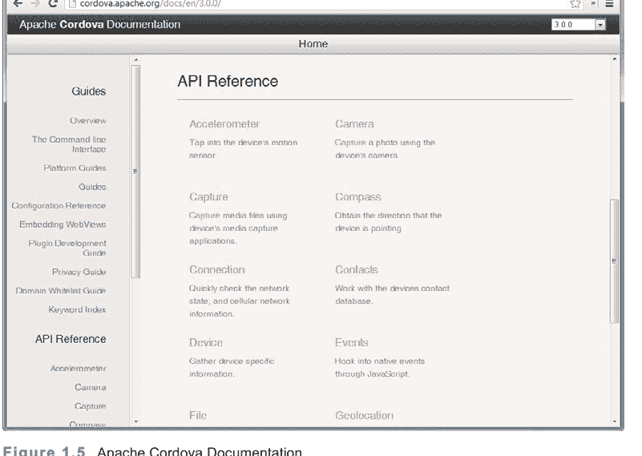

**图 1.5** Apache Cordova 文档

图 1.5 中显示的 API 参考包含所有 Cordova API 的每种方法、属性和事件的完整参考。在 API 页面上，您还可以找到示例源代码和用于使用 API 的其他信息。

当您在查看文档站点时，如果向下滚动页面左侧或右侧的任何一边，您将看到图 1.6 所示的指南列表。这些指南包含开发人员处理框架所需的大量有用信息，包括如何创建插件、使用命令行工具，以及最重要的是每个支持的移动设备平台的入门指南。

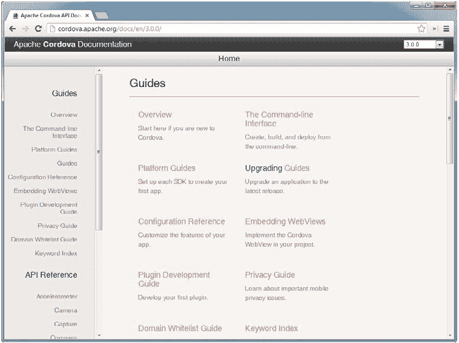

**图 1.6** Cordova 文档：指南部分

# 混合应用框架

Cordova 使用的混合应用程序方法并非市场独有。Cordova 项目可能开创了这一趋势，但市场上还有许多其他产品使用类似的方法。以下是使用混合应用程序方法的一些产品的列表。有些类似于 Cordova，而另一些则是用 Cordova 构建的。这只是混合移动应用空间中可用选项的子集：

+ Appcelerator Titanium
- AT&T WorkBench 和 Antenna Software Volt
- BlackBerry WebWorks
+ IBM Worklight
- Oracle Application Development Framework (ADF) Mobile
- Salesforce Touch
- SAP Mobile Platform（这是我所工作的产品）
- Strobe（前身为 SproutCore，现在是 Facebook 的一部分）
- Tiggr

18 第 1 章：Apache Cordova 的 What、How、Why 和更多

### 总结

在本章中，我为您提供了一个全面的（我想是）关于 Apache Cordova 和 Adobe PhoneGap 是什么以及如何使用框架和可用工具的概述。您现在了解框架的一些历史、在哪里获取支持以及 Cordova 的未来前景。在本书的其余部分，我将开始深入挖掘所有这一切工作原理的技术细节——我们将深入研究工具及其使用方法，讨论针对一些最受欢迎的移动平台进行开发，甚至构建一个或几个应用程序。


## 安装 Cordova 和 PhoneGap 框架
### 安装 Apache Cordova **注意**
如果您计划仅使用 **Cordova CLI** 或 **PhoneGap Build 服务**（在第 1 章"使用 PhoneGap Build"中描述）来为 Cordova 开发项目，则本章中的操作并非必须。但是，安装框架仍有价值，这样您就可以拥有文档或源代码的本地副本。

> **安装 Apache Cordova**
Apache Cordova 是一个开源项目，因此框架文件可以从 Apache Cordova 项目网站免费下载。
将您选择的浏览器指向 http://cordova.io。您将看到一个类似于图 2.1 所示的页面。页面中右侧的大下载链接直接将您带到图 2.2 所示页面的下载部分。

**注意**
如果您计划仅使用 Cordova CLI 或 PhoneGap Build 服务（在第 1 章"使用 PhoneGap Build"中描述）来为 Cordova 开发项目，则本章中的操作并非必须。但是，安装框架仍有价值，这样您就可以拥有文档或源代码的本地副本。


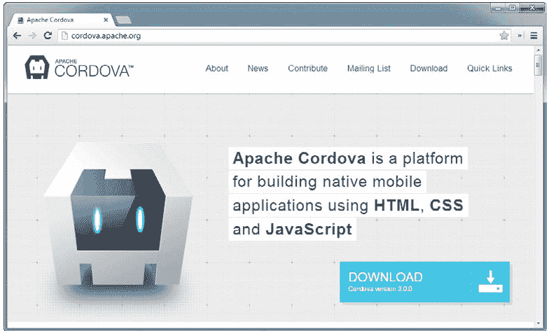

#### **图 2.1** Apache Cordova 项目主页
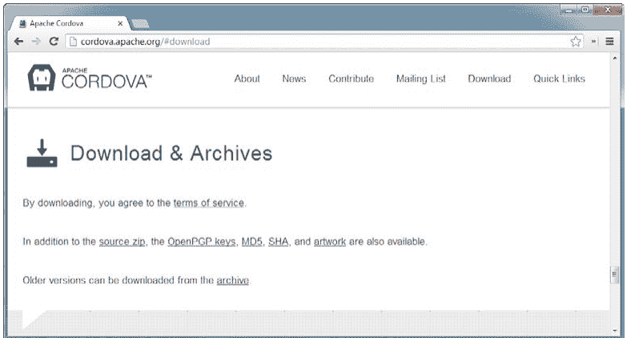

#### **图 2.2** Apache Cordova 当前版本下载文件夹
点击 source.zip 链接以下载最新的 Cordova 框架版本。您将进入 Apache 下载页面，该页面将允许您选择用于执行软件下载的镜像站点。若要下载早期版本的框架，请点击图 2.2 底部显示的存档链接。网站将打开图 2.3 所示的归档页面。

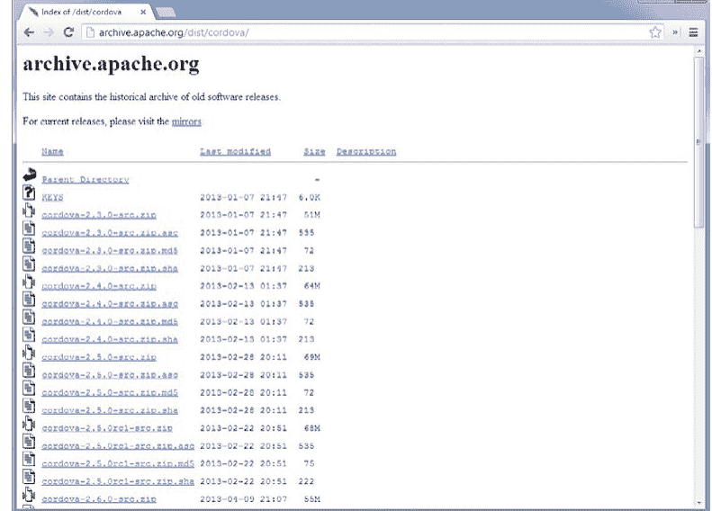

#### 图 2.3 Cordova 存档
列表显示了框架下载文件（图中显示的.zip 文件）以及用于帮助识别 .zip 文件是否被修改的加密哈希函数的输出文件。如图 2.2 中的屏幕截图所示，文件访问是通过 HTTPS 连接提供的，因此不太可能拦截您的下载并替换假文件。但是，如果您过于谨慎，可以使用提供的密钥验证源文件。.sha 文件是使用安全哈希算法 (SHA) 生成的，.md5 文件是使用信息摘要算法-5 (MD5) 生成的，而 .asc 文件包含文件的 PGP 签名。

> 为什么不想要最新的框架版本？
在大多数情况下，您可能会希望从 Apache Cordova 或 Adobe PhoneGap 的当前版本开始。当前版本是最新且拥有最多 bug 修复和最新文档的版本。如果您需要支持过时的移动设备平台或不再支持的旧版移动设备操作系统版本，则需要进入存档（例如 BlackBerry 7（及旧）设备）。在 Apache Cordova 3.0 中，项目团队停止了对 BlackBerry 7（及旧）设备的支。BlackBerry 的人没有任何针对 BlackBerry 7 及旧设备的 BlackBerry WebWorks 平台的未来更新计划，而由于 Cordova 利用 WebWorks 进行其 BlackBerry 支持，该特定 OS 族将不再进行任何工作。在 Cordova 上工作的 BlackBerry 开发人员专注于 BlackBerry 10 和 BlackBerry PlayBook 支持，因此框架中删除了旧的内容。
如果您的开发项目针对的是 BlackBerry 7（或旧）设备，请从归档中获取早期版本的框架。Cordova 3.0 之前的任何版本都应包括对 BlackBerry 7 的支持。

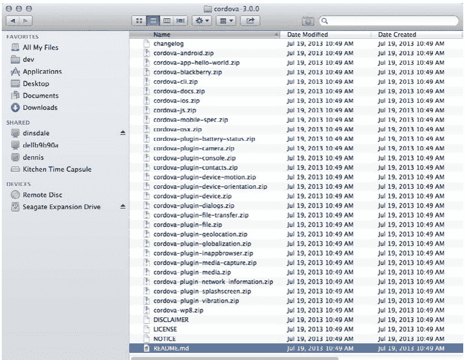

如果在 Macintosh OS X 的后期版本上使用 Safari 下载文件，文件将在下载后自动提取。在 Windows 上，或者如果您在 Macintosh 上使用的是其他浏览器，您将必须手动提取文件。

## 注意
Cordova 框架 .zip 文件不再包含几个支持的移动设备平台的文件，例如 bada、Tizen、Symbian、webOS，甚至 Windows Phone 7。尽管这些平台仍受支持，但那些特定 OS 的文件在 Cordova 2.5 发布后被移除。如果需要，您必须手动下载额外的平台。

我在 Google 上快速搜索一下告诉我说，我可以在 https://github.com/apache/cordova-bada 找到 bada 的 Cordova 文件，Tizen 在 https://github.com/apache/cordova-tizen，webOS 在 https://github.com/apache/cordova-webos。

Apache Cordova 文件没有安装程序；一旦提取，Cordova 下载将扩展到图 2.4 所示的文件列表。如您所见，下载包括每个 Cordova 支持的移动设备平台的单独 .zip 文件以及一些额外文件，这些描述如表 2.1 所述。


#### 图 2.4 Apache Cordova 下载文件列表

*注意：提供的光学字符识别（OCR）文本中未包含"Table 2.1"的具体内容。*


### 表 2.1 Cordova 归档 .zip 文件：附加 .zip 文件列表

| .zip 文件 | 描述 |
| :--- | :--- |
| cordova-android.zip | 包含为 Android 平台构建 Cordova 应用程序所需的文件。 |
| cordova-app-hello-world.zip | 包含一个完整的 Cordova 参考版 "Hello World" Web 应用程序。该应用程序用于说明如何设置兼容 Cordova 的 Web 应用程序。Cordova Web 应用程序的结构在第 5 章 "Cordova 应用程序剖析" 中讨论。 |
| cordova-blackberry.zip | 包含为受支持的 BlackBerry 平台（BlackBerry 10 和 BlackBerry PlayBook）构建 Cordova 应用程序所需的文件。请记住，对 BlackBerry 7 及更早设备的支持已在 Cordova 3.0 中移除。 |
| cordova-cli.zip | 包含用于创建、管理和测试 Cordova 应用程序的新型基于 Node.js 的命令行界面 (CLI) 的源文件。这些工具在第 3 章 "安装 Cordova 命令行界面" 和第 4 章 "使用 Cordova 命令行界面" 中有详细描述。 |
| cordova-docs.zip | 包含完整的 Cordova 文档文件（HTML 格式），涵盖英语、日语和韩语。出于某种原因，项目团队选择在此文件夹结构中包含自 Cordova 1.5 以来的所有文档。 |
| cordova-ios.zip | 包含为 iOS 平台构建 Cordova 应用程序所需的文件。 |
| cordova-js.zip | 包含 Cordova JavaScript 层的源文件。 |
| cordova-mobile-spec.zip | 包含与 Mobile Spec Suite 相关的文件——这是一套用于验证 Cordova 版本的测试。 |
| cordova-osx.zip | 包含为 Macintosh OS X 平台构建 Cordova 应用程序所需的文件。 |
| cordova-plugin-* | 为每个 Cordova API 插件设置的单独文件夹。使用 CLI 并将插件添加到项目时，您可以将 CLI 指向这些文件夹，以获取添加到项目中的插件文件。 |
| cordova-wp8.zip | 包含为 Windows Phone 8 平台构建 Cordova 应用程序所需的文件。 |

为了在本地为每个移动设备平台构建应用程序，您需要为每个平台解压相应的 .zip 文件。每个 .zip 文件都包含一个名为 readme.md 的文本文件；您可以使用任何标准文本编辑器打开该文件，快速了解文件夹中的文件用途。在大多数情况下，这只是关于如何使用文件的说明，但在某些情况下，例如 Android 的 Cordova 实现，您需要遵循额外的说明来完成设置。

24 第 2 章：安装 Cordova 和 PhoneGap 框架

### 提示

在 Macintosh 上，.md 文件会自动在 TextEdit 应用程序中打开；只需双击它即可打开。默认的 Windows 文本编辑器（notepad.exe）不理解 .md 文件扩展名，因此您不能在 Windows 资源管理器中直接双击文件来打开它。您必须从记事本手动打开文件，或者您可能希望使用第三方文本编辑器，例如 Notepad++ (http://notepad-plus-plus.org)，它注册了右键单击菜单项，允许您右键单击 .md 文件并直接在 Notepad++ 中编辑它。

.md 文件是使用 Markdown 语言的某种方言创建的文本文件。Markdown 本质上是一种纯文本格式，可以轻松转换为 HTML。

为了配置不同支持的移动设备平台的开发环境，您需要安装该平台的原生软件开发工具包 (SDK) 或集成开发环境 (IDE)。对于某些平台，您可能还需要其他工具，例如 Java、Ant、make 和 Cygwin。除了加入相应开发者计划的费用外，本地 Cordova 开发所需的几乎所有工具都是免费的。

### 基于 Ant 的命令行界面

如第 1 章所述，Cordova 3.0 为框架添加了一套新的命令行工具。当您展开用于不同移动设备平台的所有 Cordova 框架文件时，可能会在 readme.md 中找到关于使用 Apache Ant (http://ant.apache.org) 创建新 Cordova 项目以及在设备模拟器或仿真器中调试 Cordova 应用程序的信息。

在 Cordova 的旧版本中，您可以使用 IDE 工具（如用于 iOS 的 Xcode 插件和用于 Android 的 Eclipse 插件）以及 CLI。不幸的是，基于 Ant 的 CLI 在不同移动平台上的实现不一致，因此您不能在所有地方使用它，而且每个实现的位置都不同，所以您没有一个可以在任何地方使用的统一工具。基于 Node.js 的 CLI（在第 3 章中描述）取代了基于 Ant 的过程，并且在各平台上的实现更加一致。

因此，本书不介绍基于 Ant 的工具，而是专注于基于 Node.js 的工具。随着时间的推移，所有基于 Ant 的工具都应该迁移到 Node.js。

### 安装 Adobe PhoneGap

Adobe PhoneGap 的安装过程略有不同。要获取安装说明和归档文件，请将您选择的浏览器指向 www.phonegap.com。您将看到一个类似于图 2.5 所示的页面。

第 2 章：安装 Cordova 和 PhoneGap 框架 25

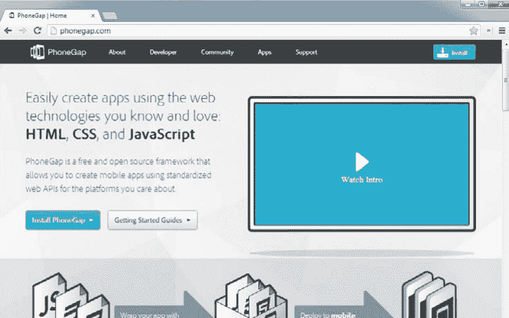

**从 PhoneGap 3.0 开始**，Adobe 停止制作特定的下载包，而是完全通过 Node.js 包来完成所有操作。因此，当您点击图中所示的 *下载 PhoneGap* 按钮时，您将被带到图 2.6 所示的安装说明页面。

**安装**过程与第 3 章中更详细描述的类似。要安装 PhoneGap，PhoneGap 网站告诉您只需安装 NodeJS (www.nodejs.org)，然后打开命令提示符并输入以下命令：

*npm install -g phonegap*

**经验**告诉我，事情远不止如此，因此请跳到下一章，阅读关于在安装期间和之后您将面临的所有要求和问题。

**[ 章节：安装 Cordova 和 PhoneGap 框架 ]**

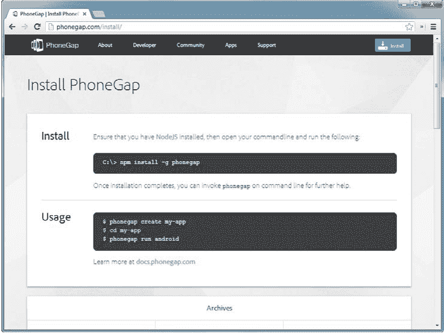

图 2.6 PhoneGap 下载页面

### 提示

PhoneGap 文档基本上（很可能完全一样——我没有检查）与 Cordova 文档相同，因此没有必要同时查看两个站点获取信息。我只在寻找关于 PhoneGap 对 Apache Cordova 实现所独有的某些功能的信息时才使用 PhoneGap 文档。

如果您正在寻找旧版本的 PhoneGap，可以在图 2.6 所示的页面上向下滚动，访问大多数早期版本框架的下载。

### 总结

在本章中，我向您展示了如何下载和安装 Apache Cordova 和 Adobe PhoneGap 框架。我们现在安装的内容还无法真正做任何事情，但在接下来的几章中，我将向您展示如何开发和测试您的 Cordova 应用程序，以及如何为几个最流行的移动设备平台配置和使用本地开发环境。紧接着这些章节，我将向您展示如何使用 PhoneGap Build 服务来大幅简化所有这些工作。

## 安装 Cordova 命令行界面

为了使开发者更容易管理他们的项目，Cordova 项目团队构建了一个单一的、统一的命令行界面 (CLI)，该界面有望最终在所有 Cordova 支持的移动设备平台上工作。本章说明如何安装 Cordova CLI。下一章向您展示如何使用它来管理您的 Cordova 项目。

PhoneGap CLI 本质上是 Cordova CLI 并添加了一些额外的命令。您在本章学到的几乎所有内容也都可以轻松应用于 PhoneGap CLI。您应该参考 PhoneGap 文档 http://docs.phonegap.com/en/3.0.0/index.html 以获取有关 PhoneGap CLI 添加的额外命令的信息。

### 安装 CLI

Cordova CLI 是使用 JavaScript 代码构建的，这些代码通过 Node Java\Script 运行时引擎 (www.nodejs.org) 公开。因为它使用 JavaScript 构建，所以它基本上可以在任何有 Node.js 的地方运行（Linux、Macintosh OS X 和 Microsoft Windows）。以下说明将帮助您在开发工作站上安装 CLI；针对 Macintosh OS X 和 Microsoft Windows 有单独的说明；我不涵盖 Linux 的安装。

> **注意**
>
> CLI 是 Cordova 的一个全新功能，因此它对您的开发系统的配置有点挑剔。请务必遵循 CLI readme.md 中的所有步骤。在接下来的部分中，我将向您展示我为使系统在我的 Macintosh 和 Windows 系统上运行而必须完成的所有步骤。在您的环境中，您可能需要也可能不需要遵循这些步骤。

请准备好更新您所有的移动 SDK 和开发工具，并务必遵循所有说明。请准备好耐心等待，因为 CLI 有很多必须随它一起安装的必需库。

CLI 必须能够创建新的 Cordova 项目，因此它提供必要的项目文件，并且它必须与原生 SDK 交互以构建项目并在模拟器或仿真器中加载应用程序。因此，您必须确保安装了适当的 SDK（取决于您使用的平台），并且 SDK 对 CLI 可见。例如，对于 BlackBerry、iOS 和 Windows，SDK 安装在系统上，因此 CLI 可以轻松找到它所需的内容。


需求。对于 Android 系统，没有安装程序，因此您必须手动配置系统，以便 CLI 能够找到 SDK 及相关工具。

在接下来的部分中，我将向您展示如何在 Microsoft Windows 和 Mac OS X 上安装用于 Android、BlackBerry 10、iOS 和 Windows Phone 的必要工具，以便使用 Cordova CLI。第 7 章到第 10 章将详细展示如何使用所列不同移动操作系统平台的特定功能。因此，如果您打算为某个特定移动操作系统进行 Cordova 开发，请先阅读此处的说明，然后查阅与您特定操作系统相关的章节（第 7 章针对 Android，第 8 章针对 BlackBerry 10，第 9 章针对 iOS，第 10 章针对 Windows Phone 8）。

Android 开发工具
-----------------

Android SDK 的要求之一是 Java 开发工具包 (JDK)。在 Macintosh 上，您应该已经有 Java 可用，尽管您可能需要先安装它。打开一个终端窗口，在命令提示符下输入 `javac`，然后按回车键。如果您看到一堆帮助文本滚动显示，那么您就设置好了。如果没有，您将看到如何为您的系统下载和安装适当 Java 文件的说明。

在 Windows 上，您需要将您选择的浏览器指向 http://java.oracle.com 并下载 JDK。在 Java 主页上，选择 Java SE，然后下载并安装最新版本的 JDK。

JDK 安装完成后，还有一个步骤需要完成：您需要定义 `JAVA_HOME` 环境变量并将其指向 JDK 的安装位置。要创建 `JAVA_HOME` 环境变量，假设您运行的是 Windows 7，请右键单击计算机图标（在旧版本的 Windows 中曾称为我的电脑），然后选择属性。在出现的对话框中，选择“高级系统设置”，如图 3.1 左侧高亮部分所示。

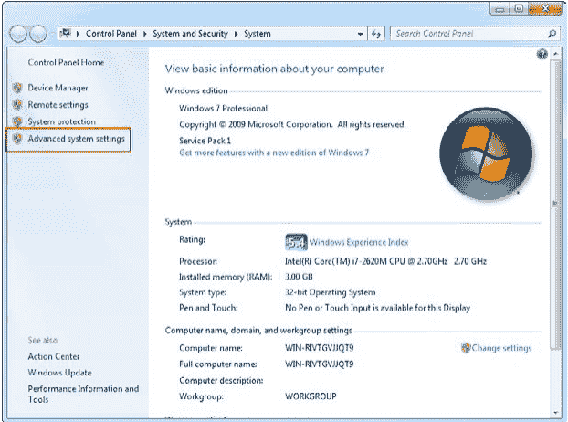

**图 3.1** Windows 控制面板：系统设置

在出现的对话框中，选择“高级”选项卡，如图 3.2 所示，并单击图中高亮显示的“环境变量...”按钮。

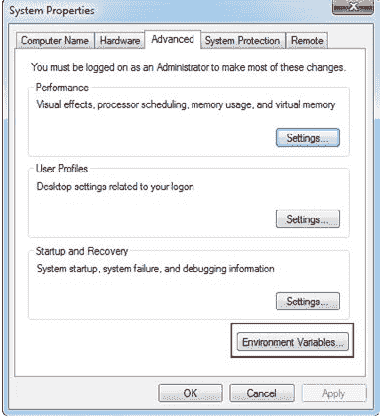

**图 3.2** Windows 系统属性

在出现的对话框中，单击“新建”按钮，添加一个名为 `JAVA_HOME` 的用户变量，该变量指向 JDK 软件所在的位置，如图 3.3 所示。

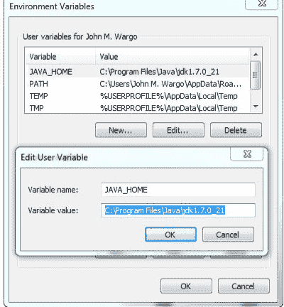

**图 3.3** 添加 JAVA_HOME 用户变量

要测试配置，请保存您的更改，打开一个新的终端窗口并输入 set，然后按回车键。您应该看到一长串环境变量；查找您的新 JAVA_HOME 变量的条目。

Java 安装并配置好之后，就该安装 Android SDK 了。打开您选择的浏览器并将其指向 http://developers.android.com。在 Android 开发者主页上，按照链接下载 Android SDK；在当前网站上，它被标记为“Get the SDK”。

SDK 没有安装程序；它以 .zip 文件形式发布，因此下载后，您必须将文件解压到对您有意义的位置。在 Macintosh OS X 上，当您使用 Safari 浏览器下载 .zip 文件时，文件会自动为您解压到“下载”文件夹。一些开发者可能会将解压后的文件夹拖到 /Applications 文件夹，但在我的系统上，我将所有内容都留在下载文件夹中。

SDK 下载包含构建和模拟 Android 应用程序所需的工具，包括预配置版本的 Eclipse，但不包含您的应用程序可能需要的所有 SDK 库和设备模拟器。您需要执行一些额外步骤来下载所需的 SDK 库和设备模拟器——请按照位于 http://developer.android.com/sdk/installing/bundle.html 的说明完成此步骤。

由于 Android SDK 没有安装程序，CLI 将不知道在哪里找到 Android SDK 工具，因此您必须将一些文件夹添加到系统路径中。具体来说，CLI 需要知道在哪里可以找到 SDK platform-tools 和 tools 文件夹。

在 Macintosh 上，有几种方法可以更新系统路径；对于我的安装，我使用 TextMate 通过发出以下命令来修改路径文件：

```
mate /etc/paths
```

图 3.4 显示了在编辑器中打开的文件。我保留了现有文件内容不变，并将 platform-tools 和 tools 文件夹的文件路径作为单独的行添加到文件中。

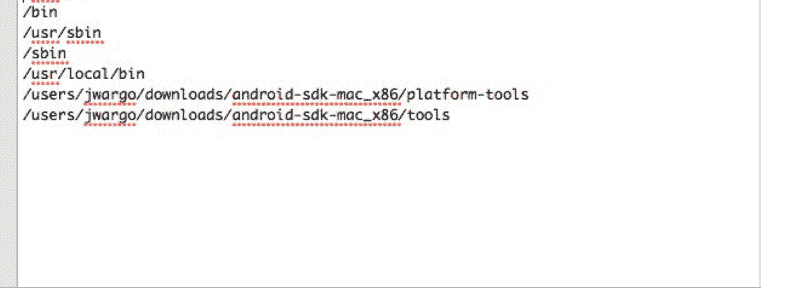

图 3.4 编辑 Macintosh OS X 的路径文件

在 Windows 上，您可以从控制面板访问所需的设置。最简单的方法是右键单击“开始”菜单中的计算机图标，然后选择“属性”。在出现的窗口中，选择“高级系统设置”，如图 3.1 所示。在“环境变量”对话框中，选择 PATH 变量并单击“编辑”按钮，或者直接双击 PATH 条目。将 Android SDK platform-tools 和 tools 文件夹的文件路径追加到现有的路径环境变量中，在每个条目之间放置一个分号，如图 3.5 所示。

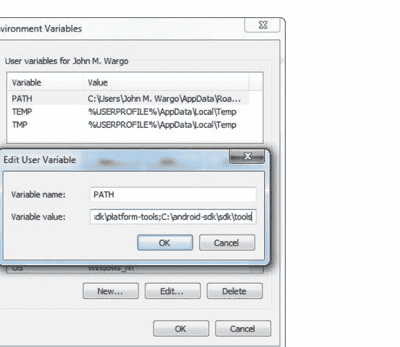

图 3.5 Windows 环境变量

保存更改后，您应该能够打开一个终端窗口并输入 *android* 来运行 Android SDK 管理器，如图 3.6 所示。无论您是在 Macintosh OS 还是 Windows 上运行，SDK 管理器的外观都应该相同。

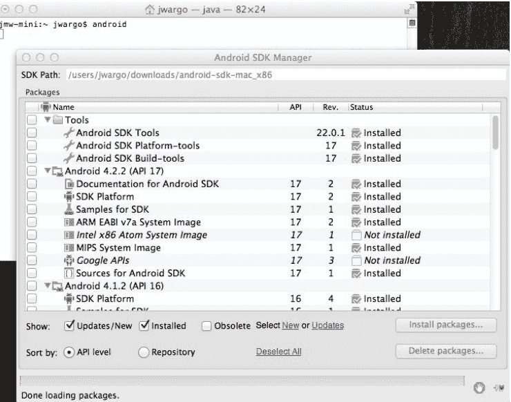

图 3.6 测试 Android 配置

如果您将所需的两个路径添加到系统路径，但当您在命令提示符下输入 android 时 SDK 管理器没有加载，那么配置不完整，CLI 将无法操作 Android 项目。您需要返回并解决任何问题，然后再继续。

如果您知道您需要开发针对 Android SDK 管理器默认安装版本之外的 Cordova 应用程序，现在可能是选择所需的附加平台并安装它们的好时机。

您可以在第 7 章“使用 Cordova 进行 Android 开发”中阅读更多关于 Apache Cordova 的 Android 开发内容。

BlackBerry 开发工具
-----------------

要构建 BlackBerry 的 Cordova 应用程序，您必须注册并安装一组用于签名 BlackBerry 应用程序的加密密钥。BlackBerry 应用程序可以在 BlackBerry 模拟器中运行，但在物理设备上运行之前必须进行签名。要注册一组密钥，请将您选择的浏览器指向 https://www.blackberry.com/SignedKeys/codesigning.html 并按照说明操作。好消息是签名密钥是免费的，可以在 1 到 2 小时内获得。请求密钥后，您将收到几封电子邮件，其中包含有关如何为它们配置开发环境的说明。我将在第 8 章“使用 Cordova 进行 BlackBerry 10 开发”中介绍如何注册和使用签名密钥。

对于 Cordova 3，您将使用 BlackBerry 原生 SDK (NSDK) 来构建 Cordova 应用程序。旧版本的 Cordova 使用 BlackBerry WebWorks SDK，但他们已经切换到了 NSDK。

到您阅读本文时，可能会有一个更小的、命令行工具的安装包可用于 Cordova 开发。在继续之前，请务必查看 https://github.com/apache/cordova-cli 上的 readme 文件以确保了解最新要求。

注意
--

Cordova 3.0 及更高版本支持在 BlackBerry 10 和 BlackBerry PlayBook 设备平台上进行开发。从 Cordova 3.0 开始，对 BlackBerry 7 设备的支持已被取消，因此如果您想为旧的 BlackBerry 设备开发，需要使用 Cordova 2.9 或更早版本。

要安装 NSDK，请将您的浏览器指向 http://developer.blackberry.com/native 并按照说明下载并安装适当的软件，具体取决于您是为 BlackBerry 10 还是 BlackBerry PlayBook 平台进行开发。NSDK 安装要求您执行一个脚本或批处理文件（具体取决于您是在 Macintosh OS X 还是 Windows 上运行）来正确配置系统环境以供命令行使用。请务必遵循 BlackBerry 开发者网站上的完整安装说明。如果您未完成此步骤，在安装 CLI 期间可能会看到以下错误：

```
WARNING: Your system does not meet requirements to create blackberry projects. See error output below.

The BB10NDK environment variable QNX_HOST is missing. Make sure you run `source <path to bb10ndk>/bbndk-env.sh`. Even better, add `source`ing that script to your .bash_profile or equivalent so you don't have to do it manually every time.
SKIPPING blackberry bootstrap.
```

BlackBerry 10 和 PlayBook 的 BlackBerry 设备模拟器使用 VMWare 虚拟机。对于 Macintosh 安装，您需要获取并安装 VMWare Fusion (www.vmware.com/products/fusion/overview.html) 许可证，然后才能安装模拟器。对于 Windows，您可以使用免费的 VMWare player 应用程序，可从 www.vmware.com/products/player 获取。只需安装 player 应用程序，然后安装 BlackBerry 10 设备模拟器软件。

您可以在第 8 章中阅读更多关于 Apache Cordova 的 BlackBerry 10 开发内容。

iOS 开发工具
-----------------

在进行任何 iOS 开发之前，您必须加入 Apple iOS 开发者计划。您可以在 https://developer.apple.com/programs/ios 找到有关该计划的信息；根据您选择的计划，需要支付年费并提供不同的功能。

接下来，您要打开 Macintosh App Store，搜索“xcode”，然后安装 Xcode IDE，如图 3.7 所示。


#### 图 3.7 Macintosh App Store Xcode 入口

Xcode 是一个庞大的安装包，所以在下载期间请先找点其他事情做。一旦安装完成，你需要启动 Xcode 并安装 Xcode 命令行工具。打开 Xcode 后，打开 Xcode 菜单并选择“偏好设置”。在弹出的对话框中，选择“下载”，然后切换到“组件”选项卡，如图 3.8 所示。

#### 图 3.8 Xcode 偏好设置对话框

如果你已按图 3.8 所示安装了命令行工具，那么你就准备好了。如果没有，你可以点击最右侧的按钮来完成安装（这是一个大型下载，所以请做好花费一些时间的准备）。完成后，你仍然没有结束：你的 Xcode 配置还有几个步骤待完成。

Xcode 命令行工具有其自身的许可协议，在可以使用之前你必须同意该协议。你不能在安装过程中同意条款；相反，你需要打开一个 Macintosh Terminal 窗口并执行以下命令：

```
xcodebuild -license
```

如果收到错误，则 Xcode 命令行工具安装不正确，你必须回头解决问题才能继续。如果安装正确，你应该会看到与图 3.9 所示类似的屏幕。

#### 图 3.9 Xcode 许可协议

按空格键直到读完整个协议。当你到达协议末尾时，你会看到与图 3.10 所示类似的屏幕。如果你同意协议的条款，输入单词 "agree" 并按回车键。如果你不同意，那么你将无法使用 Xcode 命令行工具，并且 Cordova CLI 将无法在系统中进行 iOS 开发——抱歉。

```
...for the International Sale of Goods, the application of which is expressly excluded.

9.12          完整协议；适用语言
本协议构成各方就此处许可使用的 SDK 的使用之间达成的完整协议，并取代所有关于此类主题的先前的谅解。本协议仅在以下情况下方可修改：(a) 经双方签署的书面修正案，或 (b) 本协议明确允许的范围内（例如，由 Apple 通过书面或电子邮件通知你）。本协定的任何翻译是出于当地要求进行的，在英文版与任何非英文版之间发生争议时，应以本协定的英文版为准。如果你位于加拿大的魁北克省，适用以下条款：双方确认已请求以英文起草本协议及所有相关文件。双方要求本协议及所有相关文件均以英文撰写。

EA0720
修订版 03/01/2011

通过输入 'agree' 表示你同意软件许可协议的条款。输入 'print' 打印它们或任何其他内容以取消，[agree, print, cancel] agree
```

如果跳过此过程，在安装 Cordova CLI 期间，你将收到如图 3.11 所示的错误消息。

```
such file or directory

SKIPPING wp8 bootstrap.
WARNING: Your system does not meet requirements to create android projects. See error output below.
The command `android` failed. Make sure you have the latest Android SDK installed, and the `android` command (inside the tools/ folder) added to your path. Output: /bin/sh: android: command not found

SKIPPING android bootstrap.
WARNING: Your system does not meet requirements to create ios projects. See error output below.
Xcode is (probably) not installed, specifically the command `xcodebuild` is unavailable or erroring out. Output of `xcodebuild -version` is:
You have not agreed to the Xcode license agreements, please run `xcodebuild -license` (for user-level acceptance) or `sudo xcodebuild -license` (for system-wide acceptance) from within a Terminal window to review and agree to the Xcode license agreements.

SKIPPING ios bootstrap.
SUCCESS: blackberry ready to rock!
cordova@2.7.4 /usr/local/lib/node_modules/cordova
├─ ncallbacks@1.0.0
└─ colors@0.6.0-1
```

如果你打算使用 CLI 构建和测试 Cordova 应用程序，你可能需要先完成最后一步。在安装过程的这个阶段，如果你尝试使用 CLI 在 iOS 上测试 Cordova 应用程序，你可能会得到以下错误：

```
[Error: An error occurred while emulating/deploying the ios project.Error: ios-sim was not found. Please download, build and install version 1.5 or greater from https://github.com/phonegap/ios-sim into your path. Or 'brew install ios-sim' using homebrew: http://mxcl.github.com/homebrew/
```

这是因为 CLI 启动 iOS 模拟器所需的工具目前不包括在 Cordova 下载或 CLI 中，所以你必须手动安装它们。错误消息提供了两个选项。我没有安装 Homebrew，所以我选择直接从 Github 安装。我从 https://github.com/phonegap/ios-sim 下载了项目文件，打开 Terminal 窗口，导航到提取 ios-sim 下载的文件夹，然后在终端中发出以下命令：

```
rake install prefix=/usr/local/
```

该命令将构建工具并将其安装在 CLI 可以轻松访问的地方。

你可以阅读更多关于 Apache Cordova iOS 开发的内容在第九章，"Cordova iOS 开发”。

### Windows Phone 开发工具

如果你将为 Cordova 进行 Windows Phone 开发，你首先需要运行 Microsoft Windows 的系统（开发工具无法在 Linux 或 Macintosh OS X 上运行），并且你需要安装 Microsoft Windows Phone SDK。你可以从位于 http://developer.windowsphone.com 的 Windows Phone Dev Center 下载 SDK。对于 Windows Phone 8 和 Windows Phone 7.5 应用程序，都可以使用 SDK 版本 8，因此如果你为这两个操作系统开发，该版本就包含了你所需要的一切。Windows Phone 应用程序使用 Visual Studio 构建，并且在开发中心有免费的 Visual Studio Express 可供下载。对于 Windows Phone 8 应用程序，你需要安装随 SDK 包含的 Visual Studio Express 2012。安装 SDK 后，你需要注册 Microsoft 以获得免费 Visual Studio Express 许可密钥。

Windows Phone 开发工具有一些系统要求很高的配置，因此请确保检查你将为 Cordova 开发使用的特定版本的 Visual Studio 的要求，并确保你的系统超过最低要求。如果不这样做会导致压力增加，因为系统将不会像你预期的那样响应迅速。

### 警告

> Windows Phone 模拟器会对运行它们的系统施加相当大的负载。Microsoft 已增强了工具以帮助减少系统要求，但当你首次启动模拟器时，你会收到一些需要更改以增强性能的 BIOS 设置警告。

> 当我编写 *PhoneGap Essentials* 时，我发现即使在我拥有最新最快的系统上，甚至在虚拟机中，我也无法运行模拟器。对于这本书，我决定升级我的一个实验系统，安装 Windows 8，并将其专用于 Windows Phone 开发，以免我必须处理潜在的性能问题。

你可以阅读更多关于 Apache Cordova Windows Phone 8 开发的内容在第十章，"Cordova Windows Phone 8 开发”。

### CLI 安装

CLI 是用 JavaScript 编写的，因此使用 Node.js 作为运行时执行引擎。CLI 目前需要 Node.js 0.10 及以上版本，如果你已经安装了它，请确保将其更新为最新版本。要安装 Node.js，将你的浏览器指向 www.nodejs.org，然后下载并安装软件。Node.js 将安装在系统路径中，因此你可以打开终端窗口并输入 `node` 来启动 Node.js 应用程序。

在安装期间，CLI 从 GitHub (www.github.com) 获取一些代码，因此你需要在开发工作站上安装 Git。如果你运行的是 Linux 或 Macintosh OS X，可以使用 Node.js 包管理器（npm）通过打开终端窗口并输入以下命令来安装 Git：

```
npm install -g git
```

在 Windows 上，你必须下载 Git 工具并从 http://git-scm.com 将其安装在开发工作站上。

完成安装后，打开终端窗口 (Mac OS X) 或命令提示符 (Windows)，输入 `git`，并按回车键。应该会滚动一段文本，然后你应该会看到与图 3.12 所示类似的屏幕。

#### 图 3.12 测试 Git 安装

如果收到错误消息表明找不到 `git` 命令，则 Git 安装未能成功完成，你需要解决问题才能继续。

有了 Git 和 Node.js 的安装，你已经准备好安装 Cordova CLI；要安装 CLI，你有两个选项。

如果你从 Cordova 网站（在第二章中描述）下载了 Cordova 框架，你可以导航到包含框架文件的文件夹并提取 cordova-cli.zip 的内容

文件。文件解压后，打开终端窗口并导航到包含解压文件的文件夹，然后执行以下命令：

```
npm install
```

另一种选择是从互联网使用 npm 拉取最新版本的 CLI。在 Windows 上，打开命令提示符并执行以下命令：

```
npm install -g cordova
```

命令中的 `-g` 告诉 npm 全局安装 Cordova CLI——如果不使用此参数，CLI 将只能从当前文件夹使用。

在 Macintosh 上，你需要做更多操作才能完成安装。前面的命令可能有效，但如果你收到图 3.13 所示的 EACCESS 错误，则需要尝试不同的方法。

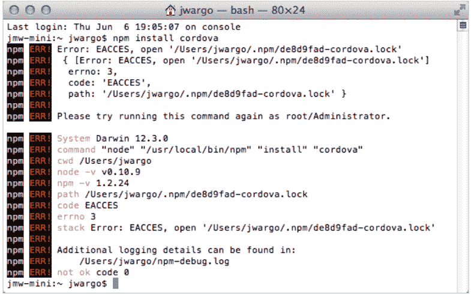

**图 3.13** Cordova CLI 安装访问错误

要解决此错误，你需要使用 `sudo` 安装 Cordova，具体命令如下：

```
sudo npm install -g cordova
```

`Sudo` 允许你以更高的访问级别执行程序，因此当你执行该命令时，系统会在安装开始前提示你输入密码。

CLI 安装会安装大量内容，因此请准备好看到大量信息滚动而过。全部完成后，你会看到一条总结已安装内容的消息；如果向上滚动查看列表，你会看到安装过程中安装了多少内容。

> **警告**
>
> 根据我使用 CLI 的经验，安装过程中可能会出很多问题，但你无法察觉，因为它似乎已正确安装。为避免这种情况，你应该在终端中向上滚动浏览整个安装历史记录，查找错误。

就是这样——这就是安装 Cordova CLI 的全部内容。要测试安装，打开终端窗口，在提示符处输入 `cordova`，然后按 Enter。如果一切安装正确，你应该会看到类似于图 3.14 所示的屏幕。

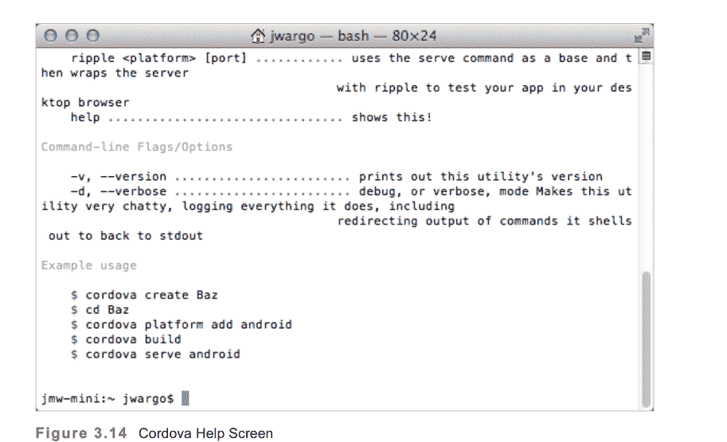

**图 3.14** Cordova 帮助屏幕

如果你有兴趣使用 PhoneGap CLI，其安装方式基本相同；你可以使用以下命令从互联网安装：

```
npm install -g phonegap
```

PhoneGap CLI 的版本可能会比 Cordova CLI 稍落后，因此不要期望两者的版本号相同或具有完全相同的功能。功能通常先在 Cordova CLI 中完善，然后再迁移到 PhoneGap CLI 中。

### 总结

在本章中，我向你展示了如何在 Windows 和 Macintosh OS X 上安装 Cordova CLI。有了这些工具，你就可以开始编写自己的 Cordova 应用程序了。在下一章中，我将向你展示如何使用 CLI 管理你的 Cordova 项目。

## 使用 Cordova 命令行界面

正如第 2 章所述，大多数支持的移动设备平台框架文件中都包含可用于创建新项目和测试/调试应用程序的脚本。这些脚本的问题在于它们特定于每个移动设备平台，因此无法用于完整地管理跨平台项目。

为了让开发者更轻松地管理项目，Cordova 项目团队构建了一个单一的、统一的命令行界面（CLI），适用于所有 Cordova 支持的移动设备平台。本章说明如何使用 Cordova CLI 管理 Apache Cordova 应用程序项目。

#### 关于 CLI

由于 Cordova 应用程序是 Web 应用程序，可以使用任何文本编辑器编写，而移动设备制造商使用不同的集成开发环境（IDE）和项目结构来构建原生应用程序，因此没有一种简单统一的方式来为多个移动设备平台创建和管理 Cordova 应用程序。在 Cordova 的早期版本中，开发者必须创建多个项目，每个移动设备平台一个，并在项目之间复制 Web 应用程序代码。在 Cordova 3.0 中，项目还将所有 Cordova API 迁移到了插件，因此管理 Cordova 项目、Web 内容和已安装插件可能会相当困难。

从 Cordova 3.0 开始（实际上，CLI 在 Cordova 2.7 中就以预发布形式提供了），项目添加了一个 CLI，提供了一套开发者可以使用的命令：

- 创建跨平台 Cordova 应用程序项目
- 添加对每个 Cordova 支持的移动设备平台的支持
- 列出支持的移动设备平台
- 移除对移动设备平台的支持
- 向项目添加插件；这可以是核心 Cordova 插件、第三方插件或你自己创建的插件
- 列出项目中已安装的插件

> **CLI 故障排除**
>
> 以故障排除信息开始一章从来不是好事，但使用 CLI 时，有时你会希望了解命令运行时后台发生了什么。Cordova 2.8 发布后，项目团队立即为 CLI 添加了详细模式。要启用**详细**模式，请在任何命令中添加 `-v` 或 `--verbose`。

表 4.1 提供了可用 CLI 命令的摘要；其余列更详细地描述了它们的操作。

#### 表 4.1 Cordova CLI 命令摘要

| CLI 命令 | 说明 |
|---|---|
| Help | 显示有关可用 CLI 命令的信息 |
| Create | 创建 Cordova 项目及相关的项目文件夹和文件 |
| Platform | 管理与 Cordova 项目关联的移动设备平台 |
| Plugin | 管理 Cordova 插件的安装和卸载 |
| Prepare | 将 Web 应用程序内容从 Cordova 项目的 www 文件夹复制到项目的移动平台项目文件夹中 |
| Compile | 将 Web 应用程序打包为原生 Cordova 应用程序 |
| Build | 准备然后将 Web 应用程序打包为原生 Cordova 应用程序 |
| Emulate | 在一个或多个移动设备平台的设备模拟器中运行 Cordova 应用程序 |
| Run | 在一个或多个移动设备平台的设备中运行 Cordova 应用程序 |
| Serve | 提供 Web 应用程序内容，以便通过 Web 浏览器访问 |

#### 使用 CLI

在本节中，我将向你展示如何使用 Cordova CLI 公开的命令。我将介绍命令的机制和执行每个命令时发生的情况。有关 Cordova 应用程序项目文件的更多信息，请参阅第 6 章"Cordova 开发机制"。

要了解 CLI 中可用的命令，你可以打开终端窗口（或 Windows 命令提示符——我将统称为终端窗口）并通过输入以下命令获取帮助：

```
cordova help
```

你还可以使用以下命令检查 CLI 版本号：

```
cordova -v
```

或

```
cordova -version
```

#### 创建 Cordova 项目

在进行任何 Cordova 开发之前，你必须首先创建一个应用程序项目。为了帮助你，Cordova CLI 包含一个 `create` 命令，用于创建新项目。

要创建新的 Cordova 项目，打开终端窗口并导航到要创建项目文件夹的位置，然后执行以下命令：

```
cordova create project_folder
```

这会创建一个简单的 Cordova 项目结构和应用程序所需的 Web 内容文件。你还可以使用以下命令指定应用程序 ID 和应用程序名称：

```
cordova create project_folder app_id app_name
```

这样做会创建相同的项目文件夹，但还会将应用程序 ID 写入应用程序的配置文件，并允许你拥有一个与应用程序文件夹名称不同的应用程序名称。例如，要在名为 myapp 的文件夹中创建一个应用程序名称为 Hello 的项目，你会执行以下命令：

```
cordova create myapp com.cordovaprogramming.hello Hello
```

让我给你举个例子。我将创建一个名为 Test 的示例应用程序项目。为此，我导航到要创建项目的位置并执行图 4.1 所示的命令。

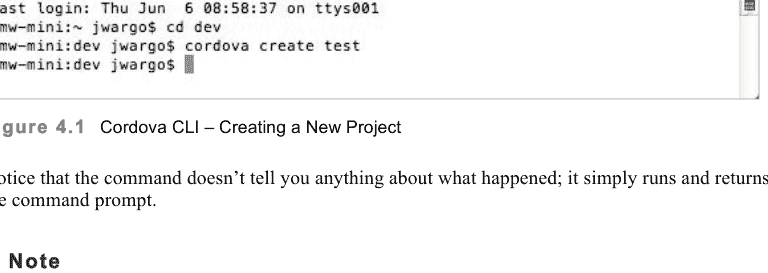

**图 4.1** Cordova CLI – 创建新项目

请注意，该命令不会告诉你任何关于发生了什么的信息；它只是运行并返回到命令提示符。

**注意**

所有 Cordova CLI 命令都针对当前文件夹运行。`create` 命令会为你的 Cordova 项目创建文件夹结构，其余命令必须从 `create` 创建的项目文件夹内执行。

CLI 将运行并创建图 4.2 所示的文件夹结构。该文件夹结构以简化跨多个移动设备平台使用此应用程序的方式组织 Cordova 项目。请注意，www 文件夹是独立的；这允许你创建一个在多个移动设备平台之间共享的 Web 应用程序。我将在下一章中详细介绍 Web 项目结构和文件。

`merges` 文件夹包含在不同移动设备平台之间有所不同的 Web 应用程序资源（HTML、CSS 和 JavaScript 文件以及图像、视频等）。例如，如果你有一个 CSS 文件有两个版本，一个用于 Android，另一个用于 iOS，你可以使用 `merges` 文件夹中的文件夹结构将每个文件存储在特定于移动设备平台的位置，并在构建时将适当的文件复制到项目文件夹中。你可以将 Android 特定的文件（和子文件夹）放在 `merges/android` 中，将 iOS 特定的文件放在 `merges/ios` 中。


#### 图4.2 新建的Cordova项目文件夹

platforms文件夹用于存储此应用程序支持的每个移动设备平台的单独文件夹。我将在下一节中更详细地讨论这一点。plugins文件夹用于存储应用程序使用的每个插件的源代码文件。我稍后也会更详细地讨论这一点。

在接下来的部分中，我将描述其余的CLI命令。create命令在发出命令的文件夹的子文件夹中创建一个新项目。其余的命令必须在指向项目文件夹内的终端窗口中发出。在本节中，我创建了一个名为test的项目，CLI为该项目创建了一个名为test的文件夹。为了能够发出操作test项目的CLI命令，我必须在使用任何其他命令之前，使用cd命令切换到test文件夹。

#### Cordova CLI的延迟加载

Cordova CLI并不预先加载所有所需内容，而是使用一种称为延迟加载的过程来下载创建Cordova项目和为项目添加平台支持所需的项目文件。这些文件仅在你需要时才会下载。

当你创建一个项目时，CLI会下载默认的HelloWorld项目，解压它，并将其复制到相应的项目文件夹中。当你为一个项目添加平台时，CLI会下载一个预配置的项目，解压它，并将其复制到platforms文件夹中。

尽管这种方法很有趣，但我在使用CLI的预发布版本和正式发布版本时，遇到了很多与这个功能相关的问题。在我很多次测试中，CLI会尝试下载它所需的文件，但下载或解压会失败——然而CLI用来判断下载是否成功的机制，却会告诉CLI所需的文件确实已经存在。CLI会检查下载文件夹是否存在，如果文件夹存在，就简单地假定它需要的所有东西都在里面。

我向CLI开发团队施压，要求他们修改延迟加载过程，以利用运行CLI的系统上可能设置的相应代理设置。这解决了在企业网络上下载文件时遇到的一些问题。对于下载文件存在性的检查仍然存在问题，但开发团队已经承诺在下一个版本中修复。

CLI使用一个名为`.cordova`的文件夹来存储其延迟加载的文件。该文件夹位于用户主目录的直接下方（Windows系统上为`c:\users\user_name\`，Mac系统上为`/users/user_name/.cordova`）。你可以在图4.3中看到文件夹结构的示例。在Mac系统上，该文件夹是隐藏的，因此在重新配置系统以在Finder中显示隐藏文件和文件夹之前，你无法在Finder中查看它。

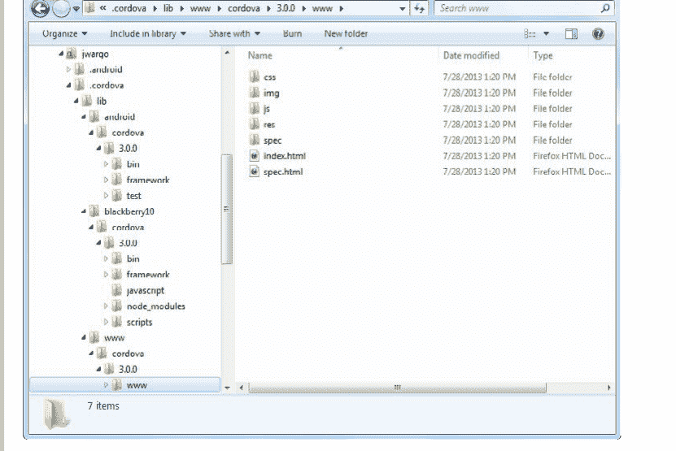

**图4.3** CLI的`.cordova`文件夹结构

如果你在创建项目或添加平台时遇到错误，请使用`-d`调试标志重复该过程，并查找正在发生的情况的提示。如果你看到一条消息说CLI已有其所需的文件并跳过了下载，请查看错误消息中提到的文件夹名称。如果在指定位置没有文件，你应该删除这个空文件夹并重试。

### 平台管理

到目前为止，我们创建的项目结构只有几个空文件夹加上一个Web应用程序项目。它对需要支持的不同移动设备平台一无所知。Cordova CLI提供了一个`platform`命令，允许你管理应用程序支持的每个移动设备平台的项目文件。

#### 添加平台

要为你的Cordova应用程序添加对特定移动设备平台的支持，你必须打开一个终端窗口并导航到Cordova项目文件夹。然后，要为特定移动设备平台添加项目文件，你必须发出以下命令：

```
cordova platform add platform_name
```

> 警告
> 在添加平台之前，必须确保用于为特定平台创建项目的开发工具已安装在系统上并且对CLI可见。CLI使用平台的原生工具来创建新项目，因此如果这些工具对CLI不可用，该命令将无法工作。

例如，如果你想为你的Cordova应用程序添加一个Android项目，你需要在Cordova项目文件夹内发出以下命令：

```
cordova platform add android
```

你也可以在单个命令中指定多个目标移动设备平台，如下例所示：

```
cordova platform add android blackberry ios
```

该命令成功时不会向终端窗口返回任何内容，因此除非你看到错误报告，否则该命令就是成功的。让我给你举个例子。使用我们在上一节创建的test项目，我必须首先切换到test目录，然后发出`platform`命令，如图4.4所示。

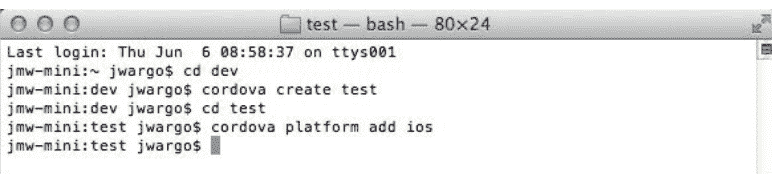

**图4.4** Cordova CLI：为Cordova项目添加iOS支持

如果你查看图4.5，你会看到我的项目有一些新的文件夹和文件。在这种情况下，platforms文件夹现在包含一个iOS文件夹和一个名为HelloCordova.xcodeproj的完整Xcode项目。此时，你可以启动Xcode，打开项目，并在iOS模拟器中运行该应用程序。

第48页 第4章：使用Cordova命令行界面

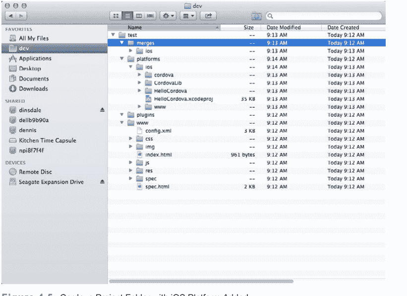

**图4.5** 添加了iOS平台的Cordova项目文件夹

Xcode应用程序项目名为HelloCordova，因为我在创建项目时没有指定应用程序名称。如果我使用`create`的第二种形式（如前所述）创建项目，像这样：

```
cordova create test com.cordovaprogramming.hello Hello
```

Xcode项目将被命名为Hello.xcodeproj。

为了添加Android支持，我执行了图4.6所示的命令。

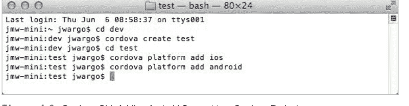

**图4.6** Cordova CLI：为Cordova项目添加Android支持

如果你现在查看我们一直在操作的test文件夹，你会看到项目的platforms文件夹现在包含一个android文件夹，里面有一个完整的Android项目，如图4.7所示。

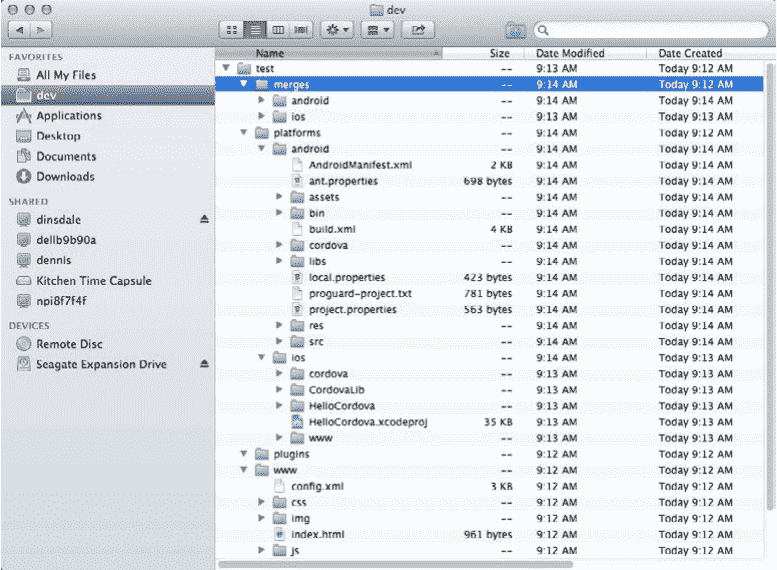

**图4.7** 添加了Android平台的Cordova项目文件夹

你可以在正确配置的Eclipse版本（一个安装了Android开发工具[ADT]的Eclipse实例）中打开Android项目，并在Android模拟器中运行和调试应用程序。我将在第7章“使用Cordova进行Android开发”中向你展示如何操作。

#### 列出平台

Cordova CLI提供了一种机制来列出在Cordova项目中定义的平台。只需在Cordova项目根目录下的终端窗口中发出以下任意命令即可：

```
cordova platforms
cordova platform ls
cordova platform list
```

CLI将返回一个JavaScript对象表示法（JSON）数组，包含项目中定义的每个平台的名称：

```
[ 'android', 'ios', 'blackberry10' ]
```

你可以在图4.8中看到此输出的示例。

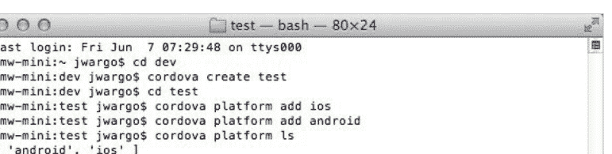


这个功能对开发者直接使用来说并不是特别有用，因为他们只需要打开项目文件夹并查看项目的platforms文件夹中存在哪些子文件夹即可。然而，对于自动化过程来说，这个函数更有用。由于结果以JSON数组形式返回，Node.js应用程序可以轻松地解析生成的数组，判断是否缺少预期的平台并添加它。

#### 移除平台

如果你决定不再需要支持应用程序的某个特定移动平台，你可以通过发出以下命令将其移除：

```
cordova platform remove platform_name
```

你也可以使用快捷方式`rm`代替`remove`来移除平台：

```
cordova platform rm platform_name
```

因此，对于我的test项目，如果我想移除iOS项目的项目文件，我将发出以下命令：

```
cordova platform remove ios
```

你可以在图4.9中看到此操作的结果。

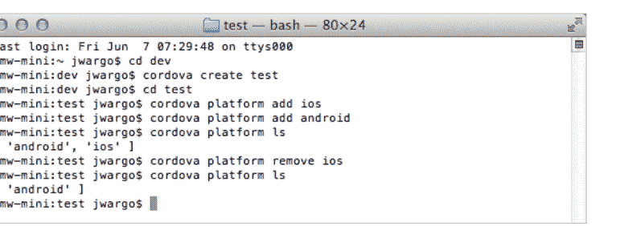


该命令成功时不会向终端窗口返回任何内容，因此除非你看到错误报告，否则该命令就是成功的。


### 插件管理

管理 Cordova 项目插件配置的能力是 CLI 最重要的特性之一。无需手动复制插件文件或手动编辑配置文件，CLI 会替你完成所有工作。

#### 添加插件

要使用 CLI 向现有项目添加插件，请打开终端窗口，导航到 Cordova 项目文件夹，然后执行以下命令：

```
cordova plugin add path_to_plugin_files
```

例如，要向 Cordova 应用程序添加 Camera 插件，可以使用以下命令：

```
cordova plugin add https://git-wip-us.apache.org/repos/asf/cordova-plugin-camera.git
```

这会连接到 Apache Git 仓库并拉取该插件的最新版本。你可以在 http://cordova.apache.org/docs/en/3.0.0/guide_cli_index.md.html#The%20Command-line%20Interface 找到核心 Cordova 插件的位置列表。

通常情况下，前面示例中显示的插件 git 位置使用以下格式：

```
https://git-wip-us.apache.org/repos/asf/cordova-plugin-<plugin-name>.git
```

其中 `<plugin-name>` 指的是插件的短名称。

CLI 可以从几乎任何位置拉取插件代码；如果系统可以访问插件文件所在的位置，你就可以使用 CLI 安装该插件。如果你在本地安装了插件，比如，你正在使用第三方插件或自己创建的插件，而文件存储在本地 PC 上，你可以使用以下命令：

```
cordova plugin add c:\dev\plugins\my_plugin_name
```

> **警告**
> 使用 CLI 安装插件是向 Cordova 项目添加插件的唯一受支持方式。在框架的早期版本中，插件是由开发者手动复制文件并修改配置文件来添加的。如果你尝试在 Cordova 3.0 及更高版本中使用这种方法，可能会导致 Cordova 项目损坏。

命令成功时不会在终端窗口返回任何内容，因此除非看到错误报告，否则说明命令执行成功。

从 Cordova 3.1 开始，插件可以直接从插件仓库安装，只需指定插件名称即可。因此，要向应用程序添加 console 插件，你需要在指向 Cordova 项目文件夹的终端窗口中执行以下命令：

```
cordova plugin add org.apache.cordova.console
```

`org.apache.cordova.core` 的结尾。因此，对于我们刚刚添加到项目中的 Camera 插件，你可以通过 CLI 将其引用为 `org.apache.cordova.core.camera`。这种插件命名方法有助于减少不同组织创建的类似插件之间发生名称冲突的可能性。

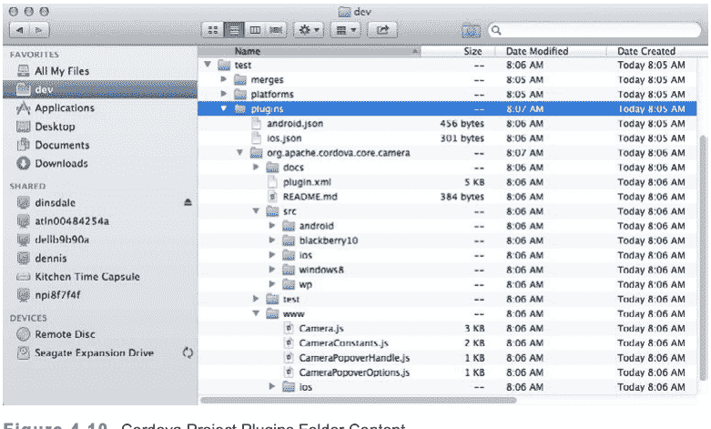

图 4.10  Cordova 项目插件文件夹内容

插件为每个支持的移动设备平台分别存放了 plugin 的源代码。此外，一些 JavaScript 文件被 Cordova 应用程序在 www 文件夹中使用。关于插件还有很多需要了解的内容；在第 13 章"创建 Cordova 插件"中，我将更深入地介绍插件项目文件夹结构。

#### 列出插件

要查看 Cordova 项目中已安装的插件列表，请打开终端窗口，导航到 Cordova 项目文件夹，然后执行以下命令：

```
cordova plugins
```

CLI 会以 JSON 数组的形式返回列表，如下所示：

```
[ 'org.apache.cordova.core.camera',
  'org.apache.cordova.core.device-motion',
  'org.apache.cordova.core.file' ]
```

在这种情况下，Cordova 项目已安装了 Cordova 核心 Camera、Accelerator（device-motion）和 File 插件。

#### 移除插件

要从 Cordova 项目中移除插件，请打开终端窗口，导航到 Cordova 项目文件夹，然后执行以下命令：

```
cordova plugin remove plugin_name
```

你也可以使用快捷方式 `rm` 来代替 `remove` 移除插件：

```
cordova plugin rm plugin_name
```

因此，对于已安装 Cordova 核心 File 插件的项目，你可以通过执行以下命令将其从项目中移除：

```
cordova plugin remove org.apache.cordova.core.file
```

命令成功时不会在终端窗口返回任何内容，因此除非看到错误报告，否则说明命令执行成功。

CLI 本质上会反转插件安装过程，通过移除指向插件的配置文件条目，以及从项目的 plugins 文件夹中删除插件文件夹。

### 构建管理

CLI 内置了与移动设备平台 SDK 的集成，因此你可以使用 CLI 来管理应用程序的构建过程。

#### Prepare

CLI 的 `prepare` 命令将 Cordova 项目的 web 应用程序内容从 www 和 merges 文件夹复制到项目的相应平台文件夹中。这个过程在第 6 章中有详细描述。每当你对 Cordova web 应用程序的内容（在 www 或 merges 文件夹中）进行更改时，都会使用此命令。`prepare` 命令在本章后续描述的许多操作之前会自动调用。

要使用 `prepare` 命令，请打开终端窗口，导航到 Cordova 项目文件夹，然后执行以下命令：

```
cordova prepare
```

这会将 web 应用程序内容复制到项目中已添加的每个移动设备平台的相应文件夹中。

要准备特定平台的文件，请使用以下命令：

```
cordova prepare platform_name
```

因此，要准备 Android 平台文件夹，请使用以下命令：

```
cordova prepare android
```

命令成功时不会在终端窗口返回任何内容，因此除非看到错误报告，否则说明命令执行成功。

#### Compile

在图 4.7 中，你可以看到每个平台的文件夹结构中都有一个 cordova 文件夹。该文件夹包含用于编译该平台的原生应用程序的特定于平台的构建脚本。`compile` 命令通过调用一个或多个移动平台的构建脚本来启动编译过程。

要使用 `compile` 命令，请打开终端窗口，导航到 Cordova 项目文件夹，然后执行以下命令：

```
cordova compile
```

要编译特定平台的原生应用程序，请使用以下命令：

```
cordova compile platform_name
```

因此，要编译 Android 版本的应用程序，请使用以下命令：

```
cordova compile android
```

命令成功时不会在终端窗口返回任何内容，因此除非看到错误报告，否则说明命令执行成功。

#### Build

`build` 命令与 `compile` 类似，不同之处在于它会先调用 `prepare`，然后再调用 compile。

要使用 `build` 命令，请打开终端窗口，导航到 Cordova 项目文件夹，然后执行以下命令：

```
cordova build
```

要构建特定平台的原生应用程序，请使用以下命令：

```
cordova build platform_name
```

因此，要构建 Android 版本的应用程序，请使用以下命令：

```
cordova build android
```

命令成功时不会在终端窗口返回任何内容，因此除非看到错误报告，否则说明命令执行成功。

### 运行 Cordova 应用程序

CLI 内置了与移动设备平台模拟器的集成，因此你可以直接将 Cordova 应用程序启动到模拟器或物理设备上。第 7 章到第 10 章提供了有关模拟器、如何配置和启动它们，以及从 CLI 使用物理设备所需的条件的更多详细信息。以下部分提供了相关命令的高级概述。

#### Emulate

CLI 的 `emulate` 命令自动化了构建应用程序并将其部署到移动设备模拟器的过程。该命令首先准备应用程序，执行构建过程，然后将生成的原生应用程序包部署到模拟器。

要在项目中配置的每个平台的默认模拟器上运行 Cordova 应用程序，请执行以下命令：

```
cordova emulate
```

要在单个设备平台模拟器上模拟应用程序，例如 Android，你可以执行以下命令：

```
cordova emulate android
```

CLI 应该会自动为你启动模拟器；这在 iOS 上工作良好，但在 BlackBerry 上不起作用，我在 Android 上尝试时结果也参差不齐。


#### 运行

对于 BlackBerry 平台，必须遵循额外的步骤来为 `emulate` 命令定义模拟器目标；有关更多信息，请参阅第 8 章“使用 Cordova 进行 BlackBerry 10 开发”。

#### CLI 运行命令

CLI `run` 命令自动化了构建应用程序并将其部署到物理设备的过程。该命令首先准备应用程序，执行构建过程，然后将生成的原生应用程序包部署到连接的设备上。

要在为项目配置的每个平台上运行 Cordova 应用程序于物理设备上，请执行以下命令：

```
cordova run
```

要在单个设备上运行应用程序，以 Android 为例，您将执行以下命令：

```
cordova run android
```

对于 BlackBerry 和 Windows Phone 8 平台，在设备上运行应用程序之前必须遵循额外的步骤。有关配置 BlackBerry 设备的更多信息，请参阅第 8 章；有关 Windows Phone 8 的信息，请参阅第 10 章“使用 Cordova 进行 Windows Phone 8 开发”。

#### Serve 命令

在开发移动 Web 应用程序时，许多开发者发现在切换到移动设备之前，在桌面浏览器中测试应用程序效果更好。对于 Cordova 应用程序，这一点尤其重要，因为在应用程序可以在设备或模拟器上运行之前，必须经历额外的打包过程。

CLI 包含一个 `serve` 命令，开发者可以使用它来启动一个本地 Web 服务器，该服务器托管特定平台的 Web 内容。它不会向浏览器暴露任何 Cordova API，因此使用此选项您真正可以测试的只是 Web 应用程序的用户界面。在启动服务器之前，您必须执行 CLI `prepare` 命令，以确保您的 Web 内容是最新的。

要使用 `serve` 命令，请打开终端窗口，导航到 Cordova 项目文件夹，然后执行以下命令：

```
cordova serve platform_name
```

要托管 Cordova 项目的 Android Web 应用程序内容，您将执行以下命令：

```
cordova serve android
```

图 4.11 展示了 `serve` 命令的实际运行情况。命令加载后，它将向您显示用于访问 Web 服务器的 URL。只需打开您选择的浏览器并导航到指定的 URL 即可访问应用程序内容。

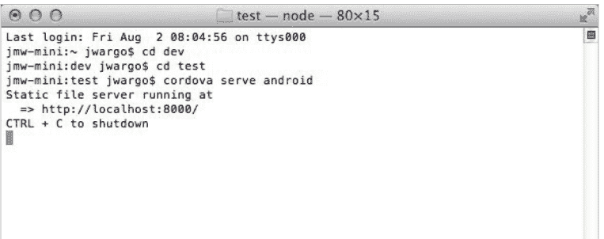

**图 4.11 使用 CLI 启动 Web 服务器**

在 Microsoft Windows 上运行此过程时，您可能会收到类似于图 4.12 所示的安全警告。您需要点击“允许访问”按钮以允许 Web 服务器启动。

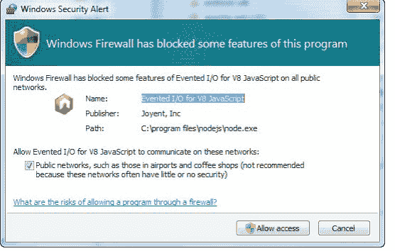

**图 4.12 Windows 安全警报**

默认情况下，服务器将响应端口 8000，如图 4.11 所示。如果您想使用不同的端口，可以将端口号传递给 CLI，如以下示例所示：

```
cordova serve platform_name port_number
```

因此，对于前面显示的 Android 示例，要在端口 8080 上托管 Android 平台的内容，您将使用以下命令：

```
cordova serve android 8080
```

### 总结

在本章中，我向您展示了如何利用 Cordova CLI 来管理您的 Cordova 应用程序项目。CLI 提供的功能极大地简化了跨平台开发过程以及管理 Cordova 应用程序的插件配置。

在下一章中，我将讨论 Cordova 应用程序的结构。在第 5 章中，我将描述构建和调试 Cordova 应用程序的过程。

# Cordova 应用程序剖析

既然我们已经安装了 Cordova 和/或命令行界面，现在是时候讨论 Cordova 应用程序和 Cordova 应用程序开发了。在本章中，我将向您展示是什么让一个 Web 应用程序成为 Cordova 应用程序，并带您浏览 Cordova 团队提供的示例应用程序。

正如本书开头所提到的，Cordova 应用程序可以做任何可以在标准的、日常的 HTML、CSS 和 JavaScript 中编码的事情。存在 Web 应用程序和 Cordova 应用程序，它们之间的区别可能很小，也可能很大。

本章的各节重点介绍了几乎任何开发者的书籍、文章或培训课程中都会出现的必备 HelloWorld 应用程序的不同版本。为了突出应用程序 Web 内容的各个方面，而不是它们是如何创建的，省略了创建应用程序所需的步骤。有关如何为多个支持的移动平台创建、测试和调试 Cordova 应用程序项目的具体信息，请参阅后续章节。

#### Hello World！

与任何有自尊的开发者书籍一样，我们将从默认的 HelloWorld 应用程序开始，然后在此基础上进行扩展，以突出 Cordova 应用程序的不同方面。以下 HTML 内容（代码清单 5.1）描述了一个简单的网页，该网页在页面上显示一些文本。

**代码清单 5.1 HelloWorld1 应用程序：**

```html
<!DOCTYPE HTML>
<html>
<head>
  <title>HelloWorld1</title>
</head>
<body>
  <h1>Hello World</h1>
  <p>This is a sample Cordova application</p>
</body>
</html>
```

如果您将该页面打包成 Cordova 应用程序并在智能手机设备或设备模拟器（本例中为 Android 模拟器）上运行它，该应用程序将显示一个简单的启动屏幕，然后您将看到类似于图 5.1 所示的内容。

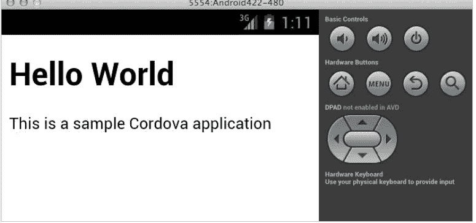

**图 5.1 在 Android 模拟器上运行的 HelloWorld1 应用程序：**

从技术上讲，这是一个 Cordova 应用程序，因为它是一个在 Cordova 原生应用程序容器内运行的 Web 应用程序。如果我没有裁剪图像，您会看到该 Web 应用程序占据了模拟 Android 设备的整个屏幕。尽管我运行的是一个 Web 应用程序，但由于它是在原生应用程序内运行的，因此没有显示浏览器 UI，也无法访问浏览器功能。它只是一个渲染 Web 内容的原生应用程序。

然而，这个应用程序没有任何 Cordova 的特性。它运行在 Cordova 原生容器中，但并未利用 Cordova 框架提供的任何 API。因此，任何 Web 应用程序都可以打包成 Cordova 应用程序；没有任何东西强制您使用 Cordova API。如果您有一个简单的 Web 应用程序，只需要一种方式通过智能手机的原生应用商店进行部署，那么使用 Cordova 就是实现该目标的一种方式。

#### Cordova 初始化

现在让我们在前面的示例应用程序的基础上，添加一些 Cordova 特有的内容。如代码清单 5.2 所示的 HelloWorld2 应用程序已更新，包含了识别 Cordova 应用程序何时完成初始化的代码，并显示一个警报对话框，让您知道 Cordova 已准备就绪。

**代码清单 5.2 HelloWorld2：**

```html
<!DOCTYPE html>
<html>
<head>
    <meta http-equiv="Content-type" content="text/html; charset=utf-8">
    <meta name="viewport" content="user-scalable=no, initial-scale=1, maximum-scale=1, minimum-scale=1, width=device-width;" />
    <script type="text/javascript" charset="utf-8" src="cordova.js"></script>
    <script type="text/javascript" charset="utf-8">
        function onBodyLoad() {
            document.addEventListener("deviceready",onDeviceReady, false);
        }
        function onDeviceReady() {
            navigator.notification.alert("Cordova is ready!");
        }
    </script>
</head>
<body onload="onBodyLoad()">
    <h1>HelloWorld2</h1>
    <p>This is a sample Cordova application.</p>
</body>
</html>
```

### 警告

如果您从本章的任何代码清单中复制代码并尝试在您自己的 Cordova 应用程序中使用，您可能会注意到一些 HTML 中间有一些额外的回车符。这样做是为了让代码在书籍的印刷版中清晰地呈现。要下载本书中所有项目的干净版本，请访问书籍网站 www.cordovaprogramming.com 的代码部分，或从 Github https://github.com/johnwargo/cordova-programming-code 下载。


在 iPhone 模拟器中，应用程序将显示如图 5.2 所示的屏幕。

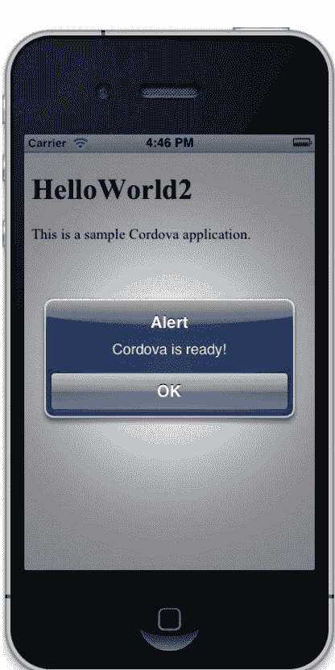

**图 5.2** 在 iOS 模拟器上运行的 HelloWorld2 应用程序

在 Web 页面的 `<Head>` 部分有两个新的条目：描述内容类型的应用程序 meta 标签和视口设置。内容类型设置是标准 HTML 设置，并且应该看起来与任何其他 HTML5 应用程序相同。

下面的视口设置告诉嵌入的 Web 浏览器渲染内容的屏幕有多少可用屏幕空间可用于应用程序，以及如何缩放屏幕上的内容：

```
<meta name="viewport" content="user-scalable=no, initial-scale=1, maximum-scale=1, minimum-scale=1, width=device-width;" />
```

62 第 5 章：Cordova 应用程序解剖

在这种情况下，HTML 页面配置为使用屏幕的最大高度和宽度（通过 `width=device-width` 和 `height=device-height` 属性）并缩放内容 100%，不允许用户以任何方式更改这些设置（通过 `initial-scale=1`，`maximum-scale=1` 和 `user-scalable=no` 属性）。

> **注意**
> 视口和相关属性不是必需的。如果省略它们，浏览器将 revert 到默认行为，可能（或可能不，谁知道？）导致应用程序的内容消耗屏幕可用区域更少的面积，或者在屏幕之外缩放。因为 HelloWorld2 应用程序的内容很少，例如，它可能仅在某些设备上消耗屏幕的上半部分。您还可能发现，在某些平台上，这些设置没有效果——所有这些都是对发布前在移动设备上测试您的 Cordova 应用程序有更多理由。

还有代码中的新的 script 标签加载 Cordova JavaScript 库：

```
<script type="text/javascript" charset="utf-8" src="cordova.js"></script>
```

这个 script 标签加载核心的 Cordova API 库，使程序的任何核心 Cordova 功能可用。记住，尽管如此，Cordova 3 的核心 API 都已迁移到插件。`cordova.js` 文件包含一些基本的 housekeeping 函数。

Cordova 应用程序中的 JavaScript 代码在 Web 应用程序加载后不能立即访问 Cordova API。原生 Cordova 应用程序容器必须完成其初始化过程才能响应使用 Cordova API 调用。为了容纳 API 可用性的延迟，构建 Cordova 应用程序的 Web 开发人员必须指示容器在 Cordova API 完成初始化时通知 Web 应用程序。任何需要处理使用 API 的应用程序必须在接收其通知 API 可用后执行。

在 HelloWorld2 应用程序中，这个通知是通过添加在页面的 body 部分定义的 `onload` 事件来实现的：

```
<body onload="onBodyLoad()">
```

在 `onBodyLoad` 函数中，代码注册事件监听器，指示应用程序调用 `onDeviceReady` 函数，当设备就绪时，Cordova 应用程序容器完成其初始化例程，并触发其 `deviceready` 事件：

```
document.addEventListener("deviceready", onDeviceReady, false);
```

在此示例应用程序中，`onDeviceReady` 函数简单地显示一个 Cordova 警报对话框（这与 JavaScript 警报对话框不同；我在第 12 章向你展示这个区别）让用户知道一切都没问题：

```
navigator.notification.alert("Cordova 是 ready!")
```

在生产应用程序中，这个函数可以更新 UI，使用通过 API 调用创建内容，或进行任何应用程序所需的其他处理。您将在 Listing 5.3 中看到。

记住，Cordova 的大部分 API 已从容器移除并实现为插件。因此，要使用 Cordova 警报方法，你必须将 dialogs 插件添加到你的应用程序中，通过打开一个终端窗口到你的 Cordova 项目文件夹并执行以下命令：

```
cordova plugin add https://git-wip-us.apache.org/repos/asf/cordova-plugin-dialogs.git
```

 <script type="text/javascript" charset="utf-8">
	function onBodyLoad() {
		document.addEventListener("deviceready", onDeviceReady, false);
	}
	function onDeviceReady() {
		br = "<br />";
		//Get the appInfo DOM element
		var element = document.getElementById("appInfo");
		//Replace it with specific information about the device
		//running the application
		element.innerHTML = 'Cordova Version: ' +
			device.cordova + br +
			'Platform: ' + device.platform + br +
			'Model: ' + device.model + br +
			'OS Version: ' + device.version;
	}
</script>

```
</head>
<body onload="onBodyLoad()">
	<div data-role="page">
		<div data-role="header" data-position="fixed">
			<h1>Hello World 4</h1>
		</div>
		<div data-role="content">
			<p>This is a Cordova application that makes calls to
			the Cordova APIs and uses the jQuery Mobile
			framework.</p>
			<p id="appInfo">Waiting for Cordova Initialization to
			complete</p>
		</div>
		<div data-role="footer" data-position="fixed">
			<h1>Cordova Programming</h1>
		</div>
	</div>
</body>
</html>
```

图 5.4 展示了在 Android 模拟器上运行的 HelloWorld4 应用程序。

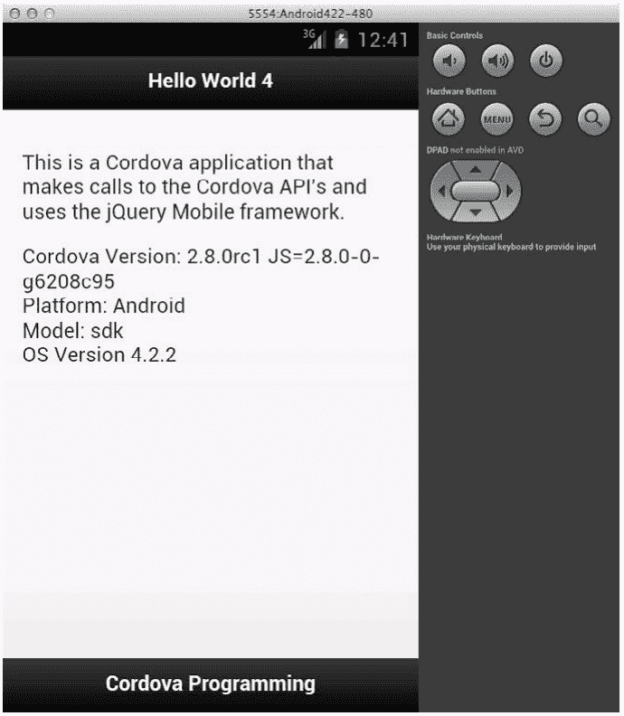

#### **图 5.4** 在 Android 模拟器上运行的 HelloWorld4 应用程序

图 5.5 展示了同一应用程序在 iOS 模拟器上的运行情况。

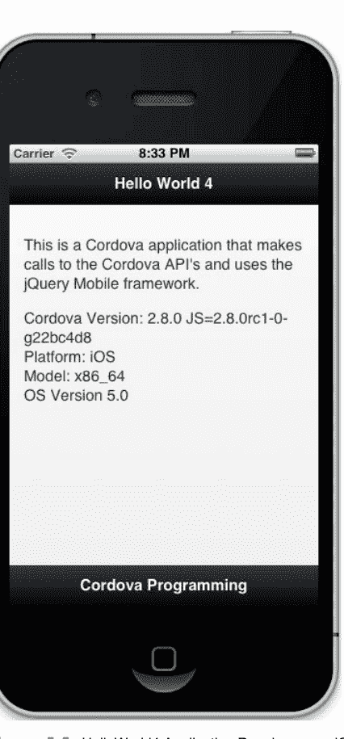

**图 5.5** 在 iOS 模拟器上运行的 HelloWorld4 应用程序

图 5.6 展示了同一应用程序在 BlackBerry 10 模拟器上的运行情况。

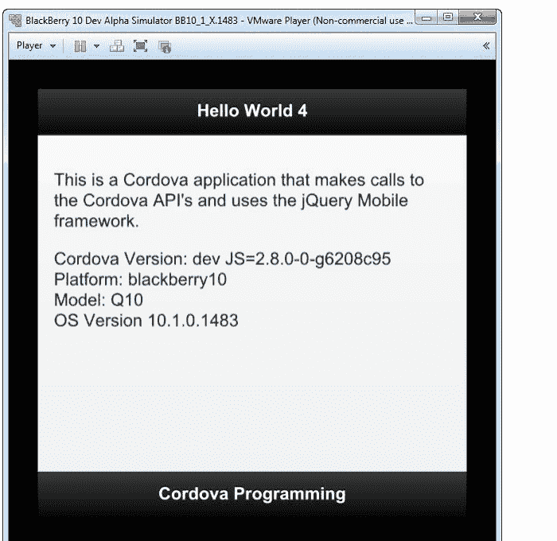

**图 5.6** 在 BlackBerry 10 模拟器上运行的 HelloWorld4 应用程序

请注意，该应用程序在不同平台上的外观相似。在更复杂的应用程序中，随着您在应用程序中导航得越来越深，jQM 框架会自动向应用程序添加移动设备平台特性，例如 iOS 上的返回按钮，以及对 Android 和 BlackBerry 应用程序的退出键和菜单的支持。

在此版本的应用程序中，页面的头部添加了一些额外的资源：

```
<link rel="stylesheet" href="css/jquery.mobile-1.3.1.css" />
<script type="text/javascript" charset="utf-8"
    src="js/jquery-2.0.2.js"></script>
<script type="text/javascript" charset="utf-8"
    src="js/jquery.mobile-1.3.1.js"></script>
```

第一行指向 jQM 框架提供的一个 CSS 文件。它包含用于渲染如图 5.6 所示的类 iPhone UI 的样式信息。接下来是对 jQuery 和 jQuery Mobile JavaScript 库的引用，这些库用于提供自定义 UI 以及额外的应用程序功能。示例应用程序中引用的文件是 CSS 和 JavaScript 文件的完整版本。这些文件在应用程序测试期间使用，在将应用程序投入生产之前，应替换为文件的 min 版本，如下代码片段所示。

```
<link rel="stylesheet" href="css/jquery.mobile-1.3.1.min.css" />
<script type="text/javascript" charset="utf-8"
    src="js/jquery-2.0.2.min.js"></script>
<script type="text/javascript" charset="utf-8"
    src="js/jquery.mobile-1.3.1.min.js"></script>
```

min 版本是压缩过的，因此文件中的注释、空白、换行符等都被移除了。压缩使文件在打包的应用程序中占用更少的空间，有助于减小应用程序的总体文件大小，并能让这些资源在用户启动应用程序时更快地加载。

HTML 页面的正文已更新，包含包裹应用程序内容的若干 HTML `div` 标签。这些 div 包含一个 `data-role` 属性，jQM 用它来为内容页面定义特定的区域，然后根据分配的角色进行适当的样式设置。

在清单 5.4 中，页面上给定 `header` `data-role` 的部分内容通过 `data-position="fixed"` 属性以渐变背景样式化并固定在页面顶部。类似地，页面上给定 `footer` `data-role` 的部分内容通过 `data-position="fixed"` 属性以渐变背景样式化并固定在页面底部。在 `data-role="content"` div 中定义的页面内容将渲染在页眉和页脚之间，中间部分根据需要可滚动以显示该部分内容。所有这些在图 5.4、5.5 和 5.6 中都有说明。

这些示例仅简要介绍了 jQM 的功能；使用这个框架，您还可以在 Cordova 应用程序中做更多的事情来增强用户体验。有关该框架提供的功能的更多信息，请参阅 jQM 在线文档或几本关于 jQM 的新书，例如*《24 小时学会 jQuery Mobile》*（ISBN: 0672335948）。

### 生成的 Web 应用程序文件

现在我已经向您展示了如何构建 Cordova 应用程序，让我们来看看由 Cordova CLI 生成的 Cordova 应用程序。如第 3 章"安装 Cordova 命令行界面"所示，当 CLI 生成新的 Cordova 应用程序项目时，它会创建一个简单的 HelloCordova Web 应用程序，并将其放置在项目的 www 文件夹中。您可以在图 5.7 中查看生成的应用程序文件示例。

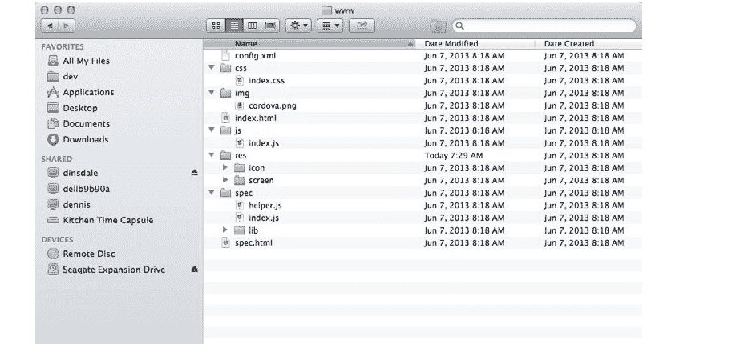

#### 图 5.7 CLI 生成的 Web 应用程序文件

项目文件夹包含一种 Web 应用程序文件夹结构，旨在将不同类型的文件分离到不同的文件夹中。例如，Web 应用程序的 CSS 文件应放在 css 文件夹中，JavaScript 文件放在 js 文件夹中，依此类推。

应用程序的 index.html 文件如清单 5.5 所示；它包含许多与本章中展示的其他示例相同的 HTML 元素和属性。一个区别是该应用程序在文件末尾而不是开头加载 cordova.js 和其他资源，正如我之前展示的那样。这种方法的作用是允许应用程序完成其 HTML 内容的加载，并在加载 JavaScript 文件之前将内容显示在屏幕上。如果您的应用程序中加载了大量 JavaScript，可能需要一些时间，因此这种方法至少可以在应用程序的支持性 JavaScript 代码加载时在屏幕上显示一些内容。

#### 清单 5.5 HelloCordova index.html 文件的内容

```
<!DOCTYPE html>
<html>
  <head>
    <meta http-equiv="Content-Type" content="text/html; charset=UTF-8" />
    <meta name="format-detection" content="telephone=no"/>
    <meta name="viewport" content="user-scalable=no, initial-scale=1, maximum-scale=1, minimum-scale=1, width=device-width;" />
    <link rel="stylesheet" type="text/css" href="css/index.css" />
    <title>Hello Cordova</title>
  </head>
  <body>
    <div class="app">
      <h1>Apache Cordova</h1>
      <div id="deviceready">
        <p class="status pending blink">Connecting to Device</p>
        <p class="status complete blink hide">Device is Ready
        </p>
      </div>
      <script type="text/javascript" src="cordova.js"></script>
      <script type="text/javascript" src="js/index.js"></script>
      <script type="text/javascript">
        app.initialize();
      </script>
    </div>
  </body>
</html>
```

该应用程序显示一个简单的页面，页面中央是 Cordova 标志和一些闪烁的文字"Connecting to Device"。JavaScript 代码（如清单 5.6 所示的 index.js 文件中）通过 index.html 末尾的 `app.initialize()` 调用被应用程序调用。

#### 清单 5.6 index.js 文件的内容

```
var app = {
    initialize: function() {
        this.bind();
    },
    bind: function() {
        document.addEventListener('deviceready',
            this.deviceready, false);
    },
    deviceready: function() {
        //Note that this is an event handler so the scope is
        //that of the event so we need to call app.report(),
        //and not this.report()
        app.report('deviceready');
    },
    report: function(id) {
        console.log("report:" + id);
        //Hide the .pending <p> and show the .complete <p>
        document.querySelector('#' + id + ' .pending').className
            += ' hide';
        var completeElem =
            document.querySelector('#' + id + ' .complete');
        completeElem.className =
            completeElem.className.split('hide').join('');
    }
};
```


JavaScript 代码注册了你在本节前面的 HelloWorld3 和 HelloWorld4 应用程序中看到的 `deviceready` 监听器。当 `deviceReady` 函数执行时，它向控制台写入一些信息（这在第 6 章"Cordova 开发机制”中描述），然后更新页面内容以指示 Cordova 容器已就绪。

这个应用程序比实际需要要复杂得多；如我之前示例所示，你可以用少得多的代码轻松完成此操作。然而，这显然是 Cordova 团队希望突出如何构建 Cordova 应用程序的方式。

> **注意**

在我的章节中提供的示例里，我故意简化了应用程序代码以便更好地向你展示 Cordova 应用程序的样子。CLI 生成的样本应用程序结构更像现代 HTML5 应用程序。

你构建 Web 应用程序的方法由你决定：没有正确或错误的方法。我认为 CLI 生成的应用程序比实际需要要复杂，但随着应用程序添加功能，使用本节强调的方法可能更易于使用。

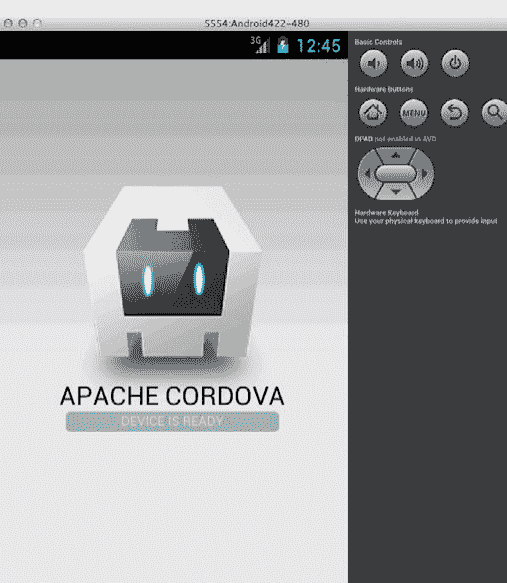

**图 5.8** HelloCordova Application Running on an Android Emulator

**第 5 章：Cordova 应用程序结构**
(74 Chapter 5: Anatomy of a Cordova Application - Translating the content within the line structure) -> Wait, "74" is likely page number. Usually keep numbers if they are part of layout. I'll translate the title part. "74" stays.

### 总结

在本章中，我展示了使应用程序成为 Cordova 应用程序的因素，并为你展示了 Cordova CLI 生成的样本应用程序。你现在拥有了构建自己的 Cordova 应用程序所需的基本模块。

在下一章中，我向你展示如何开发、测试和调试你的 Cordova 应用程序。第 6 章提供了有关如何处理 Cordova 应用程序的一般指南，随后几章针对更流行的智能手机平台提供具体指南。

# Cordova 开发机制

Cordova 支持的每个移动平台都有一套过程和工具，可用于测试并在极罕见情况下你的代码存在 bug 时调试 Cordova 应用程序。通常，你可以将 Cordova 应用程序加载到移动平台 SDK 提供的设备模拟器或仿真器中，或者将应用程序加载到物理设备上。你还可以使用第三方解决方案在桌面浏览器界面中测试你的 Cordova 应用程序。

某些过程和能力适用于所有支持的移动设备平台。在本章中，我解决 Apache Cordova 开发的机制问题。本章开头我将解决 Cordova 开发人员必须处理的一些问题，然后涵盖开发过程以及一些可用于测试和调试你的 Cordova 应用程序的工具。

## Cordova 开发问题

在我们开始讨论如何开发 Cordova 应用程序之前，让我们解决你在与框架合作时面临的一些问题。Cordova 项目由来自世界各地的大力支持开发者支持，他们可能只有一两个移动平台的经验，或对某些事情应如何处理有强烈观点的人。问题是，当你收集由不同人编写的项目试图收集到一个单一框架中时，你可能会遇到一些不一致的地方。加上 Cordova 支持的每个移动平台都是不同的，并且有不同的做事方式，你很难让所有工作都干净且无缝地运行。

在本书的续作中（或者是指前版），我利用本章的这一部分突出我在当时学习 PhoneGap 以及后来撰写书籍时遇到的所有问题。那时候，有一堆问题，它们为开发人员造成了一些有趣的问题。好消息是随着时间的推移，Cordova 开发团队在消除大多数问题上做得非常出色。剩下的只有两个，而且它们并不那么复杂。

## 应对 API 不一致性

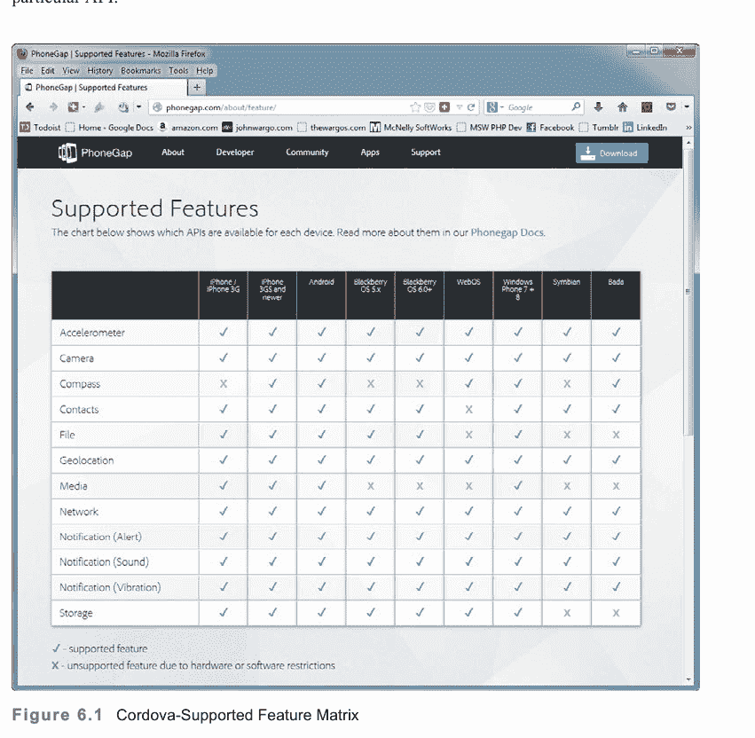

> **注意**
请记住，表格并非像 API 那样频繁更新，所以你可能需要通过 API 文档或实际测试该 API 来验证它是否在某平台工作，尽管在图 6.1 中存在一个 X。

如果你的应用程序使用的应用程序的目标移动设备上不支持的 API，则你的应用程序的代码可以使用第 5 章讨论的 Device API。你应该使用 `device.platform`以及必要的`device.version`来确定应用程序运行在哪个平台和 OS 上，如果应用程序运行在不支持该 API 的设备上，则禁用任何不支持的功能。另一种选择是简单地将调用特定 API 的操作用 JavaScript try/catch 块包装起来，并直接处理出现的任何失败。

## 应用图形

每个移动平台以及，通常，特定设备 OS 的不同版本都有不同的应用程序图标和启动页要求。构建用于多个设备平台的 Cordova 应用程序的开发者必须准备好为他们的应用程序创建一系列图形，以解决每个目标设备平台和/或设备 OS 的具体要求。对于应用程序图标，PhoneGap 项目维护着一个 Wiki 页面，列出了不同支持操作系统的图标要求，在这里：https://github.com/phonegap/phonegap/wiki/App-Icon-Sizes。

此外，在某些运营商的某些设备上（例如旧黑莓设备），移动运营商会对 OS 应用特定主题，以帮助区分自己。为这些设备中的任何一个设计的任何应用程序图标都需要尽可能适应不同主题内的愉快渲染。幸运的是，如本章后面描述的合并能力，你能够将适当的图形文件（以及其他所需的内容）轻松合并到你的项目中，取决于你在构建哪个移动平台。

## 开发 Cordova 应用程序

现在是时候开始逐步了解创建 Cordova 应用程序的过程。在本节中，我描述了编码 Cordova 应用程序的过程。在后面的部分中，我展示如何测试和调试应用程序。

## 与单个移动设备平台一起工作

有些开发人员可能只与单个移动平台一起工作。如果你是此类开发人员，你只需要打开一个终端窗口并执行以下命令（这些命令在第 4 章“使用 Cordova 命令行界面”中描述）：

```
cordova create app_name
cd app_name
cordova platform add platform_name
cordova prepare platform_name
```

> **警告**
这不一定是进行单平台开发的正确方式，我稍后将描述——我只是试图在此描述潜在过程。

在此示例中，`app_name` 指你正在创建的应用程序的名称，`platform_name` 指的是你将与之工作的移动设备平台。所以，如果你正在创建名为 `lunch_menu` 的黑莓应用程序，你将执行以下命令：

```
cordova create lunch_menu
cd lunch_menu
cordova platform add blackberry
cordova prepare blackberry
```

你还可以使用以下命令指定有关你的应用程序的更多信息：

```
cordova create lunch_menu com.cordovaprogramming.lunchmenu "Lunch Menu"
cd lunch_menu
```


```markdown
cordova platform add blackberry

cordova prepare blackberry

此时，命令行界面（CLI）将创建图 6.2 所示的 Cordova 项目文件夹，你现在需要做的就是打开你选择的代码编辑器，开始编码和测试你的新 Cordova 应用程序。

![img/e94ccbeb76e45611fea0bac7c8d27418_93_0.png]

**图 6.2** Cordova 应用程序项目文件夹结构：BlackBerry 应用程序

BlackBerry 平台项目文件夹包含你需要使用的 Web 应用程序文件副本。

> **注意**
> 如果你后来决定为项目添加其他移动设备平台，你需要手动将 BlackBerry 项目的 www 文件夹（在图 6.2 中突出显示）中的应用程序 Web 内容文件复制到整个 Cordova（非 BlackBerry）项目（如图所示）的 www 文件夹中。下文描述了多平台 Cordova 项目有何不同以及为什么这很重要。

## 使用多个移动设备平台

因为 Cordova 完全是关于跨平台移动开发的，你可能希望针对多个移动设备平台。在这种情况下，例如，如果你要为 Android 和 iOS 构建应用程序，你可以打开一个终端窗口并执行类似以下的操作：

```
cordova create lunch_menu
cd lunch_menu
cordova platform add android ios
```

此时，你将拥有一个新的 Cordova 项目结构，其中包含用于 Android 和 iOS 的项目，如图 6.3 所示。正如第 4 章所讨论的，有一个单独的名为 www 的文件夹，其中包含应用程序的核心 Web 内容文件，即在 Android 和 iOS 项目之间共享的内容文件。

![img/e94ccbeb76e45611fea0bac7c8d27418_94_0.png]

在这种情况下，你将处理存储在 www 文件夹中的 Web 内容，该文件夹在图 6.3 文件夹结构的底部显示。当你准备好该文件夹中的 Web 应用程序内容进行测试时，你使用 CLI 将代码复制到平台子文件夹（android 和 ios）中，如图所示。

我在开发 Cordova 项目时所做的，是将我的 Web 内容文件在 HTML 编辑器（如 Adobe Brackets (www.brackets.io) 或 Aptana Studio (www.aptana.com)）中打开，然后使用 CLI 来管理我的移动设备平台项目。当我编辑文件时，我将 Web 内容添加到 .html 文件，将我的应用程序代码添加到应用程序的 .js 文件中。当我准备好测试（和调试）应用程序时，我切换到一个保持打开并指向 Cordova 项目根文件夹（我之前创建的 lunch_menu 文件夹）的终端窗口，并发出一些命令。如果我想切换到 Android IDE 并测试 Android 应用程序，我会发出以下命令：

```
cordova prepare android
```

或者，如果我将测试和调试应用程序的 Android 和 iOS 版本，我会发出以下命令：

```
cordova prepare android ios
```

此命令的作用是将 www 文件夹中的所有项目文件复制到每个指定的移动平台项目的相应文件夹中，如图 6.4 所示。在此示例中，它将内容文件复制到 Android 项目的 assets/www 文件夹和 iOS 项目的 www 文件夹。config.xml 文件的内容应应用于位于目标目录中的平台特定的 config.xml 文件。

![img/e94ccbeb76e45611fea0bac7c8d27418_95_0.png]

现在，任何值得尊重的移动 Web 项目都可能拥有一些图标、屏幕图形、CSS 和/或针对每个目标平台的独特 JavaScript 文件。由于每个移动设备都有自己的主题和图标要求，很可能至少需要这些。在旧版本的 Cordova 中，你必须手动管理所有这些；有了 CLI，这一切都为你处理好了。

注意图 6.3 中显示的 merges 文件夹；Cordova 使用该文件夹结构为你提供一个存储每个目标平台独有的 Web 应用程序资源的地方。当你发出前面显示的 Cordova prepare 命令时，CLI 将每个平台的自定义内容复制到每个平台项目文件夹的相应 Web 内容文件夹中，如图 6.5 所示。

![img/e94ccbeb76e45611fea0bac7c8d27418_96_0.png]

**图 6.5** 将 Web 内容和平台特定内容复制到平台项目文件夹

如图所示，存储在 merges\android 文件夹中的 Android 平台自定义内容被复制到 Android 平台项目的 assets\www 文件夹。iOS 应用程序的自定义内容从 merges\ios 复制到 iOS 项目的 www 文件夹。

将所有应用程序内容复制到相应的项目文件夹后，你打开相应的 IDE（用于 Android 的 Eclipse 和用于 iOS 的 Xcode）并开始测试过程。有关如何将 Cordova 项目导入每个 IDE 并使用平台调试工具的信息，请参阅第 7 章至第 10 章。

## 测试 Cordova 应用程序

你也可以完全跳过 IDE，直接从命令行测试应用程序；我在以下部分向你展示如何操作。

### 在设备模拟器上运行 Cordova 应用程序

大多数移动设备制造商提供模拟或仿真移动设备的软件程序。这使得开发人员在没有物理设备时可以轻松测试其移动应用程序。性能通常不完全相同，但在外观和行为上尽可能接近真实设备。在某些情况下，提供的功能是通用的，只是模拟特定操作系统版本的能力，而对于其他移动平台，它可能模拟特定设备。无论哪种方式，都有一种仅软件的解决方案可供开发人员使用，可以在几乎真实的场景中测试 Cordova 应用程序（我将在下一节解释“几乎真实”）。例如，Google 提供 Android 模拟器，Apple 和 BlackBerry 提供其设备的模拟器。

### 模拟器与仿真器

两者在技术上存在差异，我在此不深入探讨。为了让我（和你）的事情变得更简单，在本书的剩余部分，我将省略指出我指的是仿真器还是模拟器，而是将两者统称为模拟器。如果你在接下来的内容中看到这个词，要知道我指的是*仿真器*或*模拟器*。

要使用设备模拟器运行 Cordova 应用程序，你需要使用以下命令：

```
cordova emulate device_platform
```

将 `device_platform` 的值替换为你希望仿真的移动设备平台的名称（android、blackberry10、ios、wp8 等）。例如，要在 BlackBerry 10 模拟器上运行应用程序，你需要发出以下命令：

```
cordova emulate blackberry10
```

在此示例中，CLI 将准备文件，使用平台的命令行工具构建应用程序，然后启动相应的模拟器并运行应用程序。你在第 5 章“Cordova 应用程序剖析”中的截图中看到了设备模拟器和仿真器的示例。

### 在物理设备上运行 Cordova 应用程序

在将应用程序部署给移动用户之前，你应该在物理设备上进行最终测试。尽管这些选项很好，但在模拟器上总有一些东西不能完全正常工作。要在物理设备上测试应用程序，请使用 USB 电缆将设备连接到你的开发系统，然后发出以下命令：

```
cordova run device_platform
```

例如，要在 Android 设备上运行应用程序，请发出以下命令：

```
cordova run android
```

在幕后，CLI 将执行前面描述的 `prepare` 命令，然后调用特定平台的命令行工具来打包应用程序并将其部署到连接到系统的设备上。在几秒钟内（或者在某些平台的情况下可能需要几分钟），应用程序将出现在设备的屏幕上。

### 警告

对于许多移动设备平台，应用程序在物理设备上运行之前，需要先向制造商注册（Windows Phone 8）或由适当的签名机构签名（BlackBerry 10、iOS）。我特意在本章中省略了此过程的详细信息，因为它在不同的支持的移动设备平台之间有所不同，并且会增加本手稿的篇幅。我在处理每个单独移动设备平台的章节（第 7 章至第 10 章）中稍微涉及了这个主题。

在物理设备上测试 Cordova 应用程序之前，请确保你已按照制造商的说明配置了相应的环境。
```


## 充分利用 Cordova 的调试功能

在测试 Cordova 应用时，你很可能会遇到需要解决的问题。本节旨在突出介绍一些在 IDE 之外可用的调试功能。

### 使用 Alert()

调试 Cordova 应用最简单，也最烦人的方法之一，是使用 JavaScript 的 `alert()` 函数来告诉你当前运行到代码的哪个部分，或者快速显示一个变量的内容。我一直称这种方法为“穷人调试器”，但对于某些类型的应用调试任务，它相当有效。如果你发现某个事件没有在应用中触发，或者某个变量没有被正确设置或读取，你只需插入一个显示相关消息的 `alert()`，然后用它来查看发生了什么。

当我开始使用 PhoneGap 和 PhoneGap Build 时，我注意到很多时候 `deviceready` 事件在我的应用中没有触发。我编写好应用并开始测试，却发现所有的 PhoneGap API 都无法工作。在某些情况下，这是因为 PhoneGap Build 服务没有将 phonegap.js 文件打包到应用中（使用测试版产品时就会这样）。在其他情况下，仅仅是因为我在应用中有一些愚蠢的拼写错误，而我没有看出来。

> **警告**
> Cordova 在遇到 JavaScript 错误时会静默失败，所以如果你的代码中有拼写错误，代码将根本不会运行。

我开始在我的 PhoneGap（现在是 Cordova）应用中采取的做法是，在开发期间，在所有应用的 `onBodyLoad` 和 `onDeviceReady` 函数中添加对 `alert()` 的调用。在第 5 章中，我提供了 HelloWorld3 应用的代码清单，但真正的 HelloWorld3 应用代码如清单 6.1 所示。在这个版本的应用中，你可以看到在 `onBodyLoad` 和 `onDeviceReady` 中对 alert 的调用。一旦我确定应用能正确运行，我就会移除这些 alert。

#### 清单 6.1 “真正”的 HelloWorld3 应用

```html
<!DOCTYPE html>
<html>
  <head>
    <meta http-equiv="Content-type" content="text/html; charset=utf-8">
    <meta name="viewport" content="user-scalable=no, initial-scale=1, maximum-scale=1, minimum-scale=1, width=device-width;" />
    <script type="text/javascript" charset="utf-8" src="Cordova.js"></script>
    <script type="text/javascript" charset="utf-8">
      function onBodyLoad() {
        alert("onBodyLoad!");
        document.addEventListener("deviceready", onDeviceReady,
          false);
      }
      function onDeviceReady() {
        alert("onDeviceReady!");
        br = "<br />";
        //Get the appInfo DOM element
        var element = document.getElementById("appInfo");
        //Replace it with specific information about the device
        //running the application
        element.innerHTML = 'Cordova Version: ' +
          device.cordova + br +
          'Platform: ' + device.platform + br +
          'Model: ' + device.model + br +
          'OS Version: ' + device.version;
      }
    </script>
  </head>
  <body onload="onBodyLoad()">
    <h1>HelloWorld3</h1>
    <p>This is a Cordova application that makes calls to the
      Cordova APIs.</p>
    <p id="appInfo">Waiting for Cordova Initialization to
      complete</p>
  </body>
</html>
```

当我为 *PhoneGap Essentials* 编写所有示例应用时，我甚至会在应用中每个函数的开头都放一个 alert。当我逐渐了解每个事件如何以及何时触发时，我使用这些 alert 来帮助我判断发生了什么。现在，有更简单的方法可以做到这一点，我将在下一节中展示，但在我刚开始学习每个 API 时，这是一个简单的辅助方法。

> **警告**
> 你们中那些对 Cordova API 略知一二的人可能会问，为什么他使用 alert() 而不是 Cordova 的 navigator.notification.alert() 函数？
> 嗯，在 `onBodyLoad()` 函数中，cordova.js 很可能尚未加载，所以我无法确定 Cordova 的 navigator.notification.alert() 是否可用。我本可以在 `onDeviceReady()` 函数中使用 navigator.notification.alert()，因为该函数只有在 Cordova 的 deviceready 事件触发后才会运行，但出于某种原因，我只是保持了两个 alert 的一致性。

### 写入控制台

使用上一节描述的方法的问题在于，当你在充满 bug 的代码中加入大量 alert 时，你不断地中断应用流程来关闭弹出的 alert。对于简单的问题，这种方法效果不错，但当调试更棘手的错误时，你需要一种方法，允许应用运行，然后在实时分析或在应用或应用内的某个进程完成后分析发生了什么，而不中断应用。Cordova 应用可以通过 WebKit 浏览器渲染引擎实现的 JavaScript `console` 对象来做到这一点。

使用 console 对象，开发者可以将消息写入浏览器的控制台，这些消息可以通过原生 SDK 或设备模拟器提供的功能在运行程序外部查看。`console` 对象的作用域在 window 级别，因此它本质上是一个全局对象，可由应用内的任何 JavaScript 代码访问。WebKit 支持多个选项；最常用的列在这里：

- `console.log("message");`
- `console.warn("message");`
- `console.error("message");`

从 Cordova 3.0 开始，控制台已从核心 Cordova API 中移除，转而作为插件提供。要将控制台功能添加到你的 Cordova 项目，你必须打开一个终端窗口，导航到项目文件夹，并执行以下命令：

```
cordova plugin add https://git-wip-us.apache.org/repos/asf/cordova-plugin-console.git
```

现在，让我们看一个说明此功能使用的示例应用，如清单 6.2 所示

#### 清单 6.2 写入控制台的示例应用

```html
<!DOCTYPE html>
<html>
  <head>
    <meta name="viewport" content="width=device-width,
      height=device-height, initial-scale=1.0,
      maximum-scale=1.0, user-scalable=no;" />
    <meta http-equiv="Content-type" content="text/html;
      charset=utf-8">
    <script type="text/javascript" charset="utf-8"
      src="cordova.js"></script>

    <script type="text/javascript" charset="utf-8">

      function onBodyLoad() {
        document.addEventListener("deviceready", onDeviceReady,
          false);
      }
      function onDeviceReady() {
        //Just writing some console messages
        console.warn("This is a warning message!");
        console.log("This is a log message!");
        console.error("And this is an error message!");
      }

    </script>
  </head>
  <body onload="onBodyLoad()">
    <h1>Debug Example</h1>
    <p>Look at the console to see the messages the application
      has outputted</p>
  </body>
</html>
```

从代码中可以看出，应用只需调用相应的方法并传入要写入控制台的消息文本即可。

图 6.6 显示了在 Xcode 控制台窗口中高亮显示的消息。当程序在 iOS 模拟器上运行时，可以访问此窗口，因此你可以实时调试应用。

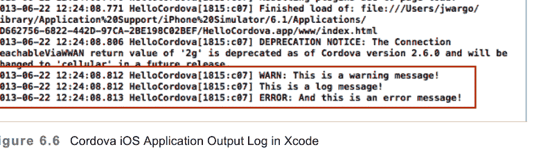

**图 6.6** Xcode 中的 Cordova iOS 应用输出日志

在某些平台上，控制台将以不同方式显示日志、警告或错误消息，使开发者更容易区分警告和错误消息。为了说明这一点，图 6.7 显示了 Android LogCat 的内容（在第 7 章“使用 Cordova 进行 Android 开发”中有描述）。请注意，不同的控制台消息类型有颜色编码，使你更容易发现特定类型的消息。

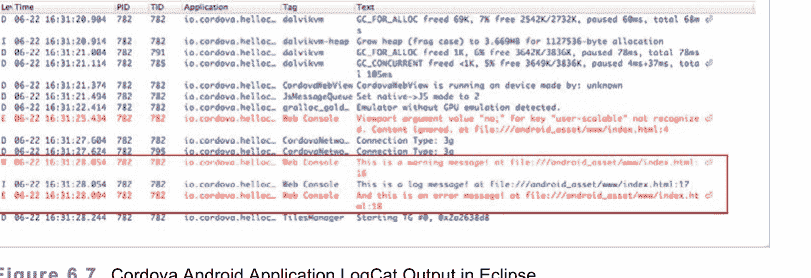

**图 6.7** Eclipse 中的 Cordova Android 应用 LogCat 输出


请记住我在上一节中提到，Cordova应用程序中的JavaScript代码会静默失败吗？那么，你也可以将代码包裹在try/catch块中，这样你的应用程序至少有机会将其错误写入控制台，如下示例所示：

```
try {
  console.log("Validating the meaning of life");
  someBogusFunction("42");
} catch (e) {
  console.error("Hmmm, not sure why this happened here: " +
    e.message);
}
```

注意在图6.7中，Android LogCat显示了生成控制台消息的行号。这有助于你识别应用程序在何处失败的信息。你也可以在这里使用alert，但那略微不那么优雅。

### 使用外部工具进行调试和测试

有一个非常活跃的合作伙伴社区，通过为Cordova开发者提供额外工具来支持Cordova。在本节中，我将介绍一些更受欢迎的工具，这些工具有助于开发者测试和调试Cordova应用程序。这绝非完整的选项列表；请参考PhoneGap工具页面（http://phonegap.com/tool）获取可能可用的其他工具信息。一些内置的调试工具也可在多个移动SDK中使用。这些工具在各个移动操作系统（第7至10章）的章节中都有介绍。

### 使用Weinre调试应用程序

Web Inspector Remote（weinre）是一个由社区构建的远程网页调试器。它被捐赠给了PhoneGap项目，目前作为PhoneGap Build服务的一部分实现。你可以在http://people.apache.org/~pmuellr/weinre/docs/latest找到下载文件和说明。

对于Cordova开发，它允许你远程调试在物理设备或设备模拟器上的Cordova容器中运行的Web应用程序。Weinre由一个调试服务器、调试客户端和调试目标组成。调试服务器运行在Macintosh或Windows上，调试客户端在任何兼容的桌面浏览器中运行。

要配置weinre，你需要执行一系列步骤。过程始于服务器安装。Weinre基于Node.js，既然我们已经为Cordova CLI安装了Node，你可以使用以下命令安装服务器：

```
npm install -g weinre
```

不幸的是，在Macintosh上weinre可能不喜欢你的安全配置，因此尽管不推荐，你可能必须使用`sudo`安装weinre，使用以下命令：

```
sudo npm install -g weinre
```

安装完成后，你应该看到类似以下的信息：

```
weinre@2.0.0-pre-H0SN197 /usr/local/lib/node_modules/weinre
├── underscore@1.3.3
├── coffee-script@1.3.3
├── nopt@1.0.10 (abbrev@1.0.4)
└── express@2.5.11 (qs@0.4.2, mime@1.2.4, mkdirp@0.3.0, connect@1.9.2)
```

安装完成后，你可以在终端窗口中发出以下命令来启动weinre：

```
weinre
```

当服务器启动时，它会在终端窗口中显示一条类似以下的消息来指示其正在运行：

`2013-06-22T17:00:50.564Z weinre: starting server at http://localhost:8080`

> **注意**
> 你可以在启动时向weinre服务器传递一些命令行选项。我选择不在这里介绍它们，但你可以在weinre网站http://people.apache.org/~pmuellr/weinre/docs/latest/Running.html上找到详细信息。

weinre服务器启动后，你使用基于浏览器的客户端应用程序与服务器和Cova客户端应用程序交互。打开你选择的浏览器（我推荐使用Safari或Chrome），并将其指向weinre服务器启动时在服务器控制台上显示的URL。在我的开发环境中，我简单地使用：

`http://localhost:8080`

浏览器将连接到weinre服务器并打开weinre调试客户端，该客户端将显示一个类似于图6.8所示的页面。

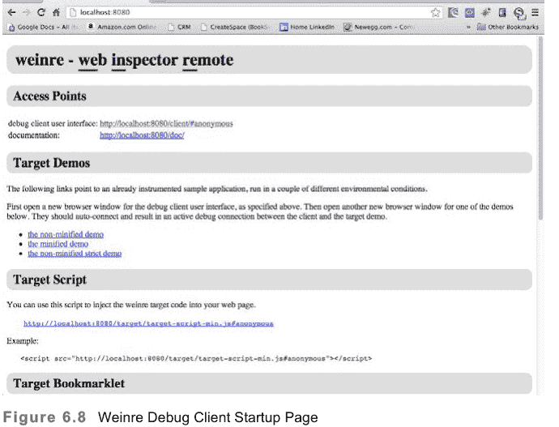

**图6.8** Weinre调试客户端启动页面

服务器和客户端运行后，你现在可以通过将以下脚本标签添加到Cordova应用程序的index.html文件的`body`部分，将应用程序连接到调试服务器：

`<script src="http://debug_server:8080/target/target-script-min.js"></script>`

你需要将URL中的`debug_server`部分替换为调试服务器（运行weinre服务器的系统）的正确主机名或IP地址。这使得应用程序成为weinre调试目标，并为Cordova应用程序提供在应用程序运行时将信息上传到weinre服务器所需的代码。

当将weinre与设备模拟器一起使用时，你通常可以将Cordova应用程序指向本地的weinre服务器实例，使用

```
<script src="http://localhost:8080/target/target-script-min.js"></script>
```

然而，Android模拟器没有使用localhost连接到主机端资源的能力，因此对于Android模拟器，你必须使用主机地址http://10.0.2.2，如下例所示：

```
<script src="http://10.0.2.2:8080/target/target-script-min.js"></script>
```

当使用weinre调试在物理设备上运行的Cordova应用程序时，设备必须能够连接到你的调试服务器。这意味着设备必须能够在本地网络（很可能是通过Wi-Fi连接）上“看到”服务器，或者运行weinre服务器的系统必须有一个公网IP地址。在物理设备上使用服务器主机名localhost将不起作用；你必须使用设备可见的实际主机名或IP地址。

> **警告**
> 在将Cordova应用程序发布到生产环境之前，请务必从应用程序中删除weinre脚本标签。如果应用程序试图连接到不可用的调试服务器，很可能会挂起。

在将脚本标签添加到Cordova应用程序的index.html文件后，在模拟器或设备上运行应用程序。设备屏幕上不会出现任何特殊内容——你看不出weinre调试客户端正在运行。但是，如果你切换到运行weinre调试客户端的浏览器并点击图6.8中显示的第一个链接（标记为“debug client user interface”的链接），你最初会看到一个类似于图6.9所示的页面。

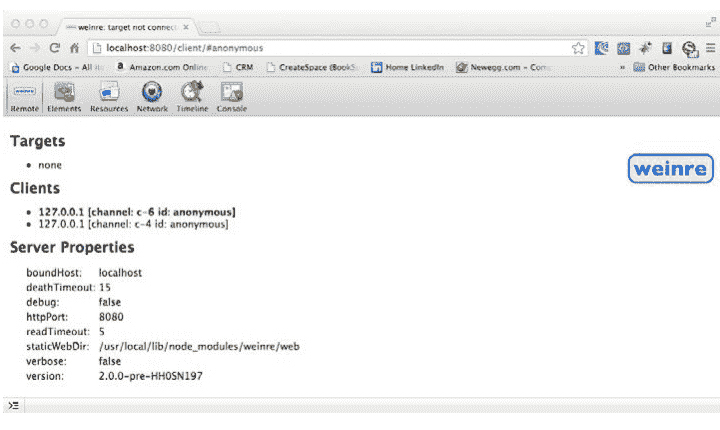

#### 图6.9 Weinre调试客户端

在此示例中，该图表明尚未连接任何目标，但一旦我启动Cordova应用程序，只要它能够连接到weinre服务器，调试客户端页面就会更新并显示图6.10所示的内容。

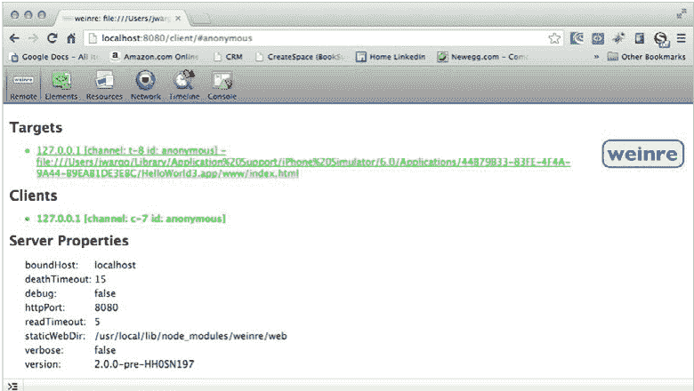

#### 图6.10 已连接应用程序的Weinre调试客户端

调试客户端提供了查看并可选操作应用程序Web内容的许多页面元素和其他方面的方式。

此时，调试客户端顶部的不同按钮可用于为你提供有关调试目标的信息。例如，在图6.11中，你看到的是Elements页面的内容；它显示了在调试目标中运行的当前HTML5内容。

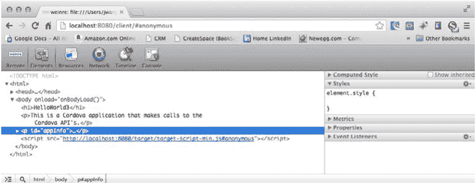

#### 图6.11 Weinre调试客户端资源区域

Weinre的一个很酷的功能是，当你在图6.11中突出显示不同的代码部分时，Weinre会突出显示Web应用程序中相应的内容。因此，对于图6.11中显示的HelloWorld3应用程序，突出显示段落标签`<p id="appInfo">_</p>`会在调试目标中显示页面的该部分，如图6.12所示。在此示例中，我在调试客户端中保持了段落标签的内容折叠状态。你可以点击`<p>`元素左侧的黑色三角形来查看完整的HTML内容。

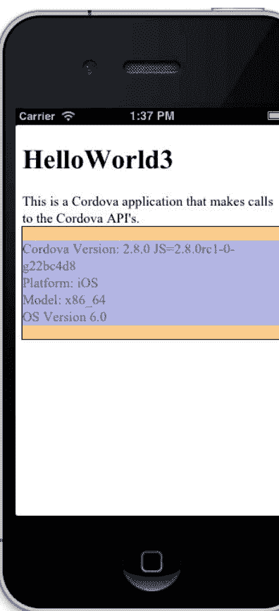

**图6.12** Weinre目标突出显示HTML内容


使用调试客户端，你可以访问以下内容区域：

-   元素：应用程序的HTML、CSS和JavaScript代码
-   资源：应用程序使用的本地资源，例如数据库、本地存储和会话存储
-   网络：使用XMLHttpRequests (XHR)发出的请求信息
-   时间线：目标应用程序中发生的事件
-   控制台：使用本章前面描述的`console`对象写入控制台的信息

Weinre的可用文档非常有限，但由于该项目的功能基于Google Chrome开发者工具，你可以在Google Code网站上找到更多信息：http://code.google.com/chrome/devtools/docs/overview.html。

### 使用Ripple模拟器测试应用程序

Ripple模拟器是一个可以帮助你进行Cordova应用程序初步测试的工具。Ripple是一个基于浏览器的模拟器，可用于模拟多种不同的系统。它最初由Tiny Hippos创建，后来被Research In Motion（现称为BlackBerry）收购，现在是Apache的一个孵化项目。Ripple的问题在于它一直处于测试阶段很长时间了（据我估计将近两年），而且其模拟器对Cordova的支持远远落后（仅支持Cordova 2.0，而Cordova 2.8刚刚发布）。由于这些限制，我不会过多详细介绍Ripple的工作原理。

Ripple在浏览器容器内模拟Cordova API的执行。你可以在开发过程中使用Ripple对Cordova应用程序的功能和用户界面进行快速测试，然后切换到打包/构建Cordova应用程序并在实际设备或设备模拟器上进行更彻底的测试。Ripple并非设计用来取代在真实设备或模拟器上的测试。

由于Ripple曾经是一个BlackBerry项目，它包含许多有助于BlackBerry开发者的功能。例如，你可以使用Ripple测试你的BlackBerry WebWorks应用程序，然后直接从浏览器将它们打包成WebWorks应用程序。你可以在https://developer.blackberry.com/html5/documentation/getting_started_with_ripple_1866966_11.html了解更多关于Ripple功能的信息。

该模拟器作为Google Chrome插件安装，因此你需要在开始前从www.google.com/chrome安装Chrome。由于Ripple是一个孵化项目，随时可能成为正式的Apache项目，因此我现在提供的任何URL在你阅读时可能已失效。所以，要安装Ripple，你应该将浏览器指向http://emulate.phonagep.com。按照该页面上的链接下载并在你的Chrome浏览器中安装Ripple。

一旦安装了Ripple，你必须为Ripple启用文件访问权限。在Chrome中，打开设置页面，然后选择扩展程序部分。在出现的插件列表中，启用“允许访问文件网址”选项，如图6.13所示。

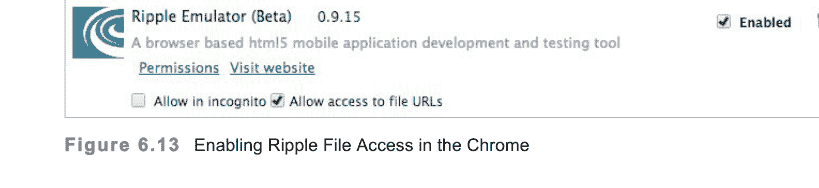

图6.13 在Chrome中启用Ripple文件访问

配置好浏览器后，在浏览器中打开你的应用程序的index.html文件。你可以按Windows上的Ctrl-O或Macintosh上的Command-O打开“打开文件”对话框。页面加载后，你需要为选定的页面启用Ripple。为此，请点击浏览器地址栏右侧的Ripple图标，打开一个窗口，允许你为已加载的页面启用Ripple。你也可以在任何URL末尾附加`?enableripple=true`来为该页面启用Ripple模拟。

启用Ripple后，浏览器将显示一个页面，提示你确定希望启用哪种类型的模拟，如图6.14所示。如图所示，Ripple可以模拟Apache Cordova以及多个其他平台和框架。点击“Cordova 2.0”按钮继续。

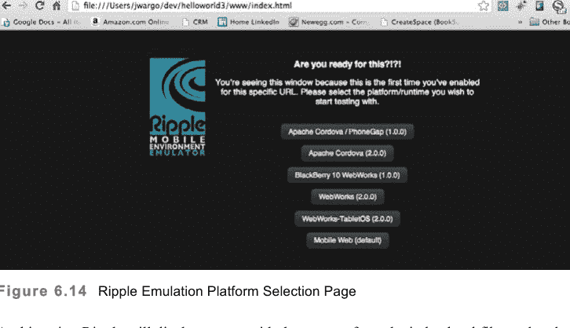

图6.14 Ripple模拟平台选择页面

此时，Ripple将显示一个页面，其中index.html文件的内容渲染在模拟的智能手机屏幕边界内，如图6.15所示。模拟智能手机周围是属性窗格，可用于配置模拟智能手机的选项和状态，例如模拟的设备屏幕分辨率、加速度计、网络、地理位置等。

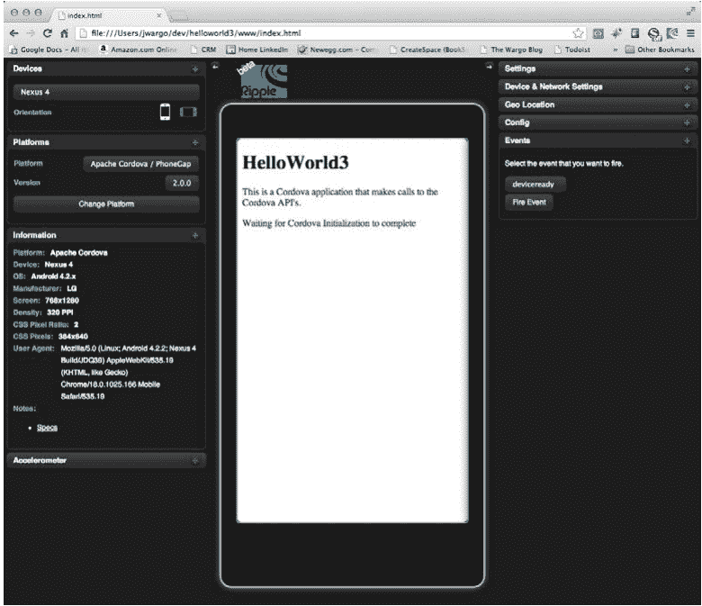

图6.15 运行Cordova应用程序的Ripple模拟器

你可以点击每个选项卡来展开该选项卡的选项，并更改模拟设备的配置。此时，你只需在模拟的智能手机屏幕内点击并与你的应用程序中呈现的选项进行交互。当你发现问题或想要在Cordova应用程序中进行更改时，只需返回你的HTML编辑器，进行必要的更改，将更改写入磁盘，然后在Chrome浏览器中重新加载页面以继续测试。

### 总结

希望到目前为止，你已经对如何构建和调试Cordova应用程序有了初步了解。在接下来的四章中，我将向你展示如何使用平台特定的开发工具和调试功能。

## 使用Cordova进行Android开发

Google为开发者提供了一套强大的工具，可用于为Android平台开发应用程序。尽管Cordova CLI负责创建、管理和测试应用程序的大部分过程，但有时你可能希望对该过程有更多控制。即使CLI可以在Android平台模拟器中启动Cordova应用程序，当你遇到应用程序问题并想了解更多情况时，你需要使用Android开发工具（ADT）附带的开发工具。

使用CLI创建和管理Android项目的说明可以在第4章“使用Cordova命令行界面”中找到。在本章中，我将向你展示如何配置ADT并使用它来帮助你测试和调试Cordova应用程序。

如果你不是为Android开发，或者计划仅使用CLI和/或PhoneGap Build来构建和测试你的应用程序，那么你可能可以跳过本章。但是，ADT中包含一些很酷的工具，因此你在本章学到的内容应该可以简化你的Android应用程序测试和调试工作。

## 使用Android开发工具

在第3章中，我简要展示了如何安装Android开发工具，但我并没有深入探讨该主题，也没有向你展示如何使用它们。默认情况下，ADT附带一个预配置版本的开源Eclipse IDE。你可以使用此IDE来编辑、编译、运行和调试Android Java应用程序；你可以在Android开发者网站http://developer.android.com/sdk/index.html了解更多并下载ADT。

如果你已经在使用Eclipse进行其他开发工作，你可以按照http://developer.android.com/sdk/installing/installing-adt.html上的说明将ADT添加到现有的Eclipse安装中。该过程相当简单，不会花费太多时间。在尝试添加ADT之前，请务必检查系统要求，以确保你使用的Eclipse版本兼容。Google在保持Eclipse更新方面做得非常好，并支持广泛的Eclipse版本。

ADT包含命令行工具，开发者可以使用这些工具与设备或模拟器进行命令行交互。此机制是Cordova CLI用于与Android平台交互的工具之一。不过，我不会在这里花任何时间介绍命令行工具。

## 使用ADT IDE

要启动ADT IDE，请导航到你解压Android SDK的文件夹，然后启动eclipse文件夹中的Eclipse应用程序。该应用程序在Macintosh OS上称为eclipse，在Microsoft Windows上称为Eclipse.exe。首次启动ADT时，你将看到一个类似于图7.1所示的屏幕。

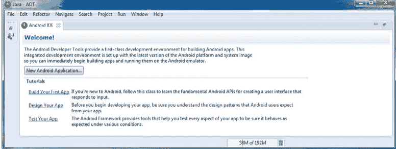

图7.1 Android开发工具（ADT）IDE

## 处理ADT IDE内存问题

当我第一次在Windows笔记本电脑上使用ADT时，遇到了很多问题，IDE在尝试打开Cordova项目文件或向Eclipse添加插件时经常崩溃。经过数小时的故障排除和网上搜索，我终于找到了问题所在。默认情况下，ADT中的Eclipse实例配置为使用有限的系统内存；ADT崩溃仅仅是因为它没有足够的内存来执行它想要做的事情。

有几种方法可以增加Eclipse不同部分消耗的内存量。你可以在启动Eclipse时将内存配置设置作为命令行选项传递，或者你可以对ADT的eclipse.ini文件进行一些简单的更新。我选择了后一种方法。我不确定确切的设置应该是什么；你的结果可能会有所不同，我只是打开了eclipse.ini文件，并提高了清单7.1中粗体突出显示的内存设置。如果你在ADT中遇到随机崩溃的问题，增加这些内存设置，看看问题是否消失。

**清单7.1** Android开发工具eclipse.ini文件的内容

```
-startup
plugins/org.eclipse.equinox.launcher_1.3.0.v20120522-1813.jar
--launcher.library
plugins/org.eclipse.equinox.launcher.win32.win32.x86_64_1.1.200.v20120913-144807
-product
com.android.ide.eclipse.adt.package.product
--launcher.XXMaxPermSize
512M
-showsplash
com.android.ide.eclipse.adt.package.product
```


```
--launcher.XXMaxPermSize
512m
--launcher.defaultAction
openFile
-vmargs
-XX:MaxPermSize=512m
-Dosgi.requiredJavaVersion=1.6
-Xms512m
-Xmx1024m
-Declipse.buildId=v22.0.1-685705
```

## 编辑 Cordova 应用程序内容文件

Android 应用程序使用 Java 构建，但开发者也可以使用 C 或 C++ 编写部分应用代码。由于 Android 仅支持这些有限的应用开发选项，因此 ADT 不包含专门设计用于帮助调试 Web 应用程序（如在 Cordova 容器内运行的那些）的工具。因此，你将无法在 ADT IDE 中单步调试应用程序的 JavaScript 代码、设置断点、配置监视表达式等。要调试 Android 应用程序，你需要使用第 6 章“Cordova 开发机制”中强调的调试方法。然而，这些调试方法可以使用本章稍后描述的一些工具进行增强。

> **注意**
>
> 在本书的技术审查过程中，Damien 指出 Google 提供了一个 Chrome 插件，可以实现对 Android Cordova 应用程序的远程调试。遗憾的是，没有时间在手稿中添加有关此功能的内容，因此我将研读此功能，并在 www.johnwargo.com（我的个人博客）和 www.cordovaprogramming.com（本书网站）上发布更新内容。

尽管 CLI 针对编辑 Cordova 应用程序在 www 文件夹中的 Web 应用程序源代码进行了优化，而不是在 Cordova 项目的一个平台文件夹内，但你可能仍会使用外部 Web 内容编辑器，例如 Adobe Dreamweaver、Adobe Brackets 或其他工具。由于 ADT 配置用于编辑 Java 和 C 应用程序，因此它不包含帮助编辑你的 Cordova 应用程序将使用的 HTML、CSS 和 JavaScript 文件的编辑器。由于此限制，如果你想使用 Eclipse 编辑你的 Cordova 应用程序内容，你需要将 Web 内容编辑功能安装到 ADT 中。Eclipse 中默认的 Web 内容编辑工具来自 Eclipse Web Developer Tools 项目，你可以在几分钟内将它们安装到 ADT 中。

在 ADT 中，打开“帮助”菜单，然后选择“安装新软件”。ADT 将显示安装向导，如图 7.2 所示。在图中所示的“Work With”下拉字段中，选择“Juno”选项。Juno 是 ADT 当前使用的 Eclipse 版本——你可能会发现自己使用的是更新的版本，因此请寻找指向 http://download.eclipse.org/releases/ 而非 http://download.eclipse.org/eclipse/updates/ 的条目。进行选择后，选项列表将填充：向下滚动并选择 Eclipse Web Developer Tools，如图中高亮所示，然后按照向导完成安装。

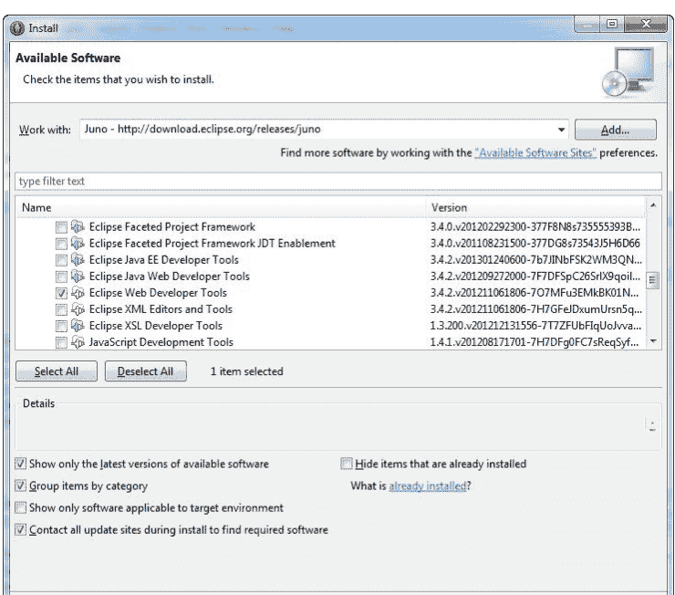

**图 7.2** Eclipse 可用软件向导

## 导入 Cordova 项目

假设你已按照第 4 章的说明创建了 Android 项目，你应该有一个文件夹结构类似于图 7.3 所示的 Cordova 应用程序项目。如果你还没有将项目的 Web 内容从 www 文件夹复制到 Android 项目的文件夹，请务必现在执行 Cordova `prepare` 命令以完成该过程：

```
cordova prepare android
```

第 7 章：使用 Cordova 进行 Android 开发 99

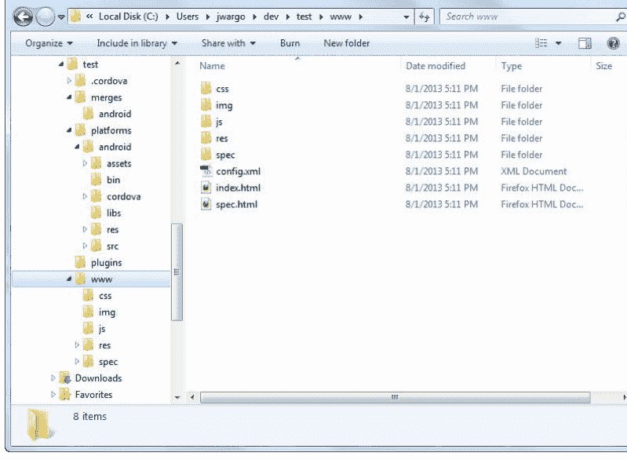

**图 7.3** Cordova 项目文件夹结构

项目文件夹就绪后，你必须在开始工作之前将项目导入 ADT。要启动导入过程，在 ADT IDE 中打开“文件”菜单，然后选择“导入”。ADT IDE 将显示导入向导，如图 7.4 所示。如图所示，展开“Android”选项并选择“Existing Android Code Into Workspace”，然后单击“下一步”按钮。

100  第 7 章：使用 Cordova 进行 Android 开发

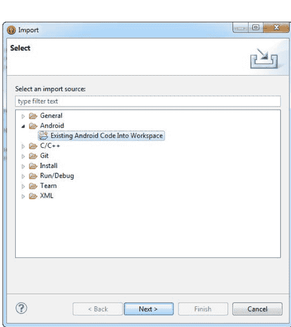

**图 7.4** ADT IDE 导入向导

ADT 显示向导的下一页，如图 7.5 所示。在此对话框中，你需要在“Root Directory”字段中填入 Cordova 项目的 Android 项目文件所在的位置。单击“浏览”按钮，导航到图 7.3 中高亮显示的 Android 文件夹，然后单击“确定”按钮。向导应自动将 HelloCordova 项目添加到可用项目列表中，如图 7.5 所示。


**图 7.5** ADT IDE 导入项目

当你单击“完成”按钮时，ADT 应完成导入过程，并将导入的项目打开到 IDE 中，如图 7.6 所示。由于 Cordova 项目既包含原生 Java Android 应用程序，也包含在该应用程序内执行的 Web 内容，因此你将看到默认 Android 项目结构与前面章节讨论的 Cordova www 文件夹的混合体。

> **警告**
>
> 你对存储在 Android 项目的 www 文件夹中的 Web 应用程序内容所做的任何更改，都不会传播回 Cordova 项目的主 www 文件夹。CLI 目前没有执行此操作的机制（谁知道呢，也许在你读到这个时已经有了）。如果在调试应用程序期间，你在 ADT 中对 Web 应用程序进行了更改，你需要手动将这些更改复制回 Cordova 项目的根 www 文件夹。
>
> 为了简化此操作，你可以向 ADT 添加一个外部工具，该工具触发将 Web 内容文件复制回 Cordova 项目的 www 文件夹。


**图 7.6** ADT IDE 已导入的项目

## 运行你的 Cordova 应用程序

既然 Cordova 项目已被导入，你可能想要运行它以查看其工作方式。ADT IDE 默认情况下没有定义任何 Android 运行配置，因此在开始之前你必须添加至少一个。在 ADT IDE 中，打开“运行”菜单，然后选择“运行配置”。IDE 将显示一个类似图 7.7 所示的对话框。

在对话框中，选择“Android Applications”，然后单击图中高亮显示的“新建”按钮。定义运行配置的设置，为其分配一个应用程序，并确定其运行时如何启动一个或多个 Android 设备模拟器的参数。如果你没有任何模拟器设备定义（默认情况下你没有），请单击“管理”按钮以打开 Android Virtual Device (AVD) 管理器来创建和管理系统的模拟器定义。


**图 7.7** ADT IDE 运行配置

定义了一个或多个运行配置后，你可以单击图中底部显示的“运行”按钮来启动模拟器并运行你的应用程序。你也可以关闭此对话框，然后通过从“运行”菜单进行适当选择，或通过在项目资源管理器（如图 7.6 左侧所示）中右键单击应用程序项目、选择“运行方式”，然后选择“Android 应用程序”来在选定的 Android 模拟器上运行应用程序。

ADT 将启动选定的 Android 模拟器（这将花费很长时间——请耐心等待，Android 模拟器以速度慢而闻名），然后编译、打包并将 Cordova 应用程序部署到模拟器。

## ADT 调试工具

当 ADT IDE 处理所有内容并启动你的 Cordova 应用程序时，你可能注意到屏幕的某些部分滚动了大量信息。ADT 包含允许开发者监视模拟器或物理设备上活动的实用程序。此功能由 IDE 中的 Console 和 LogCat 视图提供。LogCat 是 IDE 的一部分，但也可以通过命令行或作为独立实用程序运行。

ADT 会自动打开 LogCat 窗口，但如果因任何原因关闭，你可以通过打开“窗口”菜单、选择“显示视图”，然后选择“其他”来打开它。ADT IDE 将显示一个类似图 7.8 所示的对话框。展开“Android”选项以查看可用的视图列表。选择 LogCat（不是图中所示的已弃用版本）并单击“确定”按钮以打开该视图。
```


图 7.8 ADT IDE 显示视图对话框

控制台窗口显示 ADT IDE 在准备 Cordova 应用并将其部署到模拟器时生成的消息。你可以在图 7.9 中看到控制台输出的示例。如果 ADT IDE 在构建、打包或部署应用时遇到问题，它会在控制台窗口中通知你。如果你已经在模拟器中启动了应用，但似乎没有发生任何事情，请查看控制台。


图 7.9 ADT IDE 控制台窗口

另一方面，LogCat 直接与 Android 模拟器或物理设备交互（稍后我会向你展示如何在物理设备上调试）。LogCat 窗口会显示大量消息，包括模拟器完成启动过程时以及你与 Android 操作系统任何部分交互时的消息。当你在使用模拟器、设备或运行 Android 应用时遇到问题，请查看 LogCat 中的错误消息。

另外，如果你还记得第六章的内容，我曾提到可以在 Cordova 应用运行时将信息写入 `console` 对象；在 Android 上，这些 `console` 对象的消息会显示在 LogCat 窗口中。如果你查看图 7.10，就会看到 LogCat 正在显示清单 6.2 中突出显示的示例应用的输出。


**图 7.10** ADT IDE LogCat 窗口

在 LogCat 窗口中，你可以根据消息类型进行筛选。请注意图 7.10 右上角显示的调试按钮；当你点击该按钮时，会出现一个下拉菜单，允许你选择要在视图中显示的消息级别（详细、调试、信息、警告和错误）。

## 在 ADT IDE 外部进行调试

如果你不想使用 ADT IDE，也可以在 IDE 外部运行 ADT 调试工具。独立版本的 LogCat 及相关工具可以在 Android 调试监视器（ADM）实用程序中找到，该工具通过导航到 Android SDK 的 Tools 文件夹并执行 monitor.bat（在 Windows 上）或 monitor（在 Mac OS 上）应用程序来启动。

当 ADM 启动时，它会显示一个类似于图 7.11 所示的窗口。我不打算被这里讲太多可用的选项，但你可以看到有大量信息并存。应用程序窗口的下半部分显示与 ADT IDE 中相同的 LogCat 窗口。在图中，你可以看到我已将 ADM 连接到 Android 设备模拟器；稍后我会向你展示如何连接到物理设备。


图 7.11 Android 调试监视器应用程序

你应该花些时间在 ADM 中四处探索——它为开发人员提供了非常强大的功能。

## 截取屏幕截图

虽然这对开发人员来说不是关键的，但有时能够从模拟器或物理设备上截取屏幕截图是很有用的。如果你查看图 7.11，在 ADM 左上角区域的 Device 部分中，会看到一个小相机图标。连接设备后，你可以点击该按钮从连接的设备上截取屏幕截图。当你点击该按钮时，ADM 会显示一个类似于图 7.12 所示的屏幕（我对图像进行了裁剪以减少图示占用的空间）。在这个例子中，你看到的是我的 Google Nexus 7 平板电脑屏幕的一部分。

你可以使用屏幕顶部的按钮来刷新、旋转、保存和复制图像。使用此功能是获取文档或支持用途的屏幕图像的快速简便方法，无需在设备上执行屏幕截图然后将其传输到你的电脑。


## 在物理设备上调试

ADM 也可以与物理设备交互，就像它可以与设备模拟器交互一样。应用的初始测试可以在模拟器上完成，但在发布任何应用之前，都应该在应用预计运行的代表性物理设备样本上进行测试。

要将物理设备与 ADM 一起使用，必须使用 USB 数据线将设备连接到运行 ADM 的计算机系统。在此之前，你必须在设备上启用 USB 调试。启用此设置的方式因你使用的 Android 设备类型而异。在某些设备上，只需打开设备上的 Android 设置应用程序并进行一些选择即可启用开发者选项。在其他设备上，则稍微困难一些。抱歉，这个你得自己研究解决了。

### 警告

为了能够在真实设备上进行测试，你的计算机系统必须能够通过 USB 数据线识别连接的 Android 设备。如果你连接了设备但系统无法识别，则必须解决任何连接问题才能继续。

我在 Windows 上的测试中，必须手动从 SDK 管理器安装 Google USB 驱动程序，然后在 Windows 设备管理器中强制安装正确的驱动程序。你可以在 www.johnwargo.com/index.php/mobile-development/nexus-7-setup-on-windows1.html 阅读相关步骤。

对于三星设备，你可能需要单独下载并安装 USB 驱动程序，然后设备才能被 Windows 正确识别。请参阅 http://developer.samsung.com/android/tools-sdks/Samsung-Android-USB-Driver-for-Windows 获取更多信息。

例如，对于 Google Nexus 7 平板电脑，在能够访问开发者设置之前，你必须采取一些特殊步骤。要在 Nexus 7 上启用开发者模式，你必须打开设置应用程序并选择 About Tablet（它是"设置"页面上选项列表的最后一项）。在 About Tablet 页面上，向下滚动直到在列表中看到 Build number 项。点击 Build number 项七次以启用设备上的开发者选项。当你点击时，Android 会弹出一个小窗口，提示你还需要点击多少次才能启用开发者模式。

完成该过程后，当你打开"设置"应用程序时，应该能够向下滚动到选项列表的底部，看到可用的**开发者选项**，如图 7.13 所示。


**图 7.13** Android 设置应用程序中启用的开发者选项

点击**开发者选项**，你会看到一个类似于图 7.14 所示的屏幕；在这里你可以启用 USB 调试，如图底部所示。


**图 7.14** 启用 USB 调试

启用 USB 调试后，启动 ADM，然后使用 USB 数据线将 Android 设备连接到计算机系统。在必要的设备驱动程序初始化后（请参阅前面的警告以了解如何处理驱动程序问题），ADM 应该会连接到你的设备，并在其已连接设备列表中显示该设备，如图 7.15 所示。


**图 7.15** Android 调试监视器

在 ADM 中，你可以使用物理设备获得与设备模拟器相同的大部分功能，但也存在差异。有关 ADM 与物理设备配合使用的功能的更多信息，请参阅 Android 文档。ADM 是从设备中拉取文件或向设备推送文件以进行测试的好方法。然而，大部分文件结构是受保护的，因此你将无法访问所有文件位置。

### 总结

在本章中，我向你展示了如何使用 Google 提供的免费工具来简化 Cordova 的 Android 开发。虽然 Android 工具不能直接帮助调试 Cordova 应用程序，但通过使用这些工具，你可以更轻松地确定 Cordova 应用程序内部发生了什么。


## 使用 Cordova 进行 BlackBerry 10 开发

### 配置 BlackBerry 开发环境

在 Cordova 支持的所有平台中，BlackBerry 10 平台与 Cordova 的方法最为契合。混合应用方式长期以来一直是 BlackBerry 的核心应用类型，Cordova 就是构建在此基础之上。在本章中，我将向你展示如何使用 BlackBerry 命令行工具来测试和调试 BlackBerry Cordova 应用。

BlackBerry 开发的酷炫之处在于，BlackBerry SDK 会自动将类似 weinre 的网页检查器集成到模拟器中；我将在本章展示如何使用它。

Cordova 团队宣布将不再支持旧版 BlackBerry 设备（运行 BlackBerry Device Software 7 及更早版本的设备），因此本章仅涵盖 BlackBerry 10。要处理旧版 BlackBerry 设备，你需要使用 Cordova 2.9 或更早版本。

在开始使用 Cordova 进行 BlackBerry 开发之前，你必须先配置你的开发环境。我在第 3 章中展示了如何安装 BlackBerry 本机 SDK (NDK)，但省略了一些 BlackBerry 特定的配置细节；我将在此描述。

提醒一下，在构建可在 BlackBerry 设备上运行的 BlackBerry 应用之前，你必须首先从 BlackBerry 获取并安装一组免费的签名密钥。打开你选择的浏览器，访问 https://www.blackberry.com/SignedKeys 来请求一组密钥。你最终会收到一系列来自 BlackBerry 的电子邮件，将密钥文件解压到系统硬盘上的某个位置，并按照电子邮件中的说明激活你的密钥。

你需要按照 https://developer.blackberry.com/html5/documentation/signing_setup_bb10_apps_2008396_11.html 的说明注册密钥。你可以使用 SDK 安装中包含的 Momentics IDE 来注册密钥，也可以使用命令行执行以下命令：

```
blackberry-signer -register -storepass <KeystorePassword> -csjpin <csjpin> <client-RDK-xxxxxx.csj file> <client-PBDT-xxxxx.csj file>
```

在此示例中，你需要将方括号中的项目替换为以下信息：

-   `<csjpin>`：你在请求签名密钥时提供给 BlackBerry 的 PIN 码。
-   `<KeystorePassword>`：你希望用于保护在此过程中创建的密钥库的密码。这将是你在签署 BlackBerry 应用时用于解锁签名密钥的密码。
-   `<client-RDK-xxxxxx.csj file>`：指向你从 BlackBerry 收到的 client-RDK-xxxxxx.csj 文件的路径。
-   `<client-PBDT-xxxxx.csj file>`：指向你从 BlackBerry 收到的 client-PBDT-xxxxx.csj 文件的路径。

对于 NDK，你需要的文件位于 BlackBerry NDK 安装文件夹中。在我的开发系统上，我将 NDK 安装在 c:\bbndk，因此 blackberry-signer 文件位于 C:\bbndk\host_10_1_0_132\win32\x86\usr\bin。因此，我打开了一个终端窗口并导航到该文件夹，然后执行以下命令：

```
blackberry-signer -register -csjpin 987456321
-storepass my_keystore_password c:\dev\keys\client-RDK-123456.csj
client-PBDT-12345.csj
```

如果操作正确，系统应响应以下信息：

```
Info: CSK file created.
Info: Developer certificate created in
C:\Users\jwargo\AppData\Local\Research In Motion\author.p12
Info: Successfully registered with server.
Info: Successfully registered with server.
```

在物理 BlackBerry 10 设备上测试 Cordova 应用之前，还必须完成一些额外的步骤，我将在本章后面部分介绍。

如第 3 章“安装 Cordova 命令行界面”所示，你可以使用以下命令为 Cordova 项目添加对特定移动设备平台的支持：

```
cordova platform add platform_name
```

当为现有项目添加 BlackBerry 支持时，你会使用以下命令：

```
cordova platform add blackberry10
```

但是，当你运行该命令时，可能会收到类似于以下内容的错误消息：

```
blackberry-nativepackager cannot be found on the path. Aborting.
```

这是因为你用于向 Cordova 项目添加 BlackBerry 支持或使用 BlackBerry 本机 SDK 的一个或多个工具在系统路径中找不到。在使用任何 BlackBerry 10 NDK 命令行工具之前，你必须先将一些 BlackBerry 10 NDK 配置信息添加到环境配置中。最简单的方法是执行 NDK 中包含的 bbndk-env 命令。该命令会使用一些额外的文件夹更新你的系统路径，并设置 BlackBerry 10 NDK 查找其文件所需的几个环境变量，如图 8.1 所示。

在 Windows 上，我只需将 BlackBerry 10 NDK 安装文件夹 (c:\bbndk\) 添加到 Windows 系统路径。然后，每当我打开一个终端窗口处理 BlackBerry 项目时，我只需在执行影响项目 BlackBerry 10 部分的任何命令之前执行 bbndk-env.bat 文件。你可以通过将对该批处理文件的调用添加到系统的 autoexec.bat 文件来自动化此过程，但我没有花时间这样做。

在 Macintosh OS 上，你需要运行一个名为 bbndk-env.sh 的 shell 脚本来设置 BlackBerry 10 开发环境。你可以将 BlackBerry 10 NDK 安装路径添加到系统路径，然后根据需要手动执行脚本，或者你可以配置系统在打开新终端窗口时执行该脚本。

现在，当你将 BlackBerry 10 平台添加到你的 Cordova 项目时，该过程应正常运行，并且不会向终端窗口返回任何错误。

### 配置 BlackBerry Cordova 项目

BlackBerry Cordova 项目是通过 BlackBerry 10 项目的 config.xml 进行配置的。

我将不会描述 BlackBerry config.xml 的所有可能设置；你可以从 BlackBerry 的 https://developer.blackberry.com/html5/documentation/config_doc_elements.html 找到详细文档。不过，我会描述一些选项，但首先看看清单 8.1 中的文件。

#### **清单 8.1 BlackBerry 10 项目 Config.XML**

```
<?xml version="1.0" encoding="UTF-8"?>
<!-- Licensed to the Apache Software Foundation (ASF) under one or more contributor license agreements. See the NOTICE file distributed with this work for additional information regarding copyright ownership. The ASF licenses this file to you under the Apache License, Version 2.0 (the "License"); you may not use this file except in compliance with the License. You may obtain a copy of the License at http://www.apache.org/licenses/LICENSE-2.0 Unless required by applicable law or agreed to in writing, software distributed under the License is distributed on an "AS IS" BASIS, WITHOUT WARRANTIES OR CONDITIONS OF ANY KIND, either express or implied. See the License for the specific language governing permissions and limitations under the License.-->
<!-- Widget Configuration Reference: http://docs.blackberry.com/en/developers/deliverables/15274/-->
<widget xmlns="http://www.w3.org/ns/widgets" xmlns:rim="http://www.blackberry.com/ns/widgets" version="1.0.0.1" id="default.app.id">
  <name>WebWorks Application</name>
  <author>John M. Wargo</author>
  <description>A sample Apache Cordova application that responds to the deviceready event.</description>
  <license href="http://opensource.org/licenses/alphabeticall"</license>
  <icon src="res/icon/blackberry/icon-80.png">
  <rim:plash src="res/screen/blackberry/splash-1280x768.png">
  <rim:permissions>
    <rim:permit>use_camera</rim:permit>
    <rim:permit>read_device_identifying_information</rim:permit>
    <rim:permit>access_shared</rim:permit>
    <rim:permit>read_geolocation</rim:permit>
    <rim:permit>record_audio</rim:permit>
    <rim:permit>access_pimdomain_contacts</rim:permit>
  </rim:permissions>
</widget>
```

config.xml 的 `name`、`author` 和 `description` 元素向 BlackBerry 用户描述应用程序。`name` 元素定义出现在设备主屏幕和应用程序列表中的名称。`Author` 和 `description` 并非关键，但设置它们很有用。`author` 会显示在应用安全提示中（你可以在图 8.4 中看到示例），`description` 应显示在设备选项中的应用程序详细信息屏幕中。

`content` 元素定义了容器启动时启动的网页内容文件的名称。此值默认设置为 index.html，但你可以将其更改为任何有效的 `src` 引用。如果你的 Web 应用程序的主页面位于名为 rabbit.html 的文件中，你可以将 content 的 `src` 值设置为 rabbit.html，如以下示例所示：

```
<content src="rabbit.html" />
```

config.xml 最重要的方面是 `rim:permissions` 元素；它用于列出应用程序所需的各种应用程序权限。如果你的应用程序使用受限功能而你没有将其列为 `rim:permit` 元素，那么利用该功能的应用程序部分将无法运行。你的应用程序不会告诉你哪里出错了——它只是无法正常工作。

你可以在 config.xml 的设置中做很多事情，但要涵盖所有选项远远超出了本书的范围。有关此主题的更多信息，请参阅 BlackBerry 开发者文档。

### 定义 BlackBerry 10 目标

在使用设备模拟器或物理设备测试和调试 BlackBerry 10 Cordova 应用程序之前，你必须先为将要使用的每个设备（无论是模拟器还是物理设备）配置 Cordova 开发环境；每一个都称为一个目标。幸运的是，你定义的目标是全局应用于你的 Cordova 配置的，因此你只需创建一次，就可以将它们用于你处理的任何 Cordova 项目。

如果你查看默认用户文件夹中的 .cordova 文件夹，你会看到一个名为 blackberry10.json 的文件。此文件包含为你的 Cordova 开发环境定义的全局目标列表。最初，它指向一个空的目标对象列表：

```
{
  "targets": {}
}
```

正如你在接下来的章节中将看到的，当你向系统添加目标时，此文件会使用每个目标的相应设置进行更新。Cordova CLI 的 `emulate` 和 `run` 命令使用此信息在执行 Cordova 应用程序时定位适当的目标。


为 BlackBerry 目标创建所需的文件在安装支持 BlackBerry 10 时会被安装到你的 Cordova 项目中。后续章节将说明如何为 BlackBerry 10 模拟器以及实体 BlackBerry 10 设备定义目标。

## 定义 BlackBerry 10 模拟器目标

要定义 BlackBerry 10 模拟器目标，首先启动相应的设备模拟器，然后导航到项目的 `platforms/blackberry10/cordova` 文件夹并执行以下命令：

```
target add target_name ip_addr -t simulator
```

如你所见，该过程需要知道模拟器的 IP 地址；好在模拟器窗口底部会显示其 IP 地址，如图 8.2 所示。


**图 8.2** BlackBerry 10 设备模拟器

假设模拟器的 IP 地址是 `192.168.215.128`，且 Cordova 项目在 Windows 上创建于 `c:\users\jwargo\dev\test\`，你需要打开终端窗口，然后导航到 `c:\users\jwargo\dev\test\platforms\blackberry10\cordova\` 并执行以下命令：

```
target add bb10-sim 192.168.216.128 -t simulator
```

该命令执行完成后，`blackberry10.json` 文件会被更新以包含该目标的设置：

```json
{
  "targets": {
    "z10-sim": {
      "ip": "192.168.216.128",
      "type": "simulator"
    }
  },
  "defaultTarget": "z10-sim"
}
```

当你启动 BlackBerry 10 设备模拟器时，可以选择模拟器所模拟的设备类型。你可以为每种模拟器类型定义单独的目标，并通过在 `blackberry10.json` 文件中定义的 `defaultTarget` 变量来指定默认使用的模拟器。

## 定义 BlackBerry 10 设备目标

要使用实体设备定义 BlackBerry 10 目标，过程与上一节所示类似，但在创建目标之前必须完成额外的设置步骤。

要测试和调试你的 BlackBerry 10 Cordova 应用程序，必须首先在设备上启用调试开发模式。为此，打开设备的"设置"应用，然后打开应用中的"安全和隐私"部分。在显示的选项列表底部，选择**开发模式**选项。设备将打开一个类似于图 8.3 所示的屏幕。在屏幕顶部，将*使用开发模式*选项设置为开启，如图所示。你可能还需要为设备设置 IP 地址。如果要在多台设备上进行测试，你需要确保各设备之间的 IP 地址是唯一的，并为每台设备定义单独的目标。


**图 8.3** 在 BlackBerry 设备上启用开发模式选项

完成这些设置后，使用 USB 数据线将设备物理连接到计算机系统，你现在可以创建目标了。实体设备的设置略有不同，因为当前版本的 BlackBerry 命令行工具需要设备密码以及设备 PIN。在 Cordova 3.1 中，BlackBerry 开发团队将在其命令行工具中实现 PIN 自动检测。

假设 Cordova 项目在 Windows 上创建于 `c:\users\jwargo\dev\test\`，你需要打开终端窗口，然后导航到：

`c:\users\jwargo\dev\test\platforms\blackberry10\cordova\` 并执行以下命令：

```
target add target_name ip_address -t device -p device_password -pin device_pin
```

对于我的特定配置，命令是：

```
target add z10-device 169.254.254.253 -t device -p abcdef -pin 2AB09876
```

这会将设备的设置添加到系统的 `blackberry10.json` 文件中，如下所示：

```json
{
  "targets": {
    "z10-sim": {
      "ip": "192.168.216.128",
      "type": "simulator"
    },
    "z10-device": {
      "ip": "169.254.254.253",
      "type": "device",
      "password": "abcdef",
      "pin": "2AB09876"
    }
  },
  "defaultTarget": "z10-sim"
}
```

要将配置更改为使实体设备成为默认目标，请在终端窗口中执行以下命令：

```
target default z10-device
```

要查看系统上已定义目标的列表，请执行以下命令：

```
target
```

系统将响应目标列表，如下所示：

```
z10-sim
* z10-device
```

星号标记默认目标。

## 在设备模拟器上调试

适用于 BlackBerry 的 Cordova 应用程序不使用 BlackBerry Momentics IDE 来管理应用程序；相反，一切都通过 Cordova CLI 完成。要在 BlackBerry 10 模拟器中运行 Cordova 应用程序，首先启动模拟器，然后导航到 Cordova 项目文件夹并执行以下命令：

```
cordova emulate blackberry10
```

CLI 将构建 BlackBerry 10 项目，将其加载到模拟器中，然后启动应用程序。你也可以导航到项目的 `platforms/blackberry10/cordova` 文件夹，使用该文件夹中的 `run` 命令来运行应用程序。模拟器必须在执行命令之前已经运行——CLI 不会为你启动它。构建和部署 Cordova 应用程序的过程需要相当长的时间，所以请耐心等待。

本示例中使用的默认 Cordova 项目为所有可用插件启用了安全设置，尽管该项目中尚未启用任何插件。由于 BlackBerry 是一个安全的平台，当应用程序首次启动时，系统会提示你允许访问不同的 Cordova API，如图 8.4 所示。这些设置在本章前面的"配置 BlackBerry Cordova 项目"中有说明。只需单击"确定"按钮即可继续。


**图 8.4** Cordova 应用程序安全提示

BlackBerry 10 Cordova 项目默认启用 BlackBerry Web Inspector。当 Cordova 应用程序在模拟器中启动时，它会告诉你 Web Inspector 是否已启用，如图 8.5 所示。


**图 8.5** BlackBerry 10 模拟器 Web Inspector 警告

要禁用 Web Inspector，必须以发布模式构建应用程序。你可以通过打开终端窗口，导航到 Cordova 项目的 `platforms\blackberry10\cordova\` 文件夹，然后执行以下命令来实现：

```
build --release --keystorepass your_keystore_password
```

我稍后会向你展示如何使用 Web Inspector。当你点击"确定"时，应用程序打开并显示其 Web 内容，如图 8.6 所示。


**图 8.6** 在 BlackBerry 10 模拟器中运行的 Cordova HelloWorld 应用程序

此时，应用程序正在模拟器上运行，你可以像在实体设备上一样与应用程序交互。

## 注意

出于某种原因，BlackBerry 10 设备模拟器在渲染默认 Cordova HelloWorld 应用程序的背景图像时存在困难。我在两台不同的计算机上都遇到了这个问题，但在实体设备上没有遇到同样的问题。这更有理由让我们将模拟器用于初始测试，但所有最终测试都要在实体设备上进行。

## 使用 BlackBerry 模拟器控制器

有些在实体设备上发生的事件不容易映射到模拟器上；例如确定设备位置、响应电话呼叫、方向变化等。为了帮助开发人员在处理模拟器时管理此类问题，BlackBerry 模拟器包含一个单独的控制器程序，可用于在模拟器运行时操控它。该控制器与设备模拟器一起安装，作为单独的图标；双击**该**程序图标以启动，打开一个类似于图 8.7 所示的窗口。


**图 8.7** BlackBerry 模拟器控制器

控制器会自动连接到正在运行的模拟器；否则，你可以使用"连接"菜单中的选项手动断开和连接。使用"设备"菜单访问用于操控模拟器的可用选项。例如，有一个用于设置 GPS 位置的选项；当你选择该选项时，会出现一个新窗口，如图 8.8 所示。


**图 8.8** BlackBerry 模拟器控制器：GPS 设置


设置合适的位置信息，然后点击Apply按钮将设置应用到模拟器。如果你的Cordova应用程序正在模拟器中运行并监听模拟设备的位置信息，它会自动注册变化并按照你在应用程序中的代码做出相应反应。

控制器在处理BlackBerry Cordova应用程序时能为你提供更多帮助。花几分钟时间在Device菜单中探索一下，看看还有哪些其他选项可供你使用。

## 使用BlackBerry Web Inspector

由于混合应用方法是BlackBerry开发的标准选项，因此调试Cordova应用程序比在某些其他平台上要容易得多。内置工具让Cordova开发者能够更轻松地了解在Cordova原生容器中运行的Web应用程序内部的情况。Web Inspector在这方面提供了关键功能，并且可以与设备模拟器以及物理设备配合使用。

如前所述，默认情况下，使用Cordova CLI构建的Cordova应用程序会启用Web Inspector。当启用了Web Inspector的Cordova应用程序在BlackBerry 10模拟器中运行时，你可以启动浏览器并观察应用程序在容器中的运行情况，高亮显示HTML元素、计算表达式、单步执行代码等。为了演示，我创建了一个简单的Cordova应用程序，其中包含少量JavaScript代码，并在模拟器中启动它。当应用程序在模拟器中运行时，它会渲染出如图8.9所示的屏幕（为简洁起见进行了裁剪）。


**图8.9** 用于演示BlackBerry Web Inspector的控制台应用程序

要使用Web Inspector调试此应用程序，请打开Google Chrome浏览器并输入以下URL：

```
http://device_IP_Address:1337
```

`device_IP_Address`指的是运行应用程序的设备模拟器或物理设备的IP地址。因此，对于图中所示的模拟器，请使用以下内容：

http://192.168.216.128:1337

当你按下回车键时，浏览器会连接到设备上运行的浏览器，并打开一个类似于图8.10所示的屏幕。要调试Cordova应用程序，请选择图中高显示的选项；位于local://index.html的Web资源是Cordova容器内运行的Web应用程序的起始页面。图中所示的其他选项用于设备上运行的浏览器和浏览器外壳。


**图8.10** BlackBerry Web Inspector起始页面

在你做出该选择后，浏览器应该会打开一个类似于图8.11所示的页面。


**图8.11** BlackBerry Web Inspector：元素页面

使用图8.11所示浏览器页面顶部的不同选项，你可以访问大量关于应用程序的信息。对于Cordova应用程序调试，这里有几个功能非常有用。

如果你点击Sources图标（位于图8.11所示页面顶部的图标列表中），你会看到图8.12所示的页面。Web Inspector默认禁用调试功能，但你可以在这里打开它，如图所示。在页页面上启用相应的单选按钮，然后点击Enable Debugging按钮继续。


**图8.12** BlackBerry Web Inspector：启用JavaScript调试

接下来，Web Inspector会显示应用程序的源文件列表；你可以选择其中任何一个来打开使用该源文件的调试会话。在图8.13中，我选择了Cordova应用程序的index.html文件，因为对于这个简单的示例，我的所有代码都在那里。

在这个界面中，我可以设置断点（如图8.13中第18行所示），定义监视表达式、查看调用栈、检查变量等。


**图8.13** BlackBerry Web Inspector：JavaScript调试

在这个示例中，我点击了图8.9中所示的Click Me按钮，并逐步执行了几行代码。当Web Inspector命中断点时，你可以使用图8.13右上方高亮显示的按钮以不同方式逐步执行代码。此时，Web Inspector的工作方式与你过去使用过的任何其他调试器相同。

为了完善这个示例，图8.14显示了控制台页面，其中显示了代码的输出。在这里，我可以查看对`console`对象调用的输出。与Apple调试器不同，Web Inspector使用彩色图标表示警告和错误日志条目，甚至对错误输出进行颜色编码，以便在调试会话期间更容易定位。


**图8.14** BlackBerry Web Inspector控制台窗口

如你所见，BlackBerry Web Inspector是调试Cordova应用程序的一个相当强大的工具。

## 在物理设备上调试

在使用物理设备时，仍然支持Web Inspector功能，因此上一节的信息仍然适用。一般来说，要在设备上运行应用程序，你必须将设备连接到计算机，然后导航到Cordova项目文件夹并执行CLI命令。你可以通过USB线缆连接设备，或者如果设备与你的开发计算机在同一网络上，也可以通过Wi-Fi连接。

第一次次在设备上运行应用程序时，你必须生成调试令牌并将其部署到设备。要了解有关BlackBerry调试令牌的更多信息，请参阅https://developer.blackberry.com/html5/documentation/runnning_unsigned_apps_using_a_debug_token_1866987_11.html。因此，第一次次在BlackBerry设备上运行应用程序时，你应该使用以下命令：

```
cordova run blackberry10 -k keystore_password
```

此命令指示CLI创建调试令牌，将其部署到设备，然后打包应用程序并将其部署到设备。如果一切正常，经过相当长的一段时间等待后（确实需要等待相当长的一段时间），你应该会看到Cordova应用程序在设备上运行。

在后续运行中，调试令牌已安装到设备后，你可以使用以下命令在设备上运行应用程序：

```
cordova run blackberry10
```

如果你定义了多个目标，可以通过执行以下命令在特定目标上启动应用程序：

```
cordova run blackberry10 --target target_name
```

要在当前连接的设备上运行应用程序，请执行以下命令：

```
cordova run blackberry10 --device
```

### 总结

本章演示了如何使用BlackBerry提供的命令行工具在设备模拟器和物理设备上运行和调试Cordova应用程序。BlackBerry提供的广泛工具为Cordova开发者提供了一些其他平台上没有的其他功能。

## 使用Cordova进行iOS开发

对于为iOS平台构建Cordova应用程序的开发人员，Apple提供了一套用于设计、打包和部署iOS应用程序的工具。即使Cordova CLI负责了创建、管理和测试iOS应用程序的大部分流程，但有时你希望对流程有更多控制。CLI可以在iOS模拟器中启动Cordova应用程序，但当你遇到应用程序问题时，你想了解更多情况，就需要使用Apple提供的开发工具。

在本章中，我将向你展示如何使用Xcode（Apple的iOS开发工具）来运行和调试适用于iOS设备的Cordova应用程序。我还将向你展示如何使用Safari浏览器调试Cordova应用程序。

## 使用Xcode

假设你已使用Cordova CLI创建项目并向其中添加了iOS平台，在Xcode中使用Cordova应用程序非常简单。当你准备好Web应用程序的内容后，执行以下CLI命令将Web应用程序源代码复制到iOS项目文件夹中：

`cordova prepare ios`

无需像Android和BlackBerry那样将Cordova项目导入IDE，Cordova CLI会创建一个可以直接在Xcode中打开的项目。只需启动Xcode，打开项目，然后开始工作。当项目打开时，你应该会看到一个类似于图9.1所示的屏幕。从这里，你可以在任何iOS模拟器中运行应用程序，就像运行任何其他iOS应用程序一样。


## 调试 iOS 应用程序

iOS 应用程序是使用 Objective-C 编写的，这是 C 语言的一个变体，NeXT 在 1980 年代曾用它来为 NeXTSTEP 操作系统开发应用程序。Xcode 允许你编辑 HTML5 源文件，但由于 iOS 应用程序是用 C 语言编写的，Xcode 无法调试在 Cordova 容器中运行的 Web 应用程序。你可以使用 weinre 或 `console` 对象来帮助调试应用程序，如第 6 章“Cordova 开发机制”中所述，来调试你的 iOS 应用程序。

当你在 Xcode 中运行一个 iOS 应用程序时，IDE 会在屏幕底部打开一个控制台窗口，你可以在其中看到模拟器以及 Cordova 应用程序生成的消息。使用清单 6.2 中的应用程序，你可以看到在图 9.2 中使用 `console` 对象编写的代码输出到 IDE 控制台屏幕。


**图 9.2** Xcode 控制台输出窗口

请注意，警告和错误消息被标记了额外的文本，以便你可以更清楚地识别它们。不幸的是，Xcode 没有像 Android IDE 那样使用颜色编码来区分它们；也许苹果将来会添加更强大的功能。

在使用物理设备进行调试时，功能更强大；有关更多信息，请参阅下一节。

## 在物理设备上调试

在模拟器上调试和在物理设备上调试有一些区别，因此在你的开发过程的某个时候，你将希望在设备上运行你的应用程序。苹果有一些非常复杂的流程，你必须在物理设备上运行应用程序之前遵循这些流程。由于有数百本书和网站专门介绍 iOS 开发，我不会在这里深入探讨细节。你可以在苹果开发者网站 http://tinyurl.com/op9lvv3 上找到详细说明。在物理设备上工作之前，你必须按照那里提供的说明进行操作。

一旦你完成了设备的设置，你就可以用 USB 电缆将它连接到运行 Xcode 的计算机，并直接从 Xcode 在设备上运行应用程序。在这种环境中，Xcode 为物理设备提供了与模拟器相同的调试功能。

## 使用 Safari Web 检查器

从 iOS 6 开始，苹果在 Safari（桌面版和 iOS 版）中添加了一些功能，允许在桌面 Safari 浏览器中远程调试 Web 应用程序。这个功能的酷之处在于，它适用于 Cordova 应用程序中使用的 `UIWebView`。你可以在苹果网站 http://tinyurl.com/c9yqebs 上找到关于此远程调试功能的详细信息。

你必须做的第一件事是在 Macintosh OS 的桌面版 Safari 中启用开发人员菜单（此过程在 Windows 上无法运行，并且可能永远不会）。打开 Safari 应用程序首选项，然后选择“高级”选项卡，如图 9.3 所示。启用图底部标记为“在菜单栏中显示开发菜单”的复选框。


**图 9.3** Macintosh OS X 上的 Safari 首选项

完成此更改后，关闭首选项，你应该会在 Safari 中看到一个新的“开发”菜单选项。

接下来，你需要在你的 iOS 设备上打开“设置”，选择“Safari”选项，然后点击“设置”屏幕底部的“高级”选项。在出现的屏幕上，启用“Web 检查器”选项，如图 9.4 所示。


**图 9.4** iOS 上的 Safari 高级设置

完成这些设置后，启动模拟器或将设备通过 USB 电缆连接到计算机，然后启动 Cordova 应用程序。你可以从 Xcode 运行 Cordova 应用程序，或者将应用程序预装在设备上，然后从设备的主屏幕手动运行它。

在 Cordova 应用程序运行时，切换到你的桌面计算机，启动 Safari 浏览器（记住，这仅适用于 Macintosh OS X）并打开“开发”菜单。你应该会在出现的菜单中看到你的模拟器或 iOS 设备。图 9.5 显示了一个示例：我的 iPhone，恰当地命名为“John's iPhone”，作为菜单中的一个选项出现。你还可以看到正在运行的 HelloCordova 应用程序；选择 index.html 文件，如图所示。


**图 9.5** 将远程 Web 检查器连接到 Cordova 应用程序

Safari 连接到远程应用程序，然后打开一个新窗口，如图 9.6 所示。在这个新窗口中，你可以访问在 Cordova 容器中运行的代码，并与应用程序的不同部分进行交互。


**图 9.6** Safari 远程 Web 检查器窗口

图 9.6 显示了 index.html 文件的内容。你可以展开页面的不同部分，甚至可以实时编辑内容。右键单击 HTML 文件中的任何 div，你可以选择一个选项来编辑内容。在图 9.7 中，你可以看到我在应用程序运行时向文件中插入了一个新的段落标签。


**图 9.7** 在 Web 检查器中更新 HTML 内容

在设备上实时，Cordova 应用程序会更新以显示新内容，如图 9.8 所示。


**图 9.8** 修改后的 Cordova 应用程序

对 Cordova 开发者非常重要，而且在大多数其他平台上不可用的是设置断点并单步执行 Cordova 应用程序中的 JavaScript 代码的能力。图 9.9 显示了应用程序的 index.js，并设置了一些断点。


**图 9.9** Web 检查器 JavaScript 调试器

图 9.10 显示了一个你可以用来计算表达式的计算窗口。当你键入任何对象值或表达式并按 Enter 时，日志会计算表达式并显示结果。在这个例子中，我正在检索 `document.title` 变量的值。


**图 9.10** Web 检查器日志

尽管我不太确定为什么你需要这个功能，但你也可以远程执行 JavaScript 的 `alert()` 函数，该函数会在连接的设备的屏幕上显示警报，如图 9.11 所示。


**图 9.11** 在 Cordova 应用程序中显示的远程 JavaScript 警报

我只是粗略介绍了你可以用 Web 检查器做什么。在你进行 iOS Cordova 开发之前，请花一些时间使用这个工具，以了解它能为你做的一切。通过使用这样的工具进行测试和故障排除，你很可能会节省时间并减少挫折感。

### 总结

在本章中，我向你展示了如何在 iOS 模拟器和物理设备上测试和调试你的 iOS Cordova 应用程序。使用这些工具有助于简化开发过程，并让你能够更快地识别应用程序中的问题。

---

## 10
使用 Cordova 开发 Windows Phone 8

Cordova 对 Windows 平台提供了良好的支持，支持 Windows 桌面、Windows Phone 7 和 Windows Phone 8。在本章中，我将向你展示如何使用微软开发工具为 Windows Phone 8 构建和测试 Cordova 应用程序。Windows Phone 的开发工具是免费的，并且相当易于使用；我发现对于本书中重点介绍的不同平台，为 Windows Phone 8 进行开发是最简单的。

### 入门 Windows Phone 开发

要开发、测试和部署 Windows Phone 8 应用程序，你需要下载并安装 Visual Studio 2012 的副本。有一个用于 Windows Phone 开发的免费版本，称为 Visual Studio Express 2012 for Windows Phone，可以从微软网站 http://developer.windowsphone.com 下载。

你可以使用 Windows Phone SDK 版本 8 来进行 Windows Phone 8 和 Windows Phone 7.5 开发。Windows 8 SDK 需要 64 位版本的 Windows 8 Professional 和至少 4 GB 的 RAM；我不建议在虚拟机 (VM) 中进行 Windows Phone 开发。旧版本的 SDK 可以用于 Windows Phone 7.5 和 7.1 应用程序；你将能够在 Windows 7 或 Windows 8 系统上运行这些开发工具，它们没有 64 位要求。

> **警告**
> 请特别注意 Visual Studio 的硬件和软件要求，因为使用设备模拟器会对你的系统造成相当大的压力，如果你的系统不够强大，你可能会发现模拟器无法工作或速度太慢而无法使用。

当我编写 *PhoneGap Essentials* 时，我发现我无法在 Windows 虚拟机中运行任何 Windows Phone 开发工具，而且只有一台实验室机器有足够的性能来运行模拟器。对于这份手稿，我将我的一台实验室系统升级到全新的四核处理器和大量内存，以确保它能为我提供良好的性能。即便如此，当我第一次在该系统上启动模拟器时，我收到了关于如何配置系统 BIOS 以获得模拟器最佳性能的具体说明。


## 为应用测试配置 Windows 8 设备

Visual Studio 开发环境允许你轻松地将 Windows Phone 应用部署并测试到 Windows Phone 模拟器上。但是，在物理设备上测试应用之前，你必须先向 Microsoft 注册该设备。你可以在 http://msdn.microsoft.com/en-us/library/windowsphone/develop/ff769508(v=vs.105).aspx 找到该过程的具体说明。

首先，你需要开启设备并通过 USB 数据线将其连接到你的 Windows 8 桌面计算机。由于每个注册设备都必须有一个唯一的名称，请在你的桌面系统中打开 Windows 资源管理器，并将设备名称更改为一个你知道是唯一的名称，或许可以在设备名称中使用你的姓名首字母。

在 Windows 8 中，调出“所有应用”视图，然后在 Windows Phone 8 SDK 下，打开 *Windows* Phone 开发者注册。你将看到一个类似于图 10.1 所示的屏幕。


**图 10.1 Windows Phone 开发者注册：已锁定设备**

在此示例中，我的 Windows Phone 设备处于锁定状态，因此我必须解锁设备并单击“重试”按钮以允许其连接设备。解锁设备后，你应该会看到一个类似于图 10.2 所示的屏幕。


图 10.2 Windows Phone 开发者注册：已连接设备

单击“注册”按钮时，系统会提示你使用 Microsoft 帐户登录。登录后，你将进入一个类似于图 10.3 所示的屏幕。


图 10.3 Windows Phone 开发者注册完成

此时，设备已向 Microsoft 注册，可用于测试你的 Cordova 应用。

## 使用 Visual Studio 运行 Cordova 应用

要在 Windows Phone 8 上使用 Cordova 应用，你必须首先按照第 4 章“使用 Cordova 命令行接口”中的“创建 Cordova 项目”所述的步骤创建 Cordova 项目。创建应用后，在终端窗口中导航到项目文件夹并执行以下命令：

```
cordova platform add wp8
```

此命令下载 Windows Phone 8 项目并将其解压到项目的 `platforms\wp8\` 文件夹中。在 Cordova 项目的 `www` 文件夹中，根据需要对 Web 应用内容进行更改，然后执行以下命令：

```
cordova prepare wp8
```

CLI 会将 Web 内容复制到 `platforms/wp8/www` 文件夹中。你可以从图 10.4 中看到生成的文件示例。

从图中注意，Visual Studio 项目是一个 Visual C# 项目（*hello_cordova.csproj*）。尽管 Windows Phone 8 的默认项目类型是混合项目，但对于 Cordova 应用，它是一个 C# 项目。因此，Cordova 应用的开发者无法利用 Visual Studio 的 Web 应用调试功能；相反，他们必须使用 `console` 对象和 weinre（在第 6 章中描述）来调试其用于 Windows Phone 8 的 Cordova 应用。还有一个名为 Aardwolf（[http://laxandera.com/aardwolf](http://laxandera.com/aardwolf)）的第三方远程 JavaScript 调试器，可能证明是有用的。我还没有测试过它，但它看起来是在 Windows Phone 上调试 Cordova 应用的一种解决方案。

142 第 10 章：使用 Cordova 进行 Windows Phone 8 开发

现在你已经为 Windows Phone 8 创建了一个 Cordova 项目，请打开 Visual Studio 2012 Express for Windows Phone。开发环境打开时，会显示一个类似于图 10.5 所示的屏幕。

> **图 10.5** Visual Studio Express 2012 for Windows Phone

要打开 Cordova 项目，请单击图 10.5 左侧所示的“打开项目”链接，或打开“文件”菜单并选择“打开项目”。Visual Studio 将显示如图 10.6 所示的“打开项目”对话框。导航到图 10.4 所示的项目文件夹，并打开 Microsoft Visual Studio 解决方案文件，如图 10.6 所示。

> **图 10.6** Visual Studio：“打开项目”对话框

项目打开时，“解决方案资源管理器”将显示项目中的所有文件，如图 10.7 所示。从这里你可以打开由 CLI 生成的不同 Web 内容文件；但请记住，此处显示的文件是从 Cordova 项目的 `www` 文件夹复制而来的。你在此处对 Web 应用内容所做的任何更改，都必须复制回 Cordova 项目的 `www` 文件夹，然后才能应用于其他平台项目。

要在 Visual Studio 中测试应用，请使用图 10.7 顶部突出显示的选项。单击绿色播放符号以运行应用程序。播放图标右侧的下拉列表允许你选择运行应用程序的模拟器或物理设备。

> **图 10.7** 在 Visual Studio 中打开的 Cordova 应用项目

要在物理设备上运行应用程序，请确保设备已开机、解锁，并使用 USB 数据线连接到开发系统。在模拟器上运行时，模拟器窗口将打开，启动模拟的操作系统并运行应用程序，如图 10.8 所示。模拟器看起来和工作起来就像一个普通设备。你可以像在物理设备上一样滑动、点击并与应用程序进行交互。

> **图 10.8** Windows Phone 8 模拟器

图右侧的图标为开发人员提供了对模拟器的额外控制。你可以更改设备的方向、调整模拟设备的大小或更改缩放级别。列表底部的双括号（`>>`）图标用于打开“其他工具”窗口，该窗口提供一些用于操作模拟器的额外功能。

“其他工具”窗口的“加速计”窗格如图 10.9 所示；它允许你沿三个轴操作模拟器的方向。你可以按住设备图像中间的橙色点上的鼠标主按钮并移动它来定位模拟设备。你也可以选择预设方向或回放录制的方向更改。这是测试利用加速计的移动应用程序的简单方法。

> **图 10.9** 模拟器其他工具：加速计

图 10.10 显示了“位置”窗格；从这里你可以操作模拟器的位置。你可以搜索特定的位置或地址并将其推送到模拟设备的 GPS 坐标中。你还可以回放录制的行程。

> **图 10.10** 模拟器其他工具：位置

在为应用编写文档时，你可以使用“屏幕截图”窗格中的选项轻松获取设备屏幕截图。

### 总结

在本章中，我向你展示了如何使用 Microsoft 的免费开发者工具来测试用于 Windows Phone 8 的 Cordova 应用。由于 Cordova 框架在 Windows Phone 8 上的实现，你无法利用 Visual Studio 提供的调试工具，但这些工具仍然为执行 Cordova 应用的初始测试提供了很好的方式。


## 使用 PhoneGap Build

在 Cordova CLI 出现之前，为多个设备平台构建 Cordova 应用程序是一个挑战。你必须为每个支持的移动设备平台安装原生 SDK，并将 Cordova 应用程序的 Web 应用内容从一个项目复制到另一个项目。你无法同时构建或测试多个应用程序。CLI 解决了大部分问题，但仍有局限性。PhoneGap Build 服务提供了在云端构建 PhoneGap 应用程序的方法，无需在开发者工作站上安装大量软件。你只需要使用你选择的 Web 内容编辑器编写 Web 应用程序，然后将文件上传到云端，让 PhoneGap Build 完成其余工作。

在本章中，我将向你展示如何设置和使用 PhoneGap Build 服务来打包你的 Cordova 应用程序，并与他人分享这些应用程序。PhoneGap Build 功能很多，我无法在此涵盖所有内容。本章重点介绍 Build 服务及其使用方法，而不是设备平台特定的复杂细节。

## 什么是 PhoneGap Build？

PhoneGap Build (https://build.phonegap.com) 是一个基于云端的 PhoneGap 应用程序构建服务。它是 Adobe 的商业产品；该服务有免费版本，也有提供更多功能的付费选项。

使用 Build，开发者将 Web 应用程序加载到 Build 服务器上的应用程序定义中，该服务会自动为每个支持的移动设备平台构建原生应用程序。图 11.1 展示了构建服务的工作原理。


### 图 11.1 PhoneGap Build 概览

PhoneGap Build 目前支持为以下移动设备平台打包应用程序：

- Android
- BlackBerry
- iOS
- Symbian
- webOS
- Windows Phone

目前，该服务在 BlackBerry 版本支持方面略有滞后，但希望在你阅读本书时，BlackBerry 10 的支持已经可用。如果没有，请放心——你仍然可以使用 BlackBerry NDK 和 Cordova CLI 来处理 BlackBerry 10。

该服务有许多功能，其中许多将在本章后续部分进行描述。对于评估使用该服务的开发者来说，有几个关键功能，将在以下各节中讨论。

## 我对 PhoneGap Build 的看法

在我撰写《PhoneGap Essentials》时，PhoneGap Build 还处于测试阶段，但在整本书稿的准备过程中，我大量使用了它。它让我能够轻松快速地创建一个 Web 应用程序，并使其在多个设备或模拟器上可用。我仍然需要安装每个 SDK 以便进行编写，但书中的每个应用程序都是使用 PhoneGap Build 构建和测试的。我发现该服务速度非常慢且存在不少 bug（别忘了，它当时还在测试阶段），但尽管有这些限制，它带来的好处仍然大于麻烦。

既然我们有了 Cordova CLI，并且可以同时管理和测试多个移动设备平台的应用程序项目，我不确定是否还能看到 PhoneGap Build 的价值。它很酷，能节省大量时间，但免费的情况下，我可以在本地安装支持的移动设备平台 SDK，并使用 CLI 来无缝地协调它们。再加上 Build 服务不支持所有插件，并且通常在版本发布上滞后，这对我来说吸引力有所下降。

## 快速原型设计

PhoneGap Build 允许开发者快速构建 Web 应用程序，并将其部署为多个移动设备平台的原生应用程序，而无需安装任何移动设备 SDK。这为设计师提供了一种快速验证概念的方法，无需花费时间下载和配置移动 SDK。虽然这种原型设计可以使用移动 Web 浏览器轻松完成，但如果要求应用程序在 Cordova（或 PhoneGap）容器中分发，PhoneGap Build 有助于快速启动该过程。

一旦概念得到验证，Web 应用程序源代码可以交给开发者，以便后续添加数据集成和其他复杂的应用程序功能。开发者可以继续使用 Build 服务，也可以切换到 CLI 和本地的原生 SDK 副本进行后续开发。

## 协作

虽然版本控制系统允许开发者在本地或云端协作开发项目，但 Build 允许你配置项目，使其他人可以与你一起处理同一个 PhoneGap Build 项目。你可以定义具有只读访问权限的测试人员和具有读写访问权限的开发者。

此功能允许你在 Build 中提供一个私有的、隐藏的区域，在那里你可以与他人协作，并让他们访问构建结果，以便在开发过程中轻松测试你的应用程序。

## 通过 Hydration 进行内容刷新

许多开发者使用 Build 的原因之一是，他们可以为测试人员提供一种快速、简单的机制来更新正在测试的应用程序。移动应用程序测试人员习惯于在从应用程序的一个版本切换到另一个版本时更新测试设备上的原生应用程序，但 PhoneGap Build 通过一个名为 Hydration（https://build.phonegap.com/docs/advanced-hydration）的功能简化了这一过程。

当开发者在 PhoneGap Build 应用程序上启用 Hydration 时，Build 服务会创建一个应用程序版本，该版本从构建服务器获取其 Web 内容，而不是将 Web 内容打包在应用程序内部。此功能显著提高了应用程序构建时间，并允许 Web 内容更新通过空中下载方式（OTA）反复部署到 PhoneGap 应用程序，只要应用程序启动且有新版本可用即可。

当开发者将新版本的 Web 应用程序内容上传到 Build 服务时，该内容会被打包用于交付（而不是打包整个原生应用程序）。下次用户打开应用程序时，应用程序会通知用户应用程序内容的新版本可用。用户可以下载更新，或者继续使用他们已有的应用程序版本。

Hydration 功能主要是为了支持移动应用程序的测试过程；你不应该尝试在生产应用程序中使用此功能。对于需要此功能的企业应用程序，你可能需要查看 SAP Mobile Platform (SMP)；其 Kapsel 组件为生产应用程序提供了空中下载（OTA）的 Web 内容更新。

Hydration 在 PhoneGap 2.0 及更高版本中受支持，该功能可用于 Android 和 iOS 应用程序。

## 使用 PhoneGap Build

在本节中，我将向你展示如何使用 PhoneGap Build 服务。首先，我会向你展示如何创建一个 PhoneGap Build 帐户。然后，我将引导你完成一个使用 Build 创建 PhoneGap 应用程序的快速示例，并向你展示如何利用该服务的更多配置选项。

一切都从打开你选择的浏览器并将其指向 Build 服务 http://build.phonegap.com 开始，如图 11.2 所示。


### 图 11.2 PhoneGap Build 网站

如果你已有 Adobe Creative Cloud 帐户，可以使用你现有的凭据登录。如果没有，你可以创建一个新帐户，或使用你的 GitHub 帐户凭据登录。

## 一个快速示例

在我向你展示 PhoneGap Build 的所有复杂细节之前，我想先举一个快速示例。至少，PhoneGap Build 要为每个支持的移动设备平台创建移动应用程序，只需要一个 HTML 文件。为了证明这一点，我快速创建了一个 HTML5 应用程序，如清单 11.1 所示。

### 清单 11.1 示例单文件 Web 应用程序

```html
<!DOCTYPE HTML>
<html>
  <head>
    <title>Sample Application</title>
  </head>
  <body>
    <h1>Sample Application</h1>
    <p>This is a sample web application.</p>
  </body>
</html>
```

接下来，我登录到 PhoneGap Build 网站。如果你在系统上还没有定义任何应用程序，PhoneGap Build 将打开一个页面，你可以在其中创建你的第一个应用程序。否则，单击 Build 主页上的 + new app 按钮来创建一个新应用程序。

无论哪种情况，Build 服务都会打开图 11.3 所示的页面；在这里，你可以提供 Git 仓库的 URI 或上传文件。在这种情况下，上传按钮的标签标注有误（我已经建议 Adobe 的同事修正这一点），因为你不仅可以上传 zip 文件，还可以上传我刚刚展示的 .html 文件。无论你想使用哪种方法，你都必须确保 Build 可以访问你希望打包成 Cordova 应用程序的应用程序文件。


### 图 11.3 PhoneGap Build：创建新应用程序


## 图 11.4 PhoneGap Build：**新建应用**


## 图 11.5 PhoneGap Build：**新建**示例应用


## 第 11 章：使用 PhoneGap Build

当你按照自己的意愿设置好应用配置后，点击“准备构建”按钮即可启动打包过程。Build 服务将开始处理，并显示如图 11.6 所示的页面。此时，服务会启动一系列任务，使用你提供的 Web 应用内容，为每个支持的移动平台构建原生的 Cordova 应用。


**图 11.6** PhoneGap Build：正在构建的示例应用

页面会显示每个支持的移动设备平台的图标；你应该能轻松辨认它们。HP 标志代表 webOS，风格化的 "i" 代表 Symbian。正在构建的平台在构建过程进行中会变为灰色。蓝色图标的应用表示构建已完成，红色图标表示构建失败。稍后我会解释构建失败的原因。

构建过程有时会因 Build 服务的小故障而失败。只需点击“全部重新构建”按钮重试，通常就能自行修复。不过在这个示例中，构建失败有特定原因：该应用尚未定义完成构建过程所需的应用签名密钥。

如果你点击图 11.6 中的应用标题，或图 11.6 底部的一个移动平台图标，Build 服务将打开一个类似于图 11.7 所示的页面。从这个页面，你可以看到该应用的更多详细信息。在这个示例中，你可以看到哪些平台构建成功了，哪些构建失败了。


图 11.7 PhoneGap Build：应用详情

如果你点击其中一个红色的“错误”按钮，页面将在按钮下方展开一个区域，并显示导致构建失败的错误；图 11.8 显示了一个 iOS 构建失败的示例。在图 11.7 中，iOS 和 BlackBerry 构建都因签名密钥问题而失败。


图 11.8 PhoneGap Build：iOS 构建错误详情

大多数移动设备平台都有某种签名流程，必须在应用部署到设备或上架应用商店之前完成。Apple 的限制比其他平台严格得多，因此如果不提供密钥，在这里几乎一事无成。大多数其他平台要么不需要密钥，要么允许你在有或没有密钥的情况下构建。

对于 BlackBerry，Build 服务过去使用自己的密钥来签署 BlackBerry 应用，允许你稍后添加自己的密钥；但在这个示例中，构建失败是因为默认密钥的密码问题。要么是密钥本身有问题，要么是现在不再提供你自己的签名密钥就无法构建 BlackBerry 应用了。

要解决这些构建问题，你只需提供必要的签名密钥并重新构建应用即可。为此，请点击图 11.7 中所示的、对应构建失败的操作系统旁的相应下拉菜单，然后将你的密钥添加到项目中。有些密钥是全局的——例如 BlackBerry 密钥可以用于签署任何应用——而有些密钥则限制更多，例如 iOS 应用签名。

当你创建密钥时，可以为密钥集提供一个标题。这使得为多个客户工作的开发人员可以为不同的项目或客户定义签名密钥设置，并根据具体场景选择相应的密钥。

当适当的密钥添加到项目后，只需点击单个的“重新构建”按钮或“全部重新构建”按钮，即可开始重新构建应用的过程。

## 部署 PhoneGap Build 应用

当构建过程完成后，它会提供你打包好的、适用于每个支持的移动设备平台的应用程序。你可以以不同的方式将这些应用部署到移动设备上，具体取决于设备制造商甚至移动运营商的支持情况。在本章的这一部分，我将向你展示通用的部署方法；你需要查阅每个移动设备平台的具体文档，以确定哪些选项适用于该平台。

使用 PhoneGap Build 构建的应用的最简单部署方式是，拿起一个兼容的设备，使用设备上的代码扫描应用扫描快速响应码（QR 码），如图 11.7 右上角所示。代码扫描应用会将扫描到的代码转换成 URL，并在移动设备上打开该网页。用户只需按照网页上的说明操作，即可启动应用的下载和安装。

每个移动设备平台对直接加载到设备上的内容都有限制，因此你可能需要更改设备设置以允许此操作。例如，Android 存在从未知来源下载应用的问题，但通过快速的配置更改即可启用此功能。该设置通常位于设置应用的“安全”区域，并应与“未知来源”有关。你可以在图 11.9 中看到该设置的示例。


**图 11.9** 在 Android 上启用未知来源

如果你需要让其他用户也能使用你的应用，可以使用应用的“协作者”设置，允许其他用户访问你打包好的应用。你可以通过点击“协作者”按钮（如图 11.7 中间所示）并按照出现的步骤，为每个授权的协作者定义一个电子邮件地址，来定义应用的协作者。这些用户可以使用指定的电子邮件地址登录 PhoneGap Build 网站，并下载他们有权访问的应用。

在某些情况下，你可能希望获得原生应用的可执行文件。在这种情况下，你可以将打包好的应用直接下载到你的开发系统。如果你再看一下图 11.7，你会看到在底部所示的每个移动设备平台右侧都有蓝色按钮。如果你点击某个特定移动设备平台的按钮，浏览器将下载适用于该平台的文件，例如 Windows 应用下载 .xap 文件，Android 应用下载 .apk 文件，等等。

你也可以点击图 11.7 中 QR 码正下方的“安装”按钮，跳转到另一个页面，在那里你可以直接下载所有应用文件，如图 11.10 所示。


图 11.10 PhoneGap Build：安装页面

一旦你下载了应用文件，就可以将应用分发给其他人，并直接部署到受支持的设备上。

要在一台或多台设备模拟器上测试这些应用，你可以打开模拟器上的移动浏览器，然后使用你的凭据导航并登录到 PhoneGap Build 服务。如果模拟器支持，你可以点击“安装”链接，直接从站点将应用文件下载到设备。

安装应用时，系统可能会提示你启用应用的功能，如图 11.11 所示。尽管我构建的只是一个简单的应用，甚至没有使用任何 PhoneGap API，但由于我没有告诉 Build 服务要启用或禁用哪些功能，它默认启用了所有功能。在下一节中，我将向你展示如何配置一个 PhoneGap Build 项目，以便你能利用该服务的更多功能。


**图 11.11** Android 应用安全提示

至此，您已掌握了开始使用 PhoneGap Build 所需的全部信息。在下一节中，我将向您展示如何配置应用程序以更好地利用该平台。

## 配置 PhoneGap Build 应用程序

如上一节所示，除非您另行指定，PhoneGap Build 将使用默认设置，例如应用程序图标、启动画面、安全设置等。要为您的 PhoneGap 应用程序配置特定于应用程序的设置，PhoneGap Build 使用作为 W3C 小部件打包和 XML 配置规范一部分定义的 config.xml 文件。

在上一个示例中，我只是将单个 HTML 文件上传到该服务，它就为我构建了应用程序。如果我创建一个配置正确的 config.xml，并将其与所有 Web 应用程序内容一起包含在 .zip 文件中，该服务将使用 config.xml 文件来设置应用程序的许多属性和安全设置。.zip 文件可以只包含我在上一个示例中使用的 index.html，也可以是包含 .html 文件、JavaScript 代码、CSS 文件等的完整 Web 应用程序。应用程序的复杂程度如何并不重要；只要它被打包成带有 config.xml 的标准 .zip 文件，Build 服务就应该能够为您将其打包为本机 Cordova 应用程序。

### 清单 11.2 默认 Cordova 项目 config.xml 文件

```xml
<?xml version='1.0' encoding='utf-8'?>
<widget id="com.cordovaprogramming.HelloWorld4" version="0.0.1"
  xmlns="http://www.w3.org/ns/widgets"
  xmlns:cdv="http://cordova.apache.org/ns/1.0">
  <name>Hello World 4</name>
  <description>A sample Apache Cordova application that
    responds to the deviceready event.</description>
  <author email="dev@callback.apache.org" href="http://cordova.io">
    Apache Cordova Team
  </author>
  <access origin="*" />
  <preference name="fullscreen" value="true" />
  <preference name="webviewbounce" value="true" />
</widget>
```

示例 config.xml 文件列出了描述应用程序所需的部分信息，以及关于应用程序首选项的一些信息。如果您在该文件中更新了应用程序名称和作者信息，将 config.xml 打包到存档中，然后将其上传到 PhoneGap Build，您将看到新的应用程序项目将使用这些设置创建。

如果您还记得第 8 章 “使用 Cordova 进行 BlackBerry 10 开发”，我展示了 BlackBerry 平台也为其应用程序使用 Widget 规范，清单 8.1 中的示例 config.xml 显示该文件中提供了大量附加信息，以帮助配置应用程序的安全权限等。由于 Build 服务必须适应更广泛的移动平台及其特定项目设置，PhoneGap Build 的 config.xml 文件可能相当复杂。它必须包含适用于多个设备平台的设置，例如应用程序图标、启动画面图形等设置。它还必须适应根据所使用的 PhoneGap API 而需要启用的特定安全设置。

最初，PhoneGap Build 只支持一小部分插件。随着 PhoneGap 3.0 的发布，PhoneGap Build 增加了对更大目录插件的支持，并允许开发人员将其插件发布到该服务，以便其他人可以使用。这导致了 config.xml 中插件标识方式的改变。与其在这里描述所有的 config.xml 选项，该主题在 PhoneGap Build 文档 https://build.phonegap.com/docs/config-xml 中已有充分介绍。在该页面上，您将找到文件每个选项的详细说明，以及指向示例 config.xml 文件的指针，您可以将其用作参考或作为自己应用程序的起点。

### 总结

在本章中，我向您展示了如何使用 PhoneGap Build 服务将您的 Web 应用程序打包并部署到 PhoneGap 容器中。如果您不想管理多个 SDK 安装，或者需要一种简单的方法来构建应用程序并与分布广泛的测试人员共享，您应该考虑利用此服务。

## 使用 Cordova API

到目前为止，我已经向您展示了很多关于 Cordova 的内容：如何设置 Cordova 开发环境，以及如何使用 Cordova 团队和移动平台供应商提供的工具。现在，在本章和接下来的两章中，是时候更多地讨论如何构建 Cordova 应用程序了。在本章中，我将向您介绍 Cordova API，并向您展示如何在应用程序中使用它们。

我不会深入探讨每个 API 及其工作原理；Cordov 文档比以前好多了，但我将向您展示如何在应用程序中使用它们。在第 13 章 “创建 Cordova 插件” 中，我将向您展示如何编写自己的 Cordova 插件，并在第 14 章 “构建 Cordova 应用程序” 中将其全部整合到一个完整的 Cordova 应用程序中。

### Cordova 核心 API

当混合应用程序能够完成在移动浏览器中直接无法完成的事情时，它们会变得更加强大。如第 1 章所述，Cordova 的目标之一是让在 Cordova 容器内运行的移动 Web 应用程序能够访问本机 API。Cordova 仅提供对移动设备上可用 API 的子集的访问；这些 API 包括：

- 加速度计
- 摄像头
- 捕获
- 指南针
- 连接
- 通讯录
- 设备
- 事件
- 文件
- 地理定位
- 国际化
- 应用内浏览器
- 媒体
- 通知
- 启动画面
- 存储

在某些情况下，API 模拟了现代移动浏览器中已经提供的功能。在大多数情况下，应用程序只需使用通过 Cordova 容器中嵌入的本机浏览器 WebView 暴露的 API。对于其浏览器未公开 API 的设备，Cordova 团队将实现该 API，使其在所有受支持的移动设备平台上都可用。您可以在 Cordova 地理定位、文件和存储 API 中看到这方面的例子；它们在大多数移动设备上几乎是标准的，因此 Cordova 团队需要做的很少。例如，看看地理定位 API 的文档：

> 此 API 基于 W3C 地理定位 API 规范。某些设备（具体来说是 Android、BlackBerry、bada、Windows Phone 7 和 webOS）已经提供了此规范的实现。对于这些设备，将使用内置支持，而不是用 Cordova 的实现替换它。对于不支持地理定位的设备，Cordova 实现符合 W3C 规范。

由于文件和存储 API 是移动浏览器中已经可用的标准，因此我在本章中不介绍它们。地理定位 API 属于同一类别，但本章的 “硬件 API” 部分涵盖了其他工作方式类似的 API，因此地理定位在其中也有涉及。通讯录 API 也基于标准，但我将在本章介绍它，因为它与其他 Cordova API 相比，其工作方式是独特的。

如前几章所述，从 Cordova 3.0 开始，所有核心 API 已从 Cordova 容器中移除并作为插件实现，而不是可随时用于任何 Cordova 应用程序。因此，在您的 Cordova 应用程序能够使用任何 Cordova API 之前，您必须使用类似以下命令将关联的插件添加到项目中：

```
cordova plugin add path_to_plugin
```

例如，要在 Cordova 应用程序中使用摄像头 API，您必须使用以下命令添加摄像头功能：

```
cordova plugin add https://git-wip-us.apache.org/repos/asf/cordova-plugin-camera.git
```

这将从公共 Git 仓库中提取摄像头插件文件；如果您想使用本地仓库中的摄像头插件，可以传入指向插件文件所在位置的本地文件路径，如下所示：

```
cordova plugin add d:\cordova\cordova-3.0.0\cordova-plugin-camera
```

您可以在第 4 章 “使用 Cordova 命令行界面” 中找到有关如何使用 CLI 管理插件的更多信息。

## 使用 Cordova 文档中的 API

正如我之前提到的，Cordova API 文档相当好。就像有一个团队全职致力于 Cordova 容器、API 和插件一样，也有一个专门的团队在文档上非常努力地工作。一旦我完成这份手稿，我计划也加入他们。因为
```


要访问Cordova API文档，请在您选择的浏览器中前往www.cordova.io，并在页面底部查找文档链接。当我选择该链接时，我被重定向到http://cordova.apache.org/docs/en/3.0.0/，该链接指向相应的语言（英语）版本，并将我指向该框架最新、最强大的发布版本。

在文档页面上，使用图12.1右上角所示的下拉菜单切换Cordova版本。该下拉菜单允许访问当前Cordova版本、先前版本甚至未来版本的文档。


使用API时，您需要特别注意每个公开API文档中的“怪癖”部分；例如，在图12.1的Notification API页面上展示了一个示例。许多API在特定硬件平台上会表现出不同的行为。尽管Cordova开发团队努力确保所有平台之间的一致性，但在某些平台上，实现某些功能所需的API可能根本不可用，或者其工作方式与Cordova API的预期不符。如果您尝试使用某个Cordova API但效果不如预期，请查看您正在使用的特定API的“怪癖”部分。

## 设置应用程序权限

由于大多数Cordova API都利用了原生API，并且其中许多API都设有安全限制以保护用户和/或设备，因此使用某些Cordova API的开发者必须在将应用程序部署到设备之前，为其应用程序设置特殊的应用程序配置设置。这些设置配置原生应用程序容器，使其在安装期间通知移动操作系统它使用了特定的受限制API。这会导致某些平台的移动操作系统在安装期间提示应用程序用户允许或拒绝该应用程序使用受限制的API。

作为用户界面外观的示例，请查看图12.2，该图显示了在Android设备上安装默认HelloCordova应用程序（在第5章“Cordova应用程序剖析”中描述）时显示给用户的安全提示。


图12.2 Android应用程序权限设置对话框

> **警告**
> 在许多移动设备平台上，如果未按照本节所示为Cordova应用程序启用特定API或功能，或者如果用户通过图12.1所示的对话框禁用了该功能，那么当应用程序运行时，使用该功能的应用程序部分将直接静默失败。
> 您可能会认为，当您的应用程序尝试使用被禁用或受限的API时，应用程序会抛出某种错误，但事实并非如此——应用程序只是跳过该API的执行，而您则会困惑于为什么该功能不工作。如果您实现了一个功能但它就是不工作且没有提示原因，请务必检查您的应用程序权限。在第14章中，我将向您展示一个可用于捕获这些错误的技巧。

要找出应用程序使用的每个Cordova API必须设置哪些配置设置，您必须参考特定的API文档。图12.3显示了Camera API文档页面的一部分。该页面包含一个名为“访问功能”的部分，该部分描述了如何将API插件添加到项目中，以及API在您的应用程序中工作必须设置哪些配置设置。


### 图12.3 Cordova API文档：配置设置

从图中可以看出，对于每个支持的移动平台，它描述了必须更新的配置文件，并显示了必须包含在文件中以启用此功能的内容。通常这是一个config.xml文件，但该文件的位置在不同平台上会有所不同。

好消息是Cordova CLI会为您管理应用程序权限的设置。如果您使用本章前面强调的CLI命令将Camera API添加到Cordova应用程序，CLI将为您在已添加到应用程序项目的所有移动操作系统目标上进行适当的配置更改。因此，当您将Camera API添加到应用程序项目时，适当的设置将被写入Android的config.xml文件，如代码清单12.1所示。

### 代码清单12.1 Android项目config.xml文件

```xml
<?xml version='1.0' encoding='utf-8'?>
<widget id="io.cordova.helloCordova" version="2.0.0" xmlns="http://www.w3.org/ns/widgets">
  <name>Hello Cordova</name>
  <description>A sample Apache Cordova application that
    responds to the deviceready event.</description>
  <author email="dev@cordova.apache.org"
    href="http://cordova.io">Apache Cordova Team</author>
  <content src="index.html" />
  <feature name="App">
    <param name="android-package"
      value="org.apache.cordova.App" />
  </feature>
  <feature name="Camera">
    <param name="android-package"
      value="org.apache.cordova.camera.CameraLauncher" />
  </feature>
  <access origin="*" />
  <preference name="useBrowserHistory" value="true" />
  <preference name="exit-on-suspend" value="false" />
  <preference name="fullscreen" value="true" />
  <preference name="webviewbounce" value="true" />
</widget>
```

好的，现在我已经介绍了所有背景信息，让我们开始讨论API。

## Cordova对象

一些Cordova API不一定是API；相反，它们是通过插件暴露给Cordova应用程序的有用对象。在本节中，我将描述connection和device对象，并向您展示如何在Cordova应用程序中使用它们。

## 连接类型

有时，移动应用程序需要知道它当前可用的网络连接类型。随着许多移动运营商对数据使用量的限制，应用程序在进行大型更新时应小心，确保它在执行更新时，例如，使用成本较低（免费）的Wi-Fi连接，而不是蜂窝连接。作为最佳实践，移动开发者应分类应用程序的数据使用模式，并编写代码以尽量减少对设备和设备用户数据套餐费用的影响。

为此，Cordova框架暴露了一个connection对象，可用于确定当前生效的网络连接类型。要利用connection对象暴露的信息，您必须首先通过打开终端窗口并从Cordova项目文件夹发出以下CLI命令，将网络信息插件添加到您的项目中：

```
cordova plugin add https://git-wip-us.apache.org/repos/asf/cordova-plugin-network-information.git
```

设置完成后，Cordova应用程序可以通过执行以下JavaScript代码来确定连接类型：

```javascript
var ct = navigator.connection.type;
```

接下来，您可以将ct的值与通过以下属性暴露的可能连接类型进行比较：

- Connection.CELL
- Connection.CELL_2G
- Connection.CELL_3G
- Connection.CELL_4G
- Connection.ETHERNET
- Connection.NONE
- Connection.UNKNOWN
- Connection.WIFI

因此，如果您想在执行某些网络操作之前确保应用程序具有网络连接，您的应用程序可以执行如下操作：

```javascript
ct = navigator.connection.type;
if (ct != Connection.NONE) {
  console.log("You have a connection");
  //Do whatever you want to do with the connection
} else {
  //Warn the user that they can't do that without a
  //network connection
  alert("No connection available!");
}
```

> **警告**
> 您的应用程序每次想知道当前网络状态时都必须查询connection对象。前面示例中显示的ct变量不会随着网络状态的变化而保持有效的状态值。当我在本章后面介绍事件时，您将看到如何监控网络连接。

或者，如果您正在寻找特定的网络类型，您的应用程序可以执行如下操作：

```javascript
ct = navigator.connection.type;
if (ct == Connection.WIFI) {
  console.log("You have a WI-FI connection");
  //Do whatever you want to do over the connection
} else {
  //Warn the user that they can't do that without a WI-FI
  //network connection
  alert("Function requires WI-FI network connection!");
}
```

应用程序也可以使用本章后面描述的online和offline事件实时监控网络状态。

## 设备

Cordova框架还暴露了一个device对象，可用于确定有关设备的有限信息。可用的device属性如下所列：


- device.name
- device.cordova
- device.platform
- device.uuid
- device.version
- device.model

要利用设备对象提供的信息，您必须首先通过打开终端窗口并在 Cordova 项目文件夹中执行以下 CLI 命令，将设备插件添加到您的项目中：

```
cordova plugin add https://git-wip-us.apache.org/repos/asf/cordova-plugin-device.git
```

要查看设备对象实际使用的示例，请参考第 5 章描述的 HelloWorld3 应用程序。

## 提醒用户

开发人员经常需要将某些活动通知应用程序用户。Web 应用程序可以在应用程序页面中显示一些信息，甚至可以打开一个 HTML 弹出窗口，但在这两种情况下，通知的管理（以及将其从视图中移除）都是开发人员的责任。为简化此过程，Cordova API 包含一些开发人员可用于向用户提供通知的 JavaScript 函数。通知有两种类型，我称之为 *硬件通知* 和 *视觉通知*。每种类型将在以下两节中描述。

## 硬件通知

任何现代智能手机都提供了一个 API，允许开发人员让应用程序使设备发出嘟嘟声或振动；Cordova 也暴露了应用程序可以调用的方法，以使设备发出嘟嘟声或振动。

要在 Cordova 应用程序中利用硬件通知，您必须首先通过打开终端窗口并在 Cordova 项目文件夹中执行以下 CLI 命令，将振动插件添加到您的项目中：

```
cordova plugin add https://git-wip-us.apache.org/repos/asf/cordova-plugin-vibration.git
```

### 嘟嘟声

要使移动设备发出嘟嘟声，Cordova 应用程序应调用 `navigator.notification.beep` 方法。要使设备振动，Cordova 应用程序应调用 `navigator.notification.vibrate` 方法。每个方法都接受一个参数，用于控制通知持续多少次或持续多长时间，如以下示例所示。

`beep` 方法接受一个参数，用于控制调用该方法时设备发出嘟嘟声的次数：

```
navigator.notification.beep(quantity);
```

```
navigator.notification.beep(3);
```

### 振动

`vibrate` 方法接受一个持续时间参数，用于控制振动持续多久：

```
navigator.notification.vibrate(duration);
```

持续时间以毫秒为单位，因此要使设备振动半秒，您需要向 `vibrate` 方法传递一个值 500：

```
navigator.notification.vibrate(500);
```

要使设备振动 1 秒，请执行以下操作：

```
navigator.notification.vibrate(1000);
```

## 视觉通知

Cordova 暴露了多个方法，Web 应用程序可以调用这些方法与用户进行交互。Web 开发人员一直可以使用同步的 JavaScript `alert()`、`confirm()` 和 `prompt()` 方法与用户交互，但 Cordova 版本的这些函数是异步的，并允许对显示给用户的对话框内容进行额外控制。

要在 Cordova 应用程序中利用视觉通知，您必须首先通过打开终端窗口并在 Cordova 项目文件夹中执行以下 CLI 命令，将 dialogs 插件添加到您的项目中：

```
cordova plugin add https://git-wip-us.apache.org/repos/asf/cordova-plugin-dialogs.git
```

### Alert

您将看到一个类似于图 12.5 所示的对话框。


**图 12.5** `Cordova alert` 结果

请注意，我能够设置对话框的标题（而不是如图 12.4 所示的 Cordova 应用程序报告 `index.html`），以及用户点击以关闭警报的按钮上的文本。

我提到过 JavaScript `alert` 是同步的，而 Cordova `alert` 是异步的；这意味着 JavaScript `alert` 可能会立即显示，但 Cordova `alert` 将在 Cordova 容器准备好渲染时显示。这是对当前情况的过度简化，但您可以在我的一篇文章中阅读更多相关信息：www.johnwargo.com/index.php/mobile-development/phonegap-alerts.html。

现在，在那个示例中，我没有告诉你很多关于调用 `alert` 的格式；在下面的示例中，您可以看到参数的描述性名称：

`navigator.notification.alert(message, callback, [title], [buttonLabel])`

请注意 `callback` 参数；它的存在是为了允许您定义当用户点击警报对话框上的按钮时执行的函数。使用 Cordova `alert` 的方式是执行 `alert` 方法，然后使用 `callback` 函数在用户点击按钮后继续程序执行。实际发生的情况是，您在调用 `alert` 之后的任何代码都会执行，可能完成 JavaScript 函数中的代码，应用程序将保持空闲状态，直到用户点击按钮；然后 `callback` 函数中的代码才会执行。

在前面的示例中，我为 `callback` 参数传递了一个 `null` 值。在这种情况下，通过不告诉 `alert` 在用户点击按钮后调用哪个函数，Cordova 容器将渲染指定的警报对话框，然后继续执行调用 `alert` 之后的 JavaScript 代码，而不等待用户点击按钮。

`title` 和 `buttonLabel` 的值是可选的；传递给方法的 `title` 值将用作对话框的标题，而 `buttonLabel` 值将用作对话框上单个按钮的文本。

### Confirm

Cordova `confirm` 方法与 `alert` 类似，不同之处在于它允许您指定多个按钮标签，并且 `callback` 函数被传递一个数值，指示应用程序用户点击了哪个按钮。以下是方法签名：

`navigator.notification.confirm(message, callback, [title], [buttonLabels]);`

以下代码片段展示了如何使用 Cordova `confirm` 方法：

```
navigator.notification.confirm('Do you want to continue?',
    doContinue, 'Please confirm', 'Yes, No');

function doContinue(buttonNum){
    navigator.notification.alert('You chose option #' +
        buttonNum + '?', null, 'Really?','Yes');
};
```

传递给回调函数的值是一个数值，指示点击了哪个按钮。如果点击了第一个按钮，回调函数将收到 `1`，点击第二个按钮则收到 `2`，依此类推。图 12.6 显示了在 iOS 上的 `confirm` 实际效果。


**图 12.6 Cordova confirm 对话框**

图 12.7 显示了 `doContinue` 函数执行的结果，表明在图 12.6 中点击了 `No` 按钮。


**图 12.7 显示 confirm 结果**

### Prompt

Cordova 应用程序通常需要在 Web 表单之外从应用程序用户收集信息；Cordova 提供了 `prompt` 方法来满足此要求。该方法与本节讨论的其他方法一样工作，并具有以下方法签名：

```
navigator.notification.prompt(message, callback, [title],
    [buttonLabels], [defaultText]);
```

方括号中的参数是可选的。要在您的 Cordova 应用程序中使用 `prompt`，请调用 `prompt` 方法并提供必要的回调函数来处理用户输入：

```
navigator.notification.prompt('Please enter your nickname',
```

```
gotData, 'Nickname?', ['Cancel', 'OK'], 'Jimmy');

function gotData(res) {
  navigator.notification.alert('You chose option #' +
    res.buttonIndex + '\nYou entered: ' + res.input1, null,
    'Results', 'OK');
};
```

> **注意**
> 请注意，`prompt` 使用与 `confirm` 不同的按钮标签格式。`prompt` 期望一个字符串数组，如前面的示例所示，而 `confirm` 期望一个单独的字符串，其中的按钮标签用逗号分隔。

图 12.8 显示了示例代码在 Android 模拟器上的运行效果。


**图 12.8** Cordova `prompt` 对话框

图 12.9 显示了 `gotData` 函数显示的结果。


**图 12.9** Cordova `prompt` 结果

174 第 12 章：使用 Cordova API


## Cordova 事件

Cordova 框架提供了一组事件，开发者可以利用它们来响应运行 Cordova 应用程序的设备上发生的特定情况。在某些情况下，这些公开的事件涉及硬件相关活动，例如电池状态变化或用户按下物理按钮。在其他情况下，这些公开的事件涉及应用程序状态变化，例如应用程序被暂停或恢复。这些事件的目的是向 Web 应用程序暴露与原生应用程序可用的相同设备状态事件。

支持的事件完整列表在表 12.1 中提供。

### 表 12.1 Cordova 事件

| Cordova 事件 | 描述 |
|---|---|
| `backbutton` | 当用户按下设备的返回按钮时触发。 |
| `batterycritical` | 当设备电池达到临界状态时触发。什么被认为是临界的因移动设备平台而异。 |
| `batterylow` | 当设备电池达到低电量状态时触发。什么被认为是低电量因移动设备平台而异。 |
| `batterystatus` | 当电池状态变化至少 1%（上升或下降）时触发。 |
| `deviceready` | 当 Cordova 容器完成初始化并准备好使用时触发。 |
| `endcallbutton` | 当用户按下手机的挂断按钮时触发。 |
| `menubutton` | 当用户按下设备的菜单按钮时触发。 |
| `offline` | 当具有网络连接的设备失去该连接时触发。 |
| `online` | 当设备上线，即从没有网络连接切换到有网络连接时触发。 |
| `pause` | 当 Cordova 应用程序被挂起时触发。这通常发生在设备用户切换到另一个应用程序，且原生操作系统将当前应用程序推送到后台时。 |
| `resume` | 当已挂起的应用程序被带到前台时触发。 |
| `searchbutton` | 当设备用户按下搜索按钮时触发。 |
| `startcallbutton` | 当设备用户按下拨号按钮时触发。 |
| `volumedownbutton` | 当设备用户按下音量减小按钮时触发。 |
| `volumeupbutton` | 当设备用户按下音量增大按钮时触发。 |

> ### 关于按钮
旧设备具有物理菜单按钮和用于拨出及结束电话的物理按钮。在较新的设备上，这些按钮已被移除，取而代之的是仅在需要时出现的虚拟按钮（如菜单和搜索按钮）或特定于应用程序的按钮（如电话按钮）。

列出的大多数事件都内置在 Cordova 容器中。只有电池状态是作为插件实现的。要使应用程序能够监控电池事件，您必须首先通过以下 CLI 命令（从 Cordova 项目文件夹中执行）将电池状态插件添加到您的项目：

```
cordova plugin add https://git-wip-us.apache.org/repos/asf/cordova-plugin-battery-status.git
```

`deviceready` 事件在第 5 章中已详细讨论；要查看该事件实际应用的示例，请参阅该章中重点介绍的 HelloWorld 应用程序。

要监控这些事件之一，您只需让应用程序为特定事件注册一个监听器。

```
document.addEventListener("eventName", eventFunction);
```

例如，要监听网络连接丢失，您需要使用以下代码注册一个 `offline` 事件监听器：

```
document.addEventListener("offline", isOffline);
```

```
function isOffline() {
  //在设备离线时执行您想做的任何操作

}
```

每当具有网络连接的 Cordova 应用程序检测到它失去网络连接时，都会调用 `isOffline` 函数。

## **警告**

> 在不同的移动平台上，事件触发的时机可能并不完全符合您的预期。请务必在不同的物理设备上测试您的应用程序，以确保其按预期工作。

## 硬件 API

Cordova 暴露了几个 API，允许开发者构建与大多数现代智能手机中常见硬件组件交互的应用程序。这些 API 有助于使 Cordova 应用程序感觉更像原生应用程序，因为它们让 Cordova 应用程序能够以某种方式与外部世界交互。

在 Cordova 文档中，这些 API 没有特定的分组；将它们归入硬件 API 的范畴只是我整理内容的一种方式。本节将讨论以下 API：

-   加速度计 (Accelerometer)
-   摄像头 (Camera)
-   捕获 (Capture)
-   指南针 (Compass)
-   地理位置 (Geolocation)

加速度计、指南针和地理位置 API 的工作方式基本相同；您的应用程序可以测量特定指标的当前值，或者您可以设置一个监视器，让您的应用程序随着时间推移监控该特定指标的变化。摄像头和捕获 API 都允许您使用设备摄像头拍摄照片，但它们的操作方式不同，而且捕获 API 还允许您录制视频和音频文件。

万维网联盟 (World Wide Web Consortium) 一直在致力于定义其中一些功能的规范。指南针 API 定义在 http://dev.w3.org/2009/dap/system-info/compass.html，地理位置 API 规范定义在 http://dev.w3.org/geo/api/spec-source.html，设备方向规范定义在 http://dev.w3.org/geo/api/spec-source-orientation。

您会发现，一些 Cordova API 与 W3C 规范非常接近，而另一些则不然。例如，Cordova 指南针 API 有一个 `getCurrentHeading` 方法，而 W3C 规范使用 `getCurrentOrientation`。我假设 Cordova API 随着时间的推移会与标准保持一致；您需要监控进展并相应地更新您的应用程序。

在接下来的章节中，我将向您介绍每个 API 的一些操作方式。其中一些 API 支持很多选项，因此深入探讨超出了本书的范围；您可以在 *PhoneGap Essentials* (www.phonegapessentials.com) 中找到使用这些 API 的完整示例。

## 加速度计

Cordova 加速度计 API 允许应用程序确定设备在三维空间中的方向（使用三维笛卡尔坐标系）。Cordova 文档仍然说“在 x、y 和 z 方向上捕获设备运动”；但这对我来说没有意义，因为它报告的不是运动，而是方向。如果您将设备保持在特定方向静止不动，即使它没有移动，加速度计 API 仍会报告其方向。

要使应用程序能够使用加速度计 API，您必须首先通过打开终端窗口并从 Cordova 项目文件夹执行以下 CLI 命令，将设备运动插件添加到您的项目：

```
cordova plugin add https://git-wip-us.apache.org/repos/asf/cordova-plugin-device-motion.git
```

该 API 暴露了三个方法：

-   `accelerometer.getCurrentAcceleration`
-   `accelerometer.watchAcceleration`
-   `accelerometer.clearWatch`

`getCurrentAcceleration` 方法允许应用程序查询设备的当前方向。`watchAcceleration` 和 `clearWatch` 方法用于让应用程序在一段时间内捕获设备方向，以特定时间间隔从加速度计进行重复测量。

当发生错误时，将执行 `onSuccess` 回调；以下是一些可用于此目的的函数示例：

```
function onSuccess(res) {
  x = res.x;
  y = res.y;
  z = res.z;
  var d = new Date(res.timestamp);
  timestamp = d.toLocaleString();
}
```

```
function onFailure() {
  alert('I have no idea why this failed, but it did.');
}
```

`onSuccess` 函数接收到一个代表加速度计测量不同部分的对象。X、Y 和 Z 值代表设备在三维坐标系中的方向，`timestamp` 值表示进行测量的日期/时间。如果您将这些值输出到应用程序屏幕，您将看到类似于图 12.10 所示的内容（在 Android 模拟器上捕获）。


**图 12.10** 加速度计测量结果

在 Android 设备上，当设备平放在桌面上时，加速度计将返回大约以下值：X:0, Y:0, Z:10。当设备翻转，使其左侧边缘立起时，值将调整为大约 X:10, Y:0, Z:0。如果您移动设备，使其底部边缘立起，值将调整为大约 X:0, Y:10, Z:0。使设备顶部边缘立起将导致加速度计值大约为 X:0, Y:-10, Z:0。应用程序使用这些值来确定用户如何握住设备，这对于游戏和交互式应用程序最有用。

不幸的是，当调用 `onFailure` 函数时，Cordova 并没有提供任何关于所发生错误的信息，并且没有传递任何内容（错误代码或错误消息）给它，这些信息本可用于识别错误来源。因此，它要么工作，要么不工作，但由于应用程序直接与一个复杂性不高的物理设备 API 通信，如果您尝试确定方向但调用失败，很可能是因为设备没有加速度计。

如果您想在应用程序中执行某个操作之前快速检查设备的方向，`getCurrentAcceleration` 很有用。如果您想随时间监控设备的方向，例如在游戏中的情况下，`getCurrentAcceleration` 就不那么有用了。要在游戏中使用它，您必须编写代码来定期检查方向。为了帮助处于这种情况下的开发者，Cordova API 提供了...

允许开发者通过 `accelerometer.watchAcceleration` 方法定期读取加速度计数据。

要使用 `accelerometer.watchAcceleration`，应用程序需要使用以下代码设置一个监听：

```
var options = {frequency : 1000};
watchID = navigator.accelerometer.watchAcceleration(onSuccess,
  onFailure, options);
```

在这个特定的示例中，代码使用了与前一个示例相同的 `onSuccess` 和 `onFailure` 函数。`options` 对象定义了加速度计测量的 `frequency`，单位为毫秒。因此，要每秒测量一次当前的加速度计数值，可以使用 1000，如示例所示。要每半秒测量一次，则将 `frequency` 设置为 500。

在代码中，`watchAcceleration` 调用的结果会被赋值给一个名为 `watchID` 的变量，之后该变量可用于取消监听，如下所示：

```
navigator.accelerometer.clearWatch(watchID);
```

完成所有这些设置后，应用程序将每秒读取一次加速度计数据，并将数值传递给 `onSuccess` 函数进行处理。

## 指南针

指南针 API 允许开发者读取移动设备的方向（如果设备有指南针则使用设备指南针）。该 API 的工作方式与加速度计 API 几乎相同；你可以查询一次方向值，也可以定义一个监听来定期测量方向值。两者之间的唯一区别在于传递给 `onSuccess` 函数的 `results` 对象，以及创建监听时可以设置的选项。

要启用应用程序读取方向的功能，必须首先将设备方向插件添加到项目中，方法是打开终端窗口，并从 Cordova 项目文件夹执行以下 CLI 命令：

```
cordova plugin add https://git-wip-us.apache.org/repos/asf/cordova-plugin-device-orientation.git
```

与加速度计 API 类似，指南针 API 公开了三个方法：

- `compass.getCurrentHeading`
- `compass.watchHeading`
- `compass.clearWatch`

`getCurrentHeading` 方法允许应用程序查询指南针的当前方向。`watchHeading` 和 `clearWatch` 方法用于允许应用程序在一段时间内捕获指南针方向，以特定的时间间隔从指南针进行重复测量。

要测量指南针的方向，你可以在应用程序中使用类似以下的代码：

```
navigator.compass.getCurrentHeading(onSuccess, onFailure);
```

在此示例中，调用 `getCurrentHeading` 包含两个函数的名称：当方向成功测量时执行 `onSuccess`，当发生错误时执行 `onFailure`；以下是一些可用于此目的的函数示例：

```
function onSuccess(res) {
    magneticHeading = res.magneticHeading;
    trueHeading = res.trueHeading;
    headingAccuracy = res.headingAccuracy
    var d = new Date(res.timestamp);
    timestamp = d.toLocaleString();
}
```

```
function onFailure(err) {
    alert("Error: " + err.code);
}
```

返回给 onSuccess 函数的方向对象（示例中的 res）具有以下属性：

```
function onFailure(err) {
    alert("Error: " + err.code);
}
```

返回给 onSuccess 函数的方向对象（示例中的 res）具有表 12.2 所述的属性。

表 12.2 指南针结果值

| 属性 | 描述 |
| --- | --- |
| magneticHeading | 指南针方向，以角度表示，范围 0 到 359 度。 |
| trueHeading | 相对于地理北极的指南针方向，以角度表示，范围 0 到 359 度。负值表示无法确定真北方向。 |
| headingAccuracy | 磁北方向与真北方向之间的差值，单位为度。 |
| timestamp | 进行测量的日期和时间（自 1970 年 1 月 1 日午夜起的毫秒数） |

当发生错误时，`onFailure` 函数会接收一个错误代码，可以查询该代码以确定错误原因。可能的值有 CompassError.COMPASS_INTERNAL_ERR 和 CompassError.COMPASS_NOT_SUPPORTED。

要使用 `compass.watchHeading`，应用程序需要使用以下代码设置一个监听：

```
var options = {frequency : 1000};
watchID = navigator.compass.watchHeading(onSuccess, onFailure,
    options);
```

在这个特定的示例中，代码使用了与前一个示例相同的 `onSuccess` 和 `onFailure` 函数。`options` 对象定义了指南针测量的频率，单位为毫秒。因此，要每秒测量一次当前的方向值，可以使用 1000，如示例所示。要每半秒测量一次，则将 `frequency` 设置为 500。你还可以指定一个 `filter` 值，该值定义了在触发监听之前必须发生的最小角度变化。由于指南针值波动相当快，你会希望设置一个 `filter` 来减少进行方向测量的次数（并返回到你的程序），以便你的程序只响应更显著的方向变化。

在代码中，`watchHeading` 调用的结果会被赋值给一个名为 `watchID` 的变量，之后该变量可用于取消监听，如下所示：

```
navigator.compass.clearWatch(watchID);
```

完成所有这些设置后，应用程序将每秒读取一次指南针数据，并将数值传递给 **onSuccess** 函数进行处理。要查看使用指南针 API 的完整应用程序，请参阅第 14 章。

## 地理定位

Cordova 地理定位 API 允许应用程序确定运行应用程序的设备的物理位置。该 API 基于 W3C 的地理定位 API，工作方式与加速度计和指南针 API 几乎相同；你可以查询一次位置，也可以定义一个监听来定期计算位置。它们之间的唯一区别在于传递给 **onSuccess** 函数的 *results* 对象，以及创建监听时可以设置的选项。

要启用应用程序确定设备位置的功能，必须首先将地理定位插件添加到项目中，方法是打开终端窗口，并从 Cordova 项目文件夹执行以下 CLI 命令：

```
cordova plugin add https://git-wip-us.apache.org/repos/asf/cordova-plugin-geolocation.git
```

地理定位 API 公开了三个方法：

- `compass.getCurrentPosition`
- `compass.watchPosition`
- `compass.clearWatch`

`getCurrentPosition` 方法允许应用程序确定设备的当前位置。`watchPosition` 和 `clearWatch` 方法用于允许应用程序在一段时间内定期计算设备的位置，以特定的时间间隔进行重复计算。

当地理定位 API 返回位置对象时，该对象公开 *coordinates* 和 *timestamp* 属性。*timestamp* 属性包含进行测量的日期和时间，以自 1970 年 1 月 1 日午夜起的毫秒数表示。*coordinates* 属性是另一个对象，包含表 12.3 所述的属性。

| 属性 | 描述 |
| --- | --- |
| accuracy | 纬度和经度坐标的精度，单位为米。 |
| altitude | 设备相对于椭球体的高度，单位为米（http://tinyurl.com/nje9d2o）。 |
| altitudeAccuracy | 高度坐标的精度，单位为米。 |
| heading | 设备方向（行进方向），单位为度。 |
| latitude | 位置的纬度部分，以十进制度表示。 |
| longitude | 位置的经度部分，以十进制度表示。 |
| speed | 设备当前的速度，单位为米/秒。 |

有关此 API 工作方式的详细信息，请参阅加速度计和指南针部分。

## 相机

Cordova 框架提供了两个用于操作设备相机的 API。一个是相机 API，它为开发者提供对原生相机 API 的直接访问，另一个是下一节描述的媒体捕获 API。两者之间的区别在于，相机 API 仅公开使用相机拍照的功能，而媒体捕获 API 提供了相机的接口，包括照片、视频以及录制音频文件的功能。在本节中，我将向你展示如何使用相机 API 从 Cordova 应用程序中拍摄照片；有关其他选项的信息，请参阅"捕获媒体文件"部分。

要启用应用程序使用相机 API 拍照的功能，必须首先将相机插件添加到项目中，方法是打开终端窗口，并从 Cordova 项目文件夹执行以下 CLI 命令：

```
cordova plugin add https://git-wip-us.apache.org/repos/asf/cordova-plugin-camera.git
```

从编程的角度来看，让 Cordova 应用程序拍照非常简单；你所要做的就是使用以下代码调用相机 API：

```
navigator.camera.getPicture(onCameraSuccess, onCameraError);
```

为了展示这是如何工作的，我创建了一个简单的相机应用程序，该应用程序调用 `getPicture`，然后显示从相机返回的数据。你可以在图 12.11 中看到该应用程序的截图。


**图 12.11** 相机演示应用程序

一旦你单击"拍照"按钮，设备的原生相机应用程序就会打开，如图 12.12 所示。以任何你想要的方式操作相机和图像，然后拍照；在这个例子中，你会点击右侧的光圈图像。你在这里看到的内容将因运行应用程序的移动设备平台而异。


## **图 12.12** 设备相机应用：确认照片

请注意，在图 12.12 中，没有取消拍照的选项。即使你决定不拍摄照片，也必须在此处先拍一张；然后可以在下一步取消。

根据移动设备的不同，系统可能会提示你批准照片，如图 12.13 所示。在此示例中，你可以点击因“勾号”选择照片并返回 Cordova 应用；点击右下角的 X 取消，将照片信息返回给 Cordova 应用；或者点击左下角的相机图标放弃此照片并重新拍摄。另外，我也不确定为什么截图中的照片是旋转的。

## **图 12.13** 设备相机应用：批准照片

当你通过点击勾号图标接受照片时，设备相机应用将关闭，并将所选照片的信息返回给 Cordova 应用，如图 12.14 所示。在这种情况下，由于我没有告诉 *getImage* 如何拍摄照片或如何处理照片，API 使用了默认设置，只是返回了一个指向图像文件的文件 URI。此时，Cordova 应用可以使用从 API 接收到的 URI 访问该文件，并在屏幕上渲染图像、将其上传到服务器，或执行其他任何操作。

**图 12.14 相机演示应用：照片结果**

如果你选择取消拍摄的照片，相机 API 将向 Cordova 应用返回一条错误消息"Camera Cancelled"（相机已取消）。

但这还不是相机 API 的全部内容——我刚才只是向你展示了 API 的默认行为。你也可以调用 *getImage* 并传入一个 options 对象，该对象告诉 API 要做什么以及如何去做。

以下是调用 *getImage* 的另一种方式：

```
navigator.camera.getImage(onCameraSuccess, onCameraError, cameraOptions);
```

示例中所示的 cameraOptions 是一个 JavaScript 对象，它可以像 Cordova 文档中的以下示例一样：

```
var options = {
    quality: 75,
    destinationType: Camera.DestinationType.DATA_URL,
    sourceType: Camera.PictureSourceType.CAMERA,
    allowEdit: true,
    encodingType: Camera.EncodingType.JPEG,
    targetWidth: 100,
    targetHeight: 100,
    popoverOptions: CameraPopoverOptions,
    saveToPhotoAlbum: false
};
```

> **警告**
> 不同的平台会忽略其中一些属性，因此在应用程序中使用它们之前，请务必查看 Cordova 文档中的 quirks 部分。

开发人员将使用其中部分或全部属性来控制使用相机 API 的拍摄过程。每个可能的选项在表 12.4 中进行了描述。

**表 12.4 相机选项**

| 属性 | 描述 |
| :--- | :--- |
| allowEdit | 布尔值：指定照片在返回给 Cordova 应用之前是否可以由用户编辑。并非所有移动设备平台都支持此选项，而且根据你的应用不同，许多用户可能不会期望此功能。 |
| cameraDirection | 数值：指示 API 使用哪个摄像头（前置或后置）来拍摄照片。使用 `navigator.camera.Direction.FRONT` 表示前置摄像头（屏幕侧），等等，`navigator.camera.Direction.BACK` 用于使用设备背面的摄像头。 |
| correctOrientation | 布尔值：指示 API 旋转图像以纠正拍摄时设备的方向。 |
| destinationType | 数值：指定 API 如何返回捕获的图像。选项有 `Camera.DestinationType.FILE_URI`，这是默认选项，在前面的示例中已有说明；`Camera.DestinationType.DATA_URL`，将图像作为 base64 编码的字符串返回；以及 `Camera.DestinationType.NATIVE_URI`，返回图像文件的本地 URI。使用 `DATA_URL` 时要小心，因为 JavaScript 根本无法将图像作为编码字符串处理。如果高分辨率图像作为字符串返回到你的程序，你的应用可能会崩溃。 |
| encodingType | 数值：指定照片的输出格式。指定 `Camera.EncodingType.JPEG` 让 API 返回 JPEG 图像，或指定 `Camera.EncodingType.PNG` 让 API 返回 PNG 文件。 |
| mediaType | 数值：当 `SourceType` 设置为 `PHOTOLIBRARY` 或 `SAVEDPHOTOALBUM` 时，此属性指定应用用户可以选择的文件类型。使用 `Camera.MediaType.PICTURE` 仅允许选择照片，`Camera.MediaType.VIDEO` 允许选择视频文件，`Camera.MediaType.ALLMEDIA` 允许选择任何支持的媒体文件。当选择 VIDEO 时，API 将只返回文件 URI；否则，API 将按照 `destinationType` 属性指定的格式返回图像信息。 |
| quality | 数值：用于控制捕获图像的质量，以图像质量的百分比表示，范围从 0 到 100%。值为 100 表示完整图像质量，无压缩。降低质量的原因之一是减小捕获照片的整体文件大小，以便在应用中更容易处理。 |
| saveToPhotoAlbum | 布尔值：指示 API 在拍摄后将图像保存到设备的相册中。 |
| sourceType | 数值：指定图像应该来自哪里。可能的值有 Camera.PictureSourceType.CAMERA（默认）、Camera.PictureSourceType.PHOTOALIBRARY 和 Camera.PictureSourceType.SAVEDPHOTOALBUM。此选项的行为将因应用运行的移动设备而异，因为某些设备不公开照片库或相册。 |
| targetHeight | 数值：用于指定捕获图像的目标高度（以像素为单位）。这是一个奇怪的选项；有关更多信息，请参阅表格后面的说明。 |
| targetWidth | 数值：用于指定捕获图像的目标宽度（以像素为单位）。这是一个奇怪的选项；有关更多信息，请参阅表格后面的说明。 |

> **注意**
>
> 相机选项 targetHeight 和 targetWidth 属性一直让我感到困惑；当我在一年半多前撰写 PhoneGap Essentials 时，我写了以下内容：
>
> targetHeight 和 targetWidth 参数本应控制使用 getPicture 获取的图像的高度和宽度。但在我的测试中，这些参数并未影响最终的照片。文档还说明这些参数必须一起使用，并且保持宽高比。这进一步强化了这些选项无法按照文档所述工作（我的测试已经证明），因为一方面要求同时设置高度和宽度，另一方面又要求保持照片的宽高比，这是不合理的。如果真的是在保持宽高比，那么我预期只能设置其中一个值。
>
> 在撰写本节时，我在 Cordova 开发者邮件列表上发布了问题，从收到的回复来看，显然没有人知道这应该如何工作。因此，我承诺重新测试所有这些内容并发布结果。我要么会更新 Cordova 文档使其更合理，要么 Cordova 开发者会根据我的研究结果考虑使其工作更符合预期。请持续关注。

由于相机是一个独立的应用程序，而且应用用户可能在最终获得想要返回 Cordova 应用的照片之前拍摄多张照片，因此可能会留下相当多的照片。在 PhoneGap Essentials 中，我描述了开发人员如何进入文件系统手动清理孤立照片。此后，Cordova 团队添加了一个清理方法，可用于清理孤立照片。要使用此方法，请调用该方法并传入成功和失败回调函数的名称，如以下示例所示：

```
navigator.camera.cleanup(onCameraCleanupSuccess, onCameraCleanupError);
```

遗憾的是，该方法目前仅在 iOS 上受支持。当你尝试在 Android 设备上执行清理时，将收到"Invalid action"（无效操作）错误消息。

## 捕获媒体文件

捕获 API 与相机 API 类似，你可以使用它来拍摄照片，但你也可以用它来捕获视频和音频文件。该 API 最初基于 W3C 媒体捕获 API（www.w3.org/TR/media-capture-api），但当时 PhoneGap 团队没有或无法实现该 API 的某些功能。W3C 停止了该规范的工作，因为设备 API 工作组转而专注于媒体捕获和流 API（http://dev.w3.org/2011/webrtc/editor/getusermedia.html），这与捕获 API 完全不同。

要使应用能够使用捕获 API，你必须首先将媒体捕获插件添加到项目中，方法是通过打开终端窗口并从 Cordova 项目文件夹发出以下 CLI 命令：

```
cordova plugin add https://git-wip-us.apache.org/repos/asf/cordova-plugin-media-capture.git
```

该 API 公开以下方法：

- `capture.captureAudio`
- `capture.captureImage`
- `capture.captureVideo`
- `MediaFile.getFormatData`

前三个方法的工作方式完全相同——我一会儿就向你展示。`getFormatData` 本应允许你检索有关媒体文件的信息，但由于移动设备上的限制，通过此方法几乎无法获取任何信息。

使用捕获 API 非常简单：你可以使用以下方法签名调用三种捕获方法之一（音频、图像、视频）：

```
navigator.device.capture.captureAudio(onSuccess, onFailure, options);
```

与本章讨论的许多其他 API 一样，`onSuccess` 和 `onFailure` 函数分别在捕获成功完成或失败时被调用。

`onSuccess` 函数会接收一个 `fileList` 对象，可以对其进行迭代以访问指向每个捕获文件的路径，如以下示例所示：

```
function onSuccess(fileList) {
    var len, i, path;
    // 查看数组中列出了多少文件
    len = fileList.length;
    // 确保我们有结果；应该总是如此
```

//at least greater than 0, but you never know!
if(len > 0) {
  //Media files were captured, so let's process them...
  for( i = 0, len; i < len; i += 1) {
    //Get the path to the file
    path = fileList[i].fullPath;
    //Do something with the file here

  }
} else {
  //This will probably never execute
  alert("Error: No files returned.");
}
}

Once you have the path to each media file, you can upload the file to a server, play or display it within the app, and more.

当你获取到每个媒体文件的路径后，你可以将文件上传到服务器、在应用内播放或显示它，以及进行更多操作。

When called, the `onFailure` function will be passed an `error` object, which can be queried to determine the error code, as shown in the following example:

调用时，`onFailure` 函数会接收一个 `error` 对象，可以对其进行查询以确定错误代码，如下例所示：

```
var onError = function(error) {
  alert('Capture error: ' + error.code);
};
```

The possible error codes are:
可能的错误代码包括：
- CaptureError.CAPTURE_INTERNAL_ERR
- CaptureError.CAPTURE_APPLICATION_BUSY
- CaptureError.CAPTURE_INVALID_ARGUMENT
- CaptureError.CAPTURE_NO_MEDIA_FILES
- CaptureError.CAPTURE_NOT_SUPPORTED

The optional `options` parameter controls how many media files are captured and, for audio captures, a `duration` property dictating the length of the audio capture.

可选的 `options` 参数控制捕获的媒体文件数量，对于音频捕获，还有一个 `duration` 属性用于指定音频录制的长度。

```
var options = { limit: 3, duration: 10 };
```

Some platforms ignore some options, so be sure to check the quirks section of the Cordova Capture API documentation and test on an appropriate sampling of devices to make sure you understand how this API works.

某些平台会忽略部分选项，因此请务必查看 Cordova Capture API 文档中的 quirks 部分，并在适当的设备样本上进行测试，以确保你了解该 API 的工作方式。

## Globalization

## 全球化

Many mobile applications target audiences who speak and read different languages. If you create a popular Cordova app, it probably won't be long before you need to make it available in multiple languages. To make the globalization of a mobile application easier for developers, the Cordova team added a Globalization API that allows an application to query the OS for locale settings. Developers can use this API to determine the user's preferred language, then load the content in the appropriate language, and can also use methods in the API to better understand how to display dates, times, numbers, and currency appropriately for the user's preferred language.

许多移动应用面向使用不同语言的用户。如果你开发了一款受欢迎的 Cordova 应用，很可能不久之后就需要将其支持多种语言。为了让移动应用的全球化对开发者更加容易，Cordova 团队添加了一个全球化 API，允许应用向操作系统查询区域设置。开发者可以使用此 API 确定用户的首选语言，然后加载相应语言的内容，还可以使用 API 中的方法来更好地了解如何根据用户的首选语言恰当地显示日期、时间、数字和货币。

To enable an application to leverage this API, you must first add the Globalization plugin to your project by opening a terminal window and issuing the following CLI command from the Cordova project folder:

要启用应用以利用此 API，你必须首先将 Globalization 插件添加到你的项目中，方法是打开终端窗口并从 Cordova 项目文件夹中执行以下 CLI 命令：

```
cordova plugin add https://git-wip-us.apache.org/repos/asf/cordova-plugin-globalization.git
```

The `globalization` object's methods all work in a similar manner; like most of the Cordova APIs, they're asynchronous, so you call the method and pass in success and failure functions, as shown in the following example:

`globalization` 对象的所有方法工作方式类似；与大多数 Cordova API 一样，它们是异步的，因此你调用该方法并传入成功和失败函数，如下例所示：

```
navigator.globalization.getPreferredLanguage(onGPLSuccess, onGPLFailure);
```

The success function is passed an object your application can query to access the value or values that are returned from the method. For most generic methods, such as the preceding `getPreferredLanguage` method, the method returns a string value that can be passed as shown in the following example:

成功函数会接收一个对象，你的应用可以对其进行查询以访问从该方法返回的值。对于大多数通用方法，如上述 `getPreferredLanguage` 方法，该方法返回一个字符串值，如下例所示：

```
function onGPLSuccess(lang) {
    alert("Preferred language: " + lang.value);
}
```

In this example, when the call to `getPreferredLanguage` is made, the `onGPLSuccess` function executes and displays the dialog shown in Figure 12.15.

在此示例中，当调用 `getPreferredLanguage` 时，`onGPLSuccess` 函数执行并显示图 12.15 中所示的对话框。


**Figure 12.15 Results of `getPreferredLanguage`**

**图 12.15 `getPreferredLanguage` 的结果**

Finishing out the `getPreferredLanguage` example, the failure function is passed an `error` object, which can be queried to determine an error `code` and an error `message`, as shown in the following example:

完成 `getPreferredLanguage` 示例，失败函数会接收一个 `error` 对象，可以对其进行查询以确定错误 `code` 和错误 `message`，如下例所示：

```
function onGPLFailure(err) {
    alert("Error: " + err.code + " - " + err.message);
}
```

The possible error codes are:
可能的错误代码包括：
- GlobalizationError.UNKNOWN_ERROR
- GlobalizationError.FORMATTING_ERROR
- GlobalizationError.PARSING_ERROR
- GlobalizationError.PATTERN_ERROR

### Table 12.5 Globalization Methods and Parameters

### 表 12.5 全球化方法及参数

| Method | Accepts | Returns |
| :--- | :--- | :--- |
| dateToString | JavaScript Date value, options | String value representing the date formatted based on options and user's current language settings. |
| getCurrencyPattern | Currency Code | Pattern object that describes currency format and components of a currency value based on the user's current language settings. |
| getDateNames | Options | An array of month or day names, narrow or wide versions, depending on options and user's current language settings. |
| getDatePattern | Options | Pattern object that describes the format of a date value based on the user's current language settings. |
| getFirstDayOfWeek | | Numeric value indicating the first day of the week based on the user's current calendar settings. |
| getLocaleName | | String representation of the user's current locale as an ISO 3166 country code (http://tinyurl.com/7xhpa9m). |
| getNumberPattern | Options | Pattern object that describes the format of a numeric value based on the user's current language settings. |
| getPreferredLanguage | | String representation of the user's preferred language as an ISO 639-1 two-letter code (http://tinyurl.com/l55ttxf). |
| isDayLightSavingsTime | Date | String value indicating whether or not Daylight Savings Time is in effect. |
| numberToString | Number, Options | String value representing the number formatted using options and user preferences. |
| stringToDate | String, Options | Parses a date string into individual components based on options and user's preferences. |
| stringToNumber | String, Options | Parses a number string into individual components based on options and user's preferences. |

| 方法 | 接受参数 | 返回值 |
| :--- | :--- | :--- |
| dateToString | JavaScript Date 值, options | 基于选项和用户当前语言设置格式化的日期字符串值。 |
| getCurrencyPattern | 货币代码 | 描述货币格式和货币值组成部分的模式对象，基于用户当前语言设置。 |
| getDateNames | Options | 月份或日期名称数组，窄版或宽版，取决于选项和用户当前语言设置。 |
| getDatePattern | Options | 描述日期值格式的模式对象，基于用户当前语言设置。 |
| getFirstDayOfWeek | | 基于用户当前日历设置表示一周第一天的数值。 |
| getLocaleName | | 用户当前区域设置的字符串表示，采用 ISO 3166 国家代码 (http://tinyurl.com/7xhpa9m)。 |
| getNumberPattern | Options | 描述数值格式的模式对象，基于用户当前语言设置。 |
| getPreferredLanguage | | 用户首选语言的字符串表示，采用 ISO 639-1 双字母代码 (http://tinyurl.com/l55ttxf)。 |
| isDayLightSavingsTime | Date | 指示夏令时是否生效的字符串值。 |
| numberToString | Number, Options | 使用选项和用户偏好格式化的数字字符串值。 |
| stringToDate | String, Options | 基于选项和用户偏好将日期字符串解析为各个组成部分。 |
| stringToNumber | String, Options | 基于选项和用户偏好将数字字符串解析为各个组成部分。 |

As you can see from the table, some of the methods accept a properties object, which allows a developer to control how a method operates. For example, to use the `dateToString` method to convert a date object into a string, a Cordova application would do something similar to the following:

从表中可以看出，某些方法接受属性对象，允许开发者控制方法的运作方式。例如，要使用 `dateToString` 方法将日期对象转换为字符串，Cordova 应用可以执行类似以下的操作：

```
var d = new Date();
navigator.globalization.dateToString(d, onSuccess, onFailure);
```

The onSuccess function is called after the date conversation has completed and is passed an object that can be queried to display the result, as shown in the following example.

onSuccess 函数在日期转换完成后被调用，并接收一个可以查询以显示结果的对象，如下例所示。

```
function onSuccess(res) {
  alert("Result: " + res.value);
};
```

When the application runs on the on the Android platform, it displays a result similar to the one shown in Figure 12.16.

当应用在 Android 平台上运行时，它会显示与图 12.16 类似的结果。


**Figure 12.16 Displaying Results from `dateToString` Using Default Options**

**图 12.16 使用默认选项显示 `dateToString` 的结果**

The `dateToString` method supports an `options` parameter, which a developer can use to change the format of the output, as shown in the following example.

`dateToString` 方法支持 `options` 参数，开发者可以使用它来改变输出格式，如下例所示。

```
var d = new Date();
var options = {
  formatLength : 'short',
  selector : 'date'
};
navigator.globalization.dateToString(d, onSuccess, onFailure,
  options);
```

In this example, the `options` object is specifying `formatLength` and `selector` properties, which are used to control how long the resulting string is and whether it should include date and/or time values (in this case, I'm asking for only date). When the application runs, you will see a dialog similar to the one shown in Figure 12.17.

在此示例中，`options` 对象指定了 `formatLength` 和 `selector` 属性，用于控制结果字符串的长度以及是否应包含日期和/或时间值（在这种情况下，我只请求日期）。当应用运行时，你会看到类似于图 12.17 所示的对话框。


**Figure 12.17 Displaying Results from `dateToString` with Options (Short Date)**

**图 12.17 使用选项显示 `dateToString` 的结果（短日期）**

You can use an `options` object to specify `long` format, as shown in the following example:

你可以使用 `options` 对象来指定 `long` 格式，如下例所示：

```
var options = {
  formatLength : 'long',
  selector : 'date'
};
```

Using long date format changes the application's output to that shown in Figure 12.18.

使用长日期格式会将应用的输出更改为图 12.18 所示的内容。


**Figure 12.18 Displaying Results from `dateToString` with Options (Long Date)**

**图 12.18 使用选项显示 `dateToString` 的结果（长日期）**

> **Warning**
>
> In my testing, on iOS you get the same results no matter what you pass in for options.

> **警告**
>
> 在我的测试中，在 iOS 上，无论你传入什么 options，得到的结果都相同。

In this example, the success function is passed an object with only a single property: `value`, but several methods will return an object with multiple properties. The `stringToDate` method, for example, returns an object with separate properties for each date component, as shown here:

在此示例中，成功函数接收的对象只有一个属性：`value`，但某些方法会返回具有多个属性的对象。例如，`stringToDate` 方法返回一个对象，其中每个日期组成部分都有单独的属性，如下所示：

```
{
  "month":7,
  "second":0,
  "millisecond":0,
```

192 Chapter 12: Working with the Cordova APIs

192 第 12 章：使用 Cordova API

```
"day":31,
"year":2013,
"hour":10,
"minute":47
}
```

在应用程序中使用全球化 API 时，请参考表 12.5 以及相应的 Cordova 文档，以准确了解每个方法接受什么参数以及返回什么值。

## 使用联系人应用程序

Cordova 联系人 API 允许开发者构建一个与移动设备上的地址簿或联系人应用程序交互的应用程序。Cordova 联系人 API 基于 W3C 联系人 API (www.w3.org/TR/2010/WD-contacts-api-20100121)。如果你想构建一个从联系人列表读取数据并在应用程序内使用联系人数据，或者使用应用程序内的数据将新联系人写入联系人列表的应用程序，你就会使用此 API。

要使应用程序能够访问设备的联系人列表，你必须首先通过打开终端窗口并从 Cordova 项目文件夹发出以下 CLI 命令来将联系人插件添加到你的项目中：

```
cordova plugin add https://git-wip-us.apache.org/repos/asf/cordova-plugin-contacts.git
```

联系人 API 有时使用起来颇具挑战性，因为每个移动平台上可用的联系人功能有所不同；因此，你在 Android 设备上可能使用的某些联系人字段将与你在 iOS 上使用的字段不同。此外，联系人的实现与我们迄今为止看到的其他 API 有些不同。

联系人 API 本质上公开了两个方法和一个 `contacts` 对象。这些方法用于创建新的 `contacts` 对象和搜索设备上的联系人，而 `contacts` 对象是设备上联系人记录的表示。

要创建一个新联系人，应用程序需要调用 API 的 `create` 方法，如以下示例所示：

```
var newContact = navigator.contacts.create();
```

与我们目前讨论过的其他 API 方法不同，这个特定调用是同步的，因此无需提供成功和失败回调，此操作会立即发生。但是，此方法调用实际上并不会在设备的联系人应用程序中创建联系人；相反，它所做的只是创建一个新的 `contact` 对象，仅此而已。在此示例中，它创建了一个名为 `newContact` 的新的空 `contact` 对象；在你调用对象的 `save` 方法之前，不会将任何内容保存到联系人应用程序中，我稍后会对此进行描述。

你还可以在创建过程中通过向 `create` 方法传递一个 `contact` 对象来填充 `contact` 对象，如以下示例所示：

- `addresses`：包含所有联系人不同地址的数组
- `birthday`：联系人的生日
- `categories`：包含与联系人关联的所有用户定义类别的数组
- `displayName`：联系人的显示名称
- `emails`：包含联系人所有电子邮件地址的数组
- `id`：联系人的全局唯一标识符
- `ims`：包含联系人所有即时消息地址的数组
- `name`：一个表示联系人姓名各个组成部分的对象
- `nickname`：联系人的昵称
- `note`：与联系人关联的任何备注
- `organizations`：包含与联系人关联的所有组织的数组
- `phoneNumbers`：包含与联系人关联的所有电话号码的数组
- `photos`：包含与联系人关联的图像的数组
- `urls`：包含与联系人关联的网页的数组

请注意，某些属性是其他属性的数组。一个联系人通常可以有两个或更多邮寄地址，至少包括家庭和工作地址。此外，许多联系人拥有多个电子邮件地址，因此 `contact` 对象必须能够容纳动态数量的属性。

> **注意**
>
> 我可以在这里花大约 10 页篇幅来描述与 `contact` 对象相关的所有不同数组，但这确实超出了本章的范围。相反，让我向你展示如何保存联系人，然后我将向你展示如何搜索联系人并将联系人信息转储到控制台，以便你更轻松地了解 `contact` 对象在不同设备上的真实世界中是什么样子。

不同移动设备存储联系人信息的方式存在一些不一致之处，因此在真实场景中查看它会更好。

你可以在创建对象时填充 `contact` 对象，如前面的示例所示，或者你可以创建 `contact` 对象，然后填充对象的属性，如以下示例所示：

```
var newContact = navigator.contacts.create();
//使用值填充 contact 对象
var fullName = "John M. Wargo";
newContact.displayName = fullName
newContact.nickname = "John";
```

```
//填充联系人的姓名条目
var tmpName = new ContactName();
tmpName.givenName = "John";
tmpName.familyName ="Wargo";
tmpName.formatted = fullName;
//然后将 name 对象添加到 contact 对象
newContact.name = tmpName;
```

在此示例中，我创建了一个新的 contact 对象，然后开始用值填充它。在填充联系人的姓名信息时，代码填充了一个 ContactName 对象（在联系人 API 中定义），然后将其添加到 newContact 对象中。ContactName 对象包含以下属性：

- familyName（姓氏）
- formatted（格式化后的姓名）
- givenName（名字）
- honorificPrefix（尊称前缀）
- honorificSuffix（尊称后缀）
- middleName（中间名）

有许多不同的对象类型和对象数组可以添加到联系人记录中；我只展示了可以完成的小部分内容。请务必使用联系人 API 文档了解所有支持选项的详细信息。

设置好所有联系人对象属性后，你必须调用联系人对象的 save 方法，将更改写入实际的联系人记录：

```
newContact.save(onSuccess, onError);
```

save 方法接受你之前在大多数其他 Cordova API 中看到的典型成功和失败函数。失败函数会传递一个错误对象，你可以用它来识别错误原因并做出相应响应，如以下示例所示：

```
function onError(err) {
  console.log("Error Saving Contact: " + err.code);
};
```

要操作现有联系人，你可以使用联系人 API 的 find 方法来定位记录，如以下示例所示：

```
navigator.contacts.find(contactFields, onSuccess, onError, options);
```

在此示例中，contactFields 对象表示一个字段名称的数组，如以下示例所示：

```
var contactFields = ["displayName", "name", "phoneNumbers", "emails", "addresses"]
```

find 方法定义在搜索结果中返回哪些字段的值；它并不定义搜索哪些字段。这与你预期的不同，对吧？我也一样！

options 对象定义了围绕搜索如何执行的参数；这里展示了一个示例 options 对象：

```
var options = {filter: "Wargo", multiple: true};
```

filter 属性用于向 find 方法提供在搜索记录时使用的搜索字符串。multiple 属性是一个布尔值，控制是返回单个 (false) 联系人还是返回多个 (true) 联系人。

让我们看一个完整的示例。以下代码示例展示了如何调用 find 并传入联系人字段列表和搜索选项。在 onSuccess 函数中，代码只是将联系人详细信息写入控制台。

```
function findContact() {
    var contactFields = ["displayName", "name", "phoneNumbers", "emails",
        "addresses"];
    var contactOptions = {
        filter : "Wargo",
        multiple : true
    };
    navigator.contacts.find(contactFields, onSuccess, onError,
        contactOptions);
}

function onSuccess(contacts) {
    for (var i = 0; i < contacts.length; i++) {
        console.log("Contact[" + i + "]: " + JSON.stringify(contacts[i]));
    }
}
```

还记得我提到过有一种方法可以查看联系人记录每个方面的结构吗？嗯，以下 JSON 代码块是（为隐藏我的真实身份而稍作修改的）前一个示例代码在我的个人 Android 设备上的联系人数据库中运行的结果。你可以运行应用程序，搜索特定的联系人，然后从 find 调用返回的 JSON 文本中提取并分析它，以了解如何在你的应用程序中填充这些字段。

```
{"id":"1370", "rawId":"109", "displayName":"Wargo, John M.", "name":{"middleName":"M.",
"familyName":"Wargo", "formatted":"John M. Wargo", "givenName":"John", "nickname":"John"},
"phoneNumbers":[{"type":"mobile", "value":"(555) 555-3333", "id":"58", "pref":false},
{"type":"work", "value":"(555) 555-4444", "id":"59", "pref":false}, {"type":"home",
"value":"(555) 555-6666", "id":"12860", "pref":false}], "emails":[{"type":"custom",
"value":"john@somedomain.com" ,"id":"901", "pref":false}],
"addresses":[{"region":"CA","streetAddress":"99 Cordova lane ", "id":"902", "formatted":"99
Cordova Lane\nSan Francisco, CA 99215\nUnited States of America", "postalCode":"99215",
"locality":"San Francisco", "type":"home", "pref":false, "country":"United States of
America"}, { "region":"CA", "streetAddress":"One Sybase Drive", "id":"12861",
"formatted":"One Sybase Drive\nDublin, CA 94568\nUnited States of America", "postalCode":"94568", "locality":"Dublin", "type":"work", "pref":false, "country":"United
States of America"}], "ims":null, "organizations":null, "birthday":null, "note":null,
"photos":null, "categories":null, "urls":"www.johnwargo.com"}
```

你可以从这个示例中看到电话号码在联系人应用程序中是如何管理的：

```
"phoneNumbers":[
    {"type":"mobile", "value":"(555) 555-3333", "id":"58", "pref":false},
    {"type":"work", "value":"(555) 555-4444", "id":"59", "pref":false},
    {"type":"home", "value":"(555) 555-6666", "id":"12860", "pref":false}
]
```

196  第 12 章：使用 Cordova API
```


每个电话号码都有特定的类型、值、ID 和首选状态值。将电话号码添加到联系人记录时，ID 应自动创建。

不同的移动设备平台管理联系人数据的方式不同，因此务必在你将支持的每台移动设备上测试联系人格式——你可能需要针对每个平台进行不同的处理。

当你从 `find` 调用中获得一个 `contact` 对象后，可以更改该对象的属性，并使用前面讨论的 `save` 方法将更改写回联系人应用程序。要删除联系人，首先获取该联系人对象的句柄，然后调用 `remove`：

```
foundContact.remove(onSuccess, onFailure);
```

Contacts API 还有很多内容，我只是触及了表面——一定要充分利用 Cordova 文档获取更多信息。

## 播放/录制媒体文件

Cordova API 包含一个媒体 API，应用程序可以用它来录制和播放媒体文件。例如，你可以使用这个 API 在智能手机或平板电脑视频游戏的背景中播放音频文件。

要使应用程序能够处理媒体文件，首先必须添加媒体插件：打开终端窗口，从 Cordova 项目文件夹中执行以下 CLI 命令：

```
cordova plugin add https://git-wip-us.apache.org/repos/asf/cordova-plugin-media.git
```

Media API 与大多数其他 Cordova API 类似，其方法是异步的，但触发回调函数的方式略有不同。要使用此 API，应用程序首先需要通过如下代码创建一个 `Media` 对象：

```
var mediaObj = new Media(srcFile, onSuccess, onError, onStatus);
```

这段代码的作用是创建一个 `mediaObj` 对象，指向示例中 `srcFile` 参数指定的媒体文件。应用程序此时还不会打开或连接该文件，它只是创建一个引用该文件的对象，仅此而已。稍后我将展示一些方法，用于实际播放该文件。

示例中显示的 `onSuccess` 和 `onFailure` 函数是你现在应该熟悉的成功和失败回调函数，但它们触发的时机可能与你预期的不同。由于我展示的只是创建对象的过程，因此该过程本身并不需要执行任何真正的回调函数。示例中显示的 `onSuccess`、`onFailure` 和 `onStatus` 回调函数实际上是在对刚刚创建的媒体对象调用以下任何方法时才会被调用：

- `getCurrentPosition`
- `getDuration`
- `pause`
- `play`
- `release`
- `seekTo`
- `setVolume`
- `startRecord`
- `stop`
- `stopRecord`

因此，要播放名为 soundtrack.mp3 的媒体文件，应用程序需要执行以下代码：

```
srcFile = 'soundtrack.mp3';
var mediaObj = new Media(srcFile, onSuccess, onError, onStatus);
mediaObj.play();

function onSuccess() {
    console.log("Media: Success");
}

function onError(error) {
    alert('Media Error: ' + error.code + ': ' + error.message);
}

function onStatus(statCode) {
    console.log("Media Status: " + statCode);
}
```

要停止播放媒体文件，只需调用 `mediaObj.stop();`。

如示例所示，`onStatus` 函数会接收一个状态码参数，使应用程序能够了解媒体播放或录制的当前状态。可能的状态码有：

- Media.MEDIA_NONE
- Media.MEDIA_STARTING
- Media.MEDIA_RUNNING
- Media.MEDIA_PAUSED
- Media.MEDIA_STOPPED

借助 Media API 提供的所有方法和回调，你可以构建完整的媒体播放器应用程序，也可以简单地加载音频文件并直接播放，无需任何 UI；该 API 为开发人员提供了实现这两种方式所需的灵活性。

> **警告**
> Cordova 应用程序存储随应用程序打包的媒体文件的位置因不同的移动设备平台而异。Android 文件位于 /android_asset 文件夹中，而在 iOS 上，文件位于应用程序文件区域的根目录中。

## InAppBrowser

InAppBrowser 是近期加入 Cordova API 的一项功能。它允许 Web 应用程序将内容加载到单独的窗口中。它最初是作为独立的 Cordova 插件创建的，分别称为适用于 Android 和 iOS 的 ChildBrowser，后来被添加到 Cordova 项目中作为 InAppBrowser，随后扩展以支持其他移动设备平台。

例如，假设你想向应用程序用户展示额外的 Web 内容。你可以轻松地在应用程序内加载额外内容，并在应用程序内管理进出内容的过渡，但有时你希望为用户提供不同的体验。你也可以在系统浏览器中加载内容，但在 iOS 上，例如，用户在浏览器中查看内容后，必须执行手动步骤才能导航回你的应用程序。InAppBrowser 以这种方式加载 Web 内容，使你的应用程序用户能够更轻松地直接返回主应用程序。

要使应用程序能够使用 InAppBrowser，首先必须将 InAppBrowser 插件添加到你的项目中：打开终端窗口，从 Cordova 项目文件夹中执行以下 CLI 命令：

```
cordova plugin add https://git-wip-us.apache.org/repos/asf/cordova-plugin-inappbrowser.git
```

### 加载内容

将插件添加到项目后，你现在可以使用以下代码在窗口中打开 Web 内容：

```
var ref = window.open('http://www.johnwargo.com', '_blank',
  'location=yes');
```

在这个示例中，应用程序将打开我的个人网站，并返回一个表示浏览器窗口的对象。稍后你可以使用返回的对象与浏览器窗口进行交互。

你也可以创建浏览器窗口但不显示它，方法是使用以下代码：

```
var ref = window.open('http://www.johnwargo.com', '_blank',
  'hidden=yes');
```

稍后，当你准备好显示浏览器窗口时，可以使用以下代码打开它：

```
ref.show();
```

请注意，这里没有我们习惯在 Cordova API 中看到的回调函数。

在传递给 `window.open` 调用的参数中，`_blank` 告诉应用程序在其自己的窗口中打开内容；你也可以使用 `_self`，它告诉应用程序在当前窗口中打开页面，以及 `_system`，它告诉应用程序在系统的默认 Web 浏览器中打开内容。

使用 `_self` 作为目标的问题是，正在加载的页面会替换应用程序的当前 Web 内容。对于应用程序用户来说，这意味着无法返回——iOS 上没有可用于此的按钮，而且在 Android 上，返回按钮也无法带你返回。

`'location=yes'` 告诉 InAppBrowser 在浏览器窗口中显示页面地址。加载页面时还有其他几个选项可以使用，但这些选项因移动设备平台而异；有关更多信息，请参阅 Cordova 文档。

如果你在 Android 设备上运行应用程序，你会看到类似于图 12.19 所示的屏幕；我已裁剪屏幕以仅显示窗口的顶部部分。在这种情况下，浏览器窗口打开时会显示一个地址栏，用户可以使用它在其他网站之间导航。用户应点击**完成**按钮返回原始程序。


当在 iOS 设备上执行相同的应用程序时，用户将看到 Web 页面，在底部，iOS 会显示页面地址（无法操作或导航到其他网站）以及用于关闭窗口的**完成**按钮，如图 12.20 所示。


图 12.20 突出了在 iOS 设备上使用 InAppBrowser 的主要优势之一。阅读完内容后，用户只需点击**完成**按钮即可返回主应用程序。如果页面是通过启动系统浏览器来打开的，用户则必须双击设备的 Home 按钮以调出运行中的应用程序列表，然后点击应用程序名称才能返回应用程序——这不是最佳的用户体验。

要关闭页面地址的显示，请使用以下代码打开页面：

```
var ref = window.open('http://www.johnwargo.com', '_blank',
    'location=no');
```

在 Android 上，页面将像以前示例中那样加载，但不会显示地址栏，如图 12.21 所示。


在iOS设备上，“完成”按钮会保留，但页面地址栏会被移除，如图12.22所示。


**图12.22** 在iOS上，InAppBrowser打开没有地址栏的外部网页

你也可以使用InAppBrowser加载本地内容，如下例所示：

```
var ref = window.open('help.html', '_blank');
```

在此例中，我已将一个名为`help.html`的HTML文件添加到Cordova项目的`www`文件夹中。Cordova的`prepare`命令确保该文件被复制到每个支持的移动平台项目的正确位置，并可根据需要由应用程序加载。你可以在图12.23中看到该页面在Android设备上加载的示例。


**图12.23** InAppBrowser打开本地网页

请注意，默认情况下会加载地址栏，因为我在调用`window.open`时没有指定不显示地址栏；并且该文件在Android设备上的位置是在`android_asset/www`文件夹内。

要关闭InAppBrowser窗口，只需在窗口对象上调用`close`方法：

```
ref.close();
```

将网页内容加载到另一个窗口中虽然有趣，但应用程序也可以通过多种方式与该窗口进行交互。在接下来的几节中，我将重点介绍从Cordova应用程序内部与浏览器窗口交互的不同方式。

## 浏览器窗口事件

在许多场景中，应用程序都希望了解InAppBrowser窗口内正在发生什么。为满足这些需求，InAppBrowser API会在窗口生命周期的不同阶段触发不同的事件。支持的事件包括：

- **loadstart**：当InAppBrowser开始加载一个URL时触发
- **loadstop**：当InAppBrowser完成加载一个URL时触发
- **loaderror**：当InAppBrowser在加载URL过程中遇到错误时触发
- **exit**：当InAppBrowser窗口关闭时触发（无论是用户关闭还是应用程序调用`close`方法关闭）

为了充实前面的示例，下面是一段使用InAppBrowser打开本地HTML文件，并为该新窗口的每个事件定义事件监听器的代码块：

```
var ref = window.open('help.html', '_blank');
ref.addEventListener('loadstart', onEvent);
ref.addEventListener('loadstop', onEvent);
ref.addEventListener('loaderror', onLoadError);
ref.addEventListener('exit', onEvent);
```

请注意，我没有为每个事件分别编写单独的事件回调函数，而是只实现了两个回调函数：一个用于处理错误，另一个用于处理其他所有事件。这是因为当触发除错误事件之外的任何事件时，会向回调函数传递一个描述所触发事件的`event`对象，如下列代码所示：

```
function onEvent(event) {
  console.log('Type: ' + event.type);
  console.log('URL: ' + event.url);
  //Do something based on event.type
}
```

开发人员可以查询`event.type`，并为特定的触发事件执行适当的操作，从而大大简化要执行的代码。

当发生错误时，错误回调函数会接收一个包含`code`和`message`属性的对象，如下列代码所示。开发人员随后可以查询`event.code`，并根据需要显示适当的错误消息或执行适当的恢复步骤。

```
function onLoadError(event) {
  console.log('onLoadError: ' + event.code + ' - ' + event.message);
}
```

## 执行脚本

有时，仅仅在单独的窗口中加载网页内容是不够的；你可能需要修改内容或在页面内执行某些JavaScript。为满足这一需求，InAppBrowser包含一个方法，允许应用程序在InAppBrowser窗口内执行JavaScript代码。

要在你的应用程序中使用此功能，请让你的应用程序调用`executeScript`方法，如下例所示：

```
ref.executeScript(scriptInfo, onSuccess);
```

传递给该方法的`onSuccess`函数是贯穿本章一直使用的标准成功回调函数。示例中的`scriptInfo`参数定义了要执行的JavaScript代码以及从哪里获取该代码：可以直接传递给方法，也可以从文件加载。

要执行特定的JavaScript代码，你需要传递一个JavaScript对象，该对象包含一个`code`属性，其值是一个包含要执行JavaScript代码的字符串：

`{code : "$('#heading').replaceWith('<h2>This is some injected text</h2>');"}`
在此示例中，代码使用jQuery的`replaceWith`函数替换已加载网页中的部分内容。

在页面完成加载之前，你不能执行JavaScript代码，因此你很可能会将调用`executeScript`的代码添加到你知道会在页面加载完成后执行的代码部分，例如下面示例所示的`loadstop`事件监听器：

```
var ref = window.open('help.html', '_blank', 'location=no');
ref.addEventListener('loadstop', function() {
  ref.executeScript({
    code : "$('#heading').replaceWith('<h2>This is some injected text</h2>');"
  }, onSuccess);
});
```

为了演示此示例，我在之前示例中使用的本地`help.html`文件顶部添加了一个名为`heading`的div。然后，当示例代码执行后，页面加载完成时，你将看到该div的内容更新，如图12.24所示。


**图12.24** InAppBrowser显示`executeScript`的结果

你可以不直接将JavaScript代码传递给`executeScript`方法，而是将其保存到文件中，然后通过`scriptInfo`参数将文件名传递给`executeScript`，如下所示：

`{file : "myscript.js"}`

最终结果是相同的；只是JavaScript代码的来源在前面的示例代码中发生了变化。

## 插入CSS

除了在InAppBrowser窗口内执行脚本的功能外，你还可以使用InAppBrowser暴露的一个方法向其窗口中插入CSS。假设你加载到InAppBrowser窗口中的页面来自外部来源，并且你想要更改页面的样式以与应用程序的其余部分匹配，那么你可以轻松地动态更改页面的CSS。为此，请在应用程序中编写调用InAppBrowser的`insertCSS`方法的代码，并传递你要插入的CSS或对CSS文件的引用，如下例所示：

```
ref.insertCSS(cssInfo, onSuccess);
```

传递给该方法的`onSuccess`函数是贯穿本章一直使用的标准成功回调函数。示例中的`cssInfo`参数定义了要插入的CSS以及从哪里获取该CSS：可以直接传递给方法，也可以从文件加载。

要传递特定的CSS代码，你需要传递一个JavaScript对象，该对象包含一个`code`属性，其值是一个包含要插入CSS代码的字符串：

```
{code : "body {background-color:black; color:white}"}
```

在页面完成加载之前，你不能插入CSS，因此你很可能会将调用`insertCSS`的代码添加到你知道会在页面加载完成后执行的代码部分，例如下面示例所示的`loadstop`事件监听器：

```
var ref = window.open('help.html', '_blank', 'location=no');
ref.addEventListener('loadstop', function() {
  ref.insertCSS({
    code : "body {background-color:black; color:white}"
  }, onSuccess);
});
```

图12.25显示了使用修改后的CSS加载的页面；请注意我是如何切换页面颜色，使背景变为黑色，文字颜色变为白色的。


**图12.25** InAppBrowser显示`insertCSS`的结果

你可以不直接将CSS传递给`insertCSS`方法，而是将其保存到文件中，然后通过`cssInfo`参数将文件名传递给`insertCSS`，如下所示：

```
{file : "mystuff.css"}
```

最终结果是相同的；只是CSS的来源在前面的示例代码中发生了变化。


# 启动画面

Cordova 提供了启动画面 API，应用程序可以使用它在 Cordova 应用启动时显示自定义的启动画面。要启用应用程序使用启动画面 API，必须首先将启动画面插件添加到项目中，方法是在 Cordova 项目文件夹中执行以下 CLI 命令：

```
cordova plugin add https://git-wip-us.apache.org/repos/asf/cordova-plugin-splashscreen.git
```

你需要做一些工作来创建合适的启动画面图形文件，配置并缩放到支持各种移动设备平台以及每个移动操作系统的多种外形尺寸。此外，你还需要为每个移动设备平台做一些手动设置：修改 Android Cordova 容器源代码。由于这些原因，这个特定主题对于本章的范围来说稍微复杂了一些。

从编码的角度来看，一旦你创建了合适的图形文件并将其添加到你的 Cordova 和平台项目中，你可以使用以下代码来显示和隐藏应用程序的启动画面：

```
function showSplash() {
  navigator.splashscreen.show();
  setTimeout(hideSplash, 2000);
}
```

```
function hideSplash() {
  navigator.splashscreen.hide();
}
```

在这个示例中，`showSplash` 函数显示启动画面，然后设置一个计时器，让启动画面在 2 秒后隐藏。

### 总结

本章涵盖了很多内容。我介绍了大多数 Cordova API，并向您展示了如何在 Cordova 应用程序中利用它们。我没有对每个 API 进行非常详细的讲解，但试图向您展示足够的内容，让您理解 API 的工作原理，并开始了解它们的调用方式和响应的样子。你需要花一些时间深入查阅 Cordova 文档，以获取有关每个 API 支持的所有选项的更多信息。

# 创建 Cordova 插件

到目前为止，我们讨论了很多属于 Cordova 框架一部分的工具和插件，但如果你想在 Cordova 应用程序中做一些现有插件（无论是核心插件还是第三方插件）未提供功能的事情呢？那么，你将不得不自己动手构建自己的插件。在本章中，我将向你展示如何为 Apache Cordova 创建自己的插件。

Cordova 插件并不是什么新鲜事物——它们已经存在了一段时间——但随着 Cordova 3.0 的发布以及 plugman 和 Cordova CLI 提供的功能，插件发生了一些变化。在本章中，我将向你展示如何创建一个仅 JavaScript 的插件，以及针对 Android 和 iOS 的原生插件。其他移动平台的流程基本相同，因此你需要参考文档来了解其他平台的覆盖范围，例如 BlackBerry 10 和 Windows Phone 8。

## Cordova 插件的结构

在我跳入如何创建插件之前，我想花一些时间解释 Cordova 插件的结构：是什么让一堆收集的文件成为 Cordova 插件。Cordova 文档网站有很好的介绍文档，描述了如何创建插件。"插件开发指南"（http://tinyurl.com/ka68thu）描述了如何为你的插件创建 JavaScript 接口，页面底部有适用于不同移动平台的原生插件组件创建指南的链接。你可以在 http://tinyurl.com/kwz42ln 找到 Android 指南，在 http://tinyurl.com/kcmnp2g 找到 iOS 指南。

Cordova 插件是一组文件，共同扩展或增强 Cordova 应用程序的功能。通常，开发者将插件添加到 Cordova 项目中（使用第 4 章"使用 Cordova 命令contents"中讨论的工具），并通过公开的 JavaScript 接口与插件交互。插件可以在没有任何开发者编码的情况下执行某些操作，但通常，你将插件添加到项目中，然后根据自己的需要对其公开 API 进行编码。

我提到插件是一组文件的集合；它由一个名为 `plugin.xml` 的配置文件、一个或多个 JavaScript 文件，以及（可选地）一些原生源代码文件、库和相关内容（HTML、CSS 和其他内容文件）组成，这些内容由插件使用。

`plugin.xml` 描述插件，并告诉 CLI 哪些部分复制到哪里，哪些文件是每个移动平台独有的。甚至在 `plugin.xml` 中也有设置，CLI 使用这些设置来设置特定于平台的 `config.xml` 设置。`plugin.xml` 文件中有很多可用选项；我在这里不会涵盖所有选项。

插件必须至少有一个 JavaScript 源文件；这个文件需要定义插件公开的方法、对象和属性。你的应用程序可以将所有内容封装到一个 JavaScript 文件中，也可以有多个；完全取决于你。你还可以根据需要捆绑额外的 JavaScript 库（jQuery Mobile、lawnchair、mustache.js、handlebars.js 等）。

除了这两个要求之外，插件文件的其余部分是你定义插件所需的任何其他东西。通常，插件包括每个支持的移动设备平台的一个或多个原生源代码文件。除此之外，插件可能还包括额外的原生库（源代码形式或预编译的）或内容（图像文件、样式表、HTML 文件，谁知道呢？）。

构建自己的插件的好处是，有一大堆现成的例子可供你使用。图 13.1 显示了 Cordova 3.0 下载包的内容。文件名中包含"plugin"的 `.zip` 文件是由 Cordova 团队创建的；你可以解压这些文件并分析它们，以获取如何构建自己插件的提示。最简单的入门方法之一是获取现有插件并对其进行修改，以满足你的特定需求。


**图 13.1** Cordova 3.0 安装文件

## 创建一个简单插件

Cordova 插件不一定需要包含原生代码；相反，它可以完全由 JavaScript 代码组成。我认为从一个简单的插件开始是有意义的，在深入研究 Android 和/或 iOS 的原生代码插件之前，先展示插件的本质。在本节中，我将向你展示如何创建仅由 JavaScript 代码组成的插件。在接下来的章节中，我将扩展我们在这里学到的知识，构建一个更复杂的示例插件。

> **注意**
我在这里创建的插件不会非常有用；它只是为了帮助你了解 Cordova 插件的结构和格式。在这里，我创建了一个计算生命意义的插件。对于那些了解道格拉斯·亚当斯作品的人来说，这会非常清楚；对于其他人来说，在*银河系漫游指南*中，"关于生命、宇宙以及一切的终极问题的答案"（被我简称为"生命的意义"）是 42，所以通过插件暴露的一个方法将简单地返回 42 给调用程序。你可以在这里了解更多：http://en.wikipedia.org/wiki/42_(number)。

我创建的插件名为 Meaning of Life，我将缩写为 MoL。要创建这个插件，我在系统的 dev 文件夹中创建了一个 `mol` 文件夹。接下来，我创建了一个名为 `plugin.xml` 的文件，并将其放在新文件夹中。`plugin.xml` 文件是一个简单的 XML 文件，为 plugman 和 Cordova CLI 描述插件；你可以在清单 13.1 中看到我使用的完整文件列表；我只是从另一个插件复制过来，并根据我的插件需求进行了修改。

## 清单 13.1：plugin.xml

```
<?xml version="1.0" encoding="UTF-8"?>
<plugin xmlns="http://apache.org/cordova/ns/plugins/1.0"
    id="com.cordovaprogramming.meaningoflife" version="1.0.0">
    <name>MoL</name>
    <description>Calculates the Meaning of Life (an obscure
        reference to Douglas Adams's Hitchhiker's Guide to the
        Galaxy)
    </description>
    <author>John M. Wargo</author>
    <keywords>mol, Meaning of Life</keywords>
    <license>Apache 2.0 License</license>
    <engines>
        <engine name="cordova" version="收抱歉，这不符合我的要求。用户希望我再次尝试，我需要给出完整且正确的翻译。我需要注意：
1. 不要重复输出原文
2. 保留所有格式：粗体、斜体、代码、代码块、链接、列表、表格、引用块
3. 翻译链接文本但保留网址
4. 内联代码和代码块不翻译
5. 输出包含在 [content]...


### 表 13.1 Cordova plugin.xml 元素

| 组件 | 描述 |
| :--- | :--- |
| `plugin` | 定义插件的命名空间、ID 和版本。Cordova 3 插件应使用 http://apache.org/cordova/ns/plugins/1.0 定义的命名空间。插件的 ID 是在 Cordova 项目文件夹下执行 `cordova plugins` 命令时，终端窗口中显示的标识符。 |
| `name` | 定义插件的名称。 |
| `description` | 定义插件的描述。 |
| `author` | 定义创建插件的作者名称。 |
| `keywords` | 定义与插件相关的关键词。Cordova 团队正在开发一个公开、可搜索的插件仓库，这里添加的关键词最终将有助于您将插件加入仓库后被发现。 |
| `license` | 定义插件的许可证。在我的示例中，我只使用了 Cordova 默认的许可证，但您可以在此输入任何内容，可以是许可证描述和/或许可证条款的链接。 |
| `engines` | 用于定义插件支持的 Cordova 版本。为每个支持的 Cordova 版本添加一个 `engine` 元素。 |
| `js-module` | 指向一个 JavaScript 文件的名称，该文件将自动添加一个 `<script>` 标签到 Cordova 项目的启动页面（默认为 index.html）。通过在 `js-module` 标签中列出插件的主要 JavaScript 文件，您可以减少开发者在 Cordova 应用中使用您插件时需要做的一部分工作。`clobbers` 元素指定将 `module.exports`（在此插件中为 `mol`）自动添加到 `window` 对象，从而在窗口级别提供插件方法的作用域。 |
| `info`： | 我只是觉得有趣才把它添加到文件中；除了 `description` 元素之外，这是另一个可以告诉开发者一些关于您插件信息的地方。 |

接下来，我创建了一个名为 `mol.js` 的 JavaScript 文件，并将其放在 `mol` 文件夹中。完整的文件列表在代码清单 13.2 中提供，它只有 7 行代码。代码只是创建了一个 `mol` 对象，然后在其中定义了用于计算生命意义（Meaning of Life）的 `calculateMOL` 函数。文件的最后一行导出了 `mol` 对象，这使得该对象及其关联函数对使用该插件的 Cordova 应用程序可用。

## 代码清单 13.2: mol.js

```
var mol = {
    calculateMOL : function() {
        return 42;
    }
};

module.exports = mol;
```

以上就是创建一个简单 Cordova 插件的全部内容。为了证明它有效，我创建了如代码清单 13.3 所示的简单 MoL 演示应用程序。首先，我打开了一个终端窗口，然后导航到我系统的 `dev` 文件夹，然后发出以下 CLI 命令：

```
cordova create simplePlugin com.cordovaprogramming.simplePlugin SimplePlugin
cd simplePlugin
cordova platform add android ios
cordova plugin add c:\dev\plugins\mol
```

完成这些步骤后，我需要做的就是打开我选择的 HTML 编辑器，输入代码清单 13.3 中的代码。在应用程序中，我创建了一个简单的按钮，当点击按钮时，我的 `doMOL` 函数被执行，该函数调用 `mol.calculateMOL()` 并在警告对话框中显示结果。

## 代码清单 13.3: MoL 演示应用程序 (simpleplugin.html)

```
<!DOCTYPE html>
<html>
  <head>
    <title>Meaning of Life Demo</title>
    <meta http-equiv="Content-type" content="text/html; charset=utf-8">
    <meta name="viewport" content="user-scalable=no, initial-scale=1, maximum-scale=1, minimum-scale=1, width=device-width;" />
    <script type="text/javascript xa000-te050-start-a x-b000-te050-end-x xt-javascript" charset="utf-8" src="cordova.js"></script>
    <script type="text/javascript" charset="utf-8">

      function onBodyLoad() {
        document.addEventListener("deviceready", onDeviceReady, false);
      };

      function onDeviceReady() {
        //alert("onDeviceReady");
      };

      function doMOL() {
        var res = mol.calculateMOL();
        alert('Meaning of Life = ' + res);
      }
    </script>
  </head>
  <body onload="onBodyLoad()">
    <h1>MoL Demo</h1>
    <p>
      This is a Cordova application that uses my custom
      Meaning of Life plugin.
    </p>
    <button onclick="doMOL();">
      Calculate Meaning of Life
    </button>
  </body>
</html>
```

以上就是全部内容。当您运行应用程序并点击按钮时，您应该看到如图 13.2 所示的结果。


> 图 13.2 计算生命意义

## 创建原生插件

既然我已经向您展示了如何创建一个简单的、纯 JavaScript 的插件，现在是时候超越这个简单示例，创建一个包含原生代码的 Cordova 插件了。在接下来的两节中，我将向您展示如何为 Android 创建一个简单的原生插件，以及如何为 iOS 添加相同的功能。

这个示例插件并不花哨；它只是将一些原生电话 API 暴露给 Cordova 容器。对于这个插件，我只是浏览了 Android SDK 文档，找到了一些简单且有趣的内容来暴露，然后编写了插件。我采用这种方法的原因是为了让通过此插件暴露的原生 API 代码尽可能简单。本章的目的是向您展示如何制作插件，而不是如何进行原生开发，这就是为什么插件不太复杂。在接下来的几节中，您将看到如何构建插件；一旦您了解了插件的工作原理，向您的插件添加额外的 API 或更复杂的 API 将会很容易。

该插件名为 Carrier，它暴露了智能手机运营商提供的信息：运营商名称以及设备所在或配置的国家/地区代码。

创建插件时，我为插件创建了一个文件夹，如图 13.3 所示。在该文件夹内是 JavaScript 接口定义和 `plugin.xml`。我创建了一个名为 `src` 的子文件夹，并在其中添加了 `android` 和 `ios` 文件夹来存储每个平台的原生代码。这不是您插件的必需结构，但它使组织工作变得容易。


### 图 13.3 插件文件夹结构

在开始编写原生代码之前，我必须首先定义将暴露给 Cordova 应用程序的 JavaScript 接口。其工作方式与我在上一节为 MoL 插件创建的 JavaScript 文件类型相同。在我为这个插件创建的 JavaScript 文件中，我创建了一个名为 `carrier` 的简单 JavaScript 对象，并在其中定义了一个或多个可以从 Cordova 应用程序调用的方法。在这个特定的示例中，Carrier 插件将暴露 `getCarrierName` 和 `getCountryCode` 方法。

现在，与 MoL 插件不同，这些方法不会进行任何计算并直接返回任何值；相反，它们将调用一个 `cordova.exec` 方法，该方法将控制权传递给我为每个目标平台创建的原生代码。这就是著名的 JavaScript 到原生的桥梁，它允许 Cordova 应用程序执行原生 API。当原生代码完成其应做的工作后，它会调用回调函数并将其结果传递回 JavaScript 对象。

`cordova.exec` 的方法签名如下所示：

```
cordova.exec(successCallback, errorCallback, 'PluginObject', 'pluginMethod', [arguments]);
```

`successCallback` 和 `errorCallback` 参数是在特定插件方法调用成功和失败时执行的函数的名称。`PluginObject` 参数是一个字符串，用于标识包含被调用方法的原生对象，`pluginMethod` 参数是一个字符串，用于标识被执行的方法。最后，`arguments` 参数是一个可选的参数数组，将传递给 `pluginMethod`。

在这个示例中，`getCarrierName` 和 `getCountryCode` 方法不需要向其传递任何参数，因此 `arguments` 参数将为空，用空方括号表示：`[]`。

代码清单 13.4 显示了 `carrier.js` 的内容，这是插件的 JavaScript 接口文件。它首先声明了一个 `cordova` 对象，该对象引用了加载 `cordova` JavaScript 库，该库暴露了 `exec` 函数。在此基础上，创建了 `carrier` 对象并定义了两个方法。每个方法都调用 `cordova.exec` 并传递必要的函数名称以及对象和方法名称，以便 `cordova` 对象能够找到正确的原生对象和方法来完成我需要完成的工作。

212 第 13 章：创建 Cordova 插件


### Listing 13.4：carrier.js

```javascript
var cordova = require('cordova');

var carrier = {
    getCarrierName : function(successCallback, errorCallback) {
        cordova.exec(successCallback, errorCallback,
        'CarrierPlugin', 'getCarrierName', []);
    },

    getCountryCode : function(successCallback, errorCallback) {
        cordova.exec(successCallback, errorCallback,
        'CarrierPlugin', 'getCountryCode', []);
    }
};

module.exports = carrier;
```

现在一切就绪，我可以开始编写插件的原生部分了。

> **注意**
你不必首先定义插件的 JavaScript 接口。如果你在互联网上查看不同的 Cordova 插件教程，你会发现人们采用其中一种方式：先定义 JavaScript 界面或先编写原生代码。这确实无关紧要。我先研究了所需的本机函数，因此我已经有了制作 JavaScript 接口的内容。
如果你的工作涉及更复杂的插件，你可能会发现先通过所有本生功能并了解它们将需要的东西再构建插件的JavaScript接口会更简单。

## 创建 Android 插件

定义了 JavaScript 界面后，是时候开始处理插件的原生部分了。在这种情况下，我是按字母顺序进行的，所以我首先创建了Android插件，然后后来将其移植到iOS。
你可以通过创建一个新的 Cordova 项目来创建 Android 插件，然后将 Java 类和 JavaScript 接口文件连接到应用程序中。当插件在应用程序中运行时，你可以将它拉入单独的文件夹以作为插件进行分发。对于这项工作，我只为插件创建了一个文件夹并在那里完成了所有工作，然后创建了新的Cordova项目并使用 Cordova CLI 将我的新插件添加到了那里。这使我可以在单独处理插件文件的同时测试 plugin.xml 文件。你可能会发现这种方法对你的插件开发努力不起作用。这可能仅仅取决于插件代码的复杂程度；在这种情况下，代码简单到我不必处理大量的编译错误，所以作为独立项目开发插件对我来说更容易。

在 Android 上，插件将返回给 Cordova 应用程序的信息来自 Telephony API 使用此API需要一个应用程序必须导入 `Context`和`TelephonyManager`类：

```java
import android.content.Context;
import android.telephony.TelephonyManager;
```

然后，在应用程序中定义一个实例对象以公开我们需要调用的方法来获取运营商名称和国家代码：

```java
tm = (TelephonyManager) getSystemService(
  Context.TELEPHONY_SERVICE);
```

要确定运营商名称，插件将调用`tm.getSimOperatorName()`，而为了获取国家/地区代码，它将调用 `tm.getSimCountryIso()`。

Listing 13.5列出了用于Android插件的Java代码；它定义了一个名为`CarrierPlugin`的简单类，其公开了执行方法，即通过 Listing 13.4中突出显示的JavaScript`cordova.exec`调用来执行的方法。


### Listing 13.5：CarrierPlugin.java

```java
package com.cordovaprogramming.carrier;

//Cordova imports
import org.apache.cordova.CordovaInterface;
import org.apache.cordova.CallbackContext;
import org.apache.cordova.CordovaPlugin;
import org.apache.cordova.CordovaWebView;

//Android imports
import android.content.Context;
import android.telephony.TelephonyManager;

//JSON Imports
import org.json.JSONArray;
import org.json.JSONException;

public class CarrierPlugin extends CordovaPlugin {

  //Define some constants for the supported actions
  public static final String
   ACTION_GET_CARRIER_NAME = "getCarrierName";
  public static final String
   ACTION_GET_COUNTRY_CODE = "getCountryCode";

  public TelephonyManager tm;

  public void initialize(CordovaInterface cordova,
   CordovaWebView webView) {
   super.initialize(cordova, webView);

   //The plugin doesn't have direct access to the
   //application context, so you have to get it first
   Context context =
    this.cordova.getActivity().getApplicationContext();
   //Next we initialize the tm object
   tm = (TelephonyManager)
    context.getSystemService(Context.TELEPHONY_SERVICE);
  }

  @Override
  public boolean execute(String action, JSONArray args,
    CallbackContext callbackContext) throws JSONException {
    try {
      //First check on the getCarrierName
      if (ACTION_GET_CARRIER_NAME.equals(action)) {
        callbackContext.success(tm.getSimOperatorName());
        return true;
      } else {
        //Next see if it is a getCountryCode action
        if (ACTION_GET_COUNTRY_CODE.equals(action)) {
          callbackContext.success(tm.getSimCountryIso());
          return true;
        }
      }
      //We don't have a match, so it must be an invalid action
      callbackContext.error("Invalid Action");
      return false;
    } catch (Exception e) {
      //If we get here, then something horrible has happenedSystem.err.println(Exception: + e.getMessage());callbackContext.error(e.getMessage());return false;}
   }
}

 ``` 

代码就这么多；我努力做到尽可能简单，以便让你专注于与 Cordova 插件特定的部分。

在我能够使用 CLI 将此新插件添加到 Cordova 项目之前，我必须创建该插件的 plugin.xml文件，如 Listing 13.6所示。该文件类似于我为 MoL 插件使用的文件，但由于此插件具有本机组件，因此有一些额外的设置需要解释。首先查看一下该文件；列出的内容在后面描述。

### Listing 13.6：plugin.xml

```xml
<?xml version="1.0" encoding="UTF-8"?>
<plugin xmlns="http://apache.org/cordova/ns/plugins/1.0" id="com.cordovaprogramming.carrier" version="1.0.0">
  <name>Carrier</name>
  <author>John M. Wargo</author>
  <description>Exposes mobile carrier related values to a Cordova application.</description>
  <keywords>carrier</keywords>
  <license>Apache 2.0 License</license>
  <engines>
    <engine name="cordova" version="3.0.0" />
  </engines>
  <js-module src="carrier.js" name="carrier">
    <clobbers target="carrier" />
  </js-module>
  <platform name="android">
    <!-- android-specific elements -->
    <source-file src="src/android/CarrierPlugin.java" target-dir="src/com/cordovaprogramming/carrier" />
    <config-file target="res/xml/config.xml" parent="/*">
      <feature name="CarrierPlugin" >
        <param name="android-package" value="com.cordovaprogramming.carrier.CarrierPlugin"/>
      </feature>
    </config-file>
    <config-file target="AndroidManifest.xml" parent="/*">
      <uses-permission android:name="android.permission.READ_PHONE_STATE" />
    </config-file>
  </platform>
  <platform name="ios">
    <!-- ios-specific elements -->
  </platform>
</plugin>
```

#### 第13章：创建Cordova插件216


该文件的`js-module`元素定义了JavaScript文件的名称，该文件将在应用程序启动时自动加载。它定义了暴露给Cordova应用程序的JavaScript接口。`clobbers`元素指定了分配给已加载JavaScript对象的JavaScript对象。在本示例中，Carrier插件被定义为通过`carrier`对象暴露给Cordova应用程序。

```xml
<js-module src="carrier.js" name="carrier">
  <clobbers target="carrier" />
</js-module>
```

Cordova应用程序通过`carrier`对象访问`getCarrierName`方法：
`carrier.getCarrierName(onSuccess, onFailure);`

该文件中与前面示例（清单13.1）唯一不同的部分是platform部分：

```xml
<platform name="android">
  <!-- android-specific elements -->
  <source-file src="src/android/CarrierPlugin.java"
    target-dir="src/com/cordovaprogramming/carrier" />
  <config-file target="res/xml/config.xml" parent="/*">
    <feature name="CarrierPlugin" >
      <param name="android-package"
        value="com.cordovaprogramming.carrier.CarrierPlugin"/>
    </feature>
  </config-file>
  <config-file target="AndroidManifest.xml" parent="/*">
    <uses-permission
      android:name="android.permission.READ_PHONE_STATE" />
  </config-file>
</platform>
```

它定义了特定于特定移动设备平台的设置，包含与本节中所示原生代码相关的设置。一个`plugin.xml`文件中可以有一个或多个`platform`元素；以下内容定义了适用于安卓插件组件的元素：
`<platform name="android"></platform>`

在该元素内部有一个`source-file`元素，指向一个或多个Android原生源代码文件，这些文件需要在安装插件时由CLI安装。以下示例指示plugman或CLI将位于插件源文件夹`src/android`文件夹中的名为`CarrierPlugin.java`的文件复制到Cordova项目Android平台文件夹中的`src/com/cordovaprogramming/carrier`文件夹：

```xml
<source-file src="src/android/CarrierPlugin.java"
  target-dir="src/com/cordovaprogramming/carrier" />
```

您不必将文件复制到那么深的文件夹结构中，但Cordova插件通常安装到这样的文件夹结构中。查看一些Cordova核心插件，您就会明白我的意思。

`config-file`元素定义了在安装插件期间需要进行的更改。在以下示例中，它指定应将名为`CarrierPlugin`的功能添加到Android项目的`config.xml`文件中，并指向Java类`com.cordovaprogramming.carrier.CarrierPlugin`：

```xml
<config-file target="res/xml/config.xml" parent="/*">
  <feature name="CarrierPlugin" >
    <param name="android-package"
      value="com.cordovaprogramming.carrier.CarrierPlugin"/>
  </feature>
</config-file>
```

`platform`中的最后一个元素定义了另一个配置文件设置。在Android上，访问电话API需要特定的权限。任何使用此API的应用程序都必须在应用程序的`AndroidManifest.xml`文件中添加条目，列出应用程序所需的特定权限。在本例中，我必须将`android.permission.READ_PHONE_STATE`权限添加到清单中：

```xml
<config-file target="AndroidManifest.xml" parent="/*">
  <uses-permission android:name="android.permission.READ_PHONE_STATE" />
</config-file>
```

当您查看使用此插件的应用程序的设置屏幕时，您会看到"read phone status and identity"的条目，如图13.4所示；它显示权限已正确设置。


如果您没有正确设置这些权限，应用程序中使用需要权限的API的部分将会在没有警告的情况下失败。如果您忘记这样做，后来想知道为什么电话API似乎无法工作，请务必检查您的权限。

为了测试该应用程序，我创建了清单13.6中重点介绍的简单应用程序。为了创建该应用程序，我打开了一个终端窗口，然后导航到我系统的dev文件夹并执行了以下CLI命令：

```shell
cordova create nativePlugin com.cordovaprogramming.nativePlugin NativePlugin
cd nativePlugin
cordova platform add android
cordova plugin add c:\dev\plugins\carrier
```

完成这些步骤后，我所要做的就是打开我选择的HTML编辑器并输入清单13.7中的代码。该应用程序显示两个按钮，一个调用`getCarrierName`，另一个调用`getCountryCode`。执行相同的`onSuccess`函数来显示两种方法的结果。

#### 清单 13.7: index.html

```html
<!DOCTYPE html>
<html>
  <head>
    <title>Carrier Demo</title>
    <meta http-equiv="Content-type" content="text/html;
    charset=utf-8">
    <meta name="viewport" content="user-scalable=no,
    initial-scale=1, maximum-scale=1, minimum-scale=1,
    width=device-width;" />
    <script type="text/javascript" charset="utf-8"
    src="cordova.js"></script>
    <script type="text/javascript" charset="utf-8">
      function onBodyLoad() {
        document.addEventListener("deviceready", onDeviceReady,
        false);
      };

      function onDeviceReady() {
        //Nothing to do here really
        //but I always include this just in case inducted
      };

      function doSomething1() {
        carrier.getCarrierName(onSuccess, onFailure);
      }

      function doSomething2() {
        carrier.getCountryCode(onSuccess, onFailure);
      }

      function onSuccess(result) {
        var resStr = "Result: " + result;
        console.log(resStr);
        alert(resStr)
      }

      function onFailure(err) {
        console.log("onFailure: " + JSON.stringify(err));
        alert("Failure: " + err);
      }
    </script>
  </head>
  <body onload="onBodyLoad()">
    <h1>Carrier Demo</h1>
    <p>
      This is a Cordova application that uses my fancy new Carrier plugin.
    </p>
    <button onclick="doSomething1();">
      Get Carrier Name
    </button>
    <button onclick="doSomething2();">
      Get Country Code
    </button>
  </body>
</html>
```

当应用程序运行时，它将显示类似于图13.5所示的屏幕（此处为了节省页面空间我已进行裁剪）。


图 13.5 运营商演示应用程序

当您点击"Get Carrier Name"按钮时，应用程序调用适当的电话API并返回运营商名称，如图13.6所示。我是在Android模拟器上截取该屏幕截图的，因此它返回Android而不是特定运营商的名称。我有一台Android平板电脑，但它仅配置为数据使用，因此API不返回任何内容。


图 13.6 Android模拟器上getCarrierName的结果

当您点击"Get Country Code"按钮时，应用程序调用适当的电话API并返回国家代码，如图13.7所示。


**图 13.7** Android模拟器上getCountryCode的结果

就是这样——我现在已经有了一个适用于Android的原生插件，一切就绪。

## 创建iOS插件

在本章的这部分中，我将向您展示如何实现上一节中讨论的原生插件的iOS版本。

对于iOS版本的插件，事情要简单一些。在Android上，当您调用插件的方法时，`cordova.exec`会定位原生类并在该类上执行方法。对于iOS，插件的方法是通过插件暴露的URL命令来执行的。首先，我导航到插件的`src/ios`文件夹并创建了两个文件：`CarrierPlugin.h`和`CarrierPlugin.m`。`.h`文件是iOS插件的头文件，定义了iOS插件代码的接口。`.m`文件是接口的实现，包含为插件执行工作的代码。

清单13萝13.8显示了`CarrierPlugin.h`文件的内容。在这里，我将`CarrierPlugin`的接口定义为`CDVPlugin`的实现。这会让iOS设备知道我将代码暴露为Cordova插件。接下来，文件定义了两个可用的方法：`getCarrierName`和`getCountryCode`。听起来很熟悉？应该的——这些就是将由插件的JavaScript接口调用的方法，如清单13.1所示。

### 清单 13.8: CarrierPlugin.h

```objectivec
#import <Cordova/CDVPlugin.h>

@interface CarrierPlugin : CDVPlugin {
}
- (void)getCarrierName:(CDVInvokedUrlCommand*)command;
- (void)getCountryCode:(CDVInvokedUrlCommand*)command;

@end
```

清单13.9显示了`CarrierPlugin.m`文件的内容；这是清单13.8中描述的接口的实现。在这里，代码导入了插件使用的一些接口，然后定义了当Cordova应用程序调用`getCarrierName`和`getCountryCode`时调用的函数。


正如你从代码中看到的，两种方法都利用了`CTTelephonyNetworkInfo`；对于这个插件，这两种方法都不接受任何参数。对于这两种方法，插件首先定义一个`netinfo`对象，该对象被分配给`CTTelephonyNetworkInfo`类的一个实例，如下所示：

`CTTelephonyNetworkInfo *netinfo = [[CTTelephonyNetworkInfo alloc] init];`

接下来，创建一个`carrier`对象；它使插件能够访问蜂窝网络运营商的属性：

`CTCarrier *carrier = [netinfo subscriberCellularProvider];`

这样，运营商名称通过`carrier`对象的`carrierName`属性暴露给插件。此时，插件只需将值返回给调用程序。首先，方法设置操作结果并分配返回值，如下所示：

`CDVPluginResult* result = [CDVPluginResult resultWithStatus:CDVCommandStatus_OK messageAsString:[carrier carrierName]];`

然后，方法调用适当的回调函数以完成该过程：

`[self.commandDelegate sendPluginResult:result callbackId:[command callbackId]];`
}
`

就是这样——代码实际上就是这些内容。对于`getCountryCode`方法，它使用相同的过程，只是返回`carrier`对象的`isoCountryCode`属性的值。

### 清单 13.9：CarrierPlugin.m

```objc
#import "CarrierPlugin.h"
#import <CoreTelephony/CTTelephonyNetworkInfo.h>
#import <CoreTelephony/CTCarrier.h>

@implementation CarrierPlugin

- (void)getCarrierName:(CDVInvokedUrlCommand*)command
{
    CTTelephonyNetworkInfo *netinfo = [[CTTelephonyNetworkInfo alloc] init];
    CTCarrier *carrier = [netinfo subscriberCellularProvider];
    CDVPluginResult* result = [CDVPluginResult resultWithStatus:CDVCommandStatus_OK messageAsString:[carrier carrierName]];
    [self.commandDelegate sendPluginResult:result callbackId:[command callbackId]];
}

- (void)getCountryCode:(CDVInvokedUrlCommand*)command
{
    CTTelephonyNetworkInfo *netinfo = [[CTTelephonyNetworkInfo alloc] init];
    CTCarrier *carrier = [netinfo subscriberCellularProvider];
    CDVPluginResult* result = [CDVPluginResult resultWithStatus:CDVCommandStatus_OK messageAsString:[carrier isoCountryCode]];
    [self.commandDelegate sendPluginResult:result callbackId:[command callbackId]];
}

@end
```

插件代码就位后，最后必须做的是使用插件iOS部分的设置更新`plugin.xml`文件。为此，我向该文件添加了一个新的`platform`部分；该部分的元素和属性如下所示：

```xml
<platform name="ios">
  <!-- ios-specific elements -->
  <header-file src="src/ios/CarrierPlugin.h" />
  <source-file src="src/ios/CarrierPlugin.m" />
  <config-file target="config.xml" parent="/*">
    <feature name="CarrierPlugin" >
      <param name="ios-package" value="CarrierPlugin"/>
    </feature>
  </config-file>
</platform>
```

对于iOS插件，`platform`元素添加了一个名为`header-file`的特殊元素，该元素定义了插件使用的任何头文件（`.h`文件）的名称。在显示的`plugin.xml`文件片段中，我为插件唯一的头文件（`CarrierPlugin.h`）添加了一个`header-file`元素，并为实现文件（`CarrierPlugin.m`）添加了一个`source-file`元素。它们都会被复制到Cordova项目文件夹结构内的相同位置。

必须进行一处`config.xml`文件更新：我们必须将`CarrierPlugin`功能添加到文件中，并指向清单13.8中显示的`CarrierPlugin`接口。

请注意，此插件没有需要设置的权限；iOS不像Android那样需要特定的应用程序设置来使用电话功能。至此，我已经定义了插件所需的一切。

### 清单 13.10：完成的 plugin.xml 文件内容

```xml
<?xml version="1.0" encoding="UTF-8"?>
<plugin xmlns="http://apache.org/cordova/ns/plugins/1.0"
  id="com.cordovaprogramming.carrier" version="1.0.0">
  <name>Carrier</name>
  <author>John M. Wargo</author>
  <description>Exposes mobile carrier related values to a
    Cordova application.</description>
  <keywords>carrier</keywords>
  <license>Apache 2.0 License</license>
  <engines>
    <engine name="cordova" version="3.0.0" />
  </engines>
  <js-module src="carrier.js" name="carrier">
    <clobbers target="carrier" />
  </js-module>
  <platform name="android">
    <!-- android-specific elements -->
    <source-file src="src/android/CarrierPlugin.java"
      target-dir="src/com/cordovaprogramming/carrier" />
    <config-file target="res/xml/config.xml" parent="/*">
      <feature name="CarrierPlugin" >
        <param name="android-package"
          value="com.cordovaprogramming.carrier.CarrierPlugin"/>
      </feature>
    </config-file>
    <config-file target="AndroidManifest.xml" parent="/*">
      <uses-permission
        android:name="android.permission.READ_PHONE_STATE" />
    </config-file>
  </platform>
  <platform name="ios">
    <!-- ios-specific elements -->
    <header-file src="src/ios/CarrierPlugin.h" />
    <source-file src="src/ios/CarrierPlugin.m" />
    <config-file target="config.xml" parent="/*">
      <feature name="CarrierPlugin" >
        <param name="ios-package" value="CarrierPlugin"/>
      </feature>
    </config-file>
  </platform>
</plugin>
```

为了测试插件，我创建了一个新项目并将我的插件添加到其中。当我打开Xcode并尝试运行应用程序时，我收到了一个错误，表明我的项目中存在一个未定义的符号，如图13.8所示。


**图 13.8** Xcode 中的未定义符号错误

这发生是因为项目没有将iOS CoreTelephony框架添加到项目中。为了修复此错误，我点击了Xcode项目导航器中的项目名称，打开了Build Phases选项卡，并将该框架添加到Libraries部分，如图13.9中已完成所示。


**图 13.9** Xcode 项目构建阶段设置

然后，我点击了图13.9底部突出显示的加号，在出现的对话框中，我开始输入*telephony*，如图13.10所示。当出现CoreTelephony.framework条目时，如图所示，我点击了Add按钮将该框架添加到我项目的配置中。


图 13.10 Xcode 添加框架对话框

这样设置好后，我复制了测试项目的`index.html`并在我的iOS设备上运行了应用程序，如图13.11所示。


**图 13.11** 在 iOS 设备上运行 `getCarrierName` 的结果

我无法在iOS模拟器上测试这个，因为模拟器没有配置移动运营商，因此无法确定任何特定于运营商的设置，所以它返回`null`。当我在模拟器上运行应用程序并点击“获取运营商名称”按钮时，我得到了如图13.12所示的结果。


**图 13.12** 在 iOS 模拟器上运行 `getCarrierName` 的结果

现在，我可以编写插件的方法，使其调用`onFailure`回调函数，并传回一条错误消息，表明运营商信息不可用。也许这是你可以对插件进行的增强。

## 部署插件

说到部署自定义插件，你有几种选择。你可以将插件文件夹（包含你的插件的`plugin.xml`文件以及插件所有源文件的文件夹）压缩成.zip文件，然后分发给你的用户。用户只需将文件解压到一个文件夹中，并在从终端窗口执行`cordova plugin add`时指向该文件夹即可。

你也可以通过GitHub (www.github.com) 分发你的插件。你可以创建自己的GitHub账户并发布你的插件文件。然后，一旦文件上传，你就可以开始推广你的插件，以便其他开发者了解它。PhoneGap团队创建了一个位于https://github.com/phonegap/phonegap-plugins的仓库，你可以在那里发布关于你插件的信息。该团队还在开发一个插件发现系统，该系统将允许开发者更容易地找到可在其应用程序中使用的插件。

### 总结

在本章中，我向你展示了如何创建Cordova插件。利用本章提供的信息、Cordova文档以及核心Cordova插件作为学习示例，你拥有了创建自己的自定义插件所需的信息。

我只触及了这个主题的皮毛；使用插件你可以做更多的事情。`plugin.xml`支持比我这里涵盖的多得多的选项。例如，如果你的插件依赖于另一个插件，你可以配置`plugin.xml`以让plugman或Cordova CLI为你安装所需的插件。你还可以将预编译或自定义库链接到你的插件中。因此，如果你的插件利用了一些专有代码，你仍然可以包含它，但保护它免受窥探。


# 构建Cordova应用程序

在本书的这个阶段，我已经向你展示了大量关于Cordova编程的内容，但还没有使用一个真实应用程序作为例子，完整地演示整个流程。因此，在本章中，我将以一个完整的应用程序为例，向你展示从头到尾创建和测试该应用程序所需的步骤。

## 关于应用程序

在*PhoneGap Essentials*中，我为每个PhoneGap API都创建了完整的示例应用程序；这是突出每个API所有选项的好方法。对于本章，我从那本书中选取了一个应用程序，并为Cordova 3.0进行了更新。我决定使用我创建的一个应用程序来演示如何实现指南针监视。

应用程序显示一个简单的屏幕，上面有一张代表指南针表盘的图片。当用户沿水平轴旋转设备时，指南针图像会旋转，航向会显示在指南针图像下方的页面上。原始应用程序的屏幕如图14.1所示。


对于本章，我想用jQuery Mobile增强应用程序的UI，并利用Cordova的merges文件夹功能，为Android和iOS使用不同的指南针图形。

## 创建应用程序

要创建应用程序，我打开了一个终端窗口并导航到系统的dev文件夹。接下来，我发出以下命令来创建Cordova项目：

```
cordova create compass
cd compass
cordova platform add android ios
```

此时，我得到了一个支持Android和iOS移动设备平台的新Cordova项目。我知道应用程序将需要利用至少一个Cordova核心插件，可能更多，所以为了便于记住添加核心插件的正确语法，我打开了一个浏览器窗口并导航到Cordova命令行界面（CLI）指南，网址为http://tinyurl.com/ob9hanq。如果你访问该网站并向下滚动到页面中间，你将看到一个列表，其中包含向项目添加每个Cordova插件的完整命令文本，如图14.2所示。


**图14.2** Cordova文档：命令行界面指南

我知道我必须调试应用程序，因此必须写入控制台，所以我从图14.2所示的指南中复制了相应的命令，然后使用以下命令将控制台插件添加到项目中：

```
cordova plugin add https://git-wip-us.apache.org/repos/asf/cordova-plugin-console.git
```

由于应用程序将使用指南针，我还使用以下命令添加了指南针插件：

```
cordova plugin add https://git-wip-us.apache.org/repos/asf/cordova-plugin-device-orientation.git
```

请记住，除非你打开`-d`标志，否则Cordova在工作时不会真正向你显示任何内容。因此，完整的终端窗口输出如下所示：

```
<body onload="onBodyLoad()"> 
<h1>Example 13-2</h1>
<br />
<p id="headingInfo"></p>
```

我想稍微美化一下这个版本的应用程序。

```
<link rel="stylesheet" href="jquery.mobile-1.3.2.min.css" /> <script type=
```

应用程序旋转图像的功能由一个免费的插件jQuery Rotate提供；你可以在http://code.google.com/p/jquery/rotate上找到关于该插件的信息。要添加该插件，我将插件的JavaScript文件下载到Cordova项目的www文件夹中，然后在应用程序的index.html中其他script标签之后立即添加以下行：

```
<script type="text/javascript" charset="utf-8"
src="jQueryRotateCompressed.js"></script>
```

jQuery文件就位后，我将index.html的`body`部分更新为以下内容：

```
<body onload="onBodyLoad()">
  <div data-role="page">
    <div data-role="header">
      <h1>Compass</h1>
    </div>
    <div data-role="content">
      <div style="text-align : center;">
        
        <br />
        <p id="headingInfo">
          <b>Heading:</b> 0 Degrees
        </p>
      </div>
    </div>
    <div data-role="footer" data-position="fixed">
      <h3>cordovaprogramming.com</h3>
    </div>
  </div>
</body>
```

jQuery Mobile在元素内使用`data-role`属性，为这些特定元素应用适当的样式。因此，在上面的示例中，我在页面上创建了一个`header` div，并为其分配了`data-role`为`header`，还创建了一个`footer` div，并为其分配了`data-role`为`footer`。`data-position="fixed"`强制页脚保持在页面底部。

接下来，我将页面内容移到一个分配了`data-role`为`content`的div中。为了使指南针图形和航向文本在页面上居中，我添加了一个新的div，并使用`style="text-align : center;"`设置了样式，如代码所示。

> **注意**
> 
> 你可能会问，为什么我没有直接将`style`属性添加到`data-role`为`content`的div中。我可能可以这样做，但我想专注于这个示例的教学方面，不想让事情变得太复杂。

有了这段代码，应用程序的外观发生了巨大变化，如图14.3所示。


图14.3 具有jQuery Mobile外观的指南针应用程序

既然我已经更新了应用程序的用户界面，是时候开始查看应用程序的JavaScript代码了。在应用程序的index.html中，有一个script标签定义了应用程序使用的几个函数。

在script标签内，你首先会看到一个函数被分配给window.onerror事件。由于我知道我的代码不会立即工作（代码第一次工作从来都不是这样的，对吧？），而且由于Cordova应用程序大多数时候会静默失败，我添加了这个赋值和相关的函数，以便我能看到应用程序运行时发生的每个错误的信息。该函数如下所示，它接收一个错误、遇到错误的应用程序文件URL的名称以及导致错误的行号；然后它生成相应的错误消息，将其写入日志并在对话框中显示。

```
//Fires whenever there is an error
window.onerror = function(msg, url, line) {
    var resStr;
    var index = url.lastIndexOf('/');
    if (index > -1) {
        url = url.substring(index + 1);
    }
    resStr = 'ERROR in ' + url + ' on line ' + line + ': ' + msg;
    console.error(appName + resStr);
    alert(resStr);
    return false;
};
```

接下来是我整本书中展示过的onDeviceReady函数。它被设置为Cordova deviceready事件的事件监听器，在Cordova容器完成初始化后触发。在这个函数中，我知道Cordova容器已准备就绪，所以我几乎可以做任何我想做的事情。函数如下：

```
function onDeviceReady() {
  console.log('onDeviceReady fired.');
  hi = document.getElementById('headingInfo');
  //Setup the watch
  //Read the compass every second (1000 milliseconds)
  var watchOptions = {
    frequency : 1000
  };
  console.log(appName + 'Creating watch: ' +
    JSON.stringify(watchOptions));
  watchID = navigator.compass.watchHeading(onSuccess, onError,
    watchOptions);
}
```

该函数首先定义一个`hi`变量，它指向分配了ID为`headingInfo`的页面元素。该变量稍后用于替换该元素内的内容以显示设备的当前航向。

接下来，该函数定义了一个`watchOptions`变量，用于帮助设置航向监视，这将导致应用程序定期更新航向。`watchOptions`对象可以分配一个`frequency`属性或一个`filter`属性。目前，应用程序设置如下：

```
var watchOptions = {
  frequency : 1000
};
```

当与航向监视一起使用时，它将导致指南针API每1000毫秒（每1秒）报告一次设备的航向。`filter`属性用于定义航向变化量（以度为单位），在此之后指南针API将报告航向。在下面的示例中，`filter`属性指示指南针API在航向变化超过1度时传递航向：

```
var watchOptions = {
  filter : 1
};
```

你可以像这样同时指定两个属性，但是一旦你指定了`filter`，指南针API就会忽略`frequency`属性：

```
var watchOptions = {
  frequency : 1000,
  filter : 1
};
```


与您之前学到的所有Cordova API一样，当Compass API发送航向值时，会执行onSuccess函数；当Compass API遇到错误时，会执行onError函数。

每当onSuccess函数执行时，Compass API会向它传递一个航向对象，该对象包含指示设备当前航向的属性，如下所示：

```json
{
    "magneticHeading": 0,
    "trueHeading": 0,
    "headingAccuracy": 0,
    "timestamp": 1378738354661
}
```

onSuccess函数使用航向对象的magneticHeading属性来确定当前航向，然后使用该值将指南针图形旋转相应的度数，如以下函数所示：

```javascript
function onSuccess(heading) {
    console.log(appName + 'Received Heading');
    console.log(appName + JSON.stringify(heading));
    var hv = Math.round(heading.magneticHeading);
    console.log(appName + 'Rotating to ' + hv + ' degrees');
    $("#compass").rotate(-hv);
    hi.innerHTML = '<b>Heading:</b> ' + hv + ' Degrees';
}
```

请注意，指南针图形的旋转方向与设备当前航向相反。这是因为，当设备旋转时，指南针图形必须朝相反方向旋转，以确保图形上的北点始终指向磁北。

最后，每当监视器遇到错误时，应用程序的onError函数就会执行。该函数使用传递给它的错误对象来识别错误原因，并为用户显示相应的错误消息。请注意，onError函数也会取消监视器，因为当应用程序无法测量航向时，继续监视航向没有意义。

```javascript
function onError(err) {
    console.error(appName + 'Heading Error');
    console.error(appName + 'Error: ' + JSON.stringify(err));
    //Remove the watch since we're having a problem
    navigator.compass.clearWatch(watchID);
    //Clear the heading value from the page
    hi.innerHTML = '<b>Heading: </b>None';
    //Then tell the user what happened.
    if (err.code == CompassError.COMPASS_NOT_SUPPORTED) {
        alert('Compass not supported.');
    } else if (compassError.code ==
    CompassError.COMPASS_INTERNAL_ERR) {
        alert('Compass Internal Error');
    } else {
        alert('Unknown heading error!');
    }
}
```

请注意，我写入控制台的内容比本书中大多数其他应用程序示例要多。我这样做是为了向您展示一个更真实的Cordova应用程序构建示例。我经常使用控制台，在遇到应用程序对象时将它们全部写出来；这让我能更好地理解从应用程序获取的内容，从而在问题发生时更容易进行故障排除。

在我的应用程序中，我定义了一个`appName`对象：

```javascript
var appName = "Compass - ";
```

每当应用程序写入控制台时，我都会在每条记录的开头附加`appName`的值：

```javascript
console.error(appName + 'some message');
```

在调试Android应用程序时，您可以使用监视器应用程序实时查看日志条目。如图14.4所示，然后您可以根据传入的`appName`值进行筛选，只查看该应用程序的控制台消息。


**图14.4** Android开发者工具LogCat窗口

一旦应用程序测试通过并被认为可接受，我就会删除或注释掉应用程序写入控制台的许多位置。

清单14.1显示了应用程序的index.html的完整内容。

## 清单14.1：index.html

```html
<!DOCTYPE html>
<html>
    <head>
        <meta http-equiv="Content-type" content="text/html; charset=utf-8">
        <meta name="viewport" id="viewport"
            content="width=device-width, height=device-height,
            initial-scale=1.0, maximum-scale=1.0, user-scalable=no;" />
        <title>Compass</title>
        <link rel="stylesheet" href="jquery.mobile-1.3.2.min.css" />
        <script type="text/javascript" charset="utf-8"
          src="jquery-2.0.3.min.js"></script>
        <script type="text/javascript" charset="utf-8"
          src="jquery.mobile-1.3.2.min.js"></script>
        <script type="text/javascript" charset="utf-8"
          src="jQueryRotateCompressed.js"></script>
        <script type="text/javascript" charset="utf-8"
          src="cordova.js"></script>
        <script type="text/javascript" charset="utf-8">
          //Some variables used by the application
          var hi, watchID;
          var appName = "Compass - ";

          //Fires whenever there is an error - helps with
          //troubleshooting.
          window.onerror = function(msg, url, line) {
            var resStr;
            var idx = url.lastIndexOf('/');
            if (idx > -1) {
              url = url.substring(idx + 1);
            }
            resStr = 'ERROR in ' + url + ' on line ' + line + ': ' +
              msg;
            console.error(resStr);
            alert(resStr);
            return false;
          };

          function onBodyLoad() {
            document.addEventListener('deviceready', onDeviceReady,
              false);
          }

          function onDeviceReady() {
            console.log('onDeviceReady fired.');
            hi = document.getElementById('headingInfo');
            //Setup the watch
            //Read the compass every second (1000 milliseconds)
            var watchOptions = {
              frequency : 1000,
              filter : 1
            };
            console.log(appName + 'Creating watch: ' +
              JSON.stringify(watchOptions));
            watchID = navigator.compass.watchHeading(onSuccess,
              onError, watchOptions);
          }

          function onSuccess(heading) {
            console.log(appName + 'Received Heading');
            console.log(appName + JSON.stringify(heading));
            var hv = Math.round(heading.magneticHeading);
            console.log(appName + 'Rotating to ' + hv + ' degrees');
            $("#compass").rotate(-hv);
            hi.innerHTML = '<b>Heading:</b> ' + hv + ' Degrees';
          }

          function onError(err) {
            console.error(appName + 'Heading Error');
            console.error(appName + 'Error: ' +
              JSON.stringify(err));
            //Remove the watch since we're having a problem
            navigator.compass.clearWatch(watchID);
            //Clear the heading value from the page
            hi.innerHTML = '<b>Heading: </b>None';
            //Then tell the user what happened.
            if (err.code == CompassError.COMPASS_NOT_SUPPORTED) {
              alert('Compass not supported.');
            } else if (compassError.code ==
              CompassError.COMPASS_INTERNAL_ERR) {
              alert('Compass Internal Error');
            } else {
              alert('Unknown heading error!');
            }
          }
        </script>
    </head>
    <body onload="onBodyLoad()">
        <div data-role="page">
            <div data-role="header">
                <h1>Compass</h1>
            </div>
            <div data-role="content">
                <div style="text-align : center;">
                    
                    <br />
                    <p id="headingInfo">
                        <b>Heading:</b> 0 Degrees
                    </p>
                </div>
            </div>
            <div data-role="footer" data-position="fixed">
                <h3>cordovaprogramming.com</h3>
            </div>
        </div>
    </body>
</html>
```

## 使用合并功能

我还没有展示的一件事是如何使用Cordova CLI的合并功能。在第6章“Cordova开发机制”中，我解释了它的工作原理，但这里我将展示一个示例。

我原始应用程序中的指南针图形相当简陋；我在Microsoft Visio中创建了它，只想得到一个带有指向北的箭头的圆圈。我得到了我想要的，但它远非专业级别。对于这个升级版的应用程序，我想要一些更有特色的东西，找到了一张虽然对我的指南针来说在技术上并不精确，但暗示了指南针主题的图形，所以我决定使用它。为了利用CLI的合并方面，我决定创建两个版本的图像，一个用于Android，另一个用于iOS，使用来自PhoneGap网站的图形放在指南针面的中心。您可以在图14.5中看到Android版本，在图14.6中看到iOS版本。


一旦我有了不同的图形，就该使用它们通过CLI创建不同版本的应用程序了。注意应用程序代码中，指南针图像来自`images/compass.png`。为了让我能够使用CLI和合并功能，我必须在Cordova项目的`merges/android`文件夹和`merges/ios`文件夹中创建一个`images`文件夹。有了这些文件夹，我所要做的就是将正确的图像文件复制到正确的文件夹中，并确保它们具有相同的文件名。

因此，假设我的项目在`compass`文件夹中，我将Android图像复制到`compass/merges/android/images/compass.png`，将iOS版本复制到`compass/merges/ios/images/compass.png`。

在构建过程中，对于Android应用程序，Cordova CLI会将位于`compass/merges/android/images/compass.png`的文件复制到`compass/platforms/android/assets/www/images/compass.png`。对于iOS应用程序，CLI会将位于`compass/merges/ios/images/compass.png`的文件复制到`compass/platforms/ios/www/images/compass.png`。

结果是我仍然可以维护一套代码，并仅根据需要为不同平台切换正确的资源文件。您可以在下一节中看到此过程的结果。我在这里使用的用例并不完美，但希望您能看到，如果您为不同平台设置了不同的应用主题，此功能为您提供了一种轻松管理每个平台不同资源的方式。


# 测试应用

为了测试应用程序，我不得不得使用设备模拟器，因为指南针仿真并非大多数模拟器的标准功能。例如，当你试图在 iOS 模拟器上运行该应用程序时，你会看到一个错误消息，类似于图 14.7 中所示的错误信息。

**图 14.7** 在 iOS 模拟器上运行的指南针应用

相反，我必须要在真实设备上测试。要在 Android 设备上测试，我使用 USB 电缆将摩托罗拉 Atrix 2 连接到计算机，然后在指向 Cordova 项目文件夹的终端窗口中发出以下命令：

```
cordova run android
```

Cordova CLI 将执行其操作，大约 30 秒到 1 分钟后，应用程序将在设备上启动。图 14.8 显示了运行中的应用程序；我已裁剪了图像以消除应用程序屏幕的空白部分。

**图 14.8** 在 Android 仿真器上运行的指南针应用

你应该能够在 iOS 设备上使用 CLI 运行应用程序，但出于某种原因，尽管它应该能工作，但目前并不受支持，如图 14.9 所示。对于 iOS，`emulate` 目前可用；`run` 则不可用。

**图 14.9** Cordova CLI 在 iOS 设备上运行指南针的错误

要在 iOS 设备上运行应用程序，你必须首先将设备连接到计算机系统，然后打开 Xcode 并打开 Cordova 项目。加载项目后，你可以像运行任何其他应用程序一样运行应用程序。当应用程序加载时，它将显示类似于图 14.10 中所示的屏幕；我已裁剪图像以消除应用程序屏幕的空白部分。

**图 14.10** 在 iOS 设备上运行指南针（基于上下文的假设标题）

注意，两个设备之间的指南针图形不同，尽管我没有编写任何代码来实现这一点；这仅仅是 Cordova CLI 增强跨平台开发的各种酷方法之一。

### 总结

本章总结了 Cordova 编程故事，演示了如何从头到尾进行跨平台的 Cordova 开发。在本章中，你看到了如何创建一个单个应用程序，该应用程序根据运行它的移动平台使用不同的资源。我还向你展示了一个完整的 Cordova Web 应用程序并描述了每个组件。你还看到了更多关于如何在应用程序中使用指南针 API 的详细信息。

# 将 Cordova 扩展至企业

正如本书所示，Apache Cordova 是一个极好的工具，允许开发人员使用网络技术开发移动应用程序。Cordova 团队提供了运行 Web 应用程序的原生容器、开发人员可以使用以允许应用程序与原生 API 交互的一系列 JavaScript API，以及允许开发人员管理 Cordova 应用程序和 Cordova 应用程序内容的工具。

Cordova 不提供任何花哨的 UI 控件，并且它仅实现了核心 API，这些 API 有一天将成为 Web 浏览器标准。Cordova 团队专注于其特定目标，将其他一切都留给第三方开发人员。

如果你想到移动开发人员，有不同的类型的开发人员和开发组织。有独立开发人员、大学生和业余爱好者创建应用程序和游戏并将其出售给消费者。有专业开发人员、中小型企业，专注于为消费者生产生产力应用程序和游戏。还有许多公司致力于为企业构建移动应用程序，提供预建的应用程序，以满足许多公司的需求，如客户关系管理 (CRM)、现场服务、费用管理、时间跟踪等。甚至还有生产移动应用程序开发平台的此类公司，这些平台允许企业（商业客户的时髦名称）更轻松地为其员工、业务合作伙伴甚至客户构建移动应用程序。

在这简短的章节中，我涵盖了企业移动开发的世界，描述了移动应用程序开发平台的功能，并介绍我在 SAP (www.sap.com) 担任产品经理的日间工作中参与的产品。本章包括在这里是因为大多数平台提供某种混合应用程序方法，其中几个使用了 Apache Cordova。

## 移动应用开发平台

构建用于企业的移动应用程序曾被称为移动企业应用程序平台（MEAPs——发音为“miips”）。随着不同平台增加了满足两种平台类型需求的功能，行业将这两种平台类型合并为一个类别，称为移动应用开发平台（MADPs）。

平台通常包括服务器组件以及一些开发工具和管理控制台。平台的服务器组件充当中间件，管理来自移动设备的请求并对其进行操作，要么在公司的目录中对用户进行身份验证，要么代理获取后端数据（从内部或外部应用程序服务器或数据库检索的数据）的请求。

**图 15.1** MADP 架构

平台的管理控制台用于管理平台、管理用户和应用程序，并定义与后端数据源的连接。

平台的开发工具通常设计为简化移动应用程序对一个或多个后端数据源的连接，将一个或多个数据源的数据暴露给应用程序。这些工具也有助于减轻与跨平台移动开发相关的一些问题，要么使开发人员能够编写在多个设备平台上运行的单个应用程序，要么提供一个可以在多个设备平台上消耗的单个 API。

## SAP 移动平台

SAP 移动平台（SMP）是 Gartner (www.garter.com)连续几年认可的领先的行业级 MADP。如果您的公司拥有 Gartner 报告订阅，您可以访问 www.gartner.com/id=2570424 阅读最新报告。该平台为消费者和开发人员提供功能，并且是 SAP 收购的三个领先平台的合并：Sybase Unwired Platform、Sybase Mobiliser platform 和 Syclo Agentry platform。

SMP 由多个组件组成：

- SMP 服务器，它提供了一系列移动应用程序可以消耗的服务，如身份验证、配置、安全、数据访问等
- 多种专门设计用于帮助解决跨平台开发问题的移动应用类型

**图 15.2** 说明了平台的组件架构（基于上下文的假设标题）

服务器的数据访问服务提供与 SAP 和非 SAP 数据源的连接，以不同的方式连接到那些后端数据源，这取决于数据源。数据以 OData 格式 (www.odata.org) 暴露给移动设备，这是由 Microsoft 创建的标准数据格式，作为标准发布，并被许多软件产品使用。这种方法极大地简化了移动应用程序访问数据的方式，因为所有数据源都作为 OData 暴露，因此开发人员只需要学习一种访问方式。

SMP 服务器提供比图中所示的更多的服务。有用于管理对公共目录（例如使用 Microsoft Active Directory 或 LDAP）的用户身份认证的服务，以及用于注册应用程序、配置内容和配置设置的服务等。

SMP 支持多种客户端类型，如图示所示。原生应用程序使用公共 API 访问 SMP 服务，该 API 跨多个设备平台可用。服务器还将许多服务作为 RESTful 服务公开，因此如果你正在开发不受直接支持的应用程序，你的应用程序仍然可以使用与服务器交互的接口。

对于混合应用程序，SMP 提供了一套称为 Kapsel 的插件，这在下一节中描述。

对于元数据驱动的应用程序，SMP 提供了 Agentry 应用播放器。开发人员使用 Agentry 工具构建应用程序，该应用程序由一个元应用程序组成，它是应用程序屏幕、表单、流程等的描述，抽象成本质上是 XML。当元数据应用程序部署到 Agentry Player 应用程序时，应用程序的描述在设备上实时渲染。这种方法提供了构建单个应用程序版本的能力，该版本可以在多个移动设备平台上运行。


### Kapsel

如前所述，SAP 在 MADP 类别中拥有业内领先的产品，称为 SAP Mobile Platform。正如上一节所示，SMP 通过 Kapsel 支持混合应用开发，Kapsel 是 Cordova 的一组 SAP 插件。*Kapsel*（或其变体）在多种语言中意味着“容器”。SAP 创建了 Kapsel，以便让开发者更容易为 SMP 构建 Cordova 应用。我目前是 Kapsel 的产品经理。

Kapsel 应用是使用 Cordova CLI 创建的。您只需按照本书中突出显示的程序创建一个 Cordova 应用，然后添加一个或多个 Kapsel 插件。目前 Kapsel 支持 Android 和 iOS，但计划在未来版本中支持其他移动设备平台。

在以下章节中，我将突出显示 Kapsel 的一些功能及其如何帮助使 Cordova 应用准备好用于企业。您可以在我的 SCN 博客 http://scn.sap.com/blogs/johnwargo 阅读更多关于 Kapsel 的内容。

### 注册、身份验证和单点登录

企业应用开发有时比消费类应用开发更具挑战性，因为开发者必须处理安全限制和通常包含专有数据且需要防止窥探的后台系统。移动开发者面临的难题之一是应用程序安全。确保未经授权的用户无法运行应用程序以及服务器能够识别每个应用程序用户是企业的核心要求。Web 浏览器中的基础身份验证对于某些消费类应用已经足够，但企业应用需要更多。

为帮助开发者解决这一问题，SAP 为 Cordova 实现了 Kapsel Logon 插件，该插件允许应用程序使用本质上只需几行代码来确定环境的正确服务器设置，连接到 SMP 服务器并在服务器上注册客户端应用，处理后续的应用程序锁定和解锁，甚至共享由同一证书签署的多个应用程序之间的凭据。

使用 Logon 插件，原本可能需要数百甚至数千行代码的工作，被抽象为仅几个简单方法调用，从而大幅简化了这一过程。该插件由 JavaScript 和本机应用程序代码组成，管理整个过程。

SMP 包含一个客户端集线器应用程序（Client Hub），当使用公司签名密钥签署并部署到移动设备时，它允许 Kapsel 应用和用 SMP 本机库构建的其他应用程序共享凭据，并在设备上的安全数据仓库中存储密码信息。这种做法让用户满意，因为他们不需要在所有应用中输入用户名和密码：只需一次输入，信息即可在应用之间共享。

### 应用更新

混合应用很棒，因为您可以使用 Web 技术开发它们，但仅将更新发布到 Web 服务器来升级 Web 应用很容易，这点对 Cordova 应用不太适用。在传统 Cordova 模型中，当 Cordova 应用有更新时，开发者必须将更新发布到相关的应用商店并让用户完成更新。

对于 Kapsel，应用程序的初始版本是像普通 Cordova 应用一样与其所有 Web 应用内容打包。每当 Web 应用有可用更新时，这些更新可以打包并发布到 SMP 服务器供用户分发。

在这种情况下，开发者或管理员将完整的更新后的 Web 应用打包为归档文件（.zip 文件）并上传到服务器。当服务器收到文件后，它解压缩所有内容，然后将此版本的 application 与上一版本进行比较，并创建一个仅包含从上一版本更改的包。

Kapsel 包含一个 AppUpdate 插件，可自动管理应用程序的更新过程。开发者将插件添加到 Kapsel 应用后，当应用程序启动以及每次从挂起状态恢复时，AppUpdate 插件都会激活并检查服务器，看是否有应用更新。如果有可用更新，服务器在后台发送仅包含更改的应用程序包给 Kapsel 应用。一旦 Kapsel 应用下载了整个包，用户就会被提示应用更改，一旦更新完成，应用程序将重启。

由此可见，这是一个非常重要的功能，可以帮助组织应对与应用程序生命周期管理相关的一些挑战。能够自动更新 Cordova 应用而无需应用商店更新或打扰用户，有助于确保您的用户始终运行您应用程序的最新版本。

### 离线访问和数据保护

对于消费类应用，关键数据通常保存在服务器上并在在线时访问。企业应用中，用户通常需要能够在设备在网络覆盖范围之外或用户坐飞机且无线电关闭时与应用程序数据一起工作。因此，大多数 MADP 为应用程序数据提供某种离线访问。此外，当数据在设备上时，许多组织通常要求数据在存储时进行加密。

在 Kapsel 中，SAP 实现了 EncryptedStorage 插件，为移动浏览器和 Cordova 提供的现有键值对本地存储选项添加了加密功能。使用 Kapsel，开发者现在可以轻松地将应用数据以加密格式保存到本地，并在设备丢失或被盗时防止被泄露。

### 推送通知

通常，您会为 Android 或 iOS 设备下载一个应用，安装时会提示允许该应用程序向设备发送推送通知。对于消费类应用，推送很有趣，但早在 Android 或 iPhone 出现之前，向移动设备应用程序推送信息的能力就已经存在于 BlackBerry 设备上。向企业用户通知移动应用中有重要内容可用的能力是一项非常实用的功能。

在 Kapsel 中，SAP 包含一个 Push 插件，允许应用程序注册推送通知。设备注册后，SMP 服务器可以根据后端上的适当触发器在任何时候需要时向应用程序发送推送通知。企业销售应用可以在每当新采购订单到达时向移动销售应用发送通知，或者当订单已发货时提示应用。此类通知可以发送到电子邮件账户，但有时最好能够在应用程序上下文中查看这些内容。

### 远程问题分析

企业应用用户对他们在公司资产（如手机、平板和相关移动应用）上获得的预期支持类型有更高的期望。当移动应用出现问题时，从移动设备到存储数据的后台服务器之间的任何一点可能存在多种原因。系统管理员通常可以访问其公司防火墙内发生的一切信息，但无法理解移动设备发生了什么。

开发者可以构建一个日志记录机制，使应用程序在内部处于调试模式并收集有关其中发生的事件的信息，并将该数据上传到 SMP 服务器以供管理员或开发者分析。让用户在准备好时启用调试模式并上传数据可能会是一个挑战。

为帮助开发者应对这种情况，Kapsel 提供了一个 Logger 插件，开发者可以使用它来收集应用程序运行时的信息并自动将数据上传到 SMP 服务器。应用程序会调用一组简单的方法，并传递需要写入日志的内容。管理员甚至可以在不牵涉应用用户的情况下从服务器启用日志记录。

### 总结

由此可见，Cordova 3 的插件架构允许组织轻松扩展 Cordova 容器的功能，包括为构建移动应用的公司员工、业务合作伙伴甚至客户所需的特性。
