# JavaScript 10步简易教程

01 542419 FM.qxd 11/19/03 10:28 AM 第 v 页 *献给我挚爱的塔希里，感谢她的支持和鼓励。*

01 542419 FM.qxd 11/19/03 10:28 AM 第 vi 页 致谢

采编编辑

项目协调员

Jim Minatel

Courtney MacIntyre

开发编辑

图形与制作专家

Sharon Nash

Elizabeth Brooks, Joyce Haughey, Jennifer Heleine,

LeAndra Hosier, Heather Pope, Mary Gillot Virgin

制作编辑

质量控制技术员

Felicia Robinson

John Tyler Connoley, John Greenough,

技术编辑

Charles Spencer

Will Kelly

校对与索引

文字编辑

Sossity R. Smith, Johnna VanHoose

Joanne Slike

编辑经理

Kathryn Malm

副总裁兼执行集团出版人

Richard Swadley

副总裁兼执行出版人

Robert Ipsen

副总裁兼出版人

Joseph B. Wikert

01 542419 FM.qxd 11/19/03 10:28 AM 第 vii 页 关于作者

**阿尔曼·达内什** 是巴哈伊国际社区公共信息办公室的互联网协调员。在此职位上，他负责管理多个网站的开发，包括巴哈伊世界（www.bahai.org）——巴哈伊信仰的官方网站，以及巴哈伊世界新闻服务（www.bahaiworldnews.org）——一个在线新闻服务，这两个网站都使用了 JavaScript。此外，他还是 Juxta Publishing Limited（www.juxta.com）的技术总监。他从 20 世纪 90 年代中期开始使用 JavaScript，并撰写了一些最早的相关书籍，包括《一周学会 JavaScript》和《JavaScript 开发者指南》。阿尔曼已撰写了 20 多本技术书籍，包括《ColdFusion MX 开发者手册》（Sybex）、《精通 ColdFusion MX》（Sybex）、《SAIR Linux 与 Gnu 认证管理员全合一考试指南》（Osborne/McGraw-Hill）以及《安全无忧：保护家庭网络与在线隐私》（Sams）。他正在不列颠哥伦比亚省温哥华附近的西蒙弗雷泽大学攻读计算机科学高级学位。

01 542419 FM.qxd 11/19/03 10:28 AM 第 viii 页

01 542419 FM.qxd 11/19/03 10:28 AM 第 ix 页 致谢

编写这些长篇计算机书籍是一项艰巨的任务，需要许多人的重大贡献才能顺利完成。

对于这个项目，我要感谢整个团队，包括 Wiley 的 Sharon Nash 和 Jim Minatel，以及所有参与书籍准备、设计和制作的其他人员。

我还要感谢我的家人在我写书期间的耐心。特别是我的妻子塔希里和儿子伊桑，他们容忍了我为准备本书所投入的时间。

01 542419 FM.qxd 11/19/03 10:28 AM 第 x 页

## 引言

自 20 世纪 90 年代中期 Netscape 推出其旗舰浏览器 Netscape Navigator 2.0 以来，JavaScript 一直是 Web 开发领域的一部分。它提供了一种在浏览器中实现动态交互的机制，无需连接服务器，是动态 HTML 模型的核心，使得现代浏览器能够承载复杂的应用程序和用户界面。

本书是一本食谱式的书籍，为您提供快速、易于理解的示例，展示如何使用 JavaScript 执行特定任务。这些任务从简单的（如在浏览器窗口中显示动态输出）到复杂的（如创建动态交互式菜单系统）不等。

本书并非 JavaScript 教程。它旨在成为您在积极构建 Web 应用程序时，需要快速回答“如何在 JavaScript 中实现这个功能？”这一问题的实用参考。对于大多数低至中等复杂度的任务，您很可能在本书中找到示例。

完成复杂任务通常可以通过组合书中的多个示例任务来实现。

***提示*** 如果您没有任何 JavaScript 经验，您可能需要用一本 JavaScript 编程入门教程来补充本书。例如，您可以考虑 Emily A. Vander Veer 所著的《JavaScript 傻瓜书》（John Wiley & Sons，ISBN 0-7645-0633-1）。

### 关于本书

本书分为 11 个部分：

### 第 1 部分：JavaScript 基础

本部分提供了一些说明基本 JavaScript 技术和技能的任务。如果您从未使用过 JavaScript，本部分适合您。它提供了说明创建脚本和使用 JavaScript 基础的示例。

### 第 2 部分：向浏览器输出

本部分涵盖了一些核心技巧，用于使用 JavaScript 向浏览器窗口生成动态输出，包括输出动态值（如日期）。


## 10 步以内掌握 JavaScript

## 第 3 部分：图像与悬停效果

使用 JavaScript，你可以操控图像，实现诸如悬停效果和随机幻灯片等效果。本部分的任务将演示如何通过 JavaScript 处理图像。

## 第 4 部分：处理表单

表单不仅仅是向服务器提交数据。本部分将演示如何在浏览器中创建动态客户端表单，以及如何构建无需与服务器交互即可与用户协作的表单。

## 第 5 部分：操控浏览器窗口

本部分提供了一些任务，演示如何创建和关闭窗口、如何管理窗口的属性，以及如何处理框架。所有这些特性都是使用 JavaScript 开发复杂用户界面的关键。

## 第 6 部分：操控 Cookie

通常，Cookie 由你的服务器创建并发送到浏览器存储。当用户连接到该服务器时，浏览器会将 Cookie 发送回服务器。现在，借助 JavaScript，你可以在不与服务器交互的情况下创建 Cookie 并在之后访问它们。

## 第 7 部分：DHTML 与样式表

JavaScript 是构成动态 HTML 的三要素之一。另外两个要素是文档对象模型（DOM）和层叠样式表（CSS）。本部分的任务将演示如何使用 DOM 和样式表。

## 第 8 部分：动态用户交互

本部分提供了一些任务，演示 JavaScript 在动态用户交互中最流行的用途——从创建下拉菜单到生成浮动窗口，再到处理拖放式用户交互。

### 第 9 部分：处理事件

JavaScript 是一种事件驱动的脚本语言。这意味着你无需创建线性程序，而是可以编写程序来响应事件。事件可能是用户点击按钮，也可能是浏览器完成某项任务（例如完成当前文档的加载）。

## 第 10 部分：书签小程序

书签小程序是 JavaScript 的一个有趣应用，它将 JavaScript 与浏览器的书签或收藏夹功能相结合。书签小程序是简短、自包含的 JavaScript 脚本，可执行某些有用的任务，你可以将其添加到收藏夹或书签中，然后随时通过选择相应的收藏或书签来运行。

### 第 11 部分：跨浏览器兼容性与问题

随着 JavaScript 变得越来越高级，其功能不断扩展，浏览器兼容性也成了一个难题。可以预见，不同的浏览器厂商对于在其 JavaScript 实现中采用何种正确方式有着不同的看法。结果导致大量浏览器在 JavaScript 工作方式上存在细微差异。本部分的任务将为你提供一些在应用程序中处理这些浏览器差异的技巧。

附录提供了 JavaScript 和层叠样式表的快速参考，你可以在开发应用程序时查阅，以便快速回忆起正确的属性、方法或样式属性名称。

最后，每个任务的完整源代码都可以在配套网站 www.wiley.com/10stepsorless 上找到。这让你可以轻松尝试任务中演示的代码，或根据自己的需求改编代码。

## 本书使用的约定

在阅读本书的过程中，你会发现一些独特的元素。我们在此对这些元素进行说明，以便你在遇到时能够理解。

### 代码

如果一行代码太长，无法在印刷书中以一行显示，我们将添加以下符号来表示该行继续：Æ

### 需要输入的文字及屏幕上的文字

当要求你输入文本时，需要输入的文字将以粗体显示，例如：输入此地址：**111 River Street**。

当提及 URL 或你在屏幕上看到的其他文本时，我们将使用等宽字体，例如：

查看 www.wiley.com。

### 图标

每个任务的页边空白处会出现一些特殊图标，提供你可能觉得有用的额外信息。

***注意***：注意图标用于提供有关 JavaScript 工作的额外信息或帮助。

***提示***：提示图标用于指出一个有趣的想法或技巧，可以节省你的时间、精力、金钱，或三者兼得。

***警告***：警告图标用于提醒你在使用 JavaScript 时可能遇到的潜在问题。

***交叉引用***：尽管本书按任务划分，以便你轻松找到所需内容，但很少有任务是完全独立的。交叉引用图标为我们提供了机会，指出本书中你可能想查看的其他任务（如果你对此任务感兴趣）。


### 第 1 部分：JavaScript 基础

### 任务 1：创建脚本块

JavaScript 是一种动态脚本语言，允许你在原本静态的 HTML 页面中构建交互性。这可以通过在网页的几乎任何位置嵌入 JavaScript 代码块来实现。

### 任务 2：隐藏你的 JavaScript 代码

### 任务 3：为你的 JavaScript 代码提供替代方案

### 任务 4：引入外部源代码

### 任务 5：为脚本添加注释

### 任务 6：编写 JavaScript 命令

### 任务 7：临时从脚本中移除命令

### 任务 8：使用花括号

### 任务 9：向浏览器输出内容

### 任务 10：创建变量

### 任务 11：输出变量

#### 任务 12：创建字符串

### 任务 13：创建数值变量

#### 任务 14：执行数学运算

### 任务 15：拼接字符串

### 任务 16：在字符串中搜索文本

### 任务 17：替换字符串中的文本

### 任务 18：格式化字符串

### 任务 19：对字符串应用多个格式化函数

### 任务 20：创建数组

### 任务 21：填充数组

### 任务 22：对数组排序

### 任务 23：按分隔符拆分字符串

#### 任务 24：调用函数

### 任务 25：向用户发出警告

#### 任务 26：向用户确认

### 任务 27：创建自己的函数

#### 任务 28：向函数传递参数

### 任务 29：从函数返回值

### 任务 30：向函数传递多个参数

### 任务 31：从标签中调用函数

### 任务 32：在页面加载后调用 JavaScript 代码

### 任务 33：使用 for 循环

### 任务 34：使用 if 测试条件

### 任务 35：使用简写条件测试

### 任务 36：按条件循环

### 任务 37：遍历数组

### 任务 38：安排函数在未来执行

### 任务 39：安排函数重复执行

### 任务 40：取消已安排执行的函数

### 任务 41：在页面中添加多个脚本

### 任务 42：在页面加载后调用 JavaScript 代码

### 任务 43：使用 JavaScript 检查 Java 是否启用


## JavaScript 基础

为了让代码生效，JavaScript 代码块由开始和结束的 `<script>` 标签界定：

**注意**

- 为简单起见，本书中所有 `<script>` 标签的语言属性值均使用 `JavaScript`。JavaScript 代码写在这里 `</script>`

`<script>` 标签有一个重要属性：`language`。该属性指定你使用的脚本语言。通常，其值为 `JavaScript` 或 `JavaScript1.0`、`JavaScript1.1`、`JavaScript1.2` 等。通过指定特定的 JavaScript 版本号，你向浏览器表明此脚本只能在支持该版本 JavaScript 的浏览器上运行。如果不指定，所有支持 JavaScript 的浏览器都会认为该脚本是它们应该尝试运行的。

- 最新浏览器中 JavaScript 的当前版本是 `JavaScript 1.5`。

例如，下面是一个完整的 `<script>` 标签示例：

```html
<script language="JavaScript">
JavaScript code goes here
</script>
```

以下步骤概述了如何创建一个包含单个嵌入脚本块的简单 HTML 文档。该脚本负责在用户浏览器中输出单词“Hello”：

**1.** 在你偏好的 HTML 或文本编辑器中打开一个新的 HTML 文档。

**2.** 使用开始和结束的 `<body>` 标签创建文档主体：

```html
<body>
</body>
```

**3.** 在文档主体中插入一个脚本块：

```html
<body>
<script>
</script>
</body>
```

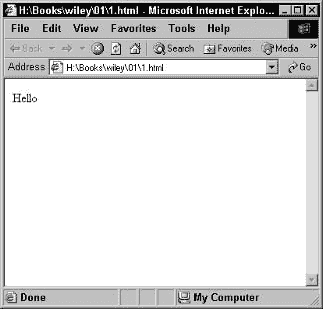

**4.** 为 `<script>` 标签指定 JavaScript 作为语言：

```html
<body>
<script language="JavaScript">
</script>
</body>
```

**5.** 在脚本块中放置任意 JavaScript 代码，使最终代码如清单 1-1 所示。

```html
<body>
<script language="JavaScript">
document.write("Hello");
</script>
</body>
```

**清单 1-1：** 创建脚本块。

**6.** 保存文件。

**7.** 在浏览器中打开该文件。你应该能在浏览器中看到单词“Hello”，如图 1-1 所示。

***交叉引用***

- 此处的 JavaScript 代码使用 `document.write` 向浏览器窗口输出文本。`document.write` 将在任务 9 中更深入地介绍，并在任务 45 中更详细地讨论。

**图 1-1：** 脚本代码可以放置在文档中的任何位置，包括文档主体中。

### 任务 2：隐藏你的 JavaScript 代码

任务 1 展示了如何将 JavaScript 代码嵌入到文档中。例如，以下代码在 HTML 文档主体中嵌入了一行 JavaScript 代码：

```html
<body>
<script language="JavaScript">
document.write("Hello");
</script>
</body>
```

**注意**

- 幸运的是，JavaScript 使用与 HTML 不同的注释语法，因此你可以使用 HTML 注释来隐藏 JavaScript 代码，而不会阻止支持 JavaScript 的浏览器执行该代码。
- 在开头源代码的结束 `-->` 中（在步骤 5 中讨论），你会看到它前面有两个斜杠。这表示一个 JavaScript 注释。这里发生的情况是，一旦脚本块中出现第一行 JavaScript，后续所有行都被假定为 JavaScript 代码。双斜杠是一个 JavaScript 注释，用于隐藏结束的 HTML 注释，使其不被当作 JavaScript 处理；否则，由于浏览器会将结束的 HTML 注释视为 JavaScript，就会发生 JavaScript 错误。JavaScript 注释将在任务 5 中讨论。

然而，这段代码存在一个根本问题：如果页面在不支持 JavaScript 的浏览器中打开，或者用户在其浏览器中禁用了 JavaScript，则用户可能会看到代码本身，具体取决于其使用的浏览器。

为了解决这个问题，你需要在脚本块中使用 HTML 注释来对这些浏览器隐藏代码。

HTML 注释的工作方式如下：

```html
<!-- 一行或多行注释写在这里 -->
```

在 JavaScript 脚本的上下文中使用时，你会看到以下内容：

```html
<body>
<script language="JavaScript">
<!--
document.write("Hello");
// -->
</script>
</body>
```

以下步骤展示了如何在文档主体中创建一个包含这些注释的脚本块：

**1.** 在你偏好的 HTML 或文本编辑器中打开一个新的 HTML 文档。

**2.** 使用开始和结束的 `<body>` 标签创建文档主体：

```html
<body>
</body>
```

**3.** 在文档主体中插入一个脚本块：

```html
<script>
</script>
```

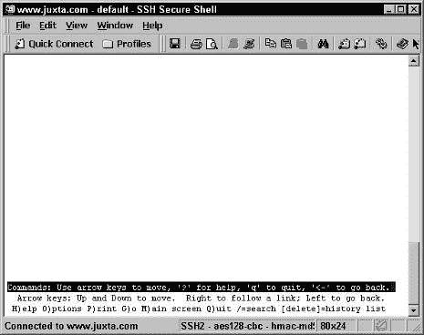

**4.** 为 `<script>` 标签指定 JavaScript 作为语言：

```html
<script language="JavaScript">
```

**5.** 在脚本块中放置开始和结束的 HTML 注释：

```html
<!--
// -->
```

**6.** 在脚本块中放置任意 JavaScript 代码，使最终代码如清单 2-1 所示。

```html
<body>
<script language="JavaScript">
<!--
document.write("Hello");
// -->
</script>
</body>
```

**清单 2-1：** 创建脚本块。

**7.** 保存文件。

**8.** 在支持 JavaScript 的浏览器中打开该文件。你应该能在浏览器中看到单词“Hello”。在不支持 JavaScript 的浏览器中打开，你应该什么也看不到，如图 2-1 所示。

**图 2-1：** 脚本代码对不支持 JavaScript 的浏览器隐藏，并且不显示。

### 任务 3：为你的 JavaScript 代码提供替代方案

在任务 2 中，你了解了如何通过使用 HTML 注释对不支持 JavaScript 的浏览器隐藏 JavaScript 代码。结果是，不支持 JavaScript 的浏览器在原本脚本块的位置什么也看不到。然而，在某些情况下，JavaScript 代码的目的对页面至关重要，需要告知不支持 JavaScript 的浏览器的用户他们错过了页面的这一重要部分。

幸运的是，有一个解决方案：`<noscript>` 标签。`<noscript>` 标签允许你指定仅在不支持 JavaScript 的浏览器中显示的 HTML。如果浏览器支持 JavaScript，它将忽略 `<noscript>` 块中的文本。

要使用它，你只需将任何为不支持 JavaScript 的浏览器准备的 HTML 放在开始和结束的 `<noscript>` 标签之间。以下步骤展示了如何在文档主体中嵌入脚本，并为不支持 JavaScript 的浏览器提供替代 HTML 显示：

**注意**

- `<noscript>` 标签的工作原理很简单：支持 JavaScript 的浏览器会识别该标签，并遵守它，不显示块内的文本。另一方面，较旧的不支持 JavaScript 的浏览器不会将该标签识别为有效的 HTML。按照浏览器的设计，它们会忽略不认识的标签，但开始和结束标签之间的所有内容不会被忽略，因此会在浏览器中显示。

**1.** 在你偏好的 HTML 或文本编辑器中打开一个新的 HTML 文档。

**2.** 使用开始和结束的 `<body>` 标签创建文档主体：

```html
<body>
</body>
```

**3.** 在文档主体中插入一个脚本块：

```html
<script>
</script>
```

**4.** 为 `<script>` 标签指定 JavaScript 作为语言：

```html
<script language="JavaScript">
```

**5.** 在脚本块中放置开始和结束的 HTML 注释：

```html
<!--
// -->
```

**警告**

- 仔细考虑是否要将页面限制为仅支持 JavaScript 的浏览器用户，这一点很重要。无论使用这些较旧浏览器的用户比例有多小，如果你这样做，都会排除一部分受众。

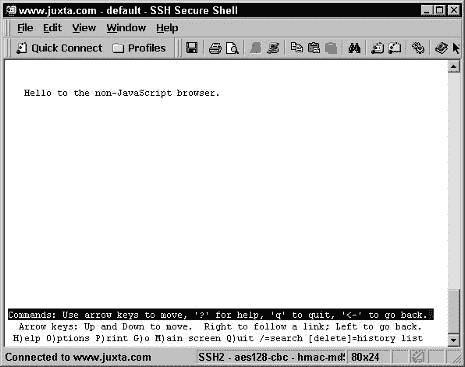

**6.** 在脚本块中放置任意 JavaScript 代码：

```javascript
document.write("Hello");
```

**7.** 在脚本块之后立即添加一个 `<noscript>` 块：

```html
<noscript>
</noscript>
```


8. 在 `noscript` 块中，放置要显示给不支持 JavaScript 的浏览器的文本：

```
<noscript>
Hello to the non-JavaScript browser.
</noscript>
```

9. 保存文件。

10. 在支持 JavaScript 的浏览器中打开该文件。你应该能在浏览器中看到单词“Hello”。在不支持 JavaScript 的浏览器中打开它，你应该会看到替代消息，如图 3-1 所示。

**图 3-1：** 其他浏览器会显示 `noscript` 块中的文本。

### 任务 4：包含外部源代码

当你开始更广泛地使用 JavaScript 时，你可能会发现有些情况下，你会在网站的多个页面上重复使用相同的 JavaScript 代码。例如，你可能正在用 JavaScript 创建一个所有页面通用的动态菜单。

在这些情况下，你肯定不希望在多份 HTML 文件中维护相同的代码。幸运的是，`script` 标签提供了一种机制，允许你将 JavaScript 存储在外部文件中，并将其包含到你的 HTML 文件中。这样，你可以构建并维护一个包含通用代码的 JavaScript 文件，然后简单地将其包含到多个 HTML 文件中。

这是通过 `script` 标签的 `src` 属性实现的，该属性允许你指定一个 JavaScript 文件的相对或绝对 URL，如下所示：

```
<script language="JavaScript" src="filename.js"></script>
```

下面的示例使用这种技术将一个外部 JavaScript 文件包含到 HTML 文档中：

> **注意：**
> - 即使脚本块中没有 JavaScript 代码，你仍然需要关闭 `script` 标签。否则，脚本标签之后的所有 HTML 代码都会被浏览器视为 JavaScript 而非 HTML。这可能会导致浏览器出错，并且你的页面肯定无法按预期显示。
> - 请注意，这个文件没有 `script` 标签。这将是一个外部 JavaScript 文件，而不是 HTML 文件。`script` 标签是一个 HTML 文件，用于标记 JavaScript 代码的位置。在 JavaScript 文件中，不需要这样的标记。

1. 在编辑器中，创建一个新文件，用于存放 JavaScript 文件的代码。

2. 在此文件中，输入你想要包含在外部 JavaScript 文件中的任何 JavaScript 代码：

```
// JavaScript Document
document.write("Hello");
```

3. 将文件保存为 `4a.js` 并关闭文件。

4. 在编辑器中，创建一个新文件，用于存放 HTML 文件。

5. 使用开始和结束的 `body` 标签创建文档主体：

```
<body>
</body>
```

6. 在文档主体中，创建一个脚本块：

```
<body>
<script></script>
</body>
```


7. 在 `script` 标签的 `language` 属性中指定 JavaScript：

```
<body>
<script language="JavaScript"></script>
</body>
```

8. 使用 `script` 标签的 `src` 属性包含之前在第 1 步到第 3 步中创建的 JavaScript 文件：

```
<body>
<script language="JavaScript" src="4a.js"></script>
</body>
```

> **提示：** 约定是使用 `.js` 扩展名来命名 JavaScript 文件。

9. 保存文件并关闭它。

10. 在浏览器中打开 HTML 文件。浏览器窗口中应该会出现单词“Hello”，如图 4-1 所示。

**图 4-1：** 包含外部脚本文件。

### 任务 5：为脚本添加注释

之前任务中看到的所有脚本示例都很简短。最多只有几行。然而，随着你技能的提高，你可能会构建长而复杂的脚本。为了确保其他开发者能够理解你的脚本，也为了在你一段时间后重新查看代码时提醒自己当时的思路，你应该在代码中插入注释，解释代码为何如此设计。

JavaScript 提供了两种注释：

- 单行注释，从行中任意位置开始，一直持续到行尾。因此，以下两种都是有效的单行注释：

```
// 这是一个注释
document.write("Hello"); // 这是一个注释
```

- 多行注释，以 `/*` 开头，以 `*/` 结尾。以下是一个多行注释的示例：

```
/*
所有这些都是
注释
*/
```

你可以在 JavaScript 代码中包含任意数量的注释，可多可少。

下面的示例构建了一个简单的 HTML 页面，其中包含一个带有两条注释的 JavaScript 脚本：

> **注意：** 在第二个单行注释示例中，注释从双斜杠开始，因此 `document.write` 命令不属于注释的一部分。

1. 在你喜欢的 HTML 或文本编辑器中打开一个新的 HTML 文档。

2. 使用开始和结束的 `body` 标签创建文档主体：

```
<body>
</body>
```

3. 在文档主体中插入一个脚本块：

```
<script>
</script>
```

4. 为 `script` 标签指定 JavaScript 作为语言：

```
<script language="JavaScript">
```

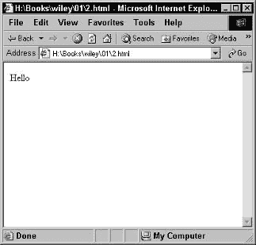

5. 在脚本块中放置任何 JavaScript 代码：

```
document.write("Hello");
```

6. 在 `document.write` 命令之前添加一条单行注释：

```
// 这是一条单行注释
document.write("Hello");
```

7. 在 `document.write` 命令之后添加一条多行注释，使最终的脚本如清单 5-1 所示。

```
<body>
<script language="JavaScript">
// 这是一条单行注释
document.write("Hello");
/*
这是一条多行
注释
*/
</script>
</body>
```

> **提示：** 为代码添加注释被认为是良好的编程实践，无论你使用哪种编程语言。编写清晰、简洁、有意义的注释来描述你的代码，可以让与你合作的开发者理解你的代码。此外，它们也能帮助你：如果你在长时间后重新查看代码，它们会提醒你构建程序或脚本时所用的逻辑。

**清单 5-1：** 使用注释。

8. 保存文件。

9. 在浏览器中打开文件。你应该能在浏览器中看到单词“Hello”，如图 5-1 所示。

**图 5-1：** 只有不属于注释的 JavaScript 代码才会被执行。

### 任务 6：编写 JavaScript 命令

在之前的任务中，你已经看到了 JavaScript 命令的示例。所有 JavaScript 脚本都由一系列命令组成。在最基本的形式中，命令是一组以分号结尾的 JavaScript 代码。例如，以下所有内容都可以被视为命令：

```
var a = "Yes";
document.write("Hello");
result = window.confirm(a);
```

你可以以几乎任何方式将这些命令串联起来：

- 逐行：

```
var a = "Yes";
document.write("Hello");
result = window.confirm(a);
```

- 在同一行：

```
var a = "Yes"; document.write("Hello"); result = window.confirm(a);
```

- 任意组合：

```
var a = "Yes"; document.write("Hello");
result = window.confirm(a);
```

> **注意：**
> - JavaScript 程序（或脚本）本质上是一系列按顺序或按特定顺序执行的命令。
> - 命令没有特定的格式。它们可能像第一个示例那样赋值，可能像第二个示例那样简单地调用方法，也可能像第三个示例那样为了赋值而调用方法。但它们都是 JavaScript 命令。

以下任务演示了一个包含三条命令的脚本：

1. 在你喜欢的 HTML 或文本编辑器中打开一个新的 HTML 文档。

2. 使用开始和结束的 `body` 标签创建文档主体：

```
<body>
</body>
```

3. 在文档主体中插入一个脚本块：

```
<script>
</script>
```

4. 为 `script` 标签指定 JavaScript 作为语言：

```
<script language="JavaScript">
```


**5.** 在脚本块中放置开闭的 HTML 注释：

```
<!--
// -->
```

**6.** 在脚本块中创建第一条命令。确保命令以分号结尾：

```
document.write("Hello");
```

**7.** 创建第二条命令，以分号结尾：

```
document.write("Hello");
document.write(" there");
```

**8.** 最后，将第三条命令添加到脚本中，使最终页面如清单 6-1 所示。

```
<body>
<script language="JavaScript">
<!--
document.write("Hello");
document.write(" there");
document.write(".");
// -->
</script>
</body>
```

**清单 6-1：** 在脚本中放置三条命令。

**9.** 保存文件。

**10.** 在支持 JavaScript 的浏览器中打开该文件。你应该会在浏览器中看到短语“Hello there.”，如图 6-1 所示。

**图 6-1：** 三条命令按顺序执行。

### 临时从脚本中移除命令

有时，当你处理一些特别复杂的 JavaScript 代码，或者遇到一个难以定位的 bug 时，你需要逐行删除代码，直到找出导致问题的代码行。

***备注***
* 调试是指查找并消除代码中问题的行为；这些问题被称为 bug，可能从简单的拼写错误到脚本逻辑中难以察觉的问题。
* 注释掉代码行并不是唯一的调试技术。还有许多其他调试方法，包括使用专门设计的调试工具。这些是本书未涉及的高级主题。

然而，你并不想真正删除那一行，因为一旦你找到并修复了问题，你需要重新创建所有删除的行。这时注释就派上用场了。

例如，在以下代码中，第二行不会被执行，因为 `document.write` 命令位于双斜杠之后：

```
var myVariable = "Hello";
//document.write("Hello");
```

实际上，如果浏览器单独执行这段代码，什么也不会显示，因为唯一用于向浏览器输出内容的命令被注释掉了。

以下任务从一个已有的脚本开始，展示了注释掉脚本部分内容的效果。该任务从任务 6 的脚本开始。

**1.** 打开任务 6 中的脚本。

**2.** 通过在第二条命令前添加双斜杠来注释掉它：

```
document.write("Hello");
// document.write(" there");
document.write(".");
```

**3.** 保存文件并在浏览器中打开。你应该只会看到单词“Hello .”，如图 7-1 所示。由于注释，第二条命令不会执行。

**4.** 继续编辑文件，并同样注释掉第一条命令：

```
// document.write("Hello");
// document.write(" there");
document.write(".");
```

**图 7-1：** 第二条命令被注释掉。

**5.** 保存文件并在浏览器中打开。你应该只会看到一个点，如图 7-2 所示。

**图 7-2：** 两条命令被注释掉。

**6.** 继续编辑文件，移除两个双斜杠。在第一条命令前放置 `/*`，在最后一条命令后放置 `*/`：

```
/* document.write("Hello");
document.write(" there");
document.write(".");*/
```

***交叉引用***
* 注释在任务 5 中介绍过。它们允许你隐藏脚本的部分内容，使其不作为 JavaScript 执行。

**7.** 保存文件并在浏览器中打开。你应该会看到一个空窗口，因为所有命令现在都包含在一个多行注释中。

### 使用花括号

除了像任务 7 中看到的以分号结尾的简单命令外，JavaScript 还支持复合命令的概念。*复合命令*是一组命令，它们被当作单个命令处理，可以在 JavaScript 需要单个命令的任何地方使用。

例如，考虑 JavaScript 中的一个条件。你可以按如下方式构建一个条件操作：

```
if (condition) command
```

这条语句的基本逻辑是：如果条件为真，则执行该命令。

对于命令，你有两种选择：使用一个以分号结尾的单个命令，或者使用多个捆绑在一起的命令作为一个整体。

使用单个命令时，你可能会有如下代码：`if (condition) document.write("Hello");`

这里，如果条件为真，则执行 `document.write`。

类似地，下面的示例将三条 `document.write` 命令组合成一个复合命令：

```
if (condition) {
    document.write("Hello");
    document.write(" there");
    document.write(".");
}
```

***注意***
* 入门源代码中的复合命令以左花括号开始，以右花括号结束。从开括号到闭括号的整个包被视为一个单一命令，用于诸如 `if` 语句等场合。

以下示例展示了如何使用花括号构建复合命令：

**1.** 在你喜欢的 HTML 或文本编辑器中打开一个新的 HTML 文档。

**2.** 使用开闭的 body 标签创建文档的主体：

```
<body>
</body>
```

**3.** 在文档主体中插入一个脚本块：

```
<script>
</script>
```

**4.** 为 script 标签指定 JavaScript 作为语言：

```
<script language="JavaScript">
```

**5.** 在脚本块中放置开闭的 HTML 注释：

```
<!--
// -->
```

**6.** 在脚本块中创建第一条命令。确保命令以分号结尾：

```
document.write("Hello");
```

**7.** 创建第二条命令，以分号结尾：

```
document.write("Hello");
document.write(" there");
```

**8.** 最后，在两条命令前后分别放置开闭的花括号，使最终脚本如清单 8-1 所示：

```
<body>
<script language="JavaScript">
<!--
{
document.write("Hello");
document.write(" there");
}
// -->
</script>
</body>
```

**清单 8-1：** 由两条命令构建的复合命令。

**9.** 保存文件。

**10.** 在支持 JavaScript 的浏览器中打开该文件。你应该会在浏览器中看到短语“Hello there”。

***交叉引用***
* 条件和 `if` 语句在任务 34 中介绍。这里我们不讨论具体的条件。

### 向浏览器输出内容

JavaScript 最实用的方面之一，是能够从脚本中将文本和 HTML 输出到浏览器的输出流中，从而使这些文本和 HTML 像文档实际 HTML 的一部分一样显示在浏览器中。

实现这一点的关键是 `document.write` 方法。`document.write` 方法将其参数中包含的任何文本或 HTML 输出到浏览器。

***备注***
* *参数*是传递给方法的任何值。*方法*是与对象关联的函数；当你使用它时，它会根据你提供的参数执行某些指定的功能。`document` 对象是与当前正在浏览器窗口中渲染的文档相关联的对象。
* 重要的是，无论

例如，如果你发出以下 `document.write` 命令：

```
document.write("<strong>Hello</strong>");
```

浏览器会接收到以下 HTML 并进行渲染：

```
<strong>Hello</strong>
```

需要记住的一个重要点是，`document.write` 在显示文本后不会输出任何换行类字符。这意味着如果你有


## JavaScript 基础

连续两条 `document.write` 命令，这两条命令的输出会紧挨在一起。为了说明这一点，请看下面这对命令：

```
document.write(“Hello”);
document.write(“Good-bye”);
```

发送到浏览器的只是参数中的文本，而 `document.write` 不会在输出的文本后添加任何换行符。

你可能会认为这会导致以下内容被发送到浏览器：

```
Hello
Good-bye
```

但实际上并非如此。发送的内容是：`HelloGood-bye`

为了解决这个问题，`document` 对象还提供了 `writeln` 方法。该方法会在输出文本后添加一个换行符。请看以下 JavaScript 代码：

```
document.writeln(“a”);
document.write(“b”);
```

这段代码发送到浏览器的内容为：

```
a
b
```

- 如果你查看介绍材料的末尾，就会发现关键在于使用 `document.writeln` 来输出字母 a。

### 任务 9：使用 document.write 和 document.writeln

以下任务演示了 `document.write` 和 `document.writeln` 方法的使用：

1. 在你偏好的 HTML 或文本编辑器中打开一个新的 HTML 文档。
2. 使用开始和结束的 body 标签创建文档主体，并在其中指定 pre 标签：

```
<body><pre>
</pre></body>
```

3. 在文档主体中插入一个脚本块：

```
<script>
</script>
```

4. 为 script 标签指定 JavaScript 作为语言：

```
<script language=”JavaScript”>
```

5. 在脚本块中放置开始和结束的 HTML 注释：

```
<!--
// -->
```

6. 在脚本块中创建一系列 `document.write` 和 `document.writeln` 命令。最终页面应如清单 9-1 所示。

```
<body><pre>
<script language=”JavaScript”>
<!--
document.write(“He”);
document.writeln(“llo”);
document.write(“there”);
// -->
</script>
</pre></body>
```

**清单 9-1：** 使用 `document.write` 和 `document.writeln`。

7. 保存文件。
8. 在支持 JavaScript 的浏览器中打开该文件。你应该会在浏览器中看到短语“Hello there”。

### 任务 10：创建变量

编程中的一个关键概念是*变量*。与许多其他编程语言一样，JavaScript 也有变量。变量可以看作是有名称的容器。你可以将数据放入这些容器中，然后只需通过容器的名称来引用数据。通过一个简单的赋值操作即可创建变量：

```
变量名 = 一些数据;
```

例如，你可以创建一个名为 `day` 的变量，并将值 `Tuesday` 赋给它：

```
day = “Tuesday”;
```

作为良好的编程实践，你还应该在首次使用变量时声明它。声明变量有助于浏览器高效准确地处理和管理变量。要声明变量，只需使用 JavaScript 语句 `var`：

```
var myVariable;
```

这声明了一个名为 `myVariable` 的变量，但没有给它赋值。你可以在后续的 JavaScript 命令中为其赋值：

```
var myVariable;
...
myVariable = “*某个值*”;
```

如果你想立即声明变量并赋值，可以使用快捷方式一步完成：

```
var myVariable = “*某个值*”;
```

你也可以多次给变量赋值，每次赋值都会用新值替换变量的旧值。例如，考虑以下代码：

```
var day = “Tuesday”;
day = “Thursday”;
day = “Monday”;
```

这段代码执行完毕后，`day` 变量的值为 `Monday`。

***注意***
- 在此脚本中，你没有向浏览器生成输出。你只是创建了一个变量（参见步骤 3）。通常的做法是将所有 JavaScript 脚本放在 HTML 文档的头部，而只将用于向浏览器生成输出的 JavaScript 代码放在文档主体中。

***警告***
- 在选择变量名时需要小心。名称可以包含字母、数字和下划线字符（`_`）。并且名称应以字母开头。

***提示***
- 虽然不声明变量也能运行，但声明变量并无坏处，而且是一种良好的编程实践（参见介绍段落）。

以下步骤展示了如何在 HTML 文档的头部创建一个实际的变量：

1. 在编辑器中创建一个新的 HTML 文档。

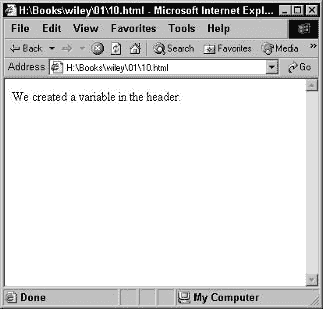

2. 在文档的头部创建一个脚本块：

```
<head>
<script language=”JavaScript”>
</script>
</head>
```

3. 在脚本块中创建名为 `myVariable` 的变量并为其赋值：

```
var myVariable = “Hello”;
```

4. 为文档创建一个主体，以显示你想在浏览器中呈现的任何 HTML。最终页面如清单 10-1 所示。

```
<head>
<script language=”JavaScript”>
var myVariable = “Hello”;
</script>
</head>
<body>
我们在头部创建了一个变量。
</body>
```

**清单 10-1：** 创建变量。

5. 保存文件并关闭。
6. 在浏览器中打开该文件。你应该只会看到文档的主体，如图 10-1 所示。

**图 10-1：** 在 JavaScript 中创建变量不会向浏览器产生任何输出。

### 任务 11：输出变量

变量（在任务 10 中介绍）是存储值的容器。你可以在任何通常使用这些值的地方使用它们。文本字符串就是一个很好的例子。

例如，你可以使用 `document.write` 方法向浏览器输出文本字符串。完全可以将一个文本字符串赋值给一个变量，然后使用该变量来输出这段文本。你只需将变量作为参数传递给 `document.write` 方法，代替原来的文本字符串：

```
document.write(myVariable);
```

这将输出变量 `myVariable` 的内容。

***注意***
- 变量是命名的容器，你可以在其中存储数据。然后你可以通过容器的名称在脚本中引用这些数据。

***交叉引用***
- 你会注意到 `myVariable` 周围没有引号（参见介绍段落）。如任务 12 所述，引号表示文本字符串；当输出变量的内容时，不要使用引号。否则，输出的是变量名。

以下示例展示了如何设置变量并在脚本中输出它：

1. 在你偏好的 HTML 或文本编辑器中打开一个新的 HTML 文档。
2. 使用开始和结束的 body 标签创建文档主体：

```
<body>
</body>
```

3. 在文档主体中插入一个脚本块：

```
<body>
<script>
</script>
</body>
```

4. 为 script 标签指定 JavaScript 作为语言：

```
<body>
<script language=”JavaScript”>
</script>
</body>
```

5. 在脚本块中放置开始和结束的 HTML 注释：

```
<body>
<script language=”JavaScript”>
<!--
// -->
</script>
</body>
```


6. 创建一个名为 `myVariable` 的变量，并为其赋一个文本字符串：

```
<body>
<script language=”JavaScript”>
<!--
var myVariable = “Hello”;
// -->
</script>
</body>
```

7. 使用 `document.write` 输出变量的内容，使最终代码如清单 11-1 所示。

```
<body>
<script language=”JavaScript”>
<!--
var myVariable = “Hello”;
document.write(myVariable);
// -->
</script>
</body>
```

**清单 11-1：** 输出变量。

8. 保存文件。
9. 在支持 JavaScript 的浏览器中打开该文件。你应该会在浏览器中看到单词“Hello”，如图 11-1 所示。

**图 11-1：** 输出的是变量的内容，而不是它的名称。


## 第一部分

## JavaScript 基础

#### 任务 12：创建字符串

在 JavaScript 中处理数据和变量时，需要注意所使用的数据类型。不同的数据类型以不同的方式管理，理解一些基本数据类型非常重要。

其中一种数据类型是字符串。*字符串*指的是任何可以包含字母、数字和标点符号的文本序列。在 JavaScript 中指定文本字符串时，需要用单引号或双引号将字符串括起来。例如，以下是有效的字符串：

`"Hello there"`
`'My Phone number is 123-456-7890'`

但以下不是有效的文本字符串：

`"Hello'`
`What is your name?`

在第一种情况下，开头的引号是双引号，但结尾的是单引号；你可以使用单引号或双引号，但开头和结尾必须匹配。

你在不同的上下文中使用这些字符串——例如，作为函数或方法的参数：

`document.write("This is a string");`

你也将它们用作赋给变量的值：

`var aVar = "This is a string";`

在这两种情况下，如果没有用引号将字符串括起来，浏览器实际上会显示错误，因为它会将字符串视为 JavaScript 代码，而字符串中的文本不是有效的 JavaScript 代码。

**注意：** JavaScript 中有多种不同的数据类型。最基本的类型是数字（数值）、字符串（文本）和布尔值（二元的、非此即彼的值，通常表示为 true/false 或 1/0）。

以下任务展示了在脚本中创建包含字符串值的变量：

1. 在你喜欢的 HTML 或文本编辑器中打开一个新的 HTML 文档。
2. 使用开始和结束的 body 标签创建文档的主体：
   ```
   <body>
   </body>
   ```
3. 在文档的主体中插入一个脚本块：
   ```
   <body>
   <script>
   </script>
   </body>
   ```
4. 将 JavaScript 指定为 script 标签的语言：
   ```
   <body>
   <script language="JavaScript">
   </script>
   </body>
   ```
5. 在脚本块中放置开始和结束的 HTML 注释：
   ```
   <body>
   <script language="JavaScript">
   <!--
   // -->
   </script>
   </body>
   ```
6. 创建一个名为`myVariable`的变量，并为其分配一个文本字符串：
   ```
   <body>
   <script language="JavaScript">
   <!--
   var myVariable = "Hello";
   // -->
   </script>
   </body>
   ```
7. 保存文件并关闭。

**交叉引用：** 任务 10 介绍了变量的创建。

#### 任务 13：创建数字变量

在 JavaScript 中处理数据和变量时，需要注意所使用的数据类型。不同的数据类型以不同的方式管理，理解一些基本数据类型非常重要。

其中一种数据类型是数字。*数字*指的是任何正数或负数，只包含数字、负号和小数点。在 JavaScript 中指定数字时，不应使用单引号或双引号将其括起来；如果这样做，它将被视为文本字符串而不是数字。例如，以下是有效的数字：

`100`
`-152.56`

但以下不是有效的文本字符串：

`"250.3"`
`ab32`

在第一种情况下，引号使该值成为文本字符串，而在第二种情况下，字母意味着这不是一个有效的数值。

你在不同的上下文中使用这些数字——例如，作为函数或方法的参数：

`document.write(375);`

你也将它们用作赋给变量的值：

`var aVar = 375;`

**注意：** JavaScript 中有多种不同的数据类型。最基本的类型是数字（数值）、字符串（文本）和布尔值（二元的、非此即彼的值，通常表示为 true/false 或 1/0）。

以下任务展示了如何在脚本中创建包含数字值的变量：

1. 在你喜欢的 HTML 或文本编辑器中打开一个新的 HTML 文档。
2. 使用开始和结束的 body 标签创建文档的主体：
   ```
   <body>
   </body>
   ```
3. 在文档的主体中插入一个脚本块：
   ```
   <body>
   <script>
   </script>
   </body>
   ```
4. 将 JavaScript 指定为 script 标签的语言：
   ```
   <body>
   <script language="JavaScript">
   </script>
   </body>
   ```
5. 在脚本块中放置开始和结束的 HTML 注释：
   ```
   <body>
   <script language="JavaScript">
   <!--
   // -->
   </script>
   </body>
   ```
6. 创建一个名为`myVariable`的变量，并为其分配一个数字：
   ```
   <body>
   <script language="JavaScript">
   <!--
   var myVariable = 100;
   // -->
   </script>
   </body>
   ```
7. 保存文件并关闭。

#### 任务 14：执行数学运算

在 JavaScript 中处理数值时，你可以对数字进行数学运算。你不仅可以进行加、减、乘、除，还可以执行其他高级数学计算。

四种基本数学运算如下：

- **加法：** 例如，`10 + 20`
- **减法：** 例如，`20 – 10`
- **乘法：** 例如，`10 * 20`
- **除法：** 例如，`20 / 10`

此外，你可以使用这些运算的组合来构建复杂的数学表达式。例如，以下表达式从 100 除以 5 的结果中减去 10：

`100 / 5 – 10`

你可以使用括号覆盖运算顺序。考虑以下数学表达式：

`100 / (5 – 10)`

这将计算 100 除以（5 减去 10 的结果）的值。

**注意：** 在这类复杂表达式中，运算按照标准数学顺序求值，即先计算乘除，后计算加减。

关于这类数学表达式，有两点需要注意：

- 你可以在 JavaScript 期望单个数值的任何地方使用它们。例如，你可以将表达式的结果赋给一个变量：`var myVariable = 100 / 5;`
- 你可以在数学表达式中的任何地方使用包含数值的变量来代替实际数字。例如，如果`thisVar`是一个值为 5 的变量，那么以下 JavaScript 代码的结果与前面的示例相同：`var myVariable = 100 / thisVar;`

以下任务通过使用变量和数学运算计算并显示 100 加 200 的结果：

1. 在你喜欢的 HTML 或文本编辑器中打开一个新的 HTML 文档。
2. 使用开始和结束的 body 标签创建文档的主体：
   ```
   <body>
   </body>
   ```
3. 在文档的主体中插入一个脚本块：
   ```
   <script language="JavaScript">
   <!--
   // -->
   </script>
   ```
4. 创建一个名为`myVariable`的变量，并为其赋值 100：
   ```
   var myVariable = 100;
   ```
   **提示：** 表达式是一种强大的编程概念，在许多语言中都有，包括 JavaScript。它们可以是数学表达式，如本任务所示，也可以涉及任何其他数据类型，如字符串。但核心很简单：表达式是对一个或多个值执行一个或多个操作的规范；表达式中的完整操作集最终必须...
5. 创建第二个名为`anotherVariable`的变量，并为其赋值 200：
   ```
   var anotherVariable = 200;
   ```
6. 将`myVariable`和`anotherVariable`的值相加，并将结果赋给第三个名为`finalResults`的变量：
   ```
   var finalResults = myVariable + anotherVariable;
   ```
7. 显示结果，使最终页面看起来像清单 14-1：
   ```
   <body>
   ```


## 第一部分

### 任务 15：连接字符串

对于文本字符串，你不能执行像任务 14 中描述的数字那样的数学运算。文本字符串最常见的操作是连接。*连接*指的是将两个文本字符串合并成一个更长的文本字符串的行为。例如，以下将字符串“ab”和“cd”合并成组合字符串“abcd”：

***注意***
- 在处理字符串时，请记住加号不再具有数学意义；相反，它表示应执行连接操作。

与数字数学运算一样，关于连接有两点需要注意：

- 你可以在 JavaScript 期望单个字符串值的任何地方使用连接。例如，你可以将连接的结果赋值给一个变量：

```
var myVariable = “ab” + “cd”;
```

- 你可以在连接中的任何位置使用包含字符串值的变量来代替实际字符串。例如，如果`thisVar`是一个值为“cd”的变量，那么以下 JavaScript 代码的结果与前面的示例相同：

```
var myVariable = “ab” + thisVar;
```

以下任务连接存储在变量中的两个字符串并显示结果：

**1.** 在你喜欢的 HTML 或文本编辑器中打开一个新的 HTML 文档。

**2.** 使用开闭 body 标签创建文档的主体：

```
<body>
</body>
```

**3.** 在文档主体中插入一个脚本块：

```
<script language=”JavaScript”>
<!--
// -->
</script>
```

**4.** 创建一个名为`myVariable`的变量，并将值“Hello”赋给它：

```
var myVariable = “Hello”;
```

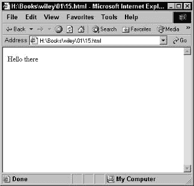

**5.** 创建第二个名为`anotherVariable`的变量，并将值“there”赋给它：

```
var anotherVariable = “there”;
```

**6.** 连接`myVariable`和`anotherVariable`的值，并在它们之间加上一个空格，然后将结果赋值给第三个名为`finalResults`的变量：

```
var finalResults = myVariable + “ “ + anotherVariable;
```

***提示***
- 这些连接示例是表达式。表达式是一种强大的编程概念，在许多语言中都有，包括 JavaScript。它们可以是数学的，如本任务所示，也可以涉及任何其他数据类型，如字符串。但核心很简单：表达式是对一个或多个值执行一个或多个操作的规范；表达式中的完整操作集最终必须求值为单个值。这意味着表达式可以在任何使用离散值的地方使用。

**7.** 显示结果，使最终页面看起来像清单 15-1。

```
<body>
<script language=”JavaScript”>
<!--
var myVariable = “Hello”;
var anotherVariable = “there”;
var finalResults = myVariable + “ “ + anotherVariable;
document.write(finalResults);
// -->
</script>
</body>
```

**清单 15-1：** 使用连接。

**8.** 保存文件并关闭它。

**9.** 在浏览器中打开文件。你应该会看到字符串“Hello there”显示在浏览器中，如图 15-1 所示。

***交叉引用***
- 在任何可以使用字符串的地方，你都可以使用像本任务示例中的连接表达式。例如，你可以将连接表达式作为`document.write`方法的参数，该方法在任务 9 中介绍过。

**图 15-1：** 显示连接结果。

---

### 任务 16：在字符串中搜索文本

在处理文本字符串时，有时你需要确定一个字符串是否包含某个特定的子字符串，如果包含，你需要确定该子字符串在字符串中的位置。

例如，如果你有字符串“what is happening here”，并且你搜索子字符串“is”，你希望知道该字符串包含“is”，同时也知道“is”出现的位置。你可以使用字符串对象的`search`方法执行此类搜索。

***注意***
- 当你创建一个字符串值时，会创建一个与该字符串关联的属性和方法的对象，你可以访问这些属性和方法。假设你已经将字符串赋值给一个变量，你可以通过`variableName.propertyName`和`variableName.methodName`来访问它们。
- 如果你数一下，你会看到“is”从字符串的第六个字符开始。但 JavaScript 和许多编程语言一样，从零开始计数，所以第一个字符在位置 0，第二个在位置 1，依此类推。因此，第六个字符在位置 5，这就是`search`方法返回的数字。
- 如果未找到子字符串，则`search`方法返回-1 作为位置。
- 显示数字 6（见步骤 8），因为“there”从第七个字符开始。

执行此搜索很简单。如果“what is happening here”存储在变量`testVariable`中，你可以使用以下代码搜索“is”：

```
testVariable.search(“is”);
```

该方法返回一个数值，指示在字符串中找到“is”的位置。在这种情况下，该位置是 5。

以下任务在存储在变量中的另一个字符串中搜索子字符串，并显示找到该子字符串的位置：

**1.** 在你喜欢的 HTML 或文本编辑器中打开一个新的 HTML 文档。

**2.** 使用开闭 body 标签创建文档的主体：

```
<body>
</body>
```

**3.** 在文档主体中插入一个脚本块：

```
<script language=”JavaScript”>
<!--
// -->
</script>
```

**4.** 创建一个名为`myVariable`的变量，并将值“Hello there”赋给它：

```
var myVariable = “Hello there”;
```

**5.** 创建第二个名为`therePlace`的变量，并将搜索“there”的结果赋给它：

```
var therePlace = myVariable.search(“there”);
```

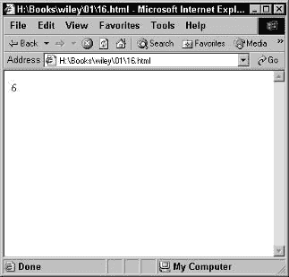

**6.** 显示搜索结果，使最终页面看起来像清单 16-1。

```
<body>
<script language=”JavaScript”>
<!--
var myVariable = “Hello there”;
var therePlace = myVariable.search(“there”);
document.write(therePlace);
// -->
</script>
</body>
```

**清单 16-1：** 搜索子字符串。

**7.** 保存文件并关闭它。

**8.** 在浏览器中打开文件。你应该会看到数字 6 显示在浏览器中，如图 16-1 所示。

**图 16-1：** 显示搜索子字符串的结果。

---

### 任务 17：替换字符串中的文本

在任务 16 中，你看到了可以在字符串中搜索文本。但有时，你会想要在字符串中搜索、查找并替换文本。字符串对象提供了`replace`方法用于此目的。

考虑一个名为`thisVar`的变量，包含字符串“Today is Monday”。你可以使用以下代码搜索并将“Monday”替换为“Friday”：

***注意***
- `replace`方法的工作方式与`search`方法基本相同，不同之处在于你必须提供两个字符串作为参数。

```
thisVar.replace(“Monday”,”Friday”);
```

(注意：任务 17 的原文似乎不完整。以上是提供的内容。)


## JavaScript 基础

当你使用 `replace` 方法时，该方法会返回一个新字符串，其中包含两个参数：第一个是要搜索的子字符串，第二个是用于替换的子字符串（假设找到了第一个子字符串）。原始字符串不会被修改。例如，考虑将上述替换的结果赋值给一个新变量：

```
var newVar = thisVar.replace("Monday","Friday");
```

在这种情况下，`thisVar` 将继续包含 “Today is Monday”，而 `newVar` 将包含 “Today is Friday”。

### 任务 17：搜索与替换

以下任务创建一个变量并为其分配文本，将该文本替换为新文本，然后在浏览器中显示结果：

**1.** 在你偏好的 HTML 或文本编辑器中打开一个新的 HTML 文档。

**2.** 使用开始和结束的 body 标签创建文档的主体：

    ```
    <body>
    </body>
    ```

**3.** 在文档主体中插入一个脚本块：

    ```
    <script language="JavaScript">
    <!--
    // -->
    </script>
    ```

**4.** 创建一个名为 `myVariable` 的变量，并将值 “Hello there” 赋给它：

    ```
    var myVariable = "Hello there";
    ```

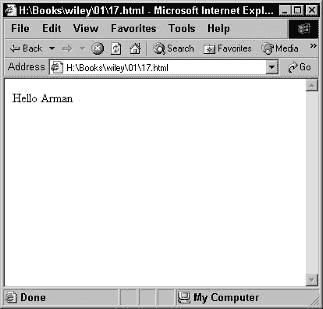

**5.** 创建第二个名为 `newVariable` 的变量，并将替换 “there” 为 “Arman” 的结果赋给它：

    ```
    var newVariable =
    myVariable.replace("there","Arman");
    ```

**6.** 显示搜索与替换的结果，使最终页面看起来像清单 17-1。

    ```
    <body>
    <script language="JavaScript">
    <!--
    var myVariable = "Hello there";
    var newVariable =
    myVariable.replace("there","Arman");
    document.write(newVariable);
    // -->
    </script>
    </body>
    ```

**清单 17-1：** 字符串中的搜索与替换。

**7.** 保存文件并关闭它。

**8.** 在浏览器中打开该文件。你应该会看到浏览器中显示文本 “Hello Arman”，如图 17-1 所示。

**图 17-1：** 显示搜索子字符串并替换后的结果。

### 格式化字符串

当你在 JavaScript 中创建一个文本字符串时，会有一个 `string` 对象与该字符串关联。`string` 对象提供了一系列方法，你可以用它们来调整字符串的格式。当你想要显示一个字符串并快速应用一些格式时，这会很有用。这些方法如下：

- `big`：返回包含在 `<big>` 标签中的字符串
- `blink`：返回包含在 `<blink>` 标签中的字符串
- `bold`：返回包含在 `<b>` 标签中的字符串
- `fixed`：返回包含在 `<tt>` 标签中的字符串（用于等宽显示）
- `fontcolor`：返回包含在 `<font>` 标签中的字符串，颜色属性设置为你指定的参数
- `fontsize`：返回包含在 `<font>` 标签中的字符串，大小属性设置为你指定的参数
- `italics`：返回包含在 `<i>` 标签中的字符串
- `small`：返回包含在 `<small>` 标签中的字符串
- `strike`：返回包含在 `<strike>` 标签中的字符串（用于删除线效果）
- `sub`：返回包含在 `<sub>` 标签中的字符串（用于下标效果）
- `sup`：返回包含在 `<sup>` 标签中的字符串（用于上标效果）
- `toLowerCase`：返回全部小写字符的字符串
- `toUpperCase`：返回全部大写字符的字符串

**注意：** 请注意，入门源代码中的每个 `document.write` 方法都会输出由其中一个格式化函数调整后的字符串，然后显示一个 `<br>` 标签，以便浏览器在单独的行上显示每个实例。如果没有这个标签，所有实例将显示在一行上。

假设你已经将一个字符串赋值给了一个变量，你可以按如下方式调用这些方法：

```
variableName.big();
variableName.fontcolor("red");
variableName.toLowerCase();
```

等等。

#### 任务 18：使用格式化方法显示字符串

以下任务使用每种方法显示同一个字符串：

**1.** 在你偏好的 HTML 或文本编辑器中打开一个新的 HTML 文档。

**2.** 使用开始和结束的 body 标签创建文档的主体：

    ```
    <body>
    </body>
    ```

**3.** 在文档主体中插入一个脚本块：

    ```
    <script language="JavaScript">
    <!--
    // -->
    </script>
    ```

**4.** 创建一个名为 `myVariable` 的变量，并将值 “Hello there” 赋给它：

    ```
    var myVariable = "Hello there";
    ```

**5.** 使用 `document.write` 方法显示变量经过每种格式化方法修改后的值，如清单 18-1 所示。

    ```
    <body>
    <script language="JavaScript">
    <!--
    var myVariable = "Hello there";
    document.write(myVariable.big() + "<br>");
    document.write(myVariable.blink() + "<br>");
    document.write(myVariable.bold() + "<br>");
    document.write(myVariable.fixed() + "<br>");
    document.write(myVariable.fontcolor("red") + "<br>");
    document.write(myVariable.fontsize("18pt") + "<br>");
    document.write(myVariable.italics() + "<br>");
    document.write(myVariable.small() + "<br>");
    document.write(myVariable.strike() + "<br>");
    document.write(myVariable.sub() + "<br>");
    document.write(myVariable.sup() + "<br>");
    document.write(myVariable.toLowerCase() + "<br>");
    document.write(myVariable.toUpperCase() + "<br>");
    // -->
    </script>
    </body>
    ```

**清单 18-1：** 使用字符串格式化函数。

**6.** 在浏览器中打开该文件。你应该会看到文本 “Hello there” 为每种格式化方法各显示一次。

### 对字符串应用多个格式化函数

在任务 18 中，你看到了如何手动对字符串应用格式化函数。不过，如果你愿意，也可以应用多个格式化。一种显而易见的方法是在每一步将新字符串赋值给一个变量：

```
var firstString = "My String";
var secondString = firstString.bold();
var thirdString = secondString.toLowerCase();
```

等等。在每一步将新字符串赋值给一个变量是可行的，但很繁琐，并且会创建比实际需要多得多的变量。

你可以利用这样一个事实来简化：每个格式化方法都返回一个字符串，该字符串本身也是一个对象，拥有自己的一组可调用的格式化方法。这允许你像这样将函数串联起来：

```
var firstString = "My String";
var finalString = firstString.bold().toLowerCase().fontcolor("red");
```

最终结果是将以下 HTML 存储在 `finalString` 中：

```
<font color="red"><b>my string</b></font>
```

#### 任务 19：应用多种样式

在以下任务中，你将获取一个字符串，并在显示之前对其应用加粗、斜体、着色和大小调整：

**1.** 在你偏好的 HTML 或文本编辑器中打开一个新的 HTML 文档。

**2.** 使用开始和结束的 body 标签创建文档的主体：

    ```
    <body>
    </body>
    ```

**3.** 在文档主体中插入一个脚本块：

    ```
    <script language="JavaScript">
    <!--
    // -->
    </script>
    ```

**4.** 创建一个名为 `myVariable` 的变量，并将值 “Hello there” 赋给它：

    ```
    var myVariable = "Hello there";
    ```

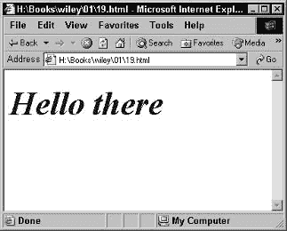

**5.** 对字符串应用加粗、斜体、着色和大小调整，并将结果赋值给 `newVariable`：

    ```
    var newVariable =
    myVariable.bold().italics().fontcolor("blue").fontsize
    ("24pt");
    ```

**6.** 使用 `document.write` 方法显示最终字符串，使最终页面看起来像清单 19-1。

    ```
    <body>
    <script language="JavaScript">
    <!--
    var myVariable = "Hello there";
    var newVariable =
    myVariable.bold().italics().fontcolor("blue").fontsize
    ("24pt");
    document.write(newVariable);
    // -->
    </script>
    </body>
    ```

**清单 19-1：** 应用多种样式。

**7.** 在浏览器中打开该文件。你应该会看到文本 “Hello there” 以应用的格式显示，如图 19-1 所示。

**图 19-1：** 显示应用了多种格式的字符串。


### 任务 20：创建数组

除了文本字符串和数字等简单数据类型外，JavaScript 还支持一种更复杂的数据类型，称为数组。*数组* 是将多个独立值组合在一起的集合。数组本质上包含一系列带编号的容器，你可以将值放入其中。每个容器可以包含字符串、数字或任何其他数据类型。

**注意**

- 数组中的容器通过 `arrayName[0]`、`arrayName[1]`、`arrayName[2]` 等来引用。每个单独的容器都可以像普通变量一样被操作和使用。你可以将数组想象成图 20-1 所示的样子：这里有一组盒子，每个盒子都有编号，每个盒子里面都有东西。盒子的编号就是每个盒子的索引，里面的值就是每个数组元素的值。
- 你可能已经注意到第一个容器的编号是 0。与许多编程语言一样，JavaScript 从零开始计数，因此数组中的第一个容器编号为 0。
- 数组中每个容器对应的数字（例如 0、1 或 2）称为 *索引*。
- 如果你创建一个包含 5 个元素的数组，那么这些元素的索引分别是 0、1、2、3 和 4。

**图 20-1：** 数组的可视化表示。

要创建一个新数组，你需要创建 `Array` 对象的一个新实例：

```javascript
var arrayName = new Array(number of elements);
```

其中元素数量只是数组中元素的初始数量；在操作数组时，你可以随时动态添加更多元素，但最好在初始化时指定可能用到的元素数量。然后通过 `arrayName` 来访问该数组。

以下任务在文档头部的一个脚本中创建了一个数组：

**任务 20**

1. 在你喜欢的 HTML 或文本编辑器中打开一个新的 HTML 文档。
2. 使用开始和结束 head 标签创建文档的头部：
   ```html
   <head>
   </head>
   ```
3. 在文档头部插入一个脚本块：
   ```html
   <head>
   <script language="JavaScript">
   <!--
   // -->
   </script>
   </head>
   ```
4. 创建一个名为 `myArray` 的变量，并将其初始化为一个包含五个元素的新数组：
   ```html
   <body>
   <script language="JavaScript">
   <!--
   var myArray = new Array(5);
   // -->
   </script>
   </body>
   ```
5. 保存文件并关闭。

### 任务 21：填充数组

任务 21 向你展示了如何创建数组。然而，除非你能用值填充数组的元素，否则数组并不是很有用。你可以通过向数组元素赋值来填充它们，就像向普通变量赋值一样：

```javascript
arrayName[0] = value 1;
arrayName[1] = value 2;
// 等等。
```

**注意：** 数组中每个容器的数值称为 *索引*。

此外，你实际上可以在创建数组的同时填充它；在创建数组时，你可以不指定要创建的元素数量，而是指定一个逗号分隔的值列表作为数组的元素：

```javascript
var arrayName = new Array(value 1, value 2, value 3, etc.)
```

以下任务演示了如何创建两个包含相同五个元素的数组。这两个数组使用两种不同的技术创建并填充。

1. 在你喜欢的 HTML 或文本编辑器中打开一个新的 HTML 文档。
2. 使用开始和结束 head 标签创建文档的头部：
   ```html
   <head>
   </head>
   ```
3. 在文档头部插入一个脚本块：
   ```html
   <head>
   <script language="JavaScript">
   <!--
   // -->
   </script>
   </head>
   ```
4. 创建一个名为 `myArray` 的变量，并将其初始化为一个包含五个元素的新数组：
   ```javascript
   var myArray = new Array(5);
   ```
5. 为五个元素赋值：
   ```javascript
   myArray[0] = "First Entry";
   myArray[1] = "Second Entry";
   myArray[2] = "Third Entry";
   myArray[3] = "Fourth Entry";
   myArray[4] = "Fifth Entry";
   ```
6. 创建第二个名为 `anotherArray` 的数组，并在创建时为其赋予五个值。最终的脚本应如清单 21-1 所示。

   **提示：**
   - 你不必按顺序填充元素，也可以将某些元素留空。例如，你可以按顺序填充数组的第五个、第一个和第二个元素，而将第三个和第四个元素留空。这完全没问题。
   - 除了字符串之外，你还可以将其他类型的值赋给数组元素。本例中我们恰好使用了字符串。如果你愿意，也可以将数字甚至其他数组作为数组元素的值。

   ```html
   <head>
   <script language="JavaScript">
   <!--
   var myArray = new Array(5);
   myArray[0] = "First Entry";
   myArray[1] = "Second Entry";
   myArray[2] = "Third Entry";
   myArray[3] = "Fourth Entry";
   myArray[4] = "Fifth Entry";

   var anotherArray = new Array("First Entry", "Second Entry", "Third Entry", "Fourth Entry", "Fifth Entry");
   // -->
   </script>
   </head>
   ```

   **清单 21-1：** 创建数组的两种方法。

7. 保存文件并关闭。

### 任务 22：对数组进行排序

一旦你按照任务 21 所述填充了数组，你可能会发现对数组中的元素进行排序很有用。有时你可能希望按照元素创建并添加到数组的顺序输出它们，但其他时候你可能希望它们按排序顺序输出。

数组对象提供了一个 `sort` 方法来实现这一点：它返回一个按排序顺序排列的逗号分隔的元素列表。排序按字母顺序或数字顺序升序进行，视情况而定。

要使用该方法，只需调用它：

```javascript
arrayName.sort();
```

**注意：** 请注意，在第 6 步中，`myArray.sort()` 方法被用作 `document.write` 方法的参数。后者期望一个字符串值作为参数，而前者正好返回这样一个字符串：包含排序后的元素列表。

以下任务创建一个包含五个元素的数组，然后按排序顺序显示这些元素：

1. 在你喜欢的 HTML 或文本编辑器中打开一个新的 HTML 文档。
2. 使用开始和结束 body 标签创建文档的主体：
   ```html
   <body>
   </body>
   ```
3. 在文档主体中插入一个脚本块：
   ```html
   <script language="JavaScript">
   <!--
   // -->
   </script>
   ```
4. 创建一个名为 `myArray` 的变量，并将其初始化为一个包含五个元素的新数组：
   ```javascript
   var myArray = new Array(5);
   ```
5. 为五个元素赋值：
   ```javascript
   myArray[0] = "z";
   myArray[1] = "c";
   myArray[2] = "d";
   myArray[3] = "a";
   myArray[4] = "q";
   ```
6. 使用 `document.write` 方法和 `sort` 方法输出排序后的元素列表，使最终的脚本如清单 22-1 所示。

   **交叉参考：** 创建数组的技术在任务 20 中讨论过。创建数组是向数组填充值的第一步，而填充值正是任务 21 的主题。

   ```html
   <body>
   <script language="JavaScript">
   <!--
   var myArray = new Array(5);
   myArray[0] = "z";
   myArray[1] = "c";
   myArray[2] = "d";
   myArray[3] = "a";
   myArray[4] = "q";

   document.write(myArray.sort());
   // -->
   </script>
   </body>
   ```

   **清单 22-1：** 显示排序后的数组。

7. 保存文件并关闭。
8. 在浏览器中打开该文件，你应该会看到一个按字母顺序排序的逗号分隔的元素列表，如图 22-1 所示。

**图 22-1：** 显示数组中排序后的元素列表。

### 任务：在分隔符处拆分字符串


## 第一部分
## JavaScript 基础

#### 任务 23：将列表拆分为数组

23 在编程中，处理以分隔符列表形式表示的数据并不罕见。*分隔列表*通常是一个字符串，其中包含由特定字符分隔的多个子字符串；每个子字符串都是列表中的一个元素。

例如，以下字符串包含三个由逗号分隔的元素：

***注意***

“第一个元素,第二个元素,第三个元素”

- 请注意，在第 8 步中，字母之间没有空格或其他分隔符。这是因为 `document.write` 方法在输出文本后不会插入任何类型的分隔符，并且你也没有添加任何 HTML 来创建分隔。

`string` 对象提供了 `split` 方法，你可以使用该方法在指定的分隔符处将字符串拆分为元素。这些元素随后被放入一个数组中，并由该方法返回该数组。

例如，考虑以下代码：

```
var thisVar = “第一个元素,第二个元素,第三个元素”;
var anotherVar = thisVar.split(“,”);
```

现在 `anotherVar` 是一个包含三个元素的数组。

以下任务通过将一个包含列表的字符串拆分为其组成元素，然后从结果数组中输出这些元素来说明这一点：

**1.** 在你喜欢的 HTML 或文本编辑器中打开一个新的 HTML 文档。

**2.** 使用开始和结束 body 标签创建文档的主体：

```
<body>
</body>
```

**3.** 在文档的主体中插入一个脚本块：

```
<script language=”JavaScript”>
<!--
// -->
</script>
```

**4.** 创建一个名为 `myVariable` 的变量，并为其分配一个逗号分隔的文本字符串：

```
var myVariable = “a,b,c,d”;
```

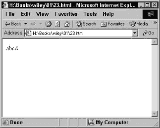

**5.** 使用 `split` 方法在逗号处拆分字符串，并将结果数组赋值给变量 `stringArray`：

```
var stringArray = myVariable.split(“,”);
```

**6.** 使用 `document.write` 方法输出数组的元素，使最终的脚本如清单 23-1 所示。

```
<body>
<script language=”JavaScript”>
<!--
var myVariable = “a,b,c,d”;
var stringArray = myVariable.split(“,”);
document.write(stringArray[0]);
document.write(stringArray[1]);
document.write(stringArray[2]);
document.write(stringArray[3]);
// -->
</script>
</body>
```

**清单 23-1：** 将列表拆分为数组。

**7.** 保存文件并关闭它。

**8.** 在浏览器中打开该文件，你应该会看到文本“abcd”，如图 23-1 所示。

***交叉引用***

- 数组的创建和填充在任务 20 和 21 中讨论。

**图 23-1：** 显示由逗号分隔列表构建的数组中的元素。

#### 任务 24：调用函数

24 在本书的许多任务中，你将看到调用函数或方法的示例。*函数*是一个自包含的过程或操作，你可以通过名称调用它。在调用时，你可以向函数提供数据（称为参数），然后函数根据其操作返回结果。

***注意***

- 方法除了与特定对象关联外，与函数相同。调用和使用它们在技术上是相同的。
- 当将函数作为其他函数的参数嵌入时，请注意括号，确保每个左括号都有对应的右括号。一个常见的错误是遗漏右括号，这会导致浏览器错误，并且在调试代码时有时很难识别。
- `Escape` 函数接受一个文本字符串作为参数，并以 URL 编码格式返回它。在 URL 编码格式中，URL 中无效的特殊字符（如空格和某些标点符号）会被转换为特殊代码。

要调用函数，只需使用以下形式：

```
functionName(参数 1, 参数 2, 等等);
```

如果函数不需要参数，你仍然需要括号：

```
functionName();
```

此外，如果函数返回一个值，你可以在任何使用其他文本或数值的地方使用该函数调用。例如，你可以将值赋给一个变量：

```
var variableName = functionName();
```

类似地，你可以将一个函数的结果用作另一个函数的参数：

```
function1Name(function2Name());
```

以下任务调用 JavaScript 的 `Escape` 函数，然后在浏览器中显示返回的结果：

**1.** 在你喜欢的 HTML 或文本编辑器中打开一个新的 HTML 文档。

**2.** 使用开始和结束 body 标签创建文档的主体：

```
<body>
</body>
```

**3.** 在文档的主体中插入一个脚本块：

```
<body>
<script language=”JavaScript”>
<!--
// -->
</script>
</body>
```

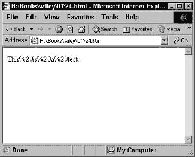

**4.** 调用 `Escape` 函数并传递一个文本字符串作为参数。将返回的字符串赋值给 `myVariable` 变量：

```
<head>
<script language=”JavaScript”>
<!--
var myVariable = Escape(“这是一个测试。”);
// -->
</script>
</head>
```

**5.** 使用 `document.write` 方法输出 `myVariable` 的值，使最终的脚本如清单 24-1 所示。

```
<body>
<script language=”JavaScript”>
<!--
var myVariable = Escape(“这是一个测试。”);
document.write(myVariable);
// -->
</script>
</body>
```

**清单 24-1：** 转义文本字符串。

**6.** 保存文件并关闭它。

**7.** 在浏览器中打开该文件，你应该会看到文本字符串的 URL 编码表示，如图 24-1 所示。

**图 24-1：** 一个 URL 编码的文本字符串。

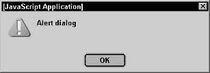

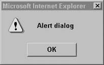

#### 任务 25：向用户发出警报

25 `window` 对象提供了 `alert` 方法，该方法允许你显示一个简单的对话框，其中包含一条文本消息，后跟一个按钮，用户可以使用该按钮确认消息并关闭对话框。

图 25-1 展示了 Microsoft Internet Explorer 中的警报对话框；图 25-2 展示了 Netscape 中的相同对话框。

***注意***

- 由 `window.alert` 方法创建的对话框非常通用，并且明确表明它们来自当前网页（Internet Explorer 在其标题栏中显示名称，而 Netscape 明确显示“JavaScript Application”）。这是出于安全考虑：你不能使用此方法弹出一个对话框，使其看起来不是当前页面中运行的 JavaScript 脚本的结果。
- 当警报对话框显示时（参见第 4 步），与浏览器窗口的交互将被阻止，直到用户通过单击对话框中的按钮关闭对话框。

**图 25-1：** Internet Explorer 中的警报对话框。

**图 25-2：** Netscape 中的警报对话框。

以下步骤展示了如何显示警报对话框：

**1.** 在你喜欢的 HTML 或文本编辑器中打开一个新的 HTML 文档。

**2.** 使用开始和结束 head 标签创建文档的头部：

```
<head>
</head>
```

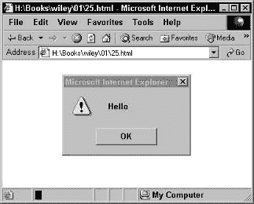

**3.** 在文档的头部插入一个脚本块：

```
<head>
<script language=”JavaScript”>
<!--
// -->
</script>
</head>
```

**4.** 调用 `window.alert` 方法在对话框中显示一条消息：

```
<head>
<script language=”JavaScript”>
<!--
window.alert(“你好”);
// -->
</script>
</head>
```

**5.** 保存文件并关闭它。

**6.** 在浏览器中打开该文件，你应该会看到一个如图 25-3 所示的对话框。

**图 25-3：** 显示警报对话框。

***交叉引用***

- 警报对话框是你可以用 JavaScript 创建的最简单的对话框。没有真正的用户交互；只有文本和一个用于关闭对话框的按钮。这使得它们适合显示消息。


## 第一部分
## JavaScript 基础
#### 任务 26：向用户确认


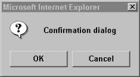

除了任务 25 中讨论的 `alert` 方法外，`window` 对象还提供了 `confirm` 方法，该方法允许你显示一个包含文本消息的对话框，后面跟着两个按钮，用户可以用它们来确认或拒绝消息并关闭对话框。通常这些按钮标记为“确定”和“取消”。

**注意**

- 图 26-1 展示了 Microsoft Internet Explorer 中的确认对话框；图 26-2 展示了 Netscape 中的相同对话框。由 `window.confirm` 方法创建的对话框非常通用，并且有明确的指示表明它们来自当前网页（Internet Explorer 在标题栏中显示其名称，而 Netscape 则明确显示“JavaScript Application”）。这样做是为了安全：你不能用这个方法弹出一个对话框，使其看起来像是当前页面中运行的 JavaScript 脚本以外的其他东西。

- `window.confirm` 方法返回一个值：如果用户点击“确定”则返回 `true`，如果用户点击“取消”则返回 `false`（参见步骤 4）。

**图 26-1：** Internet Explorer 中的确认对话框。
**图 26-2：** Netscape 中的确认对话框。

以下步骤展示了如何显示一个确认对话框，然后在浏览器中显示用户的选择：

1. 在你喜欢的 HTML 或文本编辑器中打开一个新的 HTML 文档。

2. 使用开始和结束的 body 标签创建文档的主体：
```
<body>
</body>
```

3. 在文档主体中插入一个脚本块：
```
<script language="JavaScript">
<!--
// -->
</script>
```

4. 调用 `window.confirm` 方法在对话框中显示一条消息；将方法返回的用户选择赋值给 `result` 变量：
```
<body>
<script language="JavaScript">
<!--
var result = window.confirm("点击确定继续");
// -->
</script>
</body>
```

5. 保存文件并关闭它。

6. 在浏览器中打开该文件，你应该会看到一个类似图 26-3 的对话框。


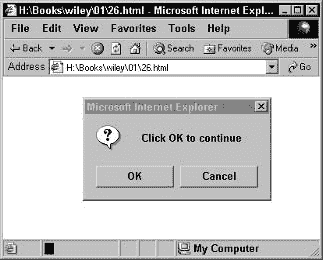

7. 如果你点击“确定”，你应该会在浏览器窗口中看到“true”，如图 26-4 所示。

**图 26-3：** 显示一个确认对话框。
**图 26-4：** 在浏览器窗口中显示用户的选择。

**交叉引用**

- 确认对话框只提供基本的用户交互；它们不允许用户输入任何数据。任务 117 说明了如何创建一个稍微复杂一点的对话框，其中包含一个文本输入字段供用户输入数据。

#### 任务 27：创建你自己的函数

JavaScript 不仅拥有大量的内置函数和方法，还允许你创建自己的函数。创建函数相当简单：

```
function functionName() {
你的函数代码写在这里
}
```

**注意**

- 这里的优势是，如果你的应用程序中有需要重复多次的任务或操作，你可以将其封装在一个函数中，然后多次调用该函数，而不是在应用程序中重复多次代码。

- 通常，你不会仅仅为了显示一个对话框而使用函数。你应该构建函数来执行更复杂的任务，这些任务需要在应用程序中重复多次。这里只是用来说明函数的创建。

以下任务创建了一个向浏览器输出“Hello”的函数，并调用该函数来显示文本：

1. 在你喜欢的 HTML 或文本编辑器中打开一个新的 HTML 文档。

2. 使用开始和结束的 head 标签创建文档的头部：
```
<head>
</head>
```

3. 在文档头部插入一个脚本块：
```
<script language="JavaScript">
<!--
// -->
</script>
```

4. 创建一个名为 `hello` 的函数，它不接受任何参数：
```
function head() {
}
```

5. 在函数中，使用 `document.write` 向浏览器输出“Hello”：
```
document.write("Hello");
```

6. 使用开始和结束的 body 标签创建文档的主体：
```
<body>
</body>
```

7. 在文档主体中插入一个脚本块：
```
<script language="JavaScript">
<!--
// -->
</script>
```

8. 在脚本块中调用 `hello` 函数，使最终页面看起来像清单 27-1。
```
<head>
<script language="JavaScript">
<!--
function head() {
document.write("Hello");
}
// -->
</script>
</head>
<body>
<script language="JavaScript">
<!--
hello();
// -->
</script>
</body>
```

9. 保存文件。

10. 在浏览器中打开该文件，你应该会在浏览器中看到“Hello”。

**交叉引用**

- 函数对数据执行操作并返回这些操作的结果。这意味着你需要将数据传递给函数（这在任务 28 中概述），并返回函数处理的结果（这在任务 29 中概述）。

#### 任务 28：向函数传递参数

任务 27 向你展示了如何创建一个函数，但该任务中创建的函数不接受任何参数。要创建一个接受参数的函数，你必须在参数定义中为每个参数指定名称：

```
function functionName(argumentName1,argumentName2,etc.) {
你的函数代码写在这里
}
```

以下任务创建了一个接受单个数字参数的函数，对该数字求平方，并输出结果：

1. 在你喜欢的 HTML 或文本编辑器中打开一个新的 HTML 文档。

2. 使用开始和结束的 head 标签创建文档的头部：
```
<head>
</head>
```

3. 在文档头部插入一个脚本块：
```
<script language="JavaScript">
<!--
// -->
</script>
```

4. 创建一个名为 `square` 的函数，它接受一个名为 `number` 的参数：
```
function square(number) {
}
```

5. 在函数中，对数字求平方并将结果赋值给一个变量，然后使用 `document.write` 输出该结果：
```
var result = number * number;
document.write(result);
```

6. 使用开始和结束的 body 标签创建文档的主体：
```
<body>
</body>
```

7. 在文档主体中插入一个脚本块：
```
<script language="JavaScript">
<!--
// -->
</script>
```

8. 在脚本块中调用 `square` 函数并传入值 100，使最终页面看起来像清单 28-1。
```
<head>
<script language="JavaScript">
<!--
function square(number) {
var result = number * number;
document.write(result);
}
// -->
</script>
</head>
<body>
<script language="JavaScript">
<!--
square(100);
// -->
</script>
</body>
```

**提示**

- 介绍段落中的参数名称应按照调用函数时提供参数的顺序出现。名称列表本质上创建了仅在函数内部可访问的变量，通过这些变量，你可以访问和处理调用函数时提供的参数数据。

- 要有效使用函数，你需要对应用程序的逻辑保持敏感。函数对于封装需要重复多次的程序逻辑非常有用。例如，如果你要


<script language="JavaScript">
squaring numbers at sev-
<!--
eral points in your script,
you might want to consider
square(100);
a function for squaring
numbers. If you do this in
only one place, a function
// -->
is not necessary.
</script>
</body>

**清单 28-1：** 创建并调用带单个参数的自定义函数。

**9.** 保存文件。

**10.** 在浏览器中打开该文件，你应该会在浏览器中看到 10000。

02 542419 Ch01.qxd 11/19/03 10:01 AM Page 58

**58**
**第 1 部分**

任务
从函数返回值

29 在任务 28 中，你创建了一个计算平方并输出结果的函数。这个函数的问题在于它不太实用。你真正想要做的不是输出操作的结果，而是返回结果，以便将结果赋值给变量或在数学表达式中使用。

***注意***
• 返回的值可以是文本字符串、数字、包含值的变量，甚至是一个数学表达式。基本上，任何你可以设想赋值给变量的内容都可以从函数中返回。

为此，你需要使用 `return` 命令作为函数中的最后一个命令：

```
function functionName() {
  some code
  return value;
}
```

为了说明这一点，以下任务创建了一个用于计算平方的函数，该函数返回结果而不是输出结果。然后调用该函数，将结果存储在一个变量中，然后使用该变量输出结果：

**1.** 在你喜欢的 HTML 或文本编辑器中打开一个新的 HTML 文档。

**2.** 使用开闭 `head` 标签创建文档的头部：

```
<head>
</head>
```

**3.** 在文档的头部插入一个脚本块：

```
<script language="JavaScript">
<!--
// -->
</script>
```

**4.** 创建一个名为 `square` 的函数，它接受一个名为 `number` 的参数：

```
function square(number) {
}
```

**5.** 在函数中，计算数字的平方并将结果赋值给一个变量；然后使用 `return` 返回该结果：

```
var result = number * number;
return result;
```

02 542419 Ch01.qxd 11/19/03 10:01 AM Page 59

**JavaScript 基础**
**59**

任务
29

**6.** 使用开闭 `body` 标签创建文档的主体：

```
<body>
</body>
```

**7.** 在文档的主体中插入一个脚本块：

```
<script language="JavaScript">
<!--
// -->
</script>
```

***提示***
• 要有效利用函数，你需要对应用程序的逻辑保持敏感。函数对于封装你将重复多次的程序逻辑非常有用。例如，如果你要在脚本中的多个位置计算数字的平方，你可能需要考虑一个用于计算平方的函数。如果只在某一个地方这样做，则不需要函数。

**8.** 在脚本块中，调用 `square` 函数，传入值 10，并将结果赋值给变量 `mySquare`。然后使用 `document.write` 输出该结果，使最终页面看起来像清单 29-1。

```
<head>
<script language="JavaScript">
<!--
function square(number) {
  var result = number * number;
  return result;
}
// -->
</script>
</head>
<body>
<script language="JavaScript">
<!--
var mySquare = square(10);
document.write(mySquare);
// -->
</script>
</body>
```

**清单 29-1：** 创建并调用返回结果的自定义函数。

**9.** 保存文件。

**10.** 在浏览器中打开该文件，你应该会在浏览器中看到 100。

02 542419 Ch01.qxd 11/19/03 10:01 AM Page 60

**60**
**第 1 部分**

任务
向函数传递多个参数

30 在任务 28 和 29 中，你创建了接受单个参数的函数。你也可以创建接受多个参数的函数。为此，你必须在参数定义中为每个参数指定名称：

```
function functionName(argumentName1, argumentName2, etc.) {
  Your function code goes here
}
```

***注意***
• 这些名称的顺序应与调用函数时提供参数的顺序一致。名称列表本质上创建了仅在函数内部可访问的变量，通过这些变量，你可以访问和处理调用函数时提供的参数数据。

以下任务创建一个接受两个数值参数、将它们相乘并返回结果的函数：

**1.** 在你喜欢的 HTML 或文本编辑器中打开一个新的 HTML 文档。

**2.** 使用开闭 `head` 标签创建文档的头部：

```
<head>
</head>
```

**3.** 在文档的头部插入一个脚本块：

```
<script language="JavaScript">
<!--
// -->
</script>
```

**4.** 创建一个名为 `multiple` 的函数，它接受两个名为 `number1` 和 `number2` 的参数：

```
function multiple(number1, number2) {
}
```

**5.** 在函数中，将数字相乘并将结果赋值给一个变量；然后使用 `return` 输出该结果：

```
var result = number1 * number2;
return result;
```

02 542419 Ch01.qxd 11/19/03 10:01 AM Page 61

**JavaScript 基础**
**61**

任务
30

**6.** 使用开闭 `body` 标签创建文档的主体。

**7.** 在文档的主体中插入一个脚本块。

**8.** 在脚本块中，调用 `multiply` 函数并传入值 10 和 20；将返回的结果赋值给一个变量，然后输出该变量，使最终页面看起来像清单 30-1。

```
<head>
<script language="JavaScript">
<!--
function multiple(number1, number2) {
  var result = number1 * number2;
  return result;
}
// -->
</script>
</head>
<body>
<script language="JavaScript">
<!--
var result = multiply(10, 20);
document.write(result);
// -->
</script>
</body>
```

***提示***
• 要有效利用函数，你需要对应用程序的逻辑保持敏感。函数对于封装你将重复多次的程序逻辑非常有用。例如，如果你要在脚本中的多个位置进行数字相乘，你可能需要考虑一个用于计算平方的函数（当然，JavaScript 已经为你提供了乘法功能——这只是一个例子）。如果只在某一个地方这样做，则不需要函数。

**清单 30-1：** 创建并调用带多个参数的自定义函数。

**9.** 保存文件。

**10.** 在浏览器中打开该文件，你应该会在浏览器中看到 200。

02 542419 Ch01.qxd 11/19/03 10:01 AM Page 62

**62**
**第 1 部分**

任务
从标签中调用函数

31 JavaScript 的优势之一在于能够将交互性与 HTML 页面的元素绑定。实现这一点的一种方法是在 HTML 中设置链接，当点击链接时，这些链接实际上会触发对 JavaScript 函数的调用。

有两种方法可以实现这一点：

***注意***
• `onClick` 是一个事件处理程序；这意味着它指定了在事件发生时执行的 JavaScript 代码。在这种情况下，必须发生的事件是点击事件：用户必须点击链接。
• 使用哪种技术实际上取决于你的情况和需求。例如，使用 `onClick` 时，你还可以指定点击链接时要跟随的 URL，这样 JavaScript 执行后，链接会被跟随。而使用 `javascript:` URL 方法则无法做到这一点。

**1.** 使用 `a` 标签的 `onClick` 属性来调用函数：

```
<a href="#" onClick="functionName()">链接文本</a>
```

**2.** 使用 `a` 标签的 `href` 属性中的 `javascript:` URL 来调用函数：

```
<a href="javascript:functionName()">链接文本</a>
```

以下任务通过创建一个向用户显示警告对话框的函数，然后提供两个单独的链接供用户调用该函数，来说明从链接调用函数的这两种方法：

**1.** 在你喜欢的 HTML 或文本编辑器中打开一个新的 HTML 文档。

**2.** 使用开闭 `head` 标签创建文档的头部：

```
<head>
</head>
```

**3.** 在文档的头部插入一个脚本块：

```
<script language="JavaScript">
<!--
// -->
</script>
```

**4.** 创建一个名为 `showAlert` 的函数，它不接受任何参数并显示一个警告对话框：

```
function showAlert() {
  alert("你点击了链接！");
}
```

**5.** 使用开闭 `body` 标签创建文档的主体：

```
<body>
</body>
```

**6.** 在文档的主体中插入一个脚本块：

```
<script language="JavaScript">
<!--
// -->
</script>
```

**7.** 在脚本块中，使用上述两种方法创建两个链接：

```
<a href="#" onClick="showAlert()">点击我 (onClick)</a>
<a href="javascript:showAlert()">点击我 (javascript: URL)</a>
```

**8.** 保存文件并在浏览器中打开。点击每个链接以查看警告对话框。


## 第一部分

### 任务 31

**3.** 在文档的头部插入一个脚本块：

```
<script language=”JavaScript”>
<!--
// -->
</script>
```

**4.** 创建一个名为 `hello` 的函数，该函数不接受任何参数：

```
function hello() {

}
```

**5.** 在函数中，使用 `window.alert` 方法显示一个警告对话框：

```
window.alert(“Hello”);
```

**6.** 使用开闭 `body` 标签创建文档的主体部分。

**7.** 在最终页面中，创建两个链接，分别使用 `onClick` 和 `javascript:` URL 技术调用 `hello` 函数，使最终页面看起来像清单 31-1。

```
<head>
<script language=”JavaScript”>
<!--
function hello() {
window.alert(“Hello”);
}
// -->
</script>
</head>
<body>
<a href=”#” onClick=”hello();”>从 onClick 调用 hello()。</a>
<br>
<a href=”javascript:hello();”>从 href 调用 hello()。</a>
</body>
```

**清单 31-1：** 从链接调用函数。

**8.** 保存文件。

**9.** 在浏览器中打开文件，你应该会看到两个链接。

**10.** 点击任意一个链接，你应该会看到一个对话框。

***交叉引用***
- 创建函数的过程在任务 27 到 30 中讨论。

### 任务 32：在页面加载后调用你的 JavaScript 代码

有时你希望仅在 HTML 页面完全加载后才执行 JavaScript 代码。

这需要两个步骤：

***注意***
- 在第 7 步中，`onLoad` 是一个事件处理程序；这意味着它指定了当事件发生时需要执行的 JavaScript 代码。在这种情况下，必须发生的事件是文档加载完成。

**1.** 将你希望在页面加载完成后执行的代码放入一个函数中。

**2.** 使用 `body` 标签的 `onLoad` 属性来调用该函数。

这样会得到类似下面的代码：

```
<head>
<script language=”JavaScript”>
function *函数名*() {
*页面加载完成时要执行的代码*
}
</script>
</head>
<body onLoad=” *函数名*();”>
*页面主体*
</body>
```

以下任务创建一个函数，该函数在对话框中显示一条欢迎消息，然后仅在页面加载完成后才调用该函数：

**1.** 在你偏好的 HTML 或文本编辑器中打开一个新的 HTML 文档。

**2.** 使用开闭 `head` 标签创建文档的头部。

**3.** 在文档的头部插入一个脚本块：

```
<head>
<script language=”JavaScript”>
<!--
// -->
</script>
</head>
```

**4.** 创建一个名为 `hello` 的函数，该函数不接受任何参数：

```
function hello() {

}
```

**5.** 在函数中，使用 `window.alert` 方法显示一个警告对话框：

```
window.alert(“Hello”);
```

***提示***
- 你可能希望等待页面加载后再执行代码，因为你的代码依赖于某些页面元素的渲染，或者只是因为你不想让某个效果过早出现。

**6.** 使用开闭 `body` 标签创建文档的主体部分。

**7.** 在 `body` 标签中，使用 `onLoad` 属性调用 `hello` 函数：

```
<body onLoad=”hello();”>
```

**8.** 在页面主体中，放置你希望在页面中显示的任何 HTML 或文本，使最终页面看起来像清单 32-1。

```
<head>
<script language=”JavaScript”>
<!--
function hello() {
window.alert(“Hello”);
}
// -->
</script>
</head>
<body onLoad=”hello();”>
页面的内容。
</body>
```

**清单 32-1：** 使用 `onLoad` 在页面加载后调用函数。

**9.** 保存文件。

**10.** 在浏览器中打开文件，你应该会看到页面的内容以及警告对话框。

### 任务 33：使用 for 循环

有时你并不希望代码以直线、线性的方式执行。在这些情况下，你需要利用流程控制技术来调整代码处理的方式。其中一种技术是*循环*，它允许你指定一段代码在继续执行脚本其余部分之前重复一次或多次。

通常，循环使用 `for` 语句创建：

```
for (控制循环的条件) 命令
```

当然，命令可以是单个命令，也可以是多个命令用花括号组合在一起：

```
for (控制循环的条件) {
JavaScript 命令
JavaScript 命令
等等
}
```

通常，`for` 循环使用一个索引变量来计数，在每次循环迭代中，索引变量的值会发生变化（通常是递增），直到索引变量达到某个限制值。例如，以下循环使用变量 `i` 作为索引变量从 1 数到 10：

```
for (i = 1; i <= 10; i ++) {
在循环中执行的代码
}
```

控制循环的条件分为三个部分，用分号分隔：

**1.** 第一部分指定索引变量的初始值。这将是循环第一次迭代时的值。

**2.** 第二部分指定索引变量必须满足的条件，以便进行下一次循环迭代。基本上，这个测试在每次循环迭代之前（包括第一次）都会执行。

**3.** 第三部分指示在每次循环迭代结束时如何更改索引变量的值。在这种情况下，索引变量递增 1。

在循环体内部，索引变量是可用的，并且会包含当前迭代的适当值。

为了说明这一点，以下步骤使用 `for` 循环从 1 数到 10，并将数字显示在浏览器中：

**1.** 在你偏好的编辑器中创建一个新的 HTML 文档。

**2.** 在文档的主体中创建一个脚本块。

**3.** 在脚本块中创建一个 `for` 循环：

```
for () {

}
```

**4.** 使用适当的条件在循环中从 1 数到 10，使用 `i` 作为索引变量：

```
for (i = 1; i <= 10; i++) {

}
```

**5.** 在循环中，显示索引变量的当前值，后跟一个 `br` 标签，以便每个数字在浏览器中单独一行显示。

最终页面应类似于清单 33-1。

```
<body>
<script>
<!--
for (i = 1; i <= 10; i++) {
document.write(i + “<br>”);
}
// -->
</script>
</body>
```

**清单 33-1：** 使用 `for` 循环。

**6.** 保存文件并关闭。

**7.** 在浏览器中打开文件，你应该会看到数字 1 到 10 分别显示在不同的行上。

***交叉引用***
- 基于循环的流程控制（例如使用 `for` 循环创建的）并不是唯一的流程控制类型。另一种流程控制是条件分支，如任务 34 所示。
- 使用 `for` 命令创建的循环通常称为*基于索引的循环*。另一种循环形式是*基于条件的循环*，这在任务 36 中讨论。

### 任务 34：使用 if 测试条件

如前一个任务所述，有时你并不希望代码以直线、线性的方式执行。在这些情况下，你需要利用流程控制技术来调整代码处理的方式。其中一种技术是*条件分支*，它允许你指定某段代码仅在特定条件存在时执行。

***注意***
- 条件可以是任何计算结果为 `true` 或 `false` 的表达式或值。通常这意味着执行某种比较操作，例如测试相等性（`myVariable == “Hello”`）、测试大小（`myVariable <= someValue`）等。

条件分支使用 `if` 语句执行：

```
if (条件) 命令
```

当然，命令可以是单个命令，也可以是多个命令用花括号组合在一起：

```
if (条件) {
```


## JavaScript 基础

### 任务 34

20），或测试不等性

`JavaScript` 命令

（`myVariable != 100`）。

`JavaScript` 命令

- 如果用户点击“确定”，`window.confirm` 方法返回 `true`；如果用户点击“取消”，则返回 `false`（参见步骤 4）。

为了说明 `if` 语句的有效使用，下面展示一个对话框，要求用户点击“确定”或“取消”，然后测试用户的响应并在浏览器窗口中显示相应的消息：

1. 在你偏好的编辑器中创建一个新的 HTML 文档。
2. 在文档的 body 中，创建一个脚本块。
3. 在脚本块中，使用 `window.confirm` 方法要求用户点击“确定”或“取消”，并将结果存储在一个名为 `userChoice` 的变量中。

```javascript
var userChoice = window.confirm("Choose OK or Cancel");
```

4. 创建一个 `if` 语句来测试 `userChoice` 的值是否为 `true`。如果是，则用户点击了“确定”，你需要在浏览器中显示相应的消息：

```javascript
if (userChoice == true) {
  document.write("OK");
}
```

5. 创建一个 `if` 语句来测试 `userChoice` 的值是否为 `false`。如果是，则用户点击了“取消”，你需要在浏览器中显示相应的消息。最终页面应如清单 34-1 所示。

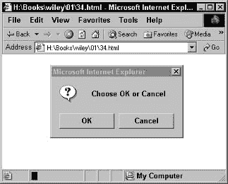

**清单 34-1：** 使用 `window.confirm`。

```html
<body>
<script>
<!--
var userChoice = window.confirm("Choose OK or Cancel");
if (userChoice == true) {
  document.write("OK");
}
if (userChoice == false) {
  document.write("Cancel");
}
// -->
</script>
</body>
```

6. 保存文件并关闭。
7. 在浏览器中打开该文件。你应该会看到一个确认对话框，如图 34-1 所示。

***交叉引用***
- 关于 `window.confirm` 方法的讨论，请参考任务 26。

**图 34-1：** 让用户在“确定”和“取消”之间选择。

8. 点击“确定”或“取消”，浏览器窗口中应显示相应的消息。

## 第一部分

### 任务 35：使用简写条件测试

JavaScript 提供了一种简写形式来测试条件并根据该条件返回一个值。当你想要给变量赋值时，这非常有用：如果条件为 `true`，则得到一个值；否则，得到另一个值。

这种简写求值和赋值的形式如下：

***注意***
- 如果用户点击“确定”，`window.confirm` 方法返回 `true`；如果用户点击“取消”，则返回 `false`。

```javascript
var myVar = (条件) ? 条件为 true 时赋的值 : 条件为 false 时赋的值;
```

其关键语法组成部分如下：

- 条件必须求值为 `true` 或 `false`，就像 `if` 语句一样（如任务 34 所述）。
- 问号表示这是简写条件测试。
- 冒号将条件为 `true` 时返回的值与条件为 `false` 时返回的值分隔开。`true` 的值始终在冒号左侧。

为了说明简写条件测试的有效使用，下面展示一个对话框，要求用户点击“确定”或“取消”，并将选择存储在一个变量中。基于此，创建第二个变量，其中包含一个根据用户选择而定的输出消息；这是通过简写测试完成的。最后，向用户显示该消息。

1. 在你偏好的编辑器中创建一个新的 HTML 文档。
2. 在文档的 body 中，创建一个脚本块。
3. 在脚本块中，使用 `window.confirm` 方法要求用户点击“确定”或“取消”，并将结果存储在一个名为 `userChoice` 的变量中：

```javascript
var userChoice = window.confirm("Choose OK or Cancel");
```

4. 对 `userChoice` 的值使用简写条件测试，将 `"OK"` 或 `"Cancel"` 赋值给一个名为 `result` 的新变量：

```javascript
var result = (userChoice == true) ? "OK" : "Cancel";
```


5. 显示 `result` 的值，使最终页面如清单 35-1 所示。

**清单 35-1：** 使用简写条件测试。

```html
<body>
<script>
<!--
var userChoice = window.confirm("Choose OK or Cancel");
var result = (userChoice == true) ? "OK" : "Cancel";
document.write(result);
// -->
</script>
</body>
```

6. 保存文件并关闭。
7. 在浏览器中打开该文件。你应该会看到一个确认对话框。
8. 点击“确定”或“取消”，浏览器窗口中应显示相应的消息。图 35-1 显示了用户点击“取消”时出现的消息。

***交叉引用***
- 你也可以使用 `if` 语句（在任务 34 中讨论）实现与上述源代码相同的结果。这只是赋值时做出决策的一种更紧凑的方式。

**图 35-1：** 点击“取消”。

### 任务 36：基于条件循环

在任务 33 中，你看到了一个 `for` 循环的例子；该循环用于计数。另一种有用的循环类型是条件循环。循环的形式很简单：

```javascript
while (条件) 命令
```

当然，命令可以是单个命令，也可以是多个命令用花括号组合起来，如下所示：

***注意***
- 条件循环在单个条件为 `true` 时持续进行；一旦条件变为 `false`，循环结束。
- 条件必须求值为 `true` 或 `false`。在每次循环迭代之前，都会测试条件；如果为 `true`，则进行下一次迭代。否则，循环停止。

```javascript
while (条件) {
  JavaScript 命令
  JavaScript 命令
  等等
}
```

本任务通过反复显示一个对话框要求用户点击“确定”或“取消”，直到用户点击“确定”为止，来说明这一点：

1. 在你偏好的编辑器中创建一个新的 HTML 文档。
2. 在文档的 body 中，创建一个脚本块。
3. 在脚本块中，使用 `window.confirm` 方法要求用户点击“确定”或“取消”，并将结果存储在一个名为 `result` 的变量中：

```javascript
var result = window.confirm("Choose OK or Cancel");
```

4. 创建一个 `while` 循环：

```javascript
while () {
}
```

5. 作为循环的条件，通过将 `result` 与 `false` 比较来测试用户是否点击了“取消”：

```javascript
while (result == false) {
}
```

6. 在循环内部，再次调用 `window.confirm`，并将用户的选择保存到 `result` 中：

```javascript
while (result == false) {
  result = window.confirm("Choose OK or Cancel");
}
```

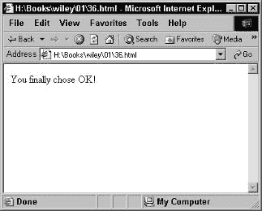

7. 循环结束后，输出一条消息，表明用户最终点击了“确定”。最终页面应如清单 36-1 所示。

**清单 36-1：** 使用条件循环。

```html
<body>
<script>
<!--
var result = window.confirm("Choose OK or Cancel");
while (result == false) {
  result = window.confirm("Choose OK or Cancel");
}
document.write("You finally chose OK!");
// -->
</script>
</body>
```

8. 保存文件并关闭。
9. 在浏览器中打开该文件。你应该会看到一个确认对话框。
10. 对话框会不断重新出现，直到用户点击“确定”，然后浏览器中会显示一条消息，如图 36-1 所示。

**图 36-1：** 点击“确定”。

### 任务 37：遍历数组

任务 22 介绍了数组的概念：一组用于存储值的编号容器。有时你可能希望遍历数组中的每个元素。这可以通过使用 `for` 循环来实现，使得循环的索引变量在每次迭代中与数组的某个索引相匹配。`for` 循环已在任务 33 中说明。

***注意***
- 要做到这一点，你需要能够动态确定数组的长度。


## JavaScript 基础

### 任务 37：遍历数组元素

- 注意，计数从 1 开始。这是因为任何数组的第一个索引都是 0。同样，你测试的是 `i` 是否小于（而不是小于或等于）数组的长度。这是因为如果数组长度为 5，那么最后一个索引是 4。如果你测试的是小于或等于数组长度，那么循环会计数到 5，而不是像应该的那样停在 4。

你可以通过数组对象的 `length` 属性来实现这一点。例如，下面的循环遍历了 `myArray` 数组中的每一个索引：

```
for (i = 0; i < myArray.length; i++)
```

下面的任务创建了一个数组，然后遍历它，在浏览器窗口中显示数组的每个元素：

1. 在你喜欢的编辑器中创建一个新的 HTML 文档。
2. 在文档的 body 中，创建一个脚本块：

```html
<body>
<script>
<!--
// -->
</script>
</body>
```

3. 在脚本块中，创建一个名为 `myArray` 的新三元素数组：

```javascript
var myArray = new Array(3);
```

4. 填充数组的元素：

```javascript
myArray[0] = "Item 0";
myArray[1] = "Item 1";
myArray[2] = "Item 2";
```

5. 创建一个 `for` 循环来遍历数组：

```javascript
for (i = 0; i < myArray.length; i++) {
}
```

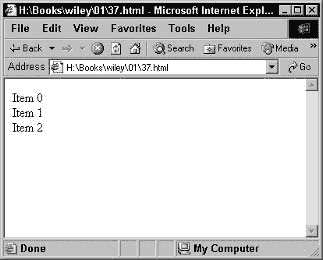

6. 在循环中，使用 `document.write` 将数组的当前元素显示到浏览器窗口。最终页面应如清单 37-1 所示。

```html
<body>
<script>
<!--
var myArray = new Array(3);
myArray[0] = "Item 0";
myArray[1] = "Item 1";
myArray[2] = "Item 2";
for (i = 0; i < myArray.length; i++) {
  document.write(myArray[i] + "<br>");
}
// -->
</script>
</body>
```

**清单 37-1：** 遍历数组。

7. 保存文件并关闭。
8. 在浏览器中打开文件，应显示一个元素列表，如图 37-1 所示。

> **交叉引用**
> - `document.write` 方法用于向浏览器输出内容，已在任务 9 中介绍。

**图 37-1：** 遍历数组以显示其元素。

### 任务 38：调度函数在未来执行

有时你会希望以自动化的、计划的方式执行一个函数。JavaScript 提供了在未来的指定时间调度函数执行的能力。当指定时间到达时，函数会自动执行，无需任何用户干预。

调度通过 `window.setTimeout` 方法完成：

```javascript
window.setTimeout("要执行的函数", 调度时间);
```

要执行的函数以文本字符串的形式指定，就像你正常调用函数一样；该文本字符串包含要执行命令的实际文本。调度时间指定了执行函数前等待的毫秒数。例如，如果你想在函数执行前等待 10 秒，你需要指定 10000 毫秒。

> **注意**
> - 指定要执行的函数的参数应作为文本字符串提供，并且该字符串应包含对函数的完整调用，包括传递给函数的任何参数。

为了说明这一点，以下脚本创建了一个显示警告对话框的函数，然后将其调度为五秒后执行：

1. 在你喜欢的编辑器中创建一个新的 HTML 文档。
2. 在文档的头部，创建一个脚本块：

```html
<head>
<script>
<!--
// -->
</script>
</head>
```

3. 在脚本块中，创建一个名为 `hello` 且不带参数的函数：

```html
<head>
<script>
<!--
function hello() {
}
// -->
</script>
</head>
```

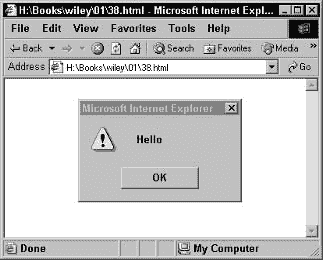

4. 在函数中，使用 `window.alert` 显示一个对话框：

```html
<head>
<script>
<!--
function hello() {
  window.alert("Hello");
}
// -->
</script>
</head>
```

5. 在函数之后，将函数调度为五秒后执行：

```html
<head>
<script>
<!--
function hello() {
  window.alert("Hello");
}
window.setTimeout("hello()", 5000);
// -->
</script>
</head>
```

6. 保存文件并关闭。
7. 在浏览器中打开文件。等待五秒，然后应出现一个警告对话框，如图 38-1 所示。

> **交叉引用**
> - 创建函数的过程在任务 27 到 30 中讨论。

**图 38-1：** 调度函数执行。

### 任务 39：调度函数重复执行

任务 38 向你展示了如何调度一个函数在未来单次自动执行。但如果你希望以固定的时间间隔重复调度同一个函数呢？

要做到这一点，你需要做两件事：

- 在函数的最后一条命令中，使用 `window.setTimeout` 重新调度函数再次执行。
- 在函数外部使用 `window.setTimeout` 来调度函数的首次执行。

> **注意**
> - 警告对话框将每五秒无限期地出现（参见步骤 8）。要退出此循环，只需在对话框之间的某个间隔内关闭浏览器窗口。

结果看起来像这样：

```javascript
function functionName() {
  // 一些 JavaScript 代码
  window.setTimeout("functionName()", 调度时间);
}
window.setTimeout("functionName()", 调度时间);
```

为了说明这一点，以下脚本创建了一个显示警告对话框的函数，然后将其调度为每五秒执行一次：

1. 在你喜欢的编辑器中创建一个新的 HTML 文档。
2. 在文档的头部，创建一个脚本块。
3. 在脚本块中，创建一个名为 `hello` 且不带参数的函数：

```javascript
function hello() {
}
```

4. 在函数中，使用 `window.alert` 显示一个对话框：

```javascript
function hello() {
  window.alert("Hello");
}
```

5. 通过使用 `window.setTimeout` 将函数调度为每五秒运行一次，完成函数：

```javascript
function hello() {
  window.alert("Hello");
  window.setTimeout("hello()", 5000);
}
```


6. 在函数之后，将函数调度为五秒后执行。最终页面应如清单 39-1 所示。

```html
<head>
<script>
<!--
function hello() {
  window.alert("Hello");
  window.setTimeout("hello()", 5000);
}
window.setTimeout("hello()", 5000);
// -->
</script>
</head>
```

**清单 39-1：** 调度函数执行。

7. 保存文件并关闭。
8. 在浏览器中打开文件。等待五秒，然后应出现一个警告对话框，如图 39-1 所示。关闭对话框后，五秒后应再次出现另一个对话框。这应无限期地持续下去。

> **交叉引用**
> - 任务 25 讨论了使用 `window.alert` 方法显示对话框。

**图 39-1：** 调度函数执行。

### 任务 40：取消已调度的函数

在任务 38 中，你看到了如何使用 `window.setTimeout` 调度函数在未来执行。使用一个相关的方法 `window.clearTimeout`，你可以在调度事件发生之前取消它。

当你创建一个调度事件时，`window.setTimeout` 方法会返回一个指向该事件的指针。然后你可以使用该指针来取消已调度的事件。

你只需将该指针传递给 `window.clearTimeout`：

```javascript
var pointer = window.setTimeout(...);
window.clearTimeout(pointer);
```

> **注意**
> - 为什么要取消一个已调度的函数调用？原因有很多。例如，你可能想要...


### 将定时函数用作倒计时形式

以下任务通过创建一个函数，并计划在页面加载五秒后执行，然后立即取消该计划执行，从而说明这一点，最终什么也不会发生。例如，用户可能有一定秒数在页面被清除前执行某个操作。你可以安排一个函数调用来清除页面，如果用户执行了所需操作，则取消该调用。

1. 在你偏好的编辑器中创建一个新的 HTML 文档。
2. 在文档的头部，创建一个脚本块：
   ```html
   <head>
   <script>
   <!--
   // -->
   </script>
   </head>
   ```
3. 在脚本块中，创建一个名为 `hello` 的函数，该函数不接受参数：
   ```javascript
   function hello() {
   }
   ```
4. 在函数中使用 `window.alert` 显示一个对话框：`window.alert("Hello");`
5. 在函数之后，安排该函数在五秒后执行，并将指针保存到一个变量中：
   ```javascript
   var myTimeout = window.setTimeout("hello()",5000);
   ```
   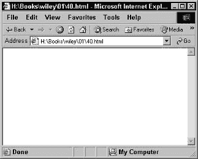
   02 542419 Ch01.qxd 11/19/03 10:01 AM Page 81
   **JavaScript 基础** **81**
6. 取消已安排的事件，使最终页面看起来像任务 40 的清单 40-1。
   ```html
   <head>
   <script>
   <!--
   function hello() {
     window.alert("Hello");
   }
   var myTimeout = window.setTimeout("hello()",5000);
   window.clearTimeout(myTimeout);
   // -->
   </script>
   </head>
   ```
   **清单 40-1：** 取消已安排的事件。
7. 保存文件并关闭。
8. 在浏览器中打开文件。除了一个空白浏览器窗口外，不应出现任何内容，如图 40-1 所示。
   **图 40-1：** 安排一个函数执行然后取消它。
   02 542419 Ch01.qxd 11/19/03 10:01 AM Page 82
   **82** **第 1 部分**

### 向页面添加多个脚本

JavaScript 以灵活的方式集成到你的 HTML 文档中。事实上，没有任何限制阻止你在文档头部和正文中任何需要的地方放置多个脚本块。浏览器将按顺序处理这些脚本块以及页面中的其余 HTML。

以下任务说明了一个文档中的两个脚本块：

1. 创建一个新的 HTML 文档。
2. 在文档的正文中，创建一个脚本块：
   ```html
   <body>
   <script language="JavaScript">
   <!--
   // -->
   </script>
   </body>
   ```
3. 在脚本块中，使用 `document.write` 输出一些文本：`document.write("The first script");`
4. 在脚本块之后，放置一些常规的 HTML 代码：
   ```html
   <hr>
   ```
5. 创建另一个脚本块：
   ```html
   <script language="JavaScript">
   <!--
   // -->
   </script>
   ```
6. 在第二个脚本块中，输出更多文本，使最终页面看起来像清单 41-1。
7. 保存文件并关闭。
   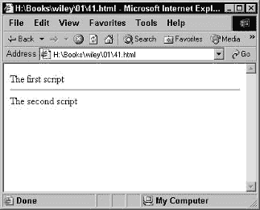
   02 542419 Ch01.qxd 11/19/03 10:01 AM Page 83
   **JavaScript 基础** **83**
   ```html
   <body>
   <script language="JavaScript">
   <!--
   document.write("The first script");
   // -->
   </script>
   <hr>
   <script language="JavaScript">
   <!--
   document.write("The second script");
   // -->
   </script>
   </body>
   ```
   **清单 41-1：** 页面中的多个脚本。
8. 在浏览器中打开文件。你应该会看到两个脚本的结果，如图 41-1 所示。
   **图 41-1：** 使用多个脚本块。
   ***交叉引用***
   • 所有脚本都需要包含在一个脚本块中。任务 1 介绍了脚本块的创建和使用。

### 在页面加载后调用你的 JavaScript 代码

有时你可能只想在用户尝试离开你的页面时执行 JavaScript 代码。你可能想这样做，是因为你想向用户告别或提醒用户他/她正在离开你的网站。

***注意***
• `onUnload` 是一个事件处理程序；这意味着它指定了在事件发生时执行的 JavaScript 代码。在这种情况下，必须发生的事件是用户导航到另一个页面。

这样做需要两个步骤：
- 将你希望在页面加载完成后执行的代码放入一个函数中。
- 使用 body 标签的 `onUnload` 属性来调用该函数。

结果代码如下：

```html
<head>
<script language="JavaScript">
function functionName() {
  // 页面加载完成后要执行的代码
}
</script>
</head>
<body onUnload="functionName();">
  页面正文
</body>
```

以下任务创建一个函数，该函数在对话框中显示告别消息，并且仅在用户离开页面时调用该函数：

1. 在你偏好的 HTML 或文本编辑器中打开一个新的 HTML 文档。
2. 使用开闭 head 标签创建文档的头部。
3. 在文档的头部插入一个脚本块。
4. 创建一个名为 `bye` 的函数，该函数不接受参数：
   ```javascript
   function bye() {
   }
   ```
5. 在函数中，使用 `window.alert` 方法显示一个警告对话框：
   ```javascript
   window.alert("Farewell");
   ```
6. 使用开闭 body 标签创建文档的正文。
7. 在 body 标签中，使用 `onUnload` 属性调用 `bye` 函数：
   ```html
   <body onUnload="bye();">
   ```
8. 在页面正文中，放置你想要的任何 HTML 或文本，使最终页面看起来像清单 42-1。
   ```html
   <head>
   <script language="JavaScript">
   <!--
   function bye() {
     window.alert("Farewell");
   }
   // -->
   </script>
   </head>
   <body onUnload="bye();">
   页面内容。
   </body>
   ```
   **清单 42-1：** 使用 onUnload 在用户离开页面后调用函数。
9. 保存文件。
10. 在浏览器中打开文件，你应该会看到页面内容。导航到另一个网站，你应该会看到告别对话框。
    02 542419 Ch01.qxd 11/19/03 10:01 AM Page 86
    **86** **第 1 部分**

### 使用 JavaScript 检查 Java 是否已启用

有时了解 Java 是否已启用，并在构建页面时使用该信息是很有用的。例如，基于该信息，你可以动态调整页面内容，以包含或不包含基于 Java 的内容。

***注意***
• 为什么你可能想测试浏览器中是否启用了 Java？一个原因是，如果你计划输出 HTML 代码以在浏览器中嵌入 Java 小程序：通过先进行测试，如果浏览器不支持 Java，你可以输出替代的 HTML。

幸运的是，JavaScript 提供了一种简单的机制来确定这一点：`navigator.javaEnabled` 方法。如果浏览器中启用了 Java，该方法返回 `true`，否则返回 `false`。

以下任务在浏览器窗口中显示一条消息，指示 Java 是否已启用：

1. 创建一个新的 HTML 文档。
2. 在文档的正文中，创建一个脚本块：
   ```html
   <body>
   <script language="JavaScript">
   <!--
   // -->
   </script>
   </body>
   ```
3. 在脚本块中，调用 `navigator.javaEnabled` 并将结果赋值给一个变量：
   ```html
   <body>
   <script language="JavaScript">
   <!--
   var haveJava = navigator.javaEnabled();
   // -->
   </script>
   </body>
   ```
   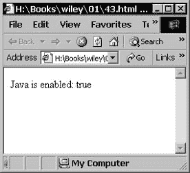
   02 542419 Ch01.qxd 11/19/03 10:01 AM Page 87
   **JavaScript 基础** **87**
4. 使用 `document.write` 向用户显示相关消息：
   ```html
   <body>
   <script language="JavaScript">
   <!--
   var haveJava = navigator.javaEnabled();
   document.write("Java is enabled: " + haveJava);
   // -->
   </script>
   </body>
   ```
5. 保存文件并关闭。


**6.** 在浏览器中打开该文件。您应该会看到一条基于浏览器中 Java 状态的相应消息。在图 43-1 中，Java 已启用。

**图 43-1:** 测试 Java 是否已启用。

***交叉引用***

- 作为一个可能需要测试 Java 是否启用的示例，请参见任务 243，该任务使用 Java 获取用户计算机的 IP 地址。


## 第 2 部分：输出到浏览器

### 任务 44：访问 document 对象

### 任务 45：输出动态 HTML

### 任务 46：在输出中包含换行符

### 任务 47：将日期输出到浏览器

### 任务 48：在选定的时区中输出日期和时间

### 任务 49：控制日期输出的格式

### 任务 50：根据一天中的时间自定义输出

### 任务 51：生成月度日历

### 任务 52：使用 URL 变量自定义输出

### 任务 53：动态生成菜单

### 任务 54：用新文档替换浏览器文档

### 任务 55：将用户重定向到新页面

### 任务 56：创建“页面加载中...”占位符

**90**  
**第 2 部分**

### 任务 44：访问 document 对象

`document` 对象是 JavaScript 中一个极其强大且重要的对象，它允许您将数据输出到浏览器的文档流中，以及访问浏览器中当前渲染文档中的元素。

使用此对象，您可以在文档中生成动态输出，并且可以在文档渲染后操作其状态。`document` 对象提供了大量信息、方法以及对反映当前文档的对象的访问，包括以下内容：

- 包含当前文档中的锚点、小程序、嵌入对象、表单、层、链接和插件的数组。
- 提供当前页面信息的属性，包括链接颜色、页面背景颜色、关联的 cookie、页面域、修改日期、引用文档、标题以及当前文档的 URL。
- 允许将文本输出到文档流的方法、处理事件的事件，以及返回文档中当前选中文本的事件。

***注意***  
`window.alert` 方法接受一个字符串作为参数；该字符串应为要在对话框中显示的消息。在本例中，您要显示的是当前文档的 URL，该 URL 已存储在 `myURL` 变量中，因此您只需将该变量作为参数传递给该方法。

以下示例通过在一个对话框中显示当前页面的域，说明了 `document` 对象的简单用法：

1. 创建一个脚本块，包含开闭脚本标签：

```html
<script language="JavaScript">
</script>
```

2. 使用以下命令将当前 URL 赋值给一个名为 `myURL` 的临时变量：

```html
<script language="JavaScript">
var myURL = document.URL;
</script>
```

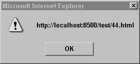

**输出到浏览器**  
**91**  
**任务 44**

3. 包含 `window.alert` 方法以显示一个对话框：

```html
<script language="JavaScript">
var myURL = document.URL;
window.alert();
</script>
```

4. 将 `myURL` 变量作为参数传递给 `window.alert`，使最终脚本如清单 44-1 所示。

```html
<script language="JavaScript">
var myURL = document.URL;
window.alert(myURL);
</script>
```

**清单 44-1:** 用于显示当前 URL 的脚本。

5. 将脚本保存到 HTML 文件中，并在浏览器中打开该 HTML。您应该会看到一个如图 44-1 所示的对话框。

**图 44-1:** 在对话框中显示当前 URL。

***交叉引用***  
- 变量的创建（包括变量名的适当选择）在任务 10 中讨论。  
- `window.alert` 方法显示一个包含单条文本消息和一个用于关闭对话框的按钮的对话框。该方法在任务 25 中讨论。

**92**  
**第 2 部分**

### 任务 45：输出动态 HTML

每当您需要将动态 HTML 内容输出到文档流中时，可以使用 `document.write` 方法。该方法允许您指定要包含在浏览器渲染的文档流中的任何文本。

概念很简单。考虑以下简单的部分 HTML 文档：

```html
<p>以下值来自 JavaScript 的动态输出：</p>
<script language="JavaScript">
document.write("<p><strong>动态内容</strong></p>");
</script>
<p>动态输出示例到此结束。</p>
```

结果是浏览器将渲染输出，就好像以下纯 HTML 源代码已发送到浏览器：

```html
<p>以下值来自 JavaScript 的动态输出：</p>
<p><strong>动态内容</strong></p>
<p>动态输出示例到此结束。</p>
```

使用 `document.write` 方法，您可以将 HTML 中生成的任何动态字符串输出到文档流中。以下示例使用 `document` 对象的属性获取引用页面、当前文档的域以及当前文档的 URL，并输出它们：

***注意***  
- 在本任务中，您会看到连接的使用。*连接* 是使用 `+` 运算符将一个或多个字符串组合成一个长字符串的操作。  
- `document.write` 方法接受一个参数。该参数必须是一个字符串。步骤 4 和 5 中使用的连接操作会计算成一个字符串，因此整个连接表达式可以作为参数传递给 `document.write`。

1. 使用脚本标签开始一个脚本块：

```html
<script language="JavaScript">
```

2. 使用 `document.write` 显示一条介绍性消息：

```javascript
document.write("<p>以下是关于本文档的一些信息：</p>");
```

3. 输出一个 `ul` 标签以开始一个无序列表：

```javascript
document.write("<ul>");
```

4. 将引用文档作为列表项输出：

```javascript
document.write("<li>引用文档：" + document.referrer + "</li>");
```

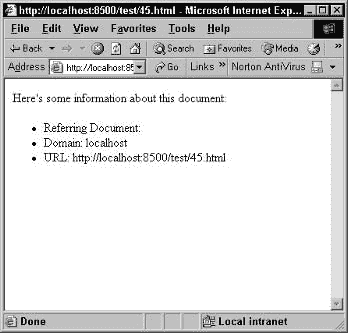

**输出到浏览器**  
**93**  
**任务 45**

5. 将当前文档的域作为列表项输出：

```javascript
document.write("<li>域：" + document.domain + "</li>");
```

6. 将当前文档的 URL 作为列表项输出：

```javascript
document.write("<li>URL：" + document.URL + "</li>");
```

7. 通过输出一个闭合的 `ul` 标签来关闭脚本；生成的脚本应如清单 45-1 所示。

```html
<script language="JavaScript">
document.write("<p>以下是关于本文档的一些信息：</p>");
document.write("<ul>");
document.write("<li>引用文档：" + document.referrer + "</li>");
document.write("<li>域：" + document.domain + "</li>");
document.write("<li>URL：" + document.URL + "</li>");
document.write("</ul>");
</script>
```

**清单 45-1:** 在文档流中动态输出信息的脚本。


**8.** 将脚本保存为 HTML 文件，并在浏览器中打开该文件。结果应如图 45-1 所示。

***交叉引用***

- `document.write` 方法用于从 JavaScript 脚本中向浏览器窗口输出内容。该方法在 **图 45-1：** 浏览器中显示的动态内容中介绍。

任务 9.

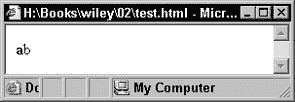

## 第 2 部分

### 任务 46：在输出中包含换行符

`document.write` 方法很有用，但有时也存在局限性。特别是，`document.write` 方法不会在每个输出的字符串末尾输出换行符。

考虑以下 JavaScript 代码片段：

```
document.write(“<strong>a</strong>”);
document.write(“b”);
```

实际上，这与以下 HTML 代码相同：

```
<strong>a</strong>b
```

请注意，“b”与“a”在同一行，尽管它们是在 JavaScript 代码的不同行中通过两个 `document.write` 命令输出的。这意味着输出时字母之间没有空格，如图 46-1 所示。

**图 46-1：** `document.write` 不输出换行符

当然，这与将 HTML 写在两行的情况略有不同，例如：

```
<strong>a</strong>
b
```

在这种情况下，第一行代码后的换行符会被浏览器渲染为一个空格。

在预格式化文本块（`pre` 标签内的文本）中，这个问题变得更加突出。

为了解决这个问题，`document` 对象还提供了 `document.writeln` 方法。该方法与 `document.write` 方法完全相同，不同之处在于它会在字符串末尾向浏览器输出一个换行符。这意味着以下代码

```
document.writeln(“<strong>a</strong>”);
document.writeln(“b”);
```

本质上与以下 HTML 代码相同：

```
<strong>a</strong>
b
```

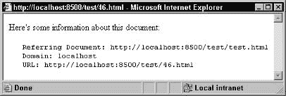

这在换行符很重要，并且您希望确保通过 JavaScript 显示的每行文本末尾都输出一个换行符的情况下非常有用。

为了说明 `document.writeln` 的用法，以下示例是任务 45 中示例的变体，不同之处在于数据使用 `document.writeln` 方法作为预格式化文本输出：

1. 使用 `script` 标签开始一个脚本块：

   ```
   <script language=”JavaScript”>
   ```

2. 使用 `document.write` 显示一条介绍性消息：

   ```
   document.writeln(“<p>Here’s some information about this document:</p>”);
   ```

3. 输出一个 `pre` 标签以开始预格式化文本部分：

   ```
   document.writeln(“<pre>”);
   ```

4. 输出引用文档：

   ```
   document.writeln(“ Referring Document: “ + document.referrer);
   ```

5. 输出当前文档的域：

   ```
   document.writeln(“ Domain: “ + document.domain);
   ```

6. 输出当前文档的 URL：

   ```
   document.writeln(“ URL: “ + document.URL);
   ```

7. 通过输出一个结束的 `pre` 标签，后跟一个结束的 `script` 标签来关闭脚本：

   ```
   document.writeln(“</pre>”);
   </script>
   ```

8. 将脚本保存为 HTML 文件，并在浏览器中打开该文件。结果如图 46-2 所示。

**图 46-2：** 在预格式化文本块中浏览器显示的动态内容。

***注释***
- 通常情况下，`document.write` 不输出换行符这一事实对代码的影响很小（如果有的话）。毕竟，标准 HTML 中的换行符实际上并不会在浏览器中渲染。尽管如此，这并不意味着您可以简单地忽略缺少换行符的问题。
- 在预格式化代码块中，换行符实际上会被渲染为换行符。这意味着，如果您期望将两个输出行放在不同行的 `document.write` 命令中会使它们在不同行上渲染，那么您会对结果感到惊讶。

***提示***
- 使用 `document.write` 和 `document.writeln` 时需要小心。特别是，如果作为参数传递的字符串包含在双引号中，那么您不能在字符串中直接包含双引号。您需要将字符串中的双引号转义为 `\"`。如果不这样做，双引号将结束字符串，其后的所有内容都不会被视为参数的一部分，从而导致 JavaScript 生成错误消息。如果字符串用单引号括起来，同样适用：您需要将字符串中的单引号转义为 `\'`。

### 任务 47：向浏览器输出日期

当确实需要在浏览器中显示无法预先生成、必须在文档显示时生成的动态内容时，使用 `document.write` 和 `document.writeln` 就变得很有用。

一个很好的例子是在页面中显示当前日期和时间。例如，一个发布时效性新闻的网站可能希望人们知道该网站上的新闻是截至当前时间的最新消息，并且可以通过在页面中始终显示当前时间来实现这一点。

幸运的是，JavaScript 提供了一个 `Date` 对象，您可以使用它快速轻松地获取当前日期，然后将该日期输出到浏览器。为此目的而基本使用 `Date` 对象非常简单，以下脚本可以插入到 HTML 文件中您想要显示当前日期和时间的任何位置：

1. 使用 `script` 标签开始一个脚本块：

   ```
   <script language=”JavaScript”>
   ```

2. 创建一个新的 `Date` 对象并将其赋值给变量 `thisDate`：

   ```
   var thisDate = new Date();
   ```

3. 使用 `Date` 对象的 `toString` 方法显示日期：

   ```
   document.write(thisDate.toString());
   ```

4. 使用结束的 `script` 标签关闭脚本；此脚本的最终源代码应如清单 47-1 所示。

   ```
   <script language=”JavaScript”>
   var thisDate = new Date();
   document.write(thisDate.toString());
   </script>
   ```

   **清单 47-1：** 用于显示当前日期的脚本。

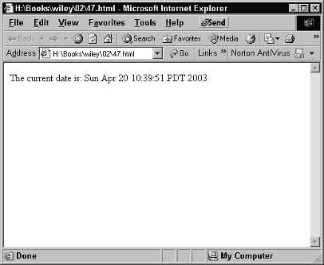

5. 在 HTML 文档中任何您想要显示当前日期的位置包含此脚本。例如，清单 47-2 是一个包含该脚本的简单 HTML 文档；在浏览器中显示时，该页面如图 47-1 所示。

   ```
   <html>
   <body>
   <p>
   The current date is:
   <script language=”JavaScript”>
   var thisDate = new Date();
   document.write(thisDate.toString());
   </script>
   </p>
   </body>
   </html>
   ```

   **清单 47-2：** 在文档正文中包含脚本。

**图 47-1：** HTML 文档中显示的日期。

***注释***
- 这里使用的 `Date` 方法被称为*构造函数方法*。大多数对象都有一个构造函数方法，用于创建该对象的新实例。在这里，使用不带参数的 `Date` 构造函数方法会得到一个 `Date` 对象，其日期设置为当前日期和时间。
- `Date` 对象的 `toString` 方法以标准格式返回当前日期和时间的字符串。您无法直接控制该格式。

### 任务 48：在选定的时区中输出日期和时间

以格林威治标准时间（也称为协调世界时）作为共同起点，您可以创建一个脚本，无论用户计算机的时区如何，该脚本始终能够显示您所在时区的时间。这之所以成为可能，是因为两个事实：

- `Date` 对象可以告诉您用户时区相对于 GMT 的偏移量。
- 默认情况下，当您输出时间时，JavaScript 使用当前的本地时间。


GMT 时间。因此，如果用户比 GMT 早五个小时，你可以发现这一点。浏览器在生成和处理所有时间时都使用自己的时区。

- 在编写脚本时，你就知道自己与 GMT 的偏移量。

然而，这可能会引发问题。例如，假设你想展示你的支持部门是否开放的信息。理想情况下，你希望基于公司所在地的时间，而不是用户的时间。但在编写脚本时，你无法预先确定用户所在的时区。

结合这些信息，你总能计算出你的时区与用户时区之间的小时差，并可以在处理数据或向用户显示之前，将时间从用户时区调整到你的时区。

要做到这一点，需要使用 `Date` 对象的两个方法：

- `getTimezoneOffset`：该方法返回当前浏览器时区与 GMT 时间之间的分钟差。
- `setHours`：该方法用于设置当前 `Date` 对象中的小时部分。使用它可以将时间重置为你所在时区的时间。

作为计算时区偏移量的示例，请考虑以下情况：如果用户位于北美太平洋时间，比 GMT 早七个小时，那么 `userOffset` 将为 7，`myOffset` 将为 7 – (-2)，即 9，这是太平洋时间与 CET 之间的小时差。类似地，如果用户位于以色列时区（比 GMT 晚三个小时），那么 `userOffset` 将为 -3，差值为 -3 – (-2)，即 -1。

以下脚本显示中欧时间（比格林威治标准时间晚两个小时）的当前时间。无论用户计算机的时区如何，它都能正常工作。

### 任务 48：在另一个时区显示日期

**1.** 使用脚本标签开始一个脚本块：`<script language="JavaScript">`

**2.** 在 `myOffset` 变量中设置与 GMT 的时区偏移量。该值应为将目标时区转换为 GMT 所需的小时数变化。对于中欧时间（夏季比 GMT 晚两个小时），这意味着值为 -2，表示需要从中欧时间往回拨两个小时才能到达 GMT：

`var myOffset = -2;`

**3.** 创建一个新的 `Date` 对象，包含当前日期和时间，并将其赋值给 `currentDate` 变量：

`var currentDate = new Date();`

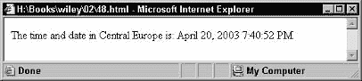

**4.** 使用 `getTimezoneOffset` 提取用户时区的偏移量；由于该值以分钟为单位，而此脚本以小时为单位工作，因此该值应除以 60。最终值存储在 `userOffset` 变量中：

`var userOffset = currentDate.getTimezoneOffset()/60;`

**5.** 计算目标时区与用户时区之间的时区差，并将小时差赋值给变量 `timeZoneDifference`：

`var timeZoneDifference = userOffset - myOffset;`

> **提示：** 要使清单 48-1 中的脚本显示中欧以外的时区的时间和日期，只需适当更改 `myOffset` 的值。

**6.** 使用 `setHours` 方法重置时间的小时部分。新时间应为当前小时（使用 `getHours`）加上时区差。幸运的是，像这样使用 `setHours` 可以处理时区差将日期推至前一天或后一天的情况，并相应地调整日期。

`currentDate.setHours(currentDate.getHours() + timeZoneDifference);`

**7.** 使用 `document.write` 方法在浏览器窗口中显示当前日期和时间：

`document.write("The time and date in Central Europe is: " + currentDate.toLocaleString());`

**8.** 使用结束脚本标签关闭脚本块。最终脚本如清单 48-1 所示。

```javascript
<script language="JavaScript">
var myOffset = -2;
var currentDate = new Date();
var userOffset = currentDate.getTimezoneOffset()/60;
var timeZoneDifference = userOffset - myOffset;
currentDate.setHours(currentDate.getHours() + timeZoneDifference);
document.write("The time and date in Central Europe is: " + currentDate.toLocaleString());
</script>
```

**清单 48-1：** 用于在另一个时区显示日期的脚本。

**9.** 将脚本保存到 HTML 文件中，并在浏览器中打开该文件，即可看到中欧的日期和时间，如图 48-1 所示。

**图 48-1：** 显示中欧的日期和时间。

---

### 任务 49：控制日期输出的格式

除了 `toString` 方法外，`Date` 对象还提供以下方法，用于快速输出当前日期和时间：

- `toGMTString`：将时间转换为格林威治标准时间字符串。结果如下所示：

  `Thu, 17 Apr 2003 17:47:44 UTC`

- `toLocaleString`：使用当前区域设置的日期格式约定将时间转换为字符串。在加拿大，结果如下所示：

  `April 17, 2003 10:47:44 AM`

- `toUTCString`：将时间转换为协调世界时字符串。在北美，结果如下所示：

  `Thu, 17 Apr 2003 17:47:44 UTC`

> **注意：** UTC 代表协调世界时（Coordinated Universal Time 或 Universal Time Coordinate）。UTC 与格林威治标准时间相同，但已成为此默认标准时区的首选名称。使用 JavaScript 事件模型，你可以在用户单击对象时运行 JavaScript 代码。这是通过 `onClick` 事件处理程序实现的。`onClick` 事件处理程序通常用于表单按钮和链接，但也可以应用于其他对象。

此外，`Date` 对象还提供了一系列方法，用于返回当前日期的特定信息，你可以将这些信息组合成完全自定义的日期和时间显示：

- `getDate`：返回当前月份中的日期（数字）
- `getDay`：返回当前星期几（数字，0 表示星期日，6 表示星期六）
- `getFullYear`：返回四位数的年份
- `getHours`：返回当前时间的小时（数字，0 到 23）
- `getMinutes`：返回当前时间的分钟（数字，0 到 59）
- `getMonth`：返回当前月份（数字，0 表示一月，11 表示十二月）

例如，使用这些方法，可以以自定义格式输出当前日期，例如：

`22:00 on 2003/4/15`

以下代码正是以这种方式输出日期：

**1.** 使用脚本标签开始一个脚本块：`<script language="JavaScript">`

**2.** 创建一个新的 `Date` 对象并将其赋值给变量 `thisDate`：

`var thisDate = new Date();`

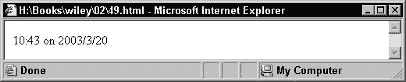

**3.** 使用 `getHours` 和 `getMinutes` 方法构建一个包含时间的字符串；该字符串赋值给变量 `thisTimeString`：

`var thisTimeString = thisDate.getHours() + ":" + thisDate.getMinutes();`

**4.** 使用 `getFullYear`、`getMonth` 和 `getDate` 方法构建一个包含日期的字符串；该字符串赋值给变量 `thisDateString`：

`var thisDateString = thisDate.getFullYear() + "/" + thisDate.getMonth() + "/" + thisDate.getDate();`

**5.** 使用 `document.write` 方法向浏览器显示日期和时间：

`document.write(thisTimeString + " on " + thisDateString);`

**6.** 使用结束脚本标签关闭脚本。最终源代码如清单 49-1 所示。

```javascript
<script language="JavaScript">
var thisDate = new Date();
var thisTimeString = thisDate.getHours() + ":" + thisDate.getMinutes();
var thisDateString = thisDate.getFullYear() + "/" + thisDate.getMonth() + "/" + thisDate.getDate();
document.write(thisTimeString + " on " + thisDateString);
</script>
```

**清单 49-1：** 用于以自定义格式显示日期的脚本。


</script>

**清单 49-1：** 用于以自定义格式显示当前日期的脚本。

**7.** 将脚本包含在要显示日期的 HTML 文档中，然后在 Web 浏览器中打开该文档。日期显示如图 49-1 所示。

**图 49-1：** 在 Web 浏览器中显示的自定义格式日期。

## 第 2 部分

### 任务 50：根据一天中的时间自定义输出

与其仅仅向用户呈现时间信息并相信用户不会在相关时间尝试使用聊天应用程序，不如根据一天中的时间自定义相关支持页面的输出，以便仅在一天中的适当时间显示聊天应用程序的链接。

***注***

以下示例是一个可以包含在此类应用程序中的脚本。

- 某些网站会根据当前时间自定义其网页的输出。一个常见的例子是提供某种聊天应用程序形式的实时 Web 支持的网站。此服务可能仅在一天中的特定时间提供。

在工作日的上午 9 点到下午 5 点之间，会向用户显示聊天应用程序的链接，但在这些时间之外，则会显示一条通知，表明实时 Web 支持已关闭。

**1.** 使用 `script` 标签开始一个脚本块：

```html
<script language="JavaScript">
```

**2.** 创建一个新的 `Date` 对象并将其赋值给名为 `thisDate` 的变量：

```javascript
var thisDate = new Date();
```

**3.** 使用 `if` 语句测试当前日期是否为工作日且处于正确的时间范围内（有关 `if` 语句的介绍，请参阅任务 34）：

```javascript
if ((thisDate.getDate() >= 1 && thisDate.getDate() <= 6) && (thisDate.getHours() >= 9 && thisDate.getHours() <= 15)) {
```

**4.** 显示支持台开放时的 HTML：

```javascript
document.write("The support desk is open. Click <a href='http://my.url/'>here</a> for live Web support.");
```

**5.** 使用 `else` 语句提供替代操作：

```javascript
} else {
```

**6.** 显示支持台关闭时的 HTML：

```javascript
document.write("The support desk is closed now. Come back between 9 a.m. and 5 p.m. Monday to Friday.");
```

**7.** 使用右花括号关闭 `if` 块：

```javascript
}
```

**8.** 使用结束 `script` 标签关闭脚本块。最终代码应如下所示：

```html
<script language="JavaScript">
var thisDate = new Date();
if ((thisDate.getDate() >= 1 && thisDate.getDate() <= 6) && (thisDate.getHours() >= 9 && thisDate.getHours() <= 15)) {
    document.write("The support desk is open. Click <a href='http://my.url/'>here</a> for live Web support.");
} else {
    document.write("The support desk is closed now. Come back between 9 a.m. and 5 p.m. Monday to Friday.");
}
</script>
```

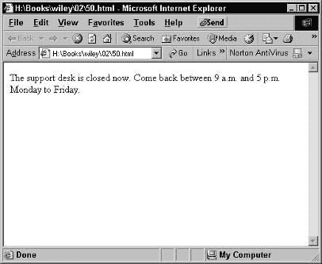
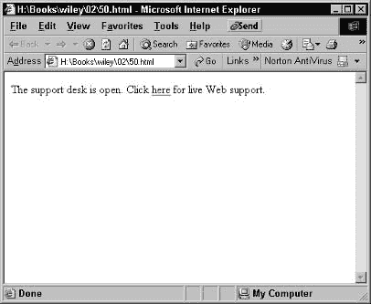

**9.** 将此脚本包含在 HTML 文档中，并在浏览器中打开该文档。在工作日的上午 9 点到下午 5 点之间，您应该会看到如图 50-1 所示的消息。在其他时间，您将看到如图 50-2 所示的消息。

**图 50-1：** 当支持台开放时，用户可以链接到实时 Web 支持。

**图 50-2：** 当支持台关闭时，用户会被告知何时返回。

### 任务 51：生成月度日历

利用 `Date` 对象，结合循环（如任务 33 所述）和 `document.write` 方法的输出能力，可以轻松生成当前月份的日历。

按照以下步骤创建一个脚本，在文档的表格中生成日历：

***注***

- 在许多应用程序中，您会希望显示月度日历。您可能只是用它来显示当前月份，以便用户输入当前日期。您也可以选择在日历中显示事件信息。无论如何，有一些基本的 JavaScript 逻辑可以用来在表格中渲染月度日历，而无需为特定月份手动编写日历代码。
- `Date` 对象的 `setDate` 方法与 `getDate` 方法相关。`getDate` 返回当前月份中的日期（数字），而 `setDate` 方法则重置月份中的日期；您将月份中的日期数值作为参数传递给该方法。
- 通过使用 `currentMonth` 变量的值作为 `months` 数组的索引来选择月份名称。
- 如果月份的第一天不是星期日，则需要在表格日期的第一行中，在月份第一天之前显示空白表格单元格。为此，请确保当前日期不是星期日，如果不是，则从 0 循环到当前星期几的前一天，并为每一天显示一个空表格单元格。
- `while` 循环应持续进行，只要当前处理的日期仍在显示的月份中（该月份存储在 `currentMonth` 变量中）。

**1.** 在脚本块中，创建一个包含月份名称的数组：

```javascript
var months = new Array();
months[0] = "January"; months[1] = "Feburary";
months[2] = "March"; months[3] = "April";
months[4] = "May"; months[5] = "June";
months[6] = "July"; months[7] = "August";
months[8] = "September"; months[9] = "October";
months[10] = "November"; months[11] = "December";
```

**2.** 为当前日期创建一个新的 `Date` 对象，并将其存储在 `currentDate` 变量中。从当前日期中取出月份并存储在 `currentMonth` 变量中；然后使用 `Date` 对象的 `setDate` 方法将月份中的日期设置为第一天：

```javascript
var currentDate = new Date();
var currentMonth = currentDate.getMonth();
currentDate.setDate(1);
```

**3.** 输出表格的顶部以及第一行，该行包含月份名称。表格的第二行（在月份名称之后）应为表示星期几的列标题：

```javascript
document.write("<table border=1 cellpadding=3 cellspacing=0>");
document.write("<tr>");
document.write("<td colspan=7 align='center'>" + months[currentMonth] + "</td>");
document.write("<tr>");
document.write("<td align='center'>S</td>");
document.write("<td align='center'>M</td>");
document.write("<td align='center'>T</td>");
document.write("<td align='center'>W</td>");
document.write("<td align='center'>T</td>");
document.write("<td align='center'>F</td>");
document.write("<td align='center'>S</td>");
document.write("</tr>");
```

**4.** 下一步是处理月份的第一天不是星期日的情况。例如，当月份的第一天是星期二时，结果会是如图 51-1 所示的表格日期第一行：

```javascript
if (currentDate.getDay() != 0) {
    document.write("<tr>");
    for (i = 0; i < currentDate.getDay(); i++) {
        document.write("<td>&nbsp;</td>");
    }
}
```

***提示***

- 由于 `Date` 对象的 `getMonth` 方法返回 0 表示一月，1 表示二月，依此类推，因此一月放在数组的索引 0 处，二月放在索引 1 处，依此类推，直到数组的第 11 个位置，该位置存放十二月。

**图 51-1：** 可能需要空白表格单元格来填充月份的第一行。

**5.** 下一步是一个 `while` 循环，用于显示每一天的单个单元格：

```javascript
while (currentDate.getMonth() == currentMonth) {
```

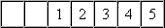


**6.** 在循环内部，检查当前日期是否为星期日，如果是，则使用 `tr` 标签开始新的一行。接着，显示包含当前日期的单元格。如果当前日期是星期六，则使用闭合的 `tr` 标签结束该行。最后，使用 `setDate` 将当前月份的天数值加一，以移动到下一天。

```
while (currentDate.getMonth() == currentMonth) {
if (currentDate.getDay == 0) {
document.write(“<tr>”);
}
document.write(“<td align=’center’>” + Æ
currentDate.getDate() + “</td>”);
if (currentDate.getDay() == 6) {
document.write(“</tr>”);
}
currentDate.setDate(currentDate.getDate() + 1);
}
```

**7.** 显示完所有日期后，需要检查是否需要额外的空单元格来完成表格的最后一行。这通过另一个 `for` 循环实现：

***交叉引用***

```
for (i = currentDate.getDay(); i <= 6; i++) {
document.write(“<td>&nbsp;</td>”);
}
```

- 数组是一种变量，包含一个或多个容器，你可以在其中存储单个值。通常，这些容器按顺序编号，第一个容器编号为零。数组在任务 20 中介绍。

**8.** 最后，通过输出闭合的 `table` 标签来关闭表格。当脚本执行时，你将在浏览器中看到当前月份的日历。

```
document.write(“</table>”);
```

### 任务 52：使用 URL 变量自定义输出

当你为页面构建 URL 时，可以在 URL 末尾添加一系列名称-值对，格式如下：

`http://my.url/somepage.html?name1=value1&name2=value2&...`

***注意***

- 本任务中代码的逻辑很简单：在问号处分割字符串，取问号右侧的部分并在每个 & 符号处分割，然后对每个结果子串在等号处分割，从而将 URL 参数拆分为名称和值两部分。使用 `string` 对象的 `split` 方法可以轻松实现这一过程。

本质上，这些参数就像变量：用于存储值的命名容器。在 JavaScript 中，`document` 对象提供了 `URL` 属性，该属性包含文档的完整 URL，通过对该属性进行一些操作，你可以提取 URL 中包含的部分或全部 URL 参数。以下代码显示当前文档的所有 URL 参数：

**1.** 在文档正文的脚本块中，在问号处分割当前文档的 URL，并将两部分存储在数组 `urlParts` 中：

```
var urlParts = document.URL.split(“?”);
```

**2.** 在 & 符号处将 URL 中问号右侧的部分分割成一个或多个部分。这将每个名称-值对放入 `parameterParts` 数组的一个数组条目中。

```
var parameterParts = urlParts[1].split(“&”);
```

**3.** 使用 `document.write` 方法输出 HTML 代码以设置表格并显示表格的列标题：

```
document.write(“<table border=1 cellpadding=3 Æ
cellspacing=0>”);
document.write(“<tr>”);
document.write(“<td><strong>Name</strong></td><td>Æ
<strong>Value</strong></td>”);
```

**4.** 启动一个 `for` 循环，遍历 `parameterParts` 数组中的每个元素。这意味着循环应从 0 开始，计数到数组长度减一；因为在包含 10 个元素的数组中，第一个索引是 0，最后一个索引是 9。

***警告***

- 本任务中的代码仅在至少有一个 URL 参数传递给脚本时才能正常工作。执行此操作时，请记住两点：首先，必须通过 Web 服务器访问文件，而不是作为本地文件打开；其次，必须在 URL 中的问号后至少包含一个名称-值对。

```
for (i = 0; i < parameterParts.length; i ++) {
```

**5.** 为每个名称-值对输出 HTML 以开始一个表格行：

```
document.write(“<tr>”);
```

**6.** 在等号处分割名称-值对，并将结果存储在 `pairParts` 数组中。第一个条目（索引 0）包含名称，第二个条目（索引 1）包含值：

```
var pairParts = parameterParts[i].split(“=”);
```

**7.** 在表格单元格中显示名称和值。确保使用 `unescape` 函数对值进行解码：

```
document.write(“<td>” + pairParts[0] + “</td>”);
document.write(“<td>” + unescape(pairParts[1]) + “</td>”);
```

**8.** 输出 HTML 以关闭表格行，并用右花括号关闭循环：

```
document.write(“</tr>”);
}
```

***提示***

- 任何用于网页的动态编程语言（包括 JavaScript）的强大功能之一，是能够在页面之间传递数据，然后在目标页面中对这些数据进行操作。页面之间传递数据最常见的方法之一是使用 URL 参数。
- 并非所有字符在 URL 中都有效。例如，不允许使用空格。为了处理这种情况，URL 参数值会被转义，其中这些特殊字符被替换为代码；例如，空格变为 `%20`。要真正处理 URL 参数，你需要对每个参数的值进行解码，将这些特殊代码转换回正确的字符。`unescape` 函数以这种方式返回一个解码后的字符串。
- 要在问号处分割 URL，请使用 `string` 对象的 `split` 方法，该方法将返回问号左侧的部分作为数组的第一个条目（条目 0），而包含 URL 参数的问号右侧部分作为数组的第二个条目（条目 1）。

**9.** 输出 HTML 以完成表格，然后用闭合的 `script` 标签关闭脚本。最终的源代码应如清单 52-1 所示，当在浏览器中查看时，如果 URL 包含参数，它们将显示在表格中，如图 52-1 所示。

```
<script language=”JavaScript”>
var urlParts = document.URL.split(“?”);
var parameterParts = urlParts[1].split(“&”);
document.write(“<table border=1 cellpadding=3 Æ
cellspacing=0>”);
document.write(“<tr>”);
document.write(“<td><strong>Name</strong></td><td>Æ
<strong>Value</strong></td>”);
for (i = 0; i < parameterParts.length; i ++) {
document.write(“<tr>”);
var pairParts = parameterParts[i].split(“=”);
document.write(“<td>” + pairParts[0] + “</td>”);
document.write(“<td>” + unescape(pairParts[1]) + Æ
“</td>”);
document.write(“</tr>”);
}
document.write(“</table>”);
</script>
```

**清单 52-1：** 在表格中显示 URL 参数的脚本。

**图 52-1：** 在表格中以名称-值对形式显示 URL 参数。

### 任务 53：动态生成菜单

为了说明动态输出与 URL 参数结合的一些强大功能，本任务展示了如何构建一个简单的菜单系统。在此示例中，一个 JavaScript 页面处理包含五个选项的菜单，并为每个选项呈现相应的输出。

该脚本假设用户的当前选择通过名为 `choice` 的 URL 参数传递给脚本。实际实现如下；此代码假设脚本位于名为 `menu.html` 的文件中：

***注释***

- 脚本的逻辑很简单。从文档的 URL 中提取 `choice` 参数。接下来，显示五个选项的菜单；这些选项应为可点击的链接，但当前选中的选项除外。最后，显示所选选项的内容；如果这是

**1.** 使用 `script` 标签开始一个脚本块：

```
<script language=”JavaScript”>
```

**2.** 创建一个名为 `choice` 的变量来保存用户的选择；默认值为零，表示未选择：

```
var choice = 0;
```


第一次访问页面时，没有选择任何选项，并且除了上一步中的菜单外，不应显示其他内容。

**3.** 将 URL 按问号分割成数组`urlParts`：

```
var urlParts = document.URL.split("?");
```

**4.** 使用`if`语句检查是否确实存在任何 URL 参数。如果存在，则`urlParts`数组的长度应大于 1：

```
if (urlParts.length > 1) {
```

**5.** 将 URL 参数列表分割成各个部分，并检查该对是否名为`choice`；如果是，则将该对的值存储到之前创建的`choice`数组中：

```
var parameterParts = urlParts[1].split("&");
for (i = 0; i < parameterParts.length; i++) {
    var pairParts = parameterParts[i].split("=");
    var pairName = pairParts[0];
    var pairValue = pairParts[1];
    if (pairName == "choice") {
        choice = pairValue;
    }
}
```

**6.** 用右花括号关闭`if`语句：

```
}
```

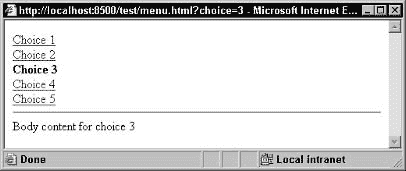

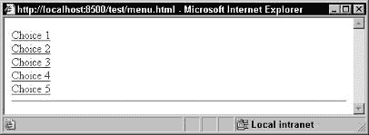

## 输出到浏览器

**7.** 下一步是显示菜单本身。这需要五个`if`语句：每个菜单项一个。每个`if`语句如下所示，并根据特定选择及其相应输出进行调整。结果是一个可能如图 53-1 所示的菜单。

```
if (choice == 1) {
    document.write("<strong>Choice 1</strong><br>");
} else {
    document.write("<a href='menu.html?choice=1'>Choice 1</a><br>");
}
```

***提示***
- 当使用操作 URL 参数的 JavaScript 时，必须通过 Web 服务器访问页面，使用类似`http://my.url/test.html`的 URL，而不是直接使用本地文件路径（如`c:\myfiles\test.html`）。URL 参数在通过文件路径访问文件时不可用。

**图 53-1：** 未选择任何选项时显示的菜单。

**8.** 使用`document.write`方法显示一个分隔线，将菜单与页面正文文本分开：

```
document.write("<hr>");
```

**9.** 使用五个`if`语句，测试`choice`变量的值以显示相应的正文内容。每个`if`语句应如下所示，但需根据相应的选择值和输出进行调整：

```
if (choice == 1) {
    document.write("Body content for choice 1");
}
```

**10.** 用结束脚本标签关闭脚本；在浏览器中查看时，页面可能如图 53-2 所示：

```
</script>
```

***交叉引用***
- 有关如何将 URL 分割成各部分并提取 URL 参数的名称-值对的讨论，请参阅任务 52。

**图 53-2：** 选择选项 3 后的完整页面。

## 用新文档替换浏览器文档

你可以使用`document`对象的两种主要方法将浏览器文档替换为新文档：

- `document.open`：打开一个新的文档流
- `document.close`：关闭由`document.open`打开的文档流

***注意***
- 除了将内容输出到浏览器当前渲染的文档流之外，你还可以使用`document`对象将当前显示的对象替换为新内容，而无需将用户发送到服务器获取新文档。

要使用这些方法，你需要使用如下结构：

```
document.open();
One or more document.write or document.writeln commands
document.close();
```

以下示例创建了一个页面，其中包含一个 JavaScript 函数，该函数使用`document.open`和`document.close`显示一个新文档。用户可以单击链接触发该函数，并在不访问服务器的情况下显示新页面。

**1.** 使用`script`标签开始一个脚本块：

```
<script language="JavaScript">
```

**2.** 开始一个名为`newDocument`的新函数：

```
function newDocument() {
```

**3.** 使用`document.open`打开一个新的文档流：

```
document.open();
```

**4.** 写出新文档的内容：

```
document.write("<p>This is a New Document.</p>");
```

**5.** 使用`document.close`关闭文档流：

```
document.close();
```

**6.** 用右花括号关闭函数：

```
}
```

**7.** 用结束脚本标签关闭脚本：

```
</script>
```

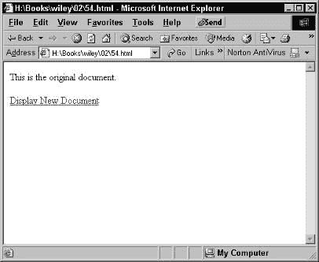

**8.** 在 HTML 文档的正文中，包含一个带有`onClick`事件处理程序的链接，该处理程序调用`newDocument`函数；最终页面示例如清单 54-1 所示。

```
<head>
<script language="JavaScript">
function newDocument() {
    document.open();
    document.write("<p>This is a New Document.</p>");
    document.close();
}
</script>
</head>
<body>
<p>This is the original document.</p>
<p><a href="#" onClick="newDocument()">Display New Document</a></p>
</body>
```

**清单 54-1：** 此代码向浏览器显示第二个文档流。

**9.** 在浏览器中打开文档。最初你会看到 HTML 文档的正文文本，如图 54-1 所示。单击链接后，你应该会看到由`newDocument`函数输出的内容。

***交叉引用***
- 事件处理程序在第 9 部分中讨论。`onClick`事件处理程序在任务 220 中介绍。

**图 54-1：** 原始 HTML 页面。

## 将用户重定向到新页面

与静态的`document.URL`属性不同，`window.location`属性允许你实际重置与窗口关联的位置，并有效地将用户重定向到新的 URL。

例如，考虑以下简单页面：

```
<head>
<script language="JavaScript">
window.location = "http://www.yahoo.com/";
</script>
</head>
<body>
<p>You are here now</p>
</body>
```

在这种情况下，文本“你在这里”甚至不会在浏览器中显示；页面加载后，用户将立即被定向到雅虎网站。

以下脚本利用`window.location`属性，允许用户在表单字段中输入他们想要访问的位置，然后在单击“前往”按钮时将他们带到那里：

**1.** 使用`form`标签开始一个表单。此表单永远不会提交到任何地方，因此实际上不需要`method`或`action`属性：

```
<form>
```

**2.** 创建一个名为`url`的文本框：

```
Enter a URL: <input type="text" name="url">
```

**3.** 创建一个标签为“前往”的按钮。此表单控件应为`button`类型，而不是`submit`类型，因为该按钮不用于将表单提交到任何地方：

```
<input type="button" value="Go">
```

**4.** 在按钮的标签中添加一个`onClick`属性。该属性的值是 HTML 代码，用于将`url`文本字段中存储的值赋给`window.location`属性：

```
<input type="button" value="Go" onClick="window.location = this.form.url.value">
```

**5.** 用结束表单标签关闭表单，使完整表单如下所示：

```
<form>
Enter a URL: <input type="text" name="url">
```

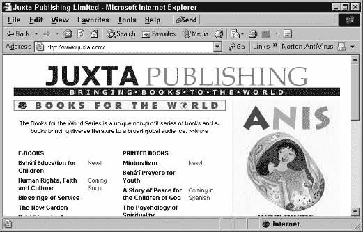

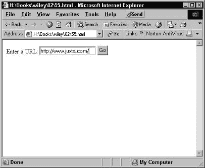


**113**

```html
<input type=”button” value=”Go” Æ
Task
onClick=”window.location = this.form.url.value”> 55
</form>
```

**6.** 将表单保存为一个 HTML 文件，并在 Web 浏览器中打开该文件。你将看到一个表单。

**7.** 在表单的文本字段中输入一个 URL，如图 55-1 所示。

***提示***

• 在用于表单的事件处理程序（如 `onClick`）中，你可以将当前表单引用为 `this.form`。这意味着 `this.form.url` 指向名为 `url` 的文本字段，而 `this.form.url.value` 指向在 `url` 文本字段中输入的内容。

**图 55-1:** 在表单中输入 URL。

**8.** 点击“Go”按钮，你将被重定向到输入的 URL，如图 55-2 所示。

***交叉引用***

• 此任务访问表单中的数据并使用事件处理程序。本书第 4 部分介绍表单的使用，而第 9 部分讨论事件处理程序。

**图 55-2:** 重定向到新的 URL。

## 第 2 部分

### 任务 56：创建“页面加载中...”占位符

本任务介绍如何创建一个“页面加载中”占位符，该占位符在主文档加载时弹出一个单独的窗口。当主文档加载完成时，占位符窗口将关闭。

***注释***

本任务使用了 `window` 对象的两个方法以及一个事件处理程序：

• 一些网站会创建“页面加载中”占位页面。这些页面通常用于加载需要较长时间才能完成的页面，原因可能是加载的内容量较大，或者更常见的是在动态内容的情况下，处理页面以交付给用户需要较长时间。

• `window.open`：打开一个新窗口并在该窗口中加载文档

• `window.close`：关闭一个窗口

• `onLoad`：在 `body` 标签中使用，用于在文档加载完成时触发 JavaScript 执行

以下步骤创建占位符窗口：

• 你可以使用多种策略来创建“页面加载中”占位符。这些策略可以涉及从服务器推送内容，也可以完全在客户端用 JavaScript 实现。本任务采用后一种方法。

**1.** 创建一个 HTML 文件，作为“页面加载中”占位符窗口的内容。你希望用户在该窗口中看到的任何内容都应放在此文件中。将文件命名为 `holder.html`。以下是一个简单的文件，告知用户主页面正在加载：

```html
<html>
<head>
<title>页面加载中...</title>
</head>
<body>
<strong>
页面加载中... 请稍候
</strong>
</body>
</html>
```

**2.** 在同一目录中创建主文档的 HTML 文件。在本任务中，文件命名为 `mainpage.html`。一个简单的 `mainpage.html` 文件可能如下所示：

```html
<html>
<head>
<title>主页面</title>
</head>
<body>
<p>这是主页面</p>
</body>
</html>
```

**3.** 在 `mainpage.html` 中，向文档的头部添加一个脚本块：

```html
<script language=”JavaScript”>
</script>
```

**4.** 在脚本块中，使用 `window.open` 打开一个新窗口。该方法接受三个参数：要在窗口中加载的文件、窗口的名称以及定义窗口特性的一系列参数——在本例中，窗口的宽度和高度设置为 200 像素。该方法返回对窗口对象的引用，以便稍后可以操作该窗口。该引用存储在变量 `placeHolder` 中：

```javascript
var placeHolder = window.open(“holder.html”,”Æ
holderWindow,”width=200,height=200”);
```

***提示***

• 对于像 `mainpage.html` 这样短的文档，这种占位符意义不大。在这种情况下，占位符几乎会立即出现并消失。你需要一个很长、很复杂的 HTML 文档，或者一个需要时间生成的动态文档，才能使这种占位符有价值。

**5.** 向 `body` 标签添加一个 `onLoad` 属性：

```html
<body onLoad=””>
```

**6.** 将 `placeHolder.close()` 作为 `onLoad` 属性的值。这会在主文档加载完成后关闭占位符窗口。最终的 `mainpage.html` 代码如清单 56-1 所示。

```html
<html>
<head>
<script language=”JavaScript”>
var placeHolder = Æ
window.open(“holder.html”,”placeholder”,”width=200,Æ
height=200”);
</script>
<title>主页面</title>
</head>
<body onLoad=”placeHolder.close()”>
<p>这是主页面</p>
</body>
</html>
```

**清单 56-1:** 将占位符代码集成到 HTML 文档中。

**7.** 确保 `holder.html` 和 `mainpage.html` 位于同一目录，然后在浏览器窗口中加载 `mainpage.html`。应该会出现一个包含 `holder.html` 内容的窗口，位于主窗口之上，并在主窗口加载完成后立即消失。

## 第 3 部分：图像与翻转效果

- 任务 57：在 JavaScript 中访问 HTML 嵌入的图像
- 任务 58：使用 JavaScript 加载图像
- 任务 59：检测图像上的 MouseOver 事件
- 任务 60：检测图像上的 Click 事件
- 任务 61：以编程方式切换图像
- 任务 62：在单个页面中使用多个翻转效果
- 任务 63：显示随机图像
- 任务 64：显示多个随机图像
- 任务 65：使用函数创建翻转效果
- 任务 66：使用函数触发翻转效果
- 任务 67：使用函数在单个页面中创建多个翻转效果
- 任务 68：创建简单的翻转菜单系统
- 任务 69：在 JavaScript 中创建幻灯片
- 任务 70：随机化幻灯片
- 任务 71：从链接触发幻灯片切换
- 任务 72：在幻灯片中包含标题
- 任务 73：测试图像是否已加载
- 任务 74：通过链接在不同位置触发翻转效果
- 任务 75：同时使用图像映射和翻转效果
- 任务 76：在 JavaScript 中生成动画横幅
- 任务 77：显示随机横幅广告

### 任务 57：在 JavaScript 中访问 HTML 嵌入的图像

JavaScript 使得访问和操作 HTML 页面中的图像变得非常容易。在 JavaScript 中访问图像是通过 `Image` 对象完成的。对于你在 HTML 代码中包含的每个图像，都会创建一个 `Image` 对象。你可以通过 `document` 对象的 `images` 数组或直接按名称访问这些 `Image` 对象。

***注释***

• `images` 数组包含每个图像的条目，顺序与代码中指定的顺序相同。因此，第一个图像的对象是 `document.images[0]`，第二个是 `document.images[1]`，依此类推。

如果你使用 `img` 标签的 `name` 属性为图像指定了名称，那么你可以直接引用该图像为 `document.imageName`。例如，考虑 HTML 文档中的以下图像：

```html

```

你可以在 JavaScript 中通过 `document.myImage` 引用它。


## 图像与鼠标悬停效果

每个 `Image` 对象都拥有众多属性，可用于获取图像的相关信息。这些属性包括 `height`（图像的高度，以像素为单位）、`width`（图像的宽度，以像素为单位）、`src`（`img` 标签中 `src` 属性的值）、`hspace`（图像水平内边距的大小，以像素为单位）以及 `vspace`（图像垂直内边距的大小，以像素为单位）。

以下任务演示了如何使用这些属性来显示图像，并提供链接以在对话框中显示图像的宽度和高度：

**1.** 使用 `img` 标签在页面中包含一张图像；通过 `name` 属性将图像命名为 `myImage`：

```

```

**2.** 添加一个用于显示宽度的链接，并在 `a` 标签中添加 `onClick` 事件处理程序；该事件处理程序将使用 `window.alert` 方法在对话框中显示图像的宽度。注意，通过引用 `document.myImage.width` 来获取图像的宽度：

```
<a href="#" onClick="window.alert(document.myImage.width)">宽度</a><br>
```

**3.** 添加一个用于显示高度的链接，并在 `a` 标签中添加 `onClick` 事件处理程序；该事件处理程序将使用 `window.alert` 方法在对话框中显示图像的高度。注意，通过引用 `document.myImage.height` 来获取图像的高度。根据需要添加任何 HTML 布局代码，最终代码可能如下所示：

```

<br>
<a href="#" onClick="window.alert(document.myImage.width)">宽度</a><br>
<a href="#" onClick="window.alert(document.myImage.height)">高度</a>
```

**4.** 将代码保存为 HTML 文件，并在 Web 浏览器中打开；你应该会看到一个包含用于显示宽度和高度的链接的页面。

**5.** 点击“宽度”链接，将出现如图 57-1 所示的对话框。

***提示***  
• 利用 JavaScript 操作图像的能力，你可以实现许多不同的效果。这些效果包括动态更改图像以创建幻灯片、在图像上创建鼠标悬停效果，甚至使用 JavaScript 生成动画图像或横幅。

**图 57-1：** 显示图像的宽度。

**6.** 点击“高度”链接，将出现如图 57-2 所示的对话框。

***交叉引用***  
**图 57-2：** 显示图像的高度。  
• `window.alert` 方法（参见步骤 2）会显示一个包含单条文本消息和一个用于关闭对话框的按钮的对话框。它接受一个字符串作为参数，该字符串应为对话框中显示的消息。此方法在任务 25 中讨论过。

### 任务 58：使用 JavaScript 加载图像

除了通过在 HTML 中加载图像来创建 `Image` 对象外，你还可以在 JavaScript 中以编程方式创建 `Image` 对象。在 JavaScript 中加载图像分为两步：

**1.** 创建一个 `Image` 对象并将其赋值给一个变量：`var myImage = new Image;`

**2.** 将源图像 URL 赋值给对象的 `src` 属性：`myImage.src = "图像 URL 在此处";`

以下任务演示了如何以编程方式加载图像，即通过这种方式加载图像，然后提供链接以在对话框中显示图像的宽度和高度，与任务 57 类似：

**1.** 创建一个带有开始和结束 `script` 标签的脚本块。

**2.** 在脚本中，创建一个名为 `myImage` 的新 `Image` 对象：`myImage = new Image;`

**3.** 通过将图像 URL 赋值给 `myImage` 的 `src` 属性来加载图像：

```
myImage.src = "image1.jpg";
```

**4.** 在页面 HTML 的正文中，添加一个用于显示宽度的链接，并在 `a` 标签中添加 `onClick` 事件处理程序；该事件处理程序将使用 `window.alert` 方法在对话框中显示图像的宽度。通过引用 `document.myImage.width` 来获取图像的宽度：

```
<a href="#" onClick="window.alert(document.myImage.width)">宽度</a><br>
```

**5.** 添加一个用于显示高度的链接，并在 `a` 标签中添加 `onClick` 事件处理程序；该事件处理程序将使用 `window.alert` 方法在对话框中显示图像的高度。通过引用 `document.myImage.height` 来获取图像的高度。最终页面应如下所示：

***警告***  
• 如任务 57 所述，`images` 数组按代码中指定图像的顺序包含每个图像的一个条目。因此，第一个图像的对象是 `document.images[0]`，第二个是 `document.images[1]`，依此类推。这仅适用于 HTML 文档中的图像。在本任务中通过 JavaScript 创建的 `Image` 对象不会出现在 `images` 数组中。

```
<script language="JavaScript">
myImage = new Image;
myImage.src = "Tellers1.jpg";
</script>

<body>
<a href="#" onClick="window.alert(myImage.width)">宽度</a><br>
<a href="#" onClick="window.alert(myImage.height)">高度</a>
</body>
```

**6.** 将代码保存为 HTML 文件，并在浏览器中打开该文件；页面应显示两个链接，但图像本身不会显示，如图 58-1 所示。

***提示***  
• 当你希望加载图像但不显示它，并在后续脚本中使用该图像时，可以在 JavaScript 中创建一个 `Image` 对象。例如，你可以在幻灯片中使用该图像，或当鼠标移动到图像上时将其用作悬停图像。

**图 58-1：** 显示宽度和高度链接。

**7.** 点击“宽度”链接，将出现一个如图 58-2 所示的对话框，显示图像的宽度。点击“高度”链接，将出现一个显示图像高度的对话框。

***交叉引用***  
• 任务 57 讨论了在 HTML 中加载图像，然后从 JavaScript 中访问这些图像。

**图 58-2：** 显示图像的宽度。

### 任务 59：检测图像上的鼠标悬停事件

使用 `onMouseOver` 事件处理程序，你可以检测鼠标指针何时位于图像上方。然后，你可以触发仅在鼠标移入图像所占空间时发生的操作。通常，这用于创建悬停效果，如下面的任务所示。

要指定事件处理程序，你需要使用 `img` 标签的 `onMouseOver` 属性来指定鼠标悬停在图像上时要执行的 JavaScript。例如：

```

```

当图像作为链接使用时（例如，图像作为菜单中的按钮），你通常将 `onMouseOver` 属性放在包含 `img` 标签的 `a` 标签中：

```
<a href="URL" onMouseOver="JavaScript 代码">
  
</a>
```

以下展示了在 `img` 和 `a` 标签中使用 `onMouseOver`，并在鼠标指针移动到图像上时在对话框中显示相应消息：

**1.** 在文档的正文中，放置一个 `img` 标签以显示第一张图像：

```

```

***注释***  
• 在此示例中，当鼠标指针移动到开始和结束 `a` 标签内的任何内容上时，JavaScript 代码都会执行；在本例中，只有图像位于 `a` 块内。  
• `onMouseOver` 事件通常用于悬停效果。如果你将图像用作菜单按钮，并希望在鼠标悬停在按钮上时显示一个替代的高亮图像，你将使用 `onMouseOver`。在这些情况下，图像将是链接的一部分，你将在 `a` 标签中使用 `onMouseOver`。这是 `onMouseOver` 事件最常见的用法，很少在 `img` 标签本身中使用。


## 图像与翻转效果

### 为 `img` 标签添加 `onMouseOver` 属性

**2.** 为 `img` 标签添加一个 `onMouseOver` 属性：

```html

```

该属性在支持 JavaScript 的浏览器中可用于 `a` 标签，但仅在新版浏览器（Netscape 6 及以上或 Internet Explorer 4 及以上）中可用于 `img` 标签。

**3.** 将 `window.alert` 方法作为 `onMouseOver` 属性的值，当鼠标指针移到图像上时显示一条消息：

```html

```

**4.** 添加第二个 `img` 标签以显示另一张图像：

```html

```

**5.** 在第二张图像周围放置一对 `a` 标签；无需指定 URL，并且应为 `a` 标签添加一个 `onMouseOver` 属性。再次将 `window.alert` 方法作为 `onMouseOver` 属性的值，当鼠标指针移到第二张图像上时显示一条消息。最终代码应如下所示：


```html
<body>
<br>
<a href="#" onMouseOver="window.alert('Over the Æ Link');"></a>
</body>
```

**6.** 将代码保存为 HTML 文件，并在浏览器中打开该文件。页面将如图 59-1 所示。

**图 59-1：** 显示两张图像。

**7.** 将鼠标指针移到第一张图像上，将出现一个如图 59-2 所示的对话框。将鼠标移到第二张图像上，将出现一个提示您位于链接上的对话框。

**图 59-2：** 当鼠标移到图像上时显示对话框。

### 检测图像上的点击事件

与指定代码响应 `onMouseOver` 事件（参见任务 59）的方式类似，您可以指定仅在用户点击图像时执行的操作。这通过 `img` 标签或 `a` 标签的 `onClick` 事件处理程序实现，具体取决于情况。

您可以为 `img` 标签指定 `onClick` 属性：

```html

```

当您将图像用作链接时（例如在菜单中作为按钮的图像），通常将 `onClick` 属性放在包含 `img` 标签的 `a` 标签中：

```html
<a href="*URL*" onClick="*JavaScript code*">
  
</a>
```

> ***注意***
> - 在此示例中，当鼠标指针点击 `a` 开始和结束标签内的任何内容时，将执行 JavaScript 代码；在此情况下，只有图像位于 `a` 块内。
> - `onClick` 事件在支持 JavaScript 的浏览器中可用于 `a` 标签，但仅在新版浏览器（Netscape 6 及以上或 Internet Explorer 4 及以上）中可用于 `img` 标签。

以下展示了在 `img` 和 `a` 标签中使用 `onClick` 的方法，并在鼠标点击图像时在对话框中显示相应的消息：

**1.** 在文档的正文中，放置一个 `img` 标签以显示第一张图像：

```html

```

**2.** 为 `img` 标签添加一个 `onClick` 属性：

```html

```

**3.** 将 `window.alert` 方法作为 `onClick` 属性的值，当鼠标指针移到图像上时显示一条消息：

```html

```

**4.** 添加第二个 `img` 标签以显示另一张图像：

```html

```

**5.** 在第二张图像周围放置一对 `a` 标签；无需指定 URL，并且应为 `a` 标签添加一个 `onClick` 属性。再次将 `window.alert` 方法作为 `onClick` 属性的值，当鼠标指针移到第二张图像上时显示一条消息。最终代码应如下所示：

```html
<body>
<br>
<a href="#" onClick="window.alert('Clicked on the Æ Link');"></a>
</body>
```

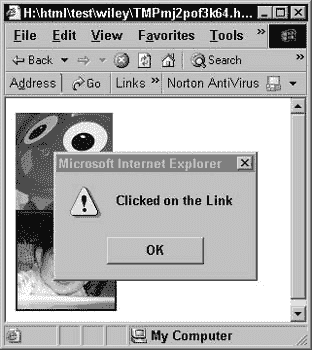
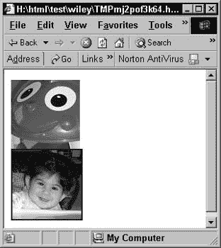

**6.** 将代码保存为 HTML 文件，并在浏览器中打开该文件。页面将如图 60-1 所示。

**图 60-1：** 显示两张图像。

**7.** 点击第一张图像，将出现一个对话框，提示您点击了没有链接的图像。

**8.** 点击第二张图像，将出现一个如图 60-2 所示的对话框。

**图 60-2：** 当鼠标点击图像链接时显示对话框。

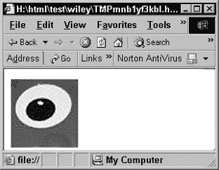
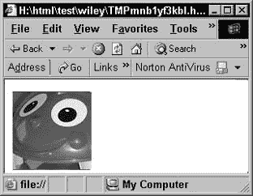

### 以编程方式切换图像

本任务演示如何将基于 JavaScript 的图像加载与 `onMouseOver` 事件处理程序结合，以创建翻转效果。这种翻转效果通常用于基于图像的按钮以及由图像构建的菜单项。

请考虑图 61-1。这里网页中显示了一张图像，鼠标指针不在图像上。当鼠标指针移到图像上时，翻转图像会替换原始图像，如图 61-2 所示。当鼠标指针移出图像时，图像恢复为图 61-1 所示的原始图像。

> ***注意***
> - 在生成这些翻转效果时，请记住，图像及其备用翻转图像通常应具有相同的像素宽度和高度。否则会出现两个问题之一。首先，如果您没有使用 `img` 标签的 `width` 和 `height` 属性强制指定图像大小，那么当鼠标滚过图像时，图像所占用的空间可能会发生变化，导致图像周围的页面元素移动。其次，如果您强制指定了图像大小，则其中一张图像需要被拉伸以匹配另一张图像的大小。
> - `onMouseOver` 事件处理程序与 `onMouseOut` 事件处理程序类似。它允许程序员指定当鼠标指针离开页面元素（如图像）所占区域时要执行的 JavaScript 代码，而 `onMouseOver` 则指定当鼠标指针进入页面元素所占空间时要执行的代码。

**图 61-1：** 当鼠标指针不在图像上时，显示原始图像。

**图 61-2：** 当鼠标指针在图像上时，显示备用图像。

在 JavaScript 中生成翻转效果的原理很简单，涉及三个关键部分：

- 在 `img` 标签中指定默认图像。
- 创建两个 `Image` 对象；一个加载默认图像，另一个加载翻转图像。
- 指定 `onMouseOver` 和 `onMouseOut` 事件处理程序，以管理鼠标移入或移出图像时显示的图像变化。

以下步骤概述了如何为页面中的单个图像创建简单的翻转效果：

**1.** 在页面的头部，创建一个带有开始和结束 `script` 标签的脚本块。

**2.** 在脚本中，创建一个名为 `rollImage` 的 `Image` 对象，并通过将图像赋值给 `rollImage` 对象的 `src` 属性来加载备用翻转图像：

```javascript
rollImage = new Image;
rollImage.src = "rollImage1.jpg";
```

> ***提示***
> - 翻转效果旨在为用户提供上下文，让他们知道该图像构成一个可点击的元素，并准确显示他们点击的内容（尤其是在多个图像紧密排列的情况下）。

**3.** 在脚本中，创建一个名为 `defaultImage` 的 `Image` 对象，并加载要显示的默认图像。

**4.** 在脚本的正文中，使用 `img` 标签放置默认图像。使用标签的属性控制图像的大小和边框。


根据需要，使用 `name` 属性为图像分配名称 `myImage`，使它们彼此靠近（在复杂布局中）。

**5.** 将 `img` 标签包裹在成对的 `a` 开始和结束标签中，并在 `a` 标签的 `href` 属性中指定用户点击图像时希望跳转的 URL。为 `a` 标签添加一个 `onMouseOver` 属性，并用它来向 `myImage` 对象显示翻转图像。这样当鼠标移动到图像上时，就会显示翻转图像。同时，为 `a` 标签添加一个 `onMouseOut` 属性，并用它来在鼠标移出图像时显示默认图像。最终的脚本应如下所示：

```html
<head>
<script language=”JavaScript”>
rollImage = new Image;
rollImage.src = “rollImage1.jpg”;
defaultImage = new Image;
defaultImage.src = “image1.jpg”;
</script>
</head>
<body>
<a href=” *myUrl*” onMouseOver=”document.myImage.src = rollImage.src;”
onMouseOut=”document.myImage.src = defaultImage.src;”>

</a>
</body>
```

**7.** 将代码保存为 HTML 文件，并在浏览器中加载。当鼠标滑过图像时，翻转效果会将其替换为翻转图像，当鼠标指针离开图像所占区域时，再切换回默认图像。

### 任务 62：在单个页面中使用多个翻转效果

在任务 61 演示的翻转效果基础上，本任务展示了如何将该原理扩展到支持单个页面中的多个翻转效果。这在用翻转图像构建菜单时非常有用。

以下步骤演示了在单个页面上创建两个翻转图像的过程：

***注意***

- 在最基本的形式中，多个翻转效果要求每个图像具有唯一的名称，每个图像具有唯一命名的 `Image` 对象，并且每个翻转图像具有唯一命名的 `Image` 对象。
- `onMouseOver` 事件处理程序与 `onMouseOut` 事件处理程序类似。它允许程序员指定当鼠标指针离开页面元素（如图像）所占区域时要执行的 JavaScript 代码，而 `onMouseOver` 则指定当鼠标指针进入页面元素所占区域时要执行的代码（参见步骤 4）。
- 在生成这些翻转效果时，请记住，图像及其备用翻转图像通常应具有相同的像素宽度和高度；否则会出现两个问题之一。首先，如果不使用 `img` 标签的 `width` 和 `height` 属性强制指定图像大小，则图像所占空间可能会随鼠标滑过而改变，导致图像周围的页面元素移动。其次，如果强制指定图像大小，则其中一个图像需要变形以匹配另一个图像的大小（参见图示）。

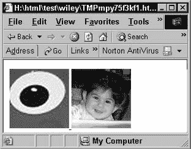
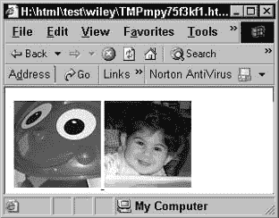

**1.** 在新页面头部的脚本块中，创建一个名为 `rollImage1` 的 `Image` 对象，并通过将图像赋值给 `rollImage1` 对象的 `src` 属性，将第一个图像的备用翻转图像加载到其中。同时创建一个名为 `defaultImage1` 的 `Image` 对象，并通过将图像赋值给 `defaultImage1` 对象的 `src` 属性，将第一个图像的默认图像加载到其中：

```javascript
rollImage1 = new Image; rollImage1.src = “rollImage1.jpg”;
defaultImage1 = new Image; defaultImage1.src = “image1.jpg”;
```

**2.** 对第二个图像重复该过程，创建并加载 `rollImage2` 和 `defaultImage2`，使生成的脚本如下：

```javascript
rollImage2 = new Image; rollImage2.src = “rollImage2.jpg”;
defaultImage2 = new Image; defaultImage2.src = “image2.jpg”;
```

**3.** 在脚本的正文中，使用 `img` 标签放置两个默认图像；使用标签的属性根据需要控制图像的大小和边框，并使用 `name` 属性为图像分配名称 `myImage1` 和 `myImage2`：

```html


```

**4.** 将每个 `img` 标签包裹在成对的 `a` 开始和结束标签中，并在 `a` 标签的 `href` 属性中指定用户点击图像时希望跳转的 URL。为每个 `a` 标签添加一个 `onMouseOver` 属性，并用它来显示翻转图像。这样当鼠标移动到相关图像上时，就会显示翻转图像。同时，为每个 `a` 标签添加一个 `onMouseOut` 属性，并用它来在鼠标移出相关图像时显示默认图像。最终的脚本应如下所示：

```html
<head>
<script language=”JavaScript”>
rollImage1 = new Image; rollImage1.src = “Tellers1.jpg”;
defaultImage1 = new Image; defaultImage1.src = “lotus.jpg”;
rollImage2 = new Image; rollImage2.src = “hedi.jpg”;
defaultImage2 = new Image; defaultImage2.src = “ArcRV1.1.jpg”;
</script>
</head>
<body>
<a href=”#” onMouseOver=”document.myImage1.src = rollImage1.src;”
onMouseOut=”document.myImage1.src = defaultImage1.src;”>

</a>
<a href=”#” onMouseOver=”document.myImage2.src = rollImage2.src;”
onMouseOut=”document.myImage2.src = defaultImage2.src;”>

</a>
</body>
```

**5.** 将代码保存为 HTML 文件，并在浏览器中加载。存在两种可能的状态：鼠标不在图像上时（图 62-1）和鼠标位于第一个图像上时（图 62-2）。

**图 62-1：** 鼠标不在任何图像上。

**图 62-2：** 鼠标位于第一个图像上。

### 任务 63：显示随机图像

JavaScript 与图像结合的一种应用是在页面上的某个位置加载随机图像，而不是每次都加载同一张图像。

一种方法是完全使用 JavaScript 来显示图像。也就是说，你需要使用 JavaScript 指定一个可能的图像列表，随机选择一张，然后生成 `img` 标签来显示该图像。

***注意***

- 数组中的每个槽位都有编号；编号从零开始。这意味着一个有四个条目的数组，其条目编号为 0 到 3。
- `Math` 对象提供了许多用于处理数字和数学运算的有用方法。
- `Array` 对象的 `length` 属性提供了数组中的条目数。这意味着如果一个数组有四个条目（编号 0 到 3），那么该数组的 `length` 属性值为 4。
- `Math.floor` 执行类似于取整的功能，它会去掉数字的小数部分。不同之处在于，取整的结果可能是下一个最高或最低的整数值，具体取决于小数部分的大小。

以下步骤创建的脚本演示了这一过程：

**1.** 创建一个带有开始和结束 `script` 标签的脚本块；该脚本块应位于 HTML 文档中希望显示图像的位置的正文中：

```html
<script language=”JavaScript”>
</script>
```

**2.** 在脚本中，创建一个名为 `imageList` 的数组：

```javascript
var imageList = new Array;
```

**3.** 为每个希望用于随机选择的图像在数组中创建一个条目。例如，如果有四张图像，则将它们的路径和名称分配给数组的前四个条目：

```javascript
imageList[0] = “image1.jpg”;
imageList[1] = “image2.jpg”;
imageList[2] = “image3.jpg”;
imageList[3] = “image4.jpg”;
```

**4.** 创建一个名为 `imageChoice` 的变量：

```javascript
var imageChoice;
```


## 图像与翻转效果

**5.** 使用 `Math.random` 方法为 `imageChoice` 分配一个随机数，该方法返回一个 0 到 1 之间的随机数（即该数大于等于 0 但小于 1）：

```
var imageChoice = Math.random();
```

**6.** 扩展赋给 `imageChoice` 的表达式，将随机数乘以 `imageList` 数组中的条目数，得到一个大于等于 0 但小于 4 的数：

```
var imageChoice = Math.random() * imageList.length;
```

**7.** 进一步扩展赋给 `imageChoice` 的表达式，使用 `Math.floor` 方法去除小数点后的部分；结果是一个从 0 到数组条目数减 1 的整数——在本例中，即从 0 到 3 的整数：

```
var imageChoice = Math.floor(Math.random() * imageList.length);
```

**8.** 使用 `document.write` 方法在发送给浏览器的 HTML 数据流中放置一个 `` 标签。作为 `` 标签的 `src` 属性值，随机图像被指定为 `imageList[imageChoice]`。最终的脚本如下所示：

```javascript
<script language="JavaScript">
var imageList = new Array;
imageList[0] = "image1.jpg";
imageList[1] = "image2.jpg";
imageList[2] = "image3.jpg";
imageList[3] = "image4.jpg";
var imageChoice = Math.floor(Math.random() * imageList.length);
document.write('');
</script>
```

**9.** 将代码保存到 HTML 文件中，并在浏览器中显示该文件。将显示一张随机图像，如图 63-1 所示。重新加载文件应显示不同的图像，如图 63-2 所示（尽管连续两次选中相同随机数的可能性很小）。

**图 63-1：** 显示一张随机图像。

***交叉引用***
- *数组*是一种包含多个编号槽位的数据类型，你可以在其中放置任何值。有关数组的讨论，请参见任务 20。
- `document.write` 方法在任务 45 中介绍。它允许 JavaScript 代码生成输出，这些输出构成浏览器渲染的 HTML 的一部分。

**图 63-2：** 重新加载页面通常会显示不同的随机图像。

---

### 任务 64：显示多张随机图像

在网页中显示一张随机图像的过程可以轻松扩展为从同一组随机图像中显示多张随机图像。结果是一个类似下面的脚本，它显示三张随机图像：

**1.** 在新文档的头部脚本块中，创建一个名为 `imageList` 的数组：

```javascript
var imageList = new Array;
```

**2.** 为每个希望用于随机选择的图像在数组中创建一个条目。例如，以下代码指定了四张图像的路径：

```javascript
imageList[0] = "image1.jpg";
imageList[1] = "image2.jpg";
imageList[2] = "image3.jpg";
imageList[3] = "image4.jpg";
```

**3.** 使用 `function` 关键字创建一个名为 `showImage` 的函数：

```javascript
function showImage() {
}
```

**4.** 在函数中，创建一个名为 `imageChoice` 的变量。使用 `Math.random` 方法为 `imageChoice` 分配一个随机数，该方法返回一个 0 到 1 之间的随机数（即该数大于等于 0 但小于 1）。扩展赋给 `imageChoice` 的表达式，将随机数乘以 `imageList` 数组中的条目数，得到一个大于等于 0 但小于 4 的数：

```javascript
var imageChoice = Math.random() * imageList.length;
```

**5.** 进一步扩展赋给 `imageChoice` 的表达式，使用 `Math.floor` 方法去除小数点后的部分。结果是一个从 0 到数组条目数减 1 的整数——在本例中，即从 0 到 3 的整数：

```javascript
var imageChoice = Math.floor(Math.random() * imageList.length);
```

**6.** 使用 `document.write` 方法在发送给浏览器的 HTML 数据流中放置一个 `` 标签。作为 `` 标签的 `src` 属性值，随机图像被指定为 `imageList[imageChoice]`。最终的函数如下所示：

```javascript
function showImage() {
    var imageChoice = Math.floor(Math.random() * imageList.length);
    document.write('');
}
```

**7.** 在文档的正文中，在你希望放置随机图像的位置创建一个脚本块，然后在那里调用 `showImage` 函数。你可以在同一个脚本块中多次调用 `showImage` 函数。以下页面展示了如何在一行中显示三张随机图像。通常，结果将如图 64-1 所示。根据数组中可用的图像数量以及你显示的随机图像数量，总有可能看到重复的图像，如图 64-2 所示。

```html
<head>
<script language="JavaScript">
var imageList = new Array;
imageList[0] = "Tellers1.jpg";
imageList[1] = "lotus.jpg";
imageList[2] = "hedi.jpg";
imageList[3] = "ArcRV1.1.jpg";
function showImage() {
    var imageChoice = Math.floor(Math.random() * imageList.length);
    document.write('');
}
</script>
</head>
<body>
<script language="JavaScript">
showImage();
showImage();
showImage();
</script>
</body>
```

***交叉引用***
- *数组*是一种包含多个编号槽位的数据类型，你可以在其中放置任何值。有关数组的讨论，请参见任务 20。

**图 64-1：** 显示三张随机图像。

**图 64-2：** 图像可能重复。

---

### 任务 65：使用函数创建翻转效果

本任务展示如何将创建翻转图像所需的 `Image` 对象封装到一个函数中。以下步骤展示了如何创建必要的函数，并使用它为图像创建翻转效果：

**1.** 在文档的头部，创建一个带有开始和结束脚本标签的脚本块：

```html
<script language="JavaScript">
</script>
```

***注释***
- 代码创建、代码管理和代码准确性的任务随着


## 图像与翻转效果

### 任务 65

1. 在脚本中，创建两个变量：`source` 和 `replacement`，分别包含值 `0` 和 `1`。这些变量允许通过名称引用每个翻转数组的 `Image` 对象：`source` 表示默认图像，`replacement` 表示翻转图像。

   ```javascript
   var source = 0;
   var replacement = 1;
   ```

2. 使用 `function` 关键字创建一个名为 `createRollOver` 的函数。该函数应接受两个参数——`originalImage`（包含默认图像的路径和名称）和 `replacementImage`（包含翻转图像的路径和名称）：

   ```javascript
   function createRollOver(originalImage, replacementImage) {
   }
   ```

3. 在函数中，创建一个名为 `imageArray` 的数组：

   ```javascript
   var imageArray = new Array;
   ```

4. 在数组的第一个元素中创建一个新的 `Image` 对象，使用 `source` 指定索引，并将 `originalImage` 赋值给该图像的源：

   ```javascript
   imageArray[source] = new Image;
   imageArray[source].src = originalImage;
   ```

5. 在数组的第二个元素中创建一个新的 `Image` 对象，使用 `replacement` 指定索引，并将 `replacementImage` 赋值给该图像的源：

   ```javascript
   imageArray[replacement] = new Image;
   imageArray[replacement].src = replacementImage;
   ```

6. 返回该数组作为函数的返回值：

   ```javascript
   return imageArray;
   ```

7. 在函数之后，调用 `createRollOver` 函数创建所需的翻转数组，并将函数返回的数组赋值给 `rollImage1`。最终的脚本如下所示：

   ```html
   <script language="JavaScript">
   var source = 0;
   var replacement = 1;

   function createRollOver(originalImage, replacementImage) {
       var imageArray = new Array;
       imageArray[source] = new Image;
       imageArray[source].src = originalImage;
       imageArray[replacement] = new Image;
       imageArray[replacement].src = replacementImage;
       return imageArray;
   }

   var rollImage1 = createRollOver("image1.jpg", "rollImage1.jpg");
   </script>
   ```

8. 在 HTML 的 body 中，使用 `img` 标签放置图像，通过 `name` 属性将图像命名为 `myImage1`，并将图像放置在 `a` 块中。`a` 标签必须包含 `onMouseOver` 和 `onMouseOut` 属性，根据鼠标移动分配相应的图像。文档 body 的最终源代码如下所示：

   ```html
   <body>
   <a href="#" onMouseOver="document.myImage1.src = rollImage1[replacement].src;"
      onMouseOut="document.myImage1.src = rollImage1[source].src;">
   
   </a>
   </body>
   ```

9. 保存 HTML 文件并在浏览器中打开。默认图像显示如图 65-1 所示。将鼠标移到图像上即可看到翻转图像。

   ***交叉引用***
   - 本任务与任务 66 说明了如何封装两个翻转功能：创建翻转 `Image` 对象以及在事件处理程序中处理图像切换。

   **图 65-1：** 当鼠标指针不在图像上时，显示原始图像。

   

### 任务 66

除了创建用于处理翻转 `Image` 对象生成的函数外，还可以将处理翻转中实际图像切换的代码封装到事件处理程序中。本任务扩展了任务 65 中的示例，并为此添加了一个函数。

以下步骤展示了如何将函数添加到任务 65 的代码中，并使用这两个函数构建和触发翻转效果：

***备注***
- 本任务中开发的函数是一个通用函数：它可用于在鼠标移入或移出图像时执行图像切换。
- 与任务 61 中为单个图像创建翻转效果相比，本任务可能看起来更复杂，使用的源代码也更多。这种看法是准确的；然而，将模块化代码分解为函数的好处在于，处理多个翻转效果变得更加容易，并且创建和触发每个翻转效果的代码也明显更简单。
- 随着文档中翻转图像数量的增加，代码创建、代码管理和代码准确性的任务变得越来越艰巨。在某个时刻，确保代码无错误和调试会变得困难。本任务中的方法旨在一定程度上缓解这一问题。

1. 在新文档头部的脚本块中，创建两个变量——`source` 和 `replacement`，分别包含值 `0` 和 `1`。这些变量允许通过名称引用每个翻转数组的 `Image` 对象——`source` 表示默认图像，`replacement` 表示翻转图像。

   ```javascript
   var source = 0;
   var replacement = 1;
   ```

2. 按照任务 65 中的相同方式创建一个名为 `createRollOver` 的函数：

   ```javascript
   function createRollOver(originalImage, replacementImage) {
       var imageArray = new Array;
       imageArray[source] = new Image;
       imageArray[source].src = originalImage;
       imageArray[replacement] = new Image;
       imageArray[replacement].src = replacementImage;
       return imageArray;
   }
   ```

3. 使用 `function` 关键字创建一个名为 `roll` 的函数。该函数接受两个参数——`targetImage`（将与相关图像的 `img` 标签关联的 `Image` 对象）和 `displayImage`（要显示的图像的 `Image` 对象）：

   ```javascript
   function roll(targetImage, displayImage) {
   }
   ```

4. 在函数中，将 `displayImage` 中的图像赋值给与 `targetImage` 关联的图像位置，使最终函数如下所示：

   ```javascript
   function roll(targetImage, displayImage) {
       targetImage.src = displayImage.src;
   }
   ```

5. 在 `roll` 函数之后，调用 `createRollOver` 函数创建所需的翻转数组，并将函数返回的数组赋值给 `rollImage1`。最终的脚本如下所示：

   ```javascript
   var rollImage1 = createRollOver("image1.jpg", "rollImage1.jpg");
   ```

   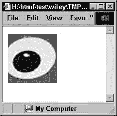
   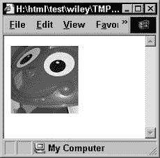

6. 在 HTML 的 body 中，使用 `img` 标签创建图像，并将图像命名为 `myImage1`：

   ```html
   
   ```

7. 用一对 `a` 标签包围图像：

   ```html
   <a href="*myUrl*">
   
   </a>
   ```

8. 指定 `a` 标签的 `onMouseOver` 和 `onMouseOut` 属性。这些属性使用 `roll` 函数来处理图像切换。

   ```html
   <a href="#" onMouseOver="roll(myImage1, rollImage1[replacement])"
      onMouseOut="roll(myImage1, rollImage1[source])">
   
   </a>
   ```


```
border=0>
</a>
```

**9.** 保存 HTML 文件并在浏览器中打开。默认图像显示如图 66-1 所示。将鼠标移到图像上，即可看到翻转图像，如图 66-2 所示。

**图 66-1：** 鼠标指针不在图像上时，显示原始图像。

**图 66-2：** 鼠标指针在图像上时，显示翻转图像。

### 任务 67：使用函数在单个页面中创建多个翻转效果

当尝试在页面中创建多个翻转效果时，使用函数实现翻转的真正优势便显现出来。以下示例展示了如何使用任务 65 和任务 66 中创建的函数，在同一文档中创建两个翻转图像：

***注意***
- 此任务可能看起来比任务 61 中为单个图像创建翻转效果更复杂，使用的源代码也更多。这种看法是准确的；然而，将模块化代码分解为函数的好处在于，处理多个翻转效果变得更加容易，并且创建和触发每个翻转效果的代码也明显更简单。

**1.** 在新文档的头部脚本块中，再创建两个变量——`source` 和 `replacement`，分别包含值 0 和 1。这些变量允许通过名称引用每个翻转数组的 `Image` 对象：`source` 表示默认图像，`replacement` 表示翻转图像：

```
var source = 0;
var replacement = 1;
```

**2.** 按照任务 65 中的方式创建一个名为 `createRollOver` 的函数：

```
function createRollOver(originalImage,replacementImage) {
    var imageArray = new Array;
    imageArray[source] = new Image;
    imageArray[source].src = originalImage;
    imageArray[replacement] = new Image;
    imageArray[replacement].src = replacementImage;
    return imageArray;
}
```

**3.** 按照任务 66 中的方式创建一个名为 `roll` 的函数：

```
function roll(targetImage,displayImage) {
    targetImage.src = displayImage.src;
}
```

**4.** 在 `roll` 函数之后，调用 `createRollOver` 函数两次，为两个翻转效果创建数组。结果返回并存储在 `rollImage1` 和 `rollImage2` 中：

```
var rollImage1 = createRollOver("image1.jpg","rollImage1.jpg");
var rollImage2 = createRollOver("image2.jpg","rollImage2.jpg");
```

**5.** 在文档的主体中，使用 `img` 标签为第一个翻转效果创建图像，并将其包裹在开闭 `a` 标签中；使用 `roll` 函数为 `a` 标签的 `onMouseOver` 和 `onMouseOut` 事件处理程序指定适当的图像切换，并通过 `img` 标签的 `name` 属性将图像命名为 `myImage1`：


```
<a href="#" onMouseOver="roll(myImage1,rollImage1[replacement])" onMouseOut="roll(myImage1,rollImage1[source])">

</a>
```

**6.** 在文档的主体中，使用 `img` 标签为第二个翻转效果创建图像，并将其包裹在开闭 `a` 标签中；使用 `roll` 函数为 `a` 标签的 `onMouseOver` 和 `onMouseOut` 事件处理程序指定适当的图像切换，并通过 `img` 标签的 `name` 属性将图像命名为 `myImage1`。

***提示***
- 翻转效果旨在为用户提供上下文，让他们知道图像构成了一个可点击的元素，并准确显示他们点击的内容（尤其是在复杂布局中多个图像彼此靠近的情况下）。

最终脚本应如下所示：

```
<a href="#" onMouseOver="roll(myImage2,rollImage2[replacement])" onMouseOut="roll(myImage2,rollImage2[source])">

</a>
```

**7.** 保存 HTML 文件并在浏览器中打开。显示两个图像。当鼠标指针不在任一图像上时，显示默认图像，如图 67-1 所示。将鼠标指针移到第一个图像上，显示第一个翻转效果，如图 67-2 所示；移到第二个图像上，显示第二个翻转效果。

**图 67-1：** 鼠标不在任何图像上。

**图 67-2：** 鼠标在第一个图像上。

***交叉引用***
- 任务 65 和任务 66 展示了如何使用函数将创建和触发翻转效果的代码模块化并简化。

### 任务 68：创建简单的翻转菜单系统

你已经看到将核心翻转逻辑移至函数如何促进多个翻转图像的创建。为了充分利用这一点，应将函数放在一个单独的 JavaScript 文件中，然后可以将其包含在你构建的任何文档中。

***注意***
- 将函数移至外部文件允许你在任何页面中重用代码——并且通过从页面中移除函数代码，极大地简化了使用翻转效果的页面。
- `.js` 文件扩展名是 JavaScript 文件的标准扩展名；对于任何设计为包含 JavaScript 并要包含在其他 HTML 文档中的文件，都应使用此扩展名。

以下示例说明了如何获取任务 67 中使用的函数，将其移至外部 JavaScript 文件，然后构建一个使用该文件在页面中创建两个翻转图像的页面：

**1.** 在一个空白文本文件中，创建一个 JavaScript 脚本，但不要使用 `script` 标签来开闭脚本。通过创建 `source` 和 `replacement` 变量开始脚本：

```
var source = 0;
var replacement = 1;
```

**2.** 按照任务 65 中的方式创建一个名为 `createRollOver` 的函数：

```
function createRollOver(originalImage,replacementImage) {
    var imageArray = new Array;
    imageArray[source] = new Image;
    imageArray[source].src = originalImage;
    imageArray[replacement] = new Image;
    imageArray[replacement].src = replacementImage;
    return imageArray;
}
```

**3.** 按照任务 66 中的方式创建一个名为 `roll` 的函数：

```
function roll(targetImage,displayImage) {
    targetImage.src = displayImage.src;
}
```

**4.** 将文件保存为 `rollover.js`。

**5.** 在一个新文本文件中，通过使用 `script` 标签的 `src` 属性包含 `rollover.js` 文件；将此 `script` 标签放在文档头部：

```
<script language="JavaScript" src="rollover.js"></script>
```

**6.** 在文档头部创建第二个脚本块。


**7.** 在此脚本中，调用 `createRollOver` 函数两次，为两个翻转效果创建数组。将结果数组分配给 `rollImage1` 和 `rollImage2`：

```
<script language="JavaScript">
var rollImage1 = createRollOver("image1.jpg","rollImage1.jpg");
var rollImage2 = createRollOver("image2.jpg","rollImage2.jpg");
</script>
```

**8.** 在文档的主体中，使用 `img` 标签为第二个翻转效果创建图像，并将其包裹在开闭 `a` 标签中。使用 `roll` 函数为 `a` 标签的 `onMouseOver` 和 `onMouseOut` 事件处理程序指定适当的图像切换，并通过 `img` 标签的 `name` 属性将图像命名为 `myImage1`。

最终脚本应如下所示：

```
<body>
<a href="#" onMouseOver="roll(myImage1,rollImage1[replacement])" onMouseOut="roll(myImage1,rollImage1[source])">

</a>
<a href="#" onMouseOver="roll(myImage2,rollImage2[replacement])" onMouseOut="roll(myImage2,rollImage2[source])">

</a>
</body>
```

**9.** 保存 HTML 文件并在浏览器中打开。当鼠标指针不在任一图像上时，显示默认图像，如图 68-1 所示。

***交叉引用***
- 任务 4 讨论了使用 `src` 属性将外部 JavaScript 文件包含到 HTML 页面中的方法。


## 第 3 部分

### 任务 69：用 JavaScript 创建幻灯片

除了图片的悬停效果外，JavaScript 在图片方面的另一个常见用途是在 HTML 页面中创建幻灯片。这些幻灯片可以是自动播放的，也可以由用户手动控制。

本任务演示了如何创建一个自动播放的幻灯片，其中图片每三秒切换一次。最终效果是：幻灯片从初始图片开始，然后每三秒切换一次。幻灯片运行六秒后，显示第三张图片。

**注意：**

- `Array`对象的`length`属性提供了数组中的条目数。这意味着，如果一个数组有四个条目（编号 0 到 3），那么该数组的`length`属性值为 4（参见步骤 6）。
- `window.setTimeout`方法接受两个参数：要调用的函数和时间（以毫秒为单位）。该函数会在指定的毫秒数过后，自动调用指定的函数。3000 毫秒等于 3 秒（参见步骤 7）。
- `body`标签的`onLoad`事件处理程序用于指定在 HTML 文档完成初始加载时要执行的 JavaScript（参见步骤 8）。

以下步骤创建指定的自动幻灯片：

1. 在新 HTML 文档的头部脚本块中，创建一个名为`imageList`的数组；该数组将保存幻灯片的`Image`对象：

    ```
    var imageList = new Array;
    ```

2. 为每张幻灯片图片创建一个新的数组元素，并将图片的路径和文件名赋值给对象的`src`属性：

    ```
    imageList[0] = new Image;
    imageList[0].src = "image1.jpg";
    imageList[1] = new Image;
    imageList[1].src = "image2.jpg";
    imageList[2] = new Image;
    imageList[2].src = "image3.jpg";
    imageList[3] = new Image;
    imageList[3].src = "image4.jpg";
    ```

3. 创建一个名为`slideShow`的函数，该函数接受一个名为`imageNumber`的参数：要显示的图片编号。该编号是`imageList`数组中某张图片的索引，函数将显示该图片，然后安排三秒后显示下一张图片。

    ```
    function slideShow(imageNumber) {
    }
    ```

4. 在函数中，将`imageNumber`指定的图片显示在名为`slideShow`的图片位置：

    ```
    document.slideShow.src = imageList[imageNumber].src;
    ```

5. 将`imageNumber`加 1：

    ```
    imageNumber += 1;
    ```

6. 使用`if`语句测试新的图片编号是否表示还有下一张图片要显示；也就是说，`imageNumber`在递增后应小于`imageList`数组的长度：

    ```
    if (imageNumber < imageList.length) {
    }
    ```

7. 在`if`块内部，使用`window.setTimeout`方法安排调用`slideShow`函数，并将新的`imageNumber`值作为参数传递。这将在三秒后显示下一张图片：

    ```
    window.setTimeout("slideShow(" + imageNumber + ")",3000);
    ```

8. 在`body`标签中添加一个`onLoad`事件处理程序，并在事件处理程序内部调用`slideShow`，参数值为 0（用于第一张幻灯片）：

    ```
    <body onLoad="slideShow(0)">
    ```

**提示：**

- 创建幻灯片的原理很简单。首先，将所有图片加载到`Image`对象中。然后，使用`img`标签显示第一张图片。最后，使用 JavaScript 轮换图片，直到幻灯片结束。

9. 在文档的正文中，使用`img`标签显示幻灯片的第一张图片，并使用`name`属性将图片命名为`slideShow`。最终页面应如清单 69-1 所示。

    ```
    <head>
    <script language="JavaScript">
    var imageList = new Array;
    imageList[0] = new Image;
    imageList[0].src = "image1.jpg";
    imageList[1] = new Image;
    imageList[1].src = "image2.jpg";
    imageList[2] = new Image;
    imageList[2].src = "image3.jpg";
    imageList[3] = new Image;
    imageList[3].src = "image4.jpg";
    function slideShow(imageNumber) {
        document.slideShow.src = imageList[imageNumber].src;
        imageNumber += 1;
        if (imageNumber < imageList.length) {
            window.setTimeout("slideShow(" + imageNumber + ")",3000);
        }
    }
    </script>
    </head>
    <body onLoad="slideShow(0)">
    
    </body>
    ```

**清单 69-1：** 创建幻灯片。

### 任务 70：随机化你的幻灯片

作为任务 69 中创建的幻灯片的扩展，本任务展示了如何生成随机化的幻灯片。只要页面在浏览器中显示，幻灯片就会持续从可用图片列表中随机显示图片。

以下步骤创建这样一个随机幻灯片：

**注意：**

- `window.setTimeout`方法接受两个参数：要调用的函数和时间（以毫秒为单位）。该函数会在指定的毫秒数过后，自动调用指定的函数。3000 毫秒等于 3 秒（参见步骤 6）。
- `body`标签的`onLoad`事件处理程序用于指定在 HTML 文档完成初始加载时要执行的 JavaScript（参见步骤 7）。

1. 在新文档的头部脚本块中，创建一个名为`imageList`的数组；该数组将保存幻灯片的`Image`对象：

    ```
    var imageList = new Array;
    ```

2. 为每张幻灯片图片创建一个新的数组元素，并将图片的路径和文件名赋值给对象的`src`属性：

    ```
    imageList[0] = new Image;
    imageList[0].src = "image1.jpg";
    imageList[1] = new Image;
    imageList[1].src = "image2.jpg";
    imageList[2] = new Image;
    imageList[2].src = "image3.jpg";
    imageList[3] = new Image;
    imageList[3].src = "image4.jpg";
    ```

3. 创建一个名为`slideShow`的函数，该函数接受一个名为`imageNumber`的参数：要显示的图片编号。该编号是`imageList`数组中某张图片的索引，函数将显示该图片，然后安排三秒后显示下一张图片。

    ```
    function slideShow(imageNumber) {
    }
    ```

4. 在函数中，将`imageNumber`指定的图片显示在名为`slideShow`的图片位置：

    ```
    document.slideShow.src = imageList[imageNumber].src;
    ```

5. 创建一个名为`imageChoice`的变量，并使用`Math.floor`、`Math.random`和`imageList.length`为其分配一个从 0 到`imageList`数组最后一个索引的随机数：

    ```
    var imageChoice = Math.floor(Math.random() * imageList.length);
    ```

6. 使用`window.setTimeout`方法安排调用`slideShow`函数，并将`imageChoice`的值作为参数传递。这将在三秒后显示下一张随机图片：

    ```
    window.setTimeout("slideShow(" + imageChoice + ")",3000);
    ```

7. 在`body`标签中添加一个`onLoad`事件处理程序，并在事件处理程序内部调用`slideShow`，参数值为 0（用于第一张幻灯片）：

    ```
    <body onLoad="slideShow(0)">
    ```

8. 在文档的正文中，使用`img`标签显示幻灯片的第一张图片，并使用`name`属性将图片命名为`slideShow`。最终页面应如下所示：

    ```
    <head>
    <script language="JavaScript">
    var imageList = new Array;
    imageList[0] = new Image;
    imageList[0].src = "image1.jpg";
    imageList[1] = new Image;
    imageList[1].src = "image2.jpg";
    imageList[2] = new Image;
    imageList[2].src = "image3.jpg";
    imageList[3] = new Image;
    imageList[3].src = "image4.jpg";
    function slideShow(imageNumber) {
        document.slideShow.src = imageList[imageNumber].src;
        var imageChoice = Math.floor(Math.random() * imageList.length);
        window.setTimeout("slideShow(" + imageChoice + ")",3000);
    }
    </script>
    </head>
    <body onLoad="slideShow(0)">
    
    </body>
    ```

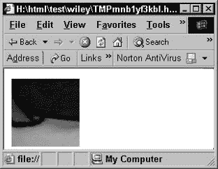


```
}
</script>
</head>
<body onLoad="slideShow(0)">

</body>
```

**9.** 将页面保存为 HTML 文件，并在浏览器中打开，即可显示一个幻灯片，如图 70-1 所示。

***交叉引用***
- 本任务中的技术实际上比任务 69 生成的脚本更简单，因为不再需要在显示新图像前检查是否已用完所有图像。相反，只需不断随机选择一张图像并显示即可。

**图 70-1：** 随机幻灯片。

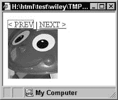

## 第 3 部分

### 任务 71 通过链接触发幻灯片切换

任务 69 中展示的幻灯片的另一个有用扩展是允许用户通过点击链接来向前或向后移动幻灯片，而不是像任务 69 和 70 那样自动切换幻灯片。结果是一个看起来像图 71-1 的幻灯片演示。

***注释***
- 提供幻灯片控制链接需要调整之前幻灯片应用的逻辑。使用两个函数：`nextSlide` 用于切换到下一张幻灯片，`previousSlide` 用于切换到上一张幻灯片。幻灯片还将使用文档正文中的链接来调用 `previousSlide` 和 `nextSlide` 函数。

**图 71-1：** 通过文档中的链接控制幻灯片。

- 有两种调用 JavaScript 代码的方式。以下示例创建了一个带有这些手动链接的幻灯片应用，当用户点击链接时，可以控制幻灯片的进度。第一种是使用 `javascript:`。

**1.** 在新文档的头部脚本块中，创建一个数组 JavaScript 代码作为 URL。第二种是使用命名 `imageList`；该数组将保存幻灯片中 `onClick` 属性的 Image 对象：`a` 标签。第一种方法在以下情况下是一种好技术：

```
var imageList = new Array;
```

当你只需要进行单个函数调用，并且不需要遵循真实的 URL 时。

**2.** 创建一个名为 `currentSlide` 的变量，并将其默认值设置为 0；该变量将用于跟踪用户当前正在查看的幻灯片：

```
var currentSlide = 0;
```

**3.** 为每张幻灯片图像创建数组的一个新元素，并将图像的路径和文件名分配给对象的 `src` 属性：

```
imageList[0] = new Image;
imageList[0].src = "image1.jpg";
imageList[1] = new Image;
imageList[1].src = "image2.jpg";
等等。
```

**4.** 使用 `function` 关键字创建一个名为 `nextSlide` 的函数；当用户想要前进到下一张幻灯片时将调用此函数：

```
function nextSlide() {
}
```

**5.** 在函数中，使用 `if` 语句检查用户是否已经在最后一张幻灯片。通过将 `currentSlide` 加 1（用于下一张幻灯片）与 `imageList` 数组的长度进行比较来实现。如果不是最后一张幻灯片，则还有另一张幻灯片，并且递增 `currentSlide`：

```
if (currentSlide + 1 < imageList.length) {
    currentSlide += 1;
    document.slideShow.src = imageList[currentSlide].src;
}
```

**6.** 使用 `function` 关键字创建一个名为 `previousSlide` 的函数；当用户想要后退到上一张幻灯片时将调用此函数：

```
function previousSlide() {
}
```

**7.** 在函数中，使用 `if` 语句检查用户是否已经在第一张幻灯片。通过将 `currentSlide` 减 1（用于上一张幻灯片）与零进行比较来实现：

```
if (currentSlide - 1 >= 0) {
}
```

**8.** 如果上一张幻灯片大于或等于零，则用户还有另一张幻灯片可看，显示该幻灯片，并将当前幻灯片值减一：

```
currentSlide -= 1;
document.slideShow.src = imageList[currentSlide].src;
```

**9.** 在文档正文中，为上一张和下一张幻灯片创建两个链接，并在 `href` 属性中使用 `javascript:previousSlide()` 和 `javascript:nextSlide()`，以便在用户点击链接时调用相应的函数。最后，包含一个 `img` 标签，显示幻灯片中的第一张图像，并使用 `name` 属性指定名称为 `slideShow`。

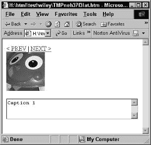

### 任务 72 在幻灯片中包含标题

除了在用户点击链接时轮换图像外，还可以显示和轮换与图像关联的标题。

本任务基于任务 71 中手动控制的幻灯片，并添加了标题，使幻灯片看起来像图 72-1。当用户更改图像时，标题也会相应更改。

***注释***
- 本任务提供了一个简单示例，展示了一种将标题与图像轮换的方法：在表单的文本字段中显示标题。这种技术具有通用性，在大多数浏览器上都能工作，而直接动态替换 HTML 文本的技术在真正跨浏览器的方式下更难实现。

**图 72-1：** 显示带有图像的标题。

以下步骤将标题添加到上述幻灯片中：

**1.** 在新文档的头部脚本块中，创建一个名为 `imageList` 的数组；该数组将保存幻灯片的 Image 对象。同时，创建一个名为 `captionList` 的数组来保存相应的标题：

```
var imageList = new Array;
var captionList = new Array;
```

**2.** 创建一个名为 `currentSlide` 的变量，并将其默认值设置为 0；该变量将用于跟踪用户正在查看的幻灯片：

```
var currentSlide = 0;
```

**3.** 为每张幻灯片图像创建 `imageList` 数组的一个新元素，并将图像的路径和文件名分配给对象的 `src` 属性。同时，将相应的标题分配给 `captionList` 数组中的对应条目：

```
imageList[0] = new Image;
imageList[0].src = "image1.jpg";
captionList[0] = "标题 1";
imageList[1] = new Image;
imageList[1].src = "image2.jpg";
captionList[1] = "标题 2";
等等。
```

**4.** 按照任务 71 中的说明创建 `nextSlide` 函数：

```
function nextSlide() {
    if (currentSlide + 1 < imageList.length) {
        currentSlide += 1;
        document.slideShow.src = imageList[currentSlide].src;
    }
}
```

**5.** 在 `if` 块中，将相应的标题分配给标题文本字段，以与图像一起显示：

```
function nextSlide() {
    if (currentSlide + 1 < imageList.length) {
        currentSlide += 1;
        document.slideShow.src = imageList[currentSlide].src;
        document.captionForm.caption.value = captionList[currentSlide];
    }
}
```

**6.** 按照任务 71 中的说明创建 `previousSlide` 函数，并添加与 `nextSlide` 函数中相同的命令来处理标题。最终脚本应如下所示：

```
function previousSlide() {
    if (currentSlide - 1 >= 0) {
        currentSlide -= 1;
        document.slideShow.src = imageList[currentSlide].src;
        document.captionForm.caption.value = captionList[currentSlide];
    }
}
```

**7.** 在文档正文中，添加上一张和下一张链接以及图像本身，如任务 71 所示：

```
<a href="javascript:previousSlide()">&lt; 上一张</a> |
<a href="javascript:nextSlide()">下一张 &gt;</a><br>

```

**8.** 在文档中添加一个表单，并将表单命名为 `captionForm`。在表单中，创建一个名为 `caption` 的多行文本字段，并在文本字段中显示初始图像的标题：

***交叉引用***
- 访问表单文本字段并更改其值是通过将字符串赋值给 `document.formName.textFieldName` 来实现的。有关示例，请参阅任务 79。

```
<form name="captionForm">
<textarea name="caption" rows=3 cols=40>标题 1</textarea>
</form>
```


## 第 3 部分

### 任务 73：测试图像是否已加载

有时，当你加载图像时（无论是通过`img`标签，还是在 JavaScript 中通过创建`Image`对象），图像的加载可能会花费很长时间。在这种情况下，你可能希望阻止某些操作在相关图像尚未加载完成时执行。

例如，在幻灯片放映中，如果用户尝试显示某张图像时它尚未完全加载，那么跳过该图像可能是合适的。类似地，最好在相关图像全部成功加载之前禁用悬停效果，以免悬停导致切换到不完整或未加载的图像。

**注意：**

- 可以通过检查相关`Image`对象的`complete`属性值来测试图像是否已完成加载。如果值为`true`，则表示图像已完成加载。
- 可以通过添加一个函数来检查所有图像是否已加载，从而防止幻灯片过早开始。如果所有图像都已加载，则启动幻灯片。否则，该函数会安排在一秒后再次调用自身以重新检查。该函数在文档加载时被调用，开始检查图像加载状态，直到图像加载完成且幻灯片可以开始。

本任务通过扩展任务 70 中的随机幻灯片放映，演示了`Image`对象的`complete`属性的使用，使得幻灯片在所有图像完全加载后才开始。

以下步骤创建此幻灯片应用程序：

1. 在新文档的头部脚本块中，创建一个名为`imageList`的数组；该数组将保存幻灯片的`Image`对象。将所有图像加载到数组中：

   ```javascript
   var imageList = new Array;
   imageList[0] = new Image;
   imageList[0].src = "image1.jpg";
   imageList[1] = new Image;
   imageList[1].src = "image2.jpg";
   imageList[2] = new Image;
   imageList[2].src = "image3.jpg";
   imageList[3] = new Image;
   imageList[3].src = "image4.jpg";
   ```

2. 与任务 70 相同，创建一个名为`slideShow`的函数，该函数接受一个名为`imageNumber`的参数，显示指定的图像，随机选择另一张图像，然后安排在三秒后调用`slideShow`来显示该图像：

   ```javascript
   function slideShow(imageNumber) {
       document.slideShow.src = imageList[imageNumber].src;
       var imageChoice = Math.floor(Math.random() * imageList.length);
       window.setTimeout("slideShow(" + imageChoice + ")",3000);
   }
   ```

3. 使用`function`关键字创建一个名为`checkImages`的函数：

   ```javascript
   function checkImages() {
   }
   ```

4. 在函数中，创建一个名为`result`的变量，并将其设置为`false`：

   ```javascript
   var result = false;
   ```

5. 在函数中，创建一个`for`循环来遍历`imageList`数组：

   ```javascript
   for (i = 0; i < imageList.length; i++) {
   }
   ```

6. 在循环中，检查该图像是否已完成加载，如果已完成，则确保`result`为`true`。这可以通过使用布尔或运算将`result`的当前值与相关`Image`对象的`complete`属性值组合来实现：

   ```javascript
   for (i = 0; i < imageList.length; i++) {
       result = (result || imageList[i].complete);
   }
   ```

7. 在`if`语句中测试`result`，如果`result`为`true`，则调用`slideShow`函数启动放映；否则，使用`window.setTimeout`方法在一秒后调用`checkImages`函数再次执行检查：

   ```javascript
   if (result) {
       slideShow(0);
   } else {
       window.setTimeout("checkImages()",1000);
   }
   ```

8. 在文档的正文中，使用`img`标签显示初始图像，然后设置`body`标签的`onLoad`属性以调用`checkImages`函数：

   ```html
   <body onLoad="checkImages()">
   
   </body>
   ```

### 任务 74：通过链接在不同位置触发翻转效果

翻转效果通常在用户将鼠标移动到图像本身时触发；到目前为止看到的所有翻转示例都是这样工作的。但没有什么可以阻止翻转效果显示在检测到鼠标移动的位置之外的其他地方。

**注意：**

- `onMouseOver`事件处理程序与`onMouseOut`事件处理程序类似。它允许程序员指定当鼠标指针离开页面元素（如图像）所占区域时要执行的 JavaScript 代码，而`onMouseOver`则指定当鼠标指针进入页面元素所占空间时要执行的代码（参见步骤 4）。

例如，可以捕获鼠标在链接上移动的事件，但使用此事件来切换页面中不同位置的图像。

此示例演示了当用户将鼠标指针移动到单独的链接上时如何触发图像切换：

1. 在新文档的头部脚本块中，创建一个名为`originalImage`的`Image`对象，并将翻转效果的默认图像加载到该对象中：

   ```javascript
   var originalImage = new Image;
   originalImage.src = "image1.jpg";
   ```

2. 创建一个名为`replacementImage`的`Image`对象，并将翻转效果的翻转图像加载到该对象中。最终的脚本块应如下所示：

   ```javascript
   <script language="JavaScript">
   var originalImage = new Image;
   originalImage.src = "image1.jpg";
   var replacementImage = new Image;
   replacementImage.src = "rollImage1.jpg";
   </script>
   ```

3. 在文档的正文中，创建一个用于触发翻转效果的链接；对于触发翻转效果的目的，指定什么 URL 并不重要：

   ```html
   <a href="*myUrl*">ROLLOVER THIS TEXT</a>
   ```

4. 向`a`标签添加一个`onMouseOver`属性，并将`myImage`对象切换为`replacementImage`对象中的图像；当鼠标移动到链接上时，这将触发翻转效果：

   ```html
   <a href="#" onMouseOver="document.myImage.src = replacementImage.src;">ROLLOVER THIS TEXT</a>
   ```

5. 向`a`标签添加一个`onMouseOut`属性，并将`myImage`对象切换为`originalImage`对象中的图像；当鼠标移出链接时，这将使图像恢复到原始状态：

   ```html
   <a href="#" onMouseOver="document.myImage.src = replacementImage.src;" onMouseOut="document.myImage.src = originalImage.src;">ROLLOVER THIS TEXT</a>
   ```

   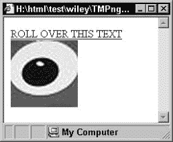
   

6. 在正文中添加一个`img`标签，并显示默认图像。使用`name`属性将图像命名为`myImage`。最终页面应如下所示：

   ```html
   <head>
   <script language="JavaScript">
   var originalImage = new Image;
   originalImage.src = "image1.jpg";
   var replacementImage = new Image;
   replacementImage.src = "rollimage1.jpg";
   </script>
   </head>
   <body>
   <a href="#" onMouseOver="document.myImage.src = replacementImage.src;" onMouseOut="document.myImage.src = originalImage.src;">ROLLOVER THIS TEXT</a><br>
   
   </body>
   ```

**提示：**

- 翻转效果旨在为用户提供上下文，让他们知道该图像构成一个可点击的元素，并准确显示他们正在点击的内容（尤其是在复杂布局中多个图像彼此靠近的情况下）。

7. 将页面保存为 HTML 文件，并在浏览器中打开该文件。这将显示一个如图 74-1 所示的页面。当鼠标移动到链接上时，将显示翻转图像，如图 74-2 所示。

**图 74-1：** 初始时，显示默认图像。

*交叉引用*


## 第三部分

### 任务 75：结合使用图像映射与悬停效果

创建图像悬停效果的基础知识已在任务 61 中概述。

**图 74-2：**当鼠标移动到链接上时，显示悬停图像。


悬停效果也可以与图像映射一起使用。例如，在图 75-1 中，使用一张图像创建了一个复杂的图形菜单。各个椭圆形在图像映射中指定，因此是可点击的链接。

***注释***

- 图像映射允许你通过创建一个`map`块，然后使用一个或多个`area`标签指定几何形状作为链接，从而为单张图像指定多个链接。
- 悬停效果与图像映射的结合允许创建由单张图像构成的复杂图形菜单。当用户悬停在图像映射中指定的部分时，可以将图像替换为另一张，从而在图像映射中有效创建悬停效果。

当悬停效果与图像映射一起使用时，每当用户悬停在第一个椭圆形上，图像映射就会被替换为另一张高亮该椭圆形并提供描述性文本的图像，如图 75-2 所示。

**图 75-1：**初始图像映射。

**图 75-2：**当鼠标指针位于图像映射中第一个椭圆形上时显示的悬停图像。

以下步骤在图像映射上创建悬停效果：

1. 在新文档头部的脚本块中，创建一个名为`originalImage`的`Image`对象，并将悬停效果的默认图像加载到该对象中：

   ```
   var originalImage = new Image;
   originalImage.src = "image1.jpg";
   ```

2. 创建一个名为`replacementImage`的`Image`对象，并将悬停效果的悬停图像加载到该对象中。最终的脚本块应如下所示：

   ```
   var replacementImage = new Image;
   replacementImage.src = "rollImage1.jpg";
   ```

3. 在文档头部，使用开闭`map`标签创建一个图像映射块。通过`map`标签的`name`属性将图像映射的名称指定为`imageMap`：

   ```
   <map name="imageMap">
   </map>
   ```

4. 使用`area`标签为图像映射中的链接指定一个矩形区域；使用值为`rect`的`shape`属性和`coords`属性来指定矩形的坐标：

   ```
   <area shape="rect" coords="0,0,100,100">
   ```

5. 向`area`标签添加一个`onMouseOver`属性，当鼠标悬停在指定区域时，将名为`myImage`的图像替换为`replacementImage`。同时添加一个`onMouseOut`属性，当鼠标移出指定区域时，将名为`myImage`的图像替换为`originalImage`：

   ```
   <area shape="rect" coords="0,0,100,100"
   onMouseOver="document.myImage.src = replacementImage.src;"
   onMouseOut="document.myImage.src = originalImage.src;">
   ```

6. 在文档主体中，使用`img`标签显示默认图像，并通过`name`属性将图像命名为`myImage`。使用`usemap`属性将图像与`imageMap`图像映射关联：

   ```
   
   ```

7. 将代码保存为 HTML 文件，并在浏览器中打开。当鼠标移动到图像左上角 100 像素宽、100 像素高的正方形区域时，整个图像映射被替换为悬停图像。当鼠标移出该区域时，原始图像重新显示。

### 任务 76：在 JavaScript 中生成动画横幅

你在网络上看到的许多横幅广告都是动画的。有时这些是通过动画 GIF 文件实现的，它提供了一种无需自定义代码即可生成动画图像的简单方法。

***注释***

- `window.setTimeout`方法接受两个参数：要调用的函数和以毫秒为单位的时间。该函数会在指定的毫秒数过后自动调用指定的函数。3000 毫秒等于 3 秒（参见步骤 7）。
- `body`标签的`onLoad`事件处理程序用于指定当 HTML 文档完成初始加载时要执行的 JavaScript（参见步骤 9）。

然而，GIF 有其局限性，尤其是它们不太适合显示高色彩深度的摄影风格图像。这时 JPEG 图像就派上用场了。问题在于 JPEG 图像无法动画化。

使用 JavaScript，你可以像幻灯片显示多张图像一样，对基于 JPEG 的横幅进行动画处理。这通过为动画的每一帧创建一张 JPEG 图像，然后使用 JavaScript 轮换它们来实现。

本任务展示了如何使用 JavaScript 创建动画横幅，并控制每帧切换之间的时间间隔：

1. 在新文档头部的脚本块中，创建两个数组：`imageList`用于存储横幅各帧的`Image`对象，`transitionList`用于存储以毫秒为单位的切换时间列表，指定显示一帧后等待多久再显示下一帧：

   ```
   var imageList = new Array;
   var transitionList = new Array;
   ```

2. 用各帧的`Image`对象填充`imageList`数组，并在`transitionList`数组中指定切换时间：

   ```
   imageList[0] = new Image;
   imageList[0].src = "frame1.jpg";
   transitionList[0] = 2000;
   imageList[1] = new Image;
   imageList[1].src = "frame2.jpg";
   transitionList[1] = 500;
   imageList[2] = new Image;
   imageList[2].src = "frame3.jpg";
   transitionList[2] = 5000;
   imageList[3] = new Image;
   imageList[3].src = "frame4.jpg";
   transitionList[3] = 3000;
   ```

3. 创建一个`rotateBanner`函数，该函数接受一个参数`frameNumber`，用于指示需要显示的帧：

   ```
   function rotateBanner(frameNumber) {
   }
   ```

   

4. 在函数中，将指定的帧显示在名为`banner`的`Image`对象的位置：

   ```
   document.banner.src = imageList[frameNumber].src;
   ```

5. 接下来，递增帧号并将其赋值给一个新变量`imageChoice`：

   ```
   var imageChoice = frameNumber + 1;
   ```

6. 检查`imageChoice`的值。如果它与`imageList`数组的长度相同，则将其重置为 0。这样，当横幅到达最后一帧时就会循环：

   ```
   if (imageChoice == imageList.length) { imageChoice = 0; }
   ```

7. 作为函数的最后一步，根据`transitionList`数组中指定的适当显示时间，安排`rotateBanner`函数再次运行：

   ```
   window.setTimeout("rotateBanner(" + imageChoice + ")",transitionList[frameNumber]);
   ```

8. 在文档主体中，使用`img`标签显示图像的第一帧，并将图像命名为`banner`：

   ```
   
   ```

9. 在`body`标签中，指定`onLoad`属性，以便在文档加载时调用`rotateBanner`，并向`rotateBanner`函数传递值 0：

   ```
   <body onLoad="rotateBanner(0)">
   ```

10. 将代码保存为 HTML 文件，并在浏览器中打开该文件，即可看到如图 76-1 所示的动画横幅。

**图 76-1：**使用 JavaScript 显示轮换的 JPEG 横幅。

### 任务 77：显示随机横幅广告

JavaScript 与图像结合的一个应用是在页面上的某个位置加载随机图像，而不是每次都加载同一张图像。

你可以将其应用于展示随机横幅广告，这些广告链接到相应的广告站点。为此，你需要使用 JavaScript 指定图像的位置以及与图像关联的 URL。有了这些数据，你可以随机选择一个并显示它。

***注释***


- 数组中的每个槽位都有编号；编号从零开始。这意味着一个有四个条目的数组，其条目编号为 0 到 3。
- `Math` 对象提供了许多用于处理数字和数学运算的有用方法。
- `Array` 对象的 `length` 属性提供了数组中的条目数量。也就是说，如果一个数组有四个条目，编号为 0 到 3，那么该数组的 `length` 属性值为 4。
- `Math.floor` 执行类似于取整的功能，它会移除数字的小数部分。区别在于，取整的结果可能是下一个最高或最低的整数值，具体取决于数字小数部分的大小。而使用 `Math.floor`，结果始终是下一个最低的整数。因此，对 2.999 取整会得到整数 3，但对同一个数字应用 `Math.floor` 会得到整数 2。
- 注意输出是如何由多个字符串与一个数组变量组合而成的；组合操作使用加号完成。当处理字符串值时，加号执行字符串拼接，如任务 15 中所述。拼接意味着 “ab” + “cd” 的结果是 “abcd”。

以下步骤创建的脚本说明了这一过程：

1. 创建一个带有开始和结束 script 标签的脚本块；该脚本块应位于 HTML 文档的 body 中，即你想要显示图像的位置：
   ```html
   <script language="JavaScript">
   </script>
   ```
2. 在脚本中，创建一个名为 `imageList` 的数组：
   ```javascript
   var imageList = new Array;
   ```
3. 为每个你想要随机显示的横幅图像在数组中创建一个条目。例如，如果你有四个图像，将这些图像的路径和名称分配给数组的前四个条目：
   ```javascript
   imageList[0] = "banner1.jpg";
   imageList[1] = "banner2.jpg";
   imageList[2] = "banner3.jpg";
   imageList[3] = "banner4.jpg";
   ```
4. 创建另一个数组来保存每个横幅的 URL。该数组中的索引应与 `imageList` 数组对应：
   ```javascript
   var urlList = new Array;
   urlList[0] = "http://some.host/";
   urlList[1] = "http://another.host/";
   urlList[2] = "http://somewhere.else/";
   urlList[3] = "http://right.here/";
   ```
5. 创建一个名为 `imageChoice` 的变量：
   ```javascript
   var imageChoice;
   ```
6. 使用 `Math.random` 方法为 `imageChoice` 分配一个随机数，该方法返回一个 0 到 1 之间的随机数（即该数大于等于 0 但小于 1）：
   ```javascript
   var imageChoice = Math.random();
   ```
7. 扩展赋给 `imageChoice` 的表达式，将随机数乘以 `imageList` 数组中的条目数量，得到一个大于等于 0 但小于 4 的数：
   ```javascript
   var imageChoice = Math.random() * imageList.length;
   ```
8. 进一步扩展赋给 `imageChoice` 的表达式，使用 `Math.floor` 方法移除小数点后的所有部分；结果是一个从 0 到数组条目数减 1 的整数——在本例中，即从 0 到 3 的整数：
   ```javascript
   var imageChoice = Math.floor(Math.random() * imageList.length);
   ```
9. 使用 `document.write` 方法将一个被 `a` 标签包围的 `img` 标签放入发送到浏览器的 HTML 数据流中。`img` 标签的 `src` 属性值指定为 `imageList[imageChoice]` 作为随机图像，`a` 标签的 `href` 属性值使用 `urlList[imageChoice]`。最终的脚本如清单 77-1 所示。
   ```html
   <script language="JavaScript">
   var imageList = new Array;
   imageList[0] = "image1.jpg";
   imageList[1] = "image2.jpg";
   imageList[2] = "image3.jpg";
   imageList[3] = "image4.jpg";
   var urlList = new Array;
   urlList[0] = "http://some.host/";
   urlList[1] = "http://another.host/";
   urlList[2] = "http://somewhere.else/";
   urlList[3] = "http://right.here/";
   var imageChoice = Math.floor(Math.random() * imageList.length);
   document.write('<a href="' + urlList[imageChoice] + '"></a>');
   </script>
   ```
   **清单 77-1：** 显示随机横幅广告。
10. 将代码保存到 HTML 文件中，并在浏览器中显示该文件。会显示一个随机横幅。重新加载文件应该会显示不同的横幅（尽管总是有很小的概率连续两次选中同一个随机数）。

#### 交叉引用
- 数组是一种包含多个编号槽位的数据类型，你可以在其中放置任何值。关于数组的讨论，请参见任务 20。
- `document.write` 方法在任务 45 中介绍。它允许 JavaScript 代码生成输出，这些输出构成浏览器渲染的 HTML 的一部分。

# 第 4 部分：使用表单

1. 任务 78：为 JavaScript 准备表单
2. 任务 79：访问文本字段内容
3. 任务 80：动态更新文本字段
4. 任务 81：检测文本字段的变化
5. 任务 82：访问选择列表
6. 任务 83：以编程方式填充选择列表
7. 任务 84：动态更改选择列表内容
8. 任务 85：检测选择列表中的选择
9. 任务 86：根据另一个选择列表的选择更新一个选择列表
10. 任务 87：使用单选按钮代替选择列表
11. 任务 88：检测选中的单选按钮
12. 任务 89：检测单选按钮选择的更改
13. 任务 90：更新或更改单选按钮选择
14. 任务 91：创建复选框
15. 任务 92：检测复选框选择
16. 任务 93：更改复选框选择
17. 任务 94：检测复选框选择的更改
18. 任务 95：在 JavaScript 中验证表单字段
19. 任务 96：使用表单标签的 `onSubmit` 属性验证表单字段
20. 任务 97：使用 `INPUT TYPE="button"` 代替 `TYPE="submit"` 验证表单字段
21. 任务 98：验证电子邮件地址
22. 任务 99：验证邮政编码
23. 任务 100：验证电话号码
24. 任务 101：验证信用卡号码
25. 任务 102：验证选择列表选项
26. 任务 103：验证单选按钮选择
27. 任务 104：验证复选框选择
28. 任务 105：验证密码
29. 任务 106：使用正则表达式验证电话号码
30. 任务 107：使用 `INPUT TYPE="button"` 按钮创建多个表单提交按钮
31. 任务 108：响应按钮上的鼠标点击
32. 任务 109：在 JavaScript 中使用图形按钮
33. 任务 110：控制表单提交 URL
34. 任务 111：使用正则表达式验证数字文本字段
35. 任务 112：在提交前加密数据
36. 任务 113：使用表单进行自动导航跳转

### 任务 78：为 JavaScript 准备表单

在 JavaScript 中，你可以访问并操作页面上表单中字段的内容和状态。为此，你需要关注使表单在 JavaScript 中易于访问的最低要求。


## 第 4 部分
## 处理表单

首先，你必须专注于为表单及其元素提供名称。以下步骤将引导你完成命名表单和元素的过程，以便你可以使用 JavaScript 访问它们：

**注意：**
- 要访问表单中的字段，可以在 JavaScript 中使用以下引用：`document.forms[0].elements[0]`。
- 文档中的每个表单都按其在文档中出现的顺序包含在 `forms` 数组中。类似地，`elements` 数组按字段在给定表单中出现的顺序为每个字段提供一个条目。
- 如果表单未命名，则每个表单都可以通过 `document.forms` 数组访问，因此文档中的第一个表单是 `document.forms[0]`，第二个是 `document.forms[1]`，依此类推。
- 如果字段未命名，则表单中的每个字段都可以通过 `document.formName.elements` 数组访问，因此表单中的第一个字段是 `document.formName.elements[0]`，第二个是 `document.formName.elements[1]`，依此类推。
- 本部分中的大多数任务都使用 `name` 属性来操作表单的内容。

**1.** 在你偏好的编辑器中创建一个新文档。

**2.** 在文档的正文中创建一个表单。向表单中添加一个输入文本字段、一个选择列表和一个命令按钮：

```html
<body>
<form method="post" action="target.html">
<input type="text">
<select>
<option value="1">第一选择</option>
<option value="2">第二选择</option>
</select>
<br>
<input type="submit" value="提交我">
</form>
</body>
```

该表单如图 78-1 所示。

**图 78-1：** 一个标准的 HTML 表单。

**3.** 通过添加 `name` 属性来命名表单。以下代码将表单命名为 `thisForm`。如粗体所示，`name` 属性被添加到表单标签内：

```html
<body>
<form method="post" action="target.html" name="thisForm">
<input type="text">
<select>
<option value="1">第一选择</option>
<option value="2">第二选择</option>
</select>
<br>
<input type="submit" value="提交我">
</form>
</body>
```

**提示：**
- 为字段和表单命名可以更容易地引用它们，并确保你在代码中引用的是正确的字段。
- 在命名表单及其中的元素时，应使用描述性名称。

**4.** 命名表单中的元素。与命名表单类似，这是通过向每个字段的标签添加一个名为 `name` 的属性来完成的。然后将此属性设置为元素的名称，如清单 78-1 所示。一旦分配了 name 属性，你的表单就可以轻松地与 JavaScript 一起使用了。

```html
<body>
<form method="post" action="target.html" name="thisForm">
<input type="text" name="myText">
<select name="mySelect">
<option value="1">第一选择</option>
<option value="2">第二选择</option>
</select>
<br>
<input type="submit" value="提交我">
</form>
</body>
```

**清单 78-1：** 一个已准备好与 JavaScript 配合使用的表单。

**交叉引用：**
- 任务 79 展示了如何使用分配的名称访问文本字段。

### 访问文本字段内容

当你创建 HTML 表单时，你实际上是在创建一系列对象，这些对象可以从 JavaScript 内部访问。表单本身是一个对象，而表单中的每个字段在 JavaScript 中也都由一个对象表示。利用这些对象，你可以访问存储在表单字段（如文本输入字段）中的值。

**注意：**
- 以下是创建文本字段所需的最少 HTML 代码：`<input type="text">`
- 注意示例中使用了 `#` 作为 URL。当使用 `onClick` 事件处理程序触发打开新窗口时，你不希望点击链接导致当前窗口的位置发生变化；这是一种避免这种情况的简单方法。
- 如果表单未命名，则每个表单都可以通过 `document.forms` 数组访问，因此文档中的第一个表单是 `document.forms[0]`，第二个是 `document.forms[1]`，依此类推。
- 如果字段未命名，则表单中的每个字段都可以通过 `document.formName.elements` 数组访问，因此表单中的第一个字段是 `document.formName.elements[0]`，第二个是 `document.formName.elements[1]`，依此类推。

你可以检查文本输入字段中显示的文本——无论是表单自带的文本还是用户输入的文本。要在 JavaScript 中访问字段，请使用以下步骤：

**1.** 在你偏好的编辑器中创建一个新文档。

**2.** 在文档的正文中，创建一个名为 `myForm` 的表单，其中包含一个名为 `myText` 的文本输入字段：

```html
<body>
<form name="myForm">
<input type="text" name="myText">
</form>
</body>
```

**3.** 在表单中创建一个链接。此链接用于在对话框中显示文本输入元素的值。将 `#` 指定为链接的 URL：

```html
<body>
<form name="myForm">
<input type="text" name="myText">
</form>
<a href="#">检查文本字段</a>
</body>
```

**4.** 在链接元素中使用 `onClick` 事件处理程序来指定当用户点击链接时要执行的 JavaScript 代码。要访问表单字段，请使用以下语法：

`document.formName.fieldName`

这会引用与该字段关联的对象。该对象具有多个属性，包括：
- `name`：字段的名称（如 `name` 属性中所指定）
- `value`：字段中显示的文本
- `form`：对字段所在表单的表单对象的引用

因此，属性 `document.formName.formField.value` 将包含字段中显示的文本字符串。

在此示例中，`document.myForm.myText.value` 表示文本输入字段中的文本，因此将其作为参数传递给 `window.alert`。结果是 `myText` 文本输入框中的文本会显示在一个对话框中。清单 79-1 显示了添加了 JavaScript 后的完整代码。

```html
<body>
<form name="myForm">
<input type="text" name="myText">
</form>
<a href="#" onClick="window.alert(document.myForm.myText.value);">检查文本字段</a>
</body>
```

**清单 79-1：** 访问表单文本字段的值。


**提示：**
- 为表单和字段命名可以更容易地引用它们，并确保你在代码中引用的是正确的字段。
- 在步骤 4 的代码清单中，将 `document.myForm.myText.value` 改为 `document.myForm.myText.name`。你会看到结果变成了显示文本输入字段的名称而不是值。

**5.** 保存文件并关闭它。

**6.** 在浏览器中打开该文件。在文本字段中输入一些文本，然后点击链接，即可看到该文本显示在对话框中，如图 79-1 所示。

**图 79-1：** 显示文本字段的值。

**交叉引用：**
- 参见任务 200 以了解更多关于 `onClick` 事件处理程序的信息。
- 有关命名元素和表单的更多信息，请参见任务 78。

### 动态更新文本字段

使用 JavaScript，你可以更改文本输入字段中的值。最合适的更新时机是用户在表单上执行某个操作时。本任务将向你展示如何动态更新文本输入字段中显示的文本：

**1.** 在你偏好的编辑器中创建一个新文档。

**2.** 在文档的正文中创建一个表单。将表单命名为 `myForm`。

**3.** 向表单中添加两个文本输入字段。将其中一个命名为 `myText`，该


## 处理表单

### 任务 80：为表单文本字段赋值

以下是完成的表单：

```html
<body>
<form name="myForm">
Enter some Text: <input type="text" name="myText"><br>
Copy Text: <input type="text" name="copyText">
</form>
</body>
```

**提示**
- 如果表单没有命名，则每个表单都可以通过 `document.forms` 数组访问，因此文档中的第一个表单是 `document.forms[0]`，第二个是 `document.forms[1]`，以此类推。
- 如果字段没有命名，则表单中的每个字段都可以通过 `document.formName.elements` 数组访问，因此表单中的第一个字段是 `document.formName.elements[0]`，第二个是 `document.formName.elements[1]`，以此类推。

**4.** 创建一个用于动态更改文本的链接。用户可以在 `myText` 字段中输入文本，然后点击链接将该文本复制到第二个文本字段中；复制操作通过 JavaScript 完成。虽然本例中使用的是链接，但你也可以轻松地使用按钮点击或其他任何事件来动态更改文本。将 `#` 指定为链接的 URL。

**5.** 为链接添加一个 `onClick` 事件处理程序。这将指定用户点击链接时要执行的 JavaScript 代码。属性 `document.formName.formField.value` 包含表单中某个字段的值，该值是一个文本字符串。如果你为 `value` 属性赋值，新值将显示在文本字段中。在本例中，`myText` 字段的值将被赋给 `copyText` 字段。这是通过将 `document.myForm.myText.value` 赋值给 `document.myForm.copyText.value` 来实现的。清单 80-1 显示了添加了链接和 JavaScript 后的最终表单。图 80-1 显示了该表单。

```html
<body>
<form name="myForm">
Enter some Text: <input type="text" name="myText"><br>
Copy Text: <input type="text" name="copyText">
</form>
<a href="#" onClick="document.myForm.copyText.value = document.myForm.myText.value;">Copy Text Field</a>
</body>
```

**清单 80-1：** 为表单文本字段赋值。


**图 80-1：** 包含两个文本字段的表单。

**6.** 保存文件并关闭。

**7.** 在浏览器中打开该文件。你应该会看到如图 80-1 所示的表单和链接。在第一个文本字段中输入一些文本，然后点击链接，即可看到文本被复制并显示在第二个字段中，如图 80-2 所示。

***交叉引用***
- 有关命名元素和表单的更多信息，请参见任务 78。

**图 80-2：** 为文本字段赋值。

---

### 任务 81：检测文本字段中的更改

当你创建 HTML 表单时，实际上是在创建一系列可以从 JavaScript 中访问的对象。利用这些对象，你可以检测文本输入字段等表单字段中的更改。

本任务将向你展示如何响应文本输入字段中的更改。文本输入字段通过 `input` 标签并将 `type` 属性设置为 `text` 来创建。为了使该字段在 JavaScript 中可访问，最好还使用 `name` 属性为字段指定一个名称：

```html
<input type="text" name="myField">
```

你可以使用 `onChange` 事件处理程序指定当字段发生更改时要执行的代码：

```html
<input type="text" name="myField" onChange="JavaScript code to execute when the value of the field changes">
```

以下步骤创建一个包含文本字段的表单。当检测到字段中的更改时，会显示一个对话框，告知用户该字段中的值。

**1.** 在你喜欢的编辑器中创建一个新文档。

**2.** 在文档的 body 中，创建一个名为 `myForm` 的表单。

```html
<body>
<form name="myForm">
</form>
</body>
```

**3.** 在表单中，创建一个名为 `myText` 的文本输入字段：

```html
<body>
<form name="myForm">
Enter some Text: <input type="text" name="myText">
</form>
</body>
```

**4.** 为该字段分配一个 `onChange` 事件处理程序。该处理程序应使用 `window.alert` 方法在对话框中显示 `this.value`。最终页面应如清单 81-1 所示。

**5.** 保存文件并关闭。

**6.** 在浏览器中打开该文件。你应该会看到如图 81-1 所示的表单。

**7.** 在文本字段中输入一些文本，然后点击字段外部以移除焦点。你应该会看到如图 81-2 所示的对话框。

```html
<body>
<form name="myForm">
Enter some Text: <input type="text" name="myText" onChange="window.alert(this.value);">
</form>
</body>
```

**清单 81-1：** 检测文本字段中的更改。


**图 81-1：** 包含一个文本字段的表单。

***注释***
- 对于更改的检测，大多数浏览器（包括所有主流浏览器）实际上只有在焦点离开该字段时（例如用户点击表单中的另一个字段）才认为发生了更改。如果用户没有这样做，那么每次输入一个字符时，`onChange` 事件处理程序中的代码都会执行。相反，代码仅在发生更改且焦点离开该字段时执行。
- 在表单字段的事件处理程序中工作时，`this` 关键字指向与该字段本身关联的对象，这允许你在 `onChange` 事件处理程序中使用 `this.value` 而不是 `document.myForm.myText.value` 来引用文本字段的值（参见步骤 4）。

***交叉引用***
- 了解如何在任务 78 中命名字段。

**图 81-2：** 检测文本字段中的更改。

---

### 任务 82：访问选择列表

当你创建 HTML 表单时，实际上是在创建一系列可以从 JavaScript 中访问的对象。表单本身是一个对象，而每个表单字段在 JavaScript 中由一个对象表示。利用这些对象，你可以访问存储在表单字段（如选择列表）中的值。

本任务将向你展示如何检查选择列表中的当前选项。以下步骤创建一个包含单个选择列表的表单，然后提供一个链接，用户点击该链接即可在对话框中显示当前选中选项的值。JavaScript 用于在对话框中显示此信息。

**1.** 在你喜欢的编辑器中创建一个新文档。

**2.** 在文档的 body 中，创建一个名为 `myForm` 的表单。

**3.** 在表单中，创建一个名为 `mySelect` 的选择列表，并添加多个选项：

```html
<body>
<form name="myForm">
<select name="mySelect">
<option value="First Choice">1</option>
<option value="Second Choice">2</option>
<option value="Third Choice">3</option>
</select>
</form>
</body>
```

**4.** 在表单之后，创建一个 URL 为 `#` 的链接。该链接将用于在对话框中显示表单字段的选中值：

```html
<body>
<form name="myForm">
<select name="mySelect">
<option value="First Choice">1</option>
<option value="Second Choice">2</option>
<option value="Third Choice">3</option>
</select>
</form>
<a href="#">Display Selected Value</a>
</body>
```

注意示例中使用了 `#` 作为 URL。当使用 `onClick` 事件处理程序触发打开新窗口时，你不希望点击链接导致当前窗口的位置发生变化；这是一种简单的避免方法。

***注释***
- 选择列表通过 `select` 标签创建。你可以使用 `option` 标签填充列表：
  ```html
  <select name="myField">
  <option value="a">A</option>
  <option value="b">B</option>
  etc.
  </select>
  ```
- 请记住，对于选择列表，显示的文本不一定是值。`value` 属性保存实际提交或通过 JavaScript 访问的值。


## 处理表单

### 任务 82：访问选择列表中选中选项的值

`<form name="myForm">`

对于列表中的某个选项

`<select name="mySelect">`

与选项关联的 `value` 值不同

`<option value="First Choice">1</option>` 与选项关联。

选择列表对象的 `value` 属性

`<option value="Second Choice">2</option>` 与值关联，

`<option value="Third Choice">3</option>` 而不是列表中当前选中选项的显示文本。

`</select>`

`</form>`

`<a href="#">检查选择列表</a>`

`</body>`

**5.** 使用 `onClick` 事件处理程序指定用户点击链接时要执行的 JavaScript 代码。在本例中，`document.myForm.mySelect.value`（表示列表中选中选项的值）作为参数传递给 `window.alert`，以便在对话框中显示文本。最终页面如任务清单 82-1 所示。


```
<body>
<form name="myForm">
<select name="mySelect">
<option value="First Choice">1</option>
<option value="Second Choice">2</option>
<option value="Third Choice">3</option>
</select>
</form>
<a href="#" onClick="window.alert(document.myForm.mySelect.value);">检查选择列表</a>
</body>
```

**清单 82-1：** 访问选择列表中选中选项的值。

**6.** 保存文件并关闭。

**7.** 在浏览器中打开文件。你应该会看到如图 82-1 所示的表单和链接。

***交叉引用***
- 任务 83 展示了如何以编程方式填充选择列表。
- 任务 85 展示了如何检测选择列表中的选择事件。

**图 82-1：** 带有选择列表的表单。

**8.** 从选择列表中选择一个选项，然后点击链接，即可在对话框中看到该选项的值。


---

### 任务 83：以编程方式填充选择列表

你可以通过 JavaScript 动态地向选择列表添加条目，而无需在 HTML 中使用 `option` 标签来创建选择条目。原理很简单。选择列表对象有一个 `length` 属性，表示选择列表中的条目数。将该值增加 1 会在列表末尾创建一个空条目，如图 83-1 所示。

***注释***
- 这里的关键点：`length` 属性包含列表中的元素数量。例如，如果有三个元素，则值为 3。但是，`options` 数组（与所有数组一样）从零开始计数。因此，最后一个（第三个）元素的索引是 2。在通过 JavaScript 动态操作选择列表时，需要牢记这一点。
- 使用简写形式的 `++` 运算符会将其前面的操作数增加 1。例如，`a++` 等同于 `a = a + 1`。
- `text` 属性用于保存将在表单上显示的文本。`value` 属性用于保存条目的值。

**图 83-1：** 向选择列表添加新条目。

创建新条目后，使用选择列表的 `options` 属性为新条目分配显示文本和值。该属性是一个数组，其中每个元素对应一个对象。每个对象都有 `text` 和 `value` 属性。要为条目填充值，可以使用以下代码：

```
document.formName.selectionObject.options[新条目的索引].text = "显示文本";
document.formName.selectionObject.options[新条目的索引].value = "条目值";
```

以下任务创建了一个包含两个条目的选择列表的表单，并紧接着使用 JavaScript 代码创建第三个元素：

**1.** 在你喜欢的编辑器中创建一个新文档。

**2.** 在文档的 body 中，创建一个名为 `myForm` 的表单，其中包含一个名为 `mySelect` 的选择列表，带有两个选项：

```
<form name="myForm">
<select name="mySelect">
<option value="First Choice">1</option>
<option value="Second Choice">2</option>
</select>
</form>
```

**3.** 在表单之后，创建一个脚本。

**4.** 在脚本中，将选择列表的 `length` 加 1：

```
<script language="JavaScript">
document.myForm.mySelect.length++;
</script>
```

**5.** 在脚本中，为新条目设置显示文本：

```
document.myForm.mySelect.options[document.myForm.mySelect.length - 1].text = "3";
```

**6.** 为新条目设置显示值。最终页面如清单 83-1 所示。

```
<body>
<form name="myForm">
<select name="mySelect">
<option value="First Choice">1</option>
<option value="Second Choice">2</option>
</select>
</form>
<script language="JavaScript">
document.myForm.mySelect.length++;
document.myForm.mySelect.options[document.myForm.mySelect.length - 1].text = "3";
document.myForm.mySelect.options[document.myForm.mySelect.length - 1].value = "Third Choice";
</script>
</body>
```

**清单 83-1：** 动态向选择列表添加条目。

***交叉引用***
- `++` 运算符是 JavaScript 中数学运算的一种形式。有关数学运算的更多信息，请参见任务 14。
- 任务 37 展示了如何遍历数组。

**7.** 保存文件并在浏览器中打开。展开选择列表，你会看到三个条目。

---

### 任务 84：动态更改选择列表内容

一些交互式 Web 表单的常见功能是动态更改选择列表的内容。这允许你创建智能表单，用户的操作可以决定选择列表中应显示的内容。

***注释***
- 使用选择列表的 `options` 属性为新条目分配显示文本和值。该属性是一个数组，其中每个元素对应一个对象。每个对象都有 `text` 和 `value` 属性。
- 要为条目填充值，可以使用以下代码：
  ```
  document.formName.selectionObject.options[新条目的索引].text = "显示文本";
  document.formName.selectionObject.options[新条目的索引].value = "条目值";
  ```
- 这里的关键点：`length` 属性包含列表中的元素数量。例如，如果有四个元素，则值为 4。但是，`options` 数组（与所有数组一样）从零开始计数。因此，最后一个（第四个）元素的索引是 3。在通过 JavaScript 动态操作选择列表时，需要牢记这一点。

以下步骤创建了一个包含选择列表和链接的表单。当用户点击链接时，选择列表的内容会发生变化。

**1.** 在新选择列表的头部，创建一个包含 `changeList` 函数的脚本。该函数用新选项填充选择列表。它接受与要更改的选择列表关联的对象作为参数：

```
<script language="JavaScript">
function changeList(list) {
}
</script>
```

**2.** 在函数中，将列表的 `length` 设置为 3：

```
list.length = 3;
```

**3.** 在列表中创建三个条目：

```
function changeList(list) {
  list.length = 3;
  list.options[0].text = "第一个列表 1";
  list.options[0].value = "第一个值 1";
  list.options[1].text = "第一个列表 2";
  list.options[1].value = "第一个值 2";
  list.options[2].text = "第一个列表 3";
  list.options[2].value = "第一个值 3";
}
```

**4.** 在文档的 body 中，创建一个名为 `myForm` 的表单，其中包含一个名为 `mySelect` 的选择列表，带有两个选项：


• 请注意示例中使用了 `#` 作为 URL。当使用 `onClick` 事件处理程序触发打开新窗口时，你不希望点击链接导致当前窗口的位置发生变化；这是一种简单的避免方式。


## 处理表单

**5.** 在表单之后，创建一个用户用来更改选择列表中项目的链接。该链接应包含一个 `onClick` 事件处理程序。`onClick` 事件处理程序将调用 `changeList` 并将选择列表对象传递给该函数：

```html
<body>
<form name="myForm">
<select name="mySelect">
<option value="1">First Choice</option>
<option value="2">Second Choice</option>
</select><br>
</form>
<a href="#" onClick="changeList(document.myForm.mySelect);">Change the List</a>
</body>
```

**6.** 保存文件并在浏览器中打开。列表出现，如图 84-1 所示。

**图 84-1:** 一个选择列表。

**交叉引用**

- 任务 83 展示了如何向现有选择列表中添加选择项。
- 参见任务 87 了解如何使用一组单选按钮代替选择列表。

**7.** 点击链接，列表将更改为新条目。

### 任务 85：检测选择列表中的选择

当你创建 HTML 表单时，你实际上创建了一系列可以从 JavaScript 中访问的对象。表单本身是一个对象，而每个表单字段在 JavaScript 中由一个对象表示。利用这些对象，你可以检测表单字段（如选择列表）中的选择。

本任务展示了如何响应用户在通过 `select` 标签创建的选择列表中选择一个选项。你可以使用 `onChange` 事件处理程序指定在字段中发生选择时要执行的代码：

```html
<select name="myField" onChange="JavaScript code to execute when the value of the field changes">
```

以下步骤创建一个包含选择列表的表单。当检测到字段中有新选择时，会显示一个对话框，告知用户所选选项的值。

**注意**

- 与文本字段不同（参见任务 82），浏览器会在选择发生时立即响应。这意味着一旦用户完成选择选项，`onChange` 事件处理程序中指定的代码就会执行。唯一不会发生这种情况的是用户重新选择了已经选中的值。
- 在表单字段的事件处理程序中工作时，`this` 关键字引用与该字段本身关联的对象，这允许你在 `onChange` 事件处理程序中使用 `this.value` 而不是 `document.myForm.mySelect.value` 来引用选择列表的选中值。

**1.** 在你喜欢的编辑器中创建一个新文档。

**2.** 在文档的 body 中，创建一个名为 `myForm` 的表单：

```html
<body>
<form name="myForm">
</form>
</body>
```

**3.** 在表单中，创建一个名为 `mySelect` 的选择列表，并填充一些选项：

```html
<body>
<form name="myForm">
<select name="mySelect">
<option value="First Choice">1</option>
<option value="Second Choice">2</option>
<option value="Third Choice">3</option>
</select>
</form>
</body>
```

**4.** 为该字段分配一个 `onChange` 事件处理程序；该处理程序应使用 `window.alert` 方法在对话框中显示 `this.value`。最终页面应如清单 85-1 所示。

```html
<body>
<form name="myForm">
<select name="mySelect" onChange="window.alert(this.value);">
<option value="First Choice">1</option>
<option value="Second Choice">2</option>
<option value="Third Choice">3</option>
</select>
</form>
</body>
```


**清单 85-1:** 检测选择列表中的新选择。

**5.** 保存文件并关闭。

**6.** 在浏览器中打开文件。你应该会看到如图 85-1 所示的表单。

**图 85-1:** 带有选择列表的表单。

**7.** 在列表中做出新选择，你应该会看到如图 85-2 所示的对话框。

**交叉引用**

- 为了使字段在 JavaScript 中可访问，最好还使用 `name` 属性为字段指定名称。有关命名字段的信息，请参见任务 78。
- 参见任务 88 了解如何使用一组单选按钮代替选择列表。

**图 85-2:** 检测新选择。

### 任务 86：根据一个选择列表中的选择更新另一个选择列表

在一些交互式 Web 表单中，一个常见功能是：在一个选择列表中的选择会导致第二个选择列表中出现动态条目。这允许你创建智能表单，用户在一个选择列表中的选择可以决定第二个选择列表中的可用选项。

**注意**

- 这里的关键点：`length` 属性包含列表中的元素数量。例如，如果有四个元素，则值为 4。但 `options` 数组与所有数组一样，从零开始计数。因此，最后一个（第四个）元素的索引是 3。在从 JavaScript 动态操作选择列表时，需要牢记这一点。
- 你使用选择列表的 `options` 属性来为新条目分配显示文本和值。
- 选择列表对象的 `selectedIndex` 属性指示列表中当前选中项的索引。第一项的索引为 0，第二项为 1，依此类推。
- 你使用选择列表的 `options` 属性来为新条目分配显示文本和值。该属性是一个数组，数组中的每个元素对应一个对象。每个对象都有 `text` 和 `value` 属性。
- 要为条目填充值，你可以使用以下代码：
  ```javascript
  document.formName.selectionObject.options[index of new entry].text = "Display text";
  document.formName.selectionObject.options[index of new entry].value = "Value";
  ```

以下步骤创建一个包含两个选择列表的表单。根据用户在第一个列表中的选择，第二个列表会显示不同的项目集。

**1.** 在新选择列表的头部，创建一个包含名为 `firstList` 函数的脚本。该函数将用适当的项目集填充第二个列表。如果用户选择了第一个选择列表中的第一个选项，该函数将执行。它接受与第二个选择列表关联的对象作为参数。

**2.** 在函数中，将列表的 `length` 设置为 3。

**3.** 在列表中创建三个条目以完成该函数：

```javascript
function firstList(list) {
  list.length = 3;
  list.options[0].text = "First List 1";
  list.options[0].value = "First Value 1";
  list.options[1].text = "First List 2";
  list.options[1].value = "First Value 2";
  list.options[2].text = "First List 3";
  list.options[2].value = "First Value 3";
}
```

**4.** 创建第二个名为 `secondList` 的函数。该函数的工作方式与 `firstList` 相同，只是它为当用户选择第一个选择列表中的第二个选项时创建一组不同的条目：

```javascript
function secondList(list) {
  list.length = 3;
  list.options[0].text = "Second List 1";
  list.options[0].value = "Second Value 1";
  list.options[1].text = "Second List 2";
  list.options[1].value = "Second Value 2";
  list.options[2].text = "Second List 3";
  list.options[2].value = "Second Value 3";
}
```

**5.** 创建第三个名为 `updateSecondSelect` 的函数。它接受一个表单对象作为参数，并在用户在第一个选择列表中做出选择时被调用。


## 第 4 部分

### 任务 86：使用表单

“条目值”；

第一个选择列表中的选择。此函数检查已做出的选择，并调用 `firstList` 或 `secondList`。

**6.** 在函数中，检查是否选择了第一个选项。如果是，则调用 `firstList`；否则，调用 `secondList`：

```
function updateSecondSelect(thisForm) {
  if (thisForm.firstSelect.selectedIndex == 0) {
    firstList(thisForm.secondSelect);
  } else {
    secondList(thisForm.secondSelect);
  }
}
```

**7.** 创建一个表单来使用你的函数。在文档的正文中，创建一个包含两个选择列表的表单，分别命名为 `firstSelect` 和 `secondSelect`。用两个条目填充第一个列表，第二个列表留空。在 body 标签中，使用 `onLoad` 事件处理程序调用 `firstList` 来初始化第二个列表；在第一个 select 标签中，使用 `onChange` 事件处理程序调用 `updateSecondSelect`：

```
<body onLoad="firstList(document.myForm.secondSelect);">
<form name="myForm">
<select name="firstSelect" onChange="updateSecondSelect(this.form);">
<option value="1">第一个选项</option>
<option value="2">第二个选项</option>
</select><br>
<select name="secondSelect">
</select>
</form>
<script language="JavaScript">
document.myForm.mySelect.length = firstList.length; document.myForm.mySelect.options = firstList;
</script>
</body>
```

**8.** 保存文件并在浏览器中打开。现在你会看到两个列表。第一个列表默认选中第一个选项，第二个列表显示与第一个选项对应的列表。

***交叉引用***
- 任务 83 展示了如何向现有选择列表添加选择项。

**9.** 在第一个列表中选择第二个选项。你会看到第二个列表发生变化。


### 任务 87：使用单选按钮代替选择列表

通常，选择列表（如下拉列表）用于让用户从选项列表中进行单一选择。然而，选择列表并不是唯一可用的表单字段。如果你打算让用户从一组选项中进行单一选择，也可以使用单选按钮。单选按钮显示一系列类似复选框的按钮；但在同一组中，任何时候只能选中一个。

***注释***
- 使用哪种表单字段取决于字段的使用场景。通常，对于少量简单选项的选择，会使用单选按钮；例如，你经常看到单选按钮用于选择成对选项，如男/女、是/否、真/假。相比之下，选择列表允许用户从较长的选项列表中选择，例如选择州或国家。将这些较长的列表显示为单选按钮会浪费有限的屏幕空间。
- 在选项列表中，你可以在按钮的 input 标签旁边指定要显示的文本。显示的文本并非 input 标签固有的。
- 注意 `checked` 属性；它表示该单选按钮在表单显示时将被默认选中。

要创建一组单选按钮，请执行以下操作：

**1.** 要创建单选按钮，首先创建一个 input 标签，将 `type` 属性的值设为 `radio`：

```
<input type="radio">
```

**2.** 为组中的每个选项创建一个单选按钮：

```
<input type="radio" value="1"> 选项 1<br>
<input type="radio" value="2"> 选项 2<br>
<input type="radio" value="3"> 选项 3
```

**3.** 现在，为你的单选按钮组中的所有 input 标签分配一个共同的名称。这个共同的名称让浏览器能够关联这些按钮，并确保用户只能选中组中的一个单选按钮：

```
<input type="radio" name="myField"> 选项 1<br>
<input type="radio" name="myField"> 选项 2<br>
<input type="radio" name="myField"> 选项 3
```

如果你为每个 input 标签分配不同的名称，那么这些单选按钮就不再是一个组，用户可能会轻易选中所有三个选项，如图 87-1 所示。

***警告***
- 与选择列表一样，每个选项都有显示在按钮旁边的文本，以及通过 `value` 属性指定的值。JavaScript 跟踪和操作的是值而不是文本，提交表单时提交的也是值（参见步骤 8）。

**图 87-1：** 如果名称指定错误，可以选中多个单选按钮。


**4.** 比较单选按钮与选择列表的使用。接下来的步骤将展示如何创建一个表单，同时显示一个选择列表和一组显示相同选项的单选按钮。你将看到它们可以互换使用。

**5.** 在表单中，创建一个名为 `mySelect` 的选择列表：

```
<select name="mySelect">
</select>
```

**6.** 用一些选项填充列表：

```
<select name="mySelect">
<option value="Y">是</option>
<option value="N">否</option>
</select>
```

**7.** 在名为 `myRadio` 的单选按钮组中，为“是”选项创建一个单选按钮：

```
<input type="radio" name="myRadio" value="Y" checked> 是
```

**8.** 在同一组中，为“否”选项创建第二个单选按钮：

```
<input type="radio" name="myRadio" value="Y" checked> 是
<input type="radio" name="myRadio" value="N"> 否
```

**9.** 将表单保存为 HTML 文件。

**10.** 在浏览器中打开该文件。现在你会看到相同的选项以选择列表和一对单选按钮的形式呈现，如图 87-2 所示。

***交叉引用***
- 关于选择列表的快速概述，请参见任务 82。

**图 87-2：** 选择列表和单选按钮通常可以用于相同的任务。

### 任务 88：检测选中的单选按钮

当你创建 HTML 表单时，你实际上创建了一系列可以从 JavaScript 中访问的对象。表单本身是一个对象，JavaScript 中的对象也代表每个表单字段。利用这些对象，你可以访问一组单选按钮中选中的那个。

本任务将展示如何检查用户选中了哪个单选按钮。要访问单选按钮组，使用以下语法：

```
document.formName.groupName
```

这引用了与单选按钮组关联的对象。该对象实际上是一个数组，包含组中每个按钮的条目，每个条目都有几个属性，其中两个对本任务至关重要：

- `checked`：指示该单选按钮当前是否被选中
- `value`：反映该单选按钮的 `value` 属性的值

因此，属性 `document.formName.formField[0].value` 将包含单选按钮组中第一个单选按钮的值。

以下步骤创建一个包含一组单选按钮的表单。通过点击提供的链接，可以显示当前选中的单选按钮的值。

***注释***
- 如果当前被选中，`checked` 属性的值为 `true`，否则为 `false`。
- 单选按钮组通过一系列具有相同名称且类型为 `radio` 的 input 标签创建：

```
<input type="radio" name="myField" value="1"> 选项 1
<input type="radio" name="myField" value="2"> 选项 2
```

- 数组有一个名为 `length` 的属性，返回数组中的元素数量，本循环中会用到它。由于数组索引从 0 开始，长度为 5 的数组（包含 5 个元素）的索引范围为 0 到 4。这就是为什么循环条件为 `i` 小于...

**1.** 在一个新的 HTML 文档的头部，创建一个脚本块，其中包含一个名为 `whichButton` 的函数，该函数不接受参数：

```
<script language="JavaScript">
function whichButton() {
}
</script>
```

**2.** 在函数中，创建一个名为 `buttonValue` 的变量，初始值为空字符串：


### 任务 88：检测选中的单选按钮

**3.** 遍历 `document.myForm.myRadio` 单选按钮对象数组：

单选按钮对象的 `checked` 属性值为 `true` 或 `false`，这足以作为 `if` 语句的条件。

```
for (i = 0; i < document.myForm.myRadio.length; i++) {
}
```

**4.** 在循环中，检查当前单选按钮项是否被选中：

请记住，浏览器只允许组内有一个单选按钮被选中。这意味着 `if` 语句只会为 `true` 一次，并且 `buttonValue` 只会被赋值为那个被选中的单选按钮的值。

```
if (document.myForm.myRadio[i].checked) {
}
```

**5.** 如果当前按钮被选中，将其值赋给 `buttonValue`：

```
buttonValue = document.myForm.myRadio[i].value;
```

**6.** 循环结束后，返回 `buttonValue` 的值。清单 88-1 展示了完整的函数。

```
<script language="JavaScript">
function whichButton() {
  var buttonValue = "";
  for (i = 0; i < document.myForm.myRadio.length; i++) {
    if (document.myForm.myRadio[i].checked) {
      buttonValue = document.myForm.myRadio[i].value;
    }
  }
  return buttonValue;
}
</script>
```

**清单 88-1：** `whichButton` 函数。

**7.** 在文档的正文中，创建一个名为 `myForm` 的表单，该表单将调用你的函数。表单中应包含一个名为 `myRadio` 的单选按钮组和一个链接。该链接应使用 `onClick` 事件处理程序，在警告对话框中显示调用 `whichButton()` 的结果。

最终的表单应如清单 88-2 所示。

```
<body>
<form name="myForm">
<input type="radio" name="myRadio" value="First Button"> 按钮 1<br>
<input type="radio" name="myRadio" value="Second Button"> 按钮 2
</form>
<a href="#" onClick="window.alert(whichButton());">哪个单选按钮？</a>
</body>
```

***交叉引用***

**清单 88-2：** 检测选中的单选按钮。

* 有关使用单选按钮的更多信息，请参见任务 87。

**8.** 保存文件并在浏览器中打开。你应该能看到表单和链接。

**9.** 选择一个单选按钮，然后点击链接查看显示的值。

### 任务 89：检测单选按钮选择的变更

当你创建 HTML 表单时，你实际上创建了一系列可以从 JavaScript 中访问的对象。表单本身是一个对象，而 JavaScript 中的每个对象代表一个表单字段。利用这些对象，你可以对一组单选按钮中的选择进行更改。

***注释***

* 单选按钮组通过一系列具有相同名称且类型指定为 `radio` 的 input 标签创建：

```
<input type="radio" name="myField" value="1"> 选项 1
<input type="radio" name="myField" value="2"> 选项 2
```

本任务将向你展示如何响应用户选择新的单选按钮。要检测单选按钮的选择，你可以在组中的每个单选按钮上使用 `onClick` 事件处理程序：

```
<input type="radio" name="myField" value="1" onClick="JavaScript 代码"> 选项 1
<input type="radio" name="myField" value="2" onClick="JavaScript 代码"> 选项 2
```

以下步骤创建一个包含一组单选按钮的表单，并在用户选择每个单选按钮时显示相应的对话框。JavaScript 用于显示这些对话框。

**1.** 在你喜欢的编辑器中创建一个新文档。

**2.** 在文档的正文中，创建一个名为 `myForm` 的表单：

```
<body>
<form name="myForm">
</form>
</body>
```

**3.** 创建一个名为 `myRadio` 的单选按钮组：

```
<body>
<form name="myForm">
<input type="radio" name="myRadio" value="First Button"> 按钮 1<br>
<input type="radio" name="myRadio" value="Second Button"> 按钮 2
</form>
</body>
```

数组有一个名为 `length` 的属性，它返回数组中元素的数量，该属性在此循环中使用。由于数组是零索引的，一个 `length` 为 5（包含五个元素）的数组将包含索引从 0 到 4 的元素。这就是为什么循环条件为 `i` 小于数组长度，而不是小于等于。

**4.** 为每个单选按钮添加 `onClick` 事件处理程序。使用事件处理程序在用户选择该单选按钮时显示一个对话框。最终页面如清单 89-1 所示。

```
<body>
<form name="myForm">
<input type="radio" name="myRadio" value="First Button"
onClick="window.alert('已选择第一个按钮');">按钮 1<br>
<input type="radio" name="myRadio" value="Second Button"
onClick="window.alert('已选择第二个按钮');">按钮 2
</form>
</body>
```

*(续)*


**清单 89-1：** 响应单选按钮的选择。

**5.** 保存文件并关闭。

**6.** 在浏览器中打开文件，你应该能看到带有单选按钮的表单，如图 89-1 所示。

**图 89-1：** 带有单选按钮的表单。

**7.** 点击其中一个单选按钮，查看关联的对话框，如图 89-2 所示。

**图 89-2：** 对单选按钮选择的响应。

***交叉引用***

* 参见任务 81 了解如何检测文本字段的变更。任务 94 展示了如何检测复选框的变更。
* 有关使用单选按钮的更多信息，请参见任务 87。

### 任务 90：更新或更改单选按钮选择

当你创建 HTML 表单时，你实际上创建了一系列可以从 JavaScript 中访问的对象。表单本身是一个对象，而 JavaScript 中的每个对象代表一个表单字段。利用这些对象，你可以动态选择一组单选按钮中的某个按钮。

***注释***

* 如果表单没有命名，则每个表单可以通过 `document.forms` 数组访问，因此文档中的第一个表单是 `document.forms[0]`，第二个是 `document.forms[1]`，以此类推。不过，为表单命名可以更容易地引用它们，并确保你在代码中引用的是正确的表单。
* 如果字段没有命名，则表单中的每个字段可以通过 `document.formName.elements` 数组访问，因此表单中的第一个字段是 `document.formName.elements[0]`，第二个是 `document.formName.elements[1]`，以此类推。不过，为字段命名可以更容易地引用它们，并确保你在代码中引用的是正确的字段。

本任务将向你展示如何基于发生的其他操作来选择单选按钮。要访问单选按钮组，请使用以下语法：

```
document.formName.groupName
```

这将引用与单选按钮组关联的对象。该对象实际上是一个数组，包含组中每个按钮的条目，每个条目都有几个属性，其中包括本任务中两个关键的属性：

* `checked`：指示单选按钮当前是否被选中
* `value`：反映单选按钮的 `value` 属性的值

因此，属性 `document.formName.formField[0].value` 将包含单选按钮组中第一个单选按钮的值。

以下步骤创建一个包含一对单选按钮的表单，然后提供两个链接，用户可以通过点击这些链接来选择单选按钮，而无需直接点击单选按钮本身。选择单选按钮是通过 JavaScript 完成的。

**1.** 在新 HTML 文档的头部，创建一个脚本块，其中包含一个名为 `selectButton` 的函数，该函数接受一个参数，该参数包含组中特定单选按钮的索引。

**2.** 在函数中，将单选按钮的 `checked` 属性设置为 `true`：

`checked` 属性具有...


## 使用表单

### 任务 90：通过链接选择单选按钮

`checked` 属性在当前选中时为 `true`，未选中时为 `false`。当你将一个单选按钮的 `checked` 属性设置为 `true` 时，组内其他按钮会自动取消选中。

```html
<script language="JavaScript">
function selectButton(button) {
    document.myForm.myRadio[button].checked = true;
}
</script>
```

- 请记住，浏览器只允许组内有一个单选按钮被选中。
- 请记住，数组索引从零开始，因此第一个单选按钮的索引为 0。

**3.** 在文档正文中，创建一个名为 `myForm` 的表单，其中包含一个名为 `myRadio` 的单选按钮组：

```html
<form name="myForm">
<input type="radio" name="myRadio" value="First Button"> 按钮 1<br>
<input type="radio" name="myRadio" value="Second Button"> 按钮 2
</form>
```

**4.** 在表单之后，创建一个链接，使用 `onClick` 事件处理程序调用 `selectButton` 函数来选择第一个单选按钮：

```html
<a href="#" onClick="selectButton(0);">选择第一个单选按钮</a><br>
```

**5.** 创建另一个用于选择第二个单选按钮的链接，使最终页面看起来如清单 90-1 所示。

```html
<head>
<script language="JavaScript">
function selectButton(button) {
    document.myForm.myRadio(button).checked = true;
}
</script>
</head>
<body>
<form name="myForm">
<input type="radio" name="myRadio" value="First Button"> 按钮 1<br>
<input type="radio" name="myRadio" value="Second Button"> 按钮 2
</form>
<a href="#" onClick="selectButton(0);">选择第一个单选按钮</a><br>
<a href="#" onClick="selectButton(1);">选择第二个单选按钮</a>
</body>
```

**清单 90-1：** 通过链接选择单选按钮。

**6.** 保存文件并在浏览器中打开。你应该会看到如图 90-1 所示的表单和链接。

***交叉引用***
- 参见任务 84 了解如何更新选择列表中的选项。任务 93 展示了如何更改复选框的选中状态。

**图 90-1：** 带有单选按钮的表单。

**7.** 选择任一链接以选中一个单选按钮。


### 任务 91：创建复选框

与单选按钮类似，复选框允许进行是/否类型的选择：要么选中，要么未选中。但与单选按钮不同的是，复选框组之间不是互斥的：可以一个都不选，可以全选，也可以选择任意子集。

复选框通常用于允许用户从长列表中进行选择，用户可以选择任意数量的选项。这些列表的外观如图 91-1 所示。

***注释***
- 对于复选框，你可以在复选框的 `input` 标签旁边指定任意要显示的文本。要显示的文本并非 `input` 标签固有的。
- 与单选按钮一样，每个复选框都有显示在按钮旁边的文本，以及通过 `value` 属性指定的值。JavaScript 跟踪和操作的是值而非文本，提交表单时提交的也是值。

**图 91-1：** 使用复选框处理长列表。

复选框通过 `input` 标签创建，并将 `checkbox` 作为 `type` 属性的值：

```html
<input type="checkbox">
```

你可以通过设置 `checked` 属性来决定复选框是否被选中。将该属性设置为 `true` 会选中该框。

以下步骤将显示一个包含一系列复选框的表单：

**1.** 在编辑器中创建一个新文档。

**2.** 在文档正文中，创建一个表单：

```html
<body>
<form>
</form>
</body>
```

**3.** 在表单中创建一系列复选框：

```html
<body>
<form>
<input type="checkbox" value="1"> 第一选项<br>
<input type="checkbox" value="2"> 第二选项<br>
<input type="checkbox" value="3"> 第三选项
</form>
</body>
```

**4.** 设置 `checked` 属性，使第三个选项默认被选中。最终页面看起来如清单 91-1 所示。

```html
<body>
<form>
<input type="checkbox" value="1"> 第一选项<br>
<input type="checkbox" value="2"> 第二选项<br>
<input type="checkbox" value="3" checked="true"> 第三选项
</form>
</body>
```

**清单 91-1：** 一系列复选框。

**5.** 保存文件并关闭。

**6.** 在浏览器中打开文件，会显示一个包含一系列复选框的列表，如图 91-2 所示。

***交叉引用***
- 任务 92、93 和 94 将向你展示如何使用 JavaScript 操作复选框。

**图 91-2：** 包含一系列复选框的表单。

### 任务 92：检测复选框的选中状态

当你创建 HTML 表单时，实际上是在创建一系列可以从 JavaScript 中访问的对象。表单本身是一个对象，而 JavaScript 中的每个对象代表一个表单字段。利用这些对象，你可以访问复选框的选中状态。

本任务将向你展示如何检查复选框的选中状态。要访问复选框，请使用以下语法：

```
document.formName.fieldName
```

这会引用与复选框关联的对象，该对象具有多个属性，包括：

- `checked`：指示复选框当前是否被选中
- `value`：反映复选框的 `value` 属性值

因此，属性 `document.formName.formField.value` 将包含复选框的值。

***注释***
- `checked` 属性在当前选中时为 `true`，未选中时为 `false`。
- 注意示例中使用了 `#` 作为 URL。当使用 `onClick` 事件处理程序触发打开新窗口时，你不希望点击链接导致当前窗口的位置发生变化；这是一种简单的避免方法。
- `window.alert` 的参数需要特别注意。该参数实际上是一个简写形式的条件测试，格式为 `condition ? value to return if true : value to return if false`。这意味着如果 `checked` 属性为 `true`，则对话框显示“是”；否则显示“否”。单选按钮对象的 `checked` 属性要么是 `true` 要么是 `false`，因此它足以作为 `window.alert` 方法中简写条件测试的条件。

以下步骤将创建一个包含复选框和链接的表单。用户可以点击链接，在对话框中显示复选框的选中状态。JavaScript 用于在对话框中显示此信息：

**1.** 在你喜欢的编辑器中创建一个新文档。

**2.** 在文档正文中，创建一个名为 `myForm` 的表单：

**3.** 在表单中创建一个名为 `myCheck` 的复选框：

```html
<input type="checkbox" name="myCheck" value="My Check Box"> 勾选我
```

**4.** 在表单之后创建一个链接，其 `href` 属性设置为 `#`。用户将使用该链接检查复选框的状态：

```html
<a href="#">我是否被选中？</a>
```

**5.** 设置链接的 `onClick` 事件处理程序，通过检查复选框对象的 `checked` 属性来显示当前的选中状态。最终页面将如清单 92-1 所示。

**6.** 保存文件并关闭。

**7.** 在浏览器中打开文件，表单和链接将显示，如图 92-1 所示。

**8.** 点击链接，在对话框中查看当前的选中状态，如图 92-2 所示。


```html
<body>
<form name="myForm">
<input type="checkbox" name="myCheck" value="My Check Box"> 勾选我
</form>
<a href="#" onClick="window.alert(document.myForm.myCheck.checked ? '是' : '否');">我是否被选中？</a>
</body>
```

**清单 92-1：** 检查复选框的选中状态。

**图 92-1：** 包含复选框的表单。


#### 交叉引用

- 有关复选框的更多信息，请参见任务 91。

**图 92-2：** 显示复选框的选中状态。

### 任务 93：更改复选框的选中状态

当你创建 HTML 表单时，实际上是在创建一系列可以从 JavaScript 中访问的对象。表单本身是一个对象，而 JavaScript 中的每个对象代表一个表单字段。利用这些对象，你可以更改复选框的选中状态。

本任务将向你展示如何控制复选框的选中状态。要访问复选框，请使用以下语法：

```
document.formName.fieldName
```

这将引用与复选框关联的对象，该对象具有多个属性，包括：

- `checked`：指示复选框当前是否被选中
- `value`：反映复选框的 `value` 属性值

因此，属性 `document.formName.formField.value` 将包含复选框的值。

以下步骤创建一个包含复选框的表单。提供一个链接，用户可以通过点击该链接来选中或取消选中复选框。使用 JavaScript 来更改复选框的选中状态。

1. 在你偏好的编辑器中创建一个新文档。
2. 在文档的 body 中，创建一个名为 `myForm` 的表单：
   ```html
   <body>
   <form name="myForm">
   </form>
   </body>
   ```
3. 在表单中，创建一个名为 `myCheck` 的复选框：
   ```html
   <input type="checkbox" name="myCheck" value="My Check Box"> 选中我
   ```
4. 在表单之后，创建一个 `href` 属性设置为 `#` 的链接。用户将使用该链接来选中复选框：
   ```html
   <a href="#">选中复选框</a>
   ```
5. 将链接的 `onClick` 事件处理程序设置为将复选框的 `checked` 属性赋值为 `true`：
   ```html
   <a href="#" onClick="document.myForm.myCheck.checked = true;">选中复选框</a>
   ```
6. 创建第二个类似的链接来取消选中复选框，但将 `checked` 设置为 `false` 而不是 `true`。最终页面将如清单 93-1 所示。
   ```html
   <body>
   <form name="myForm">
   <input type="checkbox" name="myCheck" value="My Check Box"> 选中我
   </form>
   <a href="#" onClick="document.myForm.myCheck.checked = true;">选中复选框</a><br>
   <a href="#" onClick="document.myForm.myCheck.checked = false;">取消选中复选框</a>
   </body>
   ```
   **清单 93-1：** 控制复选框的选中状态。
7. 保存文件并关闭。
8. 在浏览器中打开该文件，表单和链接将显示出来，如图 93-1 所示。
   
9. 点击第一个链接以选中复选框。点击第二个链接以取消选中复选框。

> **注释**
> - `checked` 属性在复选框当前被选中时值为 `true`，未选中时值为 `false`。
> - 注意示例中使用了 `#` 作为 URL。当使用 `onClick` 事件处理程序触发新窗口打开时，你不希望点击链接导致当前窗口的位置发生变化；这是一种简单的避免方法。
> - 如果字段没有命名，则表单中的每个字段都可以通过 `document.formName.elements` 数组访问，因此表单中的第一个字段是 `document.formName.elements[0]`，第二个是 `document.formName.elements[1]`，依此类推。然而，为字段命名可以更轻松地引用它们，并确保你在代码中引用的是正确的字段。
> - 如果表单没有命名，则每个表单都可以通过 `document.forms` 数组访问，因此文档中的第一个表单是 `document.forms[0]`，第二个是 `document.forms[1]`，依此类推。然而，为表单命名可以更轻松地引用它们，并确保你在代码中引用的是正确的表单。

### 任务 94：检测复选框选中的变化

当你创建 HTML 表单时，实际上是在创建一系列可以从 JavaScript 中访问的对象。表单本身是一个对象，而 JavaScript 中的每个对象代表一个表单字段。利用这些对象，你可以检测复选框选中的变化。

本任务将向你展示如何响应用户点击复选框的操作。复选框通过 `input` 标签创建，其中 `type` 指定为 `checkbox`：

```html
<input type="checkbox" name="myField" value="Some Value"> 复选框文本
```

要检测复选框的选中，你可以使用 `onClick` 事件处理程序：

```html
<input type="checkbox" name="myField" value="Some Value" onClick="用户点击复选框时执行的 JavaScript 代码"> 复选框文本
```

以下步骤创建一个包含复选框的表单。每次用户点击复选框时，都会显示一个对话框。使用 JavaScript 来显示这些对话框。

1. 在你偏好的编辑器中创建一个新文档。
2. 在文档的 body 中，创建一个名为 `myForm` 的表单：
   ```html
   <body>
   <form name="myForm">
   </form>
   </body>
   ```
3. 创建一个名为 `myCheck` 的复选框组：
   ```html
   <body>
   <form name="myForm">
   <input type="checkbox" name="myCheck" value="My Check Box"> 选中我
   </form>
   </body>
   ```
4. 为复选框添加一个 `onClick` 事件处理程序，并在用户点击复选框时用它来显示一个对话框：
   ```html
   <body>
   <form name="myForm">
   <input type="checkbox" name="myCheck" value="My Check Box" onClick="window.alert('你点击了复选框');"> 选中我
   </form>
   </body>
   ```
5. 保存文件并关闭。
6. 在浏览器中打开该文件，你应该会看到带有复选框的表单，如图 94-1 所示。
   
7. 点击复选框以查看关联的对话框，如图 94-2 所示。
   

> **注释**
> - `checked` 属性在复选框当前被选中时值为 `true`，未选中时值为 `false`。
> - `window.alert()` 方法显示一个对话框。传递给该方法的值将显示在对话框中。

> **警告**
> - 注意在第 4 步中，传递给 `window.alert()` 方法的值被单引号包围，而不是双引号。这是因为该方法被 `onClick` 事件的双引号包围。如果使用双引号，你将无法得到预期的结果。

### 任务 95：在 JavaScript 中验证表单字段

JavaScript 的主要应用之一是对输入到表单中的数据进行验证。一种表单验证方法是在用户试图离开某个字段时检查该字段中输入的数据。直到输入有效数据为止，你阻止用户离开该字段。方法很简单：

- 在你要验证的表单字段中，使用 `onBlur` 事件处理程序调用一个 JavaScript 函数来测试你的表单字段。
- 在该函数中，检查输入数据的有效性。如果数据无效，则通知用户并强制将焦点返回到该字段。

以下步骤提供了此类验证的一个示例：

1. 在一个新 HTML 文档的头部创建一个脚本块，其中包含一个名为 `checkField` 的函数。该函数将表单字段对象作为参数：
   ```html
   <script language="JavaScript">
   function checkField(field) {
   }
   </script>
   ```

> **注释**
> - 此过程依赖于表单字段对象可用的 `focus` 方法。该方法将鼠标焦点设置到之前没有焦点的字段中。
> - “拥有焦点”的字段是当前活动的字段。当用户点击或使用 Tab 键切换到某个字段时，该字段通常会获得焦点。在本任务中，你将看到如何强制将焦点设置到特定字段。


## 处理表单

### 任务 95

- 注意，`this` 作为参数传递给了 `checkField` 函数。在表单字段的事件处理程序中，`this` 指向表单字段本身的对象。

**2.** 在函数中，检查字段是否为空：`if (field.value == "") {` 表单字段本身的对象。

**3.** 如果字段不包含文本，则提醒用户输入文本：`window.alert("You must enter a value in the field");`

**4.** 如果字段不包含文本，则将焦点重置到该字段：`field.focus();`

**5.** 在文档正文中，创建一个名为 `myForm` 的表单：

**6.** 在表单中，创建一个名为 `myField` 的文本字段和一个提交按钮：

```html
<form name="myForm" action="target.html">
Text Field: <input type="text" name="myField"><br>
<input type="submit">
</form>
```

***注意***
- 如果表单中只有一两个字段需要验证，字段级验证策略是可行的。但如果你使用的是大型表单，用户可能在填写数据时跳来跳去，这种验证方式会很快妨碍用户高效完成表单。

**7.** 在文本字段的 `onBlur` 事件处理程序中调用 `checkField` 函数，使最终页面如清单 95-1 所示。

**8.** 将文件保存为 `target.html` 并关闭。

**9.** 在浏览器中打开该文件。将出现图 95-1 中的表单。


```html
<head>
<script language="JavaScript">
function checkField(field) {
    if (field.value == "") {
        window.alert("You must enter a value in the field");
        field.focus();
    }
}
</script>
</head>
<body>
<form name="myForm" action="target.html">
Text Field: <input type="text" name="myField" onBlur="checkField(this)"><br>
<input type="submit">
</form>
</body>
```

**清单 95-1：** 当用户离开字段时验证表单字段。

**图 95-1：** 包含文本字段的表单。

***交叉引用***
- 在任务 98 到 106 中，你将学习如何验证特定类型的信息，例如电子邮件地址（任务 98）、电话号码（任务 100）和密码（任务 105）。

**10.** 点击文本字段，然后尝试在不输入任何文本的情况下点击字段外部。将出现一个警告，提醒你在字段中输入文本，如图 95-2 所示，然后焦点将返回到该字段。

**图 95-2：** 强制用户在字段中输入文本。

---

### 任务 96：使用表单标签的 onSubmit 属性验证表单字段

JavaScript 的主要应用之一是对表单中输入的数据进行验证。一种表单验证方法是在用户尝试提交表单时检查输入的数据。该方法很简单：

- 在要验证的表单中，使用 `onSubmit` 事件处理程序调用一个 JavaScript 函数，在提交时测试表单。
- 在该函数中，检查表单中输入的数据是否有效。如果数据无效，则通知用户并取消表单提交。

以下任务提供了此类验证的示例。如果用户尝试提交表单但未在单个文本字段中输入文本，则会通知用户必须输入文本，否则提交将被取消。

***注释***
- 此过程依赖于以下事实：如果 `onSubmit` 事件处理程序中的 JavaScript 代码返回 `false`，则提交本身会被取消。
- 注意，`this` 作为参数传递给了 `checkForm` 函数。在表单标签的事件处理程序中，`this` 指向表单本身的对象。
- 此处使用的 `onSubmit` 事件处理程序需要特别注意。不是简单地调用 `checkForm`，而是 `return` `checkForm` 返回的值。由于 `checkForm` 在表单正常时返回 `true`，否则返回 `false`，因此如果表单不正常，你可以取消提交；如果正常，则允许继续提交。
- 此过程依赖于表单字段对象可用的 `focus` 方法。该方法将鼠标焦点设置到之前没有焦点的字段。
- “拥有焦点”的字段是当前活动的字段。当用户点击或按 Tab 键进入字段时，该字段通常会获得焦点。在此任务中，你将看到如何强制将焦点设置到特定字段。
- 将 `formOK` 字段设置为 `true` 表示假设表单可以正常提交。

**1.** 在新 HTML 文档的头部，创建一个包含名为 `checkForm` 函数的脚本块，该函数接收表单对象（`formObj`）：

```javascript
function checkForm(formObj) {
}
```

**2.** 在函数中，创建一个名为 `formOK` 的变量，并将其设置为 `true`：

```javascript
var formOK = true;
```

**3.** 在函数中，检查字段是否为空字符串：

```javascript
if (formObj.myField.value == "") {
}
```

**4.** 如果字段不包含文本，则提醒用户必须输入文本才能继续。将焦点返回到该字段，并将 `formOK` 设置为 `false`：

```javascript
window.alert("You must enter a value in the field");
formObj.myField.focus();
formOK = false;
```

**5.** 从函数返回 `formOK` 的值：

```javascript
return formOK;
```

**6.** 在文档正文中，创建一个名为 `myForm` 的表单，其中包含一个名为 `myField` 的文本字段和一个提交按钮：

**7.** 在表单的 `onSubmit` 事件处理程序中调用 `checkForm` 函数。最终页面如清单 96-1 所示。

```html
<head>
<script language="JavaScript">
function checkForm(formObj) {
    var formOK = true;
    if (formObj.myField.value == "") {
        window.alert("You must enter a value in the field");
        formObj.myField.focus();
        formOK = false;
    }
    return formOK;
}
</script>
</head>
<body>
<form name="myForm" action="target.html" onSubmit="return checkForm(this);">
Text Field: <input type="text" name="myField"><br>
<input type="submit">
</form>
</body>
```

**清单 96-1：** 在用户提交表单时验证表单。

**8.** 将文件保存为 `target.html` 并关闭。

**9.** 在浏览器中打开该文件，将出现图 96-1 中的表单。


**图 96-1：** 包含文本字段的表单。

***交叉引用***
- 任务 95 展示了当用户离开字段时如何验证单个字段。

**10.** 尝试在不输入任何文本的情况下提交表单。你将看到一个警告，然后焦点将返回到该字段。

---

### 任务 97：使用 INPUT TYPE="button" 代替 TYPE="submit" 验证表单字段

JavaScript 的主要应用之一是对表单中输入的数据进行验证。一种方法是在用户尝试提交表单时检查输入的数据，但不使用实际的提交按钮。该方法很简单：

- 在要验证的表单中，使用普通按钮代替提交按钮来控制表单提交。
- 在按钮的 `onClick` 事件处理程序中，调用一个 JavaScript 函数，在提交时测试表单。
- 在该函数中，检查用户在表单中输入的数据是否有效。如果数据无效，则通知用户；否则，提交表单。

以下任务提供了此类验证的示例。如果用户尝试提交表单但未在文本字段中输入文本，则会显示一条警告，说明必须在字段中输入文本；否则，表单将被提交。

***注释***
- 将 `formOK` 字段设置为 `true` 表示假设表单可以正常提交。
- 此过程依赖于表单对象的 `submit` 方法，该方法允许你从 JavaScript 触发表单提交。
- `formOK` 变量将包含 `true` 或 `false`；单独使用时，它是 `if` 语句的一个完全有效的条件。
- 注意，`this.form` 作为参数传递给了 `checkForm` 函数。在事件处理程序中...

（注意：任务 97 的原文似乎不完整。提供的文本在此处突然结束。根据模式，剩余的步骤和代码应与任务 96 类似，但输入中未包含它们。以上是给定文本的完整摘录。）


## 处理表单

1. 在一个新的 HTML 文档的头部，创建一个脚本块，其中包含一个用于表单字段的函数，该函数名为 `checkForm`，它接收表单对象（`formObj`）：指的是字段本身的对象，以及表单

```
function checkForm(formObj) {
  fields have a form
}
```

属性指向包含这些字段的表单对象。

2. 在函数中，创建一个名为 `formOK` 的变量，并将其设置为 true：`var formOK = true;`

3. 在函数中，检查输入的文本是否为空字符串：`if (formObj.myField.value == "") { }`

4. 如果字段为空，则提醒用户必须输入文本才能继续，然后将鼠标焦点返回到该字段，并将 `formOK` 设置为 false：`window.alert("You must enter a value in the field"); formObj.myField.focus(); formOK = false;`

5. 检查 `formOK` 是否为 true，如果是，则提交表单：`if (formOK) { formObj.submit(); };`

6. 在文档的正文中，创建一个名为 `myForm` 的表单，其中包含一个名为 `myField` 的文本字段和一个普通按钮（不是提交按钮）：

```
<form name="myForm" action="target.html">
  Text Field: <input type="text" name="myField"><br>
  <input type="button" value="Submit">
</form>
```

7. 在按钮的 `onClick` 事件处理程序中，调用 `checkForm` 函数。最终页面如清单 97-1 所示。

```
<head>
  <script language="JavaScript">
    function checkForm(formObj) {
      var formOK = true;
      if (formObj.myField.value == "") {
        window.alert("You must enter a value in the field");
        formObj.myField.focus();
        formOK = false;
      }
      if (formOK) { formObj.submit(); }
    }
  </script>
</head>
<body>
  <form name="myForm" action="target.html">
    Text Field: <input type="text" name="myField"><br>
    <input type="button" value="Submit" onClick="checkForm(this.form);">
  </form>
</body>
```

**清单 97-1：** 用户提交表单时验证表单。

8. 将文件保存为 `target.html` 并关闭。

9. 在浏览器中打开该文件。

*交叉引用*

10. 尝试在不输入任何文本的情况下提交表单。将出现一个警告，然后焦点返回到该字段。

- 任务 96 展示了如何使用提交按钮对提交的表单进行验证。

### 任务：验证电子邮件地址

在验证表单信息时，你可能需要测试文本字段中的文本是否符合有效电子邮件地址的格式。本任务演示了如何执行此操作。所使用的验证电子邮件地址的方法应用了以下逻辑：

- 检查电子邮件地址是否为空；如果为空，则该字段无效。

*注释*

- 还可以检查其他错误，例如两个 @ 符号或点号位置错误。

- 检查非法字符，如果存在，则该字段无效。

- 检查是否缺少 @ 符号；如果缺少，则该字段无效。

- 检查是否存在点号；如果没有，则该字段无效。

- 字符串有一个 `length` 属性，返回字符串中的字符数。如果字符串为空，则长度为 0。

- `return` 命令可以在函数中的任何位置使用，以停止处理函数并返回一个值。

- 字符串对象的 `indexOf` 方法返回指定字符串在较大字符串中的字符位置。如果字符串不存在，则索引返回 -1。

- 验证分为两个函数，以便可以扩展到具有多个字段的表单。例如，你可以通过从 `checkForm` 多次调用 `checkEmail` 来验证多个电子邮件地址字段，或者通过添加其他函数并从 `checkForm` 调用它们来执行其他类型的验证。不过，从表单中，你仍然只调用 `checkForm`。

- 注意，`this` 作为参数传递给 `checkForm` 函数。在表单标签的事件处理程序中，`this` 指的是表单本身的对象。

- 否则，该字段有效。

以下步骤创建一个包含单个字段用于输入电子邮件地址的表单。当用户提交表单时，在提交之前验证该字段。如果验证失败，则通知用户并取消提交。

1. 在一个新的 HTML 文档的头部，创建一个脚本块，其中包含函数 `checkEmail`，该函数接收一个文本字符串。

2. 在函数中，检查电子邮件地址是否没有长度，如果没有，则通知用户并从函数返回 `false`。

3. 接下来，检查是否存在以下非法字符：`/`、`:`、`,` 或 `;`。如果存在任何这些字符，则通知用户并返回 `false`。

4. 接下来，检查是否存在 `@` 符号。如果不存在，则通知用户并返回 `false`。

5. 现在检查是否存在点号。如果不存在，则通知用户并返回 `false`。

6. 最后，如果电子邮件地址通过了所有测试，则从函数返回 `true`，这样完整的函数如清单 98-1 所示。

7. 创建另一个名为 `checkForm` 的函数，该函数接受一个表单对象作为参数。该函数应调用 `checkEmail` 并将包含电子邮件地址的字段的值传递给它，然后返回 `checkEmail` 函数返回的结果：

```
function checkForm(formObj) {
  return checkEmail(formObj.myField.value);
}
```

8. 在文档的正文中，创建一个表单，其中包含一个用于输入电子邮件地址的字段，并使用 `onSubmit` 事件处理程序调用 `checkForm` 函数：

```
<body>
  <form name="myForm" action="target.html" onSubmit="return checkForm(this);">
    E-mail: <input type="text" name="myField"><br>
    <input type="submit">
  </form>
</body>
```

```
function checkEmail(email) {
  if (email.length == 0) {
    window.alert("You must provide an e-mail address.");
    return false;
  }
  if (email.indexOf("/") > -1) {
    window.alert("E-mail address has invalid character: /");
    return false;
  }
  if (email.indexOf(":") > -1) {
    window.alert("E-mail address has invalid character: :");
    return false;
  }
  if (email.indexOf(",") > -1) {
    window.alert("E-mail address has invalid character: ,");
    return false;
  }
  if (email.indexOf(";") > -1) {
    window.alert("E-mail address has invalid character: ;");
    return false;
  }
  if (email.indexOf("@") < 0) {
    window.alert("E-mail address is missing @");
    return false;
  }
  if (email.indexOf(".") < 0) {
    window.alert("E-mail address is missing .");
    return false;
  }
  return true;
}
```

**清单 98-1：** 用于验证电子邮件地址的函数。

*交叉引用*

- 任务 95、96 和 97 展示了如何进行非常简单的表单验证。

9. 将文件保存为 `target.html`，并在浏览器中打开。

10. 尝试在没有有效电子邮件地址的情况下提交表单，你应该会看到相应的错误消息。

### 任务：验证邮政编码

在某些情况下，验证表单时，你可能需要测试文本字段中的文本是否符合邮政编码的格式。本任务演示了如何使用以下逻辑验证邮政编码：

- 检查邮政编码是否为空；如果为空，则该字段无效。

*注释*

- 如果你的表单将被美国以外国家/地区的人使用，你将需要应用不同的规则。例如，许多国家/地区允许邮政编码中包含字符，并且长度不限于 5 位和 9 位。

- 从邮政编码中删除任何连字符。

- 检查邮政编码的长度；如果不是 5 或 9，则该字段无效。

- 检查是否有任何非数字字符；如果存在，则该字段无效。

- 否则，该字段有效。

以下步骤创建一个包含单个字段用于输入邮政编码的表单。当用户提交表单时，在提交之前验证该字段，并且如果

- 字符串有一个 `length`


## 处理表单

### 验证邮政编码

1.  在新 HTML 文档的头部，创建一个脚本块，其中包含一个名为 `checkZip` 的函数，该函数接受一个文本字符串作为参数。
2.  在函数中，检查邮政编码是否为空，如果为空，则通知用户并从函数返回 `false`。
3.  接下来，移除邮政编码中的所有连字符。
4.  然后，检查邮政编码的长度是否为 5 或 9 个字符。如果不是，则通知用户并从函数返回 `false`。
5.  现在检查是否有任何字符不是数字。如果有任何字符不是数字，则通知用户并返回 `false`。要测试非数字字符，请遍历字符串中的每个字符并进行测试。
6.  最后，如果邮政编码通过了所有测试，则从函数返回 `true`。完整的函数应如清单 99-1 所示。

```javascript
function checkZip(zip) {
  if (zip.length == 0) {
    window.alert("You must provide a ZIP code.");
    return false;
  }
  zip = zip.replace("-", "");
  if (zip.length != 5 && zip.length != 9) {
    window.alert("ZIP codes must take the form 12345 or 12345-6789");
    return false;
  }
  for (i = 0; i < zip.length; i++) {
    if (zip.charAt(i) < "0" || zip.charAt(i) > "9") {
      window.alert("ZIP codes must only contain numbers.");
      return false;
    }
  }
  return true;
}
```

**清单 99-1：** 验证邮政编码。

7.  创建另一个名为 `checkForm` 的函数，该函数接收一个表单对象。该函数应调用 `checkZip`，并将包含邮政编码的字段的值传递给它，然后返回 `checkZip` 函数返回的结果：

```javascript
function checkForm(formObj) {
  return checkZip(formObj.myField.value);
}
```

8.  在文档的正文中，创建一个表单，其中包含一个用于输入邮政编码的字段，并使用 `onSubmit` 事件处理程序调用 `checkForm` 函数：

```html
<body>
<form name="myForm" action="target.html"
      onSubmit="return checkForm(this);">
  ZIP: <input type="text" name="myField"><br>
  <input type="submit">
</form>
</body>
```

9.  将文件保存为 `target.html` 并在浏览器中打开。
10. 尝试在未输入有效邮政编码的情况下提交表单，您应该会看到相应的错误消息。

**注意：**
-   字符串有一个 `length` 属性，返回字符串中的字符数。如果字符串为空，则长度为 0。
-   `return` 命令可以在函数中的任何位置使用，以停止处理函数并返回一个值。
-   字符串有一个 `replace` 方法，它接受字符串，搜索指定的文本（第一个参数）并将其替换为指定的文本（第二个参数），然后返回结果字符串。
-   `charAt` 方法返回字符串对象中指定索引位置的字符。
-   此处使用的 `onSubmit` 事件处理程序需要特别注意。不是简单地调用 `checkForm`，而是返回 `checkForm` 返回的值。由于 `checkForm` 在表单正常时返回 `true`，否则返回 `false`，因此如果表单不正常，您可以取消提交；如果表单正常，则允许继续提交。
-   **提示：** 您可以通过从 `checkForm` 中多次调用 `checkZip` 来验证多个邮政编码字段，或者通过添加其他函数并从 `checkForm` 中调用它们来执行其他类型的验证。不过，从表单来看，您仍然只调用 `checkForm`。

### 验证电话号码

在某些情况下，验证表单时，您可能希望测试文本字段中的文本是否符合有效电话号码的格式。此任务说明了如何使用以下逻辑验证电话号码：

-   检查电话号码是否为空；如果为空，则该字段无效。
-   移除电话号码中的标点符号（括号、连字符、空格和点号）。
-   检查电话号码的长度；如果不是 10 位数字，则该字段无效。
-   检查非数字字符；如果存在任何非数字字符，则该字段无效。
-   否则，该字段有效。

以下步骤创建一个表单，其中包含一个用于输入电话号码的字段。当用户提交表单时，会在提交前对该字段进行验证。如果验证失败，则会通知用户并取消提交。

1.  在新 HTML 文档的头部，创建一个脚本块，其中包含函数 `checkPhone`，该函数接收一个文本字符串。
2.  在函数中，检查电话号码是否为空。如果为空，则通知用户并从函数返回 `false`。
3.  接下来，移除电话号码中的所有电话号码标点符号。具体来说，移除连字符、空格、括号和点号。
4.  然后，检查电话号码的长度是否为 10 个字符。如果不是，则通知用户并从函数返回 `false`。
5.  现在检查是否有任何字符不是数字。如果有任何字符不是数字，则通知用户并从函数返回 `false`。要测试非数字字符，请遍历字符串中的每个字符并单独测试。
6.  最后，如果电话号码通过了所有测试，则从函数返回 `true`。完整的函数如清单 100-1 所示。

```javascript
function checkPhone(phone) {
  if (phone.length == 0) {
    window.alert("You must provide a phone number.");
    return false;
  }
  phone = phone.replace("-", "");
  phone = phone.replace(" ", "");
  phone = phone.replace("(", "");
  phone = phone.replace(")", "");
  phone = phone.replace(".", "");
  if (phone.length != 10) {
    window.alert("Phone numbers must only include a 3-digit area code and a 7-digit phone number.");
    return false;
  }
  for (i = 0; i < phone.length; i++) {
    if (phone.charAt(i) < "0" || phone.charAt(i) > "9") {
      window.alert("Phone numbers must only contain numbers.");
      return false;
    }
  }
  return true;
}
```

**清单 100-1：** 验证电话号码的函数。

7.  创建另一个名为 `checkForm` 的函数，该函数接受一个表单对象作为参数。该函数应调用 `checkPhone`，并将包含电话号码的字段的值传递给它，然后返回 `checkPhone` 函数返回的结果：

```javascript
function checkForm(formObj) {
  return checkPhone(formObj.myField.value);
}
```

8.  在文档的正文中，创建一个表单，其中包含一个用于输入电话号码的字段，并使用 `onSubmit` 事件处理程序调用 `checkForm` 函数：

```html
<body>
<form name="myForm" action="target.html"
      onSubmit="return checkForm(this);">
  Phone: <input type="text" name="myField"><br>
  <input type="submit">
</form>
</body>
```

**注意：**
-   字符串有一个 `length` 属性，返回字符串中的字符数。如果字符串为空，则长度为 0。
-   `return` 命令可以在函数中的任何位置使用，以停止处理函数并返回一个值。
-   字符串有一个 `replace` 方法，它接受字符串，搜索指定的文本（第一个参数）并将其替换为指定的文本（第二个参数），然后返回结果字符串。
-   `charAt` 方法返回字符串对象中指定索引位置的字符。
-   此处使用的 `onSubmit` 事件处理程序需要特别注意。不是简单地调用 `checkForm`，而是返回 `checkForm` 返回的值。由于 `checkForm` 在表单正常时返回 `true`，否则返回 `false`，因此如果表单不正常，您可以取消提交；如果表单正常，则允许继续提交。
-   **提示：** 您可以通过从 `checkForm` 中多次调用 `checkPhone` 来验证多个电话号码字段，或者通过添加其他函数并从 `checkForm` 中调用它们来执行其他类型的验证。不过，从表单来看，您仍然只调用 `checkForm`。
-   **交叉引用：** 任务 106 展示了另一种验证电话号码的方法——它使用正则表达式。


### 任务 101：验证信用卡号

本任务演示如何通过以下逻辑验证信用卡号：

- 检查信用卡号是否为空；如果为空，则该字段无效。
- 移除所有空格。
- 检查信用卡号的长度；有效长度在本任务中讨论。如果长度错误，则该字段无效。
- 检查非数字字符；如果存在任何非数字字符，则该字段无效。
- 否则，该字段有效。

**注意：** 信用卡号的长度取决于卡的类型。卡的类型取决于号码的开头数字，具体如下：Visa 卡以数字 4 开头，长度为 13 或 16 位。MasterCard 卡以 51、52、53、54 或 55 开头，长度为 16 位。American Express 卡以 34 或 37 开头，长度为 15 位。

以下步骤创建一个包含单个输入信用卡号字段的表单。当用户提交表单时，该字段在提交前进行验证。如果验证失败，则通知用户并取消提交。

1. 在新的 HTML 文档的头部，创建一个包含函数 `checkCreditCard` 的脚本块，该函数接受一个文本字符串作为参数。

   **注意：** `return` 命令可以在函数中的任何位置使用，以停止处理函数并返回一个值。

2. 在函数中，检查信用卡号是否没有长度。如果没有长度，则通知用户并从函数返回 `false`。

   **注意：** 字符串有一个 `replace` 方法，该方法接受字符串，搜索指定的文本（第一个参数）并将其替换为指定的文本（第二个参数），然后返回结果字符串。

3. 接下来，移除信用卡号中的所有空格。

4. 现在检查信用卡号的长度是否适合该卡的类型。如果不适合，则通知用户并返回 `false`。

   **注意：** `charAt` 方法返回字符串对象中指定索引位置的字符。

5. 接下来，检查是否有任何字符不是数字。如果有任何字符不是数字，则通知用户并返回 `false`。要测试非数字字符，请遍历字符串中的每个字符并单独测试。

6. 最后，如果信用卡号通过了所有测试，则从函数返回 `true`。完整的函数如清单 101-1 所示。

7. 创建另一个名为 `checkForm` 的函数，该函数接收一个表单对象。该函数应调用 `checkCreditCard`，将包含信用卡号的字段的值传递给它，然后返回 `checkCreditCard` 函数返回的结果：

   ```
   function checkForm(formObj) {
       return checkCreditCard(formObj.myField.value);
   }
   ```

   **注意：** 此处使用的 `onSubmit` 事件处理程序需要特别注意。不要简单地调用 `checkForm`，而是返回 `checkForm` 返回的值。由于 `checkForm` 在表单正常时返回 `true`，否则返回 `false`，这允许你在表单不正常时取消提交，在表单正常时继续提交。

8. 创建一个包含输入信用卡号字段的表单，并使用 `onSubmit` 事件处理程序调用 `checkForm` 函数：

   ```html
   <body>
   <form name="myForm" action="target.html" onSubmit="return checkForm(this);">
   Credit Card: <input type="text" name="myField"><br>
   <input type="submit">
   </form>
   </body>
   ```

   **提示：** 你可以通过在 `checkForm` 中多次调用 `checkCreditCard` 来验证多个电话号码字段，或者通过添加其他函数并从 `checkForm` 中调用它们来执行其他类型的验证。不过，从表单中仍然只调用 `checkForm`。

   完整的信用卡验证函数如清单 101-1 所示。

   ```javascript
   function checkCreditCard(card) {
       if (card.length == 0) {
           window.alert("You must provide a credit card number.");
           return false;
       }
       card = card.replace(" ", "");
       if (card.substring(0,1) == "4") {
           if (card.length != 13 && card.length != 16) {
               window.alert("Not enough digits in Visa number.");
               return false;
           }
       } else if (card.substring(0,1) == "5" && 
                  (card.substring(1,2) >= "1" && card.substring(1,2) <= "5")) {
           if (card.length != 16) {
               window.alert("Not enough digits in MasterCard.");
               return false;
           }
       } else if (card.substring(0,1) == "3" && 
                  (card.substring(1,2) == "4" || card.substring(1,2) == "7")) {
           if (card.length != 15) {
               window.alert("Not enough digits in American Expr.");
               return false;
           }
       } else {
           window.alert("This is not a valid card number.");
           return false;
       }
       for (i=0; i<card.length; i++) {
           if (card.charAt(i) < "0" || card.charAt(i) > "9") {
               window.alert("CCard must only contain numbers.");
               return false;
           }
       }
       return true;
   }
   ```

   **清单 101-1：** 完整的信用卡验证函数。

9. 将文件保存为 `target.html` 并在浏览器中打开。

10. 尝试在未输入有效信用卡号的情况下提交表单，你应该会看到相应的错误消息。

### 任务 102：验证选择列表选项

在某些情况下，当验证表单时，你可能需要测试用户是否在选择列表中做出了选择。

选择列表的一种常见做法是将第一个元素设为空白，以避免强制用户选择默认项，然后让用户选择其他选项之一。有时你需要确保用户选择了其中一个选项，而不是保留空白的第一个选项。

**注意：** 字符串有一个 `length` 属性，返回子字符串中的字符数。如果字符串为空，则长度为 0。`return` 命令可以在函数中的任何位置使用，以停止处理函数并返回一个值。验证被分为两个函数，以便可以扩展到包含多个字段的表单。例如，你可以通过在 `checkForm` 中多次调用 `checkList` 来验证多个选择列表，或者通过添加其他函数并从 `checkForm` 中调用它们来执行其他类型的验证。不过，从表单中仍然只调用 `checkForm`。注意，`this` 作为参数传递给 `checkForm` 函数。在表单标签的事件处理程序中，`this` 指的是表单对象本身。不要简单地调用 `checkForm`，而是返回 `checkForm` 返回的值。由于 `checkForm` 在表单正常时返回 `true`，否则返回 `false`，这允许你在表单不正常时取消提交，在表单正常时继续提交。

以下步骤创建一个包含单个选择列表的表单。当用户提交表单时，该字段在提交前进行验证，如果验证失败，则通知用户并取消提交。

1. 在新的 HTML 文档的头部，创建一个包含函数 `checkList` 的脚本块，该函数接收一个文本字符串：

   ```javascript
   function checkList(selection) {
   }
   ```

2. 在函数中，检查所选项目的值是否没有长度。如果没有长度，则通知用户并从函数返回 `false`：

   ```javascript
   if (selection.length == 0) {
       window.alert("You must select from the list.");
       return false;
   }
   ```

3. 最后，如果所选项目通过了测试，则从函数返回 `true`，使完整的函数如清单 102-1 所示。

   ```javascript
   function checkList(selection) {
       if (selection.length == 0) {
           window.alert("You must make a selection from the list.");
           return false;
       }
       return true;
   }
   ```

   **清单 102-1：** 完整的 `checkList` 函数。

4. 创建另一个名为 `checkForm` 的函数，该函数接收一个表单对象。该函数应调用 `checkList`，将选择列表字段的值传递给它，然后返回 `checkList` 返回的结果。（具体代码未显示，但遵循任务 101 中的模式。）


## 处理表单

### 验证选择列表

作为参数。该函数应调用 `checkList`，将选择列表中选中项的值传递给它，然后返回 `checkList` 函数返回的结果：

```
function checkForm(formObj) {
  return checkList(formObj.myField.value);
}
```


**5.** 创建一个包含选择列表的表单，并使用 `onSubmit` 事件处理程序调用 `checkForm` 函数：

```
<body>
<form name="myForm" action="target.html" onSubmit="return checkForm(this);">
选择：
<select name="myField">
<option value=""></option>
<option value="1">一</option>
<option value="2">二</option>
<option value="3">三</option>
</select><br>
<input type="submit">
</form>
</body>
```

**6.** 将文件保存为 `target.html`，并在浏览器中打开。此时会显示图 102-1 中的表单。

**图 102-1：** 带有选择列表的表单。

***交叉引用***

- 要了解处理选择列表的其他方法，请参见任务 82 至 86。

**7.** 尝试在不从选择列表中选择任何项的情况下提交表单。您应该会看到一条适当的错误消息，如图 102-2 所示。

**图 102-2：** 验证用户的选择。

### 验证单选按钮选择

***备注***

- `return` 命令可以在函数中的任何位置使用，以停止处理函数并返回一个值。
- 验证被分成两个函数，以便可以扩展到包含多个字段的表单。例如，您可以通过从 `checkForm` 中多次调用 `checkRadio` 来验证多个单选按钮组，或者通过添加其他函数并从 `checkForm` 中调用它们来执行其他类型的验证。不过，从表单中仍然只调用 `checkForm`。
- 注意，`this` 作为参数传递给 `checkForm` 函数。在表单标签的事件处理程序中，`this` 指的是表单本身的对象。
- 此处使用的 `onSubmit` 事件处理程序需要特别注意。不是简单地调用 `checkForm`，而是返回 `checkForm` 返回的值。由于 `checkForm` 在表单正常时返回 `true`，否则返回 `false`，因此如果表单不正常，可以取消提交；如果表单正常，则允许继续提交。

**1.** 在新 HTML 文档的头部，创建一个包含 `checkRadio` 函数的脚本块，该函数接收一个单选按钮：

```
function checkRadio(buttons) {

}
```

**2.** 在函数中，创建一个名为 `radioEmpty` 的变量，并将其赋值为 `true`。这假设用户尚未选择任何单选按钮：

```
var radioEmpty = true;
```

**3.** 检查每个单选按钮是否被选中，并相应调整 `radioEmpty` 的值：

```
for (i=0; i<buttons.length; i++) {
  if (buttons[i].checked) {
    radioEmpty = false;
  }
}
```

**4.** 检查 `radioEmpty` 的值，如果为 `true`，则通知用户并从函数返回 `false`：

```
if (radioEmpty) {
  window.alert("您必须从单选按钮中选择一项。");
  return false;
}
```

**5.** 最后，如果选中的项通过了测试，则从函数返回 `true`，使完整的函数如清单 103-1 所示。

**6.** 创建另一个名为 `checkForm` 的函数，该函数接收一个表单对象。该函数调用 `checkRadio`，并将选中的单选按钮的值传递给它。`checkRadio` 函数返回结果：

```
function checkForm(formObj) {
  return checkRadio(formObj.myField.value);
}
```

**7.** 创建一个包含单选按钮组的表单，并使用 `onSubmit` 事件处理程序调用 `checkForm` 函数：

```
<body>
<form name="myForm" action="target.html" onSubmit="return checkForm(this);">
选择：
<input type="radio" name="myField" value="1"> 1
<input type="radio" name="myField" value="2"> 2
<input type="radio" name="myField" value="3"> 3<br>
<input type="submit">
</form>
</body>
```


```
function checkRadio(buttons) {
  var radioEmpty = true;
  for (i=0; i<buttons.length; i++) {
    if (buttons[i].checked) {
      radioEmpty = false;
    }
  }
  if (radioEmpty) {
    window.alert("您必须从单选按钮中选择一项。");
    return false;
  }
  return true;
}
```

**清单 103-1：** 完整的 `checkRadio` 函数。

**8.** 保存文件并在浏览器中打开。图 103-1 显示了该表单。

***交叉引用***

- 任务 88、89 和 90 展示了如何在 JavaScript 中处理单选按钮。

**图 103-1：** 带有单选按钮的表单。

**9.** 尝试在不选择任何单选按钮的情况下提交表单，您应该会看到一条适当的错误消息。

### 验证复选框选择

在某些情况下，验证表单时，您可能希望测试用户是否选中了复选框。表单常用的一种方法是让用户通过复选框选择一个可选项目，如果用户选中了复选框，则要求他们填写一个额外的文本字段。

以下步骤创建一个包含复选框和文本字段的表单。当用户提交表单时，在提交之前会进行检查，以查看如果复选框被选中，文本字段是否已填写；如果验证失败，则会通知用户并取消提交。

***备注***

- `checked` 属性可以是 `true` 或 `false`，这使得它成为 `if` 语句中完全有效的条件。
- 字符串有一个 `length` 属性，返回字符串中的字符数。如果字符串为空，则长度为 0。
- `return` 命令可以在函数中的任何位置使用，以停止处理函数并返回一个值。
- 验证被分成两个函数，以便可以扩展到包含多个字段的表单。例如，您可以通过添加其他函数并从 `checkForm` 中调用它们来执行其他类型的验证。不过，从表单中仍然只调用 `checkForm`。
- 注意，`this` 作为参数传递给 `checkForm` 函数。在表单标签的事件处理程序中，`this` 指的是表单本身的对象。
- 此处使用的 `onSubmit` 事件处理程序需要特别注意。不是简单地调用 `checkForm`，而是返回 `checkForm` 返回的值。由于 `checkForm` 在表单正常时返回 `true`，否则返回 `false`，因此如果表单不正常，可以取消提交；如果表单正常，则允许继续提交。

**1.** 在新 HTML 文档中，创建一个包含 `checkCheckbox` 函数的脚本块，该函数接收一个复选框对象：

```
function checkCheckbox(check) {

}
```

**2.** 在函数中，检查复选框是否被选中：

```
if (check.checked) {

}
```

**3.** 如果复选框被选中，则检查文本字段文本的长度。如果长度为 0，则通知用户并从函数返回 `false`：

```
if (check.checked) {
  if (check.form.myText.value.length == 0) {
    window.alert("您已选中复选框；必须提供您的姓名。");
    return false;
  }
}
```

**4.** 最后，如果表单通过了测试，则从函数返回 `true`，使完整的函数如下所示：

```
function checkCheckbox(check) {
  if (check.checked) {
    if (check.form.myText.value.length == 0) {
      window.alert("您已选中复选框；必须提供您的姓名。");
      return false;
    }
  }
  return true;
}
```

**5.** 创建另一个名为 `checkForm` 的函数，该函数接收一个表单对象。该函数调用 `checkCheckbox`，并将选中的复选框的值传递给它。`checkCheckbox` 函数返回结果：

```
function checkForm(formObj) {
  return checkCheckbox(formObj.myField.value);
}
```

**6.** 创建一个包含复选框和文本字段的表单，并使用 `onSubmit` 事件处理程序调用 `checkForm` 函数：

```
<body>
<form name="myForm" action="target.html" onSubmit="return checkForm(this);">
<input type="checkbox" name="myField" value="1"> 选中我<br>
<input type="text" name="myText"><br>
<input type="submit">
</form>
</body>
```

**7.** 保存文件并在浏览器中打开。通过选中复选框并保持文本字段为空，然后提交来测试表单。您应该会看到一条适当的错误消息。


### 任务 104：处理表单

对象。该函数应调用 `checkCheckbox`，并将复选框对象传递给它，如果表单无误则允许继续。`checkCheckbox` 函数应返回以下结果：


```
function checkForm(formObj) {
  return checkRadio(formObj.myCheck);
}
```

**6.** 创建一个包含复选框和文本字段的表单。使用 `onSubmit` 事件处理程序调用 `checkForm` 函数：

```html
<body>
<form name="myForm" action="target.html"
onSubmit="return checkForm(this);">
<input type="checkbox" name="myCheck"
value="Checked"> 在此勾选<br>
如果已勾选，请输入您的姓名：
<input type="text" name="myText"><br>
<input type="submit">
</form>
</body>
```

**7.** 保存文件并在浏览器中打开。将出现如图 104-1 所示的表单。

**图 104-1：** 包含复选框和文本字段的表单。

**8.** 勾选复选框，然后尝试在文本字段中不输入任何文本的情况下提交表单。您应该会看到一条适当的错误消息，如图 104-2 所示。

*交叉引用*
- 任务 91 至 94 介绍了处理复选框的多种方法。

**图 104-2：** 验证用户的选择。

### 任务 105：验证密码

在某些情况下，验证表单时可能需要测试用户提供的密码。一种常见的方法是要求用户两次输入指定长度的密码，以确保其输入正确。

以下创建一个包含两个密码字段的表单。当用户提交时，会检查两个输入字段是否匹配且长度至少为六个字符。

*注释*
- `return` 命令可以在函数中的任何位置使用，以停止处理函数并返回一个值。
- 字符串有一个 `length` 属性，返回字符串中的字符数。
- 验证被分为两个函数，以便可以扩展到包含多个字段的表单。例如，您可以通过添加其他函数并从 `checkForm` 调用它们来执行其他类型的验证。不过，从表单中仍然只调用 `checkForm`。
- 注意，`this` 作为参数传递给 `checkForm` 函数。在表单标签的事件处理程序中，`this` 指的是表单本身的对象。
- 此处使用的 `onSubmit` 事件处理程序需要特别注意。不是简单地调用 `checkForm`，而是返回 `checkForm` 返回的值。由于 `checkForm` 在表单无误时返回 `true`，否则返回 `false`，因此如果表单不正确，您可以取消提交，如果表单正确，则允许继续提交。

*警告*
- 较短的密码比较长的密码更容易被猜出。


```
function checkForm(formObj) {
  return checkPassword(formObj.myPassword.value,
    formObj.myConfirm.value);
}
```

**6.** 创建一个包含两个密码字段的表单，并使用 `onSubmit` 事件处理程序调用 `checkForm` 函数：

```html
<body>
<form name="myForm" action="target.html"
onSubmit="return checkForm(this);">
输入密码：<input type="password"
name="myPassword"><br>
确认密码：<input type="password"
name="myConfirm"><br>
<input type="submit">
</form>
</body>
```

**7.** 保存文件并在浏览器中打开。将出现如图 105-1 所示的表单。

**图 105-1：** 包含两个密码字段的表单。

**8.** 输入两个不匹配的密码并提交表单。您应该会看到一条适当的错误消息，如图 105-2 所示。

*交叉引用*
- 密码有时会存储在用户机器上的 cookie 中，这样用户每次访问网站时就不必重新输入。要了解如何创建 cookie，请参见任务 146。

### 任务 106：使用正则表达式验证电话号码

在任务 100 中，您看到了一个如何在 JavaScript 中验证电话号码的示例。其核心是 `checkPhone` 函数。不幸的是，这个函数展示了一种冗长、复杂且迂回的电话号码验证方式。它的好处是只使用了一小组简单、常见的 JavaScript 命令和结构（如 if 语句和 for 循环），但需要太多步骤，因此容易出错：如果逻辑出错，验证就会不正确。

使用正则表达式，您可以大大简化此任务所需的代码量。正则表达式提供了通配符概念的强大扩展，允许您指定文本模式并搜索匹配该模式的文本。不幸的是，正则表达式是一个高级主题，超出了本任务的范围，但我将向您展示如何使用正则表达式执行电话号码验证。

一旦创建了正则表达式，使用它就很简单了。您将按以下格式使用它：

```
var someString = "要测试的字符串";
var regularExpression = /要匹配的模式/修饰符;
if (regularExpression.test(someString)) {
  匹配时执行的代码;
}
```

- 当您将正则表达式赋值给变量时，您正在创建一个正则表达式对象。该对象有一个 `test` 方法，允许您针对作为参数提供的字符串测试表达式。如果匹配，该方法返回 `true`，否则返回 `false`。
- 验证被分为两个函数，以便可以扩展到包含多个字段的表单。例如，您可以通过从 `checkForm` 多次调用 `checkPhone` 来验证多个电话号码字段，或者通过添加其他函数并从 `checkForm` 调用它们来执行其他类型的验证。不过，从表单中仍然只调用 `checkForm`。

**1.** 在新的 HTML 文档的头部，创建一个包含 `checkPhone` 函数的脚本块，该函数返回一个文本字符串：

```
function checkPhone(phone) {
}
```

**2.** 在函数中，创建一个用于匹配电话号码的正则表达式。请完全按照以下所示输入：


## 使用表单

### 任务 106：使用正则表达式验证电话号码

只需调用 `checkForm`。定义正则表达式：

```
var check = /^\({0,1}[0-9]{3}\){0,1}[ \-\.]{0,1}[0-9]{3}[ \-\.]{0,1}[0-9]{4}$/;
```

注意，这作为参数传递给 `checkForm` 函数。接下来，测试电话号码是否与该模式匹配失败。对于表单标签的事件处理程序，`this` 指向表单对象本身。注意，`test` 方法返回的结果被取反。这样，只有当未找到匹配时，`if` 语句才为真：

```
if (!check.test(phone)) {

}
```

**4.** 如果未找到匹配，通知用户并从函数返回 `false`：

```
if (!check.test(phone)) {
    window.alert("您必须提供一个有效的电话号码。");
    return false;
}
```

**5.** 最后，如果电话号码通过了测试，则从函数返回 `true`，这样完整的函数如下所示：

```
function checkPhone(phone) {
    var check = /^\({0,1}[0-9]{3}\){0,1}[ \-\.]{0,1}[0-9]{3}[ \-\.]{0,1}[0-9]{4}$/;
    if (!check.test(phone)) {
        window.alert("请提供一个有效的电话号码。");
        return false;
    }
    return true;
}
```

**提示：** 用于验证电话号码的正则表达式如下：`/^\({0,1}[0-9]{3}\){0,1}[ \-\.]{0,1}[0-9]{3}[ \-\.]{0,1}[0-9]{4}$/`

**6.** 创建另一个名为 `checkForm` 的函数，该函数接受一个表单对象作为参数。该函数应调用 `checkPhone`，并将包含电话号码的字段的值传递给它，然后返回 `checkPhone` 函数返回的结果：

```
function checkForm(formObj) {
    return checkPhone(formObj.myField.value);
}
```

**7.** 在文档的 body 中，创建一个包含用于输入电话号码的字段的表单，并使用 `onSubmit` 事件处理程序调用 `checkForm` 函数：

```
<body>
<form name="myForm" action="target.html" onSubmit="return checkForm(this);">
    电话：<input type="text" name="myField"><br>
    <input type="submit">
</form>
</body>
```

**8.** 将文件保存为 `target.html` 并在浏览器中打开。

**9.** 尝试在没有有效电话号码的情况下提交表单，您应该会看到相应的错误消息。

**交叉引用：**
- 在任务 100 中，您看到了一个如何在 JavaScript 中不使用正则表达式验证电话号码的示例。
- 任务 111 展示了如何使用正则表达式验证数值。

### 任务 107：使用 INPUT TYPE="button" 按钮创建多个表单提交按钮

在某些网站上，您会看到一个包含多个看似提交按钮的表单。一个常见的例子是登录表单：一个按钮用于登录用户，一个按钮使用用户输入的用户名创建新用户账户，第三个按钮将用户的密码通过电子邮件发送给用户（以防用户忘记密码）。

在所有情况下，使用的都是同一个表单，但表单被提交到不同的 URL。

默认情况下，无论表单中有多少个提交按钮，它们都会将表单提交到表单标签的 `action` 属性中指定的 URL。解决方法是使用常规按钮作为额外按钮，并为这些按钮使用 `onClick` 事件处理程序来重置表单的目标 URL，然后提交表单。

表单对象有一个 `action` 属性，指示表单将被提交到的 URL。您可以通过为该属性分配一个新的 URL 来更改此 URL：

```
document.formName.action = "new URL";
```

表单对象还有 `submit` 方法，该方法会提交表单，就像用户点击了提交按钮一样。

以下步骤使用这些原则创建一个包含三个按钮的登录表单，就像前面描述的那样：

**1.** 在您喜欢的编辑器中创建一个新文档。

**2.** 在文档的 body 中，创建一个表单；将 `action` 指定为用户登录时表单应提交到的页面：

```
<body>
<form name="myForm" action="login.html">
</form>
</body>
```

**3.** 在表单中创建一个用户名字段：

```
用户名：<input type="text" name="username"><br>
```

**4.** 在表单中创建一个密码字段：

```
密码：<input type="password" name="password"><br>
```

**5.** 为登录过程创建一个提交按钮：

```
<input type="button" value="登录" onClick="this.form.submit();">
```

**6.** 为想要注册新账户的用户创建一个常规按钮：

```
<input type="button" value="注册">
```

**7.** 在该按钮的 `onClick` 事件处理程序中，将 action URL 设置为注册页面，然后提交表单：

```
<input type="button" value="注册" onClick="this.form.action = 'register.html'; this.form.submit();">
```

**8.** 为想要找回密码的用户创建一个常规按钮：

```
<input type="button" value="找回密码">
```

**9.** 在该按钮的 `onClick` 事件处理程序中，将 action URL 设置为找回密码的页面，然后提交表单。最终页面如清单 107-1 所示。

```
<body>
<form name="myForm" action="login.html">
    用户名：<input type="text" name="username"><br>
    密码：<input type="password" name="password"><br>
    <input type="button" value="登录" onClick="this.form.submit();">
    <input type="button" value="注册" onClick="this.form.action = 'register.html'; this.form.submit();">
    <input type="button" value="找回密码" onClick="this.form.action = 'password.html'; this.form.submit();">
</form>
</body>
```

**清单 107-1：** 用于提交表单的多个按钮。

**10.** 保存文件并在浏览器中打开。您应该会看到一个包含多个按钮的表单，用于提交到不同的页面。

**交叉引用：**
- `onClick` 方法在本节的许多任务中都有使用。
- 任务 105 向您展示了如何使用 JavaScript 验证密码。

### 任务 108：响应按钮上的鼠标点击

正如本书本节中的许多任务所证明的那样，JavaScript 的一个常见用途是在用户点击表单按钮时执行 JavaScript 任务。您可以使用表单按钮的 `onClick` 事件处理程序来实现这一点：

```
<input type="button" value="按钮标签" onClick="用户点击按钮时要执行的 JavaScript 代码">
```

**注意：** `onClick` 方法可以与不同的 HTML 表单控件一起使用，以便在用户点击它们时执行某些操作。

本任务通过创建一个包含按钮的表单来演示如何使用 `onClick` 事件。当用户点击按钮时，会显示一个对话框，告知用户他/她已经点击了按钮。

**1.** 在您喜欢的编辑器中创建一个新的 HTML 文档。

**2.** 在文档的 body 中创建一个表单：

```
<body>
<form name="myForm" action="target.html">
</form>
</body>
```

**3.** 在表单中，创建一个常规按钮：

```
<body>
<form name="myForm" action="target.html">
    <input type="button" value="点击我">
</form>
</body>
```

**4.** 在按钮中，使用 `onClick` 事件处理程序，在用户点击按钮时显示一个警告对话框：

```
<body>
<form name="myForm" action="target.html">
    <input type="button" value="点击我" onClick="window.alert('您点击了按钮。');">
</form>
</body>
```


**5.** 将文件保存为 `target.html` 并关闭它。

**6.** 在浏览器中打开该文件，会出现一个按钮，如图 108-1 所示。

**图 108-1：** 表单中的按钮。

**7.** 点击按钮，会出现图 108-2 中的对话框。

**交叉引用：**
- `onClick` 方法在本节的许多任务中都有使用。


• 本节中的许多任务都使用了 `onClick` 方法。**图 108-2：** 当用户点击按钮时做出响应。
• 你可以通过 `onClick` 事件向用户发出警报。有关警报用户的更多信息，请参见任务 25。

### 任务 109：在 JavaScript 中使用图形按钮

HTML 提供了一种名为 `image` 的表单元素类型，允许你在表单中放置图像作为元素。你可以为这些图像应用事件处理程序，使其成为表单中动态且不可或缺的一部分。要将图像作为表单元素包含在表单中，请使用 `input` 标签的 `type` 属性的 `image` 值：

`<input type="image" src="*图像路径*">`

与其他表单按钮一样，你可以在图像按钮中指定事件处理程序。例如，以下按钮使用 `onClick` 事件处理程序来指定当用户点击图像时要执行的 JavaScript 代码：

`<input type="image" src="图像路径" onClick="要执行的 JavaScript 代码">`

***备注***
• 默认情况下，这些图像按钮的功能与提交按钮相同：它们会提交表单，就像你使用了 `<input type="submit">` 一样。
• 虽然你可以使用任何图像格式，但 JPG、GIF 和 PNG 是最通用的。

为了说明图形按钮的使用，以下表单使用图像作为提交按钮。当用户点击按钮时，会在表单提交前显示一个警报对话框。

**1.** 创建或选择一个用于图像按钮的图像文件。

**2.** 在你偏好的编辑器中创建一个新的 HTML 文档。

**3.** 在文档的正文中，创建一个表单。

**4.** 在表单中放置你想要的任何字段；不要包含提交按钮：

```
<body>
<form name="myForm" action="login.html">
用户名：<input type="text" name="username"><br>
密码：<input type="password" name="password"><br>
</form>
</body>
```

**5.** 创建一个图像标签，引用步骤 1 中的图像：

```
<body>
<form name="myForm" action="login.html">
用户名：<input type="text" name="username"><br>
密码：<input type="password" name="password"><br>
<input type="image" src="login.gif" value="登录">
</form>
</body>
```

**6.** 为图像使用 `onClick` 事件处理程序，以便在用户点击图像时显示一个对话框：

```
<body>
<form name="myForm" action="login.html">
用户名：<input type="text" name="username"><br>
密码：<input type="password" name="password"><br>
<input type="image" src="login.gif" value="登录"
onClick="window.alert('你点击了图像。');">
</form>
</body>
```

**7.** 将文件保存为 `login.html` 并关闭。

**8.** 在浏览器中打开该文件。图 109-1 中的表单会出现，其中包含图像按钮。

***提示***
• 你可以在任何图形程序中创建用作按钮的图像，包括 Microsoft Paint。

**图 109-1：** 带有用于提交的图像按钮的表单。

**9.** 点击图像，图 109-2 中的对话框会出现。

***交叉引用***
• 参见任务 60，了解如何检测表单中图像的点击，以及如何将图像用作按钮。

**图 109-2：** 响应用户点击图像。

### 任务 110：控制表单提交 URL

在 HTML 中创建表单时，你可以使用 `form` 标签的 `action` 属性指定表单应提交到的页面：

`<form action="要提交表单的 URL">`

这在 JavaScript 中表现为表单对象的 `action` 属性：

`document.formName.action`

你可以通过为该属性分配一个新的 URL 来动态更改此目标 URL：

`document.formName.action = "*新 URL*";`

***注意***
• 注意示例中使用了 `#` 作为 URL。当使用 `onClick` 事件处理程序触发新窗口的打开时，你不希望点击链接导致当前窗口的位置发生变化；这是一种简单的避免方法（参见步骤 5）。

以下任务创建了一个表单以及一个链接。如果点击链接，表单的目标操作 URL 会被更改。当用户提交表单时，目标 URL 会在表单提交前显示在一个对话框中。

**1.** 在新文档中创建一个名为 `myForm` 的表单：

```
<body>
<form name="myForm" action="target.html">
</form>
</body>
```

**2.** 在表单中，创建你需要的任何字段以及一个提交按钮：

```
<body>
<form name="myForm" action="target.html">
输入一些文本：<input type="text" name="myField"><br>
<input type="submit">
</form>
</body>
```

**3.** 在提交按钮中，使用 `onClick` 事件处理程序在提交表单前将操作 URL 显示在一个对话框中：

```
<input type="submit" onClick="window.alert(this.form.action);">
```

**4.** 在表单之后，创建一个以 `#` 为 URL 的链接：

`<a href="#">更改表单操作目标</a>`

**5.** 使用 `onClick` 事件处理程序在点击链接时更改目标 URL。完整的页面如清单 110-1 所示。

```
<body>
<form name="myForm" action="target.html">
输入一些文本：<input type="text" name="myField"><br>
<input type="submit" onClick="window.alert(this.form.action);">
</form>
<a href="#" onClick="document.myForm.action = 'alternate.html';">更改表单操作目标</a>
</body>
```

**清单 110-1：** 完成的页面。

**6.** 保存文件并关闭。

**7.** 在浏览器中打开该文件，你会看到创建的表单。

**8.** 在不点击链接的情况下提交表单。它将提交到原始 URL，如图 110-1 所示。

***交叉引用***
• 在任务 224 中了解更多关于提交表单的信息。

**图 110-1：** 将表单提交到原始 URL。

**9.** 在浏览器中重新加载文件。点击链接，然后提交表单，表单将提交到新的 URL。

### 任务 111：使用正则表达式验证数字文本字段

有时你会遇到一个表单，需要将文本字段中输入的内容限制为特定字符。例如，你可能希望将文本限制为数字。使用正则表达式，你可以在用户提交表单时轻松执行此检查。

***备注***
• 当你将正则表达式赋值给一个变量时，你正在创建一个正则表达式对象。该对象有一个 `test` 方法，允许你针对作为参数提供给该方法的字符串测试表达式。如果匹配，该方法返回 `true`，否则返回 `false`。
• 用于验证数字值的正则表达式如下：`/^[0-9]+\.?[0-9]+$/`
• 正则表达式功能强大，但需要你具备大量经验才能熟练使用。

正则表达式提供了通配符概念的强大扩展，允许你指定文本模式并搜索匹配这些模式的文本。不幸的是，正则表达式是一个高级主题，超出了本书的范围；然而，本任务展示了如何使用正则表达式进行数字验证。

以下步骤创建了一个表单，其中包含一个用于输入电话号码的字段，该字段使用正则表达式进行验证：

**1.** 在新 HTML 文档的头部，创建一个包含函数 `checkNumber` 的脚本块，该函数接收一个文本字符串：

```
<script language="JavaScript">
function checkNumber(number) {
}
</script>
```

**2.** （原始文本中未提供其余步骤；内容到此结束。）


**2.** 在函数中，创建一个用于匹配数值的正则表达式：

```javascript
var check = /^[0-9]+\.?[0-9]+$/;
```

你可以在 `http://www.linuxpcug.org/lessons/regex.htm` 找到关于正则表达式的入门教程。

**3.** 接下来，测试该模式是否与数字不匹配：

```javascript
if (!check.test(number)) {
```

注意，你对 `test` 方法返回的结果进行了取反。这样，只有当没有找到匹配时，`if` 语句才为真。

**4.** 如果没有找到匹配，则通知用户并从函数返回 `false`：

```javascript
if (!check.test(number)) {
  window.alert("You must provide a valid number.");
  return false;
}
```

**5.** 最后，如果数字通过了测试，则从函数返回 `true`，这样完整的函数如下所示：

```javascript
function checkNumber(number) {
  var check = /^[0-9]+\.?[0-9]+$/;
  if (!check.test(number)) {
    window.alert("You must provide a valid number.");
    return false;
  }
  return true;
}
```

**6.** 创建另一个名为 `checkForm` 的函数，它接受一个表单对象作为参数。该函数应调用 `checkNumber`，并将包含数字的字段的值传递给它，然后返回 `checkNumber` 函数返回的结果：

```javascript
function checkForm(formObj) {
  return checkNumber(formObj.myField.value);
}
```

**7.** 创建一个包含用于输入电话号码的字段的表单，并使用 `onSubmit` 事件处理程序调用 `checkForm` 函数：

```html
<body>
<form name="myForm" action="target.html" onSubmit="return checkForm(this);">
  Enter a number: <input type="text" name="myField"><br>
  <input type="submit">
</form>
</body>
```

**8.** 保存文件并在浏览器中打开。将出现图 111-1 中的表单。

***交叉引用***  
任务 106 提供了使用正则表达式验证电话号码的代码。

**图 111-1：** 带有文本字段的表单。

**9.** 尝试在没有有效数字的情况下提交表单，你应该会看到相应的错误消息。

---

### 任务 112：在提交前加密数据

通过在通过互联网提交表单之前对表单中的数据进行加密，可以为正在传输的数据增加一层隐私保护。如果需要，可以在 JavaScript 中通过在提交表单之前将每个表单字段传递给加密函数来实现这一点。原理很简单：

**1.** 在表单标签中，使用 `onSubmit` 在提交表单之前调用加密函数。

***注释***  
- 字符串有一个 `length` 属性，返回字符串中的字符数。如果字符串为空，则长度为 0。  
- `charCodeAt` 方法返回字符串中指定索引位置的字符的 Unicode 表示。  
- 数组有一个名为 `length` 的属性，返回数组中的项数，在此循环中使用。由于数组是从零开始索引的，长度为 5 的数组（包含五个元素）将包含索引从 0 到 4 的元素。这就是为什么循环条件为 `i` 小于数组长度，而不是小于等于。  
- 关键字 `this` 用于将表单传递给函数。在表单本身的事件处理程序中，`this` 指向表单对象本身。  
- 在 `onSubmit` 事件处理程序中添加了一个警告框，以便在提交表单之前查看加密文本字段的值。这允许你检查加密是否正常工作。在实际应用中你不会包含这个。

**2.** 加密表单应遍历表单中的每个字段，并加密每个字段的值。加密过程可以使用表单标签的 `elements` 属性轻松访问表单中的所有字段，而无需事先知道这些字段是什么。该属性是一个数组，包含表单中每个对象的一个条目。因此，表单中的第一个字段可以引用为：

```javascript
document.formName.elements[0]
```

以下任务创建一个表单，该表单在传输前使用一个简单的算法进行加密。加密算法只是将表单字段中的每个字母转换为其对应的数字 Unicode 值：

**1.** 在新 HTML 文档的头部，创建一个包含名为 `encrypt` 函数的脚本块。该函数应接受一个文本字符串作为唯一参数。该字符串将被加密：

```html
<script language="JavaScript">
function encrypt(item) {
}
</script>
```

**2.** 在函数中，创建一个名为 `newItem` 的变量，用于保存加密后的字符串。最初它应该是一个空字符串：

```javascript
var newItem = "";
```

**3.** 遍历原始文本字符串中的每个字符：

```javascript
for (i = 0; i < item.length; i++) {
}
```

**4.** 对于字符串中的每个字符，使用字符串对象的 `charCodeAt` 方法获取该字母的数字 Unicode 表示，并将其添加到 `newItem` 字符串中。注意，每个字符后添加了一个点号。这样可以清晰地分隔字符，以便以后更容易解密。

**5.** 从函数返回加密后的字符串。`encrypt` 函数应如下所示：

```javascript
function encrypt(item) {
  var newItem = "";
  for (i = 0; i < item.length; i++) {
    newItem += item.charCodeAt(i) + ".";
  }
  return newItem;
}
```

***提示***  
- 在 JavaScript 中加密数据在安全性方面的实用性有限。因为用户可以通过在浏览器中查看源代码来读取 JavaScript 代码，任何人都可以确定你如何加密表单，并可以轻松解密数据。然而，这种方法确实提供了一层隐私保护；在用户提交表单后，通过互联网传输的数据对于任何在数据流经互联网时拦截数据的人来说并不是立即显而易见的。这在某些应用中可能有所帮助。  
- 这不是真正的加密；它只是说明如何将加密函数与表单提交过程结合起来。要实现另一种加密算法，你需要编写自己的加密函数，然后在需要时调用该函数。

***交叉引用***  
注意这里使用的简写连接运算符：`+=`。使用 `a += b` 等同于 `a = a + b`。有关在 JavaScript 中进行数学运算的更多信息，请参见任务 14。

**6.** 创建第二个名为 `encryptForm` 的函数，它接受一个表单对象作为参数。

**7.** 在函数中，遍历 `elements` 数组。对于每个元素，使用 `encrypt` 函数加密字段的值，并将结果存回字段的 value 中：

```javascript
function encryptForm(myForm) {
  for (i = 0; i < myForm.elements.length; i++) {
    myForm.elements[i].value = encrypt(myForm.elements[i].value);
  }
}
```

**8.** 在文档的正文中，创建一个包含所需字段的表单。使用 `onSubmit` 事件处理程序将表单提交给 `encryptForm` 函数：

```html
<form name="myForm" action="target.html" onSubmit="encryptForm(this); window.alert(this.myField.value);">
  Enter Some Text: <input type="text" name="myField"><br>
  <input type="submit">
</form>
```

**9.** 保存文件并在浏览器中打开。

**10.** 点击提交按钮。表单被加密，并且在表单提交之前，加密后的字段值会显示在一个对话框中。

---

### 任务 113：使用表单进行自动导航跳转

有时你会看到表单选择列表被用作提供页面不同 URL 导航的机制。下拉列表将包含多个 URL，如图 113-1 所示。当用户选择列表中的某个条目时，浏览器会自动跳转到该 URL。

***注释***  
`window` 的值。


`location` 决定了调用时打开哪个窗口。将其设置为某个 URL 的值会打开指定的 URL。将其设置为 `#` 则会使用当前窗口。

• 在选项列表改变时跳转到新 URL 的另一种方法是结合按钮使用选项列表。当用户点击按钮时，浏览器会跳转到列表中当前选中的 URL。

**图 113-1：** 用于导航到 URL 的选项列表。

这种导航通过两个原则实现：

• `onChange` 事件处理程序可以检测选项列表中选中项的变化。
• 将 `window.location` 设置为新的 URL 会重定向浏览器。

以下任务展示了如何构建一个包含 URL 的简单选项列表。JavaScript 代码会将用户重定向到选中的 URL。

**1.** 在新文档的正文中创建一个表单。

**2.** 创建一个包含你想要允许用户导航到的 URL 的选项列表：

```html
<select name="url">
  <option></option>
  <option value="http://www.juxta.com/">www.juxta.com</option>
  <option value="http://www.anis.cc/">www.anis.cc</option>
  <option value="http://www.hatcher.org/">www.hatcher.org</option>
</select>
```


05 542419 Ch04.qxd 11/19/03 10:00 AM Page 233

**处理表单**

**233**

**3.** 使用 select 标签的 `onChange` 事件处理程序将浏览器重定向到选中条目的 URL（URL 是每个条目的值）。清单 113-1 显示了代码。

```html
<body>
<form>
选择站点：
<select name="url" onChange="window.location = this.value;">
  <option></option>
  <option value="http://www.juxta.com/">www.juxta.com</option>
  <option value="http://www.anis.cc/">www.anis.cc</option>
  <option value="http://www.hatcher.org/">www.hatcher.org</option>
</select>
</form>
</body>
```

**清单 113-1：** 包含 URL 的选项列表。

**4.** 保存文件并关闭。

**5.** 在浏览器中打开文件。会出现一个选项列表，如图 113-2 所示。

***交叉引用***

• 任务 227 展示了当用户做出选择时如何执行其他操作。
• 有关设置新浏览器窗口位置的更多信息，请参见任务 121。

**图 113-2：** 使用选项列表进行用户导航。

**6.** 从列表中选择一个条目。浏览器会重定向到该站点。

05 542419 Ch04.qxd 11/19/03 10:00 AM Page 234


06 542419 Ch05.qxd 11/19/03 10:33 AM Page 235

# 第 5 部分：操作浏览器窗口

任务 114：使用 Window 对象
任务 115：弹出警告对话框
任务 116：弹出确认对话框
任务 117：弹出 JavaScript 提示框
任务 118：创建新的浏览器窗口
任务 119：从链接打开新的浏览器窗口
任务 120：设置新浏览器窗口的大小
任务 121：设置新浏览器窗口的位置
任务 122：控制新浏览器窗口的工具栏可见性
任务 123：确定新浏览器窗口滚动条的可用性
任务 124：限制新浏览器窗口的调整大小
任务 125：将新文档加载到浏览器窗口
任务 126：通过 JavaScript 控制窗口滚动
任务 127：在 Internet Explorer 中打开全屏窗口
任务 128：处理窗口的父子关系
任务 129：从一个窗口更新另一个窗口的内容
任务 130：访问另一个浏览器窗口中的表单
任务 131：在 JavaScript 中关闭窗口
任务 132：从链接关闭窗口
任务 133：在 Netscape 中创建依赖窗口
任务 134：在 Netscape 中根据内容调整窗口大小
任务 135：将页面加载到框架中
任务 136：从一个框架更新另一个框架
任务 137：在框架之间共享 JavaScript 代码
任务 138：使用框架存储伪持久数据
任务 139：使用一个框架作为主 JavaScript 代码
任务 140：使用隐藏框架作为 JavaScript 代码
任务 141：处理嵌套框架
任务 142：从链接更新多个框架
任务 143：在 JavaScript 中动态创建框架
任务 144：动态更新框架内容
任务 145：按数字引用未命名的框架

06 542419 Ch05.qxd 11/19/03 10:33 AM Page 236

**236**

**第 5 部分**

### 任务 114：使用 Window 对象

`window` 对象提供了对属性和方法的访问，这些属性和方法可用于获取有关打开窗口的信息，以及操作这些窗口甚至打开新窗口。

该对象提供的属性允许你访问窗口中的框架、访问窗口名称、操作状态栏中的文本，以及检查窗口的打开或关闭状态。这些方法允许用户显示各种对话框，以及打开新窗口和关闭已打开的窗口。

***注意***

• `window.status` 属性反映当前窗口底部状态栏中的当前文本。通过向此属性分配新的文本字符串，你可以用自己的文本覆盖状态栏中显示的默认文本。

`window` 对象的功能包括：

• 创建警告对话框
• 创建确认对话框
• 创建提示用户输入信息的对话框
• 在新窗口中打开页面
• 确定窗口大小
• 控制窗口中显示文档的滚动
• 安排函数的执行

`window` 对象可以通过多种方式引用：

• 使用关键字 `window` 或 `self` 来引用执行 JavaScript 代码的当前窗口。例如，`window.alert` 和 `self.alert` 引用的是同一个方法。
• 使用另一个打开窗口的对象名称。例如，如果一个窗口与名为 `myWindow` 的对象关联，那么 `myWindow.alert` 将引用该窗口中的 `alert` 方法。

以下步骤说明了如何通过更改当前窗口状态栏中显示的文本来访问 `window` 对象：

**1.** 在文档的正文中，创建一个带有开始和结束 script 标签的脚本块：

```html
<script language="JavaScript">
</script>
```

**2.** 在脚本块中，访问 `window.status` 属性：

```html
<script language="JavaScript">
window.status
</script>
```

**3.** 以与将文本字符串分配给变量相同的方式，将新文本分配给 `window.status` 属性进行显示，使最终文档看起来像清单 114-1。


06 542419 Ch05.qxd 11/19/03 10:33 AM Page 237

**操作浏览器窗口**

**237**

```html
<body>
<script language="JavaScript">
window.status = "一条新的状态消息";
</script>
</body>
```

**清单 114-1：** 在状态栏中显示文本。

**4.** 保存文件。

**5.** 在浏览器中打开页面。会出现一个空白 HTML 页面，状态栏中显示“一条新的状态消息”，如图 114-1 所示。

**图 114-1：** 在状态栏中显示自定义文本。

***交叉引用***

• 各种类型的对话框在任务 25、26 和 117 中讨论。


06 542419 Ch05.qxd 11/19/03 10:33 AM Page 238


## 第 5 部分

### 任务 115：弹出警告对话框

`window` 对象提供了 `alert` 方法，用于显示一个简单的对话框，其中包含一条文本消息和一个按钮，用户可通过该按钮确认消息并关闭对话框。

**图 115-1** 展示了 Microsoft Internet Explorer 中的警告对话框；**图 115-2** 展示了 Netscape 中的相同对话框。

***注释***

- `window.alert` 方法接受一个参数：一个包含要在对话框中显示的文本的字符串。你可以将其作为字面字符串或任何计算结果为字符串的表达式传入。
- 当警告对话框显示时，浏览器窗口的交互会被阻塞，直到用户单击对话框中的按钮将其关闭。

**图 115-1：** Internet Explorer 中的警告对话框。

**图 115-2：** Netscape 中的警告对话框。

创建警告对话框是 `window` 对象的众多功能之一，该对象还可用于创建确认对话框和提示对话框，以及其他功能。这些功能包括：

- 在新窗口中打开页面
- 确定窗口大小
- 控制窗口中显示的文档的滚动
- 调度函数的执行

以下步骤展示了如何连续显示两个警告对话框：

1. 在新的 HTML 文档的 body 中，创建一个带有开始和结束 script 标签的脚本块：

```
<script language=”JavaScript”>
</script>
```

2. 使用 `window.alert` 方法显示第一个对话框：

```
window.alert(“This is a dialog box”);
```

3. 使用 `window.alert` 方法显示第二个对话框，最终脚本如下所示：

```
<script language=”JavaScript”>
window.alert(“This is a dialog box”);
window.alert(“This is another dialog box”);
</script>
```

4. 保存文件。

5. 在 Web 浏览器中打开该文件。第一个对话框出现，如**图 115-3**所示。用户关闭第一个对话框后，第二个对话框显示，如**图 115-4**所示。

**图 115-3：** 第一个对话框。


**图 115-4：** 第二个对话框。


***交叉引用***

- 关于函数自动执行的调度，在任务 38、39 和 40 中讨论。

### 任务 116：弹出确认对话框

除了任务 115 中讨论的 `alert` 方法外，`window` 对象还提供了 `confirm` 方法，用于显示一个对话框，其中包含一条文本消息和两个按钮，用户可通过这两个按钮确认或拒绝消息并关闭对话框。通常这些按钮标记为“确定”和“取消”。

**图 116-1** 展示了 Microsoft Internet Explorer 中的确认对话框；**图 116-2** 展示了 Netscape 中的相同对话框。

***注释***

- `window.confirm` 方法返回一个值：如果用户单击“确定”则返回 `true`，如果用户单击“取消”则返回 `false`。这使得测试用户对对话框的响应变得容易。
- `if` 语句需要一个计算结果为 `true` 或 `false` 的表达式。这里，`userChoice` 是一个变量，其值为 `true` 或 `false`，因为这是 `confirm` 方法返回的值。这意味着表达式可以仅仅是变量名本身。

**图 116-1：** Internet Explorer 中的确认对话框。

**图 116-2：** Netscape 中的确认对话框。

以下步骤展示了如何显示一个确认对话框，然后根据用户的选择在页面 body 中显示该选择：

1. 在新的 HTML 文档的 body 中，创建一个带有开始和结束 script 标签的脚本块：

```
<script language=”JavaScript”>
</script>
```

2. 使用 `window.confirm` 方法显示第一个对话框；对话框返回的值存储在变量 `userChoice` 中：

```
var userChoice = window.confirm(“Click OK or Cancel”);
```

3. 使用 `if` 语句通过检查 `userChoice` 变量来测试用户对对话框的响应：

```
if (userChoice) {
```

4. 如果用户选择了“确定”按钮，使用 `document.write` 方法显示相应的消息：

```
document.write(“You chose OK”);
```

5. 如果用户选择了“取消”按钮，显示相应的消息。最终页面应如下所示：

```
<body>
<script language=”JavaScript”>
var userChoice = window.confirm(“Click OK or Cancel”);
if (userChoice) {
    document.write(“You chose OK”);
} else {
    document.write(“You chose Cancel”);
}
</script>
</body>
```

6. 保存文件并在浏览器中打开。浏览器显示一个确认对话框，如**图 116-3**所示。根据用户在对话框中的选择，浏览器窗口将包含相应的消息，如**图 116-4**所示，其中用户选择了“确定”按钮。

**图 116-3：** 确认对话框。


**图 116-4：** 用户选择了“确定”。


***交叉引用***

- `window` 对象在任务 114 中介绍。

### 任务 117：弹出 JavaScript 提示框

除了任务 115 中讨论的 `alert` 方法和任务 116 中讨论的 `confirm` 方法外，`window` 对象还提供了 `prompt` 方法，用于显示一个对话框，其中包含一条文本消息和一个文本字段，用户可以在关闭对话框之前提供一些输入。

**图 117-1** 展示了 Microsoft Internet Explorer 中的提示对话框；**图 117-2** 展示了 Netscape 中的相同对话框。

***注释***

- `window.prompt` 方法返回用户在对话框的文本字段中输入的值。通过将方法返回的结果存储在变量中，你可以在页面后续部分使用该值。
- `document.write` 方法期望一个字符串作为参数。在此示例中，两个字符串使用 `+` 运算符连接（或组合）成一个字符串。

**图 117-1：** Internet Explorer 中的提示对话框。

**图 117-2：** Netscape 中的提示对话框。

`window.prompt` 方法接受两个参数：第一个是要显示的文本消息，第二个是文本字段中显示的默认文本。如果你希望文本字段为空，只需使用空字符串。例如，以下 `window.prompt` 方法的示例显示了**图 117-1**中所示的对话框：

```
window.prompt(“Enter a value from 1 to 10”,””);
```

以下步骤展示了如何使用提示对话框询问用户输入其姓名，然后在 HTML 页面的 body 中显示该姓名：

1. 在新的 HTML 文档的 body 中，创建一个带有开始和结束 script 标签的脚本块：

```
<script language=”JavaScript”>
</script>
```

2. 使用 `window.prompt` 方法显示对话框；对话框返回的值存储在变量 `userName` 中：

```
var userName = window.prompt(“Please Enter Your Name”,”Enter Your Name Here”);
```

3. 使用 `document.write` 方法显示用户的姓名，最终页面如下所示：

```
<body>
<script language=”JavaScript”>
var userName = window.prompt(“Please Enter Your Name”,”Enter Your Name Here”);
document.write(“Your Name is “ + userName);
</script>
</body>
```

4. 保存文件。


## 第 5 部分

### 任务 118：创建新的浏览器窗口

`window` 对象提供了 `open()` 方法，可用于打开一个新的浏览器窗口并在该窗口中显示一个 URL。在最基本的形式下，`open()` 方法的工作方式如下：

```
window.open( url, window name );
```

***注意*** 这里的 URL 是一个文本字符串，表示要在窗口中显示的相对或绝对 URL。窗口名称是窗口的名称，稍后可在 `a` 标签的 `target` 属性中使用，以将链接指向该窗口。

打开新窗口是 `window` 对象的众多功能之一，该对象还可用于其他几个目的：

- 显示各种对话框
- 确定窗口大小
- 控制窗口中显示文档的滚动
- 调度函数的执行

以下步骤说明了如何使用 JavaScript 打开一个窗口。主文档将在当前浏览器窗口中打开，新窗口将打开并显示另一个 URL：

1. 在一个新 HTML 文档的头部，创建一个脚本块：

```
<head>
<script language="JavaScript">
</script>
</head>
```

2. 在脚本块中，使用 `window.open()` 方法在新窗口中显示你选择的 URL，并将窗口命名为 `myNewWindow`：

```
<head>
<script language="JavaScript">
window.open("http://www.bahai.org/","myNewWindow");
</script>
</head>
```

3. 在文档的主体中，输入你希望在初始窗口中显示的任何 HTML 或文本，使最终页面看起来像清单 118-1。


**清单 118-1：** 打开一个新窗口。

4. 保存文件。

5. 在浏览器中打开该文件。页面显示后，一个新窗口将打开，显示 `window.open()` 方法中指定的 URL，如图 118-1 所示。

**图 118-1：** 打开一个新窗口。

***提示*** 请记住，使用本任务中的技术无法控制新窗口的大小。通常，新窗口的大小将与浏览器中打开的初始窗口相同。

### 任务 119：从链接打开新的浏览器窗口

任务 118 中描述的 `window.open()` 方法的一个应用是，当用户点击链接时用它打开一个新窗口。虽然可以通过在 `a` 标签的 `target` 属性中简单地指定一个新窗口名称来实现这一点，但有时这样做可能不够。例如，你可能需要以编程方式构建需要在新窗口中显示的 URL，而在用户点击链接时用 JavaScript 实现这一点更容易。

为此，你可以在 `a` 标签的 `onClick` 事件处理程序中使用 `window.open()` 命令：

```
<a href="#" onClick="window.open( url, window name )"> 链接文本</a>
```

***注意*** 注意示例中使用了 `#` 作为 URL。当使用 `onClick` 事件处理程序触发打开新窗口时，你不希望点击链接导致当前窗口的位置发生变化；这是一种避免这种情况的简单方法。

以下任务说明了如何使用 JavaScript 从链接打开一个窗口：

1. 在一个新 HTML 文档的主体中，创建一个链接：

```
<body>
<a href="">点击此处</a> 在新窗口中打开一个网站
</body>
```

2. 在 `a` 标签中使用 `#` 作为链接的 URL：

```
<body>
<a href="#">点击此处</a> 在新窗口中打开一个网站
</body>
```

3. 指定一个 `onClick` 属性来调用 `window.open()` 方法以打开所需的 URL：

```
<body>
<a href="#"
onClick='window.open("http://www.ca.bahai.org/","newWindow");'>点击此处</a>
在新窗口中打开一个网站
</body>
```

4. 保存文件。

5. 在浏览器中打开该文件。初始时，显示带有链接的页面，如图 119-1 所示。当用户点击链接时，会显示一个带有指定 URL 的新窗口，如图 119-2 所示。


**图 119-1：** 显示一个用于打开新窗口的链接。

**图 119-2：** 用户点击链接时打开一个新窗口。

***提示*** 请记住，使用本任务中的技术无法控制新窗口的大小。通常，新窗口的大小将与浏览器中打开的初始窗口相同。

### 任务 120：设置新浏览器窗口的大小

使用任务 118 中介绍的 `window.open()` 方法时，实际上可以控制窗口外观和行为的许多方面。其中可以控制的功能之一是 `window.open()` 方法打开窗口时的大小。

要控制这些功能，`window.open()` 方法接受一个可选的第三个参数。该参数的形式如下：

```
"property name=value,property name=value,etc."
```

例如，以下示例将创建一个宽 500 像素、高 200 像素的窗口，如图 120-1 所示：

```
window.open("http://www.onecountry.org/","myNewWindow","width=500,height=200");
```

***注意*** 该参数是一个文本字符串，包含一个以逗号分隔的值列表。这些值允许你设置正在打开的窗口的属性。要控制窗口的大小，你需要通过为每个属性分配像素数来设置 `height` 和 `width` 属性值。

**图 120-1：** 控制新窗口的高度和宽度。

以下任务说明了如何使用新窗口的 `height` 和 `width` 属性来打开一个恰好宽 300 像素、高 300 像素的新窗口：

1. 在一个新 HTML 文档的头部，创建一个脚本块：

```
<script language="JavaScript">
</script>
```

2. 在脚本块中，使用 `window.open()` 方法在新窗口中显示你选择的 URL，并将窗口命名为 `myNewWindow`。使用 `height` 和 `width` 属性控制窗口大小，并将其设置为 300×300 像素：

```
<script language="JavaScript">
window.open("http://www.bahai.org/","myNewWindow","height=300,width=300");
</script>
```

3. 在文档的主体中，包含你希望在初始窗口中显示的任何 HTML 或文本，使最终文档看起来像清单 120-1。

```
<head>
```


### 任务 120：控制新浏览器窗口的大小

```javascript
<script language="JavaScript">
window.open("http://www.juxta.com/","newWindow","height=300,width=300");
</script>
```

新窗口为 300×300 像素。

**清单 120-1：** 控制新窗口的大小。

4. 保存文件。
5. 在浏览器中打开文件。新窗口将以指定大小打开，如图 120-2 所示。

**图 120-2：** 打开一个 300×300 像素的窗口。


### 任务 121：设置新浏览器窗口的位置

使用任务 118 中介绍的 `window.open` 方法时，实际上可以控制窗口外观和行为的多个方面。其中可控制的功能之一是在 `window.open` 方法打开窗口时，窗口在屏幕上的位置。

***注释***
- 该参数是一个文本字符串，包含由逗号分隔的值列表。这些值允许你设置所打开窗口的属性。
- `window.open` 方法实际上可以接受两个或三个参数。基本使用时，两个参数就足够了。高级用法（例如控制窗口打开时的大小）依赖于第三个参数。任务 118 演示了该方法的双参数形式。

要控制位置，`window.open` 方法接受一个可选的第三个参数。该参数采用以下形式：

```
"property name=value,property name=value,etc."
```

要控制窗口的位置，你需要为不同的浏览器设置不同的属性。对于 Internet Explorer，设置 `top` 和 `left` 属性。对于 Netscape，设置 `screenX` 和 `screenY` 属性。例如，以下代码将新窗口放置在距离屏幕左侧 200 像素、距离屏幕顶部 100 像素的位置，如图 121-1 所示：

```
window.open("http://www.juxta.com/","myNewWindow","width=300,height=200,left=200,screenX=200,top=100,screenY=100");
```

**图 121-1：** 控制新窗口的位置。

以下任务演示了如何使用新窗口的这些属性，打开一个距离屏幕顶部和左侧恰好 400 像素的新窗口：

1. 在新 HTML 文档的头部，创建一个脚本块：

```javascript
<script language="JavaScript">
</script>
```

2. 在脚本块中使用 `window.open` 方法，在新窗口中显示你选择的 URL，并将窗口命名为 `myNewWindow`。使用 `top`、`left`、`screenX` 和 `screenY` 属性来控制窗口的位置，并将其设置为距离屏幕左侧和顶部各 400 像素：

```javascript
<script language="JavaScript">
window.open("http://www.juxta.com/","newWindow","height=300,width=500,screenX=400,screenY=400,top=400,left=400");
</script>
```

3. 在文档的主体中，包含你希望在初始窗口中显示的任何 HTML 或文本，使最终文档看起来像清单 121-1。

```html
<head>
<script language="JavaScript">
window.open("http://www.juxta.com/","newWindow","height=300,width=500,screenX=400,screenY=400,top=400,left=400");
</script>
</head>
<body>
新窗口距离屏幕左上角 400 像素。
</body>
```

***交叉引用***
**清单 121-1：** 控制新窗口的位置。
- 注意使用 `width` 和 `height` 属性来控制窗口的大小。这些属性在任务 120 中讨论过。

4. 保存文件。
5. 在浏览器中打开文件。新窗口将在指定位置打开。

### 任务 122：控制新浏览器窗口的工具栏可见性

使用任务 118 中介绍的 `window.open` 方法时，实际上可以控制窗口外观和行为的多个方面。其中可控制的功能之一是在窗口打开时是否显示其工具栏。

***注意***
- 注意在步骤 2 中使用 `#` 作为 URL。当使用 `onClick` 事件处理程序触发新窗口的打开时，你不希望点击链接导致当前窗口的位置发生变化；这是一种避免此问题的简单方法。

要控制窗口的大小，你需要通过为 `toolbar` 属性分配 `yes` 或 `no` 值来设置该属性。例如，以下示例创建了一个没有工具栏的窗口：

```
window.open("http://www.bahai.org/","myNewWindow","toolbar=no");
```

以下步骤展示了如何创建一个包含两个链接的页面。两个链接都在新窗口中打开同一个页面，但一个链接打开没有工具栏的新窗口，另一个则打开带有工具栏的新窗口。

1. 在新 HTML 文档的主体中，创建一个用于打开没有工具栏的新窗口的链接：

```html
<a href="">点击此处</a> 打开一个没有工具栏的窗口
```

2. 在 `a` 标签中使用 `#` 作为 URL：

```html
<a href="#">点击此处</a> 打开一个没有工具栏的窗口
```

3. 使用 `onClick` 属性调用 `window.open` 方法，打开你选择的 URL，并在第三个参数中指定 `toolbar=no`：

```html
<a href='#' onClick='window.open("http://www.juxta.com/","newWindow1","toolbar=no");'>点击此处</a> 打开一个没有工具栏的窗口
```

4. 创建另一个用于打开带有工具栏的新窗口的链接：

```html
<a href="">点击此处</a> 打开一个带有工具栏的窗口
```

5. 在 `a` 标签中使用 `#` 作为 URL：

```html
<a href="#">点击此处</a> 打开一个带有工具栏的窗口
```

6. 使用 `onClick` 属性调用 `window.open` 方法，打开你选择的 URL，并在第三个参数中指定 `toolbar=yes`。最终文档应类似于清单 122-1。


```html
<body>
<a href='#' onClick='window.open("http://www.juxta.com/","newWindow1","toolbar=no");'>点击此处</a> 打开一个没有工具栏的窗口
<p>
<a href='#' onClick='window.open("http://www.juxta.com/","newWindow2","toolbar=yes");'>点击此处</a> 打开一个带有工具栏的窗口
</body>
```

***提示***
- 你完全可以同时使用 `toolbar` 属性与其他 `window.open` 属性，例如 `width` 和 `height` 属性（任务 120）或 `scrollbars` 属性（任务 123）。为了严格聚焦于 `toolbar` 属性的效果，本任务没有组合使用这些属性。

**清单 122-1：** 控制新窗口中工具栏的外观。

7. 保存文件并在浏览器中打开。当用户点击第一个链接时，将打开一个没有工具栏的新窗口，如图 122-1 所示。当用户点击第二个链接时，将打开一个带有工具栏的新窗口。

***交叉引用***
- 要控制新窗口的功能，`window.open` 方法接受一个可选的第三个参数。该参数是一个文本字符串，包含由逗号分隔的值列表。这些值允许你设置所打开窗口的属性。该文本字符串的语法在任务 120 中描述。

**图 122-1：** 打开一个没有工具栏的窗口。

### 任务 123：确定新浏览器窗口滚动条的可用性

使用任务 118 中介绍的 `window.open` 方法时，实际上可以控制窗口外观和行为的多个方面。其中可控制的功能之一是在窗口打开时是否显示其滚动条。

***注意***
- 当窗口打开时没有滚动条，用户将无法滚动窗口中的内容。

要控制这些功能，`window.open` 方法接受一个可选的第三个参数。该参数是一个文本字符串，包含由逗号分隔的值列表。这些值允许你设置所打开窗口的属性。


要控制窗口的大小，你需要通过为 `scrollbars` 属性赋值 `yes` 或 `no` 来设置其值。例如，下面的示例创建了一个没有滚动条的窗口：

```
window.open("http://www.bahai.org/","myNewWindow","scrollbars=no");
```

以下步骤展示了如何创建一个包含两个链接的页面。两个链接都在一个小型新窗口中打开同一个页面，但其中一个链接打开的新窗口没有滚动条，另一个则带有滚动条。

1. 在一个新 HTML 文档的正文中，创建一个用于打开没有工具栏的新窗口的链接：

   `<a href="">点击此处</a>` 打开一个没有滚动条的窗口

2. 在 `a` 标签中使用 `#` 作为 URL：

   `<a href="#">点击此处</a>` 打开一个没有滚动条的窗口

3. 使用 `onClick` 属性调用 `window.open` 方法打开你选择的 URL，并在第三个参数中指定 `scrollbars=no`：

   `<a href='#' onClick='window.open("http://www.juxta.com/","newWindow1","scrollbars=no,width=300,height=300");'>点击此处</a>` 打开一个没有滚动条的窗口

4. 创建另一个用于打开带有滚动条的新窗口的链接：

   `<a href="">点击此处</a>` 打开一个带有滚动条的窗口

5. 在 `a` 标签中使用 `#` 作为 URL：

   `<a href="#">点击此处</a>` 打开一个带有滚动条的窗口

6. 使用 `onClick` 属性调用 `window.open` 方法打开你选择的 URL，并在第三个参数中指定 `scrollbars=yes`。最终文档应如清单 123-1 所示。

   

**清单 123-1：** 控制新窗口中滚动条的显示。

```
<body>
<a href='#' onClick='window.open("http://www.juxta.com/","newWindow1","scrollbars=no,width=300,height=300");'>点击此处</a> 打开一个没有滚动条的窗口
<p>
<a href='#' onClick='window.open("http://www.juxta.com/","newWindow2","scrollbars=yes,width=300,height=300");'>点击此处</a> 打开一个带有滚动条的窗口
</body>
```

7. 保存文件并在浏览器中打开。当用户点击第一个链接时，将打开一个没有滚动条的新窗口，如图 123-1 所示。当用户点击第二个链接时，将打开一个带有滚动条的新窗口。

**图 123-1：** 打开一个没有滚动条的窗口。

---

### 任务 124：限制新浏览器窗口的调整大小

在使用任务 118 中介绍的 `window.open` 方法时，你实际上可以控制窗口外观和行为的多个方面。其中可以控制的功能之一是窗口打开后是否允许用户调整其大小。

> **注意：** 当窗口无法调整大小时，用户将无法抓取并拖动窗口的任何边缘或角落。鼠标光标在窗口边缘或角落上方时不应变为调整大小的箭头。

要控制这些功能，`window.open` 方法接受一个可选的第三个参数。该参数是一个文本字符串，包含一系列用逗号分隔的值。这些值允许你设置正在打开的窗口的属性。

要控制窗口的大小，你需要通过为 `resizable` 属性赋值 `yes` 或 `no` 来设置其值。例如，下面的示例创建了一个无法调整大小的窗口：

```
window.open("http://www.bahai.org/","myNewWindow","resizable=no");
```

以下步骤展示了如何创建一个包含两个链接的页面。两个链接都在一个小型新窗口中打开同一个页面，但其中一个链接打开的新窗口无法调整大小，另一个则可以调整大小。

1. 在一个新 HTML 文档的正文中，创建一个用于打开没有工具栏的新窗口的链接：

   `<a href="">点击此处</a>` 打开一个无法调整大小的窗口

2. 在 `a` 标签中使用 `#` 作为 URL：

   `<a href="#">点击此处</a>` 打开一个无法调整大小的窗口

3. 使用 `onClick` 属性调用 `window.open` 方法打开你选择的 URL，并在第三个参数中指定 `resizable=no`：

   `<a href='#' onClick='window.open("http://www.juxta.com/","newWindow1","resizable=no,width=300,height=300");'>点击此处</a>` 打开一个无法调整大小的窗口

4. 创建另一个用于打开可以调整大小的新窗口的链接：

   `<a href="">点击此处</a>` 打开一个可以调整大小的窗口

5. 在 `a` 标签中使用 `#` 作为 URL：

   `<a href="#">点击此处</a>` 打开一个可以调整大小的窗口

6. 使用 `onClick` 属性调用 `window.open` 方法打开你选择的 URL，并在第三个参数中指定 `resizable=yes`。最终文档应如清单 124-1 所示。

   

**清单 124-1：** 控制新窗口的调整大小。

```
<body>
<a href='#' onClick='window.open("http://www.juxta.com/","newWindow1","resizable=no,width=300,height=300");'>点击此处</a> 打开一个无法调整大小的窗口
<p>
<a href='#' onClick='window.open("http://www.juxta.com/","newWindow2","resizable=yes,width=300,height=300");'>点击此处</a> 打开一个可以调整大小的窗口
</body>
```

7. 保存文件并在浏览器中打开。当用户点击第一个链接时，将打开一个无法调整大小的新窗口，如图 124-1 所示。当用户点击第二个链接时，将打开一个可以调整大小的新窗口。

**图 124-1：** 打开一个无法调整大小的窗口。

---

### 任务 125：在浏览器窗口中加载新文档

通常，当你希望用户在当前浏览器窗口中加载新文档时，会使用 `a` 标签。然而，有时简单的 `a` 标签是不够的。特别是，你可能需要在用户点击链接时动态决定应将哪个页面加载到浏览器中。为此，你需要在用户点击链接时使用 JavaScript，通过 `a` 标签的 `onClick` 属性将 `document.location` 属性设置为新 URL 的 URL。例如：

```
<a href="#" onClick="document.location = *新 URL*;"> *链接文本*</a>
```

> **注意：** `document.location` 属性反映当前加载的文档。通过将此属性的值更改为另一个 URL，浏览器窗口将重定向到该新 URL 并显示它。

本任务使用 JavaScript 重定向用户的浏览器，展示了如何构建一个简单的页面，当用户点击链接时，该页面会将用户带到新页面：

1. 在一个新 HTML 文档的正文中，创建一个链接：

   `<a href="">打开新文档</a>`

2. 在 `a` 标签中使用 `#` 作为 URL：

   `<a href="#">点击此处</a>` 打开一个无法调整大小的窗口

3. 向 `a` 标签添加一个 `onClick` 事件处理程序。在事件处理程序中，使用 JavaScript 将新文档的 URL 赋值给 `document.location` 属性。最终文档应如下所示：

   ```
   <body>
   <a href="#" onClick="document.location = '125a.html';">打开新文档</a>
   </body>
   ```

4. 保存文件并关闭它。

5. 创建一个新文件，包含用户点击第一个文档中的链接后将访问的第二个页面的 HTML：

   ```
   <body>
   这是一个新文档。
   </body>
   ```

6. 将此文件保存在步骤 3 中 URL 指定的位置。

7. 在浏览器中打开第一个文件。浏览器显示一个包含链接的页面，如图 125-1 所示。

   
   

**图 125-1：** 显示基于 JavaScript 的链接。

8. 点击链接。窗口更新以显示第二个页面，如图 125-2 所示。

**图 125-2：** 使用 JavaScript 将用户引导至新页面。

> **交叉引用：** `document` 对象在任务 44 中介绍和讨论。


## 第 5 部分

### 任务 126：使用 JavaScript 控制窗口滚动

控制文档的滚动位置需要根据所使用的浏览器采用不同的方法。在 Internet Explorer 中，滚动位置通过`document.body.scrollTop`属性控制。该属性指定滚动条在文档中向下滚动的像素数。设置该属性的方式如下：`document.body.scrollTop = *像素数*;` 在 Netscape 中，滚动位置同样以像素为单位设置，但控制该位置的属性是`window.pageYOffset`：`window.pageYOffset = *像素数*;`

> **注意：**
> - 使用 JavaScript 可以控制垂直滚动位置。也就是说，你可以控制当前窗口中长文档的哪一部分可见。
> - 作为控制滚动位置的示例，假设页面深度为 1000 像素。在这种情况下，将`document.body.scrollTop`设置为 500 将滚动到文档的一半位置。
> - `document.all`对象存在于 Internet Explorer 中，但不存在于 Netscape 中。测试该对象是否存在是一种快速简便的方法，用于判断用户的浏览器是否为 Internet Explorer。
> - 在`if`语句中，只需将条件表达式设置为对象名称，即可测试对象是否存在。

为了说明这一点，以下步骤展示了如何在页面加载后自动向下滚动 200 像素：

1. 在新文档的头部脚本中，创建一个名为`scrollDocument()`的函数，该函数不接受参数：
   ```javascript
   function scrollDocument() {
   }
   ```

2. 在函数语句中，使用`if`语句测试`document.all`对象是否存在：
   ```javascript
   if (document.all) {
   }
   ```

3. 如果浏览器是 Internet Explorer，则将`document.body.scrollTop`设置为 200 像素：
   ```javascript
   if (document.all) {
       document.body.scrollTop = 200;
   }
   ```

4. 如果浏览器不是 Internet Explorer，则将`window.pageYOffset`设置为 200 像素，最终函数如下所示：
   ```javascript
   if (document.all) {
       document.body.scrollTop = 200;
   } else {
       window.pageYOffset = 200;
   }
   ```

5. 在`body`标签中，使用`onLoad`事件处理程序调用`scrollDocument()`函数：
   ```html
   <body onLoad="scrollDocument();">
   ```


6. 在文档的正文中，放置页面内容；内容应足够多，无法在一个浏览器屏幕中完全显示。最终页面应如清单 126-1 所示。
   ```html
   <html>
   <head>
   <script language="JavaScript">
   function scrollDocument() {
       if (document.all) {
           document.body.scrollTop = 200;
       } else {
           window.pageYOffset = 200;
       }
   }
   </script>
   </head>
   <body onLoad="scrollDocument();">
   <p>
   在此处放置大量文本。
   在此处放置大量文本。
   在此处放置大量文本。
   *等等*
   </p>
   </body>
   </html>
   ```

7. 保存文件并在浏览器中打开。页面应显示并自动向下跳转 200 像素，如图 126-1 所示。

**图 126-1：** 加载时向下滚动 200 像素。

### 任务 127：在 Internet Explorer 中打开全屏窗口

Internet Explorer 支持一些有趣的附加属性，可以在使用`window.open()`方法打开新窗口时使用。其中一个属性允许创建全屏窗口。

> **注意：** 此任务仅适用于 Internet Explorer。该窗口将在 Netscape 中打开，但不会正常显示。

要在 Internet Explorer 中创建全屏窗口，需要在打开窗口时使用`fullScreen`属性：`window.open("*URL*","*窗口名称*","fullScreen=yes");` 与 Internet Explorer 和 Netscape 中均可使用的其他`window.open()`属性不同，此属性仅适用于 Internet Explorer 浏览器。

本任务通过创建一个包含链接的页面来演示`fullScreen`属性的使用，用户可以通过该链接打开全屏窗口：

1. 创建一个新的 HTML 文档。

2. 在文档的正文中，创建一个用于打开全屏窗口的链接：
   ```html
   <body>
   <a href="#">打开全屏窗口</a>
   </body>
   ```

3. 在`a`标签的`onClick`事件处理程序中，调用`window.open()`方法打开新窗口。确保为窗口指定了`fullScreen`属性：
   ```html
   <body>
   <a href="#" onClick="window.open('http://www.juxta.com/','newWindow','fullScreen=yes');">打开全屏窗口</a>
   </body>
   ```

4. 保存文件并关闭。

5. 在 Internet Explorer 中打开该文件。将出现一个带有链接的窗口，如图 127-1 所示。


**图 127-1：** 显示用于打开全屏窗口的链接。

6. 点击链接，新的全屏窗口将显示，如图 127-2 所示。你可以使用 Alt+F4 关闭新窗口。

**图 127-2：** 打开全屏窗口。

### 任务 128：处理窗口的父子关系

当使用`window.open()`方法从 JavaScript 打开一个新窗口时，原始窗口和新窗口之间存在一种关系，使得可以在 JavaScript 中引用这两个窗口。

> **注意：** 本任务的原理很简单。首先，考虑调用`window.open()`方法的原始窗口。该方法返回一个窗口对象，可以将其存储在变量中，然后在原始窗口的 JavaScript 代码中使用该变量引用新窗口。

为此，只需将`window.open()`方法返回的对象赋值给一个变量：`var newWindow = window.open(*URL*, *窗口名称*);` 完成后，`newWindow`引用新窗口的窗口对象。同时，在新窗口中，`window.opener`属性引用调用`window.open()`的原始窗口的窗口对象。

为了说明这一点，以下示例从第一个页面打开一个新窗口，然后提供链接，以便你可以从原始窗口关闭新窗口，或从新窗口关闭原始窗口：

1. 在新文档头部的脚本块中，在新窗口中打开第二个文档，并将返回的对象赋值给`newWindow`对象。最终脚本如下所示：
   ```html
   <script language="JavaScript">
   var newWindow = window.open("128a.html","newWindow");
   </script>
   ```

2. 在文档的正文中，创建一个用于关闭新窗口的链接：
   ```html
   <a href="#">关闭新窗口</a>
   ```

3. 在链接的`onClick`事件处理程序中，调用`newWindow`对象的`close()`方法：
   ```html
   <a href="#" onClick="newWindow.close();">关闭新窗口</a>
   ```

4. 保存文件并关闭。

5. 在第二个新文件中，在正文中创建一个用于关闭原始窗口的链接：
   ```html
   <a href="#">关闭原始窗口</a>
   ```


6. 在链接的`onClick`事件处理程序中，调用`window.opener`对象的`close()`方法：
   ```html
   <a href="#" onClick="window.opener.close();">关闭原始窗口</a>
   ```

7. 将文件保存在步骤 2 中`window.open()`方法指定的位置。


**8.** 在浏览器中打开第一个文件。第二个新窗口会自动打开。第一个窗口中包含一个用于关闭新窗口的链接，如图 128-1 所示。第二个窗口中包含一个用于关闭原始窗口的链接，如图 128-2 所示。

**图 128-1：** 原始窗口。

**图 128-2：** 新窗口。

**9.** 点击第一个窗口中的链接，新窗口关闭。点击新窗口中的链接，原始窗口关闭。

### 任务 129：从一个窗口更新另一个窗口的内容

如任务 128 所述，当使用 `window.open` 方法从 JavaScript 打开一个新窗口时，原始窗口与新窗口之间存在一种关系，使得可以在 JavaScript 中引用这两个窗口。

例如，调用 `window.open` 方法的原始窗口可以访问新窗口的 window 对象。这是因为该方法返回一个 window 对象，该对象可以存储在一个变量中，然后用于从原始窗口的 JavaScript 代码中引用新窗口。为此，只需将 `window.open` 方法返回的对象赋值给一个变量：

```
var newWindow = window.open( *URL*, *window name*);
```

本任务演示如何打开一个未加载任何页面的新窗口，然后用原始窗口中的 JavaScript 代码创建的所有内容填充该窗口。

**1.** 在一个新的 HTML 文档的头部，创建一个包含开始和结束 script 标签的脚本块：

```
<script language="JavaScript">
</script>
```

**2.** 在脚本中，打开一个初始未加载任何页面的新窗口，并将返回的对象存储在 `newWindow` 变量中：`var newWindow = window.open("","newWindow");`

**3.** 使用 `document.open` 方法在新窗口中打开一个新的文档流：`newWindow.document.open();`

**4.** 使用 `document.write` 方法将所需内容输出到新窗口：`newWindow.document.write("This is a new window");`

**5.** 使用 `document.close` 方法关闭新窗口中的文档流。最终的脚本应如清单 129-1 所示。


**清单 129-1：** 向新窗口写入文档流。

```
<head>
<script language="JavaScript">
var newWindow = window.open("","newWindow");
newWindow.document.open();
newWindow.document.write("This is a new window");
newWIndow.document.close();
</script>
</head>
<body>
This is the original window.
</body>
```

**6.** 保存文件并关闭。

**7.** 在浏览器中加载该文件。新窗口会自动打开，JavaScript 代码中指定的文本会显示在新窗口中，如图 129-1 所示。

**图 129-1：** 新窗口的内容来自原始窗口中的 JavaScript。

### 任务 130：访问另一个浏览器窗口中的表单

当你在 JavaScript 中打开一个新窗口时，调用 `window.open` 方法的原始窗口可以访问新窗口的 window 对象。为此，只需将 `window.open` 方法返回的对象赋值给一个变量：

```
var newWindow = window.open( *URL*, *window name*);
```

***注意***

- 之所以能够访问新窗口的 window 对象，是因为 `window.open` 方法返回一个 window 对象，该对象可以存储在一个变量中，然后用于从原始窗口的 JavaScript 代码中引用新窗口。
- 表单文本字段的值包含在该字段对象的 `value` 属性中。因此，这里引用了 `myField.value`。

使用这个新对象，你可以访问新窗口中的任何窗口或文档部分，就像访问原始窗口或文档一样。

本任务演示如何打开一个包含表单的新窗口，然后在原始窗口中提供一个链接，该链接会在对话框中显示表单中某个字段的内容。

**1.** 在一个新的 HTML 文档的正文中，创建一个表单，并使用表单标签的 `name` 属性将表单命名为 `myForm`：

```
<form name="myForm">
</form>
```

**2.** 在表单中，创建一个文本字段，并将该字段命名为 `myField`：

```
<form name="myForm">
<input type="text" name="myField">
</form>
```

**3.** 保存文件并关闭。

**4.** 在另一个新的 HTML 文件中，在文件头部创建一个脚本：

```
<script language="JavaScript">
</script>
```

**5.** 在脚本中，使用 `window.open` 方法在前面的步骤中创建的文档在新窗口中打开；确保指定了之前步骤中创建的文件的 URL，并将返回的对象赋值给 `newWindow` 变量：

```
<script language="JavaScript">
var newWindow = window.open("130a.html","newWindow");
</script>
```

**6.** 在文档的正文中，创建一个用于访问新窗口中表单字段值的链接：

```
<a href="#">检查新窗口中的表单字段</a>
```

**7.** 使用 `a` 标签的 `onClick` 事件处理程序调用 `window.alert` 方法：

```
<a href="#" onClick="window.alert();">检查新窗口中的表单字段</a>
```

**8.** 作为要在警告对话框中显示的值，提供新窗口中 `myForm` 表单的 `myField` 文本字段的值，因此最终页面如下所示：

```
<a href="#" onClick="window.alert(newWindow.document.myForm.myField.value);">检查新窗口中的表单字段</a>
```

完整的页面代码如下：

```
<head>
<script language="JavaScript">
var newWindow = window.open("130a.html","newWindow");
</script>
</head>
<body>
<a href="#" onClick="window.alert(newWindow.document.myForm.myField.value);">检查新窗口中的表单字段</a>
</body>
```

**9.** 保存文件并在浏览器中打开。包含链接的第一个窗口会显示，包含表单的第二个窗口会自动打开。

**10.** 在新窗口的表单中输入一些文本，然后点击新窗口中的链接。会显示一个警告对话框，其中包含你在文本字段中输入的内容。

***交叉引用***

- 如任务 128 所述，当使用 `window.open` 方法从 JavaScript 打开一个新窗口时，原始窗口与新窗口之间存在一种关系，使得可以在 JavaScript 中引用这两个窗口。

### 任务 131：在 JavaScript 中关闭窗口

每个浏览器窗口都有一个与之关联的 `window` 对象。如任务 114 所述，该对象提供了允许你访问窗口中的框架、访问窗口名称、操作状态栏文本以及检查窗口打开或关闭状态的属性。这些方法允许你显示各种对话框，以及打开新窗口和关闭已打开的窗口。

`window` 对象的功能包括：

- 创建警告对话框
- 创建确认对话框
- 创建提示用户输入信息的对话框
- 在新窗口中打开页面
- 确定窗口大小
- 控制窗口中显示的文档的滚动
- 调度函数的执行

可以通过以下几种方式引用 `window` 对象：

- 使用关键字 `window` 或 `self` 来引用当前执行 JavaScript 代码的窗口。例如，`window.alert` 和 `self.alert` 引用的是同一个方法。
- 使用另一个已打开窗口的对象名称。例如，如果一个窗口与名为 `myWindow` 的对象关联，那么 `myWindow.alert` 将引用该窗口中的 `alert` 方法。

关闭窗口很简单；只需调用 `close` 方法。例如：`self.close();`

本任务通过创建一个页面来演示这一点，该页面在打开后立即关闭当前窗口：


## 操作浏览器窗口

### 任务 131：文档加载后立即关闭窗口

1. 创建一个新的 HTML 文档。
2. 在文档的头部，创建一个带有开始和结束 script 标签的脚本块：

```html
<script lanauge=”JavaScript”>
</script>
```

3. 在脚本中调用 `window.close` 方法。页面应如清单 131-1 所示。

```html
<head>
  <script lanauge=”JavaScript”>
    window.close();
  </script>
</head>
<body>
  此页面将在你看到之前被关闭。
</body>
```

**清单 131-1：** 文档加载后立即关闭窗口。

4. 保存文件并关闭。
5. 在浏览器窗口中打开该文件；窗口会立即关闭。

> **交叉引用**
> * 各种类型的对话框在任务 25、26 和 117 中讨论。


### 任务 132：通过链接关闭窗口

每个浏览器窗口都有一个与之关联的 `window` 对象。如任务 114 所述，该对象提供了允许你访问窗口中的框架、访问窗口名称、操作状态栏文本以及检查窗口打开或关闭状态的属性。这些方法允许你显示各种对话框，以及打开新窗口和关闭已打开的窗口。

`window` 对象的特性包括：

* 创建警告对话框
* 创建确认对话框
* 创建提示用户输入信息的对话框
* 在新窗口中打开页面
* 确定窗口大小
* 控制窗口中显示文档的滚动
* 调度函数的执行

`window` 对象可以通过以下几种方式引用：

* 使用关键字 `window` 或 `self` 来引用当前执行 JavaScript 代码的窗口。例如，`window.alert` 和 `self.alert` 指向同一个方法。
* 使用另一个打开窗口的对象名称。例如，如果一个窗口与名为 `myWindow` 的对象关联，那么 `myWindow.alert` 将引用该窗口中的 `alert` 方法。

有时，网页会在页面上包含一个链接，以便用户可以通过点击链接来关闭页面，而不是使用窗口自身的关闭控件。这在网站为了特定目的弹出新窗口并希望用户能轻松关闭该新窗口的情况下尤为常见。图 132-1 展示了一个带有此类链接的窗口（来自互联网）。

**图 132-1：** 在窗口内提供关闭链接。


提供这样一个“关闭窗口”链接很容易，只需在链接中使用 `javascript:` URL 来调用 `window.close` 方法：

```html
<a href=”javascript:window.close();”>
```

以下步骤展示了如何创建一个带有关闭窗口链接的简单页面：

1. 创建一个新的 HTML 文档。
2. 在文档的正文中，创建一个用于关闭窗口的链接。
3. 在 `a` 标签的 `href` 属性中使用 `javascript:` URL，当用户点击链接时调用 `window.close` 方法，使最终页面如清单 132-1 所示。

```html
<body>
  <a href=”javascript:window.close();”>关闭此窗口</a>
</body>
```

**清单 132-1：** 通过链接关闭窗口。

4. 保存文件并在浏览器中打开。页面将显示一个如图 132-2 所示的链接。

> **交叉引用**
> * 自动执行函数的调度在任务 38、39 和 40 中讨论。

**图 132-2：** 在窗口内提供关闭链接。

5. 点击链接，窗口关闭。

### 任务 133：在 Netscape 中创建依赖窗口

Netscape 7（以及其构建基础的 Mozilla）支持一些有趣的附加属性，你可以在使用 `window.open` 方法打开新窗口时使用这些属性。其中一个属性允许创建依赖窗口。

> **注意**
> * 此任务仅在 Netscape 7 中有效。该窗口会在 Internet Explorer 中打开，但不会显示此处描述的依赖属性。

通常，当你使用 `window.open` 打开一个窗口时，新窗口基本上独立于打开它的窗口。你可以独立地最小化窗口，更重要的是，可以独立地关闭窗口。例如，如果你关闭了发出 `window.open` 命令的原始窗口，新窗口会继续保持打开状态。

然而，依赖窗口的工作方式不同。当你打开一个依赖窗口时，它的状态与打开它的窗口的状态绑定：最小化原始窗口，新窗口也随之最小化；关闭原始窗口，新窗口也随之关闭。

依赖窗口允许你在 JavaScript 中创建多窗口应用程序，其方式与传统 Windows 或 Macintosh 应用程序可能拥有多个关联窗口的方式非常相似。你可以使用依赖窗口来显示控制面板、数据输入表单以及与主窗口中运行的应用程序相关的其他工具，然后通过关闭主窗口来关闭所有窗口。

当然，你需要考虑依赖窗口在 Internet Explorer 中不存在的事实，因此此解决方案仅适用于 Netscape 浏览器。

要在 Netscape 中创建依赖窗口，你需要在打开窗口时使用 `dependent` 属性：

```javascript
window.open(“URL”, “window name”, “dependent”);
```

本任务通过创建一个包含链接的页面来演示这一原理，用户可以使用该链接创建依赖窗口：

1. 创建一个新的 HTML 文档。
2. 在文档的正文中创建一个用于打开依赖窗口的链接：

```html
<a href=”#”>打开一个依赖窗口</a>
```

3. 在 `a` 标签的 `onClick` 事件处理程序中，调用 `window.open` 方法打开新窗口。确保为窗口指定了 `dependent` 属性：

```html
<a href=”#” onClick=”window.open(‘http://www.juxta.com/’,’newWindow’,’width=300,height=300,dependent’);”>打开一个依赖窗口</a>
```


4. 保存文件并关闭。
5. 在 Netscape 中打开该文件。出现一个带有链接的窗口，如图 133-1 所示。点击链接，新窗口显示，如图 133-2 所示。最小化原始窗口，你会看到新窗口也随之最小化。关闭原始窗口，你会看到新窗口也随之关闭。

**图 133-1：** 显示用于打开依赖窗口的链接。

**图 133-2：** 打开一个依赖窗口。

### 任务 134：在 Netscape 中根据内容调整窗口大小

Netscape 7（以及其构建基础的 Mozilla）支持一些有趣的附加方法，你可以对窗口使用这些方法。其中一个方法允许根据窗口包含的内容调整窗口大小。

> **注意**
> * 此任务仅在 Netscape 7 中有效。

利用此功能，当你无法确定内容在渲染前会占用多少空间时，可以将窗口缩小到其内容的大小。当你希望内容完美地嵌入窗口，但无法预测用户浏览器中使用的字体大小时，这非常有用。

当然，你需要考虑此窗口调整大小功能在 Internet Explorer 中不存在的事实，因此此解决方案仅适用于 Netscape 浏览器。

要在 Netscape 中以这种方式调整窗口大小，请使用 `window` 对象的 `sizeToContent` 方法：

```javascript
window.sizeToContent();
```

本任务通过创建一个包含链接的页面来演示此方法，用户可以使用该链接调用 `sizeToContent` 方法：

1. 创建一个新的 HTML 文档。


## 操作浏览器窗口

### 任务 134：根据内容调整窗口大小

2. 在文档正文中，创建一个用于调整窗口大小的链接：

```
<a href=”#”> 根据内容调整窗口大小</a>
```

3. 在 `a` 标签的 `onClick` 事件处理程序中，调用 `window.sizeToContent` 方法来调整窗口大小：

```
<a href=”#” onClick=”window.sizeToContent();”>根据内容调整窗口大小</a>
```

4. 添加要在文档中显示的任何内容。最终文档可能如下所示：

```
<body>
<a href=”#” onClick=”window.sizeToContent();”>根据内容调整窗口大小</a>
<p>
在此处放置一些用于测试的内容。
</body>
```


5. 保存文件并关闭。

6. 在 Netscape 中打开该文件。出现一个包含链接的窗口，如图 134-1 所示。点击链接，窗口将根据内容调整大小，如图 134-2 所示。

**图 134-1：** 显示用于调整窗口大小的链接。

**图 134-2：** 根据内容调整窗口大小。

### 任务 135：将页面加载到框架中

HTML 提供了一种称为*框架*的概念，它允许你将给定窗口中的可用空间划分为子面板，你可以在这些子面板中加载不同的文档。

要创建框架，请使用 `frameset` 和 `frame` 标签：

```
<frameset rows=”50%,*”>
<frame src=”frame1.html”>
<frame src=”frame2.html”>
</frameset>
```

这将创建一个包含两个大小相等的水平框架的窗口。

`window` 对象提供了一种在 JavaScript 中访问这些框架的方法。每个框架都与一个对象相关联。这些对象位于 `window.frames` 数组中，因此框架集代码中指定的第一个数组是 `window.frames[0]`，第二个是 `window.frames[1]`，依此类推。

此外，可以使用 `frame` 标签的 `name` 属性为框架命名，如下所示：

```
<frameset rows=”50%,*”>
<frame src=”frame1.html” name=”frame1”>
<frame src=”frame2.html” name=”frame2”>
</frameset>
```

在这里，框架对象可以引用为 `window.frame1` 和 `window.frame2`。

以下示例在窗口中构建了一个包含两列的框架集。右侧框架最初为空白，而左侧框架包含 JavaScript 代码，用于在右侧框架中加载新文档。

**注意：**

- 框架通常用于导航目的，可以将导航菜单加载到窗口左侧或顶部的框架中，而另一个框架可用于页面内容。这样，导航菜单永远不需要重新加载，只有页面内容框架会在用户选择菜单时更新。
- `frameset` 标签的 `rows` 属性表示窗口被划分为行。该属性的值是一个逗号分隔的行大小列表，可以指定为窗口大小的百分比或像素值。`*` 表示该框架可以占据窗口的剩余部分。
- 框架对象与窗口对象非常相似，框架可以包含与窗口相同的对象。例如，正如窗口对象可以包含文档和文档对象一样，框架对象也可以。
- `parent.frame2.document.location` 引用的工作方式如下：从当前框架内部，`parent` 指的是包含框架集的窗口的窗口对象。在该窗口对象中，`frame2` 指的是右侧框架，而在该框架中，`document.location` 是加载在该框架中的文档的 URL。

1. 创建一个新的 HTML 文档来保存框架集，并创建一个 `frameset` 块，其 `cols` 属性设置为创建两个大小相等的列：

```
<frameset cols=”50%,*”>
```

2. 在框架集中，创建一个框架标签，用于加载左侧框架，其中包含用于在右侧框架中加载新文档的代码：

```
<frame name=”frame1” src=”135a.html”>
```


3. 在框架集中，创建第二个框架标签，用于在右侧框架中加载空白页面，使整个文档如下所示：

```
<frameset cols=”50%,*”>
<frame name=”frame1” src=”135a.html”>
<frame name=”frame2” src=”about:blank”>
</frameset>
```

4. 保存文件并关闭。创建一个新的 HTML 文档，并在头部创建一个脚本块。

5. 在脚本块中，将右侧框架的文档位置设置为要在右侧框架中加载的新文档的 URL：

```
parent.frame2.document.location = “135b.html”;
```

6. 在文档正文中提供任何相关文本并保存文件。页面应如清单 135-1 所示。

```
<head>
<script language=”JavaScript”>
parent.frame2.document.location = “135b.html”;
</script>
</head>
<body>
这是框架 1。
</body>
```

**清单 135-1：** 从左侧框架访问右侧框架。

7. 将文件保存到第 3 步中左侧框架指定的 URL 的正确位置，然后关闭。打开一个新的 HTML 文件，并放置要在右侧框架中加载的内容，如清单 135-2 所示。

```
<body>
这是框架 2。
</body>
```

**清单 135-2：** 右侧框架的最终内容。

8. 保存文件，使其位于第 5 步中指定的 URL 的正确位置，然后关闭。

9. 加载框架集文件。页面加载后，左侧框架中的代码将第二个文件加载到右侧框架中，最终窗口如图 135-1 所示。

**图 135-1：** 使用 JavaScript 加载框架。

### 任务 136：从一个框架更新另一个框架

如任务 135 所述，HTML 提供了一种称为*框架*的概念，它允许你将给定窗口中的可用空间划分为子面板，你可以在这些子面板中加载不同的文档。要创建框架，请使用 `frameset` 和 `frame` 标签：

```
<frameset rows=”50%,*”>
<frame src=”frame1.html”>
<frame src=”frame2.html”>
</frameset>
```

**注意：**

- `frameset` 标签的 `rows` 属性表示窗口被划分为行。该属性的值是一个逗号分隔的行大小列表，可以指定为窗口大小的百分比或像素值。`*` 表示该框架可以占据窗口的剩余部分。
- 框架对象与窗口对象非常相似，框架可以包含与窗口相同的对象。例如，正如窗口对象可以包含文档和文档对象一样，框架对象也可以。
- `parent.frame2.document.open` 引用的工作方式如下：从当前框架内部，`parent` 指的是包含框架集的窗口的窗口对象。在该窗口对象中，`frame2` 指的是右侧框架，而在该框架中，`document.open` 是用于在框架中打开文档输出流的方法。


## 第 5 部分

### 任务 136：操作浏览器窗口

2. 在框架集中，创建一个框架标签，用于加载左侧框架，该框架的文档将向右侧框架写入输出：

   `<frame name="frame1" src="136a.html">`

3. 在框架集中，创建第二个框架标签，用于在右侧框架中加载一个空白页面，使整个文档如下所示：

   ```
   <frameset cols="50%,*">
   <frame name="frame1" src="136a.html">
   <frame name="frame2" src="about:blank">
   </frameset>
   ```

   

4. 保存文件并关闭。创建一个新的 HTML 文档，在头部创建一个脚本块。

5. 在脚本块中，在右侧框架中打开一个文档输出流：

   `parent.frame2.document.open();`

6. 使用`document.write`方法，为第二个窗口输出任意所需内容：

   `parent.frame2.document.write("This is frame 2");`

7. 关闭文档流，使脚本如下所示：

   ```
   <script language="JavaScript">
   parent.frame2.document.open();
   parent.frame2.document.write("This is frame 2");
   parent.frame2.document.close();
   </script>
   ```

8. 在文档的正文中，放置左侧框架的任何内容。最终页面应如清单 136-1 所示。

   ```
   <head>
   <script language="JavaScript">
   parent.frame2.document.open();
   parent.frame2.document.write("This is frame 2");
   parent.frame2.document.close();
   </script>
   </head>
   <body>
   This is frame 1.
   </body>
   ```

   **清单 136-1：** 向另一个框架写入输出。

9. 将文件保存在步骤 3 中为左侧框架指定的位置，然后关闭。

10. 在浏览器中加载框架集。右侧框架最初加载空白，然后左侧框架立即向该框架写入输出，最终窗口如图 136-1 所示。

    **图 136-1：** 向另一个框架写入输出。

### 任务 137：在框架之间共享 JavaScript 代码

如任务 135 所述，HTML 提供了一种称为*框架*的概念，允许你将给定窗口中的可用空间划分为子面板，你可以在其中加载不同的文档。

**注意：**

要创建框架，请使用框架集和框架标签：

- 框架集标签的`rows`属性表示窗口被划分为行。该属性的值是一个逗号分隔的行大小列表，可以指定为窗口大小的百分比或像素。`*`表示该框架可以占据窗口的剩余空间。

  ```
  <frameset rows="50%,*">
  <frame src="frame1.html">
  <frame src="frame2.html">
  </frameset>
  ```

  这将创建一个包含两个等高水平框架的窗口。

  window 对象提供了一种在 JavaScript 中访问这些框架的方法。每个框架都与一个对象相关联。这些对象位于`window.frames`数组中，因此框架集代码中指定的第一个数组是`window.frames[0]`，第二个是`window.frames[1]`，依此类推。此外，可以使用框架标签的`name`属性为框架命名，如下所示：

  ```
  <frameset rows="50%,*">
  <frame src="frame1.html" name="frame1">
  <frame src="frame2.html" name="frame2">
  </frameset>
  ```

  在这里，框架对象可以引用为`window.frame1`和`window.frame2`。

- 框架对象与窗口对象非常相似，框架可以包含与窗口相同的对象。例如，正如窗口对象可以包含文档和文档对象一样，框架对象也可以。

- `parent.frame1.doAlert`引用的工作原理如下：从当前框架内部，`parent`指的是包含框架集的窗口的 window 对象。在该 window 对象中，`frame1`指的是右侧框架，而在该框架内，`doAlert`是该文档脚本块中的函数。

以下示例构建了一个包含两列的框架集。左侧框架包含用于显示对话框的 JavaScript 代码。右侧框架调用左侧框架中的代码以显示对话框。

1. 创建一个新的 HTML 文档来容纳框架集，并创建一个框架集块，将`cols`属性设置为创建两个等宽的列：

   `<frameset cols="50%,*">`

2. 在框架集中，创建一个框架标签，用于加载左侧框架，该框架的文档包含用于显示对话框的 JavaScript 代码：

   `<frame name="frame1" src="137a.html">`

   
   

3. 在框架集中，创建第二个框架标签，用于加载调用右侧框架中对话框代码的文档，使整个文档如下所示：

   ```
   <frameset cols="50%,*">
   <frame name="frame1" src="137a.html">
   <frame name="frame2" src="137b.html">
   </frameset>
   ```

4. 保存文件并关闭。创建一个新的 HTML 文档，在头部创建一个脚本块。

5. 在脚本块中，创建一个名为`doAlert`的函数，该函数不接受参数：

   ```
   function doAlert() {
   }
   ```

6. 在函数中，显示一个包含你首选消息的对话框：

   ```
   function doAlert() {
     window.alert("Frame 2 is loaded");
   }
   ```

7. 在文档的正文中，放置左侧框架所需的任何输出，并将文件保存在步骤 2 中为左侧框架指定的位置。

8. 在一个新的 HTML 文档中，使用 body 标签的`onLoad`事件处理程序调用左侧框架中的`doAlert`方法：

   ```
   <body onLoad="parent.frame1.doAlert();">
   This is frame 2.
   </body>
   ```

9. 将文件保存在步骤 2 中为右侧框架指定的位置，然后关闭。

10. 打开框架集。两个框架如图 137-1 所示加载，然后立即出现如图 137-2 所示的对话框。

    **图 137-1：** 两个框架。

    **图 137-2：** 框架之间调用以显示对话框。

### 任务 138：使用框架存储伪持久数据

通常，如果你在某个框架的文档中使用 JavaScript 代码存储变量，当用户离开该文档并导航到该框架中的另一个文档时，变量会丢失。

**注意：**

- 在使用框架时，能够以某种方式在 JavaScript 变量中存储信息通常很有用，这样即使用户在窗口中的任何框架中的文档之间导航，这些变量仍然可用。

- 幸运的是，使用框架，你有一个文档即使在用户在单个框架中的文档之间导航时也持续存在。这个持久文档就是框架集文档本身。

- 由于框架集文档是一个 HTML 文档，你可以像其他文档一样在其中使用 JavaScript，因此可以创建变量。

然而，考虑一个包含两个框架的框架集。在这种情况下，有三个文档：框架集文档和每个框架中加载的两个文档。无论用户如何在两个文档中导航，框架集文档都会持续存在。从单个框架中的代码引用框架集中的变量很简单：

`parent.variableName`

本示例通过创建一个框架集并在其中定义一个变量，说明了框架集文档中持久变量的使用。在左侧框架中，你显示一个文档，该文档仅使用 JavaScript 输出持久变量。在右侧框架中，你显示一个带有链接的文档，该链接将用户带到另一个输出持久变量的文档：

1. 创建一个新的 HTML 文档来容纳框架集。以脚本块开始文档，并在脚本中设置一个名为`persistentVariable`的变量，其内容为你选择的文本：

   ```
   <script language="JavaScript">
   var persistentVariable = "This is a persistent value";
   </script>
   ```


其中有一些变量不会受到导航的影响。

2. 按照脚本，创建一个包含两个垂直框架的框架集。在左侧框架中加载一个文档，在右侧框架中加载另一个文档；稍后你将创建这些文档。最终页面如下所示：

```html
<script language=”JavaScript”>
var persistentVariable = “This is a persistent value”;
</script>

<frameset cols=”50%,*”>
<frame name=”frame1” src=”138a.html”>
<frame name=”frame2” src=”138b.html”>
</frameset>
```

3. 保存文件并关闭。创建一个新的 HTML 文件，用于加载到左侧框架中。在文档的 `<body>` 中，创建一个脚本，并使用 `document.write` 方法输出框架集中的 `persistentVariable` 值：

```html
<body>
This is frame 1. The persistent variable contains:
<p>
<script language=”JavaScript”>
document.write(parent.persistentVariable);
</script>
</body>
```

4. 将文件保存到框架集中为左侧框架指定的位置，然后关闭。创建一个新的 HTML 文件，用于初始加载到右侧框架中。文档的 `<body>` 应仅包含一个指向第三个文档的链接：

```html
<body>
This is frame 2.
<a href=”138c.html”>Click here</a> to load a new document in this frame
</body>
```

5. 将文件保存到框架集中为右侧框架指定的位置，然后关闭。创建一个新的 HTML 文件，当用户点击右侧框架中的链接时显示该文件。文档的 `<body>` 应与左侧框架中加载的文档类似，并使用 `document.write` 方法显示持久变量：

```html
<body>
This is a new document in frame 2. The persistent variable contains:
<p>
<script language=”JavaScript”>
document.write(parent.persistentVariable);
</script>
</body>
```

6. 将文件保存到步骤 4 中链接指定的位置，然后关闭文件。

7. 在浏览器中打开框架集。初始时，左侧框架中显示持久变量，右侧框架中显示一个链接。当用户点击右侧框架中的链接时，该变量的值也会显示在那里，如图 138-1 所示。


**图 138-1：** 在其中一个框架中导航后，变量仍然可访问。

### 任务 139：使用一个框架存放主 JavaScript 代码

如任务 135 所述，HTML 提供了一种称为*框架*的概念，允许你将给定窗口中的可用空间划分为子面板，并在其中加载不同的文档。从其他框架的文档中引用函数很容易：

`parent.frameName.variableName`

此示例演示了两个框架。左侧框架包含两个 JavaScript 函数，以及供用户调用这些函数的链接。右侧框架仅包含两个链接，以便用户也可以从那里调用函数。

***注意***
- 在使用框架时，通常希望将所有 JavaScript 函数集中到一个不会变化的框架中，以便随时轻松访问。例如，通常会将所有 JavaScript 函数放在与导航菜单相同的框架中，而导航菜单在用户访问网站时通常不会改变。
- `parent.frame1.functionName` 引用的工作方式如下：从当前框架内部，`parent` 指向包含框架集的窗口的 window 对象。在该 window 对象中，`frame1` 指向左侧框架，而在该框架内，`functionName` 是要调用的函数。

1. 创建一个新的 HTML 文档来存放框架集，并创建一个框架集块，将 `cols` 属性设置为创建两个等宽的列：

```html
<frameset cols=”50%,*”>
```

2. 在框架集中，创建一个框架标签，用于加载包含 JavaScript 代码（包含函数）的文档到左侧框架：

```html
<frame name=”frame1” src=”139a.html”>
```

3. 在框架集中，创建第二个框架标签，用于加载右侧框架的文档：

```html
<frameset cols=”50%,*”>
<frame name=”frame1” src=”139a.html”>
<frame name=”frame2” src=”139b.html”>
</frameset>
```

4. 保存文件并关闭。创建一个新的 HTML 文档，并在头部创建一个脚本块。

5. 在脚本块中，创建一个名为 `firstFunction` 的函数，该函数不接受参数。

6. 在函数中，使用 `window.alert` 向用户显示他们已调用第一个函数：

```javascript
function firstFunction() {
    window.alert(“This is the first function”);
}
```

7. 创建第二个名为 `secondFunction` 的函数，与第一个类似：

```javascript
function secondFunction() {
    window.alert(“This is the second function”);
}
```

8. 在文档的 `<body>` 中，创建使用 `onClick` 事件处理程序调用函数的链接，然后将文件保存到框架集中为左侧框架指定的位置：

```html
<body>
<a href=”#” onClick=”firstFunction();”>First Function</a>
<p>
<a href=”#” onClick=”secondFunction();”>Second Function</a>
</body>
```

9. 创建一个新的 HTML 文件，其中仅包含两个使用 `onClick` 事件处理程序调用左侧框架中两个函数的链接，然后将文件保存到框架集中为右侧框架指定的位置：

```html
<body>
<a href=”#” onClick=”parent.frame1.firstFunction();”>First Function</a>
<p>
<a href=”#” onClick=”parent.frame1.secondFunction();”>Second Function</a>
</body>
```

10. 在浏览器中打开框架集。两个框架中都显示链接，如图 139-1 所示。点击左侧框架中的第一个链接，会出现相应的对话框，如图 139-2 所示。同样，点击右侧框架中的第二个链接，会出现第二个函数的对话框。


**图 139-1：** 显示用于调用左侧框架中函数的链接。

**图 139-2：** 从左侧框架中的链接调用左侧框架中的函数。

### 任务 140：使用隐藏框架存放 JavaScript 代码

有时你会希望使用一个额外的“隐藏”框架来存储一个仅包含 JavaScript 代码的文档。创建隐藏框架很容易。只需在框架集标签的 `cols` 或 `rows` 属性中将框架的宽度或高度指定为 0 像素即可：

```html
<frameset cols=”0,50%,*”>
<frame ...>
<frame ...>
<frame ...>
</frameset>
```

在此示例中，第一个框架实际上是隐藏的。

此任务是任务 139 的一个变体，其中 JavaScript 函数被移到一个第三个隐藏框架中，而左侧和右侧框架继续提供链接，允许用户调用这些函数：

***注意***
- 如任务 139 所述，有时你会希望将所有 JavaScript 代码放在一个框架中，然后从所有框架中访问它。但是，如果你无法确定用户不会在包含 JavaScript 代码的框架中导航离开文档，则可能会失去对 JavaScript 代码的访问权限。
- `parent.codeFrame.functionName` 引用的工作方式如下：从当前框架内部，`parent` 指向包含框架集的窗口的 window 对象。在该 window 对象中，`codeFrame` 指向隐藏框架。

1. 创建一个新的 HTML 文档来存放框架集，并创建一个框架集块，将 `cols` 属性设置为创建两个等宽的列：

```html
<frameset cols=”0,50%,*”>
```

2. 在框架集中，创建一个框架标签，用于加载包含 JavaScript 代码的文档到隐藏框架。


包含 JavaScript 代码的文档，其中包含函数：隐藏框架，以及其中的 `functionName` 是

```
<frame name="codeFrame" src="140code.html">
```

要调用的函数。

3. 在框架集中，创建第二个和第三个框架标签，以加载可见的左侧和右侧框架的文档：

```
<frameset cols="0,50%,*">
<frame name="codeFrame" src="140code.html">
<frame name="frame1" src="140a.html">
<frame name="frame2" src="140b.html">
</frameset>
```

4. 保存文件并关闭。创建一个新的 HTML 文档，在头部创建一个脚本块。

5. 在脚本块中，创建一个名为 `firstFunction` 的函数，该函数不接受参数。

6. 在函数中，使用 `window.alert` 向用户显示他们已调用第一个函数：

```
function firstFunction() {
window.alert("This is the first function");
}
```


06 542419 Ch05.qxd 11/19/03 10:33 AM Page 289

## 操作浏览器窗口

**289**

7. 创建第二个名为 `secondFunction` 的函数，与第一个类似。将文件保存在框架集中为 140 代码文档指定的位置：

```
function secondFunction() {
window.alert("This is the second function");
}
```

8. 为左侧框架创建一个新文档，在文档正文中创建使用 `onClick` 事件处理程序调用函数的链接，然后将文件保存在框架集中为可见左侧框架指定的位置：

```
<body>
<a href="#" onClick="parent.codeFrame.firstFunction();">第一个函数</a>
<p>
<a href="#" onClick="parent.codeFrame.secondFunction();">第二个函数</a>
</body>
```

9. 创建另一个新的 HTML 文件，外观与左侧框架的文档相同，然后将其保存在框架集中为可见右侧框架指定的位置。

10. 在浏览器中打开框架集。两个框架中都会出现链接，如图 140-1 所示。单击左侧框架中的第一个链接，将出现相应的对话框，如图 140-2 所示。同样，单击右侧框架中的第二个链接，将出现第二个函数的对话框。

**图 140-1：** 显示用于调用隐藏框架中函数的链接。

**图 140-2：** 从左侧框架中的链接调用隐藏框架中的函数。

06 542419 Ch05.qxd 11/19/03 10:33 AM Page 290

**290**

## 第 5 部分

#### 任务 141：使用嵌套框架

本书这一部分中所有关于框架的示例都涉及单层框架。也就是说，窗口要么被分成行，要么被分成列，仅此而已。但可以嵌套框架集。例如，首先考虑一个简单的框架集：

```
<frameset cols="50%,*">
<frame src="frame1.html" name="frame1">
<frame src="frame2.html" name="frame2">
</frameset>
```

这会创建两个简单的垂直框架。但如果你希望右侧框架进一步分成两个水平框架呢？这可以通过将 `frame2.html` 本身变成一个框架集来实现：

```
<frameset rows="50%,*">
<frame src="subframe1.html" name="subframe1">
<frame src="subframe2.html" name="subframe2">
</frameset>
```

一旦开始以这种方式嵌套框架集，使用 JavaScript 在框架之间进行交叉引用的工作就比在简单的单层框架集中更复杂了。例如，要从 `frame1` 引用 `subframe2`，你需要使用以下代码：

```
parent.frame2.subframe2
```

本任务演示了创建如上所述的嵌套框架布局的步骤。在 `subframe2` 中，你将放置一个名为 `doAlert` 的函数，然后在 `frame1` 中提供一个链接，供用户调用该函数。

1. 为顶层框架集创建一个新文档。在该文档中，创建一个包含两个垂直框架的框架集，分别命名为 `frame1` 和 `frame2`：

```
<frameset cols="50%,*">
<frame src="frame1.html" name="frame1">
<frame src="frame2.html" name="frame2">
</frameset>
```

2. 保存文件并关闭。

3. 为 `frame1.html` 创建一个新文档。在该文档的正文中放置一个链接，用于调用 `subframe2` 中的 `doAlert` 函数：

```
<body>
这是 frame1。
<a href="#" onClick="parent.frame2.subframe2.doAlert();">点击查看来自 subframe2 的提示。</a>
</body>
```


06 542419 Ch05.qxd 11/19/03 10:33 AM Page 291

**操作浏览器窗口**

**291**

4. 保存文件并关闭。

5. 为 `frame2.html` 创建一个新文档。在该文档中，为右侧框架中的嵌套水平框架创建一个框架集，并将框架命名为 `subframe1` 和 `subframe2`：

```
<frameset rows="50%,*">
<frame src="subframe1.html" name="subframe1">
<frame src="subframe2.html" name="subframe2">
</frameset>
```

> **提示**  
> - 实际上，对于框架的嵌套层数没有理论上的限制。但存在实际限制；例如，在小窗口中列数过多会导致列变得太窄而无法显示任何内容。  
> - 如果有多个嵌套层，你可以将语法扩展为 `parent.parent.frameX.subframeX.subsubframeX`，依此类推，具体取决于嵌套深度以及你从哪个框架进行引用和引用哪个框架。

6. 保存文件并关闭。

7. 为 `subframe1.html` 创建一个新文档，并包含要在该框架中显示的任何内容：

```
<body>
这是 subframe1。
</body>
```

8. 保存文件并关闭。

9. 为 `subframe2.html` 创建一个新文档。在文档的头部，创建一个包含函数 `doAlert` 的脚本块，该函数向用户显示一个警告对话框，指示其执行所在的框架：

```
<head>
<script language="JavaScript">
function doAlert() { window.alert("这是 subframe2。"); }
</script>
</head>
<body>
这是 subframe2。
</body>
```

10. 保存文件并关闭。在浏览器中打开顶层框架集，你将看到框架布局。如果用户单击左侧框架中的链接，将看到如图 141-1 所示的对话框。

**图 141-1：** 在嵌套框架中调用函数。

06 542419 Ch05.qxd 11/19/03 10:33 AM Page 292

**292**

## 第 5 部分

#### 任务 142：从链接更新多个框架

如果你有一个包含多个框架的框架集布局，你可能希望当用户单击链接时，多个框架能够更新。在这种情况下，无法使用简单的链接同时将两个 URL 定位到两个框架。相反，需要利用 JavaScript 通过设置每个框架的 `document.location` 属性来将 URL 加载到框架中。本任务演示如何构建一个包含三个水平框架的框架集。顶部框架中的链接会导致新文档加载到两个底部框架中。

> **注意**  
> - 通常，如果你想使用一个框架中的链接导致另一个框架加载新文档，可以使用 `a` 标签的 `target` 属性来指定 URL 中指示的文档应加载到的框架名称。  
> - `frame1` 将包含链接，而 `frame2` 和 `frame3` 将是会被更新的框架。  
> - `parent.frame2.document.location` 引用的工作方式如下：从当前框架内部，`parent` 引用框架集的窗口对象。

1. 创建一个新的 HTML 文档来容纳框架集，并创建一个框架集块，将 `rows` 属性设置为创建三行：

```
<frameset cols="10%,45%,45%">
```

2. 在框架集中，创建三个框架标签以加载三个初始文档；`frame1` 将包含链接，其他框架仅包含内容：

```
<frameset rows="10%,45%,45%">
<frame name="frame1" src="142a.html">
<frame name="frame2" src="142b.html">
<frame name="frame3" src="142c.html">
</frameset>
```

3. 保存文件并关闭。创建一个新的 HTML 文档，在头部创建一个脚本块。


包含框架集的窗口。在该窗口中

**4.** 在脚本块中，创建一个名为 `twoLinks` 的函数，该函数不接受任何窗口对象或 frame2 参数。在此函数中，将 `frame2` 和 `frame3` 的 `document.location` 属性设置为新文档：

```
function twoLinks() {
    parent.frame2.document.location = “142bnew.html”;
    parent.frame3.document.location = “142cnew.html”;
}
```

• 确保文档标明框架，以便您能看到发生了什么。

**5.** 在文档的正文中，创建一个链接来调用 `twoLinks` 函数：

```
<body>
<a href=”#” onClick=”twoLinks();”>更新 frame2 和 Æ frame3</a>
</body>
```

**6.** 将文件保存在之前框架集中为 `frame1` 指定的位置。接下来，为 `frame2` 和 `frame3` 的初始文档创建两个简单的 HTML 文件。例如，`frame2` 的文档可以如下所示：

```
<body>
这是 frame 2。
</body>
```

**7.** 接下来，为 `frame2` 和 `frame3` 的新文档创建两个简单的 HTML 文件。这些文档是在


前面讨论的 `twoLinks` 函数中加载的。例如，`frame3` 的文档可以如下所示：

```
<body>
这是 frame3 中的一个新文档。
</body>
```

**8.** 加载框架集文件。页面加载后如图 142-1 所示。点击链接，两个底部框架更新，如图 142-2 所示。

**图 142-1：** 窗口中的三个框架。

**图 142-2：** 通过链接更新两个底部框架。

## 操作浏览器窗口

#### 任务 142

## 在 JavaScript 中动态创建框架

#### 任务 143

在前面处理框架的任务中，所有示例都静态定义了一个框架集。本任务展示了如何使用 JavaScript 创建框架集，从而最终能够以编程方式决定框架集中显示的布局和文档。

***注意***

• 在使用 `document.write` 输出 HTML 时，请小心使用引号。如果用双引号括起输出的字符串，那么属性应使用单引号。否则，需要使用反斜杠（`\"`）转义双引号。

原理很简单：在脚本中使用 `document.write` 输出框架集和框架标签，并在必要时动态指定属性。例如，如果要在框架中显示的文档名称包含在变量中，则可以使用以下代码输出该框架的标签：

```
document.write(“<frame src=’” + frameUrl + “‘>”);
```

以下步骤演示了如何在 JavaScript 中创建框架集，然后在框架中显示两个简单的 HTML 文件：

**1.** 创建一个新文档来存放框架集代码。在该文档中，创建一个脚本块：

```
<script language=”JavaScript”>
```

**2.** 在脚本中，使用 `document.open` 打开一个新的文档输出流：

```
document.open();
```

**3.** 使用 `document.write` 将框架集代码输出到浏览器，并使用 `document.close` 关闭流，因此脚本如清单 143-1 所示。

```
<script language=”JavaScript”>
document.open();
document.write(“<frameset cols=’50%,*’>”);
document.write(“<frame src=’143a.html’>”);
document.write(“<frame src=’143b.html’>”);
document.write(“</frameset>”);
document.close();
</script>
```

**清单 143-1：** 使用 JavaScript 创建框架集。

**4.** 保存文件并关闭。


**5.** 创建一个用于在左侧框架中显示的 HTML 文档：

```
<body>
这是 frame 1。
</body>
```

**6.** 将文件保存在框架集中为左侧框架指定的位置，然后关闭。

***提示***

• 这种在 JavaScript 中动态创建 HTML 的技术非常灵活，不仅限于框架。任何 HTML 标签都可以动态交付，以便其属性可以在 JavaScript 中动态指定。

**7.** 创建一个用于在左侧框架中显示的 HTML 文档：

```
<body>
这是 frame 2。
</body>
```

**8.** 将文件保存在框架集中为右侧框架指定的位置，然后关闭。

**9.** 在浏览器中打开框架集文件，您会看到两个文档加载在两个框架中，如图 143-1 所示。

**图 143-1：** 在脚本中创建两个框架。

***交叉引用***

• `document.write` 方法及其用法在任务 9 中有进一步讨论。

## 动态更新框架内容

#### 任务 144

在框架内的文档中工作时，您实际上是在与文档直接加载到窗口中时完全相同的工作环境中工作。

例如，加载到窗口中的文档有一个与之关联的 `document` 对象，您可以通过以下方式访问它：

```
document.method()
```

或

```
document.property
```

类似地，当文档加载到框架中时，该文档也有一个与之关联的 `document` 对象，并且从该页面内的代码访问它完全相同。

为了说明这一原理，本任务展示了如何将文档加载到两个框架中。每个文档都有一个链接，该链接调用 JavaScript 使用 `document.write` 更改框架中显示的内容。

**1.** 创建一个新的 HTML 文档来存放框架集，并创建一个 `cols` 属性设置为创建两个等宽列的框架集块：

```
<frameset cols=”50%,*”>
```

**2.** 在框架集中，创建一个框架标签来加载左侧框架的文档：

```
<frame name=”frame1” src=”144a.html”>
```

**3.** 在框架集中，创建第二个框架标签来加载右侧框架的文档：

```
<frameset cols=”50%,*”>
<frame name=”frame1” src=”144a.html”>
<frame name=”frame2” src=”144b.html”>
</frameset>
```

**4.** 保存文件并关闭。创建一个新的 HTML 文档，并在正文中创建一个供用户点击以显示新内容的链接：

```
<a href=”#”>点击此处获取新内容</a>
```


**5.** 在 `a` 标签的 `onClick` 事件处理程序中，使用 `document.write` 向窗口写入新内容：

```
<a href=”#” onClick=”document.write(‘New Æ Content<br>’);”>点击此处获取新内容</a>
```

**6.** 将文件保存在为左侧框架指定的位置，然后关闭。

**7.** 为右侧框架创建一个新的 HTML 文档，并复制为左侧框架指定的文档内容：

```
<body>
<a href=”#” onClick=”document.write(‘New Æ Content<br>’);”>点击此处获取新内容</a>
</body>
```

**8.** 将文件保存在为右侧框架指定的位置，然后关闭。

**9.** 在浏览器中打开框架集文件。您应该会看到两个相同的框架，如图 144-1 所示。点击任一链接，该框架应更新为新内容。在图 144-2 中，用户点击了右侧链接，右侧框架已更新。

**图 144-1：** 两个框架都提供了更新其内容的链接。

**图 144-2：** 用新内容更新右侧框架。

## 按数字引用未命名的框架

#### 任务 145

在本书这一部分的所有先前示例中，我们都是通过 `frame` 标签的 `name` 属性中指定的名称来引用框架的。例如，考虑以下框架集：


## 操作浏览器窗口

***注释***
- 注意使用 0 和 1 作为第一个和第二个框架的数组索引。在 JavaScript 中，数组从 0 开始计数，因此第一个元素的索引为 0，第二个元素的索引为 1，依此类推。这里，第一个框架在框架集文档中被称为 `window.frame1`，或者在两个框架之一中被称为 `parent.frame1`。但如果没有指定 name 属性呢？考虑以下框架集：
  ```
  <frameset rows="50%,*">
  <frame src="frame1.html" name="frame1">
  <frame src="frame2.html" name="frame2">
  </frameset>
  ```
- 幸运的是，与每个框架关联的对象都存储在框架集的 `window` 对象的 `frames` 属性数组中。现在你可以引用 `window.frames[0]` 和 `window.frames[1]`。同样，从框架内部，你可以引用 `parent.frames[0]` 和 `parent.frames[1]`。`frames` 数组中的对象按照框架标签在框架集中出现的顺序排列。

以下任务展示了如何创建两个框架；每个框架中都有一个名为 `doAlert` 的函数，用于显示对话框。你可以通过另一个框架中的链接，使用 `frames` 数组（而不是框架名称）来调用这些函数。

**1.** 创建一个新的 HTML 文档来保存框架集，并创建一个框架集块，将 `rows` 属性设置为创建两个等高的列：
```
<frameset rows="50%,*">
```
**2.** 在框架集中，创建一个框架标签来加载顶部框架的文档：
```
<frame name="frame1" src="145a.html">
```
**3.** 在框架集中，创建第二个框架标签来加载底部框架的文档：
```
<frameset rows="50%,*">
<frame name="frame1" src="145a.html">
<frame name="frame2" src="145b.html">
</frameset>
```
**4.** 保存文件并关闭。为顶部框架创建一个新的 HTML 文档。在文档的头部，创建一个脚本块，并在脚本块中放置一个名为 `doAlert` 的函数，用于向用户显示一条消息，指示当前框架：
```
<script language="JavaScript">
function doAlert() { window.alert("This is the top frame"); }
</script>
```


**5.** 在文档正文中，创建一个用于调用底部框架中函数的链接：
```
<a href="#">调用底部框架</a>
```
**6.** 在 `a` 标签的 `onClick` 事件处理程序中，调用底部框架中的 `doAlert` 函数：
```
<a href="#" onClick="parent.frames[1].doAlert();">调用底部框架</a>
```
**7.** 将文件保存在框架集中为顶部框架指定的位置。为底部框架创建一个类似的文档，但修改对话框中显示的消息，并使链接调用顶部框架中的函数：
```
<script language="JavaScript">
function doAlert() { window.alert("This is the bottom frame"); }
</script>
<body>
<a href="#" onClick="parent.frames[0].doAlert();">调用顶部框架</a>
</body>
```
**8.** 将文件保存在框架集中为底部框架指定的位置。

**9.** 在浏览器中打开框架集。你会看到两个带有链接的框架，如图 145-1 所示。点击顶部框架中的链接，查看图 145-2 中显示的对话框。

**图 145-1：** 两个未命名的框架。
**图 145-2：** 从顶部框架调用底部框架。


# 第 6 部分：操作 Cookie

- 任务 146：在 JavaScript 中创建 Cookie
- 任务 147：在 JavaScript 中访问 Cookie
- 任务 148：显示 Cookie
- 任务 149：控制 Cookie 的过期时间
- 任务 150：使用 Cookie 跟踪用户会话
- 任务 151：使用 Cookie 统计页面访问次数
- 任务 152：删除 Cookie
- 任务 153：创建多个 Cookie
- 任务 154：访问多个 Cookie
- 任务 155：使用 Cookie 为新访客呈现不同的首页
- 任务 156：创建 Cookie 函数库
- 任务 157：允许 Cookie 在网站的所有页面中可见

### 任务 146：在 JavaScript 中创建 Cookie

JavaScript Cookie 存储在 `document.cookie` 对象中，并通过给该对象赋值来创建。创建 Cookie 时，通常需要指定该 Cookie 的名称、值和过期日期与时间。此后，每次用户返回你的网站时，你的脚本都可以访问该 Cookie，直到 Cookie 过期。每次用户请求你网站上的页面时，这些 Cookie 也会被发送到你的服务器。

***注释***
- 通常，Cookie 是由服务器在浏览器中设置的简单变量，并在浏览器每次访问同一服务器上的页面时返回给服务器。它们通常用于在用户会话期间跨页面携带持久信息，或在用户会话之间记住数据。不过，使用 JavaScript，你可以在客户端创建和读取 Cookie，而无需任何服务器端编程。
- `escape` 函数接受一个字符串，并对 URL 中无效的任何字符进行转义。转义涉及用百分号后跟数字代码替换该字符。例如，空格变为 `%20`（参见步骤 5）。

创建 Cookie 的最简单方法是向 `document.cookie` 对象分配一个字符串值，如下所示：
```
name=value;expires=date
```
其中 name 是你分配给 Cookie 的名称，以便以后访问时可以引用它。value 是任何文本字符串，已像要出现在 URL 中一样被转义（在 JavaScript 中，你可以使用 `escape` 函数进行转义）。

以下步骤概述了如何在 JavaScript 中创建新的 Cookie：

**1.** 在新文档的头部，创建一个带有开始和结束脚本标签的脚本块：
```
<head>
<script language="JavaScript">
</script>
</head>
```
**2.** 在脚本中，输入 `document.cookie` 后跟等号，开始为 `document.cookie` 对象赋值：
```
document.cookie =
```
**3.** 输入一个开头的双引号，后跟 Cookie 的名称，再跟一个等号。在本例中，名称为 `myCookie`：
```
document.cookie = "myCookie=
```
**4.** 关闭双引号，并输入一个加号：
```
document.cookie = "myCookie=" +
```
**5.** 输入要分配给 Cookie 的值，作为 `escape` 函数的参数。在本例中，Cookie 的值为 "This is my Cookie"：
```
document.cookie = "myCookie=" + escape("This is my Cookie")
```
**6.** 输入分号结束命令。最终结果是你将得到类似清单 146-1 中的 JavaScript 代码。
```
<head>
<script language="JavaScript">
```


### 任务 146：创建 Cookie

```javascript
document.cookie = "myCookie=" + escape("This is my Æ
Cookie");
</script>
</head>
```

**清单 146-1：** 创建 Cookie。

**7.** 出于测试目的，你可以通过使用 `window.alert` 方法在简单对话框中显示相同的字符串，来查看你分配给 `document.cookie` 对象的确切字符串。结果如图 146-1 所示。

```javascript
<head>
<script language="JavaScript">
document.cookie = "myCookie=" + escape("This is my Æ
Cookie");
window.alert("myCookie=" + escape("This is my
Æ
Cookie"));
</script>
</head>
```

**图 146-1：** 在对话框中显示 Cookie。

***交叉引用***

- 任务 25 讨论了使用 `window.alert` 方法创建警告对话框。该方法接受一个字符串参数。在此例中，你通过连接两个字符串来构建一个字符串。

### 任务 147：在 JavaScript 中访问 Cookie

如果当前文档关联了一个单独的 Cookie，那么 `document.cookie` 对象会包含一个包含该 Cookie 所有详细信息的字符串。一个典型的 `document.cookie` 字符串如下所示：`myCookie=This%20is%20my%20Cookie`

***注意***

你可能已经注意到，其中没有显示过期日期。当你访问 `document.cookie` 对象时，只有当该站点存在一个尚未过期的 Cookie 时，它才会包含该 Cookie。这一判断在后台自动处理，无需在 `document.cookie` 对象返回的字符串中包含实际的过期日期。

- Cookie 只是浏览器存储的小型文本文件，在需要时返回给服务器或 JavaScript 脚本。有人抱怨 Cookie 会带来安全或隐私风险。Cookie 实际上并非安全风险，其隐私影响也存在争议。然而，对于任何跨越多个页面的 Web 应用程序来说，它们非常有用（参见步骤 5）。

要访问 Cookie，你需要使用 `String` 对象的 `split` 方法将名称和值分开，具体步骤如下：

**1.** 在一个新 HTML 文档的头部，创建一个带有开始和结束脚本标签的脚本块：

```html
<head>
<script language="JavaScript">
</script>
</head>
```

**2.** 将 `document.cookie` 对象赋值给一个新变量。在此例中，该对象被赋值给字符串 `newCookie`：

```javascript
var newCookie = document.cookie;
```

**3.** 在等号处拆分 Cookie，并将结果数组赋值给一个新变量。你可以使用 `String` 对象的 `split` 方法，该方法接受一个字符作为参数，该字符作为分隔符用于拆分字符串。拆分后的字符串部分以数组形式返回。在此例中，数组存储在名为 `cookieParts` 的变量中：

```javascript
var cookieParts = newCookie.split("=");
```

**4.** 将数组中的第一个条目赋值给一个变量；该条目包含 Cookie 的名称。在此例中，名称存储在变量 `cookieName` 中：

```javascript
var cookieName = cookieParts[0];
```

**5.** 将数组中的第二个条目赋值给一个变量；该条目包含 Cookie 的值。同时，使用 `unescape` 函数对字符串进行反转义。在此例中，最终结果是存储在 `cookieValue` 变量中的 Cookie 值的反转义版本。生成的 JavaScript 代码如清单 147-1 所示。


```javascript
<head>
<script language="JavaScript">
var newCookie = document.cookie;
var cookieParts = newCookie.split("=");
var cookieName = cookieParts[0];
var cookieValue = unescape(cookieParts[1]);
</script>
</head>
```

**清单 147-1：** 将 Cookie 拆分为名称和值部分。

**6.** 你可以通过使用 `window.alert` 方法在简单对话框中依次显示每个变量来测试 Cookie 结果；这些对话框如图 147-1 和 147-2 所示。

```javascript
<head>
<script language="JavaScript">
var newCookie = document.cookie;
var cookieParts = newCookie.split("=");
var cookieName = cookieParts[0];
var cookieValue = unescape(cookieParts[1]);
window.alert(cookieName);
window.alert(cookieValue);
</script>
</head>
```

**图 147-1：** 在对话框中显示 Cookie 名称。

**图 147-2：** 在对话框中显示 Cookie 值。

### 任务 148：显示 Cookie

Cookie 的一个常见用途是将值包含在正在显示的网页中。如果 Cookie 存储了用户的用户名，你可能希望显示一个登录表单，其中用户名字段已填入用户的用户名。以下通过创建一个简单的登录表单（包含用户名和密码两个字段）并在用户名字段中显示用户名（如果可用）来说明这一点。

用户名将存储在一个名为 `loginName` 的 Cookie 中（如果已设置）：

***注意***

- 如任务 146 所述，最好对 Cookie 的名称和值进行转义，以移除 Cookie 中无效的字符。这意味着在访问 Cookie 时需要对其进行反转义，以便最终得到原始、预期的值，而不是包含多个转义字符的值。

**1.** 在页面正文开头的一个单独脚本块中，将 Cookie 值提取到两个变量中；有关此过程的总结，请参考任务 147。在此例中，Cookie 的名称存储在 `cookieName` 中，值存储在 `cookieValue` 中，脚本块应如清单 148-1 所示。

```javascript
<script language="JavaScript">
var newCookie = document.cookie;
var cookieParts = newCookie.split("=");
var cookieName = cookieParts[0];
var cookieValue = unescape(cookieParts[1]);
</script>
```

**清单 148-1：** 在单独的脚本块中提取 Cookie 的名称和值。

**2.** 在脚本之后，输入一个表单标签以开始表单；确保表单提交到适当的位置进行处理：

```html
<form method="post" action="doLogin.cgi">
```

**3.** 使用脚本标签开始一个新的脚本块：

```html
<script language="JavaScript">
```

**4.** 输入一个 `if` 命令，测试 Cookie 的名称是否为 `loginName` 且值不为空字符串：

```javascript
if (cookieName == "loginName" && cookieValue != "") {
```

**5.** 显示一个包含来自 Cookie 的用户名的文本字段。使用 `document.write` 命令显示：

```javascript
document.write('Username: <input type="text" name="username" value="' + cookieValue + '">');
```

**6.** 输入一个 `else` 命令：

```javascript
} else {
```

**7.** 在没有 Cookie 可用的情况下，显示一个不包含用户名的文本字段。使用 `document.write` 命令显示：

```javascript
document.write('Username: <input type="text" name="username">');
```


**8.** 关闭 `if` 块，并使用结束脚本标签关闭脚本块：

```javascript
}
</script>
```

**9.** 输入一个输入标签以创建密码输入字段：

```html
Password: <input type="password" name="password">
```

***提示***

- 在使用 Cookie 之前，需要测试其名称和值，原因有二。首先，`document.cookie` 中包含的 Cookie 可能是另一个不同的 Cookie。其次，如果 Cookie 是空字符串，则没有可用的用户名（参见步骤 4）。

**10.** 使用结束表单标签关闭表单。生成的表单代码应如清单 148-2 所示，显示时的表单应如图 148-1 所示。

```html
<form method="post" action="doLogin.cgi">
<script language="JavaScript">
if (cookieName == "loginName" && cookieValue != "") {
document.write('Username: <input type="text" name="username" value="' + cookieValue + '">');
} else {
document.write('Username: <input type="text" name="username">');
}
</script>
```


`</script>`

`Password: <input type=”password” name=”password”>`

`</form>`

**清单 148-2：** 在表单中动态显示用户名的代码。

***交叉引用***

- 任务 9 讨论了使用 `document.write` 方法从 JavaScript 向浏览器生成输出。该方法接受一个字符串参数。在此例中，你通过拼接两个字符串来构建一个字符串。

**图 148-1：** 在表单中动态显示用户名。

07 542419 Ch06.qxd 11/19/03 10:34 AM 第 308 页

**308** **第 6 部分**

### 任务 149：控制 Cookie 的过期时间

创建 Cookie 时，你可能希望设置过期日期和时间。如果设置 Cookie 时不指定过期时间，该 Cookie 将在用户浏览器会话结束时过期，你将无法跨多个用户会话访问该 Cookie。要创建带有过期日期的 Cookie，你需要在 Cookie 字符串中附加一个过期日期，使其看起来像下面这样：

`name=value;expires=date`

过期日期是可选的，通常表示为格林威治标准时间的字符串，你可以使用 `Date` 对象的 `toGMTString` 方法生成该字符串。

***注意***
- 使用 `toGMTString` 方法时，返回的日期将类似于：“Fri, 28-Mar-03 10:05:32 UTC”。UTC 是协调世界时的国际标准代码，也是格林威治标准时间的另一种称呼。

以下步骤概述了创建带有过期日期的 Cookie 的过程：

1. 创建一个 `Date` 对象，用于指定 Cookie 过期的日期和时间；这通过将 `Date` 对象的新实例赋值给一个变量，并将日期信息作为参数传递给 `Date` 对象来完成。在此例中，生成的 `Date` 对象存储在变量 `myDate` 中，并将该对象的日期设置为 2005 年 4 月 14 日下午 1:15：

   ```
   var myDate = new Date(2005,03,14,13,15,00);
   ```

2. 输入 `document.cookie` 后跟等号，开始为 `document.cookie` 对象赋值：

   ```
   document.cookie =
   ```

3. 输入一个开头的双引号，后跟 Cookie 的名称，再跟一个等号。在此例中，名称为 `myCookie`：

   ```
   document.cookie = "myCookie=
   ```

4. 关闭双引号，并输入一个加号：

   ```
   document.cookie = "myCookie=" +
   ```

5. 输入要赋给 Cookie 的值作为 `escape` 函数的参数，并在 `escape` 函数后跟一个加号。在此例中，Cookie 的值为“This is my Cookie”：

   ```
   document.cookie = "myCookie=" + escape("This is my Cookie") +
   ```

6. 输入一个开头的双引号，后跟一个分号，再跟 `expires`，然后跟一个等号、一个闭双引号，再跟另一个加号：

   ```
   document.cookie = "myCookie=" + escape("This is my Cookie") + ";expires=" +
   ```

   

7. 输入 `myDate.toGMTString()`，将指定的日期和时间作为格式正确的字符串添加到 Cookie 中，并以分号结束命令。你的代码现在应如清单 149-1 所示。

   ```
   <head>
   <script language="JavaScript">
   var myDate = new Date(2005,03,14,13,15,00);
   document.cookie = "myCookie=" + escape("This is my Cookie") + ";expires=" + myDate.toGMTString();
   </script>
   </head>
   ```

   **清单 149-1：** 在 JavaScript 中创建 Cookie。

8. 为了测试，你可以使用 `window.alert` 方法在简单对话框中显示相同的字符串，从而查看赋给 `document.cookie` 对象的确切字符串。结果如图 149-1 所示。

   ```
   <head>
   <script language="JavaScript">
   var myDate = new Date(2005,03,14,13,15,00);
   document.cookie = "myCookie=" + escape("This is my Cookie") + ";expires=" + myDate.toGMTString();
   window.alert("myCookie=" + escape("This is my Cookie") + ";expires=" + myDate.toGMTString());
   </script>
   </head>
   ```

   **图 149-1：** 在对话框中显示 Cookie。

***提示***
- 创建日期时，请记住在 JavaScript 中月份从 0 开始编号。这意味着一月是月份 0，二月是月份 1，三月是月份 2，四月是月份 3，依此类推（参见步骤 1）。

### 任务 150：使用 Cookie 跟踪用户会话

Cookie 的一个常见应用是在用户与网站的会话期间跟踪用户特定信息。这可能意味着跟踪用户的最新偏好选择、用户的搜索查询或会话 ID，从而允许你的脚本确定附加信息，以便为用户适当地显示页面。在所有情况下，会话在用户不活动一段时间后即被视为结束。

实现方法是设置一个带有过期日期和时间的 Cookie，该过期时间将使 Cookie 在会话应结束时失效。例如，如果会话在 20 分钟不活动后结束，则 Cookie 的过期时间应设置为未来的 20 分钟。然后，在用户访问网站的每个页面上，会话 Cookie 应重置为新的未来 20 分钟过期时间。

为此，请在 Web 应用程序的每个页面开头包含以下代码；此示例是通用的，适用于任何需要在用户会话期间维护的单个 Cookie：

1. 按照任务 147 中的说明获取 Cookie 的名称和值；此处名称和值将存储在变量 `cookieName` 和 `cookieValue` 中：

   ```
   var newCookie = document.cookie;
   var cookieParts = newCookie.split("=");
   var cookieName = cookieParts[0];
   var cookieValue = unescape(cookieParts[1]);
   ```

2. 创建一个新的 `Date` 对象，但不要设置日期。此处将 `Date` 对象赋值给变量 `newDate`：

   ```
   var newDate = new Date();
   ```

3. 将过期日期设置为未来的适当分钟数。通过使用 `newDate` 对象的 `setTime` 方法来实现。该方法以毫秒数作为时间参数。要设置未来的时间，请使用 `getTime` 方法获取当前时间，然后加上毫秒数。例如，20 分钟等于 1200000 毫秒：

   ```
   newDate.setTime(newDate.getTime() + 1200000);
   ```

4. 输入 `document.cookie` 后跟等号，开始为 `document.cookie` 对象赋值：

   ```
   document.cookie =
   ```

5. 输入 `cookieName` 后跟一个加号，再跟一个用引号括起来的等号：

   ```
   document.cookie = cookieName + "="
   ```

6. 输入一个加号，后跟以 `cookieValue` 为参数的 `escape` 函数，再跟一个加号：

   ```
   document.cookie = cookieName + "=" + escape(cookieValue) +
   ```

7. 输入一个开头的双引号，后跟一个分号，再跟 `expires`；然后跟一个等号、一个闭双引号，再跟另一个加号：

   ```
   document.cookie = cookieName + "=" + escape(cookieValue) + ";expires=" +
   ```

8. 输入 `newDate.toGMTString()`，将指定的日期和时间作为格式正确的字符串添加到 Cookie 中，并以分号结束命令。你的 JavaScript 代码应如清单 150-1 所示。

   ```
   <head>
   <script language="JavaScript">
   var newCookie = document.cookie;
   var cookieParts = newCookie.split("=");
   var cookieName = cookieParts[0];
   var cookieValue = unescape(cookieParts[1]);
   var newDate = new Date();
   newDate.setTime(newDate.getTime() + 1200000);
   document.cookie = cookieName + "=" + escape(cookieValue) + ";expires=" + newDate.toGMTString();
   </script>
   </head>
   ```

   **清单 150-1：** 在应用程序的每个页面开头创建新的会话 Cookie。

***交叉引用***
- 任务 47 讨论了使用 `Date` 对象获取和显示当前日期。
- 任务 146 讨论了 Cookie 的创建以及 `document.cookie` 对象的使用。


## 第 6 部分

### 使用 Cookie 统计页面访问次数

Cookie 的一个用途是提供个人页面计数器。这与全局访问计数器不同，后者显示任何访问者对网站的访问总次数。而个人访问计数器则显示用户个人的访问次数。方法很简单：创建一个具有较长过期时间的 Cookie，每次用户访问页面时，读取该 Cookie，将其值加 1，显示该值，然后使用新的过期时间重新保存 Cookie。

以下使用名为`myHits`的 Cookie 生成一个个人访问计数器：

1. 在页面开头创建一个脚本块，以开始脚本标签开头：

   ```javascript
   <script language="JavaScript">
   ```

2. 按照任务 147 所述获取 Cookie 的名称和值；此处名称和值将存储在变量`cookieName`和`cookieValue`中：

   ```javascript
   var newCookie = document.cookie;
   var cookieParts = newCookie.split("=");
   var cookieName = cookieParts[0];
   var cookieValue = unescape(cookieParts[1]);
   ```

3. 将 Cookie 值赋给名为`previousCount`的变量：

   ```javascript
   var previousCount = cookieValue;
   ```

4. 使用`if`语句检查`cookieName`是否不是`myHits`，或者`cookieValue`是否为空值（换句话说，不存在 Cookie），如果任一条件为真，则将`previousCount`设置为零：

   ```javascript
   if (cookieName != "myHits" || cookieValue == null) {
       previousCount = 0;
   }
   ```

5. 将`previousCount`的值加 1，并将其赋给变量`newCount`：

   ```javascript
   var newCount = parseInt(previousCount) + 1;
   ```

6. 创建一个新的`Date`对象，但不设置日期。此处将`Date`对象赋给变量`newDate`：

   ```javascript
   var newDate = new Date();
   ```

7. 将过期时间设置为未来适当的分钟数。通过使用`newDate`对象的`setTime`方法来实现。该方法以毫秒数作为时间参数。要设置未来的时间，先用`getTime`方法获取当前时间，然后加上毫秒数。例如，30 天等于 30 天乘以每天 24 小时乘以每小时 60 分钟乘以每分钟 60 秒乘以每秒 1000 毫秒，即 2592000000 毫秒：

   ```javascript
   newDate.setTime(newDate.getTime() + 2592000000);
   ```

8. 通过将`newCount`的值赋给`document.cookie`对象，并指定`newDate`中的过期时间来重置 Cookie。（此过程已在任务 149 中描述。）

   ```javascript
   document.cookie = "myHits=" + newCount + ";expires=" + newDate.toGMTString();
   ```

9. 使用结束脚本标签关闭脚本块，使生成的脚本块如清单 151-1 所示。

   **清单 151-1：** 在页面开头递增并重新保存计数器 Cookie。

   ```javascript
   <script language="JavaScript">
   var newCookie = document.cookie;
   var cookieParts = newCookie.split("=");
   var cookieName = cookieParts[0];
   var cookieValue = unescape(cookieParts[1]);
   var previousCount = cookieValue;
   if (cookieName != "myHits" || cookieValue == null) {
       previousCount = 0;
   }
   var newCount = parseInt(previousCount) + 1;
   var newDate = new Date();
   newDate.setTime(newDate.getTime() + 2592000000);
   document.cookie = "myHits=" + newCount + ";expires=" + newDate.toGMTString();
   </script>
   ```

10. 在正文中，当需要显示当前计数时，创建一个新的脚本块，并使用`document.write`方法显示`newCount`变量的值。你将在浏览器中看到结果。

    ```javascript
    <script language="JavaScript">
    document.write("您已访问此页面 " + newCount + " 次。");
    </script>
    ```

***交叉引用***
- 任务 9 讨论了使用 JavaScript 的`document.write`方法向浏览器生成输出。该方法接受一个字符串参数。在此例中，你通过连接两个字符串来构建一个字符串。

### 删除 Cookie

有时你需要删除一个 Cookie，以便后续读取 Cookie 的尝试返回空值。例如，如果用户注销或明确要求不保存其用户名 Cookie，你可能需要移除该用户名 Cookie。为此，你需要重置 Cookie，但将过期时间设置为过去的时间。这会使浏览器丢弃该 Cookie，并且该 Cookie 将不再被返回，从而有效删除它。

***注意***
- 任务 146 讨论了 Cookie 的创建以及在此过程中`document.cookie`属性的使用。删除 Cookie 涉及设置一个过期时间不在未来的 Cookie。

以下示例说明如何删除名为`myCookie`的 Cookie：

1. 在新 HTML 文档的头部，创建一个带有开始和结束脚本标签的脚本块：

   ```html
   <head>
   <script language="JavaScript">
   </script>
   </head>
   ```

2. 在脚本中，创建一个新的`Date`对象，但不设置日期。此处将`Date`对象赋给变量`newDate`：

   ```html
   <head>
   <script language="JavaScript">
   var newDate = new Date();
   </script>
   </head>
   ```

3. 将过期时间设置为过去的某个时间；例如，你可以将日期设置为过去的一天。通过使用`newDate`对象的`setTime`方法来实现。该方法以毫秒数作为时间参数。要设置过去的时间，先用`getTime`方法获取当前时间，然后减去毫秒数。例如，一天是 86400000 毫秒：

   ```html
   <head>
   <script language="JavaScript">
   var newDate = new Date();
   newDate.setTime(newDate.getTime() - 86400000);
   </script>
   </head>
   ```

4. 输入`document.cookie`后跟等号，开始为`document.cookie`对象赋值：

   ```javascript
   document.cookie =
   ```

5. 输入一个开头的双引号，后跟 Cookie 的名称，再跟一个等号。在此例中，名称为`myCookie`：

   ```javascript
   document.cookie = "myCookie=
   ```

6. 输入一个分号，后跟`expires`，再跟一个等号和一个结束双引号，然后是一个加号：

   ```javascript
   document.cookie = "myCookie=;expires=" +
   ```

7. 输入`newDate.toGMTString()`，将指定的日期和时间作为格式正确的字符串添加到 Cookie 中，并以分号结束命令。你的 JavaScript 代码应如清单 152-1 所示。

   **清单 152-1：** 删除 Cookie。

   ```html
   <head>
   <script language="JavaScript">
   var newDate = new Date();
   newDate.setTime(newDate.getTime() - 86400000);
   document.cookie = "myCookie=;expires=" + newDate.toGMTString();
   </script>
   </head>
   ```

8. 为了测试，你可以使用`window.alert`方法显示当前 Cookie，以确保不存在名为`myCookie`的 Cookie：

   ```html
   <head>
   <script language="JavaScript">
   var newDate = new Date();
   newDate.setTime(newDate.getTime() - 86400000);
   document.cookie = "myCookie=;expires=" + newDate.toGMTString();
   window.alert(document.cookie);
   </script>
   </head>
   ```

***交叉引用***
- 任务 25 讨论了使用`window.alert`方法创建警告对话框。

### 创建多个 Cookie

在限制范围内，可以为网页创建多个 Cookie。这允许你在整个 Web 应用程序中或用户会话之间设置和跟踪多个值。但存在一些限制。大多数 Web 浏览器对可以设置的 Cookie 数量或来自同一站点的 Cookie 可以消耗的总字节数设置了限制。当达到这些阈值时，即使尚未达到过期时间，站点中最旧的 Cookie 也会在你尝试创建新 Cookie 时自动过期。

***注意***
- `escape`函数接受


一个字符串，并转义任何在 URL 中无效的字符。转义操作是将字符替换为以百分号开头的数字代码。例如，空格会变成 `%20`。

要从 JavaScript 创建多个 cookie，只需依次将每个 cookie 赋值给 `document.cookie` 对象，并确保每个 cookie 有不同的名称。每个 cookie 都可以像设置单个 cookie 一样设置过期日期和时间，并且每个 cookie 可以有不同的过期日期和时间。

以下示例演示了如何创建两个名为 `myFirstCookie` 和 `mySecondCookie` 的 cookie：

1. 输入 `document.cookie` 后跟一个等号，开始为 `document.cookie` 对象赋值：

   `document.cookie =`

2. 输入一个左双引号，后跟 cookie 的名称，再跟一个等号。在本例中，名称为 `myFirstCookie`：

   `document.cookie = “myFirstCookie=”`

3. 关闭双引号并输入一个加号：

   `document.cookie = “myFirstCookie=” +`

4. 输入要分配给第一个 cookie 的值，作为 `escape` 函数的参数。在本例中，cookie 的值为“This is my first Cookie”：

   `document.cookie = “myFirstCookie=” + escape(“This is my first Cookie”)`

5. 输入一个分号结束该命令。对于第一个 cookie，你的 JavaScript 代码应如清单 153-1 所示。

   `document.cookie = “myFirstCookie=” + escape(“This is my first Cookie”);`

**清单 153-1：** 在 JavaScript 中创建第一个 cookie。

## 操作 Cookie

6. 继续在脚本的新行上创建第二个 cookie，输入 `document.cookie` 后跟一个等号，开始为 `document.cookie` 对象赋值：

   `document.cookie =`

7. 输入一个左双引号，后跟 cookie 的名称，再跟一个等号。在本例中，名称为 `mySecondCookie`：

   `document.cookie = “mySecondCookie=”`

8. 关闭双引号并输入一个加号：

   `document.cookie = “mySecondCookie=” +`

9. 输入要分配给第一个 cookie 的值，作为 `escape` 函数的参数。在本例中，cookie 的值为“This is my first Cookie”：

   `document.cookie = “mySecondCookie=” + escape(“This is my second Cookie”)`

10. 输入一个分号结束该命令。两个 cookie 的 JavaScript 代码现在应如清单 153-2 所示。

    `document.cookie = “mySecondCookie=” + escape(“This is my second Cookie”);`

**清单 153-2：** 在 JavaScript 中通过单个脚本创建两个 cookie。

```javascript
<script language=”JavaScript”>
document.cookie = “myFirstCookie=” + escape(“This is my first Cookie”);
document.cookie = “mySecondCookie=” + escape(“This is my second Cookie”);
</script>
```

**交叉引用：**

- 任务 146 讨论了 cookie 的创建以及在此过程中 `document.cookie` 属性的使用。无论你创建多少个 cookie，每个 cookie 的创建过程都相同。

### 任务 154：访问多个 Cookie

如果一个页面关联了多个 cookie，那么访问其中一个或所有 cookie 会比任务 147 中演示的稍微复杂一些。这是因为当你访问 `document.cookie` 时，你会看到一系列由分号分隔的 cookie，如下所示：

`firstCookieName=firstCookieValue;secondCookieName=secondCookieValue;`

等等。

**注意：**

- `String` 对象的 `indexOf` 方法接受一个或两个参数：第一个是要搜索的字符串，第二个是可选的索引，指示从哪个字符开始搜索（如果未提供，则从字符串开头开始搜索）。该方法返回第一个匹配项的索引，如果未找到匹配项，则返回 -1。

以下示例假设页面上有两个 cookie：`myFirstCookie` 和 `mySecondCookie`。这些步骤提取这两个 cookie，并使用 `window.alert` 方法在对话框中显示它们。

1. 使用 `String` 对象的 `indexOf` 方法定位字符串“myFirstCookie=”在 `document.cookie` 对象返回的字符串中出现的位置。该值赋给变量 `first`：

   `var first = document.cookie.indexOf(“myFirstCookie=”);`

2. 再次使用 `indexOf` 方法查找 cookie 的结束位置（通过查找分号），并将该位置赋给变量 `firstEnd`。搜索从找到“myFirstCookie=”的位置之后开始：

   `var firstEnd = document.cookie.indexOf(“;”, first + 1);`

3. 检查是否找到了分号，通过检查 `firstEnd` 的值是否为 -1。如果值为 -1，则表示该 cookie 是最后一个 cookie，应将 `firstEnd` 设置为 `document.cookie` 字符串的最后一个字符：

   `if (firstEnd == -1) { firstEnd = document.cookie.length; }`

4. 提取第一个 cookie 的值，方法是取从“myFirstCookie=”之后到分号之前的子字符串。这通过 `String` 对象的 `substring` 方法完成，并将得到的子字符串传递给 `unescape` 以移除任何转义字符。结果存储在变量 `firstCookie` 中。注意，`first + 14` 用作子字符串的第一个字符；这表示 `myFirstCookie` 等号后的第一个字符（因为“myFirstCookie=”长度为 14 个字符）。提取 `myFirstCookie` 的最终代码如清单 154-1 所示。

```javascript
var first = document.cookie.indexOf(“myFirstCookie=”);
var firstEnd = document.cookie.indexOf(“;”, first + 1);
if (firstEnd == -1) { firstEnd = document.cookie.length; }
var firstCookie = unescape(document.cookie.substring(first+14,firstEnd));
```

**清单 154-1：** 从多个 cookie 中提取一个 cookie。

5. 对第二个 cookie 重复该过程，但搜索 `mySecondCookie`，并将结果存储在新变量 `second`、`secondEnd` 和 `secondCookie` 中：

```javascript
var second = document.cookie.indexOf(“mySecondCookie=”);
var secondEnd = document.cookie.indexOf(“;”, second + 1);
if (secondEnd == -1) { secondEnd = document.cookie.length; }
var secondCookie = unescape(document.cookie.substring(second+15,secondEnd));
```

6. 使用 `window.alert` 方法依次显示每个 cookie 的值。你应该会看到如图 154-1 和图 154-2 所示的对话框。

   `window.alert(firstCookie);`

   `window.alert(secondCookie);`

**图 154-1：** 显示第一个 cookie。

**图 154-2：** 显示第二个 cookie。

### 任务 155：使用 Cookie 为新访客呈现不同的首页

通过 cookie，你可以跟踪用户之前是否访问过你的网站（或者至少最近是否访问过）。这可以通过简单地设置一个指示用户已访问过的 cookie，并为其设置较长的过期时间来实现。然后，每次用户返回网站时，你可以更新过期时间，以确保该 cookie 不太可能过期。


## 操作 Cookie

同时，每当用户访问你网站中的某个页面时，你可以检测该 Cookie 是否存在；如果不存在，你可以将用户引导至一个默认起始页面，让新用户从那里开始体验你的网站。或者，你也可以仅在用户访问首页时检测 Cookie，并将新用户引导至一个专门为他们定制的首页。

以下概述了为实现这一目的，你需要嵌入到网站每个页面（或仅首页）中的代码。在此示例中，如果用户之前访问过该网站，名为 `visitCookie` 的 Cookie 将存在并被设置为值 `1`。

1. 创建一个新的 `Date` 对象，但不要设置日期。这里将 `Date` 对象赋值给变量 `newDate`：

   `var newDate = new Date();`

2. 将过期日期设置为未来一个合适的时间；例如，你可以将日期设置为六个月后。通过使用 `newDate` 对象的 `setTime` 方法来实现。该方法以毫秒数作为时间参数。要设置未来的时间，先用 `getTime` 方法获取当前时间，然后加上毫秒数。例如，六个月（即 26 周）等于 26 周 × 7 天/周 × 24 小时/天 × 60 分钟/小时 × 60 秒/分钟 × 1000 毫秒/秒，总计 15724800000 毫秒：

   `newDate.setTime(newDate.getTime() + 15724800000);`

3. 搜索 `document.cookie` 字符串，查看是否存在 `"visitCookie="`。这通过 `String` 对象的 `indexOf` 方法完成，返回值是 `"visitCookie="` 首次出现的位置索引，此处存储在变量 `firstVisit` 中：

   `var firstVisit = document.cookie.indexOf("visitCookie=");`

4. 使用 `if` 命令检测 `visitCookie` Cookie 是否存在：

   `if (firstVisit == -1) {`

5. 如果 Cookie 不存在，你需要设置一个 `visitCookie` Cookie，使用存储在 `newDate` 中的日期和时间来设置 Cookie 的过期日期：

   `document.cookie = "visitCookie=1;expires=" + newDate.toGMTString();`

6. 为新访客设置 `visitCookie` Cookie 后，通过为 `window.location` 属性设置新值，将他们重定向到新访客专属首页：

   `window.location = "http://myurl.com/new.html"`

   ***提示*** 这种基于 Cookie 判断用户是否曾访问过网站的方法存在一些缺陷。即，用户可能会选择在浏览器中明确关闭 Cookie。

7. 用右花括号关闭 `if` 块：

   `}`

8. 如果处理流程到达此点，则说明用户是回访用户，且未被重定向到新页面。在这种情况下，需要使用 `newDate` 中指示的新过期日期和时间重置 `visitCookie`。最终脚本如清单 155-1 所示。

```javascript
<script language="JavaScript">
var newDate = new Date();
newDate.setTime(newDate.getTime() + 15724800000);
var firstVisit = document.cookie.indexOf("visitCookie=");
if (firstVisit == -1) {
    document.cookie = "visitCookie=1;expires=" + newDate.toGMTString();
    window.location = "http://myurl.com/new.html"
}
document.cookie = "visitCookie=1;expires=" + newDate.toGMTString();
</script>
```

**清单 155-1：** 将新用户重定向到自定义首页。

***交叉引用***
- 任务 154 说明了如何在可访问的 Cookie 集合中搜索并识别特定 Cookie。
- 任务 55 展示了如何使用 `window.location` 对象将用户浏览器重定向到另一个 URL。

### 任务 156：创建 Cookie 函数库

正如你在之前处理 Cookie 的任务中可能注意到的，操作 Cookie 需要大量的字符串和日期处理，尤其是在访问多个已设置的 Cookie 时。为了解决这个问题，你应该为自己创建一个小的 Cookie 函数库，以便能够创建、访问和删除 Cookie，而无需每次都重写相关代码。

***注释***
- `getCookie` 函数增加了一些额外逻辑。首先，它通过检测 `document.cookie` 字符串的长度来确保至少存在一个 Cookie，然后仅在找到匹配的 Cookie 时才检索其值。如果没有匹配的 Cookie，则函数返回一个空字符串。
- 任务 146 讨论了 Cookie 的创建以及在此过程中 `document.cookie` 属性的使用。删除 Cookie 涉及设置一个过期日期不在未来的 Cookie（参见步骤 6）。

大多数 Cookie 函数库包含三个函数：

- `getCookie`：根据传入的 Cookie 名称参数检索 Cookie。
- `setCookie`：根据传入的 Cookie 名称、Cookie 值和过期日期参数设置 Cookie。
- `deleteCookie`：根据传入的 Cookie 名称参数删除 Cookie。

以下步骤概述了如何为你自己创建这些函数。然后你可以将它们包含在任何需要使用 JavaScript 操作 Cookie 的页面中。

1. 使用 `function` 关键字开始 `getCookie` 函数，并定义一个名为 `cookieName` 的参数：

   `function getCookie(cookieName) {`

2. 基于任务 154 中概述的技术，检索 `cookieName` 参数所指定名称的 Cookie 文本，如清单 156-1 所示。

```javascript
function getCookie(cookieName) {
    var cookieValue = "";
    if (document.cookie.length > 0) {
        var cookieStart = document.cookie.indexOf(cookieName + "=");
        if (cookieStart != -1) {
            var cookieEnd = document.cookie.indexOf(";", cookieStart + 1);
            if (cookieEnd == -1) { cookieEnd = document.cookie.length; }
            var cookieValue = unescape(document.cookie.substring(cookieStart + cookieName.length + 1, cookieEnd));
        }
    }
    return cookieValue;
}
```

**清单 156-1：** `getCookie` 函数。

3. 使用 `function` 关键字开始 `setCookie` 函数，并定义三个名为 `cookieName`、`cookieValue` 和 `expiryDate` 的参数：

   `function setCookie(cookieName,cookieValue,expiryDate) {`

4. 基于任务 147 中概述的技术，通过将适当的字符串赋值给 `document.cookie` 对象来创建 Cookie，最终函数如清单 156-2 所示。

```javascript
function setCookie(cookieName,cookieValue,expiryDate) {
    document.cookie = cookieName + "=" + escape(cookieValue) + ";expires=" + expiryDate.toGMTString();
}
```

**清单 156-2：** `setCookie` 函数。

5. 使用 `function` 关键字开始 `deleteCookie` 函数，并定义一个名为 `cookieName` 的参数：

   `function deleteCookie(cookieName) {`

6. 基于任务 152 中概述的技术，删除 `cookieName` 参数所指定名称的 Cookie，最终函数如清单 156-3 所示。

```javascript
function deleteCookie(cookieName) {
    var newDate = new Date();
    newDate.setTime(newDate.getTime() - 86400000);
    document.cookie = cookieName + "=deleted;expires=" + newDate.toGMTString();
}
```

**清单 156-3：** `deleteCookie` 函数。

7. 在需要操作 Cookie 的页面中包含这三个函数，然后直接调用它们即可。例如，以下代码设置了一个新的 `myCookie` 函数，检索它，显示其值，然后删除它：

```javascript
var newDate = new Date();
newDate.setTime(newDate.getTime() + 86400000);
setCookie("myCookie","This is My Cookie",newDate);
var cookieValue = getCookie("myCookie");
window.alert(cookieValue);
deleteCookie("myCookie");
```

***交叉引用***
- `getCookie` 函数使用 `return` 关键字返回值。该技术已在任务 29 中讨论。

### 任务 157：允许 Cookie 在网站的所有页面中可见


当通过 JavaScript 创建 cookie 时，默认情况下，只有服务器上同一目录下的其他页面才能访问该 cookie。不过，你可以定义服务器上允许访问你所创建 cookie 的目录路径。

**注意**

例如，你可以在页面 `/dir/subdir/mypage` 中创建一个 cookie。

- `escape` 函数接受一个字符串，并转义 URL 中无效的任何字符。转义过程是将字符替换为以百分号开头的数字代码。例如，空格变为 `%20`（参见步骤 5）。
- 该 cookie 可从父目录及其所有子目录访问（换句话说，即 `/dir` 下的所有位置）。
- 表示该 cookie 仅可在当前目录及其子目录中访问（换句话说，即 `/dir/subdir/` 下的所有位置）。
- 表示该 cookie 可在同一站点的任何位置访问（换句话说，即 `/` 下的所有位置）。

你可以通过在创建 cookie 时扩展 cookie 定义，并添加一个路径子句来实现这一点，这样 cookie 现在看起来像这样：`name=value;expires=expiryDate;path=accessPath`

例如，以下步骤创建了 cookie `myCookie`，并使其可被同一站点上的所有页面访问：

**1.** 创建一个 `Date` 对象，用于指定 cookie 的过期日期和时间；这通过将 `Date` 对象的新实例赋值给一个变量，并将日期信息作为参数传递给 `Date` 对象来完成。在本例中，生成的 `Date` 对象存储在变量 `myDate` 中，对象的日期设置为 2005 年 4 月 14 日下午 1:15：

`var myDate = new Date(2005,03,14,13,15,00);`

**2.** 输入 `document.cookie` 后跟一个等号，开始为 `document.cookie` 对象赋值：

`document.cookie =`

**3.** 输入一个左双引号，后跟 cookie 的名称，再跟一个等号。在本例中，名称为 `myCookie`：

`document.cookie = "myCookie=`

**4.** 关闭双引号并输入一个加号：

`document.cookie = "myCookie=" +`

**5.** 将你想要赋给 cookie 的值作为 `escape` 函数的参数输入，并在 `escape` 函数后跟一个加号。在本例中，cookie 的值为 "This is my Cookie"：

`document.cookie = "myCookie=" + escape("This is my Cookie") +`

**6.** 输入一个左双引号，后跟一个分号，再跟 `expires`，然后跟一个等号和一个右引号，再跟另一个加号：

`document.cookie = "myCookie=" + escape("This is my Cookie") + ";expires=" +`

**7.** 输入 `myDate.toGMTString()`，将指定的日期和时间作为格式正确的字符串添加到 cookie 中，然后跟一个加号：

`document.cookie = "myCookie=" + escape("This is my Cookie") + ";expires=" + myDate.toGMTString() +`

**8.** 输入一个左双引号，后跟一个分号，再跟 `path`，然后跟一个等号和一个正斜杠，最后关闭双引号并以分号结束命令：

`document.cookie = "myCookie=" + escape("This is my Cookie") + ";expires=" + myDate.toGMTString() + ";path=/";`

**9.** 在站点上另一个目录的另一个页面中，尝试检索该 cookie 并使用 `window.alert` 方法将其显示在对话框中。图 157-1 显示了结果。

```
var newCookie = document.cookie;
var cookieParts = newCookie.split("=");
var cookieName = cookieParts[0];
var cookieValue = unescape(cookieParts[1]);
window.alert(cookieValue);
```

**图 157-1：** 显示在不同目录中设置的 cookie。

# 第 7 部分：DHTML 与样式表

- 任务 158：控制行间距
- 任务 159：确定对象的位置
- 任务 160：放置对象
- 任务 161：水平移动对象
- 任务 162：垂直移动对象
- 任务 163：对角线移动对象
- 任务 164：用按钮控制对象移动
- 任务 165：创建三维移动效果
- 任务 166：垂直居中对象
- 任务 167：水平居中对象
- 任务 168：在 CSS 中控制行高
- 任务 169：使用 CSS 创建投影
- 任务 170：修改投影
- 任务 171：移除投影
- 任务 172：在非标准角上放置阴影
- 任务 173：在 JavaScript 中管理 Z 索引
- 任务 174：使用 CSS 设置文本字体
- 任务 175：使用 CSS 设置文本字体样式
- 任务 176：使用 CSS 控制文本对齐
- 任务 177：使用 CSS 控制间距
- 任务 178：使用 CSS 控制绝对定位
- 任务 179：使用 CSS 控制相对定位
- 任务 180：使用 CSS 调整边距
- 任务 181：应用内联样式
- 任务 182：使用文档样式表
- 任务 183：创建全局样式表文件
- 任务 184：为局部实例覆盖全局样式表
- 任务 185：使用样式表创建首字下沉
- 任务 186：自定义文本第一行的外观
- 任务 187：为页面上每个元素的第一行应用特殊样式
- 任务 188：为所有链接应用特殊样式
- 任务 189：访问样式表设置
- 任务 190：操作样式表设置
- 任务 191：在 JavaScript 中隐藏对象
- 任务 192：在 JavaScript 中显示对象
- 任务 193：检测窗口大小
- 任务 194：使用样式表设置强制大写
- 任务 195：检测颜色数量
- 任务 196：使用 CSS 调整内边距

### 任务 158：控制行间距

页面中的每个元素都有一个与之关联的对象，可以通过 JavaScript 访问。例如，你可以使用该对象操作元素的行间距。

行间距信息是对象 `style` 属性的一部分。`style` 属性是一个对象，反映了对象的所有层叠样式表（CSS）样式设置，包括 `line-height` 属性。这意味着你可以使用以下属性指定对象的行高（通常以像素为单位）：

`object.style.line-height`

要引用元素的对象，你可以使用 `document.getElementById` 方法。对于文档中要通过 JavaScript 操作的每个对象，你应该使用元素标签的 `id` 属性为其分配一个 ID。例如，以下代码的 ID 为 `myLayer`：

`<div id="myLayer"> </div>`

**注意**

- 此处提到的 `style` 对象和 `document.getElementById` 方法仅在较新的浏览器中可用，这些浏览器对文档对象模型有强大的支持。这意味着此任务仅适用于 Internet Explorer 5 及更高版本或 Netscape 6 及更高版本。
- 在重置行高时，此处使用了 `parseInt` 函数，因为 `lineHeight` 返回一个


## DHTML 与样式表

### 任务 158：更改元素的 line-height

由此，你可以通过以下方式获取对图层对象的引用：字符串如 `18px`。`parseInt` 将这个 `var layerRef = document.getElementById("myLayer");` 字符串转换为数值，例如 `18`，然后 `layerRef` 可以安全地加上 5 像素。`layerRef` 将引用文档中图层元素（`myLayer`）的对象，你可以通过以下方式更改其 line-height：`layerRef.style.lineHeight = "15px";`

- 注意链接中使用了 `javascript:` URL。当用户点击链接时，该 URL 会执行指定的 JavaScript 代码。
- 当你调用 `moreSpace` 函数时，你传入的是对象 ID 字符串；这就是为什么 `myObject` 被包含在单引号中。

以下步骤展示了如何构建一个包含图层元素和链接的页面。当用户点击链接时，图层中的 line-height 会增加。

1. 在新文档的头部，创建一个包含名为 `moreSpace` 函数的脚本块。该函数应接受一个参数，该参数包含要操作的元素的 ID：

```javascript
function moreSpace(objectID) {
}
```

2. 创建一个名为 `thisObject` 的变量，并将其与函数参数中指定的 ID 对象关联。使用 `document.getElementById`：

```javascript
var thisObject = document.getElementById(objectID);
```

3. 增加元素样式对象的 `lineHeight` 属性的值，使最终函数如下所示：

```javascript
thisObject.style.lineHeight = parseInt(thisObject.style.lineHeight) + 5 + "px";
```

4. 在文档的正文中，创建一个图层，并使用 `div` 标签的 `style` 属性将其定位在你想要的位置。为对象指定一个初始 line-height，并将 `myObject` 指定为图层的 ID：

```html
<div id="myObject" style="position: absolute; left: 50px; top: 50px; width: 150px; font-size: 14px; line-height: 18px; background-color: #cccccc;">这是我的对象，它有很多文本供我们实验。</div>
```

5. 创建一个用户可点击的链接来调用 `moreSpace` 函数，使最终页面如清单 158-1 所示。

```html
<head>
<script language="JavaScript">
function moreSpace(objectID) {
  var thisObject = document.getElementById(objectID);
  thisObject.style.lineHeight = parseInt(thisObject.style.lineHeight) + 5 + "px";
}
</script>
</head>
<body>
<div id="myObject" style="position: absolute; left: 50px; top: 50px; width: 150px; font-size: 14px; line-height: 18px; background-color: #cccccc;">这是我的对象，它有很多文本供我们实验。</div>
<a href="javascript:moreSpace('myObject');">增加行间距。</a>
</body>
```

**清单 158-1：** 更改元素的 line-height。

6. 保存文件并关闭。
7. 在浏览器中打开文件，你会看到链接和文本对象。
8. 点击链接，图层的 line-height 会增加。继续点击，line-height 会持续增加。

*交叉引用：* 本任务展示了如何更改文本的行间距。任务 174 和 175 展示了如何操作文本的字体特性。

### 任务 159：确定对象的位置

页面中的每个元素都有一个与之关联的对象，可以通过 JavaScript 访问。例如，你可以使用该对象确定对象在浏览器窗口中的位置。

位置信息是对象 `style` 属性的一部分。`style` 属性包含 `left` 和 `top` 属性。你可以通过以下两个属性确定对象的位置：

- `object.style.left`
- `object.style.top`

*注意：*
- `top` 和 `left` 属性的值通常以像素为单位设置。
- 此处提到的 `style` 对象和 `document.getElementById` 方法仅在较新的浏览器中可用，这些浏览器对文档对象模型有强大的支持。这意味着本任务仅适用于 Internet Explorer 5 及更高版本或 Netscape 6 及更高版本。

要引用元素的对象，你可以使用 `document.getElementById` 方法。对于文档中要通过 JavaScript 操作的每个对象，你应该使用元素标签的 `id` 属性分配一个 ID。

例如，以下图片的 ID 为 `myImage`：

```html

```

然后，你可以通过以下方式获取对图片对象的引用：

```javascript
var imageRef = document.getElementById("myImage");
```

这意味着 `imageRef` 将引用文档中图片元素的对象，你可以通过以下方式引用图片的位置：

- `imageRef.style.left`
- `imageRef.style.top`

以下步骤展示了如何构建一个包含图层元素和链接的页面。当用户点击链接时，会看到一个对话框，显示对象的坐标位置。

1. 在新文档的头部，创建一个包含名为 `getLocation` 函数的脚本块。该函数应接受一个参数，该参数包含要操作的元素的 ID：

```javascript
function getLocation(objectID) {
}
```

2. 创建一个名为 `thisObject` 的变量，并将其与函数参数中指定的 ID 对象关联。使用 `document.getElementById`：

```javascript
var thisObject = document.getElementById(objectID);
```

3. 创建变量 `x` 和 `y`，并将对象的 `left` 和 `top` 属性存储在其中：

```javascript
var x = thisObject.style.left;
var y = thisObject.style.top;
```

4. 使用 `window.alert` 在对话框中向用户显示信息，使最终函数如下所示：

```javascript
window.alert("对象位置：(" + x + "," + y + ")");
```

5. 在文档的正文中，创建一个图层，并使用 `div` 标签的 `style` 属性将其定位在你想要的任何位置。将 `myObject` 指定为图层的 ID：

```html
<div id="myObject" style="position: absolute; left: 50px; top: 200px; background-color: #cccccc;">我的对象</div>
```

6. 创建一个用户可点击的链接来调用 `getLocation` 函数，使最终页面如清单 159-1 所示。

```html
<head>
<script language="JavaScript">
function getLocation(objectID) {
  var thisObject = document.getElementById(objectID);
  var x = thisObject.style.left;
  var y = thisObject.style.top;
  window.alert("对象位置：(" + x + "," + y + ")");
}
</script>
</head>
<body>
<div id="myObject" style="position: absolute; left: 50px; top: 200px; background-color: #cccccc;">我的对象</div>
<a href="javascript:getLocation('myObject');">对象在哪里？</a>
</body>
```

**清单 159-1：** 确定对象的位置。

7. 保存文件并关闭。
8. 在浏览器中打开文件，你会看到链接和对象。
9. 点击链接，在对话框中查看对象的位置。

*交叉引用：* 参见任务 249，了解在不同浏览器中处理对象放置时可能出现的问题。

### 任务 160：放置对象

页面中的每个元素都有一个与之关联的对象，可以通过 JavaScript 访问。例如，你可以使用该对象确定对象在浏览器窗口中的位置。

位置信息是对象 `style` 属性的一部分。`style` 属性包含 `left` 和 `top` 属性。你可以通过以下两个属性指定对象的位置（通常以像素为单位）：

- `object.style.left`
- `object.style.top`

*注意：*
- 此处提到的 `style` 对象和 `document.getElementById` 方法仅在较新的浏览器中可用，这些浏览器对文档对象模型有强大的支持。


## DHTML 与样式表

### 任务 160：水平移动对象

页面中的每个元素都有一个与之关联的对象，可以通过 JavaScript 访问。例如，你可以利用该对象确定元素在浏览器窗口中的位置。位置信息是该对象 `style` 属性的一部分。

要引用元素的对象，可以使用 `document.getElementById` 方法。对于文档中希望通过 JavaScript 操作的每个对象，应使用元素标签的 `id` 属性为其分配一个 ID。

例如，以下图片的 ID 为 `myImage`：

```html

```

然后，你可以通过以下方式获取对该图片对象的引用：

```javascript
var imageRef = document.getElementById("myImage");
```

这意味着 `imageRef` 将指向文档中图片元素的对象，你可以通过以下方式为图片分配新位置：

```javascript
imageRef.style.left = 100;
imageRef.style.top = 200;
```

这段代码将图片定位在距离浏览器窗口左侧 100 像素、顶部 200 像素的位置。

以下步骤展示了如何构建一个包含层元素和链接的页面。当用户点击链接时，对象会移动到新位置。

1. 在新文档的头部，创建一个包含名为 `moveObject` 的函数的脚本。该函数应接受一个参数，该参数包含要操作的元素的 ID：

   ```javascript
   function moveObject(objectID) {
   }
   ```

2. 创建一个名为 `thisObject` 的变量，并将其与函数参数中指定的对象关联。使用 `document.getElementById`：

   ```javascript
   var thisObject = document.getElementById(objectID);
   ```

3. 为元素 `style` 对象的 `left` 和 `top` 属性分配新位置：

   ```javascript
   thisObject.style.left = 300;
   thisObject.style.top = 100;
   ```

4. 在文档的正文中，使用 `div` 标签的 `style` 属性创建一个层，并将其定位在任意位置。将层的 ID 指定为 `myObject`：

   ```html
   <div id="myObject" style="position: absolute; left: 50px; top: 200px; background-color: #cccccc;">My Object</div>
   ```

5. 创建一个用户可点击的链接，用于调用 `moveObject` 函数，最终页面如清单 160-1 所示。

   ```html
   <head>
   <script language="JavaScript">
   function moveObject(objectID) {
       var thisObject = document.getElementById(objectID);
       thisObject.style.left = 300;
       thisObject.style.top = 100;
   }
   </script>
   </head>
   <body>
   <div id="myObject" style="position: absolute; left: 50px; top: 200px; background-color: #cccccc;">My Object</div>
   <a href="javascript:moveObject('myObject');">Move Object to (300,100).</a>
   </body>
   ```

   **清单 160-1：** 移动页面元素。

6. 保存文件并关闭。

7. 在浏览器中打开文件，你会看到链接和对象。

8. 点击链接，元素将移动到新位置。

#### 注释

- 此处提到的 `style` 对象和 `document.getElementById` 方法仅适用于对文档对象模型（DOM）有良好支持的新版浏览器。这意味着此任务仅在 Internet Explorer 5 及以上版本或 Netscape 6 及以上版本中有效。
- 此处对象的 `left` 和 `top` 被指定为简单数字；这些数字被视为像素值。
- 在第 5 步中，请注意链接中使用了 `javascript:` URL。当用户点击链接时，该 URL 会执行指定的 JavaScript 代码。
- 调用 `moveObject` 函数时，你传入的对象 ID 是一个字符串；这就是为什么 `myObject` 被包含在单引号中。

#### 交叉引用

- 在本任务中，你设置了对象的位置。在任务 159 中，你可以学习如何获取对象的位置。
- 参见任务 166 和 167，了解如何将项目在页面上居中。

---

### 任务 161：水平移动对象

页面中的每个元素都有一个与之关联的对象，可以通过 JavaScript 访问。例如，你可以利用该对象确定元素在浏览器窗口中的位置。位置信息是该对象 `style` 属性的一部分。

要引用元素的对象，可以使用 `document.getElementById` 方法。对于文档中希望通过 JavaScript 操作的每个对象，应使用元素标签的 `id` 属性为其分配一个 ID。

然后，你可以通过以下方式获取对该对象的引用：

```javascript
var tagRef = document.getElementById("TagID");
```

这样，`objRef` 就指向了文档中 `TagID` 元素的对象。你可以使用 `left` 和 `top` 属性为元素分配新位置：

```javascript
objRef.style.left = 100;
objRef.style.top = 200;
```

这段代码将元素定位在距离浏览器窗口左侧 100 像素、顶部 200 像素的位置。

以下步骤展示了如何构建一个包含层元素和链接的页面。当用户点击链接时，对象会向右移动 10 像素；用户可以反复点击链接，使对象不断向右移动。

1. 在新文档的头部，创建一个包含名为 `moveRight` 的函数的脚本块。该函数应接受一个参数，该参数包含要操作的元素的 ID：

   ```javascript
   function moveRight(objectID) {
   }
   ```

2. 创建一个名为 `thisObj` 的变量，并将其与函数参数中指定的对象关联。使用 `document.getElementById`：

   ```javascript
   var thisObj = document.getElementById(objectID);
   ```

3. 为元素 `style` 对象的 `left` 属性分配新位置：

   ```javascript
   thisObj.style.left = parseInt(thisObj.style.left) + 10;
   ```

4. 在文档的正文中，使用 `div` 标签的 `style` 属性创建一个层，并将其定位在任意位置。将层的 ID 指定为 `myObject`：

   ```html
   <div id="myObject" style="position: absolute; left: 50px; top: 200px; background-color: #cccccc;">My Object</div>
   ```

   

5. 创建一个用户可点击的链接，用于调用 `moveRight` 函数，最终页面如清单 161-1 所示。

   ```html
   <head>
   <script language="JavaScript">
   function moveRight(objectID) {
       var thisObj = document.getElementById(objectID);
       thisObj.style.left = parseInt(thisObj.style.left) + 10;
   }
   </script>
   </head>
   <body>
   <div id="myObject" style="position: absolute; left: 50px; top: 200px; background-color: #cccccc;">My Object</div>
   <a href="javascript:moveRight('myObject');">Move Object to the right.</a>
   </body>
   ```

   **清单 161-1：** 移动页面元素。

6. 保存文件并关闭。

7. 在浏览器中打开文件，你会看到链接和对象，如图 161-1 所示。

   **图 161-1：** 一个层和一个链接。

8. 多次点击链接，元素会逐步向右移动。

#### 注释

- 此处提到的 `style` 对象和 `document.getElementById` 方法仅适用于对文档对象模型（DOM）有良好支持的新版浏览器。这意味着此任务仅在 Internet Explorer 5 及以上版本或 Netscape 6 及以上版本中有效。
- 在重置 `left` 位置时使用了 `parseInt` 函数，因为 `left` 返回的是像 `100px` 这样的字符串。`parseInt` 将该字符串转换为数值（例如 100），然后你可以安全地加上 10 像素。
- 请注意链接中使用了 `javascript:` URL。当用户点击链接时，该 URL 会执行指定的 JavaScript 代码。
- 调用 `moveRight` 函数时，你传入的对象 ID 是一个字符串；这就是为什么 `myObject` 被包含在单引号中（参见第 5 步）。
- `style` 属性实际上是一个对象，反映了对象的所有 CSS 样式设置。其中包括 `left` 和 `top` 属性：`object.style.left`、`object.style.top`。

#### 交叉引用

- 任务 162 展示了如何垂直移动对象。
- 任务 159 展示了如何确定对象的当前位置。


### 任务 162：向下移动对象

页面中的每个元素都有一个与之关联的对象，可通过 JavaScript 访问。例如，你可以利用该对象确定元素在浏览器窗口中的位置。位置信息是对象 `style` 属性的一部分。

要引用元素的对象，需使用 `document.getElementById` 方法。对于文档中要通过 JavaScript 操作的每个对象，应使用元素标签的 `id` 属性为其分配一个 ID。然后，可通过以下方式获取对象的引用：

```
var objRef = document.getElementById("TagID");
```

这样，`objRef` 将指向文档中 `TagID` 元素的对象。你可以使用 `left` 和 `top` 属性为元素分配新位置：

```
objRef.style.left = 100;
objRef.style.top = 200;
```

这段代码将图像定位在距离浏览器窗口左侧 100 像素、顶部 200 像素的位置。

以下步骤展示了如何构建一个包含层元素和链接的页面。当用户点击链接时，对象向下移动 10 像素；用户可以反复点击链接，使对象不断向下移动。

> **注意**
> - 此处提到的 `style` 对象和 `document.getElementById` 方法仅适用于对文档对象模型（DOM）支持完善的新版浏览器。这意味着本任务仅能在 Internet Explorer 5 及以上版本或 Netscape 6 及以上版本中运行。
> - 在重置 `top` 位置时使用了 `parseInt` 函数，因为 `top` 返回的是类似 `100px` 的字符串。`parseInt` 将该字符串转换为数值（如 `100`），然后可以安全地加上 10 像素。
> - 在第 5 步中，请注意链接中使用了 `javascript:` URL。当用户点击链接时，该 URL 会执行指定的 JavaScript 代码。
> - 调用 `moveDown` 函数时，传入的对象 ID 是字符串形式，因此 `myObject` 被包含在单引号中。
> - `style` 属性实际上是一个对象，反映了对象的所有 CSS 样式设置，包括 `left` 和 `top` 属性：`object.style.left` 和 `object.style.top`。

1. 在新文档的头部，创建一个包含名为 `moveDown` 函数的脚本块。该函数应接受一个参数，该参数包含要操作的元素的 ID：

   ```javascript
   function moveDown(objectID) {
   }
   ```

2. 创建一个名为 `thisObj` 的变量，并将其与函数参数中指定的对象关联。使用 `document.getElementById`：

   ```javascript
   var thisObj = document.getElementById(objectID);
   ```

3. 为元素样式对象的 `top` 属性分配一个新位置：

   ```javascript
   thisObj.style.top = parseInt(thisObj.style.top) + 10;
   ```

4. 在文档的主体中，创建一个层，并使用 `div` 标签的 `style` 属性将其定位到任意位置。将层的 ID 指定为 `myObject`：

   ```html
   <div id="myObject" style="position: absolute; left: 50px; top: 200px; background-color: #cccccc;">My Object</div>
   ```

5. 创建一个用户可点击的链接，用于调用 `moveDown` 函数，最终页面如清单 162-1 所示。

   ```html
   <head>
   <script language="JavaScript">
   function moveDown(objectID) {
       var thisObj = document.getElementById(objectID);
       thisObj.style.top = parseInt(thisObj.style.top) + 10;
   }
   </script>
   </head>
   <body>
   <div id="myObject" style="position: absolute; left: 50px; top: 200px; background-color: #cccccc;">My Object</div>
   <a href="javascript:moveDown('myObject');">Move Object down.</a>
   </body>
   ```

   **清单 162-1：** 移动页面元素。

6. 保存文件并关闭。

7. 打开文件，你将看到链接和对象，如图 162-1 所示。

   > **交叉引用**
   > - 任务 159 展示了如何确定对象的当前位置。

   **图 162-1：** 一个层和一个链接。

8. 多次点击链接，元素将逐步向下移动。

---

### 任务 163：沿对角线移动对象

页面中的每个元素都有一个与之关联的对象，可通过 JavaScript 访问。例如，你可以利用该对象确定元素在浏览器窗口中的位置。位置信息是对象 `style` 属性的一部分。

要引用元素的对象，需使用 `document.getElementById` 方法。对于文档中要通过 JavaScript 操作的每个对象，应使用元素标签的 `id` 属性为其分配一个 ID。然后，可通过以下方式获取对象的引用：

```
var objRef = document.getElementById("TagID");
```

这样，`objRef` 将指向文档中 `TagID` 元素的对象，你可以通过以下方式为元素分配新位置：

```
objRef.style.left = 100;
objRef.style.top = 200;
```

这段代码将图像定位在距离浏览器窗口左侧 100 像素、顶部 200 像素的位置。

以下步骤展示了如何构建一个包含层元素和链接的页面。当用户点击链接时，对象向下移动 10 像素并向右移动 10 像素；用户可以反复点击链接，使对象不断移动。

> **注意**
> - 此处提到的 `style` 对象和 `document.getElementById` 方法仅适用于对文档对象模型（DOM）支持完善的新版浏览器。这意味着本任务仅能在 Internet Explorer 5 及以上版本或 Netscape 6 及以上版本中运行。
> - 在重置 `left` 位置时使用了 `parseInt` 函数，因为 `left` 返回的是类似 `100px` 的字符串。`parseInt` 将该字符串转换为数值（如 `100`），然后可以安全地加上 10 像素。
> - 在第 6 步中，请注意链接中使用了 `javascript:` URL。当用户点击链接时，该 URL 会执行指定的 JavaScript 代码。
> - 调用 `moveDiagonally` 函数时，传入的对象 ID 是字符串形式，因此 `myObject` 被包含在单引号中。
> - `style` 属性实际上是一个对象，反映了对象的所有 CSS 样式设置，包括 `left` 和 `top` 属性：`object.style.left` 和 `object.style.top`。

1. 在新文档的头部，创建一个包含名为 `moveDiagonally` 函数的脚本块。该函数应接受一个参数，该参数将包含要操作的元素的 ID：

   ```javascript
   function moveDiagonally(objectID) {
   }
   ```

2. 创建一个名为 `thisObj` 的变量，并将其与函数参数中指定的对象关联。使用 `document.getElementById`：

   ```javascript
   var thisObj = document.getElementById(objectID);
   ```

3. 为元素样式对象的 `left` 属性分配一个新位置：

   ```javascript
   thisObj.style.left = parseInt(thisObj.style.left) + 10;
   ```

4. 为元素样式对象的 `top` 属性分配一个新位置，使最终函数如下所示：

   ```javascript
   thisObj.style.top = parseInt(thisObj.style.top) + 10;
   ```

5. 在文档的主体中，创建一个层，并使用 `div` 标签的 `style` 属性将其定位到任意位置。将层的 ID 指定为 `myObject`：

   ```html
   <div id="myObject" style="position: absolute; left: 50px; top: 200px; background-color: #cccccc;">My Object</div>
   ```

6. 创建一个用户可点击的链接，用于调用 `moveDiagonally` 函数，最终页面如清单 163-1 所示。

   ```html
   <head>
   <script language="JavaScript">
   function moveDiagonally(objectID) {
       var thisObj = document.getElementById(objectID);
       thisObj.style.left = parseInt(thisObj.style.left) + 10;
       thisObj.style.top = parseInt(thisObj.style.top) + 10;
   }
   </script>
   </head>
   <body>
   <div id="myObject" style="position: absolute; left: 50px; top: 200px; background-color: #cccccc;">My Object</div>
   <a href="javascript:moveDiagonally('myObject');">Move Object down and right.</a>
   </body>
   ```

   **清单 163-1：** 沿对角线移动页面元素。

7. 保存文件并关闭。

8. 打开文件，你将看到链接和对象，如图 163-1 所示。

   **图 163-1：** 一个层和一个链接。

9. 多次点击链接，元素将逐步向右下方移动。


```html
<a href="javascript:moveDiagonally('myObject');">沿对角线移动 Æ 对象。</a>
</body>
```

#### 清单 163-1：移动页面元素。

7. 保存文件并关闭。
8. 在浏览器中打开文件，你会看到链接和对象。
9. 多次点击链接，元素会沿着对角线逐步移动。

*交叉引用*

- 任务 161 展示了如何水平移动对象，而任务 162 展示了如何垂直移动对象。

### 任务 164：使用按钮控制对象移动

以下步骤展示了如何构建一个包含图层元素和四个按钮的页面。这些按钮可以向上、向下、向右或向左移动图层元素。

1. 在新文档的头部，创建一个包含名为 `moveUp` 函数的脚本块。该函数应接受一个参数，该参数包含要操作的元素的 ID，并从元素的 `style` 对象的 `top` 属性中减去 10 像素：

    ```javascript
    function moveUp(objectID) {
      var thisObj = document.getElementById(objectID);
      thisObj.style.top = parseInt(thisObj.style.top) - 10;
    }
    ```

    > **注释**
    > - 在重置顶部位置时使用了 `parseInt` 函数，因为 `top` 返回的是像 `100px` 这样的字符串。`parseInt` 将此字符串转换为数值（例如 100），然后你可以安全地加上 10 像素。
    > - 当你调用 `moveDiagonally` 函数时，需要将对象 ID 作为字符串传入；这就是为什么 `myObject` 被包含在单引号中。

2. 创建另一个名为 `moveDown` 的函数。该函数的工作方式与 `moveUp` 类似，只是它向 `top` 属性增加 10 像素：

    ```javascript
    thisObj.style.top = parseInt(thisObj.style.top) + 10;
    ```

3. 创建另一个名为 `moveRight` 的函数。该函数的工作方式与 `moveUp` 类似，只是它向 `left` 属性增加 10 像素：

    ```javascript
    thisObj.style.left = parseInt(thisObj.style.left) + 10;
    ```

4. 创建另一个名为 `moveLeft` 的函数。该函数的工作方式与 `moveUp` 类似，只是它从 `left` 属性中减去 10 像素：

    ```javascript
    thisObj.style.left = parseInt(thisObj.style.left) - 10;
    ```

5. 在文档的正文中，创建一个图层，并使用 `div` 标签的 `style` 属性将其放置在你想要的任何位置。将图层的 ID 指定为 `myObject`：

    ```html
    <div id="myObject" style="position: absolute; left: 50px; top: 200px; background-color: #cccccc;">My Object</div>
    ```

6. 使用 `input` 标签创建四个按钮。每个按钮应显示一个符号（使用 `value` 属性），指示其移动对象的方向，并使用 `onClick` 事件处理程序调用之前指定的相应函数。

7. 使用表格将按钮排列成菱形布局，使最终页面看起来像清单 164-1。

    ```html
    <head>
    <script language="JavaScript">
    function moveUp(objectID) {
      var thisObj = document.getElementById(objectID);
      thisObj.style.top = parseInt(thisObj.style.top) - 10;
    }
    function moveDown(objectID) {
      var thisObj = document.getElementById(objectID);
      thisObj.style.top = parseInt(thisObj.style.top) + 10;
    }
    function moveRight(objectID) {
      var thisObj = document.getElementById(objectID);
      thisObj.style.left = parseInt(thisObj.style.left) + 10;
    }
    function moveLeft(objectID) {
      var thisObj = document.getElementById(objectID);
      thisObj.style.left = parseInt(thisObj.style.left) - 10;
    }
    </script>
    </head>
    <body>
    <div id="myObject" style="position: absolute; left: 50px; top: 200px; background-color: #cccccc;">My Object</div>
    <table>
    <tr valign="bottom">
      <td colspan="2" align="center">
        <input type="button" value="^" onClick="moveUp('myObject');">
      </td>
    </tr>
    <tr valign="middle">
      <td align="right">
        <input type="button" value="<" onClick="moveLeft('myObject');">
      </td>
      <td align="left">
        <input type="button" value=">" onClick="moveRight('myObject');">
      </td>
    </tr>
    <tr valign="top">
      <td colspan="2" align="center">
        <input type="button" value="v" onClick="moveDown('myObject');">
      </td>
    </tr>
    </table>
    </body>
    ```

    > **交叉引用**
    > - 有关 `style` 对象以及本任务中使用的其他变量的更多背景信息，请参见任务 163。

#### 清单 164-1：使用按钮控制元素位置。

8. 保存文件并在浏览器中打开。现在你会看到按钮和对象。
9. 反复点击按钮，元素会按照按钮指示的方向移动。

### 任务 165：创建三维移动效果

页面中的每个元素都有一个与之关联的对象，可以通过 JavaScript 访问。例如，你可以使用此对象确定元素在浏览器窗口中的位置及其大小。

以下步骤展示了如何构建一个包含图层元素的页面，该元素从左上角 100x100 像素的位置开始，向右下方移动，同时逐渐增大尺寸，直到从原始起始位置移动了 100 像素。结果会产生一个方块向用户靠近的效果。

1. 在新文档的头部，创建一个包含名为 `moveObject` 函数的脚本块。该函数应接受一个参数，该参数包含要操作的元素的 ID：

    ```javascript
    function moveObject(objectID) {
    }
    ```

2. 创建一个名为 `thisObj` 的变量，并将其与函数参数中指定的对象关联。使用 `document.getElementById`：

    ```javascript
    var thisObj = document.getElementById(objectID);
    ```

3. 为 `style` 对象的 `left` 和 `top` 属性分配新位置：

    ```javascript
    thisObj.style.left = parseInt(thisObj.style.left) + 10;
    thisObj.style.top = parseInt(thisObj.style.top) + 10;
    ```

4. 为元素 `style` 对象的 `height` 和 `width` 属性分配新值。每次将当前高度和宽度乘以 1.1，使每个方向增加 10%：

    ```javascript
    thisObj.style.width = parseInt(thisObj.style.width) * 1.1;
    thisObj.style.height = parseInt(thisObj.style.height) * 1.1;
    ```

5. 作为函数的最后一步，你需要决定对象是否应该再次移动。测试当前位置，如果对象的左侧位置小于 200 像素，则使用 `window.setTimeout` 方法安排函数再次运行。最终函数如下所示：

    ```javascript
    function moveObject(objectID) {
      thisObj = document.getElementById(objectID);
      thisObj.style.left = parseInt(thisObj.style.left) + 10;
      thisObject.style.top = parseInt(thisObject.style.top) + 10;
      thisObj.style.width = parseInt(thisObj.style.width) * 1.1;
      thisObj.style.height = parseInt(thisObj.style.height) * 1.1;
      if (parseInt(thisObj.style.left) < 200) {
        window.setTimeout("moveObject('" + objectID + "')", 50);
      }
    }
    ```

    > **注释**
    > - 本任务演示了一个非常粗糙的对象向用户三维移动的实现。其目的是说明你可以通过 JavaScript 动态精确控制页面元素的位置和高度，从而在应用程序中创建所需的任何视觉效果。
    > - 在重置位置时使用了 `parseInt` 函数，因为属性返回的是像 `100px` 这样的字符串。`parseInt` 将此字符串转换为数值（例如 100），然后你可以安全地加上 10 像素。
    > - `window.setTimeout` 方法接受两个参数：要调用的函数和调用前等待的毫秒数。在指定函数时，还需要指定其参数。这里这样做是为了使实际的函数调用看起来像这样：`moveObject('myObject')`。
    > - 当你调用 `moveObject` 函数时，需要将对象 ID 作为字符串传入；这就是为什么 `myObject` 被包含在单引号中（参见步骤 7）。
    > - `onLoad` 事件处理程序指定页面加载完成后要执行的 JavaScript 代码。这样，一旦页面加载完成并且你要动画化的页面元素存在，你就可以开始元素的动画。


## DHTML 与样式表

`thisObj.style.height = parseInt(thisObj.style.height) * 1.1;`

```
if (parseInt(thisObj.style.left) < 200) {
  window.setTimeout("moveObject('" + objectID + "')",150);
}
```

**6.** 在文档的正文中，创建一个名为 `myObject` 的层，并使用 `div` 标签的 `style` 属性将其定位到任意位置：

`<div id="myObject" style="position: absolute; left: 50px; top: 200px; background-color: #cccccc;">My Object</div>`

**7.** 在 `body` 标签的 `onLoad` 事件处理程序中，调用 `moveObject` 函数来启动动画。最终页面如清单 165-1 所示。

```
<head>
<script language="JavaScript">
function moveObject(objectID) {
  thisObj = document.getElementById(objectID);
  thisObj.style.left = parseInt(thisObj.style.left) + 10;
  thisObj.style.top = parseInt(thisObj.style.top) + 10;
  thisObj.style.width = parseInt(thisObj.style.width) * 1.1;
  thisObj.style.height = parseInt(thisObj.style.height) * 1.1;
  if (parseInt(thisObj.style.left) < 200) {
    window.setTimeout("moveObject('" + objectID + "')",150);
  }
}
</script>
</head>
<body onLoad="moveObject('myObject');">
<div id="myObject" style="position: absolute; left: 50px; top: 50px; height: 50px; width: 50px; background-color: #cccccc;"></div>
</body>
```

**清单 165-1：** 在伪三维空间中为对象添加动画效果。

**8.** 保存文件并在浏览器中打开。现在你会看到初始的页面块级元素。该元素会进行动画，向右下方移动并逐渐变大，直到到达最终位置。

## 第 7 部分

#### 任务 166：垂直居中对象

使用 JavaScript，你可以确定浏览器窗口工作区域的尺寸。利用这些信息，你可以将元素精确定位到浏览器窗口的中心。这意味着如果需要，你可以将页面元素垂直居中。

为此，你需要知道窗口工作区域的高度。具体方法取决于你使用的浏览器：

> **注意**
> 
> 此处引用的 `style` 对象和 `document.getElementById` 方法仅适用于对文档对象模型有良好支持的新版浏览器。这意味着此任务仅适用于 Internet Explorer 5 及以上版本或 Netscape 6 及以上版本。

- 在 Netscape 6 及以上版本中，`window.innerHeight` 属性表示浏览器窗口工作区域的高度（以像素为单位）。
- 在 Internet Explorer 中，`document.body.clientHeight` 属性表示高度（以像素为单位）。

要垂直居中一个对象，你还需要知道它的高度，并能够重置其高度。页面元素的高度通过与该元素关联的 `style` 对象的 `height` 属性获取。

> 这里你可以看到一个简写条件求值的示例。其形式为 `(条件) ? 真时的值 : 假时的值`。此示例中的条件表达的意思是：“如果 `window.innerHeight` 存在，则将该值赋给 `height`；否则，将 `document.body.clientHeight` 赋给 `height`。”

要引用元素的对象，请使用 `document.getElementById` 方法。通过以下方式获取对象的引用：

`var objRef = document.getElementById("*elementName*");`

这意味着 `objRef` 将引用名为 `elementName` 的元素的对象，你可以通过以下方式引用其高度：

`objRef.style.height`

以下任务在页面上创建一个层和一个链接。当用户点击链接时，该对象将在浏览器窗口中垂直居中：

> 将页面元素垂直居中的公式需要确定对象顶部边缘的位置。你知道对象占据一定空间，而窗口中剩余空间的一半应位于对象上方。因此，从窗口高度中减去对象高度，再除以二，即可确定页面元素顶部边缘的位置。

**1.** 在新文档的头部，创建一个包含名为 `centerVertically` 函数的脚本块。该函数应接受一个名为 `objectID` 的参数，其中包含要操作的元素的 ID。

**2.** 创建一个名为 `thisObj` 的变量，并将其与函数参数中指定的对象 ID 关联。使用 `document.getElementById`：

`var thisObj = document.getElementById(objectID);`

**3.** 创建一个名为 `height` 的变量，并将浏览器窗口工作区域的高度存储在该变量中：

`var height = (window.innerHeight) ? window.innerHeight : document.body.clientHeight;`

**4.** 将对象的高度赋给名为 `objectHeight` 的变量：

`var objectHeight = parseInt(thisObj.style.height);`

**5.** 计算对象顶部的正确位置，并将其存储在变量 `newLocation` 中：

`var newLocation = (height - objectHeight) / 2;`

**6.** 将这个新位置赋给元素 `style` 对象的 `top` 属性：

`thisObj.style.top = newLocation;`

**7.** 在文档的正文中，创建一个名为 `myObject` 的层，并使用 `div` 标签的 `style` 属性将其定位到任意位置：

`<div id="myObject" style="position: absolute; left: 50px; top: 200px; background-color: #cccccc;">My Object</div>`

**8.** 创建一个用户可点击的链接，用于调用 `centerVertically` 函数，最终页面如清单 166-1 所示。

```
<head>
<script language="JavaScript">
function centerVertically(objectID) {
  var thisObj = document.getElementById(objectID);
  var height = (window.innerHeight) ? window.innerHeight : document.body.clientHeight;
  var objectHeight = parseInt(thisObj.style.height);
  var newLocation = (height - objectHeight) / 2;
  thisObj.style.top = newLocation;
}
</script>
</head>
<body>
<div id="myObject" style="position: absolute; left: 50px; top: 200px; background-color: #cccccc;">My Object</div>
<a href="javascript:centerVertically('myObject');">垂直居中对象。</a>
</body>
```

**清单 166-1：** 垂直居中对象。

**9.** 在浏览器中打开文件，现在你会看到链接和对象。点击链接，对象将重新定位到浏览器窗口文档区域的垂直中心。

#### 任务 167：水平居中对象

使用 JavaScript，你可以确定浏览器窗口工作区域的尺寸。利用这些信息，你可以将元素精确定位到浏览器窗口的中心。这意味着如果需要，你可以将页面元素水平居中。

为此，你需要知道窗口工作区域的宽度。具体方法取决于你使用的浏览器：

> **注意**
> 
> 此处引用的 `style` 对象和 `document.getElementById` 方法仅适用于对文档对象模型有良好支持的新版浏览器。这意味着此任务仅适用于 Internet Explorer 5 及以上版本或 Netscape 6 及以上版本。

- 在 Netscape 6 及以上版本中，`window.innerWidth` 属性表示浏览器窗口工作区域的宽度（以像素为单位）。
- 在 Internet Explorer 中，`document.body.clientWidth` 属性表示宽度（以像素为单位）。

要水平居中一个对象，你还需要知道它的宽度，并能够重置其宽度。页面元素的宽度通过与该元素关联的 `style` 对象的 `width` 属性获取。

> 这里你可以看到一个简写条件求值的示例。其形式为 `(条件) ? 真时的值 : 假时的值`。

要引用元素的对象，请使用 `document.getElementById` 方法。通过以下方式获取对象的引用：

`var objRef = document.getElementById("*elementName*");`


方法。你可以通过以下方式获取对象的引用：

`? value if true : value if false`。这个示例中的条件表达的意思是：“如果 `window.innerWidth` 存在，则将该值赋给 `width`；否则，将 `document.body.clientWidth` 赋给 `width`。”

- 将页面元素水平居中的公式需要确定对象左边缘的位置。你知道对象占据一定空间，而窗口剩余空间的一半应该位于对象的左侧。因此，从窗口宽度中减去对象宽度，再除以二，即可确定页面元素左边缘的位置（参见步骤 5）。

以下任务在页面上创建一个图层以及一个链接。当用户点击链接时，对象将在浏览器窗口中水平居中。

### 任务 167

**1.** 在新文档的头部，创建一个包含名为 `centerHorizontally` 函数的脚本块。该函数应接受一个名为 `objectID` 的参数，其中包含要操作的元素的 ID。

**2.** 创建一个名为 `thisObj` 的变量，并将其与函数参数中指定的对象 ID 关联。使用 `document.getElementById`：

```
var thisObj = document.getElementById(objectID);
```

**3.** 创建一个名为 `width` 的变量，并将浏览器窗口工作区域的高度存储在该变量中：

```
var width = (window.innerWidth) ? window.innerWidth : document.body.clientWidth;
```

**4.** 将对象的宽度赋给名为 `objectWidth` 的变量：

```
var objectWidth = parseInt(thisObj.style.width);
```

**5.** 计算对象左边缘的正确位置，并将其存储在变量 `newLocation` 中：

```
var newLocation = (width - objectWidth) / 2;
```

**6.** 将这个新位置赋给元素样式对象的 `left` 属性：

```
thisObj.style.left = newLocation;
```

**7.** 创建一个图层，并使用 `div` 标签的 `style` 属性将其放置在你想要的任何位置。将图层的 ID 指定为 `myObject`：

```
<div id="myObject" style="position: absolute; left: 50px; top: 200px; background-color: #cccccc;">My Object</div>
```

**8.** 创建一个用户可点击的链接，用于调用 `centerHorizontally` 函数，最终页面应如清单 167-1 所示。

```
<head>
<script language="JavaScript">
function centerHorizontally(objectID) {
    var thisObj = document.getElementById(objectID);
    var width = (window.innerWidth) ? window.innerWidth : document.body.clientWidth;
    var objectWidth = parseInt(thisObj.style.width);
    var newLocation = (width - objectWidth) / 2;
    thisObj.style.left = newLocation;
}
</script>
</head>
<body>
<div id="myObject" style="position: absolute; left: 50px; top: 200px; background-color: #cccccc;">My Object</div>
<a href="javascript:centerHorizontally('myObject');">Center object horizontally.</a>
</body>
```

**清单 167-1：** 水平居中对象。

**9.** 在浏览器中打开该文件，你现在会看到链接和对象。点击链接，对象将重新定位到浏览器窗口文档区域的水平中心。

---

### 任务 168：在 CSS 中控制行高

随着浏览器对层叠样式表支持的改进，网页设计师通过动态 HTML 控制页面外观各个方面的能力也随之增强。

可以通过样式表控制的页面外观之一就是文本的行间距。这通过 `line-height` 属性来控制：

```
<div style="line-height: 20px;">
Text goes here
</div>
```

以下任务通过显示设置了不同间距的文本来演示该属性：

**1.** 在你喜欢的编辑器中创建一个新的 HTML 文档。

**2.** 在文档的正文中，创建一个包含文本的图层。将行间距设置得紧密：

```
<div style="font-size: 24px; line-height: 18px;">This is a paragraph with really tight line spacing as you can see.</div>
```

**3.** 创建另一个图层，并将行间距设置为中等：

```
<div style="font-size: 24px; line-height: 30px;">This is a paragraph with pretty standard line spacing as you can see.</div>
```

**4.** 创建另一个图层，并将行间距设置得宽松。最终页面应如清单 168-1 所示。

```
<body>
<div style="font-size: 24px; line-height: 18px;">This is a paragraph with really tight line spacing as you can see.</div>
<hr>
<div style="font-size: 24px; line-height: 30px;">This is a paragraph with pretty standard line spacing as you can see.</div>
<hr>
<div style="font-size: 24px; line-height: 48px;">This is a paragraph with pretty loose line spacing as you can see.</div>
</body>
```

**清单 168-1：** 更改行间距。

**5.** 保存文件并关闭。

**6.** 在浏览器中打开该文件，你应该会看到三个具有不同行间距的文本块，如图 168-1 所示。

**图 168-1：** 更改行间距

***注释***
- 动态 HTML 是 JavaScript、层叠样式表和文档对象模型的组合，它们共同使得构建在浏览器中运行的复杂交互式用户界面和应用程序成为可能。
- 你只需指定这些样式属性即可强制执行它们。例如，如果你不需要额外的行间距，通常可以省略 `line-height`。

***交叉引用***
- 任务 158 展示了如何使用 JavaScript 控制行间距。

---

### 任务 169：使用 CSS 创建投影

随着浏览器对层叠样式表支持的改进，你纯粹通过动态 HTML 代码实现特殊视觉效果的能力也随之增强。其中一种效果就是投影，如图 169-1 所示。

**图 169-1：** 使用绝对定位的投影。

矩形页面元素的投影很简单：你需要将一个图层放置在另一个图层的后面并稍微偏移。例如，以下代码创建了一个带有 5 像素宽灰色阴影的块状盒子：

```
<div style="background-color: #cccccc; width: 100px; height: 100px; position: absolute; left: 105px; top: 105px;"> </div>
<div style="background-color: #000000; width: 100px; height: 100px; position: absolute; left: 100px; top: 100px;"> </div>
```

这种方法的问题在于它需要绝对且精确的定位。

***注释***
- 本任务中描述的投影效果适用于较新的浏览器，如 Internet Explorer 5 及以上版本或 Netscape 6 及以上版本。
- `div` 标签用于创建图层。你可以使用 `div` 标签的 `style` 属性为图层指定内联样式。
- `position` 样式属性允许你为图层指定相对或绝对定位。使用相对定位时，图层会根据前面的 HTML 在文档流中按预期定位，然后相对于该位置实现任何偏移。使用绝对定位时，图层相对于文档窗口的左上角定位，无论它在 HTML 代码中出现的位置如何。
- 当图层被嵌入时


文档流中的相对定位是不可行的。在另一层中，相对定位是指将层相对于其包含层的位置进行定位。这意味着内层始终相对于外层阴影层定位，因此你可以使用相对或绝对定位来定位外层阴影层，而内层的前景层会随之移动（参见步骤 2）。考虑以下代码：

```
<div style="background-color: #cccccc; width: 100px; height: 100px; position: relative; left: 105px; top: 105px;"> </div>
<div style="background-color: #000000; width: 100px; height: 100px; position: relative; left: 100px; top: 100px;"> </div>
```

这无法创建投影，如图 169-2 所示。

解决方案在于嵌套层。外层`div`标签指定阴影的尺寸和颜色。在`div`块内部，第二个`div`块指定前景层的尺寸、颜色和相对位置。然后，可以使用绝对或相对定位来定位外层`div`标签，整个单元将一起放置。投影的创建步骤如下所示：


### 任务 169

**图 169-2：** 相对定位可能不适用于投影。

**1.** 在新文档中，创建一个包含阴影层的 body 块。指定阴影的高度、宽度和颜色：

```
<body>
<div style="width: 100px; height: 100px; position: relative; background: #cccccc;"> </div>
</body>
```

**2.** 在阴影层内部，创建位于阴影上方的层。除了层的尺寸和颜色外，使用相对定位将该层向左并略微向上偏移阴影，使最终文档看起来如清单 169-1 所示。

```
<body>
<div style="width: 100px; height: 100px; position: relative; background: #cccccc;">
<div style="width: 100px; height: 100px; background: #00ffff; position: relative; left: -4px; top: -4px;"> 此框带有投影。
</div>
</div>
</body>
```

***交叉引用***
• 在任务 170 中，你将看到如何修改投影。

**清单 169-1：** 创建投影。

**3.** 保存文件并关闭。

**4.** 在浏览器中打开文件，现在你会看到一个带有投影的框。


### 任务 170

由于浏览器对层叠样式表的支持，Web 设计师能够纯粹通过动态 HTML 代码实现视觉效果的能力得到了提升。其中一种效果就是投影，如图 170-1 所示。

***注释***
• 你可以通过`object.style.background`引用对象的背景颜色。
• 要引用元素的对象，可以使用`document.getElementById`方法：
  ```
  var objectRef = document.getElementById("element ID");
  ```
  变量`objectRef`随后引用与 ID 中指定元素关联的对象。
• 此处引用的`style`对象和`document.getElementById`方法仅在对文档对象模型有强大支持的较新浏览器中可用。这意味着此任务仅适用于 Internet Explorer 5 及更高版本或 Netscape 6 及更高版本。
• 通过将阴影的宽度和高度各增加 5 像素，可以使阴影从前景层后方突出更多，从而使阴影看起来更厚。
• 在步骤 7 中，注意链接中使用了`javascript:` URL。当用户点击链接时，该 URL 会执行指定的 JavaScript 代码。
• 调用`changeDropColor`函数时，你将对象 ID 作为字符串传入；这就是`myObject`用单引号括起来的原因。

**图 170-1：** 显示的投影。

在本任务中，你将看到如何在投影就位后，通过 JavaScript 操作投影的视觉属性。通过为阴影层提供一个 ID，然后访问该层对象的`style`属性，你可以操作阴影的任何样式属性。

本任务创建一个投影，然后提供两个链接：当用户点击第一个链接时，阴影的颜色改变；当用户点击第二个链接时，阴影的宽度改变。

**1.** 在新文档的头部，创建一个包含名为`changeDropColor`函数的脚本块。该函数应接受一个参数，该参数包含要操作的元素的 ID：

```
function changeDropColor(dropID) {
}
```

**2.** 创建一个名为`dropObject`的变量，并将其与函数参数中指定的对象关联。使用`document.getElementById`：

```
var dropObject = document.getElementById(dropID);
```

**3.** 更改元素`style`对象的`background`属性所分配的颜色：

```
dropObject.style.background = "#000000";
```

**4.** 创建另一个名为`changeDropWidth`的函数。该函数应接受一个参数，包含要操作的元素的 ID。该函数的工作方式与`changeDropColor`相同，只是更改的是元素的尺寸而非背景颜色（参见清单 170-1）。

**5.** 在文档的 body 中，创建你的投影。确保外层层具有 ID `myDrop`。

**6.** 创建一个用户可点击以调用`changeDropColor`函数的链接。

**7.** 创建另一个用户可点击以调用`changeDropWidth`函数的链接，使最终页面看起来如清单 170-1 所示。

```
<head>
<script language="JavaScript">
function changeDropColor(dropID) {
  var dropObject = document.getElementById(dropID);
  dropObject.style.background = "#000000";
}
function changeDropWidth(dropID) {
  var dropObject = document.getElementById(dropID);
  dropObject.style.width = 105;
  dropObject.style.height = 105;
}
</script>
</head>
<body>
<div id="myDrop" style="width: 100px; height: 100px; position: relative; left: 0px; top: 0px; background: #cccccc;">
<div style="width: 100px; height: 100px; background: #00ffff; position: relative; left: -4px; top: -4px;"> 此框带有投影。
</div>
</div>
<a href="javascript:changeDropColor('myDrop');">更改投影颜色</a><br>
<a href="javascript:changeDropWidth('myDrop');">更改投影宽度</a>
</body>
```

***交叉引用***
• 使用层叠样式表创建此类投影的方法在任务 169 中进行了深入讨论。本任务基于任务 169 中的原理。

**清单 170-1：** 更改投影的外观。

**8.** 保存文件并在浏览器中打开。现在你会看到图 170-1 中所示的投影。

**9.** 点击第一个链接会将阴影颜色更改为黑色。点击第二个链接会将阴影宽度增加 5 像素。


### 任务 171

由于浏览器对层叠样式表的支持，Web 设计师能够纯粹通过动态 HTML 代码实现视觉效果的能力得到了提升。其中一种效果就是投影，如图 171-1 所示。

***注释***
• 你可以通过`object.style.background`引用对象的背景颜色。
• 要引用元素的对象，可以使用`document.getElementById`方法：
  ```
  var objectRef = document.getElementById("element ID");
  ```
  变量`objectRef`随后引用与 ID 中指定元素关联的对象。
• 此处引用的`style`对象和`document.getElementById`方法仅在对文档对象模型有强大支持的较新浏览器中可用。这意味着此任务仅适用于 Internet Explorer 5 及更高版本或 Netscape 6 及更高版本。

**图 171-1：** 显示的投影。

在本任务中，你将看到如何在投影就位后，通过 JavaScript 操作投影的视觉属性。通过为阴影层提供一个 ID，然后访问该层对象的`style`属性，你可以操作阴影的任何样式属性。


## DHTML 与样式表

### 任务 171：移除投影阴影

通过 JavaScript 操作阴影的样式属性来移除阴影。你可以为阴影层指定一个 ID，然后访问该层对象的 `style` 属性，从而操作阴影的样式。但只有较新的浏览器才支持通过 `ByID` 方法（即 `document.getElementById`）访问 DOM 对象模型。这意味着本任务仅适用于 Internet Explorer 5 及以上版本，或 Netscape 6 及以上版本。

本任务将创建一个投影阴影，然后提供一个链接。当用户点击该链接时，投影阴影消失。

**1.** 在新文档的头部，创建一个包含名为 `removeDrop` 函数的脚本块。该函数应接受一个参数，该参数包含要操作的元素的 ID：

```
function removeDrop(dropID) {

}
```

- 通过将 `background` 样式属性设置为 `none`，可以有效地移除背景颜色，使投影阴影层变为透明。
- 在第 5 步中，请注意链接中使用了 `javascript:` URL。该 URL 会在用户点击链接时执行指定的 JavaScript 代码。
- 调用 `removeDrop` 函数时，需要将对象 ID 作为字符串传入；这就是为什么 `myObject` 被包含在单引号中。

**2.** 创建一个名为 `dropObject` 的变量，并将其与函数参数中指定的对象关联。使用 `document.getElementById`：

```
var dropObject = document.getElementById(dropID);
```

**3.** 将元素 `style` 对象的 `background` 属性颜色更改为 `none`，使最终函数如下所示：

```
function changeDropColor(dropID) {
  var dropObject = document.getElementById(dropID);
  dropObject.style.background = "none";
}
```

**4.** 在文档的正文中，创建你的投影阴影。确保外层层的 ID 为 `myDrop`：

```
<div id="myDrop" style="width: 100px; height: 100px;
position: relative; left: 0px; top: 0px; background: #cccccc;">
<div style="width: 100px; height: 100px; background: #00ffff;
position: relative; left: -4px; top: -4px;"> 这个盒子带有投影阴影。
</div>
</div>
```

**5.** 创建一个用户可点击的链接，用于调用 `removeDrop` 函数，最终页面如清单 171-1 所示。

```
<head>
<script language="JavaScript">
function removeDrop(dropID) {
  var dropObject = document.getElementById(dropID);
  dropObject.style.background = "none";
}
</script>
</head>
<body>
<div id="myDrop" style="float: left; width: 100px;
height: 100px; position: relative; background: #cccccc;">
<div style="float: left; width: 100px; height: 100px;
background: #00ffff; position: relative; left: -4px; top: -4px;">
这个盒子带有投影阴影。
</div>
</div>
<a href="javascript:removeDrop('myDrop');">移除投影阴影</a>
</body>
```

**清单 171-1：** 移除投影阴影。

**6.** 保存文件并在浏览器中打开。现在你会看到投影阴影。

**7.** 点击链接，阴影消失。

### 任务 172：在非标准角落放置阴影

随着浏览器对层叠样式表（CSS）支持的改进，你完全通过动态 HTML 代码实现特殊视觉效果的能力也增强了。其中一种效果就是投影阴影。在本任务中，你将看到如何仅通过调整分配给投影阴影效果内层的样式属性，使“投影”阴影实际上从元素的任意角落突出。

**注意：**

- 动态 HTML 是 JavaScript、层叠样式表和文档对象模型（DOM）的结合，它们共同使得在浏览器中构建复杂的交互式用户界面和应用程序成为可能。
- 本任务描述的投影阴影效果适用于较新的浏览器，如 Internet Explorer 5 及以上版本或 Netscape 6 及以上版本。

任务 169 展示了如何创建典型的投影阴影效果。在该任务中，你可以看到控制投影阴影工作方式的关键属性是内层 `div` 标签上的 `left` 和 `top` 样式属性。内层 `div` 标签指定了前景层，该层相对于阴影的位置进行定位。因此，以下定位规则适用于这两个属性：

- 使用 `left` 属性的负值可使阴影出现在元素的右侧。
- 使用 `left` 属性的正值可使阴影出现在元素的左侧。
- 使用 `top` 属性的负值可使阴影出现在元素的底部。
- 使用 `top` 属性的正值可使阴影出现在元素的顶部。

**1.** 创建一个元素，其投影阴影位于左上角，内层使用 `left` 和 `top` 样式属性的正值：

```
<div style="width: 100px; height: 100px;
position: relative; background: #cccccc;">
<div style="width: 100px; height: 100px;
background: #00ffff; position: relative; left: 4px; top: 4px;">
这个盒子带有投影阴影。
</div></div>
```

**2.** 创建一个元素，其投影阴影位于左下角，内层使用 `left` 样式属性的正值和 `top` 样式属性的负值。

**3.** 最后，创建一个元素，其投影阴影位于右上角，内层使用 `left` 样式属性的负值和 `top` 样式属性的正值。最终页面应如清单 172-1 所示。


```
<body>
<div style="width: 100px; height: 100px;
position: relative; background: #cccccc;">
<div style="width: 100px; height: 100px;
background: #00ffff; position: relative; left: 4px; top: 4px;">
这个盒子带有左上角投影阴影。
</div></div> <br>
<div style="width: 100px; height: 100px;
position: relative; background: #cccccc;">
<div style="width: 100px; height: 100px;
background: #00ffff; position: relative; left: 4px; top: -4px;">
这个盒子带有左下角投影阴影。
</div></div> <br>
<div style="width: 100px; height: 100px;
position: relative; background: #cccccc;">
<div style="width: 100px; height: 100px;
background: #00ffff; position: relative; left: -4px; top: 4px;">
这个盒子带有右上角投影阴影。
</div></div>
</body>
```

**清单 172-1：** 将阴影放置在任意非标准角落。

**4.** 保存文件并关闭。

**5.** 在浏览器中打开文件，现在你会看到投影阴影效果，如图 172-1 所示。

**图 172-1：** 投影阴影可以放置在元素的任意角落。

### 任务 173：在 JavaScript 中管理 Z-Index

使用层叠样式表，你可以控制层的相对堆叠顺序。层的堆叠顺序决定了当层相互重叠时，哪些层显示在其他层之上。你可以通过 `z-index` 样式属性来控制这个堆叠顺序，该属性接受一个数值。数值越大，层在堆叠中的位置越高。

**注意：**

- 默认情况下，层按照它们在 HTML 文件中出现的顺序依次堆叠。
- 要引用元素的对象，请使用 `document.getElementById` 方法：

**1.** 在新文档的头部，创建一个包含名为 `swapLayer` 函数的脚本块，该函数接受两个参数，名为


### 任务 173

`topTarget`（将包含要移至顶层的图层 ID）和 `bottomTarget`（将包含要移至底层的图层 ID）：`var objectRef = document.getElementById("element ID");` `function swapLayer(topTarget, bottomTarget) { }` 变量 `objectRef` 随后引用与 ID 中指定元素关联的对象。

**2.** 在函数中，将目标顶层图层的堆叠顺序设置为 2，底层图层设置为 1：

`document.getElementById(topTarget).style.zIndex = 2;` `document.getElementById(bottomTarget).style.zIndex = 1;`

- 步骤 3 和 5 中定义的其他样式属性请参见清单 173-1。

**3.** 在文档正文中，创建一个名为 `firstLayer` 的图层，堆叠顺序为 1：

`<div id="firstLayer" style="... z-index: 1;"> </div>`

- 此处引用的样式对象和 `document.getElementById` 方法仅在对文档对象模型有强大支持的较新浏览器中可用。这意味着此任务仅在 Internet Explorer 5 及更高版本或 Netscape 6 及更高版本中有效。

**4.** 在该图层中，创建一个链接以调用 `swapLayer`，旨在将该图层移至堆叠顶部；将 `'firstLayer'` 指定为第一个参数，`'secondLayer'` 指定为第二个参数：

`<p><a href="javascript:swapLayer('firstLayer','secondLayer')">移至顶部</a></p>`

- 仅重置一个图层的堆叠顺序不会改变其他页面元素的堆叠顺序。要像本例中那样使图层在堆叠中交换位置，需要同时更改两个图层的堆叠顺序位置。

**5.** 创建第二个名为 `secondLayer` 的图层，堆叠顺序为 2：

`<div id="secondLayer" style="... z-index: 2;"> </div>`

**6.** 在该图层中，创建一个链接以调用 `swapLayer`，旨在将该图层移至堆叠顶部；将 `'secondLayer'` 指定为第一个参数，`'firstLayer'` 指定为第二个参数。最终页面应如清单 173-1 所示。


```
<head>
<script language="JavaScript">
function swapLayer(topTarget,bottomTarget) {
document.getElementById(topTarget).style.zIndex = 2;
document.getElementById(bottomTarget).style.zIndex = 1;
}
</script>
</head>
<body>
<div id="firstLayer" style="position: absolute; left: 10px; top: 10px; width: 100px; height: 100px; background-color: yellow; z-index: 1;">
<p><a href="javascript:swapLayer('firstLayer','secondLayer')">移至顶部</a></p>
</div>
<div id="secondLayer" style="position: absolute; left: 60px; top: 60px; width: 100px; height: 100px; background-color: lightgrey; z-index: 2;">
<p><a href="javascript:swapLayer('secondLayer','firstLayer')">移至顶部</a></p>
</div>
</body>
```

**清单 173-1：** 使用 JavaScript 更改堆叠顺序。

**7.** 保存文件并关闭。在浏览器中打开该文件，现在可以看到两个重叠的图层，如图 173-1 所示。

**图 173-1：** 重叠的图层。

**8.** 单击底部图层中的“移至顶部”链接，它将移至堆叠顶部。单击另一个图层中的“移至顶部”链接，页面应恢复到原始状态。


### 任务 174：使用 CSS 为文本设置字体

随着浏览器对层叠样式表的支持不断增强，通过动态 HTML 控制页面外观各个方面的能力也随之提升。可以通过样式表控制的页面外观之一就是文本所使用的字体。你可以使用 `font-family` 样式属性来控制这一点。例如，以下代码将图层中的所有文本设置为 Arial：

```
<div style="font-family: Arial;">
文本在此处
</div>
```

***注释***
- 动态 HTML 是 JavaScript、层叠样式表和文档对象模型的组合，它们共同使得构建在浏览器中运行的复杂交互式用户界面和应用程序成为可能。
- 最好在 `font-family` 规范中将一种特殊字体作为最后一个字体，这样如果首选字体缺失，浏览器可以回退到默认字体。否则，原本打算以无衬线字体显示的文本可能会以衬线字体显示，反之亦然。

类似地，你可以使用 `span` 标签内联更改字体：

```
<p>
这是文本。其中一部分<span style="font-family: Arial;">是 Arial 字体。</span>
</p>
```

结果如图 174-1 所示。

**图 174-1：** 使用样式表内联更改字体。

指定字体时，无法保证用户浏览器中一定安装了这些字体。因此，通常需要指定一个字体列表，例如：

`font-family: Arial, Helvetica, SANS-SERIF;`

这里，如果用户没有安装 Arial，浏览器将使用 Helvetica。如果 Helvetica 也未安装，则使用 SANS-SERIF。`SANS-SERIF` 是层叠样式表中提供的一组特殊字体名称之一。它指示浏览器使用其默认的无衬线字体，而不是特定字体。


以下任务通过以三种不同字体显示文本来演示 `font-family` 属性：

**1.** 在文档正文中，创建一个包含文本的图层。将 `font-family` 样式指定为 Times, SERIF：

`<div style="font-family: Times, SERIF;">此字体为 Times</div>`

***提示***
- 你可能还想使用的另外两个特殊字体名称是 SERIF（浏览器的默认衬线字体）和 MONOSPACE（浏览器的默认等宽字体）。

**2.** 创建另一个包含文本的图层。这次指定 Arial, SANS-SERIF：

`<div style="font-family: Arial, SANS-SERIF;">此字体为 Arial</div>`

**3.** 再创建一个包含文本的图层。这次指定 Courier, MONOSPACE。最终页面应如清单 174-1 所示。

```
<body>
<div style="font-family: Times, SERIF;">此字体为 Times</div>
<div style="font-family: Arial, SANS-SERIF;">此字体为 Arial</div>
<div style="font-family: Courier, MONOSPACE;">此字体为 Courier</div>
</body>
```

**清单 174-1：** 更改字体系列。

**4.** 保存文件并关闭。

**5.** 在浏览器中打开该文件，你应该会看到三个不同字体的文本块，如图 174-2 所示。

***交叉引用***
- 任务 175 展示了如何控制文本样式（例如大小和加粗）。

**图 174-2：** 使用 font-family 更改字体。

### 任务 175：使用 CSS 为文本设置字体样式

随着浏览器对层叠样式表的支持不断增强，网页设计师通过动态 HTML 控制页面外观各个方面的能力也随之提升。

可以通过样式表控制的页面外观之一就是文本所使用的样式。例如，你可以控制以下内容：

***注释***
- 动态 HTML 是 JavaScript、层叠样式表和文档对象模型的组合，它们共同使得构建在浏览器中运行的复杂交互式用户界面和应用程序成为可能。
- 你只需指定这些样式属性即可强制执行。例如，如果你不想要粗体文本，通常可以省略。

- 使用 `font-style` 样式属性控制文本的斜体化。以下代码使文本变为斜体：

```
<div style="font-style: italic;">
文本在此处
</div>
```

- 使用 `font-weight` 样式属性控制文本的粗体程度。以下代码使文本变为粗体：

以下文本为粗体：`<span style="font-weight: bold;">...</span>`


## DHTML 与样式表

### 任务 175：更改字体样式

- 使用 `font-size` 样式属性控制文本大小。你可以用磅值（如 `24pt`）、像素（如 `18px`）或默认字体大小的倍数（如 `1.5em`）来指定大小。通常，你会使用磅值或像素（它们在浏览器和操作系统之间更一致），如下所示：

```
<div style="font-size: 18px;">
文本放在这里
</div>
```

- 使用 `text-decoration` 属性控制文本的下划线。以下代码使文本带下划线：

```
<span style="text-decoration: underline;">这段文字带下划线</span>
```

以下任务通过以四种样式显示文本以及组合这些样式来演示这些属性：

1. 在文档正文中，创建一个包含文本的层。将文本设为斜体：

```
<div style="font-style: italic;">这段文字是斜体</div>
```

2. 创建另一个层，并将文本设为粗体：

```
<div style="font-weight: bold;">这段文字是粗体</div>
```


3. 创建另一个层，并将文本设为 24 磅：

```
<div style="font-size: 24pt;">这段文字是 24pt</div>
```

4. 创建另一个层，并将文本设为带下划线：

```
<div style="text-decoration: underline;">这段文字带下划线</div>
```

5. 创建另一个包含文本的层，并应用前面四个层的所有样式。最终页面应如清单 175-1 所示。

```
<body>
<div style="font-style: italic;">这段文字是斜体</div>
<div style="font-weight: bold;">这段文字是粗体</div>
<div style="font-size: 24pt;">这段文字是 24pt</div>
<div style="text-decoration: underline;">这段文字带下划线</div>
<div style="font-style: italic; font-weight: bold; font-size: 24pt; text-decoration: underline;">这段文字拥有全部四种样式</div>
</body>
```

**清单 175-1：** 更改字体样式。

6. 保存文件并关闭。

7. 在浏览器中打开文件，你应该会看到五个不同样式的文本块，如图 175-1 所示。

***交叉引用***

- 任务 174 展示了如何更改文本使用的字体。

**图 175-1：** 更改字体样式。


### 任务 176：使用 CSS 控制文本对齐

随着浏览器对层叠样式表的支持不断改进，网页设计师通过动态 HTML 控制页面外观各个方面的能力也随之增强。

可以通过样式表控制的页面外观方面之一是文本对齐。你可以使用 `text-align` 样式属性来控制。例如，以下代码将层中的所有文本设置为居中对齐：

```
<div style="text-align: center;">
文本放在这里
</div>
```

结果如图 176-1 所示。

***注释***

- 动态 HTML 是 JavaScript、层叠样式表和文档对象模型的组合，它们共同使得构建在浏览器中运行的复杂交互式用户界面和应用程序成为可能。
- 通常，你只会对层（`div` 标签，以及标准 HTML 元素如 `h1`、`p` 等）应用文本对齐，而不会对内联文本（`span` 标签）应用。

**图 176-1：** 将字体对齐方式更改为居中。

以下任务通过以三种不同的对齐方式显示文本来演示 `text-align` 属性：

1. 在你偏好的编辑器中创建一个新的 HTML 文档。

2. 在文档正文中，创建一个包含文本的层。将 `text-align` 样式指定为 `left`：

```
<div style="text-align: left;">这段文字左对齐</div>
```

3. 创建另一个包含文本的层。这次指定 `center`：

```
<div style="text-align: center;">这段文字居中对齐</div>
```


4. 创建另一个包含文本的层。这次指定 `right`。最终页面应如清单 176-1 所示。

```
<body>
<div style="text-align: left;">这段文字左对齐</div>
<div style="text-align: center;">这段文字居中对齐</div>
<div style="text-align: right;">这段文字右对齐</div>
</body>
```

**清单 176-1：** 更改文本对齐方式。

5. 保存文件并关闭。

6. 在浏览器中打开文件，你应该会看到三个不同对齐方式的文本块，如图 176-2 所示。

**图 176-2：** 使用 `text-align` 更改对齐方式。

***交叉引用***

- 任务 174 展示了如何更改文本的字体，而任务 175 展示了如何更改样式（如加粗和大小）。

### 任务 177：使用 CSS 控制间距

随着浏览器对层叠样式表的支持不断改进，网页设计师通过动态 HTML 控制页面外观各个方面的能力也随之增强。

可以通过样式表控制的页面外观方面之一是文本使用的间距。例如，你可以控制以下内容：

***注释***

- 动态 HTML 是 JavaScript、层叠样式表和文档对象模型的组合，它们共同使得构建在浏览器中运行的复杂交互式用户界面和应用程序成为可能。
- 你只需要指定这些样式属性即可生效。例如，如果你不需要额外的字母间距，通常可以省略 `letter-spacing`。

- 使用 `letter-spacing` 样式属性控制字母间距。你可以用像素（如 `10px`）或所用字体中字母“m”宽度的倍数（如 `2.0em`）来指定间距：

```
<div style="letter-spacing: 20px;">
文本放在这里
</div>
```

- 使用 `word-spacing` 样式属性控制单词间距，单位可以是像素或 em：

```
以下文本具有更大的单词间距：<span style="word-spacing: 3.0em;">这段文字单词间距更大</span>
```

以下任务通过显示设置了各种间距的文本来演示这些属性：

1. 在你偏好的编辑器中创建一个新的 HTML 文档。

2. 在文档正文中，创建一个包含文本的层。使用像素设置字母间距：

```
<div style="letter-spacing: 10px;">这些字母相隔 10 像素</div>
```

3. 创建另一个层，并将字母间距设置为字母“m”宽度的倍数：

```
<div style="letter-spacing: 2em;">这些字母相隔 2 个 m 的宽度</div>
```

4. 创建另一个层，并使用像素设置单词间距：

```
<div style="word-spacing: 30px;">这些单词相隔 30 像素</div>
```


5. 创建另一个层，并将单词间距设置为字母“m”宽度的倍数。最终页面应如清单 177-1 所示。

```
<body>
<div style="letter-spacing: 10px;">这些字母相隔 10 像素</div>
<div style="letter-spacing: 2em;">这些字母相隔 2 个 m 的宽度</div>
<div style="word-spacing: 30px;">这些单词相隔 30 像素</div>
<div style="word-spacing: 5em;">这些单词相隔 5 个 m 的宽度</div>
</body>
```

**清单 177-1：** 更改文本间距。

6. 保存文件并关闭。

7. 在浏览器中打开文件，你应该会看到四个不同间距的文本块，如图 177-1 所示。

***交叉引用***

- 除了间距，你可能还想控制文本的对齐方式。任务 176 展示了如何设置对齐方式。

**图 177-1：** 更改文本间距。


### 任务 178：使用 CSS 控制绝对定位

（原文中未提供此任务的内容。）


### 任务 178：使用 CSS 控制绝对定位

随着浏览器对层叠样式表的支持不断改进，网页设计师通过动态 HTML 控制页面外观各个方面的能力也随之增强。

**注释**

- 动态 HTML 是 JavaScript、层叠样式表和文档对象模型的结合，它们共同使得构建在浏览器中运行的复杂交互式用户界面和应用程序成为可能。
- 图层通过 `div` 标签创建，并且可以包含任何有效的 HTML 内容。它们只是 HTML 的容器，你可以对整个图层应用样式。
- 使用绝对定位时，图层的顺序实际上并不重要。在此示例中，第二个图层在页面流中视觉上出现在第一个图层之前。

可以通过样式表控制的页面外观方面之一是图层的放置。你可以使用 `position: absolute` 样式设置以绝对方式放置图层。然后使用 `left` 和 `top` 样式属性来指定图层相对于浏览器窗口文档区域左上角的位置。通常，你会以像素为单位设置这些值。例如，考虑以下图层：

```
<div style="position: absolute; left: 100px; right: 100px;"> 文本放在这里 </div>
```

这将使文本位于左上角下方 100 像素和右侧 100 像素的位置，如图 178-1 所示。

**图 178-1：** 更改图层定位。

以下任务通过显示两个绝对定位的图层来说明绝对定位：

1. 在你喜欢的编辑器中创建一个新的 HTML 文档。
2. 在文档的正文中，创建一个包含文本的图层，并将其放置在距左上角 200 像素的位置：

```
<div style="position: absolute; top: 200px; left: 200px;">此文本放置在距窗口顶部 200 像素、左侧 300 像素的位置</div>
```


3. 创建另一个包含文本的图层，并将其放置在左上角。最终页面应如清单 178-1 所示。

```
<body>
<div style="position: absolute; top: 200px; left: 200px;">此文本放置在距窗口顶部 200 像素、左侧 300 像素的位置</div>
<div style="position: absolute; top: 0px; left: 0px;">此文本放置在窗口的左上角</div>
</body>
```

**清单 178-1：** 控制图层定位。

4. 保存文件并关闭。
5. 在浏览器中打开该文件，你应该会看到两个图层，如图 178-2 所示。

**图 178-2：** 使用绝对定位控制图层定位。

**交叉引用**

- 有关控制图层顺序的更多信息，请参见任务 173。

---

### 任务 179：使用 CSS 控制相对定位

随着浏览器对层叠样式表的支持不断改进，网页设计师通过动态 HTML 控制页面外观各个方面的能力也随之增强。

**注释**

- 动态 HTML 是 JavaScript、层叠样式表和文档对象模型的结合，它们共同使得构建在浏览器中运行的复杂交互式用户界面和应用程序成为可能。
- 使用相对定位时，图层的顺序确实很重要。在此示例中，如果你在文件中交换图层和段落的位置，最终结果将会不同。

可以通过样式表控制的页面外观方面之一是图层的放置。图层通过 `div` 标签创建，并且可以包含任何有效的 HTML 内容。它们只是 HTML 的容器，你可以对整个图层应用样式。

你可以使用 `position: relative` 样式设置以相对方式放置图层。这意味着你指定的任何定位都是相对于图层在文档中根据其在 HTML 流中的位置通常应出现的位置。

然后使用 `left` 和 `top` 样式属性来指定图层相对于其在文档流中正常位置的位置。通常，你会以像素为单位设置这些值。例如，考虑以下图层：

```
<div style="position: relative; left: 100px; right: 100px;"> 文本放在这里 </div>
```

以下任务通过创建一个以段落开头、随后跟随一个相对定位图层的文档来说明相对定位：

1. 在你喜欢的编辑器中创建一个新的 HTML 文档。
2. 在文档的正文中，创建一个段落：

```
<p>
这里有一些文本
</p>
```

3. 创建一个相对定位的图层，放在段落之后。最终页面应如清单 179-1 所示。


```
<body>
<p>这里有一些文本</p>
<div style="position: relative;
left: 50px;
top: 100px;">
此文本相对于前面的文本缩进 50 像素，并向下移动 100 像素
</div>
</body>
```

**清单 179-1：** 控制图层定位。

4. 保存文件并关闭。
5. 在浏览器中打开该文件，你应该会看到两个图层，如图 179-1 所示。

**图 179-1：** 使用相对定位控制图层定位。

**交叉引用**

- 相对定位也可用于创建阴影。有关阴影的更多信息，请参见任务 169 至 172。

---

### 任务 180：使用 CSS 调整边距

随着浏览器对层叠样式表的支持不断改进，你通过动态 HTML 控制页面外观各个方面的能力也随之增强。可以通过样式表控制的页面外观方面之一是图层的边距。

要理解边距及其在样式表中的含义，你需要了解层叠样式表中使用的盒模型。盒模型定义了图层的外部组件，如图 180-1 所示。

**注释**

- 图层通过 `div` 标签创建，并且可以包含任何有效的 HTML 内容。它们只是 HTML 的容器，你可以对整个图层应用样式。
- 当你使用 `margin` 属性指定所有四个边距宽度时，第一个值是上边距，然后按顺时针顺序依次是右边距、下边距，最后是左边距。
- 此处带有边框的外层仅用于视觉展示。它让你能够看到边距作为内层可见边缘与边框之间的空间（参见步骤 2）。
- 内层具有背景色，以显示图层可见部分的结束位置和边距的开始位置（参见步骤 3）。
- 默认情况下，图层没有边距；因此如果你不需要边距，则无需指定任何与边距相关的样式属性（参见步骤 5）。

**图 180-1：** CSS 盒模型。

你可以通过以下几种方式之一控制边距的宽度：

- 使用 `margin` 属性为所有边设置相同的边距宽度。以下代码在图层所有边上创建 5 像素的边距：

```
<div style="margin: 5px;">
文本放在这里
</div>
```

- 使用 `margin` 属性为不同边设置不同的宽度：

```
<div style="margin: 5px 10px 15px 20px;">
文本放在这里
</div>
```

- 分别使用 `margin-top`、`margin-bottom`、`margin-right` 和 `margin-left` 属性单独指定不同的边距。


## DHTML 与样式表

### 任务 180：使用边距

例如，以下代码仅在层的顶部和右侧创建边距：

```html
<div style="margin-top: 5px; margin-right: 5px;"> 文本在此处
</div>
```


以下任务通过显示具有两种不同边距设置的同一层来说明边距的工作方式：

1. 在文档的正文中，创建一个带边框的层：

```html
<div style="border-style: solid; border-width: 1px;">
</div>
```

2. 在此层中，创建另一个带边距的层：

```html
<div style="background-color: #cccccc; margin: 10px;">10 像素边距</div>
```

3. 创建另一个带边框的层，并在其内部创建一个没有边距的层，使最终页面看起来如清单 180-1 所示。

```html
<body>
<div style="border-style: solid; border-width: 1px;">
<div style="background-color: #cccccc; margin: 10px;">10 像素边距</div>
</div>
<br>
<div style="border-style: solid; border-width: 1px;">
<div style="background-color: #cccccc;">无边距</div>
</div>
</body>
```

**清单 180-1：** 使用边距。

4. 保存文件并关闭。
5. 在浏览器中打开文件，您应该会看到两个层，如图 180-2 所示。

**图 180-2：** 控制边距。

### 任务 181：应用内联样式

使用层叠样式表，有多种方式可以将样式应用于文本。一种方式是使用内联样式定义。这些定义允许您在任意 HTML 标签的 `style` 属性中指定样式。

例如，您可以专门为一个段落指定 `style` 属性：

*注*
- `div` 标签中的样式定义将应用于该层的所有内容，除非被层内的设置覆盖。因此，级别标题将保留其正常字体和大小，但会采用样式定义中指定的颜色。

```html
<p style="style definition">一个段落</p>
```

类似地，您可以为包含大量 HTML 的层指定样式设置：

```html
<div style="style definition">大量 HTML</div>
```

最后，您可以指定内联样式来覆盖仅针对给定文本范围的样式，如下所示：

- 层内 span 块的样式将覆盖 `div` 标签中指定的颜色，仅针对该文本跨度中包含的文本。

```html
<p>
这是文本，而<span style="style definition">这是内联</span>
</p>
```

以下任务说明了内联样式分配的使用：

1. 在您喜欢的编辑器中创建一个新的 HTML 文档。
2. 在文档的正文中，创建一个一级标题：

```html
<h1>一个风格化的标题</h1>
```

3. 将样式应用于标题：

```html
<h1 style="font-family: Arial; font-size: 18px;">一个风格化的标题</h1>
```

4. 在标题之后，创建一个包含一些 HTML 的层：

```html
<div>
<h1>一个层</h1>
这个层有<strong>样式</strong>。它还有一些内联文本。
</div>
```

5. 向该层添加样式规范：

```html
<div style="background-color: #cccccc; color: red;">
<h1>一个层</h1>
这个层有<strong>样式</strong>。它还有一些内联文本。
</div>
```


6. 使用 `span` 标签为层中的部分文本指定样式定义，使最终文档看起来如清单 181-1 所示。

```html
<body>
<h1 style="font-family: Arial; font-size: 18px;">一个风格化的标题</h1>
<div style="background-color: #cccccc; color: red;">
<h1>一个层</h1>
这个层有<strong>样式</strong>。它还有一些<span style="color: white; background-color: black;">内联文本</span>。
</div>
</body>
```

**清单 181-1：** 使用内联样式定义。

7. 保存文件并关闭。
8. 在浏览器中打开文件以查看样式，如图 181-1 所示。

*交叉引用*
- 您可以设置多种不同的样式值。例如，任务 174 和 175 向您展示如何设置某些文本特性，任务 176 向您展示如何控制对齐。

**图 181-1：** 应用内联样式。

### 任务 182：使用文档样式表

使用层叠样式表，有多种方式可以将样式应用于文本。一种方式是使用在文档头部指定的样式表。然后您可以在整个文档中引用并重用这些样式。

文档样式表在文档头部的 `<style>` 开始和结束标签之间指定：

*注*
- 您可以根据需要将任意多个不同的样式定义组合到一个样式表中。
- 您必须在 `style` 标签中指定 `type`，并且类型应始终为 `text/css`。

```html
<head>
<style type="text/css">
</style>
</head>
```

要构建样式表，只需在 `style` 块中定义样式。您可以定义三种类型的样式定义：

- HTML 元素定义，为不同的 HTML 元素（即不同的 HTML 标签）指定默认样式
- 类定义，可以通过 `class` 属性应用于任何 HTML 标签
- ID 定义，应用于任何具有匹配 ID 的页面元素

- 使用类会覆盖 HTML 元素的任何现有默认值。因此，浏览器为一级标题使用的默认字体、大小等在此情况下将被完全忽略，只有指定的样式规则会影响标题的视觉外观。

以下步骤向您展示如何在文档中创建样式表，然后使用这些样式：

1. 在新文档的头部，创建一个 `style` 块：

```html
<style type="text/css">
</style>
```

2. 在 `style` 块中，为 `p` 标签创建一个样式定义：

```css
P {
  font-family: Arial, Helvetica, SANS-SERIF;
  color: #ff0000;
}
```

3. 接下来，为 `myClass` 类创建一个样式定义：

```css
.myClass {
  font-size: 24pt;
  font-style: italic;
}
```

4. 最后，为具有 `myID` ID 的元素创建一个样式定义：

```css
#myID { background-color: #cccccc; }
```

5. 在文档的正文中，创建一个一级标题并将 `myClass` 类应用于它：

```html
<h1 class="myClass">这是一个标题</h1>
```


6. 创建一个段落：

```html
<p>这是一个普通的段落。</p>
```

7. 最后，创建一个 ID 为 `myID` 的层，并在其中放置一些 HTML，使最终页面看起来如清单 182-1 所示。

```html
<head>
<style type="text/css">
P { font-family: Arial, Helvetica, SANS-SERIF;
    color: #ff0000; }
.myClass { font-size: 24pt;
           font-style: italic; }
#myID { background-color: #cccccc; }
</style>
</head>
<body>
<h1 class="myClass">这是一个标题</h1>
<p>这是一个普通的段落。</p>
<div id="myID">
这个层的 ID 是 myID。
</div>
</body>
```

**清单 182-1：** 使用文档样式表。

8. 保存文件并关闭。
9. 在浏览器中打开文件，您现在会看到文档样式应用于显示的文本，如图 182-1 所示。

*交叉引用*
- 在任务 183 中，您将学习如何创建可供多个文档使用的全局样式表文件。
- 任务 190 展示了如何使用 JavaScript 操作样式表设置。任务 189 展示了如何使用 JavaScript 访问这些设置。

**图 182-1：** 使用文档样式表。

### 任务 183：创建全局样式表文件

通常，您不仅希望在同一页面的不同元素中重用样式，还希望在不同的文档中使用相同的样式定义。您可以通过在全局样式表文件中定义样式，然后将该文件包含在站点中需要使用这些样式的任何文档中来实现这一点。


### 任务 183：DHTML 与样式表

**注意：**

- 你可以根据需要将任意多个定义合并到一个样式表文件中。
- 通常，你会将样式表文件保存为 `.css` 扩展名。
- HTML 元素定义，为不同的 HTML 元素（即不同的 HTML 标签）指定默认样式。例如，以下定义为 HTML 中的一级标题定义了样式：
  ```css
  h1 {
    font-family: Arial, Helvetica, SANS-SERIF;
    font-size: 18px;
  }
  ```
- 类定义，可通过所有标签共有的 `class` 属性应用于任何 HTML 标签：
  ```css
  .className {
    font-family: Arial, Helvetica, SANS-SERIF;
    font-size: 18px;
  }
  ```
- 标识定义，适用于任何具有匹配 ID 的页面元素：
  ```css
  #ID {
    font-family: Arial, Helvetica, SANS-SERIF;
    font-size: 18px;
  }
  ```

一旦你有了样式表文件，将其包含到文档中最简单的方法是在文档头部使用 `link` 标签：

```html
<link rel="stylesheet" href="样式表文件路径">
```

以下步骤展示了如何创建一个全局样式表文件，然后将其包含到 HTML 文件中并使用：

1. 在你喜欢的编辑器中创建一个新文档。该文件将成为样式表文件。
2. 在文件中，为 `p` 标签创建一个样式定义：
   ```css
   P { background-color: #cccccc;
   font-size: 24pt; }
   ```
3. 在文件中，还要为名为 `myClass` 的类创建一个样式定义：
   ```css
   .myClass {
     font-weight: bold;
     font-family: Arial, Helvetica, SANS-SERIF;
   }
   ```
   
4. 将文件保存为 `style.css`。
5. 在一个新的 HTML 文件中，在头部创建一个 `link` 标签以包含你刚刚保存的样式表文件：
   ```html
   <head>
   <link rel="stylesheet" href="style.css">
   </head>
   ```
6. 在文档正文中，创建一个普通的文本段落：
   ```html
   <p>This is a paragraph with some style.</p>
   ```
7. 在该段落之后，添加一个使用 `myClass` 类的层，使最终页面看起来如清单 183-1 所示。
   ```html
   <head>
   <link rel="stylesheet" href="style.css">
   </head>
   <body>
   <p>This is a paragraph with some style.</p>
   <div class="myClass">This is a layer with some style.</div>
   </body>
   ```
   **清单 183-1：** 使用全局样式表文件。
8. 保存文件并关闭。
9. 打开 HTML 文件，你应该会看到全局样式表中的样式已应用到文档中，如图 183-1 所示。

**交叉引用：**

- 参见任务 184，了解如何覆盖已设置的样式。

**图 183-1：** 全局样式表中的样式应用于你的文档。

### 任务 184：为局部实例覆盖全局样式表

通常，你不仅希望在不同页面元素上复用样式，还希望在不同文档中使用相同的样式定义。你可以通过在全局样式表文件中定义样式，然后将该文件包含到站点中需要使用这些样式的任何文档中来实现这一点。

**注意：**

- 通常，你会将样式表文件保存为 `.css` 扩展名。
- 你可以根据需要将任意多个定义合并到一个样式表文件中。
- HTML 元素定义，为不同的 HTML 元素（即不同的 HTML 标签）指定默认样式。
- 类定义，可通过所有标签共有的 `class` 属性应用于任何 HTML 标签。
- 标识定义，适用于具有匹配 ID 的页面元素。

一旦你有了样式表文件，将其包含到文档中最简单的方法是在文档头部使用 `link` 标签：

```html
<link rel="stylesheet" href="样式表文件路径">
```

然后你可以在文档中使用这些样式，同时也可以通过在任何标签中使用 `style` 属性来根据需要覆盖单个样式属性。例如，以下层使用了一个样式类，但随后指定了一个局部字体大小，该大小会覆盖类中可能指定的任何字体大小：

```html
<div class="类名" style="font-size: 24pt;"> 文本内容 </div>
```

以下步骤展示了如何创建一个全局样式表文件，然后将其包含到 HTML 文件中并使用，并覆盖单个样式属性：

1. 在一个新文件中，为 `p` 标签创建一个样式定义：
   ```css
   P { background-color: #cccccc;
   font-size: 24pt; }
   ```
2. 在文件中，还要为名为 `myClass` 的类创建一个样式定义：
   ```css
   .myClass {
     font-weight: bold;
     font-family: Arial, Helvetica, SANS-SERIF;
   }
   ```
3. 将文件保存为 `style.css`。这将是你的样式表文件。
4. 在一个新的 HTML 文件中，在头部创建一个 `link` 标签以包含你刚刚保存的样式表文件：
   ```html
   <head><link rel="stylesheet" href="style.css"></head>
   ```
   
5. 在文档正文中，创建一个普通的文本段落：
   ```html
   <p>This is a paragraph with some style.</p>
   ```
6. 为该段落设置局部样式，指定字体大小并使文本变为斜体：
   ```html
   <p style="font-size: 14pt; font-style: italic;">This is a paragraph with some style.</p>
   ```
7. 在该段落之后，添加一个使用 `myClass` 类的层：
   ```html
   <div class="myClass">This is a layer with some style.</div>
   ```
8. 覆盖该层的字体粗细。清单 184-1 显示了页面内容。
   ```html
   <head><link rel="stylesheet" href="style.css"></head>
   <body>
   <p style="font-size: 14pt; font-style: italic;">This is a paragraph with some style.</p>
   <div class="myClass" style="font-weight: normal;">This is a layer with some style.</div>
   </body>
   ```
   **清单 184-1：** 覆盖全局样式。
9. 保存文件并在浏览器中打开。你应该会看到全局样式表中的样式已应用到文档中，同时特定的局部样式覆盖了它们，如图 184-1 所示。

**交叉引用：**

- 参见任务 182，了解关于创建单个样式的更多信息。

**图 184-1：** 使用局部样式定义覆盖单个样式属性。

### 任务 185：使用样式表创建首字下沉

可以通过样式表控制的页面外观之一，是文本块首字母的外观。利用这一能力，你可以创建特殊效果，例如首字下沉（段落、页面或文档的大写首字母）。

要控制这一点，通常会在文档头部使用文档样式表。在样式表中，应定义一个类的样式；它应指定该类文本的正常外观。

**注意：**

- 层叠样式表有一系列特殊选择器，包括鼠标悬停在给定 HTML 元素上时的选择器、元素首字母的选择器、元素首行的选择器、仅元素中链接的选择器等。
- 注意 `float` 属性。它本质上表示应用该属性的元素应放置在左侧，页面上的其他文本和元素应在其右侧环绕。这允许你

接下来，可以使用特殊选择器来覆盖应用了该类的文本中仅首字母的外观。类和选择器的样式定义如下：

```css
.myClass { 样式定义 }
.myClass:first-letter { 仅首字母的样式定义 }
```

以下任务创建了一个带有首字下沉的文本段落：

1. 在一个新 HTML 文档的头部，创建一个样式块：
   ```html
   <style type="text/css">

   </style>
   ```


指定段落文本应换行。

**2.** 为 `myClass` 类创建样式定义。这将定义段落的正常文本外观：

```
.myClass {
    font-size: 24px;
}
```

否则，大字母将位于第一行并向上延伸超出第一行。

• 无需在文本中对首字母本身应用任何特殊样式。样式表通过 `first-letter` 选择器来处理该工作。

**3.** 为 `myClass` 类的首字母创建样式定义：

```
.myClass:first-letter {
    float: left;
    font-size: 72px;
    margin-right: 10px;
    margin-bottom: 10px;
}
```

**4.** 在文档正文中，创建一个分配了 `myClass` 类的层，并在该层中放置一段文本。最终页面应如清单 185-1 所示。


08 542419 Ch07.qxd 11/19/03 9:59 AM Page 383

**DHTML 与样式表**

**383**

### 任务 185

```
<head>
<style type="text/css">
.myClass {
    font-size: 24px;
}
.myClass:first-letter {
    float: left;
    font-size: 72px;
    margin-right: 10px;
    margin-bottom: 10px;
}
</style>
</head>
<body>
<div class="myClass">
This is a big paragraph with lots of text. The goal Æ
is to see what happens to the first character as a Æ
so-called drop cap. Should be interesting.
</div>
</body>
```

**清单 185-1：** 创建首字下沉。

**5.** 保存文件并关闭。

**6.** 在浏览器中打开文件，您应该会看到带有首字下沉的段落，如图 185-1 所示。

***交叉引用***

• 任务 182 讨论了文档样式表。

**图 185-1：** 首字母上的首字下沉效果。

08 542419 Ch07.qxd 11/19/03 9:59 AM Page 384

**384**

**第 7 部分**

### 任务 186：自定义文本首行的外观

随着浏览器对层叠样式表支持的改进，Web 设计人员通过动态 HTML 控制页面外观各个方面的能力也随之增强。

***注释***

• 动态 HTML 是 JavaScript、层叠样式表和文档对象模型的组合，它们共同使得构建在浏览器中运行的复杂交互式用户界面和应用程序成为可能。

可以通过样式表控制的页面外观方面之一是文本块首行的外观。要控制这一点，通常会在文档的头部使用文档样式表。在样式表中，应定义一个类的样式，指定该类文本的正常外观。

接下来，可以使用特殊选择器来覆盖应用了该类的文本中仅首行的外观。类和选择器的样式定义如下：

```
.myClass { style definition }
.myClass:first-line { style definition for the first line only }
```

以下任务创建了一个具有特殊首行样式的段落：

**1.** 在新 HTML 文档的头部，创建一个样式块：

```
<style type="text/css">
</style>
```

**2.** 为 `myClass` 类创建样式定义。这将定义段落的正常文本外观：

```
.myClass {
    font-size: 24px;
}
```

**3.** 为 `myClass` 类的首行创建样式定义：

```
.myClass:first-letter {
    font-size: 48px;
    color: #999999;
    font-style: italic;
}
```

**4.** 在文档正文中，创建一个分配了 `myClass` 类的层，并在该层中放置一段文本。最终页面应如清单 186-1 所示。

**5.** 保存文件并关闭。

**6.** 在浏览器中打开文件，您应该会看到带有首字下沉的段落，如图 186-1 所示。


08 542419 Ch07.qxd 11/19/03 9:59 AM Page 385

**DHTML 与样式表**

**385**

### 任务 186（续）

```
<head>
<style type="text/css">
.myClass {
    font-size: 24px;
}
.myClass:first-line {
    font-size: 48px;
    color: #999999;
    font-style: italic;
}
</style>
</head>
<body>
<div class="myClass">
This is a big paragraph with lots of text.
The goal is to see what happens to the first
line of the paragraph. Should be interesting.
</div>
</body>
```

**清单 186-1：** 创建首行效果。

**图 186-1：** 首行上的特殊样式。

**7.** 将浏览器窗口调整为不同的宽度。即使首行的单词数量发生变化，始终只有首行显示特殊样式。

08 542419 Ch07.qxd 11/19/03 9:59 AM Page 386

**386**

**第 7 部分**

### 任务 187：为页面上每个元素的首行应用特殊样式

可以通过样式表控制的页面外观方面之一是文本块首行的外观。

要控制这一点，通常会在文档的头部使用文档样式表。

***注释***

• 层叠样式表有一系列特殊选择器，包括鼠标悬停在给定 HTML 元素上时的选择器、元素首字母的选择器、元素首行的选择器、元素中仅链接的选择器等。

• `first-line` 选择器的优点在于，无论窗口尺寸如何变化，它始终影响首行。如果窗口很窄，首行的单词数比宽窗口少，那么只有这些单词会受到样式影响。

• 首行效果不会应用于最后一个段落，因为最后一个段落不在页面元素中。

可以使用特殊选择器来覆盖页面中任何元素仅首行的外观，如下所示：

```
:first-line { style definition for first line of all elements }
```

以下任务创建了一个具有特殊首行样式的文档，并展示了它如何应用于页面中的任何元素：

**1.** 在新 HTML 文档的头部，创建一个样式块：

```
<style type="text/css">
</style>
```

**2.** 为元素的首行创建样式定义：

```
:first-letter {
    font-size: 48px;
    color: #999999;
    font-style: italic;
}
```

**3.** 在文档正文中创建一个包含一段文本的层：

```
<div>
This is a big paragraph with lots of text. The goal Æ
is to see what happens to the first line of the Æ
paragraph. Should be interesting.
</div>
```

**4.** 创建一个段落并在其中放置文本：

```
<p>This is a big paragraph...</p>
```

**5.** 创建一个一级标题并在其中放置文本：

```
<h1>This is a big paragraph...</h1>
```

**6.** 最后，在任何元素之外放置一段文本。最终页面应如清单 187-1 所示。

```
<head>
<style type="text/css">
:first-line {
    font-size: 48px;
    color: #999999;
    font-style: italic;
}
</style>
</head>
<body>
<div>
This is a big paragraph with lots of text. The goal Æ
is to see what happens to the first line of the Æ
paragraph. Should be interesting.
</div>
<p>This is a big paragraph with lots of text. The goal Æ
is to see what happens to the first line of the Æ
paragraph. Should be interesting.</p>
<h1>This is a big paragraph with lots of text. The Æ
goal is to see what happens to the first line of Æ
```


08 542419 Ch07.qxd 11/19/03 9:59 AM Page 387

**DHTML 与样式表**

**387**

### 任务 187（续）

```
font-size: 48px;
color: #999999;
font-style: italic; }
</style>
</head>
<body>
<div>
This is a big paragraph with lots of text. The goal Æ
is to see what happens to the first line of the Æ
paragraph. Should be interesting.
</div>
<p>This is a big paragraph with lots of text. The goal Æ
is to see what happens to the first line of the Æ
paragraph. Should be interesting.</p>
<h1>This is a big paragraph with lots of text. The Æ
goal is to see what happens to the first line of Æ
```


## 第 7 部分

### 任务 188：为所有链接应用特殊样式

通过样式表可以控制页面外观的一个方面是文档中所有链接的外观。要控制这一点，通常会在文档的头部使用文档样式表。

可以使用一个特殊的选择器来覆盖页面中任何链接的外观。

> **说明**
> 
> * 动态 HTML 是 JavaScript、层叠样式表和文档对象模型的结合，它们共同使得构建在浏览器中运行的复杂交互式用户界面和应用程序成为可能。
> * 层叠样式表有一系列特殊的选择器，包括鼠标悬停在给定 HTML 元素上时的选择器、元素首字母的选择器、元素首行的选择器、仅针对元素内链接的选择器等等。
> * 链接样式将叠加在包含链接的元素本身的任何外观属性之上。因此，如果你只指定一种特殊颜色作为链接样式，那么在标题中，链接将具有该颜色，并且大小与标题相同；然而在普通文本中，链接将与该文本大小相同，同时采用链接样式的颜色。

如下所示：

`:link { 所有链接的样式定义 }`

以下任务创建了一个带有特殊链接样式的文档，并展示了它如何应用于页面中的任何链接：

1. 在一个新 HTML 文档的头部，创建一个样式块：

```html
<style type=”text/css”>
</style>
```

2. 为链接创建一个样式定义：

```css
:link {
  background-color: #999999;
  color: red;
  font-style: italic;
}
```

3. 在文档的主体中，创建一个包含链接的层：

```html
<div>
  这是一个包含<a href=”#”>一个链接</a>的层。
</div>
```

4. 创建一个一级标题，并在其中放入一个链接：

```html
<h1>
  这是一个包含<a href=”#”>一个链接</a>的标题。
</h1>
```

5. 最后，在任何元素之外放置一个文本段落，并在其中包含一个链接。最终页面应如清单 188-1 所示。


**清单 188-1：** 创建链接效果。

```html
<head>
  <style type=”text/css”>
    :link {
      background-color: #999999;
      color: red;
      font-style: italic;
    }
  </style>
</head>
<body>
  <div>
    这是一个包含<a href=”#”>一个链接</a>的层。
  </div>
  <h1>
    这是一个包含<a href=”#”>一个链接</a>的标题。
  </h1>
  这是一段包含<a href=”#”>一个链接</a>的浮动文本。
</body>
```

6. 保存文件并关闭。
7. 在浏览器中打开该文件，你应该会看到链接应用了特殊样式，如图 188-1 所示。

**图 188-1：** 链接的特殊样式。

### 任务 189：访问样式表设置

动态 HTML 的美妙之处在于它允许你将 JavaScript 和层叠样式表集成在一起。你的样式不仅仅是页面渲染后固定不变的静态视觉定义。实际上，你可以从 JavaScript 代码中访问所有这些样式属性。

每个页面元素都有一个与之关联的对象，你可以在 JavaScript 中访问它。这些对象都有一个`style`属性。`style`属性实际上是一个反映对象所有 CSS 样式设置的对象。

> **说明**
> 
> * 实际的样式表属性名称并不能直接转换为 JavaScript 中的样式属性名称。适用两条规则：
>   * 如果样式表属性名称是一个没有连字符的单词，那么 JavaScript 中使用相同的名称。
>   * 如果样式表属性名称包含一个或多个连字符，则去掉每个连字符，并将连字符后的字母大写。因此，`margin-left`在 JavaScript 中会变成`marginLeft`。
> * 这里提到的`style`对象和`document.getElementById`方法仅在较新的浏览器中可用，这些浏览器对文档对象模型有强大的支持。这意味着此任务仅适用于 Internet Explorer 5 及更高版本或 Netscape 6 及更高版本。

要引用元素的对象，可以使用`document.getElementById`方法。通过以下方式获取对象的引用：

```javascript
var objRef = document.getElementById(“elementID”);
```

这意味着`objRef`将引用`elementID`元素的对象。

以下步骤展示了如何构建一个包含层元素和表单的页面，该表单可用于输入任何样式属性的名称，然后在对话框中显示该属性的值：

1. 在新文档的脚本块中，创建一个名为`displayStyle`的函数，该函数接受两个参数——要操作的元素的 ID 和样式名称：

```javascript
function displayStyle(objectID,styleName) { }
```

2. 在函数中，创建一个名为`thisObj`的变量，并使用`document.getElementById`将其与函数参数中指定的 ID 对应的对象关联起来：

```javascript
var thisObj = document.getElementById(objectID);
```

3. 创建一个名为`styleValue`的变量，并将样式的值赋给它：

```javascript
var styleValue = eval(“thisObj.style.” + styleName);
```

4. 使用`window.alert`在对话框中显示信息：

```javascript
window.alert(styleName + “=” + styleValue);
```

> **警告**
> 
> * 如果在运行清单 189-1 时，你没有在表单中输入值，可能会遇到 JavaScript 运行时错误。

5. 创建一个层，并使用`div`标签的`style`属性将其放置在你想要的任何位置。将`myObject`指定为该层的 ID：

```html
<div id=”myObject” style=”position: absolute; left: 50px; top: 200px; background-color: #cccccc;”>我的对象</div>
```

6. 创建一个包含名为`styleText`的文本输入字段的表单：

```html
<form>样式：<input type=”text” name=”styleText”> </form>
```


7. 在表单中添加一个按钮。使用`onClick`事件处理程序调用`displayStyle`函数，使最终页面如清单 189-1 所示。

```html
<head>
  <script language=”JavaScript”>
    function displayStyle(objectID,styleName) {
      var thisObj = document.getElementById(objectID);
      var styleValue = eval(“thisObj.style.” + styleName);
      window.alert(styleName + “=” + styleValue);
    }
  </script>
</head>
<body>
  <div id=”myObject” style=”position: absolute; left: 50px; top: 200px; background-color: #cccccc;”>我的对象</div>
  <form>
    样式：<input type=”text” name=”styleText”>
    <input type=”button” value=”显示样式” onClick=”displayStyle(‘myObject’,this.form.styleText.value);”>
  </form>
</body>
```

**清单 189-1：** 显示层的样式属性。

8. 保存文件并在浏览器中打开。你现在可以看到表单和对象，如图 189-1 所示。

**图 189-1：** 层和表单。

9. 在表单中输入一个样式名称（例如`backgroundColor`），然后点击按钮，即可在对话框中看到样式值。

### 任务 190：操作样式表设置

动态 HTML 的美妙之处在于它允许你将 JavaScript 和层叠样式表集成在一起。因此，你的样式不仅仅是页面渲染后固定不变的静态视觉定义。实际上，你可以从 JavaScript 代码中操作所有这些样式属性。

每个页面元素都有一个与之关联的对象，你可以在 JavaScript 中访问它。这些对象都有一个`style`属性。`style`属性实际上是

> **说明**
> 
> * （原文内容不完整）


## DHTML 与样式表
## 第 7 部分
#### 任务 190：更改图层的样式属性

在第 3 步中，你需要为名称由 `styleName` 指定的样式赋值。对于一个反映对象所有 CSS 样式设置的对象，`margin` 可能存储在 `styleName` 中。要赋值 `margin` 属性，你不能使用 `thisObject.style.styleName`；你需要的是 `thisObject.style.margin`。`eval` 允许你提供一个包含实际要执行命令的字符串，它会执行该命令并返回结果。这样，你可以根据 `styleName` 和 `styleValue` 变量构建一个字符串，从而更改所需样式属性的值。

要引用元素的对象，你可以使用 `document.getElementById` 方法。你可以通过以下方式获取对象的引用：`var objRef = document.getElementById("elementID");` 这意味着 `objRef` 将引用 `elementID` 元素的对象。

以下步骤展示了如何构建一个包含图层元素和表单的页面，用户可以通过表单输入任意样式属性的名称和值，并将其应用于图层：

**1.** 在新文档的脚本块中，创建一个名为 `changeStyle` 的函数。该函数应接受三个参数，分别包含要操作的元素的 ID、样式名称和样式值：

```
function changeStyle(objected,styleName,styleValue) { }
```

- 注意 `this.form.styleText.value` 的使用。`this` 关键字指向按钮本身。`this.form` 指向包含该按钮的表单，从而允许你引用文本字段及其值。

**2.** 在函数中，创建一个名为 `thisObj` 的变量，并使用 `document.getElementById` 将其与函数参数中指定的 ID 对应的对象关联起来：

```
var thisObj = document.getElementById(objectID);
```

**3.** 将新值赋给指定的样式：

```
eval("thisObj.style." + styleName + "='" + styleValue + "'");
```

- 当你调用 `changeStyle` 函数时，你会将对象 ID 作为字符串传入；这就是为什么 `myObject` 被包含在单引号中。

**4.** 在文档的正文中，创建一个图层，并使用 `div` 标签的 `style` 属性将其定位到任意位置。将 `myObject` 指定为图层的 ID。

**5.** 创建一个包含两个文本输入字段的表单，分别命名为 `styleText` 和 `styleValue`：

```
<form>
Style: <input type="text" name="styleText"><br> Value: <input type="text" name="styleValue"><br>
</form>
```


**6.** 在表单中添加一个按钮。使用 `onClick` 事件处理程序调用 `changeStyle` 函数，使最终页面如清单 190-1 所示。

**清单 190-1：** 更改图层的样式属性。

```
<head>
<script language="JavaScript">
function changeStyle(objectID,styleName,styleValue) {
  var thisObj = document.getElementById(objectID);
  eval("thisObj.style." + styleName + "='" + styleValue + "'");
}
</script>
</head>
<body>
<div id="myObject" style="position: absolute; left: 50px; top: 200px; background-color: #cccccc;">My Object</div>
<form>
Style: <input type="text" name="styleText"><br> Value: <input type="text" name="styleValue"><br>
<input type="button" value="Display Style" onClick="changeStyle('myObject',this.form.styleText.value,this.form.styleValue.value);">
</form>
</body>
```

**7.** 保存文件并在浏览器中打开，现在你会看到表单和对象，如图 190-1 所示。

**图 190-1：** 图层和表单。

**8.** 在表单中输入样式名称和值，点击按钮即可看到样式值应用于图层。

#### 任务 191：在 JavaScript 中隐藏对象

页面中的每个元素都有一个与之关联的对象，可以通过 JavaScript 访问。例如，你可以使用该对象确定元素在浏览器中的可见性。可见性信息是对象 `style` 属性的一部分。

要引用元素的对象，你可以使用 `document.getElementById` 方法。对于文档中要通过 JavaScript 操作的每个对象，你应该使用元素标签的 `id` 属性为其分配一个 ID。然后，你可以通过以下方式获取对象的引用：`var objRef = document.getElementById("TagID");` 这意味着 `objRef` 将引用文档中 `TagID` 元素的对象，并且你可以通过 `objRef.style.visibility` 引用图像的可见性。

***注释***
- `style` 属性实际上是一个对象，反映了对象的所有 CSS 样式设置，包括 `visibility` 属性。这意味着你可以通过 `object.style.visibility` 确定对象的可见性。
- 此处提到的 `style` 对象和 `document.getElementById` 方法仅适用于对文档对象模型有良好支持的新版浏览器。这意味着此任务仅适用于 Internet Explorer 5 及更高版本或 Netscape 6 及更高版本。
- 在第 5 步中，注意链接中使用了 `javascript:` URL。当用户点击链接时，该 URL 会导致指定的 JavaScript 代码执行。
- 当你调用 `hideObject` 函数时，你会将对象 ID 作为字符串传入；这就是为什么 `myObject` 被包含在单引号中。

**1.** 在新文档的头部，创建一个包含名为 `hideObject` 函数的脚本块，该函数接受一个参数，包含要操作的元素的 ID：

```
function hideObject(objectID) {
}
```

**2.** 创建一个名为 `thisObject` 的变量，并将其与函数参数中指定的对象关联起来。使用 `document.getElementById`：

```
var thisObject = document.getElementById(objectID);
```

**3.** 将元素 `style` 对象的 `visibility` 属性设置为 `hidden`，使最终函数如下所示：

```
function hideObject(objectID) {
  var thisObject = document.getElementById(objectID);
  thisObject.style.visibility = "hidden";
}
```

**4.** 在文档的正文中，创建一个图层，并使用 `div` 标签的 `style` 属性将其定位到任意位置。将 `myObject` 指定为图层的 ID：

```
<div id="myObject" style="position: absolute; left: 50px; top: 200px; background-color: #cccccc;">My Object</div>
```


**5.** 创建一个用户可点击的链接，用于调用 `hideObject` 函数，使最终页面如清单 191-1 所示。

**清单 191-1：** 隐藏对象。

```
<head>
<script language="JavaScript">
function hideObject(objectID) {
  var thisObject = document.getElementById(objectID);
  thisObject.style.visibility = "hidden";
}
</script>
</head>
<body>
<div id="myObject" style="position: absolute; left: 50px; top: 200px; background-color: #cccccc;">My Object</div>
<a href="javascript:hideObject('myObject');">Hide the object</a>
</body>
```

**6.** 保存文件并关闭。

**7.** 在浏览器中打开文件，现在你会看到链接和对象，如图 191-1 所示。

***交叉引用***
- 任务 192 展示了如何使对象可见。

**图 191-1：** 图层和链接。

**8.** 点击链接即可看到对象消失。

#### 任务 192：在 JavaScript 中显示对象

页面中的每个元素都有一个与之关联的对象，可以通过 JavaScript 访问。例如，你可以使用该对象确定元素在浏览器中的可见性。可见性信息是对象 `style` 属性的一部分。

要引用元素的对象，你可以使用 `document.getElementById` 方法。对于文档中要通过 JavaScript 操作的每个对象，你应该使用元素标签的 `id` 属性为其分配一个 ID。然后，你可以通过以下方式获取对象的引用：`var objRef = document.getElementById("TagID");` 这意味着 `objRef` 将引用文档中 `TagID` 元素的对象，并且你可以通过 `objRef.style.visibility` 引用图像的可见性。

***注释***
- style 属性是


### 任务 192：显示对象

实际上，一个反映 JavaScript 的对象，你应该使用元素标签的 `id` 属性来分配一个 ID。所有 CSS 样式设置。然后，你可以通过以下方式获取对对象的引用：对于一个对象，包括 `visibility` 属性。

```
var objRef = document.getElementById("TagID");
```

这意味着你可以通过对象来确定对象的可见性。这意味着 `objRef` 将引用 `style.visibility` 的 `TagID` 元素对应的对象。你的文档，你可以通过以下方式引用图像的可见性：

- 这里引用的样式对象和 `objRef.style.visibility` 文档。

`getElementByID` 方法仅在较新的浏览器中可用，这些浏览器对文档对象模型有强大的支持。这意味着此任务仅适用于 Internet Explorer 5 及更高版本或 Netscape 6 及更高版本。

1. 在新文档的头部，创建一个包含名为 `showObject` 函数的脚本块。该函数应接受一个参数，该参数包含要操作的元素的 ID：

   ```javascript
   function showObject(objectID) {
   }
   ```

   > **注意：** 在第 5 步中，请注意链接中使用了 `javascript:` URL。当用户点击链接时，该 URL 会导致指定的 JavaScript 代码执行。

2. 创建一个名为 `thisObject` 的变量，并将其与函数参数中指定的对象关联。使用 `document.getElementById`：

   ```javascript
   var thisObject = document.getElementById(objectID);
   ```

   > **注意：** 当你调用 `showObject` 函数时，你将对象 ID 作为字符串传入；这就是为什么 `myObject` 被包含在单引号中。

3. 将元素 `style` 对象的 `visibility` 属性设置为 `visible`，这样最终函数如下所示：

   ```javascript
   function showObject(objectID) {
       var thisObject = document.getElementById(objectID);
       thisObject.style.visibility = "visible";
   }
   ```

4. 在文档的主体中，创建一个层，并使用 `div` 标签的 `style` 属性将其放置在你想要的任何位置。指定 `myObject` 作为层的 ID；确保该层是隐藏的：

   ```html
   <div id="myObject" style="position: absolute; left: 50px; top: 200px; background-color: #cccccc; visibility: hidden;">My Object</div>
   ```

5. 创建一个用户可点击的链接，以调用 `showObject` 函数，因此最终页面如清单 192-1 所示。

   ```html
   <head>
   <script language="JavaScript">
   function showObject(objectID) {
       var thisObject = document.getElementById(objectID);
       thisObject.style.visibility = "visible";
   }
   </script>
   </head>
   <body>
   <div id="myObject" style="position: absolute; left: 50px; top: 200px; background-color: #cccccc; visibility: hidden;">My Object</div>
   <a href="javascript:showObject('myObject');">Show the object</a>
   </body>
   ```

   **清单 192-1：** 显示对象。

6. 保存文件并关闭。

7. 在浏览器中打开文件，你现在会看到链接，如图 192-1 所示。

   *交叉引用*：任务 191 展示了如何隐藏对象。

   **图 192-1：** 一个链接，但层是隐藏的。

8. 点击链接以查看对象出现。

### 任务 193：检测窗口大小

使用 JavaScript，你可以确定浏览器窗口工作区域的尺寸。具体方法取决于你使用的浏览器：

- 在 Netscape 6 及更高版本中，`window.innerHeight` 属性表示浏览器窗口工作区域的高度（以像素为单位）。类似地，`window.innerWidth` 表示宽度。
- 在 Internet Explorer 中，`document.body.clientHeight` 属性表示高度（以像素为单位）。类似地，`document.body.clientWidth` 属性表示宽度。

> **注意：** 在第 4 步中，你可以看到一个简写条件求值的示例。其形式为 `(condition) ? value if true : value if false`。此示例中的条件表达的意思是：“如果 `window.innerWidth` 存在，则将该值赋给 `width`；否则，将 `document.body.clientWidth` 赋给 `width`。”

以下任务展示了如何在浏览器窗口中显示此信息：

1. 在你喜欢的编辑器中创建一个新的 HTML 文档。

2. 在文档的主体中，包含一些介绍性文本：

   ```html
   <body>
   The window has the following dimensions:
   </body>
   ```

3. 在介绍性文本之后创建一个脚本块：

   ```html
   <script language="JavaScript">
   </script>
   ```

4. 在脚本中，创建一个名为 `width` 的变量，并将窗口的宽度赋给它：

   ```javascript
   var width = (window.innerWidth) ? window.innerWidth : document.body.clientWidth;
   ```

5. 接下来，创建名为 `height` 的变量，并将窗口的高度赋给它：

   ```javascript
   var height = (window.innerHeight) ? window.innerHeight : document.body.clientHeight;
   ```

6. 最后，使用 `document.write` 方法在浏览器窗口中显示尺寸。最终页面应如清单 193-1 所示。

   ```html
   <body>
   The window has the following dimensions:
   <script language="JavaScript">
   var width = (window.innerWidth) ? window.innerWidth : document.body.clientWidth;
   var height = (window.innerHeight) ? window.innerHeight : document.body.clientHeight;
   document.write(width + " by " + height + " pixels");
   </script>
   </body>
   ```

   **清单 193-1：** 获取浏览器的尺寸。

7. 保存文件并关闭。

8. 在浏览器中打开文件，你现在会看到窗口的尺寸，如图 193-1 所示。

   *提示*：你可以使用本任务中提供的信息来做一些有趣的事情。例如，利用任务 178 或 179 中的信息，你可以将项目放置在窗口的特定位置。例如，你可以通过将宽度和高度各除以二来确定窗口的中心。

   **图 193-1：** 浏览器的尺寸。

   *交叉引用*：除了检测窗口大小，你还可以检测其他信息。例如，参见任务 195 了解检测颜色数量的步骤。

### 任务 194：使用样式表设置强制大写

随着浏览器对层叠样式表的支持不断增强，你通过动态 HTML 控制页面外观各个方面的能力也随之提高。

> **注意：** 动态 HTML 是 JavaScript、层叠样式表和文档对象模型的组合，它们共同使得构建在浏览器中运行的复杂交互式用户界面和应用程序成为可能。

可以通过样式表控制的页面外观方面之一是文本的大小写。你可以使用 `text-transform` 样式属性来控制这一点。例如，以下代码将层中的所有文本设置为大写：

```html
<div style="text-transform: uppercase;">
Text goes here
</div>
```

类似地，你可以使用 `span` 标签将内联文本全部改为小写：

```html
<p>
This is text. Some of it <span style="text-transform: lowercase;">is in Arial.</span>
</p>
```

`text-transform` 属性有三个可能的值：

- `uppercase`：所有字母转换为大写。
- `lowercase`：所有字母转换为小写。
- `capitalize`：转换为标题样式，每个单词的首字母大写。

以下任务通过以三种大小写样式显示文本来演示 `text-transform` 属性：

1. 在你喜欢的编辑器中创建一个新的 HTML 文档。


### 任务 194：更改大小写

**2.** 在文档正文中，创建一个包含文本的图层。将 `text-transform` 样式指定为 `uppercase`：

```html
<div style="text-transform: uppercase;">This text is uppercase</div>
```

**3.** 创建另一个包含文本的图层。这次指定为 `capitalize`：

```html
<div style="text-transform: capitalize;">This text is capitalized</div>
```


**4.** 创建另一个包含文本的图层。这次指定为 `lowercase`：

```html
<div style="text-transform: lowercase;">This text is lowercase</div>
```

**5.** 创建另一个包含文本的图层。这次不指定 `text-transform` 属性。最终页面应如清单 194-1 所示。

```html
<body>
<div style="text-transform: uppercase;">This text is uppercase</div>
<div style="text-transform: capitalize;">This text is capitalized</div>
<div style="text-transform: lowercase;">This text is lowercase</div>
<div>This text is normal</div>
</body>
```

**清单 194-1：** 更改大小写。

**6.** 保存文件并关闭。

**7.** 在浏览器中打开文件，你应该会看到四个不同大小写样式的文本块，如图 194-1 所示。

**图 194-1：** 使用 `text-transform` 更改大小写。

### 任务 195：检测颜色数量

每个用户的显示设置都有一个与之关联的颜色深度。颜色深度通常以位（如 8 位或 16 位）为单位，指的是用于指定每个像素颜色的数值大小：颜色深度越大，显示器能渲染的颜色就越多。

使用 JavaScript，你可以确定用户显示器的颜色深度。这通过 `window.screen.colorDepth` 属性实现，该属性返回颜色深度的位数。

**注意**

- 颜色深度信息可用于为用户选择并显示合适的图像。对于颜色深度较大的用户，你可以提供纹理丰富的彩色图像，而其他用户则会获得颜色较少的简单视觉效果。
- 如果用户使用 8 位颜色，则可显示的颜色数量为 2⁸。类似地，16 位意味着 2¹⁶ 种颜色。
- `Math.pow` 方法用于计算指数值。这里你计算 2 的颜色深度次幂。

以下任务展示了如何在浏览器窗口中显示此信息：

**1.** 在你偏好的编辑器中创建一个新的 HTML 文档。

**2.** 在文档正文中，包含一些介绍性文本：

```html
<body>
The display has the following color depth:
</body>
```

**3.** 在介绍性文本之后创建一个脚本块：

```html
<script language="JavaScript">
</script>
```

**4.** 在脚本中，创建一个名为 `depth` 的变量，并将颜色深度赋值给它：

`var depth = window.screen.colorDepth;`

**5.** 接下来，创建名为 `colors` 的变量，并将颜色数量赋值给它：

`var colors = Math.pow(2, depth);`

**6.** 最后，使用 `document.write` 方法在浏览器窗口中显示深度和颜色数量。最终页面应如清单 195-1 所示。


```html
<body>
The display has the following color depth:
<script language="JavaScript">
var depth = window.screen.colorDepth;
var colors = Math.pow(2, depth);
document.write(depth + " bits which means " + colors + " colors");
</script>
</body>
```

**清单 195-1：** 获取颜色深度。

**7.** 保存文件并关闭。

**8.** 在浏览器中打开文件，你现在会看到显示器的颜色信息，如图 195-1 所示。

**图 195-1：** 显示器的颜色深度信息。

**交叉引用**

- 你还可以检测其他值。例如，参见任务 193 了解如何检测当前浏览器窗口的大小。

### 任务 196：使用 CSS 调整内边距

随着浏览器对层叠样式表支持的改进，网页设计师通过动态 HTML 控制页面外观各个方面的能力也随之增强。

可以通过样式表控制的页面外观方面之一是图层的内边距。要理解内边距及其在样式表中的含义，你需要了解层叠样式表中使用的盒模型。盒模型定义了图层的外部组件，如图 196-1 所示。

**注意**

- 图层使用 `div` 标签创建，可以包含任何有效的 HTML 内容。它们只是 HTML 的容器，你可以对整个图层应用样式。
- 当使用 `padding` 属性指定所有四个方向的内边距宽度时，第一个值是上内边距，然后按顺时针顺序依次是右内边距、下内边距，最后是左内边距。
- 图层具有背景色，以显示内边距发生的位置。
- 默认情况下，图层没有内边距，因此如果你不需要任何内边距，则无需指定任何与内边距相关的样式属性。


**图 196-1：** CSS 盒模型。

你可以通过以下几种方式控制内边距的宽度：

- 使用 `padding` 属性为所有边设置相同的内边距宽度。以下代码在图层所有边创建 5 像素的内边距：

```html
<div style="padding: 5px;">
Text goes here
</div>
```

- 使用 `padding` 属性为不同边设置不同的边距宽度：

```html
<div style="padding: 5px 10px 15px 20px;">
Text goes here
</div>
```

- 分别使用 `padding-top`、`padding-bottom`、`padding-right` 和 `padding-left` 属性指定不同的边距。例如，以下代码仅在图层顶部和右侧创建内边距：

```html
<div style="padding-top: 5px; padding-right: 5px;">Text goes here</div>
```

以下任务通过显示具有两种不同内边距设置的同一图层来说明边距的工作原理：

**1.** 在你偏好的编辑器中创建一个新的 HTML 文档。

**2.** 在文档正文中创建一个带有内边距的图层：

```html
<div style="background-color: #cccccc; padding: 10px;">10 pixel margins</div>
```

**3.** 创建另一个没有任何内边距的图层，使最终页面如清单 196-1 所示：

```html
<body>
<div style="background-color: #cccccc; padding: 10px;">10 pixel padding</div>
<br>
<div style="background-color: #cccccc;">No padding</div>
</body>
```

**清单 196-1：** 使用内边距。

**4.** 保存文件并关闭。

**5.** 在浏览器中打开文件，你应该会看到两个图层，如图 196-2 所示。

**图 196-2：** 控制内边距。


09 542419 Ch08.qxd 11/19/03 10:21 AM Page 407

# 第 8 部分：动态用户交互

- 任务 197：创建一个简单的下拉菜单
- 任务 198：创建两个下拉菜单
- 任务 199：检测并响应下拉菜单中的选择
- 任务 200：使用函数生成下拉菜单
- 任务 201：将菜单代码放在外部文件中
- 任务 202：插入预构建的下拉菜单
- 任务 203：创建一个浮动窗口
- 任务 204：关闭一个浮动窗口
- 任务 205：调整浮动窗口的大小
- 任务 206：移动浮动窗口
- 任务 207：更改浮动窗口的内容
- 任务 208：检测拖放操作
- 任务 209：在拖放中移动被拖动的对象
- 任务 210：更改光标样式
- 任务 211：确定当前滚动位置
- 任务 212：创建展开/折叠菜单
- 任务 213：仅使用文本和 CSS 创建高亮菜单——无需 JavaScript
- 任务 214：使用文本、CSS 和 JavaScript 创建高亮菜单
- 任务 215：将内容放置在屏幕外
- 任务 216：将内容滑入视图
- 任务 217：创建滑动菜单
- 任务 218：自动滚动页面


09 542419 Ch08.qxd 11/19/03 10:21 AM Page 408

**408**

**第 8 部分**

### 任务 197：创建一个简单的下拉菜单

使用 JavaScript，你可以创建动态用户界面。其中一种界面是下拉菜单，它在网页中最初可能显示为关闭状态。但当用户将鼠标指针移到菜单上时，下拉菜单就会出现，如图 197-1 所示。

***注释***

- 下拉菜单的工作方式与大多数 Windows 应用程序中的菜单非常相似；当用户将鼠标移到菜单上（或在某些情况下点击菜单）时，菜单就会出现。

**图 197-1：** 菜单处于打开状态。

- 注意使用了基于`document.getElementById`的条件判断。在 Internet Explorer 中，此方法可用，你可以用它来访问目标对象的`style`属性。但在 Netscape 中，此方法不可用，正确的操作对象是对象本身，而不是`style`属性。通过测试`getElementById`方法是否存在，你可以确定正在使用哪个浏览器。

本任务概述了如何构建一个极其简单的下拉菜单。原理很简单。给定一个名为`myObject`的对象，你可以通过以下方式指定对象顶部相对于浏览器窗口的像素位置：

```
myObject.top = 相对于窗口顶部的像素位置;
```

以下步骤展示了如何在浏览器窗口左上角创建一个包含三个菜单项的简单下拉菜单：

1. 在 HTML 文档的头部，创建一个带有开始和结束 script 标签的脚本块。

2. 在脚本块中，创建一个名为`menuToggle`的函数，该函数接受一个名为`target`的属性，即包含菜单的对象的名称：

   ```
   function menuToggle(target) {
   }
   ```

3. 在函数中，创建一个名为`targetMenu`的变量，并将其设置为具有`target`中指定对象名称的适当对象：

   ```
   targetMenu = (document.getElementById) ? document.getElementById(target).style : eval("document." + target);
   ```

4. 通过将适当的顶部值赋给`targetMenu`对象的`top`属性来完成函数：

   ```
   targetMenu.top = (parseInt(targetMenu.top) == 22) ? -2000 : 22;
   ```

5. 同样在头部，创建一个带有开始和结束 style 标签的样式表块。

6. 创建三个样式类：`.menu`、`.menuTitle`和`.menuEntry`。`.menu`用于菜单块本身，其绝对顶部位置应为-2000 像素，以便菜单最初隐藏。`.menuTitle`用于菜单标题，其绝对位置应为 0 像素，以便将菜单标题放置在屏幕顶部。最后，`.menuEntry`指定菜单中各个项目的外观和行为。

   ```
   .menu { position:absolute;
   font:15px arial, helvetica, sans-serif;
   background-color:#020A33;
   line-height: 20px; top: -2000px; }
   .menuTitle { position:absolute;
   font:15px arial, helvetica, sans-serif;
   background-color:#020A33;
   line-height: 21px; top: 0px;
   text-decoration:none; color:#FFFFFF; }
   .menuEntry { text-decoration:none; color:#FFFFFF; }
   .menuEntry:link { color:#FFFFFF; }
   .menuEntry:hover { background-color:#CCCCCC; color:#020A33; }
   ```

7. 在文档的正文中，使用开始和结束 div 标签创建菜单标题块：

   ```
   <div class="menuTitle" style="left:0px; width:100px;"
   onMouseover="menuToggle('myMenu');"
   onMouseout="menuToggle('myMenu');">我的菜单</div>
   ```

8. 在文档的正文中，使用开始和结束 div 标签创建菜单块：

   ```
   <div id="myMenu" class="menu" style="left:0px; width:100px;"
   onMouseout="menuToggle('myMenu')">
   </div>
   ```

9. 在 div 块中，为每个条目创建一个链接。链接应使用`.menuEntry`样式类，并且后面应跟一个`br`标签。此 div 块可以放置在文档正文的任何位置：

   ```
   <div id="myMenu" class="menu" style="left:0px; width:100px;"
   onMouseout="menuToggle('myMenu')">
   <a href="http://someurl/" class="menuEntry">第一个条目</a><br>
   <a href="http://anotherurl/" class="menuEntry">第二个条目</a><br>
   <a href="http://onemoreurl/" class="menuEntry">第三个条目</a>
   </div>
   ```


09 542419 Ch08.qxd 11/19/03 10:21 AM Page 410

### 任务 198：创建两个下拉菜单

在任务 197 中，你了解了如何创建一个简单的下拉菜单。在本任务中，将其扩展为同时显示两个下拉菜单。这里重复了相同的原理，允许相同的 JavaScript 和样式表用于多个菜单，实际上可以扩展到任意数量的菜单。

结果是显示两个菜单。在给定时间，可以展开其中一个菜单，如图 198-1 所示。

***注释***

- 实际上，你可以使用此处概述的技术创建任意数量的菜单。只需确保每个菜单在 div 标签中指定了唯一的 id 名称，并确保各个菜单不重叠。
- 开始 div 标签应指定几个属性：使用`id`属性指定菜单的名称（此处为`myMenu`），使用`class`属性指定菜单样式类，使用`align`属性指定左侧位置，使用`style`属性指定宽度，最后使用`onMouseout`事件处理程序调用`menuToggle`并将名称`myMenu`传递给函数。

**图 198-1：** 打开第二个菜单。

使用以下步骤在浏览器窗口左上角创建两个菜单：

1. 在 HTML 文档的头部，创建一个脚本块，并将任务 197 中的`menuToggle`函数放入该块中：

   ```
   <script language="JavaScript">
   <!--
   function menuToggle(target) {
   targetMenu = (document.getElementById) ? document.getElementById(target).style : eval("document." + target);
   targetMenu.top = (parseInt(targetMenu.top) == 22) ? -2000 : 22;
   }
   // -->
   </script>
   ```

2. 在 HTML 文档的头部，创建一个样式块，并包含与任务 197 中相同的`.menu`、`.menuTitle`和`.menuEntry`样式：

   ```
   .menu { position:absolute;
   font:15px arial, helvetica, sans-serif;
   background-color:#020A33;
   line-height: 20px; top: -2000px; }
   .menuTitle { position:absolute;
   font:15px arial, helvetica, sans-serif;
   background-color:#020A33;
   line-height: 21px; top: 0px;
   text-decoration:none; color:#FFFFFF; }
   .menuEntry { text-decoration:none; color:#FFFFFF; }
   .menuEntry:link { color:#FFFFFF; }
   .menuEntry:hover { background-color:#CCCCCC; color:#020A33; }
   ```

3. 在文档的正文中，为第一个菜单的标题创建标题块：

   ```
   <div class="menuTitle" style="left:0px; width:100px;"
   ```


**4.** 在文档正文中，为第一个菜单创建菜单块：

```html
<div id="myMenu" class="menu" style="left:0px; width:100px;"
onMouseout="menuToggle('myMenu')">
<a href="http://someurl/" class="menuEntry">First Entry</a><br>
<a href="http://anotherurl/" class="menuEntry">Second Entry</a><br>
<a href="http://onemoreurl/" class="menuEntry">Third Entry</a>
</div>
```

**5.** 在文档正文中，为第二个菜单的标题创建标题块；注意菜单左侧设置为 100 像素，正好位于第一个宽度为 100 像素的菜单右侧：

```html
<div class="menuTitle" style="left:100px; width:100px;"
onMouseover="menuToggle('otherMenu');"
onMouseout="menuToggle('otherMenu');">Other Menu</div>
```

***交叉引用***

**6.** 在文档正文中，为第二个菜单创建菜单块，同样将菜单左侧设置为 100 像素：

- 此任务是对任务 197 中代码的简单扩展。

```html
<div id="otherMenu" class="menu" style="left:100px; width:100px;"
onMouseout="menuToggle('otherMenu')">
<a href="http://someurl/" class="menuEntry">First Entry</a><br>
<a href="http://anotherurl/" class="menuEntry">Second Entry</a><br>
<a href="http://onemoreurl/" class="menuEntry">Third Entry</a>
</div>
```

### 任务 199：检测并响应下拉菜单中的选择

在任务 197 和 198 中，你了解了如何创建简单的下拉菜单，其中各个菜单项指向其他页面的 URL。有两种技术可用于从这些菜单的菜单项触发 JavaScript 代码：在每个菜单项链接的 `href` 属性中使用 `javascript:` URL，或者使用每个菜单项链接的 `onClick` 事件处理程序。本任务使用第一种技术扩展任务 197 中的简单菜单，使得当用户选择菜单项时显示一个对话框，而不是跳转到 URL。

***注意***
- 这些下拉菜单非常灵活；你可以让菜单项触发任意 JavaScript 代码，使这些菜单在页面内实现功能，而不仅仅是页面间的导航。

**1.** 在 HTML 文档的头部，创建一个脚本块，并将任务 197 中的 `menuToggle` 函数放入其中：

```html
<script language="JavaScript">
<!--
function menuToggle(target) {
targetMenu = (document.getElementById) ? document.getElementById(target).style : eval("document." + target);
targetMenu.top = (parseInt(targetMenu.top) == 22) ? -2000 : 22;
}
// -->
</script>
```

**2.** 在 HTML 文档的头部，创建一个样式块，并包含与任务 197 中相同的 `.menu`、`.menuTitle` 和 `.menuEntry` 样式：

```css
<style type="text/css">
.menu {
position:absolute; background-color:#020A33;
font:15px arial, helvetica, sans-serif;
line-height: 20px; top: -2000px;
}
.menuTitle {
position:absolute; background-color:#020A33;
font:15px arial, helvetica, sans-serif;
line-height: 21px; top: 0px;
text-decoration:none; color:#FFFFFF;
}
.menuEntry {
text-decoration:none; color:#FFFFFF;
}
.menuEntry:link {
color:#FFFFFF;
}
.menuEntry:hover {
background-color:#CCCCCC; color:#020A33;
}
</style>
```


**3.** 在文档正文中，为菜单的标题创建标题块：

```html
<div class="menuTitle" style="left:0px; width:100px;"
onMouseover="menuToggle('myMenu');"
onMouseout="menuToggle('myMenu');">My Menu</div>
```

***提示***
- 当用户选择菜单项时，你可以执行的 JavaScript 代码没有实际限制。当然，为了使代码易于管理，你应该将要为菜单项执行的代码放入一个函数中，然后从 `onClick` 事件处理程序或 `javascript:` URL 中调用该函数。

**4.** 在文档正文中，为菜单创建菜单块：

```html
<div id="myMenu" class="menu" style="left:0px; width:100px;"
onMouseout="menuToggle('myMenu')">
</div>
```

**5.** 使用 `menuEntry` 样式类创建菜单链接。对于每个链接，使用 `javascript:` URL 在用户选择菜单项时显示一个对话框：

```html
<div id="myMenu" class="menu" style="left:0px; width:100px;"
onMouseout="menuToggle('myMenu')">
<a href="javascript:alert('You chose the first entry');" class="menuEntry">First Entry</a><br>
<a href="javascript:alert('You chose the second entry');" class="menuEntry">Second Entry</a><br>
<a href="javascript:alert('You chose the third entry');" class="menuEntry">Third Entry</a>
</div>
```

**6.** 保存文件并在浏览器中打开。菜单默认显示为关闭状态，如图 199-1 所示。

**图 199-1：** 菜单默认显示为关闭状态。

***交叉引用***
- 此任务是对任务 197 中代码的简单扩展。

**7.** 从菜单中选择一个条目。浏览器会显示一个对话框，如图 199-2 所示。

**图 199-2：** 用户选择条目时显示对话框。


### 任务 200：使用函数生成下拉菜单

本任务展示了如何通过将大部分工作封装到函数中，然后简单地调用函数来简化菜单的创建。以下步骤概述了如何扩展任务 197 中的基本菜单，以使用函数创建菜单：

***注意***
- 本任务允许你避免创建创建菜单标题和菜单块所需的繁琐 HTML 代码。相反，目标是在数组中定义菜单项，然后简单地调用一个函数来创建菜单。这种方法的优点是减轻了开发者正确指定菜单 HTML 的负担，并确保 HTML 代码正确生成。
- 注意 `menuEntries[i].entry` 和 `menuEntries[i].url` 的使用。稍后当你创建数组时，你会看到数组中的每个条目都是一个具有两个属性（名为 `entry` 和 `url`）的对象。
- 你可以使用 `{ propertyName: propertyValue, propertyName: propertyValue, etc. }` 的形式创建一个具有一个或多个命名属性的对象。

**1.** 在 HTML 文档的头部，创建一个脚本块，并将任务 197 中的 `menuToggle` 函数放入其中：

```html
<script language="JavaScript">
<!--
function menuToggle(target) {
targetMenu = (document.getElementById) ? document.getElementById(target).style : eval("document." + target);
targetMenu.top = (parseInt(targetMenu.top) == 22) ? -2000 : 22;
}
// -->
</script>
```

**2.** 在脚本块中，创建第二个名为 `createMenu` 的函数。该函数接受五个参数：菜单对象的名称、菜单的显示标题、包含菜单项的数组、菜单的水平位置和宽度（以像素为单位）：

```javascript
function createMenu(menuName, menuTitle, menuEntries, left, width) {
}
```

**3.** 在函数中，创建一个名为 `numEntries` 的变量，其中包含 `menuEntries` 数组中的条目数：

```javascript
numEntries = menuEntries.length;
```

**4.** 使用 `document.write` 方法输出菜单标题块；在 `onMouseover` 和 `onMouseout` 事件处理程序中对 `menuToggle` 的调用中使用 `menuName` 变量传递菜单对象的名称，并使用 `menuTitle` 作为块中的标题文本：

```javascript
document.write('<div class="menuTitle" style="left:0px; width:100px;">');
document.write('onMouseover="menuToggle(\'' + menuName + '\');"');
document.write('onMouseout="menuToggle(\'' + menuName + '\');">');
document.write(menuTitle);
document.write('</div>');
```


### 任务 200

**5.** 要完成该函数，请使用 `document.write` 方法输出任务菜单块。你需要使用 `for` 循环为 `menuEntries` 数组中的每个条目输出一个链接：

```javascript
document.write('<div id="myMenu" class="menu" style="left:0px; width:100px;">');
document.write('onMouseout="menuToggle(\'' + menuName + '\')">');
for (i = 0; i < numEntries; i++) {
    document.write('<a href="' + menuEntries[i].url + '" class="menuEntry">' + menuEntries[i].entry + '</a><br>');
}
document.write('</div>');
```

**6.** 在 HTML 文档的头部，创建一个样式块，并包含与任务 197 中相同的 `menu`、`menuTitle` 和 `menuEntry` 样式。

**7.** 在文档的主体中，创建一个带有开始和结束 script 标签的脚本块。

**8.** 在脚本中，创建一个名为 `myMenu` 的数组：`var myMenu = new Array();`

**9.** 为菜单中的每个条目创建数组条目。注意，每个条目都是一个包含两个属性的对象，分别名为 `entry`（条目的显示文本）和 `url`（条目链接的 URL）：

```javascript
myMenu[0] = { entry: "Entry 1", url: "http://someurl/" };
myMenu[1] = { entry: "Entry 2", url: "http://anotherurl/" };
myMenu[2] = { entry: "Entry 3", url: "http://otherurl/" };
```

**10.** 作为脚本的最后一行，调用 `createMenu` 函数，提供 `myMenu` 作为菜单的对象名称，`"My Menu"` 作为菜单的显示标题，`myMenu` 数组作为条目数组，并将菜单位置设置在窗口左侧。此代码将生成一个如图 200-1 所示的菜单。

```javascript
createMenu("myMenu","My Menu",myMenu,0,100);
```

**图 200-1：** 展开状态的菜单。

### 任务 201：将菜单代码放入外部文件

在任务 200 中，你了解了如何将菜单的创建封装到函数中。然而，要使该任务真正有用，你需要能够在任何 HTML 文件和应用程序中重用菜单系统。为此，你需要将相关的 JavaScript 代码和样式表移动到外部文件中，这些文件可以简单地包含在你的 HTML 文档中。以下步骤概述了如何实现：

> **注意：**
> - 将菜单创建放在函数中，实际上创建了一个菜单系统，开发者无需理解 JavaScript 即可创建这种类型的动态下拉菜单。
> - link 标签允许你创建与外部文件的某些类型的关系。其中一种关系是样式表，实际上是将样式表文件包含在当前文档中。

**1.** 创建一个新文件来包含 JavaScript 代码，并将 `createMenu` 和 `menuToggle` 函数的代码放入该文件中。代码如清单 201-1 所示。

```javascript
function createMenu(menuName,menuTitle,menuEntries,left,width) {
    numEntries = menuEntries.length;
    document.write('<div class="menuTitle" style="left:0px; width:100px;">');
    document.write('onMouseover="menuToggle(\'' + menuName + '\');"');
    document.write('onMouseout="menuToggle(\'' + menuName + '\');">');
    document.write(menuTitle);
    document.write('</div>');
    document.write('<div id="myMenu" class="menu" style="left:0px; width:100px;">');
    document.write('onMouseout="menuToggle(\'' + menuName + '\')">');
    for (i = 0; i < numEntries; i++) {
        document.write('<a href="' + menuEntries[i].url + '" class="menuEntry">' + menuEntries[i].entry + '</a><br>');
    }
    document.write('</div>');
}

function menuToggle(target) {
    targetMenu = (document.getElementById) ? document.getElementById(target).style : eval("document." + target);
    targetMenu.top = (parseInt(targetMenu.top) == 22) ? -2000 : 22;
}
```

**清单 201-1：** `menu.js` 文件。

**2.** 将文件保存为 `menu.js` 并关闭。

**3.** 创建一个新文件来包含菜单的样式，并将样式表代码放入其中。

**4.** 将文件保存为 `menu.css` 并关闭。确保它与 `menu.js` 位于同一目录中。

**5.** 创建一个新的 HTML 文档文件，用于显示菜单。

**6.** 在文档的头部，使用 script 标签包含 `menu.js`：

```html
<script language="JavaScript" src="menu.js"></script>
```

**7.** 在文档的头部，使用 link 标签包含 `menu.css`：

```html
<link rel="stylesheet" href="menu.css">
```

**8.** 在文档的主体中，包含一个脚本块，用于构建菜单条目数组并调用 `createMenu` 函数：

```html
<body>
<script language="JavaScript">
var myMenu = new Array();
myMenu[0] = { entry: "Entry 1", url: "http://someurl/" };
myMenu[1] = { entry: "Entry 2", url: "http://anotherurl/" };
myMenu[2] = { entry: "Entry 3", url: "http://otherurl/" };
createMenu("myMenu","My Menu",myMenu,0,100);
</script>
</body>
```


### 任务 202：插入预构建的下拉菜单

在任务 197 到 201 中，你了解了如何构建和管理自己的简单下拉菜单系统。然而，这些任务中创建的菜单相当简单。使用更高级的 JavaScript，可以创建极其复杂的菜单系统。这些菜单可以提供改进的视觉效果，可以创建多级菜单，并且可以做更多事情。

> **注意：**
> - 这些高级菜单系统的代码可能变得非常复杂，因此最好考虑使用许多免费可用的 JavaScript 菜单系统之一。使用这些系统，你只需在页面中包含相关代码并调用必要的函数即可创建菜单系统。
> - 下拉菜单系统的来源有很多。`dynamicdrive.com` 提供了一系列菜单系统，你可以下载并使用。另一个有用的菜单示例来源是 `dhtmlshock.com`。

在本任务中，你将了解如何使用一个复杂的预构建菜单系统。这里讨论的菜单是来自 `dynamicdrive.com` 的 Top Navigational Bar IV，可以从 `www.dynamicdrive.com/dynamicindex1/topmen4/index.htm` 下载。

该系统提供了一个灵活、健壮的解决方案，用于在页面顶部创建导航菜单栏。这些菜单可以有两级深度，并且能够在菜单条目中包含图标，以及为菜单显示应用淡入淡出效果。菜单如图 202-1 所示。图 202-2 展示了一个处于打开状态的菜单。

**图 202-1：** Top Navigational Bar IV。

**图 202-2：** 打开一个菜单。

创建这种类型的菜单相当复杂。该菜单系统有超过 900 行密集的代码，这清楚地表明使用预构建系统比自己创建更好。

以下步骤概述了如何使用此菜单系统构建自己的简单菜单：

**1.** 下载 Top Navigation Bar IV；代码以 ZIP 文件形式提供。

**2.** 将文件解压到你的网站目录中。该菜单包含多个图像文件，以及两个 JavaScript 文件（`mmenu.js` 和 `menu_array.js`），还有一个示例 HTML 文件（`menu.htm`）。

**3.** 在你的 HTML 文件中，使用 script 标签包含这两个 JavaScript 文件；这些标签应出现在文档主体的最前面：

```html
<script language=JavaScript src="menu_array.js" type=text/javascript></script>
<script language=JavaScript src="mmenu.js" type=text/javascript></script>
```

**4.** 在编辑器中打开 `menu_array.js` 文件。

**5.** 向下滚动到以以下文本开头的部分：

```javascript
////////////////////////////////////
// Editable properties START here //
////////////////////////////////////
```

**6.** 对该文件此部分中的视觉样式设置进行任何更改。这些设置的作用在文件本身中有详细说明。


**7.** 在文件的下一部分，将一系列`addmenu`函数调用替换为你自己的调用，以创建你自己的菜单层级。`addmenu`参数的含义在`menu_array.js`文件中描述。以下调用创建了一个包含两个菜单的菜单栏。

```
addmenu(menu=[Æ
“mainmenu”,20,200,,1,,style1,1,”left”,effect,,1,,,,,,,,,,Æ
,”Menu 1&nbsp;&nbsp;”,”show-menu=menu1”,,””,1Æ
,”Menu 2&nbsp;&nbsp;”,”show-menu=menu2”,,””,1Æ
])
addmenu(menu=[“menu1”,Æ
,,120,1,””,style1,,”left”,effect,,,,,,,,,,,,Æ
,”Entry 1”,”http://someurl/”,,,1Æ
,”Entry 2”,”http://otherurl/”,,,1Æ
,”Entry 3”,”show-menu=submenu1”,,,1Æ
])
addmenu(menu=[“submenu1”,Æ
,,170,1,””,style1,,”left”,effect,,,,,,,,,,,,Æ
,”SubEntry1”,”http://anotherurl/”,,,0Æ
])
addmenu(menu=[“menu2”,Æ
,,170,1,””,style1,,”left”,effect,,,,,,,,,,,,Æ
,”&nbsp;Entry Æ
1”,”http://someurl/”,,,1Æ
,”&nbsp;Entry Æ
2”,”http://otherurl/”,,,1Æ
])
```

**8.** 确保文件的最后一行如下：`dumpmenus()`

**9.** 保存文件，并在浏览器中打开主 HTML 文件以查看菜单。

### 任务 203：创建浮动窗口

有时需要创建一个始终浮动在另一个窗口之上的窗口；即使用户试图将后窗提到前台，你也希望浮动窗口保持在前。

创建这些浮动窗口相当简单。从主文档中创建新的浮动窗口，然后在浮动窗口中，捕获任何试图将焦点从浮动窗口移开的操作，并将焦点返回给该窗口。以下步骤概述了创建一个简单浮动窗口的过程：

**1.** 在 HTML 编辑器中创建一个新文档。该文档将作为主背景窗口的文档。

**2.** 在文档头部，创建一个新的脚本块，包含开始和结束的脚本标签。

**3.** 在脚本中，创建一个名为`floatingWindow`的函数，用于显示浮动窗口。使用`function`关键字创建函数：

```
function floatingWindow(){

}
```

> **注意：**
> - 有很多原因可能让你想要创建如上所述的浮动窗口。例如，你可能需要一个永久的工具栏或控制面板窗口，提供用户必须随时可访问的控件；将它们放在浮动窗口中有助于确保这一点。同样，如果加载页面需要很长时间，你可能希望在加载期间出现一个浮动窗口，以提供其他信息或向用户显示状态报告。

**4.** 在函数中，使用`window.open`方法打开一个你指定高度的新窗口；在该窗口中加载文件`floatingWindow.html`。此处窗口大小为 300×175 像素，生成的窗口对象存储在变量`floater`中：

```
function floatingWindow(){
  floater = Æ
  window.open("floatingWindow.html","","height=175,Æ
width=300,scrollbars=no");
}
```

> **注意：**
> - 此处描述的技术适用于 Internet Explorer 和 Netscape Communicator 4.7x。它不适用于较新版本的 Netscape。在这些较新的 Netscape 浏览器中，如果用户将后窗带到前台，窗口不会保持在前。但这并不妨碍你使用此处概述的浮动窗口代码来创建弹出窗口。

**5.** 在`body`标签的`onLoad`事件处理程序中调用`floatingWindow`函数，使最终文档看起来如清单 203-1 所示。

**6.** 保存并关闭文件，然后在编辑器中打开一个新文件，用于包含浮动窗口的内容。

**7.** 在文件的`body`标签中，使用`onBlur`事件处理程序调用`self.focus`方法，以强制窗口在用户试图移开焦点时回到前台：

```
<body onBlur="self.focus()">
Floating Window
</body>
```


**清单 203-1：** 创建浮动窗口。

```
<head>
<script language="JavaScript">
<!--
function floatingWindow(){
  floater = Æ
  window.open("floatingWindow.html","","height=175,Æ
width=300,scrollbars=no");
}
//-->
</script>
</head>
<body onLoad="floatingWindow()">
Main Document Goes Here.
</body>
```

**8.** 将文件保存为`floatingWindow.html`。

**9.** 打开背景文件，你应该会看到浮动窗口显示在前方，如图 203-1 所示。

**图 203-1：** 显示浮动窗口。

### 任务 204：关闭浮动窗口

如任务 203 所述，有时浮动窗口的目的是在后台加载一个较大且耗时的文档时，作为一个临时占位符。在这种情况下，一旦后台窗口准备就绪，就需要能够以编程方式关闭浮动窗口。

JavaScript 通过允许你从创建它的主窗口引用浮动窗口，使这变得容易。本任务展示了如何从主窗口关闭浮动窗口，即在浮动窗口显示五秒后自动关闭它。

> **注意：**
> - 此处描述的技术适用于 Internet Explorer 和 Netscape Communicator 4.7x。它不适用于较新版本的 Netscape。在这些较新的 Netscape 浏览器中，如果用户将后窗带到前台，窗口不会保持在前。但这并不妨碍你使用此处概述的浮动窗口代码来创建弹出窗口。
> - `setTimeout`函数允许你安排一个函数或方法调用在将来执行。该函数接受两个参数：要调用的函数或方法调用，以及执行函数调用前等待的毫秒数。
> - 当你调用`floater.close`时，你是在调用`floater`对象的`close`方法；`floater`是与浮动窗口关联的窗口对象，因此该函数调用会关闭浮动窗口。

**1.** 在 HTML 编辑器中创建一个新文档。该文档将作为主背景窗口的文档。

**2.** 在文档头部，创建一个新的脚本块，包含开始和结束的脚本标签。

**3.** 在脚本中，创建一个名为`floatingWindow`的函数，用于显示浮动窗口。使用`function`关键字创建函数。在函数中，使用`window.open`方法打开一个你指定高度的新窗口；在该窗口中加载文件`floatingWindow.html`。此处窗口大小为 300×175 像素，生成的窗口对象存储在变量`floater`中：

```
function floatingWindow(){
  floater = Æ
  window.open("floatingWindow.html","","height=175,Æ
width=300,scrollbars=no");
}
```

**4.** 在`body`标签的`onLoad`事件处理程序中，调用`floatingWindow`函数，然后使用`setTimeout`函数在浮动窗口显示五秒后调用`floater.close`：

```
<body onLoad="floatingWindow(); setTimeoutÆ
('floater.close()',5000);">
Main Document Goes Here.
</body>
```

**5.** 保存并关闭文件，然后在编辑器中打开一个新文件，用于包含浮动窗口的内容。

**6.** 在文件的`body`标签中，使用`onBlur`事件处理程序调用`self.focus`方法，以强制窗口在用户试图移开焦点时回到前台：

```
<body onBlur="self.focus()">
Floating Window
</body>
```


**7.** 将文件保存为`floatingWindow.html`。

**8.** 打开背景文件，你应该会看到浮动窗口显示在前方，如图 204-1 所示。五秒后浮动窗口应消失，如图 204-2 所示。


## 动态用户交互

### 任务 205：调整浮动窗口的大小

在任务 203 中，你了解了如何创建浮动窗口。有时，你可能希望在浮动窗口显示后对其进行操作。其中一种操作方式就是调整其大小。

在本任务中，你将学习如何通过在主后台窗口中执行的 JavaScript 代码来调整浮动窗口的大小。为此，你需要依赖 `window` 对象的 `resizeTo` 方法。

**注意：**
- 该方法接受两个参数，即窗口的宽度和高度，并将窗口尺寸调整为相应值：`windowObject.resizeTo(width, height)`（参见步骤 3）。
- 此处描述的技术适用于 Internet Explorer 和 Netscape Communicator 4.7x。它不适用于更新版本的 Netscape。在这些新版本的 Netscape 浏览器中，如果用户将后台窗口置于前台，浮动窗口将无法保持置顶。但这并不妨碍你使用此处概述的浮动窗口代码来创建弹出窗口。
- `setTimeout` 函数允许你安排一个函数或方法调用在将来执行。该函数接受两个参数：要调用的函数或方法，以及执行该调用前等待的毫秒数（参见步骤 5）。

以下任务展示了如何在浮动窗口显示五秒后，自动将其大小调整为 400×300 像素：

1. 在 HTML 编辑器中创建一个新文档。该文档将作为主后台窗口的文档。
2. 在文档头部，创建一个新的脚本块，包含开始和结束的 script 标签。
3. 在脚本中，创建一个名为 `floatingWindow` 的函数，用于显示浮动窗口。使用 `function` 关键字创建该函数。在函数中，使用 `window.open` 方法打开一个你指定高度的新窗口；在该窗口中加载文件 `floatingWindow.html`。此处窗口大小为 300×175 像素，生成的窗口对象存储在变量 `floater` 中：
   ```
   function floatingWindow(){
     floater = window.open("floatingWindow.html","","height=175,width=300,scrollbars=no");
   }
   ```
4. 在脚本中，创建第二个名为 `resizeFloatingWindow` 的函数。该函数应调用 `floater.resizeTo` 来调整浮动窗口的大小：
   ```
   function resizeFloatingWindow() {
     floater.resizeTo(400,300);
   }
   ```
5. 在 body 标签的 `onLoad` 事件处理程序中，调用 `floatingWindow` 函数，然后使用 `setTimeout` 函数在浮动窗口显示五秒后调用 `resizeFloatingWindow`：
   ```
   <body onLoad="floatingWindow(); setTimeout('resizeFloatingWindow()',5000);">
     主文档内容在此处。
   </body>
   ```
6. 保存并关闭文件，然后在编辑器中打开一个新文件，用于包含浮动窗口的内容。
7. 在该文件的 body 标签中，使用 `onBlur` 事件处理程序调用 `self.focus` 方法，以强制窗口在用户试图移走焦点时回到前台：
   ```
   <body onBlur="self.focus()">
     浮动窗口
   </body>
   ```
8. 将文件保存为 `floatingWindow.html`。
9. 打开后台文件，你应该会看到浮动窗口显示在前台，如图 205-1 所示。五秒后，浮动窗口应调整大小，如图 205-2 所示。

**图 205-1：** 显示浮动窗口。

**图 205-2：** 调整浮动窗口的大小。

### 任务 206：移动浮动窗口

在上一任务中，你了解了如何通过编程方式调整浮动窗口的大小。有时，你可能希望在浮动窗口显示后以其他方式对其进行操作。其中一种操作方式就是将窗口移动到显示区域中的新位置。

在本任务中，你将学习如何通过在主后台窗口中执行的 JavaScript 代码来移动浮动窗口。为此，你需要依赖 `window` 对象的 `moveBy` 方法。

**注意：**
- 该方法接受两个参数，即移动窗口的水平偏移量和垂直偏移量：`windowObject.moveBy(horizontalOffset, verticalOffset)`。`moveBy` 方法相对于窗口的当前位置进行移动。可以使用负值将窗口向左或向上移动。
- 与 `moveBy` 方法密切相关的是 `moveTo` 方法；关键区别在于 `moveTo` 方法允许你指定屏幕上的绝对像素位置。
- `moveBy` 和 `moveTo` 方法在 Internet Explorer 和 Netscape 浏览器（从版本 4 开始）中均可使用。
- 此处描述的技术适用于 Internet Explorer 和 Netscape Communicator 4.7x。它不适用于更新版本的 Netscape。在这些新版本的 Netscape 浏览器中，如果用户将后台窗口置于前台，浮动窗口将无法保持置顶。但这并不妨碍你使用此处概述的浮动窗口代码来创建弹出窗口。
- `setTimeout` 函数允许你安排一个函数或方法调用在将来执行。该函数接受两个参数：要调用的函数或方法，以及执行该调用前等待的毫秒数。

以下任务展示了如何在浮动窗口显示五秒后，自动将其向右和向下各移动 200 像素：

1. 在 HTML 编辑器中创建一个新文档。该文档将作为主后台窗口的文档。
2. 在文档头部，创建一个新的脚本块，包含开始和结束的 script 标签。
3. 在脚本中，创建一个名为 `floatingWindow` 的函数，用于显示浮动窗口。使用 `function` 关键字创建该函数。在函数中，使用 `window.open` 方法打开一个你指定高度的新窗口；在该窗口中加载文件 `floatingWindow.html`。此处窗口大小为 300×175 像素，生成的窗口对象存储在变量 `floater` 中：
   ```
   function floatingWindow(){
     floater = window.open("floatingWindow.html","","height=175,width=300,scrollbars=no");
   }
   ```
4. 在脚本中，创建第二个名为 `moveFloatingWindow` 的函数。该函数应调用 `floater.moveBy` 来移动浮动窗口：
   ```
   function moveFloatingWindow() {
     floater.moveBy(200,200);
   }
   ```
5. 在 body 标签的 `onLoad` 事件处理程序中，调用 `floatingWindow` 函数，然后使用 `setTimeout` 函数在浮动窗口显示五秒后调用 `moveFloatingWindow`：
   ```
   <body onLoad="floatingWindow(); setTimeout('moveFloatingWindow()',5000);">
     主文档内容在此处。
   </body>
   ```
6. 保存并关闭文件，然后在编辑器中打开一个新文件，用于包含浮动窗口的内容。
7. 在该文件的 body 标签中，使用 `onBlur` 事件处理程序调用 `self.focus` 方法，以强制窗口在用户试图移走焦点时回到前台：
   ```
   <body onBlur="self.focus()">
     浮动窗口
   </body>
   ```
8. 将文件保存为 `floatingWindow.html`。
9. 打开后台文件，你应该会看到浮动窗口显示在前台，如图 206-1 所示。五秒后，浮动窗口应移动，如图 206-2 所示。

**图 206-1：** 显示浮动窗口。

**图 206-2：** 移动浮动窗口。


## 第 8 部分

### 任务 207：更改浮动窗口的内容

在任务 205 中，你学会了如何调整浮动窗口的大小，在任务 206 中你看到了如何移动浮动窗口。浮动窗口的另一个有用操作是能够根据主后台窗口中发生的事件，以编程方式更改窗口的内容。

在本任务中，你将学习如何使用在主后台窗口中执行的 JavaScript 代码更改浮动窗口的内容。为此，你需要依赖`document`对象的三个方法：`open`、`write`和`close`。

以下任务展示了如何在浮动窗口显示五秒后自动更改其内容：

#### 备注

- 本任务中描述的技术在加载后台时发生意外事件且浮动窗口作为加载过程中的占位符时特别有用。另一个用途是当主窗口内容发生变化时，更改浮动窗口中显示的工具条或控制面板的内容。
- `open`方法在特定窗口中创建一个新的文档流，`write`方法将文本或 HTML 输出到文档流，`close`方法关闭文档流。
- 注意使用`floater.document.methodName`。`document`对象是`window`对象的属性，而`floater`指的是浮动窗口的`window`对象。
- `setTimeout`函数允许你安排一个函数或方法调用在将来执行。该函数接受两个参数：要调用的函数或方法调用，以及执行函数调用前等待的毫秒数。

1. 在你的 HTML 编辑器中创建一个新文档。该文档将作为主后台窗口的文档。

2. 在文档头部，创建一个新的脚本块，包含开始和结束的脚本标签。

3. 在脚本中，创建一个名为`floatingWindow`的函数，用于显示浮动窗口。使用`function`关键字创建该函数。在函数中，使用`window.open`方法打开一个你偏好的高度的新窗口；在该窗口中加载文件`floatingWindow.html`。此处窗口大小为 300×175 像素，生成的窗口对象存储在变量`floater`中：

```javascript
function floatingWindow(){
    floater = window.open("floatingWindow.html","","height=175,width=300,scrollbars=no");
}
```

4. 在脚本中，创建第二个名为`newFloatingWindow`的函数。该函数应使用`document`对象在浮动窗口中显示新内容：

```javascript
function newFloatingWindow() {
    floater.document.open();
    floater.document.write("新的浮动窗口内容");
    floater.document.close();
}
```

5. 在`body`标签的`onLoad`事件处理程序中，调用`floatingWindow`函数，然后使用`setTimeout`函数在浮动窗口显示五秒后调用`newFloatingWindow`：

```html
<body onLoad="floatingWindow(); setTimeout('newFloatingWindow()',5000);">
主文档内容在此。
</body>
```


6. 保存并关闭文件，然后在编辑器中打开一个新文件，用于包含浮动窗口的内容。

7. 在该文件的`body`标签中，使用`onBlur`事件处理程序调用`self.focus`方法，以强制窗口在用户试图移开焦点时回到前台：

```html
<body onBlur="self.focus()">
浮动窗口
</body>
```

8. 将文件保存为`floatingWindow.html`。打开后台文件，你应该会看到浮动窗口显示在前台，如图 207-1 所示。五秒后，浮动窗口应显示新内容，如图 207-2 所示。

**图 207-1：** 显示浮动窗口。

**图 207-2：** 更改浮动窗口的内容。

#### 交叉引用

- 关于使用`document`对象向浏览器输出的详细讨论，请参见第 2 部分。

### 任务 208：检测拖放

Microsoft Internet Explorer 提供了一组特殊的事件来检测和响应拖放事件。本任务讨论这些事件在 Internet Explorer 中检测拖放事件的基本应用。

Microsoft 事件模型提供了七个与拖放活动相关的事件：

#### 备注

- `onDragStart`：当用户按下鼠标按钮并开始拖动对象时触发此事件。该事件在正在被拖动的源对象上指定并捕获，此处应保存关于被拖动对象的信息。
- `onDrag`：当对象持续被拖动时，此事件重复触发。该事件在正在被拖动的源对象上指定并捕获。
- `onDragEnter`：当对象被拖到可能的放置目标上时触发此事件。该事件在放置目标对象上指定并捕获。
- `onDragOver`：当对象在可能的放置目标上被拖动时，此事件重复触发。该事件在放置目标对象上指定并捕获。
- `onDragLeave`：当对象被拖出可能的放置目标时触发此事件。该事件在放置目标对象上指定并捕获。
- `onDragEnd`：当正在被拖动的对象在任何地方被放下时触发此事件。该事件在正在被拖动的源对象上指定并捕获。
- `onDrop`：当对象被放到可能的放置目标上时触发此事件。该事件在放置目标对象上指定并捕获。
- 关于 Internet Explorer 中拖放的更详细讨论，请参阅文章“Internet Explorer 中的拖放”，网址为 http://webreference.com/programming/javascript/dragdropie/。
- 注意对`event`对象的引用。`event`对象存在于每个事件处理程序中，并包含有关事件的信息。该对象的属性之一是此处使用的`returnValue`属性。另一个有用的属性是`srcElement`属性，它指向触发事件的对象。
- 注意此处使用了`event.srcElement`。这允许你将正在拖动的对象存储在`sourceObject`中，以便在对象被放下时使用。
- 对象的`id`属性包含创建该对象的标签的`id`属性中指定的名称。

使用这些事件有几个注意事项。首先，除非你正在将对象放到文本框上，否则除非取消了`onDragLeave`和`onDragEnd`事件处理程序的默认行为，否则`onDrop`事件将不会被触发。这可以通过在放置目标对象的标签中将这些事件的`event.returnValue`设置为`false`来实现，如下所示：

```html
<div onDragLeave="event.returnValue = false;" onDragEnd="event.returnValue=false;">
```

以下步骤展示了如何创建一个简单的拖放示例。在此示例中，用户可以将选中的文本拖到一个目标蓝色框上。当用户放下对象时，一个对话框将确认被拖动的对象名称以及被放下的对象名称。

1. 创建一个新文档，并在头部创建一个脚本块。在脚本块中，将变量`sourceObject`定义为一个新的`Object`，它将作为占位符来存储用户拖动的对象：

```javascript
var sourceObject = new Object();
```

2. 在文档正文中，使用`span`标签指定用于拖动的文本。使用`id`属性将块命名为`dragThis`，并使用`onDragStart`事件处理程序在用户开始拖动文本时将源对象赋值给`sourceObject`：

```html
<span id="dragThis" onDragStart="sourceObject = event.srcElement;">
拖动此文本
</span>
```


**3.** 使用 `div` 标签创建蓝色目标框。将该框命名为 `dropHere`，并按照本任务前面的说明取消 `onDragEnter` 和 `onDragOver` 事件。最后，使用 `onDrop` 显示一个对话框，指明被拖动的对象及其放置位置。

```
<div id="dropHere"
onDragEnter="event.returnValue = false;"
onDragOver="event.returnValue = false;"
onDrop="alert(sourceObject.id + ' was dropped on ' + event.srcElement.id);"
style="height:100;width:100;left:500;position:absolute;background-color:blue;">
&nbsp;
</div>
```

**4.** 保存文件并在浏览器中打开。

**5.** 选中文本，将其拖放到蓝色框上。此时会出现一个类似图 208-1 的对话框。

**图 208-1：** 放下文本后会显示一个警告对话框。


任务 209：在拖放操作中移动被拖动的对象

在任务 208 中，你已经了解了拖放的基本概念。本任务将演示如何在 Internet Explorer 中移动被拖动的对象。例如，考虑图 209-1。本例的目标是允许用户将文本拖入蓝色方块并放下，使文本留在方块中并移除原始文本，如图 209-2 所示。

***注意***
- 代码中的函数使用了对象的 `innerHTML` 和 `outerHTML` 属性。考虑简单代码 `<div id="myObject"><b>Text</b></div>`。此时，`myObject.outerHTML` 为 `<div id="myObject"><b>Text</b></div>`，而 `myObject.innerHTML` 仅为 `<b>Text</b>`。
- 注意这里使用了 `event.srcElement`。这允许你将正在拖动的对象存储在 `sourceObject` 中，以便在对象被放下时使用。

**图 209-1：** 准备移动文本。

**图 209-2：** 拖放后移动文本。

实现此功能需要以下几个步骤：

1. 当用户开始拖动对象时，保存该对象以备后用。
2. 当用户将对象放到蓝色框上时，将源对象的 HTML 插入到蓝色框的内容中。
3. 从页面中移除原始对象。

以下步骤构建此示例：

任务 209

1. 创建一个新文档，并在头部创建一个脚本块。在脚本块中，将变量 `sourceObject` 定义为一个新的 `Object`，它将作为占位符来存储用户拖动的对象：`var sourceObject = new Object();`

2. 在脚本块中添加一个名为 `moveObject` 的函数，该函数接受两个参数：`source` 和 `destination`，分别代表被拖动的源对象和源对象被放下的目标对象：

```
function moveObject(source,destination) {
}
```

3. 在函数中，将源对象的完整 HTML 添加到目标对象的内部，然后将源对象的显示样式设置为 `none` 以隐藏它。这样就在目标放置对象的内部复制了源对象，然后隐藏了原始对象：

```
function moveObject(source,destination) {
    destination.innerHTML += source.outerHTML;
    source.style.display = "none";
}
```

4. 在文档的正文中，使用 `span` 标签指定要拖动的文本。使用 `id` 属性将块命名为 `dragThis`，并使用 `onDragStart` 事件处理程序在用户开始拖动文本时将源对象赋值给 `sourceObject`：

```
<span id="dragThis"
onDragStart="sourceObject = event.srcElement;">
Drag This
</span>
```

5. 使用 `div` 标签创建蓝色目标框。将该框命名为 `dropHere`，并按照本任务前面的说明取消 `onDragEnter` 和 `onDragOver` 事件。最后，使用 `onDrop` 调用函数 `moveObject`，并将 `sourceObject` 和 `event.srcElement` 作为两个参数传入。

```
<div id="dropHere"
onDragEnter="event.returnValue = false;"
onDragOver="event.returnValue = false;"
onDrop="moveObject(sourceObject,event.srcElement);"
style="height:100;width:100;left:500;position:absolute;background-color:blue;">&nbsp;</div>
```

6. 保存文件，并在浏览器中打开以测试拖放代码。

任务 210：更改光标样式

有时，能够覆盖默认光标以向用户提供鼠标悬停对象的信息是很有用的。在 Internet Explorer 中，可以通过层叠样式表中的 `cursor` 样式属性来实现。这允许你指定光标在对象上方时的状态，并且在拖动对象时控制光标非常有用。使用该属性的基本语法如下：

***注意***
- 更改光标的原因有很多。例如，如果某个对象关联了帮助信息，你可能希望在鼠标悬停时显示带有问号的光标。同样，可移动的对象在鼠标悬停时应显示十字准线光标。

```
*样式名称* { cursor: *光标名称*; }
```

可能的光标名称包括以下内容：

- `auto`：允许浏览器自动选择光标
- `all-scroll`（Internet Explorer 6）：指向四个方向的箭头，中间有一个点
- `col-resize`（Internet Explorer 6）：左右箭头，中间由竖线分隔
- `crosshair`：简单的十字准线
- `default`：默认光标（通常为箭头）
- `hand`：手形光标，通常用于指针悬停在链接上时
- `help`：带问号的箭头
- `move`：交叉箭头
- `no-drop`（Internet Explorer 6）：手形光标，带有一个带斜线的小圆圈
- `not-allowed`（Internet Explorer 6）：带斜线的圆圈
- `pointer`（Internet Explorer 6）：手形光标，通常用于指针悬停在链接上时
- `progress`（Internet Explorer 6）：箭头旁边有一个沙漏
- `row-resize`（Internet Explorer 6）：上下箭头，中间由水平条分隔
- `text`：I 形光标
- `vertical-text`（Internet Explorer 6）：水平 I 形光标
- `wait`：沙漏


以下示例在页面上显示了三个框，当鼠标悬停在框上时，每个框显示不同的光标（手形、沙漏和十字准线）：

任务 210

1. 在编辑器中创建一个新文档。

2. 在文档的正文中，使用 `div` 标签创建一个框。将 `cursor` 属性设置为 `hand`。在本例中，该框带有边框，尺寸为 100 像素 × 100 像素：

```
<div style="border-style: solid; width: 100; height: 100; cursor: hand;">&nbsp;</div>
```

3. 创建第二个框，并将 `cursor` 属性设置为 `wait` 以显示沙漏：

```
<div style="border-style: solid; width: 100; height: 100; cursor: wait;">&nbsp;</div>
```

4. 创建第三个框，并将 `cursor` 属性设置为 `crosshair`：

```
<div style="border-style: solid; width: 100; height: 100; cursor: crosshair;">&nbsp;</div>
```

5. 保存文件并在浏览器中打开。页面会显示三个框，如图 210-1 所示。将鼠标移动到三个框上，即可查看三种光标。

***交叉引用***
- 关于 `div` 标签的使用，请参见任务 169。

**图 210-1：** 每个框关联不同的光标。


任务 211：确定当前滚动位置

使用 JavaScript，你可以确定用户向下滚动页面的距离。例如，考虑图 211-1。这里窗口很窄，因此用户必须向下滚动更多才能看到与宽窗口相同的文本，而在宽窗口中滚动量会最小化。

***注意***
- JavaScript 允许你通过检查用户向下滚动了多少像素来确定滚动位置。这意味着


## 动态用户交互

### 任务 211：在双框架页面中检查滚动位置

`scroll distance` 与窗口的大小有关。

当处理框架时，请记住框架中的父对象指的是父框架集。该对象有一个 `frames` 属性，它是一个包含框架集中所有框架对象的数组。对于两个水平框架，顶部框架将是 `frames[0]`，底部框架将是 `frames[1]`。

**图 211-1：** 窄窗口中的长文档。

要确定滚动条的垂直位置，需要在 Internet Explorer 和 Netscape 中使用不同的技术。在 Internet Explorer 中，`body` 对象的 `scrollTop` 属性指向当前滚动位置：`document.body.scrollTop`。在 Netscape 中，`window` 对象的 `pageYOffset` 属性提供相同的信息：`window.pageYOffset`。

以下步骤说明了如何利用此功能创建一个双框架 HTML 页面，其中底部框架包含用户可以滚动的文档，顶部框架包含一个按钮，用户单击该按钮可以在对话框中查看当前滚动位置：

1. 创建一个新文档来保存底部框架的内容。
2. 在文档的头部，创建一个脚本块。在脚本块中，创建一个名为 `scrollCheck` 的函数，该函数不接受任何参数：
   ```
   function scrollCheck() {
   }
   ```
3. 在函数中，使用 `if` 语句检查用户是否在使用 Internet Explorer；这通过检查 `document.all` 是否存在来实现（在 Netscape 中不存在）。基于此，使用 `alert` 方法显示当前垂直滚动位置：
   ```
   function scrollCheck() {
     if (document.all) {
       alert(document.body.scrollTop);
     } else {
       alert(window.pageYOffset);
     }
   }
   ```
4. 在文档的主体中，放入大量文本，以便文档可能超出普通浏览器窗口的底部。
5. 将文件保存为 `scrollFrame.html` 并关闭。创建另一个新文件来保存顶部框架。
6. 在文档的主体中，使用 `input` 标签创建一个按钮，并显示文本“滚动位置”。
   ```
   <input type="button" value="Scroll Position">
   ```
7. 为按钮添加一个 `onClick` 事件处理程序，并使用它来调用另一个框架中的 `scrollCheck` 函数：
   ```
   <input type="button" value="Scroll Position" onClick="parent.frames[1].scrollCheck();">
   ```
8. 将文件保存为 `scrollButton.html` 并关闭。创建另一个新文件来保存框架集。
9. 创建一个框架集，顶部框架为 `scrollButton.html`，底部框架为 `scrollFrame.html`：
   ```
   <frameset rows="50,*">
     <frame src="scrollButton.html">
     <frame src="scrollFrame.html" id="mainFrame">
   </frameset>
   ```
10. 保存文件并在浏览器中打开。显示两个框架。将底部框架滚动到所需位置，然后单击顶部框架中的“滚动位置”按钮。底部框架的当前滚动位置将显示在对话框中，如图 211-2 所示。

**图 211-2：** 检查底部框架的滚动位置。

### 任务 212：创建展开/折叠菜单

此任务展示了如何使用最少的 JavaScript 代码快速构建一个简单的展开/折叠菜单。您将构建的菜单允许将分层菜单定义为一组嵌入的无序列表。在完全展开的形式下，菜单可能如图 212-1 所示，但可以展开或折叠层次结构中的任何树。

**图 212-1：** 菜单完全展开。

此任务背后的原理有两个：

1. 页面上的对象有父对象和子对象。如果一个对象包含在另一个对象的开始和结束标签内，则该对象是子对象。
2. 对象可以有一个名为 `display` 的样式属性，用于控制对象是否显示。

**注意：**

- 在父子关系中，当子对象隐藏时，子对象所占用的空间会被移除；这允许上述菜单自动折叠。`display` 属性使用简单：没有值表示对象显示；`none` 表示对象隐藏。
- 注意基于 `document.getElementById` 的条件使用。在 Internet Explorer 中，此方法可用，您可以使用它来访问目标对象的 `style` 属性。但在 Netscape 中，此方法不可用，正确的操作对象是对象本身，而不是 `style` 属性。通过测试 `getElementById` 方法是否存在，您可以确定正在使用的浏览器。

以下任务构建了一个包含此类展开和折叠菜单的页面：

1. 创建一个新文件，并在文档的头部放置一个脚本块，使用开始和结束脚本标签：
   ```
   <script type="text/javascript">
   </script>
   ```
2. 在脚本块中，创建一个名为 `toggleMenu` 的函数，该函数接受一个参数——要显示或隐藏的对象的名称：
   ```
   function toggleMenu(target) {
   }
   ```
3. 在函数中，创建一个名为 `targetLayer` 的变量，用于选择适当的对象来操作 `display` 样式属性：
   ```
   targetLayer = (document.getElementById) ? document.getElementById(target).style : eval("document." + target);
   ```
4. 使用条件表达式来隐藏或显示相关对象。这是通过检查 `display` 属性是否设置为 `none` 来实现的。如果是，则将属性设置为空字符串。否则，将其设置为 `none`。此逻辑的结果是，每次调用函数时，`display` 属性在 `none` 和空字符串之间切换。生成的函数如下：
   ```
   function toggleMenu(target) {
     targetLayer = (document.getElementById) ? document.getElementById(target).style : eval("document." + target);
     targetLayer.display = (targetLayer.display == "none") ? "" : "none";
   }
   ```
5. 在文档的主体中，使用无序列表创建菜单层次结构：
   ```
   <ul>
     <li>
       Menu 1
       <ul>
         <li>Entry 1</li>
         <li>Entry 2</li>
       </ul>
     </li>
     <li>
       Menu 2
       <ul>
         <li>Entry 1</li>
         <li>Entry 2</li>
       </ul>
     </li>
   </ul>
   ```
6. 在子列表的 `ul` 标签中，使用 `id` 属性分配名称，并使用 `style` 属性将 `display` 设置为 `none`。对于第一个菜单，您可以使用以下内容：
   ```
   <ul id="menu1" style="display:none">
   ```
7. 将父列表中的条目转换为链接。每个链接应使用 `javascript:` URL 来调用 `toggleMenu` 并传递相应子列表的名称。例如，第一个菜单的条目可能如下：
   ```
   <a href="javascript:toggleMenu('menu1');">Menu 1</a>
   ```
8. 保存文件并在浏览器中打开以测试菜单。

### 任务 213：仅使用文本和 CSS 创建高亮菜单——无需 JavaScript

有时最简单的交互式菜单是那些创建起来最省力的菜单。此任务展示了如何创建一个简单的菜单栏，当鼠标悬停在菜单项上时，菜单项会高亮显示——无需任何 JavaScript 或其他动态脚本。相反，仅使用动态 HTML 中的层叠样式表部分。

此任务依赖于样式表的有效使用。关键在于，任何样式条目（例如类）都可以定义一个特殊情况，用于当鼠标悬停在页面上的元素（作为链接）上时。例如，考虑以下简单示例：

```
<head>
  <style type="text/css">
    .item { text-decoration: none; }
    .item:hover {text-decoration: underline; }
  </style>
</head>
<body>
  <a href="http://someurl" class="item">The Link</a>
</body>
```


这里创建了一个名为 `item` 的样式类。它的定义是：当使用该类的链接处于正常状态时，不会显示下划线，如图 213-1 所示。然而，当鼠标悬停在链接上时，下划线会出现。

**图 213-1：** 链接通常不显示下划线。

## 动态用户交互

### 任务 213

以下步骤展示了如何创建一个由三个灰色按钮组成的菜单栏。

**1.** 在编辑器中创建一个新的 HTML 文档。

**2.** 在文档的头部，创建一个带有开始和结束 style 标签的样式块。

**3.** 在样式块中，创建一个名为 `menuEntry` 的样式类。确保指定了该样式的高度、宽度和背景颜色。

***提示***

这里按钮的尺寸为 100×25 像素，背景为灰色。此外，你可以选择设置边框样式、文本样式等。

• 在定义 `menuEntry` 的样式时，你可以自由使用任何有效的样式属性和设置来实现你想要的效果。

```
.menuEntry {
width: 100px;
height: 25px;
background-color: #CCCCCC;
border-style: solid;
border-width: 1px;
border-color: black;
text-align: center;
text-decoration: none;
color: #020A33;
}
```

**4.** 在样式块中，为 `menuEntry` 类创建一个特殊的悬停样式。该样式应改变背景和文本的颜色，以产生高亮效果：

```
.menuEntry:hover {
background-color: #020A33;
color: yellow;
}
```

**5.** 在文档的主体中，创建三个使用 `menuEntry` 类的链接。使用 style 属性将这些链接均匀地放置在页面顶部：

```
<a href=”http://someurl/” class=”menuEntry” style=Æ
”top: 1; left: 1;”>Entry 1</a>
<a href=”http://someurl/” class=”menuEntry” style=Æ
”top: 1; left: 52;”>Entry 2</a>
<a href=”http://someurl/” class=”menuEntry” style=Æ
”top: 1; left: 103;”>Entry 3</a>
```

***交叉引用***

• 样式表是第 7 部分的主要主题之一。

**6.** 保存文件并在浏览器中打开，以使用该菜单。


## 第 8 部分

### 任务 214：使用文本、CSS 和 JavaScript 创建高亮菜单

本任务展示了如何使用 JavaScript 实现悬停效果，而不是仅仅使用 CSS。这样做的好处包括：当鼠标指针悬停在菜单项上时，可以执行任何必要的 JavaScript 代码。

***注意***

• 注意基于 `document.getElementById` 的条件判断的使用。在 Internet Explorer 中，该方法可用，你可以用它来访问目标对象的 `style` 属性。但在 Netscape 中，该方法不可用，正确的操作对象是对象本身，而不是 `style` 属性。通过测试 `getElementById` 方法是否存在，你可以判断当前使用的浏览器。

本任务依赖于 JavaScript 中对象的 `borderStyle` 属性，它允许你在代码中以编程方式重置对象的边框样式。当设置为 `outset` 时，对象将具有三维边框，如图 214-1 所示。将属性设置为 `none` 则会移除边框。

**图 214-1：** 使用三维边框高亮显示菜单元素。

以下步骤构建了前面展示的菜单：

**1.** 创建一个新文档。

**2.** 在文档的头部，创建一个样式块。在样式块中，定义一个 `menuItems` 类，并设置所需的视觉样式。确保指定了边框颜色和大小，但将边框样式设置为 `none`：

```
<style type=”text/css”>
.menuitems {
border-size:2.5px;
border-style:none;
border-color:#FFF2BF;
text-decoration:none;
color:blue;
font-family:Arial,Helvetica,SANS-SERIF;
}
</style>
```

**3.** 在文档的头部，创建一个带有开始和结束 script 标签的脚本块。

**4.** 在脚本中，创建一个名为 `toggleMenu` 的函数。该函数应接受两个参数：`target`（包含要切换的对象名称）和 `border`（包含所需的边框样式字符串）：

```
function toggleMenu(target,border) {
}
```

**5.** 在函数中，定义一个名为 `targetLayer` 的变量，该变量将指向可用于操作 `target` 中指定对象的视觉样式的对象：

```
targetLayer = (document.getElementById) ? Æ
document.getElementById(target).style : evalÆ
(“document.” + target); @
```

**6.** 通过将对象的边框样式设置为 `border` 参数中指定的样式来完成函数：

```
function toggleMenu(target,border) {
targetLayer = (document.getElementById) ? Æ
document.getElementById(target).style : evalÆ
(“document.” + target);
targetLayer.borderStyle = border;
}
```

**7.** 在文档的主体中，使用 `div` 标签创建一个层：

```
<div style=”background-color:#FFF2BF;”>
</div>
```

**8.** 在该层内部，创建一个或多个使用 `menuItems` 类并通过 `id` 属性命名的链接。使用 `onMouseover` 和 `onMouseout` 事件处理程序调用 `toggleMenu` 来切换边框样式：

```
<div style=”background-color:#FFF2BF;”>
<a href=”http://someurl/” class=”menuItems” id=Æ
”entry1” onMouseover=”toggleMenu(‘entry1’,’outset’);” Æ
onMouseout=”toggleMenu(‘entry1’,’none’);”>Entry 1</a>
&nbsp;&nbsp;
<a href=”http://someurl/” class=”menuItems” id=Æ
”entry2” onMouseover=”toggleMenu(‘entry2’,’outset’);” Æ
onMouseout=”toggleMenu(‘entry2’,’none’);”>Entry 2</a>
&nbsp;&nbsp;
<a href=”http://someurl/” class=”menuItems” id=Æ
”entry3” onMouseover=”toggleMenu(‘entry3’,’outset’);” Æ
onMouseout=”toggleMenu(‘entry3’,’none’);”>Entry 3</a>
</div>
```

***交叉引用***

• `div` 标签的使用在任务 169 中讨论过。

**9.** 保存文件并在浏览器中打开，以测试该菜单。

### 任务 215：将内容放置在屏幕外

使用 JavaScript，可以轻松地将内容隐藏在屏幕外，直到需要时才显示。这是使用层的可见性来隐藏和显示内容的一种替代方法。

实际上，使用 JavaScript，你可以控制页面上任何元素的 `top` 和 `left` 位置。基于此，你可以使用负像素值将元素放置在屏幕顶部之外。

***注释***

• 注意基于 `document.getElementById` 的条件判断的使用。在 Internet Explorer 中，该方法可用，你可以用它来访问目标对象的 `style` 属性。但在 Netscape 中，该方法不可用，正确的操作对象是对象本身，而不是 `style` 属性。通过测试 `getElementById` 方法是否存在，你可以判断当前使用的浏览器。

• 要隐藏菜单，将菜单对象的 `top` 设置为 -2000 像素。这个值应该足够大，可以隐藏任何适合屏幕的菜单。

原理很简单。给定一个名为 `myObject` 的对象，你可以使用以下代码指定该对象相对于浏览器窗口的 `top` 像素位置：

```
myObject.top = *相对于窗口顶部的像素位置*;
```

例如，如果你希望对象位于窗口顶部下方 100 像素处，可以使用：

```
myObject.top = 100;
```

类似地，你可以指定对象的 `left`，如下例所示，它将对象放置在浏览器窗口左侧 2000 像素之外：

```
myObject.left = -2000;
```

当前的问题是如何识别要应用 `top` 或 `left` 属性的适当对象。在 Internet Explorer 中，对象有一个包含样式对象的 `style` 属性。因此，对于页面上名为 `myObject` 的对象，在 Internet Explorer 中，你需要引用 `myObject.style.top` 和


`myObject.style.left`。在 Netscape 中，`top` 和 `left` 属性可以直接从对象中访问，如 `myObject.top` 和 `myObject.left`，因为大多数屏幕分辨率不超过 2000 像素深度。

以下任务展示了如何在层中显示文本，并允许用户点击链接时隐藏文本：

1. 创建一个新文档。
2. 在文档的头部，创建带有开始和结束 `script` 标签的脚本块。
3. 在脚本中，创建一个名为 `hideLayer` 的函数，该函数接受一个参数 `target`；`target` 将表示用户点击链接时要隐藏的对象名称：
   ```javascript
   function hideLayer(target) {
   }
   ```
4. 在函数中，创建一个名为 `targetLayer` 的变量来保存要操作的对象；这将取决于所使用的浏览器：
   ```javascript
   targetLayer = (document.getElementById) ? document.getElementById(target).style : eval("document." + target);
   ```
   
5. 使用 `targetLayer` 对象将对象的 `top` 设置为 -2000 像素，以将其移出屏幕。函数如下所示：
   ```javascript
   function hideLayer(target) {
       targetLayer = (document.getElementById) ? document.getElementById(target).style : eval("document." + target);
       targetLayer.top = -2000;
   }
   ```
6. 在文档的正文中，使用开始和结束 `div` 标签创建一个名为 `myLayer` 的层：
   ```html
   <div id="myLayer" style="position: absolute;">
   </div>
   ```
7. 在层中，放置任何要显示的文本，后跟一个使用 `javascript:` URL 调用 `hideLayer` 函数并传递层名称作为字符串的链接：
   ```html
   <div id="myLayer" style="position: absolute;">
       <p>Here is some text in a layer.</p>
       <p><a href="javascript:hideLayer('myLayer')">Click here to hide the layer</a></p>
   </div>
   ```
8. 保存文件并在浏览器中打开。文本和链接出现，如图 215-1 所示。
   **图 215-1:** 在层中显示文本。
9. 点击链接，层中的文本和链接消失。

## 第 8 部分

#### 任务 215

#### 任务 216：将内容滑入视图

通过扩展将对象隐藏到屏幕外的原理，可以构建一个系统，使对象从浏览器窗口外部滑入视图。思路很简单：将对象放置在屏幕外，然后逐渐改变其位置，直到它完全显示在窗口中。

简单的方法是将对象放置在屏幕外，然后使用循环逐像素地将对象移动到屏幕上。例如，可以使用一个简单的 `for` 循环将对象 `myObject` 从窗口顶部上方 200 像素处移动到窗口内。

问题在于循环移动速度太快，对象实际上会瞬间出现在屏幕上。因此，可能需要在对象位置的每次更改之间暂停。这可以通过 `setTimeout` 方法实现，该方法允许调度对函数的调用。例如，以下代码使每次移动相隔十分之一秒：

```javascript
function moveLayer(target, newTop) {
    targetLayer = (document.getElementById) ? document.getElementById(target).style : eval("document." + target);
    targetLayer.top = newTop;
    if (newTop < 0) {
        setTimeout("moveLayer('" + target + "'," + (newTop + 1) + ")", 100);
    }
}
moveLayer('myObject', -200);
```

以下任务展示了使用此技术将页面文本滚动到屏幕上的完整页面：

1. 在编辑器中创建一个新文档。
2. 在文档的头部，创建带有开始和结束 `script` 标签的脚本块。
3. 在脚本中，创建一个名为 `slideSpeed` 的变量，表示内容滑入屏幕的速度。`slideSpeed` 的值越小，内容滑动越快：
   ```javascript
   var slideSpeed = 1;
   ```
4. 创建前面任务中概述的 `moveLayer` 函数。注意，`setTimeout` 函数中指定的时间使用 `slideSpeed` 作为乘数来设置每次调用 `moveLayer` 函数之间的毫秒数：
   ```javascript
   function moveLayer(target, newTop) {
       targetLayer = (document.getElementById) ? document.getElementById(target).style : eval("document." + target);
       targetLayer.top = newTop;
       if (newTop < 0) {
           setTimeout("moveLayer('" + target + "'," + (newTop + 1) + ")", slideSpeed * 25);
       }
   }
   ```
   
5. 在 `body` 标签中，使用 `onLoad` 事件处理程序在页面加载时调用 `moveLayer`。滑动动画将从窗口顶部上方 100 像素处开始，因为相关层最初将放置在此处：
   ```html
   <body onLoad="moveLayer('myLayer', -100);">
   ```
6. 使用开始和结束 `div` 标签创建一个层，并使用 `id` 属性将层命名为 `myLayer`。
7. 将 `div` 标签的 `style` 属性设置为绝对定位，并将层定位在窗口顶部上方 100 像素处：
   ```html
   <div id="myLayer" style="position: absolute; top: -100;">
   ```
8. 在层中放置任何所需的文本：
   ```html
   <div id="myLayer" style="position: absolute; top: -100;">
       <p>
           Place the text of the page here.
           Place the text of the page here.
           Place the text of the page here.
           Place the text of the page here.
           Place the text of the page here.
       </p>
   </div>
   ```
9. 保存文件并在浏览器中打开。最初不会显示任何内容。页面内容将逐渐向下滑入窗口，如图 216-1 所示。最后，整个文本将显示出来，当文本到达窗口顶部时，滑动停止。
   **图 216-1:** 内容将向下滑动。
   

#### 任务 217：创建滑动菜单

扩展任务 216 中介绍的技术，可以创建一个在需要时滑入视图、不需要时隐藏的菜单。

此任务展示了如何创建一个最初只显示一个小链接的菜单。当用户点击链接时，菜单水平滑入视图，如图 217-2 所示。当用户完成菜单操作后，可以点击最右侧的链接隐藏菜单，菜单将向左滑回隐藏状态。

**图 217-1:** 菜单在需要时滑入视图。

**注释：**
- 在此任务中实现结果需要一些简单的原则：菜单将隐藏在屏幕左侧，一个函数用于将菜单滑入视图，另一个函数用于将菜单滑出视图。
- 注意 `setTimeout` 函数的使用。这里本质上是调度对同一函数的递归调用，并使用新的 `top` 点（比当前调用低 1 像素）重建函数参数。此过程重复，直到对象的 `top` 达到 0 像素，即刚好在窗口内。
- 注意基于 `document.getElementById` 的条件判断。在 Internet Explorer 中，此方法可用，并使用它访问目标对象的 `style` 属性。但在 Netscape 中，此方法不可用，正确的操作对象是对象本身而不是 `style` 属性。通过测试 `getElementById` 方法是否存在，可以确定所使用的浏览器。


以下步骤创建一个实现此菜单的页面：

- 请注意，在 `if` 语句中，菜单最终定位的控制是通过比较三个变量完成的：`slideSpeed`（滑动增量之间的延迟因子；数值越小，滑动效果越快）、`menuWidth`（菜单所需的宽度，以像素为单位）和 `leftPosition`（菜单滑入窗口后应到达的左侧位置）：

1. 在 HTML 文件的头部，创建一个脚本块并定义三个变量：`slideSpeed`（滑动增量之间的延迟因子；数值越小，滑动效果越快）、`menuWidth`（菜单所需的宽度，以像素为单位）和 `leftPosition`（菜单滑入窗口后应到达的左侧位置）：

```
var slideSpeed = 1;
var menuWidth = 300;
var leftPosition = 51;
```

- 此函数与 `showLayer` 相同，但有两个关键区别：在通过 `setTimeout` 重新调用函数时，你将左侧位置减少 1 而不是增加；并且在 `if` 语句中，你将位置与 `menuWidth` 的负值进行比较，以确保它移出窗口足够远以被隐藏。

2. 创建一个名为 `showLayer` 的函数，用于将菜单滑入视图；此函数将类似于任务 216 中使用的函数。该函数接受两个参数——包含菜单的层的名称以及该层应移动到的左侧位置：

```
function showLayer(target, newLeft) {
    targetLayer = (document.getElementById) ? document.getElementById(target).style : eval("document." + target);
    targetLayer.left = newLeft;
    if (newLeft < leftPosition) {
        setTimeout("showLayer('" + target + "'," + (newLeft + 1) + ")", slideSpeed * 10);
    }
}
```

- 使用标签的 `style` 属性执行以下操作：将层放置在窗口的左上角，启用绝对定位，最后设置 `z-index` 以将对象相对于其他层放置。

3. 创建一个名为 `hideLayer` 的函数，用于将菜单滑出视图：

```
function hideLayer(target, newLeft) {
    targetLayer = (document.getElementById) ? document.getElementById(target).style : eval("document." + target);
    targetLayer.left = newLeft;
    if (newLeft > -menuWidth) {
        setTimeout("hideLayer('" + target + "'," + (newLeft - 1) + ")", slideSpeed * 10);
    }
}
```

- 使用 `style` 属性，将层放置在浏览器窗口左侧，偏移像素数等于层的宽度，并将 `z-index` 设置为 0，以将该层放置在前一个层之下。

4. 在文档的正文中，使用 `div` 标签创建一个层，以显示用户用来将菜单滑入视图的链接：

```
<div style="position: absolute; top: 0; left: 0; width: 50; background: #020A33; z-index: 1;">
</div>
```

5. 在该层中，创建一个链接，当点击时调用 `showLayer` 函数；从 `menuWidth` 的负值开始移动：

```
<div style="position: absolute; top: 0; left: 0; width: 50; background: #020A33; z-index: 1;">
    <a style="color: yellow; text-decoration: none;" href="javascript:showLayer('myLayer',-menuWidth);">SHOW</a>
</div>
```

6. 使用 `div` 标签创建一个层来容纳菜单本身。该层应命名为 `myLayer`：

```
<div id="myLayer" style="position: absolute; top: 0; left: -300; width: 300; background: #CCCCCC; color: black; z-index: 0;">
</div>
```

7. 在该层中，创建你的菜单并包含一个使用 `javascript:` URL 调用 `hideLayer` 函数的链接，以便用户可以隐藏菜单：

```
<div id="myLayer" style="position: absolute; top: 0; left: -300; width: 300; background: #CCCCCC; color: black; z-index: 0;">
    My Menu Goes Here. Place all links here.
    <a style="text-decoration: none;" href="javascript:hideLayer('myLayer',leftPosition);">HIDE</a>
</div>
```

8. 保存文件并在浏览器中打开以使用菜单。

### 任务 218

此任务扩展了任务 211 中概述的读取页面滚动位置的能力，并提供了一种简单的机制，使页面在加载后自动从顶部滚动到底部。此任务基于一个原则：滚动位置不仅可以读取，还可以写入。

在 Internet Explorer 中，滚动位置通过 `document.body.scrollTop` 属性控制，而在 Netscape 中，则通过 `window.pageYOffset` 控制。

- 比较 `newScroll` 和 `origScroll` 背后的理念是：即使当前滚动位置增加了 1，如果页面已到达底部，滚动位置值实际上也不会改变。

以下步骤设置一个页面，该页面在加载后自动从顶部滚动到底部：

1. 创建一个新文档，并在文档的头部放置一个脚本块：

```
<script language="JavaScript">
</script>
```

- `setTimeout` 函数允许你安排一个函数或方法调用在将来执行。该函数接受两个参数：要调用的函数或方法调用，以及执行该函数调用前等待的毫秒数。

2. 在脚本中，创建一个名为 `scrollPage` 的函数，该函数不接受任何参数。此函数将滚动条向下移动 1 像素，如果页面尚未到达底部，它将再次调用自身以进一步向下移动滚动条：

```
function scrollPage() {
}
```

3. 通过创建变量 `origScroll` 和 `newScroll` 来开始滚动，以便稍后在函数中保存值：

```
var origScroll = 0;
var newScroll = 0;
```

4. 测试 `document.all` 是否存在，以确定浏览器是否为 Internet Explorer：

```
if (document.all) {
```

5. 如果浏览器是 Internet Explorer，首先将当前滚动位置存储在 `origScroll` 中，然后将 `document.body.scrollTop` 加 1 以将滚动条向下移动 1 像素，最后将新的滚动位置存储在 `newScroll` 中：

```
if (document.all) {
    origScroll = document.body.scrollTop;
    document.body.scrollTop += 1;
    newScroll = document.body.scrollTop;
}
```


6. 如果浏览器是 Netscape，则执行与 Internet Explorer 相同的步骤，但使用 `window.pageYOffset` 作为滚动位置：

```
if (document.all) {
    origScroll = document.body.scrollTop;
    document.body.scrollTop += 1;
    newScroll = document.body.scrollTop;
} else {
    origScroll = window.pageYOffset;
    window.pageYOffset += 1;
    newScroll = window.pageYOffset;
}
```

7. 测试 `newScroll` 是否大于 `origScroll`。如果是，则说明滚动尚未到达页面底部，并使用 `setTimeout` 安排对 `scrollPage` 函数的新调用：

```
if (newScroll > origScroll) {
    setTimeout("scrollPage()", 25);
}
```

8. 在 `body` 标签中，使用 `onLoad` 事件处理程序在页面加载时调用 `scrollPage` 函数：

```
<body onLoad="scrollPage()">
```

9. 在文档正文中放置页面的任何文本，并保存页面。

10. 在浏览器中加载页面，它将自动开始滚动，如图 218-1 所示。

**图 218-1：** 自动滚动文档。


10 542419 Ch09.qxd 11/19/03 10:22 AM Page 453

### 第 9 部分：处理事件

### 任务 219：响应 onMouseOver 事件

### 任务 220：当用户点击对象时执行操作

### 任务 221：响应表单文本字段的变化

### 任务 222：使用 onFocus 响应表单字段获得焦点

### 任务 223：使用 onBlur 在表单字段失去焦点时执行操作

### 任务 224：使用 onSubmit 对表单数据进行后处理

### 任务 225：创建页面加载时执行的代码（onLoad）

### 任务 226：当用户离开当前页面前往其他页面时执行代码

### 任务 227：当用户在选项列表中进行选择时执行操作

10 542419 Ch09.qxd 11/19/03 10:22 AM Page 454

**454** **第 9 部分**

### 任务 219：响应 onMouseOver 事件

JavaScript 提供了一种事件模型，允许你编写脚本以响应事件。这些事件处理程序由仅在事件发生时执行的 JavaScript 代码组成。大多数事件与用户在可见 HTML 页面上对元素执行的操作相关联，并且大多数事件处理程序可以通过 HTML 标签的属性来指定。

***注意*** JavaScript 中常用的事件之一是 `onMouseOver` 事件。当用户将鼠标指针移动到页面中的某个元素（如链接或图像）上时，会触发此事件。通常将 `onMouseOver` 事件与图像一起使用。

事件处理程序的基本结构如下所示，以 `a` 标签为例：

```
<a href="some url" onMouseOver="some JavaScript">link text</a>
```

虽然你可以在 `onMouseOver` 属性中用逗号分隔多个 JavaScript 命令，但通常你会希望在文档的其他位置创建一个 JavaScript 函数，然后从 `onMouseOver` 属性中调用该函数，以保持 HTML 代码的简洁和易于理解。

以下步骤在用户将鼠标悬停在 HTML 文档中的链接上时显示一个警告对话框：

1. 使用 `script` 标签开始一个脚本块：

   ```
   <script language="JavaScript">
   ```

2. 启动一个名为 `doMouseOver` 的函数，该函数将在用户触发 `onMouseOver` 事件时被调用；该函数接受一个名为 `message` 的参数，该参数包含一个字符串，用于在警告对话框中显示：

   ```
   function doMouseOver(message) {
   ```

3. 使用 `window` 对象的 `alert` 方法在警告对话框中显示消息：

   ```
   window.alert(message);
   ```

4. 用右花括号结束函数：

   ```
   }
   ```


10 542419 Ch09.qxd 11/19/03 10:22 AM Page 455

**处理事件** **455**

5. 使用结束的 `script` 标签关闭脚本块：

   ```
   </script>
   ```

6. 在 HTML 文档的主体中，向要触发 `onMouseOver` 事件的 `a` 标签添加一个 `onMouseOver` 属性。将属性的值设置为 `doMouseOver('You Rolled Over the Link')`，如下代码所示。图 219-1 显示了一个包含脚本块和指定了 `onMouseOver` 事件的链接的简单文档。当鼠标移动到链接上时，会显示一个如图 219-2 所示的警告对话框。

   ***提示*** `window.alert` 方法接受一个参数，该参数应为文本字符串。然后它会在一个对话框中显示该文本字符串（参见步骤 6）。

   ```
   <a href="http://my.url/" onMouseOver="doMouseOver('You Rolled Over the Link')">Roll Over this Link</a>
   ```

**图 219-1：** 为链接使用 `onMouseOver` 事件。

***交叉引用*** 有关如何创建警告对话框的信息，请参阅任务 25。

**图 219-2：** 当用户将鼠标移动到链接上时显示警告对话框。


10 542419 Ch09.qxd 11/19/03 10:22 AM Page 456

**456** **第 9 部分**

### 任务 220：当用户点击对象时执行操作

使用 JavaScript 事件模型，你可以在用户点击对象时运行 JavaScript 代码。这是通过使用 `onClick` 事件处理程序实现的。`onClick` 事件处理程序通常用于表单按钮和链接，但也可以应用于其他对象。

***注意*** 当你在链接中使用 `onClick` 事件时，如果你希望用户跟随链接，事件处理程序的 JavaScript 代码必须返回 `true`；如果你希望取消用户对链接的点击，则返回 `false`。由于 `window.confirm` 方法在用户肯定回答提示时返回 `true`，否则返回 `false`，你可以简单地将此方法的返回值作为事件处理程序的返回值（参见步骤 2）。

`onClick` 事件处理程序通常用于表单中，在允许提交表单之前对表单数据进行验证。这是通过在提交表单的按钮的 `input` 标签中使用 `onClick` 属性来实现的。

该事件处理程序的另一个常见用途是在点击链接时执行操作。例如，你可以在允许用户跟随链接之前确认用户是否想要跟随。如果某个链接会将用户带到一个执行某种不可逆操作（如删除数据）的页面，你可以在允许用户继续之前确认用户的选择。

在链接中使用时，`onClick` 事件处理程序如下所示：

```
<a href="some url" onClick="some JavaScript">link text</a>
```

以下示例说明了如何在允许用户的浏览器实际跟随链接之前确认用户是否想要跟随。为此，你将使用 `window.confirm` 方法，该方法在 Internet Explorer 中如图 220-1 所示，在 Netscape 中如图 220-2 所示。

**图 220-1：** Internet Explorer 中的确认对话框。

**图 220-2：** Netscape 中的确认对话框。

以下步骤展示了如何使用 `window.confirm` 方法确认用户是否想要跟随链接：

1. 创建一个常规链接，如下所示：

   ```
   <a href="http://my.url/">Click Here</a>
   ```


10 542419 Ch09.qxd 11/19/03 10:22 AM Page 457

**处理事件** **457**

2. 向 `a` 标签添加 `onClick` 属性：

   ```
   <a href="http://my.url/" onClick="">Click Here</a>
   ```

3. 作为 `onClick` 属性的值，首先输入 **"return"**：

   ```
   <a href="http://my.url/" onClick="return">Click Here</a>
   ```

4. 要返回的值是 `window.confirm` 方法的返回值。因此，`return` 命令后面应跟 `window.confirm` 方法：

   ***提示*** `window.confirm` 方法接受一个参数，该参数应为文本字符串。然后它会在一个对话框中显示该文本字符串，并附带“确定”和“取消”按钮。它根据用户点击的按钮返回一个布尔值（参见步骤 4）。

   ```
   <a href="http://my.url/" onClick="return window.confirm('Do you want to follow the link?')">Click Here</a>
   ```

5. 当用户点击链接时，浏览器会显示一个确认对话框，如图 220-3 所示。

**图 220-3：** 当用户点击链接时显示确认对话框。

***交叉引用*** 有关如何使用 `window.confirm` 方法创建确认对话框的信息，请参阅任务 26。

10 542419 Ch09.qxd 11/19/03 10:22 AM Page 458

**458** **第 9 部分**

### 任务 221：响应表单文本字段的变化

将 JavaScript 的事件处理程序与表单结合使用，提供了一种强大而简单的机制，用于创建动态表单，这些表单可以在客户端响应用户输入，而无需提交到服务器。这类表单可用于创建计算器应用程序、提示用户输入数据以及其他应用。

***注意*** 每个表单字段都有一个与之关联的对象，在 `doSquare`


你可以用来创建响应用户操作的动态表单的事件处理程序之一是 `onChange` 事件处理程序。当与文本字段一起使用时，每次字段中的文本发生变化且光标离开文本字段时，都会调用 `onChange` 事件处理程序。与文本字段一起使用时，`onChange` 事件处理程序如下所示：

- 在处理文本字段的表单字段对象时，请记住 `value` 属性包含字段中的当前文本（参见步骤 3）。

```
<input type="text" name="textField" onChange="*Some JavaScript*">
```

以下示例演示了一个动态表单，用户在一个文本字段中输入数字，一旦用户的光标离开第一个文本字段，该数字的平方就会自动显示在第二个文本字段中：

- 在表单字段内部的事件处理程序中，`this` 关键字引用与事件发生字段关联的对象。在这种情况下，这允许你将与文本字段关联的对象传递给 `doSquare` 函数（参见步骤 8）。

1. 使用 `script` 标签开始一个脚本块：

```
<script language="JavaScript">
```

2. 启动一个名为 `doSquare` 的函数，该函数接受一个参数，该参数包含指向发生更改的字段的指针：

```
function doSquare(formField) {
```

3. 计算数字的平方，并将该值赋给一个名为 `square` 的临时变量：

```
var square = formField.value * formField.value;
```

4. 将变量 `square` 的值赋给名为 `squareValue` 的表单字段：

```
formField.form.squareValue.value = square;
```

5. 用右花括号结束函数：

```
}
```

6. 用结束的 `script` 标签关闭脚本块：

```
</script>
```

7. 在 HTML 文档的正文中，开始一个表单；表单标签不需要有 `method` 或 `action` 属性：

```
<form>
```


8. 创建一个名为 `number` 的文本字段，该字段应具有一个 `onChange` 事件处理程序，调用函数 `doSquare` 并传入指向此表单字段的指针：

```
<input type="text" name="number" onChange="doSquare(this)">
```

9. 创建一个名为 `squareValue` 的文本字段，用于显示用户输入值的平方：

```
<input type="text" name="squareValue">
```

10. 添加任何描述性文本以帮助用户理解表单，并使用结束的 `form` 标签关闭表单。最终页面应如下所示：

```
<script language="JavaScript">
function doSquare(formField) {
  var square = formField.value * formField.value;
  formField.form.squareValue.value = square;
}
</script>
<body>
<form>
<input type="text" name="number" onChange="doSquare(this)">
squared is
<input type="text" name="squareValue">
</form>
</body>
```

图 221-1 展示了一个包含实际值的示例表单。

***交叉引用***
- 任务 81 讨论了 `onChange` 事件处理程序以及检测表单中文本字段的变化。

**图 221-1：** 动态计算用户输入数字的平方。


---

**任务 222：使用 `onFocus` 响应表单字段获得焦点**

使用 `onFocus` 事件处理程序，你可以在表单字段获得焦点时触发 JavaScript 代码执行。获得焦点意味着，例如，光标被放置在文本字段中。

***注意***
此事件处理程序通常用于表单中，表单设计者在字段内显示提示文本；当用户点击字段时，提示文本消失，用户可以开始输入他或她想要的输入。

- 在处理文本字段的表单字段对象时，请记住 `value` 属性包含字段中的当前文本（参见步骤 4）。

`onFocus` 事件处理程序也可用于在表单的其他部分处于特定状态时阻止编辑文本字段。例如，你可以使一个表单字段不可编辑，除非第二个文本字段包含适当的值。

以下示例展示了如何创建一个带有提示文本的文本字段，当用户将光标放入文本字段时，提示文本消失：

1. 使用适当的 `form` 标签开始你的表单：

```
<form method="post" action="http://my.url/">
```

2. 创建一个具有默认初始值的文本字段；此初始值应为该字段的提示文本。表单字段可以有任何名称；文本字段首次显示给用户时应如图 222-1 所示。

```
<input type="text" name="myField" value="Enter Your Name">
```

**图 222-1：** 在文本字段中显示提示。


3. 向文本字段添加一个 `onFocus` 属性：

```
<input type="text" name="myField" value="Enter Your Name" onFocus="">
```

4. 将 `onFocus` 属性的值设置为 `this.value = ''`，以便在字段获得焦点时清除文本字段；当用户点击字段时，提示文本将消失，如图 222-2 所示。

***提示***
- 文本字段中存储的值是字符串。当你想更改文本字段的值时，需要将一个字符串值赋给文本字段的 `value` 属性。在这种情况下，你分配一个空字符串来清除文本字段。

```
<input type="text" name="myField" value="Enter Your Name" onFocus="this.value = ''">
```

**图 222-2：** 当用户将光标焦点放入时，文本字段被清除。

5. 添加任何其他字段，并使用结束的 `form` 标签关闭表单；你的最终表单可能如下所示：

```
<form method="post" action="http://my.url/">
<input type="text" name="myField" value="Enter Your Name" onFocus="this.value = ''">
<input type="submit" value="Submit">
</form>
```

***交叉引用***
- 任务 79 和 80 讨论了如何访问表单文本字段中显示的值。

---

**任务 223：使用 `onBlur` 在表单字段失去焦点时采取行动**

`onFocus` 的一个推论是 `onBlur` 事件处理程序。当表单字段失去光标焦点时，会调用此事件处理程序。使用此事件处理程序，你可以在用户输入数据后立即验证表单字段数据，并在用户输入的数据无效时阻止用户继续操作。类似地，你可以扩展任务 222 中的示例，当用户从表单字段移除光标焦点时，如果用户没有输入任何自己的文本，你可以重新显示原始提示。

***注意***
- 在处理文本字段的表单字段对象时，请记住 `value` 属性包含字段中的当前文本（参见步骤 4）。
- `if` 语句的逻辑如下：如果焦点移除时字段中的值是空字符串，则表示用户没有在文本字段中输入任何值，因此会在字段中重新显示提示（参见步骤 6）。

这种字段内提示的逻辑如下：

- 首次显示时，文本字段包含作为提示的默认文本。
- 当用户将光标放入文本字段时，默认文本消失。
- 当用户从文本字段移除光标时，如果用户没有输入任何文本，则默认文本重新出现。

以下示例扩展了任务 222 中的示例，以提供完整的逻辑：

1. 使用适当的 `form` 标签开始你的表单：

```
<form method="post" action="http://my.url/">
```


## 处理事件

2. 创建一个带有默认初始值的文本字段；该初始值应为字段的提示文本。表单字段可以有任何名称：

`<input type="text" name="myField" value="Enter Your Name">`

3. 为文本字段添加一个 `onFocus` 属性：

`<input type="text" name="myField" value="Enter Your Name" onFocus="">`

4. 将 `onFocus` 属性的值设置为 `this.value = ''`，以便在字段获得焦点时清空文本字段；当用户点击该字段时，提示文本将消失：

`<input type="text" name="myField" value="Enter Your Name" onFocus="this.value = ''">`

5. 为文本字段添加一个 `onBlur` 属性：

`<input type="text" name="myField" value="Enter Your Name" onFocus="this.value = ''" onBlur="">`


6. 将 `onBlur` 属性的值设置为 `if (this.value == '') { this.value = 'Enter Your Name' }`，以便在用户离开字段且未输入任何文本时重新显示原始提示：

`<input type="text" name="myField" value="Enter Your Name" onFocus="this.value = ''" onBlur="if (this.value == '') { this.value = 'Enter Your name' }">`

7. 添加任何其他字段，并使用闭合表单标签关闭表单；最终页面应如清单 223-1 所示。当用户点击字段外部且未在字段中输入任何文本时，提示将重新出现，如图 223-1 所示。

```
<form method="post" action="http://my.url/">
<input type="text" name="myField" value="Enter Your Name" onFocus="this.value = ''" onBlur="if (this.value == '') { this.value = 'Enter Your name' }">
<input type="submit" value="Submit">
</form>
```

**清单 223-1：** 字段内提示。

**图 223-1：** 当字段失去焦点且仍为空时，提示重新出现。

***交叉引用***

- 任务 222 提供了 `onFocus` 事件处理程序的示例。

### 任务 224：使用 onSubmit 对表单数据进行后处理

JavaScript 事件处理程序的一个强大应用是在表单数据提交之前对其进行处理，以确保数据的有效性。通过这种方式，你可以确保必填字段已填写完毕，并且字段包含有效的数据类型（例如，如果你在文本字段中要求输入电话号码，则不应包含普通字符串）。通过在客户端使用 JavaScript 验证数据，你可以在提交表单之前提示用户修复问题，从而消除与服务器之间不必要的交互，这种交互会消耗带宽和服务器资源。

对表单数据进行后处理的最简单方法是使用表单标签中的 `onSubmit` 事件处理程序来拦截表单提交。由 `onSubmit` 事件处理程序执行的 JavaScript 代码必须返回 `true` 或 `false` 值。

***注意***

- 使用 `onSubmit` 时，如果事件触发时运行的 JavaScript 返回 `true`，则表单将被提交；否则，表单将不会被提交。这允许你执行表单字段验证，并在出现问题时返回 `false`，这意味着用户可以在尝试再次提交之前继续编辑表单。
- 在表单标签内的事件处理程序中，`this` 关键字指的是与表单本身关联的对象。在这种情况下，它允许你将与表单关联的对象传递给 `processForm` 函数（参见步骤 9）。

以下示例演示了一个包含两个文本字段的表单。在表单提交之前对字段进行验证，以确保第一个字段不为空，第二个字段不为空且包含数值。

1. 使用脚本标签开始一个脚本块：

`<script language="JavaScript">`

2. 创建一个名为 `processForm` 的函数，该函数接受一个名为 `targetForm` 的参数，该参数包含要处理的表单对象：

```
function processForm(targetForm) {
```

3. 设置一个临时变量来跟踪表单是否验证成功；最初，假设验证将成功：

`var success = true;`

4. 测试名为 `text1` 的第一个表单字段是否为空，如果为空，则提醒用户并将 `success` 设置为 `false`：

```
if (targetForm.text1.value == "") {
    success = false;
    window.alert("第一个表单字段不能为空");
}
```

5. 测试名为 `text2` 的第二个表单字段是否包含数字，如果不包含，则提醒用户并将 `success` 设置为 `false`：

```
if (typeof(targetForm.text2.value) != "number") {
    success = false;
    window.alert("第二个表单字段必须包含数字");
}
```


6. 返回 `success` 值，并关闭函数和脚本块，使脚本块如下所示：

```
<script language="JavaScript">
function processForm(targetForm) {
    var success = true;
    if (targetForm.text1.value == "") {
        success = false;
        window.alert("第一个表单字段不能为空");
    }
    if (typeof(targetForm.text2.value) != "number") {
        success = false;
        window.alert("第二个表单字段必须包含数字");
    }
    return success;
}
</script>
```

7. 在文档的主体中，创建包含两个文本字段的表单：

```
<form method="post" action="http://my.url">
第一个字段：
<input type="text" name="text1"><br>
第二个字段：
<input type="text" name="text2"><br>
<input type="submit" value="提交">
</form>
```

8. 为表单标签添加一个 `onSubmit` 属性：

`<form method="post" action="http://my.url" onSubmit="">`

9. 将 `onSubmit` 属性的值设置为 `return processForm(this)`：

`<form method="post" action="http://my.url" onSubmit="return processForm(this)">`

10. 当用户提交表单时，如果表单未正确填写，用户将看到一个或两个错误消息，如图 224-1 所示，并且表单将不会提交到服务器。

**图 224-1：** 不完整的表单在提交时会产生错误。

### 任务 225：使用 onLoad 创建页面加载时执行的代码

通常，你需要在页面加载后立即执行一些 JavaScript 代码，但要确保代码在页面完全加载之前不会执行。在加载时执行代码的最简单形式是将其放在脚本块中，但不在函数内部，如下面的 HTML 页面高级概述所示：

```
<head>
<script language="JavaScript">
*在加载时执行的代码*
</script>
</head>
<body>
*文档主体*
</body>
```

这里的问题是，JavaScript 可能在文档主体加载完成之前执行。如果你的代码引用了执行时尚未加载的页面元素，这可能会导致问题；实际上，在这种情况下代码会抛出错误。

解决这个问题的方法在于使用 `onLoad` 事件处理程序。与 body 标签结合使用时，`onLoad` 事件处理程序会在文档的整个主体加载完成后执行。如果你将要在加载时执行的代码放在一个函数中，那么前面的代码使用 `onLoad` 转换为以下形式：

```
<head>
<script language="JavaScript">
function startFunction() {
    *在加载时执行的代码*
}
</script>
</head>
<body onLoad="startFunction()">
*文档主体*
</body>
```

以下示例使用 `onLoad` 在页面被客户端加载到浏览器时，用当前日期填充表单文本字段：

1. 使用脚本标签开始一个脚本块：

`<script language="JavaScript">`


## 第 9 部分

### 任务 225：当用户离开当前页面前往其他页面时执行代码

2. 创建一个名为 `start` 的函数，该函数不接受任何参数：

```javascript
function start() {
```

3. 创建一个新的日期对象，并将其赋值给变量 `now`：

```javascript
var now = new Date();
```

4. 将文档中第一个表单的日期文本字段的值设置为当前日期：

```javascript
document.forms[0].date.value = now.getFullYear() + "/" + now.getMonth() + "/" + now.getDay();
```

> **提示：** 当你按照步骤 3 所示的方式创建一个新的 `Date` 对象时，该对象会被初始化为当前的日期和时间。

5. 用花括号关闭函数：

```javascript
}
```

6. 在 HTML 文档的 `body` 标签中，添加一个值为 `start()` 的 `onLoad` 属性：

```html
<body onLoad="start()">
```

7. 创建一个包含名为 `date` 的文本字段的表单，该字段没有初始默认值：

```html
<form method="post" action="http://my.url">
  <input type="text" name="date">
</form>
```

8. 在浏览器中加载该页面；表单字段应包含当前日期，如图 225-1 所示。

**图 225-1：** 文档加载时，日期被放入文本字段中。

---

### 任务 226：当用户离开当前页面前往其他页面时执行代码

正如可以在页面加载完成时执行代码一样，也可以指定在页面卸载时执行的 JavaScript 代码。当用户输入新的 URL 进行访问或点击链接跳转到其他页面时，就会发生页面卸载。

> **注意：** 弹出式广告在互联网上已经成为一个严重的问题，以至于一些流行的 PC 安全软件会自动阻止弹出窗口的出现。

你可以通过在文档的 `body` 标签中使用 `onUnload` 事件处理程序来指定这段代码。这个事件处理程序最常见的用途或许也是最令人讨厌的：那些不会消失的弹出式广告。有些网站只在你离开页面时弹出广告，并且每当你关闭一个窗口，它就会继续弹出一个新的广告。

尽管如此，使用 `onUnload` 事件处理程序也有一些合理的理由：

- 让用户停留在应用程序的某个页面上，直到他/她完成一项重要或必需的任务
- 显示告别信息
- 执行一些清理任务，例如在用户离开你的网站时立即删除你想要清除的 cookie

下面的示例使用 `onUnload` 在一个简单的对话框中向用户显示告别信息：

1. 像平常一样创建你的 HTML 文档。一个简单的 HTML 文档可能如下所示：

```html
<html>
  <head>
    <title>Simple HTML</title>
  </head>
  <body>
    Hello World
  </body>
</html>
```

2. 将 `onUnload` 属性添加到 `body` 标签中：

```html
<body onUnload="">
```

3. 输入 `window.alert`，后跟一个左括号和一个单引号，作为属性值的第一部分：

```html
<body onUnload="window.alert('">
```


4. 输入你的告别信息；这里的信息是“Goodbye World”：

```html
<body onUnload="window.alert('Goodbye World
```

5. 用单引号和右括号结束函数调用：

```html
<body onUnload="window.alert('Goodbye World')">
```

6. 在浏览器中打开此页面，你会看到如图 226-1 所示的页面。接着打开另一个 URL；浏览器会在一个对话框中显示“Goodbye World”信息，如图 226-2 所示。

> **提示：** `window.alert` 方法接受一个参数：一个字符串。然后它会将该字符串作为对话框的内容显示出来。该对话框将包含一个按钮，用户可以用它来关闭对话框（参见步骤 3）。

**图 226-1：** 初始页面。

> **交叉引用：** 有关如何创建警告对话框的信息，请参阅任务 25。

**图 226-2：** 使用 `onUnload` 事件处理程序显示告别信息。


---

### 任务 227：当用户在选项列表中进行选择时执行操作

当今许多 Web 应用程序提供的动态表单中，一个常见功能是：用户在表单的一个选项列表中的选择，决定了其他表单字段的值，甚至决定了另一个选项列表中的可用选项。为此，你需要能够在列表中的选定项发生变化时调用特定的 JavaScript 代码。这可以通过 `onChange` 事件处理程序来实现，该处理程序在 `select` 标签中指定。

> **注意：** 在 `form` 标签内部的事件处理程序中，`this` 关键字指的是与表单本身关联的对象。选项列表的对象有一个 `form` 属性，该属性指向包含该选项列表的表单对象（参见步骤 8）。

下面的示例创建了一个简单的表单，其中用户在选项列表中选择的值会显示在选项列表旁边的文本字段中：

1. 使用适当的表单标签开始你的表单：

```html
<form method="post" action="http://my.url/">
```

2. 使用 `select` 标签开始你的选项列表，并将字段命名为 `myList`：

```html
<select name="myList">
```

3. 通过一系列 `option` 标签提供列表的条目；确保显示的文本和条目的值不同：

```html
<option value="1">One</option>
<option value="2">Two</option>
<option value="3">Three</option>
```

4. 使用结束的 `select` 标签关闭选项列表；这将生成一个如图 227-1 所示的选项列表：

```html
</select>
```

**图 227-1：** 创建一个选项列表。


5. 创建一个名为 `myText` 的空文本字段：

```html
<input type="text" name="myText">
```

6. 使用结束的 `form` 标签关闭表单，使表单看起来像这样：

```html
<form method="post" action="http://my.url/">
  <select name="myList">
    <option value="1">One</option>
    <option value="2">Two</option>
    <option value="3">Three</option>
  </select>
  <input type="text" name="myText">
</form>
```

7. 在表单的 `select` 标签中添加 `onChange` 属性：

```html
<select name="myList" onChange="">
```

8. 为 `onChange` 标签分配以下值：`this.form.myText.value = this.value`，以便在选择新项目时将选定项的值赋给 `myText` 文本字段：

```html
<select name="myList" onChange="this.form.myText.value = this.value">
```

9. 在浏览器中打开页面，并在列表中选择一个项目；其值会显示在文本字段中，如图 227-2 所示。

> **交叉引用：** 有关在表单中使用选项列表的技巧，请参阅任务 82 至 86。

**图 227-2：** 使用 `onChange` 响应列表中的选择。


---

# 第 10 部分：书签小程序

### 任务 228：下载和安装书签小程序


任务 229：使用书签工具检查页面新鲜度  
任务 230：使用书签工具检查电子邮件链接  
任务 231：在 Internet Explorer 中使用书签工具发送选中文本的电子邮件  
任务 232：在 Netscape 中使用书签工具发送选中文本的电子邮件  
任务 233：使用书签工具显示页面中的图片  
任务 234：使用书签工具更改背景颜色  
任务 235：使用书签工具移除背景图片  
任务 236：使用书签工具隐藏图片  
任务 237：使用书签工具隐藏横幅  
任务 238：使用书签工具在新窗口中打开所有链接  
任务 239：使用书签工具更改页面字体  
任务 240：使用书签工具高亮页面链接  
任务 241：使用书签工具检查当前日期和时间  
任务 242：使用书签工具检查您的 IP 地址  
任务 243：在 Internet Explorer 中使用书签工具搜索 Yahoo!  
任务 244：在 Netscape 中使用书签工具搜索 Yahoo!  

  

11 542419 Ch10.qxd 11/19/03 10:22 AM Page 474  

**474**  

**第 10 部分**  

### 任务 228：下载和安装书签工具  

*书签工具*是简短的单行 JavaScript 脚本，以`javascript:JavaScript 代码`形式的 URL 呈现。它们可以作为书签或收藏夹添加到浏览器中，然后通过从浏览器的书签或收藏夹列表中选择来调用。  

网络上有许多书签工具的来源。这些网站将书签工具作为链接提供，您可以通过右键单击链接并从弹出菜单中选择“添加到收藏夹”（Internet Explorer）或“为此链接添加书签”（Netscape）来将它们安装到浏览器中。  

如果您想创建自己的书签工具（正如本书这一部分所做的那样），那么您需要知道如何轻松安装自己的书签工具。  

对于 Internet Explorer，您可以使用以下步骤：  

1. 在您喜欢的编辑器中创建书签工具。  
2. 将书签工具复制到剪贴板。  
3. 在浏览器中，选择菜单中的“收藏夹” ➪ “添加到收藏夹”。  
4. 在“添加收藏夹”对话框（图 228-1）中，为收藏夹命名，然后单击“确定”按钮。  

**图 228-1：** 添加收藏夹对话框。  

5. 在“收藏夹”菜单中，右键单击您创建的新收藏夹，然后从出现的上下文菜单中选择“属性”。  
6. 在“属性”对话框（图 228-2）中，将书签工具粘贴到 URL 字段中，然后单击“确定”按钮。  

  
  

11 542419 Ch10.qxd 11/19/03 10:22 AM Page 475  

**书签工具**  

**475**  

**任务 228**  

***提示***  

- 有很多网站提供书签工具供您使用。以下三个网站是不错的起点：www.bookmarklets.com、www.squarefree.com/bookmarklets 和 www.sam-i-am.com/work/bookmarklets/dev_debugging.html。  
- 在 Internet Explorer 或 Netscape 中安装自己的书签工具还有另一种方法。只需创建一个 HTML 文件，并在链接中创建一个包含书签工具代码的`javascript:` URL。然后您可以打开 HTML 文件，右键单击链接，并像对待其他链接一样将书签工具安装为收藏夹或书签。  
- 书签工具也可以在 Internet Explorer 和 Netscape 以外的其他浏览器中工作。支持 JavaScript（无论程度如何）的浏览器应该能够运行本部分中介绍的一些书签工具。创建书签工具的方法因浏览器而异；如果您使用其他浏览器，请查阅其文档。  

**图 228-2：** Internet Explorer 中收藏夹的属性。  

对于 Netscape 6 及以上版本，请使用以下步骤：  

1. 在您喜欢的编辑器中创建书签工具。  
2. 将书签工具复制到剪贴板。  
3. 在浏览器中，选择菜单中的“书签” ➪ “管理书签”。Netscape 会显示书签管理窗口。  
4. 选择菜单中的“文件” ➪ “新建” ➪ “书签”。Netscape 会显示“添加书签”对话框，如图 228-3 所示。  

**图 228-3：** 添加书签对话框。  

在“名称”字段中输入书签的名称，然后将书签工具粘贴到“位置”字段中，并单击“确定”按钮。  

***提示***  

有很多网站  

  
  

11 542419 Ch10.qxd 11/19/03 10:22 AM Page 476  

**476**  

**第 10 部分**  

### 任务 229：使用书签工具检查页面新鲜度  

使用书签工具，您可以根据服务器在用户请求页面时提供给浏览器的信息，检查页面的最后修改日期。此任务依赖于`document.lastModified`属性，该属性指示服务器提供的文档最后修改日期和时间。  

***注意***  

- 为了简化书签工具的开发，最好先在常规代码编辑器中编辑代码，最后将书签工具复制并粘贴到您的收藏夹或书签列表中。  

为了说明此属性，请考虑以下代码，该代码在 HTML 文档中输出修改日期：  

```html
<body>
最后修改时间：
<script language="JavaScript">
document.write(document.lastModified);
</script>
</body>
```

在 Internet Explorer 中，输出结果如图 229-1 所示；在 Netscape 中，如图 229-2 所示。  

**图 229-1：** 在 Internet Explorer 的文档中显示最后修改日期。  

**图 229-2：** 在 Netscape 的文档中显示最后修改日期。  

  

11 542419 Ch10.qxd 11/19/03 10:22 AM Page 477  

**书签工具**  

**477**  

**任务 229**  

以下步骤创建书签工具：  

1. 打开您通常用于编写 JavaScript 的文本编辑器。  
2. 使用`window.alert`方法在对话框中显示最后修改日期：  

   `window.alert(document.lastModified);`  

3. 在命令开头添加`javascript:`以创建单行 URL：  

   `javascript:window.alert(document.lastModified);`  

4. 使用此代码作为 URL 创建书签或收藏夹。  
5. 要测试书签工具，请选择您创建的新书签或收藏夹，应会显示一个包含最后修改日期和时间的对话框，如图 229-3 所示。  

**图 229-3：** 在对话框中显示最后修改日期。  

***提示***  

- 注意 Internet Explorer 如何以不同格式显示修改日期。  

***交叉引用***  

- 第 2 部分讨论了`document`对象以及使用`document.write`方法向浏览器窗口输出内容。  
- 任务 115 讨论了如何使用`window.alert`方法显示对话框。  

11 542419 Ch10.qxd 11/19/03 10:22 AM Page 478  

**478**  

**第 10 部分**  

### 任务 230：使用书签工具检查电子邮件链接  

此任务概述了如何搜索页面中的电子邮件链接，然后在对话框中显示这些地址——全部通过书签工具完成。其原理很简单。`document.links`数组提供了对文档中所有链接的访问。电子邮件链接会出现在此列表中，形式为`mailto:电子邮件地址`。基于此，任何对电子邮件链接的检查都涉及遍历`document.links`数组，检查链接的协议，然后，如果链接的协议是`mailto:`，则输出链接的地址。  

此任务使用此逻辑构建一个书签工具，将所有此类地址收集到一个列表中，然后在对话框中显示该列表。  

1. 打开您通常用于编写 JavaScript 的文本编辑器。  
2. 创建一个名为`emailList`的空字符串变量，用于保存脚本结束时找到的所有地址列表：  

   `var emailList = "";`  

3. 遍历`document.links`数组：  

   ```javascript
   for (var i = 0; i < document.links.length; i++) {
     var link = document.links[i];
     if (link.toString().substring(0, 7) == "mailto:") {
       emailList += link.toString().substring(7) + "\n";
     }
   }
   ```  

4. 使用`window.alert`显示列表：  

   `window.alert(emailList);`  

5. 在代码开头添加`javascript:`以创建书签工具 URL：  

   `javascript:var emailList="";for(var i=0;i<document.links.length;i++){var link=document.links[i];if(link.toString().substring(0,7)=="mailto:"){emailList+=link.toString().substring(7)+"\n";}}window.alert(emailList);`  

6. 使用此代码作为 URL 创建书签或收藏夹。  
7. 要测试书签工具，请选择您创建的新书签或收藏夹，应会显示一个包含页面上所有电子邮件地址的对话框。  

***注意***  

- `document.links`数组中的每个链接都是一个对象，而不是字符串。使用对象的`toString`方法会返回 URL 字符串。  
- `String`对象的`substring`方法返回字符串的一部分。两个参数分别是第一个字符索引和最后一个字符索引。  


## 书签小程序

### 任务 230

`emailList = "";`

**3.** `substring` 方法要返回的字符串部分的索引。

启动一个 `for` 循环。从 0 循环到 `document.links` 数组的长度：

- 换行符是 JavaScript 中使用所谓“转义”编写的几个特殊字符之一。通过转义，反斜杠字符表示反斜杠后面的字符应被解释，而不是正常使用。在这种情况下，`\n` 表示换行符，而不是字母 n。

```
for (i = 0; i < document.links.length; i++) {
```

**4.** 使用 `if` 语句检查 `document.links` 数组中的当前条目是否使用了 `mailto:` 协议：

```
if (document.links[i].protocol == "mailto:") {
```

**5.** 如果该链接是电子邮件地址，则从链接中提取该链接并将其保存在名为 `thisEmail` 的临时变量中：

```
thisEmail = document.links[i].toString();
```

**6.** 使用 `substring` 方法删除链接的前 7 个字符，从而移除字符串中的 `mailto:` 部分，并将结果存回 `thisEmail`：

```
thisEmail = thisEmail.substring(7, thisEmail.length);
```

**7.** 将电子邮件地址追加到 `emailList` 字符串的末尾，并在电子邮件地址后添加一个换行符：

```
emailList += thisEmail + "\n";
```


**8.** 关闭 `if` 和 `for` 块，然后使用 `window.alert` 方法显示 `emailList` 字符串的值，使脚本如下所示：

```
emailList = "";
for (i = 0; i < document.links.length; i++) {
  if (document.links[i].protocol == "mailto:") {
    thisEmail = document.links[i].toString();
    thisEmail = thisEmail.substring(7, thisEmail.length);
    emailList += thisEmail + "\n";
  }
}
window.alert(emailList);
```

***提示***
- 你可以通过链接的 `protocol` 属性来识别 `links` 数组中链接的协议。例如，文档中第一个链接的协议是 `document.links[0].protocol`。`mailto:` 链接的协议值将为 `mailto`。

**9.** 移除脚本中的换行和空白，并在脚本开头添加 `javascript:` 协议，使结果成为一行 URL，并移除所有多余的空白：

```
javascript:emailList="";for(i=0;i<document.links.length;i++){if(document.links[i].protocol=="mailto:"){thisEmail=document.links[i].toString();thisEmail=thisEmail.substring(7,thisEmail.length);emailList+=thisEmail+"\n";}}window.alert(emailList);
```

**10.** 使用此代码作为 URL 创建书签或收藏夹。要测试书签小程序，请在浏览器中打开一个网页。例如，打开 Yahoo! 主页。选择你创建的新书签或收藏夹，应会显示一个包含页面中电子邮件地址的对话框，如图 230-1 所示。

**图 230-1：** 在对话框中显示 Yahoo! 主页中的电子邮件地址。

***交叉引用***
- 任务 228 讨论了如何为 JavaScript 书签小程序创建书签或收藏夹。

### 任务 231：在 Internet Explorer 中使用书签小程序通过电子邮件发送选中的文本

Web 用户常见的一项操作是将页面的一部分通过电子邮件发送给他人。通常的方法是选中文本、复制、粘贴到电子邮件中，然后发送。

在 Internet Explorer 中使用 JavaScript，你可以构建一个书签小程序，通过调用用户的默认电子邮件客户端并将选中的文本预填入电子邮件，来发送用户在页面中选中的文本。

***注意***
- 此书签小程序仅适用于 Internet Explorer。
- `location.href` 属性反映当前页面的 URL。当为其分配新 URL 时，浏览器将显示该新 URL。

此书签小程序依赖于以下内容：

- Internet Explorer 提供 `document.selection` 对象来反映网页中当前选中的文本。
- `document.selection` 对象的 `createRange` 方法返回一个指向选中范围的指针，该范围具有一个包含选中文本的 `text` 属性。
- 使用 `mailto:` 链接会触发使用用户默认邮件客户端的传出邮件。邮件的正文可以通过 `mailto:?BODY=文档正文` 形式的 URL 进行设置。

以下步骤展示了如何创建此书签小程序：

**1.** 打开你通常用于编写 JavaScript 的文本编辑器。

**2.** 将当前选中的文本保存在变量 `selectedText` 中：

```
selectedText = document.selection.createRange().text;
```

**3.** 使用 `escape` 函数将选中的文本转换为 URL 编码格式，并将结果存回 `selectedText`：

```
selectedText = escape(selectedText);
```

**4.** 将 `location.href` 设置为适当的 `mailto:` URL，并将选中的文本作为邮件正文，使最终脚本如下所示：

```
selectedText = document.selection.createRange().text;
selectedText = escape(selectedText);
location.href = 'mailto:?BODY=' + selectedText;
```

**5.** 将最后一个命令包含在 `void` 语句中；否则，浏览器在将 URL 字符串分配给 `location.href` 属性后会尝试显示该字符串，这将导致显示 URL 的空页面替换当前页面：

```
selectedText = document.selection.createRange().text;
selectedText = escape(selectedText);
void(location.href = 'mailto:?BODY=' + selectedText);
```


**6.** 移除脚本中的换行和空白，并在脚本开头添加 `javascript:` 协议，使结果成为一行 URL，并移除所有多余的空白：

```
javascript:selectedText=document.selection.createRange().text;selectedText=escape(selectedText);void(location.href='mailto:?BODY='+selectedText);
```

**7.** 使用此代码作为 URL 创建收藏夹。要测试书签小程序，请在浏览器中打开一个网页并选中一些文本，如图 231-1 所示。选择你创建的新收藏夹，你的电子邮件客户端应会打开，并将邮件正文设置为选中的文本，如图 231-2 所示。

***提示***
- 为了便于开发书签小程序，最好先在常规代码编辑器中编辑代码，最后再将书签小程序复制并粘贴到收藏夹或书签列表中。

**图 231-1：** 选中了文本的网页。

**图 231-2：** 通过电子邮件发送选中的文本。

### 任务 232：在 Netscape 中使用书签小程序通过电子邮件发送选中的文本

Web 用户常见的一项操作是将页面的一部分通过电子邮件发送给他人。通常的方法是选中文本、复制、粘贴到电子邮件中，然后发送。

在 Netscape 中使用 JavaScript，你可以构建一个书签小程序，通过调用用户的默认电子邮件客户端并将选中的文本预填入电子邮件，来发送用户在页面中选中的文本。

***注意***
- 此书签小程序仅适用于 Netscape。
- `location.href` 属性反映当前页面的 URL。当为其分配新 URL 时，浏览器将显示该新 URL。

此书签小程序依赖于以下内容：

- Netscape 提供 `document.getSelection` 方法，该方法返回选中的文本。
- 使用 `mailto:` 链接会触发使用用户默认邮件客户端的传出邮件。邮件的正文可以通过 `mailto:?BODY=文档正文` 形式的 URL 进行设置。

以下步骤展示了如何创建此书签小程序：

**1.** 打开你通常用于编写 JavaScript 的文本编辑器。

**2.** 将当前选中的文本保存在变量 `selectedText` 中：

```
selectedText = document.getSelection();
```


## 书签小工具

### 任务 232

3. 使用 `escape` 函数将选中的文本转换为 URL 编码格式，并将结果保存回 `selectedText`：`selectedText = escape(selectedText);`

4. 将 `location.href` 设置为合适的 `mailto:` URL，并将选中的文本作为邮件正文，最终脚本如下：

```
selectedText = document.getSelection();
selectedText = escape(selectedText);
location.href='mailto:?BODY=' + selectedText;
```

5. 将最后一条命令包裹在 `void` 语句中；否则，浏览器在将 URL 字符串赋值给 `location.href` 属性后会尝试显示该 URL，这会导致当前页面被一个显示 URL 的空页面替换：

```
selectedText = document.getSelection();
selectedText = escape(selectedText);
void(location.href='mailto:?BODY=' + selectedText);
```


6. 移除脚本中的换行和空白，并在脚本开头添加 `javascript:` 协议，最终得到一个去除了所有多余空格的单行 URL：

```
javascript:selectedText=document.getSelection();selectedText=escape(selectedText);void(location.href='mailto:?BODY='+selectedText);
```

7. 使用这段代码作为 URL 创建一个书签。要测试该书签小工具，请在浏览器中打开一个网页并选中一些文本，如图 232-1 所示。选择你创建的新书签，你的电子邮件客户端应会打开，并将邮件正文设置为选中的文本，如图 232-2 所示。

***提示***
• 为了便于开发书签小工具，最好先在常规代码编辑器中编辑代码，最后再将书签小工具复制粘贴到收藏夹或书签列表中。

**图 232-1：** 选中了文本的网页。

**图 232-2：** 通过电子邮件发送选中的文本。

## 第 10 部分

#### 任务 233：使用书签小工具显示页面中的图片

本任务演示如何构建一个书签小工具，将网页中包含的所有图片以列的形式显示在浏览器窗口中央。这在自行构建网页时进行测试和调试非常有用。

本任务依赖于 `document.images` 数组，该数组包含页面中每张图片对应的 `Image` 对象。这些对象有一个 `src` 属性，指向图片的源文件。

以下步骤展示了如何构建此书签小工具：

1. 打开你通常用于编写 JavaScript 的文本编辑器。

2. 创建一个名为 `imageList` 的变量，并将其赋值为空字符串：`imageList = '';`

3. 使用 `for` 循环遍历 `document.images` 数组：`for (i = 0; i < document.images.length; i ++) {`

4. 对于每张图片，使用其源文件构建一个新的 `img` 标签，并将其添加到 `imageList` 字符串中：

```
imageList += '<br>';
```

5. 关闭 `for` 循环：`}`

6. 使用 `document.write` 方法将图片列表居中输出到页面：`document.write('<center>' + imageList + '</center>');`

7. 使用 `document.close` 方法关闭文档流：`document.close();`

8. 将最后一条命令包裹在 `void` 语句中，最终脚本如下：

```
imageList = '';
for (i = 0; i < document.images.length; i ++) {
    imageList += '<br>';
}
document.write('<center>' + imageList + '</center>');
void(document.close());
```

9. 移除脚本中的换行和空白，并在脚本开头添加 `javascript:` 协议，最终得到一个去除了所有多余空格的单行 URL：

```
javascript:imageList='';for(i=0;i<document.images.length;i++){imageList+='<br>';}document.write('<center>'+imageList+'</center>');void(document.close());
```

10. 使用这段代码作为 URL 创建一个书签或收藏夹。要测试该书签小工具，请在浏览器中打开一个网页。例如，图 233-1 显示了在浏览器中打开的 Juxta Publishing 主页。选择你创建的新书签或收藏夹，图片应如图 233-2 所示显示。

***提示***
• 为了便于开发书签小工具，最好先在常规代码编辑器中编辑代码，最后再将书签小工具复制粘贴到收藏夹或书签列表中。
• `void` 函数用于防止代码返回任何值。对于你的书签小工具，URL 中最后一个函数或方法调用返回的任何值都可能导致浏览器出现意外行为。你并不关心 `document.close` 返回的值，因此使用 `void` 函数隐藏该值。

**图 233-1：** Juxta Publishing 主页。

***交叉引用***
• 本书第 3 部分讨论了如何处理图片，包括使用 `document.images` 数组和图片对象。
• 任务 228 讨论了如何为 JavaScript 书签小工具创建书签或收藏夹。

**图 233-2：** Juxta Publishing 主页中的图片。

#### 任务 234：使用书签小工具更改背景颜色

本任务演示如何创建一个书签小工具，允许用户将页面中的任何背景颜色或背景图片替换为自己选择的背景颜色。这在查看那些作者设计不佳、导致页面文本难以阅读的页面时特别有用。

***注释***
• 此书签小工具仅适用于无框架的页面。
• 输入颜色时，应使用标准的十六进制三元组格式。这是一个六位十六进制数，前两位代表红色，中间两位代表绿色，最后两位代表蓝色。你可以在 www.geocities.com/Paris/2734/ 找到这些三元组代码的示例。

此书签小工具使用的技术依赖于以下几个原理：
- `document.body.background` 属性表示用于背景的图片。当设置为空字符串时，页面中现有的背景图片将被移除。
- `document.bgColor` 属性表示页面的背景颜色。

以下步骤概述了创建用于更改页面背景颜色的书签小工具的过程：

1. 打开你通常用于编写 JavaScript 的文本编辑器。

2. 通过测试 `frames` 数组的长度来确认文档是否使用了框架；如果长度小于 1，则表示没有框架：`if (frames.length < 1) {`

3. 如果页面没有框架，通过将 `document.body.background` 设置为空字符串来移除所有背景图片：`document.body.background = '';`

4. 使用 `window.prompt` 方法要求用户输入背景颜色，并将返回的结果保存到 `document.bgColor` 中：`document.bgColor = window.prompt('Enter a background color:');`

5. 将最后一行代码放在 `void` 语句内；否则，Netscape 浏览器在将用户输入的值应用到页面后，会尝试在对话框中显示该值，从而导致当前页面消失：`void(document.bgColor = window.prompt('Enter a background color:'));`

6. 关闭 `if` 块，使脚本如下所示：

```
if (frames.length < 1) {
    document.body.background = '';
    document.bgColor = window.prompt('Enter a background color:');
}
```

7. 移除脚本中的换行和空白，并在脚本开头添加 `javascript:` 协议，最终得到一个去除了所有多余空格的单行 URL：


在脚本开头添加 `javascript:` 协议，使结果成为一行 URL，并移除所有多余空格：`javascript:if(frames.length<1){document.body.background='';void(document.bgColor=window.prompt('Enter a background color:'));}`

**8.** 使用此代码作为 URL 创建书签或收藏夹。要测试该小书签，请在浏览器中打开一个网页。例如，你可以打开 Juxta Publishing 的主页 www.juxta.com。选择你创建的新书签或收藏夹，然后在对话框中输入背景颜色，如图 234-1 所示。页面应更新为使用新的背景颜色，如图 234-2 所示。

> **提示：** 为了便于开发小书签，最好先在常规代码编辑器中编辑代码，最后再将小书签复制粘贴到你的收藏夹或书签列表中。

**图 234-1：** 用于输入颜色的对话框。

> **交叉引用：** 任务 117 讨论了如何使用 `window.prompt` 方法在对话框中提示用户输入信息。

**图 234-2：** 具有新背景颜色（灰度）的主页。

### 任务 235：使用小书签移除背景图片

本任务演示了一种使用小书签从当前用户正在查看的文档中移除背景图片的简单技术。当页面作者将文本放置在分散注意力的背景图片上，导致文本难以阅读时，这是一个有用的功能。

> **注意：** 为 `background` 属性指定背景图片的 URL 时，可以使用绝对 URL 或相对 URL。

实际工作只需将 `document.body.background` 属性设置为空字符串即可完成。该属性表示页面的背景图片，当设置为空字符串时，页面上的任何现有背景图片都会被移除。你应该将此属性的值设置为图片的 URL，如下例所示：

```
document.body.background = "myImage.gif";
document.body.background = "../images/anotherImage.gif";
document.body.background = "http://some.domain/remoteImage";
```

以下步骤展示了如何创建这个小书签：

1. 打开你通常用于编写 JavaScript 的文本编辑器。
2. 将空字符串赋值给 `document.body.background` 属性：
   ```
   document.body.background = '';
   ```
3. 将上一条命令包含在 `void` 语句中；否则，浏览器在将空字符串赋值给 `document.body.background` 属性后会尝试显示该空字符串，这将导致一个空白页面替换当前页面：
   ```
   void(document.body.background = '');
   ```
4. 移除脚本中的空白空格，并在脚本开头添加 `javascript:` 协议，使结果成为一行 URL，并移除所有多余空格：
   ```
   javascript:void(document.body.background='');
   ```
5. 使用此代码作为 URL 创建书签或收藏夹。要测试该小书签，请在浏览器中打开一个包含背景图片的网页，如图 235-1 所示。选择你创建的新书签或收藏夹，背景图片消失，如图 235-2 所示。


> **提示：** 为了便于开发小书签，最好先在常规代码编辑器中编辑代码，最后再将小书签复制粘贴到你的收藏夹或书签列表中。

**图 235-1：** 带有背景图片的主页。

**图 235-2：** 背景图片被移除后的页面。

### 任务 236：使用小书签隐藏图片

本任务展示了如何使用小书签隐藏页面中的图片。当页面上的图片使显示变得杂乱，你需要移除它们以获得清晰视图，或者在测试自己的页面时查看图片确切出现和未出现的位置时，这非常有用。

本示例利用了 `document.images` 数组包含当前页面中每个图片的对象这一事实。每个 `Image` 对象都有一个 `style` 属性，该属性指向包含该图片样式设置的 `style` 对象。此 `style` 对象的属性之一是 `visibility` 属性，当设置为 `hidden` 时，会使相关对象呈现为不可见。

> **注意：** `for` 循环允许你在每次循环迭代中执行循环内的代码，并且在每次循环迭代中，计数器变量的值都会调整。在本例中，计数器变量是 `i`，初始值为零。每次循环迭代，`i` 增加 1，直到达到与文档中图片总数相同的值。

结果是，可以使用一个简单的循环遍历 `document.images` 数组来隐藏文档中的所有图片，步骤如下：

1. 打开你通常用于编写 JavaScript 的文本编辑器。
2. 使用 `for` 循环从 0 循环到 `document.images` 数组的长度：
   ```
   for (i = 0; i < document.images.length; i ++) {
   ```
3. 在循环中，将 `'hidden'` 赋值给给定图片的 `style` 对象的 `visibility` 属性：
   ```
   document.images[i].style.visibility = 'hidden';
   ```
4. 将上一条命令包含在 `void` 语句中；否则，浏览器在将 `'hidden'` 字符串赋值给 `visibility` 属性后会尝试显示该字符串，这将导致一个包含文本“hidden”的空白页面替换当前页面：
   ```
   void(document.images[i].style.visibility = 'hidden');
   ```
5. 关闭 `for` 循环，使最终脚本如下所示：
   ```
   for (i = 0; i < document.images.length; i ++) {
       void(document.images[i].style.visibility = 'hidden');
   }
   ```
6. 移除脚本中的换行和空白空格，并在脚本开头添加 `javascript:` 协议，使结果成为一行 URL，并移除所有多余空格：
   ```
   javacript:for(i=0;i<document.images.length;i++){void(document.images[i].style.visibility='hidden'};
   ```
7. 使用此代码作为 URL 创建书签或收藏夹。要测试该小书签，请在浏览器中打开一个包含图片的网页，如图 236-1 所示。选择你创建的新书签或收藏夹，图片消失，如图 236-2 所示。


> **提示：** 为了便于开发小书签，最好先在常规代码编辑器中编辑代码，最后再将小书签复制粘贴到你的收藏夹或书签列表中。

**图 236-1：** 带有图片的网页。

> **交叉引用：**
> - 本书第 3 部分讨论了如何处理图片，包括使用 `document.images` 数组和图片对象。
> - 本书第 7 部分讨论了如何使用样式表和 `style` 对象。

**图 236-2：** 图片被隐藏后的同一页面。

### 任务 237：使用小书签隐藏横幅广告

本任务是任务 236 的一个变体。这里不是隐藏所有图片，而是只隐藏可能为横幅广告的图片。如果你希望避免横幅图片，这是一个不错的工具。

本任务背后的原理是，横幅广告通常具有相同的大小：468 x 60 像素。这是因为这是大多数主要广告网络和销售横幅广告位的网站所规定的大小。

> **注意：** 此脚本并非移除横幅广告的万无一失的方法，原因有几个：如今，并非所有横幅广


## 书签小工具

### 任务 237

在隐藏横幅广告之前，你需要知道图片的高度和宽度。这很容易做到，因为 `document.images` 数组中的每个 `Image` 对象都有 `height` 和 `width` 属性，可以检查以确定图片的大小。如今有些横幅广告并不都遵循 468×60 像素的尺寸。有些横幅广告是用 Flash 实现的，无法在 `document.images` 数组中访问，而其他广告则没有采用传统横幅的简单水平形状；例如，如今许多广告是垂直而非水平的。

以下步骤展示了如何创建一个书签小工具来隐藏横幅广告：

1. 打开你通常用于编写 JavaScript 的文本编辑器。

2. 使用 `for` 循环从 0 循环到 `document.images` 数组的长度：
   ```
   for (i = 0; i < document.images.length; i ++) {
   ```

3. 在循环中，使用 `if` 语句检查每个图片的大小是否为 468×60 像素：
   ```
   if (document.images[i].width == 468 && document.images[i].height == 60) {
   ```

4. 如果图片是 468×60 像素，则将 `'hidden'` 赋值给该图片的 `style` 对象的 `visibility` 属性：
   ```
   document.images[i].style.visibility = 'hidden';
   ```

5. 将最后一条命令包含在 `void` 语句中；否则，浏览器在将 `'hidden'` 赋值给 `visibility` 属性后会尝试显示该字符串，这将导致当前页面被一个只显示文本“hidden”的空白页面替换：
   ```
   void(document.images[i].style.visibility = 'hidden');
   ```

6. 关闭 `if` 语句和 `for` 循环，使最终脚本如下所示：
   ```
   for (i = 0; i < document.images.length; i ++) {
       if (document.images[i].width == 468 && document.images[i].height == 60) {
           void(document.images[i].style.visibility = 'hidden');
       }
   }
   ```

7. 移除脚本中的换行和空白，并在脚本开头添加 `javascript:` 协议，最终得到一个去除所有多余空格的单行 URL：
   ```
   javascript:for(i=0;i<document.images.length;i++){if(document.images[i].width==468&&document.images[i].height==60){void(document.images[i].style.visibility='hidden')}}
   ```

8. 使用此代码作为 URL 创建一个书签或收藏夹。要测试该书签小工具，请在浏览器中打开一个包含横幅广告的网页，如图 237-1 所示。选择你创建的新书签或收藏夹，横幅广告将消失，如图 237-2 所示。


**图 237-1：** 带有横幅广告的网页。

**图 237-2：** 隐藏了横幅广告的同一页面。

> **提示**  
> 为了便于开发书签小工具，最好先在常规代码编辑器中编辑代码，最后再将书签小工具复制粘贴到你的收藏夹或书签列表中。

> **交叉引用**  
> 本书第 7 部分讨论了如何使用样式表和 `style` 对象。任务 192 中具体讨论了对象的 `visibility`。

### 任务 238：使用书签小工具在新窗口中打开所有链接

本任务展示了如何构建一个书签小工具，用于调整页面中的链接，使得点击链接时每个链接都在新窗口中打开。这在你想跟随页面中的链接但又想保持对原页面的访问时特别有用。这样你就可以自由点击链接，而无需右键单击并从上下文菜单中选择在新窗口中打开链接。

本任务利用了 `document.links` 数组为页面中的每个链接提供一个对象，并且每个对象都有一个 `target` 属性，该属性指定并可用于设置链接的目标窗口。将 `target` 设置为 `_blank` 会使链接在新窗口中打开。

以下步骤展示了如何构建这个书签小工具：

1. 打开你通常用于编写 JavaScript 的文本编辑器。

2. 使用 `for` 循环遍历 `document.links` 数组：
   ```
   for (i = 0; i < document.links.length; i ++) {
   ```

3. 对于每个链接，将 `target` 设置为 `_blank`：
   ```
   document.links[i].target = '_blank';
   ```

4. 将最后一条命令包含在 `void` 语句中；否则，浏览器在将 `_blank` 赋值给 `target` 属性后会尝试显示该字符串，这将导致当前页面被一个只显示“_blank”的页面替换：
   ```
   void(document.links[i].target = '_blank');
   ```

5. 关闭 `for` 循环，使脚本如下所示：
   ```
   for (i = 0; i < document.links.length; i ++) {
       void(document.links[i].target = '_blank');
   }
   ```

6. 移除脚本中的换行和空白，并在脚本开头添加 `javascript:` 协议，最终得到一个去除所有多余空格的单行 URL：
   ```
   javascript:for(i=0;i<document.links.length;i++){void(document.links[i].target='_blank');}
   ```

7. 使用此代码作为 URL 创建一个书签或收藏夹。要测试该书签小工具，请在浏览器中打开一个网页，如图 238-1 所示，然后选择你创建的新书签或收藏夹。如果你点击一个链接，它应该会在新窗口中打开，如图 238-2 所示。


**图 238-1：** 一个网页。

**图 238-2：** 在新窗口中打开链接。

> **提示**  
> - 你可以通过链接的 `target` 属性来识别 `links` 数组中链接的目标。例如，文档中第一个链接的目标是 `document.links[0].target`。  
> - 为了便于开发书签小工具，最好先在常规代码编辑器中编辑代码，最后再将书签小工具复制粘贴到你的收藏夹或书签列表中。

### 任务 239：使用书签小工具更改页面字体

有时网页使用了难以阅读的字体。另一些时候，它们指定了你的系统中缺失的字体，而你的系统默认使用了一种较差的替代字体。针对这些情况，本任务展示了如何使用书签小工具将默认字体样式设置为你偏好的字体。

本任务依赖于文档主体由 `document.body` 对象表示这一事实。该对象有一个 `style` 属性，其中包含一个反映文档主体样式属性的对象。该对象的 `fontFamily` 属性可用于按名称指定新字体。

例如，要将文档的默认主体字体设置为 Times，你可以使用以下代码：
```
document.body.style.fontFamily = "Times";
```

你也可以像在样式表中一样指定一个字体列表。浏览器将使用列表中第一个可用的字体：
```
document.body.style.fontFamily = "Garamond, Times, SERIF";
```

有几个通用字体名称可用，包括：`SERIF`（表示浏览器中的默认衬线字体）、`SANS-SERIF`（表示浏览器中的默认无衬线字体）和 `MONOSPACE`（表示浏览器中的默认等宽字体）。

以下步骤展示了如何构建一个书签小工具，将默认字体设置为 Arial：

1. 打开你通常用于编写 JavaScript 的文本编辑器。

2. 将 Arial 赋值给 `document.body.style.fontFamily` 属性：
   ```
   document.body.style.fontFamily = 'Arial';
   ```

3. 将最后一条命令包含在 `void` 语句中；否则，浏览器在将字体名称赋值给 `document.body.style.fontFamily` 属性后会尝试显示该名称，这将导致当前页面被一个只显示字体名称的页面替换：
   ```
   void(document.body.style.fontFamily = 'Arial');
   ```

> **注意**  
> 本任务更改了文档主体的默认字体样式。如果页面的 HTML 代码对使用其他字体的特定元素有显式样式，这些样式将覆盖书签小工具中指定的字体样式，并且书签小工具对这些字体将不起作用。


## 书签小工具

## 第 10 部分

#### 任务 239：更改网页的默认正文字体

`body.style.fontFamily` 属性，这会导致一个仅包含字体名称的页面替换当前页面：`void(document.body.style.fontFamily = 'Arial');`

**4.** 移除脚本中的空白字符，并在脚本开头添加 `javascript:` 协议，使结果成为一行去除了所有多余空格的 URL：

`javascript:void(document.body.style.fontFamily='Arial');`


**5.** 使用此代码作为 URL 创建书签或收藏夹。要测试该书签小工具，请在浏览器中打开一个网页，如图 239-1 所示。选择您创建的新书签或收藏夹，默认字体将更改为 Arial，如图 239-2 所示。

***提示***

• 为了便于开发书签小工具，最好先在常规代码编辑器中编辑代码，最后再将书签小工具复制粘贴到您的收藏夹或书签列表中。

**图 239-1：** 一个网页。

***交叉引用***

• 步骤 174 专门讨论了如何为页面元素设置文本（而 `body` 标签只是页面元素之一）。

**图 239-2：** 更改网页的默认正文字体。

#### 任务 240：使用书签小工具高亮显示页面链接

有时网页作者未能确保页面中的链接对用户显而易见。本任务展示了如何创建一个书签小工具来高亮显示页面中的所有链接，使其对用户清晰可见。

***注意***

• 此书签小工具依赖于 Internet Explorer 中所有标签都表示在 `document.all` 数组中的事实。`document.all` 数组在 Netscape 中不可用，因此它无法在该浏览器上运行。

在 `document.all` 数组中，每个对象代表一个标签。每个对象都有一个名为 `tagName` 的属性，可用于测试代表链接的 `A` 标签。每个对象还有一个 `style` 属性，其中包含一个表示链接所有样式属性的对象。此样式对象的 `backgroundColor` 属性用于指定链接的背景颜色。例如，以下示例将文档中第一个标签的背景颜色设置为黄色：`document.all[0].style.backgroundColor = 'yellow';`

以下步骤展示了如何构建一个书签小工具，将所有链接高亮显示为青色：

**1.** 打开您通常用于编写 JavaScript 的文本编辑器。

**2.** 使用 `for` 循环遍历 `document.all` 数组：

```
for (i = 0; i < document.all.length; i ++) {
```

**3.** 在循环内部，使用 `if` 语句测试给定标签是否为 `A` 标签：

```
if (document.all[i].tagName == 'A') {
```

**4.** 如果标签是 `A` 标签，则将背景颜色设置为青色：

```
document.all[i].style.backgroundColor = 'cyan';
```

**5.** 将最后一条命令包含在 `void` 语句中；否则，浏览器在将 `'cyan'` 字符串赋值给 `backgroundColor` 属性后会尝试显示该字符串，这将导致一个包含文本 "cyan" 的空页面替换当前页面：

```
void(document.all[i].style.backgroundColor = 'cyan');
```

**6.** 关闭 `if` 语句和 `for` 循环，使最终脚本如下所示：

```
for (i = 0; i < document.all.length; i ++) {
  if (document.all[i].tagName == 'A') {
    void(document.all[i].style.backgroundColor = 'cyan');
  }
}
```

**7.** 移除脚本中的换行和空白字符，并在脚本开头添加 `javascript:` 协议，使结果成为一行去除了所有多余空格的 URL：


```
javascript:for(i=0;i<document.all.length;i++){if(document.all[i].tagName=='A'){void(document.all[i].style.backgroundColor='cyan');}}
```

**8.** 使用此代码作为 URL 创建书签或收藏夹。要测试该书签小工具，请在浏览器中打开一个网页，如图 240-1 所示。选择您创建的新书签或收藏夹，链接将被高亮显示，如图 240-2 所示。

***提示***

• 为了便于开发书签小工具，最好先在常规代码编辑器中编辑代码，最后再将书签小工具复制粘贴到您的收藏夹或书签列表中。

**图 240-1：** 一个网页。

**图 240-2：** 一个链接被高亮显示的网页。


#### 任务 241：使用书签小工具检查当前日期和时间

JavaScript 的 `Date` 对象提供了一种简单的方法来向用户显示当前日期和时间。这可用于创建一个在对话框中显示日期和时间的书签小工具。

在 Internet Explorer 中，`Date` 对象的 `toLocaleString` 方法会以适合用户区域设置的格式输出 `Date` 对象的当前日期和时间。这些区域设置在格式上有所不同。例如，在美国，您通常会看到以下内容：

`Wednesday, 23 July, 2003 22:38:15`

同时，在英国您应该看到以下内容：

`23 July 2003 22:40:44`

区域设置还指定了月份和星期名称的语言，例如捷克共和国（如图 241-1 所示）和日本（如图 241-2 所示）。

**图 241-1：** 以捷克共和国区域设置显示日期。

**图 241-2：** 以日本区域设置显示日期。


相比之下，在较新版本的 Netscape 中，日期始终以基于浏览器语言的默认标准方式输出，而忽略操作系统指定的区域设置。

以下步骤创建一个书签小工具，用于在当前区域设置（在 Internet Explorer 中）的对话框中输出当前日期：

**1.** 打开您通常用于编写 JavaScript 的文本编辑器。

***提示***

• 在 Windows 2000 中，您可以在控制面板的“区域选项”工具中设置 Windows 的区域设置。

• 为了便于开发书签小工具，最好先在常规代码编辑器中编辑代码，最后再将书签小工具复制粘贴到您的收藏夹或书签列表中。

**2.** 创建一个新的 `Date` 对象并将其赋值给变量 `today`：

```
today = new Date();
```

**3.** 使用 `window.alert` 方法显示格式化为用户区域设置的日期和时间；最终脚本如下所示：

```
today = new Date();
window.alert(today.toLocaleString());
```

**4.** 移除脚本中的空白字符，并在脚本开头添加 `javascript:` 协议，使结果成为一行去除了所有多余空格的 URL；注意 `new` 和 `Date` 之间的空格不是多余的，不能移除：

```
javascript:today=new Date();window.alert(today.toLocaleString());
```

**5.** 使用此代码作为 URL 创建书签或收藏夹。要测试该书签小工具，请选择您创建的新书签或收藏夹，日期和时间将显示在一个对话框中，如图 241-3 所示。

**图 241-3：** 在对话框中显示日期和时间。

***交叉引用***

• 任务 47 说明了如何使用 `Date` 对象输出当前日期。

#### 任务 242：使用书签小工具检查您的 IP 地址

本任务展示了如何使用 Netscape 和 Java 创建一个书签小工具，在对话框中显示用户计算机的 IP 地址。这样做依赖于以下事实：通过 Netscape 中的 JavaScript，您可以访问浏览器中可用的 Java 环境。该 Java 环境提供了 `java.net.InetAddress.getLocalHost().getHostAddress()` 方法来访问

***注意***

• 此书签小工具仅


## 书签小程序

适用于 Netscape 和 IP 地址。无法在 Internet Explorer 中使用。

`java.net` 是一个包含众多对象及其相关方法和属性的类，用于处理网络及其主机。该类是标准 Java 安装的一部分，在安装了 Java 支持的现代 Netscape 浏览器上均可使用。

`getLocalHost` 方法返回一个包含本地主机信息的主机对象，以及用于访问这些信息的方法。主机对象的 `getHostAddress` 方法返回主机的 IP 地址。

仅当用户启用了 Java 时，才应调用此方法。可以通过引用 `navigator.javaEnabled` 方法来测试，如果 Java 确实已启用，该方法返回 `true`。以下是创建书签小程序的步骤：

**1.** 打开你通常用于编写 JavaScript 的文本编辑器。

**2.** 使用 `if` 语句测试 Java 是否已启用：`if (navigator.javaEnabled()) {`

**3.** 如果 Java 已启用，使用 `window.alert` 方法在对话框中显示当前 IP 地址：

`window.alert(java.net.InetAddress.getLocalHost().getHostAddress());`

**4.** 关闭 `if` 语句，使最终脚本如下所示：

```
if (navigator.javaEnabled()) {
    window.alert(java.net.InetAddress.getLocalHost().getHostAddress());
}
```


**5.** 移除脚本中的换行和空白，并在脚本开头添加 `javascript:` 协议，最终得到一个去除所有多余空格的单行 URL：

`javascript:if(navigator.javaEnabled()){window.alert(java.net.InetAddress.getLocalHost().getHostAddress());}`

**6.** 使用此代码作为 URL 创建一个书签。要测试书签小程序，请选择你创建的新书签或收藏夹，计算机的 IP 地址将显示在对话框中，如图所示。

***提示***
• 为了便于开发书签小程序，最好先在常规代码编辑器中编辑代码，最后再将书签小程序复制粘贴到收藏夹或书签列表中。

**图 242-1：** 在对话框中显示 IP 地址。

**图 242-2：** 在 Internet Explorer 中，书签小程序会导致错误。

## 第 10 部分

#### 任务 243：在 Internet Explorer 中使用书签小程序搜索 Yahoo!

用户常执行的一项操作是，在网页中找到某个单词或短语后，在 Yahoo! 等流行搜索引擎中进行搜索。通常的做法是选中该单词或短语，复制，打开 Yahoo!，然后将单词或短语粘贴到搜索框中。

***注释***
• `document.selection` 对象仅在 Internet Explorer 中可用。此任务在 Netscape Navigator 中无效。
• `location.href` 属性反映当前页面的 URL。当为其分配新 URL 时，浏览器将显示该新 URL。

在 Internet Explorer 中使用 JavaScript，你可以构建一个书签小程序，使用户只需选中单词或短语，然后选择书签小程序，即可自动在 Yahoo! 上触发相应的搜索。

此书签小程序依赖于以下内容：

- `location.href` 属性反映当前页面的 URL。当为其分配新 URL 时，浏览器将显示该新 URL。
- Internet Explorer 提供 `document.selection` 对象，用于反映网页中当前选中的文本。
- `document.selection` 对象的 `createRange` 方法返回一个指向选中范围的指针，该范围具有一个包含选中文本的 `text` 属性。
- Yahoo! 期望在 URL 中以 `http://search.yahoo.com/bin/search?p=搜索查询` 的形式提供搜索查询。

以下步骤展示了如何创建此书签小程序：

**1.** 打开你通常用于编写 JavaScript 的文本编辑器。

**2.** 将当前选中的文本保存在变量 `searchQuery` 中：`searchQuery = document.selection.createRange().text;`

**3.** 使用 `escape` 函数将选中的文本转换为 URL 编码格式，并将结果保存回 `searchQuery`：`searchQuery = escape(searchQuery);`

**4.** 将 `location.href` 设置为 Yahoo! 搜索 URL，并将 `searchQuery` 的值附加到 URL 末尾；最终脚本如下所示：

```
searchQuery = document.selection.createRange().text;
searchQuery = escape(searchQuery);
location.href = 'http://search.yahoo.com/bin/search?p=' + searchQuery;
```

**5.** 移除脚本中的换行和空白，并在脚本开头添加 `javascript:` 协议，最终得到一个去除所有多余空格的单行 URL：

`javascript:searchQuery=document.selection.createRange().text;searchQuery=escape(searchQuery);location.href='http://search.yahoo.com/bin/search?p='+searchQuery;`


**6.** 使用此代码作为 URL 创建一个收藏夹。要测试书签小程序，请在浏览器中打开一个网页并选中一些文本，如图 243-1 所示。选择你创建的新收藏夹，浏览器将重定向到 Yahoo!，并显示搜索结果，如图 243-2 所示。

***提示***
• 为了便于开发书签小程序，最好先在常规代码编辑器中编辑代码，最后再将书签小程序复制粘贴到收藏夹或书签列表中。

**图 243-1：** 选中了文本的网页。

**图 243-2：** Yahoo! 搜索结果。

#### 任务 244：在 Netscape 中使用书签小程序搜索 Yahoo!

用户常执行的一项操作是，在网页中找到某个单词或短语后，在 Yahoo! 等流行搜索引擎中进行搜索。通常的做法是选中该单词或短语，复制，打开 Yahoo!，然后将单词或短语粘贴到搜索框中。

***注释***
• `document.getSelection` 方法仅在 Netscape 中可用。此任务在 Internet Explorer 中无效。
• `location.href` 属性反映当前页面的 URL。当为其分配新 URL 时，浏览器将显示该新 URL。

在 Netscape 中使用 JavaScript，你可以构建一个书签小程序，使用户只需选中单词或短语，然后选择书签小程序，即可自动在 Yahoo! 上触发相应的搜索。

此书签小程序依赖于以下内容：

- Netscape 提供 `document.getSelection` 方法，用于检索网页中当前选中的文本。
- Yahoo! 期望在 URL 中以 `http://search.yahoo.com/bin/search?p=搜索查询` 的形式提供搜索查询。

以下步骤展示了如何创建此书签小程序：

**1.** 打开你通常用于编写 JavaScript 的文本编辑器。

**2.** 将当前选中的文本保存在变量 `searchQuery` 中：`searchQuery = document.getSelection();`

**3.** 使用 `escape` 函数将选中的文本转换为 URL 编码格式，并将结果保存回 `searchQuery`：`searchQuery = escape(searchQuery);`

**4.** 将 `location.href` 设置为 Yahoo! 搜索 URL，并将 `searchQuery` 的值附加到 URL 末尾；最终脚本如下所示：

```
searchQuery = document.getSelection();
searchQuery = escape(searchQuery);
location.href = 'http://search.yahoo.com/bin/search?p=' + searchQuery;
```

**5.** 移除脚本中的换行和空白，并在脚本开头添加 `javascript:` 协议，最终得到一个去除所有多余空格的单行 URL：

`javascript:searchQuery=document.getSelection();searchQuery=escape(searchQuery);location.href='http://search.yahoo.com/bin/search?p='+searchQuery;`


**6.** 使用此代码作为 URL 创建一个收藏夹。要测试书签小程序，请在浏览器中打开一个网页并选中一些文本，如图 244-1 所示。选择你创建的新收藏夹，浏览器将重定向到 Yahoo!，并显示搜索结果，如图 244-2 所示。

***提示***
• 为了便于开发书签小程序，最好先在常规代码编辑器中编辑代码，最后再将书签小程序复制粘贴到收藏夹或书签列表中。

**图 244-1：** 选中了文本的网页。

**图 244-2：** Yahoo! 搜索结果。


## 书签小工具

**6.** 使用此代码作为 URL 创建一个书签。要测试该小书签，请在浏览器中打开一个网页并选中一些文本，如图 244-1 所示。选择您创建的新收藏项，浏览器将重定向到雅虎，搜索结果将如图 244-2 所示。

***提示***

• 为了便于开发小书签，最好先在常规代码编辑器中编辑代码，最后再将小书签复制粘贴到您的收藏夹或书签列表中。

**图 244-1：** 选中了文本的网页。

**图 244-2：** 雅虎搜索结果。


### 第 11 部分：跨浏览器兼容性与问题

任务 245：检测浏览器类型
任务 246：检测浏览器版本
任务 247：使用对象测试检测浏览器
任务 248：创建浏览器检测变量
任务 249：处理新版浏览器中对象位置的差异
任务 250：使用 div 标签创建层
任务 251：在 HTML 中控制层的位置
任务 252：在 HTML 中控制层的大小
任务 253：在 HTML 中控制层的可见性
任务 254：在 HTML 中控制层的顺序
任务 255：在 JavaScript 中改变层的位置和大小
任务 256：在 JavaScript 中改变层的可见性
任务 257：在 JavaScript 中改变层的顺序
任务 258：淡入淡出对象
任务 259：在 Internet Explorer 中创建页面过渡效果
任务 260：安装 X 跨浏览器兼容性库
任务 261：使用 X 显示和隐藏元素
任务 262：使用 X 控制堆叠顺序
任务 263：使用 X 改变文本颜色
任务 264：使用 X 设置背景颜色
任务 265：使用 X 设置背景图像
任务 266：使用 X 重新定位元素
任务 267：使用 X 滑动元素
任务 268：使用 X 改变层的大小

### 任务 245：检测浏览器类型

使用 JavaScript，您可以确定用户正在运行的浏览器类型。如果您希望在应用程序中实现需要不同浏览器使用不同代码的功能，这将非常有用。通过检测用户使用的浏览器，您可以在用户实际运行的代码中对此加以考虑。

确定用户所用浏览器的关键在于 `navigator` 对象。

***注释***

• 在应用程序中考虑用户浏览器版本的原因有很多。例如，某些浏览器对层叠样式表的高级功能支持较差，您可能希望避免在这些浏览器上使用这些功能。
• 浏览器常常会声称自己是另一种浏览器。例如，Internet Explorer 和 Netscape 都声称自己是 Mozilla，以确保网站向它们发送相同版本的代码。这可能会带来问题，因为 Internet Explorer 和 Mozilla 实际上并不具有完全相同的 JavaScript 实现。

`navigator` 对象提供了几个属性，可用于告知您正在使用的浏览器类型：

• `navigator.appName`：此属性返回一个字符串，指示正在使用的浏览器。例如，该字符串可能是“Microsoft Internet Explorer”或“Netscape”。
• `navigator.appCodeName`：此属性返回浏览器声称的浏览器名称。例如，在 Internet Explorer 6 中，它实际上会返回“Mozilla”，在 Netscape 7 中也是如此。
• `navigator.userAgent`：此属性返回完整的用户代理字符串。用户代理字符串是浏览器发送给服务器以标识自身的字符串。应用程序名称和代码名称正是从用户代理字符串中派生出来的。

以下是用户代理字符串的示例：

• Internet Explorer 6：Mozilla/4.0 (compatible; MSIE 6.0; Windows NT 5.0; .NET CLR 1.0.3705)
• Netscape 7：Mozilla/5.0 (Windows; U; Windows NT 5.0; en-US; rv:1.0.2) Gecko/20030208 Netscape/7.02

以下任务展示了如何向用户显示浏览器的应用程序名称、代码名称和用户代理：

**1.** 在您偏好的编辑器中创建一个新文档。

**2.** 在文档的 body 中，创建一个带有开始和结束 script 标签的脚本块：

```html
<body>
<script language="JavaScript">
</script>
</body>
```

**3.** 使用 `document.write` 方法输出应用程序名称：

```javascript
document.write("Browser Type: " + navigator.appName + "<br>");
```


**4.** 使用 `document.write` 方法输出代码名称：

```javascript
document.write("Code Name: " + navigator.appCodeName + "<br>");
```

**5.** 使用 `document.write` 方法输出用户代理字符串。最终页面应如清单 245-1 所示。

```html
<body>
<script language="JavaScript">
document.write("Browser Type: " + navigator.appName + "<br>");
document.write("Code Name: " + navigator.appCodeName + "<br>");
document.write("User Agent: " + navigator.userAgent + "<br>");
</script>
</body>
```

**清单 245-1：** 显示浏览器版本信息。

**6.** 保存文件并关闭。

**7.** 在浏览器中打开该文件。在 Internet Explorer 中，显示效果应类似于图 245-1。

***交叉引用***

• 任务 9 讨论了如何使用 `document.write` 方法从 JavaScript 生成输出到浏览器。该方法接受一个字符串参数。在本例中，您通过连接两个字符串来构建一个字符串。

**图 245-1：** 在 Internet Explorer 6 中显示浏览器信息。

### 任务 246：检测浏览器版本

在任务 245 中，您了解了如何通过 `navigator` 对象检测浏览器类型。除了这些信息之外，`navigator` 对象还可以告诉您正在使用的是特定浏览器的哪个版本。这一点很重要，因为不同版本之间可能存在显著的功能差异。例如，Netscape 4.7x 与 Netscape 7 浏览器之间的差异比 Netscape 7 与 Internet Explorer 6 之间的差异更大。

***注释***

• 请注意，Internet Explorer 声称自己是 4.0 版本。这实际上反映了代码名称中所代表的浏览器版本。也就是说，Internet Explorer 6 声称与 Mozilla 4.0 相同。在括号内，Internet Explorer 则提供了其真实版本的准确表示。
• Netscape 6 及更高版本实际上是真正的基于 Mozilla 的浏览器。

要检查特定浏览器的版本，您需要使用 `navigator.appVersion` 属性。在 Internet Explorer 6 中，该属性会返回以下内容：

`4.0 (compatible; MSIE 6.0; Windows NT 5.0; .NET CLR 1.0.3705)`

在 Netscape 7 中，该属性返回以下内容：

`5.0 (Windows; en-US)`

这些版本字符串为您提供了有关所涉及平台和版本的信息。


### 跨浏览器兼容性与问题

### 任务 246

因此，Netscape 7 会将自己报告为 Mozilla（作为代码名称和应用程序名称），然后提供一个版本号以将其归入 Mozilla 系列。这个版本号并不反映 Netscape 浏览器中使用的 Mozilla 版本的发布号，而是当你实际在 Mozilla 浏览器中检查浏览器版本时也会报告的一个内部编号。

以下任务展示了如何在浏览器窗口中显示浏览器版本和用户代理字符串：

请注意，`navigator.appVersion` 报告的浏览器版本包含用户代理字符串中括号内的部分。在 Internet Explorer 中，这可能是用户代理字符串中括号内的整个部分，而在 Mozilla 和 Netscape 中，这只是该部分的一个子集。

1. 在你偏好的编辑器中创建一个新文档。
2. 在文档的正文中，创建一个包含开始和结束 script 标签的脚本块。
3. 使用 `document.write` 方法输出浏览器版本：`document.write("Browser Version: " + navigator.appVersion + "<br>");`
4. 使用 `document.write` 方法输出用户代理字符串。
5. 保存文件并关闭。
6. 在浏览器中打开该文件。在 Internet Explorer 中，显示效果应类似于图 246-1。在 Mozilla 中，应类似于图 246-2。


**图 246-1：** 在 Internet Explorer 6 中显示浏览器信息。


**图 246-2：** 在 Mozilla 1.2.1 中显示浏览器信息。

**清单 246-1：** 显示浏览器的用户代理字符串。

```html
<body>
<script language="JavaScript">
document.write("Browser Version: " + navigator.appVersion + "<br>");
document.write("User Agent: " + navigator.userAgent + "<br>");
</script>
</body>
```

### 任务 247：使用对象测试进行浏览器检测

在前面的任务中，我们给出了如何通过检查 `navigator` 对象的属性来确定用户使用的浏览器和版本的示例。然而，在实际应用中，使用这些属性通常非常困难。因此，对象测试技术已成为确定当前使用浏览器的首选方法。这意味着你可以通过测试这些对象是否存在来简单地确定浏览器版本：`if (object name) { object exists }`

**注意：** 不同浏览器的用户代理表示方式意味着你需要进行复杂的字符串分析才能确定用户实际运行的浏览器。还有其他浏览器，例如 Opera，其中一些测试在某些版本中也会为真。然而，绝大多数用户要么使用 Netscape，要么使用 Internet Explorer，因此在某些应用中，考虑这些边缘浏览器可能得不偿失；你需要针对每个应用自行判断。本任务提供了 Internet Explorer 和 Netscape 的示例，但你也可以查看其他浏览器的 JavaScript 文档，识别适合在测试中使用的对象，从而将概念扩展到其他浏览器。

以下列出了可用于确定浏览器版本的关键对象：

- `document.all`：IE4+
- `document.getElementById`：IE5+/NS6+
- `document.layers`：NS4
- `document.fireEvent`：IE5.5+
- `document.createComment`：IE6+

利用这些对象，你可以构建测试各种浏览器环境的条件：

- `NS4/IE4+： (document.all || document.layers)`
- `NS4+： (!document.all)`
- `IE4+： (document.all)`
- `仅 NS4： (document.layers && !document.getElementById)`
- `仅 IE4： (document.all && !document.getElementById)`
- `NS6+/IE5+： (document.getElementById)`
- `NS6+： (document.getElementById && !document.all)`
- `IE5+： (document.all && document.getElementById)`
- `IE5.5+： (document.all && document.fireEvent)`
- `仅 IE6： (document.all && document.createComment)`
- `仅 IE5： (document.all && document.getElementById && !document.fireEvent)`
- `仅 IE5.5： (document.all && document.fireEvent && !document.createComment)`

以下任务构建了一个页面，该页面基于其中一些对象测试条件显示当前浏览器的信息：

1. 在新文档的正文中，创建一个脚本块。
2. 在脚本中，使用 `if` 语句测试 `document.all` 是否存在，以区分 Internet Explorer 浏览器和 Netscape 浏览器。
3. 根据初始测试，显示浏览器类型，然后测试并显示浏览器版本，使最终页面看起来像清单 247-1。

**提示：** 对象测试的前提很简单：每个浏览器至少有一些其他浏览器未实现的对象。你可以通过将对象用作 `if` 语句的条件来轻松测试对象是否存在。例如，你可以使用 `if (document.all)` 测试 `document.all` 是否存在。

**清单 247-1：** 使用对象测试确定浏览器版本。

```html
<body>
<script language="JavaScript">
if (document.all) {
    document.write("Microsoft IE.<br>");
    if (!document.getElementById) {
        document.write("Version 4.");
    }
    if (document.getElementById && !document.fireEvent) {
        document.write("Version 5.");
    }
    if (document.fireEvent && !document.createComment) {
        document.write("Version 5.5.");
    }
    if (document.createComment) {
        document.write("Version 6.");
    }
} else {
    document.write("Netscape.<br>");
    if (document.getElementById) {
        document.write("Version 6+.");
    } else {
        document.write("Version 4.");
    }
}
</script>
</body>
```

4. 保存文件并关闭。
5. 在浏览器中打开该文件。你会看到一条关于你正在使用的浏览器类型的消息。

### 任务 248：创建浏览器检测变量

在任务 247 中，你看到了如何使用对象测试来构建条件以确定当前使用的浏览器。然而，在实际应用中，你通常不会希望在代码的多个位置使用这些复杂条件来确定用户正在使用什么浏览器来查看你的页面。相反，常见的做法是在脚本开头构建一个变量列表。

**注意：** 此脚本中创建的变量被赋予了表达式。每个表达式都会计算为一个布尔值（true 或 false），因此例如 `ie4` 在 Internet Explorer 4 上为 true，但在 Netscape 6 上为 false。

这些变量各自代表一个特定的浏览器和版本，并取值为 true 或 false。例如，变量 `ie4` 可以为 true 或 false，以指示用户是否正在使用 Internet Explorer 4。然后你可以在代码中测试用户是否正在使用该浏览器，如下所示：

```
if (ie4) {
    // 如果用户正在使用 Internet Explorer 4，则执行的代码
}
```

你可以通过将布尔表达式赋值给这些变量来创建它们；这些条件已在任务 247 中概述：

- `NS4/IE4+： (document.all || document.layers)`
- `NS4+： (!document.all)`
- `IE4+： (document.all)`
- `仅 NS4： (document.layers && !document.getElementById)`
- `仅 IE4： (document.all && !document.getElementById)`
- `NS6+/IE5+： (document.getElementById)`
- `NS6+： (document.getElementById && !document.all)`
- `IE5+： (document.all && document.getElementById)`
- `IE5.5+： (document.all && document.fireEvent)`
- `仅 IE6： (document.all && document.createComment)`


### 跨浏览器兼容性与问题

### 任务 248：创建浏览器检测变量

以下任务展示了如何构建 JavaScript 代码，为 Internet Explorer 和 Netscape 的主要版本创建这类变量：

1. 在需要执行浏览器检测的任何文档的头部，创建一个脚本块。

2. 在脚本中，创建一个名为`ie4`的变量来表示 Internet Explorer 4，并将 Internet Explorer 4 测试条件的结果赋值给该变量：

   ```javascript
   var ie4 = (document.all && !document.getElementById);
   ```

3. 在脚本中，创建一个名为`ie5`的变量来表示 Internet Explorer 5，并将 Internet Explorer 5 测试条件的结果赋值给该变量：

   ```javascript
   var ie5 = (document.all && document.getElementById && !document.fireEvent);
   ```

   > **提示：** 这些条件使用了对象测试。对象测试的前提很简单：每个浏览器至少有一些其他浏览器未实现的对象。你可以通过将对象作为`if`语句的条件来轻松测试对象是否存在。例如，你可以用`if (document.all)`来测试`document.all`是否存在。

4. 在脚本中，创建一个名为`ie55`的变量来表示 Internet Explorer 5.5，并将 Internet Explorer 5.5 测试条件的结果赋值给该变量：

   ```javascript
   var ie55 = (document.all && document.fireEvent && !document.createComment);
   ```

5. 在脚本中，创建一个名为`ie6`的变量来表示 Internet Explorer 6，并将 Internet Explorer 6 测试条件的结果赋值给该变量：

   ```javascript
   var ie6 = (document.all && document.createComment);
   ```

6. 在脚本中，创建一个名为`ns4`的变量来表示 Netscape 4，并将 Netscape 4 测试条件的结果赋值给该变量：

   ```javascript
   var ns4 = (document.layers && !document.getElementById);
   ```

7. 在脚本中，创建一个名为`ns6`的变量来表示 Netscape 6 及更高版本，并将 Netscape 6 及更高版本的测试结果赋值给它。最终的变量赋值集合应如清单 248-1 所示。

   ```javascript
   <script language="JavaScript">
   var ie4 = (document.all && !document.getElementById);
   var ie5 = (document.all && document.getElementById && !document.fireEvent);
   var ie55 = (document.all && document.fireEvent && !document.createComment);
   var ie6 = (document.all && document.createComment);
   var ns4 = (document.layers && !document.getElementById);
   var ns6 = document.getElementById && !document.all);
   </script>
   ```

   **清单 248-1：** 创建浏览器检测变量。

### 任务 249：处理新浏览器中对象位置的差异

当在 JavaScript 中直接操作页面元素时，需要注意 Internet Explorer 和 Netscape 浏览器之间的一些关键差异。回想一下，可以通过`id`属性为 HTML 中的任何对象分配 ID。例如，以下 HTML 创建了一个 ID 为`myText`的文本跨度：

```html
<span id="myText">此处显示一些文本</span>
```

> **注意：** span 标签有三个主要用途：为页面元素分配 ID、为页面元素分配类、或直接为页面元素分配一个或多个样式属性。在文档中，分配给标签的所有 ID 都应是唯一的，但类可以共享。ID 和标签都可以与样式定义关联，这些样式定义随后会应用于匹配的页面元素。

如果你想在 JavaScript 中引用这个文本跨度，在两个浏览器中引用方式不同。Netscape 通过`document`对象下的 ID 来引用页面元素。这意味着该文本可以用以下方式引用：

```javascript
document.myText
```

相比之下，在 Internet Explorer 中，你通过`document.all`下的 ID 来引用页面元素：

```javascript
document.all.myText
```

幸运的是，你可以使用`document.getElementById`方法来解决这个差异：给定页面元素的 ID 字符串，该方法返回与该元素关联的对象的引用，并且 Internet Explorer 5 及以上版本和 Netscape 6 及以上版本都支持该方法。

> **注意：** 需要特别指出的是，`document.getElementById`方法在 Internet Explorer 4 或 Netscape 4 系列浏览器中不可用；此处提供的解决方案适用于较新的浏览器。

要使用此方法引用之前的文本跨度，你可以这样写：

```javascript
document.getElementById("myText");
```

以下任务说明了此方法的使用。用户会看到一个链接；当点击该链接时，文本会被替换为新文本：

1. 在编辑器中创建一个新文档。

2. 在文档的正文中，创建一个新的文本跨度：

   ```html
   <body>
   <span>
   </span>
   </body>
   ```

3. 使用 span 标签的`id`属性为跨度指定一个 ID：

   ```html
   <span id="mySpan">
   ```

   

4. 在文本跨度中，创建一个供用户点击以更改跨度内文本的链接：

   ```html
   <a href="">更改此文本</a>
   ```

5. 作为链接的 URL，使用`javascript:` URL 来更改与文本跨度页面元素关联的对象的`text`属性。最终页面如清单 249-1 所示。

   ```html
   <body>
   <span id="mySpan">
   <a href="javascript:document.getElementById('mySpan').text = 'New Text';">更改此文本</a>
   </span>
   </body>
   ```

   **清单 249-1：** 访问页面元素。

6. 保存文件并关闭。

7. 在浏览器中打开文件，你会看到一个链接。

8. 点击链接，链接消失并被新文本替换，如图 249-1 所示。

   > **交叉引用：** span 标签在任务 181 中讨论过。

   **图 249-1：** 更改文本跨度中的文本。

### 任务 250：使用 div 标签创建层

动态 HTML 作为 JavaScript 和层叠样式表的强大组合的出现，为页面开发打开了新的大门。这些发展的核心是层的概念。

层通过`div`标签创建。它们的初始位置和外观使用样式表指定：要么在文档范围的样式表中定义一个样式表类，然后通过`div`标签的`class`属性将其与层关联，要么在`div`标签的`style`属性中为层指定特定的样式属性。

> **注意：** 注意`z-index`样式属性的使用。该属性指定了层之间的堆叠顺序。如果层的定位重叠，具有较大`z-index`值的层将出现在具有较小值的层之上。有关此属性的更多讨论，请参见任务 254。
>
> 在本任务中，你将使用`top`和`left`样式属性来调整层相对于浏览器在渲染页面时通常放置位置的位置。当你为`top`属性使用负值时，层会向上移动，覆盖第一个层所占的部分空间。这些样式属性将在任务 251 中进一步讨论。

例如，在以下示例中，在样式表中定义了一个简单的类，然后将其应用于一个层：

```html
<head>
<style type="text/css">
.myStyle {
  background-color: lightgrey;
  width: 100px;
  height: 100px;
}
</style>
</head>
<body>
<div class="myStyle">这是一个层</div>
</body>
```

以下示例演示了两个层的创建。第一个层实际上位于第二个层之上，并遮挡了第二个层的一部分：

1. 在你偏好的编辑器中创建一个新文档。

2. 在文档的正文中，使用开闭`div`标签创建一个新层：

   ```html
   <body>
   <div>
   ```


### 任务 250：使用 div 标签创建两个层

3. 通过 `div` 标签的 `style` 属性为层指定样式：

   ```html
   <div style="position:relative; font-size:50px;
   background-color: lightgrey; z-index:2;">
   ```

4. 指定要在层中显示的文本：

   这是顶层

   

5. 使用开闭 `div` 标签创建第二个层，并通过 `div` 标签的 `style` 属性为层指定样式：

   ```html
   <div style="position:relative; top:-25; left:25;
   color:blue; font-size:80px; background-color: yellow;
   z-index:1;">
   ```

6. 指定要在层中显示的文本，使最终文档看起来像清单 250-1。

   > **提示**
   > 
   > * 你也可以直接使用 `div` 标签的 `style` 属性来指定样式。在这个特定示例中，你可以省略样式表，直接使用这个 `div` 标签：`<div style="background-color: lightgrey; width: 100px; height: 100px">`

   **清单 250-1：** 使用 div 标签创建两个层。

   ```html
   <body>
   <div style="position:relative; font-size:50px;
   background-color: lightgrey; z-index:2;">
   这是顶层
   </div>
   <div style="position:relative; top:-25; left:25;
   color:blue; font-size:80px; background-color: yellow;
   z-index:1;">
   这是底层
   </div>
   </body>
   ```

7. 保存文件并关闭。

8. 在浏览器中打开文件。你应该会看到层相互叠放，如图 250-1 所示。

   ***交叉引用***

   * *层*是 HTML 代码的一个任意块，可以作为一个单元进行操作：可以在页面上为其分配一定空间，可以精确放置在页面上，并且其外观的所有方面都可以通过 JavaScript 进行操作。层使用 `div` 标签创建，该标签在任务 169 中介绍。
   * 注意 `position` 样式属性的使用。该属性将在任务 251 中进一步讨论。

   

### 任务 251：在 HTML 中控制层的放置

使用层叠样式表，你可以控制层的放置。如果不指定位置，浏览器将按照 HTML 文件中出现的顺序渲染层：垂直排列，一个叠在另一个之上。

考虑以下三个层：

```html
<div style="background-color: lightgrey;">层 1</div>
<div style="background-color: white;">层 2</div>
<div style="background-color: yellow;">层 3</div>
```

使用以下属性，你可以调整这些层的放置：

* `position`：该属性接受两个可能值之一：`relative` 或 `absolute`。
* `top`：该属性指定层顶部的偏移量，通常以像素为单位。
* `left`：该属性指定层左侧的偏移量，通常以像素为单位。

以下任务使用绝对和相对定位放置两个层：

1. 在你喜欢的编辑器中创建一个新文档，并在文档正文中创建一个开头段落：

   ```html
   <p>
   这是开头文本。有很多内容。这是
   开头文本。有很多内容。*等等。*
   </p>
   ```

   > **注释**
   > 
   > * 使用相对定位时，`top` 和 `left` 属性中指定的任何调整都是相对于浏览器根据文件中其他 HTML 通常放置该层的位置。使用绝对定位时，`top` 和 `left` 属性中的任何偏移都是相对于浏览器窗口显示区域的左上角，与文件中其他 HTML 无关。
   > * 使用 `top` 属性，你可以通过将其设置为 `100px`，将层从其正常位置（相对定位）或从窗口显示区域顶部（绝对定位）向下移动 100 像素。
   > * 使用 `left` 属性，你可以通过将其设置为 `200px`，将层从其正常位置（相对定位）或从窗口显示区域左侧（绝对定位）向右移动 200 像素。
   > * 注意绝对定位和相对定位的区别：绝对定位的层比相对定位的层更靠上且更靠左。这是因为相对定位的层是相对于其正常位置放置的：就在段落文本的下方。

2. 在段落之后使用开闭 `div` 标签创建一个新层，并使用 `style` 属性指定相对定位，并将层向下移动 100 像素，向右移动 100 像素：

   ```html
   <div style="position:relative; top: 100px; left: 100px;
   background-color: yellow;">
   ```

3. 在层中放置一些文本。

4. 使用开闭 `div` 标签创建另一个层，并使用 `style` 属性指定绝对定位，并将层向下移动 100 像素，向右移动 100 像素：

   ```html
   <div style="position: absolute; top: 100px; left: 100px;
   background-color: lightgrey;">
   ```

5. 在层中放置一些文本，使最终页面看起来像清单 251-1。

   **清单 251-1：** 使用绝对和相对定位。

   ```html
   <body>
   <p>
   这是开头文本。有很多内容。这是
   开头文本。有很多内容。*等等。*
   </p>
   <div style="position:relative; top: 100px; left: 100px;
   background-color: yellow;">
   (100,100) 相对
   </div>
   <div style="position: absolute; top: 100px; left: 100px;
   background-color: lightgrey;">
   (100,100) 绝对
   </div>
   </body>
   ```

6. 保存文件并关闭。现在在浏览器中打开文件，你应该会看到两个层如图 251-1 所示放置。

   

   ***交叉引用***

   * 你也可以在 JavaScript 中控制层的放置。详情请参阅任务 255。

   

### 任务 252：在 HTML 中控制层的大小

使用层叠样式表，你可以精确控制层的大小。如果不指定大小，浏览器将渲染层，使其高度容纳层中所有文本和 HTML，宽度填充显示区域的正常宽度。考虑以下层：

```html
<div style="background-color: lightgrey;">
层 1<br>
有两行文本
</div>
```

结果如图 252-1 所示。


使用 `width` 和 `height` 样式属性，你可以控制层的大小：

* `width`：该属性指定层的宽度，通常以像素为单位。这会覆盖默认行为，即层会延伸至浏览器窗口的宽度。
* `height`：该属性指定层的高度，通常以像素为单位。这会覆盖默认行为，即层的高度仅足以容纳层中显示的文本和 HTML。

以下任务创建了两个不同大小的层：

1. 在你喜欢的编辑器中创建一个新文档。

2. 在文档正文中，使用开闭 `div` 标签创建一个新层，并为该层指定样式属性，使层大小为 100 像素 × 100 像素：

   ```html
   <div style="position:relative; background-color: lightgrey; width: 100px; height: 100px;">
   ```

3. 放置一些文本以在层中显示。

4. 使用开闭 `div` 标签创建第二个层，并为该层指定样式属性，使层大小为 300 像素 × 300 像素：

   ```html
   <div style="position:relative; color:blue; background-
   ```

   


### 任务 252：控制图层的大小

`color: yellow; width: 300px; height: 300px;”>`

5. 在图层中放置一些文本以显示，使最终页面看起来像清单 252-1。

```html
<body>
<div style="position:relative; background-color: lightgrey; width: 100px; height: 100px;">
A small box
</div>
<div style="position:relative; color:blue; background-color: yellow; width: 300px; height: 300px;">
A larger box
</div>
</body>
```

**清单 252-1：** 控制图层的大小。

6. 保存文件并关闭。
7. 在浏览器中打开文件，你应该会看到两个图层，如图 252-2 所示。

**交叉引用**

- *图层*是 HTML 代码的任意块，可以作为一个单元进行操作：可以在页面上为其分配一定空间，可以精确地放置在页面上，并且其外观的所有方面都可以在 JavaScript 中进行操作。图层使用 `div` 标签创建，该标签在任务 169 中介绍。
- 使用 `position` 属性进行相对定位的讨论见任务 251。

**图 252-2：** 在浏览器中显示的一个小图层和一个大图层。

### 任务 253：在 HTML 中控制图层可见性

使用层叠样式表，你可以控制图层的可见性。默认情况下，所有图层都是显示的。然而，使用 `visibility` 样式属性，你可以隐藏图层使其不显示。该属性接受两个可能的值：

- `hidden`：图层将不可见。
- `visible`：图层将可见。

例如，以下图层将不会显示：

```html
<div style="visibility: hidden;">
You can't see this layer.
</div>
```

以下任务创建了两个图层；第一个是隐藏的，第二个是可见的：

1. 在你喜欢的编辑器中创建一个新文档。
2. 在文档的 body 中，使用开闭 `div` 标签创建一个图层：

```html
<body>
<div>
</div>
</body>
```

3. 使用 `div` 标签的 `style` 属性指定图层的外观；确保图层不可见：

```html
<div style="position:relative; background-color: lightgrey; width: 100px; height: 100px; visibility: hidden;">
```

4. 根据需要将文本放入图层：

```
A small box
```

5. 使用开闭 `div` 标签创建第二个图层：

```html
<div>
</div>
```

6. 使用 `div` 标签的 `style` 属性指定图层的外观；确保图层可见：

```html
<div style="position:relative; color:blue; background-color: yellow; width: 300px; height: 300px; visibility: visible;">
```


7. 根据需要将文本放入图层，使最终代码看起来像清单 253-1。

```html
<body>
<div style="position:relative; background-color: lightgrey; width: 100px; height: 100px; visibility: hidden;">
A small box
</div>
<div style="position:relative; color:blue; background-color: yellow; width: 300px; height: 300px; visibility: visible;">
A larger box
</div>
</body>
```

**清单 253-1：** 控制图层可见性。

8. 保存文件并关闭。
9. 在浏览器中打开文件，你应该会看到一个如图 253-1 所示的页面。

**交叉引用**

- 你可以在创建图层后使用 JavaScript 控制其可见性，如任务 256 所述。例如，图层最初可能是隐藏的，然后你可以使用 JavaScript 在需要时显示该图层。
- 图层使用 `div` 标签创建，该标签在任务 169 中介绍。
- 使用 `position` 属性进行相对定位的讨论见任务 251。

**图 253-1：** 隐藏图层位于可见图层之上。

### 任务 254：在 HTML 中控制图层顺序

使用层叠样式表，你可以控制图层的相对堆叠顺序。图层的堆叠顺序决定了当图层相互重叠时，哪些图层显示在其他图层之上。

默认情况下，图层按照它们在 HTML 文件中出现的顺序依次堆叠。考虑以下三个图层：

**注意**

- *图层*是 HTML 代码的任意块，可以作为一个单元进行操作：可以在页面上为其分配一定空间，可以精确地放置在页面上，并且其外观的所有方面都可以在 JavaScript 中进行操作。图层使用 `div` 标签创建，该标签在任务 169 中介绍。

```html
<div style="position: absolute; left: 0px; top: 0px; width: 100px; height: 100px; background-color: yellow;">Bottom Layer</div>
<div style="position: absolute; left: 50px; top: 50px; width: 100px; height: 100px; background-color: lightgrey;">Middle Layer</div>
<div style="position: absolute; left: 100px; top: 100px; width: 100px; height: 100px; background-color: cyan;">Top Layer</div>
```

默认情况下，最后一个图层位于堆叠顶部，第一个图层位于底部。你可以使用 `z-index` 样式属性控制此堆叠顺序。该属性接受一个数值，数值越大，图层在堆叠中的位置越高。

以下任务创建了三个图层，其中第一个指定的图层是顶层，第二个是底层，第三个是中间层：

1. 在你喜欢的编辑器中创建一个新文档。
2. 在文档的 body 中，创建一个新图层并将 `z-index` 样式属性设置为 `3`：

```html
<body>
<div style="position:absolute; top: 0px; left: 0px;font-size:50px; background-color: lightgrey; z-index:3;">
This is the top layer
</div>
</body>
```

3. 创建另一个图层并将 `z-index` 样式属性设置为 `1`，使其显示在前一个图层下方：

```html
<body>
<div style="position:absolute; top: 0px; left: 0px;font-size:50px; background-color: lightgrey; z-index:3;">
This is the top layer
</div>
<div style="position:absolute; top:40; left:40; color:blue; font-size:80px; background-color: yellow; z-index:1;">
This is the bottom layer
</div>
</body>
```


4. 创建第三个图层并将 `z-index` 样式属性设置为 `2`，使其显示在前两个图层之间；放置该图层使其与前面两个图层重叠：

```html
<body>
<div style="position:absolute; top: 0px; left: 0px;font-size:50px; background-color: lightgrey; z-index:3;">
This is the top layer
</div>
<div style="position:absolute; top:40; left:40; color:blue; font-size:80px; background-color: yellow; z-index:1;">
This is the bottom layer
</div>
<div style="position:absolute; top:20; left:20; color:red; font-size:70px; background-color: cyan; z-index:2;">
This is the middle layer
</div>
</body>
```

5. 保存文件并关闭。
6. 在浏览器中打开文件，你应该会看到三个重叠的图层，如图 254-1 所示。

**交叉引用**

- 你可以在 JavaScript 中控制图层堆叠顺序。这在任务 257 中概述。
- 使用 `position` 属性进行绝对定位的讨论见任务 251。

**图 254-1：** 使用 `z-index` 属性，图层可以按任意顺序堆叠，而不管它们在 HTML 文件中的出现顺序。

### 任务 255：在 JavaScript 中更改图层的放置和大小

任务 251 展示了如何使用样式属性放置图层，任务 252 展示了如何使用样式属性控制图层的大小。然而，一旦页面渲染完成，这些样式属性就无法调整，除非你使用 JavaScript。

**注意**

- 使用 JavaScript，你可以在创建图层后控制其放置和大小。


<div id="mylayer" style="height: 100px;">此图层高度为 100 像素</div>

你可以通过以下代码将图层高度改为 200 像素：

`document.getElementById("myLayer").style.height = 200;`

为此，你需要使用 `document.getElementById` 方法获取与特定图层 ID 关联的对象，然后按如下方式操作样式属性：`document.getElementById("图层 ID").style.styleProperty = new value`。通常，这些样式属性与样式表定义中的样式属性名称相同。

> **注意：** 请注意，在 `div` 标签的样式定义中，你指定了 `px` 作为单位。在 JavaScript 中，`style.height` 属性是一个数值，你只需指定像素数，无需指定单位。

以下任务创建了两个图层：第一个图层包含一个链接，点击后图层会移动；第二个图层包含一个链接，点击后图层会调整大小。

### 任务 255：在 JavaScript 中调整和移动图层

1. 在新文档的头部脚本块中，创建一个名为 `moveLayer` 的新函数，该函数不接受参数：

   ```javascript
   function moveLayer()
   ```

2. 在函数中，将 ID 为 `firstLayer` 的图层的 `left` 样式属性重置为 300 像素：

   ```javascript
   document.getElementById("firstLayer").style.left = 300;
   ```

3. 在脚本块中，创建第二个名为 `resizeLayer` 的函数，该函数不接受参数：

   ```javascript
   function resizeLayer()
   ```

4. 在函数中，将 ID 为 `secondLayer` 的图层的 `width` 和 `height` 样式属性分别重置为 300 像素和 400 像素：

   ```javascript
   document.getElementById("secondLayer").style.width = 300;
   document.getElementById("secondLayer").style.height = 400;
   ```

5. 在文档正文中，创建一个 ID 为 `firstLayer` 的图层：

   ```html
   <div id="firstLayer" style="position: relative; background-color: lightgrey; width: 100px; height: 100px;">
   ```

6. 在该图层中，创建一个链接，当用户点击该链接时调用 `moveLayer` 函数：

   ```html
   <p><a href="javascript:moveLayer()">移动图层</a></p>
   ```

7. 创建另一个 ID 为 `secondLayer` 的图层：

   ```html
   <div id="secondLayer" style="background-color: yellow; width: 100px; height: 100px;">
   ```

8. 在该图层中，创建一个链接，当用户点击该链接时调用 `resizeLayer` 函数，使最终页面如清单 255-1 所示：

   ```html
   <head>
   <script language="JavaScript">
   function moveLayer() {
       document.getElementById("firstLayer").style.left = 300;
   }
   function resizeLayer() {
       document.getElementById("secondLayer").style.width = 300;
       document.getElementById("secondLayer").style.height = 400;
   }
   </script>
   </head>
   <body>
   <div id="firstLayer" style="position: relative; background-color: lightgrey; width: 100px; height: 100px;">
       <p><a href="javascript:moveLayer()">移动图层</a></p>
   </div>
   <div id="secondLayer" style="background-color: yellow; width: 100px; height: 100px;">
       <p><a href="javascript:resizeLayer()">调整图层大小</a></p>
   </div>
   </body>
   ```

   **清单 255-1：** 在 JavaScript 中调整和移动图层。

9. 保存文件并关闭。在浏览器中打开该文件，你应该会看到两个初始图层。点击“移动图层”链接，顶部图层应向右跳转。点击“调整图层大小”链接，底部图层应变大。

### 任务 256：在 JavaScript 中更改图层可见性

任务 253 展示了如何使用样式属性控制图层的可见性。然而，一旦页面渲染完成，除非使用 JavaScript，否则无法调整这些样式属性。例如，考虑以下图层：

```html
<div id="mylayer" style="visibility: visible;">此图层可见</div>
```

你可以通过以下代码隐藏该图层：

```javascript
document.getElementById("myLayer").style.visibility = "hidden";
```

> **注意：** `document.getElementById` 属性在较新版本的 Internet Explorer 和 Netscape 中可用。然而，早期浏览器（如 Netscape 4）缺少此方法。此外，图层对象没有关联的 `style` 属性。相反，你需要通过 `document.layerID.styleProperty` 来访问样式属性。当然，Netscape 4 系列浏览器对层叠样式表规范的支持也远不如现代浏览器，这使得实现本书这部分描述的许多效果更加困难。

以下任务创建一个图层，然后提供两个链接，允许用户隐藏或显示该图层：

1. 创建一个名为 `hideLayer` 的新函数，该函数不接受参数：

   ```javascript
   function hideLayer()
   ```

2. 在函数中，将 ID 为 `firstLayer` 的图层的 `visibility` 样式属性重置为 hidden：

   ```javascript
   document.getElementById("firstLayer").style.visibility = "hidden";
   ```

3. 在脚本块中，创建第二个名为 `showLayer` 的函数，该函数不接受参数：

   ```javascript
   function showLayer()
   ```

4. 在函数中，将 ID 为 `firstLayer` 的图层的 `visibility` 样式属性重置为 visible，使最终脚本如下所示：

   ```javascript
   document.getElementById("firstLayer").style.visibility = "visible";
   ```

5. 在文档正文中，创建一个 ID 为 `firstLayer` 的图层：

   ```html
   <div id="firstLayer" style="background-color: lightgrey; width: 100px; height: 100px;">
   ```

6. 在该图层之后，创建一个链接，当用户点击该链接时调用 `hideLayer` 函数：

   ```html
   <a href="javascript:hideLayer()">隐藏图层</a>
   ```

7. 创建另一个链接，当用户点击该链接时调用 `showLayer` 函数。最终页面应如清单 256-1 所示。

   

   ```html
   <head>
   <script language="JavaScript">
   function hideLayer(target) {
       document.getElementById("firstLayer").style.visibility = "hidden";
   }
   function showLayer(target) {
       document.getElementById("firstLayer").style.visibility = "visible";
   }
   </script>
   </head>
   <body>
   <div id="firstLayer" style="background-color: lightgrey; width: 100px; height: 100px;">
       图层
   </div>
   <p><a href="javascript:hideLayer()">隐藏图层</a></p>
   <p><a href="javascript:showLayer()">显示图层</a></p>
   </body>
   ```

   **清单 256-1：** 从 JavaScript 隐藏和显示图层。

8. 保存文件并关闭。

9. 在浏览器中打开该文件，你会看到图层和两个链接，如图 256-1 所示。

   > **交叉引用：** 创建自己的函数在任务 27 中讨论。

   **图 256-1：** 图层初始可见。

10. 点击“隐藏图层”链接，图层消失。点击“显示图层”链接，图层重新出现。

### 任务 257：在 JavaScript 中更改图层顺序

任务 254 展示了如何使用样式属性控制图层的堆叠顺序。然而，一旦页面渲染完成，除非使用 JavaScript，否则无法调整这些样式属性。

例如，考虑以下图层：

```html
<div id="mylayer" style="z-index: 1;">此图层的堆叠顺序为 1</div>
```

你可以通过以下代码将 `z-index` 值更改为 2：

```javascript
document.getElementById("myLayer").style.zIndex = 2;
```

> **注意：** 仅重置一个图层的堆叠顺序不会改变其他页面元素的堆叠顺序。要像本例中那样使图层在堆叠中翻转位置，你需要同时更改两个图层的堆叠顺序位置。

以下任务创建两个重叠的图层；每个图层都有一个链接，点击后将该图层置于堆叠顶部：

1. 在新文档头部的脚本中，创建一个名为 `swapLayer` 的函数，该函数接受两个参数 `topTarget` 和 `bottomTarget`（分别表示要移到顶部和底部的图层的 ID）：

   ```javascript
   function swapLayer(topTarget, bottomTarget) {
   ```


### 跨浏览器兼容性与问题

### 任务 257：使用 JavaScript 更改层叠顺序

**2.** 在函数中，将目标顶层元素的层叠顺序设置为 2：`document.getElementById(topTarget).style.zIndex = 2;`  
**3.** 将目标底层元素的层叠顺序设置为 1：`document.getElementById(bottomTarget).style.zIndex = 1;`  
**4.** 在文档主体中，创建一个名为 `firstLayer` 的层，其层叠顺序为 1：

```html
<div id="firstLayer" style="position: absolute; left: 10px; top: 10px; width: 100px; height: 100px; background-color: yellow; z-index: 1;">
```

**5.** 在该层中，创建一个链接，用于调用 `swapLayer` 函数，该函数旨在将该层移至堆栈顶部；将 `'firstLayer'` 作为第一个参数，`'secondLayer'` 作为第二个参数：

```html
<p><a href="javascript:swapLayer('firstLayer','secondLayer')">移至顶部</a></p>
```

**6.** 创建第二个名为 `secondLayer` 的层，其层叠顺序为 2：

```html
<div id="secondLayer" style="position: absolute; left: 60px; top: 60px; width: 100px; height: 100px; background-color: lightgrey; z-index: 2;">
```

**7.** 在该层中，创建一个链接，用于调用 `swapLayer` 函数，该函数旨在将该层移至堆栈顶部；将 `'secondLayer'` 作为第一个参数，`'firstLayer'` 作为第二个参数。最终页面应如清单 257-1 所示。

```html
<head>
<script language="JavaScript">
function swapLayer(topTarget,bottomTarget) {
    document.getElementById(topTarget).style.zIndex = 2;
    document.getElementById(bottomTarget).style.zIndex = 1;
}
</script>
</head>
<body>
<div id="firstLayer" style="position: absolute; left: 10px; top: 10px; width: 100px; height: 100px; background-color: yellow; z-index: 1;">
<p><a href="javascript:swapLayer('firstLayer','secondLayer')">移至顶部</a></p>
</div>
<div id="secondLayer" style="position: absolute; left: 60px; top: 60px; width: 100px; height: 100px; background-color: lightgrey; z-index: 2;">
<p><a href="javascript:swapLayer('secondLayer','firstLayer')">移至顶部</a></p>
</div>
</body>
```

**清单 257-1：** 使用 JavaScript 更改层叠顺序。

**8.** 保存文件并关闭。在浏览器中打开该文件，您将看到两个重叠的层。

**9.** 单击底层中的“移至顶部”链接，该层将移至堆栈顶部。单击另一层中的“移至顶部”链接，页面应恢复到初始状态。

### 任务 258：淡入淡出对象

在较新版本的 Internet Explorer 和 Netscape 中，提供了样式表扩展来控制页面对象的透明度。不幸的是，在 Internet Explorer 和 Netscape 中控制透明度的方法不同。在 Internet Explorer 中，您可以通过样式定义中的以下滤镜来控制透明度：`filter:alpha(opacity=*透明度值*);`

***注释***
- 透明度控制对象的淡出程度，并允许对象背后的内容透出。通过使用透明度，您可以堆叠层，并允许堆栈中较低的层以不同程度透过上方的层显示出来。
- Internet Explorer 有 `document.all` 方法；Netscape 没有。将层的 ID 传递给此方法，会像 `document.getElementById` 一样返回该层的对象。通过检测 `document.all` 是否存在，您可以快速确定需要使用哪种方法来设置透明度。

相比之下，在 Netscape 中，您按如下方式控制透明度：`-moz-opacity: *透明度值*;`

由于每个浏览器都会忽略其样式定义中不理解的属性，您实际上可以在样式中同时组合这两个样式属性。以下任务创建了两个层。提供了一个表单，允许用户调整顶层的不透明度。

***警告***
- 在 Internet Explorer 中，您需要设置目标层的 `filters.alpha.opacity` 属性（即 `document.all(层 ID).filters.alpha.opacity`）。相比之下，在 Netscape 中，您需要设置层对象的 `style.MozOpacity` 属性（即 `document.getElementById(层 ID).style.MozOpacity`）。

**1.** 在新文档的头部脚本块中，创建一个名为 `setOpacity` 的新函数，该函数接受两个参数（层的 ID 和以百分比表示的透明度）：

```javascript
function setOpacity(target,percentage) {
```

**2.** 在函数中，检测 `document.all` 是否存在，并使用它来设置层对象的相应属性值：

```javascript
if (document.all) {
    document.all(target).filters.alpha.opacity = percentage;
} else if (document.getElementById) {
    document.getElementById(target).style.MozOpacity = percentage/100;
}
```

**3.** 在文档主体中，创建底层：

```html
<div id="backLayer" style="position: absolute; font-size: 60pt; left: 10px; top: 10px;">
```

**4.** 创建顶层，该层与底层重叠并遮挡底层：

```html
<div id="topLayer" style="position: absolute; left: 200px; top: 10px; width: 100px; height: 100px; background-color: yellow; filter:alpha(opacity=100); -moz-opacity:1;">
```

**5.** 创建一个 ID 为 `buttonForm` 的表单，并将该表单放置在前两个层下方：

```html
<form id="buttonForm" style="position: absolute; left: 200px; top: 200px;">
```

**6.** 在表单中，创建两个表单元素：第一个是名为 `opacity` 的文本字段，用户可以在其中输入顶层透明度的百分比值；第二个是一个按钮，单击该按钮时调用 `setOpacity`。最终页面应如清单 258-1 所示。

```html
<head>
<script language="JavaScript">
function setOpacity(target,percentage) {
    if (document.all) {
        document.all(target).filters.alpha.opacity = percentage;
    } else if (document.getElementById) {
        document.getElementById(target).style.MozOpacity = percentage/100;
    }
}
</script>
</head>
<body>
<div id="backLayer" style="position: absolute; font-size: 60pt; left: 10px; top: 10px;">
此文本位于背景中
</div>
<div id="topLayer" style="position: absolute; left: 200px; top: 10px; width: 100px; height: 100px; background-color: yellow; filter:alpha(opacity=100); -moz-opacity:1;">
此层位于顶部
</div>
<form id="buttonForm" style="position: absolute; left: 200px; top: 200px;">
透明度：<input type="text" name="opacity">%<br>
<input type="button" value="设置透明度" onClick="setOpacity('topLayer',this.form.opacity.value)">
</form>
</body>
```

**清单 258-1：** 控制层透明度。

***提示***
- 在 Internet Explorer 中，透明度值范围是 0 到 100，其中 100 表示层完全不透明，您无法看到层背后隐藏的任何内容。值为 0 时，层完全透明，您无法看到层本身。
- 在 Netscape 中，透明度值是 0 到 1 之间的数值，其中 1 表示完全不透明，0 表示完全透明。

**7.** 保存文件并在浏览器中打开。初始时，顶层完全遮挡了底层的部分内容。

**8.** 在表单字段中输入一个透明度值，然后单击“设置透明度”按钮。顶层将淡出到您指定的透明度。

### 任务 259：在 Internet Explorer 中创建页面过渡效果

***注释***
- 例如，当用户单击链接时，新页面可能从右侧滑入以替换当前页面。

自版本 4 起，Internet Explorer 提供了一项功能，允许您指定特殊效果的页面过渡，以控制一个页面替换另一个页面的方式。您可以通过放置在 HTML 文档头部的 meta 标签来控制页面过渡效果。这些标签用于设置 `Page-Enter` 或 `Page-Exit` HTTP 头，以指定进入和离开页面的过渡效果。


页面。作为这些 HTTP 头的值，你可以指定以下内容：浏览器，或者类似于垂直百叶窗旋转的效果，可能会导致一个页面在浏览器窗口中替换另一个页面。

`RevealTrans(Duration: *秒数*, Transition: *过渡类型*)`

`Duration` 表示完成过渡所需的秒数，而 `Transition` 是一个数值，用于指定二十多种可用效果中的一种。这些效果包括：

- 0：盒状收缩
- 1：盒状展开
- 2：圆形收缩
- 3：圆形展开
- 4：向上擦除
- 5：向下擦除
- 6：向右擦除
- 7：向左擦除
- 8：垂直百叶窗
- 9：水平百叶窗
- 10：棋盘格横向
- 11：棋盘格纵向

> **注意：** 这些页面过渡效果在任何版本的 Netscape 中均不可用。此处描述的技术不适用于 Netscape。

`meta` 标签允许你指定额外的信息，这些信息将包含在从服务器到浏览器的响应头中。如果存在 `Page-Enter` 和 `Page-Exit` 头，Internet Explorer 会处理它们，但其他浏览器会忽略它们不理解的 HTTP 头。

以下任务通过创建一个具有退出和进入页面效果的页面来演示页面过渡：

**1.** 在新文档的头部，创建一个 `meta` 标签，用于指定用户进入页面时的过渡效果。指定的过渡效果是棋盘格横向效果：

```html
<meta http-equiv="Page-Enter" content="RevealTrans(Duration=3, Transition=10)">
```


**跨浏览器兼容性与问题**

**2.** 为页面退出指定第二个 `meta` 标签，并使用垂直百叶窗过渡效果：

```html
<meta http-equiv="Page-Exit" content="RevealTrans(Duration=2, Transition=1)">
```

**3.** 指定你希望在页面中显示的任何正文文本，使最终页面看起来像清单 259-1。

```html
<head>
<meta http-equiv="Page-Enter" content="RevealTrans(Duration=3, Transition=10)">
<meta http-equiv="Page-Exit" content="RevealTrans(Duration=2, Transition=11)">
</head>
<body>
This is the new page.
</body>
```

**清单 259-1：** 指定页面过渡。

**4.** 保存文件并关闭。在浏览器中打开你最喜欢的网站。

**5.** 在同一个浏览器窗口中，打开你刚刚创建的文件。你应该会看到页面使用棋盘格横向效果过渡到新页面，如图 259-1 所示。在同一个浏览器窗口中，打开其他网页，你应该会看到退出过渡效果为垂直百叶窗。

**图 259-1：** 页面进入时的棋盘格横向效果。


---

### 安装 X 跨浏览器兼容性库

正如本部分大部分内容所示，构建跨浏览器兼容的代码是一项艰巨的任务，尤其是当你计划从 JavaScript 内部操作页面元素（如层）时。幸运的是，许多人已经提供了免费可用的跨浏览器动态 HTML 库，你可以使用它们来简化这一过程。

> **注意：**
> - 确保 `script` 标签中 `x.js` 的路径正确。如果 `x.js` 与 HTML 文件不在同一目录中，请指定文件的相对路径。
> - `x.js` 文件是使用 X 跨浏览器函数库所需的唯一文件。

使用这些库时，你通常调用库中的函数来操作对象，而不是使用通常的直接 JavaScript 方法。有时你甚至可以通过调用库中的函数来创建所有页面元素。

这些库包括：

- CBE：www.cross-browser.com
- X：www.cross-browser.com
- DynAPI：http://dynapi.sourceforge.net/dynapi/
- Glimmer：www.inkless.com/glimmer
- DHTML Library：www.dhtmlcentral.com/projects/lib

X 库的网站如图 260-1 所示。

**图 260-1：** X 跨浏览器兼容性库的网站。

为了本书本部分及后续任务的目的，你将使用 X 库。与这里列出的一些大型、功能齐全的库不同，X 只是一系列函数，这些函数以浏览器兼容的方式封装了对现有页面元素的操作任务。

本任务演示如何将库安装到你正在构建的任何应用程序中：

**1.** 从 www.cross-browser.com 下载最新版本的 X 库。本书出版时的最新版本位于名为 `x38.zip` 的文件中。

> **提示：** 如果你希望构建适度使用动态 HTML 的页面和网站，并且希望这些页面在大多数用户中运行良好，你应该认真考虑使用库，而不是自己编写动态 HTML 代码。这将使你更容易专注于页面的功能，而不是为在每个浏览器中实现功能而需要生成的代码。

**2.** 将 ZIP 存档文件的内容解压到你希望存储库文件以供将来参考的目录中。

**3.** 将 `x.js` 文件复制到你正在构建 JavaScript 应用程序文件的目录中。

**4.** 在每个需要执行跨浏览器页面元素操作的页面中，在 HTML 文件的头部包含以下行：

```html
<script language="JavaScript" src="x.js"></script>
```

**5.** 在这些页面中调用 X 库的任何方法，如本书本部分剩余任务所示。

---

### 使用 X 显示和隐藏元素

任务 260 中介绍的 X 跨浏览器函数库简化了显示和隐藏页面元素（如层）的过程。使用 X 库显示或隐藏层需要两个步骤：

**1.** 在文档的头部包含 `x.js` 脚本库文件。

**2.** 使用 `xShow` 和 `xHide` 函数来显示和隐藏页面元素：

```javascript
xShow("元素 ID");
xHide("元素 ID");
```

以下任务演示了如何使用这些函数来显示一个层，然后为用户提供显示和隐藏该层的链接：

**1.** 在你偏好的编辑器中创建一个新文档。

**2.** 在文档的头部，包含 `x.js` 脚本库文件：

```html
<script language="JavaScript" src="x.js"></script>
```

**3.** 在文档的正文中，创建一个 ID 为 `myLayer` 的层：

```html
<div id="myLayer" style="width: 100px; height: 100px; background-color: lightgrey;">
这是一个层
</div>
```

**4.** 创建一个用于显示层的链接；当用户点击该链接时，应调用 `xShow`：

```html
<a href="javascript:xShow('myLayer');">显示层</a>
```

**5.** 创建一个用于隐藏层的链接；当用户点击该链接时，应调用 `xHide`。最终页面应类似于清单 261-1。

```html
<head>
<script language="JavaScript" src="x.js"></script>
</head>
<body>
<div id="myLayer" style="width: 100px; height: 100px; background-color: lightgrey;">
这是一个层
</div>
<a href="javascript:xShow('myLayer');">显示层</a>
<br>
<a href="javascript:xHide('myLayer');">隐藏层</a>
</body>
```

**清单 261-1：** 使用 `xShow` 和 `xHide`。

> **警告：** 虽然跨浏览器库提供了轻松开发适用于多种浏览器的动态 HTML 应用程序的好处，但它们可能会影响页面的大小和下载时间。请记住，库被包含在每个页面中。作为一种通用工具，库必然包含比你自己处理跨浏览器兼容性代码并使其特定于你的需求更多的代码。


### 跨浏览器兼容性与问题

### 任务 261

**6.** 保存文件并关闭。

**7.** 在浏览器中打开该文件。你应该会看到图层后面跟着两个链接，如图 261-1 所示。

**图 261-1:** 图层与链接。

**8.** 点击“隐藏图层”链接，图层应消失，如图 261-2 所示。点击“显示图层”链接可恢复原始状态。

***交叉引用***

- 请参考任务 260，了解如何正确地在页面中包含 `X` 库。

**图 261-2:** 隐藏图层。

### 任务 262：使用 X 控制堆叠顺序

任务 260 中介绍的 `X` 跨浏览器函数库简化了控制页面元素（如图层）堆叠顺序的过程。

使用 `X` 库更改元素的堆叠顺序需要两个步骤：

**1.** 在文档的头部包含 `x.js` 脚本库文件。

***注意***

**2.** 使用 `xZIndex` 函数指定新的堆叠顺序值：

- 堆叠顺序应为整数值；数值较小的元素堆叠在数值较大的元素下方。

`xZIndex("元素 ID", 堆叠顺序值);`

以下任务演示了如何使用此函数显示两个重叠的图层，然后提供链接供用户选择将哪个图层显示在堆叠顶部：

**1.** 在你偏好的编辑器中创建一个新文档。

**2.** 在文档的头部，包含 `x.js` 脚本库文件：

```html
<script language="JavaScript" src="x.js"></script>
```

**3.** 在文档的主体中，创建一个 ID 为 `firstLayer` 的图层。该图层应包含一个链接，该链接调用 `xZIndex` 两次，为两个图层设置适当的堆叠顺序：

```html
<div id="firstLayer" style="position: absolute; width: 100px; height: 100px; left: 10px; top: 10px; background-color: lightgrey; z-index: 1;">
  <a href="#" onClick="xZIndex('firstLayer',2);xZIndex('secondLayer',1); return false;">移至顶层</a>
</div>
```

**4.** 创建另一个与第一个图层重叠的图层，ID 为 `secondLayer`。该图层应包含一个链接，该链接调用 `xZIndex` 两次，为两个图层设置适当的堆叠顺序。最终页面应如清单 262-1 所示。

**5.** 保存文件并关闭。

**6.** 在浏览器中打开该文件。你应该会看到两个包含链接的图层，如图 262-1 所示。

**7.** 点击“移至顶层”链接，底部的图层应移动到顶部。

```html
<head>
  <script language="JavaScript" src="x.js"></script>
</head>
<body>
  <div id="firstLayer" style="position: absolute; width: 100px; height: 100px; left: 10px; top: 10px; background-color: lightgrey; z-index: 1;">
    <a href="#" onClick="xZIndex('firstLayer',2);xZIndex('secondLayer',1); return false;">移至顶层</a>
  </div>
  <div id="secondLayer" style="position: absolute; width: 100px; height: 100px; left: 60px; top: 60px; background-color: yellow; z-index: 2;">
    <a href="#" onClick="xZIndex('secondLayer',2);xZIndex('firstLayer',1); return false;">移至顶层</a>
  </div>
</body>
```

**清单 262-1:** 使用 `xZIndex`。


**图 262-1:** 两个重叠的图层。

### 任务 263：使用 X 更改文本颜色

任务 260 中介绍的 `X` 跨浏览器函数库简化了更改页面元素（如图层）文本颜色的过程。使用 `X` 库更改图层的文本颜色需要两个步骤：

**1.** 在文档的头部包含 `x.js` 脚本库文件。

***注意***

**2.** 使用 `xColor` 函数更改页面元素的颜色：

- 你可以看到调用函数时传入的第二个参数是 `this.form.textColor.value`。`this` 关键字指的是与按钮本身关联的对象。对于每个表单元素，关联的对象都有一个名为 `form` 的属性，该属性引用包含该元素的表单对象。从这里你可以通过名称和值引用其他表单字段。

`xColor("元素 ID", "颜色");`

以下任务演示了如何使用这些函数显示一个图层，然后提供一个表单供用户更改图层中的文本颜色：

**1.** 在你偏好的编辑器中创建一个新文档。

**2.** 在文档的头部，包含 `x.js` 脚本库文件：

```html
<script language="JavaScript" src="x.js"></script>
```

**3.** 在文档的主体中，创建一个 ID 为 `myLayer` 的图层：

```html
<div id="myLayer" style="font-size: 40pt; color: blue;">
  这是我的文本
</div>
```

**4.** 在图层之后创建一个表单。该表单应包含一个名为 `textColor` 的文本字段和一个按钮，用于调用 `xColor` 方法将图层的文本颜色设置为文本字段中指定的颜色。最终页面应如清单 263-1 所示。

```html
<head>
  <script language="JavaScript" src="x.js"></script>
</head>
<body>
  <div id="myLayer" style="font-size: 40pt; color: blue;">
    这是我的文本
  </div>
  <form>
    颜色：<input type="text" name="textColor">
    <input type="button" onClick="xColor('myLayer',this.form.textColor.value);" value="设置颜色">
  </form>
</body>
```

**清单 263-1:** 使用 `xColor`。


**5.** 保存文件并关闭。

**6.** 在浏览器中打开该文件。你应该会看到图层后面跟着表单，如图 263-1 所示。

**图 263-1:** 图层与表单。

**7.** 在表单中输入一种颜色，然后点击“设置颜色”按钮。图层中的文本颜色会发生变化，如图 263-2 所示。

**图 263-2:** 更改文本颜色（灰度显示）。

#### 任务 264：使用 X 设置背景颜色

任务 260 中介绍的 `X` 跨浏览器函数库简化了更改页面元素（如图层）背景颜色的过程。

使用 `X` 库更改图层的背景颜色需要两个步骤：

**1.** 在文档的头部包含 `x.js` 脚本库文件。

***注意***

**2.** 使用 `xBackground` 函数更改页面元素的背景颜色：

- 你可以看到调用函数时传入的第二个参数是 `this.form.backgroundColor.value`。`this` 关键字指的是与按钮本身关联的对象。对于每个表单元素，关联的对象都有一个名为 `form` 的属性，该属性引用包含该元素的表单对象。从这里你可以通过名称和值引用其他表单字段。

`xColor("元素 ID", "颜色");`

以下任务演示了如何使用这些函数显示一个图层，然后提供一个表单供用户更改图层中的背景颜色：

**1.** 在你偏好的编辑器中创建一个新文档。

**2.** 在文档的头部，包含 `x.js` 脚本库文件：

```html
<script language="JavaScript" src="x.js"></script>
```

**3.** 在文档的主体中，创建一个 ID 为 `myLayer` 的图层：

```html
<div id="myLayer" style="font-size: 40pt; color: blue; background-color: lightgrey;">
  这是我的文本
</div>
```

**4.** 在图层之后创建一个表单。该表单应包含一个名为 `backgroundColor` 的文本字段和一个按钮，用于调用 `xBackground` 方法将图层的背景颜色设置为文本字段中指定的颜色。最终页面应如清单 264-1 所示。

```html
<head>
  <script language="JavaScript" src="x.js"></script>
</head>
<body>
  <div id="myLayer" style="font-size: 40pt; color: blue; background-color: lightgrey;">
    这是我的文本
  </div>
```

**清单 264-1:** 使用 `xBackground`。


## 第 11 部分

### 跨浏览器兼容性与问题

#### 任务 264：使用 X 设置背景颜色

```html
<form>
背景颜色：<input type="text" name="backgroundColor">
<input type="button" onClick="xBackground('myLayer', this.form.textColor.value);" value="设置颜色">
</form>
</body>
```

**清单 264-1：** 使用 `xBackground`。


5. 保存文件并关闭。

6. 在浏览器中打开文件。你应该会看到图层后面跟着表单，如图 264-1 所示。

**图 264-1：** 图层和表单。

7. 在表单中输入一种颜色，然后点击“设置颜色”按钮。图层中的背景颜色会发生变化，如图 264-2 所示。

**图 264-2：** 更改背景颜色（灰度显示）。

#### 任务 265：使用 X 设置背景图像

任务 260 中介绍的 X 跨浏览器函数库简化了为图层等页面元素应用背景图像的过程。

使用 X 库为页面元素应用背景图像需要两个步骤：

1. 在文档的头部包含 `x.js` 脚本库文件。

***注意***
- 请注意，背景颜色也会被设置；这是因为图像必须是函数的第三个参数；图像会覆盖背景颜色。
- 如果图像小于图层，通常会在图层中平铺显示，如下所示。

2. 使用 `XBackground` 函数为页面元素设置背景图像：

`xBackground("元素 ID", "颜色", "图像路径或 URL");`

以下任务演示了如何使用这些函数显示一个图层，然后提供一个链接来为图层应用背景图像：

1. 在你喜欢的编辑器中创建一个新文档。

2. 在文档的头部，包含 `x.js` 脚本库文件：

```html
<script language="JavaScript" src="x.js"></script>
```

3. 在文档的主体中，创建一个 ID 为 `myLayer` 的图层：

```html
<div id="myLayer" style="font-size: 40pt; color: blue; background-color: lightgrey; width: 300px; height: 300px;">
这是一个图层
</div>
```

4. 创建一个用于应用背景图像的链接；当用户点击该链接时，应调用 `xBackground`。最终页面应如清单 265-1 所示。

```html
<head>
<script language="JavaScript" src="x.js"></script>
</head>
<body>
<div id="myLayer" style="font-size: 40pt; color: blue; background-color: lightgrey; width: 300px; height: 300px;">
这是一个图层
</div>
<a href="#" onClick="xBackground('mylayer','lightgrey','ethan.jpg');">为图层设置背景图像</a>
</body>
```

**清单 265-1：** 使用 `xBackground`。


5. 保存文件并关闭。

6. 在浏览器中打开文件。你应该会看到图层后面跟着链接，如图 265-1 所示。

**图 265-1：** 图层和链接。

7. 点击链接，图层应显示背景图像，如图 265-2 所示。

**图 265-2：** 为图层设置背景图像。

#### 任务 266：使用 X 重新定位元素

任务 260 中介绍的 X 跨浏览器函数库简化了重新定位图层等页面元素的过程。使用 X 库更改页面元素的位置需要两个步骤：

1. 在文档的头部包含 `x.js` 脚本库文件。

***注意***
- 你可以看到调用函数时传递的第二个参数是 `this.form.x.value`。`this` 关键字指的是与按钮本身关联的对象。对于每个表单元素，关联的对象都有一个名为 `form` 的属性，该属性引用了包含该元素的表单对象。从这里，你可以通过名称和值引用其他表单字段，第三个参数也是如此。

2. 使用 `xMoveTo` 函数更改页面元素的位置：

`xMoveTo("元素 ID", x 位置, y 位置);`

以下任务演示了如何使用这些函数显示一个图层，然后提供一个表单，用户可以使用该表单更改图层的位置：

1. 在你喜欢的编辑器中创建一个新文档。

2. 在文档的头部，包含 `x.js` 脚本库文件：

```html
<script language="JavaScript" src="x.js"></script>
```

3. 在文档的主体中，创建一个 ID 为 `myLayer` 的图层：

```html
<div id="myLayer" style="position: absolute; width: 100px; height: 100px; left: 10px; top: 10px; background-color: lightgrey;">
这是一个图层
</div>
```

4. 在图层后面创建一个表单。表单应包含两个名为 `x` 和 `y` 的文本字段，以及一个用于调用 `xMoveTo` 函数以设置图层位置的按钮，位置由文本字段指定。最终页面应如清单 266-1 所示。

```html
<head>
<script language="JavaScript" src="x.js"></script>
</head>
<body>
<div id="myLayer" style="position: absolute; width: 100px; height: 100px; left: 10px; top: 10px; background-color: lightgrey;">
这是一个图层
</div>
<form style="position: absolute; left: 10px; top: 120px;">
X: <input type="text" name="x"><br>
Y: <input type="text" name="y"><br>
<input type="button" value="重置位置" onClick="xMoveTo('myLayer',this.form.x.value,this.form.y.value);">
</form>
</body>
```

**清单 266-1：** 使用 `xMoveTo`。


5. 保存文件并关闭。

6. 在浏览器中打开文件。你应该会看到图层后面跟着表单，如图 266-1 所示。

**图 266-1：** 图层和表单。

7. 在表单中输入新位置，然后点击“重置位置”按钮。图层的位置会发生变化，如图 266-2 所示。

**图 266-2：** 更改位置。

#### 任务 267：使用 X 滑动元素

任务 260 中介绍的 X 跨浏览器函数库简化了重新定位图层等页面元素的过程。使用 X 库通过滑动方式更改页面元素的位置需要两个步骤：

1. 在文档的头部包含 `x.js` 脚本库文件。

***注意***
- 你可以看到调用函数时传递的第二个参数是 `this.form.x.value`。`this` 关键字指的是与按钮本身关联的对象。对于每个表单元素，关联的对象都有一个名为 `form` 的属性，该属性引用了包含该元素的表单对象。从这里，你可以通过名称和值引用其他表单字段，第三个参数也是如此。

2. 使用 `xSlideTo` 函数将页面元素滑动到新位置：

`xSlideTo("元素 ID", x 位置, y 位置, 持续时间);`

以下任务演示了如何使用这些函数显示一个图层，然后提供一个表单，用户可以使用该表单通过滑动方式更改图层的位置：

1. 在你喜欢的编辑器中创建一个新文档。

2. 在文档的头部，包含 `x.js` 脚本库文件：

```html
<script language="JavaScript" src="x.js"></script>
```

3. 在文档的主体中，创建一个 ID 为 `myLayer` 的图层：

```html
<div id="myLayer" style="position: absolute; width: 100px; height: 100px; left: 10px; top: 10px; background-color: lightgrey;">
这是一个图层
</div>
```

4. 在图层后面创建一个表单。表单应包含两个名为 `x` 和 `y` 的文本字段，以及一个用于调用 `xSlideTo` 函数以设置图层位置的按钮，位置由文本字段指定。最终页面应如清单 267-1 所示。

```html
<head>
<script language="JavaScript" src="x.js"></script>
</head>
<body>
<div id="myLayer" style="position: absolute; width: 100px; height: 100px; left: 10px; top: 10px; background-color: lightgrey;">
这是一个图层
</div>
<form style="position: absolute; left: 10px; top: 120px;">
X: <input type="text" name="x"><br>
Y: <input type="text" name="y"><br>
<input type="button" value="重置位置" onClick="xSlideTo('myLayer',this.form.x.value,this.form.y.value);">
</form>
</body>
```

**清单 267-1：** 使用 `xSlideTo`。


5. 保存文件并关闭。

6. 在浏览器中打开文件。你应该会看到图层后面跟着表单，如图 267-1 所示。

**图 267-1：** 图层和表单。

7. 在表单中输入新位置，然后点击“重置位置”按钮。图层的位置会发生变化，如图 267-2 所示。

**图 267-2：** 更改位置。


<script language="JavaScript" src="x.js"></script>

</head>

<body>

<div id="myLayer" style="position: absolute; width: 100px; height: 100px; left: 10px; top: 10px; background-color: lightgrey;">
这是一个层
</div>

<form style="position: absolute; left: 10px; top: 120px;">
X: <input type="text" name="x"><br>
Y: <input type="text" name="y"><br>
<input type="button" value="重置位置" onClick="xSlideTo('myLayer',this.form.x.value,this.form.y.value);">
</form>

</body>

**清单 267-1：** 使用 `xSlideTo`。


12 542419 Ch11.qxd 11/19/03 10:23 AM Page 555

**跨浏览器兼容性与问题**

**555**

**5.** 保存文件并关闭。

任务 267

**6.** 在浏览器中打开该文件。你应该会看到层后面跟着表单，如图 267-1 所示。

***提示***

• 持续时间以毫秒为单位指定，表示将元素从原始位置滑动到新位置所需的时间。

**图 267-1：** 层和表单。

**7.** 在表单中输入一个新位置，然后点击“重置位置”按钮。层会滑动到新位置，如图 267-2 所示。

**图 267-2：** 通过滑动改变位置。

12 542419 Ch11.qxd 11/19/03 10:23 AM Page 556

**556**

**第 11 部分**

任务

### 使用 X 改变层的大小

268 任务 260 中介绍的 X 跨浏览器函数库简化了调整页面元素（如层）大小的过程。使用 X 库更改页面元素的大小需要两个步骤：

**1.** 在文档的头部包含 `x.js` 脚本库文件。

***注意***

**2.** 使用 `xResizeTo` 函数更改页面元素的大小：

• 你可以看到调用 `xResizeTo("element ID", width, height);` 时传入的第二个参数是 `this.form.width.value`。

以下任务演示了如何使用这些函数来显示一个层，然后提供一个表单供用户更改层的大小：

**1.** 在你喜欢的编辑器中创建一个新文档。

**2.** 在文档的头部，包含 `x.js` 脚本库文件：

```html
<script language="JavaScript" src="x.js"></script>
```

**3.** 在文档的主体中，创建一个 ID 为 `myLayer` 的层：

```html
<div id="myLayer" style="position: absolute; width: 100px; height: 100px; left: 10px; top: 120px; background-color: lightgrey;">
这是一个层
</div>
```

**4.** 在层后面创建一个表单。表单应包含两个名为 `width` 和 `height` 的文本字段，以及一个用于调用 `xResizeTo` 函数以设置层大小的按钮，大小由文本字段指定。最终页面应类似于清单 268-1。

```html
<head>
<script language="JavaScript" src="x.js"></script>
</head>
<body>
<div id="myLayer" style="position: absolute; width: 100px; height: 100px; left: 10px; top: 120px; background-color: lightgrey;">
这是一个层
</div>
<form style="position: absolute; left: 10px; top: 10px;">
宽度: <input type="text" name="x"><br>
高度: <input type="text" name="y"><br>
<input type="button" value="重置大小" onClick="xResizeTo('myLayer',this.form.x.value,this.form.y.value);">
</form>
</body>
```

**清单 268-1：** 使用 `xResizeTo`。


12 542419 Ch11.qxd 11/19/03 10:23 AM Page 557

**跨浏览器兼容性与问题**

**557**

**5.** 保存文件并关闭。

任务 268

**6.** 在浏览器中打开该文件。你应该会看到层后面跟着表单，如图 268-1 所示。

**图 268-1：** 层和表单。

**7.** 在表单中输入一个新大小，然后点击“重置大小”按钮。层的大小会发生变化，如图 268-2 所示。

**图 268-2：** 改变大小。

12 542419 Ch11.qxd 11/19/03 10:23 AM Page 558


13 542419 AppA.qxd 11/19/03 10:24 AM Page 559

## 附录 A

## JavaScript 快速参考

以下参考列出了与 JavaScript 对象相关的属性和方法，并使用一系列图标指示每个对象的浏览器支持情况：

| 图标 | 浏览器 |
|------|---------|
| [    | Netscape 3 |
| ]    | Netscape 4 |
| {    | Netscape 6 |
| }    | Netscape 7 及以上 |
| -    | Microsoft Internet Explorer 4 |
| =    | Microsoft Internet Explorer 5 |
| _    | Microsoft Internet Explorer 5.5 |
| +    | Microsoft Internet Explorer 6 |

在每个对象的参考列表中，以下颜色表示该项是属性还是方法：

| 文本颜色编码 | 描述 |
|-------------------|-------------|
| ■■■               | 属性（黑色） |
| ■■■               | 方法（蓝色） |

这绝不是一份全面的参考，而是提供了 JavaScript 中最常用对象的快速参考。晦涩、较旧或很少使用的对象可能未包含在内。

#### Anchor 对象 - = _ + ] { }

- = _ + ] { } `name`
] { } `text`
] { } `x`
] { } `y`

#### Applet 对象 - = _ + { }

- = _ + { } `align`
13 542419 AppA.qxd 11/19/03 10:24 AM Page 560

**560**

**附录 A**

- = _ + { } `code`
- = _ + { } `codeBase`
- = _ + { } `height`
- = _ + { } `hspace`
- = _ + { } `name`
- = _ + { } `vspace`
- = _ + { } `width`
- = _ + { } `blur`
- = _ + { } `focus`

#### Area 对象 - = _ + ] { }

- = _ + { } `alt`
- = _ + { } `coords`
- = _ + ] { } `hash`
- = _ + ] { } `host`
- = _ + ] { } `hostname`
- = _ + ] { } `href`
- = _ + { } `noHref`
- = _ + ] { } `pathname`
- = _ + ] { } `port`
- = _ + ] { } `protocol`
- = _ + ] { } `search`
- = _ + { } `shape`
- = _ + ] { } `target`
- = _ + ] { } `x`
- = _ + ] { } `y`

#### Array 对象 - = _ + ] { }

- = _ + ] { } `constructor`
] { } `index`
] { } `input`
- = _ + ] { } `length`
- = _ + ] { } `prototype`
13 542419 AppA.qxd 11/19/03 10:24 AM Page 561

**JavaScript 快速参考**

**561**

- = _ + ] { } `concat`
- = _ + ] { } `join`
_ + ] { } `pop`
_ + ] { } `push`
- = _ + ] { } `reverse`
_ + ] { } `shift`
- = _ + ] { } `slice`
- = _ + ] { } `sort`
- = _ + ] { } `slice`
- = _ + `toLocaleString`
] { } `toSource`
- = _ + ] { } `toString`
_ + ] { } `unshift`
- = _ + ] { } `valueOf`

#### Boolean 对象 - = _ + ] { }

- = _ + ] { } `constructor`
- = _ + ] { } `prototype`
] { } `toSource`
- = _ + ] { } `toString`
- = _ + ] { } `valueOf`

#### Button 对象 - = _ + ] { }

- = _ + ] { } `form`
- = _ + ] { } `name`
- = _ + ] { } `type`
- = _ + ] { } `value`
- = _ + ] { } `blur`
- = _ + ] { } `click`
- = _ + ] { } `focus`
] `handleEvent`
13 542419 AppA.qxd 11/19/03 10:24 AM Page 562

**562**

**附录 A**

#### Checkbox 对象 - = _ + ] { }

- = _ + ] { } `checked`
- = _ + ] { } `defaultChecked`
- = _ + ] { } `form`
- = _ + ] { } `name`
- = _ + ] { } `type`
- = _ + ] { } `value`
- = _ + ] { } `blur`
- = _ + ] { } `click`
- = _ + ] { } `focus`
] `handleEvent`

#### cssRule 对象 { }

{ } `cssText`
{ } `parentStyleSheet`
{ } `selectorText`
{ } `style`

#### Debug 对象 - = _ +

- = _ + `write`


## JavaScript 快速参考

### `Date Object`
- `constructor`
- `prototype`
- `getDate`
- `getDay`
- `getFullYear`
- `getHours`
- `getMilliseconds`
- `getMinutes`
- `getMonth`
- `getSeconds`
- `getTime`
- `getTimezoneOffset`
- `getUTCDate`
- `getUTCDay`
- `getUTCFullYear`
- `getUTCHours`
- `getUTCMilliseconds`
- `getUTCMinutes`
- `getUTCMonth`
- `getUTCSeconds`
- `getVarDate`
- `getYear`
- `parse`
- `setDate`
- `setFullYear`
- `setHours`
- `setMilliseconds`
- `setMinutes`
- `setMonth`
- `setSeconds`
- `setTime`
- `setUTCDate`
- `setUTCFullYear`
- `setUTCHours`
- `setUTCMilliseconds`
- `setUTCMinutes`
- `setUTCMonth`
- `setUTCSeconds`
- `setYear`
- `toDateString`
- `toGMTString`
- `toLocaleDateString`
- `toLocaleString`
- `toLocaleTimeString`
- `toSource`
- `toString`
- `toTimeString`
- `toUTCString`
- `UTC`
- `valueOf`

### `document Object`
- `activeElement`
- `attributes`
- `alinkColor`
- `all`
- `anchors`
- `applets`
- `areas`
- `bgColor`
- `body`
- `charset`
- `characterSet`
- `childNodes`
- `children`
- `compatMode`
- `classes`
- `cookie`
- `contentWindow`
- `defaultCharset`
- `documentElement`
- `doctype`
- `domain`
- `embeds`
- `expando`
- `fgColor`
- `firstChild`
- `forms`
- `height`
- `ids`
- `images`
- `implementation`
- `lastChild`
- `lastModified`
- `layers`
- `linkColor`
- `links`
- `location`
- `namespaceURI`
- `nextSibling`
- `nodeName`
- `nodeType`
- `nodeValue`
- `ownerDocument`
- `parentNode`
- `plugins`
- `previousSibling`
- `referrer`
- `scripts`
- `stylesheets`
- `tags`
- `title`
- `URL`
- `vlinkColor`
- `width`
- `clear`
- `close`
- `createAttribute`
- `createDocumentFragment`
- `createElement`
- `createStylesheet`
- `createTextNode`
- `captureEvents`
- `contextual`
- `elementFromPoint`
- `focus`
- `getElementById`
- `getElementsByName`
- `getElementsByTagName`
- `getSelection`
- `handleEvent`
- `open`
- `releaseEvents`
- `routeEvent`
- `write`
- `writeln`

### `Enumerator Object`
- `attends`
- `item`
- `moveFirst`
- `moveNext`

### `Error Object`
- `description`
- `message`
- `name`
- `number`

### `event Object`
- `altKey`
- `bubbles`
- `cancelBubble`
- `cancelable`
- `charCode`
- `clientX`
- `clientY`
- `ctrlKey`
- `currentTarget`
- `data`
- `detail`
- `eventPhase`
- `height`
- `isChar`
- `keyCode`
- `layerX`
- `layerY`
- `metaKey`
- `modifiers`
- `pageX`
- `pageY`
- `relatedTarget`
- `screenX`
- `screenY`
- `shiftKey`
- `target`
- `timeStamp`
- `type`
- `view`
- `width`
- `which`
- `x`
- `y`
- `initEvent`
- `initMouseEvent`
- `initUIEvent`
- `preventDefault`
- `stopPropagation`

### `FileUpload Object`
- `form`
- `name`
- `type`
- `value`
- `blur`
- `focus`
- `handleEvent`
- `select`

### `Form Object`
- `action`
- `acceptCharset`
- `elements`
- `encoding`
- `enctype`
- `length`
- `method`
- `name`
- `target`
- `handleEvent`
- `reset`
- `submit`

### `FrameSet Object`
- `cols`
- `rows`

### `Frame Object`
- `contentDocument`
- `contentWindow`
- `frameBorder`
- `longDesc`
- `marginHeight`
- `marginWidth`
- `name`
- `noResize`
- `scrolling`
- `src`

### `Function Object`
- `arguments`
- `arguments.callee`
- `arguments.caller`
- `arguments.length`
- `callee`
- `caller`
- `arity`
- `constructor`
- `length`
- `prototype`
- `apply`
- `call`
- `toSource`
- `toString`
- `valueOf`

### `Global Object`
- `Infinity`
- `NaN`
- `undefined`
- `decodeURI`
- `decodeURIComponent`
- `encodeURI`
- `encodeURIComponent`
- `escape`
- `eval`
- `isFinite`
- `isNaN`
- `parseFloat`
- `parseInt`
- `unescape`

### `Hidden Object`
- `form`
- `maxLength`
- `name`
- `readOnly`
- `size`
- `type`
- `value`

### `History Object`
- `current`
- `length`
- `next`
- `previous`
- `back`
- `forward`
- `go`

### `Iframe Object`
- `align`
- `contentDocument`
- `contentWindow`
- `frameBorder`
- `longDesc`
- `marginHeight`
- `marginWidth`
- `name`
- `noResize`
- `scrolling`
- `src`

### `Image Object`
- `align`
- `alt`
- `border`
- `complete`
- `height`
- `href`
- `hspace`
- `isMap`
- `lowsrc`
- `name`
- `src`
- `useMap`
- `vpsace`
- `width`
- `x`
- `y`
- `handleEvent`

### `Layer Object`
- `above`
- `background`
- `bgColor`
- `below`
- `clip.bottom`
- `clip.height`
- `clip.left`
- `clip.right`
- `clip.top`
- `clip.width`
- `document`
- `left`
- `name`
- `pageX`
- `pageY`
- `parentLayer`
- `siblingAbove`
- `siblingBelow`
- `src`
- `top`
- `visibility`
- `window`
- `x`
- `y`
- `zIndex`
- `captureEvents`
- `handleEvent`
- `load`
- `moveAbove`
- `moveBelow`
- `moveBy`
- `moveTo`
- `moveToAbsolute`
- `releaseEvents`
- `resizeBy`
- `resizeTo`
- `routeEvent`

### `Link Object`
- `hash`
- `host`
- `hostname`
- `href`
- `name`
- `pathname`
- `port`
- `protocol`
- `rel`
- `rev`
- `search`
- `target`
- `text`
- `x`
- `y`
- `handleEvent`

### `Location Object`
- `hash`
- `host`
- `hostname`
- `href`
- `pathname`
- `port`
- `protocol`


## JavaScript 快速参考

### Math 对象

- `E`
- `LN2`
- `LN10`
- `LOG2E`
- `LOG10E`
- `PI`
- `SQRT1_2`
- `SQRT2`
- `abs`
- `acos`
- `asin`
- `atan`
- `atan2`
- `ceil`
- `cos`
- `exp`
- `floor`
- `log`
- `max`
- `min`
- `pow`
- `random`
- `round`
- `sin`
- `sqrt`
- `tan`

### MimeType 对象

- `description`
- `enabledPlugin`
- `suffixes`
- `type`

### navigator 对象

- `appCodeName`
- `appMinorVersion`
- `appName`
- `appVersion`
- `browserLanguage`
- `cookieEnabled`
- `cpuClass`
- `language`
- `mimeTypes`
- `online`
- `oscpu`
- `platform`
- `plugins`
- `product`
- `productSub`
- `systemLanguage`
- `userAgent`
- `userLanguage`
- `userProfile`
- `vendor`
- `vendorSub`
- `javaEnabled`
- `plugins.refresh`
- `preference`
- `savePreferences`
- `taintEnabled`

### Number 对象

- `MAX_VALUE`
- `MIN_VALUE`
- `NaN`
- `NEGATIVE_INFINITY`
- `POSITIVE_INFINITY`
- `constructor`
- `prototype`
- `toExponential`
- `toFixed`
- `toLocaleString`
- `toPrecision`
- `toSource`
- `toString`
- `valueOf`

### Object 对象

- `prototype`
- `constructor`
- `propertyIsEnumerable`
- `eval`
- `isPrototypeOf`
- `hasOwnProperty`
- `toLocaleString`
- `toSource`
- `toString`
- `unwatch`
- `valueOf`
- `watch`

### Option 对象

- `defaultSelected`
- `index`
- `form`
- `length`
- `selected`
- `text`
- `value`
- `remove`

### Password 对象

- `defaultValue`
- `form`
- `maxLength`
- `name`
- `readOnly`
- `size`
- `type`
- `value`
- `blur`
- `focus`
- `handleEvent`
- `select`

### Plugin 对象

- `description`
- `filename`
- `length`
- `name`
- `refresh`

### Radio 对象

- `checked`
- `defaultChecked`
- `form`
- `name`
- `type`
- `value`
- `blur`
- `click`
- `focus`
- `handleEvent`

### Range 对象

- `collapsed`
- `commonAncestorContainer`
- `endContainer`
- `endOffset`
- `startContainer`
- `startOffset`
- `createRange`
- `setStart`
- `setEnd`
- `setStartBefore`
- `setStartAfter`
- `setEndBefore`
- `setEndAfter`
- `selectNode`
- `selectNodeContents`
- `collapse`
- `cloneContents`
- `deleteContents`
- `extractContents`
- `insertNode`
- `surroundContents`
- `compareBoundaryPoints`
- `cloneRange`
- `detach`
- `toString`

### RegExp 对象

- `constructor`
- `global`
- `ignoreCase`
- `index`
- `input`
- `lastIndex`
- `lastMatch`
- `lastParen`
- `leftContext`
- `multiline`
- `prototype`
- `rightContext`
- `source`
- `compile`
- `exec`
- `test`
- `toSource`
- `toString`
- `valueOf`

### Regular Expression 对象

- `global`
- `ignoreCase`
- `multiline`
- `source`
- `compile`
- `exec`
- `test`

### Reset 对象

- `form`
- `name`
- `type`
- `value`
- `blur`
- `click`
- `focus`
- `handleEvent`

### screen 对象

- `availHeight`
- `availLeft`
- `availTop`
- `availWidth`
- `bufferDepth`
- `colorDepth`
- `fontSmoothingEnabled`
- `height`
- `left`
- `pixelDepth`
- `top`
- `updateInterval`
- `width`

### Script 对象

- `defer`
- `event`
- `htmlFor`
- `language`
- `src`
- `text`
- `type`

### Select 对象

- `form`
- `length`
- `multiple`
- `name`
- `options`
- `selectedIndex`
- `size`
- `type`
- `value`
- `blur`
- `focus`
- `handleEvent`

### String 对象

- `constructor`
- `length`
- `prototype`
- `anchor`
- `big`
- `blink`
- `bold`
- `charAt`
- `charCodeAt`
- `concat`
- `fixed`
- `fontcolor`
- `fontsize`
- `fromCharCode`
- `indexOf`
- `italics`
- `lastIndexOf`
- `link`
- `localeCompare`
- `match`
- `replace`
- `search`
- `slice`
- `small`
- `split`
- `strike`
- `sub`
- `substr`
- `substring`
- `sup`
- `toLocaleLowerCase`
- `toLocaleUpperCase`
- `toLowerCase`
- `toUpperCase`
- `toSource`
- `toString`
- `valueOf`

### Style 对象

- `accelerator`
- `azimuth`
- `align`
- `background`
- `backgroundAttachment`
- `backgroundColor`
- `backgroundImage`
- `backgroundPosition`
- `backgroundPositionX`
- `backgroundPositionY`
- `backgroundRepeat`
- `border`
- `borderBottom`
- `borderBottomColor`
- `borderBottomStyle`
- `borderBottomWidth`
- `borderCollapse`
- `borderColor`
- `borderLeft`
- `borderLeftColor`
- `borderLeftStyle`
- `borderLeftWidth`
- `borderRight`
- `borderRightColor`
- `borderRightStyle`
- `borderRightWidth`
- `borderSpacing`
- `borderStyle`
- `borderTop`
- `borderTopColor`
- `borderTopStyle`
- `borderTopWidth`
- `borderWidth`
- `bottom`
- `captionSide`
- `clear`
- `clip`
- `color`
- `content`
- `counterIncrement`
- `counterReset`
- `cssFloat`
- `cssText`
- `cue`
- `cueAfter`
- `cueBefore`
- `cursor`
- `direction`
- `display`
- `elevation`
- `emptyCells`
- `font`
- `fontFamily`
- `fontSize`
- `fontSizeAdjust`
- `fontStretch`
- `fontStyle`


## JavaScript 快速参考

- = _ + { }
`fontVariant`
- = _ + { }
`fontWeight`
- = _ + { }
`height`
- = _ + { }
`left`
{ }
`length`
{ }
`letterSpacing`
- = _ + { }
`lineHeight`
- = _ + { }
`listStyle`
- = _ + { }
`listStyleImage`
- = _ + { }
`listStylePosition`
- = _ + { }
`listStyleType`
- = _ + { }
`margin`
- = _ + { }
`marginBottom`
- = _ + { }
`marginLeft`
- = _ + { }
`marginRight`
- = _ + { }
`marginTop`
{ }
`markerOffset`
{ }
`marks`
{ }
`maxHeight`
{ }
`maxWidth`
{ }
`media`
{ }
`minHeight`
{ }
`minWidth`
{ }
`MozBinding`
{ }
`MozOpacity`
{ }
`orphans`
{ }
`outline`
{ }
`outlineColor`
{ }
`outlineStyle`
{ }
`outlineWidth`
- = _ + { }
`overflow`
- = _ + { }
`padding`
- = _ + { }
`paddingBottom`
- = _ + { }
`paddingLeft`
- = _ + { }
`paddingRight`
- = _ + { }
`paddingTop`
{ }
`page`
- = _ + { }
`pageBreakAfter`
- = _ + { }
`pageBreakBefore`
{ }
`pageBreakInside`
{ }
`parentRule`
{ }
`pause`
{ }
`pauseAfter`
{ }
`pauseBefore`
{ }
`pitch`
{ }
`pitchRange`
{ }
`playDuring`
- = _ +
`pixelHeight`
- = _ +
`pixelLeft`
- = _ +
`pixelTop`
- = _ +
`pixelWidth`
- = _ +
`posHeight`
- = _ + { }
`position`
- = _ +
`posLeft`
- = _ +
`posTop`
- = _ +
`posWidth`
{ }
`quotes`
{ }
`richness`
= _ + { }
`right`
{ }
`size`
{ }
`speak`
{ }
`speakHeader`
{ }
`speakNumeral`
{ }
`speakPunctuation`
{ }
`speechRate`
{ }
`stress`
- = _ +
`styleFloat`
= _ + { }
`tableLayout`
- = _ + { }
`textAlign`
- = _ + { }
`textDecoration`
- = _ +
`textDecorationBlink`
- = _ +
`textDecorationLineThrough`
- = _ +
`textDecorationNone`
- = _ +
`textDecorationOverline`
- = _ +
`textDecorationUnderline`
- = _ + { }
`textIndent`
{ }
`textShadow`
- = _ + { }
`textTransform`
- = _ + { }
`top`
{ }
`type`
= _ + { }
`unicodeBidi`
- = _ + { }
`verticalAlign`
- = _ + { }
`visibility`
{ }
`voiceFamily`
{ }
`volume`
- = _ + { }
`whiteSpace`
{ }
`widows`
- = _ + { }
`width`
- = _ + { }
`wordSpacing`
- = _ + { }
`zIndex`

### styleSheet 对象 - = _ + { }

= _ + { }
`cssRules` - = _ + { }
`disabled` - = _ + { }
`href`
- = _ +
`id`
- = _ +
`imports` - = _ + { }
`media`
- = _ +
`owningElement` { }
`ownerNode`
{ }
`ownerRule`
- = _ + { }
`parentStyleSheet` - = _ +
`readOnly` - = _ +
`rules`
- = _ + { }
`title`
- = _ + { }
`type`
- = _ + { }
`addImport`
- = _ + { }
`addRule`
- = _ + { }
`removeRule`
{ }
`deleteRule`
{ }
`insertRule`

### Submit 对象 - = _ + ] { }

- = _ + ] { }
`form`
- = _ + ] { }
`name`
- = _ + ] { }
`type`
- = _ + ] { }
`value`
- = _ + ] { }
`blur`
- = _ + ] { }
`click`
- = _ + ] { }
`focus`
]
`handleEvent`

### Text 对象 - = _ + ] { }

- = _ + ] { }
`defaultValue`
- = _ + ] { }
`form`
- = _ + { }
`maxLength`
- = _ + ] { }
`name`
- = _ + { }
`readOnly` - = _ + { }
`size`
- = _ + ] { }
`type`
- = _ + ] { }
`value`
- = _ + ] { }
`blur`
- = _ + ] { }
`click`
- = _ + ] { }
`focus`
]
`handleEvent`
- = _ + ] { }
`select`

### Textarea 对象 - = _ + ] { }

- = _ + { }
`cols`
- = _ + ] { }
`defaultValue`
- = _ + ] { }
`form`
- = _ + ] { }
`name`
- = _ + { }
`readOnly` - = _ + { }
`rows`
- = _ + ] { }
`type`
- = _ + ] { }
`value`
- = _ + { }
`wrap`
- = _ + ] { }
`blur`
- = _ + ] { }
`click`
- = _ +
`createTextRange`
- = _ + ] { }
`focus`
]
`handleEvent`
- = _ + ] { }
`select`

### window 对象 - = _ + ] { }

- = _ +
`clientInformation`
- = _ + ] { }
`closed`
{ }
`content`
{ }
`Components`
{ }
`controllers`
] { }
`crypto`
- = _ + ] { }
`defaultStatus`
- = _ +
`dialogArguments`
- = _ +
`dialogHeight`
- = _ +
`dialogLeft`
- = _ +
`dialogTop`
- = _ +
`dialogWidth`
{ }
`directories`
- = _ + ] { }
`document`
- = _ +
`event`
- = _ +
`external`
- = _ + ] { }
`frames`
- = _ + ] { }
`history`
] { }
`innerHeight`
] { }
`innerWidth`
- = _ + { }
`length`
- = _ + ] { }
`location`
] { }
`locationbar`
] { }
`menubar`
- = _ + ] { }
`name`
- = _ + { }
`navigator`
- = _ +
`offscreenBuffering`
- = _ + ] { }
`opener`
] { }
`outerHeight`
] { }
`outerWidth`
] { }
`pageXOffset`
] { }
`pageYOffset`
- = _ + ] { }
`parent`
] { }
`personalbar`
{ }
`pkcs11`
{ }
`prompter`
- = _ + { }
`screen`
] { }
`screenX`
] { }
`screenY`
] { }
`scrollbars`
{ }
`scrollX`
{ }
`scrollY`
- = _ + ] { }
`self`
{ }
`sidebar`
- = _ + ] { }
`status`
] { }
`statusbar`
] { }
`toolbar`
- = _ + ] { }
`top`
- = _ + ] { }
`alert`
]
`atob`
] { }
`back`
- = _ + ] { }
`blur`
]
`btoa`
] { }
`captureEvents`
- = _ + ] { }
`clearInterval`
- = _ + ] { }
`clearTimeout`
- = _ + ] { }
`close`
- = _ + ] { }
`confirm`
{ }
`dump`
]
`crypto.random`
]
`crypto.signText`
]
`disableExternalCapture`
{ }
`dump`
]
`enableExternalCapture`
{ }
`escape`
]
`find`
- = _ + ] { }
`focus`
] { }
`forward`
{ }
`GetAttention`
{ }
`getSelection`
]
`handleEvent`
] { }
`home`
- = _ + ] { }
`moveBy`
- = _ + ] { }
`moveTo`
- = _ +
`navigate`
- = _ + ] { }
`open`
- = _ + ] { }
`print`
- = _ + ] { }
`prompt`
] { }
`releaseEvents`
- = _ + ] { }
`resizeBy`
- = _ + ] { }
`resizeTo`
]
`routeEvent`
- = _ + ] { }
`scroll`
- = _ + ] { }
`scrollBy`
{ }
`scrollByLines`
{ }
`scrollByPages`
- = _ + ] { }
`scrollTo`
{ }
`setCursor`
]
`setHotKeys`
- = _ + ] { }
`setInterval`
]
`setResizable`
- = _ + ] { }
`setTimeout`
{ }
`sizeToContent`
]
`setZOptions`
] { }
`stop`
{ }
`unescape`
{ }
`updateCommands`


### 附录 B：CSS 快速参考

以下参考概述了层叠样式表级别中的属性、伪类和伪元素。使用以下图标表示浏览器兼容性：图标 浏览器 [ Netscape 3 ] Netscape 4 { Netscape 6 } Netscape 7 及以上 - Microsoft Internet Explorer 4 = Microsoft Internet Explorer 5 _ Microsoft Internet Explorer 5.5 + Microsoft Internet Explorer 6 这并非一份全面的参考，而是提供了 CSS 中最常用属性的快速参考。如果某个属性被列为特定浏览器支持，则该浏览器的支持可能只是部分支持。此外，这些兼容性列表基于 Windows 版本的浏览器；同一浏览器在不同操作系统上的版本之间可能存在细微差异。

### background 属性 - = _ + ] { }

### background-attachment 属性 - = _ + { }

- = _ + { }
`scroll`
- = _ + { }
`fixed`

### background-color 属性 - = _ + { }

- = _ + { }
`transparent`

### background-image 属性 - = _ + ] { }

- = _ + ] { }
`none`

### background-position 属性 - = _ + { }

- = _ + { }
`bottom`
- = _ + { }


#### `background-repeat` 属性
- = _ + ] { }
= _ + ] { }
`repeat`
= _ + ] { }
`repeat-x`
= _ + ] { }
`repeat-y`
- = _ + ] { }
`no-repeat`

#### `border` 属性
- = _ + ] { }

#### `border-bottom` 属性
- = _ + { }

#### `border-bottom-width` 属性
- = _ + { }
- = _ + { }
`medium`
- = _ + { }
`thick`
- = _ + { }
`thin`

#### `border-color` 属性
- = _ + ] { }

#### `border-left` 属性
- = _ + { }

#### `border-left-width` 属性
- = _ + ] { }
- = _ + ] { }
`medium`
- = _ + ] { }
`thick`
- = _ + ] { }
`thin`

#### `border-right` 属性
- = _ + { }

#### `border-right-width` 属性
- = _ + ] { }
- = _ + ] { }
`medium`
- = _ + ] { }
`thick`
- = _ + ] { }
`thin`

#### `border-style` 属性
- = _ + ] { }
_ + { }
`dashed`
_ + { }
`dotted`
- = _ + ] { }
`double`
- = _ + ] { }
`groove`
- = _ + ] { }
`inset`
- = _ + ] { }
`none`
- = _ + ] { }
`outset`
- = _ + ] { }
`ridge`
- = _ + ] { }
`solid`

#### `border-top` 属性
- = _ + { }

#### `border-top-width` 属性
- = _ + ] { }
- = _ + ] { }
`medium`
- = _ + ] { }
`thick`
- = _ + ] { }
`thin`

#### `border-width` 属性
- = _ + ] { }
- = _ + ] { }
`medium`
- = _ + ] { }
`thick`
- = _ + ] { }
`thin`

#### `clear` 属性
- = _ + ] { }
- = _ + ] { }
`both`
_ + { }
`left`
- = _ + ] { }
`none`
_ + { }
`right`

#### `color` 属性
- = _ + ] { }

#### `display` 属性
- = _ + ] { }
_ + { }
`block`
_ + { }
`inline`
+ { }
`list-item`
- = _ + ] { }
`none`

#### `float` 属性
- = _ + ] { }
_ + { }
`left`
- = _ + ] { }
`none`
_ + { }
`right`

#### `font` 属性
- = _ + ] { }

#### `font-family` 属性
- = _ + ] { }
- = _ + { }
`cursive`
- = _ + { }
`fantasy`
- = _ + { }
`monospace`
- = _ + ] { }
`sans-serif`
- = _ + ] { }
`serif`

#### `font-size` 属性
- = _ + ] { }
- = _ + ] { }
`medium`
- = _ + ] { }
`large`
- = + ] { }
`larger`
- = _ + ] { }
`small`
- = + ] { }
`smaller`
- = _ + ] { }
`x-large`
- = _ + ] { }
`x-small`
- = _ + ] { }
`xx-large`
- = _ + ] { }
`xx-small`

#### `font-style` 属性
- = _ + ] { }
- = _ + ] { }
`italic`
- = _ + ] { }
`normal`
- = _ + { }
`oblique`

#### `font-variant` 属性
- = _ + { }
- = _ + { }
`normal`
- = _ + { }
`small-caps`

#### `font-weight` 属性
- = _ + ] { }
- = _ + ] { }
`bold`
- = _ + ] { }
`bolder`
- = _ + { }
`lighter`
- = _ + ] { }
`normal`

#### `height` 属性
- = _ + { }
- = _ + { }
`auto`

#### `letter-spacing` 属性
- = _ + { }
- = _ + { }
`normal`

#### `line-height` 属性
- = _ + ] { }
- = _ + ] { }
`normal`

#### `list-style` 属性
- = _ + ] { }

#### `list-style-image` 属性
- = _ + { }
- = _ + { }
`none`

#### `list-style-position` 属性
- = _ + { }
- = _ + { }
`inside`
- = _ + { }
`outside`

#### `list-style-type` 属性
- = _ + ] { }
- = _ + ] { }
`circle`
- = _ + ] { }
`decimal`
- = _ + ] { }
`disc`
- = _ + ] { }
`lower-alpha`
- = _ + ] { }
`lower-roman`
- = _ + ] { }
`none`
- = _ + ] { }
`square`
- = _ + ] { }
`upper-alpha`
- = _ + ] { }
`upper-roman`

#### `margin` 属性
- = _ + { }
- = _ + { }
`auto`

#### `margin-bottom` 属性
- = _ + { }
- = _ + { }
`auto`

#### `margin-left` 属性
- = _ + { }
_ + { }
`auto`

#### `margin-right` 属性
- = _ + { }
_ + { }
`auto`

#### `margin-top` 属性
- = _ + ] { }
- = _ + ] { }
`auto`

#### `padding` 属性
- = _ + { }

#### `padding-bottom` 属性
- = _ + { }

#### `padding-left` 属性
- = _ + { }

#### `padding-right` 属性
- = _ + { }

#### `padding-top` 属性
- = _ + { }

#### `text-align` 属性
- = _ + ] { }
- = _ + ] { }
`center`
- = _ + ] { }
`left`
- = _ + { }
`justify`
- = _ + ] { }
`right`

#### `text-decoration` 属性
- = _ + ] { }
] { }
`blink`
- = _ + ] { }
`line-through`
- = _ + ] { }
`none`
- = _ + { }
`overline`
- = _ + ] { }
`underline`

#### `text-indent` 属性
- = _ + ] { }

#### `text-transform` 属性
- = _ + ] { }
- = _ + ] { }
`capitalize`
- = _ + ] { }
`lowercase`
- = _ + ] { }
`none`
- = _ + ] { }
`uppercase`

#### `vertical-align` 属性
- = _ + { }
- = _ + { }
`baseline`
_ + { }
`bottom`
_ + { }
`middle`
- = _ + { }
`sub`
- = _ + { }
`super`
_ + { }
`text-bottom`
_ + { }
`text-top`
_ + { }
`top`

#### `white-space` 属性
_ + ] { }
_ + ] { }
`normal`
_ + { }
`nowrap`
] { }
`pre`

#### `width` 属性
- = _ + ] { }
- = _ + ] { }
`auto`

#### `word-spacing` 属性
+ {
+ {
`normal`

### 伪类与伪元素
- = _ + { }
`active`
_ + { }
`first-line`
_ + { }
`first-letter`
- = _ + ] { }
`link`
- = _ + { }
`visited`

### 索引

#### 符号与数字
`arguments`
`font-size`, 362–363
`++` 运算符, 172–173
`document.write` 方法, 92–93
`font-style`, 362–363
`@` 符号，表单中的电子邮件地址, 202
`font-weight`, 362–363
作为函数, 48
`id`, 328
`//` (注释中的斜杠), 10
介绍, 18
`letter-spacing`, 366–367
方法, 18
`line-height`, 328, 348–349
`margin`, 372–373
介绍段落中的顺序, 57
`margin-bottom`, 372–373
传递给函数, 56–57
`margin-left`, 372–373
`replace` 方法, 34
`margin-right`, 372–373
`window.alert` 方法, 90
`margin-top`, 372–373
`onMouseOver`, 122–123, 454–455
`padding`, 404–405
`position`, 350–351
`text-align`, 364–365
`text-decoration`, 362–363
`text-transform`, 400–401
`value`, 188, 190–191
`visibility`, 526–527
`word-spacing`, 366–367
`z-index`, 358–359, 520–521

#### A
绝对定位 (CSS), 368–369
绝对定位 (HTML), 图层, 522
`action` 属性，表单按钮，多个和, 220
`action` 属性，表单标签在表单提交 URL 中，226
地址，电子邮件，验证, 202–203
IP，使用书签工具检查, 502–503
警告对话框，介绍, 50–51
重复函数, 78
`alert` 对话框，window 对象，创建和, 238–239
window 对象和, 236
对齐，水平居中, 346–347
垂直居中, 344–345
文本 (CSS), 364–365
`all-scroll` 光标, 434
美国运通卡号, 208
`Anchor` 对象, 559
动画，横幅生成, 156–157
`arguments`, `font-size`, 362–363
`++` 运算符, 172–173
`document.write` 方法, 92–93
`font-style`, 362–363
`@` 符号，表单中的电子邮件地址, 202
`font-weight`, 362–363
作为函数, 48
`id`, 328
`//` (注释中的斜杠), 10
介绍, 18
`letter-spacing`, 366–367
方法, 18
`line-height`, 328, 348–349
`margin`, 372–373
介绍段落中的顺序, 57
`margin-bottom`, 372–373
传递给函数, 56–57
`margin-left`, 372–373
`replace` 方法, 34
`margin-right`, 372–373
`window.alert` 方法, 90
`margin-top`, 372–373
`onMouseOver`, 122–123, 454–455
`padding`, 404–405
`position`, 350–351
`text-align`, 364–365
`text-decoration`, 362–363
`text-transform`, 400–401
`value`, 188, 190–191
`visibility`, 526–527
`word-spacing`, 366–367
`z-index`, 358–359, 520–521
`Array` 对象, 创建, 40
`length` 属性, 130
`length` 属性，条目数量, 142
方法, 560–561
属性, 560–561
数组, 容器, 40
创建, 40–41
数据类型和, 134
定义, 131
`document` 对象和, 90
`document.all`, 498–499
`document.images`, 492–493
`imageList`，幻灯片标题, 148
图像, 118
索引, 42
循环遍历, 74–75
编号, 130
填充, 42–43
排序, 44–45
`arrows` 光标, 434
`auto` 光标, 434
自动滚动, 450–451

#### B
背景，颜色，使用书签工具更改, 486–487
颜色，`object.style.background` 和, 352–353
颜色，使用 X 库设置, 548–549
图像，使用书签工具移除, 488–489


已检查，180, 190–191

图像，使用 X 库设置，

GIF 文件，156

光标，434–435

550–551

Applet 对象，559–560

浮动，382–383

background-attachment

Area 对象，560

font-family，360–361

属性, CSS，593

15 542419 index.qxd 11/19/03 10:25 AM 第 602 页

**602**

**10 步或更少学会 JavaScript**

background-color

图像，移除背景，

bottomTarget 参数，

属性, 593

488–489

swapLayer 函数，358–359

background-image

安装，474–475

浏览器窗口

属性, 593

IP 地址，检查，

关闭，236, 270–271

background-position

502–503

从链接关闭，272–273

属性, 594

最后页面修改，

使用 window 对象创建，

background 属性, CSS，593

476–477

244–245

background-repeat

链接，高亮，498–499

依赖，Netscape 和，

属性, 594

链接，全部在新窗口中打开，

274–275

backgroundColor 属性，

494–495

文档，加载，258–259

链接，使用书签工具高亮，

页面新鲜度检查，

表单，从另一个窗口访问，

498–499

476–477

268–269

横幅

在 Internet Explorer 中打开全屏，

动画，生成，

Yahoo! 搜索，

262–263

156–157

504–505

left 属性，250–251

使用书签工具隐藏，

在 Netscape 中打开 Yahoo! 搜索，

location 设置，250–251

492–493

506–507

打开，236

书签（Netscape），

Bookmarks (Netscape)，

打开，window 对象和，

书签工具，475

书签工具，475

244

big 方法，字符串，36

布尔数据类型，24

从链接打开，246–247

blink 方法，字符串，36

布尔表达式，浏览器

父/子关系，

块

检测变量和，

264–265

换行符，94

516–517

调整大小，256–257

脚本块，2–3

Boolean 对象，561

screenX 属性，250–251

脚本块，多个，82–83

border-bottom 属性，

screenY 属性，250–251

bmyArray.sort 方法，

CSS，594

滚动条显示，254–255

document.write 方法

border-bottom-width

滚动控制，260–261

和，44

属性, CSS，594

大小，内容大小（Netscape），

bold 方法，字符串，36

border-color 属性，

276–277

粗体文本，font-weight

CSS，594

大小，检测，398–399

属性，362–363

border-left 属性，

大小，window 对象和，236

书签工具

CSS，594

大小控制，window.open

背景颜色，更改，

border-left-width

方法和，248–249

486–487

属性, 594

大小限制，256–257

横幅，隐藏，492–493

border 属性, CSS，594

工具栏可见性，252–253

日期和时间检查，500–501

border-right 属性，

top 属性，250–251

下载，474–475

CSS，594

从另一个窗口更新内容，

电子邮件链接，检查，

border-right-width 属性，

266–267

478–479

CSS，594

浏览器

在 Internet Explorer 中发送电子邮件文本，

border-style 属性，

浏览器文档，替换为新文档，

480–481

CSS，595

110–111

在 Netscape 中发送电子邮件文本，

border-top 属性, CSS，595

条件测试, 514

482–483

border-top-width 属性，

cookie 存储，317

字体，更改，496–497

CSS，595

日期输出，96–97

图像，在页面中全部显示，

border-width 属性，

检测变量，构建，

484–485

CSS，595

516–517

图像，隐藏，490–491

borderStyle 属性，

高亮菜单创建，

层创建，div 标签和，

442–443

520–521

15 542419 index.qxd 11/19/03 10:25 AM 第 603 页

**索引**

**603**

noscript 标签，6–7

changeDropColor 函数，

全局样式表，覆盖，

在新浏览器中放置对象，

352–353

380–381

581–519

changeDropWidth 函数，

类，java.net，502–503

类型检测，510–511

352–353

clear 属性, CSS，595

类型检测，对象测试

changeList 函数，174–175

clearTimeout 方法，

和，514–515

charAt 方法，邮政编码

计划函数，80–81

用户代理，514–515

验证，204

点击事件

版本检测，512–513

charCodeAt 方法，Unicode

图像检测，124–125

版本检测，对象

和，230

响应，456–457

测试，514

复选框

close 方法，浏览器窗口，

窗口创建，window

checked 属性，190–191

270–271

对象和，244–245

创建，188–189

关闭窗口

向窗口写入输出，18–19

input 标签，188

浏览器窗口，270–271

Button 对象，561

onClick 事件处理程序，

浏览器窗口，从链接关闭，

按钮

190–191

272–273

表单，鼠标点击反应，

选择更改，检测，

浮动窗口，422–423

222–223

194–195

代码。*另请参阅* 源代码

图形化，224–225

选择状态，190–191

执行，页面加载和，

多个使用 INPUT

选择验证，214–215

64–65, 84–85

TYPE=”button,” 220–221

选择，状态控制，

执行，用户离开页面

对象移动控制和，

192–193

和，468–469

340–341

值 属性，188, 190–191

外部，8–9

单选按钮，创建组，180

隐藏框架，288–289

Checkbox 对象，562

隐藏，4–5

checkCheckbox 函数，

页面加载后加载，

**C**

214–215

onLoad 事件处理程序和，

日历，输出，104–105

checkCreditCard 函数，208

466–467

调用函数

checked 属性

主框架，存储在一个框架中，

描述，48–49

复选框，190–191

286–287

从标签调用，62–63

单选按钮，180

在框架之间共享，

取消计划函数，

checked 属性，单选按钮，

282–283

80–81

182, 186–187

存储，8–9

大写

checkEmail 函数，地址

存储，菜单代码在外部文件中，

首字母大写，382–383

验证和，202–203

416–417

使用样式表强制设置，

checkField 函数，表单字段

col-resize 光标, 434

400–401

验证，196–197

标题，幻灯片，148–149

checkList 函数，210–211

折叠/展开菜单，

CBE 库, 540

checkNumber 函数，数字

创建，438–439

centerHorzontally 函数，

文本字段验证，228–229

颜色

346–347

checkPassword 函数，

背景，使用书签工具更改，

居中

216–217

486–487

水平，346–347

checkPhone 函数，206

背景，

文本（CSS），364–365

checkRadio 函数，212–213

object.style.background，

垂直，344–345

checkZip 函数，204

352–353

centerVertically 函数，

类定义

背景，使用 X 库设置，

344–345

文档样式表，376

548–549

中欧时间，98–99

全局样式表，378–379

15 542419 index.qxd 11/19/03 10:25 AM 第 604 页

**604**

**10 步或更少学会 JavaScript**

颜色 *(续)*

容器


`createMenu` 函数，外部

用户显示深度，

数组, 40

文件，存储于，416–417

402–403

变量，22–23

`createRange` 方法

文本，使用 X 库更改，

内容

书签小程序，480–481

546–547

浏览器窗口大小

使用 Yahoo! 搜索

`color` 属性, CSS, 595

(Netscape), 276–277

书签小程序，504–505

命令

浏览器窗口，更新

`createRollOver` 函数，

复合语句，花括号和

从另一个窗口，

136–137

(), 16–17

266–267

信用卡号验证

从脚本中删除，14–15

浮动窗口，更改，

表单中，208–209

介绍，12–13

428–429

跨浏览器库

注释

屏幕外放置，444–445

(DHTML), 540–541

// 斜杠，10

屏幕外放置，滑动

`crosshair` 光标, 434

HTML，隐藏 JavaScript

进入视图，446–447

CSS（层叠样式表）

代码，4–5

选择列表，动态

绝对定位，368–369

多行，10–11

更改，174–175

`background-attachment`

单行，10–11

文本字段，访问，164–165

属性, 593

兼容性

Cookie

`background-color`

浏览器类型检测，

访问，304–305

属性, 593

510–511

创建，302–303

`background-image`

浏览器类型检测，对象

`deleteCookie` 函数, 322

属性, 593

测试和，514–515

删除，314–315

`background-position`

浏览器版本检测，

目录，324–325

属性, 594

512–513

显示，306–307

背景属性, 593

`complete` 属性，Image

在站点所有页面显示，

`background-repeat`

对象, 150

324–325

属性, 594

复合语句，花括号

`escape` 函数, 302,

`border-bottom` 属性，

括号 (), 16–17

316–317

594

连接

过期，308–309

`border-bottom-width`

动态 HTML 和，92–93

函数库，创建，

属性, 594

字符串连接，30–31

322–323

`border-color` 属性, 594

基于条件的循环, 67

`getCookie` 函数, 322

`border-left` 属性, 594

条件控制循环, 66

`loginName`，用户名

`border-left-width`

条件分支循环，

显示和，306–307

属性, 594

68–69

多个，访问，318–319

边框属性, 594

条件循环，72–73

多个，创建，316–317

`border-right` 属性, 594

条件，简写测试，

新访客主页，

`border-right-width`

70–71

320–321

属性, 594

`confirm` 方法

页面访问计数，312–313

`border-style` 属性, 595

条件测试，循环，

安全性，304–305

`border-top` 属性, 595

70–71

`setCookie` 函数, 322

`border-top-width`

确认对话框，

`split` 方法和, 304

属性, 595

240–241

用户，跟踪会话，

`border-width` 属性, 595

介绍，52–53

310–311

大小写，强制转换，

确认对话框

角落，非标准中的投影，

400–401

介绍，52–53

356–357

`clear` 属性, 595

`window` 对象和, 236,

计数器，个人，Cookie，

`color` 属性, 595

240–241

312–313

15 542419 index.qxd 11/19/03 10:25 AM Page 605

**索引**

**605**

光标样式，更改，

`list-style-type`

`col-resize`, 434

434–435

属性, 597

`crosshair`, 434

`display` 属性, 595–596

`margin-bottom` 属性, 598

`default`, 434

文档样式表，

`margin-left` 属性, 598

`hand`, 434

376–377

`margin` 属性, 597

`help`, 434

首字下沉创建，382–383

`margin-right` 属性, 598

`I-bar`, 434

投影，创建，

`margin-top` 属性, 598

`move`, 434

350–351

边距，372–373

`no-drop`, 434

投影，修改，

内边距，404–405

`not-allowed`, 434

352–353

`padding-bottom`

`pointer`, 434

投影，移除，

属性, 598

`progress`, 434

354–355

`padding-left` 属性, 598

`row-resize`, 434

非标准角落中的投影，

`padding` 属性, 598

样式更改，434–435

356–357

`padding-right` 属性, 598

`text`, 434

页面中所有元素的第一行，

`padding-top` 属性, 598

`vertical-text`, 434

386–387

伪类, 599

`wait`, 434

文本第一行外观，

伪元素, 599

384–385

[属性]的快速参考图标

**D**

`float` 属性, 596

593

数据类型

`font-family` 属性, 596

相对定位，370–371

数组元素, 134

`font` 属性, 596

设置，访问，390–391

布尔值, 24

`font-size` 属性, 596

设置，编辑，392–393

数值, 24, 26–27

字体样式，362–363

间距，366–367

字符串, 24

`font-style` 属性, 596

样式表文件，全局，

日期和时间

`font-variant` 属性, 596

378–379

中欧时间，

`font-weight` 属性, 597

`text-align` 属性, 598

98–99

字体，360–361

文本对齐，364–365

使用书签小程序检查，

全局样式表，文件，

`text-decoration`

500–501

378–379

属性, 598

`getDate` 方法, 100

全局样式表，覆盖

`text-indent` 属性, 599

`getDay` 方法, 100

本地实例，380–381

`text-transform`

`getFullYear` 方法, 100

`height` 属性, 597

属性, 599

`getHours` 方法, 100

高亮菜单创建，

`vertical-align`

`getMinutes` 方法, 100

440–441, 442–443

属性, 599

`getMonth` 方法, 100

内联样式，374–375

`white-space` 属性, 599

`getTimezoneOffset`

`letter-spacing`

`width` 属性, 599

方法, 98–99

属性, 597

`word-spacing` 属性, 599

输出自定义，

行高，348–349

`cssRule` 对象, 562

102–103


`line-height` 属性, 597

复合属性中的花括号 ()

输出到浏览器，96–97

行间距，328–329

命令，16–17

输出到浏览器，格式化，

链接，特殊样式，

`cursor`

100–101

388–389

沙漏，434

`setHours` 方法，98–99

`list-style-image`

滚动，434

时区与，98–99

属性, 597

`cursor` 属性 (CSS)，434–435

`toGMTString` 方法，100

`list-style-position`

`cursors`

`all-scroll`，434

`auto`，434

`toLocaleString`

属性, 597

`list-style` 属性, 597

`toUTCString` 方法，100

15 542419 index.qxd 11/19/03 10:25 AM Page 606

**606**

**10 步或更少学会 JavaScript**

日期方法，将日期输出到

`alert`，`window` 对象与，

`document.body.clientWidth`

浏览器，96–97

238–239

属性，浏览器窗口大小，

`Date` 对象

确认，52–53

398–399

日历输出，104–105

确认，`window` 对象

`document.body.scrollTop`

循环与，104–105

属性

方法，100，562–564

`window.alert` 方法，50

自动滚动，450–451

属性，562

浏览器窗口滚动，

`tostring` 方法，96

260–261

`display` 属性，CSS，595–596

日期，月份编号与，309

`div` 标签

投影与，350–351

cookie 访问，304–305

图层创建与，520–521

删除 cookie，314–315

`line height` 与，329

显示 cookie，306–307

默认 `cursor`, 434

cookie 过期日期，

`div` 标签（内部）

非标准角落中的投影，

308–309

356–357

介绍，302

`left` 属性，356–357

多个 cookie，316–317

`top` 属性，356–357

多个 cookie，访问，

`doAlert` 函数，290–291

318–319

`document` 对象

页面访问计数，312–313

访问，90–91

字符串，304

数组，90

跟踪用户会话，

方法，90，565–566

310–311

属性，90，564–565

`document.createComment`

投影 (CSS)，350–351

对象，浏览器版本

投影 (CSS)，

检测，514

修改，352–353

`document.fireEvent` 对象，

投影 (CSS)，

浏览器版本检测，514

移除，354–355

`document.forms` 数组，命名

首行文本外观

表单与，164

(CSS)，384–385

`document.all` 数组，链接，

字体 (CSS)，360–361

使用书签高亮，

`line height`，348–349

498–499

边距 (CSS)，372–373

`document.all` 对象，浏览器

`padding` (CSS)，404–405

版本检测，514

相对定位 (CSS)，

`document.body` 对象，页面

370–371

字体，使用书签更改，

间距 (CSS)，366–367

496–497

样式表设置访问，

`document.body.background`

390–391

属性

样式表设置

使用书签移除背景图片，

修改，392–393

488–489

文本对齐 (CSS)，364–365

使用书签更改颜色的

DHTML 库, 540

书签，486–487

对象的对角线移动，

`document.body.clientHeight`

338–339

属性

对话框

浏览器窗口大小，398–399

`Alert`，50–51

介绍，344–345

下拉菜单

封装，函数，54–55

使用函数生成，

`encrypt` 函数，表单

414–415

提交与，230

预构建，插入，418–419

加密，表单提交

投影 (CSS)

与，230–231

创建，350–351

行尾类型字符，

`inner` `div` 标签，356–357

`document.write` 方法，18

修改，352–353

`document.location` 属性

非标准角落，356–357

已加载文档 URL，258

移除，354–355

将文档加载到

`dropObject` 变量，354–355

浏览器窗口，258–259

动态更改，选择列表

`document.myImage`，118

内容，174–175

`document.open` 方法，

动态 HTML，输出，

浏览器文档替换，

92–93

110–111

动态输出

`document.write` 方法

日历生成，108–109

参数，92–93

`document` 对象与，90–91

日历生成与，

动态更新，文本字段，

104–105

166–167

日期输出，96

动态创建框架，

`myArray.sort` 方法

294–295

与，44

动态更新框架

换行字符，94

内容，296–297

输出，18–19

dynamicdrive.com，418

输出中的分隔符，46

DynAPI 库, 540

字符串格式化，36–37

`document.writeln` 方法

**E**

日期输出，96

电子邮件

`document.write` 与，95

地址验证，202–203

介绍，18

链接，使用书签检查，

`doMouseOver` 函数，454–455

478–479

`doSquare` 函数，文本字段

在 IE 中使用书签发送文本，

更改响应，458–459

480–481

拖放

在 Netscape 中使用书签发送文本，

检测事件，430–431

482–483

移动拖动的对象，

`encrypt` 函数，表单

432–433

提交与，230

`document.images` 数组

加密，表单提交

使用书签隐藏横幅，

与，230–231

492–493

行尾类型字符，

使用书签显示图像的书签，

`Enumerator` 对象，566

484–485

`Error` 对象，566

`document.lastModified`

`escape` 函数，cookie，302，

属性，书签与，

316–317

476–477

转义，URL 参数

`document.layers` 对象，

值，107

浏览器版本检测，514

运算符求值，28

介绍，344–345

事件处理程序

`document.links` 数组

定义，454

使用书签检查电子邮件链接，

表单字段，`this` 关键字

478–479

与，176–177

链接，使用书签在新窗口中

图像按钮，224

打开所有链接，

`onBlur`，表单字段失去

494–495

焦点与，460–461

mailto: 协议与，478

`onBlur`，表单字段

`document.write` 方法，18

验证与，196–197

`document.location` 属性

`onChange`，选择列表

已加载文档 URL，258

选择与，470–471

将文档加载到

`onClick`，复选框与，

浏览器窗口，258–259

190–191

`document.myImage`，118

`onClick`，函数调用与，

`document.open` 方法，

62–63

浏览器文档替换，

`onClick`，重定向与，

110–111

112

`document.write` 方法

`onFocus`，表单字段获得

参数，92–93

焦点，460–461

日历生成与，

`onLoad`，466–467

104–105

`onLoad`，调用代码与，

日期输出，96

64–65

`myArray.sort` 方法

`onUnload`，84，468–469

与，44

换行字符，94

输出，18–19

输出中的分隔符，46

字符串格式化，36–37

`document.writeln` 方法

日期输出，96

`document.write` 与，95

介绍，18

`doMouseOver` 函数，454–455

`doSquare` 函数，文本字段

更改响应，458–459

拖放

检测事件，430–431

移动拖动的对象，

432–433

`document.images` 数组

使用书签隐藏横幅，

492–493

使用书签显示图像的书签，

484–485

`document.lastModified`

属性，书签与，

476–477

`document.layers` 对象，

浏览器版本检测，514

介绍，344–345

`document.links` 数组

使用书签检查电子邮件链接，

478–479

链接，使用书签在新窗口中

打开所有链接，

494–495

mailto: 协议与，478


`onDrag` 事件，430–431

数组元素

响应用户点击，

`onDragEnd` 事件，430–431

数据类型，134

456–457

`onDragEnter` 事件，430–431

人口与，43

事件对象，567–568

`onDragLeave` 事件，430–431

嵌入式函数，作为

事件

`onDragOver` 事件，430–431

参数，48

点击事件，检测，

`onDragStart` 事件，430–431

嵌入式图像，访问，

124–125

`onDrop` 事件，430–431

118–119

拖放，检测，

首字下沉，CSS，382–383

空字段，电子邮件地址在

430–431

下拉列表，导航与，

表单，202

`onMouseOut`，128

232–233

启用，JavaScript，86–87

15 542419 index.qxd 11/19/03 10:25 AM 第 608 页

**608**

**10 步或更少学会 JavaScript**

事件 *(续)*

`floater.close`，422–423

无衬线字体，360

`onMouseOver`，152–153

`floater.moveBy`，426–427

衬线字体，360

`onMouseOver`，检测，

`floater.resizeTo`，424–425

大小，362–363

122–123

浮动窗口

样式（CSS），362–363

`event.srcElement`，432–433

关闭，422–423

`fontsize` 方法，字符串，36

展开/折叠菜单，

内容更改，428–429

`for` 循环

创建，438–439

创建，420–421

`document.images` 数组，

过期，Cookie，308–309

移动，426–427

书签小程序与，484–485

表达式

调整大小，424–425

图像，用以下方式隐藏

连接，31

`floatingWindow` 函数

书签小程序，490–491

介绍，29

更改浮动窗口

屏幕外内容，移动，

正则表达式（*参见*

内容，428–429

446–447

正则表达式）

关闭浮动窗口，

`for` 语句，66–67

外部文件，菜单代码存储，

422–423

`for` 语句，`for` 循环，66–67

416–417

介绍，420–421

表单字段。*另请参阅* 字段

移动浮动窗口，

选择使用哪个，180

**F**

426–427

焦点，`onBlur` 事件

淡入淡出对象，536–537

调整浮动窗口大小，

处理程序与，462–463

收藏夹（Internet Explorer），

424–425

焦点，`onFocus` 事件处理程序

书签小程序，474

焦点

与，460–461

字段。*另请参阅* 表单字段

表单字段，`onBlur` 事件

验证，196–197

选择使用哪个，180

处理程序与，462–463

验证，`INPUT`

`focus` 方法，196

表单字段，`onFocus` 事件

`TYPE="button"`，200–201

命名，163

处理程序与，460–461

验证，`onBlur` 事件

文本，访问内容，

`focus` 方法，表单字段

处理程序，196–197

164–165

验证，196

验证，`onSubmit`

文本，检测更改，

验证，`onSubmit`

属性，198–199

168–169

属性，198–199

`Form` 对象，568

文本，动态更新，

`Form` 标签，`onSubmit` 属性，

166–167

`font-family` 属性，360–361

表单字段验证，198–199

文本，响应更改，

`font-family` 属性，CSS，

`form` 标签，`name` 属性与，

458–459

596

163

`this` 关键字与，176–177

`font` 属性, CSS，596

格式

验证，196–197

`font-size` 属性，362–363

日期输出，100–101

验证，`onBlur` 事件

`font-size` 属性, CSS，596

字符串，36–37

处理程序，196–197

`font-style` 属性，362–363

字符串，多个函数，

文件，样式表，全局，378–379

`font-style` 属性, CSS，596

38–39

`FileUpload` 对象，568

`font-variant` 属性，

表单

`filters.alpha.opacity`

CSS，596

从另一个浏览器窗口

属性，536–537

`font-weight` 属性，362–363

访问，268–269

`first-line` 选择器，384–385，

`font-weight` 属性，CSS，

按钮，鼠标点击反应，

386–387

597

222–223

`firstList` 函数，178–179

`fontcolor` 方法，字符串，36

按钮，多个使用 `INPUT`

`fixed` 方法，字符串，36

`fontFamily` 属性，页面

`TYPE="button"`，220–221

`float` 属性，首字下沉与，

字体，用以下方式更改

复选框创建，188–189

382–383

书签小程序，496–497

复选框选择状态，

`float` 属性, CSS，596

字体

190–191

15 542419 index.qxd 11/19/03 10:25 AM 第 609 页

**索引**

**609**

复选框选择验证，

选择列表，176–177

函数库，Cookie，

214–215

（*另请参阅* 选择列表）

创建，322–323

`checked` 属性在单选

选择列表，导航与，

`Function` 对象，569

按钮中，180

232–233

函数

信用卡号验证，

提交 URL，控制，

作为参数，48

208–209

226–227

参数，传递给

电子邮件地址，缺少 @，202

邮政编码验证，204–205

函数，56–57

电子邮件地址，缺少点

`forms` 数组，表单顺序, 162

调用，48–49

号，202

`Frame` 对象，569

从标签调用，62–63

电子邮件地址，空

`frame` 标签

`centerHorzontally`，

字段，202

框架更新，280–281

346–347

电子邮件地址，非法

`name` 属性，278

`centerVertically`，

字符，202

框架

344–345

电子邮件地址验证，

书签小程序用于背景

`changeDropColor`，352–353

202–203

颜色，486–487

`changeDropWidth`，352–353

加密与，230–231

代码共享，282–283

`changeList`，174–175

图形按钮，224–225

内容，动态更新，

`checkCheckbox`，214–215

图像元素，224–225

296–297

`checkCreditCard`，208

输入标签与单选

交叉引用，嵌套与，

`checkList`，210–211

按钮，180

290–291

`checkPassword`，216–217

`name` 属性，163

动态创建，294–295

`checkPhone`，206

命名，163

隐藏，288–289

`checkRadio`，212–213

命名，`document.forms`

将页面加载到，278–279

`checkZip`，204

数组与，164

主代码存储，286–287

`createRollOver`，136–137

导航与，232–233

命名，278

创建，54–55

`password` 验证，216–217

嵌套，290–291

`deleteCookie`，322

电话号码验证，

嵌套，交叉引用与，

`doAlert`，290–291

206–207

290–291

`doMouseOver`，454–455

电话号码验证，

伪持久数据与，

`doSquare`，458–459

正则表达式与，

284–285

下拉菜单生成，

218–219

未命名，通过数字

414–415

后处理数据，

引用，298–299

封装，54–55

`onSubmit` 事件

更新，从另一个链接

`encrypt`，230

处理程序与，464–465

多个，292–293

`escape`，302, 316–317

为 JavaScript 做准备，

从另一个框架更新，

`firstList`，178–179

162–163

280–281

`floatingWindow`，420–421

单选按钮组，

变量与，284

`getCookie`，322

访问，182

`FrameSet` 对象，569

`hideLayer`，444–445，

单选按钮组，

`frameset` 标签

448–449, 532–533

创建，180

框架更新，280–281

`hideObject`，394–395

单选按钮选择

`rows` 属性，278


`lineHeight`，328

`validation`，212–213

`fullScreen` 属性，浏览器

`menuToggle`，408–409，

单选按钮选择，

Internet Explorer 中的窗口，

410–411

182–183

262–263

方法比较，48

选择列表选择验证，

`function` 关键字，cookie

`moreSpace`，328

210–211

函数创建，322

`moveDiagonally`，338–339

`moveDown`，336–337

15 542419 index.qxd 11/19/03 10:25 AM Page 610

**610**

**10 步或更少学会 JavaScript**

函数 *(续)*

`xHide`，542–543

`height` 属性

`moveLayer`，530–531

`xMoveTo`，552–553

浏览器窗口，248–249

`moveObject`，342–343

`xResizeTo`，556–557

CSS，597

`moveRight`，334–335

`xShow`，542–543

`style` 属性，344–345

`moveUp`，340–341

`xSlideTo`，554–555

帮助光标, 434

`newFloatingWindow`，

`xZIndex`，544–545

隐藏框架，288–289

`Hidden` 对象，570

**G**

`getCookie` 函数

`hideLayer` 函数

图层可见性，532–533

`cookieName` 参数，322

屏幕外内容与，

`parseInt`，328, 340–341

`function` 关键字，322

函数库与，322

`hideObject` 函数，394–395

`getDate` 方法，100

`getDay` 方法，100

`getFullYear` 方法，100

`getHours` 方法，100

`getLocalHost` 方法，通过书签工具检查 IP 地址，502–503

`getMinutes` 方法，100

`getMonth` 方法，100

`getTimezoneOffset` 方法，输出日期/时间与，98–99

GIF 文件

动画与，156

按钮，224

Glimmer 库, 540

`Global` 对象，570

全局样式表

文件，378–379

为本地实例覆盖，380–381

水平居中，346–347

对象的水平移动，334–335

沙漏光标, 434

表单中的图形按钮，介绍，224–225

格林威治标准时间，98–99

组

单选按钮，访问，182

单选按钮，创建，180

**H**

手形光标, 434

`height` 属性，图层，HTML 与，524–525

HTML（超文本标记语言）

注释，隐藏 JavaScript 代码，4–5

动态 HTML，输出，92–93

15 542419 index.qxd 11/19/03 10:25 AM Page 611

**索引**

**611**

文件，全局样式表在，378–379

图像

背景，通过书签工具移除，488–489

背景，通过 X 库设置，550–551

书签工具与，显示页面中的所有图像，484–485

点击事件，检测，124–125

嵌入图像，访问，118–119

通过书签工具隐藏图像，490–491

加载图像，120–121

加载图像，测试是否已加载，150–151

onClick 属性，124–125

onMouseOut 事件，128

onMouseOver 事件，454–455

onMouseOver 事件，检测，122–123

随机图像，130–131

随机图像，加载多个，132–133

随机图像，脚本块，132

翻转图像，通过编程切换，126–127

大小，118–119

`images` 数组, 条目，118

`` 标签，引用图像，118

基于索引的循环，67

`index` 变量，循环，74–75

索引

数组，42

for 循环，66

Z 索引，358–359

`images` 数组, 118

`indexOf` 方法，字符在 cookie 中，318

内联样式（CSS），374–375

`imageList` 数组

动画横幅，156

`innerHTML` 属性，432–433

输入字段，检测变化，

`Layer` 对象，572–573

`layerRef` 方法，328


幻灯片放映字幕，148

168–169

`layers`

`imageList` 变量，

创建，`div` 标签和，

`input` 标签

`bookmarklets`，484–485

复选框和，188

520–521

单选按钮创建，180

投影和，352–353

文本字段，168–169

15 542419 index.qxd 11/19/03 10:25 AM 第 612 页

**612**

**10 步或更少学会 JavaScript**

`layers` *（续）*

行高

图像，多个随机，

`height` 属性，524–525

CSS，348–349

132–133

边距，373

`div` 标签和，329

图像，随机，130–131

排序，534–535

`parseInt` 函数和，328

图像，测试是否加载，

排序，HTML，528–529

`line-height` 属性

150–151

介绍和，328

加载页面

加载后调用代码，64–65，

597

84–85

位置，更改，530–531

位置控制，HTML

和，522–523

占位符，114–115

大小，HTML 和，524–525

大小，X 库和，556–557

可见性，532–533

可见性，HTML 和，

526–527

`width` 属性，524–525

`x.js` 脚本库文件，

542–543

`left` 属性

`div` 标签，356–357

图层位置，HTML

和，522

对象位置，330–331

对象放置和，

332–333

`left` 属性，浏览器窗口，

250–251

`leftPosition` 变量，滑动

菜单，448–449

幻灯片切换，

触发，146–147

样式（CSS），388–389

文本输入元素，164

从以下位置更新框架，

292–293

简短条件测试，

70–71

`while` 命令，72–73

小写，全部转换为，

400–401

单选按钮，182

选择列表内容更改，

174–175

选择列表，172–173

`letter-spacing` 属性，

366–367

`letter-spacing` 属性，

CSS，597

库

跨浏览器（DHTML），

540–541

Cookie 函数库，

322–323

加载

页面加载后的代码，`onLoad`

事件处理程序和，466–467

图像，120–121

15 542419 index.qxd 11/19/03 10:25 AM 第 613 页

**索引**

**613**

`margin-left` 属性, CSS，598

`margin` 属性, CSS，597

`margin-right` 属性，

372–373

`margin-right` 属性，

CSS，598

`margin-top` 属性，372–373

`margin-top` 属性, CSS，598

边距

CSS，372–373

内边距和，404–405

Mastercard 号码，208

`Math` 对象

数组编号，130

方法，574

属性，574

随机横幅广告，158

数学运算，28–29

`Math.floor`，130

`menu` 类，下拉菜单

创建和，409

`menuLink` 类，下拉菜单

创建，409

菜单

代码存储在外部文件中，

416–417

下拉菜单，使用函数生成，

414–415

下拉菜单，插入预构建的，

418–419

展开/折叠，

创建，438–439

动态生成，

108–109

高亮菜单，创建，440–441，442–443

下拉菜单，创建，408–409

下拉菜单，创建多个，

410–411

下拉菜单选择，

412–413

`menuToggle` 函数

下拉菜单生成，

414–415

下拉菜单创建，

408–409，410–411

下拉菜单选择，

412–413

元标签，页面过渡，

Internet Explorer，538–539

方法

`Applet` 对象，559–560

`Area` 对象，560

参数，18

`Array` 对象，560–561

big，36

blink，36

bold，36

`Boolean` 对象，561

`Button` 对象，562

`charCodeAt`，230

`Checkbox` 对象，562

`clearTimeout`，80–81

`close`，270–271

`confirm`，52–53，240–241

日期，96–97

`Date` 对象，562–564

`Debug` 对象，562

`document` 对象，565–566

`document` 对象和，90

`document.write`，18–19，

36–37

`document.writeln`，18，95

`Error` 对象，566

`event` 对象，568

`FileUpload` 对象，568

fixed，36

`focus`，196

`fontcolor`，36

`fontsize`，36

`getLocalHost`，502–503

`getMinutes`，100

`getMonth`，100

`getTimezoneOffset`，

98–99

`Global` 对象，570

`History` 对象，570–571

`Image` 对象，571

italics，36

`javaEnabled`，86–87

`java.net.InetAddress.getLocalHost().getHostAddress()`，

502–503

`Layer` 对象，572–573

`layerRef`，328

`Location` 对象，574

`Math` 对象，574

`moveBy`，426–427

`navigator` 对象，575–576

`Number` 对象，576

`Object` 对象，576

`open`，244–245

`Option` 对象，577

`Password` 对象，577

`Plugin` 对象，577

快速参考，559

`Radio` 对象，578

`Range` 对象，578–579

`RegExp` 对象，579

`Regular Expression`

对象，579

`replace`，34

`Reset` 对象，580

`resizeTo`，424–425

`Select` 对象，581

`setHours`，98–99

`setTimeout`，76–77，142


`sizeToContent`，276–277

`pull-down`，选择，

`Form` 对象，568

`small`，36

412–413

`Function` 对象，569

`sort`，44

滚动菜单系统，

函数比较，48

`split`，46

140–141

`getDate`，100

`strike`，36

滑动，创建，448–449

`getDay`，100

`String` 对象，581–582

`menuTitle` 类，下拉

`getFullYear`，100

`styleSheet` 对象，587–588

菜单创建，409

`getHours`，100

`sub`，36

`Submit` 对象，588

`methods`（续）

命名

`noscript` 标签，6–7

`sup`，36

框架，278

`not-allowed` 光标，434

`test`，218

单选按钮的 `input` 标签

`Number` 对象，576

`Text` 对象，588

组，180

用户显示器中的颜色数量，

`Textarea` 对象，589

变量，20–21

402–403

`toGMTString`，100, 308–309

导航，表单与，232–233

数值数据类型，24, 26–27

`toLocaleString`，100,

`navigator` 对象

数值文本字段，验证，

500–501

浏览器类型检测，

正则表达式与，

`toLowerCase`，36

510–511

228–229

`toUpperCase`，36

方法，575–576

数值变量，创建，

`toUTCString`，100

属性，575

26–27

`window` 对象，236, 590–592

`navigator.appCodeName`：

`window.alert`，50

属性，浏览器类型

**O**

`window.confirm`，240–241

检测，510–511

`Object` 对象，576

`window.open`，244–245

`navigator.appName`：属性，

对象放置，样式

`window.setTimeout`，142

浏览器类型检测，

属性与，332–333

`MimeType` 对象，575

510–511

对象测试，浏览器检测

`moreSpace` 函数，328

`navigator.appVersion`

与，514–515

鼠标，点击反应，表单，

属性，浏览器版本

对象

222–223

检测，512–513

`Anchor` 对象，559

`move` 光标，434

`navigator.javaEnabled`

`Applet` 对象，559–560

`moveBy` 方法，426–427

方法，86–87

`Area` 对象，560

`moveDiagonally` 函数，

`navigator.userAgent`：

`Array` 对象，560–561

338–339

属性，浏览器类型

`Boolean` 对象，561

`moveDown` 函数，对象

检测，510–511

`Button` 对象，561

移动与，336–337，

嵌套框架，290–291

水平居中，

340–341

Netscape

346–347

`moveLayer` 函数

书签小程序，475

垂直居中，344–345

图层放置，530–531

浏览器窗口，根据内容大小调整

`Checkbox` 对象，562

屏幕外内容，446–447

大小，276–277

点击，响应，

`cssRule` 对象，562

依赖浏览器窗口，

456–457

`Date` 对象，562–564

274–275

`moveLeft` 函数，对象

使用书签小程序发送电子邮件，

`Debug` 对象，562

移动与，340–341

482–483

对角线移动，338–339

`moveObject` 函数，三维

使用书签小程序进行雅虎搜索，

`document` 对象，564–566

移动与，342–343

506–507

`document` 对象，访问，

`moveRight` 函数，对象

换行符，输出，

90–91

移动与，334–335，

94–95

`document.cookie`，304

340–341

`newCookie` 字符串，

`document.cookie` 对象，304

`moveUp` 函数，对象

`Enumerator` 对象，566

移动与，340–341

Mozilla 版本，512–513

`newFloatingWindow` 函数，

`Error` 对象，566

多行注释，10–11

移动浮动窗口与，

`event` 对象，567–568

428–429

淡入淡出，536–537

**N**

`newScroll` 变量，自动

`FileUpload` 对象，568

名称属性

滚动，450–451

`Form` 对象，568

表单与，163

`nextSlide` 函数，146

`Frame` 对象，569

`frame` 标签，278

`no-drop` 光标，434

`FrameSet` 对象，569

`Global` 对象，570

`object.style.background`，

`onDragStart` 事件，拖放

`Hidden` 对象，570

背景颜色与，352–353

与，430–431

隐藏，394–395

`object.style.zindex`，

`onDrop` 事件，拖放

`History` 对象，571

358–359

与，430–431

水平移动，

屏幕外内容放置

`onFocus` 事件处理程序，表单

334–335

创建，444–445

获得焦点的字段，460–461

`Iframe` 对象，571

滑动进入视图，446–447

`onLoad` 事件处理程序

`Image` 对象，571

`onBlur` 事件处理程序

调用代码与，64–65

`Layer` 对象，572–573

表单字段验证与，

页面加载后加载代码

图层引用，328

196–197

与，466–467

`Link` 对象，573

表单字段失去焦点，

`onMouseOut` 事件处理程序，

位置确定，

462–463

高亮菜单创建，443

330–331

`onChange` 事件处理程序

`onMouseOut` 事件，128

`Location` 对象，573–574

输入字段，168–169

`onMouseOver` 事件处理程序，

`Math` 对象，574

选择列表操作，470–471

高亮菜单创建，443

`MimeType` 对象，575

选择列表状态，176–177

`onMouseOver` 事件

使用按钮控制移动，

文本字段更改响应，

描述，454

340–341

458–459

检测，122–123

`navigator` 对象，575–576

`onClick` 属性，图像，

介绍，152–153

`Number` 对象，576

124–125

翻转与，122–127

`Object` 对象，576

`onClick` 事件处理程序

`onSubmit` 属性，表单字段

`Option` 对象，576–577

复选框选择更改，

验证，`Form` 标签，198–199

`Password` 对象，577

194–195

`onSubmit` 事件处理程序，提交后

在新浏览器中放置，

复选框，190–191

处理表单数据与，

581–519

函数调用与，62–63

464–465

`Plugin`，577

图像，124–125

`onUnload` 事件处理程序

`Radio` 对象，577–579

鼠标点击，反应，

调用代码，84

`Range` 对象，578–579

222–223

用户离开页面到另一个

`RegExp` 对象，579

单选按钮选择

页面，468–469

`Regular Expression`

更改，184

对象不透明度，536–537

对象，579

重定向与，112

`open` 方法，浏览器窗口

`Reset` 对象，580

响应，456–457

创建，244–245


`screen` 对象, 580

`selection list` 内容变化，

打开浏览器窗口

`Script` 对象, 580–581

174–175

全屏, Internet Explorer,

`Select` 对象, 581

文本字段和, 164

262–263

显示, 396–397

`onDrag` 事件, 拖放

来自链接, 246–247

`String` 对象, 581–582

和, 430–431

`window` 对象和, 244

`Style` 对象, 582–587

`onDragEnd` 事件, 拖放

操作

`styleSheet` 对象, 587–588

和, 430–431

表达式, 29

`Submit` 对象, 588

`onDragEnter` 事件, 拖放

数学, 28–29

`Text` 对象, 588

和, 430–431

运算符

`Textarea`, 588–589

`onDragLeave` 事件, 拖放

`++`, 172–173

垂直移动, 336–337

和, 430–431

求值顺序, 28

`window`, 236–237

`onDragOver` 事件, 拖放

优先级顺序, 28

`window` 对象, 589–592

和, 430–431

选项列表, 180

`Option` 对象, 576–577

15 542419 index.qxd 11/19/03 10:25 AM Page 616

616

JavaScript in 10 Simple Steps or Less

`option` 标签

`padding-top` 属性,

占位符, 页面加载,

选择列表填充,

404–405, 598

114–115

172–173

页面

放置

选择列表, 170–171

访问, 使用计数

绝对定位 (CSS), 368–369

`options` 数组, 选择列表

cookie, 312–313

层, 更改, 530–531

填充和, 172–173

自动滚动, 450–451

层, HTML 和, 522–523

`options` 属性, 选择列表,

在所有页面上显示 cookie,

对象, 新浏览器和,

172–173

324–325

581–519

优先级顺序,

字体, 使用更改

书签小程序, 496–497

运算符, 28

图像, 使用显示所有

屏幕外内容, 444–445

排序层

书签小程序, 484–485

屏幕外内容, 滑入

HTML, 528–529

最后修改,

视图, 446–447

JavaScript, 534–535

书签小程序, 476–477

X 库和, 552–553

`Plugin` 对象, 577

PNG 文件, 按钮, 224

`origScroll` 变量, 自动

X 库和, 544–545

加载, 调用代码后,

指针, `onMouseOver` 事件,

滚动, 450–451

64–65, 84–85

122–123

`outerHTML` 属性, 432–433

加载, 占位符和,

指针光标, 434

输出

114–115

填充数组, 42–43

浏览器, 写入, 18–19

加载到框架, 278–279

填充列表, 选择,

自定义 URL 变量,

重定向, 112–113

编程填充,

106–107

过渡, Internet Explorer,

172–173

日期, 96–97

538–539

`position` 属性

日期, 格式化, 100–101

参数

投影和, 350–351

日期和时间, 时区和,

函数, 传递多个

层放置, HTML

98–99

参数给, 60–61

和, 522

`document.write` 方法,

值, URL, 107

`position:absolute`, 368–369

18–19

括号, 函数作为

`position:relative`, 370–371

动态, 文档对象

参数和, 48

后处理数据, `onSubmit`

和, 90–91

`parseInt` 函数

事件处理程序和, 464–465

动态 HTML, 92–93

行高和, 328

预建下拉菜单,

换行字符, 94–95

对象移动, 340–341

插入, 418–419

`document.write` 方法中的分隔符,

三维

`previousSlide` 函数, 146

移动, 342

`processForm` 函数, 后

传递参数, 给函数,

处理表单数据和,

多个, 60–61

464–465

一天中的时间自定义,

`Password` 对象, 577

进度光标, 434

102–103

密码, 在表单中验证,

`prompt` 方法, `window` 对象

变量, 22–23

216–217

和, 242–243

### P

路径名, cookie, 324–325

提示, `window` 对象和,

填充, CSS 和, 404–405

`persistentVariable`

242–243

填充属性, 404–405

变量, 284

属性

`padding-bottom` 属性,

个人点击计数器, cookie,

`Anchor` 对象, 559

404–405, 598

312–313

`Applet` 对象, 559–560

`padding-left` 属性,

电话号码

`Area` 对象, 560

404–405, 598

在表单中验证, 206–207

`Array` 对象, 560–561

`padding` 属性, 598

在表单中验证, 使用

`background-attachment`

`padding-right` 属性,

正则表达式, 218–219

(CSS), 593

404–405, 598

15 542419 index.qxd 11/19/03 10:25 AM Page 617

Index

617

`background-color`

`Enumerator` 对象, 566

`navigator.appName`:,

(CSS), 593

`event` 对象, 567–568

510–511

`background` (CSS), 593

`FileUpload` 对象, 568

`navigator.appVersion`,

`background-image`

`filters.alpha.opacity`,

512–513

(CSS), 593

536–537

`navigator.userAgent`:,

`background-position`

`float` (CSS), 596

510–511

(CSS), 594

`font` (CSS), 596

`Number` 对象, 576

`background-repeat`

`font-family` (CSS), 596

`Object` 对象, 576

(CSS), 594

`font-size` (CSS), 596

`Option` 对象, 576–577

`backgroundColor`, 498–499

`font-style` (CSS), 596

`padding-bottom` (CSS),

`Boolean` 对象, 561

`font-variant` (CSS), 596

404–405, 598

`border-bottom` (CSS), 594

`font-weight` (CSS), 597

`padding` (CSS), 598

`border-bottom-width`

`Form` 对象, 568

`padding-left` (CSS),

(CSS), 594

`Frame` 对象, 569

404–405, 598

`border-color` (CSS), 594

`FrameSet` 对象, 569

`padding-right` (CSS),

`border` (CSS), 594

`Function` 对象, 569

404–405, 598

`border-left` (CSS), 594

`Global` 对象, 570

`padding-top` (CSS),

`border-left-width`

`height`, 浏览器窗口,

404–405, 598

(CSS), 594

248–249

`Password` 对象, 577

`border-right` (CSS), 594

`height` (CSS), 597

`Plugin` 对象, 577

`border-right-width`

`Hidden` 对象, 570

快速参考, 559

(CSS), 594

`History` 对象, 570

`Radio` 对象, 577–578

`border-style` (CSS), 595

`Iframe` 对象, 571

`Range` 对象, 578

`border-top` (CSS), 595

`Image` 对象, 571

`RegExp` 对象, 579

`border-top-width`

`Layer` 对象, 572

`Regular Expression`

(CSS), 595

`left`, 浏览器窗口和,

对象, 579


### 索引

`border-width` (CSS), 595

250–251

`Reset` 对象, 580

`borderStyle`, 442–443

`letter-spacing` (CSS), 597

`resizable`, 256–257

浏览器兼容性,

`line-height` (CSS), 597

`screen` 对象, 580

593–599

`Link` 对象, 573

`screenX`, 浏览器窗口

`Button` 对象, 562

`list-style` (CSS), 597

和, 250–251

`ccsRule` 对象, 562

`list-style-image`

`screenY`, 浏览器窗口

`Checkbox` 对象, 562

(CSS), 597

和, 250–251

`checked`, 182

`list-style-position`

`Script` 对象, 580–581

`clear` (CSS), 595

(CSS), 597

`scrollTop`, 436–437

`color` (CSS), 595

`list-style-type` (CSS),

`Select` 对象, 581

`Date` 对象, 562

597

`String` 对象, 581

`display` (CSS), 595–596

`Location` 对象, 573–574

`style`, 390

`document` 对象, 90,

`margin-bottom` (CSS), 598

`Style` 对象, 582–587

564–565

`margin` (CSS), 597

`styleSheet` 对象, 587

`document.body.background`,

`margin-left` (CSS), 598

`Submit` 对象, 588

486–487, 488–489

`margin-right` (CSS), 598

`tagName`, 498–499

`document.body.client`

`margin-top` (CSS), 598

`text-align` (CSS), 598

高度, 344–345, 398–399

`Math` 对象, 574

`text-decoration` (CSS),

`document.body.client`

`MimeType` 对象, 575

598

宽度, 398–399

`navigator` 对象, 575

`text-indent` (CSS), 599

`document.body.scrollTop`,

`navigator.appCodeName`:,

`Text` 对象, 588

260–261

510–511

`text-transform` (CSS), 599

15 542419 index.qxd 11/19/03 10:25 AM Page 618

**618**

**10 步或更少掌握 JavaScript**

属性 *(续)*

`checked` 属性在单选

`resizeLayer` 函数, 图层

`Textarea` 对象, 588–589

按钮中, 182

放置, 530–531

`top`, 浏览器窗口和,

组, 访问, 182

`resizeTo` 方法, 424–425

250–251

组, 创建, 180

`return` 命令

`value`, 182

输入 标签和, 180

函数和, 202–203

`vertical-align` (CSS), 599

`length` 属性, 182

从函数返回值, 58–59

`visibility`, 394–395,

选择变化, 186–187

滚动效果

396–397, 490–491

选择变化, 检测,

用函数创建,

`white-space` (CSS), 599

184–183

134–135

`width`, 浏览器窗口,

选择变化, onClick

图像映射和, 154–155

248–249

事件处理器, 184

链接, 通过不同位置

`width` (CSS), 599

选择列表, 替代,

触发, 152–153

`window` 对象, 236, 589–590

180–181

位置, 从不同位置触发,

`window.innerHeight`,

选择状态, 182–187

152–153

344–345, 398–399

选择更新, 186–187

菜单系统, 创建,

`window.innerWidth`,

选择验证, 212–213

140–141

346–347, 398–399

所选值, 182

同一页面多个,

`window.screen.colorDepth`,

`value` 属性, 182, 186–187

128–129

402–403

`Radio` 对象, 577–579

同一页面多个,

`window.status`, 236

`random`, 横幅广告, 158–159

函数和, 138–139

`word-spacing` (CSS), 599

`random` 图像加载, 130–133

切换图像

伪类 (CSS), 599

`random` 幻灯片, 144–145

编程方式, 126–127

伪元素 (CSS), 599

`Range` 对象, 578–579

触发, 函数和,

伪持久数据, 框架

重复函数执行,

136–137

和, 284–285

78–79

`rotateBanner` 函数, 156

下拉菜单

重定向, 新页面, 112–113

`row-resize` 光标, 434

创建, 408–409

`RegExp` 对象, 579

`rows` 属性, 框架集

创建多个, 410–411

正则表达式

标签, 278

选择, 检测, 412–413

对象, 579

选择, 响应,

正则表达式

412–413

数字文本字段验证

### S

和, 228–229

无衬线字体, 360

电话号码中的标点,

计划函数

验证和, 206

取消, 80–81

电话号码验证在

`test` 方法和, 218

介绍, 76–77

表单中, 218–219

变量和, 228

重复, 78–79

### Q

相对定位

`screen` 对象, 580

带箭头的问号

CSS, 370–371

`screenX` 属性, 浏览器

光标, 434

图层 (HTML), 522

窗口, 250–251

快速参考

`removeDrop` 函数, 354–355

`screenY` 属性, 浏览器

浏览器图标, 559

`replace` 方法, 参数, 34

窗口, 250–251

方法, 559

替换文本, 字符串, 34–35

脚本块

属性, 559

`Reset` 对象, 580

创建, 2–3

引号, 文本, 23

`resizable` 属性, 浏览器

图像, 显示多个

### R

窗口, 256–257

随机, 132

单选按钮

`resizeFloatingWindow`

映射块, 154

`checked` 属性, 180

函数, 424–425

`Script` 对象, 580–581

`checked` 属性, 182,

186–187

15 542419 index.qxd 11/19/03 10:25 AM Page 619

**索引**

**619**

脚本标签

选择验证, 210–211

幻灯片

介绍, 2–3

内容, 动态

标题, 148–149

`src` 属性, 8–9

更改, 174–175

创建, 142–143

脚本

`length` 属性, 172–173

随机化, 144–145

命令删除, 14–15

`length` 属性, 内容

从链接触发过渡,

注释, 10–11

更改和, 174–175

146–147

多个, 添加, 82–83

导航和, 232–233

`slideShow` 函数, 142

滚动条

`onClick` 事件处理器和

`slideSpeed` 变量

浏览器窗口, 254–255

内容更改, 174–175

屏幕外内容, 446–447

位置确定,

`options` 数组, 172–173

滑动菜单和, 448–449

436–437

`options` 属性, 172–173

用 X 滑动元素, 554–555

`scrollbars` 属性, 浏览器

编程方式填充,

滑动菜单, 创建, 448–449

窗口, 254–255

172–173

`small` 方法, 字符串, 36

`scrollCheck` 函数, 滚动

使用单选按钮替代,

`sort` 方法, 44

位置, 436–437

180–181

排序, 数组, 44–45

`scrollDocument` 函数,

响应用户选择,

间距

浏览器窗口, 260

470–471

CSS, 366–367

滚动

`selectedIndex` 属性,

行间距 (CSS), 328–329


`auto-scrolling`，450–451

178–179

`span` 标签

浏览器窗口控制，

选择状态，176–177

小写，400–401

260–261

基于选择进行更新

对象在新位置中的放置

位置确定，

在另一个列表中，178–179

浏览器与，581–519

436–437

`self` 关键字，window 对象

大写，400–401

window 对象与，236

以及，236

`split` 方法

滚动光标，434

衬线字体，360

cookie 与，304

`scrollPage` 函数，自动

会话，通过 cookie 跟踪，

介绍，46

滚动，450–451

310–311

分割字符串，分隔符与，

`scrollTop` 属性，滚动条

`setCookie` 函数，322–323

46–47

位置，436–437

`setHours` 方法，输出

`src` 属性，`script` 标签，8–9

搜索

日期/时间与，98–99

`setOpacity` 函数，淡入淡出

语句

字符串，文本中的，32–33

对象与，536–537

`if`，68–69

Yahoo!，Internet Explorer

`setTimeout` 方法

`var`，20–21

与书签工具，504–505

动画横幅，156

状态栏，文本，`window.status`

Yahoo!，Netscape 与

定时函数，76–77

属性，236

书签工具，506–507

`secondList` 函数，178–179

共享代码，框架之间，

`strike` 方法，字符串，36

安全，cookie 与，304–305

282–283

字符串数据类型，24

`Select` 对象，581

简写条件测试，

`String` 对象

`select` 标签，选择列表，

70–71

方法，581–582

170–171

`showLayer` 函数

属性，581

`selectButton` 函数，单选按钮

图层可见性与，532–533

`split` 方法，304

186–187

滑动菜单，448–449

文本字符串，36–37

`selectedIndex` 属性，

`showObject` 函数，396–397

字符串

选择列表，178–179

单行注释，10–11

连接，30–31

选择列表

`sizeToContent` 方法，

`document.cookie` 对象，

访问，170–171

浏览器窗口，276–277

304

`changeList` 函数，

注释中的斜杠（//），10

`document.write` 方法

174–175

与，36–37

格式化，36–37

字符串*（续）*

`Submit` 对象，588

`text-decoration` 属性，

格式化，多个，38–39

提交表单

CSS，598

引号，23

加密与，230–231

文本字段

`replace` 方法，34

URL，控制，226–227

内容访问，164–165

分割，分隔符与，46–47

`sup` 方法，字符串，36

检测变化，168–169

`swapLayer` 函数

动态更新，

文本中的，替换，34–35

图层排序，534–535

166–167

文本中的，搜索，32–33

`unescape` 函数，304

图层，358–359

`input` 标签，168–169

style 属性

`div` 标签，329

数值，用正则表达式验证，

`height` 属性，344–345

`tagName` 属性，链接，

228–229

`onClick` 事件处理器，164

`Style` 对象，582–587

用书签工具高亮，

响应变化，

style 对象，328

498–499

458–459

`style` 属性

标签

`text-indent` 属性，

对象对角移动，

从标签调用函数，62–63

CSS，599

338–339

`div`，329

`Text` 对象，588

对象水平移动，

`meta`，538–539

`text-transform` 属性

334–335

`noscript`，6–7

CSS，599

`left` 属性，330–331

`option`，170–171

强制大小写与，

对象放置与，

`select`，170–171

400–401

332–333

`test` 方法，正则表达式

`Textarea` 对象，588–589

页面字体，用书签工具更改，

与，218

三维移动，

`moveObject` 函数与，

测试，图像是否加载，150–151

`moveObject` 函数与，

样式表设置访问，390

文本

342–343

样式表设置

对齐（CSS），364–365

时间。参见日期和时间

修改，392–393

粗体，362–363

时区

`top` 属性，330–331

颜色，用 X 库更改，

日期输出与，98–99

对象垂直移动，

546–547

GMT，98–99

336–337

数据，24

世界协调时间，

样式

首行，自定义（CSS），

98–99

大小写，强制，

384–385

`today` 变量，日期和时间

400–401

字体样式（CSS），362–363

用书签工具检查，

光标，更改，434–435

字体（CSS），360–361

500–501

文档样式表，

高亮菜单创建，

`toggleMenu` 函数

376–377

440–441，442–443

展开/折叠

页面所有元素的首行，

斜体，362–363

函数，438

386–387

引号，23

高亮菜单

内联（CSS），374–375

大小，362–363

创建，443

链接（CSS），388–389

字符串，替换，34–35

`toGMTString` 方法

样式表文件，全局，

字符串，搜索，32–33

cookie 过期，308–309

378–379

下划线，362–363

日期和时间，100

`styleSheet` 对象，587–588

`text-align` 属性，364–365

`toLocaleString` 方法

`sub` 方法，字符串，36

`text-align` 属性，CSS，598

日期和时间，100

提交按钮，图像按钮作为，

文本光标，434

日期和时间，用书签工具检查，

224

`text-decoration` 属性，

500–501

`submit` 方法，表单按钮，

362–363

`toLowerCase` 方法，

220

字符串，36

框架，从另一个链接访问多个，

`toUpperCase` 方法，

292–293

字符串，36

工具栏，浏览器窗口

`toUTCString` 方法，日期和时间，

可见性，252–253

100

`top` 属性

跟踪用户会话，cookie 与，

`div` 标签，356–357

522

对象位置，330–331

对象放置与，

332–333

顶部导航栏 IV，

下载，418

`top` 属性，浏览器窗口，

250–251

`topTarget` 参数，

`swapLayer` 函数，358–359

`tostring` 方法，日期

对象，96

验证

复选框选择，214–215

表单中的信用卡号，

208–209

表单中的电子邮件地址，

202–203

数值文本字段，正则表达式与，

228–229

表单中的密码，216–217

表单中的电话号码，

206–207

表单中的电话号码，

正则表达式与，

218–219

单选按钮选择，

212–213

选择列表选项，210–211

表单中的邮政编码，204–205

变量，自定义输出与，

106–107

用户输入，window 对象与，

236

用户交互


`values`，从函数返回，以及，310–311  
`pull-down menu` 创建，58–59  
页面切换，互联网 408–409  
`var` 语句，20–21  
Explorer，538–539  
`pull-down menus`，创建变量  
`transitionList` 数组，两个，410–411  
浏览器检测，构建，动画横幅，156  
用户名，cookies，显示，516–517  
幻灯片中的过渡，306–307  
创建，20–21  
从链接触发，146–147  
用户  
声明，20–21  
`type` 属性，`input` 标签，背景颜色替换  
`dropObject`，354–355  
168–169  
使用书签小程序，486–487  
框架和，284  
离开页面，执行代码和，468–469  
`imageList`，484–485  
**U**  
下划线文本，362–363  
新建，使用 cookies 更改主页，320–321  
命名，20–21  
`unescape` 函数，字符串，304  
`newScroll`，450–451  
数值变量，创建，26–27  
响应点击，456–457  
`origScroll`，450–451  
选择列表操作，响应，470–471  
输出，22–23  
`persistentVariable`，284  
来自另一个窗口的浏览器窗口内容，266–267  
正则表达式和，228  
框架内容，动态，296–297  
`slideSpeed`，448–449  
今天，500–501  
UTC（协调世界时），98–99，100–101，308–309  
URL，自定义输出和，106–107  
框架，来自另一个框架，280–281  
15 542419 index.qxd 11/19/03 10:25 AM 第 622 页  
**622**  
**JavaScript 10 步或更少**  
验证，表单字段，196–197  
介绍，236  
浏览器窗口调整大小，256–257  
`location` 属性, 112  
方法，236，590–592  
浏览器窗口滚动条，256–257  
检测，对象测试，514  
`vertical-align` 属性，CSS，599  
在浏览器中打开页面 窗口，236  
浏览器窗口大小控制，248–249  
`prompt` 方法，242–243  
浏览器窗口工具栏显示，256–257  
提示，242–243  
属性，236，589–590  
浮动窗口，420–421  
`self` 关键字和，236  
Internet Explorer 中的全屏窗口，262–263  
用户输入对话框，236，242–243  
在链接处打开浏览器窗口，246–247  
`window.alert` 方法 参数，90  
页面加载占位符，114–115  
对话框，50  
`visitCookie`，320–321  
`window.clearTimeout` 方法，计划函数，80–81  
`window.close` 方法  
浮动窗口，关闭，422–423  
**W**  
浏览器窗口，270–271，272–273  
浮动，内容更改，428–429  
`wait` 光标, 434  
页面加载占位符，114–115  
`while` 命令，循环，72–73  
浮动，创建，420–421  
`white-space` 属性，CSS，599  
浮动，移动，426–427  
`href` 中的 URL 属性，273  
浮动，调整大小，424–425  
`window.confirm` 方法  
点击响应，456–457  
`width` 属性，层，HTML 和，524–525  
条件测试，循环，70–71  
`window.screen.colorDepth` 属性，402–403  
`window.innerHeight` 属性  
`window.setTimeout` 方法  
浏览器窗口大小，398–399  
动画横幅，156  
垂直居中，344–345  
计划函数，76–77  
`window.innerWidth` 属性  
幻灯片和，142  
浏览器窗口大小，398–399  
`window.status` 属性  
水平居中，346–347  
状态栏文本，236  
`window` 对象，236  
`window.location`，导航和，232–233  
`word-spacing` 属性，366–367  
`window.location` 属性，112–113  
`word-spacing` 属性，CSS，599  
`window.open` 方法  
浏览器窗口创建，244–245  
**X**  
浏览器窗口位置设置，250–251  
`X` 库, 540  
函数执行 调度，236  
背景颜色，548–549  
背景图像，设置，550–551  

## 文档大纲

*   JavaScript 10 步或更少
    *   封面
    *   版权
    *   献词
    *   致谢
    *   关于作者
    *   鸣谢
*   目录
*   引言
*   第 1 部分：JavaScript 基础
    *   任务 1：创建脚本块
    *   任务 2：隐藏 JavaScript 代码
    *   任务 3：为 JavaScript 代码提供替代方案
    *   任务 4：包含外部源代码
    *   任务 5：为脚本添加注释
    *   任务 6：编写 JavaScript 命令
    *   任务 7：临时从脚本中移除命令
    *   任务 8：使用花括号
    *   任务 9：向浏览器输出内容
    *   任务 10：创建变量
    *   任务 11：输出变量
    *   任务 12：创建字符串
    *   任务 13：创建数值变量
    *   任务 14：执行数学运算
    *   任务 15：连接字符串
    *   任务 16：在字符串中搜索文本
    *   任务 17：替换字符串中的文本
    *   任务 18：格式化字符串
    *   任务 19：对字符串应用多个格式化函数
    *   任务 20：创建数组
    *   任务 21：填充数组
    *   任务 22：对数组排序
    *   任务 23：按分隔符拆分字符串
    *   任务 24：调用函数
    *   任务 25：向用户发出警报
    *   任务 26：向用户确认
    *   任务 27：创建自己的函数


    * 任务 28：向函数传递参数
    * 任务 29：从函数返回值
    * 任务 30：向函数传递多个参数
    * 任务 31：从标签中调用函数
    * 任务 32：页面加载后调用 JavaScript 代码
    * 任务 33：使用 for 循环
    * 任务 34：使用 if 测试条件
    * 任务 35：使用简写条件测试
    * 任务 36：按条件循环
    * 任务 37：遍历数组
    * 任务 38：调度函数在未来执行
    * 任务 39：调度函数重复执行
    * 任务 40：取消已调度的函数
    * 任务 41：向页面添加多个脚本
    * 任务 42：页面加载后调用 JavaScript 代码
    * 任务 43：使用 JavaScript 检查 Java 是否启用
* 第二部分：向浏览器输出
    * 任务 44：访问 document 对象
    * 任务 45：输出动态 HTML
    * 任务 46：在输出中包含换行符
    * 任务 47：向浏览器输出日期
    * 任务 48：在选定时区输出日期和时间
    * 任务 49：控制日期输出格式
    * 任务 50：根据一天中的时间自定义输出
    * 任务 51：生成月度日历
    * 任务 52：使用 URL 变量自定义输出
    * 任务 53：动态生成菜单
    * 任务 54：用新文档替换浏览器文档
    * 任务 55：将用户重定向到新页面
    * 任务 56：创建“页面加载中...”占位符
* 第三部分：图像与翻转效果
    * 任务 57：在 JavaScript 中访问 HTML 嵌入的图像
    * 任务 58：使用 JavaScript 加载图像
    * 任务 59：检测图像上的鼠标悬停事件
    * 任务 60：检测图像上的点击事件
    * 任务 61：以编程方式切换图像
    * 任务 62：在单个页面中使用多个翻转效果
    * 任务 63：显示随机图像
    * 任务 64：显示多个随机图像
    * 任务 65：使用函数创建翻转效果
    * 任务 66：使用函数触发翻转效果
    * 任务 67：使用函数在单个页面中创建多个翻转效果
    * 任务 68：创建简单的翻转菜单系统
    * 任务 69：在 JavaScript 中创建幻灯片
    * 任务 70：随机化幻灯片
    * 任务 71：从链接触发幻灯片切换
    * 任务 72：在幻灯片中包含标题
    * 任务 73：测试图像是否已加载
    * 任务 74：通过链接在不同位置触发翻转效果
    * 任务 75：同时使用图像映射和翻转效果
    * 任务 76：在 JavaScript 中生成动画横幅
    * 任务 77：显示随机横幅广告
* 第四部分：处理表单
    * 任务 78：为 JavaScript 准备表单
    * 任务 79：访问文本字段内容
    * 任务 80：动态更新文本字段
    * 任务 81：检测文本字段中的更改
    * 任务 82：访问选择列表
    * 任务 83：以编程方式填充选择列表
    * 任务 84：动态更改选择列表内容
    * 任务 85：检测选择列表中的选择项
    * 任务 86：根据一个选择列表的选项更新另一个选择列表
    * 任务 87：使用单选按钮代替选择列表
    * 任务 88：检测选中的单选按钮
    * 任务 89：检测单选按钮选择的更改
    * 任务 90：更新或更改单选按钮选择
    * 任务 91：创建复选框
    * 任务 92：检测复选框选择
    * 任务 93：更改复选框选择
    * 任务 94：检测复选框选择的更改
    * 任务 95：在 JavaScript 中验证表单字段
    * 任务 96：使用表单标签的 onSubmit 属性验证表单字段
    * 任务 97：使用 INPUT TYPE="button"代替 TYPE="submit"验证表单字段
    * 任务 98：验证电子邮件地址
    * 任务 99：验证邮政编码
    * 任务 100：验证电话号码
    * 任务 101：验证信用卡号码
    * 任务 102：验证选择列表选项
    * 任务 103：验证单选按钮选择
    * 任务 104：验证复选框选择
    * 任务 105：验证密码
    * 任务 106：使用正则表达式验证电话号码
    * 任务 107：使用 INPUT TYPE="button"创建多个表单提交按钮
    * 任务 108：响应按钮上的鼠标点击
    * 任务 109：在 JavaScript 中使用图形按钮
    * 任务 110：控制表单提交 URL
    * 任务 111：使用正则表达式验证数字文本字段
    * 任务 112：在提交前加密数据
    * 任务 113：使用表单进行自动导航跳转
* 第五部分：操作浏览器窗口
    * 任务 114：使用 Window 对象
    * 任务 115：弹出警告对话框
    * 任务 116：弹出确认对话框
    * 任务 117：弹出 JavaScript 提示框


*   任务 118：创建新的浏览器窗口
*   任务 119：通过链接打开新的浏览器窗口
*   任务 120：设置新浏览器窗口的大小
*   任务 121：设置新浏览器窗口的位置
*   任务 122：控制新浏览器窗口的工具栏可见性
*   任务 123：判断新浏览器窗口滚动条的可用性
*   任务 124：限制新浏览器窗口的调整大小
*   任务 125：将新文档加载到浏览器窗口中
*   任务 126：通过 JavaScript 控制窗口滚动
*   任务 127：在 Internet Explorer 中打开全屏窗口
*   任务 128：处理窗口的父子关系
*   任务 129：从一个窗口更新另一个窗口的内容
*   任务 130：访问另一个浏览器窗口中的表单
*   任务 131：在 JavaScript 中关闭窗口
*   任务 132：通过链接关闭窗口
*   任务 133：在 Netscape 中创建依赖窗口
*   任务 134：在 Netscape 中根据内容调整窗口大小
*   任务 135：将页面加载到框架中
*   任务 136：从一个框架更新另一个框架
*   任务 137：在框架之间共享 JavaScript 代码
*   任务 138：使用框架存储伪持久数据
*   任务 139：使用一个框架存放主 JavaScript 代码
*   任务 140：使用隐藏框架存放 JavaScript 代码
*   任务 141：处理嵌套框架
*   任务 142：通过链接更新多个框架
*   任务 143：在 JavaScript 中动态创建框架
*   任务 144：动态更新框架内容
*   任务 145：按数字引用未命名的框架
*   第 6 部分：操作 Cookie
    *   任务 146：在 JavaScript 中创建 Cookie
    *   任务 147：在 JavaScript 中访问 Cookie
    *   任务 148：显示 Cookie
    *   任务 149：控制 Cookie 的过期时间
    *   任务 150：使用 Cookie 跟踪用户会话
    *   任务 151：使用 Cookie 统计页面访问次数
    *   任务 152：删除 Cookie
    *   任务 153：创建多个 Cookie
    *   任务 154：访问多个 Cookie
    *   任务 155：使用 Cookie 为新访客呈现不同的首页
    *   任务 156：创建 Cookie 函数库
    *   任务 157：允许 Cookie 在网站所有页面中可见
*   第 7 部分：DHTML 与样式表
    *   任务 158：控制行间距
    *   任务 159：确定对象的位置
    *   任务 160：放置对象
    *   任务 161：水平移动对象
    *   任务 162：垂直移动对象
    *   任务 163：对角移动对象
    *   任务 164：通过按钮控制对象移动
    *   任务 165：创建三维移动效果
    *   任务 166：垂直居中对象
    *   任务 167：水平居中对象
    *   任务 168：在 CSS 中控制行高
    *   任务 169：使用 CSS 创建投影
    *   任务 170：修改投影
    *   任务 171：移除投影
    *   任务 172：在非标准角落放置阴影
    *   任务 173：在 JavaScript 中管理 Z 轴索引
    *   任务 174：使用 CSS 设置文本字体
    *   任务 175：使用 CSS 设置文本字体样式
    *   任务 176：使用 CSS 控制文本对齐
    *   任务 177：使用 CSS 控制间距
    *   任务 178：使用 CSS 控制绝对定位
    *   任务 179：使用 CSS 控制相对定位
    *   任务 180：使用 CSS 调整外边距
    *   任务 181：应用内联样式
    *   任务 182：使用文档样式表
    *   任务 183：创建全局样式表文件
    *   任务 184：为局部实例覆盖全局样式表
    *   任务 185：使用样式表创建首字下沉
    *   任务 186：自定义文本首行的外观
    *   任务 187：为页面中每个元素的首行应用特殊样式
    *   任务 188：为所有链接应用特殊样式
    *   任务 189：访问样式表设置
    *   任务 190：操作样式表设置
    *   任务 191：在 JavaScript 中隐藏对象
    *   任务 192：在 JavaScript 中显示对象
    *   任务 193：检测窗口大小
    *   任务 194：通过样式表设置强制大写
    *   任务 195：检测颜色数量
    *   任务 196：使用 CSS 调整内边距
*   第 8 部分：动态用户交互
    *   任务 197：创建简单的下拉菜单
    *   任务 198：创建两个下拉菜单
    *   任务 199：检测并响应下拉菜单中的选择
    *   任务 200：使用函数生成下拉菜单
    *   任务 201：将菜单代码放在外部文件中
    *   任务 202：插入预构建的下拉菜单
    *   任务 203：创建浮动窗口
    *   任务 204：关闭浮动窗口
    *   任务 205：调整浮动窗口大小
    *   任务 206：移动浮动窗口
    *   任务 207：更改浮动窗口的内容
    *   任务 208：检测拖放操作


- 任务 209：在拖放中移动拖动的对象
- 任务 210：更改光标样式
- 任务 211：确定当前滚动位置
- 任务 212：创建可展开/折叠的菜单
- 任务 213：仅使用文本和 CSS（无需 JavaScript）创建高亮菜单
- 任务 214：使用文本、CSS 和 JavaScript 创建高亮菜单
- 任务 215：将内容放置在屏幕外
- 任务 216：将内容滑入视图
- 任务 217：创建滑动菜单
- 任务 218：自动滚动页面

### 第 9 部分：处理事件
- 任务 219：响应 `onMouseOverEvent`
- 任务 220：当用户点击对象时执行操作
- 任务 221：响应表单文本字段的变化
- 任务 222：使用 `onFocus` 响应表单字段获得焦点
- 任务 223：使用 `onBlur` 在表单字段失去焦点时执行操作
- 任务 224：使用 `onSubmit` 对表单数据进行后处理
- 任务 225：使用 `onLoad` 创建页面加载时执行的代码
- 任务 226：当用户离开当前页面前往其他页面时执行代码
- 任务 227：当用户在选项列表中进行选择时执行操作

### 第 10 部分：书签小工具
- 任务 228：下载并安装书签小工具
- 任务 229：使用书签小工具检查页面新鲜度
- 任务 230：使用书签小工具检查电子邮件链接
- 任务 231：在 Internet Explorer 中使用书签小工具通过电子邮件发送选中的文本
- 任务 232：在 Netscape 中使用书签小工具通过电子邮件发送选中的文本
- 任务 233：使用书签小工具显示页面中的图片
- 任务 234：使用书签小工具更改背景颜色
- 任务 235：使用书签小工具移除背景图片
- 任务 236：使用书签小工具隐藏图片
- 任务 237：使用书签小工具隐藏横幅
- 任务 238：使用书签小工具在新窗口中打开所有链接
- 任务 239：使用书签小工具更改页面字体
- 任务 240：使用书签小工具高亮页面链接
- 任务 241：使用书签小工具检查当前日期和时间
- 任务 242：使用书签小工具检查您的 IP 地址
- 任务 243：在 Internet Explorer 中使用书签小工具搜索 Yahoo!
- 任务 244：在 Netscape 中使用书签小工具搜索 Yahoo!

### 第 11 部分：跨浏览器兼容性与问题
- 任务 245：检测浏览器类型
- 任务 246：检测浏览器版本
- 任务 247：使用对象测试进行浏览器检测
- 任务 248：创建浏览器检测变量
- 任务 249：处理新版本浏览器中对象放置的差异
- 任务 250：使用 `div` 标签创建层
- 任务 251：在 HTML 中控制层的位置
- 任务 252：在 HTML 中控制层的大小
- 任务 253：在 HTML 中控制层的可见性
- 任务 254：在 HTML 中控制层的层叠顺序
- 任务 255：在 JavaScript 中更改层的位置和大小
- 任务 256：在 JavaScript 中更改层的可见性
- 任务 257：在 JavaScript 中更改层的层叠顺序
- 任务 258：淡入淡出对象
- 任务 259：在 Internet Explorer 中创建页面过渡效果
- 任务 260：安装 `X` 跨浏览器兼容性库
- 任务 261：使用 `X` 显示和隐藏元素
- 任务 262：使用 `X` 控制层叠顺序
- 任务 263：使用 `X` 更改文本颜色
- 任务 264：使用 `X` 设置背景颜色
- 任务 265：使用 `X` 设置背景图片
- 任务 266：使用 `X` 重新定位元素
- 任务 267：使用 `X` 滑动元素
- 任务 268：使用 `X` 更改层的大小

### 附录 A：JavaScript 快速参考
- 附录 A：JavaScript 快速参考

### 附录 B：CSS 快速参考
- 附录 B：CSS 快速参考

### 索引
- 索引

