# Java 编程艺术：Java 2 平台标准版 5 入门指南


# 前言

我们一直致力于使本书成为最清晰、最全面的 Java 教材。本书的主要目标是以清晰的语言和易于理解的示例呈现内容。为了实现这一目标，我们利用自身的教学经验，并结合其他资深教师的反馈、评论和建议，来确定呈现编程概念的最佳方式。

为给学生和教师提供最佳的课堂体验，我们全面的教材包含动手实践的复习题、批判性思维问题以及不同难度级别的练习。此外，我们的教师资源材料与教材直接对应，提供解释难点概念的教学提示、额外的课程和练习，以及用于创建测试、测验和复习题的综合题库。教师资源材料包括教材中的应用程序、案例研究和词汇表，以及所有复习题和练习的答案。

我们相信，学习编程为学生提供了一个培养问题解决能力的宝贵机会。定义问题、将其分解为一系列更小的问题，最终编写应用程序来解决它的过程，锻炼了学生的逻辑能力。此外，学生能够认识到计算机的能力和局限性，并很快意识到程序员——这个人的因素——比机器更重要。

《Java 编程指南》适用于一学期或两学期的课程。不需要或假定学生有任何先前的编程经验。我们的目标是，本书能为学生提供使用 Java 进行编程的最佳入门，并为他们进一步学习 IT/编程/计算机科学领域做好准备。

**设计与特点**

**编程概念** 本书强调编程的基本概念，以便这些知识可以应用于其他编程语言。

**问题解决** 从最开始，学生就被教导如何运用恰当的算法设计和代码规范来实现编程解决方案。

**编程风格** 在整个文本中，强调正确的编程风格，以便学生能够使其应用程序易于阅读、修改和调试。

**演示应用程序与运行** 本书包含许多完整的演示应用程序及示例运行，向学生展示正确的编程技术以及应用程序实际产生的输出。

**复习题** 每章都包含大量复习题，以提供对新学概念的即时巩固。复习题的答案包含在教师资源材料光盘中。

**案例研究** 大多数章节以陈述问题、开发相应算法，然后实现解决方案结束。规格说明、设计、实现以及调试和测试的过程都得到了清晰的概述。

**章节总结** 每章以总结本章涵盖的概念和语句结束。

**词汇部分** 每章包含一个定义新术语的词汇部分。单独的部分列出了 Java 关键字、语句和类。

**批判性思维** 每章末尾都包含需要学生进行批判性思维的书面回答题。

**练习** 每章包含大量不同难度级别的练习，使其适合不同能力水平的学生。大多数练习包含一个演示运行，以帮助明确学生应用程序应产生的输出。基于先前工作的练习用特定符号标记。练习的答案包含在教师资源材料光盘中。

**索引** 除了标准索引外，还包含本书所介绍应用程序的索引。

**附录** 包含一个 Unicode 符号表。

**在线资源** 补充和扩展本书内容的材料可免费下载并在您的班级中分发。提供有关各种 Java 编译器的信息。还提供涵盖操作系统、个人财务、计算机入门和键盘技能的补充章节。学生可以从 www.lpdatafiles.com 下载完成复习题和练习所需的所有文件。

# 教师资源材料

我们的教师资源材料与教材直接对应，提供了为学生提供优秀计算机应用课程所需的所有额外材料。教师资源材料的特色包括：

-   **START_HERE.htm** 帮助文件和使用教材及资源材料的指南。
-   **课程计划** PDF 格式的课程，与教材章节对应。每节课包括作业、教学笔记、工作表和额外主题。
-   **教程** Flash 电影文件，提供动画以说明搜索和排序概念。每个电影都与教材内容对应。
-   **PowerPoint 演示文稿** 与教材内容对应的 PowerPoint 演示文稿。
-   **词汇表** 教材中呈现的词汇的 Word 文件。
-   **评分标准** 与教材练习对应的评分标准，用于评估。
-   **工作表** 补充教材练习的编程作业，提供额外的概念巩固。
-   **批判性思维答案** 教材中提出的批判性思维问题的答案。
-   **数据文件** 学生完成教材中的复习题和练习所需的所有文件，以及完成工作表和测试所需的文件。
-   **ExamView® 软件** 包含与教材对应的题库和流行的 **ExamView®** 软件，用于创建测试、测验和额外的评估材料。
-   **答案文件** 复习题、练习、工作表和测试的答案。

# 致谢

特别感谢许多在本书编写过程中在其课堂上使用本书的教师。我尤其要感谢以下教师提出的众多意见和建议：

| 教师 | 所属机构 |
| :--- | :--- |
| 保罗·马西 | 汉纳西区延伸校区 |
| 爱德华·萨皮恩扎 | 皮博迪退伍军人纪念高中 |
| 蒂莫西·斯特罗姆 | 丘奇维尔-奇利高中 |
| 杰基·凯格 | 海军陆战队学院 |

简·马雷利，劳伦斯维尔出版社的作者和编辑，对本书贡献良多。她在编写本书时就在自己的课堂上使用了它。她和她的学生提出的许多意见和建议帮助本书变得如此清晰易懂。简，一位经验丰富的教师，也撰写了许多批判性思维问题、练习和复习题。

伊莱恩·马尔法斯，劳伦斯维尔出版社的高级技术编辑，负责本书的格式和版式设计。许多插图也是由伊莱恩创作的。

还要感谢我们客户关系部的约瑟夫·杜普里，感谢他提供了一些包含在本书中的原始插图。

本书以及我们所有教材的成功，都归功于劳伦斯维尔出版社营销副总裁海迪·克莱恩的努力。约瑟夫·杜普里和克里斯蒂娜·阿尔巴内西斯管理我们的客户关系部，并以友好高效的方式处理我们收到的成千上万的订单。迈克尔·波特负责劳伦斯维尔出版社在订单运输方面提供的卓越服务。

# 关于作者

贝丝·A·布朗，佛罗里达大西洋大学计算机科学毕业生，现任劳伦斯维尔出版社开发总监。她合著了多部编程和应用类教材及其配套的教师资源材料。她曾在高中教授计算机应用和编程。


## 章节学习目标

## 第1章 – 计算机导论

完成第1章后，学生将能够：

-   比较并区分各种输入、输出和存储设备。
-   识别硬件组件并解释其功能。
-   展示对操作系统的知识。
-   讨论不同的计算机分类和兼容性问题。
-   区分编程语言的不同层次。
-   描述通信和网络组件。
-   理解二进制数系统。
-   描述数据如何在内存和文件中存储。
-   使用互联网服务访问信息和共享资源。
-   在使用网络时展示适当的礼仪和知识，了解可接受使用策略。
-   讨论与计算机使用相关的社会和伦理问题。

## 第2章 – 小程序与Web编程

完成第2章后，学生将能够：

-   定义与万维网相关的术语。
-   讨论编程对万维网社区的影响。
-   创建HTML文档。
-   解释Web浏览器如何解释HTML文档。
-   使用JavaScript演示脚本如何增强网站。
-   创建简单的Java小程序。
-   为已放置在HTML文档中的Java小程序指定自定义值。
-   将样式表应用于HTML文档。

## 第3章 – Java入门

完成第3章后，学生将能够：

-   定义与面向对象编程相关的术语。
-   解释为什么Java是一种广泛使用的编程语言。
-   创建Java应用程序。
-   描述执行Java应用程序所涉及的过程。
-   显示和格式化程序输出。
-   使用注释、格式和缩进正确注释代码。
-   解释使用代码规范的重要性。
-   演示算法设计作为问题解决策略。
-   使用可视化组织器设计解决方案。

## 第4章 – 变量和常量

完成第4章后，学生将能够：

-   使用适当的数据类型声明和初始化变量和常量。
-   选择遵循良好编程风格的合法标识符。
-   区分基本数据类型和抽象数据类型。
-   解释如何访问Java包。
-   演示如何从输入流读取数据。
-   编写数值表达式。
-   应用类型转换。
-   格式化数值输出。
-   识别Java关键字。
-   区分语法错误和逻辑错误。
-   理解运行时异常。
-   阅读和理解问题描述、目的和目标。

## 第5章 – 条件控制结构

完成第5章后，学生将能够：

-   演示使用决策结构来控制程序流程。
-   描述舍入误差如何发生。
-   生成随机数。
-   编写复合布尔表达式。
-   访问Math类中的方法。
-   修改现有代码。
-   开发正确且高效使用条件控制结构的代码。
-   选择适当的测试数据。
-   创建和修改问题解决方案。

## 第6章 – 循环结构和字符串

完成第6章后，学生将能够：

-   演示使用重复控制结构。
-   解释无限循环如何发生。
-   区分计数器和累加器。
-   使用各种工具和技术调试应用程序。
-   使用String类及其方法操作和比较字符串。
-   开发正确且高效使用重复控制结构的代码。
-   应用问题解决策略。

## 第7章 – 方法

完成第7章后，学生将能够：

-   使用自顶向下开发和过程抽象来开发问题解决方案。
-   编写方法。
-   使用方法参数。
-   演示方法重载的使用。
-   从方法返回值。
-   编写适当的方法文档，包括前置条件和后置条件。
-   识别边界情况并生成适当的测试数据。
-   描述适用于方法的代码规范。

## 第8章 – 类和面向对象开发

完成第8章后，学生将能够：

-   理解和实例化对象。
-   设计和实现一个类。
-   应用功能分解。
-   将适当的命名规范应用于类。
-   解释访问器、修改器和辅助方法之间的区别。
-   编写构造函数。
-   比较和对比实例成员和类成员。
-   理解类规范和类之间的关系。
-   理解和实现给定的类层次结构。
-   应用封装。
-   从现有代码中识别可重用代码。

## 第9章 – 继承和多态

完成第9章后，学生将能够：

-   使用继承扩展类。
-   解释“是一个”关系。
-   实现子类。
-   定义和演示多态。
-   理解抽象类。
-   声明和实现接口。
-   使用继承扩展现有代码。

## 第10章 – 数组

完成第10章后，学生将能够：

-   描述从使用数组中受益的问题类型。
-   创建一维和二维数组。
-   在方法声明中包含数组参数。
-   理解如何使用有意义的索引实现数组。
-   应用偏移数组索引。
-   操作字符串中的字符。
-   理解数字代码Unicode。
-   将搜索算法应用于数组。
-   使用ArrayList类中的方法。
-   演示包装器类的使用。

## 第11章 – 图形用户界面与事件驱动编程

完成第11章后，学生将能够：

-   设计图形用户界面。
-   使用Java Swing包中的组件类。
-   创建事件驱动应用程序。
-   使用布局管理器控制界面布局。
-   使用文本字段和组合框获取用户输入。
-   应用颜色并为界面添加图像。

## 第12章 – 文件和异常处理

完成第12章后，学生将能够：

-   使用File类创建表示文件的对象。
-   编写异常处理程序。
-   理解文件流。
-   读取现有文件的内容。
-   处理数值数据。
-   创建输出文件流。
-   解释对象序列化和反序列化过程。

## 第13章 – 递归和高级算法

完成第13章后，学生将能够：

-   实现选择排序算法。
-   使用Comparable接口对对象进行排序。
-   实现插入排序算法。
-   定义和演示递归。
-   实现归并排序算法。
-   实现二分查找算法。
-   解释递归技术，深度优先搜索。
-   分析算法效率。
-   设计和记录顺序查找算法。

## 第14章 – 数据结构

完成第14章后，学生将能够：

-   解释如何使用栈和队列等数据结构来组织数据。
-   使用和实现众所周知的数据结构。
-   描述与数据结构相关的标准操作。
-   选择适当的数据结构。
-   区分LIFO（后进先出）和FIFO（先进先出）结构。


# 第一章

# 计算机简介

本章讨论当前的计算技术、网络、互联网以及万维网。同时还将讨论与计算机相关的问题，包括隐私、病毒和版权。

# 桌面计算

桌面计算机及其组件设计为可放在桌面上或桌面下：

**提示** 桌面计算机通常被称为PC或MAC。

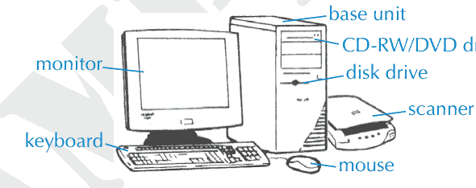

- 计算机的物理部件，如显示器和主机，称为*硬件*。
- 数据和指令通过*输入设备*输入计算机，如键盘、鼠标、扫描仪、麦克风、数码相机、CD-RW/DVD驱动器和磁盘驱动器。
- 当添加打印机、扫描仪等*外围设备*后，PC的功能会更加丰富。外围设备连接到计算机的*端口*。端口有不同类型，如串行端口、并行端口、火线（FireWire）端口、USB端口和蓝牙端口。
- 计算机将数据处理为有意义的、有用的信息。处理后的数据通过*输出设备*传送。显示器和打印机显示数据，CD-RW、磁盘驱动器和U盘存储数据，扬声器则输出音频。

> **扫描仪**
> 扫描仪是一种输入设备，它使用激光将照片、图画等艺术作品转换为数字图像。数字化后的图像可以被嵌入到电子文档中。

主机箱内还含有*主板*，即主要的电路板。主板包含多个组件：

> **打印机**
> 激光打印机使用激光和墨粉在纸上生成字符和图形。喷墨打印机使用墨盒将非常细小的墨滴喷射到纸上，从而形成字符和图形。

- *扩展板*是连接到主板以增加计算机功能的电路板。例子包括声卡和显卡。

**实时时钟**

一种称为实时时钟的电池芯片，即使在计算机关机时也能记录日期和时间。

| 输入 | 内存 | 输出 |
| :---: | :---: | :---: |
| ⇕ | CPU | ⇕ |

**CPU制造商**

英特尔（Intel）和AMD是两家处理器制造商。处理器通过型号名称或编号来标识，如Pentium® 4、Itanium® 2和Opteron™。英特尔Pentium 4（P4）CPU的时钟频率为3.06 GHz。
AMD Opteron CPU的时钟频率为2.4 GHz。
这些CPU在单个芯片上包含超过4000万个晶体管。

- CPU（中央处理器）或处理器处理数据，并控制计算机其他单元之间的数据流。
CPU内部有ALU（算术逻辑单元），它可以执行算术和逻辑运算。它还可以进行比较，这是计算机决策能力的基础。ALU的速度非常快，执行一次加法所需的时间以纳秒（十亿分之一秒）计量。CPU执行指令的速度由计算机的时钟频率决定。时钟频率以兆赫兹（MHz，每秒百万次）或吉赫兹（GHz，每秒十亿次）计量。
- 总线是一组将CPU与其他组件连接的电路。数据总线在CPU、内存和主板上其他硬件设备之间传输数据。地址总线携带内存地址，指示数据的位置以及数据应去往何处。
所有数据都通过CPU流动：

- 以集成电路形式的内存以电子方式存储数据。ROM（只读存储器）包含计算机最基本的操作指令。ROM中的数据是计算机的永久组成部分，无法更改。RAM（随机存取存储器，也称为主存储器或主内存）是临时存储数据和指令的内存。存储在RAM中的数据可以写入二级存储器，二级存储器包括任何类型的存储介质，如软盘、硬盘、U盘或CD-RW。二级存储器必须先复制到主存储器中，才能被CPU处理。SRAM（静态随机存取存储器）是称为缓存（cache，发音为cash）的高速内存。这种内存用于存储经常使用的数据，以便在应用程序运行时能够快速检索。

# 集成电路

集成电路，也称为芯片，由硅晶圆制成。硅晶圆被蚀刻上复杂的电路，并涂上金属氧化物以使电路能够导电。硅晶圆被封装在带有金属引脚的特殊塑料外壳中。这些引脚使集成电路能够插入电路板。

**BIOS**

BIOS（基本输入/输出系统）是包含计算机启动指令的固件。固件是写入ROM的指令。

# 操作系统与环境

**大型机和超级计算机**

大型机是一种大型计算机系统，支持多用户应用程序以及需要存储和处理大量信息的任务。大型公司、航空公司、银行、政府机构和大学使用大型机。

超级计算机是最快、最强大的计算机类型。超级计算机专注于尽可能快地执行少量程序，用于天气预报和核能研究。

*多用户*操作系统由大型机和小型机支持，允许两个或更多用户同时使用。术语*多处理*和*多任务*在提到允许多个应用程序（"进程"或"任务"）同时运行的操作系统时，通常可以互换使用。这种类型的操作系统决定如何在运行中的应用程序之间分配处理器时间。多处理操作系统不应与多处理计算机系统混淆，后者有多个处理器，并因为处理器同时用于多处理而执行*并行处理*。*多线程*指的是能够同时执行单个程序的不同部分（称为线程）的操作系统。*实时*操作系统对输入立即做出响应。这种类型的操作系统用于需要即时反馈的场合，如导航系统或医疗监控设备。

*环境*指的是计算机的硬件和软件配置。例如，Windows XP环境意味着计算机运行的是Windows XP Professional操作系统软件，硬件包括300MHz或更好的处理器、128MB或更多的RAM，以及至少1.5GB的硬盘空间。硬件需求基于允许操作系统软件适当管理计算机任务所需的配置。术语*平台*有时与环境同义。

> **提示** 有关特定操作系统的信息，请参阅Lvp.com中的相应章节。

环境类型差异很大，可以指计算机类型、用户与计算机交互的方式，以及软件/硬件配置。*桌面环境*指的是运行专为台式机或笔记本电脑典型硬件设计的操作系统的台式机或笔记本电脑。*多用户环境*有时称为分时，因为每个用户获得一部分处理器的"时间"。*分布式环境*在多台计算机之间共享处理负载。在讨论环境时，通常会对多处理和多任务进行区分。*多处理环境*意味着使用多个处理器来执行应用程序，而*多任务环境*是指在一台处理器上为多个应用程序分配处理时间。大多数环境运行带有图形用户界面（GUI）的操作系统：


操作系统（OS）的功能取决于其预定的平台。功能通过作为操作系统一部分编写的实用程序来实现。与通常可以执行多种不同任务的应用程序不同，*实用程序*有一个明确界定的单一任务。操作系统运行实用程序来管理输入和输出、读写内存、管理处理器、维护系统安全以及管理文件和磁盘。其中一种名为*设备驱动程序*的实用程序，是打印、查看图形、使用CD/DVD驱动器以及一般使用外围设备所必需的。某些实用程序在计算机启动时加载，由于它们始终驻留在内存中，因此被称为*内存驻留*程序。

通过集成实用程序来执行运行计算机所需任务之外的附加任务，可以为操作系统添加功能。例如，用于台式机或笔记本电脑环境的操作系统通常会包含磁盘碎片整理、文本朗读和其他辅助工具，以及系统还原和备份工具。例如：


*Windows XP 实用程序*

## 移动计算

技术的进步使得计算机组件得以微型化，并开发出特殊的长效电池。如今的计算机有多种形状、尺寸和功能级别。这些计算机包括笔记本电脑、平板电脑、手持设备、智能手机和可穿戴设备。由于其便携性，这类计算机被归类为移动计算设备：

- *笔记本电脑*是一种便携式、轻量级的计算机，其CPU、内存和硬盘空间与典型的台式计算机相当。
- *平板电脑*的设计类似于纸和铅笔。用户只需使用一种名为*手写笔*的、形似细铅笔的设备在屏幕上“书写”。手写识别软件用于解释用户的手写内容。也可以连接键盘。

> **蓝牙**
> 蓝牙是一种允许移动计算设备进行通信的无线技术。

> **手持计算机**
> 手持计算机广泛应用于需要频繁移动的职业，例如包裹递送、抄表和销售。

- **手持计算机**，也称为PDA（个人数字助理），是掌上大小的设备，包含用于存储联系人信息、日程表、列表和游戏的应用程序。手持设备配有用于输入的手写笔，屏幕垂直尺寸为几英寸。许多类型的应用软件已为手持设备编写，包括电子表格和文字处理软件。有些手持设备能识别手写、有内置键盘、包含蜂窝电话功能，并提供互联网接入。
- **智能手机**是能够发送和接收电子邮件以及访问互联网的蜂窝电话。有些智能手机具有数码相机、MP3播放器和彩色显示屏功能。
- **可穿戴计算机**在尺寸和应用上差异很大。MP3播放器已被集成到服装中，而一种可穿戴计算机包含了语音识别功能。可穿戴计算机也有护目镜的形式，集成了显示器、数码相机、耳塞和麦克风。腕戴式计算机像传统腕表一样佩戴，可作为寻呼机使用，提供互联网接入，并包含通常在手持PC中能找到的其他功能。

## 跨平台连接性

使用如此多种PC所涉及的一个问题是*跨平台连接性*，即一种PC能够与不同类型的PC连接并共享数据的能力。笔记本电脑和台式PC通常具有良好的跨平台连接性，因为它们的文件格式可以在任一计算机上使用。平板电脑和手持设备使用不同的操作系统并生成不同的文件格式，这需要特殊的硬件和软件才能在台式机或笔记本电脑上使用它们的文件。可穿戴计算机通常配有允许连接到其他类型PC的电缆，但必须使用特殊软件才能在设备之间进行通信。

## 编程语言

*编程语言*是一组词语、代码和符号，允许程序员向计算机发出指令。存在多种编程语言，每种语言都有自己编写这些指令的规则或语法。

编程语言可分为低级语言和高级语言。*低级编程语言*包括机器语言和汇编语言。机器语言被称为第一代编程语言，可用于直接与计算机通信。然而，用机器语言编程很困难，因为该语言由0和1组成，代表开关状态（0表示关，1表示开）。汇编语言使用与机器语言相同的指令和结构，但程序员可以使用有意义的名称或缩写来代替数字。汇编语言被称为第二代编程语言。

> **第四代和第五代语言**
> 第四代语言（4GL），如SQL，具有比大多数高级语言更接近英语的指令，通常用于访问数据库。第五代语言用于人工智能。

*高级编程语言*，通常称为第三代编程语言（3GL），最早开发于20世纪50年代末。高级编程语言具有类似英语的指令，比机器语言更易于使用。高级编程语言包括Fortran、C、Basic、COBOL和Pascal。为了让计算机理解用高级语言编写的程序，程序员使用编译器或解释器将源代码转换为机器语言。*编译器*是一个将整个程序转换成机器代码的程序。


城域网（MAN）和家庭区域网（HAN）是根据网络规模划分的网络技术。MAN是一种高速网络，通常用于连接城市或城镇内的局域网（LAN）。HAN用于连接家庭内的个人设备。

将电缆插入适配器卡，将一个设备连接到另一个设备以形成LAN。具有无线功能的网卡不需要电缆。网络接口卡可用于台式机和移动计算机，并有其他各种形式，包括适配器卡、PC卡或闪存卡。

> **传输介质**
> 计算机必须相互连接才能在节点之间传输数据。有线传输介质包括双绞线、同轴电缆和光纤电缆。无线传输介质包括红外信号、广播无线电、蜂窝无线电、微波和通信卫星。

数据量以及数据在介质上传输的速度称为带宽，以每秒比特数（bps）为单位。每种传输介质都有特定的长度或范围限制、数据传输速率和成本。

除了建立网络的物理（或硬件）方面，还有软件方面。*网络操作系统*是允许用户和设备通过网络进行通信的软件。*网络化环境*指的是一组运行能够处理计算机间通信的操作系统的联网计算机。安装的操作系统必须能够支持网络功能，例如安全访问功能和对多用户的支持。Linux、Windows、Unix和Mac都提供了具备网络功能的操作系统。在选择网络操作系统时，还必须考虑接下来讨论的网络架构。

*网络架构*包括网络上的计算机类型，并决定如何处理网络资源。两种常见的模型是对等（peer-to-peer）和客户端/服务器（client/server）。在*对等网络*中，网络上的每台计算机在职责和资源共享方面被视为平等。*客户端/服务器网络*由一组称为*客户端*的计算机连接到一个服务器组成。*服务器*是一台具有更多RAM、更大硬盘，有时甚至有多个CPU的计算机，用于管理网络功能。

*物理拓扑*指的是网络上节点的排列。*节点*是网络上具有能够处理信息的设备（如计算机或打印机）的位置。有三种常见的物理拓扑结构：

- *总线拓扑*是一种物理LAN拓扑，使用称为*总线*或骨干的单一中心电缆直接连接每个节点。

> **以太网**
> 以太网LAN协议由Bob Metcalfe于1976年开发。以太网使用总线或星形拓扑，采用双绞线、同轴电缆或光纤电缆作为传输介质。较新的协议包括运行在100 Mbps的快速以太网、运行在1 Gbps的千兆以太网和运行在10 Gbps的万兆以太网。


## 网络拓扑结构

• 在**星型拓扑**中，每个节点都连接到一个**集线器**，该设备将通信线路连接在网络的中心位置。

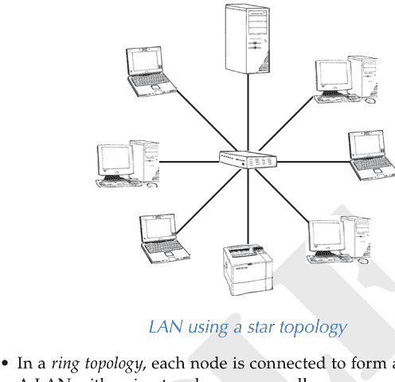

| 基带技术与宽带技术 |
| 大多数局域网使用基带技术，这意味着传输介质一次只承载一个信号。宽带技术允许同时传输多个信号，并用于有线电视传输中。 |

• 在**环型拓扑**中，每个节点相互连接形成一个闭环。采用环型拓扑的局域网通常比总线型或星型拓扑能覆盖更大的距离。

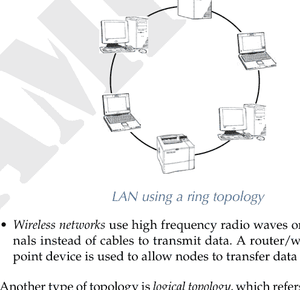

| Wi-Fi |
| Wi-Fi（无线保真）是一个术语，用于描述 802.11 网络，这是一项针对无线网络的规范或协议。 |

• **无线网络**使用高频无线电波或红外信号代替电缆来传输数据。路由器/无线接入点设备用于允许节点无线传输数据。

*逻辑拓扑*
另一种拓扑类型是*逻辑拓扑*，它指的是数据在网络节点之间传递的方式。局域网的逻辑拓扑并不总是与其物理拓扑相同。

## 网络用户与网络礼仪

网络用户会被分配用户名和密码，通过连接到网络的计算机登录网络。用户也会被分配一定的访问级别以维护安全。网络用户应遵循一定的礼仪，被称为**网络礼仪**（*netiquette*）：

- 未经授权不要尝试访问其他用户的账户。
- 不要与他人共享密码，并定期更换密码。
- 使用适当的话题和语言，并体谅他人的信念和观点。

## 数制

集成电路上的电子电路只有两种状态：关或开。因此，采用仅使用两个数字（0 和 1）的**二进制数制**（基数 2）用于计算机。为了表示数字和字母，开发了一种代码，将八个二进制数字组合在一起以表示单个数字或字母。二进制代码中的每个 0 或 1 称为一个**位**（Binary digiT），8 位单位称为一个**字节**。

我们最熟悉的数制是十进制，或称**基数 10**系统。它使用十个数字：0 到 9。每一位代表十的幂，小数点左边第一位代表 10⁰，下一位代表 10¹，再下一位代表 10²，依此类推（记住任何数的零次幂等于 1）。在十进制数 485 中，4 代表 4×10²，8 代表 8×10¹，5 代表 5×10⁰。数字 485 代表总和 4×10² + 8×10¹ + 5×10⁰（即 400 + 80 + 5）：

| 十进制 | 基数 10 等价值 |
| :--- | :--- |
| 485 | 4×10² + 8×10¹ + 5×10⁰ = 400 + 80 + 5 |

二进制，或称**基数 2**系统，工作原理相同，只不过每一位代表二的幂而不是十的幂。例如，二进制数 101 代表总和 1×2² + 0×2¹ + 1×2⁰，即十进制中的 5。一些十进制数及其二进制等价值如下：

| 十进制 | 二进制 | 基数 2 等价值 |
| :--- | :--- | :--- |
| 0 | 0 | = 0×2¹ + 0×2⁰ = 0×2 + 0×1 = 0 + 0 |
| 1 | 1 | = 0×2¹ + 1×2⁰ = 0×2 + 1×1 = 0 + 1 |
| 2 | 10 | = 1×2¹ + 0×2⁰ = 1×2 + 0×1 = 2 + 0 |
| 3 | 11 | = 1×2¹ + 1×2⁰ = 1×2 + 1×1 = 2 + 1 |
| 4 | 100 | = 1×2² + 0×2¹ + 0×2⁰ = 1×4 + 0×2 + 0×1 = 4 + 0 + 0 |

十六进位制系统用于表示四组二进制数字。**十六进制**，或称**基数 16**系统，基于 16 个数字：0 到 9，以及字母 A 到 F，分别代表 10 到 15。每一位代表十六的幂。例如，十六进制数 1F 代表总和 1×16¹ + 15×16⁰。一些十进制数及其十六进制等价值如下：

| 十进制 | 二进制 | 十六进制 | 基数 16 等价值 |
| :--- | :--- | :--- | :--- |
| 0 | 0000 0000 | 0 | = 0×16⁰ = 0×1 = 0 |
| 10 | 0000 1010 | A | = 10×16⁰ = 10×1 = 10 |
| 25 | 0001 1001 | 19 | = 1×16¹ + 9×16⁰ = 1×16 + 9×1 = 16 + 9 |
| 30 | 0001 1110 | 1E | = 1×16¹ + 14×16⁰ = 1×16 + 14×1 = 16 + 14 |

## **ASCII 和 EBCDIC**

ASCII（美国信息互换标准代码）和 EBCDIC（扩展二进制编码十进制互换代码）是另外两种数字编码方案。与 Unicode 不同，ASCII 和 EBCDIC 不够大，无法支持使用不同字母表的亚洲语系和其他语言。

为了清晰起见，非基数 10 的数字应在数字之后标注基数下标。例如，为了显示基数 10 中的 100 与基数 2 中的 100（代表数值 4）之间的区别，基数 2 的数字应写作 100₂。

每个字母（拉丁字母、日语假名、切罗基字母等）以及每一种文化的符号（=, @, ½ 等）都在一种称为 Unicode 的数字代码中得到了表示。**Unicode**使用一组 16 个 1 和 0 来为每个符号形成 16 位二进制代码。例如，大写字母 V 的 Unicode 代码为 00000000 01010110，这可以看作是十进制数 86（86₁₀）。小写字母 v 则有一个独立的代码 00000000 01110110，即 118₁₀。

## **在内存中存储数据**

计算机内存以字节为单位进行测量。例如，一台计算机可能拥有 512MB 的随机存取存储器（RAM）。在计算机和电子学中，*MB*代表**兆字节**，其中兆代表 2²⁰或 1,048,576 字节；*GB*代表**吉字节**，即 2³⁰或 1,073,741,820 字节。

存储在内存中的数据通过地址引用。一个*地址*是内存中某个位置的独特二进制表示。因此，数据可以通过其地址进行存储、访问和检索。为了使数据在内存中具有可寻址性，其长度通常至少为一个字节。例如，要将 JIM 存储在内存中，每个字符都会转换为 Unicode 并存储在两个字节的内存中，每个内存位置都指定有其地址：

| | J | I | M |
|---|---|---|---|
| 二进制代码 | 01001010 | 01001001 | 01001101 |
| 内存地址 | 01 | 10 | 11 |

由于 JIM 是一个字符字符串，它很可能存储在相邻的内存地址中。

### **字（Words）**
按 16 到 64（2 到 8 个字节）为单位分组的位称为*字*。存储在字中的数据也通过地址定位。字的大小取决于计算机系统。

### **溢出错误**
整数数的二进制表示通常存储在四个字节的内存中。由于整数占用四个字节，其可存储的范围为 –2,147,483,648 到 2,147,483,647。当表示该整数所需的位数大于四个字节的容量时，会发生*溢出错误*。

### **实数**
*实数*，也称为*浮点数*，是包含小数点的数。实数的二进制表示通常占用 4 到 8 个字节的内存。二进制数 111.10 等价于十进制实数 7.5，并作为二进制数 0.11110×2³存储在内存中。

### **尾数**和**指数**
在这种形式下，代表*尾数*（小数部分）的位存储在一个字的某个部分，而*指数*（本例中的 3，即 11₂）则存储在另一个部分。

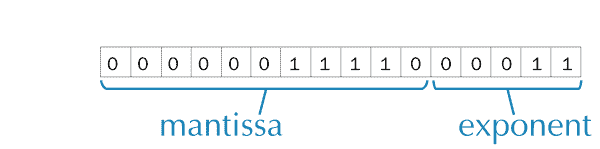

之前讨论整数的溢出问题也可能出现在实数中，如果存储指数的部分不够大。当没有足够的位来存储尾数时，会发生*舍入误差*。

### 什么是文件？

### **文件大小限制**

可以使用压缩程序（如 WinZip）来减小或压缩文件大小。该技术通常用于适应存储设备和电子邮件账户的限制。

*文件*是存储在持久性存储介质上的相关数据。文件可以是应用程序（程序）本身，也可以是应用程序的产物。例如，文字处理应用程序用于创建文档文件。另一个例子是，数码相机用于创建照片文件。文件存储在持久性存储介质上，以便即使计算机或计算机化设备关闭，文件也会被保留。每当需要其存储的数据时，文件可以反复使用。

文件本质上只是 1 和 0，因为它以二进制代码存储。计算机被编程将字节和字转换为符号。根据文件类型，这些符号在转换后要么是供人阅读的，要么是供计算机读取的。供人阅读的文件称为*文本文件*，供计算机阅读的文件称为*二进制文件*。简单的文件，如文本文档，可以用*千字节*来衡量，例如 64K。K 来自单词*kilo*，代表 2^10或 1,024。因此，64K 文件使用 65,536 字节（64×2^10）的存储空间。

### **扩展名**

常见的扩展名包括：

- .xls - Excel 文件
- .class - 编译后的 Java 文件
- .java - Java 文件
- .zip - 压缩文件
- .gif - GIF 图像文件
- .bmp - 位图图形文件

文件类型由文件名之后的*扩展名*来区分。应用程序会为其创建的文件添加独特的扩展名。例如，*MyResume.doc*是一种文档文件类型。DOC 文件是由 Microsoft Word 创建的二进制文件。可执行文件是 EXE 文件，也是二进制文件。名为*TestData.txt*的文件是纯文本文件。TXT 文件仅包含人类可读的字母、数字和常见符号。*文件夹*用于组织常用或相关的文件。

二进制文件比文本文件更复杂，通常包含照片、格式化文本、电子表格、声音等数据。二进制文件的缺点是需要另一个应用程序来解释其内容。一个二进制文件的内容可能如下所示：

> **提示** 文件保存的原始形式被称为原生格式。

```
ÿÿñU_ÿÿp]9UTÿÿ-÷]Ì_ñÿÑßÿÿý ÿ×_ÿ÷Ãðÿ
ÿ ÿ ð – U _ÿ ÿ w u s U U ÿ w ] U / U _ ñÿ U W w w t w w U W w w D ð ÿ
p»ÿÿú®í¿pÿßûíúûÿ¾ðiÿ
     ÿÿì¿ÿñòý    UÿÿúET_ÿÿ÷wiÿ-ß»ÿßìÿÿðý-ÿêýúßý°ðÿßÿýûýûèðý
ÿÝß_ÿÿ ÿwpuUuWÿw÷÷ÿ{ÿßù¿ß÷ÿuWwwu÷uuUUwwDðÿp»ÿΩê liÿp
>«~쮿pÿ
ÿUÝUUÓ]UU]UÖ]Ö]æÝDðÿ¿Ìÿàðÿòý
ßýÒW_ÿ_ðW_ÓÒ]uàÿDðÿp¿óÿìpÿßþáÿèðÿðwÿûpWuWUUwWþUâwDð
ÿþ
```

二进制文件可供计算机读取。


# 存储设备

存储设备使用持久性介质来保存文件。这些设备也被称为驱动器、海量存储器和辅助存储器，可分为三类：

- 内部或外部
- 可移动或固定介质
- 磁性、光学或固态技术

内部设备是安装在PC机箱内的驱动器。这些设备可以包括硬盘、CD/DVD、磁盘、磁带、Zip和Jaz驱动器。除了使用可移动介质的Iomega® RRD（可移动刚性磁盘）系统外，硬盘通常具有永久安装的磁盘，无法从PC机箱外部访问。其他设备则有一个用于可移动存储介质的外部插槽。

外部设备拥有独立的驱动器外壳，并通过线缆连接到计算机的USB端口。USB（通用串行总线）是一项标准化技术，数据传输速率高达480 Mbs。通过USB集线器，一个端口最多可以连接127个设备。

外部驱动器的优势在于便携性，因为它们可以轻松地移动到支持该技术的其他计算机上。外部设备包括硬盘、RRD、CD/DVD、软盘、磁带、Zip和Jaz驱动器。除了硬盘驱动器外，这些驱动器都使用可移动介质。

超便携设备包括钥匙链、手表、迷你驱动器和鼠标存储器等等。这些外部设备体积小且易于使用，但目前比尺寸更大的同类存储设备更昂贵。大多数超便携设备，包括钥匙链和迷你驱动器，其存储介质直接连接到一个USB插头，再插入USB端口。手表和鼠标存储设备则使用带有USB插头的线缆连接到USB端口。手表的线缆很短，USB插头隐藏在表带中。鼠标存储设备需要较长的线缆，以便同时充当指针设备。

### 火线

火线使用IEEE 1394标准，允许设备快速传输大量数据（超过400Mbs）。火线通常用于数码摄像机，有时也用于外置硬盘，因为这些设备涉及大量数据。火线设备可以菊花链式连接，即一个设备连接到另一个设备的火线端口，然后该设备再连接到另一个，以此类推。火线还支持用于实时数据传输的同步模式。

存储设备技术决定了设备的介质、尺寸和便携性。磁性技术使用带有微小电磁头的机械驱动器在介质上读写数据。磁性技术所需的介质是磁盘，通常由铝或聚酯薄膜制成，表面涂有氧化铁。磁盘要么封装在硬塑料中（软盘和Zip），要么将多个称为盘片的磁盘密封在一个外壳中（Jaz、RRD和硬盘）。通过驱动器磁头发送的数据信号以一个方向磁化介质的某一点来存储1，以另一个方向存储0。

光学技术使用带有激光器和光电传感器的驱动器。光学技术所需的介质是由聚碳酸酯塑料制成的光盘。CD-R（可刻录光盘）用于存储文件。CD-R涂有反射性有机化合物，然后用一层塑料密封，以保护反射层不被划伤。驱动器中的激光聚焦在CD-R的某一点上，使有机化合物变暗或“烧录”，从而存储1。CD-R上未烧录的区域则被读取为存储0的位。

光学技术的另一个应用是*DVD驱动器*，它使用类似于CD-R的DVD-R光盘。DVD-R（数字视频光盘-可刻录）可以存储比CD-R多得多的数据，这得益于驱动器和DVD-R本身制造所采用的精度。在DVD-R上，位要小得多，存储也密集得多。

*固态技术*可制造最小、最便携的存储设备，因为该技术无需活动部件。介质是闪存，由每个单元格中有两个微小晶体管的网格组成。每个单元格对应一个位。对单元格施加电荷存储0，而施加更强的电荷则存储1。晶体管网格封装在硬塑料中，体积非常小。有些设备可以在比25美分硬币更薄、更小的封装内存储2MB或更多数据。稍大一点的介质可以存储千兆字节的数据。封装的介质通常直接连接到USB插头上以供计算机使用，或者简单地印有导电材料，以便介质可以滑入数码相机插槽。

*磁性技术*允许存储设备的容量范围从1.44MB（一张软盘）到许多千兆字节（带有多个盘片的硬盘驱动器）。光学技术包括可存储约700MB数据的CD，而DVD则可存储至少4GB的数据。固态设备可存储从64KB到许多千兆字节的数据。

存储介质可能非常敏感。应注意避免损坏文件：

- 切勿尝试打开装有磁盘的外壳。
- 将磁性介质远离磁铁。
- 握持CD/DVD时应握住中心孔或边缘。
- 切勿弯曲CD/DVD或其他柔性介质。
- 将CD/DVD存放在珠宝盒或护套中以防止划伤。
- 将介质远离潮湿和极端温度。

*内联网*是单个组织（如公司或学校）使用的网络，只有授权用户才能访问。内联网的目的是共享信息。然而，防火墙也用于阻止未授权用户。*防火墙*是一种防止未授权网络访问的网络安全系统。

*外联网*通过为授权的公众成员提供不同级别的访问权限来扩展内联网。例如，一家公司可以扩展其内联网，为其注册客户提供对特定信息（如订单系统）的访问。

最大且访问最广泛的网络是*互联网*，这是一个不受任何单一组织控制的全球计算机网络。互联网对现代社会产生了不可否认的影响，因为它允许全球用户在几秒钟内进行通信。

**太字节、拍字节、艾字节**

随着越来越多的数据以电子方式存储，文件变得非常大，需要具有非常大容量的存储设备。TB（太字节）是2^40字节或1万亿字节，PB（拍字节）是2^50字节或1,024太字节，EB（艾字节）是2^60字节或1,024拍字节。具有TB存储容量的设备正逐步投入使用，尤其适用于数据库文件。

**存储介质**

存储介质的容量各不相同。例如，磁盘的存储容量为1.44 MB，CD的存储容量为650 MB，DVD的存储容量则超过4GB。

**互联网历史**

互联网是从ARPANET发展而来，该网络由国防部高级研究计划局（ARPA）在20世纪60年代末创建，并基于开放架构网络理论。

互联网实际上是通过路由器相互连接的众多网络。*路由器*是一种连接不同网络技术的设备。连接到路由器的网络使用*TCP/IP*（传输控制协议/互联网协议）软件进行通信。

互联网上的计算机分为服务器和客户端。客户端从服务器接收信息。互联网的客户端/服务器结构被称为*交互式*，因为所访问的信息是用户选择的结果。例如，一台只装有最基本互联网访问软件的计算机就是客户端。从互联网上选择选项的客户端用户正在从服务器（一台装有额外软件和文件、同样连接到互联网的计算机）接收信息。

# 电信

**提示** 访问互联网需要电信服务并使用互联网服务提供商（ISP）。

*电信*是数据的发送和接收。数据可以有多种形式，包括语音和视频。电信需要调制解调器或适配器以及线路或电缆。数据传输（发送）和接收（接收）的速度以*Kbps*（千比特每秒）或*Mbps*（兆比特每秒）来衡量。有众多电信选择方案，它们在速度和成本上各不相同：

- **传统调制解调器**使用标准电话线将模拟信号转换为数字数据。传统调制解调器是56 Kbps调制解调器，以28.8 Kbps和36.6 Kbps的速度传输数据，并以56 Kbps的速度接收数据。家庭计算机有时使用传统调制解调器。
- **DSL（数字用户线路）**调制解调器使用标准电话线，数据传输速率高达640 Kbps。数据接收速率从1.5 Mbps到9 Mbps。非对称DSL（ADSL）是最常用的形式。
- **线缆调制解调器**通过同轴电缆电视网络传输数据。数据传输速率从2 Mbps到10 Mbps，数据接收速率从10 Mbps到36 Mbps。
- **租用/专用线路**被许多企业和学校用于互联网接入。它们提供始终激活的永久互联网连接。租用线路的费用通常是固定的月费。T-1载波是一种租用线路类型，以1.544 Mbps的速率传输数据。
- **ISDN**（综合业务数字网）是由本地电话公司提供的数字电话网络。ISDN能够以最高64 Kbps的速率传输和接收数据。ISDN需要使用ISDN终端适配器而不是调制解调器。

**提示** 在无线网络中，路由器/无线接入点通常通过线缆连接到线缆或DSL调制解调器。


## 互联网服务：Web、电子邮件和邮件列表

互联网服务包括万维网、电子邮件和邮件列表。*万维网*（World Wide Web，简称*Web*）是使用最广泛的互联网服务。Web 可用于搜索和访问互联网上的可用信息。Web*浏览器*应用程序（如 Microsoft Internet Explorer）提供图形界面，以网站形式呈现信息：

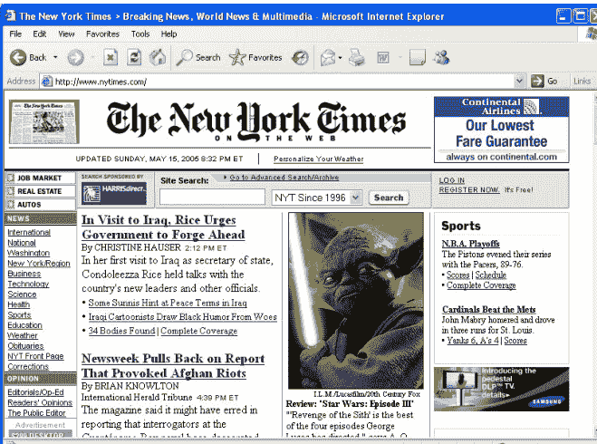

另一项广泛使用的互联网服务是*电子邮件*（e-mail 或 electronic mail），即通过通信网络（如局域网（Local Area Network，LAN）或互联网）发送和接收消息及计算机文件。电子邮件可以在几秒钟内收到，即使收件人位于地球的另一端。

发送和接收电子邮件需要一个电子邮件地址。电子邮件地址在您注册互联网服务提供商（ISP）或在线服务时提供。典型的电子邮件地址类似于：


发送和接收电子邮件还需要电子邮件软件。电子邮件软件的例子包括 Outlook、Outlook Express 和 Eudora。基于浏览器的电子邮件只需要一个 Web 浏览器，可通过 Yahoo! 和 Hotmail 等网站使用。

## 博客

博客（Blog）是网络日志（weblog）的简称，是一种用户可以日志格式发布条目的网站类型。

## 数字签名

数字签名是附加到电子消息上的一段代码，用于验证网站或电子邮件消息的真实性。

## 即时通讯

即时通讯是一种通信工具，支持实时或即时的基于文本的通信。

## 电子邮件协议

POP3 是一种电子邮件协议，用于连接电子邮件服务器，将消息下载到本地计算机。

IMAP 是一种电子邮件协议，用于连接电子邮件服务器，读取消息标题，然后由用户选择将哪些电子邮件消息下载到本地计算机。

HTTP 用作电子邮件协议时，是通过网页访问电子邮件账户的情况。

撰写电子邮件消息时应遵循以下规则：

- 使用礼貌用语。包括"请"和"谢谢"，并且对不认识的人使用恰当的称呼，如先生、女士、夫人、博士等。
- 简明扼要。
- 保持专业，包括使用正确的拼写和语法。
- 发送前重新阅读邮件。始终最后填写"收件人"栏，以避免在邮件完成之前发送。

电子邮件消息不是私密的。电子邮件消息在到达收件人之前会经过多个邮件服务器，这使得他人很容易读取。因此，发送电子邮件需要遵循一定的礼仪：

- 只通过您的账户发送消息。
- 使用恰当的题材和语言。
- 尊重他人的信仰和观点。

在工作或学校发送电子邮件时，重要的是要记住雇主和学校管理人员有权阅读通过公司或学校网络发送的任何电子邮件消息，以及跟踪在线活动的权利。

*邮件列表服务器*是为用户群组管理邮件列表的服务器。两种邮件列表服务器是 Listserv 和 Majordomo。用户通常为了讨论目的订阅邮件列表。当订阅者向邮件列表服务器发布消息时，每个订阅者都会收到该消息的副本。订阅者由一个名称或电子邮件地址标识。

## 垃圾邮件

除了个人和商业消息外，大多数人还会收到大量"垃圾邮件"或垃圾邮件。大多数电子邮件软件都包含过滤和阻止特定发件人消息的功能。

## 在 Web 上查找信息和下载文件

## 搜索引擎

搜索引擎通常通过发送代理（如蜘蛛）来工作。蜘蛛是一种应用程序，它收集可用网页文档的列表，并将此列表存储在数据库中，用户可以通过关键词进行搜索。

在显示信息时，搜索引擎通常首先显示"赞助网站结果"。这些网站包含正在搜索的信息，但向搜索引擎付费以将其网站列在列表顶部。

*搜索引擎*是一种搜索网页数据库中的关键词，然后列出包含这些关键词的页面的超链接的程序。常用的搜索引擎包括：

- **Yahoo!** (www.yahoo.com)
- **Google** (www.google.com)
- **MSN** (www.msn.com)
- **AOL** (www.aol.com)
- **Excite** (www.excite.com)
- **Ask Jeeves** (www.ask.com)
- **Overture** (www.overture.com)
- **Lycos** (www.lycos.com)
- **WebCrawler** (www.webcrawler.com)
- **FAST Search** (www.alltheweb.com)
- **About.com** (www.about.com)
- **AltaVista** (www.altavista.com)
- **Looksmart** (www.looksmart.com)

可以查询搜索引擎以显示特定的网页。*搜索条件*可以包括单个词或短语，然后由引擎用于确定匹配。*匹配*是包含搜索条件的网页。将短语用引号括起来可以找到包含整个短语的网页。搜索条件越具体，找到信息的机会就越大。

大多数搜索产生的匹配结果太多，无法使用。通过在搜索条件中使用布尔逻辑，通常可以将匹配数量限制在合理的范围内。

## 文本框：布尔逻辑

布尔逻辑使用三种逻辑运算符：

**AND** 定位包含两个词的页面

**OR** 定位包含其中一个词或两个词的页面

**NOT** 定位包含第一个词但不包含第二个词的页面

布尔表达式总是评估为 TRUE 或 FALSE，与搜索条件匹配的页面评估为 TRUE。

- +（加号）在搜索条件中用于将搜索限制为仅包含所有指定词的网页。例如，搜索 florida +hotel 或 florida hotel 只返回包含这两个词的页面的链接。在大多数搜索引擎中，AND 可以代替 + 使用。

- **OR** 可以在大多数搜索引擎中用于查找包含条件中任何一词的网页。例如，条件 florida OR hotel 返回包含任一词语的页面的链接。

- –（减号）用于排除不需要的网页。例如，搜索 shakespeare –play 返回包含 shakespeare 一词的页面的超链接，但排除同时包含 play 一词的页面。在大多数搜索引擎中，NOT 可以代替 – 使用。

一些搜索引擎提供*主题树*或*网页目录*，这是按类别分隔的网站列表。使用主题树一词是因为许多类别"分支"为子类别。这些子类别允许用户缩小主题范围，并显示适当超链接的列表，这些超链接位于树的最低层。

> **提示** 网站上的文件可供下载并不意味着下载该文件是合法的。下载未经免费提供受版权保护的文件是违反版权法的行为。

网站上的信息有时以可下载文件的形式存在。*下载*是将文件从网站复制到用户计算机的过程。例如，可以从防病毒软件公司的网站下载病毒定义，从软件公司的网站下载软件更新。下载文件时，用户指定文件应保存在本地计算机上的位置。只应从已知、真实的网站下载文件，因为可下载文件通常与病毒有关。

如果要在报告、论文或其他文档中引用或摘录网站上的信息，必须使用引文来注明原作者并提供查找引用信息的方法。现代语言协会（MLA）在其出版物*《MLA 科研论文写作手册，第四版》*中发布了一种广泛接受的引文形式。

一般来说，网站资料的引文应类似于：

```
Author's Last Name, First Name MI. Site Title. Access date.
    Organization name. <URL>.
```

个人网站的引文可能类似于：

```
Rawlings, Julie. Home page. 23 Dec. 2006. <http://www.
    lpdatafiles.com/jrawlings/index.htm>.
```


## 互联网隐私问题

互联网的发展引发了对个人隐私的更多担忧。在互联网上搜索信息并不像表面上看起来那样匿名。

收集访问网站的消费者数据是一种被称为*在线画像*的营销技术。当访问商业网站时，可能会使用Cookie或网络信标等各种方法收集用户的信息。

*Cookie*是当用户向网站输入信息时，由服务器计算机创建的文本文件。然后，该Cookie文件存储在用户的计算机上，并在用户每次访问该网站时被访问。在进行在线购买时通常会创建Cookie。虽然Cookie只能存储用户选择或输入的信息，但其使用引发了对隐私问题的担忧。

*网络信标*，也称为*网络虫*或*像素标签*，是位于网页或电子邮件中的微小透明图形，它们与Cookie结合使用，用于收集有关网页用户或电子邮件发送者的数据。通常，监控由外部广告公司进行。网络信标收集的信息包括计算机的IP地址、正在访问的URL、查看网页的时间、使用的浏览器类型以及Cookie文件。

在通过网站向公司提供个人信息之前，请检查该网站的隐私政策。*隐私政策*是一份具有法律约束力的文件，解释了将如何使用任何个人信息。

互联网开启了访问许多以前无法访问的文件。为了保护个人隐私以及存储关于个人的数据的准确性，已经通过了几项法律：

- **1986年《电子通信隐私法》（ECPA）**规定未经授权访问电子数据是犯罪行为。它还禁止未经授权发布此类数据。
- **1996年《电子信息自由法》（E-FOIA）**要求联邦政府机构公开某些机构信息供公众审查，旨在通过在线提供更多信息来改善公众对机构记录的访问。
- **1998年《儿童在线隐私保护法》（COPPA）**要求收集13岁以下儿童个人信息的商业网站获得家长同意。

## 间谍软件

间谍软件是一种利用互联网从不知情的用户那里收集个人信息的软件。间谍软件在用户不知情的情况下随另一个文件（如免费软件或共享软件程序）一起下载并安装。

## IP地址

IP地址是TCP/IP网络上计算机或设备的标识符。

**提示** 网站的隐私政策通常作为链接位于网站首页底部。

## NET法案

1997年的NET（禁止电子盗窃）法案堵塞了法律中的一个漏洞，该漏洞允许在互联网上免费分发受版权保护的材料而无需承担任何法律惩罚。

### 加密

加密是将数据转换为没有密钥就无法读取的代码的过程。加密防止对数据的未经授权访问。加密的数据被称为密文。

- **1999年《通过加密保障安全与自由法》（SAFE）**赋予美国人使用任何类型加密来保护其机密信息的自由。

其他法律的通过可能侵犯一些人的隐私，以保护其他人的安全。例如，**2001年《提供适当工具拦截和阻止恐怖主义法》（爱国者法案）**赋予执法机构监控个人电子邮件和网络活动的能力。

## 互联网可接受使用政策

互联网内容、非生产性使用和版权促使许多学校和企业制定了可接受使用政策或互联网使用协议。可接受使用政策通常包含类似以下的规则：

- 使用适当的语言。
- 不要透露个人地址或电话号码。
- 不要访问、上传、下载或分发不恰当的材料。
- 不要访问其他用户的账户。
- 禁止将网络用于私人业务。
- 只能使用管理员安装的软件。不允许添加、删除或修改已安装的软件。

### 互联网过滤软件

许多学校和组织安装互联网过滤软件来屏蔽冒犯性材料。

## 计算机使用的社会和伦理影响

我们所生活的社会已被计算机深刻影响，以至于历史学家将现在称为*信息时代*。这是由于我们使用计算机存储和处理大量信息（数据）的能力。作为信息社会，我们必须考虑使用计算机的社会和伦理影响。伦理问题，我们指的是探讨使用计算机在道德上正确和错误的方式是什么。

*人机工程学*是研究安全工作环境的科学。许多健康相关问题，如腕管综合症和计算机视觉综合症（CVS），都与长时间使用计算机有关。

电力和纸张浪费是与计算机使用相关的环境问题。消除这些问题的建议包括回收纸张和打印机碳粉盒，以及在不使用时关闭显示器和打印机。

员工监控是工作场所中与计算机相关的问题。雇主安装监控员工使用计算机的软件程序是合法的。同样，可以在不通知员工的情况下阅读电子邮件。

## 身份盗窃

身份盗窃是一种日益增长的犯罪行为，即通过电子方式窃取个人信息，以便进行欺诈性购买或贷款。

正如本章前一节所讨论的，隐私侵犯是与计算机相关的严重问题。因为计算机可以存储海量数据，我们必须决定哪些信息适合存储，哪些不适合，以及谁应该有权访问这些信息。每次你使用信用卡、打电话、取钱、预订航班或在学校注册时，计算机都会记录交易。这些记录可以用来了解大量关于你的信息——你去过哪里、什么时候去过、花了多少钱。这些信息是否应该对每个人开放？

计算机还用于存储有关你信用评级的信息，这决定了你借钱的能力。如果你想买车并从银行贷款，银行首先会在计算机上检查你的信用记录，以确定你是否有良好的信用评级。如果你购买了汽车然后申请汽车保险，另一台计算机将检查你是否有交通违章。你如何知道所使用的信息是否准确？下面列出的法律已经通过，以帮助确保隐私权不因不当使用计算机文件中存储的数据而受到侵犯：

- **1970年《公平信用报告法》**赋予个人查看信用、保险和就业机构收集的关于他们的信息的权利。如果一个人被拒绝信用，他们有权查看用于做出信用决定的文件。如果任何信息不正确，个人有权要求更正。该法案还限制只有持有法院命令或获得被检查信用者书面许可的人才能访问信用文件。
- **1974年《隐私法》**限制了联邦机构使用个人数据的方式。必须允许个人访问存储关于他们的信息，并可以更正任何不正确的信息。机构必须确保任何敏感信息的安全性和机密性。虽然该法律仅适用于联邦机构，但许多州也采用了类似的法律。
- **1978年《金融隐私法》**要求政府机构必须持有传票、传唤令或搜查令才能访问个人的财务记录。当此类记录被发布时，金融机构必须通知个人谁有权访问这些记录。

## 保护计算机软件和数据

随着社会对数字信息的依赖日益加深，版权和恶意代码暴露已成为计算机用户中的两个重要问题。*版权*是对数字信息的保护。版权侵权是非法使用或复制数据（文本、图片、音乐、视频等）。法律，如1997年的NET法案（禁止电子盗窃法案），保护免受版权侵权。已经发生了几起因版权侵权而对个人处以高额罚款的著名案件。


> **提示** 通常，为购买的软件程序制作一份备份副本是合法的。

版权侵权包括在未支付软件费用的个人使用软件时进行复制。当非法副本被分发时，这种行为被称为*盗版*。软件的开发、测试、营销和支持是一个昂贵的过程。如果软件开发者的合法报酬被剥夺，所有软件的未来发展都会受到威胁。因此，只使用合法获取的软件副本，不为他人制作非法副本至关重要。

恶意代码形式多样，传递方式也多种多样。病毒、特洛伊木马和互联网蠕虫是三种恶意代码形式。它们可以通过可执行程序、脚本、宏、电子邮件和某些互联网连接出现在系统上。恶意代码的一个破坏性影响是数据的破坏。

## 病毒

*病毒*是一种可以在用户不知情的情况下自我复制的程序或一系列指令。通常，病毒在接收到特定信号时被触发运行。例如，病毒可能会检查计算机的时钟，然后在到达特定时间时破坏数据。当文件被复制时，病毒很容易被复制，从而将其传播到其他计算机。

## 特洛伊木马

*特洛伊木马*程序伪装成其他东西，通常是一个看起来值得信赖的程序。运行该程序会运行恶意代码并损坏计算机上的文件。*蠕虫*是一种能够在网络上自我复制的程序。*蠕虫*因其复制方式和使用系统资源的方式而构成威胁，有时会导致系统关闭。

## 防病毒程序

恶意代码已变得如此普遍，以至于必须在计算机和网络上安装名为*防病毒程序*的软件，以便在代码复制或损坏数据之前检测并删除它。还可以采取预防措施来防止恶意代码造成的损害：

- 更新防病毒软件。防病毒程序只能检测它已知的病毒、特洛伊木马和蠕虫。防病毒程序有一个用于更新包含该防病毒程序的计算机上的病毒定义的网页链接。

- 未扫描恶意代码前，不要打开电子邮件附件。据估计，80%的病毒感染是通过电子邮件传播的。

## 破解者、黑客

报纸上刊登了大量关于*破解者*或*黑客*进入大型计算机系统进行破坏行为的报道。这种恶意行为是非法的，并可能造成昂贵的损害。1986年的《电子通信隐私法》明确规定，未经授权访问电子数据是联邦犯罪。网络通常包括防火墙，这是硬件和软件的组合，有助于防止未经授权的访问。

故意破坏计算机数据与破坏任何其他财产没有区别。由于损害是以电子方式造成的，结果通常不像破坏实物财产那样明显，但后果基本相同。据估计，计算机犯罪每年造成数十亿美元的损失。

*网络钓鱼*是向用户发送电子邮件，谎称是合法企业，企图诱骗用户泄露可用于身份盗窃等犯罪的个人信息的行为。1986年的《通信隐私法》明确规定，未经授权访问电子数据是联邦犯罪。网络通常包括防火墙，这是硬件和软件的组合，有助于防止未经授权的访问。

## IT 专业人士的道德责任

*IT*（信息技术）专业人士的责任与系统可靠性有关。系统可靠性包括安装和更新适当的软件、保持硬件工作且为最新状态，以及维护数据库和其他形式的数据。政府、学校和雇主依赖IT专业人士来维护他们的计算机系统。

除了确保系统可靠性外，IT专业人士还必须对其职业选择的道德方面负责。例如，参与创建软件的IT专业人士必须尽其所能确保计算机软件的可靠性。这意味着IT专业人士的道德责任包括在分发前使用适当的工具和方法测试和评估程序。一个特别值得关注的问题是，越来越多地使用计算机来控制潜在危险的设备（如飞机）也必须考虑它们对计算机用户的影响。例如，网络用户经常依赖提供实时信息的网站的数据。显示的信息是通过使用4GL或其他语言访问数据库编写的程序确定的。参与此类项目的IT专业人士对可能数百万的个体负有道德责任，需尽其所能确保准确的数据检索。

尽管计算机已被证明能力强大，但在允许它们取代人类在判断至关重要的领域工作时，我们必须谨慎。作为智能生物，我们通常能够检测到发生了以前未曾预料到的异常情况，然后采取适当的行动。计算机只会执行其编程所做的事情，即使那是一个危险的行为。

## 章节总结

台式计算机及其组件设计用于放置在桌面上或桌面下。移动计算机包括笔记本电脑、平板电脑、手持设备、智能手机和可穿戴设备。计算机必须运行操作系统（OS）软件，以控制处理和外围设备、运行应用程序软件以及控制输入和输出等任务。

网络是允许计算机交换数据并共享软件和设备（如打印机）的硬件和软件组合。网络按其大小、架构、拓扑结构和协议进行分类。网络用户应遵守网络礼仪。

编程语言是一组单词、代码和符号，允许程序员与计算机通信。编程语言可分为低级语言和高级语言。低级编程语言包括机器语言和汇编语言。高级编程语言具有类英语的指令，比机器语言更易于使用。高级编程语言包括Fortran、C、Basic、COBOL和Pascal。

集成电路（IC）上的电路具有两种状态之一：关或开。因此，二进制数制（基数为2）被采用用于计算机，它只使用两个数字（0和1）。我们最熟悉的数制是十进制或基数为10的数制。二进制数制是基数为2的系统，十六进制数制是基数为16的系统。每种字母表（拉丁语、日语、切罗基语等）的每个字母和每种文化的符号（=、@、½等）都已被赋予一种称为Unicode的数字代码表示。

计算机内存、文件大小和存储设备容量以字节为单位衡量。在计算机和电子设备中，MB代表兆字节，GB代表千兆字节，K代表千字节。

整数的二进制表示通常存储在四字节的内存中。实数是包含小数点的数字，实数的二进制表示通常占用4到8字节的内存。

文件是存储在持久介质上的相关数据。文件实际上只是1和0，因为它以二进制代码存储。计算机被编程以将字节和单词转换为符号。文件类型通过文件名后的扩展名来区分。文件夹用于组织通常相关的文件。

存储设备使用持久介质来维护文件。这些设备也称为驱动器、大容量存储和辅助存储，可以分为内部或外部、可移动或永久介质，以及磁性、光学或固态技术。

内联网是单个组织使用的网络，仅授权用户可以访问。防火墙是防止未经授权网络访问的网络安全系统。外联网通过向授权的公众成员提供不同级别的可访问性来扩展内联网。最大且访问最广泛的网络是互联网。使用最广泛的互联网服务是万维网，也称为Web。其他互联网服务包括电子邮件和邮件列表。

电信是数据的发送和接收。电信选项包括传统调制解调器、DSL调制解调器、电缆调制解调器、租用/专用线路和ISDN。

搜索引擎是一种程序，它在网页数据库中搜索关键字，然后列出包含这些关键字的页面的超链接。


## 词汇表

**地址** 内存中某个位置的唯一二进制表示。

**地址总线** 用于传输表示数据存储位置的内存地址。

**ALU（算术逻辑单元）** CPU中负责处理算术和逻辑运算的部分。

**防病毒程序** 安装在计算机和网络上用于检测和清除病毒的软件。

**应用软件** 为执行特定任务而编写的程序。

**主机箱** 包含主板、CD-RW/DVD驱动器、磁盘驱动器和硬盘驱动器的外壳。

**二进制数系统** 计算机使用的仅包含数字0和1的数系统。也称为二进制。

**位（二进制位）** 二进制代码中的单个0或1。

**总线** 一种中央网络电缆。也指将CPU连接到其他组件的一组电路。

**总线拓扑结构** 一种物理局域网拓扑结构，使用单根中央电缆将每个节点直接连接。

**字节** 由8个位组成的一组。

**电缆调制解调器** 通过同轴电缆电视网络传输数据的调制解调器。

**缓存** 用于存储常用数据的高速内存，以便应用程序可以快速检索。

**客户端** 接收来自服务器计算机信息的计算机。

**客户端/服务器网络** 一种由一组称为客户端的计算机连接到服务器计算机组成的网络类型。

**时钟频率** CPU执行指令的速度，以兆赫或吉赫为单位。

**编译器** 在程序执行之前将整个程序转换为机器代码的程序。

**控制总线** 用于传输控制信号。

**传统调制解调器** 使用标准电话线将模拟信号转换为数字数据的调制解调器。

**Cookie** 当用户向网站输入信息时，由服务器计算机创建的文本文件。

**版权** 保护作品未经作者许可不得复制。

**CPU（中央处理器）** 处理数据并控制计算机其他单元之间数据流动。也包含ALU。位于主板上。

**黑客** 未经授权访问计算机系统的人。

**跨平台连接** 一种类型的PC能够链接并与不同类型的PC共享数据的能力。

**专线** *参见* 租用线路。

**设备驱动程序** 一种实用程序。

**下载** 将文件从网站复制到用户计算机的过程。

**DSL（数字用户线路）调制解调器** 使用标准电话线路的调制解调器。ADSL是最常用的形式。

**电子邮件** 通过LAN或互联网等通信网络发送和接收消息和电子文件。

**环境** 计算机的硬件和软件配置。也称为平台。环境类型包括桌面、多用户、网络、手持、分布式、多处理和多任务。

**人机工程学** 研究安全工作环境的科学。

**扩展名** 添加在文件名之后以区分文件类型。

**外联网** 扩展的内联网，为授权的公众成员提供不同级别的访问权限。

**扩展板** 连接到主板以增加计算机功能的电路板。

**文件** 存储在持久介质上的一组相关数据。

**防火墙** 防止未经授权网络访问的网络安全系统。

**文件夹** 用于组织相关文件。

**吉字节（GB）** 约十亿字节。

**吉赫（GHz）** 每秒十亿个周期。

**黑客** *参见* 黑客。

**手持计算机** 一种移动计算设备。

**硬件** 计算机的物理组件，如监视器和系统单元。

**十六进制系统** 基于16个数字的数系统。也称为十六进制。

**高级编程语言** 具有类似英语指令的第三代编程语言。

**集线器** 在网络中央位置连接通信线路的通信设备。

**信息时代** 以日益依赖计算机存储和处理大量信息能力为特征的当前时代。

**输入设备** 用于向计算机输入数据和指令的设备。

**集成电路（IC）** 在硅片表面蚀刻复杂电路，然后涂覆金属氧化物以填充蚀刻电路图案。也称为芯片。

**交互式** 用户根据选择访问的信息。

**互联网** 最大且访问最广泛的网络。

**解释器** 在移动到程序中的下一条指令之前翻译并执行一条指令的程序。

**内联网** 供单一组织使用且仅授权用户可访问的网络。

**ISDN（综合业务数字网）** 由本地电话公司提供的数字电话网络。

**IT（信息技术）** 涵盖计算机相关技术所有方面的术语。

**Kbps** 每秒千比特。

**千字节（K）** 约一千字节。

**LAN（局域网）** 用于连接小区域内设备的网络。

**租用线路** 用于永久连接到互联网的电信选项，始终保持活动状态。

**逻辑拓扑** 指数据在网络节点之间传递的方式。

**低级编程语言** 包括机器语言和汇编语言的第一代和第二代编程语言。

**邮件列表服务器** 为用户组管理邮件列表的服务器。

**磁存储技术** 使用带有微型电磁头的机械驱动器在介质上读写数据的存储设备技术。

**匹配** 包含搜索条件的网页。

**Mbps** 每秒百万比特。

**兆字节（MB）** 约一百万字节。

**兆赫（MHz）** 每秒百万个周期。

**内存常驻** 始终存在于内存中的程序。

**减号（-）** 在搜索条件中用于排除不需要的网页。

**现代语言协会（MLA）** 发布引用标准的组织。

**主板** 主机箱内的主要电路板。

**网络礼仪** 使用网络时应遵循的礼仪。

**网络** 允许计算机交换数据并共享软件和设备（如打印机）的软件和硬件的组合。

**网络架构** 网络的结构。

**网络接口卡** 插入计算机或其他设备中的LAN电路板。

**网络操作系统** 允许用户和设备通过网络通信的软件。

**节点** 网络上能够处理信息的位置，如计算机或打印机。

**笔记本电脑** 便携式、轻量级的计算机。


面向对象编程（OOP）一种编程方法，其创建的模块可被重复使用。

在线分析一种收集消费者在线数据的营销技术。

操作系统允许用户与计算机进行通信的软件。类型包括多用户、多处理、多任务、多线程或实时系统。

光学技术使用带有激光器和光电传感器的驱动器的存储设备技术。

输出设备用于传递已处理数据的设备。

溢出错误当表示整数所需的位数超过四个字节时发生的错误。

覆盖用更改更新原始文件。

对等网络一种没有服务器的网络类型。

外围设备连接到PC的设备。

网络钓鱼向用户发送电子邮件的行为，该邮件虚假声称来自合法企业，试图诱骗用户透露可用于身份盗窃等犯罪的个人信息。

盗版非法复制或分发软件。

加号（+）在搜索条件中用于将搜索限制为仅包含两个或多个指定词的网页。

端口用于将外围设备连接到计算机。

隐私政策一份具有法律约束力的文件，解释任何个人信息将如何使用。

编程语言一组允许程序员与计算机进行通信的单词、代码和符号。

RAM（随机存取存储器）临时存储数据和指令的存储器。也称为主存储器或主内存。

实数包含小数点的数字。

实时立即发生。

环形拓扑一种物理LAN拓扑，其中每个节点连接形成一个闭合环。

ROM（只读存储器）存储数据的存储器，是计算机的永久组成部分。

舍入误差当没有足够的位来存储尾数时发生的错误。

路由器一种连接不同网络技术的设备。

搜索引擎一种程序，它在网页数据库中搜索关键词，然后列出包含这些关键词的页面的超链接。

二级存储任何类型的存储介质。

服务器用于管理网络功能（如通信和数据共享）的计算机。

智能手机能够发送和接收电子邮件并访问互联网的蜂窝电话。

固态技术不需要活动部件的存储设备技术。

SRAM（静态随机存取存储器）高速存储器，称为高速缓存。

星形拓扑一种物理LAN拓扑，其中每个节点连接到集线器。

存储设备使用持久介质维护文件的设备。也称为驱动器、大容量存储器和辅助存储器。

主题树按类别分隔的站点列表。

平板电脑设计类似于便笺本的计算机。

TCP/IP（传输控制协议/Internet协议）连接到路由器的网络用于通信的软件。

远程通信数据的发送和接收。

拓扑网络中节点的物理或逻辑排列。

传输介质连接网络中节点以实现通信的介质。

特洛伊木马以程序形式出现的恶意代码，伪装成其他东西，通常是看起来值得信赖的程序。

第1章 计算机简介

**超便携设备**存储设备，如钥匙链，小巧且易于使用。

**Unicode**一种数字代码，使用一组十六个1和0形成每个符号的16位二进制代码。

**实用程序**由操作系统运行的程序，用于管理输入和输出、读写内存、管理处理器、维护系统安全以及管理文件和磁盘。

**病毒**一种程序，旨在通过将自身复制到计算机上存储的其他程序中，在用户不知情的情况下进行自我复制。

**广域网（WAN）**用于在较大地理范围内连接计算机的网络。

**可穿戴计算机**一种集成到服装、眼镜、腕带和其他可穿戴设备中的移动计算设备。

**Web** *参见* 万维网。

**Web信标**位于网页上的一个微小、透明的图形，用于收集有关网页用户的数据。也称为网络错误或像素标签。

**Web浏览器**解释HTML文档以显示网页。

**Web目录** *参见* 主题树。

**无线网络**一种不需要使用电缆的网络类型。

**字**以16到64位为单位分组的比特。

**万维网**使用最广泛的互联网服务。用于搜索和访问互联网上的信息。

**蠕虫**能够通过网络传播自我复制的程序。

## 复习题

1.  a) 什么是硬件？
    b) 输入和输出设备用于什么？
    c) 什么是外围设备？

2.  列出并描述主板上的五个组件。

3.  描述从输入开始，计算机组件之间的数据流。

4.  a) 描述操作系统软件和应用软件之间的一个区别。
    b) 描述三种不同类型的操作系统。
    c) "环境"指的是什么？

5.  什么是实用程序？举例说明。

6.  列出四种移动计算设备。

7.  手写笔用于什么？

8.  描述一种可穿戴计算机。

9.  为什么跨平台连接对许多计算机用户很重要？

10. a) 低级和高级编程语言之间有什么区别？
    b) 列出三种高级编程语言。
    c) 编译器和解释器有什么区别？
    d) 列出使用面向对象编程语言的一个优点。

11. 列出使用网络的四个好处。

12. a) 网络的两种常见尺寸分类是什么？
    b) 用于连接较大地理范围内设备的尺寸分类是什么？

13. a) 什么是网络操作系统？
    b) 网络环境指的是什么？

14. 描述两种常见的网络架构模型。

15. a) 物理拓扑指的是什么？
    b) 什么是节点？
    c) 哪种拓扑使用集线器？
    d) 哪种拓扑将每个节点连接形成闭合环？
    e) 物理拓扑和逻辑拓扑有什么区别？

16. 列出三条网络礼仪规则。

17. 解释为什么二进制数系统被采用在计算机中使用。

18. a) 111₂的十进制等效值是多少？
    b) 2C₁₆的十进制等效值是多少？

19. 什么是Unicode？

20. a) 512 MB的RAM可以存储多少字节的数据？
    b) 40 GB的硬盘可以存储多少字节的数据？

21. 以16到64位为单位分组的比特称为什么？

22. 什么时候会发生溢出错误？

23. a) 什么是实数？
    b) 什么时候会发生舍入误差？

24. a) 文本文件和二进制文件之间有什么区别？
    b) 解释扩展名如何区分文件类型。
    c) 为什么将文件组织到文件夹中被认为是一种好的做法？

25. 列出三种对存储设备进行分类的方式，并给出每个类别中的一个存储设备示例。

26. 描述三种存储设备技术。

27. 列出四条应遵循的规则，以避免损坏存储在磁盘或CD/DVD上的文件。

28. a) 内联网和外联网之间有什么区别？
    b) 谁控制互联网？

29. 列出三种远程通信选项。

30. a) 如果一个企业需要持续访问互联网，哪种类型的连接线是一个好的选择？为什么？
    b) 电缆调制解调器使用什么而不是模拟电话线？

31. 使用最广泛的互联网服务是什么？

32. a) 什么是电子邮件？
    b) 列出电子邮件比标准邮件的一个优点。
    c) 写出你的电子邮件地址并标注地址的各个部分。
    d) 发送和接收电子邮件信息的两个要求是什么？
    e) 列出一个基于浏览器的电子邮件网站示例。

33. a) 解释为什么发送电子邮件信息应该像寄明信片一样思考。
    b) 列出三个电子邮件礼仪的例子。

34. a) 什么是搜索引擎？
    b) 列出三个常用的搜索引擎。
    c) 你更喜欢使用哪个搜索引擎，为什么？
    d) 什么是搜索条件？
    e) 什么是匹配？

35. 编写搜索条件以定位包含以下信息的网页：
    a) 洛杉矶的餐馆
    b) 波士顿的艺术博物馆
    c) 加拿大蒙特利尔的汽车维修工作
    d) 蚊子和蜜蜂，但不是蚂蚁
    e) 英国作家简·奥斯汀
    f) 短语“各有所好”
    g) 乔治·华盛顿和约翰·亚当斯，但不是托马斯·杰斐逊
    h) 去爱尔兰旅行，但不是都柏林

36. 列出一个提供主题树的搜索引擎。

37. a) 什么是下载？
    b) 为什么文件应该只从真实的网站下载？

38. a) 列出评估网站来源时需要回答的四个问题。
    b) 为什么有必要引用来源？
    c) 2006年8月2日，你访问了Clewiston风筝冲浪讨论列表上的一个帖子，网址为http://www.lpdatafiles.com/kitesurf/color.txt。该帖子由Tara Perez发布，主题是风筝颜色。为一篇引用Tara帖子的论文写一个引用。

39. 什么是在线分析？

40. 什么是cookie？

41. a) 什么是web信标？
    b) 通常谁监控web信标收集的信息？

42. 找到一个网站的隐私政策并记录其内容。

43. 命名并简要描述一项帮助保护个人隐私的法律。

44. a) 列出许多学校制定了可接受使用政策的三个原因。
    b) 列出一条通常出现在可接受使用政策中的规则示例。

45. 如果你在银行申请信贷被拒，并且你认为拒绝信贷的数据不准确，你可以做什么？

46. a) 联邦政府机构访问个人财务记录需要什么？
    b) 金融机构在释放个人记录后必须做什么？

47. a) 什么是版权侵权？
    b) 为什么计算机盗版对软件开发者如此令人担忧？
    c) 什么是计算机病毒？
    d) 描述网络钓鱼。

48. IT专业人员有什么道德责任？


## 真/假

49. 判断以下各项是真还是假。如果是假的，请解释原因。

- a) 计算机必须先安装操作系统，然后才能安装应用软件。
- b) FireWire 和 USB 是端口的类型。
- c) 对等网络有一个服务器。
- d) 局域网的逻辑拓扑结构总是与其物理拓扑结构相同。
- e) 十六进制系统是一个基数为2的系统。
- f) 计算机内存以字节为单位衡量。
- g) 访问量最广的网络是互联网。
- h) 常规调制解调器比电缆调制解调器传输数据更快。
- i) 电子邮件是私密的。
- j) 网站上的信息总是准确的。
- k) 现在被称为工业时代。
- l) 人体工程学是研究安全工作环境的科学。
- m) 病毒是一种无害的计算机游戏。

## 练习

### 练习 1

在本练习中，你将通过回答一系列问题来研究你的教室计算机网络：

- a) 你的计算机网络是局域网还是广域网？
- b) 列出网络上共享的一个设备。
- c) 找到插入到你工作站网络接口卡上的电缆。
- d) 使用了什么类型的物理拓扑结构？
- e) 使用了什么类型的传输介质？
- f) 使用了什么网络协议？
- g) 使用了什么操作系统？
- h) 描述你工作站的环境。
- i) 使用了什么电信选项？
- j) 学校有内网吗？
- k) 列出学校互联网使用协议中的四条规则。

### 练习 2

在本练习中，你将评估你可以访问的输入和输出设备。

- a) 列出教室网络上可访问的输入设备。
- b) 列出教室网络上可访问的输出设备。列出每个可访问输出设备相关的优点和缺点。

### 练习 3

在本练习中，你将整理你现有的文件。你可能需要参考 www.lpdatafiles.com 上相应的操作系统章节来完成本练习。

- a) 检查你当前保存在计算机上的文件。使用适当的操作系统命令重命名任何没有描述性名称的文件。
- b) 使用适当的操作系统命令将你现有的文件组织到适当的文件夹中。

### 练习 4

一位好朋友被诊断出患有腕管综合征，希望你能尽可能多地了解这种伤害和可能的治疗方法。

- a) 使用至少两个搜索引擎在互联网上搜索，找到三个包含有关腕管综合征信息的网页。
- b) 简要描述这种伤害。
- c) 在第二段中，写一下这种伤害的可能治疗方法。
- d) 为每个来源写一个引用。

### 练习 5

通过研究以下主题之一来扩展本章呈现的信息：

- 网络协议
- 操作系统
- 互联网的历史
- 编程语言的演变
- 身份盗窃

- a) 使用互联网、杂志和书籍找到至少三个信息来源。
- b) 写一份两页的报告，总结你的研究。
- c) 为每个来源写一个引用。

### 练习 6

在本练习中，你将研究并比较通过三种不同的电信选项获取互联网访问的优势和成本。

- a) 使用互联网和报纸查找有关互联网服务提供商 (ISP) 的信息。
- b) 比较至少三种不同电信选项的成本和优势。
- c) 写一段结论，解释哪种电信选项将是最佳选择。
- d) 为每个来源写一个引用。

### 练习 7

在本练习中，你将进一步研究新兴技术，并找到这些技术如何影响个人和企业的现实生活实例。

- a) 使用互联网、杂志和书籍来了解更多关于至少三种新兴技术的信息。特别寻找关于这些新兴技术如何影响个人和企业的信息。例如，语音识别技术极大地影响了那些必须依靠语音输入而非键盘输入来使用 PC 的个人。
- b) 写一份两页的报告，总结你所研究的新兴技术的影响，并列出其几项功能。
- c) 为每个来源写一个引用。

### 练习 8

许多计算机病毒都与电子邮件附件有关。

- a) 在互联网上搜索，查找有关与电子邮件附件相关的病毒的信息。
- b) 写一段关于该病毒的描述。包括细节，例如病毒造成的损害以及清除病毒所需的步骤。
- c) 为每个来源写一个引用。

### 练习 9

你已决定调查计算机编程作为可能的职业道路。

- a) 使用至少两个搜索引擎在互联网上搜索，找到三个合适的学士学位课程。
- b) 列出每个课程的地点（学院名称）、完成学位所需的学分数量以及每学分或每门课程的学费成本。

### 练习 10

在本练习中，你将调查邮件列表。

- a) 加入一个合适的计算机相关的邮件列表。
- b) 以学习者的身份参与邮件列表。
- c) 为邮件列表内容做出贡献。

## 第 2 章：小程序和 Web 编程

> 本章通过介绍 HTML 和 JavaScript 来讨论 Web 编程。同时也介绍了 Java 小程序。

### 万维网

使用最广泛的互联网服务是万维网 (WWW)，也称为 Web。*Web* 用于搜索和访问互联网上可用的信息。*Web 浏览器应用程序*，如 Internet Explorer，提供了一个图形界面来呈现来自网站的信息。*网站*由一系列相关的网页组成。例如，一个 CNN 网页看起来类似于：


大多数网页是使用 HTML (超文本标记语言) 和其他代码创建的。*HTML* 是一种非常适合 Web 的标记语言，因为它支持超文本和多媒体。*超文本*是一个数据库系统，其中对象（如文本和图像）可以链接。多媒体包括图像、视频、音频和 Java 小程序，这些都可以嵌入到 HTML 文档中。

### HTML

HTML 使用一组称为 <标签> 的代码来“标记”纯文本，以便浏览器应用程序（如 Internet Explorer）知道如何解释文本。标签由尖括号 (<>) 内的一个元素组成。例如，`<title>` 称为标题标签，其中 *title* 是元素。标签影响它们包围的文本，并且通常成对出现以指示指令的开始和结束。元素前的斜杠 (/) 表示指令的结束，例如 `</title>`。

当下面的 HTML 文档在浏览器中打开时，将显示一个包含一行文本的网页：

```
<html>
<head>
    <title>An example HTML document</title>
</head>
<body>
<p>Hello world!</p>
</body>
</html>
```

用 `<title>` 和 `</title>` 标记的文本显示在浏览器窗口的标题栏中。文本 **Hello world!** 被标记为在浏览器窗口的主体 (**<body>** 和 **`</body>`**) 中作为段落 (**<p>** 和 **`</p>`**) 显示。当在 Internet Explorer 中查看时，HTML 标签被顺序解释，文档显示类似于：

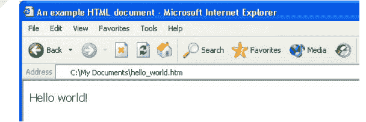

Web 浏览器用于访问和查看已发布到 Web 服务器的 HTML 文档。Web 浏览器首先解释 URL 以识别页面在 Web 上的位置，然后解释 HTML 文档以在浏览器窗口中显示 Web 页面。保存在本地计算机上的 HTML 文档也可以在浏览器中查看。

### 创建 HTML 文档

HTML 文档是纯文本文件，可以使用任何文本编辑器（如记事本）或文字处理器创建。通常，HTML 文档的结构应类似于：

```
<html>
<head>
<title>document title</title>
</head>
<body>
content
</body>
</html>
```

HTML 文档包含成对的标签。

`html`、`head`、`title` 和 `body` 标签称为 *文档标签*：

- `<html>` 标签告诉浏览器该文件包含超文本标记语言。
- `<head>` 标签定义包含有关文档信息的部分，包括其标题。此部分不会作为文档内容的一部分显示。
- `<title>` 标签标记文档标题。标题部分必须在 head 部分内。文档标题应具有描述性和意义，因为它显示在浏览器窗口的标题栏中，并且当用户将文档添加到浏览器的收藏夹列表时也会用到。
- `<body>` 标签定义正文部分，其中包含文档的内容。所有内容必须包含在适当的标签中。例如，在上一页中，内容被标记为段落。

HTML 文档是 *自由格式的*，这意味着空格和空行通常对文档的解释方式没有影响。因此，文档：

```
<html><head><title>An example HTML document</title></head><body> <p>Hello world!</p></body></html>
```

结构不佳的 HTML 文档

与上一页的 HTML 文档显示完全相同。但是，编辑结构不佳的文档可能既耗时又容易出错。

HTML 文档以小写的描述性文件名保存。文件名不应包含任何空格，并且需要添加 .htm 扩展名。如果使用文字处理器保存文件，请务必将文件保存为 TXT 格式。

保存 HTML 文档

提示：在 Internet Explorer 中，可以通过选择“查看” -> “源文件”来查看与显示网页关联的 HTML。

### 验证 HTML

可以在 http://validator.w3.org 网站上验证 HTML 文档，以确保它们符合 W3C 标准。

为了验证 HTML 文档，必须在 HTML 文档的第一行包含 DTD (文档定义标签)。例如，要检查 HTML 文档是否符合 HTML 4.01 标准，请包含标签：

```
<!DOCTYPE HTML PUBLIC "-//W3C//DTD HTML 4.01// EN"
"http://www.w3.org/TR/html4/strict.dtd">
```

提示：为了使 HTML 文档更易于理解，请将文档标签放在单独的行上（标题标签除外），并使用空行分隔 HTML 的各个部分。


### 复习：hello_world.htm

创建一个结构正确的 HTML 文档，显示"My name is *Name*. Hello world!"，将 *Name* 替换为你的名字。包含标题"First HTML Document"。在浏览器中查看该 HTML 文档。

### 复习：计算机病毒网站——第 1 部分（共 6 部分）

创建一个结构正确的 HTML 文档，显示文本"Computer Viruses."。包含标题"Computer Viruses"。将文档保存为 `computer_virus.htm` 并在浏览器中查看该 HTML 文档。

### JavaScript

> Java 与 JavaScript
JavaScript 与 Java 编程语言相似，但它是一种独立的语言。

脚本用于为 HTML 文档添加动态内容，由一系列无需用户交互即可执行的命令组成。脚本使用脚本语言编写，例如 JavaScript。*JavaScript* 是一种由浏览器内置 JavaScript 引擎解释的脚本语言。

在 HTML 文档中，JavaScript 代码以脚本块的形式写在 `<script>` 和 `</script>` 标签之间。脚本通常位于 head 部分，但可以放置在 HTML 文档中的任何位置。使用脚本可以添加到 HTML 文档中的一种动态内容形式是在警告对话框中显示消息：

> 提示 JavaScript 区分大小写。

```
<head>
<title>JavaScript Greeting</title>
<script type="text/javascript">
// Display a greeting
alert("Hello World!");
</script>
</head>
```

> 提示 JavaScript 文件
脚本也可以编写为独立的 JavaScript 文件，保存为 .js 扩展名，然后在 script 标签中引用。

- `script` 标签中的 `type` 属性指定用于定义脚本的脚本语言。
- `//` 用于添加解释脚本的单行注释。
- `alert()` 显示带有指定文本消息的警告对话框。
- 使用分号结束每条 JavaScript 语句。

上述脚本在加载 HTML 文档时进行解释：

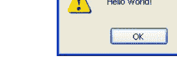

### 复习：welcome.htm

创建一个包含脚本块的 HTML 文档，提示用户输入其全名，然后在警告对话框中显示消息"Welcome to our site *Full Name*"，将 *Full Name* 替换为用户的名字。

### 复习：计算机病毒网站——第 2 部分（共 6 部分）

修改 `computer_virus.htm`，使其包含一个脚本块，在页面加载时提示用户输入名字，然后在警告对话框中显示"Ready to Learn About Computer Viruses *Name*?"，将 *Name* 替换为用户的名字。

### 使用脚本增强网站

静态网站可以通过脚本的动态特性得到增强。例如，可以使用 JavaScript 定义浏览器窗口状态栏中显示的默认消息：

```
<script type="text/javascript">
// Display a status bar message
window.defaultStatus="Hello World";
</script>
```

上述脚本在加载 HTML 文档时进行解释，并在浏览器窗口的状态栏中显示一条消息：


请注意，系统消息具有优先权，例如页面正在加载时。
JavaScript 还可用于在网页上显示当前日期和时间：

```
<head>
<title>JavaScript Current Date</title>
<script type="text/javascript">
// Display the current date
var now = new Date();
document.write(now);
</script>
</head>
```

- 创建一个名为 now 的新日期对象。对象在第 4 章中讨论。
- `document.write` 用于在网页上显示输出：

```
Sat Jan 22 23:16:24 EST 2005
```

Web 应用程序通常根据用户的浏览器、平台以及是否启用 Java 来进行不同的编程显示。可以使用 JavaScript 检测这些设置：

```
<head>
<title>JavaScript Setting Detector</title>
<script type="text/javascript">
// Detect the browser
var browser = navigator.appName;
// Detect the platform
var platform = navigator.platform;
//Detect Java enabled
var JavaCheck = navigator.javaEnabled();
alert(browser +" \n" + platform + " \n" + "Java is enabled: " + JavaCheck);
</script>
</head>
```

- `navigator.appName` 检测浏览器名称。
- `navigator.platform` 检测操作系统。

### 复习：计算机病毒网站——第 3 部分（共 6 部分）

修改 `computer_virus.htm`，在浏览器窗口的状态栏中显示"Computer Viruses"，并在网页的第一行显示当前时间和日期。

### 复习：系统检查——第 1 部分（共 2 部分）

创建一个 HTML 文档，检测浏览器、平台以及浏览器是否启用 Java。在警告对话框中显示输出。

### Java 小程序

> 提示 本部分简要概述 Java 小程序的编写。在更熟悉 Java 编程语言之后，您可能需要重新回顾本部分。

Java 小程序（Java applet）是一种小型 Java 应用程序，嵌入在 HTML 文档中并在浏览器窗口中运行。当浏览器解释包含 Java 小程序的文档时，程序文件会下载到用户的机器上，然后浏览器的 Java 解释器运行该小程序。Java 小程序非常适合 Web，因为它们能够在不同的硬件和不同的平台上运行。小程序是安全的，因为它们无法读取或写入用户计算机上的文件。

可以从 Web 下载大量小程序并嵌入到 HTML 文档中以添加动态内容。小程序有各种形式，例如动画横幅、股票行情带、照片立方体和动画视频片段。也可以创建原创小程序。

### 创建 Java 小程序

> 提示 访问 1p1datafiles.com 获取有关不同 Java 编译器的具体信息。

小程序在 Java 编译器中创建，例如 JCreator。小程序的 Java 代码以 `.java` 扩展名保存，然后进行编译以将 Java 代码转换为字节码。字节码以 `.class` 扩展名保存。

### 坐标

以下代码是一个基本小程序，它在特定屏幕位置绘制消息"My first Java applet"：

```
/*
 * Example_Applet.java
 */

import java.awt.*;
import java.applet.*;

public class Example_Applet extends Applet {

    String message;

    public void init() {
        message="My first Java applet";
    }

    public void paint(Graphics g) {
        g.setColor(Color.blue);
        g.drawString(message, 50, 60);
    }
}
```

> 提示 示例小程序使用了 Applet 类（属于 java.applet 包的一部分）和 Graphics 类（属于 java.awt 包的一部分）。

> 提示 包、类和方法在第 3 章中解释。

屏幕上绘制的图像由一系列像素（图片元素）组成。每个像素映射到一个屏幕位置。屏幕位置使用 (x,y) 值表示。左上角坐标为 (0,0)，x 轴水平运行，y 轴垂直运行。

- 两条 import 语句指示使用了哪些 Java 包。
- 使用一个类来定义小程序并扩展 Applet 类。小程序始终是 Applet 类的扩展。
- `init()` 方法用于将变量初始化为起始值。变量 message 被赋值为文本字符串"My first Java applet"。
- `paint()` 方法用于在屏幕上绘制文本、形状和图形。在此示例中，`paint()` 方法定义了一个名为 g 的 Graphics 对象。
- `setColor()` 方法设置文本颜色。
- `drawString()` 方法在指定的坐标处绘制消息。

Sun 的 Java 软件开发工具包（SDK）包含一个称为 appletviewer 的工具，可用于解释、执行和测试小程序。执行时，上面的示例小程序将显示为：

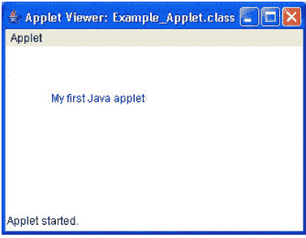


### 绘制图形与添加颜色

可以创建原始小程序来绘制彩色图像。下面的小程序演示了如何绘制和填充图形，以及如何设置背景色和前景色：

```
/*
 * 绘制图形与更改颜色示例
 */
import java.awt.*;
import java.applet.*;

public class Shapes_Color extends Applet {

    public void paint(Graphics g) {
        setBackground (Color.darkGray);
        g.setColor(Color.pink);
        g.drawRect(50, 50, 40, 40);
        g.setColor(Color.blue);
        g.fillRect(100, 100, 150, 150);
        g.setColor(Color.green);
        g.drawLine(20, 20, 300, 20);
        g.setColor(Color.red);
        g.fillOval(250, 250, 50, 50);
    }
}
```

> ## 预定义颜色
>
> 预定义颜色包括黑色 (black)、蓝色 (blue)、青色 (cyan)、灰色 (gray)、深灰色 (darkGray)、浅灰色 (lightGray)、绿色 (green)、品红色 (magenta)、橙色 (orange)、粉红色 (pink)、红色 (red)、白色 (white) 和黄色 (yellow)。

执行后，该小程序看起来类似：

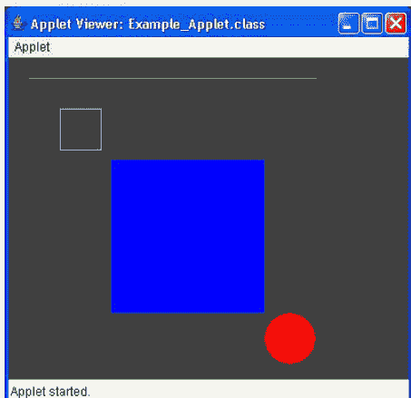

不同的图形需要指定坐标。例如：

- **drawLine (x1, y1, x2, y2)** 从坐标 (x1, y1) 到 (x2, y2) 绘制一条直线。
- **drawOval (x, y, width, height)** 以左上角位于位置 (x, y) 绘制一个椭圆，指定宽度和高度。
- **drawRect (x, y, width, height)** 以左上角位于位置 (x, y) 绘制一个矩形，指定宽度和高度。
- **drawArc (x, y, width, height, startAngle, arcAngle)** 以左上角位于位置 (x, y) 绘制一段圆弧，指定宽度、高度、起始角度和圆弧角度。

### 复习：热气球


本复习需要 Java 编译器。通过创建一个在屏幕上绘制热气球图像的小程序，来尝试绘制图形和添加颜色。编译该小程序并在 appletviewer 中查看它。

### 无障碍访问

为响应 1990 年颁布的《美国残疾人法案》(ADA)，W3C 制定了称为 Web 无障碍倡议 (WAI) 的指南。这些指南要求为网页上的任何非文本内容提供替代文本。

### 将小程序放入 HTML 文档

小程序通过 `<applet>` 和 `</applet>` 标签嵌入到 HTML 文档中。这些标签可以包围一条替代文本消息，当小程序无法在浏览器中运行时，该消息将被显示：

```
<html>

<head>
<title>Embedding an Applet</title>
</head>

<body>
<applet code = "FirstApplet.class" width = "300" height = "60">
You are unable to view the applet.
</applet>
</body>
```

### `<object>` 标签

`<object>` 标签允许将多媒体资源（如视频和音频）嵌入到 HTML 文档中。当浏览器解释 `<object>` 标签时，它会确定是否需要另一个应用程序（如 Windows 媒体播放器）来显示该对象。

`<object>` 标签也可用于使用 Microsoft ActiveX 控件将媒体播放器控制台嵌入 HTML 文档。

`<applet>` 标签有三个必需属性：

- `code="name"` 指定要运行的小程序的名称
- `width="value"` 指定小程序显示的宽度（以像素为单位）
- `height="value"` 指定小程序显示的高度（以像素为单位）

### 小程序参数

*参数* 允许用户指定要在 Java 小程序中使用的自定义值。在 HTML 文档中，参数信息在 `<param>` 标签中指定，该标签需要两个属性：name 和 value。例如，下面的 HTML 文档指定一个特定的图像文件 scenery.gif，用于小程序。

```
<body>
<applet code = "AppletParam.class" width = "300" height = "60">
<param name ="image" value = "scenery.gif">
You are unable to view the applet.
</applet>
</body>
```

> **提示** 通常需要为从 Web 下载的小程序指定参数。

### 复习：系统检查 - 第 2 部分（共 2 部分）

Sun Microsystems 网站 (http://java.sun.com) 上的一个可用小程序是模拟时钟。按如下方式修改 System Check HTML 文档的 body 部分，该文档嵌入了 JavaClock.class 小程序数据文件：

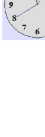

```
<applet code="JavaClock.class" width="150" height="150">
	<param name="bgcolor" value="ffffff">
	<param name="border" value="5">
	<param name="ccolor" value="dddddd">
	<param name="cfont" value="TimesRoman|BOLD|18">
	<param name="delay" value="100">
	<param name="hhcolor" value="0000ff">
	<param name="link" value="http://java.sun.com/">
	<param name="mhcolor" value="00ff00">
	<param name="ncolor" value="000000">
	<param name="nradius" value="80">
	<param name="shcolor" value="ff0000">
</applet>
```

将修改后的 System Check HTML 文档保存在本教材数据文件包含的 CLOCK 网站的 classes 文件夹中。

### HTML 标签

除了小程序和脚本，网页还可以包含文本。例如，考虑以下网页：

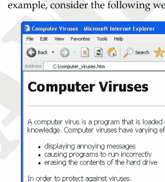

> ## HTML 4
>
> HTML 的当前版本是 HTML 4。较新的浏览器支持 HTML 4。

该网页的 HTML 如下所示。HTML 文档的 body 部分包括内容和格式化内容的标签：

```
<body>
<h1>Computer Viruses</h1>
<hr>
<p>A computer virus is a program that is loaded onto the computer without the user's knowledge. Computer viruses have varying effects, such as:</p>
```

```
<!--creates a bulleted list-->
<ul>
<li>displaying annoying messages</li>
<li>causing programs to run incorrectly</li>
<li>erasing the contents of the hard drive</li>
</ul>
<p>In order to protect against viruses:</p>
<!--creates a numbered list-->
<ol>
<li>install an antivirus program</li>
<li>update antivirus definitions on a regular basis</li>
</ol>
<h4>Report by Student Name</h4>
</body>
```

### 浏览器首选项

与标题标签关联的格式在浏览器之间有所不同，并且取决于用户设置的首选项。

有六个级别的标题，用 `<h1>` 到 `<h6>` 标签表示。标题标签用于强调其包含的文本。每个标题级别都有特定的格式与之关联，包括字体大小、粗体文本以及标题上方和下方的空间。标题 1 的字体最大，用于表示最重要的信息。标题 6 的字体最小。

`<hr>` 标签在浏览器窗口的宽度上放置一条水平线（线）。此功能用于将浏览器窗口中的文本分成多个部分，以便于阅读。水平线标签不需要成对使用。

HTML 标签也可以包含属性。属性放在开始标签中，并设置为一个值以修改该元素。例如，水平线的宽度属性将浏览器窗口中线的宽度指定为百分比，`<hr width="50%">`。`<hr>` 标签的其他属性包括：

- `size="value"` 指定线的厚度（以像素为单位）。
- `align="value"` 指定线的对齐方式。默认对齐方式是居中。

由 `<p>` 和 `</p>` 括起来的文本是一个段落。段落文本行会自动换行，并在每个段落之后添加一个空行。要将段落中的一行文本移动到下一行，使用换行标签 `<br>`。换行标签不需要成对使用。

注释是用于向 HTML 文档的读者解释和阐明 HTML 的文本。它们不会出现在浏览器窗口中。注释以一个尖括号开头，后跟一个感叹号和两个连字符。在注释末尾是另外两个连字符和一个结束括号，`<!--comment-->`。

列表用于组织信息。项目符号列表和编号列表是在 HTML 文档中可以创建的两种列表类型。项目符号列表（也称为无序列表）在每个项目同等重要时使用。编号列表（也称为有序列表）用于显示重要性的优先级。

项目符号列表标签包括：

- `<ul> </ul>` 定义项目符号列表的开始和结束
- `<li> </li>` 定义列表项的开始和结束


### 复习：计算机病毒网站——第 4 部分（共 6 部分）

修改 computer_virus.htm 的 body 部分，使其包含前两页所示的内容和标签。在浏览器中查看该 HTML 文档。

### 超链接、表格和图像

HTML 文档的显示可以通过超链接、表格和图像进一步美化。*表格（Tables）*用于在 HTML 文档中排列数据。注意下面的病毒表格：


网页的 HTML 代码如下所示：

```html
<html>
<head>
<title>Antivirus Program</title>
</head>
<body>
<h2>Checking for Viruses</h2>
<p>A computer can be checked for <a href="computer_virus.htm">viruses</a> using an antivirus program. An antivirus program is a utility that scans a hard disk for viruses. If a virus is located, it will be removed by the antivirus program.</p>
<h2>Example Virus Threats </h2>
<table border="2" width="300" cellpadding="5">
<th>Virus</th>
<th>Threat</th>
<tr><td>Worm MyDoom.p</td>
<td>Low</td></tr>
<tr><td>Worm Blueworm.D</td>
<td>Low</td></tr>
<tr><td>Worm Bagle.AI</td>
<td>Medium</td></tr>
</table>

<h5>Report by: Student Name</h5>
</body>
</html>
```

锚点标签（<a>）用于在 HTML 文档中标记作为链接的文本。href 属性在标签中设置为被链接文档的名称。例如，<a href="digicam.htm">digital cameras</a>。

> **提示** 已访问的超链接通常在浏览器窗口中显示为紫色、带下划线的文本。

*超链接（hyperlink），也称为链接（link），是显示在浏览器窗口中可点击的文本，点击后可在浏览器窗口中显示不同的 HTML 文档。超链接是超文本系统（如万维网）运作的基础。超链接通常在浏览器窗口中显示为蓝色、带下划线的文本。无数文档可以相互链接，使用户能够从一种主题转到另一种主题，或浏览 HTML 文档。*

> **提示** 表格也可用于控制 HTML 文档的布局，方法是将内容放置在表格单元格中，并将 border 属性设置为 0。

表格需要多个标签进行格式化：

- <table> </table> 创建一个表格。
- <th> </th> 创建一个表头，即文本加粗、居中的单元格。
- <tr> </tr> 定义表格行的开始和结束。
- <td> </td> 定义表格数据单元格的开始和结束。

<table> 标签的属性包括：

- border="value" 指定单元格边框的粗细，其中 value 以像素为单位。
- cellpadding="value" 设置表格单元格之间的间距，其中 value 为一个数值。
- width="value" 指定表格的宽度，其中 value 以像素为单位，或占文档宽度的百分比。

### GIF、JPG、PNG
GIF（Graphics Interchange Format，图形交换格式）格式仅限 256 色，最适合用于剪贴画或徽标。JPG（Joint Photographers Experts Group，联合图像专家组）格式支持数百万种颜色，最适合用于照片。PNG（Portable Network Graphic，便携式网络图形）格式是一种较新的格式，仅受较新版本的浏览器支持。

HTML 文档的显示还可以通过图像进行美化。 标签用于插入图像，其中 file name 为图形的文件名。添加到 HTML 文档中的图像文件应为 GIF、JPG 或 PNG 格式。图像标签不需要成对出现。 标签的属性包括：

- border="value" 指定图像周围边框的大小，其中 value 以像素为单位的数值。
- alt="value" 指定图形的替代文本，其中 value 为替代文本。
- height="value" 指定图像的高度（以像素为单位）。
- width="value" 指定图像的宽度（以像素为单位）。

### 复习：计算机病毒网站——第 5 部分（共 6 部分）

修改 `computer_virus.htm`，使文本 "antivirus program" 成为指向名为 `antivirus.htm` 的文档的超链接。使用"超链接、表格和图像"部分 HTML 文档中所示的内容和格式创建 `antivirus.htm` 文档。注意，第一段中的 "viruses" 链接到了 `computer_virus.htm`。VIRUS.gif 图像文件是本文档的数据文件。在浏览器窗口中测试超链接。

### 样式表

*样式表（style sheet）*用于定义 HTML 文档的字体、段落和页面格式。样式表使 HTML 文档具有一致的外观，因为它们会覆盖浏览器解释标签显示方式的设置：

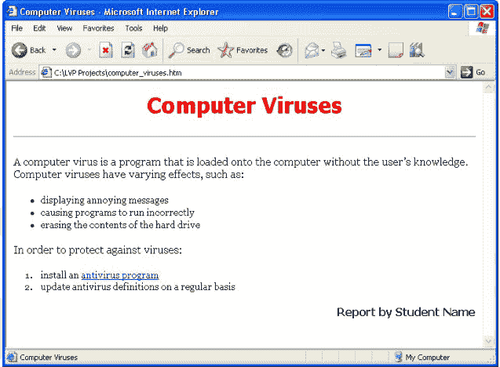

*内嵌样式表*

样式表可以是内嵌的，也可以是链接的。*内嵌样式表（embedded style sheet）*定义在 HTML 文档 head 部分的 `<style type="text/css">` 和 `</style>` 标签内。上述网页的内嵌样式表如下所示：

```css
<!--apply style sheet rules to the document-->
<style type="text/css">
  h1 {color: #FF0000; text-align: center}
  p {font-family: Georgia, "Times New Roman", Times, serif; font-size: 16px; line-height: 18px}
  ul {font-family: Georgia, "Times New Roman", Times, serif;font-size: 14px; line-height: 18px}
  ol {font-family: Georgia, "Times New Roman", Times, serif;font-size: 14px; line-height: 18px}
  h4 {text-align : right}
</style>
```

### 链接样式表

链接样式表是一个单独的文件，扩展名为 .css，使用 <link rel="stylesheet" href="style.css" type="text/css"> 进行应用，其中 style.css 为样式表的名称。

样式表可以包含规则（rules）和类（classes），而链接样式表只能包含规则。规则修改 HTML 元素，由选择器（selector）和声明（declarations）组成。选择器是要重新定义的 HTML 元素，声明是要应用的格式。例如：

```css
p { font-family: Georgia, "Times New Roman", Times, serif; font-size: 16px;}
```

### 样式表规则

上述规则将自动使段落以 16 px Georgia 字体显示。font-family 属性也可以指定为通用字体，如 serif、sans serif 或 monospace，而 font-size 可以定义为点、像素、英寸或厘米（pt、px、in、cm）。

### 类

类是一组可以应用于不同标签的声明。类名以点号（.）开头。例如：

```css
.para_with_space { font-family: Georgia, "Times New Roman", Times, serif; font-size: 14px; line-height: 28px;}
```

### 样式表类

上述类可以应用于单个段落，以 14px Georgia 字体格式化该段落，行高为 28 px。例如：

```html
<p class="para_with_space">Spyware is software that collects information without the users knowledge. The information is usually for advertising purposes.</p>
```

### 十六进制

HTML 文档中的文本和背景颜色使用十六进制数字指定。十六进制是一种以 16 为基数的计数系统，由数字 0 到 9 和字母 A 到 F 组成。颜色常数及其对应的十六进制值包括：

| 黑色（#000000） | 银白色（#CCCCCC） |
|---|---|
| 灰色（#808080） | 白色（#FFFFFF） |
| 栗色（#800000） | 红色（#FF0000） |
| 紫色（#800080） | 紫红色（#FF00FF） |
| 绿色（#008000） | 亮绿色（#00FF00） |
| 橄榄色（#808000） | 黄色（#FFFF00） |
| 藏青色（#000080） | 蓝色（#0000FF） |
| 蓝绿色（#008080） | 青色（#00FFFF） |

### 文本和背景颜色

要更改 HTML 文档的背景和文本颜色，需要在样式表规则中修改 HTML body 元素：

```css
body { background-color: #000000; color: #FFFFFF }
```

要更改所选标签的文本颜色，需要在样式表规则中修改相应的 HTML 元素。例如：

```css
h1 {color: #0000FF}
```

### 文本对齐

HTML 内容默认左对齐。要更改整个 HTML 文档的对齐方式，需要在样式表规则中修改 HTML body 元素：

```css
body { text-align: center }
```

要更改文档某些部分的对齐方式，请修改相应的 HTML 元素。例如，在样式表规则中将 Heading 1 标签修改为右对齐：

```css
h1 {text-align: right}
```

### 复习：计算机病毒网站——第 6 部分（共 6 部分）

修改 computer_virus.htm，使其包含一个内嵌样式表，其中包含以下规则：将 Heading 1 样式设置为红色、居中对齐，Heading 4 样式设置为右对齐。还包括以下规则：将段落格式化为 Georgia、Times New Roman、Times、serif 字体族，字体大小为 16 像素，行高为 18 像素；将无序列表和有序列表标签格式化为 Georgia、Times New Roman、Times、serif 字体族，字体大小为 14 像素，行高为 18 像素。在文档中添加适当的注释。

创建一个链接样式表，其中包含以下规则：将 Heading 1 样式设置为藏青色，Heading 4 样式设置为右对齐。将该样式表链接到 antivirus.htm。在浏览器中查看文档。

## 本章小结

大多数网页都是使用 HTML（HyperText Markup Language，超文本标记语言）和其他代码创建的。HTML 是一种非常适合 Web 的标记语言，因为它支持超文本和多媒体。HTML 使用一组称为标签的代码来"标记"纯文本，以便浏览器应用程序（如 Internet Explorer）知道如何在浏览器窗口中显示该文本。

脚本用于向 HTML 文档添加动态内容。JavaScript 是一种脚本语言，由浏览器内置的 JavaScript 引擎解释执行。在 HTML 文档中，JavaScript 代码以脚本块的形式写在 `<script>` 和 `</script>` 标签之间。

Java 小程序（applet）是一种小型 Java 应用程序，嵌入在 HTML 文档的 `<applet>` 和 `</applet>` 标签内，在浏览器窗口中运行。小程序可以从 Web 下载并嵌入到 HTML 文档中，以添加动态内容。也可以创建原创的小程序。参数允许用户指定自定义值以在 Java 小程序中使用。在 HTML 文档中，参数信息在 `<param>` 标签中指定。


`<html>`、`<head>`、`<title>` 和 `<body>` 标签被称为文档标签。
本章介绍的其他 HTML 标签包括：

-   段落标签 `<p>`
-   换行标签 `<br>`
-   标题标签 `<h1>` 到 `<h6>`
-   水平线标签 `<hr>`
-   无序列表标签 `<ul>`
-   有序列表标签 `<ol>`
-   表格标签 `<table>`
-   图像标签 ``
-   锚点标签 `<a>`
-   注释标签 `<!--comment-->`
-   样式表标签 `<style>`

标签也可以包含属性。属性放置在开始标签中，并设置一个值来修改该元素。

## 词汇表

**属性** 用于修改 HTML 标签中元素特性的值。

**无序列表** 用于每个项目重要性相同时的列表。

**类** 一组可以应用于不同标签的声明。

**注释** 用于向读者解释和阐明 HTML 的文本。

**声明** 样式表规则中要应用的格式。

**文档标签** 指 html、head、title 和 body 标签。

**元素** 放置在尖括号 (`<>`) 内的 HTML 标签部分。例如，`<title>` 称为标题标签，其中 title 是元素。

**内嵌样式表** 在 HTML 文档的 head 部分使用 `<style>` 和 `</style>` 标签定义的样式表。

**自由格式** 空格和空行通常不影响文档的解释方式。这是 HTML 文档的格式。

**十六进制** 一种基数为 16 的编号系统，包含数字 0 到 9 和字母 A 到 F。

**HTML（超文本标记语言）** 一组用于“标记”纯文本的标签，以便浏览器应用程序知道如何显示文本。

**超链接** 可以单击以显示另一个 HTML 文档的文本。也称为链接。

**超文本** 一种数据库系统，其中的对象（如文本和图像）可以相互链接。

**Java 小程序** 一种嵌入在 HTML 文档中并在浏览器窗口中运行的小型 Java 应用程序。

**JavaScript** 一种由浏览器内置 JavaScript 引擎解释的脚本语言。

**链接** *参见* 超链接。

**链接式样式表** 保存为独立文件（扩展名为 `.css`）并使用 `<link>` 标签应用的样式表。

**多媒体** 嵌入在 HTML 文档中的图像、视频、音频和 Java 小程序。

**编号列表** 用于显示重要性优先级的列表。

**有序列表** *参见* 编号列表。

**参数** 用于指定在 Java 小程序中使用的自定义值。

**水平线** 浏览器窗口中用于分隔内容的一条线。

**脚本** 用于向 HTML 文档添加动态内容。脚本使用脚本语言（如 JavaScript）编写。

**选择器** 样式表规则中被重新定义的 HTML 元素。

**样式表** 用于定义 HTML 文档的字体、段落和页面格式。

**表格** 用于在 HTML 文档中排列数据。

**标签** 由尖括号内的元素组成，用于“标记”纯文本，以便浏览器应用程序知道如何显示文本。

**无序列表** *参见* 无序列表。

**Web** 用于搜索和访问互联网上可用信息的工具。

**Web 浏览器应用程序** 提供图形界面以网站形式呈现信息。

**网站** 一系列相关的网页。

### HTML 标签

`<a>` 锚点标签。将文本链接到另一个 HTML 文档。属性包括 href。

`<applet>` 小程序标签。将小程序嵌入 HTML 文档。

`<br>` 换行标签。将段落中的一行文本移至下一行。

`<!--comment-->` 注释标签。向读者解释和阐明 HTML。

`<h1>` 到 `<h6>` 标题标签。强调文本。

`<head>` head 标签。指示关于文档的信息，包括其标题。

`<hr>` 水平线标签。在浏览器窗口中显示一条线。属性包括 width、align 和 size。

`<html>` HTML 标签。指示文件包含 HTML。

`` 图像标签。插入图像。

`<li>` 列表项标签。定义项目的开始和结束。

`<link>` 链接标签。链接样式表。

`<ol>` 有序列表标签。定义编号列表的开始和结束。

`<p>` 段落标签。格式化内容。属性包括 align。

`<script>` 脚本标签。定义脚本。

`<style>` 样式表标签。嵌入样式表。

`<table>` 表格标签。创建表格。

`<title>` 标题标签。在浏览器窗口的标题栏中显示文档标题。必须位于 HTML 文档的 head 部分。

`<ul>` 无序列表标签。定义无序列表的开始和结束。

## 批判性思考

1.  a) 最广泛使用的互联网服务是什么？
    b) 列举两个 Web 浏览器的例子。

2.  a) 用于创建大多数网页的是什么？
    b) 为什么 HTML 非常适合 Web？
    c) 为什么 W3C 制定 Web 标准很重要？

3.  为什么在 HTML 文档中，HTML 标签和内容的顺序很重要？

4.  a) 列出四个文档标签。
    b) 为什么在 HTML 是自由格式语言的情况下，正确构建 HTML 文档很重要？
    c) 保存 HTML 文档时遵循什么规则？

5.  a) 脚本在 HTML 文档中放置在哪里？
    b) 脚本如何增强网站？
    c) 编写一个脚本，在警告对话框中显示“Good-bye”。
    d) 编写一个脚本，在浏览器窗口的状态栏中显示“Today's News”。

6.  a) 什么是 Java 小程序？
    b) Web 浏览器如何解释 Java 小程序？
    c) 列举两个 Java 小程序非常适合 Web 的原因。

7.  以下 HTML 文档有七处错误。它们是什么？

    ```
    <html>
    <body>
    <title>Operating Systems</title>
    </body>

    <head>
    <!--adds a horizontal rule-->
    <hr width is 50%>
    <p>Every computer must have an operat-
    ing system. Types of operating systems
    include:</p>
    <ul>
    <li>Windows<li>
    <li>UNIX</li>
    <li>Linux</li>
    <li>OS/2</li>
    </ul>
    </head>
    </html>
    ```

8.  a) 样式表定义了什么？
    b) 为什么要使用样式表？
    c) 内嵌样式表和链接式样式表有什么区别？

9.  修改哪个元素可以更改网页的背景颜色或对齐方式？

## 判断题

10. 判断以下各项是否正确。如果错误，请解释原因。
    a) 网站由一系列网页组成。
    b) 超文本是一种数据库系统。
    c) HTML 文档必须发布到 Web 服务器才能在 Web 浏览器中查看。
    d) 空格和空行通常不影响 HTML 文档的解释方式。
    e) HTML 文档以 TXT 扩展名保存。
    f) 脚本必须放置在 HTML 文档的 head 部分。
    g) JavaScript 用于向 HTML 文档添加动态内容。
    h) Java 小程序在 Web 服务器上解释。
    i) Java 小程序只能在 Windows 平台上运行。
    j) Java 小程序具有在用户计算机上写入文件的能力。
    k) Java 小程序必须编译。
    l) 锚点标签用于创建超链接。
    m) 水平线修改 HTML 元素。

第 2 章 小程序与 Web 编程

## 练习

### 练习 1 — tourist_attractions.htm

使用互联网、杂志和书籍研究特定城市的旅游景点，然后创建一个列出特定城市旅游景点的 HTML 文档。该 HTML 文档应包括：

-   包含你姓名的注释
-   合适的标题
-   以标题 1 格式显示的城市名称
-   以标题 2 格式显示的“旅游景点”
-   一条水平线
-   至少五个旅游景点，每个都显示在无序列表中
-   一个包含至少三条规则的样式表
-   一个脚本

### 练习 2 — sports_report.htm

创建一个记录近期学校体育相关新闻的 HTML 文档。该 HTML 文档应包括：

-   包含你姓名的注释
-   使用标题标签格式化的合适标题
-   一条水平线
-   至少三条新闻报道
-   一张图片
-   一个包含至少三条规则的样式表
-   一个脚本

### 练习 3 — applet.htm

创建一个“小程序帮助”HTML 文档，记录创建原创小程序或下载小程序并将其嵌入 HTML 文档的步骤。在 HTML 文档上显示一个来自 http://java.sun.com/openstudio/index.html 的原创小程序或已下载小程序的示例。


### 练习 4 ** electronic_portfolio.htm

作品集是工作的集合，清晰地展示了知识、技能方面的努力、进步和成就。电子作品集以数字格式（如网站）存储和展示作品集内容。创建相互链接的 HTML 文档，展示你的联系信息、学术经历、工作和志愿者经历以及成就。

### 练习 5 ** computer_history.htm

通过互联网、杂志和书籍研究计算机历史，然后以小组合作的方式创建相互链接的 HTML 文档，按十年概述计算机历史上的关键事件。请描述 1970 年代、1980 年代、1990 年代和 2000 年代至少五个关键事件。使用样式表来格式化 HTML 文档。

### 练习 6 ** html_reference.htm

创建一个"HTML 参考"文档，列出 HTML 标签，描述该标签，并提供相应的示例。研究并包含至少三个本章未涉及的 HTML 标签。www.w3c.org 网站对 HTML 标签有详细文档。

### 练习 7 ** copyright.htm

研究与数字信息相关的版权法律和问题。以至少两个相互链接的 HTML 文档的形式展示你的研究成果。额外创建一个相互链接的 HTML 文档，使用公认的方法（如 MLA 或 APA 格式）引用所使用的来源。

### 练习 8 ** technology_report.htm

创建一个 HTML 文档，评测最近发布的软件应用程序或硬件设备。列出产品规格和目标市场。包含你个人的观点，说明你认为该产品是否会成功或有实用价值。

### 练习 9 ** interview.htm

采访一位本地的网页程序员，了解他们认为在创建网站时重要的软件、工具和知识。记录你的采访内容。在小组中分享你的采访记录。

## 示例

## 第 3 章

## Java 简介

Java 是由 Sun Microsystems 开发的一种广泛使用的高级编程语言。其广泛使用的原因之一是能够创建*跨平台*应用程序。本章将介绍 Java、OOP 术语、代码约定和程序设计。

### 为什么选择 Java 编程？

> ### 古腾堡印刷机

大约在 1450 年，约翰·古腾堡设计了一种使用铸造金属活字和印刷机的系统，每个活字都可以轻松装填，然后上墨在纸上印出字迹。古腾堡印刷机的关键在于可重复使用的金属活字，可以反复重新组合，以低成本创建书籍和其他印刷材料。这对社会的影响是不可估量的，因为各个社会阶层的人都变得能够识字。

*面向对象编程*（OOP）是为了以系统化、模块化的方式开发复杂程序而演变出来的。OOP 方法允许程序员创建可以在各种程序中反复使用的模块。这些模块将相关的数据以及对数据执行操作的指令组合在一起。设计得当的话，这些模块通过**封装**来隐藏实现细节，通过**继承**来扩展功能，通过**多态性**为程序员提供选择。**封装、继承和多态性是每一种面向对象语言（包括 Java）的特性。**

除了面向对象的特性外，Java 语言还可以用来创建*跨平台应用程序*。跨平台应用程序可以在任何计算机上运行，无论操作系统或硬件配置如何。这些 Java 特性使程序员能够为大众创建程序——类似于古腾堡印刷机革新印刷工艺、使印刷材料普及大众的方式。

### 对象、类和包

> ### 程序规范

程序规范是对程序预期功能的定义或概述。在工业界，程序规范可以作为程序员与客户之间的合同。

面向对象程序开发涉及选择对象来执行程序规范中概述的任务。*对象*由相关的数据以及对数据执行操作的指令组成。对象的设计称为类。*类*定义了与该类的对象相关联的数据类型和操作，但不包括单个对象的实际数据。创建对象需要类。一个应用程序中可能需要多个同一类的对象。

> 提示：可重用性是与面向对象编程相关的术语。

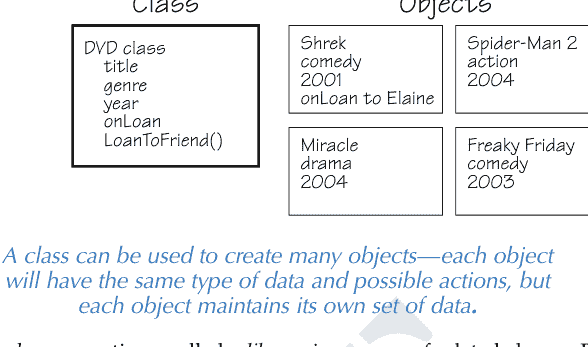

一个类可以用来创建许多对象——每个对象都具有相同类型的数据和可能的操作，但每个对象都维护自己的数据集。

### 包（package）、库（library）

*包*，有时称为*库*，是一组相关的类。例如，与特定任务（如输入和输出）相关的类可以组合在一个包中。

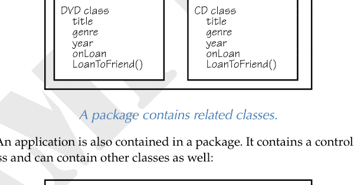

> 包包含相关的类。

应用程序也包含在包中。它包含一个控制类，也可以包含其他类：

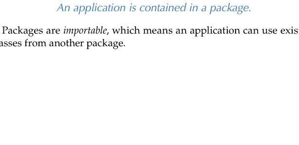

> 应用程序包含在一个包中。

包是可导入的，这意味着应用程序可以使用来自另一个包的现有类。

### Java 应用程序

*Java 应用程序*是一个包，其中至少包含一个带有 `main()` 方法的类。下面的 Greeting 应用程序是一个简单但完整的 Java 程序：

> **文件组织**

应用程序开发需要仔细的组织。通常，应用程序的文件夹名称与包名称相同，而应用程序名称与控制类名称相同。

```
/*
 * Greeting.java
 * A first Java application.
 * A Student
 * Course
 * Date
 */

package firstApplication;

/**
 * The Greeting class displays a greeting.
 */
public class Greeting {     //start class definition

    public static void main(String[] args) {
        System.out.println("Hello, world!");
    }

}                          //end class definition
```

> **提示** `main()` 方法中的 `static void` 表示它是类的方法，并且不返回值。

Greeting 程序生成的输出类似于：

**Hello, world!**

*语句*

程序由一组称为*语句*的指令组成。语句末尾需要分号来表示结束。相关语句由花括号（{ }）括起来，以开始和结束指令。Greeting 应用程序中的语句包括：

- `package firstApplication` 声明包名。如果未声明包名，则编译器会为应用程序赋予 `default` 包名。简单的应用程序通常没有包语句。
- `public class Greeting` 是类声明。该类对任何人可用（`public`），并命名为 Greeting。Greeting 类没有为对象定义任何数据或操作。但是，它包含 `main()` 方法，使其成为应用程序的控制类。控制类是程序的起点。
- `public static void main(String[] args)` 定义 `main()` 方法。方法是执行单一、明确定义任务的命名语句集合。`main()` 方法放在控制类中。当程序执行时，其中的语句会自动运行。此 `main()` 方法中的语句使用 `println()` 方法在系统输出（屏幕）上显示 "Hello, world!"。

*控制类*

*方法*

*注释*

除了语句外，程序还包含*注释*，注释为代码读者提供有关程序的信息。注释对程序没有任何影响，但它们使程序读者能够快速理解代码片段的目的和逻辑。由于复杂的应用程序通常由多个程序员开发和维护，适当注释的代码便于修改，并能减少错误数量。


### Java 注释

Java 程序可以包含三种类型的注释：
- `/* */` 用于包围单行或多行注释。这类注释适用于在程序开头描述应用程序，以及在必要时澄清一段代码。
- `//` 用于在语句末尾添加注释或创建单行注释。`//` 在调试程序时也很有用，这将在后续章节中讨论。
- `/** */` 用于文档编写。javadoc 工具会将这些注释复制到单独的 HTML 文档中，以创建教学手册或外部文档。文档注释适用于描述类或方法。

> **提示** `main()` 方法通常没有注释块。

描述程序、类或方法的多行注释有时被称为*注释块*。贯穿全文的提示将提供关于代码注释的额外指导。

### 执行 Java 应用程序

> **提示** 访问 `lpdatafiles.com` 获取关于不同 Java 编译器的具体信息。

程序员输入的 Java 代码称为*源代码*。源代码要*执行*或*运行*，必须翻译成计算机能理解的代码，这个过程称为*编译*。许多 Java 编译器提供了输入源代码以及编译和运行应用程序的环境。源代码文件的扩展名为 `.java`，而编译后的文件扩展名为 `.class`。

编译后的 Java 源代码称为*字节码*。执行 Java 应用程序意味着其字节码由 *Java 虚拟机*（Java VM）解释执行。*解释器*在读取时逐条运行每条字节码指令。Java VM 可以驻留在任何计算机上，不受操作系统环境的限制，这使得 Java 应用程序具有极强的可移植性、可靠性和平台独立性。

尽管字节码在将应用程序移植到多种不同环境方面非常灵活，但编译为机器码的程序运行速度更快。*机器码*由 1 和 0 组成，且因计算机平台而异。*即时编译器*（JIT）在执行前将字节码转换为机器码，然后再由 Java VM 执行。

包含语法错误的程序将无法编译。*语法错误*是指违反 Java 规则的语句。例如，所有 Java 语句都必须以分号结尾。缺少分号的语句在程序编译时会产生语法错误，阻止编译器为应用程序生成字节码。

> **平台相关**

C++ 和 Visual Basic .NET 等编程语言直接编译为机器语言。虽然速度更快，但这些程序必须为每个运行应用程序的平台重新编译。

> **虚拟机**

*虚拟*意味着不是真实的。因此，虚拟机是概念性的，不是由硬件和其他物理组件构成的。

### 复习：问候

创建一个类似于"Java 应用程序"部分所示的问候应用程序。参考 `www.lpdatafiles.com` 上的在线材料获取关于 Java 编译器的指导。你的老师也可能有关于你使用的编译器的具体信息。本次复习的目标是编写一个简单应用程序的源代码，然后编译并运行该代码。

### 显示输出

*输出流*将数据发送到输出设备。为了处理输出流的数据，Java 提供了 System 类，其中包含用于显示输出的方法。要显示数据到标准输出流（通常是计算机屏幕），请使用 System.out。out 包含 print() 和 println() 方法。这两种方法的区别在于它们控制输出的方式。print() 方法显示数据后，将插入点留在输出末尾，而 println() 在显示输出后将插入点移动到下一行。以下应用程序使用了这两种方法：

```
/**
 * Displays a welcome message.
 */
public class MulticulturalGreeting {

    public static void main(String[] args) {
        System.out.print("Hello");
        System.out.print("Buenos Dias");
        System.out.println("Bonjour");
        System.out.println("How do you greet another?");
    }
}
```

print() 和 println() 方法需要参数。*参数*是传递给方法进行处理的数据。在本例中，print() 和 println() 的参数是字符串。*字符串*是一组字符，由引号包围。

MulticulturalGreeting 产生的输出类似于：

```
HelloBuenos DiasBonjour
How do you greet another?
```

*转义序列*是反斜杠（\）后跟一个符号的组合，共同代表一个字符。转义序列用于显示特殊字符。常见的转义序列包括：

```
\n   换行
\t   制表符（8 个空格）
\\   反斜杠
\"   双引号
```

修改后的 MulticulturalGreeting 展示了转义序列的使用 fabrikam：

```
/**
 * Displays a welcome message.
 */
public class MulticulturalGreeting {

    public static void main(String[] args) {
        System.out.print("Hello\t");
        System.out.print("Buenos Dias\t");
        System.out.println("Bonjour");
        System.out.println("How do you greet another?");
    }
}
```

```
Hello    Buenos Dias     Bonjour
How do you greet another?
```

### 复习：关于我——第 1 部分（共 2 部分）

创建一个 AboutMe 应用程序，显示你的名字和姓氏首字母、老师的名字以及你的学校名称，分三行显示。在个人信息下方，显示一句鼓励你学校队伍的口号。例如，"Go Bears!" 确保口号用引号显示。

### 格式化输出

> **数字输出**

NumberFormat 类（在第 4 章中讨论）也可用于格式化数字数据。

可以使用 format() 方法来代替 print() 或 println() 方法，以控制输出的显示方式。format() 方法的参数包括格式字符串和参数列表。格式字符串包含说明符，指示参数列表中对应的字符串应如何显示。以下代码演示了 format() 方法：

```
System.out.format("%-10s %8s %8s", "Team", "Wins", "Losses\n");
System.out.format("%-10s %8s %8s", "Jaguars", "10", "5\n");
System.out.format("%-10s %8s %8s", "Cheetahs", "14", "1\n");
System.out.format("%-10s %8s %8s", "Panthers", "8", "7\n");
System.out.format("%-10s %8s %8s", "Penguins", "4", "11\n");
```

执行时，这些语句显示：

> **提示** format() 方法是 Java 5 中的新功能，需要 JDK 5。

| Team    | Wins | Losses |
|---------|------|--------|
| Jaguars | 10   | 5      |
| Cheetahs| 14   | 1      |
| Panthers| 8    | 7      |
| Penguins| 4    | 11     |

格式字符串说明符的形式如下：

```
%[对齐][宽度]s
```

- `%` 表示说明符的开始
- `[对齐]` 跳过以右对齐。包含减号（-）表示左对齐
- `[宽度]` 用于输出的字符数
- `s` 表示对应的参数是字符串

如果 `[宽度]` 大于对应字符串参数中的字符数，则输出会用空格填充。超过 `[宽度]` 个字符的字符串会显示，但其右侧的任何字符串都会相应右移。

格式字符串中也可以包含文本。例如，语句：

```
System.out.format("The final game score: %-8s %8s", "10", "5");
```

显示：

```
The final game score: 10    5
```

### 复习：关于我——第 2 部分（共 2 部分）

修改 AboutMe 应用程序，添加你的课程表、上课的星期几以及每节课的开始和结束时间。编写代码将数据正确对齐到三列，其中星期几左对齐，上课开始和结束时间右对齐。

### 代码规范

代码规范是编写应用程序的一组指导原则。这些规范提供了关于注释、方法和类及包的命名规则以及语句格式化的详细信息。正如注释向读者说明代码段的信息一样，遵循特定代码规范的程序更容易阅读和理解。

雇佣程序员的公司或组织通常会遵守特定的代码规范。熟悉代码规范的程序员将更快地熟悉公司内其他程序员编写的代码。代码规范可以使修改和维护代码更快、更容易且成本更低。由于这些好处，组织通常不仅鼓励使用代码规范，而且要求使用。

> **提示** 代码规范非常重要。软件生命周期成本的大约 80% 用于维护。软件很少能由其原作者维护整个生命周期。

本章介绍的代码规范包括：

- 程序应以介绍性注释开头。该注释应包括你的姓名、班级名称、日期以及关于程序的简要说明。
- 包名应以小写字母开头，名称中的每个单词以大写字母开头。包名不能包含空格。
- 类名应为名词，以大写字母开头，名称中的每个单词以大写字母开头。类名不能包含空格。
- 每个类和方法之前应包含注释块。注释块通常不放在 main() 方法之前。
- 注释不应重复代码中已明确的内容。
- 方法中的语句应缩进。
- 左花括号（{）应与类或方法声明放在同一行，右花括号（}）应单独一行，并与类或方法声明对齐。


### 算法设计

程序是为了解决问题而创建的。然而，任何复杂程度的问题都需要在输入任何源代码之前先概述或设计解决方案。一种设计方法称为算法。算法是一组解决问题的步骤。

算法可以通过几种方式创建。通常会实现不止一种方法。用纯英语写出的步骤是一种方法。伪代码是英语和程序代码的混合体，对于细化纯英语算法很有用。流程图使用符号和文本来直观地展示解决方案。

在开发算法时，需要使用对要解决的问题的描述。例如，程序规格说明可能指出“Triangle 应用程序显示一个由星号（*）符号组成的直角三角形。该三角形应为 4 个星号高、4 个星号宽。”Triangle 看起来是一个非常简单的应用程序。根据描述，我们得出结论：Triangle 应该显示一个直角三角形的图像。

分析问题后的下一步是产生算法。在大多数情况下，使用多种方法来生成算法，以确保问题的解决方案是准确的。以下用纯英语步骤和流程图说明了 Triangle 程序：

Triangle 算法的纯英语描述：

1. 将一个星号打印到屏幕上。
2. 将两个星号打印到屏幕上。
3. 将一个星号、一个空格和一个星号打印到屏幕上。
4. 将四个星号打印到屏幕上。

Triangle 流程图：

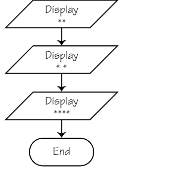

每个流程图符号都有不同的含义。椭圆表示开始或结束。平行四边形表示输入/输出。随着新概念的讲解，其他流程图符号将在整本书中逐步介绍。

### 章节小结

本章介绍了 Java，它是一种面向对象的编程语言。OOP 语言的出现是为了更好地开发复杂的程序。除了面向对象之外，Java 还具有平台独立性。独立于平台的应用程序可以在任何计算机上运行，无论操作系统结构或硬件配置如何。

面向对象的语言使用类来定义对象。类定义了与对象相关的数据类型和操作，但不包含对象的实际数据。包将相关的类分组在一起。

Java 应用程序是一个至少包含一个类的包。应用程序中的语句提供指令。方法是一组命名的语句，执行单一的、定义明确的任务。应用程序中的注释向读者提供有关代码的详细信息。注释可以是单行或多行的，也可以提取出来用于文档编写。

程序员输入的代码称为源代码。源代码通过编译器转换为字节码。当字节码由 Java 虚拟机（Java VM）解释时，程序开始执行。Java VM 可以驻留在任何计算机上。即时（JIT）编译器在 Java VM 执行之前将字节码转换为机器码。虽然可移植性较差，但机器码运行速度更快。如果程序包含错误，它将无法编译。其中一种错误是语法错误，当语句违反 Java 规则时就会产生这种错误。

程序输出通过输出流完成。标准输出流通常是计算机屏幕，需要使用 `System.out` 方法 `print()` 和 `println()`。这些方法需要一个字符串参数。转义序列用于显示特殊字符。输出可以使用 `format()` 方法进行格式化。

代码约定是一组编写应用程序的指导原则。本章介绍的代码约定包括：

- 程序应以介绍性注释开头。该注释应包括您的姓名、班级名称、日期以及关于程序的简要说明。
- 包名应以小写字母开头，然后名称中的每个单词都应以大写字母开头。包名不能包含空格。
- 类名应为名词，以大写字母开头，然后名称中的每个单词都应以大写字母开头。类名不能包含空格。
- 每个类和方法之前都应包含注释块。注释块通常不放在 `main()` 方法之前。
- 注释不应重复代码中已经清楚的信息。
- 方法中的语句应缩进。
- 左花括号（{）应放在与类或方法声明同一行，右花括号（}）应单独放在一行，并与类或方法声明对齐。

程序是为了解决问题而创建的。然而，任何复杂程度的问题都需要在输入任何源代码之前先概述或设计解决方案。一种设计方法称为算法。算法可以通过纯英语写出的步骤、代码和英语混合写出的称为伪代码的步骤，或使用流程图直观展示的步骤来实现。

## 词汇表

**Algorithm（算法）** 一组解决问题的步骤。
**Argument（参数）** 传递给方法进行处理的数据。
**Bytecode（字节码）** 编译后的 Java 源代码。
**Class（类）** 对对象的描述。
**Code conventions（代码约定）** 一组编写应用程序的指导原则。
**Comment（注释）** 向程序代码读者提供信息的文本。
**Comment block（注释块）** 描述程序、类或方法的多行注释。
**Compiling（编译）** 将源代码转换为计算机能理解的代码的过程。
**Controlling class（控制类）** 应用程序中包含 main() 方法的类。
**Encapsulation（封装）** 面向对象语言的特性。
**Escape Sequence（转义序列）** 反斜杠后跟一个符号，共同表示一个字符。
**Execute（执行）** 运行程序。
**Flowchart（流程图）** 算法的可视化表示。
**Importable（可导入的）** 可供应用程序使用的包代码。
**Inheritance（继承）** 面向对象语言的特性。
**Interpreter（解释器）** 运行编译后 Java 程序每条字节码指令的软件。
**Java application（Java 应用程序）** 包含控制类以及可能其他类的包。
**Java Virtual Machine (Java VM)（Java 虚拟机）** Java 字节码解释器。
**Just-in-time compiler (JIT)（即时编译器）** 将字节码转换为特定机器码的软件。
**Library（库）** *见* 包。
**Machine code（机器码）** 最基本的计算机语言，仅由 1 和 0 组成。
**Method（方法）** 一组命名的语句，执行单一的、定义明确的任务。方法始终是类的成员。
**Object（对象）** 一个命名实体，由相关数据和在该数据上执行操作的操作组成。
**Object-oriented programming (OOP)（面向对象编程）** 开发复杂程序的一种系统化、模块化的方法。
**OOP** *见* 面向对象编程。
**Output Stream（输出流）** 将数据发送到输出设备，通常是计算机屏幕。
**Package（包）** 一组相关的类。也称为库。
**Platform-independent application（独立于平台的应用程序）** 可以在任何计算机上运行的程序，无论操作系统或硬件配置如何。
**Polymorphism（多态性）** 面向对象语言的特性。
**Pseudocode（伪代码）** 用英语和程序代码混合写出的算法。
**Run（运行）** *见* 执行。
**Source code（源代码）** 程序员输入的代码。
**Statement（语句）** 程序中的一条指令。
**String（字符串）** 一组字符。
**Syntax error（语法错误）** 违反 Java 规则的语句。

第 3 章 Java 入门

69

## Java

`/* */` 用于包围单行或多行注释。
`/** */` 用于包围文档注释。
`//` 用于开始单行注释。
`{ }` 用于开始和结束一组相关语句。
`;` 每条程序语句末尾必需。
`\` 用于显示反斜杠的转义序列。
`"` 用于显示双引号的转义序列。
`\n` 用于显示换行符的转义序列。
`\t` 用于显示制表符的转义序列。
`class` 用于声明类。
`format()` 将更精确格式化的输出显示到屏幕的方法。
`java.lang.System` 包含 `out` 成员的类。
`main()` 控制类中的方法，在运行 Java 应用程序时自动执行。
`out` 表示标准输出流的 `java.lang.System` 成员。
`package` 用于声明包的语句。
`print()` 将输出显示到屏幕的方法。
`println()` 将输出显示到屏幕，然后将插入点移到下一行的方法。
`public` 将类或方法声明为对任何代码可用的访问修饰符。
`static` 用于类方法的声明。
`void` 表示方法不返回值。


## 批判性思维

1. a) 列出每种面向对象编程语言的三个特点。
   b) 用自己的话解释你在(a)部分列出的每个特点的含义。

2. 绘制一个草图，展示包`File`、类`FileReader`和对象`fileInput`之间的对象、类和包的关系，和/或层次结构。

3. 为一个旨在计算测试平均分的程序开头，编写一个合适的注释块。

4. 编写一个合适的注释来描述一个显示一组分数平均值的类。

5. 编写一个声明包`gradeCalculator`的语句。

6. 编写一个声明名为`AverageScore`的类的语句，该类可被任何代码访问。

7. 解释源代码和字节码之间的区别。

8. 描述机器码。

9. 解释Java编译器和Java虚拟机之间的区别。

10. 使用JIT编译Java源代码的优势是什么？

11. 以下应用程序有七处语法错误。它们是什么？

```
//
 * Test.java
 * What's wrong application.
 * Student Name
 */

package testMyKnowledge;

/**
 * The Test class should display a string,
 */
public class Test {
    private static int main(string[] args) {
        System.out.println("Testing..."
    }
}
```

12. 解释`print()`和`println()`方法之间的区别。

13. 解释使用`format()`方法替代`print()`和`println()`方法的优势。

14. 以下应用程序有五处不符合本章概述的代码规范。它们在哪里？

```
/*
 * getGreeting.java
 * What's wrong application.
 * Student Name
 */

package notSoGood;

/**
 * Good Morning is displayed.
 */
public class getGreeting {
    public static void main(String[] args) {
        //Output Good Morning to the screen
        System.out.println("Good Morning");
    }
}
```

15. 解释伪代码和流程图之间的异同。

## 判断正误

16. 判断以下各项是否正确。如果错误，请解释原因。
    a) Java应用程序只能在Windows平台上运行。
    b) 语句必须以分号结束。
    c) 注释对程序执行没有影响。
    d) `main()`方法放置在控制类中。
    e) 相关语句用方括号（`[]`）括起来。
    f) 仅包含源代码的文件可以在计算机上执行。
    g) 编译后的源代码称为机器码。
    h) 包含语法错误的程序可以编译。
    i) 算法是一组描述如何解决问题的步骤。
    j) 伪代码不能用来实现算法。

## 练习

### 练习 1 宾果卡

创建一个`BingoCard`应用程序，显示一张传统的宾果卡，包含五列，每列五个不同的数字。列标签为B、I、N、G和O。B列包含1到15的数字，I列包含16到30的数字，N列包含31到45的四个数字，中间是一个“自由空间”，G列包含46到60的数字，O列包含61到75的数字。应用程序输出应类似于：

| B | I | N | G | O |
|---|---|---|---|---|
| 2 | 20 | 42 | 60 | 64 |
| 14 | 25 | 32 | 55 | 70 |
| 5 | 18 | FREE | 53 | 67 |
| 12 | 16 | 31 | 46 | 75 |
| 10 | 22 | 39 | 59 | 71 |

### 练习 2 宾果规则

创建一个`BingoRules`应用程序，显示玩宾果游戏的规则。将每条规则放在单独的一行，并在规则之间留一个空行。应用程序输出应类似于：

宾果卡

1.  叫号者随机抽取一个编号的宾果球。

2.  该数字被放置在宾果板上并叫出。

3.  玩家在宾果卡上查找被叫出的数字。

4.  如果找到该数字，则将其标记掉。

5.  重复步骤1到4，直到有玩家匹配BINGO模式。

6.  获胜玩家喊出BINGO。

### 练习 3 矩形

创建一个`Rectangle`应用程序，显示一个由星号（*）组成的矩形。矩形应为15个星号宽，7个星号高。应用程序输出应类似于：

```
***************
*
*
*
*
*
***************
```

### 练习 4 石头剪刀布规则

创建一个`RockPaperScissorsRules`应用程序，显示玩石头剪刀布游戏的规则。将每条规则放在单独的一行，并在规则之间留一个空行。应用程序输出应类似于：

```
石头剪刀布规则

玩家决定使用不同的手势来表示
石头、剪刀和布。

玩家同时出拳。

玩家出的手势随后根据游戏规则
进行比较以确定获胜者：

    石头钝剪刀（石头赢）。

    剪刀剪布（剪刀赢）。

    布包石头（布赢）。
```

### 练习 5 井字棋棋盘

创建一个`TicTacToeBoard`应用程序，显示一个井字棋棋盘，中心有一个X。应用程序输出应类似于：

```
      |      |     
      |      |     
-------------------
      |      |     
      |  X   |     
-------------------
      |      |     
      |      |     
```

### 练习 6 井字棋规则

创建一个`TicTacToeRules`应用程序，显示玩井字棋游戏的规则。将每条规则放在单独的一行，并在规则之间留一个空行。应用程序输出应类似于：

```
井字棋规则

井字棋是两人游戏。

1.  画一个9个方格的网格。

2.  第一个玩家在一个空方格中画一个X。

3.  第二个玩家在一个空方格中画一个O。

4.  重复步骤2和3，直到创建出井字模式：

    模式可以是对角线、水平线或垂直线。

5.  通过在模式上画一条线来完成获胜模式。
```

### 练习 7 笑脸

创建一个`Smile`应用程序，显示一个由键盘字符组成的笑脸。应用程序输出应类似于：

```
*****
*   *
* o o *
*  !  *
*  +  *
* \_/ *
*   *
*****
```

### 练习 8 Java术语

创建一个`JavaTerminology`应用程序，显示本章词汇表中至少五个单词及其对应的定义。将每个单词放在单独的一行，后面跟着定义。在条目之间留一个空行。应用程序输出应类似于：

```
Java术语
方法：
执行单个、明确定义任务的一组命名语句。
语句：
程序中的一个指令。
```

### 练习 9 流程图符号

创建一个`FlowchartSymbols`应用程序，说明本章介绍的两个流程图符号。应用程序输出应类似于：

```
流程图符号
起始或结束符号：
********
*      *
*      *
*      *
********
输入/输出符号：
********
*      *
*      *
********
```

### 练习 10 编译器文档

创建一个`CompilerDocumentation`应用程序，为你的课程中将使用的编译器创建特定于编译器的文档。

a) 在“编译器”右侧添加编译器名称，然后解释如何创建新项目、输入源代码、编译和运行Java应用程序，使用类似于以下的格式：

**编译器：**

**创建新项目的步骤：**

**编译项目：**

**运行项目：**

b) 探索编译器的帮助功能。添加解释如何使用编译器帮助功能的文档。

### 练习 11 二进制数

如第1章所述，计算机是数字化的，它们识别两种状态：开和关。因此，二进制数系统（基数为2）被采用在计算机中使用，它只使用两个数字（0和1）。我们最熟悉的数系统是十进制，或基数为10的系统。它使用十个数字：0到9。

a) 创建一个`BinaryNumbers`应用程序，说明二进制数1到20及其十进制等效值。参考第1章的转换公式，或者如果你有Windows操作系统，可以使用Microsoft计算器（位于**开始 → 所有程序 → 附件**菜单中）来转换数字。在Microsoft计算器中，选择**查看 → 科学**，然后输入数字并选择**Bin**来转换十进制（Dec）数字：

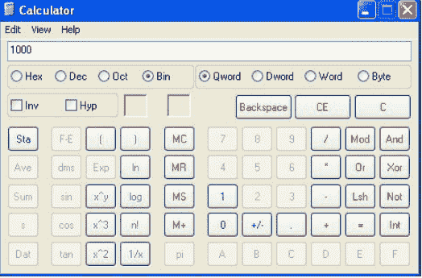


应用程序的输出应类似于：

```
Decimal    Binary
   1          1
   2          10
   3          11
   4         100
   ...
   ...
   20        10100
```

b) 十六进制或称为16进制系统基于16个数字：0到9，以及代表10到15的字母A到F。修改 BinaryNumbers 应用程序，添加一个“十六进制”列，其中包含对应的十六进制数字。

## 练习 12 编程语言

a) 创建一个 ProgrammingLanguages 应用程序，显示有关面向对象编程语言的信息。应用程序的输出应类似于：

```
Object-Oriented Programming Languages
Java is an object-oriented programming language.
Other object-oriented languages include:
    C++
    Smalltalk
```

b) 使用书籍和互联网研究其他面向对象编程语言，并向列表中添加三种额外的面向对象编程语言。

## 第4章 变量与常量

**变量**和**常量**是本章讲解的两个重要概念。本章涵盖了使用原始和抽象数据类型来声明变量。同时讨论了用户输入、数值表达式和赋值运算符。

## 声明变量

*变量*是存储在内存中的值的名称。变量在程序中使用，以便用有意义的名称来表示值。例如，当程序中使用名为 `length` 的变量时，很明显其值代表一个距离。应该使用变量来表示值，因为它们使代码更易于阅读、理解和修改。

**声明** 变量在使用前必须先声明。*声明*采用以下形式：

`<类型> <名称>`

**数据类型** 声明包含两部分。第一部分是*数据类型*，它决定了变量将存储的数据类型。声明的第二部分是变量名，称为*标识符*。例如，在声明中

`int length;`

`int` 是数据类型，`length` 是标识符。`int` 存储一个整数值，即正或负的整数。当声明一个整数变量时，它存储的值为0。

标识符必须以字母开头，并且只能包含字母、数字和一些特殊字符。通常，变量标识符以小写字母开头。变量标识符中第一个单词之后的任何单词都应以大写字母开头。例如，`rectangleLength`。这种代码惯例使得变量易于识别。

可以在单条语句中声明多个相同数据类型的变量，类似于：

`int length, width;`

当变量代表相关项时，将变量分组在单条语句中是良好的编程风格。不应该仅仅因为变量都是相同类型而将声明分组在同一条语句中。

## 使用变量

应用程序通常包含许多变量，如 RectangleArea 示例：

```
/**
 * 计算并显示矩形的面积
 */
public class RectangleArea {

    public static void main(String[] args) {
        int length = 10;    // 矩形的长边
        int width = 2;       // 矩形的短边
        int area;            // 计算出的矩形面积

        area = length * width;
        System.out.println("矩形的面积: " + area);
    }
}
```

RectangleArea 产生的输出类似于：

```
矩形的面积: 20
```

变量声明应在方法开头分组。声明后的空行可以很容易地确定声明结束的位置。

**赋值** 变量的值通过*赋值*来更改。*赋值语句*由等号左边的变量名和等号右边要接收的值组成。*等号*（=）是一个运算符，表示左边的变量将接收右边的值。右边的值可以是*字面量*，即任何实际值。它也可以是另一个变量或表达式。例如，`area` 被赋予了长度乘以宽度（`length * width`）的值。请注意，`*` 符号表示乘法。

**初始化** 赋值语句可以作为变量声明的一部分。除了被声明外，变量也被*初始化*。例如，在 `RectangleArea` 中，变量 `length` 和 `width` 在声明时就被赋值。

`System.out.println()` 语句可用于输出变量的值。变量标识符不用引号括起来。要将变量的值追加或*连接*到字符串，可以使用 `+` 运算符。`+` 运算符将变量的值转换为字符串，然后在输出前连接这些字符串。

重要的是要认识到，一个变量在任何时候只能存储一个值。例如，执行以下语句后

```
int x;
x = 5;
x = 10;
```

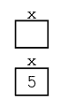

x 的值是 10，因为这是最后赋给 x 的值。

## 复习：RectanglePerimeter

创建一个 RectanglePerimeter 应用程序，计算并显示一个宽度为4、长度为13的矩形的周长。矩形的周长计算公式为 2w + 2l。适当地使用变量。

## 字符串数据

字符串由一组字符组成，因此不能用原始数据类型表示。java.lang 包中的 String 类用于创建字符串变量。第6章将更详细地讨论字符串。

## 原始数据类型

int 数据类型被称为原始数据类型。使用原始数据类型定义的变量存储单个数据。Java 支持多种原始数据类型，包括：

| 类型 | 字节 | 数据范围 |
| --- | --- | --- |
| int | 4 | 从 -2,147,483,648 到 2,147,483,647 的正或负整数 |
| double | 8 | 范围在 -1.7E+308 到 1.7E+308 之间，可能包含小数部分的正或负数 |
| char | 2 | 单个字符 |
| boolean | | true 或 false |

int 变量使用 4 字节的内存来存储其值，用于表示整数。

由 double 数据类型表示的值有时被称为浮点数，意味着这些值包含小数点后的数字。由于 double 中可能包含许多数字，因此这种类型的变量使用 8 字节的内存。

char 变量需要 2 字节的内存，因为 Java 使用 16 位 Unicode 字符编码。给 char 变量赋值时，需要将单个字符用单引号括起来，如 'a'。

boolean 类型的变量只能有两个值之一——true 或 false。布尔变量对于表示是/否或开/关值特别有用。

在选择数据类型时，为要表示的量选择最合适的类型非常重要。如果值可能包含小数部分，那么 double 是最佳选择。如果变量只表示整数，那么即使 double 可以工作，int 也是最佳选择。为变量使用最合适的数据类型有两个好处。首先，编译器和读者都能理解该值可能的取值范围。其次，编译器为变量分配适当的内存。

## 复习：距离——第1部分（共2部分）

创建一个 Distance 应用程序，计算并显示一场包含三个赛段的比赛的总距离。第一段是 12.2 公里，第二段是 10.6 公里，第三段是 5.8 公里。使用适当类型的变量。

第4章 变量与常量

u

## 抽象数据类型

除了原始数据类型外，变量还可以使用抽象数据类型来声明。一种*抽象数据类型*是类。Java 中提供了许多类，并且在本课程中还会创建更多类。每个类不仅定义像原始数据类型那样的单个数据，还定义一组数据以及用于在该数据上执行操作的方法。

**对象**

用类声明的变量称为*对象*。变量本身实际上存储一个引用，指向内存中存储对象数据和方法的区域：

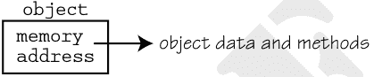

**实例化**

创建一个新对象称为*实例化*。除了声明一个变量来引用该对象外，还必须在一个语句中创建并初始化该对象，该语句采用以下形式：

```
<class> <variable name> = new <class>(<arguments>);
```

`new` 运算符为对象分配内存并返回一个指向该对象的引用。`<arguments>` 用于初始化对象的数据。

下面的代码创建一个使用名为 Circle 的类的新对象：

```
Circle spot = new Circle(4);  // 半径为4的圆点
```

在此语句中，变量 `spot` 引用一个已初始化为半径为 4 的 Circle 对象。

要访问类的成员（如方法），请使用对象名称后跟一个点（.），然后是成员名称。例如，下面的代码执行方法成员 getRadius() 和 area()：

```
Circle spot = new Circle(4);
System.out.println("spot 的半径是 " + spot.getRadius());
System.out.println("spot 的面积是 " + spot.area());
```

这些语句产生的输出类似于：

```
spot 的半径是 4.0
spot 的面积是 50.24
```

Circle 类将在本课程后面的部分中开发。

> ### 包文档

包文档通常总结包中的类以及这些类中可用的数据和方法。使用这些类的代码示例也可能包含在文档中。Java 包的文档可在 www.sun.com 上在线获取。

## Java 包

Java 包含许多作为 Java 运行时环境（JRE）一部分的包。这些包包含通用类、实用工具类或特殊用途类。最基本的包是 java.lang，其中包含定义语言本身的类。其他包如 java.util 包含用于读取输入和生成随机数的类。这些包将在本课程中进行解释和使用。


> 提示

公司有时会在包名中使用其反转的互联网域名。例如，`com.myjava.util` 表示一个包含实用工具类的包。

包遵循特定的命名规范。Java 包以 `java` 开头，后跟一个点 (`.`) 和包名。公司和其他组织通常会使用组织名称作为包名的前缀，后跟一个点和包名。

`import` 语句用于使包的成员可供应用程序访问。要使包中的单个类可访问，使用类似以下的语句：

```
import java.util.Scanner;
```

类名以大写字母开头，遵循类名的适当命名规范。如果要访问包中的多个类，则可以使用导入整个包的语句：

```
import java.util.*;
```

星号 (`*`) 表示 `util` 包的所有成员都将可访问。`import` 语句必须出现在 `package` 语句之后、任何类定义之前。Java 应用程序会自动导入整个 `java.lang` 包。

## 从用户获取值

当应用程序可以从输入流读取值时，它会更加灵活。输入流是从输入设备（如键盘）接收的字符序列。例如，当用户输入数据时，数据会进入输入流。为了处理输入流中的数据，Java 包含了 `Scanner` 类，其方法可用于读取整数、浮点数和字符串。

从用户获取值的程序必须实例化一个 `Scanner` 对象，并使用输入流进行初始化。对于从键盘输入的数据，应使用 `System.in` 初始化对象，因为它代表标准输入流。

`Scanner` 类的方法包括：

```
类 Scanner (java.util.Scanner)

方法
next()    从输入流返回一个字符串。
nextLine()  从输入流返回到行尾的字符串。
nextInt()   返回从输入流读取的 int 值。
nextDouble()  返回从输入流读取的 double 值。
nextBoolean() 返回从输入流读取的 boolean 值。
close()    关闭输入流。
```

`next()` 方法用于读取不含空格的字符串，例如 "apple"。尝试读取字符串 "apple pie" 会生成一个名为 `InputMismatchException` 的运行时异常。异常是影响程序执行的错误。本章稍后将讨论异常。

当读取数字和字符串数据的组合时，在读取数字数据后，应使用 `next()` 方法读取字符串数据。使用 `nextLine()` 方法是无效的。它会读取数字数据输入后留下的换行符，本质上读取的是一个空字符串。如果期望用户输入包含多个单词的字符串，可以先使用 `nextLine()` 读取换行符，然后再使用另一个 `nextLine()` 来读取字符串。

下面的 `RectangleArea2` 类实例化了一个 `Scanner` 对象，并读取用户键入的值：

```
import java.util.Scanner;

/**
 * 根据用户输入的宽度和长度，计算并显示矩形的面积。
 */
public class RectangleArea2 {

    public static void main(String[] args) {
        int length;    // 矩形的长边
        int width;     // 矩形的短边
        int area;      // 计算出的矩形面积
        Scanner input = new Scanner(System.in);

        System.out.print("Enter the length: ");
        length = input.nextInt();
        System.out.print("Enter the width: ");
        width = input.nextInt();
        input.close();

        area = length * width;
        System.out.println("Area of rectangle: " + area);
    }
}
```

注意 `import` 语句出现在类的上方。当用户输入 6 和 2 时，`RectangleArea2` 会产生类似以下的输出：

```
Enter the length: 6
Enter the width: 2
Area of rectangle: 12
```

在 `RectangleArea2` 代码中，`Scanner` 对象在语句 `Scanner input = new Scanner(System.in);` 中被声明、实例化和初始化。对 `nextInt()` 方法的调用用于获取用户键入的值。当调用 `nextInt()` 时，应用程序会等待用户输入一个值并按回车键，然后才执行下一条语句。

应用程序还包括提示信息，告诉用户期望什么类型的输入。例如，`System.out.print("Enter the length: ")` 提示用户输入长度值。当不再需要 `Scanner` 对象时，应使用 `close()` 方法将其关闭。

## 复习：距离 – 第 2 部分（共 2 部分）

修改 Distance 应用程序，使其首先提示用户输入每个赛段的距离，然后提示用户输入跑步者的姓名。应用程序应显示跑步者的姓名和需要跑的总距离。

## 数值表达式

Java 包含用于加法 (`+`)、减法 (`-`)、乘法 (`*`)、除法 (`/`) 和取模运算 (`%`) 的内置算术运算符。这些运算符用于基本数据类型，并可用于构成数值表达式。*数值表达式*包含至少一个操作数（一个值或基本变量），并可能包含运算符。例如，数值表达式 `6 + 5` 包含两个操作数和一个运算符。数值表达式可用于赋值语句中，如语句 `area = length * width`。

> **对象运算符**
对象通常不能使用内置的算术运算符进行操作。类通常定义用于对对象执行操作的方法。

除法运算符 `/` 根据操作数的数据类型表现不同。当两个操作数都是 `int` 类型时，`/` 运算符执行*整数除法*。整数除法会截断商的小数部分，结果为一个整数：

整数除法

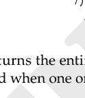

实数除法返回完整的商（包括小数部分），当一个或两个操作数为 `double` 类型时执行。

取模除法

*取模除法*返回除法运算的余数。`%` 运算符会根据需要截断操作数以返回整数：

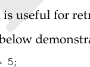

取模除法对于获取数字的各位数字很有用。

下面的语句演示了除法运算符：

```
int num1 = 5;
int num2 = 3;
int result;
double doubleNum1 = 5;
double doubleNum2 = 3;
double doubleResult;

result = num1 / num2;
System.out.println("num1 / num2: " + result);

doubleResult = doubleNum1 / doubleNum2;
System.out.println("doubleNum1 / doubleNum2: " + doubleResult);

doubleResult = num1 / doubleNum2;
System.out.println("num1 / doubleNum2: " + doubleResult);

result = num1 % num2;
System.out.println("num1 % num2: " + result);

doubleResult = doubleNum1 % doubleNum2;
System.out.println("doubleNum1 % doubleNum2: " + doubleResult);
```

执行上一页的语句会产生以下输出：

```
num1 / num2: 1
doubleNum1 / doubleNum2: 1.6666666666666667
num1 / doubleNum2: 1.6666666666666667
num1 % num2: 2
doubleNum1 % doubleNum2: 2
```

Java 使用基于运算符优先级的特定操作顺序来计算表达式。*运算符优先级*是分配给运算符的等级。乘法和除法（包括取模除法）具有最高优先级，其次是加法和减法。相同优先级的两个运算符从左到右依次计算。

可以通过在数值表达式中包含括号来更改操作顺序。括号内的操作首先计算。例如，表达式 `6 + 4 * 2 – 1` 的计算结果为 13，而表达式 `(6 + 4) * (2 – 1)` 的计算结果为 10。当表达式存在任何歧义或疑问时，包含括号也被认为是良好的编程风格。

## 复习：数字

创建一个 Digits 应用程序，提示用户输入一个两位数，然后显示个位和十位数字。

## 类型转换

*类型转换*将一种类型的数字转换为另一种兼容类型的数字。例如，`double` 可以转换为 `int`，如以下语句所示：

```
int i = 2;
double d = 3.7;
int x;
x = i * (int)d    // d 被显式转换；x 被赋值为 2x3
```

在这种情况下，类型转换是必要的，因为表达式中的一个操作数的精度低于存储结果的变量。显式转换也清楚地表明程序员打算让计算结果为 `int` 类型。

将 `double` 转换为 `int` 会*截断*（或移除）数字的小数部分，如上所述。当降低数字的精度时，最好进行四舍五入。小数部分大于或等于 0.5 的数字应向上舍入到下一个整数，小于 0.5 的数字应向下舍入。例如，将 3.7 四舍五入得到 4。

> 提示
> 截断总是趋向于 0。


 ## 舍入

在将 double 类型强制转换为 int 类型时，可以通过在转换前给该数值加上 0.5 来模拟舍入，如下列语句所示：

```
x = i * (int)(d + 0.5)   //x 被赋值为 2x4
```

如果要转换的是负数，则应在转换前从该数值减去 0.5。

## 实数除法

当需要用整数进行实数除法时，强制类型转换非常有用。以下语句展示了整数除法与使用整数进行实数除法之间的区别：

```
int i = 5;
int j = 2;
double result;

result = i / j;                   //整数除法；result=2
result = (double)i / (double)j;   //实数除法；result=2.5
```

Java 会在混合表达式中隐式地将操作数强制转换，以匹配存储结果的变量的精度，如下列语句所示：

```
int i = 2;
double d = 3.7;
double y;

y = i * d    //i 被隐式转换；y 被赋值为 2.0x3.7
```

尽管在这种情况下显式类型转换不是必需的，但包含强制转换是更好的编程风格。强制转换能使程序员的意图更加清晰，也有助于更容易地发现错误。因此，上面的语句应该写成：

```
int i = 2;
double d = 3.7;
double y;

y = (double)i * d    //更好的代码；y 被赋值为 2.0x3.7
```

## 复习：GradeAvg——第 1 部分（共 2 部分）

创建一个 GradeAvg 应用程序，提示用户输入五个成绩，然后显示这些成绩的平均值。假设成绩都是整数值（例如，89、97 等）。在计算平均值时应使用实数除法。

## 复习：TempConverter

创建一个 TempConverter 应用程序，将华氏温度转换为相应的摄氏温度。华氏度转摄氏度的公式为 C = 5/9(F – 32)。该应用程序应提示用户输入华氏温度。请务必仔细构造表达式。需要使用括号来指定运算顺序。

## 格式化数字输出

*java.text*

NumberFormat 类是 java.text 包的一部分，用于创建格式化数字的对象。NumberFormat 对象返回包含格式化数字的字符串。数字的格式取决于使用了哪个 NumberFormat 对象。NumberFormatExample 应用程序创建了四种不同的 NumberFormat 对象：

```
import java.text.NumberFormat;

public class NumberFormatExample {

    public static void main(String[] args) {
        double dollars = 21.5;
        int num = 1234;
        double numWithDecimal = 2.0 / 3.0;
        double sale = .15;
        NumberFormat money = NumberFormat.getCurrencyInstance();
        NumberFormat number = NumberFormat.getIntegerInstance();
        NumberFormat decimal = NumberFormat.getNumberInstance();
        NumberFormat percent = NumberFormat.getPercentInstance();

        System.out.println(money.format(dollars));
        System.out.println(number.format(num));
        System.out.println(decimal.format(numWithDecimal));
        System.out.println(percent.format(sale));
    }
}
```

执行时，该应用程序产生以下输出：

```
$21.50
1,234
0.667
15%
```

## DecimalFormat 类

DecimalFormat 类提供了更多选项，用于将数字格式化为指定的小数位数。更多信息请参阅 Java 在线文档。

## format() 方法

第 3 章讨论过的 format() 方法也可用于格式化数值。格式说明符可以采用以下形式：

```
%[对齐][宽度][.小数]f
```

其中 [.小数] 表示小数位数，**f** 表示浮点数。对于整数，说明符采用以下形式：

```
%[对齐][宽度]d
```

## 赋值运算符

在赋值语句中，等号 (=) 右侧的表达式先被求值，然后将该值赋给左侧的变量。由于右侧的表达式在赋值之前就被求值，因此可以在表达式本身中使用变量的当前值。例如：

```
numPlayers = 12;              //numPlayers 被赋值为 12
numPlayers = numPlayers + 2;  //numPlayers 现在为 14
```

基于变量的当前值来更改该值在编程中经常用到。因此，除了 = 赋值运算符外，Java 还支持 +=、-=、*= /= 和 %= 赋值运算符。这些运算符在执行赋值前先进行运算。例如，前面的赋值语句可以重写为：

```
numPlayers += 2;    //numPlayers 现在为 14
```

-=、*=、/= 和 %= 运算符的工作方式类似，如下列语句所示：

```
numPlayers -= 3;       //等同于：numPlayers = numPlayers - 3
numCopies *= 5;        //等同于：numCopies = numCopies * 5
total /= 2;            //等同于：total = total / 2
remainder %= 6;        //等同于：remainder = remainder % 6
```

## 复习：GradeAvg——第 2 部分（共 2 部分）

修改 GradeAvg 应用程序，使用 += 运算符在用户输入成绩时累加成绩。将平均成绩格式化为百分比显示。

## 使用命名常量

> **什么时候应该使用命名常量？**

命名常量应在能够增加代码清晰度的任何地方使用。然而，有些值不应该用命名常量替换。例如，在计算三角形面积 (½bh) 的表达式中，最好直接使用值 .5 而不是命名常量，因为该值没有明显的名称。

*常量*是存储初始赋值后不能更改的值的内存位置的名称。常量与变量一样，在程序中用于使值能够用有意义的名称表示。常量声明是使用 `final` 声明的变量，形式如下：

```
final <类型> <标识符>
```

声明以 `final` 开头，表示该值不会改变，后跟常量将存储的数据类型和常量标识符。例如，以下声明表示 π：

```
final double PI = 3.14;
```

`double` 声明可能包含小数部分的数值。常量标识符通常全部大写，并且可以包含下划线 (_) 字符来分隔单词。例如，`MAX_PRICE`。

以下类在 main() 方法中使用了常量：

```
/**
 * 计算并显示圆的面积
 */
public class CircleArea {

    public static void main(String[] args) {
        final double PI = 3.14;
        double radius = 5;    //圆的半径
        double area;

        area = PI * radius * radius;
        System.out.println("Area of circle: " + area);
    }
}
```

CircleArea 产生类似如下的输出：

```
Area of circle: 78.5
```

常量只能被赋值一次。在初始赋值后尝试更改常量的值会产生错误。常量声明应分组放在方法的开头，在任何变量声明之前。

## 标识符和关键字

Java 中的标识符必须以字母开头，可以包含字母、数字和一些特殊符号。不允许使用句点和空格。标识符也是*区分大小写*的，这意味着大写字母与相同字母的小写形式不同。例如，标识符 `Count` 和 `count` 在 Java 中被视为两个不同的标识符。

Java 语言包含*关键字*，它们对 Java 编译器有特殊含义，因此不能用作变量或常量标识符。Java 关键字如下：

| abstract | double | int | strictfp |
| boolean | else | interface | super |
| break | extends | long | switch |
| byte | final | native | synchronized |
| case | finally | new | this |
| catch | float | package | throw |
| char | for | private | throws |
| class | goto | protected | transient |
| const | if | public | try |
| continue | implements | return | void |
| default | import | short | volatile |
| do | instanceof | static | while |

虽然 `true`、`false` 和 `null` 不是关键字，但它们是保留字，不能用作标识符。

## 复习：CircleCircumference——第 1 部分（共 2 部分）

创建一个 CircleCircumference 应用程序，计算并显示圆的周长。该应用程序应提示用户输入半径的值。圆的周长计算公式为 2*πr。请酌情使用变量和常量。

## 编程错误

程序中可能出现多种类型的错误。有些错误由编译器发现。另一些则在运行时发生。经过仔细设计的程序错误会更少。代码复用也能减少错误，因为经过仔细测试和妥善记录的包能产生更清晰、更健壮的代码。

违反 Java 规则的错误称为*语法错误*。例如，忘记在语句末尾加分号会产生语法错误。语法错误由编译器发现。有语法错误的应用程序无法运行，因为它无法通过编译。


 *逻辑错误*（*logic error*），也称为*语义错误*（*semantic error*），更难检测。逻辑错误发生在语法正确的语句中，但会产生不需要或意外的结果，如下例所示：

```
int length;
int area;

length = 3.2;      //3 is actually assigned
area = length * length; //expected value is 10.24
```

这些语句将值 9 赋给了`area`，而不是预期的 10.24。尽管程序员可能是有意要截断该值，但更可能的是变量`length`和`area`本应声明为`double`。

逻辑错误必须由程序员通过测试和仔细检查源代码来发现。准确和仔细的注释、适当的缩进以及描述性的标识符有助于发现和防止逻辑错误。

编译器未检测到的错误可能会产生*运行时错误*（*run-time error*）。运行时错误，也称为*异常*（*exception*），会在无法执行的语句处停止程序执行。例如，尽管下面的语句语法正确，但它们将产生运行时错误，因为除以 0 是未定义的：

```
int totalScores = 40;
int totalTests = 0;
double avgScore;
avgScores = totalScores / totalTests;
```

此代码产生 ArithmeticException 异常。

当用户输入不符合预期时，也可能产生异常。例如，下面的应用程序运行产生了一个 InputMismatchException 异常，因为用户在期望输入数字时输入了字符串：

```
Enter the length: a
Exception in thread "main" java.util.InputMismatchException
    at java.util.Scanner.throwFor(Scanner.java:819)
    at java.util.Scanner.next(Scanner.java:1431)
    at java.util.Scanner.nextInt(Scanner.java:2040)
    at低声移动
    at java.util.Scanner.nextInt(Scanner.java:2000)
    at RectangleArea2.main(RectangleArea2.java:12)
```

该程序只有处理数字用户输入的代码。当输入字母而非数字时，就会"抛出"异常。编写处理异常的代码在第 12 章讨论。

## 第 4  inaugurate 案例研究

本章及所有后续章节都以案例研究结尾。案例研究用于学习问题解决技巧。每个案例研究将包括描述、程序规范、代码设计、程序实现，以及关于测试和调试的讨论。

在本案例研究中，将创建一个生日游戏。BirthdayGame 通过让玩家对其生日的月份和日期进行数学运算来猜测玩家的生日。玩家计算出的数字被输入后，程序显示玩家生日的月份和日期。

### BirthdayGame 规范

BirthdayGame 由一名玩家进行。玩家会获得计算一个数字的指示，该计算使用玩家的出生月份和出生日期：

1. 确定你的出生月份（1 月=1，2 月=2，以此类推）。
2. 将该数字乘以 5。
3. 给该数字加 6。
4. 将该数字乘以 4。
5. 给该数字加 9。
6. 将该数字乘以 5。
7. 将你的出生日期加到该数字上（10 号出生就加 10，以此类推）。

BirthdayGame 提示玩家输入计算出的数字，然后显示玩家的生日。要确定玩家的生日，需要从玩家输入的数字中减去 165。然后将该数字除以 100。商的整数部分代表出生月份。除法的余数是出生日期。

BirthdayGame 的界面应包括告诉用户如何计算需要输入的数字的步骤。然后应提示玩家输入他们的数字。最后，应用程序显示玩家的生日。

程序运行的大致草图：

使用纸和铅笔，执行以下计算：

1. 确定你的出生月份（1 月=1，2 月=2，以此类推）。
2. 将该数字乘以 5。
3. 给该数字加 6。
4. 将该数字乘以 4。
5. 给该数字加 9。
6. 将该数字乘以 5。
7. 将你的出生日期加到该数字上（10 号就加 10，以此类推）。

输入你的数字：393
你的生日是 2/28

BirthdayGame 的纯英文算法：

1. 显示让玩家计算数字的指示。
2. 提示玩家输入计算出的数字。
3. 从该数字中减去 165。
4. 使用整数除法将该数字除以 100。将商存储为出生月份。
5. 使用模除法将该数字除以 100。将余数存储为出生日期。
6. 显示包含玩家生日的消息。

BirthdayGame 的流程图：

> 提示 流程图对象代表一个过程。

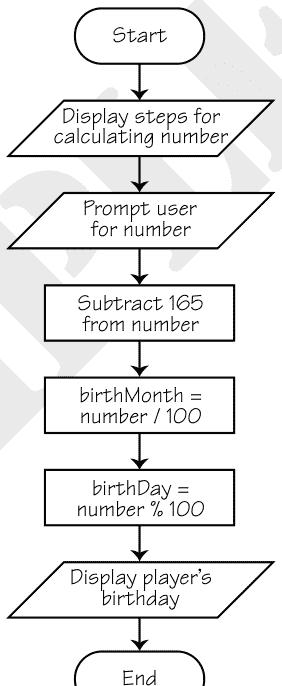

### BirthdayGame 代码设计

代码设计描述如何实现规范。代码设计包括输入、输出、生成的数据的描述，以及额外的流程图、算法和伪代码。

BirthdayGame 的输入是用户计算出的数字。需要一个整数变量来存储用户的输入。

BirthdayGame 的输出是包含用户生日的消息。

BirthdayGame 生成的数据是出生月份和出生日期。需要整数变量来存储出生月份和出生日期。

根据算法和流程图，BirthdayGame 应用程序的代码设计将包括输入和输出语句。计算将需要整数除法和模除法。BirthdayGame 的伪代码算法如下：

```
Display directions (7 steps)
Prompt the user for the calculated number
playerNum -= 165
birthMonth = playerNum / 100
birthDay = playerNum % 100
Display player's birthday
```

### BirthdayGame 实现

根据代码设计，BirthdayGame 的实现如下：

```
/*
 * BirthdayGame.java
 */

import java.util.Scanner;

/**
 * Plays a birthday guessing game with one player.
 */
public class BirthdayGame {

    public static void main(String[] args) {
        int playerNum;
        int birthMonth, birthDay;
        Scanner input = new Scanner(System.in);

        /* Give the player directions for calculating the number */
        System.out.println("Using paper and pencil, perform the following calculations:\n");
        System.out.println("1. Determine your birth month (January=1, February=2 and so on).");
        System.out.println("2. Multiply that number by 5.");
        System.out.println("3. Add 6 to that number.");
        System.out.println("4. Multiply the number by 4.");
        System.out.println("5. Add 9 to the number.");
        System.out.println("6. Multiply that number by 5.");
        System.out.println("7. Add your birth day to the number (10 if the 10th and so on).\n");
        System.out.print("Enter your number: ");
        playerNum = input.nextInt();
        input.close();

        /* Calculate birth day and month and display result. */
        playerNum -= 165;
        birthMonth = playerNum / 100;
        birthDay = playerNum % 100;

        System.out.println("Your birthday is " + birthMonth + "/" + birthDay);
    }
}
```

BirthdayGame 的运行看起来类似于：

- **使用纸和铅笔，执行以下计算：**
1. 确定你的出生月份（1 月=1，2 月=2，以此类推）。
2. 将该数字乘以 5。
3. 给该数字加 6。
4. 将该数字乘以 4。
5. 给该数字加 9。
6. 将该数字乘以 5。
7. 将出生日期加到该数字上（10 号就加 10，以此类推）。

输入你的数字：572
你的生日是 4/7

## BirthdayGame 测试和调试

本案例研究执行最少的计算，算法简单直接。用你自己的生日进行测试是验证结果的一种方法。

## 章节总结

变量和常量用于程序中，以便用有意义的名称表示值。应该使用变量和常量，因为它们使代码更易读、易懂、易修改。

变量和常量都是通过声明语句创建的。变量声明包括数据类型和标识符。常量声明还包括关键字`final`。标识符区分大小写，不能与 Java 关键字相同。变量的值可以通过赋值语句在程序执行过程中更改。常量的值不能从其初始赋值更改。

基本数据类型存储单个数据，可以包括`int`、`double`、`char`和`boolean`。抽象数据类型包括类。每个类不仅定义单个数据（如基本数据类型），还定义一组数据以及对该数据执行操作的方法。.strict 用抽象数据类型声明的变量称为对象。对象声明称为实例化。对象用关键字`new`实例化。

数据可以在运行时使用 Scanner 类从用户处读取。此类处理来自输入流的数据。从键盘读取数据的对象用`System.in`初始化。从用户获取数据时，应包含提示，以便用户知道需要提供什么信息。

第 4 章 变量和常量

93


## Java

Java 包含许多包。包成员可通过 `import` 语句访问。`Scanner` 类位于 `java.util` 包中。`NumberFormat` 类位于 `java.text` 包中。`NumberFormat` 类用于格式化数字。

Java 包含用于构成数值表达式的内置运算符。算术运算符包括 `+`、`-`、`*`、`/` 和 `%`。当两个操作数都是 `int` 类型时，`/` 运算符执行整数除法；当至少有一个操作数是 `double` 类型时，则执行实数除法。模除使用 `%` 运算符执行。表达式根据运算符优先级进行求值。可以使用括号来改变运算顺序。赋值运算符包括 `+=`、`-=`、`*=`、`/=` 和 `%=`。每个运算符在进行赋值之前都会执行相应的操作。

类型转换将一种类型的数字转换为另一种类型的数字。当需要使用整数进行实数除法时，转换非常有用。可以通过先将 `0.5` 加到 `double` 值上，然后再将其转换为 `int` 来对该值进行四舍五入。

编程错误可能由多种原因引起。语法错误违反了 Java 的规则。逻辑错误也称为语义错误，更难检测，因为语句在语法上是正确的，但会产生意外的结果。运行时错误也称为异常。异常会中止程序执行。

本章介绍的代码规范包括：
- 变量标识符以小写字母开头，标识符中第一个单词之后的任何单词都应以大写字母开头。
- 常量标识符全部大写。标识符中的多个单词可以用下划线（`_`）字符分隔。
- 变量和常量声明应在方法的开头分组。
- 程序的每一行应只包含一条语句。

## 词汇表

**抽象数据类型** 一个类。一种可以存储数据和方法的数据类型。

**ArithmeticException 异常** 当发生除以 0 时抛出的异常。

**赋值语句** 将赋值运算符右侧表达式的值赋予左侧变量或常量的语句。

**区分大小写** 大写字母与相同字母的小写形式不同。

**类** *参见* 抽象数据类型。

**连接** 将两个或多个字符串连接成一个更大的字符串。

**常量** 内存位置的名称，其值不能从初始赋值更改。

**数据类型** 变量存储的信息种类。

**声明** 创建变量或常量的语句。

**等号 (=)** 赋值运算符，表示左侧的变量或常量将接收右侧表达式的值。

**异常** *参见* 运行时错误。

**浮点数** 由 `double` 数据类型表示的值。包含小数点后数字的值。

**标识符** 变量或常量的名称。标识符必须以字母开头，并且可以包含任意数量的字母、数字和一些特殊字符。

**初始化** 在声明语句中为变量赋值。

**InputMismatchException 异常** 当用户输入不符合预期时抛出的异常。

**输入流** 从输入设备接收的字符序列。

**实例化** 创建一个新的对象。

**整数除法** 截断小数部分的除法。

**关键字** 对 Java 编译器具有特殊含义的词，因此不能用作变量或常量标识符。

**字面量** 一个实际的值。

**逻辑错误** 由语法正确但产生意外或不期望结果的语句引起的错误。也称为语义错误。

**模除** 返回余数的除法。

**数值表达式** 至少包含一个操作数，可能包含一个或多个运算符，其计算结果为单个值。

**对象** 使用类声明的变量。

**运算符优先级** 分配给运算符的级别，以维持特定的运算顺序。

**原始数据类型** 只能存储单个数据的数据类型。原始数据类型也称为内置数据类型。

**提示** 告知用户预期输入数据类型的字符串。

**运行时错误** 影响程序执行的错误。也称为异常。

**语义错误** *参见* 逻辑错误。

**语法错误** 由违反 Java 规则的语句引起的错误。

**截断** 在将 `double` 转换为 `int` 时，移除数字的小数部分。

**类型转换** 将数字从一种类型转换为另一种类型。

**变量** 存储值的内存位置的名称。

## Java

- `+` 用于连接字符串的运算符。
- 算术加法运算符。
- `-` 算术减法运算符。
- `*` 算术乘法运算符。
- `/` 算术除法运算符。
- `%` 算术模除运算符。
- `()` 用于改变表达式中的运算顺序。也用于类型转换。
- `=` 赋值运算符，将右侧的值赋予左侧的变量。
- `+=` 赋值运算符，将右侧的值加到左侧的变量上，然后将该值赋给左侧的变量。
- `-=` 赋值运算符，从左侧的变量中减去右侧的值，然后将该值赋给左侧的变量。
- `*=` 赋值运算符，将右侧的值乘以左侧变量的值，然后将该值赋给左侧的变量。
- `/=` 赋值运算符，将左侧变量的值除以右侧的值，然后将该值赋给左侧的变量。
- `%=` 赋值运算符，将左侧变量的值除以右侧的值，然后将该除法的余数赋给左侧的变量。
- `boolean` 表示 true 或 false 的数据类型。
- `char` 表示单个字符的数据类型。
- `double` 表示正或负浮点数的数据类型。
- `final` 用于将标识符声明为常量的关键字。
- `import` 用于使包或包中的类对应用程序可访问的语句。
- `in` `java.lang.System` 的成员，表示标准输入流。
- `int` 表示正或负整数的数据类型。
- `java.lang` 最基本的 Java 包。它包含定义 Java 语言的类。
- `java.text` 包含用于格式化数字的 `NumberFormat` 类的 Java 包。
- `java.util` 包含用于读取输入的 `Scanner` 类的 Java 包。
- `new` 为对象分配内存的运算符。
- `NumberFormat` 用于格式化数字的 `java.text` 类。
- `Scanner` 用于从用户读取输入的 `java.util` 类。
- `System.in` 用于从键盘读取的输入流。

## 批判性思维

1.  a) 列出四个合法的标识符名称。
    b) 列出四个非法的标识符名称并解释每个为什么非法。

2.  a) 用两条语句声明一个名为 `numBeads` 的变量并为其赋值 5。
    b) 用一条语句声明一个名为 `numBeads` 的变量并为其赋值 5。

3.  a) 最后一条语句执行后，`yourNumber` 的最终值是多少？
```
int myNumber = 5;
int yourNumber = 4;
myNumber = yourNumber * 2;
yourNumber = myNumber + 5;
```
    b) 最后一条语句执行后，`yourNumber` 的最终值是多少？
```
int myNumber;
int yourNumber = 4;
myNumber = yourNumber + 7;
yourNumber = myNumber;
```

4.  为以下每个值确定合适的数据类型：
    - a) 百货商店里篮球的数量。
    - b) 篮球的价格。
    - c) 篮球队中球员的数量。
    - d) 篮球队中球员的平均年龄。
    - e) 篮球运动员是否已获得球衣。
    - f) 篮球运动员名字的首字母。

5.  a) 原始数据类型和抽象数据类型有什么区别？
    b) 类和对象有什么区别？

6.  假设一个名为 `Team` 的类定义了一个运动队。
    - a) 方法定义类中的操作，通常在其名称中包含动作词。例如，`getTeamName` 是一个返回队名的方法名。列出 `Team` 类可能的另外三个方法名。
    - b) 列出 `Team` 类型的三个可能的对象名。

7.  `java.util` 包包含一个名为 `Random` 的类。写一条语句使 `Random` 类对应用程序可访问。

8.  以下每个表达式的值是多少？
    - a) `5 + 7 - 3`
    - b) `10 * 2 - 3`
    - c) `10 * (2 - 3)`
    - d) `8 - 3 * 2`
    - e) `10 / 5 * 4`
    - f) `10 / 2 + 3`
    - g) `6 % 3 + 4`
    - h) `12 % 5 * 3`
    - i) `12 % (5 * 3)`

9.  当 `x` 为 2005 时，下列表达式的结果是什么？当 `x` 为 1776 时呢？当 `x` 为 39 时呢？
`(x/10)%10`

10. 将每个方程写成有效的 Java 表达式：
    - a) `A=lw`（几何）
    - b) `P = (R - C) / N`（商业）
    - c) `A = h(b1 + b2) / N`（几何）
    - d) `V = (4/3) * Math.PI * r * r * r`（几何）
    - e) `A = (F+S+T) / 3`（代数）
    - f) `P = (5F) / (4d*d)`（物理）
    - g) `A=P+Pr*t`（商业）

11. 使用以下声明，重写语句以包含适当的类型转换，必要时进行四舍五入。如果不需要类型转换，请解释原因：
```
int j = 5;
double k = 1.6;
int y;
double z;
a) y = j * k;
b) z = j * k;
```

第 4 章 变量和常量 96


 + c) `z = k * k;`
d) `j = k;`
e) `k = j;`
f) `y = j + 3;`

+ d) 用户输入的值不能在应用程序中使用。
e) Scanner 类是 Java 包的一部分。
f) `+` 运算符的优先级高于 `-` 运算符。
g) `-` 运算符的优先级低于 `%` 运算符。
h) `byte` 是一个关键字。
i) 标识符 `apple` 和 `Apple` 在 Java 中被视为相同的。
j) 违反 Java 规则的错误被称为语义错误。

12. 比较 `/` 和 `%` 运算符的执行方式与类型转换的效果。

13. 使用适当的赋值运算符重写以下语句：

+ a) `total = total + 10;`
b) `numStones = numStones - 1;`
c) `days = days % 24;`
d) `price = price * 1.2;`

14. 判断以下各项更适合用变量还是常量表示，然后使用适当的数据类型和描述性标识符编写声明：

+ a) 选举候选人获得的票数
b) 候选人赢得的选票百分比
c) 选举候选人的姓、中名和名的首字母
d) 选举的年份

15. 判断以下每段代码是否包含语法错误、逻辑错误或运行时错误。并解释。

+ a) `double salary;`
b) `int numHats`
c) `length == 12;`

```
d) int test1 = 90;
   int test2 = 85;
   double avg;
   avg = test1 + test2 / 2;
```

```
e) double x = 12;
   double y = 0;
   double z;
   z = x / y;
```

```
f) double payCheck = 120.00;
   NumberFormat money = NumberFormat.getPercentInstance();
   System.out.println(money.format(payCheck));
```

## 正误判断

16. 判断以下各项的正误。如果错误，请解释原因。

+ a) 标识符可以包含空格。
b) `double` 类型的数据有时也称为浮点数。
c) 抽象数据类型也称为基本数据类型。

## 练习

### 练习 1

## ObjectHeight

一个物体从100米的初始高度下落，其在任何给定时间的高度由方程 h=100–4.9*t2 给出，其中 t 是以秒为单位的时间。创建一个 ObjectHeight 应用程序，提示用户输入一个小于 4.5 秒的时间，然后显示物体在该时间的高度。应用程序输出应类似于：

```
Enter a time less than 4.5 seconds: 2
The height of the object is: 80.4 meters
```

### 练习 2

## PizzaCost

在当地商店制作一个披萨的成本如下：

+ - 人工成本：每个披萨 $0.75，与大小无关
- 租金成本：每个披萨 $1.00，与大小无关
- 材料成本：$0.05 * 直径 * 直径（直径以英寸为单位）

创建一个 PizzaCost 应用程序，提示用户输入披萨的大小，然后显示制作该披萨的成本。应用程序输出应类似于：

```
Enter the diameter of the pizza in inches: 10
The cost of making the pizza is: $6.75
```

### 练习 3

## CollegeCalculator

分小组讨论上大学的所有费用（租金、学费、书本费等）以及可能的抵消费用（奖学金等）。创建一个 CollegeCalculator 应用程序，提示用户输入每项费用和抵消费用的金额。如果某项费用不适用，用户可以输入 0。将所有费用相加，减去抵消费用，以确定一个人学年所需的总金额。可以参考大学网站来确定相关和适当的费用。

### 练习 4

## JavaTerminology

修改第 3 章练习 8 中创建的 JavaTerminology 应用程序，以包含本章词汇表中的五个单词及其相应的定义。将每个单词放在单独的一行，后面跟着定义。条目之间留一个空行。

### 练习 5

## Energy

爱因斯坦著名的公式 e=mc² 给出了将质量为 m 的物质完全转化为能量 e 所释放的能量量。如果 m 代表以千克为单位的质量，c 代表以米/秒为单位的光速（3.0 * 10^8 m/s），则结果是以能量单位焦耳（Joules）表示。点亮一个 100 瓦的灯泡一小时需要 360,000 焦耳。创建一个 Energy 应用程序，提示用户输入以千克为单位的质量，然后显示能量以及可以供电的灯泡数量。应用程序输出应类似于：

```
Enter the mass in kilograms: 1
The energy produced in Joules is = 9.0E16
The number of 100-watt light bulbs powered = 2.5E11
```

### 练习 6

## Change

创建一个 Change 应用程序，提示用户输入一个小于 $1.00 的金额，然后显示找零所需的最小硬币数量。零钱可以由 25 美分、10 美分、5 美分和 1 美分硬币组成。应用程序输出应类似于：

```
Enter the change in cents: 212

The minimum number of coins is:
    Quarters: 8
    Dimes: 1
    Nickels: 0
    Pennies: 2
```

### 练习 7

## Digits

修改本章前面回顾中创建的 Digits 应用程序，以显示一个三位数的百位数字。应用程序输出应类似于：

```
Enter a three-digit number: 258

The hundreds-place digit is: 2
The tens-place digit is: 5
The ones-place digit is: 8
```

### 练习 8

## DivAndMod

创建一个 DivAndMod 应用程序，提示用户输入两个整数，然后按任意顺序显示整数除法和取模运算的结果。应用程序输出应类似于：

```
Enter an integer: 14
Enter a second integer: 4

14 / 4 = 3
14 % 4 = 2

4 / 14 = 0
4 % 14 = 4
```

### 练习 9

## TimeConversion

创建一个 TimeConversion 应用程序，提示用户输入以分钟为单位的时间，然后以小时和分钟格式显示该时间。确保考虑剩余分钟数少于 10 的情况。例如，184 分钟在小时:分钟格式中是 3:04（提示：使用取模运算符）。应用程序输出应类似于：

```
Enter the time in minutes: 135
The time is: 2:15
```

### 练习 10

## Sleep

创建一个 Sleep 应用程序，计算你一生中睡眠的小时数。假设你每晚睡 8 小时。为简化问题，假设每月有 30 天，每年有 365 天。应用程序输出应类似于：

```
Enter your birthdate:
Year: 1990
Month: 9
Day: 8
Enter today's date:
Year: 2006
Month: 2
Day: 12
You have been alive for 5,634 days.
You have slept 45,072 hours.
```

### 练习 11

## Order

一家快餐店对汉堡收费 $1.69，薯条 $1.09，苏打水 $0.99。

a) 创建一个 Order 应用程序，提示员工输入汉堡、薯条和苏打水的数量，然后显示总计、税费（6.5%）和最终费用。应用程序输出应类似于：

```
Enter the number of burgers: 2
Enter the number of fries: 5
Enter the number of sodas: 5
Total before tax: $13.78
Tax: $0.90
Final total: $14.68
```

b) 修改 Order 应用程序，提示员工输入支付金额，然后显示应找零钱。应用程序输出应类似于：

```
Enter amount tendered: $20.00
Change: $5.32
```

### 练习 12

## Project

创建一个 Project 应用程序来帮助分析一个 Java 项目所花费的时间。该应用程序应提示你输入设计、编码、调试和测试所花费的时间，然后显示一个表格，显示每部分所花费时间的百分比。应用程序输出应类似于：

```
Enter the number of minutes spent on each of the following project tasks:

Designing: 120
Coding: 240
Debugging: 30
Testing: 30

Task        % Time
Designing   28.57 %
Coding      57.14 %
Debugging    7.14 %
Testing      7.14 %
```

### 练习 13

## Spending

创建一个 Spending 应用程序来帮助分析用户的消费模式。
该应用程序应提示用户输入上个月在食物、衣物、娱乐和租金上的支出，然后显示一个表格，显示每个类别的支出百分比。应用程序输出应类似于：

```
Enter the amount spent last month on the following items:

Food: $250
Clothing: $250
Entertainment: $250
Rent: $1250

Category      Budget
Food          12.50 %
Clothing      12.50 %
Entertainment 12.50 %
Rent          62.50 %
```

### 练习 14

## CollegeCalculator

分小组讨论上大学的所有费用（租金、学费、书本费等）以及可能的抵消费用（奖学金等）。创建一个 CollegeCalculator 应用程序，提示用户输入每项费用和抵消费用的金额。如果某项费用不适用，用户应输入 0。将所有费用相加，减去抵消费用，以确定一个人学年所需的总金额。可以参考大学网站来确定相关和适当的费用。


## 练习 15 单利

利息有两种：单利和复利。在单利计算中，存款本金保持不变，利息在每个时间间隔结束时支付。例如，本金 1,000 美元，年利率 6%，存入 7 年，每年年底将获得 60 美元利息，7 年后总额为 1,420 美元。

本金在期末的金额使用以下公式计算：
金额 = 本金 * (1 + 年数 * 年利率)
创建一个 `SimpleInterest` 应用程序，提示用户输入本金、年数和年利率（以分数形式），然后计算利息金额。
应用程序的输出应类似于：

```
Enter the principal:
Enter the number of years:
```

b) 部分 (a) 中的公式可以调整，用于计算在特定利率和期限下，需要投资多少本金才能在期末获得特定金额。
本金 = 金额 / (1 + 年数 * 年利率)
修改 `SimpleInterest`，提示用户输入期望金额、年数和年利率，然后计算需要投资的本金。

## 练习 16 选举

三个州中两名候选人的初选结果如下：

编写一个程序，提示用户输入选举结果显示，然后输出类似以下内容：

**示例**

## 第5章

## 条件控制结构

根据条件执行不同操作的分支语句用于赋予应用程序决策能力。本章重点介绍 `if` 和 `switch` 条件控制结构。

## if 语句

`if` 语句是一种条件控制结构，也称为决策结构，当条件为真时执行一组语句。条件控制结构用于改变程序流程。`if` 语句的形式如下：

```
if (<condition>) {
    <statements>
}
```

例如，在以下 `if` 语句中，`guess == 7` 是条件，当此条件为真时将执行一条语句：

```
if (guess == SECRET_NUM) {
    System.out.println("You guessed it!");
}
```

`==` 关系运算符用于确定 `guess` 的值是否等于 `SECRET_NUM` 的值。如果相等，则执行 `println()` 语句。如果不相等，则程序流程继续到 `if` 语句右花括号后的下一条语句。

`if` 语句的条件是一个布尔表达式，其值为 `true` 或 `false`。关系运算符可用于构成布尔表达式。有六种关系运算符：

> 在 `if` 语句条件中使用 `=` 而不是 `==` 会导致错误。

条件控制结构
布尔表达式
关系运算符

| 运算符 | 含义 |
|----------|---------|
| == | 等于 |
| < | 小于 |
| <= | 小于或等于 |
| > | 大于 |
| >= | 大于或等于 |
| != | 不等于 |

> 比较对象
由于对象指向内存中的某个位置，而不是直接存储值，因此不能使用内置关系运算符进行比较。类定义了用于比较对象的方法。

布尔变量也可以用作 `if` 语句的条件，因为其值为 `true` 或 `false`。例如，在以下语句中，将显示消息：

```
boolean gameOver = true;
if (gameOver) {
  System.out.println("Thanks for playing!");
}
```

## 舍入误差

`if` 语句的条件绝不应对浮点数进行相等性比较，因为存在舍入误差的可能性。*舍入误差*发生在浮点数无法在计算机中用二进制表示法精确表示时。例如，十进制数 0.8 在二进制形式中是循环小数（0.1100110011...）。由于内存中只有有限数量的位可用于表示数字，因此循环小数必须被舍入，无法精确表示。

例如，考虑以下语句：

```
if ((4.80 * 100 - 480) == 0) {
  System.out.println("Zero.");
}
```

条件似乎应为 `true`。但是，数字 4.80 无法用二进制精确表示。因此，当 4.80 乘以 100 时，结果与 480 略有不同。这种差异是由于舍入误差造成的。在这种情况下，从 4.80 * 100 中减去 480 会得到一个非常小的、不等于 0 的数（约 1.77635683940025E-14）。以下语句是一种考虑可能舍入误差的方法：

```
final double VERY_SMALL_VALUE = 0.000001;
if ((4.80 * 100 - 480) < VERY_SMALL_VALUE) {
  System.out.println("Zero.");
}
```

## 复习：SurfsUp – 第 1 部分（共 3 部分）

创建一个 `SurfsUp` 应用程序，提示用户输入浪高，当浪高达到 6 英尺或以上时，显示 "Great day for surfing!"。

## if-else 语句

`if` 语句可以包含一个可选的 `else` 子句，当 `if` 条件为假时执行。`if-else` 语句的形式如下：

```
if (<condition>) {
  <statements>
} else {
  <statements>
}
```

例如，在以下 `if-else` 语句中，针对正确和错误的猜测显示不同的消息：

```
if (guess == SECRET_NUM) {
    System.out.println("You guessed it!");
} else {
    System.out.println("Try again.");
}
```

`if-else` 的缩进和组织对于可读性很重要。所示结构是一种代码约定，清楚地表明了条件为真和条件为假时执行的操作。

## 复习：SurfsUp – 第 2 部分（共 3 部分）

修改 `SurfsUp` 应用程序，当浪高达到 6 英尺或以上时显示 “Great day for surfing!”，当浪高低于 6 英尺时显示 “Go body boarding!”。

## 复习：CircleCircumference – 第 2 部分（共 2 部分）

修改第 4 章的 `CircleCircumference` 应用程序，以便当用户输入负数作为半径值时显示消息 “Negative radii are illegal.”。否则，应用程序应计算并显示圆的周长。

## 嵌套语句

一个 `if-else` 语句可以包含另一个 `if-else` 或 `if` 语句。放置在同一类型语句内的语句称为*嵌套*。例如，嵌套的 `if-else` 在用户未猜中正确数字时给出提示：

```
if (guess == SECRET_NUM) {           //正确
    System.out.println("You guessed it!");
} else {
    if (guess < SECRET_NUM) {         //太低
        System.out.println("Too low.");
    } else {                          //太高
        System.out.println("Too high.");
    }
}
```

仔细缩进语句可以清楚地显示哪些是嵌套的。

## 复习：Stages

创建一个 `Stages` 应用程序，提示用户输入年龄。对于 18 岁以上的年龄，显示 `adult`。对于小于或等于 18 岁的年龄：当年龄小于或等于 5 岁时显示 `toddler`，小于或等于 10 岁时显示 `child`，小于或等于 12 岁时显示 `preteen`，大于 12 岁时显示 `teen`。

## if-else if 语句

`if-else if` 语句用于在三个或更多操作之间做出决策，其形式如下：

```
if (<condition>) {
  <statements>
} else if (<condition>) {
  <statements>
} else {
  <statements>
}
```

可以有多个 `else if` 子句，最后一个 `else` 子句是可选的。例如，下面的 `if-else if` 语句中有三种可能的决策：

> 注释复杂的决策结构
具有多个分支的决策结构可能很快变得难以理解。简短的内联注释可以使代码更易读。这对于决策结构的最后一个分支尤其重要，因为它通常不包含显式条件。

```
if (guess == SECRET_NUM) {       //正确
  System.out.println("You guessed it!");
} else if (guess < SECRET_NUM) { //太低
  System.out.println("Too low.");
} else {                         //太高
  System.out.println("Too high.");
}
```

开发 `if-else if` 语句时使用的逻辑很重要。例如，在测试数字范围时，`if` 条件必须正确排序，因为仅为第一个为真的条件执行语句，然后程序流程继续到 `if-else if` 之后的下一条语句。

在选择嵌套的 `if-else` 语句和单个 `if-else if` 语句时，`if-else if` 只允许一个分支执行，并且条件显示清晰的序列。通常，`if-else if` 语句更易于阅读和理解。

## 复习：SurfsUp – 第 3 部分（共 3 部分）

修改 `SurfsUp` 应用程序，当浪高达到 6 英尺或以上时显示 “Great day for surfing!”，当浪高在 3 到 6 英尺之间时显示 “Go body boarding!”，当浪高在 0 到 3 英尺之间时显示 “Go for a swim.”，否则显示 “Whoa! What kind of surf is that?”。

## 复习：Discriminant

在数学中，量 b² – 4ac 称为“判别式”。创建一个 `Discriminant` 应用程序，提示用户输入 a、b 和 c 的值，然后如果判别式为负则显示 “No roots”，如果判别式为零则显示 “One root”，如果判别式为正则显示 “Two roots”。应用程序的输出应类似于：

```
Enter the value for a: 7
Enter the value for b: -9
Enter the value for c: 2
Two roots
```


# \`switch\` 语句

The `switch` statement is a conditional control structure that uses the result of an expression to determine which statements to execute. The `switch` statement is sometimes preferable to the `if-else if` statement because code may be easier to read. The `switch` statement takes the form:

```
switch (<integer expression>) {
    case x:
        <statement>;
        break;
    ...
    default:
        <statements>;
        break;
}
```

The expression must evaluate to an integer. There can be multiple `case` clauses. The `break` statement is necessary to move program control to the next statement after the `switch` statement. The `default` code is optional and is executed when none of the previous cases are met. For example, when `score` is 5, the `case 5` statement executes and then program control moves to the next statement after the `switch` (skipping the `case 10` statement):

```
switch (score) {
    case 0: System.out.println("Better luck next time."); break;
    case 5: System.out.println("Pretty good."); break;
    case 10: System.out.println("Great!"); break;
}
```

If the `break` statement is not included in a `case` clause, execution continues on to the next statement within the `switch` statement. This can be useful when the same set of statements applies to more than one situation:

```
switch (score) {
    case 0: System.out.println("Better luck next time."); break;
    case 1:
    case 2:
    case 3:
    case 4:
    case 5: System.out.println("Pretty good."); break;
    case 6:
    case 7:
    case 8:
    case 9:
    case 10: System.out.println("Great!"); break;
}
```

In this statement, "Pretty good." is displayed when the score is 1, 2, 3, 4, or 5. Scores 6 through 10 display "Great".

# 回顾：飓风

The Saffir-Simpson Hurricane Scale provides a rating (a category) depending on the current intensity of a hurricane. Create a Hurricane application that displays the wind speed for the hurricane category entered by the user. Display the speed in miles per hour (mph), knots (kts), and kilometers per hour (km/hr). Refer to the Saffir-Simpson Hurricane Scale below for wind speeds:

- Category 1: 74-95 mph or 64-82 kt or 119-153 km/hr
- Category 2: 96-110 mph or 83-95 kt or 154-177 km/hr
- Category 3: 111-130 mph or 96-113 kt or 178-209 km/hr
- Category 4: 131-155 mph or 114-135 kt or 210-249 km/hr
- Category 5: greater than 155 mph or 135 kt or 249 km/hr

# 生成随机数

Games, simulators, screen savers, and many other types of applications make use of random numbers. A widely used method for generating random numbers is called the *Linear Congruential Method*. This method uses a formula to generate a sequence of numbers. Although the numbers in the sequence vary and for most applications can be considered random, the sequence will at some point repeat. Therefore, random numbers in a computer application are referred to as *pseudorandom* (like random).

Java includes the Random class in the java.util package for generating random numbers. This class uses the Linear Congruential Method. Some of the Random class methods include:

Class Random (java.util.Random)

**方法**

`nextInt()` returns the next random integer in the random number generator's sequence.

`nextInt(int n)` returns the next random integer between 0 (inclusive) and n in the random number generator's sequence.

`nextDouble()` returns the next random double between 0.0 and 1.0 in the random number generator's sequence.

The RandomNumberDemo class below instantiates a Random object and displays the first five numbers between 0 and 100 in its sequence:

```
public class RandomNumberDemo {

    public static void main(String[] args) {
        Random r = new Random();

        System.out.println("First number:  " + r.nextInt(100));
        System.out.println("Second number: " + r.nextInt(100));
        System.out.println("Third number:  " + r.nextInt(100));
        System.out.println("Fourth number: " + r.nextInt(100));
        System.out.println("Fifth number:  " + r.nextInt(100));
    }
}
```

RandomNumberDemo produces output similar to the following:

```
First number: 13
Second number: 80
Third number: 93
Fourth number: 90
Fifth number: 46
```

# 范围内的随机数

To generate a random number in a range with a minimum value greater than 0, the following formula is used:

```
r.nextInt(highNum - lowNum + 1) + lowNum
```

A similar formula can be used to generate random doubles in a range:

```
(highNum - lowNum + 1) * r.nextDouble() + lowNum
```

# 种子

The Linear Congruential Method requires a seed, which is a starting value, for calculating a sequence of numbers. Java automatically generates this seed when a new Random object is instantiated. However, if a seed value is specified, the same sequence of "random" numbers will be generated each time the program is run. This can be useful for debugging. After the program has been tested, remove the seed so that the sequence of generated numbers vary each time the application runs. For example, the code below specifies a seed. Two runs of the application are displayed:

```
public class RandomNumberDemo {

    public static void main(String[] args) {
        Random r = new Random(10);

        System.out.println("First number: " + r.nextInt(100));
        System.out.println("Second number: " + r.nextInt(100));
        System.out.println("Third number: " + r.nextInt(100));
        System.out.println("Fourth number: " + r.nextInt(100));
        System.out.println("Fifth number:  " + r.nextInt(100));
    }
}
```

first run:

second run:

```
First number: 17
Second number: 71
Third number: 98
Fourth number: 34
Fifth number: 64
```

Two runs of RandomNumberDemo using the same seed. Note that both runs generate the same sequence of numbers.

# 回顾：RandomNum

Create a RandomNum application that prompts the user for two numbers. The first number is a minimum value and the second is a maximum value. RandomNum then displays an integer between the min and max values entered by the user.

# 复合布尔表达式

Conditions with complex criteria are formed using the && and || operators. The && operator is called the logical And. It is used to form an expression that evaluates to true only when both operands are also true. The || operator is called the logical Or. An expression formed with this operator evaluates to true when either operand is true. For example, the following statement tests for invalid guesses:

```
if (guess < 1 || guess > 50) {
    //invalid guess
    System.out.println("Invalid guess.");
} else if (guess == SECRET_NUM) { //correct guess
    System.out.println("You guessed it!");
}
```

When a guess is either less than 1 or greater than 50, "Invalid guess." is displayed. Note that the expression also evaluates to true when both operands are true. The condition in the if statement is called a compound Boolean expression because more than one Boolean expression determines whether the condition is true or false.

How a compound Boolean expression evaluates with && and || operators can be shown with truth tables. A truth table shows the possible outcomes of compound Boolean expressions:

| 运算符 | Exp1 | Exp2 | 结果 |
| :--- | :---: | :---: | :---: |
| And | 真 | 真 | 真 |
| And | 真 | 假 | 假 |
| And | 假 | 真 | 假 |
| And | 假 | 假 | 假 |
| Or | 真 | 真 | 真 |
| Or | 真 | 假 | 真 |
| Or | 假 | 真 | 真 |
| Or | 假 | 假 | 假 |

As another example, consider an application that computes a discount depending on the item and quantity purchased:

```
if (itemNum == 873 && quantity > 50) {
    discount = 1;
}  //more than 50 of 873
//$1 discount
```

This if statement executes the discount = 1 statement if item number is 873 and quantity is greater than 50.

A third operator is !. The ! operator is called the logical Not. An expression including ! is evaluated according to the following truth table:

| 运算符 | Exp | 结果 |
| :--- | :---: | :---: |
| Not | 真 | 假 |
| Not | 假 | 真 |

For example, the following statements display a message when the item number is not 873:

```
if (!(itemNum == 873)) {
    System.out.println("No discount given.");
}  //any item EXCEPT 873
```

第 5 章 条件控制结构

112


## 短路求值
Java 在确定包含 `&&` 或 `||` 的复合布尔表达式的结果时，使用短路求值。在*短路求值*中，首先计算左侧操作数。如果整个表达式的结果可以通过左侧操作数的值确定，则不会计算其他操作数。例如，表达式 `x < 0 || x > 5` 在 x 小于 0 时，无论 `x > 5` 的值如何，结果都为 `true`。因此，当 x 小于 0 时，第二个操作数将不会被计算。再举一例，表达式 `x > 5 && x < 20` 在 x 小于或等于 5 时，无论 `x < 20` 的值如何，结果都为 `false`。因此，当 x 小于或等于 5 时，第二个操作数将不会被计算。

## 运算顺序
在运算顺序中，`!` 在 `&&` 之前计算。`||` 最后计算。例如，表达式 `!5 < 6 || 2 > 4 && 3 < 6` 的结果为 `false`，因为先计算 `!5 < 6`，然后计算 `2 > 4 && 3 < 6`，最后计算 `False || False`。使用括号可以改变运算符优先级，并使代码更具可读性。

## 复习：配送应用
创建一个配送应用程序，提示用户输入包裹的长、宽、高，然后如果任一维度大于10，则显示“拒绝”，如果所有维度都小于或等于10，则显示“接受”。

## Math 类
**java.lang** Java 在 java.lang 包中包含 Math 类，用于执行指数运算和平方根等数学函数。Math 类包含多种方法，包括：

提示 Math 类还包含一个近似于 π 的 double 常量 PI。

```
类 Math (java.lang.Math)
方法
abs(num) 返回 num 的绝对值，num 可以是 int 或 double 值。
pow(double num1, double num2) 返回 num1 的 num2 次幂。
sqrt(double num) 返回 num 的平方根，其中 num 是一个正数。
```

调用 Math 方法需要使用类名。例如，`Math.abs(-3)` 返回 3。下一页的应用程序演示了 Math 方法：

```java
import java.lang.Math;

public class TestMathMethods {

    public static void main(String[] args) {
        int posNum = 12, negNum = -12;
        int num1 = 2, num2 = 6;
        int square = 49;

        System.out.println("The absolute value of " + posNum
                + " is " + Math.abs(posNum));
        System.out.println("The absolute value of " + negNum
                + " is " + Math.abs(negNum));
        System.out.println(num1 + " raised to the " + num2
                + " power is " + Math.pow(num1, num2));
        System.out.println("The square root of " + square
                + " is " + Math.sqrt(square));
    }
}
```

TestMathMethods 产生以下输出：

```
The absolute value of 12 is 12
The absolute value of -12 is 12
2 raised to the 6 power is 64.0
The square root of 49 is 7.0
```

## 复习：完全平方数
创建一个 PerfectSquare 应用程序，提示用户输入一个整数，然后显示一条消息，指出该数是否为完全平方数。这可以通过求一个数的平方根，截断它（通过将 double 结果强制转换），然后对结果求平方来确定。

## 第五章案例研究
在这个案例研究中，将创建一个计算机版的石头剪刀布游戏。石头剪刀布是一个在两个人之间进行的流行游戏，用于决策或仅仅是为了竞技乐趣。游戏规则是石头钝化剪刀（石头赢），剪刀剪布（剪刀赢），布覆盖石头（布赢）。两个玩家同时进行“出招”。玩家出的手势信号随后与游戏规则进行比较，以确定获胜者。在计算机版本中，用户与计算机对战。

## 石头剪刀布游戏规格
石头剪刀布游戏在计算机和单个玩家之间进行。玩家被提示输入一个出招数字，其中1代表石头，2代表布，3代表剪刀。为计算机出招生成一个1到3之间的随机数。获胜者根据石头剪刀布的规则确定。

石头剪刀布游戏的界面应该很简单。用户将被提示输入一个1到3之间的整数，其中1代表石头，2代表布，3代表剪刀。然后程序生成一个1到3之间的随机数，显示生成的数字和玩家的数字，并确定获胜者。

石头剪刀布游戏输出草图：

```
Enter your throw (1=Rock, 2=Paper, 3=Scissors): 3
Player throws SCISSORS.
Computer throws PAPER.
Player wins!
```

石头剪刀布游戏算法：

1.  提示用户输入一个1到3之间的数字。
2.  生成一个1到3之间的随机数。
3.  将生成的数字与用户输入的数字进行比较。
4.  确定获胜者并显示相应的消息。

石头剪刀布游戏流程图：

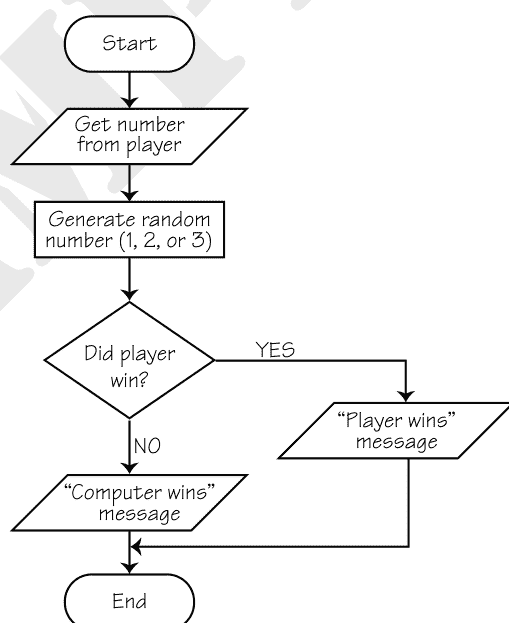

> 提示 流程图中的菱形对象表示一个判断。

## 石头剪刀布游戏代码设计
石头剪刀布游戏的输入是用户输入的数字。需要一个整型变量来存储用户的输入。

石头剪刀布游戏的输出是一条消息，包含用户输入、生成的数字和获胜者。

石头剪刀布游戏生成的数据是一个1到3之间的随机整数，代表计算机的“出招”。需要一个 `int` 变量来存储计算机生成的数字。此应用程序中使用的其他数据可以由表示石头（1）、布（2）和剪刀（3）的 `int` 常量表示。

根据算法和流程图，石头剪刀布游戏应用程序的代码设计将包括决策结构，用于将用户的输入与计算机生成的数字进行比较。这种比较可以使用 `switch` 语句或 `if-else if` 语句来完成。在本实现中，将使用 `if-else if`。石头剪刀布游戏的伪代码算法如下：

```
提示用户输入数字（1=石头，2=布，3=剪刀）
生成一个1到3之间的随机数（包含1和3）
显示一条消息，包含玩家的数字和计算机的数字
if (playerThrow == 1 and computerThrow == 1)
    平局消息
else if (playerThrow == 1 and computerThrow == 2)
    计算机获胜消息
else if (playerThrow == 1 and computerThrow == 3)
    玩家获胜消息
if (playerThrow == 2 and computerThrow == 1)
    玩家获胜消息
else if (playerThrow == 2 and computerThrow == 2)
    平局消息
else if (playerThrow == 2 and computerThrow == 3)
    计算机获胜消息
if (playerThrow == 3 and computerThrow == 1)
    计算机获胜消息
else if (playerThrow == 3 and computerThrow == 2)
    玩家获胜消息
else if (playerThrow == 3 and computerThrow == 3)
    平局消息
```

## 石头剪刀布游戏实现
根据代码设计，石头剪刀布游戏的实现如下：

```java
/*
 * RPS.java
 */

import java.util.Scanner;
import java.util.Random;

/**
 * Plays Rock Paper Scissors against one player.
 */
public class RPS {

    public static void main(String[] args) {
        final int ROCK = 1, PAPER = 2, SCISSORS = 3;
        int playerThrow, computerThrow;
        Scanner input = new Scanner(System.in);
        Random rand = new Random();

        /* prompt player for throw and read number typed */
        System.out.print("Enter your throw (1=Rock, 2=Paper, 3=Scissors): ");
        playerThrow = input.nextInt();
        input.close();

        /* Generate computer throw */
        computerThrow = rand.nextInt(3) + 1;    /* random integer between 1 and 3 */

        /* Inform player of throws */
        System.out.print("Player throws ");
        switch (playerThrow) {
            case ROCK: System.out.println("ROCK."); break;
            case PAPER: System.out.println("PAPER."); break;
            case SCISSORS: System.out.println("SCISSORS."); break;
        }
        System.out.print("Computer throws ");
        switch (computerThrow) {
            case ROCK: System.out.println("ROCK."); break;
            case PAPER: System.out.println("PAPER."); break;
            case SCISSORS: System.out.println("SCISSORS."); break;
        }

        /* Determine winner */
        if (playerThrow == ROCK && computerThrow == ROCK) {
            System.out.println("It's a draw!");
        } else if (playerThrow == ROCK && computerThrow == PAPER) {
            System.out.println("Computer wins!");
        } else if (playerThrow == ROCK && computerThrow == SCISSORS) {
            System.out.println("Player wins!");
        }

        if (playerThrow == PAPER && computerThrow == ROCK) {
            System.out.println("Player wins!");
        } else if (playerThrow == PAPER && computerThrow == PAPER) {
            System.out.println("It's a draw!");
        } else if (playerThrow == PAPER && computerThrow == SCISSORS) {
            System.out.println("Computer wins!");
        }

        if (playerThrow == SCISSORS && computerThrow == ROCK) {
            System.out.println("Computer wins!");
        } else if (playerThrow == SCISSORS && computerThrow == PAPER) {
            System.out.println("Player wins!");
        } else if (playerThrow == SCISSORS && computerThrow == SCISSORS) {
            System.out.println("It's a draw!");
        }
    }
}
```

石头剪刀布游戏应用程序的输出类似于：

```
Enter your throw <1=Rock, 2=Paper, 3=Scissors>: 2
Player throws PAPER.
Computer throws ROCK.
Player wins!
```


## RPS 测试与调试

本案例研究应测试所有可能的出拳组合。为此，可以使用种子（seed）以确保每次运行时生成相同的随机数。通过仅改变每次运行的玩家输入，即可测试每一种组合。要指定种子，需使用整数参数实例化 `Random` 对象：

```
Random rand = new Random(3);
```

请注意，任何数字都可以作为种子。其核心目的是使用种子，以便每次运行时生成相同的随机数。使用种子运行应用程序可以减少测试时需要考虑的因素数量。使用相同种子运行的三次示例如下：

```
Enter your throw (1=Rock, 2=Paper, 3=Scissors): 1
Player throws ROCK.
Computer throws SCISSORS.
Player wins!

Enter your throw (1=Rock, 2=Paper, 3=Scissors): 2
Player throws PAPER.
Computer throws SCISSORS.
Computer wins!

Enter your throw (1=Rock, 2=Paper, 3=Scissors): 3
Player throws SCISSORS.
Computer throws SCISSORS.
It's a draw!
```

可以使用不同的种子，直到测试完所有组合。请注意，此应用程序需要测试的组合数量较少且有限。随着应用程序变得更加复杂，我们将讨论其他测试方法。

测试还涉及考虑用户输入和异常处理。当玩家输入 4 时会发生什么？应该如何处理非法输入？防止输入错误和异常处理将在本文稍后讨论。

## 复习：RPS - 第 1 部分 / 共 2 部分

修改第 5 章的 RPS 案例研究，使用嵌套的 `if-else` 语句而不是 `if-else if` 语句来确定获胜者。

## 复习：RPS - 第 2 部分 / 共 2 部分

修改第 5 章的 RPS 案例研究，使用 `switch` 语句来确定获胜者。（提示：你可能在 `case` 语句中需要使用 `if-else if` 语句。）

第五章 条件控制结构

118

## 本章总结

本章介绍了条件控制结构、随机数和逻辑运算符。条件控制结构（也称为决策结构）包括 `if` 和 `switch` 语句。`if` 语句使用布尔表达式的结果来确定程序流程，而 `switch` 语句使用整数表达式的结果来确定程序流程。

在 `if` 语句中，当条件求值为 `true` 时，程序流程会分支到一组语句。在 `if-else` 语句中，当条件为 `true` 时，程序流程分支到一组语句；当条件为 `false` 时，分支到另一组语句。嵌套的 `if-else` 语句可用于对程序流程进行更多控制。`if-else if` 用于在三项或更多动作中进行选择。

关系运算符可用于构成布尔表达式。它们包括 `==`、`<`、`<=`、`>`、`>=` 和 `!=` 运算符。两个或更多布尔表达式可以使用逻辑运算符连接，以形成复合布尔表达式。逻辑运算符包括 `&&`（逻辑与）、`||`（逻辑或）和 `!`（逻辑非）。真值表展示了复合布尔表达式的求值结果。

舍入误差发生在计算机无法以二进制精确表示浮点数时。因此，不应进行浮点数之间的相等性比较。

`switch` 语句包含多个 `case` 子句。必须使用 `break` 语句将程序控制移出 `switch` 语句。

Java 使用线性同余方法生成随机数序列。由于该序列最终会重复，计算机应用程序中的随机数实际上是伪随机数。Java 在 `java.util` 包中包含了 `Random` 类，用于生成随机数。如果指定了种子值，则每次运行应用程序时，`Random` 对象都会生成相同的随机数序列。

`java.lang` 包中的 `Math` 类包含许多用于执行数学函数的有用方法。调用 `Math` 方法需要包含类名。

本章介绍的代码约定如下：

- `if` 语句的子句应缩进。
- 嵌套的 `if` 语句应缩进。
- `switch` 语句的 `case` 子句应缩进。

## 词汇表

| 术语 | 定义 |
|------|------------|
| **布尔表达式** | 求值为 true 或 false 的表达式。 |
| **复合布尔表达式** | 包含一个以上布尔表达式的表达式。 |
| **条件控制结构** | 根据条件分支程序流程的语句。也称为决策结构。 |
| **决策结构** | *参见* 条件控制结构。 |
| **线性同余方法** | 一种使用方法公式生成伪随机数序列的方法。 |
| **逻辑与** | 用于形成复合布尔表达式的 `&&` 运算符。 |
| **逻辑非** | 用于反转布尔表达式值的 `!` 运算符。 |
| **逻辑或** | 用于形成复合布尔表达式的 `\|\|` 运算符。 |
| **嵌套** | 置于同类语句内部的语句。 |
| **伪随机** | 并非真正随机，但类似于随机。 |
| **关系运算符** | 可用于构成布尔表达式的运算符 `(==, <, <=, >, >=, !=)`。 |
| **舍入误差** | 当计算机无法以二进制精确表示浮点数时发生的错误。 |
| **种子** | 用于计算随机数序列的起始值。 |
| **短路求值** | 一种确定布尔表达式结果的过程，其中首先求值左操作数。如果整个表达式的结果可以由左操作数确定，则不再求值其他操作数。 |
| **真值表** | 显示由逻辑运算符连接的两个表达式的各种可能结果的表。 |

## Java

| 符号/关键字 | 描述 |
|---------------|-------------|
| `==` | 相等关系运算符。 |
| `<` | 小于关系运算符。 |
| `<=` | 小于或等于关系运算符。 |
| `>` | 大于关系运算符。 |
| `>=` | 大于或等于关系运算符。 |
| `!=` | 不等于关系运算符。 |
| `&&` | 逻辑与运算符。 |
| `\|\|` | 逻辑或运算符。 |
| `!` | 逻辑非运算符。 |
| `break` | 一条语句，将程序控制移至当前结构之后的下一条语句。 |
| `case` | `switch` 语句中的一个子句，其中包含当 `case` 条件与 `switch` 表达式的结果匹配时要执行的语句。 |
| `if` | 一种决策结构，当条件为 true 时执行一组语句。 |
| `if-else` | 一种决策结构，当条件为 true 时执行一组语句，当条件为 false 时执行另一组语句。 |
| `if-else if` | 一种决策结构，用于在三项或更多动作中进行选择。 |
| **Math** | 一个 `java.lang` 类，包含用于执行数学函数的方法。 |
| `switch` | 一种决策结构，使用表达式的结果来确定执行哪一组语句。 |
| **Random** | 一个 `java.util` 类，包含用于生成随机整数和双精度浮点数的方法。 |

## 批判性思维

1. 使用决策结构为以下每一项编写适当的语句：
    a) 当 `grade` 为 90 或更高时，显示 `Great job!`。
    b) 当 `number` 小于 20 或大于 50 时，显示 `Error`。
    c) 当 `y` 小于 100 时，给 `y` 的值加 2。

2. 假设 `num1` 和 `num2` 包含整数值。编写一个 `if-else if` 语句，根据适当情况显示以下之一消息：
    第一个数较大。
    第二个数较大。
    数字相等。

3. a) 对于下面的空白处，合适的词是 `odd` 还是 `even`？

```
if (num % 2 == 0) {
    System.out.println("___ number");
} else {
    System.out.println("___ number");
}
```

b) 将 `if-else` 重写为 `switch` 语句。

4. `Random` 类中的 `nextInt()` 方法生成介于 0 和指定最大值之间的随机整数。为以下每种情况写出包含 `nextInt()` 方法的公式：
    a) 生成 1 到 50 之间的随机整数。
    b) 生成 20 到 100 之间的随机整数。
    c) 生成 10 到 20（包含）之间的随机双精度浮点数。

5. 识别以下语句中的逻辑错误，这些语句应为任何年龄值显示一个适当的单条消息：

```
if (age < 18) {
    System.out.println("child");
} else if (age > 18 && age < 65) {
    System.out.println("adult");
} else if (age > 65) {
    System.out.println("senior");
}
```

6. 给定以下赋值，确定以下每个表达式的求值结果为 true 还是 false：
    `size = 100`    `weight = 50`    `value = 75`
    a) `size > 50 && weight == 50`
    b) `value < 100 && !(weight == 50)`
    c) `size >= 100 || value >= 100`
    d) `weight < 50 || size > 50`
    e) `!(value < 75)`
    f) `!(size > 100 && weight > 50 && value > 75)`
    g) `(value < 125 || weight < 76) && size == 100`

7. a) 编写一条语句来计算 `y^x`。
    b) 编写一条语句来计算 `y` 的绝对值。
    c) 编写一条语句来计算 `y` 的平方根。

## 真/假题

8. 确定以下各项是真还是假。如果为假，请解释原因。
    a) `if` 语句的条件必须是布尔表达式。
    b) 在比较两个整数时可能会发生舍入误差。
    c) 嵌套 `if` 语句和 `if-else if` 语句是相同的。
    d) `switch` 语句中的表达式必须求值为 `double`。
    e) 由计算机程序生成的数字实际上是伪随机的。
    f) 指定种子值会导致每次运行程序时生成不同的“随机”数序列。
    g) 复合布尔表达式可以包含两个以上的布尔表达式。
    h) 在逻辑与表达式中，两个操作数必须都为 true，表达式才能求值为 true。
    i) 在逻辑表达式中，`&&` 在 `!` 之前被求值。
    j) `Math` 类中的 `pow()` 方法用于指数运算。
    k) 语句 `x = abs(-3);` 将返回值 3。
    l) 菱形形状的对象在流程图中代表决策。


# 练习题

练习 1 打印

打印价格通常基于印刷的份数。例如：

- 0 – 99 份 每份 $0.30
- 100 – 499 份 每份 $0.28
- 500 – 749 份 每份 $0.27
- 750 – 1000 份 每份 $0.26
- 超过 1000 份 每份 $0.25

创建一个打印（Printing）应用程序，提示用户输入要打印的份数，然后显示每份的价格和该任务的总价。应用程序输出应类似于：

```
Enter the number of copies to be printed: 1001
Price per copy is: $0.25
Total cost is: $250.25
```

练习 2 包裹检查

某快递服务不接受重量超过 27 千克或体积大于 0.1 立方米（100,000 立方厘米）的包裹。创建一个包裹检查（PackageCheck）应用程序，提示用户输入包裹的重量和尺寸（长、宽、高），如果包裹不符合要求则显示相应的提示信息。信息包括：

- Too heavy.（太重。）
- Too large.（太大。）
- Too heavy and too large.（太重且太大。）

应用程序输出应类似于：

```
Enter package weight in kilograms: 32
Enter package length in centimeters: 10
Enter package width in centimeters: 25
Enter package height in centimeters: 38
Too heavy.
```

练习 3 鸡蛋

某鸡蛋批发公司根据购买鸡蛋的数量来定价：

- 0 至 不到 4 打 $0.50 每打
- 4 至 不到 6 打 $0.45 每打
- 6 至 不到 11 打 $0.40 每打
- 11 打及以上 $0.35 每打

额外零散的鸡蛋按每打价格的 1/12 计价。

创建一个鸡蛋（Eggs）应用程序，提示用户输入鸡蛋数量，然后计算账单。应用程序输出应类似于：

```
Enter the number of eggs purchased: 18
The bill is equal to: $0.75
```

练习 4 汽车召回

某汽车公司生产的一些车型可能难以驾驶，因为汽车轮子不够圆。型号为 119、179、189 至 195、221 和 780 的汽车已发现存在此缺陷。创建一个汽车召回（CarRecall）应用程序，提示客户输入其汽车型号，以了解该型号是否存在缺陷，当用户输入的型号无缺陷时显示"Your car is not defective."。否则，应显示"Your car is defective. It must be repaired."。应用程序输出应类似于：

```
Enter the car's model number: 191
Your car is defective. It must be repaired.
```

练习 5 成绩

创建一个成绩（Grade）应用程序，提示用户输入在某次测验或其他评分作业中获得的百分比，然后显示对应的字母等级。该应用程序应使用您所在学校的评分标准，或以下评分标准：

| 范围 | 等级 |
|--------|-------|
| 90 – 100 | A |
| 80 – 89 | B |
| 70 – 79 | C |
| 60 – 69 | D |
| below 60 | F |

应用程序输出应类似于：

```
Enter the percentage: 80
The corresponding letter grade is: B
```

练习 6 数学辅导

创建一个数学辅导（MathTutor）应用程序，随机生成两个 1 到 10 之间的数字以及一个运算符（*、+、–、/），显示数学题目，然后提示用户输入答案。该应用程序应检查答案，显示相应提示信息，并在需要时显示正确答案。应用程序输出应类似于：

```
What is 6 + 2? 8
Correct!
```

练习 7 等值分数

- 创建一个等值分数（EquivalentFractions）应用程序，测验用户关于等值分数的知识。
- a) 显示八个分数，提示用户配对等值分数。

应用程序输出应类似于：
```
Equivalent Fractions Quiz
1. 21/3 -
2. 4/3
3. 28/4
5. 5/12
6. 11/8
7. 3/5
Which fraction number is equivalent to fraction #1? #3 - Correct!
```

- b) 修改等值分数应用程序，显示用户的得分。
- c) 修改等值分数应用程序，让用户选择初级或高级数学水平，并根据选择显示不同的分数集合。

练习 8 随机数生成器

- 创建一个随机数生成器（RandomGenerator）应用程序，实现线性同余法。该方法使用的公式为：
  X_{n+1} = (a * X_n + c) % m
  为 a、c 和 m 使用常量整数值。为 X_0 选择一个种子整数值。显示序列中的数字。应用程序输出应类似于：
  Seed 12. a = 13, c = 27, m = 50
  (12 * 13 + 27) % 50 = 3
  (3 * 13 + 27) % 50 = 16
  (16 * 13 + 27) % 50 = 5
  (5 * 13 + 27) % 50 = 42
  (42 * 13 + 27) % 50 = 33

- 注意输出中显示的序列在五个数字后开始重复。尝试更改 a、c、m 和 X_0（种子）的值，观察哪些值能产生最"随机"的数字序列（最大的不重复数字集合）。

练习 9 猜数字游戏

猜数字游戏（GuessingGame）是在计算机和一名玩家之间进行的数字猜测游戏。猜数字游戏的算法如下：

- 1. 确定一个 1 到 20 之间的秘密数字。
- 2. 提示玩家输入一个 1 到 20 之间的数字。
- 3. 比较玩家的数字和秘密数字。
- 4. 显示秘密数字和玩家的数字。
- 5. 如果玩家的数字与秘密数字匹配，则显示"You won!"信息。否则显示"Better luck next time."信息。

a) 根据该算法绘制猜数字游戏的流程图。
b) 创建猜数字游戏应用程序。应用程序输出应类似于：
c) 写下应用程序的测试方式，并列出使用的任何调试技术。

```
Enter a number between 1 and 20: 14
Computer's Number: 20
Player's Number: 14
Better luck next time.
```

练习 10 体积

物体的体积根据不同形状采用不同方法计算。
a) 长方体的体积使用以下公式计算：
  V = length * width * height

创建一个体积（Volumes）应用程序，提示用户输入长方体的长、宽、高，然后计算体积。
b) 球体的体积使用以下公式计算：
  V = (4/3) * π * radius³

修改体积应用程序，在显示长方体体积后，提示用户输入球体的半径（d = 2*r）。然后该应用程序应显示球体的体积。
c) 立方体的体积使用以下公式计算：
  V = side³

修改体积应用程序，在显示长方体体积和球体体积后，提示用户输入立方体每条边的长度。然后该应用程序应显示立方体的体积。

应用程序输出应类似于：

**长方体**

Enter the length: 3
Enter the width: 4
Enter the height: 5
The volume is: 60.00

**球体**

Enter the radius: 3
The volume is: 113.10

**立方体**

Enter the length of each side: 4
The volume is: 64.00

练习 11 一元二次方程

创建一个一元二次方程（QuadraticEquation）应用程序，求解任意一元二次方程。该应用程序应提示用户输入 a、b、c 的值（ax² + bx + c = 0），然后显示根（如果有）。一元二次方程的形式为：
x = (-b ± √(b² - 4ac)) / (2a)

应用程序输出应类似于：

```
Enter value for a: 2
Enter value for b: 4
Enter value for c: -30
The roots are 3.0 and -5.0
```

练习 12 自定义幂运算

创建一个自定义幂运算（MyPow）应用程序，使用公式 e^(Y * log(X)) 来计算 X^Y。MyPow 应用程序应提示用户输入两个数字，然后显示该公式计算的结果，并作为对比，使用 Math 的 pow() 方法显示相同的结果。应用程序应显示类似以下的输出：

```
Enter a value for X: 7
Enter a value for Y: 5

The result from using the formula is: 16806.999999999998
The result from using the Math pow() method is: 16807.0
```

Math 库提供了计算以 10 为底和以 e（自然）为底的对数的方法。exp() 方法将 e 提升到给定幂：
Class Math (java.lang.Math)
Methods
log(double num) 返回 num 的自然对数。
log10(double num) 返回 num 以 10 为底的对数。
exp(double num) 返回 e 的 num 次幂。

练习 13 汽车月供

创建一个汽车月供（CarPayment）应用程序，在提示用户输入欠款本金（P）、利率（r）和月供期数（m）后计算每月汽车付款额。每月汽车付款额使用以下公式计算：
Payment = (P * (r / 12)) / (1 - (1 + r / 12)^(-m))

应用程序输出应类似于：

```
Principal: 20000
Interest Rate: .07
Number of monthly payments: 48
The monthly payment is $478.92
```


# 练习 14

# 细菌生长

公式 $y = ne^{kt}$ 可用于估算生长，其中：

-   y 是最终数量
-   n 是初始数量
-   k 是常数
-   t 是时间

例如，此公式可用于估算某地区的人口增长，或估算实验室实验中的细胞增长。创建一个**BacteriaGrowth**应用程序，根据此公式计算将存在多少细菌。该应用程序应提示用户输入初始细菌数量、常数 k 和时间。有关 Math 方法的文档，请参阅练习 12。应用程序输出应类似于：

```
Enter initial bacteria amount: 5
Enter a constant value for k: .8
Enter the growth time period in hours: 8

3009.2 bacteria will be present after 8.0 hours.
```

# 练习 15

# 衰减

练习 14 中用于增长问题的公式也可用于衰减问题。在衰减问题中，k 为负数。创建一个应用程序，允许用户从以下选项中进行选择：

-   计算最终数量：$ne^{-kt}$
-   计算初始数量：$y / e^{-kt}$
-   计算常数（称为半衰期）：(log (y/n)) / t
    （其中 log e = 0.4343）

该应用程序应提示用户选择三个选项之一，然后根据所选选项提示用户输入相应的已知信息。例如，200 克的放射性物质将在 10 年内衰减到 100 克。根据此信息，计算出的半衰期为 −0.06931。有关 Math 方法的文档，请参阅练习 12。应用程序输出应类似于：

```
1. Final Amount
2. Initial Amount
3. Constant (half-life)
Find:3
Enter initial mass: 200
Enter final mass: 100
Enter elapsed time in years: 10
Constant (half-life): -0.06931
```

第 5 章 条件控制结构

129

# 练习 16 —— 三角函数

创建一个**TrigFunctions**应用程序，提示用户输入一个以度为单位的角度，然后显示该角度的正弦、余弦和正切值。该应用程序应显示类似于以下的输出：

```
Enter an angle in degrees: 30
Sine: 0.5
Cosine: 0.87
Tangent: 0.58
```

Math 库提供了执行三角函数的方法：

> **Class Math** (java.lang.Math)
> **方法**
> sin(double angle) 返回 angle 的正弦值，其中 angle 以弧度为单位。
> cos(double angle) 返回 angle 的余弦值，其中 angle 以弧度为单位。
> tan(double angle) 返回 angle 的正切值，其中 angle 以弧度为单位。
> toRadians(double deg) 将度转换为弧度。

# 练习 17 —— 反三角函数

创建一个**InverseTrigFunctions**应用程序，提示用户输入一个以度为单位的角度，然后显示该角度的反正弦、反余弦和反正切值。该应用程序应显示类似于以下的输出：

```
Enter an angle in degrees: 30
Arcsin: 0.55
Arccos: 1.02
Arctan: 0.48
```

# 第 6 章

# 循环结构和字符串

本章介绍循环结构、计数器和累加器，以及标志位。还讨论了调试技术和 String 类。

# while 语句

**循环结构**

`while` 语句是一种*循环结构*，它根据条件反复执行一组语句。循环结构用于执行诸如对用户输入的一组数字求和，或反复提示用户输入值直到输入有效数据等任务。`while` 语句的形式为：

```
while (<condition>) {
  <statements>
}
```

`while` 循环的条件是一个布尔表达式，在语句执行之前进行评估。当条件为 true 时，执行语句；当条件为 false 时，程序流程继续到 `while` 的右花括号之后的下一个语句。每次执行循环称为一次*迭代*。请注意，如果条件最初评估为 false，`while` 循环可能永远不会执行。

以下 `while` 语句执行五次：

```
int num = 0;
while (num < 5) {
  num += 1;
}
```

第五次执行后，`num` 等于 5，使条件为 `false`。

> **嵌套循环**

循环结构可以包含另一个循环结构。放置在循环内的循环称为*嵌套循环*。每次外部循环迭代时，内部循环都会迭代直到满足其条件。

# do-while 语句

`do-while` 语句是 `while` 语句的替代形式。在 `do-while` 语句中，条件直到循环第一次执行后才进行评估。因此，`do-while` 至少执行一次。

`do-while` 的形式如下：

```
do {
  <statements>
} while (<condition>);
```

以下 do-while 示例会提示用户直到输入有效的数字：

```
do {
    System.out.print("Enter a number less than 4:");
    playerNum = input.nextInt();
} while (playerNum >= 4);
```

# 无限循环

循环的条件用于确定循环何时应停止执行。while 循环在其条件为 false 之前继续执行。但是，如果条件永远不会变为 false 呢？结果就是无限循环——一个永远持续下去的循环。例如，以下代码产生无限循环。你能看出原因吗？

```
int num = -1;
while (num < 0) {
    num = -1;
}
```

这段代码导致应用程序简单地停止响应或"挂起"。发生这种情况时，关闭输出窗口以结束应用程序。请注意，某些编译器可能需要不同的程序来结束无限循环。

语法错误是无限循环的常见原因。例如，条件后的分号会导致语句检查条件、什么都不做、检查条件、什么都不做，如此反复：

```
while (num < 0); { //此处为无限循环——添加了分号
    num += 1;
}
```

另一个可能导致无限循环的语法错误示例是省略花括号：

```
while (num < 0) //此处为无限循环——没有花括号
    System.out.print("Enter a value: ");
    num = input.nextInt();
```

在这种情况下，只有第一条语句被执行，num 永远不会被赋值输入。尽管格式正确，但缩进使得语法错误难以发现。

逻辑错误也可能导致无限循环条件。例如，在下面的代码中，num 初始化为 1，并且在循环中从未递减到小于 0 的数，使得循环结构的条件始终为 true：

```
int num = 1;
do {
    num += 1;
} while (num >= 0);
```

在这种情况下，循环并不是真正无限的，因为 num 最终会被赋一个如此大的数，以至于发生溢出。当没有足够的位来存储数字时，就会发生**溢出**。这可能产生运行时错误，或者，对于上面的代码，实际上导致条件变为 false。溢出会改变存储数字的符号。

# 复习：提示器

创建一个**Prompter**应用程序，提示用户输入两个数字。第一个数字是最小值，第二个是最大值。然后 Prompter 提示用户输入一个介于最小值和最大值之间的数字。应不断提示用户，直到输入范围内的数字为止。务必在提示中包含最小值和最大值。

# 计数器和累加器

许多算法需要计数和求值。例如，计算一组数字平均值的应用程序必须将数字求和，然后将总数除以计数。**AverageValue**应用程序执行计数和求和。应用程序的一次运行类似于：

```
Enter a value (0 to quit): 25
Enter a value (0 to quit): 14
Enter a value (0 to quit): 18
Enter a value (0 to quit): 22
Enter a value (0 to quit): 30
Enter a value (0 to quit): 0
Average is 21.8
```

AverageValue 应用程序基于以下伪代码：

```
提示用户输入一个值
while (value != 0)
    计数 value
    将 value 加到总和
    提示用户输入另一个值
显示值的平均值（总和/计数）
```

计算用户输入值数量的程序实际上是在计算循环迭代的次数。要计算循环迭代次数，在循环内使用类似于以下的语句：

```
numValues += 1;
```

每次该语句执行时，就将 1 加到变量的当前值上。这种类型的变量称为*计数器*，因为它按恒定值递增。计数器可用于跟踪用户输入值的次数、猜测的次数或输入密码的次数。计数器应在声明时初始化，然后按固定量递增。

类似的赋值 ZIP 赋值语句用于对用户输入的值进行求和：

```
sumOfValues += newValue;
```

每次该语句执行时，*newValue* 的值就会加到变量的当前值上。这种类型的变量称为*累加器*，因为它的值会"累积"。与计数器一样，累加器应在声明时初始化。


 AverageValue 代码包含一个计数器（`numValues`）和一个累加器（`sumOfValues`）：

```java
/**
 * Displays the average of a set of numbers
 * @author AuthorName
 */
public class AverageValue {
    public static void main(String[] args) {
        final int SENTINEL = 0;
        ...
    }
}
```

- 复习：Evens

创建一个 Evens 应用程序，显示 1 到 20 之间的偶数。

- 复习：NumbersSum

创建一个 reviewNumbersSum 函数，该函数接收两个整数 num、denom 作为参数。它将使用 % 打印 num / denom 的余数。如果输入不能被零整除，则应返回 true，否则返回 false。

- 复习：PercentPassing

创建一个 percentpassing 函数，该函数接收数组中的分数作为输入，并计算有多少个高于 45。它使用"score passed"来打印每个分数是否通过以表示成功，否则打印 'failed'。

## for 语句

`for` 语句是一种循环结构，它将一组语句执行固定次数。`for` 语句的形式如下：

```
for (<initialization>; <condition>; <increment>) {
    <statements>
}
```

初始化仅在执行 `for` 语句时执行一次。条件是一个布尔表达式，在每次循环迭代之前进行评估。当条件为 true 时，执行语句；为 false 时，程序流程继续到 `for` 的结束花括号之后的下一个语句。每次循环迭代后，执行增量操作。

下面的语句使用计数器来控制 `for` 语句的迭代。计数器 `i` 是循环控制变量。当 `i` 大于 10 时，循环终止：

```
for (int i = 1; i <= 10; i++) {
    System.out.println(i);
}
```

请注意，计数器是在 `for` 语句的初始化部分声明的（`int i = 1`）。在此位置声明时，计数器的作用域从初始化开始到 `for` 语句的结束花括号为止。应用程序不会识别该语句之外的变量。将变量的作用域限制在需要的地方是一种良好的编程风格，因为这会产生更清晰的代码，并有助于消除出错的可能性。

上面的语句在 `for` 语句的增量部分使用了 `++` 运算符（`i++`）。`++` 运算符称为增量运算符，因为它将变量的值增加 1。`++` 运算符是 `for` 语句增量的良好选择，因为其效果是将操作数增加 1。但是，`++` 不应该在表达式中使用，例如 `i++ <= 10`，因为运算符返回的值用于表达式中，而不是操作数的最终值。

`for` 语句的任何组合组件都可以省略。这在计数器在语句外部声明和初始化时非常有用，如下面的代码所示：

```
int num;
System.out.print("Enter the starting number: ");
num = input.nextInt();
for (; num <= 10; num++) {
    System.out.println(num);
}
```

`for` 语句也可以使用减量运算符 `--` 从起始值倒数到结束值：

```
for (int countDown = 10; countDown >= 0; countDown--) {
    System.out.println(countDown);
}
```

虽然可以从 `for` 循环内部修改循环控制变量或提前终止循环，但这被认为是糟糕的编程风格。良好的编程风格规定，对循环控制变量的更改仅在循环的增量部分进行，并且循环仅在条件为 false 时结束。

## 复习：Factorial

创建一个 Factorial 应用程序，提示用户输入一个数字，然后显示其阶乘。一个数字的阶乘是从 1 到该数字的所有正整数的乘积。例如，5! = 5*4*3*2*1。

## 复习：OddSum

创建一个 OddSum 应用程序，提示用户输入一个数字，然后将从 1 到输入数字的奇数求和。

## 调试技术

错误的来源通常是逻辑错误，如果没有调试工具，很难确定。调试是使应用程序正确工作的过程。许多编译器附带的一种工具称为调试器。

> 提示 "bug" 是程序中的错误。

调试器用于选择将暂停执行的语句。这些语句称为断点。应用程序输出会显示在调试窗口中，语句可以使用"单步执行"命令在断点之间逐条执行。在单步执行应用程序时，选定的变量会显示在监视窗口中，同时显示其值。当监视变量被赋予新值时，监视窗口会更新。逐步执行代码和观察变量是确定逻辑错误的有效方法。

另一种调试工具称为变量追踪，这是手动完成的。变量追踪是一个列出变量在赋值点处值的表格。对于以下代码，`num1` 和 `num2` 将包含在变量追踪中：

```java
int num1 = 0;
int num2 = 0;
while (num1 < 10) {
    if (num1 % 3 == 0) {
        num2 += num1;
        System.out.print(num2 + " ");
    }
    num1 += 1;
}
```

> 提示 循环中的一个常见错误是差一错误。当由于布尔表达式错误导致循环多迭代一次或少迭代一次时，就会发生这种情况。

变量按照循环内赋值发生的顺序列出。输出也被列出以更好地理解代码：

| num2 | output | num1 |
|------|--------|------|
| 0    | 0      | 1    |
|      |        | 2    |
|      |        | 3    |
| 3    | 3      | 4    |
|      |        | 5    |
|      |        | 6    |
| 6    | 6      | 7    |
|      |        | 8    |
|      |        | 9    |
| 9    | 9      | 10   |

## *附加的 println()*

第三种调试技术涉及在应用程序中添加额外的 println() 语句。在变量被赋予新值之后，或在条件被评估之前和之后添加 println() 语句，可以帮助检测逻辑错误的来源。例如，下面的代码段包含了用于调试的附加语句：

```java
int num1 = 0;
int num2 = 0;
System.out.println("num1 before while: " + num1);     //debug
while (num1 < 10) {
    System.out.println("num1 in while: " + num1);     //debug
    if (num1 % 3 == 0) {
        num2 += num1;
        System.out.println("num2:" + num2);              //debug
        System.out.println(num2 + " ");
    }
    num1 += 1;
}
```

运行时，上面的代码会显示以下输出，可以与预期值进行比较。注意它与变量追踪的相似之处：

```
num1 before while: 0
num1 in while: 0
num2:0
0
num1 in while: 1
num1 in while: 2
num1 in while: 3
num2:3
3
num1 in while: 4
num1 in while: 5
num1 in while: 6
num2:9
9
num1 in while: 7
num1 in while: 8
num1 in while: 9
num2:18
18
```

## *注释掉代码*

注释掉语句是通过排除法定位错误的有效方法。通常，在语句开头键入 // 字符是最简单的"将其注释掉"的方法。

## **复习：变量追踪**

使用纸和铅笔，为以下代码创建变量追踪，追踪 `num1`、`num2`、`i` 的值以及任何输出：

```java
int num1 = 0;
int num2 = 0;
for (int i = 0; i <= 4; i++) {
    num1 = i * i;
    num2 += num1;
    System.out.print(num1 + " ");
}
System.out.println(num2);
```

## String 类

### 更多关于连接的内容

如第 4 章所述，连接是将一个字符串附加到另一个字符串。当使用 + 运算符连接字符串和数字时，编译器首先将任何非 String 数据转换为 String 对象，然后再连接字符串。String 类还包含用于连接两个字符串的 concat() 方法。

int 和 double 等基本数据类型用于存储数字数据。但是，当数据由一系列字符组成时，就需要用于存储字符串的数据类型。Java 在 java.lang 包中包含 String 类，用于存储和操作字符串。String 类很大，有许多用于字符串操作的方法。String 类的一些方法包括：

| 方法 | 描述 |
| :--- | :--- |
| length() | 返回一个整数，对应于字符串中的字符数。 |
| substring(int start, int end) | 返回字符串的子串，从 start 位置开始，到 end 位置的前一个字符结束。 |
| substring(int start) | 返回字符串的子串，从 start 位置开始，延伸到字符串的末尾。 |
| toLowerCase() | 返回字符串的副本，所有字母均为小写。 |
| toUpperCase() | 返回字符串的副本，所有字母均为大写。 |
| trim() | 返回字符串的副本，删除所有前导和尾随空格。 |
| replaceFirst(String str, String str2) | 返回一个字符串，其中 str 的第一次出现被 str2 替换。 |
| replaceAll(String str, String str2) | 返回一个字符串，其中 str 的所有出现都被 str2 替换。 |

字符在字符串中的位置称为其索引。字符串的第一个字符位于索引 0。字符串的最后一个字符位于索引 length() - 1。下面的 MiddleThree 类显示字符串中间的三个字母：

```java
public class MiddleThree {
    public static void main(String[] args) {
        String phrase, threeLetters;
        int phraseLength;
        int mid;
        Scanner input = new Scanner(System.in);

        /* get string from user */
        System.out.print("Enter text that contains at least three characters: ");
        phrase = input.nextLine();
        input.close();

        /* determine middle of phrase */
        phraseLength = phrase.length();
        mid = phraseLength / 2;
```

```
/* 显示中间三个字符 */
threeLetters = phrase.substring(mid - 1, mid + 2);
System.out.println("中间三个字符是: "
    + threeLetters);
      }
}",
```

请注意，字符串对象（`phrase`、`threeLetters`）的声明方式与基本数据类型相同——即数据类型后跟变量名。对于字符串类，以下两条语句执行相同的功能：

```
String alpha = new String("abc"); //这些赋值操作
String alpha = "abc";            //实际上是等效的
```

MiddleThree 应用程序产生的输出类似于：

```
Enter text (at least three characters): abcde
Middle three characters are: bcd
```

## 不可变性

字符串被认为是*不可变的*，因为它无法被更改。操作原始字符串的方法（例如 `toLowerCase()`）会在内存中创建一个新字符串，因为原始字符串无法被更改。为字符串对象赋一个新字符串，仅仅是改变了对象引用，使其指向内存中的新字符串。例如，以下代码生成一个新字符串。将该字符串赋给 text 对象会改变对象的引用：

```
String text;
text = "heLl10";
text = text.toLowerCase();
System.out.println(text);
```

该代码产生以下输出：

```
hello
```

## 空值
NullPointerException

在为字符串对象赋值之前，它引用的是 `null`。从一个 null 字符串对象调用方法会生成异常 NullPointerException。

## 复习：AccountSetup

创建一个 AccountSetup 应用程序，提示用户输入用户名和密码。该程序应持续提示用户，直到输入一个至少包含八个字符的密码。用户名和密码应转换为全小写字母，然后显示相应的消息。应用程序的输出应类似于：

```
Enter a user name: WHIZKID
Enter a password that is at least 8 characters: Guess
Enter a password that is at least 8 characters: Programmer
Your user name is whizkid and your password is programmer
```

## 比较字符串

在确定相等性或字母顺序时会进行字符串比较。在第 5 章中，关系运算符（包括 `==` 和 `>`）被用于比较基本类型。当需要比较对象时，则使用它们类中的方法。用于比较字符串的一些字符串类方法包括：

**字符串类 (java.lang.String)**

**方法**

`equals(String str)`

当字符串与 `str` 相同时返回 true。否则返回 false。

`equalsIgnoreCase(String str)`

与 equals() 相同，但忽略字符串之间的大小写差异。

`compareTo(String str)`

当 `str` 与字符串相同时返回 0；当 `str` 按字母顺序排在字符串之后时，返回一个负整数；当 `str` 按字母顺序排在字符串之前时，返回一个正整数。请注意，大小写字母被视为不同。

`compareToIgnoreCase(String str)`

与 compareTo() 相同，但忽略字符串之间的大小写差异。

`indexOf(String str)`

返回 `str` 在字符串中首次出现位置的对应整数。否则返回 -1。

`lastIndexOf(String str)`

返回 `str` 在字符串中最后一次出现位置的对应整数。否则返回 -1。

`startsWith(String str)`

当字符串以 `str` 开头时返回 true。否则返回 false。

`endsWith(String str)`

当字符串以 `str` 结尾时返回 true。否则返回 false。

> **Unicode**

*Unicode 标准*是一个 16 位编码系统，为每种语言的每个字符和符号都分配了一个值。Java 在定义字符串时使用此标准，字符串类方法在比较字符串时使用字符值。

AlphaOrder 类比较两个字符串，然后按字母顺序显示它们：

```
public class AlphaOrder {

    public static void main(String[] args) {
        String word1, word2;
        Scanner input = new Scanner (System.in);
System.out.print("Enter a word: ");
word1 = input.nextLine();
System.out.print("Enter a second word: ");
word2 = input.nextLine();
input.close();


if (word1.compareToIgnoreCase(word2) == 0) {
  System.out.println("Words are equal.");
} else if (word1.compareToIgnoreCase(word2) < 0) {
  System.out.println("In alphabetical order: " + word1
    + " " + word2);
} else {
  System.out.println("In alphabetical order: " + word2
    + " " + word1);
}
}
```

AlphaOrder 产生类似于以下的输出：

    Enter a word: bear
    Enter a second word: alligator
    In alphabetical order: alligator bear

## 复习：FormalGreeting

创建一个 FormalGreeting 应用程序，提示用户输入其姓名，包括称谓。如果字符串以 "Mr." 开头，程序应显示 "Hello, sir,"；如果以 "Ms."、"Mrs." 或 "Miss" 开头，则显示 "Hello, ma'am"；否则显示 "Hello, name"，其中 name 是用户名。

## 第 6 章 案例研究

在本案例研究中，将创建一个猜单词游戏。猜单词游戏允许玩家猜测一个秘密单词的字母。在游戏开始时，玩家只能看到单词包含多少个字母，显示为一组破折号。当猜中的字母与单词中的某个字母匹配时，该字母会替换相应的破折号。游戏持续进行，直到整个单词被逐个字母猜出，或者玩家选择猜测整个单词。

WordGuess 规格说明

WordGuess 在计算机和单个玩家之间进行。秘密单词是 BRAIN。游戏开始时，显示六个破折号（------），每个字母对应一个破折号。玩家会被反复提示输入一个字母猜测。当猜中的字母与单词中的某个字母匹配时，该字母会替换相应的破折号。字母可以大写或小写输入。但是，显示时应只使用大写字母。如果玩家输入一个感叹号 (!)，则会提示玩家猜测整个单词。此时，玩家要么获胜（猜对），要么失败（猜错）。或者，玩家可以继续猜测字母，直到整个单词被揭示。游戏结束时会显示玩家的总猜测次数。

WordGuess 界面应显示一行破折号，单词中的每个字母对应一个破折号。应使用提示来获取玩家的字母猜测。当对应的字母被猜中时，该字母会显示出来代替破折号。游戏结束时，应向用户显示单词以及猜测次数。

## WordGuess 输出草图：

```
WordGuess game.
------
Enter a letter (! to guess entire word): a
--A--
Enter a letter (! to guess entire word): v
--A--
Enter a letter (! to guess entire word): !
--A--

What is your guess?
brain
You won!
The secret word is BRAIN
You made 3 guesses.
```

## WordGuess 算法：

- 1. 显示一行破折号来代表单词。
- 2. 提示用户输入一个字母猜测。
- 3. 如果猜中的字母是单词的一部分，则在相应破折号的位置显示该字母。
- 4. 重复步骤 2 和 3，直到所有字母都被猜出或用户输入了感叹号。
- 5. 如果输入了感叹号，则提示用户猜测整个单词。
- 6. 如果玩家正确猜出整个单词或所有字母都被猜出，则显示一条消息表明玩家获胜；否则，消息应表明玩家失败。
- 7. 显示秘密单词和猜测次数。

第 6 章 循环结构与字符串

## WordGuess 流程图：

## WordGuess 代码设计

WordGuess 的输入是用户输入的字母。需要一个字符串变量来存储玩家的字母猜测。玩家也可能选择猜测整个单词，因此需要另一个字符串变量来存储单词猜测。

WordGuess 的输出是秘密单词，先以破折号显示，然后每当破折号应被字母替换时重新显示；一个提示用户猜测的消息；一个表明输赢的消息；以及一个表明秘密单词和猜测次数的消息。

WordGuess 生成的数据是用户猜测次数的计数。需要一个计数器变量来存储猜测次数。此应用程序中使用的其他数据可以用字符串常量来表示秘密单词（SECRET_WORD）和用作循环哨兵（FLAG）。还需要一个字符串变量来“构建”一个包含任何已正确猜出字母的新字符串。

根据算法和流程图，WordGuess 应用程序的代码设计将包含一个循环结构，用于将用户输入与秘密单词中的字母进行比较。最佳循环结构是 do-while，因为在任何情况下，循环语句都应至少执行一次。同时，循环语句应执行的次数也是未知的，因此应使用某种 while 语句，而不是 for 语句。这种比较将通过 if 语句来完成。WordGuess 的伪代码算法如下：

```
生成并显示代表单词的一行破折号
do
    更新猜测计数器
    提示用户输入一个字母
    转换为全大写
    判断字母是否在单词中
    如果字母在单词中
        创建包含猜中字母的新字符串
while (所有字母都未被猜出 且 用户未选择猜测整个单词)
if (输入了 !)
    从玩家处获取单词猜测
    将单词转换为全大写
if (猜中的单词等于秘密单词 或 所有字母都已被猜出)
    显示玩家获胜的消息
else
    显示玩家失败的消息
显示秘密单词
显示猜测次数
```

## WordGuess 实现

基于代码设计，WordGuess 的实现如下：

```
/*
* WordGuess.java
*/

import java.util.Scanner;
```


 ```
/**
 * Plays a word guessing game with one player.
 */
public class WordGuess {

    public static void main(String[] args) {
        final String SECRET_WORD = "BRAIN";
        final String FLAG = "!";
        String wordSoFar = "", updatedWord = "";
        String letterGuess, wordGuess = "";
        int numGuesses = 0;
        Scanner input = new Scanner(System.in);

        /* begin game */
        System.out.println("WordGuess game.\n");
        for (int i = 0; i < SECRET_WORD.length(); i++) {
            wordSoFar += "-";                            //word as dashes
        }
        System.out.println(wordSoFar + "\n");            //display dashes

        /* allow player to make guesses */
        do {
            System.out.print("Enter a letter (" + FLAG + " to guess entire word): ");
            letterGuess = input.nextLine();
            letterGuess = letterGuess.toUpperCase();

            /* increment number of guesses */
            numGuesses += 1;

            /* player correctly guessed a letter--extract string in wordSoFar
             * up to the letter guessed and then append guessed letter to that
             * string Next, extract rest of wordSoFar and append after the guessed
             * letter
             */
            if (SECRET_WORD.indexOf(letterGuess) >= 0) {
                updatedWord = wordSoFar.substring(0, SECRET_WORD.indexOf(letterGuess));
                updatedWord += letterGuess;
                updatedWord += wordSoFar.substring(SECRET_WORD.indexOf(letterGuess)+1,
                                  wordSoFar.length());
                wordSoFar = updatedWord;
            }

            /* display guessed letter instead of dash */
            System.out.println(wordSoFar + "\n");
        } while (!letterGuess.equals(FLAG) && !wordSoFar.equals(SECRET_WORD));

        /* finish game and display message and number of guesses */
        if (letterGuess.equals(FLAG)) {
            System.out.println("What is your guess? ");
            wordGuess = input.nextLine();
            wordGuess = wordGuess.toUpperCase();
        }
        if (wordGuess.equals(SECRET_WORD) || wordSoFar.equals(SECRET_WORD)) {
            System.out.println("You won!");
        } else {
            System.out.println("Sorry. You lose.");
        }
        System.out.println("The secret word is " + SECRET_WORD);
        System.out.println("You made " + numGuesses + " guesses.");
    }

}
```

WordGuess 的运行示例如下：

```
WordGuess game.

-----

Enter a letter (! to guess entire word): a
--A--

Enter a letter (! to guess entire word): u
--A--

Enter a letter (! to guess entire word): b
B-A--

Enter a letter (! to guess entire word): n
B-A-N

Enter a letter (! to guess entire word): !
B-A-N

What is your guess?
brain
You won!
The secret word is BRAIN
You made 5 guesses.
```

## WordGuess 测试与调试

本案例研究应测试所有可能的猜测组合。例如，玩家可能在第一次猜测时就输入感叹号。测试还应包括不正确的单词猜测。

## 复习：WordGuess

修改 WordGuess 第 6 章案例研究，在每局游戏结束时显示分数。玩家初始积分为 100 分，每次猜测扣除 10 分。分数应在游戏过程中更新并显示。如果分数降至 0，请显示“玩家失败”信息。

## 章节总结

本章介绍了循环结构和 String **String** 类。**while** 语句和 **do-while** 语句是基于条件重复执行一组语句的循环结构。它们的不同之处在于评估条件的时间点。**while** 语句在执行任何迭代之前评估条件。**do-while** 则直到第一次迭代之后才评估条件。

某些语法错误和逻辑错误会导致无限循环，导致程序挂起并永远执行。逻辑错误也可能导致溢出，这发生在没有足够的位来存储数字时。

计数器用于跟踪循环迭代次数，也用于记录猜测次数或输入值的数量的应用程序中。累加器以变化的数量增加。累加器通常用于求和值。两者在声明时都应初始化。

标记（也称哨兵）用于表明循环应停止迭代。标记通常是应用程序中声明的常量，但也可能通过提示用户输入值来确定。

**for** 语句是另一种循环结构。该结构固定次数执行一组语句。循环控制变量用于确定循环迭代次数，可以在 **for** 语句本身中声明。当在语句中声明变量时，其作用域限于该语句的打开和关闭花括号。递增运算符 (++) 和递减运算符 (--) 用于增加或减少 **for** 循环控制变量的值。

调试技术包括使用调试器（通常随编译器附带）和变量跟踪表，后者是一种手动技术。调试器的优势在于能够显示变量在实际变化中的实际值。其他技术包括在变量赋值前后添加 println 语句。注释掉语句也可以通过排除法定位错误。

**String** 类用于声明字符串变量。它包含许多用于确定字符串长度、将字符串转换为小写或大写字符、提取子字符串和比较字符串的方法。字符串是不可变的，这意味着不能更改其原始值。但是，String 对象可以在内存中被赋值为新字符串。字符串的字符具有索引值，第一个字符的索引为 0。

本章介绍的代码约定是：

- **while** 语句的语句应缩进。
- **do-while** 语句的语句应缩进。
- **for** 语句的语句应缩进。
- 声明变量使其作用域限于需要的地方。
- 循环控制变量的更改应仅在循环的增量部分发生，且仅当条件为假时循环结束。

## 词汇表

**累加器** 以可变数量增加的变量。

**断点** 选择执行将暂停的语句。

**计数器** 以固定值递增的变量。

**调试器** 某些编译器附带的用于调试的工具。

**调试** 使应用程序能够正确运行的过程。

**递减运算符** `--` 运算符，它将变量的值减少 1。

**标记** *参见* 哨兵。

**不可变** 无法更改。

**递增运算符** `++` 运算符，它将变量的值增加 1。

**索引** 字符串中字符的位置。

**无限循环** 永远继续运行的循环。

**迭代** 循环的执行。

**循环控制变量** 用于控制 **for** 循环迭代次数的计数器。

**循环结构** 基于条件重复执行一组语句的语句。

**NullPointerException 异常** 尝试对 null String 进行操作时抛出的异常。

**溢出** 数字太大而无法存储在指定数量的位中时发生的情况。

**哨兵** 存储用于表明循环应停止迭代的值的常量。也称为标记。

**作用域** 可以访问已声明变量的一组语句。

**变量跟踪表** 列出赋值点处变量值的表格。用于手动调试应用程序。

## Java

`++` 递增运算符。

`--` 递减运算符。

`do-while` 一种基于条件重复执行一组语句的循环结构，该条件在迭代后评估。

`for` 一种执行固定次数的一组语句的循环结构。

`while` 一种基于条件重复执行一组语句的循环结构，该条件在执行任何迭代之前评估。

**String** 一个具有用于操作和比较字符串的方法的 java.lang 类。
```


## 批判性思维

**练习**

**练习 1 质数**
a) 质数是指一个大于 1 的整数，它只能被 1 和它本身整除。例如，2、3、5 和 7 是质数，而 4、6、8 和 9 不是。创建一个名为 PrimeNumber 的应用程序，提示用户输入一个数字，然后显示一条消息，指出该数字是否为质数。提示：可以使用 % 运算符来判断一个数是否能被另一个数整除。
b) 修改该应用程序，使其提示用户输入两个数字，然后显示这两个数字之间的所有质数。

**练习 2 质因数**
算术基本定理指出，每个正整数都是一组质数的乘积。这组数被称为质因数。例如，140 的质因数是 2、2、5 和 7（2*2*5*7 = 140）。创建一个名为 PrimeFactors 的应用程序，提示用户输入一个正整数，然后显示该整数的质因数。实现 PrimeFactors 代码时，请使用以下伪代码：
```
初始化计数器为 2
当计数器小于或等于该数字时
    如果计数器能整除该数字
        显示计数器
        将该数字除以计数器以得到一个新数字
    否则 将计数器加 1
```

**练习 3 投资**
创建一个名为 Investment 的应用程序，计算在年利率为 7.5% 且按年复利计算的情况下，一笔 2,500 美元的投资需要多少年才能增值到至少 5,000 美元。

**练习 4 汽车召回**
修改第 5 章练习 4 中创建的 CarRecall 应用程序，允许用户根据需要输入任意数量的型号。使用 0 作为哨兵值来结束用户输入。应用程序的输出应类似于：
```
请输入汽车型号或输入 0 退出：221
您的汽车存在缺陷，必须进行维修。
请输入汽车型号或输入 0 退出：123
您的汽车没有缺陷。
请输入汽车型号或输入 0 退出：780
您的汽车存在缺陷，必须进行维修。
请输入汽车型号或输入 0 退出：0
```

**练习 5 数字显示**
创建一个名为 DigitsDisplay 的应用程序，提示用户输入一个非负整数，然后在单独的行中显示该数字的每一位数字。应用程序的输出应类似于：
```
请输入一个正整数：789
7
8
9
```

**练习 6 数字求和**
创建一个名为 DigitsSum 的应用程序，提示用户输入一个非负整数，然后显示该数字各位数字之和。应用程序的输出应类似于：
```
请输入一个正整数：892
各位数字之和为：19
```

**练习 7 立方和**
a) 创建一个名为 CubesSum 的应用程序，提示用户输入一个非负整数，然后显示其各位数字的立方和。应用程序的输出应类似于：

```
请输入一个正整数：223
各位数字的立方和为：43
```

b) 修改该应用程序，找出所有两位、三位和四位整数中，哪些等于其各位数字的立方和。

**练习 8 猜数字游戏**
如果能让用户根据需要进行任意多次猜测来猜出秘密数字，第 5 章练习 8 中创建的 GuessingGame 应用程序会更有趣。请按如下方式修改 GuessingGame 应用程序：
+ a) 修改算法，允许进行任意多次猜测。
+ b) 根据算法修改流程图。
+ c) 修改 GuessingGame 代码。应用程序的输出应类似于：

```
请输入一个 1 到 20 之间的数字：2
再试一次。
请输入一个 1 到 20 之间的数字：18
再试一次。
请输入一个 1 到 20 之间的数字：19
你赢了！
```

**练习 9 幂表**
创建一个名为 PowersTable 的应用程序，显示一个类似于以下内容的幂表：
```
| | x^1 | x^2 | x^3 | x^4 | x^5 |
| :--- | :--- | :--- | :--- | :--- | :--- |
| | 1 | 1 | 1 | 1 | 1 |
| | 2 | 4 | 8 | 16 | 32 |
| | 3 | 9 | 27 | 81 | 243 |
| | 4 | 16 | 64 | 256 | 1024 |
| | 5 | 25 | 125 | 625 | 3125 |
| | 6 | 36 | 216 | 1296 | 7776 |
```

**练习**
**练习 9 幂表**
创建一个名为 PowersTable 的应用程序，显示一个类似于以下内容的幂表：
```
| | x^1 | x^2 | x^3 | x^4 | x^5 |
| :--- | :--- | :--- | :--- | :--- | :--- |
| | 1 | 1 | 1 | 1 | 1 |
| | 2 | 4 | 8 | 16 | 32 |
| | 3 | 9 | 27 | 81 | 243 |
| | 4 | 16 | 64 | 256 | 1024 |
| | 5 | 25 | 125 | 625 | 3125 |
| | 6 | 36 | 216 | 1296 | 7776 |
```

### 质数

**算术基本定理**
**练习**
**练习 1 质数**
**练习 2 质因数**
**练习 3 投资**
**练习 4 汽车召回**
**练习 5 数字显示**
**练习 6 数字求和**
**练习 7 立方和**
**练习 8 猜数字游戏**
**练习 9 幂表**
**练习 10 质数**
**练习 11 质因数**
**练习 12 投资**
**练习 13 汽车召回**
**练习 14 数字显示**
**练习 15 数字求和**
**练习 16 立方和**
**练习 17 猜数字游戏**
**练习 18 幂表**
**练习 19 质数**
**练习 20 质因数**
**练习 21 投资**
**练习 22 汽车召回**
**练习 23 数字显示**
**练习 24 数字求和**
**练习 25 立方和**
**练习 26 猜数字游戏**
**练习 27 幂表**
**练习 28 质数**
**练习 29 质因数**
**练习 30 投资**
**练习 31 汽车召回**
**练习 32 数字显示**
**练习 33 数字求和**
**练习 34 立方和**
**练习 35 猜数字游戏**
**练习 36 幂表**
**练习 37 质数**
**练习 38 质因数**
**练习 39 投资**
**练习 40 汽车召回**
**练习 41 数字显示**
**练习 42 数字求和**
**练习 43 立方和**
**练习 44 猜数字游戏**
**练习 45 幂表**
**练习 46 质数**
**练习 47 质因数**
**练习 48 投资**
**练习 49 汽车召回**
**练习 50 数字显示**
**练习 51 数字求和**
**练习 52 立方和**
**练习 53 猜数字游戏**
**练习 54 幂表**
**练习 55 质数**
**练习 56 质因数**
**练习 57 投资**
**练习 58 汽车召回**
**练习 59 数字显示**
**练习 60 数字求和**
**练习 61 立方和**
**练习 62 猜数字游戏**
**练习 63 幂表**
**练习 64 质数**
**练习 65 质因数**
**练习 66 投资**
**练习 67 汽车召回**
**练习 68 数字显示**
**练习 69 数字求和**
**练习 70 立方和**
**练习 71 猜数字游戏**
**练习 72 幂表**
**练习 73 质数**
**练习 74 质因数**
**练习 75 投资**
**练习 76 汽车召回**
**练习 77 数字显示**
**练习 78 数字求和**
**练习 79 立方和**
**练习 80 猜数字游戏**
**练习 81 幂表**
**练习 82 质数**
**练习 83 质因数**
**练习 84 投资**
**练习 85 汽车召回**
**练习 86 数字显示**
**练习 87 数字求和**
**练习 88 立方和**
**练习 89 猜数字游戏**
**练习 90 幂表**
**练习 91 质数**
**练习 92 质因数**
**练习 93 投资**
**练习 94 汽车召回**
**练习 95 数字显示**
**练习 96 数字求和**
**练习 97 立方和**
**练习 98 猜数字游戏**
**练习 99 幂表**
**练习 100 质数**
**练习 101 质因数**
**练习 102 投资**
**练习 103 汽车召回**
**练习 104 数字显示**
**练习 105 数字求和**
**练习 106 立方和**
**练习 107 猜数字游戏**
**练习 108 幂表**
**练习 109 质数**
**练习 110 质因数**
**练习 111 投资**
**练习 112 汽车召回**
**练习 113 数字显示**
**练习 114 数字求和**
**练习 115 立方和**
**练习 116 猜数字游戏**
**练习 117 幂表**
**练习 118 质数**
**练习 119 质因数**
**练习 120 投资**
**练习 121 汽车召回**
**练习 122 数字显示**
**练习 123 数字求和**
**练习 124 立方和**
**练习 125 猜数字游戏**
**练习 126 幂表**
**练习 127 质数**
**练习 128 质因数**
**练习 129 投资**
**练习 130 汽车召回**
**练习 131 数字显示**
**练习 132 数字求和**
**练习 133 立方和**
**练习 134 猜数字游戏**
**练习 135 幂表**
**练习 136 质数**
**练习 137 质因数**
**练习 138 投资**
**练习 139 汽车召回**
**练习 140 数字显示**
**练习 141 数字求和**
**练习 142 立方和**
**练习 143 猜数字游戏**
**练习 144 幂表**
**练习 145 质数**
**练习 146 质因数**
**练习 147 投资**
**练习 148 汽车召回**
**练习 149 数字显示**
**练习 150 数字求和**
**练习 151 立方和**
**练习 152 猜数字游戏**
**练习 153 幂表**
**练习 154 质数**
**练习 155 质因数**
**练习 156 投资**
**练习 157 汽车召回**
**练习 158 数字显示**
**练习 159 数字求和**
**练习 160 立方和**
**练习 161 猜数字游戏**
**练习 162 幂表**
**练习 163 质数**
**练习 164 质因数**
**练习 165 投资**
**练习 166 汽车召回**
**练习 167 数字显示**
**练习 168 数字求和**
**练习 169 立方和**
**练习 170 猜数字游戏**
**练习 171 幂表**
**练习 172 质数**
**练习 173 质因数**
**练习 174 投资**
**练习 175 汽车召回**
**练习 176 数字显示**
**练习 177 数字求和**
**练习 178 立方和**
**练习 179 猜数字游戏**
**练习 180 幂表**
**练习 181 质数**
**练习 182 质因数**
**练习 183 投资**
**练习 184 汽车召回**
**练习 185 数字显示**
**练习 186 数字求和**
**练习 187 立方和**
**练习 188 猜数字游戏**
**练习 189 幂表**
**练习 190 质数**
**练习 191 质因数**
**练习 192 投资**
**练习 193 汽车召回**
**练习 194 数字显示**
**练习 195 数字求和**
**练习 196 立方和**
**练习 197 猜数字游戏**
**练习 198 幂表**
**练习 199 质数**
**练习 200 质因数**
**练习 201 投资**
**练习 202 汽车召回**
**练习 203 数字显示**
**练习 204 数字求和**
**练习 205 立方和**
**练习 206 猜数字游戏**
**练习 207 幂表**
**练习 208 质数**
**练习 209 质因数**
**练习 210 投资**
**练习 211 汽车召回**
**练习 212 数字显示**
**练习 213 数字求和**
**练习 214 立方和**
**练习 215 猜数字游戏**
**练习 216 幂表**
**练习 217 质数**
**练习 218 质因数**
**练习 219 投资**
**练习 220 汽车召回**
**练习 221 数字显示**
**练习 222 数字求和**
**练习 223 立方和**
**练习 224 猜数字游戏**
**练习 225 幂表**
**练习 226 质数**
**练习 227 质因数**
**练习 228 投资**
**练习 229 汽车召回**
**练习 230 数字显示**
**练习 231 数字求和**
**练习 232 立方和**
**练习 233 猜数字游戏**
**练习 234 幂表**
**练习 235 质数**
**练习 236 质因数**
**练习 237 投资**
**练习 238 汽车召回**
**练习 239 数字显示**
**练习 240 数字求和**
**练习 241 立方和**
**练习 242 猜数字游戏**
**练习 243 幂表**
**练习 244 质数**
**练习 245 质因数**
**练习 246 投资**
**练习 247 汽车召回**
**练习 248 数字显示**
**练习 249 数字求和**
**练习 250 立方和**
**练习 251 猜数字游戏**
**练习 252 幂表**
**练习 253 质数**
**练习 254 质因数**
**练习 255 投资**
**练习 256 汽车召回**
**练习 257 数字显示**
**练习 258 数字求和**
**练习 259 立方和**
**练习 260 猜数字游戏**
**练习 261 幂表**
**练习 262 质数**
**练习 263 质因数**
**练习 264 投资**
**练习 265 汽车召回**
**练习 266 数字显示**
**练习 267 数字求和**
**练习 268 立方和**
**练习 269 猜数字游戏**
**练习 270 幂表**
**练习 271 质数**
**练习 272 质因数**
**练习 273 投资**
**练习 274 汽车召回**
**练习 275 数字显示**
**练习 276 数字求和**
**练习 277 立方和**
**练习 278 猜数字游戏**
**练习 279 幂表**
**练习 280 质数**
**练习 281 质因数**
**练习 282 投资**
**练习 283 汽车召回**
**练习 284 数字显示**
**练习 285 数字求和**
**练习 286 立方和**
**练习 287 猜数字游戏**
**练习 288 幂表**
**练习 289 质数**
**练习 290 质因数**
**练习 291 投资**
**练习 292 汽车召回**
**练习 293 数字显示**
**练习 294 数字求和**
**练习 295 立方和**
**练习 296 猜数字游戏**
**练习 297 幂表**
**练习 298 质数**
**练习 299 质因数**
**练习 300 投资**
**练习 301 汽车召回**
**练习 302 数字显示**
**练习 303 数字求和**
**练习 304 立方和**
**练习 305 猜数字游戏**
**练习 306 幂表**
**练习 307 质数**
**练习 308 质因数**
**练习 309 投资**
**练习 310 汽车召回**
**练习 311 数字显示**
**练习 312 数字求和**
**练习 313 立方和**
**练习 314 猜数字游戏**
**练习 315 幂表**
**练习 316 质数**
**练习 317 质因数**
**练习 318 投资**
**练习 319 汽车召回**
**练习 320 数字显示**
**练习 321 数字求和**
**练习 322 立方和**
**练习 323 猜数字游戏**
**练习 324 幂表**
**练习 325 质数**
**练习 326 质因数**
**练习 327 投资**
**练习 328 汽车召回**
**练习 329 数字显示**
**练习 330 数字求和**
**练习 331 立方和**
**练习 332 猜数字游戏**
**练习 333 幂表**
**练习 334 质数**
**练习 335 质因数**
**练习 336 投资**
**练习 337 汽车召回**
**练习 338 数字显示**
**练习 339 数字求和**
**练习 340 立方和**
**练习 341 猜数字游戏**
**练习 342 幂表**
**练习 343 质数**
**练习 344 质因数**
**练习 345 投资**
**练习 346 汽车召回**
**练习 347 数字显示**
**练习 348 数字求和**
**练习 349 立方和**
**练习 350 猜数字游戏**
**练习 351 幂表**
**练习 352 质数**
**练习 353 质因数**
**练习 354 投资**
**练习 355 汽车召回**
**练习 356 数字显示**
**练习 357 数字求和**
**练习 358 立方和**
**练习 359 猜数字游戏**
**练习 360 幂表**
**练习 361 质数**
**练习 362 质因数**
**练习 363 投资**
**练习 364 汽车召回**
**练习 365 数字显示**
**练习 366 数字求和**
**练习 367 立方和**
**练习 368 猜数字游戏**
**练习 369 幂表**
**练习 370 质数**
**练习 371 质因数**
**练习 372 投资**
**练习 373 汽车召回**
**练习 374 数字显示**
**练习 375 数字求和**
**练习 376 立方和**
**练习 377 猜数字游戏**
**练习 378 幂表**
**练习 379 质数**
**练习 380 质因数**
**练习 381 投资**
**练习 382 汽车召回**
**练习 383 数字显示**
**练习 384 数字求和**
**练习 385 立方和**
**练习 386 猜数字游戏**
**练习 387 幂表**
**练习 388 质数**
**练习 389 质因数**
**练习 390 投资**
**练习 391 汽车召回**
**练习 392 数字显示**
**练习 393 数字求和**
**练习 394 立方和**
**练习 395 猜数字游戏**
**练习 396 幂表**
**练习 397 质数**
**练习 398 质因数**
**练习 399 投资**
**练习 400 汽车召回**
**练习 401 数字显示**
**练习 402 数字求和**
**练习 403 立方和**
**练习 404 猜数字游戏**
**练习 405 幂表**
**练习 406 质数**
**练习 407 质因数**
**练习 408 投资**
**练习 409 汽车召回**
**练习 410 数字显示**
**练习 411 数字求和**
**练习 412 立方和**
**练习 413 猜数字游戏**
**练习 414 幂表**
**练习 415 质数**
**练习 416 质因数**
**练习 417 投资**
**练习 418 汽车召回**
**练习 419 数字显示**
**练习 420 数字求和**
**练习 421 立方和**
**练习 422 猜数字游戏**
**练习 423 幂表**
**练习 424 质数**
**练习 425 质因数**
**练习 426 投资**
**练习 427 汽车召回**
**练习 428 数字显示**
**练习 429 数字求和**
**练习 430 立方和**
**练习 431 猜数字游戏**
**练习 432 幂表**
**练习 433 质数**
**练习 434 质因数**
**练习 435 投资**
**练习 436 汽车召回**
**练习 437 数字显示**
**练习 438 数字求和**
**练习 439 立方和**
**练习 440 猜数字游戏**
**练习 441 幂表**
**练习 442 质数**
**练习 443 质因数**
**练习 444 投资**
**练习 445 汽车召回**
**练习 446 数字显示**
**练习 447 数字求和**
**练习 448 立方和**
**练习 449 猜数字游戏**
**练习 450 幂表**
**练习 451 质数**
**练习 452 质因数**
**练习 453 投资**
**练习 454 汽车召回**
**练习 455 数字显示**
**练习 456 数字求和**
**练习 457 立方和**
**练习 458 猜数字游戏**
**练习 459 幂表**
**练习 460 质数**
**练习 461 质因数**
**练习 462 投资**
**练习 463 汽车召回**
**练习 464 数字显示**
**练习 465 数字求和**
**练习 466 立方和**
**练习 467 猜数字游戏**
**练习 468 幂表**
**练习 469 质数**
**练习 470 质因数**
**练习 471 投资**
**练习 472 汽车召回**
**练习 473 数字显示**
**练习 474 数字求和**
**练习 475 立方和**
**练习 476 猜数字游戏**
**练习 477 幂表**
**练习 478 质数**
**练习 479 质因数**
**练习 480 投资**


## 练习 10 —— 最大公约数（GCD）

创建一个GCD应用程序，提示用户输入两个非负整数，然后显示这两个数的最大公约数（GCD）。最大公约数是能同时整除这两个数的最大整数。一种求最大公约数的算法被称为欧几里得算法。在实现GCD代码时，请使用以下伪代码：

```
while (num2 > 0) {
    temp = num1 % num2;
    num1 = num2;
    num2 = temp;
}
```

应用程序的输出应类似于：

```
Enter a number: 32
Enter a second number: 40
The GCD is 8
```

## 练习 11 —— 经过时间计算器

4点钟之后13小时是几点？创建一个经过时间计算器应用程序，提示用户输入起始小时、上午还是下午，以及经过的小时数。然后应用程序显示经过这么多小时后的时间。应用程序的输出应类似于：

```
Enter the starting hour: 7
Enter am or pm: pm
Enter the number of elapsed hours: 10
The time is: 5:00 am
```

## 练习 12 —— 项链

数论中一个有趣的问题有时被称为"项链问题"。这个问题从两个单位数开始。下一个数通过将前两个数相加并只保留个位数得到。重复这个过程，直到"项链"通过返回原始的两个数而闭合。例如，如果起始的两个数是1和8，需要12步才能闭合项链：1 8 9 7 6 3 9 2 1 3 4 7 1 8

创建一个项链应用程序，提示用户输入两个单位整数，然后显示序列和所需的步数。应用程序的输出应类似于：

```
Enter the first starting number: 1
Enter the second starting number: 8
1 8 9 7 6 3 9 2 1 3 4 7 1 8
```

## 练习 13 —— 冰雹数

数学中一个有趣但尚未解决的问题被称为"冰雹数"。这个数列是这样产生的：取一个初始整数，如果该数是偶数，则将其除以2；如果该数是奇数，则将其乘以3再加1。然后重复这个过程。例如，初始值为10时产生：

10, 5, 16, 8, 4, 2, 1, 4, 2, 1 ...

初始值为23时产生：

23, 70, 35, 106, 53, 160, 80, 40, 20, 10, 5, 16, 8, 4, 2, 1, 4, 2, 1 ...

请注意，这两个数最终都进入了4, 2, 1, 4, 2, 1 ...的循环。创建两个应用程序（Hailstone1和Hailstone2），回答以下关于初始值为1到200的问题：

+   a) 从1到200的所有整数最终都会进入这个循环吗？

+   b) 达到循环的最大迭代次数是多少，哪个起始数产生了这个最大值？

## 练习 14 —— 掷骰子

创建一个掷骰子应用程序，显示五次掷两个骰子的结果，每个骰子的点数为1到6。应用程序还应显示每次掷骰子的总数：

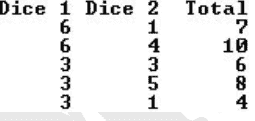

## 练习 15 —— 混沌

"**混沌理论**"是数学的一个分支，它严重依赖于计算机。一个简单的混沌实验是：

从0到1之间的任何实数x开始。使用"logistic方程"生成一个新的数：

```
x = 2*x*(1 - x)
```

显示这个新的x，然后重复这个过程50次。

+   a) 创建一个混沌应用程序，提示用户输入一个起始值，然后执行这个实验。对不同起始值会发生什么做出预测。

+   b) 修改应用程序，使logistic方程中的2可以替换为用户指定范围内的值，范围是2到4，但x的起始值始终为0.5。注意任何有趣的行为。

## 练习 16 —— 随机行走

在"随机行走"问题中，一个人被放在一座7米长的桥的正中央。每走一步，这个人随机地向前或向后移动1米。

创建一个随机行走应用程序，确定这个人在走下桥之前会走多少步。让应用程序进行50次试验的平均值，并显示平均值和最大步数。（提示：生成一个0到1之间的随机数，0表示向前走，1表示向后走。）

## 练习 17 —— 密码

创建一个密码应用程序，存储你选择的秘密密码。该密码应用程序应提示用户输入密码，如果输入正确则显示"Welcome"。如果三次尝试后仍未输入正确的密码，则显示"Access denied."。应用程序的输出应类似于：

```
Enter the password: homework
The password you typed is incorrect.
Enter the password: football
The password you typed is incorrect.
Enter the password: fish
The password you typed is incorrect.
Access denied.
```

## 练习 18 —— 姓名缩写

创建一个姓名缩写应用程序，提示用户输入他或她的名字、中间名和姓氏，然后显示一个姓名缩写，其中名字和中间名的首字母为小写，姓氏的首字母为大写。应用程序的输出应类似于：

```
Enter your first name: Alonso
Enter your middle initial: H
Enter your last name: Eloy

Your monogram is: aEh
```

## 练习 19 —— 移除字符串

创建一个移除字符串应用程序，提示用户输入一个句子和一个字符串。然后应用程序从句子中移除该字符串的每一次出现。应用程序应类似于：

```
Enter a sentence: I hope you have a really nice day.
Enter a string: really
I hope you have a nice day.
```

## 练习 20 —— 统计元音

创建一个统计元音应用程序，提示用户输入一个字符串，然后显示该字符串中元音字母的数量。应用程序的输出应类似于：

```
Enter text: Java Programming Assignment
The number of vowels in Java Programming Assignment is 8
```

## 练习 21 —— 分组

创建一个分组应用程序，提示用户输入他或她的姓名，然后显示分组结果。分组取决于学生姓氏的首字母。姓氏以A到I开头的分到第1组，J到S开头的分到第2组，T到Z开头的分到第3组。应用程序的输出应类似于：

```
Enter your first name: Janus
Enter your last name: Smith
Janus Smith is assigned to Group 2
```

# 第7章 方法

**O**bject-oriented programs use classes with methods to perform tasks. A program often performs several tasks, each with its own level of complexity. To manage these tasks, they are broken down into methods. This chapter discusses top-down program development and writing and documenting methods.

> **提示** 自顶向下开发也被称为自顶向下设计或逐步细化。

_自顶向下开发_

_过程抽象_

## 使用方法的程序开发

任务的解决方案可以通过将任务分解为更小的子任务来开发。这些子任务可以进一步简化为更简单的任务。这个过程可以一直持续，直到原始任务被分解为每个都描述一个具体目标的单元。随着任务被分解为更小的子任务，然后再进一步分解为单元，实现具体目标的更多细节被逐步添加。这种解决问题的方法描述了一种称为_自顶向下开发_的软件开发过程。

在自顶向下开发中，第一层子任务转化为`main()`方法。`main()`以下的任务层级被开发成一系列额外的方法。使用方法来定义任务被称为_过程抽象_。例如，考虑以下程序规范：

TempConverter允许用户将温度从华氏度转换为摄氏度，或从摄氏度转换为华氏度。

该应用程序的算法将程序规范分解为第一层子任务：

+   1. 确定要执行的转换类型。
2. 使用适当的公式转换温度。

步骤2可以进一步分解为另一层子任务：

+   2a. 提示用户输入摄氏度温度。
    使用公式将温度转换为华氏度：
    F=9/5C + 32。
    显示温度。
2b. 提示用户输入华氏度温度。
    使用公式将温度转换为摄氏度：
    C=5/9(F - 32)。
    显示温度。


自顶向下的开发方式和过程抽象被用来将程序规范分解为多级子任务，如前一页所示。用伪代码概述子任务的层级，定义了一个 main() 方法和另外两个方法：

main()
提示用户输入转换类型。
执行适当的方法来转换温度。

fahrenheitToCelsius()
提示用户输入华氏温度
将温度转换为摄氏温度
显示温度

celsiusToFahrenheit()
提示用户输入摄氏温度
将温度转换为华氏温度
显示温度

- main()
    提示用户输入转换类型。
    执行适当的方法来转换温度。

- fahrenheitToCelsius()
    提示用户输入华氏温度
    将温度转换为摄氏温度
    显示温度

- celsiusToFahrenheit()
    提示用户输入摄氏温度
    将温度转换为华氏温度
    显示温度

TempConverter 应用程序实现了上面的伪代码：


```
import java.util.Scanner;

public class TempConverter {

    public static void fahrenheitToCelsius() {
        double fTemp, cTemp;
        Scanner input = new Scanner(System.in);

        System.out.print("Enter a Fahrenheit temperature: ");
        fTemp = input.nextDouble();
        input.close();

        cTemp = (double)5/(double)9*(fTemp - 32);
        System.out.println("The Celsius temperature is " + cTemp);
    }

    public static void celsiusToFahrenheit() {
        double cTemp, fTemp;
        Scanner input = new Scanner(System.in);

        System.out.print("Enter a Celsius temperature: ");
        cTemp = input.nextDouble();
        input.close();

        fTemp = (double)9/(double)5*cTemp + 32;
        System.out.println("The Fahrenheit temperature is "
            + fTemp);
    }

    public static void main(String[] args) {
        int choice;
        Scanner input = new Scanner(System.in);

        /* Prompt user for type of conversion */
        System.out.println("1. Fahrenheit to Celsius conversion.");
        System.out.println("2. Celsius to Fahrenheit conversion.");
        System.out.print("Enter your choice: ");
        choice = input.nextInt();
        if (choice == 1) {
            fahrenheitToCelsius();
        } else {
            celsiusToFahrenheit();
        }
        input.close();
    }
```

## 方法调用

TempConverter 控制类包含两个方法以及一个 main() 方法。方法在被调用时执行。方法*调用*由方法名后跟括号组成。前一页 main() 方法中的 `if` 语句包含两个方法调用：`fahrenheitToCelsius()` 和 `celsiusToFahrenheit()`。

TempConverter 产生的输出类似如下：

```
1. Fahrenheit to Celsius conversion.
2. Celsius to Fahrenheit conversion.
Enter your choice: 1
Enter a Fahrenheit temperature: 32
The Celsius temperature is 0.0
```

在此应用程序运行中，用户输入了 1，因此调用了 fahrenheitToCelsius() 方法。

## 编写方法

*方法声明* 方法由声明和主体组成。*方法声明*包括访问级别、返回类型、名称以及参数（如有）。*方法主体*包含实现该方法的语句。方法的形式如下：

```
<access_level> <return_type> <name>(<parameters>) {
    <statements>
}
```

例如，考虑来自 TempConverter 应用程序的 fahrenheitToCelsius() 方法：

```
public static void fahrenheitToCelsius() {
    double fTemp, cTemp;
    Scanner input = new Scanner(System.in);

    System.out.print("Enter a Fahrenheit temperature: ");
    fTemp = input.nextDouble();
    input.close();

    cTemp = (double)5/(double)9*(fTemp - 32);
    System.out.println("The Celsius temperature is " + cTemp);
}
```

*访问级别* *访问修饰符* *可见性* 上面的方法是一个类方法，其访问级别为 `public`，返回类型为 `void`，名称为 fahrenheitToCelsius，没有参数。方法的*访问级别*决定了其他类是否可以调用该方法。关键字 `public` 是一个*访问修饰符*。公共方法可以被任何其他方法调用。方法的访问级别也可以被认为是其*可见性*。访问级别在第 8 章中进一步讨论。

*类方法* 关键字 `static` 将该方法声明为类方法。*类方法*可以从类本身调用。不是类方法的方法必须从该类的一个实例化对象调用。

*void* 返回类型 `void` 表示该方法不会返回值，参数在方法需要值来执行其任务时指定。方法的主体从第一个左花括号（`{`）开始，到右花括号（`}`）结束。

方法名应表明一个动作。动词是良好的方法名。方法名也应以小写字母开头，然后名称中的每个单词以大写字母开头。方法名不能包含空格。

方法也可以有自己的一组变量、常量和对象。方法主体中的变量、常量和对象声明的作用域从声明延伸到方法主体的末尾。这些变量、常量和对象被称为方法的局部变量，因为它们的作用域仅限于该方法。例如，fahrenheitToCelsius() 方法包含局部变量 fTemp 和 cTemp，以及名为 input 的局部对象。

## 复习：TimeConverter

创建一个 TimeConverter 应用程序，允许用户在以下转换中进行选择：小时转换为分钟、天转换为小时、分钟转换为小时，或小时转换为天。酌情使用方法。

## 方法参数

方法声明可以包含方法参数，用于接收来自方法调用的值。传递给方法的数据随后可在方法内部使用以执行其任务。例如，drawBar() 方法包含一个名为 length 的 int 参数：

```
public static void drawBar(int length) {
    for (int i = 0; i < length; i++) {
        System.out.print("*");
    }
    System.out.println();
}
```

通过将数据括在方法调用的括号中来向方法提供或传递数据。传递给方法的值或变量称为实参。例如，RightTriangle 应用程序对 drawBar() 进行了六次调用。每次调用传递不同的变量实参：

```
public class RightTriangle {
    public static void drawBar(int length) {
        for (int i = 1; i <= length; i++) {
            System.out.print("*");
        }
        System.out.println();
    }
    public static void main(String[] args) {
        /* draw a right triangle with base size 6 */
        for (int i = 1; i <= 6; i++) {
            drawBar(i);
        }
    }
}
```

```
*
**
***
****
*****
******
```

RightTriangle 应用程序产生的输出：

|   |   |
|---|---|
|   | x |
|   | x |
|   | x |


*按值传递* 在 Java 中，实参按值传递，这意味着存储在实参中的数据被传递。作为基本数据类型的实参向方法传递其值的副本。作为对象的实参向方法传递其对对象引用的副本。方法可以更改存储在对象中的数据，因为它可以访问该对象的方法，但它不能更改存储在基本类型变量中的数据，因为方法无法访问基本数据的实际位置。

## 多个参数

当方法声明包含多个参数时，参数之间用逗号分隔。例如，修改后的 drawBar() 有一个 int 参数表示条的长度，还有一个 String 参数表示用于绘制条的字符：

```
public static void drawBar(int length, String mark) {
    for (int i = 1; i <= length; i++) {
        System.out.print(mark);
    }
    System.out.println();
}
```

对修改后的 drawBar() 方法的调用包含两个用逗号分隔的实参：

```
drawBar(6, "$");
```

此调用产生以下输出：

```
$$$$$$
```

方法调用中实参的顺序很重要，因为第一个实参对应方法声明中的第一个参数，第二个实参对应第二个参数，依此类推。请注意，实参名称不一定与参数名称匹配。应在整个程序中使用描述性变量名，而无需考虑与方法声明中的参数名称匹配。

## 复习：SpanishNumbers

创建一个 SpanishNumbers 应用程序，显示数字 1 到 10 的西班牙语表达。一个带有 int 参数的方法应显示所传递数字的西班牙语单词。main() 方法中的循环结构应用于调用该方法十次。数字 1 到 10 的西班牙语单词对应如下：

| Number | Spanish |
|--------|---------|
| 1 | uno |
| 2 | dos |
| 3 | tres |
| 4 | cuatro |
| 5 | cinco |
| 6 | seis |
| 7 | siete |
| 8 | ocho |
| 9 | nueve |
| 10 | diez |


# 复习：DisplayBox – 第 1 部分（共 2 部分）

创建一个 DisplayBox 应用程序，提示用户输入高度和宽度，然后显示相应大小的方框。该 DisplayBox 应用程序应包含一个名为 `drawBox()` 的方法，该方法有两个参数，并调用 `drawBar()` 方法。

# 方法重载

方法声明用于编译器确定要执行哪个方法。因此，对于同名方法，只要参数不同，方法名就不必唯一。**方法重载（Method overloading）**是指在一个类中包含多个同名方法。例如，下面的应用程序包含两个 `drawBar()` 方法：

```java
public class MethodOverloadingExample {

    public static void drawBar(int length) {

        for (int i = 1; i <= length; i++) {
            System.out.print("*");
        }
        System.out.println();
    }

    public static void drawBar(int length, String mark) {

        for (int i = 1; i <= length; i++) {
            System.out.print(mark);
        }
        System.out.println();
    }

    public static void main(String[] args) {

        drawBar(10);
        drawBar(5, "@");
    }
}
```

`MethodOverloading` 应用程序产生如下输出：

```text
**********
@@@@@
```

注意，`main()` 中的第一次调用执行的是只包含一个参数的 `drawBar()` 方法。第二次调用执行的是包含两个参数的 `drawBar()` 方法。编译器使用参数的类型、顺序和数量来确定要执行哪个方法。

# 复习：DisplayBox – 第 2 部分（共 2 部分）

修改 `DisplayBox` 应用程序，询问用户是否要用特定字符来显示方框。例如，提示可以是："Do you want to enter a character to use to display the box? (enter y for yes):" 如果用户输入 `y`，则提示用户输入字符。否则，使用默认字符。修改后的应用程序应包含重载的 `drawBox()` 和 `drawBar()` 方法。

# return 语句

方法可以返回值。例如，`cubeOf()` 方法返回其参数的三次方：

> **提示** 方法的返回类型不能用于区分重载的方法。

```java
public static double cubeOf(double x) {
    double xCubed;

    xCubed = x * x * x;
    return(xCubed);
}
```

`return` 语句用于将一个值返回到调用语句。一个 `return` 语句只能返回一个值。

返回值的方法必须在方法声明中包含返回类型。例如，`cubeOf()` 方法声明了返回类型 `double`。返回类型可以是基本类型，如 `int`、`double` 和 `boolean`，也可以是抽象类型，如 `String` 类。返回类型 `void` 表示没有返回值。声明为 `void` 的方法不包含 `return` 语句。

返回值的方法是从将使用返回值的语句中调用的，例如表达式或赋值语句。例如，下面的应用程序从赋值语句中调用 `cubeOf()`：

```java
public class CubeCalculator {

    public static double cubeOf(double x) {
        double xCubed;

        xCubed = x * x * x;
        return(xCubed);

    }

    public static void main(String[] args) {
        double num = 2.0;
        double cube;

        cube = cubeOf(num);
        System.out.println(cube);
    }
}
```

`CubeCalculator` 应用程序产生以下输出：

8.0

## 第 7 章 方法

# **复习：幂运算**

创建一个 `Exponentiation` 应用程序，提示用户输入两个数字，然后显示第一个数的第二个数次幂。该应用程序应包含一个名为 `powerOf()` 的方法，返回其第一个参数的第二个数次幂。

# **方法文档**

方法应仔细注释，以便程序的读者理解该方法执行什么任务，以及该方法将返回什么数据（如果有的话）。方法文档采用文档注释（`/* */`）的形式，出现在方法声明的正上方。例如，带文档的 `drawBar()` 方法：

```java
/**
 * Print a bar of asterisks across the screen.
 * pre: length > 0
 * post: Bar drawn of length characters, insertion point moved to next line.
 */
public static void drawBar(int length) {

    for (int i = 0; i < length; i++) {
        System.out.print("*");
    }
    System.out.println();
}
```

方法的假设或初始需求在文档的 `pre`（前置条件）部分中说明。注意，`drawBar()` 的 `pre` 说明 `length` 必须大于 0，但没有说明 `length` 必须是 int。编译器会验证的信息，如数据类型，不应在方法文档中说明。

文档的后置条件部分，即 `post`，说明方法执行后必须为真的事项。但是，`post` 不应说明方法如何完成其任务。

方法可能没有前置条件，但每个方法必须有后置条件。例如，下面是带文档的 `cubeOf()` 方法：

```java
/**
 * Calculates the cube of a number.
 * pre: none
 * post: x cubed returned
 */
public static double cubeOf(double x) {
    double xCubed;

    xCubed = x * x * x;
    return(xCubed);
}
```

总结来说，编写 `pre` 和 `post` 条件的指导原则如下：

*   前置条件说明在方法开始时必须为真，方法才能正常工作。
*   后置条件说明如果方法正常工作，执行后必须为真的事项。
*   前置条件和后置条件不应说明编译器会验证的事实。它们也不应引用方法外部的变量或信息。
*   后置条件不应说明方法如何完成其任务。

# 复习

修改本章中的每个复习题，使方法得到适当的文档注释。

## 第 7 章 案例研究

本案例研究将重点介绍自顶向下开发和过程抽象。还将演示如何孤立地测试和调试方法。

将创建一个根据数字成绩生成字母等级的应用程序。`GradeConverter` 应用程序允许用户输入数字成绩，然后显示字母等级。然后用户可以选择输入另一个成绩或退出。

# GradeConverter 规格说明

`GradeConverter` 应用程序提示用户输入 0 到 100 范围内的数字成绩，或输入 `-1` 以结束应用程序。当输入有效的数字成绩时，显示相应的字母等级。90 到 100 分为 A，80 到 89 分为 B，70 到 79 分为 C，60 到 69 分为 D，60 分以下为 F。显示相应的字母等级后，提示用户输入另一个数字成绩或退出应用程序。

`GradeConverter` 界面应包含一个要求输入数字成绩的提示。该提示应提供退出应用程序的选项。显示字母等级后，应提示用户输入另一个数字成绩或退出应用程序。

**GradeConverter 输出草图：**

```text
Enter a numeric grade (-1 to quit): 88
The grade 88 is a(n) B.
Enter a numeric grade (-1 to quit): 90
The grade 90 is a(n) A.
Enter a numeric grade (-1 to quit): -1
```

# **GradeConverter 算法：**

*   1a. 提示用户输入一个数字。
*   2b. 确定与输入的数字成绩对应的字母等级并显示结果。
*   3c. 重复步骤 1a 和 2b，直到用户选择退出。

**GradeConverter 流程图：**
``

# **GradeConverter 代码设计**

使用自顶向下的开发方法，算法进一步细化：

## 算法步骤 1 可以进一步分解为：

*   显示一个提示，让用户可以选择退出。
    检查输入的数字是否有效。它应对应一个表示用户想要退出的哨兵值，或 0 到 100 范围内的一个数字。

## 算法步骤 2 可以进一步分解为：

*   判断数字成绩是否在 90 到 100、80 到 89、70 到 79、60 到 69 或 0 到 59 之间。
    将字母 A 分配给 90 到 100 的成绩，字母 B 分配给 80 到 89 的成绩，字母 C 分配给 70 到 79 的成绩，字母 D 分配给 60 到 69 的成绩，字母 F 分配给 0 到 59 的成绩。

166  
第 7 章 方法

利用流程图、算法和过程抽象，可以为 GradeConverter 应用程序创建伪代码。该代码将包含一个循环结构来获取用户输入，以及两个额外的**方法**。一个方法用于判断输入**是否**有效，另一个用于确定哪个字母对应于数字成绩：

```
main()
  Prompt the user for a number
  while (number != -1) {
    if (isValidNumber(number)) {
      getLetterGrade(number)
      Display message with letter grade
    }
    Prompt the user for a number
  }

isValidNumber(userNum, maxNum, minNum)
  if (minNum <= userNum <= maxNum) {
    return (true);
  } else {
    return(false);
  }

getLetterGrade(numericGrade)
  if (numericGrade < 60) {
    return ("F");
  } else if (numericGrade < 70) {
    return ("D");
  } else if (numericGrade < 80) {
    return ("C");
  } else if (numericGrade < 90) {
    return ("B");
  } else {
    return ("A");
  }
```

## GradeConverter 实现

**单独测试方法**对于确保整个程序无错误运行至关重要。测试某个方法时，`main()` 中的语句应使用测试数据调用该方法。`main()` 方法不应调用任何其他方法或执行任何其他任务，仅用于测试当前方法。

与其一次性编写整个应用程序的代码，不如逐个添加方法并进行测试。当方法测试完成后，再重写 `main()` 方法以实现 GradeConverter 伪代码。

`isValidNumber()` 方法是第一个编写并测试的方法：

```
public class GradeConverter {

    /**
     * Determines if a numeric entry is valid.
     * pre: none
     * post: true return if minNum <= userNum <= maxNum;
     * false returned otherwise
     */
    public static boolean isValidNumber(int userNum, int minNum, int maxNum) {
        if (minNum <= userNum && userNum <= maxNum) {
            return(true);
        } else {
            return(false);
        }
    }

    public static Collection接口的主要void main(String[] args) {
        final int minValue = 0;
        final int maxValue = 100;
        int numericGrade;

        numericGrade = 0;
        if (isValidNumber(numericGrade, minValue, maxValue)) {
            System.out.println(numericGrade + " is valid.");
        } else {
            System.out.println(numericGrade + " is NOT valid.");
        }

        numericGrade = 100;
        if (isValidNumber(numericGrade, minValue, maxValue)) {
            System.out.println(numericGrade + " is valid.");
        } else {
            System.out.println(numericGrade + " is NOT valid.");
        }

        numericGrade = -1;
        if (isValidNumber(numericGrade, minValue, maxValue)) {
            System.out.println(numericGrade + " is valid.");
        } else {
            System.out.println(numericGrade + " is NOT valid.");
        }

        numericGrade = 101;
        if (isValidNumber(numericGrade, minValue, maxValue)) {
            System.out.println(numericGrade + " is valid.");
        } else {
            System.out.println(numericGrade + " is NOT valid.");
        }
    }
}
```

`main()` 中的语句使用包含**边界值**的数据来测试 `isValidNumber()` 方法。边界值是指刚好在有效值范围内或刚好在其外的数据。例如，值 `100` 刚好位于有效成绩范围的高端。使用此数据测试该方法可以验证使用的是 `<=` 操作符而不是 `<` 操作符。GradeConverter 应用程序产生如下输出：

```
0 is valid.
100 is valid.
-1 is NOT valid.
101 is NOT valid.
```

接下来，添加 `getLetterGrade()` 方法，并修改 `main()` 中的语句以测试该方法：

```
public class GradeConverter {

	/**
	 * Determines if a numeric entry is valid.
	 * pre: none
	 * post: true has been returned if minNum <= userNum <= maxNum;
	 * false has been returned otherwise
	 */
	public static boolean isValidNumber(int userNum, int minNum, int maxNum) {
		if (minNum <= userNum && userNum <= maxNum) {
			return(true);
		} else {
			return(false);
		}
	}

	/**
	 * Determines the letter grade that corresponds to the numeric grade.
	 * pre: 0 <= numGrade <= 100
	 * post: The letter grade A, B, C, D, or F has been returned.
	 */
	public static String getLetterGrade(int numGrade) {
		if (numGrade < 60) {
			return("F");
		} else if (numGrade < 70){
			return("D");
		} else if (numGrade < 80) {
			return("C");
		} else if (numGrade < 90) {
			return("B");
		} else {
			return("A");
		}
	}

	public static void main(String[] args) {
		int numericGrade;

		numericGrade = 90;
		System.out.println(numericGrade + " is " + getLetterGrade(numericGrade));
		numericGrade = 89;
		System.out.println(numericGrade + " is " + getLetterGrade(numericGrade));
		numericGrade = 80;
		System.out.println(numericGrade + " is " + getLetterGrade(numericGrade));
		numericGrade = 79;
		System.out.println(numericGrade + " is " + getLetterGrade(numericGrade));
		numericGrade = 70;
		System.out.println(numericGrade + " is " + getLetterGrade(numericGrade));
		numericGrade = 69;
		System.out.println(numericGrade + " is " + getLetterGrade(numericGrade));
		numericGrade = 60;
		System.out.println(numericGrade + " is " + getLetterGrade(numericGrade));
		numericGrade = 59;
		System.out.println(numericGrade + " is " + getLetterGrade(numericGrade));
	}

}
```

`main()` 中的语句测试了 `getLetterGrade()` 的边界值。运行 GradeConverter 显示输出：

```
90 is A
89 is B
80 is B
79 is C
70 is C
69 is没有任何的 D
60 is D
59 is F
```

在验证方法按预期工作后，可以完成最终的 GradeConverter 应用程序：

```
/*
 * GradeConverter.java
 */

import java.util.Scanner;

/**
 * Display the letter grade that corresponds to the numeric
 * grade entered by the user.
 */
public class GradeConverter {

    /**
     * Determines if a numeric entry is valid.
     * pre: none
     * post: true has been returned if minNum <= userNum <= maxNum;
     *       false has been returned otherwise
     */
    public static boolean isValidNumber(int userNum, int minNum, int maxNum) {
        if (minNum <= userNum && userNum <= maxNum) {
            return(true);
        } else {
            return(false);
        }
    }

    /**
     * Determines the letter grade that corresponds to the numeric grade.
     * pre: 0 <= numGrade <= 100
     * post: The letter grade A, B, C, D, or F has been returned.
     */
    public static String getLetterGrade(int numGrade) {
        if (numGrade < 60) {
            return("F");
        } else if (numGrade < 70){
            return("D");
        } else if (numGrade < 80) {
            return("C");
        } else if (numGrade < 90) {
            return("B");
        } else {
            return("A");
        }
    }
}
```

```
public static void main(String[] args) {
    final int FLAG = -1;
    final int minValue = 0;
    final int maxValue = 100;
    int numericGrade;
    String letterGrade;
    Scanner input = new Scanner(System.in);

    System.out.print("Enter a numeric grade (-1 to quit): ");
    numericGrade = input.nextInt();
    while (numericGrade != FLAG) {
        if (isValidNumber(numericGrade, minValue, maxValue)) {
            letterGrade = getLetterGrade(numericGrade);
            System.out.println("The grade " + numericGrade + " is a(n) " +
                               letterGrade + ".");
        } else {
            System.out.println("Grade entered is not valid.");
        }
        System.out.print("Enter a numeric grade (-1 to quit): ");
        numericGrade = input.nextInt();
    }
}
```

GradeConverter 应用程序产生类似如下的输出：

```
Enter a numeric grade (-1 to quit): 88
The grade 88 is a(n) B.
Enter a numeric grade (-1 to quit): 90
The grade 90 is a(n) A.
Enter a numeric grade (-1 to quit): -1
```

## GradeConverter 测试与调试

此时进行的测试应该以 `main()` 中的逻辑为目标，因为其他方法已经验证过了。`main()` 中的逻辑很简单。因此，测试只需包括验证循环控制变量是否按预期工作、用户是否能够按预期输入成绩，以及对于用户输入的 0 到 100 范围内的值是否返回相应的字母成绩。

## 复习：GradeConverter

修改 GradeConverter 案例研究，使其在成绩为 100 时显示 A+，89 时显示 B+，79 时显示 C+，69 时显示 D+。

## 章节总结

本章介绍了一个新的软件开发层次，包括编写方法来执行任务。在软件开发过程中，**自顶向下开发**是一种问题解决方法，它将任务分解为更小的子任务，再进一步分解为单元。用方法实现这些任务称为**过程抽象**。


方法通过包含方法名后跟括号在语句中执行。执行方法的语句被称为调用该该方法。当方法需要数据来完成任务时，这些数据包含在方法调用的括号内。返回数据的方法必须从赋值语句或表达式内部调用。

方法包括声明和体。方法声明包括访问级别（如有）、返回类型、方法名以及接收数据的参数（必要时）。方法的访问级别可以被声明为`public`，这意味着该方法可以从任何其他方法中的语句中调用。关键字 `public` 被称为访问修饰符。包含关键字 `static` 的方法声明是类方法，它可以由类本身调用。

方法的返回类型声明了将返回给调用语句的值类型。返回类型`void` 表示该方法根本不返回值。返回类型可以是基本类型，如 `int` 和 `double`，也可以是抽象数据类型，如 `String`。返回数据值的方法必须包含 `return` 语句。

方法可以有多个参数。方法调用中的参数必须按照参数声明的顺序传递给方法。具有相同名称但参数不同的方法被称为重载。编译器通过重载方法的参数类型、顺序和数量确定要调用哪个方法。

基本参数是按值传递的，这意味着传递的是存储在该参数中的数据，而不是参数的位置引用。该方法只能在它执行的任务中使用参数值。该方法不能改变存储在参数中的更改。

方法的体可以包含变量、常量和对象声明。这些声明被认为是局部的，因为它们的范围仅限于从声明到方法体结束的部分。

编写程序文档对读者理解方法很重要。方法文档由 `/**  */` 括起来，包括方法的简要描述、前提条件和后条件。每个方法都必须有后条件，但不是每个方法都需要前提条件。

本章引入的代码约定如下：
- 方法名应表示一个动作，并以小写字母开头，然后大写字母开始名称内的每个单词。
- 方法文档应包含在 `/**  */` 注释块中。
- 方法文档应包括对方法执行任务的简要描述、前提条件和后条件。

## 词汇表
- **Access level** 方法声明中确定该方法是否可被其他类调用的部分。
- **Access modifier** 用于确定方法访问级别的关键字。
- **Argument** 传递给方法的值或变量。
- **Call** 包含方法名后跟括号的语句。
- **Boundary value** 位于有效值范围之内或之外的值。
- **Class method** 可以从类本身调用的方法。
- **Local** 在方法内声明的变量、常量和对象，因此其作用域限于该方法。
- **Method body** 实现方法的语句。
- **Method declaration** 方法的第一行，包含方法名、访问级别、返回类型和参数（如有）。
- **Method overloading** 在类中编写超过一个具有相同名称的方法。
- **Method parameters** 接受来自方法调用的值的声明部分。
- **Pass** 通过将数据包含在方法调用的括号内将数据传递给方法。
- **Pass by value** 按值传递参数的值给方法。传递的数据类型取决于参数是基本类型还是对象。
- **Precondition** 方法文档中说明方法的假设或初始要求的部分。也称为 *pre*。
- **Procedural abstraction** 将任务分解为方法。
- **Postcondition** 方法文档中说明在方法执行后必须成立的部分。也称为 *post*。
- **Top-down development** 一种问题解决方法，其中任务被分解为子任务，然后这些子任务又被简化为更简单的任务。
- **Visibility** 方法的访问级别。

## Java
- `/** */` 用于括起方法文档注释。
- `public` 在方法声明中用作访问修饰符，表示该方法对其他任何类可见。
- `static` 在方法声明中用作关键字，表示该方法是一个类方法。
- `void` 在方法声明中用作关键字，表示该方法将不返回值。
- `return` 用于将值从方法发送回调用语句的语句。

## 批判性思维
1. 使用自顶向下开发和过程抽象为以下规范编写伪代码：
   Pizza 应用程序允许用户选择以英语或西班牙语显示制作比萨的说明。

2. 解释方法声明与方法体之间的区别。

3. 使用什么类型的关键字来更改方法的访问级别？

4. 描述方法访问级别的另一个词是什么？

5. 解释以下代码中每个变量的范围：
   ```
   public class ScopeExample {
       public static void main(String[] args) {
           int var1;
           for (int var2 = 0; var2 < 5; var2++) {
               method1();
           }
       }
       public static void method1() {
           int var3;
           for (int var4 = 0; var4 < 2; var4++) {
               var3 += 1;
           }
       }
   }
   ```

6. 为以下描述编写方法声明：
   a) 名为 `getVowels` 的类方法，可以被任何其他方法调用，需要一个 String 参数，并返回一个整数值。
   b) 名为 `extractDigit` 的类方法，可以被任何其他方法调用，需要一个整数参数，并返回一个整数值。
   c) 名为 `insertString` 的类方法，可以被任何其他方法调用，需要一个 String 参数和一个整数参数，并返回一个 String 参数。

7. a) 编译器如何区分不同的方法？
   b) 同一个类中的两个方法可以有相同的名称吗？请解释。

8. a) `return` 语句用于什么？
   b) `return` 语句可以发送多少个值回调用语句？
   c) 返回值的声明与不返回值的声明有何不同？

9. 找出并解释以下代码中的错误：
   ```
   public class MethodCallExample {
       public static void main(String[] args) {
           int num;
           doSomething();
           num = doSomething();
       }
       public static int doSomething() {
           return(5);
       }
   }
   ```

10. a) 应该使用什么类型的注释来描述方法？
    b) 方法的注释应该描述哪三件事？

## 判断正误
11. 确定以下各项是否正确。如果错误，请解释原因。
    a) 将任务分解为方法称为过程抽象。
    b) 方法调用是赋值语句中的方法声明。
    c) void 方法必须返回值。
    d) 访问修饰符声明方法的返回类型。
    e) 关键字 `static` 声明方法是类方法。
    f) 方法参数被大括号 ({} ) 括起来。
    g) 局部变量可以被类中的任何方法使用。
    h) 传递给方法的方法的参数值可以在方法的赋值语句中更改。
    i) 方法重载意味着应用程序包含超过 10 个方法。
    j) `return` 语句用于将值发送回调用语句。
    k) 方法的前提条件说明方法的参数数据类型。
    l) 方法的后条件描述方法完成任务的方式。

174 第 7 章 方法

## 练习

## 练习 1 House

创建一个 House 应用程序，调用 `addRoof()`、`addBase()` 和 `addWalk()` 方法来显示以下内容：

```
    /\
   /__\
   |  |
   |__|
   **
**********
```

## 练习 2 MetricConversion

可以使用以下公式将英制计量单位转换为公制单位：

inches * 2.54 = centimeters
feet * 30 = centimeters
yards * 0.91 = meters
miles * 1.6 = kilometers

创建一个 MetricConversion 应用程序，显示一个转换选项菜单，然后提示用户选择一种转换方式。转换选项应包括英寸转厘米、英尺转厘米、码转米、英里转公里，以及它们的反向转换。应用程序应包含执行每种转换的单独方法。应用程序输出应类似于：

```
Enter a number: 10

Convert:
1. Inches to Centimeters    5. Centimeters to Inches
2. Feet to Centimeters      6. Centimeters to Feet
3. Yards to Meters          7. Meters to Yards
4. Miles to Kilometers      8. Kilometers to Miles

Enter your choice: 1

10 inches equals 25.4 centimeters.
```

## 练习 3 PrimeNumber

修改第 6 章练习 1 中创建的 PrimeNumber 应用程序，使其包含一个名为 `isPrime()` 的方法。`isPrime()` 方法应要求一个参数并返回一个布尔值。

## 练习 4 IsoTriangle

创建一个 IsoTriangle 应用程序，提示用户输入等腰三角形的大小，然后显示具有该行数的三角形。IsoTriangle 应用程序代码应包括：

- 本章中的 `drawBar()` 方法。
- 一个“打印”空格的 `addSpaces()` 方法。

应用程序输出应类似于：

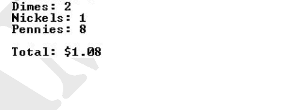

## 练习 5 AddCoins

创建一个 AddCoins 应用程序，提示用户输入便士、五分镍币、一角硬币和二十五美分硬币的数量，然后显示它们的总美元金额。AddCoins 应用程序应包含一个 `getDollarAmount()` 方法，该方法有四个 `int` 参数，分别对应便士、五分镍币、一角硬币和二十五美分硬币的数量，并返回一个对应硬币美元价值的字符串。请注意，返回的字符串应包含货币符号（$）。应用程序输出应类似于：


## 练习 6 PythagoreanTriple

创建一个 PythagoreanTriple 应用程序，显示所有 A 和 B 值小于 100 的勾股数。勾股数是一组使方程 a² + b² = c² 成立的三个整数。应用程序应包含一个 `PerfectSquare()` 方法，该方法使用第 6 章 PerfectSquare 复习中的解决方案。（提示：你需要生成 A 和 B 的所有可能组合，并仅显示那些可行的组合。）

## 练习 7 PerfectIntegers

创建一个 PerfectIntegers 应用程序，显示所有 100 以内的完美数。完美数是一个等于其所有因子（不包括自身）之和的数字。例如，6 是一个完美数，因为 1 + 2 + 3 = 6。应用程序应包含一个布尔方法 `isPerfect()`。

## 练习 8 HiLo

a) 在 Hi-Lo 游戏中，玩家从 1000 分开始。系统会提示玩家输入要风险的分数，然后第二个提示要求玩家选择 High 或 Low。玩家选择 High 或 Low 与一个 1 到 13 之间（包含）的随机数进行比较。如果数字在 1 到 6 之间（包含），则被认为是“低”。数字在 8 到 13 之间（包含）是“高”。数字 7 既不是高也不是低，玩家将失去风险分数。如果玩家猜对了，风险分数将加倍并加到总分上。如果猜错，玩家将失去风险分数。根据此规范创建一个 HiLo 应用程序。应用程序输出应类似于：

```
High Low Game

RULES
Numbers 1 through 6 are low
Numbers 8 through 13 are high
Number 7 is neither high or low

You have 1000 points.

Enter points to risk: 500

Predict <1=High, 0=Low>: 0
Number is 4
You win.
Play again? y

You have 2000 points.
```

b) 修改应用程序，允许玩家持续游戏直到分数为零。在游戏结束时，显示用户在分数耗尽前的猜测次数。

## 练习 9 Nim

Nim 游戏开始时有 15 到 30 之间的一个随机石头数量。两名玩家轮流，每回合可以从堆中拿走 1、2 或 3 块石头。被迫拿走最后一块石头的玩家输。创建一个 Nim 应用程序，允许用户与计算机对战。在这个版本的游戏中，应用程序生成初始石头数量、计算机拿走的石头数量，并且用户先走。Nim 应用程序代码应：

- 防止用户和计算机拿走非法数量的石头。例如，当只剩下 1 或 2 块石头时，都不允许拿走三块。
- 包含一个 `isValidEntry()` 方法来检查用户输入。
- 包含一个 `drawStones()` 方法，为计算机拿走的石头数量生成一个 1 到 3 之间的随机数。
- 包含单独的处理方法来处理用户的回合和计算机的回合。

应用程序输出应类似于下一页所示：

```
There are 22 stones. How many would you like? 3
There are 19 stones. The computer takes 2 stones.
There are 17 stones. How many would you like? 3
There are 14 stones. The computer takes 2 stones.
There are 12 stones. How many would you like? 3
There are 9 stones. The computer takes 3 stones.
There are 6 stones. How many would you like? 3
There are 3 stones. The computer takes 3 stones.
The player beats the computer!
```

## 练习 10 GuessingGame

在第 6 章练习 8 中修改的 GuessingGame 应用程序应包含一个单独的方法来向用户显示提示。按如下方式修改 GuessingGame 应用程序：

- a) 修改算法以包含对名为 `giveHint()` 的方法的调用，该方法显示提示但不返回值。
- b) 根据算法修改修改流程图。
- c) 修改 GuessingGame 代码。应用程序输出应类似于：

```
Enter a number between 1 and 20: 15
Hint: try a higher number

Enter a number between 1 and 20: 17
Hint: try a lower number

Enter a number between 1 and 20: 16
You won!
```

# 第 8 章
## 类与面向对象开发

Java 应用程序使用对象来执行任务。对象由类定义。本章解释如何设计和编写一个类。介绍了 Object 类和继承。还讨论了面向对象开发、封装和可重用性。

## 什么是对象？

在面向对象编程中，一个 *对象* 存储数据，并可以执行操作和提供通信。对象的 *状态* 指它存储的数据。对象的 *行为* 由其提供的操作和通信定义。

对象通常对现实世界的事物进行建模或模拟。例如，考虑一个圆形形状。为了创建一个以圆形形状为模型的 Circle 对象，我们分析该形状的状态和行为。一个圆由其半径定义，因此这将构成对象的状态。圆形形状在操作方面做得不多，但 Circle 对象可以更改其半径、计算其面积，并告诉我们其半径是多少。这些操作将构成 Circle 对象的行为。

一个对象是一个类的 *实例*。一个 *类* 是一种数据类型，它定义用于对象状态的变量和用于对象行为的方法。良好的编程风格规定，对象的状态只能通过其行为来更改。例如，要更改 Circle 对象的半径，必须调用一个更改半径变量的方法。保护对象的数据称为 *封装*。封装也称为 *信息隐藏*，因为对象向类外部的代码隐藏某些数据。例如，在客户端代码中声明的 Circle 对象可以可视化为：

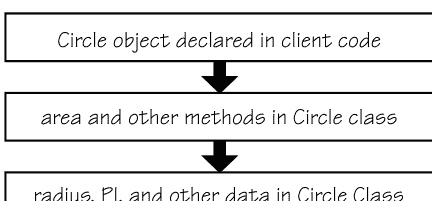

> 提示 类是一种抽象数据类型，这在第 4 章中讨论过。


## 客户端代码

*客户端代码*是指使用一个或多个类的应用程序。客户端可以访问类的方法，但不能直接访问类中定义的数据。这强化了对象的状态只能通过其行为来改变。

> **提示** 在Java中，控制类就是客户端代码。

TestCircle 是一个客户端代码。它使用了 Circle 类：

```
public class TestCircle {

    public static void main(String[] args) {
        Circle spot = new Circle();

        spot.setRadius(5);

        System.out.println("Circle radius:" + spot.getRadius());
        System.out.println("Circle area: " + spot.area());
    }
}
```

在 TestCircle 应用程序中，一个名为 `spot` 的 Circle 对象被实例化。对象 `spot` 使用行为 setRadius() 来改变对象的状态，使圆的半径变为 5。还实现了另外两个行为来产生应用程序输出：

```
Circle radius: 5.0
Circle area: 78.5
```

## 设计和编写类

> **功能分解**

为类创建明确定义的函数（即行为）的过程有时称为*功能分解*。一个编写良好的类被功能分解为一组无法进一步简化的方法。

设计类需要选择对象将存储的数据，并确定对象将提供的操作和通信。设计应包括变量名和方法名，以及方法描述和任何所需参数。例如，Circle 类的设计如下所示：

```
Circle

变量: radius, PI

方法:
    setRadius – 改变半径。需要一个
                 半径参数。
    getRadius – 返回圆的半径。
    area – 返回基于
           当前半径的圆面积。
```

类写在单独的文件中，由声明和主体组成。*类声明*包括访问级别、`class` 关键字和类名。*类主体*包含变量、构造函数和方法。*构造函数*用于初始化类中的变量。变量和方法称为类的*成员*。类的形式如下：

```
<access_level> class <name> {
    <variables>
    <constructors>
    <methods>
}
```

### 类声明、主体

### 构造函数

### 成员

---

## 组织文件

每个类写在单独的文件中。客户端代码和它所使用的类随后作为项目的一部分一起编译。

Circle 类代码基于上一页的设计：

```
/**
 * Circle class.
 */
public class Circle {
    private static final double PI = 3.14;
    private double radius;

    /**
     * constructor
     * pre: none
     * post: A Circle object created. Radius initialized to 1.
     */
    public Circle() {
        radius = 1;         //default radius
    }

    /**
     * Changes the radius of the circle.
     * pre: none
     * post: Radius has been changed.
     */
    public void setRadius(double newRadius) {
        radius = newRadius;
    }

    /**
     * Calculates the area of the circle.
     * pre: none
     * post: The area of the circle has been returned.
     */
    public double area() {
        double circleArea;

        circleArea = PI * radius * radius;
        return(circleArea);
    }

    /**
     * Returns the radius of the circle.
     * pre: none
     * post: The radius of the circle has been returned.
     */
    public double getRadius() {
        return(radius);
    }
}
```

## 接口

类的公共方法定义了对象的*接口*。接口是客户端代码与对象交互的方式。

Circle 类的访问级别为 `public`，这意味着它对其他类可见，并可用于在这些类中实例化对象。类名是 `Circle`。类名应该是名词，以大写字母开头，名称中的每个单词也应以大写字母开头。类名不能包含空格。

### 命名规范

类的主体以左花括号 ({) 开始，以右花括号 (}) 结束。成员变量在左花括号之后、任何方法之外声明。类主体中的变量声明具有从类主体左花括号延伸到右花括号的局部作用域。注意，Circle 类还有一个作为常量的成员变量。

> **提示** 访问修饰符和可见性在第7章中介绍了。

成员变量的可见性由访问修饰符控制。将变量声明为 `private` 使其对类可见，但对客户端代码不可见。这封装了数据并提供了信息隐藏。例如，Circle 类包含一个 `private` 变量 `radius`，类的任何方法都可以使用它，但在创建 Circle 对象的客户端代码中的语句无法直接访问它。

构造函数在创建对象时自动调用。构造函数是初始化变量的地方。未初始化的变量可能包含数据，当执行类的方法时可能导致运行时错误。

### 访问方法（getter）

*访问方法*用于确定变量的值。例如，在 Circle 类中，`getRadius()` 是一个访问方法。它返回变量 `radius` 的值。

### 修改方法（setter）

*修改方法*用于改变变量的值。在 Circle 类中，`setRadius()` 是一个修改方法。它将传入参数的值赋给变量 `radius`。访问方法和修改方法的访问级别为 `public`，以便在创建 Circle 对象的类中调用它们。

### 辅助方法

*辅助方法*由类中的其他方法调用。它们用于帮助完成任务，访问级别为 `private`。Circle 类不包含辅助方法。

包含 Circle 对象的应用程序可以包含调用 `public` 方法的语句，但引用 `private` 成员的语句将产生编译器错误。

## 复习：Circle – 第1部分（共4部分）

修改 Circle 类，使其包含一个名为 `circumference` 的成员方法。`circumference()` 方法应返回圆的周长（2πr）。使用以下客户端代码测试该类：

```
public static void main(String[] args) {
    Circle spot = new Circle();

    spot.setRadius(3);
    System.out.println("Circle radius:  " + spot.getRadius());
    System.out.println("Circle circumference:  " + spot.circumference());
}
```

## 复习：Coin – 第1部分（共2部分）

创建一个 Coin 类，包含一个变量 `faceUp`，用于存储正面朝上为 0 或反面朝上为 1，一个名为 `showFace()` 的访问方法，如果硬币正面朝上返回 0，反面朝上返回 1，以及一个名为 `flipCoin()` 的修改方法，将 0 到 1 之间（含）的随机整数赋给变量 `faceUp`。使用以下客户端代码测试一部手机：

```
public static void main(String[] args) {
    Coin nickel = new Coin();

    if (nickel.flipCoin() == 0) {
        System.out.println("Heads up!");
    } else {
        System.out.println("Tails up!");
    }
}
```

## 编写构造函数

类的构造函数在对象实例化时自动执行。一旦对象被实例化，类的方法成员可以以任何顺序调用。如果在成员变量被设置为有效值之前调用访问方法，可能会出现意外结果。为防止这种情况，变量应在构造函数中初始化。

构造函数的形式为：

```
public <class name>(<parameters>) {
    <statements>
}
```

类的构造函数没有返回类型，并且始终与类同名。当构造函数包含参数时，它们用逗号分隔。

### 构造函数重载

构造函数可以重载，以提供更多实例化对象的选项。例如，如果在创建 Circle 对象时已知圆的半径，则在创建对象时将值赋给 radius 会更高效：

```
Circle spot = new Circle(5);
```

可以向 Circle 类添加一个构造函数，以处理创建带有包含圆半径参数的对象：

```
/**
 * Circle class.
 */
public class Circle {
    private static final double PI = 3.14;
    private double radius;

    /**
     * constructor
     * pre: none
     * post: A Circle object created. Radius initialized to 1.
     */
    public Circle() {
        radius = 1;       //default radius
    }

    /**
     * constructor
     * pre: none
     * post: A Circle object created with radius r.
     */
    public Circle(double r) {
        radius = r;
    }

...rest of Circle class
```

当类包含多个构造函数时，编译器使用参数的数量和类型来确定执行哪个构造函数。


# 复习：Circle——第 2 部分（共 4 部分）

修改 Circle 类，使其包含一个重载的构造函数，该构造函数接受 Circle 对象的半径，如上一节所示。

## # 复习：Rectangle——第 1 部分（共 5 部分）

设计并创建一个具有重载构造函数的 Rectangle 类。第一个构造函数不需要参数。第二个构造函数有两个参数，一个用于 length，另一个用于 width。成员变量存储矩形的 length 和 width，成员方法用于设置和获取 length 和 width，并返回矩形的 area 和 perimeter。通过编写适当的客户端代码来测试该类。

# 实例成员与类成员

## instance variable
## class variable

类的每个对象（即实例）都有自己独立的变量副本，称为实例变量。例如，Circle 类包含实例变量 radius。类也可以包含类变量。类变量使用关键字 static 声明，所有对象共享同一个副本。例如，Circle 类包含类变量 PI。注意，由于 PI 是常量，因此还包含关键字 final：

```java
/**
 * Circle class.
 */
public class Circle {
    private static final double PI = 3.14; //类常量
    private double radius;                //实例变量

    ...rest of Circle class
}
```

在下面的语句中，实例化了两个 Circle 对象。每个实例都有自己独立的实例变量 radius 副本，但两个对象引用同一个类常量 PI：

```java
Circle spot1 = new Circle(2);    //radius 为 2，PI 为 3.14
Circle spot2 = new Circle(5);    //radius 为 5，PI 为 3.14
```

## instance methods
## class methods

方法可以是实例方法或类方法。访问器和修改器方法都是实例方法，因为它们会改变对象的状态。它们必须从类的实例调用。第 7 章介绍了使用关键字 static 声明的类方法。类方法可以直接从类本身调用，而不是类的对象，以执行特定任务。例如，考虑在 Circle 类中添加以下类方法：

```java
/**
 * Displays the formula for the area of a circle.
 * pre: none
 * post: The formula for area of a circle has been displayed.
 */
public static void displayAreaFormula() {
    System.out.println("The formula for the area of a circle is a=Pi*r*r");
}
```

## # 复习：Circle——第 3 部分（共 4 部分）

修改 Circle 类，使其包含名为 `displayAreaFormula` 的类方法，如上一节所示。修改现有的客户端代码以测试新方法。

以下客户端代码调用 displayAreaFormula() 类方法：

```java
public class TestCircle {
    public static void main(String[] args) {
        Circle spot = new Circle(5);

        System.out.println("Circle radius:" + spot.getRadius());
        System.out.println("Circle area: " + spot.area());
        Circle.displayAreaFormula();
    }
}
```

> **提示** 类方法不能用于更改实例变量的值。

类方法从类本身（Circle）调用，而不是类的对象调用。TestCircle 应用程序显示以下输出：

```text
Circle radius: 5.0
Circle area: 78.5
The formula for the area of a circle is a=Pi*r*r
```

总结实例成员与类成员之间的区别：

- 每次声明对象时都会创建实例变量。
- 类变量和常量只为类创建一次，然后类的对象引用此副本。
- 实例方法只能从类的对象调用。
- 类方法可以从类本身调用。

## # 复习：Rectangle——第 2 部分（共 5 部分）

修改 Rectangle 类，使其包含名为 `displayAreaFormula` 的类方法。修改现有的客户端代码以测试新方法。

# Object 类

*superclass*  
*subclass*  

Object 类是所有其他类的*超类*。像 Circle 和 String 这样的类都是 Object 的*子类*：

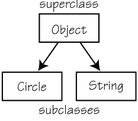  

## **inherit**

子类继承*，或者说接收其超类的方法。Object 类包含用于比较对象和将对象表示为字符串的方法：

| Class &nbsp;Object (java.lang.Object) | Method               | Description                                           |
| --------------------------------------- | --------------------- | ----------------------------------------------------- |
|                                        | `equals(Object obj)`  | 如果 obj 等于该对象，则返回 true。           |
|                                        | `toString()`          | 返回表示该对象的字符串。          |

> **提示** 如果子类没有覆盖 equals() 和 toString() 方法，则将使用 Object 类的方法。

子类通常包含其自己的 equals() 和 toString() 超类方法版本，以更好地适应子类的对象。例如，两个 Circle 对象在半径相同时相等，两个 String 对象在由相同的字符组成时相等。

## **override**

当子类重新定义超类方法时，称子类方法*覆盖了*超类方法。Circle 类应包含一个 equals() 方法，该方法将对象的状态与另一个 Circle 对象进行比较，以及一个 toString() 方法，该方法返回描述该对象的字符串：

> ## **equals() vs .** ==

使用 `==` 运算符进行比较的对象，只有在它们引用同一对象时才相等。`==` 运算符比较的是对象的引用，而不是对象存储的数据，而 equals() 方法则比较数据。

```java
/**
 * Determines if the object is equal to another
 * Circle object.
 * pre: c is a Circle object.
 * post: true has been returned if the objects have
 *        的 same radii。false has been returned otherwise.
 */
public boolean equals(Object c) {
    Circle testObj = (Circle)c;

    if (testObj.getRadius() == radius) {
        return (true);
    } else {
        return (false);
    }
}
```

```java
/**
 * Returns a String that represents the Circle object.
 * pre: none
 * post: A string representing the Circle object has
 *       been returned.
 */
public String toString() {
    String circleString;

    circleString = "Circle has radius: " + radius;
    return (circleString);
}
```

## **object casting**
## **ClassCastException**  

equals() 方法需要一个 Object 参数。在方法体中，obj 参数必须被强制转换为适当的类型，此处为 Circle，然后赋值给适当类型的对象。如果将 Object 变量强制转换为不兼容的类，则会生成 ClassCastException 异常。将对象转换为其超类 Object 时，不需要进行类强制转换。

## # **复习：Circle——第 4 部分（共 4 部分）**  

修改 Circle 类以覆盖 equals() 和 toString() 方法，如上一节所示。修改现有的客户端代码以测试新方法。

## **# 复习：Rectangle——第 3 部分（共 5 部分）**  
 
 修改 Rectangle 类以覆盖 equals() 和 toString() 方法。两个矩形在 length 和 width 都相同 时相等。修改现有的客户端代码以测试新方法。  

## # **复习：Coin——第 2 部分（共 2 部分）**

修改 Coin 类以覆盖 toString() 方法，使其指示硬币是正面朝上还是反面朝上。例如，"The coin is face up."。修改现有的客户端代码以测试新方法。

# 类使用类

一个类可以包含数据类型为类的成员变量。通过这种方式可以轻松表示复杂数据。包含类成员变量的类展示了*has-a*关系。该类"具有**一个**"类。例如，包含 String 成员变量的类展示了 has-a 关系。  

> *has-a relationship*

下一页的 Bank 程序规范最好通过两个类来实现：

一个类（Account）具有一个成员变量（Customer），用于表示持有账户的客户：银行维护账户，账户持有者可以存款和取款。账户持有者是具有 first name、last name 和完整地址的客户。


## 嵌套类和内部类

> **嵌套类和内部类**
*嵌套类*是在另一个类中作为该类成员定义的类。成员类可以像类的其他成员一样访问其他数据成员。除非声明为静态，否则嵌套类也称为*内部类*。

银行的模型包括一个存储客户数据和当前余额的 Account 对象。Account 方法应返回余额、执行存款和取款。如果将 Account 对象传递给 println() 方法，则应显示客户数据和他们的余额。

银行类的设计如下：

```
Account
变量: balance, Customer cust
方法:
- getBalance – 返回当前余额。
- deposit – 增加余额。需要金额参数。
- withdrawal – 减少余额。需要金额参数。如果余额少于取款金额，则余额保持不变。
- toString – 返回包含客户信息和当前余额的字符串。

Customer
变量: firstName, lastName, street, city, state, zip
方法:
- toString() – 返回包含客户信息的字符串。
```

银行客户端代码使用了这些类设计，看起来类似于：

```java
import java.util.Scanner;
import java.text.NumberFormat;

public class Bank {
    public static void main(String[] args) {
        Account munozAccount = new Account(250, "Maria", "Munoz", "110 Glades Road",
                                          "Mytown", "FL", "33445");
        Scanner input = new Scanner(System.in);
        double data;
        NumberFormat money = NumberFormat.getCurrencyInstance();

        System.out.println(munozAccount);

        System.out.print("Enter deposit amount: ");
        data = input.nextDouble();
        munozAccount.deposit(data);
        System.out.println("Balance is: " + money.format(munozAccount.getBalance()));

        System.out.print("Enter withdrawal amount: ");
        data = input.nextDouble();
        munozAccount.withdrawal(data);
        System.out.println("Balance is: " + money.format(munozAccount.getBalance()));
    }
}
```

## this

Account 类实现如下：

```java
import java.text.NumberFormat;

public class Account {
    private double balance;
    private Customer cust;

    /**
     * 构造方法
     * 前置条件: 无
     * 后置条件: 创建了一个账户。余额和
     * 客户数据已用参数初始化。
     */
    public Account(double bal, String fName, String lName,
                   String str, String city, String st, String zip) {
        balance = bal;
        cust = new Customer(fName, lName, str, city, st, zip);
    }

    /**
     * 返回当前余额。
     * 前置条件: 无
     * 后置条件: 账户余额已返回。
     */
    public double getBalance() {
        return(balance);
    }

    /**
     * 向账户存款。
     * 前置条件: 无
     * 后置条件: 余额已增加存款金额。
     */
    public void deposit(double amt) {
        balance += amt;
    }

    /**
     * 如果有足够资金，则从账户取款。
     * 前置条件: 无
     * 后置条件: 余额已减少取款金额。
     */
    public void withdrawal(double amt) {
        if (amt <= balance) {
            balance -= amt;
        } else {
            System.out.println("Not enough money in account.");
        }
    }

    /**
     * 返回表示 Account 对象的字符串。
     * 前置条件: 无
     * 后置条件: 返回一个表示 Account 对象的字符串。
     */
    public String toString() {
        String accountString;
        NumberFormat money = NumberFormat.getCurrencyInstance();

        accountString = cust.toString();
        accountString += "Current balance is " + money.format(balance);
        return(accountString);
    }
}
```

Customer 类实现如下：

```java
public class Customer {
    private String firstName, lastName, street, city,
                   state, zip;

    /**
     * 构造方法
     * 前置条件: 无
     * 后置条件: 创建了一个 Customer 对象。
     * 客户数据已用参数初始化。
     */
    public Customer(String fName, String lName, String str,
                    String c, String s, String z) {
        firstName = fName;
        lastName = lName;
        street = str;
        city = c;
        state = s;
        zip = z;
    }

    /**
     * 返回表示 Customer 对象的字符串。
     * 前置条件: 无
     * 后置条件: 返回一个表示 Account 对象的字符串。
     */
    public String toString() {
        String custString;

        custString = firstName + " " + lastName + "\n";
        custString += street + "\n";
        custString += city + ", " + state + "  " + zip + "\n";
        return(custString);
    }
}
```

关键字 `this` 可用于区分参数和成员变量。例如，为类中的方法参数和成员变量使用相同的名称通常很方便，在这种情况下，成员变量前会加上 `this`。如果在 Account 类中，构造方法使用 `double balance` 作为参数，那么方法体中的语句必须写成：
`this.balance = balance;`

### 复习：银行

运行 Bank 应用程序会产生类似于以下内容的输出：

```java
Maria Munoz
110 Glades Road
Mytown, FL 33445
Current balance is $250
Enter deposit amount: 100
Balance is: $350
Enter withdrawal amount: 400
Not enough money in account.
Balance is: $350
```

修改 Customer 类以包含 changeStreet()、changeCity()、changeState() 和 changeZip() 方法。修改 Account 类以包含一个具有 street、city、state 和 zip 参数的 changeAddress() 方法。修改 Bank 应用程序以测试 changeAddress() 方法。

### 面向对象开发

面向对象编程要求将任务的解决方案实现为一个对象系统。在这个系统中，对象与其他对象通信以提供任务的解决方案。这种创建软件的方法称为*面向对象开发*。

> **提示** JRE 最早是在第 4 章讨论的。

在面向对象开发中，程序员阅读规范并选择对象来建模规范。其中一些对象需要程序员设计和编写新的类。其他对象可以从程序员或其他程序员先前编写的现有类创建。例如，JRE 包含许多可用于 Java 应用程序的类。*可重用性*是面向对象编程的一个重要特性，因为它减少了开发时间并降低了出现错误的可能性。

为了演示面向对象开发，请考虑以下嘉年华程序规范：

嘉年华有许多性质相似的游戏。这些游戏允许玩家尝试三次，三次都成功的玩家就是赢家。例如，气球飞镖投掷游戏允许玩家向一面气球墙投掷三支飞镖。如果每支飞镖都刺破一个气球，那么玩家就是赢家。套圈和砸盘子游戏的工作原理类似。

每位玩家都会获得奖品。有获胜奖品和安慰奖。气球飞镖投掷游戏的奖品是老虎毛绒玩具和贴纸。套圈游戏的奖品是小熊钥匙链和铅笔，砸盘子游戏的奖品是小猪毛绒玩具和塑料恐龙。气球飞镖投掷和套圈游戏每玩一次 2 美元。砸盘子游戏每玩一次 1.5 美元。

玩家带着一些零花钱来到嘉年华，可以一直玩游戏直到钱花光。玩家还会保留所有赢得的奖品。

当 Shonda 有 5 美元零花钱而 Luis 有 3 美元时，Carnival 应用程序应产生类似于以下内容的输出：

```java
Shonda goes to Balloon Dart Toss. prize won: tiger plush
Luis goes to Ring Toss. prize won: bear keychain
Shonda goes to Ring Toss. prize won: pencil
Luis goes to Break a Plate. Sorry, not enough money to play.
Shonda won: pencil, tiger plush
Luis won: bear keychain
```

### 为模型选择对象

在面向对象开发的第一步中，选择对象来建模规范。在这种情况下，嘉年华可以用游戏摊位对象和玩家对象来建模。游戏摊位对象应存储关于游戏成本、获胜奖品和安慰奖的数据。游戏摊位方法应启动游戏并给出游玩成本。玩家对象应存储关于玩家零花钱和所获奖品的数据。玩家方法应玩游戏并显示所获奖品的列表。

### 设计对象

嘉年华类的设计如下：

```
GameBooth
变量: cost, firstPrize, consolationPrize
方法:
- start – 玩游戏并返回赢得的奖品。
- getCost – 返回玩游戏的成本。

Player
变量: spendingMoney, prizesWon
方法:
- play – 确定玩家是否有足够的钱玩游戏，将钱减少游戏成本，并将赢得的奖品添加到奖品列表中。
- showPrizes – 返回奖品列表。
```


## 客户端代码

Carnival 客户端代码使用类设计，看起来类似于：

```java
GameBooth balloonDartToss = new GameBplingbooth(2,"tiger plush", "sticker");
GameBooth ringToss = new GameBooth(2, "bear keychain", "pencil");
GameBooth breakAPlate = new GameBooth(1.5, "pig plush", "plastic dinosaur");
Player shonda = new Player(5);        //$5 零花钱
Player luis = new Player(3);          //$3 零花钱

System.out.print("Shonda goes to Balloon Dart Toss. ");
System.out.println(shonda.play(balloonDartToss));

System.out.print("Luis goes to Ring Toss. ");
System.out.println(luis.play(ringToss));

System.out.print("Shonda goes to Ring Toss. ");
System.out.println(shonda.play(ringToss));

System.out.print("Luis goes to Break A Plate. ");
System.out.println(luis.play(breakAPlate));

System.out.println("Shonda won: " + shonda.showPrizes());
System.out.println("Luis won: " + luis.showPrizes());
```

注意这个应用程序是多么简单。所有工作都由对象完成，而不是由 `main()` 方法中的单个语句完成。Carnival 应用程序与其他面向对象的应用程序一样，是*模块化*的。它使用分别编写和维护的组件。

## 模块化

面向对象开发的另一个方面是对象向其他对象发送信息以执行任务。当信息从一个对象传递到另一个对象时，称该对象正在传递一条*消息*。例如，在上面的伪代码中，Player 对象会收到一条消息，其中包括游戏费用和玩家赢得的奖品。

## 消息

## 实现类

GameBooth 类实现如下。注意，在 `start()` 方法中，玩家的投掷次数通过随机数模拟。如果生成三个 1，则玩家获胜：

```java
import java.util.Random;

public class GameBooth {
    private double cost;
    private String firstPrize, consolationPrize;

    /**
     * 构造方法
     * 前置条件：无
     * 后置条件：已创建 GameBooth 对象。
     * 费用和奖品已设置。
     */
    public GameBooth(double charge, String p1, String p2) {
        cost = charge;
        firstPrize = p1;
        consolationPrize = p2;
    }

    /**
     * 进行游戏并颁发奖品。
     * 前置条件：无
     * 后置条件：玩家有三次机会。三次全部成功的玩家获得一等奖。否则
     * 颁发安慰奖。
     */
    public String start() {
        int toss;
        int successes = 0;
        Random rand = new Random();

        /* 进行游戏 */
        for (int i = 0; i < 3; i++) {    //玩家有三次机会
            toss = rand.nextInt(2);
            if (toss == 1) {
                successes += 1;          //1 表示投掷成功
            }
        }

        /* 颁发奖品 */
        if (successes == 3) {
            return(firstPrize);
        } else {
            return(consolationPrize);
        }
    }

    /**
     * 返回玩游戏所需的费用。
     * 前置条件：无
     * 后置条件：已返回游戏费用。
     */
    public double getCost() {
        return(cost);
    }
}
```

Player 类实现如下：

```java
public class Player {
    private double spendingMoney;
    private String prizesWon;

    /**
     * 构造方法
     * 前置条件：无
     * 后置条件：已创建 Player 对象。向玩家提供
     * 零花钱。赢得的奖品设置为无。
     */
    public Player(double money) {
        spendingMoney = money;
        prizesWon = "";
    }

    /**
     * 玩家付费并玩游戏。
     * 前置条件：无
     * 后置条件：玩家的零花钱减少相应的游戏费用。
     *        玩家获得一个新奖品，添加到已有奖品中。
     */
    public String play(GameBooth game) {
        String newPrize;

        if (game.getCost() > spendingMoney) {
            return("Sorry, not enough money to play.");
        } else {
            spendingMoney -= game.getCost();      //支付游戏费用
            newPrize = game.start();              //进行游戏
            prizesWon = newPrize + ", " + prizesWon;
            return("prize won: " + newPrize);
        }
    }

    /**
     * 返回赢得的奖品列表。
     * 前置条件：无
     * 后置条件：已返回奖品列表。
     */
    public String showPrizes() {
        return(prizesWon);
    }
}
```

运行 Carnival 应用程序产生的输出类似于：

```text
Shonda goes to Balloon Dart Toss. prize won: sticker
Luis goes to Ring Toss. prize won: pencil
Shonda goes to Ring Toss. prize won: pencil
Luis goes to Break A Plate. Sorry, not enough money to play.
Shonda won: pencil, sticker,
Luis won: pencil,
```

尽管这些类可能看起来很长，但一旦编写完成，它们就可以用于 Carnival 的许多不同实现，或涉及游戏的其他应用程序。

## 复习：Carnival

修改 Player 类以覆盖 `toString()` 方法。当 Player 对象被传递给 `println()` 方法时，应显示一条消息，说明玩家还剩多少钱以及到目前为止赢得了哪些奖品。

修改 GameBooth 类以跟踪颁发的奖品数量。应分别记录颁发的一等奖总数和安慰奖总数。向 GameBooth 类添加一个名为 `prizesAwarded()` 的方法，显示颁发的一等奖数量和安慰奖数量。

修改 Carnival 客户端代码，在最后两条语句中将 Player 对象传递给 `println()`，并在单独的语句中显示每个摊位各颁发了多少奖品。

## 第 8 章案例研究

> **提示** 第 5 章案例研究也开发了一个 RPS 应用程序。

在本案例研究中，将使用面向对象开发创建一个"石头剪刀布"游戏。石头剪刀布是一种在两个人之间进行的流行游戏，用于决策或仅用于竞争性娱乐。游戏规则是宣方出的石头、剪刀、布会相互比较：石头砸碎剪刀（石头赢），剪刀剪断布（剪刀赢），布包住石头（布赢）。两名玩家同时"出拳"。然后比较玩家出的手势，根据游戏规则判定胜负。在计算机化版本中，用户与计算机对战。

## RPS2 规格说明

计算机化的石头剪刀布游戏由一名玩家参与，玩家"出"石头、布或剪刀中的一种。然后游戏随机为计算机选择石头、布或剪刀作为计算机的"出拳"，并通过比较两种选择来确定胜负。石头赢剪刀，剪刀赢布，布赢石头。玩家最初可以选择进行多轮游戏。在若干轮结束后，宣布总获胜者。

RPS2 界面应显示每轮的结果和总获胜者。RPS2 输出草图：

```text
How many rounds? 3
Enter your throw (1=Rock, 2=Paper, 3=Scissors): 3
You throw SCISSORS.
Computer throws PAPER.
You win!
Enter your throw (1=Rock, 2=Paper, 3=Scissors): 3
You throw SCISSORS.
Computer throws ROCK.
Computer wins!
Enter your throw (1=Rock, 2=Paper, 3=Scissors): 3
You throw PAPER.
Computer throws ROCK.
You win!
Computer wins 1. You win 2.
You win!
```

RPS2 算法：

- 1. 提示玩家输入轮数。
- 2. 对于每一轮：
    - 提示玩家出拳。
    - 生成计算机的出拳。
    - 宣布该轮的获胜者。
- 3. 宣布总获胜者。

## RPS2 代码设计

RPS2 应用程序可以用一个玩家对象和一个游戏对象来建模。玩家对象应存储玩家的出拳（石头、布或剪刀中的一种），并包含进行和返回玩家出拳的方法。游戏对象应存储计算机的出拳、计算机获胜次数和玩家获胜次数，并包含进行和返回计算机出拳的方法、确定每轮获胜者的方法，以及确定总获胜者的方法。

RPS2 类的设计如下：

```java
RPSPlayer
变量：playerName, playerThrow
方法：
    makeThrow – 提示玩家出拳。
    getThrow – 返回玩家的出拳。
```

```java
RPSGame
变量：compThrow, playerWins, playerThrow
方法：
    makeCompThrow – 生成计算机的出拳。
    getCompThrow – 返回计算机的出拳。
    announceWinner – 显示一条消息，表明出拳情况和获胜者。需要玩家出拳和玩家名称作为参数。
    bigWinner – 确定总获胜者。
```

根据算法和类设计，RPS2 代码设计将包括两个对象和一个循环。RPS2 客户端代码的伪代码如下：

```java
declare game object
declare player object

// 提示玩家输入轮数
for (i = 0; i < rounds; i++) {
    // 提示玩家出拳
    player.makeThrow(playerThrow);
    gameObject.makeThrow();
    gameObject.announceWinner(playerObject.getThrow);
}
gameObject.bigWinner
```


 ## RPS2 实现

RPS2 的实现需要创建三个文件。其中一个文件包含客户端代码，另外两个文件是类。

**RPS2Player 类的实现如下：**

```java
/**
 * models the player in a game of RPS
 */
public class RPSPlayer {
  private int playerThrow;   //ROCK=1, PAPER=2, SCISSORS=3

/**
 * constructor
 * pre: none
 * post: RPSPlayer object created. The player is given a
 * default throw.
 */
  public RPSPlayer() {
     playerThrow = 1;    //default throw
  }

/**
 * Sets the player's throw.
 * pre: newThrow is the integer 1, 2, or 3.
 * post: Player's throw has been made.
 */
  public void makeThrow(int newThrow){
     playerThrow = newThrow;
  }

/**
 * Returns the player's throw.
 * pre: none
 * post: Player's throw has been returned.
 */
  public int getThrow() {
     return(playerThrow);
  }

}
```

**RPSGame 类的实现如下：**

```java
/**
 * Models a game of RPS
 */
import java.util.Random;

public class RPSGame {
  public static final int ROCK = 1, PAPER = 2, SCISSORS = 3;
  private int compThrow;
  private int playerWins = 0, computerWins = 0;

  /**
   * constructor
   * pre: none
   * post: RPSGame object created. Computer throw generated.
   */
  public RPSGame() {
    Random rand = new Random();

    compThrow = rand.nextInt(3) + 1;     //random int between 1 and 3
    playerWins = 0;
    computerWins = 0;
  }

  /**
   * Computer's throw is generated (ROCK, PAPER, or SCISSORS)
   * pre: none
   * post: Computer's throw has been made.
   */
  public void makeCompThrow(){
    Random rand = new Random();

    compThrow = rand.nextInt(3) + 1;     //random int between 1 and 3
  }

  /**
   * Returns the computer's throw.
   * pre: none
   * post: Computer's throw has been returned.
   */
  public int getCompThrow() {
    return(compThrow);
  }

  /**
   * Determines the winner of the round.
   * pre: playerThrow is the integer 1, 2, or 3.
   * post: Displays a message indicating throws. Compares player's
   * throw to computer's throw and displays a message indicating
   * the winner.
   */
  public void announceWinner(int playerThrow) {

    /* Inform player of throws */
    System.out.print("You throw ");
    switch (playerThrow) {
    case ROCK: System.out.println("ROCK."); break;
    case PAPER: System.out.println("PAPER."); break;
    case SCISSORS: System.out.println("SCISSORS."); break;
  }

    System.out.print("Computer throws ");
    switch (compThrow) {
        case ROCK: System.out.println("ROCK."); break;
        case PAPER: System.out.println("PAPER."); break;
        case SCISSORS: System.out.println("SCISSORS."); break;
    }

    /* Determine and announce winner */
    if (playerThrow == ROCK && compThrow == ROCK) {
        System.out.println("It's a draw!");
    } else if (playerThrow == ROCK && compThrow == PAPER) {
        System.out.println("Computer wins!");
        computerWins += 1;
    } else if (playerThrow == ROCK && compThrow == SCISSORS) {
        System.out.println("You win!");
        playerWins += 1;
    }

    if (playerThrow == PAPER && compThrow == ROCK) {
        System.out.println("You win!");
        playerWins += 1;
    } else if (playerThrow == PAPER && compThrow == PAPER) {
        System.out.println("It's a draw!");
    } else if (playerThrow == PAPER && compThrow == SCISSORS) {
        System.out.println("Computer wins!");
        computerWins +=1;
    }

    if (playerThrow == SCISSORS && compThrow == ROCK) {
        System.out.println("Computer wins!");
        computerWins += 1;
    } else if (playerThrow == SCISSORS && compThrow == PAPER) {
        System.out.println("You win!");
        playerWins += 1;
    } else if (player forecastThrow == SCISSORS && compThrow == SCISSORS) {
        System.out.println("It's a draw!");
    }
  }

  /**
   * Displays the overall winner.
   * pre: none
   * post: Computer and player wins compared and
   * an overall winner announced.
   */
  public void bigWinner() {
      if (computerWins > playerWins){
          System.out.println("Computer wins!");
      } else if (playerWins > computerWins){
          System.out.println("You win!");
      } else {
          System.out.println("It's a draw!");
      }
  }
}
```

## RPS2 测试与调试

当编写新类时，应编写客户端代码来测试该类。对于 RPSGame 类，客户端代码应测试所有可能的出拳组合，类似于第 5 章案例研究中讨论的测试方法。

RPS2 客户端代码如下：

```java
/*
 * RPS2.java
 */

import java.util.Scanner;

/**
 * Computer plays Rock Paper Scissors against one player.
 */
public class RPS2 {

    public static void main(String[] args) {
        RPSGame rps = new RPSGame();
        RPSPlayer rpsOpponent = new RPSPlayer();
        int rounds;
        int playerThrow;
        Scanner input = new Scanner(System.in);

        /* play RPS */
        System.out.print("How many rounds? ");
        rounds = input.nextInt();
        for (int i = 0; i < rounds; i++) {
            System.out.print("Enter your throw (ROCK=1, PAPER=2, SCISSORS=3): ");
            playerThrow = input.nextInt();
            rpsOpponent.makeThrow(playerThrow);

            rps.makeCompThrow();
            rps.announceWinner(rpsOpponent.getThrow());
        }
        rps.bigWinner();
    }
}
```

注意客户端代码是多么简洁。RPS2 应用程序使用对象来完成所有工作。

尽管这些类看起来很长，但一旦编写完成，它们就可以用于 RPS 游戏的多种不同实现。可以编写客户端代码以多种不同方式使用这些类。例如，可以实例化多个玩家和游戏来进行锦标赛。

## 复习：RPS2 – 第 1 部分（共 2 部分）

修改 RPSPlayer 类，使其包含一个 `playerName` 变量以及名为 `assignName` 和 `getName` 的方法。`assignName()` 方法有一个 String 参数 `name`，该参数被赋值给 `playerName`。`getName()` 方法返回 `playerName` 的值。修改 RPSGame 类中的 `announceWinner()` 和 `bigWinner()` 方法，使其包含一个 String 参数 `name`，即玩家的名字。更改 `announceWinner()` 和 `bigWinner()` 方法中显示的消息，使消息中包含玩家的名字而不是“You”。修改这两个类后应产生类似如下草图的输出：

```
Enter your name: Lucy
How many rounds? 3

Enter your throw (1=Rock, 2=Paper, 3=Scissors): 3
Lucy throws SCISSORS.
Computer throws PAPER.
Lucy wins!

Enter your throw (1=Rock, 2=Paper, 3=Scissors): 3
Lucy throws SCISSORS.
Computer throws ROCK.
Computer wins!

Enter your throw (1=Rock, 2=Paper, 3=Scissors): 3
Lucy throws PAPER.
Computer throws ROCK.
Lucy wins!

Computer wins 1. Lucy wins 2.
Lucy is the winner!
```

## 复习：RPS2 – 第 2 部分（共 2 部分）

修改 RPS2 客户端代码，对玩家的输入进行错误检查。让客户端代码验证用户输入的出拳值是否为 1、2 或 3，然后再将输入的值传递给 `makeThrow()` 方法。

## 本章小结

本章介绍了类的编写与设计。类是对象的数据类型。对象具有状态（数据）和行为（以方法形式表示的动作和通信）。面向对象编程的一个重要方面是封装，也称为信息隐藏。在 OOP 中，编写类的目的是封装或隐藏数据，使其不被外部代码访问。客户端代码是指使用一个或多个类的代码。

类包括类声明、变量、构造函数和方法。类声明包括访问级别、关键字 `class` 和名称。变量和方法是类的成员。变量是数据成员，应声明为 `private`。访问器方法和修改器方法应声明为 `public`，而辅助方法则声明为 `private`。构造函数用于初始化变量，可以被重载，以便对象可以用不同数量的参数进行声明。

类的变量和方法要么是实例成员，要么是类成员。实例成员会为类的每个实例复制一份。类成员对于该类只有一份副本。类的每个对象都引用同一个类成员。关键字 `static` 用于类成员声明。类方法可以从类本身调用。类的对象可以调用实例成员或类成员。

每个类都是 Object 类的子类。Object 类也可以称为所有其他类的超类。Object 类中的 `equals()` 和 `toString()` 方法被所有其他类继承。在大多数情况下，这些方法应在子类中重新定义。

包含对象的对象被称为体现了一种“has-a”关系。任何包含 String 数据成员的类都体现了一种“has-a”关系。

面向对象的开发要求将任务的解决方案实现为对象系统。在这个系统中，对象之间来回传递消息以提供任务的解决方案。

本章讨论了面向对象范式的几个重要方面，包括封装、可重用性和模块化。

本章介绍的代码规范如下：

- 类名应为名词，以大写字母开头，名称中的每个单词也应以大写字母开头。


## 词汇表

**访问器方法（Accessor method）** 类中用于确定变量成员值的方法。访问器方法的访问级别为`public`。

**行为（Behavior）** 对象所执行的动作和通信。

**类（Class）** 一种数据类型，用于定义对象的状态变量和对象的行为方法。

**类体（Class body）** 实现一个类的变量、构造器和方法。

**类转型异常（ClassCastException）** 当对象变量被强制转换为不兼容的类时抛出的异常。

**类声明（Class declaration）** 类的第一行，包含访问级别、`class`关键字和类名。

**类方法（Class method）** 可以从类本身调用的方法。它不能改变对象的状态。类方法包含`static`关键字。

**类变量（Class variable）** 类中的一种变量，只存在一份副本，类的所有实例都引用该副本。类变量包含`static`关键字。

**客户端代码（Client code）** 使用一个或多个类的应用程序。

**构造器（Constructor）** 类的一部分，用于初始化类的变量成员。

**封装（Encapsulation）** 保护对象的数据不被类外部的代码访问。

**Has-a 关系（Has-a relationship）** 一个类包含另一个类所体现的关系。

**辅助方法（Helper method）** 类中被其他方法调用来帮助完成任务的方法。辅助方法的访问级别为`private`。

**信息隐藏（Information hiding）** 也称为封装。

**继承（Inherit）** 接收超类的方法。

**实例（Instance）** 类的一个对象。

**实例方法（Instance method）** 改变类状态的方法。它必须从类的实例调用。

**实例变量（Instance variable）** 类中每个实例都会复制一份的变量。

**成员（Member）** 类的变量或方法。

**消息（Message）** 从一个对象传递到另一个对象的信息。

**修改器方法（Modifier method）** 类中用于改变变量成员值的方法。修改器方法的访问级别为`public`。

**模块化的（Modular）** 应用程序使用分别编写和维护的组件。

**对象（Object）** 类的一个实例。对象存储数据，可以执行动作和提供通信。

**对象转型（Object casting）** 将对象强制转换为适当的类。

**面向对象开发（Object-oriented development）** 将任务的解决方案实现为对象系统。

**重写（Override）** 在子类中重新定义超类的方法。

**可重用性（Reusability）** 面向对象编程的一个特性，可以减少开发时间并降低出现错误的可能性。

**状态（State）** 对象存储的数据。

**子类（Subclass）** 类层次结构中位于另一个类下方的类。继承另一个类的类。

**超类（Superclass）** 类层次结构中最顶层的类。拥有子类的类。

**可见性（Visibility）** 方法的访问级别。

## Java 关键字

`class` 用于声明类的关键字。

`public` 在类声明中使用的访问修饰符，表示该类对客户端代码可见。也用于声明类方法，表示该方法对客户端代码可见。

`static` 用于声明类中的变量或方法，表示该成员是类方法。

`private` 在声明类成员时使用的关键字，这些成员对类可见，但不对客户端代码可见。

## 批判性思考

1. Circle类的哪些成员被封装了？

2. 类的构造器必须叫什么名字？

3. 解释`private`和`public`访问修饰符的区别。

4. 考虑以下代码。最后一条语句有效还是无效？解释原因。

```
Circle dot = new Circle(2);
dot.radius = 5;
```

5. 使用以下类回答下面的问题：

```
public class Roo {

  private int x;

  public Roo {
    x = 1;
  }

  public void setX(int z) {
    x = z;
  }

  public int getX() {
    return(x);
  }

  public int calculate() {
    x = x * factor();
    return(x);
  }

  private int factor() {
    return(0.12);
  }
}
```

    a) 类的名称是什么？
    b) 数据成员的名称是什么？
    c) 列出访问器方法。
    d) 列出修改器方法。
    e) 列出辅助方法。
    f) 构造器的名称是什么？
    g) 有多少个方法成员？

6. 类和对象有什么区别？

7. 想象一个乐队音乐节，有许多乐队在演奏——TwoToos、EggRolls和Goop。每个乐队都可以TuneUp、PlayMusic和TakeABow。可以读取或创建演出曲目单。如果用面向对象程序来模拟，以下内容用什么名称合适：
    a) 类
    b) 对象
    c) 数据成员
    d) 方法成员

8. 假设有一个名为Team的运动队类。
    a) 列出三个可能的对象名称。
    b) 列出三个可能的方法成员。
    c) 列出三个可能的数据成员。

9. 使用以下类数据成员定义回答下面的问题：

```
public class Moo {

  private double y;
  private static int x;
  private static final z;
  ...
```

    a) 兼任数据成员是常量？
    b) 哪些数据成员是变量？
    c) 哪些数据成员是实例成员？
    d) 哪些数据成员是类成员？

10. 解释调用实例方法成员和类方法成员的区别。

11. 比较和对比重写方法与重载方法。

12. Bank应用程序中的Customer类也体现了has-a关系。解释说明。

13. 重用代码如何降低应用程序中出现错误的可能性？

14. 解释"传递消息"的含义。

## 判断题

15. 判断以下各项是true还是false。如果是false，解释原因。

- a) 对象的状态由其方法描述。
- b) 对象的行为由其变量描述。
- c) 类的实例称为对象。
- d) 客户端代码是使用类的应用程序。
- e) 封装意味着类中的所有变量都对客户端代码可用。
- f) 构造器是类的成员。
- g) 对类可见但对客户端代码不可见的变量用`private`关键字声明。
- h) 调用访问器方法来改变数据成员的值。
- i) 修改器方法返回数据成员的值。
- j) 当类的对象被实例化时，构造器会自动被调用。
- k) 类可以包含多个构造器。
- l) 实例变量为类的每个实例复制一份。
- m) 类变量用`public`关键字声明。
- n) 类方法必须从类的对象调用。
- o) 类常量只用`final`关键字声明。
- p) Object类是所有其他类的子类。
- q) toString()方法可以在子类中重新定义。
- r) 面向对象开发要求应用程序中只能使用一个对象。

## 练习

## 练习 1

# MySavings

创建一个MySavings应用程序，显示一个菜单供用户选择将便士（pennies）、镍币（nickels）、一角硬币（dimes）和两角五分硬币（quarters）存入存钱罐，然后提示用户进行选择。MySavings应用程序应包含一个PiggyBank对象，该对象可以向存钱罐中添加硬币、取出硬币，并返回存钱罐中的总金额。应用程序输出应类似于：

```
1. Show total in bank.
2. Add a penny.
3. Add a nickel.
4. Add a dime.
5. Add a quarter.
6. Take money out of bank.
Enter 0 to quit
Enter you choice: 5
```

## 练习 2

# DigitExtractor

创建一个DigitExtractor应用程序，提示用户输入一个整数，然后显示该数字的个位、十位和百位。DigitExtractor应用程序应包含一个Num对象，该对象可以返回个位数字、十位数字、百位数字和整个数字。应用程序输出应类似于：

```
Enter an integer: 123
show (W)hole number.
show (O)nes place number.
show (T)ens place number.
show (H)undreds place number.
(Q)uit
Enter you choice: h
The hundreds place digit is: 1

show (W)hole number.
show (O)nes place number.
show (T)ens place number.
show (H)undreds place number.
(Q)uit
Enter you choice: q
```


## 练习 3：午餐订单  
创建一个 `LunchOrder` 应用程序，它会提示用户输入汉堡、沙拉、薯条和苏打水的数量，然后显示订单总额。`LunchOrder` 应用程序应包含一个 `Food` 对象，其构造函数接受一项商品的价格、脂肪、碳水化合物和纤维含量。*Food* 的方法应返回商品价格，以及脂肪、碳水化合物和纤维的含量。请使用下面的表格获取食品价格和营养信息：

| 商品 | 价格 | 脂肪(克) | 碳水化合物(克) | 纤维(克) |
| --- | --- | --- | --- | --- |
| 汉堡 | $1.85 | 9 | 33 | 1 |
| 沙拉 | $2.00 | 1 | 11 | 5 |
| 薯条 | $1.30 | 11 | 36 | 4 |
| 苏打水 | $0.95 | 0 | 38 | 0 |

应用程序的输出应类似于：  

```
Enter number of hamburgers: 3  
Each hamburger has 9.0g of fat, 33.0g of carbs, and 1.0g of fiber.  
  
Enter number of salads: 4  
Each salad has 1.0g of fat, 11.0g of carbs, and 5.0g of fiber.  
  
Enter number of fries: 2  
French fries have 11.0g of fat, 36.0g of carbs, and 4.0g of fiber.  
  
Enter number of sodas: 5  
Each soda has 0.0g of fat, 38.0g of carbs, and 0.0g of fiber.  
  
Your order comes to: $20.90
```  

## 练习 4：骰子游戏  
在*骰子游戏*中，玩家初始分数为 1000。系统会提示玩家输入要押注的分数，然后第二个提示让玩家选择押大或押小。玩家投掷两个骰子，并将结果与玩家选择的“大”或“小”进行比较。如果骰子总和在 2 到 6 *之间（包含）*，则视为“小”。总和在 8 到 12 *之间（包含）*视为“大”。总和为 7 既不是大也不是小，玩家会失去押注的分数。如果玩家猜对了，押注的分数会翻倍并加到总分中。如果猜错了，玩家会失去押注的分数。根据此规范创建一个使用 `DRPlayer` 对象的 `DiceRollGame` 应用程序。`DRPlayer` 对象应有两个表示骰子的 `Die` 成员变量。*Die* 类应使用随机数生成器在 roll() 方法中确定投掷结果。应用程序的输出应类似于：  

```
You have 1000 points.  
How many points do you want to risk? (-1 to quit) 10  
Make a call (0 for low, 1 for high): 1  
You rolled: 10  
You now have 1020 points.  
How many points do you want to risk? (-1 to quit) 20  
Make a call (0 for low, 1 for high): 1  
You rolled: 11  
You now have 1060 points.  
How many points do you want to risk? (-1 to quit) 20  
Make a call (0 for low, 1 for high): 1  
You rolled: 7  
You now have 1040 points.  
How many points do you want to risk? (-1 to quit) -1
```  

## 练习 5：Nim2  
*Nim* 游戏开始时，石子数量在 15 到 30 之间随机生成。两名玩家轮流行动，每次可以从石堆中拿走 1、2 或 3 个石子。被迫拿走最后一个石子的玩家输掉游戏。使用面向对象的方法创建一个 `Nim2` 应用程序，允许用户与电脑对战 *Nim*。`Nim2` 应用程序及其对象应：

-   生成初始石子数量。  
-   允许玩家先手。  
-   使用随机数生成器确定电脑拿走的石子数量。  
-   防止玩家和电脑拿取非法数量的石子。例如，当只剩 1 或 2 个石子时，都不应允许拿走三个石子。  

## 练习 6：21点  
在 *21点游戏* 中，玩家从一副扑克牌中发两张牌，然后可选择再要第三张牌。最接近 21 点且未超过的玩家获胜。使用面向对象的方法创建一个 `21点游戏` 应用程序，允许用户与电脑对战 *21点游戏*。*21点游戏* 应用程序及其对象应：

-   通过生成 1 到 13 之间的随机数从扑克牌中发牌。1 对应 A，2 到 10 对应相应的牌面，11 到 13 对应 J、Q、K。在 *21点游戏* 中，J、Q、K 的牌面价值为 10。A 的牌面价值可以是 1 或 11。  
-   允许玩家保持两张牌，或者要第三张牌。  
-   宣布获胜者。  
-   持续进行多轮，直到玩家选择停止。  

## 练习 7：保龄球  
在 *保龄球* 中，球被投掷过球道（也称为球道），目标是击倒一组十个球瓶。一局游戏由投球手投掷十轮组成，每轮包括两次机会（*投掷*）来击倒所有十个球瓶。保龄球中心通常使用计算机为投球手进行电子计分。使用面向对象的方法创建一个 `Bowling` 应用程序，模拟简化的 *保龄球* 游戏。`Bowling` 应用程序及其对象应：

-   允许投球手投掷十轮。每轮包括两次投掷，除非投出全中。  
-   当一轮的第一投击倒所有十个球瓶时，为投球手奖励 20 分。  
-   当在一轮的两次投掷内击倒所有十个球瓶时，为投球手奖励 15 分。  
-   当一轮的两次投掷未能击倒所有十个球瓶时，每击倒一个球瓶奖励一分。  
-   如果游戏中有多名投球手，则*投球手轮流进行，直到每人都投掷完十轮*。  
-   使用随机数生成器确定投球手每次投掷击倒了多少个球瓶。  
-   每轮结束后显示更新后的分数。  

## 练习 8：加法器  
`Adder` 游戏会提示玩家回答一个加法问题。`Adder` *游戏*从 0 到 20 之间的两个随机整数中生成问题。*Adder 允许*玩家尝试三次以输入正确答案。如果第一次尝试就输入了正确答案，玩家获得 5 分。第二次尝试输入正确答案，获得 3 分。第三次尝试输入正确答案，获得 1 分。如果三次尝试后仍未输入正确*答案*，玩家不得分，并显示正确答案。游戏持续进行，直到输入 999 作为答案。在 *游戏* 结束时，Adder 显示玩家的分数。应用程序的输出应类似于：  

```
20 + 5 = 29  
20 + 2 = 22  
Wrong answer, enter another answer? 14 -7= 3  
+6= ? (Enter answer) 4  
3 + 8 = 12  
Wrong answer. Enter anther? 4-7=-3(Or whatever logic in game to end it when user enters a random number instead of trying again).
```

# 第 9 章：继承与多态  
面向对象编程基于一种*范式*，其中使用对象来建模规范。对象由*类*创建，提供封装。`继承`扩展了一个类并提供了多态的手段。本章讨论继承和多态。同时讨论了抽象类和接口。  

## 扩展类  
通常存在一个现有的*类*，它为对象模型提供了基础。然而，现有的*类可能需要额外的方法或对现有方法的不同实现，以更接近地表示模型中的对象*。例如，考虑具有圆形形状的磁盘！它类似于圆形。然而，*磁盘*是三维的并且还有厚度。与其创建一个全新的类来表示磁盘，不如*让一个名为 Disk 的类扩展 Circle 类*。  

让一个类成为另一个类的扩展涉及继承。`继承`允许类在已存在的类的基础上定义特化类型。在这种情况下，磁盘是具有厚度的实心圆！从现有类派生的类展示了“是一个”的关系。一个类“是一个”另一个类的类型吗？在这种情况下，*磁盘是一个*有厚度的圆。  

一个类可以有多个层次的继承*。例如，考虑以下类层次结构：  
```
[Diagram placeholder]  
Puck 类继承自 Disk 类，而 Disk 类继承自 Circle 类！Circle 类是 Disk 的超类！Disk 是 Circle 的子类，也是 Puck 的超类。Puck 是 Disk 的子类。  
```  

# 实现子类

继承另一个类的类在类声明中包含关键字`extends`，其形式如下：

```
public class <name> extends <class_name> {
    <class definition>
}
```

设计子类需要选择超类（或基类），然后为子类定义任何额外的变量和方法成员。在许多情况下，基类中的现有方法也会被子类（也称为派生类）中的新定义所覆盖。例如，Disk类的设计看起来类似于：

```
Disk 继承自 Circle

变量：thickness

方法：
    setThickness – 更改厚度。
    getThickness – 返回厚度。
    volume – 返回圆盘的体积。
    equals – 覆盖 Circle 中的 equals() 方法。
    toString – 覆盖 Circle 中的 toString() 方法。
```

基于上述设计的Disk类实现如下：

```
/**
 * Disk 类。
 */
public class Disk extends Circle {
    private double thickness;

    /**
     * 构造函数
     * 前置条件：无
     * 后置条件：已创建一个半径为 r、厚度为 t 的 Disk 对象。
     */
    public Disk(double r, double t) {
        super(r);
        thickness = t;
    }

    /**
     * 更改圆盘的厚度。
     * 前置条件：无
     * 后置条件：厚度已更改。
     */
    public void setThickness(double newThickness) {
        thickness = newThickness;
    }

    /**
     * 返回圆盘的厚度。
     * 前置条件：无
     * 后置条件：已返回圆盘的厚度。
     */
    public double getThickness() {
        return thickness;
    }

    /**
     * 返回圆盘的体积。
     * 前置条件：无
     * 后置条件：已返回圆盘的体积。
     */
    public double volume() {
        double v;
        v = super.area() + thickness;
        return v;
    }

    /**
     * 判断对象是否与另一个 Disk 相等。
     * 前置条件：d 是一个 Disk 对象
     * 后置条件：如果对象具有相同的半径和厚度，则返回 true。否则返回 false。
     */
    public boolean equals(Object d) {
        Disk testObj = (Disk) d;
        if ((testObj.getRadius() == super.getRadius()) &&
            (testObj.thickness == thickness)) {
            return true;
        } else {
            return false;
        }
    }

    /**
     * 返回表示 Disk 对象的字符串。
     * 前置条件：无
     * 后置条件：已返回表示圆盘对象的字符串。
     */
    public String toString() {
        String diskString;
        diskString = "The disk has radius " + getRadius() +
                     " and thickness " + thickness + ".";
        return diskString;
    }
}
```

**提示** equals() 和 toString() 方法覆盖了 Circle 类中的同名方法。

# super 可见性 在子类中，关键字 super 用于访问基类的方法。例如，语句 super(r) 调用超类 Circle 的构造函数，并传递一个参数用于设置半径值。声明为 private 的成员对派生类不可访问。因此，需要使用访问器方法来获取继承的成员变量值。例如，Disk 类中的 equals() 方法调用 getRadius()。

继承的方法直接通过对象调用，就像调用类的任何方法一样。无论方法是 Disk 类原有的还是从 Circle 类继承的，对客户端代码来说都是透明的，如 TestDisk 应用程序所示：

```
public class TestDisk {
    public static void main(String[] args) {
        Disk saucer = new Disk(10, 0.02);
        System.out.println("Disk radius: " + saucer.getRadius());
        System.out.println("Disk surface area: " + saucer.area());
        System.out.println("Disk volume: " + saucer.volume());
        Disk plate1 = new Disk(12, 0.05);
        Disk plate2 = new Disk(12, 0.07);
        if (plate1.equals(plate2)) {
            System.out.println("Objects are equal.");
        } else {
            System.out.println("Objects are not equal.");
        }
        System.out.println(plate1);
        System.out.println(plate2);
    }
}
```

TestDisk 应用程序显示以下输出：

```
Disk radius: 10.0
Disk surface area: 314.0
Disk volume: 6.28
Objects are not equal.
The disk has radius 12.0 and thickness 0.05.
The disk has radius 12.0 and thickness 0.07.
```

# 复习：Puck – 第 1 部分，共 2 部分

创建一个继承 Disk 类的 Puck 类。Puck 类应包含成员变量 `weight`、`standard` 和 `youth`。`standard` 和 `youth` 变量应是 `boolean` 变量，根据冰球的重量设置为 `true` 或 `false`。标准冰球的重量在 5 到 5.5 盎司之间。青少年冰球的重量在 4 到 4.5 盎司之间。官方冰球，无论重量如何，都是一英寸厚，三英寸直径。Puck 类还应包含成员方法 `getWeight()`、`getDivision()`（返回一个字符串说明冰球是标准型还是青少年型），以及 `equals()` 和 `toString()` 方法，它们覆盖 Disk 类中的相同方法。Puck 构造函数应需要一个 weight 参数。确保构造函数在必要时将其他变量初始化为适当的值。

创建一个测试 Puck 类的 Hockey 应用程序。

# 多态性

*多态性*是面向对象编程（OOP）的一种属性，它使对象能够假定不同的类型。在面向对象编程中，多态性基于继承。因为子类派生自超类，所以超类对象可以引用子类的对象。例如，由于 Disk 继承自 Circle，以下语句是有效的：

```
Circle wafer;
Disk cookie = new Disk(2, 0.5);
wafer = cookie;    //wafer 现在引用 cookie
```

声明为 Circle 的 `wafer` 对象是多态的，如语句 `wafer = cookie` 所示，其中 `wafer` 假定了 `cookie`（一个 Disk 对象）的形式。

当被引用的对象确定执行哪个方法时，多态性得到进一步体现。当子类覆盖超类方法时，这是可能的。在这种情况下，Disk 类覆盖了 `equals()` 和 `toString()` 方法。因此，即使 `wafer` 被声明为 Circle 对象，以下语句也会执行 Disk 的 `toString()` 方法：

```
/* 显示：The disk has radius 2.0 and thickness 0.5. */
System.out.println(wafer);
```

为了进一步演示多态性，本节将开发 Music 应用程序。Music 应用程序允许用户组建一个小型乐队。用户可以为乐队成员分配人声（声音）或木管乐器（短笛或单簧管）。然后，用户可以选择聆听该乐队的独奏、二重奏或三重奏表演。

Instrument 类、其子类以及 Performance 类用于为 Music 应用程序建模对象。下图说明了 Music 应用程序的客户端代码和类。注意 Instrument 类及其子类的层次结构：

Music 客户端代码如下所示：

```
/*
 * Music.java
 */
import java.util.Scanner;

public class Music {

   /* 返回选定的乐器。
    * 前置条件：无
    * 后置条件：已返回一个乐器对象。
    */
   public static Instrument assignInstrument() {
      String instrumentChoice;
      Scanner input = new Scanner(System.in);

      System.out.println("Select an instrument for the band member. ");
      System.out.print("Vocals, Piccolo, or Clarinet: ");
      instrumentChoice = input.nextLine();
      System.out.print("Enter the band member's name: ");
      String name = input.nextLine();
      if (instrumentChoice.equalsIgnoreCase("V")) {
         return(new Vocal(name));
      } else if (instrumentChoice.equalsIgnoreCase("P")) {
         return(new Piccolo(name));
      } else {  //默认为单簧管
         return(new Clarinet(name));
      }
   }

   public static void main(String[] args) {
      Performance band;
      Instrument bandMember1, bandMember2, bandMember3;
      Scanner input = new Scanner(System.in);
      String performanceChoice;

      /* 分配乐器 */
      bandMember1 = assignInstrument();
      bandMember2 = assignInstrument();
      bandMember3 = assignInstrument();
      System.out.println(bandMember1 + " " + bandMember2 + " " + bandMember3 + "\n");

      System.out.print("Would you like to hear a Solo, a Duet, a Trio, or Leave? ");
      performanceChoice = input.nextLine();
      while (!performanceChoice.equalsIgnoreCase("L")) {
         if (performanceChoice.equalsIgnoreCase("S")) {
            band = new Performance(bandMember1);
         } else if (performanceChoice.equalsIgnoreCase("D")) {
            band = new Performance(bandMember1, bandMember2);
         } else {    //默认为三重奏
            band = new Performance(bandMember1, bandMember2, bandMember3);
         }
         band.begin();

         System.out.print("\nWould you like to hear a Solo, a Duet, a Trio, or Leave? ");
         performanceChoice = input.nextLine();
      }
   }
}
```

# 第 9 章 继承与多态性


`assignInstrument()`方法声明了返回类型为 Instrument，但各个返回语句分别返回 Vocal、Piccolo（短笛）和 Clarinet（单簧管）类型。该方法返回的 Instrument 对象是多态的，会随实际返回的子类而变化。

Music应用会产生如下类似的输出：

```
Select an instrument for the band member.
Vocals, Piccolo, or Clarinet: c
Enter the band member's name: Anthony
Select an instrument for the band member.
Vocals, Piccolo, or Clarinet: v
Enter the band member's name: Lyn
Select an instrument for the band member.
Vocals, Piccolo, or Clarinet: p
Enter the band member's name: Dana
Anthony plays squawk. Lyn sings LaLaLa. Dana plays peep.

Would you like to hear a Solo, a Duet, a Trio, or Leave? s
squawk

Would you like to hear a Solo, a Duet, a Trio, or Leave? d
squawkLaLaLa

Would you like to hear a Solo, a Duet, a Trio, or Leave? t
squawkLaLaLapeep

Would you like to hear a Solo, a Duet, a Trio, or Leave? l
```

Music应用允许用户用多种组合选择乐队并聆听表演。若无继承和多态这些面向对象原则，此类应用的代码将更为复杂且灵活性较低。之所以灵活多变是因为它利用了继承和多态的特性。

Instrument、Vocal、Woodwind（木管）、Piccolo 和 Clarinet 类的文档如下所示。请注意 Instrument类中`makeSound()`方法是一个必须在子类中实现（编写）的方法。相关内容将在下一节进一步讨论，这些类的相关代码也将在涉及抽象类的下一节显示。

## Class Instrument

### Constructor/Methods

- Instrument(String name)使用音乐家名称创建一个乐器对象。
- getMusician()返回一个字符串，即音乐家的名字。
- makeSound()是一个应返回代表该乐器声音的 String 的**抽象方法**。

## Class Vocal (inherits Instrument)（继承自Instrument）

### Constructor/Methods

- Vocal(String name)使用歌手名称创建一个歌手对象。
- makeSound()返回"LaLaLa"字符串。
- toString()返回一个表示歌手的String。

## Class Woodwind (inherits Instrument)（继承自Instrument）

### Constructor/Method

- Woodwind(String name)使用音乐家名称创建木管乐器对象。
- makeSound()返回"toot"字符串。

## Class Piccolo (inherits Woodwind)（继承自Woodwind）

### Constructor/Methods

- Piccolo(String name)使用演奏者名称创建一个短笛手对象。
- makeSound()返回"peep"字符串。
- toString()返回一个表示该对象的String。

## Class Clarinet (inherits Woodwind)（继承自Woodwind）

### Constructor/Methods

- Clarinet(String name)使用音乐家名称创建单簧管演奏者对象。
- makeSound()返回"squawk"字符串。
- toString()返回一个表示该对象的String。

Performance类创建了 Instrument 对象的编排组合。构造器需要Instrument参数，但多态使得可以传入Instructor子类的对象：

```java
/**
 * Performance class.
 */
public class Performance {
    private String arrangement;
    private Instrument solo;
    private Instrument duet_1, duet_2;
    private Instrument trio_1, trio_2, trio_3;

    /**
     * constructor
     * pre: none
     * post: A soloist has been selected.
     */
    public Performance(Instrument s) {
        solo = s;
        arrangement = solo.makeSound();
    }
```

```java
/**
 * constructor
 * pre: none
 * post: The members of a duet have been selected.
 */
public Performance(Instrument d1, Instrument d2) {
    duet_1 = d1;
    duet_2 = d2;
    arrangement = duet_1.makeSound() + duet_2.makeSound();
}
```

```java
/**
 * constructor
 * pre: none
 * post: The members of a trio have been selected.
 */
public Performance(Instrument t1, Instrument t2, Instrument t3) {
    trio_1 = t1;
    trio_2 = t2;
    trio_3 = t3;
    arrangement = trio_1.makeSound() + trio_2.makeSound()
                 + trio_3.makeSound();
}
```

```java
/**
 * Begins the performance.
 * pre: none
 * post: The performance has been played.
 */
public void begin() {
    System.out.println(arrangement);
}
```

```java
/**
 * Returns a String that represents the performers.
 * pre: none
 * post: A string representing the performers has
 *       been returned.
 */
public String toString() {
    String program = "The performance includes ";
    program += arrangement;
    return(program);
}
```

# Review: Music – part 1 of 2（复习：音乐应用——上篇）

修改Music应用，除其他表演形式外，允许用户选择四人乐队（四重奏）。还需对Performance类进行修改以提供创建四重奏的选项。

# Abstract Classes（抽象类）

抽象类用于模型化抽象概念。例如，乐器就是一个抽象概念。存在某种可以被演奏的东西即“乐器”，但现实中并不存在名为"instrument”的具体事物。然而确实有长笛、短笛、鼓和钹等具体物品。

不能实例化抽象类的对象，因为它们不应代表特定对象；相反它们描述某类对象的更一般性细节和行为。例如，Instrument类描述了乐器的基本方面——它可以发出声音。Woodwind类也是一个抽象类，因为它描述了一组乐器并包含这些木管乐器发出的通用声音。

在类别声明中使用关键字`abstract`来声明抽象类。它们是供派生对象继承的。派生对象可以访问抽象类的公共成员。然而，抽象类也可以包含抽象方法。抽象方法及一个方法声明一起由关键字`abstract`声明，但不含实现主体；必须在子类中对其进行具体化（覆写）。

Instrument类是一个具有抽象方法的抽象类。makeSound()方法必须在使用 Instrument 的子类中进行实现：

```java
/**
 * Instrument class.
 */
abstract class Instrument {
 String musician;

 /**
  * constructor
  * pre: none
  * post: A musician has been assigned to the instrument.
  */
 public Instrument(String name) {
  musician = name;
 }

 /**
  * Returns the name of the musician
  * pre: none
  * post: The name of the musician playing the instrument
  * has been returned.
  */
 public String getMusician() {
  return(musician);
 }

 /**
  * Should return the sound of the instrument.
  * pre: none
  * post: The sound made by the instrument is returned.
  */
 abstract String makeSound();
}
```

Vocal类是Instrument的子类。它为makeSound()方法提供了实现主体：

```java
/**
 * Vocal class.
 */
public class Vocal extends Instrument {

 /**
  * constructor
  * pre: none
  * post: A singer has been created.
  */
 public Vocal(String singerName) {
  super(singerName);
 }

 /**
  * Returns the sound of the instrument.
  * pre: none
  * post: The sound made by the singer.
  */
 public String makeSound() {
  return("LaLaLa");
 }

 /**
  * Returns a String that represents the instrument.
  * pre: none
  * post: A string representing the singer.
  */
 public String toString() {
  return(super.getMusician() + " sings " + makeSound() + ".");
 }
}
```

Woodwind类也是Instrument的一个子类。它同样实现了makeSound()方法；然而，由于Woodwind描述了一组乐器，因此也被声明为抽象的：

```java
/**
 * Woodwind class.
 */
abstract class Woodwind extends Instrument {

 /**
  * constructor
  * pre: none
  * post: A woodwind instrument has been created.
  */
 public Woodwind(String player) {
  super(player);
 }

 /**
  * Returns the sound of the instrument.
  * pre: none
  * post: The sound made by the instrument is returned.
  */
 public String makeSound() {
  return("toot");
 }
}
```

Piccolo类是Woodwind类的子类。它重写了makeSound()方法：

```java
/**
 * Piccolo class.
 */
public class Piccolo extends Woodwind {

 /**
  * constructor
  * pre: none
  * post: A piccolo has been created.
  */
 public Piccolo(String piccoloist) {
  super(piccoloist);
 }

 /**
  * Returns the sound of the instrument.
  * pre: none
  * post: The sound made by the instrument is returned.
  */
 public String makeSound() {
  return("peep");
 }

 /**
  * Returns a String that represents the instrument.
  * pre: none
  * post: A string representing the instrument has been returned.
  */
 public String toString() {
  return(super.getMusician() + " plays " + makeSound() + ".");
 }
}
```

Clarinet类也是Woodwind的一个子类，同样重写了makeSound()方法：

```java
/**
 * Clarinet class.
 */
public class Clarinet extends Woodwind {

 /**
  * constructor
  * pre: none
  * post: A clarinet has been created.
  */
 public Clarinet(String clarinetist) {
  super(clarinetist);
 }

 /**
  * Returns the sound of the instrument.
  * pre: none
  * post: The sound made by the instrument is returned.
  */
 public String makeSound() {
  return("squawk");
 }
}
```


通过继承和抽象，可以创建出一个类的 [.class] 类层次结构，其始于一个通用的抽象，最终指向一个具体的对象。

## 回顾：音乐——第二部分（共两部分）

修改音乐应用程序，允许用户除了为乐队成员选择其他乐器外，还可以选择钹或鼓。音乐应用程序的更改需要创建 Percussion、Cymbal 和 Drum 类。Percussion 类应该是继承 Instrument 类的抽象类。Cymbal 和 Drum 类应该继承 Percussion 类。

## 接口

接口是一种类，其中包含没有实现的方法声明。尽管接口看起来与抽象类相似，但它们非常不同。接口不能被继承。它只能在类中被实现。接口可以为类添加行为，但它不会为类提供层次结构。

接口中定义的方法默认是 public 和 abstract 的。因此，接口中的方法只是声明，后面跟着一个分号。

Comparable 接口是 java.lang 包的一部分。它包含一个方法：

当接口在类中被实现时，该类必须实现接口中定义的每个方法。在本例中，Comparable 接口只包含一个方法。下一页展示的 Circle 类已经过修改，以实现了 Comparable 接口。

```
/**
 * Circle class.
 */
public class Circle implements Comparable {
  private static final double PI = 3.14;
  private double radius;

  /**
   * constructor
   * pre: none
   * post: A Circle object created. Radius initialized to 1.
   */
  public Circle() {
    radius = 1;        //default radius
  }

  ...getRadius(), setRadius(), and other Circle class methods

  /**
   * Determines if object c is smaller, the same,
   * or larger than this Circle object.
   * pre: c is a Circle object
   * post: -1 has been returned if c is larger than
   * this Circle, 0 has been returned if they are the
   * same size, and 1 has been returned if c is smaller
   * then this Circle.
   */
  public int compareTo(Object c) {
    Circle testCircle = (Circle)c;

    if (radius < testCircle.getRadius()) {
      return(-1);
    } else if (radius == testCircle.getRadius()) {
      return(0);
    } else {
      return(1);
    }
  }
}
```

TestCircle 客户端代码测试 compareTo() 方法：

```
/**
 * The Circle class is tested.
 */
public class TestCircle {

  public static void main(String[] args) {
    Circle spot1 = new Circle(3);
    Circle spot2 = new Circle(4);
    if (spot1.compareTo(spot2) == 0) {
      System.out.println("Objects are equal.");
    } else if (spot1.compareTo(spot2) < 0) {
      System.out.println("spot1 is smaller than spot2.");
    } else {
      System.out.println("spot1 is larger than spot2.");
    }
    System.out.println(spot1);
    System.out.println(spot2);
  }
}
```

TestCircle 应用程序产生以下输出：

```
spot1 is smaller than spot2.
Circle has radius 3.0
Circle has radius 4.0
```

*多个接口* 一个类可以实现多个接口。当实现多个接口时，接口名称在类声明中用逗号分隔。

## 回顾：Disk

修改 Disk 类以实现 Comparable 接口。当两个圆盘具有相同的厚度和相同的半径时，它们相等。修改现有的客户端代码以测试新方法。

## 回顾：Puck——第二部分（共两部分）

修改 Puck 类以实现 Comparable 接口。当两个冰球具有相同的重量时，它们相等。修改现有的客户端代码以测试新方法。

## 回顾：Rectangle——第四部分（共四部分）

修改 Rectangle 类以实现 Comparable 接口。当两个矩形具有相同的宽度和高度时，它们相等。修改现有的客户端代码以测试新方法。

## 回顾：Rectangle——第四部分（共五部分）

创建一个名为 ComparableArea 的接口，其中包含一个名为 compareToArea() 的方法。当对象的面积与另一个对象相同时，该方法应返回 0；当对象的面积小于另一个对象时，应返回 -1；否则返回 1。

修改 Rectangle 类以实现 ComparableArea 接口以及在前一个回顾中实现的 Comparable 接口。修改现有的客户端代码以测试新方法。

## 第 9 章案例研究

在本案例研究中，将创建一个销售中心应用程序。该销售中心有三名员工，包括一名经理和两名员工。经理领取年薪，员工按小时计酬。销售中心的所有者希望有一个计算机应用程序来显示员工信息并计算工资。

# SalesCenter 规范

SalesCenter 应用程序存储有关三名员工的信息。有一名经理（Diego Martin，年薪 $55,000）和两名员工（Kylie Walter，每小时 $18.50；Michael Rose，每小时 $16.75）。SalesCenter 应能显示指定员工的姓名和职位。此外，SalesCenter 应用程序应根据用户输入的 pay 参数计算并显示指定员工的工资。如果计算员工的工资，则 pay 参数应与工作小时数相关。经理的 pay 参数应与经理将被支付的周数相关。

SalesCenter 界面应提供一个选项菜单。根据选择的选项，可能需要额外的输入。SalesCenter 输出草图：

```
Employee/Pay/Quit
Enter choice: E
Enter employee number (1, 2, or 3): 2 Kylie Walter, associate

Employee/Pay/Quit
Enter choice: P
Enter employee number (1, 2, or 3): 2
Enter the hours for associate or pay period for manager: 40
Kylie Walter, associate
$740.00

Employee/Pay/Quit
Enter choice: Q
```

SalesCenter 算法：

- 1. 显示选项菜单。
- 2. 提示用户输入菜单 etiquette。
- 3. 如果用户没有选择退出，则提示用户指定员工 1、2 或 3。
- 4. 执行用户请求的操作。
- 5. 重复步骤 1 到 4，直到用户选择了退出选项。

## SalesCenter 代码设计

SalesCenter 应用程序可以用经理和两名员工的对象来建模。经理和员工对象都是员工对象。因此，应使用 Employee 抽象类作为子类 Manager 和 Associate 的父类。Employee 类应定义员工的姓和名，并包含一个用于计算工资的抽象类。经理的工资基于以周为单位的支付周期。员工按小时计酬。Employee 中的抽象 pay() 方法将在 Manager 和 Associate 中有不同的实现。

### SalesCenter 类设计如下：

**Employee**
变量：firstName、lastName
方法：
- pay - 抽象类。应返回员工在指定期间的工资。
- toString - 返回包含员工姓和名的字符串。

**Manager** extends Employee
变量：yearlySalary
方法：
- getSalary - 返回年薪。
- pay - 根据年薪和指定的周期返回赚取的金额。需要一个参数用于支付周期的周数。
- toString - 返回包含员工姓名和职位的字符串。

**Associate** extends Employee
变量：hourlyPayRate
方法：
- getRate - 返回小时工工资率。
- pay - 根据小时工工资率和指定的小时数返回赚取的金额。需要一个参数用于工作小时数。
- toString - 返回包含员工姓名和职位的字符串。

根据算法和类设计，SalesCenter 代码设计将包含一个循环。SalesCenter 客户端代码的伪代码如下：

```
import java.util.Scanner;
import java.text.NumberFormat;

public class SalesCenter {

    payEmployee(emp, payArg) {
        System.out.println(emp);
        pay = emp.pay(payArg);
        System.out.println(pay);
    }

    public static void main(String[] args) {
        Manager emp1 = new Manager("Diego', "Martin', 55000);
        Associate emp2 = new Associate("Kylie', "Walter', 18.50);
        Associate emp3 = new Associate("Michael', "Rose', 16.75);
        Employee emp = emp1;  // default employee choice

        /* display menu of choices */
        do {
            prompt user for employee/pay/quit
            get user choice;

            if (not quit) {
                prompt user for employee number 1, 2, or 3
                get empNum
                switch (empNum) {
                    case 1: emp = emp1; break;
                    case 2: emp = emp2; break;
                    case 3: emp = emp3; break;
                }
                if (choice == employee) {
                    display employee name and title;
                } else if (choice == pay) {
                    prompt user for hours or pay period;
                    payEmployee(emp, payArg);
                }
            }
        } while (not quit);
    }

}
```

## SalesCenter 实现

SalesCenter 的实现涉及创建四个文件。其中三个文件是类，一个文件是客户端代码。


下面的代码实现了 `Employee` 类：

```java
/**
 * Employee class.
 */
abstract class Employee {
    String firstName, lastName;

    /**
     * constructor
     * pre: none
     * post: An employee has been created.
     */
    public Employee(String fName, String lName) {
        firstName = fName;
        lastName = lName;
    }

    /**
     * Returns the employee name.
     * pre: none
     * post: The employee name has been returned.
     */
    public String toString() {
        return(firstName + " " + lastName);
    }

    /**
     * Returns the employee pay.
     * pre: none
     * post: The employee pay has been returned.
     */
    abstract double pay(double period);
}
```

下面的代码实现了 `Manager` 类：

```java
/**
 * Manager class.
 */
class Manager extends Employee {
    double yearlySalary;

    /**
     * constructor
     * pre: none
     * post: A manager has been created.
     */
    public Manager(String fName, String lName, double sal) {
        super(fName, lName);
        yearlySalary = sal;
    }

    /**
     * Returns the manager salary.
     * pre: none
     * post: The manager salary has been returned.
     */
    public double getSalary() {
        return(yearlySalary);
    }

    /**
     * Returns the manager pay for a specified period.
     * pre: none
     * post: The manager pay for the specified period
     * has been returned.
     */
    public double pay(double weeks) {
        double payEarned;

        payEarned = (yearlySalary / 52) * weeks;
        return(payEarned);
    }

    /**
     * Returns the employee name and title.
     * pre: none
     * post: The employee name and title has been returned.
     */
    public String toString() {
        return(super.toString() + ", manager");
    }
}
```

下面的代码实现了 `Associate` 类：

```java
/**
 * Associate class.
 */
class Associate extends Employee {
    double hourlyPayRate;

    /**
     * constructor
     * pre: none
     * post: An associate has been created.
     */
    public Associate(String fName, String lName, double rate) {
        super(fName, lName);
        hourlyPayRate = rate;
    }

    /**
     * Returns the associate pay rate.
     * pre: none
     * post: The associate pay rate has been returned.
     */
    public double getRate() {
        return(hourlyPayRate);
    }

    /**
     * Returns the associate pay for the hours worked.
     * pre: none
     * post: The associate pay for the hours worked
     * has been returned.
     */
    public double pay(double hours) {
        double payEarned;

        payEarned = hourlyPayRate * hours;
        return(payEarned);
    }

    /**
     * Returns the employee name and title.
     * pre: none
     * post: The employee name and title has been returned.
     */
    public String toString() {
        return(super.toString() + ", associate");
    }
}
```

下面的代码实现了 `SalesCenter` 客户端代码：

```java
import java.util.Scanner;
import java.text.NumberFormat;

public class SalesCenter {

    /**
     * Displays employee name and pay.
     * pre: none
     * post: Employee name and pay has been displayed
     */
    public static void payEmployee(Employee emp, double payArg) {
        NumberFormat money = NumberFormat.getCurrencyInstance();
        double pay;

        System.out.println(emp);
        pay = emp.pay(payArg);
        System.out.println(money.format(pay));
    }

    public static void main(String[] args) {
        Manager emp1 = new Manager("Diego","Martin", 55000);
        Associate emp2 = new Associate("Kylie", "Walter", 18.50);
        Associate emp3 = new Associate("Michael", "Rose", 16.75);
        Scanner input = new Scanner(System.in);
        String action;
        int empNum;
        double payArg;
        Employee emp = emp1; //set to default emp1

        do {
            System.out.println("\\nEmployee\\Pay\\Quit");
            System.out.print("Enter choice: ");
            action = input.next();

            if (!action.equalsIgnoreCase("Q")) {
                System.out.print("Enter employee number (1, 2, or 3):");
                empNum = input.nextInt();
                switch (empNum) {
                    case 1: emp = emp1; break;
                    case 2: emp = emp2; break;
                    case 3: emp = emp3; break;
                }
                if (action.equalsIgnoreCase("E")) {
                    System.out.println(emp);
                } else if (action.equalsIgnoreCase("P")) {
                    System.out.print("Enter the hours for associate or\npay period for manager: ");
                    payArg = input.nextDouble();
                    payEmployee(emp, payArg);
                }
            }
        } while (!action.equalsIgnoreCase("Q"));
    }
}
```

The SalesCenter application generates output similar to:

```
Employee\Pay\Quit
Enter choice: e
Enter employee number (1, 2, or 3):1
Diego Martin, manager

Employee\Pay\Quit
Enter choice: p
Enter employee number (1, 2, or 3):1
Enter the hours for associate or pay period for manager: 2
Diego Martin, manager
$2,115.38

Employee\Pay\Quit
Enter choice: q
```

销售中心测试与调试
客户端代码应首先被编写用于测试每个类。应对客户端代码进行测试。

## Review: SalesCenter

修改销售中心应用程序以在员工工作超过 40 小时时补偿助理。当工作时间为 40 小时或少于 40 小时时，助理应获得每小时工资。然而，超过 40 小时的工时应按 1.5 倍（加班费）计算。例如，时薪为 10 美元的助理工作 30 小时将获得 300 美元。然而，工作 42 小时的助理将获得 400 + 30，即 430 美元。加班费计算方式为 (超过 40 的小时数) * (1.5 * 基础时薪)。

## Chapter Summary

本章讨论了继承和多态，这是面向对象编程的两个关键方面。继承允许类从现有类派生。通过扩展现有类，所需的开发和调试工作更少。从现有类派生的类演示了“是一种（is-a）”关系。

父类也称为基类，子类称为派生类。关键字 extends 用于从基类创建派生类。关键字 super 用于从派生类访问基类的成员。

多态是对象承担不同类型的能力。在面向对象编程中，多态基于继承。对象可以承担其任何子类之一的类型。

抽象类对抽象概念进行建模。它们不能被实例化，因为它们不应代表对象。抽象类旨在被继承。

抽象类可能包含也可能不包含抽象方法。抽象方法是无实现的声明方法。如果类包含一个或多个抽象方法，它必须被声明为抽象的。抽象方法必须在继承抽象类的类中实现。

接口是仅包含抽象方法的类。类可以实现接口，但不能继承接口。实现接口的类必须实现接口中的每个方法。Comparable 接口属于 `java.lang` 包，用于向实现该接口的类添加 `compareTo()` 方法。

## Vocabulary

**Abstract class** 对抽象概念进行建模的类。包含一个或多个抽象方法的类必须声明为抽象的。

**Abstract method** 已声明但未实现的方法。抽象方法出现在抽象类中。它们在继承抽象类的子类中实现。

**Base class** 父类。

**Derived class** 子类。

**Inheritance** 面向对象编程的属性，其中一个类可以定义已经存在的类的专业化类型。

**Interface** 包含抽象方法的类。接口不能被继承，但它可以被任意数量的类实现。

**Is-a relationship** 由从现有类派生的类演示的关系。

**Polymorphism** 面向对象编程的属性，对象具有承担不同类型的能力。

## Java

`abstract` 用于声明类或方法为抽象的关键字。

**Comparable** 一个带有 `compareTo()` 方法的 `java.lang` 接口，可在类中实现以提供一种对象与另一个同类型对象进行比较的手段。

`extends` 在类声明中用于继承另一个类的关键字。

`interface` 在类声明中用于声明其为接口的关键字。

`super` 用于调用父类构造函数或方法的关键字。


## 批判性思维

1. 解释类之间的“拥有关系”（has-a）和“继承关系”（is-a）的区别。

2. 如果基类有一个公有方法 go()，而派生类有一个公有方法 stop()，哪些方法对派生类的对象可用？

3. 比较实现抽象方法与重写方法的区别。

4. 比较抽象类和接口的区别。

5. 列出 Comparable 接口中包含的方法。

6. 使用以下类回答下面的问题：

```
    interface Wo {
        public int doThat();
    }
    public class Bo {
        private int x;
        public Bo(int z) {
            x = z;
        }
        public int doThis() {
            return(2);
        }
        public int doNow() {
            return(15);
        }
    }
    public class Roo extends Bo implements Wo {
        public Roo() {
            super(1);
        }
        public int doThis() {
            return(10);
        }
        private int doThat() {
            return(20);
        }
    }
```

a) Wo 中的 doThat() 方法是什么类型的方法？

b) Wo 是什么？

c) 为什么在 Roo 中实现了 doThat()？

d) 列出 Roo 对象可用的方法。

e) Roo 中 doThis() 的实现如何影响 Bo 中 doThis() 的实现？

f) Roo 中的语句 super(1) 执行什么操作？

g) 能否从 Roo 对象调用 Bo 中的 doThis() 方法？如果可以，如何调用？

h) Roo 中的方法能调用 Bo 中的 doThis() 方法吗？如果可以，如何调用？

## 真/假

7. 判断下列陈述是真还是假。如果是假的，请解释原因。

a) 继承允许类定义已存在类的特化类型。

b) 派生自现有类的类展示了“拥有关系”。

c) 一个类只能有一个层次的继承。

d) 继承另一个类的类在类声明中包含继承关键字。

e) 在实现子类时，可以覆盖基类中的现有方法。

f) 声明为私有的基类成员对派生类可访问。

g) 继承的方法直接从对象调用。

h) 多态是一种 OOP 属性，其中对象有能力承担不同类型。

i) 抽象类可以被实例化。

j) 抽象类必须在其子类中实现。

k) 抽象方法包含方法声明和主体。

l) 继承和抽象允许创建类层次结构。

m) 接口可以被继承。

n) 接口可以为类添加行为。

o) 接口中定义的方法默认为私有。

p) Comparable 接口包含三个方法。

## 练习

### 练习 1

创建一个名为 UEmployee 的类，包含表示大学员工姓名和薪水的成员变量。UEmployee 类应包含用于返回员工姓名和薪水的成员方法。创建 Faculty（教员）和 Staff（职员）类继承 UEmployee 类。Faculty 类应包括用于存储和返回部门名称的成员。Staff 类应包括用于存储和返回职位标题的成员。

### 练习 2

创建 PersonalAcct（个人账户）和 BusinessAcct（商业账户）类，继承第 8 章中介绍的 Account（账户）类。个人账户要求最低余额为 $100。如果余额低于此金额，则对账户收取（扣除）$2.00。商业账户要求最低余额为 $500，否则对账户收取 $10。创建测试这些类的客户端代码。

### 练习 3

创建一个名为 Vehicle 的抽象类，定义与车辆相关的一般详细信息和操作。创建 Car（汽车）、Truck（卡车）和 Minivan（小型货车）类继承 Vehicle 类。Car、Truck 和 Minivan 类应包括表示该类型车辆的特定额外成员。创建测试这些类的客户端代码。

# 第 10 章

## 数组

数组用于实现许多不同类型的算法。本章介绍如何创建和使用数组。还讨论了搜索数组、二维数组和 ArrayList 类。此外还解释了字符数组和 Unicode。

### 声明数组

*数组* 是一种可以同时存储多种相同种类数据的结构。例如，一个数组可以存储 20 个整数，另一个数组可以存储 50 个双精度浮点数，第三个数组可以存储 100 个对象，如字符串。数组是一个重要且有用的编程概念，因为它们允许将相关值的集合用一个描述性名称一起存储。

数组具有固定长度，只能包含其长度允许的数据项数量：

| 0 | 1 | 2 | 3 | 4 |
|---|---|---|---|---|
| Kermit | Lucille | Sammy | Roxy | Myah |

*数组元素* 是数组中的一个数据项。例如，在上面的字符串数组中，Roxy 是一个元素。每个元素都有一个 *索引* 值，其中 0 是第一个元素的索引，1 是第二个元素的索引，依此类推。在上面的数组中，Roxy 是数组中的第四个元素，索引值为 3。

必须先声明数组，然后为数组的元素分配空间。声明数组和为其元素分配空间的语句形式如下：

```
<type>[] <name>;           //declare array
<name> = new <type>[<num>]; //allocate space for elements
```

声明包括类型后跟方括号 ([]) 以表示数组。数组名可以是任何有效的标识符。`new` 运算符为方括号中指示的元素数量分配空间。下一页的语句声明数组并提示用户输入元素数量：

> **提示** [] 方括号是用于声明和创建数组以及访问数组元素的运算符。

> 数组是不可变的数据结构，无法从其原始大小进行更改。

```
Scanner input = new Scanner(System.in);
int numFriends;
String[] friends;                    //declare array

System.out.print("How many friends? ");
numFriends = input.nextInt();
friends = new String[numFriends];    //allocate space
```

如果在使用应用程序时已知数组的大小，则可以在一个语句中创建数组并为元素分配空间，类似于：

```
String[] friends = new String[5];    //5 friends
```

### 初始化数组值

当为数组元素分配了空间后，数组会根据该元素类型的默认值进行初始化。例如，int 数组的每个元素会自动初始化为 0。对象数组（如字符串数组）包含 null 作为每个元素的占位符。

### 声明和初始化

创建数组的第三种方式是在声明时对其进行初始化。对数组进行初始化意味着为每个元素指定一个值。在这种情况下，数组的长度由花括号中的元素数量决定：

```
String[] friends = {"Kermit", "Lucille", "Sammy", "Roxy", "Myah"};
```

### 使用数组

#### 访问元素

通过在其后包含方括号及其索引来访问数组元素。例如，下面的语句显示第三个元素：

```
System.out.println(friends[2]);    //displays Sammy
```

#### 修改元素

通过赋值更改数组元素。例如，下面的赋值语句将第三个元素更改为 "Sunshine"：

```
friends[2] = "Sunshine";
```

#### 数组索引越界

当使用无效索引时会生成运行时错误。例如，以下语句尝试执行时抛出异常 `ArrayIndexOutOfBoundsException`：

```
friends[5] = "Wilbur";    //ERROR! Generates an exception.
```

> length 是属性，不是方法。因此，后面不应跟括号。

数组结构包括 length 属性，可在运行时用于确定数组的长度：

```
numElements = friends.length;    //5
```

通常使用 for 语句来访问数组元素，因为循环控制变量可用作数组索引。访问数组的每个元素称为 *遍历* 数组。例如，下面的语句显示 friends 数组的每个元素：

```
for (int i = 0; i < friends.length; i++) {
    System.out.println(friends[i]);
}
```

请注意，循环从 0 迭代到比数组长度少一，因为 length 是元素的计数，而不是最大索引值。

### 遍历


# for-each 循环语句

**提示** for-each 是 Java 5 中新增的语法，需要 JDK 5 支持。

Java 还提供了一种专门用于遍历数组的 `for` 循环。有时也被称为 for-each 语句，以下语句会显示数组中的每个元素：

```
for (String element : friends) {
    System.out.println(element);
}
```

上面的语句会依次显示数组中的名称。使用 for-each 循环遍历数组时，不需要循环控制变量。这种 `for` 语句有助于防止 ArrayIndexOutOfBoundsException 异常。

尽管有时很方便，但上面这种改进的 `for` 语句不能用于需要数组索引值的情况。例如，需要逆序访问数组元素时。

# 复习：StudentRoster

创建一个 StudentRoster 应用程序，提示用户输入班级中的学生人数，然后提示用户输入每个学生的姓名，并将姓名存储在数组中。所有姓名输入完毕后，应用程序应显示标题 "Student Roster"，然后列出数组中的姓名。

# 复习：Squares

创建一个 Squares 应用程序，将元素索引的平方值存储在一个包含 5 个元素的整数数组中。例如，索引为 2 的第三个元素应存储 4。然后应用程序应显示数组中每个元素的值。

# 复习：Reverse

创建一个 Reverse 应用程序，将对应于元素索引的数字存储在一个包含 10 个元素的整数数组中。例如，索引为 1 的第二个元素应存储 1。然后应用程序应显示标题 "Countdown"，并按逆序列出存储在数组中的数字。

# 数组参数

方法声明可以包含数组参数。传递给方法的可以是整个数组，也可以是数组的元素。下面的方法包含一个数组参数。第二个参数，一个 `int` 参数，对应于数组的元素：

```
public static void tryChanging(int[] numbers, int aNum) {
    numbers[1] = 123;
    aNum = 456;
}
```

请注意，数据类型后跟方括号表示数组参数，类似于数组声明。

下面的语句调用了上一页所示的 tryChanging() 方法：

```
int[] myNums = {5, 8, 3};
System.out.println(myNums[1] + " " + myNums[0]);
tryChanging(myNums, myNums[0]);
System.out.println(myNums[1] + " " + myNums[0]);
```

语句产生的输出为：

```
8 5
123 5
```

数组是一种类似于类的引用数据类型。因此，将整个数组传递给方法时，传递的是元素的引用，这允许方法访问数组的元素并更改其值。但是，由于数组的元素是基本数据类型，传递单个元素时只传递存储的数据，而不是数据位置的引用。

# 具有意义的索引

许多算法利用数组元素的索引值来简化数据的存储和检索。例如，一个名为 testScores 的数组包含 101 个元素，索引从 0 到 100，可以在索引为 90 的元素中存储所有得 90 分的成绩计数，在索引为 82 的元素中存储得 82 分的成绩计数，以此类推。

DiceRolls 应用程序统计骰子投掷结果的频率。通过生成两个 1 到 6 之间的随机数来模拟一次投掷。然后，每次投掷的结果用于增加对应于结果索引处的计数器的值。例如，如果掷出 4，则索引 4 处的值加 1：

```
import java.util.Scanner;
import java.util.Random;

public class DiceRolls {

    public static void main(String[] args) {
        int[] outcomes = new int[13];
        Scanner input = new Scanner(System.in);
        int numRolls;
        Random rand = new Random();
        int outcome;

        /* 提示用户输入投掷次数 */
        System.out.print("How many rolls? ");
        numRolls = input.nextInt();

        /* 投掷骰子并将结果计入 outcomes 数组 */
        for (int roll = 0; roll < numRolls; roll++) {
            outcome = (rand.nextInt(6) + 1) + (rand.nextInt(6) + 1);
            outcomes[outcome] += 1;
        }

        /* 显示各结果的计数 */
        for (int i = 2; i <= 12; i++) {
            System.out.println(i + ": " + outcomes[i]);
        }
    }
}
```

DiceRolls 应用程序显示的输出类似于：

```
How many rolls? 1000
2: 25
3: 58
4: 75
5: 110
6: 150
7: 166
8: 161
9: 111
10: 74
11: 48
12: 22
```

在 DiceRolls 应用程序中，结果范围是 2 到 12，这使得可以在数组索引直接对应于结果的位置存储计数器。但是，对于 1900 到 2000 这样的年份范围，这种方法将需要一个包含 2001 个元素的数组，其中只有最后 100 个元素被使用。对于这类范围，解决方案是使用偏移量数组索引来存储计数器。例如，对于 1900 年的结果，在索引 0 处的计数器加 1。对于 1901 年的结果，在索引 1 处的计数器加 1，以此类推。

# 偏移量数组索引

当使用偏移量数组索引时，要确定数组大小，请用高值减去低值，然后加 1：

```
int[] counts;
counts = new int[HIGH - LOW + 1];
```

以下语句将存储在偏移索引处的计数器加 1：

```
counts[value - LOW] += 1;
```

# 复习：DiceRolls – 第 1 部分（共 2 部分）

修改 DiceRolls 应用程序，使其投掷三个骰子。

# 复习：DiceRolls – 第 2 部分（共 2 部分）

DiceRolls 应用程序并非通用编写。该应用程序包含“硬编码”的数据，包括 nextInt() 方法中的最大随机数以及 show counts 循环中 i 的初始值和最终值。修改 DiceRolls 应用程序，提示用户输入每个骰子的面数、要投掷的骰子数量以及投掷次数。例如，一个十面体骰子在投掷时会显示 1 到 10 之间的数字。投掷三个十面体骰子，可能的结果是 3 到 30。

# 复习：NumberCounts

创建一个 NumberCounts 应用程序，提示用户输入一个数字，然后统计该数字中每个数字出现的次数。

# 字符与数组

> > **提示** `char` 数据类型在第 4 章中介绍过。

尽管字符串由字符组成，但 String 对象不能作为一组字符来操作。但是，存储在 String 对象中的字符串可以转换为 `char` 数组。此外，String 对象的单个字符可以转换为 `char`。用于处理字符串中字符的 String 类方法包括：

| 方法 | 描述 |
|---|---|
| `charAt(int index)` | 返回一个 `char` 值，该值对应于位于 position index 处的字符。 |
| `toCharArray()` | 返回将 String 对象转换为 `char` 数组后的结果。 |

`charAt()` 方法返回的值是 `char` 数据类型。`char` 数据类型表示单个字符，例如字母或符号。`toCharArray()` 方法将字符串中的每个字符转换为 `char`，然后将其赋值给现有 `char` 数组中的相应元素。

每种字母表的字母和每种文化的符号都在一种称为 Unicode 的数字代码中被赋予了表示。*Unicode* 使用一组十六位二进制代码（16 个 1 和 0）来为每个符号形成一个十六位的二进制代码。例如，大写字母 V 是 Unicode 00000000 01010110，转换为十进制数是 86。小写字母 v 有单独的代码，转换为十进制数是 118。

> > **提示** 有关更多 Unicode 符号及其值，请参考 *本文本* 的附录。

当一个字母被赋值给一个 `char` 变量时，该变量实际上存储的是该字母的 Unicode 表示。从 A 到 Z 的大写字母的值从 65 到 90。从 a 到 z 的小写字母的值从 97 到 122。由于 `char` 是基本数据类型，`char` 值可以使用关系运算符进行比较，如下方代码所示：

```
char letter1, letter2;
letter1 = 'a';
letter2 = 'A';
if (letter1 > letter2) {
    System.out.println("greater than");   //显示 greater than
} else {
    System.out.println("less than");
}
```

> > **提示** 将值赋给 `char` 变量时，需要在字符两边加单引号。

`CountLetters` 应用程序统计字符串中字母的频率。字符串中的每个字母首先被转换为大写，然后增加相应索引处的计数器。由于大写字母在 Unicode 中的范围是 65 到 90，因此使用偏移量数组索引来确定要更新哪个元素：

```
import java.util.Scanner;

public class CountLetters {

    public static void main(String[] args) {
        final int LOW = 'A';       //最小可能值
        final int HIGH = 'Z';      //最大可能值
        int[] letterCounts = new int[HIGH - LOW + 1];
        Scanner input = new Scanner(System.in);
        String word;
        char[] wordLetters;
        int offset;                //数组索引
```

## 复习：CountLetters

CountLetters应用程序仅限于统计单个单词中的字母。修改CountLetters应用程序以统计整个短语中的字母，该短语包含空格。必须注意忽略空格以及短语中发现的任何其他非字母字符。务必相应地更改注释和变量名，以便应用程序代码的读者理解这里统计的是短语中的字母。

## 复习：NameBackwards

创建一个NameBackwards应用程序，提示用户输入其姓名，然后反向显示该姓名。

## 搜索数组

*线性搜索*

搜索数组中特定值的方法有很多。最简单的搜索算法称为*线性搜索*，其工作方式是逐个检查数组元素，直到找到指定值或搜索完整个数组。下面的Search类包含一个linear()方法，该方法返回指定int元素的索引。如果未找到该元素，则返回-1：

> **算法分析**

算法分析包括衡量算法执行任务的效率。线性搜索按顺序检查数组的每个元素以查找指定元素。对于包含n个对象的数组，找到一个元素最多可能需要n次检查。这个度量可以写为O(n)。这种表示法称为大O表示法，是算法效率的理论度量。

```
public class Search {

    /**
     * 返回元素numToFind的索引。
     * -1表示未找到元素。
     * 前提条件：无
     * 后置条件：已返回numToFind的索引。
     * 如果未找到元素，则返回-1。
     */
    public static int linear(int[] array, int numToFind) {
        int index = 0;

        while ((array[index] != numToFind) &&
                (index < array.length - 1)) {
            index += 1;
        }

        if (array[index] == numToFind) {
            return(index);
        } else {
            return(-1);
        }
    }
}
```

while语句的条件检查数组中除最后一个元素外的所有元素，除非更早地找到了搜索元素。如果while语句完成时未找到该元素，则索引值已递增到数组的最后一个索引。然后if语句检查数组的最后一个元素。

下面的应用程序使用linear()方法在数组中查找一个元素：

```
import java.util.Scanner;
import java.util.Random;

public class FindNum {

  public static void main(String[] args) {
    final int MAX = 20;
    int[] numArray = new int[MAX];
    Random rand = new Random();
    Scanner input = new Scanner(System.in);
    int num, location;

    /* 用随机数填充数组 */
    for (int i = 0; i < numArray.length;i ++) {
      numArray[i] = rand.nextInt(MAX);
    }

    /* 提示用户输入要搜索的数字 */
    System.out.print("Enter a number between 0 and " + MAX
                     + ": ");

    num = input.nextInt();

    /* 搜索数字并通知用户数字的位置 */
    location = Search.linear(numArray, num);
    if (location == -1) {
      System.out.println("Sorry, number not found in array.");
    } else {
      System.out.println("First occurrence is element "
                         + location);
    }
  }
}
```

FindNum应用程序的输出类似于：

```
Enter a number between 0 and 20: 5
First occurrence is element 13
```

## 复习：FindName

向Search类添加一个静态方法，该方法对String数组执行线性搜索。linear()方法应重载现有方法，具有接受String数组和String变量的参数，并返回一个指示String位置的int值。创建一个使用Search类的FindName应用程序。FindName应提示用户输入名称以填充数组，然后提示用户输入要查找的名称。

## 二维数组

具有两个维度的数组可用于表示对应于网格的数据。例如，棋盘、城市中的街道以及剧院中的座位都可以用网格来表示。下一页展示的二维数组表示的井字棋盘可以直观地理解。

一个具有三行（0、1和2）和三列（0、1和2）的二维数组代表一个井字棋盘。

**声明** 必须声明一个二维数组，然后在以下形式的语句中为数组元素分配空间：

```
<type>[][] <name>;
<name> = new <type>[<num>][<num>];
```

声明包括类型后跟两组括号（`[][]`）。数组名称可以是任何有效的标识符。new运算符为括号中指示的元素数量分配空间。例如，可以使用以下语句创建一个井字棋盘：

```
String[][] tttBoard = new String[3][3];
```

**长度** 可以使用length属性通过两个单独的语句来确定二维数组的行数和列数：

```
rows = tttBoard.length;
cols = tttBoard[0].length;
```

请注意，列数是通过检查第一行的长度来确定的。

**访问元素** 通过在数组名称后括号中包含行和列的索引来访问二维数组的元素。例如，以下语句将第二行第三列的元素赋值为字母"X"：

```
tttBoard[1][2] = "X";
```

**嵌套的for语句** 嵌套的for语句通常用于访问二维数组的元素，因为一个循环计数器指示行，第二个计数器指示列。例如，以下语句显示二维数组的内容：

```
for(int row = 0; row < tttBoard.length; row++) {
  for (int col = 0; col < tttBoard[0].length; col++) {
    System.out.print(tttBoard[row][col]);
  }
  System.out.println();
}
```

**数组参数** 需要二维数组参数的方法包括数组数据类型后跟两组括号（`[][]`）。

TicTacToe应用程序允许两名玩家玩计算机化的井字棋游戏。TTT类使用私有方法执行大部分工作。客户端代码只需实例化一个TTT对象，然后调用该TTT对象的play()方法。首先显示客户端代码实现，然后是TTT类实现：

```
/**
 * 进行井字棋游戏。
 */

public class TicTacToe {

    public static void main(String[] args) {
        TTT TTTGame = new TTT();
        TTTGame.play();
    }
}

/**
 * TTT 类。
 */

import java.util.Scanner;

public class TTT {
    private String[][] tttBoard;
    private String player1, player2;

    /**
     * 构造函数
     * 前提条件：无
     * 后置条件：tttBoard已初始化。
     * player1为X，player2为O。
     */
    public TTT() {
        player1 = "X";
        player2 = "O";
        tttBoard = new String[3][3];
        for(int row = 0; row < tttBoard.length; row++) {
            for (int col = 0; col < tttBoard[0].length; col++) {
                tttBoard[row][col] = " ";
            }
        }
    }

    /**
     * 与两名用户进行一场井字棋游戏，
     * 记录玩家（X或O）的回合。
     * player1先手。
     * 前提条件：无
     * 后置条件：已进行了一场井字棋游戏。
     */
    public void play() {
        String currPlayer = player1;
        int movesMade = 0;

        do {
            displayBoard();
            makeMove(currPlayer);
            movesMade += 1;
            if (currPlayer == player1){
                currPlayer = player2;
            } else {
                currPlayer = player1;
            }
        } while (movesMade <= 9 && winner() == " ");
        displayBoard();
        System.out.println("Winner is " + winner());
    }
}
```

```
/**
 * 显示棋盘。
 * 前置条件：无。
 * 后置条件：已显示井字棋棋盘。
 */
private void displayBoard() {
  for(int row = 0; row < tttBoard.length; row++) {
    for (int col = 0; col < tttBoard[0].length; col++) {
      System.out.print("[" + tttBoard[row][col] + "]");
    }
    System.out.println();
  }
}
```

```
/**
 * 提示用户进行移动，直到做出有效的移动。
 * 前置条件：无。
 * 后置条件：已在空的井字棋棋盘方格中做出标记。
 */
private void makeMove(String player) {
  Scanner input = new Scanner(System.in);
  boolean validMove = false;
  int row, col;

  do {
    System.out.print("Enter row number (0, 1, 2): ");
    row = input.nextInt();
    System.out.print("Enter column number (0, 1, 2): ");
    col = input.nextInt();
    if ((row >= 0 && row < tttBoard.length &&
      col >= 0 && col < tttBoard[0].length) &&
      tttBoard[row][col].equals(" ")) {
      tttBoard[row][col] = player;
      validMove = true;
    } else {
      System.out.println("Invalid move. Try again.");
    }
  } while (!validMove);
}
```

```
/**
 * 确定获胜者。如果没有获胜者，则返回" "。
 * 前置条件：无。
 * 后置条件：已返回X、O或" "作为获胜者。
 */
private String winner() {

  /* 测试行 */
  for (int row = 0; row < tttBoard.length; row++) {
    if (tttBoard[row][0].equals(tttBoard[row][1]) &&
      tttBoard[row][1].equals(tttBoard[row][2]) &&
      !(tttBoard[row][0].equals(" "))) {
      return(tttBoard[row][0]);
    }
  }
```

250

第10章 数组

```
/* 测试列 */
for (int col = 0; col < tttBoard[0].length; col++) {
	if (tttBoard[0][col].equals(tttBoard[1][col]) &&
		tttBoard[1][col].equals(tttBoard[2][col]) &&
	   !(tttBoard[0][col].equals(" "))) {
	      return(tttBoard[0][col]);
	  }
}

/* 测试对角线 */
if (tttBoard[0][0].equals(tttBoard[1][1]) &&
     tttBoard[1][1].equals(tttBoard[2][2]) &&
    !(tttBoard[0][0].equals(" "))) {
  return(tttBoard[0][0]);
}
```

TicTacToe应用程序显示类似以下的输出：

```
[ ][ ][ ]
[ ][ ][ ]
[ ][ ][ ]

 Enter row number (0,1,2):0
 Enter column number (0,1,2):0

[X][ ][ ]
[ ][ ][ ]
[ ][ ][ ]

Enter row number (0,1,2):1
Enter column number (0,1,2):1

[X][ ][ ]
[ ][O][ ]
[ ][ ][ ]

Enter row number (0,1,2):1
Enter column number (0,1,2):0

[X][ ][ ]
[X][O][ ]
[ ][ ][ ]

Enter row number (0,1,2):2
Enter column number (0,1,2):2

[X][ ][ ]
[X][O][ ]
[ ][ ][O]

Enter row number (0,1,2):0
Enter column number (0,1,2):2

[X][ ][X]
[X][O][ ]
[ ][ ][O]

Enter row number (0,1,2):2
Enter row number (0,1,2):0
Enter column number (0,1,2):1

[X][O][X]
[X][O][ ]
[ ][ ][O]

Enter row number (0,1,2):2
Enter column number (0,1,2):1

[X][O][X]
[X][O][ ]
[ ][O][O]

Winner is X
```

## ArrayList 类

一个*集合*是一组相关的对象或元素，它们作为一个单一单元存储在一起。数组是集合的一个例子。Java还包含一个*集合框架*，它提供了用于实现集合的类。其中一个类是ArrayList类，它包含用于添加、删除元素和查找元素的方法。

> 提示 ArrayList类是一种数据结构。数据结构将在第14章进一步讨论。

```
Class ArrayList (java.util.ArrayList)
```

| 方法 | 描述 |
| :--- | :--- |
| `add(int index, Object element)` | 在数组的`index`位置插入`element`。现有元素向后移动到数组中的下一个位置。 |
| `add(Object element)` | 将`element`添加到数组末尾。 |
| `get(int index)` | 返回数组中`index`位置的`element`。 |
| `indexOf(Object obj)` | 使用对象类的`equals()`方法来确定元素与对象之间的相等性，返回第一个匹配`obj`的元素的`index`。 |
| `remove(int index)` | 移除数组中`index`位置的元素。 |
| `set(int index, Object element)` | 用`element`替换`index`位置的元素。 |
| `size()` | 返回数组中的元素数量。 |

> 数据结构分析

数据结构分析包括衡量数据结构操作的效率。例如，向ArrayList数据结构末尾添加一个对象只需要一次操作，可以写为O(1)。然而，向数组开头添加一个对象需要先将所有现有对象向前移动一个位置。对于一个有*n*个对象的数组，向数组开头添加一个对象需要*n*次操作，可以写为O(*n*)。这是一个效率低得多的操作。

ArrayList类实现了一个动态数组。*动态数组*在运行时大小会变化，用于数组大小可能需要增长或收缩的应用程序。当在特定索引处添加新元素时，ArrayList对象会将元素向上移动一个位置。添加到ArrayList末尾的元素不会移动现有元素。从ArrayList中移除元素也会在必要时移动元素以填补被移除元素留下的空隙。

使用ArrayList对象时，重要的是要理解只能存储对象，而不能存储基本类型。由于`indexOf()`方法将其对象参数与数组的每个元素进行比较，因此对象的类必须有一个适当重写的`equals()`方法。

以下应用程序创建了一个ArrayList对象，添加元素，移除一个元素，然后显示剩余的元素：

```
import java.util.ArrayList;

public class TestArrayList {

    public static void main(String[] args) {
        ArrayList myStrings = new ArrayList();

        myStrings.add("Kermit");
        myStrings.add("Lucille");
        myStrings.add("Sammy");
        myStrings.add("Roxy");
        myStrings.add("Myah");

        myStrings.remove(3);

        for (Object name : myStrings) {
            System.out.println(name);
        }
    }
}
```

ArrayList声明不需要指定数组大小。随着元素的添加和移除，ArrayList对象会自动增长和收缩。*for-each*语句遍历ArrayList。ArrayList将元素转换为其超类Object，这就是为什么`name`是Object类型而不是String类型。

> **提示** *for-each*语句不是在ArrayList中查找和移除元素的安全结构。

TestArrayList应用程序显示输出：

```
Kermit
Lucille
Sammy
Myah
```

## 包装类

基本数据类型不能直接存储在ArrayList中，因为ArrayList中的元素必须是对象。Java提供的Integer和Double类用于将基本值"包装"在对象中。Integer和Double *包装类*包括用于比较对象以及将对象存储的值作为基本类型返回的方法：

> **提示** Java还包括Character、Boolean、Byte、Short、Long和Float包装类。

Class Integer (java.lang.Integer)

| 方法 | 描述 |
| :--- | :--- |
| `compareTo(Integer intObject)` | 当Integer对象的值与`intObject`相同时返回0。当Integer对象小于`intObject`时返回一个负整数，当Integer对象大于`intObject`时返回一个正整数。 |
| `intValue()` | 返回Integer对象的int值。 |

## Class Double (java.lang.Double)

| 方法 | 描述 |
| :--- | :--- |
| `compareTo(Double doubleObject)` | 当Double对象的值与doubleObject相同时返回0。当Double对象小于doubleObject时返回一个负整数，当Double对象大于doubleObject时返回一个正整数。 |
| `doubleValue()` | 返回Double对象的double值。 |

> 提示 Integer和Double类实现了第9章介绍的Comparable接口。

Integer和Double包装类位于java.lang包中。因此，应用程序不需要import语句即可使用包装类。

DataArrayList应用程序创建一个Integer值的ArrayList，比较值，然后对元素求和：

## 泛型集合类

在创建ArrayList时可以声明ArrayList中的项目类型。例如：

`ArrayList<Integer> numbers = new ArrayList<Integer>();`

将ArrayList指定为Integer列表。这允许使用ArrayList的get()方法而无需进行类型转换。例如：

`element1 = numbers.get(0);`

返回一个Integer对象，无需进行类型转换。

```
import java.util.ArrayList;

public class DataArrayList {

    public static void main(String[] args) {
        ArrayList numbers = new ArrayList();
        Integer element, element1, element2;
        int sum = 0;

        numbers.add(new Integer(5));
        numbers.add(new Integer(2));

        /* 比较值 */
        element1 = (Integer)numbers.get(0);
        element2 = (Integer)numbers.get(1);
        if (element1.compareTo(element2) == 0) {
            System.out.println("The elements have the same value.");
        } else if (element1.compareTo(element2) < 0) {
            System.out.println("element1 value is less than element2.");
        } else {
            System.out.println("element1 value is greater than element2.");
        }

        /* 求和 */
        for (Object num : numbers) {
            element = (Integer)num;
            sum += element.intValue();
        }
        System.out.println("Sum of the elements is: " + sum);
    }
}
```

在上面第一个`numbers.add()`语句中，`new`运算符分配内存并返回对存储值5的Integer对象的引用。第二条语句执行相同类型的操作，将另一个Integer对象添加到ArrayList中。

使用compareTo()方法比较元素中存储的值。注意，元素首先被赋值给Integer对象`element1`和`element2`。赋值语句必须进行适当的类型转换，因为ArrayList会将元素转换为其超类Object。

**对象转换**

最后，`for-each`语句遍历ArrayList元素并对它们的值求和。再次需要`(Integer)`类型转换将检索到的值`num`转换以便赋值给`element`。然后使用每个Integer对象的`int`值来更新sum。

254

第10章 数组
```


DataArrayList 显示输出：

```
element1 value is greater than element2.
Sum of the elements is: 7
```

## 回顾：HighestGrade

创建一个名为 HighestGrade 的应用程序，提示用户输入五个介于 0 到 100 分之间的成绩，并将这些成绩存储在 ArrayList 中。HighestGrade 接着遍历这些成绩以确定最高成绩，然后显示该成绩及相应的消息。

## 第 10 章案例研究

> 提示：银行应用也在第 8 章进行了开发。

在本案例研究中，将创建一个银行应用程序。银行可以开设新账户、修改现有账户以及关闭账户。账户关联有一个号码，交易（如存款和取款）需要该账户号码。

## LocalBank 规范

LocalBank 应用程序允许开设、修改和关闭账户。每个账户都有一个唯一的账户号码，所有交易都需要它。交易包括存款和取款。还可以检查账户余额。

LocalBank 接口应提供一个选项菜单。根据所选的选项，可能需要额外的输入。当执行交易时，应显示更新后的账户信息。LocalBank 输出草图：

```
Deposit\Withdrawal\Check balance
Add an account\Remove an account
Quit

Enter choice: a
First name: Adriana
Last name: Lee
Beginning balance: 100
Account created. Account ID is: ALee

Deposit\Withdrawal\Check balance
Add an account\Remove an account
Quit

Enter choice: D
Enter account ID: ALee
Deposit amount: 22
ALee
Adriana Lee
Current balance is $122

Deposit\Withdrawal\Check balance
Add an account\Remove an account
Quit

Enter choice:
```

LocalBank 算法：

1. 显示选项菜单。
2. 提示用户输入菜单选择。
3. 除了添加账户选项外，对其他所有选项均提示用户输入账户号码。
4. 对进入的号码对应的账户执行用户请求的操作。如果用户请求创建新账户，则添加账户并显示新账户的号码。
5. 重复步骤 1 至 4，直到用户选择退出选项。

## LocalBank 代码设计

LocalBank 应用程序可以用 Bank 对象、Account 对象和 Customer 对象建模。Bank 对象应存储账户、添加和移除账户，以及执行交易（同时也显示更新后的账户信息）。交易需要找到正确的账户。Account 对象应存储当前余额、进行存款、进行取款，并返回当前余额和账户 ID。Account 对象还必须有一个 equals() 方法供 Bank 对象在查找账户时使用。Customer 对象应存储账户持有人姓名。Bank 对象将显示账户信息，因此 Account 和 Customer 对象将重写 toString() 方法。

LocalBank 类的设计如下：

Bank
变量：accounts
方法：
addAccount – 提示用户输入新账户信息。显示账户号码。
deleteAccount – 移除账户。需要参数以提供账户号码。
transaction – 执行存款或取款。需要提供交易代码、账户 ID 和金额的参数。
checkBalance – 显示账户信息，包括当前余额。需要提供账户 ID 的参数。

Account

变量：balance, Customer cust

方法：

getID – 返回账户 ID。
getBalance – 返回当前余额。
deposit – 增加余额。需要提供金额参数。
withdrawal – 减少余额。需要提供金额参数。如果余额小于取款额，则余额保持不变。
equals – 当另一个 Account 对象的 ID 与对象相同时返回 true，否则返回 false。需要提供其他对象的参数。
toString – 返回包含客户信息和当前余额的字符串。

Customer

变量：firstName, lastName

方法：

toString() – 返回包含客户信息的字符串。

Account 和 Customer 类的设计类似于第 8 章开发的类。在现实世界中，现有类可能会被复用用于 LocalBank 应用程序。OOP 的模块化使编程更高效且更少出错。对于本案例研究，将开发并使用简化的类应用于程序。

基于算法和类设计，LocalBank 代码设计将包括一个循环。LocalBank 客户端代码的伪代码如下：

```
Bank easySave = new Bank();
do {
    prompt user for transaction type

    if (add account) {
        easySave.addAccount();
    } else if (not Quit) {
        prompt user for account ID;
        if (deposit) {
            prompt user for deposit amount
            easySave.transaction(make deposit, acctID, amt);
        } else if (withdrawal) {
            prompt user for withdrawal amount
            easySave.transaction(make withdrawal, acctID, amt);
        } else if (check balance) {
            easySave.checkBalance(acctID);
        } else if (remove account) {
            easySave.deleteAccount(acctID);
        }
    }
} while (not quit);
```

# LocalBank 实现

LocalBank 实现涉及创建四个文件。三个文件是类，一个文件是客户代码。

Bank 类的实现如下：

```
/**
 * Bank class.
 */

import java.util.ArrayList;
import java.util.Scanner;

public class Bank {
    private ArrayList accounts;

    /**
     * constructor
     * pre: none
     * post: accounts has been initialized.
     */
    public Bank() {
        accounts = new ArrayList();
    }

    /**
     * Adds a new account to the bank accounts.
     * pre: none
     * post: An account has been added to the bank's accounts.
     */
    public void addAccount() {
        Account newAcct;
        double bal;
        String fName, lName;
        Scanner input = new Scanner(System.in);

        System.out.print("First name: ");
        fName = input.nextLine();
        System.out.print("Last name: ");
        lName = input.nextLine();
        System.out.print("Beginning balance: ");
        bal = input.nextDouble();

        newAcct = new Account(bal, fName, lName);  //create acct object
        accounts.add(newAcct);                     //add account to bank accounts

        System.out.println("Account created. Account ID is: " + newAcct.getID());
    }

    /**
     * Deletes an existing account.
     * pre: none
     * post: An existing account has been deleted.
     */
    public void deleteAccount(String acctID) {
        int acctIndex;
        Account acctToMatch;
    }


acctToMatch = new Account(acctID);
acctIndex = accounts.indexOf(acctToMatch);     //retrieve location of account
if (acctIndex > -1) {
    accounts.remove(acctIndex);                //remove account
    System.out.println("Account removed.");
} else {
    System.out.println("Account does not exist.");
}
```

```
/**
 * Performs a transaction on an existing account. A transCode of 1 is for deposits
 * and a transCode of 2 is for withdrawals.
 * pre: transCode is 1 or 2.
 * post: A transaction has occurred for an existing account.
 */
public void transaction(int transCode, String acctID, double amt) {
    int acctIndex;
    Account acctToMatch, acct;

    acctToMatch = new Account(acctID);
    acctIndex = accounts.indexOf(acctToMatch);     //retrieve location of account
    if (acctIndex > -1) {
        acct = (Account)accounts.get(acctIndex);    //retrieve object to modify
        if (transCode == 1) {
            acct.deposit(amt);
            accounts.set(acctIndex, acct);     //replace object with updated object
            System.out.println(acct);
        } else if (transCode == 2) {
            acct.withdrawal(amt);
            accounts.set(acctIndex, acct);    //replace object with updated object
            System.out.println(acct);
        }
    } else {
        System.out.println("Account does not exist.");
    }
}
```

```
/**
 * Displays the account information, including the current balance,
 * for an existing account.
 * pre: none
 * post: Account information, including balance, has been displayed.
 */
public void checkBalance(String acctID) {
    int acctIndex;
    Account acctToMatch, acct;

    acctToMatch = new Account(acctID);
    acctIndex = accounts.indexOf(acctToMatch);     //retrieve location of account
    if (acctIndex > -1) {
        acct = (Account)accounts.get(acctIndex);    //retrieve object to display
        System.out.println(acct);
    } else {
        System.out.println("Account does not exist.");
    }
}
```

在 deleteAccount() 和 transaction() 方法中，创建一个新 Account 对象用于查找要删除或修改的账户。新 Account 对象仅使用 acctID 实例化，然后将其传递给 ArrayList 类的 indexOf() 方法的indexOf()


该方法会搜索ArrayList并自动调用`Account`类的`equals()`方法来判断相等性。`Account`类的实现如下所示。请注意，`equals()`方法只要求两个对象的账户号码匹配即视为相等：

```
/**
 * Account class.
 */

import java.text.NumberFormat;

public class Account {
    private double balance;
    private Customer cust;
    private String acctID;


    /**
     * constructor
     * pre: none
     * post: An account has been created. Balance and
     * customer data has been initialized with parameters.
     */
    public Account(double bal, String fName, String lName) {
        balance = bal;
        cust = new Customer(fName, lName);
        acctID = fName.substring(0,1) + lName;
    }


    /**
     * constructor
     * pre: none
     * post: An empty account has been created with the specified account ID.
     */
    public Account(String ID) {
        balance = 0;
        cust = new Customer("", "");
        acctID = ID;
    }


    /**
     * Returns the account ID.
     * pre: none
     * post: The account ID has been returned.
     */
    public String getID() {
        return(acctID);
    }


    /**
     * Returns the current balance.
     * pre: none
     * post: The account balance has been returned.
     */
    public double getBalance() {
        return(balance);
    }


    /**
     * A deposit is made to the account.
     * pre: none
     * post: The balance has been increased by the amount of the deposit.
     */
    public void deposit(double amt) {
        balance += amt;
    }


    /**
     * A withdrawal is made from the account if there is enough money.
     * pre: none
     * post: The balance has been decreased by the amount withdrawn.
     */
    public void withdrawal(double amt) {
        if (amt <= balance) {
            balance -= amt;
        } else {
            System.out.println("Not enough money in account.");
        }
    }


    /**
     * Returns a true when objects have matching account IDs.
     * pre: none
     * post: true has been returned when the objects are equal,
     * false returned otherwise.
     */
    public boolean equals(Object acct) {
        Account testAcct = (Account)acct;
        if (acctID.equals(testAcct.acctID)) {
            return(true);
        } else {
            return(false);
        }
    }


    /**
     * Returns a String that represents the Account object.
     * pre: none
     * post: A string representing the Account object has been returned.
     */
    public String toString() {
        String accountString;
        NumberFormat money = NumberFormat.getCurrencyInstance();
        accountString = acctID + "\n";
        accountString += cust.toString();
        accountString += "Current balance is " + money.format(balance);
        return(accountString);
    }
}
```

`Account`类有两个构造方法。第二个构造方法用于`Bank`类的`deleteAccount()`和`transaction()`方法中，目的是查找匹配给定账户ID的账户的索引。

`Customer`类的实现如下：

```
/**
 * Customer class.
 */

public class Customer {
    private String firstName, lastName;


    /**
     * constructor
     * pre: none
     * post: A Customer object has been created.
     * Customer data has been initialized with parameters.
     */
    public Customer(String fName, String lName) {
        firstName = fName;
        lastName = lName;
    }


    /**
     * Returns a String that represents the Customer object.
     * pre: none
     * post: A string representing the Customer object has
     * been returned.
     */
    public String toString() {
        String custString;

        custString = firstName() + " " + lastName() + "\n";
        return(custString);
    }
}
```

`LocalBank`客户端代码的实现如下：

```
/**
 * A bank where accounts can be opened or closed and customers can
 * make transactions.
 */
import java.util.Scanner;

public class LocalBank {

    public static void main(String[] args) {
        Bank easySave = new Bank();
        Scanner input = new Scanner(System.in);
        String action, acctID;
        Double amt;

        /* display menu of choices */
        do {
            System.out.println("\nDeposit\\Withdrawal\\Check balance");
            System.out.println("Add an account\\Remove an account");
            System.out.println("Quit\n");
            System.out.print("Enter choice: ");
            action = input.next();

            if (action.equalsIgnoreCase("A")) {
                easySave.addAccount();
            } else if (!action.equalsIgnoreCase("Q")) {
                System.out.print("Enter account ID: ");
                acctID = input.next();
                if (action.equalsIgnoreCase("D")) {
                    System.out.print("Enter deposit amount: ");
                    amt = input.nextDouble();
                    easySave.transaction(1, acctID, amt);
                } else if (action.equalsIgnoreCase("W")) {
                    System.out.print("Enter withdrawal amount: ");
                    amt = input.nextDouble();
                    easySave.transaction(2, acctID, amt);
                } else if (action.equalsIgnoreCase("C")) {
                    easySave.checkBalance(acctID);
                } else if (action.equalsIgnoreCase("R")) {
                    easySave.deleteAccount(acctID);
                }
            }
        } while (!action.equalsIgnoreCase("Q"));
    }
}
```

运行`LocalBank`应用程序的输出类似于：

```
Deposit\Withdrawal\Check balance
Add an account\Remove an account
Quit

Enter choice: a
First name: Sam
Last name: Iam
Beginning balance: 100
Account created. Account ID is: SIam

Deposit\Withdrawal\Check balance
Add an account\Remove an account
Quit

Enter choice: D
Enter account ID: SIam
Enter deposit amount: 22
SIam
Sam Iam
Current balance is $122

Deposit\Withdrawal\Check balance
Add an account\Remove an account
Quit

Enter choice:
```

虽然可以用更少的类来创建`LocalBank`应用程序，但是，通过将应用程序分解为独立的对象，将来更容易扩展这些类以增强客户端代码。例如，通过修改或扩展`Customer`类，可以轻松地将账户持有人的地址包含到账户中。然后，只需要修改`Account`类的第一个构造方法，以处理创建`Customer`对象时所需的额外参数。

## LocalBank的测试和调试

编写新类时，应编写客户端代码来测试该类。测试应首先针对每个类进行，然后针对客户端代码进行。

## 复习：LocalBank

修改`Bank`类，使其在开设账户时提示用户输入完整地址（街道、城市、州和邮政编码）。修改`Customer`类，使其包含`street`、`city`、`state`和`zip`变量成员，以及`changeStreet()`、`changeCity()`、`changeState()`和`changeZip()`方法成员。修改`Account`类，使其包含`changeAddress()`方法成员。修改`Bank`类，使其包含一个需要账户ID作为参数的`modifyAccount()`方法成员。`modifyAccount()`应提示用户输入该账户的新街道、城市、州和邮政编码，找到匹配账户ID的账户，然后用包含更新信息的对象覆盖现有的账户对象。

## 章节总结

本章讨论了数组作为一种结构，用于一次存储许多相同类型的数据。数组存储的数据项称为元素。元素具有索引值，并通过在数组名称后使用方括号`[]`内的索引进行访问。可以使用`for`语句和`for-each`语句来访问数组的所有元素。访问数组的元素称为遍历数组。当需要元素的索引时，应使用`for`语句。

数组可以作为参数传递给方法，并且是引用数据类型。传递单个元素传递的是存储的数据，而不是数据位置的引用。

许多算法利用数组元素的索引值来简化数据的存储和检索。当需要将一个范围移动到与较低索引值范围相关联时，会使用偏移数组索引。

字符串可以转换为字符数组，以便操作单个字符。Unicode是用于表示每个字母和符号的标准数字表示法。

线性搜索是一种在数组中搜索的算法，它逐个检查每个元素，直到找到所需的元素。

二维数组表示与网格对应的数据。现有二维数组中的行数对应于数组的长度。列数对应于第一行的长度。二维数组中的元素通过使用双括号`[][]`和数组名称来访问。

`ArrayList`类用于存储对象的集合。使用方法来访问和检索元素以及确定集合中的元素数量。`ArrayList`对象是动态数组，可以在运行时改变大小。由于`ArrayList`只能存储对象，因此使用包装类来表示要存储在`ArrayList`中的基本类型。


## 词汇

**数组** 一种可以一次性存储多个相同类型数据的结构。

**遍历** 逐个访问数组中的元素。

**ArrayOutOfBoundsException** 当使用无效的数组索引时抛出的异常。

**Unicode** 用于表示每个字母和符号的十六位数字编码。

**集合** 作为单个单元存储在一起的一组相关元素。

**包装类** 将基本类型值包装成对象的类。

**集合框架** 用于实现集合的类。

**动态数组** 在运行时大小可变的数组。

**元素** 数组中的一个数据项。

**索引** 与数组中元素相关联的值。索引值从0开始递增。

**线性搜索** 一种搜索数组的算法，其中数组的每个元素被依次检查。

## Java

[] 用于访问数组元素的运算符。

**ArrayList** 一个 `java.util` 类，包含实现动态数组的方法。

**Double** 一个 `java.lang` 类，用于将 `double` 值包装成对象。

`for` 一种可用于遍历数组的语句。其中一种形式称为 `for-each` 语句，不使用计数器变量。

**Integer** 一个 `java.lang` 类，用于将 `int` 值包装成对象。

`new` 为数组中的元素分配空间的运算符。

**String** 一个 `java.lang` 类，包含将字符串转换为字符集或检查字符串单个字符的方法。

## 批判性思维

1. 数组第三个元素的索引值是多少？
2. 编写一个名为 `quantities` 的数组声明，该数组存储20个整数。
3. 编写一个名为 `heights` 的数组声明，存储数字 1.65、2.15 和 4.95。
4. 编写一个 foreach 语句，显示名为 `grades` 的数组中存储的整数值。
5. a) 编写一个将数据插入数组的算法，使现有数据上移一个位置为新数据腾出空间。
   b) 编写一个从数组中删除数据的算法，使现有数据移动以填补删除数据留下的空隙。
6. 将整个数组传递给方法与传递数组的单个元素有何不同？

```java
String name = "Elaine";
System.out.println(name.charAt(3));
```

## 真/假

判断以下各项的真假。

**真/假**

| | |
|---|---|
| a) 数组中的所有数据具有相同的数据类型。 | b) 索引值总是从0开始。 |
| c) 语句 `int [] empNums = new int [10]` 声明了一个包含10个元素的数组。 | d) 在语句 `int [] empNums = new int [10]` 中，元素自动初始化为1。 |
| e) 整个数组可以传递给一个方法。 | f) 方法 `toCharArray()` 将一个 String 对象转换为一个 char 数组。 |
| g) 线性搜索从不搜索整个数组。 | h) 语句 `int [][] grid = new int[4][4]` 声明了总共八个元素。 |
| i) 在 Unicode 中，大写字母的基数10数值高于小写字母。 | j) 数组的大小可以在程序执行过程中改变。 |
| k) ArrayList 类实现了一个动态数组。 | l) 基本数据类型可以直接存储在 ArrayList 中。 |

## 练习

### 练习1 偶数与奇数

创建一个 EvensAndOdds 应用程序，生成25个介于0到99之间的随机整数，然后在一行上显示所有偶数，在下一行显示所有奇数。应用程序输出应类似于：

```
ODD:
21 21 87 39 45 7 75 71 87 9 81 27 57
EVEN:
26 64 2 74 0 40 84 0 82 0 32 90
```

### 练习2 生成数字

创建一个 GeneratedNums 应用程序，通过将索引值与其各位数字相加来生成要存储在数组元素中的数字。例如，索引为17的元素应存储25（17 + 1 + 7 = 25），索引为2的元素应存储4（2 + 0 + 2 = 4）。GeneratedNums 应使用一个包含101个元素的数组，然后显示每个元素的值。应用程序输出应类似于：

```
Index  Generated Number
0      0
1      2
2      4
3      6
4      8
5      10
6      12
7      14
8      16
9      18
10     11
11     13
12     15
13     17
```

### 练习3 随机统计

创建一个 RandomStats 应用程序，生成500个介于0到9之间的随机数，然后显示每个数字出现的次数。应用程序输出应类似于：

```
Number  Occurrences
0       56
1       47
2       49
3       49
4       55
5       49
6       59
7       36
8       42
9       58
```

### 练习4 分析

分析一组数字的程序可能非常有用。创建一个 Analysis 应用程序，提示用户输入1到50范围内的数字，以哨兵值结束，然后对这些数字执行以下分析：

- 确定平均数
- 确定最大值
- 确定范围（最大值 - 最小值）
- 确定众数（出现次数最多的数字）
- 显示一个称为直方图的条形图，显示每个五单位范围内的数字（1-5，6-10，11-15，等等）。直方图可能类似于：

```
1 - 5 : **
6 - 10 : *******
11 - 15 : ******
16 - 20 : *****
21 - 25 : ****
26 - 30 : **
31 - 35 : ******
36 - 40 : *****
41 - 45 : *******
45 - 50 : *****
```

### 练习5 猜数字游戏

猜数字游戏（Mastermind）的玩法如下：一名玩家（设密者）选择一个秘密的彩色钉排列，另一名玩家（猜谜者）尝试猜测它。每次猜测时，猜谜者提出一个彩色钉排列，设密者报告两个数字：

1. 颜色正确且位置正确的钉的数量。
2. 颜色正确但无论位置是否正确的钉的数量。

创建一个 Mastermind 应用程序，由计算机作为设密者，用户作为猜谜者来玩猜数字游戏。该应用程序应使用一个 `mastermindGame` 类，该类有一个构造函数，参数为代码中钉的数量（1到10）和钉的颜色数量（1到9）。由 `mastermindGame` 对象生成的秘密代码可以包含重复的颜色。例如，一个5钉代码可能是 1 2 2 5 6。包含重复项的猜测在计算正确颜色的钉数量时需要特别注意。例如，如果代码是 1 2 3 4 5 6，猜测是 2 1 1 2 2 2，那么 `mastermindGame` 对象应只报告两个正确的颜色（单个1和单个2）。应用程序输出应类似于：

```
Enter the number of pegs (1-10): 3
Enter the number of colors (1-9): 5

Guess 1:
Color for peg 1: 2
Color for peg 2: 4
Color for peg 3: 3
You have 0 peg(s) correct and 2 color(s) correct.

Guess 2:
Color for peg 1: 3
Color for peg 2: 2
Color for peg 3: 4
You have 2 peg(s) correct and 2 color(s) correct.

Guess 3:
Color for peg 1: 1
Color for peg 2: 2
Color for peg 3: 4
You have 2 peg(s) correct and 2 color(s) correct.

Guess 4:
Color for peg 1: 5
Color for peg 2: 2
Color for peg 3: 4
You have 3 peg(s) correct and 3 color(s) correct.

You have broken the code in 4 guesses.
```

### 练习8 回文

创建一个 Palindrome 应用程序，提示用户输入一个字符串，然后显示一条消息，指示该字符串是否为回文。回文是指正反向拼写相同的单词或短语。例如，“mom”是回文，“kayak”和“Never odd or even”也是回文。

### 练习9 统计辅音

创建一个 CountConsonants 应用程序，提示用户输入一个字符串，然后显示该字符串中辅音的数量。应用程序输出应类似于：

```
Enter text: spring flowers
The number of consonants in spring flowers is 10
```

### 练习10 编码器

创建一个 Coder 应用程序，提示用户输入一个字符串，然后显示一个编码后的字符串。编码应在每个字母的 Unicode 值上加2以创建一个新字母。应用程序应保持单词之间的所有空格在原始位置，字母 x 和 y 应分别转换为 a 和 b。Coder 应用程序输出应类似于：

```
Enter a string: hello there
Encoded Message: jgnnq vjgtg
```


## 练习 11

### 有序数组

如果数组的元素按递增或递减排列，则称该数组为有序数组。选择排序算法的一种工作方式是，反复从数组中取出最低元素并将其添加到新数组中，从而使新数组中的所有元素从最低到最高排序。

创建一个 SelectionSort 类，其构造函数具有一个 `int` 数组参数，成员变量 `originalArray` 和 `sortedArray`，公共方法 display() 用于显示有序数组的内容，私有方法 sort() 用于按从最低到最高的顺序将原始数组的元素填充到新数组中，以及 findLowest() 方法，该方法返回包含最低值的元素的索引。提示：由于数组的元素实际上无法被“移除”，因此可以在确定其值为最低后将其设置为一个非常高的值。

创建客户端代码 SortedArray，用于测试 SelectionSort 类。实现 SortedArray 客户端代码时，请使用以下伪代码：

```
int[] myNums;
SelectionSort sortedArray;

提示用户输入要填充数组的数值数量
myNums = new int[values];
用 0 到 100 之间的随机整数填充数组
显示原始数组的内容

sortedArray = new SelectionSort(myNums);
sortedArray.display();
```

## 练习 12

### 课程成绩

创建一个 CourseGrades 应用程序，用于模拟一个拥有 12 名学生的班级的成绩簿，每名学生有 5 次测试分数。CourseGrades 应用程序应使用一个 GradeBook 类，该类具有成员变量 `grades`（一个二维整数数组）以及方法 getGrades()（用于提示用户输入每名学生的测试成绩）、showGrades()（用于显示班级的成绩）、studentAvg()（具有一个学号参数，然后返回该学生的平均成绩）和 testAvg()（具有一个测试编号参数，然后返回该次测试的平均成绩）。

## 练习 13

### 便士投掷

便士投掷游戏在游乐园很受欢迎。便士被抛到一个板上，板上某些区域标有不同的奖品。例如：

| 拼图 | 海报 |  | 洋娃娃 |  |
|--------|--------|--|------|--|
|  | 海报 | 洋娃娃 | 球 |  |
|  | 拼图 | 游戏 |  |  |
| 拼图 | 球 |  | 海报 | 游戏 |
| 洋娃娃 | 游戏 |  |  | 球 |

该板上可用的奖品有拼图、游戏、球、海报和洋娃娃。游戏结束时，如果所有标有“球”的格子都被便士覆盖，玩家就能赢得球。其他奖品也是如此。该板由 25 个格子（5 x 5）组成。每个奖品随机出现在三个格子上，因此有 15 个格子包含奖品。

创建一个 PennyPitch 应用程序，显示一个便士投掷板（使用 [ 和 ] 表示格子），奖品随机放置，然后模拟十枚便士随机投掷到板上。便士投掷后，应用程序应显示一条消息，指示赢得了哪些奖品（如果有的话）。

## 练习 14

### 生命游戏

生命游戏由数学家约翰·康威于 1970 年设计。它模拟了一个非常简单的世界。
生命世界是一个二维细胞平面。每个细胞可以是空的或包含一个生物。
每天，每个细胞中的生物根据前一天相邻生物的数量而出生或死亡。邻居是指在水平、垂直或对角线上与该细胞相邻的细胞。
伪代码风格的规则如下：

```
if (the cell is alive on the previous day) {
    if (the number of neighbors was 2 or 3) {
        the cell remains alive
    } else {
        the cell dies
    }
} else if (the cell is not alive on the previous day) {
    if (the number of neighbors was exactly 3) {
        the cell becomes alive
    } else {
        the cell remains dead
    }
}
```

例如，显示的世界为：

```
0000000000
0000000000
000XXX0000
0000000000
0000000000
0000000000
```

其中 X 表示活着的细胞，变为：

```
0000000000
0000X00000
0000X00000
0000X00000
0000000000
0000000000
```

创建一个 Life 应用程序，具有一个 20 x 20 的网格。初始化网格时，应用程序应提示用户输入第一天活着的细胞的坐标。然后，应用程序应每天生成世界，只要用户希望继续，或者直到没有活细胞为止。

## 练习 15

### 曼卡拉

曼卡拉游戏在如下所示的棋盘上进行：

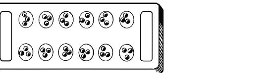

玩家坐在对面，玩家右侧的大容器被指定为其本家容器。在一次回合中，玩家选择六个坑中的一个，移除其中的石子，然后逆时针围绕棋盘“播种”石子，在每个坑中放置一颗石子，包括玩家自己的本家容器（但不包括对手的本家容器）。如果最后一颗石子落在玩家的本家容器中，玩家获得另一个回合。如果最后一颗石子落在玩家一侧棋盘上的一个空坑中，玩家取走对手一侧对应坑中的所有石子，并将它们放入玩家的本家容器。当玩家无法进行游戏时，游戏结束，对手坑中剩余的所有石子归入对手的本家容器。游戏结束时，本家容器中石子最多的玩家获胜。

例如，如果下方玩家先手并选择从第四个坑开始游戏，棋盘看起来像：

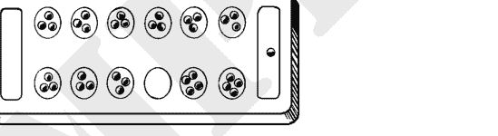

由于最后一颗石子落在玩家的本家容器中，玩家获得另一个回合。玩家这次可以选择第一个坑以捕获对手的石子：

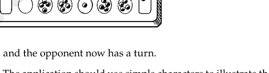

玩家的回合现在结束，对手现在进行回合。

创建一个 Mancala 应用程序。该应用程序应使用简单的字符来示意棋盘，并使用字母来标识坑，类似于下面所示：

```
  3 3 3 3 3 3
0           0
  3 3 3 3 3 3
A B C D E F
```

## 练习 16

### 库存管理

创建一个 Inventory 应用程序，用于跟踪体育用品商店的库存。每个商品有一个库存编号，第一个商品的库存编号为 1000。第二个商品的库存编号为 1001，第三个为 1002，依此类推。除了库存编号，每个商品还有一个商品名称和库存数量。新商品可以随时添加到库存中。添加时，系统生成商品库存编号并显示给用户。停产的商品不应从库存中删除，而应将其商品名称更改为“停产”，并将库存数量减少到 0。Inventory 应用程序应使用 ArrayList 来维护库存，应用程序输出应显示一个选择菜单，允许添加商品、停产商品以及显示商品的库存数量。

# 第 11 章 图形用户界面与事件驱动编程

Swing 是一个 Java 包，它提供了一组用于创建图形用户界面（GUI）的类。本章解释了如何使用基本的 Swing 组件来创建具有 GUI 的应用程序。本章涵盖的组件包括框架、面板、标签、按钮、组合框和文本字段。

### 什么是 GUI？

*GUI* 是图形用户界面（有时发音为“gooey”）。为 Microsoft Windows 或 Mac OSX Tiger 操作系统编写的应用程序通常具有 GUI。下面的 GUI 包括一个框架（也称为窗口）和一个标签：


GUI 不仅使用框架、按钮和文本字段等组件与用户通信，而且 GUI 是事件驱动的。*事件驱动应用程序*执行代码以响应事件。*事件*是来自用户的交互，例如按钮点击。GUI 通过执行称为*事件处理程序*的方法来响应事件。例如，当用户单击按钮时，应用程序必须能够确定单击了哪个按钮，然后执行与该按钮相关的代码。

### Swing 包

Swing API 是 Java 基础类（JFC）的一部分，包含用于创建 GUI 的众多组件。本章重点介绍 `javax.swing` 包。该包中的两个类是 `JFrame` 和 `JLabel`。`JFrame` 类用于实例化一个框架。*框架*是具有边框、标题以及用于最小化、最大化和关闭框架的按钮的窗口。框架是 GUI 的顶级*容器*，它在*内容窗格*中持有并显示界面的所有其他组件。内容窗格中最常见的组件之一是标签。使用 `JLabel` 类创建的*标签*用于显示用户无法更改的文本。


## Swing 包与 JFrame 类

Swing 包包含 `JFrame` 类，该类提供了以下方法：

### 类 `javax.swing.JFrame` | 方法

| 方法 | 说明 |
| :--- | :--- |
| **setDefaultLookAndFeelDecorated(boolean)** | 调用此方法后，当布尔参数为 true 时，创建的窗体将具有 Java 窗口装饰（如边框和标题）。 |
| **setDefaultCloseOperation(常量)** | 设置用户点击"关闭"按钮时执行的操作。`常量` 参数通常为 `JFrame.EXIT_ON_CLOSE`。 |
| **getContentPane()** | 返回与内容窗格对应的 Container 对象。 |
| **setContentPane(Container contentPane)** | 将内容窗格设置为 contentPane。Container 类是 JPanel 类的超类，而 JPanel 是用于创建内容窗格的类。 |
| **pack()** | 调整窗体大小，使其所有内容达到或超过其首选大小。 |
| **setVisible(boolean)** | 当布尔参数为 true 时显示窗体。 |

### `JFrame` 内容窗格：JPanel 的选择

JFrame 对象使用内容窗格来容纳 GUI 组件。*JPanel* 对象是简单内容窗格的一种选择。JPanel 类包含以下用于添加和移除组件的方法：

#### 类 javax.swing.JPanel | 方法

| 方法 | 说明 |
| :--- | :--- |
| **add(Component comp)** | 向内容窗格添加 GUI 组件。添加时，组件会被赋予一个索引值，第一个组件的索引为 0。<br><br>*注意：OCR 文本在此处将 `GUIcomponent` 作为单数名词使用；Java 中通常使用 `Component`。参数通常命名为 `<name> comp` 或直接为 `comp`。* |
| **remove(int index)** | 移除具有指定 *index* 索引值的组件。 |

将组件添加到 JPanel 对象后，使用上述 `JFrame.setContentPane()` 方法将内容窗格添加到 JFrame 对象中。

## Swing 包与用于标签的 JLabel 类

Swing 包包含 `JLabel` 类，用于创建可添加到内容窗格的标签。`JLabel` 有多个构造方法，下面介绍其中两个，以及 `setText()` 方法：

### 类 javax.swing.JLabel | 构造方法/方法

| 构造方法/方法 | 说明 |
| :--- | :--- |
| **JLabel(String str)** | 创建显示文本 *str* 的 JLabel 对象。 |
| **JLabel(String str, align_constant)** | 创建显示文本 *str* 且对齐方式为 `align_constant` 的 JLabel 对象，可设置为该类常量 LEADING 或 TRAILING，分别对应左对齐和右对齐。<br><br>**注意：** 原始 OCR 文本为 "JLabels"，已更正为标准大小写格式 "JLabel"。 |
| **setText(String str)** | 将 JLabel 对象的文本设置为 *str*。 |

`HelloWorldWithGUI1` 应用程序创建一个窗格和一个内容窗格，将内容窗格添加到窗体中，然后显示该窗体：

> HelloWorldWithGUI1 应用程序的输出显示在本章第一页。

```java
import javax.swing.*;

public class HelloWorldWithGUI1 {
    final static String LABEL_TEXT = "Hello, world!";
    
    JFrame frame;
    JPanel contentPane;
    JLabel label;

    public HelloWorldWithGUI1(){
        /* 创建并设置窗体 */
        frame = new JFrame("HelloWorldWithGUI");
        frame.setDefaultCloseOperation(JFrame.EXIT_ON_CLOSE);

        /* 创建内容窗格 */
        contentPane = new JPanel();

        /* 创建并添加标签 */
        label = new JLabel(LABEL_TEXT);
        contentPane.add(label);

        /* 将内容窗格添加到窗体 */
        frame.setContentPane(contentPane);

        /* 调整大小并显示窗体 */
        frame.pack();
        frame.setVisible(true);
    }

    /**
     * 创建并显示 GUI。
     */
    private static void runGUI() {
      JFrame.setDefaultLookAndFeelDecorated(true);

      HelloWorldWithGUI1 greeting = new HelloWorldWithGUI1();
      
    }

    public static void main(String[] args) {
      /* 创建和显示 GUI 的方法应该
         在事件调度线程中运行 */
      javax.swing.SwingUtilities.invokeLater(new Runnable() {
          public void run() {
            runGUI();
          }
      });
    }
}
```

## Swing 应用程序的实现差异

Swing 应用程序的实现与本文前面介绍的应用程序不同。控制类除了包含 `main()` 方法外，还包含构造方法和其他成员。因此，控制类实际上用于实例化一个对象，该对象实现了 GUI。

**线程执行：**
> `main()` 方法中的语句从事件调度线程运行 GUI。*线程* 是指从头到尾顺序执行的一个过程。

应该从事件调度线程调用 GUI，以确保每个事件处理程序在下一个执行之前完成执行。该主题的详尽内容超出了本文的范围。但是，显示的代码在每个实现 Swing GUI 的应用程序中都是必需的。

## 复习：姓名 —— 第 1 部分（共 2 部分）

创建一个 Name 应用程序，在 JFrame 中的标签内显示你的姓名。

# JButton 类

按钮是一种常用的 GUI 组件。用户点击*按钮*即可与应用程序进行交互。例如，`HelloWorldWithGUI2` 应用程序包含一个按钮，点击该按钮可以隐藏或显示**标签**中的文本：


Swing 包包含用于创建按钮的 `JButton` 类：

```java
Class JButton (javax.swing.JButton)

方法
JButton(String str)
    创建一个显示文本 str 的 JButton 对象。 
setActionCommand(String cmd)
    设置点击按钮时执行的操作名称为 cmd。 
getActionCommand()
    返回按钮已执行的操作名称。  
addActionListener(Object)
    添加一个监听用户点击此组件的对象。 

```

与 `JLabel` 不同，`JButton` 可以响应用户的交互。

# 处理事件

Swing 组件使用监听器来确定是否发生了事件。*监听器*是监听动作事件的对象。当监听到事件时，监听器通过执行名为 `actionPerformed()` 的事件处理程序来响应。当事件发生时，GUI 会向 `actionPerformed()` 方法传递一个 `ActionEvent` 参数。ActionEvent 对象包含一个动作命令。*动作命令*是描述事件或操作的字符串。

HelloWorldWithGUI2 应用程序的输出显示在上一节中：点击 Hide 按钮时，应用程序 GUI 变为显示：


HelloWorldWithGUI2 应用程序代码如下。对于此 GUI，创建了一个 `JButton`，设置了 JButton 的动作命令，并且当前对象是按钮动作事件的监听器。注意使用关键字 `this`。

```java
import javax.swing.*;
import java.awt.event.*;

public class HelloWorldWithGUI2 implements ActionListener { 
    final static String LABEL_TEXT = "Hello, world!"; 
    
    JFrame frame;
    JPanel contentPane;
    JLabel label;
    JButton button;

    public HelloWorldWithGUI2(){
        /* 创建并设置窗体 */
        frame = new JFrame("HelloWorldWithGUI");
        frame.setDefaultCloseOperation(JFrame.EXIT_ON_CLOSE);

        /* 创建内容窗格 */
        contentPane = new JPanel();

        /* 创建并添加标签 */
        label = new JLabel(LABEL_TEXT); 
        contentPane.add(label);

        /* 创建并添加按钮 */
        button = new JButton("Hide");  
        button.setActionCommand("Show");
        button.addActionListener(this);

        contentPane.add(button);

        /* 将内容窗格添加到窗体 */
        frame.setContentPane(contentPane);

        /* 调整大小并显示窗体 */
        frame.pack();
        frame.setVisible(true);
    }

    public void actionPerformed(ActionEvent event) {
        String command = event.getActionCommand();
        if (command.equals("Hide")) {
            label.setText("");
            button.setText("Show");
            button.setActionCommand("Show");
        } else {
            label.setText(LABEL_TEXT);
            button.setText("Hide");
            button.setActionCommand("Hide");
        }
    }

    /**
     * 创建并显示 GUI。
     */
    private static void runGUI() {
      JFrame.setDefaultLookAndFeelDecorated(true);
      HelloWorldWithGUI2 greeting = new HelloWorldWithGUI2();
    }

    public static void main(String[] args) {
      /* 创建和显示 GUI 的方法应该
         在事件调度线程中运行 */
      javax.swing.SwingUtilities.invokeLater(new Runnable() {
          public void run() {
            runGUI();
          }
      });
    }
}
```


## 复习：Name —— 第 2 部分（共 2 部分）

修改 Name 应用程序，使其根据用户点击的按钮来显示或隐藏你的名字，类似于 HelloWorldWithGUI2 应用程序。

## 复习：NumClicks

创建一个 NumClicks 应用程序，其中包含一个按钮，用于显示用户已点击该按钮的次数。在用户点击按钮 12 次后，应用程序界面应类似于以下内容：

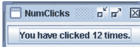

对于此应用程序，无需设置动作命令。在 `actionPerformed()` 方法中也无需调用 `getActionCommand()` 方法。

## 控制布局

**layout（布局）** *布局* 指的是组件的排列方式。在 Swing GUI 中，可以通过添加边框、使用布局管理器和设置对齐方式来控制内容窗格的布局。

**borders（边框）** 可以为大多数组件添加边框，包括内容窗格。可以使用不可见的（即空的）边框在组件周围添加“内边距”，使其与其他组件保持距离。为内容窗格添加空边框可以在组件与框架边缘之间增加空间。例如，下图左侧 GUI 的内容窗格没有边框，但右侧内容窗格的上、左、下、右均有 20 像素的空边框：

**提示** *像素*（Pixel）是图像元素的缩写，表面上的像素数量取决于屏幕分辨率。

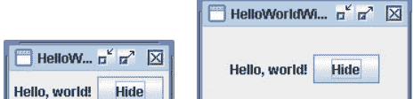

*右侧内容窗格中的空边框在组件与框架之间提供了内边距*

**layout manager（布局管理器）** *布局管理器* 决定了内容窗格上组件的排列顺序。有多种布局管理器可供选择，包括 FlowLayout、BoxLayout 和 GridLayout。*FlowLayout 管理器* 将组件一个接一个地放在一行中。当一行过长时，会开始新的一行。FlowLayout 管理器是默认管理器。HelloWorldWithGUI 应用程序就使用了该管理器。

第 11 章 GUI 与事件驱动编程

### BoxLayout 管理器

BoxLayout 管理器将组件一个接一个地放在一列中，每行一个组件。例如，下面的 GUI 使用了 BoxLayout 管理器：

**提示** BoxLayout 管理器还包含用于向布局中添加"胶水"和"刚性区域"的方法，以控制组件的位置。


*BoxLayout 管理器将组件一个接一个地放在一列中*

### GridLayout 管理器

GridLayout 管理器将组件放入由行和列组成的网格中。行与列的交点称为单元格。在 GridLayout 中，每个单元格只有一个组件。下面的 GUI 使用了 GridLayout。额外添加了一个按钮以展示网格效果：

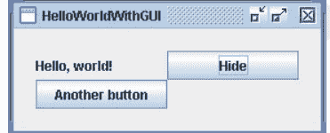

*GridLayout 管理器将组件放入网格单元中*

### alignment（对齐）

另一个影响布局的因素是对齐。对齐指的是组件在布局中的放置方式。例如，下面的两个 GUI 都使用 BoxLayout，内容窗格的空边框均为 20、20、20、20，标签周围也有 20、50、20、50 的空边框。左侧 GUI 未指定组件的对雁，而右侧 GUI 将标签和按钮居中对齐：

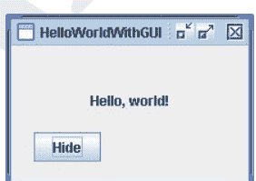


*对齐方式会影响组件在布局中的位置*

以下是修改后的 HelloWorldWithGUI2 应用程序，使用了布局管理器、边框和对齐：

```java
import javax.swing.*;
import java.awt.event.*;

public class HelloWorldWithGUI2 implements ActionListener {
    final static String LABEL_TEXT = "Hello, world!";
    JFrame frame;
    JPanel contentPane;
    JLabel label;
    JButton button;

    public HelloWorldWithGUI2(){
        /* Create and set up the frame */
        frame = new JFrame("HelloWorldWithGUI");
        frame.setDefaultCloseOperation(JFrame.EXIT_ON_CLOSE);

        /* Create a content pane with a BoxLayout and
           empty borders */
        contentPane = new JPanel();
        contentPane.setLayout(new BoxLayout(contentPane,
                                            BoxLayout.PAGE_AXIS));
        contentPane.setBorder(BorderFactory.createEmptyBorder(20,20,20,20));

        /* Create and add label that is centered and
           has empty borders */
        label = new JLabel(LABEL_TEXT);
        label.setAlignmentX(JLabel.CENTER_ALIGNMENT);
        label.setBorder(BorderFactory.createEmptyBorder(20, 50, 20, 50));
        contentPane.add(label);

        /* Create and add button that is centered */
        button = new JButton("Hide");
        button.setAlignmentX(JButton.CENTER_ALIGNMENT);
        button.setActionCommand("Hide");
        button.addActionListener(this);
        contentPane.add(button);

        /* Add content pane to frame */
        frame.setContentPane(contentPane);

        /* Size and then display the frame. */
        frame.pack();
        frame.setVisible(true);
    }
    //...rest of HelloWorldWithGUI2 code
}
```

> 提示 尝试使用多种类型的边框。

## setLayout() 方法

JPanel 的 `setLayout()` 方法用于为内容窗格指定布局。BoxLayout 对象需要两个参数：内容窗格和排列方式。要垂直排列组件，需指定类常量 `PAGE_AXIS`。

## setBorder() 方法

JPanel 的 `setBorder()` 方法用于为内容窗格指定边框。BorderFactory 类提供了多种不同的边框供选择。对于不可见的（即空的）边框，使用 `createEmptyBorder()` 方法。参数分别指定边框的上、左、下、右的宽度。

## setAlignment() 方法

JLabel 和 JButton 的 `setAlignmentX()` 方法用于指定组件在布局中的垂直对齐方式。两个类都包含多个对齐常量，包括 `CENTER_ALIGNMENT`。

## 复习：Sunflower

创建一个 Sunflower 应用程序，当点击 *Latin* 时显示向日葵的拉丁名，当点击 *English* 时显示英文名。应用程序 GUI 应使用 BoxLayout 管理器，并在点击 **Latin** 后看起来类似于以下内容：


## 获取用户输入

文本字段允许用户在运行时输入信息。文本字段通常放置在标签旁边，以提示用户该字段中预期输入的数据类型。例如，SemesterAvg 应用程序提示用户输入三个测试成绩，然后在点击 Average 时显示成绩的平均值：

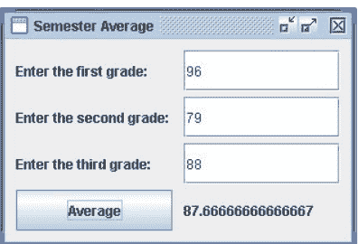

swing 包包含 JTextField 类，其构造函数和方法如下：

```java
Class JTextField (javax.swing.JTextField)
Constructor/Methods
JTextField(int col)
    creates a JTextField object with width col.
JTextField(String text, int col)
    creates a JTextField object displaying default
    text text in a field with width col.
getText()
    returnsactivities a String containing the text in the
    JTextField.
addActionListener(Object)
    adds an object that listens for the user to press
    the Enter key in this component.
```

在文本字段中输入的信息是字符串，即使输入的是数字数据也是如此。相反，JLabel 的 `setText()` 方法也期望接收字符串，即使数据是数字。可以使用 Double 和 Integer 类的类方法在数字类型和 String 类型之间转换数据：

### 在文本和数字数据之间转换

```java
Class Double (java.lang.Double)
Method
parseDouble(String text)
    returns the double value in the String text.
toString(double num)
    returns the String representation of num.

Class Integer (java.lang.Integer)
Method
parseInt(String text)
    returns the int value in the String text.
toString(int num)
    returns the String representation of num.
```

`parseDouble()` 和 `parseInt()` 方法用于将 String 数据转换为数字。SemesterAvg 应用程序（即上一页所示的 GUI）使用了 `parseDouble()`：

```java
import javax.swing.*;
import java.awt.*;
import java.awt.event.*;

public class SemesterAvg implements ActionListener {
    JFrame frame;
    JPanel contentPane;
    JLabel prompt1, prompt2, prompt3, average;
    JTextField grade1, grade2, grade3;
    JButton avgButton;

    public SemesterAvg(){
        /* Create and set up the frame */
        frame = new JFrame("Semester Average");
        frame.setDefaultCloseOperation(JFrame.EXIT_ON_CLOSE);

        /* Create a content pane with a GridLayout */
        contentPane = new JPanel();
        contentPane.setLayout(new GridLayout(0, 2, 10, 5));
        contentPane.setBorder(BorderFactory.createEmptyBorder
            (10, 10, 10, 10));

        /* Create and add a prompt and then a text field */
        prompt1 = new JLabel("Enter the first grade: ");
        contentPane.add(prompt1);

        grade1 = new JTextField(10);
        contentPane.add(grade1);

        /* Create and add a second prompt and
            then a text field */
        prompt2 = new JLabel("Enter the second grade: ");
        contentPane.add(prompt2);

        grade2 = new JTextField(10);
        contentPane.add(grade2);

        /* Create and add a third prompt and then a text field */
        prompt3 = new JLabel("Enter the third grade: ");
        contentPane.add(prompt3);

        grade3 = new JTextField(10);
        contentPane.add(grade3);

        /* Create and add button that will display the
            average of the grades */
        avgButton = new JButton("Average");
        avgButton.setActionCommand("Average");
        avgButton.addActionListener(this);
        contentPane.add(avgButton);

        /* Create and add a label that will display the
            average */
        average = new JLabel(" ");
        contentPane.add(average);

        /* Add content pane to frame */
        frame.setContentPane(contentPane);
```


纠正明显的OCR错误（例如形近字混淆、标点错误、数字/字母误判）。
将跨页的连续段落正确合并，不要保留分页标记。
根据语义和缩进/编号特征，识别标题（用## 表示一级标题，### 表示二级标题）、列表项（用- 开头）。
恢复正常的段落缩进（首行空两格不是必须，但请用空行分隔不同段落）。
如果出现表格样式的文本，请将其转换为Markdown表格。

```java
/* 调整大小然后显示窗体。 */
frame.pack();
frame.setVisible(true);
}

/**
 * 处理按钮点击动作事件
 * 前提：无
 * 结果：已计算并显示输入成绩的平均值。
 */
public void actionPerformed(ActionEvent event) {
    String eventName = event.getActionCommand();

    if (eventName.equals("Average")) {
        double avgGrade;
        String g1 = grade1.getText();
        String g2 = grade2.getText();
        String g3 = grade3.getText();

        avgGrade = (Double.parseDouble(g1) + Double.parseDouble(g2)
                + Double.parseDouble(g3))/3;
        average.setText(Double.toString(avgGrade));
    }
}

/**
 * 创建并显示GUI。
 */
private static void runGUI() {
    JFrame.setDefaultLookAndFeelDecorated(true);

    SemesterAvg myGrades = new SemesterAvg();
}

...SemesterAvg代码的main()方法
```

在actionPerformed()方法中，从文本字段读取字符串。要计算平均成绩，每个字符串都被解析为双精度值（使用`parseDouble()`）。然后使用`Double`类的`toString()`方法将`avgGrade`值转换为字符串。

## 练习：可被3整除

创建一个`DivisibleBy3`应用程序，提示用户输入一个整数，然后在点击“Check”按钮时显示一条消息，指出该数字是否能被3整除。在用户输入数字并点击“Check”后，应用程序界面应类似于以下内容：

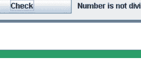

# 组合框

组合框为用户提供了一种从有限选项中进行选择的方式。组合框可以在界面中占用很少的空间就提供多种选择。用户只需点击组合框箭头即可显示额外的选项。LatinPlantNames应用程序允许用户从组合框中选择植物名称：

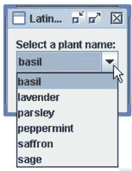

`swing`包包含`JComboBox`类，用于创建组合框：

| 类 | `JComboBox` (`javax.swing.JComboBox`) |
| :--- | :--- |
| 方法 | |
| `JComboBox(Object[] items)` | 创建一个`JComboBox`对象，其中包含`items`数组中的项目，该数组必须是对象数组。 |
| `setSelectedIndex(int index)` | 将索引`index`处的项目设置为选中项。 |
| `getSelectedItem()` | 返回与所选`JComboBox`项对应的字符串。 |
| `setEditable(boolean)` | 当布尔参数为`true`时，允许在组合框中键入文本。 |
| `addActionListener(Object)` | 添加一个对象，用于监听用户从此组件的列表中选择项目。 |

> `JComboBox`事件

处理来自`JComboBox`的事件需要两行代码，类似于：

```java
JComboBox comboBox = (JComboBox)event.getSource();
String itemName = (String)comboBox.getSelectedItem();
```

第一条语句确定动作事件的来源，然后第二条语句确定选择了哪个项目。

LatinPlantNames应用程序代码包含一个`JComboBox`对象：

```java
import javax.swing.*;
import java.awt.*;
import java.awt.event.*;

public class LatinPlantNames implements ActionListener {
    JFrame frame;
    JPanel contentPane;
    JComboBox plantNames;
    JLabel plantListPrompt, latinName;

    public LatinPlantNames(){
        /* 创建并设置窗体 */
        frame = new JFrame("LatinPlantNames");
        frame.setDefaultCloseOperation(JFrame.EXIT_ON_CLOSE);

        /* 创建带有BoxLayout和空边框的内容窗格 */
        contentPane = new JPanel();
        contentPane.setLayout(new BoxLayout(contentPane,
                BoxLayout.PAGE_AXIS));
        contentPane.setBorder(BorderFactory.createEmptyBorder(
                (10, 10, 10, 10));

        /* 创建组合框和描述性标签 */
        plantListPrompt = new JLabel("Select a plant name: ");
        plantListPrompt.setAlignmentX(JLabel.LEFT_ALIGNMENT);
        contentPane.add(plantListPrompt);

        String[] names = {"basil", "lavender", "parsley",
                "peppermint", "saffron", "sage"};
        plantNames = new JComboBox(names);
        plantNames.setAlignmentX(JComboBox.LEFT_ALIGNMENT);
        plantNames.setSelectedIndex(0);
        plantNames.addActionListener(this);
        contentPane.add(plantNames);

        /* 创建并添加一个将显示拉丁名称的标签 */
        latinName = new JLabel("Ocimum");
        latinName.setBorder(BorderFactory.createEmptyBorder(
                (20, 0, 0, 0));
        contentPane.add(latinName);

        /* 将内容窗格添加到窗体 */
        frame.setContentPane(contentPane);

        /* 调整大小然后显示窗体。 */
        frame.pack();
        frame.setVisible(true);
    }
}
```

```java
/**
 * 处理来自组合框的选择
 * 前提：无
 * 结果：已显示所选植物的拉丁名称。
 */
public void actionPerformed(ActionEvent event) {
    JComboBox comboBox = (JComboBox)event.getSource();
    String plantName = (String)comboBox.getSelectedItem();

    if (plantName == "basil") {
        latinName.setText("Ocimum");
    } else if (plantName == "lavender") {
        latinName.setText("Lavandula spica");
    } else if (plantName == "parsley") {
        latinName.setText("Apium");
    } else if (plantName == "peppermint") {
        latinName.setText("Mentha piperita");
    } else if (plantName == "saffron") {
        latinName.setText("Crocus");
    } else if (plantName == "sage") {
        latinName.setText("Salvia");
    }
}
```

...LatinPlantNames代码的runGUI()和main()方法

LatinPlantNames应用程序在选中`sage`后显示以下输出：

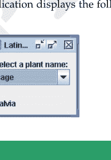

## 练习：度量转换

创建一个`MetricConversion`应用程序，允许用户从组合框中选择一种转换类型，然后在标签中显示相应的公式。要将长度测量单位从英寸转换为厘米，公式是1英寸 = 2.54厘米。公式1英尺 = 0.3048米将距离测量单位英尺转换为米。体积测量单位加仑通过公式1加仑 = 4.5461升转换为升。公式1磅 = 0.4536千克将质量测量单位磅转换为千克。在用户选择英尺转换为米后，应用程序界面应类似于以下内容：

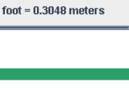

# 更改颜色

Swing组件提供了更改其颜色的方法。例如，内容窗格可以是绿色的，按钮可以是品红色的，组合框可以用粉红色显示文本。在选择颜色时，请考虑最终用户，因为颜色可以使应用程序看起来有趣和令人兴奋，也可以完全让用户望而却步。

`java.awt`包包含`Color`类，具有众多颜色常量成员。以下Swing组件类中的方法可用于更改组件的背景色和前景色：

```java
setBackground(Color.constant)
    // 将组件的背景色设置为Color类中的constant。
setForeground(Color.constant)
    // 将组件的前景色设置为Color类中的constant。
```

颜色更改对组件的影响各不相同。对于`JLabel`，前景色指的是文本的颜色。对于`JComboBox`，前景色指的是列表中文本的颜色。

ColorDemo应用程序演示了组件的颜色可能性。除了`runGUI()`和`main()`方法外，该应用程序的GUI和代码如下：

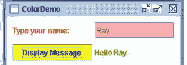

```java
import javax.swing.*;
import java.awt.*;
import java.awt.event.*;

public class ColorDemo implements ActionListener {
    JFrame frame;
    JPanel contentPane;
    JTextField name;
    JButton displayMessage;
    JLabel textFieldPrompt, hello;

    public ColorDemo(){
        /* 创建并设置窗体 */
        frame = new JFrame("ColorDemo");
        frame.setDefaultCloseOperation(JFrame.EXIT_ON_CLOSE);

        /* 创建带有BoxLayout和空边框的内容窗格 */
        contentPane = new JPanel();
        contentPane.setBorder(BorderFactory.createEmptyBorder
                               (10, 10, 10, 10));
        contentPane.setBackground(Color.white);
        contentPane.setLayout(new GridLayout(0, 2, 5, 10));
```


## 添加图像

图像可以使应用程序的信息更丰富、使用更简单且更有趣。标签和按钮通常用于显示图像，但许多 Swing 组件也支持图像。GIF 和 JPG 格式的图像效果最佳。除非在应用程序代码中指定了不同的路径，否则图像文件必须位于编译后的代码所在的相同位置。

`JLabel` 类包含在标签中显示图像的构造器和方法：

**类 JLabel (javax.swing.JLabel)**
| 构造器/方法 | 描述 |
| :--- | :--- |
| ```java\nJLabel(ImageIcon pic)\n``` | 创建一个包含 `pic` 的 `JLabel` 对象。 |
| **setIcon**(ImageIcon pic) | 设置 `JLabel` 包含 `pic`。 |

`JButton` 类包含在按钮中显示图像的构造器和方法：

**类 JButton (javax.swing.JButton)**
| 构造器/方法 | 描述 |
| :--- | :--- |
| **JButton**(String str, ImageIcon pic) | 创建一个包含文本 `str` 和图像 `pic` 的 `JButton` 对象。 |
| **JButton**(ImageIcon pic) | 创建一个包含图像 `pic` 的 `JButton` 对象。 |
| **setIcon**(ImageIcon pic) | 设置 `JButton` 包含 `pic`。 |

Roll 应用程序显示一个骰子面。用户可以点击“掷骰子”来“掷骰子”并显示掷骰子的结果。该应用程序的 GUI 和代码（除 `runGUI()` 和 `main()` 方法外）如下：

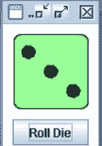

**Roll.java 代码：**
```java
import javax.swing.*;
import java.awt.*;
import java.awt.event.*;
import java.util.Random;

public class Roll implements ActionListener {
    JFrame frame;
    JPanel contentPane;
    JButton rollDie;
    JLabel dieFace;

    public Roll(){
        /* 创建并设置框架 */
        frame = new JFrame("Roll");
        frame.setDefaultCloseOperation(JFrame.EXIT_ON_CLOSE);

        /* 创建一个带有 BoxLayout 和空白边框的内容面板 */
        contentPane = new JPanel();
        contentPane.setBorder(BorderFactory.createEmptyBorder(10, 10, 10, 10));
        contentPane.setBackground(Color.white);
        contentPane.setLayout(new BoxLayout(contentPane, BoxLayout.PAGE_AXIS));

        /* 创建一个显示骰子面的标签 */
        dieFace = new JLabel(new ImageIcon("die3.gif"));
        dieFace.setAlignmentX(JLabel.CENTER_ALIGNMENT);
        dieFace.setBorder(BorderFactory.createEmptyBorder(0, 0, 10, 0));
        contentPane.add(dieFace);

        /* 创建并添加掷骰子的按钮 */
        rollDie = new JButton("Roll Die");
        rollDie.setAlignmentX(JButton.CENTER_ALIGNMENT);
        rollDie.addActionListener(this);
        contentPane.add(rollDie); // 修正：原为 "地黄"

        /* 将内容面板添加到框架 */
        frame.setContentPane(contentPane);

        /* 调整大小并显示框架 */
        frame.pack();
        frame.setVisible(true);
    }

    /**
     * 处理按钮点击事件
     * 前提：无
     * 后置：掷出一个骰子，显示匹配的图像。
     */
    public void actionPerformed(ActionEvent event) {
        Random rand = new Random();
        int newRoll;

        newRoll = rand.nextInt(6) + 1;
        if (newRoll == 1) {
            dieFace.setIcon(new ImageIcon("die1.gif"));
        } else if (newRoll == 2) {
            dieFace.setIcon(new ImageIcon("die2.gif"));
        } else if (newRoll == 3) {
            dieFace.setIcon(new ImageIcon("die3.gif"));
        } else if (newRoll == 4) {
            dieFace.setIcon(new ImageIcon("die4.gif"));
        } else if (newRoll == 5) {
            dieFace.setIcon(new ImageIcon("die5.gif"));
        } else if (newRoll == 6) { // 修正：原为 "==" 后缺少内容，实际应为 == 6
            dieFace.setIcon(new ImageIcon("die6.gif"));
        }
    }
}
```

要在 Swing GUI 中使用，图像必须是 `ImageIcon` 类的对象。`ImageIcon` 类位于 `javax.swing` 包中，其构造器接受一个文件名作为参数，然后将该文件转换为 `ImageIcon` 对象。

## 复习：Roll

修改 Roll 应用程序以掷两个骰子。为每个骰子包含图像。更改组件的颜色以使其更加令人兴奋，同时仍允许用户轻松阅读按钮上的文本并看到骰子图像。骰子图像命名为 `die1.tif`、`die2.tif`、`die3.tif`、`die5.tif` 和 `die6.tif`，并作为本文本的数据文件提供。

## 使用嵌套类处理事件

当添加了必须处理事件的按钮、文本字段和其他组件的组合时，GUI 可能会迅速变得复杂。当一个界面上有多种组件时，各个组件的 `actionPerformed()` 方法应分别处理它们的事件。

到目前为止，控制类的实例 (`this`) 实现了一个 `actionPerformed()` 方法。这个单一的方法用于处理 GUI 上每个组件的事件。这对于简单的 GUI 来说已经足够了。然而，一个有多个类型组件响应事件的 GUI 应该有多个监听器。在单个应用程序中实现多个监听器的一种方法是从嵌套类创建每个监听器。

> **提示** 嵌套类也称为内部类。

*嵌套类* 是一个类中的类。嵌套类是其所属类的成员。作为类成员，它可以访问该类的所有其他成员，包括私有成员变量和方法。包含类成员的类称为 *外部类*。Semester Stats 应用程序使用两个嵌套类来响应事件：

### 外部类代码 (SemesterStats.java)
```java
import javax.swing.*;
import java.awt.*;
import java.awt.event.*;

public class SemesterStats {
    JFrame frame;
    JPanel contentPane;
    JLabel prompt1, prompt2, prompt3, stat;
    JTextField grade1, grade2, grade3;
    JButton avgButton, minButton, maxButton; // 修正：原为 "maxBtton"

    public SemesterStats(){
        /* 创建并设置框架 */
        frame = new JFrame("Semester Stats");
        frame.setDefaultCloseOperation(JFrame.EXIT_ON_CLOSE);

        /* 创建带有 GridLayout 和空白边框的内容面板 */
        contentPane = new JPanel();
        contentPane.setLayout(new GridLayout(0, 2, 10, 5)); // 修正：缩进/结构
        contentPane.setBorder(BorderFactory.createEmptyBorder(10, 10, 10, 10));

        /* 创建并添加提示和文本字段 */
        prompt1 = new JLabel("Enter the first grade: ");
        contentPane.add(prompt1);

        grade1 = new JTextField(10);
        contentPane.add(grade1);

        /* 创建并添加第二个提示和文本字段 */
        prompt2 = new JLabel("Enter the second grade: "); // 修正：大小写一致
        contentPane.add(prompt2);

        grade2 = new JTextField(10);
        contentPane.add(grade2);

        /* 创建并添加第三个提示和文本字段 */
        prompt3 = new JLabel("Enter the third grade: "); // 修正：拼写
        contentPane.add(prompt3);

        grade3 = new JTextField(10);
        contentPane.add(grade3);

        /* 创建并添加将显示平均成绩的按钮 */
        avgButton = new JButton("Average"); // 修正：原为 "Averag"
        contentPane.add(avgButton);

        /* 创建并添加将显示最小成绩的按钮 */
        minButton = new JButton("Minimum"); // 假设存在，用于完整性
        contentPane.add(minButton);

        /* 创建并添加将显示最大成绩的按钮 */
        maxButton = new JButton("Maximum"); // 假设存在，用于完整性
        contentPane.add(maxButton);

        /* 创建并添加显示统计信息的标签 */
        stat = new JLabel(" ");
        contentPane.add(stat);

        /* 将内容面板添加到框架 */
        frame.setContentPane(contentPane);

        /* 调整大小并显示框架 */
        frame.pack();
        frame.setVisible(true);
    }
}
```

class MinMaxListener implements ActionListener {

    /**
     * 处理最小值和最大值按钮点击事件
     * 前置：无
     * 后置：最小值或最大分数已确定并显示。
     */
    public void actionPerformed(ActionEvent event) {
        String eventName = event.getActionCommand();
        double minGrade = 999;
        double maxGrade = 0;
        double[] grades = new double[3];

        grades[0] = Double.parseDouble(grade1.getText());
        grades[1] = Double.parseDouble(grade2.getText());
        grades[2] = Double.parseDouble(grade3.getText());

        if (eventName.equals("Min")) {
            for (int i = 0; i < 3; i++) {
                if (minGrade > grades[i]) {
                    minGrade = grades[i];
                }
            }
            stat.setText(Double.toString(minGrade));
        } else if (eventName.equals("Max")) {
            for (int i = 0; i < 3; i++) {
                if (maxGrade < grades[i]) {
                    maxGrade = grades[i];
                }
            }
            stat.setText(Double.toString(maxGrade));
        }
    }

    /**
     * 创建并显示 GUI。
     */
    private static void runGUI() {
        JFrame.setDefaultLookAndFeelDecorated(true);
        SemesterStats myGrades = new SemesterStats();
    }

    public static void main(String[] args) {
        /* 应该从事件分派线程中运行用于创建和显示 GUI 的方法 */
        javax.swing.SwingUtilities.invokeLater(new Runnable() {
            public void run() {
                runGUI();
            }
        });
    }
}

一个类（AvgListener）被用作 Average 按钮的事件监听器实现，第二个类（MinMaxListener）实现了 Min 和 Max 按钮的监听器。因为它们的算法非常相似，所以将这两个按钮合并到了一个监听器中。

SemesterStats 应用程序显示的输出类似于：

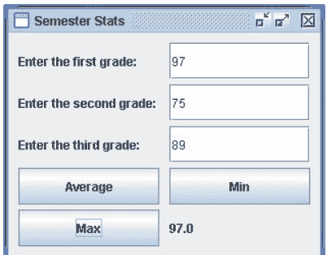

## 第 11 章案例研究

在这个案例研究中，将创建一个 Swing GUI，用于一个名为 Break-A-Plate 的嘉年华游戏应用程序。Break-A-Plate 游戏允许玩家尝试打破所有三个盘子。如果三个盘子都被打破，将获得一等奖，否则，将获得安慰奖。

## BreakAPlate 规范说明

BreakAPlate 应用程序在开始时显示三个未打破的盘子。点击 Play 开始游戏，显示破碎的盘子，并显示赢得的奖品。如果三个盘子都破碎，将颁发老虎毛绒玩具作为头奖。如果少于三个盘子破碎，将颁发贴纸作为安慰奖。在一局游戏结束后，Play 按钮会变为 Play Again（再玩一次）。点击 Play Again 显示一组未打破的盘子，并将按钮变回 Play，允许用户重复游玩。当用户关闭窗口时，应用程序结束。

BreakAPlate 游戏使用随机数来决定玩家是否打破了所有三个盘子。当随机数生成器生成了三个 1 时，应用程序将显示三个破碎的盘子。如果生成了零、一个或两个 1，则应用程序将显示两个破碎的盘子，表示输局。

BreakAPlate 接口应该是一个包含以下内容的 GUI：用于显示盘子图像的标签，允许用户玩或再玩一次的按钮，以及用于显示赢得奖品的标签。在游戏开始之前、一局失败的游戏之后和一局获胜的游戏之后的 BreakAPlate GUI 外观应类似于以下内容：

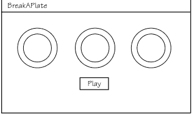

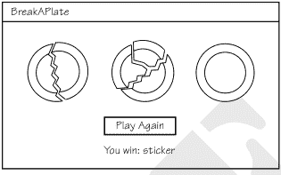

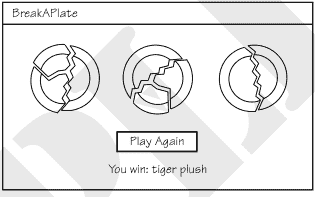

BreakAPlate 算法：

- 1. 当游戏开始时，生成三个介于 0 和 1 之间的随机数。
- 2. 如果生成了三个 1，显示三个破碎的盘子以及头奖的名称。否则，显示两个破碎的盘子并显示安慰奖的名称。

## BreakAPlate 代码设计

BreakAPlate 应用程序模拟嘉年华中的游戏摊位。因此，该游戏可以建模为 GameBooth 对象。GameBooth 类已在第 8 章创建，包含以下方法：

> **提示** 参考第 8 章以查看 GameBooth 代码。

类 GameBooth（Lawrenceville Press）

| 构造函数/方法 | 描述 |
| :--- | :--- |
| `GameBooth(int cost, String p1, String p2)` | 创建了一个 GameBooth 对象，收取 `cost` 金额作为游玩费用，颁发一等奖 `p1` 和安慰奖 `p2`。如果游戏没有收费或收费不重要，则 `cost` 的参数应为 0。 |
| `start()` | 模拟一局游戏，允许玩家尝试三次。如果玩家三次都成功，则返回头奖的名称。否则，返回安慰奖的名称。 |
| `getCost()` | 返回游戏的费用。 |

该游戏的成本不是本应用程序的考虑因素，因此构造函数中 `cost` 参数的参数应为 0，并且 getCost() 方法将不需要。

基于算法和 GameBooth 类，BreakAPlate actionPerformed() 方法的伪代码类似于：

```
String eventName = event.getActionCommand();
String prize;

if (Play) {
    prize = breakAPlate.start();
    if (prize is tiger plush) {
        display all broken plates;
    } else if (prize is sticker) {
        display two broken plates
    }
    display prize won
    change button to Play Again
} else if (Play Again) {
    display unbroken plates
    clear prize won text
    change button to Play
}
```

## BreakAPlate 实现

BreakAPlate 实现涉及创建 BreakAPlate java 文件并将 GameBooth java 文件添加到项目中。

BreakAPlate 应用程序实现如下：

```java
/**
 * BreakAPlate.
 */
import javax.swing.*;
import java.awt.*;
import java.awt.event.*;

public class BreakAPlate implements ActionListener {
    static final String FIRST_PRIZE = "tiger plush";
    static final String CONSOLATION_PRIZE = "sticker";
    JFrame frame;
    JPanel contentPane;
    JButton play;
    JLabel plates, prizeWon;
    GameBooth breakAPlate;

    public BreakAPlate(){
        /* initialize game booth and player */
        breakAPlate = new GameBooth(0, FIRST_PRIZE, CONSOLATION_PRIZE);

        /* Create and set up the frame */
        frame = new JFrame("BreakAPlate");
        frame.setDefaultCloseOperation(JFrame.EXIT_ON_CLOSE);

        /* Create a content pane with a BoxLayout and empty borders */
        contentPane = new JPanel();
        contentPane.setBorder(BorderFactory.createEmptyBorder(20, 20, 20, 20));
        contentPane.setBackground(Color.white);
        contentPane.setLayout(new BoxLayout(contentPane, BoxLayout.PAGE_AXIS));

        /* Create a label that shows the start of the game */
        plates = new JLabel(new ImageIcon("plates.gif"));
        plates.setAlignmentX(JLabel.CENTER_ALIGNMENT);
        plates.setBorder(BorderFactory.createEmptyBorder(10, 10, 20, 10));
        contentPane.add(plates);

        /* Create a Play button */
        play = new JButton("Play");
        play.setActionCommand("Play");
        play.setAlignmentX(JButton.CENTER_ALIGNMENT);
        play.addActionListener(this);
        contentPane.add(play);

        /* Create a label that will show prizes won */
        prizeWon = new JLabel(" ");
        prizeWon.setAlignmentX(JLabel.CENTER_ALIGNMENT);
        prizeWon.setBorder(BorderFactory.createEmptyBorder(20, 0, 0, 0));
        contentPane.add(prizeWon);

        /* Add content pane to frame */
        frame.setContentPane(contentPane);

        /* Size and then display the frame. */
        frame.pack();
        frame.setVisible(true);
    }

    /**
     * Handle the button click
     * pre: none
     * post: The appropriate image and message are displayed.
     */
    public void actionPerformed(ActionEvent event) {
        String eventName = event.getActionCommand();
        String prize;

        if (eventName == "Play") {
            prize = breakAPlate.start();
            if (prize.equals(FIRST_PRIZE)) {
                plates.setIcon(new ImageIcon("plates_all_broken.gif"));
            } else if (prize.equals(CONSOLATION_PRIZE)) {
                plates.setIcon(new ImageIcon("plates_two_broken.gif"));
            }
            prizeWon.setText("You win: " + prize);
            play.setText("Play Again");
            play.setActionCommand("Play Again");
        } else if (eventName == "Play Again") {
            plates.setIcon(new ImageIcon("plates.gif"));
            prizeWon.setText(" ");
            play.setText("Play");
            play.setActionCommand("Play");
        }
    }
}
```


```java
/**
 * Create and show the GUI.
 */
private static void runGUI() {
    JFrame.setDefaultLookAndFeelDecorated(true);

    BreakAPlate carnivalGame = new BreakAPlate();
}

public static void main(String[] args) {
    /* Methods that create and show a GUI should be
       run from an event-dispatching thread */
    javax.swing.SwingUtilities.invokeLater(new Runnable() {
        public void run() {
            runGUI();
        }
    });
}
```

运行 BreakAPlate 应用程序会显示如下类似的图形用户界面：

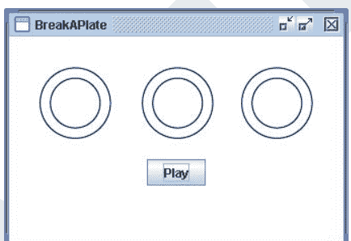

当点击“播放”按钮时，用户要么获胜要么失败。下方的输出显示了一个失败的实例：

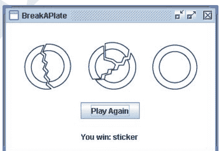

下方的应用程序图形用户界面显示了一个成功的游戏：

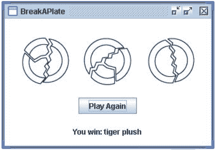

## BreakAPlate 测试和调试

该应用程序应通过玩几场游戏进行测试，确保奖品的名称正确，并且按钮和图片发生适当的变化。

## 回顾：BreakAPlate

修改 BreakAPlate 应用程序以显示获胜奖品的图片，而不是命名奖品的文本。tiger_plush.gif、sticker.gif 和 placeholder.gif 作为本章节的数据文件提供。placeholder.gif 文件是一个与 tiger_plush 和 sticker 图像大小相同的白色方块。在每场游戏的开始时，应显示 placeholder.gif 文件。修改后的 BreakAPlate 界面在用户赢得游戏后应类似于以下界面：

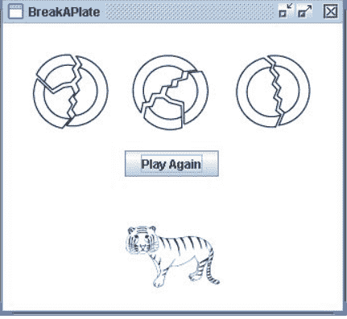

## 本章小结

本章介绍了使用 Swing API 的图形用户界面。Java swing 包包含许多组件类，包括 JFrames、JPanels、JLabels、JButtons、JComboBoxes 和 JTextFields。

具有图形用户界面的应用程序是事件驱动的。GUI 必须从事件分发线程运行。图形用户界面应用程序响应用户的交互称为事件。一个事件执行一个被称为事件处理程序的方法。Swing 事件处理程序也称为动作事件处理程序。

一个框架是内容面板的容器。常用的内容面板是 JPanel 组件。JPanel 可以包含其他组件，如标签和按钮。标签是不接收事件的组件。按钮是一种常用于接受用户输入的组件。

只有具有监听器对象的组件才能执行事件处理程序。监听器执行 actionPerformed() 事件处理程序，并传递给它一个 ActionEvent 对象，其中包含描述该事件的操作命令。

JPanel 中的组件布局可以通过布局管理器和边框以及对齐来控制。FlowLayout、BoxLayout 和 GridLayout 是本章涵盖的三种管理器。通过空边框（用于内边距）和使用对齐，可以进一步控制布局中组件的位置。

文本字段组件允许用户在界面中输入信息。输入到文本字段的信息是一个字符串。Integer 和 Double 类包含将信息转换为数值数据的类方法。标签组件在设置文本时需要一个字符串。Integer 和 Double 类还提供 toString() 方法用于将数值数据转换为 String。

组合框允许用户从有限的选择中进行选择。组合框不会占用太多空间，当点击其箭头按钮时显示选择列表。

大多数组件包括设置背景色和前景色的方法。颜色可以使应用程序更容易使用并更有趣，但应该考虑用户进行选择。

GIF 和 JPG 图像可以包含在应用程序 GUI 中。标签或按钮通常用于显示图像。

嵌套类用于实现多个事件处理程序。嵌套类，像任何其他类的成员一样，可以访问该类中的其他成员，包括私有变量和方法成员。一个包含类成员的类称为外部类。

## 词汇

- **操作命令** 描述事件的字符串。
- **对齐** 布局中组件的位置。
- **BoxLayout 布局管理器** 一种将组件依次放置在一列的布局管理器。
- **按钮** 用户可以点击的 GUI 组件。
- **组合框** 为用户提供的可以从有限选择中进行选择的 GUI 组件。
- **容器** 持有并显示 GUI 中所有其他组件的组件。
- **内容框架** 顶级容器。
- **事件** 用户与应用程序的 GUI 交互。
- **事件驱动应用程序** 响应事件的程序。
- **事件处理程序** 响应对应事件执行的方法。
- **FlowLayout 布局管理器** 一种将组件依次放置在一行的布局管理器。
- **框架** 包含边框、标题以及最大化、最小化和关闭按钮的 GUI 窗口。
- **GridLayout 布局管理器** 一种将组件放置在行和列网格中的布局管理器。
- **标签** 一个显示文本或图像且不与用户交互的 GUI 组件。
- **布局** 组件的排列方式。
- **布局管理器** 用于指定内容窗格上组件的顺序。
- **监听器** 一个侦听动作事件的对象。
- **嵌套类** 属于另一个类的类。类内部的类。
- **外部类** 包含类成员的类。
- **文本字段** 允许用户在运行时输入信息的 GUI 组件。
- **线程** 从头到尾顺序运行的过程。

## Java

- **ActionListener** 包含 actionListener() 方法的 java.awt.event 接口。
- **actionPerformed()** 一个实现为响应事件的方法。此方法是 ActionListener 接口中的唯一方法。
- **BorderFactory** 具有创建边框对象的类方法的 java.lang 类。
- **BoxLayout** javax.swing 包中用于设置内容面板布局的类。
- **Color** 包含用于更改组件颜色的常量的 java.awt 类。
- **Double** 用于在数值和文本数据之间转换数字的 java.lang 类。
- **GridLayout** 用于设置内容面板布局的 java.awt 类。
- **ImageIcon** 用于将图像（例如 GIF 或 JPG）转换为 ImageIcon 对象的 java.swing 类。
- **Integer** 用于在数值和文本数据之间转换数字的 java.lang 类。
- **java.awt** 包含 GridLayout 类和 Color 类常量的包。
- **java.awt.event** 包含 ActionListener 接口的包。
- **java.swing** 包含 Swing API 类的包。
- **JButton** javax.swing 中用于在 GUI 中创建按钮的类。该类包括向标签添加文本或图像的方法。
- **JComboBox** 用于在 GUI 中创建组合框的 java.swing 类。
- **JFrame** 用于在 GUI 中创建窗口（也称为框架）的 java.swing 类。
- **JLabel** 用于在 GUI 中创建标签的 java.swing 类。该类包括向标签添加文本或图像的方法。
- **JPanel** 用于为框架创建内容面板的 java.swing 类。该类包括添加和移除组件的方法。
- **JTextField** 用于创建文本字段的 java.swing 类。
- **FlowLayout** javax.swing 中用于设置内容面板布局的类。
- **Swing API** Java Foundation Classes 的一部分，包含用于创建 GUI 的众多组件。
- **this** 指示对象本身的关键词。

## 批判性思维

1. 解释事件驱动应用程序和控制台应用程序之间的区别。
2. 解释如何在事件驱动应用程序中执行代码。
3. 能否直接将组件添加到框架？解释原因。
4. 标签能响应事件吗？解释原因。
5. 为什么您认为 GUI 需要从头到尾顺序运行才能从事件分发线程执行？（注：原意应为从事件分发线程运行） -> `为什么您可能认为 GUI 需要从头到尾顺序运行才能从事件分发线程执行？` (Wait, translation check: "event-dispatching thread". Correct meaning: run from it. I will translate accurately).
   *Correction:* `## Critical Thinking` Question 5: `Why do you think a GUI needs to be run from an event-dispatching thread?` -> `为什么你认为 GUI 需要从事件分发线程运行？`
6. 标签和按钮之间有什么区别？
7. a) 当作为 addActionListener() 方法的参数使用时，这表示什么？
   b) 监听事件的对象必须包含什么？
8. 列出三种控制内容面板布局的方法。
9. 用于在组件周围添加内边距的边框类型是什么？
10. 列出三种布局管理器并解释每种如何排列内容面板上的组件。
11. 使用哪个类来为 setBorder() 方法返回对象？
12. 当使用 GridLayout 管理器时，是否需要内边距边框？解释原因。
13. 在将文本字段中输入的数值数据用于计算之前，必须首先对它做什么？
14. 下面最后一行语句中 `num1` 的值是多少？

```java
double num1;
Double num2 = new Double(3);
String num3 = "5";
num1 = num2.doubleValue() +
    Double.valueOf(num3).doubleValue();
```

15. 应用程序提示用户从六个名称的列表中进行选择。以下哪种组件选择更好：文本字段还是组合框？解释原因。
16. 粉色背景上的白色文本是图形用户界面的好的颜色组合吗？为什么或为什么不？
17. Swing GUI 支持哪些图像类型？
18. 通常使用哪些组件来显示图像？
19. 为了被 Swing 组件显示，图像必须转换为哪种类型？

## 判断正误

20. 确定以下内容是正确还是错误。如果错误，请解释原因。
    a) JFrame 是 javax.swing 包中的类。
    b) 按钮点击是一个事件处理程序。
    c) 标签可以被用户更改。
    d) JFrame 对象使用内容面板来容纳 GUI 组件。
    e) 内容面板上第一个组件的索引值是 1。
    f) JLabel 类常量 LEADING 表示右对齐。
    g) 线程是从头到尾顺序运行的过程。
    h) Swing 组件使用侦听器来确定是否发生了事件。
    i) 使用监听器的类必须实现 ActionListener 类。
    j) 空边框表示组件周围没有空间。
    k) FlowLayout 布局管理器将组件依次放置在一列中，每行一列。
    l) GUI 上的所有组件都必须具有相同的对齐方式。
    m) PAGE_AXIS 类常量指定组件应垂直排列成一行。
    n) JLabel setAlignmentX() 方法用于指定布局中组件的水平对齐方式。
```


 +   o) 使用 BoxLayout 管理器的代码需要包含一条 `import java.awt.*` 语句。
p) 信息是在运行时输入到文本字段中的。
q) 文本字段只能接受数字数据。
r) JLabel 前景色指的是文本颜色。
s) 一个 Swing GUI 只能有一个监听器。
t) 嵌套类可以访问外部类的 `private` 变量成员。

**练习**

---

## 练习 1 — LocalBankGUI

创建 LocalBankGUI 应用程序，为第 9 章的本地银行案例研究实现一个图形用户界面。

## 练习 2 — TicTacToeGUI

创建一个 TicTacToeGUI 应用程序，允许两名玩家进行电脑化的井字棋游戏。请参考第 9 章介绍的 TicTacToe 应用程序。TTT 类的代码需要为 GUI 版本的应用程序进行修改。为井字棋棋盘的每个“格子”使用一个按钮。

## 练习 3 — PhotoAlbum

创建一个 PhotoAlbum 应用程序，每次点击“下一步”时显示一张新图片。使用本教材提供的数据文件：grayangel.jpg、scorpionfish.jpg、sponges.jpg 和 starfish.jpg。

该应用程序应允许用户循环浏览所有图片。

## 练习 4 — Clacker

在 Clacker 游戏中，最初显示数字 1 到 12。玩家掷两个骰子，并可以覆盖代表总数的数字或骰子上的两个数字。例如，如果掷出 3 和 5，玩家可以覆盖 3 和 5，或者只覆盖 8。游戏持续进行，直到所有数字都被覆盖。目标是用最少的投掷次数覆盖所有数字。

创建一个 Clacker 应用程序，显示 12 个编号为 1 到 12 的按钮。每个按钮都可以被点击以“覆盖”它。被覆盖的按钮不显示任何内容。另一个标有“掷骰”的按钮可以被点击以掷骰子。包括标签来显示每次投掷的相应骰子图像。另一个标签显示已投掷的次数。可以点击“新游戏”按钮来清除标签并揭开所有按钮，开始新游戏。

## 练习 5 — LifeGUI

创建一个 LifeGUI 应用程序，基于第 10 章练习 14 中创建的 Life 应用程序。20 x 20 的网格应由按钮组成，初始时全部显示 O。要选择第一天的活细胞，用户点击代表活细胞位置的按钮。当点击时，按钮从显示 O 变为显示 X。网格下方的“下一步”按钮可以重复点击，以显示下一代，直到用户退出或不再有活细胞。

## 第 12 章 文件与异常处理

许多应用程序都使用文件来存储和检索数据。本章将讨论顺序文件访问，包括对象序列化。还将解释异常处理。

### 什么是文件？

到目前为止，本教材创建的应用程序都将数据存储在计算机的内存中。但是，内存存储仅在计算机开机且应用程序运行时可用。文件是存储在持久介质（如硬盘或 CD）上的相关数据集合。持久的简单来说就是持久的。

文件通常存储应用程序使用的数据。文件也用于存储应用程序生成的数据。在任何一种情况下，文件都独立于访问它的应用程序，并且可以被多个应用程序读写。大多数应用程序需要访问磁盘上的一个或多个文件。

### 文件类

`File` 类是 `java.io` 包的一部分，用于创建一个表示文件的对象。`File` 对象可用于创建新文件、测试文件是否存在以及删除文件。`File` 类的一些方法包括：

| File 类 (java.io) | |
|:---|:---|
| **构造方法/方法** | |
| `File(String f)` | 创建一个指向文件 `f` 的 `File` 对象。 |
| `createNewFile()` | 如果文件不存在则创建新文件。如果文件创建成功则返回 `true`，否则返回 `false`。如果无法创建文件，此方法会抛出 `IOException` 异常。 |
| `delete()` | 永久删除 `File` 对象所代表的文件。如果文件删除成功则返回 `true`，否则返回 `false`。 |
| `exists()` | 如果 `File` 对象所代表的文件存在则返回 `true`，否则返回 `false`。 |

下面的应用程序检查文件是否存在：

```java
import java.io.*;

public class TestFiles {

    public static void main(String[] args) {
        File textFile = new File("c:\\\\temp\\\\supplies.txt");
        if (textFile.exists()) {
            System.out.println("File already exists.");
        } else {
            System.out.println("File does not exist.");
        }
    }
}
```

文件名被指定为一个字符串。如果文件名中包含路径，必须使用转义序列 (`\\\\`) 来分隔驱动器、文件夹和文件名。

## 复习：MyFile – 第 1 部分，共 2 部分

创建一个 MyFile 应用程序，提示用户输入文件名，然后显示一条消息指示该文件是否存在。请注意，如果用户输入完整路径，任何单反斜杠 (\\) 都需要替换为转义序列 (\\\\) 才能创建新的 `File` 对象。

## 异常处理

**异常** *异常* 是影响程序执行的错误。如果异常未被处理，应用程序会突然终止。虽然许多类型的异常可能仍然需要终止程序，但异常处理程序可以通过向用户提供信息丰富的错误消息来允许应用程序优雅地终止。

**异常处理程序** *异常处理程序* 是在异常发生时执行某个操作的代码块。`try-catch-finally` 语句可用于编写异常处理程序。其形式如下：

```
try {
    <statements>
} catch (exception err _ code) {
    <statements>
} ...additional catch clauses
} finally (exception err _ code) {
    <statements>
}
```

`try` 语句是可能生成异常的语句。`catch` 子句等待与 `exception` 参数匹配的异常，然后执行其代码。如果 `try` 子句中的语句可能引发多种类型的异常，则应为每种异常类型编写单独的 `catch` 子句。`finally` 子句是可选的，无论错误处理程序的 `try-catch` 部分发生什么，它都会执行其中的语句。

调用某些方法时需要异常处理程序。例如，`File` 类中的 `createNewFile()` 方法在无法使用指定的文件名创建文件时会生成 `IOException` 异常。如果无法完成任务，`createNewFile()` 方法包含代码来抛出或生成一个异常对象。

修改后的 TestFiles 应用程序在创建新文件之前检查文件是否存在：

```java
import java.io.*;

public class TestFiles {

    public static void main(String[] args) {
        File textFile = new File("c:\\\\supplies.txt");
        if (textFile.exists()) {
            System.out.println("File already exists.");
        } else {
            try {
                textFile.createNewFile();
                System.out.println("New file created.");
            } catch (IOException e) {
                System.out.println("File could not be created.");
                System.err.println("IOException: " + e.getMessage());
            }
        }
    }
}
```

异常（例如 `IOException`）是 `Throwable` 类的一个对象。`Throwable` 对象有一个 `getMessage()` 成员，它返回一个包含异常信息的字符串。`err` 流用于在屏幕上显示错误消息。

## 复习：MyFile – 第 2 部分，共 2 部分

创建一个 MyFile 应用程序，创建一个名为 `zzz.txt` 的文件，然后显示一条消息表明文件已创建。应用程序应提示用户是保留还是删除该文件。如果文件被删除，应通知用户文件已成功删除。

## 文件流

文件必须与流关联才能执行诸如读取内容、覆盖现有内容以及向现有内容添加内容等操作。流处理字符，在 Java 中，流是通过类实现的。

文件流跟踪文件位置，即最后一次读取或写入的位置。文件流用于执行顺序文件访问，所有读写操作都一个接一个字符或一行接一行地进行。

**数据流**

流通常应用于数据的输入和输出。例如，内存、发送到打印机的信息，以及从网站发送和接收的数据，都可以通过流来处理。

流可以被视为一个字符序列。例如，一个包含姓名和分数列表的文件，在文字处理程序中查看时可能如下所示：

```
Drew 84
Tia 92
```

然而，在考虑文件操作时，文件应该被可视化为一个数据流：

| D | r | e | w | | 8 | 4 | Cr | Lf | T | i | a | | 9 | 2 | Cr | Lf | -1 |
|---|---|---|---|---|---|---|----|----|---|---|---|---|---|---|----|----|----|

回车符（Cr）后跟一个换行符（Lf）被称为*行终止符*。-1 表示*文件结束*。

# FileReader 和 BufferedReader 类

`FileReader` 和 `BufferedReader` 类都来自 `java.io` 包，它们通常一起使用来读取现有文件的内容。`FileReader` 类用于创建一个*输入文件流*。然后，使用 `BufferedReader` 类从流中读取文本。以下是 `FileReader` 和 `BufferedReader` 类的摘要：

**FileReader 类 (java.io)**

**构造方法/方法**
`FileReader(File fileName)`

为 `File` 对象创建一个输入文件流。如果文件不存在，此构造方法将抛出 `FileNotFoundException` 异常。

`close()`

关闭输入文件流。如果文件无法关闭，此方法将抛出 `IOException` 异常。

**BufferedReader 类 (java.io)**

**构造方法/方法**
`BufferedReader(Reader stream)`

从 `stream` 创建一个缓冲输入流。`Reader` 是 `FileReader` 的父类。

`read()`

从输入流中读取单个字符。如果流无法被读取，此方法将抛出 `IOException` 异常。

`readLine()`

从输入流中读取一行文本。如果流无法被读取，此方法将抛出 `IOException` 异常。

`close()`

关闭输入文件流。如果流无法被关闭，此方法将抛出 `IOException` 异常。

下一页的应用程序逐行读取一个现有文件以显示其内容：

提示：缓冲区存储来自流的大量字符，以便可以一次读取多个字符，例如在 `readLine()` 中。

**读取字符**

`read()` 方法返回一个 `int`，它对应一个 Unicode 值。在 Unicode 中，空格对应 32，制表符对应 9，回车符对应 13，换行符对应 10。

```java
import java.util.Scanner;
import java.io.*;

public class ReadFile {

    public static void main(String[] args) {
        File textFile = new File("wonder.txt");
        FileReader in;
        BufferedReader readFile;
        String lineOfText;

        try {
            in = new FileReader(textFile);
            readFile = new BufferedReader(in);
            while ((lineOfText = readFile.readLine()) != null ) {
                System.out.println(lineOfText);
            }
            readFile.close();
            in.close();
        } catch (FileNotFoundException e) {
            System.out.println("File does not exist or could not be found.");
            System.err.println("FileNotFoundException: " + e.getMessage());
        } catch (IOException e) {
            System.out.println("Problem reading file.");
            System.err.println("IOException: " + e.getMessage());
        }
    }
}
```

`ReadFile` 应用程序在 `try-catch` 语句中读取并显示文件内容，因为如果读取文件时出现问题，`FileReader` 和 `BufferedReader` 的构造方法和方法都会抛出异常。一个 `try` 可以有多个 `catch` 语句。这些 `catch` 语句的顺序与它们可能发生的顺序一致。例如，`FileNotFoundException` 首先被处理，因为在 `try` 语句中首先创建了 `FileReader` 对象。

`close()` 方法用于关闭 `FileReader` 和 `BufferedReader` 流。流必须按照它们被打开的相反顺序关闭，这一点很重要。

`ReadFile` 应用程序运行时显示以下输出：

> The little girl shouted "Go, Wonder Horse, go!"
> Her brother stared in disbelief as his toy horse began to fly.
> Together they laughed while the horse flew around them.

# 复习：作业

创建一个 `Assignment` 应用程序，读取并显示一个包含本作业说明的文件内容。使用记事本或其他文字处理程序创建该文件。请确保文件保存为文本文件（TXT）。`Assignment` 应用程序需要包含指向该文件位置的正确路径。如果未指定路径，则文件必须放在与 `Assignment` 可执行文件相同的文件夹中。

# 处理数字数据

磁盘上的文件是一组字符，即使文件包含数字数据（如考试分数）也是如此。用于处理文件中数字数据的应用程序必须在读取数据后进行转换。`Double` 和 `Integer` 类包含用于将字符串转换为基本数据类型的类方法：

```
Class Double (java.lang.Double)
Method
double parseDouble(String text)
returns the double value in the String text.

Class Integer (java.lang.Integer)
Method
int parseInt(String text)
returns the int value in the String text.
```

`AvgScore` 应用程序读取存储在文本文件中（每行一个分数）的测试分数，然后计算并报告平均分：

```java
import java.io.*;

public class AvgScore {
    public static void main(String[] args) {
        File dataFile = new File("scores.dat");
        FileReader in;
        BufferedReader readFile;
        String score;
        double avgScore;
        double totalScores = 0;
        int numScores = 0;

        try {
            in = new FileReader(dataFile);
            readFile = new BufferedReader(in);
            while ((score = readFile.readLine()) != null ) {
                numScores += 1;
                System.out.println(score);
                totalScores += Double.parseDouble(score);
            }
            avgScore = totalScores / numScores;
            System.out.println("Average = " + avgScore);
            readFile.close();
            in.close();
        } catch (FileNotFoundException e) {
            System.out.println("File does not exist or could not be found.");
            System.err.println("FileNotFoundException: " + e.getMessage());
        } catch (IOException e) {
            System.out.println("Problem reading file.");
            System.err.println("IOException: " + e.getMessage());
        }
    }
}
```

> **DAT 文件**
> 包含数字数据的文本文件通常具有文件扩展名 `.dat`，也称为 DAT 文件。

该应用程序产生以下输出：

```
88
92
76
95
67
82
91
Average = 84.42857142857143
```

# 复习：统计 — 第 1 部分（共 2 部分）

创建一个 `Stats` 应用程序，从随附于本教材的数据文件 `test1.dat` 中读取姓名和分数。该文件包含学生姓名（在一行上），后跟学生的测试分数（在下一行上）。`Stats` 应用程序应读取并显示每个姓名和分数。在显示所有分数后，应显示最低分、最高分和平均分。

# FileWriter 和 BufferedWriter 类

`FileWriter` 和 `BufferedWriter` 类都来自 `java.io` 包，它们一起用于将数据写入文件。`FileWriter` 类用于创建输出文件流。然后使用 `BufferedWriter` 类对象将文本发送到流中。`FileWriter` 和 `BufferedWriter` 类的一些方法包括：

**FileWriter 类 (java.io)**

**构造方法/方法**

| 构造方法/方法 | 描述 |
| :--- | :--- |
| `FileWriter(File fileName, boolean append)` | 为 `File` 对象创建一个输入文件流。如果 `append` 为 true，则写入文件的数据将添加到现有数据之后，否则文件将被覆盖。如果文件无法创建或打开，此构造方法将抛出 IOException 异常。 |
| `close()` | 关闭输出文件流。如果文件无法关闭，此方法将抛出 IOException 异常。 |

当创建 `FileWriter` 对象时，除非 `FileWriter` 对象被设置为追加模式，否则 `File` 对象引用的文件将被自动覆盖。无论哪种情况，如果文件尚不存在，则会创建一个新文件。必须谨慎操作，以免文件被意外覆盖。


## 类 BufferedWriter (java.io)

构造器/方法

| 方法 | 描述 |
| :--- | :--- |
| `BufferedWriter(Writer stream)` | 从 `stream` 创建一个带缓冲的写入流。Writer 是 FileWriter 的超类。 |
| `newLine()` | 向输出流写入一个换行符。如果流无法写入，此方法会抛出 IOException 异常。 |
| `write(String str)` | 将字符串 `str` 写入输出流。如果流无法写入，此方法会抛出 IOException 异常。 |
| `write(char c)` | 将字符 `c` 写入输出流。如果流无法写入，此方法会抛出 IOException 异常。 |
| `close()` | 关闭输出文件流。如果流无法关闭，此方法会抛出 IOException 异常。 |

CreateDataFile 应用程序会提示用户输入姓名和分数，然后将它们写入一个新文件：

```
import java.io.*;
import java.util.Scanner;

public class CreateDataFile {
    public static void main(String[] args) {
        File dataFile = new File("StuScores.dat");
        FileWriter out;
        BufferedWriter writeFile;
        Scanner input = new Scanner(System.in);
        double score;
        String name;

        try {
            out = new FileWriter(dataFile);
            writeFile = new BufferedWriter(out);
            for (int i = 0; i < 5; i++) {
                System.out.print("Enter student name: ");
                name = input.next();
                System.out.print("Enter test score: ");
                score = input.nextDouble();
                writeFile.write(name);
                writeFile.newLine();
                writeFile.write(String.valueOf(score));
                writeFile.newLine();
            }
            writeFile.close();
            out.close();
            System.out.println("Data written to file.");
        } catch (IOException e) {
            System.out.println("Problem writing to file.");
            System.err.println("IOException: " + e.getMessage());
        }
    }
}
```

请注意，该应用程序每次运行时都会覆盖 StuScores.dat 文件。CreateDataFile 应用程序显示的输出与下一页所示的类似：

```
Enter student name: Tyra
Enter test score: 98
Enter student name: Carmen
Enter test score: 83
Enter student name: Kaeli
Enter test score: 77
Enter student name: Mel
Enter test score: 92
Enter student name: Juan
Enter test score: 95
Data written to file.
```

## 复习：统计 – 第 2 部分（共 2 部分）

修改 Stats 应用程序，以允许用户输入学生的姓名和成绩。系统应提示用户输入要创建的文件名以及将要输入的学生成绩数量。数据输入并写入文件后，应读取该文件并显示最低分、最高分和平均分。

## 对象序列化

文件也可以用于存储对象数据。将对象写入文件的过程称为 *对象序列化*。在此过程中，关于对象的类信息被写入流中。如果一个类使用了另一个类，这些信息也会被写出，依此类推。当从文件中检索关于对象的信息时，该过程被称为 *对象反序列化*。

对象的序列化和反序列化是通过对象输出流和输入流执行的。`java.io` 包中的 `FileOutputStream` 和 `ObjectOutputStream` 类一起用于将对象写入文件。`java.io` 包中的 `FileInputStream` 和 `ObjectInputStream` 类一起用于从文件读取对象。用于写入和读取对象的一些类方法包括：

## 类 FileOutputStream (java.io)

构造器/方法

```
FileOutputStream(File fileName, boolean append)
```

为 `File` 对象创建一个输出文件流。如果 *append* 为 true，则写入文件的数据将添加在现有数据之后，否则文件将被覆盖，或者如果文件不存在则创建该文件。如果文件无法打开或创建，此方法会抛出 `FileNotFoundException` 异常。

```
close()
```

关闭输出文件流。如果文件无法关闭，此方法会抛出 `IOException` 异常。

除了用于向输出流写入对象的方法外，`ObjectOutputStream` 类还包含用于写入基本数据类型的方法。

## 类 ObjectOutputStream (java.io)

### 构造器/方法

`ObjectOutputStream(FileOutputStream stream)`

从 `stream` 创建一个对象流。

`writeObject(Object obj)`

将对象信息写入输出流。如果类存在问题或流无法写入，此方法会抛出 `IOException` 异常。

`writeInt(int num)`

将一个 `int` 写入输出流。如果流无法写入，此方法会抛出 `IOException` 异常。

`writeDouble(double num)`

将一个 `double` 写入输出流。如果流无法写入，此方法会抛出 `IOException` 异常。

`close()`

关闭输出流。如果流无法关闭，此方法会抛出 `IOException` 异常。

对象从 `FileInputStream` 流对象中读取：

## 类 FileInputStream (java.io)

### 构造器/方法

`FileInputStream(File fileName)`

为 `File` 对象创建一个输入文件流。如果文件无法读取，此方法会抛出 `FileNotFoundException` 异常。

`close()`

关闭输入文件流。如果文件无法关闭，此方法会抛出 `IOException` 异常。

`ObjectInputStream` 类包含用于读取对象和基本数据类型的方法。

## 类 ObjectInputStream (java.io)

### 构造器/方法

`ObjectInputStream(FileInputStream stream)`

从 `stream` 创建一个对象流。如果流无法读取，此构造器会抛出 `IOException` 异常。

`readObject()`

从输入流中读取一个对象。如果流无法读取或类无法反序列化，此方法会抛出 `IOException` 和 `ClassNotFoundException` 异常。

`readInt()`

从输入流中读取一个 `int`。如果文件无法读取，此方法会抛出 `IOException` 异常。

| 方法 | 描述 |
| :--- | :--- |
| `readDouble()` | 从输入流中读取一个 `double`。如果文件无法读取，此方法会抛出 `IOException` 异常。 |
| `close()` | 关闭输入流。如果文件无法关闭，此方法会抛出 `IOException` 异常。 |

ObjectWriteRead 应用程序演示了从文件中写入和读取对象：

```
import java.io.*;

public class ObjectWriteRead {

  public static void main(String[] args) {
    File stuFile = new File("students.dat");

    try {
      /* write objects */
      FileOutputStream out = new FileOutputStream(stuFile);
      ObjectOutputStream writeStu = new ObjectOutputStream(out);
      writeStu.writeObject(new Student("Drew", 87));
      writeStu.writeObject(new Student("Tia", 92));
      writeStu.close();
      System.out.println("Data written to file.");

      /* read objects */
      FileInputStream in = new FileInputStream(stuFile);
      ObjectInputStream readStu = new ObjectInputStream(in);
      Student stu1 = (Student)readStu.readObject();
      Student stu2 = (Student)readStu.readObject();
      readStu.close();

      System.out.println(stu1);
      System.out.println(stu2);

    } catch (FileNotFoundException e) {
      System.out.println("File could not be found.");
      System.err.println("FileNotFoundException: " + e.getMessage());
    } catch (IOException e) {
      System.out.println("Problem with input/output.");
      System.err.println("IOException: " + e.getMessage());
    } catch (ClassNotFoundException e) {
      System.out.println("Class could not be used to cast object.");
      System.err.println("ClassNotFoundException: " + e.getMessage());
    }
  }
}
```

ObjectWriteRead 应用程序将两个 Student 对象写入 students.dat 文件。Student 类在下一页显示：


```
## 第12章 案例研究

# LocalBank2 规格说明

LocalBank2 应用程序与 LocalBank 具有相同的规格说明。它允许开设、修改和关闭账户。每个账户都有一个唯一的账号，所有交易都需要该账号。交易包括存款和取款。也可以查询账户余额。

# LocalBank2 客户端代码

必须修改 LocalBank2 客户端代码，以创建一个 **File** 对象来存储账户信息。在结束 LocalBank 应用程序之前，调用 `updateAccounts()` 方法将账户信息写回文件。

LocalBank2 客户端代码的伪代码如下：

```
File accountsFile = new File("LBAccounts.dat");
Bank easySave = new Bank(accountsFile);

do {
    提示用户输入交易类型

    if (开设账户) {
        easySave.addAccount();
    } else if (不是退出) {
        提示用户输入账户 ID;
        if (存款) {
            提示用户输入存款金额
            easySave.transaction(执行存款, acctID, amt);
        } else if (取款) {
            提示用户输入取款金额
            easySave.transaction(执行取款, acctID, amt);
        } else if (查询余额) {
            提示用户输入取款金额
            easySave.checkBalance(acctID);
        }
    }
} while (不是退出);
easySave.updateAccounts(accountsFile);
```

# LocalBank 实现

LocalBank2 应用程序如下所示：

```
/**
 * LocalBank2 客户端代码。
 */

import java.io.*;
import java.util.Scanner;

public class LocalBank {

    public staticuler() {
        File accountsFile = new File("LBAccounts.dat");
        Bank easySave = new Bank(accountsFile);
```

```
Scanner input = new Scanner(System.in);
String action, acctID;
Double amt;

/* 显示选择菜单 */
do {
    System.out.println("\n存款\\取款\\查询余额");
    System.out.println("添加账户\\删除账户");
    System.out.println("退出\n");
    System.out.print("请输入选择: ");
    action = input.next();

    if (action.equalsIgnoreCase("A")) {
        easySave.addAccount();
    } else if (!action.equalsIgnoreCase("Q")) {
        System.out.print("请输入账户 ID: ");
        acctID = input.next();
        if (action.equalsIgnoreCase("D")) {
            System.out.print("请输入存款金额: ");
            amt = input.nextDouble();
            easySave.transaction(1, acctID, amt);
        } else if (action.equalsIgnoreCase("W")) {
            System.out.print("请输入取款金额: ");
            amt = input.nextDouble();
            easySave.transaction(2, acctID, amt);
        } else if (action.equalsIgnoreCase("C")) {
            easySave.checkBalance(acctID);
        } else if (action.equalsIgnoreCase("R")) {
            easySave.deleteAccount(acctID);
        }
    }
} while (!action.equalsIgnoreCase("Q"));

easySave.updateAccounts(accountsFile);    //将账户写入文件
    }
}
```

# Bank 类

Bank 类如下所示：

```
/**
 * Bank 类。
 */

import java.util.ArrayList;
import java.io.*;
import java.util.Scanner;

public class Bank {
    private ArrayList accounts;
    private int numAccts;
```


## 代码片段：`Bank.java`（第2部分）

```java
newAcct = new Account(bal, fName, lName); //创建账户对象
accounts.add(newAcct);                      //将账户添加到银行账户列表
numAccts += 1;                              //账户数量递增

System.out.println("Account created. Account ID is: " + newAcct.getID());
}
```

## 代码片段：`Bank.java`（第3部分）

/**
 * 删除现有账户。
 * pre: 无
 * post: 现有账户已被删除。
 */
public void deleteAccount(String acctID) {
    int acctIndex;
    Account acctToMatch;

    acctToMatch = new Account(acctID);
    acctIndex = accounts.indexOf(acctToMatch);     //获取账户位置
    if (acctIndex > -1) {
        accounts.remove(acctIndex);                //移除账户
        System.out.println("Account removed.");
        numAccts -= 1;                             //账户数量递减
    } else {
        System.out.println("Account does not exist.");
    }
}
```

## 代码片段：`Account.java` 修改

Account 类只需修改以实现 Serializable 接口：

/**
 * Account 类。
 */

import java.io.*;
import java.text.NumberFormat;

public class Account implements Serializable {

...Account 类的其余部分（参见第10章案例研究）

## 代码片段：`Customer.java` 修改

Customer 类只需修改以实现 Serializable 接口：

/**
 * Customer 类。
 */

import java.io.*;

public class Customer implements Serializable {

...Customer 类的其余部分（参见第10章案例研究）

# LocalBank2 测试与调试

运行 LocalBank2 应用程序会显示与 LocalBank 应用程序相同的输出：

存款\取款\查询余额
添加账户\移除账户
退出

请输入选择：a
名：Sam
姓：Iam
初始余额：100
账户已创建。账户 ID 为：SIam

存款\取款\查询余额
添加账户\移除账户
退出

请输入选择：D
输入账户 ID：SIam
输入存款金额：22
SIam
Sam Iam
当前余额为 $122

存款\取款\查询余额
添加账户\移除账户
退出

请输入选择：

# 复习：LocalBank2

修改 Bank 类以跟踪低余额账户。低余额账户是指余额低于 $20.00 的账户。低余额账户数量应存储在账户数量之后、账户文件中的账户对象之前。在创建 Bank 对象时以及调用 updateAccounts() 方法时，显示低余额账户的数量。

## 章节总结

本章讨论了文件和异常处理。文件是存储在持久介质（如硬盘或CD）上的数据。在Java中，File 对象与文件名相关联。File 对象可用于创建或删除文件。

异常是影响程序执行的错误。异常处理程序是在异常发生时执行操作的代码块。本章介绍了用于编写异常处理程序的 `try-catch-finally` 语句。

文件必须与流相关联才能进行读写操作。文件流处理字符，用于执行顺序文件访问。FileReader、BufferedReader、FileWriter 和 BufferedWriter 类用于读写文件。

从文件中处理数值数据的应用程序必须将文件数据从字符串转换为数值。Double 和 Integer 类包含将字符串中的数字字符转换为 `int` 或 `double` 的方法。

对象可以通过称为对象序列化的过程写入文件。从文件中读取对象称为对象反序列化。序列化和反序列化通过对象流执行。FileOutputStream、ObjectOutputStream、FileInputStream 和 ObjectInputStream 类用于读写文件中的对象。ObjectOutputStream 和 ObjectInputStream 类也可用于读写基本数据类型到文件。

## 词汇表

**ClassNotFoundException**：如果无法读取流或无法反序列化类时抛出的异常。
**End of file**：文件流中的 -1。
**err stream**：用于向用户显示错误消息的流。
**Exception**：影响程序执行的错误。
**Exception handler**：在异常发生时执行操作的代码块。
**File**：存储在持久介质上的相关数据的集合。
**FileNotFoundException**：当文件不存在时抛出的异常。
**File position**：在流中最后发生读写操作的位置点。
**Handle**：处理。
**Input file stream**：用于读取文件的文件流。
**IOException**：当文件无法创建时，或存在一般输入/输出问题时抛出的异常。
**Line terminator**：文件流中的回车符后跟换行符。
**Object deserialization**：从文件中读取对象的过程。
**Object serialization**：将对象写入文件的过程。
**Output file stream**：用于写入文件的文件流。
**Persistent**：持久的。
**Sequential file access**：一个接一个字符地读写。
**Stream**：用于处理字符的构造。
**Throw**：生成。

### Java IO 类词汇表：

**BufferedReader**：java.io 类，用于创建缓冲文件流以读取文件。
**BufferedWriter**：java.io 类，用于创建缓冲文件流以写入文件。
**Double**：java.lang 类，用于将字符串中的数字文本转换为 double。
**File**：java.io 类，用于创建引用文件的对象。
**FileInputStream**：java.io 类，用于创建对象输入流。
**FileOutputStream**：java.io 类，用于创建对象输出流。
**FileReader**：java.io 类，用于创建读取文件的文件流。
**FileWriter**：java.io 类，用于创建写入文件的文件流。
**Integer**：java.lang 类，用于将字符串中的数字文本转换为 int。
**try-catch-finally**：用于编写异常处理程序的语句。
**ObjectInputStream**：java.io 类，用于创建从文件中读取对象的对象。
**ObjectOutputStream**：java.io 类，用于创建将对象写入文件的对象。

# # 批判性思维

+   1. 内存中的数据可以称为文件吗？解释。

+   2. 编写访问应用程序中 File 类所需的 `import` 语句。

+   3. 识别以下语句中的错误：
    
    ```java
    File textFile = new File("c:\inventory.txt");
    ```

+   4. 
     a) 哪个语句用于编写异常处理程序？
     
     b) 编写一个异常处理程序来处理当指定文件名无法用于创建文件时的 `IOException`。该异常处理程序应向用户显示适当的提示消息。

+ c) -1 是文件结束标记。
+ d) 磁盘上的文件是一组从 0 到 9 的数字。
+ e) 文件中的数值数据在处理之前必须转换为原始数据类型。
+ f) 如果文件无法关闭，则会抛出 `FileNotFoundException` 异常。
+ g) 输出文件流是用于写入屏幕的文件流。
+ h) 从文件中读取对象需要进行强制类型转换。

# ## 判断题

+   12. 判断以下各题是对还是错。如果是错的，说明原因。

    + a) 异常总是导致程序终止。
    
    b) 顺序文件访问是一个接一个字符地或一行接一行地读写数据。


 ---

# 练习题

## 练习 1 WordCount

创建一个名为 **WordCount** 的应用程序，用于显示文本文件 `source.txt` 中的单词数量及平均单词长度。将单词定义为由非字母字符终止的任何字母序列。例如，"forty-nine"（四十九）算作两个单词。

## 练习 2 WordStats

a) 创建一个名为 **Word_stats** 的应用程序，列出文件中的所有唯一单词及其出现次数。**Word_stats** 应忽略大小写。应用程序提供的列表应类似于：

| WORD | OCCURRENCES |
|------|-------------|
| the | 57 |
| and | 12 |
| zoo | 3 |

b) 修改 **WordStats** 应用程序以按字母顺序列出单词。这可以通过使用第 10 章练习 11 中介绍的排序算法，或者在读取时保持单词的顺序来实现。

## 练习 3 TestProcessor

多项选择题的测试结果可以存储在文本文件中，格式如下：

第一行：正确答案（每题一个字符）
第二行：第一位学生的姓名（长度 <= 30 个字符）
第三行：第二行的学生答案
其余行数：“student name"和“answers”单独成行

例如：

```
BADED
Smithgall
BADDD
DeSalvo
CAEED
Darji
BADED
```

创建名为 **TestProcessor** 的应用程序，用于处理包含任意数量学生的测试结果文件。应用程序应提供类似的统计信息：

```
Smithgall 80%
DeSalvo 60%
Darji 100%
```

第 12 章 文件和异常处理

## 练习 4 MadLib

一种“Mad-Lib”故事是指在一个段落下，将名词和动词随机替换为其他名词或动词的故事，通常会产生幽默效果。创建一个名为 **MadLibrary** 的应用程序来显示一个填入后的"Mad-Lib"故事。该应用程序需要三个文件：

- `story.txt`：包含一个包含 '#'（作为名词占位符）和 '%'（作为动词占位符）标记的故事。例如：

```
Bugsy Kludge is a # with our company.
His job is to % all of the #s.
```

- `verbs.txt`：每行包含一个动词。例如：

```
run
display
eat
```

- `nouns.txt`：每行包含一个名词。例如：

```
banana
soprano
elephant
vegetable
```

应用程序输出应显示替换后的故事。可能的输出结果类似于以下生成的"MadLib"：

```
Bugsy Kludge is a vegetable with our company.
His job is to display all of the elephants.
```

## 练习 5 MergeFiles

合并两个或多个文件的概念在编程中非常重要。一种方法是将两个有序数据文件的顺序内容合并到第三个文件中，并保持数据的顺序性。

创建一个名为 **Mergefiles** 的应用程序，将两个按从低到高排序的整数的文件合并为第三个文件，保持从低到高的顺序。例如，包含整数的两个文件可能如下所示：

```
File 1: 12 23 34 45 56 67 69 123 133
File 2: 4 5 10 20 35 44 100 130 150 160 180
```

该应用程序不应使用数组临时存储数字，而应通过从每个文件中每次取一个元素来合并这两个文件。运行 **Mergefiles** 后，第三个文件应包含：

```
4 5 10 12 20 23 34 35 44 45 56 67 69 100 123 130 133 150 160 180
```

## 练习 6 MergeLarge

**Exercise 5**中实现的算法有时会用作排序算法的一部分，用于处理一次无法存储在内存中的数据。例如，要按顺序对大文件 `large.dat`（其大小是适合内存的大小的两倍）进行排序，可以读取一半数据到数组中，对其进行排序并写入文件 `numbers1.dat`。接下来，将第二部分的 `Large.dat` 数据读入数组并进行排序，然后写入 `Numbers2.dat`。最后，可以将这两个文件按顺序合并回 `large.dat`。创建一个名为 **MergeLarge** 的应用程序来实现此算法。使用包含从低到高排列的 30 个整数的文件来测试该应用程序。

## 练习 7 HTMLViewer

Web 早期的成功很大程度上归功于超文本标记语言（HTML）设计 Web 页面的简单性。**Html (HyperText Markup Language)** 文档是包含描述内容格式的标签的内容的文本文档。**HTML** 文档可能看起来类似于：

```
JUNE BUGS<p>June bugs RAM in megabytes of fleshy fruit,<br>downsize fine fat figs<br>chip away at melon bits.<br>They monitor windows for open screens,<br>seeking felicity in electricity.<br>Built-in memory warns of websites<br>hiding spiders with sly designs.<br>Scrolling the scene of leaves and trees,<br>they network the neighborhood in flashy green jackets,<br>each bug a browser, scanner, looter-<br>not even knowing the word "computer."<p>by Avis Harley<p><hr>
```

标签被包含在尖括号 `< >` 中。标签 `<br>` 表示开始新行，标签 `<p>` 表示开始一个新段落（即空行），而标签 `<hr>` 则表示绘制一条水平线。当解释这些标签时，上述 **HTML** 文档显示为：

```
JUNE BUGS

June bugs RAM in megabytes of fleshy fruit,
downsize fine fat figs
chip away at melon bits.
They monitor windows for open screens,
seeking felicity in electricity.
Built-in memory warns of websites
hiding spiders with sly designs.
Scrolling the scene of leaves and trees,
they network the neighborhood in flashy green jackets,
each bug a browser, scanner, looter-
not even knowing the word "computer."

by Avis Harley
------------------------
```

a) **HTML** 文档由浏览器软件进行解释。创建一个名为 **Htmlviewer** 的应用程序，该应用程序用于解释 HTML 文件以按预期显示 Web 内容（类似于浏览器决定如何呈现 HTML 文档的方式）。

b) 修改 **HTMLViewer** 应用程序以允许用户指定显示行宽度。例如，如果宽度为 35，则应像以下方式那样显示 **HTML** 文档：

```
JUNE BUGS

June bugs RAM in megabytes of
fleshy fruit,
downsize fine fat figs
chip away at melon bits.
They monitor windows for open
screens,
seeking felicity in electricity.
Built-in memory warns of websites
hiding spiders with sly designs.
Scrolling the scene of leaves and
trees,
they network the neighborhood in
flashy green jackets,
each bug a browser, scanner,
looter-
not even knowing the word
"computer."

by Avis Harley
------------------------
```

## 练习 8 CarRecall

修改在第 6 章练习 4 中创建的 **Carrecall** 应用程序，使其能够从文件中加载有缺陷的汽车型号编号。

## 练习 9 WordGuess

从第 6 章的案例研究中修改名为 **Wordguess** 的应用程序，以便使用来自文件中的单词作为秘密词汇。该应包含一个由每行一个单词组成的单词列表。**WordGuess**应用程序应通过生成与该文件中某个单词相对应的随机数来确定要使用的哪个单词。

## 练习 10 FindAndReplace

创建一个名为 **Findandreplace** 的应用程序，提示用户输入文件名、搜索的词汇或短语以及替换的词汇或短语。在输入替换词汇或短语后，**find_and_replaces_**寻找文件中的所有出现并替换为指定的替代词。**Findandreplace**。

## 练习 11 ApplicationDoc

创建一个名为 **ApplicationDoc** 的应用程序，提示用户输入 Java 源代码文件的文件名（扩展名应为`.java`），然后将所有文档注释（/* \*\* \*/)复制到一个单独的文件中。

## 练习 12 MySavings

修改第 8 章练习 1 中的应用程序名为 **MySavings**的应用程序，从文件中存储和加载 `Piggybank`对象。

## 练习 13 Adder

修改第 8 章练习 8中创建的名为Addser的应用程序，以跟踪玩家分数在文件中的应用。该应用应提示用户输入其姓名，然后基于玩家名称创建一个文件。例如，如果玩家的姓名为"Jo”，则应创建名为`Joscores.txt`的文件。“应用程序应在游戏结束时将玩家的分数写入他们的档案，然后显示玩家的先前得分。”

## 练习 14 CountVowels

修改第 6 章练习 20（**Exercises.20**)中创建的名为 **Countvowels**的应用程序以计算文本文档中的元音数量。该应用程序应提示用户输入文件名。

## 练习 15 Coder

修改第 10 章练习 10中创建的程序名为Coder，对文中的一个文件进行编码并将其写入到另一个文件中。

## 练习 16 CourseGrades

修改由第 **Chapter**（章节）所创建的“作业等级”应用程序，将等级簿对象写到一个文件中。 

*注：翻译基于原文语境处理了部分可能存在的标题大小写或特殊标记的规范写法；例如，“CourseGrades"在中文中保留了原意但调整了上下文衔接以确保流畅性。*

## 练习 17 Life

修改由第 **Chapter**（章节）所创建的“生命”应用程序，从读取一个文件来获取初始的生命网格数据。（注：原文Exercise 14可能有误，此处严格按照给出的 Exercise 17标题及语境翻译处理。）

## 练习 18 Inventory

修改在第 10 章练习 16中创建的程序名为 **inventory**的应用程序以将库存项目写入到文件中。


## 第 13 章：递归与高级算法

用于搜索和排序数据的算法将在本章节中介绍。某些算法的实现将使用递归。

## 选择排序

排序是将项目放入指定顺序的过程，无论是从低到高还是从高到低。*选择排序*算法开始时找到列表中的最低项并将其与第一项交换。接着，在项目 2 到最后一个项目中找到最低项并与项目 2 交换，然后在项目 3 到最后一个项目中找到最低项并与项目 3 交换。此过程继续直到到达最后一个项目，此时所有项目均已排序。

选择排序算法将元素与元素后的数组中的项目进行比较。此算法可以使用嵌套的 for 循环实现。外循环控制要比较的元素，内层 for 循环遍历该元素之后的数组（子数组）。对从低到高排序的项目数组进行选择排序的伪代码如下：

```
for (arrayIndex = 0 to numItems-1)
    for (subarrayIndex = arrayIndex to numItems-1)
        if (items[subarrayIndex] < items[arrayIndex]) {
            swap items[arrayIndex] and items[arrayIndex]
        }
    }
}
```

Sorts 类实现了一个 selectionSort() 方法：

```
public class Sorts {

/**
 * Sorts an array of data from low to high
 * pre: none
 * post: items has been sorted from low to high
 */
public static void selectionSort(int[] items) {

    for (int index=0; index<items.length; index++) {
      for (int subIndex=index; subIndex<items.length; subIndex++) {
        if (items[subIndex] < items[index]) {
          int temp = items[index];
          items[index] = items[subIndex];
          items[subIndex] = temp;
        }
      }
    }
  }
}
```

TestSorts 应用程序生成一个整数数组，然后调用 selectionSort() 对数组元素进行排序：

```
import java.util.Scanner;
import java.util.Random;

public class TestSorts {

  public static void displayArray(int[] array) {
    for (int i = 0; i < array.length; i++) {
      System.out.print(array[i] + "  ");
    }
    System.out.println("\n");
  }

  public static void main(String[] args) {
    Scanner input = new Scanner(System.in);
    int numItems;
    int[] test;
    Random rand = new Random();

    System.out.print("Enter number of elements: ");
    numItems = input.nextInt();

    /* populate array with random integers */
    test = new int[numItems];
    for (int i = 0; i < test.length; i++) {
      test[i] = rand.nextInt(100);
    }
    System.out.println("Unsorted: ");
    displayArray(test);

    Sorts.selectionSort(test);

    System.out.println("Sorted: ");
    displayArray(test);
  }
}
```

TestSorts 应用程序产生的输出类似于：

```
Enter number of elements: 10
Unsorted:
91 36 4 65 45 67 87 93 24 48

Sorted:
4 24 36 45 48 65 67 87 91 93
```

## 排序对象

关系运算符，如 > 和 <，不能用于比较对象。对象使用其类的方法来确定一个对象是否大于、小于或等于另一个对象。类中的 equals() 方法用于确定相等性。对于确定顺序，使用 compareTo() 方法。

待排序的对象必须有一个实现 Comparable 接口的类。String、Double 和 Integer 类实现了 Comparable 接口。第 9 章中的 Circle 类也实现了 Comparable 接口。

不能通过接口实例化一个类。然而，接口可以用作数据类型。接口数据类型可以引用任何实现它的类。这种多态行为使得可以实现通用排序，适用于任意对象列表（即实现 Comparable 接口的）。

Sorts 类已被修改以包括一个重载的 selectionSort() 方法，该方法具有 Comparable 数组参数：

```
/**
 * Sorts an array of objects from low to high
 * pre: none
 * post: Objects have been sorted from low to high
 */
public static void selectionSort(Comparable[] items) {

  for (int index = 0; index < items.length; index++) {
    for (int subIndex=index; subIndex<items.length; subIndex++) {
      if (items[subIndex].compareTo(items[index]) < 0) {
        Comparable temp = items[index];
        items[index] = items[subIndex];
        items[subIndex] = temp;
      }
    }
  }
}
```

TestSorts 应用程序已被修改以对 Circle 对象数组进行排序：

```
import java.util.Scanner;
import java.util.Random;

public class TestSorts {

    public static void displayArray(Circle[] array) {
        for (int i = 0; i < array.length; i++) {
            System.out.println(array[i] + "   ");
        }
        System.out.println("\n");
    }

    public static void main(String[] args) {
        Scanner input = new Scanner(System.in);
        int numObjects;
        Circle[] test;
        Random rand = new Random();

        System.out.print("Enter number of objects: ");
        numObjects = input.nextInt();
        input.close();

        /* populate array with Circle objects of varying radii */
        test = new Circle[numObjects];
        for (int i = 0; i < test.length; i++) {
            test[i] = new Circle(rand.nextInt(10));
        }
        System.out.println("Unsorted:");
        displayArray(test);

        Sorts.selectionSort(test);

        System.out.println("Sorted:");
        displayArray(test);
    }
}
```

TestSorts 应用程序产生的输出类似于：

```
Enter number of objects: 5
Unsorted:
Circle has radius 5.0
Circle has radius 6.0
Circle has radius 5.0
Circle has radius 3.0
Circle has radius 8.0

Sorted:
Circle has radius 3.0
Circle has radius 5.0
Circle has radius 5.0
Circle has radius 6.0
Circle has radius 8.0
```

### Review：ArrayList 排序

创建一个实现 ArrayList 对象上选择排序的 ArrayListSort 应用程序。使用包含 Double 对象的 ArrayList 测试排序。

## 插入排序

比选择排序算法更有效率的是插入排序算法。*插入排序*首先对列表中的前两个项目进行排序。这种排序通过移动第一个项目到第二个位置来实现，如果第二个项目属于第一个位置。接下来，第三个项目在正确的位置被插入到前三个项目中，再次将项目移动到位以为移动的项目腾出空间。此过程对剩余元素重复进行。

算法如下图所示（数组包含四个元素）。步骤 1 显示原始列表，包含项目 40, 10, 30, 20。步骤 2 显示将 40 移位以腾出第二个项目 10 的位置。接下来，将 30 与前一位置的值（40）进行比较，将 40 移入位置 3，然后将 30 与前一位置的值（10）进行比较，最后将 30 置于位置 2。此过程对剩余项目重复进行。

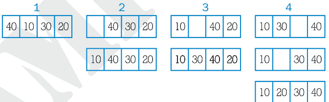

基于该算法，整数数组的插入排序伪代码如下：

```
for (index = 1 To array.length - 1) {
  temp = array[index]
  previousIndex = index - 1
  while (array[previousIndex] > temp && previousIndex > 0) {
    shift array[previousIndex] up one element
    previousIndex = previousIndex - 1
  }
  if (array[previousIndex] > temp) {
    swap the two elements
  } else {
    insert element at appropriate location
  }
}
```

Sorts 类已被修改以包括一个 insertionSort() 方法：

```
/**
 * Sorts an array of integers from low to high
 * pre: none
 * post: Integers have been sorted from low to high
 */
public static void insertionSort(int[] items) {
    int temp, previousIndex;

    for (int index = 1; index < items.length; index++) {
        temp = items[index];
        previousIndex = index - 1;
        while ((items[previousIndex] > temp) && (previousIndex > 0)) {
            items[previousIndex + 1] = items[previousIndex];
            previousIndex -= 1;        //decrease index to compare current
        }                               //item with next previous item
        if (items[previousIndex] > temp) {
            /* shift item in first element up into next element */
            items[previousIndex + 1] = items[previousIndex];
            /* place current item at index 0 (first element) */
            items[previousIndex] = temp;
        } else {
            /* place current item at index ahead of previous item */
            items[previousIndex + 1] = temp;
        }
    }
}
```

TestSorts 应用程序已被修改以使用 insertionSort() 方法对整数数组进行排序：

```
import java.util.Scanner;
import java.util.Random;

public class TestSorts {

    public static void displayArray(int[] array) {
        for (int i = 0; i < array.length; i++) {
            System.out.print(array[i] + "  ");
        }
        System.out.println("\n");
    }

    public static void main(String[] args) {
        Scanner input = new Scanner(System.in);
        int numItems;
        int[] test;
        Random rand = new Random();

        System.out.print("Enter number of elements: ");
        numItems = input.nextInt();

        /* populate array with random integers */
        test = new int[numItems];
        for (int i = 0; i < test.length; i++) {
            test[i] = rand.nextInt(100);
        }
        System.out.println("Unsorted:");
        displayArray(test);

        Sorts.insertionSort(test);

        System.out.println("Sorted:");
        displayArray(test);
    }
}
```


System.out.println("排序后：");
displayArray(test);
}
}

TestSorts 应用程序产生的输出类似于：

```java
Enter number of elements: 10
Unsorted:
65 52 75 10 44 86 37 14 13 39

Sorted:
10 13 14 37 39 44 52 65 75 86
```

### 复习：ObjectsInsertionSort

创建一个名为 ObjectsInsertionSort 的应用程序，实现对一个对象数组的插入排序。在 String 对象数组上测试该排序。

### 递归

一个方法可以调用自身。这个过程被称为_递归_，这些调用被称为_递归调用_。RecursiveDemo 应用程序包含一个调用自身的方法：

*递归调用*

```java
public class RecursiveDemo {

    public static void showRecursion(int num) {
        System.out.println("Entering method. num = " + num);
        if (num > 1) {
            showRecursion(num - 1);
        }
        System.out.println("Leaving method. num = " + num);
    }

    public static void main(String[] args) {
        showRecursion(2);
    }
}
```

来自 main() 方法的调用 `showRecursion(2)` 是初始调用。在 showRecursion() 方法中，调用自身并传递 `num - 1`。当调用 showRecursion 且 num 等于 1 时，`if` 语句被跳过，执行方法中的剩余语句。此时，在 num 为 1 之前进行的调用栈将按照调用的相反顺序执行，每个调用都执行递归调用之后（`if` 语句之后）的方法中的语句。

RecursiveDemo 产生下一页所示的输出：

**第 13 章 递归与高级算法**

```
Entering method. num = 2
Entering method. num = 1
Leaving method. num = 1
Leaving method. num = 2
```

递归是一种编程技术，只要问题可以通过解决同一个问题的一个或多个更小版本并合并结果来解决，就可以使用它。递归调用用于解决较小的问题。

一个具有递归解的问题是求一个数的幂。例如，2^4 可以被视为：

2^4 = 2 * 2^3，可以被视为
2^3 = 2 * 2^2，可以被视为
2^2 = 2 * 2^1，可以被视为
2^1 = 2 * 2^0，可以被视为
1

在每种情况下，幂问题都被简化为一个更小的幂问题。一个更通用的解决方案是：

x^n = x * x^(n-1)

然而，仔细分析这个解决方案会发现它没有停止点。例如，2^3 将是 2 * 2^2，这将返回 2 * 2^1，这又返回 2 * 2^0，这返回 2 * 2^-1，依此类推。这个解决方案会导致_无限递归_。为了防止这种情况，递归解决方案必须有一个不需要递归的_基本情况_。对于这个解决方案，当幂为 0 时，应返回 1。

Power 应用程序中的 intPower() 方法实现了一个递归解决方案，用于计算一个整数的整数次幂并返回一个整数（与返回 double 的 Math.pow() 不同）：

```java
public class Power {

/**
 * 返回 num 的 power 次幂。
 * 前提：num 和 power 不为 0。
 * 后置：已返回 num 的 power 次幂。
 */
public static int intPower(int num, int power) {
    int result;
    if (power == 0) {
        result = 1;
    } else {
        result = num * intPower(num, power-1);
    }
    return(result);
}

public static void main(String[] args) {
    int x = intPower(2, 5);
    System.out.println(x);
}
}
```

Power 应用程序产生输出：

32

### 复习：RecursiveFactorial

创建一个名为 RecursiveFactorial 的应用程序，返回一个整数的阶乘。一个数的阶乘是从 1 到该数的所有正整数的乘积。例如，5! = 5*4*3*2*1。计算 5! 可以被视为 5*4!，或者更一般地，n*(n-1)!。根据定义，0! 等于 1。将你的递归解决方案与在第 6 章完成的 Factorial 复习中创建的非递归解决方案进行比较。

### 归并排序

**提示** 本章稍后将讨论算法效率的衡量。

选择排序简单，但效率不高，尤其是对于大数组。想象一下手工使用选择排序过程处理一堆 1000 张索引卡片。在卡片中搜索最低项会花费很长时间，但更重要的是，每次搜索后都必须再次搜索剩余的卡片！每张卡片最终会被检查大约 500 次。

_归并排序_算法采用“分而治之”的方法进行排序。想象将 1000 张卡片分成两堆，每堆 500 张。然后可以对每堆进行排序（一个更简单的问题），并将两个有序堆合并（归并）成一个有序堆。为了进一步简化排序，每个子堆可以被分割和排序，依此类推。这种算法最好用递归实现。

归并排序的伪代码是：

```java
if there are items remaining {
    mergesort the left half of the items
    mergesort the right half of the items
    merge the two halves into a completely sorted list
}
```

归并排序子任务是对 `mergeSort()` 的递归调用和对 `merge()` 的调用。`mergesort()` 方法需要参数来指示要排序的数组部分。同样，`merge()` 实现两个部分的合并，并需要参数来指示要合并的数组部分。

`mergesort()` 方法定义如下：

```java
/**
 * 对 items[start..end] 进行排序
 * 前提：start > 0，end > 0
 * 后置：items[start..end] 从低到高有序
 */
public static void mergesort(int[] items, int start, int end) {
    if (start < end) {
        int mid = (start + end) / 2;
        mergesort(items, start, mid);
        mergesort(items, mid + 1, end);
        merge(items, start, mid, end);
    }
}
```

递归函数的停止条件是通过比较 `start` 和 `end` 来确定的。数组的中间位置使用整数除法计算，这会自动截断商的小数部分。

merge() 方法使用一个临时数组来存储从 items 数组的两个有序部分移动过来的元素。这些元素被移动到临时数组中，使临时数组有序。为了说明 merge() 算法，假设进入 merge() 时数组如下所示：


数组从 start 到 mid 以及从 mid+1 到 end 是有序的。merge() 方法开始时检查每个有序部分的第一个元素，即 start 和 mid+1，如 pos1 和 pos2 所示：


由于 items[pos1] < items[pos2]，元素 items[pos1] 被移动到新数组，并且 pos1 递增：


在这种情况下，items[pos1] > items[pos2]，因此元素 items[pos2] 被移动到新数组，并且 pos2 递增：


这个过程重复进行，直到所有元素都被移动。由于很可能是其中一个数组部分先用完，merge() 会测试这种情况，并仅移动剩余列表中的元素。最后，merge() 将临时数组中合并后的元素复制回原始数组。

Sorts 类已被修改以包含一个 mergesort() 方法。请注意，merge() 方法是私有的，因为它是一个辅助方法：

```java
/**
 * 合并 items 数组的两个有序部分
 * 前提：items[start..mid] 有序。items[mid+1..end] 有序。
 * start <= mid <= end
 * 后置：items[start..end] 有序。
 */
private static void merge(int[] items, int start,
                           int mid, int end) {
    int[] temp = new int[items.length];
    int pos1 = start;
    int pos2 = mid + 1;
    int spot = start;

    while (!(pos1 > mid && pos2 > end)) {
        if ((pos1 > mid) ||
            ((pos2 <= end) && (items[pos2] items[pos1]))) {
            temp[spot] = items[pos2];
            pos2 += 1;
        } else {
            temp[spot] = items[pos1];
            pos1 += 1;
        }
        spot += 1;
    }
    /* 将值从 temp 复制回 items */
    for (int i = start; i <= end; i++) {
        items[i] = temp[i];
    }
}

/**
 * 对 items[start..end] 进行排序
 * 前提：start > 0，end > 0
 * 后置：items[start..end] 从低到高有序
 */
public static void mergesort(int[] items, int start, int end) {
    if (start < end) {
        int mid = (start + end) / 2;
        mergesort(items, start, mid);
        mergesort(items, mid + 1, end);
        merge(items, start, mid, end);
    }
}

merge() 方法中的 if 语句表示，如果 pos1（左）子数组已耗尽，或者如果 pos2（右）子数组未耗尽且 pos2 元素小于 pos1 元素，则将 pos2 子数组中的一个元素移动到 temp 数组，否则移动 pos1 子数组中的一个元素。这个过程持续进行，直到两个子数组都耗尽。
```


TestSorts 应用程序已修改，现在使用 mergesort() 方法来对一个整数数组进行排序：

```java
import java.util.Scanner;
import java.util.Random;

public class TestSorts {

    public static void displayArray(int[] array) {
        for (int i = 0; i < array.length; i++) {
            System.out.print(array[i] + "  ");
        }
        System.out.println("\n");
    }

    public static void main(String[] args) {
        Scanner input = new Scanner(System.in);
        int numItems;
        int[] test;
        Random rand = new Random();

        System.out.print("输入元素个数：");
        numItems = input.nextInt();

        /* 用随机整数填充数组 */
        test = new int[numItems];
        for (int i = 0; i < test.length; i++) {
            test[i] = rand.nextInt(100);
        }
        System.out.println("未排序：");
        displayArray(test);

        Sorts.mergesort(test, 0, test.length - 1);

        System.out.println("已排序：");
        displayArray(test);
    }
}
```

TestSorts 应用程序的输出类似于：

```
输入元素个数：10
未排序：
99  55  94  59  75  26  71  16  91  3

已排序：
3  16  26  55  59  71  75  91  94  99
```

### 回顾：ObjectsMergesort

创建一个名为 ObjectsMergesort 的应用程序，实现对象数组的归并排序。在对字符串对象数组进行排序测试。

### 二分查找

数组排序是为了执行更高效的搜索。二分查找用于具有排序项目的列表中以快速查找值的位置。与归并排序算法类似，二分查找算法也采用分治法。它的工作原理是检查从低到高排序的数组中的中间项，并确定这是否是所求的项，或者所求的项是在该中间项的上方还是下方。如果所求的项在中间项下方，则对数组的下半部分应用二分查找；如果在中间项上方，则对数组的上半部分应用二分查找，依此类推。

例如，在包含以下项目的列表中查找值 5 的二分查找可以可视化如下：


二分查找算法非常高效。例如，包含 100 个元素的数组在搜索过程中最多检查 8 个元素，而在包含一百万个项目的数组中，最多检查 20 个项目。如果使用该算法搜索整个世界人口的列表，找到任何一个人所需的检查次数将不到 40 次。

二分查找算法可以递归实现。递归解决方案的伪代码如下：

```
if (goal == items[mid]) {
    return(mid)
} else if (goal < items[mid]) {
    return(binarySearch(lowerhalf)
} else {
    return(binarySearch(upperhalf)
}
```

下一页的 Searches 类实现了二分查找：

**提示** 线性搜索算法在第 10 章中已介绍。线性搜索（也称为顺序搜索）的效率远不如二分查找。然而，线性搜索不需要排序列表。

```java
public class Searches {

    /**
     * 在 items 数组中搜索 goal
     * 先决条件：items 从低到高排序
     * 后处理条件：已返回 goal 的位置，
     * 或者如果未找到 goal 则返回 -1。
     */
    public static int binarySearch(int[] items, int start,
                                   int end, int goal) {

        if (start > end) {
            return(-1);
        } else {
            int mid = (start + end) / 2;
            if (goal == items[mid]) {
                return(mid);
            } else if (goal < items[mid]) {
                return(binarySearch(items, start, mid-1, goal));
            } else {
                return(binarySearch(items, mid+1, end, goal));
            }
        }
    }
}
```

TestSorts 应用程序已修改，用于对整数数组进行排序，然后提示用户输入要搜索的数字：

```java
import java.util.Scanner;
import java.util.Random;

public class TestSorts {

    public static void displayArray(int[] array) {
        for (int i = 0; i < array.length; i++) {
            System.out.print(array[i] + " ");
        }
        System.out.println("\n");
    }

    public static void sortIntArray() {
        Scanner input = new Scanner(System.in);
        int numItems, searchNum, location;
        int[] test;
        Random rand = new Random();

        System.out.print("输入元素个数：");
        numItems = input.nextInt();

        /* 填充并排序数组 */
        test = new int[numItems];
        for (int i = 0; i < test.length; i++) {
            test[i] = rand.nextInt(100);
        }
        Sorts.mergesort(test, 0, test.length - 1);
        System.out.println("已排序：");
        displayArray(test);
```

```java
        /* 在已排序数组中搜索数字 */
        System.out.print("输入要搜索的数字：");
        searchNum = input.nextInt();
        while (searchNum != -1){
            location = Searches.binarySearch(test, 0,
                                        test.length-1, searchNum);
            System.out.println("该数字的位置：" + location);
            System.out.print("输入要搜索的数字：");
            searchNum = input.nextInt();
        }
    }
```

```java
    public static void main(String[] args) {
        sortIntArray();
    }
}
```

修改后的 TestSorts 应用程序显示的输出类似于：

```
输入元素个数：10
未排序：
80  84  68  23  36  70  75  39  29  11

已排序：
11  23  29  36  39  68  70  75  80  84

输入要搜索的数字：11
该数字的位置：0
输入要搜索的数字：23
该数字的位置：1
输入要搜索的数字：81
该数字的位置：-1
输入要搜索的数字：84
该数字的位置：9
输入要搜索的数字：68
该数字的位置：5
输入要搜索的数字：-1
```

### 回顾：SearchLocations

创建一个名为 SearchLocations 的应用程序，以显示在二分查找过程中检查的位置。应用程序的输出应类似于：

```
   1   4   4   7  10  13  15  16  24  24  25  27  27  30  30  30
  49  50  51  52  53  54  54  55  57  58  64  69  74  78  79
  85  86  86  88  89  96  96  97  98

输入要搜索的数字：55
检查 24
检查 37
检查 30
检查 27
检查 28
该数字的位置：28
输入要搜索的数字：
```

### 回顾：ObjectsBinarySearch

创建一个名为 ObjectsBinarySearch 的应用程序，实现对象数组的二分查找。对字符串对象数组进行测试。

### 回顾：BinarySearch2

创建一个名为 BinarySearch2 的应用程序，实现非递归二分查找。二分查找算法可以通过以下方式实现而不使用递归：

- 使用 `do-while` 循环包络方法主体
- 将递归调用替换为对 `start` 或 `end` 值的适当赋值。

### 深度优先搜索

许多程序生成并搜索一系列可能性，例如：

- 迷宫中的不同路径
- 找零的不同可能方式
- 游戏中不同的可能走法
- 学校学生的不同课表
- 从初始像素可达的不同像素

所有这些任务都可以通过称为 *深度优先搜索* 的递归技术来解决。深度优先搜索算法的工作原理是从给定的起始位置开始搜索，处理该位置，然后（递归地）搜索所有相邻的位置。

深度优先搜索可以在一个名为 DetectColonies 的应用程序中得到说明，该应用程序允许研究人员确定显微镜载玻片上不同细菌菌落的数量和大小。载玻片已转换为数字格式，其中 `*` 表示属于菌落的单元格，`-` 表示载玻片的背景色。载玻片文件的格式为：

第一行：载玻片的长度
第二行：载玻片的宽度
剩余行：载玻片数据。

例如，载玻片文件可能看起来类似：

```
7
9
_________
__-*_=_*__
__***_**__
***__*__
**_**____
__*****__
____*_*__
```

如果细胞在水平或垂直方向上接触，则认为它们属于同一菌落。示例载玻片包含三个菌落。从 0 开始计数行和列，一个菌落在 (1, 3) 有一个细胞，包含 9 个元素。另一个菌落有四个元素，在 (1, 6) 有一个细胞，第三个菌落有八个元素，在 (4, 3) 有一个细胞。请注意，第一个和第三个菌落被视为独立的，因为它们在斜对角方向接触，但在水平或垂直方向上没有接触。

DetectColonies 应用程序分析载玻片并显示以下输出：

```
(1,3) 处的菌落，大小为 9
(1,6) 处的菌落，大小为 4
(4,3) 处的菌落，大小为 8
```

在这里，深度优先搜索是合适的，因为一旦检测到菌落细胞，就必须搜索所有可能的连接细胞方向。如果连接的单元格是菌落单元格，则该单元格的所有可能方向都必须进行搜索，依此类推。基本思想是，对于位于 (行，列) 的起始单元格（位于菌落中），可通过以下方法找到该菌落中连接的单元格总数：

- 起始单元格为 1
- 从 (row+1, col) 开始连接的单元格计数
- 从 (row-1, col) 开始连接的单元格计数
- 从 (row, col+1) 开始连接的单元格计数
- 从 (row, col-1) 开始连接的单元格计数

后四条线是递归调用。要找到起始单元格，使用嵌套 `for` 循环测试载玻片中的每个单元格。

在实现深度优先搜索算法时，必须包含代码以避免无限递归。例如，起始单元格 (1, 3) 生成对单元格 (2, 3) 的递归调用，这又生成对 (1, 3) 的调用，进而生成对 (2, 3) 的调用，依此类推。对于此应用程序，一旦检查过某个单元格，该单元格就会被更改为背景色。这使得计数菌落成为一个破坏性算法。

DetectColonies 应用程序可以用 `Slide` 类来建模。构造函数将载玻片数据加载到成员变量 `slideData` 中，这是一个适合建模载玻片的二维数组。成员方法 `displaySlide()` 和 `displayColonies()` 将显示载玻片并确定菌落。成员常量 `COLONY` 和 `NON_COLONY` 将分别代表 `*` 和 `-`。

`displayColonies()` 方法检查载玻片的每个单元格，每当遇到菌落单元格时，`displayColonies()` 就会确定菌落大小并显示有关该菌落的数据。为了确定大小，`displayColonies()` 调用私有成员方法 `collectCells()`，该方法在计数后将单元格更改为背景色。

如上页所示，`Slide` 类已在下一页实现：


import java.io.*;

public class Slide {
    private char COLONY = '*', NON_COLONY = '-';
    private char[][] slideData;

    /**
     * 构造函数
     * 前提：载玻片文件包含以下格式的有效载玻片数据：
     * 第一行：载玻片长度
     * 第二行：载玻片宽度
     * 其余行：载玻片数据
     * 后置条件：载玻片数据已从载玻片文件加载。
     */
    public Slide(String s) {

        try {
            File slideFile = new File(s);
            FileReader in = new FileReader(slideFile);
            BufferedReader readSlide = new BufferedReader(in);
            int length = Integer.parseInt(readSlide.readLine());
            int width = Integer.parseInt(readSlide.readLine());
            slideData = new char[length][width];
            for (int row = 0; row < length; row++) {
                for (int col = 0; col < width; col++) {
                    slideData[row][col] = (char)readSlide.read();
                }
                readSlide.readLine(); // 读过行尾符
            }
            readSlide.close();
            in.close();
        } catch (FileNotFoundException e) {
            System.out.println("文件不存在或无法找到。");
            System.err.println("FileNotFoundException: "
                    + e.getMessage());
        } catch (IOException e) {
            System.out.println("读取文件时出现问题。");
            System.err.println("IOException: " + e.getMessage());
        }
    }

    /**
     * 确定一个菌落的大小
     * 前提：无
     * 后置条件：所有与单元格（行，列）相邻并包含该单元格的菌落单元格已被更改为 NON_COLONY，
     * 并返回这些单元格的计数。
     */
    private int collectCells(int row, int col) {

        if ((row < 0) || (row >= slideData.length) ||
            (col < 0) || (col >= slideData[0].length)
            || (slideData[row][col] != COLONY)) {
            return(0);
        } else {
            slideData[row][col] = NON_COLONY;
            return(1+
                collectCells(row+1, col)+
                collectCells(row-1, col)+
                collectCells(row, col+1)+
                collectCells(row, col-1));
        }
    }
}

/**
 * 分析载玻片中的菌落并显示菌落数据
 * 前提：无
 * 后置条件：菌落数据已显示。
 */
public void displayColonies() {
  char[][] temp;
  int count;

  for (int row = 0; row < slideData.length - 1; row++) {
    for (int col = 0; col < slideData[0].length; col++) {
      if (slideData[row][col] == COLONY) {
        count = collectCells(row, col);
        System.out.println("菌落位于 (" + row + "," + col
            + ")，大小为 " + count);
      }
    }
  }
}

/**
 * 显示载玻片。
 * 前提：无
 * 后置条件：载玻片数据已显示。
 */
public void displaySlide() {

  for (int row = 0; row < slideData.length; row++) {
    for (int col = 0; col < slideData[0].length; col++) {
      System.out.print(slideData[row][col]);
    }
    System.out.println();
  }
}

深度优先搜索算法在辅助方法 `collectCells()` 中实现。第一个 if 语句检查当前位置是否在载玻片上且包含一个菌落单元格。这避免了在每次递归调用前都需要检查。作为良好的编程风格，在递归函数开始时检查数据比在每次调用前检查更好。

DetectColonies 应用程序相对简单：

```
public class DetectColonies {

  public static void main(String[] args) {

    Slide culture = new Slide("slide.dat");
    culture.displaySlide();
    culture.displayColonies();
  }
}
```

DetectColonies 应用程序显示的输出类似于：

```
----------
---*--*---
--***-**--
***---*---
**-**-----
----****--
---*--*---
Colony at (1,3) with size 9
Colony at (1,6) with size 4
Colony at (4,3) with size 8
```

## 复习：DetectColonies — 第 1 部分，共 3 部分

如果菌落的定义允许菌落通过对角线连接，DetectColonies 应用程序必须如何修改？对于示例载玻片，DetectColonies 将报告哪些菌落？

## 复习：DetectColonies — 第 2 部分，共 3 部分

修改 DetectColonies 应用程序，以从大到小显示载玻片菌落。

## 复习：DetectColonies — 第 3 部分，共 3 部分

如果 DetectColonies 包含以下语句，第二个 `culture.displaySlide()` 语句将输出什么载玻片？请解释。

```
public static void main(String[] args) {

    Slide culture = new Slide("slide.dat");
    culture.displaySlide();
    culture.displayColonies();
    culture.displaySlide();
}
```

## 算法分析

算法分析包括衡量算法执行其任务的效率。更高效的算法运行时间更短。运行时间与实现算法所执行的语句数量相关。可以通过计算语句执行次数来估计。运行时间估计通常基于最坏情况的数据集。例如，一个已排序或接近排序的数组可能比一个逆序排序的数组需要更少的语句执行。由于数据的原始状态通常是未知的，因此应假定最坏情况。

作为初步分析，考虑选择排序算法，该算法使用嵌套的 for 循环对项目进行排序。如果从简化的角度考虑排序，每个 for 语句包含一个语句，那么对于一个包含 *n* 个项目的数组，将执行 *n* \* *n* 个语句。因此，选择排序的运行时间被认为是 *n*²。

**提示** 理论运行时间可以用大 O 表示法编写，这是算法效率的理论度量。

插入排序算法似乎更高效，因为它在 `for` 循环中使用了 `while` 循环。这在某些情况下可以实现更快的排序，但在最坏情况下，插入排序算法执行 *n* 个语句 \* *n*–1 个语句，运行时间约为 *n*²。

归并排序是一种更复杂的算法，但分而治之的方法比线性方法高效得多。因为该算法将数组和每个子数组分成两半，直到达到单个元素的基准情况，所以有 Log₂*n* 次对 mergesort() 的调用，然后是 *n* 次对 merge 的调用。归并排序算法的运行时间被认为是 *n* Log₂*n*。

二分查找也实现了分而治之的方法。然而，元素已经有序。该算法只是执行搜索。因为该算法将数组和每个子数组分成两半，直到达到单个元素的基准情况，所以有 Log₂*n* 次对 binarySearch() 的调用。因此，该算法的运行时间被认为是 Log₂*n*。

## 章节总结

排序是将项目按指定顺序排列的过程，可以是从低到高或从高到低。本章介绍了选择排序、插入排序和归并排序算法。归并排序算法采用分而治之的方法进行排序。它是递归实现的，比选择排序和插入排序快得多。

对象不能用关系运算符进行比较。因此，通过实现使用 `Comparable` 接口的算法来排序对象列表。接口可以用作数据类型，这允许算法的泛型实现来排序对象。要排序的对象必须有一个实现了 `Comparable` 接口的类。

方法可以在称为递归的过程中调用自身。递归是一种编程技术，每当问题可以通过解决相同问题的一个或多个较小版本并组合结果来解决时，就可以使用。为了防止无限递归，递归解必须包含一个不需要递归的基准情况。

二分查找算法可用于在已排序的数组中查找元素。二分查找是递归实现的，非常高效。深度优先搜索算法可用于搜索一系列可能性。在实现深度优先搜索时，必须包含代码以避免无限递归。

算法分析包括算法执行其任务的效率。更高效的算法运行时间更短。


## 词汇表

**二分查找** 一种搜索算法，通过递归检查排序列表的中间位置来查找目标项。

**基本情况** 递归解法中无需递归的部分。

**深度优先搜索** 一种搜索算法，从起始位置递归检查、处理该位置，然后搜索相邻位置。

**无限递归** 没有基本情况的递归解法。

**归并排序** 一种排序算法，递归地将列表分成两半，对两半进行排序，然后合并列表使项目有序。

**插入排序** 一种排序算法，通过反复将项目插入子数组的适当位置，直到子数组中没有待插入的项目。

**递归** 方法调用自身的编程技术。当一个问题可以通过解决一个或多个更小的相同问题并组合结果来解决时，就可以使用这种技术。

**递归调用** 从方法内部调用同一方法。

**选择排序** 一种排序算法，反复选择数组子数组中的最低项，并将其移动到子数组之前的位置，直到子数组中没有待搜索的项目。

## Java

**Comparable** `java.lang` 中的一个接口，如果类的对象需要排序，则必须实现该接口。Comparable 也可以用作数据类型。

## 批判性思维

1. 对于列表 4, 6, 2, 10, 9，展示算法每次循环迭代后数字的排序情况：
   - a) 选择排序
   - b) 插入排序

2. 为了使用二分查找找到特定项目，必须对项目列表做什么处理？

3. 使用以下递归方法回答问题：

```java
public void ct(int n) {
    System.out.println("Starting " + n);
    if (n > 0) {
        ct(n/3);
        System.out.println("Middle " + n);
    }
}
```

   - a) 调用 ct(13) 会产生什么输出？
   - b) 调用 ct(3) 会产生什么输出？
   - c) 调用 ct(0) 会产生什么输出？

4. 使用以下递归方法回答问题：

```java
public void ct(int n) {
    System.out.println(n);
    if (n > 0) {
        if (n % 2 == 1) {
            ct(n/3);
        } else {
            ct(n/2);
        }
    }
}
```

   - a) 调用 ct(13) 会产生什么输出？
   - b) 调用 ct(14) 会产生什么输出？
   - c) 调用 ct(15) 会产生什么输出？

5. 使用以下递归方法回答问题：

```java
public void ct(int n) {
    if (n > 0) {
        ct(n/10);
        System.out.println(n % 10);
    }
}
```

   - a) 调用 ct(13) 会产生什么输出？
   - b) 调用 ct(124) 会产生什么输出？
   - c) 调用 ct(21785) 会产生什么输出？
   - d) 总体来说，这个方法的作用是什么？

6. 使用以下递归方法回答问题：

```java
public void whatzItDo() {
    Scanner input = new Scanner(System.in);
    String letter = input.next();
    if (!letter.equals(".")) {
        whatzItDo();
        System.out.print(letter);
    }
}
```

   - a) 当用户输入 T, E, S, T, . 时，会产生什么输出？
   - b) 总体来说，这个方法的作用是什么？

7. 如果一个排序算法是“稳定的”，那么原始数组中两个具有相同“键值”（用于排序的值）的项目在排序后的版本中会保持它们的相对位置。例如，假设一个数组包含以下数据：

| Ann | Jon | Mel | Tom | Kim |
|-----|-----|-----|-----|-----|
| 20 | 19 | 18 | 19 | 22 |

当数组按年龄排序时，稳定排序将保证 Jon 在排序后的数组中仍然排在 Tom 前面，例如：

| Kim | Ann | Jon | Tom | Mel |
|-----|-----|-----|-----|-----|
| 22 | 20 | 19 | 19 | 18 |

而不是：

| Kim | Ann | Tom | Jon | Mel |
|-----|-----|-----|-----|-----|
| 22 | 20 | 19 | 19 | 18 |

本章介绍的排序算法（选择排序、归并排序）中哪一个是稳定的？对于不稳定的算法，给出一个数据示例来说明这一点。

## 判断题

8. 判断以下各项是真还是假。如果是假的，请解释原因。

   - a) 排序总是将项目按从低到高的顺序排列。
   - b) 排序算法效率的一个衡量标准是它完成排序的速度。
   - c) 选择排序算法比插入排序更高效。
   - d) 一个方法可以调用自身。
   - e) 对于大数组，归并排序算法比选择排序算法更高效。
   - f) 二分查找用于对项目列表进行排序。
   - g) 二分查找从检查数组中的最后一个项目开始。
   - h) 完成一项任务所需的语句越多，算法就越高效。
   - i) 接口可以用作数据类型。
   - j) 没有基本情况的递归解法会导致无限递归。
   - k) 插入排序递归地将列表分成两半，对两半进行排序，然后按顺序合并列表。

## 练习

### 练习 1：朋友

创建一个“朋友”数据库应用程序，维护一个包含姓名、电话号码和电子邮件地址的 Friend 对象文件。Friends 应用程序应从文件加载 Friend 记录，然后允许用户添加新朋友、删除朋友、按名字或姓氏显示所有朋友的列表以及搜索朋友。该应用程序应显示类似于以下内容的菜单：

- 1. 添加朋友。
- 2. 按姓氏显示朋友。
- 3. 按名字显示朋友。
- 4. 查找朋友。
- 5. 删除朋友。
- 6. 退出。

### 练习 2：三元搜索

修改 Searches 类以包含 `ternarySearch()` 方法。三元搜索类似于二分查找，它将数组分成三部分而不是两部分。三元搜索找到将数组大致分成三等份的点，然后使用这些点来确定应该搜索目标的位置。

### 练习 3：插值搜索

修改 Searches 类以包含 `interpolationSearch()` 方法。插值搜索是二分查找的一个变体。其思想是在可能的位置进行查找，而不一定是数组的中间位置。例如，如果要查找的值是 967，而数组中的项目范围从 3 到 1022，那么智能的做法是几乎查看数组的末尾。从数学上讲，因为 967 大约是从 3 到 1022 的 95% 处，所以开始搜索的位置应该是数组 95% 的位置。例如，如果数组包含 500 个元素，第一个要检查的位置是 475（从 1 到 500 的 95% 处）。然后，搜索继续到数组的一部分（1..474 或 476..500），具体取决于 967 是大于还是小于第 475 个元素。

### 练习 4：位数

创建一个 NumDigits 应用程序，其中包含一个递归方法 `numDigits()`，该方法返回其整数参数中的位数。-9 到 9 之间的数字有一位数；-99 到 -10 以及 10 到 99 之间的数字有两位数，依此类推。（提示：数字 n 的位数是 n/10 的位数加一。）

### 练习 5：检测菌落 2

创建一个 DetectColonies2 应用程序，基于本章介绍的 DetectColonies。由于幻灯片现在被数字化以报告颜色，该应用程序提供了改进的菌落结果。例如，幻灯片文件可能类似于：

```
6
8
00550000
00050000
00005500
01200000
01111000
00000030
```

数字 1 到 9 代表各种颜色。数字 0 代表黑色（背景颜色）。

DetectColonies2 应用程序应显示幻灯片上每个菌落的大小、位置和颜色值。菌落定义为一个（水平或垂直）连接的、具有相同颜色值的单元格序列。对于上面的幻灯片，应用程序应报告：

| 颜色 | 大小 | 位置 |
|-------|------|----------|
| 5     | 3    | 1, 3     |
| 5     | 2    | 3, 5     |
| 1     | 5    | 4, 2     |
| 2     | 1    | 4, 3     |
| 3     | 1    | 6, 7     |

### 练习 6：背包问题

计算机科学中的一个著名问题是 *背包问题*。一个变体如下：

> 给定一组（可能）不同整数值的重量，是否可以将其中一些重量放入背包中，以填充到某个确切的总重量？

例如，如果重量是 3, 5, 6, 和 9，那么可以精确地得到 3, 8, 11, 14, 17 等总重量，但 2, 4, 22 等则不可能。

创建一个 Knapsack 应用来解决这个问题。`fillKnapsack()` 方法处理第一个重量，然后使用 `isPossible()` 辅助方法递归处理剩余重量。`fillKnapsack()` 和 `isPossible()` 的声明如下：

```java
/* 返回是否存在 weights[start..weights.length] 中的项的子集，
 * 其和等于 goal。
 * 前提：weights[start..weights.length] 中的项 > 0
 * 后置：如果存在 weights[start..weights.length] 中项的子集，
 * 其和等于 goal，则返回 true。
 */
fillKnapsack(int[] weights, int goal, int start)
```


 ## 练习 7 —— 迷宫

迷宫可以在文件中定义，使用 X 字符表示墙壁，空格字符表示路径，$ 字符表示目标。例如，包含迷宫的文件可以如下所示：

```
8
10
XXXXXXXXXX
X        X
XX XXX XXX
XX  X  X
XXXX X X X
X    X XXX
X XXXX  $X
XXXXXXXXXX
```

假设起点为位置 (1, 1)，并且迷宫有边框。创建一个迷宫应用程序，显示从起点到目标的路径位置序列，或者指示没有可用路径。例如，对于上面的迷宫，应用程序应报告：

```
Path:  (1,1)  (1,2)  (1,3)  (1,4)  (1,5)  (1,6)
       (2,6)  (3,6)  (4,6)  (5,6)  (6,6)  (6,7)  (6,8)
```

## 练习 8 MyBoggle

Boggle 游戏在带有随机字母的方形棋盘上进行。目标是找到由连续字母序列在棋盘上形成的单词。如果字母在水平、垂直或对角方向上相邻，则认为它们是相邻的。例如，棋盘：

```
Q W E R T
A S D F G
Z X C V B
Y U A O P
G H J K L
```

包含单词 WAS、WAXY、JOB 等，但不包含单词 BOX。单词可以包含重复字母，但棋盘上的单个字母不能在单个单词中出现两次，例如 POP 不在此棋盘中。

创建一个 MyBoggle 应用程序，显示随机字母的棋盘，并允许用户输入在棋盘上找到的单词。应用程序应报告用户输入的单词确实在棋盘上。

提示：在棋盘上搜索输入单词的第一个字母，然后递归地在找到的字母周围搜索单词的剩余字母。

## 第 14 章 数据结构

本章讨论数据结构。涵盖栈、队列和链表。

## 栈数据结构

数据结构用于组织数据。*栈*数据结构可以包含多个数据项，就像数组一样。此外，它还可以对数据执行一组操作。

**top** 栈结构有一个*栈顶*。例如，下面所示的栈包含三个整数。值 11 是栈中的栈顶项：

| top |
|---|
| 11 |
| 34 |
| 12 |

**pop** 可以对栈中的项执行两种标准操作，并且只有栈顶项可以被处理。*pop* 操作移除栈顶项。例如，当对上述栈执行 pop 时，栈顶值 11 被移除：

| top |
|---|
| 34 |
| 12 |

下一项，34，现在位于栈顶，并且是唯一可以访问的项。

**push** 另一种操作是*push* 操作，它将一项添加到栈顶。例如，如果值 27 被压入栈，栈变为：

| top |
|---|
| 27 |
| 34 |
| 12 |

其他栈操作包括 *isEmpty* 查询，当栈中没有项时返回 true，否则返回 false。*size* 操作确定栈中的项数。栈可以通过 *makeEmpty* 操作清空。

由于栈的设计是最后压入的项最先弹出，因此有时被称为*后进先出*（LIFO）数据结构。栈有许多应用，特别是在编写编译器软件中。例如，以下每项通常都使用栈来执行：

- 大括号 { 和 } 的匹配。在 Java 中，闭括号 } 总是与最后出现的开括号 { 配对。
- `else` 与 `if` 的匹配：`else` 总是与最后出现的 `if` 配对。
- 表达式中括号的匹配：闭括号总是与最后出现的开括号配对。
- 递归：递归调用完成后，控制权返回到最后执行的调用。实际上，递归有时会被栈替代。

## Stack 类

数据结构有一组特定的操作可以对其存储的数据执行。因此，通常使用类来实现数据结构。

StackDemo 应用程序使用栈：

```java
public class StackDemo {

    public static void main(String[] args) {
        Stack s = new Stack(10);

        System.out.println("Adding 10 and 13 to stack.");
        s.push(10);
        s.push(13);
        System.out.println("Top of stack: " + s.top());
        System.out.println("Items in stack: " + s.size());
        System.out.println("Removing top item.");
        s.pop();
        System.out.println("Top of stack: " + s.top());
        System.out.println("Items in stack: " + s.size());
        System.out.println("Adding a new item.");
        s.push(40);
        System.out.println("Top of stack: " + s.top());
        System.out.println("Items in stack: " + s.size());
    }
}
```

StackDemo 产生输出：

```
Adding 10 and 13 to stack.
Top of stack: 13
Items in stack: 2
Removing top item.
Top of stack: 10
Items in stack: 1
Adding a new item.
Top of stack: 40
Items in stack: 2
```

下面的 Stack 类是一个非常简单的栈实现，使用数组存储数据：

```java
public class Stack {
    private int[] data;
    private int top;

    /**
     * constructor
     * pre: none
     * post: An empty stack that can hold up to maxItems
     *       has been created.
     */
    public Stack(int maxItems) {
        data = new int[maxItems];
        top = -1;    //no items in the array
    }

    /**
     * Returns the top item without removing it from the stack.
     * pre: Stack contains at least one item.
     * post: The top item has been returned while leaving it
     *       on the stack.
     */
    public int top() {
        return(data[top]);
    }

    /**
     * Removes the top item from the stack and returns it.
     * pre: Stack contains at least one item.
     * post: The top item of the stack has been removed
     *       and returned.
     */
    public int pop() {
        top -= 1;
        return(data[top + 1]);
    }
```

```java
    /**
     * Adds an item to the top of the stack if there is room.
     * pre: none
     * post: A new item has been added to the top of the stack.
     */
    public void push(int num) {
        if (top < data.length - 1) {
            top += 1;
            data[top] = num;
        }
    }
```

```java
    /**
     * Determines if there are items on the stack.
     * pre: none
     * post: true returned if there are items on the stack,
     * false returned otherwise.
     */
    public boolean isEmpty() {
        if (top == -1) {
            return(true);
        } else {
            return(false);
        }
    }
```

```java
    /**
     * Returns the number of items in the stack.
     * pre: none
     * post: The number of items in the stack is returned.
     */
    public int size() {
        if (isEmpty()) {
            return(0);
        } else {
            return(top + 1);
        }
    }
```

```java
    /**
     * Empties emitted functionality.
     * pre: none
     * post: There are no items in the stack.
     */
    public void makeEmpty() {
        top = -1;
    }
}
```

Stack 类实现了 int 值的栈。泛型实现将使用对象。此实现在 Stack2 复习中完成。

## 复习：Stack2

创建一个 Stack2 类，为数据类型 Object 实现栈数据结构。由于 Object 是其他对象的超类，Stack2 对象可以存储来自任何类的对象。编写适当的客户端代码来测试 Stack2 类。

# 回顾：Stack3

Stack 类的局限性在于，栈的大小无法从其初始大小改变。请创建一个 Stack3 类，使用 ArrayList 实现栈数据结构。编写适当的客户端代码来测试 Stack3 类。

# 队列数据结构

rear（队尾），front（队首）
队列是一种与栈类似的数据结构，用于存储多个数据项。但是，队列的一端被称为**队尾**（rear），另一端被称为**队首**（front）。例如，下面所示的队列包含三个元素：


所有插入操作都在队尾进行，所有移除操作都在队首进行。

**dequeue（出队）**
队列上有两种标准操作。**dequeue** 操作从队首移除一个元素。例如，对上面的队列执行 dequeue 操作时，位于队首的值 12 被从队列中移除：


**enqueue（入队）**
**enqueue** 操作将一个元素添加到队列的队尾。例如，如果将值 27 入队，队列变为：


其他队列操作包括 **front** 操作，它返回队首元素但不将其从队列中移除。**isEmpty** 查询在队列中没有元素时返回 true，否则返回 false。**size** 操作确定队列中的元素数量。队列可以通过 **makeEmpty** 操作清空。

**FIFO**
队列类似于售票窗口的排队，遵循"先来先服务"原则，因此有时被称为**先进先出**（**FIFO**）数据结构。有许多现实世界的场景可以用队列结构来表示。例如：

-   收费站或银行柜台的排队
-   机票候补名单
-   打印机中排队等待打印的数据页
-   执行广度优先搜索，即先检查起始位置附近的所有元素，再查看更远的元素

# Queue 类

QueueDemo 应用程序使用了一个队列：

```java
public class QueueDemo {

    public static void main(String[] args) {
        Queue q = new Queue(10);
       
        System.out.println("Adding 10 and 13 to queue.");
        
        q.enqueue(10);
        q.enqueue(13);
              
        System.out.printf("Front of queue: %d\n", q.front());
        System.out.println("Items in queue: " + q.size());
       
        System.out.println("Dequeuing front item.");
        q.dequeue();
         
        System.out.printf("Front of queue: %d\n", q.front());
        System.out.println("Items in queue: " + q.size());
       
        System.out.println("Queueing new item.");
        q.enqueue(40);
        System.out.printf("Front of queue: %d\n", q.front());
        System.out.println("Items in queue: " + q.size());
    }
}
```

QueueDemo 的输出结果为：

```
Adding 10 and 13 to queue.
Front of queue: 10
Items in queue: 2
Dequeuing front item.
Front of queue: 13
Items in queue: 1
Queueing new item.
Front of queue: 10
Items in queue: 2
```

下面的 Queue 类是一个使用数组存储数据的非常简单的队列实现：

```java
public class Queue {
    private int data[];
    private int front, rear, maxSize;

    /**
     * constructor
     * pre: none
     * post: An empty queue that can hold up to maxItems has been created.
     */
    public Queue(int maxItems) {
        data = new int[maxItems];
        front = -1;         //no items in the array
        rear = -1;
        maxSize = maxItems;
    }

    /**
     * Returns the front item without removing it from the queue.
     * pre: Queue contains at least one item.
     * post: The front item has been returned while leaving it in the queue.
     */
    public int front() {
        return (data[front]);
    }

    /**
     * Removes the front item from the queue and returns it.
     * pre: Queue contains at least one item.
     * post: The front item of the queue has been removed and returned.
     */
    public int dequeue() {
        front = (front + 1) % maxSize;
        return (data[front - 1]);
    }

    /**
     * Adds an item to the queue if there is room.
     * pre: none
     * post: A new item has been added to the queue.
     */
    public void enqueue(int num) {
        if (isEmpty()) {           //first item queued
            rear = 0;
            front = 0;
            data[rear] = num;
        } else {
            rear = (rear + 1) % maxSize;
            data[rear] = num;
        }
    }

    /**
     * Determines if there are items on the queue.
     * pre: none
     * post: true returned if there are items on the queue, false returned otherwise.
     */
    public boolean isEmpty() {
        if (front == -1 && rear == -1) {
            return (true);
        } else {
            return (false);
        }
    }

    /**
     * Returns the number of items in the queue.
     * pre: none
     * post: The number of items in the queue is returned.
     */
    public int size() {
        if (isEmpty()) {
            return (0);
        } else {
            return (rear - front + 1);
        }
    }

    /**
     * Empties the queue.
     * pre: none
     * post: There are no items in the queue.
     */
    public void makeEmpty() {
        front = -1;
        rear = -1;
    }
}
```

由于队列能存储的元素数量受限，队首和队尾指针必须在数组的可用位置之间循环。因此，front 和 rear 的值使用模运算（%）来计算。

Queue 类实现了用于 int 值的队列。泛型实现会使用对象。这一实现作为回顾练习留给大家。

# 回顾：Queue2

创建一个 Queue2 类，为 Object 数据类型实现队列数据结构。由于 Object 是其他对象的超类，Queue2 对象可以存储来自任何类的对象。编写适当的客户端代码来测试 Queue2 类。

# 回顾：Queue3

Queue 类的局限性在于，队列的大小无法从其初始大小改变。请创建一个 Queue3 类，使用 ArrayList 实现队列数据结构。编写适当的客户端代码来测试该类。

# 链表数据结构

在内存中存储数据列表的另一种方式要求每个元素存储信息，以指示下一个元素的存储位置。这个附加信息是一个引用，或者说是指向数据位置的指针。这种列表数据结构称为**链表**，可以图示如下：


链表中的第一个元素称为**头节点**（*head*）。最后一个元素指向 null，称为**尾节点**（*tail*）。链表中的每个元素称为**节点**（*node*）。上面的列表中有三个节点。

由于链表中的每个元素必须包含数据和指针，因此最好用类来建模一个元素。所以，链表是一个对象列表。链表中的对象是有组织的，因为它们相互指向对方。没有必要将它们放置在诸如数组这样的结构中进行组织。这意味着链表不受数组大小的限制。

> **提示**：存储在内存中的对象存储在动态内存中。动态内存从称为**堆**（*heap*）的区域分配，该堆在程序执行期间使用。

链表上有两种标准操作。**addAtFront** 操作将一个新节点添加到列表的前端。当新节点被添加到链表前端时，它就被指定为头节点，其指针被设置为当前的头节点。例如，如果 Raj 是头节点，添加一个新元素意味着新对象现在是头节点，并且它的指针指向 Raj 对象：


**remove** 操作从链表中移除一个元素。从链表中移除一个元素意味着前一个元素的指针被修改，使其指向要移除的元素之后的元素。例如，从下面的列表中移除 Raj 意味着该对象不再被列表中的其他对象引用：


链表对于维护动态列表非常有用，因为链表中的元素数量可以根据需要收缩和增长。


## 链表类 (LinkedList Class)

`LinkedListDemo`应用程序使用了一个链表：

```
public class LinkedListDemo {

    public static void main(String[] args) {
        LinkedList list = new LinkedList();

        list.addAtFront("Sachar");
        list.addAtFront("Osborne");
        list.addAtFront("Suess");
        System.out.println(list);

        list.remove("Suess");
        list.remove("Sachar");
        list.remove("Osborne");
        System.out.println(list);
    }
}
```

`LinkedListDemo` 输出如下：

```
Suess
Osborne
Sachar

链表中没有元素。
There are no items in list.
```

### 内部类 (Nested Class)

下方的链表类包含一个**内部类**。 *内部类*是指定义在另一个类内部的类。**内部类**是其所嵌入类的成员。作为类成员，它能够访问所在类的其他所有成员（包括私有成员变量和方法）。包含类成员的类称为***外部类***`Node`类是一个内部类，因为其成员应仅由链表对象访问：

```
public class LinkedList {
    private Node head;

    /**
     * 构造函数
     * pre: 无
     * post: 已创建一个不含项目的空链表。
     */
    public LinkedList() {
        head = null;
    }

    /**
     * 在链表中添加一个节点，将其置于头部。
     * pre: 无
     * post: 链表头已有新节点。
     */
    public void addAtFront(String str) {
        Node newNode = new Node(str);
        newNode.setNext(head);
        head = newNode;
    }

    /**
     * 删除链表中一个节点。
     * pre: 无
     * post: 已删除包含 `str`的第一个节点。
     */
    public void remove(String str) {
      Node current = head;
      Node previous = head;
      if (current.getData().equals(str)) {
        head = current.getNext();
      } else {
        while (current.getNext() != null) {
          previous = current;
          current = current.getNext();
          if (current.getData().equals(str)) {
            previous.setNext(current.getNext());
          }
        }
      }
    }

    /**
     * 创建一个字符串，列出链表中的所有节点。
     * pre: 无
     * post: 链表已输出到字符串中。
     */
    public String toString() {
      Node current = head;
      String listString;
      if (current != null) {
        listString = current.getData() + "\n";
        while (current.getNext() != null) {
          current = current.getNext();
          listString += current.getData() + "\n";
        }
        return(listString);
    else {
        return("链表中没有元素。");
      }
    }

    private class Node {
      private String data;
      private Node next;
      /**
       * 构造函数
       * pre: 无
       * post: 已创建一个节点。
       */
      public Node(String newData) {
        data = newData;
        next = null;
      }

      /**
       * 返回被 `next`指向的节点
       * pre: 无
       * post: 返回了一个节点。
       */
      public Node getNext() {
          return(next);
    **  
    /**       
       * 将 `next`指向的节点更改为新节点
       * pre: 无
       * post: `next`指向新节点。
       */
      public void setNext(Node newNode) {
          next = newNode;
    }

      /**
       * 返回被 `next`指向的节点的值（此处方法名可能需修正以匹配描述，暂保留原文逻辑翻译）*注：根据代码逻辑及常见习惯，若为获取字符串值应返回 String，若仅返回节点对象则与 getNext()重复。此处严格遵循原文字面意思翻译*)
       * 译注：根据上下文，此方法 `getData()`应返回该节点存储的数据字符串值。” (保留原意并修正语病) -> The value stored in the node.
    /**       
       * The node pointed to by next is returned... */ -> public String getData() { return(data); }

      更正后的描述翻译：获取当前节点所储存的字符串数据。
       pre: 无
       post: 返回了节点的存储值。
   */
      public String getData() {
          return(data);
    **} 

**注：**由于原文代码和注释存在潜在逻辑不一致（如 `getData`在Node类中通常指获取字段，而描述说是“被next指向的..."），翻译时保留原英文术语但意译其功能。**

  

## 回顾：链表 – 第1/3部分 (Review: LinkedList – part 1 of 3)

修改链表类 (`LinkedList`)以增加一个成员函数`size()`，该函数用于返回链表中元素的数量。
  
## Review: LinkedList – 第2/3部分
  
修改链表类以包含一个成员方法 `addAtEnd()`,该方法向链表尾部添加一个新项目。  

**Review**: **LLList**, **part**, **1.0**.

(注：原文此处可能有笔误，意为第二部分的标题)
Modify the LinkedList class to include a member function `addAtEnd()` that adds a new item to the end of the linked list.

## **回顾：链表 – 第3/3部分** (Review: LinkedList – part 3 of 3)

修改`LinkedList`类，包含一个成员方法 `makeEmpty()`用于移除列表中的所有项目。  

## **本章小结 **(Chapter Summary)**
  
在本章中介绍了栈、队列和链表数据结构。**每种**数据结构组织数据并可用于对该数据类型执行一组操作。 
  
具有 ***LIFO*** (后进先出) 结构的也称为堆栈，最后一个入队的就是第一个出的。一个栈有一个顶部(top)。可在其上执行的操作包括`pop`(弹出)、 `push `(压入`, **isEmpty**(是否为空),size(大小）,**makeEmpty **(清空）**。**  


The queue data structure is also called a FIFO structure because the first item in is the first item out. A queue has a front and rear.*

队列数据结构也称为*FIFO*(先进先出)结构，因为第一个入队的是第一个出的。一个队列有一个前部(front)和一个后部(rear)。可在其上执行的操作包括enqueue(入队), dequeue, **isEmpty**, size**,**和makeEmpty (清空**。

The linked list data structure is a list of objects that point to each other. The linked list does not have the size limitations of a data structure implemented using an array.A linked list has a head and a tail.**
  

链表数据结构是一个指向彼此的对象的列表。链表的长度不受使用数组实现的数据结构的限制。**一个**链表有一个头部(head)和一个尾部(tail)**。**每个链表中的项目称为*(node)。可在其上执行的操作包括addAtFront(插入前部)和remove (移除**。

  
## **词汇 **(Vocabulary)*
  
  **- addAtFront**: 在列表前端添加项目的链表操作。*  
- `**Pop`*:栈操作，用于移除顶部的元素。  
  

**- Dequeue**:队列操作，用于移除此列对表头的元素**。** 
   - `Push`: 将一个新物品添加到堆栈上的一个操作
   

- **Enqueue**:向队列的尾部添加项目的队列操作
   
Queue:前部与后部和组织数据使得第一个进入也是第一个出去的。*  
  

-**FIFO*:先进先出 (First In First Out)。一种对列数据结构
    
`Rear`:队列的后面/结尾。**

Front:* 队列的开始部分**   

- **Remove**:一个链表中的项目被移除后的操作
    
*- `Head*:链表的第一个节点
   - ***isEmpty***: 当一个数据结构和栈或队列为空时返回true否则为false。 
    `- Size`:返回数据结构中元素数量的堆栈和队列操作**。 

  
LIFO (Last In First Out * )后进先出**.**一个栈的数据结构  

Stack*:具有顶部并组织数据以便使最后进入也是第一个出去的*    
   - Linked **list**:头尾都有且包含指向彼此的节点的列表。**

Tail:链表中的最后一个节点。尾部指针`null**。 
   
- `Nested class`:是一个另一个类的成员的类，即“类内部的类”     
  
**Top*:压入堆栈的最后一个项目
       
Node:链表的元素。(它储存着该项目并含有至下一个元素的指向)。 
    
- Outer class**:包含一个类成员(内部节点)的一个普通的外部类
  
## **批判性思维 **(Critical Thinking)*

1.解释数组和堆栈之间的相似之处。
  
2.*描述程序员可能会在编写编译器软件时*如何使用***stack**。    
     
3.如果`s`是一个Stack对象，下列语句会产生什么输出？   
 
``` java
**Stack s = new Stack**(10);      //创建容量为10的空栈s,默认使用整数或通用类型取决于上下文化这里假设为Int
    s.push(5);   // 将元素5压入堆栈 (栈顶：[5], top=5)   
   *     ***s**.**push**(8)**;**       //***将***'******'************'*'**''*'''*' '*''***** '' **'12'**.' '
    int x = s.pop();  **//弹出并获取栈顶元素 (x*=5. 现在栈顶为[**, top=6**)*    
   *     ***s**.push**(***x**), //再次将刚刚弹出的****'*******。**’**'**''*' **''*'** '' '12'. '**
    s.push(13);          **//压入元素8,栈变为 [5', x*, 即 *[0] ->**  
   
   * y = ***s**.pop());         //弹出并获取***stack*****的顶端*(当前是******'******'**''. 'x'*''**。现在y=**, top='.'
    System.**.out.**(***println*********)(` `*`.+*' '`*.**;);  **//打印 x(即6) 和 y (即)** 
   
   *     ***y = **.pop();       //弹出*y**'(此时栈内只剩下5,所以y=5)
    *.x = s.**top***()****;**      //*//*获取当前新栈顶*x*(此时是8)*'
    
    System.out.println(x + " " + y);         //再次打印 x (即 8) 和 y(即 3)** 
   
```*

**注意：由于原文缺少具体的类定义（如类型T），且堆栈操作中 `top`通常指当前顶部元素。**如果初始push的是5, push了8,**然后pop得到x=8.*'***再press(x)*就是push回8.此时队列里是[5', 12]*,*然后再**Push(13), 所以栈顶是13。

   - *弹出*: y = pop() -> **y=*********'
      x = top() -> ***x*=*''***'. 
    
    
    System.out.println(x + " " + y');       //输出了8*****'5
   
4.考虑“热板”问题 (hot plate problem):在繁忙的餐厅里，新鲜沙拉盘子被带出并添加到现有的盘堆中。这意味着，即使是很久以前洗过的盘子也可能会给客人一个发热的平板用于装***salad**。请解释这如何类比于**(栈)**。**
   
   
5.如果`q`是一个**Queue**对象**,下列语句*会生成什么输出？  
  
``` java  
   Queue q = new **Queue**(10);       // 创建初始队列容量为空的空队列 (假设类型也是整数)     
    *     ***q.enqueue****(***5*),        // 入队,尾= [****'***'. rear**, front**.' 
'6'**.*8**;   .
   
   int x = q.dequeue();              //出对队首*x*=*****.现在front='*''',rear=''*.     
    *     ***q.enqueue*****(x);            **//将刚才移除的5放入队列尾。此时队列里是 [3, 12], front=6*, rear**.**** 
   
   q.**enqueue***(12);                  //入队**8,**现在 queue **[**, 12]**. front**.*
   *     ***q.enqueue**(13).              **//再入*'*'*, now [5, ',', ']', front='.','.*. 
    
    int y = **.dequeue***().             .**.出队列头*y*=****'**''**。现在front*'8', rear=.**''.** 
   
   System.out.println(x + ***" "******+ `y);          //打印x(即5)和y (即12)**.      ' 
    
    *       y = q.dequeue());           **//再次弹出，此时*y*=''. front*=**.rear.*
    
    x = q.front***();                    **//*获取队列头部*x**'*.      
   
   System.**.out.println**(x + " "`+ `'y);         //打印 8 '3。注意：如果是在双端实现中或者逻辑上有误，这里需按标准FIFO处理*''
  
```

6.*解释***FIFO****和*LIFO数据结构的差异**。 
     
7,列出两个本章未列出的、可能被表示为队列结构的世界上的真实情况。**       
      
## 真/假 (True/False)  

8.判断以下说法是对还是错。如果错误，请说明原因。

a) ***栈***数据结构有一个前部(front)和一个后部(rear)。 -> **Error** *->*堆栈只有top和bottom,没有front/rear的概念。** 

b)**一个****堆栈可以被清空**。 -> **正确** *(Empty via pop() or makeEmpty())
   
c)**在******堆栈中*, 'Top'***指的是第一个压入堆栈的项目。 --> ****错误**. Top通常指最新压进去的那个(最后一个)。*''

d) `isEmpty`操作返回一个****int值*。**->  **错误**。它**boolen**(布尔型） (true/false)
   
e)**队列可以容纳多个数据项**。 -> ***正确*** *(Queue holds a list of items). *  
 

f)*在一个******中,所有的移除都发生在尾部。--> ****False*.在FIFO队列中，所有移除都是发生在前部(rear/front depends on naming but usually front for removal),**而enqueue是在尾部(或者rear)。

g)**入队**(enqueue）操作向队列的前端添加项目**。-> **错误**. Enqueue通常添加到后部 (Rear)，Dequeue从前部(Front)移除。  

h).*链表中的第一个元素被称为****头部(head***。** -> ***正确*(Head points to the first node).**
   
i)**Node是指一个堆栈中的一个对象。-->  *False.*节点(Node是链表结构的概念，不是标准的栈或队列的基本术语)。*  
j)*栈或队列的项目数量可以通过**length***操作确定**。-> **True**. (Often called size() in Java, but conceptually length). 

k)在链表中,*尾部*(tail)**指向****null.** -> ***正确**(Tail points to null，标志列表结束).* 


## 练习

### 练习 1

Stack 类使用数组实现了栈。栈也可以使用链表来实现。请创建一个 **StackList** 类，使用链表来实现一个可以存储 Object 数据的栈。StackList 类应实现标准的栈操作。注意，当链表用于实现栈时，标准的链表操作将不再实现。与使用数组相比，使用链表有哪些优点或缺点？

### 练习 2

创建一个 ReverseList 应用程序，使用栈来反转用户输入的一组整数。提示用户输入最多 10 个数字，或者通过输入 999 来终止数字列表。

应用程序的输出应类似于：

```
Enter a number (999 to quit): 10
Enter a number (999 to quit): 25
Enter a number (999 to quit): 44
Enter a number (999 to quit): 16
Enter a number (999 to quit): 999
The list reversed is: 16 44 25 10
```

### 练习 3

为了分析带有括号的表达式，计算机必须能够确定给定的右括号与哪个左括号匹配。

- a) 创建一个 ParenChecker 应用程序，提示用户输入一个带有括号的表达式，然后显示成对括号的位置列表。当发现左括号时，应用程序应将其位置存储在栈中。应用程序输出应类似于：

```
Enter an expression: (a-b*(c-d))
Pair: 10 6
Pair: 11 1
```

- b) 修改 ParenChecker 应用程序以检测以下两种错误，并显示适当的错误信息：
    1. 尝试弹出空栈。
    2. 程序结束时栈不为空。

### 练习 4 QueueList

Queue 类使用数组实现了队列。队列也可以使用链表来实现。请创建一个 **QueueList** 类，使用链表来实现一个可以存储 Object 数据的队列。QueueList 类应实现标准的队列操作。注意，当链表用于实现队列时，标准的链表操作将不再实现。与使用数组相比，使用链表有哪些优点或缺点？

### 练习 5 Stats

- a) 创建一个 Stats 接口，声明 sum()、min() 和 max() 方法。这些成员方法应返回一个 int 值，分别表示列表中所有项的和、列表中的最小值以及列表中的最大值。
- b) 创建一个 LinkedList 类，实现 Stats 接口并存储 int 值。编写测试该修改后类的客户端代码。

### 练习 6 DoublyLinkedList

双向链表中的节点指向前一个和后一个节点，可以表示为：


双向链表的节点可以表示为：

```java
private class Node {
    private String data;
    private Node next;
    private Node prev;
    ...rest of class
}
```

头节点的 prev 字段设置为 null。

- a) 这种结构有什么优点？有什么缺点？
- b) 将双向链表与本章实现的单向链表进行比较。在什么情况下你会选择使用其中一种而不是另一种？
- c) 创建一个 DoublyLinkedList 类。包含成员方法 addAtFront()、addAtEnd()、remove()、displayList() 和 displayReverseList()。

## 附录 A

### Unicode

每个字母（拉丁字母、日文、切罗基文等）以及每种文化的符号（=、@、½ 等）都在一种称为 Unicode 的数字编码中得到了表示。Unicode 使用一组十六个 1 和 0 来形成每个符号的 16 位二进制代码。例如，大写字母 V 的 Unicode 是 00000000 01010110，可以看作是以 10 为底的数字 86（86₁₀）。小写字母 v 有独立的编码 00000000 01110110，即 118₁₀。下面是一些 Unicode 符号及其对应的十进制和二进制等价物的表格。

| 十进制 | 二进制 | Unicode 符号 | 十进制 | 二进制 | Unicode 符号 | 十进制 | 二进制 | Unicode 符号 |
|---|---|---|---|---|---|---|---|---|
| 32 | 00000000 00100000 | space | 64 | 00000000 01000000 | @ | 96 | 00000000 01100000 | ` |
| 33 | 00000000 00100001 | ! | 65 | 00000000 01000001 | A | 97 | 00000000 01100001 | a |
| 34 | 00000000 00100010 | " | 66 | 00000000 01000010 | B | 98 | 00000000 01100010 | b |
| 35 | 00000000 00100011 | # | 67 | 00000000 01000011 | C | 99 | 00000000 01100011 | c |
| 36 | 00000000 00100100 | $ | 68 | 00000000 01000100 | D | 100 | 00000000 01100100 | d |
| 37 | 00000000 00100101 | % | 69 | 00000000 01000101 | E | 101 | 00000000 01100101 | e |
| 38 | 00000000 00100110 | & | 70 | 00000000 01000110 | F | 102 | 00000000 01100110 | f |
| 39 | 00000000 00100111 | ' | 71 | 00000000 01000111 | G | 103 | 00000000 011001 Concert | g |
| 40 | 00000000 00101000 | ( | 72 | 00000000 01001000 | H | 104 | 00000000 01101000 | h |
| 41 | 00000000 00101001 | ) | 73 | 00000000 01001001 | I | 105 | 00000000 01101001 | i |
| 42 | 00000000 00101010 | * | 74 | 00000000 01001010 | J | 106 | 00000000 01101010 | j |
| 43 | 00000000 00101011 | + | 75 | 00000000 01001011 | K | 107 | 00000000 01101011 | k |
| 44 | 00000000 00101100 | , | 76 | 00000000 01001100 | L | 108 | 00000000 01101100 | l |
| 45 | 00000000 00101101 | - | 77 | 00000000 01001101 | M | 109 | 00000000 01101101 | m |
| 46 | 00000000 00101110 | . | 78 | 00000000 01001110 | N | 110 | 00000000 01101110 | n |
| 47 | 00000000 00101111 | / | 79 | 00000000 01001111 | O | 111 | 00000000 01101111 | o |
| 48 | 00000000 00110000 | 0 | 80 | 00000000 01010000 | P | 112 | 00000000 01110000 | p |
| 49 | 00000000 00110001 | 1 | 81 | 00000000 01010001 | Q | 113 | 00000000 01110001 | q |
| 50 | 00000000 00110010 | 2 | 82 | 00000000 01010010 | R | 114 | 00000000 01110010 | r |
| 51 | 00000000 00110011 | 3 | 83 | 00000000 01010011 | S | 115 | 00000000 01110011 | s |
| 52 | 00000000 00110100 | 4 | 84 | 00000000 01010100 | T | 116 | 00000000 01110100 | t |
| 53 | 00000000 00110101 | 5 | 85 | 00000000 01010101 | U | 117 | 00000000 01110101 | u |
| 54 | 00000000 00110110 | 6 | 86 | 00000000 01010110 | V | 118 | 00000000 01110110 | v |
| 55 | 00000000 00110111 | 7 | 87 | 00000000 01010111 | W | 119 | 00000000 01110111 | w |
| 56 | 00000000 00111000 | 8 | 88 | 00000000 01011000 | X | 120 | 00000000 01111000 | x |
| 57 | 00000000 00111001 | 9 | 89 | 00000000 01011001 | Y | 121 | 00000000 01111001 | y |
| 58 | 00000000 00111010 | : | 90 | 00000000 01011010 | Z | 122 | 00000000 01111010 | z |
| 59 | 00000000 00111011 | ; | 91 | 00000000 01011011 | [ | 123 | 00000000 01111011 | { |
| 60 | 00000000 00111100 | < | 92 | 00000000 01011100 | \ | 124 | 00000000 01111100 | \| |
| 61 | 00000000 00111101 | = | 93 | 00000000 01011101 | ] | 125 | 00000000 01111101 | } |
| 62 | 00000000 00111110 | > | 94 | 00000000 01011110 | ^ | 126 | 00000000 01111110 | ~ |
| 63 | 00000000 00111111 | ? | 95 | 00000000 01011111 | _ | | | |

## 索引

**符号**

! 112
!= 105
" 63
% 83
%= 86
&& 112
* 78, 81, 83
*= 86
+ 83, 138
toString() 187
++ 135
+= 86
-- 135
. 80, 81
class extension 62
.java extension 62
/ 83
/\*\* \*/ 62, 164
/\* \*/ 62
// 62
/= 86
< 105
<!--comment--> 46
<= 105
<a> 48
<applet> 44
<body> 37
<br> 46, 334
<h1> 46
<h2> 46
<h3> 46
<h4> 46
<h5> 46
<h6> 46
<head> 37
<hr> 46, 334
<html> 37
 48
<li> 46
<object> 44
<ol> 47
<p> 46, 334
<script> 38
<table> 48
<title> 37
<ul> 46
= 78, 86
== 105
comparing objects 186
> 105
>= 105
[] 239, 248
\ 63
\" 63
\\ 63, 312
\n 63
\t 63
{} 61
|| 112
- 83
--= 86
3GL 5
4GL 5
802.11 network 8

**A**

abs(), Math class 113
abstract class 222
abstract data type 80
abstract keyword 222
abstract method 222
Abstract Windows Toolkit 280
accessibility 44
accessor method 182
access level, method 159
access modifier 159
acos(), Math class 130
ActionListener interface 280
action command 279
ActiveX 44
add(), ArrayList class 252
add(), JPanel class 276
addActionListener(), JButton 278
addActionListener(), JComboBox 288
addActionListener(), JTextField 285
addAtFront, linked list 373
addition 83
address 10
address bus 2
algorithm 66
design 66
stable 359
algorithm analysis 356
algorithm analysis 246
alignment, Swing API 282
ALU 2
Amaya 35
AMD 2
anchor tag 48
And 112
evaluation 113
antivirus software 21
appending data to a file 317
applets 41, 43
adding color 43
drawing shapes 43
parameters 44
placing in an HTML document 44
appletviewer 42
application, terminating gracefully 312
applications software 2
argument 63, 160
object 161
passed by value 161
primitive data type 161
ArithmeticException 89
Arithmetic Logic Unit 2
array 239
algorithm 242
characters 244
data structure 239
dynamic 252
element 239
initializing 240
length 240
offset indexes 243
parameter 241, 248
reference data type 242
traversing 240
two-dimensional 247
ArrayIndexOutOfBoundsException 240, 241


 ## 索引

## B
- backslash character in a string 63
- 字符串中的反斜杠字符 63
- backslash for escape sequence 63
- 转义序列的反斜杠 63
- backup copy 21
- 备份副本 21
- backup tools 4
- 备份工具 4
- behavior of an object 179
- 对象的行为 179
- bandwidth 7
- 带宽 7
- base 10 logarithm 128
- 以10为底的对数 128
- base class 214
- 基类 214
- Basic 5
- Basic 5
- Big Oh notation 246, 252, 356
- 大O表示法 246, 252, 356
- binary files 11
- 二进制文件 11
- binary number system 9
- 二进制数系统 9
- binary search 152, 349
- 二分查找 152, 349
- binary search algorithm analysis 357
- 二分查找算法分析 357
- BIOS 2
- BIOS 2
- bit 9
- 位 9
- blog 15
- 博客 15
- Bluetooth 4
- 蓝牙 4
- boolean 79, 106
- boolean 79, 106
- Boolean class 253
- Boolean类 253
- Boolean expression 105, 131
- 布尔表达式 105, 131
  - evaluation 113
  - 求值 113
- Boolean logic 17
- 布尔逻辑 17
- border, Swing API 281
- 边框，Swing API 281
- boundary value 168
- 边界值 168
- BoxLayout manager, Swing API 282
- BoxLayout管理器，Swing API 282
- breadth-first-searching 370
- 广度优先搜索 370
- breakpoint 136
- 断点 136
- break statement 109
- break语句 109
- broadcast radio 7
- 广播无线电 7
- buffer 314
- 缓冲区 314
- BufferedReader(), BufferedReader class 314
- BufferedReader(), BufferedReader类 314
- BufferedReader class 314
- BufferedReader类 314
- BufferedWriter(), BufferedWriter class 318
- BufferedWriter(), BufferedWriter类 318
- BufferedWriter class 317, 318
- BufferedWriter类 317, 318
- bug 136
- 程序错误 136
- built-in data types 79
- 内置数据类型 79
- bus 2, 7
- 总线 2, 7
- bus topology 7
- 总线拓扑 7
- button, Swing API 278
- 按钮，Swing API 278
  - for displaying an image 292
  - 用于显示图像 292
- byte 9, 79
- 字节 9, 79
- bytecode 62
- 字节码 62
  - converting to machine code 62
  - 转换为机器码 62
- Byte class 253
- Byte类 253

## C
- C 5
- C 5
- C++ 6, 62
- C++ 6, 62
- cable modem 14
- 有线调制解调器 14
- cache 2
- 缓存 2
- calling a method 159
- 调用方法 159
- carpal tunnel syndrome 19
- 腕管综合征 19
- carriage return character 314
- 回车符 314
- case clause 109
- case子句 109
- case sensitivity, identifiers 88
- 大小写敏感，标识符 88
- casting, see type casting 85
- 强制转换，见类型转换 85
- CD-R 12
- CD-R 12
- CD-RW/DVD drive 1
- CD-RW/DVD驱动器 1
- cellular radio 7
- 蜂窝无线电 7
- Central Processing Unit 2
- 中央处理单元 2
- chaos theory 154
- 混沌理论 154
- char 79, 244
- char 79, 244
  - array 244
  - 数组 244
- Character class 253
- Character类 253
- charAt(), String class 244
- charAt(), String类 244
- char array, initializing 245
- char数组，初始化 245
- Children's Online Privacy Protection Act of 1998 18
- 1998年儿童在线隐私保护法 18
- circuit boards 1
- 电路板 1
- citations 18
- 引用 18
- class 59
- 类 59
  - abstract 222
  - 抽象 222
  - base 214
  - 基 214
  - body 180
  - 主体 180
  - constructor 182
  - 构造方法 182
  - declaration 180
  - 声明 180
  - derived 214
  - 派生 214
  - designing 180
  - 设计 180
  - extending 213
  - 扩展 213
  - inner 188, 295
  - 内部 188, 295
  - naming 181
  - 命名 181
  - nested 188, 295, 374
  - 嵌套 188, 295, 374
  - outer 295, 374
  - 外部 295, 374
  - variables 180, 184
  - 变量 180, 184
  - wrapper 253
  - 包装 253
  - writing 180
  - 编写 180
- class, objects to be written to a file 322
- class，要写入文件的对象 322
- ClassCastException 186
- ClassCastException 186
- classes using classes 187
- 类使用类 187
- ClassNotFoundException 322
- ClassNotFoundException 322
- class method 159, 184
- 类方法 159, 184
- client/server network 7
- 客户端/服务器网络 7
- client code 180
- 客户端代码 180
- close() 81
- close() 81
- close(), BufferedReader class 314
- close(), BufferedReader类 314
- close(), BufferedWriter class 318
- close(), BufferedWriter类 318
- close(), FileInputStream class 320
- close(), FileInputStream类 320
- close(), FileOutputStream class 319
- close(), FileOutputStream类 319
- close(), FileReader class 314
- close(), FileReader类 314
- close(), FileWriter class 317
- close(), FileWriter类 317
- close(), ObjectInputStream class 321
- close(), ObjectInputStream类 321
- close(), ObjectOutputStream class 320
- close(), ObjectOutputStream类 320
- coaxial cable 7
- 同轴电缆 7
- COBOL 5
- COBOL 5
- code convention
- 代码约定
  - variable identifier 77
  - 变量标识符 77
- code conventions 65
- 代码约定 65
- collection 252
- 集合 252
- collections framework 252
- 集合框架 252
- colors, Swing API 291
- 颜色，Swing API 291
- combo box, Swing API 288
- 组合框，Swing API 288
- comments 46, 61, 62, 164
- 注释 46, 61, 62, 164
  - block 62
  - 块 62
  - documentation 62, 164
  - 文档 62, 164
  - for debugging 137
  - 用于调试 137
  - inline 108
  - 内联 108
  - method 164
  - 方法 164
  - multiline 62
  - 多行 62
  - postcondition documentation 164
  - 后置条件文档 164
  - precondition documentation 164
  - 前置条件文档 164
  - single line 62以number_of_items翻译这段文字
  - 单行 62
- Communications Privacy Act of 1986 22
- 1986年通信隐私法 22
- communications satellites 7
- 通信卫星 7
- Comparable interface 225, 339
- Comparable接口 225, 339
- compareTo(), Comparable interface 225
- compareTo(), Comparable接口 225
- compareTo(), Double class 254
- compareTo(), Double类 254
- compareTo(), Integer class 253
- compareTo(), Integer类 253
- compareTo(), String class 140
- compareTo(), String类 140
- compareTo(), when sorting 339
- compareTo(), 排序时 339
- compareToIgnoreCase(), String class 140
- compareToIgnoreCase(), String类 140
- compiler 5, 62
- 编译器 5, 62
  - just-in-time 62
  - 即时 62
  - method overloading 162
  - 方法重载 162
- compiling source code 62
- 编译源代码 62
- compound interest 103
- 复利 103
- compression program 11
- 压缩程序 11
- computers
- 计算机
  - desktop 1
  - 台式 1
  - handhelds 5
  - 手持 5
  - notebook 4
  - 笔记本 4
  - wearable 5
  - 可穿戴 5
  - wrist-top 5
  - 腕上 5
- computer vision syndrome 19
- 计算机视觉综合征 19
- concatenation 138
- 连接 138
  - toString() 187
  - toString() 187
- conditional control structure 105, 109
- 条件控制结构 105, 109
- constant 87
- 常量 87
- constructor 180, 183
- 构造方法 180, 183
  - subclass 215
  - 子类 215
  - writing 183
  - 编写 183
- container, Swing 275
- 容器，Swing 275
- content frame, Swing 275
- 内容框架，Swing 275
- controlling class 61
- 控制类 61
- control bus 2
- 控制总线 2
- conventional modem 14
- 传统调制解调器 14
- conversion, numeric 84
- 转换，数值 84
- cookie 18
- Cookie 18
- copyright 20
- 版权 20
- copyright infringement 21
- 侵犯版权 21
- cos(), Math class 130
- cos(), Math类 130
- counter 133
- 计数器 133
- counting values 133
- 计数值 133
- CPU 2
- CPU 2
- crackers 21
- 解密者 21
- createNewFile(), File class 311
- createNewFile(), File类 311
- cross-platform connectivity 5
- 跨平台连接 5

## D
- data
- 数据
  - boundary values 168
  - 边界值 168
  - passing to a method 160
  - 传递给方法 160
  - processing 81
  - 处理 81
  - processing from a file 316
  - 从文件处理 316
  - reading from a file 314
  - 从文件读取 314
  - reading objects from a file 319
  - 从文件读取对象 319
  - testing a method 168
  - 测试方法 168
  - writing objects to a file 319
  - 向文件写入对象 319
  - writing to a file 317
  - 写入文件 317
- data structure
- 数据结构
  - array 239
  - 数组 239
  - ArrayList 252
  - ArrayList 252
- data structures 365
- 数据结构 365
  - linked list 373
  - 链表 373
  - queue 369
  - 队列 369
  - stack 365
  - 栈 365
- data structure analysis
- 数据结构分析
  - ArrayList 252
  - ArrayList 252
- data type 77
- 数据类型 77
  - abstract 80
  - 抽象 80
  - interface 339
  - 接口 339
  - primitive 79
  - 基本 79
- dequeue, queue 369
- 出队，队列 369
- derived class 214
- 派生类 214
- desktop computer 1
- 台式计算机 1
- Digital Subscriber Line 14
- 数字用户线路 14
- digital camera 1
- 数码相机 1
- digital signature 15
- 数字签名 15
- disk defragmentation 4
- 磁盘碎片整理 4
- disk drive 1
- 磁盘驱动器 1
- divide-and-conquer 152, 345, 349
- 分治法 152, 345, 349
- division 83
- 除法 83
  - integer 83
  - 整数 83
  - modulus 83
  - 取模 83
  - real 83
  - 实数 83
  - type casting 85
  - 类型转换 85
- do-while 131
- do-while 131
- documentation
- 文档
  - comments 62
  - 注释 62
  - external 62
  - 外部 62
  - package 80
  - 包 80
  - postcondition comments 164
  - 后置条件注释 164
  - precondition comments 164
  - 前置条件注释 164
- documentation comments 164
- 文档注释 164
- Double 254
- Double 254
- double 79
- double 79
- doubleValue(), Double class 254
- doubleValue(), Double类 254
- Double class 285
- Double类 285
- downloading 17
- 下载 17
- down... 17
- 向下... 17
- DSL 14
- DSL 14
- DVD drive 13
- DVD驱动器 13
- dynamic array 252
- 动态数组 252
- dynamic lists 373
- 动态列表 373
- dynamic memory 373
- 动态内存 373

## E
- e, natural logarithm 128
- e，自然对数 128
- E-FOIA 18
- E-FOIA 18
- e-mail 15
- 电子邮件 15
  - address 15
  - 地址 15
  - attachments 21
  - 附件 21
  - composition 16
  - 撰写 16
  - etiquette 16
  - 礼仪 16
- end of file 314
- 文件末尾 314
- enqueue, queue 369
- 入队，队列 369
- environment 3
- 环境 3
  - Swing application 278
  - Swing应用程序 278
- equal sign 78
- 等号 78
- equals() 186
- equals() 186
- equals(), String class 140
- equals(), String类 140
- equals(), use by ArrayList 252
- equals(), ArrayList使用 252
- equals() versus == 186
- equals() 与 == 186
- equalsIgnoreCase(), String class 140
- equalsIgnoreCase(), String类 140
- ergonomics 19
- 工效学 19
- error 62, 89
- 错误 62, 89
  - exception handling 312
  - 异常处理 312
  - logic 89
  - 逻辑 89
  - roundoff 106
  - 舍入 106
  - run time 89, 240
  - 运行时 89, 240
  - semantic 89
  - 语义 89
  - syntax 62, 88, 132
  - 语法 62, 88, 132
- err stream 313
- err流 313
- escape sequence 63, 312
- 转义序列 63, 312
- Ethernet 7
- 以太网 7
- ethical implications of computer use 19
- 计算机使用的伦理影响 19
- ethical responsibilities, IT professional 22
- 伦理责任，IT专业人员 22
- ethical responsibilities of an IT professional 22
- IT专业人员的伦理责任 22
- Euclid's Algorithm 153
- 欧几里得算法 153
- event 275
- 事件 275
- event-driven application 275
- 事件驱动应用程序 275
- event handler 275
- 事件处理程序 275
- exabyte 13
- 艾字节 13
- exception 81, 89, 312
- 异常 81, 89, 312
  - array 240
  - 数组 240
  - handling 89
  - 处理 89

## F
- file 11, 311
- 文件 11, 311
  - creating 317
  - 创建 317
  - HTML 37, 334
  - HTML 37, 334
  - processing numeric data 316
  - 处理数值数据 316
  - reading 314
  - 读取 314
  - stream 313
  - 流 313
  - writing to 317
  - 写入 317
- File(), File class 311
- File(), File类 311
- FileInputStream(), FileInputStream class 320
- FileInputStream(), FileInputStream类 320
- FileInputStream class 319, 320
- FileInputStream类 319, 320
- FileNotFoundException 315, 322
- FileNotFoundException 315, 322
- FileOutputStream(), FileOutputStream class 319
- FileOutputStream(), FileOutputStream类 319
- FileOutputStream class 319
- FileOutputStream类 319
- FileReader(), FileReader class 314
- FileReader(), FileReader类 314
- FileReader class 314
- FileReader类 314
- files
- 文件
  - organizing 181
  - 组织 181
- FileWriter(), FileWriter class 317
- FileWriter(), FileWriter类 317
- FileWriter class 317
- FileWriter类 317
- File class 311
- File类 311
- file organization 61
- 文件组织 61
- file position 313
- 文件位置 313
- file size 11
- 文件大小 11
- final 87
- final 87
- Financial Privacy Act of 1978 20
- 1978年金融隐私法 20
- Firefox 35
- Firefox 35
- firewall 13
- 防火墙 13
- FireWire port 12
- 火线端口 12
- flag 134
- 标志 134
- float 79
- float 79
- floating point 79
- 浮点 79
- floating point numbers 10
- 浮点数 10
  - comparing 106
  - 比较 106
- Float class 253
- Float类 253
- flowchart 66
- 流程图 66
- flowchart symbols 67
- 流程图符号 67
- FlowLayout manager, Swing API 281
- FlowLayout管理器，Swing API 281
- folders 11
- 文件夹 11
- format() method 64
- format()方法 64
- formatting output 64
- 格式化输出 64
- Fortran 5
- Fortran 5
- for statement 240
- for语句 240
  - array iteration, traversing 241
  - 数组迭代，遍历 241
  - nested 248
  - 嵌套 248
- frame, Swing 275
- 框架，Swing 275
- front, queue 369
- 队首，队列 369
- functional decomposition 180
- 功能分解 180
- Fundamental Theorem of Arithmetic 150
- 算术基本定理 150

## G
- game
- 游戏
  - Adder 212, 335
  - 加法器 212, 335
  - BirthdayGame 90
  - 生日游戏 90
  - Bowling 211
  - 保龄球 211
  - Break-A-Plate 298
  - 砸盘子 298
  - Carnival 191
  - 嘉年华 191
  - DiceRolls 242
  - 掷骰子 242
  - Dice Roll 210
  - 掷骰子 210
  - Game of 21 211
  - 21点 211
  - GuessingGame 126, 151, 178
  - 猜谜游戏 126, 151, 178
  - Life 271, 336
  - 生命 271, 336
  - Mad-Lib story 333
  - Mad-Lib故事 333
  - Mankala 272
  - 曼卡拉 272
  - Mastermind 268
  - 精通 268
  - Maze 363
  - 迷宫 363
  - MyBoggle 364
  - 我的博格 364
  - Nim 210
  - 尼姆 210
  - Penny Pitch 270
  - 投币 270
  - Rock Paper Scissors 114, 196
  - 石头剪刀布 114, 196
  - TicTacToe 248
  - 井字棋 248
  - WordGuess 141, 335
  - 猜单词 141, 335
- generic collection classes 254
- 泛型集合类 254
- get(), ArrayList 252
- get(), ArrayList 252
- getActionCommand(), JButton 278
- getActionCommand(), JButton 278
- getContentPane(), JFrame 276
- getContentPane(), JFrame 276
- getMessage(), Throwable class 313
- getMessage(), Throwable类 313
- getSelectedItem(), JComboBox 288
- getSelectedItem(), JComboBox 288
- getText(), JTextField 285
- getText(), JTextField 285
- GIF 48, 292
- GIF 48, 292
- gigabytes 10
- 吉字节 10
- gigahertz 2
- 吉赫兹 2
- graphical user interface 3, 275
- 图形用户界面 3, 275
- greatest common divisor 153
- 最大公约数 153
- GridLayout manager, Swing API 282, 284
- GridLayout管理器，Swing API 282, 284
- GUI 3, 275
- GUI 3, 275
- Gutenberg, Johann 59
- 古腾堡，约翰 59
- Gutenberg Press 59
- 古腾堡印刷机 59

## H
- hackers 21
- 黑客 21
- hailstone numbers 154
- 冰雹数 154
- HAN 6
- HAN 6
- handheld computers 5
- 手持计算机 5
- handwriting recognition software 4
- 手写识别软件 4
- hard-coded data 243
- 硬编码数据 243
- hardware 1
- 硬件 1
- has-a relationship 187
- has-a关系 187
- head, linked list 373
- 头，链表 373
- heading tags 46
- 标题标签 46
- heap 373
- 堆 373
- helper method 182
- 辅助方法 182
- hexadecimal 9, 50
- 十六进制 9, 50
- histogram 268
- 直方图 268
- Home Area Network 6
- 家庭区域网络 6
- horizontal rule tag 46
- 水平线标签 46
- Hotmail 15
- Hotmail 15
- HTML 35, 334
- HTML 35, 334
  - alignment 51
  - 对齐 51
  - attributes 46
  - 属性 46
  - background color 50
  - 背景颜色 50
  - comments 46
  - 注释 46
  - documents 36, 37
  - 文档 36, 37
  - document tags 37
  - 文档标签 37
  - elements 36
  - 元素 36
  - hyperlinks 47
  - 超链接 47
  - images 47
  - 图像 47
  - lists 46
  - 列表 46
  - style sheets 49
  - 样式表 49
  - tables 47
  - 表格 47
  - tags 36, 45
  - 标签 36, 45
  - text color 50
  - 文本颜色 50
  - validating 37
  - 验证 37
- HTML 4 45
- HTML 4 45
- HTTP 16
- HTTP 16
- hub 8
- 集线器 8
- hyperlink 48
- 超链接 48
- hypertext 35
- 超文本 35
- HyperText Markup Language 35
- 超文本标记语言 35

## I
- identifier 77
- 标识符 77
  - choosing 88
  - 选择 88
- identity theft 20
- 身份盗窃 20
- if-else if statement 108
- if-else if语句 108
- if-else statement 106
- if-else语句 106
  - nested 107
  - 嵌套 107
- if statement 105
- if语句 105
- IllegalArgumentException 161
- IllegalArgumentException 161
- IMAP 16
- IMAP 16
- immutable 139
- 不可变 139
- import, package 60
- import，包 60
- import statement 81
- import语句 81
- increment operator 135
- 增量运算符 135
- index 138
- 索引 138
- index, array element 239
- 索引，数组元素 239
- indexOf(), ArrayList 252
- indexOf(), ArrayList 252
- indexOf(), String class 140
- indexOf(), String类 140
- infinite loop 132
- 无限循环 132
- infinite recursion 344
- 无限递归 344
- information age 19
- 信息时代 19
- information hiding 179, 182
- 信息隐藏 179, 182
- infrared signals 7
- 红外信号 7
- inherit 186
- 继承 186
- inheritance  comparison 186
- 继承 59, 213
- initializing an array 240
- 初始化数组 240
- initializing an object 80
- 初始化对象 80
- ink jet printer 1
- 喷墨打印机 1
- inline comments 108
- 内联注释 108
- inner class 188, 295
- 内部类 188, 295
- input, getting from user 81
- 输入，从用户获取 81
- input, getting from user in a GUI 285
- 输入，在GUI中从用户获取 285
- InputMismatchException 81, 89, 95
- InputMismatchException 81, 89, 95
- input devices 1
- 输入设备 1
- input file stream 314
- 输入文件流 314
- input stream 81
- 输入流 81
- input validation loop 149
- 输入验证循环 149
- insertion sort 341
- 插入排序 341
- insertion sort algorithm analysis 357
- 插入排序算法分析 357
- instance 179
- 实例 179
- instance methods 184
- 实例方法 184
- instance variables 184
- 实例变量 184
- instantiation 80
- 实例化 80
- instant messaging 15
- 即时消息 15
- int 79
- int 79
- Integer 253
- Integer 253


## I

整数类 285
集成电路 2
综合业务数字网 14
英特尔 2
接口 225
    作为数据类型 339
    Comparable 339
    控制台 275
    图形化 275
    实现 225
    实现多个接口 227
    基于文本 275
接口，作为变量类型 339
接口，对象 181
互联网 13
    历史 13
互联网可接受使用政策 19
Internet Explorer 15, 35
互联网过滤软件 19
互联网隐私问题 18
互联网服务 15
互联网服务提供商 14
插值查找 361
解释器 6
    Java 虚拟机 62
解释字节码 62
内联网 13
intValue() 方法，整数类 253
IOException 322
IP 地址 18
is-a 关系 213
ISDN 14
isEmpty，队列 369
isEmpty，栈 366
信息技术 22
安腾处理器 2
迭代 131
信息技术职业 22

## J

Java 6
    启用 41
java.awt 284, 291
java.awt.event 280
java.io 311, 314, 317, 319
java.lang 63, 79, 80, 113, 225, 254
java.lang.Double 254, 285, 316
java.lang.Integer 253, 285, 316
java.lang.Math 113, 128
java.lang.Object 186
文本 86
java.util 80
java.util.ArrayList 252
java.util.Random 110, 138
java.util.Scanner 81, 110, 138, 140, 244
JavaScript 38, 40
javax.swing 275
javax.swing.Frame 276, 277, 278, 292
javax.swing.JPanel 276
javax.swing.JTextField 285

Java 小程序 41
    添加颜色 43
    绘制形状 43
    参数 44
    放置在 HTML 文档中 44
Java 应用程序 61
Java 基础类库 275
Java 运行时环境 80
Java 虚拟机 41, 62
Jaz 驱动器 12
JButton()，JButton 类 278, 293
JButton 类 293
JComboBox()，JComboBox 288
JComboBox 类 288
JCreator 41
JFrame 类 276
JIT 62
JLabel()，JLabel 类 277
JLabel 类 276
JPanel 类 276
JPG 48, 292
JRE 80, 191
JTextField 285
JTextField()，JTextField 类 285
即时编译器 62

## K

K 11
Kbps 14
键盘 1, 81
关键字 88
千字节 11
背包问题 362

## L

标签，Swing API 276
    用于显示图像 292
LAN 6
激光打印机 1
lastIndexOf() 方法，String 类 140
布局，Swing API 281
布局管理器，Swing API 281
租用/专用线路 14
length() 方法，String 类 138
长度，数组 240
库 60
生命游戏 271
    带图形用户界面 309
线性同余法 110
线性查找 246, 349
线性查找，算法分析 246
换行符 314
行终止符 314
链接 48
链表 373
Linux 2
列表，链表 373
监听器，Swing API 279
邮件列表服务器 16

局域网 6
局部作用域 160
log() 方法，Math 类 128
log10() 方法，Math 类 128
逻辑拓扑 8
逻辑错误 89, 132
逻辑方程 154
long 79
Long 类 253
循环，控制迭代 134
循环控制变量 135
循环结构 131
小写，转换字符串 138

## M

机器码 62
机器语言 5
苹果电脑 1
Mac OSX Tiger 275
Mac OS X Tiger 2
磁技术 13
邮件列表服务器 16
main() 方法 61, 62, 157
大型机 3
主内存 2
Majordomo 16
makeEmpty，队列 369
恶意代码 21
城域网 6
尾数 10
珠玑妙算 268
Math 类 113, 128, 130
迷宫 363
Mbps 14
中位数，确定 268
兆字节 10
兆赫 2
成员，访问 80
成员，类 180
内存，动态 373
内存驻留 4
内存键 1
归并排序 345
归并排序算法分析 357
消息，传递 193
方法 157
    抽象 222
    访问器 182
    数组参数 241
    主体 159
    调用 159
    类方法 159, 184
    声明 159, 162
    文档 164
    辅助方法 182
    实例方法 184
    修饰符 182
    命名 160
    重载 162
    重写 186
    参数 160
    返回值 163
    测试 167
    测试数据 168
    编写 159
方法
    对象行为 179
城域网 6
麦克风 1
微软 Internet Explorer 15
微软 Windows 275
微波 7
MLA 17
MLA 研究论文写作手册（第四版） 17
移动计算设备 4
调制解调器 14
修饰符方法 182
模块化 193
取模运算 83
显示器 1
主板 1
鼠标 1
MP3 播放器 5
多媒体 36
乘法 83
多处理 3
多任务 3
多线程 3
多用户操作系统 3
聚酯薄膜 12

## N

原生格式 11
自然对数 128
项链问题 153
嵌套类 188, 295, 374
嵌套语句 107
网络礼仪 9
Netscape 35
网络环境 7
网络 6
    优势 6
    规模分类 6
网络架构 7
网络接口卡 6
网络操作系统 7
NET 法案 18
new 80, 239, 248
newLine() 方法，BufferedWriter 类 318
换行符 63
next() 方法，Scanner 类 81
nextBoolean() 方法，Scanner 类 81
nextDouble() 方法，Random 类 110
nextDouble() 方法，Scanner 类 81
nextInt() 方法，Random 类 110
nextInt() 方法，Scanner 类 81
节点 7
节点，链表 373
非 112

笔记本电脑 4
1997 年《禁止电子盗窃法案》 20
null 139, 240
NullPointerException 139
数字
    转换类型 84
    整数 77
数制 9
数值表达式 83

## O

对象 59, 80, 179
    参数 161
对象，要写入文件 322
面向对象开发 191
面向对象编程 6, 59
ObjectInputStream 319
ObjectInputStream()，ObjectInputStream 类 320
ObjectInputStream 类 320
ObjectOutputStream 319
ObjectOutputStream()，ObjectOutputStream 类 320
ObjectOutputStream 类 320
对象，排序 339
Object 类 185, 213
对象反序列化 319
Object 参数 186
对象序列化 319
偏移数组索引 243
在线分析 18
OOP 6, 59
Opera 35
操作数 83
操作系统 2
运算，顺序 84
运算符 83
    关系 105
运算符，内置 83
运算符优先级 84
Opteron™ 2
光技术 12
或 112
    求值 113
运算顺序 113
out 63
外部类 295, 374
Outlook 15
Outlook Express 15
输出，格式化 64
输出设备 1
输出文件流 317
输出流 63
溢出 132
溢出错误 10
重载，方法 162
重写
    方法 214
重写方法 186
覆盖文件 317

## P

pack()，JFrame 276
包 60
    文档 80
    命名 61, 81
包语句 61
范式
    面向对象 213
并行处理 3
参数
    数组，二维 248
    Object 186
参数 44
    数组 241
    构造函数 183
    方法 160
    按值传递 161
括号 84
parseDouble() 方法，Double 类 285, 316
parseInteger() 方法，Integer 类 285, 316
Pascal 5
传递数组 242
向方法传递数据 160
按值传递 161
PC 1
PDA 5
对等网络 7
奔腾处理器 2
外围设备 1
持久数据 311
持久介质 11
拍字节 13
网络钓鱼 22
PI，Math 类 113
盗版 21
像素 281
像素 42
像素标签 18
平台 3
平台相关语言 62
平台无关性 59, 62
PNG 48
多态性 59, 217
多态性，接口 339
出栈，栈 365
POP3 16
端口 1
    蓝牙 1
    FireWire 1
    并行 1
    串行 1
    USB 1
post 164
后置条件，方法
    文档 164
后缀 135
pow() 方法，Math 类 113
pre 164
前置条件，方法文档 164
前缀 135
主存 2
素因子 150
素数 150
基本数据类型 79 参数 161
基本数据类型数组元素 242
print() 方法 63
打印机 1
println() 调试 137 toString() 187
println() 方法 63
隐私 20
1974 年《隐私法》 20
隐私政策 18
private 关键字 182, 215
过程抽象 157
编程语言第一代 5 第二代 5
程序规范 59 建模 213
程序规范，建模 191
提示 82
提示，图形用户界面中 285
伪代码 66
伪随机数 110
public 159
public 关键字 159
public static void main(String[] args) 61
入栈，栈 365

## Q

队列 369
引号 63 在字符串中 63
商 83

## R

RAM 2
随机存取存储器 2
Random 类 110
随机数 110
随机游走 155
范围，确定 268
read() 方法，BufferedReader 类 314
只读存储器 2
实时时钟 2
实时操作系统 3
实数 10
队尾，队列 369
递归 343
递归算法，二分查找 349
递归算法，深度优先搜索 352
递归算法，归并排序 345
回收利用 19
引用数据类型 数组 242 接口 339 对象 80 对象参数 161 多态性 217 String 139
关系运算符 105
remove() 方法，ArrayList 252
remove() 方法，JPanel 276
移除，链表 373
replaceAll() 方法，String 类 138
replaceFirst() 方法，String 类 138
保留字 88
return 语句 163
可复用性 60 代码 191
环形拓扑 8
ROM 2
舍入 84
将 double 舍入为 int 85
舍入误差 11, 106
路由器 8, 14
运行时错误 89 数组 240
运行程序 62
运行时间 356

## S

Safari 35
1999 年《通过加密实现安全与自由法案》 19
扫描器 1
Scanner 对象，关闭 82
作用域 135
作用域，方法中的局部作用域 160
选择排序 270, 337
选择排序算法分析 356
语义错误 89
分号 62
哨兵 134
顺序文件访问 313
顺序查找 349
Serializable 接口 322
服务器 7
setActionCommand()，JButton 278
setBackground()，Swing API 291
setContentPane()，JFrame 276
setDefaultCloseOperation()，JFrame 276
setDefaultLookAndFeelDecorated()，JFrame 276
setEditable()，JComboBox 288
setForeground()，Swing API 291
setIcon()，JButton 类 293
setSelectedIndex()，JComboBox 288
setText()，JLabel 277
setVisible()，JFrame 276
short 79
短路求值 113
Short 类 253
单利 103
sin() 方法，Math 类 130
size() 方法，ArrayList 252
大小，队列 369
大小，栈 366
智能手机 5
计算机使用的社会影响 19
软件开发 157, 191
固态技术 13
排序，数字 337
排序对象 339
排序 337
声卡 1
源代码 62
垃圾邮件 16
规范 59
间谍软件 18
SQL 5
sqrt() 方法，Math 类 113
平方根 113

索引

388


## 存储介质
  护理 13
流 313
输入 81
字符串 63
  格式化 64
字符串 79
  比较 140
  创建 138
  连接 138
String 类 79, 138
学生期望 vii
样式表 49
  类 50
  内嵌 49
  链接 50
  规则 50
触控笔 4
子类 214, 217
子类复数 185
主题树 17
substring()、String 类 138
减法 83
求和值 133
Sun 公司的 Java 软件开发工具包
  工具包 42
父类 185, 217
  Object 类 213
超级计算机 3
super 关键字 215
Swing API 275
switch 语句 109
语法错误 62, 88, 132
System.in 81
System 类 63
系统可靠性 22
系统还原 4
toString() 186
toString()、Double 285
toString()、Integer 285
toUpperCase()、String 类 138
传输介质 7
遍历
  数组 240
  ArrayList 254
trim()、String 类 138
特洛伊木马 21
true 79
截断
  取模除法 83
  向 0 方向 84
真值表 112
try-catch-finally 语句 312
双绞线布线 7
二维数组 247
  访问元素 248
类型转换 84, 245
  通用集合类 254
  对象 186
  对象复数 254
网站 35
网站引用 17
Web 可访问性倡议 44
网页信标 18
网页浏览器 15
网页浏览器 35
网络漏洞 18
网站目录 17
while 131
整数 77
Wi-Fi 8
广域网 6
Windows 2
Windows Media Player 44
Windows XP 环境 3
WinZip 11
无线接入点 8
无线保真 8
无线网络 8, 14
无线传输介质 7
单词 10
万维网 15, 35
万维网联盟 36
蠕虫病毒 21
包装类 253
腕戴式电脑 5
write()、BufferWriter 类 318
writeDouble()、ObjectOutputStream
  类 320
writeInt()、ObjectOutputStream
  类 320
writeObject()、ObjectOutputStream
  类 320
向文件写入数据 319
WWW 35
www.sun.com 80

## T
平板 PC 4
制表符 63
链表尾部 373
tan()、Math 类 130
TCP/IP 14
电信 14
太字节 13
三分查找 361
GUI 文本框，285
this 关键字 189, 279
线程 278
Throwable 类 313
蒂姆·伯纳斯 - 李 36
toCharArray()、String 类 244
toDegrees()、Math 类 130
toLowerCase()、String 类 138
栈顶 365
自顶向下设计 157
自顶向下开发 157
拓扑结构 7
toRadians()、Math 类 130

## U
超便携设备 12
下划线 (_) 87
Unicode 10, 79, 244, 314, 381
Unicode 标准 140
Unix 2
字符串转大写，138
USB 12
实用程序 4

## V
变量 77
  类 180, 184
  类中初始化 183
  实例 184
  在 println() 中 78
  成员 181
  对象状态 179
变量追踪 136
视频适配器 1
虚拟 62
虚拟机 62
病毒 21
可见性 159, 182
  子类 215
Visual Basic .NET 6, 62
视觉组织器 66
VM 62
void 159

## W
W3C 36
WAI 44
广域网 WAN 6
监视窗口 136
可穿戴电脑 5
Web 15

## Y
Yahoo! 15

## Z
Zip 驱动器 12

*《Java 编程指南》* 强调以清晰易懂的格式培养良好的问题解决和编程技能，继续了劳伦斯维尔出版社（Lawrenceville Press）编程文本系列的优良传统。迄今为止，已有超过二百万学生使用劳伦斯维尔出版社的教材学习了计算机知识。*《Java 编程指南》* 专为 AP 计算机科学课程开发，是入门编程课程的优秀教材。

*《Java 编程指南》* 的特点：

- **AP 计算机科学课程** 内容符合 College Board 的 AP 计算机科学主题大纲和 Java 子集。
- **Java 2 平台标准版 5** 支持 Java 2 平台标准版 5，且与以前的版本向后兼容。
- **面向对象的开发方法** 从文本的最开始引入面向对象编程。
- **编程概念** 重点包括变量、条件控制结构、循环、字符串、方法、类、数组和文件等基本概念。
- **编程技术** 解决方案使用算法设计，并在全书中模型化了 Java 代码约定。
- **演示应用程序** 每章包含许多演示应用程序，以说明源代码和生成的输出。
- **复习与练习** 讨论新概念后，复习问题为学生提供将概念应用于创建应用程序的机会。每章末尾都有大量难度各异的动手练习，适合各种能力的学生。
- **案例研究** 大多数章节末尾有一个案例研究。该案例研究使用规范、设计、编码、测试和调试的良好编程方法来说明复杂的应用程序。
- **教学方法** 本书适用于多种 Java 编译器。同时也针对不同学生的学习风格编写，有效利用源代码截图、生成的输出和成品项目图片来加强理解。
- **批判性思维** 每章末尾提供一系列书面应答问题，以激发批判性思维。
- **GUI 与事件驱动编程** 引入 Swing Java 包以创建 GUI 事件驱动应用程序。
- **Applet 与 Web 编程** 介绍 Applet 和 Web 编程。

**本书有精装和平装版可用。**


ISBN 1-58003-072-6


精装版
