# ASP.NET Core Razor Pages：C# .NET、HTML、Bootstrap、CSS、JavaScript 和 Entity Framework Core 全栈 Web 开发指南


献给 Elizabeth、Zachariah、Isaac、Nathanael 和 Elijah

我爱你们

[1] https://github.com/livekit/livekit (访问于 2020-11-1)。

[2] https://github.com/awslabs/amazon-kinesis-video-streams-webrtc-sdk-c (访问于 2020-11-1)。

## 前言

### 读者对象

本书面向任何有兴趣学习用于开发高度交互式、专业级、数据库驱动的 Web 应用程序的最有效、最广泛应用的技术栈之一的人士——包括 ASP.NET Core Razor Pages、C#.NET、HTML、Bootstrap、CSS、JavaScript 和 Entity Framework Core——涵盖初级软件开发者、专业软件开发者，以及修读一学期或两学期 Web 应用开发课程的高校学生。

### 组织结构

第一部分介绍与 ASP.NET Core Web 应用开发相关的一些主要概念和技术，以及 ASP.NET Core 解决方案和项目。

第二部分介绍如何开发 ASP.NET Core Web 应用程序，包括如何创建和使用 HTML 元素，以及如何执行模型验证以防止不良数据进入系统。本部分内容将为在 ASP.NET Core Web 应用环境中学习 C# 编程语言奠定基础。

第三部分介绍如何使用 C# 编程语言进行编程，包括如何在 ASP.NET Core Web 应用环境中执行赋值、转换、控制、字符串、算术、日期和时间、数组、集合和文件系统操作，以及如何创建自定义 C# 类。

第四部分介绍如何开发多页 ASP.NET Core Web 应用程序，包括如何维护应用程序状态以及如何使用布局页为应用程序的页面提供一致的外观。

第五部分介绍如何改善 ASP.NET Core Web 应用程序的用户体验，包括如何使用 Bootstrap 使应用程序在手机、平板、笔记本和台式机上显示时具有响应性和吸引力，如何使用层叠样式表（Cascading Style Sheets）为应用程序的所有页面中的 HTML 元素提供一致的样式，以及如何使用 JavaScript 编写需要在浏览器中执行的代码。

第六部分介绍如何将 ASP.NET Core Web 应用程序连接到 SQL Server 数据库，包括如何安装和使用 Entity Framework Core，如何执行数据库查询操作，以及如何执行数据库表维护。

第七部分介绍如何创建 ASP.NET Core Web 应用程序服务，包括 NetMail 电子邮件服务和 MailKit 电子邮件服务。

### 特点

#### 真实案例

书中相当比例的示例取材于作者自 1987 年开始的软件开发生涯中的真实经验。

ii • 前言

#### 思路清晰、一致且简洁的文笔

已尽一切努力清晰地、有逻辑地呈现概念，在所有章节中使用一致的语言和术语，并用充分而简洁的方式阐述概念。

#### 通俗易懂的语言

尽管本书的主题高度技术化和专业化，但对于普通学习者而言难以理解的热门和/或生僻语言，要么被清晰地定义，要么被替换为清晰且可推广的术语。

#### 项目数据库

本书第六部分的项目需要使用名为 *SportsPlay* 的 SQL Server 数据库。该数据库在题为 *Database and Entity Framework Core* 的章节中有描述，可从 https://github.com/rbeasley-rezine/ASP.NET-Core-Razor-Pages 下载。

索引

# 第一部分 – 概述

# 1 概念与技术

## 1.1 简介

*超媒体*（即超文本和媒体的组合）的概念最早由美国工程师、发明家和科学行政人员万尼瓦尔·布什于 1945 年设想。然而，直到很久以后，支持该概念所需的技术才足够成熟，使超媒体成为当今我们所习以为常的事物。

1969 年，*高级研究计划局网络*（ARPANET）成为首个使用 *传输控制协议/因特网协议 (TCP/IP)* 套件实施分组交换的计算机网络——该技术套件构成了当今互联网的技术基础。分组交换是一种数据传输方法，需要从网络上的一台计算机将数据（例如远程计算机屏幕、文件、电子邮件消息、网页）发送到另一台计算机，这需要三个基本步骤。首先，在其起源处，待传输的数据被分离成按顺序排列的一组相对较小的部分，称为*数据包*。其次，数据包独立地从其起源传输到最终目的地，通过为每个数据包确定为最优的路线。最后，在所有数据包到达最终目的地后，数据将从数据包重新组装。早期的 TCP/IP *应用层*协议包括用于登录远程计算机的 *Telnet*、用于从一台计算机向另一台计算机传输文件的 *文件传输协议 (FTP)* 以及用于发送电子邮件消息的 *简单邮件传输协议 (SMTP)*。这些协议至今仍被广泛使用。

尽管互联网在 20 世纪 60 年代末至 80 年代末期间一直生机勃勃并不断增长，但当时并没有万维网（即 Web）。然而，这即将改变。1989 年，英国科学家蒂姆·伯纳斯 - 李在欧洲核子研究中心（即 CERN）的瑞士梅弗里恩——日内瓦的一个郊区——启动了 *超文本传输协议 (HTTP)* 的开发。该协议将成为支配分布超媒体系统之间通信的标准。随着 HTTP 第一个官方版本在 1991 年定义的诞生，万维网，互联网的超媒体部分便诞生了，而 HTTP 则成为 TCP/IP 应用层协议的另一种协议，如它的前辈 Telnet、FTP 和 SMTP。不久之后，伯纳斯 - 李创建了第一个网页浏览器。

早期，万维网仅仅是大量 *静态网页* 的集合。这些页面仅仅用于显示格式化的文本和视觉媒体（即图像、图形、动画、视频），并允许我们下载文件和播放音频录音。然而今天，万维网是大量静态和 *动态网页* 的集合。并且感谢像 *ASP.NET Core* 这样的编程语言，动态网页可以比静态网页做更多的事情。除了静态网页允许我们做的事情之外，动态网页还允许我们与网页上显示的项目进行 *交互*。它们也允许我们做一些事情，比如编辑页面上的数据、检查数据的错误以及将数据保存到数据库。

## 1.2 面向对象

面向对象是一种软件开发范式，其中几乎一切都被视为以 *类*（例如，员工）和 *对象*（例如，特定员工）的术语来描述。一个类可以包含 *属性*（即类的数据）和 *方法*（即类的功能），并且可以处理事件（即用户操作或随时间发生的事物）。类的属性、方法和事件被称为

其*成员*。类将*封装*其属性、方法和事件，将它们捆绑成一个单元，并向其他类隐藏这些内部细节。最后，一个类可以*继承*（即获取并利用）其他类的属性、方法和事件。

### 1.2.1 类与对象

类就像"模板"，代表我们现实世界中遇到的事物的特征和行为。在我们的职业生涯中，可能会遇到员工、客户、产品和订单等事物。在Web应用程序中，我们通常会与报表页面和数据库表维护页面等事物进行交互。在开发涉及此类事物的Web应用程序时，我们通常会设计和/或使用建模其属性、方法和事件的类。

在.NET中，有两种类型的类——*非静态类*和*静态类*。一般来说，非静态类包含我们可以利用的非静态属性、方法和事件，但仅限于在从类实例化对象*之后*才能使用。另一方面，静态类包含我们可以*立即*利用的静态属性、方法和事件，无需从类实例化对象。

对象是类的单个*实例*。例如，假设我们有一个Employee类，它作为所有员工的"模板"。在这种情况下，我们可能有一个Employee对象，代表David D. Dixon，其电子邮件地址为*ddixon@work.com*，密码为*abc123*。我们可能还有一个Employee对象，代表Mary M. Morris，其电子邮件地址为*mmorris@work.com*，密码为*xyz789*。这两个不同的对象，都被视为独立项，是通过*构造*它们然后*设置*各自的Name、EmailAddress和Password属性，从Employee类*实例化*而来的。

### 1.2.2 属性

属性代表类的数据。属性通过Get()方法*读取*，通过Set()方法*写入*。例如，如果我们想*获取*Employee对象姓名的值，我们需要*获取*该属性的值。如果我们想*修改*Employee对象姓名的值，我们需要*设置*该属性的值。属性可以是非静态的，也可以是静态的。

### 1.2.3 方法

方法执行一个函数（即返回值的任务）或一个过程（即*不*返回值的任务），并且是被*调用*或*调用*的。方法有两种类型——非静态方法和静态方法。

非静态方法是一种可以调用的方法，但仅限于在从其关联的*非静态*类实例化对象*之后*才能调用。例如，如果我们有一个从非静态Employee类创建的Employee对象，并且该类包含一个非静态的ModifyPassword()方法，那么我们可以调用Employee对象的ModifyPassword()方法来更新员工的密码。类似于这样

```
    booSuccess = Employee.ModifyPassword("abc123");
```

其中Employee是非静态Employee类的对象，ModifyPassword()是Employee对象的非静态方法。

另一方面，静态方法是一种可以*立即*调用的方法，无需从其类实例化对象。例如，如果我们有一个静态Math类，它包含一个静态的Sqrt()方法，并且我们想计算100的平方根，那么我们可以*直接*调用Math类的Sqrt()方法（即*无需*从Math类实例化Math对象）来获取100的平方根。类似于这样

```
bytResult = Math.Sqrt(100);
```

其中Math是静态类，Sqrt()是Math类的静态方法。

### 1.2.4 事件

事件是发生的事情。事件由用户操作或随时间发生的事情*引发*。当事件引发，并且我们希望*处理*该事件时，我们会调用相应的方法。例如，在题为*JavaScript编程*的章节中，我们将处理Window对象的onload事件，该事件在页面在浏览器中加载后立即引发。事件可以是非静态的，也可以是静态的。由于事件在本书中不是一个重要的主题，从现在开始我们将主要讨论属性和方法。

### 1.2.5 封装

封装是指类的属性和方法被捆绑在一起并视为一个单元的概念。例如，一个Employee类可能包含一个Name属性、一个EmailAddress属性和一个Password属性，以及一个ModifyName()方法、一个ModifyEmailAddress()方法和一个ModifyPassword()方法——这些是修改属性所需的方法。

### 1.2.6 信息隐藏

信息隐藏是指类的属性和方法不能被存在于类本身之外的代码直接访问的概念。因此，为了获取或设置类的属性或执行类的方法，需要执行此类操作的类必须*请求*包含所需属性和方法的类来执行。尽管信息隐藏的概念是面向对象的一个重要指导原则，但.NET编程语言允许我们通过将属性和方法定义为*私有属性和方法*（即只能由同一类中的代码访问）、*受保护的属性和方法*（即可以由同一类中的代码以及任何相关子类访问）或*公共属性和方法*（即可以由另一个类中的代码访问）来明确地放宽或强制执行此类访问限制。

信息隐藏的好处之一是，它保护了类的内部结构免受其他类的影响，这样它们就可以利用该类的功能，而不必担心该类实际如何执行其职责。其他类需要知道的关于该类的唯一信息是它需要什么输入以及它产生什么输出——即类的*接口*知识。此外，信息隐藏有助于代码重构（例如，使方法更高效或更易于维护）。这是因为我们可以修改类的方法，而不影响其他类对该类的使用——只要修改不影响类的接口。

### 1.2.7 继承

继承允许一个*子类*（也称为派生类或子类）获取并利用其*父类*（也称为超类）的属性和方法——以及其父类的父类，依此类推。子类继承其父类的所有属性和方法（构造函数方法和*析构函数方法*除外），但它也包含自身的属性和/或方法。因此，子类总是扩展其父类的特征和功能。一个不从另一个类继承任何属性和方法的父类被称为**基类**。在类继承层次结构中，父类与其子类之间存在的关系是*是一种类型*的关系。

类继承的主要优点是*代码冗余*被最小化，*代码重用*被最大化。这是因为子类可以使用其父类的所有属性和方法，就像它们是自己的一样——我们不需要再次编写该代码。请记住，继承的属性和方法可以在必要时被子类*重写*。

图1-1显示了一个员工类继承层次结构的示例。在图中，我们可以看到层次结构中的基类是Employee类。该类包含类最基本的属性和方法。Employee类的子类（即Salaried类和Hourly类）不仅继承Employee类的*所有*属性和方法，而且各自包含扩展Employee类特征和功能的额外属性和方法。再往下看层次结构，我们可以看到Salaried类的子类（即Administrator类和Faculty类）不仅继承Salaried类和Employee类的*所有*属性和方法，而且各自包含扩展这些类的特征和功能的额外属性和方法。因此，我们可以看到，例如，一名教职员工是一种领薪员工，领薪员工是一种员工，员工在一个部门工作，拥有学位列表，有头衔，领取薪水，有姓名，有电子邮件地址，并且有密码。Faculty类还继承了其上方类的所有方法，因此除了ModifyDepartment()方法外，Faculty类还有ModifyTitle()方法、ModifyName()方法等等。

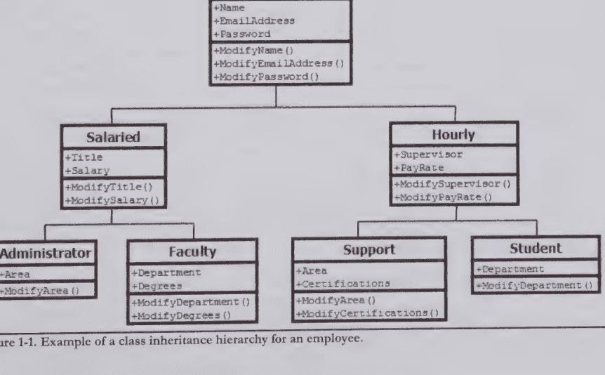


 ## 1.3 客户端-服务器模型

客户端-服务器模型是一种计算架构，它在一个*服务器*（即资源、服务或应用程序的提供者）和其*客户端*（即资源、服务或应用程序的使用者）之间分配处理任务。服务器由两部分组成：*服务器主机*——连接到网络的物理计算设备，以及*服务器应用程序*——管理多个客户端同时访问服务器的软件程序。同样，客户端也由两部分组成：*客户端主机*——连接到网络的物理计算设备，以及*客户端应用程序*——发起与服务器的*会话*以便访问服务器资源、服务和/或应用程序的软件程序。客户端-服务器系统的例子包括Web服务器与Web客户端、电子邮件服务器与电子邮件客户端，以及FTP服务器与FTP客户端。Web服务器应用程序的例子包括*Apache HTTP Server*、*Cloudflare Server*、*Internet Information Services (IIS)* 和 *Nginx*。Web客户端应用程序的例子包括 *Chrome*（谷歌）、*Edge*（微软）、*Firefox*（Mozilla）和 *Safari*（苹果）。Web客户端应用程序通常被称为*Web浏览器*。

### 1.3.1 静态网页处理周期

静态网页的内容和外观不会改变。相反，无论它被请求多少次或由谁请求，它看起来始终相同。判断一个网页是否为静态网页很容易，因为它的文件扩展名是 .htm 或 .html。正如我们在下图中将看到的，这种类型的网页只需要Web服务器的参与。

图 1-2 展示了*静态*网页的处理周期。如图所示，Web客户端（例如，运行Edge的笔记本电脑）通过 *HTTP 请求* 向Web服务器（例如，运行IIS的塔式计算机）请求一个网页。该请求的一个重要组成部分是被请求网页的名称（例如，DisplayProducts.html）。另外两个重要组成部分是服务器和客户端的 *IP 地址*（即唯一的互联网地址）。这些地址是必要的，以便HTTP请求能够到达Web服务器，同时被请求的网页能够返回给请求的Web客户端。当Web服务器收到HTTP请求后，它在其硬盘上找到所需的网页文件，将该文件的HTML代码附加到一个 *HTTP 响应* 中，然后将响应发送给请求的Web客户端。当Web客户端收到HTTP响应后，它使用附加的HTML代码为用户格式化和显示请求的网页。如果服务器上不存在请求的网页，那么臭名昭著的 *404* 错误（即页面未找到）将被返回给Web客户端并在那里显示给用户。

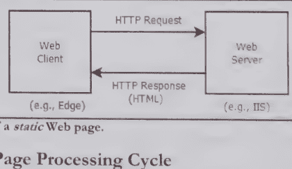

**图 1-2.** *静态*网页的处理周期。

### 1.3.2 动态网页处理周期

动态网页在每次被请求时都可以（而且通常会）发生变化。事实上，根据请求的时间和请求者的不同，它通常包含不同的信息（例如，不同的客户信息）并且可能看起来完全不同（例如，不同的字段、不同的图像）。判断一个网页是否为动态网页很容易，因为它的文件扩展名与动态网页相关联。此类文件扩展名的例子包括 .cshtml（Razor 页面）、.aspx（活动服务器页面）、.php（超文本预处理器页面）和 .jsp（Java 服务器页面）。正如我们将会看到的，这类网页由Web服务器和应用程序服务器共同处理。当Web应用程序需要数据库功能时，还需要数据库服务器。

ASP.NET Core Razor Page 应用程序可以使用两种托管模型进行托管——进程内托管模型和进程外托管模型。当我们将应用程序配置为使用进程内托管模型（默认）时，应用程序服务器在Web服务器内部的一个工作者进程（即 w3wp.exe 或 iisexpress.exe）中运行。在这种情况下，HTTP请求在单一服务器上处理，该服务器同时承担Web服务器和应用程序服务器的职责。图 1-3 展示了使用进程内托管的动态网页处理周期。

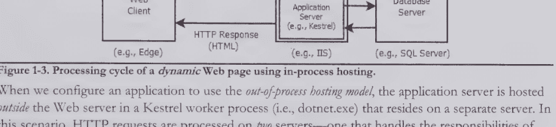

当我们将应用程序配置为使用进程外托管模型时，应用程序服务器在Web服务器外部的Kestrel工作者进程（即 dotnet.exe）中运行，该进程位于单独的服务器上。在这种情况下，HTTP请求在两个服务器上处理——一个承担Web服务器的职责（又称外部服务器或反向代理服务器），另一个承担应用程序服务器的职责（又称内部服务器）。图 1-4 展示了使用进程外托管的动态网页处理周期。

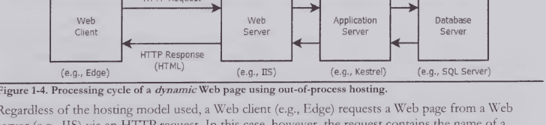

无论使用哪种托管模型，Web客户端（例如，Edge）通过HTTP请求向Web服务器（例如，IIS）请求一个网页。然而，在这种情况下，请求包含动态网页的名称（例如，DisplayProducts.cshtml）以及页面HTML元素中包含的任何数据（例如，输入到文本框中的名称、放置到复选框中的勾选标记、从日历中选择的日期）。当Web服务器收到HTTP请求并看到网页的文件扩展名为 .cshtml 时，它将处理控制权交给应用程序服务器（例如，Kestrel），在那里执行网页的业务逻辑。如果网页的业务逻辑需要数据库服务器的服务（即查询、插入、更新或删除数据），应用程序服务器将处理控制权交给数据库服务器（连同任何相关的输入参数），在那里执行网页的数据库请求（例如，SQL调用）。一旦数据库调用被执行，来自数据库服务器的响应（例如，检索到的数据和/或调用的状态）将被返回给应用程序服务器，在那里进行处理（例如，格式化检索到的数据和/或处理调用的状态）。之后，应用程序服务器将其工作结果返回给Web服务器，Web服务器在其硬盘上找到所需的网页文件，根据应用程序服务器的工作结果格式化网页的HTML代码，将生成的HTML代码附加到HTTP响应中，然后将响应发送给请求的Web客户端。当Web客户端收到HTTP响应后，它使用附加的HTML代码为用户格式化和显示请求的网页。同样，如果服务器上不存在请求的网页，臭名昭著的404错误（即页面未找到）将被返回给Web客户端并在那里显示给用户。

请注意，进程内托管比进程外托管更高效，因为不需要将HTTP请求的处理从外部服务器传递到内部服务器再返回。然而，进程外托管更安全，因为外部服务器可以提供内部服务器所不具备的额外安全层。外部服务器还可以提供内部服务器所不具备的负载均衡功能。

尽管服务器和客户端通常运行在不同的计算设备上，但它们也可以在相同的计算设备上运行。作为后者的例子，在开发ASP.NET Core Web应用程序时，我们通常在同一台机器上安装和运行Web客户端（例如，Edge）、Web服务器（例如，IIS Express）、应用程序服务器（例如，Kestrel）和数据库服务器（例如，SQL Server）。

## 1.4 .NET

.NET 是一个开源的跨平台产品，它允许我们开发可以在 Windows、macOS 和 Linux 操作系统上运行的软件应用程序。图 1-5 总结了 .NET 的组成结构。如图所示，.NET 由两个主要部分组成——核心框架类库（CoreFX）和核心公共语言运行时（CoreCLR）。

CoreFX 是一个基础类库。这些类执行开发现代、最先进的软件应用程序所需的许多基本功能。CoreFX 中的类可以被任何与 .NET 相关的编程语言（即 VB.NET、C#.NET 和 F#.NET）使用，包括集合类、文件访问类、数据库访问类以及更多其他类。通过将自定义编程代码与 CoreFX 中的类相结合，可以相对高效地开发复杂的应用程序。

CoreCLR 是所有 .NET 应用程序执行的环境。这些应用程序不像某些软件应用程序那样直接与操作系统交互。相反，无论使用哪种编程语言开发，.NET 应用程序都会被编译为通用中间语言（CIL）程序集，然后由 CoreCLR 执行。因此，与操作系统交互的是 CoreCLR，操作系统再通过设备驱动程序与计算机的硬件交互。由于 CIL 程序集由 CoreCLR 执行，而 CoreCLR 提供了自身的安全性、内存管理和异常处理，因此它被称为**托管代码**。


**图 1-5.** .NET 的组织结构。

## 1.6 .NET 简介

.NET Core 是一个软件开发框架，包含了构建现代、复杂的 Web 应用程序所需的所有类。由于 ASP.NET Core 是 .NET Core 的一部分，我们在编写应用程序时可以访问所有类。

在开发 ASP.NET Core Web 应用程序时，我们将使用与 .NET 兼容的语言。这些语言包括 VB.NET、C# 和 F#。在本书中，我们将重点介绍 C# 编程语言。C# 是一种由微软开发的复杂、通用、面向对象的编程语言。C# 支持多种类型，包括整数、浮点数和字符串。.NET 是一个计算平台，这意味着在计算操作中，无效操作在编译时（即解析时）而不是在运行时（即执行时）被检测到。例如，操作 `"abc" += 1` 会抛出编译时错误，因为 `abc` 是字符串而 `1` 是数字。.NET 不会执行连接操作。任何熟悉 C# 花括号风格的人。

**Visual Studio** IDE。虽然有许多编程语言可供选择，但 Visual Studio 提供了一致的用户界面。在本书中，我们将演示如何使用 Visual Studio 来编写和测试 ASP.NET Core、C# 和 JavaScript 代码。

Visual Studio 旨在通过提供一系列相互关联的工具来最大限度地提高开发人员的工作效率。它包括源代码编辑工具、调试工具、单元测试工具、编译工具、类浏览工具、应用程序部署工具、代码管理工具等。Visual Studio 还包括 IIS Express 和 Kestrel，使我们能够在自己的计算机上执行和测试 ASP.NET Core Web 应用程序。Visual Studio 可以从 visualstudio.microsoft.com 免费下载和安装。从现在开始，将假定已经完成此步骤。

安装 Visual Studio 后，我们需要安装构建 ASP.NET Core Web 应用程序所需的工具。为此，

1. 从 Visual Studio 主菜单中选择 *工具 > 获取工具和功能...*。

当 *Visual Studio 安装程序* 对话框出现时，

1. 选择 *工作负载*。
2. 勾选 *ASP.NET 和 Web 开发* 工作负载。
3. 点击 *修改*。

我们现在已准备好创建第一个 ASP.NET Core Web 应用程序。

## 1.7 开始新项目

要创建一个全新的 ASP.NET Core Web 应用程序，请执行 Visual Studio。当 *Visual Studio 2019* 对话框出现时，点击 *创建新项目*。图 1-6 显示了 *Visual Studio 2019* 对话框。

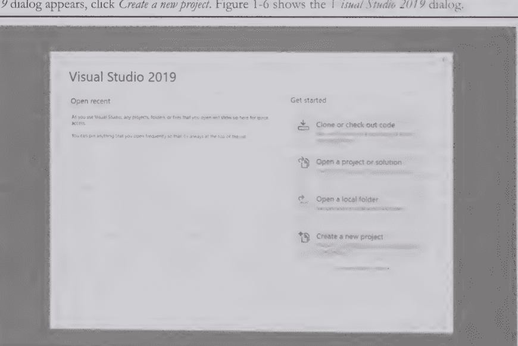

当 *创建新项目* 对话框出现时，从语言列表中选择 *C#*，从平台列表中选择 *Windows*，从项目类型列表中选择 *Web*，从项目模板列表中选择 *ASP.NET Core Web 应用程序*，然后点击 *下一步*。图 1-7 显示了 *创建新项目* 对话框。

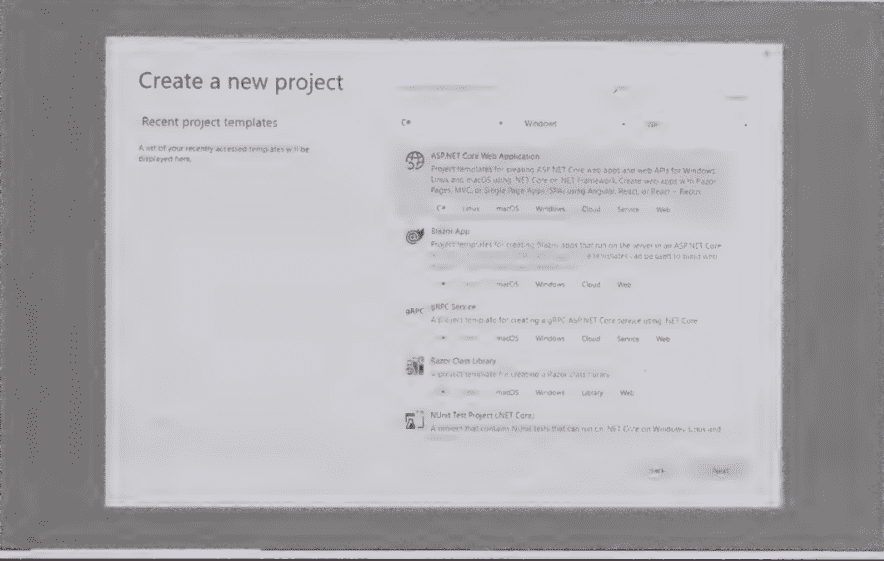

**图 1-7. 创建新项目对话框。**

当 *配置新项目* 对话框出现时，输入 *项目名称*，选择项目的 *位置*，输入 *解决方案名称*，然后点击 *创建*。图 1-8 显示了 *配置新项目* 对话框。

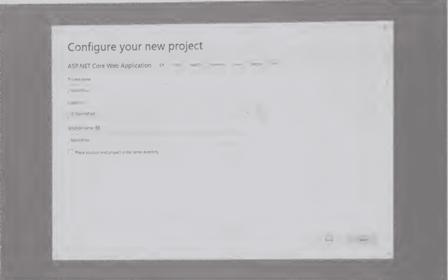

**图 1-8. 配置新项目对话框。**

当 *创建新的 ASP.NET Core Web 应用程序* 对话框出现时，从 .NET 框架列表中选择 .NET Core，从 ASP.NET Core 版本列表中选择 ASP.NET Core 3.1，取消勾选 *为 HTTPS 配置* 复选框，然后点击 创建。图 1-9 显示了 *创建新的 ASP.NET Core Web 应用程序* 对话框。


**10 • 概念与技术**

当 ASP.NET Core 概述对话框出现时，点击项目名称旁边的 X 关闭它。图 1-10 显示了 ASP.NET Core 概述对话框(norm1.8) 关闭 *ASP.NET Core 概述* 对话框后的 Visual Studio 环境。注意环境左上角的 **工具箱** 选项卡和环境右上角的 **解决方案资源管理器** 选项卡。我们在开发 ASP.NET Core Web 应用程序时会频繁使用这些工具。请记住，根据环境的配置方式或安装的 Visual Studio 版本，此环境可能看起来略有不同。如果 **工具箱** 选项卡不可见，我们可以从主菜单中选择 *视图 > 工具箱*。如果 **解决方案资源管理器** 选项卡不可见，我们可以从主菜单中选择 *视图 > 解决方案资源管理器*。


**图 1-11. 关闭 ASP.NET Core 概述对话框后的 Visual Studio 环境。**

## 1.8 解决方案资源管理器

创建新项目后，我们可以使用解决方案资源管理器来查看它。解决方案资源管理器用于管理解决方案，而解决方案本身包含一个或多个项目。在解决方案资源管理器中，我们可以添加、修改和删除项目，以及添加、修改和删除与项目相关的任何其他项（例如，文件夹、图像、网页）。要打开解决方案资源管理器，请点击 **解决方案资源管理器** 选项卡。

图 1-12 显示了解决方案资源管理器。请注意，我们可以通过点击解决方案资源管理器右上角的图钉图标来自动隐藏解决方案资源管理器。还要注意，我们可以通过再次点击 **解决方案资源管理器** 选项卡来关闭它。如果我们点击 x 图标（删除解决方案资源管理器选项卡），我们可以通过从主菜单中选择 *视图 > 解决方案资源管理器* 来恢复它。我们还可以将解决方案资源管理器拖到 Visual Studio 环境中的其他位置。为此，请按住解决方案资源管理器的顶部并将其拖到 Visual Studio 环境中的所需位置。请注意，我们在 Visual Studio 环境中看到的所有其他选项卡的行为方式相同。因此，很容易按照我们想要的方式调整 Visual Studio 环境。顺便说一下，请注意解决方案资源管理器顶部还有其他一些图标。我们现在可以忽略这些。

当然，当我们对 ASP.NET Core Web 应用程序进行更改时，我们需要保存这些更改。为此，我们可以从主菜单中选择 *文件 > 保存（项目名称）*，或者我们可以点击 Visual Studio 环境顶部的蓝色磁盘图标。但是请记住，每次我们在 Visual Studio 环境中执行项目时，对项目所做的任何更改都会自动保存。因此，在执行项目之前没有必要立即保存项目。


**图 1-12. 解决方案资源管理器。**

现在我们已经创建了一个新项目并快速查看了解决方案资源管理器，是时候执行项目了。要执行项目，请点击 Visual Studio 环境顶部附近的 *绿色三角形* 图标。此图标旁边应该有 *IIS Express*。

图 1-13 显示了运行项目的结果。如所示，该页面在 Microsoft Edge 中显示，它已被设置为 Visual Studio 中的默认浏览器。我们可以通过点击执行项目的 *绿色三角形* 图标右侧的 *黑色三角形* 图标，将默认浏览器更改为开发计算机上已安装的任何浏览器。在下一章中，我们将看到应用程序的页面位于何处以及每个页面的代码是什么样的。


**图 1-13. 运行项目的结果。**

## 1.9 练习

1. 安装 Visual Studio。
2. 启动一个名为 *Lastname.Firstname.Chapter99* 的新项目，其中 99 是本章的编号。
3. 浏览 Visual Studio 环境并熟悉它。
4. 将解决方案资源管理器拖离并移动到页面的不同位置。将其停靠在环境中的不同位置。然后，将其停靠回原始位置。


# 2 解决方案和项目

## 2.1 简介

ASP.NET Core *解决方案文件*是一个文本文件，其中包含有关解决方案的 Visual Studio 版本、项目（包括各自项目文件的位置）、调试和发布设置等信息。解决方案文件的扩展名为 .sln。ASP.NET Core *项目文件*是一个文本文件，其中包含有关项目的目标框架、已安装的包、服务器配置（即进程内托管或进程外托管）等信息。项目文件的扩展名为 .csproj。当我们通过解决方案文件启动 Visual Studio 时，解决方案中的项目会被加载到 Visual Studio 中并显示出来供我们使用。

## 2.2 项目组件

我们可以通过打开“解决方案资源管理器”并展开其中的文件夹来查看项目的组件。图 2-1 展示了“解决方案资源管理器”，其中曝光了项目的各个组件。在后续章节中，我们将简要介绍这些组件中的每一个。随着本书的深入，我们会再次（并且更详细地）介绍其中的许多内容。

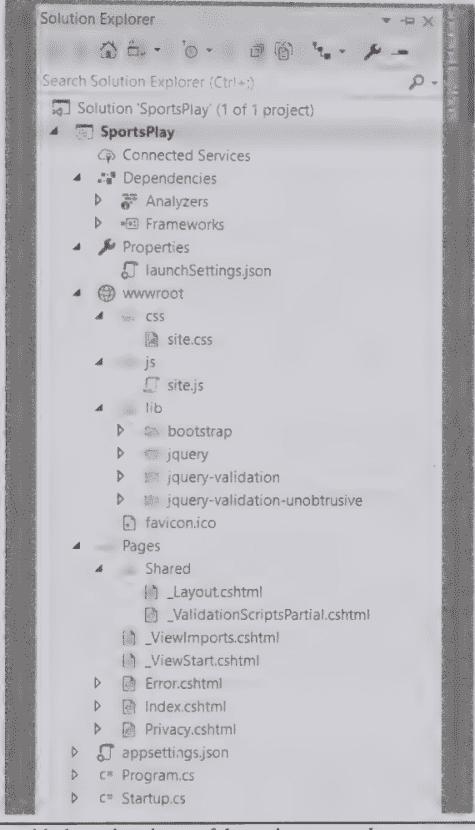

### 2.2.1 Dependencies 文件夹

Dependencies 文件夹包含一组*分析器*。这些分析器由 Visual Studio 使用，用于向我们提醒 C# 代码中存在的问题。修复这些问题将提高我们的代码质量。Dependencies 文件夹还包含一组*框架*。这些框架提供了我们构建 ASP.NET Core Web 应用程序所需的 API（即例程、协议和工具）。

### 2.2.2 Properties 文件夹

Properties 文件夹包含一个 *launchSettings.json* 文件。launchSettings.json 文件包含可用于*在 Visual Studio 中*执行我们 Web 应用程序的配置文件。因此，此文件仅与我们的开发计算机相关。图 2-2 展示了 launchSettings.json 文件的内容。如所示，该文件中有一组 IIS 设置和两个配置文件（*IIS Express* 和 *SportsPlay*）。当我们使用 IIS Express 配置文件执行应用程序时，IIS 被用作 Web 服务器*和*应用程序服务器。当我们使用 *SportsPlay* 配置文件执行应用程序时，Kestrel 被用作 Web 服务器*和*应用程序服务器。无论哪种情况，默认情况下都使用单服务器托管模型来托管应用程序。要选择执行应用程序时使用哪个配置文件，请在 Visual Studio 环境顶部附近的*绿色三角形*图标下选择 *IIS Express* 或 *SportsPlay*。

#### LAUNCHSETTINGS.JSON

```
{
    "iisSettings": {
        "windowsAuthentication": false,
        "anonymousAuthentication": true,
        "iisExpress": {
            "applicationUrl": "http://localhost:64295",
            "sslPort": 0
        }
    },
    "profiles": {
        "IIS Express": {
            "commandName": "IISExpress",
            "launchBrowser": true,
            "environmentVariables": {
                "ASPNETCORE_ENVIRONMENT": "Development"
            }
        },
        "SportsPlay": {
            "commandName": "Project",
            "launchBrowser": true,
            "applicationUrl": "http://localhost:5000",
            "environmentVariables": {
                "ASPNETCORE_ENVIRONMENT": "Development"
            }
        }
    }
}
```

图 2-2. launchSettings.json 文件的内容。

### 2.2.3 wwwroot 文件夹

*wwwroot* 文件夹包含一个 *css* 文件夹、一个 *js* 文件夹和一个 *lib* 文件夹。*css* 文件夹包含一个 *site.css* 文件。site.css 文件包含用于在整个应用程序的各个页面上统一样式化（即格式化和美化）HTML 元素所需的层叠样式表代码。*js* 文件夹包含一个 *site.js* 文件。site.js 文件包含在客户端（即浏览器）中执行编程逻辑所需的 JavaScript 代码。*lib* 文件夹包含一个 *bootstrap* 文件夹、一个 *jquery* 文件夹、一个 *jquery-validation* 文件夹和一个 *jquery-validation-unobtrusive* 文件夹。*bootstrap* 文件夹包含使应用程序在不同设备（如手机、平板电脑、笔记本电脑和台式机）上具有响应性和吸引力的 Bootstrap 项目。*jquery* 文件夹包含用于在不同浏览器中执行 HTML 文档遍历和操作等操作的 jQuery 函数。*jquery-validation* 文件夹包含用于对应用程序中的表单数据进行客户端验证（例如，必填字段验证、电子邮件地址验证）的 jQuery 函数。*jquery-validation-unobtrusive* 文件夹包含用于使用非侵入式验证对应用程序中的表单数据和模型数据进行客户端验证的 jQuery 函数，非侵入式验证是一种结合使用 HTML 元素属性和 jQuery 验证函数的验证方法。*favicon.ico* 文件包含一个或多个图标，这些图标显示在某些浏览器的地址栏中页面 URL 的旁边。

### 2.2.4 Pages 文件夹

Pages 文件夹包含一个 Shared 文件夹和几个 .cshtml（即 Razor 页面）文件——也称为*内容页*。*Shared* 文件夹包含一个 *_Layout.cshtml* 文件和一个 *_ValidationScriptsPartial.cshtml* 文件。_Layout.cshtml 文件是一个模板文件，其中包含用于使应用程序的内容页具有一致外观的代码。对于我们这些熟悉 ASP.NET Framework 的人来说，布局页在功能上等同于母版页。当应用程序中的内容页被编译时，它会与布局页合并形成一个保留内容页名称的单一页面。图 2-3 展示了 _Layout.cshtml 文件的内容。现在没有必要理解这个文件中的所有内容。然而，看看它并将其与本章一些图中的“结果”部分显示的内容进行比较，将是一个不错的主意。

```html
<!DOCTYPE html>
<html lang="en">
<head>
    <meta charset="utf-8" />
    <meta name="viewport" content="width=device-width, initial-scale=1.0" />
    <title>@ViewData["Title"] - SportsPlay</title>
    <link rel="stylesheet"
        href="~/lib/bootstrap/dist/css/bootstrap.min.css" />
    <link rel="stylesheet"
        href="~/css/site.css" />
</head>
<body>
    <header>
        <nav class="navbar navbar-expand-sm navbar-toggleable-sm
            navbar-light bg-white border-bottom box-shadow mb-3">
            <div class="container">
                <a class="navbar-brand" asp-area=""
                    asp-page="/Index">SportsPlay</a>
                <button class="navbar-toggler" type="button"
                    data-toggle="collapse" data-target=".navbar-collapse"
                    aria-controls="navbarSupportedContent"
                    aria-expanded="false" aria-label="Toggle navigation">
                    <span class="navbar-toggler-icon"></span>
                </button>
                <div class="navbar-collapse collapse d-sm-inline-flex
                    flex-sm-row-reverse">
                    <ul class="navbar-nav flex-grow-1">
                        <li class="nav-item">
                            <a class="nav-link text-dark" asp-area=""
                                asp-page="/Index">Home</a>
                        </li>
                        <li class="nav-item">
                            <a class="nav-link text-dark" asp-area=""
                                asp-page="/Index">Home</a>
                        </li>
                        <li class="nav-item">
                            <a class="nav-link text-dark" asp-area=""
                                asp-page="/Privacy">Privacy</a>
                        </li>
                    </ul>
                </div>
            </div>
        </nav>
    </header>
    <div class="container">
        <main role="main" class="pb-3">
            @RenderBody()
        </main>
    </div>
    <footer class="border-top footer text-muted">
        <div class="container">
            &copy; 2020 - SportsPlay -
            <a asp-area="" asp-page="/Privacy">Privacy</a>
        </div>
    </footer>
    <script src="~/lib/jquery/dist/jquery.min.js"></script>
    <script src="~/lib/bootstrap/dist/js/bootstrap.bundle.min.js"></script>
    <script src="~/js/site.js" asp-append-version="true"></script>
    @RenderSection("Scripts", required: false)
</body>
</html>
```

图 2-3. _Layout.cshtml 文件的内容。

_ValidationScriptsPartial.cshtml 文件包含用于指定应用程序中进行客户端数据验证所需的 jQuery 文件位置的代码。图 2-4 展示了 _ValidationScriptsPartial.cshtml 文件的内容。

```html
<script src="~/lib/jquery-validation/dist/jquery.validate.min.js"></script>
<script src="~/lib/jquery-validation-unobtrusive/jquery.validate.unobtrusive.min.js"></script>
```

图 2-4. _ValidationScriptsPartial.cshtml 文件的内容。

_ViewImports.cshtml 文件包含用于使页面指令对 Web 应用程序的所有页面可用的代码，这样我们就不必逐个将它们添加到页面中。我们可以在此文件中添加以下页面指令：@addTagHelper、@inherits、@inject、@model、@removeTagHelper、@tagHelperPrefix 和 @using。图 2-5 展示了 _ViewImports.cshtml 文件的内容。

```cshtml
@using SportsPlay
@namespace SportsPlay.Pages
@addTagHelper *, Microsoft.AspNetCore.Mvc.TagHelpers
```

图 2-5. _ViewImports.cshtml 文件的内容。

_ViewStart.cshtml 文件包含我们希望在各个页面的 Razor 页面代码执行之前执行的 Razor 页面代码。因此，我们不必将此代码添加到每个单独的页面中。图


图2-6展示了 `_ViewStart.cshtml` 文件的内容。在此示例中，我们将页面的 `Layout` 属性设置为 `_Layout`。这表示应用程序的各个页面将使用 `_Layout.cshtml` 页面作为其布局页面。

```
@{
    Layout = "_Layout";
}
```

图2-6. `_ViewStart.cshtml` 文件的内容。

`Error.cshtml` 文件包含用于显示应用程序错误页面的代码。此页面显示应用程序运行期间发生的任何未处理全局异常（即错误）。未处理的全局异常包括无法访问的数据库、不可用的电子邮件服务器以及文件系统权限不足。图2-7展示了 `Error.cshtml` 文件的内容。目前无需理解此文件中的所有内容。然而，至少对其有所了解会是一个好主意。

```
@page
@model ErrorModel
@{
    ViewData["Title"] = "Error";
}

<h1 class="text-danger">Error.</h1>
<h2 class="text-danger">An error occurred while processing your request.</h2>

@if (Model.ShowRequestId)
{
    <p>
        <strong>Request ID:</strong> <code>@Model.RequestId</code>
    </p>
}

<h3>Development Mode</h3>
<p>
    Swapping to the <strong>Development</strong> environment displays
    detailed information about the error that occurred.
</p>
<p>
    <strong>The Development environment shouldn't be enabled for deployed
    applications.</strong> It can result in displaying sensitive information
    from exceptions to end users. For local debugging, enable the
    <strong>Development</strong> environment by setting the
    <strong>ASPNETCORE_ENVIRONMENT</strong> environment variable to
    <strong>Development</strong> and restarting the app.
</p>
```

```
using System.Diagnostics;
using Microsoft.AspNetCore.Mvc;
using Microsoft.AspNetCore.Mvc.RazorPages;
using Microsoft.Extensions.Logging;

namespace SportsPlay.Pages
{
    [ResponseCache(Duration = 0, Location = ResponseCacheLocation.None,
        NoStore = true)]
    public class ErrorModel : PageModel
    {
        public string RequestId { get; set; }

        public bool ShowRequestId => !string.IsNullOrEmpty(RequestId);

        private readonly ILogger<ErrorModel> _logger;

        public ErrorModel(ILogger<ErrorModel> logger)
        {
            _logger = logger;
        }

        public void OnGet()
        {
            RequestId = Activity.Current?.Id ?? HttpContext.TraceIdentifier;
        }
    }
}
```

图2-7. `Error.cshtml` 文件的内容。

*Index.cshtml* 文件包含用于显示应用程序索引页面的代码。请注意，`Index.cshtml` 页面默认显示。我们将在后面学习如何更改默认页面。图2-8展示了 `Index.cshtml` 文件的内容。同样，目前无需理解此文件中的所有内容。然而，查看它并将其与图中“Result”部分显示的内容进行比较会是一个好主意。

```
@page
@model IndexModel
@{
    ViewData["Title"] = "Home page";
}

<div class="text-center">
    <h1 class="display-4">Welcome</h1>
    <p>Learn about <a href="https://docs.microsoft.com/aspnet/core">
        building Web apps with ASP.NET Core</a>.</p>
</div>
```

```
using Microsoft.AspNetCore.Mvc.RazorPages;
using Microsoft.Extensions.Logging;

namespace SportsPlay.Pages
{
    public class IndexModel : PageModel
    {
        private readonly ILogger<IndexModel> _logger;

        public IndexModel(ILogger<IndexModel> logger)
        {
            _logger = logger;
        }

        public void OnGet()
        {

        }
    }
}
```

图2-8. `Index.cshtml` 文件的内容。

`Privacy.cshtml` 文件包含用于显示应用程序隐私页面的代码。图2-9展示了 `Privacy.cshtml` 文件的内容。再次强调，目前无需理解此文件中的所有内容。然而，查看它并将其与图中“Result”部分显示的内容进行比较会是一个好主意。

```
@page
@model PrivacyModel
@{
    ViewData["Title"] = "Privacy Policy";
}
<h1>@ViewData["Title"]</h1>

<p>Use this page to detail your site's privacy policy.</p>
```

```
using Microsoft.AspNetCore.Mvc.RazorPages;
using Microsoft.Extensions.Logging;

namespace SportsPlay.Pages
{
    public class PrivacyModel : PageModel
    {
        private readonly ILogger<PrivacyModel> _logger;

        public PrivacyModel(ILogger<PrivacyModel> logger)
        {
            _logger = logger;
        }

        public void OnGet()
        {
        }
    }
}
```

### 2.2.5 appsettings.json 文件

`appsettings.json` 文件包含应用程序的配置设置，例如应用程序的数据库连接字符串设置、电子邮件主机服务器设置等。对于我们这些熟悉 ASP.NET Web Forms 开发的人来说，此文件本质上等同于 `Web.config` 文件。

图2-10展示了 `appsettings.json` 文件的内容。目前无需理解此文件中的所有内容，因为当我们需要修改它时，其用途就会显现。

```
{
    "Logging": {
        "LogLevel": {
            "Default": "Information",
            "Microsoft": "Warning",
            "Microsoft.Hosting.Lifetime": "Information"
        }
    }
}
```

```
},
"AllowedHosts": "*"
}
```

图2-10. `appsettings.json` 文件的内容。

### 2.2.6 Program.cs 类

`Program.cs` 类包含应用程序的 *入口点*。ASP.NET Core *Web* 应用程序以 .NET *控制台* 应用程序的形式启动。当 CoreCLR 启动应用程序时，它会在 `Program.cs` 类中查找 *Main()* 方法并调用它。然后，此方法构建托管应用程序的 Webhost（即服务器），并将其作为 ASP.NET Core Web 应用程序运行。启动后，应用程序会监听要处理的 HTTP 请求。在构建 Webhost 时，它使用 `Startup.cs` 类（接下来讨论）中的两种方法来配置 Webhost 的 *服务* 和 *HTTP 请求管道*。图2-11展示了 `Program.cs` 类的内容。

```
using Microsoft.AspNetCore.Hosting;
using Microsoft.Extensions.Hosting;

namespace SportsPlay
{
    public class Program
    {
        public static void Main(string[] args)
        {
            CreateHostBuilder(args).Build().Run();
        }

        public static IHostBuilder CreateHostBuilder(string[] args) =>
            Host.CreateDefaultBuilder(args)
                .ConfigureWebHostDefaults(webBuilder =>
                {
                    webBuilder.UseStartup<Startup>();
                });
    }
}
```

图2-11. `Program.cs` 类的内容。

### 2.2.7 Startup.cs 类

`Startup.cs` 类配置应用程序的 *服务* 和 *HTTP 请求管道*。应用程序的服务是为应用程序提供附加功能的软件组件。这些服务在 `Startup.cs` 类的 *ConfigureServices()* 方法中进行配置，以便应用程序可以使用它们。另一方面，应用程序的 HTTP 请求管道处理应用程序所有传入的 HTTP 请求。此管道通过将 *中间件组件* 添加到 `Startup.cs` 类的 *Configure()* 方法来进行配置。中间件组件是在 HTTP 请求管道内处理特定任务的软件组件。

图2-12展示了 `Startup.cs` 类的内容。目前无需理解此文件中的所有内容，但这里是一个快速概述。

在 01 处，`AddRazorPages()` 服务用于为应用程序提供特定于 Razor 页面的功能。

在 02 处，`UseDeveloperExceptionPage()` 中间件组件用于在 *开发* 环境中发生未处理全局异常（例如，无法访问的数据库、不可用的电子邮件服务器、文件系统权限不足）时显示 *开发人员异常页面*。

在 03 处，`UseExceptionHandler("/Error")` 中间件组件用于显示 *自定义错误页面*（即我们之前讨论的 `Error.cshtml` 页面）。

在 04 处，`UseStaticFiles()` 中间件组件用于提供存储在应用程序 `wwwroot` 文件夹中的静态文件（例如，图像文件、CSS 文件、JavaScript 文件）。

在 05 处，`UseRouting()` 中间件组件用于将传入的 HTTP 请求路由（即转发）到应用程序的 *端点*（即页面 URL）。

在 06 处，`UseAuthorization()` 中间件组件用于授权用户访问应用程序的安全资源。

在 07 处，`UseEndpoints()` 中间件组件用于定义 HTTP 请求管道中做出路由决策的位置，并指示端点将映射到 Razor 页面。

```
using Microsoft.AspNetCore.Builder;
using Microsoft.AspNetCore.Hosting;
using Microsoft.Extensions.Configuration;
using Microsoft.Extensions.DependencyInjection;
using Microsoft.Extensions.Hosting;

namespace SportsPlay
{
    public class Startup
    {
        public Startup(IConfiguration configuration)
        {
            Configuration = configuration;
        }

        public IConfiguration Configuration { get; }

        // This method gets called by the runtime. Use this method to add
        //     services to the container.
        public void ConfigureServices(IServiceCollection services)
        {
01          services.AddRazorPages();
        }

        // This method gets called by the runtime. Use this method to
        //     configure the HTTP request pipeline.
        public void Configure(IApplicationBuilder app,
```


## 2.3 项目补充

Visual Studio 为我们创建一个全新的 ASP.NET Core 项目后，我们需要添加一些默认未包含的额外组件。例如，我们可能需要为项目添加额外的文件夹，以便更好地组织项目结构。我们可能还需要为项目添加额外的类，以便对与项目应用领域相关事物的特性和行为进行建模。我们可能还需要为项目添加额外的 Razor 页面，以便创建用户将要交互的界面。最后，我们可能还需要为项目添加 NuGet 包，以便整合他人分享的有用功能。

### 2.3.1 文件夹

我们常常会发现有必要为项目添加文件夹。文件夹是一个文件系统容器，我们可以用它将相关的项目（即相关的子文件夹和相关的文件）分组在一起，以帮助我们更好地组织项目。当项目组织良好时，处理它的工作过程会更高效。要在我们的项目中添加一个名为 *New* 的文件夹：

1.  打开解决方案资源管理器。
2.  右键单击项目（不是解决方案）。
3.  选择 *添加* > *新建文件夹*。
4.  将文件夹重命名为 *New*。

图 2-13 展示了 New 文件夹。请记住，我们也可以在项目中任何其他文件夹下添加文件夹。要执行此操作，只需右键单击我们希望在其中创建新文件夹的文件夹，然后按照上面的步骤 3 和 4 操作即可。

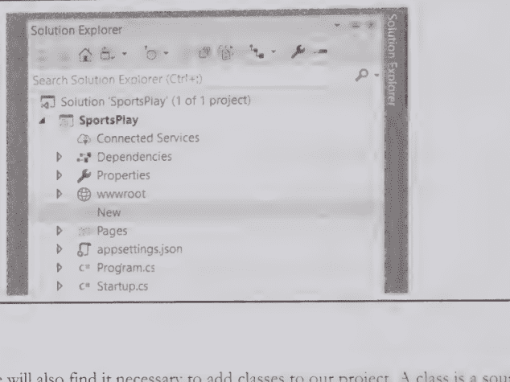

### 2.3.2 类

我们时不时也会发现有必要为项目添加类。类是一个源代码文件，用于对与项目应用领域相关事物的特性（通过属性）和行为（通过方法）进行建模，或者作为另一个类的接口。要在我们刚刚创建的 *New* 文件夹下向项目添加一个类：

1.  打开解决方案资源管理器。
2.  右键单击 *New* 文件夹。
3.  选择 *添加* > *新建项...*。

当 *添加新项* 对话框出现时：

1.  从对话框左侧窗格中选择 *已安装* > *Visual C#*。
2.  从对话框中间窗格中选择 *类*。
3.  将类命名为 *New*。
4.  单击 *添加*。

图 2-14 展示了 New 文件夹中的 New.cs 类。

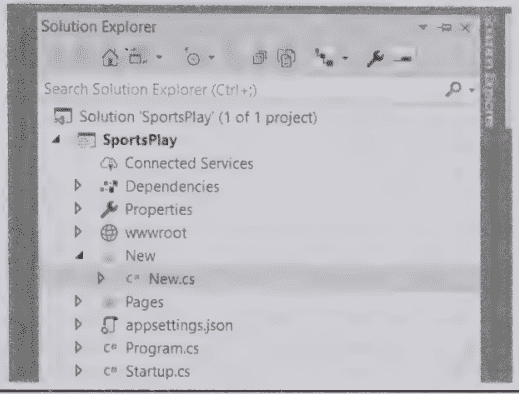

图 2-15 展示了 New.cs 类的内容。请注意类顶部的四个 Using 指令。在 Visual Studio 中，这些指令可能已被灰显，表明它们在类中目前是不必要的。在本书中，我们通常会移除此类不必要的 Using 指令。

```csharp
using System;
using System.Collections.Generic;
using System.Linq;
using System.Threading.Tasks;

namespace SportsPlay.New
{
    public class New
    {
    }
}
```

### 2.3.3 Razor 页面

由于这是一本关于 ASP.NET Core Razor 页面开发的书籍，我们会经常发现有必要为项目添加 Razor 页面。一个 Razor 页面由两个源代码文件表示：一个包含页面标记（即用户与页面业务逻辑之间的界面）的 .cshtml 文件，以及一个包含页面业务逻辑的 .cshtml.cs 文件。要在我们的项目中添加一个 Razor 页面：

1.  打开解决方案资源管理器。
2.  右键单击 *Pages* 文件夹。
3.  选择 *添加* > *Razor 页面....*

当 *添加新搭建的项* 对话框出现时：

1.  从对话框左侧窗格中选择 *已安装* > *公共* > *Razor 页面*。
2.  从对话框中间窗格中选择 *Razor 页面*。
3.  单击 *添加*。

当 *添加 Razor 页面* 对话框出现时：

1.  将 Razor 页面命名为 *New*。
2.  勾选 *生成 PageModel 类* 复选框。
3.  勾选 *使用布局页* 复选框。
4.  取消勾选任何其他复选框。
5.  单击 *添加*。

图 2-16 展示了 New 页面的内容。在图中的 Page 部分，我们看到了 Razor 页面文件（即 New.cshtml）中的代码。在图中的 PageModel 部分，我们看到了 PageModel 类（即 New.cshtml.cs 类）中的代码。

在 01 处，我们有一个 **@page** 指令。此指令必须是 Razor 页面中的第一个指令，以指示该页面是一个 Razor 页面（区别于熟悉 MVC 的人所知的 *视图*）。Razor 页面直接处理 HTTP 请求（区别于由熟悉 MVC 的人所知的 *控制器* 处理）。请注意 **@page** 指令右侧的 "/_"。这表示该页面旨在成为应用程序的 *默认起始页*。

在 02 处，我们有一个 **@model** 指令。此指令指定了与该 Razor 页面关联的 PageModel 类（在 06 处的 `NewModel`）。

在 03 处，我们有一个赋值语句，它将 *New* 的值赋给一个名为 **Title** 的 *视图数据变量*。视图数据变量是一个键值对，可用于将数据从 PageModel 类传输到其关联的 Razor 页面或布局页，或者用于将数据从 Razor 页面传输到其关联的布局页。在这种情况下，我们将 *New* 的值赋给了名为 **Title** 的视图数据变量，因为我们希望将 *New* 这个词传输到布局页，以便在页面在浏览器中显示时在浏览器标签页中显示（参见图 2-3 中布局页页眉区域中的 HTML Title 元素）。顺便提一下，请注意赋值语句是用 C# 编写的。Razor 页面的优点之一就是我们可以在其中编写 C# 代码，只要该代码包含在 **@{** 和结束的 **}** 之间。

在 04 处，我们有一个 HTML **&lt;h1&gt;** 标签（即一级标题标签），单词 *New*，以及一个 HTML **&lt;/h1&gt;** 标签（即一级标题结束标签）。这将在页面在浏览器中显示时，将单词 *New* 显示为一级标题（即最大的标题）。

在 05 处，我们有一个 *using 指令*。using 指令将一个 *命名空间* 导入到 PageModel 类中。命名空间包含为 PageModel 类提供其依赖的任何附加功能的 *类*（例如，数据库访问类），提供一种方式让 PageModel 类与其依赖的任何其他类解耦的 *接口*（例如，模型类），和/或为 PageModel 类提供其依赖的任何专用类型的 *类型*（例如，值类型、引用类型、枚举类型）。随着我们本书的进展，我们将在需要时将额外的命名空间包含到我们的 PageModel 类中。

在 06 处，我们有一个对 SportsPlay.Pages 命名空间的引用。此引用表明在 07 处定义的 `NewModel` 类位于 SportsPlay.Pages 命名空间中。它还表明该类位于 SportsPlay 项目中的 Pages 文件夹中。

在 07 处，我们有一个公共类定义，其中被定义的类的名称是 `NewModel`。类名右侧是一个冒号 (:) 和单词 **PageModel**。这表明 `NewModel` 是一个继承了 PageModel 类属性和方法的 PageModel 类。这些属性和方法允许我们处理与 HTTP 请求关联的所有项目。

在 08 处，我们在 NewModel 类内部有一个公共方法定义，其中被定义的方法名称是 OnGet()。当页面被首次请求时，OnGet() 方法会执行，并用于初始化页面。如果有任何 ASP.NET Core 和/或 C# 代码需要在页面首次请求时执行，它们将在此处编码。

```html
@page "/"
@model SportsPlay.Pages.NewModel
@{
    ViewData["Title"] = "New";
}

<h1>New</h1>
```

```csharp
using Microsoft.AspNetCore.Mvc.RazorPages;

namespace SportsPlay.Pages
{
    public class NewModel : PageModel
    {
        public void OnGet()
        {
        }
    }
}
```

顺便提一下，如果我们尝试运行此页面（我们已将其设置为默认起始页），但在从项目中删除（或排除）Index 页面之前，我们将得到以下歧义匹配异常：
AmbiguousMatchException: The request matched multiple endpoints. Matches: /Index /New.

这意味着 UseEndpoints 中间件组件不清楚应该将哪个页面与 HTTP 请求匹配——即，哪个页面应被视为默认起始页。这是因为在开箱即用的配置下，Razor 页面应用程序的 Index 页面被视为应用程序的默认起始页。因此，如果我们希望其他某个页面成为应用程序的默认起始页，我们必须首先从项目中删除（或排除）Index 页面。

图 2-17 展示了显示 New 页面的结果。请注意，单词 New 同时显示在浏览器标签页和页面本身中。


### 2.3.4 NuGet 包

偶尔，我们也会发现有必要向项目中添加 NuGet 包。NuGet 包是由某人共享给开发社区的软件捆绑包，我们可以将其合并到我们的项目中以利用其功能。NuGet 包包含 .dll 文件以及 .dll 文件所需的任何相关依赖项文件。NuGet 是微软的机制，开发人员通过该机制创建、分发和使用 NuGet 包。本书稍后将需要安装的一个示例 NuGet 包是 MailKit。MailKit 允许我们构建电子邮件消息并将其发送到电子邮件服务器以供转发给预期收件人。虽然我们不会在本章中实现任何电子邮件功能，但我们将安装此包以演示安装 NuGet 包的基本过程。要安装 MailKit NuGet 包，

1.  选择“工具 > NuGet 包管理器 > 为解决方案管理 NuGet 包..."从 Visual Studio 主菜单。
2.  在 NuGet 包管理器中点击“浏览”。
3.  搜索 MailKit。
4.  点击 Jeffrey Stedfast 的 MailKit。
5.  勾选项目复选框。
6.  点击安装。
7.  点击“我接受”以接受许可协议。
8.  关闭 NuGet 包管理器。

完成此过程后，请确保该包已成功添加到项目的依赖项文件夹中。图 2-18 显示了新安装的 MailKit 包在依赖项文件夹中的样子。

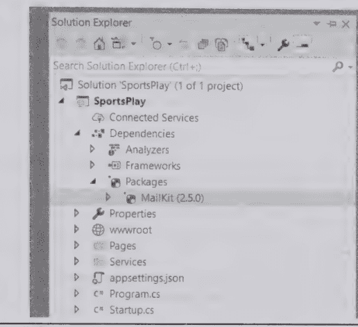

图 2-18. 依赖项文件夹中已新安装的 MailKit 包。

要卸载 MailKit NuGet 包，

1.  选择“工具 > NuGet 包管理器 > 为解决方案管理 NuGet 包..."从 Visual Studio 主菜单。
2.  在 NuGet 包管理器中点击“已安装”。
3.  点击 Jeffrey Stedfast 的 MailKit。
4.  勾选项目复选框。
5.  点击“卸载”。
6.  点击“我接受”以接受许可协议。
7.  关闭 NuGet 包管理器。

完成此过程后，请确保该包已从项目的依赖项文件夹中成功删除。

> ² 此处使用单词“intended”，因为某些变量存储为对象，其预期类型通常在运行时才设置（例如 JavaScript 变量、会话变量、Cookie 变量）。
> ³ 静态代码审查是一种代码审查技术，在此过程中，代码作者带领参与审查的个人逐行浏览代码，允许他们提出问题和发表意见。被审查的代码通常通过投影仪投射、显示在个人计算机屏幕上，或从打印的硬拷贝读取。

## 2.4 标识符命名规范

在我们开始编写自己的代码之前，在进入下一章之前，我们需要说几句关于标识符命名规范的话。对变量、常量和方法等标识符（i.e., variables, constants, and methods）进行命名的标准各不相同，且有许多观点讨论哪种标准最好。无论如何，建立标准很重要，因为当我们组织内的软件开发生物专业人员按照相同的标准编写代码时，每个人都可以更容易地阅读和维护他人的代码。在本书中，我们在使用命名标识符时会采用两种编程风格：*帕斯卡大小写*和*驼峰大小写*——具体取决于标识符的上下文。

当命名 *数据库表属性*、*模型属性*、*ViewBag 变量* 和 *ViewData 变量* 时，我们将使用帕斯卡大小写。这些项目将作为名词命名（例如，*LastName*, *Price*, *NumberInStock*）。此标准将使我们的页面上的标记更容易阅读，并便于遵循微软提供的编程示例。

当命名 *局部变量*、*方法参数*、*循环控制变量* 和 *常量* 时，我们将使用驼峰大小写。这些项目将作为名词命名（例如，decPrice, strLastName, bytNumberInStock），其中标识符的第一部分为反映变量或常量类型（或预期类型）的三字符小写前缀。²此标准将使在静态代码审查期间更容易检测编码问题。³

当命名方法时，我们将使用帕斯卡大小写。这些项目将作为动作动词或描述它们做什么的动作动词短语命名（例如，Save(), DisplayCustomer(), PrintInvoice()）。

## 2.5 项目练习

1.  创建一个名为 Lastname.Firstname.Chapter99 的新项目，其中 99 是本章的编号。
2.  探索项目中文件夹和文件的内容。
3.  对 _Layout.cshtml 文件和 Index.cshtml 文件进行一些细微修改，运行项目并观察结果。
4.  向项目添加一个名为 MyFolder 的新文件夹。然后，为该文件夹添加一个名为 MySubfolder 的新子文件夹。
5.  在 MyFolder 文件夹中添加一个名为 MyClass 的新类。检查此类的内容，并删除任何不必要的 Using 指令。Visual Studio 应指示哪些指令是不必要的并提示您删除它们。
6.  向 Pages 文件夹添加一个新的 Razor 页面，名为 MyRazorPage。请确保生成关联的 PageModel 类并使用现有的 Layout 页面。检查 Razor 页面文件的内容。在页面的两个地方将 MyRazorPage 更改为您的姓名。接下来，检查关联 PageModel 类的内容。删除任何不必要的 Using 指令。将此页面设为主页面并运行应用程序。
7.  使用 NuGet 包管理器安装 MailKit NuGet 包。接下来，检查项目的依赖项文件夹以确保该包已成功安装。接下来，使用 NuGet 包管理器卸载 MailKit NuGet 包。最后，检查项目的依赖项文件夹以确保该包已成功卸载。

# 第二部分 – Web 应用程序开发

# 3 基本 HTML 元素

## 3.1 简介

*HTML 元素*是网页上的独立组件。页面上的每个元素都从 *起始标签* 开始，以 *结束标签* 结束。一个 HTML 元素可以包含一个或多个控制元素外观和行为的 *HTML 元素属性*。存在两种类型的 HTML 元素——块元素和行内元素。*块元素*在网页上始终与其前后带有换行符出现。换句话说，块元素总是在其自己的行上开始，其后的任何内容也总是在其自己的行上开始。另一方面，*行内元素*在我们明确指示它通过前面或后面紧跟一个相邻的 `<br />`（即换行）元素或块元素之前或之后时，才会在页面上下文中出现，而不会在页面上带有前后的换行符。随着我们在这本书中不断前进，我们会看到许多这些元素的实际效果。

## 3.2 表单元素

Form 元素定义一个 *表单*，其中包含其他 HTML 元素，这些元素可以通过 *HTTP POST 请求* 提交给服务器进行处理。例如，一个表可能包含两个文本框——一个接受用户名，另一个接受密码。当用户输入其用户名和密码并通过点击页面上的按钮将页面（即提交）发布到服务器时，输入的用户名和密码将由我们编写的代码在服务器上进行处理。

图 3-1 显示了 Form 元素的一个示例。

在 01 处，我们在页面上添加了一个 Form 元素。此元素指定了表单的开始部分。请注意，我们包含了 *method 属性*，并将其值设置为 *post*。这表示我们希望将表单上的数据作为 HTTP POST 请求发送到服务器，以便在服务器上进行处理。

在 02 处，我们在页面上添加了关闭的 Form 元素。此元素指定了表单的结束部分。我们包含在 Form 元素和关闭 Form 元素之间的任何 HTML 元素都将被发送服务器以供处理。

请注意，图中结果部分显示 Login 标题下方未显示任何内容。这是因为我们还没有在页面上包含任何其他 HTML 元素。

```
@page
@model SportsPlay.Pages.FormModel
@{
    ViewData["Title"] = "Login";
}

<h1>Login</h1>

01 <form method="post">

02 </form>
```


## 3.3 Label 元素

Label 元素用于显示信息性文本。Label 元素通常用于描述要在相关 HTML 元素（例如文本框）中输入的信息类型。
图 3-2 展示了 Label 元素的示例。
在 01 处，我们已向表单中添加了一个 Label 元素。该标签将用于为电子邮件地址文本框显示标签。
请注意图中 Result 部分，电子邮件地址标签显示在 Login 标题下方。

## PAGE

```
@page
@model SportsPlay.Pages.LabelModel
@{
    ViewData["Title"] = "Login";
}

<h1>Login</h1>

<form method="post">
    <label>Email Address</label>

</form>
```

## RESULT

40 • Basic HTML Elements

## 3.4 Input (Text) 元素

Input (Text) 元素显示一个输入字段，用户可用于输入信息。Input (Text) 元素通常被称为*文本框*。

图 3-3 展示了 Input (Text) 元素的示例。

在 01 处，我们已向表单中添加了一个 Input (Text) 元素。该文本框将供用户输入电子邮件地址。请注意，我们可以为此元素添加一个*type 属性*，并将其值设置为 *text*，如下所示：

```
<input type="text" />
```

然而，由于 Input (Text) 元素是*默认的 Input 元素*，我们在定义文本框时*不*会包含 type 属性，以避免冗余。

请注意图中 Result 部分，电子邮件地址文本框直接显示在电子邮件地址标签的右侧。当用户看到这个文本框及其相关标签时，就能清楚应该在此文本框中输入什么类型的信息。

## PAGE

```
@page
@model SportsPlay.Pages.InputTextModel
@{
    ViewData["Title"] = "Login";
}

<h1>Login</h1>

<form method="post">
    <label>Email Address</label>
    <input>
</form>
```

01

## RESULT


图 3-3. Input (Text) 元素示例。

## 3.5 Input (Password) 元素

Input (Password) 元素显示一个*掩码*输入字段，用户可用于输入在输入过程中不应显示的信息。

图 3-4 展示了 Input (Password) 元素的示例。

在 01 处，我们已向表单中添加了一个 Input (Password) 元素。请注意，我们已包含一个 type 属性，并将其值设置为 password。这表示我们希望 Input 元素成为一个掩码文本框。该文本框将供用户输入密码。

请注意图中 Result 部分，密码文本框直接显示在密码标签的右侧。当用户看到这个文本框及其相关标签时，就能清楚应该在此文本框中输入什么类型的信息。

## PAGE

```
@page
@model SportsPlay.Pages.InputPasswordModel
@{
    ViewData["Title"] = "Login";
}

<h1>Login</h1>

<form method="post">

    <label>Email Address</label>
    <input><br />

    <label>Password</label>
    <input type="password" />

</form>
```

01

## RESULT

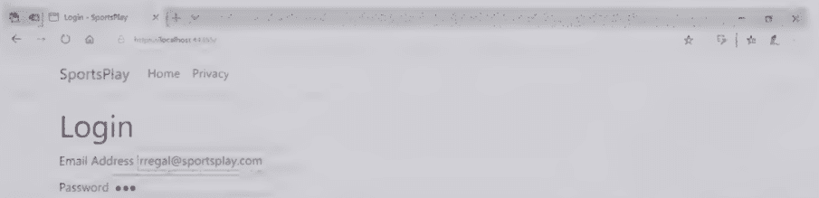

图 3-4. Input (Password) 元素示例。

## 3.6 Input (Submit) 元素

Input (Submit) 元素显示一个按钮，用户可以使用该按钮将表单及其相关 HTML 元素提交到服务器进行处理。

图 3-5 展示了 Input (Submit) 元素的示例。

在 01 处，我们已向表单中添加了一个 Input (Submit) 元素。请注意，我们已包含一个 type 属性，并将其值设置为 submit。这表示我们希望 Input 元素成为一个按钮，通过 HTTP post 请求将表单提交到服务器进行处理。此外，我们还包含了一个 value 属性，并将其值设置为 Login。这表示我们希望 Input 元素上显示 Login 字样，以便用户了解该按钮的用途。

请注意图中 Result 部分，该按钮直接显示在密码标签及其相关文本框的下方。当用户看到这个按钮时，就能清楚它的功能。另外请注意，页面上的元素在排列方面显得有些凌乱。我们接下来将纠正这个问题。

```
@page
@model SportsPlay.Pages.InputSubmitModel
@{
    ViewData["Title"] = "Login";
}

<h1>Login</h1>

<form method="post">
    <label>Email Address</label>
    <input><br />

    <label>Password</label>
    <input type="password" /><br />
    <input type="submit" value="Login" />
</form>
```


## 3.7 Table 元素

Table 元素包含其他 HTML 元素，用于定义页面的布局。如果页面必须适合移动设备，则可能*不应*使用 Table 元素来布局页面。相反，应该使用 Div 元素（接下来讨论）配合_ef8674c9f8配合 Bootstrap 类（本书后面讨论）。

图 3-6 展示了 Table 元素的示例。
在 01 处，我们已向表单中添加了一个 Table 元素及其结束标签（在 05 处）。Table 元素包含一个或多个 TR（Table Row）元素。

在 02 处，我们已向表单中添加了一个 TR 元素及其结束标签（在 04 处）。TR 元素包含一个或多个 TD（Table Data）元素。

在 03 处，我们已向表单中添加了一个 TD 元素及其结束标签。TD 元素包含零个或多个其他 HTML 元素，可以视为表格列。如所见，此 TD 元素包含一个 Label 元素。请注意，我们也可以将 TD 元素、Label 元素和 TD 元素分别放在不同的行，这也是一种可接受的编码风格。我们选择将它们全部放在一行，以使代码更紧凑。

请注意图中 Result 部分，与未使用表格定义页面布局时相比，页面上的元素显得更加有条理。

## PAGE

```
@page
@model SportsPlay.Pages.TableModel
@{
    ViewData["Title"] = "Login";
}

<h1>Login</h1>

<form method="post">

<table>
    <tr>
        <td><label>Email Address</label></td>
        <td><input></td>
    </tr>
    <tr>
        <td><label>Password</label></td>
        <td><input type="password" /></td>
    </tr>
    <tr>
        <td></td>
        <td>
            <input type="submit" value="Login" />
        </td>
    </tr>
</table>

</form>
```

## RESULT


图 3-6. Table 元素示例。

## 3.8 Div 元素

Div 元素用于将相关的 HTML 元素分组在一起，以在页面上形成一个独立的分区（或部分）。

图 3-7 展示了 Div 元素的示例。

在 01 处，我们已向表单中添加了一个 Div 元素及其结束标签（在 02 处）。在此 Div 内部，我们添加了三个 Anchor 元素。*Anchor 元素*（`<a>`）包含一个 *href 属性*，用于定义指向某内容的超链接。Anchor 元素可以定义指向任何可通过 URL 地址访问的内容的超链接，包括其他网页、网页中的某个位置、文件、电子邮件地址等。在此示例中，Anchor 元素引用应用程序中的其他网页。

在 03 处，我们已向表单中添加了第二个 Div 元素及其结束标签（在 04 处）。在此 Div 内部，有我们在前一个示例中创建的表格。

在 05 处，我们已向表单中添加了第三个 Div 元素及其结束标签（在 06 处）。 Memorial 在此 Div 内部，有与上面相同的 Anchor 元素。

请注意图中 Result 部分，页面上的三个 Div 元素看起来一个叠在另一个上方。虽然此时看起来并不起眼，但 Div 元素确实在页定义了三个独立的分区。我们将在标题为 *Bootstrap and Cascading Style Sheets* 和 *JavaScript Programming* 的章节中看到这些分区如何在功能上使用。

```
@page
@model SportsPlay.Pages.DivModel
@{
    ViewData["Title"] = "Login";
}

<h1>Login</h1>

<form method="post">

    <br />
<div>
    <a href="About">About</a> |
```

01

 ```
### Tag Helpers

ASP.NET Core 标记帮助程序用于在服务器端辅助创建 HTML 元素。标记帮助程序以 asp- 开头，作为 HTML 元素的属性应用，并且通常可以简化 Razor 页面上 HTML 元素的源代码定义。在本章中，我们将介绍本书中使用的标记帮助程序。虽然我们可能还需要过一段时间才能看到这些标记帮助程序的实际应用，但本节可以作为日后的良好参考。目前，只需熟悉 Razor 页面中的标记帮助程序如何转换为在浏览器中渲染的 HTML 元素。要查看 HTML 元素在浏览器中的渲染方式，请在页面显示后查看页面源代码。

#### Anchor Tag Helpers

**asp-page** 锚点标记帮助程序用于指示当用户点击 Anchor 元素的链接时要请求的名称。例如，Razor 页面代码

`<a asp-page="/Privacy">Privacy</a>`

在浏览器中渲染为

`<a href="/Privacy">Privacy</a>`

**asp-route-** 锚点标记帮助程序用于指定一个路由参数值，我们希望当用户点击 Anchor 元素的链接时将该值传递给所请求的页面。例如，Razor 页面代码

`<a asp-page="ModifyProduct" asp-route-intProductId="20">Modify</a>`

在浏览器中渲染为

`<a href="/Products/ModifyProduct?intProductId=20">Modify</a>`

#### Form Action Tag Helper

**asp-page-handler** 表单操作标记帮助程序用于指示当页面在服务器上处理时，我们希望调用 PageModel 类中的特定处理程序方法。处理程序方法是一个过程或函数，当表单提交到服务器进行处理时执行。例如，Razor 页面代码

`<input asp-page-handler="Login" type="submit" value="Login" />`

在浏览器中渲染为

`<input type="submit" value="Login" formaction="/?handler=Login" />`

#### Input Tag Helper

**asp-for** 输入标记帮助程序用于指示我们希望 Input 元素参与*模型绑定*。 ausgefallen。模型绑定的美妙之处在于，赋值和转换都为我们完成了。因此，我们无需编写代码来实现这一点。例如，Razor 页面代码

`<input asp-for="EmailAddress" />`

在浏览器中渲染为

`<input type="text" id="EmailAddress" name="EmailAddress" value="" />`

#### Label Tag Helper

**asp-for label** 标记帮助程序用于指示我们希望 Label 元素显示 PageModel 类中关联公共属性的标签。例如，Razor 页面代码

```
<label asp-for="LastName"></label>
```

在浏览器中渲染为

```
<label for="LastName">LastName</label>
```

#### Select Tag Helper

**asp-items select** 标记帮助程序用于指定要包含在 Select 元素选项列表中的项集合。例如，Razor 页面代码

```
<select asp-for="CategoryId" asp-items="@Model.CategorySelectList">
  <option value="0">All</option>
</select>
```

在浏览器中渲染为

```
<select id="CategoryId" name="CategoryId">
  <option value="0" selected="selected">All</option>
  <option value="2">Clothing - Men&#x27;s</option>
  <option value="6">Clothing - Women&#x27;s</option>
  <option value="1">Footwear - Men&#x27;s</option>
  <option value="5">Footwear - Women&#x27;s</option>
  <option value="3">Racquets</option>
</select>
```

#### Validation Tag Helper

**asp-validation-for validation** 标记帮助程序用于指示我们希望使用 PageModel 类中元素关联公共属性的验证规则来验证 Input 元素中输入的值。例如，Razor 页面代码

```
<input asp-for="LastName" />
<span asp-validation-for="LastName"></span>
```

及其关联的 PageModel 代码

```
[Display(Name = "Last Name")]
[Required(ErrorMessage = "Please enter a last name.")]
[StringLength(50)]
public string LastName { get; set; }
```

在浏览器中渲染为

```
<input type="text" data-val="true"
  data-val-length="The field Last Name must be a string with a maximum length of 50." data-val-length-max="50"
  data-val-required="Please enter a last name." id="LastName"
  maxlength="50" name="LastName" value="" />
<span class="field-validation-valid" data-valmsg-for="LastName"
data-valmsg-replace="true"></span>
```

不要被这段代码搞混。目前，只需认识到在 Razor 页面文件及其关联的 PageModel 类中编写代码比仅使用 HTML 语法编写代码要简单得多。

### Page Processing

现在我们已经了解了一些基本的 HTML 元素和标记帮助程序，是时候来看一下如何处理页面了——也就是说，如何将页面发布到服务器、获取用户输入的数据并进行处理。在此过程中，我们将引入一些 C# 代码来初步接触 C# 编程语言。

图 3-8 展示了页面处理的示例。

在 01 处，我们向表单添加了一个标签。请注意，我们包含了一个*style 属性*。在此 style 属性中，我们添加了一个*color 属性*，并将其*颜色值*设置为 @Model.MessageColor。这是对 PageModel 类中 *MessageColor 属性*的引用（在 07 处）。此外，我们还引用了 PageModel 类中的 *Message 属性*（在 08 处）。这些引用将使我们能够在服务器上处理页面时指定文本颜色和文本内容本身。

在 02 处，我们向电子邮件地址文本框添加了 asp-for 标记帮助程序，并将其值设置为 *EmailAddress*。这表示我们希望当页面在服务器上处理时，将此文本框中输入的值（通过模型绑定）赋给 PageModel 类中的 EmailAddress 属性（在 09 处）。

在 03 处，我们向密码文本框添加了 asp-for 标记帮助程序，并将其值设置为 *Password*。这表示我们希望当页面在服务器上处理时，将此文本框中输入的值（通过模型绑定）赋给 PageModel 类中的 Password 属性（在 10 处）。

在 04 处，我们向登录按钮添加了 asp-page-handler 标记帮助程序，并将其值设置为 *Login*。这表示我们希望当按钮被点击且页面在服务器上处理时，调用 PageModel 类中的 OnPostLogin() 处理程序方法（在 12 处）。

在 05 处，我们在 PageModel 类中包含了 Microsoft.AspNetCore.Mvc 命名空间，因为该类需要该命名空间中的类来执行模型绑定。

在 06 处 page 在服务器上处理时发生。如果我们忘记添加此属性，模型绑定将不会发生，因此我们也将无法访问用户在页面中输入的信息。

在 09 处，我们声明了一个名为 *EmailAddress* 的 string 类型公共属性，并向其附加了 *get 访问器*和 *set 访问器*。添加这些访问器使该属性成为*自动实现属性**。通过使此属性成为自动实现属性，我们无需将属性声明为私有，然后编写获取和设置其值所需的代码（为了信息隐藏的目的）。编译器会自动为我们完成这项工作。我们将经常使用这种公共属性声明方法，因为它使类属性的声明更加简洁。

4 请参阅标题为*概念和技术*的章节，了解为什么信息隐藏在面向对象环境中很重要。
```


## 基本 HTML 元素 • 49

在 11 处，我们来看 PageModel 类的 OnGet() 方法。正如在题为*解决方案与项目*的章节中所提到的，当 Visual Studio 创建 Razor 页面时，此方法会自动添加到 PageModel 类中，并在页面最初被请求时执行。由于我们尚未在此方法中添加任何代码，因此在页面最初被请求时将不会发生任何自定义处理。

在 12 处，我们向 PageModel 类添加了一个 OnPostLogin() 处理程序方法。当点击（04 处的）Login 按钮时，会调用此处理程序方法，且页面会在服务器上进行处理。

在 13 处，我们正在测试一个条件，以查看用户提供的电子邮件地址和密码是否分别与 "rregal@sportsplay.com" 和 "abc"  isp;匹配。如果条件为真，则将消息颜色设置为 *Green*，并显示第一条消息。如果条件为假，则将消息颜色设置为 *Red*，并显示第二条消息。

该图的"结果"部分展示了用户在点击 Login 按钮并输入不同内容后，页面所产生的响应。

## PAGE

```
@page
@model SportsPlay.Pages.PageProcessingModel
@{
    ViewData["Title"] = "Login";
}

<h1>Login</h1>

<label>Message:</label>
<label style="color: @Model.MessageColor">@Model.Message</label>

<form method="post">

    <table>
        <tr>
            <td><label>Email Address</label></td>
            <td><input asp-for="EmailAddress" /></td>
        </tr>
        <tr>
            <td><label>Password</label></td>
            <td><input asp-for="Password" type="password" /></td>
        </tr>
        <tr>
            <td></td>
            <td>
                <input asp-page-handler="Login" type="submit"
                       value="Login" />
            </td>
        </tr>
    </table>

</form>
```

### PAGEMODEL

```
using Microsoft.AspNetCore.Mvc;
using Microsoft.AspNetCore.Mvc.RazorPages;

namespace SportsPlay.Pages
{
    [BindProperties]
    public class PageProcessingModel : PageModel
    {
        public string MessageColor;
        public string Message;

        public string EmailAddress { get; set; }
        public string Password { get; set; }

        public void OnGet()
        {
        }

        public void OnPostLogin()
        {
            // Log in the user.
            if (EmailAddress == "rregal@sportsplay.com" && Password == "abc")
            {
                // Set the message.
                MessageColor = "Green";
                Message = "You have logged in successfully! Welcome to SportsPlay!";
            }
            else
            {
                // Set the message.
                MessageColor = "Red";
                Message = "You have entered an invalid email address and password combination. Please try again.";
            }
        }
    }
}
```

**RESULT**（输入有效登录凭据后）

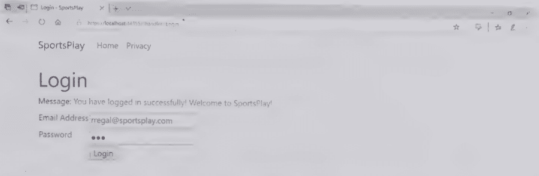

## RESULT（输入无效登录凭据后）


**图 3-8. 页面处理示例。**

## 3.11 项目

遵循题为*解决方案与项目*的章节中所阐述的标识符命名标准。使用 Table 元素来排列页面上的其他 HTML 元素，使页面看起来井然有序。

- 1. 启动一个名为 Lastname.Firstname.Chapter99 的新项目，其中 99 是本章的编号。
- 2. 向项目中添加一个名为 *CopyInformation* 的 Razor 页面。
- 3. 添加分别显示 *First Name*、*Middle Initial*、*Last Name*、*Address*、*City*、*State* 和 *Zip Code* 的 Label 元素。
- 4. 在标签右侧添加相应的 Input (Text) 元素。
- 5. 在文本框右侧添加相应的 Label 元素。
- 6. 添加一个显示 *Copy* 的 Input (Submit) 元素。当点击该按钮时，将输入到文本框中的信息复制到其右侧对应的标签中。
- 7. 添加一个显示 *Clear* 的 Input (Submit) 元素。当点击该按钮时，清除右侧标签中的信息。
- 8. 添加一个显示 *Color* 的 Input (Submit) 元素。当点击该按钮时，将右侧标签的颜色设置为红色。
- 9. 测试页面并进行任何必要的更正。

# 4 更多 HTML 元素

## 4.1 简介

正如上一章所述，HTML 元素是网页上的单个组件。在该章中，我们介绍了一些"基本" HTML 元素，包括 Form 元素、Label 元素、Input (Text) 元素、Input (Password) 元素、Input (Submit) 元素、Table 元素和 Div 元素。尽管这些元素足以让我们入门，但我们还有许多其他 HTML 元素可供使用，它们使我们能够构建更有趣、更复杂的 Web 应用程序。我们将在本章中介绍这些 HTML 元素。我们还将了解一些额外的 C# 代码，以便更加熟悉 C# 编程语言。

## 4.2 Img 元素

Img 元素显示用户可以查看的图像。Img 元素是图像的*占位符*。因此，我们不会在网页中粘贴图像。相反，我们引用存在于服务器上的图像。这样，我们就能够在必要时以编程方式更改显示的图像。

在添加我们希望在本节中显示的图像之前，我们需要在 *wwwroot* 文件夹下为项目添加一个名为 *images* 的文件夹。此文件夹将存放我们希望现在显示的所有图像（以及将来可能希望显示的任何图像）。向项目中添加 images 文件夹将有助于我们将所有图像集中在一个地方，并有助于我们总体上保持应用程序的良好组织。添加完 images 文件夹后，我们可以通过复制和粘贴将图像添加到其中。图 4-1 显示了 images 文件夹及其内容。如你所见，我们已向 images 文件夹添加了两个图像文件——一个 .jpg 文件和一个 .png 文件。

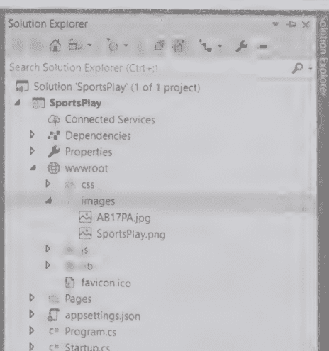

**图 4-1.** Images 文件夹及其内容。

图 4-2 展示了 Img 元素的示例。

在 01 处，我们将一个 Img 元素放置在了一级标题内。请注意，我们包含了一个 *src* 属性，并将其值设置为 *~/images/SportsPlay.png*。这表示我们希望显示位于应用程序 *wwwroot* 文件夹中 *images* 文件夹里的 *SportsPlay.png* 图像。此外，我们包含了一个 *alt* 属性，并将其值设置为 *SportsPlay!*。这表示由于某种原因无法显示图像时，我们希望显示替代文本 *SportsPlay!*。

在 02 处，我们向表单添加了一个 Input (Text) 元素。请注意，我们包含了一个 asp-for 标记辅助程序，并将其值设置为 *ImageName*。这表示当页面在服务器上处理时，我们希望将输入到此文本框中的值通过模型绑定分配给 PageModel 类的 ImageName 属性（06 处）。

在 03 处，我们向表单添加了另一个 Input (Text) 元素。请注意，我们包含了一个 asp-for 标记辅助程序，并将其值设置为 *AlternateText*。这表示当页面在服务器上处理时，我们希望将输入到此文本框中的值通过模型绑定分配给 PageModel 类的 AlternateText 属性（07 处）。

在 04 处，我们向表单添加了一个 Input (Submit) 元素。请注意，我们包含了一个 asp-page-handler 标记辅助程序，并将其值设置为 *Display*。这表示当点击 Display 按钮时，我们希望调用 PageModel 类中的 OnPostDisplay() 处理程序方法（10 处），且页面会在服务器上进行处理。

在 05 处，我们向表单添加了一个 Img 元素。请注意，我们引用了 PageModel 类的 Src 属性（08 处）以及 PageModel 类的 Alt 属性（09 处）。这些属性的值将在页面于服务器上处理时被设置。

在 10 处，我们向 PageModel 类添加了一个 OnPostDisplay() 处理程序方法。当点击 Display 按钮（04 处）时，会调用此处理程序方法，且页面会在服务器上进行处理。

在 11 处，我们将 PageModel 类的 Src 属性设置为图像文件夹与用户输入的图像名称的拼接。

该图的"结果"部分展示了用户在输入图像名称和替代文本并点击 Display 按钮后的页面。

```
@page
@model SportsPlay.Pages.ImgModel
@{
    ViewData["Title"] = "Display Product Image";
}

<h1>Display Product Image</h1>

<label>Message:</label>
<label style="color: @Model.MessageColor">@Model.Message</label>

<form method="post">

    <label>Image Name</label>
```


```
<input asp-for="ImageName" />
<label>替代文本</label>
<input asp-for="AlternateText" /><br />
<input asp-page-handler="Display" type="submit" value="显示" /><br />

</form>
```

### PAGEMODEL

```csharp
using Microsoft.Asp这些.Areas.Mvc;
using Microsoft.AspNetCore.Mvc.RazorPages;

namespace SportsPlay.Pages
{
    [BindProperties]
    public class ImgModel : PageModel
    {
        public string MessageColor;
        public string Message;

        public string ImageName { get; set; }
        public string AlternateText { get; set; }

        public string Src;
        public string Alt;

        public void OnGet()
        {
        }

        public void OnPostDisplay()
        {
            if (ImageName != null)
            {
                // 显示图像。
                Src = "\\images\\" + ImageName;
                Alt = AlternateText;
                // 设置消息。
                MessageColor = "Green";
                Message = "您已成功显示产品图像！";
            }
            else
            {
                // 设置消息。
                MessageColor = "Red";
                Message = "请输入产品图像并重试。";
            }
        }
    }
}
```

# 结果


图 4-2. Img 元素示例。

## 4.3 Input (Checkbox) 元素

Input (Checkbox) 元素显示一个方框，用户可用于选择或取消选择一个选项。

图 4-3 展示了 Input (Checkbox) 元素的一个示例。

在 01 处，我们向表单添加了一个 Input (Checkbox) 元素。请注意，我们包含了一个 `type` 属性并将其值设置为 `checkbox`。这表明我们希望 Input 元素是一个复选框。同样请注意，我们包含了一个 `asp-for` 标记助手并将其值设置为 `Footwear`。这表明我们希望此复选框的值（选中时为 true，未选中时为 false）在页面在服务器上处理时，通过模型绑定赋值给 `PageModel` 类的 `Footwear` 属性（在 03 处）。如图所示，我们还向表单添加了两个类似的复选框。

在 02 处，我们向表单添加了一个 Input (Submit) 元素。请注意，我们包含了一个 `asp-page-handler` 标记助手并将其值设置为 `Set`。这表明我们希望在点击 Set 按钮并在服务器上处理页面时，调用 `PageModel` 类（在 04 处）中的 `OnPostSet()` 处理程序方法。

在 05 处，我们正在测试一个条件，以查看 footwear 复选框是否已被选中（即 `Footwear` 属性的值是否为 true）。如果条件为 true，则将单词 "Footwear" 连接到要显示的消息中。如果条件为 false，则不修改要显示的消息。

该图的“结果”部分显示了用户选中 Footwear 和 Clothing 复选框并点击 Set 按钮后的页面。

# 56 • 更多 HTML 元素

## PAGE

```csharp
@page
@model SportsPlay.Pages.InputCheckboxModel
@{
    ViewData["Title"] = "设置筛选条件";
}

<h1>设置筛选条件</h1>

<label>消息：</label>
<label style="color: @Model.MessageColor">@Model.Message</label>

<form method="post">

    <input asp-for="Footwear" type="checkbox" />
    鞋类<br />
    <input asp-for="Clothing" type="checkbox" />
    服装<br />
    <input asp-for="TennisEquipment" type="checkbox" />
    网球装备 <br />
    <input asp-page-handler="Set" type="submit" value="设置" />

</form>
```

### 01

### 02

### PAGEMODEL

```csharp
using Microsoft.AspNetCore.Mvc;
using Microsoft.AspNetCore.Mvc.RazorPages;

namespace SportsPlay.Pages
{
    [BindProperties]
    public class InputCheckboxModel : PageModel
    {

        public string MessageColor;
        public string Message;

        public bool Footwear { get; set; }
        public bool Clothing { get; set; }
        public bool TennisEquipment { get; set; }

        public void OnGet()
        {
        }

        public void OnPostSet()
        {
            // 构建消息。
```

### 03

### 04

```
        if (Footwear)
        {
            Message = Message + " ";
        }
        if (Clothing)
        {
            Message = Message + " ";
        }
        if (TennisEquipment)
        {
            Message = Message + " ";
        }

        // 设置消息。
        MessageColor = "Green";
        Message = "您已选择按以下条件筛选搜索结果：" + Message;

    }
}
```

结果

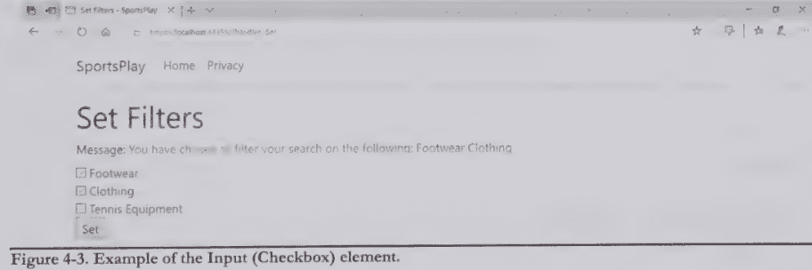

图 4-3. Input (Checkbox) 元素示例。

## 4.4 Input (Date) 元素

Input (Date) 元素显示一个日期选择器，用户可用于选择一个日期。图 4-4 展示了 Input (Date) 元素的一个示例。

在 01 处，我们向表单添加了一个 Input (Date) 元素。请注意，我们包含了一个 `type` 属性并将其值设置为 `date`。这表明我们希望 Input 元素是一个日期选择器。同样请注意，我们包含了一个 `asp-for` 标记助手并将其值设置为 `ShippingDate`。这表明我们希望此日期选择器的值（所选日期）在页面在服务器上处理时，通过模型绑定赋值给 `PageModel` 类的 `ShippingDate` 属性（在 04 处）。

# 58 • 更多 HTML 元素

在 02 处，我们向表单添加了一个 Input (Submit) 元素。请注意，我们包含了一个 `asp-page-handler` 标记助手并将其值设置为 *Select*。这表明我们希望在点击 Select 按钮并在服务器上处理页面时，调用 `PageModel` 类（在 05 处）中的 `OnPostSelect()` 处理程序方法。

在 03 处，由于 `DateTime` 类型（在 04 处）是在该命名空间中定义的，我们已在 `PageModel` 类中包含了 `System` 命名空间。

在 06 处，我们使用 `ToShortDateString()` 方法将所选发货日期转换为更易读的形式。

该图的“结果”部分显示了用户选择日期并点击 Select 按钮后的页面。

## PAGE

```csharp
@page
@model SportsPlay.Pages.InputDateModel
@{
    ViewData["Title"] = "选择发货日期";
}

<h1>选择发货日期</h1>

<label>消息：</label>
<label style="color: @Model.MessageColor">@Model.Message</label>

<form method="post">

    <input asp-for="ShippingDate" type="date" /><br />
    <input asp-page-handler="Select" type="submit" value="选择" />

</form>
```

### PAGEMODEL

```csharp
using Microsoft.AspNetCore.Mvc;
using Microsoft.AspNetCore.Mvc.RazorPages;
using System;

namespace SportsPlay.Pages
{
    [BindProperties]
    public class InputDateModel : PageModel
    {

        public string MessageColor;
        public string Message;

        public DateTime ShippingDate { get; set; }

        public void OnGet()
        {
```

```
        public void OnPostSelect()
        {
            // 设置消息。
            MessageColor = "Green";
            Message = "您已选择发货日期为 " +
                ShippingDate.ToShortDateString() + "。";
        }
    }
}
```

# 结果

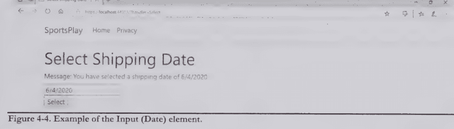

图 4-4. Input (Date) 元素示例。

## 4.5 Input (File) 元素

Input (File) 元素显示一个输入字段/浏览按钮对，用户可用于选择一个文件以上传到服务器。

图 4-5 展示了 Input (File) 元素的一个示例。

在 01 处，我们向 Form 元素添加了一个 `enctype` 属性并将其值设置为 `multipart/form-data`。这种编码类型表明我们希望表单在页面发布到服务器进行处理时允许包含文件。

在 02 处，我们向表单添加了一个 Input (File) 元素。请注意，我们包含了一个 `type` 属性并将其值设置为 `file`。这表明我们希望 Input 元素是一个文件选择器。同样请注意，我们包含了一个 `asp-for` 标记助手并将其值设置为 `ProductImage`。这表明我们希望所选文件在页面在服务器上处理时，通过模型绑定赋值给 `PageModel` 类的 `ProductImage` 对象（在 09 处）。

在 03 处，我们向表单添加了一个 Input (Submit) 元素。请注意，我们包含了一个 `asp-page-handler` 标记助手并将其值设置为 `Upload`。这表明我们希望在点击 Upload 按钮并在服务器上处理页面时，调用 `PageModel` 类（在 10 处）中的 `OnPostUpload()` 处理程序方法。


 60 • 更多 HTML 元素

在 04 处，我们已在 PageModel 类中包含了 Microsoft.AspNetCore.Hosting 命名空间，因为 IWebHostEnvironment 接口（在 07 处）和 WebRootPath 属性（在 12 处）是在该命名空间中定义的。

在 05 处，我们已在 PageModel 类中包含了 Microsoft.AspNetCore.Http 命名空间，因为 IFormFile 类型（在 09 处）是在该命名空间中定义的。

在 06 处，我们已在 PageModel 类中包含了 System.IO 命名空间，因为 Path 类（在 12 处）、FileStream 类（在 15 处）和 FileMode 枚举器（在 15 处）是在该命名空间中定义的。

在 07 处，我们声明了一个私有只读字段，其类型为 IWebHostEnvironment，名为 IWebHostEnvironment。字段是在类中直接声明的变量，因此是该类的成员。我们将使用 IWebHostEnvironment 字段通过依赖注入来存储一个 IWebHostEnvironment 接口。依赖注入用于将依赖项（例如 IWebHostEnvironment 接口）“注入”到需要其属性和/或方法进行处理的对象中（例如我们的 InputFileModel 对象）。我们将在整本书中使用依赖注入。

在 08 处，我们定义了一个名为 InputFileModel() 的构造函数方法，该方法创建一个类型为 IWebHostEnvironment、名为 IWHE 的接口，然后在服务器处理页面时，将该接口赋值给 IWebHostEnvironment 字段（在 07 处）。赋值完成后，IWebHostEnvironment 接口将包含有关应用程序 Web 托管环境的信息。在我们的例子中，我们需要访问 IWebHostEnvironment 接口的 WebRootPath 属性，以构建服务器上 images 文件夹的路径（在 12 处）。

在 11 处，我们正在测试一个条件，以查看是否已选择产品图像（即 ProductImage 对象不等于 null）。如果条件为 true，则文件将被上传到服务器。如果条件为 false，则文件不会被上传到服务器。

在 12 处，我们正在将应用程序的 Web 根路径（即 .../SportsPlay/wwwroot）与 images 文件夹的名称（即 "images"）组合起来，以得到服务器上 images 文件夹的路径（即 .../SportsPlay/wwwroot/images）。

在 13 处，我们正在检索所选文件的文件名，该文件名存储在 ProductImage 对象中。

在 14 处，我们正在将应用程序 images 文件夹的路径与所选文件的文件名组合起来，以得到文件路径（即应用程序 images 文件夹的路径加上所选文件的文件名）。

在 15 处，我们正在从 FileStream 类创建一个新的 FileStream 对象，名为 objFileStream。FileStream() 枚举构造函数方法的第一个参数指定 FileStream 对象将封装的文件路径，第二个参数表示我们希望操作系统创建一个新文件。

在 16 处，我们正在将 FileStream 对象（即所选文件）从客户端复制到服务器上的文件路径。

在 17 处，我们正在关闭 FileStream 对象。

图中 Result 部分的第一个截图显示了用户为上传而选择产品图像后的“上传产品图像”页面。第二个截图显示了用户单击“上传”按钮后的页面。

## PAGE

```
@page
@model SportsPlay.Pages.InputFileModel
@{
    ViewData["Title"] = "上传产品图像";
}

<h1>上传产品图像</h1>

<label>消息：</label>
<label style="color: @Model.MessageColor">@Model.Message</label>

<form method="post" enctype="multipart/form-data">

    <input asp-for="ProductImage" type="file" />
    <input asp-page-handler="Upload" type="submit" value="上传" />

</form>
```

### PAGEMODEL

```
using Microsoft.AspNetCore.Hosting;
using Microsoft.AspNetCore.Http;
using Microsoft.AspNetCore.Mvc;
using Microsoft.AspNetCore.Mvc.RazorPages;
using System.IO;

namespace SportsPlay.Pages
{

    [BindProperties]
    public class InputFileModel : PageModel
    {

        private readonly IWebHostEnvironment IWebHostEnvironment;
        public InputFileModel(IWebHostEnvironment IWHE)
        {
            IWebHostEnvironment = IWHE;
        }

        public string MessageColor;
        public string Message;

        public IFormFile ProductImage { get; set; }

        public void OnGet()
        {
        }

        public void OnPostUpload()
        {

            if (ProductImage != null)
            {
```

62 • 更多 HTML 元素

```
                // 上传文件。
                string strImagesPath = Path.Combine(IWebHostEnvironment.WebRootPath, "images");
                string strFileName = Path.GetFileName(ProductImage.FileName);
                string strFilePath = Path.Combine(strImagesPath, strFileName);
                FileStream objFileStream = new FileStream(strFilePath, FileMode.Create);
                ProductImage.CopyTo(objFileStream);
                objFileStream.Close();
                // 设置消息。
                MessageColor = "Green";
                Message = "您已成功上传产品图像！";
            }
            else
            {
                // 设置消息。
                MessageColor = "Red";
                Message = "请选择一个产品图像进行上传，然后重试。";
            }
```

## RESULT (选择文件后)


## RESULT (单击上传后)


图 4-5. Input (File) 元素示例。

图 4-6 显示了 images 文件夹中上传的图像。

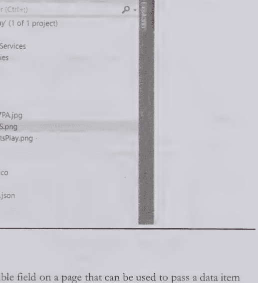

图 4-6. images 文件夹中上传的图像。

## 4.6 Input (Hidden) 元素

Input (Hidden) 元素在页面上创建一个不可见的字段，该字段可用于将一个数据项（即不是由用户输入的数据）与页面的其他表单数据一起传递到服务器。

图 4-7 显示了 Input (Hidden) 元素的一个示例。

在 01 处，我们已将 Input (Hidden) 元素添加到表单中。请注意，我们包含了一个 type 属性并将其值设置为 hidden。这表明我们希望 Input 元素是一个隐藏字段。另请注意，我们包含了一个 asp-for 标签帮助器并将其值设置为 EmployeeId。这表明我们希望当页面在服务器上处理时，此隐藏字段的值（在 PageModel 类中设置）通过模型绑定分配给 PageModel 类的 EmployeeId 属性（在 03 处）。

在 02 处，我们已将 Input (Submit) 元素添加到表单中。请注意，我们包含了一个 asp-page-handler 标签帮助器并将其值设置为 Display。这表明当单击 Display 按钮且页面在服务器上处理时，我们希望调用 PageModel 类中的 OnPostDisplay() 处理程序方法（在 04 处）。

```
<input asp-for="EmployeeId" type="hidden" />
<input asp-page-handler="Display" type="submit" value="显示" />
```

### PAGEMODEL

```
using Microsoft.AspNetCore.Mvc;
using Microsoft.AspNetCore.Mvc.RazorPages;

namespace SportsPlay.Pages
{
    [BindProperties]
    public class InputHiddenModel : PageModel
    {
        
        public string MessageColor;
        public string Message;
        
        public int EmployeeId { get; set; }

        public void OnGet()
        {
            // 设置员工 ID。
            EmployeeId = 7;
            // 设置消息。
            MessageColor = "Green";
            Message = "您已显示员工 ID " + EmployeeId + "。";
        }
```

## RESULT


图 4-7. Input (Hidden) 元素示例。

## 4.7 Input (Month) 元素

Input (Month) 元素显示一个月份选择器，用户可以使用它来选择一个月份。图 4-8 显示了 Input (Month) 元素的一个示例。

在 01 处，我们已将 Input (Month) 元素添加到表单中。请注意，我们包含了一个 type 属性并将其值设置为 *month*。这表明我们希望 Input 元素是一个月份选择器。另请注意，我们包含了一个 asp-for 标签帮助器并将其值设置为 *InventoryMonth*。这表明当页面在服务器上处理时，此月份选择器的值（所选月份）通过模型绑定分配给 PageModel 类的 InventoryMonth 属性（在 04 处）。

在 02 处，我们已将 Input (Submit) 元素添加到表单中。请注意，我们包含了一个 asp-page-handler 标签帮助器并将其值设置为 *Select*。这表明当单击 Select 按钮且页面在服务器上处理时，我们希望调用 PageModel 类中的 OnPostSelect() 处理程序方法（在 05 处）。

在 03 处，我们已在 PageModel 类中包含了 System 命名空间，因为 DateTime 类型（在 04 处）是在该命名空间中定义的。

在 06 处，我们正在使用 ToString("MMMM, yyyy") 方法将选定的库存月份转换为更易读的形式——即月份被拼写出来，年份是四位数年份。图中的 Result 部分显示了用户选择月份并单击 Select 按钮后的页面。

## PAGE

```
@page
@model SportsPlay.Pages.InputMonthModel
@{
    ViewData["Title"] = "选择库存月份";
}

<h1>选择库存月份</h1>

<label>消息：</label>
<label style="color: @Model.MessageColor">@Model.Message</label>

<form method="post">
```


# 4.8 输入 (单选按钮) 元素

Input (Radio) 元素显示一个按钮，用户可以使用它从一组互斥的选项中选择一个选项。

图 4-9 展示了 Input (Radio) 元素的示例。

在第 01 步，我们在表单中添加了一个 Input (Radio) 元素。注意我们包含了一个 type 属性并将其值设置为 radio。这表明我们希望 Input 元素是一个单选按钮。同时注意，我们包含了 asp-for 标签助手并将其值设置为 Shipper。这表明当页面在服务端处理时，我们希望此单选按钮的 value 属性（其值被设置为 FedEx）通过模型绑定赋值给 PageModel 类 (在第 03 步) 中的 Shipper 属性。最后，请注意我们为这个单选按钮添加了 checked 属性。这表明当页面首次显示时，该单选按钮默认为选中状态。可以看到，我们还向表单添加了两个类似的单选按钮。

在第 02 步，我们在表单中添加了一个 Input (Submit) 元素。注意我们包含了一个 asp-page-handler 标签助手并将其值设置为 Select。这表明当点击 Select 按钮且页面在服务端处理时，我们希望 PageModel 类中的 OnPostSelect() 处理程序方法 (在第 04 步) 被调用。

在第 05 步，我们测试条件以查看是否已选中 FedEx 单选按钮（即 Shipper 属性的值为 FedEx）。如果条件为真，短语 Federal Express 将分配给 message 属性。如果条件为假，则测试下一个条件以查看是否已选中 UPS 单选按钮（即 Shipper 属性的值为 UPS）。如果条件为真，短语 United Parcel Service 将分配给 message 属性。如果条件为假，则测试下一个条件以查看是否已选中 USPS 单选按钮（即 Shipper 属性的值为 USPS）。如果条件为真，短语 United States Postal Service 将分配给 message 属性。

图的 Result 部分显示用户选择 FedEx 单选按钮并点击 Select 按钮后的页面。

```html
<label>Message:</label>
<label style="color: @Model.MessageColor">@Model.Message</label>
```

```html
<form method="post">
    <input asp-for="Shipper" checked type="radio" value="FedEx" /> FedEx<br />
    <input asp-for="Shipper" type="radio" value="UPS" /> UPS<br />
    <input asp-for="Shipper" type="radio" value="USPS" /> USPS<br />
    <input asp-page-handler="Select" type="submit" value="Select" />
</form>
```

# 页面模型

```csharp
using Microsoft.AspNetCore.Mvc;
using Microsoft.AspNetCore.Mvc.RazorPages;

namespace SportsPlay.Pages
{
    [BindProperties]
    public class InputRadioModel : PageModel
    {
        public string MessageColor;
        public string Message;
        public string Shipper { get; set; }
        public void OnGet()
        {
        }
        public void OnPostSelect()
        {
            // Build the message.
            if (Shipper == "FedEx")
            {
                Message = "Federal Express";
            }
            else if (Shipper == "UPS")
            {
                Message = "United Parcel Service";
            }
            else if (Shipper == "USPS")
            {
                Message = "United States Postal Service";
            }

            // Set the message.
            MessageColor = "Green";
            Message = "You have selected " + Message + " as your shipper.";
        }
    }
}
```

# 结果


图 4-9。输入 (单选按钮) 元素的示例。

# 4.9 输入 (时间) 元素

Input (Time) 元素显示一个时间选择器，用户可以使用它来选择时间。图 4-10 展示了 Input (Time) 元素的示例。

在第 01 步，我们在表单中添加了一个 Input (Time) 元素。注意我们包含了一个 type 属性并将其值设置为 time。这表明我们希望 Input 元素是一个时间选择器。同时注意，我们包含了 asp-for 标签助手并将其值设置为 ServiceCallTime。这表明当页面在服务端处理时，我们希望此时间选择器的值（选定的时间）通过模型绑定分配给 PageModel 类中的 ServiceCallTime 属性 (在第 04 步)。

在第 02 步，我们在表单中添加了一个 Input (Submit) 元素。注意我们包含了一个 asp-page-handler 标签助手并将其值设置为 Select。这表明当点击 Select 按钮且页面在服务端处理时，我们希望 PageModel 类中的 OnPostSelect() 处理程序方法 (在第 05 步) 被调用。

在第 03 步，我们在 PageModel 类中包含了 System 命名空间，因为 DateTime 类型 (在第 04 步) 定义在该命名空间中。

在第 06 步，我们使用 ToShortTimeString() 方法将选定的服务呼叫时间转换为更易读的格式。

图的 Result 部分显示用户选择时间并点击 Select 按钮后的页面。

# 页面

```html
@page
@model SportsPlay.Pages.InputTimeModel
@{
    ViewData["Title"] = "Select Service Call Time";
}

<h1>Select Service Call Time</h1>

<label>Message:</label>
```

```html
<label style="color: @Model.MessageColor">@Model.Message</label>

<form method="post">
    <input asp-for="ServiceCallTime" type="time" /><br />
    <input asp-page-handler="Select" type="submit" value="Select" />
</form>
```

# 页面模型

```csharp
using Microsoft.AspNetCore.Mvc;
using Microsoft.AspNetCore.Mvc.RazorPages;
using System;

namespace SportsPlay.Pages
{
    [BindProperties]
    public class InputTimeModel : PageModel
    {
        public string MessageColor;
        public string Message;

        public DateTime ServiceCallTime { get; set; }

        public void OnGet()
        {
        }

        public void OnPostSelect()
        {
            // Set the message.
            MessageColor = "Green";
            Message = "You have selected a service call time of " +
                ServiceCallTime.ToShortTimeString() + ".";
        }
    }
}
```

# 结果

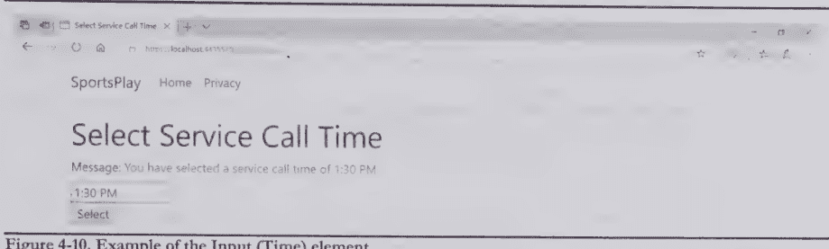

图 4-10。输入 (时间) 元素的示例。

## 4.10 Select 元素

Select 元素显示一个下拉列表，用户可以使用它从选项列表中选择一个或多个选项。

图 4-11 展示了 Select 元素的示例。

在第 01 步，我们在表单中添加了一个包含三个可用选项的 Select 元素。注意我们包含了 asp-for 标签助手并将其值设置为 *供应商*。这表明我们希望选中选项的 value 属性（*阿迪达斯*、*巴博拉* 或 *海德*）的值在服务端处理页面时 (在第 03 步) 通过模型绑定分配给 PageModel 类中的 Supplier 属性。

在第 02 步，我们在表单中添加了一个 Input (Submit) 元素。注意我们包含了 asp-page-handler 标签助手并将其值设置为 *Display*。这表明我们希望 PageModel 类中的 OnPostDisplay() 处理程序方法 (在第 04 步) 在点击 Display 按钮且页面在服务端处理时 (在第 05 步) 被调用。

在第 05 步，我们测试条件以查看是否已选中 Adidas 选项（即 Supplier 属性的值为 *Adidas*）。如果条件为真，则将名称 "Alan Alte" 分配给 message 属性。如果条件为假，则测试下一个条件以查看是否已选中 Babolat 选项（即 Supplier 属性的值为 *Babolat*）。如果条件为真，则将名称 "Bill Baker" 分配给 message 属性。如果条件为假，则测试下一个条件以查看是否已选中 Head 选项（即 Supplier 属性的值为 *Head*）。如果条件为真，则将名称 "Hailey Hawkins" 分配给 message 属性。

图的 Result 部分显示用户选择 Babolat 选项并点击 Display 按钮后的页面。

```html
@page
@model SportsPlay.Pages.SelectModel
@{
    ViewData["Title"] = "Display Supplier POC";
}

<h1>Display Supplier POC</h1>

<label>Message:</label>
<label style="color: @Model.MessageColor">@Model.Message</label>
```


## 72 • 更多 HTML 元素

```
<form method="post">
    <select asp-for="Supplier">
        <option value="Adidas">Adidas</option>
        <option value="Babolat">Babolat</option>
        <option value="Head">Head</option>
    </select><br />

    <input asp-page-handler="Display" type="submit" value="Display" />
</form>
```

页面模型

```
using Microsoft.AspNetCore.Mvc;
using Microsoft.AspNetCore.Mvc.RazorPages;

namespace SportsPlay.Pages
{
    [BindProperties]
    public class SelectModel : PageModel
    {

        public string MessageColor;
        public string Message;

        public string Supplier { get; set; }

        public void OnGet()
        {
        }

        public void OnPostDisplay()
        {

            // Build the message.
            if (Supplier == "Adidas")
            {
                Message = "Alan Alte";
            }
            else if (Supplier == "Babolat")
            {
                Message = "Bill Baker";
            }
            else if (Supplier == "Head")
            {
                Message = "Hailey Hawkins";
            }

            // Set the message.
            MessageColor = "Green";
            Message = "Your point of contact for " + Supplier + " is " +
                Message + ".";
        }

    }
}
```

# 结果


图 4-11. Select 元素示例。

## 4.11 Textarea 元素

Textarea 元素显示一个多行输入字段，用户可用于输入信息。

图 4-12 展示了 Textarea 元素的示例。

在 01 处，我们向表单添加了一个 Textarea 元素。注意，我们包含了 *cols* 属性并将其值设置为 20，同时包含了 *rows* 属性并将其值设置为 2。这表示我们希望 Textarea 元素的宽度为 20 列，高度为 2 行。同时注意，我们还包含了一个 asp-for 标签辅助器，并将其值设置为 *ProductDescription*。这表示当页面在服务器上进行处理时，我们希望将此文本区域中输入的值通过模型绑定分配给 PageModel 类的 ProductDescription 属性（在 03 处）。

在 02 处，我们向表单添加了一个 Input（Submit）元素。注意，我们包含了 asp-page-handler 标签辅助器，并将其值设置为 *Add*。这表示当单击 Add 按钮且页面在服务器上进行处理时，我们希望调用 PageModel 类中的 OnPostAdd() 处理程序方法（在 04 处）。

图的“结果”部分展示了用户输入产品描述并单击 Add 按钮后的页面。

# 页面

```
@page
@model SportsPlay.Pages.TextareaModel
@{
    ViewData["Title"] = "Add Product Description";
}
```

```
<h1>Add Product Description</h1>

<label>Message:</label>
<label style="color: @Model.MessageColor">@Model.Message</label>

<form method="post">

    <textarea asp-for="ProductDescription" cols="20" rows="2">
    </textarea><br />
    <input asp-page-handler="Add" type="submit" value="Add" />

</form>
```

页面模型

```
using Microsoft.AspNetCore.Mvc;
using Microsoft.AspNetCore.Mvc.RazorPages;

namespace SportsPlay.Pages
{
    [BindProperties]
    public class TextareaModel : PageModel
    {

        public string MessageColor;
        public string Message;

        public string ProductDescription { get; set; }

        public void OnGet()
        {
        }

        public void OnPostAdd()
        {

            // Set the message.
            MessageColor = "Green";
            Message = "You have added [" + ProductDescription + "]
                successfully!";

        }

    }
}
```

结果

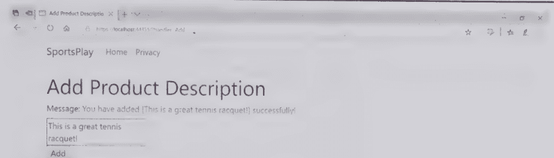

图 4-12. Textarea 元素示例。

## 4.12 项目

遵循*解决方案和项目*一章中阐述的标识符命名标准。使用 Table 元素在页面上排列其他 HTML 元素，使页面看起来井井有条。

1. 启动一个名为 *Lastname.Firstname.Chapter99* 的新项目，其中 99 是本章的编号。
2. 向项目中添加一个名为 *PerformHTMLElementOperations* 的 Razor 页面。
3. 添加一个 Label 元素，用于显示本页面的所有消息。
4. 向 wwwroot 文件夹添加一个名为 *images* 的文件夹。将自己的一张照片添加到此文件夹中。
5. 添加一个 Img 元素。在该元素中显示自己的照片。使图像高度为 100 像素。调整图像宽度，使图片不失真。
6. 添加三个 Input（Checkbox）元素。复选框分别显示 *Red*、*White* 和 *Blue*。添加一个显示 *Display Colors* 的 Input（Submit）元素。当按钮被单击时，在标签中显示所有已选中的颜色。
7. 添加一个 Input（Date）元素。添加一个显示 *Display Date* 的 Input（Submit）元素。当选择日期并单击按钮时，在标签中显示所选日期。
8. 添加一个 Input（File）元素。添加一个显示 *Upload File* 的 Input（Submit）元素。当选择文件并单击按钮时，上传文件并在标签中显示 "File successfully uploaded."。如果未选择文件，不要尝试上传，并在标签中显示 "No file was selected."。
9. 添加一个 Input（Hidden）元素。添加一个显示 *Set Hidden Field* 的 Input（Submit）元素。当按钮被单击时，将隐藏字段设置为你的姓名，然后在标签中显示隐藏字段的值。
10_maybe=y10. 添加一个 Input（Month）元素。添加一个显示 *Display Month* 的 Input（Submit）元素。当选择月份并单击按钮时，在标签中显示所选月份。
11. 添加三个 Input（Radio）元素。这些单选按钮分别显示 *Illinois*、*Indiana* 和 *Kentucky*。（如果你愿意，可以选择自己的州。）添加一个显示 *Display State* 的 Input（Submit）元素。当按钮被单击时，在标签中显示所选州。
12. 添加一个 Input（Time）元素。添加一个显示 *Display Time* 的 Input（Submit）元素。当选择时间并单击按钮时，在标签中显示所选时间。
13. 添加一个 Select 元素。下拉列表分别显示选项 *Red*、*White* 和 *Blue*。这些选项的 *values* 分别为 *R*、*W* 和 *B*。添加一个显示 *Display Color Value* 的 Input（Submit）元素。当按钮被单击时，在标签中显示所选颜色的 *value*。
14. 添加一个 Textarea 元素。将文本区域的行数和列数分别增加到 *5* 和 *30*。添加一个显示 *Display Textarea* 的 Input（Submit）元素。当按钮被单击时，在标签中显示输入到文本区域中的文本。
15. 测试页面并进行任何必要的修正。

# 5 模型验证

## 5.1 简介

进行模型验证是为了确保我们不让不良数据进入 ASP.NET Core Web 应用程序。如果允许不良 *数据* 进入应用程序，我们将从中得到不良的 *信息*。这与古老的*垃圾进垃圾出原则*一致。只允许良好数据进入应用程序的重要性在于，良好的数据带来良好的信息，良好的信息带来良好的决策，而良好的决策带来组织稳定性（在非营利环境中）或竞争优势（在营利环境中）。

我们在上一章讨论的几种 HTML 元素（即 Input（Checkbox）元素、Input（Date）元素、Input（File）元素、Input（Month）元素、Input（Radio）元素、Input（Time）元素和 Select 元素）可以帮助我们确保只允许良好数据进入应用程序。通过要求用户使用这些 GUI 元素*选择*输入（而不是要求他们*键入*输入），与拼写错误、格式不正确等相关的问题显著减少。

然而，有时数据*必须*手动输入到文本框中。在这种情况下，我们需要在服务器上处理数据之前对其进行验证。此类验证包括存在性检查（例如，确保输入了客户的姓氏）、数据类型检查（例如，确保货币值仅包含数字）、合理性检查（例如，确保患者的血压读数合理）、范围检查（例如，确保折扣率在有效范围内）、格式检查（例如，确保电子邮件地址格式正确）、组合检查（例如，确保怀孕患者的性别为女性）以及自检数字检查（例如，确保信用卡号码有效）。好消息是，我们可以使用 *System.ComponentModel.DataAnnotations* 命名空间中的 *attribute classes* 来执行所有这些类型的检查。

## 5.2 Attribute Classes

Attribute classes 允许我们将预定义的或自定义的元数据与目标项（如 PageModel 类中的 public 属性）相关联。此元数据可以在*设计时*使用来控制应用程序的外观，也可以在*运行时*使用来控制应用程序的行为。本章讨论的 attribute classes 用于四个方面。

首先，它们用于为模型的属性提供用户友好的显示名称。我们将在讨论 DisplayAttribute 类时看到这一点。

其次，它们用于在允许页面发布到服务器进行处理*之前*，验证在页面的 Input 元素（例如，文本框）中输入的值。正如我们将看到的，这些验证在客户端执行（只要所使用的浏览器启用了脚本）。在这种情况下，当通过 HTTP 请求请求页面时，将在服务器上生成 JavaScript 验证代码，嵌入到所请求页面的 HTML 代码中，通过 HTTP 响应返回给客户端，并在浏览器中执行。因此，Web 应用程序的效率更高（就服务器资源需求而言），因为用户输入必须在页面发布到服务器进行处理*之前*通过浏览器端验证。我们将在讨论 RangeAttribute 类、RegularExpressionAttribute 类和 RequiredAttribute 类时看到这一点。


第三，它们用于在页面提交到服务器进行处理时*验证*页面上的 Input 元素（例如文本框）中输入的值。正如我们将看到的，这些验证在服务器端执行，并且当其他属性类都无法满足我们的需求时非常有用。我们将在讨论用于验证电子邮件地址域名的自定义属性类时看到它的实际应用。

第四，它们用于确保页面上的 Input 元素（例如文本框）中输入的值不违反其关联属性的限制。我们将在讨论 StringLengthAttribute 类时看到它的实际应用。

### 5.2.1 DisplayAttribute 类

DisplayAttribute 类可用于为 Label 元素提供用户友好的字段名称，该 Label 元素为其关联的 Input 元素提供描述。当我们使用此类的 DisplayAttribute() 构造函数方法时，必须向该方法提供至少一个参数。Name 参数指示我们希望在页面在浏览器中渲染时显示在 Label 元素中的用户友好字段名称。请注意，此属性类是*不*用于模型验证的。我们在这里讨论它仅仅是因为在本章后面的示例中会用到它。

### 5.2.2 RangeAttribute 类

RangeAttribute 类用于确保输入到 Input 元素（例如文本框）中的值位于可接受值的范围内。当我们使用此类的 RangeAttribute() 构造函数方法时，必须向该方法提供一系列参数。Type 参数指示要评估的值的类型（例如日期、小数、整数、字符串）。此参数是可选的，但当我们想要评估用户提供的日期是否在有效日期范围内时，必须使用它。Minimum 参数指示可以输入到 Input 元素中的最小可接受值。Maximum 参数指示可以输入到 Input 元素中的最大可接受值。ErrorMessage 参数指示如果输入到 Input 元素中的值不在可接受范围内时我们希望显示的消息。

### 5.2.3 RegularExpressionAttribute 类

RegularExpressionAttribute 类用于确保输入到 Input 元素（例如文本框）中的值与正则表达式定义的模式匹配。当我们使用此类的 RegularExpressionAttribute() 构造函数方法时，必须向该方法提供一系列参数。Pattern 参数指示要与输入到 Input 元素中的值匹配的正则表达式。ErrorMessage 参数指示如果输入到 Input 元素中的值与正则表达式定义的模式不匹配时我们希望显示的消息。

表 5-1 展示了一些 .NET 正则表达式。这些表达式可以单独使用，也可以组合形成更复杂的表达式。

| 表达式 | 描述 |
| --- | --- |
| [set] | 匹配集合中的任何字符。 |
| [^set] | 匹配不在集合中的任何字符。 |
| [a–z] | 匹配 a-z 范围内的任何字符。 |
| [^a–z] |朱熹 | 匹配不在 a-z 范围内的任何字符。 |
| \\ | 匹配紧随其后的字符。 |
| \\w | 匹配任何单词字符。 |
| \\W | 匹配任何非单词字符。 |
| \\d | 匹配任何十进制数字。 |
| \\D | 匹配任何非十进制数字。 |
| \\s | 匹配任何空白字符。 |
| \\S | 匹配任何非空白字符。 |
| * | 匹配前面的项 0 次或更多次。 |
| + | 匹配前面的项 1 次或更多次。 |
| ? | 匹配前面的项 0 次或 1 次。 |
| {n} | 匹配前面的项恰好 n 次。 |
| {n,} | 匹配前面的项至少 n 次。 |
| {n,m} | 匹配前面的项 n 到 m 次。 |

表 5-1. 一些 .NET 正则表达式。

### 5.2.4 RequiredAttribute 类

RequiredAttribute 类用于确保已在 Input 元素（例如文本框）中输入文本。当我们使用此类的 RequiredAttribute() 构造函数方法时，必须向该方法提供至少一个参数。ErrorMessage 参数指示如果未在 Input 元素中输入值时我们希望显示的消息。

### 5.2.5 自定义属性类

我们还可以创建自己的自定义属性类，以确保输入到 Input 元素（例如文本框）中的值通过某些特殊的验证标准。当其他属性类都无法满足我们的需求时，这些类非常有用。例如，在本章中我们创建了一个 EmailAddressDomainAttribute 类，用于确保输入到 Input 元素中的电子邮件地址包含 *SportsPlay.com* 作为其域名。当我们使用此类的 EmailAddressDomainAttribute() 构造函数方法时，必须向该方法提供一系列参数。EAD 参数指示需要输入到 Input 元素中的电子邮件地址域名（即 SportsPlay.com）。ErrorMessage 参数指示如果输入到 Input 元素中的电子邮件地址域名与所需的电子邮件地址域名不匹配时我们希望显示的消息。

### 5.2.6 StringLengthAttribute 类

StringLengthAttribute 类用于确保输入到 Input 元素（例如文本框）中的值包含的字符数不超过指定数量。当我们使用此类的 StringLengthAttribute() 构造函数方法时，必须向该方法提供一系列参数。MaximumLength 参数指示可以输入到 Input 元素中的最大字符数。ErrorMessage 参数指示如果输入到 Input 元素中的值包含的字符数超过指定数量时我们希望显示的消息。

## 5.3 未验证的模型

在本节中，我们将查看两个模型*未*被验证的 PageModel 类——一个 Add Employee PageModel 类和一个 Add Product PageModel 类。由于这些模型*未*被验证，不良数据很容易进入我们的 ASP.NET Core Web 应用程序。

### 5.3.1 未验证的员工模型

图 5-1 展示了一个未验证的员工模型示例。请注意，相关 Razor 页面文件的内容已在此图中省略，因为该文件中的代码与当前讨论无关。我们稍后会在查看等效的已验证模型时看到 Razor 页面文件的内容。

在 01 处，我们在 PageModel 类中声明了 EmployeeId 属性。如所见，我们还添加了从 LastName 属性开始到 Status 属性结束的多个其他属性。这些属性共同构成了我们的员工模型。请注意，我们*不会*验证 EmployeeId 属性，因为我们将假设在数据库场景中该属性的值会为我们自动生成。但是，我们将验证模型中的大多数其他属性。

**页面模型**

```csharp
using Microsoft.AspNetCore.Mvc;
using Microsoft.AspNetCore.Mvc.RazorPages;

namespace SportsPlay.Pages
{
    [BindProperties]
    public class AddEmployeeNonValidatedModel : PageModel
    {

        public string MessageColor;
        public string Message;

        public int EmployeeId { get; set; }
        public string LastName { get; set; }
        public string FirstName { get; set; }
        public string MiddleInitial { get; set; }
        public string Address { get; set; }
        public string City { get; set; }
        public string State { get; set; }
        public string ZipCode { get; set; }
        public string Phone { get; set; }
        public string EmailAddress { get; set; }
        public string Password { get; set; }
        public string Status { get; set; }

        public void OnGet()
        {
        }

        ...
```


图 5-1. 未经验证的 Employee 模型示例。

### 5.3.2 未经验证的 Product Model

图 5-2 展示了一个未经验证的 Product 模型示例。请注意，关联的 Razor Page 文件内容已从图中省略，因为该文件中的代码与当前讨论无关。稍后当我们查看等效的已验证模型时，将会看到 Razor Page 文件的内容。

在 01 处，我们在 `PageModel` 类中声明了一个 `ProductId` 属性。可以看到，我们还添加了多个其他属性，从 `CategoryId` 属性开始，到 `ReorderLevel` 属性结束。这些属性共同构成了我们的 Product 模型。请注意，我们*不会*验证 `ProductId` 属性，因为我们将假设在数据库场景下该属性的值会为我们自动生成。然而，我们将验证模型中的所有其他属性。

```csharp
using Microsoft.AspNetCore.Mvc;
using Microsoft.AspNetCore.Mvc.RazorPages;

namespace SportsPlay.Pages
{
    [BindProperties]
    public class AddProductNonValidatedModel : PageModel
    {
        public string MessageColor;
        public string Message;

        public int ProductId { get; set; }
        public int CategoryId { get; set; }
        public int SupplierId { get; set; }
        public string Product { get; set; }
        public string Description { get; set; }
        public string Image { get; set; }
        public decimal Price { get; set; }
        public byte NumberInStock { get; set; }
        public byte NumberOnOrder { get; set; }
        public byte ReorderLevel { get; set; }

        public void OnGet()
        {
        }
    }
}
```


## 5.4 已验证的模型

在本节中，我们将查看两个模型正在被验证的 `PageModel` 类——一个 Add Employee PageModel 类和一个 Add Product PageModel 类。由于这些模型正在被验证，不良数据将难以进入我们的 ASP.NET Core Web 应用程序。为了执行模型验证，我们将使用之前讨论的属性类来*装饰*模型的属性——从而将模型的属性与属性类的元数据关联起来。

### 5.4.1 已验证的 Employee Model

图 5-3 展示了一个已验证的 Employee 模型示例。请注意，`PageModel` 类中构成 Employee 模型的属性从 `EmployeeId` 属性（在 09 处）开始，到 `Status` 属性结束。请注意，我们*不会*验证 `EmployeeId` 属性，因为我们将假设在数据库场景下该属性的值会为我们自动生成。然而，我们将验证模型中的大多数其他属性。

在 01 处，我们向表单添加了一个 Label 元素。请注意，我们包含了一个 `asp-for` 标签辅助器，并将其值设置为 *LastName*。这表示我们希望该标签显示在 `PageModel` 类中 `LastName` 属性的 `DisplayAttribute` 类（在 10 处）中指定的用户友好字段名。我们还向表单添加了另外五个 Label 元素。

在 02 处，我们向表单添加了一个 Input (Text) 元素。请注意，我们包含了一个 `asp-for` 标签辅助器，并将其值设置为 *LastName*。这表示我们希望在此文本框中输入的值在服务器上处理页面时（通过模型绑定）被赋值给 `PageModel` 类的 `LastName` 属性（在 13 处）。我们还向表单添加了另外五个 Input 元素。

在 03 处，我们向表单添加了一个 Span 元素。Span 元素用于将相关的 HTML 元素组合在一起，在页面上形成一个独立的区域——通常用于样式目的。Span 元素与 Div 元素的主要区别在于前者是内联元素，而后者是块级元素。当使用其他 HTML 元素从语义角度来看不合理时（例如，当使用 Label 元素不合理时，因为该元素并未被用作标签），也可以使用 Span 元素。在我们的示例中就是这种情况。请注意，我们包含了一个 `asp-validation-for` 标签辅助器，并将其值设置为 *LastName*。这表示我们希望使用与 `LastName` 属性（在 11 和 12 处）关联的验证规则来验证 `PageModel` 类的 `LastName` 属性（在 13 处）。我们还向表单添加了另外五个 Span 元素。

在 04 处，我们向表单添加了一个 Input (Submit) 元素。请注意，我们包含了一个 `asp-page-handler` 标签辅助器，并将其值设置为 *Add*。这表示当点击 Add 按钮并在服务器上处理页面时，我们希望调用 `PageModel` 类中的 `OnPostAdd()` 处理方法（在 19 处）。但请注意，如果模型的*任何*验证规则（如模型的*预定义*属性类中所定义的）被违反，页面将*不会*被提交到服务器进行处理。

在 05 处，我们向表单添加了第二个 Input (Submit) 元素。请注意，我们包含了一个 `asp-page-handler` 标签辅助器，并将其值设置为 *Cancel*。这表示当点击 Cancel 按钮并在服务器上处理页面时，我们希望调用 `PageModel` 类中的 `OnPostCancel()` 处理方法（在 21 处）。此外，我们还包含了一个 `formnovalidate` 属性。这表示当点击该按钮时，我们不希望发生任何模型验证。

在 06 处，我们在 Razor Page 文件的底部添加了一个*Scripts section*。Scripts section 允许我们在 Razor Page 文件中插入一个或多个脚本文件引用。请注意，Scripts section 中的代码引用了 `_ValidationScriptsPartial.cshtml` 文件，该文件可以在项目的 Pages/Shared 文件夹中找到。如果我们打开这个文件，会看到它包含了执行模型验证所需的 JavaScript 文件的引用。

在 07 处，我们在 `PageModel` 类中包含了 `SportsPlay.Validators` 命名空间，因为 `EmailAddressDomainAttribute` 类（在 16 处）定义在该命名空间中。

在 08 处，我们在 `PageModel` 类中包含了 `System.ComponentModel.DataAnnotations` 命名空间，因为 `DisplayAttribute` 类（在 10 处）、`RequiredAttribute` 类（在 11 处）、`StringLengthAttribute` 类（在 12 处）和 `RegularExpressionAttribute` 类（在 14 处）定义在该命名空间中。

在 10 处，我们用 `DisplayAttribute` 类装饰了 `PageModel` 类的 `LastName` 属性。当页面在浏览器中渲染时，类的 `Name` 参数中指定的文本将显示在关联的 Label 元素（在 01 处）中。

在 11 处，我们用 `RequiredAttribute` 类装饰了 `PageModel` 类的 `LastName` 属性。这意味着在关联的 Input 元素（在 02 处）中输入的值
排档必须是 01。如果未做到，且用户尝试将页面提交到服务器进行处理，类的 `ErrorMessage` 参数中指定的文本将显示在关联的 Span 元素（在 03 处）中。

在 12 处，我们用 `StringLengthAttribute` 类装饰了 `PageModel` 类的 `LastName` 属性。请注意，此属性类的 `MaximumLength` 参数已设置为 50。这意味着在关联的 Input 元素中输入的值必须包含 50 个或更少的字符。如果未做到，且用户尝试将页面提交到服务器进行处理，类的 `ErrorMessage` 参数中指定的文本将显示在关联的 Span 元素中。

在 14 处，我们用 `RegularExpressionAttribute` 类装饰了 `PageModel` 类的 `ZipCode` 属性。请注意，此属性类的 `Pattern` 参数已设置为 `\d{5}`。这意味着在关联的 Input 元素中输入的值必须恰好包含五个十进制数字。如果未做到，且用户尝试将页面提交到服务器进行处理，类的 `ErrorMessage` 参数中指定的文本将显示在关联的 Span 元素中。

在 15 处，我们用 `RegularExpressionAttribute` 类装饰了 `PageModel` 类的 `Phone` 属性。请注意，此属性类的 `Pattern` 参数已设置为 `\(\d{3}\)\ \d{3}-\d{4}`。这意味着在关联的 Input 元素中输入的值必须包含一个左括号，后跟恰好三个数字，后跟一个右括号，后跟一个空格，后跟恰好三个数字，后跟一个破折号，后跟恰好四个数字。如果未做到，且用户尝试将页面提交到服务器进行处理，类的 `ErrorMessage` 参数中指定的文本将显示在关联的 Span 元素中。

在 16 处，我们用 `EmailAddressDomainAttribute` 类装饰了 `PageModel` 类的 `EmailAddress` 属性。请注意，此属性类的 `EAD` 参数已设置为 *SportsPlay.com*。这意味着在关联的 Input 元素中输入的值必须包含 SportsPlay.com 的电子邮件地址域。如果未做到，且用户尝试提交页面


## 模型验证

### 在服务器端进行处理时，类中 ErrorMessage 参数指定的文本将显示在关联的 Span 元素中。

在 17 处，我们为 PageModel 类的 EmailAddress 属性添加了第二个 RegularExpressionAttribute 类。请注意，此特性类的 Pattern 参数已设置为 \S+\@\S+\.\S+。这意味着输入到关联 Input 元素中的值必须包含一个或多个非空白字符，后跟一个 @ 符号，再跟一个或多个非空白字符，然后是一个句点，最后是一个或多个非空白字符。如果不符合要求，并且用户尝试将页面提交到服务器进行处理，类中 ErrorMessage 参数指定的文本将显示在关联的 Span 元素中。

在 18 处，我们为 PageModel 类的 Password 属性添加了 RegularExpressionAttribute 类。请注意，此特性类的 Pattern 参数已设置为 \S{5,10}。这意味着输入到关联 Input 元素中的值必须包含 5 到 10 个非空白字符。如果不符合要求，并且用户尝试将页面提交到服务器进行处理，类中 ErrorMessage 参数指定的文本将显示在关联的 Span 元素中。

在 20 处，我们正在测试一个条件，以查看页面的模型状态是否有效。如果页面的模型验证通过，则模型状态设置为 true。如果页面的模型验证失败，则模型状态设置为 false。如果条件为 true，则显示成功消息。如果条件为 false，则显示错误消息。此条件是必需的，用于测试我们自定义的 EmailAddressDomainAttribute 类中的电子邮件地址域验证代码的结果。我们很快就会查看这个类的详细信息。

图中的 Result 部分显示了用户输入一些数据并单击 Add 按钮后的页面。

```
PAGE

@page
@model SportsPlay.Pages.AddEmployeeValidatedModel
@{
    ViewData["Title"] = "Add Employee";
}

<h1>Add Employee</h1>

<label>Message:</label>
<label style="color: @Model.MessageColor">@Model.Message</label>

<form method="post">
    <table>
        <tr>
01          <td><label asp-for="LastName"></label></td>
02            <td>
                <input asp-for="LastName" />
03                <span asp-validation-for="LastName"></span>
```

当模型绑定期间发生数据转换错误时（例如，尝试将非数字字符放入 int 类型的属性中时），模型状态也将设置为 false。

```
</td>
</tr>
...
<tr>
<td><label asp-for="ZipCode"></label></td>
<td>
<input asp-for="ZipCode" />
<span asp-validation-for="ZipCode"></span>
</td>
</tr>
<tr>
<td><label asp-for="Phone"></label></td>
<td>
<input asp-for="Phone" />
<span asp-validation-for="Phone"></span>
</td>
</tr>
<tr>
<td><label asp-for="EmailAddress"></label></td>
<td>
<input asp-for="EmailAddress" />
<span asp-validation-for="EmailAddress"></span>
</td>
</tr>
<tr>
<td><label asp-for="Password"></label></td>
<td>
<input asp-for="Password" />
<span asp-validation-for="Password"></span>
</td>
</tr>
<tr>
<td><label asp-for="Status"></label></td>
<td>
<select asp-for="Status">
<option value=""></option>
<option value="M">Manager</option>
<option value="S">Staff</option>
</select>
<span asp-validation-for="Status"></span>
</td>
</tr>
<tr>
<td></td>
<input type="button" name=
```

### 当模型绑定期间发生数据转换错误时（例如，尝试将非数字字符放入 int 类型的属性中时），模型状态也将设置为 false。

```
    </table>

    </form>

06 @section Scripts {
       @{await Html.RenderPartialAsync("_ValidationScriptsPartial");}
   }

PAGEMODEL

    using Microsoft.AspNetCore.Mvc;
    using Microsoft.AspNetCore.Mvc.RazorPages;
07  using SportsPlay.Validators;
08  using System.ComponentModel.DataAnnotations;

    namespace SportsPlay.Pages
    {
        [BindProperties]
        public class AddEmployeeValidatedModel : PageModel
        {
            public string MessageColor;
            public string Message;

09          public int EmployeeId { get; set; }

10          [Display(Name = "Last Name")]
11          [Required(ErrorMessage = "Please enter a last name.")]
12          [StringLength(50)]
13          public string LastName { get; set; }

            ...

            [Display(Name = "Zip Code")]
14          [RegularExpression(@"\d{5}",
                ErrorMessage = "Please enter a zip code that contains
                exactly 5 numeric characters.")]
            [Required(ErrorMessage = "Please enter a zip code.")]
            [StringLength(5)]
            public string ZipCode { get; set; }

15          [Display(Name = "Phone")]
            [RegularExpression(@"\(\d{3}\)\ \d{3}\-\d{4}",
                ErrorMessage = "Please enter a phone of the form:
                (999) 999-9999.")]
            [Required(ErrorMessage = "Please enter a phone.")]
            [StringLength(20)]
            public string Phone { get; set; }

16          [Display(Name = "Email Address")]
            [EmailAddressDomain(EAD: "SportsPlay.com",

```

```
[RegularExpression(@"\S+\@\S+\.\S+",
            ErrorMessage = "Please enter an email address of the form: aaa@bbb.ccc.")]
        [Required(ErrorMessage = "Please enter an email address.")]
        [StringLength(50)]
        public string EmailAddress { get; set; }

        [Display(Name = "Password")]
        [RegularExpression(@"\S{5,10}",
            ErrorMessage = "Please enter a password that contains between 5 and 10 non-blank characters.")]
        [Required(ErrorMessage = "Please enter a password.")]
        [StringLength(10)]
        public string Password { get; set; }

        [Display(Name = "Status")]
        [Required(ErrorMessage = "Please select a status.")]
        public string Status { get; set; }

        public void OnGet()
        {
        }

        public void OnPostAdd()
        {

            if (ModelState.IsValid) // This condition is required to test the outcome of the email address domain validation code.
            {
                // Set the message.
                MessageColor = "Green";
                Message = FirstName + " " + MiddleInitial + " " +
                    LastName + " was successfully added.";
            }
            else
            {
                // Set the message.
                MessageColor = "Red";
                Message = FirstName + " " + MiddleInitial + " " +
                    LastName + " was NOT successfully added. Please enter an email address domain of SportsPlay.com.";
            }

        }

        public void OnPostCancel()
        {

            // Set the message.

```

```
MessageColor = "Red";
Message = "The operation was cancelled. No data was affected.";
}
}
}
```

## RESULT

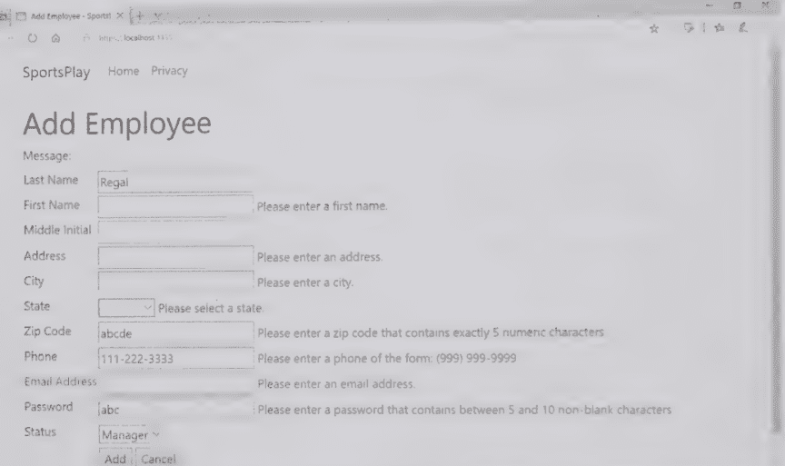

**图 5-3.** 经过验证的 Employee 模型示例。

在上面的示例中，我们使用了一个自定义的 `EmailAddressDomainAttribute` 类来验证电子邮件地址域（即，电子邮件地址的域必须是 SportsPlay.com）。请注意，我们将这个类放在名为 *Validators* 的文件夹中。我们创建这个文件夹不仅是为了存放这个验证器，还可以存放未来可能创建的任何验证器。这将帮助我们将验证器集中在一个地方，并有助于我们总体上保持应用程序的良好组织。图 5-4 显示了 Validators 文件夹中的自定义验证器。

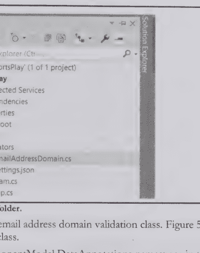

**图 5-4.** Validators 文件夹中的自定义验证器。

现在让我们来看看电子邮件地址域验证类的详细信息。图 5-5 显示了 EmailAddressDomain.cs 类的内容。

在 01 处，我们在 PageModel 类中包含了 System.ComponentModel.DataAnnotations 命名空间，因为 ValidationAttribute 类（在 02 处）和 IsValid() 方法（在 05 处）都定义在该命名空间中。

在 02 处，我们可以看到 EmailAddressDomainAttribute 类继承了 ValidationAttribute 类的属性和方法，后者是所有验证特性类的基类。

在 03 处，我们声明了一个名为 EmailAddressDomain 的私有只读字符串字段。我们将使用此字段通过依赖注入存储 EmailAddressDomain 对象。

在 04 处，我们定义了一个名为 EmailAddressDomainAttribute() 的构造函数，该函数在页面于服务器端处理时创建 EmailAddressDomain 对象。正如我们将看到的，此对象对于创建 EmailAddressDomainAttribute 类的 EAD 参数是必需的。

在 05 处，我们定义了一个名为 IsValid() 的公共方法，该方法根据验证结果返回一个布尔值（即 true 或 false）。由于此自定义验证器从 ValidationAttribute 类继承了 IsValid() 方法，我们必须指定关键字 override 以表明我们希望此方法覆盖继承的方法。请注意，此方法接受一个名为 value 的 object 类型的输入参数。如果此参数不包含要验证的对象（例如，单击了包含 formnovalidate 属性的 Cancel 按钮时），则不会对 value 对象进行验证。但是，如果此参数确实包含要验证的对象（例如，单击了不包含 formnovalidate 属性的 Add 按钮时），则会对 value 对象进行验证。

在 06 处，我们正在测试一个条件，以查看方法的输入参数是否为 null（即没有要验证的值对象）。如果条件为 true，则不进行验证，方法的返回值设置为 true。如果条件为 false，则进行验证。

在 07 处，我们将要验证的电子邮件地址转换为字符串，并将其赋值给一个名为 strEmailAddress 的字符串变量（为了更有意义的名称和类型）。

在 08 处，我们获取电子邮件地址的长度，并将其赋值给一个名为 intEmailAddressLength 的整数变量。


## 90 • 模型验证

在步骤 09，我们获取电子邮件地址域的起始位置，该位置紧跟 "@" 符号之后。为此，我们需要获取"@"符号（即其位置）在电子邮件地址中的零基索引⁶。然后我们将这个数字加 1，并赋值给一个名为 intStartOfEmailAddressDomain 的整数变量。

在步骤 10，我们要从完整的电子邮件地址中提取域名部分。为此，我们使用 Substring() 方法，该方法用于检索字符串的一部分。该方法的第一个参数指示要检索字符的零基起始索引，第二个参数指示要检索的字符数量。

在步骤 11，我们正在测试一个条件，以查看用户输入的电子邮件地址域（通过 Value 对象传递给类）是否等于应用程序所需的电子邮件地址域（通过 EAD 参数传递给类）。如果该条件为真，则验证通过，并将方法的返回值设置为 true。如果该条件为假，则验证失败，并且将方法**的返回*值设为 false**。

## EMAILADDRESSDOMAIN.CS

```
01 using System.ComponentModel.DataAnnotations;

namespace SportsPlay.Validators
{
02     public class EmailAddressDomainAttribute : ValidationAttribute
    {
03         private readonly string EmailAddressDomain;
04         public EmailAddressDomainAttribute(string EAD)
        {
            EmailAddressDomain = EAD;
        }

05         public override bool IsValid(object value)
        {
06             if (value == null)
            {
                // 不对电子邮件地址域进行验证。
                // 这在实现取消按钮且不需要执行任何操作时是必要的。
                return true;
            }
            else
            {
                // 验证电子邮件地址域。
07                 string strEmailAddress = value.ToString();
08                 int intEmailAddressLength = strEmailAddress.Length;
09                 int intStartOfEmailAddressDomain = strEmailAddress.IndexOf("@") + 1;
10                 string strEmailAddressDomain =
                    strEmailAddress.Substring(intStartOfEmailAddressDomain,
                        intEmailAddressLength - intStartOfEmailAddressDomain);
                    if (strEmailAddressDomain == EmailAddressDomain)
                    {
                        return true;
                    }
                    else
                    {
                        return false;
                    }
                }
            }
        }
}
```

⁶ 零基索引始终从零开始。例如，字符串 abc 中的字母 a 将位于该字符串的第 0 位，而字符串 abc 中的字母 b 将位于第 1 位，依此类推。

图 5-5. EmailAddressDomain.cs 类的内容。

## 5.4.2 已验证的产品模型  

图 5-6 展示了一个经过**验产品模型的示例*注意 PageModel 类中构成该产品模型的属性从 ProductId**(步骤 08)**开始，以 ReorderLevel**属性结束。请注意，我们将不会验证 ProductId*(*)因为在这种数据库场景中我们假设该属性的值会由系统为我们生成。但我们会验证模型中的所有其他属性。

在步骤*1，我们在表单中添加了一个 Label 元素。注意我们包含了一个 asp-for*(标签助手并将其值设为***CategoryId**。这表明我们要让标签显示 PageModel**(类中 CategoryId**)*(*)属性 DisplayAttribute**]*(类别的属性指定的用户友好字段名称（*)(9）。我们也向此表单添加了三个其他 Label*元素

在步骤*02，我们在一个表中添加一个 Select 元素。注意我们包含了一个 asp-for*(标签助手并将其值设为***CategoryId**。这表明我们要希望在页面向服务器处理时选择选项的值通过模型绑到 PageModel**(类中 CategoryId**)*(1)属性上我们也向表单添加了三个其他 Input 元素

在步骤*03，我们在表中添加一个 Span 元素。注意我们包含 asp-validation-for*(标签助手并将其值设为***CategoryId**。这表明我们要使用与 CategoryId **(*)属性的相关联规则验证 PageModel**(类中的 CategoryId 属性（*)(12）。我们也向表单添加了三个其他 Span 元素

在步骤*04，我们在表中添加了一个 Input (Submit) 元素。注意我们包含 asp-page-handler *(标签助手并将其值设为***Add**。这表明当用户点击“添加”按钮并且页面发送到服务器处理时我们希望调用 PageModel**(类中 OnPostAdd()**)*(1)处理器方法请注意，如果违反模型的任一验证规则（如定义在模型预定义的*属性类中的那些）则页面将不会发送给进行处理

在步骤 05，我们在表单中添加第二个 Input (Submit)*元素注意我们包含了 asp-page-handler*(标签助手并将其值设置为***Cancel**。这表明当用户点击“取消”按钮并且页面向服务器处理时我们希望调用 PageModel**(类中 OnPostCancel()**)*(18)处理器方法此外我们还包含了一个 formnovalidate 属性。这表示我们在点击按钮时无需执行任何模型验证

## 92 • Model Validation

在步骤*06，我们在 Razor*(页面文件底部添加一个 Scripts 部分。Scripts *(节允许我们将一个或多个脚本引用插入到 Razer*(页面文件中注意 Section*(内的代码引用了 _ValidationScriptsPartial.cshtml*(**)*(文件夹中的 PageProjectSharedPages)。如果我们打开这个文件会发现它包含了执行模型验证所需的 JavaScript 引用

在步骤*07，我们在 PageModel 类中引入 System.ComponentModel.DataAnnotations *(命名空间因为 DisplayAttribute (9)Required*(12)(StringLength*(13)、Range(14)、RegularExpression**(15)*属性定义在该命名空间中。

在步骤*09，我们用 Display***(*)装饰了 CategoryId 属性当页面在浏览器呈现时 Name 参数中指定文本将显示在关联的 Label *(元素*)(1)*(0)。

在步骤*2，我们用 RequiredAttribute (类对 PageModel**(类中的 CategoryId)(*)进行标记。这意味着选择 Select(元素（*)值必须包含一个或多个字符如果不符合条件并且用户尝试提交到服务器处理则会显示 ErrorMessage 参数中指定文本将出现在关联的 Span *(元素*)(3)。

在步骤*12，我们用 StringLength*(装饰了 PageModel**(中的 Product**属性注意该属性的 MaximumParameter设为 50。这意味着进入相关 Input(的元素值必须包含 50 个或少于字符如果不符合条件并且用户尝试提交到服务器处理则 ErrorMessage **(参数中指定文本将显示在关联的 Span *(元素上

在步骤*13，用 RangeAttribute (类对 PageModel**(中的 Price**属性进行标记注意该属性的 MinimumParameter设为***MaximumParameters设为 10,000.00。这意味着进入相关 Input*(的元素值必须包含介于 0.00 **(之间（**）。如果不满足条件并且用户尝试提交以进行处理则 ErrorMessage *(参数中指定文本将显示在相关的 Span **元素上

在步骤*14，用 RegularExpressionAttribute (类装饰了 PageModel**(中的 Price(属性注意 PatternParameter*(*)已设为\\d{1,5}\\.\\\\. 这意味着进入相关 Input **(的元素值必须包含一到五个数字后面跟着小数点后面跟两个精确的数字。如果不满足并且用户尝试提交页到服务器处理则 ErrorMessage *(参数中指*定*文本将被显示在关联的 Span **元素上

在步骤*2，用 Range*(属性对 PageModel**(中的 Reorder*属性的标记注意该元素的 MinimumParameter设为 0MaximumParameters为***这意味着进入相关 Input(的元素必须包含整数范围 0-(**)。如果不满足条件并且用户尝试提交页到服务器进行处理的文本指定 ErrorMessage *(参数将显示在关联的 Span **

At 16, we have decorated the Reorder property of the PageModel class with a RegularExpressionAttribute class. Notice that the Pattern parameter of this attribute class has been set to \\d{1,3}. This means that the value entered into the associated Input element must contain one to three digits. If it does not, and the user attempts to submit the page for processing on the server, the text specified in the ErrorMessage

类中 `ErrorMessage` 参数指定的文本将显示在关联的 Span 元素中。
图中的结果部分显示了用户输入一些数据并单击添加按钮后的页面。

## PAGE

```
@page
@model SportsPlay.Pages.AddProductValidatedModel
@{
    ViewData["Title"] = "添加产品";
}

<h1>添加产品</h1>

<label>消息：</label>
<label style="color: @Model.Messagevinyl;@Model.MessageColor">@Model.Message</label>

<form method="post">
    <table>
        <tr>
            <td><label asp-for="CategoryId"></label></td>
            <td>
                <select asp-for="CategoryId">
                    <option value=""></option>
                    <option value="1">鞋类 - 男</option>
                    <option value="2">鞋类 - 女</option>
                    <option value="3">球拍</option>
                </select>
                <span asp-validation-for="CategoryId"></span>
            </td>
        </tr>
        ⋮
        <tr>
            <td><label asp-for="Product"></label></td>
            <td>
                <input asp-for="Product" />
                <span asp-validation-for="Product"></span>
            </td>
        </tr>
        ⋮
        <tr>
            <td><label asp-for="Price"></label></td>
            <td>
                <input asp-for="Price" />
                <span asp-validation-for="Price"></span>
            </td>
        </tr>
        ⋮
        <tr>
```

94 • 模型验证

```
    <td><label asp-for="ReorderLevel"></label></td>
    <td>
        <input asp-for="ReorderLevel" />
        <span asp-validation-for="ReorderLevel"></span>
    </td>
</tr>
<tr>
    <td></td>
    <td>
        <input asp-page-handler="Add"
               type="submit" value="添加" />
        <input asp-page-handler="Cancel" formnovalidate
               type="submit" value="取消" />
    </td>
</tr>
</table>

</form>

@section Scripts {
    @{await Html.RenderPartialAsync("_ValidationScriptsPartial");}
}
```

### PAGEMODEL

```
using Microsoft.AspNetCore.Mvc;
using Microsoft.AspNetCore.Mvc.RazorPages;
using System.ComponentModel.DataAnnotations;

namespace SportsPlay.Pages
{
    [BindProperties]
    public class AddProductValidatedModel : PageModel
    {
        public string MessageColor;
        public string Message;

        public int ProductId { get; set; }

        [Display(Name = "类别")]
        [Required(ErrorMessage = "请选择一个类别。")]
        public int CategoryId { get; set; }

        ...

        [Display(Name = "产品")]
        [Required(ErrorMessage = "请输入产品。")]
        [StringLength(50)]
        public string Product { get; set; }
```

```
[Display(Name = "价格")]
[Range(0.00, 10000.00, ErrorMessage = "请输入 $0.00 到 $10,000.00 之间的价格。")]

[RegularExpression(@"\d{1,5}\.\d{2}" , ErrorMessage = "请输入格式为 99999.99 的价格。")]
[Required(ErrorMessage = "请输入价格。")]
public decimal Price { get; set; }

[Display(Name = "再订购水平")]
[Range(0, 200 , ErrorMessage = "请输入 0 到 200 之间的再订购水平。")]

[RegularExpression(@"\d{1,3}" , ErrorMessage = "请输入格式为 999 的再订购水平。")]
[Required(ErrorMessage = "请输入再订购水平。")]
public byte ReorderLevel { get; set; }

public void OnGet()
{}

public void OnPostAdd()
{}

// 设置消息。
MessageColor = "Green";
Message = Product + " 已成功添加。";

public void OnPostCancel()
{}

// 设置消息。
MessageColor = "Red";
Message = "操作已取消。未影响任何数据。";
```

图 5-6. 验证产品模型的示例。

## 5.5 项目

遵循标题为“解决方案和项目”一章中阐述的标识符命名标准。使用 Table 元素来排列页面上的其他 HTML 元素，使页面看起来井井有条。

- 1. 启动一个名为 Lastname.Firstname.Chapter99 的新项目，其中 99 是本章的章号。
- 2. 在项目中添加一个名为 EnterProduct 的 Razor 页面。
- 3. 添加一个类别 Select 元素（包含以下选项：&lt;选择类别&gt;、鞋类、服装、球拍）、一个供应商 Select 元素（包含以下选项：&lt;选择供应商&gt;、Babolat、Head、Prince）、一个产品 Input (Text) 元素、一个描述 Textarea 元素、一个图片 Input (Text) 元素、一个价格 Input (Text) 元素、一个库存数量 Input (Text) 元素、一个订单数量 Input (Text) 元素、一个再订购水平 Input (Text) 元素和一个预计交货日期 Input (Date) 元素。
- 4. 添加以下公共属性：类别、供应商、产品、描述、图片、价格、库存数量、订单数量、再订购水平和预计交货日期。为每个属性定义合适的类型。
- 5. 为公共属性添加注解，以便在所有 HTML 元素上显示用户友好的标签。
- 6. 为公共属性添加注解，以限制用户在 HTML 元素中不能输入超过合理数量的字符（在适当的情况下）。
- 7. 为公共属性添加注解，以防止用户向 HTML 元素输入错误数据。对于每个公共属性，使用与本章中产品相同的验证。
- 8. 添加一个显示为“保存”的 Input (Submit) 元素。单击该按钮时，验证所有 HTML 元素中的数据。确保在所有验证通过之前，页面不会向服务器发送以进行处理。
- 9. 测试该页面并进行必要的更正。

模型验证 · 97

# 第三部分 – C# 编程

# 6 赋值运算

## 6.1 简介

赋值运算设置 PageModel 类中变量、常量或其他项的值。

赋值语句对于计算机编程如此基础，以至于每个过程式/命令式编程语言都需要这样的语句——无论其语法如何。

## 6.2 类型

在 .NET 中，有两种重要的类型——值类型和引用类型。值类型保存一个值（不是指向另一个内存地址的指针），该值具有固定的内存分配大小。例如，byte 变量是一个值类型，在内存中恰好分配一个字节，可以包含 0 到 255 之间的任何正整数。另一方面，引用类型保存一个指向另一个内存地址的指针（不是值），该地址没有固定的内存分配大小。例如，string 变量是一个引用类型，其分配的内存量可能因字符串内容而异。

表 6-1 显示了一些 C# 类型及其相应的标识符前缀。我们的标准是所有变量和常量都以表中所示的 3 字母前缀开头。注意，表中除 string 类型外，所有类型都是值类型，string 类型是引用类型。可以看出，string 类型被描述为不可变（即不可更改）且固定长度。这是因为修改 C# 中字符串的结果是在内存中创建一个新字符串——而不是修改现有字符串。string 类型的最大大小约为 10 亿个字符。string 类型还被描述为 Unicode 字符串。string 类型将文本表示为 UTF-16（16 位 Unicode 转换格式）代码单元序列，其中每个代码单元为两个字节。UTF-16 使用一个或两个代码单元来表示多达 1,114,112 个可能的 Unicode 码位，其中码位是一系列表示 Unicode 字符的位（即 16 位或 32 位）。虽然完整讨论 UTF-16 超出了本书的范围，但需要记住的重要事项是，某些 Unicode 字符使用 16 位表示，而其他 Unicode 字符使用 32 位表示。

例如，Unicode 字符 "A" 使用位模式
0000000001000001（即十六进制 0041）表示。
因此，英文字母 "A" 需要一个 16 位代码单元。实际上，构成英语的所有字符都用一个 16 位代码单元表示，并由一个 char 对象引用。

另一方面，Unicode 字符 "" 使用位模式
0000000000000001001100011100001（即十六进制 000130E1 代理对）表示。
因此，埃及象形文字 "" 需要两个 16 位代码单元。由于 UTF-16 编码只有 16 位，需要超过 16 位的字符使用 UTF-16 代理对表示，如上所示。因此，我们必须记住，单个 Unicode 字符可能需要多个 char 对象来引用。我们还应该记住，Unicode 字符集一直在添加新字符，因此 Unicode 字符集应被视为一个进行中的工作。

| C# 类型 | 前缀 | 描述 |
|---|---|---|
| bool | boo | 布尔值（true 或 false）。 |

| Type | Abbreviation | Description |
| :--- | :--- | :--- |
| byte | byt | 8 位无符号整数。 |
| char | cha | Unicode（16 位）字符。 |
| decimal | dec | 十进制（128 位）值。 |
| double | dou | 双精度（64 位）有符号浮点数。 |
| float | flo | 单精度（32 位）有符号浮点数。 |
| int | int | 32 位有符号整数。 |
| long | lon | 64 位有符号整数。 |
| sbyte | sby | 8 位有符号整数。 |
| short | sho | 16 位有符号整数。 |
| string | str | 不可变的、固定长度的 Unicode 字符字符串。 |
| uint | uin | 32 位无符号整数。 |
| ulong | ulo | 64 位无符号整数。 |
| ushort | ush | 16 位无符号整数。 |

表 6-1. 部分 C# 类型及其对应的标识符前缀。

## 6.3 变量声明

要在 C# 编程语言中声明变量，我们需要定义其类型（例如，bool、short、string），然后根据前文讨论的标识符命名规范为其命名。我们还可以为变量赋予一个初始值——只要该值位于其类型允许值的*域*范围内。在某些编程语言中，变量声明时其值*不会*自动设置为默认值。然而，在 C# 中，变量声明时其值*会*自动设置为默认值。因此，如果变量的默认值在逻辑上已经正确（即，变量的值不需要初始化为其他值），则在变量声明中无需显式指明初始值。但是，为了增强代码的清晰度——以防变量的默认初始值不够明确——在变量声明中显式指明初始值通常是有用的。所以，虽然这样做可能是*不必要*的，但我们通常会在声明变量时为其分配一个默认值。表 6-2 展示了部分 C# 类型及其对应的域和默认值。

| C# 类型 | 域 | 默认值 |
| :--- | :--- | :--- |
| bool | 0（false）和 1（true） | 0（false） |
| byte | 0 到 255 | 0 |
| char | 文本中使用的任意 Unicode 符号 | '\u0000' |
| decimal | ±1.0 × 10^-28 到 7.9 × 10^28 | 0.0m |
| double | -1.79769313486232e308 到 1.79769313486232e308 | 0.0d |
| float | -3.402823e38 到 3.402823e38 | 0.0f |
| int | -2,147,483,648 到 2,147,483,647 | 0 |
| long | -9,223,372,036,854,775,808 到 9,223,372,036,854,775,807 | 0l |
| sbyte | -128 到 127 | 0 |
| short | -32,768 到 32,767 | 0 |
| string | 0 到 1,073,741,824 个字符 | null |
| uint | 0 到 4,294,967,295 | 0 |
| ulong | 0 到 18,446,744,073,709,551,615 | 0 |
| ushort | 0 到 65,535 | 0 |

表 6-2. 部分 C# 类型及其对应的域和默认值。

图 6-1 展示了变量声明的一些示例。请注意，char 被视为单个字符的数组，可通过索引访问。同时请注意，赋值为负数的变量表明其类型可以容纳符号。

```csharp
protected void VariableDeclarations()
{
    // Declare Booleans.
    bool booPreferredCustomer = true;
    bool booOrderShipped = false;

    // Declare characters.
    char[] chaZipCode = new char[] { '4', '6', '1', '3', '1' };
    char[] chaPrice = new char[] { '$', '1', '9', '9', '.', '0', '0' };

    // Declare strings.
    string strSupplier = "";
    string strProduct = "Babolat Pure Aero French Open";

    // Declare numbers.
    byte bytNumber = 10;
    decimal decNumber = -10.00m;
    double douNumber = -10.00;
    float floNumber = -10.12345f;
    int intNumber = -10;
    long lonNumber = -10;
    sbyte sbyNumber = -10;
    short shoNumber = -10;
    ushort ushNumber = 10;
    uint uinNumber = 10;
    ulong uloNumber = 10;
}
```

图 6-1. 变量声明示例。

## 6.4 常量声明

常量是在程序执行期间*不能*修改的固定值。常量可以是值类型（例如，byte、decimal、int），也可以是引用类型（例如，string）。常量所采用的固定值称为*字面量*（例如，31、0.07m、"Last Name"）。要在 C# 编程语言中声明常量，我们需要指定关键字 `const`，定义其类型，然后根据前文讨论的标识符命名规范为其命名。接下来，我们为常量赋予一个字面量值。我们可以为常量赋予任何值——只要该值位于其类型允许值的域范围内。图 6-2 展示了常量声明的一些示例。

```csharp
protected void ConstantDeclarations()
{
    // 声明常量。
    const byte bytDaysInJanuary = 31;
    const decimal decSalesTaxRate = 0.07m;
    const string strLastNameLabel = "Last Name";
}
```

图 6-2. 常量声明示例。

## 6.5 赋值运算符

赋值操作将值赋给 C# 编程语言中的变量、常量（仅在声明时）或其他项目。C# 中赋值语句的一般语法为

操作数1 运算符 操作数2;

其中操作数1 是变量、常量或其他项目，运算符 是等号（=）或其他赋值运算符，操作数2 是要赋给操作数1 的值（或表达式的结果）。

赋值运算符有两种——简单赋值运算符和复合赋值运算符。简单赋值运算符只是将操作数2 的值存储到操作数1 中。另一方面，复合赋值运算符在进行某种算术或逻辑运算后，将操作数2 的值存储到操作数1 中。表 6-3 展示了一些常用的赋值运算符，其中操作数1 为 x，操作数2 为 y。请注意，表中除了第一个是简单赋值运算符外，其余都是复合赋值运算符。此外，请注意注释中的等效复合赋值语句。

| 运算符 | 类型 | 注释 |
| :--- | :--- | :--- |
| x = y | 简单赋值 | |
| x += y | 复合赋值 | 等效于 x = x + y。 |
| x -= y | 复合赋值 | 等效于 x = x - y。 |
| x *= y | 复合赋值 | 等效于 x = x * y。 |
| x /= y | 复合赋值 | 等效于 x = x / y。 |
| x %= y | 复合赋值 | 等效于 x = x % y。 |

表 6-3. 一些常用的赋值运算符，其中操作数1 为 x，操作数2 为 y。

图 6-3 展示了赋值操作的一些示例。

```csharp
protected void AssignmentOperations()
{
    // 声明变量。
    double douNumber1 = 0;
    double douNumber2 = 0;

    // 这是一个简单的数值赋值语句。
    douNumber1 = 3;
    douNumber2 = 7;

    douNumber1 = douNumber2;
    // douNumber1 = 7

    // 这是一个复合数值赋值语句，
    // 等效于 douNumber1 = douNumber1 + douNumber2。
    douNumber1 = 3;
    douNumber2 = 7;
    douNumber1 += douNumber2;
    // douNumber1 = 10

    // 这是一个复合数值赋值语句，
    // 等效于 douNumber1 = douNumber1 - douNumber2。
    douNumber1 = 3;
    douNumber2 = 7;
    douNumber1 -= douNumber2;
    // douNumber1 = -4

    // 这是一个复合数值赋值语句，
    // 等效于 douNumber1 = douNumber1 * douNumber2。
    douNumber1 = 3;
    douNumber2 = 7;
    douNumber1 *= douNumber2;
    // douNumber1 = 21

    // 这是一个复合数值赋值语句，
    // 等效于 douNumber1 = douNumber1 / douNumber2。
    douNumber1 = 3;
    douNumber2 = 7;
    douNumber1 /= douNumber2;
    // douNumber1 = 0.42857142857142855

    // 这是一个复合数值赋值语句，
    // 等效于 douNumber1 = douNumber1 % douNumber2。
    douNumber1 = 3;
    douNumber2 = 7;
    douNumber1 %= douNumber2;
    // douNumber1 = 3
}
```

图 6-3. 赋值操作示例。

## 6.6 枚举

枚举是一组特定类型的命名常量。在 .NET 中，Enum 类是所有枚举的基类。枚举提供一种声明和使用一组相关常量的方式，这些常量可以赋给变量。例如，由于一周只有七天，其中星期日为第 1 天，星期一为第 2 天，依此类推，我们可以创建一个类型为 byte 的 DayOfWeek 枚举（int 是默认的 Enum 类型），使我们能够访问命名（即拼写出来）的星期几的值。


## 104 • 赋值操作

图 6-4 展示了一个枚举的示例。在这个例子中，我们有一个 DiscountRate 枚举，包含三个命名常量——Standard、Select 和 Preferred。这些常量分别代表一种客户类型，并且每个常量都有特定的折扣率值。

在 01 处，我们使用 enum 关键字声明了一个枚举。注意，这个枚举的名称是 DiscountRate，枚举的类型是 byte。因此，与每个命名常量关联的*字面量*将是 byte 类型。

在 02 处，我们将 bytCustomerDiscountRate 变量的值设置为 DiscountRate.Preferred 的值，我们知道它是 30。如你所见，即使 bytCustomerDiscountRate 已经声明为 byte 类型，我们仍然必须将 DiscountRate.Preferred *强制转换*为 byte 类型。强制转换将在*转换操作*一章中详细讨论。

```csharp
01 enum DiscountRate : byte
{
    Standard = 10,
    Select = 20,
    Preferred = 30
}

02 protected void Enumeration()
{
    byte bytCustomerDiscountRate = (byte)DiscountRate.Preferred;
    // bytCustomerDiscountRate = 30
}
```

图 6-4. 枚举示例。

## 6.7 异常 throws 处理

*异常*是在*运行时错误*发生时产生的——即在计算机程序执行过程中出现的错误。在 C# 中，异常处理允许我们检测这些错误并优雅地处理它们。异常处理的优势在于，当运行时错误发生时，我们的应用程序不会崩溃（即异常终止），而是以可预测且专业的方式运行。当应用程序执行期间发生异常时，CoreCLR 会*抛出*一个特定类型的异常（例如，除以零异常）。在 Visual Studio 中测试代码时，异常将导致显示*异常帮助程序*，它会为我们指出运行时错误的性质。

图 6-5 展示了异常帮助程序的示例。注意异常帮助程序对话框的最顶部，异常被抛出且未在代码中处理。同时注意发生的异常类型是除以零异常。

```csharp
protected void DivideNumberByZero()
{
    // 这用于触发异常处理程序。
    // 将分子除以分母。
    decimal decNumerator = 3;
    decimal decDenominator = 0;
    decimal decResult = decNumerator / decDenominator;
}
```

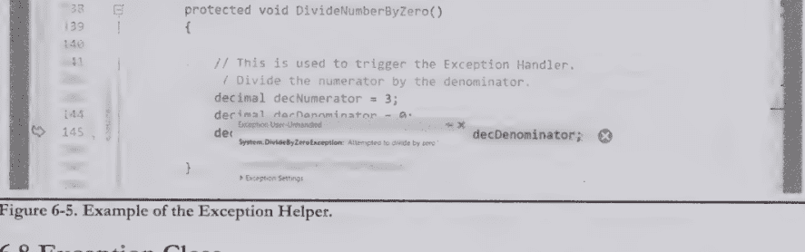

## 6.8 Exception 类

Exception 类是一个静态类，作为所有异常类的基类。目前 CoreCLR 可以抛出超过 20 种异常，我们可以使用 Exception 类及其子类来处理这些异常。正如我们将要看到的，异常处理是通过 Try-Catch-Finally 结构来实现的。在该结构的 Try 部分，我们编写可能在我们的应用程序中引发异常的语句。在该结构的 Catch 部分，我们指定如果实际抛出异常时该怎么做。在该结构的 Finally 部分，我们指定*无论是否*抛出异常都要执行的代码。Try-Catch-Finally 结构的 Finally 部分是可选的。

### 6.8.1 DivideByZeroException 类

当我们尝试执行整数或小数除法运算且数学表达式的分母为零时，会抛出*除以零异常*。当此异常被抛出时，CoreCLR 会从 DivideByZeroException 类创建一个 DivideByZeroException 对象。然后我们可以使用此对象的 Message 属性来获取异常的描述。

图 6-6 展示了捕获除以零异常的示例。

在 01 处，我们将 bytDenominator 设置为 0，以设置我们的除以零异常。

在 02 处，我们添加了 Try-Catch-Finally 结构的 Try 部分，其中包含将被测试是否发生除以零异常的赋值语句。如果未抛出除以零异常，处理将在除法之后继续，并且消息将被设置为*除法成功*。

在 03 处，我们添加了 Try-Catch-Finally 结构的 Catch 部分。该结构部分包含一个 DivideByZeroException 类，如果抛出除以零异常，它将创建一个名为 *objException* 的 DivideByZeroException 对象。如果抛出除以零异常，消息将被设置为*除法未成功*。此外，objException 对象的 Message 属性（描述该异常）将被附加到消息的末尾。

在 04 处，我们添加了 Try-Catch-Finally 结构的 Finally 部分。此部分内部的代码将*无论是否*抛出异常都会执行。因此，消息总是以*谢谢你*结尾。Try-Catch-Finally 代码的结果显示在图的底部。注意，除以零异常已被抛出，因为我们不能用零作为数学表达式分母来执行整数或小数除法。

```csharp
protected void CatchDivideByZeroException()
{
    // 检查除以零异常。
    string strMessage = "";
    decimal decNumerator = 3;
    decimal decDenominator = 0;
    decimal decResult = 0;
    try
    {
        decResult = decNumerator / decDenominator;
        strMessage = "The division was successful.";
    }
    catch (DivideByZeroException objException)
    {
        strMessage = "The division was NOT successful. " +
            objException.Message;
    }
    finally
    {
        strMessage = strMessage + " Thank you.";
    }
    // strMessage = "The division was NOT successful. Attempted to
    // divide by zero. Thank you."
}
```

图 6-6. 捕获除以零异常的示例。

### 6.8.2 FormatException 类

当我们尝试转换一个字符串值，但其格式不适合转换为其他类型（例如 bool、decimal、int）时，会抛出*格式异常*。当此异常被抛出时，CoreCLR 会从 FormatException 类创建一个 FormatException 对象。然后我们可以使用此对象的 Message 属性来获取异常的描述。

在 01 处，我们将 strNumber 设置为 "abc"，以设置我们的格式异常。

在 02 处，我们添加了 Try-Catch-Finally 结构的 Try 部分，其中包含将被测试是否发生格式异常的转换语句。如果未抛出格式异常，处理将在转换之后继续，并且消息将被设置为*转换成功*。

在 03 处，我们添加了 Try-Catch-Finally 结构的 Catch 部分。该结构部分包含一个 FormatException 类，如果抛出格式异常，它将创建一个名为 *objException* 的 FormatException 对象。如果抛出格式异常，消息将被设置为*转换未成功*。此外，objException 对象的 Message 属性（描述该异常）将被附加到消息的末尾。

在 04 处，我们添加了 Try-Catch-Finally 结构的 Finally 部分。此部分内部的代码将*无论是否*抛出异常都会执行。因此，消息总是以*谢谢你*结尾。Try-Catch-Finally 代码的结果显示在图的底部。注意，格式异常已被抛出，因为我们无法将字符串类型转换为 byte 类型。

```csharp
protected void CatchFormatException()
{
    // 检查格式异常。
    string strMessage = "";
01  string strNumber = "abc";
    byte bytNumber = 0;
02  try
    {
        bytNumber = Convert.ToByte(strNumber);
        strMessage = "The conversion was successful.";
    }
03  catch (FormatException objException)
    {
        strMessage = "The conversion was NOT successful. " +
            objException.Message;
    }
04  finally
    {
        strMessage = strMessage + " Thank you.";
    }
    // strMessage = "The conversion was NOT successful. Input string was
    // not in a correct format. Thank you."
}
```

图 6-7. 捕获格式异常的示例。

### 6.8.3 IndexOutOfRangeException 类

当我们尝试引用不在数组或集合范围内的项时，会抛出*索引越界异常*。当此异常被抛出时，CoreCLR 会从 IndexOutOfRangeException 类创建一个 IndexOutOfRangeException 对象。然后我们可以使用此对象的 Message 属性来获取异常的描述。

图 6-8 展示了捕获索引越界异常的示例。


108 • 赋值操作

在 01 处，我们声明了一个名为 *strNameArray* 的字符串数组，其中包含三个元素。索引为 0 的元素包含 *Bill*，索引为 1 的元素包含 *Mary*，索引为 2 的元素包含 *Steve*。

在 02 处，我们添加了 *Try-Catch-Finally* 结构的 *Try* 部分，其中包含将要测试是否引发索引超出范围异常的赋值语句。如果没有引发索引超出范围异常，处理将在查找后继续，并且消息将设置为 *查找成功*。

在 03 处，我们添加了 *Try-Catch-Finally* 结构的 *Catch* 部分。该结构部分包含一个 *IndexOutOfRangeException* 类，如果引发索引超出范围异常，它将创建一个名为 *objException* 的 *IndexOutOfRangeException* 对象。如果引发索引超出范围异常，消息将设置为 *查找未成功*。此外，描述异常的 *objException* 对象的 *Message* 属性将被附加到消息末尾。

在 04 处，我们添加了 *Try-Catch-Finally* 结构的 *Finally* 部分。无论是否引发异常，该结构部分内部的代码都将执行。因此，消息始终以 *谢谢* 结尾。图底部显示了 *Try-Catch-Finally* 代码的结果。请注意，已引发索引超出范围异常，因为我们不能引用索引为 5 的数组元素，而唯一有效的索引是 0、1 和 2。

```csharp
protected void CatchIndexOutOfBoundsException()
{
    // Check for an index out of range exception.
    string strMessage = "";
    string[] strNameArray = new string[] { "Bill", "Mary", "Steve" };
    string strName = "";
    try
    {
        strName = strNameArray[5];
        strMessage = "The lookup was successful.";
    }
    catch (IndexOutOfRangeException objException)
    {
        strMessage = "The lookup was NOT successful. " + objException.Message;
    }
    finally
    {
        strMessage = strMessage + " Thank you.";
    }
    // strMessage = "The lookup was NOT successful. Index was outside the // bounds of the array. Thank you."
}
```

图 6-8. 捕获索引超出范围异常的示例。

### 6.8.4 OverflowException 类

当我们尝试执行算术、类型转换或转换操作，其结果值过大或过小，无法放入指定变量中时，会引发 *溢出异常*。当引发此异常时，CoreCLR 会从 OverflowException 类创建一个 OverflowException 对象。然后，我们可以使用此对象的 Message 属性来获取异常的描述。

图 6-9 显示了捕获溢出异常的示例。

在 01 处，我们将 intNumber 设置为 256，以设置我们的溢出异常。在此场景中将引发溢出异常，因为 256 对于 byte 类型的变量（即 8 位无符号整数）来说*太大*。请注意，如果我们设置 intNumber 为 -12，也会引发溢出异常，因为 -12 对于 byte 类型的变量来说*太小*。

在 02 处，我们添加了 Try-Catch-Finally 结构的 Try 部分，其中包含将要测试是否引发溢出异常的赋值语句。如图所示，intNumber 的值正被转换为 byte 类型。如果没有引发溢出异常，处理将在赋值后继续，并且消息将设置为 *赋值成功*。

在 03 处，我们添加了 Try-Catch-Finally 结构的 Catch 部分。该结构部分包含一个 OverflowException 类，如果引发溢出异常，它将创建一个名为 *objException* 的 OverflowException 对象。如果引发溢出异常，消息将设置为 *赋值未成功*。此外，描述异常的 objException 对象的 Message 属性将被附加到消息末尾。

在 04 处，我们添加了 Try-Catch-Finally 结构的 Finally 部分。无论是否引发异常，该结构部分内部的代码都将执行。因此，消息始终以 *谢谢* 结尾。图底部显示了 Try-Catch-Finally 代码的结果。请注意，已引发溢出异常，因为我们不能为 byte 类型的变量赋一个不在 0 到 255 之间的值。

```csharp
protected void CatchOverflowException()
{
    // Check for an overflow exception.
    string strMessage = "";
    int intNumber = 256;
    byte bytNumber = 0;
    try
    {
        bytNumber = Convert.ToByte(intNumber);
        strMessage = "The assignment was successful.";
    }
    catch (OverflowException objException)
    {
        strMessage = "The assignment was NOT successful. " + objException.Message;
    }
    finally
    {
        // ...
    }
}
strMessage = strMessage + " Thank you.";
}
// strMessage = "The assignment was NOT successful. Value was either
// too large or too small for an unsigned byte. Thank you."
}
```

图 6-9. 捕获溢出异常的示例。

### 6.8.5 多个异常

也可以在一个 Try-Catch-Finally 结构中测试多个异常——包括特定异常和未预期的异常。我们已经学习了如何捕获一些特定异常（即，除零异常、格式异常、索引超出范围异常和溢出异常）。然而，我们尚未讨论如何捕获我们未预期的异常。为此，我们使用 Exception 基类作为“兜底”来捕获任何未预期的异常。需要记住的一件重要事情是，Exception 基类会捕获所有异常，包括我们之前讨论过的所有特定异常。因此，重要的是先测试任何特定异常，以便当它们被引发时，我们可以以适合这些异常类型的方式捕获和处理它们。然后，如果没有引发任何特定异常，我们可以使用 Exception 基类捕获任何引发的未预期异常。

图 6-10 显示了在单个 Try-Catch-Finally 结构中捕获多个异常的示例。在 01 处，我们将 strNumber 设置为 256 以设置一个溢出异常。

在 02 处，我们添加了 Try-Catch-Finally 结构的 Try 部分。如图所示，strNumber 的值正被转换为 byte 类型。如果没有引发溢出异常，处理将在赋值后继续，并且消息将设置为 *转换和赋值成功。*

在 03 处，我们添加了 Try-Catch-Finally 结构的第一个 Catch 部分。该结构部分包含一个 FormatException 类，如果引发格式异常，它将创建一个名为 objException 的 FormatException 对象。如果引发格式异常，消息将设置为 *转换未成功。* 此外，描述异常的 objException 对象的 Message 属性将被附加到消息末尾。

在 04 处，我们添加了 Try-Catch-Finally 结构的第二个 Catch 部分。该结构部分包含一个 OverflowException 类，如果引发溢出异常，它将创建一个名为 objException 的 OverflowException 对象。如果引发溢出异常，消息将设置为 *赋值未成功。* 此外，描述异常的 objException 对象的 Message 属性将被附加到消息末尾。

在 05 处，我们添加了 Try-Catch-Finally 结构的第三个 Catch 部分。该结构部分包含一个 Exception 类，如果引发任何异常，它将创建一个名为 objException 的 Exception 对象。请注意，这是将捕获任何未预期异常的“兜底”异常处理程序。在这种情况下，如果引发除格式异常或溢出异常以外的任何异常，消息将设置为 *其他操作未成功。* 此外，描述异常的 objException 对象的 Message 属性将被附加到消息末尾。

在 06 处，我们添加了 Try-Catch-Finally 结构的 Finally 部分。无论是否引发异常，该结构部分内部的代码都将执行。因此，消息始终以 *谢谢。* 结尾。图底部显示了 Try-Catch-Finally 代码的结果。


 请注意，由于无法将超出 0 到 255 范围的值赋给 byte 类型的变量，因此抛出了溢出异常。

```
protected void CatchMultipleExceptions()
{
    // Check for multiple possible exceptions.
    string strMessage = "";
    string strNumber = "256";
    byte bytNumber = 0;
    try
    {
        bytNumber = Convert.ToByte(strNumber);
        strMessage = "The conversion and assignment were successful.";
    }
    catch (FormatException objException)
    {
        strMessage = "The conversion was NOT successful. " +
            objException.Message;
    }
    catch (OverflowException objException)
    {
        strMessage = "The assignment was NOT successful. " +
            objException.Message;
    }
    catch (Exception objException)
    {
        strMessage = "Something else was NOT successful. " +
            objException.Message;
    }
    finally
    {
        strMessage = strMessage + " Thank you.";
    }
    // strMessage = "The assignment was NOT successful. Value was either
    // too large or too small for an unsigned byte. Thank you."
}
```

图 6-10. 在单个 Try-Catch-Finally 结构中捕获多个异常的示例。

## 6.9 项目

遵循*解决方案和项目*章节中所述的标识符命名规范。使用表格元素来排列页面上的其他 HTML 元素，使页面看起来井井有条。

### 第一部分

- 1. 启动一个名为 *Lastname.Firstname.Chapter99* 的新项目，其中 99 是本章的编号。
- 2. 向项目中添加一个名为 *CreateEnumeration* 的 Razor 页面。
- 3. 在 PageModel 类中创建一个你认为有用的枚举。
- 4. 在赋值语句中使用该枚举。
- 5. 测试该页面并进行任何必要的修正。

### 第二部分

- 1. 向项目中添加一个名为 *ComputeItPart2* 的 Razor 页面。
- 2. 添加一个 Label 元素，用于显示该页面的所有消息。
- 3. 添加一个 Input (Submit) 元素，显示文本 *执行 +=*。添加两个 Input (Text) 元素。声明两个类型为 Byte 的公共属性。当按钮被点击时，将两个属性的值赋给两个相应的局部变量。然后，将第一个变量加到第二个变量上，并使用*复合赋值语句*将结果赋给第一个变量。最后，在标签中显示第一个变量的值。
- 4. 对复合赋值 -=、*=、/= 和 %= 重复步骤 3。
- 5. 测试该页面并进行任何必要的修正。

### 第三部分

- 1. 复制 *ComputeItPart2* Razor 页面，并将其重命名为 *ComputeItPart3*。
- 2. 将每个复合赋值语句转换为其等效的*简单赋值语句*。
- 3. 测试该页面并进行任何必要的修正。
- 4. 思考简单赋值语句和复合赋值语句之间的区别。在代码底部添加注释，表达你对哪种方式更适合编写赋值语句以及原因的看法。

### 第四部分

- 1. 复制 *ComputeItPart3* Razor 页面，并将其重命名为 *ComputeItPart4*。
- 2. 对于在 *PageModel* 类中执行的每个简单赋值语句，编写必要的代码来捕获和处理任何可能的异常。（只考虑本章讨论的异常，*不要*为任何不可能的异常编写代码。）对于每个赋值语句，将所有异常测试放入单个 Try-Catch-Finally 结构中。
- 3. 使用*有效*数据测试该页面并进行任何必要的修正。
- 4. 使用*无效*数据测试该页面并进行任何必要的修正。确保任何潜在的异常都被捕获并妥善处理，包括在标签中显示适当的错误消息。

# 7 转换操作

## 7.1 简介

转换操作将一种类型变量中的值进行更改，使其可用于另一种类型的变量。转换可以是*扩大*转换或*缩小*转换。扩大转换*始终*保留源变量的值，因为目标变量可以完全容纳源变量可能值的范围。因此，这种类型的转换在程序执行期间*始终*成功，因为它不会导致数据丢失。另一方面，缩小转换*可能无法*保留源变量的值，因为目标变量无法完全容纳源变量可能值的整个范围。因此，这种类型的转换在程序执行期间*可能无法*成功，因为可能发生 OverflowException。

## 7.2 扩大转换

扩大转换（又称隐式转换）可以在目标类型完全能够容纳源类型可能值的范围时执行。因此，扩大转换始终可以隐式执行。例如，当我们想要将 short（即 16 位有符号整数）转换为 int（即 32 位有符号整数），或者将 int（即 32 位有符号整数）转换为 double（即 64 位双精度浮点数）时，可以执行扩大转换。

扩大转换不需要特殊语法，会自动执行，因为在转换过程中不会丢失数据——也就是说，不会发生截断（在从精度较低的类型转换为精度较高的类型时）或截尾（在从幅度较小的类型转换为幅度较大的类型时）。这类转换被称为*类型安全*的。表 7-1 列出了扩大数值转换。请记住，从某些类型转换为其他类型时，可能会丢失精度（但不会丢失幅度）。因此，执行扩大转换时仍应谨慎。

| C# 类型 | 描述 | 可以隐式转换为... |
|---|---|---|
| bool | 布尔值（true 或 false）。 | 不适用 |
| byte | 8 位无符号整数。 | short, ushort, int, uint, long, ulong, float, double, decimal |
| char | Unicode（16 位）字符。 | ushort, int, uint, long, ulong, float, double, decimal |
| decimal | 十进制（128 位）有符号值。 | 不适用 |
| double | 双精度（64 位）有符号浮点数。 | 不适用 |
| float | 单精度（32 位）有符号浮点数。 | double |
| int | 32 位有符号整数。 | long, float, double, decimal |
| long | 64 位有符号整数。 | float, double, decimal |
| sbyte | 8 位有符号整数。 | short, int, long, float, double, decimal |
| short | 16 位有符号整数。 | int, long, float, double, decimal |
| uint | 32 位无符号整数。 | long, ulong, float, double, decimal |
| ulong | 64 位无符号整数。 | float, double, decimal |
| ushort | 16 位无符号整数。 | int, uint, long, ulong, float, double, decimal |

参考
https://docs.microsoft.com/en-us/dotnet/csharp/language-reference/keywords/implicit-numeric-conversions-table

表 7-1. 扩大数值转换列表。

当计算包含不同类型精度和/或幅度的数值变量混合的数学表达式时，也会发生扩大转换。在这种情况下，精度较低或幅度较小的类型的操作数会在表达式求值之前自动转换为表达式中使用的最精确类型或最大幅度类型。

图 7-1 展示了一些扩大转换的示例。

在 01 处，我们将较小的无符号幅度类型隐式转换为较大的无符号幅度类型。

在 02 处，我们将较小的有符号幅度类型隐式转换为较大的有符号幅度类型。

在 03 处，我们将精度较低的类型隐式转换为精度较高的类型。

在 04 处，我们将精度较低的类型隐式转换为精度较高的类型。如我们所见，并非所有浮点数都能精确地用二进制表示。这就是为什么单精度值 12345.6789f 由双精度值 12345.678909375 表示，这是 12345.6789f 的近似值。

在 05 处，我们在表达式求值之前，将 shoNumber2 和 shoNumber3（均为 16 位有符号整数）隐式转换为与 douNumber1（双精度 64 位浮点数）相同的类型。

```
protected void WideningConversions()
{
    // Implicitly convert an 8-bit unsigned integer to a 16-bit unsigned
    // integer.
    byte bytNumber = 100;
    ushort ushNumber = 0;
01  ushNumber = bytNumber;
    // ushNumber = 100

    // Implicitly convert a 32-bit signed integer to a 64-bit signed
    // integer.
    int intNumber = -123;
    long lonNumber = 0;
02  lonNumber = intNumber;
    // lonNumber = -123

    // Implicitly convert an 8-bit signed integer to a single-precision
    // (32-bit) floating-point number.
    sbyte sbyNumber = -12;
    float floNumber = 0f;
03  floNumber = sbyNumber;
```


## 7.3 窄化转换

窄化转换（也称为显式转换或强类型转换）必须在目标类型无法完全容纳源类型所有可能值的范围时执行。因此，窄化转换必须始终显式地执行。例如，当我们想要将 `int`（即 32 位有符号整数）转换为 `short`（即 16 位有符号整数），或者将 `double`（即 64 位双精度浮点数）转换为 `int`（即 32 位有符号整数）时，必须执行窄化转换。

窄化转换需要特殊的语法，且不会自动执行，因为转换过程中可能会丢失数据。具体来说，数据可能会向零舍入到最接近的整数（例如，当从 decimal 类型转换到 integer 类型时），或者数据可能会被截断（例如，当从 double 或 float 类型转换到 integer 类型时）。因此，这类转换不是类型安全的。

在 C# 中，窄化转换需要使用强制类型转换运算符。强制类型转换运算符的形式是在两个括号之间的类型。例如，若要将一个 `float` 类型的变量转换（cast）为 `sbyte` 类型的变量，我们需要在要赋值给 `sbyte` 变量的 `float` 变量之前立即加上 `(sbyte)`，如下所示：

```csharp
sbyNumber = (sbyte)floNumber;
```

当我们使用强制类型转换运算符时，我们是在告诉编译器我们想要强制从较宽的类型转换为较窄的类型，并且我们要意识到转换过程中数据可能会丢失。在一种类型转换到另一种类型时，请记住：

- 当将 decimal 类型强制转换为 integer 类型时，decimal 值将向零舍入到最接近的整数。如果结果整数值超出 integer 类型的范围，将会发生 `OverflowException`。
- 当将 double 或 float 类型强制转换为 integer 类型时，double 或 float 值将被截断。如果结果整数值超出 integer 类型的范围，将会发生 `OverflowException`。
- 当将 double 类型强制转换为 float 类型时，double 值将 *舍入到最接近的 float 值*。如果 double 值太小而无法容纳在 float 类型中，则 float 值将为零。如果 double 值太大而无法容纳在 float 类型中，则 float 值将为无穷大。
- 当将 float 或 double 类型强制转换为 decimal 类型时，float 或 double 值将 *舍入到最接近的 decimal 数（如有必要，在小数点后第 28 位之后）*。如果 float 或 double 值太小而无法表示为 decimal 类型，则 decimal 值将为零。如果 float 或 double 值不是数字（NaN）、是无穷大或太大而无法表示为 decimal 类型，则将发生 `OverflowException`。
- 当将 decimal 类型强制转换为 float 或 double 类型时，decimal 值将 *舍入到最接近的 double 或 float 值*。

表 7-2 显示了窄化数值转换的列表。同样，从某些类型转换到其他类型时可能会丢失精度。因此，在执行窄化转换时应小心谨慎。

| C# 类型 | 描述 | 可显式转换为... |
|---|---|---|
| bool | 布尔值（true 或 false）。 | 不可转换 |
| byte | 8 位无符号整数。 | sbyte, char |
| char | Unicode（16 位）字符。 | sbyte, byte, short |
| decimal | 十进制（128 位）有符号值。 | sbyte, byte, short, ushort, int, uint, long, ulong, char, float, double |
| double | 双精度（64 位）有符号浮点数。 | sbyte, byte, short, ushort, int, uint, long, ulong, char, float, decimal |
| float | 单精度（32 位）有符号浮点数。 | sbyte, byte, short, ushort, int, uint, long, ulong, char, decimal |
| int | 32 位有符号整数。 | sbyte, byte, short, ushort, uint, ulong, char |
| long | 64 位有符号整数。 | sbyte, byte, short, ushort, int, uint, ulong, char |
| sbyte | 8 位有符号整数。 | byte, ushort, uint, ulong, char |
| short | 16 位有符号整数。 | sbyte, byte, ushort, uint, ulong, char |
| uint | 32 位无符号整数。 | sbyte, byte, short, ushort, int, char |
| ulong | 64 位无符号整数。 | sbyte, byte, short, ushort, int, uint, long, char |
| ushort | 16 位无符号整数。 | sbyte, byte, short, char |
| 参考链接 | https://docs.microsoft.com/en-us/dotnet/csharp/language-reference/keywords/explicit-numeric-conversions-table | |

表 7-2. 窄化数值转换列表。

图 7-2 展示了一些窄化转换（即强制类型转换）的示例。
在 01 处，我们将较大范围的无符号类型显式转换为较小范围的无符号类型。
在 02 处，我们将较大范围的有符号类型显式转换为较小范围的有符号类型。
在 03 处，我们将较大范围且更精确的类型显式转换为较小范围且精度较低的类型。
在 04 处，我们将较大范围且更精确的类型显式转换为较小范围且精度较低的类型。可以看出，数字的小数部分已被截断。

在 05 处，我们将较大范围的有符号类型显式转换为较小范围的无符号类型。可以看出，符号已被截断，结果很奇怪。这强调了仔细测试包含强制类型转换的代码的重要性。

在 06 处，我们将较大范围的类型显式转换为较小范围类型的，但较小范围类型太小，无法容纳较大范围类型。注意没有发生溢出错误，但结果很奇怪。同样，这也强调了仔细测试包含强制类型转换的代码的重要性。

```csharp
protected void NarrowingConversions()
{
    // 显式转换（即强制类型转换）16 位无符号整数到 8 位
    // 无符号整数。
    ushort ushNumber = 100;
    byte bytNumber = 0;
    bytNumber = (byte)ushNumber;
    // bytNumber = 100

    // 显式转换（即强制类型转换）64 位有符号整数到 32 位
    // 有符号整数。
    long lonNumber = -123;
    int intNumber = 0;
    intNumber = (int)lonNumber;
    // intNumber = -123

    // 显式转换（即强制类型转换）十进制（128 位）值到
    // 双精度（64 位）浮点数。
    decimal decNumber = 123.45m;
    double douNumber = 0;
    douNumber = (double)decNumber;
    // douNumber = 123.45

    // 显式转换（即强制类型转换）单精度（32 位）
    // 浮点数到 8 位有符号整数。
    float floNumber = -12.50f;
    sbyte sbyNumber = 0;
    sbyNumber = (sbyte)floNumber;
    // sbyNumber = -12

    // 显式转换（即强制类型转换）16 位有符号整数到 8 位
    // 无符号整数。
    short shoNumberSigned = -100;
    byte bytNumberUnsigned = 0;
    bytNumberUnsigned = (byte)shoNumberSigned;
    // bytNumberUnsigned = 156

    // 显式转换（即强制类型转换）16 位无符号整数到 8 位
    // 太小而无法容纳的无符号整数。
    ushort ushNumberTooLarge = 65535;
    byte bytNumberTooSmall = 0;
    bytNumberTooSmall = (byte)ushNumberTooLarge;
    // bytNumberTooSmall = 255
}
```

图 7-2. 窄化转换示例。

## 7.4 Convert 类

Convert 类是一个静态类，它将一种类型的变量中的值转换，以便可以在另一种类型的变量中使用。根据源变量中的值以及目标值的精度和范围，在调用 Convert 类的方法时可能会发生以下五种情况。这些是：

- 未执行转换。当我们尝试将一种类型的变量转换为 *相同* 类型的变量时（例如，将 double 转换为 double），就会发生这种情况。在这种情况下，该方法仅返回源变量的值。
- 成功执行转换。这在执行拓宽转换（widening conversion）或在不丢失数据的情况下执行窄化转换时发生。在任何一种情况下，该方法返回的值与源变量中的值相同。当转换仅导致精度损失时（例如，由于舍入导致数字小数部分的数据丢失），转换也被视为成功。
- 抛出 `FormatException`。当我们尝试将 string 类型转换为另一种类型，且字符串的值格式不适当时，就会发生这种情况。当以下情况发生时，会抛出 `FormatException`：
  - 要转换的 bool 类型字符串不等于 True 或 False
  - char 类型由多个字符组成
  - DateTime 类型不是有效的日期和时间
  - Numeric 类型不是有效的数字
- 抛出 `InvalidCastException`。当我们尝试执行没有意义的转换时，就会发生这种情况。当我们尝试进行以下转换时，会抛出 `InvalidCastException`：
  - 从 char 转换到 bool、DateTime、decimal、double 或 float
  - 从 bool、DateTime、decimal、double 或 float 转换到 char
  - 从 DateTime 转换到任何其他类型（除了 string）
  - 从任何其他类型（除了 string）转换到 DateTime
- 抛出 `OverflowException`。当我们尝试执行导致数据丢失的窄化转换时（例如，将值为 256 的 ushort 转换为 byte，后者只能存储高达 255 的值），就会发生这种情况。

在将更精确的数值类型转换为精度较低的数值类型时，决定是使用窄化转换（即强制类型转换）还是看似等价的 Convert 类方法非常重要，需要谨慎行事。这是因为数值强制类型转换会 *截断*，而数值转换会 *舍入到最接近的偶数*。

在 C# 中，以 5 结尾的 decimal 值，在舍入过程中默认会 *向上或向下* 舍入到最接近的 *偶数* 值，具体 *取决于被舍入的数字*。例如，数字 1.5 和 3.5 将分别 *向上* 舍入为 2 和 4，而数字 2.5 和 4.5 将分别 *向下* 舍入为 2 和 4。因此，永远不会舍入到奇数值。这种方法遵循了

银行家舍入约定——与标准的舍入约定相对，后者总是将末尾为 5 的小数值舍入到最近的偶数或奇数。采用银行家舍入法的原因是，它可以避免在对大量数字进行舍入时产生“总是向上舍入”的偏差。

图 7-3 显示了 Convert 类转换的一些示例。如图所示，执行了拓宽型转换和窄化型转换。

在 01 处，我们将较小量级的类型转换为较大量级的类型。我们在 02 和 03 处也做了同样的操作。

在 04 处，我们将较小量级的类型转换为较大量级的类型。然而，请注意奇怪的结果。这是由这样一个事实导致的：并非所有的浮点数都能在二进制中精确表示。在这种情况下，单精度值 7.1234F 由双精度值 7.1234002113342285 表示，这是对 7.1234f 的近似值。

在 05 处，我们将较大量级的类型转换为较小量级的类型。我们在 06 到 09 处也做了同样的操作。

在 10 处，我们将较大量级的类型转换为较小量级的类型。然而，请注意结果已根据银行家舍入规则进行了舍入。

```
protected void ConvertClassConversions()
{
    // Convert the 8-bit unsigned integer to its equivalent Unicode
    // (16-bit) character.
    byte bytNumber = 65;
    char[] chaUnicodeCharacter = new char[1];
01  chaUnicodeCharacter[0] = Convert.ToChar(bytNumber);
    // chaUnicodeCharacter[0] = "A"

    // Convert the DateTime structure to its equivalent immutable,
    // fixed-length string of Unicode characters.
    DateTime datDateTime = DateTime.Today;
    string strDateTime = "";
02  strDateTime = Convert.ToString(datDateTime);
    // strDateTime = "4/2/2020 12:00:00 AM"

    // Convert the 8-bit signed integer to its equivalent 16-bit
    // unsigned integer.
    sbyte sbyReorderLevel = 33;
    ushort ushReorderLevel = 0;
03  ushReorderLevel = Convert.ToUInt16(sbyReorderLevel);
    // ushReorderLevel = 33

    // Convert the single-precision (32-bit) floating-point number to its
    // equivalent double-precision (64-bit) floating-point number.
    float floAmount = 7.1234f;
    double douAmount = 0;
04  douAmount = Convert.ToDouble(floAmount);
    // douAmount = 7.1234002113342285
}
```

```
    // Convert the 32-bit signed integer to its equivalent Boolean
    // value (true or false).
    int intFlag = 1;
    bool booFlag = false;
05  booFlag = Convert.ToBoolean(intFlag);
    // booFlag = true

    // Convert the immutable, fixed-length string of Unicode characters
    // to its equivalent 8-bit unsigned integer.
    string strAge = "3";
    byte bytAge = 0;
06  bytAge = Convert.ToByte(strAge);
    // bytAge = 3

    // Convert the immutable, fixed-length string of Unicode characters
    // to its equivalent DateTime structure.
    string strDateTimeToday = "4/2/2020";
    DateTime datDateTimeToday = new DateTime();
07  datDateTimeToday = Convert.ToDateTime(strDateTimeToday);
    // datDateTimeToday = {4/2/2020 12:00:00 AM}

    // Convert the 16-bit unsigned integer to its equivalent 8-bit
    // signed integer.
    ushort ushNumberOnOrder = 100;
    sbyte sbyNumberOnOrder = 0;
08  sbyNumberOnOrder = Convert.ToSByte(ushNumberOnOrder);
    // sbyNumberOnOrder = 100

    // Convert the double-precision (64-bit) floating-point number to
    // its equivalent single-precision (32-bit) floating-point number.
    double douRefund = -123.45;
    float floRefund = 0;
09  floRefund = Convert.ToSingle(douRefund);
    // floRefund = -123.45

    // Convert the decimal (128-bit) value to its equivalent 16-bit
    // signed integer.
    decimal decNumberInStock = 122.5m;
    short shoNumberInStock = 0;
10  shoNumberInStock = Convert.ToInt16(decNumberInStock);
    // shoNumberInStock = 122
}
```

图 7-3. Convert 类转换示例。

## 7.5 项目

遵循标题为 *Solutions and Projects（解决方案与项目）* 章节中阐述的标识符命名标准。使用 Table（表格）元素来排列页面上的其他 HTML 元素，以便页面看起来井井有条。

### 第一部分

-   1. 启动一个名为 *Lastname.Firstname.Chapter99* 的新项目，其中 99 表示本章的编号。
-   2. 向项目添加一个名为 *PerformWideningConversions（执行拓宽转换）* 的 Razor 页面。
-   3. 添加一个 Label（标签）元素，用于显示该页面的所有消息。
-   4. 添加一个说明为 *Short to Int（短整型到整型）* 的 Input（提交）元素，并添加一个 Input（文本）元素。当点击按钮时，将文本框中输入的值分配给 short（短整型）类型，*隐式* 将其转换为 int（整型），并在标签中显示结果。
-   5. 对 *Int to Double（整型到双精度型）* 和 *Float to Double（浮点型到双精度型）* 重复第 3 步。对于后者，输入 12345.56789，并在注释中解释结果。
-   6. 测试页面并进行必要的修正。

### 第二部分

-   1. 向项目添加一个名为 *PerformNarrowingConversions（执行窄化转换）* 的 Razor 页面。
-   2. 添加一个 Label（标签）元素，用于显示该页面的所有消息。
-   3. 添加一个说明为 *Int to Short（整型到短整型）* 的 Input（提交）元素，并添加一个 Input（文本）元素。当点击按钮时，将文本框中输入的值分配给 int（整型）类型，*显式* 转换（即强制类型转换）int 为 short，并在标签中显示结果。
-   4. 对 *Decimal to SByte（十进制度量制到带符号字节）* 重复第 2 步。在文本框中输入一个可以被 sbyte 变量容纳的十进制值（即包含小数点后的数字的值，例如 12.5），并在注释中解释结果。在文本框中输入一个*无法* 被 sbyte 变量容纳的十进制值（例如 1234.5），并在注释中解释结果。
-   5. 对 *Float to SByte（浮点型到带符号字节）* 重复第 2 步。在文本框中输入一个可以被 sbyte 变量容纳的 float 值（即包含小数点后的数字的值，例如 12.5），并在注释中解释结果。在文本框中输入一个*无法* 被 sbyte 变量容纳的 float 值（例如 1234.5），并在注释中解释结果。
-   6. 测试页面并进行必要的修正。

### 第三部分

-   1. 向项目添加一个名为 *UseConvertClass（使用 Convert 类）* 的 Razor 页面。
-   2. 添加一个 Label（标签）元素，用于显示该页面的所有消息。
-   3. 添加一个说明为 *Short to Int（短整型到整型）* 的 Input（提交）元素，并添加一个 Input（文本）元素。当点击按钮时，将文本框中输入的值分配给 short 类型，使用 Convert 类将其转换为 int，并在标签中显示结果。注意，这是一个拓宽转换。
-   4. 对 *Int to Double（整型到双精度型）* 和 *Float to Double（浮点型到双精度型）* 重复第 2 步。注意，这些是拓宽转换。
-   5. 对 *Int to Short（整型到短整型）*、*Decimal to SByte（十进制度量制到带符号字节）* 和 *Float to SByte（浮点型到带符号字节）* 重复第 2 步。注意，这些是窄化转换。
-   6. 测试页面并进行必要的修正。

# 8 控制操作

## 8.1 简介

控制操作分为两大类——**决策操作**（a.k.a.，条件操作）和**迭代操作**（a.k.a.，循环操作）。**决策操作**根据关系的真假、相等性、和/或逻辑条件的真假，在程序有多条可能执行路径时改变程序的执行路径。**迭代操作**则是反复执行一块代码，直到或当关系的真假、相等性、和/或逻辑条件为真时。所有过程式/指令式编程语言都需要此类操作，无论它们的语法如何——**决策操作**和**迭代操作**对计算机编程来说都是如此基础。

## 8.2 关系运算符

有四个关系运算符。它们是 *小于运算符* (<)、*大于运算符* (>)、*小于或等于运算符* (<=) 和 *大于或等于运算符* (>=)。一个 **关系操作** 包含一个运算符和两个操作数。C# 编程语言中关系操作的一般语法如下：

```
(Operand1 Operator Operand2);
```

如果 Operand1 小于 Operand2，< 运算符返回 *true*。否则，返回 *false*。如果 Operand1 大于 Operand2，> 运算符返回 *true*。否则，返回 *false*。如果 Operand1 小于或等于 Operand2，<= 运算符返回 *true*。否则，返回 *false*。如果 Operand1 大于或等于 Operand2，>= 运算符返回 *true*。否则，返回 *false*。表 8-1 显示了关系运算符。当多个运算符出现在同一复合条件中时，这些运算符具有相同的优先级顺序，并从左到右进行求值。

| Operator | Description | Comment |
|---|---|---|
| x < y | Less than | True if x is less than y. Otherwise, false. |
| x > y | Greater than | True if x is greater than y. Otherwise, false. |
| x <= y | Less than or equal to | True if x is less than or equal to y. Otherwise, false. |
| x >= y | Greater than or equal to | True if x is greater than or equal to y. Otherwise, false. |

**表 8-1. 关系运算符。**

## 8.3 相等运算符

有两个相等运算符。它们是 *等于运算符* (==) 和 *不等于运算符* (!=)。一个 **相等操作** 包含一个运算符和两个操作数。C# 编程语言中相等操作的一般语法如下：

```
(Operand1 Operator Operand2);
```


| 运算符 | 描述 | 说明 |
| --- | --- | --- |
| x == y | 等于 | 如果 x 等于 y，则为 true。否则，为 false。 |
| x != y | 不等于 | 如果 x 不等于 y，则为 true。否则，为 false。 |

表 8-2. 相等运算符。

## 8.4 逻辑运算符

逻辑运算符允许我们构造复合条件。复合条件由两个或多个条件组成，这些条件被作为一个整体进行求值。有两种基本逻辑运算符：与运算符 (`&`) 和或运算符 (`|`)。除此之外，还有条件与运算符 (`&&`)、条件或运算符 (`||`) 以及异或运算符 (`^`)。逻辑运算包含一个运算符和两个或多个条件，其中条件是关系运算和/或相等运算。C# 编程语言中逻辑运算的一般语法是

```
(Condition1 Operator Condition2 [Operator Condition3...]);
```

其中 `Condition1`、`Operator` 和 `Condition2` 是必需的，而 `[Operator Condition3...]` 是可选的。省略号表示也可以允许额外的运算符和条件。

`&` 运算符在 `Condition1` 和 `Condition2` 都为 true 时返回 true。否则，返回 false。`|` 运算符在 `Condition1` 或 `Condition2` 为 true 时返回 true。否则，返回 false。`&&` 运算符在 `Condition1` 和 `Condition2` 都为 true 时返回 true。否则，返回 false。然而，如果 `Condition1` 不为 true，则不会对 `Condition2` 求值，因为整个条件已经为 false。因此，该运算符被称为快捷与运算符。`||` 运算符在 `Condition1` 或 `Condition2` 为 true 时返回 true。否则，返回 false。然而，如果 `Condition1` 为 true，则不会对 `Condition2` 求值，因为整个条件已经为 true。因此，该运算符被称为快捷或运算符。最后，`^` 运算符在 `Condition1` 或 `Condition2` 为 true，但两者不都为 true 时返回 true。否则，返回 false。表 8-3 显示了逻辑运算符及其各自的优先级顺序。这些运算符具有不同的优先级顺序，并据此进行求值。请注意，这些运算符是在关系运算符和相等运算符之后求值的。

| 运算符 | 描述 | 说明 |
| --- | --- | --- |
| x & y | 与 | 如果 x 和 y 都为 true，则为 true。否则，为 false。 |
| x \| y | 或 | 如果 x 或 y 为 true，则为 true。否则，为 false。 |
| x && y | 条件与 | 如果 x 和 y 都为 true，则为 true。否则，为 false。如果 x 不为 true，则不对 y 求值。 |
| x \|\| y | 条件或 | 如果 x 或 y 为 true，则为 true。否则，为 false。如果 x 为 true，则不对 y 求值。 |
| x ^ y | 异或 | 如果 x 或 y 为 true，但两者不都为 true，则为 true。否则，为 false。 |

表 8-3. 逻辑运算符及其各自的优先级顺序。

## 8.5 判定运算

判定运算（又称条件运算）在程序的多个可能执行路径中，根据关系、相等和/或逻辑条件的真值来改变程序的执行路径。

124 • 控制运算

### 8.5.1 If 结构

If 结构（又称 If 语句）指定了在何种条件下将执行单个代码块（即一个或多个命令式编程语句）。C# 编程语言中 If 结构的一般语法是

```
if (Condition)
{
    Block of code
}
```

请注意，当使用 If 结构时，存在一种备选的程序路径。可以看到，如果条件为 true，则将执行代码块。如果条件为 false，则不会执行代码块。无论哪种情况，程序流都将继续到 If 结构最后一个括号之后的位置。图 8-1 展示了一些 If 结构的示例。

**PAGEMODEL**

```
protected void IfStructure()
{
    // This is a relational operator example.

    // Declare the variables.
    const double douDiscountRateSenior = 0.10;
    double douSubtotal = 100.00;
    byte bytCustomerAge = 55;

    // If the customer is 55 or older, apply the senior discount.
    if (bytCustomerAge >= 55)
    {
        douSubtotal = douSubtotal * (1 - douDiscountRateSenior);
    }
    // douSubtotal = 90

    // This is an equality operator example.

    // Declare the variables.
    int intProductId = 5;
    string strMessage = "";

    // If the Product ID is 2, put out a message.
    if (intProductId == 2)
    {
        strMessage = "Sorry. That product is currently on backorder.";
    }
    // strMessage = ""

    // This is a logical AND operator example.

    // Declare the variables.
    byte bytNumberInStock = 4;
    byte bytNumberOnOrder = 0;
    byte bytReorderLevel = 5;
    bool booReorderProduct = false;

    // If the number in stock is less than or equal to the reorder level,
    // and if there is nothing already on order, then set the number on
    // order to the reorder level and indicate that the product should be
    // reordered.
    if (bytNumberInStock <= bytReorderLevel && bytNumberOnOrder == 0)
    {
        bytNumberOnOrder = bytReorderLevel;
        booReorderProduct = true;       
    }
    // bytNumberOnOrder = 5, booReorderProduct = true

    // This is a logical OR operator example.

    // Declare the variables.
    string strZipCode = "46131";
    bool booDeliveryAvailable = false;

    // If the Zip code is 46131 or 46152, indicate that delivery is available.
    if (strZipCode == "46131" || strZipCode == "46152")
    {
        booDeliveryAvailable = true;
    }
}
```

**图 8-1**。 If 结构示例。

### 8.5.2 If-Else 结构

If-Else 结构（又称 If-Else 语句）指定了在何种条件下将执行两个不同的代码块（即一个或多个命令式编程语句）。C# 编程语言中 If-Else 结构的一般语法是

```
if (Condition)
{
    Block of code
}
else
{	 
    Block of code 2
}
```

请注意，当使用 If-Else 结构时，存在两种备选的程序路径。可以看到，如果条件为 true，则将执行第一个代码块。如果条件为 false，则将执行第二个代码块。无论哪种情况，程序流都将继续到 If-Else 结构最后一个括号之后的位置。图 8-2 展示了 If-Else 结构的一个示例。

**PAGEMODEL**

```
protected void IfElseStructure()
{
    // Declare the variables.
    const double douSalesTaxRate = 0.07;
    double douSubtotal = 100.00;
    double douTotal = 0;
    string strState = "OH";

    // Only apply sales tax if the customer resides in Indiana.
    if (strState == "IN")
    {
        douTotal = douSubtotal + (douSubtotal * douSalesTaxRate);
    }
    else
    {
        douTotal = douSubtotal;
    }
    // douTotal = 100
}
```

图 8-2。 If-Else 结构示例。

### 8.5.3 If-Else-If 结构

If-Else-If 结构（又称 If-Else-If 语句）指定了在何种条件下将执行两个或更多不同的代码块（即一个或多个命令式编程语句）。C# 编程语言中 If-Else-If 结构的一般语法是

```
if (Condition 1)
{
    Block of code 1
}
else if (Condition 2)
{
    Block of code 2
}
else
{
    Block of code 3
}
```

请注意，当使用 If-Else-If 结构时，存在*至少两种*备选的程序路径，因为给定的 If 条件可能不需要匹配的 Else。可以看到，如果第一个条件求值为 true，则将执行第一个代码块。否则，如果第二个条件求值为 true，则将执行第二个代码块。否则，将执行第三个代码块。在所有三种情况下，程序流都将继续到 If-Else-If 结构最后一个括号之后的位置。请记住，在单个 If-Else-If 结构中可以包含多个 *else if* 条件。图 8-3 展示了 If-Else-If 结构的一个示例。

**PAGEMODEL**

```
protected void IfElseIfStructure()
{
    // Declare the variables.
    const double douDiscountRateStandard = 0.10;
    const double douDiscountRateSelect = 0.20;
    const double douDiscountRatePreferred = 0.30;
    double douSubtotal = 100;
    string strCustomerType = "Select";

    // Apply the discount rate based on the type of customer.
    if (strCustomerType == "Standard")
    {
        douSubtotal = douSubtotal * (1 - douDiscountRateStandard);
    }
    else if (strCustomerType == "Select")
    {
        douSubtotal = douSubtotal * (1 - douDiscountRateSelect);
    }
    else if (strCustomerType == "Preferred")
    {
        douSubtotal = douSubtotal * (1 - douDiscountRatePreferred);
    }
    else
    {
        // Do not apply a discount.
    }
    // douSubtotal = 80
}
```

图 8-3。 If-Else-If 结构示例。

### 8.5.4 嵌套-If 结构

嵌套-If 结构（又称嵌套-If 语句）指定了在何种条件下将执行两个或更多不同的代码块（即一个或多个命令式编程语句）。C# 编程语言中嵌套-If 结构的一般语法是

```
if (Condition 1)
```


## 嵌套If结构

```
{
代码块 1
if (条件 2)
{
代码块 2
}
```
}

请注意，当使用嵌套If结构时，*可以*有两种不同的程序路径。可以看到，如果第一个条件求值为true，则将执行第一个代码块（其中包含第二个条件）。如果第二个条件求值为true，则将执行第二个代码块。无论哪种情况，程序流程都将在嵌套If结构的最后一个右花括号之后立即继续。请记住，本节讨论的*任何*If结构（即If、If-Else和If-Else-If结构）都可以嵌套。图8-4展示了一个嵌套If结构的示例。请注意，在此示例中，嵌套If结构嵌套了两个If-Else-If结构。

# 页面模型

请注意代码块开头的`{`和上一页末尾的`}`吗？这似乎是格式化的遗留问题。实际的C#代码从`protected void NestedIfStructure()`开始。

```csharp
protected void NestedIfStructure()
{
    // 声明变量。
    const double douDiscountRateSenior = 0.10;
    const double douDiscountRateStandard = 0.10;
    const double douDiscountRateSelect = 0.20;
    const double douDiscountRatePreferred = 0.30;
    double douSubtotal = 100;
    byte bytCustomerAge = 60;
    string strCustomerType = "Preferred";

    // 如果客户年龄为55岁或以上，应用老年折扣。
    if (bytCustomerAge >= 55)
    {
        // 根据客户类型应用折扣率。
        if (strCustomerType == "Standard")
        {
            douSubtotal = douSubtotal * (1 - (douDiscountRateStandard +
            douDiscountRateSenior));
        }
        else if (strCustomerType == "Select")
        {
            douSubtotal = douSubtotal * (1 - (douDiscountRateSelect +
            douDiscountRateSenior));
        }
        else if (strCustomerType == "Preferred")
        {
            douSubtotal = douSubtotal * (1 - (douDiscountRatePreferred +
            douDiscountRateSenior));
        }
    }
    else
    {
        // 不应用折扣。
    }
    // 根据客户类型应用折扣率。
    if (strCustomerType == "Standard")
    {
        douSubtotal = douSubtotal * (1 - douDiscountRateStandard);
    }
    else if (strCustomerType == "Select")
    {
        douSubtotal = douSubtotal * (1 - douDiscountRateSelect);
    }
    else if (strCustomerType == "Preferred")
    {
        douSubtotal = douSubtotal * (1 - douDiscountRatePreferred);
    }
    else
    {
        // 不应用折扣。
    }
    // douSubtotal = 60
}
```

图8-4. 嵌套If结构示例。

### 8.5.5 Switch结构

Switch结构（又称Switch语句）确定在何种条件下将执行一个或多个不同的代码块（即一个或多个命令式编程语句）。C#编程语言中Switch结构的一般语法为

```csharp
switch (表达式)
{
    case 匹配表达式 1
        代码块 1
    case 匹配表达式 2
        代码块 2
    default
        代码块 3
}
```

请注意，当使用Switch结构时，*至少*存在一种可能的程序路径，因为第二个case和default case都不是必需的。可以看到，如果第一个case与表达式匹配，则将执行第一个代码块。否则，如果第二个case与表达式匹配，则将执行第二个代码块。否则，将执行第三个代码块。在所有情况下，程序流程都将在Switch结构的最后一个右花括号之后立即继续。

关于Switch结构，有几点需要记住。首先，单个Switch结构中可以包含任意数量的case。其次，case总是从上到下依次求值，除了default case，它总是最后求值。第三，只有一个case会被执行。第四，在case中执行的代码块总是以break语句结束。第五，当使用两个或多个case对单个表达式求值时，Switch结构通常用作If-Else-If结构的替代方案。这是因为Switch结构比If-Else-If结构更易于阅读和维护——我们稍后会看到。图8-5展示了一个Switch结构的示例。注意，图中的Switch结构看起来比图8-3中等效的If-Else-If结构简洁得多。

```csharp
protected void SwitchStructure()
{
    // 声明变量。
    const double douDiscountRateStandard = 0.10;
    const double douDiscountRateSelect = 0.20;
    const double douDiscountRatePreferred = 0.30;
    double douSubtotal = 100;
    string strCustomerType = "Standard";

    // 根据客户类型应用折扣率。
    switch (strCustomerType)
    {
        case "Standard":
            douSubtotal = douSubtotal * (1 - douDiscountRateStandard);
            break;
        case "Select":
            douSubtotal = douSubtotal * (1 - douDiscountRateSelect);
            break;
        case "Preferred":
            douSubtotal = douSubtotal * (1 - douDiscountRatePreferred);
            break;
        default:
            // 不应用折扣。
            break;
    }
    // douSubtotal = 90
}
```

图8-5. Switch结构示例。

### 8.5.6 Switch-Through结构

Switch-Through结构不是一种不同*类型*的Switch结构。相反，它是刚刚讨论的Switch结构的一个*变体*。实际上，Switch-Through结构遵循Switch结构的所有相同规则。唯一的区别在于，Switch-Through结构允许我们在多个case中执行相同的代码块，从而避免了编写和维护重复代码的需要。图8-6展示了一个Switch-Through结构的示例。

```csharp
protected void SwitchThroughStructure()
{
    // 声明变量。
    double douSubtotal = 100;
    double douDiscountRate = 0;
    byte bytNumberOfOrderLines = 5;

    // 如果客户购买1-3件商品，不应用折扣。
    // 如果客户购买4-6件商品，应用10%的折扣。
    // 如果客户购买7-9件商品，应用20%的折扣。
    // 如果客户购买10件或更多商品，应用30%的折扣。
    switch (bytNumberOfOrderLines)
    {
        case 1:
        case 2:
        case 3:
            // 不应用折扣。
            break;
        case 4:
        case 5:
        case 6:
            douDiscountRate = 0.10;
            break;
        case 7:
        case 8:
        case 9:
            douDiscountRate = 0.20;
            break;
        default:
            douDiscountRate = 0.30;
            break;
    }
    douSubtotal = douSubtotal * (1 - douDiscountRate);
    // douSubtotal = 90, douDiscountRate = 0.1
}
```

图8-6. Switch-Through结构示例。

## 8.6 迭代操作

迭代操作（又称循环操作）在关系、相等和/或逻辑操作条件为true时，重复执行一段代码块。

### 8.6.1 While结构

While结构（又称While循环）确定在何种条件下将重复执行一段代码块（即一个或多个命令式编程语句）。C#编程语言中While结构的一般语法为

```csharp
while (条件)
{
    代码块
}
```

可以看到，While循环是一种*前测试*循环。当使用While循环时，只要条件保持为true，循环体中的代码块就会被执行。由于条件是在While循环的*顶部*（即代码块执行*之前*）进行测试的，因此代码块可以执行零次或多次。如果条件为true，则将执行代码块。如果条件为false，则*不会*执行代码块，程序流程将在While循环的最后一个右花括号之后立即继续。

图8-7展示了一个While结构的示例。

在01处，我们声明了一个包含三个客户的数组。⁷

在02处，我们声明并初始化了一个用于控制循环执行的变量（即shoIndex）。

在03处，我们使用后缀自增来增加shoIndex的值。⁸请注意，此后缀自增可能会影响循环条件的真假，该条件在循环体执行后会在循环顶部再次进行测试。

```csharp
protected void WhileStructure()
{
    // 定义一个客户数组。
    string[] strCustomerArray = new string[] { "Davis, Dan",
        "Jones, Jerry", "Smith, Sally" };
    short shoIndex = 0;
    string strCustomerList = "";

    // 当shoIndex小于或等于2时，将客户添加到客户列表中。
    while (shoIndex <= 2)
    {
        strCustomerList = strCustomerList + strCustomerArray[shoIndex] +
            "; ";
        shoIndex++;
    }
    // strCustomerList = "Davis, Dan; Jones, Jerry; Smith, Sally; "
}
```

⁷ 关于此数组定义的解释，请参阅标题为*数组操作*的章节。
⁸ 关于后缀自增和自减的解释，请参阅标题为*算术操作*的章节。


图 8-7. While 结构示例。

### 8.6.2 Do-While 结构

Do-While 结构（亦称 Do-While 循环或 Do-Until 循环）指明了代码块（即一条或多条命令式编程语句）将被重复执行的条件（或多个条件）。C# 编程语言中 Do-While 结构的一般语法是

```
do
{
    Block of code
} while (Condition)
```

如上所示，Do-While 循环是一种 *后测* 循环。当使用 Do-While 循环时，循环体中的代码块将 *至少执行一次*，然后只要条件保持为真，就会继续执行。由于条件是在 Do-While 循环的 *底部*（即在代码块执行 *之后*）进行测试的，因此代码块会执行一次或多次。如果条件为真，代码块将再次执行。如果条件为假，代码块将 *不会* 再次执行，程序流程将继续到 Do-While 循环最后一个花括号之后的点。

图 8-8 展示了一个 Do-While 结构的示例。

在 01 处，我们声明了一个包含三个客户的数组。⁹

在 02 处，我们声明并初始化了一个用于控制循环执行的变量（即 shoIndex）。

在 03 处，我们使用后缀递增来增加 shoIndex 的值。¹⁰ 请注意，这个后缀递增可能影响循环条件的真假值，该条件在循环体执行后于循环底部再次被测试。请注意，第一个客户已被添加到客户列表中，即使 shoIndex 被初始化为 0。

```
protected void DoWhileStructure()
{

    // Define an array of customers.
01    string[] strCustomerArray = new string[] { "Davis, Dan",
                                      "Jones, Jerry", "Smith, Sally" };
02    short shoIndex = 0;
    string strCustomerList = "";

    // Add customers to the customer list until shoIndex is less than or
    // equal to 0.
    do
    {
        strCustomerList = strCustomerList + strCustomerArray[shoIndex] + "; ";
        shoIndex++;
    } while (shoIndex <= 0);
    // strCustomerList = "Davis, Dan; "
```

⁹ 关于此数组定义的解释，请参见题为 *数组操作* 的章节。

¹⁰ 关于后缀递增和递减的解释，请参见题为 *算术运算* 的章节。

图 8-8. Do-While 结构示例。

### 8.6.3 For 结构

For 结构（亦称 For 循环）指明了代码块（即一条或多条命令式编程语句）将被重复执行的条件（或多个条件）。C# 编程语言中 For 结构的一般语法是

```
for (Initializer; Condition; Iterator)
{
    Block of code
}
```

如上所示，For 循环是一种 *前测* 循环。当使用 For 循环时，只要条件保持为真，循环体中的代码块就会被执行。由于条件是在 For 循环的 *顶部*（即在代码块执行 *之前*）进行测试的，因此代码块可以执行零次或多次。如果条件为真，代码块将被执行。如果条件为假，代码块将 *不会* 被执行，程序流程将继续到 For 循环最后一个花括号之后的点。

For 循环本质上是具有某些特殊特征的 While 循环。与仅在循环顶部包含条件的 While 循环不同，For 循环在循环顶部包含一个 *初始化器*、一个条件和一个 *迭代器*。初始化器初始化用于控制循环的变量。该变量是循环的 *局部* 变量，因此 *不能* 在循环体外部使用。然而，它 *可以* 在循环体内部根据需要使用。初始化器在循环的任何其他部分之前执行，并且只执行一次——恰好在第一次测试条件之前。另一方面，迭代器定义了在循环体中的代码块执行 *之后* 应该发生什么。尽管其他类型的表达式可以用作迭代器，但它们通常采用后缀递增（i++）或后缀递减（i--）的形式。$^{11}$ For 循环通常在我们知道（或在遇到循环时将会知道）循环体中的代码块应该执行的次数时使用，例如当我们需要遍历数组的所有元素时。

图 8-9 展示了一个 For 结构的示例。

在 01 处，我们声明了一个包含五个供应商的数组。$^{12}$

在 02 处，我们添加了一个 For 结构。这里有三点需要注意。第一点是用于控制循环执行的变量的初始化（即 i = 0）。如上所示，我们已经暂停了本书前面建立的变量命名标准，因为 For 结构的索引传统上采用 i、j、k 等形式。第二点是循环的条件。请注意，只要 i 小于或等于 4，循环内的代码就会继续执行。第三点是 i 的后缀递增。请注意，这个后缀递增可能影响循环条件的真假值，该条件在循环体执行后于循环顶部再次被测试。

```
protected void ForStructure()
{

    // Define an array of suppliers.
    string[] strSupplierArray = new string[] { "Adidas", "Babolat",
        "Head", "Nike", "Prince" };
    string strSupplierList = "";

    // Add suppliers to the supplier list while i is less than or equal
    // to 4.
    for (short i = 0; i <= 4; i++)
    {
        strSupplierList = strSupplierList + strSupplierArray[i] + "; ";
    }
    // strSupplierList = "Adidas; Babolat; Head; Nike; Prince; "

}
```

图 8-9. For 结构示例。

### 8.6.4 For-Each 结构

For-Each 结构（亦称 For-Each 循环）针对项目集合（例如数组、队列、链表）中遇到的每个项目执行代码块（即一条或多条命令式编程语句）。C# 编程语言中 For-Each 结构的一般语法是

```
foreach (Item in Collection)
{
    Block of code
}
```

如上所示，For-Each 循环是一种 *前测* 循环。当使用 For-Each 循环时，只要在从头到尾遍历集合时遇到项目，循环体中的代码块就会被执行。由于条件（即仍有待处理的项目）是在 For-Each 循环的 *顶部*（即在代码块执行 *之前*）进行测试的，因此代码块可以执行零次或多次。如果条件为真，代码块将被执行。如果条件为假，代码块将 *不会* 被执行，程序流程将继续到 For-Each 循环最后一个花括号之后的点。

For-Each 循环与 For 循环相似，不同之处在于 For-Each 循环没有 *显式* 的初始化器（例如 i = 0）或迭代器（例如 i++）。相反，For-Each 循环是 *隐式* 初始化和迭代的。换句话说，For-Each 循环总是初始化为集合中的第一个项目，并且总是遍历集合中的每个项目，直到没有更多项目可遍历（或循环过早终止）。当需要遍历集合的所有项目时，For-Each 循环经常被用来代替 For 循环。这是因为 For-Each 循环不需要显式的初始化器或迭代器，因此更易于阅读和维护。

图 8-10 展示了一个 For-Each 结构的示例。

在 01 处，我们声明了一个包含五个供应商的数组。

在 02 处，我们添加了一个 For-Each 结构。这里有两点需要注意。第一点是没有执行循环控制变量的显式初始化。这是因为循环总是从集合中的第一个项目开始。第二点是没有执行循环控制变量的显式迭代。这是因为循环将自动移动到集合中的下一个项目，并且仅在处理完集合中的最后一个项目后才会终止——除非循环过早终止。请注意，尝试移动到集合中的下一个项目可能影响循环条件的真假值，该条件在循环体执行后于循环顶部再次被测试。

```
protected void ForEachStructure()
{
    // Define an array of suppliers.
    string[] strSupplierArray = new string[] { "Adidas", "Babolat",
        "Head", "Nike", "Prince" };
    string strSupplierList = "";

    // Add suppliers to the supplier list while suppliers remain in the
    // array.
    foreach (string strSupplier in strSupplierArray)
    {
        strSupplierList = strSupplierList + strSupplier + "; ";
    }
    // strSupplierList = "Adidas; Babolat; Head; Nike; Prince; "
}
```

图 8-10. For-Each 结构示例。

### 8.6.5 Break 语句

Break 语句会过早终止循环。当在循环中遇到此类语句时，循环将退出，程序流程将继续到循环最后一个花括号之后的点。本章描述的任何迭代结构都可以使用 Break 语句过早终止。

图 8-11 展示了一个 Break 语句的示例。

在 01 处，我们添加了一个 Break 语句，如果 i 不小于或等于 2，则终止 For 循环。

```
protected void BreakStatement()
```

> 关于此数组定义的解释，请参见题为 *数组操作* 的章节。


 {
    // 定义供应商数组。
    string[] strSupplierArray = new string[] { "Adidas", "Babolat",
        "Head", "Nike", "Prince" };
    string strSupplierList = "";

    // 将供应商添加到供应商列表中，条件为 i 小于或等于 4，
    // 或者直到已有 3 个供应商被添加到供应商列表中。
    for (short i = 0; i <= 4; i++)
    {
        if (i <= 2)
        {
            strSupplierList = strSupplierList + strSupplierArray[i] +
                "; ";
        }
        else
        {
            break;
        }
    }
    // strSupplierList = "Adidas; Babolat; Head; "
}

图 8-11. Break 语句示例。

### 8.6.6 Continue 语句

Continue 语句将程序控制传递给循环的下一轮迭代。每当在循环中遇到这样的语句时，程序流程会直接转回到循环的条件处，重新进行真假判断。本章介绍的所有迭代结构都可以使用 Continue 语句将控制传递给循环的下一轮迭代。

图 8-12 展示了 Continue 语句的示例。

在 01 处，我们添加了一个 Continue 语句，如果 i 不能被 2 整除，则将程序控制传递给 For 循环的下一轮迭代。注意，我们使用了模运算符（%）来判断该条件的真假。

> ¹⁴ 请参阅标题为*算术运算*的章节，了解模运算符的说明。

```
protected void ContinueStatement()
{
    // 定义供应商数组。
    string[] strSupplierArray = new string[] { "Adidas", "Babolat",
        "Head", "Nike", "Prince" };
    string strSupplierList = "";

    // 将每隔一个供应商添加到供应商列表中，条件为 i
    // 小于或等于 4。
    for (short i = 0; i <= 4; i++)
    {
        if (i % 2 == 0)
        {
            strSupplierList = strSupplierList + strSupplierArray[i] + "; ";
        }
        else
        {
            continue;
        }
    }
    // strSupplierList = "Adidas; Head; Prince; "
}
```

图 8-12. Continue 语句示例。

## 8.7 项目

请遵循标题为*解决方案和项目*的章节中所阐述的标识符命名规范。使用 Table 元素来排列页面上的其他 HTML 元素，使页面看起来井井有条。

## 第一部分

- 1. 启动一个名为 *Lastname.Firstname.Chapter99* 的新项目，其中 99 为本章的编号。
- 2. 向项目中添加一个名为 *MakeDecisions* 的 Razor 页面。
- 3. 添加一个 Label 元素，用于显示本页面的所有消息。
- 4. 添加一个 Input (Submit) 元素，显示为*显示球员*。添加一个 Select 元素。下拉列表中选项的 value 属性应分别为 B、F、S、T 和 V。下拉列表中相应的显示项应分别为 *Basketball*、*Football*、*Soccer*、*Tennis* 和 *Volleyball*。当按钮被点击时，评估所选选项的 value 属性。如果选择 B，在标签中显示 "Michael Jordan"。如果选择 F，在标签中显示 "Peyton Manning"。如果选择 S，在标签中显示 "Mia Hamm"。如果选择 T，在标签中显示 "Roger Federer"。如果选择 V，在标签中显示 "Jenny Ping"。使用**嵌套 If**结构来解决此问题。
- 5. 重复步骤 3，但使用 **If-Else-If** 结构来解决此问题。
- 6. 重复步骤 3，但使用 **Switch** 结构来解决此问题。
- 7. 测试页面并进行任何必要的更正。
- 8. 在代码底部添加注释，表达你对哪种编码方式最好的想法及原因。

## 第二部分

- 1. 向项目中添加一个名为 *PerformLoops* 的 Razor 页面。
- 2. 添加一个 Label 元素，用于显示本页面的所有消息。
- 3. 添加一个 Input (Submit) 元素，显示为*使用 While 处理运动*。当按钮被点击时，定义一个具有以下元素值的数组：*Basketball*、*Football*、*Soccer*、*Tennis* 和 *Volleyball*，遍历数组中的元素，将每个元素值添加到一个变量中，并在标签中显示该变量的值。如果当前元素值等于 *Football*，不要将元素值添加到变量中。如果当前元素值等于 *Volleyball*，终止循环且不要将值添加到变量中。使用 *While* 结构来解决此问题。
-  datum 4. 重复步骤 2，但使用 *Do-While* 结构来解决此问题。
- 5. 重复步骤 2，但使用 *For* 结构来解决此问题。
- 6. 重复步骤 2，但使用 *For-Each* 结构来解决此问题。
- 7. 测试页面并进行任何必要的更正。
- 8. 在代码底部添加注释，表达你对哪种编码方式最好的想法及原因。

# 9 字符串操作

## 9.1 简介

字符串操作是对字符串*对象*执行的处理过程。字符串对象是从 String 类实例化而来的字符串类型——通常在将字符串字面量赋值给它时进行实例化。例如，考虑以下字符串对象声明：

```
string strLastName = "Jones";
```

在此示例中，新实例化的字符串对象是 strLastName。一旦该字符串对象被实例化，我们就可以根据需要访问其属性和方法。

## 9.2 连接

连接是指将两个或多个不同的项目连接在一起，并将结果作为单个项目使用。在计算机编程中，连接操作通常用于将两个或多个字符串连接在一起，以便将它们作为单个字符串使用。其他类型（例如，byte、decimal、int）也可以与字符串进行连接。图 9-1 展示了一些字符串连接的示例。注意，加号（+）用于将字符串类型和其他类型连接在一起。

**页面模型**

```
 protected void StringConcatenations()
 {

     // 连接三个字符串。
     string strLastName = "Billingsley";
     string strFirstName = "Beth";
     string strMiddleInitial = "B";
     string strFullName = strFirstName + " " + strMiddleInitial + " " +
         strLastName;
     // strFullName = "Beth B Billingsley"

     // 使用 += 运算符追加七个字符串。
     string strAddress = "6785 Barker Rd.";
     string strCity = "Bickman";
     string strState = "MS";
     string strZipCode = "68321";
     string strFullAddress = "";
     strFullAddress += strAddress;
     strFullAddress += " ";
     strFullAddress += strCity;
     strFullAddress += ", ";
     strFullAddress += strState;
     strFullAddress += " ";
     strFullAddress += strZipCode;
     // strFullAddress = "6785 Barker Rd. Bickman, MS 68321"

     // 将字符串和数字连接。
     decimal decPrice = 199.00m;
     string strPrice = "Price: " + decPrice;
     // strPrice = "Price: 199.00"
 }
```

图 9-1. 字符串连接示例。

## 9.3 转义序列

转义字符是一个能够改变其后的字符（或字符组）在字符串中的含义的字符。在 C# 中，转义字符是反斜杠（\）。而转义序列则是指以转义字符开头、以具有预定义含义的字符（或字符组）结尾的一系列字符。此类转义序列包含格式信息或特殊字符，在字符串中被视为命令而非数据。常见的转义序列包括：

- \n 用于在字符串中包含换行
- \t 用于在字符串中包含制表符
- \\\\ 用于在字符串中包含反斜杠
- \\" 用于在字符串中包含引号

图 9-2 展示了一些转义序列的示例。注意，我们在这些示例中使用了换行、制表符、反斜杠和引号转义序列。

**页面模型**

```
protected void EscapeSequences()
{
    // 使用换行转义序列 (\n)。
    string strAddress = "6785 Barker Rd.";
    string strCity = "Bickman";
    string strState = "MS";
    string strZipCode = "68321";
    string strFullAddress = "";
    strFullAddress = strAddress + "\n" + strCity + ", " + strState + " " +
        strZipCode;
    // strFullAddress (displayed) = "6785 Barker Rd.
    //                                Bickman, MS 68321"

    // 使用制表符转义序列 (\t)。
    string strLastName1 = "Jones";
    string strFirstName1 = "Joe";
    string strLastName2 = "Smith";
    string strFirstName2 = "Sally";
    string strNameList = strLastName1 + "\t" + strFirstName1 + "\n" +
        strLastName2 + "\t" + strFirstName2;
    // strNameList (displayed) = "Jones Joe
    //                             Smith Sally"

    // 使用反斜杠转义序列 (\\)。
```


## 9.4 逐字字符串字面量

逐字字符串字面量允许我们向字符串中添加换行符、制表符、反斜杠以及其他格式化命令和特殊字符，而无需使用转义序列。在 C# 中，逐字字符串字面量始终以 at 符号（@）和双引号（"）开头，并以双引号（"）结尾。在这些双引号之间，我们可以格式化一个将被逐字处理的字符串（例如，显示）。也就是说，我们可以格式化一个字符串，使其完全按照在字符串中出现的样式被处理。唯一的例外是当我们想要显示双引号本身时。在这种情况下，我们必须输入两个双引号。因此，逐字字符串字面量中唯一的特殊字符就是双引号字符。图 9-3 展示了一些逐字字符串字面量的示例。

```csharp
protected void VerbatimLiterals()
{
    // 使用逐字字符串字面量。
    string strFilePath = @"c:\myfolder\myfile.txt";
    // strFilePath（显示） = "c:\myfolder\myfile.txt"

    // 使用逐字字符串字面量。
    string strMessage = @"Please click ""Submit"" to complete your order.";
    // strMessage（显示） = "Please click "Submit" to complete your
    // order."
}
```

图 9-3. 逐字字符串字面量示例。

## 9.5 String 类

String 类是一个静态类，它允许我们操作字符串对象中包含的字符串。字符串对象中的字符串是**从零开始索引**的。因此，字符串中的第一个字符位于位置零，第二个字符位于位置一，依此类推。

图 9-4 展示了一些 String 类操作的示例。虽然还有很多其他方法，但图中所示的方法使用相对频繁。另外请注意，该类的方法返回以下四种结果之一：新字符串、指示是否在字符串中找到某内容的值、标识字符串中某位置的从零开始的索引，或字符串数组。此外，请注意该类的一些方法需要一个或多个 int 类型的参数。

这些参数必须是非负整数。请记住，如果我们尝试调用已设置为 *null* 的字符串对象的方法，将抛出 `NullReferenceException`。要检测可能已设置为 *null* 的字符串对象，我们可以使用 `String` 类的静态 `IsNullOrEmpty()` 方法。

```csharp
protected void StringClassOperations()
{
    // 获取字符串中的字符数。
    string strAddress = "123 Main Street";
    int intLengthOfString = strAddress.Length;
    // intLengthOfString = 15

    // 连接三个字符串。
    string strLastName = "Billingsley";
    string strFirstName = "Beth";
    string strMiddleInitial = "B";
    string strFullName = String.Concat(strFirstName, " ", strMiddleInitial,
        " ", strLastName);
    // strFullName = "Beth B Billingsley"

    // 检查字符串中是否存在 "unhappy" 一词。
    string strNotes = "Mr. Richards was unhappy with his order.";
    bool booUnhappy = strNotes.Contains("unhappy");
    // booUnhappy = true

    // 检查字符串是否以 ".jpg" 结尾。
    string strImage = "NMSFA7S.jpg";
    bool booCorrectFileType = strImage.EndsWith(".jpg");
    // booCorrectFileType = true

    // 获取 "gmail" 在字符串中的位置。
    string strEmailAddress = "mmyers@gmail.com";
    int intDomainLocation = strEmailAddress.IndexOf("gmail");
    // intDomainLocation = 7

    // 在字符串中插入短横线。
    string strPhoneOld = "1234567890";
    string strPhoneNew = "";
    strPhoneNew = strPhoneOld.Insert(3, "-");
    strPhoneNew = strPhoneNew.Insert(7, "-");
    // strPhoneNew = "123-456-7890"

    // 判断字符串是否为 null。
    string strAddress1 = null;
    string strAddress2 = "";
    string strAddress3 = "123 Main Street";
    bool booIsNull;
    booIsNull = String.IsNullOrEmpty(strAddress1);
    // booIsNull = true
    booIsNull = String.IsNullOrEmpty(strAddress2);
    // booIsNull = true
    booIsNull = String.IsNullOrEmpty(strAddress3);
    // booIsNull = false

    // 查找字符串中最后一个 "." 的位置。
    strEmailAddress = "Cecil.C.Cook@yahoo.com";
    int intLastPeriod = strEmailAddress.LastIndexOf(".");
    // intLastPeriod = 18

    // 通过在左侧填充空格，将字符右对齐到 15 个字符的字符串中。
    string strLastNameOld = "Fredericks";
    string strLastNameNew = strLastNameOld.PadLeft(15);
    // strLastNameNew = "      Fredericks"

    // 通过在右侧填充空格，将字符左对齐到 15 个字符的字符串中。
    strLastNameOld = "Fredericks";
    strLastNameNew = strLastNameOld.PadRight(15);
    // strLastNameNew = "Fredericks       "

    // 移除字符串中从第 10 个字符开始的所有字符。
    string strZipCodeOld = "12345-0000";
    string strZipCodeNew = strZipCodeOld.Remove(5);
    // strZipCodeNew = "12345"

    // 将字符串中的所有 "-" 替换为 "/"。
    string strDateOld = "20xx-07-10";
    string strDateNew = strDateOld.Replace("-", "/");
    // strDateNew = "20xx/07/10"

    // 按 " "、"," 和 "." 分割字符串，并将每个词放入数组中。
    char[] chaSeparator = new char[] { ' ', ',', '.' };
    string[] strMessageArray = new string[5];
    string strMessage = "For today's special, see below.";
    strMessageArray = strMessage.Split(chaSeparator,
        StringSplitOptions.RemoveEmptyEntries);
    // strMessageArray[0] = "For"
    // strMessageArray[1] = "today's"
    // strMessageArray[2] = "special"
    // strMessageArray[3] = "see"
    // strMessageArray[4] = "below"

    // 检查字符串是否以 "Nike" 开头。
    string strProduct = "Nike Flare Women's Shoe";
    bool booNike = strProduct.StartsWith("Nike");
    // booNike = true

    // 从字符串中位置 5 开始，提取长度为 2 的字符。
    string strDate = "20xx-07-10";
    string strMonth = strDate.Substring(5, 2);
    // strMonth = "07"

    // 将字符串中的所有字符强制转换为小写。
    string strPasswordOld = "ABC123";
    string strPasswordNew = strPasswordOld.ToLower();
    // strPasswordNew = "abc123"

    // 将数字格式化为字符串。
    decimal decPrice = 199.00m;
    string strPrice = decPrice.ToString();
    // strPrice = "199.00"

    // 将数字格式化为指定小数位数的货币格式。
    decPrice = 199.00m;
    strPrice = decPrice.ToString("c2");
    // strPrice = "$199.00"

    // 用指定的小数位数格式化数字。
    decPrice = 10.99m;
    strPrice = decPrice.ToString("f4");
    // strPrice = "10.9900"

    // 用千位分隔符和指定的小数位数格式化数字。
    decPrice = 1099m;
    strPrice = decPrice.ToString("n2");
    // strPrice = "1,099.00"

    // 将数字格式化为指定小数位数的百分比。注意：decNumberInStock 和
    // decReorderLevel 不能定义为整数，否则会发生整数除法，
    // 从而无法得到正确的结果。
    decimal decNumberInStock = 9m;
    decimal decReorderLevel = 2m;
    decimal decSafetyLevel = 1 - (decReorderLevel / decNumberInStock);
    string strSafetyLevel = decSafetyLevel.ToString("p0");
    // strSafetyLevel = "78%"

    // 将字符串中的所有字符强制转换为大写。
    strPasswordOld = "abc123";
    strPasswordNew = strPasswordOld.ToUpper();
    // strPasswordNew = "ABC123"

    strLastNameNew = strLastNameOld.Trim();
    // strLastNameNew = "Everest"

    // 从字符串中移除所有在要移除的字符数组中的前导和尾随字符。
    char[] chaCharactersToRemove = new char[] { '*', '#' };
    strLastNameOld = "**Everest**";
    strLastNameNew = strLastNameOld.Trim(chaCharactersToRemove);
    // strLastNameNew = "Everest"
}
```

图 9-4. String 类操作示例。

## 9.6 项目

遵循标题为 *Solutions and Projects*（解决方案和项目）的章节中所述的标识符命名标准。使用 Table 元素来排列页面上的其他 HTML 元素，使页面看起来组织良好。

**第 1 部分**

- 1. 创建一个名为 *Lastname.Firstname.Chapter99* 的新项目，其中 99 是本章的编号。
- 2. 向项目中添加一个名为 *FormatAddress* 的 Razor 页面。
- 3. 添加七个垂直排列的 Label 元素。这些标签应分别显示 *First Name*（名字）、*Middle Initial*（中间名首字母）、*Last Name*（姓氏）、*Address*（地址）、*City*（城市）、*State*（州）和 *Zip Code*（邮政编码）。
- 4. 在每个标签旁边添加七个相应的 Input（文本）元素。
- 5. 在文本框右侧添加一个三行的 Textarea 元素。
- 6. 添加一个显示 *Format Address*（格式化地址）的 Input（Submit）元素。当点击该按钮时，将七个文本框中输入的值格式化为邮政信封上的三行地址标签样式，并在文本区域中显示结果。
- 7. 测试页面并进行任何必要的修正。

**第 2 部分**

- 1. 向项目中添加一个名为 *DisplayMessages* 的 Razor 页面。
- 2. 添加一个将显示此页面所有消息的 Label 元素。
- 3. 添加一个显示 *Display Message*（显示消息）的 Input（Submit）元素。当点击该按钮时，在标签中显示 "You just clicked the \"Display Message\" button." 确保消息中包含双引号。使用转义字符来解决此问题。
- 4. 重复步骤 2，但使用逐字字符串字面量来解决此问题。
- 5. 测试页面并进行任何必要的修正。

**第 3 部分**

使用 String 类的属性和/或方法来解决这些问题。某些解决方案可能需要结合使用多个方法。

- 1. 向项目中添加一个名为 *UseStringClass* 的 Razor 页面。
- 2. 添加一个将显示此页面所有消息的 Label 元素。


3. 添加一个显示为 *检查句号* 的输入（提交）元素。添加一个输入（文本）元素。在文本框中输入一个句子。当按钮被点击时，在标签中显示该句子是否以句号结尾。

4. 添加一个显示为 *检查 Hello* 的输入（提交）元素。添加一个输入（文本）元素。在文本框中输入一个句子。当按钮被点击时，在标签中显示该句子是否包含单词 *hello*。

5. 添加一个显示为 *转为大写* 的输入（提交）元素。添加一个输入（文本）元素。在文本框中输入一个电子邮件地址。当按钮被点击时，在标签中显示相同的电子邮件地址，但全部为大写字符。

6. 添加一个显示为 *定位 @ 符号* 的输入（提交）元素。添加一个输入（文本）元素。在文本框中输入一个电子邮件地址。当按钮被点击时，在标签中显示电子邮件地址中 @ 符号的字符编号。显示结果时，电子邮件地址的第一个字符为 1，第二个字符为 2，依此类推。

7. 添加一个显示为 *检查 The* 的输入（提交）元素。添加一个输入（文本）元素。在文本框中输入一个句子。当按钮被点击时，在标签中显示该句子是否以单词 *The* 开头。

8. 添加一个显示为 *分割列表* 的输入（提交）元素。添加一个输入（文本）元素。在文本框中输入四个名字。当按钮被点击时，将名字列表分割成一个数组，并在标签中显示数组中的第一个和第三个名字。

9. 添加一个显示为 *定位最后一个句号* 的输入（提交）元素。添加一个输入（文本）元素。在文本框中输入一个包含多个句号的电子邮件地址（例如 firstname.lastname@school.edu）。当按钮被点击时，在标签中显示电子邮件地址中最后一个句号的字符编号。显示结果时，电子邮件地址的第一个字符为 1，第二个字符为 2，依此类推。

10. 添加一个显示为 *移除空格* 的输入（提交）元素。添加一个输入（文本）元素。在文本框中输入一个句子。当按钮被点击时，在标签中显示相同的句子，但从句子的第十个字符开始移除所有空格。

11. 添加一个显示为 *替换单引号* 的输入（提交）元素。添加一个输入（文本）元素。在文本框中输入一个至少包含两个单引号 (') 的句子。当按钮被点击时，在标签中显示相同的句子，但所有单引号都被替换为重音符 (`)。重音符键通常位于键盘上的 Esc 键下方。

12. 添加一个显示为 *格式化美元金额* 的输入（提交）元素。添加一个输入（文本）元素。在文本框中输入数字 123456。当按钮被点击时，在标签中显示格式化为带逗号的美元金额的相同数字。

13. 添加一个显示为 *获取字符数* 的输入（提交）元素。添加一个输入（文本）元素。在文本框中输入一个句子。当按钮被点击时，在标签中显示句子中的字符数。

14. 添加一个显示为 *显示顶级域名* 的输入（提交）元素。添加一个输入（文本）元素。在文本框中输入一个有效的电子邮件地址。当按钮被点击时，提取电子邮件地址的顶级域名（例如 com、edu、us）并在标签中显示。

15. 添加一个显示为 *清理句子* 的输入（提交）元素。添加一个输入（文本）元素。在文本框中输入一个在句子开头和结尾（句号之后）包含一些多余空格的句子。当按钮被点击时，在标签中显示移除句子开头和结尾任何多余空格后的相同句子。

148 • 字符串操作

- 16. 添加一个显示为 *格式化社会安全号码* 的输入（提交）元素。添加一个输入（文本）元素。在文本框中输入一个未格式化的社会安全号码（即不带连字符的 SSN）。当按钮被点击时，在标签中显示等效的格式化社会安全号码（即带连字符的 SSN）。

- 17. 添加一个显示为 *移除元音* 的输入（提交）元素。添加一个输入（文本）元素。在文本框中输入一个句子。当按钮被点击时，在标签中显示相同的句子，但不包含任何元音。

- 18. 测试页面并进行必要的修正。

# 10 算术运算

## 10.1 引言

算术运算是一个过程，它接收一个或多个输入值（即操作数），对这些值执行一个数学函数，然后将结果赋给一个输出。最基本的算术运算是加法、减法、乘法和除法。然而，还有更多运算，包括比较运算（例如最小值、最大值）、指数运算（例如 k^n）、对数运算（例如 log_2 n, ln n）、量级运算（例如绝对值）、幂运算（例如 n^k）、开方运算（例如平方根、立方根）、取整运算（例如四舍五入、向下取整、向上取整、截断）和三角函数运算（例如正弦、余弦、正切）。

## 10.2 基本算术运算

算术运算符调用一个数学运算。所有命令式编程语言都至少包含一组基本的算术运算符，包括加法、减法、乘法和除法。C# 编程语言还包括取模运算符作为其基本运算符之一。加法运算符 (+) 计算两个操作数的和（即一个加数加上另一个加数）。减法运算符 (-) 与加法运算符相反。减法运算符计算两个操作数之间的差（即被减数减去减数）。乘法运算符 (*) 计算两个操作数的乘积（即被乘数乘以乘数）。除法运算符 (/) 与乘法运算符相反。除法运算符计算两个操作数的商（即被除数被除数等分）。最后，取模运算符 (%) 计算一个操作数除以另一个操作数后的余数（又名模数）。

除了加法、减法、乘法、除法和取模运算符，C# 编程语言还包括后缀自增和自减运算符以及前缀自增和自减运算符。后缀自增运算符 (operand++) 在执行相关的赋值操作后递增操作数。因此，在语句执行后，赋值变量的值将与操作数的值不同。后缀自减运算符 (operand--) 在执行相关的赋值操作后递减操作数。同样，在语句执行后，赋值变量的值将与操作数的值不同。前缀自增运算符 (++operand) 在执行相关的赋值操作前递增操作数。因此，在语句执行后，赋值变量的值将与操作数的值相同。最后，前缀自减运算符 (--operand) 在执行相关的赋值操作前递减操作数。同样，在语句执行后，赋值变量的值将与操作数的值相同。可以看出，后缀运算符和前缀运算符之间存在细微差别。因此，我们必须仔细测试任何包含这些运算符的代码，以确保它们按预期运行。

表 10-1 总结了常见的 C# 算术运算符及其各自的描述。注意，C# 中没有用于求幂和开方的算术运算符。这是因为我们将要讨论的 Math 类包含执行这些运算的方法。

| 运算符 | 描述 |
| --- | --- |
|  |  |


150 • 算术运算

| z = x + y | 加法（即计算 x 和 y 的*和*） |
| z = x - y | 减法（即计算 x 和 y 之间的*差*） |
| z = x * y | 乘法（即计算 x 和 y 的*积*） |
| z = x / y | 除法（即计算 x 和 y 的*商*） |
| z = x % y | 取模（即计算 x 除以 y 后的*余数*） |
| z = x++ | 后缀自增（即在执行赋值操作*后*将 x 递增） |
| z = x-- | 后缀递减（即在执行赋值操作*后*将 x 递减） |
| z = ++x | 前缀自增（即在执行赋值操作*前*将 x 递增） |
| z = --x | 前缀递减（即在执行赋值操作*前*将 x 递减） |

表 10-1. 常用的 C# 算术运算符及其各自的描述。

图 10-1 显示了一些基本算术运算的示例。

```
protected void BasicArithmeticOperations()
{
    // Declare the variables.
    short shoNumber1 = 0;
    double douNumber1 = 0;
    double douNumber2 = 0;
    double douResult;

    // Add the numbers.
    douNumber1 = 40;
    douNumber2 = 8;
    douResult = douNumber1 + douNumber2;
    // douResult = 48

    // Subtract the numbers.
    douNumber1 = 70;
    douNumber2 = 10;
    douResult = douNumber1 - douNumber2;
    // douResult = 60

    // Multiply the numbers.
    douNumber1 = 3;
    douNumber2 = 2;
    douResult = douNumber1 * douNumber2;
    // douResult = 6

    // Divide the numbers.
    douNumber1 = 7;
    douNumber2 = 4;
    douResult = douNumber1 / douNumber2;
    // douResult = 1.75

    // Divide the first number by the second number giving the remainder.
    douNumber1 = 12;
    douNumber2 = 7;
    douResult = douNumber1 % douNumber2;
    // douResult = 5

    // Increment the number after the assignment.
    shoNumber1 = 3;
    douResult = shoNumber1++;
    // douResult = 3, shoNumber1 = 4

    // Decrement the number after the assignment.
    shoNumber1 = 7;
    douResult = shoNumber1--;
    // douResult = 7, shoNumber1 = 6

    // Increment the number before the assignment.
    shoNumber1 = 12;
    douResult = ++shoNumber1;
    // douResult = 13, shoNumber1 = 13

    // Decrement the number before the assignment.
    shoNumber1 = 40;
    douResult = --shoNumber1;
    // douResult = 39, shoNumber1 = 39
}
```

图 10-1. 基本算术运算示例。

## 10.3 优先级和结合性顺序

算术运算按照*优先级顺序*进行。优先级顺序（即运算符优先级）定义了多运算符数学表达式中算术运算的执行顺序。另一方面，结合性定义了多运算符数学表达式中当两个或多个算术运算符具有相同的优先级顺序时，算术运算的执行顺序。*左结合运算符*自左向右求值，而*右结合运算符*则自右向左求值。在使用任何编程语言编程时，了解该编程语言在评估多运算符数学表达式时所应用的优先级和结合性是非常重要的。缺乏这种理解会导致意外的结果。

表 10-2 显示了常用的 C# 算术运算符及其各自的优先级顺序和结合性。请注意图中的算术运算符按照优先级从高（1）到低（5）的顺序排列，表示多运算符数学表达式中算术运算的执行顺序。

| 运算符 | 优先级顺序 | 结合性 |
| 变量++，变量-- | 1 | 从左到右 |
| ++变量，--变量 | 2 | 从右到左 |
| *, /, % | 3 | 从左到右 |
| +, - | 4 | 从左到右 |
| = | 5 | 从右到左 |

表 10-2. 常用的 C# 算术运算符及其各自的优先级顺序和结合性。

152 • 算术运算

图 10-2 显示了一些优先级和结合性顺序的示例。请注意，图中所有优先级和结合性顺序的示例都是等价的。这些等价示例中的括号演示了如何实际执行优先级和结合性顺序。最内层括号中的算术运算最先执行，下一层内层的算术运算接着执行，依此类推。

```
protected void OrderOfPrecedenceAndAssociativity()
{
    // Declare the variables.
    byte bytValue;
    double douNumber1 = 2;
    double douNumber2 = 3;
    double douNumber3 = 4;
    double douResult;

    // This is an example of order of precedence.
    bytValue = 1;
    douResult = douNumber1 * douNumber2 * ++bytValue;
    // douResult = 12

    // This is the equivalent.
    bytValue = 1;
    douResult = douNumber1 * douNumber2 * (++bytValue);
    // douResult = 12

    // This is an example of order of precedence.
    douResult = douNumber1 + douNumber2 * douNumber3;
    // douResult = 14

    // This is the equivalent.
    douResult = douNumber1 + (douNumber2 * douNumber3);
    // douResult = 14

    // This is an example of left associativity.
    douResult = douNumber1 * douNumber2 % douNumber3;
    // douResult = 2

    // This is the equivalent.
    douResult = (douNumber1 * douNumber2) % douNumber3;
    // douResult = 2

    // This is an example of right associativity.
    douResult = douNumber1 = douNumber2 = douNumber3;
    // douResult = 4

    // This is the equivalent.
    douResult = (douNumber1 = (douNumber2 = douNumber3));
    // douResult = 4
}
```

## 10.4 括号

在编写算术运算时，括号有两个用途。首先，它们用于*阐明*多运算符数学表达式中操作数的求值顺序。也就是说，它们用于使表达式的意图更容易理解。这种做法应用于上一节以演示优先级和结合性顺序如何实际执行，并且在编写除最简单以外的所有多运算符表达式时都推荐这样做。其次，括号用于*覆盖*多运算符数学表达式中操作数的默认求值顺序。换句话说，它们用于覆盖默认的优先级顺序或结合性顺序。图 10-3 显示了一些括号的示例。同样，最内层括号中的算术运算最先执行，下一层内层的算术运算接着执行，依此类推。

```
protected void Parentheses()
{
    // Declare the variables.
    double douNumber1 = 2;
    double douNumber2 = 3;
    double douNumber3 = 4;
    double douResult;

    // This is an example of order of precedence.
    douResult = douNumber1 + douNumber2 * douNumber3;
    // douResult = 14

    // This is the equivalent.
    douResult = douNumber1 + (douNumber2 * douNumber3);
    // douResult = 14

    // This is overriding the order of precedence using parentheses.
    douResult = (douNumber1 + douNumber2) * douNumber3;
    // douResult = 20

    // This is an example of left associativity.
    douResult = douNumber1 * douNumber2 % douNumber3;
    // douResult = 2

    // This is the equivalent.
    douResult = (douNumber1 * douNumber2) % douNumber3;
    // douResult = 2

    // This is overriding the left associativity using parentheses.
    douResult = douNumber1 * (douNumber2 % douNumber3);
    // douResult = 6
}
```

图 10-3. 括号的示例。

## 10.5 Math 类

Math 类是一个静态类，其方法包括比较运算、指数运算、对数运算、量级运算、幂运算、根号运算、舍入运算、三角运算以及其他常见算术运算。图 10-4 显示了一些 Math 类操作的示例。请注意我们通过该类可用的方法数量。尽管还有其他的，图中显示的方法相对使用频繁。注意该类的方返回类型为 double。此外，我们还提供了*银行家舍入法*和*标准舍入法*操作的示例。如果需要更多关于这两种类型舍入操作之间差异的信息，请参阅标题为 *转换操作* 的章节中的解释。

```
protected void MathClassOperations()
{
    // Declare the variables.
    double douNumber1 = 0;
    double douNumber2 = 0;
    double douResult;

    // Compute the absolute value.
    douNumber1 = -3.21;
    douResult = Math.Abs(douNumber1);
    // douResult = 3.21

    // Compute the ceiling.
    douNumber1 = 3.21;
    douResult = Math.Ceiling(douNumber1);
    // douResult = 4

    // Compute the ceiling.
    douNumber1 = -3.21;
    douResult = Math.Ceiling(douNumber1);
    // douResult = -3

    // Compute the ceiling.
    douNumber1 = 0.21;
    douResult = Math.Ceiling(douNumber1);
    // douResult = 1

    // Compute the ceiling.
    douNumber1 = -0.21;
    douResult = Math.Ceiling(douNumber1)
```


### Math 类运算示例

// 向上或向下取整。
// 这是标准 rounding，不是默认的。
douNumber1 = 1.5;
douResult = Math.Round(douNumber1, 0, MidpointRounding.AwayFromZero);
// douResult = 2 (向上取整)

// 向上或向下取整。
// 这是标准 rounding，不是默认的。
douNumber1 = 2.5;
douResult = Math.Round(douNumber1, 0, MidpointRounding.AwayFromZero);
// douResult = 3 (向上取整)

// 获取数字的符号。
douNumber1 = 12;
douResult = Math.Sign(douNumber1);
// douResult = 1

// 获取数字的符号。
douNumber1 = -12;
douResult = Math.Sign(douNumber1);
// douResult = -1

// 计算数字的平方根。
douNumber1 = 16;
douResult = Math.Sqrt(douNumber1);
// douResult = 4

// 截断数字。
douNumber1 = 3.712;
douResult = Math.Truncate(douNumber1);
// douResult = 3


图 10-4. Math 类运算示例。

## 10.6 项目

遵循标题为*解决方案和项目*的章节中所阐述的标识符命名规范。使用 Table 元素来组织页面上其他 HTML 元素，使页面看起来井然有序。

## 第 1 部分
+   1. 新建一个名为 `Lastname.Firstname.Chapter99` 的项目，其中 99 为本章编号。
2. 向项目中添加一个名为 *ComputeNumbers* 的 Razor 页面。
3. 添加一个 Label 元素，用于显示本页面的所有消息。
4. 添加一个内容为 `Compute Total` 的 Input (Submit) 元素。添加两个 Input (Text) 元素。在第一个文本框中输入小计金额，在第二个文本框中输入销售税率。单击按钮时，计算总计金额并显示在标签中。在计算中添加括号以产生正确的总计，或明确计算意图。
5. 添加一个内容为 `Perform Modulo` 的 Input (Submit) 元素。添加两个 Input (Text) 元素。在第一个文本框中输入一个整数，在第二个文本框中输入另一个整数。单击按钮时，计算模数并显示在标签中。

6. 添加一个内容为 `Perform Postfix Increment` 的 Input (Submit) 元素。添加一个 Input (Text) 元素。添加两个 Label 元素。在关联的处理程序方法中，创建两个名为 *bytNumber1* 和 *bytNumber2* 的 byte 变量。单击按钮时，将文本框中的值赋给 *bytNumber1*。然后，对 *bytNumber1* 执行后缀递增后将其值赋给 *bytNumber2*。最后，在第一个标签中显示 *bytNumber1* 的值，在第二个标签中显示 *bytNumber2* 的值`* 的值，在第二个标签中显示 *bytNumber2* 的值。
7. 重复步骤 5，但将整个问题改为前缀递增。在注释中说明两次计算（即 #5 和 #6）的结果如何不同以及原因。

## 第 2 部分
使用 Math 类的属性和/或方法来解决这些问题。某些解决方案可能需要组合使用多个方法。

1. 向项目中添加一个名为 *UseMathClass* 的 Razor 页面。

2. 添加一个 Label 元素，用于显示本页面的所有消息。

3. 添加一个内容为 `Display Nearest Integers` 的 Input (Submit) 元素。添加一个 Input (Text) 元素。添加两个 Label 元素。在文本框中输入一个小数。单击按钮时，在第一个标签中显示最近的较小整数，在第二个标签中显示最近的较大整数。

4. 添加一个内容为 `Display Positive or Negative` 的 Input (Submit) 元素。添加一个 Input (Text) 元素。在文本框中输入一个数字。单击按钮时，如果数字为正数，则在标签中显示 'The number is positive.'；如果数字为负数，则显示 'The number is negative.'。

5. 添加一个内容为 `Display Largest Number` 的 Input (Submit) 元素。添加两个 Input (Text) 元素。在文本框中输入不同的数字。单击按钮时，在标签中显示两个数字中较大的一个。添加第三个 Input (Text) 元素。现在单击按钮时，在标签中显示三个数字中最大的一个。提示：嵌套使用方法。

6. 添加一个内容为 `Display Smallest Number` 的 Input (Submit) 元素。添加两个 Input (Text) 元素。在文本框中输入不同的数字。单击按钮时，在标签中显示两个数字中较小的一个。添加第三个 Input (Text) 元素。现在单击按钮时，在标签中显示三个数字中最小的一个。提示：嵌套使用方法。

7. 添加一个内容为 `Raise to the Power` 的 Input (Submit) 元素。添加两个 Input (Text) 元素。在文本框中输入数字。单击按钮时，在标签中显示第一个数字的第二个数字次方。

8. 添加一个内容为 `Display Integer` 的 Input (Submit) 元素。添加一个 Input (Text) 元素。在文本框中输入一个小数。单击按钮时，在标签中显示该数字的整数部分。

9. 添加一个内容为 `Display without Sign` 的 Input (Submit) 元素。添加一个 Input (Text) 元素。在文本框中输入一个负数。单击按钮时，在标签中显示不带符号的数字。
10. 添加一个内容为 `Display Square Root` 的 Input (Submit) 元素。添加一个 Input (Text) 元素。添加两个 Label 元素。在文本框中输入 169。单击按钮时，在第一个标签中显示该数字的平方根并取最接近的整数（即使用标准舍入法 rounding），在第二个标签中显示该数字的平方根并取最接近的偶数（即使用银行家舍入法 banker's rounding）。
+   11. 测试页面并进行必要的修正。

# 11 日期和时间运算


## 图 11-1. 日期相关属性的示例。

## 11.4 日期相关方法

本节所述的日期相关方法使我们能够对日期的各个组成部分进行增减操作、比较两个日期、判断是否处于夏令时、判断是否为闰年，以及计算两个日期之间的时间间隔。

图 11-2 展示了日期相关方法的一些示例。请注意，没有专门用于*减去*年、月、日的方法。这是因为我们能够通过向相关的 Add 方法传递*负值*来执行这些操作。

```csharp
// intYear = 2020

// 获取月份。
int intMonth = DateTime.Today.Month;
// intMonth = 4

// 获取日期。
int intDay = DateTime.Today.Day;
// intDay = 3

// 获取星期几。
string strDayOfWeek = DateTime.Today.DayOfWeek.ToString();
// strDayOfWeek = "Friday"

// 获取一年中的第几天。
int intDayOfYear = DateTime.Today.DayOfYear;
// intDayOfYear = 94
```

```csharp
protected void DateRelatedMethods()
{
	// 创建一个新的当前日期对象。
	DateTime datDateCurrent = new DateTime();
	// 将今天的日期赋给当前日期对象。
	datDateCurrent = DateTime.Today;
	// datDateTimeCurrent = {4/3/2020 12:00:00 AM}

	// 声明一个新的日期字符串。
	string strDateNew = "";
	// strDateNew = ""

	// 为当前日期增加 1 年。
	strDateNew = datDateCurrent.AddYears(1).ToString();
	// strDateNew = "4/3/2021 12:00:00 AM"

	// 为当前日期增加 3 个月。
	strDateNew = datDateCurrent.AddMonths(3).ToString();
	// strDateNew = "7/3/2020 12:00:00 AM"

	// 为当前日期增加 5 天。
	strDateNew = datDateCurrent.AddDays(5).ToString();
	// strDateNew = "4/8/2020 12:00:00 AM"
}
```

## 162 • 日期和时间操作

| 符号 | 说明 |
|---|---|
| "M" | 月份，从 1 到 12。 |
| "MM" | 月份，从 01 到 12。 |
| "MMM" | 月份的缩写名称。 |
| "MMMM" | 月份的完整名称。 |
| "y" | 年份，从 0 到 99。 |
| "yy" | 年份，从 00 到 99。 |
| "yyyy" | 四位数的年份。 |
| 参考 | https://docs.microsoft.com/en-us/dotnet/standard/base-types/custom-date-and-time-format-strings |

表 11-1. 部分自定义日期格式说明符。

图 11-3 展示了日期格式化的一些示例。

```csharp
protected void DateFormatting()
{
    // 声明一个新的日期字符串。
    string strDateNew = "";

    // 将日期格式化为长日期格式。
    strDateNew = DateTime.Today.ToLongDateString();
    // strDateNew = "Friday, April 3, 2020"

    // 将日期格式化为短日期格式。
    strDateNew = DateTime.Today.ToShortDateString();
    // strDateNew = "4/3/2020"

    // 使用格式说明符自定义日期格式。
    strDateNew = DateTime.Today.ToString("yyyy.MM.dd");
    // strDateNew = "2020.04.03"

    // 使用格式说明符自定义日期格式。
    strDateNew = DateTime.Today.ToString("dddd, MMMM dd, yyyy g");
    // strDateNew = "Friday, April 03, 2020 A.D."
}
```

图 11-3. 日期格式化的示例。

## 11.6 日期解析

本节所述的日期相关方法使我们能够*解析*日期。<sup>15</sup> 解析日期是指将字符串形式的日期分解为其组成部分，并将其转换为有效的 DateTime 结构。在 C# 编程语言中，我们可以使用 DateTime 结构的 TryParse() 方法来解析日期。

图 11-4 展示了日期解析的一些示例。

> 15 时间也可以被解析。

在 01 处，我们声明了一个名为 datDate 的 DateTime 结构。当日期成功解析后，解析结果将被赋给该结构。

在 02 处，我们声明了一个名为 booSuccessful 的布尔变量。当日期成功解析时，该变量的值将被设置为 true；解析失败时，该变量的值将被设置为 false。

在 03 处，我们正在解析一个包含短横线的有效日期。请注意，TryParse() 方法包含两个参数。第一个是方法的输入参数，该参数要求传入一个字符串类型的日期。第二个是方法的输出参数，该参数以 DateTime 类型返回一个日期。由于本例中的解析成功了，解析后的日期被放入了输出的 DateTime 结构（在 01 处），并且布尔变量（在 02 处）被设置为 true。如图所示，图中还包含了另外两个日期解析示例——一个演示了包含斜线的有效日期可以被解析，另一个演示了包含完整拼写的有效日期也可以被解析。TryParse() 方法在这方面非常灵活。

在 04 处，我们尝试解析一个无效的日期。该日期无效是因为 2 月 29 日在非闰年不是有效的日期。请注意，由于解析未成功，输出的 DateTime 结构（在 01 处）被设置为 1/1/0001 12:00:00 AM，并且布尔变量（在 02 处）被设置为 false。

```csharp
protected void DateParsing()
{

// 声明日期结构和变量。
01    DateTime datDate = new DateTime();
string strDate = "";
02    bool booSuccessful = false;

// 尝试从字符串中解析一个有效的日期（包含短横线）。
// 检查以确保解析成功。
strDate = "02-28-2019";
03    booSuccessful = DateTime.TryParse(strDate, out datDate);
// datDate = {2/28/2019 12:00:00 AM}, booSuccessful = true

// 尝试从字符串中解析一个有效的日期（包含斜线）。
// 检查以确保解析成功。
strDate = "02/28/2019";
booSuccessful = DateTime.TryParse(strDate, out datDate);
// datDate = {2/28/2019 12:00:00 AM}, booSuccessful = true

// 尝试从字符串中解析一个有效的日期（完整拼写）。
// 检查以确保解析成功。
strDate = "February 28, 2019";
booSuccessful = DateTime.TryParse(strDate, out datDate);
// datDate = {2/28/2019 12:00:00 AM}, booSuccessful = true

// 尝试从字符串中解析一个无效的日期。检查以确保
// 解析成功。
strDate = "02-29-2019";
04    booSuccessful = DateTime.TryParse(strDate, out datDate);
// datDate = {1/1/0001 12:00:00 AM}, booSuccessful = false
}
```

图 11-4. 日期解析的示例。

## 11.7 时间相关属性

本节所述的时间相关属性使我们能够从操作系统中获取时间并提取其组成部分。图 11-5 展示了时间相关属性的一些示例。

```csharp
protected void TimeRelatedProperties()
{
    // 获取日期和时间。
    string strDateTime = DateTime.Now.ToString();
    // strDateTime = "4/3/2020 10:09:08 AM"

    // 为以下示例硬编码日期和时间。
    DateTime dateTimeCurrent = new DateTime(2020, 4, 3, 15, 30, 25);
    // dateTimeCurrent = {4/3/2020 3:30:25 PM}

    // 获取当天时间。
    string strTimeOfDay = dateTimeCurrent.TimeOfDay.ToString();
    // strTimeOfDay = "15:30:25"

    // 获取小时。
    int intHour = dateTimeCurrent.Hour;
    // intHour = 15

    // 获取分钟。
    int intMinute = dateTimeCurrent.Minute;
    // intMinute = 30

    // 获取秒。
    int intSecond = dateTimeCurrent.Second;
    // intSecond = 25

}
```

图 11-5. 时间相关属性的示例。

## 11.8 时间相关方法

本节所述的时间相关方法使我们能够对时间的各个组成部分进行增减操作、比较两个时间，以及计算两个时间之间的间隔。

图 11-6 展示了时间相关方法的一些示例。请注意，没有专门用于*减去*小时、分钟、秒的方法。这是因为我们能够通过向相关的 Add 方法传递*负值*来执行这些操作。

```csharp
protected void TimeRelatedMethods()
{

// 为以下示例硬编码日期和时间。
DateTime dateTimeCurrent = new DateTime(2020, 4, 3, 15, 30, 25);
// dateTimeCurrent = {4/3/2020 3:30:25 PM}

// 声明一个新的时间字符串。
string strTimeNew = "";
// strTimeNew = ""

// 为当前时间增加 2 小时。
strTimeNew = dateTimeCurrent.AddHours(2).ToString();
// strTimeNew = "4/3/2020 5:30:25 PM"

// 为当前时间增加 4 分钟。
strTimeNew = dateTimeCurrent.AddMinutes(4).ToString();
// strTimeNew = "4/3/2020 3:34:25 PM"

// 为当前时间增加 6 秒。
strTimeNew = dateTimeCurrent.AddSeconds(6).ToString();
// strTimeNew = "4/3/2020 3:30:31 PM"

// 将第一个时间与第二个时间进行比较。
// 小于零 = 第一个时间早于第二个时间。
// 零 = 第一个时间与第二个时间相同。
// 大于零 = 第一个时间晚于第二个时间。
DateTime dateTimeFirst = new DateTime(2020, 4, 3, 12, 25, 30);
DateTime dateTimeSecond = new DateTime(2020, 4, 3, 11, 30, 25);
int intResult = dateTimeFirst.CompareTo(dateTimeSecond);
// intResult = 1

// 确定自年初日期和时间以来已过去多少
// 小时、分钟和秒。
DateTime datDateTimeFirstOfYear = new DateTime(2020, 01, 01, 0, 0, 0);
DateTime datDateTimeCurrent = new DateTime();
datDateTimeCurrent = DateTime.Now;
// datDateTimeCurrent = {4/3/2020 4:38:30 PM}
TimeSpan timTimeSpan = 
    datDateTimeCurrent.Subtract(datDateTimeFirstOfYear);
double douDifferenceHours = timTimeSpan.Hours;
// douDifferenceHours = 2248.6418198635
double douDifferenceMinutes = timTimeSpan.Minutes;
// douDifferenceMinutes = 134918.50919181
double douDifferenceSeconds = timTimeSpan.Seconds;
// douDifferenceSeconds = 8095110.5515086
} 
```

图 11-6. 时间相关方法的示例。


# 11.9 时间格式化

本节介绍的时间相关方法允许我们将时间格式化为所需的样式。由于时间的显示通常需要根据不同的文化规范、国际标准、应用需求、个人偏好等进行调整，因此 DateTime 结构体允许我们通过特殊的格式化方法来格式化时间，如 `ToLongTimeString()` 方法和 `ToShortTimeString()` 方法，以及通过重载了时间格式说明符的 `ToString()` 方法。当我们将时间格式说明符作为参数传递给 `ToString()` 方法时，该方法会被重载。表 11-2 展示了一些自定义时间格式说明符。

| 格式说明符 | 描述 |
|---|---|
| "f" | 日期和时间值中的十分之几秒。 |
| "ff" | 日期和时间值中的百分之几秒。 |
| "h" | 小时，使用 12 小时制，从 1 到 12。 |
| "hh" | 小时，使用 12 小时制，从 01 到 12。 |
| "H" | 小时，使用 24 小时制，从 0 到 23。 |
| "HH" | 小时，使用 24 小时制，从 00 到 23。 |
| "m" | 分钟，从 0 到 59。 |
| "mm" | 分钟，从 00 到 59。 |
| "s" | 秒，从 0 到 59。 |
| "ss" | 秒，从 00 到 59。 |
| "t" | AM/PM 指示符的第一个字符。 |
| "tt" | AM/PM 指示符。 |

参考：https://docs.microsoft.com/en-us/dotnet/standard/base-types/custom-date-and-time-format-strings

表 11-2. 一些自定义时间格式说明符。
图 11-7 展示了时间格式化的一些示例。请记住，时间是服务器关联的时间，而非客户端的时间。美国时区包括夏威夷、阿拉斯加、太平洋、山地、中部和东部。根据特定服务器上日期配置的不同，时区可能会在三月第二个星期日凌晨 2:00 自动调整为夏令时，然后在十一月第一个星期日凌晨 2:00 恢复为标准时间——至少对于大多数美国地区而言如此。如果希望在 Web 浏览器中显示客户端的时间，我们需要使用 JavaScript（本书后面会讨论）从客户端的操作系统中获取时间。

# 页面模型
```csharp
protected void TimeFormatting()
{
    // Hardcode the date and time for the following examples.
    DateTime dateTimeCurrent = new DateTime(2020, 4, 3, 15, 30, 25);
    // dateTimeCurrent = {4/3/2020 3:30:25 PM}

    // Declare a new time string.
    string strTimeNew = "";
    // strTimeNew = ""

    // Format the time as a long time.
    strTimeNew = dateTimeCurrent.ToLongTimeString();
    // strTimeNew = "3:30:25 PM"

    // Format the time as a short time.
    strTimeNew = dateTimeCurrent.ToShortTimeString();
    // strTimeNew = "3:30 PM"

    // Customize the time format.
    // The result is strange.
    strTimeNew = dateTimeCurrent.ToString("HH Hours mm Minutes ss Seconds");
    // strTimeNew = "15 Hour 25 30 inuPe25 25 Secon25"

    // Customize the time format using single quotes.
    // The result is better.
    strTimeNew = dateTimeCurrent.ToString("HH 'Hours' mm 'Minutes' ss 'Seconds'");
    // strTimeNew = "15 Hours 30 Minutes 25 Seconds"

    // Customize the time format.
    strTimeNew = dateTimeCurrent.ToString("h:mm O'clock tt");
    // A format exception is thrown. Cannot find a matching quote character for the character '`'.

    // Customize the time format using an escape sequence.
    strTimeNew = dateTimeCurrent.ToString("h:mm 'O\'clock' tt");
    // strTimeNew = "3:30 O'clock PM"
}
```
图 11-7. 时间格式化示例。

# 11.10 项目
遵循题为*解决方案和项目*的章节中阐述的标识符命名标准。使用 Table 元素来排列页面上的其他 HTML 元素，使页面看起来井然有序。

使用 DateTime 结构体的属性和/或方法来解决这些问题。某些解决方案可能需要你组合使用多个属性或方法。

## 第一部分
+   1. 启动一个名为 *Lastname.Firstname.Chapter99* 的新项目，其中 99 是本章的编号。
2. 向项目中添加一个名为 *ManipulateDates* 的 Razor 页面。
3. 添加一个 Label 元素，用于显示该页面的所有消息。
4. 添加一个显示 *Compute Days Without TimeSpan* 的 Input (Submit) 元素。添加一个 Input (Date) 元素。选择一个日期。当按钮被点击时，在标签中显示所选日期与今年第一天之间的天数。不要*使用 TimeSpan 结构体来解决此问题*。
5. 添加一个显示 *Compute Days With TimeSpan* 的 Input (Submit) 元素。添加一个 Input (Date) 元素。选择一个日期。当按钮被点击时，在标签中显示所选日期与今年第一天之间的天数。使用 TimeSpan 结构体来解决此问题。
6. 添加一个显示 *Check for Leap Year* 的 Input (Submit) 元素。添加一个 Input (Text) 元素。在文本框中输入一个年份。当按钮被点击时，如果该年份是闰年，则在标签中显示 "It is a leap year."，如果不是闰年，则显示 "It is not a leap year."。
7. 添加一个显示 *Compute Years* 的 Input (Submit) 元素。添加两个 Input (Date) 元素。选择两个日期。当按钮被点击时，在标签中显示两个日期之间的年份差。
8. 添加一个显示 *Display Today* 的 Input (Submit) 元素。当按钮被点击时，以 month/day/year 的形式在标签中显示今天的日期。修改代码，使其以 year-month-day 的形式显示日期。
9. 添加一个显示 *Display Day of Week* 的 Input (Submit) 元素。添加一个 Input (Date) 元素。选择一个日期。当按钮被点击时，在标签中显示与该日期对应的星期几。
10. 添加一个显示 *Display 30 Days Later* 的 Input (Submit) 元素。添加一个 Input (Date) 元素。选择一个日期。当按钮被点击时，在标签中显示所选日期 30 天后的日期。
11. 添加一个显示 *Display Before Same After* 的 Input (Submit) 元素。添加一个 Input (Date) 元素。选择一个日期。当按钮被点击时，如果所选日期小于今天的日期，则在标签中显示 "The selected date is before today's date."；如果所选日期等于今天的日期，则显示 "The selected date is the same as today's date."；如果所选日期大于今天的日期，则显示 "The selected date is after today's date."。
12. 添加一个显示 *Parse Date* 的 Input (Submit) 元素。添加一个 Input (Text) 元素。在文本框中输入一个日期。当按钮被点击时，如果日期解析成功，则在标签中显示解析后的日期；如果日期解析失败，则显示 "The date is invalid and could not be parsed."。测试以下形式的日期：1/1/2000、01-01-2000、2000-01-01 和 January 1, 2000。
13. 测试页面并进行任何必要的更正。

## 第二部分
+   1. 向项目中添加一个名为 *ManipulateTimes* 的 Razor 页面。
2. 添加一个 Label 元素，用于显示该页面的所有消息。
3. 添加一个显示 *Display Hours Minutes Seconds* 的 Input (Submit) 元素。当按钮被点击时，以 It is now ## hours, ## minutes, and ## seconds. 的形式在标签中显示当前时间。
4. 添加一个显示 *Compute Minutes* 的 Input (Submit) 元素。添加两个 Input (Time) 元素。选择两个时间。当按钮被点击时，在标签中显示第一个时间与第二个时间之间的分钟数。使用 TimeSpan 结构体来解决此问题。
5. 添加一个显示 *Display Long Time* 的 Input (Submit) 元素。当按钮被点击时，在标签中显示当前的小时、分钟、秒以及是 AM 还是 PM。
6. 添加一个显示 *Display Short Time* 的 Input (Submit) 元素。当按钮被点击时，在标签中显示当前的小时、分钟以及是 AM 还是 PM。
7. 添加一个显示 *Display Custom Time* 的 Input (Submit) 元素。当按钮被点击时，以 hour:minute O'clock AM (or PM) 的形式在标签中显示当前时间。
8. 测试页面并进行任何必要的更正。


# 12 数组操作

## 12.1 引言

数组是一种容器，用于在计算机程序操作过程中保存数据。更具体地说，它是一种**数据结构**，由一组*相同类型*的元素组成，每个元素包含自己的值，并通过一个或多个*索引*（亦称下标）来标识。数组可以是一维的或多维的。[^16] 一维数组的元素通过单个索引引用，二维数组的元素通过两个索引引用，以此类推。三维或更多维的数组也很常见。[^17] 数组中元素的总数称为其*长度*。数组的每个维度都有一个**下界**（即数组*第一个元素*的索引）和一个**上界**（即数组*最后一个元素*的索引）。由于 C# 中的数组默认是**从零开始**的，因此一维数组中第一个元素的索引为 [0]，第二个元素的索引为 [1]，以此类推。二维数组中第一个元素的索引为 [0, 0]，第二个元素的索引为 [0, 1]，以此类推。[^18] 数组是**静态分配**的。也就是说，一旦声明，其容量便无法更改。数组被视为*内部数据结构*，因为它驻留在 RAM 中，且仅在利用它的程序终止前存在。因此，数组中的数据被称为*非持久性*的。这与数据库表形成对比，数据库表被视为*外部数据结构*，因为它驻留在周边设备（例如，磁盘）上，且即使在利用它的程序终止后仍然存在。因此，数据库表中的数据被称为*持久性*的。

[^16] 数组甚至可以包含其他数组。这些数组称为**交错数组**。本书将不讨论交错数组。
[^17] 在 C# 中，可以声明多达 32 维的多维数组。
[^18] 如果需要，Array 类允许我们定义不同的下界。

## 12.2 Array 类

Array 类是一个静态类，它允许我们获取数组信息、填充数据、检索数据、排序、搜索、复制数组，或以其他方式操作数组。在 .NET 中，Array 类被视为一种**集合**，尽管它*不属于*定义 Stack 类、Queue 类、LinkedList 类和 SortedList 类的 System.Collections 命名空间。我们将在题为《集合操作》的章节中讨论这些集合。

## 12.3 一维数组

一维数组是最简单的数组，其声明和使用都很简便，因为它只包含单一维度，且仅使用单个索引来引用其元素。从概念上讲，一维数组就像一个抽屉柜，例如，顶层抽屉放内衣，第二个抽屉放袜子，第三个抽屉放衬衫，第四个抽屉放短裤，第五个抽屉放长裤。当我们想收好一双袜子时，我们会**直接**走到第二个抽屉，把袜子放进去。相反，当我们想取出一双袜子时，我们会**直接**走到第二个抽屉，把袜子拿出来。因此，我们对抽屉柜中的任何抽屉都有**直接访问**权限。一维数组的工作原理也是如此。

图 12-1 展示了声明一维数组的一些示例。

在 01 处，我们声明了一个包含 3 个元素的一维字符串数组。该数组用于存储三个发货商。`string[]` 表示 killexams
我们声明了一个一维数组（而非单值变量），`string[3]` 表示我们定义了一个包含三个元素的数组。可以看到，数组的第一个元素位于索引 [0]，最后一个元素位于索引 [2]。注意，由于尚未向数组元素赋值，因此所有元素都包含 null 值。

在 02 处，我们声明了一个包含 5 个元素的一维字符串数组。该数组用于存储五个产品类别。`string[]` 表示我们定义了一个一维数组（而非单值变量），`string[5]` 表示我们定义了一个包含五个元素的数组。可以看到，数组的第一个元素位于索引 [0]，最后一个元素位于索引 [4]。注意，数组中的所有元素都包含数据。这些数据是通过数组定义本身内的逗号分隔列表赋给数组元素的。注意，我们可以声明几乎任何 C# 类型的数组。

```csharp
// 声明一个包含 3 个元素的一维字符串数组。

01 string[] strShipperArray = new string[3];
// strShipperArray[0] = null
// strShipperArray[1] = null
// strShipperArray[2] = null

    // 声明一个包含 5 个元素的一维字符串数组。
    // 在初始化时向数组元素添加项目。
    02 string[] strCategoryArray = new string[5]
    {
        "Footwear - Men's", "Clothing - Men's", "Racquets",
        "Footwear - Women's", "Clothing - Women's"
    };
// strCategoryArray[0] = "Footwear - Men's"
// strCategoryArray[1] = "Clothing - Men's"
// strCategoryArray[2] = "Racquets"
// strCategoryArray[3] = "Footwear - Women's"
// strCategoryArray[4] = "Clothing - Women's"
```


除了一维数组的声明外，我们还经常需要获取数组信息、填充数据、检索数据、排序、搜索、复制数组，或以其他方式操作数组。图 12-2 展示了获取一维数组元素个数的示例。

```csharp
protected void GetNumberOfElements1D()
{
    // 获取数组中的元素个数。
    int intLength = strCategoryArray.Length;
    // intLength = 5
}
```

图 12-2. 获取一维数组元素个数的示例。
图 12-3 展示了填充一维数组元素的一些示例。

```csharp
protected void PopulateElements1D()
{
    // 向数组元素添加值。
    strCategoryArray[0] = "Footwear - Men's";
    strCategoryArray[1] = "Clothing - Men's";
    strCategoryArray[2] = "Racquets";
    strCategoryArray[3] = "Footwear - Women's";
    strCategoryArray[4] = "Clothing - Women's";
    // strCategoryArray[0] = "Footwear - Men's"
    // strCategoryArray[1] = "Clothing - Men's"
    // strCategoryArray[2] = "Racquets"
    // strCategoryArray[3] = "Footwear - Women's"
    // strCategoryArray[4] = "Clothing - Women's"
}
```

图 12-3. 填充一维数组元素的示例。
图 12-4 展示了检索一维数组元素的一些示例。

```csharp
protected void RetrieveElements1D()
{
    // 声明变量。
    string strCategory = "";
    string strCategoryList = "";
    // 获取数组的第三个元素。
    strCategory = strCategoryArray[2];
    // strCategory = "Racquets"
    // 获取数组的所有元素并添加到列表中。
    for (int i = 0; i < strCategoryArray.Length; i++)
    {
        strCategoryList = strCategoryList + strCategoryArray[i] + "; ";
    }
    // strCategoryList = "Footwear - Men's; Clothing - Men's; Racquets; 
    // Footwear - Women's; Clothing - Women's; "
}
```

图 12-4. 检索一维数组元素的示例。
图 12-5 展示了对一维数组元素进行排序的示例。

```csharp
protected void SortElements1D()
{
    // 对数组进行排序。
    Array.Sort(strCategoryArray);
    // strCategoryArray[0] = "Clothing - Men's"
    // strCategoryArray[1] = "Clothing - Women's"
    // strCategoryArray[2] = "Footwear - Men's"
    // strCategoryArray[3] = "Footwear - Women's"
    // strCategoryArray[4] = "Racquets"
}
```

图 12-5. 对一维数组元素进行排序的示例。

图 12-6 展示了搜索一维数组元素的一些示例。请记住，用于顺序搜索的数组不必排序即可工作。但是，如果待搜索的数组已排序，顺序搜索的效率可以大大提高。这是因为顺序搜索不仅可以搜索项在数组中找到时终止，还可以在数组中搜索项*如果存在*应该找到的位置被越过时终止。另一方面，用于二分搜索的数组*必须*按升序排序才能工作。执行二分搜索时，如果搜索项在数组中找到，则返回正值（即该项的索引）。否则，返回负值。

```csharp
protected void SearchElements1D()
{
    // 声明变量。
    int intIndex = 0;
    bool booFound = false;

    // 这是顺序搜索。
    for (int i = 0; i < strCategoryArray.Length; i++)
    {
        if (strCategoryArray[i] == "Footwear - Women's")
        {
            intIndex = i;
            booFound = true;
            break;
        }
    }
    // intIndex = 3, booFound = true

    // 这是二分搜索。
    intIndex = Array.BinarySearch(strCategoryArray, "Footwear - Women's");
    if (intIndex >= 0)
    {
        booFound = true;
    }
}
```


// intIndex = 3, booFound = true
}

图 12-6：搜索一维数组元素的示例。

图 12-7 展示了将一维数组的元素复制到另一个一维数组的示例。请注意，`Copy()` 方法不仅可以复制相同类型数组之间的元素，还可以复制不同类型数组之间的元素。任何必要的转换都会自动完成。

```csharp
protected void CopyElements1D()
{
    // 声明另一个包含 5 个元素的字符串一维数组。
    string[] strCategoryArrayCopy = new string[5];
    // 从原始（已排序）数组复制元素
    // 到新数组的元素值中，从两个数组的元素 [0] 开始
    // 长度为原始数组的长度。
    Array.Copy(strCategoryArray, 0, strCategoryArrayCopy, 0,
               strCategoryArray.Length);
    // strCategoryArrayCopy[0] = "Clothing - Men's"
    // strCategoryArrayCopy[1] = "Clothing - Women's"
    // strCategoryArrayCopy[2] = "Footwear - Men's"
    // strCategoryArrayCopy[3] = "Footwear - Women's"
    // strCategoryArrayCopy[4] = "Racquets"
}
```

图 12-7：将一维数组的元素复制到另一个一维数组的示例。

图 12-8 展示了反转一维数组元素的示例。

```csharp
protected void ReverseElements1D()
{
    // 反转原始（已排序）数组。
    Array.Reverse(strCategoryArray);
    // strCategoryArray[0] = "Racquets"
    // strCategoryArray[1] = "Footwear - Women's"
    // strCategoryArray[2] = "Footwear - Men's"
    // strCategoryArray[3] = "Clothing - Women's"
    // strCategoryArray[4] = "Clothing - Men's"
}
```

图 12-8：反转一维数组元素的示例。

图 12-9 展示了清除一维数组元素的示例。

```csharp
protected void ClearElements1D()
{
    // 清除原始（已排序）数组中第 1 到第 3 个元素。
    Array.Clear(strCategoryArray, 1, 3);
    // strCategoryArray[0] = "Racquets"
    // strCategoryArray[1] = null
    // strCategoryArray[2] = null
    // strCategoryArray[3] = null
    // strCategoryArray[4] = "Clothing - Men's"
}
```

图 12-9：清除一维数组元素的示例。

## 12.4 二维数组

二维数组（亦称矩形数组）的声明和使用相对简单，因为它仅包含两个维度，并使用两个索引来引用其元素。在概念上，二维数组就像剧院的座位，座位行从剧院的前部延伸到后部，单个座位从剧院的右侧延伸到左侧。要定位一个预订的座位，例如第 10 排座位 15，我们会先定位第 10 排，然后定位座位 15。二维数组的运作方式也是如此。在 C# 中，二维数组的*第一个*索引指的是数组的*行*，而*第二个*索引指的是数组的*列*。

图 12-10 展示了一些声明二维数组的示例。

在 01 处，我们声明了一个包含 6 个元素的十进制二维数组。该数组用于存储三名销售人员及其各自的设备销售佣金率。`decimal[,]` 表示我们正在定义一个二维数组（而不是单值变量），而 `decimal[3, 2]` 表示我们正在定义一个包含 3 行和 2 列、总共六个元素的数组。可以看出，数组的第一个元素位于索引 [0, 0]，最后一个元素位于索引 [2, 1]。请注意，数组中的所有元素都包含 0，因为尚未分配任何值给他们。

在 02 处注意，我们正在声明一个包含 21 个元素的十进制二维数组。该数组用于存储三名销售人员以及他们在每周每一天（从星期日到星期六）各自的设备销售情况。`decimal[,]` 表示我们正在定义一个二维数组（而不是单值变量），而 `decimal[3, 7]` 表示我们正在定义一个包含 3 行和 7 列、总共 21 个元素的数组。可以看出，数组的第一个元素位于索引 [0, 0]，最后一个元素位于索引 [2, 6]。请注意，数组中的所有元素都包含数据。这些数据是通过数组定义本身的逗号分隔列表分配给数组元素的。如前所述，我们可以声明几乎任何 C# 类型的数组。

```csharp
// 声明一个 3x2 的 6 元素十进制二维数组。
decimal[,] decCommissionRateArray = new decimal[3, 2];
// decCommissionRateArray[0, 0] = 0
// decCommissionRateArray[0, 1] = 0
// decCommissionRateArray[1, 0] = 0
// decCommissionRateArray[1, 1] = 0
// decCommissionRateArray[2, 0] = 0
// decCommissionRateArray[2, 1] = 0

// 声明一个 3x7 的 21 元素十进制二维数组。
// 在初始化时向数组元素添加项。
02 decimal[,] decEquipmentSalesArray = new decimal[3, 7]
{
    { 0, 119.99m, 170.92m, 134.50m, 234.76m, 102.99m, 0 },
    { 145.78m, 200.12m, 409.11m, 102.99m, 189.99m, 209.34m, 379.99m },
    { 230.45m, 0, 0, 0, 0, 0, 172.65m },
};
// decEquipmentSalesArray[0, 0] = 0
// decEquipmentSalesArray[0, 1] = 119.99
// decEquipmentSalesArray[0, 2] = 170.92
// ...
// decEquipmentSalesArray[2, 4] = 0
// decEquipmentSalesArray[2, 5] = 0
// decEquipmentSalesArray[2, 6] = 172.65
```

图 12-10：声明二维数组的示例。

除了声明二维数组外，我们经常需要获取关于它们的信息，用数据填充它们，从它们检索数据，对它们进行排序，搜索它们，复制它们，或以其他某种方式操作它们。¹⁹ 图 12-11 展示了一些获取二维数组元素数量的示例。

```csharp
protected void GetNumberOfElements2D()
{
    // 获取数组中的总元素数量。
    int intLength = decEquipmentSalesArray.Length;
    // intLength = 21

    // 获取数组中的行数。
    int intLengthRows = decEquipmentSalesArray.GetLength(0);
    // intLengthRows = 3

    // 获取数组中的列数。
    int intLengthColumns = decEquipmentSalesArray.GetLength(1);
    // intLengthColumns = 7
}
```

图 12-11：获取二维数组元素数量的示例。

¹⁹ 尽管在此列出的数组操作中提到了排序，但 `Array` 类*不*包含用于排序二维数组的静态方法。如果需要对此类数组进行排序，我们必须编写必要的代码来进行排序。

图 12-12 展示了一些填充二维数组元素的示例。

```csharp
protected void PopulateElements2D()
{
    // 向数组的元素添加值。
    decEquipmentSalesArray[0, 0] = 0;
    decEquipmentSalesArray[0, 1] = 119.99m;
    decEquipmentSalesArray[0, 2] = 170.92m;
    decEquipmentSalesArray[0, 3] = 134.50m;
    decEquipmentSalesArray[0, 4] = 234.76m;
    decEquipmentSalesArray[0, 5] = 102.99m;
    decEquipmentSalesArray[0, 6] = 0;
    decEquipmentSalesArray[1, 0] = 145.78m;
    decEquipmentSalesArray[1, 1] = 200.12m;
    decEquipmentSalesArray[1, 2] = 409.11m;
    decEquipmentSalesArray[1, 3] = 102.99m;
    decEquipmentSalesArray[1, 4] = 189.99m;
    decEquipmentSalesArray[1, 5] = 209.34m;
    decEquipmentSalesArray[1, 6] = 379.99m;
    decEquipmentSalesArray[2, 0] = 230.45m;
    decEquipmentSalesArray[2, 1] = 0;
    decEquipmentSalesArray[2, 2] = 0;
    decEquipmentSalesArray[2, 3] = 0;
    decEquipmentSalesArray[2, 4] = 0;
    decEquipmentSalesArray[2, 5] = 0;
    decEquipmentSalesArray[2, 6] = 172.65m;
    // decEquipmentSalesArray[0, 0] = 0
    // decEquipmentSalesArray[0, 1] = 119.99
    // decEquipmentSalesArray[0, 2] = 170.92
    // ...
    // decEquipmentSalesArray[2, 4] = 0
    // decEquipmentSalesArray[2, 5] = 0
    // decEquipmentSalesArray[2, 6] = 172.65
}
```

图 12-12：填充二维数组元素的示例。

图 12-13 展示了一些检索二维数组元素的示例。

在 01 处，我们正在检索存储在数组第二行（即索引 1）和第四列（即索引 3）中的设备销售值。

在 02 处，我们定义了代码的*外层循环*。在此循环中，`i` 将被初始化为 0，并在小于数组*第一个*维度的长度（即 3）时继续递增。

在 03 处，我们定义了代码的*内层循环*。在此循环中，`j` 将被初始化为 0，并在小于数组*第二个*维度的长度（即 7）时继续递增。请注意，当第一次执行内层循环内部的代码时，`i` 和 `j` 将分别为 0 和 0。这将检索数组中第一个元素 [0, 0] 的值。接下来，`j` 将递增，内部循环中的代码将再次执行。这将检索数组中第二个元素 [0, 1] 的值。此过程将继续，直到 `j` 的值不再小于 7（即 `j = 7`）。此时，内层循环将终止，控制权将传递回外层循环。外层循环随后将 `i` 递增到 1，内层循环将再次执行，检索元素 [1, 0] 到 [1, 6] 的值。此过程将继续，直到 `i` 的值不再小于 3（即 `i = 3`）。此时，两个循环都将终止。


178 • 数组操作

元素 [0, 1] 在数组中。内层循环中的代码将继续执行，只要 j 小于数组*第二*维的长度。当 j *不再*小于数组*第二*维的长度时，内层循环将退出，程序控制权将返回到外层循环，i 将递增，程序控制权将传递给内层循环，j 将被*重新初始化*为 0，然后内层循环将再次执行。这个过程将持续进行，直到数组中的所有元素都被遍历完毕。

```csharp
protected void RetrieveElements2D()
{
    // Declare the variables.
    decimal decEquipmentSales = 0;
    decimal decEquipmentSalesTotal = 0;

    // Get the element of the array.
    decEquipmentSales = decEquipmentSalesArray[1, 3];
    // decEquipmentSales = 102.99

    // Get all the elements of the array and sum them.
    for (int i = 0; i < decEquipmentSalesArray.GetLength(0); i++)
    {
        for (int j = 0; j < decEquipmentSalesArray.GetLength(1); j++)
        {
            decEquipmentSalesTotal = decEquipmentSalesTotal +
                decEquipmentSalesArray[i, j];
        }
    }
    // decEquipmentSalesTotal = 2803.58
}
```

图 12-13. 检索二维数组元素示例。

图 12-14 展示了搜索二维数组元素的示例。请注意，Array 类不包含可以搜索多维数组的 *BinarySearch()* 方法。因此，我们这里只演示顺序搜索。

在 01 处，我们定义了代码的*外层循环*。对于这个循环，i 将初始化为 0，并继续递增，只要它小于数组*第一*维的长度（即 3）。
在 02 处，我们定义了代码的*内层循环*。对于这个循环，j 将初始化为 0，并继续递增，只要它小于数组*第二*维的长度（即 7）。请注意，内层循环中的代码第一次执行时，i 和 j 分别为 0 和 0。接着，j 将递增，内层循环中的代码将再次执行。内层循环中的代码将继续执行，只要 j 小于数组*第二*维的长度。当 j *不再*小于数组*第二*维的长度时，内层循环将退出，程序控制权将返回到外层循环，i 将递增，程序控制权将传递给内层循环，j 将被*重新初始化*为 0，然后内层循环将再次执行。这个过程将持续进行，直到数组中的所有元素都被遍历完毕，*或者*直到内层循环中的条件为 *true*，这表示搜索项已在数组中找到。

请记住，用于顺序搜索的数组无需排序即可工作。但是，如果待搜索的数组是已排序的，顺序搜索可以变得更加高效。这是因为顺序搜索不仅可以在找到搜索项时终止，还可以在数组中搜索项*如果*存在的话*应该*被找到的元素位置

```csharp
// Copy the elements from the original array to the element
// values of the new array beginning at element [0] in both arrays
// for the length of the original array.
Array.Copy(decEquipmentSalesArray, 0, decEquipmentSalesArrayCopy, 0,
           decEquipmentSalesArray.Length);
// decEquipmentSalesArrayCopy[0, 0] = 0
// decEquipmentSalesArrayCopy[0, 1] = 119.99
// decEquipmentSalesArrayCopy[0, 2] = 170.92
// ...
// decEquipmentSalesArrayCopy[2, 4] = 0
// decEquipmentSalesArrayCopy[2, 5] = 0
// decEquipmentSalesArrayCopy[2, 6] = 172.65
}
```

图 12-15. 将二维数组元素复制到另一个二维数组的示例。

## 12.5 项目

遵循题为 *解决方案和项目* 的章节中所述的标识符命名规范。使用 Table 元素来排列页面上的其他 HTML 元素，使页面看起来组织良好。

使用 Array 类的属性和/或方法来解决这些问题。某些解决方案可能需要你结合使用多个属性或方法。

第一部分

-   1. 新建一个名为 `Lastname.Firstname.Chapter99` 的项目，其中 99 是本章的章节号。
2. 向项目中添加一个名为 `PerformOneDimensionalArrayOperations` 的 Razor 页面。
3. 添加一个 Label 元素，用于显示该页面的所有消息。
4. 声明一个包含 5 个元素的一维数组 `strEquipmentArray`，并用以下值填充其元素：`Basketball`、`Football`、`Soccer Ball`、`Tennis Racket` 和 `Volleyball`。
5. 添加一个名为 `Lookup Equipment` 的 Input (Submit) 元素。添加一个 Input (Text) 元素。在文本框中输入 0 到 4 的数字。当按钮被点击时，如果找到该项，则在标签中显示相关的设备项目；如果没有找到，则显示 "The item was not found."。
6. 添加一个名为 `Display Equipment` 的 Input (Submit) 元素。添加一个包含五行的 Textarea 元素。当按钮被点击时，在文本区域中显示所有设备项目——每行一项。
7. 修改上面的项目，使设备项目以反向顺序显示。
8. 添加一个名为 `Display Equipment Array Properties` 的 Input (Submit) 元素。添加一个包含三行的 Textarea 元素。当按钮被点击时，在文本区域中显示数组的元素总数、数组第一个元素的索引和数组最后一个元素的索引——每行一项。使用标签（非 Label 元素）来指示每个数据项代表什么（即，分别为 *Total Number of Elements*、*Index of First Element* 和 *Index of Last Element*）。
9. 测试页面并进行任何必要的修正。

第二部分

-   1. 向项目中添加一个名为 `PerformTwoDimensionalArrayOperations` 的 Razor 页面。
2. 添加一个 Label 元素，用于显示该页面的所有消息。
3. 声明一个 4x3 的包含 12 个元素的二维数组 *strClothingArray*，并用以下值填充其元素：（第 1 行）*Red Cap*、*White Cap*、*Blue Cap*，（第 2 行）*Red Pants*、*White Pants*、*Blue Pants*，（第 3 行）*Red Socks*、*White Socks*、*Blue Socks*，（第 4 行）*Red T-Shirt*、*White T-Shirt*、*Blue T-Shirt*。
4. 添加一个名为 *Lookup Clothing* 的 Input (Submit) 元素。添加两个 Input (Text) 元素。在第一个文本框中输入 0 到 3 的数字，在第二个文本框中输入 0 到 2 的数字。当按钮被点击时，如果找到该项，则在标签中显示相关的服装项目；如果没有找到，则显示 "The item was not found."。
5. 添加一个名为 *Display Clothing* 的 Input (Submit) 元素。添加一个包含三行的 Textarea 元素。当按钮被点击时，在文本区域中按颜色显示所有服装项目。第一行应列出所有红色项目，第二行应列出所有白色项目，第三行应列出所有蓝色项目。
6. 添加一个名为 *Display Clothing in Reverse* 的 Input (Submit) 元素。添加一个包含五行的 Textarea 元素。当按钮被点击时，在文本区域中以反向顺序显示所有服装项目，用逗号分隔。
7. 添加一个名为 *Display Clothing Array Properties* 的 Input (Submit) 元素。添加一个包含七行的 Textarea 元素。当按钮被点击时，在文本区域中显示数组的元素总数、数组*第一*维的元素数量、数组*第一*维第一个元素的索引、数组*第一*维最后一个元素的索引、数组*第二*维的元素数量、数组*第二*维第一个元素的索引和数组*第二*维最后一个元素的索引——每行一项。使用标签（非 Label 元素）来指示每个数据项代表什么（即，分别为 *Total Number of Elements*、*Number of Elements in 1st Dimension*、*Index of First Element in 1st Dimension*、*Index of Last Element in 1st Dimension*、*Number of Elements in 2nd Dimension*、*Index of First Element in 2nd Dimension* 和 *Index of Last Element in 2nd Dimension*）。
8. 测试页面并进行任何必要的修正。


# 13 集合操作

## 13.1 简介

集合是一个在计算机程序处理数据时用来存放数据的容器。更具体地说，它是一种*数据结构*，由零个或多个元素组成，每个元素包含其自身的值。本章描述的集合包括栈、队列、链表和有序列表。集合中元素的总数称为其*计数*。与数组不同，集合在内存中是动态分配的。也就是说，随着新元素的添加，其容量会自动增加（通过内存重新分配）。与数组一样，集合被认为是一种*内部数据结构*，因为它驻留在RAM中，并且仅在利用它的程序终止之前一直存在。因此，集合中的数据被称为*非持久的*。这与数据库表形成对比，数据库表被认为是一种*外部数据结构*，因为它驻留在外围设备（例如，磁盘）上，即使利用它的程序终止后也仍然存在。因此，数据库表中的数据被称为*持久的*。

## 13.2 Stack 类

栈是一种一维的*后进先出*（LIFO）数据结构，包含零个或多个对象。栈中的第一个对象位于栈的*底部*，而栈中的最后一个对象位于栈的顶部。对栈的操作只能在栈顶进行。从概念上讲，栈就像桌子上一摞书，我们想按从上到下的优先顺序阅读。首先，我们将优先级最低的书放在桌子上。然后，我们将次低优先级的书放在上面，依此类推。一旦我们完成了将最重要的书放在顶部的这摞书的堆叠，这个过程就完成了。现在我们可以简单地一次从顶部取下一本书，按重要性顺序阅读。

在 C# 中，对象被*压入*栈中和从栈中*弹出*。要获取不在栈顶的对象，需要弹出栈顶的一个或多个对象。这是因为无法直接访问栈顶对象下方的对象。

图 13-1 展示了一个栈的示例。

在 01 处，我们声明了一个字符串类型的栈。请注意，我们可以声明任何类型的栈。注意，我们在声明中*没有*指定栈的大小。这是因为栈在内存中是动态分配的。也就是说，随着新元素的添加，其容量会自动增加（通过内存重新分配）。

```csharp
protected void Stack()
{
    // 声明栈。
    Stack<string> strProductStack = new Stack<string>();

    // 声明输出变量。
    int intCount = 0;
    string strProduct = "";

    // 向栈中添加项。
    strProductStack.Push("Nike Men's Summer Flex Ace 7 Inch Short");
    strProductStack.Push("Nike Men's Summer RF Premier Jacket");
    strProductStack.Push("Nike Zoom Vapor 9.5 Tour");
    strProductStack.Push("Babolat Pure Aero French Open");
    // strProductStack [0] = "Babolat Pure Aero French Open" (栈顶)
    // strProductStack [1] = "Nike Zoom Vapor 9.5 Tour"
    // strProductStack [2] = "Nike Men's Summer RF Premier Jacket"
    // strProductStack [3] = "Nike Men's Summer Flex Ace 7 Inch Short"
    // (栈底)

    // 获取栈中的项数。
    intCount = strProductStack.Count;
    // intCount = 4

    // 查看栈中的下一个项，但不移除它。
    strProduct = strProductStack.Peek();
    // strProduct = "Babolat Pure Aero French Open"
    // strProductStack [0] = "Babolat Pure Aero French Open" (栈顶)
    // strProductStack [1] = "Nike Zoom Vapor 9.5 Tour"
    // strProductStack [2] = "Nike Men's Summer RF Premier Jacket"
    // strProductStack [3] = "Nike Men's Summer Flex Ace 7 Inch Short"
    // (栈底)

    // 从栈中移除一个项。
    strProduct = strProductStack.Pop();
    // strProduct = "Babolat Pure Aero French Open"
    // strProductStack [0] = "Nike Zoom Vapor 9.5 Tour" (栈顶)
    // strProductStack [1] = "Nike Men's Summer RF Premier Jacket"
    // strProductStack [2] = "Nike Men's Summer Flex Ace 7 Inch Short"
    // (栈底)

    // 清空栈。
    strProductStack.Clear();
    // strProductStack = 空
}
```

**图 13-1**。栈的示例。

## 13.3 Queue 类

队列是一种一维的*先进先出*（FIFO）数据结构，包含零个或多个*对象*。队列中的*第一个*对象位于队列的*开头*，而队列中的*最后一个*对象位于队列的*末尾*。对队列的操作只能在队列的开头和末尾进行。从概念上讲，队列就像在杂货店排队等待结账的一队人。队列开头的人最先结账，队列中间的人接着结账，队列末尾的人最后结账。

在 C# 中，对象被*入队*到队列中和从队列中*出队*。要获取不在队列开头的对象，需要从队列中出队一个或多个对象，因为无法直接访问队列开头对象之后的对象。

图 13-2 展示了一个队列的示例。

在 01 处，我们声明了一个字符串类型的队列。请注意，我们可以声明任何类型的队列。注意，我们在声明中*没有*指定队列的大小。这是因为队列在内存中是动态分配的。也就是说，随着新元素的添加，其容量会自动增加（通过内存重新分配）。

```csharp
protected void Queue()
{
    // 声明队列。
    Queue<string> strProductQueue = new Queue<string>();

    // 声明输出变量。
    int intCount = 0;
    string strProduct = "";

    // 向队列中添加项。
    strProductQueue.Enqueue("Nike Men's Summer Flex Ace 7 Inch Short");
    strProductQueue.Enqueue("Nike Men's Summer RF Premier Jacket");
    strProductQueue.Enqueue("Nike Zoom Vapor 9.5 Tour");
    strProductQueue.Enqueue("Babolat Pure Aero French Open");
    // strProductQueue [0] = "Nike Men's Summer Flex Ace 7 Inch Short" (开头)
    // strProductQueue [1] = "Nike Men's Summer RF Premier Jacket"
    // strProductQueue [2] = "Nike Zoom Vapor 9.5 Tour"
    // strProductQueue [3] = "Babolat Pure Aero French Open" (末尾)

    // 获取队列中的项数。
    intCount = strProductQueue.Count;
    // intCount = 4

    // 查看队列中的下一个项，但不移除它。
    strProduct = strProductQueue.Peek();
    // strProduct = "Nike Men's Summer Flex Ace 7 Inch Short"
    // strProductQueue [0] = "Nike Men's Summer Flex Ace 7 Inch Short" (开头)
    // strProductQueue [1] = "Nike Men's Summer RF Premier Jacket"
    // strProductQueue [2] = "Nike Zoom Vapor 9.5 Tour"
    // strProductQueue [3] = "Babolat Pure Aero French Open" (末尾)

    // 从队列中移除一个项。
    strProduct = strProductQueue.Dequeue();
    // strProduct = "Nike Men's Summer Flex Ace 7 Inch Short"
    // strProductQueue [0] = "Nike Men's Summer RF Premier Jacket" (开头)
    // strProductQueue [1] = "Nike Zoom Vapor 9.5 Tour"
    // strProductQueue [2] = "Babolat Pure Aero French Open" (末尾)

    // 清空队列。
    strProductQueue.Clear();
    // strProductQueue = 空
}
```

**图 13-2**。队列的示例。

## 13.4 LinkedList 类

链表是一种一维的线性数据结构，包含零个或多个节点。链表中的第一个节点位于链表的开头，而链表中的最后一个节点位于链表的末尾。对链表的操作可以发生在链表中的任何位置。从概念上讲，链表就像文件柜中一组按字母顺序排列的文件夹。当我们想向这组文件夹中添加一个新文件夹时，我们扫描这组有序的文件夹，定位到应该添加新文件夹的位置，然后添加新文件夹。相反，当我们想从这组文件夹中移除一个现有的文件夹时，我们扫描这组有序的文件夹，定位到我们想要移除的文件夹，然后移除该文件夹。

在 C# 中，节点可以被添加到链表中、在链表中查找以及从链表中移除。节点可以被添加到链表的开头、添加到链表中指定节点的紧前面、添加到链表中指定节点的紧后面以及添加到链表的末尾。此外，可以搜索链表以查找给定的节点和/或检索其关联的数据。最后，节点可以从链表的开头、从链表中间的任何位置以及从链表的末尾移除。

图 13-3 展示了一个链表的示例。

在 01 处，我们声明了一个字符串类型的链表。请注意，我们可以声明任何类型的链表。注意，我们在声明中没有指定链表的大小。这是因为链表在内存中是动态分配的。也就是说，随着新元素的添加，其容量会自动增加（通过内存重新分配）。

```csharp
protected void LinkedList()
{
    // 声明链表。
    LinkedList<string> strSupplierLinkedList = new LinkedList<string>();

    // 声明输出变量。
    int intCount = 0;
    string strSupplier = "";
    bool booFound = false;
    LinkedListNode<string> lnCurrentNode;

    // 向链表的开头添加一个节点。
    strSupplierLinkedList.AddFirst("Adidas");
}
```


```
// strSupplierLinkedList [0] = "Adidas" (开始和结束)

// 在链表的第一个节点之后添加一个节点。
llnCurrentNode = strSupplierLinkedList.First;
strSupplierLinkedList.AddAfter(llnCurrentNode, "Babolat");
// strSupplierLinkedList [0] = "Adidas" (开始)
// strSupplierLinkedList [1] = "Babolat" (结束)

// 在链表的当前节点之后添加一个节点。
llnCurrentNode = strSupplierLinkedList.Find("Babolat");
strSupplierLinkedList.AddAfter(llnCurrentNode, "Nike");
// strSupplierLinkedList [0] = "Adidas" (开始)
// strSupplierLinkedList [1] = "Babolat"
// strSupplierLinkedList [2] = "Nike" (结束)

// 在链表的指定节点之前添加一个节点。
llnCurrentNode = strSupplierLinkedList.Find("Nike");
strSupplierLinkedList.AddBefore(llnCurrentNode, "Head");
// strSupplierLinkedList [0] = "Adidas" (开始)
// strSupplierLinkedList [1] = "Babolat"
// strSupplierLinkedList [2] = "Head"
// strSupplierLinkedList [3] = "Nike" (结束)

// 在链表的末尾添加一个节点。
strSupplierLinkedList.AddLast("Prince");
// strSupplierLinkedList [0] = "Adidas" (开始)
// strSupplierLinkedList [1] = "Babolat"
// strSupplierLinkedList [2] = "Head"
// strSupplierLinkedList [3] = "Nike"
// strSupplierLinkedList [4] = "Prince" (结束)

// 获取链表中的节点数量。
intCount = strSupplierLinkedList.Count;
// intCount = 5

// 获取链表第一个节点的值。
strSupplier = strSupplierLinkedList.First.Value;
// strSupplier = "Adidas"

// 获取链表最后一个节点的值。
strSupplier = strSupplierLinkedList.Last.Value;
// strSupplier = "Prince"

// 判断链表中是否存在某个值。
booFound = strSupplierLinkedList.Contains("Nike");
// booFound = true

// 查找链表中包含指定值的第一个节点。
llnCurrentNode = strSupplierLinkedList.Find("Head");
//shan. // llnCurrentNode = [3]

// 查找链表中包含指定值的第一个节点。指定值不在列表中。
llnCurrentNode = strSupplierLinkedList.Find("xyz");
// llnCurrentNode = null

// 移除链表开头的节点。
strSupplierLinkedList.RemoveFirst();
// strSupplierLinkedList [0] = "Babolat" (开始)
// strSupplierLinkedList [1] = "Head"
// strSupplierLinkedList [2] = "Nike"
// strSupplierLinkedList [3] = "Prince" (结束)

// 移除链表末尾的节点。
strSupplierLinkedList.RemoveLast();
// strSupplierLinkedList [0] = "Babolat" (开始)
// strSupplierLinkedList [1] = "Head"
// strSupplierLinkedList [2] = "Nike" (结束)

// 从链表中移除指定值的第一个匹配项。
strSupplierLinkedList.Remove("Head");
// strSupplierLinkedList [0] = "Babolat" (开始)
// strSupplierLinkedList [1] = "Nike" (结束)

// 清空链表。
strSupplierLinkedList.Clear();
// strSupplierLinkedList = 空

}

图 13-3. 链表示例。


## 13.5 SortedList 类

排序列表是一种基于二维键的数据结构，包含零个或多个元素，每个元素都包含一个键/值对。^[20]^ 排序列表中的第一个元素位于列表的开头，而最后一个元素位于列表的末尾。对排序列表的操作可以发生在列表中的任何位置。从概念上讲，排序列表就像一本按字母顺序排列的术语及其相应定义的词典。当我们想向词典中添加一个新术语（即键）和定义（即值）时，我们会扫描有序术语的集合，找到新术语和定义应该被添加的位置，然后添加新术语和定义。反之，当我们想从词典中移除一个现有的术语和定义时，我们会扫描有序术语的集合，找到我们希望移除的术语和定义，然后将其移除。

在 C# 中，元素被添加到排序列表中、在排序列表中查找，以及从排序列表中移除。当元素被添加到排序列表时，列表会自动调整，使其键保持正确的排序顺序。排序列表中不允许重复的键，因为给定的键必须唯一标识列表中的一个元素。当元素在排序列表中被查找时，它是通过其键来查找的。^[21]^ 当元素从排序列表中被移除时，列表会再次自动调整，使其键保持正确的排序顺序。

图 13-4 展示了一个排序列表的示例。

在 01 处，我们将键/值对的键声明为字符串类型，将值声明为字符串类型。注意，我们可以声明任何类型的键和值。注意，我们在声明中没有指定排序列表的大小。这是因为排序列表在内存中是动态分配的。也就是说，随着更多项目被添加到其中，其容量会自动增加（通过内存重新分配）。

在 02 处，我们正在向排序列表添加键值对。注意，尽管元素不是按字母顺序添加到排序列表中的，但它们在被添加时会自动按字母顺序排列。同样注意，USPS 键值对中的 United States Postal Service 拼写错误。

在 03 处，我们正在更新 USPS 键值对。注意，United States Postal Service 不再拼写错误。

```
protected void SortedList()
{
    // 声明排序列表。
    SortedList<string, string> strShipperSortedList =
        new SortedList<string, string>();

    // 声明输出变量。
    int intCount = 0;
    string strShipper = "";
    bool booFound = false;

    // 向排序列表添加键值对。
    strShipperSortedList.Add("FedEx", "Federal Express");
    strShipperSortedList.Add("DHL", "Dalsey, Hillblom, and Lynn");
    strShipperSortedList.Add("UPS", "United Parcel Service");
    strShipperSortedList.Add("USPS", "Un St Po Se");
    // strShipperSortedList [0] = {[DHL, Dalsey, Hillblom, and Lynn]} (开始)
    // strShipperSortedList [1] = {[FedEx, Federal Express]}
    // strShipperSortedList [2] = {[UPS, United Parcel Service]}
    // strShipperSortedList [3] = {[USPS, Un St Po Se]} (结束)

    // 获取排序列表中的元素数量。
    intCount = strShipperSortedList.Count;
    // intCount = 4

    // 设置排序列表中与特定键关联的值。
    strShipperSortedList["USPS"] = "United States Postal Service";
    // strShipperSortedList [0] = {[DHL, Dalsey, Hillblom, and Lynn]} (开始)
    // strShipperSortedList [1] = {[FedEx, Federal Express]}
    // strShipperSortedList [2] = {[UPS, United Parcel Service]}
    // strShipperSortedList [3] = {[USPS, United States Postal Service]} (结束)

    // 获取排序列表中与特定键关联的值。
    strShipper = strShipperSortedList["FedEx"];
    // strShipper = "Federal Express"

    // 判断排序列表是否包含特定键。
    booFound = strShipperSortedList.ContainsKey("UPS");
    // booFound = true

    // 判断排序列表是否包含特定值。
    booFound = strShipperSortedList.ContainsValue("United Parcel Service");
    // booFound = true

    // 从排序列表中移除具有指定键的元素。
    strShipperSortedList.Remove("DHL");
    // strShipperSortedList [0] = {[FedEx, Federal Express] (开始)
    // strShipperSortedList [1] = {[UPS, United Parcel Service]}
    // strShipperSortedList [2] = {[USPS, United States Postal Service]} (结束)

    // 清空排序列表。
    strShipperSortedList.Clear();
    // strShipperSortedList = 空
}
```

图 13-4. 排序列表示例。


## 13.6 项目

遵循“解决方案和项目”一章中阐述的标识符命名标准。使用 Table 元素来安排页面上的其他 HTML 元素，使页面看起来组织有序。


### 第一部分

1.  启动一个名为 Lastname.Firstname.Chapter99 的新项目，其中 99 是本章受影响的数字。

2.  向项目添加一个名为 ManipulateStackAndQueue 的 Razor 页面。

3.  添加一个 Label 元素，用于显示本页面的所有消息。

4.  添加一个显示为 Perform Stack Operations 的 Input (Submit) 元素。添加一个 Input (Text) 元素。在文本框中输入几个单词。当按钮被点击时，使用 String 类的 Split() 方法将单词列表分割成一个数组。接下来，将数组中的所有单词添加到栈中。然后，使用一个循环从栈中移除所有单词，并将每个单词放入一个 string 类型的变量中。最后，在标签中显示结果。

5.  重复步骤 5，但将整个问题改为使用队列而不是栈。在注释中说明两种算法（即 #5 和 #6）的结果有何不同及其原因。

6.  测试页面并进行任何必要的修正。


### 第二部分

1.  向项目添加一个名为 FindInLinkedListAndSortedList 的 Razor 页面。
```


# 14 文件系统操作

## 14.1 简介

文件系统定义了计算机的数据如何在海量存储设备上存储和检索。如果没有文件系统，海量存储设备上的信息将只是一堆毫无组织且无法检索的数据。文件系统中的文件通常被组织成一组按层次结构排列的文件夹（又称目录）和子文件夹（又称子目录）。除其他功能外，文件系统允许计算机的操作系统执行以下操作：

- 维护其文件夹和子文件夹系统
- 创建、移动、复制、写入、读取和删除其文件
- 跟踪其海量存储设备中包含文件的区域
- 跟踪其海量存储设备中未使用且可供分配给文件的区域
- 跟踪其文件的属性（例如，所有者、创建日期和时间、修改日期和时间、访问日期和时间）和特性（例如，压缩、加密、只读、隐藏）

在开发 Web 应用程序时，我们经常遇到需要与 Web 服务器的文件系统进行交互以执行此类操作的情况。

## 14.2 File 类

File 类是一个静态类，它允许我们创建、移动、复制、写入、读取、删除、检查是否存在、获取文件的属性和特性，以及设置文件的属性和特性。File 类的所有方法都需要一个*路径*，这是文件系统文件夹和子文件夹层次结构中的唯一位置。路径可以是文件夹、子文件夹或文件。

图 14-1 展示了使用 File 类的 PageModel 类的部分内容。

在 01 处，我们在 PageModel 类中包含了 Microsoft.AspNetCore.Hosting 命名空间，因为 IWebHostEnvironment 接口定义在该命名空间中。

在 02 处，我们在 PageModel 类中包含了 System 命名空间，因为 Environment 类和 DateTime 结构体定义在该命名空间中。

在 03 处，我们在 PageModel 类中包含了 System.IO 命名空间，因为 Path 类和 FileAttributes 枚举器定义在该命名空间中。

在 04 处，我们声明了一个名为 *iWebHostEnvironment* 的 IWebHostEnvironment 类型的私有只读字段。我们将通过这个字段，通过依赖注入来存储 IWebHostEnvironment 接口。

在 05 处，我们定义了一个名为 *FileSystemOperationsModel()* 的构造方法，该方法在页面上服务器处理时创建 IWebHostEnvironment 接口。此接口将包含有关应用程序 Web 托管环境的信息。在我们的例子中，我们需要访问 IWebHostEnvironment 接口的 WebRootPath 属性来构建服务器上 contracts 文件夹的路径（稍后可见）。

> **PAGEMODEL**

```csharp
using Microsoft.AspNetCore.Hosting;
using Microsoft.AspNetCore.Mvc.RazorPages;
using System;
using System.IO;

namespace SportsPlay.Pages
{
    public class FileSystemOperationsModel : PageModel
    {
        private readonly IWebHostEnvironment iWebHostEnvironment;
        public FileSystemOperationsModel(IWebHostEnvironment IWHE)
        {
            iWebHostEnvironment = IWHE;
        }
```

图 14-1. 使用 File 类的 PageModel 类的部分内容。

图 14-2 展示了创建文件的示例。请注意，当文件首次创建时，默认授予所有用户完全的读写访问权限。

在 01 处，我们声明了一个名为 strFileName 的 string 类型变量，并将其值设置为 Contract_Adidas.txt。这是我们将要创建的文本文件的名称。

在 02 处，我们将应用程序的 Web 根路径（即 ...SportsPlay\\wwwroot）与 contracts 文件夹的名称（即 "contracts"）组合起来，以获得服务器上 contracts 文件夹的路径（即 ...SportsPlay\\wwwroot\\contracts）。

在 03 处，我们将应用程序的 contracts folder 的路径与要创建的文件的文件名组合起来，以获得文件路径（即应用程序的 contracts folder 的路径与要创建的文件的文件名的组合）。

在 04 处，我们正在测试一个条件以查看要创建的文件是否已存在于服务器上。如果条件为真，则不会在服务器上创建该文件。如果条件为假，则会在服务器上创建该文件。

在 04 处，我们使用 File 类的 Create() 方法在服务器上创建新文件。

图中 Result 部分的第一个截图显示了文件创建前的 contracts folder。第二个截图显示了文件创建后的 contracts folder。

```csharp
{
    strMessage = "That file already exists.";
}
else
{
    System.IO.File.Create(strFilePath);
    strMessage = "Contract file successfully created.";
}
// strMessage = "Contract file successfully created."
}
```

# RESULT

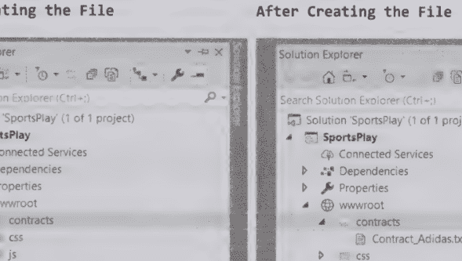

图 14-2. 创建文件的示例。

图 14-3 展示了写入文件的示例。

在 01 处，我们正在构建 SportsPlay 与 Adidas 之间的合同文本。请注意，我们使用 Environment 类的 NewLine 属性向合同文本添加新行。

在 02 处，我们使用 File 类的 AppendAllText() 方法将新构建和格式化的字符串写入文件。请注意，此方法打开文件，将字符串追加到文件，然后关闭文件。如果文件不存在，该方法将首先创建文件。

图中 Result 部分显示了文件写入后的内容。

```csharp
protected void WriteToFile()
{
// Write to the file.
string strFileName = "Contract_Adidas.txt";
string strContractsPath = Path.Combine(IWebHostEnvironment.WebRootPath,
    "contracts");
string strFilePath = Path.Combine(strContractsPath, strFileName);
string strContract = "";
strContract = "AGREEMENT BETWEEN SportsPlay AND Adidas" +
    Environment.NewLine + Environment.NewLine;
strContract += "This Deed of Agreement is made and entered into on
    the 4th day of July 20xx" + Environment.NewLine +
    Environment.NewLine;
strContract += "BETWEEN" + Environment.NewLine + Environment.NewLine;
strContract += "SportsPlay, Inc. (hereinafter referred to as the
    PURCHASER)" + Environment.NewLine + Environment.NewLine;
strContract += "AND" + Environment.NewLine + Environment.NewLine;
strContract += "Adidas, Inc. (hereinafter referred to as the SUPPLIER).";
System.IO.File.AppendAllText(strFilePath, strContract);
}
```

RESULT

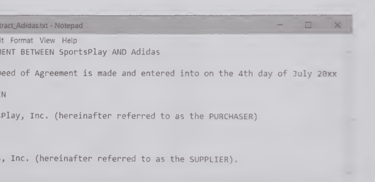

**图 14-3. 写入文件的示例。**

图 14-4 展示了读取文件的示例。

在 01 处，我们使用 File 类的 ReadAllText() 方法从文件中读取。请注意，此方法打开文件，从文件中读取文本，然后关闭文件。

图中 Result 部分的注释显示了文件读取后 strContract 变量的值。

```csharp
protected void ReadFromFile()
{
```

## 文件系统操作

```csharp
// 从文件中读取。
string strFileName = "Contract_Adidas.txt";
string strContractsPath = Path.Combine(IWebHostEnvironment.WebRootPath, "contracts");
string strFilePath = Path.Combine(strContractsPath, strFileName);
string strContract = "";
strContract = System.IO.File.ReadAllText(strFilePath);
```

## 结果

```csharp
// strContract = 
// SportsPlay 与 Adidas 之间的协议

// 本协议于20xx年7月4日订立

// 双方
// SportsPlay, Inc.（以下简称“采购方”）
// 与
// Adidas, Inc.（以下简称“供应方”）。
```


### 页面模型

```csharp
protected void GetAndSetPropertiesAndAttributesOfFile()
{
    // 获取并设置文件的属性和特性。
    string strFileName = "Contract_Adidas.txt";
    string strContractsPath = Path.Combine(IWebHostEnvironment.WebRootPath, "contracts");
    string strFilePath = Path.Combine(strContractsPath, strFileName);
    // 获取文件的日期和时间属性。
    DateTime dateCreated = System.IO.File.GetCreationTime(strFilePath);
    DateTime dateModified = System.IO.File.GetLastWriteTime(strFilePath);
    DateTime dateAccessed = System.IO.File.GetLastAccessTime(strFilePath);

    // 设置文件的日期和时间属性。
    System.IO.File.SetCreationTime(strFilePath, DateTime.Now);
    System.IO.File.SetLastWriteTime(strFilePath, DateTime.Now);
    System.IO.File.SetLastAccessTime(strFilePath, DateTime.Now);

    // 获取文件的只读和隐藏属性。
    FileAttributes fiaFileAttributes =
        System.IO.File.GetAttributes(strFilePath);
    bool booReadOnly = (fiaFileAttributes & FileAttributes.ReadOnly) ==
        FileAttributes.ReadOnly;
    bool booHidden = (fiaFileAttributes & FileAttributes.Hidden) ==
        FileAttributes.Hidden;

    // 根据文件的当前状态，切换（即，取反）其只读和隐藏属性。
    if (booReadOnly && booHidden)
    {
        // 使文件既非只读也非隐藏。
        System.IO.File.SetAttributes(strFilePath, FileAttributes.Normal |
            FileAttributes.Normal);
    }
    else if (booReadOnly && !booHidden)
    {
        // 使文件非只读且隐藏。
        System.IO.File.SetAttributes(strFilePath, FileAttributes.Normal |
            FileAttributes.Hidden);
    }
    else if (!booReadOnly && booHidden)
    {
        // 使文件只读且非隐藏。
        System.IO.File.SetAttributes(strFilePath, FileAttributes.ReadOnly |
            FileAttributes.Normal);
    }
    else
    {
        // 使文件既只读又隐藏。
        System.IO.File.SetAttributes(strFilePath, FileAttributes.ReadOnly |
            FileAttributes.Hidden);
    }
}
```

## 结果

**获取并设置文件属性和特性之前**

**获取并设置文件属性和特性之后**

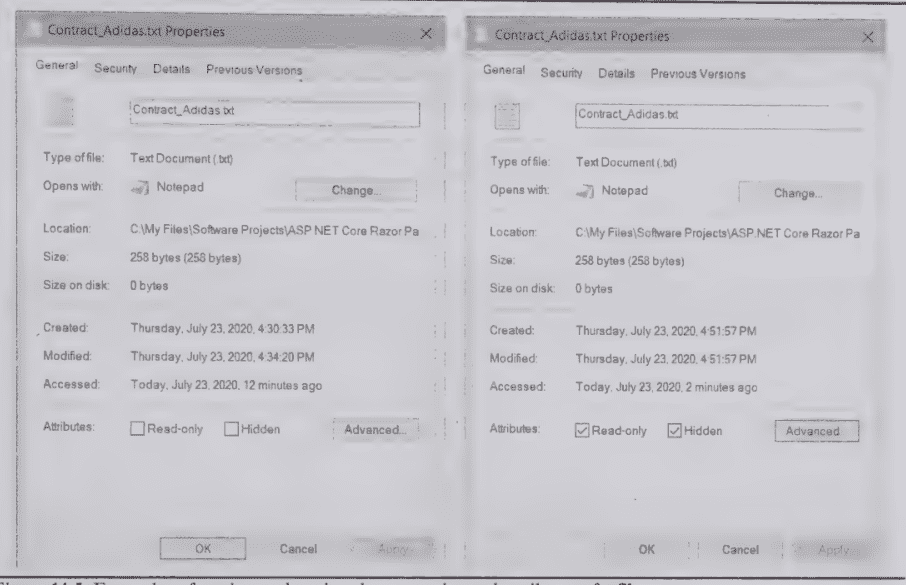

图14-5. 获取和设置文件属性与特性的示例。

图14-6展示了一个文件复制的示例。

在步骤01处，我们声明了一个名为 *strFileNameCopy* 的字符串变量，并将其值设置为 *Contract_Adidas_Copy.txt*。这是我们将要创建作为原始文件副本的文本文件的名称。

在步骤02处，我们将应用程序的“contracts”文件夹路径与要创建为原始文件副本的文件名进行组合，以获得文件路径（即，应用程序的“contracts”文件夹路径加上要创建为原始文件副本的文件名）。可以看到，新文件将与原始文件创建在同一文件夹中。

在步骤03处，我们使用 `File` 类的 `Copy()` 方法将原始文件复制到新文件。

该图结果部分的第一张截图显示了原始文件被复制之前“contracts”文件夹的状态。第二张截图显示了原始文件被复制之后“contracts”文件夹的状态。

### 页面模型

```csharp
protected void CopyFile()
{
    // 复制文件。
    string strContractsPath = Path.Combine(IWebHostEnvironment.WebRootPath,
        "contracts");
    string strFileName = "Contract_Adidas.txt";
    // 01
    string strFileNameCopy = "Contract_Adidas_Copy.txt";
    string strFileNamePath = Path.Combine(strContractsPath, strFileName);
    string strFileNamePathCopy = Path.Combine(strContractsPath,
        strFileNameCopy);
    // 03
    System.IO.File.Copy(strFileNamePath, strFileNamePathCopy);
}
```

## 结果

**复制原始文件之前**

**复制原始文件之后**

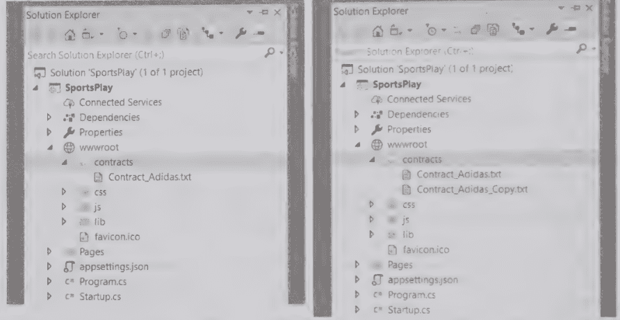

图14-6. 复制文件的示例。

图14-7展示了一个删除文件的示例。请注意，文件的只读属性必须设置为 *false*，删除操作才能成功。

在步骤01处，我们使用 `File` 类的 `Exists()` 方法来查看要删除的文件是否存在。如果存在，我们删除该文件。如果不存在，我们*不会*尝试删除该文件。

在步骤02处，我们使用 `File` 类的 `Delete()` 方法来删除该文件。

该图结果部分的第一张截图显示了原始文件被删除之前“contracts”文件夹的状态。第二张截图显示了原始文件被删除之后“contracts”文件夹的状态。

### 页面模型

```csharp
protected void DeleteFile()
{
    // 删除文件。
    string strMessage = "";
    string strFileName = "Contract_Adidas.txt";
    string strContractsPath = Path.Combine(IWebHostEnvironment.WebRootPath,
        "contracts");
    string strFilePath = Path.Combine(strContractsPath, strFileName);
    // 01
    if (System.IO.File.Exists(strFilePath))
    {
        // 02
        System.IO.File.Delete(strFilePath);
        strMessage = "合同文件已成功删除。";
    }
    else
    {
        strMessage = "合同文件删除失败。";
    }
    // strMessage = "合同文件已成功删除。"
}
```

## 结果

**删除原始文件之前**

**删除原始文件之后**

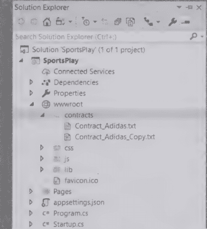

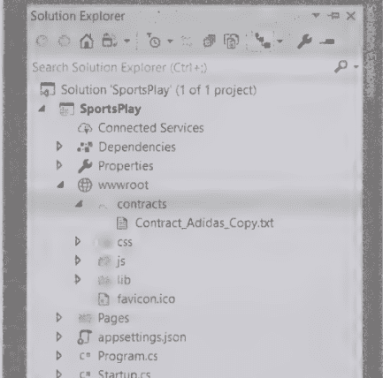

图14-7. 删除文件的示例。

## 14.3 项目

遵循标题为 *解决方案和项目* 章节中阐述的标识符命名标准。使用 `Table` 元素来安排页面上的其他 HTML 元素，以使页面看起来组织有序。

1.  启动一个名为 *姓氏.名字.章节99* 的新项目，其中 99 是本章的章号。
2.  在项目中添加一个名为 *PerformFileSystemOperations* 的 Razor 页面。
3.  在项目中添加一个名为 *Files* 的文件夹。
4.  添加一个 `Label` 元素，用于显示此页面的所有消息。
5.  添加一个 `Input (Text)` 元素。添加一个包含五行的 `Textarea` 元素。
6.  添加一个 `Input (Submit)` 元素，显示文本 *Create File*。在文本框中输入一个文件名（带有 .txt 扩展名）。当按钮被点击时，在“Files”文件夹中创建该文件，并在标签中显示 “File successfully created.”。如果文件已存在，则在标签中显示 “File already exists.”。
7.  添加一个 `Input (Submit)` 元素，显示文本 *Update File*。在文本框中输入一个文件名，并在文本区域中输入你选择的句子。当按钮被点击时，*覆盖*该文件的内容，并在标签中显示 “File successfully updated.”。如果文件不存在，则在标签中显示 “File does not exist.”。
8.  添加一个 `Input (Submit)` 元素，显示文本 *Read File*。在文本框中输入一个文件名，并清空文本区域中的内容。当按钮被点击时，将文件内容读入文本区域，并在标签中显示 “File successfully read.”。如果文件不存在，则在标签中显示 “File does not exist.”。
9.  添加一个 `Input (Submit)` 元素，显示文本 *Protect File*。在文本框中输入一个文件名。当按钮被点击时，将文件设置为只读，并在标签中显示 “File is read-only.”。如果文件不存在，则在标签中显示 “File does not exist.”。
10. 添加一个 `Input (Submit)` 元素，显示文本 *Unprotect File*。在文本框中输入一个文件名。当按钮被点击时，将文件设置为非只读，并在标签中显示 “File is not read-only.”。如果文件不存在，则在标签中显示 “File does not exist.”。
11. 添加一个 `Input (Submit)` 元素，显示文本 *Delete File*。在文本框中输入一个文件名。当按钮被点击时，从“Files”文件夹中删除该文件，并在标签中显示 “File successfully deleted.”。如果文件不存在，则在标签中显示 “File does not exist.”。
12. 测试该页面并进行必要的修正。


# 15 自定义 C# 类

## 15.1 简介

与本书中讨论的其他 C# 类一样，自定义 C# 类可以包含属性和方法。这些类之所以称为"自定义"，是因为它们只包含我们定义的属性和方法。正因如此，它们只做我们想做的事——不多不少。当我们需要在单个应用程序的多个位置或多个应用程序中执行某些函数或过程时，自定义 C# 类非常有用。所以，与其编写一段代码来执行某个函数或过程，然后将该Nu拷贝到多个地方，不如在自定义 C# 类中编写一个方法，然后在需要时调用该方法。这样，当需要修改代码逻辑时，我们只需在一个地方进行修改。

在 C# 中，我们可以创建非静态类和静态类。一般来说，非静态类包含非静态属性和非静态方法，我们只能在从其实现类*实例化*对象之后*才能使用这些属性和方法。<sup>22</sup> 当非静态类的属性和方法用于表示现实世界中的某些事物（如员工或产品）时，我们通常会创建非静态类。另一方面，静态类包含静态属性和静态方法，我们可以*立即*使用它们，而无需从其实现类实例化对象。当静态类的属性和方法用于执行某个函数或过程时，我们通常会创建静态类。

## 15.2 类设计

类设计是规划类的属性和方法的过程。类设计的主要目标之一是*重用性*。当我们设计一个类时，如果该类具有广泛的适用性（即，我们预计它将来可能在其他地方使用），我们应该着眼于重用性来设计它，这样我们就不必浪费时间重复编写相同的代码。当一个类设计良好时，我们在增强现有应用程序或开发新应用程序时，更有可能重用该类。

类设计的另一个主要目标是创建具有*高内聚度*的方法。内聚度是指方法的指令在功能上的相关程度。换句话说，它是方法的编程语句协同工作以执行*单一任务*的程度。创建执行单一任务的方法有三个优点。第一，它们相对容易理解和修改，因为我们知道它们应该执行的单一任务。第二，应用程序中出现的任何问题的原因相对容易定位，因为我们可以轻易地将问题的性质与方法应该执行的单一任务关联起来。第三，它们相对容易进行单元测试，因为它们只做一件事。

类设计的第三个主要目标是创建具有*低耦合度*的方法。耦合度是指两个或多个方法之间的相互依赖程度。换句话说，它是两个或多个方法在功能或数据上相互依赖的程度。方法之间在功能或数据上依赖较少的主要优点是，它们相对独立于与之交互的方法。因此，对它们进行更改所需的集成测试相对较少。

> <sup>22</sup> *非静态*类也可以包含*静态*属性和*静态*方法，我们可以*立即*使用它们，而无需从其实现类实例化对象。

## 15.3 C# 类

C# 类是可以定义为非静态或静态的自定义类，可以包含任意数量的属性和/或方法。C# 类的所有属性和/或方法都是自定义的。也就是说，没有预定义的属性和/或方法——只有我们定义的属性和/或方法。C# 类创建后，可以在单个应用程序或多个应用程序中使用。同样，这避免了在多个地方编写相同的代码。

## 15.4 Classes 文件夹

在创建自定义非静态和静态 C# 类之前，我们需要在项目中添加一个名为 `Classes` 的文件夹。图 15-1 展示了 `Classes` 文件夹。该文件夹将存放我们即将创建的类（以及将来可能希望创建的任何类）。在项目中添加 `Classes` 文件夹将有助于我们将所有类集中在一个地方，并帮助我们总体上保持应用程序的整洁有序。既然我们已经添加了 `Classes` 文件夹，现在就可以将自定义非静态和静态 C# 类添加到其中。

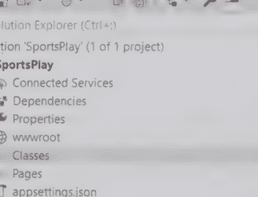  
*图 15-1. Classes 文件夹*

## 15.5 非静态 C# 类

在本节中，我们需要在 `Classes` 文件夹中创建一个新的非静态 C# 类，名为 **Employee**。该类将包含多个属性和两个方法——一个名为 `GenerateEmailAddress()` 的方法，用于生成员工电子邮件地址，以及一个名为 `GeneratePassword()` 的方法，用于生成员工密码。请记住，我们可以向类中添加任意数量的属性和方法。

图 15-2 展示了非静态 Employee 类的内容。

在 **01** 处，我们在 `PageModel` 类中包含了 System 命名空间，因为 *Random* 类（在 **07** 处）定义在该命名空间中。

在 **02** 处，我们引用了 SportsPlay.Classes 命名空间。此引用表明在 **03** 处定义的 Employee 类位于 SportsPlay.Classes 命名空间中。它还表明该类位于 SportsPlay 项目的 Classes 文件夹中。

在 **03** 处，我们有一个公共类定义，其中被定义的类名称为 *Employee*。请注意，此类定义中缺少 *static* 一词，使其成为*非静态*类。

在 **04** 处，我们有类的属性。请注意，此类的属性从 `LastName` 属性开始，到 `Status` 属性结束。

在 **05** 处，我们在 Employee 类中定义了一个名为 `GenerateEmailAddress()` 的公共方法。请注意，此方法定义中缺少 *static* 一词，使其成为*非静态*方法。关于此方法的定义，还有另外两点需要注意：
- 第一，*string* 一词表明该方法将向调用它的方法返回一个 string 类型的值。
- 第二，该方法期望从调用它的方法接收两个输入参数——一个 string 类型的名字和一个 string 类型的姓氏。

在 **06** 处，我们在 Employee 类中定义了一个名为 `GeneratePassword()` 的公共方法。请注意，此方法定义中Biz escort *static* 一词，使其成为*非静态*方法。关于此方法的定义，还有另外两点需要注意：
- 第一，*string* 一词表明该方法将向调用它的方法返回一个 string 类型的值。
- 第二，该方法期望从调用它的方法接收两个输入参数——一个 string 类型的名字和一个 string 类型的姓氏。

在 **07** 处，我们从 *Random* 类创建了一个名为 `objRandom` 的新 Random 对象，以便我们可以使用其方法之一生成随机数。请注意，Random 类是非静态类，因为我们必须先从它创建对象，然后才能使用其属性和/或方法。

在 **08** 处，我们正在使用 `objRandom` 对象的 Next() 方法生成一个介于 1 到 10 之间（含）的随机数。

```csharp
PAGEMODEL
/// <summary>
/// PageModel 类包含 Employee 实现
/// 
/// 在 5 行：使用 System 命名空间（见下文）
/// </summary>
using System;
namespace SportsPlay.Classes
{
    public class Employee // 该行通常对应于原文中的标签 03，但代码结构暗示此块覆盖了标签
    
        /// <summary>
        /// 定义类的属性。
        /// 属性从 LastName（标签 04 开始）到 Status（列表末尾）。
        /// </summary>
    public string LastName { get; set; } // 该行通常对应于典型目视检查中的标签 04-1，此处由逻辑顺序表示
public string FirstName { get; set; }   # 在 LastName 之后的第 2 行
public string MiddleInitial { get; set; }# 在第 3 行
public string Address { get; set; }     # 在第 4 行
public string City { get; set; }        # 在第 5 行  
public string State { get; set; }       # 在第 6 行 
public string ZipCode { get; set; }     # 在第 7 行
public string Phone { get; set; }       # 在第 8 行  
public string EmailAddress { get; set; }# 在第 10 行（注意：输入参数为 strFirstName、strLastName，基于方法签名） 
    public string Password { get; set; } // 该行对应于标签 ...
        public string Status { get; set; }// 属性块结尾
        
/// <summary>
/// 生成员工电子邮件地址。
/// </summary>
    /// <param name="strFirstName">名字输入参数</param>
    /// <param name="strLastName">姓氏输入参数</param>
   public string GenerateEmailAddress(string strFirstName, 
                                    string strLastName) // 方法体从此处开始，对应于 05/06 的上下文逻辑
    
    {   
       /// 在第 7 行：Random 对象创建（视觉上对应于标签 07，但方法签名在上方或之前，取决于解析）。
        // 为简洁描述 "At 08"，原文代码片段中省略了代码，侧重于随机数的使用。
       
    }  
    
    public string GeneratePassword() 
    {   
       /// 逻辑继续...  
        
    } 
    
}

// 注意：提供的 OCR 文本包含特定的注释，如 'At 01'、'At 02' 等，这些注释描述了教学编程书籍中常见的视觉布局或概念步骤。
// 以下是基于 OCR 内容的关键类组件的简化表示，不严格按代码执行，尽可能保留注释和结构样式。

/// <summary>
// 标记为 'PAGEMODEL' 的行表明此片段可能来自交互式 PDF 练习查看器，如 Microsoft Learn 或 Visual Studio 文档示例。
// 原文注释："At 07 Random 类是非静态类，因为我们必须先创建对象..." rodentsupp note 虽然在某些上下文中也存在静态 Random（using System; 包含它）。
</summary>

```


## 15.6 静态 C# 类

### 页面模型

```
using Microsoft.AspNetCore.Mvc.RazorPages;
01  using SportsPlay.Classes;

namespace SportsPlay.Pages
{
    public class InstantiateEmployeeModel : PageModel
    {
        public void OnGet()
        {
            // Initialize the variables associated with the employee.
            string strLastName = "Okon";
            string strFirstName = "Dawn";
            string strMiddleInitial = "R";
            string strAddress = "6785 New Jersey Road";
            string strCity = "Bradenton";
            string strState = "FL";
            string strZipCode = "48321";
            string strPhone = "734-987-1234";
            string strEmailAddress = "";
            string strPassword = "";
            string strStatus = "s";

            // Create an Employee object from the Employee class.
            Employee objEmployee = new Employee();

            // Generate an email address for the employee.
            strEmailAddress =
                objEmployee.GenerateEmailAddress(strFirstName, strLastName);

            // Generate a password for the employee.
            strPassword =
                objEmployee.GeneratePassword(strFirstName, strLastName);

            // Set the properties of the Employee object.
            objEmployee.LastName = strLastName;
            objEmployee.FirstName = strFirstName;
            objEmployee.MiddleInitial = strMiddleInitial;
            objEmployee.Address = strAddress;
            objEmployee.City = strCity;
            objEmployee.State = strState;
            objEmployee.ZipCode = strZipCode;
            objEmployee.Phone = strPhone;
            objEmployee.EmailAddress = strEmailAddress;
            objEmployee.Password = strPassword;
            objEmployee.Status = strStatus;

            // Get the properties from the Employee object.
            string strLastName2 = objEmployee.LastName;
            string strFirstName2 = objEmployee.FirstName;
            string strMiddleInitial2 = objEmployee.MiddleInitial;
            string strAddress2 = objEmployee.Address;
            string strCity2 = objEmployee.City;
            string strState2 = objEmployee.State;
            string strZipCode2 = objEmployee.ZipCode;
            string strPhone2 = objEmployee.Phone;
            string strEmailAddress2 = objEmployee.EmailAddress;
            string strPassword2 = objEmployee.Password;
            string strStatus2 = objEmployee.Status;

            }
        }
    }
}
```

### 结果

```
// strLastName2 = "Okon"
// strFirstName2 = "Dawn"
// strMiddleInitial2 = "R"
// strAddress2 = "6785 New Jersey Road"
// strCity2 = "Bradenton"
// strState2 = "FL"
// strZipCode2 = "48321"
// strPhone2 = "734-987-1234"
// strEmailAddress2 = "dokon@sportsplay.com"
// strPassword2 = "do#5323"
// strStatus2 = "s"
```


## 15.6 静态 C# 类

在本节中，我们需要在 Classes 文件夹中创建一个名为 Credentials 的新静态 C# 类。该类将包含两个方法——一个名为 `GenerateEmailAddress()` 的方法用于生成员工邮箱地址，另一个名为 `GeneratePassword()` 的方法用于生成员工密码。请记住，我们可以在类中添加任意数量的属性和方法。

图 15-4 显示了静态 Credentials 类的内容。

在 01 处，由于 Random 类（在 06 处）定义在该命名空间中，我们在 PageModel 类中包含了 System 命名空间。

在 02 处，我们引用了 SportsPlay.Classes 命名空间。该引用表明在 03 处定义的 Credentials 类驻留在 SportsPlay.Classes 命名空间中。它还表明该类位于 SportsPlay 项目的 Classes 文件夹中。

在 03 处，我们有一个公共类定义，其中正在定义的类的名称是 Credentials。注意，此类定义中存在 static 一词使其成为一个静态类。

在 04 处，我们在 Credentials 类内部定义了一个名为 `GenerateEmailAddress()` 的公共方法。注意，此方法定义中存在 static 一词使其成为一个静态方法。还有两件事值得注意：首先，string 一词表明该方法将返回字符串类型的值给调用它的方法；其次，该方法期望接收来自调用它的方法的两个输入参数——一个类型为 string 的名字和一个类型为 string 的姓氏。

在 05 处，我们在 Credentials 类内部定义了一个名为 `GeneratePassword()` 的公共方法。注意，此方法定义中存在 static 一词使其成为一个静态方法。还有两件事值得注意：首先，string 一词表明该方法将返回字符串类型的值给调用它的方法；其次，该方法期望接收来自调用它的方法的两个输入参数——一个类型为 string 的名字和一个类型为 string 的姓氏。

### 页面模型

```
01 using System;

02 namespace SportsPlay.Classes
03 {
    public static class Credentials
    {
04      public static string GenerateEmailAddress(string strFirstName,
            string strLastName)
      {
         // Generate an email address. The person's email address is
         // composed of his or her first initial and last name followed
         // by @sportsplay.com.
         string strEmailAddress = strFirstName.Substring(0, 1).ToLower() +
            strLastName.ToLower() + "@sportsplay.com";
         return strEmailAddress;
      }
05      public static string GeneratePassword(string strFirstName,
            string strLastName)
      {
         // Generate a password. The person's password is composed
         // of his or her first and last initials followed by five
         // randomly-generated characters.
         string strFirstNameInitial =
            strFirstName.Substring(0, 1).ToLower();
         string strLastNameInitial =
            strLastName.Substring(0, 1).ToLower();
         string strPassword = strFirstNameInitial + strLastNameInitial;
06       Random objRandom = new Random();
         for (int i = 1; i <= 5; i++)
         {
07          short shoRandomNumber = (short)objRandom.Next(1, 10);
            switch (shoRandomNumber)
            {
               case 1:
                  strPassword = strPassword + "1";
                  break;
               case 2:
                  strPassword = strPassword + "2";
```


```markdown
## 图 15-4. 静态 Credentials 类的内容。

图 15-5 展示了调用静态 Credentials 类方法的示例。在 01 处，我们在 PageModel 类中包含了 SportsPlay.Classes 命名空间，因为 Credentials 类（在 02 和 03 处）是在该命名空间中定义的。在 02 处，我们通过调用 Credentials 类的 GenerateEmailAddress() 方法，为名为 *Dawn*、姓为 *Okon* 的员工生成电子邮件地址。在 03 处，我们通过调用 Credentials 类的 GeneratePassword() 方法，为名为 *Dawn*、姓为 *Okon* 的员工生成密码。该图的 Result 部分显示了由 Employee 类的方法生成后的 strEmailAddress 变量和 strPassword 变量的值。

**PAGEMODEL**

```csharp
using Microsoft.AspNetCore.Mvc.RazorPages;
01 using SportsPlay.Classes;

namespace SportsPlay.Pages
{
    public class GenerateCredentialsModel : PageModel
    {
        public void OnGet()
        {
            // 初始化名和姓。
            string strFirstName = "Dawn";
            string strLastName = "Okon";

            // 生成电子邮件地址。
            string strEmailAddress =
                Credentials.GenerateEmailAddress(strFirstName, strLastName);

            // 生成密码。
            string strPassword =
                Credentials.GeneratePassword(strFirstName, strLastName);
        }
    }
}
```

```
RESULT

// strEmailAddress = "dokon@sportsplay.com"
// strPassword = "do#5323"
```

## 图 15-5. 调用静态 Credentials 类方法的示例。

## 15.7 项目

遵循名为 *Solutions and Projects* 的章节中阐述的标识符命名标准。使用 Table 元素来安排页面上的其他 HTML 元素，使页面看起来组织良好。

## 第一部分

1.  启动一个名为 *Lastname.Firstname.Chapter99* 的新项目，其中 99 是本章的编号。
2.  向项目中添加一个名为 *Classes* 的文件夹。
3.  向 *Classes* 文件夹中添加一个名为 *Supplier* 的 *非静态* C# 类。
4.  向该类添加一个名为 *TranslatePhoneNumber()* 的 *非静态* 方法。此方法应接收一个类型为 *string* 的输入参数 *strPhoneNumber*，并应返回一个类型为 *string* 的值。当调用此方法时，它应接收一个包含字母的电话号码（例如，1-800-bab-olat），并将其转换为等效的数字电话号码（例如，1-800-222-6528）。
5.  向该类添加一个名为 *StandardizePhoneNumber()* 的 *非静态* 方法。此方法应接收一个类型为 *string* 的输入参数 *strPhoneNumber*，并应返回一个类型为 *string* 的值。当调用此方法时，它应接收一个不包含连字符的电话号码（例如，1800babolat），并将其转换为标准形式（例如，1-800-bab-olat）。

## 第二部分

1.  向项目中添加一个名为 InvokeNonStaticClass 的 Razor 页面。
2.  添加一个 Label 元素，用于显示此页面的所有消息。
3.  添加一个 Input（Text）元素。
4.  添加一个显示为“翻译电话号码”的 Input（Submit）元素。在文本框中输入电话号码（例如，1-800-bab-olat）。当按钮被点击时，调用 Supplier 类的 **TranslatePhoneNumber()** 方法，并在标签中显示翻译后的电话号码。
5.  添加一个显示为“标准化电话号码”的 Input（Submit）元素。在文本框中输入电话号码（例如，1800babolat）。当按钮被点击时，调用 Supplier 类的 **StandardizePhoneNumber()** 方法，并在标签中显示标准化的电话号码。
6.  测试页面并进行任何必要的更正。

## 第三部分

1.  向 Classes 文件夹中添加一个名为 PhoneNumber 的静态 C# 类。
2.  向该类添加一个名为 Translate() 的 **静态** 方法。此方法应执行与第一部分中其非静态对应方法相同的功能。
3.  向该类添加一个名为 Standardize() 的静态方法。此方法应执行与第一部分中其非静态对应方法相同的功能。

## 第四部分

1.  向项目中添加一个名为 InvokeStaticClass 的 Razor 页面。
2.  添加一个 Label 元素，用于显示此页面的所有消息。
3.  添加一个 Input（Text）元素。
4.  添加一个显示为“翻译电话号码”的 Input（Submit）元素。在文本框中输入电话号码（例如，1-800-bab-olat）。当按钮被点击时，调用 PhoneNumber 类的 **Translate()** 方法，并在标签中显示翻译后的电话号码。
5.  添加一个显示为“标准化电话号码”的 Input（Submit）元素。在文本框中输入电话号码（例如，1800babolat）。当按钮被点击时，调用 PhoneNumber 类的 **Standardize()** 方法，并在标签中显示标准化的电话号码。
6.  测试页面并进行任何必要的更正。

# 第四部分 – 多页 Web 应用程序开发

# 16 状态维护

## 16.1 简介

状态维护是在用户浏览 Web 应用程序页面时，保存其数据状态的过程。这个过程是必要的，因为客户端-服务器 Web 应用程序是无状态的，这意味着一旦服务器向客户端提供了一个页面，服务器就会完全忘记该客户端、它刚刚提供的页面以及与该页面相关的任何数据。换句话说，一旦客户端通过 HTTP 请求请求了一个页面，并且服务器通过 HTTP 响应响应了该页面，客户端和服务器之间的任何连接就会丢失。事实上，每个新的页面请求都会导致一个全新页面的创建和返回，无论用户是重新请求他或她当前所在的页面，还是请求一个完全不同的页面。

由于客户端-服务器 Web 应用程序是无状态的，我们需要一种方法来保存页面数据，以便我们可以开发多个页面协同工作作为一个连贯整体的应用程序。在 ASP.NET Core 中开发 Web 应用程序时，我们可以使用多种方法来保存从一个页面到下一个页面的数据。然而，我们选择的方法（或多种方法）主要取决于我们如何回答以下问题：

- 数据需要持久化多长时间？
- 需要向服务器发送多少数据？
- 数据是否敏感？
- 同时有多少用户将使用该应用程序？
- 服务器将有多少 RAM？

在 Web 应用程序中维护状态时，我们有两个基本选项。我们可以在客户端维护状态，也可以在服务器端维护状态。我们也可以使用这些方法的某种组合来维护状态。

## 16.2 常见页面组件

在了解基于客户端和基于服务器的状态维护的细节之前，我们需要看一下两组相关页面的常见组件。现在查看这些组件将提供一些上下文，并使我们的讨论更有效率。首先，我们将查看一个登录页面及其关联的欢迎页面的常见组件。由于这些页面的常见组件在本章中是相同的，为了节省空间，我们将只展示一次。登录示例将帮助我们了解，当需要数据在用户会话处于活动状态期间（即只要用户积极使用应用程序）持久化时，如何维护状态。其次，我们将查看一个添加产品页面及其关联的确认产品页面的常见组件。同样，由于这些页面的常见组件在本章中是相同的，为了节省空间，我们将只展示一次。添加产品示例将帮助我们了解，当我们只需要数据在从一个页面到下一个页面的期间（即一个页面的数据传输到下一个页面所需的时间）持久化时，如何维护状态。

图 16-1 展示了登录页面的常见组件。花点时间熟悉此页面的组件。正如我们将看到的，当用户在
```


此页面并将页面提交到服务器进行处理时，用户的姓名和状态将传递给欢迎页面进行显示。

```
public void OnGet()
{
}
...
```

图 16-1。登录页面的常见组件。

图 16-2 展示了欢迎页面的常见组件。请花些时间熟悉该页面的各个组件。正如我们将会看到的，当此页面在浏览器中渲染时，用户的姓名和状态将显示在页面的消息中。

```
@page
@model SportsPlay.Pages.Welcome[...]Model
@{
  ViewData["Title"] = "Welcome";
}

<h1>Welcome</h1>

<label>Message:</label>
<label style="color: @Model.MessageColor">@Model.Message</label>
```

```
namespace SportsPlay.Pages
{
  public class Welcome[...]Model : PageModel
  {
    public string MessageColor;
    public string Message;
    ...
  }
}
```

图 16-2。欢迎页面的常见组件。

图 16-3 展示了"添加产品"页面的常见组件。请花些时间熟悉该页面的各个组件。正如我们将会看到的，当用户在此页面上输入产品信息并将页面提交到服务器进行处理时，产品的信息将传递给"确认产品"页面进行显示。

```
@page
@model SportsPlay.Pages.AddProduct[...]Model
@{
```

```
  ViewData["Title"] = "Add Product";
}

<h1>Add Product</h1>

<label>Message:</label>
<label style="color: @Model.MessageColor">@Model.Message</label>

<form method="post">

  <table>
    <tr>
      <td><label>Category</label></td>
      <td>
        <select asp-for="CategoryId">
          <option value=""></option>
          <option value="1">Footwear - Men's</option>
          <option value="2">Footwear - Women's</option>
          <option value="3">Racquets</option>
        </select>
      </td>
    </tr>
    ...

    <tr>
      <td><label>Product</label></td>
      <td><input asp-for="Product" /></td>
    </tr>
    ...

    <tr>
      <td><label>Price</label></td>
      <td><input asp-for="Price" /></td>
    </tr>
    ...

    <tr>
      <td><label>Reorder Level</label></td>
      <td><input asp-for="ReorderLevel" /></td>
    </tr>
  </table>
</form>
```

```
namespace SportsPlay.Pages
{
  [BindProperties]

  public class AddProduct[...]Model : PageModel
  {
    public string MessageColor;
    public string Message;

    public int ProductId { get; set; }
    public int CategoryId { get; set; }
    ...
    public string Product { get; set; }
    ...
    public decimal Price { get; set; }
    ...
    public byte ReorderLevel { get; set; }

    public void OnGet()
    {
    }
    ...
  }
}
```

**图 16-3。** "添加产品"页面的常见组件。

图 16-4 展示了"确认产品"页面的常见组件。请花些时间熟悉该页面的各个组件。正如我们将会看到的，当此页面在浏览器中渲染时，产品的数据将显示在页面的主体中。请记住，在这样的"确认产品"页面上，我们可能会修改页面上的 HTML 元素，以便用户无法更改在"添加产品"页面上选择和输入的值。我们不会在这里这样做，因为需要 CSS。我们将在题为*层叠样式表*的章节中讨论 CSS。

```
@page
@model SportsPlay.Pages.ConfirmProduct[...]Model
@{
    ViewData["Title"] = "Confirm Product";
}

<h1>Confirm Product</h1>

<label>Message:</label>
<label style="color: @Model.MessageColor">@Model.Message</label>

<form method="post">
    <table>
        <tr>
            <td><label>Category</label></td>
            <td>
                <select asp-for="CategoryId">
                    <option value=""></option>
                    <option value="1">Footwear - Men's</option>
                    <option value="2">Footwear - Women's</option>
                    <option value="3">Racquets</option>
                </select>
            </td>
        </tr>
        ...

        <tr>
            <td><label>Product</label></td>
            <td><input asp-for="Product" /></td>
        </tr>
        ...

        <tr>
            <td><label>Price</label></td>
            <td><input asp-for="Price" /></td>
        </tr>
        ...

        <tr>
            <td><label>Reorder Level</label></td>
            <td><input asp-for="ReorderLevel" /></td>
        </tr>
        <tr>
            <td></td>
            <td><input asp-page-handler="Save" type="submit" value="Save" /></td>
        </tr>
    </table>

</form>
```

```
namespace SportsPlay.Pages
{
    [BindProperties]
    public class ConfirmProduct[...]Model : PageModel
    {
        public string MessageColor;
        public string Message;

        public int ProductId { get; set; }
        public int CategoryId { get; set; }
        ...
        public string Product { get; set; }
        ...
        public decimal Price { get; set; }
        ...
        public byte ReorderLevel { get; set; }
        ...
    }
}
```

## 16.3 基于客户端的状态维护

要在客户端维护状态，我们可以利用 Cookie、查询字符串参数、路由数据参数和/或 tempdata 变量。在本节中，我们将讨论所有这些基于客户端的状态维护方法。

### 16.3.1 Cookie

Cookie 允许我们保存页面的数据，以便我们可以在应用程序的后续页面上检索和使用这些数据。Cookie 有两种类型——*非持久性 Cookie*和*持久性 Cookie*。非持久性 Cookie（又称内存 Cookie 或会话 Cookie）存储在客户端的内存中，并在其关联的会话终止时过期（即自动删除）。因此，非持久性 Cookie 在客户端浏览器关闭之前一直可供应用程序使用。另一方面，持久性 Cookie 存储在客户端硬盘上的浏览器文件中，并且在其关联的会话终止时不会过期（即不会自动删除）。因此，即使客户端浏览器关闭后，持久性 Cookie 仍然可供应用程序使用。事实上，持久性 Cookie 在存储在 Cookie 的 Expires 属性中的日期和时间之前一直可供应用程序使用。持久性 Cookie 通常用于识别稍后返回应用程序的用户的首选项，如语言、主题和菜单，而无需他们先登录应用程序。无论是非持久性还是持久性，Cookie 都包含一个键值对。大多数浏览器将 Cookie 的大小限制为 4,096 字节。

使用 Cookie 的优点包括

- 由于 Cookie 存储在客户端的内存或硬盘上，因此它们不需要服务器内存。

使用 Cookie 的缺点包括

- 由于大多数浏览器将 Cookie 的大小限制在 4,096 到 8,192 字节之间，因此 Cookie 中可以存储的数据量存在实际限制。
- 由于某些用户将其浏览器配置为不接受 Cookie，因此依赖 Cookie 进行状态维护的应用程序将无法正常工作。
- 由于持久性 Cookie 存储在客户端硬盘上的文件中，因此用户或黑客可以通过查看文件内容直接访问它，从而可能被篡改，造成潜在的安全风险或导致应用程序故障。

图 16-5 展示了设置 Cookie 的示例。请注意，这是一个登录示例，我们将员工的 ID 存储在一个 Cookie 中（以便应用程序始终知道谁已登录），并将他/她的姓名和状态存储在另一个 Cookie 中（以便应用程序始终可以获取这些信息进行显示）。

> 23 要将 Cookie 配置为在指定日期和时间之后（或之前）过期，我们需要将 Expires 选项添加到 Cookie 的 CookieOptions 集合中，然后将 Expires 选项设置为所需的日期和时间。


220 • 状态维护

在示例 1 中，我们在 PageModel 类中添加了一个 OnPostLogin() 处理器方法。当单击登录按钮时，会调用该处理器方法，并在服务器上处理页面。如果用户成功登录，则将其重定向到欢迎页（见示例 4）。如果用户未能成功登录，则将其重定向到登录页（见示例 5）。

在示例 2 中，我们将从数据库返回并转换为字符串的用户员工 ID 保存到名为 intEmployeeId 的 Cookie 中。

在示例 3 中，我们将从数据库返回并已格式化的用户名和状态信息保存到名为 strUser 的 Cookie 中。

该图的结果部分显示了用户尝试登录应用程序之前出现的登录页。

### PAGEMODEL

```
using Microsoft.AspNetCore.Mvc;
using Microsoft.AspNetCore.Mvc.RazorPages;

public RedirectResult OnPostLogin()
{
    // 通过模拟数据库查找来让用户登录。
    if (EmailAddress == "rregal@sportsplay.com" && Password == "abc")
    {
        // 假设从数据库返回以下属性值。请注意，根据我们
        // 的标准，属性名称不应以类型开头。
        int EmployeeId = 2;
        string LastName = "Regal";
        string FirstName = "Richard";
        string MiddleInitial = "R";
        string Status = "M";
        // 格式化状态信息。
        if (Status == "M")
        {
            Status = "经理";（Manager）;
          }
else{
              Status = "员工";（Staff）;
    }
        // 格式化用户信息。
string strUser = FirstName + " " + MiddleInitial + " " + LastName +
           "(+"Status+")”；(+)Format+the+user's+(own)+name+and+title.) ;// Set the cookies.
Response.Cookies.Append("intEmployeeId", EmployeeId.ToString());
        Response.Cookies.Append("strUser”, strUser); // Go to the Welcome page. 
        return Redirect("WelcomeCookies");}
else{
```  

```  
         // 设置消息。     
MessageColor = "Red";
        Message = “您输入的电子邮件地址和密码组合无效。请再试一次。”；    
return null;    }

}```  

## RESULT


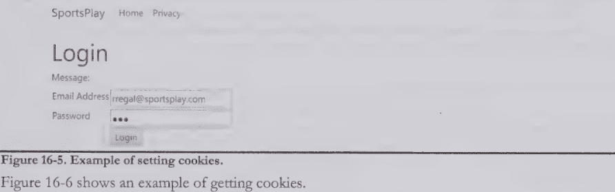  

图 16-5。设置 Cookie 的示例。  
图 16-6显示了提取 Cookie 的示例。


在示例 1 中，由于 Convert 类（见示例 2）定义在该命名空间中，我们在 PageModel 类中包含 System 命名空间。   
      
在示例 2 中，我们从 intEmployeeId cookie 中提取用户员工 ID，并将其从字符串转换为整数以恢复其原始形式。注意我们并没有在本方法中使用 intEmployeeId变量。我们仅展示如果需要在何处提取该变量的处理方式  
       
在示例 3 中，我们从 strUser cookie 中检索用户的姓名和状态信息。请注意我们在显示的消息（见示例 4）中使用了此 Cookie的值。


The Result section of the figure shows that after successful login, user name and status are shown in message body.  

### PAGEMODEL

```using Microsoft.AspNetCore.Mvc.RazorPages;
    using System:

public void OnGet()  
   
// Get the cookies.    
int intEmployeeId = Convert.ToInt32(Request.Cookies["IntEmployeeID"]);        
string strUser= Request.Cookies["strUser"] ; 

04 MessageColor="Green";      
Message ="You have logged in successfully as " + strUser+",Welcome to SportsPlay!}
```  

## RESULT

<img/4ac9c8b97afca3a25461fdaebba5o2ftfa_2d,。mge]  

图 1.7：获取查询字符串参数的示例。


### 16.3.2 查询字符串参数


```   
   Query string parameters permit us to preserve the data of a page so that we can retrieve and use that data on a subsequent page within an application. These are passed from one page to another via URL; A query string parameter contains key-value pair, Most browsers restrict encoded URLs(Containing only queries) between 20876 Bytes:   
  

The advantages include  
-Since they don't require memory usage since it's just text which does not need server-side processing.    
Since virtually all modern browsers support them relatively reliably for compatibility reasons though caution is needed about potential issues like security risks when using GET requests or form subission methods etc;


Disadvantages:  
- Since query string parameters can be seen by users in browser history, bookmarks URL may contain sensitive data that could lead to unauthorized access if not properly filtered before display/output/displayed publicly without proper escaping characters handling potentially exposing PII information.    
- Because they are visible URLs themselves when bookmarked/shared across platforms such as social media sharing links containing user-specific content might expose private personal identification info unintentionally unless explicitly protected via HTTPS encryption protocols otherwise leading to privacy breaches especially given increasing awareness regarding GDPR compliance practices globally today amongst consumers worldwide today amidst rising cyberattacks targeting specific industries sectors including financial services healthcare providers etc alongside growing concerns over government surveillance programs domestically internationally combined together forming massive networks capable intercepting traffic patterns across borders thereby creating significant legal challenges faced by multinational corporations operating under multiple jurisdictions simultaneously while attempting maintain full adherence strict regulations governing both domestic laws international treaties alike applying equally regardless whether originating from US European Union countries Japan China Korea Australia Canada India Singapore Hong Kong Taiwan Malaysia Indonesia Philippines Vietnam Thailand Bangladesh Pakistan Nigeria Kenya Morocco Algeria Tunisia Egypt Sudan Ethiopia Somalia Djibouti YemenIraq Iran Afghanistan Syria Lebanon Jordan Palestine Israel Cyprus Malta Portugal Spain France Germany UK Ireland Sweden Norway Denmark Finland Iceland Poland Czech Republic Slovakia Hungary Romania Bulgaria Ukraine Belarus Kazakhstan Uzbekistan Turkmenistan Tajikistan Kyrgyzstan Azerbaijan Georgia Armenia Moldova Serbia Croatia Bosnia Herzegovina Montenegro Kosovo Albania Macedonia FYROM Bhutan Nepal Sri Lanka Myanmar Laos Cambodia Vietnam Thailand Malaysia Philippines Indonesia Japan Singapore Hong Kong Macau Taiwan South Korea Australia New Zealand Fiji Tonga Samoa Vanuatu Papua NG Guinea Sierra Leone Liberia Togo Benin Niger Burkina Faso Mali Senegal Gambia Mauritania Guinea Bissau Cape Verde São Tomé Príncipe Mozambique Swaziland Lesotho Eswatini Malawi Zambia Zimbabwe Botswana Namibia Angola Republic of Congo Democratic Republic of the Central African Cameroon Equatorial Gabon Seychelles Comoros Madagascar Reunion Mayotte Djibouti Burundi Rwanda Uganda Tanzania Kenya Ethiopia South Sudan Somaliland East Africa Middle Eastern North African West African Gulf Cooperation Council members states collectively forming regional blocs alongside BRICS nations plus emerging multi-lateral arrangements involving Russia Turkey Iran Saudi Arabia UAE Qatar Oman Bahrain Kuwait Yemen Jordan Lebanon Syria Iraq Palestine Gaza Strip Israel Cyprus Armenia Azerbaijan Georgia DRC Congo Republic Central Asia Caucasus regions encompassing Turkmenistan Uzbekistan Tajikistan Kyrgyzstan Kazakhstan Moldova Belarus Ukraine Lithuania Latvia Estonia Poland Czech Slovakia Slovenia Croatia Bosnia Herzegovina Montenegro Serbia Macedonia FYROM Albania Kosovo Andorra Liechtenstein Iceland France UK Germany Italy Spain Portugal Greece Turkey Bulgaria Romania Hungary Russia China India Iran Pakistan Bangladesh Sri Lanka Nepal Bhutan Maldives Malaysia Thailand Cambodia Vietnam Indonesia Philippines Laos Myanmar Mongolia Japan South Korea North Korea Taiwan Hong Kong Macau Singapore Fiji Papua New Zealand Solomon Islands Vanuatu Tonga Samoa Kiribati Tuvalu Nauru Marshall Micronesia Palauan Federated States of Micronesia Guam American Samoa Northern Mariana Isalnd Puerto Rico US Virgin Island Turks Caicos Aruba Curacao Cayman Islands British Virgin Islands Anguilla Bermuda Bahamas Dominican Republic Haiti Cuba Jamaica Barbados Suriname Guyana French Guiana Ecuador Peru Bolivia Chile Argentina Uruguay Paraguay Brazil Venezuela Colombia Nicaragua Costa Rica Panama Mexico Honduras Guatemala El Salvador Belize Trinidad Tobago Antigua Saint Kitts Nevis Dominica Grenada Montserrat St Vincent Carriacou Cayman Turks Caicos Aruba Curacao Martinique Guadalupe Bonaire Sint Maarten Saba Eiland Anguilla British Virgin Islands US Minor Outlying Isalnds Palmyra King Atoll Palmar Island Nauru Chuuk Pohnpei Truk Yap Chuuk Federated States of Micronesia Kiribati Tuvalu Tokelau Niue Cook Iands French Polynesia Wallis Futuna Northern Mariana Islands American Samoa Guam Marshall Islans Palao United State Minor Outlying Isalnds Midway Atoll Jarvis Island Baker Howland Kingman Wake Johnston Kiritimata Sand Pacific Remote Islands National Wildlife Refuge World Heritage Site Biosphere Reserve UNESCO MAMMOTH SITE PRESERVE PARK REEF GARDEN CORAL ISLANDS VOLCANOES WATERFALLS RAIN FOREST CAVES GEYSERS HOT SPRINGS WETLANDS SAVANNAH TUNDRA ARCTIC ANTARCTICA OCEANS SEAS LAKE SWAMP BEACH DESERT MOUNTAINS PEAKS PLATEAUX CANYONS COASTAL CLIFFS ISOLATED ROCK FORMATIONS ARCHIPELAGO ATLANTIC PACIFIC INDIAN ARABIAN BERING CARIBBEAN SOUTH CHINA EAST SEA YELLOW TAIWAN STRAIT GULF OF ADEN RED NILE VOLGA CUBA PAMPLONA MENDOZA BUENOS AIRES RIO DE JANEIRO SANTIAGO MONTEVIDEO ASUNCION LIMA QUITO BOGOTA CARACAS HAVANA SAN JOSE PANAMA CITY MANAGUA TEL AVIV BEIRUT AMMAN CAIRO KAHIRA ADDIS ABABA ENTOTEBIO NAIROBI DAR ES SALAAM MOGADISHU DILLI BOMBAY CHENNAI NEW DELHI MUMBAI HYDERABAD CALCUTTA KOCHI GOWAHATI SHIMLA AHMEDBABD SURAT RAIPUR JALGAON INDORE BHOPAL NAGPUR JAIPUR LUCKNOW KANPURI VARANASI PATNA BAREILLY ALIGARH FAZLKHANA SARDARPURA GANDHI NAGRI AMBEDKARNAGAR MEERUT FARUKHANABAD MYSORE BELGAUM VIZAGGARAM COIMBATORE THIRUVANANTHAPURAM TIRUCHIRAPELLIPORE MADRAS BANGALORU CHENNAI KOLKATA DHAKA KHULNA BARISHAL SYLVANA LUCKNOW RAIPUR GHAZIABAD FARIDABAD MEERUT JODHPUR JAISIMER AGRALA LEH LAHAS MAMISTAN KARACHI ISLAMABAGD ADHI ABU DHABI DUBAI DOHA RAS Al Khaimah Fujairah Umm As Quwain Sharjah Ajman Ras Al Khaimah Dibba City Hatta Khalid Bin Abdulaziz Abu Dhabi Dubai Sharjah Ajman Umme al Qarain Al Ain Khor Fakkan Kalba Jurf Al Nakheel Jebel Ali Port Rashidiya Bur Dubai Deira Downtown Creek Marina Mall Safra Island World Trade Centre Burj Khalifa Sheikh Zayed Grand Mosque Palm Jumeirah The Pointe Dubai Frame Atlantis The Royal Madinat Jumeirah Mina A'Salam Hatta Park Dubai Miracle Garden Global Village IMG Worlds of Adventure Yas Waterworld Ferrari Land Warner Bros MovieWorld Al Quoz Industrial Area Doha Pearl Qatar Tower Museum of Islamic Art Souq Waqif Katara Cultural Village Msheireb Downtown Lina Mall West Bay Corniche Portico Boulevard Lusail City Stadium Qasr Abdulla Beach Resort Jumeirah Lake Plaza Atlantis The Palm Burj Arab Royal Mansouri Hotel Al Maha Desert Reserve Arabian Nights Dinner Show Falconry Centre Gold Sands Marina Walk Khaled Bin Khalid Tower Qatar Airways Museum Qatar National Library Souq Waqif Katara Cultural Village Msheireb Downtown Lina Mall West Bay Corniche Portico Boulevard Lusail City Stadium Qasr Abdulla Beach Resort Jumeirah Lake Plaza Atlantis The Palm Burj Arab Royal Mansouri Hotel Al Maha Desert Reserve Arabian Nights Dinner Show Falconry Centre Gold Sands Marina Walk Khaled Bin Khalid Tower Qatar Airways Museum Qatar National Library Souq Waqif Katara Cultural Village Msheireb Downtown Lina Mall West Bay Corniche Portico Boulevard Lusail City Stadium Qasr Abdulla Beach Resort Jumeirah Lake Plaza Atlantis The Palm Burj Arab Royal Mansouri Hotel Al Maha Desert Reserve Arabian Nights Dinner Show Falconry Centre Gold Sands Marina Walk Khaled Bin Khalid Tower Qatar Airways Museum Qatar National Library Souq Waqif Katara Cultural Village Msheireb Downtown Lina Mall West Bay Corniche Portico Boulevard Lusail City Stadium Qasr Abdulla Beach Resort Jumeirah Lake Plaza Atlantis The Palm Burj Arab Royal Mansouri Hotel Al Maha Desert Reserve Arabian Nights Dinner Show Falconry Centre Gold Sands Marina Walk Khaled Bin Khalid Tower Qatar Airways Museum Qatar National Library Souq Waqif Katara Cultural Village Msheireb Downtown Lina Mall West Bay Corniche Portico Boulevard Lusail City Stadium Qasr Abdulla Beach Resort Jumeirah Lake Plaza Atlantis The Palm Burj Arab Royal Mansouri Hotel Al Maha Desert Reserve Arabian Nights Dinner Show Falconry Centre Gold Sands Marina Walk Khaled Bin Khalid Tower Qatar Airways Museum Qatar National Library Souq Waqif Katara Cultural Village Msheireb Downtown Lina Mall West Bay Corniche Portico Boulevard Lusail City Stadium Qasr Abdulla Beach Resort Jumeirah Lake Plaza Atlantis The Palm Burj Arab Royal Mansouri Hotel Al Maha Desert Reserve Arabian Nights Dinner Show Falconry Centre Gold Sands Marina Walk Khaled Bin Khalid Tower Qatar Airways Museum Qatar National Library Souq Waqif Katara Cultural Village Msheireb Downtown Lina Mall West Bay Corniche Portico Boulevard Lusail City Stadium Qasr Abdulla Beach Resort Jumeirah Lake Plaza Atlantis The Palm Burj Arab Royal Mansouri Hotel Al Maha Desert Reserve Arabian Nights Dinner Show Falconry Centre Gold Sands Marina Walk Khaled Bin Khalid Tower Qatar Airways Museum Qatar National Library

```
  
Since query string parameters can be seen by users in browser history, bookmarks URL may contain sensitive data that could lead to unauthorized access if not properly filtered before display/output/displayed publicly without proper escaping characters handling potentially exposing PII information.


Because they are visible URLs themselves when bookmarked/shared across platforms such as social media sharing links containing user-specific content might expose private personal identification info unintentionally unless explicitly protected via HTTPS encryption protocols otherwise leading to privacy breaches especially given increasing awareness regarding GDPR compliance practices globally today amongst consumers worldwide today amidst rising cyberattacks targeting specific industries sectors including financial services healthcare providers etc alongside growing concerns over government surveillance programs domestically internationally combined together forming massive networks capable intercepting traffic patterns across borders thereby creating significant legal challenges faced by multinational corporations operating under multiple jurisdictions simultaneously while attempting maintain full adherence strict regulations governing both domestic laws international treaties alike applying equally regardless whether originating from US European Union countries Japan China Korea Australia Canada India Singapore Hong Kong Taiwan Malaysia Indonesia Philippines Vietnam Thailand Bangladesh Pakistan Nigeria Kenya Morocco Algeria Tunisia Egypt Sudan Ethiopia Somalia Djibouti Yemen Iraq Iran Afghanistan Syria Lebanon Jordan Palestine Israel Cyprus Malta Portugal Spain France Germany UK Ireland Sweden Norway Denmark Finland Iceland Poland Czech Republic Slovakia Hungary Romania Bulgaria Ukraine Belarus Kazakhstan Uzbekistan Turkmenistan Tajikistan Kyrgyzstan Azerbaijan Georgia Armenia Moldova Serbia Croatia Bosnia Herzegovina Montenegro Kosovo Albania Macedonia FYROM Bhutan Nepal Sri Lanka Myanmar Laos Cambodia Vietnam Thailand Malaysia Philippines Indonesia Japan Singapore Hong Kong Macau Taiwan South Korea Australia New Zealand Fiji Tonga Samoa Vanuatu Papua NG Guinea Sierra Leone Liberia Togo Benin Niger Burkina Faso Mali Senegal Gambia Mauritania Guinea Bissau Cape Verde São Tomé Príncipe Mozambique Swaziland Lesotho Eswatini Malawi Zambia Zimbabwe Botswana Namibia Angola Republic of Congo Democratic Republic of the Central African Cameroon Equatorial Gabon Seychelles Comoros Madagascar Reunion Mayotte Djibouti Burundi Rwanda Uganda Tanzania Kenya Ethiopia South Sudan Somaliland East Africa Middle Eastern North African West African Gulf Cooperation Council members states collectively forming regional blocs alongside BRICS nations plus emerging multi-lateral arrangements involving Russia Turkey Iran Saudi Arabia UAE Qatar Oman Bahrain Kuwait Yemen Jordan Lebanon Syria Iraq Palestine Gaza Strip Israel Cyprus Armenia Azerbaijan Georgia DRC Congo Republic Central Asia Caucasus regions encompassing Turkmenistan Uzbekistan Tajikistan Kyrgyzstan Kazakhstan Moldova Belarus Ukraine Lithuania Latvia Estonia Poland Czech Slovakia Slovenia Croatia Bosnia Herzegovina Montenegro Serbia Macedonia FYROM Albania Kosovo Andorra Liechtenstein Iceland France UK Germany Italy Spain Portugal Greece Turkey Bulgaria Romania Hungary Russia China India Iran Pakistan Bangladesh Sri Lanka Nepal Bhutan Maldives Malaysia Thailand Cambodia Vietnam Indonesia Philippines Laos Myanmar Mongolia Japan South Korea North Korea Taiwan Hong Kong Macau Singapore Fiji Papua New Zealand Solomon Islands Vanuatu Tonga Samoa Kiribati Tuvalu Nauru Marshall Micronesia Palauan Federated States of Micronesia Guam American Samoa Northern Mariana Isalnd Puerto Rico US Virgin Island Turks Caicos Aruba Curacao Cayman Islands British Virgin Islands Anguilla Bermuda Bahamas Dominican Republic Haiti Cuba Jamaica Barbados Suriname Guyana French Guiana Ecuador Peru Bolivia Chile Argentina Uruguay Paraguay Brazil Venezuela Colombia Nicaragua Costa Rica Panama Mexico Honduras Guatemala El Salvador Belize Trinidad Tobago Antigua Saint Kitts Nevis Dominica Grenada Montserrat St Vincent Carriacou Cayman Turks Caicos Aruba Curacao Martinique Guadalupe Bonaire Sint Maarten Saba Eiland Anguilla British Virgin Islands US Minor Outlying Isalnds Palmyra King Atoll Palmar Island Nauru Chuuk Pohnpei Truk Yap Chuuk Federated States of Micronesia Kiribati Tuvalu Tokelau Niue Cook Iands French Polynesia Wallis Futuna Northern Mariana Islands American Samoa Guam Marshall Islans Palao United State Minor Outlying Isalnds Midway Atoll Jarvis Island Baker Howland Kingman Wake Johnston Kiritimata Sand Pacific Remote Islands National Wildlife Refuge World Heritage Site Biosphere Reserve UNESCO MAMMOTH SITE PRESERVE PARK REEF GARDEN CORAL ISLANDS VOLCANOES WATERFALLS RAIN FOREST CAVES GEYSERS HOT SPRINGS WETLANDS SAVANNAH TUNDRA ARCTIC ANTARCTICA OCEANS SEAS LAKE SWAMP BEACH DESERT MOUNTAINS PEAKS PLATEAUX CANYONS COASTAL CLIFFS ISOLATED ROCK FORMATIONS ARCHIPELAGO ATLANTIC PACIFIC INDIAN ARABIAN BERING CARIBBEAN SOUTH CHINA EAST SEA YELLOW TAIWAN STRAIT GULF OF ADEN RED NILE VOLGA CUBA PAMPLONA MENDOزا BUÉNOS AIRES RIO DE JANEIRO SANTIAGO MONTEVIDEO ASUNCION LIMA QUITO BOGOTA CARACAS HAVANA SAN JOSE PANAMA CITY MANAGUA TEL AVIV BEIRUT AMMAN CAIRO KAHIRA ADDIS ABABA ENTOTEBIO NAIROBI DAR ES SALAAM MOGADISHU DILHI BOMBAY CHENNAI NEW DELHI MUMBAI HYDERABAD CALCUTA KOCHI GOWAHATI SHIMLA AHMEDBBAD SURAT RAIPUR JALGAON INDORE BHOPAL NAGPUR JAIPUR LUCKNOW KANPURI VARANASI PATNA BAREILLY ALIGARH FAZLKHANA SARDARPURA GANDHI NAGR AMBEDKARNAGAR MEERUT FARUKHANABAD MYSORE BELGAUM VIZAGGARAM COIMBATORE THIRUVANANTHAPURAM TIRUCHIRAPELLIPORE MADRAS BANGALORU CHENNAI KOLKATA DHAKA KHULNA BARISHAL SYLVANA LUCKNOW RAIPUR GHAZIABAD FARIDABAD MEERUT JODHPUR JAISIMER AGRALA LEH LAHAS MAMISTAN KARACHI ISLAMABAGD ADHI ABU DHABI DUBAI DOHA RAS Al Khaimah Fujairah Um As Quwain Sharjah Ajman Ras Al Khaimah Dibba City Hatta Khalid Bin Abdulaziz Abu Dhabi Dubai Sharjah Ajman Umme al Qarain Lina Mall West Bay Corniche Portico Boulevard Lusail City Stadium Qasr Abdulla Beach Resort Jumeirah Lake Plaza Atlantis The Palm Burj Arab Royal Mansouri Hotel Al Maha Desert Reserve Arabian Nights Dinner Show Falconry Centre Gold Sands Marina Walk Khaled Bin Khalid Tower Qatar Airways Museum Qatar National Library Souq Waqif Katara Cultural Village Msheireb Downtown Lina Mall West Bay Corniche Portico Boulevard Lusail City Stadium Qasr Abdulla Beach Resort Jumeirah Lake Plaza Atlantis The Palm Burj Arab Royal Mansouri Hotel Al Maha Desert Reserve Arabian Nights Dinner Show Falconry Centre Gold Sands Marina Walk Khaled Bin Khalid Tower Qatar Airways Museum Qatar National Library Souq Waqif Katara Cultural Village Msheireb Downtown  

Figure 16-7 shows an example of setting query string parameters. Notice that this is an add product example, where we are building a query string that includes parameters for all the properties of a product so that the next page can display the values of these parameters for user confirmation before the

```   
    At01 ,we have added an OnPostConfirm()) handler method to th e PageModel class. This handler method is invoked when the Confirm button is clicked, and the page is processed on sever. When the user clicks the Confirm button she or he redirected tothe Confirm Product page (at 02).
   
```  
   At 03 we are building of URL of the Confirm Product page by appending a query string to the end af te names.Notice that this question marks () and contains numerous quary sting parameters each sep arated by an ampersand (&) As can be seen, we need not convert any items on page strings before assigning them respective querysting parametes.


```  
   Fig 16-8 shows example of retriev ing queryString para meters At02 w e retrieve products category ID from intCategoryID query sting parameter and converting it fr om string to integer so that it is in its original form .
    
The Resull section o f th ef ig ure show s the Confirm Product page before user has clicked on Save button.Notice all querry String Parameters have been added to URL Notice wellthat al lvalues selectedenteredbyus erad ddProductpaged successfullypassdtopageandarebeingdisplayedforconfirmation.   
  
```
    
### PAGEMODEL

using Microsof t.AspNetCore.Mvc ; 01 using Microsoft.AspNetCore.Mvc.RazorPages;    public void OnGet()  

// Get the query string parameter s .  
CategoryId= Convert.ToInt32(HttpContext.Request.Query["intCategoryId"]); SupplierId =Convert.To Integer (HttpContext .Request.Query ["intSupplierID"]) : Product-Hcsteg.Context.Request. Query[strProduct] ; Description-Heesteg.Contect.Request,Query [strDescription ]; Imag e - HttpContext, Request , Quet ry[StrImage]"  
Price= Convert.ToDecimal( HttpContext .Re que st.Query["dec Price " ) ] NumberInStock =Convert.ToByte(HTTPContext,Request. Query ["bytNumberl n Stock"])
```

## RESULT


  

Figure 16-8. Example of retrieving query string parameters  


```csharp
NumberOnOrder =
    Convert.ToByte(HttpContext.Request.Query["bytNumberOnOrder"]);
ReorderLevel =
    Convert.ToByte(HttpContext.Request.Query["bytReorderLevel"]);
```

## RESULT

SportsPlay Home Privacy

## Confirm Product

Message:

| Field | Value |
| --- | --- |
| Category | Racquets |
| Supplier | Babolat ▼ |
| Product | Babolat Winner Pro |
| Description | This is a great racquet for the |
| Image | 8WP.jpg |
| Price | 180.00 |
| Number in Stock | 1 |
| Number on Order | 2 |
| Reorder Level | 3 |

Figure 16-8. 获取查询字符串参数示例。

### 16.3.3 路由数据参数

路由数据参数使我们能够保存页面的数据，以便在应用程序的后续页面中检索和使用该数据。路由数据参数通过页面的 URL 从一个页面传递到另一个页面。路由数据参数包含一个键值对。大多数浏览器将编码后的 URL（即包含一个或多个路由数据参数的 URL）的大小限制在 2,000 到 6,000 字节之间。

使用路由数据参数的优点包括

- 由于路由数据参数通过页面的 URL 从一个页面传递到另一个页面，因此它们不需要服务器内存。
- 由于路由数据参数（通过页面的 URL）从一个页面传递到另一个页面时不包含参数本身的名称，因此与通过查询字符串参数传递相比，参数的目的更加隐蔽，从而使它们更不容易被具有恶意意图的用户进行简单操作。
- 由于几乎所有浏览器都支持使用路由数据参数，因此可以相对放心地使用它们。

使用路由数据参数的缺点包括

- 由于路由数据参数通过页面的 URL 从一个页面传递到另一个页面，因此用户可以查看它们，从而可能被篡改，造成潜在的安全风险或导致应用程序故障。
- 由于路由数据参数通过页面的 URL 从一个页面传递到另一个页面，因此它们可以被添加书签或发送给其他人，从而造成潜在的安全风险。
- 由于某些浏览器限制编码后 URL 的大小，包含过多路由数据参数数据的 URL 会导致页面故障。

图 16-9 展示了设置路由数据参数的示例。请注意，这是一个添加产品的示例，我们正在构建一个新的*路由值对象*，其中包含产品的所有属性的路由数据参数，以便下一个页面可以在保存产品（例如，到数据库表）之前显示这些参数的值供用户确认。

在 01 处，我们向 PageModel 类添加了一个 `OnPostConfirm()` 处理程序方法。当单击 Confirm 按钮时，会调用此处理程序方法，并在服务器上处理该页面。当用户单击 Confirm 按钮时，他/她将被重定向到 Confirm Product 页面（在 02 处）。

在 02 处，我们正在构建一个新的路由值对象，其中包含产品的所有属性的路由数据参数。请注意，此对象是 `RedirectToPage()` 方法的参数。如所见，我们不必将页面上的任何项目转换为字符串，然后再将它们分配给各自的路由数据参数。

图中的 Result 部分显示了用户单击 Confirm 按钮之前的 Add Product 页面。

```csharp
PAGEMODEL

using Microsoft.AspNetCore.Mvc;
using Microsoft.AspNetCore.Mvc.RazorPages;

01 public RedirectToPageResult OnPostConfirm()
{
    // Set the route data parameters.
    // Go to the confirmation page.
02     return RedirectToPage("ConfirmProductRouteDataParameters",
        new
        {
            intCategoryId = CategoryId,
            intSupplierId = SupplierId,
            strProduct = Product,
            strDescription = Description,
            strImage = Image,
            decPrice = Price,
            bytNumberInStock = NumberInStock,
            bytNumberOnOrder = NumberOnOrder,
            bytReorderLevel = ReorderLevel
        });
}
```

## RESULT

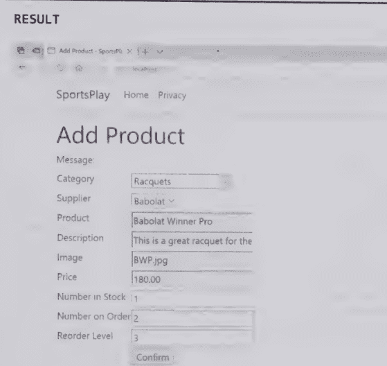

Figure 16-9. 设置路由数据参数示例。

图 16-10 展示了获取路由数据参数的示例。

在 01 处，我们向页面的 `@page` 指令添加了一系列项目。请注意，这些项目对应于我们在上一个示例中添加到路由值对象的路由数据参数。如所见，列表中的每个路由数据参数都用一组花括号（{}）括起来，并使用正斜杠（/）与后面的路由数据参数分隔。

在 02 处，我们向 PageModel 类的 `OnGet()` 方法添加了一系列输入参数。请注意，这些输入参数对应于我们添加到页面 `@page` 指令的路由数据参数。

在 03 处，我们正在从 `intCategoryId` 路由数据参数中检索产品的类别 ID。如所见，我们不需要转换此路由数据参数，因为它在路由值对象中传递到页面，并在模型绑定期间自动转换为其原始形式（如 `OnGet()` 方法中定义的那样）。

图中的 Result 部分显示了用户单击 Save 按钮之前的 Confirm Product 页面。请注意，所有路由数据参数都已添加到页面的 URL 中。还请注意，用户在 Add Product 页面上选择和输入的所有值都已成功传递到该页面，并正在显示以供确认。

```
01 @page "{intCategoryId}/{intSupplierId}/{strProduct}/{strDescription}/{strImage}/{decPrice}/{bytNumberInStock}/{bytNumberOnOrder}/{bytReorderLevel}"
```

```csharp
using Microsoft.AspNetCore.Mvc;
using Microsoft.AspNetCore.Mvc.RazorPages;

public void OnGet(int intCategoryId, int intSupplierId, string strProduct,
string strDescription, string strImage, decimal decPrice,
byte bytNumberInStock, byte bytNumberOnOrder, byte bytReorderLevel)
{
    // Get the route data parameters.
    CategoryId = intCategoryId;
    SupplierId = intSupplierId;
    Product = strProduct;
    Description = strDescription;
    Image = strImage;
    Price = decPrice;
    NumberInStock = bytNumberInStock;
    NumberOnOrder = bytNumberOnOrder;
    ReorderLevel = bytReorderLevel;
}
```

## RESULT


Figure 16-10. 获取路由数据参数示例。

### TempData 变量

TempData 变量使我们能够保存页面的数据，以便在应用程序的后续页面中检索和使用该数据。TempData 变量在其数据在后续页面中被读取后过期（即自动删除）。默认情况下，TempData 变量是基于 Cookie 的。也就是说，tempdata 变量作为 Cookie 存储在客户端的内存中。tempdata 变量包含一个键值对。大多数浏览器将基于 Cookie 的 tempdata 变量的大小限制在 4,096 字节以下（由于加密和分块）。

使用 TempData 变量的优点包括

- 由于 TempData 变量存储在客户端内存中，因此它们不需要服务器内存。
- 由于 TempData 变量自动删除，因此它们的删除不需要程序化管理。

使用 TempData 变量的缺点包括

- 由于大多数浏览器将 tempdata 变量的大小限制在 4,096 字节以下，因此可以存储在 tempdata 变量中的数据量有实际限制。
- 由于某些用户将浏览器配置为不接受 Cookie，因此依赖 TempData 变量进行状态维护的应用程序将无法正常工作。

图 16-11 展示了设置 tempdata 变量的示例。请注意，这是一个添加产品的示例，我们将产品的所有属性存储在 tempdata 变量中，以便下一个页面可以在保存产品（例如，到数据库表）之前显示这些变量的值供用户确认。

在 01 处，我们向 PageModel 类添加了一个 `OnPostConfirm()` 处理程序方法。当单击 Confirm 按钮时，会调用此处理程序方法，并在服务器上处理该页面。当用户单击 Confirm 按钮时，他/她将被重定向到 Confirm Product 页面（在 03 处）。

在 02 处，我们将产品的类别 ID 保存到名为 *intCategoryId* 的 tempdata 变量中。如所见，我们不必将页面上的所有项目转换为字符串，然后再将它们分配给各自的 TempData 变量。但是，我们必须转换其中一些，否则会发生运行时错误。

图中的 Result 部分显示了用户单击 Confirm 按钮之前的 Add Product 页面。

```csharp
PAGEMODEL

using Microsoft.AspNetCore.Mvc;
using Microsoft.AspNetCore.Mvc.RazorPages;

01 public RedirectResult OnPostConfirm()
{

    // Set the tempdata variables.
    // By default, these are saved as cookies.
02     TempData["intCategoryId"] = CategoryId;
    TempData["intSupplierId"] = SupplierId;
    TempData["strProduct"] = Product;
}
```

TempData 变量也可以是基于会话的。也就是说，我们还可以使用它们在服务器上维护状态。要将应用程序配置为将 tempdata 变量存储为会话变量而不是 Cookie，我们将 `AddSessionStateTempDataProvider()` 扩展方法添加到 Startup.cs 类的 `ConfigureServices()` 方法中的 `AddRazorPages()` 服务条目。
```


## 16.4 基于服务器的状态维护

要在服务器上维护状态，我们可以利用*应用程序变量*、*会话变量*和/或*临时数据变量*。在本节中，我们将讨论基于服务器的状态维护中的会话变量方法。

### 16.4.1 会话变量

会话变量使我们能够保存页面的数据，以便在应用程序的后续页面中检索和使用该数据。会话变量存储在服务器 RAM 中*会话对象*的属性里。当客户端首次通过 HTTP 请求与服务器联系时，服务器会创建一个会话对象，然后通过 HTTP 响应将页面*和*新创建的会话对象的 ID 一起返回给客户端。会话对象的 ID（即*会话 ID*）是会话对象的*唯一*标识符。正是这个 ID 使服务器能够识别其与所有服务的客户端之间存在的唯一*会话*。会话 ID（默认情况下）作为 cookie 存储在客户端上，并在客户端每次请求页面时传递给服务器。由于客户端传递的会话 ID 是服务器已知的，服务器可以根据需要从相关联的会话对象中检索数据，以在请求页面发送回客户端之前实例化任何 HTML 元素的值。

默认情况下，*未被引用的*会话对象在服务器上持续存在 20 分钟。如果会话对象在该 20 分钟时间段内未被访问，就会发生*会话超时*。当会话超时时，会话对象会从服务器内存中删除，该会话即被*终止*。这意味着客户端与服务器之间曾经存在的会话不再存在。幸运的是，每次相关联的客户端通过页面请求引用会话对象时，20 分钟的时间段都会重新开始计算。这样，会话可以持续比 20 分钟更长的时间。会话变量包含一个键值对。由于会话变量存储为会话对象的属性，会话变量的最大大小受限于会话对象的最大大小，即 2GB。然而，不建议在会话变量中存储大量数据，因为这样做可能会消耗服务器上的大量 RAM。

使用会话变量的优点包括

- 由于会话变量在 Internet 信息服务（IIS）重启期间仍然保留，因此它们非常可靠。
- 由于会话变量可以保留在多个进程和/或多台服务器上，因此它们可以在 Web 园和 Web 场环境中使用，从而增强应用程序的可扩展性和可靠性。
- 由于会话 ID 可以通过查询字符串传递，因此会话变量可以在不接受 cookie 的浏览器上工作。

使用会话变量的缺点包括

- 当会话 ID 通过查询字符串传递给服务器时，用户可以看到它，因此可能会被篡改，从而造成潜在的安全风险或导致应用程序故障。
- 当会话 ID 通过查询字符串传递给服务器时，URL 可以被收藏或发送给其他人，从而造成潜在的安全风险。
- 由于会话变量存储并维护在服务器上的 RAM 中，随着需要跟踪的会话越来越多，服务器性能可能会下降。

要在 ASP.NET Core Web 应用程序中使用会话变量，我们需要在应用程序的 Startup.cs 类中添加两个条目——AddSession() 服务和 UseSession() 中间件组件。图 16-13 显示了 Startup.cs 类的内容。

在 01 处，我们在类的 ConfigureServices() 方法中向服务集合添加了 AddSession() 服务。该服务包含通过会话变量维护状态所需的功能。

在 02 处，我们在应用程序的 HTTP 请求管道中添加了 UseSession() 中间件组件。该中间件组件处理应用程序中会话变量的使用。

```csharp
// STARTUP.CS

public void ConfigureServices(IServiceCollection services)
{
    ...
    services.AddSession();
}

public void Configure(IApplicationBuilder app, IWebHostEnvironment env)
{
    ...
    app.UseSession();
    ...
}
```

图 16-13. Startup.cs 类的内容。

图 16-14 显示了设置会话变量的示例。请注意，这是一个登录示例，我们将员工的 ID 存储在一个会话变量中（以便应用程序始终知道谁已登录），并将他或她的姓名和状态存储在另一个会话变量中（以便应用程序始终有这些信息可用于显示）。

在 01 处，我们在 PageModel 类中包含了 Microsoft.AspNetCore.Http 命名空间，因为 SetString() 方法（位于 03 处）定义在该命名空间中。

---

TempData["strDescription"] = Description;
TempData["strImage"] = Image;
TempData["decPrice"] = Price.ToString();
TempData["bytNumberInStock"] = NumberInStock.ToString();
TempData["bytNumberOnOrder"] = NumberOnOrder.ToString();
TempData["bytReorderLevel"] = ReorderLevel.ToString();
// Go to the confirmation page.
return Redirect("ConfirmProductTempDataVariables");

# 结果

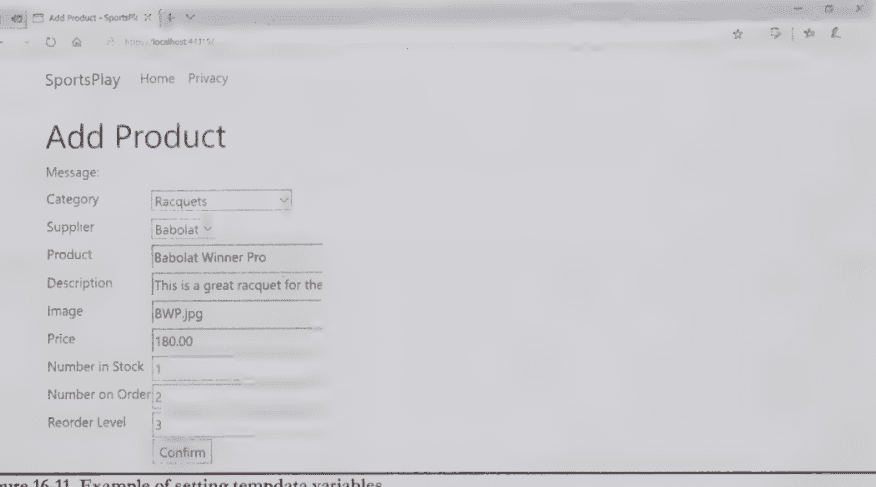

图 16-11 显示了设置临时数据变量的示例。

图 16-12 显示了获取临时数据变量的示例。

在 01 处，我们在 PageModel 类中包含了 System 命名空间，因为 Convert 类（位于 02 处）定义在该命名空间中。

在 02 处，我们正在从 intCategoryId 临时数据变量中检索产品的类别 ID，并将其从对象转换为整数，使其恢复为原始形式。

图示的"结果"部分显示了用户在单击"保存"按钮之前的"确认产品"页面。请注意，用户在"添加产品"页面上选择和输入的所有值都已成功传递到该页面，并正在显示以供确认。

### PAGEMODEL

```csharp
using Microsoft.AspNetCore.Mvc;
using Microsoft.AspNetCore.Mvc.RazorPages;
using System;

public void OnGet()
{
    // Get the tempdata variables.
    // By default, these are saved as cookies.
    CategoryId = Convert.ToInt32(TempData["intCategoryId"]);
    SupplierId = Convert.ToInt32(TempData["intSupplierId"]);
    Product = TempData["strProduct"].ToString();
    Description = TempData["strDescription"].ToString();
    Image = TempData["strImage"].ToString();
    Price = Convert.ToDecimal(TempData["decPrice"]);
    NumberInStock = Convert.ToByte(TempData["bytNumberInStock"]);
    NumberOnOrder = Convert.ToByte(TempData["bytNumberOnOrder"]);
    ReorderLevel = Convert.ToByte(TempData["bytReorderLevel"]);
}
```

# 结果

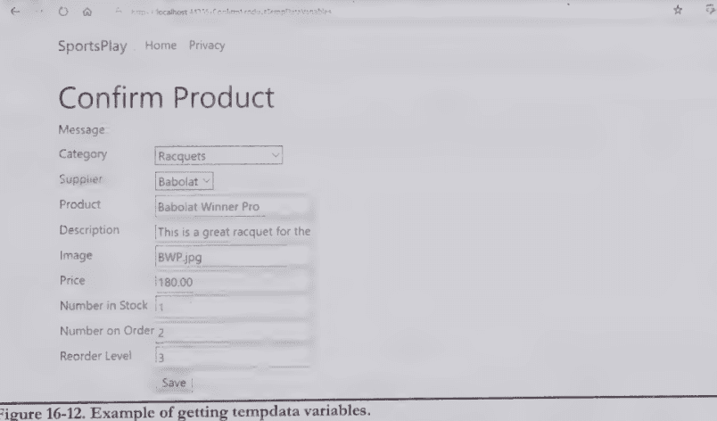

图 16-12. 获取临时数据变量的示例。

---

232 • 状态维护

注释：
<sup>25</sup> 应用程序变量用于在多个用户会话之间（而非单个用户会话内）维护状态。因此，应用程序变量的范围包括应用程序的所有页面以及应用程序的所有用户会话。本质上，应用程序变量是一个任何用户会话都可以访问的全局变量。因此，应谨慎使用应用程序变量。与会话变量在用户关闭其浏览器之前保持活动状态不同，应用程序变量在应用程序停止之前保持活动状态。
<sup>26</sup> 默认情况下，临时数据变量是基于 cookie 的。也就是说，我们也可以使用它们在客户端上维护状态。要将应用程序配置为将临时数据变量存储为会话变量而不是 cookie，我们需要在 Startup.cs 类的 ConfigureServices() 方法中的 AddRazorPages() 服务条目上添加 *AddSessionStateTempDataProvider()* 扩展方法。
<sup>27</sup> 会话对象也可以存储在服务器上的数据库中或服务器上的自定义数据源中。
<sup>28</sup> 如果浏览器不接受 cookie，ASP.NET Core 将尝试通过编码 URL（即在查询字符串中包含会话 ID 的 URL）或通过其他方法在客户端和服务器之间传递会话 ID。
<sup>29</sup> 要配置应用程序，使其在会话超时发生之前提供更多（或更少）的时间，我们需要在 Startup.cs 类的 ConfigureServices() 方法中的 AddSession() 服务条目上添加 *IdleTimeout* 选项。


## 在 02 处
在 **02** 处，我们向 PageModel 类添加了一个 `OnPostLogin()` 处理程序方法。当单击 Login 按钮时，会调用此处理程序方法，并在服务器上处理页面。如果用户成功登录，他或她将被重定向到 Welcome 页面（在 **01** 处）。如果用户未成功登录，他或她将被重定向到 Login 页面（在 **06** 处）。

## 在 03 处
在 **02** 处，我们将用户的员工 ID（从数据库返回并转换为字符串）保存到名为 `intEmployeeId` 的会话变量中。

## 在 04 处
在 **01** 处，我们向 PageModel 类添加了一个 OnPostLogin() 处理程序方法。当单击 Login 按钮时，会调用此处理程序方法，并在服务器上处理页面。如果用户成功登录，他或她将被重定向到 Welcome 页面（在 **02** 处）。

## # 结果
图的 Result 部分显示了用户尝试登录应用程序之前的 **Login** 页面。

### PageModel 应用程序代码示例 16-14
#### ```C#```
using Microsoft.AspNetCore.Http;
    using Microsoft.AspNetCore.Mvc;
    using Microsoft.AspNetCore.Mvc.RazorPages;

public RedirectResult OnPostLogin()
{
    // Log in the user by simulating a database lookup.
    if (EmailAddress == "rregal@sportsplay.com" && Password == "abc")
    {
        // Assume that the lookup returns the following attribute values
        // from the database. Notice that the attribute names would not
        // begin with a type (according to our standards).
        int EmployeeId = 2;
        string LastName = "Regal";
        string FirstName = "Richard";
        string MiddleInitial = "R";
        string Status = "M";
        // Format the status.
        if (Status == "M")
        {
            Status = "Manager";
        }
        else
        {
            Status = "Staff";
        }
        // Format the user information.
        string strUser = FirstName + " " + MiddleInitial + " " + LastName +
                        " (" + Status + ")";
        // Set the session variables.
        // Session State must be configured in Startup.cs.
    HttpContext.Session.SetString("intEmployeeId",
                    EmployeeId.ToString());
    HttpContext.Session.SetString("strUser",
                    strUser);
        // Go to the Welcome page.
return Redirect("WelcomeSessionVariables");
}
else
{
    // Set the message.
    MessageColor = "Red";
    Message = "You have entered an invalid email address and password combination. Please try again.";
return null;
}
}

### # 结果 16-15 图显示了获取会话变量的示例
图的 **Result** 部分显示了用户成功登录应用程序后显示的 Welcome 页面。请注意，用户的姓名和状态显示在页面消息的主体中。

#### ```C# PageModel 应用程序代码示例 16-15```（获取会话变量）
using Microsoft.AspNetCore.Http;
    using Microsoft.AspNetCore.Mvc;
    using Microsoft.AspNetCore.Mvc.RazorPages;
    
public void OnGet()
{
    // Get the session variables.
    // Session State must be configured in Startup.cs.
int intEmployeeId = Convert.ToInt32(HttpContext.Session.GetString("intEmployeeId"));  
string strUser = HttpContext.Session.GetString("strUser");  
MessageColor = "Green";  
Message = "You have logged in successfully as " + strUser + "! Welcome to SportsPlay!";  
}

### 图 16-15. 获取会话变量的示例。
图 **16-14**. 设置会话变量的示例。

## 在 02 处，我们已将 `System` 命名空间包含在 PageModel 类中，因为 Convert 类是在该命名空间中定义的。（注：原文在命名空间与使用点的编号上存在不一致）。具体在 **03** 处，检索逻辑适用于从 GetSession 变量获取值并将其从字符串转换为整数，以便恢复其原始形式。请注意，正如下面所示，我们在此方法中并未使用 `intEmployeeId` 变量，而只是说明如果我们需要它时该如何检索：

### 在 04 处
在 **03** 处，从会话变量获取用户姓名和状态的检索逻辑适用，请注意我们正在使用该会话变量的值。在 **05** 处显示的消息在其正文文本中使用了这些值。请注意如何通过 Microsoft ASP.NET HTTP 命名空间中定义的方法（第 1 行）`GetSession("intEmp")` 来检索 `intEmployeeId`。

---
## # 16.5 项目
请遵循标题为 *解决方案和项目* 的章节中阐述的标识符命名标准。使用 Table 元素来排列其他 HTML 元素，使页面看起来井井有条。

### 第 1 部分：基于 Cookie 的会话示例项目步骤 (+)
1. 启动一个名为 `Lastname.Firstname.Chapter99` 的新项目，其中 **99** 是本章的编号。
2. 向项目中添加一个名为 *EnterShipperCookies* 的 Razor 页面。
3. 添加八个 Label 元素。从上到下，这些标签应显示 *Shipper*、*Point of Contact*、*Address*、*City*、*State*、*Zip Code*、*Phone* 和 *Email Address*。
4. 在这些标签旁边，添加一个 shipper Input (Text) 元素、一个 point of contact Input (Text) 元素、一个 address Input (Text) 元素、一个 city Input (Text) 元素、一个 state Select 元素（选项为：**Illinois**、**Indiana** 和 **Ohio**，其州 ID 分别为 IL、IN 和 OH）、一个 zip code Input (Text) 元素、一个 phone Input (Text) 元素和一个 email address Input (Text) 元素。
5. 复制此页面并将其重命名为 *ConfirmShipperCookies*。
6. 在 `EnterShipperCookies` 页面底部：
   + 添加一个显示 **Confirm** 的 Input (**Submit**) 元素。
   + 当按钮被单击时，将所有输入文本框的值以及下拉列表中选定项的值保存到 cookie；将用户重定向到 *ConfirmShipperCookies* 页面。
   + 在 Confirm Shipper Cookies 页面上显示所有输入和选定的信息（CSS）。
   + 在 `EnterShipperCookies` 页面上，确保保存的是**选定州的 ID** 而非其显示名称！在重定向到下一个屏幕之前将值保存到您的 cookie 变量中，用户将在该屏幕上再次看到州的完整名称，仅用于确认目的，以便他们知道之前在 EnterShipper Cookies 表单上执行的操作中输入了什么，而无需回顾之前的输入，因为在单击 Confirm 按钮后新页面会立即加载，这是由于在应用程序逻辑流程图中发生导航时会自动刷新浏览器，如上所述关于通过以下针对第 1 部分章节标题编号六点 A B C D E F G H I J K L M N O P Q R S T U V W X Y Z 等列出的示例项目步骤演示的 cookie 使用概念，仅供参考，请相应进行！

7. 测试页面并进行任何必要的更正。

### 第 2 部分
1. 从**第 1 部分**复制两个 Razor 页面，并将其修改为使用查询字符串参数而非 cookie 存储机制，以在当前会话生命周期范围内跨导航事件持久化数据，该范围由启动配置文件定义，位于相对于目录结构根文件夹的 /wwwroot/publish/Startup.cs 路径，该根文件夹被指定为工作环境，设置说明在早些时候课程材料的 *解决方案和项目* 章节中提供，该章节讨论了整个解决方案开发过程中采用的命名约定最佳实践，如上所述。

### 第 3 部分
1. 从**第 1 部分**复制两个 Razor 页面，并将其修改为使用路由数据参数而非 cookie/查询字符串，作为跨 HTTP 请求生命周期事件的用户交互序列持久化存储机制，这些交互序列由前文第 6 点 A B C D E F G H I J K L M N O P Q R S T U V W X Y Z 下列出的示例项目步骤中定义的 Confirm 按钮发起，现于此处进一步讨论，特别关注与利用 ASP.NET Core 框架架构内置路由功能相关的实现细节，从而实现更清晰的代码结构，而不必过度依赖通常保留给更复杂企业级应用的有状态会话管理策略，这些应用需要强大的可扩展性功能，超越早些时候第 1 部分描述的开发项目初始阶段所采用的简单基于 cookie 的持久化模型，该阶段涉及上文提供的示例练习演示的基本表单提交处理技术，特别针对此处所涵盖的学习目标，涉及整个课程体系结构中教授的基本 Web 应用程序设计原理概念，该课程体系管理着当今向全球学生群体提供计算机科学相关课程的学术机构所使用的教育项目交付方法，包括那些位于美国本土、海外、国外、国际上的学生，无论身处世界何处的学生在学习与该主题相关的知识时，都寻求通过在线平台获得知识获取机会，这些平台提供远程学习体验，兼容大多数人在日常生活中使用的各种设备，这些日常习惯要求通过专门针对当前入门级员工面临的技能差距问题而设计的综合培训计划来掌握的熟练程度，这些员工作为快速演变的科技行业格局中寻求职业晋升前景，该行业特征是全球经济力量塑造未来劳动力人口统计的激烈竞争，如今比以往任何时候都更是如此，考虑到过去几十年中影响劳动力市场、显著降低就业岗位可用率的负面人口变化，与十年前相比现在情况大不相同，当前形势要求适应性、灵活性、创造性和创新思维技能和能力，以成功驾驭未来不断变化的时代，明天的世界看起来与昨天我们所知的世界截然不同，一切都已完全改变，没有什么会永远保持不变，只需想象事物移动得有多快，比以往任何时候都快，请牢记技术每天都在呈指数级进步，使得某些方法、过时的技术、策略、方法、方法论、框架、理论、模型、范式、概念、思想、观念、信念、价值观、原则、实践、程序、过程、协议、标准、指南、法规、法律、规则、规范、习俗、惯例、仪式、典礼、传统、习惯、行为、态度、观点、视角、展望、理解、解释、分析、评估、判断、决策、行动、反应、回应、干预、调整、修改、变更、更新、改进、增强、优化、精炼、调整、校准、对齐、同步、协调、整合、巩固、合并、合成、组合、联合、融合、连接、耦合、链接、连接、联网、关联、合作、协作、协调、支持、协助、帮助、援助、促进、使能、赋能、激励、激发、鼓舞、鼓励、刺激、挑战、令人兴奋、激动人心、引人入胜、耐人寻味、令人困惑、神秘、奇怪、不寻常、怪异、奇特、古怪、异常、特殊、特别、独特、独一无二、专属、独立、个体、孤立、孤独、唯一、疏远、远离、遥远、偏僻、隐居、孤僻、内向、外向、开朗、善于表达、口齿伶俐、善于沟通、互动、响应、反应、敏感、有洞察力、有意识、有正念、警觉、专注、集中精力、坚定、有目的、有动力、目标导向、使命驱动、愿景启发、领导、指导、指挥、控制、管理、组织、结构化、系统化、程序化、算法化、逻辑化、顺序化、时间化、空间化、多变量、多方面、多用途、多功能、适应性强、灵活、有弹性、动态、易变、不稳定、恒定、可变、波动、变化、演变、发展、涌现、出现、显现、展示、表现、描绘、说明、代表、体现、封装、包含、容纳、安置、庇护、保护、守卫、防御、保存、维护、保护、维持、支持、备份、强化、加强、加固、支撑、支撑、稳定、稳定、平衡、平衡、平整、平滑、纠正、修正、修复、解决、处理、解决、应对、处理、应对、适应、接纳、拥抱、欢迎、整合、综合、协调、对齐、同步、耦合、链接、连接、联网、关联、合作、协作、协调、支持、协助、帮助、援助、促进、使能、赋能、激励、激发、鼓舞、鼓励、刺激、挑战、令人兴奋、激动人心、引人入胜、耐人寻味、令人困惑、神秘、奇怪、不寻常、怪异、奇特、古怪、异常、特殊、特别、独特、独一无二、专属、独立、个体、孤立、孤独、唯一、疏远、远离、遥远、偏僻、隐居、孤僻、内向、外向、开朗、善于表达、口齿伶俐、善于沟通、互动、响应、反应、敏感、有洞察力、有意识、有正念、警觉、专注、集中精力、坚定、有目的、有动力、目标导向、使命驱动、愿景启发、领导、指导、指挥、控制

### 第 4 部分
1. 从**第 1 部分**复制两个 Razor 页面，并将其修改为使用临时数据变量而非会话/状态管理，以在开发生命周期阶段中在动作/视图/页面之间短暂地保留值，这些阶段涉及上述关于 cookie/查询字符串/路由范式的讨论，涉及创建现代 Web 应用程序所涉及的基本编程结构，利用开源库、框架、工具、技术、平台、生态系统、社区、文化、亚文化、社会、群体、组织、机构、企业、公司、企业、集团、跨国公司、全球公司、本地公司、小企业、初创公司、独角兽公司、快速扩张公司、超增长巨头、颠覆者、先驱、远见者、梦想家、实干家、制造者、建设者、创造者、创新者、发明家、工程师、科学家、研究人员、开发人员、程序员、编码人员、设计人员、艺术家、作家、诗人、音乐家、歌手、舞者、演员、导演、制片人、编辑、摄影师、音响技术人员、图形视觉效果、多媒体、交互性、无障碍性、包容性、多样性、公平性、责任性、问责制、透明度、诚实、正直、公平、正义、和平、爱、善良、同情、共情、理解、宽恕、耐心、感激、喜悦、希望、信念、信任、尊重、尊严、价值、人性、灵魂、精神、心灵、思想、身体、行动、反应、回应、干预、调整、适应、接纳、拥抱、欢迎、整合、综合、协调、对齐、同步、耦合、链接、连接、联网、关联、合作、协作、协调、支持、协助、帮助、援助、促进、使能、赋能、激励、激发、鼓舞、鼓励、刺激、挑战、令人兴奋、激动人心、引人入胜、耐人寻味、令人困惑、神秘、奇怪、不寻常、怪异、奇特、古怪、异常、特殊、特别、独特、独一无二、专属、独立、个体、孤立、孤独、唯一、疏远、远离、遥远、偏僻、隐居、孤僻、内向、外向、开朗、善于表达、口齿伶俐、善于沟通、互动、响应、反应、敏感、有洞察力、有意识、有正念、警觉、专注、集中精力、坚定、有目的、有动力、目标导向、使命驱动、愿景启发、领导、指导、指挥、控制、管理、组织、结构化、系统化、程序化、算法化、逻辑化、顺序化、时间化、空间化、多变量、多方面、多用途、多功能、适应性强、灵活、有弹性、动态、易变、不稳定、恒定、可变、波动、变化、演变、发展、涌现、出现、显现、展示、表现、描绘、说明、代表、体现、封装、包含、容纳、安置、庇护、保护、守卫、防御、保存、维护、保护、维持、支持、备份、强化、加强、加固、支撑、支撑、稳定、稳定、平衡、平衡、平整、平滑、纠正、修正、修复、解决、处理、解决、应对、处理、应对、适应、接纳

### 第 5 部分
1. 从**第 1 部分**复制两个 Razor 页面，并将其修改为使用会话变量来保留用户特定数据，跨应用程序上下文生命周期范围内定义的导航流程路径，该范围受运行时环境配置管理，指定于位于 /wwwroot/publish/Startup.cs 路径的 Startup.cs 文件中，该路径相对于目录结构根文件夹，被指定为工作环境，设置说明在早些时候课程材料的 *解决方案和项目* 章节中提供，该章节讨论了整个解决方案开发过程中采用的命名约定最佳实践，如上所述。

---
## # 17 布局页面
### ## 17.1 简介
ASP.NET Core **布局页面**是一个包含以下内容的模板：
- *页眉区域*
- *主体（中央）区域*，包含一个 `RenderBody()` 方法调用点，内容页面在此处将其独特的 HTML/文本块注入到全局定义的布局外壳包装器中，该包装器适用于属于当前项目解决方案工作空间目录树结构的所有视图，其中包含源代码文件、配置、资产、静态资源、媒体库、图像、文档、下载、附件、存档、备份、快照、镜像、克隆、分叉、分支、标签、发布、提交、推送、拉取请求、合并、冲突、解决器、协调器、同步器、耦合器、链接器、连接器、网络器、关联器、合作伙伴、协作者、合作者、支持者、助手、帮助者、辅助者、促进者、使能者、赋能者、激励者、激发者、鼓舞者、鼓励者、刺激者、挑战者、令人兴奋者、激动人心者、引人入胜者、耐人寻味者、令人困惑者、神秘者、奇怪者、不寻常者、怪异者、奇特者、古怪者、异常者、特殊者、特别者、独特者、独一无二者、专属者、独立者、个体者、孤立者、孤独者、唯一者、疏远者、远离者、遥远者、偏僻者、隐居者、孤僻者、内向者、外向者、开朗者、善于表达者、口齿伶俐者、善于沟通者、互动者、响应者、反应者、敏感者、有洞察力者、有意识者、有正念者、警觉者、专注者、集中精力者、坚定者、有目的者、有动力者、目标导向者、使命驱动者、愿景启发者、领导者、指导者、指挥者、控制者、管理者

**布局页面**的页眉和页脚区域出现在 ASP.NET Core Web 应用程序的每个内容页面上。这使我们可以一致地在应用程序的许多页面上显示公共页面元素。设计良好的 Web 应用程序通常会在其页眉和页脚区域显示：
- 组织的标识和/或公司名称
- 应用程序名称、用户登录后可用的菜单选项
- 当前页面标题、显示在屏幕界面仪表板监控面板控制中心命令控制台操作手册指令指南帮助文档知识库支持论坛社区群组会议通话会议网络研讨会广播流媒体数字媒体内容信息流频道网络服务器集群节点处理器核心内核内存存储磁盘文件系统数据库表行列表头表尾图例注释标签标记指示器警告警报通知消息错误日志报告摘要统计图表直方图条形图饼图雷达图蜘蛛图桑基流程图思维导图概念树决策分析问题陈述假设理论模型模拟预测预测估计计算计算算法代码软件应用程序工具实用人工制品小工具设备机器设备仪器机制装置系统设置配置参数设置变量属性属性特征功能目的益值意涵意义符号图标图像图片图形视觉显示输出渲染演示展览展示评论批评分析解释理解知识信息数据事实真谎言神话传说故事叙事小说非小说传记自传历史地理科学技术艺术音乐文学哲学宗教伦理道德价值观信仰理想原则标准法规范规则标准习俗惯例传统仪式典礼习惯行为态度观点视角展望理解解释分析评估判断决策行动反应回应干预调整修改变更更新改进增强优化精炼调整校准对齐同步协调整合巩固合并合成组合联合融合连接耦合链接链接联网关联合作协作协调支持协助帮助援助促进使能赋能激励激发鼓舞鼓励刺激挑战令人兴奋激动人心引人入胜耐人寻味令人困惑神秘奇怪不寻常怪异奇特古怪异常特殊特别独特独一无二专属独立个体孤立孤独唯一疏远远离遥远偏僻隐居孤僻内向

布局页面的主体区域包含 `RenderBody()` 方法。当内容页面被编译时，`RenderBody` 将其与布局外壳组合，形成一个单一完整的 HTML 文档，该文档保留在创建阶段定义的名称，如上所述、前面描述、先前概述、陈述、提及、引用、记录、记录、记录、观察、报告、书面、口头、歌唱、阅读、观看、聆听、感受、品尝、闻、感知、体验、遇到、发现、发现、位于、 situated、放置、定位、安排、排序、组织、结构化、系统化、程序化、算法化、逻辑化、顺序化、时间化、空间化、多变量、多方面、多用途、多功能、适应性强、灵活、有弹性、动态、易变、不稳定、恒定、可变、波动、变化、演变、发展、涌现、出现、显现、展示、表现、描绘、代表、体现、封装、包含、容纳、安置、庇护、保护、守卫、防御、保存、维护、保护、维持、支持、备份、强化、加强、加固、支撑、支撑、稳定、稳定、平衡、平衡、平整、平滑、纠正、修正、修复、解决、处理、解决、应对、处理、应对、适应、接纳

因此，当使用布局页面时：
- 布局模板在内容页面之间保持一致
- 只有 `<@ Body()>` 块中显示的内容从一个视图到另一个视图有所不同

这产生了一个更易于使用且更专业的应用程序。通常显示的公共元素包括但不限于组织标识、公司名称、应用程序标题、菜单选项、登录状态、用户欢迎消息、版本号、技术支持团队联系信息，该团队由负责的工程师、开发人员、架构师、分析师、设计人员、作家、研究人员、科学家、探索者、先驱、远见者、梦想家、实干家、制造者、建设者、创造者、创新者、发明家、技术专家、未来主义者、乐观主义者、理想主义者、乌托邦主义者、反乌托邦批评者、愤世嫉俗者、怀疑论者、信仰者、怀疑者、质疑者、探索者、学习者、研究者、调查员、侦探、间谍、警察、治安官、元帅、卫兵、保护者、防御者、英雄、恶棍、敌人、盟友、对手、竞争者、合作伙伴、协作者、合作者、支持者、助手、帮助者、辅助者、导师、教练、顾问、治疗师、治愈者、护理者、培育者、教育者、教师、培训师、讲师、促进者、演讲者、演讲者、表演者、演员、音乐家、歌手、舞者、画家、雕塑家、摄影师、电影制作人、摄像师、动画师、插画家、作者、诗人、记者、记者、专栏作家、评论员、评论家、评论家、分析师、研究人员、历史学家、地理学家、科学家、工程师、数学家、程序员、编码人员、黑客、吉他手、游戏玩家、玩家、战略家、战术家、指挥官、领导者、经理、主管、董事、制片人、高管、官员、员工、工人、团队成员、志愿者、贡献者、参与者、观察者、见证者、线人、来源、联系人、推荐人、线索、潜在客户、客户、顾客、用户、消费者、买家、卖家、商人、交易者、经销商、代理人、经纪人、中介、促进者、连接器、网络者、关联者、合作伙伴、协作者、合作者、支持者、助手、帮助者、辅助者、促进者、使能者、赋能者、激励者、激发者、鼓舞者、鼓励者、刺激者、挑战者、令人兴奋者、激动人心者、引人入胜者、耐人寻味者、令人困惑者、神秘者、奇怪者、不寻常者、怪异者、奇特者、古怪者、异常者、特殊者、特别者、独特者、独一无二者、专属者、独立者、个体者、孤立者、孤独者、唯一者、疏远者、远离者、遥远者、偏僻者、隐居者、孤僻者、内向者、外向者、开朗者、善于表达者、口齿伶俐者、善于沟通者、互动者、响应者、反应者、敏感者、有洞察力者、有意识者、有正念者、警觉者、专注者、集中精力者、坚定者、有目的者、有动力者、目标导向者、使命驱动者、愿景启发者、领导者、指导者、指挥者、控制者、管理者、组织、结构化、系统化、程序化、算法化、逻辑化、顺序化、时间化、空间化、多变量、多方面、多用途、多功能、适应性强、灵活、有弹性、动态、易变、不稳定、恒定、可变、波动、变化、演变、发展、涌现、出现、显现、展示、表现、描绘、说明、代表、体现、封装、包含、容纳、安置、庇护、保护、守卫、防御、保存、维护、保护、维持、支持、备份、强化、加强、加固、支撑、支撑、稳定、稳定、平衡、平衡、平整、平滑、纠正、修正、修复、解决、处理、解决、应对、处理、应对、适应、接纳

### ## 17.2 项目结构
在详细查看布局页面之前，我们必须首先讨论项目结构，首先想到的是良好有组织的布局有助于减少摩擦点，提高生产力、效率、效能、能力、容量、潜力、力量、强度、深度、广度、范围、宽度、高度、体积、重量、密度、强度、频率、耐久性、寿命、可持续性、可扩展性、灵活性、适应性、弹性、动态性、波动性、不稳定性、恒定性、可变性、波动性、变化、演变、发展、涌现、出现、显现、展示、表现、描绘、说明、代表、体现、封装、包含、容纳、安置、庇护、保护、守卫、防御、保存、维护、保护、维持、支持、备份、强化、加强、加固、支撑、支撑、稳定、稳定、平衡、平衡、平整、平滑、纠正、修正、修复、解决、处理、解决、应对、处理、应对、适应、接纳、拥抱、欢迎、整合、综合、协调、对齐、同步、耦合、链接、连接、联网、关联、合作、协作、协调、支持、协助、帮助、援助、促进、使能、赋能、激励、激发、鼓舞、鼓励、刺激、挑战、令人兴奋、激动人心、引人入胜、耐人寻味、令人困惑、神秘、奇怪、不寻常、怪异、奇特、古怪、异常、特殊、特别、独特、独一无二、专属、独立、个体、孤立、孤独、唯一、疏远、远离、遥远、偏僻、隐居、孤僻、内向、外向、开朗、善于表达、口齿伶俐、善于沟通、互动、响应、反应、敏感、有洞察力、有意识、有正念、警觉、专注、集中精力、坚定、有目的、有动力、目标导向、使命驱动、愿景启发、领导、指导、指挥、控制、管理、组织、结构化、系统化、程序化、算法化、逻辑化、顺序化、时间化、空间化、多变量、多方面、多用途、多功能、适应性强、灵活、有弹性、动态、易变、不稳定、恒定、可变、波动、变化、演变、发展、涌现、出现、显现、展示、表现、描绘、说明、代表、体现、封装、包含、容纳、安置、庇护、保护、守卫、防御、保存、维护、保护、维持、支持、备份、强化、加强、加固、支撑、支撑、稳定、稳定、平衡、平衡、平整、平滑、纠正、修正、修复、解决、处理、解决、应对、处理、应对、适应、接纳

组织良好的项目结构使 ASP.NET Core Web 应用程序更易于维护。图 **17-1** 显示了这种层次结构的示例，反映了 SportsPlay 应用程序布局约定，此处遵循今天行业中已建立的数十年最佳实践，通过失败、成功、胜利、灾难、灾祸、奇迹、奇迹、奇迹、秘密、真相、谎言、神话、传说、故事、叙事、小说、非小说、传记、自传、历史、地理、科学、技术、艺术、音乐、文学、哲学、宗教、伦理、道德、价值观、信仰、理想、原则、标准、规范、法规、法律、规则、规范、习俗、惯例、传统、仪式、典礼、习惯、行为、态度、观点、视角、展望、理解、解释、分析、评估、判断、决策、行动、反应、回应、干预、调整、修改、变更、更新、改进、增强、优化、精炼、调整、校准、对齐、同步、协调、整合、巩固、合并、合成、组合、联合、融合、连接、耦合、链接、连接、联网、关联、合作、协作、协调、支持、协助、帮助、援助、促进、使能、赋能、激励、激发、鼓舞、鼓励、刺激、挑战、令人兴奋、激动人心、引人入胜、耐人寻味、令人困惑、神秘、奇怪、不寻常、怪异、奇特、古怪、异常、特殊、特别、独特、独一无二、专属、独立、个体、孤立、孤独、唯一、疏远、远离、遥远、偏僻、隐居、孤僻、内向、外向、开朗、善于表达、口齿伶俐、善于沟通、互动、响应、反应、敏感、有洞察力、有意识、有正念、警觉、专注、集中精力、坚定、有目的、有动力、目标导向、使命驱动、愿景启发、领导、指导、指挥、控制、管理、组织、结构化、系统化、程序化、算法化、逻辑化、顺序化、时间化、空间化、多变量、多方面、多用途、多功能、适应性强、灵活、有弹性、动态、易变、不稳定、恒定、可变、波动、变化、演变、发展、涌现、出现、显现、展示、表现、描绘、说明、代表、体现、封装、包含、容纳、安置、庇护、保护、守卫、防御、保存、维护、保护、维持、支持、备份、强化、加强、加固、支撑、支撑、稳定、稳定、平衡、平衡、平整、平滑、纠正、修正、修复、解决、处理、解决、应对、处理、应对、适应、接纳


## 17.3 布局页

图 17-2 显示了 **ViewStart** 页面在其原始状态下的内容。可以看出，我们将页面的 **Layout** 属性设置为 `_Layout`。这表明应用程序的各个页面应使用 `_Layout.cshtml` 页面作为其布局页面。通过在 **ViewStart** 页面中设置应用程序页面的 **Layout** 属性，我们无需在每个单独的页面中添加此代码。

```csharp
@{
    Layout = "_Layout";
}
```

图 17-2. **ViewStart** 页面在其原始状态下的内容。

# 240 • 布局页

图 17-3 显示了 **Layout** 页面的内容。请注意，此页面中有两项内容并非完全原创。首先，由于我们重新组织了项目，删除了 **Index** 页面，将 **Privacy** 页面移至 **Home** 文件夹，等等，我们更新了到应用程序页面的链接以使其正常工作。其次，我们添加了一个 **Div** 元素（在 02 处），以便我们可以显示页面标题、用户和当前消息。

在 01 处，我们定义了 **Layout** 页面的头部区域。该区域包含我们希望在应用程序每个页面上显示的所有项——在内容页上方。查看该区域中的代码可以快速发现，我们正在显示“SportsPlay”、“Home”和“Privacy”字样。我们还可以看到，点击这些字样中的任何一个，用户将被重定向到另一个页面。该区域中的其他代码暂时可以忽略。

在 02 处，我们添加了一个 **Div** 元素，其中包括用于显示页面标题、用户和当前消息的标签。我们将在 **Login**、**Welcome** 和 **Privacy** 页面的 **PageModel** 类中设置 **ViewData** 变量的值。

在 03 处，我们定义了 **Layout** 页面的主体区域。该区域包含一个 **RenderBody()** 方法。因此，应用程序中的每个内容页都将在此处渲染——在头部区域下方和尾部区域上方。

在 04 处，我们定义了 **Layout** 页面的尾部区域。该区域包含我们希望在应用程序每个页面上显示的所有项——在内容页下方。查看该区域中的代码可以快速发现，我们正在显示“Privacy”字样。我们还可以看到，点击此字样，用户将被重定向到 **Privacy** 页面。该区域中的其他代码暂时可以忽略。

# 页代码

```html
<!DOCTYPE html>
<html lang="en">
<head>
    <meta charset="utf-8" />
    <meta name="viewport" content="width=device-width, initial-scale=1.0" />
    <title>@ViewData["Title"] - SportsPlay</title>
    <link rel="stylesheet" href="~/lib/bootstrap/dist/css/bootstrap.min.css" />
    <link rel="stylesheet" href="~/css/site.css" />
</head>
<body>
    <header>
        <nav class="navbar navbar-expand-sm navbar-toggleable-sm navbar-light bg-white border-bottom box-shadow mb-3">
            <div class="container">
                <a class="navbar-brand" asp-area="" asp-page="/Initialize">SportsPlay</a>
                <button class="navbar-toggler" type="button" data-toggle="collapse" data-target=".navbar-collapse" aria-controls="navbarSupportedContent" aria-expanded="false" aria-label="Toggle navigation">
                    <span class="navbar-toggler-icon"></span>
                </button>
                <div class="navbar-collapse collapse d-sm-inline-flex flex-sm-row-reverse">
                    <ul class="navbar-nav flex-grow-1">
                        <li class="nav-item">
                            <a class="nav-link text-dark" asp-area="" asp-page="/Initialize">Home</a>
                        </li>
                        <li class="nav-item">
                            <a class="nav-link text-dark" asp-area="" asp-page="/Home/Privacy">Privacy</a>
                        </li>
                    </ul>
                </div>
            </div>
        </nav>
    </header>

    <div class="container">
        <label>@ViewData["Title"] | </label>
        <label>@ViewData["User"] | </label>
        <label style="color:@ViewData["MessageColor"]">@ViewData["Message"]</label>
    </div>
    <br />

    <div class="container">
        <main role="main" class="pb-3">
            @RenderBody()
        </main>
    </div>

    <footer class="border-top footer text-muted">
        <div class="container">
            &copy; 2020 - SportsPlay - <a asp-area="" asp-page="/Home/Privacy">Privacy</a>
        </div>
    </footer>

    <script src="~/lib/jquery/dist/jquery.min.js"></script>
    <script src="~/lib/bootstrap/dist/js/bootstrap.bundle.min.js"></script>
    <script src="~/js/site.js" asp-append-version="true"></script>

    @RenderSection("Scripts", required: false)

</body>
</html>
```

图 17-3. **Layout** 页面的内容。

## 17.4 项目页面

图 17-4 显示了 **Initialize** 页面。请注意，此页没有用户界面。相反，此页只是初始化一些内容，然后重定向用户到另一个页面。

在 01 处，我们通过将 `/` 添加到 `@page` 指令中，将 **Initialize** 页面设置为默认启动页面。在 02 处，我们通过清除与当前会话对象关联的会话变量来注销用户。³¹ 虽然这在用户首次登录时不是必需的，但如果他或她注销后，保持当前浏览器选项卡打开，然后使用不同的凭据（例如，提升权限的凭据）再次登录到系统，或者在共享计算机场景中其他人使用相同的浏览器选项卡登录到系统，则是必需的。在这些情况下，我们要确保与旧凭据关联的会话变量不成为当前会话的一部分。在 03 处，我们初始化将在应用程序所有页面中使用的会话变量。在应用程序的每个页面上，我们需要将用户的姓名、用户状态、当前消息颜色和消息本身提供给 **Layout** 页面。在 04 处，我们将用户重定向到位于 **Home** 文件夹中的 **Login** 页面。

### 页代码

```razor
@page "/"
@model InitializeModel
```

### 页模型

```csharp
using Microsoft.AspNetCore.Http;
using Microsoft.AspNetCore.Mvc;
using Microsoft.AspNetCore.Mvc.RazorPages;

namespace SportsPlay.Pages
{
    public class InitializeModel : PageModel
    {
        public void OnGet()
        {
            // Log out the user.
            HttpContext.Session.Clear();

            // Initialize the header data.
            HttpContext.Session.SetString("User", "*");
            HttpContext.Session.SetString("UserStatus", "*");
            HttpContext.Session.SetString("MessageColor", "Green");
            HttpContext.Session.SetString("Message", "Please log in.");
        }
    }
}
```

**01**

**02**

**03**

**04**

图 17-4. **Initialize** 页面。

> ³¹ 像这样清除会话对象的变量并不会终止当前会话。因此，当前会话仍然存活。

图 17-5 显示了 **Login** 页面。

在 01 处，我们在页面初始化时为几个 **ViewData** 变量赋值。可以看出，**Page** 视图数据变量被设置为 *Login*，即当前页面的名称。由于页面名称将始终相同，该变量可以进行硬编码。其他 **ViewData** 变量的值是从它们各自的会话变量中检索的，这些变量在 **Initialize** 页面中设置。请注意，在此方法中设置的所有 **ViewData** 变量都在 **Layout** 页面的头部区域中使用。

在 02 处，我们尝试登录用户。请注意，有三个有效的登录用户——经理 Richard Regal、员工 Beth Billingsley 和客户 Jacob Jones。通常，用户凭据会在数据库中查找，并返回其姓名和用户状态以供处理（如果找到其凭据）。我们将在本书稍后部分学习如何做到这一点。目前，我们只是对该过程进行硬编码。

在 03 处，当 Richard Regal 登录时，我们将 **UserStatus** 会话变量设置为 "M"。

在 04 处，当 Beth Billingsley 登录时，我们将 **UserStatus** 会话变量设置为 "S"。

在 05 处，当 Jacob Jones 登录时，我们将 **UserStatus** 会话变量设置为 "C"。

图中“结果”部分的截图显示了用户在点击 **Login** 按钮之前的 **Login** 页面。请注意 **Layout** 页面中定义的所有通用元素。

### 页代码

```razor
@page
@model SportsPlay.Pages.LoginModel

<form method="post">
    <table>
        <tr>
            <td><label>Email Address</label></td>
            <td><input asp-for="EmailAddress" /></td>
        </tr>
        <tr>
            <td><label>Password</label></td>
            <td><input asp-for="Password" type="password" /></td>
        </tr>
        <tr>
            <td></td>
            <td>
                <input asp-page-handler="Login" type="submit" value="Login" />
            </td>
        </tr>
    </table>
</form>
```

### 页模型

```csharp
using Microsoft.AspNetCore.Http;
```


```markdown
using Microsoft.AspNetCore.Mvc;
using Microsoft.AspNetCore.Mvc.RazorPages;

namespace SportsPlay.Pages
{
    [BindProperties]
    public class LoginModel : PageModel
    {
        public string EmailAddress { get; set; }
        public string Password { get; set; }

        public void OnGet()
        {
            // 设置头数据。
            ViewData["Title"] = "Login";
            ViewData["User"] =
                HttpContext.Session.GetString("User");
            ViewData["UserStatus"] =
                HttpContext.Session.GetString("UserStatus");
            ViewData["MessageColor"] =
                HttpContext.Session.GetString("MessageColor");
            ViewData["Message"] =
                HttpContext.Session.GetString("Message");
        }

        public RedirectResult OnPostLogin()
        {
            // 登录用户。
            // 存在三个有效的邮箱地址。
            if (EmailAddress == "rregal@sportsplay.com" &&
                Password == "abc")
            {
                // 保存用户信息。
                HttpContext.Session.SetString("User", "Richard R Regal");
                HttpContext.Session.SetString("UserStatus", "M");
                // 设置消息。
                HttpContext.Session.SetString("MessageColor", "Green");
                HttpContext.Session.SetString("Message",
                    "You have logged in successfully! Welcome to SportsPlay!");
                return Redirect("Welcome");
            }
            else if (EmailAddress == "bbillingsley@sportsplay.com" &&
                Password == "abc")
            {
                // 保存用户信息。
                HttpContext.Session.SetString("User", "Beth B Billingsley");
                HttpContext.Session.SetString("UserStatus", "S");
                // 设置消息。
                HttpContext.Session.SetString("MessageColor", "Green");
                HttpContext.Session.SetString("Message", "You have logged in successfully! Welcome to SportsPlay!");
                return Redirect("Welcome");
            }
            else if (EmailAddress == "jjones@somemail.com" &&
                Password == "abc")
            {
                // 保存用户信息。
                HttpContext.Session.SetString("User", "Jacob J Jones");
                HttpContext.Session.SetString("UserStatus", "C");
                // 设置消息。
                HttpContext.Session.SetString("MessageColor", "Green");
                HttpContext.Session.SetString("Message", "You have logged in successfully! Welcome to SportsPlay!");
                return Redirect("Welcome");
            }
            else
            {
                // 设置消息。
                HttpContext.Session.SetString("MessageColor", "Red");
                HttpContext.Session.SetString("Message", "You have entered an invalid email address and password combination. Please try again.");
                return Redirect("Login");
            }
        }
    }
}


**图 17-5。** 登录页面。

**图 17-6** 显示欢迎页面。

在步骤 01 中，当页面初始化时，我们为多个 ViewData 变量赋值。可以看到，Page 的 ViewData 变量被设置为*欢迎*，即当前页面的名称。由于页面名称始终相同，该变量可以硬编码。其他 ViewData 变量的值从各自的 Session 变量中获取，这些值在登录页中设置。注意此方法中设置的所有 ViewData 变量都在布局页面的头部区域中使用。

截图显示用户成功登录后的欢迎页面。注意布局页面中定义的所有通用元素。

### 页面内容

```csharp
@page
@model WelcomeModel

<p>这是欢迎页面。</p>
```

### 页面模型

```csharp
using Microsoft.AspNetCore.Http;
using Microsoft.AspNetCore.Mvc.RazorPages;

namespace SportsPlay.Pages
{
    public class WelcomeModel : PageModel
    {
        public void OnGet()
        {
            // 设置头数据。
            ViewData["Title"] = "Welcome";
            ViewData["User"] =
                HttpContext.Session.GetString("User");
            ViewData["UserStatus"] =
                HttpContext.Session.GetString("UserStatus");
            ViewData["MessageColor"] =
                HttpContext.Session.GetString("MessageColor");
            ViewData["Message"] =
                HttpContext.Session.GetString("Message");
        }
    }
}
```

### 结果


**图 17-6。** 欢迎页面。

**图 17-7** 显示隐私页面。

在步骤 01 中，当页面初始化时，我们为多个 ViewData 变量赋值。可以看到，Page 的 ViewData 变量被设置为*隐私*，即当前页面的名称。由于页面名称始终相同，该变量可以硬编码。其他 ViewData 变量的值从各自的 Session 变量中获取。前两个变量在登录页中设置，后两个变量可在任意上一页中设置。注意此方法中设置的所有 ViewData 变量都在布局页面的头部区域中使用。

截图显示用户成功登录后的隐私页面。注意布局页面中定义的所有通用元素。

### 页面内容

```csharp
@page
@model PrivacyModel

<p>这是隐私页面。</p>
```

### 页面模型

```csharp
using Microsoft.AspNetCore.Http;
using Microsoft.AspNetCore.Mvc.RazorPages;

namespace SportsPlay.Pages
{
    public class PrivacyModel : PageModel
    {
        public void OnGet()
        {
            // 设置头数据。
            ViewData["Title"] = "Privacy";
            ViewData["User"] = HttpContext.Session.GetString("User");
            ViewData["UserStatus"] = HttpContext.Session.GetString("UserStatus");
            ViewData["MessageColor"] = HttpContext.Session.GetString("MessageColor");
            ViewData["Message"] = HttpContext.Session.GetString("Message");
        }
    }
}
```

### 结果


**图 17-7。** 隐私页面。

## 17.5 带菜单的布局页面

在本章前面，我们提到在 Shared 文件夹中创建了第二个名为`_LayoutWithMenus.cshtml`的布局页面。正如我们将看到的，该布局页面包含三个菜单——一个用于经理，一个用于员工，一个用于客户。用户登录时，根据其用户状态显示相应的菜单。要使用此布局页面，需要修改ViewStart页面的内容。

**图 17-8** 显示了修改后的ViewStart页面内容。可以看到，我们将页面的Layout属性设置为`_LayoutWithMenus`。这意味着应用中的各个页面应使用`_LayoutWithMenus.cshtml`作为其布局页面。通过修改ViewStart页面中应用各页面的Layout属性，无需在每个独立页面中更改此代码。

```csharp
@{
    Layout = "_LayoutWithMenus";
}
```

**图 17-8。** ViewStart页面的修改后内容。

**图 17-9** 展示了带菜单的布局页面示例。注意图中我们使用C# Switch结构来确定要显示哪种菜单。

在步骤 01 中，我们添加了一个无序列表元素。在此元素内部，根据已登录的用户类型，添加若干列表项元素。

在步骤 02 中，我们评估UserStatus ViewData变量的值。请注意，当用户登录时，其状态会分配到Session变量中。此Session变量的值随后在当前内容页面的OnGet()方法中的UserStatus ViewData变量中进行赋值。因此，无论用户登录后请求何种页面，Layout页面都可以访问UserStatus ViewData变量的值进行评估。

在步骤 03 中，我们检查UserStatus ViewData变量的值是否为M。如果是，则在无序列表元素中添加两个列表项元素。在此情况下，向用户的菜单添加一个“维护”下拉列表，允许其维护客户、订单、类别、员工、产品、承运人和供应商。此外，向用户菜单添加一个“查看”下拉列表，允许其查看多个报表。

在步骤 04 中，我们添加了菜单“维护”选项的列表项元素。

在步骤 05 中，我们添加了一个锚点元素，指定一个超文本链接以显示*维护*。
```


在第 06 步，我们添加了一个无序列表元素，其中包含多个列表项元素，其行为类似于下拉列表。当用户点击此下拉列表时，会显示可供用户使用的数据库表维护选项列表。

在第 07 步，我们添加了一个锚点元素，其显示 *客户* 并包含一个指向 "Customers" 文件夹中名为 *MaintainCustomers* 的页面的超链接。注意，该页面实际上并不存在。引用仅用于说明。

在第 08 步，我们为菜单中的 View 选项添加了一个列表项元素。

在第 09 步，我们检查 `UserStatus` 视图数据变量的值是否为 *S*。如果是，则在无序列表元素中添加一个单一的列表项元素。在这种情况下，用户的菜单中会添加一个 Maintain 下拉列表，允许其维护客户和订单。注意，他不被允许查看任何报表。

在第 10 步，我们检查 `UserStatus` 视图数据变量的值是否为 *C*。如果是，则在无序列表元素中添加三个列表项元素。在这种情况下，不在用户菜单中添加下拉列表。相反，所有三个选项直接在菜单中显示。

在第 11 步，我们为菜单中的 Privacy 选项添加了一个列表项元素。注意，点击此选项会重定向到位于应用程序 Home 文件夹中的隐私页面。

在第 12 步，我们为菜单中的 Logout 选项添加了一个列表项元素。注意，点击此选项会重定向到位于应用程序 Pages 文件夹中的初始化页面（因为没有指定子文件夹）。

结果图的第一张截图显示了理查德·雷加尔（一名经理）点击登录按钮之前的登录页面。第二张截图显示了理查德成功登录后并点击 Maintain 菜单选项后的欢迎页面。注意，他能够维护客户、订单、类别、员工、产品、托运人 and 供应商。同样值得注意的是，他拥有一个 View 菜单选项，允许其查看报表，还有一个 Privacy 选项和一个 Logout 选项。

第三张截图显示了贝丝·比林斯利（一名员工）点击登录按钮之前的登录页面。第四张截图显示了贝丝成功登录后并点击 Maintain 菜单选项后的欢迎页面。注意，她只能维护客户和订单。同样值得注意的是，她拥有 Privacy 选项和 Logout 选项，但没有 View 菜单选项。

第五张截图显示了雅各布·琼斯（一名客户）点击登录按钮之前的登录页面。第六张截图显示了雅各布成功登录后所在的欢迎页面。注意，他拥有一个 Shop 选项、一个 Manage Orders 选项、一个 Manage Account 选项、一个 Privacy 选项和一个 Logout 选项。作为客户，他不被允许维护任何数据库表或查看任何报表。

```
01 <ul class="navbar-nav flex-grow-1">
02     @switch (ViewData["UserStatus"].ToString())
03     {
04         case "M": // Manager's Menu.
05             <li class="dropdown nav-item">
06                 <a class="dropdown-toggle nav-link text-dark" data-toggle="dropdown">Maintain</a>
07                 <span class="caret"></span></a>
08                 <ul class="dropdown-menu">
09                     <li><a class="nav-link text-dark"
10                         asp-page="/Customers/MaintainCustomers">
11                         **Customers**</a></li>
12                     :
13                     <li><hr /></li>
14                     <li><a class="nav-link text-dark"
15                         asp-page="/Categories/MaintainCategories">
16                         **Categories**</a></li>
17                     :
18                 </ul>
19             </li>
20             <li class="dropdown nav-item">
21                 <a class="dropdown-toggle nav-link text-dark"
22                     data-toggle="dropdown">**View**
23                     <span class="caret"></span></a>
24                 <ul class="dropdown-menu">
25                     <li><a class="nav-link text-dark"
26                         asp-page="/Reports/ViewProductInventory">
27                         **Product Inventory**</a></li>
28                     <li><hr /></li>
29                     <li><a class="nav-link text-dark"
30                         asp-page="/Reports/ViewSalesByCategory">
31                         **Sales by Category**</a></li>
32                     :
33                 </ul>
34             </li>
35             break;
36         case "S": // Staff's Menu.
37             <li class="dropdown nav-item">
38                 <a class="dropdown-toggle nav-link text-dark"
39                     data-toggle="dropdown">**Maintain**
40                     <span class="caret"></span></a>
41                 <ul class="dropdown-menu">
42                     <li><a class="nav-link text-dark"
43                         asp-page="/Customers/MaintainCustomers">
44                         **Customers**</a></li>
45                     :
46                 </ul>
47             </li>
48             break;
49         case "C": // Customer's Menu.
50             <li class="nav-item">
51                 <a class="nav-link text-dark"
52                     asp-page="/Shoppers/Shop">
53                     **Shop**</a>
54             </li>
55             :
56             break;
57     }
```

RESULT (登录页面 – 经理登录)

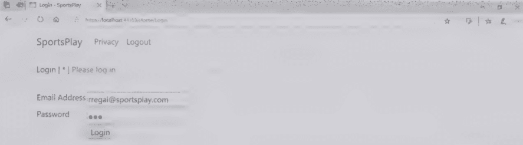

RESULT (欢迎页面 – 经理菜单)

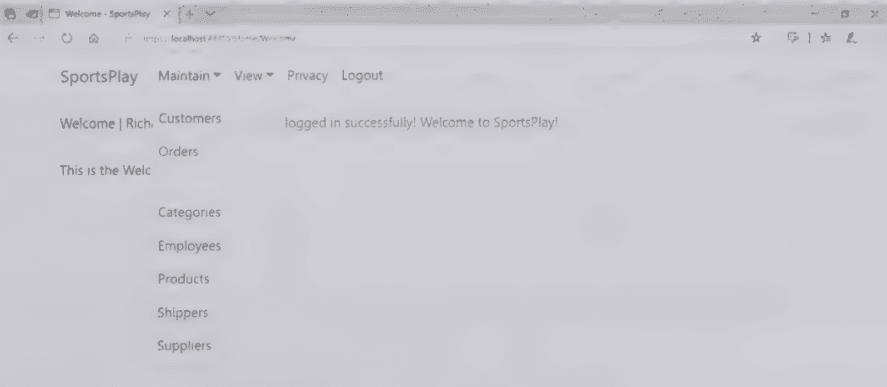

RESULT (登录页面 – 员工登录)

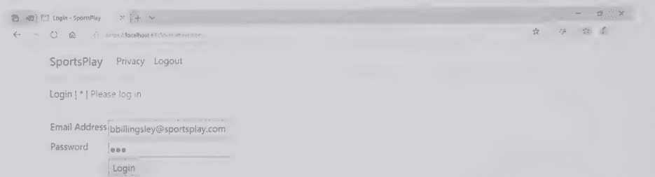

RESULT (欢迎页面 – 员工菜单)


RESULT (登录页面 – 客户登录)


RESULT (欢迎页面 – 客户菜单)

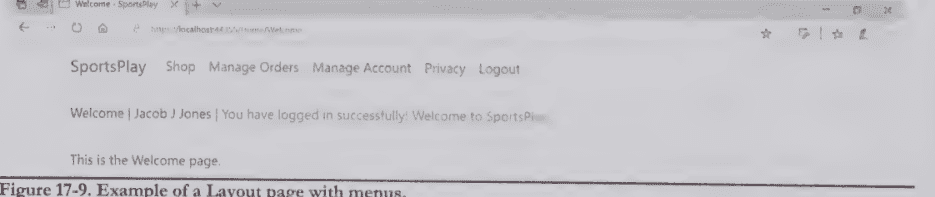

> 图 17-9。示例布局页面带有菜单。

# 252 • 布局页面

## 17.6 项目

遵循第 *Solutions and Projects* 一章中阐述的标识符命名标准。使用 Table 元素在页面上排列其他 HTML 元素，使页面看起来井井有条。

1. 创建一个名为 *Lastname.Firstname.Chapter99* 的新项目，其中 99 是该章节的编号。
2. 在 Pages 文件夹下添加一个 Home 文件夹。将 Privacy 页面移至该文件夹，如图 17-1 所示。
3. 为项目添加一个名为 *Initialize* 的 Razor 页面。按图 17-4 编写此页面。
4. 为项目添加一个名为 *Login* 的 Razor 页面，位于 Home 文件夹中。按图 17-5 编写此页面。
5. 为项目添加一个名为 *Welcome* 的 Razor 页面，位于 Home 文件夹中。按图 17-6 编写此页面。
6. 修改布局页面，以便用户登录时会被重定向到欢迎页面，在该页面中显示页面标题、用户名和状态、欢迎消息以及指向 Privacy 和 Login 页面的链接。请测试这些链接。
7. 修改布局页面，以便经理登录时（除了 Privacy 和 Login 链接外）会显示两个选项——一个 Maintain 下拉列表和一个 View 下拉列表。当点击 Maintain 下拉列表时，应显示维护客户、订单、类别、员工、产品、托运人和供应商的选项。当点击 View 下拉列表时，应显示查看产品库存报表、分类销售报表、产品销售报表和供应商销售报表的选项。无需为这些选项创建页面。
8. 修改布局页面，以便职员登录时（除了 Privacy 和 Login 链接外）会显示一个选项——一个 Maintain 下拉列表。当点击 Maintain 下拉列表时，应显示维护客户和订单的选项。无需为这些选项创建页面。
9. 修改布局页面，以便客户登录时（除了 Privacy 和 Login 链接外）会显示三个选项——一个 Shop 链接、一个 Manage Orders 链接和一个 Manage Account 链接。无需为这些选项创建页面。
10. 测试页面并进行必要的更正。


# 第五部分 – 用户体验提升

# 18 Bootstrap

## 18.1 简介

Bootstrap 是一个用于开发响应式且具有吸引力的 Web 应用程序的框架。在响应性方面，Bootstrap 包含一组 CSS 类和 JavaScript 函数，它们协同工作，根据浏览器*视口*（即可视区域）的宽度来缩放应用程序的页面。浏览器的视口宽度取决于浏览器的当前配置（例如，手动调整大小、最大化、缩放）以及用于访问应用程序的设备（例如，手机、平板电脑、笔记本电脑、台式机）。在吸引力方面，Bootstrap 包含一组可用于设置应用程序页面样式的 CSS 类。总而言之，Bootstrap 可以显著提升 Web 应用程序的用户体验。

在本章的示例学习过程中，请记住，默认情况下，构成 Bootstrap 的 CSS 代码和 JavaScript 代码在页面最初加载到浏览器时会保存在浏览器的缓存中。然后，当页面因后续请求再次加载时，这些代码会从浏览器的缓存中提供。可以想象，这会使页面加载更快，因为每次请求页面时都无需从服务器检索代码。然而，这在开发过程中可能会导致问题，因为我们需要频繁更改 Bootstrap 代码。当我们对 Bootstrap 代码的更改似乎不生效时，可能是因为浏览器提供的是缓存版本的 Bootstrap 代码，而不是新版本的 Bootstrap 代码。在这种情况下，我们需要清除浏览器的缓存。事实上，在编写和测试 Bootstrap 代码时，将浏览器配置为关闭时删除其缓存可能是个好主意。

## 18.2 栅格系统与断点

Bootstrap 采用了一个由十二个*栅格列*（和任意数量的行）组成的栅格系统。它还定义了几个 CSS *断点*（也称为媒体查询断点），这些断点出现在浏览器视口内的各种水平像素位置。在两个断点之间是一个*范围*的视口宽度，我们称之为*断点范围*。默认情况下，Bootstrap 定义了五个断点范围。它们是：

- 0px 到 575px - *超小*设备（如竖屏模式的手机）的视口宽度。
- 576px 到 767px - *小*设备（如横屏模式的手机）的视口宽度。
- 768px 到 991px - *中等*设备（如平板电脑）的视口宽度。
- 992px 到 1,199px - *大*设备（如笔记本电脑和标准台式机）的视口宽度。
- 1,200px 及以上 - *超大*设备（如超大尺寸台式机）的视口宽度。

为了使应用程序的页面能够响应浏览器视口宽度的变化，我们指定一个给定的*列 Div*（即被指定为 Bootstrap 列的 Div）应跨越或横跨的*栅格列*数量。为此，我们使用包含*列类*的 Div。列类的形式为 col-x-y，其中 col 表示该 Div 是一个列 Div，x 是浏览器的视口宽度，y 是该列 Div 应横跨的栅格列数。在页面上对所有列 Div 完成此操作后，Bootstrap 将根据我们为超小、小、中等、大和超大视口宽度提供的指令动态排列它们。

图 18-1 显示了栅格列和列 Div 之间交互的示例。在此示例中，假设我们有 4 个希望在页面上显示的列 Div。

- 如果我们希望在浏览器视口宽度为超小时，每个列 Div 横跨 12 个栅格列，我们可以为每个列 Div 添加 `col-xs-12` 类。这将导致图中的 Part A。但请注意，此特定代码并非必需，因为在超小视口宽度下横跨 12 个栅格列是 Bootstrap 的默认行为。
- 如果我们希望在浏览器视口宽度为小时，每个列 Div 横跨 12 个栅格列，我们将为每个列 Div 添加 `col-sm-12` 类。这也将导致图中的 Part A。
- 如果我们希望在浏览器视口宽度为中等时，每个列 Div 横跨 6 个栅格列，我们将为每个列 Div 添加 `col-md-6` 类。这将导致图中的 Part B。
- 如果我们希望在浏览器视口宽度为大时，每个列 Div 横跨 3 个栅格列，我们将为每个列 Div 添加 `col-lg-3` 类。这将导致图中的 Part C。
- 如果我们希望在浏览器视口宽度为超大时，每个列 Div 横跨 3 个栅格列，我们可以为每个列 Div 添加 `col-xl-3` 类。这也将导致图中的 Part C。但请注意，此特定代码并非必需，因为省略给定视口宽度的类将继承其下方最近的显式指定类的横跨属性。在此情况下，如果未指定 `col-xl-3`，则将使用 `col-lg-3`。

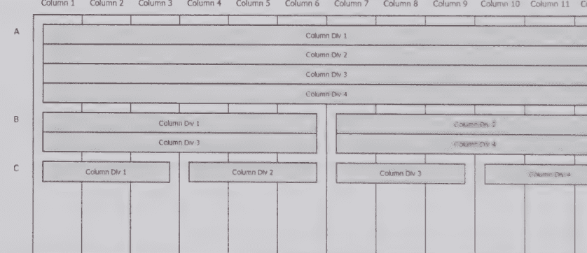

图 18-2 显示了一个包含用于响应性的 Bootstrap 类的页面示例。

在 01 处，我们添加了一个 Style 元素，并在其中定义了一个名为 `.row` 的 CSS 类，用于为页面上的行着色。使用此类将帮助我们更容易地在页面上看到行。但请记住，我们通常不会直接在页面中定义此类 CSS 类。相反，我们会在 `site.css` 文件中定义它们。我们在这里定义此类只是为了方便。

在 02 处，我们定义了一个容器 Div。容器 Div 将一个 Div 标识为 Bootstrap 容器，该容器包含一个或多个行 Div。

在 03 处，我们定义了一个*行 Div*。行 Div 将一个 Div 标识为 Bootstrap 行，该行包含一个或多个列 Div。

在 04 处，我们定义了一个包含多个列类的*列 Div*。列 Div 将一个 Div 标识为 Bootstrap 列，该列包含零个或多个内容元素（例如，Label 元素、Input(Text) 元素、Select 元素）。

在 05 处，我们定义了一个内容元素（本例中是一个 Label 元素）。请注意，当页面显示时，标签将显示 *sm-12 md-6 lg-3*。这将帮助我们看到，超小和小视口宽度将横跨 12 个栅格列，中等视口宽度将横跨 6 个栅格列，大和超大视口宽度将横跨 3 个栅格列。

PAGE

```
@page
@model SportsPlay.Pages.GridSystemEvenDistributionPageModel
@{
    ViewData["Title"] = "Grid System";
}

<h1>Grid System</h1>

01 <style>
       .row div {
           background-color: lightgray;
           border: 1px solid;
           border-color: white;
       }
   </style>

   <form method="post">

02      <div class="container">
03          <div class="row">
04              <div class="col-sm-12 col-md-6 col-lg-3">
05                  <label>sm-12 md-6 lg-3</label>
                </div>
                <div class="col-sm-12 col-md-6 col-lg-3">
                    <label>sm-12 md-6 lg-3</label>
                </div>
                <div class="col-sm-12 col-md-6 col-lg-3">
                    <label>sm-12 md-6 lg-3</label>
                </div>
                <div class="col-sm-12 col-md-6 col-lg-3">
                    <label>sm-12 md-6 lg-3</label>
                </div>
            </div>
        </div>

    </form>
```

图 18-2. 包含用于响应性的 Bootstrap 类的页面示例。

图 18-3 显示了以超小视口宽度显示的页面。由于浏览器的视口宽度为 298px（介于 0px 和 575px 之间，含端点），页面中的每个列 Div 都恰好横跨 12 个栅格列（或视口宽度的 100%）。


图 18-3. 以超小视口宽度显示的页面。

图 18-4 显示了以小视口宽度显示的页面。由于浏览器的视口宽度为 603px（介于 576px 和 767px 之间，含端点），页面中的每个列 Div 都恰好横跨 12 个栅格列（或视口宽度的 100%）。


图 18-4. 以小视口宽度显示的页面。

图 18-5 显示了以中等视口宽度显示的页面。由于浏览器的视口宽度为 792px（介于 768px 和 991px 之间，含端点），页面中的每个列 Div 都恰好横跨 6 个栅格列（或视口宽度的 50%）。

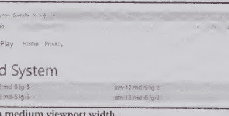

图 18-5. 以中等视口宽度显示的页面。

图 18-6 显示了以大视口宽度显示的页面。由于浏览器的视口宽度为 1,075px（介于 992px 和 1,199px 之间，含端点），页面中的每个列 Div 都恰好横跨 3 个栅格列（或视口宽度的 25%）。

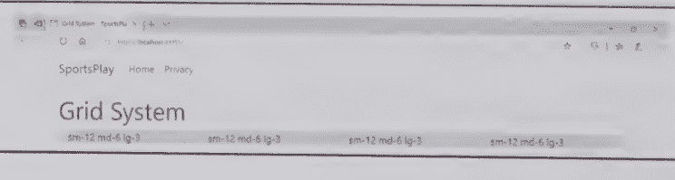


图 18-7 显示了在超大视口宽度下显示的页面。由于浏览器的视口宽度为 1,344 像素（大于 1,199 像素），页面中的每一列 Div 都恰好跨越 3 个网格列（或视口宽度的 25%）。

图 18-8 展示了具有不均匀分布的列 Div 的行 Div 示例。请注意，在此示例中，我们仅定义了针对大视口宽度的列 Div 类。

在 01 处，我们定义了一个带有 `col-lg-6` 类的列 Div。这意味着该列 Div 在页面上显示时将恰好跨越 6 个网格列。

在 02 处，我们定义了一个带有 `col-lg-4` 类的列 Div。这意味着该列 Div 在页面上显示时将恰好跨越 4 个网格列。

在 03 处，我们定义了一个带有 `col-lg-1` 类的列 Div。这意味着该列 Div 在页面上显示时将恰好跨越 1 个网格列。

在 04 处，我们定义了一个带有 `col-lg-1` 类的列 Div。这意味着该列 Div 在页面上显示时将恰好跨越 1 个网格列。

```
@page
@model SportsPlay.Pages.GridSystemUnevenDistributionPageModel
@{
    ViewData["Title"] = "Grid System";
}

<h1>Grid System</h1>

<style>
    .row div {
        background-color: lightgray;
        border: 1px solid;
        border-color: white;
    }
</style>

<form method="post">

    <div class="container">
        <div class="row">
            <div class="col-lg-6">
                <label>lg-6</label>
            </div>
            <div class="col-lg-4">
                <label>lg-4</label>
            </div>
            <div class="col-lg-1">
                <label>lg-1</label>
            </div>
            <div class="col-lg-1">
                <label>lg-1</label>
            </div>
        </div>
    </div>
</form>
```

**图 18-8.** 列分布不均匀的行示例。

图 18-9 显示了具有不均匀分布的列 Div 的行 Div。在此图中，浏览器的视口宽度较大。可以看到，第一个列 Div 恰好跨越 6 个网格列（或视口宽度的 50%），第二个列 Div 恰好跨越 4 个网格列（或视口宽度的约 33.33%），第三个列 Div 恰好跨越 1 个网格列（或视口宽度的约 8.33%），第四个列 Div 恰好跨越 1 个网格列（或视口宽度的约 8.33%）。

**图 18-9.** 具有不均匀分布的列 Div 的行 Div 显示。

### 18.2.1 非响应式页面

图 18-10 展示了一个非响应式页面的示例。请注意，此页面的代码中没有任何新内容。然而，花点时间熟悉它是个好主意，因为它将为后续示例提供背景。

结果部分的第一个截图显示了用户点击“添加”按钮后，在以超小视口宽度（如竖屏模式的手机）显示的浏览器中显示的“添加员工”页面。该截图的第二部分是同一页面但向下滚动后的情况。可以看到，中间名标签和电子邮件地址标签都自身折叠了，大多数错误消息都已换行到下一行。这使页面看起来杂乱且缺乏专业性。

第二个截图显示了用户点击“添加”按钮后，在以超大灯视口宽度（如大型台式机）显示的浏览器中显示的页面。可以看到，没有标签自身折叠，所有错误消息均已正确显示。当页面以如此大的视口宽度在浏览器中显示时，页面的组织和专业性是可以接受的。

```
@page
@model SportsPlay.Pages.NonResponsiveNonStyledPageModel
@{
    ViewData["Title"] = "Add Employee";
}

<h1>Add Employee</h1>

<label>Message:</label>
<label style="color: @Model.MessageColor">@Model.Message</label>

<form method="post">

    <table>
        <tr>
            <td><label asp-for="LastName"></label></td>
            <td>
                <input asp-for="LastName" />
                <span asp-validation-for="LastName"></span>
            </td>
        </tr>
        ...
        <tr>
            <td><label asp-for="Status"></label></td>
            <td>
                <select asp-for="Status">
                    <option value=""></option>
                    <option value="M">Manager</option>
                    <option value="S">Staff</option>
                </select>
                <span asp-validation-for="Status"></span>
            </td>
        </tr>
        <tr>
            <td></td>
            <td>
                <input asp-page-handler="Add"
                       type="submit" value="Add" />
                <input asp-page-handler="Cancel" formnovalidate
                       type="submit" value="Cancel" />
            </td>
        </tr>
    </table>

</form>

@section Scripts {
    @{await Html.RenderPartialAsync("_ValidationScriptsPartial");}
}
```

```
using Microsoft.AspNetCore.Mvc;
using Microsoft.AspNetCore.Mvc.RazorPages;
using System.ComponentModel.DataAnnotations;

namespace SportsPlay.Pages
{
    [BindProperties]
    public class NonResponsiveNonStyledPageModel : PageModel
    {
        public string MessageColor;
        public string Message;

        public int EmployeeId { get; set; }

        [Display(Name = "Last Name")]
        [Required(ErrorMessage = "Please enter a last name.")]
        public string LastName { get; set; }

        [Display(Name = "Status")]
        [Required(ErrorMessage = "Please select a status.")]
        public string Status { get; set; }
    }
}
```

**图 18-10.** 非响应式页面示例。

### 18.2.2 响应式页面

图 18-11 展示了一个响应式页面的示例。

在 01 处，我们定义了一个包含多个行 Div 的容器 Div。

在 02 处，我们定义了一个包含两个列 Div 的行 Div。

在 03 处，我们定义了一个带有多个列类的*列 Div*。该列 Div 包含一个 Label 元素，用于显示姓字段的标签。请注意，当视口宽度为超小或小尺寸时，该列 Div（即标签）将跨越 12 个网格列；当视口宽度为中尺寸时，将跨越 3 个网格列；当视口宽度为大或超大尺寸时，将跨越 2 个网格列。

在 04 处，我们定义了一个带有多个列类的第二个*列 Div*。该列 Div 包含一个 Text (Input) 元素，用于接受用户输入的姓氏。请注意，当视口宽度为超小或小尺寸时，该列 Div（即文本框）将跨越 12 个网格列；当视口宽度为中尺寸时，将跨越 9 个网格列；当视口宽度为大或超大尺寸时，将跨越 10 个网格列。

结果部分的第一个截图显示了用户点击“添加”按钮后，在以超小视口宽度（如竖屏模式的手机）显示的浏览器中显示的“添加员工”页面。该截图的第二部分是同一页面但向下滚动后的情况。可以看到，所有标签都直接放置在其关联的文本框上方的单独一行上。不幸的是，大多数错误消息都已换行到下一行，这仍然使页面看起来杂乱且缺乏专业性。

第二个截图显示了用户点击“添加”按钮后，在以超大灯视口宽度（如大型台式机）显示的浏览器中显示的页面。可以看到，没有标签自身折叠，所有错误消息均已正确显示。当页面以如此大的视口宽度在浏览器中显示时，页面的组织和专业性是可以接受的。

```
@page
@model SportsPlay.Pages.ResponsiveNonStyledPageModel
@{
    ViewData["Title"] = "Add Employee";
}
```


添加员工

消息：@Model.MessageColor @Model.Message

<form method="post">
    <div class="container">
        <div class="row">
            <div class="col-sm-12 col-md-3 col-lg-2">
                <label asp-for="LastName"></label>
            </div>
            <div class="col-sm-12 col-md-9 col-lg-10">
                <input asp-for="LastName" />
                <span asp-validation-for="LastName"></span>
            </div>
        </div>
        <!-- ... -->
        <div class="row">
            <div class="col-sm-12 col-md-3 col-lg-2">
                <label asp-for="Status"></label>
            </div>
            <div class="col-sm-12 col-md-9 col-lg-10">
                <select asp-for="Status">
                    <option value=""></option>
                    <option value="M">Manager</option>
                    <option value="S">Staff</option>
                </select>
                <span asp-validation-for="Status"></span>
            </div>
        </div>
        <div class="row">
            <div class="col-sm-12 col-md-3 col-lg-2">
            </div>
            <div class="col-sm-12 col-md-9 col-lg-10">
                <input asp-page-handler="Add"
                       type="submit" value="Add" />
                <input asp-page-handler="Cancel" formnovalidate
                       type="submit" value="Cancel" />
            </div>
        </div>
    </div>
</form>

@section Scripts {
    @{await Html.RenderPartialAsync("_ValidationScriptsPartial");}
}

```csharp
using Microsoft.AspNetCore.Mvc;
using Microsoft.AspNetCore.Mvc.RazorPages;
using System.ComponentModel.DataAnnotations;

namespace SportsPlay.Pages
{
    [BindProperties]
    public class ResponsiveNonStyledPageModel : PageModel
    {
        public string MessageColor;
        public string Message;

        public int EmployeeId { get; set; }

        [Display(Name = "Last Name")]
        [Required(ErrorMessage = "Please enter a last name.")]
        public string LastName { get; set; }

        [Display(Name = "Status")]
        [Required(ErrorMessage = "Please select a status.")]
        public string Status { get; set; }
    }
}
```

结果（超小视口 - 竖屏模式手机）

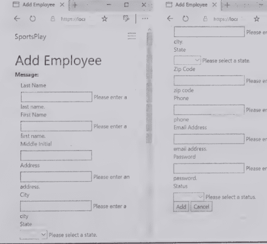

## 结果（超大视口 - 超大桌面显示器）

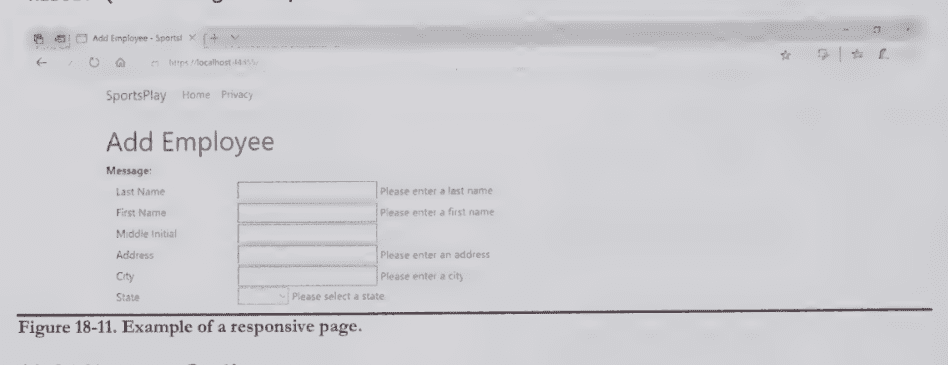

图 18-11. 响应式页面示例。

## 18.3 元素样式

Bootstrap 还包含一组 CSS 类，可用于为 Web 应用程序的页面设置样式。这些类旨在使 Web 应用程序看起来比默认显示样式更加现代。当*恰当地*应用这些 Bootstrap 类时，可以显著改善应用程序的用户体验。请记住，本节仅介绍其中的几个类。还有数百个其他类可供选择。

### 18.3.1 带样式的页面

图 18-12 展示了一个带样式页面的示例。如图所示，该页面既是响应式的，也经过了*样式化*。

在 01 处，我们定义了一个包含多个行 Div 的容器 Div。注意，这个容器 Div 包含一个 *jumbotron* 类。jumbotron 类会在我们想要强调的内容周围显示一个灰色方框。在本例中，我们使用 jumbotron 类来突出页面的主要区域，目的是将页面的主要区域与页眉和页脚区域分开。

在 02 处，我们定义了一个 Label 元素，用于显示姓氏字段的标签。注意，这个标签包含一个 *font-weight-bold* 类。顾名思义，font-weight-bold 类会以粗体显示标签。这将帮助用户区分标签与输入到相关文本框中的文本。

在 03 处，我们定义了一个 Input (Text) 元素，用于从用户处获取姓氏。注意，这个文本框包含一个 *form-control* 类。form-control 类会以比默认显示更现代的样式来呈现 Input 元素、Select 元素和 Textarea 元素。它还会默认在父级 Div 内以 100% 的宽度显示它们。但是，我们可以通过包含一个 *w-* 类（如 *w-25* 类，它会在父级 Div 内以 25% 的宽度显示元素）来覆盖这个宽度。

在 04 处，我们定义了一个 Span 元素，用于显示与姓氏文本框中输入的数据相关的任何错误消息。注意，这个 span 包含一个 *text-danger* 类。text-danger 类会将 span 显示为红色。这将帮助用户看到姓氏字段中发生的任何错误。

在 05 处，我们定义了一个 Input (Submit) 元素，用于显示一个“添加”按钮。注意，这个按钮包含一个 *btn* 类和一个 *btn-primary* 类。btn 类会以比默认显示更现代的样式来呈现按钮，而 btn-primary 类会将按钮显示为蓝色。

在 06 处，我们定义了一个 Input (Submit) 元素，用于显示一个“取消”按钮。注意，这个按钮包含一个 *btn* 类和一个 *btn-secondary* 类。btn 类会以比默认显示更现代的样式来呈现按钮，而 btn-secondary 类会将按钮显示为灰色。这将帮助用户区分两种不同类型的按钮。

图中的结果部分的第一张截图显示了用户点击“添加”按钮后，在具有超小视口宽度（如竖屏模式手机）的浏览器中显示的“添加员工”页面。这张截图的第二部分是同一页面向下滚动后的样子。如图所示，所有标签都已加粗并放置在各自相关文本框正上方的单独行中。此外，所有文本框都具有现代外观，并且大多数文本框跨越了浏览器视口的整个宽度。同样，所有错误消息都被放置在各自相关文本框正下方的单独行中。最后，“添加”和“取消”按钮也具有包含不同颜色的现代外观。总而言之，当在具有超小视口宽度的浏览器中查看时，这些都使页面看起来非常整洁、专业且现代。

第二张截图显示了用户点击“添加”按钮后，在具有超大视口宽度（如超大桌面显示器）的浏览器中显示的页面。如图所示，所有标签都已加粗并直接放置在各自相关文本框的左侧。此外，所有文本框都具有现代外观，并且没有文本框跨越浏览器视口的整个宽度。同样，所有错误消息都被放置在各自相关文本框正下方的单独行中。最后，尽管在图中不可见，“添加”和“取消”按钮也具有包含不同颜色的现代外观。总而言之，当在具有超大视口宽度的浏览器中查看时，这些都使页面看起来非常整洁、专业且现代。

## 页面

```html
@page
@model SportsPlay.Pages.ResponsiveStyledPageModel
@{
    ViewData["Title"] = "Add Employee";
}

<h1>Add Employee</h1>

<label class="font-weight-bold">Message:</label>
<label style="color: @Model.MessageColor">@Model.Message</label>

<form method="post">

    <div class="container jumbotron">
        <div class="row">
            <div class="col-sm-12 col-md-3 col-lg-2">
                <label asp-for="LastName" class="font-weight-bold"></label>
            </div>
            <div class="col-sm-12 col-md-9 col-lg-10">
                <input asp-for="LastName" class="form-control" />
                <span asp-validation-for="LastName"
                    class="text-danger"></span>
            </div>
        </div>
        <div class="row">
            <div class="col-sm-12 col-md-3 col-lg-2">
                <label asp-for="Status" class="font-weight-bold"></label>
            </div>
            <div class="col-sm-12 col-md-9 col-lg-10">
                <select asp-for="Status" class="form-control">
                    <option value=""></option>
                    <option value="M">Manager</option>
                    <option value="S">Staff</option>
                </select>
                <span asp-validation-for="Status"
                    class="text-danger"></span>
            </div>
        </div>
        <div class="row">
            <div class="col-sm-12 col-md-3 col-lg-2">
            </div>
            <div class="col-sm-12 col-md-9 col-lg-10">
                <input asp-page-handler="Add" class="btn btn-primary"
                      type="submit" value="Add" />
                <input asp-page-handler="Cancel" class="btn btn-secondary"
                       formnovalidate type="submit" value="Cancel" />
            </div>
        </div>
    </div>
</form>

@section Scripts {
    @{await Html.RenderPartialAsync("_ValidationScriptsPartial");}
}
```

```csharp
using Microsoft.AspNetCore.Mvc;
using Microsoft.AspNetCore.Mvc.RazorPages;
using System.ComponentModel.DataAnnotations;

namespace SportsPlay.Pages
{
    [BindProperties]
    public class ResponsiveStyledPageModel : PageModel
    {
        ...
    }
}
```


 public string MessageColor;
public string Message;

public int EmployeeId { get; set; }

[Display(Name = "姓氏")]
[Required(ErrorMessage = "请输入姓氏。")]
public string LastName { get; set; }
⋮
[Display(Name = "状态")]
[Required(ErrorMessage = "请选择状态。")]
public string Status { get; set; }
⋮
}
}

## 结果（超小视口 - 竖屏手机）

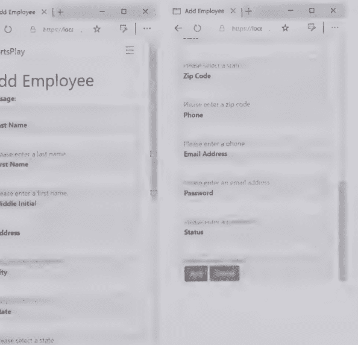

## 结果（超大视口 - 超宽桌面显示器）

### 18.3.2 主题页面

有时我们可能想使用其他人创建的*Bootstrap主题*。当我们正在设计一个应用程序，需要合适的样式和配色方案时，这可以节省大量时间——尤其当我们不特别擅长用户界面设计的审美方面时。幸运的是，有许多人已经制作了这样的主题并可供我们使用。他们通常只要求我们注明他们的工作成果。

要将Bootstrap主题添加到项目中，请访问*bootswatch.com*网站（或可以下载Bootstrap主题的类似网站）。找到一个潜在的主题。下载bootstrap.min.css文件。将该文件放入wwwroot/css文件夹。打开_Layout.cshtml页面。移除（或注释掉）出现在布局页面顶部`<head>`和`</head>`元素之间的以下代码行：

```
<link rel="stylesheet" href="~/lib/bootstrap/dist/css/bootstrap.min.css" />
<link rel="stylesheet" href="~/css/site.css" />
```

添加以下代码行：

```
<link rel="stylesheet" href="~/css/bootstrap.min.css" />
```

最后，试一试。如果看起来很棒，就保留它。如果不是，就用不同的Bootstrap主题替换它。

图18-13展示了修改后的布局页面。注意，我们已经注释掉了页面中对原始Bootstrap和CSS文件的引用，并添加了对新Bootstrap主题文件的引用。还请注意，我们注明了主题作者的贡献。

## 页面

```
<!DOCTYPE html>
<html lang="en">
<head>
    <meta charset="utf-8" />
    <<meta name="viewport" content="width=device-width, initial-scale=1.0" />
    <title>@ViewData["Title"] - SportsPlay</title>
    @*这是原始布局。*@
    @*<link rel="stylesheet"
        href="~/lib/bootstrap/dist/css/bootstrap.min.css" />*@
    @*<link rel="stylesheet"
        href="~/css/site.css" />*@
    @*这是主题布局。*@
    @*来源：bootswatch.com/superhero。作者：Thomas Park。*@
    <link rel="stylesheet"
        href="~/css/bootstrap.min.css" />
</head>
```

## 图18-13。修改后的布局页面。

图18-14展示了一个主题页面的示例。注意页面从颜色、巨幕、按钮到元素形状再到字体样式的完全不同外观。当然，其主要优势在于，由于主题通过布局页面自动应用于应用程序的所有页面，应用程序的所有其他页面看起来都非常相似。

## 结果（超小视口 - 竖屏手机）

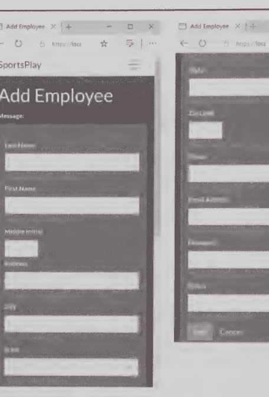

## 结果（超大视口 - 超宽桌面显示器）


## 图18-14。主题页面示例。

## 18.4 项目

遵循题为*解决方案和项目*的章节中阐述的标识符命名标准。使用Table元素来安排页面上的其他HTML元素，使页面看起来组织良好。

提醒：如果你的Bootstrap代码更改似乎不起作用，可能需要清除浏览器的缓存。

## 第1部分

- 1. 创建一个名为*Lastname.Firstname.Chapter99*的新项目，其中99是本章的编号。
- 2. 向项目中添加一个名为*AddProduct*的Razor页面。如图5-6所示编写此页面的代码。但是，简化代码，使其仅执行必填字段验证。
- 3. 使用Bootstrap修改页面，使其具有响应性（即，在超小、小、中、大和超大屏幕上都能良好格式化）并具有样式（即，看起来具有专业风格）。
- 4. 测试页面并进行任何必要的更正。

## 第2部分

- 1. 注释掉布局页面中对Bootstrap*和*CSS库的引用。
- 2. 在网上找到一个自定义的Bootstrap主题并将其应用于你的项目。
- 3. 测试页面并进行任何必要的更正。

# 19 层叠样式表

## 19.1 简介

层叠样式表（CSS）指定了网页上HTML元素的显示方式。CSS的好处在于，它允许我们创建响应式且样式吸引人的页面，这些页面在Web应用程序的所有页面中都能一致地显示。当应用得当时，CSS可以显著改善我们应用程序的用户体验。

在学习本章的示例时，请记住，CSS代码在页面首次加载到浏览器时，默认情况下会保存在浏览器的缓存中。当页面因后续页面请求而再次加载时，此代码将从浏览器的缓存中提供。可以想象，这使得页面加载更快，因为每次请求页面时无需从服务器检索代码。但是，这在开发期间频繁更改CSS代码时可能会导致问题。当对CSS代码的更改似乎不起作用时，可能是因为浏览器提供的是CSS代码的缓存版本，而不是新版本的CSS代码。在这种情况下，我们需要清除浏览器的缓存。实际上，在编写和测试CSS代码时，将浏览器配置为关闭时删除其缓存可能是个好主意。另一件需要记住的事情是，当Bootstrap和CSS在同一项目中一起使用时，某些Bootstrap代码可能会优先于我们的某些CSS代码。在这种情况下，对CSS代码的更改似乎不会对页面产生影响。要解决此问题，我们可以从Bootstrap文件中复制相关的CSS代码，将其粘贴到我们的CSS文件中，然后在那里修改CSS代码。

## 19.2 像素 vs Em vs Rem

*像素*（即，图片元素）代表图形图像中的单个点。在CSS中，*px*是代表像素数量的*值*。[32](https://www.google.com/search?q=Roughly.) 另一方面，*em*和*rem*是*乘数*，它们表示HTML元素的字体大小应根据页面上某个*其他*HTML元素的字体大小进行缩放的程度。在自定义HTML元素时指定em和rem单位而不是px值，允许我们创建能够响应浏览器当前配置（例如，默认字体大小）和用于访问应用程序的设备（例如，手机、平板电脑、笔记本电脑、台式机）的应用程序。当今世界对这种响应式的需求，就是为什么许多开发人员建议在指定HTML元素的字体大小时使用em和/或rem单位而不是px值。当然，有时使用px值指定HTML元素的字体大小是完全合适的。

虽然em和rem在*功能*上相似，但在*实现方式*上有所不同。正如我们将看到的，区别在于浏览器如何将em和rem单位转换为px值。

当我们使用em单位指定HTML元素的字体大小时，浏览器会根据其*父*HTML元素的字体大小（以像素为单位）将em单位（乘数）转换为px值。例如，如果一个HTML元素的字体大小设置为*1em*，而其父HTML元素的字体大小设置为*12px*，则浏览器会将该HTML元素的字体大小转换为*12px*（1em × 12px = 12px）。如果一个HTML元素的字体大小设置为*0.75em*，而其父HTML元素的字体大小设置为*12px*，则浏览器会将该HTML元素的字体大小转换为*9px*（0.75em × 12px = 9px）。

当我们使用rem单位（*根*em单位）指定HTML元素的字体大小时，浏览器会根据*根*HTML元素的字体大小（以像素为单位）将rem单位（乘数）转换为px值。根HTML元素是页面的最高级HTML元素（即`<html>`）。例如，如果一个HTML元素的字体大小设置为*1rem*，而根HTML元素的字体大小设置为*16px*（大多数浏览器的默认值），则浏览器会将该HTML元素的字体大小转换为*16px*（1rem × 16px = 16px）。如果一个HTML元素的字体大小设置为*0.75rem*，而根HTML元素的字体大小设置为*16px*（大多数浏览器的默认值），则浏览器会将该HTML元素的字体大小转换为*12px*（0.75rem × 16px = 12px）。

使用rem单位比使用em单位有几个好处。

- 使用rem单位为我们提供更一致的HTML元素格式化，因为rem单位是根据单个HTML元素（即应用程序的根HTML元素）的字体大小而不是从父HTML元素继承的字体大小转换为px值的。
- 使用rem单位允许我们通过更改应用程序根HTML元素的默认字体大小（例如`<html style="font-size: 20px">`）来修改应用程序中所有HTML元素的字体大小。
- 使用rem单位允许用户通过更改浏览器的默认字体大小来修改应用程序中所有HTML元素的字体大小。

图19-1展示了使用px值、em单位和rem单位的示例。

在01处，我们创建了一个Label元素并将其字体大小设置为*12px*。由于此元素的字体大小指定为px值，它将*始终*显示为12px——无论页面上其他元素的字体大小如何更改，包括根HTML元素。

在02处，我们创建了一个Label元素并将其字体大小设置为*0.75em*。由于此元素的字体大小是根据其父元素的字体大小（为16px）计算的，只要其祖父元素的字体大小不变，它就会显示为12px（0.75em × 16px = 12px）。

在03处，我们创建了一个Label元素并将其字体大小设置为*0.75rem*。由于此元素的字体大小是根据页面根元素的字体大小（默认为16px）计算的，只要页面根元素的字体大小不变，它就会显示为12px（0.75rem × 16px = 12px）。

在04处，我们编写了自动显示本示例标签字体大小所需的JavaScript代码。我们将在题为*JavaScript编程*的章节中学习所有这些代码的含义。

图结果部分的第一张截图显示了当布局页面中根HTML元素设置为*16px*时，页面上所有文本项的字体大小。可以看到，所有三个标签都以*12px*的字体大小显示。第二张截图显示了当布局页面中根HTML元素设置为*24px*时，页面上所有文本项的字体大小。可以看到，页面上的大多数文本项都以更大的字体显示，包括第三个标签，它已按比例放大以显示*18px*的字体大小。然而，前两个标签仍以*12px*的字体大小显示。


<h1>Px vs Em vs Rem</h1>

<div style="font-size: 16px">
    <div>
        <label id="lblPx" style="font-size: 12px"></label>
    </div>
    <div>
        <label id="lblEm" style="font-size: 0.75em"></label>
    </div>
    <div>
        <label id="lblRem" style="font-size: 0.75rem"></label>
</script type="text/javascript">
<div>

<script type="text/javascript">
    onload = DisplayFontSize();

    function DisplayFontSize() {
        document.getElementById("lblPx").innerText = "Px: " +
            window.getComputedStyle(document.getElementById("lblPx"))
                .fontSize;
        document.getElementById("lblEm").innerText = "Em: " +
            window.getComputedStyle(document.getElementById("lblEm"))
                .fontSize;
        document.getElementById("lblRem").innerText = "Rem: " +
            window.getComputedStyle(document.getElementById("lblRem"))
                .fontSize;
    }
</script>

结果（根HTML元素字体大小在Layout.cshtml中设置为16px）


# **### 19.3 CSS文件**

site.css文件包含Web应用程序页面中*一致*地设置样式（即，格式化和美化）HTML元素所需的CSS代码。图19-2显示了site.css文件的简略版本。我们将把所有CSS代码放在这个文件中，以便在我们应用程序的所有页面上使用。请注意，此图仅用于展示site.css文件的总体布局和内容。

如图所示，注释被用来区分文件中的*元素选择器*和*类选择器*。

元素选择器由HTML元素类型及其相关的CSS格式化声明定义。这种类型的选择器应用于该类型的所有HTML元素。例如，如果我们希望格式化应用程序中的所有Label元素，使其显示为黑色和粗体字体，我们将在CSS文件中这样定义元素选择器：

```
label{color:black;font-weight:bold;}
```

其中color和font-weight是格式化*属性*，black和bold是格式化*值*。

另一方面，类选择器由一个句点后跟类名及其相关的CSS格式化声明定义。这种类型的选择器仅应用于那些class属性设置为该类选择器名称的HTML元素。类选择器允许我们为*相同*类型的不同HTML元素应用*不同*的格式。例如，如果我们希望只格式化应用程序中class为input-text的Input (Text)元素，使其显示为白烟背景色和100%的宽度，我们将在CSS文件中这样定义类选择器：

```
.input-text{background-color:whitesmoke;width:100%};
```

其中background-color和width是格式化*属性*，whitesmoke和100是格式化*值*，%是格式化*单位*。


### SITE.CSS

| /* 元素选择器放在这里。当格式化 /* |
/*需要普遍应用于HTML元素时使用。 */                                                                                              ||
body {                                                                                                || 
    /* 所有元素继承此字体族。 */                                                     || 
font-family: Arial;                                                                                   |}  
:img {                                                                                           box-shadow: 0.25rem 0.25rem 0.75rem lightgray;}|
                                                                                                    :                                                    |
/* 类选择器放在这里。当格式化 /*                                 / * || 
/*不需要普遍应用于HTML元素时使用。 */                                        /||  

#### border-bottom {                                                            |  
    /* 这是在创建项目时生成的。 */                       |
border-bottom: 1px solid #e5e5e5;                                                 }|

.border-top {                                                          position:absolute;}   |bottom:0;width:100%;}        box-shadow:{width:auto;line-height:60;height:auto;padding:2rem;border-radius:.25rem;margin-left:-0.75rem;text-align:center;font-size:x-large;}  
                                                                                                    :                                                    /*这是创建表格时生成的box-shadow属性值*/     |  ||

.checkbox input[type=checkbox]                                                                {display:none;}
.footer                                                                   position:absolute;bottom:0;width:100%;white-space:nowrap;line-height:60px;display:block;border-radius:.25rem;margin:-3.75rem;padding-left:4rem;text-align:center;font-size:x-large;color:white;background-color:#3f8e3cbaf;}

图19-2. site.css文件的简略版本。


# ### **###**
## # **###**
19.4 基本元素样式

图  显示了为div、h1、label、input (text)、input (password)、input (submit)、table、tr和td元素设置样式的示例。

在01处，我们定义了一个名为*.div*的类选择器。由于这是一个类选择器，它将*仅*应用于应用程序中class设置为*div*的元素。请注意，此选择器已应用于Div元素（在[]())。

在02处，我们定义了一个H1元素选择器。由于这是一个元素选择器，它将应用于应用程序中*所有*的H1元素。请注意，此选择器将应用于H1元素（在[](())).

在03处，我们定义了一个Label元素选择器。由于这是一个元素选择器，它将应用于应用程序中*所有*的Label元素。请注意，此选择器将应用于Label元素（在[](())).

在04处，我们在一处定义了一个Input (Password)元素选择器和一个Input (Text)元素选择器，因为我们希望两种类型的Input元素看起来相同。由于这些是元素选择器，它们将应用于应用程序中*所有*的Input (Password)和Input (Text)元素。请注意，Input (Password)元素选择器将应用于Input (Password)元素（在[](())). 也要注意，Input (Text)元素选择器将应用于Input (Text)元素（在[](())).

在05处，我们定义了一个Input (Password)*聚焦选择器*和一个Input (Text)*聚焦选择器*，以指明我们希望应用程序中所有Input (Password)和Input (Text)元素在获得页面焦点时的外观和/或行为。

在06处，我们在一处定义了一个名为*.input-password*的类选择器和一个名为*.input-text*的类选择器，因为我们希望两种类型的Input元素看起来相同。由于.input-password选择器是一个类选择器，它将*仅*应用于应用程序中class设置为*input-password*的元素。请注意，此选择器已应用于


 ```
box-shadow 0.25s ease-in-out;
}
```

```
09 table, tr, td {
    padding: 0.25rem;
}
```

# 页面

```
@page
@model SportsPlay.Pages.BasicCSSModel
@{
    ViewData["Title"] = "Login";
}
```

```
10 <h1>Login</h1>
```

```
11 <label>消息：</label>
<label style="color: @Model.MessageColor">@Model.Message</label>
```

```
<form method="post">
```

```
12   <div class="div">
13     <table>
        <tr>
          <td><label>电子邮件地址</label></td>
14         <td><input asp-for="EmailAddress" class="input-text" /></td>
        </tr>
        <tr>
          <td><label>密码</label></td>
15         <td><input asp-for="Password" class="input-password" type="password" /></td>
        </tr>
        <tr>
          <td></td>
          <td>
16           <input asp-page-handler="Login" type="submit" value="登录" />
          </td>
        </tr>
      </table>
    </div>
```

```
</form>
```

# 结果

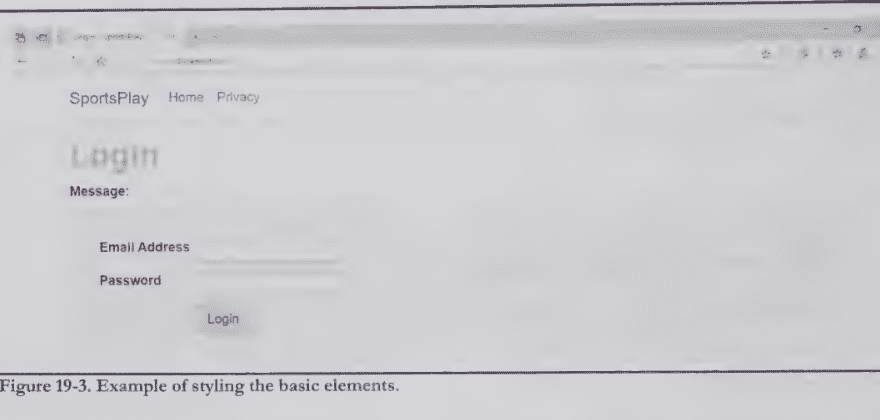

图 19-3. 基本元素样式示例。

## 19.5 图片（Img）元素样式

图 19-4 展示了图片（Img）元素的样式示例。

在 01 处，我们定义了一个图片（Img）元素选择器。由于这是元素选择器，它将应用于应用程序中的**所有**图片元素。请注意，该元素选择器将应用于 02 处的图片元素。

图中的结果部分展示了"显示产品图片"页面。请注意，SportsPlay 图片周围有阴影。

**SITE.CSS**

```
01 img {
    box-shadow: 0.25rem 0.25rem 0.75rem lightgray;
}
```

# 页面

```
@page
@model SportsPlay.Pages.ImgCSSModel
@{
    ViewData["Title"] = "Display Product Image";
}

02 <h1>
    显示产品图片</h1>

<label>消息：</label>
<label style="color: @Model.MessageColor">@Model.Message</label>

<form method="post">
    <label>图片名称</label>
    <input asp-for="ImageName" />

    <label>替代文本</label>
    <input asp-for="AlternateText" /><br />
    <input asp-page-handler="Display" type="submit" value="显示" /><br />
    

</form>
```

# 结果

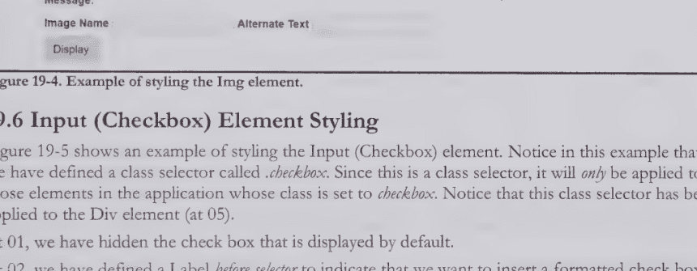

> 图 19-4. 图片（Img）元素样式示例。

## 19.6 输入框（复选框）元素样式

图 19-5 展示了输入框（复选框）元素的样式示例。请注意，在本示例中，我们定义了一个名为 .checkbox 的类选择器。由于这是类选择器，它只会应用于应用程序中 class 属性设置为 checkbox 的那些元素。请注意，该类选择器已应用于 05 处的 Div 元素。

在 01 处，我们隐藏了默认显示的复选框。

在 02 处，我们定义了一个 Label before 伪元素选择器，用于指示我们希望在 Div 元素内部的 Label 元素之前（即前方）插入一个格式化的复选框。这替代了默认的复选框。

在 03 处，我们定义了一个 Label hover 伪类选择器，用于指示当鼠标悬停时，我们希望格式化的复选框呈现的外观和行为。

在 04 处，我们定义了一个 Input checked 伪类选择器，用于指示当复选框被选中时，我们希望它呈现的外观。

图中的结果部分展示了"鞋类"和"服装"选项被选中后的"设置筛选条件"页面。

**SITE.CSS**

```
01 .checkbox input[type=checkbox] {
    /* 隐藏默认复选框。 */
    display: none;
}

02 .checkbox label:before {
    background-color: lightgray;
    border-radius: 0.25rem;
    content: "\00a0";
    display: inline-block;
    margin-right: 0.25rem;
    text-align: center;
    width: 1.50rem;
}

03 .checkbox label:hover:before {
    background-color: darkgray;
    transition: background-color 0.25s ease-in-out;
}

04 .checkbox input:checked ~ label:before {
    content: "\2713"; /* 对勾符号 */
}
```

# 页面

```
@page
@model SportsPlay.Pages.InputCheckboxCSSModel
@{
    ViewData["Title"] = "Set Filters";
}

<h1>设置筛选条件</h1>

<label>消息：</label>
<label style="color: @Model.MessageColor">@Model.Message</label>

<form method="post">
05     <div class="checkbox">
        <input asp-for="Footwear" id="chkFootwear"
            type="checkbox" />
        <label for="chkFootwear">鞋类</label>
    </div>
    <div class="checkbox">
        <input asp-for="Clothing" id="chkClothing"
            type="checkbox" />
        <label for="chkClothing">服装</label>
    </div>
    <div class="checkbox">
        <input asp-for="TennisEquipment" id="chkTennisEquipment"
            type="checkbox" />
        <label for="chkTennisEquipment">网球装备</label>
    </div>

    <input asp-page-handler="Set" type="submit" value="设置" />
</form>
```

# 结果

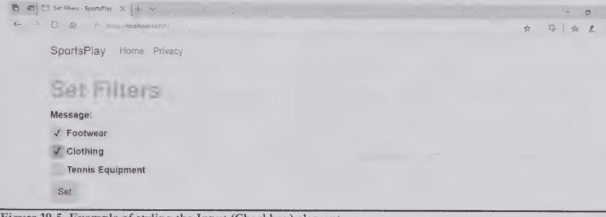

## 19.7 输入框（日期）元素样式

图 19-6 展示了输入框（日期）元素的样式示例。

在 01 处，我们定义了一个输入框（日期）元素选择器。由于这是元素选择器，它将应用于应用程序中的**所有**输入框（日期）元素。请注意，该元素选择器将应用于 03 处的输入框（日期）元素。

在 02 处，我们定义了一个输入框（日期）focus 伪类选择器，用于指示当页面焦点落于其上时，我们希望应用程序中所有输入框（日期）元素呈现的外观和/或行为。

图中的结果部分展示了用户点击日期选择器后的"选择发货日期"页面。请注意，输入框（日期）元素生成的日期选择器的样式会因使用的浏览器而异。

**SITE.CSS**

```
01  input[type=date] {
        background-color: whitesmoke;
        border-color: darkgray;
        border-radius: 0.25rem;
        border-style: solid;
        border-width: 1px;
    }

02  input[type=date]:focus {
        background-color: white;
        box-shadow: 0.25rem 0.25rem 0.75rem lightgray;
        transition: background-color 0.25s ease-in-out,
                   box-shadow 0.25s ease-in-out;
    }
```

## 19.8 输入框（文件）元素样式

图 19-7 展示了输入框（文件）元素的样式示例。

在 01 处，我们定义了一个输入框（文件）元素选择器。由于这是元素选择器，它将应用于应用程序中的**所有**输入框（文件）元素。请注意，该元素选择器将应用于 03 处的输入框（文件）元素。

在 02 处，我们定义了一个输入框（文件）focus 伪类选择器，用于指示当页面焦点落于其上时，我们希望应用程序中所有输入框（文件）元素呈现的外观和/或行为。

图中的结果部分展示了用户点击"浏览"按钮后的"上传产品图片"页面。

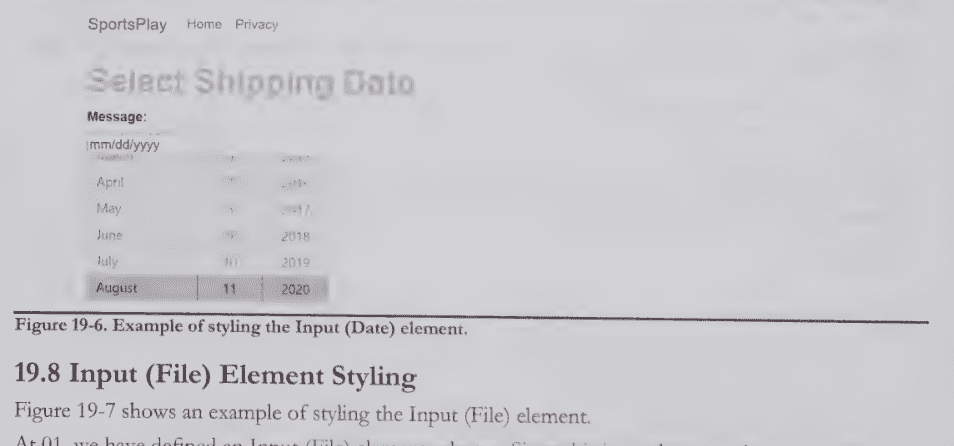

**SITE.CSS**

```
input[type=file] {
    background-color: whitesmoke;
    border-color: darkgray;
    border-radius: 0.25rem;
    border-style: solid;
    border-width: 1px;
}

input[type=file]:focus {
    background-color:',
        box-shadow 0.25s ease-in-out;
}
```

# 页面

```
@page
@model SportsPlay.Pages.InputFileCSSModel
@{
    ViewData["Title"] = "Upload Product Image";
}

<h1>上传产品图片</h1>

<label>消息：</label>
<label style="color: @Model.MessageColor">@Model.Message</label>

<form method="post" enctype="multipart/form-data">

    <input asp-for="ProductImage" type="file" />
    <input asp-page-handler="Upload" type="submit" value="上传" />

</form>
```

# 结果


图 19-7. 输入框（文件）元素样式示例。

## 19.9 输入框（月份）元素样式

图 19-8 展示了输入框（月份）元素的样式示例。

在 01 处，我们定义了一个输入框（月份）元素选择器。由于这是元素选择器，它将应用于应用程序中的所有输入框（月份）元素。请注意，该元素选择器将应用于 03 处的输入框（月份）元素。

在 02 处，我们定义了一个输入框（月份）focus 伪类选择器，用于指示当页面焦点落于其上时，我们希望应用程序中所有输入框（月份）元素呈现的外观和/或行为。

图中的结果部分展示了用户点击月份选择器后的"选择库存月份"页面。请注意，输入框（月份）元素生成的月份选择器的样式会因使用的浏览器而异。

**SITE.CSS**

```
01  input[type=month] {
    background-color: whitesmoke;
    border-color: darkgray;
    border-radius: 0.25rem;
    border-style: solid;
    border-width: 1px;
}

02  input[type=month]:focus {
    background-color: white;
    box-shadow: 0.25rem 0.25rem 0.75rem lightgray;
    transition: background-color 0.25s ease-in-out,
                box-shadow 0.25s ease-in-out;
}
```

# 页面
```


## 19.10 单选按钮（Radio）输入元素样式

图 19-9 展示了单选按钮（Radio）输入元素的样式设置示例。请注意，在本示例中，我们定义了一个名为 `.radio` 的类选择器。由于这是一个类选择器，它`只`会应用于应用中 class 属性设置为 `radio` 的那些元素。请注意，这个类选择器已应用于 Div 元素（在 05 处）。

在 01 处，我们隐藏了默认显示的单选按钮。

在 02 处，我们定义了一个 Label *before 伪元素选择器*，用于表明我们希望在 Div 元素内的 Label 元素之前（即前方）插入一个格式化的单选按钮。这会替换掉默认的单选按钮。

在 03 处，我们定义了一个 Label 悬浮选择器，用于指明当鼠标悬浮在格式化的单选按钮上时，我们希望它呈现的外观和行为。

在 04 处，我们定义了一个 Input *checked 选择器*，用于指明当格式化的单选按钮被选中时，我们希望它呈现的外观。

图中的“结果”部分展示了在选中 UPS 选项后的“选择承运商”页面。

```css
/* SITE.CSS */
/* 01 */ .radio input[type=radio] {
    /* 隐藏默认单选按钮。 */
    display: none;
}
/* 02 */ .radio label:before {
    background-color: lightgray;
    border-radius: 1.00rem;
    content: "\00a0";
    display: inline-block;
    margin-right: 0.25rem;
    text-align: center;
    width: 1.50rem;
}
/* 03 */ .radio label:hover:before {
    background-color: darkgray;
    transition: background-color 0.25s ease-in-out;
}
/* 04 */ .radio input:checked ~ label:before {
    content: "\2605"; /* 星形符号 */
}
```

```csharp
// PAGE
@page
@model SportsPlay.Pages.InputRadioCSSModel
@{
    ViewData["Title"] = "Select Shipper";
}
<h1>Select Shipper</h1>
<label>Message:</label>
<label style="color: @Model.MessageColor">@Model.Message</label>
<form method="post">
    <!-- 05 -->
    <div class="radio">
        <input asp-for="Shipper" checked type="radio" id="radFedEx"
            value="FedEx" />
        <label for="radFedEx">FedEx</label>
    </div>
    <div class="radio">
        <input asp-for="Shipper" type="radio" id="radUPS"
            value="UPS" />
        <label for="radUPS">UPS</label>
    </div>
    <div class="radio">
        <input asp-for="Shipper" type="radio" id="radUSPS"
            value="USPS" />
        <label for="radUSPS">USPS</label>
    </div>
    <input asp-page-handler="Select" type="submit" value="Select" />
</form>
```

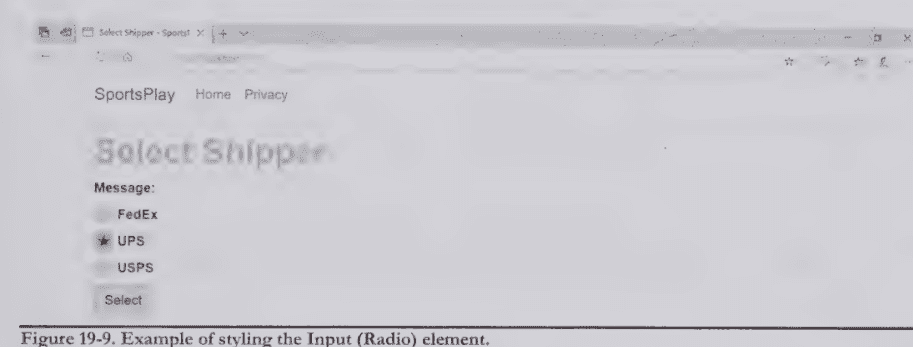

图 19-9. 单选按钮（Radio）输入元素样式示例。

## 19.11 时间（Time）输入元素样式

图 19-10 展示了时间（Time）输入元素的样式设置示例。

在 01 处，我们定义了一个时间（Time）输入元素选择器。由于这是一个元素选择器，它将应用于应用中的*所有*时间（Time）输入元素。请注意，这个元素选择器将应用于时间（Time）输入元素（在 03 处）。

在 02 处，我们定义了一个时间（Time）输入焦点选择器，用于指明当应用中的所有时间（Time）输入元素获得页面焦点时，我们希望它们呈现的外观和/或行为。

图中的“结果”部分展示了用户点击时间选择器后的“选择服务通话时间”页面。请注意，由时间（Time）输入元素生成的时间选择器的样式会因浏览器而异。

```css
/* SITE.CSS */
/* 01 */ input[type=time] {
    background-color: whitesmoke;
    border-color: darkgray;
    border-radius: 0.25rem;
    border-style: solid;
    border-width: 1px;
}

/* 02 */ input[type=time]:focus {
    background-color: white;
    box-shadow: 0.25rem 0.25rem 0.75rem lightgray;
    transition: background-color 0.25s ease-in-out,
        box-shadow 0.25s ease-in-out;
}
```

```csharp
// PAGE
@page
@model SportsPlay.Pages.InputTimeCSSModel
@{
    ViewData["Title"] = "Select Service Call Time";
}

<h1>Select Service Call Time</h1>

<label>Message:</label>
<label style="color: @Model.MessageColor">@Model.Message</label>

<form method="post">
    <!-- 03 -->
    <input asp-for="ServiceCallTime" type="time" /><br />
    <input asp-page-handler="Select" type="submit" value="Select" />
</form>
```

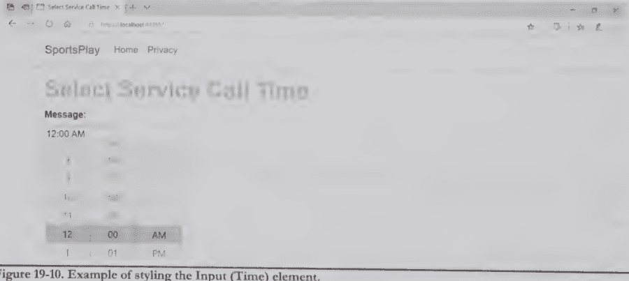

图 19-10. 时间（Time）输入元素样式示例。

## 19.12 下拉选择（Select）元素样式

图 19-11 展示了下拉选择（Select）元素的样式设置示例。

在 01 处，我们定义了一个下拉选择（Select）元素选择器。由于这是一个元素选择器，它将应用于应用中的*所有*下拉选择（Select）元素。请注意，这个元素选择器将应用于下拉选择（Select）元素（在 03 处）。

在 02 处，我们定义了一个下拉选择（Select）焦点选择器，用于指明当应用中的所有下拉选择（Select）元素获得页面焦点时，我们希望它们呈现的外观和/或行为。

图中的“结果”部分展示了“显示供应商联系人”页面。请注意，由下拉选择（Select）元素生成的下拉列表的样式会因浏览器而异。

```css
/* SITE.CSS */
/* 01 */ select {
    background-color: whitesmoke;
    border-color: darkgray;
    border-radius: 0.25rem;
    border-style: solid;
    border-width: 1px;
    line-height: 1.50rem;
    padding: 0.375rem 1.75rem 0.375rem 0.75rem;
}

/* 02 */ select:focus {
    background-color: white;
    box-shadow: 0.25rem 0.25rem 0.75rem lightgray;
    transition: background-color 0.25s ease-in-out,
        box-shadow 0.25s ease-in-out;
}
```

```csharp
// PAGE
@page
@model SportsPlay.Pages.SelectCSSModel
@{
    ViewData["Title"] = "Display Supplier POC";
}

<h1>Display Supplier POC</h1>

<label>Message:</label>
<label style="color: @Model.MessageColor">@Model.Message</label>

<form method="post">
    <!-- 03 -->
    <select asp-for="Supplier">
        <option value="Adidas">Adidas</option>
        <option value="Babolat">Babolat</option>
        <option value="Head">Head</option>
    </select><br />

    <input asp-page-handler="Display" type="submit" value="Display" />
</form>
```


图 19-11. 下拉选择（Select）元素样式示例。

## 19.13 文本域（Textarea）元素样式

图 19-12 展示了文本域（Textarea）元素的样式设置示例。

在 01 处，我们定义了一个文本域（Textarea）元素选择器。由于这是一个元素选择器，它会应用于应用中的所有文本域（Textarea）元素。请注意，这个元素选择器将应用于文本域（Textarea）元素（在 03 处）。

在 02 处，我们定义了一个文本域（Textarea）焦点选择器，用于指明当应用中的所有文本域（Textarea）元素获得 textarea 焦点时，我们希望它们呈现的外观和/或行为。

图中的“结果”部分展示了当产品描述字段获得页面焦点后的“添加产品描述”页面。

```css
/* 01 */ textarea {
    background-color: whitesmoke;
    border-color: darkgray;
    border-radius: 0.25rem;
    border-style: solid;
    border-width: 1px;
    height: 10rem;
    width: 20rem;
}

/* 02 */ textarea:focus {
    background-color: white;
    box-shadow: 0.25rem 0.25rem 0.75rem lightgray;
    transition: background-color 0.25s ease-in-out,
                box-shadow 0.25s ease-in-out;
}
```

```csharp
// PAGE
@page
<!-- 代码块内容 -->
@model SportsPlay.Pages.TextareaCSSModel
@{
    ViewData["Title"] = "Add Product Description";
}

<h1>Add Product Description</h1>

<label>Message:</label>
<label style="color: @Model.MessageColor">@Model.Message</label>

<form method="post">
    <!-- 03 -->
    <textarea asp-for="ProductDescription"></textarea><br />
    <input asp-page-handler="Add" type="submit" value="Add" />
</form>
```


图 19-12. 文本域（Textarea）元素样式示例。

## 19.14 项目实战

请遵循题为_解决方案和项目_的章节中所阐述的标识符命名规范。使用 Table 元素来排列页面上的其他 HTML 元素，使页面看起来井井有条。

提醒：如果 CSS 代码的更改似乎没有生效，您可能需要清除浏览器的缓存。

1.  新建一个名为 Lastname.Firstname.Chapter99 的项目，其中 99 为本章的章节编号。
2.  向项目中添加一个名为 FormatWithCSS1 的 Razor 页面。
3.  当您向此页面添加元素（下一步）时，请尝试将它们排列成无需滚动即可一次性全部查看。这将更容易判断您的元素是否具有统一的外观和风格。
4.  向页面添加以下元素：一个显示内容的 H1 元素、一个显示图片的 Img 元素、三个复选框（Checkbox）输入元素，每个元素显示

 option，一个 Input (Date) 元素，一个 Input (File) 元素，一个 Input (Month) 元素，一个 Input (Password) 元素，三个 Input (Radio) 元素（每个显示一个选项），一个 Input (Text) 元素，一个 Input (Time) 元素，一个 Label 元素（显示某些内容），一个 Select 元素（显示三个选项），一个 Textarea 元素，以及*两个* Input (Submit) 元素。

+   5. 复制 *FormatWithCSS1* Razor 页面，并将其重命名为 *FormatWithCSS2*。

+   6. 打开你的 site.css 文件。为页面上每种类型的元素添加元素选择器。确保以不同方式设置你的两个 Input (Submit) 元素的样式。尝试调整 CSS，使你的页面元素看起来独特（但仍需雅致且专业），并具有一致的视觉效果。另外，确保配色方案令人愉悦。

+   7. 测试页面并进行任何必要的修正。

# 20 JavaScript 编程

## 20.1 简介

JavaScript 是一种复杂、通用、面向对象且解释型的编程语言，最初由 Netscape 通信公司开发，用于构建需要客户端处理的 Web 应用程序（即在浏览器中进行的处理）。此外，JavaScript 是一种非类型安全的编程语言。这意味着对对象的无效操作（例如，将字符串值添加到整数值）不会在设计时被检测到（即源代码被解析和编译时），而只会在运行时被检测到（即操作执行时）。然而，在执行期间发生无效操作之前，JavaScript 会尝试将操作的对象（即操作数）转换为与该操作兼容的类型，以便该操作可以执行而不会导致程序崩溃。例如，操作 x = "abc" + 123 在执行期间不会引发类型错误（那将导致程序崩溃），即使 abc 是字符串，而 123 是整数。这是因为 JavaScript 可以（并且将会）在连接发生之前将 123 转换为字符串。由于我们已经熟悉 C#，因此学习具有熟悉大括号风格的 JavaScript 应该不会太困难。

33 在我们学习本章示例时，请记住，当页面最初在浏览器中加载时，JavaScript 代码默认保存在浏览器的缓存中。当由于后续页面请求而再次在浏览器中加载该页面时，这段代码将从浏览器的缓存中提供。可以想象，这使得页面加载速度更快，因为不需要在每次请求页面时都从服务器检索代码。然而，这在开发期间可能会引发问题，因为我们会频繁更改 JavaScript 代码。当对 JavaScript 代码的更改似乎不起作用时，可能是因为浏览器正在提供 JavaScript 代码的缓存版本，而不是新版本。在这种情况下，我们需要清除浏览器的缓存。事实上，在我们编写和测试 JavaScript 代码时，最好将浏览器配置为在关闭浏览器时删除其缓存。

## 20.2 浏览器兼容性

所有现代 Web 浏览器（例如 Edge、Chrome、Firefox）都允许通过其内置的 JavaScript 解释器执行 JavaScript 代码。由于给定的浏览器有其自己的 JavaScript 解释器，它可能支持也可能不支持 ECMAScript 语言规范中定义的所有 JavaScript 功能。34 ECMAScript 语言规范的目的是在所有 JavaScript 解释器实现之间标准化 JavaScript 编程语言。虽然 JavaScript 是 ECMAScript 语言规范最常用的实现，但其他常用实现包括 Chakra（即微软的 ECMAScript 标准方言，用于 Edge）、V8（即谷歌的 ECMAScript 标准方言，用于 Chrome）和 SpiderMonkey（即 Mozilla 的 ECMAScript 标准方言，用于 Firefox）。

由于浏览器兼容性是健壮 Web 应用程序的重要属性，因此重要的是，我们要使用所有预期用户会使用的浏览器，彻底测试我们用 JavaScript 开发的应用程序。还需要记住的是，JavaScript 在不支持脚本的浏览器中将无法运行。在禁用浏览器脚本的浏览器中也无法运行。因此，我们应该对页面进行编码，使它们在缺少 JavaScript 提供的功能时仍然可用。确保这一点的一个好技术称为渐进增强。渐进增强要求我们对应用程序的页面进行编码，使其在没有 JavaScript 的情况下也能很好地工作，然后增强这些页面，使其在有 JavaScript 的情况下也能很好地工作。这样，无论给定浏览器是否允许执行 JavaScript 代码，使用 JavaScript 的应用程序都能正常工作。

33 虽然 JavaScript 最初设计为仅在 Web 浏览器中执行，但它现在可以在 Web 服务器、桌面应用程序和运行时环境中执行。

34 ECMA 代表欧洲计算机制造商协会。

## 20.3 HTML 文档对象模型

HTML 文档对象模型（DOM）是 HTML 文档的应用程序编程接口。在此模型中，Web 页面上的所有 HTML 元素都表示为对象，并且这些对象中的每一个都可以包含属性和方法。每次将页面加载到 Web 浏览器中时，都会创建一个 HTML 文档对象，该对象表示页面及其 HTML 元素的集合。正是这个对象的存在，使我们能够通过 JavaScript 以编程方式向页面添加新的 HTML 元素、修改页面上的现有 HTML 元素以及从页面中删除现有元素。

本章我们将大量使用的 HTML 文档对象方法之一是 getElementById() 方法。此方法允许我们通过引用其唯一的 ID 属性来检索页面中的单个 HTML 元素。此方法的调用形式为

```
document.getElementById("HTML Element ID")
```

其中 HTML Element ID 是我们希望在客户端通过 JavaScript 访问和/或操作的 HTML 元素的唯一 ID。

编写 JavaScript 代码时，重要的是要记住，即使发生最小的语法错误（例如，用单词 Function 而不是 function 声明函数），JavaScript 函数也不会执行。这可能使 JavaScript 难以调试。因此，在部署包含 JavaScript 的应用程序之前，仔细编码和测试非常重要。

## 20.4 Script 元素

Script 元素包含一个 script 标签（`<script>`）和相关的结束 script 标签（`</script>`）。Script 元素要么在 .cshtml 文件中定义包含一个或多个 JavaScript 函数的区域，要么指向包含一个或多个 JavaScript 函数的外部文件。

当前者方法适用于仅在其嵌入的页面中使用的 JavaScript 函数。在这种情况下，Script 元素的形式为

```
<script type="text/javascript">
    function FunctionName() {
    }
</script>
```

其中 *FunctionName* 是 JavaScript 函数的名称。

后者方法适用于在应用程序中多个页面使用的 JavaScript 函数。在这种情况下，我们不是编写一个 JavaScript 函数来执行任务，然后将该函数复制到许多地方，而是可以编写一个 JavaScript 函数来执行任务，将其保存在 JavaScript 文件中，然后根据需要调用该函数。这样，当需要对 JavaScript 函数的逻辑进行更改时，我们只需在一个地方进行更改。在这种情况下，Script 元素的形式为

```
<script src="URL"></script>
```

其中 *URL* 是 JavaScript 文件的路径。

在本章中，我们将演示编写 JavaScript 函数的前者和后者方法。顺便说一下，我们可以将 Script 元素放在 .cshtml 文件中的任何位置。然而，我们的标准做法是将 Script 元素放在 .cshtml 文件的*底部*。

## 20.5 函数

JavaScript 函数包含一个或多个 JavaScript 语句，并执行函数（即返回值的**任务**）或过程（即*不*返回值的**任务**）。正确构造的 JavaScript 函数以小写单词 *function* 开头，后跟函数名称、左括号、逗号分隔的参数列表（如果有）、右括号、左大括号、一个或多个 JavaScript 语句以及右大括号。

当参数是*原始数据类型*（例如，字符串、整数、十进制数）时，它按*值*传递。这意味着*调用*函数向*被调用*函数传递的是参数的*副本*。因此，如果在被调用函数中修改了参数的值，则只有参数的副本被修改。调用函数中的相关参数值保持不变。当参数是*对象*（即属性和方法的集合）时，它按*引用*传递。这意味着*调用*函数向被调用函数传递的是对象内存位置的*引用*。在这种情况下，如果在被调用函数中修改了对象，则修改也会出现在调用函数中。

在 JavaScript 函数*内部*声明的所有变量在作用域上都是*局部*的。因此，它们只能由该函数中的代码访问和/或操作。另一方面，在 JavaScript 函数*外部*声明的所有变量在作用域上都是*全局*的。因此，它们可以由任何函数中的代码访问和/或操作。请记住，使用全局变量可能导致意外结果，因为多个函数可以独立访问和修改此类变量。因此，通常不鼓励使用全局变量。

## 20.6 alert() 方法

alert() 方法显示一个*警报对话框*，其中包含一条消息和一个"确定"按钮。当我们想向用户传达某些信息时，使用警报对话框。警报对话框是一个*模态对话框*。这意味着在用户关闭警报对话框之前，他或她无法与页面的其他部分交互。单击"确定"按钮时，警报对话框被关闭。请注意，alert() 方法是 *Window* 对象的成员。然而，我们不需要引用 Window 对象来调用它。图 20-1 显示了显示警报对话框的示例。


## 300 • JavaScript 编程

在 01 处，我们定义了一个输入（提交）元素，它显示一个“显示警报”按钮。请注意，我们包含了一个 `onclick` 属性，并将其值设置为 `DisplayAlert()`。这表明我们希望当用户点击“显示警报”按钮时，执行 `DisplayAlert()` 函数（在 02 处）。

在 02 处，我们正在警报对话框中显示 `Hello World`。

图中的结果部分显示了用户点击“显示警报”按钮后的警报页面。

### PAGE

```
@page
@model SportsPlay.Pages.AlertJSModel
@{
    ViewData["Title"] = "Alert";
}

<h1>Alert</h1>

<label>Message:</label>
<label></label>

<form method="post">
    <input onclick="DisplayAlert();" type="submit" value="Display Alert" />
</form>

<script type="text/javascript">
    function DisplayAlert() {
        alert("Hello World!");
    }
</script>
```

### RESULT


## 20.7 confirm() 方法

confirm() 方法显示一个确认对话框，其中包含一个问题、一个“确定”按钮和一个“取消”按钮。当我们想从用户那里获得回答时，会使用确认对话框。与警报对话框类似，确认对话框是一个模态对话框。这意味着在用户关闭确认对话框之前，无法与页面的其他部分进行交互。当点击“确定”按钮时，确认对话框关闭并向页面返回 true。当点击“取消”按钮时，确认对话框关闭并向页面返回 false。请注意，confirm() 方法是 Window 对象的成员。但是，我们不需要引用 Window 对象来调用它。

图 20-2 显示了一个显示确认对话框并处理用户响应的示例。在 01 处，我们定义了一个输入（提交）元素，它显示一个“处理确认”按钮。请注意，我们包含了一个 onclick 属性，并将其值设置为 `return HandleConfirm()`。这表明我们希望当用户点击“处理确认”按钮时，执行 HandleConfirm() 函数（在 02 处）。它还表明我们期望该函数返回 true 或 false。如果函数返回 true，页面将被发送到服务器进行进一步处理。如果函数返回 false，页面将不会被发送到服务器进行进一步处理。

在 02 处，我们正在显示一个确认对话框，向用户提出一个问题。如果他或她点击“确定”，true 将被赋给布尔变量。如果他或她点击“取消”，false 将被赋给布尔变量。然后，如果布尔变量为 true，函数将返回 true。如果布尔变量为 false，函数将返回 false。

图中的结果部分显示了用户点击“处理确认”按钮后的确认页面。请注意，系统向用户提出了一个问题，并要求做出选择。请注意，如果用户点击“确定”，页面将被发送到服务器进行进一步处理。但是，如果用户点击“取消”，页面将不会被发送到服务器进行进一步处理。

### PAGE

```
@page
@model SportsPlay.Pages.ConfirmJSModel
@{
    ViewData["Title"] = "Confirm";
}

<h1>Confirm</h1>

<label>Message:</label>
<label></label>

<form method="post">
01  <input onclick="return HandleConfirm();" type="submit"
     value="Handle Confirm" />

</form>

<script type="text/javascript">
02  function HandleConfirm() {

       var booAnswer = confirm("Are you sure you want to post the page to
the server for further processing? Click OK to post the page
to the server. Otherwise, click Cancel.");
    if (booAnswer) {
     return true;
   }
   else {
    return false;
  }

 }

</script>
```

### RESULT (确认对话框)


图 20-2. 显示确认对话框并处理用户响应的示例。

## 20.8 基本元素操作

图 20-3 显示了一个操作 div、label、input（文本）、input（密码）、input（提交）和 table 元素属性的示例。

在 01 处，我们定义了一个 Label 元素。请注意，我们包含了一个 *id 属性*，并将其值设置为 *lblMessage*。这用于在页面上唯一标识该元素。

在 02 处，我们定义了一个 Div 元素。请注意，我们包含了一个 id 属性，并将其值设置为 *divTop*。这用于在页面上唯一标识该元素。

在 03 处，我们定义了一个 Table 元素。请注意，我们包含了一个 id 属性，并将其值设置为 *tblTable*。这用于在页面上唯一标识该元素。还请注意，我们包含了一个 *onmouseout 属性*，并将其值设置为 *TurnColorsOff()*。这表明我们希望当用户不再悬停在表格上（即已经悬停过之后）时，执行 TurnColorsOff() 函数（在 13 处）。最后，请注意我们包含了一个 *onmouseover 属性*，并将其值设置为 *TurnColorsOn()*。这表明我们希望当用户悬停在表格上时，执行 TurnColorsOn() 函数（在 14 处）。

在 04 处，我们定义了一个 Input（文本）元素。请注意，我们包含了一个 id 属性，并将其值设置为 *txtEmailAddress*。这用于在页面上唯一标识该元素。还请注意，我们包含了一个 *onblur 属性*，并将其值设置为 *AppendEmailAddressDomain()*。这表明我们希望当用户离开电子邮件地址字段时，执行 AppendEmailAddressDomain() 函数（在 10 处）。

在 05 处，我们定义了一个 Input（密码）元素。请注意，我们包含了一个 id 属性，并将其值设置为 *pasPassword*。这用于在页面上唯一标识该元素。

在 06 处，我们定义了一个 Input（提交）元素，它显示一个“登录”按钮。请注意，我们包含了一个 onclick 属性，并将其值设置为 *return Validate()*。这表明我们希望当用户点击“登录”按钮时，执行 Validate() 函数（在 15 处）。它还表明我们期望该函数返回 *true 或 false*。如果函数返回 *true*，页面将被发送到服务器进行进一步处理。如果函数返回 *false*，页面将*不会*被发送到服务器进行进一步处理。

在 07 处，我们定义了另一个 Div 元素。请注意，我们包含了一个 id 属性，并将其值设置为 *divBottom*。这用于在页面上唯一标识该元素。

在 08 处，我们定义了一个 Input（按钮）元素，它显示一个“隐藏/显示关于”按钮。请注意，我们包含了一个 onclick 属性，并将其值设置为 *HideShowAbout()*。这表明我们希望当用户点击“隐藏/显示关于”按钮时，执行 HideShowAbout() 函数（在 11 处）。

在 09 处，我们正在当 Window 对象的 *onload 事件* 触发时，执行 SetLoginMessage() 函数（在 12 处）。此事件在页面加载到浏览器后立即触发。请注意，我们不需要引用 Window 对象来处理此事件。

在 10 处，我们正在测试一个条件，查看电子邮件地址是否不为空（例如，用户仅输入了用户名）*并且*尚未输入电子邮件地址域名。如果条件为 true，则将电子邮件地址域名（@sportsplay.com）附加到电子邮件地址。请注意，*includes()* 方法用于确定电子邮件地址是否包含指定的字符串（即 @）。还请注意，我们必须使用 @@ 而不是 @，以表示这些项目不表示 C# 代码块的开始。

在 11 处，我们正在测试一个条件，查看顶部的 div 是否被隐藏。如果条件为 true，则显示顶部和底部的 div。如果条件为 false，则隐藏顶部和底部的 div。

在 12 处，我们正在将消息的颜色设置为绿色，并将消息本身设置为 *“请登录”*。

在 13 处，我们正在将表格的背景颜色设置为 *白色*，并将表格的边框颜色设置为白色。这构成了关闭表格的颜色。

在 14 处，我们正在将表格的背景颜色设置为 *浅灰色*，并将表格的边框颜色设置为 *深灰色*。这构成了打开表格的颜色。

在 15 处，我们正在初始化一个名为 strMessage 的变量为空。接下来，我们测试一个条件，查看电子邮件地址是否被留空。如果条件为 true，则将适当的消息和换行转义序列附加到 strMessage 变量。当用户忘记输入电子邮件地址和密码时，换行转义序列是必需的，因为我们希望消息显示在不同的行上。接下来，我们测试一个条件，查看密码是否被留空。如果条件为 true，则将适当的消息附加到 strMessage 变量。最后，我们测试一个条件，查看 strMessage 变量是否不为空（即，有错误消息要显示）。如果条件为 true，则显示一个包含 strMessage 变量值的警报对话框，并且函数返回 false。如果条件为 false，则函数返回 true。

图中结果部分的第一个截图显示了设置消息后的登录页面。第二个截图显示了用户悬停在表格上时的页面。第三个截图显示了用户仅输入了他的登录名并将光标移出电子邮件地址字段后的页面。第四个截图显示了用户输入了他的电子邮件地址、将密码留空并点击“登录”按钮后的页面。第五个截图显示了用户点击“隐藏/显示关于”按钮后的页面。请注意，两个 div 已经消失。

### PAGE

```
@page
@model SportsPlay.Pages.BasicJSModel
@{
    ViewData["Title"] = "Login";
}
<h1>Login</h1>
<label>Message:</label>
01 <label id="lblMessage"></label>
<form method="post">
    <br />
    02 <div id="divTop">
        <a href="About">About</a> | 
        <a href="CareerOpportunities">Career Opportunities</a> | 
        <a href="Contact">Contact</a>
    </div><br />

    <div>
        03 &nbsp;&nbsp;&nbsp;&nbsp;&nbsp;&nbsp;&nbsp;&nbsp;&nbsp; <table id="tblTable" onmouseout="TurnColorsOff();"
                onmouseover="TurnColorsOn();">
```


 ```
<tr>
    <td><label>电子邮件地址</label></td>
    <td><input id="txtEmailAddress"
        onblur="AppendEmailAddressDomain();" /></td>
</tr>
<tr>
    <td><label>密码</label></td>
    <td><input id="pasPassword" type="password" /></td>
</tr>
<tr>
    <td></td>
    <td>
        <input onclick="return Validate();" type="submit"
            value="登录" />
    </td>
</tr>
</table>
</div><br />
```

```
<div id="divBottom">
    <a href="About">关于</a> |
    <a href="CareerOpportunities">职业机会</a> |
    <a href="Contact">联系我们</a><br />
</div><br />
```

```
<input onclick="HideShowAbout();" type="button"
    value="隐藏/显示关于" />

</form>
```

```
<script type="text/javascript">

onload = SetLoginMessage();
```

```
function AppendEmailAddressDomain() {

    // 如果电子邮件地址不为空且尚未输入电子邮件地址域名，
    // 则追加电子邮件地址域名。
    if (document.getElementById("txtEmailAddress").value != "" &&
        !document.getElementById("txtEmailAddress").value.includes("@"))
        {
        document.getElementById("txtEmailAddress").value +=
            "@sportsplay.com";
    }
}
```

```
function HideShowAbout() {

    if (document.getElementById("divTop").hidden == true) {
        document.getElementById("divTop").hidden = false;
        document.getElementById("divBottom").hidden = false;
    }
    else {
        document.getElementById("divTop").hidden = true;
        document.getElementById("divBottom").hidden = true;
    }

}
```

```
function SetLoginMessage() {

    document.getElementById("lblMessage").style.color = "green";
    document.getElementById("lblMessage").innerText = "请登录。";

}
```

```
function TurnColorsOff() {

    document.getElementById("tblTable").style.backgroundColor =
        "white";
    document.getElementById("tblTable").style.borderColor = "white";
    document.getElementById("tblTable").style.borderStyle = "solid";
    document.getElementById("tblTable").style.borderWidth = "1px";

}
```

```
function TurnColorsOn() {

    document.getElementById("tblTable").style.backgroundColor =
        "lightgray";
    document.getElementById("tblTable").style.borderColor = "darkgray";
    document.getElementById("tblTable").style.borderStyle = "solid";
    document.getElementById("tblTable").style.borderWidth = "1px";

}
```

```
function Validate() {

    var strMessage = "";
    if (document.getElementById("txtEmailAddress").value == "") {
        strMessage = strMessage + "请输入电子邮件地址。" +
            "\n";
    }
    if (document.getElementById("pasPassword").value == "") {
        strMessage = strMessage + "请输入密码。";
    }
    if (strMessage != "") {
        alert(strMessage);
        return false;
    }
    else {
        return true;
    }
}
</script>
```

## RESULT（设置登录消息后）


## RESULT（开启颜色后）


## RESULT（追加电子邮件地址域名后）


## RESULT（验证后）


## RESULT（隐藏关于后）


图 20-3. 操作 div、label、input (text)、input (password)、input (submit) 和 table 元素属性的示例。

## 20.9 Img 元素操作

在本示例中，我们创建了一个名为 *images* 的文件夹，并向其中添加了三张 .jpg 图像。图 20-4 显示了 images 文件夹的内容。


图 20-4. images 文件夹的内容。

图 20-5 显示了操作 Img 元素属性的示例。

在 01 处，我们定义了一个 Img 元素。注意，我们包含了 id 属性并将其值设置为 *img1*。这用于在页面上唯一标识该元素。同样注意，我们包含了 src 属性并将其值设置为 ~/images/AB17PA.jpg。可以看到，我们在页面上也定义了两个类似的图像。

在 02 处，当 Window 对象的 onload 事件被触发时，我们执行 CycleThroughImages() 函数（在 03 处）。此事件在页面加载到浏览器后立即触发。注意，我们无需引用 Window 对象来处理此事件。

在 03 处，我们正在测试一个条件以查看 img1 是否正在显示。如果条件为真，则显示 img2，并隐藏其他两个图像。如果条件为假，我们正在测试一个条件以查看 img2 是否正在显示。如果条件为真，则显示 img3，并隐藏其他两个图像。如果条件为假，则显示 img1，并隐藏其他两个图像。最后，我们使用 setTimeout() 方法在 5,000 毫秒（即 5 秒）后再次调用 CycleThroughImages() 函数。

图中 Result 部分的第一个截图显示了 img1 显示后的"显示产品图像"页面。第二个截图显示了五秒后 img2 显示后的页面。第三个截图显示了五秒后 img3 显示后的页面。

```
@page
@model SportsPlay.Pages.ImgJSModel
@{
    ViewData["Title"] = "显示产品图像";
}

<h1>显示产品图像</h1>

01 


<script type="text/javascript">

02    onload = CycleThroughImages();

03    function CycleThroughImages() {

        if (document.getElementById("img1").hidden == false) {
            document.getElementById("img1").hidden = true;
            document.getElementById("img2").hidden = false;
            document.getElementById("img3").hidden = true;
        }
        else if (document.getElementById("img2").hidden == false) {
            document.getElementById("img1").hidden = true;
            document.getElementById("img2").hidden = true;
            document.getElementById("img3").hidden = false;
        }
        else {
            document.getElementById("img1").hidden = false;
            document.getElementById("img2").hidden = true;
            document.getElementById("img3").hidden = true;
        }
    }
    setTimeout("CycleThroughImages();", 5000);
}
</script>
```

## RESULT（图像 1）


## RESULT（图像 2）


## RESULT（图像 3）


图 20-5. 操作 Img 元素属性的示例。

## 20.10 Input (Checkbox) 元素操作

图 20-6 显示了操作 Input (Checkbox) 元素属性的示例。

在 01 处，我们定义了一个 Label 元素。注意，我们包含了 id 属性并将其值设置为 *lblMessage*。这用于在页面上唯一标识该元素。

在 02 处，我们定义了一个 Input (Checkbox) 元素。注意，我们包含了 id 属性并将其值设置为 *chkFootwear*。这用于在页面上唯一标识该元素。可以看到，我们在页面上也定义了两个类似的复选框。

在 03 处，我们定义了一个显示"设置"按钮的 Input (Button) 元素。注意，我们包含了 onclick 属性并将其值设置为 *SetFilters()*。这表示我们希望在用户点击设置按钮时执行 SetFilters() 函数（在 04 处）。

在 04 处，我们将名为 *strMessage* 的变量初始化为 *blank（空）*。接下来，我们正在测试一个条件以查看 Footwear 复选框是否已被选中。如果条件为真，则将 *Footwear* 追加到 strMessage 变量。接下来，我们正在测试一个条件以查看 Clothing 复选框是否已被选中。如果条件为真，则将 *Clothing* 追加到 strMessage 变量。接下来，我们正在测试一个条件以查看 Tennis Equipment 复选框是否已被选中。如果条件为真，则将 *Tennis Equipment* 追加到 strMessage 变量。最后，我们将消息的颜色设置为 *green（绿色）* 并适当设置消息本身。

图中 Result 部分显示了用户选中 Footwear 和 Clothing 复选框并点击设置按钮后的"设置筛选器"页面。

```
@page
@model SportsPlay.Pages.InputCheckboxJSModel
@{
    ViewData["Title"] = "设置筛选器";
}
```

```
<h1>设置筛选器</h1>

<label>消息：</label>
<label id="lblMessage"></label><br />
```

```
<input id="chkFootwear" type="checkbox" /> 鞋类<br />
<input id="chkClothing" type="checkbox" /> 服装<br />
<input id="chkTennisEquipment" type="checkbox" /> 网球装备<br />
```

```
<input onclick="SetFilters();" type="button" value="设置" />
```

```
<script type="text/javascript">

function SetFilters() {
    var strMessage = "";
    if (document.getElementById("chkFootwear").checked == true) {
        strMessage = strMessage + "鞋类 ";
    }
    if (document.getElementById("chkClothing").checked == true) {
```

## 20.11 输入（日期）元素操作

图 20-7 展示了操作 Input (Date) 元素属性的示例。

在 01 处，我们定义了一个 Label 元素。请注意，我们包含了一个 id 属性并将其值设置为 *lblMessage*。这用于在页面上唯一标识该元素。

在 02 处，我们定义了一个 Input (Date) 元素。请注意，我们包含了一个 id 属性并将其值设置为 *datDate*。这用于在页面上唯一标识该元素。

在 03 处，我们定义了一个显示 "Select" 按钮的 Input (Button) 元素。请注意，我们包含了一个 onclick 属性并将其值设置为 *SelectDate()*。这表示我们希望在用户点击 "Select" 按钮时执行 SelectDate() 函数（在 04 处）。

在 04 处，我们使用 *substring()* 方法从 Input (Date) 元素获取日、月和年。请注意，此方法的参数包括基于零的起始位置和基于零的结束位置。请注意，结束位置是 *直到但不包括*。接下来，我们为显示而格式化日期。最后，我们将消息的颜色设置为 *green*（绿色），并相应地设置消息本身。

图中的结果部分显示了用户选择日期并点击 "Select" 按钮后的选择发货日期页面。

```
@page
@model SportsPlay.Pages.InputDateJSModel
@{
    ViewData["Title"] = "Select Shipping Date";
}

<h1>Select Shipping Date</h1>

<label>Message:</label>
<label id="lblMessage"></label><br />

<input id="datDate" type="date" /><br />
<input onclick="SelectDate();" type="button" value="Select" />

<script type="text/javascript">
    function SelectDate() {
        var strDay = document.getElementById("datDate").value
            .substring(8, 10);
        var strMonth = document.getElementById("datDate").value
            .substring(5, 7);
        var strYear = document.getElementById("datDate").value
            .substring(0, 4);
        var strDate = strMonth + "/" + strDay + "/" + strYear;
        document.getElementById("lblMessage").style.color = "green";
        document.getElementById("lblMessage").innerText = "You have selected a shipping date of " + strDate + ".";
    }
</script>
```

## 结果


图 20-7. 操作 Input (Date) 元素属性的示例。

## 20.12 输入（文件）元素操作

图 20-8 展示了操作 Input (File) 元素属性的示例。

在 01 处，我们定义了一个 Label 元素。请注意，我们包含了一个 id 属性并将其值设置为 **lblMessage**。这用于在页面上唯一标识该元素。

在 02 处，我们定义了一个 Input (File) 元素。请注意，我们包含了一个 id 属性并将其值设置为 **filFile**。这用于在页面上唯一标识该元素。还需注意，我们包含了一个 **onchange** 属性并将其值设置为 *DisplayFile()*。这表示我们希望在用户点击 "Browse..." 按钮并选择文件后执行 DisplayFile() 函数（在 03 处）。

在 03 处，我们从 Input (File) 元素获取所选文件的名称。接下来，我们将消息的颜色设置为 **green**（绿色），并相应地设置消息本身。

图中的结果区域显示了用户点击 "Browse..." 按钮并选择文件后的上传产品图片页面。

```
@page
@model SportsPlay.Pages.InputFileJSModel
@{
    ViewData["Title"] = "Upload Product Image";
}

<h1>Upload Product Image</h1>

<label>Message:</label>
<label id="lblMessage"></label><br />
<input id="filFile" onchange="DisplayFile();" type="file" />

<script type="text/javascript">
    function DisplayFile() {
        var strFile = document.getElementById("filFile").value;
        document.getElementById("lblMessage").style.color = "green";
        document.getElementById("lblMessage").innerText = "You have selected [" + strFile + "] for upload.";
    }
</script>
```

## 结果

316 • JavaScript 编程


图 20-8. 操作 Input (File) 元素属性的示例。

## 20.13 输入（隐藏）元素操作

图 20-9 展示了操作 Input (Hidden) 元素属性的示例。

在 01 处，我们定义了一个 Label 元素。请注意，我们包含了一个 id 属性并将其值设置为 `lblMessage`。这用于在页面上唯一标识该元素。

在 02 处，我们定义了一个 Input (Hidden) 元素。请注意，我们包含了一个 id 属性并将其值设置为 `hidEmployeeId`。这用于在页面上唯一标识该元素。

在 03 处，我们定义了一个显示 "Display" 按钮的 Input (Button) 元素。请注意，我们包含了一个 onclick 属性并将其值设置为 `DisplayEmployeeID()`。这表示我们希望在用户点击 "Display" 按钮时执行 `DisplayEmployeeID()` 函数（在 04 处）。

在 04 处，我们将 Input (Hidden) 元素的值设置为 7。接下来，我们获取 Input (Hidden) 元素的值并将其赋给一个名为 `intEmployeeId` 的变量。最后，我们将消息的颜色设置为绿色并相应地设置消息本身。

图中的结果部分显示了用户点击 "Display" 按钮后的显示员工 ID 页面。

```
@page
@model SportsPlay.Pages.InputHiddenJSModel
@{
    ViewData["Title"] = "Display Employee ID";
}

<h1>Display Employee ID</h1>

<label>Message:</label>
01 <label id="lblMessage"></label><br />

02 <input id="hidEmployeeId" type="hidden" />
03 <input onclick="DisplayEmployeeID();" type="button" value="Display" />

<script type="text/javascript">
04 function DisplayEmployeeID() {
    document.getElementById("hidEmployeeId").value = 7;
    var intEmployeeId = document.getElementById("hidEmployeeId").value;
    document.getElementById("lblMessage").style.color = "green";
    document.getElementById("lblMessage").innerText = "You have displayed Employee ID " + intEmployeeId + ".";
}
</script>
```

## 结果


图 20-9. 操作 Input (Hidden) 元素属性的示例。

## 20.14 输入（月份）元素操作

图 20-10 展示了操作 Input (Month) 元素属性的示例。

在 01 处，我们定义了一个 Label 元素。请注意，我们包含了一个 id 属性并将其值设置为 *lblMessage*。这用于在页面上唯一标识该元素。

在 02 处，我们定义了一个 Input (Month) 元素。请注意，我们包含了一个 id 属性并将其值设置为 *monMonth*。这用于在页面上唯一标识该元素。

在 03 处，我们定义了一个显示 "Select" 按钮的 Input (Button) 元素。请注意，我们包含了一个 onclick 属性并将其值设置为 *SelectMonth()*。这表示我们希望在用户点击 "Select" 按钮时执行 SelectMonth() 函数（在 04 处）。

在 04 处，我们初始化了一个名为 *strMonthArray* 的月份数组。如图所示，该数组包含十二个月份，每个月份都完整拼写。请注意，这是一个基于零的数组。接下来，我们使用 substring() 方法从 Input (Month) 元素获取月份。请注意，此方法的参数包括基于零的起始位置和基于零的结束位置。请注意，结束位置是 *直到但不包括*。接下来，我们将月份从字符串转换为整数，以便我们可以用它来引用数组的元素。请注意，*Number()* 函数不仅将字符串转换为整数，还会去除月份可能返回的任何前导零（例如，6月表示为 06）。接下来，我们使用 substring() 方法从 Input (Month) 元素获取年份。最后，我们将消息的颜色设置为 *green*（绿色），并相应地设置消息本身。

图中的结果部分显示了用户选择月份并点击 "Select" 按钮后的选择库存月份页面。


## 20.15 Input（单选按钮）元素操作示例

图 2-11 展示了操纵 Input（单选按钮）元素的属性的一个实例。在①处，我们定义了一个 Label 元素。注意我们已经包含了一个 id 属性，并将其值设置为 *lblMessage*。这用于在页面上唯一标识该元素。在②处，我们定义了一个 Input（单选按钮）元素。注意我们也已包含了一个 id 属性，并将其值设置为 *radFedEx*。这也是为了在页面上唯一标识该元素。此外请注意我们正在这个单选按钮上添加了 checked 属性。这表明当页面最初显示时，此单选按钮应默认被选中。如图所示，我们在页面上还定义了两个相似的单选按钮。在③处，我们定义了用于呈现“选择”（Select）按钮的 Input（按钮）元素。注意我们也已包含了一个 onclick 属性并将其值设置为 *SelectShipper()*。这表明我们希望当用户点击“选择”按钮时执行 SelectShipper()函数（见④）。在④处，我们正在初始化一个名为*strShipper*的变量至空白。接下来我们测试条件以查看是否选中了联邦快递 (FedEx) 单选按钮。如果该条件为真，则将 *Federal Express*分配给 strShipper变量。如果该条件为假，我们将再次测试条件以确定UPS单选按钮是否被选中。如果该条件为真，则向strShipper变量中分配*United Parcel Service*。如果该条件仍为假，则*United States Postal Service*（美国邮政服务）将赋值给 strShipper 变量。最后，我们设置消息的颜色为 *green*并设置适当的提示消息。图中的结果部分展示了用户选中 UPS单选按钮并点击“选择”（Select）按钮后的 Select Shipper页面。”

## 操作示例结果！[](img/4ac9c8b99afc83a29476116ba5c2ffaa_333_0.png)
图2-10.操纵Input(月份)元素属性的一个实例。


## **20.15 Input（单选按钮）元素的操控示例** 

图 2-11展示了操作Input (Radio ) 元素的一个属性示例 。在① ,我们定义了一个 Label 元素注意我们在 id attributes包含并将其 value为*lblMessage这是用于 page on the uniquely identify element in . At 02.we defined an Input(Radio)element.We included an id attribute and set its valueradFedEx This is used to uniquely ident ify the element onPage Notice as well added checkedattribute radio button this indicates that default when displayed initially As can defined two similar r adio buttons page also At 03, we have defined an Input(Button)element displays a Select Button.Notice included onclick attribute its value *SelectShipper() This indicate want function( at 04 Execute user clicks select .AT 04we initializing variable called*strShi p per blank Next testing condition see FedEx radio button has checked if true Federal Express assigned strShippervariable If false,testing cond ition UPsradio button has checked. If true United Parcel Service assgned to the st rSiipervariable.Iffalse,*United States Postal Serv iceassigned straSipper variable Finallyset color ofthe mes sage greenandsetting message itself appropriately The section Result figure shows SelectShipper page user has UPS radio button clicked select buiton


```html
@page
@model SportsPlay.Pages.InputRadioJSModel
@{
    ViewData["Title"] = "Select Shipper";
}

<h1>Select Shipper</h1>

<label>Message:</label>
01 <label id="lblMessage"></label><br />

02 <input name="Shipper" id="radFedEx" checked type="radio"
    value="FedEx" /> FedEx<br />
<input name="Shipper" id="radUPS" type="radio"
    value="Ups" /> UPS<br />
<input name="Shipper" id="radUSPS" type="radio"
    val ue ="US P S"/>U SPs<br />
03 <input onclick="SelectSh i p per(); "type=buttonvalue Select

<scriptt extype = text/javascript>
 04function SelectShipper(){
        var st rS hippe r"";
if(document getEle mentById("r adFedEx).checkedtrue){}{}strSihipper="Federal Express";}else if(document.getElementById"radUPS.checked true) strShi p per "United Parcel Service"; else { s trShipper =" UnitedStates Postal Ser v ice"; } document getElementById lblMessage").yle color = green;document.getElementid(lbMesseage).innerText"You selectedstrSiipper as your ship er."}</script>
```

## 结果！[](img/4ac9c8b99afc83a29476116ba5c2ffaa_335_0.png) 

图2-11.操纵 Input(Radio）元素属性的示例。


## **20. 16 Input (Time ) Element Manipulation**

Figure 20-12 shows an example manipulating the attributes of the Input(Time)element.At0l , we ha ve defined Label element Notice that includedidattributeand value to *lblMessage This is used uniquely identify element page At 02,we have definedan Input (Time ) eleme nt. Noticethat i ncludedid attribute and set its valu e timT ime Thi s u sed uniquely ident ifytheelementpage .At ,wehave defined an input(button)display selectbutton Noticeincluded onclickattributeandsetits value to Selectime()This indicatesuser clicksSelect button function(at04 execute At 04, we get hour minute frominput(time ) elementusing the substring method Note that parameters thismethodincludezerobasedstarting position zerobasedending posiiton .Note endingposition is*up t but n including Next determining meridiem (i eAMorPM Antemerid ie (Amindicates*miderday andpostmeridiem(PM) indicates *after mid day. next formatting hourby converting 24hour time to its equivalent12-hour tim And finallyset color ofmessage greenand setting message itself appropriately The Result section figure shows SelectService Call Time page after user has selected a time clicked select button

```html
@page
@model SportsPlay Pages.InputTimeJSModel
a{  
ViewData["Title"] = "Select Service Call Time"; 
}  

h1>SelectServiceCallt ime</ h 1> 

<label>Mes sage </ label >

<label id lblMess age></label><br/>  

<inputid"timT i me"type="time"/> <hr />   
   input onclick ="S electTime()"type=buttonval ue "Select"< /} 
<br/><scriptty pe text/javascript>  
function Sel ect Time(){  

//Get the hour and minute from selected time.    
varstr Tiime=document getElementById("timT ime).value;  varstr Hour=strTi me.sub string (O2);       Var strMi nute=StrTime.substring(35)   
        
        // Determine The meridiem  
V ar s t r Mer id i em"" ;      
   if(strHour12){s trMerid iam "AM".else{stmerideam"P M";  

//Format the hour switch(st Hour}{  
  case"0O":strH our=12;break;        case'0I':"02':'03"'04'"OS:"case '06':case'O7":"OA" O.9:Strhour=strHour.substring(1,2); break;   
     Case "OOCase 11:'i2": //Do nothing}  

case"13" case'F4':"I5"':'I8"I7";  
       Cas e'Ig':case 'O0"'2'l"-'922:"-
StrH our=S t rHour -l2;b reak;      
       
        document  getElem ent id(lblMes sage).style color "green";    
documentgetElementlblM essageinntext"You selected a service call time of+"str Hour":"+ strMinute"+" stimeridiem"."  
   
</script>
```

## 操作示例结果！ (mg/4ac9c8b9fafa_3afaa_3370png) 

图2-12. 操纵 Input(时间）元素属性的一个例子。


**# 20.**  **Select Element Manipulation**  
Figure 20-13 shows an example of manipulating the attributesofthe Selecelement.AtO, we have defined a Label element Notice that include id attribute set its value to lblmessae This isused uniquely identifyelement page At ,wehavedefineda Select el ement NOTICE includedidattributeandvalue selSupplier.This useduniquelyidentifye lementpage .A03 wedefine d Input(button)elemen tdisplay Display button Noticeincludedonclickattrib ute and its value to DiplaySu pplierPOC()This indicate want functionat04 execute user clicksDisplaybutton At 04,weare getting the selected supplier fromthe Select element Next we initialize a variable calledstrSupplier PO C to blank.Next testing cond ition see selectedsupplieris Ad idas Iftrue Alan AHe is assigned strSupplyeROCVariablf false,test ing condition see si pplier i Babolat I true Bill Baker is assigned straSuppleRP O Cvariable if f alse Hailey HawkinsassignedstrSupplierPOC variable Finally set color mes sage green setting message itself appropriately.  

图的结果部分显示了用户选择供应商并点击“显示”按钮后，“显示供应商 POC”页面的状态。

## 页面

```
@page
@model SportsPlay.Pages.SelectJSModel
@{
     ViewData["Title"] = "Display Supplier POC";
}
<h1>Display Supplier POC</h1>
<label>Message:</label>
01 <label id="lblMessage"></label><br />
02 <select id="selSupplier">
     <option value="Adidas">Adidas</option>
     <option value="Babolat">Babolat</option>
     <option value="Head">Head</option>
</select><br />
03 <input onclick="DisplaySupplierPOC();" type="button" value="Display" />
<script type="text/javascript">
04      function DisplaySupplierPOC() {
                var selSupplier = document.getElementById("selSupplier").value;
                var strSupplierPOC = "";

                if (selSupplier == "Adidas") {
                    strSupplierPOC = "Alan Alte";
                } else if (selSupplier == "Babolat") {
                    strSupplierPOC = "Bill Baker";
                } else {
                    strSupplierPOC = "Hailey Hawkins";
                }

                document.getElementById("lblMessage").style.color = "green";
                document.getElementById("lblMessage").innerText = "Your point
                of contact for " + selSupplier + " is " + strSupplierPOC + ".";
            }
</script>
```

## 结果


图 20-13：操作 Select 元素属性的示例。

## 20.18 Textarea 元素的操作

图 20-14 展示了操作 Textarea 元素属性的示例。

在 01 处，我们定义了一个 Label 元素。请注意，我们包含了一个 id 属性，并将其值设置为 lblMessage。这用于在页面上唯一标识该元素。

在 02 处，我们定义了一个 Textarea 元素。请注意，我们包含了一个 cols 属性，并将其值设置为 20。这表示我们希望文本区域的宽度为 20 列。同时请注意，我们包含了一个 id 属性，并将其值设置为 textProductDescription。这用于在页面上唯一标识该元素。最后请注意，我们包含了一个 rows 属性，并将其值设置为 2。这表示我们希望文本区域的高度为 2 行。请注意，默认情况下，输入到文本区域中的内容如有必要将自动换行到下一行。

在 03 处，我们定义了一个输入（按钮）元素，显示为“添加”按钮。请注意，我们包含了一个 onclick 属性，并将其值设置为 .Add()。这表示我们希望当用户点击“添加”按钮时执行 Add() 函数（位于 05 处）。

在 04 处，我们定义了一个输入（按钮）元素，显示为“增加文本区域”按钮。请注意，我们包含了一个 id 属性，并将其值设置为 btnResizeTextArea。这用于在页面上唯一标识该元素。我们需要标识此元素，因为我们将在程序中把按钮文本从“增加文本区域”更改为“减少文本区域”。同时请注意，我们包含了一个 onclick 属性（原文此处可能有误，应为 onclick，原文写为 musbelum attribute，根据上下文应为 onclick）并将其值设置为 ResizeTextArea()。这表示我们希望当用户点击调整大小按钮时执行 ResizeTextArea() 函数（位于 06 处）。

图中的结果部分的第一张截图显示了用户输入新产品描述并点击“添加”按钮后，“添加产品描述”页面的状态。第二张截图显示了用户点击“增加文本区域”按钮后的页面状态。第三张截图显示了用户点击“减少文本区域”按钮后的页面状态。

```
@page
@model SportsPlay.Pages.TextareaJSModel
@{
    ViewData["Title"] = "Add Product Description";
}

<h1>Add Product Description</h1>
<label>Message:</label>
01 <label id="lblMessage"></label><br />
02 <textarea cols="20" id="txtProductDescription" rows="2"></textarea><br />
03 <input onclick="Add();" type="button" value="Add" />
04 <input id="btnResizeTextArea" onclick="ResizeTextArea();" type="button" value="Increase Text Area" />

<script type="text/javascript">
05 function Add() {
    var strProductDescription = 
        document.getElementById("txtProductDescription").value;
    document.getElementById("lblMessage").style.color = "green";
    document.getElementById("lblMessage").innerText = 
        "You have added [" + strProductDescription + "] successfully!";
}

06 function ResizeTextArea() {
    if (document.getElementById("btnResizeTextArea").value == 
        "Increase Text Area") {
        document.getElementById("txtProductDescription").cols = "40";
        document.getElementById("txtProductDescription").rows = "4";
        document.getElementById("btnResizeTextArea").value = 
            "Decrease Text Area"
        document.getElementById("lblMessage").style.color = "green";
        document.getElementById("lblMessage").innerText = "You have increased the text area.";
    } else {
        document.getElementById("txtProductDescription").cols = "20";
        document.getElementById("txtProductDescription").rows = "2";
        document.getElementById("btnResizeTextArea").value = 
            "Increase Text Area"
        document.getElementById("lblMessage").style.color = "green";
        document.getElementById("lblMessage").innerText = "You have decreased the text area.";
    }
}
</script>
```

```
`}
}`
`</script>`
```

## 结果（点击添加后）


## 结果（增加文本区域后）


## 结果（减少文本区域后）


> > 图 20-14：操作 Textarea 元素属性的示例。

## 20.19 JavaScript 文件

在标题为 *模型验证* 的章节中，我们讨论了什么是验证以及为什么要进行验证。本质上，验证是确保我们不允许错误数据流入 ASP.NET Core Web 应用程序的过程。如果允许错误*数据*进入应用程序，我们将得到错误的*信息*。在那个章节中，我们使用了几个*属性类*来验证页面上输入元素（例如文本框）中输入的值，*在*允许将页面发布到服务器进行处理*之前*。在本节中，我们将通过使用 JavaScript 编写我们自己的验证函数，来模拟其中三个属性类（即 RangeAttribute 类、RegularExpressionAttribute 类和 RequiredAttribute 类）。这将帮助我们说明 site.js 文件的使用，我们将在此文件中编写应用程序中多个页面使用的任何 JavaScript 函数。site.js 文件的美妙之处在于，文件中的函数可供应用程序的所有页面访问，并且仅在需要修改时才需要在单一位置进行修改。

图 20-15 显示了 site.js 文件的内容。

在 01 处，我们定义了一个*ValidateRange() 函数*，用于确保输入到输入（文本）元素中的值处于可接受值的范围内。此函数接受四个输入参数。strValue 参数接受输入（文本）元素的*值*（即输入到文本框中的数据）。strErrorMessage 参数接受我们希望显示的消息，如果输入到输入（文本）元素中的值不处于可接受值的范围内。decMinimum 参数接受可以输入到输入（文本）元素中的最小可接受值。decMaximum 参数接受可以输入到输入（文本）元素中的最大可接受值。在此函数中，我们使用*trim()* 方法去除 strValue 参数前后任何空白字符。接下来，我们测试一个初始条件，以查看 strValue 参数是否*不*为空。如果初始条件为真，我们测试第二个条件，以查看 strValue 参数是否为数字（使用*isNaN() 函数*，如果其输入值*不*是数字则返回*true*），且大于或等于 decMinimum 参数，并小于或等于 decMaximum 参数。如果第二个条件为真，我们向调用函数返回*空*，因为未检测到错误。如果第二个条件为假，我们向调用函数返回 strErrorMessage 参数以及一个新行转义序列。新行转义序列是必要的，因为我们希望任何累积的消息以不同的行显示。最后，如果初始条件为假，我们向调用函数返回*空*，因为我们无法测试 strValue 参数。由此可见，此条件意味着未检测到*范围错误*。

在 02 处，我们定义了一个*ValidateRegularExpression() 函数*，用于确保输入到输入（文本）元素中的值与由正则表达式定义的模式匹配。此函数接受三个输入参数。strValue 参数接受输入（文本）元素的*值*（即输入到文本框中的数据）。strErrorMessage 参数接受我们希望显示的消息，如果输入到输入（文本）元素中的值与正则表达式定义的模式不匹配。strRegularExpression 参数接受要与输入到输入（文本）元素中的值匹配的正则表达式。标题为 *模型验证* 的章节中的表 5-1 提供了一些 .NET 正则表达式的列表。JavaScript 正则表达式与这些非常相似，因此我们可以将该表作为一般参考。请注意，表中的表达式可以单独使用，也可以组合形成更复杂的表达式。在此函数中，我们使用*trim()* 方法去除 strValue 参数前后任何空白字符。接下来，我们测试一个初始条件，以查看 strValue 参数是否*不*为空。如果初始条件为真，我们从*RegExp 类*使用 strRegularExpression 参数创建一个新的*RegExp 对象*（正则表达式对象）。这对于匹配 strValue


参数与`strRegularExpression`参数进行匹配。接着，我们正在测试第二个条件，以检查`strValue`参数是否与`strRegularExpression`参数匹配。请注意，我们使用的是`test()`方法来将`strValue`参数与正则表达式对象进行匹配。如果第二个条件为真，我们向调用函数返回空值，因为未检测到错误。如果第二个条件为假，我们向调用函数返回`strErrorMessage`参数以及一个换行符转义序列。换行符转义序列是必要的，因为我们希望任何累积的消息都显示在不同的行上。最后，如果初始条件为假，我们向调用函数返回空值，因为我们无法测试`strValue`参数。由此可见，这个条件意味着未检测到正则表达式错误。

在03处，我们定义了一个`ValidateRequired()`函数，用于确保在Input (Text)元素中已输入文本。此函数接受两个输入参数。`strValue`参数接受Input (Text)元素的值（即，输入到文本框中的数据）。`strErrorMessage`参数接受我们希望在Input (Text)元素中未输入值时显示的消息。在此函数中，我们使用`trim()`方法从`strValue`参数的前后移除所有空格字符。接着，我们正在测试一个条件，以检查`strValue`参数是否不为空。如果条件为真，我们向调用函数返回空值，因为未检测到错误。如果条件为假，我们向调用函数返回`strErrorMessage`参数以及一个换行符转义序列。换行符转义序列是必要的，因为我们希望任何累积的消息都显示在不同的行上。

### SITE.JS

```javascript
// These are all of the data validation functions. New ones can be added
// as needed.

01  function ValidateRange(strValue, strErrorMessage, decMinimum, decMaximum) {

    strValue = strValue.trim();
    if (strValue != "") {
        if (!isNaN(strValue) && strValue >= decMinimum &&
            strValue <= decMaximum) {
            return "";
        }
        else {
            var strMessage = strErrorMessage + "\n";
            return strMessage;
        }
    }
    else {
        return "";
    }
}

02  function ValidateRegularExpression(strValue, strErrorMessage,
    strRegularExpression) {

    strValue = strValue.trim();
    if (strValue != "") {
        var objRegExp = new RegExp(strRegularExpression);
        if (objRegExp.test(strValue)) {
            return "";
        }
        else {
            var strMessage = strErrorMessage + "\n";
            return strMessage;
        }
    }
    else {
        return "";
    }

}

function ValidateRequired(strValue, strErrorMessage) {

    strValue = strValue.trim();
    if (strValue != "") {
        return "";
    }
    else {
        var strMessage = strErrorMessage + "\n";
        return strMessage;
    }

}
```

图20-15. site.js 文件的内容。

既然我们已经查看了三个数据验证函数，现在是时候使用这些函数来验证页面上的数据了。图20-16展示了一个验证页面上数据的示例。

在01处，我们定义了一个Label元素。请注意，我们包含了一个id属性并将其值设置为*lblMessage*。这用于在页面上唯一标识该元素。

在02处，我们定义了一个Select元素。请注意，我们包含了一个id属性并将其值设置为*selCategoryId*。这用于在页面上唯一标识该元素。

在03处，我们定义了一个Input (Text)元素。请注意，我们包含了一个id属性并将其值设置为*txtProduct*。这用于在页面上唯一标识该元素。

在04处，我们定义了一个Input (Text)元素。请注意，我们包含了一个id属性并将其值设置为*txtPrice*。这用于在页面上唯一标识该元素。

在05处，我们定义了一个Input (Text)元素。请注意，我们包含了一个id属性并将其值设置为*txtReorderLevel*。这用于在页面上唯一标识该元素。

在06处，我们定义了一个显示“添加”按钮的Input (Button)元素。请注意，我们包含了一个onclick属性并将其值设置为*Add()*。这表明我们希望当用户单击“添加”按钮时执行`Add()`函数（在07处）。

在08处，我们正在初始化此函数中使用的`strValue`、`strMessage`和`strProduct`变量。

在09处，我们正在从Select元素获取所选类别的值，并将其赋给`strValue`变量。接着，我们使用`strValue`变量和我们希望在验证失败时显示的消息来调用`ValidateRequired()`函数。此函数返回的值被附加到`strMessage`变量。

在10处，我们正在从Input (Text)元素获取已输入产品的值，并将其赋给`strValue`变量。接着，我们使用`strValue`变量和我们希望在验证失败时显示的消息来调用`ValidateRequired()`函数。此函数返回的值被附加到`strMessage`变量。

在11处，我们正在从Input (Text)元素获取已输入价格的值，并将其赋给`strValue`变量。接着，我们使用`strValue`变量和我们希望在验证失败时显示的消息来调用`ValidateRequired()`函数。然后，我们使用`strValue`变量、验证失败时希望显示的消息、可接受的最小值和可接受的最大值来调用`ValidateRange()`函数。此函数返回的值被附加到`strMessage`变量。最后，我们使用`strValue`变量、验证失败时希望显示的消息以及要匹配的正则表达式来调用`ValidateRegularExpression()`函数。此函数返回的值被附加到`strMessage`变量。

在12处，我们正在测试一个条件，以检查`strMessage`变量是否为空（即，页面上没有发生任何错误）。如果条件为真，我们正在从Input (Text)元素获取已输入产品的值，并将其赋给`strProduct`变量。接着，我们将消息的颜色设置为绿色，并适当地设置消息本身。如果条件为假（即，页面上至少发生了一个错误），我们将在警报对话框中显示`strMessage`变量的值。

该图的“结果”部分显示了用户在页面上选择和输入了有效数据及无效数据并单击“添加”按钮后的“添加产品”页面。

## PAGE

```razor
@page
@model SportsPlay.Pages.ValidationJSModel
@{
    ViewData["Title"] = "Add Product";
}

<h1>Add Product</h1>

<label>Message:</label>
01 <label id="lblMessage"></label>

<table>
    <tr>
        <td><label>Category</label></td>
        <td>
            <select id="selCategoryId">
                <option value=""></option>
                <option value="1">Footwear - Men's</option>
                <option value="2">Footwear - Women's</option>
                <option value="3">Racquets</option>
            </select>
        </td>
    </tr>
```

```
</tr>
⋮
<tr>
    <td><label>Product</label></td>
    <td><input id="txtProduct" /></td>
</tr>
⋮
<tr>
    <td><label>Price</label></td>
    <td><input id="txtPrice" /></td>
</tr>
⋮
<tr>


```javascript
"Please enter a reorder level."");
strMessage = strMessage + ValidateRange(strValue,
"Please enter a reorder level between 0 and 200.", 0, 200);
strMessage = strMessage + ValidateRegularExpression(strValue,
"Please enter a reorder level of the form: 999.",
"^\\d{1,3}$");

if (strMessage == "") {
  strProduct = document.getElementById("txtProduct").value;
  document.getElementById("lblMessage").style.color = "green";
  document.getElementById("lblMessage").innerText =
    strProduct + " was successfully added.";
} else {
  alert(strMessage);
}
</script>

```
RESULT


图 20-16. 页面数据验证示例。

## 20.2 项目

请遵循标题为"解决方案和项目"的章节中阐述的标识符命名标准。使用 Table 元素来排列页面上的其他 HTML 元素，使页面看起来井井有条。

**提醒：** 如果你对 JavaScript 代码的更改似乎没有生效，可能需要清除浏览器的缓存。

### 第 1 部分

-   1. 启动一个名为 *Lastname.Firstname.Chapter99* 的新项目，其中 99 是本章的编号。
-   2. 重新创建本章插图中的 Razor 页面。但是，将业务场景从销售产品改为维护客户（或你自己选择的场景）。你只需重新创建以下元素的页面：Img 元素、Input（复选框）元素、Input（日期）元素、Input（文件）元素、Input（隐藏）元素、Input（月份）元素、Input（单选按钮）元素、Input（时间）元素、Select 元素和 Textarea 元素。这些元素不需要绑定到 PageModel 类中的任何公共属性。
-   3. 测试页面并进行任何必要的更正。

### 第 2 部分

-   1. 打开你的 site.js 文件。添加某种验证器函数，该函数接收要验证的值、验证失败时要显示的错误消息以及任何其他必要的项目作为参数。你可以编写本章中显示的某个验证器，也可以创建自己的验证器。如果验证通过，该函数应向调用函数返回空消息。如果验证失败，该函数应向调用函数返回错误消息。
-   2. 向项目中添加一个名为 *ValidateWithJavaScript1* 的 Razor 页面。添加一个 Label 元素，用于显示此页面的所有消息。添加一个 Input（文本）元素。添加一个显示 *Validate* 的 Input（按钮）元素。在文本框中输入要验证的项目。单击按钮时，调用 site.js 文件中的验证器函数。如果验证通过，在标签中显示"The validation passed." 如果验证失败，在警告对话框中显示错误消息。
-   3. 复制 *ValidateWithJavaScript1* Razor 页面并将其重命名为 *ValidateWithJavaScript2*。
-   4. 测试页面并进行任何必要的更正。

# 第六部分 – 数据库连接

# 21 数据库与 Entity Framework Core

### 21.本色信念

许多现代 Web 应用程序需要使用*数据库*来管理数据和生成信息。与这种数据库交互的应用程序必须将数据插入数据库、更新数据库中的数据、删除数据库中的数据以及从数据库中检索数据。在开发 ASP.NET Core Web 应用程序与数据库交互时，我们可以利用 Entity Framework Core（EF Core）。正如我们将看到的，EF Core 使得管理和检索数据库数据变得容易，而无需编写原生数据库代码。

## 21.2 关系数据库

关系数据库包含一个或多个表。表（又称关系）是一种二维数据结构，包含一行或多行以及一列或多列。表存储应用程序中*感兴趣的事物*的数据，例如客户或订单。行（又称元组或记录）存储应用程序中*单个感兴趣的事物*的数据，例如单个客户或单个订单。列（又称属性或字段）存储应用程序中*感兴趣的事物的特征*，例如客户名字或订单日期。关系数据库还包含零个或多个关系。关系是两个表之间的逻辑关联（例如，一个客户下了一个或多个订单）。关系数据库是通过*关系数据库管理系统*（RDBMS）创建和维护的，从今以后我们将其称为*数据库管理系统*（DBMS）。DBMS 的例子包括 Access（微软）、DB2（IBM）、Informix（IBM）、MySQL（开源）、Oracle（Oracle 公司）、Postgres（全球开发组）、SQL Server（微软）和 Sybase（SAP）。

要使关系数据库有效，其细节必须*仔细*规划。这通常通过构建一个或多个*数据模型*来完成。良好的数据库设计的重要性怎么强调都不为过。设计良好的数据库将使应用程序的开发更加容易和高效。更重要的是，良好的数据库设计带来良好的数据，良好的数据带来良好的信息，良好的信息带来良好的决策，良好的决策带来组织的稳定性（在非盈利环境中）或竞争优势（在盈利环境中）。

由于我们将在本书的这一部分开发数据库驱动的应用程序，因此安装这些 DBMS 之一并熟悉如何使用它是一个好主意。安装和使用 DBMS 的过程超出了本书的范围。但是，教程应该很容易找到。请注意，本书中的示例是使用 *Microsoft SQL Server* 和 *Microsoft SQL Server Management Studio* 创建的。SQL Server 是管理我们数据库的 DBMS，SQL Server Management Studio 是允许我们直接与 SQL Server 交互的用户界面。

### 21.2.1 数据库模式

数据库模式是一种数据模型，从表、属性和关系的角度表示数据库的结构。在设计和编码应用程序时，手头保持正确和最新的数据库模式非常重要，因为它是应用程序正确设计和实现的核心。事实上，数据库模式指导了许多其他将应用程序付诸实现所需的过程，包括过程建模过程、输入设计过程、用户界面设计过程、输出设计过程、编码过程和测试过程。图 21-1 显示了 SportsPlay 数据库的数据库模式。该数据库由 SportsPlay 公司使用，这是一家假设的在线体育用品商店，专门经营男士和女士的运动器材、鞋类和服装。我们将在本章和后续章节中的许多示例中使用该数据库。图中所示的数据库模式是在 SQL Server 中实现的。


### 21.2.2 表

表（又称关系）是一种二维数据结构，包含一行或多行以及一列或多列。表存储应用程序中*感兴趣的事物*的数据。如图 21-1 所示，SportsPlay 数据库有八个表，每个表代表了 SportsPlay 公司感兴趣的事物。这些表是 Category 表、Customer 表、Employee 表、Order 表、OrderLine 表、Product 表、Shipper 表和 Supplier 表。请注意，这些表使用单数名词（或单数名词短语）命名。以这种方式命名表将是我们的标准。

### 21.2.3 属性

属性（又称列或字段）存储应用程序中*感兴趣的事物的特征*。如图 21-1 所示，Supplier 表中有九个属性，每个属性代表供应商的一个特征。此外，Product 表中有十个属性，每个属性代表产品的一个特征。请注意，这些属性使用单数名词（或单数名词短语）命名。以这种方式命名属性将是我们的标准。还要注意，每个表中的第一个属性旁边有一个键符号。这表明该属性是表的主键，我们将在下一节中定义。最后，请注意，每个属性都是特定的*类型*和*大小*。图 21-2 显示了 Supplier 表中的一些数据。


## 数据库与Entity Framework Core

| SupplierID | Supplier | PointOfContact | Address | City | State | ZipCode | Phone | EmailAddress |
|---|---|---|---|---|---|---|---|---|
| 1 | Nike | Nate Niko | 123 Nike Way | New City | ND | 13265 | 316-980-1265 | nniko@nike.com |
| 3 | Prince | Phil Pelkin | 568 Prince Rd. | Pingo | PA | 97654 | 469-036-9908 | ppelkin@prince.com |
| 4 | Adidas | Alan Alte | 100 Adidas Ln | Altuna | AZ | 67890 | 234-098-0897 | aalte@adidas.com |
| 5 | Head | Hailey Hawkins | 365 W. Head Ave. | Hankton | NH | 45365 | 849-012-0873 | hhawkins@head.com |
| 6 | Babolat | Bill Baker | 9807 Bandy St. | Bakersfield | CA | 90089 | 841-890-1274 | bbaker@babolat.com |

图 21-2. Supplier 表中的部分数据。

图 21-3 显示了 Product 表中的部分数据。

| ProductID | CategoryID | SupplierID | Product | Description | Image | Price | NumberInStock | NumberOnOrder | ReorderLevel |
|---|---|---|---|---|---|---|---|---|---|
| 3 | 2 | 1 | Prince Lightnin... | Perfect for begi... | PL110.jpg | 75.00 | 12 | 0 | 4 |
| 3 | 2 | 2 | Prince Textrem... | This fast and ve... | PTW100.jpg | 199.00 | 15 | 0 | 5 |
| 3 | 6 | 4 | Babolat Pure A... | Babolat celebra... | BPAFO.jpg | 229.00 | 8 | 0 | 3 |
| 3 | 6 | 5 | Babolat Pure A... | Dressed in hot ... | BPALP.jpg | 195.00 | 4 | 2 | 4 |
| 3 | 5 | 3 | Head Mg G 3 | Intermediate pl... | HM3.jpg | 239.95 | 2 | 2 | 2 |
| 3 | 5 | 6 | Head Graphene... | The Prestige Mi... | HGPRP.jpg | 69.95 | 5 | 0 | 3 |
| 2 | 1 | 1 | Nike Men's Su... | Sport a clean lo... | NMSFA7S.jpg | 85.00 | 20 | 5 | 20 |

图 21-3. Product 表中的部分数据。

### 21.2.4 关系

关系是两个表之间的逻辑关联。这种关联通过一个表中的 *主键* 和另一个表中的 *外键* 来实现。主键是表中唯一标识每一行的属性（或属性组合）。创建主键值时有两个相关规则：

1.  主键值必须唯一，*且*
2.  主键值不能为空。

这些是 *实体完整性* 规则。另一方面，外键是表中与相关表的主键相对应的属性（或属性组合）。创建外键值时有两个相关规则：

1.  外键值必须作为主键值存在于相关表中，*或者*
2.  外键值可以为空。

这些是 *参照完整性* 规则。如图 21-1 所示，SportsPlay 数据库中有七个关系，每个关系都由一条线表示，该线以钥匙符号或无穷符号终止。钥匙符号代表关系的 *一端*，而无穷符号代表关系的 *多端*。因此，根据图中的数据库模式，SportsPlay 数据库的表之间存在以下关系：

-   一个供应商 *供应* 一个或多个产品，一个产品 *被供应* 自恰好一个供应商。
-   一个类别 *关联* 一个或多个产品，一个产品 *关联* 恰好一个类别。
-   一个产品 *出现于* 一个或多个订单行，一个订单行 *包含* 恰好一个产品。
-   一个订单 *包含* 一个或多个订单行，一个订单行 *出现于* 恰好一个订单。
-   一个承运商 *运送* 一个或多个订单，一个订单 *被运送* 自恰好一个承运商。
-   一个客户 *下* 一个或多个订单，一个订单 *被下* 自恰好一个客户。
-   一个员工 *可以接* 一个或多个订单，一个订单 *可以被接* 自恰好一个员工。

请注意，最后一个要点是用 *can* 语言写的。这是因为一个员工可以为客户下订单（通过电话），*或者* 客户可以在线下订单。在后一种场景中，Order 表中 *EmployeeID* 属性（这是一个外键）的值将是 *空*。还要注意，关系（以斜体显示并双向阅读）使用动作动词（或动词短语）或系动词（或动词短语）来描述。动作动词是表达身体或心理动作的动词，而系动词是表达存在状态的动词。以这种方式命名关系将是我们的标准。

通过查看图 21-2 中 Supplier 表的数据和图 21-3 中 Product 表的数据，我们可以看到供应商和产品之间的关系是如何实际维护的。请注意，Supplier 表中的主键属性是 *SupplierID*。如图所示，该属性中的值唯一地标识了表中的行，因为它们都是唯一 *且* 非空的。还要注意，Product 表中关联的外键属性也是 *SupplierID*。该属性中的值与 Supplier 表的 *SupplierID* 属性中的值相对应。Product 表中 *SupplierID* 属性的所有值都作为 Supplier 表中 *SupplierID* 属性的主键值存在。如果某个产品因某种原因未与供应商关联，则该产品的 *SupplierID* 属性值将为空，表示该产品目前没有供应商。

## 21.3 Entity Framework Core

Entity Framework Core (EF Core) 是一个 *对象关系映射器* (ORM)。ORM 将用面向对象编程语言（在我们的案例中是 C#）开发的应用程序的类、对象、属性和关系，映射到由关系数据库管理系统（在我们的案例中是 SQL Server）管理的关系数据库（在我们的案例中是 SportsPlay）的表、行、列和关系。EF Core 的美妙之处在于，它允许我们检索（即查询）和管理（即插入、更新和删除）关系数据库中的数据，而无需编写大量我们可能需要编写的原生数据库代码（在我们的案例中是 SQL）。

### 21.3.1 数据库访问

当我们使用 EF Core 时，数据库访问通过一组 *数据访问类* 来完成。这些类包括一个 *数据库上下文类* 和一个或多个 *模型类*。总的来说，这些类反映了应用程序的业务领域（例如客户、订单）。数据库上下文类包含应用程序的 SQL Server 数据库的描述，并反映了应用程序数据库的结构，包括其表、属性和关系——这些与数据库模式中描述的项目相同。另一方面，模型类包含与数据库各个表相关的 C# 属性和关系，并用作数据访问发生的接口。

在开发使用 EF Core 的 ASP.NET Core Web 应用程序时，创建应用程序的数据访问类有两种主要方法。它们是 *Code-First 方法* 和 *Database-First 方法*。

当使用 *Code-First 方法* 时，我们首先设计并创建应用程序的模型类。然后，我们使用 EF Core 附带的工具，根据我们在第一步中创建的模型类生成应用程序的数据库及其关联的表、属性和关系。对于数据库密集型应用程序，不推荐使用此方法，因为这些应用程序通常需要在开始编码之前进行仔细的数据库设计。

当使用 *Database-First 方法* 时，我们首先设计并创建应用程序的数据库。然后，我们使用 EF Core 附带的工具，根据我们在第一步中创建的数据库生成应用程序的数据库上下文类和模型类。对于数据库密集型应用程序，推荐使用此方法，因为这些应用程序通常需要在开始编码之前进行仔细的数据库设计。

在接下来的章节中，我们将配置一个项目以使用 EF Core。我们还将使用 Database-First 方法为 SportsPlay 数据库创建所有数据访问类。此过程将生成一个名为 `SportsPlayContext.cs` 的数据库上下文类，以及八个模型类，分别命名为 `Category.cs`、`Customer.cs`、`Employee.cs`、`Order.cs`、`OrderLine.cs`、`Product.cs`、`Shipper.cs` 和 `Supplier.cs`。

### 21.3.2 EF Core 的数据库提供程序

要配置项目以使用 EF Core，我们需要使用 NuGet 包管理器安装 *Database Provider for EF Core* 包。此包的名称是 Microsoft.EntityFrameworkCore.SqlServer。安装 NuGet 包的一般说明可以在标题为“解决方案和项目”的章节中找到。一旦此过程完成，请确保该包已成功添加到项目的 Dependencies 文件夹中。图 21-4 显示了新安装的 SQL Server 包在 Dependencies 文件夹中。


## 21.3.4 模型文件夹

接下来，我们需要在项目中添加一个名为*模型*的文件夹。此文件夹将用于存放我们即将创建的数据访问类（以及我们未来可能希望创建的任何类）。在项目中添加模型文件夹有助于将我们的数据访问类集中放置在一个位置，并总体上帮助我们保持应用程序的良好组织。一旦我们添加了模型文件夹，就可以将数据访问类添加到其中。


图 21-5. 依赖项文件夹中新安装的工具包。


图 21-6. 模型文件夹。

## 21.3.5 数据库上下文类和模型类

至此，我们已准备好*脚手架*数据库。脚手架过程将根据 SportsPlay 数据库的架构生成我们的数据库上下文类和八个独立的模型类。要脚手架数据库，

-   1. 从 Visual Studio 主菜单中选择 *工具 > NuGet 包管理器 > 程序包管理器控制台*。
-   2. 在 PM> 命令提示符处输入 `Scaffold-DbContext "Server=Computer\Instance; Database=SportsPlay; Trusted_Connection=True;" Microsoft.EntityFrameworkCore.SqlServer -OutputDir Models -NoPluralize [-UseDatabaseNames]`，其中 *Computer* 是运行 SQL Server 的计算机名称，*Instance* 是安装了数据库的 SQL Server 实例名称。顺便说一下，如果我们希望 Scaffold-DbContext 命令生成的属性名与其对应的属性名*完全*匹配（例如，我们希望所有主键属性名中的 *ID* 都大写），我们必须在命令末尾添加 `[-UseDatabaseNames]`（不带方括号）。本示例中*未*执行此操作。
-   3. 按 Enter 键。

此过程完成后，请确保数据库上下文类和各个模型类已成功添加到项目的模型文件夹中。


**图 21-7.** 新生成的数据库上下文类和各个模型类。

图 21-8 显示了数据库上下文类的部分内容。如图所示，此类反映了 SportsPlay 数据库的结构，包括其表、属性和关系——与数据库架构中描述的项目相同。

在 01 处，EF Core 声明了一个名为 *Product* 的公共虚拟 `DbSet` 类，其类型为 Product。从该类实例化的 Product 对象将包含 SportsPlay 数据库 Product 表中的零个或多个产品。当我们需要检索（即查询）和/或管理（即插入、更新和删除）Product 表中的数据时，我们将引用此对象。请注意，SportsPlay 数据库中的其他表也已定义。

在 02 处，EF Core 定义了刚才描述的 Product 类的属性和关系。为简洁起见，其他类的属性和关系已省略。

在 03 处，EF Core 向 Product 类添加了一个名为 *ProductId* 的属性。请注意，此属性已映射到 Product 表的 `ProductID` 属性（又名列）。同时请注意两个产品 ID 的大小写存在细微差别。前者是 ASP.NET Core Web 应用程序所知的 ID 属性的名称，而后者是 SportsPlay 数据库所知的 ID 属性的名称。在这种情况下，当执行 DbContext 命令时，名称已自动更改。

在 04 处，EF Core 向 Product 类添加了一个关系。此关系表明类别和产品之间存在一对多关系（即，一个类别可以与多个产品关联），*CategoryId* 是 Product 类中维护类别和产品之间一对多关系的外键，而映射到此关系的 SportsPlay 数据库中的外键约束名为 `FK_Product_Category`。

### **SPORTSPLAYCONTEXT.CS**

```csharp
using Microsoft.EntityFrameworkCore;

namespace SportsPlay.Models
{
    public partial class SportsPlayContext : DbContext
    {
        public SportsPlayContext()
        {
        }

        public SportsPlayContext(DbContextOptions<SportsPlayContext> options) : base(options)
        {
        }

        public virtual DbSet<Category> Category { get; set; }
        public virtual DbSet<Customer> Customer { get; set; }
        public virtual DbSet<Employee> Employee { get; set; }
        public virtual DbSet<Order> Order { get; set; }
        public virtual DbSet<OrderLine> OrderLine { get; set; }
        public virtual DbSet<Product> Product { get; set; }
        public virtual DbSet<Shipper> Shipper { get; set; }
        public virtual DbSet<Supplier> Supplier { get; set; }

        protected override void OnConfiguring(DbContextOptionsBuilder optionsBuilder)
        {
            if (!optionsBuilder.IsConfigured)
            {
                optionsBuilder.UseSqlServer(
                    "Server=MATRBeasley-18\\SQLExpress;
                    Database=SportsPlay;
                    Trusted_Connection=True;");
            }
        }

        protected override void OnModelCreating(ModelBuilder modelBuilder)
        {
            modelBuilder.Entity<Product>(entity =>
            {
                entity.Property(e => e.ProductId)
                    .HasColumnName("ProductID");

                entity.Property(e => e.CategoryId)
                    .HasColumnName("CategoryID");

                entity.Property(e => e.Image)
                    .HasMaxLength(50);

                entity.Property(e => e.Price)
                    .HasColumnType("decimal(18, 2)");

                entity.Property(e => e.Product1)
                    .HasColumnName("Product")
                    .HasMaxLength(50);

                entity.Property(e => e.SupplierId)
                    .HasColumnName("SupplierID");

                entity.HasOne(d => d.Category)
                    .WithMany(p => p.Product)
                    .HasForeignKey(d => d.CategoryId)
                    .HasConstraintName("FK_Product_Category");

                entity.HasOne(d => d.Supplier)
                    .WithMany(p => p.Product)
                    .HasForeignKey(d => d.SupplierId)
                    .HasConstraintName("FK_Product_Supplier");

            });
            OnModelCreatingPartial(modelBuilder);
        }

        partial void OnModelCreatingPartial(ModelBuilder modelBuilder);
    }
}
```


图 21-9 显示了 Product 模型类的内容。请注意，此类反映了与 SportsPlay 数据库 Product 表关联的所有属性和关系。此类将被用作所有访问 Product 表的接口。

在 01 处，EF Core 在类中包含了 `System.Collections.Generic` 命名空间，因为 `HashSet` 类（在 03 处）和 `ICollection` 接口（在 08 处）是在该命名空间中定义的。

在 02 处，EF Core 包含了一个构造函数方法，该方法创建一个名为 *OrderLine* 的 `OrderLine` 类型的 HashSet 对象。此对象用于定义 `ICollection<OrderLine>` 类型的公共虚拟接口（在 08 处）。HashSet 对象包含一个值的集合以及操作这些值所需的方法。HashSet 对象中的值是*唯一的*，因为对象中没有重复的值。这是因为当值被添加到对象时，HashSet 对象会自动删除任何重复项。HashSet 对象中的值也是*无序的*。在此示例中，EF Core 使用 OrderLine HashSet 对象通过*在内存中*存储与产品关联的订单明细集合（在 08 处）来维护 Product 表和 OrderLine 表之间的一对多关系，从而无需多次调用数据库来检索此数据。

在 04 处，EF Core 声明了一个名为 *ProductId* 的 `int` 类型公共属性。请注意，此属性对应于数据库 Product 表中的 `ProductID` 属性。

在 05 处，EF Core 声明了一个名为 *CategoryId* 的 `int` 类型公共属性。请注意，此属性对应于数据库 Product 表中的 `CategoryID` 属性。同时请注意，EF Core 在 `int` 类型后附加了一个问号 (?)。这表明 `int` 类型是可空的。*

在 06 处，EF Core 声明了一个名为 *Product1* 的 `string` 类型公共属性。请注意，此属性对应于数据库 Product 表中的 *Product* 属性。请注意，EF Core 在属性名称后附加了一个一 (1)。这样做的目的是让编译器可以区分 Product 类和该类的 Product 属性。虽然数据库表可以具有同名的属性，但 C# 类具有同名的属性是*不可接受的*。因此，EF Core 自动将 Product 转换为 Product1。

在 07 处，EF Core 声明了一个名为 *Category* 的 `Category` 类型公共虚拟类。

### **PRODUCT.CS**

```csharp
using System.Collections.Generic;

namespace SportsPlay.Models
{
    public partial class Product
    {
        public Product()
        {
        }
        
        // Property definitions would continue here based on full file content...
    }
}
```

像 `int` 这样的值类型默认是不可空的。这意味着变量必须被赋予一个值。否则，将发生错误。像 `string` 这样的引用类型默认是可空的。这意味着变量不需要被赋予引用。有关值类型和引用类型的详细描述，请参阅标题为*赋值操作*的章节。

*脚注：* 像 `int` 这样的值类型默认是不可空的。这意味着变量必须被赋予一个值。否则，将发生错误。像 `string` 这样的引用类型默认是可空的。这意味着变量不需要被赋予引用。有关值类型和引用类型的详细描述，请参阅标题为*赋值操作*的章节。


## 21.3.6 同步

需要了解的是，当我们添加新的数据库表、修改现有的数据库表（例如，添加属性、修改属性的类型或大小，或删除属性）、删除现有的数据库表，或在两个现有数据库表之间创建、修改或删除关系时，应用程序的数据库上下文类、模型类和关联的数据库可能会变得不同步。当发生此类更改时，我们可以手动修改应用程序的数据库上下文类和模型类以反映更改，或者我们可以重新搭建数据库。如果我们选择后一种方法，并且希望覆盖现有文件，我们必须在 `DbContext` 命令末尾附加 `-Force`。但请注意，重新搭建将覆盖我们添加到模型类中的任何注解。因此，通常最好等到项目接近尾声时再注解项目模型，或者至少等到数据库设计相对稳定时。

## 21.3.7 连接字符串

连接字符串为应用程序提供其底层 SQL Server 数据库的详细信息。连接字符串通常在 `appsettings.json` 文件中定义，以便可以在一个地方进行修改。因此，如果我们需要将数据库安装到不同的计算机上、将数据库添加到不同的 SQL Server 实例中，和/或更改数据库名称，我们只需更改 `appsettings.json` 文件中的连接字符串。应用程序中对连接字符串的引用无需修改。

图 21-10 显示了 `appsettings.json` 文件的内容。

在 01 处，我们添加了一个名为 `ConnectionStrings` 的配置部分，并在其中定义了一个名为 `SportsPlayConnection` 的连接字符串。请注意，SQL Server 所在计算机的名称为 MATRBeasley-18，SQL Server 实例36的名称为 SQLEXPRESS，数据库的名称为 *SportsPlay*，集成安全性的类型为 **SSPI**（安全支持提供程序接口）。SSPI（首选的集成安全性类型）允许应用程序（作为 Windows 服务器用户）连接数据库，而无需提供额外的 SQL Server 用户名和密码凭据。

### APPSETTINGS.JSON

```json
{
  "Logging": {
    "LogLevel": {
      "Default": "Information",
      "Microsoft": "Warning",
      "Microsoft.Hosting.Lifetime": "Information"
    }
  },
  "AllowedHosts": "*",
  "ConnectionStrings": {
    "SportsPlayConnection": "Server=MATRBeasley-18\\SQLEXPRESS; Database=SportsPlay; Integrated Security=SSPI;"
  }
}
```

01

图 21-10。`appsettings.json` 文件的内容。

## 21.3.8 AddDbContext() 方法

`AddDbContext()` 方法用于将数据库上下文注册为服务，以便应用程序可以通过依赖注入实例化数据库上下文对象。此方法在项目的 `Startup.cs` 类中调用。默认情况下，`AddDbContext()` 方法以 **瞬时生命周期** 注册数据库上下文。这意味着数据库上下文对象在内存中保持存在并在整个 HTTP 请求期间可供使用。在 HTTP 响应完成后，数据库上下文对象将自动被处置（即从内存中移除）。

图 21-11 显示了 `Startup.cs` 类的内容。

在 01 处，我们已将一个 `AddDbContext()` 服务添加到该类的 `ConfigureServices()` 方法中的服务集合中。请注意，此服务的定义中包含了我们在 `appsettings.json` 文件中定义的 *SportsPlayConnection* 连接字符串。

### STARTUP.CS

```csharp
using Microsoft.EntityFrameworkCore;
using SportsPlay.Models;

public void ConfigureServices(IServiceCollection services)
{
    services.AddDbContext<SportsPlayContext>(options => options
        .UseSqlServer(Configuration
        .GetConnectionString("SportsPlayConnection")));
}
```

01

图 21-11。`Startup.cs` 类的内容。

## 21.4 结构化查询语言

结构化查询语言（SQL）是一种 *第四代编程语言*，用于检索（即查询）和管理（即插入、更新和删除）关系数据库中的数据。第一代、第二代和第三代编程语言是 *命令式编程语言*。这些编程语言要求软件开发人员编写代码来指示计算机 *如何* 做某事。因此，需要循环、条件语句和其他命令式语句。而第四代编程语言是 *声明式编程语言*。这些编程语言要求软件开发人员编写代码来指示计算机 *做什么*。因此， *不需要* 循环、条件语句和其他命令式语句。正如我们将看到的，SQL 不要求我们描述 *如何* 查询、插入、更新或删除数据库的数据。相反，它只要求我们描述 *什么* 数据库数据需要查询、插入、更新或删除。所需的命令式代码在后台为我们生成。

SQL 是迄今为止使用最广泛的关系数据库语言。该语言由美国国家标准协会（ANSI）和国际标准化组织（ISO）标准化，因此大多数 SQL 代码可以从一个数据库管理系统移植到另一个，通常只需对其语法进行很少（或根本不需要）的调整。结构化查询语言的编程语句分为四类—— *数据定义语言*（DDL）语句（例如，用于创建、修改和删除表、属性和关系的语句）、 *数据控制语言*（DCL）语句（例如，用于授予、撤销和拒绝用户和应用程序访问权限的语句）、 *数据查询语言*（DQL）语句（例如，用于检索和显示表数据的语句）和 *数据操作语言*（DML）语句（例如，用于插入、更新和删除表数据的语句）。前两类 SQL 语句与 *数据库管理* 相关，而后两类 SQL 语句与 *数据库使用* 相关。我们将重点关注后两类，因为它们与我们的讨论最相关。

## 21.5 语言集成查询

语言集成查询（LINQ）是一种技术，允许我们使用统一的 C# 语法从各种格式的多种数据源（例如，SQL Server 数据库、XML 文档和内存中的对象集合）查询数据。正如我们将看到的，由于 LINQ 与 C# 集成，我们将能够使用原生 C# 语法而不是使用非原生 SQL 语法在 `PageModel` 类中编写 SQL Server 数据库查询。LINQ 查询使用应用程序的数据访问类（即其数据库上下文类和模型类）来访问应用程序数据库中的数据。EF Core 将给定的 LINQ 查询传递给应用程序的数据库提供程序（在我们的案例中是 SQL Server 数据库提供程序），该提供程序随后将 LINQ 查询转换为其等效的 SQL 查询，然后将结果提交给 SQL Server 执行。

请注意，LINQ 语句有两种形式： *LINQ 查询语法* 和 *LINQ 方法语法*。尽管这两种语法截然不同，但它们都可以用来完成相同的任务。因此，由软件开发人员（或软件开发人员的组织）决定哪种语法更好，或者在何种条件下哪种语法更好。对于我们这些有 SQL 经验的人来说，LINQ 查询语法会看起来非常熟悉。

> 37 SQL 确实包含一些命令式语句，允许我们编写过程式代码。然而，这些语句不是必需的。


## 21.6 异步方法

在本章及后续章节中，我们将频繁使用异步方法。我们通过在方法签名中包含 *async* 关键字来表示一个方法是异步的。异步方法在等待其 *被等待的操作* 完成时，会将控制权返回给调用它的方法。我们通过在操作中包含 *await 运算符* 来表示该操作是一个被等待的操作。await 运算符指定了异步方法中的处理应该暂停，直到被等待的操作完成。它也指定了控制权应何时返回给调用方法以继续处理。异步方法可以带来更高效、响应更及时的 Web 应用程序，因为在异步方法完成其工作时，其他处理不会被 *阻塞*（即，停止）。例如，如果用户通过单击 Input (Submit) 元素来调用一个异步方法，并且该异步方法需要过长的时间来完成，用户无需等待异步方法完成就可以与页面上的其他元素进行交互。换句话说，在异步方法工作期间，页面不会“挂起”。

## 21.7 数据库查询操作

*Select 语句* 用于查询数据库。更具体地说，它从数据库的一个或多个表中检索一个或多个 *行*，然后显示结果。如何从数据库检索和显示数据由数据库管理系统（DBMS）完成，它将我们编写的 SQL 查询转换为 *查询计划*。然后，此查询计划由 DBMS 的 *查询优化器* 进行优化，该优化器确定查询的最佳可能 *执行计划*。在本节中，我们将查看一些 Select 语句及其等效的 LINQ 语句（包括 LINQ 查询语法和 LINQ 方法语法）。

### 21.7.1 必需子句

Select 语句有两个 *必需* 子句。它们是：

+ - *Select 子句*（指定应从查询返回的属性）
- *From 子句*（指定应从中检索数据的表）

这些子句在 Select 语句中包含的顺序非常重要。如果它们的顺序不正确，将会发生语法错误。

图 21-12 展示了一个返回所有属性的 Select 语句示例。请注意此 Select 语句的格式。在本书中，我们在格式化 SQL 语句时将应用两个标准。首先，虽然 SQL 语句的 *保留字* 并非必须大写，但我们将 *始终* 这样做。其次，虽然 SQL 语句并非必须写在 *多行* 上，但我们也将 *始终* 这样做。我们将应用这些标准，因为这样做将提高我们编写的 SQL 语句的可读性和可维护性，尤其是当 SQL 语句变得长而复杂时。

在 01 处，我们在语句的 Select 子句中添加了一个星号 (*)。这表示应返回表中 *所有的* 属性（即 SupplierID、Supplier、PointOfContact、Address、City、State、ZipCode、Phone 和 EmailAddress）。

在 02 处，我们在语句的 From 子句中添加了 *Supplier*。这表示数据应从 Supplier 表中检索。

该图的结果部分显示了查询的结果。

```sql
SELECT *
FROM Supplier
```

### 结果

| SupplierID | Supplier | PointOfContact | Address | City | State | ZipCode | Phone | EmailAddress |
|---|---|---|---|---|---|---|---|---|
| 1 | Nike | Nate Nike | 123 Nike Way | New City | ND | 13265 | 316-980-1265 | nniko@nike.com |
| 2 | Prince | Phil Pekin | 098 Prince Rd. | Pingo | PA | 87654 | 463-036-9988 | ppekin@prince.com |
| 4 | Adidas | Alan Alte | 100 Adidas Ln | Altuna | AZ | 67890 | 234-098-0897 | aalte@adidas.com |
| 5 | Head | Hailey Hawkins | 265 W Head Ave | Hankton | NH | 45365 | 849-012-0973 | hhawkins@head.com |
| 6 | Babolat | Bill Baker | 5000 Bandy St | Bakersfield | CA | 90089 | 841-898-1274 | bbaker@babolat.com |

图 21-12. 返回所有属性的 Select 语句示例。

图 21-13 展示了一个 PageModel 类，其中包含返回所有属性的 Select 语句的 LINQ 等效代码。

在 01 处，我们包含了此 class 所需的命名空间。

在 02 处，我们声明了一个 Sports.Models.SportsPlayContext 类型的私有只读字段 SportsPlayContext。我们将使用此字段通过依赖注入存储一个 SportsPlayContext 对象。

在 03 处，我们定义了一个名为 QueryAttributesAllModel() 的构造函数方法，该方法在服务器处理页面时创建 SportsPlayContext 对象。此对象将包含有关应用程序 SQL Server 数据库的信息，包括有关其表、属性和关系的信息。

在 04 处，我们声明了一个 Supplier 类型的公共 IList 接口 SupplierIList。此接口将包含从数据库查询（在 06 和 08 处）返回的供应商集合。

在 05 处，我们定义了一个名为 OnGetAsync() 的公共方法。请注意，这是一个异步方法。另请注意，此方法的返回类型是 Task，这意味着该方法执行一个任务，但不会向调用它的方法返回值。

在 06 处，我们使用 LINQ 查询语法查询 SportsPlay 数据库的 Supplier 表。请注意，我们在语句的 from 子句中将 SportsPlayContext.Supplier 后添加了 *s*。这表示数据应从 Supplier 表中检索，并且 *s* 应在语句的其余部分中用作该表的别名（即，对该表的简短引用）。另请注意，我们在语句的 select 子句中添加了 *s*。这表示查询应返回表中所有的属性（即 SupplierId、Supplier、PointOfContact、Address、City、State、ZipCode、Phone 和 EmailAddress）。另外请注意，我们在查询中包含了 await 运算符，以表示这是一个被等待的操作。我们还向查询操作追加了一个 ToListAsync() 方法。此方法异步地从查询结果中填充 SupplierIList 接口。最后请注意，当查询完成时，SupplierIList 接口将包含查询返回的 Supplier 对象的集合。

在 07 处，我们将 SupplierIList 接口中的所有项写入 Visual Studio 的输出窗口。

在 08 处，我们使用 LINQ 方法语法查询 SportsPlay 数据库的 Supplier 表。有关此查询的详细信息，请参见上面的 LINQ 查询语法说明。

在 09 处，我们将 SupplierIList 接口中的所有项写入 Visual Studio 的输出窗口。

该图结果部分的第一个屏幕截图显示了用 LINQ 查询语法编写的 LINQ 语句生成的 Select 语句及其查询结果。第二个屏幕截图显示了用 LINQ 方法语法编写的 LINQ 语句生成的 Select 语句及其查询结果。请注意，这些查询的结果与上述 Select 语句的结果相同。

### PAGEMODEL

```csharp
using Microsoft.AspNetCore.Mvc.RazorPages;
using Microsoft.EntityFrameworkCore;
using SportsPlay.Models;
using System.Collections.Generic;
using System.Diagnostics;
using System.Linq;
using System.Threading.Tasks;

namespace SportsPlay
{
    public class QueryAttributesAllModel : PageModel
    {

        private readonly Sports.Models.SportsPlayContext SportsPlayContext;

        public QueryAttributesAllModel(Sports.Models.SportsPlayContext SPC)
        {
            SportsPlayContext = SPC;
        }

        public IList<Supplier> SupplierIList;

        public async Task OnGetAsync()
        {
            // Retrieve the rows for display (LINQ query syntax).
            SupplierIList = await (
                from s in SportsPlayContext.Supplier
                select s)
                .ToListAsync();

            // Display the results in the Output window.
            foreach (var item in SupplierIList)
            {
                Debug.WriteLine(
                    "[" + item.SupplierId + "][" + item.Supplier + "]" +
                    "[" + item.PointOfContact + "][" + item.Address + "]" +
                    "[" + item.City + "][" + item.State + "]" +
                    "[" + item.ZipCode + "][" + item.Phone + "]" +
                    "[" + item.EmailAddress + "]");
            }

            // Retrieve the rows for display (LINQ method syntax).
            SupplierIList = await SportsPlayContext.Supplier
                .ToListAsync();
        }
    }
}
```


```
// 在输出窗口中显示结果。
foreach (var item in SupplierIList)
{
    Debug.WriteLine(
        "[" + item.SupplierId + "][" + item.Supplier1 + "]" +
        "[" + item.PointOfContact + "][" + item.Address + "]" +
        "[" + item.City + "][" + item.State + "]" +
        "[" + item.ZipCode + "][" + item.Phone + "]" +
        "[" + item.EmailAddress + "]");
}
```

## 结果（输出窗口 - LINQ 查询语法）

```
SELECT [s].[SupplierID], [s].[Address], [s].[City], [s].[EmailAddress],
[s].[Phone], [s].[PointOfContact], [s].[State], [s].[Supplier], [s].[ZipCode]
FROM [Supplier] AS [s]
```

[1][Nike][Nate Niko][123 Nike Way][New City][ND][13265][316-980-1265][nniko@nike.com]

[2][Prince][Phil Pelkin][098 Prince Rd.][Pingo][PA][87654][463-036-9988][ppelkin@prince.com]

[4][Adidas][Alan Alte][100 Adidas Ln][Altuna][AZ][67890][234-098-0897][aalte@adidas.com]

[5][Head][Hailey Hawkins][265 W. Head Ave.][Hankton][NH][45365][849-012-0873][hhawkins@head.com]

[6][Babolat][Bill Baker][9807 Bandy St.][Bakersfield][CA][90089][841-890-1274][bbaker@babolat.com]

## 结果（输出窗口 - LINQ 方法语法）

```
SELECT [s].[SupplierID], [s].[Address], [s].[City], [s].[EmailAddress],
[s].[Phone], [s].[PointOfContact], [s].[State], [s].[Supplier], [s].[ZipCode]
FROM [Supplier] AS [s]
```

[1][Nike][Nate Niko][123 Nike Way][New City][ND][13265][316-980-1265][nniko@nike.com]

[2][Prince][Phil Pelkin][098 Prince Rd.][Pingo][PA][87654][463-036-9988][ppelkin@prince.com]

[4][Adidas][Alan Alte][100 Adidas Ln][Altuna][AZ][67890][234-098-0897][aalte@adidas.com]

[5][Head][Hailey Hawkins][265 W. Head Ave.][Hankton][NH][45365][849-012-0873][hhawkins@head.com]

[6][Babolat][Bill Baker][9807 Bandy St.][Bakersfield][CA][90089][841-890-1274][bbaker@babolat.com]

图 21-13. PageModel 类，其中包含返回所有属性的 Select 语句的 LINQ 等效形式。

图 21-14 展示了一个返回特定属性的 Select 语句示例。

在 01 处，我们向该语句的 Select 子句中添加了四个特定的属性。这意味着查询应仅返回表中的那四个属性（即 Supplier、PointOfContact、Phone 和 EmailAddress）。

图的结果部分展示了查询的结果。

## SQL

```
01 SELECT Supplier,
       PointOfContact,
       Phone,
       EmailAddress
FROM Supplier
```

## 结果

| Supplier | PointOfContact | Phone | EmailAddress |
|---|---|---|---|
| Nike | Nate Niko | 316-980-1265 | nniko@nike.com |
| Prince | Phil Pelkin | 463-036-9988 | ppelkin@prince.com |
| Adidas | Alan Alte | 234-098-0897 | aalte@adidas.com |
| Head | Hailey Hawkins | 849-012-0873 | hhawkins@head.com |
| Babolat | Bill Baker | 841-890-1274 | bbaker@babolat.com |

图 21-14. 返回特定属性的 Select 语句示例。

图 21-15 展示了一个 PageModel 类，其中包含返回特定属性的 Select 语句的 LINQ 等效形式。为避免重复，我们只评论图中新增的项目。

在 01 处，我们声明了一个名为 Supplier 的公共类。可以看到，我们在此类中声明了四个公共字段。这些字段对应于我们希望从数据库检索以供显示的特定属性。注意类中名为 Supplier1 的字段。我们在此字段名称后附加了一个“1”，因为我们不能让一个字段与其包含类同名。请注意，这个 Supplier 类重写了与 SportsPlay 数据库上下文关联的 Supplier 类。

在 02 处，我们使用 LINQ 查询语法查询 SportsPlay 数据库的 Supplier 表。注意我们在语句的 select 子句中添加了新的 Supplier（以及一组赋值语句）。这表明应创建一个 Supplier 类型的新对象（在 01 处），并将表中的指定属性（即 s.Supplier1、s.PointOfContact、s.Phone 和 s.EmailAddress）分配给 Supplier 对象中的相应字段（即 Supplier1、PointOfContact、Phone 和 EmailAddress）。同时请注意，当查询完成后，SupplierIList 接口将包含由该查询返回的 Supplier 对象集合（及其指定的属性子集）。

在 03 处，我们使用 LINQ 方法语法查询 SportsPlay 数据库的 Supplier 表。注意我们在查询操作后附加了一个 Select() 方法。此方法执行的操作与上面的 select 子句相同。

图中结果部分的第一张截图显示了由 LINQ 查询语法编写的 LINQ 语句生成的 Select 语句及其查询结果。第二张截图显示了由 LINQ 方法语法编写的 LINQ 语句生成的 Select 语句及其查询结果。请注意，这些查询的结果与上面 Select 语句的结果相同。

### PAGEMODEL

```csharp
using Microsoft.AspNetCore.Mvc.RazorPages;
using Microsoft.EntityFrameworkCore;
using System.Collections.Generic;
using System.Diagnostics;
using System.Linq;
using System.Threading.Tasks;

namespace SportsPlay
{
    public class QueryAttributesSpecificModel : PageModel
    {
        private readonly SportsPlay
            .Models.SportsPlayContext SportsPlayContext;
        public QueryAttributesSpecificModel(SportsPlay
            .Models.SportsPlayContext SPC)
        {
            SportsPlayContext = SPC;
        }

        public class Supplier
        {
            public string Supplier1;
            public string PointOfContact;
            public string Phone;
            public string EmailAddress;
        }

        public IList<Supplier> SupplierIList;

        public async Task OnGetAsync()
        {
            // 检索要显示的行（LINQ 查询语法）。
            SupplierIList = await (
                from s in SportsPlayContext.Supplier
                select new Supplier
                {
                    Supplier1 = s.Supplier1,
                    PointOfContact = s.PointOfContact,
                    Phone = s.Phone,
                    EmailAddress = s.EmailAddress
                })
                .ToListAsync();

            // 在输出窗口中显示结果。
            foreach (var item in SupplierIList)
            {
                Debug.WriteLine(
                    "[" + item.Supplier1 + '][' + item.PointOfContact + '][' +
                    '[' + item.Phone + '][' + item.EmailAddress + ']');
            }

            // 检索要显示的行（LINQ 方法语法）。
            SupplierIList = await SportsPlayContext.Supplier
                .Select(s => new Supplier
                {
                    Supplier1 = s.Supplier1,
                    PointOfContact = s.PointOfContact,
                    Phone = s.Phone,
                    EmailAddress = s.EmailAddress
                })
                .ToListAsync();

            // 在输出窗口中显示结果。
            foreach (var item in SupplierIList)
            {
                Debug.WriteLine(
                    '[' + item.Supplier1 + '][' + item.PointOfContact + '][' + 
                    item.Phone + '][' + item.EmailAddress + ']');
            }
        }
    }
}
```

**结果（输出窗口 - LINQ 查询语法）**

```
SELECT [s].[Supplier] AS [Supplier1], [s].[PointOfContact], [s].[Phone], [s].[EmailAddress]
FROM [Supplier] AS [s]
```

[Nike][Nate Niko][316-980-1265][nniko@nike.com]
[Prince][Phil Pelkin][463-036-9988][ppelkin@prince.com]
[Adidas][Alan Alte][234-098-0897][aalte@adidas.com]
[Head][Hailey Hawkins][849-012-0873][hhawkins@head.com]
[Babolat][Bill Baker][841-890-1274][bbaker@babolat.com]

**结果（输出窗口 - LINQ 方法语法）**

```
SELECT [s].[Supplier] AS [Supplier1], [s].[PointOfContact], [s].[Phone], [s].[EmailAddress]
FROM [Supplier] AS [s]
```

[Nike][Nate Niko][316-980-1265][nniko@nike.com]
[Prince][Phil Pelkin][463-036-9988][ppelkin@prince.com]
[Adidas][Alan Alte][234-098-0897][aalte@adidas.com]
[Head][Hailey Hawkins][849-012-0873][hhawkins@head.com]
[Babolat][Bill Baker][841-890-1274][bbaker@babolat.com]

图 21-15. PageModel 类，其中包含返回特定属性的 Select 语句的 LINQ 等效形式。

### 21.7.2 可选子句

Select 语句有几个 *可选* 子句，可用于限定（即微调）查询返回的结果。它们是：

- *As 子句*（指定在引用表或属性时应使用的别名[即，简写或其他名称]）
- *Where 子句*（指定应返回的行的子集）
- *Group By 子句*（指定在应用聚合函数[例如 Count、Avg、Sum]时应被视为一组的行）
- *Having 子句*（当使用 Group By 子句时，指定应返回的行的子集）
- *Order By 子句*（指定返回行的顺序[即，升序或降序]）

同样，这些子句在 Select 语句中包含的顺序非常重要。如果未按正确顺序包含，将会发生语法错误。在本节中，我们将 *不* 提供 Group By、Having 和 As 子句的示例。我们将留给读者在时间允许时自行研究这些内容。

图 21-16 展示了一个带有 Where 子句和 Order By 子句的 Select 语句示例。

在 01 处，我们向该语句的 Where 子句中添加了 *CategoryID = 2 AND NumberInStock <= ReorderLevel*，表明 SQL 调用应仅返回 CategoryID 等于 2 *且* NumberInStock 小于或等于 ReorderLevel 的那些产品。

在 02 处，我们向该语句的 Order By 子句中添加了 Product，表明 SQL 调用的结果应按 Product 升序（默认）排序。如果希望查询结果按降序排序，我们应在 Order By 子句末尾（即，在表名之后）附加 *Desc* 关键字。

图的结果部分展示了查询的结果。

## SQL

```
01 SELECT CategoryID,
       Product,
       NumberInStock,
       ReorderLevel
FROM Product
01 WHERE CategoryID = 2
    AND NumberInStock <= ReorderLevel
02 ORDER BY Product
```

## 结果

| CategoryID | Product | NumberInStock | ReorderLevel |
|---|---|---|---|
| 2 | Adidas Men's Reign on the Court T-Shirt | 0 | 5 |
| 2 | Nike Men's Summer Flex Ace 7 Inch Short | 20 | 20 |
| 2 | Nike Men's Summer RF Premier Jacket | 15 | 15 |

图 21-16. 带有 Where 子句和 Order By 子句的 Select 语句示例。
```

图 21-17 展示了一个 PageModel 类，其中包含了带有 Where 子句和 Order By 子句的 Select 语句的 LINQ 等效形式。为避免冗余，我们仅对图中新增的项目进行说明。

在 01 处，我们使用 LINQ *查询*语法对 SportsPlay 数据库的 Product 表进行查询。请注意，我们向语句的 where 子句中添加了 `p.CategoryId == 2 && p.NumberInStock <= ReorderLevel`，这表明 SQL 调用应仅返回那些 CategoryId 等于 2 且库存数量小于或等于再订购级别的产品。同时请注意，我们向语句的 orderby 子句中添加了 `p.Product1`，这表明 SQL 调用的结果应按 Product1 升序（默认）排序。如果我们希望查询结果按降序排序，则需在 orderby 子句末尾（即表名之后）附加 *descending* 关键字。

在 02 处，我们使用 LINQ *方法*语法对 SportsPlay 数据库的 Product 表进行查询。请注意，我们向查询操作附加了一个 `Where()` 方法。此方法执行的操作与上述 where 子句相同。同时请注意，我们向查询操作附加了一个 `OrderBy()` 方法。此方法执行的操作与上述 orderby 子句相同。如果我们希望查询结果按降序排序，则应使用 `OrderByDescending()` 方法替代 `OrderBy()` 方法。

图中 Result 部分的第一个截图显示了由 LINQ *查询*语法编写的 LINQ 语句所生成的 Select 语句及其查询结果。第二个截图显示了由 LINQ *方法*语法编写的 LINQ 语句所生成的 Select 语句及其查询结果。请注意，这些查询的结果与上述 Select 语句的结果相同。

### PAGEMODEL

```csharp
using Microsoft.AspNetCore.Mvc.RazorPages;
using Microsoft.EntityFrameworkCore;
using System.Collections.Generic;
using System.Diagnostics;
using System.Linq;
using System.Threading.Tasks;

namespace SportsPlay
{
    public class QueryWhereAndOrderByModel : PageModel
    {
        private readonly SportsPlay
            .Models.SportsPlayContext SportsPlayContext;
        public QueryWhereAndOrderByModel(SportsPlay
            .Models.SportsPlayContext SPC)
        {
            SportsPlayContext = SPC;
        }

        public class Product
        {
            public int? CategoryId;
            public string Product1;
            public byte? NumberInStock;
            public byte? ReorderLevel;
        }

        public IList<Product> ProductIList;

        public async Task OnGetAsync()
        {

            // 检索要显示的行（LINQ 查询语法）。
            ProductIList = await (
                from p in SportsPlayContext.Product
                where p.CategoryId == 2
                    && p.NumberInStock <= p.ReorderLevel
                orderby p.Product1
                select new Product
                {
                    CategoryId = p.CategoryId,
                    Product1 = p.Product1,
                    NumberInStock = p.NumberInStock,
                    ReorderLevel = p.ReorderLevel
                })
                .ToListAsync();

            // 在输出窗口中显示结果。
            foreach (var item in ProductIList)
            {
                Debug.WriteLine(
                    "[" + item.CategoryId + "][" + item.Product1 + "]" +
                    "[" + item.NumberInStock + "][" + item.ReorderLevel +
                    "]");
            }

            // 检索要显示的行（LINQ 方法语法）。
            ProductIList = await SportsPlayContext.Product
                .Select(p => new Product
                {
                    CategoryId = p.CategoryId,
                    Product1 = p.Product1,
                    NumberInStock = p.NumberInStock,
                    ReorderLevel = p.ReorderLevel
                })
                .Where(p => p.CategoryId == 2
                        && p.NumberInStock <= p.ReorderLevel)
                .OrderBy(p => p.Product1)
                .ToListAsync();

            // 在输出窗口中显示结果。
            foreach (var item in ProductIList)
            {

            }
```

```csharp
            Debug.WriteLine(
                "[" + item.CategoryId + "][" + item.Product1 + "][" +
                "[" + item.NumberInStock + "][" + item.ReorderLevel + "][" +
                "]");
            }
        }
    }
}
```

结果（输出窗口 - LINQ 查询语法）

```
SELECT [p].[CategoryID] AS [CategoryId], [p].[Product] AS [Product1],
CAST([p].[NumberInStock] AS int) AS [NumberInStock], CAST([p].[ReorderLevel]
AS int) AS [ReorderLevel]
FROM [Product] AS [p]
WHERE ([p].[CategoryID] = 2) AND (([p].[NumberInStock] <= [p].[ReorderLevel]))
ORDER BY [p].[Product]

[2][Adidas Men's Reign on the Court T-Shirt][0][5]
[2][Nike Men's Summer Flex Ace 7 Inch Short][20][20]
[2][Nike Men's Summer RF Premier Jacket][15][15]
```

结果（输出窗口 - LINQ 方法语法）

```
SELECT [p].[CategoryID] AS [CategoryId], [p].[Product] AS [Product1],
CAST([p].[NumberInStock] AS int) AS [NumberInStock], CAST([p].[ReorderLevel]
AS int) AS [ReorderLevel]
FROM [Product] AS [p]
WHERE ([p].[CategoryID] = 2) AND (([p].[NumberInStock] <= [p].[ReorderLevel]))
ORDER BY [p].[Product]

[2][Adidas Men's Reign on the Court T-Shirt][0][5]
[2][Nike Men's Summer Flex Ace 7 Inch Short][20][20]
[2][Nike Men's Summer RF Premier Jacket][15][15]
```

图 21-17. 包含带有 Where 子句和 Order By 子句的 Select 语句的 LINQ 等效形式的 PageModel 类。

### 21.7.3 连接表

尽管查询单个数据库表数据的能力是结构化查询语言的一项强大功能，但其查询两个或多个相关联表数据的能力才是该语言真正威力所在。查询两个或多个相关联表的数据是通过 *连接操作* 来完成的。尽管存在多种连接类型（例如，交叉连接、内连接、外连接），我们将重点介绍最基本且最常用的一种——内连接。我们建议读者有时间自行研究其他类型的连接。

图 21-18 展示了一个连接三个表的 Select 语句示例。

在 01 处，我们在语句的 From 子句中添加了 *Product*。这指定了其他表将连接到的表。

在 02 处，我们在语句的 Join 子句中添加了 **Category ON Product.CategoryID = Category.CategoryID**。这表明 Category 表将连接到 Product 表，并且当 Product 表中的某个 CategoryID 与 Category 表中的某个 CategoryID 匹配时，数据库管理系统将返回一行数据。

在 03 处，我们在语句的 Join 子句中添加了 **Supplier ON Product.SupplierID = Supplier.SupplierID**。这表明 Supplier 表将连接到 Product 表，并且当 Product 表中的某个 SupplierID 与 Supplier 表中的某个 SupplierID 匹配时，数据库管理系统将返回一行数据。

图中 Result 部分展示了查询结果。

## SQL

```
SELECT Category,
       Supplier,
       Product,
       Price
01    FROM Product
02    JOIN Category ON Product.CategoryID = Category.CategoryID
03    JOIN Supplier ON Product.SupplierID = Supplier.SupplierID
    WHERE Price >= 100
    ORDER BY Category, Supplier, Price
```

## 结果

| 类别 | 供应商 | 产品 | 价格 |
|----------|----------|---------|-------|
| 服装 - 男装 | Nike | Nike Men's Summer RF Premier Jacket | 150.00 |
| 服装 - 女装 | Nike | Nike Women's Summer Power Premier Romper | 150.00 |
| 鞋类 - 男鞋 | Adidas | Adidas Barricade 17 Pop Art | 149.95 |
| 鞋类 - 男鞋 | Nike | Nike Zoom Vapor 9.5 Tour | 105.00 |
| 鞋类 - 女鞋 | Nike | Nike Zoom Vapor 9.5 Tour Women's | 105.00 |
| 鞋类 - 女鞋 | Nike | Nike Rare Women's Shoe | 127.50 |
| 球拍 | Babolat | Babolat Pure Aero Lite Pink | 195.00 |
| 球拍 | Babolat | Babolat Pure Aero French Open | 229.00 |
| 球拍 | Head | Head MxG 3 | 239.95 |
| 球拍 | Prince | Prince Textreme Warrior 100 | 199.00 |

图 21-18. 连接三个表的 Select 语句示例。

图 21-19 展示了一个 PageModel 类，其中包含了连接三个表的 Select 语句的 LINQ 等效形式。为避免冗余，我们仅对图中新增的项目进行说明。

在 01 处，我们使用 **LINQ 查询**语法连接 SportsPlay 数据库的 Product、Category 和 Supplier 表。请注意，我们在 *SportsPlayContext.Product* 中添加了 *p* 到语句的 from 子句。这指定了其他表将连接到的表。同时请注意，我们在第一个 join 子句中添加了 *SportsPlayContext.Category* 中的 *c*，条件为 *p.CategoryId equals c.CategoryId*。这表明 Category 表将连接到 Product 表，并且当 Product 表中的某个 CategoryId 与 Category 表中的某个 CategoryId 匹配时，数据库管理系统将返回一行数据。请注意，此连接返回一个包含 Product 和 Category 表数据的 Product-Category 结果集。另外请注意，我们在第二个 join 子句中添加了 *SportsPlayContext.Supplier* 中的 *s*，条件为 *p.SupplierId equals s.SupplierId*。这表明 Supplier 表将连接到 Product-Category 结果集，并且数据库管理系统将返回一行数据

只要 Product 表中的 SupplierId 与 Supplier 表中的 SupplierId 匹配。注意此连接返回了一个包含来自 Product、Category 和 Supplier 表数据的 Product-Category-Supplier 结果集。

在第 02 处，我们使用 LINQ 方法语法连接 SportsPlay 数据库的 Product、Category 和 Supplier 表。注意我们在查询操作中追加了两个 Join() 方法。第一个 Join() 方法将 Product 表与 Category 表连接，创建一个新的 Product-Category 连接结果集。第二个 Join() 方法将 Product-Category 连接结果与 Supplier 表连接，创建一个新的 Product-Category-Supplier 连接结果集。同样注意我们在查询操作中追加了两个 ThenBy() 方法。这些方法执行与上面 orderby 子句中的逗号 (,) 相同的操作。

结果部分的第一张屏幕截图显示了 LINQ 查询语法编写的 LINQ 语句生成的 Select 语句以及查询结果。第二张屏幕截图显示了使用 LINQ 方法语法编写的 LINQ 语句生成的 Select 语句以及查询结果。注意这些查询的结果与上面的 Select 语句的结果相同。

## 页面模型

```csharp
using Microsoft.AspNetCore.Mvc.RazorPages;
using Microsoft.EntityFrameworkCore;
using System.Collections.Generic;
using System.Diagnostics;
using System.Linq;
using System.Threading.Tasks;

namespace SportsPlay
{
    public class QueryJoinThreeTablesModel : PageModel
    {
        private readonly SportsPlay
            .Models.SportsPlayContext SportsPlayContext;
        public QueryJoinThreeTablesModel(SportsPlay
            .Models.SportsPlayContext SPC)
        {
            SportsPlayContext = SPC;
        }

        public class JoinResult
        {
            public string Category;
            public string Supplier;
            public string Product;
            public decimal? Price;
        }

        public IList<JoinResult> JoinResultIList;

        public async Task OnGetAsync()
        {
            // Retrieve the rows for display (LINQ query syntax).
            JoinResultIList = await (
                from p in SportsPlayContext.Product
                join c in SportsPlayContext.Category on p.CategoryId
                    equals c.CategoryId
                join s in SportsPlayContext.Supplier on p.SupplierId
                    equals s.SupplierId
                where p.Price >= 100
                orderby c.Category1, s.Supplier1, p.Price
                select new JoinResult
                {
                    Category = c.Category1,
                    Supplier = s.Supplier1,
                    Product = p.Product1,
                    Price = p.Price
                })
                .ToListAsync();

            // Display the results in the Output window.
            foreach (var item in JoinResultIList)
            {
                Debug.WriteLine(
                    "[" + item.Category + "][" + item.Supplier + "]" +
                    "[" + item.Product + "][" + item.Price + "]");
            }

            // Retrieve the rows for display (LINQ method syntax).
            JoinResultIList = await SportsPlayContext.Product
                .Join(SportsPlayContext.Category, p => p.CategoryId,
                    c => c.CategoryId, (p, c) => new { p, c })
                .Join(SportsPlayContext.Supplier, pc => pc.p.SupplierId,
                    s => s.SupplierId, (pc, s) => new JoinResult
                {
                    Category = pc.c.Category1,
                    Supplier = s.Supplier1,
                    Product = pc.p.Product1,
                    Price = pc.p.Price
                })
                .Where(p => p.Price >= 100)
                .OrderBy(c => c.Category)
                .ThenBy(s => s.Supplier)
                .ThenBy(p => p.Price)
                .ToListAsync();

            // Display the results in the Output window.
            foreach (var item in JoinResultIList)
            {
                Debug.WriteLine(
                    "[" + item.Category + "][" + item.Supplier + "]" +
                    "[" + item.Product + "][" + item.Price + "]");
            }
        }
    }
}
```

## 结果（输出窗口-LINQ 查询语法）

```sql
SELECT [c].[Category], [s].[Supplier], [p].[Product], [p].[Price]
FROM [Product] AS [p]
INNER JOIN [Category] AS [c] ON [p].[CategoryID] = [c].[CategoryID]
INNER JOIN [Supplier] AS [s] ON [p].[SupplierID] = [s].[SupplierID]
WHERE [p].[Price] >= 100.0
ORDER BY [c].[Category], [s].[Supplier], [p].[Price]
```

```
[Clothing - Men's][Nike][Nike Men's Summer RF Premier Jacket][150.00]
[Clothing - Women's][Nike][Nike Women's Summer Power Premier Romper][150.00]
[Footwear - Men's][Adidas][Adidas Barricade 17 Pop Art][149.95]
[Footwear - Men's][Nike][Nike Zoom Vapor 9.5 Tour][105.00]
[Footwear - Women's][Nike][Nike Zoom Vapor 9.5 Tour Women's ][105.00]
[Footwear - Women's][Nike][Nike Flare Women's Shoe][127.50]
[Racquets][Babolat][Babolat Pure Aero Lite Pink][195.00]
[Racquets][Babolat][Babolat Pure Aero French Open][229.00]
[Racquets][Head][Head MxG 3][239.95]
[Racquets][Prince][Prince Textreme Warrior 100][199.00]
```


## 21.8 数据库表维护

在本节中，我们将查看 Insert 语句、Update 语句和 Delete 语句及其等效的 EF Core 语句。正如我们将看到的，这些语句用于维护（即管理）数据库中的数据。

### 21.8.1 插入数据

364 • 数据库与实体框架核心

2,
0,
1

## 结果

| 产品 ID | 类别 ID | 供应商 ID | 产品 | 描述 | 图像 | 价格 | 库存数量 | 订单数量 | 再订购级别 |
|---|---|---|---|---|---|---|---|---|---|
| 2 | 1 | 2 | Prince Lightning 110 | 适合初学者和中级水平的玩家... | PL110.jpg | 76.00 | 12 | 0 | 4 |
| 3 | 3 | 2 | Prince Textreme Warrior 100 | 这款快速且极具旋转友好性的球拍提供惊... | PTW100.jpg | 139.00 | 15 | 0 | 5 |
| 4 | 1 | 6 | Babolat Pure Aero French Open | Babolat 庆祝罗兰加洛斯的神圣泥土 | BPFO.jpg | 229.00 | 8 | 0 | 3 |
| 5 | 2 | 6 | Babolat Pure Aero Lite Pink | 穿着亮粉色，这款轻盈且爆发力十足的球拍... | BPALP.jpg | 199.00 | 4 | 2 | 4 |
| 6 | 3 | 5 | Head MxG 3 | 寻找轻松进入 po...的中级玩家 | HMG3.jpg | 239.95 | 2 | 2 | 2 |
| 7 | 3 | 5 | Head Graphene Prestige Rev Pro | Prestige Mid 变得更轻更快。任何人都可以... | HGPRP.jpg | 69.95 | 5 | 0 | 3 |
| 8 | 2 | 1 | Nike Men's Summer Blade Ace 7 Inch Short | 下次您外出打球时展现清爽外观 | NMSFA 7S.jpg | 85.00 | 20 | 5 | 26 |
| 9 | 2 | 1 | Nike Men's Summer RF N96 Jacket | 这款 Nike Premier RF N96 夹克将让您保持... | NMSRF96.jpg | 150.00 | 15 | 10 | 15 |
| 10 | 6 | 1 | Nike Women's Summer Premier Power Romper | 在 Nike Power Pre...中捕捉新的场上风格 | NWSPPR.jpg | 150.00 | 16 | 0 | 16 |
| 12 | 5 | 1 | Nike Zoom Vapor 9.5 Tour Women's | 设计与速度和舒适度为出发点，这些 st... | NZV9STWS.jpg | 125.00 | 20 | 0 | 1 |
| 14 | 5 | 1 | Nike Raife Women's Shoe | 世界第一 Serena Willia...的首选鞋 | NRWS.jpg | 127.50 | 4 | 5 | 3 |
| 15 | 1 | 1 | Nike Zoom Vapor 9.5 Tour | Nike 最受欢迎的网球鞋现在甚至更轻... | NZV9ST.jpg | 105.00 | 30 | 0 | 10 |
| 16 | 1 | 4 | Adidas Barricade 17 Pop Art | United Edition Art Pack Barricade 受灵感 b... | AB17PA.jpg | 160.00 | 10 | 0 | 6 |
| 25 | 2 | 4 | Adidas Men's Reign on the Court T-Shirt | 用这句舌头里的...庆祝伦敦网球 | AMROCT.jpg | 100.00 | 15 | 0 | 11 |
| 1036 | 3 | 6 | Babolat PLAY Pure Aero | Babolat 将 PLAY 技术添加到 Pure Aero... | BPRA.jpg | 240.00 | 2 | 0 | 8 |

图 21-20。Insert 语句示例。

图 21-21 展示了 Insert 语句的 EF Core 等效版本。

在第 01 处，我们创建了一个来自 Product 类的新 Product 对象。该对象的属性将包含要插入到 Product 表的数据。

在第 02 处，我们将 Product 对象的所有属性设置为其各自值。不过请注意，我们未为 ProductId 属性设置值（即表的键）。这是因为数据库管理系统将自动为我们生成一个主键值。

在第 03 处，我们将 Product 对象添加到 SportsPlay 数据库上下文（即，我们正在指出 Product 对象中的数据已准备好插入 Product 表）。然后保存对数据库的更改。

## 页面模型

```csharp
using Microsoft.AspNetCore.Mvc.RazorPages;
using SportsPlay.Models;
using System.Threading.Tasks;

namespace SportsPlay
{
    public class MaintainInsertModel : PageModel
    {
        private readonly SportsPlay
            .Models.SportsPlayContext SportsPlayContext;
        public MaintainInsertModel(SportsPlay
            .Models.SportsPlayContext SPC)
        {
            SportsPlayContext = SPC;
        }

        public async Task OnGetAsync()
        {
        }
    }
}
```


```csharp
{
    // 创建一个新行。
    Product Product = new Product();

    // 设置行的属性。
    Product.CategoryId = 3;
    Product.SupplierId = 6;
    Product.Product1 = "Babolat PLAY Pure Aero";
    Product.Description = "Babolat adds PLAY Technology to the Pure Aero! This stick,...";
    Product.Image = "BPPA.jpg";
    Product.Price = 249.00m;
    Product.NumberInStock = 2;
    Product.NumberOnOrder = 0;
    Product.ReorderLevel = 1;

    // 将该行添加到表中。
    SportsPlayContext.Product.Add(Product);
    await SportsPlayContext.SaveChangesAsync();
}
```

图 21-21. 与 Insert 语句等效的 EF Core 代码。

### 21.8.2 更新数据

*Update 语句*修改数据库表中的一行或多行数据。在更新表中的行时，待更新的值必须满足本章前面提到的所有适用表约束（即，实体完整性约束、引用完整性约束和非空约束）。否则，数据库管理系统将不会更新该行，并返回错误消息。在更新表中的特定行时，我们必须*非常*小心，包含一个 Where 子句来标识待更新行的主键值。如果我们在 Where 子句中包含一个不存在的主键值，则不会更新任何行。如果我们在 Where 子句中包含一个错误的主键值，则会更新错误的行。而如果我们完全忽略包含 Where 子句，则表中的所有行都将被更新。

图 21-22 显示了一个 Update 语句的示例。

在 01 处，我们指明将要更新 Product 表中的数据。

在 02 处，我们指明将要更新该表的 Price 和 NumberInStock 属性。需要注意的是，当 Update 语句是应用程序的一部分时，我们几乎从不使用像本例中这样的硬编码值。相反，我们通常在语句的 Set 子句中编写变量，然后在执行 Update 语句之前以编程方式为这些变量赋值。

在 03 处，我们指明将要更新主键为 1086 的行。

图中的 Result 部分显示了更新的结果。请注意表中底部出现的新更新行。可以看到，Price 已从 249.00 更改为 349.00，NumberInStock 已从 2 更改为 3。

### SQL
```sql
01  UPDATE Product
02      SET Price = 349.00
03          NumberInStock = 3
04      WHERE ProductID = 1086
```

### 结果
| ProductID | CategoryID | SupplierID | Product | Description | Image | Price | NumberInStock | NumberOnOrder | ReorderLevel |
|-----------|-----------|------------|---------|-------------|-------|-------|-------------|-------------|------------|
| 2 | 3 | 2 | Prince Lightning 110 | Perfect for beginner and intermediate level players... | PL110.jpg | 75.00 | 12 | 0 | 4 |
| 3 | 3 | 2 | Prince Thunder Warrior 100 | This fast and very spin friendly racquet offers amaz... | PTW100.jpg | 159.00 | 15 | 0 | 5 |
| 4 | 3 | 6 | Babolat Pure Aero French Open | Babolat celebrates the sacred dirt of Roland Garros | BPAFO.jpg | 229.00 | 8 | 0 | 3 |
| 5 | 3 | 6 | Babolat Pure Aero Lite Pink | Dressed in hot pink, this light and explosive racquet... | BPALP.jpg | 195.00 | 4 | 2 | 4 |
| 6 | 3 | 5 | Head MXG 3 | Intermediate players looking for easy access to pow... | HM3.jpg | 239.95 | 2 | 2 | 2 |
| 7 | 3 | 5 | Head Graphene Prestige Rev Pro | The Prestige Mid gets lighter and faster. Anyone loo... | HGRPP.jpg | 69.95 | 5 | 0 | 3 |
| 8 | 2 | 1 | Nike Men's Summer Flex Ace 7 inch Short | Sport a clean look the next time you head out to pla... | NMSFAT7S.jpg | 85.00 | 20 | 5 | 20 |
| 9 | 2 | 1 | Nike Men's Summer RF Premier Jacket | This Nike Premier RF NSW Jacket will keep you war... | NMSRPJ.jpg | 150.00 | 15 | 10 | 15 |
| 10 | 6 | 1 | Nike Men's Summer Power Premier Romper | Capture a new on court style in the Nike Power Pre... | NWSRPR.jpg | 15000 | 16 | 0 | 10 |
| 12 | 5 | 1 | Nike Zoom Vapor 9.5 Tour Women's | Designed with speed and comfort in mind, these sla... | NZV9.5TW.jpg | 105.00 | 20 | 0 | 5 |
| 14 | 5 | 1 | Nike Rare Women's Shoe | Shoe of choice for world number one Serena Willia... | NSWC | 127.50 | 4 | 5 | 5 |
| 15 | 1 | 1 | Nike Zoom Vapor 9.5 Tour | Nike's most popular tennis shoe is now even lighter... | NZV9.5T.jpg | 105.00 | 30 | 0 | 10 |
| 16 | 1 | 4 | Adidas Barricade 17 Pop Art | This Limited Edition Art Pack Barricade is inspired b... | AB17PA.jpg | 149.95 | 10 | 5 | 15 |
| 20 | 2 | 4 | Adidas Men's RG Logo on the Court T-Shirt | Celebrate tennis in London with this tongue in chee... | AMRGLTC.jpg | 29.95 | 0 | 0 | 0 |
| 1086 | 3 | 6 | Babolat PLAY Pure Aero | Babolat adds PLAY Technology to the Pure Aero! T... | BPA.jpg | 349.00 | 3 | 0 | 0 |

图 21-22. Update 语句示例。

图 21-23 显示了与 Update 语句等效的 EF Core 代码。

在 01 处，我们声明了一个类型为 Product 的私有对象 **Product**。该对象包含与数据库中 Product 表的属性相关的所有属性。

在 02 处，我们从数据库中检索主键值为 1086 的 Product 行。当 Product 行返回时，我们将其赋值给 Product 对象。请注意，Product 对象现在包含底层 Product 行的*所有*数据，包括其主键值。如果未找到具有提供的主键值的行，则 Product 对象将被设置为 *null*。

在 03 处，我们将 Product 对象的 Price 和 NumberInStock 属性设置为新值，从而覆盖先前存在的值。

在 04 处，我们更新 SportsPlay 数据库上下文中的 Product 对象（即，我们指示 Product 对象中的数据已准备好在 Product 表中更新）。然后我们将更改保存到数据库。

### PAGEMODEL
```csharp
using Microsoft.AspNetCore.Mvc.RazorPages;
using SportsPlay.Models;
using System.Threading.Tasks;

namespace SportsPlay
{
    public class MaintainUpdateModel : PageModel
    {
        private readonly SportsPlay.Models.SportsPlayContext SportsPlayContext;
        public MaintainUpdateModel(SportsPlay.Models.SportsPlayContext SPC)
        {
            SportsPlayContext = SPC;
        }

        private Product Product;

        public async Task OnGetAsync()
        {
            // 从表中检索行。
            Product = await SportsPlayContext.Product.FindAsync(1086);

            // 设置行的属性。
            Product.Price = 349.00m;
            Product.NumberInStock = 3;

            // 修改表中的行。
            SportsPlayContext.Product.Update(Product);
            await SportsPlayContext.SaveChangesAsync();
        }
    }
}
```

图 21-23. 与 Update 语句等效的 EF Core 代码。

### 21.8.3 删除数据

*Delete 语句*从数据库表中移除一行或多行数据。从表中删除行时，所有引用完整性约束必须保持满足。否则，数据库管理系统将不会删除该行，并返回错误消息。在从表中删除特定行时，我们必须*非常小心*，包含一个 Where 子句来标识待删除行的主键值。如果我们在 Where 子句中包含一个不存在的主键值，则不会删除任何行。如果我们在 Where 子句中包含一个错误的主键值，则会删除错误的行。而如果我们完全忽略包含 Where 子句，则表中的所有行都将被删除。

图 21-24 显示了一个 Delete 语句的示例。

在 01 处，我们指明将要从 Product 表中删除数据。

在 02 处，我们指明将要删除主键为 1086 的行。

图中的 Result 部分显示了删除的结果。请注意，主键为 1086 的行已从表中移除。

### SQL
```sql
01 DELETE FROM Product
02 WHERE ProductID = 1086
```


## 结果

| ProductID | CategoryID | SupplierID | 产品 | 描述 | 图像 | 价格 | 库存数量 | ... |
|-----------|------------|------------|------|------|------|------|----------|-----|
| 2 | 3 | 2 | Prince Lightning 110 | 适合初中级水平球员使用... | PL110.jpg | ... | ... | ... |
| 3 | 3 | 2 | Prince Textreme Warrior 100 | 这款快速且上旋性能出色的球拍提供了惊人... | PTW100.jpg | ... | ... | ... |
| 4 | 3 | 6 | Babolat Pure Aero French Open | Babolat 纪念罗兰·加洛斯的神圣红土 | BPFAO.jpg | ... | ... | ... |
| 5 | 3 | 6 | Babolat Pure Aero Lite Pink | 身着亮丽粉色，这款轻盈而爆发力强的球拍... | BPALP.jpg | ... | ... | ... |
| 6 | 3 | 5 | Head MG 3 | 寻求轻松发力的中级球员... | HMG3.jpg | ... | ... | ... |
| 7 | 3 | 5 | Head Graphene Prestige Rev Pro | Prestige Mid 变得更轻更快。任何寻求... | HGPRP.jpg | ... | ... | ... |
| 8 | 2 | 1 | Nike 男士夏季 RF Premier 夹克 | 下次外出比赛时，展现清爽造型... | ... | ... | ... | ... |
| 9 | 2 | 1 | Nike 男士夏季 RF Premier 短裤 | Nike Premier RF N98 夹克将为你保暖... | ... | ... | ... | ... |
| 10 | 6 | 1 | Nike 女士夏季 Power Premier 连体衣 | 在 Nike Power Pre... 中捕捉新的场上风格 | ... | ... | ... | ... |
| 12 | 5 | 1 | Nike Zoom Vapor 9.5 Tour 女款 | 设计兼顾速度与舒适，这款全能... | ... | ... | ... | ... |
| 14 | 5 | 1 | Nike 稀有女鞋 | 世界排名第一的塞雷娜·威廉姆斯的选择... | ... | ... | ... | ... |
| 15 | 1 | 1 | Nike Zoom Vapor 9.5 Tour | Nike 最受欢迎的网球鞋现在更轻了... | ... | ... | ... | ... |
| 16 | 1 | 4 | Adidas Barricade 17' 波普艺术 | 这款限量版艺术涂鸦系列 Barricade 灵感源自... | ... | ... | ... | ... |
| 20 | 2 | 4 | Adidas 男士球场统治 T恤 | 用这款俏皮的... 来纪念伦敦网球赛事 | ... | ... | ... | ... |

图 21-24. Delete 语句示例。

图 21-25 展示了 EF Core 中等效于 Delete 语句的代码。

在 01 处，我们声明了一个类型为 `Product` 的私有对象，名为 `Product`。此对象包含了与数据库中 `Product` 表的属性相关联的所有属性。

在 02 处，我们从数据库中检索主键值为 1086 的 `Product` 行。当 `Product` 行返回后，我们将其赋值给 `Product` 对象。请注意，此时 `Product` 对象包含了底层 `Product` 行的所有数据，包括其主键值。如果找不到提供的主键值对应的行，`Product` 对象将被设置为 `null`。

在 03 处，我们将 `Product` 对象从 SportsPlay 数据库上下文中移除（即，我们指示 `Product` 对象中的数据已准备好从 `Product` 表中删除）。然后我们将更改保存到数据库。

### PAGEMODEL

```
using Microsoft.AspNetCore.Mvc.RazorPages;
using SportsPlay.Models;
using System.Threading.Tasks;

namespace SportsPlay
{
    public class MaintainDeleteModel : PageModel
    {
        private readonly SportsPlay
            .Models.SportsPlayContext SportsPlayContext;
        public MaintainDeleteModel(SportsPlay
            .Models.SportsPlayContext SPC)
        {
            SportsPlayContext = SPC;
        }

        private Product Product;

        public async Task OnGetAsync()
        {
        }

        // 从表中检索该行。
        Product = await SportsPlayContext.Product.FindAsync(1086);

        // 从表中删除该行。
        SportsPlayContext.Product.Remove(Product);
        await SportsPlayContext.SaveChangesAsync();
    }
}
```

图 21-25. EF Core 中等效于 Delete 语句的代码。

## 21.9 项目

遵循题为 *解决方案和项目* 的章节中阐述的标识符命名标准。使用 Table 元素来排列页面上的其他 HTML 元素，使页面看起来组织有序。

如果尚未安装，请在计算机上安装 SQL Server 和 SQL Server Management Studio (SSMS)。然后，使用 SSMS 还原 SportsPlay 数据库（可从 https://github.com/rbeasley-rezine/ASP.NET-Core-Razor-Pages 下载）。你需要这些来完成本章的项目。

### 第 1 部分

- 1. 在 SSMS 中，创建一个名为 *Lastname.Firstname.Chapter99.sql* 的新查询文件，其中 99 是本章的编号。在编码和测试每个 SQL 语句后，将其注释掉，以便你可以独立地编码和测试其他 SQL 语句。经常保存此文件。
- 2. 编写一个查询，显示所有客户。
- 3. 编写一个查询，显示与上述相同的结果，但仅显示姓氏、名字、中间名首字母和电子邮件地址。
- 4. 编写一个查询，显示价格在 100 到 150 美元之间（含）的所有产品。仅显示产品和价格。按价格（降序）排列结果。
- 5. 编写一个查询，显示员工 Beth Billingsley 接受的所有订单。仅显示订单日期以及客户的姓氏、名字和中间名首字母。按订单日期以及客户的姓氏、名字和中间名首字母排列结果。
- 6. 编写一条语句，将一名员工插入数据库。将数据插入到 *所有* 属性中。
- 7. 编写一条语句，更新刚刚插入数据库的员工。更改 *所有* 属性中的数据。
- 8. 编写一条语句，删除刚刚在数据库中更新的员工。

### 第 2 部分

- 1. 启动一个名为 *Lastname.Firstname.Chapter99* 的新项目，其中 99 是本章的编号。
- 2. 配置项目使用 EF Core。此过程在题为 *Entity Framework Core* 的部分中。
- 3. 查看项目，熟悉其内容和组织方式。

### 第 3 部分

对于以下任务，首先使用 LINQ 查询语法编写 C# 代码。然后，使用 LINQ 方法语法编写等效的 C# 代码。将结果写入“输出”窗口进行比较。

- 1. 向项目添加一个名为 *QueryAttributesAll* 的 Razor 页面。编写 C# 查询，产生与你在第 1 部分第 2 题中编写的 SQL 查询相同的结果。
- 2. 向项目添加一个名为 *QueryAttributesSpecific* 的 Razor 页面。编写 C# 查询，产生与你在第 1 部分第 3 题中编写的 SQL 查询相同的结果。
- 3. 向项目添加一个名为 *QueryWhereAndOrderBy* 的 Razor 页面。编写 C# 查询，产生与你在第 1 部分第 4 题中编写的 SQL 查询相同的结果。
- 4. 向项目添加一个名为 *QueryJoinThreeTables* 的 Razor 页面。编写 C# 查询，产生与你在第 1 部分第 5 题中编写的 SQL 查询相同的结果。

### 第 4 部分

对于以下任务，使用 SSMS 确认你的表维护代码按预期工作。

- 1. 向项目添加一个名为 *MaintainInsert* 的 Razor 页面。编写 C# 代码，实现与你在第 1 部分第 6 题中编写的 SQL 语句相同的结果。
- 2. 向项目添加一个名为 *MaintainUpdate* 的 Razor 页面。编写 C# 代码，实现与你在第 1 部分第 7 题中编写的 SQL 语句相同的结果。
- 3. 向项目添加一个名为 *MaintainDelete* 的 Razor 页面。编写 C# 代码，实现与你在第 1 部分第 8 题中编写的 SQL 语句相同的结果。

# 22 数据库查询操作

## 22.1 简介

许多现代 Web 应用程序需要从底层数据库检索数据的页面。其中一些页面向试图做出明智购买决策的潜在客户显示产品信息。其他页面显示用于组织决策过程的管理报告。还有一些执行查找以验证数据库中是否存在某些内容。在查看本章的示例时，请记住，PageModel 类中的许多项目之前已经讨论过，将不再重复讨论。有关这些项目的解释，请参阅题为 *数据库和 Entity Framework Core* 的章节。本章假设示例项目已配置为使用 EF Core。

## 22.2 数据显示

大多数软件系统的一个重要功能是能够显示存储在一个或多个数据库表中的信息，以便进行消费者和/或组织决策。

图 22-1 展示了一个从单个数据库表显示数据的示例。

在 01 处，我们向页面添加了一个 Table 元素。请注意，我们包含了一个 class 属性并将其值设置为 `table`。`table` 类是一个 CSS 类，它以更美观的格式显示表格。

在 02 处，我们向表格添加了一个 THead 元素。THead 元素表示表格的标题部分。请注意，表格标题包含一个表格行。

在 03 处，我们向表格行添加了一个 TH 元素。TH 元素表示表格标题单元格（与表示表格数据单元格的 TD 元素相对）。请注意，我们向表格标题单元格添加了一个 Label 元素。同时请注意，我们包含了一个 `asp-for` 标记助手，并将其值设置为 `@Model.ProductList[0].Product1`。这表明我们希望标签显示 ProductIList 接口（在 07 处）中 `Product1` 属性的名称。请注意，`Product1` 属性在 Product 模型中定义。如果我们希望显示更用户友好的标签，我们需要在 Product 模型中使用 `DisplayAttribute` 类修饰 `Product1` 属性。

在 04 处，我们向表格添加了一个 TBody 元素。TBody 元素表示表格的主体部分。

在 05 处，我们正在遍历 ProductIList 接口中的所有项目。此接口包含从数据库查询（在 08 处）返回的所有行。对于接口中的每个项目，我们正在创建一个新表格行和六个新的表格数据单元格，每个单元格都包含一个标签。

在 06 处，我们正在显示 ProductIList 接口中当前项目的 `Product1` 属性的值。

在 08 处，我们正在使用 LINQ 查询语法检索要显示的行。请注意，我们正在显示 `Product` 表中的所有产品——按 `Product` 排序。

图中的“结果”部分显示了“显示产品”报告中的产品列表。


@page
@model SportsPlay.DisplaySingleTableModel
@{
    ViewData["Title"] = "Display Products";
}

<h1>Display Products</h1>

<table class="table">
    <thead>
        <tr>
            <th><label asp-for="@Model.ProductIList[0].Product1"></label></th>
            <th><label asp-for="@Model.ProductIList[0].Image"></label></th>
            <th><label asp-for="@Model.ProductIList[0].Price"></label></th>
            <th><label asp-for="@Model.ProductIList[0].NumberInStock"></label></th>
            <th><label asp-for="@Model.ProductIList[0].NumberOnOrder"></label></th>
            <th><label asp-for="@Model.ProductIList[0].ReorderLevel"></label></th>
        </tr>
    </thead>
    <tbody>
        @foreach (var item in Model.ProductIList)
        {
            <tr>
                <td><label>@item.Product1</label></td>
                <td><label>@item.Image</label></td>
                <td><label>@item.Price</label></td>
                <td><label>@item.NumberInStock</label></td>
                <td><label>@item.NumberOnOrder</label></td>
                <td><label>@item.ReorderLevel</label></td>
            </tr>
        }
    </tbody>
</table>

```csharp
using Microsoft.AspNetCore.Mvc.RazorPages;
using Microsoft.EntityFrameworkCore;
using SportsPlay.Models;
using System.Collections.Generic;
using System.Linq;
using System.Threading.Tasks;

namespace SportsPlay
{
    public class DisplaySingleTableModel : PageModel
    {
        private readonly SportsPlay.Models.SportsPlayContext SportsPlayContext;
        public DisplaySingleTableModel(SportsPlay.Models.SportsPlayContext SPC)
        {
            SportsPlayContext = SPC;
        }
        
        public IList<Product> ProductIList;

        public async Task OnGetAsync()
        {
            // Retrieve the rows for display.
            ProductIList = await (
                from p in SportsPlayContext.Product
                orderby p.Product1
                select p)
                .ToListAsync();
        }
    }
}
```


> **图 22-1**。显示单个数据库表数据的示例。

图 22-2 展示了从多个数据库表显示数据的示例。

在 01 处，我们在表头单元格中添加了 Label 元素。同时请注意，我们包含了 asp-for 标签辅助器，并将其值设置为 @Model.JoinResultIList[0].Category。这表示我们希望标签显示 JoinResultIList 接口中 **Category** 属性的名称（在 04 处）。

在 02 处，我们正在遍历 JoinResultIList 接口中的所有项目。此接口包含从数据库查询返回的所有行（在 05 处）。对于接口中的每个项目，我们都创建一个新的表行和五个新的表数据单元格，每个单元格都包含一个标签。

在 03 处，我们正在显示 JoinResultIList 接口中当前项目的 Category 属性的值。请注意，我们从 Category 表中获取此值。同样，我们从 Supplier 表中获取 Supplier 属性的值，并从 Product 表中获取 Product、Image 和 Price 属性的值。

在 05 处，我们使用 LINQ 查询语法来检索要显示的行。请注意，我们将 Product 表中的所有产品与其在 Category 表中的相应类别以及 Supplier 表中的供应商进行联接，然后按 Category、Supplier 和 Product 对结果进行排序。

图中的"结果"部分显示了"显示产品"报表中的类别列表、其关联的供应商以及其关联的产品。

# 页面

```html
@page
@model SportsPlay.DisplayMultipleTablesModel
@{
  ViewData["Title"] = "Display Products";
}
<h1>Display Products</h1>
<table class="table">
  <thead>
    <tr>
      <th><label asp-for="@Model.JoinResultIList[0].Category"></label></th>
      <th><label asp-for="@Model.JoinResultIList[0].Supplier"></label></th>
      <th><label asp-for="@Model.JoinResultIList[0].Product"></label></th>
      <th><label asp-for="@Model.JoinResultIList[0].Image"></label></th>
      <th><label asp-for="@Model.JoinResultIList[0].Price"></label></th>
    </tr>
  </thead>
  <tbody>
    @foreach (var item in Model.JoinResultIList)
    {
      <tr>
        <td><label>@item.Category</label></td>
        <td><label>@item.Supplier</label></td>
        <td><label>@item.Product</label></td>
        <td><label>@item.Image</label></td>
        <td><label>@item.Price</label></td>
      </tr>
    }
  </tbody>
</table>
```

```csharp
using Microsoft.AspNetCore.Mvc.RazorPages;
using Microsoft.EntityFrameworkCore;
using SportsPlay.Models;
using System.Collections.Generic;
using System.Linq;
using System.Threading.Tasks;

namespace SportsPlay
{
    public class DisplayMultipleTablesModel : PageModel
    {
        private readonly SportsPlay.Models.SportsPlayContext SportsPlayContext;
        public DisplayMultipleTablesModel(SportsPlay.Models.SportsPlayContext SPC)
        {
            SportsPlayContext = SPC;
        }

        public class JoinResult
        {
            public string Category;
            public string Supplier;
            public string Product;
            public string Image;
            public decimal? Price;
        }

        public IList<JoinResult> JoinResultIList;

        public async Task OnGetAsync()
        {
            // Retrieve the rows for display.
            JoinResultIList = await (
                from p in SportsPlayContext.Product
                join c in SportsPlayContext.Category
                    on p.CategoryId equals c.CategoryId
                join s in SportsPlayContext.Supplier
                    on p.SupplierId equals s.SupplierId
                orderby c.Category1, s.Supplier1, p.Product1
                select new JoinResult
                {
                    Category = c.Category1,
                    Supplier = s.Supplier1,
                    Product = p.Product1,
                    Image = p.Image,
                    Price = p.Price,
                })
                .ToListAsync();
        }
    }
}
```

# 结果


## 22.3 数据排序

修改报表排序顺序的能力可以显著增强报表的实用性。例如，能够按姓氏或邮政编码对客户报表进行排序，或者能够按类别或价格对产品报表进行排序，都可以使这些报表更加实用。

图 22-3 展示了从多个数据库表进行数据排序的示例。

在 01 处，我们在表头单元格中添加了 Anchor 元素。请注意，我们包含了 asp-page 标签辅助器，并将其值设置为 DisplayMultipleTablesSorting（当前页面的名称）。因此，当用户点击链接时，我们会重新请求当前页面。同时请注意，我们包含了一个名为 asp-route-strSortOrder 的 asp-route- 标签辅助器，并将其值设置为 @Model.SortCategory。因此，我们在请求页面的同时将 SortCategory 属性的值（即 Category ASC 或 Category DESC）一起传递。请注意，首次请求页面时，strSortOrder 参数的值将为 null。此外，请注意我们在 Anchor 元素中添加了 Label 元素，并将其 asp-for 标签辅助器值设置为 @Model.JoinResultIList[0].Category。这表示我们希望 Anchor 元素的链接为 JoinResultIList 接口中 **Category** 属性的名称（在 03 处）。

在 02 处，我们声明了一个名为 **SortCategory** 的公共字符串字段。当页面被请求时，此字段将包含 *Category ASC* 或 *Category DESC*，以指示类别的*下一个*排序顺序（即升序或降序）。

在 04 处，我们声明了一个名为 **JoinResultIQueryable** 的 **IQueryable** 接口，类型为 JoinResult。 interface将包含从数据库检索要显示的行的数据库查询。请记住，我们在这里使用的 IQueryable 接口中存储的查询不会被执行。相反，查询的执行会*延迟*到我们将其转换为对象集合（例如 IList）之时，或者我们开始使用循环结构（例如 foreach）读取其预期返回的行之时。这使我们在执行查询之前可以对其进行微调。

在 05 处，我们在 OnGetAsync() 方法中添加了一个名为 **strSortOrder** 的字符串参数。此参数的值来自在页面请求中传递给服务器的 asp-route-strSortOrder 路由参数的值（在 01 处），代表页面期望的排序顺序。请注意，首次请求页面时，此参数的值将为 **null**。

在 06 处，我们使用 LINQ *查询*语法来定义数据库查询。请注意，我们将 Product 表中的所有产品与其在 Category 表中的各自类别以及 Supplier 表中的供应商进行联接。同时请注意，我们*没有*对查询结果进行排序，因为接下来我们将修改查询以包含排序顺序。

在 07 处，我们检查 strSortOrder 参数的值以确定期望的排序顺序。如果参数值为 **null**（首次请求页面时就是这种情况），或者参数值为 *Category ASC*，则 JoinResultIQueryable 接口将被修改，以便查询结果按类别、然后按供应商、然后按产品排序。如果参数值为 *Category DESC*，则 JoinResultIQueryable 接口将被修改，以便查询结果按类别降序、然后按供应商降序、然后按产品降序排序。请注意，这种模式会继续适用于其他可用的排序顺序。

在 08 处，我们正在测试一个条件，以查看 strSortOrder 参数的值是否等于 *Category ASC* 或 **null**。再次强调，首次请求页面时，strSortOrder 参数的值将等于 **null**。如果条件为真，我们将 SortCategory 属性的值设置为 *Category DESC*。如果条件为假，我们将 SortCategory 属性的值设置为 *Category ASC*。因此，SortCategory 的值成为*下一个*类别排序顺序。

在 09 处，我们将 JoinResultIQueryable 接口赋值给 JoinResultIList 接口。这将执行 JoinResultIQueryable 接口中包含的数据库查询，以便我们可以在 Razor 页面上遍历 JoinResultIList 接口中的所有项目。

图中"结果"部分的第一个截图显示了页面最初被请求时"显示产品"报表的排序顺序。请注意，页面按 Category 排序，然后按 Supplier 排序，然后按 Product 排序。第二个截图显示了用户点击表头的 Product 链接后的同一页面。可以看出，页面现在按 Product 排序。

# 页面

```html
@page
@model SportsPlay.DisplayMultipleTablesSortingModel
@{
    ViewData["Title"] = "Display Products";
```


 ## 展示产品

```html
<table class="table">
    <thead>
        <tr>
            <th>
                <a asp-page="DisplayMultipleTablesSorting"
                   asp-route-strSortOrder="@Model.SortCategory">
                    <label
                        asp-for="@Model.JoinResultIList[0].Category">
                    </label>
                </a>
            </th>
            ...
            <th>
                <a asp-page="DisplayMultipleTablesSorting"
                   asp-route-strSortOrder="@Model.SortPrice">
                    <label asp-for="@Model.JoinResultIList[0].Price">
                    </label>
                </a>
            </th>
        </tr>
    </thead>
    <tbody>
        @foreach (var item in Model.JoinResultIList)
        {
        <tr>
            <td><label>@item.Category</label></td>
            ...
            <td><label>@item.Price</label></td>
        </tr>
        }
    </tbody>
</table>
```

### 页面模型

```csharp
using Microsoft.AspNetCore.Mvc.RazorPages;
using Microsoft.EntityFrameworkCore;
using SportsPlay.Models;
using System.Collections.Generic;
using System.Linq;
using System.Threading.Tasks;

namespace SportsPlay
{
    public class DisplayMultipleTablesSortingModel : PageModel
    {
        private readonly SportsPlay
        .Models.SportsPlayContext SportsPlayContext;
        
        public DisplayMultipleTablesSortingModel(SportsPlay
        .Models.SportsPlayContext SPC)
        {
            SportsPlayContext = SPC;
        }

        public string SortCategory;
        ⋮
        public string SortPrice;

        public class JoinResult
        {
            public string Category;
            ⋮
            public decimal? Price;
        }

        public IList<JoinResult> JoinResultIList

        private IQueryable<JoinResult> JoinResultIQueryable

        public async Task OnGetAsync(string strSortOrder)
        {
            // Define the database query.
            JoinResultIQueryable = (
                from p in SportsPlayContext.Product
                join c in SportsPlayContext.Category
                    on p.CategoryId equals c.CategoryId
                join s in SportsPlayContext.Supplier
                    on p.SupplierId equals s.SupplierId
                select new JoinResult
                {
                    Category = c.Category1,
                    ⋮
                    Price = p.Price,
                });

            // Modify the database query.
            switch (strSortOrder)
            {
                case null:
                case "Category ASC":
                    JoinResultIQueryable = JoinResultIQueryable
                        .OrderBy(jr => jr.Category)
                        .ThenBy(jr => jr.Supplier)
                        .ThenBy(jr => jr.Product);
                    break;
                case "Category DESC":
                    JoinResultIQueryable = JoinResultIQueryable
                        .OrderByDescending(jr => jr.Category)
                        .ThenByDescending(jr => jr.Supplier)
                        .ThenByDescending(jr => jr.Product);
                    break;
                case "Price ASC":
                    JoinResultIQueryable = JoinResultIQueryable
                        .OrderBy(jr => jr.Price);
                    break;
                case "Price DESC":
                    JoinResultIQueryable = JoinResultIQueryable
                        .OrderByDescending(jr => jr.Price);
                    break;
            }

            // Set the next sort order.
            if (strSortOrder == "Category ASC" || strSortOrder == null)
            {
                SortCategory = "Category DESC";
            }
            else
            {
                SortCategory = "Category ASC";
            }

            if (strSortOrder == "Price ASC")
            {
                SortPrice = "Price DESC";
            }
            else
            {
                SortPrice = "Price ASC";
            }

            // Retrieve the rows for display.
            JoinResultIList = await JoinResultIQueryable
                .ToListAsync();
        }
    }
}
```

**结果（初始排序）**

**结果（按产品排序后）**

*图 22-3. 多数据库表数据排序示例。*

## 22.4 数据筛选

允许用户通过一个或多个条件筛选报表结果，从而限制报表返回的数据量，可以显著提升报表的实用性。例如，能够按姓氏的部分内容筛选客户报表，或能够按类别筛选产品报表，这类功能都能使报表变得更加实用。

图 22-4 展示了基于 Select 元素选项筛选数据的示例。

在 01 处，我们向页面添加了一个 Form 元素。请注意，我们包含了一个 method 属性并将其值设置为 *post*。这是因为我们希望将 Select 元素所选选项的 *value*（在 02 处）发送到服务器，以便用于我们的筛选操作。

在 02 处，我们向表单添加了一个 Select 元素。请注意，我们包含了一个 asp-for 标签辅助工具并将其值设置为 *CategoryId*。这表示当页面在服务器上处理时，我们希望将所选选项的 *value* 属性分配给 PageModel 类的 CategoryId 属性（在 03 处）。同样请注意，我们包含了一个 asp-items 标签辅助工具并将其值设置为 *@Model.CategorySelectList*。这表示当页面在服务器上处理时，我们希望将 CategorySelectList 对象（在 04 处）中的类别列表追加到下拉列表的选项列表中。值为 *0* 的 *All* 选项将作为下拉列表中的第一个选项显示。

在 03 处，我们声明了一个名为 *CategoryId* 的 int 类型公共属性。当用户点击 Filter 按钮时，此属性将包含 Select 元素所选选项的值。请注意，我们已向此属性添加了 *BindProperty* 特性，因为我们希望在页面于服务器上处理时发生模型绑定。如果我们忘记添加此特性，模型绑定将不会发生，我们将无法访问用户所选选项的值。

在 04 处，我们声明了一个名为 *CategorySelectList* 的 SelectList 类型公共对象。此 *SelectList* 对象将包含从 PopulateSelectList() 方法（在 07 处）返回的 CategoryId 和 Category 的集合。

在 05 处，我们声明了一个名为 JoinResultIQueryable 的 JoinResult 类型 private IQueryable 接口。此接口将包含从数据库检索我们打算显示的行所需的数据库查询。

在 06 处，我们定义了一个名为 *PopulateSelectList()* 的公共方法。请注意，此方法从 Category 表中检索所有 CategoryId 和 Category，然后用这些数据填充 CategorySelectList 对象（在 04 处）。当 Select 元素在页面上呈现时，CategoryId 将被放置在选择选项的 value 属性中，而 Category 将显示给用户。

在 07 处，我们使用 LINQ *query* 语法来定义数据库查询。请注意，我们正在将 Product 表中的所有产品与其在 Category 表中的相应类别以及 Supplier 表中的供应商进行连接。同样请注意，我们*没有*对查询结果进行筛选，因为接下来我们将修改查询以包含筛选条件。

在 08 处，我们正在测试一个条件，以查看 CategoryId 属性的值是否*不等于* *0*（即，是否选择了 *All* 选项）。如果条件为真，JoinResultIQueryable 接口将被修改，以便查询结果仅包含 CategoryId 属性值等于所选 CategoryId 值的那些产品。如果条件为假，JoinResultIQueryable 接口将*不会*被修改，并且不会发生筛选。

在 09 处，我们将 JoinResultIQueryable 接口赋值给 JoinResultIList 接口。这会执行 JoinResultIQueryable 接口中包含的数据库查询，以便我们可以在 Razor 页面上遍历 JoinResultIList 接口中的所有项目。

图中 Result 部分的第一张截图展示了首次请求时的 Display Products 报表。请注意，Select 元素已默认选择 *All* 选项，并且页面尚未经过筛选。第二张截图展示了用户从下拉列表中选择 *Footwear – Women's* 选项并点击 Filter 按钮后的同一页面。

```razor
@page
@model SportsPlay.FilterSelectModel
@{
    ViewData["Title"] = "Display Products";
}

<h1>Display Products</h1>

<form method="post">
    <label>Filter Products By:</label>
    <select asp-for="CategoryId" asp-items="@Model.CategorySelectList">
        <option value="0">All</option>
    </select>
    <input asp-page-handler="Filter" type="submit" value="Filter" />
</form>

<table class="table">
    <thead>
        <tr>
            <th><label asp-for="@Model.JoinResultIList[0].Category"></label></th>
            ...
            <th><label asp-for="@Model.JoinResultIList[0].Price"></label></th>
        </tr>
    </thead>
    <tbody>
    @foreach (var item in Model.JoinResultIList)
    {
        <tr>
            <td><label>@item.Category</label></td>
            ...
            <td><label>@item.Price</label></td>
        </tr>
    }
    </tbody>
</table>
```

### 页面模型

```csharp
using Microsoft.AspNetCore.Mvc;
using Microsoft.AspNetCore.Mvc.RazorPages;
using Microsoft.AspNetCore.Mvc.Rendering;
using Microsoft.EntityFrameworkCore;
using SportsPlay.Models;
using System.Collections.Generic;
using System.Linq;
using System.Threading.Tasks;
```


namespace SportsPlay
{
    public class FilterSelectModel : PageModel
    {
        private readonly SportsPlay.Models.SportsPlayContext SportsPlayContext;
        public FilterSelectModel(SportsPlay.Models.SportsPlayContext SPC)
        {
            SportsPlayContext = SPC;
        }

        [BindProperty]
        public int CategoryId { get; set; }
        public SelectList CategorySelectList;

        public class JoinResult
        {
            public int CategoryId;
            public string Category;
            public string Supplier;
            public string Product;
            public string Image;
            public decimal? Price;
        }

        public IList<JoinResult> JoinResultIList;
        private IQueryable<JoinResult> JoinResultIQueryable;

        public async Task OnGetAsync()
        {
            PopulateSelectList();
            await RetrieveRowsForDisplay();
        }

        public async Task OnPostFilterAsync()
        {
            PopulateSelectList();
            await RetrieveRowsForDisplay();
        }

        private void PopulateSelectList()
        {
            // Populate the select list.
            CategorySelectList = new SelectList(SportsPlayContext.Category
                .OrderBy(c => c.Category1), "CategoryId", "Category1");
        }

        private async Task RetrieveRowsForDisplay()
        {
            // Define the database query.
            JoinResultIQueryable = (
                from p in SportsPlayContext.Product
                join c in SportsPlayContext.Category
                on p.CategoryId equals c.CategoryId
                join s in SportsPlayContext.Supplier
                on p.SupplierId equals s.SupplierId
                orderby c.Category1, s.Supplier1, p.Product1
                select new JoinResult
                {
                    CategoryId = c.CategoryId,
                    Category = c.Category1,
                    Supplier = s.Supplier1,
                    Product = p.Product1,
                    Image = p.Image,
                    Price = p.Price,
                });

            // If a filter option was selected, modify the database query.
            if (CategoryId != 0)
            {
                JoinResultIQueryable = JoinResultIQueryable
                    .Where(jr => jr.CategoryId == CategoryId);
            }

            // Retrieve the rows for display.
            JoinResultIList = await JoinResultIQueryable
                .ToListAsync();
        }
    }
}

结果（原始）


> 图 22-4. 基于 Select 元素选项筛选数据的示例。

图 22-5 展示了基于 Input (Text) 元素输入的内容进行数据筛选的示例。

在 01 处，我们向页面添加了一个 Form 元素。请注意，我们包含了一个 method 属性并将其值设置为 `post`。这是因为我们希望将 Input (Text) 元素（在 02 处）中输入的值发送到服务器，以便在我们的筛选操作中使用。

在 02 处，我们向表单添加了一个 Input (Text) 元素。请注意，我们包含了一个 asp-for 标签辅助器并将其值设置为 `Filter`。这表示我们希望在服务器上处理页面时，将文本框中输入的值分配给 PageModel 类中的 Filter 属性（在 04 处）。

在 03 处，我们向表单添加了一个 Anchor 元素。请注意，我们包含了一个 asp-page 标签辅助器并将其值设置为 `FilterInputTest`（当前页面的名称）。这表示当用户点击 Clear Filter 链接时，我们希望重新请求当前页面。由于页面是在不将表单数据提交到服务器进行处理的情况下重新请求的，因此在处理页面时 Filter 属性（在 04 处）的值将为 null，不会发生筛选。

在 04 处，我们声明了一个名为 Filter 的 public string 属性。当用户点击 Filter 按钮时，此属性将包含在文本框中输入的值。请注意，我们为此属性添加了 BindProperty 属性，因为我们希望在服务器上处理页面时发生模型绑定。如果我们忘记添加此属性，模型绑定将不会进行，我们将无法访问用户在文本框中输入的值。

在 05 处，我们声明了一个名为 JoinResultIQueryable 的 JoinResult 类型的 private IQueryable 接口。此接口将包含从数据库中检索我们打算显示的行所需的数据库查询。

在 06 处，我们正在使用 LINQ 查询语法来定义数据库查询。请注意，我们正在将 Product 表中的所有产品与其在 Category 表中的相应类别以及 Supplier 表中的供应商进行连接。同时请注意，我们尚未对查询结果进行筛选，因为我们将在下一步修改查询以包含筛选条件。

在 07 处，我们正在测试一个条件，以判断 Filter 属性的值是否不等于 null（即，是否已在文本框中输入了值）。如果条件为 true，则将修改 JoinResultIQueryable 接口，以便查询结果仅包含 Product 属性的值包含在文本框中输入的值的产品。如果条件为 false，则不会修改 JoinResultIQueryable 接口，不会发生筛选。

在 08 处，我们将 JoinResultIQueryable 接口分配给 JoinResultIList 接口。这会执行 JoinResultIQueryable 接口中包含的数据库查询，以便我们可以在 Razor 页面上遍历 JoinResultIList 接口中的所有项。

图中结果部分的第一张截图展示了最初请求时的 Display Products 报告。请注意，页面尚未经过筛选。第二张截图展示了用户在文本框中输入 Pink 并点击 Filter 按钮后的同一页面。

# 页面

```
@page
@model SportsPlay.FilterInputTextModel
@{
    ViewData["Title"] = "Display Products";
}

<h1>Display Products</h1>

01 <form method="post">

       <label>Filter Products By:</label>
02     <input asp-for="Filter" />
       <input asp-page-handler="Filter" type="submit" value="Filter" />
03     <a asp-page="FilterInputText">Clear Filter</a>

   </form>

   <table class="table">
       <thead>
            <tr>
                <th><label asp-for="@Model.JoinResultIList[0].Category"></label></th>
                <th><label asp-for="@Model.JoinResultIList[0].Price"></label></th>
            </tr>
       </thead>
       <tbody>
            @foreach (var item in Model.JoinResultIList)
            {
                <tr>
                    <td><label>@item.Category</label></td>
                    <td><label>@item.Price</label></td>
                </tr>
            }
       </tbody>
   </table>
```

### PAGEMODEL

```
using Microsoft.AspNetCore.Mvc;
using Microsoft.AspNetCore.Mvc.RazorPages;
using Microsoft.EntityFrameworkCore;
using SportsPlay.Models;
using System.Collections.Generic;
using System.Linq;
using System.Threading.Tasks;

namespace SportsPlay
{
    public class FilterInputTextModel : PageModel
    {
        private readonly SportsPlay.Models.SportsPlayContext SportsPlayContext;
        public FilterInputTextModel(SportsPlay.Models.SportsPlayContext SPC)
        {
            SportsPlayContext = SPC;
        }

        [BindProperty]
        public string Filter { get; set; }

        public class JoinResult
        {
            public string Category;
            public string Supplier;
            public string Product;
            public string Image;
            public decimal? Price;
        }

        public IList<JoinResult> JoinResultIList;
        private IQueryable<JoinResult> JoinResultIQueryable;

        public async Task OnGetAsync()
        {
            await RetrieveRowsForDisplay();
        }

        public async Task OnPostFilterAsync()
        {
            await RetrieveRowsForDisplay();
        }

        private async Task RetrieveRowsForDisplay()
        {
            // Define the database query.
            JoinResultIQueryable = (
                from p in SportsPlayContext.Product
                join c in SportsPlayContext.Category
                on p.CategoryId equals c.CategoryId
                join s in SportsPlayContext.Supplier
                on p.SupplierId equals s.SupplierId
                orderby c.Category1, s.Supplier1, p.Product1
                select new JoinResult
                {
                    Category = c.Category1,
                    Supplier = s.Supplier1,
                    Product = p.Product1,
                    Image = p.Image,
                    Price = p.Price,
                });

            // If a filter value was entered, modify the database query.
            if (Filter != null)
            {
                JoinResultIQueryable = JoinResultIQueryable
                    .Where(jr => jr.Product.Contains(Filter));
            }

            // Retrieve the rows for display.
            JoinResultIList = await JoinResultIQueryable
                .ToListAsync();
        }
    }
}
```


# 数据库查询操作

## 结果（原始）


## 结果（在粉色上筛选后）


图22-5. 基于输入（文本）元素条目进行数据筛选的示例。

## 22.5 控制中断处理

当我们希望在自然分组属性发生变化后执行某种特殊处理时，就会使用控制中断处理。这通常用于在报表上提供额外信息（例如，在按邮政编码排序的订单报表上显示小计），和/或使报表更易于阅读（例如，在按类别排序的产品报表上显示类别标题）。

图22-6展示了处理控制中断的一个示例。

在01处，我们声明了两个名为 *strCategoryOld* 和 *strCategoryNew* 的 `string` 类型的 C# 变量。注意，我们将这两个变量都初始化为 *空值*。这些变量将用于检测当前类别的变化，从而触发控制中断。

在02处，我们将当前类别设置为新类别。

在03处，我们测试一个条件，以查看新类别是否不等于旧类别（即，类别已更改）。如果条件为真，我们将在一个新的表格行中显示当前类别。注意，这个条件在第一次循环时将为真，因为旧类别将是空值。如果条件为假，我们不会在一个新的表格行中显示当前类别。无论哪种情况，我们都会在一个新的表格行中显示剩余的数据。

在04处，我们将当前类别设置为旧类别。这将使我们能够在下次循环时检测到类别的变化。

图中的结果显示部分展示了"显示产品"报表中的类别列表及其关联的供应商和产品。注意，类别只显示一次，这使得报表更易于阅读。

```
@page
@model SportsPlay.ProcessControlBreaksModel
@{
    ViewData["Title"] = "Display Products by Category";
}

<h1>Display Products</h1>

<table class="table">
    <thead>
        <tr>
            <th><label asp-for="@Model.JoinResultIList[0].Category"></label></th>
            <th><label asp-for="@Model.JoinResultIList[0].Supplier"></label></th>
            <th><label asp-for="@Model.JoinResultIList[0].Product"></label></th>
            <th><label asp-for="@Model.JoinResultIList[0].Image"></label></th>
            <th><label asp-for="@Model.JoinResultIList[0].Price"></label></th>
        </tr>
    </thead>
    <tbody>
        @{ // 声明控制中断变量。
            string strCategoryOld = "";
            string strCategoryNew = "";
        }
        @foreach (var item in Model.JoinResultIList)
        {
            strCategoryNew = item.Category;
            @if (strCategoryNew != strCategoryOld)
```

```
{
<tr>
<td colspan="8"><label>@item.Category</label></td>
</tr>
}
<tr>
<td>&nbsp;</td>
<td><label>@item.Supplier</label></td>
<td><label>@item.Product</label></td>
<td><label>@item.Image</label></td>
<td><label>@item.Price</label></td>
</tr>
04 strCategoryOld = item.Category;
}
</tbody>
</table>
```

```
using Microsoft.AspNetCore.Mvc.RazorPages;
using Microsoft.EntityFrameworkCore;
using SportsPlay.Models;
using System.Collections.Generic;
using System.Linq;
using System.Threading.Tasks;

namespace SportsPlay
{
public class ProcessControlBreaksModel : PageModel
{
private readonly SportsPlay.Models.SportsPlayContext SportsPlayContext;

public ProcessControlBreaksModel(SportsPlay.Models.SportsPlayContext SPC)
{
SportsPlayContext = SPC;
}

public class JoinResult
{
public string Category;
public string Supplier;
public string Product;
public string Image;
public decimal? Price;
}

public IList<JoinResult> JoinResultIList;

public async Task OnGetAsync()
```

{

```
    // 检索要显示的行。
    JoinResultIList = await (
        from p in SportsPlayContext.Product
        join c in SportsPlayContext.Category
            on p.CategoryId equals c.CategoryId
        join s in SportsPlayContext.Supplier
            on p.SupplierId equals s.SupplierId
        orderby c.Category1, s.Supplier1, p.Product1
        select new JoinResult
        {
            Category = c.Category1,
            Supplier = s.Supplier1,
            Product = p.Product1,
            Image = p.Image,
            Price = p.Price,
        })
        .ToListAsync();
```

}

}

}

## 结果


图22-6. 处理控制中断的示例。

## 22.6 参数化查询

通常需要向 SQL 查询的 Where 子句提供一个或多个来自用户的输入，以限制查询返回的行数。

限制查询返回行数的一种方法是构建并执行非参数化查询。非参数化查询在运行时通过将用户输入与 SQL 调用的 Where 子句拼接来构建。非参数化查询的问题在于它们无法防止 SQL 注入——这是一个非常普遍的安全威胁。SQL 注入之所以有效，是因为在构建包含用户输入的 SQL 调用时，该调用在提交给 DBMS 执行之前可能会被篡改。一种类型的 SQL 注入发生在恶意用户向允许其访问应用程序功能的登录页面的输入字段中输入（即注入）代码，而无需提供合法凭据时。

另一种限制查询返回行数的方法是构建并执行参数化查询。参数化查询在设计时构建，因此 SQL 调用在提交给 DBMS 执行之前无法被更改。用户提供的任何输入（即使是用于 SQL 注入的输入）将始终且只能被解释为 SQL 调用的参数参数——从而防止 SQL 注入。

图22-7展示了一个调用参数化查询的示例。请注意，此查询用于验证员工的登录凭据。在查看此示例时，请记住，以明文形式（即未哈希或未加密）发送、存储和/或检索密码不是一个好主意，因为这可能构成安全威胁。然而，为了简单起见，我们将在本示例中这样做。

在01处，我们向表单添加了一个输入（文本）元素。注意，我们包含了一个 `asp-for` 标签助手，并将其值设置为 `EmailAddress`。这表明我们希望在服务器处理页面时，通过模型绑定将此文本框中输入的值分配给 PageModel 类的 `EmailAddress` 属性。

在02处，我们向表单添加了一个输入（密码）元素。注意，我们包含了一个 `asp-for` 标签助手，并将其值设置为 `Password`。这表明我们希望在服务器处理页面时，通过模型绑定将此文本框中输入的值分配给 PageModel 类的 `Password` 属性。

在03处，我们使用 LINQ 方法语法从 `Employee` 表中检索一行，其中 `Employee` 表的电子邮件地址和密码等于用户输入的电子邮件地址和密码。可以看出，我们在查询操作末尾附加了 `.AsNoTracking()` 方法。此方法返回一个修改后的查询，该查询不跟踪查询返回的任何行的更改。由于我们只是从数据库读取数据而不是向其写入数据，因此通过包含此方法，我们禁用了更改跟踪（默认行为）。因此，我们避免了更改跟踪所需的处理开销。还要注意 LINQ 语句末尾的 `FirstOrDefaultAsync()` 方法。此方法用于返回表中满足指定条件的第一行。如果表中没有行满足指定条件，则返回默认值（即 `null`）。请注意，LINQ 在将代码提交给 SQL Server 执行之前会自动将其转换为参数化查询。因此，它不易受到 SQL 注入的攻击。

在04处，我们测试一个条件，以查看查询是否从 `Employee` 表中返回了一行（即 `Employee` 对象不为 null）。如果条件为真，消息颜色将设置为绿色，并显示适当的消息。如果条件为假，消息颜色将设置为红色，并显示适当的消息。


结果部分的第一张截图显示了用户在输入有效的登录凭据后的登录页面。第二张截图则显示在用户尝试在不提供有效登录凭据的情况下获取应用程序功能时，在表单中输入 SQL 注入代码后的同一页面。

```csharp
@page
@model SportsPlay.Pages.LoginParameterizedQueryModel
@{
    ViewData["Title"] = "Login";
}

<h1>Login</h1>

<label>Message:</label>
<label style="color: @Model.MessageColor">@Model.Message</label>

<form method="post">

    <table>
        <tr>
            <td><label>Email Address</label></td>
            <td><input asp-for="EmailAddress" /></td>
        </tr>
        <tr>
            <td><label>Password</label></td>
            <td><input asp-for="Password" type="password" /></td>
        </tr>
        <tr>
            <td></td>
            <td>
                <input asp-page-handler="Login" type="submit"
                       value="Login" />
            </td>
        </tr>
    </table>

</form>
```

```csharp
using Microsoft.AspNetCore.Mvc;
using Microsoft.AspNetCore.Mvc.RazorPages;
using Microsoft.EntityFrameworkCore;
using SportsPlay.Models;
using System.Linq;
using System.Threading.Tasks;

namespace SportsPlay.Pages
{
    [BindProperties]
    public class LoginParameterizedQueryModel : PageModel
    {
        private readonly SportsPlay
            .Models.SportsPlayContext SportsPlayContext;
        public LoginParameterizedQueryModel(SportsPlay
            .Models.SportsPlayContext SPC)
        {
            SportsPlayContext = SPC;
        }

        public string MessageColor;
        public string Message;

        public string EmailAddress { get; set; }
        public string Password { get; set; }

        private Employee Employee;

        public void OnGet()
        {
        }

        public async Task OnPostLogin()
        {
            // Log in the user.
            Employee = await SportsPlayContext.Employee
                .Where(e => e.EmailAddress == EmailAddress
                    && e.Password == Password)
                .AsNoTracking()
                .FirstOrDefaultAsync();

            if (Employee != null)
            {
                // Set the message.
                string strUser = Employee.FirstName + " " +
                    Employee.MiddleInitial + " " + Employee.LastName;
                MessageColor = "Green";
                Message = "You have logged in successfully as " +
                    strUser + "! Welcome to SportsPlay!";
            }
            else
            {
                // Set the message.
                MessageColor = "Red";
                Message = "You have entered an invalid email address
                    and password combination. Please try again.";
            }
        }
    }
}
```

# 结果（输入有效登录凭据后）


# 结果（输入 SQL 注入代码后）


图 22-7.调用参数化查询的示例。

## 22.7存储过程查询

存储过程是一个包含一个或多个 SQL 命令的分立文件（standalone file）。与我们迄今为止所见到的嵌入在源代码中的 LINQ 语句不同，存储过程中的 SQL 命令位于数据库服务器上的数据库中。像其他软件组件一样，存储过程可以从其他软件组件中调用、可以接受输入参数、可以执行编程操作、可以返回输出参数并可以调用其他软件组件。

将 SQL 命令存储在存储过程中（而不是作为 LINQ 语句嵌入到源代码中）至少有三个优点：第一，由于存储过程允许我们将所有 SQL 命令保存在一个位置（即数据库中），因此当必须从许多不同位置执行相同的 SQL 命令时，它们消除了重复代码。正如可以想象的那样，这种方法最大限度地提高了代码重用率，并且使更改某个 SQL 命令或一组 SQL 命令变得更加高效，因为只需进行一次更改即可生效；第二，存储在存储过程中的 SQL 命令在创建时被解析和优化一次（when they are created），在使用首次运行时被编译一次，因此它们的执行速度远远快于嵌入源代码中的 LINQ 语句。后者每次使用时都会将其转换为 SQL 命令并进行解析、优化和编译的第三点原因是：由于存储在存储过程中的 SQL 命令已经位于数据库服务器上，而必须通过网络连接从应用程序服务器发送到数据库服务器的嵌入式源代码中的 LINQ 语句会产生较少的网络流量；因此，后者的网络流量更小。

当然，将 LINQ 语句嵌入到源代码中也有其优点。首先，当 LINQ 语句嵌入在源代码中时，由于所有的源代码（例如 ASP.NET Core、C#和 LINQ）都可以在单一开发环境（如 Visual Studio）中获得，我们编写、修改和测试源代码更容易。因此，我们在编码和测试时无需在这两个开发环境之间切换（Visual Studio 和 SQL Server Management Studio）。

虽然这两种方法各有优势，但在所有情况下并非一种总是优于另一种。因此，在决定是将 SQL命令存储到存储过程中还是将 LINQ 语句嵌入到源代码中时，权衡这些方法的相对优点是一个好主意。

图 22-8显示了一个执行查询的存储过程的示例。请注意，此存储过程名为 *EmployeeLogin*，同时也请注意它接受两个输入参数（即 @EmailAddress和@Password），并尝试从 Employee表中检索一行，其中该表中的电子邮件地址和密码等于传递给存储过程中作为输入参数的电子邮件地址和密码。

```sql
-- EMPLOYEELOGIN

USE [SportsPlay]
GO
/****** Object:  StoredProcedure [dbo].[EmployeeLogin] Script Date: xx/xx/20xx 3:37:17 PM ******/
SET ANSI_NULLS ON
GO
SET QUOTED_IDENTIFIER ON
GO
-- ==============================================
-- Author:        Beasley, Robert E.
-- Create date:   20xx-xx-xx
-- Description:   Check employee login credentials.
-- ==============================================
ALTER PROCEDURE [dbo].[EmployeeLogin]
    -- Add the parameters for the stored procedure here.
    @EmailAddress AS NVARCHAR(50),
    @Password AS NVARCHAR(10)

AS
BEGIN
    -- SET NOCOUNT ON added to prevent extra result sets from
    -- interfering with SELECT statements.
    SET NOCOUNT ON;

    -- Insert statements for procedure here.
    SELECT *
    FROM Employee
    WHERE EmailAddress = @EmailAddress
    AND Password = @Password;

END
```

图 22-8.执行查询的存储过程的示例。

图 22-9显示了一个调用执行查询的存储过程的示例。请注意，此查询用于验证员工的登录凭据。观察本例时请记住，不应以明文形式（即未哈希或加密）发送、保存和/或检索密码，因为这可能会带来安全威胁，但为了保持简单起见，我们将在本演示中这样做。

在位置 01，我们在表单中添加了一个“输入 (文本)”元素来验证登录凭据的结果部分的第一张截图显示了用户在输入有效登录凭据后的登录页面。第二张截图则显示用户输入了无效的登录密码组合后出现的同一界面（注意：此处原文描述有误，已按上下文修正为无效凭证）。实际上应为：“结果部分（Result section）中的第一张截图展示了用户在输入**有效**的登录信息后的情况；而第二张截图则是当用户尝试使用 SQL 注入代码时页面所示的状态。”

*更正说明：结合后文语境，此处原文逻辑略有跳跃。准确翻译应严格对应原义："The first screenshot in the Result section of the figure shows the Login page after the user has entered valid login credentials. The second screenshot shows the same page after the user has entered [invalid/SQL injection]..."*

根据标准上下文还原：
“结果部分的第一张截图显示了用户在输入**有效**的登录凭据后的登录页面。第二张截屏则显示的是在用户尝试使用 SQL 注入代码时，该页面的状态。”

```csharp
@page
@model SportsPlay.Pages.LoginStoredProcedureQueryModel
@{
    ViewData["Title"] = "Login";
```

*关于“输入无效凭据”的说明（对应原文逻辑修正）：若原句意指对比场景，则第二张图通常展示的是登录失败或注入攻击后的状态。此处翻译需严格忠实原文描述，但注意后续段落会澄清这一点。严格按字面：“用户在输入无效的登录凭据后”。*

**准确重述该段（对应英文逻辑中的 contrast）：**
“结果部分的第一张截图显示了用户在输入有效登录凭据后的登录页面。第二张截图显示的是在用户输入了无效 login credentials 后的同一页面。” 

*(注：前文曾提及SQL注入，但此处明确说是 invalid login credentials，故翻译为无效登录凭据)*

```csharp
@page
@model SportsPlay.Pages.LoginStoredProcedureQueryModel
@{
    ViewData["Title"] = "Login";
```


## 登录

<label>消息：</label>
<label style="color: @Model.MessageColor">@Model.Message</label>

<form method="post">

    <table>
        <tr>
            <td><label>电子邮件地址</label></td>
            <td><input asp-for="EmailAddress" /></td>
        </tr>
        <tr>
            <td><label>密码</label></td>
            <td><input asp-for="Password" type="password" /></td>
        </tr>
        <tr>
            <td></td>
            <td>
                <input asp-page-handler="Login" type="submit"
                       value="登录" />
            </td>
        </tr>
    </table>

</form>

页面模型

```csharp
using Microsoft.AspNetCore.Mvc;
using Microsoft.AspNetCore.Mvc.RazorPages;
using Microsoft.EntityFrameworkCore;
using SportsPlay.Models;
using System.Collections.Generic;
using System.Threading.Tasks;

namespace SportsPlay.Pages
{
    [BindProperties]
    public class LoginStoredProcedureQueryModel : PageModel
    {

        private readonly SportsPlay
            .Models.SportsPlayContext SportsPlayContext;
        public LoginStoredProcedureQueryModel(SportsPlay
            .Models.SportsPlayContext SPC)
        {
            SportsPlayContext = SPC;
        }

        public string MessageColor;
        public string Message;

        public string EmailAddress { get; set; }
        public string Password { get; set; }

        private IList<Employee> EmployeeIList;

        public void OnGet()
        {
        }

        public async Task OnPostLogin()
        {

            // 登录用户。
            EmployeeIList = await SportsPlayContext.Employee
                .FromSqlRaw("EXECUTE EmployeeLogin {0}, {1}",
                    EmailAddress, Password)
                .ToListAsync();

            if (EmployeeIList.Count > 0)
            {
                // 设置消息。
                string strUser = EmployeeIList[0].FirstName + " " +
                    EmployeeIList[0].MiddleInitial + " " +
                    EmployeeIList[0].LastName;
                MessageColor = "Green";
                Message = "您已成功以 " +
                    strUser + " 的身份登录！欢迎使用 SportsPlay！";

            }
            else
            {
                // 设置消息。
                MessageColor = "Red";
                Message = "您输入的电子邮件地址和密码组合无效。请重试。";

            }

        }

    }
}
```

**结果（输入有效登录凭据后）**


## 22.8 项目

遵循题为 *解决方案和项目* 章节中阐述的标识符命名标准。使用 Table 元素在页面上排列其他 HTML 元素，以使页面看起来组织有序。

如果您尚未安装，请先在计算机上安装 SQL Server 和 SQL Server Management Studio (SSMS)。然后，使用 SSMS 还原 SportsPlay 数据库（可从 https://github.com/rbeasley-rezine/ASP.NET-Core-Razor-Pages 下载）。您将需要这些来完成本章的项目。

### 第 1 部分

1.  启动一个名为 *姓氏.名字.第99章* 的新项目，其中 99 是本章的编号。
2.  将项目配置为使用 EF Core。此过程可在题为 *数据库和实体框架核心* 的章节中找到。
3.  向项目添加一个名为 *DisplayEmployee* 的 Razor 页面。
4.  创建一个显示所有员工的报告。仅显示姓氏、名字和中间名首字母。按姓氏、名字和中间名首字母的顺序显示报告。
5.  测试页面并进行必要的更正。

### 第 2 部分

1.  向项目添加一个名为 *DisplayEmployeeOrders* 的 Razor 页面。
2.  创建一个显示所有员工及其各自订单的报告。仅显示姓氏、名字、中间名首字母和订单日期。按姓氏、名字、中间名首字母和订单日期的顺序显示报告。
3.  测试页面并进行必要的更正。

### 第 3 部分

1.  复制 *DisplayEmployeeOrders* Razor 页面并将其重命名为 *DisplayEmployeeOrdersWithSorting*。
2.  修改报告，使所有列均可排序。
3.  测试页面并进行必要的更正。

### 第 4 部分

1.  复制 *DisplayEmployeeOrders* Razor 页面并将其重命名为 *DisplayEmployeeOrdersFilterWithSelect*。
2.  修改报告，使其按所选员工进行筛选。确保筛选器可以清除。
3.  测试页面并进行必要的更正。

### 第 5 部分

1.  复制 *DisplayEmployeeOrders* Razor 页面并将其重命名为 *DisplayEmployeeOrdersFilterWithText*。
2.  修改报告，使其按输入到文本框中的文本进行筛选。文本应在员工的姓氏中的任何位置都可找到。确保筛选器可以清除。
3.  测试页面并进行必要的更正。

### 第 6 部分

1.  复制 *DisplayEmployeeOrders* Razor 页面并将其重命名为 *DisplayEmployeeOrdersWithControlBreaks*。
2.  修改报告，使控制中断处理按员工进行。因此，每个员工的姓名应只显示一次。
3.  测试页面并进行必要的更正。

### 第 7 部分

1.  向项目添加一个名为 *LoginCustomer* 的 Razor 页面。编写此页面以登录客户。
2.  测试页面并进行必要的更正。

### 第 8 部分

1.  在 SportsPlay 数据库中创建一个名为 *CustomerLogin* 的存储过程。为此，请展开 SportsPlay 数据库，展开 Programmability 文件夹，然后展开 Stored Procedures 文件夹。然后，右键单击 Stored Procedures 文件夹并选择 *Stored Procedure....*。按照图 22-8 中所示的 EmployeeLogin 存储过程设置存储过程。完成此操作后，单击 *执行* 按钮以创建存储过程。测试并修改它，直到它正常工作。注意：您可以在 SSMS 中测试您的存储过程，以确保在尝试从 Razor 页面调用它之前它正常工作。如果您不知道如何操作，只需在网上搜索一些说明即可。
2.  向项目添加一个名为 *LoginCustomerStoredProcedure* 的 Razor 页面。编写此页面以使用 CustomerLogin 存储过程登录客户。
3.  测试页面并进行必要的更正。

# 23 数据库表维护

## 23.1 简介

许多现代 Web 应用程序需要维护数据库表数据的页面。此类表维护意味着添加新的表数据行以及修改和删除现有的表数据行。在查看本章中的示例时，请记住 PageModel 类中的许多项目之前已经讨论过，将不再重复讨论。有关这些项目的解释，请参阅题为 *数据库和实体框架核心* 和 *数据库查询操作* 的章节。本章假设示例项目已配置为使用 EF Core。

## 23.2 数据库模型

图 23-1 显示了 Product.cs 类的部分内容。图中需要注意的重要事项是，我们已经为 CategoryId 属性（在 01 处）、其后的属性以及 ReorderLevel 属性（在 02 处）添加了 DisplayAttribute 类装饰，以便我们所有的 Product 表维护页面都将显示一致的标签。这展示了将模型与 Razor 页面分离的好处之一。

```csharp
PRODUCT.CS

using System.Collections.Generic;
using System.ComponentModel.DataAnnotations;

namespace SportsPlay.Models
{
    public partial class Product
    {

        [Display(Name = "类别")]
        public int? CategoryId { get; set; }

        [Display(Name = "再订购水平")]
        public byte? ReorderLevel { get; set; }

    }
}
```

图 23-1. Product.cs 类的部分内容。

## 23.3 Products 文件夹

在创建我们的 Product 表维护页面之前，我们需要在项目的 Pages 文件夹下添加一个名为 *Products* 的文件夹。向项目添加 Products 文件夹将有助于我们将 Product 表维护页面集中在一处，并有助于我们通常保持应用程序的良好组织。添加 Products 文件夹后，我们需要向 Pages

## 23.4 初始化页面

图 23-3 展示了一个初始化页面的示例。
在 01 处，我们在 @page 指令的右侧添加了 "/"。这表示该页面将作为应用程序的默认起始页面。
在 02 处，我们定义了一个 OnGet() 方法。当该方法执行时，初始的消息颜色和内容会保存在 TempData 变量中，以便在下一页使用，随后应用程序会重定向到"维护产品"页面。

```
@page "/"
@model InitializeModel
```

```
using Microsoft.AspNetCore.Mvc;
using Microsoft.AspNetCore.Mvc.RazorPages;

namespace SportsPlay.Pages
{
    public class InitializeModel : PageModel
    {
        public RedirectResult OnGet()
        {
            // Initialize the message.
            TempData["MessageColor"] = "Green";
            TempData["Message"] = "Please choose an option below.";
            return Redirect("Products/MaintainProducts");
        }
    }
}
```

图 23-3. 初始化页面示例。

## 23.5 维护页面

图 23-4 展示了一个"维护产品"页面的示例。可以看到，该页面会显示产品表中的所有产品，并为用户提供添加、修改和删除产品的选项。

在 01 处，我们添加了一个锚点（Anchor）元素。请注意，我们包含了一个 asp-page 标签辅助程序，并将其值设置为 *AddProduct*。这表示当用户点击该锚点元素的链接时，我们希望将用户带到"添加产品"页面。

在 02 处，我们为页面上显示的每一行表格数据都添加了一个锚点元素。请注意，我们包含了一个 asp-page 标签辅助程序，并将其值设置为 *ModifyProduct*。这表示当用户点击该锚点元素的链接时，我们希望将用户带到"修改产品"页面。此外，我们还包含了一个名为 *asp-route-intProductId* 的 asp-route- 标签辅助程序，并将其值设置为 *@item.ProductId*。这指定了当用户点击该锚点元素的链接时，我们希望传递给"修改产品"页面的路由参数值。

在 03 处，我们为页面上显示的每一行表格数据添加了第二个锚点元素。请注意，这个锚点元素的设置与之前的锚点元素相同，只是它的目标是"删除产品"页面。此外，我们还包含了一个 onclick 属性，并将其值设置为 *return confirm('Are you sure....')*。这表示当用户点击该锚点元素的链接时，我们希望为用户显示一个 JavaScript 确认对话框，其中包含问题、OK 按钮和取消按钮。如果用户点击 OK 按钮，确认对话框将向页面返回 *true*，页面将重定向到"删除产品"页面。如果用户点击取消按钮，确认对话框将向页面返回 *false*，不会发生重定向。

在 04 处，我们设置了 PageModel 类的 MessageColor 和 Message 属性。请注意，这些属性的值来自它们各自的 TempData 变量。回想一下，这些变量最初是在初始化页面中设置的。然而，从现在开始，它们将在产品被添加、修改或删除，或此类功能被取消时进行设置。

图示的"结果"部分展示了"维护产品"页面。请注意，消息已被正确设置，用户可以选择添加、修改或删除产品。

408 • 数据库表维护

```
@page
@model SportsPlay.Pages.Products.MaintainProductsModel
@{
    ViewData["Title"] = "Maintain Products";
}

<h1>Maintain Products</h1>

<label>Message:</label>
<label style="color: @Model.MessageColor">@Model.Message</label><br />

<a asp-page="AddProduct">Add</a><br /><br />

<table class="table">
    <thead>
        <tr>
            <th></th>
            <th><label
                asp-for="@Model.JoinResultIList[0].Category"></label></th>
            <th><label
                asp-for="@Model.JoinResultIList[0].Supplier"></label></th>
            <th><label
                asp-for="@Model.JoinResultIList[0].Product"></label></th>
        </tr>
    </thead>
    <tbody>
        @foreach (var item in Model.JoinResultIList)
        {
            <tr>
                <td>
                    <a asp-page="ModifyProduct"
                        asp-route-intProductId="@item.ProductId">Modify</a>
                    <a asp-page="DeleteProduct"
                        asp-route-intProductId="@item.ProductId"
                        onclick="return confirm('Are you sure you want to
                        delete this item? Click OK to delete it. Click
                        Cancel to keep it.')">Delete</a>
                </td>
                <td><label>@item.Category</label></td>
                <td><label @item.Supplier</label></td>
                <td><label @item.Product</label></td>
            </tr>
        }
    </tbody>
</table>
```

```
using Microsoft.AspNetCore.Mvc.RazorPages;
using Microsoft.EntityFrameworkCore;
using SportsPlay.Models;
using System.Collections.Generic;
using System.Linq;
using System.Threading.Tasks;

namespace SportsPlay.Pages.Products
{
    public class MaintainProductsModel : PageModel
    {
        public string MessageColor;
        public string Message;

        private readonly SportsPlay
            .Models.SportsPlayContext SportsPlayContext;
        public MaintainProductsModel(SportsPlay.Modelsasper.SportsPlayContext SPC)
        {
            SportsPlayContext = SPC;
        }

        public class JoinResult
        {
            public string Category;
            public string Supplier;
            public int ProductId;
            public string Product;
        }

        public IList<JoinResult> JoinResultIList;

        public async Task OnGetAsync()
        {
            // Set the message.
            MessageColor = TempData["MessageColor"].ToString();
            Message = TempData["Message"].ToString();

            // Retrieve the rows for display.
            JoinResultIList = await (
                from p in SportsPlayContext.Product
                join c in SportsPlayContext.Category
                    on p.CategoryId equals c.CategoryId
                join s in SportsPlayContext.Supplier
                    on p.SupplierId equals s.SupplierId
                orderby c.Category1, s.Supplier1, p.Product1
                select new JoinResult
                {
                    Category = c.Category1,
                    Supplier = s.Supplier1,
                    ProductId = p.ProductId,
                    Product = p.Product1
                })
            .ToListAsync();
        }
    }
}
```

## 23.6 添加页面

图 23-5 展示了一个"添加产品"页面的示例。

在 01 处，我们在表单中添加了一个输入（提交）元素。请注意，我们包含了一个 asp-page-handler 标签辅助程序，并将其值设置为 Add。这表示当点击"添加"按钮且页面在服务器上进行处理时，我们希望调用 PageModel 类中的 OnPostAddAsync() 处理程序方法（在 03 处）。紧接其下，我们添加了一个锚点元素。请注意，我们包含了一个 asp-page 标签辅助程序，并将其值设置为 CancelProduct。这表示当用户点击该锚点元素的链接时，我们希望重定向到"取消产品"页面。

在 02 处，我们声明了一个名为 Product 的公共对象，其类型为 Product。该对象包含与数据库中产品表的属性相关的所有属性。当用户点击"添加"按钮时，用户输入的数据将绑定到该对象的属性，从而使其可被 PageModel 类访问。

在 04 处，我们添加了 Try-Catch-Finally 结构的 Try 部分，在这里我们尝试将 Product 对象添加到 SportsPlay 数据库上下文，并将更改保存到数据库。如果未抛出异常，处理将继续进行，并设置适当的消息。


## 23.7 修改页面

 *注意：按照原文结构保留图片引用。* 展示了一个修改产品页面的示例。

在 **01** 处，我们向表单添加了一个 Input (Hidden) 元素。请注意，我们包含了一个 `asp-for` 标签辅助程序，并将其值设置为 `Product.ProductId`。这里有两点需要理解：
*   首先，当从服务器请求页面时，此元素将包含所选产品的 *ProductId*，该值在 PageModel 类中获取（在 **05** 处）。然而，由于这是主键值，对用户来说没有意义，因此我们不会在页面上显示它。
*   其次，当页面发布到服务器时，此元素的值将被赋给 PageModel 类中 Product 对象的 *ProductId* 属性（在 **03** 处），以便数据库知道要更新 Product 表中的哪个产品。

在 **02** 处，我们向表单添加了一个 Input (Submit) 元素。请注意，我们包含了一个 `asp-page-handler` 标签辅助程序，并将其值设置为 *Modify*。这表示当单击 Modify 按钮且在服务器上处理页面时，我们希望调用 PageModel 类中的 `OnPostModifyAsync()` 处理方法（在 **07** 处）。紧接着此元素下方，我们添加了一个 Anchor 元素。请注意，我们包含了一个 `asp-page` 标签辅助程序，并将其值设置为 *CancelProduct*。这表示当用户单击 Anchor 元素的链接时，我们希望重定向到取消产品页面。

在 **03** 处，我们声明了一个名为 *Product* 的 Product 类型公共对象。此对象包含与数据库中 Product 表属性相关联的所有属性。当用户单击 Modify 按钮时，用户输入的数据将绑定到该对象的属性，从而可被 PageModel 类访问。

在 **04** 处，我们为 `OnGetAsync()` 方法添加了一个名为 *intProductId* 的 int 类型参数。请注意，此参数的值来自从维护产品页面传递的 `asp-route-intProductId` 路由参数的值。

在 **05** 处，我们正尝试从 Product 表中检索 ProductId 等于从维护产品页面接收的 *intProductId* 值的行。

在 **06** 处，我们正在测试一个条件，查看是否从 Product 表返回了产品（即 Product 对象不等于 `null`）。如果条件为真，则填充类别和供应商下拉列表，并显示页面。如果条件为假，则会设置适当的提示消息，并将用户重定向到维护产品页面。

在 **08** 处，我们添加了 Try-Catch-Finally 结构的 Try 部分，在这里我们尝试在 SportsPlay 数据库上下文中更新 Product 对象并将更改保存到数据库。如果未抛出异常，处理将继续并设置适当的提示消息。

在 **09** 处，我们添加了 Try-Catch-Finally 结构的 Catch 部分。此部分包含一个 `DbUpdateException` 类，如果抛出数据库更新异常，它将创建一个名为 *objDbUpdateException* 的 *DbUpdateException* 对象。如果抛出数据库更新异常，将设置一个适当的提示消息，该消息包含附加到消息末尾的异常描述。

在 **10** 处，我们将用户重定向到维护产品页面——无论修改的结果如何。

图中结果部分的第一个截图显示了用户单击 Modify 按钮之前的修改产品页面。请注意，消息已正确设置，并且用户可以选择修改产品或取消操作。如所见，产品字段中的 *SportsPlay* 一词（在前面的示例中拼写错误）已被更正。第二个截图显示了用户单击 Modify 按钮后的维护产品页面。请注意，该产品已在 Product 表中修改。

#### **PAGEMODEL**

```
using Microsoft.AspNetCore.Mvc;
using Microsoft.AspNetCore.Mvc.RazorPages;
using Microsoft.AspNetCore.Mvc.Rendering;
using Microsoft.EntityFrameworkCore;
using SportsPlay.Models;
using System.Linq;
using System.Threading.Tasks;

namespace SportsPlay.Pages.Products
{
    [BindProperties]
    public class ModifyProductModel : PageModel
    {
        // ... property definitions omitted for brevity based on input context 
    }
}
```


public string MessageColor;
public string Message;

private readonly SportsPlay
    .Models.SportsPlayContext SportsPlayContext;
public ModifyProductModel(SportsPlay.Models.SportsPlayContext SPC)
{
    SportsPlayContext = SPC;
}

public SelectList CategorySelectList;
public SelectList SupplierSelectList;

public Product Product { get; set; }

public async Task<IActionResult> OnGetAsync(int intProductId)
{
    // 设置消息。
    MessageColor = "Green";
    Message = "请修改以下信息并点击"修改"。";

    // 尝试从表中检索行。
    Product = await SportsPlayContext.Product
        .FindAsync(intProductId);
    if (Product != null)
    {
        // 填充类别选择列表。
        CategorySelectList =
            new SelectList(SportsPlayContext.Category
            .OrderBy(c => c.Category1), "CategoryId", "Category1");
        // 填充供应商选择列表。
        SupplierSelectList =
            new SelectList(SportsPlayContext.Supplier
            .OrderBy(s => s.Supplier1), "SupplierId", "Supplier1");
        return Page();
    }
    else
    {
        // 设置消息。
        TempData["MessageColor"] = "Red";
        TempData["Message"] = "所选商品已被其他人删除。";
        return Redirect("MaintainProducts");
    }
}

public async Task<IActionResult> OnPostModifyAsync()
{
    try
    {
        // 修改表中的行。
        SportsPlayContext.Product.Update(Product);
        await SportsPlayContext.SaveChangesAsync();
        // 设置消息。
        TempData["MessageColor"] = "Green";
        TempData["Message"] = Product.Product1 + " 已成功修改。";
    }
    catch (DbUpdateException objDbUpdateException)
    {
        // 保存到数据库时发生数据库异常。
        // 设置消息。
        TempData["MessageColor"] = "Red";
        TempData["Message"] = Product.Product1 + " 未成功修改。请向...报告此消息: " +
            objDbUpdateException.InnerException.Message;
    }

    return Redirect("MaintainProducts");
}
}

## 418 • 数据库表维护

### 结果（点击"修改"之前）


### 结果（点击"修改"之后）


图23-6. 修改商品页面示例。

## 23.8 删除页面

图23-7展示了删除商品页面的示例。请注意，此页面上只有两个项目——一个 `@page` 指令和一个 `@model` 指令。这是因为该页面不会被显示——只有其 PageModel 类中的代码会被执行。

在 01 处，我们声明了一个类型为 `Product` 的公共对象 *Product*。此对象包含了与数据库中 Product 表的属性相关的所有属性。

在 02 处，我们向 `OnGetAsync()` 方法添加了一个类型为 `int` 的参数 *intProductId*。请注意，此参数的值来自从"管理商品"页面传递过来的 `asp-route-intProductId` 路由参数的值。

在 03 处，我们尝试从 Product 表中检索 ProductId 等于从"管理商品"页面收到的 intProductId 值的行。我们这样做是为了查看该商品是否仍然存在于 Product 表中。

在 04 处，我们正在测试一个条件，以查看是否从 Product 表返回了一个商品（即 Product 对象不等于 *null*）。如果条件为真，我们将继续进行删除尝试。如果条件为假，我们将设置一条适当的消息。请注意，只有当其他人先删除了该商品时，条件才可能为假。但是，我们仍然通知用户该商品已成功删除，因为了解其他人删除该商品的情况与此无关。

在 05 处，我们添加了 Try-Catch-Finally 结构的 Try 部分，其中我们尝试将 Product 对象从 SportsPlay 数据库上下文中移除，并将更改保存到数据库。如果没有抛出异常，处理将继续，并设置一条适当的消息。

在 06 处，我们添加了 Try-Catch-Finally 结构的 Catch 部分。该结构的这部分包含一个 `DbUpdateException` 类，如果抛出数据库更新异常，它将创建一个名为 *objDbUpdateException* 的 `DbUpdateException` 对象。如果抛出数据库更新异常，我们将从 `SqlException` 类创建一个名为 *objSqlException* 的 `SqlException` 对象。这将允许我们确定从数据库返回的 SQL 异常的确切性质。

在 07 处，我们正在测试一个条件，以查看 SQL 异常编号是否等于 547。此错误代码表示发生了外键约束数据库异常。如果条件为真，则不执行删除操作，并设置一条适当的消息，通知用户该商品无法删除，因为它与一个或多个订单行相关联。如果条件为假，则设置一条适当的消息，其中在消息末尾附加了异常的描述。

在 08 处，我们将用户重定向到"管理商品"页面——无论删除结果如何。

图中结果部分的第一张截图显示了用户点击"删除"按钮后但尚未点击"确定"按钮时的管理商品页面。第二张截图显示了用户点击"确定"按钮后的管理商品页面。请注意，该商品已从 Product 表中删除。

## 页面

```
@page
@model SportsPlay.Pages.Products.DeleteProductModel
```

## 页面模型

```
using Microsoft.AspNetCore.Mvc;
using Microsoft.AspNetCore.Mvc.RazorPages;
using Microsoft.Data.SqlClient;
using Microsoft.EntityFrameworkCore;
using SportsPlay.Models;
using System.Threading.Tasks;

namespace SportsPlay.Pages.Products
{
    public class DeleteProductModel : PageModel
    {
        private readonly SportsPlay
            .Models.SportsPlayContext SportsPlayContext;
        public DeleteProductModel(SportsPlay.Models.SportsPlayContext SPC)
        {
            SportsPlayContext = SPC;
        }

01      private Product Product { get; set; }

02      public async Task<IActionResult> OnGetAsync(int intProductId)
        {
            // 查找表中的行以查看其是否仍然存在。
03          Product = await SportsPlayContext.Product
                .FindAsync(intProductId);
04          if (Product != null)
05          {
             try
             {
                // 从表中删除行。
                SportsPlayContext.Product.Remove(Product);
                await SportsPlayContext.SaveChangesAsync();
                // 设置消息。
                TempData["MessageColor"] = "Green";
                TempData["Message"] = Product.Product1 + " 已成功删除。";
             }
06          catch (DbUpdateException objDbUpdateException)
             {
                // 发生了数据库异常。
                SqlException objSqlException = objDbUpdateException.InnerException as SqlException;
07             if (objSqlException.Number == 547)
                {
                   // 发生了外键约束数据库异常。
                   // 设置消息。
                   TempData["MessageColor"] = "Red";
                   TempData["Message"] = Product.Product1 + " 未被删除，因为它与一个或多个订单行相关联。要删除此商品，您必须先删除相关的订单行。";
                }
                else
                {
                   // 保存到数据库时发生数据库异常。
                   // 设置消息。
                   TempData["MessageColor"] = "Red";
                   TempData["Message"] = Product.Product1 + " 未成功删除。请向...报告此消息: " + objDbUpdateException.InnerException.Message;
                }
             }
          }
          else
          {
             // 设置消息。
             // 即使其他人先删除了该项目，
             // 我们仍然会通知用户该项目
             // 已成功删除。
             TempData["MessageColor"] = "Green";
             TempData["Message"] = "商品已成功删除。";
          }
08      return Redirect("MaintainProducts");
```

### 数据库表维护 • 421


 ```
}
      }
   }
```

# 结果（点击 OK 之前）


# 结果（点击 OK 之后）


图 23-7. 删除产品页面示例。

## 23.9 取消页面

图 23-8 展示了取消产品页面的示例。请注意，此页面上只有两项——`@page` 指令和 `@model` 指令。这是因为该页面不显示——仅执行其 PageModel 类中的代码。

在 01 处，我们定义了一个 `OnGet()` 方法。当此方法执行时，消息颜色和消息被保存在 TempData 变量中，以供下一页使用，然后应用程序被重定向到维护产品页面。

图中结果部分的第一张截图显示了用户点击取消按钮之前的添加产品页面。第二张截图显示了用户点击取消按钮后的维护产品页面。请注意，系统已告知用户操作已取消，且未影响任何数据。

```
PAGE

@page
@model SportsPlay.Pages.Products.CancelProductModel

PAGEMODEL

using Microsoft.AspNetCore.Mvc;
using Microsoft.AspNetCore.Mvc.RazorPages;

namespace SportsPlay.Pages.Products
{
    public class CancelProductModel : PageModel
    {
01        public RedirectResult OnGet()
        {
            // Set the message.
            TempData["MessageColor"] = "Red";
            TempData["Message"] = "The operation was cancelled. No data was affected.";
            return Redirect("MaintainProducts");
        }
    }
}
```

# 结果（点击取消之前）


# 结果（点击取消之后）


**图 23-8.** 取消产品页面示例。

## 23.10 项目

遵循标题为*解决方案和项目*的章节中阐述的标识符命名标准。使用 Table 元素来排列页面上的其他 HTML 元素，使页面看起来井井有条。

如果尚未安装，请在您的计算机上安装 SQL Server 和 SQL Server Management Studio (SSMS)。然后，使用 SSMS 还原 SportsPlay 数据库（可从 https://github.com/rbeasley-rezinc/ASP.NET-Core-Razor-Pages 下载）。您需要这些来完成本章的项目。

- 1. 启动一个名为 *Lastname.Firstname.Chapter99* 的新项目，其中 99 是本章的章节号。
2. 配置项目以使用 EF Core。执行此操作的过程可以在标题为*数据库和 Entity Framework Core*的章节中找到。
3. 为 Customer.cs 类的属性添加装饰，使所有客户表维护页面都显示一致且用户友好的标签。
4. 在 Pages 文件夹下添加一个名为 *Customers* 的文件夹。
5. 添加维护 Customer 表所需的所有 Razor 页面。按照本章各图所示的方式编写这些页面代码。
6. 测试页面并进行任何必要的修正。

# 第七部分 – 服务

# 24 服务

## 24.1 简介

服务是一种软件组件，为应用程序提供额外的功能。服务在 Startup.cs 类的 `ConfigureServices()` 方法中进行配置，以便应用程序可以通过依赖注入使用它们。在本章中，我们将集中精力创建和使用两种不同的电子邮件服务，这两种服务都使用通用的电子邮件服务接口。正如我们将看到的，使用此类接口使得用一种电子邮件服务替换另一种变得非常容易。

## 24.2 电子邮件消息传递

电子邮件消息传递是通过网络向计算机用户分发书面消息的过程。当需要与他人的延迟、异步、双向通信时，电子邮件通信是合适的。电子邮件消息使用电子邮件协议通过 Internet 发送。尽管目前还有其他电子邮件协议在使用，但简单邮件传输协议（SMTP）是通过 Internet 发送电子邮件的标准协议。SMTP 使用*存储转发模型*进行数据传输。在此模型中，发件人的电子邮件客户端将消息*转发*到发件人的电子邮件服务器。当发件人的电子邮件服务器收到消息时，它会*存储*该消息，直到准备好传递该消息。当发件人的电子邮件服务器准备好时，它会将消息*转发*到中间服务器。当中间服务器收到消息时，它会*存储*该消息，直到准备好传递该消息。当该中间服务器准备好时，它会将消息*转发*到另一个中间服务器。此过程持续进行，直到消息到达收件人的电子邮件服务器。此时，收件人的电子邮件服务器*存储*该消息，直到收件人的电子邮件客户端请求传递该消息。当收件人的电子邮件客户端请求传递该消息时，收件人的电子邮件服务器将消息*转发*到收件人的电子邮件客户端进行显示。

## 24.3 开发机电子邮件服务器

在讨论实现电子邮件服务的细节之前，我们需要在开发机上安装一个电子邮件服务器，以便测试我们的 Web 应用程序发送电子邮件消息的能力。尽管有多种 SMTP 服务器可用，但我们将下载、安装并使用 *Papercut SMTP 服务器*。Papercut 是一个简化的 SMTP 服务器，它接收并显示电子邮件消息，而不将它们转发给真实收件人。由于 Papercut 仅*显示*其收到的电子邮件消息（即，它不*转发*它们），我们可以安全地测试我们的电子邮件消息代码，而不会弄乱真实人员的收件箱。

*Papercut.Smtp.Setup.exe* 文件可在 https://github.com/ChangemakerStudios/Papercut-SMTP/releases 获取。此文件将在我们的开发机上安装 Papercut。接受默认设置即可。

使用 Papercut 时有两件事需要记住。首先，Papercut 必须处于运行状态才能接收和显示电子邮件消息。当 Papercut 运行时，其图标将出现在系统托盘中。其次，当 Papercut 收到电子邮件消息时，它会在系统托盘上方显示通知。要查看电子邮件消息，我们可以点击通知，或者直接点击 Papercut 图标。

除了安装 Papercut，我们还需要修改 appsettings.json 文件中的配置设置，以便电子邮件消息可以发送到 Papercut。此修改要求我们在文件中添加一个 Email 条目。

图 24-1 显示了 appsettings.json 文件的内容。

在 01 处，我们将 Host 设置设为 *localhost*，Port 设置设为 *25*。请注意，当应用程序部署到使用*真实* SMTP 服务器的*真实*应用程序服务器上时，这两项设置需要修改，以便电子邮件消息可以转发给*真实*收件人。

### APPSETTINGS.JSON

```
{
    "Logging": {
        "LogLevel": {
            "Default": "Information",
            "Microsoft": "Warning",
            "Microsoft.Hosting.Lifetime": "Information"
        }
    },
    "AllowedHosts": "*",
    "Email": {
        "Host": "localhost",
        "Port": "25"
    }
}
```

图 24-1. apps只是我/settings.json 文件的内容。

## 24.4 Services 文件夹

在创建我们的电子邮件服务类和电子邮件服务接口之前，我们需要向项目中添加一个名为 *Services* 的文件夹。向项目中添加 Services 文件夹将帮助我们将服务类和接口集中在一处，并帮助我们总体上保持应用程序的良好组织。添加 Services 文件夹后，我们需要将两个电子邮件服务类（名为 *EmailServiceMailKit.cs* 和 *EmailServiceNetMail.cs*）和我们的电子邮件服务接口（名为 *IEmailService.cs*）添加到其中。图 24-2 显示了 Services 文件夹的内容。


图 24-2. Services 文件夹的内容。

## 24.5 电子邮件服务接口

图 24-3 显示了 IEmailService.cs 接口的内容。同样，此接口将作为我们两个电子邮件服务的通用接口。

在 01 处，我们定义了一个名为 IEmailService 的公共接口。

在 02 处，我们在 IEmailService 接口中定义了一个名为 `SendEmail()` 的方法。关于此方法的定义，有两件事需要注意。首先，Task 一词表示该方法代表异步操作。其次，该方法期望从调用它的方法接收四个输入参数。第一个参数名为 strToName，期望消息收件人的姓名。第二个参数名为 strToAddress，期望消息收件人的电子邮件地址。第三个参数名为 strSubject，期望消息的主题行。第四个参数名为 strBody，期望消息的文本。

```
IEMAILSERVICE.CS

using System.Threading.Tasks;

namespace SportsPlay.Services
{
    public interface IEmailService
    {
        Task SendEmail(string strToName, string strToAddress,
            string strSubject, string strBody);
    }
}
```

图 24-3. IEmailService.cs 接口的内容。


## 24.6 NetMail 邮件服务

图 24-4 展示了 `EmailServiceNetMail.cs` 类的内容。我们将使用这个类，通过 NetMail 邮件客户端库来发送电子邮件。在学习本示例时，请记住，NetMail 邮件客户端库已不再是与 ASP.NET Core Web 应用程序配合使用的推荐库。据微软称，NetMail 邮件客户端库的设计存在缺陷，现已被视为过时。然而，我们将使用此库编写一个邮件服务，以说明如何轻松地将过时的服务替换为最新的服务。

在 `01` 处，我们已在 PageModel 类中包含了 `Microsoft.Extensions.Configuration` 命名空间，因为 `IConfiguration` 接口是在该命名空间中定义的。

在 `02` 处，我们已在 PageModel 类中包含了 `System.Net.Mail` 命名空间，因为 `MailMessage`、`MailAddress` 和 `SmtpClient` 类是在该命名空间中定义的。

在 `03` 处，我们定义了一个名为 `EmailServiceNetMail` 的公共类。类名右侧的冒号 (`:`) 和 `IEmailService` 字样表明，`IEmailService` 接口将用作 `EmailServiceNetMail` 类的接口。

在 `04` 处，我们声明了一个名为 `IConfiguration` 的 `IConfiguration` 类型私有只读字段。我们将使用此字段通过依赖注入来存储一个 `IConfiguration` 接口。

在 `05` 处，我们定义了一个名为 `EmailServiceNetMail()` 的构造函数方法，当页面在服务器上处理时，该方法会创建 `IConfiguration` 接口。此接口将提供对 `appsettings.json` 文件中定义的应用程序配置的访问。在我们的案例中，我们需要访问 `appsettings.json` 文件中的邮件主机和端口设置，以确定发送电子邮件时要使用的邮件主机和端口。

在 `06` 处，我们在 `EmailServiceNetMail` 类中定义了一个名为 `SendEmail()` 的方法。请注意，此方法期望从调用它的方法（即 `IEmailService` 接口中的 `SendEmail()` 方法）接收四个输入参数。同时请注意，我们正在从 `MailMessage` 类创建一个名为 `objMailMessage` 的新 `MailMessage` 对象，并适当地设置其属性。接下来，我们从 `SmtpClient` 类创建一个名为 `objSmtpClient` 的新 `SmtpClient` 对象，获取该对象的 `Host` 和 `Port` 属性（这些属性我们通过 `IConfiguration` 接口从 `appsettings.json` 文件中获取），将 `MailMessage` 对象发送到 SMTP 服务器进行转发，然后结束与 SMTP 服务器的连接并释放 `SmtpClient` 对象使用的资源。

### EMAILSERVICENETMAIL.CS

```csharp
using System.Net.Mail;
using System.Threading.Tasks;

namespace SportsPlay.Services
{
    public class EmailServiceNetMail : IEmailService
    {
        private readonly IConfiguration IConfiguration;

        public EmailServiceNetMail(IConfiguration IC)
        {
            IConfiguration = IC;
        }

        public async Task SendEmail(string strToName, string strToAddress,
            string strSubject, string strBody)
        {
            // Build the email message.
            MailMessage objMailMessage = new MailMessage();
            objMailMessage.From = new MailAddress("noreply@sportsplay.com", "No Reply");
            objMailMessage.To.Add(new MailAddress(strToAddress, strToName));
            objMailMessage.Subject = strSubject;
            objMailMessage.IsBodyHtml = true;
            objMailMessage.Body = strBody;
            // Send the email message.
            SmtpClient objSmtpClient = new SmtpClient();
            objSmtpClient.Host = IConfiguration.GetValue<string>("Email:Host");
            objSmtpClient.Port = IConfiguration.GetValue<int>("Email:Port");
            await objSmtpClient.SendMailAsync(objMailMessage);
            objSmtpClient.Dispose();
        }
    }
}
```

图 24-4. `EmailServiceNetMail.cs` 类的内容。

图 24-5 展示了 `Startup.cs` 类的内容。如图所示，我们已在类的 `ConfigureServices()` 方法中配置了 NetMail 邮件服务，以便应用程序可以通过依赖注入使用它，并且可以通过 `IEmailService` 接口进行访问。

### STARTUP.CS

```csharp
using SportsPlay.Services;

public void ConfigureServices(IServiceCollection services)
{
    // Use the NetMail email service.
    services.AddTransient<IEmailService, EmailServiceNetMail>();
}
```

图 24-5. `Startup.cs` 类的内容。

## 24.7 MailKit 邮件服务

在创建我们的 MailKit 邮件服务之前，我们需要使用 NuGet 包管理器安装 MailKit NuGet 包。此包的名称是 *MailKit*，作者是 *Jeffrey Stedfast*。安装 NuGet 包的一般说明可以在题为 *解决方案和项目* 的章节中找到。安装 MailKit NuGet 包后，我们就可以将 MailKit 邮件服务添加到项目中。

图 24-6 展示了 `EmailServiceMailKit.cs` 类的内容。我们将使用这个类，通过 MailKit 邮件客户端库来发送电子邮件。在学习本示例时，请记住，MailKit 邮件客户端库现在是与 ASP.NET Core Web 应用程序配合使用的推荐库。据微软称，MailKit 邮件客户端库的设计比 NetMail 邮件客户端库好得多，后者现在已被视为过时。

在 `01` 处，我们已在 PageModel 类中包含了 `MailKit.Net.Smtp` 命名空间，因为 `SmtpClient` 类是在该命名空间中定义的。

在 `02` 处，我们已在 PageModel 类中包含了 `Microsoft.Extensions.Configuration` 命名空间，因为 `IConfiguration` 接口是在该命名空间中定义的。

在 `03` 处，我们已在 PageModel 类中包含了 `MimeKit` 命名空间，因为 `MimeMessage`、`MailAddress` 和 `TextPart` 类是在该命名空间中定义的。

在 `04` 处，我们已在 PageModel 类中包含了 `MimeKit.Text` 命名空间，因为 `TextFormat` 枚举是在该命名空间中定义的。

在 `05` 处，我们定义了一个名为 `EmailServiceMailKit` 的公共类。类名右侧的冒号 (`:`) 和 `IEmailService` 字样表明，`IEmailService` 接口将用作 `EmailServiceMailKit` 类的接口。

在 `06` 处，我们声明了一个名为 `IConfiguration` 的 `IConfiguration` 类型私有只读字段。我们将使用此字段通过依赖注入来存储一个 `IConfiguration` 接口。

在 `07` 处，我们定义了一个名为 `EmailServiceMailKit()` 的构造函数方法，当页面在服务器上处理时，该方法会创建 `IConfiguration` 接口。此接口将提供对 `appsettings.json` 文件中定义的应用程序配置的访问。在我们的案例中，我们需要访问 `appsettings.json` 文件中的邮件主机和端口设置，以确定发送电子邮件时要使用的邮件主机和端口。

在 `08` 处，我们在 `EmailServiceMailKit` 类中定义了一个名为 `SendEmail()` 的方法。请注意，此方法期望从调用它的方法（即 `IEmailService` 接口中的 `SendEmail()` 方法）接收四个输入参数。同时请注意，我们正在从 `MimeMessage` 类创建一个名为 `objMimeMessage` 的新 `MimeMessage` 对象，并适当地设置其属性。接下来，我们从 `SmtpClient` 类创建一个名为 `objSmtpClient` 的新 `SmtpClient` 对象，通过 `IConfiguration` 接口从 `appsettings.json` 文件获取 `Host` 和 `Port` 属性，设置该对象的 `Host` 和 `Port` 属性，将 `MimeMessage` 对象发送到 SMTP 服务器进行转发，然后结束与 SMTP 服务器的连接并释放 `SmtpClient` 对象使用的资源。

### EMAILSERVICEMAILKIT.CS

```csharp
using MailKit.Net.Smtp;
using Microsoft.Extensions.Configuration;
using MimeKit;
using MimeKit.Text;
using System.Threading.Tasks;

namespace SportsPlay.Services
{
    public class EmailServiceMailKit : IEmailService
    {
        private readonly IConfiguration IConfiguration;

        public EmailServiceMailKit(IConfiguration IC)
        {
            IConfiguration = IC;
        }

        public async Task SendEmail(string strToName, string strToAddress,
            string strSubject, string strBody)
        {
            // Build the email message.
            MimeMessage objMimeMessage = new MimeMessage();
            objMimeMessage.From.Add(new MailboxAddress("No Reply",
                "noreply@sportsplay.com"));
            objMimeMessage.To.Add(new MailboxAddress(strToName,
                strToAddress));
            objMimeMessage.Subject = strSubject;
            objMimeMessage.Body = new TextPart(TextFormat.Html) { Text = strBody };
            // Send the email message.
            SmtpClient objSmtpClient = new SmtpClient();
            string strHost = IConfiguration.GetValue<string>("Email:Host");
            int intPort = IConfiguration.GetValue<int>("Email:Port");
            await objSmtpClient.ConnectAsync(strHost, intPort);
            await objSmtpClient.SendAsync(objMimeMessage);
            await objSmtpClient.DisconnectAsync(true);
        }
    }
}
```

图 24-6. `EmailServiceMailKit.cs` 类的内容。

图 24-7 展示了 `Startup.cs` 类的内容。如图所示，我们已在类的 `ConfigureServices()` 方法中配置了 MailKit 邮件服务，以便应用程序可以通过依赖注入使用它，并且可以通过 `IEmailService` 接口进行访问。

### STARTUP.CS

```csharp
using SportsPlay.Services;

public void ConfigureServices(IServiceCollection services)
{
    // Use the MailKit email service.
    services.AddTransient<IEmailService, EmailServiceMailKit>();
}
```

图 24-7. `Startup.cs` 类的内容。


图24-8展示了调用电子邮件服务的示例。在此示例中，用户正在输入其电子邮件地址、当前密码和新密码。请注意，用户必须输入两次新密码才能完成密码更改。

在步骤01处，我们向表单添加了一个Input (Submit)元素。请注意，我们包含了`asp-page-handler`标签辅助器，并将其值设置为*ChangePassword*。这表示当用户点击"更改密码"按钮时，我们希望在服务器上处理页面，并调用PageModel类（在步骤05处）中的`OnPostChangePasswordAsync()`处理程序方法。

在步骤02处，由于`IEmailService`接口在该命名空间中定义，我们已在PageModel类中包含了`SportsPlay.Services`命名空间。请注意，PageModel类并不知道它将用于发送电子邮件消息的底层电子邮件服务类（即`EmailServiceNetMail`或`EmailServiceMailKit`）。它只知道这个接口。

在步骤03处，我们声明了一个类型为`IEmailService`、名为`*IEmailService*`的私有只读字段。我们将使用此字段通过依赖注入来存储我们的`IEmailService`接口。

在步骤04处，我们定义了一个名为`*SendEmailModel()*`的构造函数方法，它在服务器处理页面时创建`IEmailService`接口。此接口将提供对电子邮件服务接口四个参数（即`*strToName*`、`*strToAddress*`、`*strSubject*`和`*strBody*`）的访问。

在步骤05处，我们正在测试一个条件，以查看用户是否输入了两次新密码。如果条件为真，则继续更改过程。如果条件为假，则将消息颜色设置为`*Red*`，并显示相应的消息。如果第一个条件为真，我们正在测试第二个条件，以查看用户提供的电子邮件地址是否与"regal@sportsplay.com"匹配。请注意，这是一个模拟数据库表查找，它返回用户的全名。如果条件为真，则配置电子邮件消息并将其发送到当前电子邮件服务（通过`IEmailService`接口），将消息颜色设置为`*Green*`，并显示相应的消息。如果条件为假，则将消息颜色设置为`*Red*`，并显示相应的消息。

图中"结果"部分的第一个截图显示了用户点击"更改密码"按钮后的更改密码页面。第二个截图显示了Papercut窗口中的结果电子邮件消息。

## 页面

```html
@page
@model SportsPlay.Pages.SendEmailModel
@{
    ViewData["Title"] = "Change Password";
}

<h1>Change Password</h1>

<label>Message:</label>
<label style="color: @Model.MessageColor">@Model.Message</label>

<form method="post">
    <table>
        <tr>
            <td><label>Email Address</label></td>
            <td><input asp-for="EmailAddress" /></td>
        </tr>
        <tr>
            <td><label>Current Password</label></td>
            <td><input asp-for="CurrentPassword" type="password" /></td>
        </tr>
        <tr>
            <td><label>New Password</label></td>
            <td><input asp-for="NewPassword" type="password" /></td>
        </tr>
        <tr>
            <td><label>New Password (Repeat)</label></td>
            <td><input asp-for="NewPasswordRepeat" type="password" /></td>
        </tr>
        <tr>
            <td></td>
            <td>
                <input asp-page-handler="ChangePassword" type="submit"
                       value="Change Password" />
            </td>
        </tr>
    </table>
</form>
```

## PageModel

```csharp
using Microsoft.AspNetCore.Mvc;
using Microsoft.AspNetCore.Mvc.RazorPages;
using SportsPlay.Services;
using System.Threading.Tasks;

namespace SportsPlay.Pages
{
    [BindProperties]
    public class SendEmailModel : PageModel
    {
        private readonly IEmailService _IEmailService;
        public SendEmailModel(IEmailService IES)
        {
            _IEmailService = IES;
        }

        public string MessageColor;
        public string Message;

        public string EmailAddress { get; set; }
        public string CurrentPassword { get; set; }
        public string NewPassword { get; set; }
        public string NewPasswordRepeat { get; set; }

        public void OnGet()
        {
        }

        public async Task OnPostChangePasswordAsync()
        {
            // 确保用户输入了两次新密码。
            if (NewPassword == NewPasswordRepeat)
            {
                // 确认用户的凭据。
                if (EmailAddress == "regal@sportsplay.com" &&
                    CurrentPassword == "abc")
                {
                    string strFullName = "Richard R Regal";
                    // 配置电子邮件消息并发送。
                    string strToName = strFullName;
                    string strToAddress = EmailAddress;
                    string strSubject = "SportsPlay Password Change";
                    string strBody = "Dear " + strFullName + "," +
                        "<br /><br />Your password has been changed." +
                        "<br /><br />If you changed your password, you may ignore" +
                        " this message. If you did <i>not</i> change your" +
                        " password, please contact the SportsPlay Fraud" +
                        " Hotline immediately at 1-800-555-1212." +
                        "<br /><br />Thank you,<br /><br />The" +
                        " SportsPlay System";
                    await _IEmailService.SendEmail(strToName, strToAddress,
                        strSubject, strBody);
                    // 设置消息。
                    MessageColor = "Green";
                    Message = "Your password has been successfully changed.";
                }
                else
                {
                    // 设置消息。
                    MessageColor = "Red";
                    Message = "You have entered an invalid email address" +
                        " and password combination. Please try again.";
                }
            }
            else
            {
                // 设置消息。
                MessageColor = "Red";
                Message = "You must enter the new password twice. Please" +
                    " try again.";
            }
        }
    }
}
```

## 结果（点击更改密码后）


## 结果（Papercut窗口）


图24-8. 调用电子邮件服务的示例。

## 24.8 项目

遵循标题为*解决方案和项目*的章节中阐述的标识符命名标准。使用Table元素在页面上排列其他HTML元素，使页面看起来井然有序。

如果尚未安装Papercut，请安装它。您将需要它来完成本章的项目。

## 438 • 服务

### 第1部分

-   1. 启动一个名为`*Lastname.Firstname.Chapter99*`的新项目，其中99是本章的章节号。
2. 安装MailKit NuGet包。
3. 向项目中添加一个名为`*Services*`的文件夹。

### 第2部分

-   4. 向项目中添加一个名为`*SendEmail*`的Razor页面。
5. 添加一个Label元素，用于显示此页面的所有消息。
6. 添加七个垂直排列的Label元素。这些标签应分别显示`*From*`、`*To*`、`*CC*`、`*BCC*`、`*Subject*`、`*Text Format*`和`*Message*`。将下面的HTML元素适当地排列在这些标签旁边。
7. 添加一个Input (Text)元素，用于指定消息发件人的电子邮件地址。
8. 添加一个Input (Text)元素，用于指定消息收件人的电子邮件地址。
9. 添加一个Input (Text)元素，用于指定应接收消息`*副本*`的人员的电子邮件地址。
10. 添加一个Input (Text)元素，用于指定应接收消息`*密送副本*`的人员的电子邮件地址。
11. 添加一个Input (Text)元素，用于指定消息的主题。
12. 添加两个Input (Radio)元素。这些单选按钮应分别显示`*Text*`和`*HTML*`。将默认值设置为`*Text*`。如果选择了`*Text*`单选按钮，则消息中的任何HTML标记（例如，`<br />`、`<b>`、`<i>`）都应按原样显示。如果选择了`*HTML*`单选按钮，则消息中的任何HTML标记都应被用来适当地格式化消息。
13. 添加一个具有七行的Textarea元素，用于指定消息的正文。确保此文本区域的宽度适合输入电子邮件消息。
14. 添加一个显示`*Send*`的Input (Submit)元素。
15. 测试页面并进行必要的更正。

### 第3部分

-   1. 向`*Services*`文件夹添加一个名为`*IEmailServices*`的接口。此类应包含一个名为`*SendEmail()*`的方法，该方法接收以下参数：`*strFrom*`、`*strTo*`、`*strCC*`、`*strBCC*`、`*strSubject*`、`*strTextFormat*`和`*strMessage*`。

### 第4部分

-   1. 向`*Services*`文件夹添加一个名为`*EmailServiceMailKit.cs*`的类。此类应包含一个名为`*SendEmail()*`的方法，该方法接收以下参数：`*strFrom*`、`*strTo*`、`*strCC*`、`*strBCC*`、`*strSubject*`、`*strTextFormat*`和`*strMessage*`。
2. 编写`*SendEmail()*`方法，使其使用MailKit NuGet包中包含的类来构建和发送电子邮件消息。

### 第5部分

-   1. 修改Razor页面上的Input (Submit)元素。当点击按钮时，将电子邮件消息发送到Papercut进行显示。
2. 测试页面并进行必要的更正。


# 索引

- .NET ...................8
- @
  - @Model 指令 ...................32
  - @Page 指令 ...................32
- _
  - _Layout.cshtml 文件 ...................21
  - _ValidationScriptsPartial.cshtml 文件 ...................22
  - _ViewImports.cshtml 文件 ...................22
  - _ViewStart.cshtml 文件 ...................22
- 4
  - 404 错误 ...................6
- A
  - 添加页面 ...................410
  - AddDbContext() 方法 ...................346
  - 高级研究计划局网络（ARPA） ...................2
  - 别名（Alias） ...................349
  - alt 属性 ...................53
  - 模糊匹配异常 ...................33
  - 分析器（Analyzers） ...................19
  - 锚点元素 ...................44
  - 锚点标记助手（Anchor Tag Helpers） ...................46
  - Apache HTTP 服务器 ...................6
  - 应用层 ...................2
  - 应用服务器 ...................7
  - appsettings.json 文件 ...................26
  - 算术运算 ...................149
  - 数组类 ...................170
  - 数组操作 ...................170
  - AsNoTracking() 方法 ...................394
  - ASP.NET Core 与 C#.NET 编程 ...................9
  - asp-for 输入标记助手（Input Tag Helper） ...................46
  - asp-for 标签标记助手（Label Tag Helper） ...................47
  - asp-items 选择标记助手（Select Tag Helper） ...................47
  - asp-page 锚点标记助手（Anchor Tag Helper） ...................46
  - asp-page-handler 窗体操作标记助手（Form Action Tag Helper） ...................46
  - asp-route- 锚点标记助手（Anchor Tag Helper） ...................46
  - asp-validation-for 验证标记助手（Validation Tag Helper） ...................47
  - 程序集（Assembly） ...................8
  - 赋值运算 ...................99
  - 赋值运算符 ...................102
- async ...................348
  - 异步方法 ...................348
  - 属性类 ...................77
  - 属性（Attributes） ...................336
  - 自动实现属性 ...................48
  - await 运算符 ...................348
  - await 操作 ...................348
- B
  - 银行家舍入法（Banker's Rounding） ...................119
  - 基类 ...................5
  - 基本算术运算 ...................149
  - 基本 HTML 元素 ...................38
  - BindProperties ...................48
  - BindProperty ...................382
  - 块元素 ...................38
  - Bootstrap ...................255
    - Bootstrap 文件夹 ...................20
    - Bootstrap 主题 ...................270
    - Bootswatch.com ...................270
    - 断点范围（Breakpoint Ranges） ...................255
    - 断点（Breakpoints） ...................255
    - Btn 类 ...................26?
    - Btn-primary 类 ...................26?
    - Btn-secondary 类 ...................267
    - Col 类 ...................259
    - 列类（Column Classes） ...................255
    - 列 div ...................255
    - 容器 div（Container Div） ...................256
    - 元素样式 ...................266
    - Font-weight-bold 类 ...................266
    - Form-control 类 ...................266
    - 网格系统（Grid System） ...................255
    - 网格系统与断点 ...................255
    - Jumbotron 类 ...................266
    - 非响应式页面 ...................260
    - 响应式页面 ...................263
    - 行 div（Row Div） ...................257
    - 样式页面 ...................266
    - Text-danger 类 ...................266
    - 主题页面 ...................270
    - 视口（Viewport） ...................255
    - W- 类 ...................266
    - W-25 类 ...................266
  - 中断语句（Break Statement） ...................136
  - 业务逻辑 ...................7
- C
  - C# 类 ...................202
  - 驼峰命名法（Camel Case） ...................35
  - 取消页面 ...................423
  - 层叠样式表（Cascading Style Sheets） ...................274
    - 基本元素样式 ...................279
    - Before 选择器 ...................283
    - Checked 选择器 ...................283
    - cite.css 文件 ...................20
    - 类选择器（Class Selectors） ...................277
    - CSS 文件 ...................277
    - css 文件夹 ...................20
    - 元素选择器（Element Selectors） ...................277
    - Em ...................274
    - Focus 选择器 ...................279
    - Hover 选择器 ...................279
    - Img 元素样式 ...................282
    - Input (Checkbox) 元素样式 ...................283
    - Input (Date) 元素样式 ...................285
    - Input (File) 元素样式 ...................286
    - Input (Month) 元素样式 ...................288
    - Input (Radio) 元素样式 ...................289
    - Input (Time) 元素样式 ...................291
    - 像素（Pixel） ...................274
    - Px ...................274
    - Px 与 Em 与 Rem ...................274
    - Rem ...................274
    - 根 HTML 元素 ...................275
    - Select 元素样式 ...................292
    - Textarea 元素样式 ...................294
  - 转换（Cast） ...................104
  - 转换运算符 ...................115
  - 更改跟踪（Change Tracking） ...................394
  - Checked 属性 ...................67
  - 子类（Child Class） ...................4
  - Chrome ...................6
  - class 属性 ...................371
  - 类设计（Class Design） ...................201
  - 类（Classes） ...................30
  - 类与对象 ...................3
  - Classes 文件夹 ...................202
  - 明文（Cleartext） ...................394
  - 客户端应用（Client Application） ...................6
  - 客户端主机 ...................6
  - 基于客户端的状态维护 ...................219
  - 客户端（Clients） ...................6
  - 客户端-服务器模型 ...................6
  - Cloudflare 服务器 ...................6
  - 代码点（Code Points） ...................99
  - 代码冗余 ...................5
  - 代码复用 ...................5
  - 代码单元（Code Units） ...................99
  - 代码优先方法（Code-First Approach） ...................338
  - 内聚（Cohesion） ...................201
  - 集合操作（Collection Operations） ...................182
  - cols 属性 ...................73
  - 通用中间语言（Common Intermediate Language） ...................8
  - 常用页面组件 ...................213
  - 复合赋值运算符 ...................102
  - 复合条件（Compound Conditions） ...................123
  - 连接（Concatenations） ...................140
  - 概念与技术 ...................2
  - Configure() 方法 ...................27
  - ConfigureServices() 方法 ...................27
  - 连接字符串（Connection String） ...................345
  - 常量声明 ...................101
  - 构造方法（Constructor Method） ...................60
  - 内容页面（Content Pages） ...................21
  - 继续语句（Continue Statement） ...................137
  - 控制操作（Control Operations） ...................122
  - 控制中断处理 ...................390
  - 控制器（Controller） ...................32
  - 转换操作（Conversion Operations） ...................113
  - Convert 类 ...................118
  - Cookie ...................219
  - 核心公共语言运行时（Core Common Language Runtime） ...................8
  - 核心框架类库（Core Framework Class Library） ...................8
  - 耦合（Coupling） ...................201
  - 自定义属性类（Custom Attribute Classes） ...................79
  - 自定义 C# 类（Custom C# Classes） ...................201
  - 自定义错误页面 ...................28
- D
  - 数据访问类（Data Access Classes） ...................338
  - 数据显示（Data Display） ...................371
  - 数据过滤（Data Filtering） ...................381
  - 数据模型（Data Models） ...................335
  - 数据排序（Data Sorting） ...................376
  - 数据结构（Data Structure） ...................170
  - 数据库（Database） ...................335
  - 数据库访问（Database Access） ...................338
  - 数据库管理（Database Administration） ...................347
  - 数据库与 Entity Framework Core ...................335
  - 数据库上下文类（Database Context Class） ...................338
  - 数据库上下文类与模型类 ...................341
  - 数据库管理系统（Database Management System） ...................335
  - 数据库模型（Database Model） ...................405
  - EF Core 的数据库提供程序（Database Provider for EF Core） ...................339
  - 数据库查询操作 ...................348, 371
  - 数据库模式（Database Schema） ...................335
  - 数据库服务器（Database Server） ...................7
  - 数据库表维护 ...................363, 405
  - 数据库使用（Database Usage） ...................347


## D

数据库优先方案 ........................................................................... 338
日期和时间操作 ........................................................................... 159
日期格式指定符 ........................................................................... 161
日期格式化 .................................................................................. 161
日期解析 ...................................................................................... 162
日期相关方法 .............................................................................. 160
DateTime 结构 ............................................................................. 159
决策操作 ...................................................................................... 123
声明式编程语言 .......................................................................... 347
装饰器 ......................................................................................... 82
默认输入元素 .............................................................................. 40
默认起始页面 .............................................................................. 32
删除页面 ....................................................................................... 419
依赖文件夹 ................................................................................. 19
依赖注入 ...................................................................................... 60
降序关键字 ................................................................................... 356
设计时间 ..................................................................................... 9
开发者异常页面 .......................................................................... 28
开发机邮件服务器 ..................................................................... 427
DisplayAttribute 类 ................................................................... 78
Div 元素 ...................................................................................... 44
DivideByZeroException 类 .......................................................... 105
域 ................................................................................................ 100
Do-While 结构 ............................................................................ 133
动态网页处理周期 ........................................................................ 6
动态网页 ....................................................................................... 2

## E

Edge .............................................................................................. 6
元素 ............................................................................................... 170
电子邮件消息 .............................................................................. 427
邮件服务接口 .............................................................................. 429
封装 ................................................................................................ 4
编码 URL ........................................................................................ 222
编码类型 ....................................................................................... 59
enctype ......................................................................................... 59
结束标签 ...................................................................................... 38
端点 ............................................................................................... 28
Entity Framework Core ........................................................... 338
实体完整性 ............................................................................ 337
入口点 .......................................................................................... 27
枚举 ................................................................................................ 103
相等运算符 .............................................................................. 122
Error.cshtml 文件 ......................................................................... 23
转义序列 ...................................................................................... 141
事件 ............................................................................................... 4
异常 .............................................................................................. 104
异常类 ............................................................................................ 105
异常处理 ....................................................................................... 104
异常辅助 ...................................................................................... 104
执行计划 ..................................................................................... 348
外部服务器 .................................................................................. 7

## F

favicon.ico 文件 ............................................................................ 21
字段 ................................................................................................. 60
File 类 ................................................................................................ 191
文件系统操作 .............................................................................. 191
文件传输协议 ............................................................................. 2
FileStream 类 ................................................................................. 60
Firefox .................................................................................... 6
FirstOrDefaultAsync() 方法 ................................................... 394
文件夹 ............................................................................................... 29
页脚区域 ...................................................................................... 238
For 结构 ...................................................................................... 134
For-Each 结构 ............................................................................ 135
外键 .................................................................................................. 337
表单 .................................................................................................. 38
FormAction 标签辅助程序 ........................................................ 46
表单元素 ....................................................................................... 38
FormatException 类 ......................................................................... 106
formnovalidate 属性 ................................................................ 83
第四代编程语言 ...................................................................... 347
FromSqlRaw() 方法 .................................................................... 399

## G

垃圾进垃圾出原则 ....................................................................... 77
Get 访问器 .................................................................................... 48
公历 (格里高利) .......................................................................... 159

## H

Handler 方法 .............................................................................. 46
HashSet 对象 ............................................................................. 344
页眉区域 ...................................................................................... 238
href 属性 ........................................................................................ 44
HTML 元素 .................................................................................. 38
HTML 元素属性 ............................................................................ 38
HTTP POST 请求 ........................................................................ 38
HTTP 请求 ...................................................................................... 6
HTTP 请求管道 ............................................................................ 27
HTTP 响应 ..................................................................................... 6
超媒体 ............................................................................................ 2
超文本传输协议 ......................................................................... 2

## I

IConfiguration 接口 .................................................................. 430
标识符命名规范 .......................................................................... 35
If 结构 ......................................................................................... 124
If-Else 结构 .............................................................................. 125
If-Else-If 结构 .......................................................................... 126
IList 接口 .................................................................................... 349
Img 元素 ....................................................................................... 52
命令式编程语言 ........................................................................... 347
Index.cshtml 文件 ........................................................................ 24
IndexOutOfRangeException 类 ............................................ 107
索引 .................................................................................................. 170
信息隐藏 ........................................................................................ 4
继承 .................................................................................................. 4
初始化页面 .................................................................................. 406
行内元素 ....................................................................................... 38
进程内托管模型 .......................................................................... 7
Input(复选框) 元素 ........................................................................ 55
Input(日期) 元素 .......................................................................... 57
Input(文件) 元素 ......................................................................... 59
Input(隐藏) 元素 ......................................................................... 63
Input(月份) 元素 ......................................................................... 65
Input(密码) 元素 .......................................................................... 40
Input(单选按钮) 元素 ............................................................. 67
Input(提交) 元素 ......................................................................... 41
Input(文本) 元素 ......................................................................... 40
Input(时间) 元素 ......................................................................... 69
Input 标签辅助程序 .................................................................... 46
实例 .................................................................................................. 3
集成开发环境 .............................................................................. 9
Internal Server ........................................................................... 7
Internet 信息服务 ........................................................................ 6
IP 地址 ............................................................................................ 6
IQueryable 接口 ............................................................................. 377
迭代操作 ....................................................................................... 131
IWebHostEnvironment 接口 ........................................................ 60

## JavaScript

- 警告对话框 .............................................................................. 299
- alert() 方法 .............................................................................. 299
- 基本元素操作 ............................................................................ 303
- 浏览器兼容性 ............................................................................ 297
- 客户端处理 ................................................................................ 297
- cols 属性 .................................................................................... 324
- 确认对话框 ................................................................................ 301
- confirm() 方法 ........................................................................ 301
- ECMAScript 语言规范 ........................................................... 297
- 函数 ................................................................................................ 299
- getElementById() 方法 .......................................................... 298
- HTML 文档对象 ......................................................................... 298
- HTML 文档对象模型 ............................................................... 298
- id 属性 ...................................................................................... 303
- Img 元素操作 ............................................................................. 309
- includes() 方法 ........................................................................ 303
- Input(复选框) 元素操作 .......................................................... 312
- Input(日期) 元素操作 ............................................................. 313
- Input(文件) 元素操作 ............................................................. 314
- Input(隐藏) 元素操作 .............................................................. 316
- Input(月份) 元素操作 .............................................................. 317
- Input(单选按钮) 元素操作 ..................................................... 319
- Input(时间) 元素操作 ............................................................. 320
- isNaN() 函数 ............................................................................. 327
- JavaScript 文件 .......................................................................... 327
- js 文件夹 ...................................................................................... 20
- 模态对话框 ................................................................................. 299
- 非类型安全编程语言 ............................................................ 297
- Number() 函数 ........................................................................... 317
- onblur 属性 ............................................................................... 303
- onchange 属性 ............................................................................ 315
- onclick 属性 ............................................................................. 300
- onload 事件 ................................................................................ 303
- onmouseout 属性 ........................................................................ 303
- onmouseover 属性 ...................................................................... 303
- 渐进增强 ..................................................................................... 298
- RegExp 类 .................................................................................... 327
- rows 属性 ................................................................................... 324
- Script 元素 .................................................................................. 298
- Select 元素操作 ......................................................................... 322
- setTimeout() 方法 .................................................................... 310
- site.js 文件 ................................................................................. 20
- substring() 方法 ....................................................................... 313
- test() 方法 ................................................................................. 328
- Textarea 元素操作 .................................................................. 324
- trim() 方法 ................................................................................ 327
- ValidateRange() 函数 .............................................................. 327
- ValidateRegularExpression() 函数 ................................... 327
- ValidateRequired() 函数 ....................................................... 328
- Window 对象 .............................................................................. 299
- JavaScript 编程 .......................................................................... 297
- Join() 方法 ................................................................................ 360
- jquery 文件夹 ............................................................................. 20
- jquery-validation 文件夹 ........................................................ 20
- jquery-validation-unobtrusive 文件夹 .................................. 20

## K

Kestrel................................................................................. 7

## L

Label 元素 .................................................................................... 39
Label 标签辅助程序 ................................................................... 47
语言集成查询 ............................................................................ 347
launchSettings.json 文件 ........................................................ 19
布局页面 ...................................................................................... 239
带菜单的布局页面 ..................................................................... 248
布局页面 ...................................................................................... 238
lib 文件夹 ..................................................................................... 20
LinkedList 类 .............................................................................. 185
LINQ 方法语法 .......................................................................... 347
LINQ 查询语法 .......................................................................... 347
字面量 .......................................................................................... 101
逻辑运算符 .................................................................................. 123


## M
- MailKit .................................................................... 34
- MailKit 邮件服务 .............................................. 431
- MailMessage 类 ................................................ 430
- 主区域 ................................................................ 238
- Main() 方法 ....................................................... 27
- 维护页面 ...................................................... 407
- 托管代码 ........................................................ 8
- Math 类 .......................................................... 154
- 成员 ................................................................ 3
- Message 属性 .................................................... 48
- MessageColor 属性 .............................................. 48
- method 属性 .................................................... 38
- 方法 ................................................................ 3
- Microsoft SQL Server .............................................. 335
- Microsoft SQL Server Management Studio .................... 335
- 中间件组件 .............................................. 27
- MimeMessage 类 ................................................ 432
- 模型绑定 ........................................................ 46
- 模型类 ........................................................ 338
- 模型状态 .......................................................... 84
- 模型验证 .................................................... 77
- Models 文件夹 ........................................................ 340
- 修改页面 .......................................................... 414
- 更多 HTML 元素 ................................................ 52
- multipart/form-data ................................................ 59
- 多重异常 ................................................ 110

## N
- 命名空间 .......................................................... 32
- 收缩转换 ............................................ 115
- 嵌套 If 结构 ................................................ 127
- NetMail 邮件服务 ............................................ 430
- Nginx .................................................................... 6
- 非持久性 Cookie ............................................ 219
- 非静态 C# 类 .............................................. 202
- 非静态类 .................................................. 3
- 未验证员工模型 .................................. 80
- 未验证模型 .............................................. 80
- 未验证产品模型 .................................. 81
- NuGet 包管理器控制台工具 .................... 339
- NuGet 包 ...................................................... 34

## O
- 面向对象 ................................................ 2
- 对象关系映射器 ...................................... 338
- 一维数组 .......................................... 170
- OnGet() 方法 ...................................................... 33
- 优先级和结合性 .................. 151
- OrderBy() 方法 .................................................. 356
- OrderByDescending() 方法 .................................. 356
- 进程外承载模型 ................................ 7
- OverflowException 类 ........................................ 109
- 重写 ................................................................ 89

## P
- 分组交换 .................................................. 2
- 数据包 .................................................................. 2
- 页面处理 .................................................... 48
- Pages 文件夹 ........................................................ 21
- Papercut SMTP 服务器 .......................................... 427
- 参数化查询 .......................................... 394
- 父类 ........................................................ 4
- 括号 ........................................................ 153
- 帕斯卡命名法 .......................................................... 35
- 路径 ...................................................................... 191
- 持久性 Cookie ................................................ 219
- 主键 .......................................................... 337
- Privacy.cshtml 文件 .............................................. 25
- 私有属性和方法 .............................. 4
- Products 文件夹 .................................................... 405
- Program.cs 类 .................................................. 27
- 项目补充内容 .................................................. 29
- 项目组件 .............................................. 18
- 项目文件 .......................................................... 18
- 项目页面 ...................................................... 241
- 项目结构 .................................................. 238
- 项目 ................................................................ 15
- 属性 ................................................................ 3
- Properties 文件夹 .................................................. 19
- 受保护属性和方法 ........................ 4
- 公共属性和方法 .............................. 4

## Q
- 查询优化器 .................................................. 348
- 查询计划 .......................................................... 348
- 查询字符串参数 ...................................... 222
- Queue 类 ......................................................... 183

## R
- Random 类 ...................................................... 203
- RangeAttribute 类 ............................................ 78
- Razor 页面 ........................................................ 31
- 引用类型 ...................................................... 99
- 引用完整性 .............................................. 337
- RegularExpressionAttribute 类 .......................... 78
- 关系数据库 .............................................. 335
- 关系数据库管理系统 .............. 335
- 关系运算符 .............................................. 122
- 关系 ........................................................ 337
- RequiredAttribute 类 ........................................ 79
- 重用 .................................................................... 201
- 反向代理服务器 .............................................. 7

## S
- 路由数据参数 ......................................... 225
- 路由值对象 ............................................. 226
- 运行时 .................................................................. 9
- 运行时错误 ........................................................ 104
- Safari 6 ....................................................... 6
- 脚手架 ............................................................... 341
- 作用域生命周期 ..................................................... 346
- Scripts 节 ...................................................... 83
- Select 元素 ....................................................... 71
- Select 标签助手 ................................................. 47
- Select() 方法 .................................................... 352
- SelectList 对象 ................................................. 382
- 服务器 6 .................................................................. 6
- 服务器应用程序 ................................................. 6
- 服务器主机 ........................................................... 6
- 基于服务器的状态维护 ...................... 232
- 服务 ............................................................... 27, 427
- Services 文件夹 ..................................................... 428
- Session .................................................................... 6
- 会话 ID ........................................................... 232
- 会话对象 ...................................................... 232
- 会话超时 .................................................... 232
- 会话变量 ................................................. 232
- 会话 ............................................................... 232
- Set 访问器 ........................................................ 48
- Shared 文件夹 ......................................................... 21
- 短路 And 运算符 .......................................... 123
- 短路 Or 运算符 ............................................. 123
- 简单赋值运算符 .............................. 102
- 简单邮件传输协议 ............................... 2
- SmtpClient 类 ................................................. 430
- 解决方案资源管理器 .................................................. 15
- 解决方案文件 ......................................................... 18
- 解决方案 ................................................................ 15
- 解决方案和项目 .......................................... 18
- SortedList 类 ................................................... 187
- Span 元素 ........................................................ 82
- SQL 注入 ....................................................... 394
- SqlException 类 ............................................... 420
- src 属性 ........................................................ 53
- SSPI ......................................................................... 346
- Stack 类 .......................................................... 182
- 标准舍入 ................................................. 119
- 开始标签 .................................................................. 38
- 开始新项目 .......................................... 10
- Startup.cs 类 .................................................... 27
- 状态维护 ................................................. 213
- 无状态 ............................................................... 213
- 静态 C# 类 ...................................................... 207
- 静态类 ......................................................... 3
- 静态网页处理周期 ..................... 6
- 静态网页 ................................................... 2
- 存储转发模型 ..................................... 427
- 存储过程查询 .................................... 397
- String 类 .......................................................... 142
- 字符串操作 ................................................. 140
- StringLengthAttribute 类 .................................. 79
- 结构 .................................................................. 159
- 结构化查询语言 ................................... 347
    - As 子句 ....................................................... 355
    - 数据控制语言 ..................................... 347
    - 数据定义语言 ................................... 347
    - 数据操作语言 .............................. 347
    - 数据查询语言 ........................................ 347
    - Delete 语句 .............................................. 367
    - 删除数据 .................................................... 367
    - Desc 关键字 ................................................. 355
    - From 子句 ..................................................... 348
    - Group By 子句 ............................................. 355
    - Having 子句 .................................................. 355
    - Insert 语句 .............................................. 363
    - 插入数据 .................................................. 363
    - Join 操作 ................................................. 358
    - 连接表 ................................................. 358
    - 可选子句 ............................................. 355
    - Order By 子句 .............................................. 355
    - 必需子句 .............................................. 348
    - 保留字 .............................................. 348
    - Select 子句 ................................................... 348
    - Select 语句 ............................................. 348
    - Update 语句 ............................................ 365
    - 更新数据 .................................................. 365
    - Where 子句 .................................................. 355
- style 属性 ...................................................... 48
- 代理对 ........................................................ 99
- Switch 结构 .................................................... 129
- 穿透式 Switch 结构 ....................................... 130
- 同步 ..................................................... 345

## T
- table 类 .......................................................... 371
- Table 元素 ........................................................ 42
- 表 .................................................................... 336
- 标签助手 ........................................................... 46
- TBody 元素 ...................................................... 371
- TCP/IP ..................................................................... 2
- Telnet ...................................................................... 2
- TempData 变量 ............................................... 228
- 文本框 ............................................................... 40
- Textarea 元素 ................................................... 73
- TH 元素 ........................................................... 371


- THead 元素 .................................................................. 371
- ThenBy() 方法 ............................................................. 360
- Ticks ..................................................................................... 159
- 时间格式说明符 ............................................................ 166
- 时间格式化 .................................................................... 166
- 与时间相关的方法 ........................................................ 164
- 与时间相关的属性 ........................................................ 164
- ToListAsync() 方法 ........................................................ 349
- Try-Catch-Finally 结构 ................................................ 105
- 二维数组 ........................................................................ 175
- type 属性 ...................................................................... 41
- 类型安全 ........................................................................ 113
- 类型 ................................................................................... 99
- 类型安全的编程语言 .................................................... 9

## U

- Unicode 字符 ............................................................... 99
- using 指令 ................................................................... 32
- using 指令（复数） ..................................................... 31
- UTF-16 .................................................................................. 99

## V

- 经过验证的员工模型 ................................................... 82
- 经过验证的模型 ........................................................... 82
- 经过验证的产品模型 ..................................................... 91
- 验证标签助手 ................................................................. 47
- ValidationAttribute 类 ..................................................... 89
- value 属性 .................................................................... 41
- 值类型 ............................................................................ 99
- 变量声明 ........................................................................ 100
- 原义字符串 .................................................................... 142
- 视图 ................................................................................. 32
- ViewData 变量 .............................................................. 32
- Visual Studio ......................................................................... 9

## W

- Web 浏览器 .................................................................... 6
- Webhost ............................................................................... 27
- WebRootPath 属性 ...................................................... 60
- Where() 方法 ................................................................. 356
- While 结构 .................................................................. 132
- 扩展转换 ........................................................................ 113
- wwwroot 文件夹 ............................................................ 20

Robert E. Beasley 是印第安纳州富兰克林学院的计算机科学教授，在那里教授多种软件工程课程。他获得了伊利诺伊州立大学的理学学士和硕士学位，以及伊利诺伊大学厄巴纳-香槟分校的博士学位。他自1981年开始从事软件开发，自1987年起一直活跃于公共和私营部门的软件咨询领域，并自1995年起教授软件工程。他已撰写五本关于软件工程的书籍，为两本书撰写了章节，在同行评审的期刊和会议论文集中发表了超过50篇文章，并在国际会议上发表了多次演讲和主题演讲。


