# .\ASP. NET MVC 1. 0 测试驱动开发：问题 - 设计 - 解决方案


## 关于作者

**Emad Ibrahim** 讨厌谈论自己，因为他不知道该说什么以及如何给自己贴标签。他是一名程序员、企业家、思想家、梦想家和人道主义者。他既是这一切，又不是这一切。他显然处于矛盾之中。

他于 1999 年从弗吉尼亚理工大学毕业，成绩普通，此后在大大小小的公司，大大小小的团队中工作过。他曾在咖啡馆、图书馆、摩天大楼和地下室编写代码。他管理过隔房间的团队、隔国的团队以及隔世界的团队。

他出生在埃及，在约旦读完幼儿园并首次遇见圣诞老人，在赞比亚读完高中，在美国读完大学。他在弗吉尼亚生活了 14 年多，现在将其视为家园和最终目的地。

Emad 使用 VB、C#、Objective-C 和 Ruby 进行编程。他为 Windows、Web、移动设备和 iPhone 编程。传说有一次他喝了一杯啤酒后说：“我希望我有我的电脑。我感觉想写代码。”


# credits

**责任编辑**
Paul Reese

**副总裁兼执行集团出版人**
Richard Swadley

**项目编辑**
Adaobi Obi Tulton

**副总裁兼执行出版人**
Barry Pruett

**技术编辑**
Cody Reichenau

**副主编**
Jim Minatel

**高级制作编辑**
Debra Banninger

**封面项目协调员**
Lynsey Stanford

**文字编辑**
Catherine Caffrey

**排版员**
Jeff Lytle, Happenstance Type-O-Rama

**编辑总监**
Robyn B. Siesky

**校对员**
Jen Larsen, Word One

**编辑经理**
Mary Beth Wakefield

**索引编制员**
J & J Indexing

**制作经理**
Tim Tate

# 致谢

许多人直接或间接地为这项工作做出了贡献。我对他们的深思熟虑的见解表示感谢。我感谢 Adaobi Obi Tulton 和 Jim Minatel 在整个写作过程中表现出的极大耐心、理解和支持。他们使写作过程变得轻松了许多。

当这本书出版时，我将与 Laura 结婚——她是我相恋两年的未婚妻，也是我生命中的挚爱。我期待与你共度余生。感谢你的爱、支持、鼓励以及你对我的信任。

我要感谢我的父亲，他教会我大胆梦想，在我所做的一切事情中鼓励和支持我。小时候，我经常告诉人们我长大后想获得诺贝尔和平奖。不用说，除了我父母，尤其是我父亲，所有人都觉得这是个笑话。对他来说，没有什么梦想是遥不可及的。当然，我没有获得诺贝尔和平奖，但我写这篇致谢这个事实意味着我的一个梦想确实实现了——写一本书。

我还要感谢世界上最好的妈妈。她是最善于倾听的人，最富有同情心和爱心的母亲。感谢你无条件地倾听我所说的一切，即使那些话毫无意义。她还是一个出色的厨师。总有一天我们会一起创作一本食谱。

最后但同样重要的是，我要感谢我的"小"妹妹 Caroline。感谢你在我需要时陪伴在我身边。你是一个伟大的姐妹和朋友。不敢相信几个月后你就要成为医生了。不过，别指望我会称呼你为"医生"。

哦，我差点忘了。我要感谢我的小狗 Mac，在写作过程中陪伴我，在方便的时候带我去散步，并通过啃我的笔记本电脑线强迫我休息。好孩子 Mac。

# 关于进一步规范政府购买服务工作的指导意见

为贯彻落实国务院关于推进政府购买服务工作的有关部署，进一步规范政府购买服务行为，提升公共服务质量和效率，根据《中华人民共和国政府采购法》及其实施条例等有关规定，现就进一步规范政府购买服务工作提出以下指导意见。

## 一、总体要求

坚持政府主导、突出重点、规范运作、讲求实效的原则，通过完善政策体系、优化购买流程、加强监督管理，推动政府购买服务工作科学化、规范化、制度化发展。

### 基本原则：
- 坚持需求导向
- 坚持质量优先
- 坚持公开透明
- 坚持严格监督

## 二、主要内容

1. **明确购买范围**：将适合市场化方式提供的公共服务事项纳入政府购买服务指导性目录，实行动态管理。
2. **规范购买程序**：严格按照政府采购法律法规规定，采用公开招标、邀请招标、竞争性谈判、询价等方式确定承接主体。
3. **完善合同管理**：签订规范的服务合同，明确服务内容、质量标准、资金支付、违约责任等条款。

| 购买方式 | 适用情形 | 限额标准 |
|----------|----------|----------|
| 公开招标 | 技术复杂或性质特殊 | 200万元以上 |
| 竞争性谈判 | 招标失败或紧急需要 | 100-200万元 |
| 询价 | 规格标准统一 | 50-100万元 |
| 单一来源 | 只有唯一供应商 | 特殊情况审批 |


# 引言

亲爱的读者，感谢你拿起这本书，并欢迎来到测试驱动开发（TDD）和 ASP.NET MVC 的精彩世界。2008年的某个时候，我辞去了工作，决定创办自己的公司。自然而然地，我的初创公司是网络为基础的。当时，我已经非常熟悉微软的 Web 开发平台，这对我的网站来说是一个自然的选择。我曾犹豫是否要使用它，因为我想学习一些新的东西，而且我想使用 TDD。当时几个 Web 初创公司都是用 Ruby on Rails（RoR）编写的，我认真考虑过走那条路。我尝试了一下 RoR，并对它熟悉起来。我喜欢它的开发方法、测试的便捷性，以及我对 HTML 和 JavaScript 的控制。然而，有几件事我不喜欢，尤其是集成开发环境（IDE）。没有什么能接近 Visual Studio。幸运的是，大约在那段时间微软推出了 ASP.NET MVC，这使我的决定变得非常容易。

尽管 ASP.NET MVC 仍处于早期 alpha 阶段，我还是继续在此基础上构建了我的初创公司（说起来算是冒险）。这对我来说是一次很棒的经历，结果证明这是一个正确的决定。我瞬间爱上了 MVC 的工作方式。我喜欢对生成的 HTML 和脚本所拥有的控制。我喜欢简洁友好的 URL。我无法想象没有单元测试的日子，当我做出更改时，可以轻松运行这些测试来验证我没有破坏任何东西。我可以继续不停地讲述为什么我*热爱* ASP.NET MVC 和 TDD，以及它们如何让编程变得更加愉快。

不过，不要误解我；这并不全是阳光。有一个学习曲线。你不能简单地拖放一个控件就立刻拥有一个网格。你不能拖放几个控件，设置几个属性，就立刻拥有表单验证。ASP.NET MVC 需要一些手工劳动。好处是再也没有魔法了，所以你实际上会*知道*你的页面上发生了什么，渲染了什么，以及它是如何到达那里的。最重要的是，你不会看到任何你没有放在页面上的东西。不再有隐藏字段、奇怪的脚本或神奇的事件——只有直接的 HTTP 请求。

## 本书适合谁读

你*热爱*编程吗？我不是说"喜欢"或"享受"，我是说*热爱*。如果你像我一样，那么你很可能确实如此，如果你确实如此，那么你就有义务去学习 ASP.NET MVC 并投身于测试驱动开发。它们会让你已经如此热爱的事情变得更加令人愉快。

话虽如此，让我先声明一下，这不是一本给完全新手程序员的书，也不是给从未接触过 ASP.NET 和 .NET Framework 的经验丰富的开发者的书。本书教授如何从头开始编写一个真实世界的网站并部署，因此，它无法解释技术的每一个细节，而必须专注于设计和编写实际的解决方案。要舒适地阅读本书，你应该已经有一些 ASP.NET 2.0 的经验，即使不是高级解决方案。你不需要了解 ASP.NET MVC，因为每一章都会介绍将在该章使用的新概念和功能，提供足够的背景信息来实现解决方案。如果你想深入研究并学习某个功能的所有知识，可以参考 MSDN 官方文档或另一本参考书，如 Rob Conery、Scott Hanselman、Phil Haack 和 Scott Guthrie（Wrox，2009）所著的 *Professional ASP.NET MVC 1.0*。


### 简介

本书不是 ASP.NET MVC 的速成课程，也不是一本高级的 ASP.NET MVC 或 TDD 书籍。我不会手把手地教，也不会深入探讨框架的所有细节或 TDD 的理论。我希望这本书实用，尽可能贴近真实的开发场景。我想要开发一个应用程序，展示并解释我的决策，犯错误，然后修正它们。

把这本书当作一部纪录片。我尝试从零开始开发一个 Web 应用程序，并记录整个过程。我会犯错。我会修正。我（以及 hopefully 你）从中学习。我故意保留了早期章节中犯的错误，并在后续章节中解决它们，因为我想展示测试驱动开发的灵活性、威力和实用性。你知道那种当你修改代码后，交叉手指希望没有在应用程序的其他地方破坏某些东西的感觉吗？使用 TDD 时，这个问题及其相关风险会大大降低。想象一下：你做出修改，运行测试，立即发现刚刚破坏了六个不同的测试。这种即时反馈非常令人安心。它还允许你更频繁地做出修改，轻松修复 bug，并确信你的改动没有破坏任何东西。

### 本书涵盖内容

本书基本上是使用测试驱动开发创建 Web 应用程序的纪录片。本书引导读者开发一个 ASP.NET MVC 1.0 网站，该网站具备用户期望在现代网站中找到的大部分功能：

- 单元测试框架和工具
- 控制反转和依赖注入
- 代码覆盖率
- 模拟
- JavaScript 库和 AJAX

我还将使用 C# 3.0 中添加的以下 .NET 3.5 特性：

- LINQ
- LINQ-to-SQL
- 扩展方法
- 匿名方法

此外，你还将了解这些新特性和概念如何与标准 ASP.NET 2.0 功能集成，例如：

- 母版页
- 成员资格和配置文件模块

本书不仅涵盖了 ASP.NET MVC 1.0 的新特性，还演示了如何将它们全部集成在一起，以开发一个功能完整的网站。阅读本书后，你将了解许多使用 TDD 进行 Web 开发的最佳实践。

### 本书结构

本书从头开始，使用 TDD 构建 Web 应用程序，从我要构建项目的高层描述开始，然后进入初始设置、工具选择，接着逐步完成应用程序的实际开发：

1. 访问 p2p.wrox.com，点击注册链接
3. 阅读使用条款，点击同意
4. 填写信息加入，并提供可选信息，点击提交
5. 收到描述如何验证账户并完成加入过程的电子邮件

> 像这样的方框包含重要且不可忽视的信息，与周围文本直接相关：

### 使用本书所需条件

跟随本书学习只需要 Visual Studio 2008 和 ASP.NET MVC 1.0，以及前两章提到的工具、框架和库。除 VS 外，本书使用的所有工具都是免费开源的。可能会有一两个商业工具，但它们只是建议，不是必需的。

#### 约定

为了帮助你从文本中获得最大收益并跟踪正在发生的事情，我们在本书中使用了以下约定：

> **p2p.wrox.com** 用于作者和同行讨论，加入 P 论坛，链接，使用条款，同意，完成必填以及可选内容，提交，收到描述验证账户完成加入过程的电子邮件，订阅论坛图标阅读新消息，Web。如果你想收到邮件通知，请点击论坛名称列表。有关 Wrox P 的更多使用，请访问常见问题解答，解答有关论坛软件如何工作的问题，以及 Wrox 书籍特定的 P2P 常见问题。点击任何 P 页面上的常见问题链接  
> 注释、提示、诀窍和旁注与当前讨论相关，以斜体形式呈现，如下所示：
1. 我们在文本中显示文件名、URL 和代码，例如 persistencepropertiesexample 
3. 以两种不同的方式呈现代码：我们对大多数示例使用等宽字体，无高亮显示  我们对代码使用灰色高亮显示，以强调在当前背景下特别重要的代码  

### 勘误

我们尽一切努力确保文本和代码中不存在错误，但人非圣贤，错误难免。如果你发现书中的错误，无论是拼写错误还是有缺陷的代码片段，我们都非常感谢你的反馈。发送勘误可以节省读者数小时的挫折感，并帮助我们提供更高质量的信息。  
> 完整的书籍列表（包括勘误链接）也可在 wwwwroxcommiscpagesbooklistshtml 获取  
如果你在勘误页面上没有看到你**的**问题，请点击链接填写表单，发送你发现的错误，检查适当的书籍勘误发布消息，以便在下一版中修复问题  

### 源代码

你学习示例时，可以选择全部手动输入，或使用随书附带的源文件。本书中使用的所有代码都可以从 wwwoxocom 下载。使用搜索框定位书名，使用列表点击"Download Code"详情获取代码。  
> 许多类似名称，请搜索 ISBN。本书的 ISBN 是 9780470-162  

使用你喜欢的工具解压。或者访问主要的 Wrox 下载页面 wwwoxdynamicsbooksdownloadaspx，查看所有其他可用资源

### 本书的结构：问题、设计、解决方案

每一章都有三个主要部分：
1. **问题** 定义本章要解决的问题。想要做什么？想要添加到网站的内容，为什么重要？需要考虑的限制和因素。有关作者讨论，加入链接，使用条款，同意，完成必填和可选内容，提交，收到验证加入的电子邮件，订阅论坛图标阅读消息，Web。如果你想收到邮件通知，请点击论坛名称列表。常见问题解答解答有关 P 页面问题的答案。  
2. **设计** 问题被充分定义后，本节描述解决问题所需的功能，描述解决方案，建立如何工作的大致思路，建立如何着手解决设计问题，讨论代码材料以实现设计，在本章开头解决。正如整本书主要关注一样，每一章也侧重于手工创建实践，创建代码，从中获取 
3. **解决方案** 生成并讨论代码，任何其他实现设计、解决本章所提出问题的内容，重点在于解决方案


### 依赖项自动更新的方法

# 第一章：需求

由于在这本书中，我们将创建一个完全功能的 Web 应用程序，因此首先定义需求和了解该应用程序的内容是有意义的。请记住我们要保持简单，不要创建一百页的需求文档。

本书将记录使用测试驱动开发 (TDD) 与 ASP.NET MVC 创建 Web 应用程序的开发过程。我们将开发一个名为 EvenContact 的批量电子邮件/新闻通讯分发 Web 应用程序。简而言之，该应用程序将允许用户使用电子邮件消息管理联系人并与他们沟通。

与其深入太多理论并在此过程中让您感到无聊，我们将实际上使用真实测试和代码带您走过开发过程。我们会在路上犯错并纠正它们——就像在现实生活中一样。修复错误和纠正问题是 TDD 真正大放异彩的地方，因为它增加了一个额外的安全网，以确保您添加的一行修复小错误的代码没有无意中造成五个新的严重错误。

## 问题

我们都收到过来自各种发送者的海量电子邮件通讯。发送者创建这些通讯并发送给邮件列表。发送者可能希望跟踪和报告其电子邮件活动的进度。他们可能还想管理他们的订阅者列表，并为订阅者提供选择加入或退出的选项。我们将创建一个基于 Web 的电子邮件通讯分发应用程序，使发送者能够执行这些任务，我们将称之为 EvenContact。

## 设计

    1. 消息管理（创建、发送等）
2. 联系人管理（创建、导入、列表等）
3. 报告

前面的列表不包含通用和横切组件，如会员、日志记录、计费等等。

让我们将这些分解成更小的部分，我们可以用作应用程序的要求并设定应用程序的方向。

消息是指用户将为接收者创建和分发的电子邮件消息或新闻通讯。

    联系人只是电子邮件接收者，或者在其最基本的形式下，是一个电子邮件地址。


### 消息管理


我们的 Web 应用程序需要允许我们管理消息。管理包括与此任务相关的所有操作，包括创建、编辑、显示、删除和发送消息。应用程序的用户界面应该直观且易于使用，并且屏幕流程应适合系统的使用案例。例如，用户可能想在创建消息后发送消息或稍后保存它。

#### 创建消息


用户需要从头开始创建消息的能力，通过访问一个页面，该页面允许他撰写消息并为每条消息赋予唯一名称。他们需要能够创建简单的文本消息和富 HTML 消息。HTML 消息可以包含图像、表格和标准 HTML 格式，如粗体、斜体等等。HTML 消息需要在所见即所得 (WYSIWYG) 编辑器中创建，同时也提供编辑标记的能力。HTML 消息编辑器将提供上传和使用图像或链接到现有图像的函数。

#### 消息模板


用户可以从预定义模板列表中选择一个来加速消息创建。选择模板后，用户将被引导至消息撰写页面，其中消息编辑器预填充了来自模板的 HTML，他们可以在那里自定义消息。


### 列出消息


 ## 将联系人添加到联系人列表

用户可以通过两种方式将联系人添加到列表中：

- 使用与之前相同的创建工作流来创建联系人。如果联系人已存在，则会将其添加到列表中。如果联系人是全新的，则会先创建该联系人，然后再将其添加到列表中。

- 从列表中选择联系人。这些联系人可以来自先前创建的列表，也可以来自全局列表。

### 删除联系人列表

用户可以删除联系人列表。删除联系人列表默认不会删除其中的联系人。用户可以选择同时删除联系人。删除联系人时，适用相同的规则。

### 报告与统计

用户将能够查看关于用户、活动等的报告和统计数据。

> 可以创建大量报告来分析数据，并让用户更深入地了解他们的客户，但为了简洁起见，我们将专注于基本报告。

#### 活动报告

- 收件人数量

- 查看次数（即打开电子邮件的人数）。此功能仅适用于 HTML 邮件

- 总点击次数

- 点击的链接及点击次数

- 取消订阅人数

#### 用户报告

- 发送给该用户的电子邮件总数

- 总点击次数

- 总查看次数

- 针对该用户的活动
  - 已查看？
  - 点击次数
  - 点击的链接及点击次数

### 其他需求

以下是一些其他需求的列表：

1. 发送的电子邮件必须包含取消订阅链接。

2. 用户需要一个 HTML/JavaScript 代码片段来提供订阅表单。

3. 创建账户免费。

4. 用户将根据发送的电子邮件数量付费。

5. 将有不同的付款计划，包括按量付费计划。

# 第 1 章：需求

## 解决方案

到目前为止，问题在于我们需要一个网站来管理电子邮件分发，而设计是一组必须满足的需求，以解决该问题。在解决方案部分，我想讨论一下我们将用于构思解决方案的技术、工具和方法。

### 模型-视图-控制器

**模型-视图-控制器**（MVC）是一种常见的架构/设计模式，用于将业务逻辑与用户界面隔离。这会导致两者之间产生松耦合，使我们能够轻松修改视觉展示（视图）或底层业务层，而互不影响。在 MVC 中，模型代表数据，视图代表用户界面，控制器则管理用户在视图上的操作与模型之间的通信。

#### ASP.NET MVC

ASP.NET MVC 框架——顾名思义——是用于 ASP.NET 的**模型-视图-控制器**框架。它与我们在过去几年中一直使用的 ASP.NET WebForms 模型不同。在 WebForms 世界中，我们有 PostBack、ViewState、服务器端事件处理、服务器控件等。而在 MVC 中，我们完全没有这些东西。有些人可能会想："什么？没有这些我怎么活！"而另一些人可能会想："早就该这样了。"微软不遗余力地强调 MVC 框架不会也不会取代 WebForms。它只是 WebForms 的一种替代方案。

你可能会问自己："我应该用哪一个？"简短的答案是："视情况而定。"如果你想使用**测试驱动开发**，那么 MVC 是更合适的选择。这并不意味着你不能用 WebForms 做 TDD，但用 MVC 要容易得多。如果你正在创建一个原型或简单的数据驱动网站（例如内部网站），那么我认为 WebForms 更适合这种情况。没有什么比使用 WebForms 应用程序中的网格视图配合 ASP.NET 动态数据更快的方法来创建可分页、可排序和可编辑的网格了。

#### MVC 优势

- 对渲染的 HTML 有绝对控制权
- 没有 ViewState
- 没有 PostBack
- 职责清晰分离（模型、视图、控制器）
- 更适合 TDD

#### WebForms 优势

- 更适合**快速应用程序开发**（RAD）
- 大量的第三方控件和工具
- 与 IDE（Visual Studio 2008）的更好集成
- 对底层技术（HTML、CSS、JavaScript）的抽象

随着 MVC 框架的成熟，WebForms 的一些优势最终将会消失。例如，第三方支持和 IDE 集成最终将在两个平台上不相上下。归根结底，这将是个人偏好和风格的问题。

在接下来的几页中，我想解释一些重要的概念，这些概念是 ASP.NET MVC 框架的核心，在某些情况下也是该框架的新特性。

#### 模型

模型是信息的特定领域表示。这些是代表实体的类；例如，`User`、`Customer`、`Account` 等。创建模型有多种方法；你可以使用 `DataSet`、LINQ to SQL 或 ADO.NET 实体数据模型。你也可以使用首选的**对象关系映射**（ORM）工具来生成模型类，或者直接创建自己的 POCO 类。

> POCO 代表**Plain Old CLR Object**（简单旧 CLR 对象），它源自 Java 世界，在那里被称为 POJO（J 代表 Java；CLR 代表公共语言运行时）。它用于表示该对象是一个标准对象，而不是用于特定框架或组件的复杂或特殊对象。例如，`DataTable`、`WebForm` 和 `UserControl` 都不是 POCO，而以下类就是一个 POCO：

```
public class User
{
    public string FirstName { get; set; }
    public string LastName { get; set; }
    public DateTime DateOfBirth { get; set; }
}
```

#### 视图

如果你直接使用 ASP.NET MVC，那么你的视图要么是 `ViewPage`，要么是 `ViewUserControl`。这些分别对应于 WebForms 世界中的 `Page` 和 `UserControl`。通常，`ViewUserControl` 用于部分视图。正如在 WebForms 中 `ViewPage` 可以继承自主页面一样，在 MVC 中你可以从 `ViewMasterPage` 继承。

#### 控制器

控制器是视图和模型之间的桥梁。控制器由视图调用的操作组成。一个操作执行特定任务，这很可能涉及与模型交互，然后渲染下一个视图以展示其结果。设想这样一个场景：当用户点击表单上的提交按钮时（视图）。框架会将按钮点击（更具体地说是 HTML 表单提交）路由到控制器中的特定操作，该操作接收表单数据并对其进行处理，然后通过渲染新视图返回结果。图 1-1 展示了模型、视图和控制器之间的关系，这基本上是讨论模型-视图-控制器模式时你会看到的标准图示。

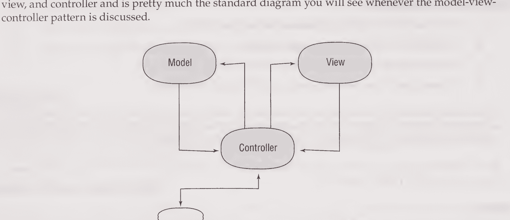

#### 路由

ASP.NET MVC 框架包含一个灵活的 URL 路由系统，允许我们定义映射规则。路由系统将传入的 URL 映射到相应的控制器和操作。例如，如果我们使用默认路由定义，路由系统会将 /user/edit/2 这样的 URL 映射到 User 控制器中的 Edit 操作，并将 2 作为 ID 参数传递。映射系统还会构建传出 URL，我们在视图中使用这些 URL 来提交表单和创建链接等。

路由系统非常灵活，使我们能够在不更改代码的情况下更改路由。因此，如果我们决定将 URL 从 /user 更改为 /customer，那么我们只需在应用程序启动逻辑中的路由定义里进行更改。

#### ViewData

你可能想知道控制器如何将数据发送到视图。例如，如果你正在编辑客户记录，控制器需要从我们的数据存储中获取该数据并发送给视图。这是通过控制器中的 ViewData 属性来完成的。ViewData 的类型是 ViewDataDictionary，你可以通过使用字典（例如，ViewData["title"] = "Edit Customer"）或将其 Model 属性设置为你想要发送到视图的模型类的实例来设置/获取值——或者两者都可以。以下是一个示例：

```
var model = Repository.GetCustomer(2);
ViewData.Model = model;
ViewData["title"] = "Edit Customer";
```

视图将能够通过访问其自身的 ViewData 属性来检索发送给它的数据。你可以像这样获取上面设置的页面标题：

```
<title><%= Html.Encode(ViewData["Title"]) %></title>
```


# 第 1 章：需求规范

可以通过以下方式访问上述提到的模型：

```
<%= Html.TextBox("firstname", Html.Encode(ViewData.Model.FirstName)) %>
```

这将生成以下 HTML：

```
<input id="firstname" type="text" value='Firstname' />
```

## HTML 辅助程序集 (Helpers)

您可能注意到，在前面的某些示例中，我使用了 **Html** 帮助类。该类包含多个允许您轻松生成 HTML 的辅助方法。有些人更喜欢使用它们，而另一些人则不这样。介于两者之间的是我自己。以下两行语句在功能上是相同的，因为它们生成的 HTML（即）：

```
<%= Html.TextBox("email") %>
```

以及

```
<input id="email" type="text" />
```

具体选择哪一行取决于您的意愿，但在本书中，您可能会看到我混合使用它们。我这样做是因为有时辅助方法可能不如纯 HTML 高效（或“更丑陋”），而在其他情况下，这可以节省大量时间。前面的示例过于简单，无法说明使用这些辅助类的优势所在。

## 操作筛选器 (Action Filters)

操作筛选器是用于装饰某个动作、控制类甚至整个程序集的属性，它们允许我们在执行之前或之后拦截该动作并执行某些逻辑。框架默认带有一些预定义的操作筛选器。其中一种操作筛选器就是 **Authorize**（授权），它会防止未经授权的用戶执行动作并将其重定向到登录页面。操作筛选器可用于跟踪、异常处理以及日志记录等多种用途。要创建操作筛选器，您需要继承自 `ActionFilterAttribute` 并覆写您需要的方法。您的类看起来大概如下：

```
public class TraceAttribute : ActionFilterAttribute
{
    public override void OnActionExecuting(ActionExecutingContext filterContext)
    {
        //在执行动作之前写入跟踪信息
    }
    public override void OnActionExecuted(ActionExecutedContext filterContext)
    {
        //在执行动作之后写入跟踪信息
    }
}
```

## TempData（临时数据存储）

**TempData** 与 **ViewData** 类似，允许我们将数据传输给视图。它与 **ViewData**（即数据视图）之间的根本区别在于：**TempData 仅在单一请求的生命周期内可用**。这使得它非常适合存储您仅希望发送一次给定视图的临时信息。**TempData** 的最佳候选对象是那些仅与特定请求相关的消息（或用户提示）。

## ModelState（模型状态验证器集合)

`ViewData`包含一个名为 `ModelState`的属性。该属性是一个模型状态的集合并具体类型为 `ModelStateDictionary`，存储了一个可通过字符串键访问的 **``** 对象的字典。**ModelState**通常用于将模型状态传回视图在用户输入校验这一方面尤为有用例如您可以向 ModelState添加表示登录凭据不正确的项目并通过使用辅助方法可大大简化验证过程。我们将在后面更详细地讨论这一点但在下面是一个快速示例演示如何向 `ModelState`（即该属性）中添加内容：

```
ViewData.ModelState.AddModelError("password",
         password, "密码错误.");
```

## 方法论、概念与方法论（Approach)

在接下来的几页中，您将了解我们将用于创建应用程序的方法方法以及通用模式。这些都是很大的主题对其中的某些内容进行深入研究已经超出了本书的范围不过我还是想简要地解释它们以便我们有一个通用的语言工具最后它将帮助您更好地理解这本书。所有这一切都会对您大有裨益：

### 测试驱动开发 (Test Driven Development, TDD)

**测试驱动的开发（TDD）**或也称为 **`TDD`**是一种软件开发技术它由短迭代（iteration）构成在这些迭代的每个阶段都首先进行编写测试然后才编写满足测试条件的代码。为了使用更具体的例子来说明如果我们想要编写一个方法来验证电子邮件地址我们将先编写覆盖此用例的测试然后再写出让该测试通过的方法。

TDD 周期包含以下顺序：

1. **添加测试。**创建一个满足要求的测试在我们的例子中我们会调用邮件地址方法并用一封无效的（）来创建这样的测试以对其进行测试检查错误信息内容如何）。
2. **运行测试**。由于我们还没有编写任何代码所以该测试应该失败这是很重要的一步因为它验证了该测试不会永远通过这样它才有价值起初您可能根本无法运行这些测试因为会出现编译错误这是由于您尚未为您测试所调用的方法（或类中）编写任何代码。
3. **撰写代码。**编写满足此条件的代码在本案中您将创建 `IsValidEmail` 方法来验证电子邮件地址。
4. **再次运行测试**。现在该测试应该能够通过如果失败则重复第 3 步直到它们通过为止。
5-7.**重构**（Refactor）。既然已经满足了要求我们可以对代码进行重构每次重构代码时重新运行测试以确保我们没有损坏任何内容。**注意：**此处原文为“1”，但在翻译中应译为“2”。

### 面向方面编程 (Aspect-Oriented Programming, AOP)

#### Aspect-oriented programming(即:aspect oriented programming(A OP)，即方面导向或者说是a op(aop))是一种程序设计风格这种设计模式允许将切面关注点（cross-cutting concerns）分离出来从而提高代码的模块化、可读性和可重用性。所谓的“横向交叉”是指一种横跨应用程序各层的行为并且使用传统的面向对象技术往往难以表达这种行为。

例如一个常见的方面就是日志记录为了记录您的应用程序的操作您需要将日志代码撒满整个系统然而大多数您想要记录的类或方法实际上并不（也不应该）真正关心日志记录问题比如你可以像下面这样编写方法：
```
public void AddFriend(string friendName)
{
    try
    {
        LogMessage("AddFriend Called");
        //将朋友添加到列表中的代码段。
    }
    catch (Exception ex)
    {
        LogException(ex);
        //处理异常操作
    }
    finally
    {
        LogMessage("AddFriend Ended");
    }
}
```

上述方法存在若干问题：

- 日志代码分散在各个地方；难以维护或修改。
- 必须为每个手动编写每一处地方的所有逻辑行为部分都需要独立地写出相应功能单元模块等等这样会导致大量的重复工作量和冗余操作成本增加而效率低下等因素限制因素较多等缺点明显突出表现出来！因此我们应该改进解决方案使之成为一种更好解决问题的方法了接下来介绍如何解决问题吧！我们将使用 PostSharp 作为面向方面编程框架从而能够创建一个新的日志记录方面的逻辑行为它可以通过简单应用属性就能应用到我们上面给出的那段代码上了看看效果如下所示：
```
[Log()]
public void AddFriend(string friendName)
{
    try
    {
        //进行朋友添加的代码段操作。
    } catch (Exception ex)
    {
        //处理异常情况的步骤流程说明等细节问题略去不谈了直接看结果就好啦！
    } finally {} 
}
```

### 小结总结概述主要观点提炼出来几点核心思想精华所在之处归纳如下：首先来说明一下整体思路框架结构安排顺序逻辑关系条理清晰明了透彻易懂实用性强可操作性高易于理解掌握使用快捷方便简单高效便捷灵活多变适合各种复杂场景需求变化快速反应敏捷应变能力强适应力强拓展性好兼容性好扩展性佳稳定性高等特点明显表现出来值得推荐给大家参考借鉴学习研究探讨交流共享共同进步共同发展繁荣发展！谢谢大家观看支持关注点赞转发收藏感谢阅读到此结束祝您生活愉快工作顺利万事如意心想事成美梦成真合家欢乐幸福安康平安喜乐健康长寿快乐每一天永远不忘记今天的美好时光记忆深刻难以忘怀刻骨铭心永垂不朽载入史册流芳百世青史留名万古长青千秋万代亿万年长存于天地间永不磨灭闪耀光芒照亮未来指引方向带领我们走向更加美好的明天创造辉煌成就卓越功勋伟大事业壮丽画卷宏伟蓝图灿烂星空璀璨银河浩瀚宇宙无限可能希望之光梦想飞翔自由翱翔勇往直前无所畏惧无惧挑战敢于探索未知领域勇敢面对困难挫折坎坷道路荆棘丛生险象环生惊涛骇浪狂风暴雨雷电交加冰雪严寒酷暑难耐干旱洪水地震火灾台风沙尘暴泥石流山体滑坡海啸地裂缝岩浆喷发火山爆发陨石坠落黑洞吞噬外星文明宇宙大战末日审判世界毁灭重生轮回转世六道天堂地狱极乐世界阿弥陀佛南无观世音菩萨摩诃伽罗尊者悉达多太子释迦牟尼佛诸天神佛护念众生普度寰宇慈悲喜舍四无量心六度万行三十七道品八正道十二因缘五戒十善因果报应业力轮回无常空性般若智慧解脱涅槃菩提大道成佛之道金刚经心经楞严经法华经维摩诘经信解疏钞义灯会录宗镜录祖庭碑记禅门规式清规律仪毗尼日用四分比丘含光普照十方世界三界六道四维八荒五湖四海天下太平风调雨顺国泰民安政通人和百业兴旺五谷丰登仓廪实而知礼节衣食足而后知荣辱先忧后乐兼爱非攻大同世界人类命运共同体全球治理多边主义合作共赢共同发展繁荣富强民族复兴中国梦想一带一路倡议构建人类卫生健康共同体加强国际抗疫合作维护地区和平安宁促进世界经济复苏增长推动文明交流互鉴共建美好家园守护地球母亲珍惜自然资源保护生态环境建设生态文明实现人与自然和谐共生永续发展共同福祉千秋伟业伟大征程历史使命担当责任勇担重任不忘初心牢记使命砥砺前行乘风破浪追求卓越再创佳绩谱写新篇章铸就新辉煌！


## 第1章：需求

日志切面（属性）将能够在方法调用的不同阶段记录相应的消息，例如进入时、退出时、发生错误时等等。

> **定义**

**切面** — 横切关注点的模块化——例如，日志记录、事务管理、跟踪、异常处理或授权。

**连接点** — 在执行过程中，主程序与切面交汇的点——例如，方法调用或抛出异常。

**通知** — AOP框架在连接点采取的操作。

#### 设计模式

我想简要介绍一些我们很可能会在这个应用程序中使用的设计模式。这不是一本模式的书，而且有比我更擅长深入探讨每个模式细节的人；我只是想简单地命名和描述每个模式。我的大部分模式描述都来自软件模式的权威参考——马丁·福勒的著作《企业应用架构模式》（PoEAA；Addison-Wesley，2002年）。

我们已经解释了模型-视图-控制器（MVC）模式，所以本节将跳过它。

### 策略模式

该模式旨在定义一族算法，封装每一个算法，并使它们可以互换。策略模式让算法可以独立于使用它的客户端而变化。

> **定义**

**策略** — 所有算法共有的接口声明。

**具体策略** — 策略的实现。

**上下文** — 配置为使用具体策略的对象。

从概念上讲，策略模式如图1-3所示。

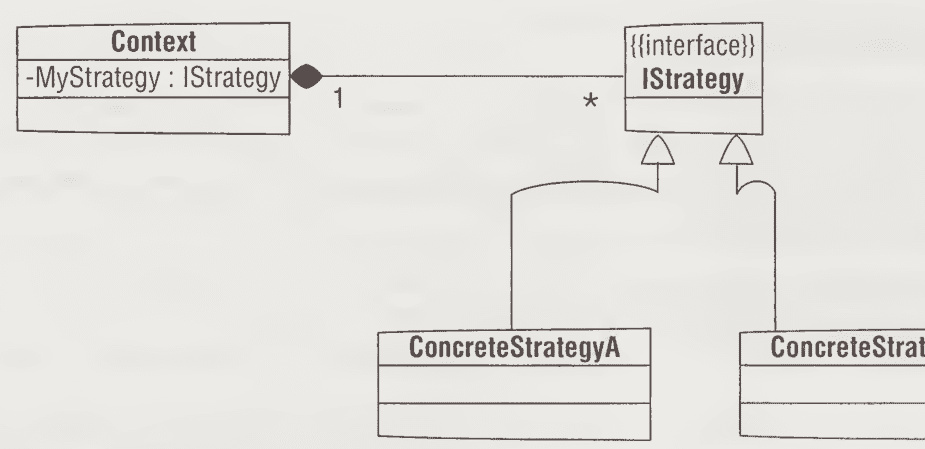

#### 图1-3

策略模式可以应用的一个例子是在排序中。类图可能看起来像图1-4。

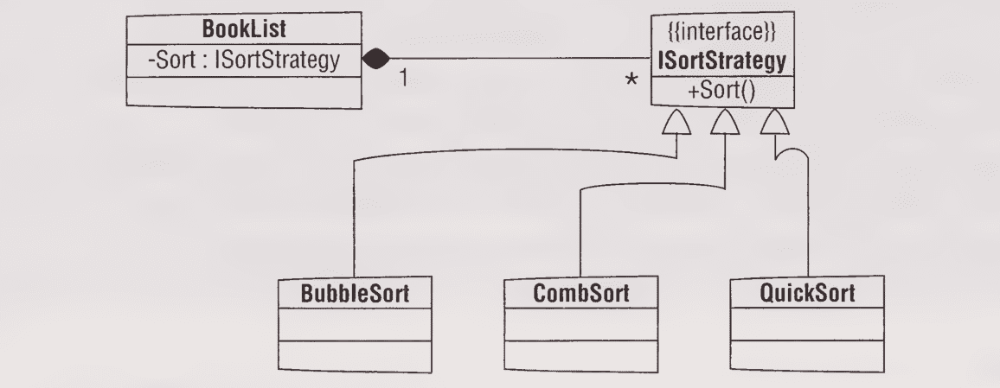

### 空对象模式

空对象是设计用来表示对象缺失的对象。如果你在.NET中对空对象调用任何方法，你会得到一个`NullReferenceException`。最好返回一个表示对象缺失的对象实例。例如，如果你的客户没有任何订单，而你尝试获取他们的订单，使用空对象模式，你可以这样做：

```
public List<Orders> GetOrders(int customerId)
{
    //从数据库获取订单
    //如果没有订单，则返回一个空列表
    return new List<Orders>();
}
```

这比返回`null`更好，因为你的方法的使用者就不必进行空值检查，并且在返回的对象上调用`Count`属性也不会抛出`NullReferenceException`。

```
var orders = GetOrders(2);
//不会抛出异常
txtTotalOrders.Text = orders.Count;
```

### 惰性实例化（也称延迟加载）

这种模式将对象的创建、值的计算或昂贵过程的执行延迟到首次需要时才进行。例如，下面是一个将返回用户联系人的属性，但它仅在第一次被调用时才计算。因此，如果它从未被调用，我们永远不会产生检索联系人列表的开销。

```
private List<Contact> contacts;
public List<Contact> Contacts
{
    get
    {
        if(contacts == null)
        // ...
        {
            contacts = GetContactsFromDatabase(userId);
        }
        return contacts;
    }
}
```

### 仓储模式

这种模式允许我们创建一个独立于数据存储的数据访问层。这使得数据访问的更改和测试驱动开发（TDD）变得更容易。例如，我们可以通过定义以下接口来创建一个联系人仓储：

```
public interface IContactRepository
{
    IQueryable<Contact> GetContact(long id);
    IQueryable<Contact> GetContacts(long customerId);
    long Create(string email, string name, string description);
    bool Delete(long id);
    bool Update(Contact contact);
}
```

我们现在可以实现这个接口来与生产环境中的SQL数据库通信，在集成测试中实现它来与XML文件通信，甚至为单元测试目的实现它来与内存数据库通信。

#### 原则

以下是我将在本书中尽可能应用的软件原则列表。这些原则是通用且抽象的，具有广泛的适用性。它们创建了一套编程指南，无论使用何种语言，都可以在软件开发过程中使用。实际上，许多原则如此通用，以至于可以应用于与软件开发无关的其他领域。

### 开闭原则

开闭原则指出，一个软件实体（类、模块、程序集等）应该对扩展开放，对修改关闭。这允许其他人更改实体的行为而无需更改其源代码。这通常通过继承来实现。例如，如果一个类有一个`Send`方法用于发送消息，我们可以通过允许派生类重写`Send`方法并实现不同的发送功能（例如通过即时消息而不是简单邮件传输协议）来使其对扩展开放。

### YAGNI

YAGNI是“你不会需要它”的缩写，简单来说就是你只应该在你需要时添加代码/功能，而不是在你预见到需要时就添加。最近，我成为YAGNI方法的狂热粉丝和倡导者。这主要是因为我记得过去写过的所有*以为*会需要的代码。我们都知道每一行代码都会增加复杂性，每一个新功能都需要测试、调试、修复、编写文档和提供支持。

因此，在添加新功能之前要仔细考虑。你真的需要它吗？你现在需要它吗？如果不需要，那就现在不要做。当需求出现时（可能永远不会出现），你再去添加它——到那时，它可能与你最初想的已经不同了。

### KISS原则

KISS（保持简单，笨蛋）原则指出，事物应该保持简单，避免复杂性。该原则可以应用于其他学科，而不仅仅是软件开发。但在软件开发的背景下，我们应该努力保持事物简单，避免不必要的复杂性，这样我们才不会最终得到一个复杂得像“鲁布·戈德堡机械”的系统。例如，如果你确切地知道你只会使用SQL Server作为数据存储，那么就没有必要添加对其他数据库系统的支持，或者编写数据库无关的代码，因为你不会需要它。

> 一切都应该尽可能地简单，但不能过于简单。

——阿尔伯特·爱因斯坦

### DRY原则

DRY是“不要重复自己”的缩写。DRY原则旨在减少重复。重复会降低可维护性，因为它增加了更改的难度。它还可能导致不一致和歧义。重构是检查你曾在多个地方复制粘贴的代码并将其重构为一个单一权威位置的好时机。DRY不仅对应用代码有用，对测试代码也同样有用。

### 控制反转（IoC）和依赖注入（DI）

控制反转（IoC）和依赖注入（DI）是允许我们创建松耦合系统的两个原则。控制反转是对象实例化的间接方式，这样对象就不直接创建其他对象。相反，一个IoC `容器`将通过构造函数参数或公共属性将依赖项注入到对象中。

想象一个需要使用封装了电子邮件功能的`EmailService`的类。如果我们使用构造函数注入，我们可以将类定义为这样：

```
internal class MyClass
{
    public MyClass(IEmailService emailService)
    {
        this.EmailService = emailService;
    }
}
```

然后我们将配置我们的IoC容器，告诉它如何实例化一个`IEmailService`并将实例化的对象注入到上面的类中。如果这听起来不合理或显得太模糊和理论化，请不要担心；在接下来的章节中，你将看到更好的例子。

#### 单一职责原则

单一职责原则指出，一个类应该有**一个**职责。一个职责被认为是一个变化的原因。如果一个类有两个变化的原因，那么它应该被拆分成两个类。看看下面这个表示`Customer`的类：

```
internal class Customer
{
    public long Id { get; set; }
    public string Name { get; set; }


 ```
public Address ShippingAddress { get; set; }

public void Save()
{
    //保存客户的代码
}

public void Delete()
{
    //删除客户的代码
}
```

乍一看，这个类似乎没问题。问题在于它有两个变更的原因。一个是模式变更，需要添加新属性或更改现有属性。另一个是持久化变更。这可能发生在你更改数据存储时，或者当你规范化/反规范化数据库，然后想要跨多个表或一个表存储`Customer`时。这个类应该被拆分成两个类，一个代表模型，另一个处理持久化。

## 里氏替换原则

这个原则基本上说，任何派生类都可以用来替换其基类，而不会改变应用程序的正确性。看下面的类；里氏替换原则指出，我们可以在任何可以使用`Vehicle`的地方使用`Airplane`、`Motorcycle`或`Boat`：

```
internal class Vehicle
{
}
internal class Airplane: Vehicle
{
}
internal class Motorcycle:Vehicle
{
}
internal class Boat: Vehicle
{
}
```

## 约定优于配置

约定优于配置是一种设计范式，它通过减少开发人员需要做出的决策（配置）来强调约定。你仍然有能力配置事物并保持一定程度的灵活性，但通过使用约定，你获得了简单性并避免了任何额外的工作。ASP.NET MVC框架在应用这一设计范式方面做得非常出色。以下是一些使用的约定示例：

- 所有控制器都命名为[something]Controller。
- 所有视图都在Views文件夹中。
- 控制器中的所有公共方法都被视为操作。
- 表单字段映射到同名的操作参数。

这些只是少数几个约定；我们将在本书中探讨更多这样的约定，它们将在侧边栏中突出显示。

## 工具和框架

到目前为止，我们已经讨论了问题、设计和解决方案。现在是我们选择工具和框架来帮助我们实现解决方案的时候了。我希望我的工具选择是全面且开放的。我花了很多时间研究替代方案，并试图挑选最适合我的应用程序需求的那个。所以不要认为这是对一个框架优于另一个框架的认可。此外，许多这些工具都是开源的，并且变化非常快，因此在我的研究时缺失的功能可能在你阅读这本书时已经实现。我认为概念比实际工具更重要。我必须承认的一点是，能够使用甚至还没有进入测试版的尖端框架，既令人兴奋又令人沮丧。好消息是，这些工具大多数都在积极开发中，并拥有强大的社区支持。最坏的情况是，我可以访问代码，如果我不喜欢什么，我可以更改它。

#### 单元测试框架

如果我们打算实践TDD，我们将需要一个单元测试框架。Microsoft Visual Studio Team System 2008 Edition包含一个单元测试框架，通常称为MSTest。我决定不使用MSTest，尽管它在我的舒适区内。我的决定完全基于这样一个事实：我不想假设你有几千美元可以花在一份Visual Studio副本上。我研究了nUnit、MbUnit和MSTest，并决定使用MbUnit。原因之一是几位有影响力的开发者的压倒性热情支持。个人而言，我非常喜欢的一个功能是行测试，它允许我们有一个具有多组数据的单个测试。例如，下面的测试将运行三次以测试三个不同的无效用户名：

```
[Test]
[Row("abc", Description = "用户名太短")]
[Row("1user", Description = "用户名以非字母字符开头")]
[Row("user$abc", "用户名包含无效字符")]
public void Register_Should_Fail_For_Invalid_Usernames(string invalidUsername)
{
    //测试注册过程
}
```

MbUnit也与ReSharper的测试运行器配合得很好，该运行器与Visual Studio深度集成，我可以轻松地点击每个测试旁边的标记来运行或调试它，如图1-5所示。

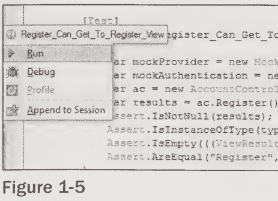

测试运行器具有非常好的用户界面，可以快速定位测试的状态，并指出失败的测试以及失败的原因，如图1-6所示。

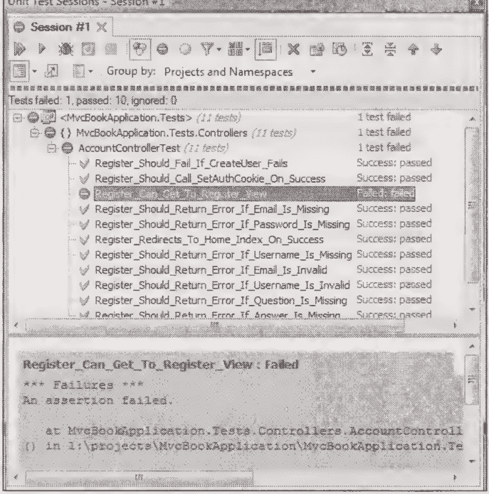

图1-6

### 代码覆盖率

代码覆盖率是测试驱动开发中的一个重要指标。它衡量源代码被测试的程度，即被覆盖的程度。使用代码覆盖率工具，我们可以运行测试并查看代码覆盖率报告。理想情况下，你希望达到100%的代码覆盖率。大多数工具可以通过用不同颜色高亮代码块来直观地向你展示覆盖了什么和没有覆盖什么。图1-7显示了Visual Studio 2008中的代码覆盖率窗口。

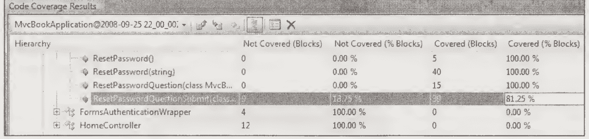

图1-7

> 代码覆盖率仅在Visual Studio Team System 2008的开发版、测试版和团队套件版中可用。

从图1-7中你可以看到，`ResetPasswordQuestionSubmit`方法有九个代码块，即18.75%，未被覆盖。双击该项目将显示该方法，并用不同颜色高亮代码以表示未被测试覆盖的代码块。如图1-8所示，前两个`if`语句从未被执行到，这意味着我的测试没有测试这些条件。

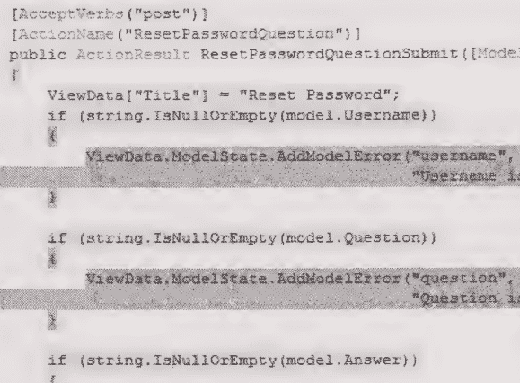

如果你的Visual Studio版本没有代码覆盖率功能，那么你可以使用NCover，这是一个极好的替代方案。

### JavaScript 库

我们将需要使用JavaScript和AJAX来增强网站的可用性和性能。至关重要的是，我们要使用一个快速、易于学习且易于编写的JavaScript库。在研究了几个JavaScript库之后，我立刻爱上了JQuery，并成为了它的忠实粉丝。JQuery允许你用JavaScript做一些你从未想过可能实现或很难做到的事情。它具有非常强大和简洁的语法，并允许你执行这样的操作：

```
$(document).ready(function() {
    $("h2").addClass("red");
});
```

前面的代码会将"red"类添加到任何"h2"元素。JQuery还拥有庞大的社区、良好的文档以及丰富的插件和扩展库。

话虽如此，我也非常喜欢YUI（雅虎用户界面库）；它拥有一套出色的用户界面控件/小部件。它文档完善，支持良好，而且外观精美。我将使用YUI中的两个组件：富文本编辑器和YUI测试工具。YUI测试工具附带一个良好的测试运行器（如图1-9所示），并且文档非常完善。

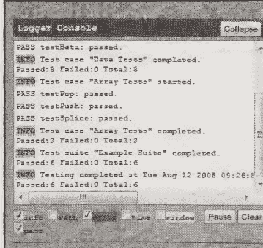

## IoC 容器

我想使用一个IoC容器来简化我的控制器并减少它们对其他类的依赖。这可以极大地简化测试编写，并获得更好的整体设计。市面上有几种IoC容器，它们看起来都非常好且功能强大。但大多数都有非常陡峭的学习曲线和复杂的配置过程。我研究了以下几种：

- StructureMap
- Spring.Net
- Castle Windsor
- Autofac
- Ninject

起初，我选择了Autofac，因为它具有非常流畅的接口、高度可发现的API和非常可读的代码。这是一个简短的Autofac示例：

```
var builder = new ContainerBuilder();
builder.Register<Straight6TwinTurbo>().As<IEngine>();
```

使用Autofac一段时间后，有人建议我看看Ninject。它看起来和Autofac一样好且易于使用，但它的文档更好，似乎更容易学习。Ninject还有一个非常简单的上下文绑定语法，让你可以这样做：

```
Bind<IService>().To<RedImpl>()
    .Only(When.Context
        .Target.HasAttribute<RedAttribute>());
Bind<IService>()
    .To<BlueImpl>()
    .Only(When.Context
        .Target.HasAttribute<BlueAttribute>());
```

在下面的代码中，ConsumerA将被注入`IService`接口的`RedImpl`实现，而ConsumerB将被注入`BlueImpl`实现。

```
class ConsumerA {
    public ConsumerA([Red] IService service) {
    }
}

class ConsumerB {
    public ConsumerB([Blue] IService service) {
    }
}
```

选择一个IoC容器具有挑战性，并且相对主观，但归根结底，我认为如果你选择这些IoC容器中的任何一个，你都不会有问题。

> 我喜欢ASP.NET MVC的一点是它的选择性。你不会被锁定使用一个供应商/产品/框架，基本上可以在框架的每一层插入你选择的供应商/产品/框架。你可以替换你的控制器工厂、视图引擎、视图渲染、路由处理程序成全窈窕淑女祝你早日找到女朋友。


## 第1章：需求

## 模拟

模拟允许我们在单元测试中模拟复杂对象的行为。在使用真实对象困难或不可能时，这极其有价值。如果你想对创建用户操作进行单元测试，但又不希望代码在数据库中创建记录，那么你可以模拟对数据库的调用。在此测试上下文中，我们并不真正关心数据库调用的实现；相反，我们想测试创建用户操作的逻辑。

有几个非常优秀的模拟库，包括：

- TypeMock
- NMock
- NMock2
- Rhino Mocks

在我看来，它们都不如Moq那样易于使用和优雅。它如此易于使用，以至于我很快就上手并运行起来了。设置一个模拟非常简单，如下所示：

```
var mockMembership = new Mock<MembershipProvider>();
mockMembership.Expect(p => p.MinRequiredPasswordLength).Returns(4);
```

在前面的例子中，我们创建了`MembershipProvider`的一个模拟实例，并告诉它如果调用`MinRequiredPasswordLength`，它应该返回4。现在你可以轻松地将这个模拟对象传递给正在测试的控制器构造函数，而无需关心`MembershipProvider`的实际实现。

正如Moq在其主页上解释的那样，“它是唯一的从零开始开发的.NET模拟库，充分利用了.NET 3.5（即Linq表达式树）和C# 3.0（即lambda表达式）的特性，使其成为最高产、类型安全且易于重构的可用模拟库。并且它支持模拟接口和类。它的API极其简单直接，不需要任何模拟概念的先验知识或经验。”

## 为什么是EvenContact？

我想创建一个有些通用的应用程序，它将通过其实际应用造福读者，并帮助说明ASP.NET MVC框架和测试驱动开发方法的强大和灵活性。我认为从技术角度来看，这将是一个很好的应用程序。此外，我也厌倦了阅读那些使用博客引擎或某种内容管理系统作为示例来教授所有内容的书籍、文章和博客文章。博客引擎已经成为当今编程书的“hello world”。最后，为了“一石二鸟”，我想创建一个我确实可以在线提供并可能从中产生收入的服务。这具有双重优势。我必须确保我正在创造一些人们愿意付费的好东西，通过这样做，我能够制作一本更好的书，并希望在此过程中帮助他人学习。

## 总结

现在我们已经准备就绪，可以开始编码了。我希望你把这本书看作一部纪录片。我基本上是在记录我的开发过程，随着进程推进。我相信这将产生一种更“真实”的体验，即使用ASP.NET MVC进行TDD。这意味着我可能在第2章做出的决定，在第4章因为新信息或错误的假设而改变。这对我们所有人来说都应该是一次有趣的体验，并且希望它能突出TDD和良好设计的好处。

## 高级设计

本章将讨论应用程序的高级设计。我们将讨论一些屏幕流程，并查看一些草图屏幕布局。本章中的图表是手绘的，以强调这不应该是一个漫长而复杂的过程。我们基本上是在尝试可视化应用程序，以帮助我们确定下一步的方向。

## 问题

现在我们有了需求，我们需要创建一些高级设计来指导我们的开发。请记住，我们使用的是测试驱动开发/设计（TDD）方法，因此我们不会创建详细的设计文档。这只是一个足够高级的概述，以帮助我们可视化应用程序、澄清一些流程，并在此过程中充实一些潜在的陷阱。

## 设计

我们将从设计网站的一些基本功能开始，这些功能几乎适用于任何Web应用程序；然后我们将讨论更具体于我们应用程序的主题。我称它们为基础，不是因为它们比其余部分更容易或更简单。所有这些功能仍然是一等公民。它们是基础，因为它们几乎适用于每个应用程序。同样，这不是详细的设计，所以让我们谈谈主要部分并绘制一些图表。

### 会员

我们需要一个会员系统，允许我们管理用户并为他们提供对其账户的安全访问。

首先，我们从用户注册（注册）流程开始。注册流程如图2-1所示。

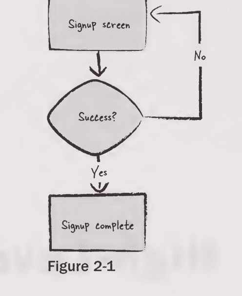

屏幕布局将类似于图2-2。

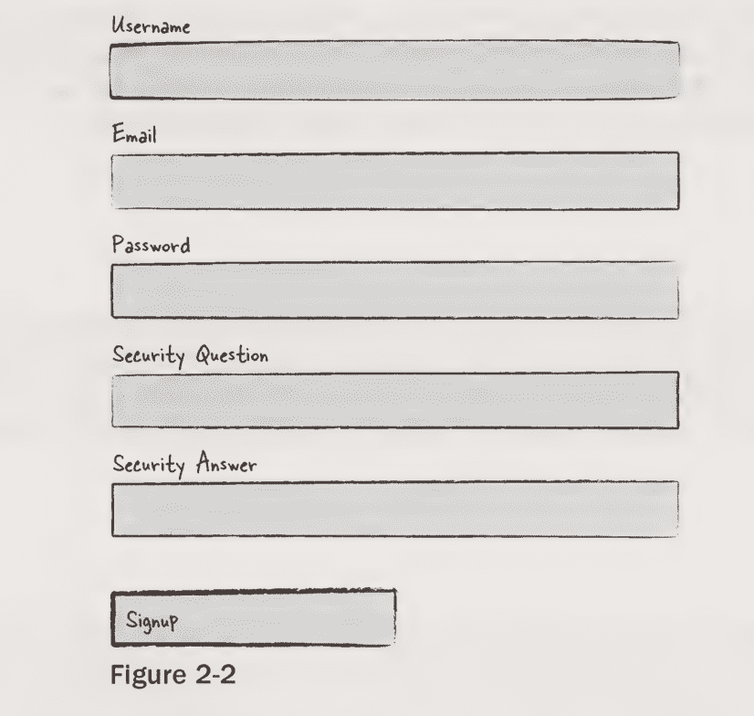

**密码确认**

我在数百个网站上注册过，令我惊讶的是，几乎*所有*的网站都强制你确认密码。这对我来说没有任何意义。大多数网站都提供了重置密码的方式，那么确认密码有什么意义呢？如果我忘记密码或输入有误（这反正也很少发生），那么我只需重置密码。就个人而言，我觉得密码确认是浪费时间和资源，而且对用户不是很友好。

我知道这似乎是一件小事，但这个看似简单的字段实际上涉及大量工作。以下是实现它通常会涉及的一些步骤：

1.  编写JavaScript来验证字段。
2.  编写服务器代码来验证字段。
3.  编写单元测试来测试服务器验证。

接下来是登录流程，如图2-3所示。

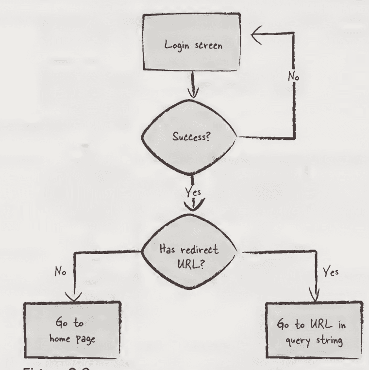

**图2-3**

屏幕布局将类似于图2-4。

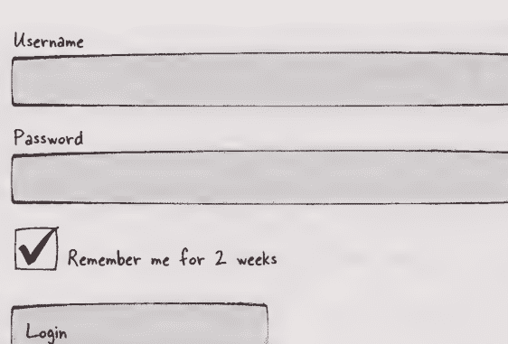

**图2-4**

我们还需要一种让用户重置密码的方法。首先，我们不希望随意的人输入用户名或电子邮件就允许他们重置该账户的密码。我们需要确认是合法的账户所有者请求重置。有几种方法可以做到这一点。一种方法是向账户所有者发送电子邮件，并要求他点击链接以启动重置流程。但由于我们为用户设置了秘密问题和答案，我们可以直接询问用户问题，如果答案与我们记录的匹配，我们就重置密码并通过电子邮件将新密码发送给用户。这样，我们就消除了额外的电子邮件及其带来的麻烦。重置密码流程如图2-5所示。

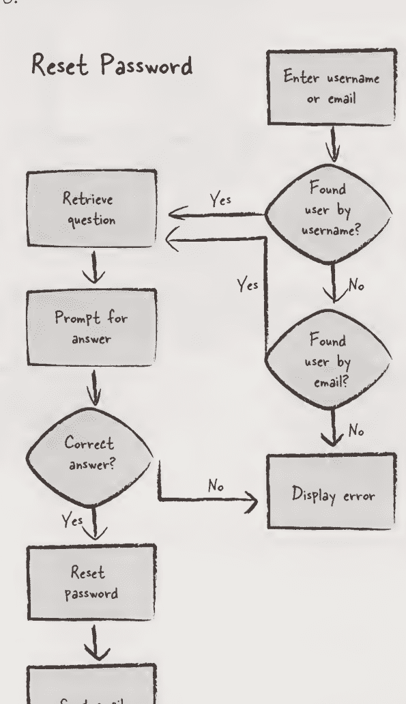

**图2-5**

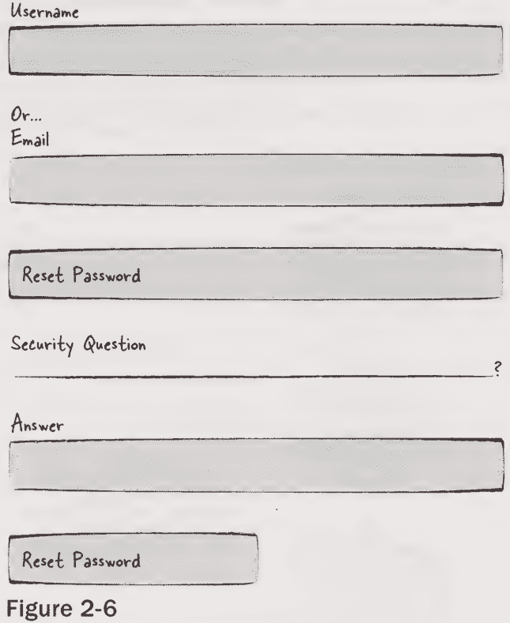

图2-6显示了重置密码的屏幕。

### 账户管理

每个成员都有一个关联的账户。网站的账户管理组件允许用户查看他们的账户并进行更改。账户实体可能相当大，将其分解为较小的部分是有意义的。例如，计费信息可以成为其自己的一部分，即使它是账户的一部分。假设一个账户由以下部分组成：

- 基本信息（姓名、地址、电子邮件等）
- 计费信息（支付方式、信用卡、账单地址等）
- 订阅信息（所选计划）

为了本应用程序的目的，我们将采用一个非常简单的账户实体，并收集最少的数据。我们真正需要的只是一个电子邮件地址、一个PayPal账户和一个订阅计划，如图2-7所示。如果我们以后决定收集更多信息，我们可以如所述将账户页面分解为更小的部分。

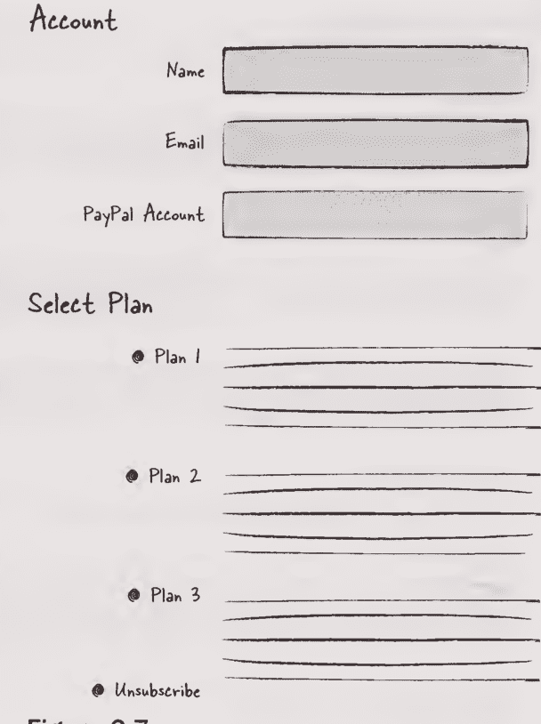

为了进一步简化计费，我们将使用PayPal作为我们的支付处理器，它支持订阅。图2-8显示了我们的保存账户流程。

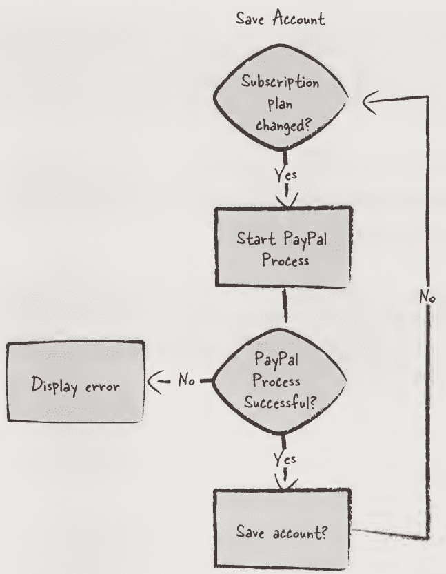


### 消息管理

这是处理消息的部分。第一步是创建一条消息；这是一个非常基本的步骤，如果你使用过任何基于 Web 的电子邮件系统，你大概对此很熟悉。它是最基本形式的表单，接收一组收件人和邮件正文。让我们看看更有趣的编辑消息过程（显示在图 2-9）。

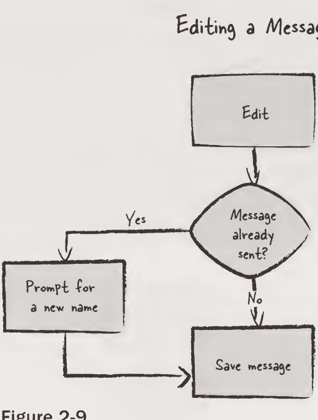

发送邮件涉及多个步骤，并且必须是异步的。由于用户可能向数千名收件人发送邮件，我们不期望同步发送数千封电子邮件。相反，这些邮件会排队存储在持久队列中（可能在数据库中）。此队列可以由 Windows 服务进行监控。我们不会讨论这个队列监控服务，因为它超出本书的范围。我们需要做的就是将邮件放入队列，并假设有一个外部服务负责清理队列并实际发送邮件。

#### 消息队列

从我们的 Web 应用程序的角度来看，为了表示需要将**消息 X**发送给收件人 **Y**，会向数据库添加一条记录。“队列监控”组件可以是一个在后台运行的 Windows 服务；它会每 5 分钟（或任何合理的间隔）轮询一次数据库中的队列表，然后将消息发送给收件人、从队列中删除该记录并继续处理下一条。

另一种选择是创建一个按特定区间执行的 **SQL job**，以执行相同的功能。无论您选择哪种方法都可以工作，只要您可以查询队列表、发送邮件并从队列表中删除记录即可。

# 第 2 章：高层设计

## 联系人管理

大部分联系人和列表的管理任务都是简单的 CRUD 操作，在此我将略过不述。相反，让我们看看创建列表并向其添加联系人的整体过程。**图 2-10**展示了此流程。

> **CRUD**
>
> CRUD 是 “create, read, update and delete”（创建、读取、更新和删除）的缩写，这是持久化存储的四种基本操作。用 SQL 术语来说：
>
> Create = INSERT
>
> Read = SELECT
>
> Update = UPDATE
>
> Delete = DELETE

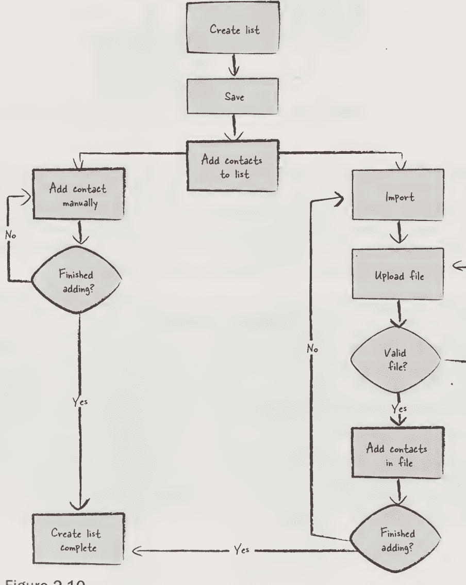

关于创建列表过程需要注意的一点是：向列表中添加入联系人不仅仅是在数据库中为新的联系人类别创建一条记录。该联系人可能已经存在于用户的全球通讯录中，不应再次添加。我们还在列表中添加了对此引用的引用（reference）。这将允许我们在一个位置编辑联系人信息并更新所有列表。**电子邮件地址**是联系人的唯一标识符；因此，如果已存在具有相同电子邮件的联系人，则不应添加新的条目，而应尝试更新其值。例如，如果用户已经有以下信息的联系人：

| Name | Homer |
|---|---|
| Email | hsimpson@fox.com |
| DOB | (null) |

并且导入的新记录具有以下信息：

| Name | Homer Simpson |
|---|---|
| Email | hsimpson@fox.com |
| DOB | 01/01/1955 |

则这个过程应使用新的出生日期更新该现有记录（因为不存在冲突），但由于存在两个版本的姓名，应提示用户选择正确的名字。**图 2-11**中的流程图表或许有所帮助。

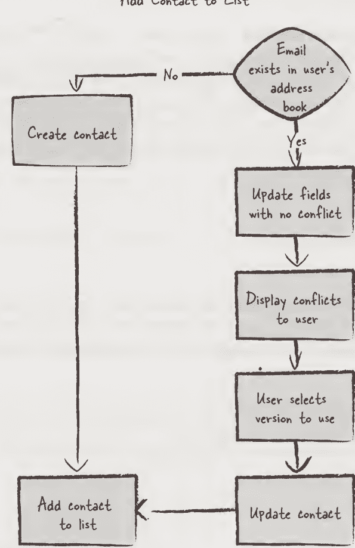

## 解决方案

本章所述设计的解决方案实际上是本书的其余部分，但在接下来的章节开始创建应用程序之前，我们必须设置我们的环境。

- Visual Studio 2008（含最新服务包）
- ASP.NET MVC framework ([http://asp.net/mvc](http://asp.net/mvc))
- Moq ([http://code.google.com/p/moq](http://code.google.com/p/moq))
- Ninject ([http://ninject.org](http://ninject.org))
- Jquery ([http://jquery.com](http://jquery.com))
- YUI ([http://developer.yahoo.com/yui](http://developer.yahoo.com/yui))
- MbUnit (www.mbunit.com)

我也强烈推荐使用 **ReSharper**，这是一款必备的生产力工具。ReSharper 还包含一个与 MbUnit配合使用的非常好的测试运行器。如果您没有 ReSharper，可以使用 TestDriven.net ([http://www.testdriven.net](http://www.testdriven.net))，这是一个免费的、同样适用于 MbUnit 的测试运行器。

我没有提及版本号，因为这些库的开发周期非常短，几乎每两周就有一个新版本发布。在撰写本书时所使用的将是当时可用的最新版本构建（available build），这意味着部分代码可能会发生变化。不过，您应该能够理解其中的概念并轻松地修改代码以适配最新版本。

一旦将所需的所有工具都安装并运行起来后，请创建一个新的是""ASP.NET MVC Web Application"""以及一个关联的 MbUnit 测试项目。这将为您生成一个新的 Web 应用程序，其中包括基本的成员资格任务（login 和 signup）。为了方便本书阅读，我们假设我们是从一个空白的、没有任何内容的**应用程序**开始的。您既可以删除自动创建的文件也可以保留它们并略过与成员资格相关的章节。我强烈推荐您将那些文件删掉并按照书中的步骤进行操作。**目标不仅是要让成员资格功能正常运行，而是要使用 TDD 来实现它，并在过程中进行学习**。

## 总结

到了现在这一刻，您可能已经兴奋不已，准备好编写代码了。在本章中，我们讨论了一些高层设计并开始通过设置环境来实施我们的解决方案的准备工作。我们现在准备全力以赴（hit the ground running），开始进行大量测试创作。让乐趣就此开始吧！

# **3. 会员资格管理** (Membership)

我们从哪里起步？由于该应用程序需要用户注册并登录才能使用其任何功能，因此从网站的成员资格组件入手很有道理。在本章中，我们将通过使用 **Test Driven Development **(TDD)**方法来阐述创建注册（signup）功能的过程**。章节开始时包含了非常详尽的逐步说明；但随着我们的推进，我们会快速概括常见的部分内容。

## 问题

我们需要满足允许用户进行以下操作的会员资格要求：

1.   创建账户（即注册、报名）。
2.  登录 (Log in)。
3.   重置密码（我们使用单向密码哈希），因此无法检索密码而必须重置它。
4.   更新成员资格信息（更改电子邮件地址、安全问题的答案等）。
5.   更改密码。

## 设计

由于我们正在使用 TDD，我们可以大概将测试视为我们的**设计方案**。我们首先为特定的功能/需求创建测试，然后编写满足该测试所需的代码。本质上，我们通过编写测试来设计应用程序。**例如**，如果我们只想接受包含字母且长度至少为三个字符的**用户名 (username)**，我们将为该用途编写一个测试，随后编写一段旨在通过此测试的代码。

正如前一章所提到的，注册过程涉及以下步骤：

1.   收集姓名、电子邮件地址、密码、安全问题及其答案。
2. 	确保用户名为**唯一**。
3.   验证用户名是否有效：
    -   其长度至少为 4 个字符。
    -   以字母开头。
    -   仅包含字母、数字和下划线。
4.   确认电子邮件地址既独特又合法 (valid)。
5.   创建用户账户并将该用户登录（logged in）。

## 解决方案

在我们开始编写测试之前，我们需要创建一个**测试类**。让我们为 **AccountController**添加一个新类的命名为`AccountControllerTest`以便将其设为一个测试类，您需要使用 MbUnit的 **[TestFixture]**属性对其进行装饰。**代码如下**:

```
[TestFixture]
class AccountControllerTest
{
}
```

> **约定** (Convention)
>
> 测试类将按以下方式命名：`[类名 ]Tests。例如:如果我们正在对 PayController 进行测试，那么此 fixture将被命名为 PayControllerTests**。
>
>     *   - TestMethods（测试方法）的名称应清晰且具有描述性，以便清楚地标识该测试及其结果。（您可以用大写字母或下划线进行分隔。）**例如：** CallbackShouldReturnNull or callback_should_return_null。我个人更倾向于使用 **下划线法 (underscore method)**但代码中将同时包含两种写法。在本书末尾部分我决定采用小写加下标的混合格式。
>
There are two Register actions that we need to accommodate. One action just displays the view that would happen with a GET request, and the other will submit the form to the server to perform the registration that would happen with a POST request.


## 第三章：成员资格

让我们确保用户实际上可以查看注册页面。我们首先创建一个简单的测试，只需要验证用户能否导航到注册视图，即 http://evencontact.com/account/register。

我知道你已经迫不及待想编写你的第一个测试了。请稍安勿躁，让我们思考一下我们需要测试什么。我们希望确保：

-   - 我们可以用正确的参数调用注册方法。
- 页面标题设置正确。
- 我们得到一个有效的 `ActionResult` 作为返回值。

这很简单，但什么构成了有效的 `ActionResult`？我知道当我们访问注册页面时，我们想要渲染注册视图，所以让我们先尝试编写测试：

```
[Test]
public void Register_Can_Get_To_Register_View()
{
    var ac = new AccountController();
    var results = ac.Register();
    Assert.IsNotNull(results);
    Assert.IsInstanceOfType(typeof(ViewResult), results);
    Assert.IsEmpty(((ViewResult)results).ViewName);
    Assert.AreEqual("Register", ac.ViewData["Title"], "Page title is wrong");
}
```

注意我们如何使用 `[Test]` 属性来装饰方法。这告诉测试框架这是一个测试。你会注意到，如果你尝试构建这个测试，你会得到一个编译器错误，提示找不到 `AccountController`。这是我们的第一个测试失败（红灯）。

> **惯例**
与操作相关的测试将按照此格式命名：操作名_[描述性测试名称]。
拥有描述性测试名称至关重要。`Register_Test` 不是一个好的测试名称。现在听起来可能还可以，但当你有 400 个测试时，它就不会很有用了。

让我们创建 `AccountController` 类并尝试构建；现在我们得到一个错误，`AccountController` 不包含 `Register` 的定义。因此，让我们按照以下方式创建 `Register` 操作：

```
[AcceptVerbs("GET")]
public ActionResult Register()
{
    return null;
}
```

## 第三章：成员资格

> ### 可接受的动词
`[AcceptVerbs]` 属性告诉框架该操作可以处理哪些 HTML 动词。这允许我们创建两个同名的操作——即相同的 URL——并且每个操作处理不同的 HTML 动词。例如：

[AcceptVerbs("GET")]
public ActionResult Login()

当用户导航到 http://mysite/login 时会被调用。而

[AcceptVerbs("POST")]
public ActionResult Login(string username, string password)

当用户向 http://mysite/login 提交表单时会被调用。
两个操作都映射到 http://mysite/login，但一个在 GET 时被调用，另一个在 POST 时被调用。

我们必须返回一些东西才能让项目编译，所以现在让我们先返回 `null`。解决方案现在应该能正常编译了。

让我们运行测试并确保它失败。因为我们返回的是 `null`，所以测试会失败，因为 `Assert.IsNotNull(results)` 失败了。让我们将 `Register` 操作更改为：

```
[AcceptVerbs("GET")]
public ActionResult Register()
{
    return View();
}
```

这将返回注册视图，如果我们现在运行测试，我们应该会得到一个“页面标题错误”的错误。让我们再对 `Register` 操作进行一次更改：

```
[AcceptVerbs("GET")]
public ActionResult Register()
{
    ViewData["Title"] = "Register";
    return View();
}
```

运行测试。测试通过（绿灯）。哇哦！！！我们的第一个测试成功了。

*这是一个非常简单的操作和测试，所以目前并没有太多需要重构的地方。*

接下来，我们需要为第二个 `Register` 操作编写测试，即实际注册用户的操作。我们希望：

-   - [ ] 确保存在具有正确签名的 `Register` 操作。
- [ ] 确保用户被注册。
- [ ] 确保注册后我们被重定向到主页。

这是我们的第一个测试：

```
[Test]
public void Register_Can_Successfully_Register_New_User()
{
    var ac = new AccountController();
    var results = ac.Register(username, email, question, answer, password);
    Assert.IsNotNull(results);
    Assert.IsInstanceOfType(typeof(RedirectToRouteResult), results);
    var typedResults = results as RedirectToRouteResult;
    Assert.AreEqual("Index",
        typedResults.Values["action"],
        "Wrong action");
    Assert.AreEqual("Home",
        typedResults.Values["controller"],
        "Wrong controller");
}
```

在这个测试中，我们检查返回值是否不为空以及它是否是 `RedirectToRouteResult` 类型。然后我们确保它重定向到正确的目的地，即 /home/index。然后我们检查页面标题是否正确。

> 传递给 `Register` 方法的变量在 `AccountControllerTest` 类中声明为类级别的字段，因为我们将在其他测试中使用它们。

> 你可能在想，“如果这是一个 POST 操作，为什么我们需要检查页面标题？”我们检查的原因是因为我们将来需要验证表单，如果存在验证错误（或任何其他错误），我们需要再次渲染注册视图以显示错误。

再次强调，我们将无法编译项目，因为不存在具有此签名的 `Register` 方法。让我们创建它：

```
[AcceptVerbs("POST")]
public ActionResult Register(string username, string email,
    string question, string answer,
    string password)
{
    return null;
}
```

运行测试。它失败了，因为我们返回的是 `null`。将操作更改为：

```
[AcceptVerbs("POST")]
public ActionResult Register(string username, string email,
    string question, string answer,
    string password)
{
    return RedirectToAction("Index", "Home");
}
```

## 第三章：成员资格

运行测试。它通过了。你可能认为这个测试没用，什么也证明不了。虽然这个测试没有证明我们成功注册了用户，但它证明了 `Register` 操作存在并且具有正确的签名。它还证明了重定向到 `Home` 控制器中的 `Index` 操作是有效的。

是时候重构了。现在很明显，这个测试不能证明我们可以成功注册用户。所以测试名称具有误导性。我认为 `Register_Redirects_To_Home_Index_On_Success` 会是更好的名字。这是新的测试：

```
[Test]
public void Register_Redirects_To_Home_Index_On_Success()
{
    var ac = new AccountController();
    var results = ac.Register(username, email,
                              question, answer, password);
    Assert.IsNotNull(results);
    Assert.IsInstanceOfType(typeof(RedirectToRouteResult), results);
    var typedResults = results as RedirectToRouteResult;
    Assert.AreEqual("Index",
                     typedResults.Values["action"],
                     "Wrong action");
    Assert.AreEqual("Home",
                     typedResults.Values["controller"],
                     "Wrong controller");
}
```

### MembershipProvider

除非我能做一个更好的，否则我不喜欢重复造轮子。因此，我将使用 ASP.NET 成员资格提供程序。

要使用成员资格提供程序创建用户，你只需调用：

    Membership.Provider.CreateUser(username, password, email,
        question, answer, true, null,
        out createStatus);

现在事情开始变得有趣了。当我们运行测试时，它将在数据库中创建一个用户。这是个坏主意，因为每次运行测试时都会访问数据库，这不是最优的；我们希望测试是快速的。我们还必须编写清理代码来删除我们在数据库中创建的所有内容；否则，后续的测试将会失败。例如，如果我们运行测试并创建了用户 jdoe，那么下次运行测试时它将会失败，因为 jdoe 已经存在。当然，我们可以通过编写清理代码来删除创建的记录来解决这个问题，但这太费力了——太慢且与我们的单元测试无关。我们测试的不是数据库或成员资格提供程序；我们测试的是 `Register` 操作。

要是有一种方法可以模拟对成员资格提供程序的调用就好了！当然有。这就是模拟发挥作用的地方。我们想要模拟对 `CreateUser` 方法的调用，测试如下所示：

```
[Test]
public void Register_Can_Successfully_Create_User()
{
    //创建模拟对象并设置期望
```


## 第三章：成员资格

```csharp
var mockProvider = new Mock<MembershipProvider>();
mockProvider
    .Expect(p => p.CreateUser(username, password,
                                email, question, answer, true,
                                null, out createstatus))
    .Returns(new Mock<MembershipUser>().Object);

//run tests
var ac = new AccountController(mockProvider.Object);
var results = ac.Register(username, email,
                          question, answer, password);

//assert results
Assert.IsNotNull(results);
Assert.IsInstanceOfType(typeof(RedirectToRouteResult), results);
var typedResults = results as RedirectToRouteResult;
Assert.AreEqual("Index",
                 typedResults.Values["action"],
ilde",                 "Wrong action");
Assert.AreEqual("Home",
                 typedResults.Values["controller"],
                 "Wrong controller");

//verify mock expectations
mockProvider.VerifyAll();
}
```

*下一章将更详细地解释 Mocking。*

我想指出上面测试中的几个要点。首先，我们需要添加对 Moq 程序集的引用。在第一行，我们创建了一个 `MembershipProvider` 的 mock 对象。然后，我们告诉 mock 对象期望调用 `CreateUser` 方法，当该调用发生时，它需要返回一个 mock 的 `MembershipUser` 对象。另外，请注意 `createstatus` 变量是在类级别声明的。最后一步是在调用 `Register` 方法后验证期望是否得到满足，你可以通过在 mock provider 上调用 `VerifyAll` 来实现。

上述测试无法编译，因为 `AccountController` 没有接受 `MembershipProvider` 作为参数的构造函数。我们需要创建一个重载的构造函数来实现这一点。唯一的问题是 MVC 框架的控制器工厂期望一个无参的默认构造函数。一个解决方案是像下面这样有两个构造函数：

```csharp
public AccountController()
    : this(null) {}

public AccountController(MembershipProvider provider)
{
    Provider = provider ?? Membership.Provider;
}

public MembershipProvider Provider
{
    get;
    private set;
}
```

这样，MVC 框架将调用默认构造函数，该构造函数会调用重载的构造函数并为其传入 null 作为 provider。重载的构造函数会将 provider 属性设置为传入的 provider，如果传入的是 null，则默认使用 Membership.Provider 实例。

运行测试。它失败了，因为 mock provider 没有达到期望。这意味着 `CreateUser` 方法并没有从 `Register` 动作中被调用。让我们修改 `Register` 动作：

```csharp
[AcceptVerbs("POST")]
public ActionResult Register(string username, string email,
                string question, string answer,
                string password)
{
    // Attempt to register the user
    MembershipCreateStatus createStatus;
    var newUser = Provider.CreateUser(username, password, email,
                                question, answer, true,
                                null, out createStatus);

    return RedirectToAction("Index", "Home");
}
```

运行测试。通过了。运行所有测试。全部通过。

让我们添加更多功能。我们需要为注册方法添加一些验证。首先，我们需要确保用户名、电子邮件、密码、安全问题和安全答案不为 null；也就是说，它们是必填字段。我们从为用户名创建测试开始：

```csharp
[Test]
public void Register_Should_Return_Error_If_Username_Is_Missing()
{
    var ac = new AccountController();
    var results = ac.Register(string.Empty, email,
               question, answer, password);
    Assert.IsNotNull(results);
    Assert.IsInstanceOfType(typeof(ViewResult), results);

    Assert.IsTrue(ac.ViewData.ModelState.ContainsKey("username"));
    Assert.AreEqual("Username is required",
             ac.ViewData.ModelState["username"].Errors[0].ErrorMessage);
}
```

在上面的测试中，我们用空用户名调用 `Register` 动作。我们期望注册过程失败并显示用户名必填的错误消息。考虑到这一点，我们测试返回类型为 ViewResult，并测试 ModelState 包含键为 username 的项，且与该关联的错误消息是正确的。我们还检查 IsValid 属性是否设置为 False。我没有费事去 mock 成员资格提供程序，因为它不会被调用。现在，我们运行测试并确保它失败。让我们将 `Register` 方法修改为：

```csharp
[AcceptVerbs("POST")]
public ActionResult Register(string username, string email,
                    string question, string answer,
                    string password)
{
    [...]
    //validate input
    if (string.IsNullOrEmpty(username))
    {
        ViewData.ModelState.AddModelError("username",
            username,
            "Username is required");
    }

    //if validation fails then return the view
    if (!ViewData.ModelState.IsValid)
    {
        return View();
    }

    // Attempt to register the user
    MembershipCreateStatus createStatus;
    var newUser = Provider.CreateUser(username, password, email,
        question, answer, true,
        null, out createStatus);

    return RedirectToAction("Index", "Home");
}
```

我们检查用户名是否为空；如果是，我们将错误消息添加到 ModelState 集合。如果模型状态无效，则返回视图；否则，继续创建用户。运行测试以确保它通过。

现在我们对每个字段重复相同的步骤：
1. 创建测试。
2. 运行它——它应该会失败。
3. 修改 `Register` 方法。
4. 运行测试；如果失败，回到步骤 3。

在编写完剩余的测试后，我发现有很多重复，可以对代码进行重构。测试缺失电子邮件的方法看起来与测试缺失用户名的方法一模一样：

```csharp
[Test]
public void Register_Should_Return_Error_If_Email_Is_Missing()
{
    var ac = new AccountController();
    var results = ac.Register(username, string.Empty,
        question, answer, password);
    Assert.IsNotNull(results);
    Assert.IsInstanceOfType(typeof(ViewResult), results);

    Assert.IsTrue(ac.ViewData.ModelState.ContainsKey("email"));
    Assert.AreEqual("Email is required",
        ac.ViewData.ModelState["email"].Errors[0].ErrorMessage);
    Assert.IsFalse(ac.ViewData.ModelState.IsValid);
}
```

我可以将模型状态断言重构为一个方法。我可能需要在其他测试中使用这个功能，所以我将创建一个扩展方法，并将其放在一个静态类中以存放我的模型状态断言。这是包含我们第一个方法的类：

```csharp
public static class ModelStateAssertions
{
    public static void AssertErrorMessage(this ModelStateDictionary modelState,
        string key, string errormessage)
    {
        Assert.IsTrue(modelState.ContainsKey(key));
        Assert.AreEqual(errormessage,
            ModelState[key].Errors[0].ErrorMessage);
        Assert.IsFalse(modelState.IsValid);
    }
}
```

现在，我可以将测试重写为：

```csharp
[Test]
public void Register_Should_Return_Error_If_Username_Is_Missing()
{
    var ac = new AccountController();
    var results = ac.Register(string.Empty, email,
        question, answer, password);
    Assert.IsNotNull(results);
    Assert.IsInstanceOfType(typeof(ViewResult), results);
    ac.ViewData.ModelState.AssertErrorMessage("username", "Username is required");
}
```

这样好多了。到目前为止，我创建了以下测试：
- [ ] Register_Should_Return_Error_If_Username_Is_Missing
- [ ] Register_Should_Return_Error_If_Email_Is_Missing
- [ ] Register_Should_Return_Error_If_Password_Is_Missing
- [ ] Register_Should_Return_Error_If_Question_Is_Missing
- [ ] Register_Should_Return_Error_If_Answer_Is_Missing

而 `Register` 方法现在看起来像这样：

```csharp
[AcceptVerbs("POST")]
public ActionResult Register(string username, string email,
    string question, string answer,
    string password)
{
    //validate input
    if (string.IsNullOrEmpty(username))
        ViewData.ModelState.AddModelError("username",
            username,
            "Username is required");

    if (string.IsNullOrEmpty(email))
        ViewData.ModelState.AddModelError("email",
```


# 第3章：会员资格

```
email,
"Email is required");

if (string.IsNullOrEmpty(password))
    ViewData.ModelState.AddModelError("password",
                                 password,
                                 "Password is required");

if (string.IsNullOrEmpty(question))
    ViewData.ModelState.AddModelError("question",
                                 question,
                                 "Question is required");

if (string.IsNullOrEmpty(answer))
    ViewData.ModelState.AddModelError("answer",
                                 question,
                                 "Answer is required");

// 如果验证失败，则返回视图
if (!ViewData.ModelState.IsValid)
{
    return View();
}

// 尝试注册用户
MembershipCreateStatus createStatus;
var newUser = Provider.CreateUser(username, password, email,
                            question, answer, true,
                            null, out createStatus);

return RedirectToAction("Index", "Home");
```

接下来，我们需要验证电子邮件地址是否有效。如果无效，我们应该向用户显示错误消息并阻止注册。和往常一样，我们先从测试开始：

```
[Test]
public void Register_Should_Return_Error_If_Email_Is_Invalid()
{
    var invalidEmail = "bad @ email .#.com";
    var ac = new AccountController();
    var results = ac.Register(username, invalidEmail,
                            question, answer, password);
    Assert.IsNotNull(results);
    Assert.IsInstanceOfType(typeof(ViewResult), results);
    ac.ViewData.ModelState.AssertErrorMessage("email", "Email is invalid");
}
```

然后，我们对`Register`方法进行如下更改：

```
if (string.IsNullOrEmpty(email))
    ViewData.ModelState.AddModelError("email",
                                 email,
                                 "Email is required");

else if (!AppHelper.IsValidEmail(email))
    ViewData.ModelState.AddModelError("email",
                                 email,
                                 "Email is invalid");
```

# 第3章：会员资格

## 小插曲

这段代码无法编译，因为`AppHelper`和`IsValidEmail`不存在。所以我们再次重复相同的步骤：
- 1. 在测试项目中创建`AppHelperTest`类。
- 2. 为`IsValidEmail`方法创建测试。
- 3. 在Web项目中创建`AppHelper`类。
- 4. 创建`IsValidEmail`方法。

不过，这个测试有一个新的挑战。在之前的测试中，我们通常测试一个特定的输入值，例如空字符串，但在这个测试中，我们需要测试无数个无效的电子邮件地址。当然，我们不可能测试每一个可能性，但我们可以列出一个覆盖大多数情况的无效电子邮件地址列表。幸运的是，MbUnit使用`[Row]`属性使得这变得非常容易。以下是测试：

```
[Test]
[Row("test@test_test.com")]
[Row("sdfdf dsfsdf")]
[Row("sdfdf@.com")]
[Row("sdfdf@dfdfdf")]
[Row("sdfdf@fdfd. com")]
[Row("sd&#fdf@fdfd.com")]
[Row("sd@fdf@fdfd.com")]
public void IsValidEmail_Invalid_Emails_Should_Return_False(string invalidEmail)
{
    Assert.IsFalse(AppHelper.IsValidEmail(invalidEmail),
        "Email validation failed for " + invalidEmail);
}
```

上述测试将对每一行运行一次，并将值作为参数传递给测试方法。我们可以添加任意多的行，但我认为这是一个相当全面的列表。

下一步是在Web项目中创建`AppHelper`类，然后创建`IsValidEmail`方法：

```
public static bool IsValidEmail(string email)
{
    var EmailExpression =
    new Regex(
        @"^([a-zA-Z0-9_\-\.]+)@((\[[0-9]{1,3}\.[0-9]{1,3}\.[0-9]{1,3}\.)|" +
        @"(([a-zA-Z0-9\-]+\.)+))([a-zA-Z]{2,4}|[0-9]{1,3})(\]?)$",
        RegexOptions.Compiled | RegexOptions.Singleline);
    return EmailExpression.IsMatch(email);
}
```

这是一个非常直接的方法，只是使用正则表达式测试字符串是否为有效的电子邮件地址，并返回布尔值。让我们运行测试并确保它通过。然后我们还应该测试字符串是有效电子邮件的情况，所以这里有一个测试来检查有效的电子邮件地址：

```
[Test]
[Row("test@test.com")]
[Row("123@test.com")]
[Row("first_last@test.com")]
[Row("international@test.com.eg")]
[Row("someorg@test.org")]
[Row("somenet@test.net")]
public void IsValidEmail_Valid_Emails_Should_Return_True(string invalidEmail)
{
    Assert.IsTrue(AppHelper.IsValidEmail(invalidEmail),
        "Email validation failed for " + invalidEmail);
}
```

# 回到正题

让我们回到注册流程。我们现在运行之前创建的测试（Register_Should_Return_Error_If_Email_Is_Invalid），并确保它有效。我将添加另一个验证来检查用户名是否有效。这的工作方式与我们验证电子邮件的方式基本相同，只是我将使用不同的正则表达式来验证用户名。

用户名在以下情况下有效：
- 长度至少为4个字符。
- 以字母开头。
- 只包含字母、数字和下划线。

以下是步骤的快速回顾：

1. 为其中一个条件创建测试：

```
[Test]
[Row("")]
[Row("a")]
[Row("ab")]
[Row("abc")]
public void Short_Username_Should_Return_False(string username)
{
    Assert.IsFalse(AppHelper.IsValidUsername(username),
            string.Format("username failed validation for {0}",
            username));
}
```

2. 创建`IsValidUsername`以使上述测试通过：

```
public static bool IsValidUsername(string username)
{
    if (string.IsNullOrEmpty(username))
        return false;
```

3. 创建另一个测试来测试无效字符，并进行更改使其通过：

```
[Test]
[Row("user!")]
[Row("user@")]
[Row("user#")]
[Row("user$")]
public void Username_With_Invalid_Characters_Should_Return_False(
    string username)
{
    Assert.IsFalse(AppHelper.IsValidUsername(username),
        string.Format("username failed validation for {0}",
        username));
}
```

4. 为以非字母开头的用户名创建测试，并进行更改使其通过：

```
[Test]
[Row("1user")]
[Row(" user")]
[Row("_user")]
public void Username_Starting_With_Non_Alpha_Should_Return_False(
    string username)
{
    Assert.IsFalse(AppHelper.IsValidUsername(username),
        string.Format("username failed validation for {0}",
        username));
}
```

5. 为有效的用户名创建测试，并进行更改使其通过：

```
[Test]
[Row("user")]
[Row("user1")]
[Row("user_1")]
[Row("user_2_3")]
public void Valid_Usernames_Should_Return_True(string username)
{
    Assert.IsTrue(AppHelper.IsValidUsername(username),
        string.Format("Username validation failed for {0}",
        username));
}
```

`IsValidUsername`的最终版本如下：

```
public static bool IsValidUsername(string username)
{
    if (string.IsNullOrEmpty(username))
        return false;

    return true;
}
```

```
public static bool IsValidUsername(string username)
{
    if (string.IsNullOrEmpty(username))
        return false;

    var UsernameExpression =
        new Regex(@"^[a-zA-Z][a-zA-Z0-9_]+$",
                  RegexOptions.Compiled |
                  RegexOptions.IgnoreCase |
                  RegexOptions.Singleline);
    var valid = UsernameExpression.IsMatch(username);

    return valid;
}
```

我们的Register操作到目前为止看起来相当不错。它具有非常彻底的验证，并且所有条件都有单元测试支持。所以我感觉相当有信心，但工作还没完成。我们在尝试创建之前验证了输入。接下来我们需要处理来自提供程序的注册失败。当我们调用`Provider.CreateUser`方法时，我们传递一个`MembershipCreateStatus`类型的out参数（在Visual Basic中是ByRef）。此参数包含方法的结果，可以告诉我们失败的原因——例如，重复的用户名、重复的电子邮件等。`CreateUser`方法在失败时返回null；否则，它返回新创建用户的`MembershipUser`实例。由于我们的mock框架的限制，我们无法模拟out参数，所以我们无法为每个可能的值创建测试。理想情况下，我本想创建这样的测试：

```
[Test]
[Row(MembershipCreateStatus.DuplicateUserName, "Username already exists. " +
    "Please enter a different user name.",
    "Failed duplicate user name test")]
[Row(MembershipCreateStatus.DuplicateEmail,
    "A username for that e-mail address already exists. " +
    "Please enter a different e-mail address.",
    "Failed duplicate email test")]
[Row(MembershipCreateStatus.InvalidPassword,
    "The password provided is invalid. " +
    "Please enter a valid password value.",
    "Failed invalid password test")]
public void Register_Should_Fail_If_Provider_Create_Fails(
    MembershipCreateStatus status, string errorMessage)
{
    // 创建模拟对象并设置期望
    var mockProvider = new Mock<MembershipProvider>();
    MembershipCreateStatus createStatus;
    mockProvider
        .Expect(p => p.CreateUser(username, password,
                                 email, question, answer, true,
                                 null, out createStatus))
        .Returns(null)
        .SomehowSetOutParamaterValueTo(status);

    // 运行测试
    var ac = new AccountController(mockProvider.Object);
    var results = ac.Register(username, email,
                             question, answer, password);
    // 断言错误消息是正确的
    mockProvider.VerifyAll();
}
```


## 第三章：会员资格

遗憾的是，我无法模拟 out 参数。我们的另一个选择是创建一个模拟的会员资格提供程序，该程序实现 MembershipProvider 抽象类，并设置它以模拟 out 参数的不同值，这样我们就可以测试所有条件了。让我们看看如何做到这一点。我们从编写测试开始：

```csharp
[Test]
[Row(MembershipCreateStatus.DuplicateUserName, "Username already exists. " +
    "Please enter a different user name.",
    "Failed duplicate user name test")]
public void Register_Should_Fail_If_CreateUser_Fails(
    MembershipCreateStatus status, string errorMessage)
{
    //create fake membership provider
    var fakeProvider = new FakeMembershipProvider();
    //tell the fake provider what status to return when CreateUser is called
    fakeProvider.SetFakeStatus(status);
    //run tests
    var ac = new AccountController(fakeProvider);
    var results = ac.Register(username, email,
        question, answer, password);
    Assert.IsNotNull(results);
    Assert.IsInstanceOfType(typeof(ViewResult), results);
    ac.ViewData.ModelState.AssertErrorMessage("provider", errorMessage);
}
```

为了简洁起见，我从前面的代码示例中省略了所有行。实际测试中，对于 out 参数的每个可能值都有一行。

我现在不需要实现所有 MembershipProvider 方法。我只需要 `CreateUser` 和一个辅助方法——SetFakeStatus——来允许我伪造 out 参数。以下是实现的部分调用：

```csharp
internal class FakeMembershipProvider : MembershipProvider
{
    #region "Code to support unit testing"

    //default to success
    private MembershipCreateStatus _fakeStatus =
        MembershipCreateStatus.Success;

    public void SetFakeStatus(MembershipCreateStatus status)
    {
        _fakeStatus = status;
    }

    #endregion

    public override MembershipUser CreateUser(string username,
        string password, string email,
        string passwordQuestion, string passwordAnswer, bool isApproved,
        object providerUserKey, out MembershipCreateStatus status)
    {
        //set the out parameter
        status = _fakeStatus;
        //return null if a status other than success otherwise mock the call
        return _fakeStatus != MembershipCreateStatus.Success
            ?
            null
            :
            new Mock<MembershipUser>().Object;
    }
}
```

上述实现除了设置 out 参数并根据假状态返回 null 或模拟的 `MembershipUser` 对象外，没有做任何其他事情。SetFakeStatus 方法是为了测试支持，允许我的单元测试设置当调用 `CreateUser` 时应返回的状态。让我们运行上面的测试。它失败了，因为我们还没有编写设置错误消息的代码。所以我将 `Register` 方法的最后几行从：

```csharp
// Attempt to register the user
MembershipCreateStatus createStatus;
var newUser = Provider.CreateUser(username, password, email,
                                 question, answer, true,
                                 null, out createStatus);

return RedirectToAction("Index", "Home");
```

改为以下内容：

```csharp
// Attempt to register the user
MembershipCreateStatus createStatus;
var newUser = Provider.CreateUser(username, password, email,
                                 question, answer, true,
                                 null, out createStatus);

if (newUser != null)
{
    return RedirectToAction("Index", "Home");
}

ViewData.ModelState.AddModelError("provider",
    username,
    ErrorCodeToString(createStatus));
return View();
```

上面的 `ErrorCodeToString` 是一个辅助方法，它接收一个 `MembershipCreateStatus` 并返回一个错误消息。运行测试并确保其通过。`ErrorCodeToString` 如下所示：

```csharp
public static string ErrorCodeToString(MembershipCreateStatus createStatus)
{
    switch (createStatus)
    {
        case MembershipCreateStatus.DuplicateUserName:
            return "Username already exists. Please enter a different user name.";

        case MembershipCreateStatus.DuplicateEmail:
            return "A username for that e-mail address already exists. " +
                   "Please enter a different e-mail address.";

        case MembershipCreateStatus.InvalidPassword:
            return "The password provided is invalid. " +
                "Please enter a valid password value.";

        case MembershipCreateStatus.InvalidEmail:
            return "The e-mail address provided is invalid. " +
                "Please check the value and try again.";

        case MembershipCreateStatus.InvalidAnswer:
            return "The password retrieval answer provided is invalid. " +
                "Please check the value and try again.";

        case MembershipCreateStatus.InvalidQuestion:
            return "The password retrieval question provided is invalid. " +
                "Please check the value and try again.";

        case MembershipCreateStatus.InvalidUserName:
            return "The user name provided is invalid. " +
                "Please check the value and try again.";

        case MembershipCreateStatus.ProviderError:
            return
                "The authentication provider returned an error. " +
                "Please verify your entry and try again. " +
                "If the problem persists, " +
                "please contact your system administrator.";

        case MembershipCreateStatus.UserRejected:
            return
                "The user creation request has been canceled. " +
                "Please verify your entry and try again. " +
                "If the problem persists, " +
                "please contact your system administrator.";

        default:
            return
                "An unknown error occurred. " +
                "Please verify your entry and try again. " +
                "If the problem persists, " +
                "please contact your system administrator.";
    }
}
```

现在，如果你运行所有测试，你会注意到我们编写的第一批测试之一——`Register_Redirects_To_Home_Index_On_Success`——失败了。如果你还记得，该测试如下所示：

```csharp
[Test]
public void Register_Redirects_To_Home_Index_On_Success()
{
    var ac = new AccountController();
    var results = ac.Register(username, email,
                              question, answer, password);
    Assert.IsNotNull(results);
    Assert.IsInstanceOfType(typeof(RedirectToRouteResult), results);
}
```

它失败的原因是代码试图创建一个用户，但对 `CreateUser` 的调用失败并返回了一个 null 的 `MembershipUser`，这导致 `Register` 方法返回一个包含错误的视图，而不是重定向到 `/home/index` 视图。如果你逐步调试代码，你会意识到 `CreateUser` 因为重复的用户名而失败。这是因为我们的测试在第一次运行时在数据库中创建了一个实际的用户，并且由于我们使用的是相同的用户名，后续调用会因为重复的用户名错误而失败。幸运的是，这很容易修复：我们所要做的就是使用一个模拟提供程序并模拟对 `CreateUser` 的调用。如下所示：

```csharp
[Test]
public void Register_Redirects_To_Home_Index_On_Success()
{
    //create mocks and set expectations
    var mockProvider = new Mock<MembershipProvider>();
    mockProvider
        .Expect(p => p.CreateUser(username, password,
                                 email, question, answer, true,
                                 null, out createStatus))
        .Returns(new Mock<MembershipUser>().Object);
    //run tests
    var ac = new AccountController(mockProvider.Object);
    var results = ac.Register(username, email,
                              question, answer, password);
    //assert results
    Assert.IsNotNull(results);
    Assert.IsInstanceOfType(typeof(RedirectToRouteResult), results);
    var typedResults = results as RedirectToRouteResult;
    Assert.AreEqual("Index",
                    typedResults.Values["action"],
                    "Wrong action");
    Assert.AreEqual("Home",
                    typedResults.Values["controller"],
                    "Wrong controller");
}
```

现在所有测试都应该通过了，但为了确保这种情况不再发生，我打算将我所有的测试都改为使用模拟提供程序。我将把所有形如：

```csharp
var ac = new AccountController();
```

的实例改为

```csharp
var mockProvider = new Mock<MembershipProvider>();
var ac = new AccountController(mockProvider.Object);
```

让我们再次运行所有测试，确保我们的重构没有破坏任何东西。


第3章：成员资格

### 表单身份验证

我们的 Register 操作基本上已经完成了，但还有一件事情要做——在成功注册后、重定向到 /home/index 之前，我们需要让用户登录。这和 Web Forms 中的工作方式一样，我们只需要调用 `FormsAuthentication.SetAuthCookie(username, false);`。不过在写代码之前，我们先来编写一个测试，看看添加这一行代码有多容易。我开始编写测试，但很快意识到无法模拟 `FormsAuthentication` 类，因为它是 sealed 的，并且包含静态方法。所以下面的代码甚至无法编译：

```csharp
var mockAuthentication = new Mock<FormsAuthentication>();
mockAuthentication
    .Expect(a => a.SetAuthCookie(username, false));
```

为了简化测试，我们将创建一个接口和包装类，这样我们就可以在测试中轻松地进行模拟。

> 当你创建新的 ASP.NET MVC Web 应用程序时，接口和包装类已经为你创建好了，但我想演示这些概念，这样你就能了解它们如何让测试变得更加容易。

我们先创建接口，包含 `SetAuthCookie` 方法：

```csharp
public interface IFormAuthentication
{
    void SetAuthCookie(string userName, bool createPersistentCookie);
}
```

然后在我们的 `AccountController` 类中创建一个属性，并修改构造函数，使其接受 `IFormAuthentication` 作为参数：

```csharp
public AccountController()
    : this(null, null)
{
}

public AccountController(IFormAuthentication formsAuth,
    MembershipProvider provider)
{
    FormsAuth = formsAuth ?? new FormsAuthenticationWrapper();
    Provider = provider ?? Membership.Provider;
}

public IFormAuthentication FormsAuth
{
    get;
    private set;
}
```

现在我们必须创建 `FormsAuthenticationWrapper` 类，它将只是包装对 `FormsAuthentication` 类的调用，并实现 `IFormAuthentication` 接口：

```csharp
public class FormsAuthenticationWrapper : IFormAuthentication
{
    public void SetAuthCookie(string userName, bool createPersistentCookie)
    {
        FormsAuthentication.SetAuthCookie(userName, createPersistentCookie);
    }
}
```

现在我们可以轻松模拟对 `SetAuthCookie` 的调用，我们可以这样编写测试：

```csharp
[Test]
public void Register_Should_Call_SetAuthCookie_On_Success()
{
    //创建模拟对象并设置预期
    var mockProvider = new Mock<MembershipProvider>();
    mockProvider
        .Expect(p => p.CreateUser(username, password,
            email, question, answer, true,
            null, out createstatus))
        .Returns(new Mock<MembershipUser>().Object);

    var mockAuthentication = new Mock<IFormAuthentication>();
    mockAuthentication
        .Expect(a => a.SetAuthCookie(username, false));

    //运行测试
    var ac = new AccountController(mockAuthentication.Object,
        mockProvider.Object);
    var results = ac.Register(username, email,
        question, answer, password);

    //验证结果
    Assert.IsNotNull(results);
    Assert.IsInstanceOfType(typeof(RedirectToRouteResult), results);
    //验证模拟预期已满足
    mockProvider.VerifyAll();
    mockAuthentication.VerifyAll();
}
```

我们无法编译测试项目，因为我们更改了构造函数的签名，我们需要返回去修改所有 `AccountController` 的实例化代码，使其看起来像下面这样：

```csharp
var ac = new AccountController(instanceOfIFormsAuthentication,
    instanceOfMembershipProvider);
```

现在让我们运行测试，确保它失败，因为模拟的表单身份验证预期没有得到满足。然后在重定向到 home/index 之前添加这一行：

```csharp
FormsAuth.SetAuthCookie(username, false);
```

运行所有测试，确保它们全部通过。

#### 视图

创建视图对于继续构建站点来说并非必需，但由于我们是人，想要真正看到一些有形的成果（我们的客户也是如此），我们还是继续创建注册页面。以下是我们将要采取的步骤概述：

1.  在 `Views/Shared` 文件夹中创建母版页（MVC 视图母版页）。
2.  在 `Views/Account` 文件夹中创建 Register MVC 视图页。

> **约定**
>
> 所有视图都应该放在 `Views` 文件夹下，所有共享视图都应该放在 `Views/Shared` 文件夹下。特定视图应该放在与控制器同名的子文件夹中，去掉 controller 部分。例如，`AccountController` 的视图应该放在名为 *Account* 的文件夹中（在 `Views` 文件夹下）。视图名称应该与操作名称匹配。所以 `Register` 操作的视图应该是 *Register.aspx*。这大大简化了路由和配置。当然，我们可以将视图命名为 *Signup.aspx*，但那样我们就得记住修改操作以返回正确的视图。所以与其调用
>
> ```csharp
> return View();
> ```
>
> 我们要调用
>
> ```csharp
> return View("signup");
> ```

现在我们构建视图。这是我们对视图的了解：

1.  我们需要用户名、电子邮件、密码、密保问题和密保答案的字段。
2.  我们需要一个按钮来提交到 `Register` 操作，也就是执行 POST 请求。
3.  我们需要显示验证错误消息。

创建表单输入字段有几种方法。我们可以使用辅助方法，像这样生成一个文本字段：

```aspx
<%= Html.TextBox("username") %>
```

上面的代码将在浏览器中生成以下 HTML：

```html
<input id="username" name="username" type="text" value="" />
```

或者我们可以直接自己编写 HTML。我倾向于尽可能直接编写 HTML，但在这种情况下，我会使用辅助方法。其中一个好处是它使验证更容易——稍后我会解释。

#### 约定

让字段名称和 ID 与操作所期望的参数名称匹配（大小写不重要）。所以如果你的操作看起来像这样：

```csharp
public ActionResult MyAction(string username, int age)
```

你的字段应该命名为 *username* 和 *age*。这使得框架能够正确地将每个表单字段映射到正确的参数。

让我们看看我们的视图可能是什么样子：

```aspx
<h2>Account Creation</h2>
<p>
    Use the form below to create a new account.
</p>
<%= Html.ValidationSummary() %>
<form method="post" action="<%=Html.AttributeEncode(Url.Action("Register"))%>">
    <div>
        <label for="username">Username</label>
        <br />
        <%=Html.TextBox("username") %>
        <br />
        <label for="email">Email</label>
        <br />
        <%=Html.TextBox("email") %>
        <br />
        <label for="password">Password</label>
        <br />
        <%=Html.Password("password") %>
        <br />
        <label for="question">Secret Question</label>
        <br />
        <%=Html.TextBox("question") %>
        <br />
        <label for="answer">Secret Answer</label>
        <br />
        <%=Html.TextBox("answer") %>
        <br />
        <input type="submit" value="Register" />
    </div>
</form>
```

注意，表单的 action 属性是使用 `Url.Action("Register")` 辅助方法创建的。这将根据定义的路由规则生成 Register 操作的适当 URL。我们还使用 `Html.AttributeEncode` 辅助方法确保字符串作为 HTML 属性被正确编码。

### 视图（续）

这是我们视图的生成 HTML：

```html
<h2>Account Creation</h2>
<p>
    Use the form below to create a new account.
</p>

<form method="post" action="/Account/Register">
    <div>
        <label for="username">Username</label>
        <br />
        <input id="username" name="username" type="text" value="" />
        <br />
        <label for="email">Email</label>
        <br />
        <input id="email" name="email" type="text" value="" />
        <br />
        <label for="password">Password</label>
        <br />
        <input id="password" name="password" type="password" value="" />
        <br />
        <label for="question">Secret Question</label>
        <br />
        <input id="question" name="question" type="text" value="" />
        <br />
        <label for="answer">Secret Answer</label>
        <br />
        <input id="answer" name="answer" type="text" value="" />
        <br />
        <input type="submit" value="Register" />
    </div>
</form>
```

这难道不美吗？它完全如我们设计的那样——没有隐藏字段，没有视图状态，没有神秘的 JavaScript。渲染后的视图如图 3-1 所示。

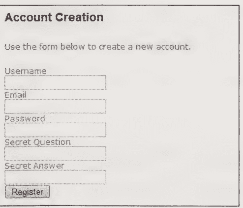

#### 图 3-1

如果我们尝试提交表单，应该会看到验证错误的摘要，如图 3-2 所示。


### 创建账户

使用下面的表单创建一个新账户。

*   必填用户名
*   必填电子邮件
*   必填密码
*   必填问题
*   必填答案


> 关于验证的简要说明：你可以通过使用辅助方法 `ValidationMessage` 在每个字段旁边显示单独的错误消息。你只需在希望消息显示的位置插入下面这行代码。这将显示在 `ModelState` 中设置的、与键 "username" 关联的错误消息。

`<%=Html.ValidationMessage("username") %>`

相比于错误摘要，我更喜欢这种方法，因为它能准确地告诉用户错误所在。为了简洁起见，以及因为我感觉我们还会再次讨论验证，我上面没有这样做。另外，我这里的目的只是验证该操作是否按预期工作，以及所有部分是否都已正确连接。

注意，与错误关联的字段被高亮显示了；实际上，如果我们检查 HTML 代码，你会看到它现在看起来像这样：

```html
<h2>Account Creation</h2>
<p>
    Use the form below to create a new account.
</p>
<ul class="validation-summary-errors"><li>Username is required</li>
<li>Email is required</li>
<li>Password is required</li>
<li>Question is required</li>
<li>Answer is required</li>
</ul>
<form method="post" action="/Account/Register">
    <div>
        <label for="username">Username</label>
        <br />
        <input class="input-validation-error" id="username" name="username"
            type="text" value="" />
```

## 第三章：成员资格

```html
<br />
<label for="email">Email</label>
<br />
<input class="input-validation-error" id="email" name="email" type="text" value="" />
<br />
<label for="password">Password</label>
<br />
<input class="input-validation-error" id="password" name="password" type="password" value="" />
<br />
<label for="question">Secret Question</label>
<br />
<input class="input-validation-error" id="question" name="question" type="text" value="" />
<br />
<label for="answer">Secret Answer</label>
<br />
<input class="input-validation-error" id="answer" name="answer" type="text" value="" />
<br />
<input type="submit" value="Register" />
</div>
</form>
```

你能发现区别吗？有错误的字段关联了 `input-validation-error` 类。这个类在默认样式表中定义，从而导致了高亮显示。我能听到后面有人问：“这个类是怎么添加上去的？”答案是辅助方法 `Html.TextBox`；它足够智能，能够知道某个字段存在错误，并为其添加相应的样式。这就是在这种情况下使用辅助方法的一个很好的理由。

## 视图状态

休斯顿，我们遇到问题了。我尝试注册一个新用户，遇到了两个问题。首先，我输入了一个密码 **1234**，这导致了一个错误，如图 3-3 所示：

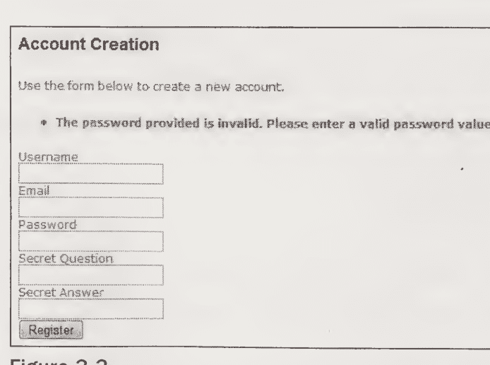

这是因为我在 web.config 文件中没有为成员资格提供程序配置正确的值。第二个也是更大的问题是，如图 3-3 所示，表单现在变空了，我所有的值都丢失了。当然，从可用性的角度来看，这是不可接受的。这种情况的发生是因为 MVC 应用程序不像 Web Forms 应用程序那样持久化视图状态。不过别慌，有一个简单的解决方法。

还记得当存在任何验证错误时，我们的操作会返回视图吗？

```csharp
if (!ViewData.ModelState.IsValid)
{
    return View();
}
```

我们需要以某种方式将之前输入的值传递给视图。有几种方法可以做到这一点。一种方法是传递一个字典，其中包含与字段名匹配的字符串键和所有值；例如，我们可以这样做：

```csharp
return View(new Dictionary<string, object>
{
    { "username", username },
    {"email", email},
    {"password", password},
    {"question", question},
    {"answer", answer}
});
```

另一种方法是将一个模型对象传回视图。例如，我们可以创建一个类来保存视图模型：

```csharp
public class RegisterModel
{
    public string Username { get; set; }
    public string Email { get; set; }
    public string Password { get; set; }
    public string Question { get; set; }
    public string Answer { get; set; }
}
```

并返回一个包含该类实例的视图，如下所示：

```csharp
return View(new RegisterModel
{
    Username = username,
    Email = email,
    Password = password,
    Question = question,
    Answer = answer
});
```

无论你选择哪种方式，视图都足够智能，能够设置字段的值。现在，如果我们尝试提交一个无效的表单，这些值在请求之间得以保留，我们得到了如图 3-4 所示的结果。

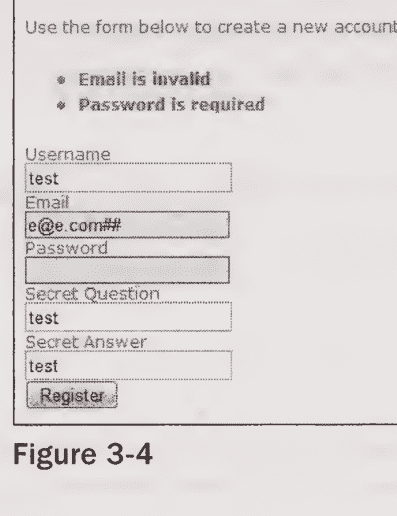

让我们运行所有测试，以确保我们没有破坏任何东西。所有测试都通过了，但我们仍然需要进行一些更改。我们需要确保返回给视图的模型是正确的，并且其值是正确的。由于这段代码将在多个测试中使用，我决定将其创建为一个扩展方法，以便在模型上调用。这个扩展方法以及其他扩展方法将位于一个名为 `ModelAssertions` 的静态类中。断言方法如下：

```csharp
public static void AssertRegisterModel(this RegisterModel model,
    string username, string email,
    string question, string answer,
    string password)
{
    Assert.AreEqual(username, model.Username);
    Assert.AreEqual(email, model.Email);
    Assert.AreEqual(password, model.Password);
    Assert.AreEqual(question, model.Question);
    Assert.AreEqual(answer, model.Answer);
}
```

现在我们可以通过调用以下代码轻松地断言模型：

```csharp
(((ViewResult) results).ViewData.Model as RegisterModel)
.AssertRegisterModel(string.Empty, email, question, answer, password);
```

是时候重构了。许多测试 Register 方法的单元测试执行相同的任务来断言结果，因此我将这些任务重构为一个方法：

```csharp
private static void AssertRegisterViewResultOnError(AccountController ac,
    ActionResult results,
    string errorKey,
    string errorMessage,
    string username,
    string email,
    string question,
    string answer,
    string password)
{
    Assert.IsNotNull(results);
    Assert.IsInstanceOfType(typeof(ViewResult), results);
    ac.ViewData.ModelState.AssertErrorMessage(errorKey, errorMessage);
    Assert.IsInstanceOfType(typeof(RegisterModel), ((ViewResult)results).ViewData.Model);
    var model = (((ViewResult)results).ViewData.Model as RegisterModel);
    model.AssertRegisterModel(username, email, question, answer, password);
}
```

现在我可以在单元测试中简单地调用一个方法来断言结果。例如，下面的单元测试：

```csharp
[Test]
public void Register_Should_Return_Error_If_Password_Is_Missing()
{
    var mockProvider = new Mock<MembershipProvider>();
    var mockAuthentication = new Mock<IFormsAuthentication>();
    var ac = new AccountController(mockAuthentication.Object, mockProvider.Object);
    var results = ac.Register(username, email, question, answer, string.Empty);
    Assert.IsNotNull(results);
    Assert.IsInstanceOfType(typeof(ViewResult), results);
    ac.ViewData.ModelState.AssertErrorMessage("password", "Password is required");
}
```

可以重构为：

```csharp
[Test]
public void Register_Should_Return_Error_If_Password_Is_Missing()
{
    var mockProvider = new Mock<MembershipProvider>();
    var mockAuthentication = new Mock<IFormsAuthentication>();
    var ac = new AccountController(mockAuthentication.Object, mockProvider.Object);
    var results = ac.Register(username, email, question, answer, string.Empty);
    AssertRegisterViewResultOnError(ac, results, "password", "Password is required", username, email, question, answer, string.Empty);
}
```

运行所有测试，确保一切仍然正常。

## 总结

我们在本章涵盖了许多概念，我希望到现在你已经熟悉了 TDD 流程和 ASP.NET MVC 框架。我们只介绍了注册过程，但成员资格的其余部分遵循相同的模式。我们创建一个测试，编写一些代码，确保测试通过，然后重复。你现在可以尝试创建其余的成员资格功能，然后将其与附带的代码进行比较。你还需要实现登录和密码重置功能。


## (005) - v1.10.4.4 → v0.006.71

v1.10.4.4 → v0.006.71

*

## 移除使用 mc_gen_binobj_from_target_signal_set() 的信号

| Panel | Released symbols
|---|---|
| kabuki | aflux128
| cropped_content | aflux128
| data | aflux128, aflux166, afluxp224
| libomp | aflux128, afluxp224
| seedmyst | 2
| leech | aflux400
| lightstream | aflux128, afluxp224

> v1.10.4.4

## 重构：模型绑定器、模拟对象和断言

在上一章中，我为您演示了创建新用户注册过程。然后我按照相同的程序创建了会员制的其余功能：

- [ ] 登录
- [ ] 重置密码
- [ ] 登出

当我完成此流程时，我对代码和测试进行了重构，并更改了一些我们之前所做的内容。在本章中，我将讨论这些变更。

## 问题

我的测试中存在许多相似之处被复制粘贴——严重违反了 DRY（Don't_repeat_yourself）原则。随着我编写更多测试，我开始注意到以下几点：

- [ ] 我的断言语句非常相似，并在很多测试中重复出现
- [ ] 我的控制器实例化方式也类似且多次重复
- [ ] 我的模拟对象看起来也非常相似，需要集中管理

我还为了那些需要重构和清理的控制器动作进行了大量不必要的编码。大多数动作接受多个参数，而不是接收一个强类型对象。编写以下代码要整洁得多：

```csharp
public ActionResult Create(User user)
```

# 第4章：重构模型绑定器、模拟对象和断言

相比于

```csharp
public ActionResult Create(string username, string email, string password,
                           string phone)
```

## 设计

首先从测试代码开始。断言语句可以分组为扩展适当对象的几个扩展方法。例如，可以对重定向到不同URL的动作结果进行分组，将其合并为 `ActionResult` 类上的一个扩展方法。

许多测试都以创建模拟对象并使用这些模拟对象初始化的控制器的同一组语句开头。将这些行也可重构到一个公共位置供所有测试重用。所有模拟对象都可以移动到静态类中，然后由所有测试访问。

现在在代码方面，我想要使用强类型类作为我动作的参数，而不是使用多个仅导致不必要键入的参数。这是通过使用模型绑定器实现的，它可以告诉框架如何将表单的提交值转换为强类型对象。例如，请查看图 4-1 中的 `LoginModel` 类，它可以替代 `Username`、`Password` 和 `RememberMe` 参数。

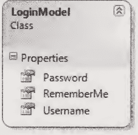

图 4-1

## 解决方案

让我们查看上述设计的实现，以解决当前问题。我的目标是简化代码并使其优雅。这是我进行任何更改之前的一个测试：

```csharp
[Test]
public void Login_Should_Return_Error_If_Username_Is_Missing()
{
    var mockProvider = new Mock<MembershipProvider>();
    var mockAuthentication = new Mock<IFormsAuthentication>();
    var ac = new AccountController(mockAuthentication.Object,
                                   mockProvider.Object);
    var results = ac.Login(string.Empty, password, true);

    var errormessage = "Username is required";
}
```

```csharp
var errorKey = "username";

Assert.IsNotNull(results);
Assert.IsInstanceOfType(typeof(ViewResult), results);
ac.ViewData.ModelState.AssertErrorMessage(errorKey, errormessage);
Assert.IsInstanceOfType(typeof(LoginModel),
                        ((ViewResult)results).ViewData.Model);

var model = (((ViewResult)results).ViewData.Model as LoginModel);

Assert.AreEqual(string.Empty, model.Username);
Assert.AreEqual(password, model.Password);
Assert.AreEqual(true, model.RememberMe);

Assert.AreEqual("Login", ac.ViewData["Title"], "Page title is wrong");
```

单独来看，上述测试看起来不错且不需要大量重构。但是上面许多行在其他测试中重复的事实导致了需要重构的必要性。首先，我的断言非常通用，将由其他方法调用。可以将这些行移动到某个方法：

```csharp
Assert.IsNotNull(results);
Assert.IsInstanceOfType(typeof(ViewResult), results);
ac.ViewData.ModelState.AssertErrorMessage(errorKey, errormessage);
Assert.IsInstanceOfType(typeof(LoginModel),
                        ((ViewResult)results).ViewData.Model);
var model = (((ViewResult)results).ViewData.Model as LoginModel);
Assert.AreEqual(string.Empty, model.Username);
Assert.AreEqual(password, model.Password);
Assert.AreEqual(true, model.RememberMe);
Assert.AreEqual("Login", ac.ViewData["Title"], "Page title is wrong");
```

第一行也可以移到这里之外，由于它们是设置的一部分并在每次测试开始时调用，我们可以将它们移动到 setup 方法。setup方法是装饰有`SetUp`属性的一个方法，该属性在每次测试之前运行。这使我们可以用一个地方添加实例化和初始化代码，并在每个测试执行之前执行它。以下是setup的方法可能看起来：

```csharp
[SetUp]
public void SetUp()
{
    var mockProvider = new Mock<MembershipProvider>();
    var mockAuthentication = new Mock<IFormsAuthentication>();
    ac = new AccountController(mockAuthentication.Object,
                               mockProvider.Object);
}
```

控制器变量 `ac` 现在定义为类中的字段，可由所有测试访问。

为了进一步优化这一点，我们将模拟对象移动到名为 `Mocks` 的类中。该类将包含所有模拟对象，我们可以在方法之间轻松传递它。我们将使用第1章介绍的惰性初始化模式（lazy initialization pattern）来处理类的属性，以确保只初始化我们需要的那些模拟；否则，它会明显减慢其他测试的速度。以下是该类的示例：

```csharp
internal class Mocks
{
    private static Mock<IFormsAuthentication> formsAuthentication;
    private static Mock<MembershipProvider> membershipProvider;

    public Mock<IFormsAuthentication> FormsAuthentication
    {
        get
        {
            formsAuthentication = formsAuthentication ??
                                  new Mock<IFormsAuthentication>();
            return formsAuthentication;
        }
    }

    public Mock<MembershipProvider> MembershipProvider
    {
        get
        {
            membershipProvider = membershipProvider ??
                                 new Mock<MembershipProvider>();
            return membershipProvider;
        }
    }
}
```

现在我们可以将上面的 setup 方法更改为：

```csharp
[SetUp]
public void SetUp()
{
    mocks = new Mocks();
    ac = new AccountController(mocks.FormsAuthentication.Object,
                               mocks.MembershipProvider.Object);
}
```

由于我打算重构控制器动作，所以我决定推迟对上面测试中的断言语句进行重构。我的 Login 操作是这样的：

```csharp
public ActionResult Login(string username, string password, bool rememberMe)
```

我希望它看起来像这样：

```csharp
public ActionResult Login(LoginModel model)
```

因此，我按照以下方式创建了 `LoginModel` 类：

```csharp
public class LoginModel
{
    public string Username { get; set; }
}
```

```csharp
public string Password { get; set; }
public bool RememberMe { get; set; }
}
```

然后，我所需要做的就是确保框架知道如何将我的表单值映射到我的模型对象。这是通过使用模型绑定器完成的，并且该框架包含一个名为 `ComplexModelBinder` 的模型绑定器，它正是要做的。`ComplexModelBinder`的唯一问题是视图中的字段需要使用`classname.fieldname`格式命名；因此下一行：

```csharp
<%= Html.TextBox("Username") %>
```

必须更改为

```csharp
<%= Html.TextBox("LoginModel.Username") %>
```

我不希望这样做，因为这会使我的HTML元素名称非常长，并使我为将来编写的任何JavaScript代码过于冗长。幸运的是，该框架允许我们创建自己的模型绑定器。我所需要做的就是实现 `IModelBinder` 接口。我继续创建一个通用模型绑定器，利用反射根据同名获取表单中的属性值。（我还创建了另一个从查询字符串中获取值的绑定器。）

```csharp
class FormBinder : IModelBinder
{
    public object GetValue(ControllerContext controllerContext,
                          string modelName, Type modelType,
                          ModelStateDictionary modelState)
    {
        var instance = Activator.CreateInstance(modelType);
        PropertyInfo[] propertyInfos;
        propertyInfos = modelType.GetProperties();

        foreach (var prop in propertyInfos)
        {
            prop.SetValue(instance,
                controllerContext.HttpContext.Request
                    .Form[prop.Name.ToLower()],
                null);
        }
        return instance;
    }
}
```

使用上述绑定器意味着我们必须遵守一种命名约定，即在视图中字段名必须与模型中的属性名匹配。这并不是一个不合理的约定。

剩下的唯一事情是将绑定器连接到模型以便框架知道要做什么。有几种方法可以完成这项工作：

- 我们可以在动作中使用参数属性：

```csharp
public ActionResult Login([ModelBinder(typeof(FormBinder))]LoginModel model)
```


# 第4章：重构：模型绑定器、模拟对象和断言

我们可以通过特性来修饰模型类：

```
[ModelBinder(typeof(FormBinder))]
public class LoginModel
{
    public string Username { get; set; }
    public string Password { get; set; }
    public bool RememberMe { get; set; }
}
```

我们可以在应用程序启动时注册绑定器：

```
protected void Application_Start()
{
    ModelBinders.Binders[typeof(LoginModel)] = new FormBinder();
    RegisterRoutes(RouteTable.Routes);
}
```

我们可以在应用程序启动时注册一个默认的绑定器：

```
protected void Application_Start()
{
    ModelBinders.Binders.DefaultBinder = new FormBinder();
    RegisterRoutes(RouteTable.Routes);
}
```

> 尽管上述代码可以工作，但它是最初为MVC框架的RC版本编写的。对于正式发布版本，无需编写所有这些代码，解决方案要简单得多。
MVC框架的版本1包含一个 `Bind` 特性，可以替代大部分代码。操作方法将简单地如下所示：

```
public ActionResult Login(
    [Bind(Prefix = "")] LoginModel model)
```

> `Prefix` 可以设置为任何值，以匹配你在HTML命名中使用的前缀。这允许你使用任何你喜欢的命名约定。例如，如果你的HTML文本框定义如下：

```
<%= Html.TextBox("Login.Username") %>
```

> 那么你可以将你的操作方法更改为如下形式

```
public ActionResult Login(
    [Bind(Prefix = "Login")] LoginModel model)
```

然后我回到测试中，创建了一个扩展方法来断言模型：

```
public static void AssertModel(this LoginModel model,
                               LoginModel source)
{
    Assert.AreEqual(source.Username, model.Username);
    Assert.AreEqual(source.Password, model.Password);
    Assert.AreEqual(source.RememberMe, model.RememberMe);
}
```

我还创建了一个辅助方法来断言结果：

```
private void AssertLoginViewResultOnError(ActionResult results,
    string errorKey,
    string errorMessage,
    LoginModel model)
{
    Assert.IsNotNull(results);
    Assert.IsInstanceOfType(typeof(ViewResult), results);
    ac.ViewData.ModelState.AssertErrorMessage(errorKey, errorMessage);
    Assert.IsInstanceOfType(typeof(LoginModel),
        ((ViewResult)results).ViewData.Model);
    var outModel = (((ViewResult)results).ViewData.Model as LoginModel);
    outModel.AssertModel(model);
    Assert.AreEqual("Login", ac.ViewData["Title"], "Page title is wrong");
}
```

现在我的测试变得精简、高效且清晰：

```
[Test]
public void Login_Should_Return_Error_If_Username_Is_Missing()
{
    var inModel = new LoginModel
    {
        Password = password,
        RememberMe = true,
        Username = string.Empty
    };
    var results = ac.Login(inModel);
    AssertLoginViewResultOnError(results, "username",
        "Username is required", inModel);
}
```

### 进一步重构

断言操作结果重定向到另一个URL的代码是：

```
Assert.IsNotNull(results);
Assert.IsInstanceOfType(typeof(RedirectToRouteResult), results);
var typedResults = results as RedirectToRouteResult;
Assert.AreEqual("Index",
    typedResults.Values["action"],
    "Wrong action");
Assert.AreEqual("Home",
    typedResults.Values["controller"],
    "Wrong controller");
```

我将这段代码移动到一个扩展方法中：

```
internal static class ResultsAssertions
{
    public static void AssertRedirectToRouteResult(this ActionResult result,
        string actionName,
        string controllerName)
    {
        Assert.IsNotNull(result);
        Assert.IsInstanceOfType(typeof(RedirectToRouteResult), result);
        var routeResult = (RedirectToRouteResult) result;
        Assert.AreEqual(2, routeResult.Values.Count);
        Assert.AreEqual(actionName.ToLower(),
            routeResult.Values["action"].ToString().ToLower());
        Assert.AreEqual(controllerName.ToLower(),
            routeResult.Values["controller"].ToString().ToLower());
    }
}
```

现在我可以通过简单地编写以下代码来断言操作的结果：

```
results.AssertRedirectToRouteResult("Index", "home");
```

## 总结

到目前为止，我们已经创建了一些扩展方法来简化测试，并实现了一个通用的模型绑定器，可以被所有模型对象用于从数据中检索项目。我们还清理了测试并整合了模拟对象，这应该会显著提高我们编写测试时的生产力。

尽管我喜欢编写代码，但我更喜欢重构代码。那就是你回到你的代码中，试图找到更好、更优雅的解决方案的时候。重构代码时，TDD（测试驱动开发）的威力得到了充分展示。你确信有测试来验证你的变化，这赋予你极大的信心。我们都曾遇到过这样的情况：重构了几行代码，然后几天后某个地方出错了；但有了TDD，这种情况发生的概率大大降低。

## 第5章：客户端和服务器端验证

无论你多么信任他人，你都不应该信任互联网上的任何人，你应该验证你接收到的所有数据。话虽如此，有两个地方可以进行表单验证——客户端和服务器端。为什么要两者都做？客户端验证通过避免服务器往返来提高可用性；它还使应用程序更具可伸缩性，因为减少了对服务器的请求。服务器端验证至关重要，因为客户端验证可能被禁用或绕过。在本章中，我们将为服务器端和客户端的验证建立一个框架，以自动化和减少为每个需要验证的页面编写代码的数量。

## 问题

现在我们的成员系统已经工作了，用户可以注册、登录、登出并重置密码。在我们开始深入研究应用程序的其余部分之前，我们需要确定我们的验证策略，并确保它能在我们走得太远并创建一堆视图之前与应用程序的其余部分协同工作。

到目前为止，我们已经使用 `if` 语句和模型状态来实现服务器端验证以指示错误。从功能上讲，这很有效，但我们需要做得更好。理想情况下，我们希望在客户端和服务器端都进行验证。客户端验证通过避免服务器往返的开销，使我们能够向用户提供即时反馈。服务器端验证确保即使客户端验证失败或客户端不支持JavaScript或禁用了JavaScript，数据也是有效的。我们还需要一种简单的方法来定义验证规则，最好是在模型本身上。最后，我们需要将验证从控制器中移出，放入服务（业务逻辑）层，这样我们的验证逻辑就不会与控制器紧耦合。

总结一下，我们需要：

- 在客户端进行验证。
- 在服务器端进行验证。
- 在模型上定义验证规则。
- 在服务（业务逻辑）层执行验证。

## 设计

与其谈论我们刚编写的成员代码，不如让我们添加一些新功能并使用新的验证设计。其中一个要求是用户能够创建新消息，所以让我们从那里开始。

首先，我们应该了解一个消息由什么组成：

- 一个描述性名称，例如 *十月通讯*
- 一个电子邮件主题，例如“十月对尊贵会员的独家优惠”
- HTML格式的消息内容
- 纯文本格式的消息内容

名称、主题和文本正文是必需的，而HTML正文是可选的。图5-1展示了该模型的类图。

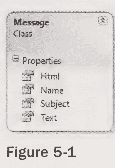

> *就本章而言，我们只关注消息创建操作，而不是整个过程本身。这样更清楚地讨论验证，而不会陷入过程细节的泥潭。*

## 解决方案

我们首先创建一个新的测试类——*MessageControllerTest*——并添加我们的第一个测试：

```
[TestFixture]
public class MessageControllerTest
{
    private MessageController controller;
    [SetUp]
    public void SetUp()
    {
        controller = new MessageController();
```


# 第 5 章：客户端和服务器验证

```csharp
[Test]
public void Create_Returns_View ()
{
    ActionResult result = controller.Create ();
    result.AssertViewResult(controller, "New Message");
}
```

为了使上述代码能够编译，我们需要创建 `MessageController`类并为其添加一个`Create` 方法：

```csharp
public class MessageController : Controller 
{ 
      [AcceptVerbs("get")]  
      [Authorize]      
    public ActionResult Create()         
          {       
       ViewData["Title"] = "New Message";   
        return View();     
   }       
}   
```  

下一个测试如下所示：

```csharp               
[Test]                             
public void                
Create_Returns_Error_If_Name_Is_Missing ()                          
{                                                  
     var model = new Message ()                 
         {                                             
           Subject = _subject,                     
            Name = string.Empty ,                   
              Text  = _text                    
       };                                            
           
      var result = controller.Create(model );            
          
    var errorKey ="name";                               
    var errorMessage   ="Name is required ";                
      
      //验证结果                          
     Assert.IsNotNull(result);                              
         Assert.IsInstanceOfType (typeof(ViewResult),result);  
        controller.ViewData.ModelState.AssertErrorMessage(errorKey ,errorMessage);
         
       Assert.IsInstanceOfType(typeof(Message ),                  
           ((ViewResult) result). ViewData. Model );              
           
    // 断言 ViewData.Model               
      var outModel =   (((ViewResult )result ).    
         ViewData.Model as Message ));                        
        
     Assert.AreEqual(model.Subject,outModel.Subject );                 
      Assert.AreEqual(model.Name ,outModel.Name );                            
       Assert .AreEqual(controller.ViewData["Title"],"Page title is wrong");                      
 }
```  

`_subject` 和`_text`变量在类级别定义，因为它们将被其他测试使用。

到目前为止没有新内容；这与我们一直在做的事情完全相同。下一步是创建将接收 POST请求的 `Create`方法：

```csharp                  
[AcceptVerbs("post")]  
 [Authorize]             
 public ActionResult Create (Message model) 
    {
         ViewData["Title"] = "New Message";                 
      //验证输入                     
     if(string.IsNullOrEmpty(model.Name))                             
          {                                            
        ViewData.ModelState.AddModelError ("name",                               
                  model.Name,                                     
                   "Name is required ");                       
   }                                                     
      
  if (!ViewData.ModelState.IsValid)  
    {      
       return View (model );                                    
  } 
      return View ();                     
}          
            ```  

此处已编写了足够的代码以通过之前的测试，这在目前来说是好的。现在让我们快速创建一个视图以确保验证有效：

```html
<h2>         
     Create New Message </h2 >             
        <%= Html.ValidationSummary () %>        
<form action  "/message/create" method = "post">  
   <div >      
       <label for ="name ">       
           Name </ label >                          
    <%--/<% --/>                                    
             `<%=Html.TextBox("name") `%> 
         `</h2>`<br />`                         
            `<%= Html.TextArea ("text") %>
```

如果我们尝试在未填写姓名的情况下提交表单，将会得到如图 5-2所示的错误。  

  

图 5-2  


现在，我们具备了创建更好的验证组件的条件。正如我们已经同意的那样，我们需要将验证移出控制器。我们需要创建一个业务逻辑对象来处理消息的创建并执行验证。作为优秀的设计者且为了方便测试和模拟起见，我们将使用接口。目前，我们只需要一个`Add`方法，因此以下是我们的界面：

```csharp
public interface IMessageService                 
{ 
        long Add (Message message );                     
}          
             ```  

让我们简单实现一下这个接口。请记住我们正在使用 TDD（测试驱动开发），所以让我们在开始之前先创建一些测试。我们的第一个测试将确保如果验证失败，`Add` 方法会抛出异常。

```csharp
[Test]  
[ExpectedException(typeof(ValidationException))] 
public void Add_Throws_Exception_If_Validation_Returns_Errors ()                  
{   
    var invalidMessage = new Message ();              
      //模拟失败的验证      
     mockValidationRunner.Expect(v => v.Run(invalidMessage))         
              .Returns(new List<ValidationError>                
            {                                    
             new ValidationError("prop",                       
                 "error")                          
           });                 
            
 IMessageservice service  =new Messageservice (MockValidationsrunner. Object );                   
       Service.Add(Invalidmessages); //应该抛出错误  
     MockvalidationRunner.VerifyAll ();           
}       
```  

上述测试包含`ExpectedException`属性，它告诉测试框架，要使此测试成功，必须抛出一个类型为 `ValidationException`的异常。这对于测试非常方便。

由于还没有创建这些类，我们的项目将无法编译，我们也无法运行测试。根据上面的测试结果，我们似乎需要：

-   一个具有`Run`方法的接口
    - `IValidationRunner`  
-   一个`ValidationException`异常  
-   　带有一个接受两个字符串参数的构造函数的的`ValidationError`类 
-   	带有构造函数实例`IMessageService`的一个`IValidationRunner`实现

这是我们目前所具备的一切：

```csharp
public interface IValidationRunner                    
 {                      
     List<ValidationError>Run(object modelToValidate );                 
 }                                          
        
  public class ValidationException : Exception    
   {}                                     
            
      public class ValidationError                  
          {                               
       public ValidationError (       
        string propertyName,                       
    string errorMessage  
 )                             
       {})                                
              

      public class Messageservice:IValidationRunner 
{
    Public Messageservice(Ivalidationrunner validationruner)                
{}                                          
                
  public int Add(Message message)                     
            {}                    
}      
```  

该项目现在可以编译，但测试失败。如果我们更改`Add`方法以抛出异常，则该测试将通过：

```csharp               
public int Add (Message message ) 
          {              
    throw new ValidationException ();   
   }
        ```  

但是存在一个问题:该测试不应通过;因为 `mockValidationRunner.VerifyAll()` 会失效;然而由于Add方法抛出了异常`Mockvalidationrverifyall ()未运行。这是使用ExpectedException属性进行异常测试的问题。一个更棒的模式是使用带有委托或lambda(匿名)表达式的Assert.Throws)。

```csharp
[Test]           
public void Add_Throws_Exception_If_Validation_Returns_Errors ()            
{                          
    var invalidMessage = new Message ();                     
      //模拟失败的验证          
       mockvalidationRunner.Expect(v =>v.run(invalidmessage))                    
   .returns(new list<validationerror >                           
  {                                
        new ValidationError("prop",                   
              "errror")                  
          }              
         };                             
     IMessageservice service=new Messageservice(mockValidationrunner.Object);
      Assert.Throws<ValidationException>(()=>Service.Add(Invalidmessages));  
          
    mockvalidationRunner.VerifyAll ();             
}            
```  

这将测试相同的条件，并且允许异常发生后继续运行测试。现在该测试因正确原因而失败： `VerificationRruner`上的 `Run`方法未被调用。以下更改将使测试通过：

```csharp
public class Messageservice:IValidationrunner         
{   
    private IvalidationRunner validationrunner;     
         public  Validationrunner          
        {                     
          get => validationrunner;                          
        set => 
           validationrunner= value ;                       
        }                   
      
     public MessageService(IvalidationsRinner validationrurnner)  
       {}                        
             
      Public int Add (Message message)        
            {               
    var errors =valationRunner.Run(message);                
   if(Errors !=null  && Errors.Count>0 )   
   throw new ValidationException ();
}       
 return -1;                     
```  

接下来，我们需要为每个字段测试验证。让我们从名称开始：

```csharp         
[Test]  
public void Add_Throws_Exception_If_Name_Is_Missing ()          
{ 
          Message.Name = string.Empty ;                   
     IValidationRunner vrunner =" new ValidationRinner ();                 
    IMessageservice Service=new Messageservice(vrurrunner);
      var ex=Assert.Throws<ValiationException >(()=>Services.Add(message));     
       Assert.IsNotNull(ex.VALidationErrors );               
   assert.Greaterthan(EX.ValidationErrors.Count,0); 
  //断言正确的错误                   
     Assert . AreEqual (ex.VAlidationerrors                        
                       Count(e => E.PropertyName == "name" &&  
                               e.ErrorMessage =="Nmae is required"),1);   
}        
```  

在上述测试中，我们测试的是`Add`方法抛出正确的异常以及该异常包含指示需要姓名的验证错误。为了让上述代码运行，我们需要创建 `ValidationRruner 和实现 Ivalidationrunner接口：

```csharp
public class ValidationRunner : IValidationRunner 
{ 
       public List<ValidationError>Run(object modelToValidate )                     
        {             
           return null;                   
         }   
}            
                ```  

并且我们需要为`ValiationException添加一个"validaionerrors"属性：

```CSharp
public Class Valiationexception : exception      
              {}                         
  publiC Class ValidationErrors              
          ()                       
         get => validationrinner ;                
       set=validationrunner;         
        
    public class ValidationRunner: IValidationRunnner          
   {           
      private List<ValidationError> errors=new LList();                     
     publIc list<validationerror > run(object modeltavalidate )             
        {}
}       
```  

现在让我们编写代码以使测试通过。首先，我们需要将抛出异常的代码更改为包含验证错误：

```CSharp  
public Int Add (Message message) 
       {                  
          var errors =ValidationRunner.Run(message );                     
      if(errors !=null  && Errors.Count >0 )     
         throw new ValiationException(errors);   
      
 return -1;                    
 }              
             ```  


然后改变验证错误异常类的构造函数：

```cSharp
Public class Validationerrror : exception    
     {                        
        public validationerrors(List<validationerror>Errors)            
{                
    valiadtionrurnner= Errors;           
      }  
  publiC list<ValidationError>Errorse 
         get=>valationRinner ;      
   private set => _error = value ;                    
}     
```


# 第五章：客户端与服务器端验证

接下来，我们修改 `Run` 方法，使其返回适当的错误。我们将使用反射来遍历对象的属性，并查找验证特性。我们可以轻松创建自己的特性，但更方便的是，我们可以使用 `System.ComponentModel.DataAnnotations` 命名空间中定义的特性。我们的 `ValidationRunner` 现在看起来像这样：

```csharp
public class ValidationRunner : IValidationRunner
{
    public List<ValidationError> ValidationErrors { get; private set; }

    public List<ValidationError> Run(object modelToValidate)
    {
        ValidationErrors = new List<ValidationError>();
        var props = TypeDescriptor.GetProperties(
                                modelToValidate.GetType());
        foreach (PropertyDescriptor prop in props)
        {
            var value = prop.GetValue(modelToValidate);
            foreach (var attrib in prop.Attributes
                .OfType<ValidationAttribute>())
            {
                if (!attrib.IsValid(value))
                {
                    ValidationErrors.Add(
                        new ValidationError(prop.Name,
                            attrib.ErrorMessage));
                }
            }
        }
        return ValidationErrors;
    }
}
```

在上面的代码中，我们查找 `ValidationAttribute`。如果找到它，我们将检查属性值是否有效，如果无效，则将验证错误添加到我们的验证错误集合中。

测试仍然失败，因为我们还没有为 `Message` 类添加适当的特性。我们只需为每个属性添加相应的特性：

```csharp
public class Message
{
    [Required(ErrorMessage = "Name is required")]
    public string Name { get; set; }
    [Required(ErrorMessage = "Subject is required")]
    public string Subject { get; set; }
    public string Html { get; set; }
    [Required(ErrorMessage = "A plain text body is required")]
    public string Text { get; set; }
}
```

测试通过了。现在我们可以添加更多测试来验证其他验证条件。

需要注意的是，上面的代码测试的是 `MessageService` 类，而不是验证类。我们本可以轻松模拟所有验证调用并获得相同的结果。我们需要单独测试验证组件。让我们创建一个新的测试夹具来测试所有验证场景，然后创建一个用于测试的模型：

```csharp
internal class ModelToValidate
{
    [Required(ErrorMessage = "Name is required")]
    public string Name { get; set; }

    [Range(18, 35, ErrorMessage = "Age should be 18 to 35")]
    public int? Age { get; set; }

    [RegularExpression(@"\w+([-+.']\w+)*@\w+([-.]\w+)*\.\w+([-.]\w+)",
        ErrorMessage = "Email is invalid")]
    public string Email { get; set; }
}
```

与其逐一介绍每个测试，不如来看看我们刚创建的模型的测试：

```csharp
[TestFixture]
public class ValidationRunnerTests
{
    private ModelToValidate model;
    private ValidationRunner runner;

    [SetUp]
    public void SetUp()
    {
        runner = new ValidationRunner();
        model = new ModelToValidate()
            {
                Age = 24,
                Email = "test@test.com",
                Name = "Jessica Alba"
            };
    }

    [Test]
    public void Validate_Required_Errors_If_Value_Is_Missing()
    {
        model.Name = string.Empty;
        var errors = runner.Run(model);
        AssertValidationError(errors, "Name", "Name is required");
    }

    [Test]
    public void Validate_Required_No_Errors_If_Value_Is_Set()
    {
        var errors = runner.Run(model);
        if (errors != null)
            Assert.AreEqual(errors.Count, 0);
    }

    [Test]
    public void Validate_Range_Errors_If_Value_Less_Than_Min()
    {
        model.Age = 2;
        var errors = runner.Run(model);
        AssertValidationError(errors, "Age", "Age should be 18 to 35");
    }

    [Test]
    public void Validate_Range_Errors_If_Value_More_Than_Max()
    {
        model.Age = 36;
        var errors = runner.Run(model);
        AssertValidationError(errors, "Age", "Age should be 18 to 35");
    }

    [Test, Row(18), Row(25), Row(35)]
    public void Validate_Range_No_Errors_If_Within_Range(int? value)
    {
        model.Age = value;
        var errors = runner.Run(model);
        if (errors != null)
            Assert.AreEqual(errors.Count, 0);
    }

    [Test]
    public void Validate_RegEx_Errors_If_Value_Is_Invalid()
    {
        model.Email = "bad email#@#";
        var errors = runner.Run(model);
        AssertValidationError(errors, "Email", "Email is invalid");
    }

    [Test]
Panic: renderer appears to have gone away
 demise seems likely, attempt to close without incident.

73,204 -- 81,522: '<html><head><meta http-equiv="Content-Type" 
content="text/html; charset=UTF-8"><title> panic!</title></head
><body><div id="summary"><h1> panic:  renderer gone</h1><P>Wh
ile trying to process a request, the renderer vanished.  Pro
bably it encountered a bug and died.  The request was: <tt
>GET /not-yet-invented HTTP/1.1</tt>.  That is all I know.</
p><p>Your items may not have been saved.  Don't rely on local
 state.</p></div></body></html> ' educated guess at location:
(.*)/core-backend/src/main/java/com/atlassian/stash/internal/
request/ScalatraRequest.java:.* expected:<...internal/request/Sc
alatraRequest.java:.*> but was:<...internal/request/ScalatraRe
quest.java:.*>


    public void Validate_RegEx_No_Errors_If_Value_Is_Valid()
    {
        var errors = runner.Run(model);
        if (errors != null)
            Assert.AreEqual(errors.Count, 0);
    }

    [Test]
    public void Validate_Only_If_Required_And_Set()
    {
        model.Age = null;
        model.Email = null;
        var errors = runner.Run(model);
        if (errors != null)
            Assert.AreEqual(errors.Count, 0);
    }

    private static void AssertValidationError(List<ValidationError> errors,
                                          string propertyName,
                                          string errorMessage)
    {
        Assert.IsNotNull(errors);
        Assert.GreaterThan(errors.Count, 0);
        Assert.AreEqual(errors.Count(e =>
                          e.PropertyName == propertyName &&
                          e.ErrorMessage == errorMessage),
                        1);
    }
}
```

使用 `Required`、`Range` 和 `RegularExpression` 特性，我们应该能够覆盖几乎所有的验证需求。如果不能，我们随时可以自己创建验证特性。例如，我们可以将电子邮件验证封装到自己的类中，如下所示：

```csharp
class EmailValidationAttribute : RegularExpressionAttribute
{
    public EmailValidationAttribute()
        : base(@"\w+([-+.']\w+)*@\w+([-.]\w+)*\.\w+([-.]\w+)")
    {
    }
}
```

或者，我们可以从虚类 `ValidationAttribute` 继承，编写我们自己的自定义验证逻辑：

```csharp
class UsernameValidationAttribute : ValidationAttribute
{
    public override bool IsValid(object value)
    {
        if (value.GetType() != typeof(string))
            return false;
        var str = value.ToString();
        if (str.Length < 4)
            return false;
        //test other conditions
        return true;
    }
}
```

现在我们已经建立并运行了一个验证框架，让我们看看是否可以将其应用到控制器中。控制器将需要 `IMessageService` 的实例，因此我们将以下代码添加到 `MessageController` 中：

```csharp
public MessageController()
    : this(null) { }

public MessageController(IMessageService service)
{
    Service = service ?? new MessageService();
}

public IMessageService Service { get; set; }
```

现在我们修改 `Create` 方法以使用该服务：

```csharp
[AcceptVerbs("post")]
[Authorize]
public ActionResult Create(Message model)
{
    ViewData["Title"] = "New Message";

    try
    {
        var id = Service.Add(model);
    }
    catch (ValidationException ex)
    {
        foreach (var error in ex.ValidationErrors)
        {
            ViewData.ModelState.AddModelError(
                error.PropertyName,
                null,
                error.ErrorMessage);
        }
    }

    if (!ViewData.ModelState.IsValid)
    {
        return View(model);
    }
    return View();
}
```

`Create_Returns_Error_If_Name_Is_Missing` 测试仍然应该通过，但现在我们使用的是基于模型的验证，无需再编写更多的 `if` 语句。

> 我很高兴看到它立即生效，但我想确认一下，所以我更改了 `Name` 属性上 `Required` 特性的错误消息，只是为了确保测试会失败，而它确实失败了。

`Create` 方法的验证现在已经完成，但我们仍然需要测试来确保所有验证都能正常工作。经过一些重构后，我们的消息控制器测试夹具如下所示：

```csharp
[TestFixture]
public class MessageControllerTest
{
    private MessageController controller;
    private Message model;

    [SetUp]
```


# 第5章：客户端与服务端验证

```csharp
public void SetUp()
{
    controller = new MessageController();
    model = new Message()
    {
        Subject = "My newsletter subject",
        Name = "October newsletter",
        Text = "Hello subscriber",
        Html = "Hello <b>subscriber</b>"
    };
}
```

```csharp
[Test]
public void Create_Returns_View()
{
    var result = controller.Create();
    result.AssertViewResult(controller, "New Message");
}
```

```csharp
[Test]
public void Create_Returns_Error_If_Name_Is_Missing()
{
    model.Name = string.Empty;
    var result = controller.Create(model);
    var errorKey = "Name";
    var errorMessage = "Name is required";
    AssertValidationError(result, errorKey, errorMessage);
}
```

```csharp
[Test]
public void Create_Returns_Error_If_Text_Is_Missing()
{
    model.Text = string.Empty;
    var result = controller.Create(model);
    var errorKey = "Text";
    var errorMessage = "A plain text body is required";
    AssertValidationError(result, errorKey, errorMessage);
}
```

```csharp
[Test]
public void Create_Returns_Error_If_Subject_Is_Missing()
{
    model.Subject = string.Empty;
    var result = controller.Create(model);
    var errorKey = "Subject";
    var errorMessage = "Subject is required";
    AssertValidationError(result, errorKey, errorMessage);
}
```

```csharp
private void AssertValidationError(ActionResult result,
                                   string errorKey,
                                   string errorMessage)
{
    //assert results
    Assert.IsNotNull(result);
    Assert.IsInstanceOfType(typeof(ViewResult), result);
    controller.ViewData.ModelState.AssertErrorMessage(errorKey, errorMessage);
    Assert.IsInstanceOfType(typeof(Message),
                      ((ViewResult)result).ViewData.Model);
    //assert that the ViewData.Model
    var outModel = (((ViewResult)result).ViewData.Model as Message);
    Assert.AreEqual(model.Subject, outModel.Subject);
    Assert.AreEqual(model.Name, outModel.Name);
    Assert.AreEqual(model.Text, outModel.Text);

    Assert.AreEqual("New Message", controller.ViewData["Title"],
                 "Page title is wrong");
}
}
```

让我们确认一切如预期般运作。如果我们运行项目并尝试提交，就能看到验证在实际运行，页面效果如图5-3所示：

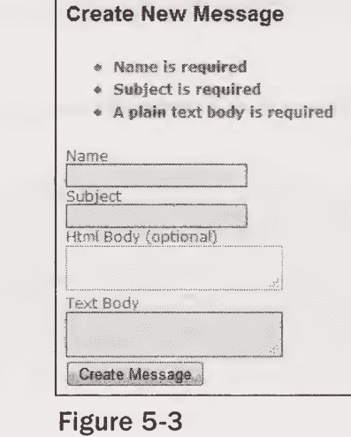

## 客户端验证

到目前为止，服务端验证运行良好。现在，我们来实现客户端验证。有两种方案可供考虑：

- 自己编写JavaScript代码。
- 使用第三方JavaScript验证库。

同样的，为什么要重新发明轮子呢？我们选择使用第三方库。市面上有多种选择，这里我们将使用jQuery Validation插件。它是一个非常灵活的验证库，允许我们以两种不同方式来验证表单。我们可以在输入字段上使用类名。例如，下面这行代码告诉验证库，将txtemail输入字段验证为必填字段和电子邮件字段：

```html
<input id="txtemail" name="txtemail" size="25" class="required email" />
```

第二种方法使用在JavaScript中定义的规则。我们可以使用下面的JavaScript代码实现与上面示例相同的效果：

```javascript
<script type="text/javascript">
$("#createForm").validate({
    rules: {
        txtemail: {
            required: true,
            email: true
        }
    },
    messages: {
        txtemail: "Please enter a valid email address"
    }
});
</script>
```

既然我们打算根据模型的定义动态生成客户端验证代码，那么生成JavaScript代码比为每个字段生成类名更容易。这也是更好的设计，因为它将验证逻辑封装在一个位置，而不是分散在HTML中。

我们需要创建一个根据模型定义生成JavaScript的方法。让我们从一个测试开始。

> **约定**
>
> 我们将采用以下约定：HTML元素的名称与被验证的属性/字段名称相同，并且全部小写。这简化了我们的脚本生成代码，并最大限度地减少了脚本错误。

这是我们的测试类：

```csharp
[TestFixture]
public class JQueryValidationGeneratorTests
{
    private ModelToValidate model;
    private JQueryValidationGenerator generator;
    [SetUp]
    public void SetUp()
    {
        generator = new JQueryValidationGenerator();
        model = new ModelToValidate()
        {
            Age = 24,
            Email = "test@test.com",
            Name = "Jessica Alba"
        };
    }
    [Test]
    public void Generates_Rule_For_Required_Field()
    {
        string script = generator.Generate("createForm", model);
        Assert.IsTrue(script.Contains("name:{required:true}"));
    }
}
```

```csharp
internal class ModelToValidate
{
    [Required(ErrorMessage = "Name is required")]
    public string Name { get; set; }

    [Range(18, 35, ErrorMessage = "Age should be 18 to 35")]
    public int? Age { get; set; }

    [RegularExpression(@"\w+([-+.']\w+)*@\w+([-.]\w+)*\.\w+([-.]\w+)*",
        ErrorMessage = "Email is invalid")]
    public string Email { get; set; }
}
```

在我们创建缺失的类和方法之前，项目将无法编译。设计应该是灵活的，这样我们可以在需要时轻松替换jQuery验证库。我们首先创建以下接口：

```csharp
interface IValidationGenerator
{
    string Generate(string formToValidate, object modelToValidate);
}
```

然后我们为jQuery库实现它，并编写足够的代码来通过第一个测试：

```csharp
public class JQueryValidationGenerator : IValidationGenerator
{
    public string Generate(string formToValidate, object modelToValidate)
    {
        var props = TypeDescriptor.GetProperties(modelToValidate.GetType());
        var rules = string.Empty;
        var script = string.Empty;
        foreach (PropertyDescriptor prop in props)
        {
            var rule = string.Empty;
            foreach (var attrib in prop.Attributes
                .OfType<ValidationAttribute>())
            {
                var subrule = string.Empty;
                if (attrib.GetType() == typeof(RequiredAttribute))
                    subrule = "required:true";

                rule += string.Format("{0}{1}",
                    string.IsNullOrEmpty(rule) ? "" : ",",
                    subrule);
            }

            if (!string.IsNullOrEmpty(rule))
            {
                rule = string.Format("{0}:{{{1}}}",
                    prop.Name.ToLower(),
                    rule);
                rules += string.Format("{0}{1}",
                    string.IsNullOrEmpty(rules) ? "" : ",",
                    rule);
            }
        }

        if (!string.IsNullOrEmpty(rules))
        {
            script = string.Format("<script type=\"text/javascript\">\r\n" +
                "$(function() {\r\n" +
                "$('#{0}')." +
                "validate({rules:{{{1}}},\r\n" +
                "messages:{{{2}}}}});\r\n" +
                "});",
                formToValidate, rules, messages);
        }
        return script;
    }
}
```

让我们测试电子邮件验证：

```csharp
[Test]
public void Generates_Rule_For_Email_Field()
{
    string script = generator.Generate("createForm", model);
    Assert.IsTrue(script.Contains("email:{email:true}"));
}
```

这段代码将不起作用，因为我们的模型使用正则表达式验证电子邮件：

```csharp
[RegularExpression(@"\w+([-+.']\w+)*@\w+([-.]\w+)*\.\w+([-.]\w+)*",
    ErrorMessage = "Email is invalid")]
public string Email { get; set; }
```

如果我们能使用电子邮件属性进行验证，比如：

```csharp
[Email(ErrorMessage = "Email is invalid")]
public string Email { get; set; }
```

那将会好得多。不幸的是，存在两个问题。首先，jQuery Validation框架中没有正则表达式规则。其次，DataAnnotations命名空间中没有Email属性。因此，我们可以创建一个Email属性，或者通过正则表达式规则扩展jQuery的验证框架。幸运的是，两者都很容易实现。

我们可以通过调用以下JavaScript来创建新的验证规则类型：

```javascript
$(document).ready(function() {
    jQuery.validator.addMethod("regex", function(value, element, param) {
        return this.optional(element) || new RegExp(param).test(value);
    });
});
```


## 第5章：客户端和服务器端验证

```csharp
}, "Invalid data");
});
```

或者，我们可以创建一个`Email`属性，如下所示：

```csharp
public class EmailAttribute : ValidationAttribute
{
    public override bool IsValid(object value)
    {
        var regex = new Regex(@"\w+([-+.']\w+)*@\w+([-+.']\w+)*\.\w+([-+.']\w+)*");
        return regex.IsMatch((string)value);
    }
}
```

由于我们目前不需要正则表达式规则，我们将继续创建`EmailAttribute`。现在，我们只需在前面的生成器中添加另一个`if`语句即可生成规则。

```csharp
if (attrib.GetType() == typeof(EmailAttribute))
    subrule = "email:true";
```

前面的生成器代码为了清晰起见，没有包含验证脚本的消息部分。我们将在后续项目中创建消息测试并添加更多测试，随着项目进展需要更多验证类型。

让我们在视图中测试这个。我们将创建一个辅助方法来生成脚本。然后，要将脚本放入视图中，我们只需添加这一行代码：

```html
<%= Html.JQueryGenerator("createmessage", ViewData.Model) %>
```

辅助方法如下所示：

```csharp
public static string JQueryGenerator(this HtmlHelper htmlHelper,
                                      string formName, object model)
{
    return (new JQueryValidationGenerator()).Generate(formName, model);
}
```

如果我们尝试导航到`/message/create`，我们会得到一个错误：

```
Object reference not set to an instance of an object.
```

原因是模型未设置，因此`ViewData.Model`为空。这是一个简单的修复。我们只需将`Create`操作改为：

```csharp
[AcceptVerbs("get")]
[Authorize]
public ActionResult Create()
{
    ViewData["Title"] = "New Message";
    return View(new Message());
}
```

我们所做的只是传递一个空的Message类型模型，让我们的生成器代码可以探测模型并检查其属性，以生成适当的JavaScript。生成的JavaScript是：

```html
<script type="text/javascript">
$().ready(function() {
$('#createmessage').validate({
rules:{name:{required:true},subject:{required:true},text:{required:true}},
messages:{name:{required:'Name is required'},subject:{required:'Subject is required'},text:{required:'A plain text body is required'}}));});
</script>
```

如果我们尝试提交表单，脚本将在客户端对其进行验证，而无需触及服务器，如图5-4所示。

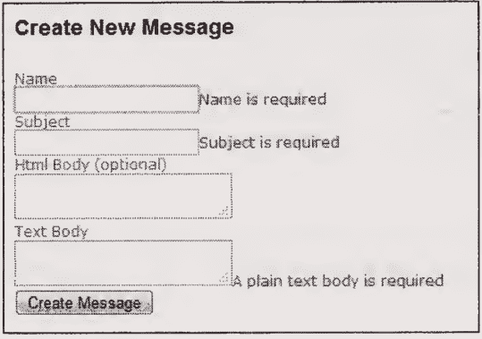

图5-4

## 小结

在本章中，我们讨论了客户端和服务器端验证。验证是一个非常常见的问题，几乎在你从事的每个项目中都会需要。如果你只能实现一种验证，那么它应该在服务器端。仅客户端验证不够安全，因为如前所述，它不安全且可以被绕过。

我们讨论了如何通过简单地向模型添加属性来简化验证。在我看来，这是一个非常干净且松耦合的验证问题解决方案。使用定义在模型上的属性，我们可以拥有一个读取这些属性并相应验证模型的验证框架。

我们还使用属性生成适当的JavaScript以执行客户端验证。同样，这在整个项目甚至其他项目中都是非常干净且可重复的。我们不必为每个表单和每个字段编写JavaScript代码；我们只需根据模型属性生成脚本。

## 第6章：数据层与IRepository模式

我们的应用程序是高度数据驱动的，需要对数据层给予大量关注。同时，我们现在不想处理数据库设计和建模，只想继续推进我们的应用程序。我们需要在不创建和配置数据库、创建单个数据库表或担心在开发阶段维护数据库架构的情况下继续创建应用程序。在本章中，我们将做到这一点。我们将为数据层奠定基础，使我们能够继续开发应用程序，而无需创建和配置数据库。

## 问题

除了标准的ASP.NET表之外，我们还没有接触过数据库或创建任何表。我故意推迟处理数据库相关的事情，直到我们需要为止，而到目前为止我们还没有需要。处理数据库可能会使测试复杂化。我们必须担心管理数据以及在测试期间维护数据库的状态。我们还必须在每次测试后将数据库恢复到中立状态。你可以看到这将如何使我们的测试复杂化，并显著降低其速度。如果你的测试太慢，你将obeam运行它们的频率会降低，你将不太愿意编写它们，并且你会很快失去对测试驱动开发的兴趣。

我们需要抽象数据层，以便在从未接触数据库的情况下运行测试。我们还希望能够运行我们的网站并使其正常运行，而无需创建或填充任何数据库。我们 basically 希望能够使用内存数据库，但同时能够轻松切换到使用真实数据库，而无需重写任何代码。

## 设计

针对我们的问题，一个好的设计是使用IRepository模式。这是一个简单但非常强大的模式，允许我们将数据层从代码中抽象出来。抽象数据层使我们的设计具有很大的灵活性，并简化了测试。如果所有这些现在听起来过于理论化，请不要担心——接下来的几页将帮助澄清所有概念。

在上一章中，我们创建了一个`IMessageService`接口，到目前为止，它只有一个将消息添加到数据库的方法。使用服务层的美妙之处在于，应用程序代码无需了解处理数据库的底层细节——什么、如何以及在哪里。它只需要知道调用`Add`方法并处理任何验证异常。在此层使用接口使测试更容易，因为我们可以模拟该接口和/或实现特定于测试的实现。我们现在采用相同的概念并将其再抽象一层。我们将`IMessageRepository`接口传递到`MessageService`类中；`IMessageRepository`接口将严格处理与存储库/数据库/数据存储的工作。这是它的单一职责。

让我们想想在这里需要做什么。我们 basically 想对数据执行CRUD（创建、读取、更新和删除）操作，因此我们的`IRepository`接口至少需要包含这些操作。我们目前的类图如图6-1所示。

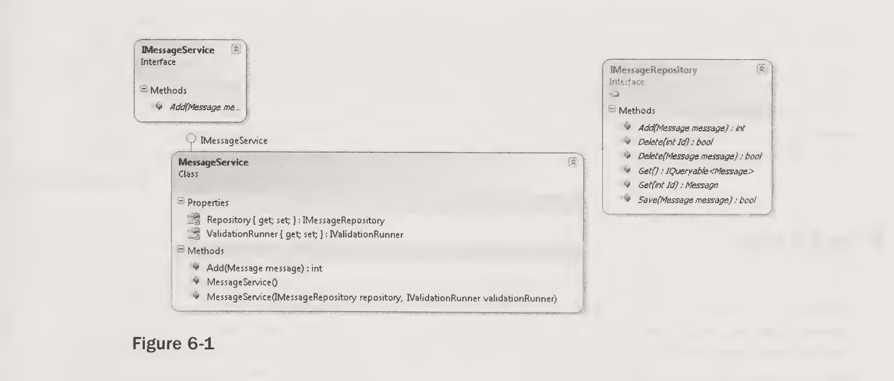

## 解决方案

让我们实现上述设计，重构我们的测试并确保它们有效。我们首先创建接口：

```csharp
public interface IMessageRepository
{
    int Add(Message message);
    bool Delete(int Id);
    bool Save(Message message);
    IQueryable<Message> Get();
}
```

> 为了提高代码的可读性，我将把`MessageService`类重命名为`InMemoryMessageService`。**稍后我们将创建一个使用`SqlMessageRepository`的`SqlMessageService`类。**

然后我们将`InMemoryMessageService`改为使用新的存储库：

```csharp
public class InMemoryMessageService : IMessageService
{
    private IValidationRunner ValidationRunner { get; set; }
    private IMessageRepository Repository { get; set; }

    public InMemoryMessageService()
        : this(null, null)
    {
    }

    public InMemoryMessageService(IMessageRepository repository,
                                    IValidationRunner validationRunner)
    {
        ValidationRunner = validationRunner ?? new ValidationRunner();
        Repository = repository ?? new InMemoryMessageRepository();
    }
}
```

现在我们确保可以构建项目并运行所有测试。一旦一切正常，我们编写一个新测试，确保我们正在使用存储库：

```csharp
[Test]
public void Create_Adds_Message_To_Repository()
{
    //mock the repo
    var mockRepo = new Mock<IMessageRepository>();
    //set expectations
    mockRepo.Expect(r => r.Add(model)).Returns(1);
    var mockValidationRunner = new Mock<IValidationRunner>();
    var service = new InMemoryMessageService(mockRepo.Object,
                                    mockValidationRunner.Object);
    controller = new MessageController(service);
    var result = controller.Create(model);
    mockRepo.VerifyAll();
}
```

通过模拟`IMessageRepository`接口，我们将测试限制在`Add`方法是否被调用这一点上。这缩小了我们的测试范围，并将我们与`IMessageRepository`实现的实际实现隔离开来。该实现应单独进行测试，你很快就会看到。


# 第六章：数据层与 IRepository 模式

为了使前面的测试通过，我们在 InMemoryMessageService 类中更改了 Add 方法，使其使用仓储：

```
public int Add(Message message)
{
    var errors = ValidationRunner.Run(message);
    if (errors != null && errors.Count > 0)
    {
        throw new ValidationException(errors);
    }
    return Repository.Add(message);
}
```

从前面的代码可以看出，服务层对持久化机制或目标一无所知。相反，它将该任务委托给 IRepository。我们现在可以随心所欲地实现 IMessageRepository 接口。我们可以有一个用于测试目的、写入内存的实现；一个用于集成测试、写入 XML 的实现；以及一个与 SQL Server 通信的生产环境实现。

我们来实现 IMessageRepository 接口，而不必处理数据库。我们将创建一个内存中的实现，但如同我们一直以来的做法，我们将从编写测试开始。让我们创建测试夹具：

```
[TestFixture]
public class InMemoryRepositoryTests
{
    private Message message;

    [SetUp]
    public void SetUp()
    {
        message = new Message()
        {
            Subject = "My newsletter subject",
            Name = "October newsletter",
            Text = "Hello subscriber",
            Html = "Hello <b>subscriber</b>"
        };
    }
}
```

然后我们创建一个添加消息的测试：

```
[Test]
public void Add_Message_To_Repository()
{
    var repo = new InMemoryMessageRepository();
    repo.Add(message);
    //验证消息是否正确添加
    var msg = repo.Get().Where(m => m.Id == 1).Single();
    Assert.IsNotNull(msg);
    Assert.AreEqual(message.Html, msg.Html);
    Assert.AreEqual(message.Text, msg.Text);
    Assert.AreEqual(message.Subject, msg.Subject);
    Assert.AreEqual(message.Name, msg.Name);
}
```

然后我们可以通过编写以下代码使之前的测试通过：

```
public class InMemoryMessageRepository : IMessageRepository
{
    private List<Message> Messages { get; set; }

    public InMemoryMessageRepository()
    {
        Messages = new List<Message>();
    }

    public int Add(Message message)
    {
        message.Id = 1;
        Messages.Add(message);
        return message.Id;
    }

    public bool Delete(int Id)
    {
        throw new System.NotImplementedException();
    }

    public bool Save(Message message)
    {
        throw new System.NotImplementedException();
    }

    public IQueryable<Message> Get()
    {
        var q = from m in Messages select m;
        return q.AsQueryable();
    }
}
```

现在我们需要确保仓储为每条消息正确分配了唯一的 ID：

```
[Test]
public void Add_Assigns_Unique_Ids()
{
    var repo = new InMemoryMessageRepository();
    repo.Add(new Message()); //1
    repo.Add(new Message()); //2
    repo.Add(new Message()); //3
    var msgs = repo.Get();
    Assert.IsNotNull(msgs);
    Assert.AreEqual(3, msgs.Count());
    Assert.AreEqual(1, msgs.Count(m => m.Id == 1));
    Assert.AreEqual(1, msgs.Count(m => m.Id == 2));
    Assert.AreEqual(1, msgs.Count(m => m.Id == 3));
}
```

我们可以修改 `Add` 方法以分配唯一的 ID，如下所示：

```
private int _autoId;
private int AutoId
{
    get
    {
        _autoId += 1;
        return _autoId;
    }
}
public int Add(Message message)
{
    message.Id = AutoId;
    Messages.Add(message);
    return message.Id;
}
```

接下来，我们测试删除功能：

```
[Test]
public void Delete_Message_From_Repository()
{
    var repo = new InMemoryMessageRepository();
    repo.Add(message);
    //确保消息已添加
    var msgs = repo.Get();
    Assert.IsNotNull(msgs);
    Assert.AreEqual(1, msgs.Count());
    var result = repo.Delete(1);
    Assert.IsTrue(result);
    msgs = repo.Get();
    Assert.IsNotNull(msgs);
    Assert.AreEqual(0, msgs.Count());
}
```

我们只是添加一条消息，验证它已添加，删除它，然后验证它已被移除。`Delete` 方法实现如下：

```
public bool Delete(int Id)
{
    try
    {
        Messages.Remove(Messages.Single(m => m.Id == Id));
        return true;
    }
    catch (Exception ex)
    {
        return false;
    }
}
```

我们还应该确保 `Delete` 方法不会抛出任何异常，而是在任何错误情况下返回 `False`。我们可以通过以下测试来确保这一点：

```
[Test]
public void Delete_Message_Returns_False_On_Exception()
{
    var repo = new InMemoryMessageRepository();
    repo.Add(message);
    //确保消息已添加
    var msgs = repo.Get();
    Assert.IsNotNull(msgs);
    Assert.AreEqual(1, msgs.Count());
    var result = repo.Delete(12); //Id 不存在
    Assert.IsFalse(result);
    msgs = repo.Get();
    Assert.IsNotNull(msgs);
    Assert.AreEqual(1, msgs.Count());
}
```

最后，让我们确保我们可以保存对现有消息的更改。我们将添加一条消息，获取它，对其进行更改，然后保存它。以下是测试：

```
[Test]
public void Save_Message_To_Repository()
{
    var repo = new InMemoryMessageRepository();
    repo.Add(message);
    //获取消息
    var msg = repo.Get().Where(m => m.Id == 1).Single();
    Assert.IsNotNull(msg);
    //进行更改
    var text = "new text";
    var name = "new name";
    var html = "new html";
    var subject = "new subject";
    msg.Name = name;
    msg.Html = html;
    msg.Subject = subject;
    msg.Text = text;
    //保存消息
    repo.Save(msg);
    //再次获取消息
    var msgAfterSave = repo.Get().Where(m => m.Id == 1).Single();
    //验证更改已保存
    Assert.AreEqual(html, msgAfterSave.Html);
    Assert.AreEqual(text, msgAfterSave.Text);
    Assert.AreEqual(subject, msgAfterSave.Subject);
    Assert.AreEqual(name, msgAfterSave.Name);
}
```

实现如下：

```
public bool Save(Message message)
{
    try
    {
        var original = Messages.Single(m => m.Id == message.Id);
        var index = Messages.IndexOf(original);
        Messages[index] = message;
        return true;
    }
    catch (Exception)
    {
        return false;
    }
}
```

InMemoryMessageRepository 类的完整实现如下：

```
public class InMemoryMessageRepository : IMessageRepository
{
    private List<Message> Messages { get; set; }

    public InMemoryMessageRepository()
    {
        Messages = new List<Message>();
    }

    private int _autoId;
    private int AutoId
    {
        get
        {
            _autoId += 1;
            return _autoId;
        }
    }

    public int Add(Message message)
    {
        message.Id = AutoId;
        Messages.Add(message);
        return message.Id;
    }

    public bool Delete(int Id)
    {
        try
        {
            Messages.Remove(Messages.Single(m => m.Id == Id));
            return true;
        }
        catch (Exception ex)
        {
            return false;
        }
    }
}
```

```
public bool Save(Message message)
{
    try
    {
        var original = Messages.Single(m => m.Id == message.Id);
        var index = Messages.IndexOf(original);
        Messages[index] = message;
        return true;
    }
    catch (Exception)
    {
        return false;
    }
}

public IQueryable<Message> Get()
{
    var q = from m in Messages select m;
    return q.AsQueryable();
}
```

这个实现现在使我们能够比必须接触数据库快得多地运行测试。我们也不需要担心清理代码，因为数据存储在内存中，测试执行后会自动消失。我们也可以向此实现添加一些代码来创建一些我们可以进行实验的测试数据。

然而，有几点我想澄清一下。注意 `Get` 方法返回的是 `IQueryable` 消息列表。之所以特别选择它而不是 `List<Message>`，是因为它允许我们使用 LINQ 惰性加载的强大功能。使用这种设计，我们可以在服务类中编写多个方法，对返回的结果应用不同甚至多重的过滤。例如，我们可以有一个方法通过 ID 获取特定消息，获取用户的所有消息，搜索包含特定文本的消息，甚至应用分页。为了进一步澄清，看一下 `MessageService` 类（和 `IMessageService` 接口）中的这个方法：

```
public Message GetById(int Id)
{
    return Repository.Get().Single(m => m.Id == Id);
}
```

在这个方法中，我们调用仓储上的 `Get` 方法，它返回一个 `IQueryable<Message>`，但直到 `Single` 使用适当的过滤器执行时才会执行 SQL。所以我们不是执行 `select * from messages` 然后在代码中过滤它，我们实际上执行的是类似 `select * from messages where Id = @id` 的语句。

为了澄清起见，这里是另一个例子：

```
public List<Message> Search(string searchTerm)
{
    return Repository.Get().Where(m => m.Text.Contains(searchTerm)).ToList();
}
```

101


 ## 第6章：数据层与 IRepository 模式

在上一种方法中，我们在消息文本中搜索特定的搜索词。如果仓库实现使用了 LINQ to SQL，生成的 SQL 可能类似于 `select * from messages where text like searchTerm`。

需要注意的重要一点是，我们在前面的实现中没有使用任何数据上下文，因为我们使用的是内存中的仓库。当我们切换到使用 LINQ to SQL 的生产仓库时，我们必须考虑数据上下文并释放任何资源。我们不能在数据层中释放数据上下文，因为我们在使用 LINQ 的延迟加载，而且如果释放数据上下文后尝试访问返回的 `IQueryable`，将会抛出异常。因此，数据上下文必须在服务层中进行管理。有些人认为这是一个糟糕的设计，因为它在两个层之间创建了紧耦合，并且 `IQueryable` 跨越了层的边界。这些都是合理的担忧，必须在设计中加以考虑。我个人认为它们是可以接受的权衡。

## 小结

我们对每一层进行了如此良好的抽象，以至于无需对控制器进行任何更改。以下 `MessageController` 构造函数可以照常工作：

```
public MessageController()
    : this(null)
{
}

public MessageController(IMessageService service)
{
    Service = service ?? new InMemoryMessageService();
}
```

我们还能够使用 `IRepository` 模式，将持久化机制从业务逻辑中抽象出来。这使我们能够创建一个在测试中相对容易使用的内存数据库实现，但可以轻松替换为基于 SQL 的实现。在接下来的章节中，你将看到这种设计的好处，以及它如何大大简化我们的测试和维护工作。

## 第7章：通过依赖注入实现独立

减少代码中的依赖并尽可能进行抽象始终是一个好主意，但这并非总是现实的。你不可避免地会在类甚至程序集之间引入依赖关系。幸运的是，有一种方法可以缓解依赖的影响并减少代码中的耦合。

通过使用控制反转（IoC）和依赖注入（DI）原则，我们能够创建松散耦合的系统并缓解依赖的影响。控制反转是指对象的实例化被间接处理，使对象不直接创建其他对象。相反，IoC 容器会通过构造函数参数或公共属性将依赖注入到对象中。

结合模拟对象，依赖注入可以大大简化测试。想象一下，如果我们有一个调用 Web 服务的类。使用 DI，我们可以注入该类的模拟版本用于测试。

## 问题

到目前为止，我们的控制器都有带参数的构造函数，期望一些接口。例如，我们的 AccountController 期望 IFormsAuthentication 和 MembershipProvider，而我们的 MessageController 期望 IMessageService。目前我们的 MessageController 类有两个构造函数：

```
public MessageController()
    : this(null)
{
}
```

```
public MessageController(IMessageService service)
{
    Service = service ?? new InMemoryMessageService();
}
```

默认构造函数由 MVC 框架调用，而后者又用 null 值调用带参数的构造函数。带参数的构造函数在传入值为 null 时实例化接口的实现。这工作得很好，允许我们在不更改框架实例化过程的情况下使用带参数的构造函数。这种模式的问题在于，我们的代码与接口的特定实现——具体来说是 InMemoryMessageService 实现——紧耦合。请记住，我们使用接口是因为它们简化了测试和模拟，并且使我们能够在应用程序的整个生命周期中插入不同的实现。如果我们想要使用不同的实现——比如说 SqlMessageService——我们就必须重新编译和重新部署应用程序。这是不可接受的代价，也违背了使用接口所带来的可插拔性。

## 设计

我们可以通过使用 IoC 容器来解决这些问题，该容器能够在运行时决定实例化哪个接口实现——这就是我们将控制权反转，将实例化从依赖对象转移出去的地方。然后容器会将正确的实例传递到依赖对象的构造函数中；也就是说，它会注入依赖。

如果没有 IoC 容器，我们的类图将如图 7-1 所示。

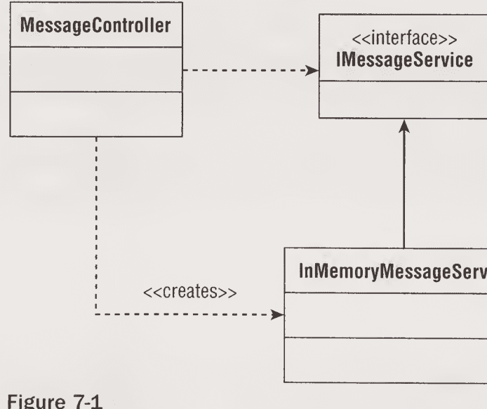

图 7-1

如果我们使用 IoC 容器，我们将消除对具体实现的依赖，并从依赖类中移除实例化逻辑。我们的类图将如图 7-2 所示。

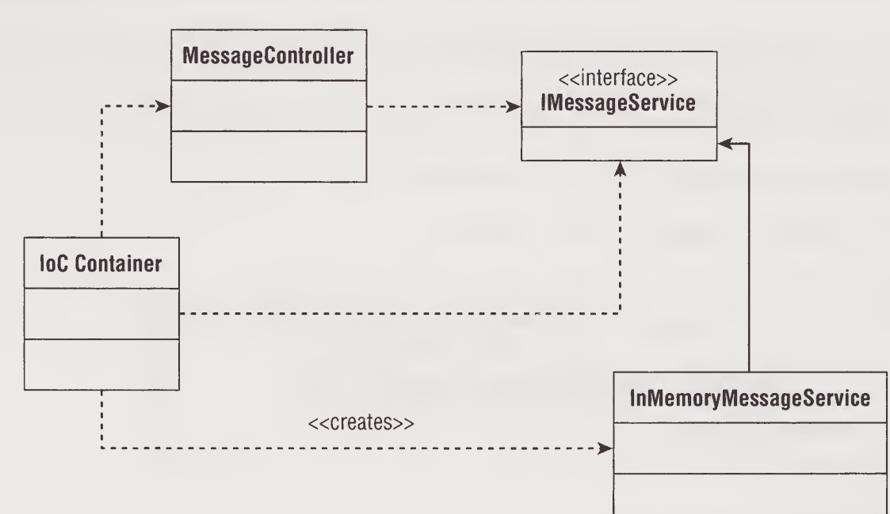

图 7-2

## 解决方案

目前市面上有多种 IoC 容器可供选择。也有许多在线文章和资源比较各个容器的优缺点。大多数流行容器在功能上都非常相似，你的决定可能归结为风格问题。我个人喜欢 Ninject（www.ninject.org），因为它易于使用、接口流畅、轻量，并且有良好的在线和社区支持。

首先要做的是下载 Ninject，并在 Web 项目中引用 Ninject.core.dll 和 Ninject.Framework.Mvc.dll 程序集。接下来，我们更改 Global.asax 文件，使 MvcApplication 类继承自 NinjectHttpApplication 而不是 System.Web.HttpApplication。NinjectHttpApplication 是一个抽象类，它将用支持 Ninject 的工厂替换默认的控制器工厂，该工厂将处理控制器的注入。有两个虚方法我们必须重写：RegisterRoutes 和 CreateKernel。最终的类如下所示：

```
public class MvcApplication : NinjectHttpApplication
{
    protected override void RegisterRoutes(RouteCollection routes)
    {
        routes.IgnoreRoute("{resource}.axd/{*pathInfo}");

        routes.MapRoute(
            "Default",                           // 路由名称
            "{controller}/{action}/{id}",        // 带参数的 URL
            new
            {
                controller = "Home",
                action = "Index",
                id = ""
            }                                     // 参数默认值
        );
    }
}
```

```
    private StandardKernel _kernel;

    protected override IKernel CreateKernel()
    {
        IModule[] modules = new IModule[]
        {
            new AutoControllerModule(
                Assembly.GetExecutingAssembly()),
            new InMemoryModule()
        };
        _kernel = new StandardKernel(modules);
        return _kernel;
    }
}
```

在 `CreateKernel` 方法中，我们指示 Ninject 内核管理执行程序集中的所有控制器。这是通过 `AutoControllerModule` 完成的，它是 `Ninject.Framework.Mvc` 程序集的一部分，会自动遍历程序集并配置所有控制器以进行注入。我们可以在 `InMemoryModule` 中配置 Ninject 并告诉它注入什么，如下所示：

```
public class InMemoryModule : StandardModule
{
    public override void Load()
    {
        //身份验证与成员资格
        Bind<IFormsAuthentication>().To<FormsAuthenticationWrapper>();
        Bind<MembershipProvider>().ToConstant(Membership.Provider);

        //服务
        Bind<IMessageService>().To<InMemoryMessageService>();

        //仓库
        Bind<IMessageRepository>().To<InMemoryMessageRepository>();

        //其他
        Bind<IValidationRunner>().To<ValidationRunner>();
    }
}
```

在前面的代码中，我们告诉 Ninject 内核如何注入接口。在我们的例子中，我们使用简单的绑定，只是告诉内核每个接口使用哪个实现。现在，要将适当的接口注入到构造函数中，我们只需用 `Inject` 特性装饰构造函数即可。例如，这是 `AccountController` 构造函数：

```
[Inject]
public AccountController(IFormsAuthentication formsAuth,
                         MembershipProvider provider)
{
    FormsAuth = formsAuth ?? new FormsAuthenticationWrapper();
    Provider = provider ?? Membership.Provider;
}
```


# 第7章：通过依赖注入宣告你的独立

为了阐明注入的作用，让我们在第一行设置一个断点，先不注入调试一次项目，再注入调试一次。不注入时，你会注意到 `formsAuth` 参数为 `null`，如图7-3所示。这是因为执行了默认构造函数，该构造函数以 `null` 值调用带参数的构造函数。

```
public AccountController()
    : this(null, null)
{
}
```

如果我们启用注入并再次调试项目，Ninject 内核会查找带有 `Inject` 属性的构造函数，并注入适当的实例。（如果有多个构造函数带有 `Inject` 属性，Ninject 会应用一些逻辑来选择适当的构造函数。详情请参考 Ninject 的文档。）现在，你会看到 `formsAuth` 参数已使用适当的实现进行实例化，如图7-4所示。

Ninject 还足够智能，可以穿过对象树注入依赖。例如，`MessageController` 依赖于 `IMessageService`，而我们对 `IMessageService` 接口的 `InMemoryMessageService` 实现又依赖于 `IMessageRepository` 接口。我们需要 Ninject 注入 `IMessageService` 和 `IMessageRepository` 的适当实例。我们已经在前面所示的 `InMemoryModule` 类中告诉了 Ninject 内核这些接口应该使用哪些实现。现在，我们只需将 `Inject` 属性应用于 `InMemoryMessageService` 构造函数：

```
[Inject]
public InMemoryMessageService(IMessageRepository repository,
    IValidationRunner validationRunner)
{
    ValidationRunner = validationRunner ?? new ValidationRunner();
    Repository = repository ?? new InMemoryMessageRepository();
}
```

如果你设置断点并调试代码，你会看到 `InMemoryMessageRepository` 的一个实例被注入到 `InMemoryMessageService` 构造函数中，如图7-5所示。这表明 Ninject 内核在整个对象依赖层次结构中递归地注入了依赖。

我们现在可以轻松地替换我们的 `InMemoryModule` 类，以按惯例将接口绑定到不同的实现。为了清晰和类型安全，我使用了 Ninject 的流式接口来配置其内核。我也可以通过配置文件轻松完成同样的事情。使用配置文件的好处是，我只需编辑配置文件就可以替换注入的实现，而无需重新编译应用程序。

## 总结

通过使用 IoC 容器和依赖注入，我们减少了组件间的耦合，并创建了一个非常灵活的解决方案。我们能够以最小的更改轻松替换实现。我们可以专注于创建优秀的应用程序，而无需立即担心所有细节，并且将来可以轻松地插入新的、更好的组件。

## 第8章：联系人管理

到目前为止，我们已经建立了良好的基础，并熟悉了 TDD 流程。现在是时候在此基础上构建并创建我们的应用程序了。由于发送消息给用户是这个应用程序的一个基本部分，我认为从联系人管理开始是一个不错的切入点。

## 问题

联系人是本应用的核心，管理这些联系人的能力对应用至关重要。用户需要创建、修改和删除联系人，并将其分组到列表中以及在邮件活动中定位它们。

对于联系人，我们需要以下操作：

- 手动创建联系人。
- 从文件导入联系人。
- 编辑现有联系人。
- 查看现有联系人。
- 浏览/列出现有联系人。
- 删除现有联系人。
- 搜索联系人。

对于联系人列表，我们需要以下操作：

- 创建联系人列表。
- 编辑现有联系人列表。
  - 编辑联系人列表详情。
  - 将联系人添加到列表。
  - 从列表中移除联系人。
- 查看现有联系人列表。
- 浏览/列出现有联系人列表。
- 删除现有联系人列表。

我们还需要实现基本的 Web 应用功能，如分页和排序。

## 设计

需要注意的是，联系人与登录用户关联，用户无法访问不属于她的联系人。用户不能拥有多个具有相同电子邮件地址的联系人；电子邮件地址相对于用户是唯一的。但是，用户可以拥有多个联系人列表，一个联系人可以出现在多个列表中。图8-1的图表澄清了用户、联系人和联系人列表之间的关系。

图8-1说明了：

- 一个用户可以有多个联系人列表。
- 一个用户可以有多个具有唯一电子邮件的联系人。
- 一个联系人列表可以有多个具有唯一电子邮件的联系人。

那么，联系人到底是什么？在最基本的层面上，一个 *联系人* 只是一个电子邮件地址，但我们很可能希望收集关于联系人的更多信息，而不仅仅是电子邮件地址。目前，我们说联系人实体具有以下属性：

- 电子邮件地址
- 姓名
- 出生日期
- 性别

电子邮件地址是唯一 *必需* 的值。

### 创建联系人

联系人可以通过填写表单手动创建，也可以从文件导入。我们现在关注手动创建。添加联系人时，我们希望确保它不存在，如果存在，应向用户显示错误。创建成功时，我们也将通知用户。为了提高可用性，我们还将给用户选择，将新联系人添加到现有的联系人列表或新创建的联系人列表中。

# 浏览联系人

用户需要能够浏览他或她的所有联系人，以便编辑、查看和删除它们。浏览联系人将以网格格式显示联系人，并可分页和排序。我们希望确保只从数据库中检索我们想要查看的记录，因此我们将一次检索一页。排序也是如此，通过单击网格标题执行。联系人可以按电子邮件、姓名、性别和出生日期排序。网格中的每一行都将有用于编辑和删除相关联系人的超链接。

## 编辑联系人

用户可以编辑联系人并更改其所有属性。我们需要确保只有联系人的所有者才能编辑它。如果联系人的电子邮件被更改为用户拥有的另一个联系人已使用的电子邮件地址，保存更改将失败并显示错误。

## 删除联系人

当用户请求删除联系人时，会看到一个确认页面。如果用户确认，则删除该联系人。在执行删除操作之前，我们需要检查用户是否有权限删除该联系人。

## 解决方案

我们将通过创建测试然后编写实现代码来通过测试，从而实现管理联系人的功能。这将确保我们涵盖所有情况，并且未来的添加不会破坏现有测试。从创建联系人开始是有意义的，这样我们就有了一个基础，可以在此基础上构建浏览、编辑和删除功能。

### 创建联系人

首先，我们需要一个用于创建联系人的视图，所以让我们创建一个名为 `ContactControllerTests` 的新测试类：

```
[TestFixture]
public class ContactControllerTests
{
    private ContactController controller;
    private Contact model;

    [SetUp]
    public void SetUp()
    {
        controller = new ContactController();
        model = new Contact()
        {
            Email = "test@test.com",
            Name = "Julia Roberts",
            Dob = new DateTime(1967, 10, 28),
            Sex = Sex.Female
        };
    }
    [Test]
    public void create_returns_view ()
    {
        var result = controller.Create();
        Assert.IsInstanceOfType(typeof(Contact), controller.ViewData.Model);
        result.AssertViewResult(controller, "New Contact", "create");
    }
}
```

在代码中，我们测试有一个返回视图的 `Create` 操作。为了使测试通过，我们首先创建我们的模型：

```
public class Contact
{
    public int Id { get; set; }
    public string Email { get; set; }
    public string Name { get; set; }
    public Sex Sex { get; set; }
    public DateTime? Dob { get; set; }
}
```

然后我们需要一个用于性别的枚举：

```
public enum Sex
{
    Undefined = 0,
    Male = 1,
    Female = 2
}
```


接下来，我们创建 ContactController 并为其添加一个 Create 操作：

```csharp
public class ContactController : Controller
{
    [AcceptVerbs(HttpVerbs.Get)]
    [Authorize]
    public ActionResult Create()
    {
        ViewData["Title"] = "New Contact";
        return View("create");
    }
}
```

让我们创建视图以确保一切按预期工作：

```csharp
<h2>
    Create New Contact</h2>
<form id="createcontact" action="/contact/create" method="post">
<div>
    <label for="email">
        Email</label>
    <br />
    <%=Html.TextBox("email")%>
    <br />
    <label for="name">
        Name</label>
    <br />
    <%=Html.TextBox("name")%>
    <br />
    <label for="sex">
        Sex</label>
    <br />
    <%=Html.DropDownList("sex")%>
    <br />
    <label for="dob">
        Date of Birth</label>
    <br />
    <%=Html.TextBox("dob")%>
    <br />
    <input type="submit" value="Create Contact" />
</div>
</form>
```

为了让下拉列表正常工作，我们需要向 ViewData 添加一个键为 "sex" 且类型为 SelectList 的项。让我们为此创建一个测试：

```csharp
[Test]
public void create_should_define_sex_in_viewdata()
{
    var result = controller.Create();
    var sexlist = controller.ViewData["sex"];
    Assert.IsNotNull(sexlist);
    Assert.IsInstanceOfType(typeof(SelectList), sexlist);
}
```

## 第 8 章：联系人管理

修改后的 Create 操作现在如下所示：

```csharp
[AcceptVerbs(HttpVerbs.Get)]
[Authorize]
public ActionResult Create()
{
    ViewData["Title"] = "New Contact";
    ViewData["sex"] = new SelectList(new Dictionary<string, object>
    {
        {"-1", " "},
        {"1", "Male"},
        {"2", "Female"}
    }, "key", "value");
    return View("create", new Contact());
}
```

生成的视图如图 8-2 所示。

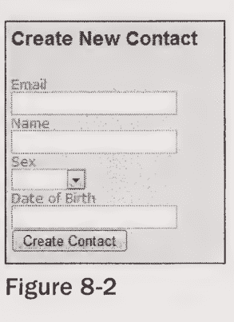

现在我们可以呈现视图了，让我们确保添加了验证。我们首先在模型类上定义验证。我们想确保提供了有效的电子邮件，并且如果提供了出生日期，则它应该是一个有效的日期。

```csharp
public class Contact
{
    public int Id { get; set; }
    [Required(ErrorMessage = "Email is required")]
    [Email(ErrorMessage = "Invalid email")]
    public string Email { get; set; }
    public string Name { get; set; }
    public Sex Sex { get; set; }
    [Date(ErrorMessage = "Invalid date")]
    public DateTime? Dob { get; set; }
}
```

在前面的代码中，我们使用之前创建的特性定义了验证规则。Date 特性不存在，需要创建。首先，我们为验证运行器创建一个测试：

```csharp
[Test]
public void validate_date_errors_if_value_is_not_date()
{
    model.Dob = "bad date";
    var errors = runner.Run(model);
    AssertValidationError(errors, "Dob", "Invalid date");
}

[Test]
public void validate_date_no_errors_if_value_is_a_date()
{
    model.Dob = "10/01/2009";
    var errors = runner.Run(model);
    if (errors != null)
        Assert.AreEqual(errors.Count, 0);
}
```

然后创建日期验证特性并确保测试通过：

```csharp
[Test]
public void generates_rule_for_date_field()
{
    string script = generator.Generate("createForm", model);
    Assert.IsTrue(script.Contains("date:{date:true}"));
}
```

为了让前面的测试通过，我们只需在 jQueryValidationGenerator 的 Generate 方法中添加以下 if 语句：

```csharp
if (attrib.GetType() == typeof(DateAttribute))
{
    subrule = "date:true";
    ruletype = "date";
}
```

## 第 8 章：联系人管理

让我们确保客户端验证在视图中按预期工作。在视图中添加以下语句：

```csharp
<%=Html.JQueryGenerator("createcontact", ViewData.Model)%>
```

如果我们尝试提交一个无效的视图，我们将得到客户端验证错误，如图 8-3 所示。

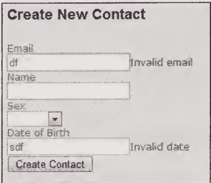

图 8-3

现在让我们编写创建联系人的测试。我们将从验证是否已提供电子邮件地址的测试开始：

```csharp
[Test]
public void create_returns_error_if_email_is_missing()
{
    model.Email = null;
    var result = controller.Create(model);
    AssertValidationError(result, "Email", "Email is required");
}
```

`AssertValidationError` 是一个辅助方法，用于断言验证错误；此代码被重构为一个方法，以便其他测试可以重用。

```csharp
private void AssertValidationError(ActionResult result,
                                  string errorKey,
                                  string errorMessage)
{
    //assert results
    Assert.IsNotNull(result);
    Assert.IsInstanceOfType(typeof(ViewResult), result);
    controller.ViewData.ModelState.AssertErrorMessage(errorKey, errorMessage);
    Assert.IsInstanceOfType(typeof(Contact),
                            ((ViewResult)result).ViewData.Model);
    //assert that the ViewData.Model
    var outModel = (((ViewResult)result).ViewData.Model as Contact);
    Assert.AreEqual(model.Email, outModel.Email);
    Assert.AreEqual(model.Name, outModel.Name);
    Assert.AreEqual(model.Sex, outModel.Sex);
    Assert.AreEqual(model.Dob, outModel.Dob);

    Assert.AreEqual("New Contact", controller.ViewData["Title"],
                    "Page title is wrong");
}
```

## 第 8 章：联系人管理

我们必须进行一些更改以使项目编译通过并使测试通过。首先，我们需要添加 Create 操作：

```csharp
[AcceptVerbs(HttpVerbs.Post)]
[Authorize]
public ActionResult Create([Bind(Prefix = "", Exclude = "Id")] Contact model)
{
    ViewData["Title"] = "New Contact";
    ViewData["sex"] = new SelectList(new Dictionary<string, object>
    {
        {"-1", " "},
        {"1", "Male"},
        {"2", "Female"}
    }, "key", "value");

    try
    {
        var id = Service.Add(model);
    }
    catch (ValidationException ex)
    {
        foreach (var error in ex.ValidationErrors)
        {
            ViewData.ModelState.AddModelError(
                error.PropertyName,
                error.ErrorMessage);
        }
    }

    if (!ViewData.ModelState.IsValid)
    {
        return View("create", model);
    }
    return RedirectToAction("create");
}
```

我们使用了与之前创建消息时相同的模式，现在我们需要更改控制器的构造函数：

```csharp
public IContactService Service { get; set; }

public ContactController()
    : this(null)
{
}

[Inject]
public ContactController(IContactService service)
{
    Service = service ?? new InMemoryContactService();
}
```

接下来，我们创建 `IContactService` 和一个内存中实现：

```csharp
public interface IContactService
{
```

## 第 8 章：联系人管理

我们还需要在应用程序引导程序中添加代码，告诉 Ninject 内核如何处理新的接口。我们只创建了一个接口，所以只需要添加这一行代码：

前面这一行告诉 Ninject 在遇到 IContactService 接口时注入一个 InMemoryContactService 实例。

重要的是要注意，前面的代码不是完整的实现，而只是足以通过测试的代码。随着我们添加更多测试，代码将变得更加完整。

接下来，我们测试无效电子邮件的验证失败：

前面的测试应该无需任何更改即可通过，因为所有验证代码都已就位。

## 第 8 章：联系人管理

在联系人成功创建后，我们希望重新显示视图，但使用空白表单。这可以通过简单地重定向到 Create 操作来完成：

```csharp
[Test]
public void create_redirects_to_create_action_if_successful ()
{
    var result = controller.Create(model);
    result.AssertRedirectToRouteResult("create");
}
```

我们还希望通知用户联系人已成功创建。我们将在页面顶部使用通知消息来通知用户。此通知消息只需要显示一次，我们可能会在整个应用程序中使用它，因此我们可能应该在母版页上显示它。Ruby on Rails 称之为闪存消息，为简单起见，我将其称为闪存消息模式。幸运的是，在 MVC 中使用 TempData 字典创建闪存消息很容易。

#### TempData

TempData 是控制器上类型为 TempDataDictionary 的一个属性。它是一个特殊的值字典，可以像 ViewData 字典一样传递给视图。唯一的区别是 TempData 仅在一个请求的生命周期内可用——也就是说，它是临时的。

这很快就会变得清晰，但我们从一个测试开始：

```csharp
[Test]
public void create_adds_flash_message_if_contact_creation_is_successful()
{
    var result = controller.Create(model);
    Assert.IsTrue(controller.ModelState.IsValid, "model state is invalid");
    Assert.Contains(controller.TempData,
        new KeyValuePair<string, object>
            ("flash",
             "Contact successfully created"),
        "Flash message is missing");
}
```

我们在前面的测试中所做的只是确保在成功创建时将闪存消息添加到 TempData 字典中。为了使测试通过，我们只需在成功创建返回前在 Create 方法中添加这一行：

```csharp
TempData["flash"] = "Contact successfully created";
```

在我们走得太远之前，让我们确保通知正常工作。我们将在 Views\Shared 文件夹中创建一个名为 FlashMessage 的用户控件，如果存在闪存消息，它将简单地显示该消息。

```csharp
<%
    if (ViewContext.TempData.ContainsKey("flash"))
    {
%\>
```


## 第8章：联系人管理

```
<div class="flash">
    <%= Html.Encode(ViewContext.TempData["flash"]) %>
</div>
<%
    }
%>
```

然后，我们可以通过在样式表中添加以下内容来设置闪存消息的样式，使其符合我们的网站设计：

```
.flash
{
    color:Green;
    padding:5px;
    border:solid 2px black;
    background: yellow;
}
```

最后，我们将 FlashMessage 用户控件添加到母版页，这样只需添加这一行代码，就可以在整个应用程序中访问它：

```
<% Html.RenderPartial("flashmessage");%>
```

现在，如果我们添加一个新的联系人，应该会看到如图8-4所示的闪存消息。

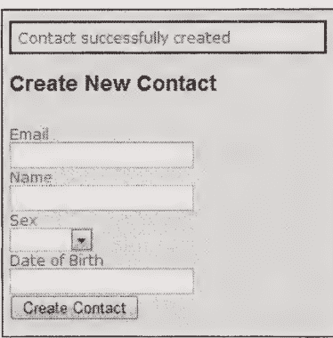

我们的下一个任务是确保在添加联系人之前，电子邮件是唯一的。我们不能仅仅在模型上添加验证属性，因为我们必须实际检查数据存储。有两种方法可以做到这一点。我们可以在添加之前调用存储库来检查联系人是否存在；或者我们可以调用 Add 方法，并依赖存储库来执行约束。我认为，在添加之前进行检查并在存储库中强制执行约束是一个好的设计。这样，我们在应用层面应用业务规则，而存储库约束则作为逻辑错误时的安全保障。我们也并非完全依赖存储库来执行业务规则，因为在内存或XML存储库的情况下，可能没有简单的方法来定义约束。由于我们是在服务层进行验证，在同一位置进行唯一性检查是合理的。以下是测试代码：

```
[Test]
public void create_returns_error_if_contact_already_exists()
{
    //add it once
    var result = controller.Create(model);
    //make sure it gets added
    result.AssertRedirectToRouteResult("create");
    //add it again
    result = controller.Create(model);
    AssertValidationError(result, "Email", "Contact already exists");
}
```

为了让上述测试通过，我们将添加一个 `IContactRepository` 接口，在 `InMemoryContactRepository` 中实现它，并配置 Ninject 来注入新的依赖项。我不打算详细说明所有步骤，因为它们与我们之前使用 `IMessageRepository` 接口和 `InMemoryMessageRepository` 类所做的类似。然后，我们可以更改 `InMemoryContactService` 中的 `Add` 方法，以应用相应的逻辑。

```
public int Add(Contact contact)
{
    var errors = ValidationRunner.Run(contact);
    if (errors != null && errors.Count > 0)
    {
        throw new ValidationException(errors);
    }
    //check if email is unique
    if (Repository.Get()
        .Count(c => c.Email.ToLower() == contact.Email.ToLower()) > 0)
    {
        throw new ValidationException(
            new List<ValidationError>
            {
                new ValidationError("Email", "Contact already exists")
            });
    }
    return Repository.Add(contact);
}
```

如果您一直在仔细观察，您会注意到我们有一个逻辑错误。问题在于，此代码会全局防止重复的电子邮件地址，因此如果用户 John 添加了电子邮件为 customer@gmail.com 的联系人，其他用户将无法添加相同的客户。我们需要仅为登录用户检查唯一性。这需要在整个应用程序中进行多处更改，让我们开始吧。

我们需要建立联系人和用户之间的关系，因此让我们在 `Contact` 类中添加一个 `User` 属性：

```
public class Contact
{
    public User User { get; set; }
    public int Id { get; set; }
    [Required(ErrorMessage = "Email is required")]
    [Email(ErrorMessage = "Invalid email")]
    public string Email { get; set; }
    public string Name { get; set; }
    public Sex Sex { get; set; }
    public DateTime? Dob { get; set; }
}
```

我不想定义用户类的所有细节。我现在感兴趣的只是几个属性，所以让我们暂时保持简单，到时候再添加。

```
public class User
{
    public Guid UserId { get; set; }
    public string Username { get; set; }
}
```

现在，`Add` 方法可以在登录用户的上下文中检查电子邮件的唯一性：

```
public int Add(Contact contact)
{
    var errors = ValidationRunner.Run(contact);
    if (errors != null && errors.Count > 0)
    {
        throw new ValidationException(errors);
    }

    //check if email is unique
    if (Repository.Get()
        .Count(c => c.Email.ToLower() == contact.Email.ToLower() &&
            c.User.UserId == contact.User.UserId) > 0)
    {
        throw new ValidationException(
            new List<ValidationError>
            {
                new ValidationError("Email", "Contact already exists")
            });
    }
    return Repository.Add(contact);
}
```

要使上述代码工作，我们必须在从 Create 操作调用 `Add` 方法之前设置 `User` 属性，如下所示：

```
model.User =  new User
            {
                Username = User.Identity.Name,
                UserId = (Guid)Provider.
                    GetUser(User.Identity.Name, false)
                    .ProviderUserKey
            };
var id = Service.Add(model);
```

此代码片段创建了对 `MembershipProvider` 类的依赖。在这种情况下，我们使用属性注入而不是构造函数注入，因为 `MembershipProvider` 在概念上与 `ContactController` 并不真正相关。这也使得更改代码更容易，因为我们不必更改构造函数。我们正在使用 IoC 容器的事实使这项任务变得简单。我们所要做的就是添加一个属性并为其添加 `Inject` 属性，IoC 容器将负责使用正确的实现来初始化它。

```
[Inject]
public MembershipProvider Provider { get; set; }
```

我们这次没有从测试开始，因为有很多更改需要进行，但这并不意味着我们不应该编写测试。我们需要测试多个用户可以添加相同的联系人。

在编写测试之前，我们需要更改设置以模拟一些类并定义依赖注入。

首先，我们在 ContactControllerTests 类中定义一些在类级别的模拟对象作为字段：

```
private static Mock<MembershipProvider> MockMembership =
    new Mock<MembershipProvider>();
private static Mock<MembershipUser> MockMembershipUser =
    new Mock<MembershipUser>();
private static Mock<IPrincipal> user =
    new Mock<IPrincipal>();
private static Mock<IIdentity> identity =
    new Mock<IIdentity>();
private static Mock<HttpContextBase> httpContext =
    new Mock<HttpContextBase>();
private static Mock<ControllerBase> controllerbase =
    new Mock<ControllerBase>();
```

然后我们必须设置模拟对象以使成员资格提供程序工作：

```
private static void SetupMocks(string username, Guid userid)
{
    identity.Expect(i => i.Name).Returns(username);
    user.Expect(u => u.Identity).Returns(identity.Object);
    httpContext.Expect(h => h.User).Returns(user.Object);
    MockMembership.Expect(m => m.GetUser(username, false))
        .Returns(MockMembershipUser.Object);
    MockMembershipUser.Expect(u => u.ProviderUserKey)
        .Returns(userid);
}
```

接下来，我们必须使用依赖注入（DI）实例化控制器，但首先，让我们配置 IoC 容器：

```
private static StandardKernel GetIoCKernel()
{
    var modules = new IModule[]
    {
        new InlineModule(
            new Action<InlineModule>[]
            {
                m => m.Bind<MembershipProvider>()
                    .ToConstant(MockMembership.Object),
                m => m.Bind<IContactService>()
                    .To<InMemoryContactService>(),
                m => m.Bind<IContactRepository>()
                    .To<InMemoryContactRepository>()
                    .Using<SingletonBehavior>(),
                m => m.Bind<IValidationRunner>()
                    .To<ValidationRunner>()
            }
        )
    };
    return new StandardKernel(modules);
}
```


# 第八章：联系人管理

}
};
return new StandardKernel(modules);
}

这里需要注意的是对 `IContactRepository` 绑定所做的 `Using<SingletonBehavior>` 调用。这告诉 IoC 容器只为 `InMemoryContactRepository` 创建一个实例。如果我们不这样做，就会创建多个实例，而我们的测试将会失败，因为每个联系人将被添加到其各自的仓储实例中。然后我们使用具有上述配置的 IoC 容器内核来创建控制器：

private static ContactController GetController()
{
    kernel = GetIoCKernel();
    var contactController = (ContactController)kernel
        .Get(typeof(ContactController));
    contactController.ControllerContext = new ControllerContext(
        httpContext.Object,
        new RouteData(),
        controllerbase.Object);
    return contactController;
}

现在我们的测试设置方法如下所示：

[SetUp]
public void SetUp()
{
    SetupMocks(Username, UserId);
    controller = GetController();
    model = new Contact()
            {
                Email = "test@test.com",
                Name = "Julia Roberts",
                Dob = new DateTime(1967, 10, 28),
                Sex = Sex.Female
            };
}

现在我们可以编写测试了：

[Test]
public void create_succeeds_for_duplicate_contacts_by_different_users()
{
    //向仓储中添加一个联系人
    var anotherUsername = Username + 2;
    var anotherUserId = Guid.NewGuid();
    var repo = (IContactRepository)kernel.Get(typeof(IContactRepository));
    repo.Add(new Contact()
            {
                Email = "test@test.com",

Name = "Julia Roberts",
Dob = new DateTime(1967, 10, 28),
Sex = Sex.Female,
User = new User
{
    UserId = anotherUserId,
    Username = anotherUsername
}
});

//为另一个用户添加相同的联系人
var result = controller.Create(model);
//确保它被添加了
result.AssertRedirectToRouteResult("create");
Assert.AreEqual(2, repo.Get().Count());

//验证模拟对象
MockMembership.VerifyAll();
MockMembershipUser.VerifyAll();
}

我们首先为用户——假设是 UserA——向仓储中添加了一个联系人，然后为另一个用户——假设是 UserB——添加了相同的联系人。接着我们确保两个联系人都进入了仓储。由于 `IContactRepository` 被定义为单例，并且我们在测试中使用 IoC 容器实例化了它，因此我们将能够访问与控制器相同的仓储实例。

> ## 缺陷

我不得不更改 `InMemoryModule` 类以使用单例行为，应用程序才能按预期工作。如果我不这样做，那么每次控制器实例化时——即每次请求时——都会创建一个新的仓储实例。

如果每次请求都创建一个新的假数据实例，那么更改将不会被持久化。这意味着如果我们尝试编辑一个联系人并保存它，下一个请求将重新生成假的内存数据，我们所做的更改将被覆盖。

通过为内存数据类使用单例，我们在整个会话生命周期内持久化内存数据。这对于测试和开发已经足够了。在生产环境中，这将不是必需的，因为数据将被持久化到持久性数据存储中。

# 浏览联系人

用户需要能够浏览其所有联系人，以便编辑、查看和删除它们。浏览联系人将以网格格式显示联系人，该网格支持分页和排序。我们希望确保只从数据库中检索我们想要查看的记录，因此我们将一次检索一页。

我们需要编写一个测试来确保我们一次只检索一页联系人。网格每 20 个联系人分一页。

[Test]
public void browse_contacts_should_retrieve_20_or_less_contacts_at_once()
{
    PopulateRepository();
    var result = controller.Browse(null);
    Assert.IsInstanceOfType(typeof(PagedList<Contact>),
                            controller.ViewData.Model,
                            "视图数据类型错误");
    Assert.LessThanOrEqualTo(((PagedList<Contact>)controller.ViewData.Model).Count,
                            20, "页面大小错误");
    result.AssertViewResult(controller, "Browse Contacts", "browse");
}

顾名思义，`PopulateRepository` 方法将用一些测试数据填充我们的仓储。测试数据将包含 50 个联系人，其中 25 个分配给一个用户，另外 25 个分配给另一个用户。

private void PopulateRepository()
{
    var anotherUsername = Username + 2;
    var anotherUserId = Guid.NewGuid();
    var repo = (IContactRepository)kernel.Get(typeof(IContactRepository));
    for (var i = 0; i < 50; i++)
    {
        repo.Add(
            new Contact
            {
                Id = i,
                Email = ("user" + i + "@test.com"),
                Name = string.Format("First{0} Last{1}", i, i),
                Dob = (new DateTime(1967, 10, 28)).AddDays(i),
                Sex = (i % 3 == 0
                        ?
                            Sex.Undefined
                        :
                            (i % 2 == 0
                                ?
                                    Sex.Female
                                :
                                    Sex.Male)),
                User = i % 2 == 0
                        ? new User
                            {
                                UserId = UserId,
                                Username = Username
                            }
                        :
                            new User
                            {
                                UserId = anotherUserId,
                                Username = anotherUsername
                            }

});

}
}

Browse 控制器操作非常直接：

[AcceptVerbs(HttpVerbs.Get), Authorize]
public ActionResult Browse(int? page)
{
    ViewData["Title"] = "Browse Contacts";
    page = page ?? 1;
    ViewData.Model = Service.GetPage(page);
    return View("browse");
}

为了让上述代码工作，我们需要在 `IContactService` 接口中添加一个 `Browse` 方法：

public interface IContactService
{
    int Add(Contact contact);
    PagedList<Contact> GetPage(int? page);
}

并实现它来检索请求的页面。为防止任何错误，如果 `page` 变量为 `null` 或小于 1，我们将获取第一页。

public PagedList<Contact> GetPage(int? page)
{
    page = page ?? 1;
    page = page < 1 ? 1 : page;
    return Repository.Get().ToPagedList((int)(page - 1), 20);
}

你可能对 `PagedList` 类感到好奇。`PagedList` 是一个集合类，用于方便地对 `IQueryable` 或 `IEnumerable` 集合进行分页。它实现了 `IPagedList<T>` 接口。

public interface IPagedList<T> : IList<T>
{
    int PageCount { get; }
    int TotalItemCount { get; }
    int PageIndex { get; }
    int PageNumber { get; }
    int PageSize { get; }
    bool HasPreviousPage { get; }
    bool HasNextPage { get; }
    bool IsFirstPage { get; }
    bool IsLastPage { get; }
}

这是 `PagedList` 类本身：

public class PagedList<T> : List<T>, IPagedList<T>
{
    public PagedList(IEnumerable<T> source, int index, int pageSize)
    {
        if (source is IQueryable<T>)
            Initialize(source as IQueryable<T>, index, pageSize);
        else
            Initialize(source.AsQueryable(), index, pageSize);
    }

    public PagedList(IQueryable<T> source, int index, int pageSize)
    {
        Initialize(source, index, pageSize);
    }

    public int PageCount { get; private set; }
    public int TotalItemCount { get; private set; }
    public int PageIndex { get; private set; }
    public int PageNumber { get { return PageIndex + 1; } }
    public int PageSize { get; private set; }
    public bool HasPreviousPage { get; private set; }
    public bool HasNextPage { get; private set; }
    public bool IsFirstPage { get; private set; }
    public bool IsLastPage { get; private set; }

    protected void Initialize(IQueryable<T> source, int index, int pageSize)
    {
        if (source == null)
            source = new List<T>().AsQueryable();

        TotalItemCount = source.Count();
        PageSize = pageSize;
        PageIndex = index;
        if (TotalItemCount > 0)
            PageCount = (int)Math.Ceiling(TotalItemCount / (double)PageSize);
        else
            PageCount = 0;
        HasPreviousPage = (PageIndex > 0);
        HasNextPage = (PageIndex < (PageCount - 1));
        IsFirstPage = (PageIndex <= 0);
        IsLastPage = (PageIndex >= (PageCount - 1));

        if (index < 0)
            throw new
                ArgumentOutOfRangeException("PageIndex cannot be below 0.");
        if (pageSize < 1)
            throw new
                ArgumentOutOfRangeException("PageSize cannot be less than 1.");

        if (TotalItemCount > 0)
            AddRange(source.Skip((index) * pageSize).Take(pageSize).ToList());
    }
}


## 第8章：联系人管理

此外，还有一个静态的 `Pagination` 类，其中包含几个扩展方法，用于将 `IQueryable` 和 `IEnumerable` 集合转换为 `PagedList` 集合。

```csharp
public static class Pagination
{
    public static PagedList<T> ToPagedList<T>(this IQueryable<T> source,
                                               int index, int pageSize)
    {
        return new PagedList<T>(source, index, pageSize);
    }

    public static PagedList<T> ToPagedList<T>(this IEnumerable<T> source,
                                               int index, int pageSize)
    {
        return new PagedList<T>(source, index, pageSize);
    }
}
```

> 前面的分页代码改编自原始源码，原始源码可在 Troy Goode 的博客 SquaredRoot 上找到，网址为 www.squaredroot.com。

另一件需要注意的重要事项是，action 中的 page 参数是一个可空整数，这使我们能够处理 page 未定义的情况，并默认为第一页。我们需要在 Global.asax.cs 文件中定义一个新的路由，以便能够使用 URL `http://localhost/contact/browse/{page}` 指向 Browse action，并将 `{page}` 参数传递给 action 方法。

```csharp
routes.MapRoute(
    "BrowseContacts",
    "contact/browse/{page}",
    new
    {
        controller = "Contact",
        action = "browse",
        page = 1
    }
);
```

我们基本上是在告诉路由处理程序，将任何 `contact/browse/{page}` URL 映射到 Contact 控制器和 Browse action，如果 page 参数未定义，则默认为第一页。

测试现在应该通过了，让我们继续下一个。我们需要确保只检索登录用户的联系人。因此，我们的总项目数应该是 25。

```csharp
[Test]
public void browse_contacts_should_retrieve_contacts_for_loggedin_user_only()
{
    PopulateRepository();
    var result = controller.Browse(null);
    Assert.AreEqual(25,
        ((PagedList<Contact>)controller.ViewData.Model).TotalItemCount,
        "Item count is wrong");
}
```

前面的测试将会失败，因为总项目数将是 50，这是因为我们没有根据登录用户来过滤结果。我们需要将 Browse 服务方法更改为：

```csharp
PagedList<Contact> GetPage(Guid userid, int? page);
```

然后将实现更改为：

```csharp
public PagedList<Contact> GetPage(Guid userid, int? page)
{
    page = page ?? 1;
    page = page < 1 ? 1 : page;
    return Repository.Get()
        .Where(c => c.User.UserId == userid)
        .ToPagedList((int)(page - 1), 20);
}
```

然后更改控制器，将用户 ID 传递给服务调用：

```csharp
[AcceptVerbs(HttpVerbs.Get), Authorize]
public ActionResult Browse(int? page)
{
    ViewData["Title"] = "Browse Contacts";
    page = page ?? 1;
    ViewData.Model = Service.GetPage((Guid) Provider.
                                             GetUser(User.Identity.Name, false)
                                             .ProviderUserKey,
                                     page);
    return View("browse");
}
```

测试现在应该通过了。是时候创建一个视图并确保一切看起来正确了。我们将创建一个强类型视图：

```csharp
public partial class Browse : ViewPage<PagedList<Data.Models.Contact>>
{
}
```

视图本身将是一个简单的表格，遍历联系人列表。目前，我们将只创建非功能性的链接，以便了解整体外观。我们稍后会添加功能。

```html
<h2>
    Browse Contacts</h2>
<table class="grid">
    <thead>
        <tr>
            <th>
                Email
            </th>
            <th>
                Name
            </th>
            <th>
                Actions
            </th>
        </tr>
    </thead>
    <tbody>
        <%foreach (var contact in ViewData.Model)
          {%>
        <tr>
            <td>
                <%=contact.Email %>
            </td>
            <td>
                <%=contact.Name %>
            </td>
            <td>
                <a href=''>edit</a> <a href=''>delete</a>
            </td>
        </tr>
        <%} %>
    </tbody>
</table>
```

如果我们导航到 http://localhost/contact/browse，我们应该会得到第一页，如图 8-5 所示。

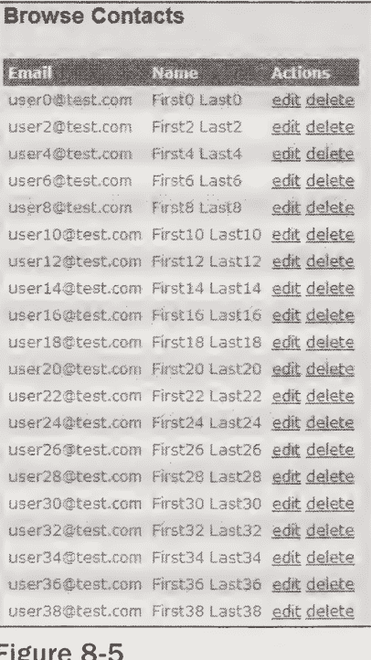

如果我们尝试 http://localhost/contact/browse/2，我们应该会得到第二页，如图 8-6 所示。

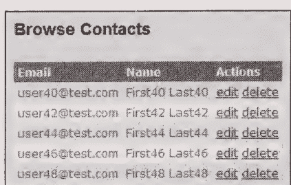

图 8-6

图 8-5 和图 8-6 中显示的虚拟数据是在 InMemoryModule 类中填充的，我们在那里配置 IoC，以确保整个应用程序可以访问一些数据。

显然，我们不期望用户通过在 URL 中输入页码来浏览我们的网格。我们需要为网格添加一个分页器，并且由于我们知道会有多个网格，而且它们也需要分页，我们将继续将分页器创建为用户控件。

分页用户控件代码改编自原始源码，原始源码可在 Robert Muehsig 的博客 http://code-inside.de 上找到。

分页器样式改编自原始源码，原始源码可在 Antonio Lupetti 的博客 http://woork.blogspot.com 上找到。

Pagination.ascx 用户控件如下：

```html
<div class="pagination">
    <ul>
        <% if (ViewData.Model.HasPreviousPage)
           { %>
        <li class="previous">
            <a href="<%=ViewData.Model.PageActionLink.Replace("{page}", 
                                                (ViewData.Model.PageIndex - 1).ToString())%>">
                « Previous</a></li>
        <% } %>
            else
            { %>
        <li class="previous-off">« Previous</li>
        <% } %>
        <%for (int page = 1; page <= ViewData.Model.TotalPages; page++)
          { %>
            if (page == ViewData.Model.PageIndex)
            { %>
        <li class="active">
            <%=page.ToString()%></li>
        <% } %>
            else
            { %>
        <li>
            <a href="<%=ViewData.Model.PageActionLink.Replace("{page}", 
                                                page.ToString())%>">
                <%=page.ToString()%></a></li>
        <% } %>
        <% if (ViewData.Model.HasNextPage)
        { %>
        <li class="next">
            <a href="<%=ViewData.Model.PageActionLink.Replace("{page}",
                (ViewData.Model.PageIndex + 1).ToString())%>">Next »</a></li>
        <% }
        else
        { %>
        <li class="next-off">Next »</li>
        <% } %>
    </ul>
</div>
```

Pagination 控件是强类型的，需要一个 PaginationViewData 对象作为模型。
PaginationViewData 是一个简单的包装器，用于包装渲染分页器所需的数据。

```csharp
public class PaginationViewData
{
    public int PageIndex { get; set; }
    public int TotalPages { get; set; }
    public int PageSize { get; set; }
    public int TotalCount { get; set; }
    public string PageActionLink { get; set; }
    public bool HasPreviousPage
    {
        get
        {
            return (PageIndex > 1);
        }
    }
    public bool HasNextPage
    {
        get
        {
            return (PageIndex * PageSize) <= TotalCount;
        }
    }
}
```

现在，我们可以在视图中通过渲染 Pagination 控件来使用分页器：

```html
<%Html.RenderPartial("pagination", new PaginationViewData
    {
        PageActionLink = "/contact/browse/{page}",
        PageIndex = ViewData.Model.PageNumber,
        PageSize = ViewData.Model.PageSize,
        TotalCount = ViewData.Model.TotalItemCount,
        TotalPages = ViewData.Model.PageCount
    }); %>
```

我们的视图现在将有一个分页器，如图 8-7 所示。

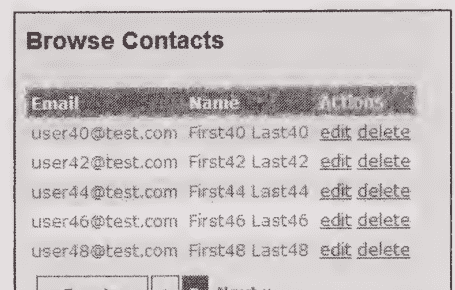

接下来的任务是对表格进行排序。在编写任何测试之前，让我们先奠定基础来处理排序。排序需要两个参数：

- 被排序的字段
- 排序的方向

我们需要做的第一件事是更改 Browse action 以处理排序：

```csharp
[AcceptVerbs(HttpVerbs.Get), Authorize]
public ActionResult Browse(int? page, string sortBy, string sortDir)
{
    ViewData["Title"] = "Browse Contacts";
    ViewData["sortdir"] = sortDir;
    ViewData["sortby"] = sortBy;

    page = page ?? 1;
    ViewData.Model = Service.GetPage((Guid)Provider.
        GetUser pirate.Contact.Name, false)
        .ProviderUserKey,
        page, sortBy, sortDir);

    return View("browse");
}
```

然后我们需要将排序参数传递给服务层，所以让我们在 `IContactService` 接口中重载 `GetPage` 方法：

```csharp
PagedList<Contact> GetPage(Guid userid, int? page,
                          string sortBy, string sortDirection);
```

在实现新的 `GetPage` 方法之前，重要的是要注意，我们不能在 LINQ 查询中使用排序字符串。我们不能执行以下操作：

```csharp
return Repository.Get()
    .Where(c => c.User.UserId == userid)
    .OrderBy(sortBy + " " + sortDirection)
    .ToPagedList((int)(page - 1), 20);
```


# 第八章：联系人管理

LINQ查询是强类型的，需要这样的排序表达式：

```csharp
return Repository.Get()
    .Where(c => c.User.UserId == userid)
    .OrderBy(o => o.Email)
    .ToPagedList((int)(page - 1), 20);
```

幸运的是，有一种方法可以使用LINQ动态查询库来执行动态LINQ，该库可以从MSDN（www.msdn.com）下载。这个库添加了一些扩展方法，允许我们执行动态LINQ。

既然我们已经下载了LINQ动态查询库并将其包含在代码中，我们现在可以更改`GetPage`的两个实现：

```csharp
public PagedList<Contact> GetPage(Guid userid, int? page)
{
    return GetPage(userid, page, "email", "asc");
}

public PagedList<Contact> GetPage(Guid userid, int? page,
                                string sortBy, string sortDirection)
{
    sortBy = sortBy ?? "email";
    sortDirection = sortDirection ?? "asc";
    page = page ?? 1;
    page = page < 1 ? 1 : page;
    return Repository.Get()
        .Where(c => c.User.UserId == userid)
        .OrderBy(sortBy + " " + sortDirection)
        .ToPagedList((int)(page - 1), 20);
}
```

> 注意这里的`OrderBy`，它使用动态LINQ来对查询进行排序。

让我们更新视图，看看排序是否有效。我们首先将网格标题设置为超链接：

```html
<thead>
    <tr>
        <th>
            <%= Html.ActionLink<ContactController>(
                c => c.Browse(ViewData.Model.PageNumber, "email", ViewData.GetSortDirection("email")),
                "Email") %>
        </th>
        <th>
            <%= Html.ActionLink<ContactController>(
                c => c.Browse(ViewData.Model.PageNumber, "name", 
                     ViewData.GetSortDirection("name")),
                "Name") %>
        </th>
        <th>
            操作
        </th>
    </tr>
</thead>
```

前面的代码使用了一个`ViewData`扩展方法`GetSortDirection`，当点击网格标题时，它会反转排序方向。

```csharp
public static string GetSortDirection(this ViewDataDictionary ViewData,
                                     string field)
{
    return (string)ViewData["sortby"] != field
           ? "asc"
           : ((string)ViewData["sortdir"] == "asc" 
               ? "desc"
               : "asc");
}
```

最后，我们需要确保分页控件能理解排序。我们首先向`PaginationViewData`类添加两个新属性：

```csharp
public string SortBy { get; set; }
public string SortDirection { get; set; }
```

然后我们更改用户控件，将排序参数添加到分页链接中。例如，这是之前的超链接：

```html
<a href='<%= ViewData.Model.PageActionLink.Replace("{page}", 
               (ViewData.Model.PageNumber - 1).ToString()) + 
              (string.IsNullOrEmpty(ViewData.Model.SortBy) ? "" : "?sortby=" + ViewData.Model.SortBy
                + "&sortdir=" + ViewData.Model.SortDirection)%>'>&laquo; 上一页</a>
```

在继续之前，让我们添加一个测试，以确保排序选项已保存到视图数据中：

```csharp
[Test]
public void browse_contacts_should_save_sort_options_to_viewdata()
{
    var result = controller.Browse(null, "email", "asc");
    controller.ViewData.AssertItem("sortby", "email");
    controller.ViewData.AssertItem("sortdir", "asc");
    result.AssertViewResult(controller, "浏览联系人", "browse");
}
```

## 编辑联系人

用户可以编辑联系人并更改其所有属性。我们需要确保只有联系人的所有者才能编辑它。如果联系人的电子邮件被更改为一个已属于该用户拥有的另一个联系人的电子邮件地址，则保存更改会失败并报错。

# 第八章：联系人管理

首先，我们需要确保可以获取视图：

```csharp
[Test]
public void edit_contact_should_return_view()
{
    PopulateRepository();
    var result = controller.Edit(1);
    result.AssertViewResult(controller, "编辑联系人", "edit");
}
```

然后我们在控制器中创建操作方法：

```csharp
[AcceptVerbs(HttpVerbs.Get), Authorize]
public ActionResult Edit(int id)
{
    ViewData["Title"] = "编辑联系人";
    return View("edit");
}
```

现在我们有了视图，让我们确保它将检索正确的联系人项目：

```csharp
[Test]
public void edit_contact_should_get_requested_contact()
{
    PopulateRepository();
    var result = controller.Edit(1);
    Assert.IsInstanceOfType(typeof(Contact), controller.ViewData.Model);
    Assert.AreEqual(1, ((Contact)controller.ViewData.Model).Id);
    result.AssertViewResult(controller, "编辑联系人", "edit");
}
```

然后我们修改`Edit`操作，使用服务类来检索联系人：

```csharp
[AcceptVerbs(HttpVerbs.Get), Authorize]
public ActionResult Edit(int id)
{
    ViewData["Title"] = "编辑联系人";
    ViewData.Model = Service.Get(id);
    return View("edit");
}
```

`Get`方法被添加到`IContactService`接口中，并在`InMemoryContactService`中实现：

```csharp
public Contact Get(int id)
{
    return Repository.Get().Where(c => c.Id == id).SingleOrDefault();
}
```

我们还希望确保如果提供的联系人ID不存在，会显示适当的错误信息：

```csharp
[Test]
public void edit_should_return_error_page_if_requested_contact_is_not_found()
{
    try
    {
        PopulateRepository();
        var result = controller.Edit(45789); //不存在的联系人
        Assert.Fail("未能抛出异常");
    }
    catch (ArgumentException)
    {
        controller.TempData.AssertItem("error", "找不到您请求的联系人");
    }
}
```

在这个测试中，我们尝试编辑一个不存在的联系人，我们期望抛出一个异常，并且错误信息会被添加到TempData字典中。这是修改后的操作：

```csharp
[AcceptVerbs(HttpVerbs.Get), Authorize]
public ActionResult Edit(int id)
{
    ViewData["Title"] = "编辑联系人";
    ViewData.Model = Service.Get(id);
    if (ViewData.Model == null)
    {
        TempData["error"] = "找不到您请求的联系人";
        throw new ArgumentException();
    }
    return View("edit");
}
```

让我们现在创建一个空的视图来测试错误情况。如果我们导航到`http://localhost/contact/edit/23424`，其中23424是一个不存在的联系人，我们应该会看到图8-8所示的错误页面。

**图8-8。**

显然，这不是一个对最终用户友好的错误。我们需要创建一个自定义的、更友好的错误页面。首先，我们需要通过在`<system.web>`节点下添加以下行来启用web.config文件中的自定义错误：

```xml
<customErrors mode="On"></customErrors>
```

接下来要做的是通过向操作添加`HandleError`属性来指示MVC框架处理错误：

```csharp
[AcceptVerbs(HttpVerbs.Get), Authorize]
[HandleError]
public ActionResult Edit(int id)
{
    ViewData["Title"] = "编辑联系人";
    ViewData.Model = Service.Get(id);
    if (ViewData.Model == null)
    {
        TempData["error"] = "找不到您请求的联系人";
        throw new ArgumentException();
    }
    return View("edit");
}
```

`HandleError`将处理操作执行期间抛出的任何未处理异常，并呈现一个错误视图。它通过在控制器的文件夹中查找名为*error*的视图来实现这一点；如果找不到，则在共享文件夹中查找。因此，让我们在共享文件夹中创建一个错误页面，以便可以在整个应用程序中使用：

```html
<h2>抱歉，处理您的请求时发生了错误。</h2>
<%if (TempData.ContainsKey("error")){%>
<div><%= TempData["error"] %></div>
<%}%>
```

错误视图将显示一个通用的错误消息，后面跟着来自TempData字典的自定义消息（如果存在的话）。现在，如果我们再次尝试导航到同一页面，我们应该会看到一个信息更丰富的错误消息，如图8-9所示。

我们现在需要确保登录用户只能编辑属于他或她的联系人。有许多方法可以强制执行这一点。我们可以在控制器中强制执行，或者我们可以在


## 第 8 章：联系人管理

服务类。我倾向于在服务层强制执行安全检查，以防我们需要将服务层用于另一个项目——例如，一个移动网站、一个 Web 服务或一个 Windows 客户端。我们不想为每个应用程序重写安全检查代码。该测试看起来与之前的测试非常相似：

```
[Test]
public void edit_should_return_error_page_if_user_is_not_owner()
{
    var id = 2;
    try
    {
        PopulateRepository();
        var result = controller.Edit(id); //owned by another user
        Assert.Fail("Failed to throw exception");
    }
    catch (ArgumentException)
    {
        var repo = (IContactRepository)kernel.Get(typeof(IContactRepository));
        Assert.AreEqual(1, repo.Get().Count(c => c.Id == id));
        controller.TempData.AssertItem("error",
            "The contact you requested could not be found");
    }
}
```

区别在于我们要查找的联系人存在，但属于另一个用户。为了实现这一点，我们必须更改 `Get` 方法的签名：

```
Contact Get(Guid userid, int id);
```

实现如下所示：

```
public Contact Get(Guid userid, int id)
{
    return Repository.Get().Where(c =>
        c.Id == id &&
        c.User.UserId == userid)
        .SingleOrDefault();
}
```

下一步是创建处理表单提交的 `Edit` 操作。由于这里的步骤与我们创建 `Create` 操作的方式非常相似，我将跳过细节并展示最终结果。以下是处理保存（post）的操作方法，它与我们之前编写的 `Create` 操作非常相似：

```
[AcceptVerbs(HttpVerbs.Post), Authorize]
[HandleError]
public ActionResult Edit(int id, [Bind(Prefix = "")] Contact model)
{
    ViewData["Title"] = "Edit Contact";
    try
    {
        model.Id = id;
        if (!Service.Save(UserId, model))
        {
            ViewData.ModelState.AddModelError("save",
                "Error saving the contact");
        }
    }
    catch (ValidationException ex)
    {
        foreach (var error in ex.ValidationErrors)
        {
            ViewData.ModelState.AddModelError(
                error.PropertyName,
                error.ErrorMessage);
        }
    }
    if (!ViewData.ModelState.IsValid)
    {
        return View("edit", model);
    }
    TempData["flash"] = "Contact successfully saved";
    return RedirectToAction("browse");
}
```

就像我们之前做的那样，我们验证输入，然后调用服务类上的保存方法。

```
public bool Save(Guid userid, Contact contact)
{
    var errors = ValidationRunner.Run(contact);
    if (errors != null && errors.Count > 0)
    {
        throw new ValidationException(errors);
    }
    //check if email is unique
    if (Repository.Get()
        .Count(c => c.Email.ToLower() == contact.Email.ToLower() &&
            c.User.UserId == userid && c.Id != contact.Id) > 0)
    {
        throw new ValidationException(
            new List<ValidationError>
            {
                new ValidationError("Email", "Email already exists")
            });
    }
    //make sure user has permission to save
    if(Repository.Get().Count(c =>
                                c.Id == contact.Id &&
                                c.User.UserId == userid) == 0)
        return false;
    return Repository.Save(contact);
}
```

视图也与创建视图相似：

```
<script type="text/javascript">
    $(document).ready(function() {
        $("#sex option[value=<%= (int) ViewData.Model.Sex %>]")
            .attr("selected", "selected");
    });
</script>
```

```
<h2>Edit Contact</h2>
<%=Html.ValidationSummary()%>
<%=Html.JQueryGenerator("editcontact", ViewData.Model)%>
<form id="editcontact"
      action="/contact/edit/<%=ViewData.Model.Id %>" method="post">
    <div>
        <label for="email">Email</label>
        <br />
        <%=Html.TextBox("email")%>
        <br />
        <label for="name">Name</label>
        <br />
        <%=Html.TextBox("name")%>
        <br />
        <label for="sex">Sex</label>
        <br />
        <select id="sex" name="sex">
            <option value="0"></option>
            <option value="1">Male</option>
            <option value="2">Female</option>
        </select>
        <br />
        <label for="dob">Date of Birth</label>
        <br />
        <input id="dob" name="dob" type="text"
            value='<%=ViewData.Model.Dob.ToShortDateString() %>' />
        <br />
        <input type="submit" value="Save Contact" />
    </div>
</form>
```

与创建视图相比，需要注意上一个视图中的一些重要差异。我们需要从下拉列表中选择合适的值，因此我使用了一个 JavaScript 调用来完成此操作。我只是获取性别的值，并将其用于设置下拉列表中相应选项的 `selected` 属性。

```
$("#sex option[value=<%= (int) ViewData.Model.Sex %>]")
    .attr("selected", "selected");
```

`$("#sex option[value=<%= (int) ViewData.Model.Sex %>]")` 部分只是选择一个类型为 `option` 的元素，该元素的父级 ID 为 `sex`，并且其 `value` 属性等于正在编辑的联系人性别。`attr("selected", "selected")` 部分向元素添加一个 `selected` 属性并将其值设置为 `selected`。生成的 HTML 将如下所示：

```
<select id="sex" name="sex">
    <option value="0"></option>
    <option value="1">Male</option>
    <option value="2" selected="selected">Female</option>
</select>
```

> **$(document).ready()**

$(document).ready() 是一个 jQuery 函数，它在页面文档对象模型 (DOM) 加载后立即执行，并在页面内容加载之前执行。

需要注意的是，我没有使用 TextBox Html 辅助工具来生成日期字段，因为我想将日期格式化为短日期字符串，即 01/01/2008，而不是 01/01/2008 12:00:00。由于 `Dob` 的类型为 `DateTime?`，我必须编写一个扩展方法来获取短日期字符串。

```
public static string ToShortDateString(this DateTime? date)
{
    return date == null ? "" : ((DateTime) date).ToShortDateString();
}
```

> **重构**

`Create` 和 `Edit` 视图几乎相同，是重构的良好候选者。我们可以将表单的 HTML 重构为一个用户控件，我们可以在两个页面中重用该控件。

## 删除联系人

当用户在网格中点击删除链接时，他/她将被重定向到确认页面，如图 8-10 所示。

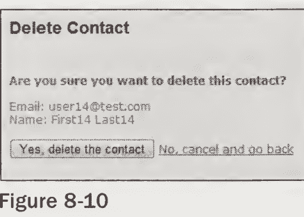

图 8-10

我遵循了之前提到的相同流程——创建测试、编写代码，并创建了一些视图来确认功能正常。以下是操作方法：

```
[AcceptVerbs(HttpVerbs.Get), Authorize]
[HandleError]
public ActionResult Delete(int id)
{
    ViewData["title"] = "Delete Contact";
    ViewData.Model = Service.Get(UserId, id);
    if (ViewData.Model == null)
    {
        TempData["error"] = "The contact you are trying to delete does not exist";
        throw new ArgumentException();
    }
    return View("delete");
}

[AcceptVerbs(HttpVerbs.Post), Authorize, ActionName("Delete")]
[HandleError]
public ActionResult DeleteSubmit(int id)
{
    if (!Service.Delete(UserId, id))
    {
        TempData["error"] = "Error deleting the contact";
        throw new ArgumentException();
    }
    TempData["flash"] = "Contact successfully deleted";
    return RedirectToAction("browse");
}
```

上一个操作中需要注意的一点是在 `DeleteSubmit` 方法上使用了 `ActionName` 属性。`ActionName` 属性允许我们定义一个与方法名不同的操作名，这对于这种情况是必要的，因为两种方法具有相同的签名，不能同时被称为 `Delete`。这允许我们将删除表单发布到 URL `/contact/delete/{id}`，而不是 `/contact/deletesubmit/{id}`。

这是 `InMemoryContactService` 类中 `Delete` 方法的实现：

```
public bool Delete(Guid userid, int id)
{
    //make sure user has permission to delete
    if (Repository.Get().Count(c =>
                            c.Id == id &&
                            c.User.UserId == userid) == 0)
        return false;
    return Repository.Delete(id);
}
```

## 总结

本章涵盖了许多主题。我们讨论了数据网格的分页和排序。我们注册了一个自定义路由。我们讨论了错误处理，以及如何使用 **HandleError** 特性将用户重定向到友好的错误页面。我们看到我们的验证框架在客户端和服务器端的实际应用。我们使用了一点点 jQuery 魔法，在页面加载时选中下拉列表项。我们使用 **ActionName** 特性为 action 指定了一个与方法名不同的名称。我们通过 TDD 完成了所有这些工作，并且单元测试覆盖了我们能想到的所有条件，因此到目前为止，我们应该对自己的代码感到非常舒适和自信。

阿尔达布拉皇家不会飞的鸟类是世界上最大的鸟类之一。这种有蹼的鸟类，雄性羽毛为白色，雌性颜色较深，它们是优秀的游泳者和潜水者，但不会飞。它们的雄性属于阿尔达布拉环礁上的受保护物种，该环礁是印度洋塞舌尔群岛的一部分。

### 信天翁的蛋
信天翁是世界上最大的飞行鸟类之一。它们的翼展可达 3.5 米；这使它们能够在海洋上空滑翔数小时甚至数天。它们只产一枚蛋，是不典型的鸟类，因为它们大部分时间都在海上或海面上方度过。

### 几维鸟的蛋
几维鸟是不会飞的鸟类，由于腿太短，它们甚至无法奔跑。它们生活在新西兰，白天在巢穴中睡觉，只在夜间觅食。雌性每年只产一枚巨大的蛋，重量相当于自身体重的四分之一。

### 帝企鹅的蛋
雌性帝企鹅要长途跋涉寻找食物，并将蛋留给雄性照顾，由雄性孵卵并抚养幼鸟。

## 导入联系人

期望用户一次创建一个联系人是不合理的。我们需要一种方式，让他们能够一次导入或输入多个联系人。有几种方法可以完成这项任务，我们将在本章中讨论这些方法。我们将使用户能够快速轻松地导入他们现有的联系人列表，以便他们可以立即开始使用我们的应用程序。

## 问题

毫无疑问，该应用程序的用户拥有数百甚至数千个他们想要联系的人。他们需要将这些联系人导入我们的应用程序，但到目前为止，我们只允许他们一次导入一个联系人。在实际应用中，这是不可行的。我们需要让用户能够批量输入联系人，可以通过输入（复制和粘贴）或上传包含联系人的文本文件。

## 设计

在本书中，我们只关注文本文件的导入，但我们希望设计出具有灵活性的应用程序，以支持其他文件格式，例如 Excel 电子表格或 Outlook 个人文件。

在本章中，我们将创建该接口的两个实现——一个用于处理上传的文本文件，另一个用于处理多联系人的字符串。

多个联系人将在多行文本框中输入，每行一个联系人，联系人详细信息以逗号分隔。例如：

```
user1@acme.com,firstname,lastname,male,12/17/1964
user2@hotmail.com,firstname
user3@gmail.com,,,female
```

# 第 9 章：导入联系人

我们还将假设上传的文本文件将采用相同的格式。同样，这是目前我们支持的格式，但我们已经对其进行了设计，以便将来能够轻松支持其他格式。

## 解决方案

我们从通常的测试开始，确保存在一个视图，并设置了适当的标题：

```
[Test]
public void import_should_return_view()
{
    var result = controller.Import();
    result.AssertViewResult(controller, "Import Contacts", "import");
}
```

然后我们在 ContactController 中使用此 action 使测试通过：

```
[AcceptVerbs(HttpVerbs.Get)]
public ActionResult Import()
{
    ViewData["Title"] = "Import Contacts";
    return View("import");
}
```

在下一个测试中，我们将确保字符串或上传的文件被发布到服务器。上传的文件是 Request 对象的一部分，位于 Files 集合中，因此我们将通过调用 `Request.Files[0]` 来访问该文件。我们需要为这些对象添加一个 mock，以便测试能够工作：

```
httpContext.Expect(h => h.Request).Returns(request.Object);
request.Expect(r => r.Files).Returns(files.Object);
```

上述对象声明如下：

```
private static Mock<HttpRequestBase> request;
private static Mock<HttpFileCollectionBase> files;
```

以下是测试：

```
[Test]
public void import_should_return_error_if_contacts_and_file_are_missing()
{
    var result = controller.Import(null);
    Assert.IsNotNull(result);
    Assert.IsInstanceOfType(typeof(ViewResult), result);
    controller.ViewData.ModelState
        .AssertErrorMessage("Import",
            "You must enter some contacts or upload a file");
    result.AssertViewResult(controller, "Import Contacts", "import");
}
```

为了使测试通过，我们创建了一个处理 post 请求的 import action，验证输入和上传的文件，如下所示：

```
[AcceptVerbs(HttpVerbs.Post)]
public ActionResult Import(string contacts)
{
    ViewData["Title"] = "Import Contacts";
    if (string.IsNullOrEmpty(contacts) && Request.Files.Count == 0)
    {
        ViewData.ModelState.AddModelError("Import",
            "You must enter some contacts or upload a file");
    }
    if (!ViewData.ModelState.IsValid)
    {
        return View("import");
    }
    throw new NotImplementedException();
}
```

最后抛出异常是故意的设计，直到我们实现 action 的其余部分。

现在，让我们确保 Import action 在成功时添加一条闪存消息：

```
[Test]
public void import_should_add_flash_message_if_import_is_successful()
{
    var result = controller.Import("user1@test.com");
    Assert.IsTrue(controller.ModelState.IsValid, "model state is invalid");
    Assert.Contains(controller.TempData,
        new KeyValuePair<string, object>
            ("flash",
             "Contacts successfully imported"),
        "Flash message is missing");
}
```

我们通过在 action 中简单添加以下行来使测试通过：

```
TempData["flash"] = "Contacts successfully imported";
```

接下来，我们要确保如果导入成功，将被重定向到 Browse action：

```
[Test]
public void import_should_redirect_to_browse_action_if_successful()
{
    var result = controller.Import("user1@test.com");
    Assert.IsTrue(controller.ModelState.IsValid, "model state is invalid");
    result.AssertRedirectToRouteResult("browse");
}
```

到目前为止，我们的 Import action 如下所示：

```
[AcceptVerbs(HttpVerbs.Post)]
public ActionResult Import(string contacts)
{
    ViewData["Title"] = "Import Contacts";
    if (string.IsNullOrEmpty(contacts) &&
        (Request.Files.Count == 0 || Request.Files[0].ContentLength == 0))
    {
        ViewData.ModelState.AddModelError("Import",
            "You must enter some contacts or upload a file");
    }
    if (!ViewData.ModelState.IsValid)
    {
        return View("import");
    }
    TempData["flash"] = "Contacts successfully imported";
    return RedirectToAction("browse");
}
```

到目前为止，它实际上还没有执行任何导入操作，因此我们需要确保它确实导入了输入的联系人。但在那之前，让我们快速创建一个视图，确保一切工作正常。该视图包含一个文本区域和一个按钮，如下所示：

```
<h2>
    Import Contacts</h2>
<%=Html.ValidationSummary() %>
<form id="importcontacts" action="/contact/import" method="post"
      enctype="multipart/form-data">
<div>
    Enter email address below. One address per line.
    <label for="contacts">
        Email Addresses</label>
    <br />
    <textarea id="contacts" name="contacts" rows="10" cols="55"></textarea>
</div>
<div>
    <input type="file" id='file' name='file' /></div>
<div>
    <input type="submit" id="import" name="import" value="Import Email" /></div>
</form>
```

如果我们点击提交按钮，应该会看到如图 9-1 所示的验证错误。

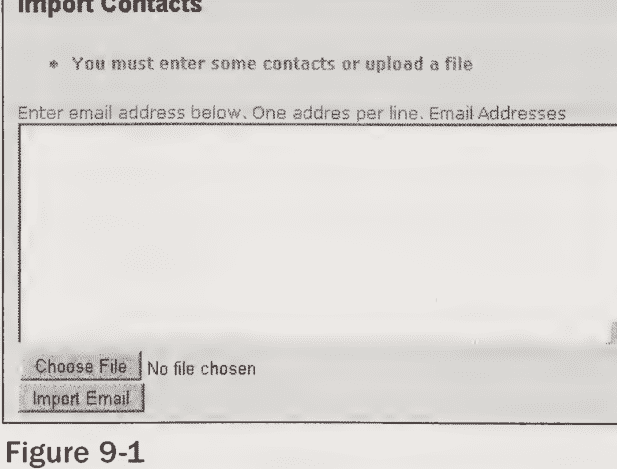

图 9-1


## 第9章：导入联系人

现在，我们需要实例化一个导入器实例。实现这一点的一种方法是编写一个if语句，该语句将确定实例化`IContactsImporter`接口的哪个实现，然后调用相应的`Parse`方法。问题在于，测试这段逻辑将很困难，而且我们将无法轻松地模拟`IContactsImporter`接口。为了澄清这一点，让我们进一步探讨一下。我们可以在操作中编写以下代码：

```
if (!string.IsNullOrEmpty(contacts))
{
    //use text importer
    ContactsImporter = new TextImporter();
    ContactsImporter.Parse(contacts);
}
else
{
    //use file importer
    ContactsImporter = new FileImporter();
    ContactsImporter.Parse(Request.Files[0]);
}
```

查看上面的代码，问问自己：我如何才能将一个`IContactsImporter`的模拟实例传递给控制器？我如何才能验证创建了正确的实例？这两个问题的答案都是：你无法做到。这似乎是工厂方法模式的理想应用场景。我们可以创建一个工厂类，该类知道如何创建`IContactsImporter`的实例，并且通过使用接口，我们将能够进行模拟。

我们需要创建一个解析器工厂，该工厂将返回一个具有`Parse`方法的解析器，该方法将返回一个联系人列表。然后，我们将联系人列表发送到一个`Import`方法中，该方法将填充数据库。这听起来可能有点混乱，但随着我们继续推进，一切都会变得清晰。解析器工厂接口如下所示：

```
public interface IParserFactory
{
    IParser Create(string contacts, HttpPostedFileBase file);
}
```

解析器接口如下：

```
public interface IParser
{
    IList<Contact> Parse();
}
```

现在我们需要实现`IParserFactory`接口，使其返回适当的`IParser`实例。我们将首先创建一个新的测试类来测试解析器工厂，如下所示，并添加我们的第一个测试：

```
[TestFixture]
public class ParserFactoryTests
{
    [Test]
    public void factory_should_return_string_parser_if_contacts_are_passed_in()
    {
        ParserFactory factory = new ParserFactory();
        string contacts = "bob@email.com";
        IParser parser = factory.Create(contacts, null);
        Assert.IsInstanceOfType(typeof (StringParser), parser,
                                  "Wrong parser type returned");
    }
}
```

此测试需要一个名为`StringParser`的`IParser`实现才能编译通过。`StringParser`类如下所示：

```
public class StringParser : IParser
{
    public string Contacts { get; set; }

    public StringParser(string contacts)
    {
        Contacts = contacts;
    }

    public IList<Contact> Parse()
    {
        throw new System.NotImplementedException();
    }
}
```

我们暂时不实现`Parse`方法；稍后我们会处理。接下来，我们需要创建`ParserFactory`类。我们现在不需要实现整个逻辑；相反，我们只实现足以通过测试的部分：

```
public class ParserFactory : IParserFactory
{
    public IParser Create(string contacts, HttpPostedFileBase file)
    {
        if (!string.IsNullOrEmpty(contacts))
            return new StringParser(contacts);

        throw new NotImplementedException();
    }
}
```

我们的测试现在应该通过了。我们的第二个测试将确保如果用户上传文本文件，我们将得到一个文本文件解析器。在此测试中，我们将按如下方式模拟上传的文件：

```
[Test]
public void factory_should_return_text_file_parser_for_uploaded_text_files()
{
    var factory = new ParserFactory();
    var contacts = string.Empty;
    var mockUploadedTextFile = new Mock<HttpPostedFileBase>();
    mockUploadedTextFile.Expect(f => f.FileName).Returns("textfile.txt");
    var parser = factory.Create(contacts, mockUploadedTextFile.Object);
    Assert.IsInstanceOfType(typeof(TextFileParser), parser,
                            "Wrong parser type returned");
}
```

此测试将失败。我们需要创建`TextFileParser`：

```
public class TextFileParser:IParser
{
    public HttpPostedFileBase PostedFile { get; set; }

    public TextFileParser(HttpPostedFileBase postedFile)
    {
        PostedFile = postedFile;
    }

    public IList<Contact> Parse()
    {
        throw new System.NotImplementedException();
    }
}
```

现在，我们按如下方式修改`Create`工厂方法，使测试通过：

```
public class ParserFactory : IParserFactory
{
    public IParser Create(string contacts, HttpPostedFileBase file)
    {
        if (!string.IsNullOrEmpty(contacts))
            return new StringParser(contacts);

        if(file !=null)
        {
            if (Path.GetExtension(file.FileName).ToLower() == ".txt")
                return new TextFileParser(file);
        }
        throw new NotImplementedException();
    }
}
```

我们需要再添加几个测试，以确保`Create`工厂方法在无法创建适当的解析器时抛出异常。我们希望在既未提供字符串也未提供上传文件时抛出`ArgumentNullException`，在提供了不支持的文件格式时抛出`NotImplementedException`。

```
[Test]
public void factory_should_throw_exception_if_file_format_is_not_supported()
{
    var factory = new ParserFactory();
    var contacts = string.Empty;
    var mockUploadedTextFile = new Mock<HttpPostedFileBase>();
    mockUploadedTextFile.Expect(f => f.FileName).Returns("textfile.xls");
    Assert.Throws(typeof(NotImplementedException),
            () => factory.Create(contacts, mockUploadedTextFile.Object));
}

[Test]
public void factory_should_throw_exception_if_arguments_are_invalid()
{
    var factory = new ParserFactory();
    var contacts = string.Empty;
    Assert.Throws(typeof(ArgumentNullException),
        () => factory.Create(contacts, null));
}
```

最后，我们对`Create`工厂方法做最后一次更改，以通过之前的测试：

```
public IParser Create(string contacts, HttpPostedFileBase file)
{
    if (!string.IsNullOrEmpty(contacts))
        return new StringParser(contacts);

    if (file != null)
    {
        if (Path.GetExtension(file.FileName).ToLower() == ".txt")
            return new TextFileParser(file);
        else
            throw new NotImplementedException();
    }
    throw new ArgumentNullException();
}
```

在回到我们的控制器操作并使用我们刚刚创建的新工厂之前，让我们先实现解析器中缺失的部分。我们将从`StringParser`类开始，并为它创建一个新的测试夹具，包含一个方法。

```
[TestFixture]
public class StringParserTests
{
    [Test]
    public void parser_should_return_collection_of_valid_emails()
    {
        var emails = "user1@test.com\r\n" +
                    "user2@test.com\r\n" +
                    "bad email @ test. com\r\n" +
                    "user3@test.com";
        var parser = new StringParser(emails);
        var contacts = parser.Parse();
        Assert.AreEqual(3, contacts.Count);
        Assert.AreEqual("user1@test.com", contacts[0].Email);
        Assert.AreEqual("user2@test.com", contacts[1].Email);
        Assert.AreEqual("user3@test.com", contacts[2].Email);
    }
}
```

编写`Parse`方法以通过上述测试后，我们的`StringParser`类如下所示：

```
public class StringParser : IParser
{
    public string Contacts { get; set; }

    public StringParser(string contacts)
    {
        Contacts = contacts;
    }

    public IList<Contact> Parse()
    {
        var parsedContacts = new List<Contact>();
        var emails = Contacts.Split(new char[]
                                    {
                                        Convert.ToChar("\r"),
                                        Convert.ToChar("\n")
                                    });

        foreach (var email in emails)
        {
            if(AppHelper.IsValidEmail(email))
            {
                parsedContacts.Add(new Contact{Email = email.Trim()});
            }
        }
        return parsedContacts;
    }
}
```

我们需要对文本文件解析器做同样的事情；测试如下：

```
[Test]
public void parser_should_return_collection_of_valid_emails()
{
    var mockFile = new Mock<HttpPostedFileBase>();

    var emails = "user1@test.com\r\n" +
                 "user2@test.com\r\n" +
                 "bad email @ test. com\r\n" +
                 "user3@test.com";
    var encoding = new ASCIIEncoding();
    var buffer = encoding.GetBytes(emails);
    var stream = new MemoryStream(buffer);

    mockFile.Expect(f => f.InputStream)
        .Returns(stream);

    var parser = new TextFileParser(mockFile.Object);
    var contacts = parser.Parse();
    Assert.AreEqual(3, contacts.Count);
    Assert.AreEqual("user1@test.com", contacts[0].Email);
    Assert.AreEqual("user2@test.com", contacts[1].Email);
    Assert.AreEqual("user3@test.com", contacts[2].Email);
}
```

这看起来与我们之前编写的字符串解析器测试类似。这里需要注意的一个重要区别是，我们正在模拟上传的文件。Parse方法将读取底层流并使用电子邮件地址填充集合。

```
public IList<Contact> Parse()
{
    var reader = new StreamReader(PostedFile.InputStream);
```


## 第9章：导入联系人

```csharp
var filecontent = reader.ReadToEnd();
var parsedContacts = new List<Contact>();
var emails = filecontent.Split(new char[]
    {
        Convert.ToChar("\r"),
        Convert.ToChar("\n")
    });

foreach (var email in emails)
{
    if (AppHelper.IsValidEmail(email))
    {
        parsedContacts.Add(new Contact { Email = email.Trim() });
    }
}
return parsedContacts;
}
```

既然我们所有的解析器和解析器工厂都已就绪，我们可以回到在控制器中创建导入操作。我们的第一个测试将测试 `ParserFactory` 的 `Create` 方法被调用这一事实。

```csharp
[Test]
public void import_should_call_the_parser_factory()
{
    var mockFile = new Mock<HttpPostedFileBase>();
    mockFile.Expect(f => f.ContentLength)
        .Returns(5000);

    var mockParser = new Mock<IParser>();
    mockParserFactory.Expect(f => f.Create(string.Empty, mockFile.Object))
        .Returns(mockParser.Object);
    mockParser.Expect(p => p.Parse())
        .Returns(new List<Contact>());

    mockFiles.Expect(f => f.Count).Returns(1);
    mockFiles.Expect(f => f[0]).Returns(mockFile.Object);

    var result = controller.Import(string.Empty);

    mockParserFactory.VerifyAll();
}
```

在上面的测试中，我们模拟了不少对象，以确保我们只测试正在检查的特定代码片段。首先，我们模拟文件以返回大于零的内容长度。我们模拟文件集合以表明它包含一个文件，最后，我们模拟解析器工厂，因为我们对它的功能不感兴趣，只关心其 `Create` 方法是否被正确的参数调用。

然后我们向导入操作添加几行代码以通过此测试：

```csharp
var mockFile = new Mock<HttpPostedFileBase>();
mockFile.Expect(f => f.ContentLength).Returns(5000);

var mockParser = new Mock<IParser>();
mockParserFactory.Expect(f => f.Create(string.Empty, mockFile.Object))
    .Returns(mockParser.Object);

mockFiles = new Mock<HttpFileCollectionBase>();
mockFiles.Expect(f => f.Count).Returns(1);
mockFiles.Expect(f => f[0]).Returns(mockFile.Object);
request.Expect(r => r.Files).Returns(mockFiles.Object);

controller.Import(string.Empty);
mockParserFactory.VerifyAll();
}
```

对于下一个测试，我们想确保 `Parse` 方法被调用：

```csharp
[Test]
public void import_should_call_the_parse_method()
{
    var mockFile = new Mock<HttpPostedFileBase>();
    mockFile.Expect(f => f.ContentLength).Returns(5000);
    var mockParser = new Mock<IParser>();
    mockParserFactory.Expect(f => f.Create(string.Empty, mockFile.Object))
        .Returns(mockParser.Object);
    mockParser.Expect(p => p.Parse())
        .Returns(new List<Contact>
        {
            new Contact {Email = "user1@test.com"},
            new Contact {Email = "user2@test.com"},
            new Contact {Email = "user3@test.com"}
        });
    mockFiles = new Mock<HttpFileCollectionBase>();
    mockFiles.Expect(f => f.Count).Returns(1);
    mockFiles.Expect(f => f[0]).Returns(mockFile.Object);
    request.Expect(r => r.Files).Returns(mockFiles.Object);
    controller.Import(string.Empty);
    mockParser.VerifyAll();
}
```

这与前一个测试类似，为了使其生效，我们只需向导入操作添加一行代码以调用 `Parse` 方法。不过有一个问题；如果我们运行所有测试，会发现 `import_should_add_flash_message_if_import_is_successful` 和 `import_should_redirect_to_browse_action_if_successful` 这两个测试失败了。这是因为操作试图在空的解析器工厂上调用 `Create` 方法，并在空的解析器上调用 `Parse` 方法。通过简单地模拟这些调用，很容易修复这个问题。

最后一步是确保调用联系人服务上的 `Import` 方法：

```csharp
[Test]
public void import_should_call_import_on_service()
{
    var mockFile = new Mock<HttpPostedFileBase>();
    mockFile.Expect(f => f.ContentLength).Returns(5000);

    var mockParser = new Mock<IParser>();
    mockParserFactory.Expect(f => f.Create(string.Empty, mockFile.Object))
        .Returns(mockParser.Object);
    var contacts = new List<Contact>
    {
        new Contact {Email = "user1@test.com"},
        new Contact {Email = "user2@test.com"},
        new Contact {Email = "user3@test.com"}
    };
    mockParser.Expect(p => p.Parse())
        .Returns(contacts);
    mockFiles = new Mock<HttpFileCollectionBase>();
    mockFiles.Expect(f => f.Count).Returns(1);
    mockFiles.Expect(f => f[0]).Returns(mockFile.Object);
    request.Expect(r => r.Files).Returns(mockFiles.Object);

    var mockService = new Mock<IContactService>();
    mockService.Expect(s => s.Import(UserId, contacts));
    controller.Service = mockService.Object;
    controller.Import(string.Empty);

    mockService.VerifyAll();
}
```

这就像之前的测试一样，只是我们测试的是服务的 `Import` 方法被调用。这个方法还不存在，需要在 `IContactService` 接口上创建。其签名如下所示：

```csharp
void Import(IList<Contact> contacts);
```

以下是最终的联系人控制器操作：

```csharp
[AcceptVerbs(HttpVerbs.Post)]
public ActionResult Import(string contacts)
{
    ViewData["Title"] = "Import Contacts";
    if (string.IsNullOrEmpty(contacts) &&
        (Request.Files.Count == 0 || Request.Files[0].ContentLength == 0))
    {
        ViewData.ModelState.AddModelError("Import",
            "You must enter some contacts or upload a file");
    }
    if (!ViewData.ModelState.IsValid)
    {
        return View("import");
    }

    var file = Request.Files.Count == 0 ? null : Request.Files[0];
    var parser = ParserFactory.Create(contacts, file);
    var parsedContacts = parser.Parse();
    Service.Import(UserId, parsedContacts);

    TempData["flash"] = "Contacts successfully imported";
    return RedirectToAction("browse");
}
```

正如你可能预料的，这段代码破坏了一些测试，因为 `Import` 方法尚未实现。我们可以通过模拟对 `Import` 的调用而无需担心其实际实现细节来修复这些损坏的测试。具体方法如下：

```csharp
var mockService = new Mock<IContactService>();
mockService.Expect(s => s.Import(UserId, contacts));
controller.Service = mockService.Object;
```

### 导入实现

到目前为止，我们已经实现了导入联系人的控制器操作。这包括使用工厂方法模式来处理适当解析器的实例化。解析器实现返回一个联系人集合。我们需要将这些联系人添加到我们的数据存储（仓储）中。

我们将首先在 `ContactServiceTests` 类中编写测试。我们的第一个测试将确保对于已存在的联系人返回错误。测试如下：

```csharp
[Test]
public void import_should_return_errors_for_existing_emails()
{
    var userid = Guid.NewGuid();
    var contact1 = new Contact
                   {
                       Email = "user1@abc.com",
                       User = new User {UserId = userid}
                   };
    var contact2 = new Contact
                   {
                       Email = "existing@abc.com",
                       User = new User {UserId = userid}
                   };
    var contact3 = new Contact
                   {
                       Email = "user2@abc.com",
                       User = new User {UserId = userid}
                   };
    var contacts = new List<Contact>
                   {
                       contact1,
                       contact2,
                       contact3
                   };

    var repository = new InMemoryContactRepository();
    repository.Add(contact2);

    var mockRunner = new Mock<IValidationRunner>();
    mockRunner.Expect(v => v.Run(contact1))
        .Returns(new List<ValidationError>());
    mockRunner.Expect(v => v.Run(contact2))
        .Returns(new List<ValidationError>());
    mockRunner.Expect(v => v.Run(contact3))
        .Returns(new List<ValidationError>());

    var service = new InMemoryContactService(
        repository,
        mockRunner.Object);

    var exception = (ValidationException)
            Assert.Throws(typeof(ValidationException),
                         () => service.Import(userid, contacts));
    Assert.AreEqual(1, exception.ValidationErrors.Count);
    Assert.AreEqual(string.Format("{0} already exists",
                                 contact2.Email),
             exception.ValidationErrors[0].ErrorMessage);
    Assert.AreEqual(1, repository.Get()
             .Count(c => c.Email == contact2.Email));
    mockRunner.VerifyAll();
}
```

我们首先创建三个联系人对象，并将其中一个添加到我们的仓储中。然后我们模拟验证成功，接着调用 `Import` 方法。`Import` 方法应该抛出一个验证异常，其中包含一个验证错误信息："existing@abc.com already exists"。我们还验证了仓储中只包含一个具有该电子邮件的联系人。以下是使此测试通过的代码：

```csharp
public void Import(Guid userid, IList<Contact> contacts)
{
    var errors = new List<ValidationError>();
    for (int i = 0; i < contacts.Count; i++)
    {
        var contact = contacts[i];
        try
        {
            var contactErrors = ValidationRunner.Run(contact);
            if (contactErrors != null && contactErrors.Count > 0)
            {
                errors.AddRange(contactErrors);
                continue;
            }
            //检查电子邮件是否存在
            if (Repository.Get()
                       .Count(c => c.Email.ToLower() == contact.Email.ToLower() &&
                                   c.User.UserId == contact.User.UserId) > 0)
            {
                errors.Add(
                    new ValidationError("Import",
                                         string.Format("{0} already exists",
                                                       contact.Email)));
            }
        }
```


```
catch
{
    errors.Add(
        new ValidationError("Import",
                            string.Format("Error importing {0}",
                                          contact.Email)));
}
}
if (errors.Count > 0)
{
    throw new ValidationException(errors);
}
}
```

你会注意到，在之前的代码中，我复用了验证逻辑来验证每个联系人。但不是立即抛出异常，而是将验证错误添加到一个集合中，然后继续处理下一个联系人。在方法的最后，我抛出一次包含所有验证错误的异常。这些错误随后可以被控制器解析，以向用户显示有关导入状态的信息性消息_ratio_。

### 发现 Bug

在为 Import 方法编写前面的测试时，我发现了一个 Bug。原来是我们忘记为每个正在导入的联系人设置 User 对象，这导致抛出了空指针异常。作为优秀的测试驱动开发（**TDD**）实践者，我们应该编写一个测试来复现这个 Bug，然后修复它。基本上，我们的测试应该确保所有联系人都设置了 User 对象。

```
[Test]
public void import_should_set_user_object_on_each_contact()
{
    var userid = Guid.NewGuid();
    var username = "testuser";
    var contact1 = new Contact
    {
        Email = "user1@abc.com"
    };
    var contact2 = new Contact
    {
        Email = "user2@abc.com"
    };
    var contact3 = new Contact
    {
        Email = "user3@abc.com"
    };
    var contacts = new List<Contact>
    {
        contact1,
        contact2,
        contact3
    };

    var repo = new InMemoryContactRepository();
    var mockRunner = new Mock<IValidationRunner>();
    mockRunner.Expect(v => v.Run(contact1))
        .Returns(new List<ValidationError>());
    mockRunner.Expect(v => v.Run(contact2))
        .Returns(new List<ValidationError>());
    mockRunner.Expect(v => v.Run(contact3))
        .Returns(new List<ValidationError>());

    var service = new InMemoryContactService(
        repo,
        mockRunner.Object);

    service.Import(new User
    {
        UserId = userid,
        Username = username
    }, contacts);

    Assert.AreEqual(3, repo.Get().Count());
    Assert.AreEqual(3, repo.Get().Count(
                    c => c.User.UserId == userid &&
                         c.User.Username == username));

    mockRunner.VerifyAll();
}
```

前面测试中需要注意的重点是最后两个 `Assert` 调用。我们首先确保三个联系人都已添加到仓库中；然后我们确保它们都设置了正确的 `User` 对象值。为了让这个测试通过，我们在 `Import` 方法中添加了一行代码：

```
contact.User = user;
```

我们继续创建更多测试并修改代码使它们通过。这里还有几个测试：

```
[Test]
public void import_should_add_contacts_to_repository()
{
    var userid = Guid.NewGuid();
    var contact1 = new Contact
    {
        Email = "user1@abc.com",
        User = new User { UserId = userid }
    };
    var contact2 = new Contact
    {
        Email = "user2@abc.com",
        User = new User { UserId = userid }
    };
    var contact3 = new Contact
    {
        Email = "user3@abc.com",
        User = new User { UserId = userid }
    };
    var contacts = new List<Contact>
    {
        contact1,
        contact2,
        contact3
    };

    var mockRepo = new Mock<IContactRepository>();
    mockRepo.Expect(r => r.Add(contact1)).Returns(1);
    mockRepo.Expect(r => r.Add(contact2)).Returns(2);
    mockRepo.Expect(r => r.Add(contact3)).Returns(3);
    mockRepo.Expect(r => r.Get())
        .Returns((new List<Contact>()).AsQueryable());

    var mockRunner = new Mock<IValidationRunner>();
    mockRunner.Expect(v => v.Run(contact1))
        .Returns(new List<ValidationError>());
    mockRunner.Expect(v => v.Run(contact2))
        .Returns(new List<ValidationError>());
    mockRunner.Expect(v => v.Run(contact3))
        .Returns(new List<ValidationError>());

    var service = new InMemoryContactService(
        mockRepo.Object,
        mockRunner.Object);

    service.Import(userid, contacts);

    mockRepo.VerifyAll();
    mockRunner.VerifyAll();
}
```

```
[Test]
public void import_should_return_error_for_invalid_emails_and_not_add_them()
{
    var userid = Guid.NewGuid();
    var contact1 = new Contact
    {
        Email = "user1@abc.com",
        User = new User { UserId = userid }
    };
    var contact2 = new Contact
    {
        Email = "user 2 bad email@abc.com",
        User = new User { UserId = userid }
    };
    var contact3 = new Contact
    {
        Email = "user3@abc.com",
        User = new User { UserId = userid }
    };
    var contacts = new List<Contact>
    {
        contact1,
        contact2,
        contact3
    };

    var mockRepo = new Mock<IContactRepository>();
    mockRepo.Expect(r => r.Add(contact1)).Returns(1);
    mockRepo.Expect(r => r.Add(contact3)).Returns(3);
    mockRepo.Expect(r => r.Get())
        .Returns((new List<Contact>()).AsQueryable());

    var mockRunner = new Mock<IValidationRunner>();
    mockRunner.Expect(v => v.Run(contact1))
        .Returns(new List<ValidationError>());
    mockRunner.Expect(v => v.Run(contact2))
        .Returns(new List<ValidationError>
        {
            new ValidationError("Email", "Invalid email")
        });
    mockRunner.Expect(v => v.Run(contact3))
        .Returns(new List<ValidationError>());

    var service = new InMemoryContactService(
        mockRepo.Object,
        mockRunner.Object);

    var exception = (ValidationException)
        Assert.Throws(typeof(ValidationException),
            () => service.Import(userid, contacts));
    Assert.AreEqual(1, exception.ValidationErrors.Count);
    Assert.AreEqual(string.Format("{0}: Invalid email",
        contact2.Email),
        exception.ValidationErrors[0].ErrorMessage);

    mockRunner.VerifyAll();
    mockRepo.VerifyAll();
    mockRunner.VerifyAll();
}
```

最终的 Import 方法如下：

```
public void Import(User user, IList<Contact> contacts)
{
    var errors = new List<ValidationError>();
    for (int i = 0; i < contacts.Count; i++)
    {
        var contact = contacts[i];
        contact.User = user;
        try
        {
            var contactErrors = ValidationRunner.Run(contact);
            if (contactErrors != null && contactErrors.Count > 0)
            {
                foreach (var contactError in contactErrors)
                {
                    contactError.ErrorMessage = string.Format("{0}: {1}",
                                                              contact.Email,
                                                              contactError.ErrorMessage);
                }
                errors.AddRange(contactErrors);
                continue;
            }
            //check if email exists
            if (Repository.Get()
                    .Count(c => c.Email.ToLower() == contact.Email.ToLower() &&
                                c.User.UserId == contact.User.UserId) > 0)
            {
                errors.Add(
                    new ValidationError("Import",
                                        string.Format("{0} already exists",
                                                      contact.Email)));
            }
            else
            {
                Repository.Add(contact);
            }
        }
        catch
        {
            errors.Add(
                new ValidationError("Import",
                                    string.Format("Error importing {0}",
                                                  contact.Email)));
        }
    }
    if (errors.Count > 0)
    {
        throw new ValidationException(errors);
    }
}
```

> 项目可能无法编译，一些测试也会失败，因为 Import 的签名已被更改。你必须返回去修复这些测试，使其与新签名配合工作。

### 测试运行

让我们把刚才构建的所有内容拿来试运行一下。如果我们输入几个联系人，如图 9-2 所示，然后点击导入按钮，我们就会被引导到图 9-3 所示的浏览页面，在那里我们可以看到联系人已被正确导入。


## 第9章：导入联系人

图9-2

图9-3

## 总结

在本章中，我们实现了处理联系人管理的关键功能。我们曾逐个创建联系人；批量导入联系人；也浏览、编辑和删除了联系人。我们采用TDD（测试驱动开发）方法实现了每项功能，从编写测试开始，然后编写必要的代码来通过测试。我们还创建了视图以确保所有功能协同工作，并目睹了验证的实际运行。

本章讨论的概念可以应用于本项目中的其他实体——例如消息、联系人列表等等。虽然并非完全相同，但总体概念是共通的，可以针对每个单独实体进行调整。

# 第10章：撰写消息

## 问题

我们的用户现在能够添加和编辑他们的地址簿，但目前他们还无处使用。我们需要允许用户向一个或多个联系人发送消息。此过程的第一步是创建新消息。

## 设计

一封电子邮件消息由以下部分组成：

- **名称** — 消息的名称
- **主题** — 电子邮件/消息的主题
- **文本** — 电子邮件/消息的文本正文
- **HTML** — 电子邮件/消息的HTML正文

名称字段用于标识您的消息，供内部使用，例如："订阅者通讯#4"、"非订阅者通讯#4"等等。名称、主题和文本是必填字段。

在本章中，我们仅讨论纯文本消息的编辑和创建；HTML编辑将在第11章中讨论。

## 解决方案

我们首先创建一个消息控制器和一个测试类。消息控制器目前为空，在测试类中，我们将创建第一个测试：

```csharp
[TestFixture]
public class MessageControllerTests
{
    private MessageController controller;
    private Message model;

    [SetUp]
    public void SetUp()
    {
        controller = new MessageController();
    }

    [Test]
    public void create_should_return_view()
    {
        var result = controller.Create();
        result.AssertViewResult(controller, "Create New Message");
    }
}
```

在控制器中创建`Create`操作方法之前，上述代码将无法编译：

```csharp
[AcceptVerbs(HttpVerbs.Get)]
[Authorize]
public ActionResult Create()
{
    return View(new Message());
}
```

请注意`Authorize`属性的用法；这可以防止未授权访问`Create`操作，因为我们只希望已登录（已授权）的用户创建消息。现在代码可以编译了，但测试失败。我们做一个小改动：

```csharp
[AcceptVerbs(HttpVerbs.Get)]
[Authorize]
public ActionResult Create()
{
    ViewData["Title"] = "Create New Message";
    return View(new Message());
}
```

现在测试通过了。接下来，我们要确保如果消息名称缺失时会返回错误。首先，我们将修改`SetUp`方法，用有效值实例化模型实例：

```csharp
[TestFixture]
public class MessageControllerTests
{
    private MessageController controller;
    private Message model;

    [SetUp]
    public void SetUp()
    {
        controller = new MessageController();
        model = new Message()
            {
                Subject = "My newsletter subject",
                Name = "October newsletter",
                Text = "Hello subscriber",
                Html = "Hello <b>subscriber</b>"
            };
    }

    [Test]
    public void create_should_return_error_if_name_is_missing()
    {
        model.Name = string.Empty;
        var result = controller.Create(model);
        var errorKey = "Name";
        var errorMessage = "Name is required";
        AssertCreateValidationError(result, errorKey, errorMessage);
    }
}

private void AssertCreateValidationError(ActionResult result,
                                            string errorKey,
                                            string errorMessage)
{
    //assert results
    Assert.IsNotNull(result);
    Assert.IsInstanceOfType(typeof(ViewResult), result);
    controller.ViewData.ModelState.AssertErrorMessage(errorKey, errorMessage);
    Assert.IsInstanceOfType(typeof(Message),
                            ((ViewResult)result).ViewData.Model);
    //assert that the ViewData.Model
    var outModel = (((ViewResult)result).ViewData.Model as Message);
    Assert.AreEqual(model.Subject, outModel.Subject);
    Assert.AreEqual(model.Name, outModel.Name);
    Assert.AreEqual(model.Text, outModel.Text);
    Assert.AreEqual("Create New Message", controller.ViewData["Title"],
                    "Page title is wrong");
}
```

同样，在编写`Create`操作方法之前，代码将无法编译。

```csharp
[AcceptVerbs(HttpVerbs.Post)]
public ActionResult Create(Message model)
{
    return View(model);
}
```

确保测试失败，然后进行以下更改直至通过。首先，我们需要一个`IMessageService`接口的实例，因此我们在`MessageController`类中添加以下构造函数和属性：

```csharp
public MessageController()
    : this(null)
{
}

[Inject]
public MessageController(IMessageService service)
{
    Service = service ?? new InMemoryMessageService();
}

public IMessageService Service { get; set; }
```

然后我们向服务类实现`Add`方法：

```csharp
public int Add(Message message)
{
    var errors = ValidationRunner.Run(message);
    if (errors != null && errors.Count > 0)
    {
        throw new ValidationException(errors);
    }
    return 0;
}
```

前面的代码应该抛出一个验证异常，因为缺少名称。这是因为我们的`Message`类定义如下：

```csharp
public class Message
{
    [Required(ErrorMessage = "Name is required")]
    public string Name { get; set; }
    [Required(ErrorMessage = "Subject is required")]
    public string Subject { get; set; }
    public string Html { get; set; }
    [Required(ErrorMessage = "A plain text body is required")]
    public string Text { get; set; }
    public int Id { get; set; }
}
```

测试现在应该通过了。我们将重复相同的步骤来测试`Subject`属性：

```csharp
[Test]
public void create_should_return_error_if_subject_is_missing()
{
    model.Subject = string.Empty;
    var result = controller.Create(model);
    var errorKey = "Subject";
    var errorMessage = "Subject is required";
    AssertCreateValidationError(result, errorKey, errorMessage);
}
```

以下是针对Text属性的另一个测试：

```csharp
[Test]
public void create_should_return_error_if_text_is_missing()
{
    model.Text = string.Empty;
    var result = controller.Create(model);
    var errorKey = "Text";
    var errorMessage = "A plain text body is required";
    AssertCreateValidationError(result, errorKey, errorMessage);
}
```

接下来，我们想确保消息被添加到仓库中：

```csharp
[Test]
public void create_should_add_message_to_repository()
{
    //mock the repo
    var mockRepo = new Mock<IMessageRepository>();
    //set expectations
    mockRepo.Expect(r => r.Add(model)).Returns(1);
    var mockValidationRunner = new Mock<IValidationRunner>();
    var service = new InMemoryMessageService(mockRepo.Object,
                                      mockValidationRunner.Object);
    controller = new MessageController(service);
    var result = controller.Create(model);
    mockRepo.VerifyAll();
}
```

这将会失败，因为我们没有调用仓库的Add方法。通过在服务类的Add方法中进行以下更改，可以轻松修复：

```csharp
public int Add(Message message)
{
    var errors = ValidationRunner.Run(message);
    if (errors != null && errors.Count > 0)
    {
        throw new ValidationException(errors);
    }
    return Repository.Add(message);
}
```

完整的服务类现在如下所示：

```csharp
public class MessageService : IMessageService
{
    private IValidationRunner ValidationRunner { get; set; }
    private IMessageRepository Repository { get; set; }

    public MessageService()
```


# 第10章：撰写消息

```csharp
public SIDEMessagesService(IMessageRepository repository,
    IValidationRunner validationRunner)
{
    ValidationRunner = validationRunner ?? new ValidationRunner();
    Repository = repository ?? new InMemoryMessageRepository();
}

public int Add(Message message)
{
    var errors = ValidationRunner.Run(message);
    if (errors != null && errors.Count > 0)
    {
        throw new ValidationException(errors);
    }
    return Repository.Add(message);
}
```

*Repository 类是在第6章中创建的。*

现在我们已经设置好了大部分 `Create` 功能，我们应该创建一个 `View` 来确保一切按预期工作。这与我们之前为联系人和联系人列表所做的其他视图没有太大区别。`View` 如下：

```html
<h2>
    创建新消息</h2>
<%= Html.ValidationSummary() %>
<%= Html.JQueryGenerator("createmessage", ViewData.Model) %>
<form id="createmessage" action="/message/create" method="post">
<div>
    <label for="name">
        名称</label>
    <br />
    <%=Html.TextBox("name") %>
    <br />
    <label for="subject">
        主题</label>
    <br />
    <%=Html.TextBox("subject") %>
    <br />
    <label for="html">
        Html 正文（可选）</label>
    <br />
    <%=Html.TextArea("html") %>
    <br />
    <label for="text">
        文本正文</label>
    <br />
    <%= Html.TextArea("text") %>
    <br />
    <input type="submit" value="创建消息" />
</div>
</form>
```

如果你尝试提交该表单，它将如图 10-1 所示。

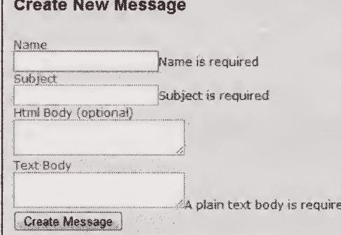

图 10-1

在测试了前面的视图后，你会意识到我们没有添加任何通知来显示保存成功。那么让我们开始这样做，从以下测试开始：

```csharp
[Test]
public void create_should_add_flash_message_if_save_is_successful()
{
    var mockService = new Mock<IMessageService>();
    mockService.Expect(s => s.Add(model)).Returns(1);
    controller = new MessageController(mockService.Object);
    var result = controller.Create(model);
    Assert.IsTrue(controller.ModelState.IsValid, "model state is invalid");
    Assert.Contains(controller.TempData,
        new KeyValuePair<string, object>
            ("flash",
            "Message successfully created"),
        "Flash message is missing");
    mockService.VerifyAll();
}
```

需要对 Action 方法进行以下修改以通过前面的测试：

```csharp
[AcceptVerbs(HttpVerbs.Post)]
public ActionResult Create([Bind(Prefix = "", Exclude = "Id")] Message model)
{
    ViewData["Title"] = "创建新消息";
    ViewData.Model = model;
    try
    {
        var id = Service.Add(model);
    }
    catch (ValidationException ex)
    {
        foreach (var error in ex.ValidationErrors)
        {
            ViewData.ModelState.AddModelError(
                error.PropertyName,
                error.ErrorMessage);
        }
    }

    if (!ViewData.ModelState.IsValid)
    {
        return View(model);
    }

    TempData["flash"] = "Message successfully created";
    return RedirectToAction("browse");
}
```

现在，当保存成功时，我们看到如图 10-2 所示的屏幕。

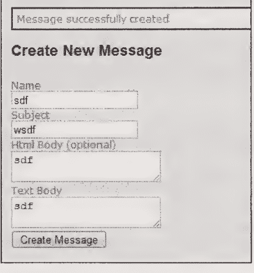

消息创建成功

**创建新消息**

名称
sdf
主题
wsdf
Html 正文（可选）
sdf
文本正文
sdf
[创建消息]

**图 10-2**

> 最终，我们会更改代码以重定向到适当的目标，例如，发送页面或包含消息列表的页面，或任何需要的页面。我们只需要编写适当的测试。

下一步是编辑现有消息，但在那之前，让我们先添加一个页面来列出所有现有消息。这样我们就能点击消息上的编辑链接并进入编辑界面。首先，确保创建屏幕重定向到浏览/列表视图。这通过一个简单的测试来完成：

```csharp
[Test]
public void create_should_redirect_to_list_view_after_successful_save()
{
    var mockService = new Mock<IMessageService>();
    mockService.Expect(s => s.Add(model)).Returns(1);
    controller = new MessageController(mockService.Object);
    var result = controller.Create(model);
    result.AssertRedirectToRouteResult("browse");
    mockService.VerifyAll();
}
```

对 Action 方法的返回值进行简单修改即可通过前面的测试：

```csharp
return RedirectToAction("browse");
```

我们现在创建浏览测试和代码。这与我们之前为联系人列表所做的工作非常相似，所以我将直接展示最终结果。我们将得到以下测试：

```csharp
[Test]
public void browse_messages_should_retrieve_20_or_less_messages_at_once()
{
    PopulateRepository();
    var result = controller.Browse(null);
    Assert.IsInstanceOfType(typeof(PagedList<Message>),
                            controller.ViewData.Model,
                            "View data is the wrong type");
    Assert.LessThanOrEqualTo(((PagedList<Message>)controller.ViewData.Model).Count,
                             20, "Page size is wrong");
    result.AssertViewResult(controller, "Browse Messages", "browse");
}

[Test]
public void browse_contacts_should_retrieve_messages_for_loggedin_user_only()
{
    PopulateRepository();
    var result = controller.Browse(null);
    Assert.AreEqual(25,
                    ((PagedList<Message>)controller.ViewData.Model).TotalItemCount,
                    "Item count is wrong");
}
```

要让这些测试通过编译，我们必须在测试类中编写一些支持代码。首先，声明这些类字段：

```csharp
private string Username = "testusername";
private Guid UserId = Guid.NewGuid();
static StandardKernel kernel;

private Mock<MembershipProvider> MockMembership =
    new Mock<MembershipProvider>();
private Mock<MembershipUser> MockMembershipUser =
    new Mock<MembershipUser>();
private Mock<IPrincipal> user =
    new Mock<IPrincipal>();
private Mock<IIdentity> identity =
    new Mock<IIdentity>();
private Mock<HttpContextBase> httpContext =
    new Mock<HttpContextBase>();
private Mock<HttpRequestBase> request = new Mock<HttpRequestBase>();

private Mock<ControllerBase> controllerbase =
    new Mock<ControllerBase>();

private MessageController controller;
private Message model;
```

更新 **SetUp** 方法以初始化控制器并模拟适当的对象：

```csharp
[SetUp]
public void SetUp()
{
    MockMembership = new Mock<MembershipProvider>();
    MockMembershipUser = new Mock<MembershipUser>();
    user = new Mock<IPrincipal>();
    identity = new Mock<IIdentity>();
    httpContext = new Mock<HttpContextBase>();
    request = new Mock<HttpRequestBase>();
    controllerbase = new Mock<ControllerBase>();

    SetupMocks(Username, UserId);
    controller = GetController();
    model = new Message()
    {
        Subject = "My newsletter subject",
        Name = "October newsletter",
        Text = "Hello subscriber",
        Html = "Hello <b>subscriber</b>"
    };
}
```

**添加一个辅助方法**来填充测试仓库：

```csharp
private void PopulateRepository()
{
    var anotherUsername = Username + "2";
    var anotherUserId = Guid.NewGuid();
    var repo = (IMessageRepository)kernel.Get(typeof(IMessageRepository));
    for (var i = 0; i < 50; i++)
    {
        repo.Add(
            new Message
            {
                Html = "random<b>html</b>" + i,
                Id = i,
                Name = "Message" + i
            });
    }
}
```

> 你可能需要向 Message 类添加一个 User 属性。该属性表示消息的所有者，并建立两个模型之间的关系。

添加辅助方法来实例化控制器：

```csharp
private MessageController GetController()
{
    kernel = GetIoCKernel();

    var messageController = (MessageController)kernel
        .Get(typeof(MessageController));
    messageController.ControllerContext = new ControllerContext(
        httpContext.Object,
        new RouteData(),
        controllerbase.Object);
    return messageController;
}

private StandardKernel GetIoCKernel()
{
    var modules = new IModule[]
    {
        new InlineModule(
            new Action<InlineModule>[]
            {
                m => m.Bind<IMessageService>()
                    .To<InMemoryMessageService>(),
                m => m.Bind<IMessageRepository>()
                    .To<InMemoryMessageRepository>()
                    .Using<SingletonBehavior>(),
                m => m.Bind<IValidationRunner>()
                    .To<ValidationRunner>()
            })
    };
    return new StandardKernel(modules);
}
```

设置模拟对象及其预期：

```csharp
private void SetupMocks(string username, Guid userid)
{
    identity.Expect(i => i.Name).Returns(username);
    user.Expect(u => u.Identity).Returns(identity.Object);
    httpContext.Expect(h => h.User).Returns(user.Object);
    httpContext.Expect(h => h.Request).Returns(request.Object);
    MockMembership.Expect(m => m.GetUser(username, false))
        .Returns(MockMembershipUser.Object);
    MockMembershipUser.Expect(u => u.ProviderUserKey)
        .Returns(userid);
}
```


## 第10章：编写消息

```csharp
                .Returns(userid);
        }
```

`Browse` 动作本身非常简单，如下所示：

```csharp
    [AcceptVerbs(HttpVerbs.Get), Authorize]
    public ActionResult Browse(int? page)
    {
        ViewData["Title"] = "Browse Messages";

        page = page ?? 1;
        ViewData.Model = Service.GetPage(User.Identity.Name, page);
        return View("browse");
    }
```

为了使其能够编译，我们对服务接口和类进行了一些更改，添加了 `GetPage` 方法：

```csharp
    public PagedList<Message> GetPage(string username, int? page)
    {
        page = page ?? 1;
        page = page < 1 ? 1 : page;
        return Repository.Get()
            .Where(c => c.User.Username.ToLower() == username.ToLower())
            .ToPagedList((int)(page - 1), 20);
    }
```

> *为了简洁和简化起见，我在这里省略了排序代码。*

最后，让我们创建一个 `View` 来看看这是否按预期工作：

```html
    <h2>
        Browse Messages</h2>
    <table class="grid">
        <thead>
            <tr>
                <th>
                    Name
                </th>
                <th>
                    Actions
                </th>
            </tr>
        </thead>
        <tbody>
            <%
                foreach (var message in ViewData.Model)
                {%>
            <tr>
                <td>
                    <%=message.Name%>
                </td>
                <td>
                    <a href='/message/edit/<%=message.Id %>'>edit</a>
                </td>
            </tr>
            <Briton
            }%>
        </tbody>
    </table>
    <%
        Html.RenderPartial("pagination", new PaginationViewData
        {
            PageActionLink = "/message/browse/{page}",
            PageNumber = ViewData.Model.PageNumber,
            PageSize = ViewData.Model.PageSize,
            TotalItemCount = ViewData.Model.TotalItemCount,
            PageCount = ViewData.Model.PageCount
        });%>
```

如果我们导航到 /message/browse URL，将看到一个空白页面，因为仓库是空的。因此，就像我们在联系人列表中所做的那样，我们将在内存仓库中填充50条消息，其中25条属于当前登录的用户。我们基本上在填充仓库的循环中添加以下代码：

```csharp
messagerepo.Add(new Message
{
    Html = "random <b>html</b> " + i,
    Name = "Message " + i,
    Subject = "Subject " + i,
    Text = "random text " + i,
    User = i % 2 == 0
            ? new User
            {
                UserId = (Guid)provider
                        .GetUser("test", false)
                        .ProviderUserKey,
                Username = provider
                        .GetUser("test", false)
                        .UserName
            }
            :
            new User
            {
                UserId = (Guid)provider
                        .GetUser("test2", false)
                        .ProviderUserKey,
                Username = provider
                        .GetUser("test2", false)
                        .UserName
            }
});
```

现在，当我们访问浏览视图时，应该看到两页消息，第一页包含20条消息（图10-3），第二页包含剩余的5条（图10-4）。

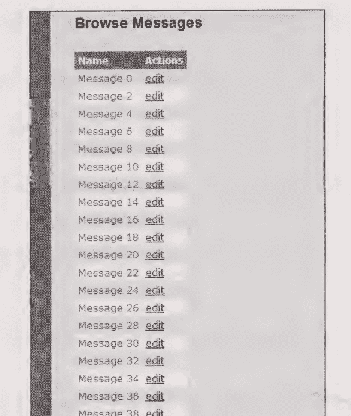

图10-3

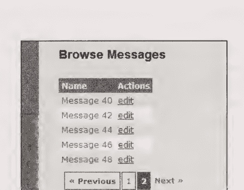

图10-4

下一步是编写编辑功能。这与我们之前在联系人列表中所做的非常相似。测试如下：

```csharp
[Test]
public void edit_message_should_return_view()
{
    PopulateRepository();
    var result = controller.Edit(1);
    result.AssertViewResult(controller, "Edit Message", "edit");
}
```

动作方法如下：

```csharp
[AcceptVerbs(HttpVerbs.Get), Authorize]
[HandleError]
public ActionResult Edit(int id)
{
    ViewData["Title"] = "Edit Message";
    return View("edit");
}
```

接下来，我们测试请求的消息是否返回：

```csharp
[Test]
public void edit_message_should_get_requested_message()
{
    PopulateRepository();
    var result = controller.Edit(1);
    Assert.IsInstanceOfType(typeof(Message), controller.ViewData.Model);
    Assert.AreEqual(1, ((Message)controller.ViewData.Model).Id);
    result.AssertViewResult(controller, "Edit Message", "edit");
}
```

然后，我们只需修改动作方法以检索请求的消息：

```csharp
[AcceptVerbs(HttpVerbs.Get), Authorize]
[HandleError]
public ActionResult Edit(int id)
{
    ViewData["Title"] = "Edit Message";
    ViewData.Model = Service.Get(User.Identity.Name, id);
    return View("edit");
}
```

为了使代码能够编译，我们需要在服务接口上实现 Get 方法，如下所示：

```csharp
public Message Get(string username, int id)
{
    return Repository.Get().Where(c =>
        c.Id == id &&
        c.User.Username.ToLower() == username.ToLower())
        .SingleOrDefault();
}
```

我们还需要确保在请求的消息不存在时返回适当的错误消息：

```csharp
[Test]
public void edit_message_should_return_error_page_if_requested_message_not_found()
{
    try
    {
        PopulateRepository();
        var result = controller.Edit(45789); //不存在的消息
        Assert.Fail("Failed to throw exception");
    }
    catch (ArgumentException)
    {
        controller.TempData.AssertItem("error",
                              "The message you requested could not be found");
    }
}
```

为了使测试通过，我们将 `Edit` 动作方法更改为：

```csharp
    [AcceptVerbs(HttpVerbs.Get), Authorize]
    [HandleError]
    public ActionResult Edit(int id)
    {
        ViewData["Title"] = "Edit Message";
        ViewData.Model = Service.Get(User.Identity.Name, id);
        if (ViewData.Model == null)
        {
            TempData["error"] = "The message you requested could not be found";
            throw new ArgumentException();
        }
        return View("edit");
    }
```

另一个需要测试的条件是，用户只能看到自己消息；因此，如果请求的消息属于其他用户，我们应该得到一个错误消息。

```csharp
    [Test]
    public void edit_message_should_return_error_page_if_user_is_not_owner()
    {
        var id = 2;
        try
        {
            PopulateRepository();
            var result = controller.Edit(id); //属于另一个用户
            Assert.Fail("Failed to throw exception");
        }
               catch (ArgumentException)
        {
            var repo = (IMessageRepository)kernel.Get(typeof(IMessageRepository));
            Assert.AreEqual(1, repo.Get().Count(c => c.Id == id));
            controller.TempData.AssertItem("error",
                                          "The message you requested could not be found");
        }
    }
```

这个测试将通过，因为我们的 `Get` 方法按照用户名过滤了消息。尽管测试通过了，我们应该确保它确实在工作；我们可以简单地修改 `Get` 方法如下，确保测试失败：

```csharp
    public Message Get(string username, int id)
    {
        return Repository.Get().Where(c =>
                                          c.Id == id)
                                  .SingleOrDefault();
    }
```

最后，我们要确保能够将更改保存到仓库。为了简洁起见，我不会编写所有测试用例，但会写足够的代码来使视图工作。

```csharp
[Test]
public void edit_message_should_save_changes_to_repository()
{
    PopulateRepository();
    var repo = (IMessageRepository)kernel.Get(typeof(IMessageRepository));
    var oldMessage = repo.Get().SingleOrDefault(m => m.Id == 1);
    var oldName = oldMessage.Name;
    var newName = "New name";
    var newMessage = new Message
    {
        Name = newName,
        Html = oldMessage.Html,
        Id = oldMessage.Id,
        Subject = oldMessage.Subject,
        Text = oldMessage.Text,
        User = oldMessage.User
    };
    Assert.AreEqual(oldName, repo.Get().SingleOrDefault(m => m.Id == 1).Name);
    var result = controller.Edit(newMessage);
    Assert.AreEqual(newName, repo.Get().SingleOrDefault(m => m.Id == 1).Name);
}
```

POST 编辑动作如下：

```csharp
[AcceptVerbs(HttpVerbs.Post), Authorize, HandleError]
public ActionResult Edit(Message message)
{
    ViewData["Title"] = "Edit Message";
    ViewData.Model = Service.Save(User.Identity.Name, message);
    TempData["flash"] = "Message successfully saved";
    return View("browse");
}
```

我跳过了几个测试用例，因为它们与我们之前所做的类似，没有必要重复。然而，你仍然需要编写这些测试；例如，你需要测试 Save 是否在验证输入，是否只有消息的所有者才能保存更改，所有字段是否都被正确保存，等等。

现在我们可以创建一个 View 来看看事情是否按预期工作：

```html
<h2>
    Edit Message</h2>
<%= Html.ValidationSummary()%>
<%= Html.JQueryGenerator("editmessage", ViewData.Model) %>
<form id="editmessage" action="/message/edit" method="post">
<div>
    <label for="name">
        Name</label>
```


# 第10章：撰写消息

```html
<br />
<%=Html.TextBox("name") %>
<br />
<label for="subject">
    Subject</label>
<br />
<%=Html.TextBox("subject") %>
<br />
<label for="html">
    Html Body (optional)</label>
<br />
<%=Html.TextArea("html") %>
<br />
<label for="text">
    Text Body</label>
<br />
<%=Html.TextArea("text") %>
<br />
<%=Html.Hidden("id", ViewData.Model.Id) %>
    <input type="submit" value="Save Message" />
</div>
</form>
```

如果进入"浏览"页面，然后点击任意消息旁的"编辑"链接，应该会看到图10-5。

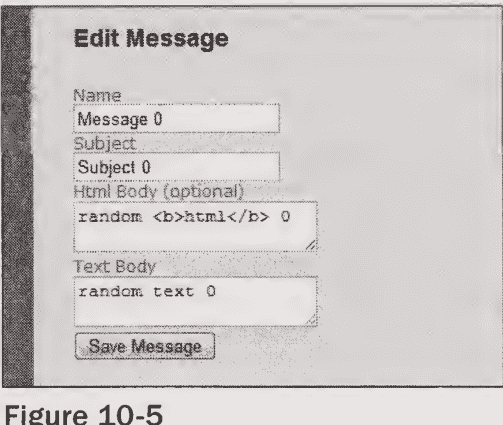

目前一切顺利。点击"**Save Message**"按钮，将会看到图10-6所示的错误信息。

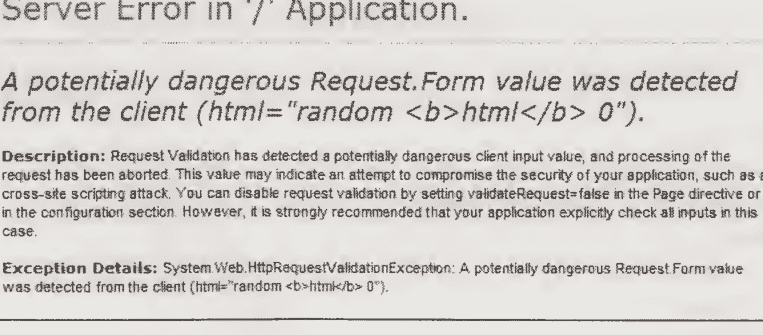

从图10-6中的错误信息可以看出，这个错误是因为我们试图提交HTML代码。这是由于一种称为"*请求验证*"（Request Validation）的机制造成的，这是一种安全功能，旨在保护应用程序免受跨站脚本攻击。

### 脚本攻击

根据www.asp.net/learn/whitepapers/request-validation上的ASP.NET白皮书：

> *许多网站没有意识到它们容易受到简单的脚本注入攻击。* *无论这些攻击的目的是通过显示HTML来破坏网站，还是执行客户端脚本将用户重定向到黑客的网站，脚本注入攻击都是Web开发人员必须应对的问题。*

> *脚本注入攻击是所有Web开发人员关注的问题，无论他们使用的是ASP.NET、ASP还是其他Web开发技术。*

> *ASP.NET请求验证功能通过阻止未编码的HTML内容被服务器处理来主动防止这些攻击，除非开发人员决定允许该内容。*

尽管错误信息如此说明，但解决此问题的方法有所不同，只需在POST操作上加`[ValidateInput(false)]`特性即可。一旦做出该更改并尝试修改消息名称后保存，应该会被重定向到"浏览"视图，并显示图10-7中所示的更改。

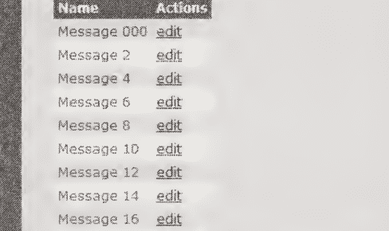

图10-7

## 小结

在本节中，我们编写了允许创建和修改消息的代码。与本书其他部分一样，我们先编写测试，然后只编写使测试通过所必需的代码。这并不意味着我们的测试套件是完整的——存在多个边界情况应该为其编写测试，然后对代码进行必要的修改。一个例子是：如果用户对"编辑"操作执行HTTP POST，使用数据库中不存在的ID会发生什么？目前该操作会失败。查找和处理此类边界情况可能耗时，但从长远来看，它能大大提高应用程序的质量。

在接下来的章节中，我们将通过支持HTML和WYSIWIG（所见即所得）来增强我们创建的编辑器的实用性。

186

# 第11章：HTML WYSIWYG编辑

在第10章中，我们开发了基本的消息创建和编辑功能。我们将扩展目前的工作，以支持用户友好的HTML编辑器。

## 问题

尽管我们目前的应用程序允许添加和编辑消息的HTML正文，但它并不友好。它假设用户了解HTML，并且能够简单地使用标记来设计HTML消息。这不仅对用户不友好，而且繁琐且容易出错。几乎所有用户都希望：

- 使用**粗体**、*斜体*等方式设置文本样式。
- 轻松添加超链接。
- 嵌入内联图像。

我们无法期望他们使用标记完成所有这些操作，必须提供更好的方式。不幸的是，没有标准的HTML元素可以简单地添加到网页中以启用HTML编辑。如果能简单地添加一个`<htmleditor>`标签，并在网页中嵌入一个功能完备的编辑器，那就太好了。

## 设计

虽然我们无法在网页中添加HTML元素来实现富文本编辑，但有一个简单的解决方案。幸运的是，有几个HTML编辑器可以免费使用。其中一些可以像添加一个简单的标签或一行标记到你的网页一样简单。其中一些编辑器使用JavaScript、Flash、Java、ActiveX等。由于最好不要假设用户安装了某个特定的插件，我们将只研究基于JavaScript的编辑器。

## 解决方案

网上有多个编辑器可用，但我们只考察其中几个。我想客观地评估选择，因此将在决策中考虑以下因素：

- 功能/特性
- 易用性/实现难度
- 社区支持
- 文档

### TinyMCE

http://tinymce.moxiecode.com/

#### 描述

来自网站：

> TinyMCE是一个独立于平台的基于Web的Javascript HTML WYSIWYG编辑器控件，由Moxiecode Systems AB根据LGPL开源发布。它能够将HTML TEXTAREA字段或其他HTML元素转换为编辑器实例。TinyMCE非常容易集成到其他内容管理系统中。

图11-1是一个启用了一些基本编辑功能的TinyMCE编辑器示例。

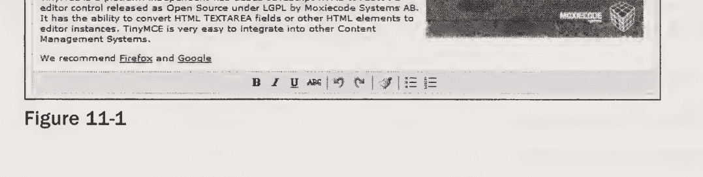

图11-1

#### 使用

```javascript
<script type="text/javascript" src="/scripts/tiny_mce/tiny_mce.js"></script>
<script type="text/javascript">
tinyMCE.init({
  mode : "exact",
  elements: "html",
  theme : "simple"
});
</script>
```

#### 评论

这是一个功能非常强大的编辑器，并且具有简单模式。我不是很喜欢它的HTML编辑器，因为图像库会弹出浏览器窗口而不是AJAX对话框。

188

```javascript
<script type="text/javascript"
src="/scripts/wymeditor/jquery.wymeditor.pack.js"><\/script>
<script type="text\/javascript">
$(function() {
	{"#html"}.wymeditor();
});
<\/script>
```

### WYMeditor

#### 评论

WYMeditor使用jQuery，这是一个优点，因为我们不必依赖另一个JavaScript库。我喜欢它的可视化编辑器以及显示容器类型的方式（图11-2）。HTML源代码可以在没有任何弹窗的情况下编辑（图11-3），但添加图像或表格时会弹出浏览器窗口。

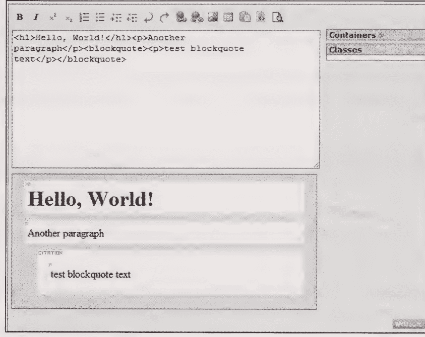

### NicEdit

www.nicedit.com/

#### 描述

来自网站：

> NicEdit是一个轻量级、跨平台、内联内容编辑器，允许在浏览器中即时轻松编辑网站内容。

NicEdit Javascript可以在几秒钟内集成到任何网站，使任何元素/div可编辑，或将标准文本区域转换为富文本编辑。

NicEdit的示例见图11-4。到目前为止，你一定已经注意到几乎所有这些编辑器看起来都非常相似。

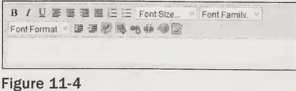

190

#### 使用

```javascript
<script type="text/javascript" src="http://js.nicedit.com/nicEdit-latest.js">
</script>
<script type="text/javascript">
//<!\[CDATA[
bkLib.onDomLoaded(function() { new nicEditor().panelInstance('html');});
//\]>
</script>
```

#### 评论

NicEdit不使用任何弹窗，而且图像上传器非常实用，甚至不会引起回发（图11-5）。

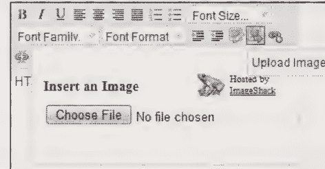

HTML编辑器也是内置的，不会弹出任何窗口（图11-6）。

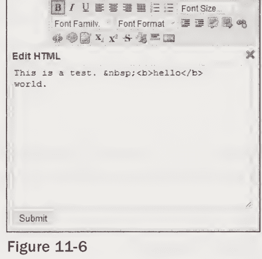

### jWYSIWYG

http://projects.bundleweb.com.ar/jWYSIWYG/

#### 描述

来自网站：

> 这个插件是一个内联内容编辑器，允许即时编辑富HTML内容。它是WYMeditor的简化版本，功能少得多。总文件大小不到26Kb，其中只有18Kb的代码和7Kb的压缩文件，主要概念是保持简单，不是所有用户都需要字体着色或创建表格，只需要基本的。

正如你在图11-7中看到的，这个编辑器可以配置得非常简洁。它具有极简的外观和感觉，但满足富文本编辑器的所有要求。

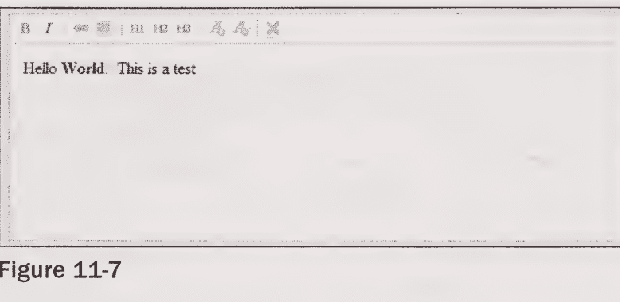

#### 使用

```javascript
<script type="text/javascript" src="/scripts/jquery.wysiwyg.js"></script>
<script type="text/javascript">
$(function()
{
    $('#html').wysiwyg();
});
</script>
```

#### 评论

jWYSIWYG使用jQuery，因此我们不必包含另一个JavaScript库。它非常简单实用，而且编辑源代码时不会弹出窗口（图11-8）。


 ## 其他选项

如前所述，WYSIWYG 编辑器有多种选择，我们只介绍了其中几种。一个值得注意的替代方案是 Yahoo 的富文本编辑器 (`http://developer.yahoo.com/yui/editor/`)。它是一款优秀的文本编辑器，但依赖于 Yahoo 的 JavaScript 库，也称为 *YUI*（Yahoo! 用户界面库）。

## 最终选择

其实并没有绝对的*赢家*，因为它们都非常相似。尽管如此，为了本应用程序，我们将优先考虑简便性，并选择 jWYSIWYG。我们的页面中已经在使用 jQuery，因此我们只需添加对样式表和 JavaScript 文件本身的引用即可。

```
<link href="/Scripts/jquery-wysiwyg/jquery.wysiwyg.css" rel="stylesheet" type="text/css" />
<script src="/Scripts/jquery-wysiwyg/jquery.wysiwyg.js" type="text/javascript"></script>
```

然后，我们只需在创建和编辑页面的底部添加以下脚本：

```
<script type="text/javascript">
    $(document).ready(function() {
        $("#html").wysiwyg();
    });
</script>
```

这样我们就为文本添加了富文本功能。需要注意的一点是，编辑器的默认设置不包括 HTML 源代码编辑，但这很容易启用，可以按照以下方式操作：

```
<script type="text/javascript">
    $(document).ready(function() {
        $("#html").wysiwyg({
            controls: {
                html: { visible: true }
            }
        });
    });
</script>
```

我们实际上没有对代码进行任何修改，也没有需要添加或运行的测试。我们可以简单地通过编辑现有消息、修改 HTML 主题、保存它，然后加载以确保一切按预期工作来验证我们的代码。

## 总结

在本章中，我们回顾并选择了一个 HTML WYSIWYG 编辑器，并使用该编辑器增强了新的文本字段。添加新的编辑器功能非常简单，不涉及任何后端代码更改。HTML 编辑器为我们的用户提供了一组良好的功能基线。对于您自己的项目，请尝试评估各种 HTML 编辑器的功能，看看哪一个最适合您的要求。

# 待测模块

brypt REPORTER test/mod_a.sv, line 50
brypt REPORTER test/mod_b.v, line 60
brypt REPORTER test/mod_c.sv, 110
brypt REPORTER test/mod_d.v, line 200
brypt REPORTER test/mod_e.sv, line 220
brypt REPORTER test/mod_e.v, line 4

**注意**：覆盖率是按模块保存的。在合并或克隆生成的 bddb 文件（使用 `bddb_batch merge`）时，请指定与默认值 (`dut`) 不同的模块名称，以防止覆盖率恢复为零。

## 合并输出文件

### 合并 bddb/bdpr 文件

本节介绍如何合并来自单个设计运行的 bddb 和 bdpr 文件。有关不同测试运行之间的合并，请参阅[测试平台设计验证 (TDV) 手册](https://support.Metrics.ca/version/TDV_manual.pdf)。

当单个设计分为多个运行时，可以使用 `bdbd_cmp` 合并生成的 bddb 和 bdpr 文件。

brypt REPORTER test/mod_a.sv, line 50
brypt REPORTER test/mod_b.v, line 60
brypt REPORTER test/mod_c.sv, 110
brypt REPORTER test/mod_d.v, line 200
brypt REPORTER test/mod_e.sv, line 220
brypt REPORTER test/mod_e.v, line 4

**注意**：覆盖率是按模块保存的。在合并或克隆生成的 bddb 文件（使用 `bddb_batch merge`）时，请指定与默认值 (`dut`) 不同的模块名称，以防止覆盖率恢复为零。

**注意**：`bd_merge` 命令有一个单线程 (`-s`) 选项。不建议使用 `bd_merge` 命令，因为该工具已被弃用——请改用 `bdbd_batch merge`。但是，如果必须使用 `bd_merge`，请参阅 [BDD 方法手册](https://support.Metrics.ca/version/bd_methods_manual.pdf)。

### 合并 vcd/evcd/fsdb 文件

当单个设计分为多个运行时，可以使用相应的合并命令合并生成的 vcd（或 evcd/fsdb）文件。

brypt REPORTER test/mod_a.sv, line 50
brypt REPORTER test/mod_b.v, line 60
brypt REPORTER test/mod_c.sv, 110
brypt REPORTER test/mod_d.v, line 200
brypt REPORTER test/mod_e.sv, line 220
brypt REPORTER test/mod_e.v, line 4

**注意**：覆盖率是按模块保存的。在合并或克隆生成的 bddb 文件（使用 `bddb_batch merge`）时，请指定与默认值 (`dut`) 不同的模块名称，以防止覆盖率恢复为零。

## 限制和已知问题

**尚不支持对技术库原语进行分析**

虽然允许门级网表中的原语实例，但必须使用 `-boxunsupported` 选项将不支持的原语黑盒化。Metrics 建议将除触发器以外的所有门黑盒化，因为确定下一状态的触发器输入逻辑对于有效的覆盖率分析至关重要。

**可能会报告来自设计文件的无关行**

报告行覆盖的条件包括分支表达式、条件满足时执行的语句以及 case。只有与这些条件直接相关的行才会计入行覆盖。注释、`module/endmodule`、`task/endtask`、`case/endcase` 和 `always` 等与条件不直接相关的行不会被识别为覆盖行。

**独立模块中同名的 Covergroup 将被合并为一个**

如果没有文件/行号信息（例如，当从库加载模块时），同名的 covergroup 将被合并。在这种情况下，相同的覆盖率会被多次计数，导致合并结果显示覆盖率超过 100%。为解决此问题，请使用 `bset_covergroup` 将变体及其 hierarchy_names 合并为一个实体。

# 12 图像托管

在过去的几章中，我们讨论了创建和编辑消息，以及使用富文本（WYSIWYG）编辑器编辑邮件内容。编辑器的功能之一是能够将图像上传并插入到消息正文中。在本章中，我们将讨论实现此功能的详细信息，以便我们能够上传和存储图像，并将其提供给最终用户（消息收件人）。

## 问题

除了格式化之外，用户想要使用 HTML 消息的主要原因是为了包含图像。图像不一定是某个物体的照片（一辆车、一台计算机或其他东西）；它可能是一个横幅、一个标志、一个促销徽章，甚至是一个“立即注册”按钮。我们需要让用户能够上传图像并在其电子邮件中使用。这涉及到几个问题/步骤。首先，我们需要为用户提供一种上传图像的方式。其次，我们需要给他们一种浏览其“图像库”并选择要插入图像的方法。第三，我们需要托管并提供这些图像，以便最终用户在阅读消息时能够看到图像。

## 设计

我们需要系统地解决这些问题。首先我们需要做的是思考这个过程。用户将点击 WYSIWYG 编辑器上的一个按钮来插入图像。这将显示一个用户界面（UI），用户可以在其中上传图片、使用 URL 插入图片，或者从他或她的库中选择之前上传的图片。一旦选择了图片，我们需要将其添加到消息编辑器中。

编辑器自带的“插入图像”按钮只允许插入图像的 URL，如图 12-1 所示。这并没有解决我们的问题。我们将不得不实现我们自己的自定义解决方案。


为了简单起见，以及因为市面上还有其他可用的解决方案，我将跳过完整图像库的部分功能。快速搜索“jQuery image gallery”会找到几个开源和免费的替代方案。让我们简化一下。

## 解决方案

如果您使用开箱即用的“插入图像”按钮，您将看到如图 12-1 所示的对话框。如果我们插入一个图片的 URL，我们会看到类似图 12-2 的内容。


我们可以使用以下代码覆盖默认按钮行为以执行自定义 JavaScript：

```
$("#html").wysiwyg({
    controls: {
        html: { visible: true },
        insertImage: {
            visible: true,
            exec: function() { alert("insert image button clicked"); }
        }
    }
});
```

这简单地告诉编辑器使“插入图像”按钮可见，并让其执行我们的自定义代码。如果我们点击该按钮，我们会看到如图 12-3 所示的警报框。

现在我们有了进入自定义代码的入口点。我们将不显示警报框，而是显示一个模态 JavaScript 对话框。我们将使用 jQuery UI 库。


## jQuery UI 库

jQuery UI 是一个构建在 jQuery JavaScript 库之上的小部件和交互库，你可以用它来构建高度交互的 Web 应用程序。该库的一个组件是 Dialog 控件，它允许我们创建基于 JavaScript 的模态对话框。

该库位于 `http://jqueryui.com`，并提供了一个配置实用程序，用于自定义你的下载，以便仅包含你需要的组件，并且预置了多个主题。

下载定制好的 jQuery UI 库并将其添加到我们的项目后，我们将在主页面添加两个链接。一个链接到样式表，另一个链接到 JavaScript 文件；它们应如下所示：

```
<link href="/Content/css/smoothness/jquery-ui-1.7.1.custom.css" rel="stylesheet" type="text/css" />
<script src="/Scripts/ui/jquery-ui-1.7.1.custom.min.js"
type="text/javascript"></script>
```

现在我们可以添加一个隐藏层（div 元素）来包含对话框的内容，并使用 JavaScript 来显示它。接下来展示了一个测试对话框的 HTML：

```
<div id="dialog" title="Basic modal dialog" style="display: none">
    <p> Adding the modal overlay screen makes the dialog look more ​ more prominent
    because it dims out the page content.</p>
</div>
```

显示此对话框的 JavaScript 代码如下：

```
<script type="text/javascript">
    $(document).ready(function() {
        $("#html").wysiwyg({
            controls: {
                html: { visible: true },
                insertImage: {
                    visible: true,
                    exec: function() { showImageDialog(); }
                }
            }
        });
    });
```

## 第 12 章：图片托管

```
function showImageDialog() {
    $("#dialog").dialog({
        modal: true
    });
}
</script>
```

如果我们点击 "Insert Image" 按钮，就会看到图 12-4 所示的屏幕。

现在我们拥有了图库界面的雏形。图库的功能之一是上传文件。当文件上传时，它会被发送到服务器，并可以通过 `Request.Files` 集合进行访问。经过一些验证后，我们将文件保存到存储中。

让我们从一个测试开始：

```
[Test]
public void upload_should_save_uploaded_file()
{
    //mock file
    var filename = "fish.jpg";
    var file1 = new Mock<HttpPostedFileBase>();
    file1.Expect(d => d.FileName).Returns(filename);
    var ms = new MemoryStream();
    Resources.Fish.Save(ms, ImageFormat.Jpeg);
    file1.Expect(d => d.InputStream).Returns(ms);
    MyMocks.Request.Expect(r => r.Files.Count).Returns(1);
    MyMocks.Request.Expect(r => r.Files[0]).Returns(file1.Object);

    //mock service
    var mockService = new Mock<IGalleryService>();
    mockService.Expect(s => s.Upload(username, filename, ms)).Returns(0);

    var con = new GalleryController(mockService.Object);
    con.SetFakeControllerContext();

    con.Upload();

    //verify mocks
```

```
MyMocks.Request.VerifyAll();
file1.VerifyAll();
mockService.VerifyAll();
}
```

前面的测试中包含很多内容，所以让我们来分析一下。首先，我们需要模拟一个文件。我将一个名为 *fish.jpg* 的图像文件复制到了测试项目的 Resources 中。我是这样做的：打开项目属性，点击 Resources 选项卡，然后在菜单中点击“Add Existing File”（参见图 12-5）。

模拟文件很简单。我们基本上模拟了模拟 `Request` 对象上的 `Files` 集合。我们模拟它返回计数为 1，并模拟集合中的第一项返回文件名和文件流。

接下来，我们模拟对服务接口 `Upload` 方法的调用（我们还没有创建它）。测试的其余部分与我们在前几章中所做的类似——设置控制器的模拟上下文、调用操作并验证结果。

正如预期的那样，项目无法编译。我们首先需要创建我们的 `GalleryController` 类及其 Upload 操作：

```
public class GalleryController : Controller
{
    public IGalleryService Service { get; set; }

    [Inject]
    public GalleryController(IGalleryService service)
    {
        Service = service;
    }

    [AcceptVerbs(HttpVerbs.Post)]
    [Authorize]
    public ActionResult Upload()
    {
        if(Request.Files.Count == 0)
            return null;

        var filename = Request.Files[0].FileName;
        var stream = Request.Files[0].InputStream;
```

```
    Service.Upload(User.Identity.Name, filename, stream);
    return null;
}
```

Upload 操作仅接受 POST（这就是文件上传/发送到服务器的方式）。它还要求用户已登录，因为我们需要用户名来将上传的图片与用户正确关联。目前我返回 `null`（仅够让代码编译通过并使测试通过）。

最后，我们创建图库服务接口：

```
public interface IGalleryService
{
    int Upload(string username, string filename, Stream stream);
}
```

我们暂时不用担心接口的实现。我们的测试通过了，这意味着我们的文件被正确访问，并且正确的信息（用户名、文件名和文件流）从服务类传递到了 `Upload` 方法。

在我们继续之前，我想确保这段代码在网站上能正常工作。所以，让我们试一试。但在它能工作之前，我们必须做一些基础工作，从图库服务接口的实现开始。当然，以下代码之前应该有相应的测试，但为了简洁起见并避免重复，我们将跳过这部分：

```
public class InMemoryGalleryService: IGalleryService
{
    private IGalleryRepository Repository { get; set; }

    public InMemoryGalleryService()
        : this(null)
    {
    }

    [Inject]
    public InMemoryGalleryService(IGalleryRepository repository)
    {
        Repository = repository ?? new InMemoryGalleryRepository();
    }

    public int Upload(string username, string filename, Stream stream)
    {
        return Repository.Upload(username, filename, stream);
    }
}
```

创建并实现 `IGalleryRepository` 接口：

```
public interface IGalleryRepository
{
```

```
int Upload(string username, string filename, Stream stream);
}

public class InMemoryGalleryRepository : IGalleryRepository
{
    private List<GalleryFile> GalleryFiles { get; set; }
    private List<Stream> Files { get; set; }

    public InMemoryGalleryRepository()
    {
        GalleryFiles = new List<GalleryFile>();
        Files = new List<Stream>();
    }

    private int _autoId;
    private int AutoId
    {
        get
        {
            _autoId += 1;
            return _autoId;
        }
    }

    public int Upload(string username, string filename, Stream stream)
    {
        var galleryFile = new GalleryFile
        {
            Id = AutoId,
            Username = username,
            OriginalFilename = filename,
            Filename = Guid.NewGuid().ToString() +
                Path.GetExtension(filename)
        };

        Files.Add(stream);
        GalleryFiles.Add(galleryFile);
        return galleryFile.Id;
    }
}
```

这是一个简单的实现，将文件存储在内存中。实际实现可以将文件存储到数据库、文件系统或云存储中。

你还记得我们之前创建了一个用于图库界面的模态对话框吗？让我们在该对话框中添加一个文件上传功能（图 12-6）：

```
<div id="dialog" title="Image Gallery" style="display: none">
<form id="frmImageUpload" enctype="multipart/form-data"
action="/gallery/upload" method='post'>
```


## 第 12 章：图片托管

```
<input type="file" id='imageuploader' name='imageuploader'/>
<input type="submit" value="Upload" />
</form>
</div>
```


图 12-6

在之前的代码中，有几件事需要注意。文件上传元素（即具有 `file` 类型的 `input` 元素）必须位于表单内，并且该表单必须将 `enctype` 设置为 `multipart/form-data`。此外，还需要注意的是，上述代码将提交表单并刷新页面，这并非我们想要的结果。如果页面刷新，我们将丢失表单数据且对话框会消失。我们希望使用 AJAX 来提交表单。幸运的是，使用 jQuery 有一个简单的方法可以做到这一点：

```
$(document).ready(function() {
    $("#frmImageUpload").submit(function() {
        var f = $("#frmImageUpload");
        var action = f.attr("action");
        var serializedForm = f.serialize();
        $.post(action,
               serializedForm,
               function(result) {
                   alert(result.message);
               },
               "json");
        return false;
    });
});
```

上述代码拦截了表单的 `submit` 事件，并使用 jQuery 的 `post` 方法通过 AJAX 提交表单数据。我们必须返回 `false` 以防止实际的 `submit` 事件发生，从而避免页面刷新。`post` 方法的第三个参数是一个回调函数，它接受一个参数。目前，我们简单地使用结果的消息显示一个 alert。您可能想知道 `result` 变量是什么以及 `result.message` 是什么？`result` 变量将是一个服务器返回的 JSON 对象，它将具有 `message` 属性以及适当的值。注意，您可以使用其他格式，如 text、xml 等；格式可以在最后一个参数中指定（在本例中，我们指定了 "json"）。同样请注意，您必须指定文件 `input` 元素的 `id` 和 `name` 属性，否则它将无法工作。

## JSON
JSON（JavaScript 对象表示法）是一种轻量级数据交换格式。它易于人类阅读和编写，也易于机器解析和生成。它基于 JavaScript 编程语言的子集，标准 ECMA-262 第三版，1999 年 12 月。

JSON 是一种与语言完全无关的文本格式，但它使用 C 系语言（包括 C、C++、C#、Java、JavaScript、Perl、Python 以及许多其他语言）程序员熟悉的约定。这些特性使 JSON 成为理想的数据交换语言。

这是一个对象的 JSON 表示：

```
{
    "firstName": "Bill",
    "lastName": "Gates",
    "address": {
        "streetAddress": "1234 Microsoft Way",
        "city": "Redmond",
        "state": "WA",
        "postalCode": 10000
    },
    "phoneNumbers": [
        "212 555-1234",
        "646 555-4567"
    ]
}
```

幸运的是，ASP.NET MVC 对 JSON 非常友好，并且将对象序列化和反序列化为 JSON 非常容易。为了测试之前的 JavaScript 代码，我们将 `Upload` 操作更改为以下：

```
[AcceptVerbs(HttpVerbs.Post)]
[Authorize]
public ActionResult Upload()
{
    if (Request.Files.Count == 0)
        return Json(new {message="No files to upload"});

    var filename = Request.Files[0].FileName;
    var stream = Request.Files[0].InputStream;
    Service.Upload(User.Identity.Name, filename, stream);
    return Json(new { message = "File uploaded successfully" });
}
```

我们实际上只是更改了返回值。如果我们点击 `Upload` 按钮而不选择文件，我们将看到图 12-7 所示的屏幕。


图 12-7

如果我们选择文件并点击 Upload，我们应该看到一个 Alert 窗口告诉我们文件上传成功。相反，我们看到的仍然是图 12-7 中显示的窗口。这是因为我们的 AJAX 提交并未将文件提交到服务器。幸运的是，有许多 jQuery 插件可以启用 AJAX 上传。它们仅仅使用一个技巧，通过动态创建的 iframe 提交文件，从而防止任何页面刷新。我们可以使用这些插件之一，或者我们可以创建一个简单的 iframe 上传器。

```
<div id="dialog" title="Image Gallery" style="display: none">
    <iframe id='frameuploader' src="/gallery/uploader"
        style='width:100%;height:100%;' frameborder="0"></iframe>
</div>
```

### Uploader Action 操作仅返回一个视图：

```
[AcceptVerbs(HttpVerbs.Get)]
[Authorize]
public ActionResult Uploader()
{
    return View();
}
```

该视图包含上传表单，并且仍将看起来像图 12-6：

```
<form id="frmImageUpload" enctype="multipart/form-data" action="/gallery/upload"
    method='post'>
    <input type="file" id='imageuploader' name='imageuploader' />
    <input type="submit" value="Upload" />
    <% =Html.ValidationMessage("imageuploader") %>
</form>
```

我们也应该编写新的测试，以测试我们添加到 Upload action 中的新功能。我们需要测试在没有选择文件时是否添加了验证错误：

```
[Test]
public void upload_should_return_error_if_file_is_missing()
{
    //mock file
    var file1 = new Mock<HttpPostedFileBase>();
    MyMocks.Request.Expect(r => r.Files.Count).Returns(0);

    //mock service
    ```

    ```
    var mockService = new Mock<IGalleryService>();

    var con = new GalleryController(mockService.Object);
    con.SetFakeControllerContext();

    var result = con.Upload();

    result.AssertViewResult(con, null, "Uploader");
    con.ModelState.AssertErrorMessage("imageuploader", "No files to upload");

    //verify mocks
    MyMocks.Request.VerifyAll();
    file1.VerifyAll();
    mockService.VerifyAll();
}
```

随后我们更改操作以通过测试：

```
[AcceptVerbs(HttpVerbs.Post)]
[Authorize]
public ActionResult Upload()
{
    if (Request.Files.Count == 0 || Request.Files[0].ContentLength == 0)
    {
        ModelState.AddModelError("imageuploader", "No files to upload");
        return View("Uploader");
    }

    var filename = Request.Files[0].FileName;
    var stream = Request.Files[0].InputStream;

    return View("Uploader");
}
```

您会注意到这些更改将破坏第一个测试（upload_should_save_uploaded_file）。测试可以修改如下：

```
[Test]
public void upload_should_save_uploaded_file()
{
    //mock file
    var filename = "fish.jpg";
    var file1 = new Mock<HttpPostedFileBase>();
    file1.Expect(d => d.FileName).Returns(filename);
    file1.Expect(d => d.ContentLength).Returns(1);

    var ms = new MemoryStream();
    Resources.Fish.Save(ms, ImageFormat.Jpeg);
    file1.Expect(d => d.InputStream).Returns(ms);
    MyMocks.Request.Expect(r => r.Files.Count).Returns(1);
    MyMocks.Request.Expect(r => r.Files[0]).Returns(file1.Object);

    //mock service
    ```

    ```
    var mockService = new Mock<IGalleryService>();
    mockService.Expect(s => s.Upload(username, filename,
                                  ms)).Returns(0);

    var con = new GalleryController(mockService.Object);
    con.SetFakeControllerContext();

    var result = con.Upload();

    result.AssertViewResult(con, null, "Uploader");

    //verify mocks
    MyMocks.Request.VerifyAll();
    file1.VerifyAll();
    mockService.VerifyAll();
}
```

现在这两个测试都已通过，我们可以运行应用程序并确保文件上传正确，如果不存在文件则显示验证错误，如图 12-8 所示。


图 12-8

但我们已经知道文件没有上传，所以我们需要测试成功的上传。在成功上传后，我们需要显示图像列表。最简单的方法是在 iframe 刷新后使用 AJAX 调用获取图像。我们可以简单地使用 jQuery 来监听 iframe 的 `load` 事件，如下所示：

```
$("#frameuploader").load(function() {
    //retrieve images
});
```

在深入 JavaScript 的详细信息之前，让我们为获取图像的操写作写一个测试：

```
[Test]
public void getallimages_gets_list_of_uploaded_images()
{
    var mockService = new Mock<IGalleryService>();
    mockService.Expect(s => s.GetAllImages(username))
        .Returns(GetFakeListOfImages());

    var con = new GalleryController(mockService.Object);
    con.SetFakeControllerContext();

    var result = con.GetAllImages();

    Assert.IsInstanceOfType(typeof(JsonResult), result);
    var jsonResult = result as JsonResult;
    Assert.IsInstanceOfType(typeof(IList), jsonResult.Data);
```


# 第12章：图像托管

Assert.AreEqual(3, ((IList)jsonResult.Data).Count);

[AcceptVerbs(HttpVerbs.Get)][Authorize] public ActionResult GetAllImages()

# 第12章：图像托管

我们还没有获取图像的操作，所以让我们为此编写一个测试。该测试应确保返回一个具有正确内容类型的`FileResult`。`FileResult`是一种特殊的`ActionResult`返回类型，可用于将任何文件流式传输回客户端，非常适合文件下载、动态图像或检索存储在数据库或云端的图像。

```csharp
[Test]
public void getimage_returns_image_as_a_file()
{
    var ms = new MemoryStream();
    Resources.Fish.Save(ms, ImageFormat.Jpeg);
    var bytes = new byte[ms.Length];
    ms.Read(bytes, 0, (int)ms.Length);

    var mockService = new Mock<IGalleryService>();
    mockService.Expect(s => s.GetImageBytes(username, 1))
        .Returns(bytes);

    var con = new GalleryController(mockService.Object);
    con.SetFakeControllerContext();

    var result = con.GetImage(1);

    Assert.IsInstanceOfType(typeof(FileResult), result);
    var fileResult = result as FileResult;
    Assert.AreEqual("image/jpeg", fileResult.ContentType);
}
```

Action方法如下所示：

```csharp
[AcceptVerbs(HttpVerbs.Get)]
public ActionResult GetImage(int id)
{
    var img = Service.GetImageBytes(User.Identity.Name, id);
    return File(img, "image/jpeg");
}
```

同样，我不会深入探讨服务和仓储的实现细节，因为它们与我们一直在做的非常相似。

我们现在可以测试我们的视图了，上传一些图片，并查看现有图像的列表。你会注意到，每次上传后，对话框都会检索新的列表以包含新图像。你可以在图12-9中看到一个示例。


# 第12章：图像托管

> 需要注意的是，这不是一个生产就绪的完整实现，许多细节都被省略了。在实际生活中，你会希望检索缩略图而不是完整图像。你还希望对图像列表进行分页。我希望在不让你被所有复杂细节分心的情况下，专注于主要部分。我希望这能为你下一步该做什么提供足够的见解。

我们几乎拥有一个可工作的图像库了。下一步是选择一张图像并将其插入到我们的消息正文中。这可以通过一些JavaScript来实现。我们需要做两件事：处理图像的点击事件，并将图像插入到所见即所得编辑器中。我们将重写iframe加载事件处理程序，如下所示：

```javascript
$("#frameuploader").load(function() {
    $.get('/gallery/getallimages',
        null,
        function(data, textStatus) {
            $("#galleryImages").empty();
            $(data).each(function() {
                var imgid = this.id;
                var img = $("");
                img.click(function() {
                    $("#html").wysiwyg("insertImage",
                        "http://localhost:4452/gallery/getimage/" + imgid);
                    $myDialog.dialog("close");
                });
                $("#galleryImages")
                    .append(img);
            });
        },
        'json');
});
```

这里的主要区别在于，我们将图像创建为一个jQuery对象，然后将其点击事件连接到将图像插入编辑器并关闭对话框。我们最终应该得到类似图12-10所示的屏幕。

> 你不应该在JavaScript中硬编码基础URL。相反，你应该从Request.Url属性动态生成它。


# 第13章：消息模板

我不会向你展示这个模板的HTML，因为它太长了，但图13-2是HTML在折叠了style和body标签后的截图。

```html
<!DOCTYPE HTML PUBLIC "-//W3C//DTD HTML 4.01 Transitional//EN"
"http://www.w3.org/TR/html4/loose.dtd">
<html>
<head>
<title>Your Newsletter</title>
<meta http-equiv="Content-Type" content="text/html; charset=iso-8859-1" />
<style>...</style>
</head>
<body>...</body>
</html>
```

你可以在线找到大量免费模板，并用它们来创建你的模板库。

一旦我们创建了模板库，我们就可以在创建消息时向用户显示模板列表。当用户点击一个模板时，我们将读取模板的HTML并将其添加到所见即所得编辑器中。然后用户可以对模板进行更改，并用实际内容填充正文。

## 问题

即使有了所见即所得编辑器，从头开始设计消息也是耗时且重复的。我们需要一种方法为用户提供预制的模板来用于他们的消息。我们也想让他们能够将自己最喜欢的设计保存为模板，以便在未来的消息中重用。

## 设计

模板有两种类型。有一种是预制的模板，任何人都可以使用；另一种是用户创建的模板，仅对特定用户可用。预制的模板只是HTML文件，可以从文件或数据库中读取，并用作消息的起始正文。图13-1是一个新闻通讯模板的示例。


### 模板图像：注意！！！

大多数模板都会包含一些图像，无论是边框图像、分隔符、自定义背景，还是介于两者之间的任何东西。请确保这些图像使用完整URL而不是相对或绝对URL进行引用，因为它们将在用户的电子邮件箱中查看，而不是在你的网站上。

例如，如果你使用图像作为各部分之间的分隔符，那么它应该像这样被引用：

```html

```

这些在用户收件箱中*不会*起作用：

```html


```

## 解决方案

我们将从一个简单的测试开始，获取系统模板列表。我们将模拟对服务类的调用，以返回一些`Template`对象：

```csharp
[Test]
public void list_returns_system_templates()
{
    var mockSer = new Mock<ITemplateService>();
    mockSer.Expect(s => s.Get()).Returns(new List<Template>
                                    {
                                        new Template(),
                                        new Template()
                                    });
    var con = new TemplateController(mockSer.Object);
    var result = con.List();
    Assert.IsNotNull(result);
    result.AssertViewResult(con, null, "list");
    Assert.IsInstanceOfType(typeof(IList<Template>), con.ViewData.Model);
    Assert.AreEqual(4, (con.ViewData.Model as IList<Template>).Count);

}
```

下一步，让我们使解决方案能够编译。创建包含List操作的控制器，如下所示：

```csharp
public class TemplateController : Controller
{
    [AcceptVerbs(HttpVerbs.Get)]
    [Authorize]
    public ActionResult List()
    {
```

# 第 13 章：消息模板化

```csharp
return null;
}
}
```

创建模型类 `Template`：

```csharp
public class Template
{
}
```

让我们添加额外的配置以便使测试通过。在 `TemplateController` 构造函数中添加并初始化模板服务：

```csharp
public ITemplateService Service { get; set; }

public TemplateController() : this(null)
{
}

public TemplateController(ITemplateService service)
{
    Service = service;
}
```

测试现在应该通过了。查看当前情况并确保一切正常工作是个好习惯。让我们为服务类创建一个测试。我们将直接模拟仓库接口：

```csharp
[Test]
public void get_should_return_list_of_templates()
{
    var mockRepo = new Mock<ITemplateRepository>();
    mockRepo.Expect(r => r.Get()).Returns(new List<Template>
    {
        new Template(),
        new Template()
    }.AsQueryable());

    ITemplateService service = new InMemoryTemplateService(mockRepo.Object);
    var templates = service.Get();
    Assert.IsNotNull(templates);
    Assert.AreEqual(2, templates.Count);
}
```

在我们做一些更改之前项目将无法编译。首先，我们需要实现 `ITemplateService` 接口：

```csharp
public class InMemoryTemplateService : ITemplateService
{
    public ITemplateRepository Repository { get; set; }

    public InMemoryTemplateService()
        : this(null)
    {
    }

    [Inject]
    public InMemoryTemplateService(ITemplateRepository repository)
    {
        Repository = repository;
    }

    public IList<Template> Get()
    {
        return null;
    }
}
```

测试仍然会失败，直到我们修改以调用仓库的 Get 方法：

```csharp
public IList<Template> Get()
{
    return Repository.Get().ToList();
}
```

在我们开始创建视图以使用这些方法之前，还有一些其他的事情要做。下一步是实现仓储接口。我们将使其非常简洁，直接使用一些测试数据进行硬编码。

```csharp
public class InMemoryTemplateRepository : ITemplateRepository
{
    public IQueryable<Template> Get()
    {
        return new List<Template>
        {
            new Template
            {
                Path = "/content/templates/template1.htm",
                Thumbnail = "/content/templates/images/template1.jpg"
            },
            new Template
            {
                Path = "/content/templates/template2.htm",
                Thumbnail = "/content/templates/images/template2.jpg"
            },
            new Template
            {
                Path = "/content/templates/template3.htm",
                Thumbnail = "/content/templates/images/template3.jpg"
            },
            new Template
            {
                Path = "/content/templates/template4.htm",
                Thumbnail = "/content/templates/images/template4.jpg"
            }
        }.AsQueryable();
    }
}
```

模型类 `Template` 现在正在成形中：

```csharp
public class Template
{
    public string Path { get; set; }
    public string Thumbnail { get; set; }
}
```

将所有这些连接起来的最后一步是使用 Ninject 注册用于依赖注入的接口：

```csharp
Bind<ITemplateService>().To<InMemoryTemplateService>();
Bind<ITemplateRepository>().To<InMemoryTemplateRepository>()
    .Using<SingletonBehavior>();
```

现在到了时候用视图来可视化这一切了。我们将在消息创建页面上添加一个简单的模板缩略图列表供用户选择。我想在这个消息创建页面显示该视图，所以我将创建一个强类型的局部视图。我们暂时只让它保持非常简单，仅显示缩略图：

```aspx
<%@ Control Language="C#"
    Inherits="System.Web.Mvc.ViewUserControl<IList<Template>>" %>
<% foreach (var template in Model)
    %>
```

在消息创建视图中，我们将如下渲染模板库：

```aspx
<div id='templatesContainer'>
    <%Html.RenderPartial("/views/template/list.ascx", ViewData["templates"]); %>
</div>
```

此代码无法工作，如果我们尝试导航到创建消息屏幕，我们将看到图 13-3 中显示的屏幕。


问题在于 `Create` 动作没有设置 `ViewData["templates"]`。在修复此问题之前，让我们先为它创建一个测试：

```csharp
[Test]
public void create_should_set_templates_in_viewdata_on_get_requests()
{
    var mockSer = new Mock<ITemplateService>();
    mockSer.Expect(s => s.Get()).Returns(new List<Template>
    {
        new Template(),
        new Template()
    });

    controller.TemplateService = mockSer.Object;
    controller.Create();

    mockSer.VerifyAll();
    Assert.IsInstanceOfType(typeof(IList<Template>),
        controller.ViewData["templates"]);
    var templates = controller.ViewData["templates"] as IList<Template>;
    Assert.IsNotNull(templates);
    Assert.AreEqual(2, templates.Count);
}
```

我们基本上是在测试 `ViewData` 包含模板项，并且其类型正确，不为 null，且具有四个模板。测试应该失败。我们通过向 `Create` 动作添加以下行来获取模板列表：

```csharp
ViewData["templates"] = TemplateService.Get();
```

然后我们必须创建 `TemplateService` 属性并对其进行初始化：

```csharp
public MessageController()
    : this(null,null)
{
}

[Inject]
public MessageController(IMessageService service,ITemplateService templateService)
{
    TemplateService = templateService ?? new InMemoryTemplateService();
    Service = service ?? new InMemoryMessageService();
}

public ITemplateService TemplateService { get; set; }
```

由于构造函数发生了变化，我们的一些 `MessageController` 测试失败了，因此我们必须回去修复这些测试并确保它们仍然通过。难道测试驱动开发（TDD）不是很棒吗？一旦所有这些错误都修复了，我们的测试应该就会通过。

视图现在应该可以工作了，我们应该看到类似于图 13-4 的内容。


让我们添加一些 JavaScript 魔法来将模板应用到所见即所得编辑器中。首先，我们将如下所示用链接包裹缩略图：

```html
<a href='<%=template.Path %>' class='templatelink'>
    ' />
</a>
```

然后我们添加一个用于所有带有 'templatelink' 类链接的点击事件处理程序，并告诉它从路径加载模板文件并插入到所见即所得编辑器中：

```javascript
$(".templatelink").click(function() {
    $.get($(this).attr("href"), null, function(data) {
        $("#html").wysiwyg('setContent', data);
    });
    return false;
});
```

如果您尝试点击缩略图之一，所见即所得编辑器将填充 HTML 文件的内容，并准备好供用户进行自定义。您可以在图 13-5 中看到这一点。


## 我的模板

现在我们有显示模板的逻辑，选择模板以及使用模板代码更新编辑器，让我们着手让用户能够保存自己的模板以备以后重用。

我们希望通过 AJAX 使用我们的保存功能，以便无需离开消息创建页面即可保存模板。第一个测试如下：

```csharp
[Test]
public void save_saves_user_template()
{
    var template = new Template();
    var username = "test";
    var mockSer = new Mock<ITemplateService>();
    mockSer.Expect(s => s.Save(username, template)).Returns(1);
    var con = new TemplateController(mockSer.Object);
    con.SetFakeControllerContext();
    var result = con.Save(template);

    mockSer.VerifyAll();
    Assert.IsInstanceOfType(typeof(JsonResult), result);
    var jsonResult = result as JsonResult;
    Assert.IsInstanceOfType(typeof(JsonData), jsonResult.Data);
    Assert.IsTrue(((JsonData)jsonResult.Data).success);
    Assert.AreEqual(1, ((JsonData)jsonResult.Data).id);
}
```

上一个测试调用 `Save` 方法并带有模板对象，然后检查结果。预期的结果是一个包含 `success` 属性和 `id` 属性的 JSON 对象。此代码直到我们向服务接口和控制器添加 `Save` 方法并创建 `JsonData` 类之前都无法编译。我们还必须在控制器上设置伪上下文，因为我们将要调用 `User.Identity.Name` 属性。

服务接口方法如下所示：

```csharp
int Save(string username, Template template);
```

`JsonData` 类如下：

```csharp
public class JsonData
{
    public int id { get; set; }
    public bool success { get; set; }
}
```

并且 `Save` 控制器动作看起来像这样：

```csharp
[AcceptVerbs(HttpVerbs.Post)]
[Authorize]
public ActionResult Save(Template template)
{
    return null;
}
```

测试显然会失败。我们需要调用服务接口上的 `Save` 方法并返回带有 `JsonData` 实例的 `JsonResult`。看起来像这样：

```csharp
[AcceptVerbs(HttpVerbs.Post)]
[Authorize]
public ActionResult Save(Template template)
{
    var id = Service.Save(User.Identity.Name, template);
    return Json(new JsonData()
                {
                    success = true,
                    id = id
                });
}
```


# 第13章：消息模板

让我们在服务类上实现 `Save` 方法，并为其编写测试：

```
[Test]
public void save_should_save_to_repository_and_return_id()
{
    var template = new Template();
    var username = "test";
    var mockRepo = new Mock<ITemplateRepository>();
    mockRepo.Expect(r => r.Save(username, template)).Returns(1);

    ITemplateService service = new InMemoryTemplateService(mockRepo.Object);
    var id = service.Save(username, template);

    mockRepo.VerifyAll();
    Assert.AreEqual(1, id);
}
```

我们必须在存储库上编写 `Save` 方法，它与我们刚刚为服务类编写的方法看起来是一样的：

```
int Save(string username, Template template);
```

这里有几个条件是我没有在这里测试的，但在实际应用中应该进行测试。以下是你可以运行的一些可能测试的列表：

- 测试模型验证
- 测试用户名不为空
- 测试错误条件和消息

当然，下一步是在视图中测试这段代码，但在我们这样做之前，让我们先实现检索用户模板的功能。我们可以为列出用户模板写另一个方法，但我将重载 `List/Get` 方法。测试如下：

```
[Test]
public void list_returns_user_templates()
{
    var username = "test";
    var mockSer = new Mock<ITemplateService>();
    mockSer.Expect(s => s.Get(username)).Returns(new List<Template>
    {
        new Template(),
        new Template(),
        new Template()
    });

    var con = new TemplateController(mockSer.Object);
    var result = con.List(username);
    Assert.IsNotNull(result);
    result.AssertViewResult(con, null, "list");
    Assert.IsInstanceOfType(typeof(IList<Template>), con.ViewData.Model);
    Assert.AreEqual(3, (con.ViewData.Model as IList<Template>).Count);
}
```

编译项目需要重载服务类上的 `Get` 方法：

`IList<Template> Get(string username);`

以及将 `List` 操作的方法签名更改为以下内容：

```
[AcceptVerbs(HttpVerbs.Get)]
[Authorize]
public ActionResult List(string username)
{
    if(string.IsNullOrEmpty(username))
        return View("list", Service.Get());
    else
        return View("list", Service.Get(username));
}
```

这些更改会破坏那些在没有参数的情况下调用 `List` 操作的测试，但可以改为使用 `controller.List(null)` 而不是 `controller.List()`。

我将跳过接下来的步骤以避免重复。这些步骤涉及实现服务和存储库测试以及检索用户模板所需的代码。记住，这些模板可以存储在文件系统或数据库中，但出于测试目的，我们使用的是一个存储在内存中的存储库。我们可以随时替换存储库并用基于数据库或文件系统的存储库来替换它。

一旦所有这些就绪，我们将继续确保在 `View` 中一切正常工作。在我们的 `View` 中，我们将添加这段代码片段，用于在存在“我的模板”时显示缩略图。

```
<% if ((ViewData["mytemplates"] as IList) != null &&
       (ViewData["mytemplates"] as IList).Count > 0)
{%>
    <h3>我的模板</h3>
    <div id='myTemplates'>
        <% Html.RenderPartial("/views/template/list.ascx",
                             ViewData["mytemplates"]);%>
    </div>
<%}%>
```

我们需要在我们的创建消息操作中添加这一行代码：

`ViewData["mytemplates"] = TemplateService.Get(User.Identity.Name);`

就像我们之前为模板所做的那样，我们应该编写一个测试来确保 "mytemplates" 数据被正确设置：

```
[Test]
public void create_should_set_mytemplates_in_viewdata_on_get_requests()
{
    var mockSer = new Mock<ITemplateService>();
    mockSer.Expect(s => s.Get(Username)).Returns(new List<Template>
    {
        new Template(),
        new Template(),
        new Template()
    });

    controller.TemplateService = mockSer.Object;
    controller.Create();

    mockSer.VerifyAll();
    Assert.IsInstanceOfType(typeof(IList<Template>),
        controller.ViewData["mytemplates"]);
    var templates = controller.ViewData["mytemplates"] as IList<Template>;
    Assert.IsNotNull(templates);
    Assert.AreEqual(3, templates.Count);
}
```

我们的视图不会显示任何内容，因为我们还没有保存任何模板。所以让我们保存吧。我们想向 WYSIWYG 编辑器添加工具栏按钮，以便将编辑器的当前内容保存为 HTML 模板。保存模板需要两个值——HTML 内容和模板名称。这清楚地表明我们最初的保存操作代码将无法正常工作。我们的 Save 操作需要从 `public ActionResult Save(Template template)` 更改为 `public ActionResult Save(string name, string content)`。幸运的是，我们有测试来确保我们不会破坏任何东西。我不会详细说明所有更改，因为这里没有什么新的需要学习的东西。

我们可以如下向 WYSIWYG 编辑器添加工具栏：

```
$("#html").wysiwyg({
    controls: {
        html: { visible: true },
        insertImage: {
            visible: true,
            exec: function() { showImageDialog(); }
        },
        saveTemplate: {
            visible: true,
            exec: function() { saveTemplate(); }
        }
    }
});
```

然后我们可以编写 `saveTemplate` 方法来执行实际的保存操作，如下所示：

```
function saveTemplate() {
    var content = $("#html").wysiwyg('getContent').html();
    var name = prompt("模板的名称是什么？");
    $.ajax({
        type: "POST",
        url: "/template/save",
        dataType: 'json',
        data: { name: name, content: content },
        success: function(data) {
            if (data.success == true)
                alert("模板已保存");
            else
                alert("保存错误");
        }
    });
}
```

前面的 JavaScript 方法检索编辑器的内容，并提示用户输入模板名称，然后通过 AJAX POST 请求发送到模板控制器中的 Save 操作，并传递适当的数据。你还会注意到，我们通过调用其 `success` 属性来解析返回的数据，该属性在操作中使用带有 `JsonData` 对象的 `JsonResult` 返回类型设置。

> 我没有编写代码来动态生成模板的缩略图，而是简单地硬编码了一些缩略图。

> 还有我们没有深入探讨的其他功能，因为它会简单地重复我们已经熟悉的事情。这些功能包括删除现有模板、验证模板文件名、生成缩略图等。

## 总结

我们通过赋予用户从模板创建消息的能力，扩展了我们的消息创建和 WYSIWYG 功能。模板只是预制作的内容片段，用于填充 WYSIWYG 编辑器。我们定义了一些所有用户都可以访问的系统/全局模板，但我们还创建了框架，使用户能够创建和重用他们自己的模板。

我们使用了一些很棒的 jQuery 技巧完成了所有这些工作，并再次展示了 jQuery 为我们提供的强大功能以及全套自动化单元测试的有用性。

# 第14章：计费与订阅

最终，我们希望从我们的应用程序中获得收入。有许多方法可以从你的 Web 应用程序中获得收入，其中一种是为你的服务收取订阅费。我们希望用户能够选择适合他们需求的几种订阅计划，并能够点击按钮输入他们的付款信息，并自动每月扣款。

## 问题

我们需要处理信用卡付款，并自动向用户收取每月订阅费。我们希望我们的应用程序足够灵活，允许我们以最小影响切换支付网关。

## 设计

有许多可用的支付网关供我们用来处理付款并自动化订阅计费流程。为了本书的目的，我们将使用 PayPal 作为我们选择的支付处理器，但我们将设计我们的应用程序，以便轻松切换到其他支付处理器。

我们将使用接口抽象我们的支付处理器实现，这将使我们能够对模拟实现编写测试，并轻松添加接口的新的实现。几乎所有的支付处理系统都遵循类似的流程，即通过 HTTP POST 将交易信息通知给应用程序的回调或通知 URL。我们要能够接收这个 POST 请求，解析数据，并应用我们的业务逻辑。大多数支付网关期望从你的应用程序收到确认——即握手。

我们的支付服务的接口非常简单，如下所示和图14-1所示。


# 第 14 章：账单与订阅方案

图 14-1

```
public interface IPaymentService
{
    void ProcessPayment(NameValueCollection formCollection);
    void PerformHandShake(HttpRequestBase Request);
}
```

## 解决方案

我们将首先创建一个新的测试夹具，名为 PayControllerTests，并创建一个控制器名为 PayController。我们的回调操作不会渲染视图；它只是接受支付处理器发布的**数据**(在此案例中为 PayPal)，执行握手协议，然后处理该**数据**。我们第一项测试将确保我们不返回任何视图：

```
[Test]
public void callback_should_return_null()
{
    var con = new PayController();
    var result = con.Callback();
    Assert.IsNull(result);
}
```

只要我们的 PayController 中添加以下代码之前，该测试就会失败：

```
[AcceptVerbs(HttpVerbs.Post)]
public ActionResult Callback()
{
    return null;
}
```

对于下一个**测试**(test)，我们想要验证回调方法执行握手（handshake）操作：

```
[Test]
public void callback_should_perform_hand_shake()
{
    var mockService = new Mock<IPaymentService>();
    mockService
        .Expect(s => s.PerformHandShake(MyMocks.Request.Object));

    var con = new PayController(mockService.Object);
    con.SetFakeControllerContext();

    con.Callback();

    mockService.VerifyAll();
}
```

该测试对支付服务进行模拟，并设定一个预期：必须使用控制台的`Request`对象来调用`PerformHandShake`方法。我们将重用项目中已有的模拟器（mocks）和辅助**方法**(methods)，然后将虚拟上下文设置到控制器中以供使用。

此测试会引发一系列代码变更。首先，我们需要能够编译代码，因此需要添加一个重载构造函数以接受 `IPaymentService` 的实例：

```
public IPaymentService PaymentService { get; set; }

public PayController()
    : this(null)
{
}

[Inject]
public PayController(IPaymentService paymentService)
{
    PaymentService = paymentService;
}
```

运行测试后，您会看到它再次失败，因为预期未得到满足。然后按如下方式更改回调操作并重新运行测试以确保通过：

```
[AcceptVerbs(HttpVerbs.Post)]
public ActionResult Callback()
{
    PaymentService.PerformHandShake(Request);
    return null;
}
```

应用相同的**逻辑**(logic)，我们将对以下内容进行测试，即确认回调操作调用处理支付（payment）的方法：

```
[Test]
public void callback_should_process_payment()
{
    var mockService = new Mock<IPaymentService>();
    mockService
        .Expect(s => s.ProcessPayment(MyMocks.Request.Object.Form));

    var con = new PayController(mockService.Object);
    con.SetFakeControllerContext();

    con.Callback();

    mockService.VerifyAll();
}
```

最终的**操作**(action)如下所示：

```
[AcceptVerbs(HttpVerbs.Post)]
public ActionResult Callback()
{
    PaymentService.PerformHandShake(Request);
    PaymentService.ProcessPayment(Request.Form);
    return null;
}
```

我们的回调方法需要做的就只有这些。当然，您需要添加一些**日志记录**(logging)和异常处理代码。例如，如果支付处理失败，您可能想要向管理员发送电子邮件。

### PayPal 实现 (Implementation)

到目前为止，我们一直使用模拟的支付服务进行测试（mock payment service），但我们需要具体的实施（concrete implementation）。正如之前提到的那样，我们将使用PayPal作为我们的**电子处理器**(payment processor)。

首先，让我们检查握手（handshake）过程。要成功为 PayPal创建一个握手连接，需要执行以下步骤：

- 1. 获取PayPal发布的值 (values)
- 2. **创建一个新的请求**(request)**到PayPal并发送相同的数据追加了"cmd=_notify-validate"**。我们实际上是要求**PayPal验证**我们所接收到的数据
- 3. PayPal作出回应，告诉我们数据是否有效或无效

握手代码如下所示，但请注意为了清晰起见我删除了日志记录和异常处理部分：

```
public void PerformHandShake(HttpRequestBase Request)
{
    //Read the PayPals' Instant Pay Notification (IPN) POST
    var strFormValues = Encoding.ASCII
        .GetString(Request.BinaryRead(Request.ContentLength));

    // Create the request back
    var req = WebRequest
        .Create("https://www.paypal.com/cgi-bin/webscr");

    // Set values for the request back
    req.Method = "POST";
    req.ContentType = "application/x-www-form-urlencoded";
    var strNewValue = strFormValues + "&cmd=_notify-validate";
    req.ContentLength = strNewValue.Length;

    // Write the request back IPN strings
    var stOut = new StreamWriter(req.GetRequestStream(), Encoding.ASCII);
    stOut.Write(strNewValue);
    stOut.Close();

    //send the request, read the response
    var strResponse = req.GetResponse();
    var IPNResponseStream = strResponse.GetResponseStream();
    var encode = System.Text.Encoding.GetEncoding("utf-8");
    var readStream = new StreamReader(IPNResponseStream, encode);

    var read = new char[256];
    var count = readStream.Read(read, 0, 256);
    string IPNResponse = new string(read, 0, count);
    if (IPNResponse == "VERIFIED")
    {
        //IPN is valid
    }
    else
    {
        //IPN is INVALID
    }

    //tidy up, close streams
    if (readStream != null) readStream.Close();
    if (strResponse != null) strResponse.Close();
}
```

前述代码的问题是它很难进行**测试**(test)。我们需要重构它以模拟请求和回应（responses）。我们需要对WebRequest的创建行为进行模拟，因此我们将上述代码重构成一个接口如下：

```
public interface IPayPalServiceHelper
{
    WebRequest CreateRequest(string url);
}
```

然后我们接着实现该**接口**(interface)如下图所示：

```
public class PayPalServiceHelper : IPayPalServiceHelper
{
    public WebRequest CreateRequest(string url)
    {
        return WebRequest.Create(url);
    }
}
```

接下来我们需要在我们的类中添加一个构造函数以接收辅助 (helper)**实例 **(instance):

```
public IPayPalServiceHelper PayPalServiceHelper { get; set; }

[Inject]
public PayPalService(IPayPalServiceHelper payPalServiceHelper)
{
    PayPalServiceHelper = payPalServiceHelper;
}
```

现在我们便可以将创建WebRequest的那行代码改为如下内容:

```
var req = PayPalServiceHelper
    .CreateRequest("https://www.paypal.com/cgi-bin/webscr");
```

我们现在可以编写一个测试来验证请求被正确**创建 **(created)及其属性已设置。以下为相应的测试示例：

```
[Test]
public void handshake_should_create_request_to_paypal()
{
    var url = "https://www.paypal.com/cgi-bin/webscr";

    //mock the paypal response
    var mockPaypalResponse = new Mock<WebResponse>();
    mockPaypalResponse.Expect(r => r.GetResponseStream())
        .Returns(new MemoryStream());

    //mock the request to paypal
    var mockPaypalRequest = new Mock<WebRequest>();
    mockPaypalRequest.Expect(r => r.GetRequestStream())
        .Returns(new MemoryStream());
    mockPaypalRequest.Expect(r => r.GetResponse())
        .Returns(mockPaypalResponse.Object);

    //mock the service helper
    var mockHelper = new Mock<IPayPalServiceHelper>();
    mockHelper.Expect(h => h.CreateRequest(url))
        .Returns( mockPaypalRequest.Object);

    var requestcontent = "five";
    MyMocks.Request
        .Expect(r => r.ContentLength).Returns(requestcontent.Length);
    MyMocks.Request
        .Expect(r => r.BinaryRead(requestcontent.Length))
        .Returns((new ASCIIEncoding()).GetBytes(requestcontent));
    var service = new PayPalService(mockHelper.Object);
    service.PerformHandShake(MyMocks.Request.Object);

    //verify mocks
    long length = (requestcontent + "&cmd=_notify-validate").Length;
    mockPaypalRequest.VerifySet(r=> r.Method, "POST");
    mockPaypalRequest.VerifySet(r => r.ContentType,
                                "application/x-www-form-urlencoded");
    mockPaypalRequest.VerifySet(r => r.ContentLength, length);
    mockPaypalRequest.VerifyAll();
    mockHelper.VerifyAll();
}
```

### 支付处理 (Payment Processing)

我们已验证所接收到的POST请求是有效的且来自 **PayPal**，因此我们可以继续进行并处理付款。我们需要处理的有两类事件：**订阅方案和取消服务**。


# 第14章：计费与订阅

PayPal 以表单集合的形式传递这些信息。一个新订阅数据的示例如下：

```
txn_type=subscr_signup&subscr_id=S-3BN760482J751000N&last_name=User&option_selection1=testsite&residence_country=US&mc_currency=USD&item_name=Personal+Plan&amount1=0.00&business=paypal_1227363488_biz%40dotnetfactory.com&amount3=10.00&recurring=1&verify_sign=Afk7dIEf1cCYHX9Cs2tsYImOIL4QA46mcwPz-PuS2G9Gl6EI.VmIbAf0&payer_status=verified&test_ipn=1&payer_email=paypal_1227363521_per%40dotnetfactory.com&first_name=Test&receiver_email=paypal_1227363488_biz%40dotnetfactory.com&payer_id=VSE7RKLHAZJ7J&option_name1=Site+Url&reattempt=1&item_number=2001&subscr_date=08%3a53%3a33+Nov+22%2c+2008+Nov+22%2c+2008+PST&btn_id=8399&charset=windows-1252&notify_version=2.5&period1=1+M&mc_amount1=0.00&period3=1+M&mc_amount3=10.00
```

我们需要的重要值包括：

- txn_type
- payer_email
- item_name

这些值将告诉我们交易类型，即订阅或取消；付款人的电子邮件；以及商品名称。商品名称可用于区分不同的订阅计划，例如，*个人版*、*高级版*和*专业版*计划。我们的第一个测试确保调用仓库的 save 方法时使用了正确的信息：

```
[Test]
public void proccesspayment_should_call_repository_save_when_subscribing()
{
    var email = "payer@test.com";
    var plan = "Personal Plan";
    var mockRepo = new Mock<ISubscriptionPlanRepository>();
    mockRepo.Expect(s => s.Save(email, plan))
            .Returns(1);

    var service = new PayPalService(mockRepo.Object, null);
    var formCollection = new NameValueCollection
    {
        {"txn_type", "subscr_signup"},
        {"payer_email", email},
        {"item_name", plan}
    };

    service.ProcessPayment(formCollection);
    mockRepo.VerifyAll();
}
```

为了使前面的代码能够编译，我们必须创建包含 `Save` 方法的 `ISubscriptionPlanRepository` 接口：

```
public interface ISubscriptionPlanRepository
{
    int Save(string email, string plan);
}
```

然后我们需要修改 PayPalService 构造函数，使其接收仓库的实例：

```
public ISubscriptionPlanRepository SubscriptionPlanRepository { get; set; }
public IPayPalServiceHelper PayPalServiceHelper { get; set; }

[Inject]
public PayPalService(ISubscriptionPlanRepository subscriptionPlanRepository,
    IPayPalServiceHelper payPalServiceHelper)
{
    SubscriptionPlanRepository = subscriptionPlanRepository;
    PayPalServiceHelper = payPalServiceHelper;
}
```

项目将能够编译，但测试会失败，直到我们编写如下所示的 ProcessPayment 方法：

```
public void ProcessPayment(NameValueCollection formCollection)
{
    //subscribe site
    var payerEmail = "";
    if (formCollection.AllKeys.Contains("payer_email"))
    {
        payerEmail = formCollection["payer_email"];
    }
    var txn_type = "";
    if (formCollection.AllKeys.Contains("txn_type"))
    {
        txn_type = formCollection["txn_type"];
    }
    var itemName = "";
    if (formCollection.AllKeys.Contains("item_name"))
    {
        itemName = formCollection["item_name"];
    }

    SubscriptionPlanRepository.Save(payerEmail, itemName);
}
```

接下来，我们测试用户取消订阅的情况，如下所示：

```
[Test]
public void
processpayment_should_call_repositor_save_when_unsubscribing_with_free_plan()
{
    var email = "payer@test.com";
    var plan = "Free Plan";
    var mockRepo = new Mock<ISubscriptionPlanRepository>();
    mockRepo.Expect(s => s.Save(email, plan))
        .Returns(1);

    var service = new PayPalService(mockRepo.Object, null);
    var formCollection = new NameValueCollection
        {
            {"txn_type", "subscr_cancel"},
            {"payer_email", email}
        };

    service.ProcessPayment(formCollection);
    mockRepo.VerifyAll();
}
```

测试将会失败，直到我们按如下方式更新 ProcessPayment：

```
public void ProcessPayment(NameValueCollection formCollection)
{
    //subscribe site
    var payerEmail = "";
    if (formCollection.AllKeys.Contains("payer_email"))
    {
        payerEmail = formCollection["payer_email"];
    }
    var txn_type = "";
    if (formCollection.AllKeys.Contains("txn_type"))
    {
        txn_type = formCollection["txn_type"];
    }
    var itemName = "";
    if (formCollection.AllKeys.Contains("item_name"))
    {
        itemName = formCollection["item_name"];
    }

    if (txn_type == "subscr_cancel")
    {
        SubscriptionPlanRepository.Save(payerEmail, "Free Plan");
    }
    else if (txn_type == "subscr_signup")
    {
        SubscriptionPlanRepository.Save(payerEmail, itemName);
    }
}
```

再次说明，为了清晰起见，我没有包含异常处理，但最终的解决方案应该妥善处理支付处理过程中的错误。

## 整合所有内容

让我们创建一个视图，以确保一切正常工作。首先，我们需要一个供用户订阅的视图。我们从以下测试开始：

```
[Test]
public void subscribe_should_return_view()
{
    var controller = new PayController();
    var result = controller.Subscribe();
    result.AssertViewResult(controller, "Subscribe", "subscribe");
}
```

该操作只需设置标题并返回视图：

```
[AcceptVerbs(HttpVerbs.Get)]
public ActionResult Subscribe()
{
    ViewData["Title"] = "Subscribe";
    return View("subscribe");
}
```

该视图将包含"**立即订阅**"按钮。要创建此按钮，请执行以下操作：

1. 登录到 PayPal 的开发者沙盒。
2. 创建一个订阅按钮。
3. 从 PayPal 复制按钮代码。
4. 将其粘贴到视图中。

PayPal 按钮代码看起来类似如下：

```
<form action="https://www.paypal.com/cgi-bin/webscr" method="post">
<input type="hidden" name="cmd" value="_s-xclick">
<input type="hidden" name="hosted_button_id" value="1234567">
<table>
<tr><td><input type="hidden" name="on0" value="Site Url">Site Url</td></tr>
<tr><td><input type="text" name="os0" maxlength="60"></td></tr>
</table>
<input type="image" src="https://www.paypal.com/en_US/i/btn/btn_subscribeCC_LG.gif" border="0" name="submit" alt="">

</form>
```

这将创建一个类似于图 14-2 所示的按钮。


图 14-2

PayPal 的开发者沙盒允许你创建功能完整的按钮，这些按钮可以完成整个支付流程，但不会实际处理任何资金。这对于测试你的应用程序并确保所有代码都能正确工作非常有用，而且无需实际支付任何金钱。

点击**订阅**按钮后，你将被带到 PayPal 网站完成交易，然后返回你的网站。支付处理完成后，PayPal 会将交易信息发布到你在创建按钮时指定的回调 URL。在我们的测试案例中，它将是 http://localhost:3451/pay/callback。如果你在回调操作中设置断点，当 PayPal 发布数据时，应用程序将会中断。然后你可以逐步执行它，确保一切正常工作。

要测试取消订阅代码，在订阅后，登录到你的 PayPal 沙盒账户并取消订阅。这将导致 PayPal 取消订阅，并再次将交易详情发布到回调方法。

要使视图真正工作，我们需要做几件事。首先，我们必须配置 Ninject 来注入新的接口。我们需要将以下代码添加到依赖注入配置中：

```
Bind<IPaymentService>().To<PayPalService>();
Bind<IPayPalServiceHelper>().To<PayPalServiceHelper>();
Bind<ISubscriptionPlanRepository>().To<InMemorySubscriptionPlanRepository>();
```

我们还必须创建仓库的实现。我们将使用之前用于联系人和消息仓库的相同模式。

```
public class InMemorySubscriptionPlanRepository : ISubscriptionPlanRepository
{
    private List<SubscriptionPlan> SubscriptionPlans { get; set; }

    public InMemorySubscriptionPlanRepository()
    {
        SubscriptionPlans = new List<SubscriptionPlan>();
    }

    private int _autoId;
    private int AutoId
    {
        get
        {
            _autoId += 1;
            return _autoId;
        }
    }

    public int Save(string email, string plan)
    {
        var subscriptionPlan = SubscriptionPlans.SingleOrDefault(
            p => p.Email == email);
        if(subscriptionPlan == null)
        {
            subscriptionPlan = new SubscriptionPlan();
            subscriptionPlan.Id = AutoId;
            SubscriptionPlans.Add(subscriptionPlan);
        }
        subscriptionPlan.Email = email;
        subscriptionPlan.Plan = plan;
        return subscriptionPlan.Id;
    }
}
```


# 第 14 章：账单和订阅

订阅计划模型如下：

```csharp
class SubscriptionPlan
{
    public int Id { get; set; }
    public string Email { get; set; }
    public string Plan { get; set; }
}
```

## 摘要

在本章中，我们为用户创建了订阅服务的功能。我们设计了足够通用的支付处理框架，使我们能够使用任何支付处理器。我们还创建了具体的实现，以演示使用 PayPal 的整个流程。

值得注意的是，PayPal 还有多种替代方案，其中一些和 PayPal 一样容易实现。我选择 PayPal 来演示概念，因为它易于使用，广受欢迎，并且我之前也有个人使用经历。

实现支付处理服务是进行 Mock（模拟）的优秀候选者。我们能够在不实际创建支付的情况下模拟支付。这使我们能够创建简单的测试，与特定的 Web 服务或供应商解耦。

## 用法跟踪

我们的客户创建了邮件和新闻通讯，并发送给他们的客户。他们希望能够追踪活动成功，并查看他们的客户是否打开了邮件或响应他们的沟通。

## 问题

我们需要追踪和收集一些关于发送消息的指标。具体来说，我们要知道有多少人打开了消息（即阅读了邮件）；有多少人点击链接并点击了哪些链接；以及谁点击了哪些链接。

这里有两个问题需要解决。第一个问题是确定如何跟踪用户是否打开了邮件。我们无法在收件方的电子邮件客户端运行 JavaScript，因为大多数电子邮件客户端（如果不是全部）不允许执行脚本。第二个问题是确定如何跟踪超链接以了解谁点击了链接，他们点击了哪些链接。

这些指标只有在邮件发送时使用 HTML 格式才能测量，所以我们会获得不到 100% 的报告，但由于大多数人接收 HTML 格式的邮件，缺失的数据应该微不足道。

## 设计

前文提到的两个问题需要不同的处理方式。第一个追踪问题——谁打开了邮件——可以使用一个有趣的技巧来解决。既然我们无法运行客户端脚本，那么我们如何判断是否已打开消息？令人惊讶的是，这个问题有一个简单的解决方案——我们使用一个不可见图像（一个 1 像素 × 1 像素的白色图像）。当用户打开邮件时，不可见图像将被加载，通过使用动态生成的图像，我们可以确定谁打开了邮件。例如，这里有一个常规 HTML 图像标签：

```html

```

相反，我们可以动态生成图像链接并传递参数到查询字符串，允许我们识别用户。我们可以做如下：

```html

```

URL 将路由到跟踪器控制器，它解析查询字符串并在数据库中记录信息，然后返回客户端一个 1 像素 × 1 像素图像。由于此 URL 仅在用户查看邮件时请求，我们能够检测成功的查看。

第二个追踪链接的问题在概念上有些相似。想法是使用链接重定向器，我们可以记录链接点击，然后将用户重定向到所请求的链接。例如，如果消息中有一条链接将用户带到订单页面——http://acme.com/order——HTML 链接将看起来如下：

```html
<a href='http://acme.com/order'>http://acme.com/order</a>
```

我们可以通过更改 href 属性使用我们的链接重定向器来启用追踪，它看起来如下：

```html
<a href='http://acme.com/tracker/link?url=http%3A%2F%2Facme.com%2Forder&email=abc@abc.com&messageid=1'>http://acme.com/order</a>
```

现在，用户点击链接并被引导到我们的跟踪器控制器的重定向行为，简单地记录点击并将用户重定向到所请求的 URL。

## 解决方案

让我们继续创建一个控制器，它有两个行为：

```csharp
public class TrackerController : Controller
{
    [AcceptVerbs(HttpVerbs.Get)]
    public ActionResult DynamicImage(string email, int? messageId)
    {
        return null;
    }

    [AcceptVerbs(HttpVerbs.Get)]
    public ActionResult Link(string url, string email, int? messageId)
    {
        return null;
    }
}
```

我们将首先创建测试以确保即使没有参数定义，图像返回。这确保用户在其邮件中不会收到破损图像。以下是测试：

```csharp
[Test]
public void dynamicimage_should_return_image_even_when_no_parameters_defined()
{
    var con = new TrackerController();
    var result = con.DynamicImage(null);
    Assert.IsNotNull(result,"Result is null");
    Assert.IsInstanceOfType(typeof(FileContentResult), result,
                            "Wrong type returned");
    var fileContent = result as FileContentResult;
    Assert.AreEqual("tracker.jpg", fileContent.FileDownloadName,
                    "Wrong file name");
    Assert.AreEqual("image/jpeg", fileContent.ContentType, "Wrong content type");
}
```

该测试基本上调用 `DynamicImage` 行为，确保返回的值类型为 `FileContent` 并且文件名和内容类型正确。为了通过测试，我们创建 `TrackerController` 类中的行为如下：

```csharp
public class TrackerController : Controller
{
    [AcceptVerbs(HttpVerbs.Get)]
    public ActionResult DynamicImage(MessageAudit messageAudit)
    {
        var content = System.IO.File.ReadAllBytes
                            (Server.MapPath("~/content/tracker.jpg"));
        return File(content, "image/jpeg", "tracker.jpg");
    }
}
```

请确保创建一个 1 像素 × 1 像素 JPEG 图像，使用您喜欢的图像编辑器，并保存它到内容文件夹，名称为 *tracker.jpg*。

测试仍然失败，因为 `Server` 对象未初始化；我们需要 Mock 调用。我们还将定义测试 fixture 类中的常量，指向计算机上内容文件夹的位置：

```csharp
private const string CONTENT_PATH =
    @"L:\projects\MvcBookApplication\MvcBookApplication\Content\";

[Test]
public void dynamicimage_should_return_image_when_no_parameters_defined()
{
    var con = new TrackerController();
    con.SetFakeControllerContext();
    MyMocks.Server.Expect(s => s.MapPath("~/content/tracker.jpg"))
        .Returns(CONTENT_PATH + "tracker.jpg");

    var result = con.DynamicImage(null);

    Assert.IsNotNull(result, "Result is null");
```

该测试简单地模拟对服务器 MapPath 方法的调用，并使用硬编码常量返回图像路径。在我们项目编译和测试通过之前，我们还需要做模型 MessageAudit 如下：

```csharp
public class MessageAudit
{
    public int Id { get; set; }
    public int MessageId { get; set; }
    public string Email { get; set; }
    public string Action { get; set; }
    public DateTime CreatedOn { get; set; }
}
```

通过我们的下一个测试，我们要确保 View 行为在数据库（仓储）中被记录。这里是我们的测试：

```csharp
[Test]
public void dynamicimage_should_record_access_of_image()
{
    var messageAudit = new MessageAudit
        {
            Action = "View", 
            CreatedOn = DateTime.Now,
            Email = "test@test.com",
            MessageId = 2
        };
    var mockService = new Mock<IMessageAuditService>();
    mockService.Expect(s => s.Add(messageAudit)).Returns(1);

    var con = new TrackerController(mockService.Object);
    con.SetFakeControllerContext();
    MyMocks.Server.Expect(s => s.MapPath("~/content/tracker.jpg"))
            .Returns(CONTENT_PATH + "tracker.jpg");

    var result = con.DynamicImage(messageAudit);
    Assert.IsNotNull(result, "Result is null");
    Assert.IsInstanceOfType(typeof(FileContentResult), result,
            "Wrong type returned");
    var fileContent = result as FileContentResult;
    Assert.AreEqual("tracker.jpg", fileContent.FileDownloadName,
            "Wrong file name");
    Assert.AreEqual("image/jpeg", fileContent.ContentType,
            "Wrong content type");
}
```


此测试的主要目标是确保 `DynamicImage` 操作调用了服务类上的 `Add` 方法。这通过测试末尾的 `mockService.VerifyAll();` 调用来强制执行。

显然，由于缺少服务接口，项目将无法编译。我们将继续沿用本书中一直在使用的相同模式，创建如下仓储和服务接口：

```csharp
public interface IMessageAuditRepository
{
    int Add(MessageAudit messageAudit);
}

public interface IMessageAuditService
{
    int Add(MessageAudit messageAudit);
}
```

接下来，我们将更新 `TrackerController` 类，使其通过注入接收 `IMessageAuditService` 接口的实例。以下是 `TrackerController` 类的更改：

```csharp
public IMessageAuditService MessageAuditService { get; set; }

public TrackerController()
    : this(null)
{
}

[Inject]
public TrackerController(IMessageAuditService messageAuditService)
{
    MessageAuditService = messageAuditService ?? new InMemoryMessageAuditService();
}
```

现在一切看起来都正常，项目可以编译；我们只需通过更改操作来调用服务类上的 `Add` 方法，即可让测试通过：

```csharp
[AcceptVerbs(HttpVerbs.Get)]
public ActionResult DynamicImage(MessageAudit messageAudit)
{
    if (messageAudit != null)
        MessageAuditService.Add(messageAudit);

    var content = System.IO.File.ReadAllBytes
                        (Server.MapPath("~/content/tracker.jpg"));
    return File(content, "image/jpeg", "tracker.jpg");
}
```

# 第 15 章：使用跟踪

除非拥有用户的电子邮件地址和消息 ID，否则我们无法跟踪用户是否正确打开了电子邮件消息。话虽如此，让我们创建一个测试来确保除非存在电子邮件地址，否则不会将任何内容保存到数据库。以下是测试：

```csharp
[Test]
public void dynamicimage_should_record_access_only_if_email_is_present()
{
    var messageAudit = new MessageAudit
    {
        Action = "View",
        CreatedOn = DateTime.Now,
        Email = null,
        MessageId = 2
    };

    var con = new TrackerController(null);
    con.SetFakeControllerContext();
    MyMocks.Server.Expect(s => s.MapPath("~/content/tracker.jpg"))
        .Returns(CONTENT_PATH + "tracker.jpg");

    var result = con.DynamicImage(messageAudit);

    Assert.IsNotNull(result, "Result is null");
    Assert.IsInstanceOfType(typeof(FileContentResult), result,
        "Wrong type returned");
    var fileContent = result as FileContentResult;
    Assert.AreEqual("tracker.jpg", fileContent.FileDownloadName,
        "Wrong file name");
    Assert.AreEqual("image/jpeg", fileContent.ContentType,
        "Wrong content type");

    MyMocks.Server.VerifyAll();
}
```

此测试向 `TrackerController` 传递了一个空的服务实例，因此任何对服务类 `Add` 方法的调用都会抛出异常。只需在操作中添加另一个条件来测试缺失的电子邮件地址，即可让测试通过；以下是操作：

```csharp
[AcceptVerbs(HttpVerbs.Get)]
public ActionResult DynamicImage(MessageAudit messageAudit)
{
    if (messageAudit != null && !string.IsNullOrEmpty(messageAudit.Email))
    {
        MessageAuditService.Add(messageAudit);
    }

    var content = System.IO.File.ReadAllBytes
        (Server.MapPath("~/content/tracker.jpg"));
    return File(content, "image/jpeg", "tracker.jpg");
}
```

我们将做同样的事情，测试消息 ID 是否存在，并确保如果缺失则不保存：

```csharp
[Test]
public void dynamicimage_should_record_access_only_if_message_id_is_present()
{
    var messageAudit = new MessageAudit
    {
        Action = "View",
        CreatedOn = DateTime.Now,
        Email = "test@test.com"
    };

    var con = new TrackerController(null);
    con.SetFakeControllerContext();
    MyMocks.Server.Expect(s => s.MapPath("~/content/tracker.jpg"))
        .Returns(CONTENT_PATH + "tracker.jpg");

    var result = con.DynamicImage(messageAudit);

    Assert.IsNotNull(result, "Result is null");
    Assert.IsInstanceOfType(typeof(FileContentResult), result,
                            "Wrong type returned");
    var fileContent = result as FileContentResult;
    Assert.AreEqual("tracker.jpg", fileContent.FileDownloadName,
                     "Wrong file name");
    Assert.AreEqual("image/jpeg", fileContent.ContentType,
                     "Wrong content type");
    MyMocks.Server.VerifyAll();
}
```

同样，通过此测试只需在操作中进行一个简单的更改，以测试消息 ID 是否大于零。

```csharp
[AcceptVerbs(HttpVerbs.Get)]
public ActionResult DynamicImage(MessageAudit messageAudit)
{
    if (messageAudit != null &&
        !string.IsNullOrEmpty(messageAudit.Email) &&
        messageAudit.MessageId > 0)
    {
        MessageAuditService.Add(messageAudit);
    }

    var content = System.IO.File.ReadAllBytes
                          (Server.MapPath("~/content/tracker.jpg"));
    return File(content, "image/jpeg", "tracker.jpg");
}
```

我们希望能够跟踪用户执行的操作类型。这通过 `MessageAudit` 类上的 `Action` 属性进行跟踪。不要被名字迷惑：`MessageAudit.Action` 只是一个将映射到数据库中某一列的属性，它将包含操作类型，例如 "View"、"Link" 等。调用 `DynamicImage` 意味着用户查看了电子邮件消息，因此我们希望确保它将执行的操作类型设置为 "View"。以下是对此的测试：

```csharp
[Test]
public void dynamicimage_should_set_action_view()
{
    var messageAudit = new MessageAudit
    {
        CreatedOn = DateTime.Now,
        Email = "test@test.com",
        MessageId = 2
    };
    var mockService = new Mock<IMessageAuditService>();
    mockService.Expect(s => s.Add(messageAudit)).Returns(1);

    var con = new TrackerController(mockService.Object);
    con.SetFakeControllerContext();
    MyMocks.Server.Expect(s => s.MapPath("~/content/tracker.jpg"))
        .Returns(CONTENT_PATH + "tracker.jpg");

    var result = con.DynamicImage(messageAudit);

    Assert.AreEqual("View", messageAudit.Action);
    MyMocks.Server.VerifyAll();
    mockService.VerifyAll();
}
```

我们只是传入了一个未设置 `Action` 属性的 `MessageAudit` 实例，然后我们检查在调用 `DynamicImage` 后它是否被设置为 "View"。以下是使测试通过的 `DynamicImage` 更改：

```csharp
[AcceptVerbs(HttpVerbs.Get)]
public ActionResult DynamicImage(MessageAudit messageAudit)
{
    if (messageAudit != null &&
        !string.IsNullOrEmpty(messageAudit.Email) &&
        messageAudit.MessageId > 0)
    {
        messageAudit.Action = "View";
        MessageAuditService.Add(messageAudit);
    }

    var content = System.IO.File.ReadAllBytes
        (Server.MapPath("~/content/tracker.jpg"));
    return File(content, "image/jpeg", "tracker.jpg");
}
```

这就涵盖了 `DynamicImage` 方法和对电子邮件消息查看的跟踪。让我们测试下一个我们想要跟踪的操作——点击链接。由于我们希望能够报告用户点击的链接，我们将必须向 `MessageAudit` 模型添加另一个属性来存储链接。我们将其称为 `Url`。以下是新的模型类：

```csharp
public class MessageAudit
{
    public int Id { get; set; }
    public int MessageId { get; set; }
    public string Email { get; set; }
    public string Action { get; set; }
    public string Url { get; set; }
    public DateTime CreatedOn { get; set; }
}
```

我们的第一个测试将确保链接操作重定向到 URL：

```csharp
[Test]
public void link_should_redirect_to_url()
{
    var messageAudit = new MessageAudit
    {
        Url = "http://test.com"
    };

    var con = new TrackerController();
    con.SetFakeControllerContext();

    var result = con.Link(messageAudit);
    Assert.IsNotNull(result, "Result is null");
    Assert.IsInstanceOfType(typeof(RedirectResult), result,
        "Wrong type returned");

    var redirectResult = result as RedirectResult;
    Assert.AreEqual(messageAudit.Url, redirectResult.Url);
}
```

我们基本上是在控制器上调用一个 `Link` 操作，并确保我们得到一个 `RedirectResult`，并且重定向 URL 与 `MessageAudit` 实例中指定的 URL 相同。我们可以通过向 TrackController 类添加以下操作来轻松通过此测试：

```csharp
[AcceptVerbs(HttpVerbs.Get)]
public ActionResult Link(MessageAudit messageAudit)
{
    return Redirect(messageAudit.Url);
}
```

我们的下一个测试通过验证服务类的 Add 方法是否被调用，来确保我们将事件记录到了数据库中。

```csharp
[Test]
public void link_should_record_redirect()
{
    var messageAudit = new MessageAudit
```


# 第 15 章：使用情况跟踪

```
{
    Url = "http://test.com",
    Email = "test@test.com",
    MessageId = 2
};
var mockService = new Mock<IMessageAuditService>();
mockService.Expect(s => s.Add(messageAudit)).Returns(1);

var con = new TrackerController(mockService.Object);

var result = con.Link(messageAudit);

mockService.VerifyAll();
}
```

为了通过这个测试，我们只需按如下方式调用 `Add` 方法：

```
[AcceptVerbs(HttpVerbs.Get)]
public ActionResult Link(MessageAudit messageAudit)
{
    MessageAuditService.Add(messageAudit);
    return Redirect(messageAudit.Url);
}
```

与我们处理 `DynamicImage` 方法的方式类似，我们只希望在存在消息 ID 时才保存到数据库，因此我们创建以下测试：

```
[Test]
public void link_should_record_redirect_only_if_messageid_is_present()
{
    var messageAudit = new MessageAudit
    {
        Url = "http://test.com",
        Email = "test@test.com"
    };

    var con = new TrackerController();

    var result = con.Link(messageAudit);

    var redirectResult = result as RedirectResult;
    Assert.AreEqual(messageAudit.Url, redirectResult.Url);
}
```

然后，我们在 `Link` 方法中添加一个条件，在调用 `Add` 方法之前测试 `MessageId` 是否大于零：

```
[AcceptVerbs(HttpVerbs.Get)]
public ActionResult Link(MessageAudit messageAudit)
{
    if(messageAudit.MessageId > 0)
    {
        MessageAuditService.Add(messageAudit);
    }
```

```
    }
return Redirect(messageAudit.Url);
}
```

如果由于某种原因 URL 参数缺失，那么我们希望确保重定向到某处而不是抛出错误。目前，我们将重定向到我们的主页（主页控制器上的 index 操作）。以下是我们的测试：

```
[Test]
public void link_should_redirect_to_homepage_if_url_is_missing()
{
    var messageAudit = new MessageAudit
    {
        Email = "test@test.com",
        MessageId = 2
    };

    var con = new TrackerController();

    var result = con.Link(messageAudit);
    Assert.IsInstanceOfType(typeof (RedirectToRouteResult), result,
                            "Wrong result type");
    result.AssertRedirectToRouteResult("index", "home");
}
```

如果 URL 缺失，我们将通过重定向到主页控制器上的 `Index` 操作来通过此测试。以下是 `Link` 操作的更改：

```
[AcceptVerbs(HttpVerbs.Get)]
public ActionResult Link(MessageAudit messageAudit)
{
    if (messageAudit == null || string.IsNullOrEmpty(messageAudit.Url))
    {
        return RedirectToAction("index", "home");
    }
    if(messageAudit.MessageId > 0)
    {
        MessageAuditService.Add(messageAudit);
    }

    return Redirect(messageAudit.Url);
}
```

最后，我们希望确保被审计的操作类型被正确设置。在本例中，它需要设置为 "Click"。测试如下：

```
[Test]
public void link_should_set_action_to_click()
{
    var messageAudit = new MessageAudit
    {
        Url = "http://test.com",
        Email = "test@test.com",
        MessageId = 2
    };
    var mockService = new Mock<IMessageAuditService>();
    mockService.Expect(s => s.Add(messageAudit)).Returns(1);

    var con = new TrackerController(mockService.Object);

    var result = con.Link(messageAudit);

    var redirectResult = result as RedirectResult;
    Assert.AreEqual(messageAudit.Url, redirectResult.Url);
    Assert.AreEqual("Click", messageAudit.Action);
    mockService.VerifyAll();
}
```

测试通过的方式是在调用 `Add` 方法之前立即将 `Action` 属性设置为 "Click"，如下所示：

```
[AcceptVerbs(HttpVerbs.Get)]
public ActionResult Link(MessageAudit messageAudit)
{
    if (messageAudit == null || string.IsNullOrEmpty(messageAudit.Url))
    {
        return RedirectToAction("index", "home");
    }
    if(messageAudit.MessageId > 0)
    {
        messageAudit.Action = "Click";
        MessageAuditService.Add(messageAudit);
    }

    return Redirect(messageAudit.Url);
}
```

## 小结

在本章中，我们解决了与跟踪电子邮件阅读者操作相关的两个问题。我们使用了一个隐藏的跟踪图像来跟踪图像的查看。我们通过在电子邮件中添加一个微小的、几乎不可见的图像来实现这一点，该图像指向一个动态生成的图像。动态图像的 URL 包含有关消息和用户的信息，这使我们能够记录用户已打开并查看了电子邮件这一事实。

我们还通过将电子邮件中的超链接更改为使用我们的跟踪器控制器来跟踪它们。这些链接被更改为指向跟踪器控制器的一个 `Link` 操作，该操作将使用 URL 参数来识别消息和收件人，将信息记录到数据库，然后将用户重定向到请求的链接。

# 第 16 章：填补空白

到目前为止，前面的章节涵盖了很多内容，但有许多空白被故意留空。创建一个完整的、具有生产质量的应用程序需要的细节超出了本书页面所能容纳的范围。本章将总结内容，并讨论如何为你的应用程序填补空白。

## 问题

在将此应用程序发布到野外之前，你需要做几件事。你需要考虑网站样式、代码重构、代码优化和应用程序扩展，以及其他一些事项。

## 设计

由于本章讨论了多个主题，我将将其分为子主题，以便更容易理解。你可以阅读整个设计主题，或者只阅读你感兴趣的主题，然后跳转到相关的解决方案部分。

### 用户界面

为你的应用程序创建一致的样式、外观和感觉至关重要，并且需要大量努力。专业设计师无可替代，但使用标准 UI 库可以帮助开发人员和设计人员高效沟通。有几种免费的 UI 库可用，大多数是开源的。我个人最喜欢的，也恰好因为我们使用 jQuery 而在这里效果很好，是 jQuery UI——http://jqueryui.com。

### 重构与优化

测试驱动开发 (TDD) 的众多好处之一是它允许你在知道测试会捕获任何错误的情况下进行更改。这使得重构变得容易许多倍。你重构，运行你的测试，并确保所有测试都通过。如果没有通过，那么重构就破坏了某些东西。

考虑到这一点，我们将继续重构和优化我们的应用程序。需要注意的是，本节不仅适用于你的服务器代码。客户端也有大量的优化需要执行，这将使页面下载和运行得更快。

### 扩展

这是一个好问题。这意味着你的应用程序很受欢迎，有更多用户在使用它。另一方面，你必须保持可接受的性能水平；否则，你的用户将开始涌向你的竞争对手。我们需要轻松扩展我们的应用程序，以适应我们的新用户和增长的需求。

## 解决方案

### 用户界面

jQuery UI 是一个非常强大且一致的用户界面库。它还有一个优秀的在线主题设计器，称为 ThemeRoller，它允许你在线设计自己的主题，然后下载并在你的网站中使用它。你可以在图 16-1 中看到 jQuery 的 ThemeRoller。


图 16-1

该库不仅附带样式和图标（图 16-2），还包含一些有用的 UI 控件。


图 16-2

一些值得注意的 UI 控件包括 Accordion（手风琴，图 16-3）、Date Picker（日期选择器，图 16-4）和 Tabs（标签页，图 16-5）。


图 16-3

| 日期：2009 年 5 月 |
| 日 | 一 | 二 | 三 | 四 | 五 | 六 |
|---|---|---|---|---|---|---|
| | | | | | 1 | 2 |
| 3 | 4 | 5 | 6 | 7 | 8 | 9 |
| 10 | 11 | 12 | 13 | 14 | 15 | 16 |
| 17 | 18 | 19 | 20 | 21 | 22 | 23 |
| 24 | 25 | 26 | 27 | 28 | 29 | 30 |
| 31 | | | | | | |

图 16-4


# 第16章：填空题


主题设计器另一个非常实用的功能是 **ThemeRoller Firefox 书签小工具**（图16-6）。这将直接在你的网站上启动一个迷你版的 ThemeRoller，让你可以即时尝试不同的主题并修改颜色，以查看你的网站效果。


一旦你为网站创建了完美的外观，你就可以自定义下载，以便只下载你想要的功能，如图16-7所示。

为了充分利用 jQuery UI 库的好处，你必须理解并遵循它们的约定。通过遵循这些约定，你将能够无需任何额外工作即可即时切换主题。你甚至可以为用户提供选择自己主题的选项。该库包含一个强大的 CSS 框架，其中包含涵盖广泛 UI 需求的类，并且可以通过 jQuery UI ThemeRoller 进行操作。有几个 CSS 类旨在应用于 UI 元素，以在整个应用程序中实现视觉一致性。你可以在 http://jqueryui.com 在线上找到所有类的详细描述，因此我不会在这里讨论所有内容。我只会提到几个，让你了解它们的工作原理。看看这个简单的 HTML：

```html
<div style='width: 400px'>
    <div>
        My Header</div>
    <div >
        This is my content. Lorem Ipsum is simply dummy text of the printing and
typesetting industry. Lorem Ipsum has been the industry's standard dummy text ever
since the 1500s, when an unknown printer took a galley of type and scrambled it to
make a type specimen book. It has survived not only five centuries, but also the
leap into electronic typesetting, remaining essentially unchanged. It was popularised in the 1960s with the release of Letraset sheets containing Lorem Ipsum passages, and more recently with desktop publishing software like Aldus PageMaker including versions of Lorem Ipsum.
</div>
</div>
```

构建你的下载

通过在下面的表单中选择你需要的版本和特定模块，或者选择一个快速下载包来自定义你的 jQuery UI 下载。一系列当前和历史的 jQuery UI 版本也托管在 Google 的 CDN 上。

快速下载：当前（稳定）版本 1.7.1：适用于 jQuery 1.3+；旧版：1.6；适用于 jQuery 1.2

## UI 核心
一个必需的依赖项，包含基本函数和初始化器。

## 交互
这些为任何元素添加基本行为，并被下面的许多组件使用。
- **可拖动** 使页面上的任何元素可拖动。
- **可放置** 为可拖动元素生成放置目标。
- **可调整大小** 使元素可调整大小。
- **可选择** 使项目列表可选择。
- **可排序** 使项目列表可排序。

## 小部件
- **手风琴** 创建一个手风琴导航小部件。
- **对话框** 在可拖动和可调整大小的对话框中打开现有标记。
- **滑块** 一个灵活的滑块，支持范围并通过键盘访问。
- **选项卡** 将一组容器元素转换为选项卡结构。
- **日期选择器** 一个可以从输入切换或内联显示的日期选择器。

## 效果
- **百叶窗** 使元素呈现百叶窗效果。
- **弹跳** 使元素弹跳。
- **剪切** 剪切元素。
- **掉落** 使元素掉落。
- **爆炸** 使元素爆炸。
- **淡入淡出** 使元素淡入淡出。
- **折叠** 折叠元素。
- **高亮** 高亮元素。
- **脉动** 使元素脉动。
- **缩放** 缩放元素。
- **摇动** 摇动元素。
- **滑动** 滑动元素。
- **转移** 转移元素。

组件（已选择25个中的25个）

## 主题
选择你想包含的主题，或设计自定义主题。
- **平滑** 高级主题设置。

## 版本
选择你要下载的发布版本。
- 1.7（适用于 jQuery 1.3+ 的当前稳定版）
- 1.6（适用于 jQuery 1.2 的旧版发布）

## 总文件大小
包中捆绑文件的大小将为：未压缩约 443.11 KB，压缩后约 239.11 KB。

下载。

前面的 HTML 将呈现如图16-1所示的网页。我的标题 这是我的内容。Lorem Ipsum 只是印刷和排版行业的虚拟文本。自1500年代以来，当一位不知名的印刷商拿了一版字并将其打乱以制作一本字体样本册时，Lorem Ipsum 就一直是该行业的标准虚拟文本。它不仅经历了五个世纪，还经历了向电子排版的飞跃，基本上没有改变。它在1960年代随着包含 Lorem Ipsum 段落的 Letraset 薄页的发布而流行起来，最近又随着像 Aldus PageMaker 这样的桌面出版软件（包括 Lorem Ipsum 版本）而广为人知。

图16-7

前面的 HTML 将呈现如图16-8所示的网页。我的标题 这是我的内容。Lorem Ipsum 只是印刷和排版行业的虚拟文本。自1500年代以来，当一位不知名的印刷商拿了一版字并将其打乱以制作一本字体样本册时，Lorem Ipsum 就一直是该行业的标准虚拟文本。它不仅经历了五个世纪，还经历了向电子排版的飞跃，基本上没有改变。它在1960年代随着包含 Lorem Ipsum 段落的 Letraset 薄页的发布而流行起来，最近又随着像 Aldus PageMaker 这样的桌面出版软件（包括 Lorem Ipsum 版本）而广为人知。

图16-8


我们可以使用 CSS 框架中定义的以下三个类为我们的应用程序应用样式和主题支持：

- `.ui-widget` — 应用于所有小部件外部容器的类
- `.ui-widget-header` — 应用于标题容器的类
- `.ui-widget-content` — 应用于内容容器的类

生成的标记如下：

```html
<div class='ui-widget' style='width: 400px'>
  <div class='ui-widget-header'>
    My Header</div>
  <div class='ui-widget-content'>
    This is my content. Lorem Ipsum is simply dummy text of the printing and typesetting industry. Lorem Ipsum has been the industry's standard dummy text ever since the 1500s, when an unknown printer took a galley of type and scrambled it to make a type specimen book. It has survived not only five centuries, but also the leap into electronic typesetting, remaining essentially unchanged. It was popularised in the 1960s with the release of Letraset sheets containing Lorem Ipsum passages, and more recently with desktop publishing software like Aldus PageMaker including versions of Lorem Ipsum.
  </div>
</div>
```

使用 jQuery 广泛预定义主题列表中的 **Redmond** 主题，我们渲染出如图16-9所示的页面。


图16-9

你可能在纸上看不到图16-9中显示的所有细节，但在屏幕上差异是显著的。标题有一个漂亮的蓝色背景图像，容器、标题和内容之间在样式和大小上有明显的差异。

最重要的是，我们可以即时切换主题，并且使用 ThemeRoller Firefox 书签小工具，我们甚至可以即时看到更改。看看应用了“UI darkness”主题的如图16-10所示的网页。


# 第16章：填空题


图16-11展示了另一个应用了Black Tie主题的网页示例。请注意页眉背景中的条纹。


接下来是另一个示例，我们为简单链接 `<a href='#'>Submit</a>` 应用样式，这将渲染出图16-12所示的链接。


图16-12

255

CSS框架包含了交互状态类，这些类可以应用于按钮和链接等元素，以指示它们的状态——例如，默认状态、悬停状态、聚焦状态、活动状态等。以下代码展示了应用样式后的链接标记。渲染后的链接如图16-13所示。

```
<a href='#' class='ui-state-default' style='padding: 4px;margin:4px;'>Submit</a>
```


我们甚至可以通过向表示使用哪个图标的span添加适当的类，将图16-2中显示的某个图标应用到链接上。标记如下：

```
<a href='#' class='ui-state-default'
  style='padding: 4px 4px 4px 18px; margin: 4px;'>
  <span class='ui-icon ui-icon-disk'
        style='position: absolute;margin: 2px 0 0 4px;'></span>Submit
</a>
```

上述标记渲染出图16-14。


`ui-icon`类足够智能，会根据父元素的状态进行更改。因此，如果链接处于悬停、活动、默认或其他状态，图标会相应地变化。这带来了视觉上一致的体验。同样，我们可以使用**ThemeRoller**来应用不同的样式，并查看它们如何影响我们样式化的链接。图16-15展示了应用不同主题后的链接。


### 重构与优化

在优化代码时，我喜欢从最容易见效的地方入手，那些能带来最大回报的调整。这些是简单的更改，可以轻松应用，并能显著改善你的应用程序。

### 压缩 JavaScript 和 CSS

*压缩*是指从代码中移除不必要的字符以减小其大小的过程。这会导致更小的文件大小，从而改善加载时间。例如，看看以下 JavaScript 代码：

```
// this is my foo function
function foo() {
    var x = 2; //some variable
    alert(x); //display alert
    return false;
}
```

上述代码块压缩后看起来会像这样：

```
function foo(){var x = 2;alert(x);return false;}
```

对于较大的文件，节省的大小和加载时间将是显著的。一个很好的现实例子是 jQuery 本身。该库的开发版本是 120 KB，而经过压缩的生产版本是 56 KB。这减少了一半以上的文件大小。

### gzip 组件

gzip 是目前最流行的压缩方法。它是由 GNU 项目开发的。gzip 通常可以将响应大小减少约 70%，并且目前大约 90% 的浏览器都支持 gzip。Web 浏览器通过 HTTP 请求中的 `Accept-Encoding` 头来表示对压缩的支持。

```
Accept-Encoding: gzip, deflate
```

对 HTML 文档、脚本和样式表进行 gzip 压缩是值得的。对包含 XML 和 JSON 在内的任何文本响应进行 gzip 压缩也是有益的，但应避免对图像和 PDF 文件进行 gzip 压缩，因为它们已经压缩过了，进行 gzip 压缩会浪费 CPU 资源和时间，并可能增加文件大小。

### 其他前端优化技巧

将样式表放在文档 HEAD 中页面的顶部。这允许浏览器渐进式地渲染页面，并改善页面的*感知性能*。用户将在内容下载时开始看到它——例如，标志、页眉、导航等。如果样式表在底部，某些浏览器会阻塞，直到整个页面下载完毕，这将使你的用户盯着一个空白页面。

不要使用更大的图像并使用 HTML 缩小它。如果你想要一个 60 × 60 的图像，那么就使用一个 60 × 60 的图像。不要使用一个 400 × 400 的图像并在 HTML 中使用 `` 将其缩小。

使用 favicon.ico，并使其小巧且可缓存。这是一张位于服务器根目录的图像，浏览器会在工具栏、地址栏、书签等中使用它（参见图 16-16）。不幸的是，无论你是否有它，浏览器都会请求它，如果你没有，你的服务器会返回 404 Not Found。使图像保持小巧，最好在 1K 以下，并将其 Expires 头设置为几个月后，以便它被客户端缓存。


对 AJAX 请求使用 GET，因为 POST 是作为两步过程实现的。POST 会先发送头，然后发送数据，但 GET 只需要一个数据包。使用 GET 来检索数据在语义上也是合理的。

### 输出缓存

ASP.NET 有一种非常有用的缓存内容的技术——输出缓存。这在 ASP.NET MVC 中也可用，并且通过使用 `OutputCache` 属性缓存控制器操作，还具有额外的好处。

```
[OutputCache(Duration = 60)]
public ActionResult SomeAction()
{
    return View();
}
```

上述代码将缓存该操作。`OutputCache` 属性的参数类似于 `<%@ OutputCache %>` 指令。因此，你可以通过参数、编码等来更改缓存，并设置缓存位置。以下代码将操作缓存 60 秒，并根据 `userName` 参数进行变化：

```
[OutputCache(VaryByParam = "userName", Duration = 60)]
public ActionResult Profile(string userName)
{
    return View();
}
```

### 代码重构

维基百科定义的*代码重构*是改变计算机程序内部结构而不修改其外部功能行为或现有功能的过程。这通常是为了提高代码可读性；简化代码结构；并提高可维护性、性能和可扩展性。

重要的是要注意，代码重构不仅适用于应用程序代码，也适用于你的测试。例如，如果我们有多个执行类似步骤的测试，这些共同的步骤可以被重构到一个方法中。详细来说，想象我们有几个测试用例需要使用以下代码行来断言视图结果：

```
var result = controller.SomeAction();
Assert.IsNotNull(result);
```

```
Assert.IsInstanceOfType(typeof(ViewResult), result);
Assert.IsEmpty(((ViewResult)result).ViewName);
Assert.AreEqual("Some Title", controller.ViewData["Title"], "Page title is wrong");
```

与其在多个测试中重写上述四行代码，我们可以将这些重构到一个方法中。以下代码是一个执行相同功能的扩展方法：

```
public static void AssertViewResult(this ActionResult result,
                                  Controller controller,
                                  string title)
{
    Assert.IsNotNull(result);
    Assert.IsInstanceOfType(typeof(ViewResult), result);
    Assert.IsEmpty(((ViewResult)result).ViewName);
    Assert.AreEqual(title, controller.ViewData["Title"], "Page title is wrong");
}
```

现在，我们的测试可以简单地通过调用此方法来执行相同的功能，如下所示：

```
[Test]
public void SomeAction_Should_Return_View_With_Correct_Title()
{
    var result = controller.SomeAction();
    result.AssertViewResult(controller, "Some Title");
}
```

如果我们从 20 个测试中重构出这个，那么我们就消除了 60 行代码，但更重要的是，我们现在只有一个地方需要维护。

重要的是要理解，重构不会修复错误或添加或删除功能。它是改进源代码而不改变整体结果的过程。

使用测试驱动开发的优势在于，我们有测试作为安全网，确保我们的重构没有破坏任何东西，也就是说，最终结果没有改变。

### 扩展

无论你多么努力地改进、优化和重构代码，你最终都会达到一个点，即你需要更多的物理资源——无论是更多的内存、更快的服务器还是多台服务器。幸运的是，我们有几个可供选择的选项。

#### 向上扩展（垂直扩展）

向上扩展意味着向你的服务器添加更多资源（升级）。这通常意味着向服务器添加更多和/或更快的 CPU、内存、硬盘等。

#### 向外扩展（水平扩展）

最终，即使最快的服务器也不够快，通过向外扩展，你可能会获得更好的性能并且成本更低。向外扩展意味着向你的基础设施添加更多机器。这些机器通常使用软件或硬件负载均衡器进行负载均衡。负载均衡器只是确保工作负载在各台机器之间均衡分配，使没有一台机器负担过重。


# 第16章：查漏补缺

## 云计算

现在有多种可用方案，可以让你在云端托管应用程序，并轻松、快速且经济高效地获得互联网规模。对于ASP.NET应用程序，有以下几种解决方案可用：

- 亚马逊弹性计算云（EC2）
- 微软Windows Azure
- GoGrid

EC2和GoGrid都能让你在需要时在云端创建虚拟机，并按使用量收费。这提供了灵活性：你可以在某一天启动10台服务器，如果需求增加，可以启动更多；如果需求减少，则可以删除不需要的机器以节省成本。这些虚拟机是独立的计算机，可以像访问普通机器一样访问。

微软Windows Azure略有不同，因为它实际上没有真实的机器。它更像是一个平台或云操作系统。你只需将应用程序部署到云端，并设置参数来告诉它如何扩展和缩减。其他一切由“操作系统”处理。

我个人最喜欢的是GoGrid（图16-17）。它提供免费的负载均衡，你可以轻松部署Web服务器和数据库服务器；你还可以访问云存储。


虽然这不是科学结论，但我发现将Web服务器托管在云端，而将数据库服务器托管在专用主机上，能获得最佳性能。这主要是因为数据库服务器需要频繁的I/O（磁盘）访问，这在虚拟机中通常比在专用机器上慢得多。我相信这种混合解决方案兼具两者之长，并以可承受的价格提供了即时扩展的益处。

## 总结

在本章中，我尝试在前面章节中被忽略的整体应用程序中填补一些空白。需要注意的是，这里讨论的每个主题都可以自成一本书，因此这绝非对这些主题的深入探讨。它仅仅是一个启蒙，或者说是一个总结，希望能为你指明正确的方向，并让你思考接下来该何去何从。

## 小米14 Ultra产品规格

品牌：小米 | 系列：小米14 | 型号：14 Ultra

### 1. 显示屏

- 类型：LTPO AMOLED
- 尺寸：6.73英寸
- 分辨率：3200 x 1440像素
- 刷新率：1-120Hz

### 2. 平台

- 芯片组：骁龙8 Gen 3
- GPU：Adreno 750

### 3. 摄像头

- 主摄：5000万像素，f/1.6-4.0，1英寸传感器
- 长焦：5000万像素，3.2倍光学变焦
- 超广角：5000万像素，122°视野
- 前置摄像头：3200万像素

### 4. 电池

- 容量：5000毫安时
- 充电：90W有线，50W无线

| 特性 | 规格 |
|---|---|
| 尺寸 | 161.4 x 75.3 x 9.2毫米 |
| 重量 | 224.4克 |
| 操作系统 | Android 14, HyperOS |
| 连接性 | 5G, Wi-Fi 7, 蓝牙5.4 |


## 索引

### 符号

`$(document).read()`, jQuery, 143

### A

数据层的抽象，93–94

可接受的动词，38

[AcceptVerbs] 属性

- 概述，38
- 测试Register操作的存在及其正确签名，39–40

Accordion UI控件，251

账户管理，高层设计，29–30

AccountController类

- 创建与成员资格操作相关的测试，37
- 测试用户注册，41–42

AccountControllerTest类，39

操作筛选器，ASP.NET MVC，9

Action方法

- 图像托管，208
- 消息组合，173
- 消息检索，180–181

ActionFilterAttribute，创建操作筛选器，9

ActionResult，测试其有效性，37

ActiveX，187

Add方法

- 将消息添加到仓库，171
- 分配唯一ID，97–98
- 客户端和服务器验证测试及，77–80
- 组合消息，170–171
- 处理数据层仓库的验证，94–96
- InMemoryContactService及，121–122
- 使用跟踪及，241–242, 246, 248
- 验证测试及，80

通知，AOP，13

AJAX

- 上传后显示图像，206
- 消息模板及，219–220, 224
- POST对比GET，258
- 使用AJAX提交表单数据，201–204

警告框，196

亚马逊EC2（弹性计算云），260

AOP（面向切面编程），12–13

AppHelper类

- 为成员资格测试创建，46–48
- 用于联系人导入的有效性测试，155–156

AppHelperTest类

- 为成员资格测试创建，46
- 验证注册的电子邮件地址，45–47

.ascx用户控件，132–134

切面，AOP，13

面向切面编程（AOP），12–13

## ASP.NET MVC框架

- ASP.NET MVC框架，概述，6–10
- 操作筛选器，9
- 控制器，7–8
- HTML帮助器，9
- 模型，7–8
- ModelState，10
- 概述，6
- 路由，8
- TempData，9–10
- 视图，7–8
- ViewData，8–9
- WebForms模型对比，6–7

AssertCreateValidationError辅助函数，用于断言验证错误，169

断言

- 代码重构及，67–72
- 设计重构及，66
- 指示需要重构的相似之处，72

Assert.Throws，在异常测试中，79

属性，验证，84

身份验证，表单，54–55

Authorize操作筛选器，9

Authorize属性，168

Autofac，IoC容器，21

### B

- 横幅广告，作为图像，195
- 计费和订阅
  - 构建支付服务，226–228
  - 设计，225–226
  - 概述，225
  - PayPal实现，228–230
  - 问题陈述，225
  - 总结，236
  - 视图，233–236

- BlackTie主题，ThemeRoller，255
- 浏览操作/方法
  - 浏览消息，179–180
  - 联系人管理及，129
  - IContactService接口，127
  - 消息组合及，178
  - 导入后重定向，149
  - 排序及，134
- 浏览联系人
  - 将分页器添加为用户控件，132–134
  - 控制器操作，127
  - 设计，111
  - 将URL映射到联系人控制器，129
  - 概述，125
  - PagedList类及，127–129
  - 用测试数据填充仓库，126–127
  - 排序及，134–136
  - 测试登录用户的联系人检索，129–130
  - 测试检索一页联系人，126
  - 遍历联系人列表的视图，130–132
- 缺陷
  - 创建联系人及，121, 125
  - 导入联系人及，161–165
  - 重构未修复，259
  - TDD（测试驱动开发）及，11
- 业务逻辑对象，77
- 按钮
  - 为PayPal创建，234
  - 应用CSS交互状态类，256
  - 作为图像，195
  - 插入图像按钮，196–198

### C

- 缓存
  - 图像，257-258
  - 输出缓存，258
- 回调
  - 支付处理及，225
  - 通过回调方法验证性能，226-228
- 活动报告，报告和统计设计，5
- 层叠样式表（CSS）
  - 在jQuery UI库中，252-256
  - 压缩，257
- 类
  - ASP.NET MVC模型，7
  - 定义用户类，122
- 点击事件，图像，209
- 客户端验证，87-92
  - 益处，73
  - 选项，87-88
  - 测试类，88-92
  - 验证联系人视图，115-116
- 云计算，260
- 代码覆盖率，19-20
- 代码重构。参见重构代码
- ComplexModelBinder，69
- 组合消息
  - 添加IMessageService实例，170
  - 用于控制消息创建访问权限的Authorize属性，168
  - 编码编辑功能，180-181
  - 创建消息控制器，168
  - 设计过程，167
  - 用于填充仓库的辅助方法，176-177
  - 列出现有消息，174-175
  - 概述，167
  - 用消息填充仓库，179-180
  - 问题陈述，167
  - 请求验证及，185
  - 如果请求的消息不存在则返回错误消息，181-182
  - 保存对仓库的更改，183
  - 总结，185-186
  - 测试用户是否能看到消息，182
  - 测试消息是否已添加到仓库，171-172
  - 验证消息名称，168-169
  - 视图，172-173, 178-179, 183-184
- 压缩，gzip，257
- 构造函数参数，依赖注入及，103, 106-107
- 联系人列表，110
- 联系人管理
  - 浏览联系人。参见浏览联系人
  - 检查联系人信息（电子邮件、出生日期）的有效性，114-116
  - 联系人定义，111
  - 控制器，112-113
  - 创建操作，113-114, 119
  - 创建联系人，111
  - 删除联系人，111, 143-144
  - 设计，110-111
  - 编辑联系人。参见编辑联系人
  - 建立用户与联系人之间的关系，121-122
  - 高层设计，32-33
  - 导入联系人。参见导入联系人
  - 使用依赖注入实例化控制器，123-125
  - 联系人成功创建的通知，119-120
  - 概述，3-5, 109


## 联系人管理（续）

- **联系人管理（续）**
  - 问题陈述，109–110
  - 总结，145
  - 测试联系人创建，116–118
  - 测试无效电子邮件，118
  - 测试多个用户可以访问同一联系人，123
  - 测试电子邮件地址的唯一性，120–121
- **`ContactController`**
  - 创建联系人并，112–113
  - 导入联系人并，148
- **`ContactServiceTests` 类，159**
- **容器，IoC。参见 IoC（控制反转）**
- **控制器**
  - `AccountController` 类，37，39，41–42
  - ASP.NET MVC，7–8
  - 浏览器控制器操作，127–130
  - 为依赖注入进行配置，106
  - 联系人编辑，137
  - 联系人管理，112–113
  - `ContactController` 类，148
  - 创建消息控制器，168
  - `GalleryController` 类，199–200
  - 用于实例化的辅助方法，177
  - IoC（控制反转），123–124
  - `MessageController` 类，75，77，84–85，170
  - `PayController` 控制器，226
  - 重构控制器操作，65
  - `Setup` 方法及，176
  - 模板控制器，213–214
  - `TrackerController` 控制器，239，241
  - 使用情况跟踪，238–241
- **控件，jQuery UI 库中，251**
- **约定优于配置原则，17–18**
- **复制/粘贴联系人，147**
- **耦合，松散耦合系统的好处，103**
- **`Create` 操作/方法**
  - 操作筛选器，9
  - 联系人管理，113–114
  - 联系人，3–4
  - CRUD 操作，31
  - 消息控制器，168
  - 消息，2，31，76
  - 防止未授权访问，168
- **`CreateUser` 方法**
  - 处理来自成员资格提供程序的注册失败，49–50
  - 模拟对成员资格提供程序的调用，40–42
- **创建联系人**
  - 检查联系人信息（电子邮件、出生日期）的有效性，114–116
  - 用于此目的的控制器，112–113
  - `Create` 操作，113–114，119
  - 设计，111
  - 建立用户与联系人之间的关系，121–122
  - 使用依赖注入实例化控制器，123–125
  - 联系人创建成功的通知，119–120
  - 测试联系人创建，116–118
  - 测试无效电子邮件，118
  - 测试多个用户可以访问同一联系人，123
  - 测试电子邮件地址的唯一性，120–121

### 编辑操作

- **横切关注点，AOP，12**
- **CRUD（创建、读取、更新和删除）**
  - 使用此进行联系人管理，31
  - `IRepository` 模式及，94
- **CSS（层叠样式表）**
  - jQuery UI 库中，252–256
  - 压缩，257
- **高层设计**
  - 帐户管理，29–30
  - 联系人管理，32–33
  - 环境要求，34
  - 成员资格系统，25–29
  - 消息管理，31
  - 概述，25
  - 问题，25

### D

- **数据层**
  - 更改 InMemoryMessageService 以使用仓库，95–96
  - 创建 `IMessageRepository`，94–95
  - 设计，94
  - 实现 `IMessageRepository`，96，100–101
  - 内存仓库及，102
  - 概述，93
  - 问题陈述，93
  - 测试将现有消息保存到仓库的能力，99–100
  - 测试删除功能，98–99
  - 测试唯一 ID 分配，97–98
- **数据存储。参见仓库**
- **数据库。参见仓库**
- **日期选择器，UI 控件，251**
- **删除操作**
  - 联系人列表，5
  - 联系人管理，111，143–144
  - 联系人，4
  - CRUD 操作，31
  - 消息仓库，98–99
  - 消息，3
- **删除方法，验证消息移除，98–99**
- **依赖，103。另请参见 DI（依赖注入）**
- **依赖注入。参见 DI（依赖注入）**

## DI（依赖注入）

- 设计，104–105
- 消息模板及，216
- Ninject IoC 容器用于，105–108
- 概述，103
- PayPal 服务，235
- 原则，16
- 问题陈述，103–104
- 总结，108
- **Div 元素**
  - 用于隐藏层，197
  - 在其中保存图像，207
- **文档对象模型（DOM），143**
- **DRY（不要重复自己）**
  - 原则，16
  - 重构代码及，65
- **重复操作，消息，3**
- **DynamicImage 操作**
  - 测试文件内容和文件名，239–241
  - 跟踪电子邮件消息查看，244

### E

- **EC2（弹性计算云），260**
- **边缘案例，查找/处理，186**
- **编辑操作**
  - 联系人，4，137
  - 表单提交，140
  - 消息，2，182–183
  - 发布，183
  - 路由及，8

## 编辑功能

- 编辑功能，编码，180
- 编辑链接，创建，174
- **编辑联系人**
  - 为不存在的联系人添加错误消息，138–139
  - 向 `IContactService` 添加 Get 方法，137
  - 设计，111
  - 强制仅由登录用户编辑，139–140
  - 处理表单提交，140–143
  - 概述，136
  - 测试检索正确的联系人项目，137
- **弹性计算云（EC2），260**

## 电子邮件

- 帐户管理设计，29–30
- 将联系人添加到电子邮件地址列表，33
- 检查缺失的地址，43–44
- 检查联系人信息的有效性，114–116
- 电子邮件消息的组件，167
- 测试电子邮件验证，90–91
- 测试无效地址，45–47
- 测试无效电子邮件，118
- 测试电子邮件地址的唯一性，120–121
- 跟踪电子邮件消息，244
- 上传图像，195

## 错误消息

- 自定义，139
- 显示，138–139
- 显示有效的，56
- 成员资格注册及，42–43，45，51
- 请求验证及，185
- 请求的消息及，182
- 返回适当的，181–182
- 验证及，59

## ErrorCodeToString 方法，51–52

## EvenContact Web 应用程序

- 定义，1
- 创建的原因，22
- 要求。参见要求

## 电子表格，导入，147

## 异常

- `Assert.Throws`，79
- 创建验证框架，77–84
- 用于断言验证错误的辅助函数，169
- Message 类，170
- ValidationException，78

## ExpectedException 属性，78

### F

- **favicon.ico，257**
- 字段
  - 命名约定，57
  - 验证，59–60
- 文件内容，在使用情况跟踪中测试，239–241
- 文件上传
  - 上传后显示图像，206
  - 图像库及，198
  - 用于此目的的模态 JavaScript 对话框，201
  - 测试其功能，204–206
- 文件名，在使用情况跟踪中测试，239–241
- FileResult，图像托管中，208
- Firefox 书签栏，ThemeRoller，252，254
- Flash，HTML 编辑器及，187

## Flash 消息

- flash 消息模式，119–120
- Import 操作及，149
- Ruby on Rails，119

## 表单

- 身份验证，54–55
- 为表单提交创建 Edit 操作，140
- 使用 AJAX 提交表单数据，201
- WebForms 适用于 Visual Studio，7
- FormsAuthenticationWrapper 类，54–55
- 前端优化技巧，257–258

### G

## 图库

- 浏览图像库，195
- 图像库的界面，198
- 模板库，216
- GalleryController 类，199–200
- Get 方法
  - 添加到 `IContactService` 接口，137
  - 组织消息及，181–182
  - 联系人管理及，140
  - 图像托管及，207
  - 消息模板及，215，221–222
- MessageService 类，101–102
- GetPage 方法，134，178
- 全局地址簿，联系人存储在，3–4
- GoGrid 云解决方案，260
- Goode, Troy，129
- gzip，用于压缩，257

### H

- HandleError 属性，139
- 握手
  - 为 PayPal 创建，228–229
  - 支付处理及，225
  - 通过回调方法验证性能，226–228

## 辅助函数

- 用于断言验证错误，169
- HTML 辅助方法，9
- Html.AttributeEncode 辅助方法，57
- 用于实例化控制器，177
- 用于填充测试仓库，176
- ValidationMessage 辅助方法，59

## 高层设计

- 帐户管理，29–30
- 联系人管理，32–33
- 环境要求，34
- 成员资格系统，25–29
- 消息管理，31
- 概述，25
- 问题，25
- 主页，将用户重定向到，38–39
- 水平扩展，259
- HTML
  - 电子邮件消息的组件，167
  - 辅助方法，9
  - 消息内容，74
  - 消息和图像，195
  - 前缀，70
  - TEXTAREA 字段，188

## HTML 编辑器，192–193

- 设计，187
- 选择时的考虑因素，188
- jWYSIYG，192–193
- NicEdit，190–191
- 问题陈述，187
- TinyMCE，188
- WYMEditor，189–190
- Html.AttributeEncode 辅助方法，57
- 超链接
  - 添加到母版页，197
  - 使用 HTML 编辑器易于添加，187

## 索引

269


## 图标
- 图标，在 jQuery UI 库中，251

**IContactRepository**，121

**IContactService**
- 添加浏览方法，127
- 创建，117–118
- GetPage 方法，134

**IContactsImporter**，151

**IDE Visual Studio 2008**，7

**IEnumerable**，127–129

**if 语句**
- 使用 if 进行服务器端验证，73
- 编写，151

**IFormsAuthentication**，54–55

**IGalleryRepository**，200–201

**IGalleryService**，200

**图像编辑器**，239
- 测试文件上传功能，204–206
- 测试 FileResult，208
- 测试图像检索，206–207

**图片库**
- 浏览，195
- 接口，198
- 概述，196

**图像**
- 内嵌，187
- 为优化而使其小型化并可缓存，257–258

**图像托管**
- 设计，195–196
- 上传后显示图像，206
- 文件上传添加到模态 JavaScript 对话框，201
- 文件上传并在内存中存储，198–201
- 图库接口，198
- “插入图像”按钮，196
- 模态 JavaScript 对话框，196–198
- 概述，195
- 问题陈述，195
- 选择图像并插入消息正文，209
- 提交表单数据，202–204
- 总结，210

**IMessageAuditService**，240–241

**IMessageRepository**
- 创建接口，94–95
- 用于填充的辅助方法，176–177
- 实现，96
- 概述，171
- 用消息填充仓库，179–180
- 保存更改，183
- 测试为消息分配唯一 ID，97–98
- 完整实现，100–101
- 测试将现有消息保存到仓库的能力，99–100
- 测试删除功能，98–99

**IMessageService**
- 更改 InMemoryMessageService 以使用仓库，95–96
- LINQ 延迟加载，101
- 消息撰写，170–172

**IModelBinder**，69

**导入操作和方法**
- 错误，161
- 调用联系人服务上的 Import 方法，157–158
- Flash 消息，149–150
- 填充联系人数据库，151
- 验证，160

**导入联系人**
- 错误，161–165
- 控制器，148
- 设计，147–148
- 实现，159–161
- 实例化导入器实例，151
- 概述，147
- 解析器工厂，151–152
- 问题陈述，147
- 字符串解析器，154–156
- 总结，166
- 测试，165–166
- 测试解析器工厂，156–159
- 测试导入操作的成功，149–150
- 测试字符串或上传的文件是否已发布到服务器，148–149
- 文本文件解析器，153–154
- 视图，150

**内联内容编辑器**
- jWYSIWYG，192
- NicEdit，190

**内存中。另见 IRepository 模式**，121
- 联系人服务，121–122
- 数据层，102
- 消息服务，95–96, 100
- 紧耦合，104

**InMemoryContactRepository**，121
**InMemoryContactService**，121–122
**InMemoryMessageRepository**，100
**InMemoryMessageService**
- 调整以使用 IMessageRepository，95–96
- 紧耦合问题，104

**“插入图像”按钮**
- 默认对话框，196
- 执行自定义 JavaScript，196–198

**验证通过 Internet 接收的所有数据**，73
**控制反转。见 IoC（控制反转）**

**IoC（控制反转）**
- 使用 IoC 容器解决紧耦合，104–105
- 在 IoC 容器之间选择，21, 105
- 创建控制器，123–124
- 概述，103
- 原理，16
- 已登录用户的唯一性检查，120–122
- 使用 Ninject IoC 容器，105–108

**IPaymentService**，227

**IQueryable**
- Get 方法，101–102
- PagedList 集合类，127–129

**IRepository 模式**，93–94, 102。另见数据层

**ISubscriptionPlanRepository**，231
**IsValidEmail 方法**，45–47
**IsValidUsername 方法**，47–49
**ITemplateRepository**，215
**ITemplateService**，214, 217

### J
**Java, HTML 编辑器和**，187

**JavaScript**
- HTML 编辑器，187
- 库，19
- 压缩，257
- 模态 JavaScript 对话框，196–198, 201
- 使用第三方库进行客户端验证，87–88

**JavaScript 对象表示法（JSON）**
- 消息模板化，219–220, 224
- 概述，203

**基于 JavaScript 的编辑器**，187
- 向其添加模板，218–219
- 设计，187
- 选择时的考虑因素，188
- jWYSIWYG，192–193
- NicEdit，190–191
- 问题陈述，187
- 将内容保存为 HTML 模板，223–224
- TinyMCE，188
- WYMeditor，189–190

**连接点，AOP**，13

**jQuery**
- `$(document).ready()`，143
- JavaScript 库，20
- jWYSIWYG 使用，192
- 启用 AJAX 上传的插件，204
- UI 库，196–197
- UI 库，250–252
- 验证联系人视图，115–116
- 验证插件，87–90
- WYMeditor 使用，190

**JSON（JavaScript 对象表示法）**
- 消息模板化，219–220, 224
- 概述，203

**jWYSIWYG**，192–193

### K
**保持简单，傻瓜（KISS）**，16
**KISS（保持简单，傻瓜）**，16

### L
**延迟实例化模式**，14–15
**延迟加载，LINQ**，101–102

**库**
- JavaScript 库，19–20
- jQuery UI 库，196–197, 250–256
- LINQ 动态查询库，135
- Mock 库，22
- 使用第三方库进行客户端验证，87–88
- YUI（Yahoo! 用户界面库），193

**链接。见超链接**

**LINQ**
- 延迟加载，101–102
- 字符串排序，134–135

**LINQ 动态查询库**，135
**里氏替换原则**，17

**List 方法，模板**，221–222

**列表**
- 向列表添加联系人，5, 32–33
- 联系人列表，110
- 创建联系人列表，4
- 删除联系人列表，5
- 现有消息列表，174–175
- 图像列表，209
- 遍历联系人列表，130–132
- 消息列表，2
- PagedList 类，127–130
- 解析联系人列表，151–157
- 系统模板列表，213

**已登录用户的唯一性检查**，122

**日志记录，使用面向切面的编程**，12–13

**登录过程**
- 设计成员身份系统，27–28
- 重构代码，68

**LoginModel 类**，68
**Lupetti, Antonio**，132

### M
**母版页**
- 添加链接，197
- 创建视图，56–58

**MbUnit**
- ReSharper 测试运行器，34
- 测试电子邮件验证，46–47
- 单元测试框架，17–18

## 成员身份
- 电子邮件无效时返回错误，45–47
- 电子邮件缺失时返回错误，43–44
- 用户名无效时返回错误，47–52
- 用户名缺失时返回错误，42–45
- 窗体身份验证，54–55
- 登录过程设计，27–28
- 概述，35–36
- 密码确认设计，27
- 问题，35
- 成功测试后重定向到主页索引，40–42, 52–53
- 注册页面视图，56–63
- 注册视图测试，37–38
- 重置密码过程，28–29
- 测试类，36
- 测试用户注册，39–40
- 用户注册设计，25–26

## 成员身份提供程序
- 使用其创建用户，40
- 处理其注册失败，49–52
- 模拟调用，40–42

**Message 类**，170
**消息 ID**
- 保存到数据库，246
- 测试，243

**消息队列**，31

**消息模板化**
- 创建模板控制器，213–214
- 设计，211–213
- 允许用户保存自己的模板，219–224
- 获取系统模板列表，213
- 概述，2, 211
- 问题陈述，211
- 总结，224
- 为模板更新 WYSIWYG 编辑器，218–219
- `View`，216–217

**MessageAudit**
- 创建模型，240
- 测试重定向到 URL，245–247
- 跟踪用户执行的操作类型，243–244

**MessageController**
- 创建，75, 170
- 测试类，74–75
- 验证测试，84–85

**消息**
- 为所有现有消息添加页码，174
- 分配唯一 ID，97–98
- 组件，74
- 撰写。见撰写消息
- 设计要求，2–3
- 高级设计，31
- 保存对现有消息的更改，99–100
- 选择图像并插入消息正文，209
- 发送给用户。见联系人管理
- 测试将现有消息保存到仓库的能力，99–100
- 测试分配唯一 ID，97–98
- 验证消息的删除，98–99

**MessageService 类**，81, 101–102
**方法，命名测试**，36
**Microsoft Windows Azure**，260
**压缩，JavaScript 和 CSS**，257

**模拟（Mocking）**
- 依赖注入（DI）与模拟结合，103
- Files 集合，199
- 窗体身份验证，54–55
- IContactsImporter，151
- IMessageRepository，95
- 模拟库，22
- Mocks 类，67–68
- 支付处理，230–233
- 支付服务，227
- 重构设计，66
- 重构模拟，67–68
- 为消息撰写设置模拟对象，177
- 指出需要重构的相似性，72
- 模拟调用成员身份提供程序，40–42
- WebRequest 创建，229–230

**模态 JavaScript 对话框**，196–198, 201
**模型绑定器，重构中**，66, 69–70
**基于模型的验证**，85
**ModelState，ASP.NET MVC**，10
**模型-视图-控制器。见 MVC（模型-视图-控制器）**
**Moq**，22
**MSDN LINQ 动态查询库**，135
**MSTest，单元测试框架**，17
**Muehsig, Robert**，132

**MVC（模型-视图-控制器）**，6
**MVC（模型-视图-控制器），ASP.NET 中**，6–10
- 操作筛选器，9
- 控制器，7–8
- HTML 辅助方法，9
- 模型，7–8
- ModelState，10
- 概述，6
- 路由，8
- TempData，9–10
- 视图，7–8
- ViewData，8–9
- WebForms 模型对比，6–7

### N
**命名约定**
- 表单字段，57
- 测试类和测试方法，36
- 与操作相关的测试，37
- 视图，56
**NCover**，19
**NicEdit**，190–191
**Ninject (www.ninject.org)**
- 使用依赖注入，105–108
- IContactService 接口，118
- IoC 容器，105
- 消息模板，216
- PayPal 服务，235
- 已登录用户的唯一性检查，120–122
**通知消息**
- 通知用户联系人消息已成功创建，119
- 显示保存成功，173
**通知 URL，支付处理**，225
**空对象模式**，14

### O
**对象**
- 业务逻辑对象，77
- 对象实例化的间接层，103–104
- 空对象模式，14
- Template 对象，213


## 开闭原则，15
## 代码优化
- 设计，250
- 前端优化技巧，257–258
- 使用gzip压缩，257
- JavaScript和CSS最小化，257
- 输出缓存，258
- 概述，256
- 代码重构，258–259

导入Outlook个人文件，147
输出缓存，258

### P
页面，添加到现有消息，174
PagedList集合类，127–130
分页器用户控件，132–134
分页，图片列表，209
Pagination类，129
Pagination.ascx用户控件，132–134

#### 解析器
- 创建解析器工厂，151–153
- 字符串解析器，154–156
- 测试解析器工厂，156–159
- 文本文件解析器，153–154

#### 密码
- 确认，27
- 重置流程，28–29
- 验证，44

#### 设计模式
- Flash消息模式，119–120
- IRepository模式。参见IRepository模式
- 惰性实例化，14–15
- 空对象，14
- 仓储，15
- 策略，13–14

《企业应用架构模式》（Fowler），13
PayController控制器，226
支付服务，226–228。另见账单与订阅

#### PayPal
- 账户管理设计，29–30
- 实现PayPal服务，228–230
- 使用PayPal处理支付，230–233
- 视图，228–230

性能，提升感知性能，257
PerformHandShake，227
普通旧CLR对象（POCO）类，7
纯文本消息，74
POCO（普通旧CLR对象）类，7
PopulateRepository方法，126

#### 弹出窗口
- jWYSIWYG与，192
- NicEdit与，191
- TinyMCE与，188
- WYMeditor与，190

前缀，HTML，70

#### 原则
- 约定优于配置，17–18
- 定义，15
- 控制反转/依赖注入，16
- KISS原则，16
- 开闭原则，15
- 概述，16
- 单一职责原则，16–17
- YAGNI原则，15

ProcessPayment方法，232–233
促销徽章，作为图片，195
公共属性，通过其注入依赖项，103

### Q
队列监控服务，31

### R
RAD（快速应用开发），7
范围属性，验证属性，84
快速应用开发（RAD），7
读操作，CRUD操作，31

`RedirectToRouteResult`值，39

Redmond主题，254

代码重构，65–72
- 断言与，70–72
- 设计，66，250
- 泛型断言与，66–67
- 模拟与，67–68
- 模型绑定器与，69–70
- 代码优化与，258–259
- 概述，65
- PayPal实现，229
- 问题陈述，65–66
- 为每个测试运行的setup方法，67
- 总结，72

#### 注册操作测试
- 邮箱无效时返回错误，45–47
- 缺少邮箱时返回错误，43–44
- 用户名无效时返回错误，47–52
- 缺少用户名时返回错误，42–43
- 进入注册视图，37–38
- 成功时重定向到主页索引，40–42, 52–53
- 成功注册新用户，39–40

#### 注册（ signup）流程
- 操作测试。参见注册操作测试
- 表单身份验证，54–55
- 登录流程，27–28
- 概述，35–36
- 密码确认，27
- 问题，35
- 重置密码流程，28–29
- 用户注册，25–26

正则表达式属性，验证属性，84

报告与统计，查看，5

#### 仓储
- 向其中添加联系人，159–161
- 向其中添加消息，171
- 创建用于使用量跟踪的仓储，240–241
- 用于填充测试仓储的辅助函数，176
- `IContactRepository`，121
- `IGalleryRepository`，200–201
- `IMessageRepository`。参见`IMessageRepository`
- `IRepository`模式作为测试的替代方案，93
- 用于PayPal服务的仓储，235
- `PopulateRepository`方法，126–127
- 用消息填充仓储，179
- 仓储模式，15
- 将更改保存到仓储，183

请求验证，185

`Request.Files`，148, 198

`Request.Url`属性，209

必需属性，验证属性，84

#### 要求
- 面向切面编程（AOP），12–13
- 代码覆盖率，19–20
- 联系人管理设计，3–5
- 设计，1–2
- IoC容器，21
- JavaScript库，19
- 消息管理设计，2–3
- 杂项设计，5–6
- 模拟库，22
- 模型-视图-控制器（MVC），5–10
- 模式，13–15
- 原则，15–18
- 问题，1
- 报告与统计设计，5
- 测试驱动开发（TDD），10–11
- 工具与框架，18–22
- 单元测试框架，17–18

## ReSharper
- MbUnit与其配合工作，17–18
- 概述，34

## 富文本功能，193

## 富文本编辑器，YUI，20, 193

## 路由，8

## 行测试，MbUnit，17

## Ruby on Rails，119

### S

#### 保存操作/方法
- 消息模板，219–224
- 消息，3
- 保存成功的通知，173
- 保存消息按钮，184
- 将更改保存到仓储，183
- 测试将现有消息保存到仓储的能力，99–100
- 在将数据保存到数据库前测试电子邮件地址的存在性，242–243
- 使用量跟踪与，246

#### 应用扩展
- 云与，260
- 设计，250
- 横向扩展（水平扩展），259
- 纵向扩展（垂直扩展），259

## 脚本攻击，185

#### 搜索操作
- 联系人，4
- 消息，3

## 安全检查，在服务层强制执行，140

## 发送操作，消息，3, 31

#### 服务器端验证
- 优势，73
- 创建测试类，74–77
- 创建验证框架，77–84

## SetAuthCookie方法，表单身份验证，54–55

## SetFakeStatus方法，处理注册失败，49–50

#### setUp方法
- 初始化控制器，176
- 代码重构与，67

## 共享文件夹，视图，56

#### 单一职责原则
- 里氏替换，17
- 概述，16–17

## 单例，用于内存中数据类，125

## 软件原则，15–18

#### 排序
- 应用策略模式，14
- 所需参数，134
- 浏览操作与，134–136

## 启动方法，代码重构与，67–68

## 统计，查看，5

## 策略模式，13–14

## 样式，jQuery UI库中，251

## 订阅。另见账单与订阅
- 账户管理设计与，29–30
- 立即订阅按钮，234
- 订阅PayPal，231–232
- `SubscriptionPlan`模型，236
- 取消订阅PayPal，232–233, 235

### T
**表格**，93
**选项卡，UI控件**，251

#### TDD（测试驱动开发）
- 代码覆盖率，19–20
- MVC适合TDD，6
- 概述，10–11
- 速度慢作为因素，93
- 测试/修复缺陷，161
- 单元测试框架，17–18
- 验证测试，77

#### TempData
- 向其中添加错误消息，138–139
- ASP.NET MVC与，9–10
- 创建Flash消息，119–120
- 概述，119

**模板对象**，213
**模板**。参见消息模板

#### 测试类
- 客户端验证，88–92
- 联系人管理，112
- 导入联系人，151
- 成员资格，36
- 消息撰写，168, 175
- `MessageControllerTest`，74–75
- 命名约定，36
- 服务器端验证，74–77

**测试驱动开发**。参见TDD（测试驱动开发）
**测试运行器**，34
**测试工具**，YUI，20
**TestDriven.net**，34

#### 文本
- 电子邮件消息的组成部分，167
- 导入文本文件，147
- 解析文本文件，151–157
- 设置样式，187

**Text属性**，171
**TEXTAREA字段，HTML**，188

#### ThemeRoller，jQuery，250–254
- CSS框架，252–256
- Firefox书签工具，252, 254
- 概述，250

**缩略图**，209
**TinyMCE**，188
**TrackerController控制器**，239, 241

### U

#### UI（用户界面）
- jQuery UI库中的CSS框架，252–256
- 设计，249–250
- jQuery UI库，250–252
- ThemeRoller，252, 254
- 所见即所得编辑器，195

**唯一ID，消息**，97–98

#### 单元测试框架
- 概述，17–18
- 注册操作测试。参见注册操作测试

**更新操作，CRUD操作**，31
**Upload操作，GalleryController类**，199–200
**`Url.Action`（"Register"）辅助方法**，57

#### URL
- 插入图片URL，196
- 将URL映射到Contact控制器，129
- 代码重构与，71
- `Request.Url`属性，209

#### 使用量跟踪
- 创建用于跟踪的控制器，238–241
- 设计，237–238
- 问题陈述，237
- 在将数据保存到数据库前测试电子邮件地址的存在性，242–243
- 测试重定向到URL，245–247
- 测试被审计的操作类型，247–248
- 跟踪用户执行的操作类型，243–244

**用户控件，分页器**，132–134
**用户界面**。参见UI（用户界面）
**用户注册，设计成员资格系统**，25–26
**用户报告**，5

#### 用户名
- 检查有效性，47–52
- 按用户名过滤消息，182

#### 用户，243–244
- 账户管理，29–30
- 定义用户类，122
- 设计成员资格系统，25–29
- 用户、联系人和联系人列表之间的关系，110

### V

#### 验证
- 向联系人视图添加验证，114–115
- 属性，84
- 客户端验证。参见客户端验证
- 数据层仓储验证，94–96
- 设计，74
- 电子邮件地址，43–44
- 字段验证，59–60
- 文件上传与，206
- 辅助函数，169
- 导入操作和方法的验证，160
- `MessageController`的验证，84–85
- 基于模型的验证，85
- 移出消息控制器，77
- 概述，73
- 问题陈述，73–74
- 请求验证，185
- 服务器端验证。参见服务器端验证
- 总结，92
- 测试所有字段，79–80
- 用户名验证，47–52

`ValidationException`，78, 80–81
`ValidationMessage`辅助方法，59
**动词，可接受**，38
**垂直扩展**，259

#### 视图
- ASP.NET MVC与，7–8
- 用于账单与订阅的视图，233–236
- 用于撰写消息的视图，172–173, 178–179, 183
- 用于联系人管理的视图，115–116, 130
- 视图约定，56
- 用于创建联系人的视图，112–114
- 用于编辑联系人的视图，137
- 用于文件上传的视图，207
- 用于导入联系人的视图，150
- 用于遍历联系人列表的视图，130–132
- 用于消息模板的视图，216–217
- 用于“我的模板”的视图，222–223
- 用于PayPal的视图，228–230
- 注册页面的视图，56–63
- 向视图发送数据，8–9
- 用于标题设置的视图，148


## 视图状态

视图状态，母版页，60–63页

- ViewData
  - ASP.NET MVC，8–9页
  - ModelState 属性，10页
  - 与 TempData 对比，9–10页
  - 模板项测试，217页
  - mytemplates 数据测试，222–223页

查看与编辑的比较，4页

ViewPage，ASP.NET MVC，7页

Views 文件夹，56页

ViewUserControl，7页

虚拟机，云解决方案与，260页

Visual Studio 2008，7页

### W

W3C XHTML 规范，189页

- Web 引用
  - 免费测试运行器，34页
  - ReSharper，34页

- WebForms 模型，ASP.NET
  - 定义，6页
  - 优势，7页

WebRequest，模拟创建，229–230页

Windows Azure，微软，260页

WYMeditor，189–190页

- WYSIWYG（所见即所得）编辑器
  - 向编辑器添加模板，218–219页
  - 设计，187页
  - 选择因素，188页
  - jWYSIWYG，192–193页
  - NicEdit，190–191页
  - 问题描述，187页
  - 将内容保存为 HTML 模板，223–224页
  - TinyMCE，188页
  - WYMeditor，189–190页

- WYSIWYM（所见即所意）编辑器，189页

### X

XHTML，189页

### Y

YAGNI（你不会需要它）原则，15页

- YUI（雅虎用户界面库）
  - 富文本编辑器与，193页
  - 使用，20页
