# JavaScript 异步编程模式：如何使用 `async`/`await` 和 Promise 解决编程问题

## 引言

异步编程在 JavaScript 中无处不在。这是定义其工作方式的根本选择所导致的结果。在其他语言中，你可以使用多线程，这允许同步等待——这是 JavaScript 缺失的一个关键特性。JavaScript 设计上就是单线程的，等待操作会停止一切，想象一下长时间计算冻结 UI 的情况。

由于没有同步等待后续结果的方法，JavaScript 需要使用回调。即使是等待一段给定时间这样简单的事情，也需要一个在时间到达时运行的函数：

```javascript
setTimeout(() => {
  console.log("1 second passed!");
}, 1000);
```

这种模式随处可见，因为大多数东西本质上都是异步的。使用 `fetch` 向服务器发起 HTTP 调用是一个异步操作。就像使用 `getUserMedia` 调用获取可用摄像头和麦克风信息一样，因为它需要获得用户的许可。读写文件也是如此。虽然它们目前有同步版本，但性能很差。或者想用 Puppeteer 做一些网络爬虫？每一条指令都是异步的，因为它们都与远程进程通信。对于后端应用程序，读写数据库数据本质上也是异步的。

不仅某些函数是异步的，调用它们的所有其他函数也需要是异步的。例如，一段需要进行网络调用的功能，无论该调用与函数正在做的其他事情相比多么微不足道，它都是异步的。正因为如此，几乎所有的 JavaScript 应用程序都主要由异步操作组成。

多年来，该语言获得了许多使编写异步代码更容易的特性。所谓的“回调地狱”时代已经过去，在那里一系列基于回调的异步调用使得程序结构难以理解，并且容易无意中静默错误。

首先，Promise 获得了广泛支持，扁平化了回调的结构。然后，`async`/`await` 成为主流的异步编程方式，将异步的许多复杂性隐藏在仅两个关键字后面：`async` 和 `await`。

这提高了可读性，并让新程序员编写异步代码变得容易得多。现代 JavaScript 仍然使用相同的单线程、无同步等待的事件循环，但程序结构反映了现代语言的特点。

但异步编程本质上是困难的。虽然语言提供了语法来帮助理解和编写代码，但异步性引入了许多潜在错误，其中大多数非常微妙，只在特殊情况下才会发生。

尽管我多年来一直在处理异步代码，但本书中的某些问题花了我一周时间才找到满意的解决方案。我写这本书的目标是，通过了解难点所在，当你在遇到类似问题时能更轻松一些。这样，你就不需要从零开始，而是能很好地了解障碍和最佳实践。

你会注意到错误处理是本书中反复出现的主题。这是因为这是一个经常被忽视的概念，导致代码容易崩溃。通过了解异步函数和 Promise 中的错误是如何工作的，你将编写出更安全的程序。

## 结构

本书分为两部分。

第一章，[Async/Await 入门](url)，是关于 `async`/`await` 和 Promise 的介绍，以及异步拼图的每个部分如何契合在一起。主要关注点是异步函数，因为它们是在 JavaScript 中进行异步编程的主流方式。但如果不了解 Promise，`async`/`await` 就像一种魔法，所以你也会学习它们。

在第一章结束时，你将很好地理解如何使用异步函数以及它们在底层是如何工作的。

本书的第二部分包含几个常见的编程任务和问题。你将了解该特定问题何时重要，如何解决它，以及边缘情况是什么。这为你提供了一个完整的画面，以便当你遇到类似问题时知道如何处理。

本书并非意在从头到尾阅读，而是用作参考指南。通过本书中描述的模式，我希望你能看到异步编程的底层困难，这样当你在开发自己的解决方案时，你将了解陷阱和最佳实践，从而最终编写出更可靠的代码。

# Async/Await 入门

在本章中，我们将从 JavaScript 异步编程的介绍开始。主要关注异步函数，因为你可能会更频繁地使用它们，但你也会学习 Promise 是如何工作的。

## 异步函数

普通函数使用 `return` 关键字返回结果：

```javascript
const fn = () => {
  return 5;
}

fn();
// 5
```

相比之下，异步函数返回一个 `Promise`：

```javascript
const asyncFn = async () => {
  return 5;
}

asyncFn();
// Promise
```

你可以使用 `async` 关键字使任何函数成为异步函数，而且有很多函数返回 Promise 而不是结果。

例如，要从文件系统读取文件，你可以使用 `fs.promises`，这是返回 Promise 的 `fs` 函数的变体：

```javascript
const fs = require("fs");

fs.promises.readFile("test.js");
// Promise
```

或者使用 [sharp](link) 库将图像转换为 jpeg，该库也返回 Promise：

```javascript
const sharp = require("sharp");

sharp("image.png")
  .jpeg()
  .toFile("image.jpg");
// Promise
```

或者使用 `fetch` 发起网络请求：

```javascript
fetch("https://advancedweb.hu");
// Promise
```

## 如何使用 Promise

异步函数仍然有返回值，Promise 保存着这个结果。要访问该值，请使用 `then()` 函数附加一个回调。此回调将使用函数的结果进行调用。

在 `readFile` 之后获取文件内容：

```javascript
const fs = require("fs");

fs.promises.readFile("test.js").then((result) => {
  console.log(result);
  // Buffer
});
```

类似地，要获取我们简单异步函数的结果，使用 `then()`：

```javascript
const asyncFn = async () => {
  return 5;
}

asyncFn().then((res) => {
  console.log(res);
  // 5
});
```

## Promise 的好处

但为什么要用 Promise 使函数调用复杂化呢？普通函数只需返回一个值，该值可以在下一行使用，无需任何回调。

返回 Promise 而不是值的好处是，结果在函数返回时可能尚未就绪。回调可以稍后被调用，但函数必须立即返回。这扩展了函数的功能。

```javascript
// sync
fn();
// result is ready

// async
asyncFn().then(() => {
  // result is ready
});
// result is pending
```

在许多情况下，同步结果是不可能的。例如，发起网络请求与函数调用相比需要很长时间。使用 Promise，无论某件事是耗时很长还是立即产生结果，都没有关系。在这两种情况下，当结果就绪时，`then()` 函数都会被调用。

异步函数返回一个 Promise。

> **回顾**
>
> 异步函数返回 Promise，它们是未来某个时候可用的值。

### `await` 关键字

使用带回调的 Promise 需要更改代码结构，并且使代码更难阅读。

而不是同步函数调用的扁平结构：

```javascript
const user = getUser();
const permissions = getPermissions();
const hasAccess = checkPermissions(user, permissions);
if (hasAccess) {
  // handle request
}
```

Promise 需要回调：

```javascript
getUser().then((user) => {
  getPermissions().then((permissions) => {
    const hasAccess = checkPermissions(user, permissions);
    if (hasAccess) {
      // handle request
    }
  });
});
```

# 说明

Promise 支持在按顺序被调用时采用扁平结构，这使其相对于传统回调函数具有主要优势。例如，一系列异步调用可以处理一个对象：

```javascript
getUser()
  .then(getPermissionsForUser)
  .then(checkPermission)
  .then((allowed) => {
    // handle allowed or not
  });
```

这是一个近乎扁平的结构，我们将在 [Promise 的链式调用](#) 章节中详细说明，但末尾仍然需要回调。`await` 关键字消除了这种需求。

为了解决这个问题而又不失去 Promise 的优势，异步函数可以使用 `await` 关键字。它在 Promise 就绪之前暂停函数执行并返回结果值。

```javascript
const asyncFn = async () => {
  return 5;
}

await asyncFn();
// 5
```

上述使用回调的代码可以使用 `await` 替换，从而得到更熟悉的结构：

```javascript
const user = await getUser();
const permissions = await getPermissions();
const hasAccess = checkPermissions(user, permissions);
if (hasAccess) {
  // handle request
}
```

# 异步函数示例

另一个例子是与数据库交互。远程服务始终需要网络调用，这意味着异步结果。

这段代码用于 AWS Lambda 函数，用于更新用户的头像图像：

```javascript
// move object out of the pending directory
await s3.copyObject({/*...*/}).promise();
await s3.deleteObject({/*...*/}).promise();

// get the current avatar image
const oldAvatar = (await dynamodb.getItem({/*...*/}).promise())
  .item.avatar.s;

// update the user's avatar
await dynamodb.updateItem({/*...*/}).promise();
// delete the old image
await s3.deleteObject({/*...*/}).promise();

return {
  statusCode: 200,
};
```

它会调用 AWS S3 服务来移动对象，并调用 DynamoDB 数据库来读取和修改数据。这两者都是远程服务，但所有复杂性都隐藏在 `lookup` 关键字之后。

> **小结**
>
> `lookup` 关键字会在未来结果可用时暂停函数执行。

# Promise 链式调用

我们已经看到，当异步函数返回一个值时，它会被包装在 Promise 中，且 `lookup` 关键字从中提取该值。但是当异步函数返回一个 Promise 时会发生什么？这意味着你需要使用两次 `lookup` 吗？

考虑这段代码：

```javascript
const f1 = async () => {
  return 2;
};

const f2 = async () => {
  return f1();
}

const result = await f2();
```

严格遵循之前章节描述的过程，`f1()` 返回 `Promise<2>`，且 `f2()` 返回 `Promise<Promise<2>>`，因此 `result` 的值将是 `Promise<2>` 而不是 `2`。

但实际情况并非如此。当异步函数返回 Promise 时，它返回它而不添加另一层。无论它是返回值还是 Promise，它始终是一个 Promise，并且始终会解析为最终值，而不会变成另一个 Promise。

这对于 Promise 链也适用。如果 `.then()` 回调本身不是 Promise，它也会被包装在 Promise 中，因此你可以轻松连接它们：

```javascript
getUser()
  .then(async function getPermissionsForUser(user) {
    const permissions = await // ...;
    return permissions;
  })
  .then(async function checkPermission(permissions) {
    const allowed = await // ...;
    return allowed;
  })
  .then((allowed) => {
    // handle allowed or not
  });
```

`getUser` 函数返回 `Promise<User>`，然后 `getPermissionsForUser` 获取用户对象（解析值），然后返回权限集。下一个调用是 `checkPermission` 获取权限，依此类推。

一个有用的类比是数组的 `flatMap` 函数的运作方式。无论它返回值还是数组，最终结果始终是包含值的数组。它是一个 `map`，后接一个 `flat`。

```javascript
[1].flatMap((a) => 5) // [5]
[1].flatMap((a) => [5]) // [5]

[1].flat() // [1]
[[1]].flat() // [1]
```

当我不确定 Promise 链返回什么时，我在脑海中将 Promise 转换为数组，其中每个异步函数返回值都生成包含其结果且被扁平化的数组，而 `await` 获取第一个元素：

```javascript
const f1 = () => {
  return [2].flat();
};

const f2 = () => {
  return [f1()].flat();
}

const result = f2()[0]; // 2
```

Promise 链随之变为一系列 `flatMap`：

```javascript
const getUser = () => ["user"];

getUser()
  .flatMap(function getPermissionsForUser(user) {
    // user = "user"
    const permissions = "permissions";
    return permissions;
  })
  .flatMap(function checkPermission(permissions) {
    // permissions = "permissions"
    const allowed = true;
    return allowed;
  })
  .flatMap((allowed) => {
    // allowed = true
    // handle allowed or not
  });
```

这消除了大部分异步复杂性，也更易于推理。

## Promise

到目前为止，我们讨论了如何编写生成 Promise 的异步函数以及如何等待 Promise 拥有值。但如何在没有现有 Promise 可以构建的情况下创建 Promises？

为了了解这一点，我们需要讨论 JavaScript 中异步是如何工作的，以及如何从回调构建 Promises。

### 回调

异步结果以回调的形式呈现。这些类似于 Promise 中 `then()` 函数的参数，但在特定事件发生时被调用。例如，最简单的回调是 `setTimeout` 调用，它等待指定的毫秒数然后调用参数函数：

```javascript
setTimeout(() => {
  // 1s later
}, 1000);
```

这种使用回调的模式在 JavaScript 中无处不在。

gapi（用于使用 Google 服务的库）[需要一个回调](https://www.google.com) 时加载客户端库：

```javascript
gapi.load("client:auth2", () => {
  // auth2 client loaded
});
```

同样，事件监听器，例如点击处理程序，会在事件发生时调用函数：

```javascript
const button = document.querySelector("#button");

button.addEventListener("click", () => {
  // button is clicked
}, {once: true})
```

回调的问题在于我们又回到了原点，没有扁平结构而是嵌套。

幸运的是，有一种简单的方法可以将回调转换为 Promise，然后使用 `await` 进行调用。

> **事件监听器和 Promises**
>
> 目光敏锐的读者可能会注意到上一个示例中的 `{once: true}` 部分。事件监听器与异步函数本质上不同，因为它们代表*多个事件*而不是单个结果值。因此，不能用 Promises 替换它们。
>
> 唯一的例外是恰好有一个事件的情况，如上述示例。从某种意义上说，它类似于超时或 gapi 加载函数，因为当事件发生时回调会被调用。

# Promise 构造函数

异步函数返回 Promise，但你只能使用 `await` 等待其他 Promise，而不能等待回调。要创建 Promise，你需要使用其构造函数：

```javascript
new Promise((res) => {
  // call res when the Promise is ready
});
```


调用`res`回调向 Promise 发出信号，表明结果已就绪。这就像异步函数返回值时一样。

要将`setTimeout`转换为 Promise，将其包装在构造函数中并使用`res`作为回调：

```javascript
await new Promise((res) => {
  setTimeout(res, 1000);
});
// 1s later

// same as
await new Promise((res) => {
  setTimeout(() => {
    res();
  }, 1000);
});
// 1s later
```

现在它是一个 Promise，`await`的作用就像对其他异步函数一样。

同样，另外两个示例也可以很容易地转换为 Promise：

```javascript
await new Promise((res) => {
  gapi.load("client:auth2", res);
});
// auth2 client loaded
```

```javascript
const button = document.querySelector("#button");

await new Promise((res) => {
  button.addEventListener("click", res, {once: true});
});
// button is clicked
```

使用 Promises 代替回调，可以轻松地使用`await`并创建一系列异步操作。当点击按钮时加载 auth2 客户端：

```javascript
await new Promise((res) => {
  button.addEventListener("click", res, {once: true});
});
// the button is clicked
await new Promise((res) => {
  gapi.load("client:auth2", res);
});
// the gapi library is loaded
```

## 在回调和 Promise 之间进行转换

关于这一点，您可以在[Promise 与回调之间的转换](Promise 与回调之间的转换)章节中了解更多。

## Promise 状态

由于 Promise 持有一个未来值，它可以处于多种 Pending（待定）、Resolved（已解决）或 Rejected（已拒绝）的状态。当您创建一个 Promise 时，它会从 Pending 状态开始。这是在`resolve`/`reject`回调被调用之前，或者异步函数完成之前的阶段。

当存在一个值时，Promise 会过渡到 Resolved 状态。这是指`await`解除阻塞且异步函数继续运行的时刻。

如果发生错误，Promise 将进入 Rejected。这发生在`await`抛出异常时。

已解决（Resolved）和已拒绝（Rejected）的状态统称为 Fulfilled（已完成）（或 Settled（已决））。当 Promise 处于此状态时，它已经完成并产生了值或错误。

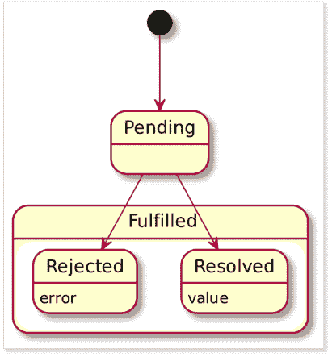

## 结果值

上述示例均使用了 Promise 的`res`函数来通知异步操作完成，但未产生任何返回值。若要同时返回一个值，请将它传递给`res`调用。

```javascript
const value = new Promise((res) => {
  res(5);
});
// 5
```

接下来是一个更复杂的示例，该 Promise 展示了 Google Drive 文件选择器，并在使用选定的文件后解决。这看似复杂，但基本原理与之前相同：创建一个新的 Promise，然后在结果准备好时调用`res`方法。

```javascript
const folder = await new Promise((res) => {
  const picker = new google.picker.PickerBuilder()
    // ... configuration ...
    .setCallback((data) => {
      if (/* selected action*/) {
        // a folder is selected
        const selectedFolder = ...

        // resolve the Promise
        res(selectedFolder);
      }
    })
    .build();
  picker.setVisible(true);
});
// folder is the selected folder
```

> **注释**
>
> 您只能通过`res()`调用返回一个值。关于如何返回多个值的用法，您可以在[Returning multiple values](#)（翻译注：中文环境中通常译为“返回多个值”）章节中了解更多信息。

# 错误处理

到目前为止，我们一直都在讨论一切顺利时的异步函数。没有数据库超时、没有验证错误、也没有突然的网络中断。但这些情况确实会发生，因此我们需要为此做好准备。如果不进行适当的错误传播，失败会导致 Promise 和异步函数的停滞并永远停止运行。

对于同步函数，当某事物`throw`抛出异常时会触发错误，并且这些错误会一直冒泡直到遇到`try-catch`：

```javascript
const fn = () => {
  throw new Error("Something bad happened");
}

try {
  fn();
}catch(e) {
  // handle error
}
```

异步函数的工作原理类似，当抛出异常时也会向上冒泡直到遇到`try-catch`。对于异步错误（我们将在下一章探讨其工作机制），您可以使用相同的熟悉结构进行处理：

```javascript
const fn = async () => {
  throw new Error("Something bad happened");
}

try {
  await fn();
}catch(e) {
  // handle error
}
```

> **注意**
>
> Error exceptions are thrown during the`await`and not when the function is called:（翻译注：保留原文表述，但语境上指异常在`await`期间抛出）

在调用函数时不会立即产生错误：

```javascript
const asyncFn = async () => {
  throw new Error("Something bad happened");
}

const res = asyncFn(); // no error here

try {
  await res; // error
}catch(e) {
  // handle error
}
```

## Promise 构造函数中的错误回调

但是，当您使用 Promise 构造函数时，必须注意传播这些错误。

让我们重新审视之前的示例！`gapi.load`可以加载用于与 Google 服务一起使用的客户端库，并且它需要一个回调来通知完成状态。借助 Promise 构造函数，很容易将其转换为 Promise：

```javascript
await new Promise((res) => {
  gapi.load("client:auth2", res);
});
// auth2 loaded
```

但如果发生错误呢？也许网络断开连接，导致无法加载客户端库。在这种情况下，回调函数永远不会被调用，Promise 也永远不会完成。正在`await`等待它的操作将永远挂起。

```javascript
await new Promise((res) => {
  gapi.load("client:auth2", res); // error
});
// never happens
```

为了实现适当的错误传播，我们需要两件事：首先是一种向 Promise 发出发生错误的信号的方式，其次是检测该错误的方法。

## Rejecting a Promise（拒绝 Promise）

Promise 构造函数提供了第二个回调参数，可用于指示发生了错误：

```javascript
new Promise((res, rej) => {
  // call res() when everything is fine
  // call rej() when there is an error
});
```

当调用`rej`函数时，其行为类似于异步函数抛出异常：

```javascript
try {
  await new Promise((res, rej) => {
    rej(); // signal error
  });
} catch(e) {
  // handle error
}
```

类似地，对于`res`函数，您可以传入错误对象作为拒绝原因（rejection reason）：

```javascript
try {
  await new Promise((res, rej) => {
    rej(new Error("Something bad happened"));
  });
} catch(e) {
  console.log(e.message) // Something bad happened
}
```

## What is an error（什么是错误）

什么构成“错误”完全取决于实现。例如，`fetch`在无法建立连接时抛出异常，但在响应的状态码不在 2xx 范围内却不抛出错误。

```javascript
try {
  const response = await fetch(options);
  if (response.ok) {
    // request successful
  }else {
    // error response
  }
} catch (e) {
  // error while sending the request
}
```

在构造函数中抛出的异常也会拒绝 Promise：

```javascript
new Promise(() => {
  throw Error("something bad happened");
});
// rejected with error
```

这种行为使得大部分编程错误能够正确地传播。但不同于`reject`回调参数，这仅能处理同步错误。

## Detecting errors（检测错误）

现在我们有了向 Promise 发出信号的方法了，让我们看看如何将`gapi`示例适配此结构！

在此特定情况下，回调也可以是一个包含`callback`和`onerror`处理方法的[object](link)：

```javascript
await new Promise((res, rej) => {
  gapi.load("client:auth2", {callback: res, onerror: rej});
});
```

现在如果在加载过程中发生错误，将调用`rej`函数并且`await`会抛出异常。

> **注释**
>
> 底层函数如何传达结果和信号的方法可能因库而异（library-to-library）。您将在[Callback styles](https://example.com)（回调风格）章节中了解更多相关信息。（翻译注：根据上下文推测`callback:res, onerror:rej`中的 object 实为对象字面量，此处保留原文 format。由于中文语境习惯将此类参数描述称为“样式”或“模式”，故直译。）

## Promise chain 的错误传播（Promise 链中的错误处理）

虽然异步函数与常规函数使用相同的`try..catch`结构，但 Promise 链的工作方式不同。`then`回调会获得一个额外的回调，用于在前一个 Promise 被拒绝时调用：

```javascript
const rejectedPromise = new Promise((res, rej) => {
  rej(new Error("rejected"));
});

rejectedPromise.then(undefined, (error) => {
  // error = "rejected"
  // handle error
});
```

Promise 链中的错误会移动到下一个错误处理器，跳过所有先前的步骤。这使得收集来自多个步骤的错误并在单一位置处理它们变得非常容易：

```javascript
getUser()
  .then(getPermissionsForUser)
  .then(checkPermission)
  .then((allowed) => {
    // handle allowed or not
  }).then(undefined, (error) => {
    // there was an error in one of the previous steps
  });
```

思考 Promise 链中错误传播的一个有用模型是将其视为两条平行的铁轨，铁轨上设有站点。一个站点是一个`then`回调，其结果决定了火车将继续走哪条轨道。

> **提示**
>
> 与其使用`.then(undefined, (error) => {...})`，您可以使用简写形式`.catch((error) => {...})`。

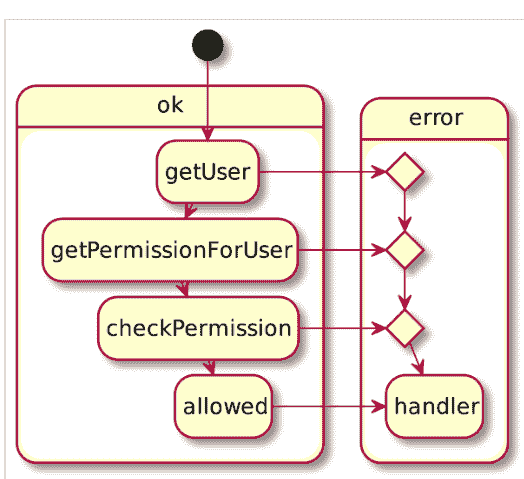

*Promise 链中的错误处理器*

这种思维方式允许解开更加复杂的 Promise 链。让我们分解一下这里发生的事情：

```javascript
getPromise()
    .then(handler1)
    .then(handler2, catch1)
    .then(handler3)
    .then(undefined, catch2)
    .then(handler4)
```

这会产生以下图表：

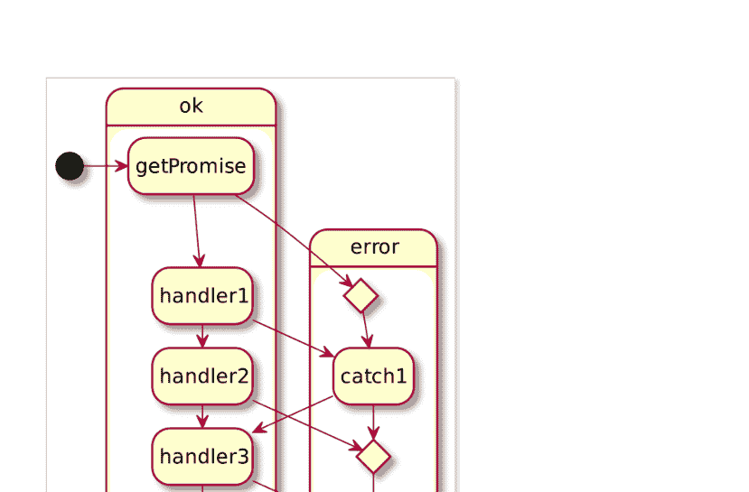

## 它看起来很复杂，但有一些简单的规则：

- 无论在哪条轨道上的每个函数（each function），都可以将 execution（执行）同时移动到 OK（成功）以及 error（失败/错误）轨道。
- 如果缺少处理程序时（即上面的图表中的菱形部分），execution 将继续停留在同一股铁轨上。

例如，如果`getPromise()`被拒绝，下一个函数将是`catch1`。If it resolves, then`handler3`is the next one. If it resolves,`handler4`will be called（or more commonly referred to as handler for success cases），and it will be the result of the whole chain, no matter if it resolves or rejects（即无论最终结果如何解决或拒绝，它都是整个链的结果）。

# 错误处理

请注意这一行：

```javascript
.then(handler2, catch1)
```

常见的错误来源是：如果`handler2`中出现错误，那么`catch1`不会执行。每个错误处理器只处理来自*之前步骤*的错误。

## 并行与顺序处理

当你在异步函数中使用`await`时，它会暂停执行，直到 Promise 被解决。这使得每一行代码都等待前一行执行完毕，从而产生几乎与同步代码无异的执行流：

```javascript
await s3.copyObject({...}).promise();
await s3.deleteObject({...}).promise();
```

上面的代码先复制一个对象，然后删除一个对象。如果你想*移动*对象，这就是理想的执行顺序，因为你需要在删除原始对象之前完成复制操作。

### 使用`Promise.all`进行并行处理

但如果存在一个不相关的调用，例如更新数据库呢？

```javascript
await s3.copyObject({...}).promise();
await s3.deleteObject({...}).promise();
await dynamodb.updateItem({...}).promise();
```

虽然`dynamodb.updateItem`与 S3 对象无关，但它仍然要等待移动操作（复制 + 删除）完成。这使得整个流程比必要的更长。

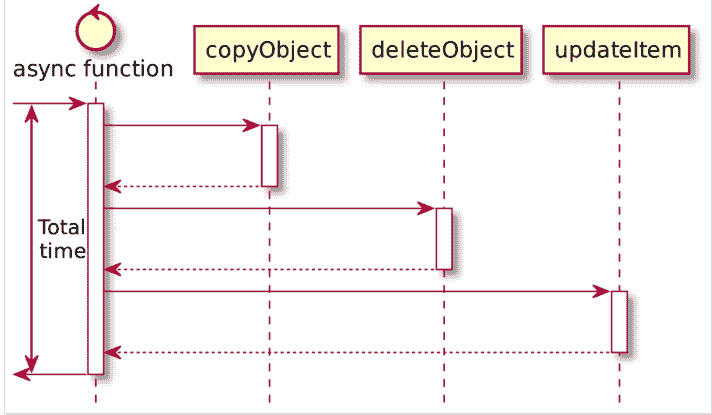

顺序执行

在这种情况下，更好的实现是让这两部分并行运行。为了更清晰地展示，让我们用异步函数将这两个操作分组：

```javascript
const moveObject = async () => {
  await s3.copyObject({/* ... */}).promise();
  await s3.deleteObject({/* ... */}).promise();
};

const updateDatabase = async () => {
  await dynamodb.updateItem({/* ... */}).promise();
};
```

Javascript 内置了一个方便的方法来并行运行任务。这就是`Promise.all`，它接收一个 Promise 集合，并返回一个包含所有结果的 Promise。当你想并发运行多个任务时，这就是你需要使用的工具。

要使用它来并行运行这两个操作，请使用：

```javascript
await Promise.all([moveObject(), updateDatabase()]);
```

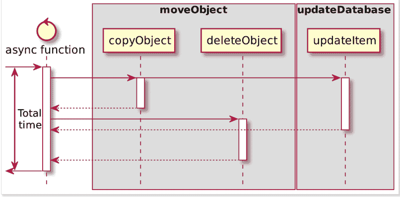


这里有几个需要注意的地方。首先，`Promise.all` 接收的是 `Promise`。记住，调用一个异步函数会返回一个 `Promise`，所以不要忘记调用你想要运行的函数。

其次，它需要一个 `Promise` 集合，通常是一个数组。注意调用 `Promise.all` 时的 `([ ... ])` 结构。

第三，`await` 仅用于 `Promise.all`，而不是用于各个异步函数调用。这是因为你想等待所有任务完成后再继续。

> **提示**
>
> `await` 会暂停异步函数的执行。对于 `Promise.all`，你只想暂停一次，以等待所有输入的 `Promise` 都尘埃落定。这就是为什么你只需要一个 `await`。

### 结果处理

在上面的例子中，没有一个操作返回了值。让我们看看如何处理 `Promise.all` 返回的值！

为了说明，假设一个异步函数需要两件不相关的数据：一个用户对象和一个组列表。这两者都存储在数据库中，因此可以通过异步函数获取。

```javascript
const getUser = async () => {
  // 获取用户对象
  return user;
}
const getGroups = async () => {
  // 获取组列表
  return groups;
}
```

注意在这个例子中，`getGroups` 函数不需要用户对象。这使得它们可以并行运行。

顺序执行的实现会分别调用这些函数并将结果存储在变量中：

```javascript
const user = await getUser();
const groups = await getGroups();

// 现在可以使用 user 和 groups
```

这里有两个 `await`，所以函数会暂停两次。无论你把哪个放在前面，总执行时间都是两次调用时间的总和。正如我们之前看到的，`Promise.all` 会并行运行异步函数返回的 `Promise`。它还会返回一个包含结果数组的 `Promise`。

要并行运行这两个调用并提取结果，可以使用数组解构赋值：

```javascript
const [user, groups] = await Promise.all([
  getUser(),
  getGroups(),
]);

// 现在可以使用 user 和 groups
```

### Promise.all 中的错误处理

当任何输入的 `Promise` 被拒绝时，返回的 `Promise` 也会被拒绝。这种行为允许错误无缝地传播。

```javascript
try {
  const [user, groups] = await Promise.all([
    getUser(), // getUser 返回一个值
    getGroups(), // getGroups 抛出一个异常
  ]);
} catch(e) {
  // 处理任一调用抛出的错误
}
```

即使异步函数在某种意义上是独立的（一个不使用另一个的结果），在某些情况下你可能不想并行运行它们。在上面的 `moveObject` 和 `updateDatabase` 异步函数例子中，如果前者失败，你可能就不想运行后者。

```javascript
await Promise.all([moveObject(), updateDatabase()]);
```

当这段代码运行时，可能产生以下结果：

| 对象是否移动成功 | 数据库是否更新成功 |
| :---: | :---: |
| ✓ | ✓ |
| ✓ | - |
| - | ✓ |
| - | - |

通过使用顺序执行，你可以确保只有在前面的操作完成后，后面的操作才会运行：

```javascript
await moveObject();
await updateDatabase();
```

当这段代码运行时，如果移动对象失败，数据库保证不会被更改：

| 对象是否移动成功 | 数据库是否更新成功 |
| --- | --- |
| ✓ | ✓ |
| ✓ | - |
| - | - |

### 提前启动

当你创建一个 `Promise` 时，它就开始执行了。但异步函数只有在遇到 `await` 时才会暂停。这允许了一种结构：提前开始异步处理，但只在需要结果时才暂停。

例如，考虑以下代码，它在继续之前等待函数完成：

```javascript
const wait = (ms) => new Promise((res) => setTimeout(res, ms));

const fn = async () => {
  console.log("starting");
  await wait(100);
  console.log("end");
}

await fn();
console.log("after");

// starting
// end
// after
```

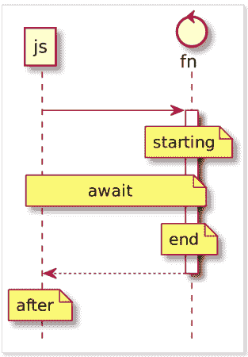

*急切的 `await`*

但当 `await` 放在后面时，执行顺序就改变了：

```javascript
const fnProm = fn();
console.log("after");
await fnProm;

// starting
// after
// end
```

这提供了一种简单的方法，在“后台”运行任务，同时在需要时获取结果。

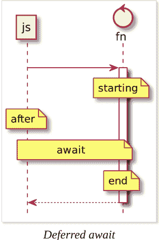

例如，一个 Web 服务器在收到请求时可能要做几件事，其中之一是从 cookie 和会话存储中获取用户会话。

```javascript
const http = require("http");

const getUserSession = async (req) => {
  // 提取会话 cookie
  // 从 Redis 获取会话
  // 返回用户对象
};

const server = http.createServer(async (req, res) => {
  // 验证请求
  // 获取配置
  const session = await getUserSession(req);
  // 处理请求
});

server.listen(8080);
```

在上面的例子中，一切都是顺序发生的。服务器处理请求，然后获取用户会话。

为了在请求到达后立即开始获取用户会话，你可以将调用异步函数和 `await` 分开：

```javascript
const server = http.createServer(async (req, res) => {
  const sessionProm = getUserSession(req);
  // 验证请求
  // 获取配置
  const session = await sessionProm;
  // 处理请求
});
```

在这种情况下，会话仍然在需要时可用，但处理过程更早开始了。这减少了用户感知的总时间。

但这里有个问题。正如我们在[错误处理](#)章节中讨论的，如果异步函数抛出错误，它会通过 `await` 传播。这意味着如果执行到达了该 `Promise` 的 `await` 语句之后，错误就不会被处理。

这是个问题。

考虑这段代码：

```javascript
const wait = (ms) => new Promise((res) => setTimeout(res, ms));

const fn = async () => {
  await wait(100);
  throw new Error("Something bad happened");
}

try{
  const p = fn();
  throw new Error("There was an error");
  await p;
}catch(e) {
  console.log(e.message);
}
```

这会输出：

发生了错误

`(node:170) UnhandledPromiseRejectionWarning: Error: 发生了不好的事情`

`(node:170) UnhandledPromiseRejectionWarning: 未处理的Promise拒绝。此错误要么源于在异步函数内抛出异常但没有catch块，要么源于拒绝了一个未通过.catch()处理的Promise。要在未处理Promise拒绝时终止Node进程，请使用CLI标志--unhandled-rejections=strict（参见https://nodejs.org/api/cli.html#cli_unhandled_rejections_mode）。`

`(拒绝ID: 1)`

`(node:170) [DEP0018] DeprecationWarning: 未处理的Promise拒绝已被弃用。将来，未处理的Promise拒绝将使用非零退出码终止Node.js进程。`

未处理的拒绝是糟糕的。存在一个通用的 `unhandledRejection` 事件允许处理它，但这会导致难以维护的代码。一个恰当的解决方案是确保 `Promise` 总是被 `await`。这通常会导致代码更复杂。

在某些情况下，早期初始化模式是有用的，特别是当任何异常都是灾难性的时候。但当您有一个可以被多个客户端调用的后端服务器时，最好避免使用它。

## 多次 await

如果对一个 `Promise` 进行多次 `await` 会发生什么？这不会导致函数被多次调用。当一个 `Promise` 被敲定（解决或拒绝）时，`await` 只是返回结果（或抛出异常）。

考虑以下代码：

```javascript
const fn = async () => {
  console.log("called");
  await wait(100);
  return "result";
}

(async () => {
  const p = fn();
  console.log(await p);
  console.log(await p);
})();

// called
// result
// result
```

## 返回多个值

正如我们在[Promise构造函数](https://www.google.com)章节中讨论的，就像普通函数一样，一个 `Promise` 可以有单个返回值。但很多时候你会想返回多个东西。

幸运的是，Javascript 支持对象和数组解构运算符，这使得使用单个变量来保存多个值变得容易。

例如，一个 `Promise` 可以解决为一个值的数组：

```javascript
const getValues = () => new Promise((res) => {
  const user = "user";
  const group = "group";
  res([user, group]);
});

const [user, group] = await getValues();
// user, group
```

或者一个具有已知字段的对象：

```javascript
const getValues = () => new Promise((res) => {
  const user = "user";
  const group = "group";
  res({user, group});
});

const {user, group} = await getValues();
// user, group
```

当然，这与你用于同步函数的模式相同：

```javascript
const getValues = () => {
  const user = "user";
  const group = "group";
  return {user, group};
};

const {user, group} = getValues();
// user, group
```

并且与异步函数的工作方式相同：

```javascript
const getValues = async () => {
  const user = "user";
  const group = "group";
  return {user, group};
};

const {user, group} = await getValues();
// user, group
```

## 在 Promise 和回调之间转换

虽然 Promise 和 async/await 正日益成为在 Javascript 中编写异步代码的主要方式，但回调仍在许多地方使用。一些采用该风格的库迁移得慢，难以转向更现代的替代方案，浏览器（和 Node）API 的变更也很缓慢。

例如，[marked](https://github.com/markedjs/marked) 这个 Markdown 编译器在异步模式下使用时需要一个回调：

```javascript
marked(text, options, (err, result) => {
  // result 是编译后的 markdown
});
```

类似地，`setTimeout` 在时间到了时调用一个函数：

```javascript
setTimeout(callback, 100);
```

更不用说大量的 Web API，例如 [Indexed DB](https://developer.mozilla.org/en-US/docs/Web/API/IndexedDB_API)、[FileReader](https://developer.mozilla.org/en-US/docs/Web/API/FileReader) 等。回调仍然无处不在，将它们转换为 `Promise` 是一个好习惯，特别是如果你的代码已经在使用 async/await。

### 回调风格

回调实现了延续传递风格编程，其中一个函数不是返回一个值，而是调用一个延续，在这种情况下，是一个参数函数。它在 Javascript 中尤其普遍，因为它不支持同步等待。所有涉及一些未来事件的事情，例如网络调用、异步 API 或简单的超时，都只能通过回调机制来实现。

回调有几种工作方式。例如，`setTimeout` 使用回调优先模式：

```javascript
setTimeout(callback, ms);
```

或者函数可以获取多个函数并在适当的时候调用它们：

```javascript
const checkAdmin = (id, isAdmin, notAdmin) => {
  if (/* admin 逻辑 */) {
    isAdmin();
  } else {
    notAdmin();
  }
};
```

回调的调用方式也可能不同。例如，它可能获取多个参数：

```javascript
const getUserData = (id, cb) => {
  const user = /* 获取用户 */
  cb(user.id, user.profile, user.avatar);
};
```

此外，异步性可以实现为一个发出事件的对象：

```javascript
const reader = new FileReader();
reader.onload = (event) => {
  // event.target.result
}
reader.onerror = (error) => {
  // 处理错误
};
reader.readAsDataURL(blob);
```

### Node 风格回调

由于有多种同样合理的方式来实现回调，一开始很混乱。一个事实标准出现了，现在称为 Node 风格或错误优先回调。它在 Javascript 中几乎无处不在，只要需要回调。

Node 风格回调有三个特点：

- 回调函数是最后一个参数
- 它首先被错误对象调用，然后是结果（`(error, result)`）
- 它只返回一个结果

作为说明，此函数实现了一个 Node 风格回调：

```javascript
const getUser = (id, cb) => {
  const user = /* 获取用户 */;
  if (user) {
    // 成功
    cb(null, user);
  }else {
    // 错误
    cb(new Error("获取用户失败"));
  }
};
```

注意当没有错误时，第一个参数是 `null`。这允许调用者轻松检查执行是失败还是成功：

```javascript
getUser(15, (error, result) => {
  if (error) {
    // 处理错误
  } else {
    // 处理结果
  }
});
```

由于回调结构几乎是唯一的，这使得在 Promise 和回调之间转换变得更加容易。

### 将回调转换为 Promise

这是一个更突出的方向，因为将基于回调的函数集成到 async/await 流程中是一个常见任务。让我们看看怎么做！

#### Promise 构造函数

Promise 构造函数是将回调转换为 Promise 的低级但通用的方法。它适用于每种回调风格，只需要几行代码。

Promise 构造函数获取一个带有两个参数的函数：一个 `resolve` 和一个 `reject` 函数。当其中一个被调用时，Promise 将敲定，可以是传递给 `resolve` 函数的结果，或者是传递给 `reject` 的错误。

```javascript
new Promise((res, rej) => {

  // 使用一个值解决
  // res(value)

  // 使用错误拒绝：
  // rej(error)
})
```

这使得调用基于回调的函数并将其转换为 Promise 变得容易，然后可以 `await` 它：


```javascript
// Node风格
new Promise((res, rej) => getUser(15, (err, result) => {
  if (err) {
    rej(err);
  } else {
    res(result);
  }
}))

// setTimeout
new Promise((res) => setTimeout(res, 100));

// 基于事件
new Promise((res, rej) => {
  const reader = new FileReader();
  reader.onload = (event) => {
    // 解决Promise
    res(event.target.result);
  }
  reader.onerror = (error) => {
    // 拒绝Promise
    rej(error)
  };
  reader.readAsDataURL(blob);
});
```

#### Promisified函数

上面的示例展示了如何调用基于回调的函数并获取回Promise，但它需要将每个调用都用Promise样板代码包装起来。更好的办法是有一个函数模拟原始函数但没有回调。这样的函数将获取与回调之前相同的参数，并返回Promise。

要创建函数的promisified版本，只需将Promise构造函数包装在一个获取回调之前参数的函数中：

```javascript
// setTimeout
const promisifiedSetTimeout = (ms) =>
  new Promise((res) => setTimeout(res, ms));

// FileReader
const promisifiedFileReader = (blob) =>
  new Promise((res, rej) => {
    const reader = new FileReader();
    reader.onload = (event) => {
      res(event.target.result);
    }
    reader.onerror = (error) => {
      rej(error)
    };
    reader.readAsDataURL(blob);
  });

// checkAdmin
const promisifiedCheckAdmin = (id) => new Promise((res) => {
  if (/* admin逻辑 */) {
    res(true);
  } else {
    res(false);
  }
};
```

这些函数是基于回调的原始函数的直接替代品，可以直接在`async/await`工作流中使用。

## `util.promisify`

虽然`Promise`构造函数提供了一种将回调转换为`Promise`的通用方法，但当回调模式遵循 Node 风格时，存在一种更简便的方式。`util.promisify`接受基于回调的函数，并返回一个 Promise 化的版本。

```javascript
import util from "util";

const promisifiedGetUser = util.promisify(getUser);

const user = await promisifiedGetUser(15);
// user 是结果对象
```

当 Promise 化的函数被调用时，回调参数会自动添加，它还会将结果（或错误）转换为 Promise 的返回值。

不过，其工作原理并非魔法。它使用了我们上面讨论过的 Promise 构造函数模式，并使用展开语法来允许任意数量的参数。一个简化的实现看起来像这样：

```javascript
const promisify = (fn) => (...args) =>
  new Promise((res, rej) => {
    fn(...args, (err, result) => {
      if (err) {
        rej(err);
      } else {
        res(result);
      }
    });
  });
```

## 常见问题

### 处理`this`

JavaScript 中`this`的值很复杂。它可能根据调用函数的方式而具有不同的值。

例如，类可以有实例变量，附着在`this`上：

```javascript
class C {
  constructor() {
    this.var = "var";
  }
  fn() {
    console.log(this.var);
  }
}
```

但是，当你拥有此类的一个对象时，是直接在对象上调用此函数，还是将其提取到另一个变量中，会影响`this`的值：

```javascript
new C().fn(); // var

let fn = new C().fn;
fn(); // TypeError: Cannot read property 'var' of undefined
```

这会影响如何将此对象的方法 Promise 化，因为`util.promisify`只需要函数，而不需要整个对象。这反过来又会破坏`this`。

例如，假设有一个`Database`对象在其构造函数中创建连接，然后提供发送查询的方法：

```javascript
class Database {
  constructor() {
    this.connection = "database connection";
  }
  getUser(id, cb) {
    if (!this.connection) {
      throw new Error("No connection");
    }
    setTimeout(() => {
      if (id >= 0) {
        cb(null, `user: ${id}`);
      } else {
        cb(new Error("id must be positive"));
      }
    }, 100);
  }
}

const database = new Database();
database.getUser(15, (error, user) => {
  // 处理错误或用户数据
})
```

使用`util.promisify`会破坏`getUser`函数，因为它改变了`this`的值：

```javascript
const promisifiedDatabaseGetUser =
  util.promisify(database.getUser);
await promisifiedDatabaseGetUser(15);
// Error: Cannot read property 'connection' of undefined
```

为了解决这个问题，你可以将对象绑定到函数上，强制`this`的值：

```javascript
const promisifiedDatabaseGetUser =
  util.promisify(database.getUser.bind(database));
const user = await promisifiedDatabaseGetUser(15);
```

## `function.length`

函数的`length`是指它需要多少个参数。不要与数组的`length`混淆，后者是数组中*元素*的数量。

例如，这个函数需要 2 个参数，所以它的`length`是 2：

```javascript
const fn = (a, cb) => {};

console.log(fn.length); // 2
```

它很少被使用，但有些库依赖于它具有正确的值，例如 [memoizee](https://github.com/medikoo/memoizee)（它决定如何缓存函数调用）或 [marked](https://marked.js.org/)（一个 Markdown 编译器，用来决定其配置是[以异步还是同步方式调用](https://marked.js.org/using_pro#async)）。

虽然函数的`length`很少被使用，但它可能会引起问题。`util.promisify`不会改变它，因此结果函数的`length`将与原始函数相同，即使它需要的参数更少。

```javascript
console.log(fn.length); // 2

const promisified = util.promisify(fn);

console.log(promisified.length); // 2
```

## 将 Promise 转换为回调

另一个方向是，你有一个返回 Promise 的函数（通常是`async`函数），而你需要将其转换为基于回调的函数。这种情况比另一种方式少见得多，但有时确实需要，通常当一个库期望一个异步函数但它只支持回调时。

例如，marked 库支持一个`highlight`选项，该选项接收代码块并返回格式化后的版本。高亮函数接收代码、语言和一个回调参数，期望调用最后一个参数并传入结果。

```javascript
import marked from "marked";
import util from "util";

const promisifiedMarked = util.promisify(marked);

const res = await promisifiedMarked(md, {
  // highlight 接收一个回调
  highlight: (code, lang, cb) => {
    const result = "Code block";
    cb(null, result);
  }
});
```

与 Promise 化类似，将异步函数转换为使用回调也有通用方式和 Node 回调特定方式。通用方式是使用异步 IIFE（立即调用函数表达式），并在有结果或错误时使用`then`与回调交互：

```javascript
highlight: (code, lang, cb) => {
  (async () => {
    const result = "Code block";
    return result;
  })().then((res) => cb(null, res), (err) => cb(err));
}
```

这种结构允许所有回调风格，因为你控制如何将结果或错误传递给回调函数。

对于 Node 风格的回调，你可以使用`util.callbackify`函数，它接受一个异步函数并返回一个回调化的版本：

```javascript
highlight: util.callbackify(async (code, lang) => {
  const result = "Code block";

  return result;
})
```

这产生了一个便捷的结构，并且在大多数情况下都适用。

此外，它会将结果函数的`length`增加一，因为它需要一个回调参数以及所有原始参数：

```javascript
console.log(fn.length) // 2
console.log(util.callbackify(fn).length) // 3
```

## Promise 超时

**Javascript 中的 Promise 没有时间概念。** 当你使用`await`或使用`.then()`附加函数时，它会**等待直到 Promise 被解决或拒绝**。这通常不是问题，因为大多数异步任务会在合理的时间内完成，并且需要它们的结果。

但当客户端在等待，比如说，一个 HTTP 服务器的响应时，最好提前返回一个错误，让调用者有机会重试，而不是等待可能很长的时间。

幸运的是，有一个内置的 Promise 辅助函数，可以用来为任何基于 Promise 的构造添加超时功能。

## `Promise.race`

[Promise.race](https://developer.mozilla.org/en-US/docs/Web/JavaScript/Reference/Global_Objects/Promise/race) 是 Promise 对象的一个全局属性。**它接受一个 Promise 数组，并*等待第一个完成*。** 竞速的结果是解决还是拒绝取决于获胜的成员。

例如，下面的代码对两个 Promise 进行竞速。第二个 Promise 更早解决，另一个的结果被丢弃：

```javascript
const p1 =
  new Promise((res) => setTimeout(() => res("p1"), 1000));
const p2 =
  new Promise((res) => setTimeout(() => res("p2"), 500));

const result = await Promise.race([p1, p2]);
// result = p2
```

同样，它也适用于拒绝。如果获胜的 Promise 被拒绝，那么竞速也被拒绝：

```javascript
const p1 =
  new Promise((res) => setTimeout(() => res("p1"), 1000));
const p2 =
  new Promise((_r, rej) => setTimeout(() => rej("p2"), 500));

try {
  const result = await Promise.race([p1, p2]);
} catch (e) {
  // e = p2
}
```

`Promise.race`函数的参数是 Promise。这使得它也能与`async`函数一起工作：

```javascript
const fn = async (time, label) => {
  await new Promise((res) => setTimeout(res, time));
  return label;
}

const result =
  await Promise.race([fn(1000, "p1"), fn(500, "p2")])
// result = p2
```

只是不要忘记调用`async`函数，以便竞速能够获得 Promise。这对于匿名函数可能是一个问题，需要将它们包装在 IIFE 风格中：

```javascript
const result = await Promise.race([
  fn(1000, "p1"),
  (async () => {
    await new Promise((res) => setTimeout(res, 500));
    return "p2";
  })(),
]);
// result = p2
```

## 超时实现

使用`Promise.race`可以轻松实现支持任何 Promise 的超时机制。除了异步任务外，**再启动一个在达到超时时间后会拒绝的 Promise**。哪个先完成（原始 Promise 或超时 Promise），哪个的结果就成为最终结果。

```javascript
const timeout = (prom, time) =>
  Promise.race([
    prom,
    new Promise((_r, rej) => setTimeout(rej, time))
  ]);
```

利用这个辅助函数包装任何 Promise，如果它在指定时间内没有产生结果，就会被拒绝。

```javascript
// 在 500 ms 内完成
const fn = async () => {
  await new Promise((res) => setTimeout(res, 500));
  return "p2";
}

// 在超时前完成
const result = await timeout(fn(), 1000);
// result = p2

// 在 100 ms 后超时
await timeout(fn(), 100);
// 错误
```

需要注意的是，当达到超时时间时，它*并不会终止原始 Promise*，只是丢弃其结果。如果 Promise 包含多个步骤，它们最终仍会运行完成。

## 清除超时定时器

上面的解决方案使用`setTimeout`来调度拒绝操作。就像原始 Promise 在达到超时时间时不会终止一样，当竞速结束时，超时 Promise **不会取消这个定时器**。

虽然这不影响最终 Promise 的工作机制，但可能会产生副作用。事件循环需要检查定时器是否已完成，而在某些环境中，如果存在未完成的定时器，行为可能会有所不同。

让我们修改包装函数，使用`Promise.finally`来清除超时定时器！

```javascript
const timeout = (prom, time) => {
  let timer;
  return Promise.race([
    prom,
    new Promise((_r, rej) => timer = setTimeout(rej, time))
  ]).finally(() => clearTimeout(timer));
}
```

上述实现将`setTimeout`的结果保存为`timer`，并在竞速结束时清除它。

## 错误对象

竞速结束并且有一个拒绝发生。这是由于超时还是 Promise 中抛出了错误？

上述实现没有区分这两种错误，这使得专门处理超时变得困难。

```javascript
const fn = async () => {
  throw new Error();
};

try {
  const result = await timeout(fn(), 1000);
} catch (e) {
  // 是错误还是超时？
}
```

解决方案是添加第三个参数，作为超时拒绝的值。这样就可以区分不同的错误：


```javascript
const timeout = (prom, time, exception) => {
  let timer;
  return Promise.race([
    prom,
    new Promise((_r, rej) =>
      timer = setTimeout(rej, time, exception)
    )
  ]).finally(() => clearTimeout(timer));
}
```

那么，什么对象适合作为超时错误对象呢？

JavaScript 中的 [Symbol](https://developer.mozilla.org/en-US/docs/Web/JavaScript/Reference/Global_Objects/Symbol) 是只与自身相等的唯一对象。这使它们非常适合此用例。将一个`Symbol`作为超时错误参数传入，然后检查拒绝值是否就是该`Symbol`。

```javascript
const timeoutError = Symbol();
try {
  const result = await timeout(prom, 1000, timeoutError);
  // 处理结果
}catch (e) {
  if (e === timeoutError) {
    // 处理超时
  }else {
    // 其他错误
    throw e;
  }
}
```

这种构造允许专门处理超时错误。

## 异步序列化器模式

假设你有一个函数，它只在最近没有被调用时才执行计算，从而有效地将结果缓存一小段时间。在这种情况下，后续的函数调用会相互影响，因为当刷新发生时，所有调用都需要等待它。一个不考虑并发问题的实现，可能会在缓存过期时并行运行多次刷新。

### 这个实现是错误的

```javascript
// 返回一个将其结果缓存2秒的函数
// 错误实现，请勿使用
const badCachingFunction = (() => {
	const cacheTime = 2000;
	let lastRefreshed = undefined;
	let lastResult = undefined;
	return async () => {
		const currentTime = new Date().getTime();
		// 检查缓存是否足够新鲜
		if (lastResult === undefined ||
			lastRefreshed + cacheTime < currentTime) {
			// 刷新值
			lastResult = await refresh();
			lastRefreshed = currentTime;
		}
		return lastResult;
	}
})();
```

当函数需要刷新值时，如果遇到两个并发调用，刷新函数会被调用两次：

```javascript
const wait = (ms) => new Promise((res) => setTimeout(res, ms));

const refresh = async () => {
  console.log("refreshing")
  await wait(1000);
};

const badCachingFunction = ...;

badCachingFunction();
badCachingFunction();
// refreshing
// refreshing
```

处理这个问题的正确方法是让第二个调用等待刷新过程完成，而不是启动一个新的刷新过程。

一种方法是将缓存函数的调用序列化。这使得每一次调用都等待前面所有的调用完成，这样多次调用只会触发一次刷新过程。

这可以通过多种方式实现，但最简单的是让函数按顺序运行。在这种情况下，当一个调用需要刷新值时，其他调用会等待它完成，而不会启动自己的任务。

我需要这种解决方案的另一个用例是当后端调用需要一个令牌，而该令牌在一段时间后过期。当一个调用遇到未授权错误时，它会刷新令牌并使用新令牌重试。其他后端调用需要等待新令牌获取后才能执行。在这种情况下，这不仅仅是性能问题，因为新令牌会使所有旧令牌失效。

## 为什么`await`不是解决方案

一个简单的解决方案是使用`await`，它可以轻松实现序列化。毕竟，这正是这个关键字的用途。

```javascript
await badCachingFunction();
badCachingFunction();
// refreshing
```

但这需要调用者之间的协作，而并非总是可能。例如，当函数响应多种类型的事件被调用时，`await`无法在它们之间进行协调：

```javascript
document.querySelector("#btn").addEventListener("click", () => {
    fn();
})

window.addEventListener("message", () => {
    fn();
});
```

在这种情况下，函数调用自身必须进行协调。

## 通用解决方案

解决方案是维护一个 Promise 队列，将它们一个接一个地链接起来。只需要几行代码，它就是通用的，允许任何函数被序列化：

```javascript
const serialize = (fn) => {
  let queue = Promise.resolve();
  return (...args) => {
    const res = queue.then(() => fn(...args));
    queue = res.catch(() => {});
    return res;
  };
};
```

`Promise.resolve()`是队列的起点。每一次其他调用都会被追加到这个 Promise 上。

`queue.then(() => fn(...args))`将函数调用添加到队列，并将其结果保存在`res`中。当当前调用以及所有之前的调用都已完成时，它才会被解析。

`queue = res.catch(() => {})`这部分确保当队列中的某一部分被拒绝时，队列不会卡在拒绝状态。

用这个序列化器包装缓存函数，可以确保即使有多个调用，也只运行一次刷新：

```javascript
const fn = serialize((() => {
  const cacheTime = 2000;
  let lastRefreshed = undefined;
  let lastResult = undefined;
  return async () => {
    const currentTime = new Date().getTime();
    // 检查缓存是否足够新鲜
    if (lastResult === undefined ||
        lastRefreshed + cacheTime < currentTime) {
      // 刷新值
      lastResult = await refresh();
      lastRefreshed = currentTime;
    }
    return lastResult;
  }
})());

fn();
fn();
// refreshing
```

## 异步释放器模式

一个常见的模式是运行一些初始化代码来设置资源或配置，然后使用该资源，最后进行清理工作。它可以是全局属性，例如使用 [timekeeper](https://github.com/joyent/node-timekeeper) 冻结时间、使用 Puppeteer 启动 Chrome 浏览器，或创建临时目录。在所有这些情况下，你都需要确保修改/资源被正确释放，否则它们可能会泄漏到代码库的其他部分。

例如，以下代码在系统 tmpdir 中创建一个临时目录，并在不再需要时删除它。这在你希望使用`ffmpeg`从视频中提取一些帧并需要一个目录来告诉`ffmpeg`命令输出图像时非常有用。

```javascript
// create the temp directory
const dir = await fs.mkdtemp(
  await fs.realpath(os.tmpdir()) + path.sep
);
try {
  // use the temp directory
} finally {
  // remove the directory
  fs.rmdir(dir, {recursive: true});
}
```

类似的结构还有`console.time`，它需要一个`console.timeEnd`来输出代码段运行所花费的时间：

```javascript
console.time("name");
try {
  // ...
} finally {
  console.timeEnd("name");
}
```

或者当你启动浏览器时，你需要确保在不需要时关闭它：

```javascript
const browser = await puppeteer.launch({/* ... */});
try {
  // use browser
} finally {
  await browser.close();
}
```

所有这些情况都共享`try..finally`结构。如果没有它，一个错误可能会跳过清理逻辑，导致资源被初始化（或控制台计时器仍在计时）：

```javascript
const browser = await puppeteer.launch({/* ... */});

// if there is an error here the browser won't close!

await browser.close();
```

在其他语言中，例如 Java，这被称为 [try-with-resources](https://google.github.io/styleguide/javaguide.html#s6.2.2-try-with-resources-statements)，并且是内置于语言中的。例如，`BufferedReader`在块结束后被关闭：

```java
try (BufferedReader br =
    new BufferedReader(new FileReader(path))
) {
    return br.readLine();
}
```

这基于 [AutoCloseable](https://docs.oracle.com/javase/8/docs/api/java/lang/AutoCloseable.html) 接口的`close`方法，因此很容易适应自定义资源类型。

但在 Javascript 中没有这样的结构。让我们看看如何实现一个！

## 释放器模式

我们上面看到的`try..finally`结构的一个问题是如何从`try`块内部返回一个值。假设你想要截取网站的屏幕截图，并希望稍后使用生成的图像。

```javascript
const browser = await puppeteer.launch({/* ... */});
try {
  const page = await browser.newPage();
  // ...
  const screenshot = await page.screenshot({/* ... */});

  // the browser can be closed
  // but how to use the screenshot outside the try..finally?
} finally {
  await browser.close();
}
```

一个次优的解决方案是在块外部声明一个变量并用它来存储图像：

```javascript
let screenshot;

const browser = await puppeteer.launch({/* ... */});
try {
  const page = await browser.newPage();
  // ...
  screenshot = await page.screenshot({/* ... */});
} finally {
  await browser.close();
}

// use screenshot
```

一个更好的解决方案是使用一个函数：

```javascript
const makeScreenshot = async () => {
  const browser = await puppeteer.launch({/* ... */});
  try {
    const page = await browser.newPage();
    // ...
    return await page.screenshot({/* ... */});
  } finally {
    await browser.close();
  }
}

const screenshot = await makeScreenshot();
```

这就是释放器模式的基础。不同之处在于，它不是将逻辑硬编码在`try..finally`块中，而是获得一个实现了该部分的函数：

```javascript
const withBrowser = async (fn) => {
    const browser = await puppeteer.launch(/* ... */);
    try {
      return await fn(browser);
    } finally {
      await browser.close();
    }
  }

const screenshot = await withBrowser(async (browser) => {
  const page = await browser.newPage();
  // ...
  return await page.screenshot(/* ... */);
});
```

`withBrowser`函数包含了启动和关闭浏览器的逻辑，而`fn`函数获取并使用浏览器实例。每当参数函数返回时，浏览器会自动关闭，无需额外的清理逻辑。这种结构提供了一种优雅的方式来防止未关闭的资源四处悬挂。

这种模式的一个有趣之处在于，它是少数几个`return fn()`和`return await fn()`之间存在差异的情况之一。通常，异步函数返回一个 Promise 还是 Promise 的结果并不重要。但在这种情况下，没有`await`，`finally`块会在`fn()`调用完成之前运行。

一个潜在的问题是当参数函数返回时，其中有一些任务正在运行。当它启动一个异步任务且不等待其完成时，就会发生这种情况。在这种情况下，清理逻辑会运行并关闭浏览器实例，这可能导致错误。这通常是缺少`await`的迹象。

## 重试异步操作

### 退避算法

一个 Javascript 应用程序向远程服务器发出了一个`fetch`调用，但失败了。它应该如何重试请求，以便最终成功，同时尽量减少发出的调用次数？

退避算法确保当目标系统无法处理请求时，它不会被后续的重试淹没。它通过在重试之间引入等待期来实现这一点，给目标一个恢复的机会。

退避的需求基于一个观察：当服务过载时，它就不可用，发送更多请求只会加剧问题。当所有调用者暂时停止向已经过载的服务添加更多负载时，通常会平滑流量峰值，只有轻微的延迟。

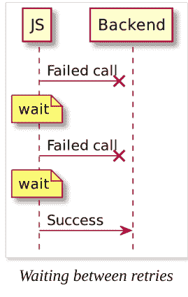

使用的退避算法决定了在重试之间等待多久。在诸如移动网络饱和等网络拥塞的情况下，最佳配置正在被积极研究。看到不同的实现产生截然不同的有效带宽是很有趣的。

重试对远程服务器的失败调用是一个容易得多的问题，正确地做到这一点不需要多年的研究。在本文中，你将学习如何在 Javascript 中实现一个退避解决方案，该方案对于所有实际用途来说都足够好。

### 指数退避

但让我们首先重新审视选择退避策略的问题，即在重试之间等待多久！过早发送请求会给潜在挣扎的服务器增加更多负载，而等待太久则会引入太多延迟。

指数退避已成为使用的标准算法。它为后续重试等待指数级更长的时间，这使得前几次尝试只有轻微的延迟，同时很快达到较长的等待时间。

它有两个参数：第一个周期的延迟和增长因子。例如，当第一次重试等待 10ms，后续重试的值加倍时，等待时间为：10、20、40、80、160、320、640、1280、...

请注意，前 3 次尝试的总和小于 100 ms，这几乎难以察觉。但它在仅仅 8 次尝试后就超过了 1 秒。

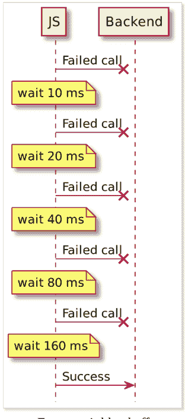

指数退避

### Javascript 实现

在实现退避算法时有两个陷阱。

首先，确保只在重试前等待，而不是第一次请求。先等待再发送请求会为成功请求也引入延迟。

其次，确保对重试次数设置限制，这样代码最终会放弃并抛出错误。即使调用最终成功，与此同时上游某些部分可能已经超时，用户很可能得到一个错误。及时返回错误并让用户重试操作是一种良好的用户体验实践。

从重试的角度来看，操作有两种类型：基于拒绝的和基于进度的。让我们逐一讨论它们！

## 基于拒绝的重试

这种类型的调用要么成功，要么失败，通常实现为 Promise 的解析或拒绝。一个典型的例子是“保存”按钮可能会失败，在这种情况下，重试意味着重新发送请求。

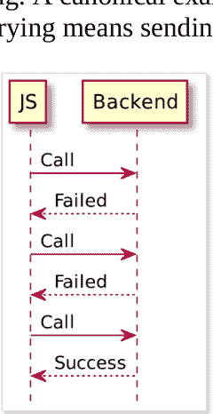

为了说明，此操作模拟了一个网络调用，其失败率为 90%：


```js
const wait = (ms) => new Promise((res) => setTimeout(res, ms));
const maybeFail = (successProbability, result, error) =>
  new Promise((res, rej) => Math.random() < successProbability
    ? res(result)
    : rej()
  );

const maybeFailingOperation = async () => {
  await wait(10);
  return maybeFail(0.1, "result", "error");
}
```

在不使用重试机制的情况下调用此函数会导致糟糕的用户体验。用户需要反复点击按钮直到成功。

一种通用解决方案，可以接受任何异步函数并在放弃之前重试几次：

```js
const callWithRetry = async (fn, depth = 0) => {
  try {
    return await fn();
  } catch (e) {
    if (depth > 7) {
      throw e;
    }
    await wait(2 ** depth * 10);

    return callWithRetry(fn, depth + 1);
  }
}
```

并将其与上述操作一起使用：

```js
const result = await callWithRetry(maybeFailingOperation);
```

在重试实现中，`depth`参数表示已向服务发出的调用次数。它确定等待多久（`await wait(2 ** depth * 10)`）以及何时放弃（`if (depth > 7) {...}`）。当函数调用自身时，它会增加此值。

有趣的是，这是一个使用`return await`会有所不同的场景。通常，异步函数返回 Promise 还是其解析值并不重要。但在这种情况下并非如此，因为`try...catch`需要等待`fn()`调用的完成来处理从中抛出的异常。

注意，此实现会针对*任何错误*进行重试，即使它是不可重试的错误，例如发送无效数据。

# 基于进度的重试

另一类可重试的操作是**每次调用都可能向完成迈进一些进度，但可能无法到达终点**。

这方面的一个很好的例子是 DynamoDB 的`batchWriteItem`调用方式。你定义要存储的项目，调用尝试保存所有项目。然后它在响应中返回一个列表，指示哪些元素失败。重试操作只需要包含这些遗漏的项目，而不是整个请求。

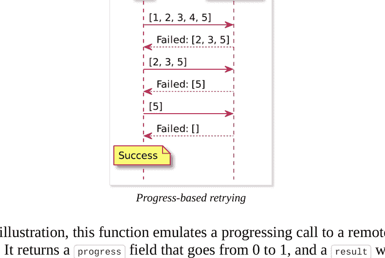

为了说明，此函数模拟了一个向远程服务器进行的进度调用。它返回一个进度字段，从 0 到 1，以及当调用完全结束时生成的结果。它还必须知道当前进度，这是调用的参数：

```js
const progressingOperation = async (startProgress = 0) => {
  await wait(10);
  const progress = Math.round(
    Math.min(startProgress + Math.random() / 3, 1) * 10
  ) / 10;
  return {
    progress,
    result: progress === 1 ? "result" : undefined,
  };
}
```

在这种情况下，即使未达到完成状态，Promise 也会解析，这模仿了 DynamoDB API。但不同的 API 可能会拒绝它。幸运的是，将拒绝的 Promise 转换为已解析的形式很容易：`.catch()`

在 DynamoDB `batchWriteItem`例子中，进度返回字段是未处理的项目列表，而`startProgress`参数是要保存的项目。

重试上述调用直到完成：

```js
const callWithProgress = async (fn, status, depth = 0) => {
  const result = await fn(status);

  // check completion
  if (result.progress === 1) {
    // finished
    return result.result;
  } else {
    // unfinished
    if (depth > 7) {
      throw result;
    }
    await wait(2 ** depth * 10);

    return callWithProgress(fn, result.progress, depth + 1);
  }
}
```

要使用此重试调用，请使用：

```js
const result = await callWithProgress(progressingOperation);
```

注意，由于此实现构建在调用如何返回进度的基础上，它并不是通用的。

# 使用异步生成器分页

许多 API 限制单次调用的结果数量。例如，AWS SDK 中返回列表的函数是已分页的操作。这意味着你在一次调用中获得有限数量的元素，同时附带获取下一批次的令牌。如果你不知道这一点，这可能是一个问题，因为你可能在开发期间获取了所有元素，但你的函数在未来可能会崩溃。

但是，虽然获取第一批只需`await lambda.listFunctions().promise()`，分页直到检索所有页面需要更多工作。

让我们看看如何使`await`结构能够可靠地从 AWS API 获取所有元素！

## 分页

对于 Lambda 函数，`lambda.listFunctions`调用如果在你的 Lambda 不多（最多 50）的情况下返回包含所有 Lambda 的结构：

```js
const functions = await lambda.listFunctions().promise();
```

```json
{
  Functions: [...]
}
```

要模拟分页情况，您可以设置`MaxItems`参数：

```js
const functions = await lambda.listFunctions({
  MaxItems: 1
}).promise();
```

这次还返回了`NextMarker`，指示还有更多项目：

```json
{
  Functions: [...],
  NextMarker: ...
}
```

要获取下一批，提供最后的标记：

```js
const functions = await lambda.listFunctions({
  MaxItems: 1,
  Marker: functions.NextMarker,
}).promise();
```

然后一直这样做，直到不再返回`NextMarker`。

# 一种使用异步生成器的解决方案

异步生成器是 JavaScript 的一项相对较新的特性。它们像传统的生成器函数，但是是异步的，意味着你可以在其中使用`await`。

无论需要多少次调用，收集所有 Lambda 函数请使用：

```js
const getAllLambdas = async () => {
  const EMPTY = Symbol("empty");
  
  const res = [];
  for await (const lf of (async function*() {
    let NextMarker = EMPTY;
    while (NextMarker !== EMPTY) {
      const functions = await lambda.listFunctions({
        Marker: NextMarker !== EMPTY ? NextMarker : undefined,
      }).promise();
      yield* functions.Functions;
      NextMarker = functions.NextMarker;
    }
  })()) {
    res.push(lf);
  }
  return res;
  // use it
  const functions = await getAllLambdas();
}
```

# 异步生成器函数

一个可以使用`await`的生成器函数。当遇到`yield`或`yield*`时，执行会停止直到请求下一个元素。

```js
const wait = (ms) =>
  new Promise((res) => setTimeout(res, ms));

const gen = async function*() {
  console.log("start");
  await wait(100);
  yield 1;
  await wait(100);
  console.log("next");
  yield 2;
  await wait(100);
  console.log("end");
};

const it = gen();
console.log(await it.next());
console.log(await it.next());
console.log(await it.next());

// start
// { value: 1, done: false }
// next
// { value: 2, done: false }
// end
// { value: undefined, done: true }
```

# 分解它

最重要的是跟踪最后一次调用返回的`NextMarker`并将其用于下一次调用。对于第一次调用，`Marker`应该为`undefined`，并且为了区分第一次和最后一次（即没有返回`NextMarker`的那一次），Symbol 是一个安全的选择，因为它不会被 API 返回。

```js
const EMPTY = Symbol("empty");
let NextMarker = EMPTY;
while (NextMarker !== EMPTY) {
    // Marker: NextMarker !== EMPTY ? NextMarker : undefined

    NextMarker = functions.NextMarker;
}
```

在调用之后，我们需要`yield`返回的函数：

```js
yield* functions.Functions;
```

`yield*`确保每个元素作为单独的值由生成器返回。

最后，一个`for await..of`循环收集结果并返回它们作为一个数组：

```js
const res = [];
for await (const lf of (async function*() {
    ...
})()) {
    res.push(lf);
}
return res;
```

要使用它，只需调用函数并等待生成的 Promise 解析：

```js
const functions = await getAllLambdas();
```

# 使其通用

`Marker` / `NextMarker`模式在整个 AWS SDK 中随处可见。但不幸的是，不同服务的命名有所不同。例如，获取 CloudWatch Logs 日志组需要提供`nextToken`参数。这使得无法使用通用包装器支持所有列表函数。

幸运的是，由于模式相同，我们可以创建一个处理除命名以外的所有内容的包装器函数：

```javascript
const getPaginatedResults = async (fn) => {
  const EMPTY = Symbol("empty");
  const res = [];
  for await (const lf of (async function*() {
    let NextMarker = EMPTY;
    while (NextMarker || NextMarker === EMPTY) {
      const {marker, results} = await fn(
        NextMarker !== EMPTY ? NextMarker : undefined
      );

      yield* results;
      NextMarker = marker;
    }
  })()) {
    res.push(lf);
  }

  return res;
};
```

它的结构与之前相同，但增加了一个`fn`参数，该参数执行实际的 API 调用并返回列表和标记（marker）。

使用此包装器获取所有 Lambda 函数：

```javascript
const lambdas = await getPaginatedResults(async (NextMarker) => {
  const functions = await lambda.listFunctions(
    {Marker: NextMarker}
  ).promise();
  return {
    marker: functions.NextMarker,
    results: functions.Functions,
  };
});
```

适配到日志组（log groups）：

```javascript
const logGroups = 
  await getPaginatedResults(async (NextMarker) => {
    const logGroups = await logs.describeLogGroups(
      {nextToken: NextMarker}
    ).promise();
    return {
      marker: logGroups.nextToken,
      results: logGroups.logGroups,
    };
  });
```

# 在`postMessage`中使用异步函数

`postMessage`调用允许在不同的浏览上下文（如 IFrames 和 Web 工作线程）之间进行异步通信，这些场景下直接进行函数调用是行不通的。它的工作原理是向另一端发送一条消息，然后接收端可以监听`message`事件。

例如，页面可以通过`postMessage`与 IFrame 通信，并向各自的窗口发送事件。`iframe.contentWindow.postMessage()`调用向 IFrame 发送消息，而`window.parent.postMessage()`则向主页面发送消息。两端可以使用`window.addEventListener("message", (event) => {...})`监听来自另一方的消息。

```javascript
// index.html
const iframe = document.querySelector("iframe");

window.addEventListener("message", ({data}) => {
  // 3: 接收响应
  console.log("Message from iframe: " + data);
});

// 1: 发送请求
iframe.contentWindow.postMessage([5, 2]);

// iframe.html
window.addEventListener("message", ({data}) => {
  // 2: 发送响应
  window.parent.postMessage(event.data[0] + event.data[1]);
});
```

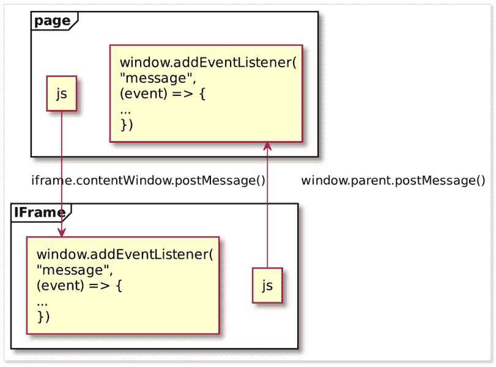

对于 Web 工作线程，每个工作线程都有一个独立的消息处理程序。页面可以使用`worker.postMessage()`调用向特定工作线程发送消息，并使用`worker.addEventListener("message", (event) => {...})`监听来自该工作线程的事件。在另一端，工作线程使用全局函数`postMessage()`和`addEventListener()`发送和接收事件：

```javascript
// index.html
const worker = new Worker("worker.js");
worker.addEventListener("message", ({data}) => {
  console.log("Message from worker: " + data); // 3
});

worker.postMessage([5, 5]); // 1

// worker.js
addEventListener("message", (event) => {
  postMessage(event.data[0] + event.data[1]); // 2
}, false)
```

# 请求-响应通信

无论是与 IFrame 还是与工作线程通信，都存在一些问题。首先，发送请求和处理响应是分离的。**接收端使用全局（或按工作线程）事件监听器**，这些监听器在多个调用之间是共享的。

这对于“通知样式”的消息是有益的，即一端想要通知另一端某事发生了，但不期望得到响应。但是**通知样式的消息很少见**。通常需要的是一种“请求-响应样式”的消息传递。


例如，一端使用另一端可以刷新的访问令牌。通信包括刷新请求和带有刷新后令牌的响应。或者，即使用户点击按钮，另一端也需要处理此操作。这个例子看起来像是“通知样式”的消息，但当按钮在操作期间需要禁用（例如保存按钮），或者存在发送方需要知道的错误可能性时，它就变成了请求-响应。

全局（或按工作线程）消息处理程序不适合将响应配对到请求上。理想的解决方案是将所有这些复杂性隐藏在一个异步函数调用背后，并使用 `await` 等待结果：

```javascript
const result = await add(10, 5);
```

让我们看看如何实现这样一个函数！

# 响应标识

首要任务是知道哪个请求触发了给定的响应。使用全局事件处理程序的问题是，很容易只依赖一次通信发生。当测试你的 Web 应用时，你一次只测试一件事，但用户不会那么体贴。你不能假设在任何时间点只发生一个请求-响应。

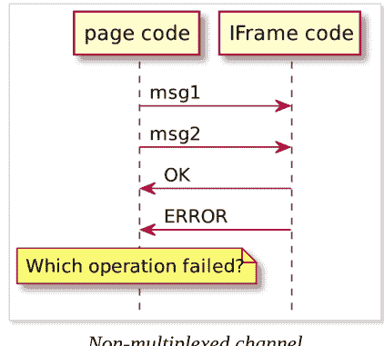

一种解决方案是使用*请求标识符*将响应与请求配对。

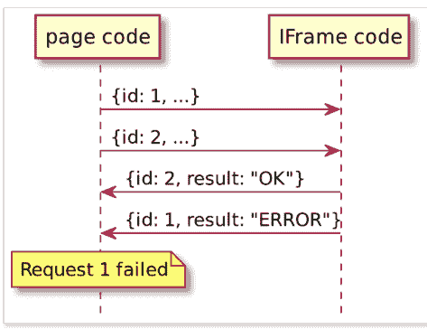

这可行，尽管需要一些编码，但这是一种不错的解决方案。

# `MessageChannel`

幸运的是，语言本身提供了一个更好的解决方案。`MessageChannel` 允许附加到 `postMessage` 调用的专用通信通道。发送端可以监听*该通道*上的消息，这与其他所有调用分离，而接收端可以通过它获得的 `MessagePort` 发送响应。

`MessageChannel` 创建两个 `MessagePort`，分别用于通信的两端。每个端口都支持 `onmessage` 和 `postMessage`，类似于基本的跨上下文通信通道。

```javascript
// index.html
const worker = new Worker("worker.js");
// 创建通道
const channel = new MessageChannel();

// 在一端监听
channel.port1.onmessage = ({data}) => {
  console.log("Message from channel: " + data); // 3
};

// 发送另一端
worker.postMessage([15, 2], [channel.port2]); // 1

// worker.js
addEventListener("message", (event) => {
  // 在接收到的端口上响应
  event.ports[0].postMessage(event.data[0] + event.data[1]); // 2
}, false)
```

要将消息处理程序附加到端口，请使用 `port.onmessage = (event) => {...}`。如果你使用 `addEventListener`，那么你还需要启动通道：

```javascript
port.addEventListener("message", (event) => {...});
port.start();
```

要将端口附加到 `postMessage` 调用，请使用第二个参数：`postMessage(data, [channel.port2])`。要在另一端使用此端口，请使用 `event.ports[0].postMessage()`。

通过为每个请求创建一个新的 `MessageChannel`，配对响应的问题就解决了，因为通过该通道的任何内容都是对该特定请求的响应。

# 错误处理

请求-响应通信中经常被忽视的一个方面是错误处理。当接收端出现问题并抛出错误时，它应该传播给发送方，以便发送方可以适当地处理它。

`postMessage` 的问题在于它只能发送一种类型的消息，没有 `postError` 调用。那么如何发出错误信号呢？

```javascript
(err, result) => {
	if (err) {
		// 错误
	} else {
		// 结果
	}
}
```

一种可能的解决方案类似于 Node 风格回调如何仅使用一个函数来传播错误。这些回调将错误值和结果值一起使用，且只定义其中一个：

要用消息实现相同的功能，请使用包含 `error` 和 `result` 属性的对象。当前者非空时，表示发生了错误。

```javascript
// worker.js
try{
	event.ports[0].postMessage(
	{result: event.data[0] + event.data[1]}
);
}catch(e) {
	event.ports[0].postMessage({error: e});
}

// index.html
channel.port1.onmessage = ({data}) => {
	if (data.error) {
		// 错误
	}else {
		// data.result
	};
};
```

不要忘记将接收端包裹在 try-catch 中以传播运行时错误。

# 使用 Promise

有了分离的响应通道和错误传播，很容易将调用包装在 Promise 构造器中。

```javascript
const worker = new Worker("worker.js");

const add = (a, b) => new Promise((res, rej) => {
  const channel = new MessageChannel();

  channel.port1.onmessage = ({data}) => {
    channel.port1.close();

    if (data.error) {
      rej(data.error);
    } else {
      res(data.result);
    }
  };

  worker.postMessage([a, b], [channel.port2]);
});

console.log(await add(3, 5)); // 8
```

通过 Promise 隐藏远程调用的所有复杂性后，任何支持 async/await 的功能都可以用于这些调用：

```javascript
// parallel execution
console.log(await Promise.all([
  add(1, 1),
  add(5, 5),
])); // [2, 10]

// async reduce
console.log(await [1, 2, 3, 4].reduce(async (memo, i) => {
  return add(await memo, i);
}), 0); // 10
```

当 Promise 应该拒绝时，它会按预期拒绝，从而允许在发送端进行适当的错误处理：

```javascript
// worker.js
addEventListener("message", (event) => {
    try {
        if (
            typeof event.data[0] !== "number" ||
            typeof event.data[1] !== "number"
        ) {
            throw new Error("both arguments must be numbers");
        }
        event.ports[0].postMessage(
            { result: event.data[0] + event.data[1] }
        );
    } catch (e) {
        event.ports[0].postMessage({ error: e });
    }
});

// index.html
try {
    await add(undefined, "b");
} catch (e) {
    console.log("Error: " + e.message); // Error: both arguments must be numbers
}
```

一个限制是可以通过 `postMessage` 调用发送的内容。它使用结构化克隆算法，支持复杂对象，但并非所有内容都支持。

## 使用异步函数处理集合

虽然 async/await 在让异步*命令*看起来像同步命令方面表现出色，但集合处理就没那么简单了。仅仅在传递给 `Array.reduce` 的函数前加上 `async`，并不能神奇地正确工作。但是，如果没有异步函数，你就无法使用 `await` 并*稍后*提供结果，而这对于读取数据库、建立网络连接、读取文件以及其他许多事情是必需的。

让我们看一些例子！

当你需要使用的所有函数都是同步的，这很简单。例如，一个字符串可以在不涉及任何异步性的情况下被加倍：

```javascript
const double = (str) => {
  return str + str;
};

double("abc");
// abcabc
```

如果函数是异步的，对于单个项使用 `await` 也很容易。例如，要计算 SHA-256 哈希，JavaScript 提供了一个 `digest()` 异步函数：

```javascript
// https://developer.mozilla.org/docs/Web/API/SubtleCrypto/digest
const digestMessage = async (message) => {
  const msgUint8 = new TextEncoder().encode(message);
  const hashBuffer =
    await crypto.subtle.digest("SHA-256", msgUint8);
  const hashArray = Array.from(new Uint8Array(hashBuffer));
  const hashHex = hashArray
    .map(b => b.toString(16).padStart(2, "0"))
    .join('');
  return hashHex;
};

await digestMessage("msg");
// e46b320165eec91e6344fa1034...
```

这看起来与之前的调用几乎相同，唯一的区别是 `await`。

但对于集合，处理异步性就变得不同了。

使用 `map` 计算**字符串集合**中每个元素的加倍是简单的：

```javascript
const strings = ["msg1", "msg2", "msg3"];

strings.map(double);
// ["msg1msg1", "msg2msg2", "msg3msg3"]
```

但是计算集合中每个字符串的**哈希**，这样就不行了：

```javascript
const strings = ["msg1", "msg2", "msg3"];

await strings.map(digestMessage);
// [object Promise],[object Promise],[object Promise]
```

这是一个日常问题，因为异步函数构成的类别比同步函数更大。同步函数可以在异步环境中工作，但异步函数无法转换为以同步方式工作。

对于更现实的场景，查询数据库本质上是异步的，因为它需要建立网络连接。从一个假想的数据库中获取单个 `userId` 的分数是简单的：

```javascript
const getUserObject = async (id) => {
  // get user by id
};

const userId = 15;
const userObject = await getUserObject(userId);
const userScore = userObject.score;
```

但是如何查询数据库中*一组* `userId`s 呢？

```javascript
const userIds = [15, 16, 21];
// const userObjects = ???
```

而且这不仅仅是使用 `map` 将一个值转换为另一个值。用户的分数是否大于 3？

```javascript
const userObject = await getUserObject(userId);
const above3 = userObject.score > 3;
```

但是*任何*用户的分数是否大于 3？

```javascript
// userIds.some(???)
```

或者平均分是多少？

```javascript
// userIds.reduce(???)
```

更有趣的是，给 `map` 添加 `async` 至少能表明哪些地方发生了变化：

```javascript
// synchronous
[1, 2, 3].map((i) => {
  return i + 1;
});
// [2, 3, 4]

// asynchronous
[1, 2, 3].map(async (i) => {
  return i + 1;
});
// [object Promise],[object Promise],[object Promise]
```

但是 `filter` 就完全是错误的行为了：

```javascript
// synchronous
[1, 2, 3, 4, 5].filter((i) => {
  return i % 2 === 0;
});
// [2, 4]

// asynchronous
[1, 2, 3, 4, 5].filter(async (i) => {
  return i % 2 === 0;
});
// [1, 2, 3, 4, 5]
```

因此，异步集合处理需要一些功夫，并且根据你想使用的函数类型而有所不同。异步 `map` 与异步 `filter` 或异步 `reduce` 的工作方式有显著差异。

在本章中，你将学习它们各自的工作原理以及如何高效地使用它们。

## 用于迭代的异步

但首先，让我们谈谈 `for` 循环！

我不喜欢 `for` 循环，因为它们往往鼓励不良的编码实践，比如同时做很多事的嵌套循环，或者散布在各处、很快就会变得难以维护的 `continue`/`break` 语句。

此外，像 `map`/`filter`/`reduce` 这样的函数式方法提倡一种风格，其中一个函数只做一件事，其内部所有内容都有作用域且是无状态的。而且函数式方法不仅在 99% 的情况下都是可行的，而且不会带来可感知的性能下降，它还会产生更简单的代码（好吧，至少当你了解相关函数时）。

但 async/await 属于剩下的 1%。

`for` 循环有一个显著特点，它们不依赖于*调用*一个函数。实际上，你可以在循环内使用 `await`，它就能正常工作。

```javascript
// synchronous
{
  const res = [];
  for (let i of [1, 2, 3]) {
    res.push(i + 1);
  }
  // res: [2, 3, 4]
}

// asynchronous
{
  const res = [];
  for (let i of [1, 2, 3]) {
    await sleep(10);
    res.push(i + 1);
  }
  // res: [2, 3, 4]
}
```

由于 `for` 循环是一个通用工具，当处理集合时，它们可以用于各种需求。

但它们的缺点仍然存在，虽然将函数式方法适配到 async/await 并非易事，但一旦你开始理解其通用模式，也就没那么难了。

## 使用 reduce 的异步函数

`reduce` 函数迭代地构建一个值并返回它，这个值不一定是一个集合。这就是其名称的由来，因为它将一个集合*归约*为一个值。

迭代函数接收前一个结果（在下面的示例中称为 `memo`）和当前值 `e`。

以下函数对元素求和，从 0 开始（`reduce` 的第二个参数）：

```javascript
const arr = [1, 2, 3];

const syncRes = arr.reduce((memo, e) => {
    return memo + e;
}, 0);

console.log(syncRes);
// 6
```

| memo | e | result |
| :--- | :--- | :--- |
| 0 (初始值) | 1 | 1 |
| 1 | 2 | 3 |
| 3 | 3 | (最终结果) 6 |

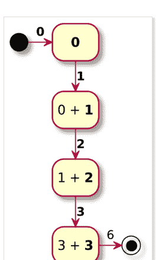

## 异步归约

异步版本几乎相同，但它在每次迭代时返回一个 Promise，因此 `memo` 将是前一个结果的 *Promise*。迭代函数需要 `await` 它以计算下一个结果：

```javascript
// utility function for sleeping
const sleep = (n) => new Promise((res) => setTimeout(res, n));

const arr = [1, 2, 3];

const asyncRes = await arr.reduce(async (memo, e) => {
  await sleep(10);
  return (await memo) + e;
}, 0);

console.log(asyncRes);
// 6
```

| memo | e | result |
| :--- | :--- | :--- |
| 0 (初始值) | 1 | Promise(1) |
| Promise(1) | 2 | Promise(3) |
| Promise(3) | 3 | (最终结果) Promise(6) |

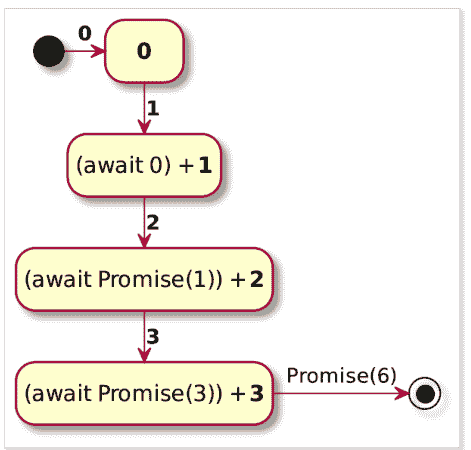


通过`async (memo, e) => await memo`这种结构，`reduce`可以处理任何异步函数，并且可以对其使用`await`。

## 时序

并发在处理`reduce`时有一个有趣的属性。在同步版本中，元素是逐一处理的，这并不奇怪，因为它们依赖*前一个*结果。但是当运行异步`reduce`时，所有的迭代函数会并行启动，仅在需要时才等待之前的结果（`await memo`）。

## 最后 await memo

在上述示例中，所有的`sleep`调用都是并行执行的，因为作为后续步骤的`await memo`使得函数必须等待前一个任务完成后才继续。

```js
const arr = [1, 2, 3];

const startTime = new Date().getTime();

const asyncRes = await arr.reduce(async (memo, e) => {
  await sleep(10);
  return (await memo) + e;
}, 0);

console.log(`Took ${new Date().getTime() - startTime} ms`);
// Took 11-13 ms
```

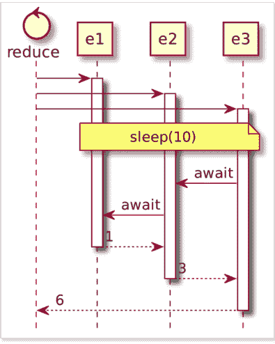

## 首先 await memo 的异步 reduce

但是当`await memo`出现在前面时，函数会顺序执行：

```js
const arr = [1, 2, 3];

const startTime = new Date().getTime();

const asyncRes = await arr.reduce(async (memo, e) => {
  await memo;
  await sleep(10);
  return (await memo) + e;
}, 0);

console.log(`Took ${new Date().getTime() - startTime} ms`);
// Took 36-38 ms
```

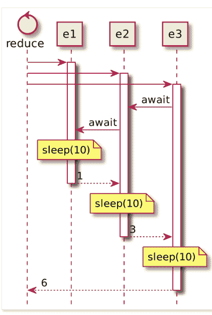

### 带有“首先 await memo”的异步 reduce

这种行为通常不是问题，因为它意味着所有不依赖前一个结果的部分会立即计算，只有依赖部分在等待前一个值。

## 当并行性很重要时

但在某些情况下，提前执行某些操作可能不可行。

例如，我曾有一段代码使用[pdf-lib](https://pdf-lib.js.org/)库打印不同的 PDF 并将它们合并成一个文件。

此实现会并行运行资源密集的`printPDF`函数：

```js
const result = await printingPages.reduce(async (memo, page) => {
  const pdf = await PDFDocument.load(await printPDF(page));

  const pdfDoc = await memo;

  (await pdfDoc.copyPages(pdf, pdf.getPageIndices()))
    .forEach((page) => pdfDoc.addPage(page));

  return pdfDoc;

}, PDFDocument.create());
```

我注意到，当我需要打印很多页面时，这会消耗太多内存并减缓整体进程。

一个简单的改动使得`printPDF`调用等待前一个任务完成：

```js
const result = await printingPages.reduce(async (memo, page) => {
  const pdfDoc = await memo;

  const pdf = await PDFDocument.load(await printPDF(page));

  (await pdfDoc.copyPages(pdf, pdf.getPageIndices()))
    .forEach((page) => pdfDoc.addPage(page));

  return pdfDoc;

}, PDFDocument.create());
```

## 异步函数与 map

`map`是最简单且最常用的集合函数。它将每个元素通过迭代器函数运行，并返回包含结果的数组。

### 给每个元素加一的同步版本

```js
const arr = [1, 2, 3];

const syncRes = arr.map((i) => {
  return i + 1;
});

console.log(syncRes);
// 2,3,4
```

异步版本需要做两件事。首先，它需要**将每项映射为一个`Promise`**（即在新值之前添加`async`）。

其次，它需要**等待所有 Promise 完成**然后**收集结果**。幸运的是，内置的`Promise.all`调用正是第 2 步所需的。

这使得异步`map`的一般模式成为`Promise.all(arr.map(async (...) => ...))`。

一个实现与同步版本相同异步实现的代码：

```js
const arr = [1, 2, 3];

const asyncRes = await Promise.all(arr.map(async (i) => {
  await sleep(10);
  return i + 1;
}));

console.log(asyncRes);
// 2,3,4
```


### 并发性

上述实现在数组的每个元素上并行运行迭代器函数。这通常没有问题，但在某些情况下可能会消耗太多资源。当异步函数遇到 API 或消耗过多 RAM 时就会发生这种情况，导致无法同时运行太多任务。

虽然异步`map`易于编写，但添加并发控制更加复杂。在接下来的几个示例中，我们将探讨不同的解决方案。

### 批处理

最简单的方法是分组元素并逐个处理这些组。这可以控制一次运行的最大并行任务数量。但由于一组必须在下一组开始之前完成，因此每组中的*最慢*元素成为限制因素。

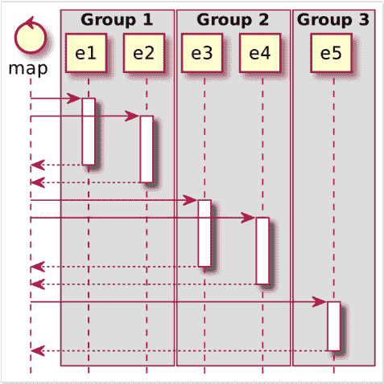

#### 分组映射

为了进行分组，下面的示例使用了来自[Underscore.js](https://underscorejs.org/)的`groupBy`实现。许多库都提供了类似实现，它们大多数是可以互换的。例外是 Lodash，因为它的[`groupBy`](https://github.com/lodash/lodash/issues/1302)并不传递项的索引。

如果您不熟悉`groupBy`，它会对每个元素运行迭代器函数，并返回一个对象，其键为结果，值为产生该值的元素列表。

为了创建每组最多`n`个元素的组，迭代器`Math.floor(i / n)`（其中`i`是元素的*索引*）即可做到。例如，大小为 3 的组会像这样映射元素：

- `0 ⇒ 0`
- `1 ⇒ 0`
- `2 ⇒ 0`
- `3 ⇒ 1`
- `4 ⇒ 1`
- `5 ⇒ 1`
- `6 ⇒ 2`
- ...

在 JavaScript 中：

```js
const arr = [30, 10, 20, 20, 15, 20, 10];

console.log(
  _.groupBy(arr, (_v, i) => Math.floor(i / 3))
);
// {
//    0: [30, 10, 20],
//    1: [20, 15, 20],
//    2: [10]
// }
```

最后一组可能比其他组小，但所有组都保证不超过最大组大小。

要映射一组，通常的`Promise.all(group.map(...))`构造是没问题的。

为了顺序映射这些组，我们需要一个将前一个结果（`memo`）与当前组的结果连接的`reduce`：

```js
return Object.values(groups)
  .reduce(async (memo, group) => [
    ...(await memo),
    ...(await Promise.all(group.map(iteratee)))
  ], []);
```

此实现基于这样一个事实：`await memo`（等待前一个结果）会在移动到下一行之前完成。

#### 实现了批处理的完整代码

```js
const arr = [30, 10, 20, 20, 15, 20, 10];

const mapInGroups = (arr, iteratee, groupSize) => {
  const groups = _.groupBy(arr, (_v, i) =>
    Math.floor(i / groupSize));

  return Object.values(groups)
    .reduce(async (memo, group) => [
      ...(await memo),
      ...(await Promise.all(group.map(iteratee)))
    ], []);
};

const res = await mapInGroups(arr, async (v) => {
  console.log(`S ${v}`);
  await sleep(v);
  console.log(`F ${v}`);
  return v + 1;
}, 3);

// -- first batch --
// S 30
// S 10
// S 20
// F 10
// F 20
// F 30
// -- second batch --
// S 20
// S 15
// S 20
// F 15
// F 20
// F 20
// -- third batch --
// S 10
// F 10

console.log(res);
// 31,11,21,21,16,21,11
```

## 并行处理

另一种并发控制类型是并行运行最多`n`个任务，并在一个任务完成时启动一个新的任务。

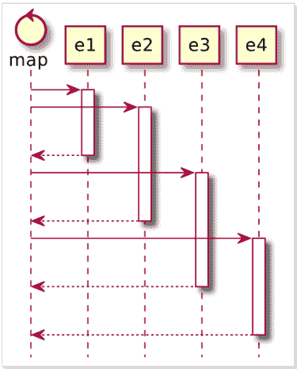

- **受控并发**

  我无法想出简单的实现，但幸运的是，Bluebird 库[提供了开箱即用的支持](link)。这使其变得非常直接，只需导入库并使用支持`concurrency`选项的`Promise.map`函数。

在下面的示例中，并发限制为`2`，这意味着立即启动 2 个任务，然后每当一个任务完成时，就会启动一个新任务，直到没有剩余：

### 顺序处理

有时任何并发都太多了，元素应该按顺序处理一个接一个。

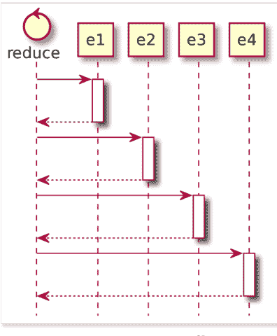

#### 顺序映射

一个简单的实现是使用 Bluebird 的 Promise，并发数为 1。但对于这种情况，并不值得包含一个库，因为简单的`reduce`就可以完成工作：

```js
const arr = [1, 2, 3];

const res = await arr.reduce(async (memo, v) => {
  const results = await memo;
  console.log(`S ${v}`)
  await sleep(10);
  console.log(`F ${v}`);
  return [...results, v + 1];
}, []);

// S 1
// F 1
// S 2
// F 2
// S 3
// F 3

console.log(res);
// 2,3,4
```

请务必在`await`其他内容之前先`await memo`，否则它将仍然并发运行！

## 与异步函数配合使用的 forEach

## 控制执行时机

### 等待完成

`forEach`函数与`map`类似，但它不对值进行转换或使用结果，而是对每个元素运行该函数并丢弃返回值。本质上，重要的是调用函数的**副作用**。例如，同步地将每个元素输出到控制台：

```javascript
const arr = [1, 2, 3];

arr.forEach((i) => {
  console.log(i);
});

// 1
// 2
// 3

console.log("Finished sync");
// Finished sync
```

由于结果并不重要，因此使用异步函数作为遍历器（iteratee）也可以正常工作：

```javascript
const arr = [1, 2, 3];

arr.forEach(async (i) => {
  // 每个元素完成所需的时间不同
  await sleep(10 - i);
  console.log(i);
});

console.log("Finished async");
// Finished async

// 3
// 2
// 1
```

但正如不意外的那样，函数是**异步**调用的，程序执行会继续越过该调用。这与同步版本存在一个重要区别：当下一行代码执行时，同步的`forEach`已经完成，而异步版本的尚未完成。**因此“Finished async”日志会出现在元素输出之前。**

要在继续之前等待所有函数调用完成，请结合使用带有`Promise.all`的`map`并丢弃结果：

```javascript
const arr = [1, 2, 3];

await Promise.all(arr.map(async (i) => {
  await sleep(10 - i);
  console.log(i);
}));

// 3
// 2
// 1

console.log("Finished async");
// Finished async
```

带有异步`forEach`，等待结果的处理方式。有了这一修改，“Finished async”将出现在最后。

## 顺序处理

但请注意，遍历器函数（iteratee functions）是并行调用执行的。为了忠实遵循同步的`forEach`行为，请先使用一个`reduce`加上**await memo**：

```javascript
const arr = [1, 2, 3];

await arr.reduce(async (memo, i) => {
  await memo;
  await sleep(10 - i);
  console.log(i);
}, undefined);

// 1
// 2
// 3

console.log("Finished async");
// Finished async
```

这种方式下，元素按顺序处理，一个接一个地执行，程序会在整个数组完成后才继续下一步。

## 带有 filter 的异步函数

`filter`函数仅保留满足条件的元素。它接受一个函数（这次称为*谓词*（predicate）），该函数返回 true/false 值（更准确地说，是有效值和无效值）。生成的集合只包含那些使谓词返回**true**的元素。

```javascript
const arr = [1, 2, 3, 4, 5];

const syncRes = arr.filter((i) => {
  return i % 2 === 0;
});

console.log(syncRes);
// 2,4
```

### 带有 map 的异步 filter

这次的情况稍微复杂一些，因为`async`版本分为两个阶段：首先通过谓词函数将数组**映射**（map）成 true/false 值；然后第二步是同步的**filter**，它使用第一步产生的结果。

带异步 Filter 的逻辑图如下：

```javascript
const arr = [1, 2, 3, 4, 5];

/** @typedef {(...args: any[]) => Promise<boolean>} AsyncPredicate */
asyncFilter(arr: [number], predicate: AsyncPredicate): Promise<number[]>;

// ... implementation logic similar to standard Filter but with async/await considerations...

const arr = [1, 2, 3, 4, 5]; // Example array definition for clarity or testing purposes.
```

或者使用单行实现方式：


```javascript
const asyncFilter = async (arr, predicate) =>
  Promise.all(arr.map(predicate))
    .then((results) => arr.filter((_v, index) => results[index]));
```

### 并发度（Concurrency）

上述实现在并发运行所有的谓词函数。这通常是可以的，但像所有其他函数一样，它可能会使某些资源过分紧张。幸好，由于上述实现依赖于`map`操作，也可以使用相同的并发控制策略来管理这一点。

### 带有`reduce`的异步`filter`

不使用带同步`filter`的异步`map`，而是也可以通过异步`reduce`来完成同样的工作。因为只涉及一个函数，结构甚至更简单，尽管它提供的控制级别不相同。

首先从空数组`[]`开始。然后运行下一个元素通过谓词函数并判断是否满足条件：若通过则将其追加到数组中；若不通过则跳过。

*带`reduce`的异步`filter`模式示例*

```javascript
// concurrently（并发模式下）

const asyncFilter = async (arr, predicate) =>
  arr.reduce(
    async (memo, e) => (await predicate(e) ? [...await memo, e] : memo),
    []
  );
```

注意，`await predicate(e)`出现在`await memo`之前，这意味着两者会并行调用或执行。

### 顺序处理（Sequential processing）

若在下次运行前必须等待谓词函数完成，则可以调换两个`await`的执行顺序：

```javascript
// sequentially（串行模式下）

const asyncFilter = async (arr, predicate) =>
  arr.reduce(
    async (memo, e) => [
      ...await memo,
      ...(await predicate(e) ? [e] : [])
    ],
    []
  );
```

这种实现方式会等待上一个元素处理完毕，然后再根据谓词结果条件性地附加一个元素（即`...[e]`或`...[]`）。

*带`reduce`串行执行的异步`filter`图*

## 带有`some`/`every`（都/有其中之一的）

这些函数接受遍历器函数，就像`filter`一样，但是它们会返回单个`true`/`false`值，取决于谓词是否返回特定值。对于`some()`而言，只要有一个谓词结果是`true`，那么总体结果也是`true`；而对于`every()`，如果有任何一个结果为`false`，则整体输出`false`。

### 使用异步`filter`

仅考虑最终结果，这些函数可以通过带`async`的`filter`来模拟其功能。这一点在前一篇文章中已介绍过如何转换为异步模式：

```javascript
// sync（同步版本）

const some = (arr, predicate) => arr.filter(predicate).length > 0;
const every = ...;

// async（异步版本）

const asyncSome = async (arr, predicate) =>
  (await asyncFilter(arr, predicate)).length > 0;

const asyncEvery = async (arr, predicate) =>
  (await asyncFilter(arr, predicate)).length === arr.length;
```

基于`filter`的异步`some`实现方式，但是内置`some`/`every`函数与基于`filter`的实现之间存在一个重要区别：当存在一个元素对`some()`返回`true`时，它会进行短路求值（short-circuits），而不再处理剩余的元素：

```javascript
const arr = [1, 2, 3];

const res = arr.some((i) => {
  console.log(`Checking ${i}`);
  return i % 2 === 0;
});

// Checking 1
// Checking 2

console.log(res);
// true
```

类似地，`every`会在遇到第一个`false`结果后停止：

```javascript
const arr = [1, 2, 3];

const res = arr.every((i) => {
  console.log(`Checking ${i}`);
  return i < 2;
});

// Checking 1
// Checking 2

console.log(res);
// false
```

### 异步`some`（async some）

最佳解决方案是使用带`async`的`for`循环迭代，一旦找到有效结果就立即返回：

```javascript
const arr = [1, 2, 3];

const asyncSome = async (arr, predicate) => {
  // ...For-each iteration logic with early return...
};
```

## 异步`every`（async every）

类似的结构也适用于`every`，只是需要否定条件：

```javascript
// example implementation for Every in Asynchronous context

const arr = [1, 2, 3];

const asyncEvery = async (arr, predicate) => {
  for (const e of arr) {
    if (!await predicate(e)) return false;
  }

  return true;
};

const res = await asyncEvery(arr, async (i) => {
  console.log(`Checking ${i}`);
  await sleep(10);
  return i < 2;
});

// Checking 1
// Checking 2

console.log(res);
// false
```

每当`predicate(e)`返回`false`时，函数就会结束，不再检查其他元素。

## 并行处理

短路实现在资源使用方面是高效的，因为它按顺序处理元素，但这可能导致更长的执行时间。

例如，如果迭代器通过网络发送请求，一次发送一个可能需要一些时间。另一方面，同时发送所有请求可能更快，尽管这可能导致更多的请求被发送。

## 常见错误

### 未传播错误

当将回调转换为 Promise 时，确保你也处理了错误情况。否则，Promise 永远不会被解析，`await`会永远等待。

例如，`gapi.load`为结果和错误提供了单独的回调：

```javascript
await new Promise((res, rej) => {
  gapi.load("client:auth2", {
    callback: res,
    onerror: rej
  });
});
```

如果你没有将`rej`回调附加到`onerror`处理器，错误将不会通过链传播。这会导致难以调试的问题和“突然停止”的组件。

### 在`try..catch`中缺少`await`

在`async`函数中使用`try..catch`或`try..finally`时，确保你也使用了`await`。例如，当内部 Promise 解析时，这段代码工作正常：

```javascript
const fn = async () => {
  return "result";
};

const outer = async () => {
  try {
    return fn(); // <= 缺少 await！
  } catch (e) {
    console.log(e.message);
  }
};

await outer(); // result
```

但`try..catch`不会处理异常：

```javascript
const fn = async () => {
  throw new Error("error");
};

const outer = async () => {
  try {
    return fn(); // <= 缺少 await！
  } catch (e) {
    console.log(e.message);
  }
};

await outer();
// 抛出异常！
```

这是因为异常是从`await`抛出的，虽然从`async`函数返回 Promise 会展平结果，但它会在不等待它的情况下返回。由于没有等待，异常不会在`try..catch`中抛出，而是在调用者使用`await`时抛出。

```javascript
const fn = async () => {
  throw new Error("error");
};

const outer = async () => {
  try {
    return await fn();
  } catch (e) {
    console.log(e.message); // error
  }
};

await outer();
// 这里没有异常
```

### 未检查返回值

当 Promise 解析时，不一定意味着一切都正常。例如，`fetch`在连接出现问题时会拒绝，但即使响应状态返回错误，它也会解析。

当调用无法建立连接时，Promise 会拒绝：

```javascript
try {
  await fetch("http://example.com");
} catch (e) {
  console.log(e.message); // Failed to fetch
}
```

但当响应状态码指示错误（500）时，Promise 仍然解析：

```javascript
try {
  await fetch("https://httpbin.org/status/500");

  // 没有错误
} catch (e) {
  console.log(e.message);
}
```

因此，你需要检查结果是否有错误响应。`fetch`结果提供了`ok`字段来做到这一点：

```javascript
const response = await fetch("https://httpbin.org/status/500");

if (!response.ok) {
  throw new Error("Error response");
}
```

### 在拒绝的情况下未关闭资源

常见做法是打开一些资源，然后在不需要时关闭它。例如，这段代码创建一个临时目录，稍后删除它：

```javascript
const fs = require("fs").promises;
const os = require("os");
const path = require("path");

const dir = await fs.mkdtemp(
  await fs.realpath(os.tmpdir()) + path.sep
);

// 使用 dir 存储临时内容

await fs.rmdir(dir, { recursive: true });
```

这可以工作，除非有异常跳过了清理代码。

```javascript
const dir = await fs.mkdtemp(
  await fs.realpath(os.tmpdir()) + path.sep
);

throw Error("error");

await fs.rmdir(dir, { recursive: true });
// 清理不会运行！
```

使用`try..finally`实现可靠的清理：

```javascript
const dir = await fs.mkdtemp(
  await fs.realpath(os.tmpdir()) + path.sep
);

try {
  // 使用 dir 存储临时内容
} finally {
  await fs.rmdir(dir, { recursive: true });
}
```

更好的是，你可以将资源生命周期移动到专用函数中，如“异步释放器模式”章节所述：

```javascript
const withTempDir = async (fn) => {
  const dir = await fs.mkdtemp(
    await fs.realpath(os.tmpdir()) + path.sep
  );

  try {
    return await fn(dir);
  } finally {
    fs.rmdir(dir, { recursive: true });
  }
};

await withTempDir((dir) => {
  // 使用 dir 存储临时内容
});
```

### 在一个`then`函数中同时使用拒绝和解析处理器

问题的常见来源是像这样编写错误处理：

```javascript
getPromise()
  .then(process, handleError);
```

正如我们在[Promise 链中的错误传播](https://example.com)章节中讨论的那样，`then()`的第二个处理器是为错误调用的，但仅限于来自前一步骤的错误。

请注意，`handleError`函数只接收来自`getPromise`的错误。如果`process`函数的结果被拒绝，它将不会被处理。

更好的解决方案是使用`.catch`来明确错误：

```javascript
getPromise()
  .then(process)
  .catch(handleError);
```

这样就清楚了，错误处理器覆盖了两个步骤。

### 未等待异步`forEach`

`forEach`函数遍历一个集合并调用一个迭代函数。一个典型的问题是不等待迭代完成：

```javascript
[1, 2, 3].forEach(async (e) => {
  console.log(e);
  return makePromise(e);
});

console.log("finished");

// finished
// 1
// 2
// 3
```

最佳实践是等待整个集合处理完毕，这可以通过`Promise.all`和`map`来实现：

```javascript
await Promise.all([1, 2, 3].map(async (e) => {
  console.log(e);
  return makePromise(e);
}));

console.log("finished");
// finished
```

> 更多信息

此主题在`async forEach`章节中有更详细的介绍。

## 术语表

### 异步函数

返回 Promise 的函数。`await`关键字只能在异步函数中使用。

```javascript
const wait = (ms) => new Promise((res) => setTimeout(res, ms));

const fn = async () => {
  await wait(100);
  return "result";
};

fn(); // Promise
```

### 异步生成器函数

可以使用`await`的生成器函数。当它遇到`yield`或`yield*`时，执行会停止，直到请求下一个元素。

```javascript
const wait = (ms) => new Promise((res) => setTimeout(res, ms));

const gen = async function* () {
  console.log("start");
  await wait(100);
  yield 1;
  await wait(100);
  console.log("next");
  yield 2;
  await wait(100);
  console.log("end");
};

const it = gen();

console.log(await it.next());
console.log(await it.next());
console.log(await it.next());

// start
// { value: 1, done: false }
// next
// { value: 2, done: false }
// end
// { value: undefined, done: true }
```

参见[生成器函数](https://developer.mozilla.org/en-US/docs/Web/JavaScript/Reference/Statements/function*)。

### `await`关键字

在异步函数中可用，它会停止执行，直到参数 Promise 变为已完成状态。然后它返回值或抛出异常。参见[异步函数](https://developer.mozilla.org/en-US/docs/Web/JavaScript/Reference/Statements/async_function)。

### 回调

作为参数传递的函数，用返回值调用它。它允许异步结果，因为回调可以稍后被调用。

例如，`setTimeout`函数需要一个回调，它在时间到时调用：

```javascript
setTimeout(() => {
  // 1 秒后
}, 1000);
```

参见[延续传递风格](https://en.wikipedia.org/wiki/Continuation-passing_style)。

### 集合处理

一系列处理元素集合（通常是数组）的函数，例如转换（`map`）、过滤（`filter`）和归约为一个值（`reduce`）。

### 延续传递风格


一种编程构造，它使用回调函数（延续）来处理函数结果，而不是直接返回它们。这允许异步结果，因为这些回调可以稍后被调用。

## 错误传播

当出现错误时，它会沿着上下文向上传递，直到有一段代码能够处理它。

例如，一个未处理的异常会被抛给调用者：

```javascript
const fn = () => {
  // 错误在这里抛出
  throw new Error("error");
}

try {
  fn();
} catch(e) {
  // 并在这里处理
}
```

使用`Promise`时，错误会传播到下一个处理程序：

```javascript
getUser() // 返回一个 Promise
  .then(() => {
    // 错误在这里抛出
    throw new Error("error");
  })
  .catch((e) => {
    // 并在这里处理
  });
```

## Error-first 回调

一种回调风格，其中第一个参数是错误对象。接收端需要检查该值是否为非 null（或非 undefined）。

```javascript
const fn = (callback) => {
  try {
    const result = "result";
    // 错误为 null
    callback(null, result);
  } catch(e) {
    // 发出错误信号
    callback(e);
  }
}

fn((err, result) => {
  if (err) {
    // 处理错误
  } else {
    // 处理结果
  }
});
```

参见[Node 风格回调](https://nodejs.org/en/knowledge/getting-started/control-flow/what-are-callbacks/)。

## Fulfilled Promise（已兑现 Promise）

Promise 的一种状态，表示已解决或已拒绝。参见[Promise 状态](https://developer.mozilla.org/en-US/docs/Web/JavaScript/Reference/Global_Objects/Promise#description)。

## 生成器函数

一种返回可迭代结构的函数。它可以通过`yield`语句暂停，并且只有在请求更多元素时才会恢复。

```javascript
const gen = function*() {
  console.log("start");
  yield 1;
  console.log("next");
  yield 2;
  console.log("end");
}

const it = gen();
console.log(it.next());
console.log(it.next());
console.log(it.next());

// start
// { value: 1, done: false }
// next
// { value: 2, done: false }
// end
// { value: undefined, done: true }
```

## Node 风格回调

一种回调风格，其特点如下：

- 回调函数是最后一个参数
- 调用时第一个参数是错误对象，然后是结果（`(error, result)`）
- 只返回一个结果

```javascript
const getUser = (id, cb) => {
  const user = /* get user */;
  if (user) {
    // 成功
    cb(null, user);
  } else {
    // 错误
    cb(new Error("Failed to get user"));
  }
};
```

## 分页

当某个方法（通常是 API）不返回请求的所有结果，而需要多次调用才能获取所有项时。

## Pending Promise（待定 Promise）

Promise 的一种状态，表示异步结果尚未可用。参见[Promise 状态](link)。

## postMessage

一种跨上下文通信的 API，例如与 IFrame 和 Web Worker 通信。它是基于事件的通信方式，一端监听`message`事件，另一端使用`postMessage`函数发送消息。

## Promise

一个持有异步结果的值。你可以使用`then`回调来处理 Promise 变为 fulfilled 时的情况，或者在 async 函数中使用`await`。

## Promise 链

一系列`then()`回调，每个回调接收 Promise 的先前状态并返回下一个状态。

```javascript
getUser() // 返回一个 Promise
  .then(async function getPermissionsForUser(user) {
    const permissions = await // ...;
    return permissions;
  })
  .then(async function checkPermission(permissions) {
    const allowed = await // ...;
    return allowed;
  })
  .then((allowed) => {
    // 处理允许或不允许
  });
```

## Promise 状态

Promise 可以处于以下多种状态之一：

- Pending（待定）：值尚不可用
- Resolved（已解决）：值可用
- Rejected（已拒绝）：发生了错误

当 Promise 处于已解决或已拒绝状态时，它就是 fulfilled（已兑现）或 settled（已落定）。

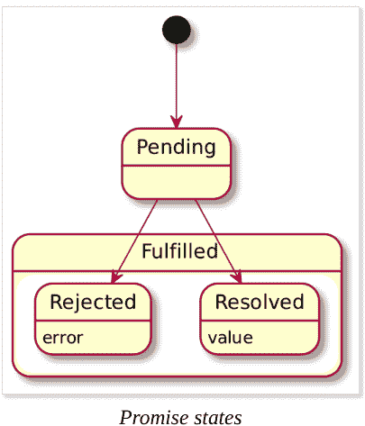

## Promise.all

一个工具函数，接收多个 Promise，当所有 Promise 都解决时解决，并返回包含结果的数组。如果任何输入的 Promise 拒绝，它会拒绝。

```javascript
console.log(
  await Promise.all([
    Promise.resolve("a"),
    Promise.resolve("b"),
  ])
);

// ["a", "b"]
```

## Promise.allSettled

一个工具函数，接收多个 Promise，当所有 Promise 都落定时解决。即使某些输入的 Promise 拒绝，它也会解决。

```javascript
console.log(
  await Promise.allSettled([
    Promise.resolve("a"),
    Promise.reject("b"),
  ])
);

// [
//   { status: 'fulfilled', value: 'a' },
//   { status: 'rejected', reason: 'b' }
// ]
```

## Promise.catch

一个工具函数，用于向 Promise 附加拒绝处理程序。它等价于`then(undefined, handler)`。

```javascript
Promise.reject(new Error("error"))
  .catch((e) => {
    console.log(e.message); // error
  });
```

## Promise.finally

一个工具函数，当 Promise 落定时调用，无论它是已解决还是已拒绝。它将`try..finally`结构引入到 Promise 中。

```javascript
getUser() // 返回一个 Promise
  .finally(() => {
    // 即使 Promise 被拒绝也会调用
    console.log("finished");
  });
  // 不会改变结果值
```

## Promise.race

一个工具函数，接收多个 Promise，当第一个 Promise 落定时解决（或拒绝）。

```javascript
const wait = (ms) => new Promise((res) => setTimeout(res, ms));

const fn = async (ms, result) => {
  await wait(ms);
  return result;
}

console.log(
  await Promise.race([
    fn(100, "a"),
    fn(50, "b"),
  ])
);
```

## Promise.reject

一个工具函数，用提供的值拒绝。

```javascript
Promise.reject(new Error("error"))
  .catch((v) => {
    console.log(v.message); // error
  });
```

## Promise.resolve

一个工具函数，返回一个用提供的值解决的 Promise。可用于启动 Promise 链。

```javascript
Promise.resolve("value")
  .then((v) => {
    console.log(v); // value
  });
```

## Promise.then

Promise 对象的一个函数，用于附加当 Promise 落定时将被调用的函数。参见[Promise 链](https://example.com)。

## Promise 化

将回调转换为 Promise 的过程。

## Rejected Promise（已拒绝 Promise）

指示错误的 Promise 状态。参见[Promise 状态](https://example.com)。

## Resolved Promise（已解决 Promise）

异步值可用的 Promise 状态。参见[Promise 状态](https://example.com)。

## Settled Promise（已落定 Promise）

fulfilled 状态的另一种名称。参见[Promise 状态](https://example.com)。

## 同步函数

运行时返回值的函数。参见[Continuation-passing style](https://example.com)。

## 关于作者

Tamás Sallai


嘿，我是 Tamás！我是一名专注于 Web 技术和云计算的软件开发人员。我尤其对探索边缘情况和“如果”感兴趣，以便编写可靠的软件。

我共同撰写 [https://advancedweb.hu](https://advancedweb.hu) 博客，在那里我发表了超过 200 篇关于各种技术主题的文章。你可以在那里找到我目前正在做的事情。

版权所有 © 2021 Tamás Sallai

保留所有权利。未经版权所有者书面许可，本书的任何部分不得以任何方式复制或使用，但书评中的引用除外。

信息按“原样”提供，不提供任何明示或暗示的担保。在任何情况下，作者或版权持有者均不对任何索赔、损害或其他责任负责。
