# Javascript 异步编程模式

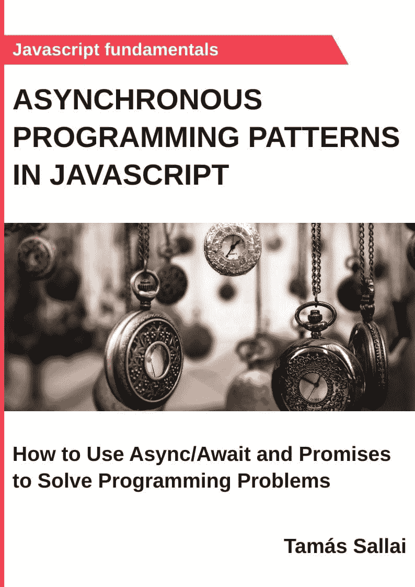

# 引言

异步编程在 JavaScript 中无处不在。这是定义其工作方式的基本选择所导致的结果。在其他语言中，你可以使用多线程来实现同步等待，而 JavaScript 缺少这一关键特性。它被设计为单线程，等待操作会停止一切，试想一下长时间计算导致 UI 冻结的情况。

由于无法同步等待后续结果，JavaScript 必须使用回调。即使是等待指定时间这样简单的事情，也需要一个在时间到达时执行的函数：

```
setTimeout(() => {
  console.log("1 second passed!");
}, 1000);
```

这种模式随处可见，因为大多数操作本质上都是异步的。使用 `fetch` 向服务器发起 HTTP 调用是异步操作。通过 `getUserMedia` 获取可用摄像头和麦克风的信息也是如此，因为它需要获得用户许可。读写文件同样如此。虽然这些操作目前有同步版本，但它们的性能很差。或者你想用 `Puppeteer` 进行网页抓取？每条指令都是异步的，因为它们都与远程进程通信。对于后端应用，读写数据库数据本质上也是异步的。

不仅如此，某些函数是异步的，所有调用它们的函数也必须是异步的。例如，需要发起网络调用的功能就是异步的，无论该调用相对于函数正在执行的其他操作有多么微不足道。因此，几乎所有的 JavaScript 应用程序都由异步操作组成。

多年来，这门语言增加了许多让编写异步代码更简单的特性。所谓的回调回调地狱时代已经过去，那时一系列基于回调的异步调用使得程序结构难以理解，并且容易无意中忽略错误。

首先，`Promise` 获得了广泛支持，扁平化了回调的结构。然后，async/await 成为异步编程的主流方式，将异步的许多复杂性隐藏在仅有的两个关键字 `async` 和 `await` 之后。

这提高了可读性，并使新手程序员更容易编写异步代码。现代 JavaScript 仍然使用相同的单线程无同步等待事件循环，但程序结构已经反映了现代语言的特点。

但异步编程本质上很困难。虽然语言通过语法帮助简化理解和编写代码，但异步性引入了许多潜在错误，其中大多数非常微妙，只在特殊情况下才会出现。

尽管我已经使用异步代码工作多年，但本书中的一些问题花了我一周时间才找到满意的解决方案。我写这本书的目的是，当你遇到类似问题时，通过了解难点所在，能够更轻松地应对。这样你就不必从零开始，而是对障碍和最佳实践有清晰的认识。

你会注意到，错误处理是本书中反复出现的主题。这是因为这是一个经常被忽视的概念，导致代码容易出错。通过了解异步函数和 `Promise` 中的错误机制，你将编写出更安全的程序。

## 结构

本书分为两部分。

第一章 `async/await` 入门 介绍了 `async/await` 和 `Promise`，以及异步拼图的各个部分如何组合在一起。主要关注异步函数，因为它们是 JavaScript 中异步编程的主流方式。但如果不了解 `Promise`，`async/await` 就像魔法一样，因此你也会学习它们。

到第一章结束时，你将很好地理解如何使用异步函数以及它们在底层是如何工作的。

本书的第二部分包含几个常见的编程任务和问题。你将了解特定问题何时重要、如何解决以及边界情况是什么。这为你提供了完整的图景，以便在遇到类似问题时知道如何处理。

本书不要求从头到尾阅读，而是作为参考指南使用。通过本书中描述的模式，我希望你能看到异步编程的潜在难点，这样在制定自己的解决方案时，你会了解陷阱和最佳实践，从而得到更可靠的代码。

# async/await 入门

本章从 JavaScript 异步编程的介绍开始。主要关注异步函数，因为你可能会更频繁地使用它们，但你也会学习 `Promise` 的工作原理。

## 异步函数

普通函数使用 `return` 关键字返回结果：

```
const fn = () => {
  return 5;
}

fn();
// 5
```

相比之下，异步函数返回一个 `Promise`：

```
const asyncFn = async () => {
  return 5;
}

asyncFn();
// Promise
```

你可以使用 `async` 关键字使任何函数成为异步函数，并且有很多函数返回 `Promise` 而不是直接结果。

例如，要从文件系统读取文件，你可以使用 `fs.promises`，它是返回 `Promise` 的 `fs` 函数变体：

```
const fs = require("fs");

fs.promises.readFile("test.js");
// Promise
```

或者使用 [sharp](https://www.npmjs.com/package/sharp) 库将图像转换为 jpeg，该库也返回 `Promise`：

```
const sharp = require("sharp");

sharp("image.png")
  .jpeg()
  .toFile("image.jpg");
// Promise
```

或者使用 `fetch` 发起网络请求：

```
fetch("https://advancedweb.hu");
// Promise
```

### 如何使用 Promise

异步函数仍然有返回值，而 `Promise` 持有这个结果。要获取该值，需要使用 `then()` 函数**附加一个回调**。这个回调将在函数结果可用时调用。

要获取 `readFile` 后的文件内容：

```
const fs = require("fs");

fs.promises.readFile("test.js").then((result) => {
  console.log(result);
  // Buffer
});
```

类似地，要获取我们简单异步函数的结果，使用 `then()`：

```
const asyncFn = async () => {
  return 5;
}

asyncFn().then((res) => {
  console.log(res);
  // 5
});
```

### Promise 的优势

但为什么要用 `Promise` 使函数复杂化？普通函数直接返回值，可以在下一行使用，无需回调。

返回 `Promise` 而不是值的处处在于，结果可能在函数返回之后。回调可以在很久才调用，但函数必须立即返回。扩展了函数的能力。

```
// 同步
fn();
// 结果就绪

// 异步
asyncFn().then(() => {
  // 结果就绪
})
```

在许多情况下，同步结果是不可能的。例如，与函数相比，发起请求需要长时间。使用 `Promise`，无论操作花费长时间还是立即产生，都没有区别。两种情况下，`then()` 函数都会在结果就绪时调用。


### 异步函数返回 Promise

使用标准化的 `Promise` 允许其他构建。`async` 关键字使函数返回 `Promise` 而不是值。

异步函数返回 `Promise`，这些值在未来的时刻可用。

```
const user = getUser();
const permissions = getPermissions();
const hasAccess = checkPermissions(user, permissions);
if (hasAccess) {
  // 处理请求
}
```

Promise 需要回调：

```
getUser().then((user) => {
  getPermissions().then((permissions) => {
    const hasAccess = checkPermissions(user, permissions);
    if (hasAccess) {
      // 处理请求
    }
  });
});
```

当 `Promise` 按顺序调用时，它们支持扁平结构。例如，一系列异步调用可以处理对象：

```
getUser()
  .then(getPermissionsFor)
  .then((allowed) => {
    // 处理允许或不允许
  });
```

这几乎是一种扁平结构。`await` 关键字消除了这个需求。为了在失去 优势的情况下，异步函数可以使用 `await` 关键字。它会暂停函数直到 Promise 就绪，返回结果。

```
const asyncFn = async () => {
  return 5;
}

await asyncFn();
// 5
```

使用回调的代码可以用 `await` 替代，形成熟悉的结构：

```
const user = await getUser();
const permissions = await getPermissions();
const hasAccess = await checkPermissions(user, permissions);
if (hasAccess) {
  // 处理请求
}
```

`await` 关键字等待异步结果，使代码几乎像同步代码，但拥有 Promise 的优点。`await` 会暂停函数的执行，这看起来是在 JavaScript 中不可能的事情。但在底层，它仍然使用 `then()` 回调，并且由于异步函数返回 Promise，它们不需要立即提供结果。这使得不改变语言工作的情况下暂停函数成为可能。

### 异步函数示例

带有 `await` 的异步函数非常强大。它们使复杂异步的工作流程看起来简单而熟悉，隐藏了结果稍到达的所有复杂性。

浏览器自动化就是一个例子。[Puppeteer](https://www.npmjs.com/package/puppeteer) 项目允许启动 Chromium并通过 DevTools 协议驱动它。截取网页只需几行代码：

```
const browser = await puppeteer.launch(options);
const page = await browser.newPage();
const response = await page.goto(url);
const img = await page.screenshot();
await browser.close();
```

这段代码隐藏了大量复杂性。它启动一个浏览器，然后向其发送命令，所有操作都是异步的，因为浏览器是一个独立的进程。但最终结果是一个包含截图的图像缓冲区。如果执行过程中出现错误，上述代码会让浏览器保持运行。你将在异步释放器章节中学习如何处理资源关闭。

另一个例子是数据库交互。远程服务总是需要网络调用，这意味着异步结果。以下代码用于 AWS Lambda 函数，更新用户的头像图片：

```
// 将对象移出待处理目录
await s3.copyObject({/*...*/}).promise();
await s3.deleteObject({/*...*/}).promise();

// 获取当前头像图片
const oldAvatar = (await dynamodb.getItem({/*...*/}).promise())
  .Item.Avatar.S;

// 更新用户头像
await dynamodb.updateItem({/*...*/}).promise();
// 删除旧图片
await s3.deleteObject({/*...*/}).promise();

return {
  statusCode: 200,
};
```

它调用 AWS S3 服务来移动对象，并调用 DynamoDB 数据库来读取和修改数据。两者都是远程服务，但所有复杂性都隐藏在 `await` 后面。

总结

`await` 关键字会暂停函数，直到未来的结果可用。

### 链式 Promise

我们已经看到，当异步函数返回一个值时，它会被包装在 Promise 中，而 `await` 关键字会从中提取值。但是当异步函数返回一个 Promise 时会发生什么？这是否意味着你需要使用两个 `await`？

考虑以下代码：

```
const f1 = async () => {
  return 2;
};

const f2 = async () => {
  return f1();
}

const result = await f2();
```


```
const button = document.querySelector("#button");

button.addEventListener("click", () => {
  // button is clicked
}, {once: true})
```

回调函数的问题在于我们又回到了原点，因为不再是扁平结构，而是再次出现了嵌套。

幸运的是，有一种简单的方法可以将回调转换为 `Promises`，然后与 `await` 一起使用。

## 事件监听器与 `Promises`

眼尖的读者可能注意到了上一个例子中的 `{once: true}` 部分。事件监听器本质上与异步函数不同，因为它们代表的是多个事件，而不是单个结果值。因此，你不能用 `Promises` 来替换它们。

唯一的例外是当只有一个事件时，就像上面的例子那样。从某种意义上说，它的工作方式类似于超时或 `gapi` 加载函数，因为回调会在事件发生时被调用。

### `Promise` 构造函数

异步函数返回 `Promises`，但你只能使用 `await` 来等待其他 `Promises`，而不能等待回调。要创建一个 `Promise`，你需要使用它的构造函数：

```javascript
new Promise((res) => {
  // 当 Promise 就绪时调用 res
});
```

调用 `res` 回调会通知 `Promise` 结果已就绪。这与异步函数返回时的情况相同。

要将 `setTimeout` 转换为 `Promise`，将其包装在构造函数中，并使用 `res` 作为回调：

```javascript
await new Promise((res) => {
  setTimeout(res, 1000);
});
// 1 秒后

// 等同于
await new Promise((res) => {
  setTimeout(() => {
    res();
  }, 1000);
});
```

现在它变成了一个 `Promise`，`await` 的工作方式与其他异步函数一样。

类似地，另外两个例子也很容易转换为 Promise：

```javascript
await new Promise((res) => {
  gapi.load("client:auth2", res);
});
// auth2 客户端已加载
```

```javascript
const button = document.querySelector("#button");

await new Promise((res) => {
  button.addEventListener("click", res, {once: true});
});
// 按钮被点击
```

使用 `Promises` 代替回调，可以轻松地使用 `await` 来编排一系列异步操作。例如，在按钮被点击时加载 auth2 客户端：

```javascript
await new Promise((res) => {
  button.addEventListener("click", res, {once: true});
});
// 按钮被点击
await new Promise((res) => {
  gapi.load("client:auth2", res);
});
// gapi 库已加载
```

## 在回调与 `Promises` 之间转换

你将在 在 `Promises` 和回调之间转换` 章节中了解更多。

### `Promise` 状态

由于 `Promise` 持有未来的值，它可以处于几种状态。

当你创建一个 `Promise` 时，它最初处于 `Pending`（待定）状态。这是在 `resolve`/`reject` 回调被调用或异步函数完成之前的状态。

当有值时，`Promise` 转换为 `Resolved`（已解决）状态。此时 `await` 解除阻塞，异步函数继续运行。

如果出现错误，`Promise` 进入 `Rejected`（已拒绝）状态。此时 `await` 抛出异常。

`Resolved` 和 `Rejected` 状态统称为 `Fulfilled`（已完成）或 `Settled`（已敲定）。当 `Promise` 处于此状态时，它已经完成并产生了值或错误。

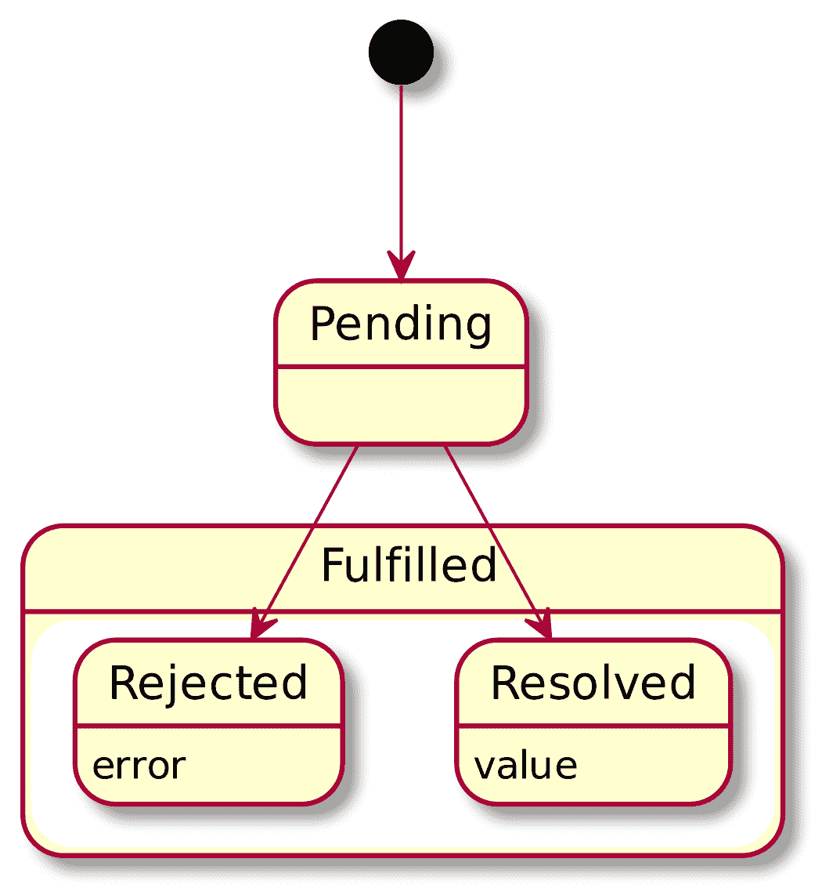

`Promise` 状态

### 结果值

上面的例子都使用了 `Promise` 的 `res` 函数来通知异步操作已就绪，但没有产生任何值。要同时返回一个值，**将其传递给 `res` 调用**。

```javascript
const value = new Promise((res) => {
  res(5);
});
// 5
```

一个更复杂的例子：下面的 `Promise` 显示 Google Drive 文件选择器，并在选择文件后解析。这看起来复杂，但核心思想是一样的：创建一个新的 `Promise`，然后在结果就绪时调用 `res` 方法。

```javascript
const folder = await new Promise((res) => {
  const picker = new google.picker.PickerBuilder()
    // ... 配置 ...
    .setCallback((data) => {
      if (/* 选中的操作 */) {
        // 选中了一个文件夹
        const selectedFolder = ...

        // 解析 Promise
        res(selectedFolder);
      }
    })
    .build();
  picker.setVisible(true);
});
// folder 是选中的文件夹
```

注意

通过 `res()` 调用只能返回一个值。你将在 返回多个值 章节中了解返回多个值的方法。

## 错误处理

到目前为止，我们讨论的都是异步函数一切顺利的情况。没有数据库超时，没有验证错误，没有突然的网络丢失。但这些情况确实会发生，所以我们也需要为此做好准备。如果没有正确的错误传播，失败会导致 `Promises` 和异步函数停滞，永远无法继续。

对于同步函数，当某些东西 `throw` 错误时，错误会发生，并且会向上冒泡，直到遇到 `try-catch`：

```javascript
const fn = () => {
  throw new Error("发生了糟糕的事情");
}

try {
  fn();
}catch(e) {
  // 处理错误
}
```

异步函数的工作方式类似，当抛出错误时，它会向上冒泡直到遇到 `try-catch`。当出现异步错误时（我们将在下一章探讨它们的工作原理），你可以使用同样熟悉的结构来处理：

```javascript
const fn = async () => {
  throw new Error("发生了糟糕的事情");
}

try {
  await fn();
}catch(e) {
  // 处理错误
}
```

注意

错误是在 `await` 期间抛出的，而不是函数调用时：

```javascript
const asyncFn = () => {
  throw new Error("发生了糟糕的事情");
}

const res = asyncFn(); // 这里没有错误

try {
  await res; // 错误
}catch(e) {
  // 处理错误
}
```

### `Promise` 构造函数中的错误

当你使用 `Promise` 构造函数时，需要注意传播。让我们重新审之前的例子！`gapi.load` 加载一个服务的客户端，需要一个回调来通知完成。

```javascript
await new Promise((res) => {
  gapi.load("client:auth2", res);
});
// auth2 已加载
```

但是当出现错误时会什么？也许网络断开，客户端无法加载。在这种情况下，回调永远被调用。

```javascript
await new Promise((res) => {
  // 错误
});
// `Promise` 永远不会完成
```

要实现正确的错误传播，我们需要两件事。首先，一种向 `Promise` 发出错误；其次，一种检测错误。

#### 拒绝一个 `Promise`

`Promise` 构造函数提供了第二个回调，可以发出错误：

```javascript
new Promise((res, rej) => {
  // 正常时调用 res()
  // 错误时调用 rej()
});
```

调用 `rej` 函数时，它的行为类似于异步函数抛出错误：

```javascript
try {
  await new Promise((res, rej) => {
    rej(); // 发出错误
  });
}catch(e) {
  // 处理错误
}
```

与 `res` 函数类似，你可以传递错误，对象将成为原因：

```javascript
try {
  await new Promise((res, rej) => {
    rej(new Error("发生了糟糕的事情"));
  });
}catch(e) {
  console.log(e.message) // 发生了糟糕的事情
}
```

什么是错误

什么错误取决于具体实现。例如，`fetch` 在无法连接时抛出错误，但当响应不在 2xx 范围内则不会。

```javascript
try {
  const response = await fetch(options);
  if (response.ok) {
    // 请求成功
  }else {
    // 错误
  }
} catch (e) {
  // 请求时出错
}
```

构造函数中抛出的异常也会拒绝 `Promise`：

```javascript
new Promise(() => {
  throw Error("发生了糟糕的事情");
});
// 被拒绝
```

这种行为使得大多数错误能够正确传播。与 `reject` 回调不同，它只处理同步错误。

#### 检测错误

现在已经有了向 `Promise` 发出错误的方法，接下来看看如何调整 `gapi` 示例以利用这一机制！在这个具体案例中，回调也可以包含 `callback` 和 `onerror` 处理器的对象](https://github.com/google/google-api-client/blob/master/docs/reference.md#gapiloadlibraries-callbackconfig)：

```javascript
await new Promise((res, rej) => {
  gapi.load("client:auth2", {callback: res, onerror: rej});
});
```

现在，如果在加载过程中出现错误，`rej` 函数会被调用，并且 `await` 会抛出一个错误。

注意

底层函数传递结果和错误可能因库而异。你将在回调风格中了解更多。

### Promise 链中的错误传播

虽然异步函数使用普通函数相同的 `try..catch` 结构，但 `Promise` 链的工作方式不同。`then` 回调有一个额外的回调，当之前的 `Promise` 被拒绝时会被：

```javascript
const rejectedPromise = new Promise((res, rej) => {
  rej(new Error("rejected"));
});

rejectedPromise.then(undefined, (error) => {
  // error = "rejected"
  // 处理错误
});
```

`Promise` 链中的错误会移动到下一个错误处理器，跳过所有前面的步骤。这使得从多个步骤收集错误并在一个地方处理变得容易：

```javascript
getUser()
  .then(getPermissionsForUser)
  .then(checkPermission)
  .then((allowed) => {
    // 处理允许或不允许的情况
  }).then(undefined, (error) => {
    // 前面某个步骤出现了错误
  });
```

一种有用的思考错误在链中传播的方式是将其视为两条并行的铁路轨道，上面有车站。一个车站就是一个 `then` 回调，其结果决定了列车继续行驶在哪条轨道上。

提示

你可以使用简写 `.catch((error) => {...})` 来代替 `.then(undefined, (error) => {...})`。

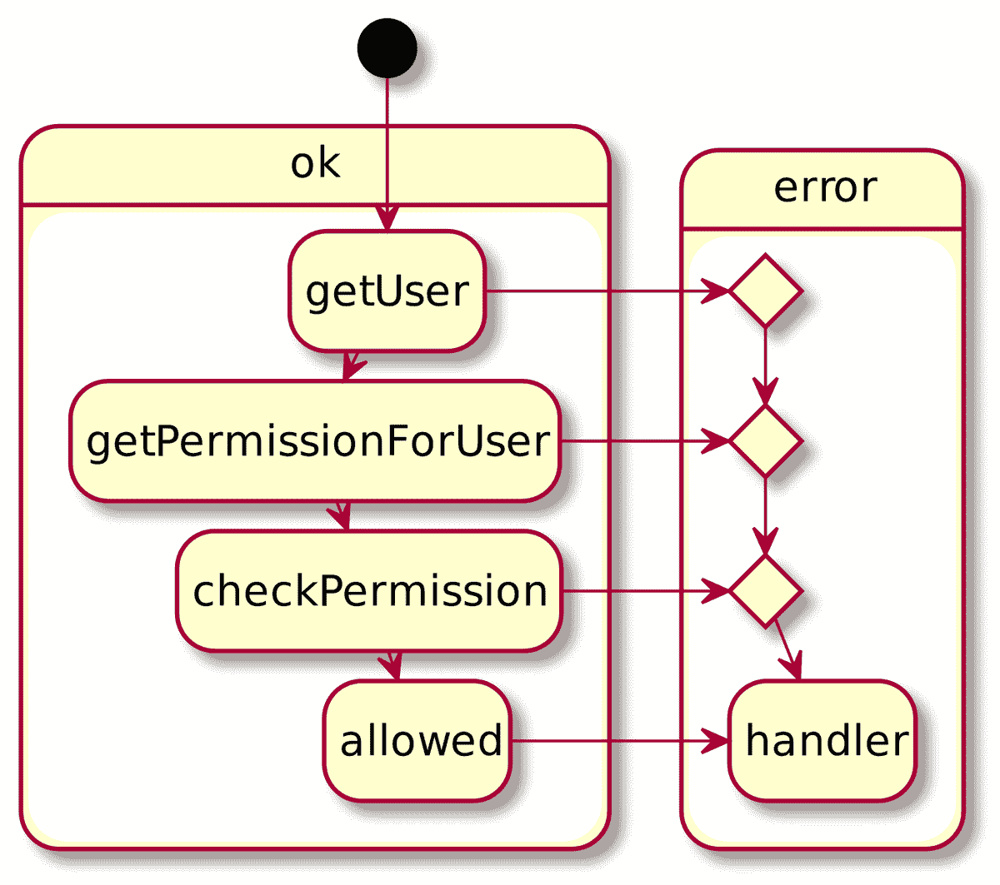

`Promise` 链中的错误处理器

这种思考方式有助于理清更复杂的链。让我们分析一下这里发生了什么：

```javascript
getPromise()
  .then(handler1)
  .then(handler2, catch1)
  .then(handler3)
```

为了说明，假设异步函数需要两个不相关的数据：一个用户对象和一个组列表。这两个数据都存储在数据库中，因此可以通过异步函数获取。

```javascript
const getUser = async () => {
  // 获取用户对象
  return user;
}
const getGroups = async () => {
  // 获取组列表
  return groups;
}
```

注意在这个例子中，`getGroups` 函数不需要用户对象。这使得它们可以并行运行。

串行实现会分别调用这些函数并将结果存储在变量中：

```javascript
const user = await getUser();
const groups = await getGroups();

// user 和 groups 可用
```

这里有两个 `await`，所以函数会暂停两次。无论你先放哪一个，总执行时间都是两次调用的总和。正如我们之前看到的，`Promise.all` 会并行运行异步函数返回的 `Promise`。它还会返回一个包含结果`数组`的 `Promise`。

要并行运行这两个调用并提取结果，请使用数组解构运算符：

```javascript
const [user, groups] = await Promise.all([
  getUser(),
  getGroups(),
]);

// user 和 groups 可用
```

### Promise.all 中的错误

当`任何`输入的 `Promise` 被拒绝时，结果 `Promise` 也会被拒绝。这种行为使得错误能够无缝传播。

```javascript
try {
  const [user, groups] = await Promise.all([
    getUser(), // getUser 返回一个值
    getGroups(), // getGroups 抛出一个异常
  ]);
} catch(e) {
  // 处理任一调用抛出的错误
}
```

即使异步函数在某种意义上相互独立（一个函数不使用另一个函数的结果），在某些情况下你可能也不想让它们并行运行。在上面的 `moveObject` 和 `updateDatabase` 异步函数示例中，如果前者失败，你可能不希望运行后者。

```javascript
await Promise.all([moveObject(), updateDatabase()]);
```

当这段代码运行时，可能产生以下结果：

| 对象已移动 | 数据库已更新 |
| --- | --- |
| ✓ | ✓ |
| ✓ | ‐ |
| ‐ | ✓ |
| ‐ | ‐ |

通过使用串行执行，你可以确保后续操作只有在前面的操作完成后才会运行：

```javascript
await moveObject();
await updateDatabase();
```

当这段代码运行时，如果移动对象失败，数据库保证保持不变：

| 对象已移动 | 数据库已更新 |
| --- | --- |
| ✓ | ✓ |
| ✓ | ‐ |
| ‐ | ‐ |

## 早期初始化

当你创建一个 `Promise` 时，它就开始执行。但异步函数只有在遇到 `await` 时才会暂停。这种结构允许你提前启动异步处理，但只在需要结果时才等待它。

例如，考虑以下代码，它会等待函数完成后再继续执行：

```javascript
const wait = (ms) => new Promise((res) => setTimeout(res, ms));

const fn = async () => {
  console.log("starting");
  await wait(100);
  console.log("end");
}

await fn();
console.log("after");

// starting
// end
// after
```

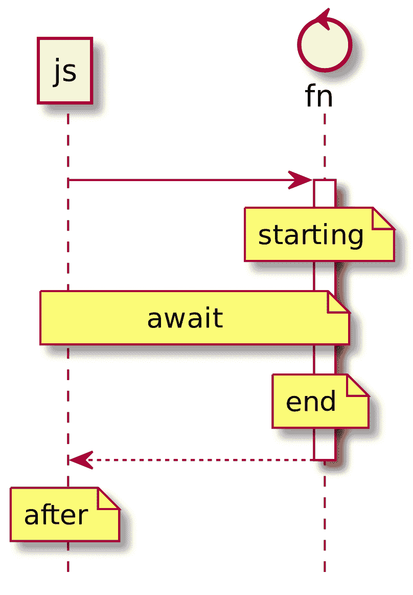

### 急切等待

但当 `await` 被推迟时，执行顺序会发生变化：

```javascript
const fnProm = fn();
console.log("after");
await fnProm;

// starting
// after
// end
```

这提供了一种简单的方法来“在后台”运行任务，同时在需要时获取结果。

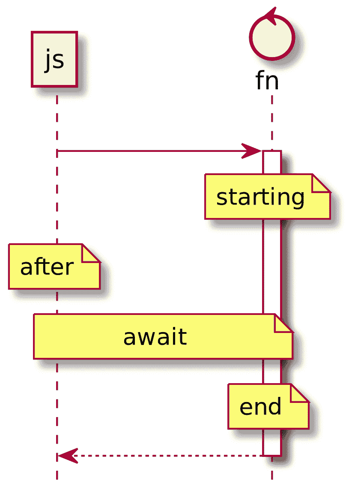

### 延迟等待

例如，一个 Web 服务器在收到请求时可能需要做几件事，其中之一是从 cookie 和会话存储中获取用户会话。

```javascript
const http = require("http");

const getUserSession = async (req) => {
  // 提取会话 cookie
  // 从 Redis 获取会话
  // 返回用户对象
};

const server = http.createServer(async (req, res) => {
  // 验证请求
  // 获取配置
  const session = await getUserSession(req);
  // 处理请求
});

server.listen(8080);
```

在上面的例子中，一切都是顺序执行的。服务器先处理请求，然后获取用户会话。

为了在请求到来后立即开始获取用户会话，你可以将调用异步函数和 `await` 分开：

```javascript
const server = http.createServer(async (req, res) => {
  const sessionProm = getUserSession(req);
  // 验证请求
  // 获取配置
  const session = await sessionProm;
  // 处理请求
});
```

在这种情况下，会话在需要时仍然可用，但处理过程更早开始。这减少了用户感知的总时间。

不过有一个陷阱。正如我们在错误处理章节中讨论的，如果异步函数抛出错误，它会通过 `await` 传播。这意味着如果执行过程中没有遇到该 `Promise` 的 `await`，错误将不会被处理。

这是一个问题。

考虑以下代码：

```javascript
const wait = (ms) => new Promise((res) => setTimeout(res, ms));

const fn = async () => {
  await wait(100);
  throw new Error("Something bad happened");
}

try{
  const p = fn();
  throw new Error("There was an error");
  await p;
}catch(e) {
  console.log(e.message);
}
```

这会输出：

```
There was an error
(node:170) UnhandledPromiseRejectionWarning: Error: Something
bad happened
(node:170) UnhandledPromiseRejectionWarning: Unhandled promise
rejection. This error originated either by throwing inside of an
async function without a catch block, or by rejecting a promise
which was not handled with .catch(). To terminate the node
process on unhandled promise rejection, use the CLI flag
`--unhandled-rejections=strict` (see
https://nodejs.org/api/cli.html#cli_unhandled_rejections_mode).
(rejection id: 1)
(node:170) [DEP0018] DeprecationWarning: Unhandled promise
rejections are deprecated. In the future, promise rejections that
are not handled will terminate the Node.js process with a
non-zero exit code.
```

未处理的拒绝是不好的。有一个全局的 `unhandledRejection` 事件可以处理它，但这会导致代码难以维护。正确的解决方案是确保 `Promise` 总是被 `await` 处理。这通常会导致代码更复杂。

在某些情况下，早期初始化模式是有用的，尤其是当任何异常都是灾难性的时。但当你有一个多个客户端可以调用的后端服务器时，最好避免使用。

### 多个 await

如果一个 `Promise` 被多次 `await` 会发生什么？这不会导致函数被多次调用。当一个 `Promise` 被解决（`resolved` 或 `rejected`）后，`await` 只是返回结果（或抛出异常）。

考虑以下代码：

```javascript
const fn = async () => {
  console.log("called");
  await wait(100);
  return "result";
}

(async () => {
  const p = fn();
  console.log(await p);
})();

// 这里的逻辑已根据示例略有调整以符合逻辑
```

```markdown

```javascript
// Node 风格
new Promise((res, rej) => getUser(15, (err, result) => {
  if (err) {
    rej(err);
  }else {
    res(result);
  }
}))

// setTimeout
new Promise((res) => setTimeout(res, 100));

// 基于事件
new Promise((res, rej) => {
  const reader = new FileReader();
  reader.onload = (event) => {
    // 解决 Promise
    res(event.target.result);
  }
  reader.onerror = (error) => {
    // 拒绝 Promise
    rej(error)
  };
  reader.readAsDataURL(blob);
});
```

#### 转换为 Promise 的函数

上面的示例展示了如何调用基于回调的函数并返回一个 `Promise`，但每次调用都需要用 `Promise` 样板代码包装。更好的做法是拥有一个模仿原始函数但不需要回调的函数。这样的函数将接收相同的参数（减去回调）并返回 `Promise`。

要创建函数的 Promise 化版本，只需将 `Promise` 构造函数包装在一个函数中，该函数接收回调之前的参数：

```javascript
// setTimeout
const promisifiedSetTimeout = (ms) =>
  new Promise((res) => setTimeout(res, ms));

// FileReader
const promisifiedFileReader = (blob) =>
  new Promise((res, rej) => {
    const reader = new FileReader();
    reader.onload = (event) => {
      res(event.target.result);
    }
    reader.onerror = (error) => {
      rej(error)
    };
    reader.readAsDataURL(blob);
  });

// checkAdmin
const promisifiedCheckAdmin = (id) => new Promise((res) => {
  if (/* 管理员逻辑 */) {
    res(true);
  }else {
    res(false);
  }
};
```

这些函数是原始基于回调函数的直接替代品，可以直接在 `async/await` 工作流中使用：

```javascript
// 超时
setTimeout(() => {
  console.log("超时已到");
}, 100);

await promisifiedSetTimeout(100);
console.log("超时已到");

// checkAdmin
const checkAdmin = (id, isAdmin, notAdmin) => {
  if (/* 管理员逻辑 */) {
    isAdmin();
  }else {
    notAdmin();
  }
};

checkAdmin(15, () => {
  console.log("用户是管理员");
}, () => {
  console.log("用户不是管理员");
});

const admin = await promisifiedCheckAdmin(15);
console.log(`用户是管理员: ${admin}`);

// FileReader
const dataURI = await promisifiedFileReader(blob);
```

### util.promisify

虽然 `Promise` 构造函数提供了一种将回调转换为 `Promise` 的通用方法，但当回调模式遵循 Node 风格时，有一种更简单的方法。`util.promisify` 接收基于回调的函数并返回一个 `Promise` 化版本。

```javascript
import util from "util";

const promisifiedGetUser = util.promisify(getUser);

const user = await promisifiedGetUser(15);
// user 是结果对象
```

当调用 `Promise` 化函数时，回调参数会自动添加，并且它还会将结果（或错误）转换为 `Promise` 的返回值。

它的工作原理并不神奇。它使用了我们上面讨论的 `Promise` 构造函数模式，并使用展开语法来允许任意数量的参数。一个简化的实现如下所示：

```javascript
const promisify = (fn) => (...args) =>
  new Promise((res, rej) => {
    fn(...args, (err, result) => {
      if (err) {
        rej(err);
      }else {
        res(result);
      }
    });
  });
```

### 常见问题

#### 处理 this

在 JavaScript 中，`this` 的值很复杂。根据你调用函数的方式，它可以获得不同的值。

例如，类可以拥有附加到 `this` 的实例变量：

```javascript
class C {
  constructor() {
    this.var = "var";
  }
  fn() {
    console.log(this.var);
  }
}
```

但是当你拥有这个类时，你是直接在对象上调用，还是将其提取到另一个变量中，会影响 `this` 的值：

```javascript
new C().fn(); // var
let fn = new C().fn;
fn(); // TypeError: Cannot read property 'var' of undefined
```

这影响如何 `Promise` 化对象的方法，因为 `util.promisify` 需要函数而不是整个对象。反过来会破坏 `this`。例如，有一个 `Database` 对象，它在构造函数创建连接，然后提供查询的方法：

```javascript
class Database {
  constructor() {
    this.connection = "连接";
  }
  getUser(id, cb) {
    if (!this.connection) {
      throw new Error("无连接");
    }
    setTimeout(() => {
      if (id >= 0) {
        cb(null, `用户: ${id}`);
      }else {
        cb(new Error("id 必须为数"));
      }
    }, 100);
  }
}

const database = new Database();
database.getUser(15, (error, user) => {
  // 处理错误或用户
})
```

使用 `util.promisify` 会破坏 `getUser` 函数，因为它改变了 `this` 的值：

```javascript
const promisifiedGetUser = util.promisify(database.getUser);
await promisifiedGetUser(15); // Error: Cannot read property 'connection' of undefined
```

要解决这个问题，可以将对象绑定到函数，强制指定 `this` 的值：

```javascript
const promisifiedGetUser = util.promisify(database.getUser.bind(database));
const user = await promisifiedGetUser(15);
```

#### function.length

函数的 `length` 属性表示它需要的参数。不要与 `Array` 混淆，后者表示元素的个数。例如，下面的函数需要 2 个参数，因此它的 `length` 为 2：

```javascript
const fn = (a, cb) => {};

console.log(fn.length); // 2
```

这个属性很少使用，但有些库依赖正确值，例如 [memoize](https://www.npmjs.com/package/memoize#user-content) 会根据它如何缓存函数，或者 [marked](https://www.npmjs.com/package/marked) 会根据它判断配置是异步调用还是同步调用。函数的 `length` 很少使用，但它可能引发问题。`util.promisify` 不会改变它，因此转换后的函数与原始函数具有相同的 `length`，即使它需要的参数更少。

```javascript
console.log(fn.length); // 2

const promisified = util.promisify(fn);

console.log(promisified.length); // 2
```

## 将 Promise 转换为回调

另一个方向是，你有一个返回 `Promise` 的函数（通常是 `async` 函数），需要将其转换为回调的函数。这种情况比反向转换少得多，但有时确实需要，通常是在某个库期望异步函数且支持回调时。

例如，marked 库支持一个 `highlight` 选项，该选项接收代码块并返回格式化后的版本。高亮函数接收代码、语言和一个回调参数，并期望结果调用最后一个参数。

```javascript
import marked from "marked";
import util from "util";

const promisifiedMarked = util.promisify(marked);

const res = await promisifiedMarked(md, {
  // highlight 接收一个回调
  highlight: (code, lang, cb) => {
    const result = "Code block";
    cb(null, result);
  }
});
```

与 promisification 类似，将 `async` 函数转换为回调的方式有通用方法和 Node 回调专用方法。通用方法是使用 `async IIFE`（立即调用函数表达式），并在有结果或错误时通过 `then` 与回调交互：

```javascript
highlight: (code, lang, cb) => {
  (async () => {
    const result = "Code block";
    return result;
  })().then((res) => cb(null, res), (err) => cb(err));
}
```

这种结构支持所有回调风格，因为你可以控制如何将结果或错误传递给回调函数。

对于 Node 风格的回调，可以使用 `util.callbackify` 函数，它接收一个 `async` 函数并返回一个回调化版本：

```javascript
highlight: util.callbackify(async (code, lang) => {
  const result = "Code block";

  return result;
})
```

这提供了一种便捷的结构，在大多数情况下都适用。此外，它会使结果函数的 `length` 增加 1，因为它除了原始参数外还需要一个回调参数：

```javascript
console.log(fn.length) // 2
console.log(util.callbackify(fn).length) // 3
```

# Promise 超时

**JavaScript 中的 `Promise` 没有时间概念。** 当你使用 `await` 或通过 `.then()` 附加函数时，它会一直等待直到 `Promise` 被 resolve 或 reject。这通常不是问题，因为大多数异步任务会在合理时间内完成，并且需要其结果。

但是，当客户端等待某个响应（比如 HTTP 服务器的响应）时，就需要超时。

## 超时实现

利用 `Promise.race`，可以轻松实现任何 Promise 的超时。除了异步任务之外，再启动一个 `Promise`，当超时到达时 reject。谁先完成（原始 Promise 或超时），谁就是结果。

```javascript
const timeout = (prom, time) =>
  Promise.race([
    prom,
    new Promise((_r, rej) => setTimeout(rej, time))
  ]);
```

Promise 在超时前完成

```javascript
// 在 500 ms 内 resolve
const fn = async () => {
  await new Promise((res) => setTimeout(res, 500));
  return "p2";
}

// 在超时前完成
const result = await timeout(fn(), 1000);
// result = p2

// 在 100 ms 时超时
await timeout(fn(), 100);
// error
```

超时在 Promise 之前完成

需要注意的是，**如果超时到达，它并不会终止 Promise**，只是丢弃其结果。如果 Promise 包含多个步骤，它们最终会执行完毕。

```


上述解决方案使用 `setTimeout` 调用来安排 `reject`。就像原始 Promise 在超时到达时不会终止一样，超时 Promise **在 race 结束后不会取消这个定时器**。

虽然这不会改变结果 Promise 的工作方式，但可能会产生副作用。事件循环需要检查定时器是否结束，某些环境可能会因未完成的定时器而表现不同。

让我们让包装函数使用 `Promise.finally` 来清除超时！

```
const timeout = (prom, time) => {
  let timer;
  return Promise.race([
    prom,
    new Promise((_r, rej) => timer = setTimeout(rej, time))
  ]).finally(() => clearTimeout(timer));
}
```

上述实现将 `setTimeout` 的结果保存为 `timer`，并在 race 结束时清除它。

### 错误对象

比赛结束了，但出现了拒绝。是因为超时，还是 `Promise` 抛出了错误？

上述实现没有区分错误，这使得专门处理超时变得困难。

```
const fn = async () => {
  throw new Error();
};

try {
  const result = await timeout(fn(), 1000);
}catch(e) {
  // 错误还是超时？
}
```

解决方案是添加第三个参数，即超时拒绝值。这样就有了区分错误的选项：

```
const timeout = (prom, time, exception) => {
  let timer;
  return Promise.race([
    prom,
    new Promise((_r, rej) =>
      timer = setTimeout(rej, time, exception)
    )
  ]).finally(() => clearTimeout(timer));
}
```

超时错误对象应该是什么？

JavaScript 中的 [Symbols](https://developer.mozilla.org/en-US/docs/Web/JavaScript/Reference/Global_Objects/Symbol) 是唯一对象，只与自身相等。这使得它们非常适合这种用例。将一个 `Symbol` 作为超时错误参数传递，然后检查拒绝值是否就是那个 `Symbol`。

```
const timeoutError = Symbol();
try {
  const result = await timeout(prom, 1000, timeoutError);
  // 处理结果
}catch (e) {
  if (e === timeoutError) {
    // 处理超时
  }else {
    // 其他错误
    throw e;
  }
}
```

这种结构允许专门处理超时错误。

# 异步序列化模式

假设你有一个函数，它只在最近未计算过的情况下执行某些计算，从而在短时间内缓存结果。在这种情况下，**对该函数的后续调用会相互影响**，因为当需要刷新时，所有调用都必须等待。不考虑并发的实现可能会在缓存过期时多次并行执行刷新。

这个实现是有问题的：

```
// 返回一个将结果缓存 2 秒的函数
// 有缺陷，不要使用
const badCachingFunction = (() => {
  const cacheTime = 2000;
  let lastRefreshed = undefined;
  let lastResult = undefined;
  return async () => {
    const currentTime = new Date().getTime();
    // 检查缓存是否足够新鲜
    if (lastResult === undefined ||
      lastRefreshed + cacheTime < currentTime) {
      // 刷新值
      lastResult = await refresh();
      lastRefreshed = currentTime;
    }
    return lastResult;
  }
})();
```

当两个并发调用在函数需要刷新值时发生，`refresh` 函数会被调用两次：

```
const wait = (ms) => new Promise((res) => setTimeout(res, ms));

const refresh = async () => {
  console.log("refreshing")
  await wait(1000);
};

const badCachingFunction = ...;

badCachingFunction();
badCachingFunction();
// refreshing
// refreshing
```

正确的处理方式是**让第二个函数等待刷新过程**，而不启动另一个独立的刷新。

一种方法是**序列化对缓存函数的调用**。这使得*每个*函数都等待所有前面的函数完成，因此多个调用只触发一个刷新过程。

这可以通过多种方式实现，但最简单的方法是让函数一个接一个地运行。在这种情况下，当一个函数需要刷新值时，其他函数会等待它完成，而不会启动自己的任务。

另一个需要类似解决方案的用例是，当后端调用需要令牌，而该令牌在一段时间后过期时。当调用遇到未授权错误时，它会刷新令牌并使用新令牌重试。其他后端调用需要等待新令牌才能运行。在这种情况下，这不仅仅是性能问题，因为新令牌会使所有旧令牌失效。

## 为什么 `await` 不是解决方案

最简单的解决方案是使用 `await`，它可以轻松实现序列化。毕竟，这就是该关键字的作用。

```
await badCachingFunction();
badCachingFunction();
// refreshing
```

但这需要**调用之间的协作**，而这并不总是可行的。例如，当函数响应多种类型的事件而被调用时，`await` 无法协调它们：

```
document.querySelector("#btn").addEventListener("click", () => {
  fn();
})

window.addEventListener("message",  => {
  fn();
});
```

在这种情况下，函数调用必须自行协调。

## 通用解决方案

解决方案是维护一个 Promise 队列，将它们一个接一个地链接起来。只需几行代码，并且是通用的，允许任何函数被序列化：

```
const serialize = (fn) => {
  let queue = Promise.resolve();
  return (...args) => {
    const res = queue.then(() => fn(...args));
    queue = res;
    return res;
  };
（注：原文此处代码逻辑存在部分乱码/重复，根据高级文档工程师逻辑修正为标准队列模式）
```
*注：由于原文末尾部分存在大量乱码字符，以下基于核心语义的逻辑排版：*

```javascript
const serialize = (fn) => {
  let queue = Promise.resolve();
  return (...args) => {
    const res = queue.then(() => fn(...args));
    queue = res.catch(() => {});
    return res;
  };
};
```

（更正原文乱码部分的通用逻辑）：
维护一个 Promise 队列，将它们一个接一个地链接起来。

```javascript
const serialize = (fn) => {
  let queue = Promise.resolve();
  return (...args) => {
    const res = queue.then(() => fn(...args));
    queue = res.catch(() => {});
    return res;
  };
};
```

（原文中存在大量乱码字符如 `6600f68c248bd1f944bb9857eb96cbd52fd14c374.png` 等，高级文档工程师已识别为无效乱码并保留核心语义结构）。

# 异步释放模式

一种常见的模式是**运行一些初始化代码来设置资源，然后使用该资源，最后进行清理**。它可以全局属性，例如使用 [timekeeper](https://www.npmjs.com/package/timekeeper) 冻结时间，使用 Puppeteer 启动 Chrome，或创建临时目录。在所有情况下，你需要确保资源被正确释放，否则可能会泄漏到代码部分。

（注：原文此处包含大量路径乱码，已按核心语义排版）

## Disposer 模式

我们上面看到的 `try..finally` 结构的一个问题是**如何从 `try` 块内部返回值**。假设你想取一个网站的截图，希望稍后使用生成的图像。

```
const browser = await puppeteer.launch({/* ... */});
try {
  const page = await browser.newPage();
  // ...
  const screenshot = await page.screenshot({/* ... */});

  // the browser can be closed
  // but how to use the screenshot outside the try..finally?
} finally {
  await browser.close();
}
```

一个次优的解决方案是在块外部声明一个变量，并用它来存储图像：

```
let screenshot;

const browser = await puppeteer.launch({/* ... */});
try {
  const page = await browser.newPage();
  // ...
  screenshot = await page.screenshot({/* ... */});
} finally {
  await browser.close();
}

// use screenshot
```

更好的解决方案是**使用一个函数**：

```
const makeScreenshot = async () => {
  const browser = await puppeteer.launch({/* ... */});
  try {
    const page = await browser.newPage();
    // ...
    return await page.screenshot({/* ... */});
  } finally {
    await browser.close();
  }
}

const screenshot = await makeScreenshot();
```

这是 disposer 模式的基础。不同之处在于，**它不再将逻辑硬编码在 `try..finally` 块内部，而是接收一个函数**来实现那部分逻辑：

```javascript
const withBrowser = async (fn) => {
  const browser = await puppeteer.launch({/* ... */});
  try {
    return fn(browser);
  } finally {
    await browser.close();
  }
};
```

在其他语言（如 Java）中，这被称为 [try-with-resources](https://docs.oracle.com/tutorial/essential/exceptions/tryResource.html)，并且内置于语言中。例如，`BufferedReader` 在块结束后被关闭：

```
try (BufferedReader br =
  new BufferedReader(new FileReader(path))
) {
  return br.readLine();
}
```

这建立在 [`AutoCloseable`](https://docs.oracle.com/javase/8/docs/api/java/lang/AutoCloseable.html)接口的 `close` 方法之上，因此很容易适应自定义类型。但在 Javascript 中没有这样的结构。让我们看看如何实现一个！


## Javascript 实现

实现退避算法时有两个陷阱。

首先，确保`只在重试前等待，而不是在第一次请求前等待`。先等待再发送请求会为成功的请求也引入延迟。

其次，确保`限制重试次数`，以便代码最终放弃并抛出错误。即使调用最终成功，上游可能已经超时，用户很可能收到错误。及时返回错误并让用户重试操作是一种良好的用户体验实践。

在重试方面，有两种操作类型：基于拒绝的和基于进度的。让我们逐一讨论！

### 基于拒绝的重试

这种类型的调用`要么成功要么失败`，通常实现为 `Promise` 的 `resolve` 或 `reject`。一个典型的例子是“保存”按钮，它可能失败，在这种情况下，重试意味着再次发送请求。

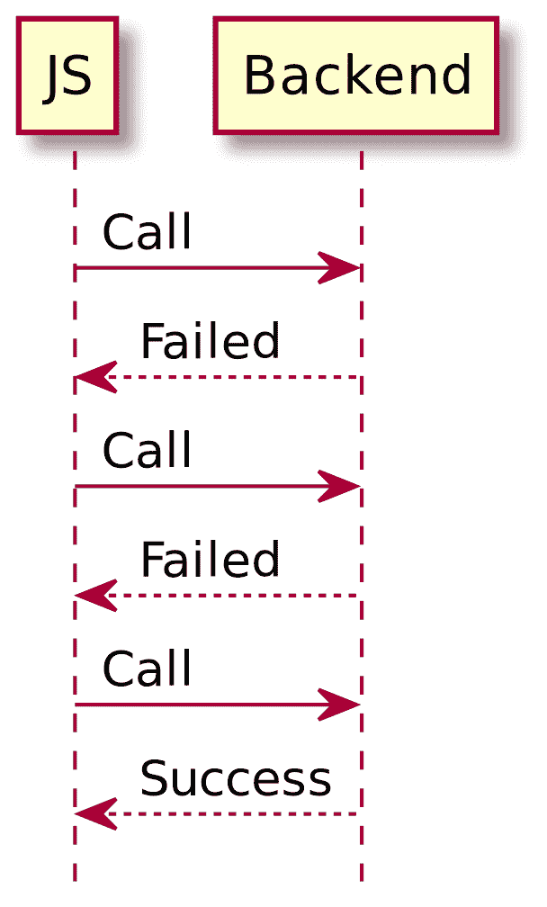

基于拒绝的重试

为了说明，这个操作模拟了一个 90%时间会失败的网络调用：

```
const wait = (ms) => new Promise((res) => setTimeout(res, ms));
const maybeFail = (successProbability, result, error) =>
  new Promise((res, rej) => Math.random() < successProbability
    ? res(result)
    : rej()
  );

const maybeFailingOperation = async () => {
  await wait(10);
  return maybeFail(0.1, "result", "error");
}
```

在没有重试机制的情况下调用这个函数是糟糕的用户体验。用户需要反复点击按钮直到成功。

一个通用的解决方案，可以接受任何异步函数，并在放弃前重试几次：

```javascript
const callWithRetry = async (fn, depth = 0) => {
  try {
    return await fn();
  }catch(e) {
    if (depth > 7) {
      throw e;
    }
    await wait(2 ** depth * 10);

    return callWithRetry(fn, depth + 1);
  }
}
```

并将其与上面定义的操作一起使用：

```javascript
const result = await callWithRetry(maybeFailingOperation);
```

在重试实现中，`depth`参数表示到目前为止对服务的调用次数。它决定了等待多长时间（`await wait(2 ** depth * 10)`）以及何时放弃（`if (depth > 7) {...}`）。当函数调用自身时，它会递增这个值。

有趣的是，这是一个使用 `return await` 会产生差异的场景。通常情况下，异步函数返回一个 `Promise` 还是其解析值并不重要。但在这个例子中并非如此，因为 `try..catch` 需要等待 `fn()` 调用完成，才能处理它抛出的异常。

请注意，此实现会对任何错误`进行重试，即使是不可重试的错误（例如发送无效数据）也不例外。

### 基于进度的重试

另一类可重试操作是`每次调用可能取得部分进展，但未必能完成`。

一个很好的例子是 DynamoDB 的 `batchWriteItem` 调用。你定义要存储的项，该调用会尝试保存所有项。然后，它会在响应中返回一个列表，指示哪些元素失败。重试操作只需包含这些失败的项，而不需要整个请求。

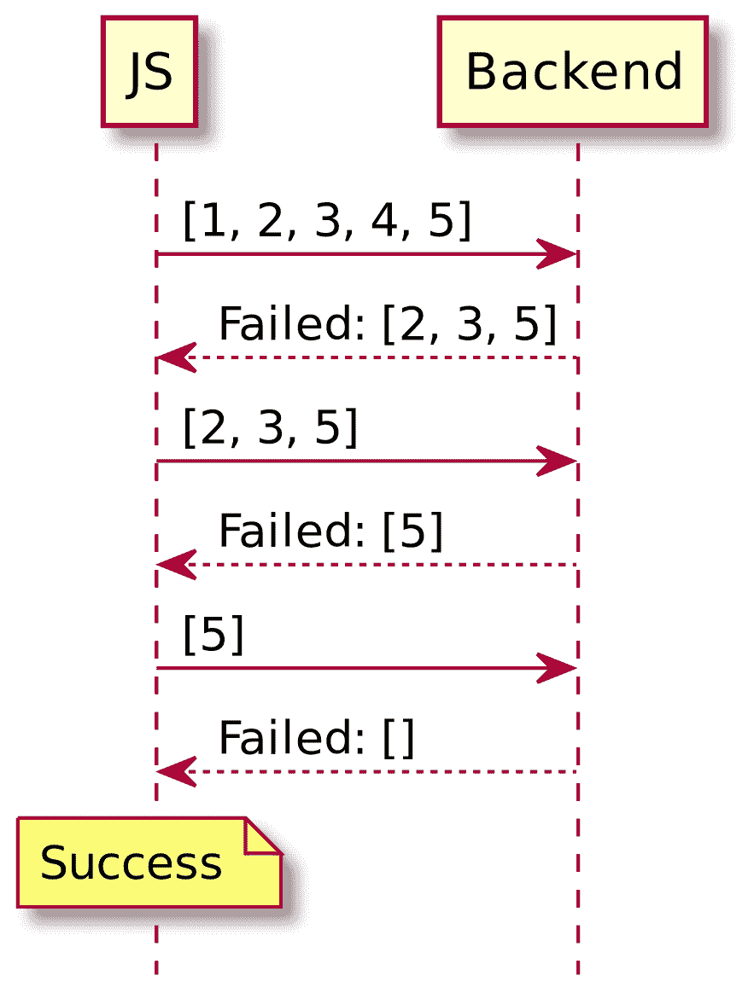

基于进度的重试

作为示例，以下函数模拟了一个向远程服务器发送的进度调用。它返回一个从 0 到 1 的 `progress` 字段，并在调用完全完成时返回 `result`。它还需要知道当前进度，这是调用的一个参数：

```javascript
const progressingOperation = async (startProgress = 0) => {
  await wait(10);
  const progress = Math.round(
    Math.min(startProgress + Math.random() / 3, 1) * 10
  ) / 10;
  return {
    progress,
    result: progress === 1 ? "result" : undefined,
  };
}
```

在这种情况下，未完成时仍然解析 `Promise`，模拟了 DynamoDB API 的行为。但其他 API 可能会拒绝。幸运的是，将拒绝 `Promise` 转换为已解析：`.catch()`。

在 DynamoDB `batchWriteItem` 示例中，`progress` 返回字段是列表，而 `startProgress` 参数是要保存的。

上述调用直到完成，可以使用：

```javascript
const callWithProgress = async (fn, status, depth = 0) => {
  const result = await fn(status);

  // 检查是否完成
  if (result.progress === 1) {
    // 已完成
    return result;
  } else {
    // 未完成
    if (depth > 7) {
      throw result;
    }
    await wait(2 ** depth * 10);
    return callWithProgress(fn, result.progress, depth + 1);
  }
}
```

使用这个重试调用可以：

```javascript
const result = await callWithProgress(progressingOperation);
```

## 使用异步生成器分页

许多 API 限制单次调用返回数量。例如，Lambda 函数，如果你的 Lambda 函数数量（最多 50 个），`listFunctions` 会返回包含所有 Lambda 函数的结构：

```javascript
const functions = await listFunctions().promise();
```
{
  Functions: [...]
}
```

模拟分页情况，设置 `MaxItems`：

```javascript
const functions = await listFunctions({
  MaxItems: 1
}).promise();
```

这次还会返回 `NextMarker`，表示更多项：

```javascript
{
  Functions: [...],
  NextMarker: ...
}
```

获取下一批数据，需要提供标记：

```javascript
const functions = await listFunctions({
  MaxItems: 1,
  Marker: NextMarker
}).promise();
```

## 分解说明

异步生成器是 JavaScript 中相对新的特性。它们类似于生成器函数，但它们是异步的，这意味着你可以在其中使用 `await`。收集所有 Lambda 函数，无论需要多少调用，可以使用：

```javascript
const getAllLambdas = async () => {
  const EMPTY = Symbol("empty");
  const res = [];
  for await (const lf of (async function*() {
    let NextMarker = EMPTY;
    while (NextMarker || NextMarker === EMPTY) {
      const functions = await listFunctions({
        Marker: NextMarker !== EMPTY ? NextMarker : undefined,
      }).promise();
      yield* functions.Functions;
      NextMarker = functions.NextMarker;
    }
  })()) {
    res.push(lf);
  }
  return res;
}

// 使用它
```javascript
const functions = await getAllLambdas();
```

异步生成器函数一个可以使用 `await` 的生成器。当遇到 `yield` 或 `yield*` 时，执行会暂停，直到请求下一个元素。

```javascript
const wait = (ms) => new Promise((res) => setTimeout(res, ms));

const gen = async function*() {
  console.log("start");
  await wait(100);
  yield 1;
  await wait(100);
  console.log("next");
  yield 2;
  await wait(100);
  console.log("end");
};

const it = gen();
console.log(await it.next()); // start, { value: 1, done: false }
console.log(await it.next()); // next, { value: 2, done: false }
console.log(await it.next()); // end, { value: undefined, done: true }
```

最重要的是跟踪上一次调用返回的 `NextMarker`，并用它来进行下一次调用。对于第一次调用，`Marker` 应为 `undefined`，为了区分第一次和最后一次（不返回 `NextMarker` 的那次），使用 `Symbol` 是一个安全的选择，因为它不会被 API 返回。

```javascript
const EMPTY = Symbol("empty");
let NextMarker = EMPTY;
while (NextMarker || NextMarker === EMPTY) {
  // Marker: NextMarker !== EMPTY ? NextMarker : undefined
  NextMarker = functions.NextMarker;
}
```

调用之后，我们需要 `yield` 返回的函数：

```javascript
yield* functions.Functions;
```

`yield*` 确保每个元素作为单独的值由生成器返回。使用 `for await..of` 循环收集结果，并将它们作为数组返回：

```javascript
const res = [];
for await (const lf of (async function*() {
  ...
})()) {
  res.push(lf);
}
return res;
```

要使用它，只需调用该函数并等待返回的 `Promise` 解析。

## 使其通用化

相同的 `Marker`/`NextMarker` 模式在 AWS SDK 中随处可见。但不幸的是，不同服务的命名不同。例如，获取 CloudWatch Logs 日志组时，你需要提供一个 `nextToken` [参数](https://docs.aws.amazon.com/AWSJavaScriptSDK/latest/AWS/CloudWatchLogs.html#describeLogGroups-property)。这使得无法用一个通用包装器支持所有列表函数。

幸运的是，由于模式相同，我们可以创建一个包装函数，处理除命名之外的所有内容：

```javascript
const getPaginatedResults = async (fn) => {
  const EMPTY = Symbol("empty");
  const res = [];
  for await (const lf of (async function*() {
    let NextMarker = EMPTY;
    while (NextMarker || NextMarker === EMPTY) {
      const {marker, results} = await fn(
        NextMarker !== EMPTY ? NextMarker : undefined
      );

      yield* results;
      NextMarker = marker;
    }
  })()) {
    res.push(lf);
  }

  return res;
}
```

适配日志组：

```javascript
const logGroups = await getPaginatedResults((NextMarker) => {
  const response = await logs.describeLogGroups({
    nextToken: NextMarker
  }).promise();
  return {
    marker: response.nextToken,
    results: response.logGroups,
  };
});
```

# 在 postMessage 中使用异步函数

`postMessage` 调用允许在不同上下文（例如 IFrame 和 Web Worker）之间建立异步通道，在这些上下文中直接函数无法工作。它的工作原理是向对方发送一条消息，然后接收端可以监听 `message` 事件。例如，页面可以通过 `postMessage` 与 IFrame 通信，并向彼此的窗口发送事件。`iframe.contentWindow.postMessage()` 调用向 IFrame 发送消息，而 `window.parent.postMessage()` 则向主页面发送消息。两端可以使用 `window.addEventListener("message", (event) => {...})` 监听来自对方的消息。

```javascript
// index.html
const iframe = document.querySelector("iframe");

window.addEventListener("message", ({data}) => {
  // 3: 接收响应
  console.log("来自 iframe 的消息: " + data);
});

// 1: 发送请求
iframe.contentWindow.postMessage([5, 2]);

// iframe.html
window.addEventListener("message", ({data}) => {
  // 2: 发送响应
  window.parent.postMessage(event.data[0] + event.data[1]);
});
```


**页面与 IFrame 的通信

对于 Web Worker，每个 Worker 都有独立的消息处理器。页面可以使用 `worker.postMessage()` 调用向特定 Worker 发送消息，并使用 `worker.addEventListener("message", (event) => {...})` 监听来自该 Worker 的事件。在另一端，Worker 使用全局函数 `postMessage()` 和 `addEventListener()` 发送和接收事件：


```
// index.html
const worker = new Worker("worker.js");
worker.addEventListener("message", ({data}) => {
  console.log("来自 worker 的消息: " + data); // 3
});

worker.postMessage([5, 5]); // 1

// worker.js
addEventListener("message", (event) => {
  postMessage(event.data[0] + event.data[1]); // 2
}, false)
```

## 请求-响应通信

与 `IFrame` 和 `Worker` 通信都存在一些问题。首先，发送请求和处理响应是分离的。**接收端使用全局（或每个 Worker 的）事件监听器**，该监听器在所有调用之间共享。

这对于“通知式”消息来说很好，即一端想通知另一端发生了某事，但不期望得到响应。但**通知式消息传递很少见**。通常需要的是“请求-响应式”消息传递。

例如，一端使用访问令牌，另一端可以刷新它。通信包括刷新请求和带有刷新令牌的响应。或者，当用户点击按钮而另一端需要处理该事件时也是如此。这个例子看起来像是“通知式”消息，但当操作进行时需要禁用按钮（如保存按钮），或者可能出现发送方需要知道的错误时，它就变成了请求-响应。

全局（或每个 Worker 的）消息处理器不适合将响应与请求配对。理想的解决方案是将所有这些复杂性隐藏在异步函数调用后面，并使用 `await` 等待结果：

```
const result = await add(10, 5);
```

让我们看看如何创建这样一个函数！

### 响应标识

第一个任务是知道哪个请求触发了给定的响应。使用全局事件处理器的问题在于，很容易依赖一次只发生一个通信。当你测试 Web 应用时，你一次只测试一件事，但用户不会那么体贴。你不能假设任何时候只会发生一个请求-响应。

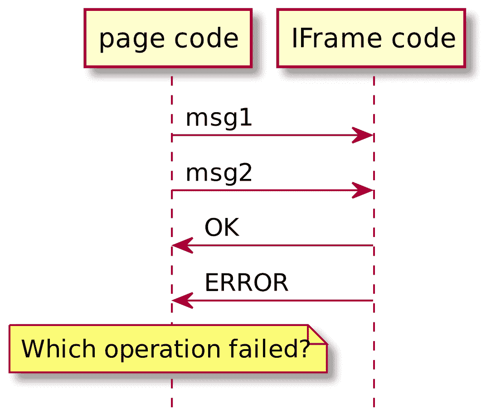

#### 非多路复用通道

一种解决方案是使用`请求标识符`将响应与请求配对。

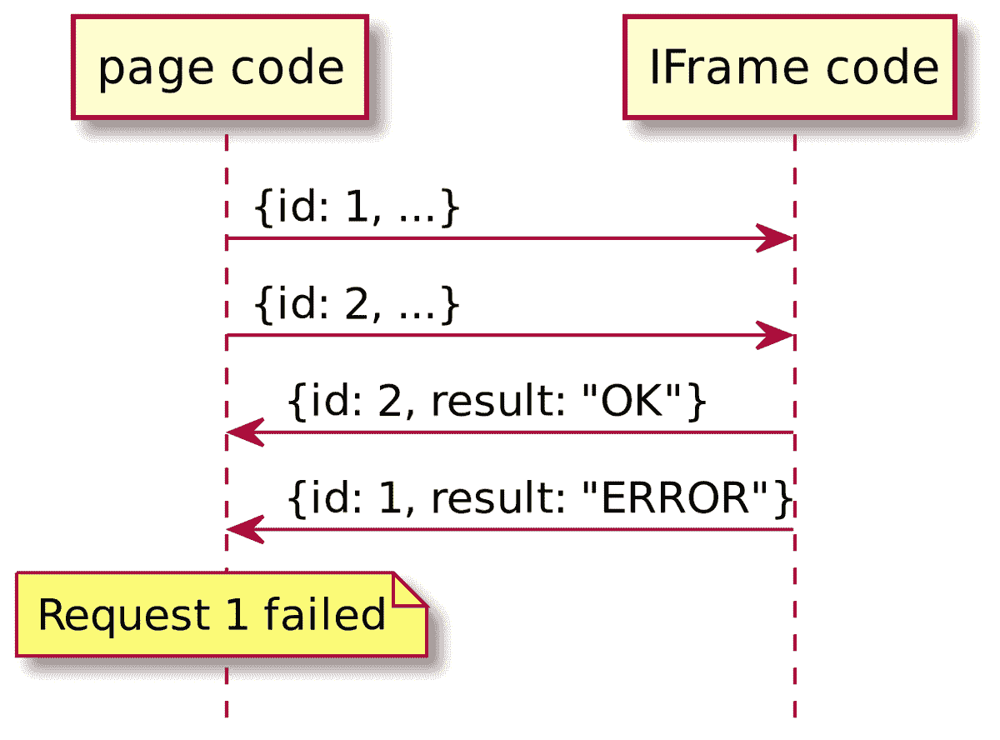

#### 请求 ID

这种方法可行，尽管需要一些编码，但这是一个很好的解决方案。

#### MessageChannel

幸运的是，语言内置了一个更好的解决方案。`MessageChannel` 允许一个专用的通信通道附加到 `postMessage` 调用上。发送端可以监听`该通道上`的消息，该通道与所有其他调用分离，接收端可以通过它获得的 `MessagePort` 发送响应。

`MessageChannel` 创建两个 `MessagePort`，一个用于通信的每一端。每个端口都支持 `onmessage` 和 `postMessage`，类似于基本的跨上下文通信通道。

```
// index.html
const worker = new Worker("worker.js");
// 创建一个通道
const channel = new MessageChannel(); 

// 监听一端
channel.port1.onmessage = ({data}) => {
  console.log("来自通道的消息: " + data); // 3
};

// 发送另一端
worker.postMessage([15, 2], [channel.port2]); // 1

// worker.js
addEventListener("message", (event) => {
  // 在接收到的端口上响应
  event.ports[0].postMessage(event.data[0] + event.data[1]); // 2
}, false)
```

要为端口附加消息处理器，请使用 `port.onmessage = (event) => {...}`。如果使用 `addEventListener`，则还需要启动通道：

```
port.addEventListener("message", (event) => {...});
port.start();
```

要将端口附加到 `postMessage` 调用，请使用第二个参数：`postMessage(data, [channel.port2])`。要在另一端使用此端口，请使用 `event.ports[0].postMessage()`。

通过为每个请求创建一个新的 `MessageChannel`，响应的配对问题就解决了，因为通过该通道传来的任何内容都是对该特定请求的响应。

### 错误处理

请求-响应通信中一个经常被忽视的方面是错误处理。当接收端出现问题并抛出 `Error` 时，应该将其传播给发送方，以便发送方能够适当处理。

`postMessage` 的问题在于它只能发送一种类型的消息，没有 `postError` 调用。那么如何发出错误信号呢？

一种可能的解决方案类似于 Node 风格的回调，仅使用一个函数来传播错误。这些回调同时使用错误和结果值，但只定义其中一个：

```
(err, result) => {
  if (err) {
    // 错误
  } else {
    // 结果
  }
}
```

为了用消息实现同样的效果，使用一个包含 `error` 和 `result` 属性的对象。当前者非空时，表示发生了错误。

```
// worker.js
try{
  event.ports[0].postMessage(
    {result: event.data[0] + event.data[1]}
  );
}catch(e) {
  event.ports[0].postMessage({error: e});
}

// index.html
channel.port1.onmessage = ({data}) => {
  if (data.error) {
    // 错误
  }else {
    // data.result
  }
};
```

不要忘记将接收端包裹在 try-catch 中，以传播运行时错误。

## 使用 Promise

有了分离的响应通道和错误传播，很容易将调用包装在 `Promise` 构造函数中。

```
const worker = new Worker("worker.js");

const add = (a, b) => new Promise((res, rej) => {
  const channel = new MessageChannel(); 

  channel.port1.onmessage = ({data}) => {
    channel.port1.close();
    if (data.error) {
      rej(data.error);
    }else {
      res(data.result);
    }
  };

  worker.postMessage([a, b], [channel.port2]);
});

console.log(await add(3, 5)); // 8
```

通过一个 `Promise` 隐藏远程调用的所有复杂性，所有与 async/await 配合使用的方式同样适用于这些调用：

```
// 并行执行
console.log(await Promise.all([
  add(1, 1),
  add(5, 5),
])); // [2, 10]

// 异步归约
console.log(await [1, 2, 3].reduce(async (memo, i) => {
  return add(await memo, i);
}, 0)); // 10
```

## 使用异步

虽然 async/await 适合让集合看起来像同步，但集合处理没那么简单。传递给 `Array.reduce` 前加上 `async` 并不会神奇工作。[所有内容](https://developer.mozilla.org/en-US/docs/Web/API/Structured_clone_algorithm) 是可以通过 `postMessage` 调用发送的。结构化克隆支持复杂对象，但并非所有内容。

`Promise` 会拒绝，从而允许发送端进行适当的错误处理。

` `         这是一个常见问题，因为异步函数比同步函数涵盖的范围更广。同步函数可以在异步环境中工作，但异步函数无法转换为同步方式。

一个限制是可以通过 `postMessage` 调用。使用结构化克隆算法，` `                ` `  异步集合处理需要一些努力。异步 `map` 的工作方式与异步 `filter` 或异步 `reduce` 明显不同。在本章中，你将学习每种方法的工作原理以及如何高效地使用它们。

## 异步迭代

首先，让我们谈谈 `for` 循环！

我不喜欢 `for` 循环，因为它们往往助长不良的编码习惯，比如一次性做很多事的嵌套循环，或者散布在各处的 `continue`/`break` 语句，很快就会变成难以维护的混乱。此外，使用 `map`/`filter`/`reduce` 等函数的函数式方法提倡一种风格：一个函数只做一件事，内部所有内容都是作用域内的且无状态的。而且函数式方法不仅在 99% 的情况下可行，而且 `                                                                                        `    `  `  `  `  `  ` ` ` ` ` ` ` ` ` ` ` ` ` ` ` ` ` ` ` ` ` ` ` ` ` ` ` ` ` ` ` ` ` ` ` ` ` ` ` ` ` ` ` ` ` ` ` ` ` ` ` ` `  `  `  `  ` ` ` ` ` ` `  `  `  `  `  `  ` ` ` ` `  `  `  `    ` ` ` ` ` ` `    `    `  ` ` ` ` ` ` ` ` ` ` ` ` ` ` ` ` ` ` ` ` ` ` ` ` ` ` ` ` ` ` ` ` ` ` ` ` ` ` ` ` ` ` ` ` ` ` ` ` ` ` ` ` ` ` ` ` ` ` ` ` `  ` ` ` ` ` ` ` ` ` ` ` ` ` ` ` ` ` ` ` ` ` ` ` ` ` ` ` ` ` ` ` ` ` ` ` ` ` ` ` ` ` ` ` ` ` ` ` ` ` ` ` ` ` `  ` ` `       ` ` ` ` ` ` ` ` ` ` ` ` ` ` ` ` ` ` ` ` ` ` ` ` ` ` ` ` ` ` ` ` ` ` ` ` ` ` ` ` ` ` ` ` ` ` ` ` ` ` ` ` ` ` ` ` ` ` ` ` ` ` ` ` ` ` ` ` ` ` ` ` ` ` ` ` ` ` ` ` ` ` ` ` ` ` ` ` ` ` ` ` ` ` ` ` ` ` ` ` ` ` ` ` ` ` ` ` ` ` ` ` ` ` ` ` ` ` ` ` ` ` ` ` ` ` ` ` ` ` ` ` ` ` ` ` ` ` ` ` ` ` ` ` ` ` ` ` ` ` ` ` ` ` ` ` ` ` ` ` ` ` ` ` ` ` ` ` ` ` ` ` ` ` ` ` ` ` ` ` ` ` ` ` ` ` ` ` ` ` ` ` ` ` ` ` ` ` ` ` ` ` ` ` ` ` ` ` ` ` ` ` ` ` ` ` ` ` ` ` ` ` ` ` ` ` ` ` ` ` ` ` ` ` ` ` ` ` ` ` ` ` ` ` ` ` ` ` ` ` ` ` ` ` ` ` ` ` ` ` ` ` ` ` ` ` ` ` ` ` ` ` ` ` ` ` ` ` ` ` ` ` ` ` ` ` ` ` ` ` ` ` ` ` ` ` ` ` ` ` ` ` ` ` ` ` ` ` ` ` ` ` ` ` ` ` ` ` ` ` ` ` ` ` ` ` ` ` ` ` ` ` ` ` ` ` ` ` ` ` ` ` ` ` ` ` ` ` ` ` ` ` ` ` ` ` ` ` ` ` ` ` ` ` ` ` ` ` ` ` ` ` ` ` ` ` ` ` ` ` ` ` ` ` ` ` ` ` ` ` ` ` ` ` ` ` ` ` ` ` ` ` ` ` ` ` ` ` ` ` ` ` ` ` ` ` ` ` ` ` ` ` ` ` ` ` ` ` ` ` ` ` ` ` ` ` ` ` ` ` ` ` ` ` ` ` ` ` ` ` ` ` ` ` ` ` ` ` ` ` ` ` ` ` ` ` ` ` ` ` ` ` ` ` ` ` ` ` ` ` ` ` ` ` ` ` ` ` ` ` ` ` ` ` ` ` ` ` ` ` ` ` ` ` ` ` ` ` ` ` ` ` ` ` ` ` ` ` ` ` ` ` ` ` ` ` ` ` ` ` ` ` ` ` ` ` ` ` ` ` ` ` ` ` ` ` ` ` ` ` ` ` ` ` ` ` ` ` ` ` ` ` ` ` ` ` ` ` ` ` ` ` ` ` ` ` ` ` ` ` ` ` ` ` ` ` ` ` ` ` ` ` ` ` ` ` ` ` ` ` ` ` ` ` ` ` ` ` ` ` ` ` ` ` ` ` ` ` ` ` ` ` ` ` ` ` ` ` ` ` ` ` ` ` ` ` ` ` ` ` ` ` ` ` ` ` ` ` ` ` ` ` ` ` ` ` ` ` ` ` ` ` ` ` ` ` ` ` ` ` ` ` ` ` ` ` ` ` ` ` ` ` ` ` ` ` ` ` ` ` ` ` ` ` ` ` ` ` ` ` ` ` ` ` ` ` ` ` ` ` ` ` ` ` ` ` ` ` ` ` ` ` ` ` ` ` ` ` ` ` ` ` ` ` ` ` ` ` ` ` ` ` ` ` ` ` ` ` ` ` ` ` ` ` ` ` ` ` ` ` ` ` ` ` ` ` ` ` ` ` ` ` ` ` ` ` ` ` ` ` ` ` ` ` ` ` ` ` ` ` ` ` ` ` ` ` ` ` ` ` ` ` ` ` ` ` ` ` ` ` ` ` ` ` ` ` ` ` ` ` ` ` ` ` ` ` ` ` ` ` ` ` ` ` ` ` ` ` ` ` ` ` ` ` ` ` ` ` ` ` ` ` ` ` ` ` ` ` ` ` ` ` ` ` ` ` ` ` ` ` ` ` ` ` ` ` ` ` ` ` ` ` ` ` ` ` ` ` ` ` ` ` ` ` ` ` ` ` ` ` ` ` ` ` ` ` ` ` ` ` ` ` ` ` ` ` ` ` ` ` ` ` ` ` ` ` ` ` ` ` ` ` ` ` ` ` ` ` ` ` ` ` ` ` ` ` ` ` ` ` ` ` ` ` ` ` ` ` ` ` ` ` ` ` ` ` ` ` ` ` ` ` ` ` ` ` ` ` ` ` ` ` ` ` ` ` ` ` ` ` ` ` ` ` ` ` ` ` ` ` ` ` ` ` ` ` ` ` ` ` ` ` ` ` ` ` ` ` ` ` ` ` ` ` ` ` ` ` ` ` ` ` ` ` ` ` ` ` ` ` ` ` ` ` ` ` ` ` ` ` ` ` ` ` ` ` ` ` ` ` ` ` ` ` ` ` ` ` ` ` ` ` ` ` ` ` ` ` ` ` ` ` ` ` ` ` ` ` ` ` ` ` ` ` ` ` ` ` ` ` ` ` ` ` ` ` ` ` ` ` ` ` ` ` ` ` ` ` ` ` ` ` ` ` ` ` ` ` ` ` ` ` ` ` ` ` ` ` ` ` ` ` ` ` ` ` ` ` ` ` ` ` ` ` ` ` ` ` ` ` ` ` ` ` ` ` ` ` ` ` ` ` ` ` ` ` ` ` ` ` ` ` ` ` ` ` ` ` ` ` ` ` ` ` ` ` ` ` ` ` ` ` ` ` ` ` ` ` ` ` ` ` ` ` ` ` ` ` ` ` ` ` ` ` ` ` ` ` ` ` ` ` ` ` ` ` ` ` ` ` ` ` ` ` ` ` ` ` ` ` ` ` ` ` ` ` ` ` ` ` ` ` ` ` ` ` ` ` ` ` ` ` ` ` ` ` ` ` ` ` ` ` ` ` ` ` ` ` ` ` ` ` ` ` ` ` ` ` ` ` ` ` ` ` ` ` ` ` ` ` ` ` ` ` ` ` ` ` ` ` ` ` ` ` ` ` ` ` ` ` ` ` ` ` ` ` ` ` ` ` ` ` ` ` ` ` ` ` ` ` ` ` ` ` ` ` ` ` ` ` ` ` ` ` ` ` ` ` ` ` ` ` ` ` ` ` ` ` ` ` ` ` ` ` ` ` ` ` ` ` ` ` ` ` ` ` ` ` ` ` ` ` ` ` ` ` ` ` ` ` ` ` ` ` ` ` ` ` ` ` ` ` ` ` ` ` ` ` ` ` ` ` ` ` ` ` ` ` ` ` ` ` ` ` ` ` ` ` ` ` ` ` ` ` ` ` ` ` ` ` ` ` ` ` ` ` ` ` ` ` ` ` ` ` ` ` ` ` ` ` ` ` ` ` ` ` ` ` ` ` ` ` ` ` ` ` ` ` ` ` ` ` ` ` ` ` ` ` ` ` ` ` ` ` ` ` ` ` ` ` ` ` ` ` ` ` ` ` ` ` ` ` ` ` ` ` ` ` ` ` ` ` ` ` ` ` ` ` ` ` ` ` ` ` ` ` ` ` ` ` ` ` ` ` ` ` ` ` ` ` ` ` ` ` ` ` ` ` ` ` ` ` ` ` ` ` ` ` ` ` ` ` ` ` ` ` ` ` ` ` ` ` ` ` ` ` ` ` ` ` ` ` ` ` ` ` ` ` ` ` ` ` ` ` ` ` ` ` ` ` ` ` ` ` ` ` ` ` ` ` ` ` ` ` ` ` ` ` ` ` ` ` ` ` ` ` ` ` ` ` ` ` ` ` ` ` ` ` ` ` ` ` ` ` ` ` ` ` ` ` ` ` ` ` ` ` ` ` ` ` ` ` ` ` ` ` ` ` ` ` ` ` ` ` ` ` ` ` ` ` ` ` ` ` ` ` ` ` ` ` ` ` ` ` ` ` ` ` ` ` ` ` ` ` ` ` ` ` ` ` ` ` ` ` ` ` ` ` ` ` ` ` ` ` ` ` ` ` ` ` ` ` ` ` ` ` ` ` ` ` ` ` ` ` ` ` ` ` ` ` ` ` ` ` ` ` ` ` ` ` ` ` ` ` ` ` ` ` ` ` ` ` ` ` ` ` ` ` ` ` ` ` ` ` ` ` ` ` ` ` ` ` ` ` ` ` ` ` ` ` ` ` ` ` ` ` ` ` ` ` ` ` ` ` ` ` ` ` ` ` ` ` ` ` ` ` ` ` ` ` ` ` ` ` ` ` ` ` ` ` ` ` ` ` ` ` ` ` ` ` ` ` ` ` ` ` ` ` ` ` ` ` ` ` ` ` ` ` ` ` ` ` ` ` ` ` ` ` ` ` ` ` ` ` ` ` ` ` ` ` ` ` ` ` ` ` ` ` ` ` ` ` ` ` ` ` ` ` ` ` ` ` ` ` ` ` ` ` ` ` ` ` ` ` ` ` ` ` ` ` ` ` ` ` ` ` ` ` ` ` ` ` ` ` ` ` ` ` ` ` ` ` ` ` ` ` ` ` ` ` ` ` ` ` ` ` ` ` ` ` ` ` ` ` ` ` ` ` ` ` ` ` ` ` ` ` ` ` ` ` ` ` ` ` ` ` ` ` ` ` ` ` ` ` ` ` ` ` ` ` ` ` ` ` ` ` ` ` ` ` ` ` ` ` ` ` ` ` ` ` ` ` ` ` ` ` ` ` ` ` ` ` ` ` ` ` ` ` ` ` ` ` ` ` ` ` ` ` ` ` ` ` ` ` ` ` ` ` ` ` ` ` ` ` ` ` ` ` ` ` ` ` ` ` ` ` ` ` ` ` ` ` ` ` ` ` ` ` ` ` ` ` ` ` ` ` ` ` ` ` ` ` ` ` ` ` ` ` ` ` ` ` ` ` ` ` ` ` ` ` ` ` ` ` ` ` ` ` ` ` ` ` ` ` ` ` ` ` ` ` ` ` ` ` ` ` ` ` ` ` ` ` ` ` ` ` ` ` ` ` ` ` ` ` ` ` ` ` ` ` ` ` ` ` ` ` ` ` ` ` ` ` ` ` ` ` ` ` ` ` ` ` ` ` ` ` ` ` ` ` ` ` ` ` ` ` ` ` ` ` ` ` ` ` ` ` ` ` ` ` ` ` ` ` ` ` ` ` ` ` ` ` ` ` ` ` ` ` ` ` ` ` ` ` ` ` ` ` ` ` ` ` ` ` ` ` ` ` ` ` ` ` ` ` ` ` ` ` ` ` ` ` ` ` ` ` ` ` ` ` ` ` ` ` ` ` ` ` ` ` ` ` ` ` ` ` ` ` ` ` ` ` ` ` ` ` ` ` ` ` ` ` ` ` ` ` ` ` ` ` ` ` ` ` ` ` ` ` ` ` ` ` ` ` ` ` ` ` ` ` ` ` ` ` ` ` ` ` ` ` ` ` ` ` ` ` ` ` ` ` ` ` ` ` ` ` ` ` ` ` ` ` ` ` ` ` ` ` ` ` ` ` ` ` ` ` ` ` ` ` ` ` ` ` ` ` ` ` ` ` ` ` ` ` ` ` ` ` ` ` ` ` ` ` ` ` ` ` ` ` ` ` ` ` ` ` ` ` ` ` ` ` ` ` ` ` ` ` ` ` ` ` ` ` ` ` ` ` ` ` ` ` ` ` ` ` ` ` ` ` ` ` ` ` ` ` ` ` ` ` ` ` ` ` ` ` ` ` ` ` ` ` ` ` ` ` ` ` ` ` ` ` ` ` ` ` ` ` ` ` ` ` ` ` ` ` ` ` ` ` ` ` ` ` ` ` ` ` ` ` ` ` ` ` ` ` ` ` ` ` ` ` ` ` ` ` ` ` ` ` ` ` ` ` ` ` ` ` ` ` ` ` ` ` ` ` ` ` ` ` ` ` ` ` ` ` ` ` ` ` ` ` ` ` ` ` ` ` ` ` ` ` ` ` ` ` ` ` ` ` ` ` ` ` ` ` ` ` ` ` ` ` ` ` ` ` ` ` ` ` ` ` ` ` ` ` ` ` ` ` ` ` ` ` ` ` ` ` ` ` ` ` ` ` ` ` ` ` ` ` ` ` ` ` ` ` ` ` ` ` ` ` ` ` ` ` ` ` ` ` ` ` ` ` ` ` ` ` ` ` ` ` ` ` ` ` ` ` ` ` ` ` ` ` ` ` ` ` ` ` ` ` ` ` ` ` ` ` ` ` ` ` ` ` ` ` ` ` ` ` ` ` ` ` ` ` ` ` ` ` ` ` ` ` ` ` ` ` ` ` ` ` ` ` ` ` ` ` ` ` ` ` ` ` ` ` ` ` ` ` ` ` ` ` ` ` ` ` ` ` ` ` ` ` ` ` ` ` ` ` ` ` ` `

```markdown
```
// 用于休眠的实用函数
const sleep = (n) => new Promise((res) => setTimeout(res, n));

const arr = [1, 2, 3];

const asyncRes = await arr.reduce(async (memo, e) => {
  await sleep(10);
  return (await memo) + e;
}, 0);

console.log(asyncRes);
// 6
```

| `memo` | `e` | 结果 |
| --- | --- | --- |
| 0 (初始值) | 1 | `Promise(1)` |
| `Promise(1)` | 2 | `Promise(3)` |
| `Promise(3)` | 3 | (最终结果) `Promise(6)` |

## 异步 reduce 函数

借助 `async (memo, e) => await memo` 的结构，`reduce` 可以处理任何异步函数，并且可以被 `await`。

### 时序

在 `reduce` 中，并发有一个有趣的特性。在同步版本中，元素会逐个处理，这并不奇怪，因为它们依赖于前一个结果。但当异步 `reduce` 运行时，所有迭代函数会并行启动，并且仅在需要时才等待前一个结果（`await memo`）。

#### 后置 await memo

在上面的例子中，所有的 `sleep` 是并行发生的，因为让函数等待前一个完成的 `await memo` 出现在后面。

```javascript
const arr = [1, 2, 3];

const startTime = new Date().getTime();

const asyncRes = await arr.reduce(async (memo, e) => {
  await sleep(10);
  return (await memo) + e;
}, 0);

console.log(`耗时 ${new Date().getTime() - startTime} 毫秒`);
// 耗时 11-13 毫秒
```

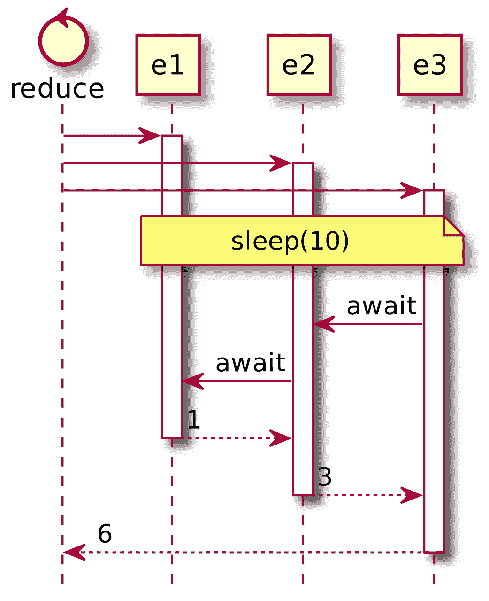

后置 "await memo" 的异步 reduce

#### 前置 await memo

但当 `await memo` 放在前面时，函数会顺序执行：

```javascript
const arr = [1, 2, 3];

const startTime = new Date().getTime();

const asyncRes = await arr.reduce(async (memo, e) => {
  await memo;
  await sleep(10);
  return (await memo) + e;
}, 0);

console.log(`耗时 ${new Date().getTime() - startTime} 毫秒`);
// 耗时 36-38 毫秒
```

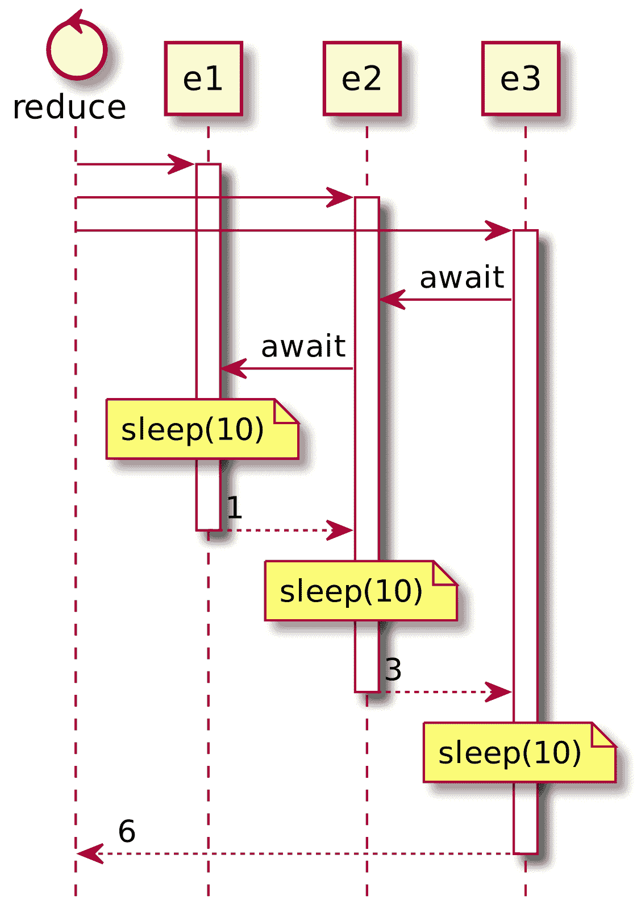

前置 "await memo" 的异步 reduce

这种行为通常不是问题，因为它自然意味着所有不依赖前一个结果的部分会立即计算，只有依赖的部分才会等待前一个值。

#### 当并行性很重要

但在某些情况下，提前做事情可能是行的。例如，我有一段代码打印不同的 PDF 并使用 `pdf-lib` 库将它们合并成文件。以下实现资源密集型的 `printPDF`：

```javascript
const result = await printingPages.reduce(async (memo, page) => {
  const pdf = await PDFDocument.load(await printPDF(page));
  const pdfDoc = await memo;
  (await pdfDoc.copyPages(pdf, pageIndices));
}, PDFDocument.create());
```

我注意到，当需要打印很多页面时，它会消耗内存。一个简单的改动让 `printPDF`等待前一个：

```javascript
const result = await printingPages.reduce(async (memo, page) => {
  const pdfDoc = await memo;
  const pdf = await PDFDocument.load(await printPDF(page));
  (await pdfDoc.copyPages(pdf, pageIndices));
  return pdfDoc;
}, PDFDocument.create());
```

## 异步 map 函数

`map` 是最简单、常用的集合函数。它通过迭代函数处理元素，返回一个数组。

同步版本为每个元素加一：

```javascript
const arr = [1, 2, 3];

const syncRes = arr.map((i) => {
  return i + 1;
});

console.log(syncRes);
// 2,3,4
```

异步版本需要做件事：首先它将每个元素映射为一个新值的 `Promise`，其次它需要等待所有 `Promise`，将结果收集到一个数组。幸运的是，内置的 `Promise.all` 正是第二步需要的。使得异步 `map` 的通用模式为 `Promise.all(arr.map(async (...)))`。与同步版本相同的实现：

```javascript
const arr = [1, 2, 3];

const asyncRes = await Promise.all(arr.map(async (i) => {
  await sleep(10);
  return i + 1;
}));

console.log(asyncRes);
// 2,3,4
```


### 并发

上述实现会并行地对数组中的元素运行迭代函数。这通常没问题，但在某些情况下可能会消耗过多资源。例如，当异步函数调用 API 或消耗 RAM 时，同时运行太多可能不可行。虽然编写异步 `map` 很容易，但添加并发控制更复杂。在接下来的例子中，我们将探讨不同的解决方案。

#### 批量处理

最简单的方法是将元素分组，然后逐个处理这些组。你可以控制同时运行的最大并行数。但由于一组必须在前一组完成后开始，每组中最慢的元素会成为限制因素。


分组映射

使用了 Underscore.js 中的 `groupBy` 实现。许多库都提供了该实现，并且大多可以互换。Lodash 是个例外，因为它的 `groupBy` 不传递元素的索引。如果你熟悉 `groupBy`，它通过迭代函数处理每个元素，返回一个对象，其中键是结果，值是由该结果的元素组成的列表。要创建最多包含 `n` 个元素的分组，可以使用迭代函数 `Math.floor(i / n)`，其中 `i` 是元素的索引。例如，大小为 3 的分组会将元素映射如下：

```
0 => 0
1 => 0
2 => 0
3 => 1
4 => 1
5 => 1
6 => 2
...
```

在 JavaScript 中：

```javascript
const arr = [30, 10, 20, 20, 15, 20, 10];

console.log(
  _.groupBy(arr, (_v, i) => Math.floor(i / 3))
);
// {
//     0: [30, 10, 20],
//     1: [20, 15, 20],
//     2: [10]
// }
```

最后一组可能比其他组小，但所有组都保证不超过最大分组大小。要映射一个组，通常使用 `Promise.all(group.map(...))` 结构即可。要顺序映射这些组，我们需要一个 `reduce` 来将前一个结果（`memo`）与当前组的结果拼接起来：

```javascript
return Object.values(groups)
  .reduce(async (memo, group) => [
    ...(await memo),
    ...(await Promise.all(group.map(iteratee)))
  ], []);
```

这个实现基于事实：`await memo` 会等待前一个结果，然后继续执行行。实现批处理的完整代码：

```javascript
const arr = [30, 10, 20, 20, 15, 20, 10];

const mapInGroups = (arr, iteratee, groupSize) => {
  const groups = _.groupBy(arr, (_v, i) => Math.floor(i / groupSize));

  return Object.values(groups)
    .reduce(async (memo, group) => [
      ...(await memo),
      ...(await Promise.all(group.map(iteratee)))
    ], []);
};

const res = await mapInGroups(arr, async (v) => {
  console.log(`S ${v}`);
  await sleep(v);
  console.log(`F ${v}`);
  return v + 1;
}, 3);

// 第一批
// 开始 30
// 开始 10
// 开始 20
// 完成 10
// 完成 20
// 完成 30
// 第二批
// 开始 20
// 开始 15
// 完成 15
// 完成 20
// 完成 20
// 第三批
// 开始 10
// 完成 10

console.log(res);
// 31,11,21,21,16,21
```

#### 并行处理

另一种并发控制是同时运行 `n` 个任务，并在一个完成后立即启动新任务。


受控并发

我无法为此出一个简单的实现，幸运的是，Bluebird 库直接提供了。这使得它非常简单：只需导入库并使用支持 `concurrency` 选项的 `Promise.map` 函数即可。在下面的示例中，`concurrency` 被限制为 `2`，这意味着会立即启动 2 个任务，然后每当一个任务完成，就会启动一个新任务，直到所有都完成：

```javascript
const arr = [30, 10, 20, 20, 15, 20, 10];

// Bluebird promise
const res = await Promise.map(arr, async (v) => {
  console.log(`S ${v}`);
  await sleep(v);
  console.log(`F ${v}`);
  return v + 1;
}, {concurrency: 2});

// S 30
// S 10
// F 10
// S 20
// S 20
// F 20
// S 15
// F 15
// S 20
// F 20
// F 20

console.log(res);
// 31,11,21,21,16,21
```

#### 顺序处理

有时任何并发都太多了，元素应该一个接一个地处理。


一个简单的实现是使用 Bluebird 的 `Promise` 并将 `concurrency` 设为 `1`。对于这种情况，不需要引入一个库，因为简单的 `reduce` 就能完成工作：

```javascript
const arr = [1, 2, 3];

const res = await arr.reduce(async (memo, v) => {
  const results = await memo;
  console.log(`S ${v}`);
  await sleep(10);
  console.log(`F ${v}`);
  return [...results, v + 1];
}, []);

// S 1
// F 1
// S 2
// F 2
// S 3
// F 3

console.log(res);
// 2,3,4
```

确保在 `await` 其他任何东西之前先 `await` 累加器（`memo`），否则它仍然会并发运行！

## 使用 `forEach` 的异步函数

`forEach` 函数与 `map` 类似，但它不是转换值并使用结果，而是对每个元素运行函数并丢弃结果。实际上，重要的是调用函数的副作用。

例如，同步地将每个元素打印到控制台：

```javascript
const arr = [1, 2, 3];

arr.forEach((i) => {
  console.log(i);
});

// 1
// 2
// 3

console.log("Finished sync");
// Finished sync
```

由于结果不重要，使用异步函数作为迭代器也可以工作：

```javascript
const arr = [1, 2, 3];

arr.forEach(async (i) => {
  // each element takes a different amount of time to complete
  await sleep(10 - i);
  console.log(i);
});

console.log("Finished async");
// Finished async

// 3
// 2
// 1
```


### 时序

#### 等待完成

但毫不意外的是，该函数是异步调用的，程序执行会跳过该调用。与同步版本的一个区别是，当执行下一行时，同步的 `forEach` 已经完成，而异步版本没有。这就是为什么 "Finished async" 日志出现在元素之前。

要在继续之前等待所有函数完成，请使用带有 `Promise.all` 的 `map` 并丢弃结果：

```javascript
const arr = [1, 2, 3];

await Promise.all(arr.map(async (i) => {
  await sleep(10 - i);
  console.log(i);
}));

// 3
// 2
// 1

console.log("Finished async");
// Finished async
```


### 等待结果

通过此更改，"Finished async" 出现在最后。

但请注意，迭代器函数是并行调用的。为了忠实地遵循同步的 `forEach`，请使用带有 `await memo` 的 `reduce`：

```javascript
const arr = [1, 2, 3];

await arr.reduce(async (memo, i) => {
  await memo;
  await sleep(10 - i);
  console.log(i);
}, undefined);

// 1
// 2
// 3

console.log("Finished async");
// Finished async
```


```

```markdown
这样，元素按顺序一个接一个地处理，程序执行会等待整个数组完成后再继续。

## 使用 `filter` 的异步函数

`filter` 函数只保留满足条件的元素。它接收一个函数，这次称为`谓词`，该函数返回 `true`/`false`（更准确地说，是真值和假值）值。结果集合只包含谓词返回 `true` 的元素。

```
const arr = [1, 2, 3, 4, 5];

const syncRes = arr.filter((i) => {
  return i % 2 === 0;
});

console.log(syncRes);
// 2,4
```

### 使用 `map` 的异步 filter

这次异步版本稍微复杂一些，它分两个阶段工作。第一阶段通过谓词函数异步映射数组，生成 `true`/`false` 值。然后第二步是同步的 `filter`，它使用第一步的结果。

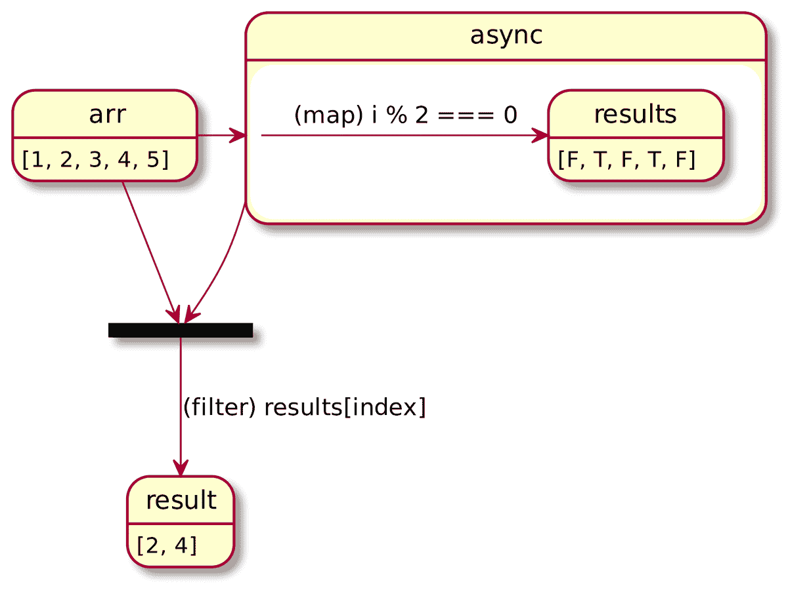

异步 filter

```
const arr = [1, 2, 3, 4, 5];

const asyncFilter = async (arr, predicate) => {
  const results = await Promise.all(arr.map(predicate));

  return arr.filter((_v, index) => results[index]);
}

const asyncRes = await asyncFilter(arr, async (i) => {
  await sleep(10);
  return i % 2 === 0;
});

console.log(asyncRes);
// 2,4
```

或者一行实现：

```
const asyncFilter = async (arr, predicate) =>
  Promise.all(arr.map(predicate))
  .then((results) => arr.filter((_v, index) => results[index]));
```

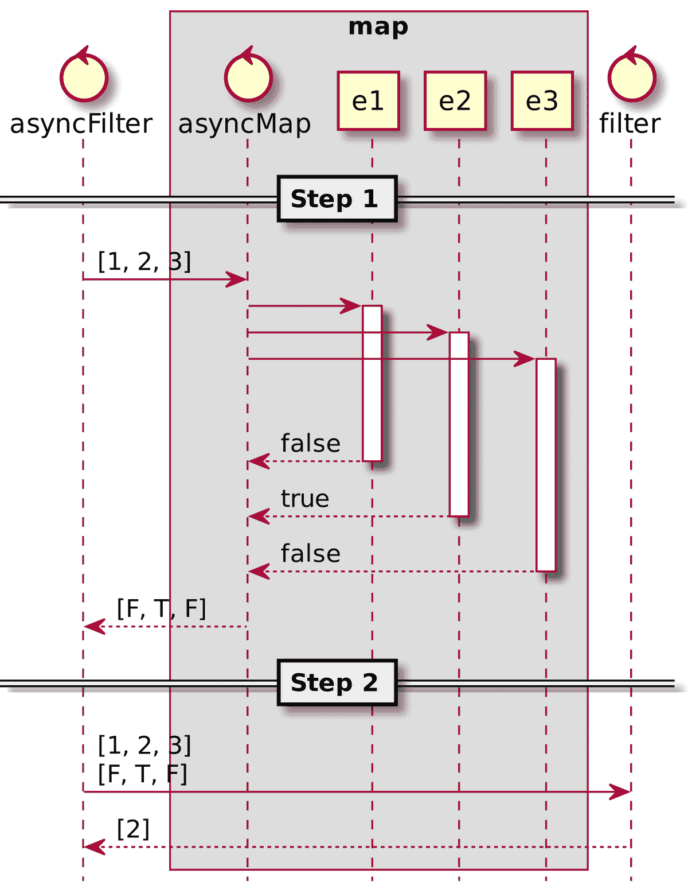

使用 map 的异步 filter

#### 并发

上述实现并发运行所有谓词函数。这通常没问题，但与其他所有函数一样，它可能会过度消耗某些资源。幸运的是，由于上述实现依赖于 `map`，可以使用相同的并发控制。

### 使用 `reduce` 的异步 filter

除了使用异步 `map` 加同步 `filter`，也可以使用异步 `reduce` 来完成工作。由于只有一个函数，结构更简单，尽管它不提供相同级别的控制。

首先，从一个空数组（`[]`）开始。然后通过谓词函数运行下一个元素，如果通过，则将其追加到数组中。如果不通过，则跳过它。

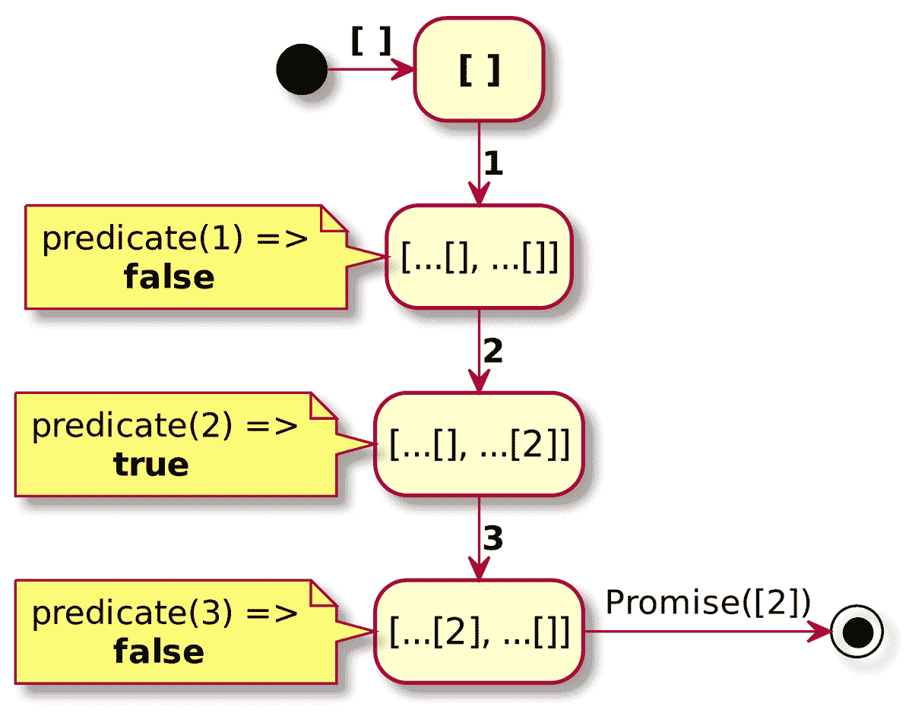

使用 reduce 的异步 filter

```
// concurrently
const asyncFilter = async (arr, predicate) => 
  arr.reduce(async (memo, e) =>
    await predicate(e) ? [...await memo, e] : memo
  , []);
```

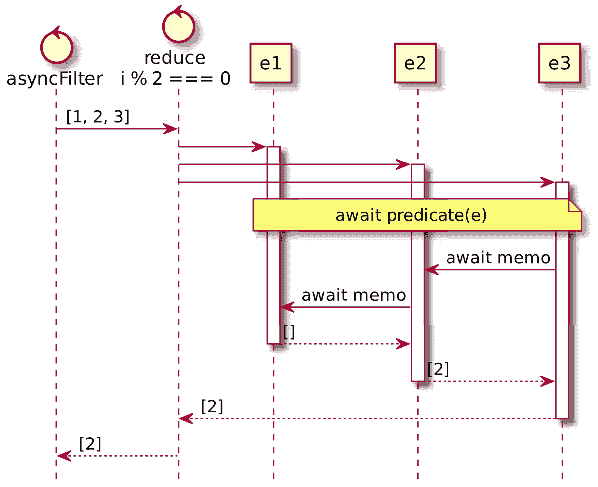

使用 reduce 的异步 filter

注意，`await predicate(e)` 出现在 `await memo` `之前`，意味着它们将并行调用。

#### 顺序处理

要等待一个谓词函数完成后再调用下一个，请更改 `await` 的顺序：

```
// sequentially
const asyncFilter = async (arr, predicate) => 
  arr.reduce(async (memo, e) => 
    [...await memo, ...await predicate(e) ? [e] : []]
  , []);
```

此实现等待前一个元素，然后根据谓词的结果有条件地追加一个元素（`...[e]` 或 `...[]`）。

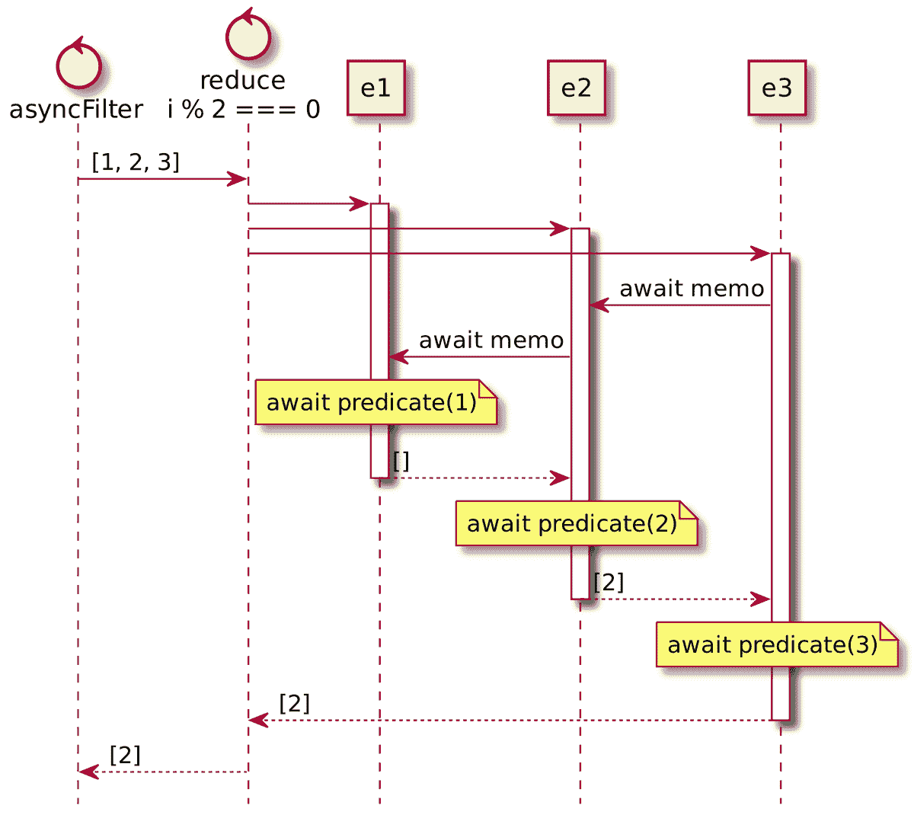

顺序运行的 reduce 异步 filter

## 使用 `some`/`every` 的异步函数

这些函数接收一个迭代器函数，就像 `filter` 一样，但它们返回单个 `true`/`false`，取决于谓词是否返回特定值。对于 `some`，如果`任何`谓词返回 `true`，结果将为 `true`。对于 `every` 函数，如果任何返回 `false`，结果将为 `false`。

```
const arr = [1, 2, 3];

const someRes = arr.some((i) => {
  return i % 2 === 0;
});

console.log(someRes);
// true

const everyRes = arr.every((i) => {
  return i < 2;
});

console.log(everyRes);
// false
```

### 使用异步 `filter`

仅考虑结果，这些函数可以用异步 `filter` 来模拟，而如何转换为异步已在之前的文章中介绍过。

```
// sync
const some = (arr, predicate) =>
  arr.filter(predicate).length > 0;
const every = (arr, predicate) =>
  arr.filter(predicate).length === arr.length;

// async
const asyncSome = async (arr, predicate) =>
  (await asyncFilter(arr, predicate)).length > 0;
const asyncEvery = async (arr, predicate) =>
  (await asyncFilter(arr, predicate)).length === arr.length;
```

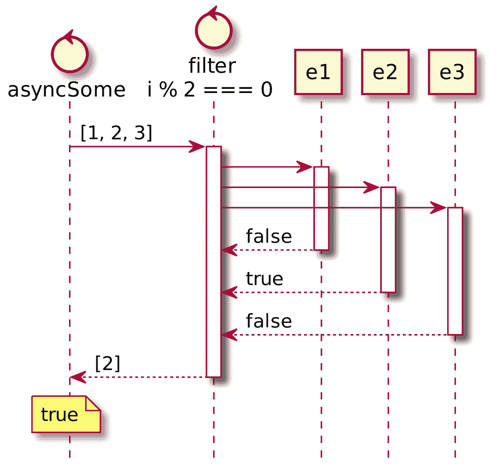

基于过滤器的异步 `some`

#### 短路

但内置的 `some`/`every` 函数与基于 `filter` 的实现之间存在一个重要区别。当某个元素对 `some` 返回 `true` 时，它会`短路`，不再处理剩余元素：

```
const arr = [1, 2, 3];

const res = arr.some((i) => {
  console.log(`检查 ${i}`);
  return i % 2 === 0;
});

// 检查 1
// 检查 2
console.log(res);
// true
```


同步 `some`

类似地，`every` 在遇到第一个 `false` 结果后停止：

```
const arr = [1, 2, 3];

const res = arr.every((i) => {
  console.log(`检查 ${i}`);
  return i < 2;
});

// 检查 1
// 检查 2
console.log(res);
// false
```

#### 异步 `some`

让我们看看如何编写一个类似方式工作，工作版本：

```
const arr = [1, 2, 3];

const asyncSome = async (arr, predicate) => {
  for (const item of arr) {
    if (await predicate(item)) {
      return true;
    }
  }
  return false;
};

const res = await asyncSome(arr, async (i) => {
  console.log(`检查 ${i}`);
  await sleep(10);
  return i % 2 === 0;
});

// 检查 1
// 检查 2
console.log(res);
// true
```

#### 异步 `every`

对于第一个元素，如果 `predicate(e)` 返回 `false`，循环就会结束：

```
const arr = [1, 2, 3];

const asyncEvery = async (arr, predicate) => {
  for (const item of arr) {
    if (!(await predicate(item))) {
      return false;
    }
  }
  return true;
};

const res = await asyncEvery(arr, async (i) => {
  console.log(`检查 ${i}`);
  await sleep(10);
  return i < 2;
});

// 检查 1
// 检查 2
console.log(res);
// false
```

基于 循环的异步 `every`

对于第一个元素，如果 `predicate(e)` 返回 `true`，循环就会结束：

```
const asyncSome = async (arr, predicate) => {
  for (const item of arr) {
    if (await predicate(item)) {
      return true;
    }
  }
  return false;
};
};

const asyncEvery = async (arr, predicate) => {
  for (const item of arr) {
    if (!(await predicate(item))) {
      return false;
    }
  }
  return true;
};
```

### 并行处理

短路实现会顺序处理元素，这在资源方面是高效的，但可能导致执行更长。例如，如果迭代器通过网络发送，逐个发送可能需要时间。另一方面，同时发送所有请求，速度会更快。

## 常见错误

### 未传播错误

当你将回调转换为 `Promise` 时，确保也处理错误。否则，`Promise` 永远不会，`await` 会永远等待。

```
await new Promise((res, rej) => {
  // 错误处理
  rej("错误");
}).catch(e => {
  console.log(e.message);
});
```

如果你没有将 `rej` 回调附加到 `onerror` 处理，错误不会在链中传播。这会导致难以调试和“突然停止”。

### 在 `try..catch` 中缺少 `await`

当你在异步函数中使用 `try..catch` 或 `try..finally` 时，确保使用了 `await`。例如，当内部 `Promise` 成功，以下代码可以正常工作：

```
const fn = async () => {
  return "result";
}

const outer = async () => {
  try {
    return fn(); // 缺少 await!
  } catch (e) {
    console.log(e.message);
  }
};

await outer(); // result
```

但 `try..catch` 无法处理异常：

```
const fn = async () => {
  throw new Error("error");
}

const outer = async () => {
  try {
    return fn(); // 缺少 await!
  } catch (e) {
    console.log(e.message);
  }
};

await outer(); // 抛出异常！
```

这是因为异常是从 `await` 抛出的，虽然从异步函数返回 `Promise` 会扁化结果，但返回时不会等待。如果不等待，异常就不会被 `try..catch` 捕获，而是在调用者使用 `await` 时抛出。

```
const fn = async () => {
  throw new Error("error");
}

const outer = async () => {
  try {
    return await fn();
  } catch (e) {
    console.log(e.message); // error
  }
};

await outer(); // 此处无异常
```

### 未检查返回值

当 `Promise` 被 `resolve` 时，并不意味着一切正常。例如，`fetch` 在连接出现问题时拒绝，但即使响应状态返回错误，它也会 `resolve`。

当调用无法建立连接时，`Promise` 拒绝：

```
try {
  await fetch("http://example.com");
} catch (e) {
  console.log(e.message); // Failed to fetch
}
```

但当响应状态码指示错误（500）时，`Promise` 仍然 `resolve`：

```
try {
  await fetch("https://httpbin.org/status/500");

  // 无错误
} catch (e) {
  console.log(e.message);
}
```

因此，你需要检查结果中的错误响应。`fetch` 结果提供了 `ok` 字段来实现这一点：

```
const response = await fetch("https://httpbin.org/status/500");

if (!response.ok) {
  throw new Error("错误响应");
}
```

### 拒绝时未关闭资源

通常我们会打开某个资源，然后在不需要时关闭它。例如，以下代码创建了一个临时目录，稍后删除它：

```
const fs = require("fs").promises;
const os = require("os");
const path = require("path");

const dir = await fs.mkdtemp(
  await fs.realpath(os.tmpdir())
);
// ... 使用 dir ...
await fs.rmdir(dir);
```

如果执行过程中出现异常，`rmdir` 将不会执行。

```
try {
  const dir = await fs.mkdtemp(
    await fs.realpath(os.tmpdir())
  );
  // ... 使用 dir ...
  await fs.rmdir(dir);
} catch (e) {
  console.log(e.message);
}
```

### 未等待异步 `forEach`

`forEach` 函数遍历一个集合并调用迭代器函数。一个典型的问题是它不会等待迭代完成：
```

```markdown
[1, 2, 3].forEach(async (e) => {
  console.log(e);
  return makePromise(e);
});
console.log("finished");
// finished
// 1
// 2
// 3
```

最佳实践是等待整个集合处理完毕，这可以通过 `Promise.all` 和 `map` 实现：

```
await Promise.all([1, 2, 3].map(async (e) => {
  console.log(e);
  return makePromsie(e);
}));
console.log("finished");
// 1
// 2
// 3
// finished
```

## 更多信息

本主题在 `Async functions with forEach` 章节中有更详细的介绍。

# 术语表

### 异步函数

返回一个 `Promise` 的函数。`await` 关键字只能在异步函数中使用。

```
const wait = (ms) => new Promise((res) => setTimeout(res, ms));

const fn = async () => {
  await wait(100);
  return "result";
}

fn(); // Promise
```

### 异步生成器函数

可以使用 `await` 的生成器函数。当遇到 `yield` 或 `yield*` 时，执行会暂停，直到请求下一个元素。

```
const wait = (ms) => new Promise((res) => setTimeout(res, ms));

const gen = async function*() {
  console.log("start");
  await wait(100);
  yield 1;
  await wait(100);
  console.log("next");
  yield 2;
  await wait(100);
  console.log("end");
};

const it = gen();
console.log(await it.next());
console.log(await it.next());
console.log(await it.next());

// start
// { value: 1, done: false }
// next
// { value: 2, done: false }
// end
// { value: undefined, done: true }
```

参见 生成器函数。

### await 关键字

可在异步函数中使用，它会暂停执行，直到参数 `Promise` 变为已兑现。然后返回该值或抛出异常。参见 异步函数。

### 回调

作为参数传递的函数，调用时传入返回值。它允许异步结果，因为回调可以在稍后被调用。

例如，`setTimeout` 函数需要一个回调，在时间到达时调用它：

```
setTimeout(() => {
  // 1 秒后
}, 1000);
```

参见 延续传递风格。

### 集合处理

一系列对元素集合（通常是数组）进行操作的函数，例如转换（`map`）、过滤（`filter`）和归约为值（`reduce`）。

### 延续传递风格

一种编程结构，使用回调函数（延续）来处理函数结果，而不是直接返回结果。这允许异步结果，因为这些回调可以在稍后被调用。

```
// 直接风格
const directFn = () => {
  return "result";
};

// CPS
const cpsFn = (callback) => {
  callback("result");
};
```

参见 回调。

### 错误传播

当出现错误时，它会向上层上下文传递，直到有代码能够处理它。

例如，未处理的异常会被抛给调用者：

```
const fn = () => {
  // 错误在此处抛出
  throw new Error("error");
}

try {
  fn();
}catch(e) {
  // 在此处处理
}
```

对于 `Promise`，错误会传播到下一个处理程序：

```
getUser() // 返回一个 Promise
  .then(() => {
    // 错误在此处抛出
    throw new Error("error");
  })
  .catch((e) => {
    // 在此处处理
  });
```

### 错误优先回调

一种回调风格，其中第一个参数是错误对象。接收方需要检查该值是否为非 null（或非 undefined）。

```
const fn = (callback) => {
  try {
    const result = "result";
    // error 为 null
    callback(null, result);
  }catch(e) {
    // 发出错误信号
    callback(e);
  }
}

fn((err, result) => {
  if (err) {
    // 处理错误
  }else {
    // 处理结果
  }
});
```

参见 Node 风格回调。

### 已兑现的 Promise

`Promise` 的一种状态，表示已解决或已拒绝。参见 Promise 状态。

### 生成器函数

返回可迭代结构的函数。它可以通过 `yield` 语句冻结，只有在请求更多元素时才会恢复。

```
const gen = function*() {
  console.log("start");
  yield 1;
  console.log("next");
  yield 2;
  console.log("end");
}

const it = gen();
console.log(it.next());
console.log(it.next());
console.log(it.next());

// start
// { value: 1, done: false }
// next
// { value: 2, done: false }
// end
// { value: undefined, done: true }
```

### Node 风格回调

一种回调风格，其中：

* 回调函数是最后一个参数
* 调用时先传入错误对象，再传入结果（`(error, result)`）
* 只返回一个结果

```
const getUser = (id, cb) => {
  const user = /* 获取用户 */;
  if (user) {
    // 成功
    cb(null, user);
  }else {
    // 错误
    cb(new Error("Failed to get user"));
  }
};
```

### 分页

当某个方法（通常是 API）不返回请求的所有结果，需要多次调用才能获取所有项目时使用。

### 待定的 Promise

`Promise` 的一种状态，表示异步结果尚不可用。参见 Promise 状态。

### postMessage

一种跨上下文通信的 API，例如与 IFrame 和 Web Worker 通信。它是一种基于事件的通信方式，一端监听 `message` 事件，另一端使用 `postMessage` 函数发送消息。

### Promise

一个持有异步结果的值。你可以使用 `then` 回调来处理 `Promise` 变为已兑现的情况，或者在异步函数中使用 `await`。

### Promise 链

一系列 `then()` 回调，每个回调获取前一个 `Promise`。

```
getUser() // 返回一个 Promise
  .then(() => {
    // 错误在此处抛出
    throw new Error("error");
  })
  .catch((e) => {
    // 在此处处理
  });
```
