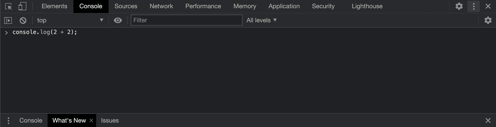
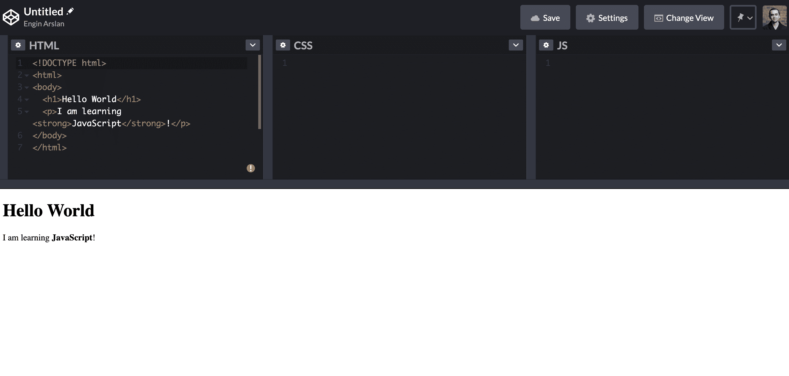
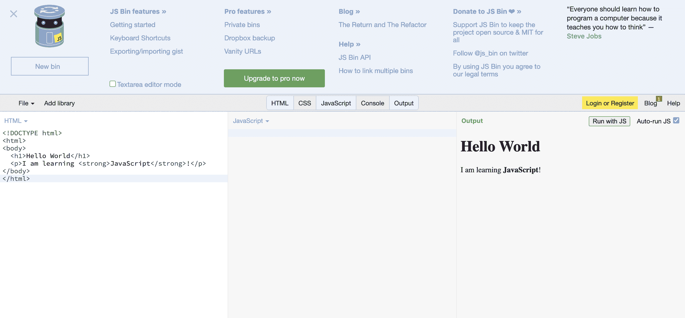
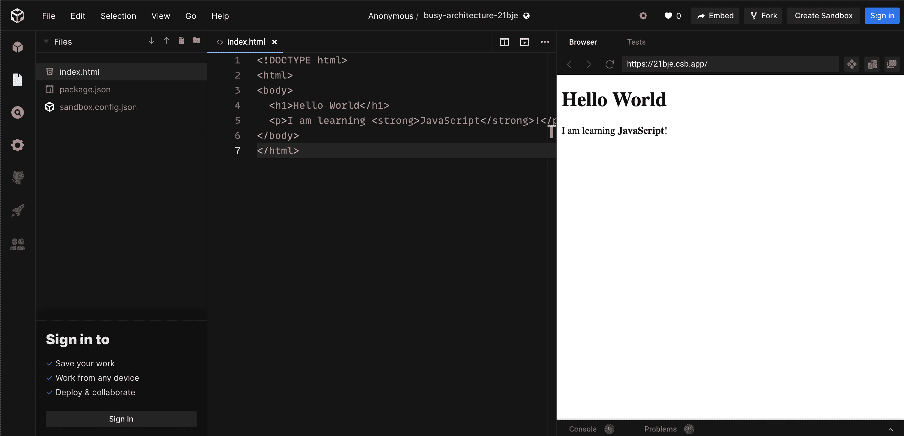
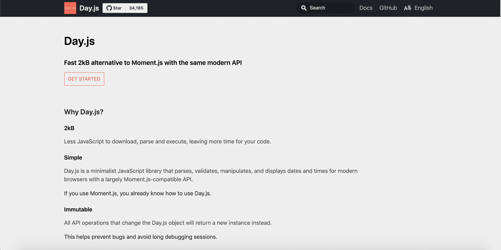
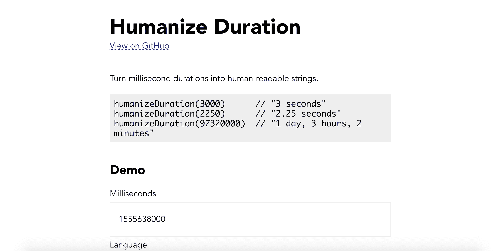
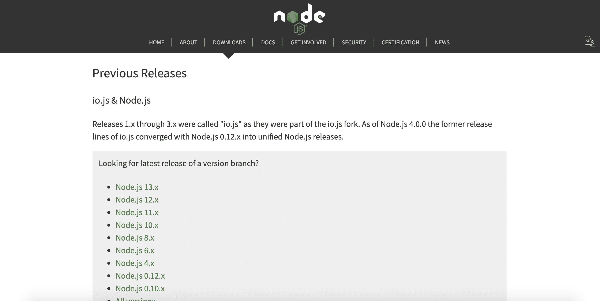
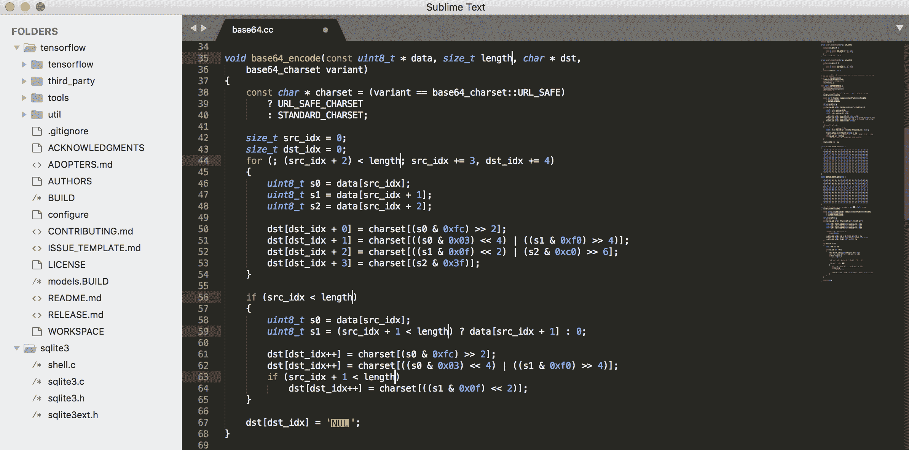

# Awesome Coding：JavaScript和Node.js构建酷东西指南

## 1 前言

我多次转行，最终成为一名软件开发者。我在大学学习材料工程，曾在一家初创公司从事游戏 3D 建模工作，后来成为视觉特效师。学习编程并进入软件开发领域是我做过的最好的决定之一。它彻底改变了我的生活，让一切变得更好。

作为一名软件开发者，我现在从事的领域既有经济回报，又能激发智力，而且可以在世界任何地方工作。能够编写代码也让人感到无比强大。我知道自己拥有构建一个全球数十亿人使用的应用程序的技能。在这个数字经济时代，编程是一种超能力。我相信它也在成为一种必需品。许多产品和服务正在数字化，对程序员的需求比以往任何时候都大。

我并没有学习过计算机科学，在转行之前，我的工作也不需要我学习编程。对我来说，学习编程并非显而易见的选择。当时我是一名电影和电视剧的视觉特效师。我们使用 **Maya** 或 **Houdini** 等 **3D** 应用程序来创建数字场景。这些应用程序处理了过程中的所有复杂性。理论上，这让我们能够专注于工作中更具创造性的方面。但实际上，我们的日常工作包含大量重复且耗时的任务。幸运的是，这些 3D 应用程序提供了**应用程序编程接口**，我们可以使用一种名为 **Python** 的编程语言直接控制应用程序，而无需依赖用户界面。我开始尝试编写简短的代码片段来自动化一些小操作。随着时间的推移，我的程序复杂度不断增加。我不仅能够自动化与软件的交互，还能创建出公司其他艺术家使用的解决方案。编程让我的部门能够扩展操作规模，并以更高效的方式交付日益复杂的图形。我编写的程序最终被用于《**维京传奇**》、《**血族**》、《**寂静岭 2**》和《**庞贝末日**》等电视剧和电影。

我开始比喜欢本职工作更喜欢编程，于是决定全职从事编程。当时我只懂 Python，但 Python 软件开发的初级就业市场似乎并不理想。我决定学习 **JavaScript** 并进入**网页开发**领域。我花了超过一年的时间，在没有指导的情况下，利用晚上和周末尝试学习网页开发。我不知道什么重要、什么不重要，也不知道应该如何投入时间。那是一段极其令人沮丧的经历。

我写这本书是为了让你在学习编程时不会遇到我当初的那些困难。通过这本书，我将以初学者友好的方式教你使用 **JavaScript** 和 **Node.js** 进行编程的基础知识。

### 为什么要学习 JavaScript？

世界上有很多编程语言。你可能想知道为什么要学习 JavaScript。首先，JavaScript 是使用最广泛的编程语言之一，因为它内置于每个网页浏览器中。你访问的几乎所有网页和网络应用都在某种程度上使用了 JavaScript。

随着 2009 年 **Node.js** 的推出，JavaScript 的流行度进一步增长。Node.js 是一个**编程环境**，用于在浏览器之外运行 JavaScript。以前 JavaScript 的使用仅限于网页浏览器。有了 Node.js，JavaScript 开始出现在从网络服务器到桌面应用开发、可穿戴设备到机器人等各个领域。这使得 JavaScript 成为世界上最重要、最灵活的编程语言之一。

由于其流行度，JavaScript 背后有一个庞大而活跃的社区。这意味着该语言正在经历大量的创新和发展。这也意味着，如果你遇到问题，有很多人愿意帮助你。所有这些因素使得 JavaScript 成为一门值得学习的优秀编程语言。

### 你将从本书中学到什么

本书将从零开始教你 JavaScript 的基础知识。在打好 JavaScript 基础后，你将学习 Node.js。在整个过程中，你将处理实用且有趣的示例，涉及数据分析、图像处理、网页抓取、命令行应用、自然语言处理以及获取新闻、股票和加密货币数据的网络 API。在学习了本书介绍的技能、工具和技术之后，你还将能够使用 JavaScript 和 Node.js 构建自己酷炫有趣的项目！

### 代码示例

本书中的代码示例可在 [GitHub 仓库](https://github.com/hibernationTheory/awesome-coding) 中找到。你可以下载并在自己的计算机上运行它们。

## I JavaScript 基础

## 2 设置开发环境

要开始用 **JavaScript** 编程，我们需要一个能够运行我们编写的 JavaScript 代码的**环境**。我们可以使用不同类型的环境来执行 JavaScript 代码。在本章中，我们将探讨其中一些选项。

### 在开发者控制台中运行 JavaScript

JavaScript 是用于构建网络应用的编程语言。因此，每个浏览器都能够运行 JavaScript 代码。我们甚至可以在浏览器内部编写 JavaScript 代码！如果我们启动 **Chrome** 浏览器，然后选择 `View > Developer > JavaScript console`，就可以启动 **JavaScript 控制台**。这个界面允许我们一次编写一行 JavaScript 代码，并通过按 **回车** 键来执行它。我们可以尝试在控制台中输入 `console.log(2 + 2);` 并按 **回车** 键。我们会看到计算结果被显示出来。这是一个不错的功能，但对我们来说并不是非常有用，因为控制台一次只允许执行一行代码。



所有其他主流浏览器（如 **Safari**、**Firefox**）也有类似的开发者控制台，可以运行 JavaScript 代码。

### 在 HTML 文件中运行 JavaScript

**HTML** 是一种描述文档结构的正式语言。我们可以使用 HTML 来描述网页的内容。我们也可以使用 HTML 文件来加载 JavaScript 文件。

```
1 <h1>Hello World</h1>
2 <p>I am learning <strong>JavaScript</strong>!</p>
```

js-basics-01-setting-up/01.html

这里我们有一个用 HTML 语言编写的代码片段。HTML 语言由用于描述文档**元素**的**标签**组成。这里有一个 `h1` 标签，代表文档中的**主标题**。然后有一个 `p` 标签，描述一个**段落**。在 `p` 标签内部，有一个 `strong` 标签，表示它所包裹的内容是**重要的**。这些标签帮助网页浏览器理解我们提供的文档。


HTML 代码写在 HTML 文件中。HTML 文件也可以加载 JavaScript 文件，供浏览器执行。

我们先创建一个 HTML 文件，让网页浏览器加载它。

```
1 <!DOCTYPE html>
2 <html>
3   <body>
4     <h1>Hello World</h1>
5     <p>I am learning <strong>JavaScript</strong>!</p>
6   </body>
7 </html>
```

`js-basics-01-setting-up/02.html`

我们在这个 HTML 代码中添加了更多标签，使其成为一个有效的 HTML 文档。现在，我们可以将这个文件拖入网页浏览器，或者在地址栏中输入完整的文件路径。浏览器会打开并渲染这个文件。


我们也可以使用这个 HTML 文件来加载 JavaScript 代码。让我们在与这个 HTML 代码相同的目录下创建一个新文件，命名为 `main.js`。我们可以在 `main.js` 文件中添加以下两行代码。

```
1 console.log("Hello World");
2 console.log(2 + 2);
```

`js-basics-01-setting-up/main.js`

然后，我们需要更新 HTML 文件来加载这个 JavaScript 文件。

```
1 <!DOCTYPE html>
2 <html>
3   <body>
4     <h1>Hello World</h1>
5     <p>I am learning <strong>JavaScript</strong>!</p>
6     <script src="main.js"></script>
7   </body>
8 </html>
```

`js-basics-01-setting-up/03.html`

我们添加了一个名为 `script` 的新标签。我们可以使用 `script` 标签来链接一个外部的 JavaScript 文件。它有一个 **属性** 叫 `src`，可以用来指定要加载的文件路径。在这个例子中，我们需要确保 JavaScript 文件与 HTML 文件位于同一目录下。

在浏览器中加载这个文件后，让我们打开 JavaScript 控制台。我们会看到 JavaScript 代码的结果显示在控制台中。这是在我们的计算机上运行 JavaScript 代码的一种相当可靠的方式。

### 在线运行 JavaScript

由于任何浏览器都可以运行 JavaScript 和 HTML，许多在线编辑器可以非常轻松且实用地完成这项工作。

我使用并喜欢的一些服务有 [codepen.io](http://codepen.io)、[jsbin.com](http://jsbin.com) 和 [codesandbox.io](http://codesandbox.io)。还有很多其他服务，但这三个是我最常用的。我们可以使用它们中的任何一个在浏览器中编写 HTML 和 JS 代码，而无需在计算机上创建任何文件。它们是学习编码和原型设计想法的绝佳环境。

#### Codepen



我非常喜欢 **Codepen**，主要是因为它的社区特性。它拥有大量用户提交的内容，向你展示使用 JavaScript、HTML 和 CSS 可以做的所有精彩事情。它既是一个出色的工具，也是一个资源库。如果你访问他们的在线代码编辑器，会有几个区域可以用来编写 HTML、JavaScript 和 CSS。还有一个白色屏幕会渲染你的 HTML。还有一个名为 **Console** 的标签页，你可以点击它来查看执行的 JavaScript 代码的结果。

#### Jsbin



我经常使用 **Jsbin**，因为它上手非常简单。你只需访问网址，就会立即看到一个代码编辑器。为了快速原型化我的 JavaScript 想法，我会在菜单中选择 **JavaScript**、**Console** 和 **Output** 标签页。**JavaScript** 是你用来编写 JavaScript 代码的区域。**Console** 会实时显示你的代码输出。你可以使用 **Clear** 按钮来清除在编写代码时可能累积的错误。

#### Codesandbox



**Codesandbox** 拥有出色的功能，如果你想原型化一个相对复杂的想法，它是一个非常棒的工具。它具有非常高级的功能，使其作为在线编辑器功能极其强大。

### 总结

我们可以通过几种方式开始编写 JavaScript。它们是：

*   直接在浏览器中编写。
*   在 `.js` 文件中编写，然后通过 **HTML** 文件加载该文件。
*   使用在线编辑器。

在所有选项中，第一种方式的可扩展性不强，因为它一次只允许编写一行代码。我们可以改为在本地编写 JavaScript 文件，并通过 HTML 文件在浏览器中加载它们。然后，我们可以使用浏览器中的 **JavaScript 控制台** 来查看从 JavaScript 文件中显示的代码。

我们学到的最后一个选项是 **在线编辑器**。在线编辑器非常方便，因为我们不需要在计算机上管理任何文件。我们只需访问一个网页，就可以开始使用了。它们是学习和实验的绝佳环境。

在阅读本书的过程中，你可以使用本地 JavaScript 文件，也可以使用在线编辑器。两者都适用于我们的目的。

## 3 基本数据类型和变量

如果我们输入一个像 `42` 这样的数字，并在 JavaScript 环境中执行该代码，我们会看到它运行无误。这是一个好兆头。这意味着我们编写了 JavaScript 语言能够理解的内容。我们在这里输入的值是 `number` 类型。JavaScript 能理解几种不同的 **类型** 的值。其中一些是：

*   **numbers**
*   **strings**
*   以及 **boolean** 值

在本节中，我们将学习 **numbers** 和 **strings**。

### 数字

正如我们之前所见，一个只包含数字的 JavaScript 代码可以毫无错误地运行。这是因为数字是 JavaScript 中的一种 **原生数据类型**。JavaScript 中还有其他原生数据类型，例如 **strings** 和 **booleans**。我们很快就会学习它们。

除非我们使用某种会改变程序流程的结构，否则 JavaScript 程序会从上到下执行。这意味着我们可以在不同的行上不断添加不同的数字，JavaScript 在执行这段代码时不会报错。

```
1 42;
2 1;
3 2;
4 3;
```

我们可以在 JavaScript 中编写一些不会让它报错（或崩溃）的内容，这很好，但这并不令人印象深刻。让我们做一些更有用的事情，比如在屏幕上显示我们放在这个文件中的内容。

有一种称为 **函数** 的编程结构，它将一系列操作打包在一起以实现可重用性。我们稍后会详细了解函数是什么。现在，只需知道有一个名为 `console.log` 的函数，我们可以用它来在屏幕上显示值。它的工作方式如下：

```
1 console.log(42);
```

我们写出函数的名称，并在括号内提供一个值。当函数运行时，它会将该值显示在屏幕上。这段特定的代码会在屏幕上显示数字 `42`。

```
1 console.log(1);
2 console.log(2);
3 console.log(3);
```

这个程序会在屏幕上分别显示数字 `1`、`2`、`3`，每行一个。

我们也可以在 JavaScript 中编写小数。例如：

```
1 console.log(3.14);
```

这些数字有时被称为 **浮点数**。

#### 运算符

我们可以使用数学运算符对数字进行计算。以下是一些我们可以使用的运算符：

*   `+`
*   `-`
*   `/`
*   `*`

使用这些运算符，我们可以在数字之间执行数学运算。

```
1 console.log(10 + 20 - 5);
```

上述操作会在屏幕上显示 `25`。

试着猜猜以下操作的结果是什么：

```
1 console.log(10 - 2 * 2);
```

如果你猜的是 `16`，那你犯了一个常见的错误。数学运算符有不同的 **优先级**。乘法和除法发生在加法和减法之前。这就是为什么结果实际上是 `6`。我们首先计算 `2` 乘以 `2`，然后从 `10` 中减去该结果。

我们可以通过使用 **括号** (`()`) 来强制指定运算顺序。括号内的运算会先于其他运算执行。

```
1 console.log((10 - 2) * 2);
```


这将得到 `16`，因为我们使用括号强制 `10-2` 在乘法之前执行。

接下来，让我们看看下一个数据类型：**字符串**。

### 字符串

如果我们在 JavaScript 控制台中写入一段文本并尝试执行该代码，很可能会得到一个错误。

```
1 hello;
```

如果我们想在 JavaScript 中表示文本数据，需要将其定义为 `string`。`string` 是定义在**引号**之间的任何内容。我们可以使用单引号（`'`）或双引号（`"`）来定义字符串。唯一的限制是，我们需要用与开头相同的引号类型来结束字符串。

```
1 "hello";
2 "42";
```

**一致性**在编程中至关重要。即使你做的事情是错误的，如果你一直以一致的方式犯错，修复起来也会更容易。这并不是说选择一种引号比另一种更错误，但无论你选择哪种，在整个代码库中都应该保持一致。

如果我们的文本中也包含单引号，那么使用单引号可能会遇到问题。如果我们不希望那个引号被解释为文本的结束，可以在它前面使用反斜杠字符（`\`）。

```
1 'don\'t stop moving';
```

反斜杠允许我们**转义**引号的常规解释。

我们也可以对字符串使用加法数学运算符。我们可以在字符串和其他数据类型之间执行加法操作。

```
1 console.log("hello" + " " + "world");
```

这将在屏幕上显示 `"hello world"`。注意，中间有一个空字符串。空格字符仍然算作一个字符串，并提供了两个单词之间所需的间距。

我们还可以将数字和字符串相加。

```
1 console.log("hello" + 2);
```

JavaScript 会将数字转换为字符串，在这种情况下结果为 `hello2`。如果我们尝试在字符串和数字之间执行其他操作（如乘法），会得到 `NaN` 结果，这意味着**不是一个数字**。我们很少希望这个值出现在程序中。`NaN` 在数学运算中会将其他值转换为 `NaN`，导致错误结果在程序中累积。

### 变量

我们希望计算机程序具备的最基本功能之一，就是将操作结果存储在其**内存**中。这通过一种称为**变量**的编程结构得以实现。

变量是一个指向计算机内存中某个值的名称。我们使用变量声明关键字（如 `var`、`let`、`const`，稍后会详细介绍）来声明一个变量名，并**赋值**给该变量。示例如下：

```
1 const bigNumber = 999999;
```

此后，变量名就是对其所赋值的引用。`=` 符号将右侧的**值**赋给左侧的**变量**名。因此，以下操作将显示赋给该变量的数字。

```
1 console.log(bigNumber);
```

变量非常有用且必不可少，因为它们允许我们在后续阶段引用程序中的值。示例如下：

```
 1 const piNumber = 3.14159;
 2 const radius = 5;
 3 
 4 const areaOfCircle = radius * piNumber * piNumber;
 5 const diameterOfCircle = 2 * radius;
 6 const circumferenceOfCircle = 2 * piNumber * radius;
 7 
 8 console.log(areaOfCircle);
 9 console.log(diameterOfCircle);
10 console.log(circumferenceOfCircle);
```

`js-basics-02-basic-data-types/01.js`

首先，很抱歉给你举了一个大量使用数学和几何的例子。老实说，日常编程实践与数学的关系可能非常小。认为要成为优秀的程序员就必须擅长数学，这并不正确。话虽如此，当我们对编程的大部分了解都与数字使用有关时，数学相关的例子还是很有用的。

道过歉后，我们可以在本例中看到变量的使用如何帮助我们构建程序。由于我们将**圆周率**和**半径**的值保存在变量中，只需使用它们的名称即可引用这些值。以下是同一个程序如果不使用变量会是什么样子。

```
1 const areaOfCircle = 5 * 3.14159 * 3.14159;
2 const diameterOfCircle = 2 * 5;
3 const circumferenceOfCircle = 2 * 3.14159 * 5;
4 
5 console.log(areaOfCircle);
6 console.log(diameterOfCircle);
7 console.log(circumferenceOfCircle);
```

`js-basics-02-basic-data-types/02.js`

这个程序看起来更短，但存在几个问题。

*   代码不**DRY**
*   使用了**魔法数字**
*   没有**单一真相来源**

让我们看看这些问题分别意味着什么。

#### 代码不 DRY

**DRY** 在软件工程中代表 **Don’t Repeat Yourself**（不要重复自己），是编程中的一个重要原则。它意味着我们不应该反复做同样的事情。这里我们在程序中反复输入圆周率和半径的值。如果需要更改半径的值，就必须在多个地方进行修改。这种重复使我们容易犯错。每次输入圆周率时，都有可能出错并输错。遵循 **DRY** 原则并使用变量来存储这些值，可以最大限度地降低此类问题的风险。

#### 使用魔法数字

你认为上面例子中的数字 `5` 代表什么？如果你熟悉几何，也许能猜到它是圆的半径值，但这仍然需要动脑筋。这就是我们在编程中有时所说的**魔法数字**。它能产生结果，但完全不清楚它是什么或如何做到的。

据说程序被阅读的次数多于被编写的次数。我们应该确保创建易读的程序，便于阅读且不隐藏讨厌的 bug。为程序中使用的值赋予有意义的变量名，可以确保程序易于阅读和理解。

#### 没有单一真相来源

在上面的程序中，圆的半径值分散在整个代码中。该值没有**单一来源**。如果我们想更改该值，需要在多个地方进行修改。该值的**真相**或知识被**编码**在多个地方。这可能会造成歧义。想象一下，如果程序中有一个错误，某一行有不同的值，我们如何知道哪个值是正确的？仅通过查看程序无法确定。为该值设置单一来源，可以让我们确信定义的值是正确的。

我们正处于编程之旅的起点，但这些都是基本的软件工程基础。像变量这样简单的结构就能让我们缓解上述问题，并编写出可读且可维护的程序。

#### 选择变量名

关于如何选择变量名，有一些规则和约定。以下是我们必须遵守的一些规则：

*   变量名不能以数字开头，例如 `1myVariable`。
*   变量名不能包含空格，例如 `my variable`。
*   变量名不能包含连字符（`-`），例如 `my-variable`。
*   变量名不能使用**保留字**，例如 `const`。

在所有规则中，最后一条可能看起来最难遵守。JavaScript 中的保留字是语言中的**关键字**。例如，`var` 或 `const` 是保留的，因为它们是用于定义变量的 JavaScript 关键字。


当我们刚开始学习编程时，如何知道哪些变量名是保留的？这是随着你对语言的学习逐渐熟悉的事情。如果违反这条规则，程序将无法编译，并报错 `"SyntaxError: Unexpected token"`。

以下是一些选择变量名的约定。这些并非硬性规则，而是有用且稳健的建议。

**使用驼峰命名法或下划线**

当变量名由多个单词组成时，使用**驼峰命名法**或**下划线**（`_`）来提高可读性。

*   以下是驼峰命名法的变量名示例：`myVariable`。注意第一个单词的首字母小写，后续单词的首字母大写。

*   以下是使用下划线的示例：`my_variable`。这种情况下，所有单词均为小写，但用下划线分隔。

选择哪种方法取决于我们正在处理的代码库的约定。在 JavaScript 中，驼峰命名法通常是约定俗成的，但也可能存在例外。

**选择有意义的名称**

我们应该使用有意义的变量名来命名变量。想象以下场景：

```
1 const n = 3.14;
2 const r = 5;
3 
4 const a = r * n * n;
5 console.log(a);
```

这是一个计算半径为 `5` 的圆面积的程序。仅通过变量名来理解代码，祝你好运。在编写程序时，我们应该选择有意义且明确的变量名。注意，当我们更清晰地命名所有内容时，这些代码行读起来会好得多。

```
1 const piNumber = 3.14159;
2 const radius = 5;
3 
4 const areaOfCircle = radius * piNumber * piNumber;
5 
6 console.log(areaOfCircle);
```

注意，即使是 `r` 也不是一个足够好的变量名。我们需要足够明确，使我们的程序对他人（以及未来的自己！）可读。

**不要以大写字母开头**

我们不应该以大写字母或所谓的标题大小写开头变量名。不要这样做：

```
1 const PiNumber = 3.14;
```

我们可能会看到首字母大写的名称。这保留给一些特殊用途，我们将在后面学习。在此之前，不要使用标题大小写的变量名。

#### 声明变量

到目前为止，我们一直使用 `const` 关键字来声明变量。

```
1 const myVariable = 42;
```

在很长一段时间里，JavaScript 只有 `var` 关键字用于声明变量。后来，引入了另外两个变量声明关键字 `let` 和 `const`。以下是它们之间的区别。

#### var 关键字

当我们使用 `var` 关键字声明变量名时，该变量名的值可以被重新赋值。如下所示：

```
1 var myVariable = 42;
2 myVariable = 7;
```

这被证明是有问题的，因为它使得在程序生命周期中跟踪变量的值变得困难。这就是为什么我们现在有了 `const` 关键字来声明变量。

#### const 关键字

```
1 const myVariable = 42;
```

当我们使用 `const` 关键字声明变量时，不能为该变量重新分配不同的值。这确保了值在程序生命周期内保持一致。这是一个限制，但正是这种限制让我们的程序员生活更轻松。95% 的情况下，我使用 `const` 关键字来声明变量。但有时我们需要重新分配变量的值，这时 `let` 关键字就派上用场了。

#### let 关键字

`let` 关键字与 `var` 关键字非常相似，它允许为使用 `let` 关键字声明的变量分配新值。

```
1 let myVariable = 42;
2 myVariable = 7;
```

使用 `var` 关键字还存在一些不同的问题，以我们目前的知识水平可能无法完全理解。这主要涉及变量的**作用域**，即变量可以从哪里访问。`let` 关键字也为我们处理了这些作用域问题。因此，随着 `let` 关键字的引入，我已经完全停止使用 `var` 关键字。`const` 和 `let` 将是我们未来唯一使用的两个关键字。了解 `var` 关键字的存在仍然很重要，但在现代代码库中我们可能会看到它使用得越来越少。

在结束本节之前，我们再来看两件事。

### 分号

在 JavaScript 中，我们可以使用分号（`;`）字符来表示语句的结束。这个符号的使用不是强制性的，但在某些边缘情况下有助于**JavaScript 解释器**。即使我们与一个要求代码中使用分号的团队合作，如今这类格式问题通常由**代码编辑器**处理和自动化。因此，分号的使用并不是我们需要过多担心的事情，因为在使用配置正确的代码编辑器时，它可以自动为我们处理。这是值得了解的事情之一。

接下来，我会尽量在代码示例中使用分号，因为我比较老派。

### 注释

有时我们可能不希望程序中编写的某些内容被执行。例如，我们可能想在代码中留下注释，解释为什么以某种方式编写某段代码。这对于以后阅读代码的人（甚至包括我们自己）可能很有用。

这就是注释的用处。它允许我们在程序中编写不会被 JavaScript 执行的内容。

每当我们在某行之前使用 `//` 运算符时，JavaScript 会跳过执行该行。

```
1 // 这是一个注释
2 // 这些行不会被 JavaScript 执行
```

### 总结

我们刚刚开始编程之旅，但本章已经学到了很多。我们了解了 JavaScript 中的一些**数据类型**，例如**数字**和**字符串**。我们还学习了**数学运算符**以及这些运算符的**优先级**。然后，我们介绍了**变量**。我们研究了变量命名的规则和约定。此外，我们还学习了用于声明变量的 `let`、`const` 和 `var` **关键字**。学习 `var` 关键字对我们来说很重要，但未来我们主要会使用 `const` 和 `let`。

本章还介绍了在行末使用**分号**。它们在 JavaScript 中不是强制性的，但最好有。

我们还学习了**注释**。注释是程序中不被执行的部分，通常用于说明目的。

最后，我们介绍了三个基本的编程原则：**DRY** 的重要性、拥有**单一数据源**以及避免**魔法数字**。这些是软件开发中非常基础的原则，牢记它们非常有用。

## 4 函数

在上一节中，我们学习了 `console.log` 函数。**函数**是一种编程结构，它将不同的操作组合在一起，以实现可重用性、便利性等目的。

在本节中，我们将进一步学习函数。我们还将学习如何定义自己的函数。函数是非常强大的编程结构，使得构建复杂程序成为可能。

JavaScript 以及我们使用 JavaScript 的环境（例如**Web 浏览器**）有许多内置函数可供使用。`console.log` 就是这样一个函数的例子。

由于我们稍后会学习的原因，这个函数名中包含一个 `.` 字符。

要使用函数，我们需要**调用**它（也称为**执行**函数）。如果我们只输入函数名并执行该代码，什么也不会发生。

```
1 console.log;
```


调用函数时，我们需要在其旁边加上括号。

```
1 console.log();
```

执行这个函数时，仍然没有任何反应。这是因为 `console.log` 函数需要我们向其传递一个**输入**（或多个输入）才能正常工作。函数的输入被称为**参数**。我们在括号内为函数提供参数。让我们用一个参数来调用 `console.log` 函数。

```
1 console.log("hello");
```

我们已经知道 `console.log` 函数的作用。它会将给定的输入显示在屏幕上。一个函数可以接受一个或多个参数，具体取决于其工作方式。函数的多个参数之间用逗号（`,`）分隔。我们也可以向 `console.log` 函数传递多个输入。它会将每个输入显示在单独的一行上。

```
1 console.log("hello", "world");
```

让我们看看其他一些内置的 JavaScript 函数。

### parseFloat 函数

`parseFloat` 是一个内置的 JavaScript 函数。它接受一个输入，并尝试将其转换为浮点数（小数）。其工作方式如下。

```
1 parseFloat("3.14");
```

这个操作会将字符串 `3.14` 转换为数值 `3.14`。我们可以通过在运算中使用该值来确认这一点。

```
1 const piNumberAsString = "3.14";
2 
3 console.log(piNumberAsString + 10);
4 console.log(parseFloat(piNumberAsString) + 10);
```

`js-basics-03-functions/01.js`

第一个操作中，我们将圆周率作为字符串使用，结果会是 `3.1410`，因为当字符串和数字相加时，它们只是简单地拼接在一起，而不是进行数学运算。

但第二个操作中，我们将圆周率转换为浮点数，结果会是 `13.14`，因为现在这是两个数字之间的数学运算。

这个例子可能因为第二个操作中的**嵌套函数**（函数调用内部再调用函数）而难以阅读。

```
1 const piNumberAsString = "3.14";
2 
3 console.log(parseFloat(piNumberAsString) + 10);
```

`js-basics-03-functions/01_01.js`

为了让这个例子更易读，我们可以将 `parseFloat` 操作的结果保存到一个变量中，然后在另一个函数中使用该变量，而不是在函数内部调用 `parseFloat`。具体做法如下：

```
1 const piNumberAsString = "3.14";
2 const piNumber = parseFloat(piNumberAsString);
3 
4 console.log(piNumberAsString + 10);
5 console.log(piNumber + 10);
```

`js-basics-03-functions/02.js`

现在，这个函数会返回与之前相同的结果，但可读性更强。这是可行的，因为 `parseFloat` 函数会**返回**其操作的结果（关于**返回**的更多内容将在后面介绍）。

如果我们向 `parseFloat` 函数提供一个无法转换为浮点数的值，它会返回 `NaN`。

```
1 const result = parseFloat("hello");
2 console.log(result);
```

`js-basics-03-functions/02_01.js`

### parseInt 函数

`parseInt` 是一个内置的 JavaScript 函数，与 `parseFloat` 非常相似。它尝试将给定的值转换为**整数**（也称为**整型数**）。

如果我们向 `parseInt` 函数提供一个无法转换为整数的值，它会返回 `NaN`。

```
1 const piNumberAsString = "3.14";
2 
3 console.log(parseInt(piNumberAsString)); // 结果为 3
```

`js-basics-03-functions/02_02.js`

在这个例子中，`parseInt` 函数接受一个**浮点数**并将其转换为整数（本例中为 `3`）。

### 思考函数

我们现在知道了使用函数时需要考虑的三个最重要的事情。

*   给定函数的作用是什么。

*   它需要什么样的输入（以及需要多少个）？

*   它有什么样的输出？

有了这些问题的答案，我们在使用函数时会更加自信。

让我们为我们目前学过的函数回答这些问题。

#### console.log

*   **它的作用是什么？** 它将给定的输入显示在屏幕上。

*   **它需要什么样的输入？** 它可以接受一个或多个任意类型的输入。输入可以是数字或字符串，也可以是其他我们尚未学过的数据类型。

*   **它有什么样的输出？** 它没有输出。我们可以通过尝试将函数的输出捕获到一个变量中来验证这一点。

```
1 const result = console.log("hello world");
2 console.log(result);
```

我们会看到结果是 `undefined`。这意味着结果根本不存在。

#### parseFloat

*   **它的作用是什么？** 它尝试将给定的输入转换为浮点数。

*   **它需要什么样的输入？** 它接受一个输入。输入可以是数字或字符串。

*   **它有什么样的输出？** 如果给定的值成功转换，输出是一个浮点数。如果不能，该函数会返回 `NaN` 值。

#### parseInt

*   **它的作用是什么？** 它**尝试**将给定的输入转换为整数（整型数）。

*   **它需要什么样的输入？** 与 `parseFloat` 不同，`parseInt` 函数接受两个输入。第二个输入是可选的，出于学习目的我们可以忽略它。

*   **它有什么样的输出？** 如果给定的值成功转换，输出是一个整数。如果不能，该函数会返回 `NaN` 值。

我们可以将函数视为**黑盒**。它接受一个或多个输入，并可以产生一个输出。但我们不一定知道内部发生了什么。想象一下**ATM（自动取款机）**。ATM 可以接受你的银行卡和指令作为输入，对这些指令进行处理，然后输出现金和收据。你也不一定知道 ATM 内部发生了什么。

### 其他 JavaScript 函数

以下是一些非常有用的其他 JavaScript 函数。

#### Math.abs

*   **它的作用是什么？** 返回给定数字的**绝对值**。在数学中，一个数的绝对值是该数的**正值**。这意味着如果我们向这个函数传递一个负数，它会返回相同的数字，但前面没有负号。

*   **它需要什么样的输入？** 它接受一个参数，该参数是一个数字。

*   **它有什么样的输出？** 输出是给定类型的正数。如果提供了非数字输入，则返回 `NaN`。

```
1 const value = -42;
2 const absoluteValue = Math.abs(value);
3 console.log(absoluteValue); // 结果为 `42`
```

`js-basics-03-functions/02_03.js`

#### Math.random

*   **它的作用是什么？** 当被调用时，它返回一个介于 `0` 和 `1` 之间的**“随机”**（实际上是**伪随机**）数字。

*   **它需要什么样的输入？** 它不需要任何输入。

*   **它有什么样的输出？** 输出是一个介于 `0` 和 `1` 之间的浮点数。

```
1 const randomNumber = Math.random();
2 console.log(randomNumber);
```

### 定义函数

仅使用内置函数只能让我们走这么远。我们最终会希望定义自己的函数，以便编写更高级的程序。假设我们有一个操作，想要将其转换为一个函数，例如在屏幕上显示 `Hello World`。

```
1 console.log("Hello World");
```

我们想创建一个名为 `hello` 的函数，当调用它时，会执行这条语句。

```
1 hello();
```

具体做法如下。我们使用 `function` 关键字声明一个函数，并为函数起一个名字。在本例中，我们将函数命名为 `hello`。我们在名字后面加上括号，然后在括号后面加上花括号。

```
1 function hello() {}
```

现在，这是一个名为 `hello` 的函数定义。当被调用时，这个函数不会做任何事情，因为函数体（花括号之间的部分）目前是空的。


```
1 hello();
```

在函数定义的花括号内，我们应该定义希望该函数执行的操作。在本例中，就是将 `console.log` 语句放在其中。

```
1 function hello() {
2   console.log("Hello World");
3 }
```

现在，当调用该函数时，它会在屏幕上显示 `Hello World`。

```
1 hello();
```

### 带参数的函数

如果我们想创建一个接受用户输入的函数呢？例如，考虑一个名为 `greet` 的函数，它会根据给定的输入显示一条定制化的问候消息。运行下面的函数：

```
1 greet("John");
```

会显示一条类似 `Welcome John` 的消息。

要实现这一点，我们需要定义一个带有参数的函数。

```
1 function greet(firstName) {}
```

这里我们定义了一个名为 `greet` 的函数，它接受一个参数，该参数保存在变量名 `firstName` 下。

这意味着当我们通过提供**输入**（也称为**实参**）来调用这个函数时，它会获取提供的输入并将其赋值给名为 `firstName` 的变量。用更技术性的语言来说，我们传递给函数的实参会映射到函数定义中的**形参**。

```
1 greet("John");
```

我们可以通过在函数内部使用该实参来验证这一点。让我们先使用一个 `console.log` 语句。

```
1 function greet(firstName) {
2   console.log(firstName);
3 }
```

现在，这个函数会将给定的输入显示到屏幕上，无论输入是什么。

```
1 greetings(42);
```

我们想通过这个 `greetings` 函数显示一条欢迎消息。可以这样做：

```
1 function greet(firstName) {
2   console.log("Welcome " + firstName);
3 }
```

现在，这个函数会为任何给定的名字显示一条定制化的欢迎消息。

```
1 greet("John");
2 greet("Jane");
3 greet("Humans");
```

在我们的示例中，参数的名字是 `firstName`。我们可以为这个参数选择任何名字，示例仍然可以正常工作。它是一个任意的名字。关于选择变量名的规则和约定同样适用于选择参数名和函数名。我们应该始终选择有意义的变量名。

此外，在命名函数时，尽量使用动词。函数通常描述一个动作，因此使用动词命名函数是合理的。

### 带多个参数的函数

我们也可以定义带有多个参数的函数。我们定义的每个参数应该用逗号（`,`）分隔。

```
1 function greet(firstName, lastName) {}
```

这里我们定义了一个名为 `greet` 的函数，它接受两个参数：`firstName` 和 `lastName`。

这样的函数可能看起来像这样：

```
1 function greet(firstName, lastName) {
2   console.log("Welcome " + firstName + " " + lastName);
3 }
```

现在这个函数同时使用了这两个参数。我们可以向这个函数传递两个实参，用逗号分隔。

```
1 greet("John", "Doe");
2 greet("Jane", "Doe");
```

我们可以定义接受任意数量实参的函数。

### 返回值的函数

让我们创建一个函数，根据折扣金额计算产品的最终价格。

如果产品价格是 100 美元，折扣为 20%，那么最终价格将是 80 美元。我们的函数应该为我们完成这个计算。

```
1 getFinalPrice(100, 20);
```

下面是该函数的定义。

```
1 function getFinalPrice(initialPrice, discount) {
2   const finalPrice = initialPrice - (initialPrice * discount) / 100;
3   console.log(finalPrice);
4 }
5 
6 getFinalPrice(100, 20);
7 getFinalPrice(50, 20);
8 getFinalPrice(200, 60);
```

`js-basics-03-functions/03.js`

让我们尝试使用这个函数来计算一个 100 美元产品的最终价格，该产品先打 20% 折扣，然后在已折扣价格基础上再打 30% 折扣。我们可能会想这样做：

```
1 function getFinalPrice(initialPrice, discount) {
2   const finalPrice = initialPrice - (initialPrice * discount) / 100;
3   console.log(finalPrice);
4 }
5 
6 const priceAfterFirstDiscount = getFinalPrice(100, 20);
7 const finalPrice = getFinalPrice(priceAfterFirstDiscount, 30);
```

`js-basics-03-functions/04.js`

这段代码无法正常工作。`getFinalPrice` 函数在计算产品的折扣价格方面做得很好，但它只是将结果价格显示出来。它没有从函数中返回计算出的值。这就是为什么在此操作之后 `priceAfterFirstDiscount` 变量的值是 `undefined`：

```
1 const priceAfterFirstDiscount = getFinalPrice(100, 20);
```

我们需要确保这个函数将计算结果从函数内部返回到外部上下文，即我们调用函数并将结果赋值给变量的地方。我们可以通过使用 `return` 关键字来实现这一点。

```
1 function getFinalPrice(initialPrice, discount) {
2   const finalPrice = initialPrice - (initialPrice * discount) / 100;
3 
4   return finalPrice;
5 }
6 
7 const priceAfterFirstDiscount = getFinalPrice(100, 20);
8 const finalPrice = getFinalPrice(priceAfterFirstDiscount, 30);
9 console.log(finalPrice);
```

`js-basics-03-functions/05.js`

我们已经从函数内部移除了 `console.log` 语句。现在我们使用 `return` 关键字将 `finalPrice` 从函数内部返回到外部上下文。

`return` 是一个只能在函数内部使用的关键字。它将紧随其后的值从函数返回到调用该函数的上下文中。

使用 `return` 关键字，我们现在可以创建一个函数，执行一些计算并返回该值以供进一步处理。

我们现在对函数有了相当多的了解。让我们通过构建两个有用的函数来继续学习。

### 一个现实世界的函数示例

我们可以根据圆的**半径**计算关于圆的一系列值。

圆的**直径**是**半径的两倍**。

圆的**周长**使用公式 `2 * π * r` 计算，其中 `π` 是圆周率（`3.14`），`r` 是圆的半径。

圆的**面积**使用公式 `π * r * r` 计算，其中 `π` 是圆周率（`3.14`），`r` 是圆的半径。

让我们创建一个函数，针对给定的半径值计算这三个值，并将它们显示在屏幕上。

```
 1 function getCircleData(radius) {
 2   const piNumber = 3.14;
 3 
 4   const diameter = radius * 2;
 5   const circumference = diameter * piNumber;
 6   const area = piNumber * radius * radius;
 7 
 8   console.log("For the circle of radius: " + radius);
 9   console.log("Diameter is: " + diameter);
10   console.log("Circumference: " + circumference);
11   console.log("Area is: " + area);
12 }
```

`js-basics-03-functions/06.js`

注意，这个函数没有使用 `return` 关键字。它只是将结果显示在屏幕上。如果我们想从函数中返回这些结果呢？如果我们尝试这样做，可能会发现 `return` 关键字只允许我们从函数中返回一个值。

JavaScript 中有一些**数据结构**可以用来存储多个值，然后从函数中返回那个单一的数据结构。我们将在后面学习这些内容。

通常，更好的做法是创建一次只做一件事的函数。因此，如果这个程序像下面这样编写会更好：


```
 1 function getDiameter(radius) {
 2   return radius * 2;
 3 }
 4 
 5 function getCircumference(radius) {
 6   const piNumber = 3.14;
 7   const diameter = getDiameter(radius);
 8 
 9   return diameter * piNumber;
10 }
11 
12 function getArea(radius) {
13   const piNumber = 3.14;
14 
15   return piNumber * radius * radius;
16 }
17 
18 function getCircleData(radius) {
19   const diameter = getDiameter(radius);
20   const circumference = getCircumference(radius);
21   const area = getArea(radius);
22 
23   console.log("For the circle of radius: " + radius);
24   console.log("Diameter is: " + diameter);
25   console.log("Circumference: " + circumference);
26   console.log("Area is: " + area);
27 
28   return diameter, circumference, area;
29 }
30 
31 const result = getCircleData(5);
32 console.log(result);
```

`js-basics-03-functions/07.js`

在这个例子中，我们的代码变得冗长了一些，但我们现在创建了一个更健壮的程序。它包含了一组**单一用途的函数**。拥有单一用途的函数可以让我们更容易理解程序中发生的事情。如果某个功能不正常，我们只需检查负责该计算的函数中发生了什么。

单一用途函数的另一个好处是，我们现在拥有更基础的构建块，以后可以以不同的方式利用它们。例如，我们现在有一个只负责计算圆面积的函数。它可能比一个既计算面积又做其他事情的函数在不同上下文中更具可用性。

我们可以对这个函数进行的一个潜在改进是为`piNumber`创建一个共享变量。在这个例子中，`getCircumference`和`getArea`函数都定义了自己的`piNumber`。这不仅浪费，而且违反了**单一数据源**原则。圆周率不会从一个函数变到另一个函数，所以我们不应该在每个使用它的函数内部定义它。更好的做法是创建一个可以在每个函数内部复用的变量。

```
 1 const piNumber = 3.14;
 2 
 3 function getDiameter(radius) {
 4   return radius * 2;
 5 }
 6 
 7 function getCircumference(radius) {
 8   const diameter = getDiameter(radius);
 9 
10   return diameter * piNumber;
11 }
12 
13 function getArea(radius) {
14   return piNumber * radius * radius;
15 }
16 
17 function getCircleData(radius) {
18   const diameter = getDiameter(radius);
19   const circumference = getCircumference(radius);
20   const area = getArea(radius);
21 
22   console.log("For the circle of radius: " + radius);
23   console.log("Diameter is: " + diameter);
24   console.log("Circumference: " + circumference);
25   console.log("Area is: " + area);
26 
27   return diameter, circumference, area;
28 }
29 
30 const result = getCircleData(5);
31 console.log(result);
```

`js-basics-03-functions/08.js`

现在，这好多了。这里还有一个值得学习的地方，那就是关于变量的**作用域**。

变量`piNumber`可以从`getArea`或`getCircumference`函数内部访问。任何在函数上下文外部声明的变量都可以从该上下文内部的函数中访问。但反过来不行。在函数内部定义的变量无法从该函数外部访问。例如，在`getCircumference`函数内部声明的变量`diameter`无法在该函数外部访问。尝试这样做会导致错误。

```
1 const piNumber = 3.14;
2 
3 function getCircumference(radius) {
4   const diameter = getDiameter(radius);
5 
6   return diameter * piNumber;
7 }
8 
9 console.log(diameter);
```

`js-basics-03-functions/09.js`

### 回调函数与匿名函数

**回调函数**只是一个描述性的名称，指被传入另一个函数的函数。接收回调函数的函数决定何时以及如何执行该函数。下面是一个回调函数的简单示例。

```
 1 function someOperation() {
 2   console.log("this is a function that represents some operation");
 3 }
 4 
 5 function logStartAndEndForOperation(callbackFunction) {
 6   console.log("start of operation");
 7   callbackFunction();
 8   console.log("end of operation");
 9 }
10 
11 logStartAndEndForOperation(someOperation);
```

`js-basics-03-functions/10.js`

在这个例子中，`someOperation`相对于`logStartAndEndForOperation`函数来说是一个回调函数，因为它作为参数传递给了该函数。`logStartAndEndForOperation`函数接受一个回调函数作为参数，并决定如何调用该函数。

JavaScript 中有一个名为`setTimeout`的函数。`setTimeout`接受一个回调函数和一个指定毫秒数的值。`setTimeout`在给定的毫秒数之后执行回调函数。它的工作方式如下。

```
1 function helloWorld() {
2   console.log("Hello World");
3 }
4 
5 const oneSecond = 1000; // 一秒等于 1000 毫秒
6 const threeSeconds = oneSecond * 3;
7 
8 setTimeout(helloWorld, threeSeconds);
```

`js-basics-03-functions/13.js`

在这个例子中，`helloWorld`是一个回调函数。它作为参数传入`setTimeout`，并在三秒后被`setTimeout`调用。

回调函数是 JavaScript 中一种常用的模式。我们将在后续章节中看到更多回调函数的用法。

#### 匿名函数

与回调函数密切相关的概念是**匿名函数**。匿名函数是在定义时不指定名称的函数。我们通常对程序中不会复用的函数这样做。这使我们不必为只使用一次的函数起名字。在上面的例子中，我们可以将`someOperation`函数定义为匿名函数。

```
1 function logStartAndEndForOperation(callbackFunction) {
2   console.log("start of operation");
3   callbackFunction();
4   console.log("end of operation");
5 }
6 
7 logStartAndEndForOperation(function () {
8   console.log("this is a function that represents some operation");
9 });
```

`js-basics-03-functions/11.js`

现在我们在`logStartAndEndForOperation`函数的括号内定义了一个函数。这个函数没有名称，因此它是一个匿名函数。由于无法引用它，我们将无法复用。使用匿名函数作为回调函数是 JavaScript 中的常见模式。

还有一个与回调函数和匿名函数密切相关的函数概念，那就是**箭头函数表达式**。

### 箭头函数表达式

**箭头函数表达式**是创建函数的一种简写方式。我们之前已经看到如何使用`function`关键字创建函数。

```
1 function myFunction() {}
```

箭头函数表达式允许我们在不使用`function`关键字的情况下创建函数。

```
1 const myFunction = () => {};
```

这是一个箭头函数。箭头函数没有名称，但我们可以将它们保存在变量中，从而为其赋予名称。当处理匿名函数时，它们尤其出色，因为与函数语句相比，它们写起来更简短。让我们用箭头函数重写上面的例子。

```
1 function logStartAndEndForOperation(callbackFunction) {
2   console.log("start of operation");
3   callbackFunction();
4   console.log("end of operation");
5 }
6 
7 logStartAndEndForOperation(() => {
8   console.log("this is a function that represents some operation");
9 });
```

`js-basics-03-functions/12.js`


使用箭头函数编写匿名函数稍微容易一些。箭头函数与普通函数有一些不同的特性，但这些差异目前对我们来说并不重要。我们可以简单地将它们视为更容易编写的函数表达式。

### 总结

在本章中，我们学习了函数。有些函数是 JavaScript 语言内置的（或 JavaScript 运行环境的一部分），例如 `parseFloat`、`parseInt`、`Math.random`、`Math.abs` 和 `console.log`。

在使用函数时，我们需要了解三个基本要点：它们的功能是什么、需要什么样的输入、以及输出是什么。

我们还学习了如何创建自己的函数。我们可以定义具有任意数量**参数**的函数。函数的参数定义在圆括号内，并用逗号分隔。我们可以通过提供**实参**来调用函数，这些**实参**会映射到我们定义的**形参**名称上。我们可以使用 `return` 关键字从函数中返回一个值。

构建具有**单一职责**的函数很重要，并且在命名函数时使用动词，因为它们表示动作。

最后，三个密切相关的函数概念是**回调函数**、**匿名函数**和**箭头函数表达式**。**回调函数**只是作为参数传递给另一个函数的函数的名称。`setTimeout` 是一个使用回调函数的 JavaScript 函数示例。

我们可以定义函数而不给它们命名。在这种情况下，它们被称为**匿名函数**。**箭头函数表达式**是一种更短的函数定义方式，适用于声明匿名函数。

函数是非常强大的编程结构，使得构建复杂的应用程序成为可能。我们将在后续内容中大量使用它们。

## 5 比较运算符与条件语句

### 布尔数据类型

到目前为止，我们已经学习了两种数据类型：**数字**和**字符串**。在本节中，我们将学习一种名为**布尔值**的新数据类型。

布尔值是 `true` 或 `false` 值。以下是一个布尔值的示例。

```
1 const x = true;
```

这里，变量 `x` 的值为 `true`，其类型为 `boolean`。

布尔值是通过使用**比较运算符**生成的。

### 比较运算符

**比较运算符**是允许我们比较两个值并生成布尔值作为结果的运算符。以下是比较运算符的列表：

*   `>` 大于

*   `<` 小于

*   `===` 等于

*   `>=` 大于或等于

*   `<=` 小于或等于

*   `!==` 不等于

以下是这些布尔运算符的一些用法示例：

```
1 console.log(10 > 3);
2 console.log(-10 < 0);
3 console.log("John" === "John");
4 console.log(10 >= 10);
5 console.log(10 <= 10);
6 console.log(42 !== 7);
```

`js-basics-04-flow-control/01.js`

所有这些操作的结果都是 `true`。

还有一个 `!` 运算符，它可以反转布尔结果的值。

```
1 const myVariable = true;
2 console.log(!myVariable); // false
```

在上面的示例中，`!myVariable` 相当于 `false`。这是因为在布尔值前面使用 `!` 会反转该布尔值的值。

关于使用比较运算符，有几个复杂性需要注意。

#### 相等运算符与严格相等运算符

JavaScript 中有两种相等运算符。**相等运算符**（`==` 或 `!=`）和**严格相等运算符**（`===` 或 `!==`）。我们几乎总是使用严格相等运算符。

**相等运算符**可能会产生误导，因为它不检查我们比较的值的类型。使用相等运算符时，这两个完全不同的值看起来是相同的：

```
1 console.log(10 == "10"); // true
```

这极具误导性。数值 `10` 和字符串值 `"10"` 完全不同。如果我们使用严格相等运算符，就不会得到这个结果。

```
1 console.log(10 === "10"); // false
```

你应该像躲避瘟疫一样避免使用相等运算符，并始终使用严格相等运算符。我不记得上次使用相等运算符是什么时候了。如果我们想检查一个数字是否与字符串的值匹配，还有其他方法可以实现，比如将该数字转换为字符串，或者将字符串转换为数字（通过使用我们学过的 `parseInt` 函数）。

#### 比较小数

在下面的示例中，你可能期望 `x` 和 `y` 相等。但它们并不相等。

```
1 const x = 0.1 + 0.2;
2 const y = 0.3;
3 const z = x === y;
4 console.log(z); // false
```

计算机使用**二进制数**系统来表示我们提供给它们的值。基本上，所有内容都表示为 `0` 或 `1`。这导致计算机存储**小数**数运算结果时会出现一些精度损失。这会导致上述问题，即 `0.1 + 0.2` 不等于 `0.3`。这是处理小数时需要注意的一个非常常见的问题。有几种解决此问题的方法。一种是检查两个数是否在某个阈值范围内相等。假设对于上面的示例，我们的误差容限阈值为 `0.01`，这意味着数字之间可以略有差异，但不能超过 `0.01`。以下是我们如何在代码中表示这个想法。

```
1 const threshold = 0.01;
2 
3 const x = 0.1 + 0.2;
4 const y = 0.3;
5 const z = Math.abs(x - y) < threshold;
6 console.log(z);
```

`Math.abs` 是一个将给定输入转换为绝对值的函数（即将给定的数值转换为正值）。在上面的示例中，我们说如果两个值之间的差值小于我们选择的阈值，那么我们就认为这两个值相等。如果它们的差值大于阈值，则它们不相等。

另一种处理小数比较的方法是将它们转换为字符串然后进行比较。我们还没有学习如何将值转换为字符串，所以这里不探讨这个选项。

### 逻辑运算符

**逻辑运算符**允许我们使用多个布尔值构建**复合语句**。

想象一下，我告诉你，如果你照顾好你的健康**并且**你的财务，你会快乐。这意味着你需要同时照顾好你的健康**和**财务才能快乐。如果你没有做到其中任何一项，那就不行。这就是 JavaScript 中**与**（`&&`）运算符背后的逻辑。如果操作的两边都为 `true`，则返回 `true`。

```
 1 let isTrue = true && true;
 2 console.log(isTrue); // true
 3 
 4 isTrue = 10 === 10 && 10 !== 11;
 5 console.log(isTrue); // true
 6 
 7 let isFalse = true && false;
 8 console.log(isFalse); // false
 9 
10 isFalse = false && true;
11 console.log(isFalse); // false
12 
13 isFalse = false && false;
14 console.log(isFalse); // false
```

`js-basics-04-flow-control/02.js`

从上面的示例可以看出，AND 运算符的两边都必须为 `true`，结果操作才为 `true`。

现在想象一下，我告诉你，如果你改善饮食**或者**开始多锻炼，你会更健康。这意味着你只需要做其中一件事就能看到健康状况的改善。这就是 JavaScript 中**或**（`||`）运算符的工作方式。只要比较的值中有一个为 `true`，它就返回 `true`。

```
1 let isTrue = true || false;
2 console.log(isTrue); // true
3 
4 isTrue = false || true;
5 console.log(isTrue); // true
6 
7 let isFalse = false || false;
8 console.log(isFalse); // false
```

`js-basics-04-flow-control/03.js`


### 条件语句

布尔值本身可能看起来没什么用，但当它们与`条件语句`结合使用时，就非常强大了。条件语句仅在给定条件为`true`时执行，如果条件求值为`false`，则跳过该语句。这与我们之前学到的内容有很大不同。之前，我们编写的程序都是从上到下线性执行的。而使用条件语句，我们可以改变程序的流程，根据条件跳过或执行特定部分。

`if`语句就是条件语句的一个例子。它的工作原理如下：

```
1 const myVariable = true;
2 
3 if (myVariable) {
4   console.log("只有当 `myVariable` 为 `true` 时才会显示这条信息");
5 }
```

`js-basics-04-flow-control/04.js`

`if`语句由`if`关键字、紧随其后写在括号内的条件，以及写在花括号内的主体语句组成。如果括号内的条件求值为`true`，则执行花括号内的语句；否则不执行。尝试将`myVariable`的值改为`false`，看看会发生什么。

我们可以在`if`语句后面追加一个`else`语句。

```
1 const myVariable = true;
2 
3 if (myVariable) {
4   console.log("只有当 `myVariable` 为 `true` 时才会显示这条信息");
5 } else {
6   console.log("如果 `myVariable` 不为 `true`，则显示这条信息");
7 }
```

`js-basics-04-flow-control/05.js`

如果`if`语句的条件求值为`false`，则执行`else`块中的代码。这被称为`if-else`语句。

这基本上（非常基本地）就是登录界面的工作原理。

```
1 const password = "1234";
2 
3 if (password === "1234") {
4   console.log("欢迎用户");
5 } else {
6   console.log("登录失败");
7 }
```

`js-basics-04-flow-control/06.js`

条件语句让我们能够编写极其灵活的程序，因为我们可以根据外部输入来调整程序的行为。在这个例子中，我们手动输入了`password`的值，但还有更高级的方法来构建程序，比如捕获用户输入或从其他外部源获取数据。

### else if 语句

还有一种叫做`else if`的语句，可以与`if`语句一起使用。它允许我们处理多个条件。

下面是一个根据学生考试成绩显示等级的程序。

```
 1 const score = 59;
 2 
 3 if (score >= 90) {
 4   console.log("A");
 5 } else if (80 <= score && score < 90) {
 6   console.log("B");
 7 } else if (70 <= score && score < 80) {
 8   console.log("C");
 9 } else if (60 <= score && score < 70) {
10   console.log("D");
11 } else {
12   console.log("F");
13 }
```

`js-basics-04-flow-control/07.js`

由于这个功能在多种情况下都很有用，我们可能希望将其封装到一个函数中以便复用。

```
 1 function getGrade(score) {
 2   let grade;
 3 
 4   if (score >= 90) {
 5     grade = "A";
 6   } else if (80 <= score && score < 90) {
 7     grade = "B";
 8   } else if (70 <= score && score < 80) {
 9     grade = "C";
10   } else if (60 <= score && score < 70) {
11     grade = "D";
12   } else {
13     grade = "F";
14   }
15 
16   return grade;
17 }
18 
19 let grade;
20 grade = getGrade(59);
21 console.log(grade);
22 
23 grade = getGrade(71);
24 console.log(grade);
25 
26 grade = getGrade(100);
27 console.log(grade);
```

`js-basics-04-flow-control/08.js`

`if`和`if-else`语句让我们能够编写功能强大的程序。我们可以调整这个函数来处理无效值，使其更加健壮。

```
 1 function getGrade(score) {
 2   if (score < 0 || score > 100) {
 3     console.log("您输入了无效的值");
 4     return;
 5   }
 6 
 7   let grade;
 8 
 9   if (score >= 90) {
10     grade = "A";
11   } else if (80 <= score && score < 90) {
12     grade = "B";
13   } else if (70 <= score && score < 80) {
14     grade = "C";
15   } else if (60 <= score && score < 70) {
16     grade = "D";
17   } else {
18     grade = "F";
19   }
20 
21   return grade;
22 }
23 
24 let grade;
25 grade = getGrade(59);
26 console.log(grade);
27 
28 grade = getGrade(71);
29 console.log(grade);
30 
31 grade = getGrade(100);
32 console.log(grade);
33 
34 grade = getGrade(-10);
35 console.log(grade);
```

`js-basics-04-flow-control/09.js`

我们更新了函数，当提供的`score`值低于`0`或高于`100`时，会显示错误信息，并且不返回值。当我们使用不带任何值的`return`语句时，JavaScript 会隐式返回一个名为`undefined`的值。`undefined`是 JavaScript 内置的一个值，表示值的缺失。

如果我们初始化一个变量但没有赋值，或者函数没有返回值（就像我们的例子中那样），就会得到`undefined`值。

```
1 let x;
2 console.log(x); // undefined
```

还有一个与`undefined`类似的值叫做`null`。`undefined`表示值的隐式缺失，而`null`表示值的显式缺失。

这就像说“我不知道值是什么”（隐式）与“这里没有值”（显式）之间的区别。

```
1 const x = null;
```

学习`null`和`undefined`值为我们学习`真值`和`假值`提供了一个很好的过渡。

### 真值和假值

我们已经知道有两个布尔值：`true`和`false`。在 JavaScript 中，还有一些非布尔值，但在布尔上下文中求值时，它们会被视为类似`true`或`false`的值。以数字`0`为例，它不是布尔值，但如果我们在条件上下文中使用它，它会求值为`false`，因为它是`假值`。这意味着它类似于假，但并非严格意义上的`false`。

```
1 const myVariable = 0;
2 
3 if (myVariable) {
4   console.log("由于 `myVariable` 是 `0`，这条信息不会显示");
5 }
```

任何非零数字都是`真值`。它们类似于真，但并非严格意义上的`true`。

```
1 const myVariable = 42;
2 
3 if (myVariable) {
4   console.log("由于 `myVariable` 不为零，这条信息会显示");
5 }
```

`null`、`undefined`、`0`、空字符串（`""`）和`NaN`都是假值的例子。其他所有值都是真值。

### 逻辑运算符再探

之前我们学习了`逻辑运算符`及其行为。我们看到，当`&&`运算符操作的两个值都为`true`时，它返回`true`，否则返回`false`。实际上，这仅在我们使用布尔值时成立。但我们会注意到，当提供其他类型的值时，逻辑运算符的行为会有所不同。

```
1 const x = 42 && "hello world";
2 console.log(x); // 显示 "hello world"
```

这是怎么回事？这里有一个概念叫做`短路求值`。AND 运算（使用`&&`的运算）会在第一个（左侧）值为假值时短路。这意味着它会直接求值为该值，而不再查看运算的其余部分。否则，它会求值为第二个（右侧）值。

OR 运算（使用`||`的运算）会在第一个值为真值时短路。否则，它会求值为第二个值。

之前我解释这些运算符时，似乎它们总是返回`true`或`false`值。这并不完全正确。它们会求值为被操作的值之一，其行为由短路求值决定。

### 总结


在本节中，我们首先学习了布尔数据类型 `true` 和 `false`。然后学习了比较运算符，它们会返回布尔值。我们还了解了进行比较时需要注意的一些事项，例如：

*   确保使用严格相等运算符。
*   不要直接比较浮点数。

除了布尔数据类型，我们还学习了两个新值：`null` 和 `undefined`。它们用于表示值的缺失。

我们有 `true` 和 `false` 这两个值，但也有“真值”（`truthy`）和“假值”（`falsy`）。这些值并非严格意义上的布尔值，但可以视为布尔值。

接着我们学习了逻辑运算符和短路求值的概念。

本章中最重要的内容是条件语句。通过使用 `if`、`else` 和 `if else`，我们可以构建出比之前强大得多的程序。

## 6 项目：创建电子邮件模板

在我职业生涯初期找工作时，我制作了一个电子表格，列出了所有我想申请的公司和职位，并创建了一份求职信模板发送给这些公司。不幸的是，我当时不懂编程，所以只能手动完成。

像这样重复性的任务非常适合自动化，也就是编程。让我们看看如何利用目前所学知识来处理这类任务。在此过程中，我们还会学到一些新技巧。

### 创建正文模板

我们将从一段作为模板的求职信文本开始。为了不陷入冗余细节，我们会大大简化示例。文本可以像这样：

```
1 Dear Sir/Madam,
2 
3 I am writing to apply for the <position> position advertised in the <company>.
4 
5 Thank you for your time and consideration. I look forward to speaking with you
6 about this employment opportunity.
7 
8 Best,
9 John Doe
```

js-basics-05-project-email-template/01.txt

显然，这不是一封完整的求职信，但足以满足我们的需求。如你所见，我们在尖括号中放置了 `<position>` 和 `<company>`。这表示文本的这些部分将由变量代替。

让我们将这段文本放入一个字符串中，并存储在一个变量里。到目前为止，我们学会了使用单引号（`'`）或双引号（`"`）包裹字符串。如果我们尝试用引号包裹这段文本，会发现行不通。我们不能用引号包裹多行字符串。我们需要将整个文本放在一行中。

```
1 const template =
2   "Dear Sir/Madam, I am writing to apply for the <position> position advertised in t\
3 he <company>. Thank you for your time and consideration. I look forward to speaking \
4 with you about this employment opportunity.Best, John Doe";
5 
6 console.log(template);
```

js-basics-05-project-email-template/02.js

如果你的代码编辑器有自动换行功能，这段文本会更容易阅读和管理。我使用的是 VS Code，可以通过 `View > Toggle Word Wrap` 激活自动换行。

当我们执行这段代码时，会发现显示效果完全不符合预期。我们丢失了所有换行。要在一个字符串中添加换行，需要使用换行符（`\n`）。让我们用这个来更新代码。

```
1 const template =
2   "Dear Sir/Madam,\n\nI am writing to apply for the <position> position advertised i\
3 n the <company>.\n\nThank you for your time and consideration. I look forward to spe\
4 aking with you about this employment opportunity.\n\nBest,\nJohn Doe";
5 
6 console.log(template);
```

js-basics-05-project-email-template/03.js

我们已经更新了字符串，加入了换行。现在执行这段代码，会发现显示效果好了很多。让我们开始使用变量来定制这个模板。

```
 1 const position = "Software Engineer";
 2 const company = "NASA";
 3 
 4 const template =
 5   "Dear Sir/Madam,\n\nI am writing to apply for the " +
 6   position +
 7   " position advertised in the " +
 8   company +
 9   ".\n\nThank you for your time and consideration. I look forward to speaking with y\
10 ou about this employment opportunity.\n\nBest,\nJohn Doe";
11 
12 console.log(template);
```

js-basics-05-project-email-template/04.js

这开始奏效了，但仍有改进空间。首先，注意构造这个字符串有多困难。我们到处都要使用换行符（`\n`）。使用数学运算符注入变量也不够直观。还有另一种创建字符串的方法，可以优雅地解决这两个问题。

### 模板字面量

模板字面量是使用反引号（`）构造的字符串。使用模板字面量有几个优点。让我们将字符串改为使用反引号，看看实际效果。

```
 1 const position = "Software Engineer";
 2 const company = "NASA";
 3 
 4 const template =
 5   `Dear Sir/Madam,\n\nI am writing to apply for the ` +
 6   position +
 7   ` position advertised in the ` +
 8   company +
 9   `.\n\nThank you for your time and consideration. I look forward to speaking with y\
10 ou about this employment opportunity.\n\nBest,\nJohn Doe`;
11 
12 console.log(template);
```

js-basics-05-project-email-template/05.js

这里我们只做了更改：用反引号代替引号来构造字符串。实际上，我们可以在模板字面量中使用占位符。我们可以在模板字面量中放置 `${}` 字符，这样就能在花括号内嵌入 JavaScript 代码。这意味着我们可以去掉加法运算符，直接将变量嵌入到由模板字面量定义的字符串中。

```
1 const position = "Software Engineer";
2 const company = "NASA";
3 
4 const template = `Dear Sir/Madam,\n\nI am writing to apply for the ${position} posit\
5 ion advertised in the ${company}.\n\nThank you for your time and consideration. I lo\
6 ok forward to speaking with you about this employment opportunity.\n\nBest,\nJohn Do\
7 e`;
8 
9 console.log(template);
```

js-basics-05-project-email-template/06.js

看看现在的代码可读性提高了多少。我们不再有那些打断代码流程的加法运算符。使用模板字面量时，字符串中包含变量变得容易得多。

模板字面量还支持多行字符串。因此我们也可以去掉那些换行符（`\n`）。

```
 1 const position = "Software Engineer";
 2 const company = "NASA";
 3 
 4 const template = `Dear Sir/Madam,
 5 
 6 I am writing to apply for the ${position} position advertised in the ${company}.
 7 
 8 Thank you for your time and consideration. I look forward to speaking with you about\
 9  this employment opportunity.
10 
11 Best,
12 John Doe`;
13 
14 console.log(template);
```


### `js-basics-05-project-email-template/07.js`

这难道不令人惊叹吗？我们的代码现在看起来与预期的输出完全一致。这正是高度表达力的代码所能做到的。它消除了代码与其所表达的思想之间的障碍。这比我们之前的迭代版本好太多了。

看起来模板字面量非常棒，不是吗？你可能想知道是否有什么理由不一直使用它们。老实说，我也不太确定。反对使用它们的一个理由可能是，它们是在相对较近的版本中才被引入 JavaScript 语言的。这意味着并非所有环境都支持它。使用模板字面量可能还会带来性能影响，因为它们在功能上比标准字符串要重得多。我不太确定担心性能问题是否有意义，可能可以忽略不计。话虽如此，我从未在任何一个代码库中看到模板字面量成为编写字符串的默认方式。也许几年后这种情况会改变。

让我们把代码包装在一个函数中，使其更整洁。

```
 1 function createCoverLetter(position, company) {

 2   const template = `Dear Sir/Madam,

 3   

 4 I am writing to apply for the ${position} position advertised in the ${company}.

 5 

 6 Thank you for your time and consideration. I look forward to speaking with you about\

 7  this employment opportunity.

 8 

 9 Best,

10 John Doe`;

11 

12   console.log(template);

13   return template;

14 }

15 

16 let position = "Software Engineer";

17 let company = "NASA";

18 

19 createCoverLetter(position, company);

```

### `js-basics-05-project-email-template/08.js`

有时我们有公司联系人的姓名。如果是这种情况，我们可以将 `Dear Sir/Madam,` 文本替换为更个性化的内容。我们可以使用条件语句，因为我们希望仅在联系人数据可用时才进行此切换。

```
 1 function createCoverLetter(position, company, contactName) {

 2   let contact;

 3   if (contactName) {

 4     contact = contactName;

 5   } else {

 6     contact = "Sir/Madam";

 7   }

 8 

 9   const template = `Dear ${contact},

10     

11 I am writing to apply for the ${position} position advertised in the ${company}.

12 

13 Thank you for your time and consideration. I look forward to speaking with you about\

14  this employment opportunity.

15 

16 Best,

17 John Doe`;

18 

19   console.log(template);

20   return template;

21 }

22 

23 let position = "Software Engineer";

24 let company = "NASA";

25 let contact = "Jane Doe";

26 

27 createCoverLetter(position, company, contact);

```

### `js-basics-05-project-email-template/09.js`

我们实现了一个逻辑来检查是否提供了 `contactName` 参数。如果有，我们就在模板字面量中使用该参数；如果没有，则使用 `Sir/Madam`。

由于根据给定条件在两个值之间进行选择的条件语句非常常见，JavaScript 提供了一种简写方式来编写这些条件语句。它看起来像这样：

```
1 const x = someCondition ? "results in this value if true" : "this if false";
```

以下是它在上述示例中的样子：

```
1 const contact = contactName ? contactName : "Sir/Madam";
```

这个表达式意味着，如果变量 `contactName` 是 `truthy`，我们将使用 `:` 符号左侧的值；如果是 `falsy`，则使用右侧的值。这里的 `?` 字符被称为**三元运算符**，因为它接受三个输入。

我们可以使用逻辑运算符让这个表达式更短。

```
1 const contact = contactName || "Sir/Madam";
```

如果 `contactName` 是 `truthy`，这个表达式会短路并求值为 `contactName`。让我们用这个逻辑更新我们的代码。

```
 1 function createCoverLetter(position, company, contactName) {

 2   const contact = contactName || "Sir/Madam";

 3 

 4   const template = `Dear ${contact},

 5       

 6 I am writing to apply for the ${position} position advertised in the ${company}.

 7 

 8 Thank you for your time and consideration. I look forward to speaking with you about\

 9  this employment opportunity.

10 

11 Best,

12 John Doe`;

13 

14   console.log(template);

15   return template;

16 }

17 

18 let position = "Software Engineer";

19 let company = "NASA";

20 let contact = "Jane Doe";

21 

22 createCoverLetter(position, company, contact);

```

### `js-basics-05-project-email-template/10.js`

我们会注意到，如果不在函数中传递 `contact` 参数，正文模板将使用 `Sir/Madam` 文本。这里有一个叫做**默认参数**的概念会很有用。基本上，我们可以为函数的参数提供一些默认值，这样如果函数的调用者没有提供参数，就会使用该默认值。它的工作方式如下。

```
 1 function createCoverLetter(position, company, contact = "Sir/Madam") {

 2   const template = `Dear ${contact},

 3         

 4 I am writing to apply for the ${position} position advertised in the ${company}.

 5 

 6 Thank you for your time and consideration. I look forward to speaking with you about\

 7  this employment opportunity.

 8 

 9 Best,

10 John Doe`;

11 

12   console.log(template);

13   return template;

14 }

15 

16 let position = "Software Engineer";

17 let company = "NASA";

18 let contact = "Jane Doe";

19 

20 createCoverLetter(position, company, contact);

```

### `js-basics-05-project-email-template/11.js`

我们可以通过使用赋值（`=`）运算符来定义默认参数。这里 `contact` 参数的默认值是 `Sir/Madam`。如果没有提供值，函数将使用该值。这让我们的代码简洁了许多。

我们的程序目前处于一个相当不错的状态。如果我们愿意，可以通过根据申请的职位引入一些额外的逻辑来使其功能更强大。例如，我们可以添加一个条件逻辑，如果申请的职位是 `Software Engineer` 或 `Lawyer`，则在求职信中增加一个段落。

```
 1 function createCoverLetter(position, company, contact = "Sir/Madam") {

 2   let details = "";

 3 

 4   if (position === "Software Engineer") {

 5     details = "\nI love software engineering. It is the best.\n";

 6   } else if (position === "Lawyer") {

 7     details = "\nI have always wanted to be a lawyer. It is my passion.\n";

 8   }

 9 

10   const template = `Dear ${contact},

11           

12 I am writing to apply for the ${position} position advertised in the ${company}.

13   ${details}

14 Thank you for your time and consideration. I look forward to speaking with you about\

15  this employment opportunity.

16   

17 Best,

18 John Doe`;

19 

20   console.log(template);

21   return template;

22 }

23 

24 let position = "Software Engineer";

25 let company = "NASA";

26 let contact = "Jane Doe";

27 

28 createCoverLetter(position, company, contact);

```


```

js-basics-05-project-email-template/12.js

```

### 总结

在本章中，我们看到了如何将编程应用于实际问题。我们正处于学习之旅的起点，因此目前能用编程知识做的事情相对有限。但即便如此，我们已经能够创建一个有潜力节省大量时间的函数。

在本章中，我们还学会了使用`反引号`字符创建`模板字面量`。模板字面量是一种构建字符串的方式，可以嵌入变量。我们还学习了`三元运算符`。三元运算符（`?`）是一种简写方式，用于编写具有两种结果的条件语句。

最后，我们学习了函数的`默认参数`，这使得在函数调用者未提供值时，可以轻松地为函数分配默认参数。

## 7 JavaScript 对象

到目前为止，我们已经学习了诸如`数字`、`字符串`和`布尔值`等数据类型。我们还了解了一些其他内置值，如`undefined`和`null`。现在是时候学习一种名为`对象`的新数据类型了。

JavaScript 中的`对象`是一种有助于将其他数据组织在一起的数据类型。我们可以通过使用`花括号`来创建一个对象。

```
1 const x = {};
```

上面的代码创建了一个空对象。现在我们可以向这个对象填充值。一个值作为对象的`属性`存储。假设我们希望这个对象有一个名为`name`的属性，其`值`为`John`。以下是实现方法：

```
1 const x = {};
2 x.name = "John";
3 console.log(x);
```

这种使用`点号`（`.`）操作对象属性的方式称为`点表示法`。

如果我们`console.log`这个对象，我们会看到它有一个名为`name`的属性，其值为`"John"`。让我们向这个对象添加另一个名为`lastName`的属性。

```
1 x.lastName = "Doe";
```

如我们所见，我们可以不断向这个对象添加新的属性和值。我们正在创建的这个对象表示一个人的数据，因为它具有名为`name`和`lastName`的属性。由于这个对象代表一个人，我们可能应该找一个比`x`更好的变量名。让我们用合适的变量和属性名重写示例。

```
1 const person = {
2   firstName: "John",
3   lastName: "Doe",
4 };
```

`js-basics-06-objects/01.js`

这个重写要好得多。如本例所示，我们也可以在`初始化`时填充对象。

我们可以使用点表示法访问存储在对象上的值。如果我们想获取`person`对象上`firstName`的值，可以这样做：

```
1 console.log(person.firstName);
```

这将显示`firstName`属性的值。

我们也可以使用点表示为属性赋予不同的值。

```
1 person.firstName = "Jane";
```

我们还可以将函数作为对象的属性。以下是实现方法。

```
 1 function hello() {
 2   console.log("Hello");
 3 }
 4 
 5 const person = {
 6   firstName: "John",
 7   lastName: "Doe",
 8   sayHello: hello,
 9 };
10 
11 person.sayHello();
```

`js-basics-06-objects/02.js`

或者，我们也可以在对象初始化时定义函数属性。

```
1 const person = {
2   firstName: "John",
3   lastName: "Doe",
4   sayHello: function hello() {
5     console.log("Hello");
6   },
7 };
8 
9 person.sayHello();
```

`js-basics-06-objects/03.js`

对象的函数属性称为`方法`。`sayHello`是`person`对象的一个`方法`。一个`对象`由`属性`和`方法`组成。

既然我们已经了解了对象和点表示法，那么`console.log`函数中的点符号应该更容易理解了。`log`是`console`对象的一个方法。如果我们`console.log`这个`console`对象，我们会看到它还有许多其他方法。

```
1 console.log(console);
```

在定义对象属性时，如果我们有一个与对象属性同名的变量，可以使用`简写表示法`。其工作原理如下：

```
 1 const firstName = "John";
 2 const lastName = "Doe";
 3 
 4 const person = {
 5   firstName,
 6   lastName,
 7   sayHello: function hello() {
 8     console.log("Hello");
 9   },
10 };
11 
12 person.sayHello();
```

`js-basics-06-objects/03_05.js`

我们在定义`firstName`和`lastName`时使用了简写表示法。我们只需写出变量名，对象就会将其作为值接受，因为它与属性名相同。这在我们定义对象时节省了一些时间。

我们可以使用`delete`关键字从对象中删除属性。

```
1 delete person.lastName;
2 console.log(person);
```

一个对象可以存储任何值，甚至其他对象！

```
 1 const person = {
 2   firstName: "John",
 3   lastName: "Doe",
 4   sayHello: function hello() {
 5     console.log("Hello");
 6   },
 7   age: 42,
 8   isAlive: true,
 9   workInformation: {
10     companyName: "NASA",
11     position: "Software Engineer",
12   },
13   children: null,
14 };
15 
16 console.log(person);
```

`js-basics-06-objects/03_01.js`

我们也可以使用方括号（`[]`）来操作对象的属性和方法。其工作原理如下。

```
1 const person = {};
2 person["firstName"] = "John";
3 console.log(person["firstName"]);
```

`js-basics-06-objects/03_02.js`

点表示法更容易使用，但方括号在某些方面比点表示法更有优势。

使用方括号，我们可以将数字作为属性和方法名。这在点表示法中是无法实现的。

```
1 const x = {};
2 x[42] = "Answer to everything";
3 console.log(x[42]);
```

`js-basics-06-objects/03_03.js`

使用方括号，我们还可以将变量用作对象键。

```
1 const x = {};
2 const key = 42;
3 x[key] = "Answer to everything";
4 console.log(x[key]);
```

`js-basics-06-objects/03_04.js`

当我们在`编程式`地创建对象时，这是一个非常有用的特性。

### this 关键字

让我们再看一下这个例子，其中调用`person`对象上的`sayHello`方法会在屏幕上显示单词`Hello`。

```
1 const person = {
2   firstName: "John",
3   lastName: "Doe",
4   sayHello: function hello() {
5     console.log("Hello");
6   },
7 };
8 
9 person.sayHello();
```

`js-basics-06-objects/03.js`

如果我们希望`sayHello`方法能够利用`person`对象上存储的值呢？例如，如果调用这个`person`对象上的`sayHello`方法能在屏幕上显示`Hello, my name is John Doe`，那岂不是很好？我们可以尝试通过在`sayHello`函数内部`硬编码` `firstName`和`lastName`值来解决这个问题。

```
 1 {
 2   const person = {
 3     firstName: "John",
 4     lastName: "Doe",
 5     sayHello: function hello() {
 6       console.log(`Hello, my name is John Doe`);
 7     },
 8   };
 9 
10   person.sayHello();
11 }
```

`js-basics-06-objects/04.js`

这种方法效果不佳，因为我们可能稍后想要更新`firstName`或`lastName`属性的值，但`sayHello`不会随之更新。

```
1 person.firstName = "Jane";
2 person.sayHello(); // 会显示 `Hello, my name is John Doe`
```

我们可以通过使用`this`关键字来解决这个问题。`this`关键字允许对象引用自身。

```
 1 const person = {
 2   firstName: "John",
 3   lastName: "Doe",
 4   sayHello: function hello() {
 5     console.log(`Hello, my name is ${this.firstName} ${this.lastName}`);
 6   },
 7 };
 8 
 9 person.sayHello();
10 
11 person.firstName = "Jane";
12 person.sayHello();
```


`js-basics-06-objects/05.js`

正如我们在本例中所见，`this.firstName` 指向的是 `person` 对象上的 `firstName` 属性。

我们一直将一个名为 `hello` 的函数赋值给 `sayHello` 方法，但实际上这个函数不需要有名字，因为它会通过方法名来访问。我们可以直接使用一个**匿名函数**。

```
 1 const person = {
 2   firstName: "John",
 3   lastName: "Doe",
 4   sayHello: function () {
 5     console.log(`Hello, my name is ${this.firstName} ${this.lastName}`);
 6   },
 7 };
 8 
 9 person.sayHello();
10 
11 person.firstName = "Jane";
12 person.sayHello();
```

`js-basics-06-objects/05_01.js`

但请记住，在定义方法时不应使用**箭头函数**。箭头函数在 `this` 关键字上的行为不同，因此不适合在此上下文中使用。看看当我们为 `sayHello` 方法使用箭头函数而不是普通函数定义时得到的结果。

```
 1 const person = {
 2   firstName: "John",
 3   lastName: "Doe",
 4   sayHello: () => {
 5     console.log(`Hello, my name is ${this.firstName} ${this.lastName}`);
 6   },
 7 };
 8 
 9 person.sayHello(); // Hello, my name is undefined undefined
10 
11 person.firstName = "Jane";
12 person.sayHello(); // Hello, my name is undefined undefined
```

`js-basics-06-objects/05_02.js`

在箭头函数内部使用时，`this` 关键字不再指向对象本身。

对象帮助我们组织代码。现在我们有了一个表示概念（一个人）的对象，与该对象相关的所有属性和方法都集中在一个地方。另一种实现方式可能如下所示：

```
1 const firstName = "John";
2 const lastName = "Doe";
3 
4 function sayHello(firstName, lastName) {
5   console.log(`Hello, my name is ${firstName} ${lastName}`);
6 }
7 
8 sayHello(firstName, lastName);
```

`js-basics-06-objects/06.js`

这段代码实现了相同的功能，但感觉组织性稍差。`sayHello` 函数显然是为配合名字和姓氏而构建的，但在结构上并未与这些概念绑定。对象帮助我们解决了这个问题。

### 按值传递 vs. 按引用传递

关于对象的一个重要概念是它们在计算机内存中的存储方式。

在本节之前学过的所有数据类型都是**按值传递**的。这意味着当它们被赋值给一个变量时，会创建该值的一个新副本。

```
1 let x = 42;
2 let y;
3 
4 y = x;
5 x = 7;
6 
7 console.log(x);
8 console.log(y);
```

`js-basics-06-objects/07.js`

你认为屏幕上会显示什么？如果你猜的是 `7` 和 `42`，那么你答对了。

让我们看一个类似的例子，但这次使用对象，看看会发生什么。

```
1 let x = { number: 42 };
2 let y;
3 
4 y = x;
5 x.number = 7;
6 
7 console.log(x);
8 console.log(y);
```

`js-basics-06-objects/08.js`

我们会发现，当使用 `console.log` 时，`x` 和 `y` 显示的值相同。

对象是**按引用传递**的。当我们将 `x` 的值赋给变量 `y` 时，并不会创建 `x` 的新副本。`x` 和 `y` 开始指向计算机内存中的同一个对象。这就是为什么当我们更改 `x` 的 `number` 属性时，变量 `y` 的值也会发生变化。

这是一个需要牢记的关键行为。认为我们正在创建对象的一个全新副本，而实际上只是创建了一个引用，这是常见的错误来源。

有时我们可能想要创建对象的一个副本。我们可以使用**展开**运算符来实现这一点。**展开**运算符（`...`）允许我们将一个对象复制到一个新值中。

```
1 let x = { number: 42 };
2 let y;
3 
4 y = { ...x };
5 x.number = 7;
6 
7 console.log(x);
8 console.log(y);
```

`js-basics-06-objects/09.js`

不过我们仍需小心，因为使用展开运算符创建副本时，不会复制对象中可能嵌套的更深层对象。

```
 1 const person = {
 2   firstName: "John",
 3   lastName: "Doe",
 4   sayHello: function hello() {
 5     console.log("Hello");
 6   },
 7   age: 42,
 8   isAlive: true,
 9   workInformation: {
10     companyName: "NASA",
11     position: "Software Engineer",
12   },
13   children: null,
14 };
15 
16 const anotherPerson = { ...person };
17 
18 anotherPerson.firstName = "Jane";
19 anotherPerson.workInformation.companyName = "SpaceX";
20 
21 console.log(person.firstName);
22 console.log(person.workInformation.companyName);
```

`js-basics-06-objects/10.js`

在这个例子中，我们有一个 `person` 对象。然后我们使用展开运算符创建了 `person` 对象的一个副本。这个副本有不同的名字，并在不同的公司工作。接着我们检查原始 `person` 数据发生了什么变化。`person` 的 `firstName` 仍然相同，但当我们为 `anotherPerson` 更改 `workInformation` 时，它发生了**突变**。这是因为展开操作不会创建**深拷贝**，它只创建**浅拷贝**。

如果我们想要创建 JavaScript 对象的**深拷贝**或**深度克隆**，那么可能需要使用为此目的而创建的外部**编程库**。我们将在稍后学习编程库。

### 工厂函数、构造函数和类

在前面的例子中，我们创建了一个对象来保存描述一个人的值。在编程中，拥有表示某些真实或抽象概念的数据结构非常常见。金融应用程序可能需要表示货币、交易或钱包的概念。电子商务应用程序可以有购物车、商店或产品的表示。人力资源应用程序可能需要表示人的概念，就像我们在这里所做的那样。

正如我们在例子中看到的，我们可以轻松创建一个保存表示人的数据的对象。当我们想要为另一个人创建另一个对象时，遇到了一些问题。如果我们想要轻松创建对象的多个实例，就需要了解**工厂函数**、**构造函数**和**类**。它们都是创建对象模板的不同方式，可用于创建对象的多个实例。

#### 工厂函数

**工厂函数**本质上是一个**返回**一个**对象**的函数。我们可以使用这样的函数作为创建对象多个实例的方式。下面是一个例子：

```
 1 function getPerson(firstName, lastName) {
 2   return {
 3     firstName,
 4     lastName,
 5     sayHello: function () {
 6       console.log(`Hello, my name is ${this.firstName} ${this.lastName}`);
 7     },
 8   };
 9 }
10 
11 const personA = getPerson("John", "Doe");
12 const personB = getPerson("Jane", "Doe");
13 
14 personA.sayHello();
15 personB.sayHello();
```

`js-basics-06-objects/11.js`

这里，`getPerson` 是一个**工厂函数**，因为它允许我们创建对象的多个实例。工厂函数并没有什么特别之处。它只是一个简单的函数，为我们提供了一种创建同一对象多个实例的方法。

还有其他一些创建对象模板的方法。本书中不会使用它们，因为工厂函数对我们的用例来说已经足够好了。不过，了解它们仍然很有用，因为我们在查看不同代码库时可能会遇到它们的使用。这些其他方法是**构造函数**和**类**。

#### 构造函数

**构造函数**是一个函数，它充当创建同一对象多个实例的模板。让我们看一个例子：

```
 1 function Person(firstName, lastName) {
 2   this.firstName = firstName;
 3   this.lastName = lastName;
 4   this.sayHello = function () {
```


```
 5     console.log(`Hello, my name is ${this.firstName} ${this.lastName}`);
 6   };
 7 }
 8 
 9 const personA = new Person("John", "Doe");
10 const personB = new Person("Jane", "Doe");
11 
12 personA.sayHello();
13 personB.sayHello();
```

`js-basics-06-objects/12.js`

在这个例子中，`Person` 是一个**构造函数**。它定义了一个 person 对象的模板。然后我们通过使用 `new` 关键字调用这个构造函数来创建该对象的实例。构造函数就像一个普通函数，但有一些区别。

构造函数使用**首字母大写的名称**（`Person` 而不是 `person`）来定义。这是一个提示，表明该函数是一个构造函数，应该使用 `new` 关键字调用。如果我们不使用 `new` 关键字调用构造函数，`this` 关键字将不会指向我们创建的对象。它根本无法按预期工作。

我很少需要定义构造函数，但了解它们是有好处的，因为我们可能需要使用别人定义的构造函数。我们必须记住用 `new` 关键字调用它们。

#### 类

在 JavaScript 中创建对象模板的另一种方法是使用**类**。**类**是一种特殊的函数，它提供了定义对象模板的不同语法。以下是上述示例如何写成**类**的形式。

```
 1 class Person {
 2   constructor(firstName, lastName) {
 3     this.firstName = firstName;
 4     this.lastName = lastName;
 5   }
 6 
 7   sayHello = function () {
 8     console.log(`Hello, my name is ${this.firstName} ${this.lastName}`);
 9   };
10 }
11 
12 const personA = new Person("John", "Doe");
13 const personB = new Person("Jane", "Doe");
14 
15 personA.sayHello();
16 personB.sayHello();
```

`js-basics-06-objects/13.js`

与构造函数不同，类是一个相当常见的概念，存在于许多其他编程语言中。JavaScript 最初并不支持类。它是在后期才被添加到语言中的。JavaScript 中的类与其他语言中的类有一些根本性的区别，但我们不会花太多时间在类或构造函数上，因此这些讨论超出了本书的范围。

### 总结

**对象**是一种数据类型，允许我们将其他数据组织在一起。对象具有**属性**和**方法**。我们可以将属性视为在对象上定义**值**，而方法则定义对象的**行为**。在处理对象时，我们可以使用**点号表示法**或**方括号表示法**。使用**点号表示法**更容易输入，但当我们要使用数字或变量作为属性或方法名称时，它就不起作用了。

我们可以使用 `this` 关键字来引用对象本身。请记住，在定义方法时**不要**使用**箭头函数**，因为它们与 `this` 关键字配合不佳。

在处理对象时，需要了解的一个基本概念是它们是如何传递的。对象是**按引用传递**的，而我们目前看到的其他数据类型（如数字或字符串）是**按值传递**的。这对将对象赋值给变量有影响。如果我们想在将对象赋值给变量时创建它的新副本，应该使用**展开运算符**。重要的是要记住，展开运算符只创建对象的**浅拷贝**。

最后，我们研究了创建对象模板，以便轻松创建多个对象（**对象实例**）。我们了解了用于此目的的**工厂函数**、**构造函数**和**类**。

## 8 数组

在编程语言中，一个常见的需求是拥有一种数据结构，作为其他类型数据的容器。这就是**数组**允许我们做的事情。它们是数据的容器和集合。我们可以通过使用方括号（`[]`）来创建数组。我们可以创建一个空数组然后填充它，也可以创建时预先填充值。以下是一些数组示例：

```
 1 const emptyArray = [];
 2 const myFavoriteFood = ["pizza", "sushi", "steak"];
 3 const myFavoriteNumbers = [3, 7, 19, 42];
 4 const myFavoritePeople = [
 5   {
 6     name: "John Doe",
 7   },
 8   { name: "Jane Doe" },
 9 ];
10 const myFavoriteRandomThings = [42, "pizza", myFavoritePeople];
```

`js-basics-07-arrays/01.js`

正如我们在示例中看到的，一个**数组**可以有任意数量的值，并且它们可以是任何类型。我们通过使用逗号（`,`）来分隔数组中的不同值。

数组是**有序的**数据集合。这意味着数组中项的位置会被存储并保留。我们可以通过使用**方括号表示法**和一个指向我们正在访问的项的位置（**索引**）的数字来访问数组中的项。

```
1 const myFavoriteFood = ["pizza", "sushi", "steak"];
2 console.log(myFavoriteFood[1]);
```

`js-basics-07-arrays/02.js`

你认为上面的例子会显示哪一项？你可能会凭直觉猜测是 `pizza`，但这是不对的。它会显示 `sushi`。数组是**零索引的**。数组的第一个位置在索引 `0` 处。

```
1 const myFavoriteFood = ["pizza", "sushi", "steak"];
2 
3 console.log(myFavoriteFood[0] === "pizza");
4 console.log(myFavoriteFood[1] === "sushi");
5 console.log(myFavoriteFood[2] === "steak");
6 console.log(myFavoriteFood[3] === undefined);
```

`js-basics-07-arrays/03.js`

如果我们尝试访问数组中不存在的索引，我们会得到一个 `undefined` 值。

使用**方括号表示法**，我们还可以为数组的给定索引分配一个新值。

```
1 const myFavoriteFood = ["pizza", "sushi", "steak"];
2 
3 console.log(myFavoriteFood[0] === "pizza");
4 console.log(myFavoriteFood[1] === "sushi");
5 console.log(myFavoriteFood[2] === "steak");
6 
7 myFavoriteFood[0] = "tacos";
8 
9 console.log(myFavoriteFood);
```

`js-basics-07-arrays/04.js`

### 数组是对象

数组是 JavaScript **对象**的一个**子集**。它们具有类似对象的行为，但专门用于处理数据集合。

由于数组是对象，它们具有我们可以使用的内置方法和属性。如果我们想向数组添加新项，我们会使用 `push` 方法。

```
1 const myFavoriteFood = ["pizza", "sushi", "steak"];
2 
3 myFavoriteFood.push("tacos");
4 
5 console.log(myFavoriteFood);
```

`js-basics-07-arrays/05.js`

`push` 允许我们将新值添加到数组的末尾。还有一个 `pop` 方法，允许我们从数组末尾移除一项。

```
1 const myFavoriteFood = ["pizza", "sushi", "steak"];
2 
3 myFavoriteFood.pop();
4 
5 console.log(myFavoriteFood);
```

`js-basics-07-arrays/06.js`

我们经常需要知道一个数组包含多少项。我们可以使用数组的 `length` 属性来获取该信息。

```
1 const myFavoriteFood = ["pizza", "sushi", "steak"];
2 
3 console.log(myFavoriteFood.length);
```

`js-basics-07-arrays/07.js`

数组还有其他方法和属性。我们将在实际需要时学习这些其他方法和属性。

### 按值传递与按引用传递

我们之前学习了不同数据类型在程序内部是如何传递的。字符串、数字和布尔值是**按值传递**的。这意味着当它们被赋值给一个新变量时，会创建它们的一个新副本。

```
1 const num = 42;
2 const newNum = num; // 创建了 num 的一个副本
```

**对象**的情况并非如此。数组的情况也是如此，因为数组也是对象的一个子集。对象以及数组都是**按引用传递**的。

```
1 let x = [42];
2 let y;
3 
4 y = x;
5 x.push(7);
6 
7 console.log(x);
8 console.log(y);
```


```
js-basics-07-arrays/08.js

在这个例子中，`x` 和 `y` 最终会具有相同的值。这个问题的解决方法与对象类似。我们需要使用展开运算符（`...`）在将数组赋值给另一个变量时创建它的副本。

1 let x = [42];
2 let y;
3 
4 y = [...x];
5 x.push(7);
6 
7 console.log(x);
8 console.log(y);
```

```

js-basics-07-arrays/09.js

记住，就像在对象中一样，用于数组的展开运算符会创建浅拷贝。

### 字符串作为集合

数组是数据的集合。字符串类似于数组，因为它们都是单个字符的集合。这意味着我们也可以对字符串使用一些数组方法。

1 const name = "John Doe";
2 
3 const firstLetter = name[0];
4 console.log(firstLetter);
5 
6 const nameLength = name.length;
7 console.log(nameLength);
```

```

js-basics-07-arrays/10.js

然而，我们不能给字符串的某个字符赋新值。下面的操作对字符串无效。

1 const name = "John Doe";
2 
3 name[0] = "B";
4 
5 console.log(name);
```

```

js-basics-07-arrays/11.js

这是因为字符串是不可变的。字符串创建后无法更改。如果要更新字符串，需要创建它的新副本。但对象或数组在创建后可以更改。

### 示例：构建密码验证器

让我们把本章学到的所有知识结合起来。我们将编写一个密码验证器，检查给定的字符串是否适合用作密码。我们将采用的密码要求如下：

*   长度大于 8 个字符。
*   长度小于 12 个字符。
*   必须以字符 `Z` 结尾。

如果密码有效，应返回 `true`。否则，应返回 `false`。

显然，这些要求有些荒谬，但它们很适合我们的学习目的。让我们先创建函数的骨架。

1 function passwordValidator(password) {}
2 
3 const myPassword = "";
4 console.log(passwordValidator(myPassword));
```

```

js-basics-07-arrays/12.js

当我们执行这个函数时，得到 `undefined`，因为我们还没有从中返回任何内容。

在实现第一个函数之前，我们将编写一个关于我们对这个函数期望的声明。我们希望任何短于 8 个字符的密码都会导致 `false` 值，否则会导致 `true` 值。

1 function passwordValidator(password) {}
2 
3 let myPassword = "1234"; // shorter than 8 characters
4 let result = passwordValidator(myPassword) === false;
5 console.log(result);
6 
7 myPassword = "1234567Z"; // 8 characters.
8 result = passwordValidator(myPassword) === true;
9 console.log(result);
```

```

js-basics-07-arrays/13.js

简而言之，我们希望实现第一个需求后，这段代码中的两个 `console.log` 语句都显示 `true`。让我们开始吧。

 1 function passwordValidator(password) {
 2   if (password.length < 8) {
 3     return false;
 4   }
 5 
 6   return true;
 7 }
 8 
 9 let myPassword = "1234"; // shorter than 8 characters
10 let result = passwordValidator(myPassword) === false;
11 console.log(result);
12 
13 myPassword = "1234567Z"; // 8 characters.
14 result = passwordValidator(myPassword) === true;
15 console.log(result);
```

```

js-basics-07-arrays/14.js

我们可以验证代码是否正常工作，因为两个 `console.log` 语句都显示 true。

让我们继续类似的工作流程：先写下我们期望看到的结果，然后实现满足该期望的代码。

 1 function passwordValidator(password) {
 2   if (password.length < 8) {
 3     return false;
 4   }
 5 
 6   return true;
 7 }
 8 
 9 let myPassword = "1234"; // shorter than 8 characters
10 let result = passwordValidator(myPassword) === false;
11 console.log(result);
12 
13 myPassword = "1234567Z"; // 8 characters.
14 result = passwordValidator(myPassword) === true;
15 console.log(result);
16 
17 myPassword = "1234567890101"; // longer than 12 characters
18 result = passwordValidator(myPassword) === false;
19 console.log(result);
```

```

js-basics-07-arrays/15.js

在实现第二个需求后，最后一个条件应该显示 `true`。

 1 function passwordValidator(password) {
 2   if (password.length < 8) {
 3     return false;
 4   }
 5 
 6   if (password.length > 12) {
 7     return false;
 8   }
 9 
10   return true;
11 }
12 
13 let myPassword = "1234"; // shorter than 8 characters
14 let result = passwordValidator(myPassword) === false;
15 console.log(result);
16 
17 myPassword = "1234567Z"; // 8 characters.
18 result = passwordValidator(myPassword) === true;
19 console.log(result);
20 
21 myPassword = "1234567890101"; // longer than 12 characters
22 result = passwordValidator(myPassword) === false;
23 console.log(result);
```

```

js-basics-07-arrays/16.js

让我们用同样的方法实现最后一个需求。首先，我们将写下关于实现期望的声明。

 1 function passwordValidator(password) {
 2   if (password.length < 8) {
 3     return false;
 4   }
 5 
 6   if (password.length > 12) {
 7     return false;
 8   }
 9 
10   return true;
11 }
12 
13 let myPassword = "1234"; // shorter than 8 characters
14 let result = passwordValidator(myPassword) === false;
15 console.log(result);
16 
17 myPassword = "1234567Z"; // 8 characters.
18 result = passwordValidator(myPassword) === true;
19 console.log(result);
20 
21 myPassword = "1234567890101"; // longer than 12 characters
22 result = passwordValidator(myPassword) === false;
23 console.log(result);
24 
25 myPassword = "123456789"; // does not have the 'Z' character at the end.
26 result = passwordValidator(myPassword) === false;
27 console.log(result);
```

```

js-basics-07-arrays/17.js

然后我们将处理需求的实现。

 1 function passwordValidator(password) {
 2   const passwordLength = password.length;
 3 
 4   if (passwordLength < 8) {
 5     return false;
 6   }
 7 
 8   if (passwordLength > 12) {
 9     return false;
10   }
11 
12   const lastCharacterIndex = passwordLength - 1;
13   const lastCharacter = password[lastCharacterIndex];
14 
15   if (lastCharacter !== "Z") {
16     return false;
17   }
18 
19   return true;
20 }
21 
22 let myPassword = "1234"; // shorter than 8 characters
23 let result = passwordValidator(myPassword) === false;
24 console.log(result);
25 
26 myPassword = "1234567Z"; // 8 characters.
27 result = passwordValidator(myPassword) === true;
28 console.log(result);
29 
30 myPassword = "1234567890101"; // longer than 12 characters
31 result = passwordValidator(myPassword) === false;
32 console.log(result);
33 
34 myPassword = "123456789"; // does not have the 'Z' character at the end.
35 result = passwordValidator(myPassword) === false;
36 console.log(result);
```

```

js-basics-07-arrays/18.js

我们首先创建了一个名为 `passwordLength` 的变量来保存密码的长度，因为它在多个地方被使用。然后，我们通过从这个值减去 1 来获取字符串最后一个字符的索引。如果字符串长度为 `8` 个字符，那么最后一个字符的索引将是 `7`，因为位置是从零开始计数的。

1 const lastCharacterIndex = passwordLength - 1;
```


此操作会返回最后一个索引位置，我们可以用这个值来获取最后一个字符。然后检查最后一个字符是否为我们想要的值。如果是，则返回 `true`，否则返回 `false`。

我们当然可以在不编写所有这些关于预期值的断言的情况下编写这段代码。但那样的话，我们仍然需要针对一些密码值测试代码，以确认其行为是否符合预期。这种工作方式——先断言我们期望的结果，再编写满足该断言的功能——就是**测试驱动开发**的一个例子。这是一种常用的软件开发方法，能够产出经过充分测试且不易出现错误的代码。

### 总结

在本章中，我们学习了**数组**。数组是有序的数据集合。我们可以用它们来存储其他类型的数据，包括其他数组。数组是**对象**的一个子集。它们拥有可用于操作数组的方法，例如 `push` 或 `pop`，以及像 `length` 这样的属性。由于数组是对象，因此它们也是通过**引用**传递的，所以在创建数组副本时需要小心。我们还学习了**字符串**与数组类似，因为它们也是元素（字符）的集合。

我们还看到了一个**测试驱动开发（TDD）**的简单示例。TDD 是一种编程方法论，在软件开发中非常常用，用于开发不易出现错误的应用程序。

## 9 循环

计算机程序真正擅长的其中一件事就是重复。我们可以轻松编写一个程序，只需改变一个数字，就能让计算机执行某个操作数百次甚至数十亿次。这正是编程如此强大的原因之一。一旦我们有了一个能成功处理单个值的操作，就很容易将其扩展到处理数千甚至数百万个值。**循环**是一种编程结构，允许我们执行这类重复的、迭代的操作。编写循环的方式有很多种。随着 JavaScript 语言的发展，近年来引入了许多创建循环的新方法。其中最基本的创建循环的方式之一是使用 `while` 循环。

### while 循环

`while` 循环是一种只要启用循环的条件满足就会无限运行的循环。下面是一个 `while` 循环的例子。请注意，这是一个无限循环，它会持续运行直到我们以某种方式终止程序。

```
1 let x = 0;

2 

3 while (x < 10) {

4   console.log("这是一个无限循环。");

5 }
```

`js-basics-08-loops/01.js`

我们从关键字 `while` 开始。然后在 `while` 关键字后面的括号内编写一个条件。只要这个条件为 `true`，循环就会**一直**运行。接着，我们使用**花括号**编写要在循环内执行的逻辑。在这个例子中，`x` 始终小于 `10`，这意味着循环将永远运行下去。这是一个无限循环。

无限循环有其用途，但我们通常希望循环只执行有限次数。使用 `while` 循环同样可以实现这一点。我们只需确保使循环运行的条件在一段时间后变为 `false` 即可。

下面是一个运行 10 次的 `while` 循环示例。

```
1 let x = 0;

2 

3 while (x < 10) {

4   console.log(x);

5   x = x + 1;

6 }
```

`js-basics-08-loops/02.js`

这个循环的不同之处在于 `x` 的值不会保持不变。每次循环运行时，我们都将 `x` 的值增加 `1`。`x = x + 1` 的意思是：取 `x` 的当前值，加上 `1`，然后将新值赋给 `x`。

注意，我们在声明变量 `x` 时使用了 `let` 关键字，因为如果使用 `const`，我们将无法为 `x` 赋予新值。

### 示例：使用 while 循环编写倒计时函数

让我们创建一个从 10 倒数到 1 的函数。倒计时结束时，它应显示一个给定的文本值。

```
1 countdown("发射！");

2 // 从 10 倒数到 1，然后在屏幕上显示 "发射！"

3 // 10

4 // 9

5 // ...

6 // 发射！
```

我们还要让倒计时的起始值可调。如果没有提供第二个参数，则默认从 10 开始倒数。但可以传入第二个参数来将此值自定义为任意数字（只要该值大于 1）。

```
1 countdown("发射！", 3);

2 // 从 3 倒数到 1，然后在屏幕上显示 "发射！"

3 // 3

4 // 2

5 // 1

6 // 发射！
```

我们首先编写函数的骨架。

```
1 function countdown(message, startingNumber = 10) {}

2 

3 countdown("发射！");
```

`js-basics-08-loops/03.js`

我们将在 `countdown` 函数内部创建一个 `while` 循环，并从 `startingNumber` 开始。循环应在 `startingNumber` 大于 `0` 时继续执行。

```
1 function countdown(message, startingNumber = 10) {

2   while (startingNumber > 0) {

3     console.log(startingNumber);

4     startingNumber = startingNumber - 1;

5   }

6 }

7 

8 countdown("发射！");
```

`js-basics-08-loops/04.js`

每次循环迭代时，我们都从 `startingNumber` 中减去 `1`。当 `startingNumber` 达到 `0` 时，循环将停止。

最后需要做的是使用 `message` 变量。让我们通过传入不同的 `startingNumber` 来测试它。

```
 1 function countdown(message, startingNumber = 10) {

 2   while (startingNumber > 0) {

 3     console.log(startingNumber);

 4     startingNumber = startingNumber - 1;

 5   }

 6 

 7   console.log(message);

 8 }

 9 

10 countdown("发射！", 15);
```

`js-basics-08-loops/05.js`

我们还需要确保用户传入的起始数字大于 `1`。

```
 1 function countdown(message, startingNumber = 10) {

 2   if (startingNumber <= 1) {

 3     console.log("请输入一个大于 1 的数字。");

 4     return;

 5   }

 6 

 7   while (startingNumber > 0) {

 8     console.log(startingNumber);

 9     startingNumber = startingNumber - 1;

10   }

11 

12   console.log(message);

13 }

14 

15 countdown("发射！", 0);
```

`js-basics-08-loops/06.js`

这里我们添加了一个检查，判断 `startingNumber` 是否大于 1。如果不是，则显示一条错误信息并**返回**函数。

### for 循环

由于编写仅执行给定次数的循环非常常见，JavaScript 为此提供了专用的结构，称为 `for` 循环。下面是构建 `for` 循环的方法。

```
1 for (let counter = 0; counter < 10; counter = counter + 1) {

2   console.log("这是一个 for 循环");

3 }
```

`js-basics-08-loops/07.js`

一个 `for` 循环包含五个部分：

*   `for` 关键字。
*   `for` 关键字后面有一个括号。括号内的第一部分用于初始化**循环变量**。在这个例子中，我们将该变量命名为 `counter`，但可以是任何我们想要的名字。
*   括号内的第二部分是**循环条件**。只要这个条件为 `true`，循环就会继续运行。
*   括号内的第三部分是**循环变量递增**。这里我们调整**循环变量的值**，以便在某个时刻满足**循环条件**（假设我们**不是**在尝试编写无限循环）。
*   `for` 循环的最后一部分是循环体语句。这是作为循环的一部分执行的代码。

### 示例：使用 for 循环编写倒计时函数

让我们用 `for` 循环重写之前的例子。

```
 1 function countdown(message, startingNumber = 10) {

 2   if (startingNumber <= 1) {

 3     console.log("请输入一个大于 1 的数字。");

 4     return;

 5   }

 6 

 7   for (
```


```
 8     let countdownNumber = startingNumber;

 9     countdownNumber > 0;

10     countdownNumber = countdownNumber - 1

11   ) {

12     console.log(countdownNumber);

13   }

14 

15   console.log(message);

16 }

17 

18 countdown("Launch!", 5);
```

`js-basics-08-loops/08.js`

`for` 循环将管理循环所需的所有表达式集中在一个地方（`for` 关键字后面的括号内）。这使得编写和管理 `for` 循环稍微容易一些。在编写 `while` 循环时，存在忘记递增 `循环变量` 并意外创建无限循环的风险。`for` 循环的结构最大限度地降低了这种风险。

值得一提的是，为了可读性，`for` 循环选择的变量名通常更短。按照惯例，字母 `i` 被用作 `循环变量` 名称。我们可以更新示例以反映这一惯例。

```
 1 function countdown(message, startingNumber = 10) {
 2   if (startingNumber <= 1) {
 3     console.log("Please enter a number bigger than 1.");
 4     return;
 5   }
 6 
 7   for (let i = startingNumber; i > 0; i = i - 1) {
 8     console.log(i);
 9   }
10 
11   console.log(message);
12 }
13 
14 countdown("Launch!", 5);
```

`js-basics-08-loops/09.js`

### 遍历集合

正如我们之前所学，`数组` 和 `字符串` 是类似集合的数据类型。我们可以使用 `while` 循环或 `for` 循环来遍历这些集合。

让我们编写一个函数，将给定数组的每个项目单独显示在一行上。

```
 1 function displayItems(collection) {
 2   for (let i = 0; i < collection.length; i = i + 1) {
 3     console.log(collection[i]);
 4   }
 5 }
 6 
 7 const myFavoriteFood = ["pizza", "sushi", "tacos"];
 8 displayItems(myFavoriteFood);
```

`js-basics-08-loops/10.js`

我们在这里编写了一个 `for` 循环，从数字 `0` 开始循环，直到给定集合的长度（在本例中等于 `3`）。这意味着在循环执行过程中，`循环变量` 将被赋值为 `0`、`1` 和 `2`。我们可以将这些值用作给定集合中项目的 `索引`。

由于遍历数组是一种非常常见的操作，因此有一些内置的数组方法允许我们遍历给定的数组。

其中两种方法是 `forEach` 和 `map`。

### forEach 方法

数组的 `forEach` 方法为数组中的每个项目执行一个给定的**回调函数**。

```
 1 const myFavoriteFood = ["pizza", "sushi", "tacos"];
 2 
 3 myFavoriteFood.forEach(function (item, index, arr) {
 4   console.log(item);
 5   console.log(index);
 6   console.log(arr);
 7 });
```

`js-basics-08-loops/11.js`

`forEach` 方法接受一个回调函数，并向其提供三个参数。

*   第一个参数是迭代中的 `当前项目`。
*   第二个参数是当前项目的 `索引`。
*   第三个参数是我们正在遍历的 `数组`。

使用 `forEach`，显示给定数组中的每个项目变得极其容易。

```
 1 const myFavoriteFood = ["pizza", "sushi", "tacos"];
 2 
 3 myFavoriteFood.forEach(function (item) {
 4   console.log(item);
 5 });
```

`js-basics-08-loops/12.js`

在定义内联函数时，通常使用简写函数定义语法（`箭头函数`）。它减少了我们需要编写的代码量。让我们重构示例以使用箭头函数。

```
 1 const myFavoriteFood = ["pizza", "sushi", "tacos"];
 2 
 3 myFavoriteFood.forEach((item) => {
 4   console.log(item);
 5 });
```

`js-basics-08-loops/13.js`

### 示例：乘法器函数

让我们编写一个名为 `multiplier` 的函数，它接收一个数字数组。它应将数组中的每个项目乘以一个给定的值（如果未提供值，则乘以 `2`）。然后它应返回一个包含更新值的新数组。它应如下所示：

```
 1 const arr = [1, 2, 3, 4, 5];
 2 const newArr = multiplier(arr, 3);
 3 
 4 console.log(arr); // [1, 2, 3, 4, 5];
 5 console.log(newArr); // [3, 6, 9, 12, 15];
```

`js-basics-08-loops/14.js`

我们同时显示给定数组（`arr`）和 `newArr` 的值，以确保我们的函数不会改变（**修改**）原始数组。作为一般规则，函数不应**修改**给定的值，而应尽可能返回一个新值。

让我们看看如何使用 `for` 循环和 `forEach` 方法来解决这个示例。

这是使用 `for` 循环实现此函数的方式。

```
 1 function multiplier(arr, multiplierNum = 2) {
 2   const result = [];
 3 
 4   for (let i = 0; i < arr.length; i = i + 1) {
 5     const currentItem = arr[i];
 6     const newItem = currentItem * multiplierNum;
 7     result.push(newItem);
 8   }
 9 
10   return result;
11 }
12 
13 const arr = [1, 2, 3, 4, 5];
14 const newArr = multiplier(arr, 3);
15 
16 console.log(arr); // [1, 2, 3, 4, 5];
17 console.log(newArr); // [3, 6, 9, 12, 15];
```

`js-basics-08-loops/15.js`

我们在函数体内创建一个名为 `result` 的空数组，用于存储乘法运算的结果。然后我们创建一个 `for` 循环来遍历数组的项目。我们将每个项目乘以给定的 `multiplierNum` 值，然后将这个新值 `push` 到 `result` 数组中。循环完成后，我们返回 `result` 数组。

使用 `forEach` 方法实现的相同功能如下所示。

```
 1 function multiplier(arr, multiplierNum = 2) {
 2   const result = [];
 3 
 4   arr.forEach((item) => {
 5     const newItem = item * multiplierNum;
 6     result.push(newItem);
 7   });
 8 
 9   return result;
10 }
11 
12 const arr = [1, 2, 3, 4, 5];
13 const newArr = multiplier(arr, 3);
14 
15 console.log(arr); // [1, 2, 3, 4, 5];
16 console.log(newArr); // [3, 6, 9, 12, 15];
```

`js-basics-08-loops/16.js`

遍历数组并更改项目值以创建新数组是一种非常常见的操作。数组有一个名为 `map` 的方法，它使这类操作变得更加容易。

### map 方法

`map` 方法类似于 `forEach` 方法。我们向 `map` 方法传递一个回调函数，该函数会在每个项目上执行。

```
 1 const myFavoriteFood = ["pizza", "sushi", "tacos"];
 2 
 3 myFavoriteFood.map((item) => {
 4   console.log(item);
 5 });
```

`js-basics-08-loops/17.js`

正如我们所见，它看起来与 `forEach` 方法非常相似。回调函数接受的参数也与 `forEach` 方法相同。不同之处在于，`map` 方法会生成一个新数组，其中包含我们从回调函数返回的项目。

```
 1 const myFavoriteFood = ["pizza", "sushi", "tacos"];
 2 
 3 const myNewFavoriteFood = myFavoriteFood.map((item) => {
 4   return "ice cream";
 5 });
 6 
 7 console.log(myFavoriteFood); // ["pizza", "sushi", "tacos"];
 8 console.log(myNewFavoriteFood); // ["ice cream", "ice cream", "ice cream"];
```

`js-basics-08-loops/18.js`

使用 `map` 方法，我们能够构建一个新数组，其中包含我们从回调函数中 `return` 的任何内容。

使用 `map` 方法编写 `multiplier` 函数要容易得多。

```
 1 function multiplier(arr, multiplierNum = 2) {
 2   return arr.map((item) => {
 3     return item * multiplierNum;
 4   });
 5 }
 6 
 7 const arr = [1, 2, 3, 4, 5];
 8 const newArr = multiplier(arr, 3);
 9 
10 console.log(arr); // [1, 2, 3, 4, 5];
11 console.log(newArr); // [3, 6, 9, 12, 15];
```

`js-basics-08-loops/19.js`

可能我们甚至不会编写单独的 `multiplier` 函数，因为 `map` 方法使得在数组上执行此操作变得非常容易。

```
 1 const arr = [1, 2, 3, 4, 5];
 2 const newArr = arr.map((item) => item * 3);
 3 
 4 console.log(arr); // [1, 2, 3, 4, 5];
 5 console.log(newArr); // [3, 6, 9, 12, 15];
```


`js-basics-08-loops/20.js`

### filter 方法

遍历数组中的元素，检查它们是否满足某个条件，这是一个常见的需求。例如，假设需要编写一个函数，遍历数组并返回所有长度超过 4 个字符的元素。

```
1 function checkLength(arr) {}
2 
3 const arr = ["pizza", "taco", "egg", "sushi", "ice cream"];
4 const newArr = checkLength(arr);
5 console.log(newArr); // ["pizza", "sushi", "ice cream"];
```

`js-basics-08-loops/21.js`

以我们目前的知识，需要使用 `loop` 或 `forEach` 方法来实现这个函数。`map` 在这里不适用，因为 `map` 会为数组中的每个元素返回**某个值**。而这里，如果元素长度小于或等于 4 个字符，我们不想返回**任何值**。

```
 1 function checkLength(arr) {
 2   const result = arr.map((item) => {
 3     if (item.length > 4) {
 4       return item;
 5     }
 6   });
 7 
 8   return result;
 9 }
10 
11 const arr = ["pizza", "taco", "egg", "sushi", "ice cream"];
12 const newArr = checkLength(arr);
13 console.log(newArr); // ["pizza", undefined, undefined, "sushi", "ice cream"]
```

`js-basics-08-loops/22.js`

下面是使用 `forEach` 方法的实现。

```
 1 function checkLength(arr) {
 2   const result = [];
 3 
 4   arr.forEach((item) => {
 5     if (item.length > 4) {
 6       result.push(item);
 7     }
 8   });
 9 
10   return result;
11 }
12 
13 const arr = ["pizza", "taco", "egg", "sushi", "ice cream"];
14 const newArr = checkLength(arr);
15 console.log(newArr); // ["pizza", "sushi", "ice cream"]
```

`js-basics-08-loops/23.js`

这个函数实现了我们的目标，但还有更好的方法，那就是使用 `filter` 方法。

```
 1 function checkLength(arr) {
 2   return arr.filter((item) => {
 3     if (item.length > 4) {
 4       return true;
 5     }
 6 
 7     return false;
 8   });
 9 }
10 
11 const arr = ["pizza", "taco", "egg", "sushi", "ice cream"];
12 const newArr = checkLength(arr);
13 console.log(newArr); // ["pizza", "sushi", "ice cream"]
```

`js-basics-08-loops/24.js`

`filter` 方法接受一个回调函数，该函数接收的参数与 `forEach` 或 `map` 方法相同。`filter` 方法遍历每个元素，并返回一个新数组，其中包含那些回调函数返回 `true` 的元素。如果回调函数返回 `false` 或一个**假值**（如 `undefined`），则该元素不会包含在最终数组中。

### 总结

在本章中，我们学习了**循环**。**循环**是一种编程结构，允许我们轻松地执行重复操作。编写循环的方式有很多种。我们学习了 `while` 和 `for` 循环。我们可以使用这些结构来遍历数组，或者编写无限运行的循环（**无限循环**）。

在处理**数组**或**字符串**等集合时，我们经常需要对集合中的每个元素执行操作。

*   给定一个名字数组，我们可能想找到某个特定名字的人。
*   给定一个数字数组，我们可能想对每个数字进行操作（例如计算所有数字的平方根），等等。

这种遍历集合中每个元素的操作称为**迭代**。我们可以使用 `while` 或 `for` 循环来遍历数组，但有些数组方法更适合这项任务，比如 `forEach` 和 `map` 方法。

`forEach` 方法允许我们遍历数组中的每个元素，并对这些元素执行**回调函数**。`map` 方法在结构上与 `forEach` 方法类似，但它会返回一个新数组，该数组由回调函数返回的值组成。

我们还学习了 `filter` 方法，它在结构上也与 `forEach` 和 `map` 方法类似。`filter` 与 `map` 方法相似，也会返回一个新数组。我们可以使用 `filter` 方法来剔除数组中不需要的元素。

## 10 项目：密码验证器

之前我们实现了一个简单的密码验证器，但现在我们掌握了更多知识，可以实现一个功能完整的版本。我们希望这个密码验证器强制执行一些新的要求。

给定的密码应满足：

*   最少 8 个字符，最多 12 个字符。
*   不能以空格字符开头或结尾。
*   至少包含 2 个特殊字符（可以是 `!@#$%^&*`）。
*   不能有连续重复的字符。
*   至少包含 2 个数字。

这些密码要求可能听起来很荒谬，但实际上确实有一些网站有类似甚至更严格的要求。这个链接提供了许多现实中不合理的密码限制示例：[`github.com/dumb-password-rules/dumb-password-rules`](https://github.com/dumb-password-rules/dumb-password-rules)。

我们将创建一个名为 `passwordValidator` 的函数，用于验证给定的密码。如果密码有效，则返回 `true`，否则返回 `false`。

```
 1 // min 8, max 12 chars
 2 // no space at the start or end
 3 // should at least include 2 special chars of: !@#$%^&*
 4 // no repeating chars
 5 // need to have at least 2 numbers
 6 
 7 function passwordValidator(password) {
 8   // returns true if is a valid password
 9   // otherwise returns false
10 }
```

`js-basics-09-project-password-validator/00.js`

我们之前已经见识过**测试驱动开发（TDD）**的样子。在 **TDD** 中，我们会先编写一个关于将要实现功能的测试或断言，然后编写功能代码，由测试来验证。

这里我们不打算遵循 TDD 方法论，但会做一些类似的事情。我们将有一个**数组**，里面存放无效密码。我们的密码验证器需要正确验证所有这些密码。在这种情况下，它应该为每个无效密码返回 `false`。

```
 1 // min 8, max 12 chars
 2 // no space at the start or end
 3 // should at least include 2 special chars of: !@#$%^&*
 4 // no repeating chars
 5 // need to have at least 2 numbers
 6 
 7 function passwordValidator(password) {
 8   // returns true if is a valid password
 9   // otherwise returns false
10 }
11 
12 const disallowedPasswords = [
13   "1234567", // too few characters
14   "123456789101112", // too many characters
15   "12345678 ", // has space at the end
16   " 12345678", // has space at the beginning
17   "12345678", // does not include 2 special chars
18   "12345678!", // does not include 2 special chars
19   "123456778!@", // repeating char 7
20   "12345678!!@", // repeating char !
21   "abcdefgh!@", // does not have numbers
22   "abcdefgh!@1", // does not have enough numbers
23 ];
24 
25 disallowedPasswords.forEach((password) => {
26   const isSuccessfullyValidated = passwordValidator(password) === false;
27   if (!isSuccessfullyValidated) {
28     console.log(`validation failed for ${password}`);
29   }
30 });
```

`js-basics-09-project-password-validator/01.js`

`disallowedPasswords` 是一个数组，包含了一堆根据我们的要求无效的密码。我们使用 `forEach` 方法遍历这些密码，并将它们传入 `passwordValidator` 函数。我们期望结果为 `false`。如果结果不是 `false`，我们就在屏幕上打印一条消息，显示给定密码的 `validation failed`。

随着我们实现这个密码验证器的功能，我们希望这条消息出现得越来越少。

### 最少 8 个字符，最多 12 个字符

我们之前处理过一个类似密码长度要求的示例。我们可以使用**比较运算符**快速验证密码的长度。


```
 1 // 最少 8 个字符，最多 12 个字符
 2 // 开头或结尾不能有空格
 3 // 至少包含 2 个特殊字符：!@#$%^&*
 4 // 不能有重复字符
 5 // 至少包含 2 个数字
 6 
 7 function passwordValidator(password) {
 8   if (password.length < 8) {
 9     return false;
10   }
11 
12   if (password.length > 12) {
13     return false;
14   }
15 }
16 
17 const disallowedPasswords = [
18   "1234567", // 字符太少
19   "123456789101112", // 字符太多
20   "12345678 ", // 结尾有空格
21   " 12345678", // 开头有空格
22   "12345678", // 未包含 2 个特殊字符
23   "12345678!", // 未包含 2 个特殊字符
24   "123456778!@", // 字符 7 重复
25   "12345678!!@", // 字符!重复
26   "abcdefgh!@", // 没有数字
27   "abcdefgh!@1", // 数字数量不足
28 ];
29 
30 disallowedPasswords.forEach((password) => {
31   const isSuccessfullyValidated = passwordValidator(password) === false;
32 
33   if (!isSuccessfullyValidated) {
34     console.log(`validation failed for ${password}`);
35   }
36 });
```

`js-basics-09-project-password-validator/02.js`

现在我们应该看到更少的验证错误了。不过，很难判断有多少密码通过了验证。让我们实现一些代码来识别这一点。

```
 1 // 最少 8 个字符，最多 12 个字符
 2 // 开头或结尾不能有空格
 3 // 至少包含 2 个特殊字符：!@#$%^&*
 4 // 不能有重复字符
 5 // 至少包含 2 个数字
 6 
 7 function passwordValidator(password) {
 8   if (password.length < 8) {
 9     return false;
10   }
11 
12   if (password.length > 12) {
13     return false;
14   }
15 }
16 
17 const disallowedPasswords = [
18   "1234567", // 字符太少
19   "123456789101112", // 字符太多
20   "12345678 ", // 结尾有空格
21   " 12345678", // 开头有空格
22   "12345678", // 未包含 2 个特殊字符
23   "12345678!", // 未包含 2 个特殊字符
24   "123456778!@", // 字符 7 重复
25   "12345678!!@", // 字符!重复
26   "abcdefgh!@", // 没有数字
27   "abcdefgh!@1", // 数字数量不足
28 ];
29 
30 const results = disallowedPasswords.map((password) => {
31   const isSuccessfullyValidated = passwordValidator(password) === false;
32 
33   if (!isSuccessfullyValidated) {
34     console.log(`validation failed for ${password}`);
35     return false;
36   }
37 
38   return true;
39 });
40 
41 const finalResults = results.filter((result) => result);
42 console.log(
43   `total success is ${finalResults.length} out of ${disallowedPasswords.length}`
44 );
```

`js-basics-09-project-password-validator/03.js`

现在我们使用 `map` 方法遍历 `disallowedPasswords` 数组，并将结果保存到 `results` 数组中。这将创建一个由 `true` 或 `false` 值组成的数组。然后我们过滤这个数组，去掉 `false` 值。

```
1 const finalResults = results.filter((result) => result);
```

`js-basics-09-project-password-validator/03.js`

数组的 `filter` 方法允许我们创建一个只包含指定值的数组。结果数组中包含哪些内容取决于我们从 filter 方法的回调函数中返回的值。如果返回的是 `true` 或“真值”，则该项会被包含在结果数组中；如果返回的是 `false` 或“假值”，则不会被包含。

我们显示 `finalResults` 数组的 `length`，以表明当前有多少密码能够成功通过验证。

### 开头或结尾不能有空格

我们不希望允许密码在开头或结尾包含空格字符。我们将通过获取第一个和最后一个字符，并检查它们是否等于空格字符来强制执行此限制。

```
 1 // 最少 8 个字符，最多 12 个字符
 2 // 开头或结尾不能有空格
 3 // 至少包含 2 个特殊字符：!@#$%^&*
 4 // 不能有重复字符
 5 // 至少包含 2 个数字
 6 
 7 function passwordValidator(password) {
 8   const length = password.length;
 9 
10   if (length < 8) {
11     return false;
12   }
13 
14   if (length > 12) {
15     return false;
16   }
17 
18   const firstChar = password[0];
19   const lastChar = password[length - 1];
20   const spaceChar = " ";
21 
22   if (firstChar === spaceChar || lastChar === spaceChar) {
23     return false;
24   }
25 }
```

`js-basics-09-project-password-validator/04.js`

我省略了检查 `disallowedPasswords` 数组的部分，以便专注于 `passwordValidator` 函数。这是我们在函数内部实现的用于检查空格字符的逻辑。

```
1 const firstChar = password[0];
2 const lastChar = password[length - 1];
3 const spaceChar = " ";
4 
5 if (firstChar === spaceChar || lastChar === spaceChar) {
6   return false;
7 }
```

`js-basics-09-project-password-validator/04.js`

如果第一个或最后一个字符等于 `" "`（空格字符），则返回 `false`。我们暂时不返回 `true`，因为还不能确定密码是否有效。在返回 `true` 之前，还需要执行其他检查。

### 至少包含两个特殊字符

我们的需求将以下字符定义为特殊字符。

```
1 const specialChars = ["!", "@", "#", "$", "%", "^", "&", "*"];
```

我们需要确保给定的密码中至少包含两个特殊字符。

为了检查这一要求，我们将针对每个特殊字符遍历给定密码的每个字符，并检查是否匹配。我们将统计匹配的数量。如果数量小于 `2`，则返回 `false`。

```
 1 // 最少 8 个字符，最多 12 个字符
 2 // 开头或结尾不能有空格
 3 // 至少包含 2 个特殊字符：!@#$%^&*
 4 // 不能有重复字符
 5 // 至少包含 2 个数字
 6 
 7 function passwordValidator(password) {
 8   const length = password.length;
 9 
10   if (length < 8) {
11     return false;
12   }
13 
14   if (length > 12) {
15     return false;
16   }
17 
18   const firstChar = password[0];
19   const lastChar = password[length - 1];
20   const spaceChar = " ";
21 
22   if (firstChar === spaceChar || lastChar === spaceChar) {
23     return false;
24   }
25 
26   const specialChars = ["!", "@", "#", "$", "%", "^", "&", "*"];
27   let specialCharMatchCount = 0;
28 
29   specialChars.forEach((char) => {
30     for (let i = 0; i < length; i = i + 1) {
31       const currentChar = password[i];
32       if (currentChar === char) {
33         specialCharMatchCount = specialCharMatchCount + 1;
34       }
35     }
36   });
37 
38   if (specialCharMatchCount < 2) {
39     return false;
40   }
41 }
```

`js-basics-09-project-password-validator/05.js`

这里我们有一个名为 `specialChars` 的特殊字符数组。还有一个名为 `specialCharMatchCount` 的变量，用于记录密码中遇到的特殊字符数量。然后我们遍历 `specialChars` 数组中的每个字符。在循环内部，我们有另一个循环，用于遍历给定密码的每个字符。如果密码的当前字符与当前特殊字符匹配，则将 `specialCharMatchCount` 的值增加 `1`。如果在迭代结束时该值小于 `2`，则返回 `false`。

```
 1 const specialChars = ["!", "@", "#", "$", "%", "^", "&", "*"];
 2 let specialCharMatchCount = 0;
 3 
 4 specialChars.forEach((char) => {
 5   for (let i = 0; i < length; i = i + 1) {
 6     const currentChar = password[i];
 7     if (currentChar === char) {
 8       specialCharMatchCount = specialCharMatchCount + 1;
 9     }
10   }
11 });
12 
13 if (specialCharMatchCount < 2) {
```


```
14   return false;

15 }
```

`js-basics-09-project-password-validator/05.js`

### 无重复字符

我们还需要检查给定的 `password` 中是否有重复字符。为此，我们将构建一个 `for` 循环来获取 `password` 的当前字符和前一个字符。如果当前字符与前一个字符相同，函数应返回 `false`。

```
 1 // 最小 8 个字符，最大 12 个字符
 2 // 开头或结尾不能有空格
 3 // 至少包含 2 个特殊字符：!@#$%^&*
 4 // 无重复字符
 5 // 至少包含 2 个数字
 6 
 7 function passwordValidator(password) {
 8   const length = password.length;
 9 
10   if (length < 8) {
11     return false;
12   }
13 
14   if (length > 12) {
15     return false;
16   }
17 
18   const firstChar = password[0];
19   const lastChar = password[length - 1];
20   const spaceChar = " ";
21 
22   if (firstChar === spaceChar || lastChar === spaceChar) {
23     return false;
24   }
25 
26   const specialChars = ["!", "@", "#", "$", "%", "^", "&", "*"];
27   let specialCharMatchCount = 0;
28 
29   specialChars.forEach((char) => {
30     for (let i = 0; i < length; i = i + 1) {
31       const currentChar = password[i];
32       if (currentChar === char) {
33         specialCharMatchCount = specialCharMatchCount + 1;
34       }
35     }
36   });
37 
38   if (specialCharMatchCount < 2) {
39     return false;
40   }
41 
42   for (let i = 0; i < length; i = i + 1) {
43     const currentChar = password[i];
44     const previousChar = password[i - 1];
45     if (currentChar === previousChar) {
46       return false;
47     }
48   }
49 }
```

`js-basics-09-project-password-validator/06.js`

这是函数中检查重复字符的部分。

```
1 for (let i = 0; i < length; i = i + 1) {
2   const currentChar = password[i];
3   const previousChar = password[i - 1];
4   if (currentChar === previousChar) {
5     return false;
6   }
7 }
```

`js-basics-09-project-password-validator/06.js`

我们通过循环索引（即 `i` 变量）来获取前一个字符。在循环刚开始时，这个检查可能看起来有些奇怪，因为 `i-1` 会返回 `-1`。`password[-1]` 返回 `undefined`。`undefined` 不会等于 `password[0]`，所以我们的逻辑是可行的。

### 至少包含两个数字

我们要实现的最后一个需求是检查给定的 `password` 是否至少包含两个数字。这与我们之前统计 `password` 中特殊字符数量的检查类似。我们将创建一个包含所有数字的数组，以及一个变量来记录 `password` 中遇到的数字个数。

```
 1 // 最小 8 个字符，最大 12 个字符
 2 // 开头或结尾不能有空格
 3 // 至少包含 2 个特殊字符：!@#$%^&*
 4 // 无重复字符
 5 // 至少包含 2 个数字
 6 
 7 function passwordValidator(password) {
 8   const length = password.length;
 9 
10   if (length < 8) {
11     return false;
12   }
13 
14   if (length > 12) {
15     return false;
16   }
17 
18   const firstChar = password[0];
19   const lastChar = password[length - 1];
20   const spaceChar = " ";
21 
22   if (firstChar === spaceChar || lastChar === spaceChar) {
23     return false;
24   }
25 
26   const specialChars = ["!", "@", "#", "$", "%", "^", "&", "*"];
27   let specialCharMatchCount = 0;
28 
29   specialChars.forEach((char) => {
30     for (let i = 0; i < length; i = i + 1) {
31       const currentChar = password[i];
32       if (currentChar === char) {
33         specialCharMatchCount = specialCharMatchCount + 1;
34       }
35     }
36   });
37 
38   if (specialCharMatchCount < 2) {
39     return false;
40   }
41 
42   for (let i = 0; i < length; i = i + 1) {
43     const currentChar = password[i];
44     const previousChar = password[i - 1];
45     if (currentChar === previousChar) {
46       return false;
47     }
48   }
49 
50   const numbers = [0, 1, 2, 3, 4, 5, 6, 7, 8, 9];
51   let numberCount = 0;
52 
53   numbers.forEach((number) => {
54     const numberStr = number.toString();
55     for (let i = 0; i < length; i = i + 1) {
56       const currentChar = password[i];
57       if (currentChar === numberStr) {
58         numberCount = numberCount + 1;
59       }
60     }
61   });
62 
63   if (numberCount < 2) {
64     return false;
65   }
66 
67   return true;
68 }
```

`js-basics-09-project-password-validator/07.js`

我们创建了一个名为 `numbers` 的数组，其中包含所有数字字符，以及一个名为 `numberCount` 的变量，用于记录给定 `password` 中数字出现的次数。我们遍历每个数字，并使用 `toString` 方法将当前数字转换为字符串。然后，对于每个数字，我们遍历 `password`，检查 `password` 的字符是否与当前数字匹配。如果匹配，则将 `numberCount` 变量增加 `1`。

```
 1 const numbers = [0, 1, 2, 3, 4, 5, 6, 7, 8, 9];
 2 let numberCount = 0;
 3 
 4 numbers.forEach((number) => {
 5   const numberStr = number.toString();
 6   for (let i = 0; i < length; i = i + 1) {
 7     const currentChar = password[i];
 8     if (currentChar === numberStr) {
 9       numberCount = numberCount + 1;
10     }
11   }
12 });
13 
14 if (numberCount < 2) {
15   return false;
16 }
```

`js-basics-09-project-password-validator/07.js`

我们已经成功实现了这个密码验证器的所有需求！但这个函数还有很多改进空间。让我们优化代码，使其更易读、更易维护。

### 重构代码

**重构**是一种在不改变代码外部行为的情况下重组代码的技术。重构的目的通常是提高代码质量。通过重构，代码可能变得更易读、执行更快、更健壮等。

在这个函数中，我们首先要做的是将每个需求的检查移到各自独立的函数中。这样可以将相关功能分组，并整理 `passwordValidator` 函数。完成后，`passwordValidator` 函数将变得更具可读性。

```
 1 // 最小 8 个字符，最大 12 个字符
  2 // 开头或结尾不能有空格
  3 // 至少包含 2 个特殊字符：!@#$%^&*
  4 // 无重复字符
  5 // 至少包含 2 个数字
  6 
  7 function checkLength(password, min, max) {
  8   const length = password.length;
  9 
 10   if (length < min) {
 11     return false;
 12   }
 13 
 14   if (length > max) {
 15     return false;
 16   }
 17 
 18   return true;
 19 }
 20 
 21 function checkIfSpaceAtEitherEnd(password) {
 22   const length = password.length;
 23 
 24   const firstChar = password[0];
 25   const lastChar = password[length - 1];
 26   const spaceChar = " ";
 27 
 28   if (firstChar === spaceChar || lastChar === spaceChar) {
 29     return false;
 30   }
 31 
 32   return true;
 33 }
 34 
 35 function hasValidAmoutOfSpecialCharacters(password) {
 36   const length = password.length;
 37   const specialChars = ["!", "@", "#", "$", "%", "^", "&", "*"];
 38   let specialCharMatchCount = 0;
 39 
 40   specialChars.forEach((char) => {
 41     for (let i = 0; i < length; i = i + 1) {
 42       const currentChar = password[i];
 43       if (currentChar === char) {
 44         specialCharMatchCount = specialCharMatchCount + 1;
 45       }
 46     }
 47   });
 48 
 49   if (specialCharMatchCount < 2) {
 50     return false;
 51   }
 52 
 53   return true;
 54 }
 55 
 56 function hasRepetition(password) {
 57   for (let i = 0; i < length; i = i + 1) {
 58     const currentChar = password[i];
 59     const previousChar = password[i - 1];
```


```javascript
    if (currentChar === previousChar) {
      return false;
    }
  }

  return true;
}

function hasValidAmountOfNumbers(password) {
  const numbers = [0, 1, 2, 3, 4, 5, 6, 7, 8, 9];
  let numberCount = 0;

  numbers.forEach((number) => {
    const numberStr = number.toString();
    for (let i = 0; i < length; i = i + 1) {
      const currentChar = password[i];
      if (currentChar === numberStr) {
        numberCount = numberCount + 1;
      }
    }
  });

  if (numberCount < 2) {
    return false;
  }

  return true;
}

function passwordValidator(password) {
  const minAllowedLength = 8;
  const maxAllowedLength = 12;

  if (!checkLength(password, minAllowedLength, maxAllowedLength)) {
    return false;
  }

  if (checkIfSpaceAtEitherEnd(password)) {
    return false;
  }

  if (!hasValidAmoutOfSpecialCharacters(password)) {
    return false;
  }

  if (hasRepetition(password)) {
    return false;
  }

  if (!hasValidAmountOfNumbers(password)) {
    return false;
  }

  return true;
}
```

`js-basics-09-project-password-validator/08.js`

我们为每个验证需求创建了独立的函数。代码现在可能看起来稍长，但 `passwordValidator` 的可读性大大提高了。实际上，阅读这段代码几乎就像阅读英文一样。每个变量和函数都有明确的名称和用途。

如果我们用 `disallowedPasswords` 来检查这个函数，应该仍然能看到它按预期工作。我们目前还没有非常稳固的测试结构，但即使只有这么一点测试，也足以确保重构没有破坏任何功能。

### 总结

在本章中，我们构建了一个功能完整的密码验证器，可以强制执行许多任意限制。我们使用了前几章学到的知识，比如**循环**和**条件语句**，并构建了一个可以在软件应用程序中使用的**函数**。我们还了解了什么是**重构**，并应用它使我们的代码更加清晰易读和易于维护。

## 11 编程库

到目前为止，我们使用的要么是 JavaScript 内置的函数，如 `console.log`、`parseInt`、`Math.random`，要么是我们自己创建的函数。然而，在构建软件应用程序时，如果每个功能都要自己实现，那将极其耗时。这就是为什么我们有**编程库（或包）**——这些代码是之前为特定目的编写的，被打包并共享以供复用。

想象一下，尝试构建一个第一人称射击游戏。如果我们必须自己编写所需的每一个功能，我们将需要编写大量代码来处理 3D 图形。这意味着需要在代码中实现大量复杂的数学运算。在开发游戏独有的内容之前，我们可能得花上数周甚至数月来开发基础组件。幸运的是，在计算机上创建和显示 3D 图形已经是一个被解决的问题。许多其他聪明的人也遇到过类似的问题，其中一些人选择以**编程库**的形式分享他们的解决方案。

这就是为什么现在开始学习编程比以前容易得多。我们可以简单地安装一个库，让它为我们完成最复杂的任务，这样我们就可以专注于构建应用程序中独特的部分。

现在有很多库可以让我们构建 3D 图形、数据可视化、电子商务解决方案，甚至人工智能应用程序。构建软件应用程序主要就是弄清楚如何使用这些库，并将它们以独特的方式组合起来，以实现我们想要构建的目标。

JavaScript 是世界上最流行的编程语言之一。因此，它拥有一个由社区创建的充满活力的库生态系统。好消息是，绝大多数这些包都是免费使用的。

发现 JavaScript 库的一种方法是使用 **npm**。**npm** 是 JavaScript 的**包管理器**和**包注册表**。**包管理器**本质上会跟踪我们为项目安装了哪些库。作为**包注册表**，我们可以使用 **npm** 通过其网站的搜索功能来发现包。

我也会用 Google 搜索适合我特定需求的包。正如上面的例子，如果我需要一个 3D 图形库，我会搜索 `3d graphics library JavaScript`，然后看看会出现什么。

在选择一个要在项目中使用的库时，我们会检查它是否满足我们的需求，是否有大量用户和社区支持，以及是否得到积极维护。我们可能还有额外的要求，比如易用性、流行度等。

本章将向你介绍一些在 JavaScript 中可用且有用有趣的编程库。

### 加载库

要在 JavaScript 代码中使用库，我们需要在加载我们的代码之前，让 HTML 文件先加载该库。

假设这是我们加载 JavaScript 文件的设置：

```html
<!DOCTYPE html>
<html>
  <body>
    <h1>Hello World</h1>
    <p>I am learning <strong>JavaScript</strong>!</p>
    <script src="main.js"></script>
  </body>
</html>
```

`js-basics-10-programming-libraries/01.html`

我们需要在加载 `main.js` 之前加载库，因为 `main.js` 将依赖这些库才能工作。

```html
<!DOCTYPE html>
<html>
  <body>
    <h1>Hello World</h1>
    <p>I am learning <strong>JavaScript</strong>!</p>
    <script src="path/to/library"></script>
    <script src="main.js"></script>
  </body>
</html>
```

`js-basics-10-programming-libraries/02.html`

其中 `"path/to/library"` 是指向我们要加载的库的**文件路径**或 **URL**。我们可以将库下载到本地驱动器并使用，或者有一些 **CDN（内容分发网络）** 在线托管这些库。我们可以访问 [www.cdnjs.com](http://www.cdnjs.com) 查看他们是否托管了我们想用的库。

### 库示例

以下是一些有趣且有用的库。

#### Day.js



**[Day.js](https://day.js.org/)** 是一个让 JavaScript 中处理日期变得更简单的库。在编程语言中处理时间通常比人们意识到的要困难得多。存在不同的时区、夏令时、每年二月天数可能不同、闰年、闰日等等。所有这些因素使得构建一个能轻松处理每个边缘情况的健壮程序变得极其困难。幸运的是，有许多编程库可以让处理时间变得更容易。Day.js 就是这样一个库。

要开始使用它，我们在 HTML 文件中通过 `script` 标签引用它。

```html
<!DOCTYPE html>
<html>
<body>
  <h1>Hello World</h1>
  <p>I am learning <strong>JavaScript</strong>!</p>
	<script src="https://cdnjs.cloudflare.com/ajax/libs/humanize-duration/3.25.1/humanize-duration.min.js"></script>
  <script src="main.js"></script>
</body>
</html>
```

`js-basics-10-programming-libraries/03/index.html`

然后我们就可以在 `main.js` 文件中开始使用这个库了。

```javascript
const now = dayjs();
const currentDate = now.format();
console.log(currentDate);
```


`js-basics-10-programming-libraries/03/main.js`

调用`dayjs()`会得到一个表示当前时间的对象。在这个例子中，我们将这个对象保存在一个名为`now`的变量中。要显示该对象的当前值，我们可以调用一个名为`format`的方法，它会以国际通用格式显示该值。结果类似这样：

```
1 2021-02-06T16:00:31+01:00
```

这种默认显示格式对普通用户来说不易理解。幸运的是，我们可以通过向`format`方法传递一个格式化字符串来改变显示格式。

```
1 const now = dayjs();
2 const currentDate = now.format("DD/MM/YYYY");
3 console.log(currentDate);
```

`js-basics-10-programming-libraries/04/main.js`

`DD/MM/YYYY`是一个格式化字符串，它指示`format`方法以“日/月/年”格式显示日期。在使用日期库时，使用格式化字符串是非常常见的做法。你可以通过访问此链接了解`format`方法接受哪些格式化值：[`day.js.org/docs/en/display/format`](https://day.js.org/docs/en/display/format)。

使用日期库可以轻松计算不同日期。我们来看一个例子。

```
1 const now = dayjs();
2 const currentDate = now.format("DD/MM/YYYY");
3 console.log(currentDate);
4 
5 const targetDate = now.add(999, "day");
6 const targetDateFormatted = targetDate.format("DD/MM/YYYY");
7 console.log(targetDateFormatted);
```

`js-basics-10-programming-libraries/05/main.js`

这里我们使用`add`方法计算从当前日期起`999`天后的日期。

你可能听说过**10,000 小时**法则。这是**马尔科姆·格拉德威尔**在其著作《异类》中推广的理论。该理论认为，要精通任何一门学科，你需要投入至少一万小时进行练习。这一原则早已被推翻，但在我们的代码中使用它仍然很有趣。假设我们想掌握一项技能，并且每天投入 3 小时进行练习。如果我们现在开始学习，什么时候能掌握这项技能呢？

```
1 const hoursNeededForMastery = 10000;
2 const practiceAmountPerDay = 3;
3 const daysNeededForMastery = hoursNeededForMastery / practiceAmountPerDay;
4 
5 const now = dayjs();
6 const targetDate = now.add(daysNeededForMastery, "day");
7 const targetDateFormatted = targetDate.format("DD/MM/YYYY");
8 console.log(`You should be able to achieve mastery by ${targetDateFormatted}`);
```

`js-basics-10-programming-libraries/06/main.js`

我们通过将`10000`除以每天练习的小时数，得出掌握技能所需的天数。然后使用`add`方法将天数加到当前日期上，得到掌握技能的日期。我们可以创建一个包含此逻辑的函数，使其可复用。

```
 1 function getDateForMastery(practiceAmountPerDay) {
 2   const hoursNeededForMastery = 10000;
 3   const daysNeededForMastery = hoursNeededForMastery / practiceAmountPerDay;
 4 
 5   const now = dayjs();
 6   const targetDate = now.add(daysNeededForMastery, "day");
 7   const targetDateFormatted = targetDate.format("DD/MM/YYYY");
 8   console.log(
 9     `You should be able to achieve mastery by ${targetDateFormatted} when working ${\
10 practiceAmountPerDay} hours per day.`
11   );
12 }
13 
14 getDateForMastery(1);
15 getDateForMastery(3);
16 getDateForMastery(5);
17 getDateForMastery(8);
```

`js-basics-10-programming-libraries/07/main.js`

根据这些计算，每天练习 1 小时与每天练习 8 小时相比，相差 24 年。

`Day.js`还有许多其他方法可以使用。更多信息请访问[`https://day.js.org/en/`](https://day.js.org/en/)。

#### 人性化时长



编程语言通常以**毫秒**存储时间。这有利于精度，但不利于可读性。**[人性化时长](https://github.com/EvanHahn/HumanizeDuration.js)** 是一个库，它接收以毫秒为单位的时间值，并将其转换为人类可读的格式。

要开始使用这个库，我们通过`script`标签在 HTML 文件中引用它。

```
 1 <!DOCTYPE html>
 2 <html>
 3   <body>
 4     <h1>Hello World</h1>
 5     <p>I am learning <strong>JavaScript</strong>!</p>
 6     <script src="https://cdnjs.cloudflare.com/ajax/libs/humanize-duration/3.25.1/hum\
 7 anize-duration.min.js"></script>
 8     <script src="main.js"></script>
 9   </body>
10 </html>
```

`js-basics-10-programming-libraries/08/index.html`

然后我们就可以在 JS 文件中使用它了。

```
1 const durationInMs = 3000;
2 const durationInText = humanizeDuration(durationInMs);
3 console.log(durationInText); // 3 seconds
```

`js-basics-10-programming-libraries/08/main.js`

`humanizeDuration`是这个库导出的一个函数。它接收以毫秒为单位的值，并将其转换为人类可读的格式。它还接受第二个可选参数，我们可以用它来调整返回值的各个方面。

```
1 const durationInMs = 1000000;
2 const durationInText = humanizeDuration(durationInMs, {
3   units: ["d"],
4 });
5 console.log(durationInText); // 0.011574074074074073 days
```

`js-basics-10-programming-libraries/09/main.js`

在这个例子中，我们向`units`数组传递了`d`值，以**天**为单位显示结果。我们也可以传递其他值来获得天、周、月等结果。你可以查看库文档 [`www.npmjs.com/package/humanize-duration`](https://www.npmjs.com/package/humanize-duration) 以了解其他可用选项。这个库令人印象深刻的一点是它还能很好地处理不同语言。我们可以向函数提供一个**语言代码**，它会以指定语言输出结果。

```
1 const durationInMs = 3000000000;
2 const durationInGermanText = humanizeDuration(durationInMs, {
3   language: "de",
4 });
5 console.log(durationInGermanText); // 1 Monat, 4 Tage, 6 Stunden, 50 Minuten
```

`js-basics-10-programming-libraries/10/main.js`

#### franc


**[franc](https://github.com/wooorm/franc)** 是一个编程库，用于检测给定文本的语言。一般来说，如果对准确性有要求，语言检测更适合用机器学习来解决。但这样的解决方案可能需要大量计算能力、额外的步骤（如模型训练），或者如果使用第三方解决方案，则需要使用外部服务。

**franc** 依赖于统计方法来检测语言，因此即使在浏览器中也能工作。要开始使用它，我们需要在 HTML 文件中引用它。

```
 1 <!DOCTYPE html>
 2 <html>
 3 <body>
 4   <h1>Hello World</h1>
 5   <p>I am learning <strong>JavaScript</strong>!</p>
 6 	<script src="https://github.com/wooorm/franc/releases/download/3.0.0/franc-min.js">\
 7 </script>
 8   <script src="main.js"></script>
 9 </body>
10 </html>
```

`js-basics-10-programming-libraries/11/index.html`

**franc** 有三个不同的包：`franc-min`、`franc` 和 `franc-all`。它们分别支持 82、187 和 406 种语言。在这个例子中，我们使用的是`franc-min`，它支持 82 种使用人数超过 800 万的语言。

使用**franc**非常简单。我们向`franc`函数传递一个字符串，它会返回检测到的文本的语言代码。

```
1 const languageCode = franc(
2   "Ein Differenzstrommessgerät überwacht den Differenzstrom in elektrischen Anlagen.\
3  Dieser Strom errechnet sich aus der Summe der Ströme aller Leiter außer dem Schutzl\
4 eiter (PE), die in die Anlage führen. Differenzströme können beispielsweise als Folg\
```


5 e von Isolationsfehlern auftreten."

6 );

7 console.log(languageCode); // deu

```

js-basics-10-programming-libraries/11/main.js

这里，我们将一段来自维基百科的德语文本传递给`franc`函数，它返回语言代码`deu`，这是德语的`ISO 639-2 Language Code`。

在底层，`franc`为可能的语言匹配分配概率，并返回概率最高的结果。如果我们想查看它分配给结果的概率，可以使用`all`方法。

```

1 const languageCodes = franc.all(

2   "Şefkat sözlüklerde “acıyarak ve/veya koruyarak sevme, sevecenlik” olarak tanımla\

3 ır."

4 );

5 console.log(languageCodes);

```

js-basics-10-programming-libraries/12/main.js

我们现在将一段土耳其语文本传递给`franc.all`函数。由于我们使用了`all`方法，它返回一个结果数组。结果如下所示：

```

 1 /*

 2 [

 3   [

 4     "tur",

 5     1

 6   ],

 7   [

 8     "uzn",

 9     0.7268835616438356

10   ],

11   [

12     "mad",

13     0.707298801369863

14   ],

15   [

16     "jav",

17     0.6907106164383562

18   ],

19 ...

20 */

```

调用`all`返回一个数组的数组。每个数组的第一个元素是语言代码，第二个元素是与该语言代码匹配的概率值。概率为`1`表示确定，因此无需查看第一个元素之外的内容。但有时`franc`可能没有这样的确定性。在这种情况下，考虑其他匹配概率较高的选项可能是有意义的。

`franc`在处理长句子时效果最佳。当处理较短的文本时，其置信度和概率值可能会降低。

您可以通过此链接了解更多关于该库的信息：[`github.com/wooorm/franc`](https://github.com/wooorm/franc)

### 总结

在本章中，我们学习了**编程库**以及它们为何如此有用。在构建应用程序时，使用数十个甚至数百个这样的库是很常见的。这些库也可能使用其他库。这意味着，即使构建一个相对简单的应用程序，我们最终也可能使用数千个库！`npm`是我们可以用来发现这些库的包/库注册表。

我们还了解了一些不同的库，以说明编程库的使用方式及其用途。

## 12 项目：数据分析

在我的职业生涯中，我参与过许多需要处理数据集的项目。通常，你会得到一大块数据，需要对其进行修改以满足你的需求。使用编程处理这些数据是锻炼我们编码技能的好方法。

在本章中，我们将查看一个包含数千个数据点的数据集，并向这些数据提出问题。我们将使用编程技能寻找问题的答案。

我们将使用一个名为`faker`的库以编程方式生成数据。`faker`是一个 JavaScript 库，允许我们生成大量虚假数据，如姓名、地址或数字。

在编程环境中生成虚假数据主要用于测试目的。程序员有时需要大量数据来测试他们的应用程序。像`faker`这样的库可以轻松创建逼真但虚假的数据，而不会泄露任何用户信息。

要在我们的项目中使用`faker`，我们需要开始引用它。有几种方法可以实现。我们可以下载它的本地副本并从我们的计算机提供它。我们也可以链接到该库的在线版本。我们将采用第二种方式，因为它更简单。

要使用该库，我们将把这个`script`标签放在你的`html`文档中。

```

1 <script src="https://cdnjs.cloudflare.com/ajax/libs/Faker/3.1.0/faker.min.js">

```

你可以将此标签放在`head`标签内。如果你在本地工作，你还需要从该 HTML 文件链接到你的**JavaScript**文件。在这种情况下，请确保在加载你自己的脚本之前加载`faker`。这是必需的，因为我们将在编写的脚本中使用`faker`。

```

 1 <!DOCTYPE html>
 2 <html>
 3   <head>
 4     <meta charset="utf-8" />
 5     <meta name="viewport" content="width=device-width" />
 6     <title>My document</title>
 7     <script src="https://cdnjs.cloudflare.com/ajax/libs/Faker/3.1.0/faker.min.js"></\
 8 script>
 9     <script src="main.js"></script>
10   </head>
11   <body></body>
12 </html>
```

js-basics-11-data-analysis/01/index.html

既然我们已经准备好了 HTML 设置，现在可以专注于 JavaScript 了。

### 使用 Faker

`faker`有许多类别，可以生成这些类别的数据。这些类别的例子有`address`、`commerce`、`finance`和`name`。每个类别都有许多方法，用于生成该类别中特定类型的**虚假**数据。例如，`name`类别有以下方法：

*   `firstName`
*   `lastName`
*   `jobTitle`
*   `gender`

以下是`address`类别中的一些方法：

*   `country`
*   `countryCode`
*   `state`
*   `streetName`

您可以在他们的 Github 页面上了解更多其他可用方法：[`github.com/marak/Faker.js/`](https://github.com/marak/Faker.js/)

`faker`函数调用的结构如下：

```

1 faker.name.firstName();

```

上述代码每次调用都会生成一个虚假的名字。如果我们想获取一个虚假的`streetName`，可以这样做：

```

1 faker.address.streetName();

```

在我们的示例中，一个数据点将包含以下信息：

*   名字
*   姓氏
*   电子邮件
*   国家
*   以及是否是学生。

让我们创建一个数据点并将其保存在一个 JavaScript 对象中。

```

 1 const firstName = faker.name.firstName();
 2 const lastName = faker.name.lastName();
 3 const email = faker.internet.email();
 4 const country = faker.address.country();
 5 const isStudent = faker.random.boolean();
 6 
 7 const personalInformation = {
 8   firstName,
 9   lastName,
10   email,
11   country,
12   isStudent,
13 };
14 
15 console.log(personalInformation);
```

js-basics-11-data-analysis/01/main.js

我们之前没有提到的方法是`internet.email`和`random.boolean`。`email`不言自明。`random.boolean`只是一个返回随机`true`或`false`值的方法。我们使用变量`isStudent`存储结果值。然后我们创建一个名为`personalInformation`的 JavaScript**对象**，其中包含所有这些数据。

JavaScript 有一个特性，如果属性使用相同的**键**和**值**，那么我们不必分别指定它们。因此，不必这样做：

```

1 const personalInformation = { firstName: firstName };
```

我们可以这样做：

```

1 const personalInformation = { firstName };
```

请注意，每次执行此函数时，它都会返回不同的值。从 faker 返回的结果不仅是虚假的，而且是**随机**的。这可能会带来问题，我们很快会解决这个问题，但让我们先创建一个函数来封装并返回这些数据。

```

 1 function getRandomPersonData() {
 2   const firstName = faker.name.firstName();
 3   const lastName = faker.name.lastName();
 4   const email = faker.internet.email();
 5   const country = faker.address.country();
 6   const isStudent = faker.random.boolean();
 7 
 8   const personalInformation = {
 9     firstName,
10     lastName,
11     email,
12     country,
13     isStudent,
14   };
15 
16   return personalInformation;
17 }
18 
19 const randomPersonData = getRandomPersonData();
20 console.log(randomPersonData);


`js-basics-11-data-analysis/02/main.js`

我们已经创建了一个名为`getRandomPersonData`的函数，它会在被调用时返回随机的虚假个人信息。现在让我们编写一些逻辑来多次调用这个函数。

```
 1 function getRandomPersonData() {
 2   const firstName = faker.name.firstName();
 3   const lastName = faker.name.lastName();
 4   const email = faker.internet.email();
 5   const country = faker.address.country();
 6   const isStudent = faker.random.boolean();
 7 
 8   const personalInformation = {
 9     firstName,
10     lastName,
11     email,
12     country,
13     isStudent,
14   };
15 
16   return personalInformation;
17 }
18 
19 const amount = 10;
20 for (let i = 0; i < amount; i = i + 1) {
21   const randomPersonData = getRandomPersonData();
22   console.log(randomPersonData);
23 }
```

`js-basics-11-data-analysis/03/main.js`

我们已经创建了一个循环`10`次的`for`循环。每次循环运行时，我们都会在屏幕上记录一个新人的数据。

这很棒，我们现在有了可以为我们生成任意数量虚假数据的逻辑。

如前所述，faker 生成的数据不仅是虚假的，而且是随机的。这在某些情况下可能并不理想。在我们的示例中，我们希望生成一个每次运行程序时都保持不变的数据集。不仅如此，我们还希望创建一个无论由谁创建都相同的数据集。这样，你就可以更轻松地跟随这个示例。

计算机生成的数据从来都不是真正随机的。这是因为计算机是**确定性**机器。它们的设计使得给定精确的输入，它们总是会产生相同的输出。它们使用数学技巧来生成看起来随机但实际上并非随机的值。这被称为**伪随机性**。

在计算机生成的随机性中，有一个**种子**的概念。基本上，它是生成**伪随机**值的非随机值。给定相同的种子，我们总是会得到相同的“**随机**”值。

要设置种子，我们可以像这样调用`seed`函数：

```
1 faker.seed(1);
```

这意味着我们的随机值现在是通过使用种子值`1`生成的。如果你使用相同的种子值，每次运行程序时都会得到相同的结果。

```
 1 faker.seed(1);
 2 
 3 function getRandomPersonData() {
 4   const firstName = faker.name.firstName();
 5   const lastName = faker.name.lastName();
 6   const email = faker.internet.email();
 7   const country = faker.address.country();
 8   const isStudent = faker.random.boolean();
 9 
10   const personalInformation = {
11     firstName,
12     lastName,
13     email,
14     country,
15     isStudent,
16   };
17 
18   return personalInformation;
19 }
20 
21 const amount = 10;
22 for (let i = 0; i < amount; i = i + 1) {
23   const randomPersonData = getRandomPersonData();
24   console.log(randomPersonData);
25 }
```

`js-basics-11-data-analysis/04/main.js`

现在让我们创建一个函数来封装`for`循环逻辑。我们将这个函数命名为`createDataset`。它将接收一个`amount`参数，并用它来生成相应数量的数据项。它将把这些项存储在一个数组中并返回该数组。

```
 1 function createDataset(amount) {
 2   const dataset = [];
 3 
 4   for (let i = 0; i < amount; i = i + 1) {
 5     const randomPersonData = getRandomPersonData();
 6     dataset.push(randomPersonData);
 7   }
 8 
 9   return dataset;
10 }
11 
12 const dataset = createDataset(10000);
13 console.log(dataset);
```

`js-basics-11-data-analysis/05/main.js`

现在我们有了这个函数，创建任意数量数据点的数据集就变得很简单了。这里我们创建了一个包含`10000`个数据点的数据集。

有趣的部分从现在开始，因为我们有了这些数据。以下是我们将尝试用这些数据回答的问题：

*   这个数据集中有多少学生？他们的百分比是多少？
*   这个数据集中存在哪些电子邮件提供商？
    *   创建一个包含每个唯一电子邮件提供商名称的数组，例如`google.com`、`yahoo.com`等。
*   每个电子邮件提供商有多少用户？
*   哪个用户的电子邮件地址最长？该地址是什么？
*   哪个用户的电子邮件地址最短？该地址是什么？
*   哪个国家在这个数据集中拥有最多的用户？
*   哪个国家拥有最少的用户？

让我们开始吧！

### 有多少学生？

我们的第一个任务是找出这个数据集中学生的数量及其百分比。接下来，我不会显示整个函数，而只包含我们正在积极开发的部分。

我们可以使用`for`循环来计算学生的数量。

```
 1 // How many students are there?
 2 let numStudents = 0;
 3 for (let i = 0; i < dataset.length; i = i + 1) {
 4   const currentItem = dataset[i];
 5   const isStudent = currentItem.isStudent;
 6   if (isStudent) {
 7     numStudents = numStudents + 1;
 8   }
 9 }
10 
11 console.log(numStudents);
12 console.log((numStudents / dataset.length) * 100);
```

`js-basics-11-data-analysis/06/main.js`

学生人数除以数据集长度再乘以`100`就得到了学生的百分比。

我们可以做一些小的优化。

1.  我们可以将所有内容放在一个函数中，该函数计算学生数据并将其返回给我们。
2.  我们可以使用**对象** **解构**模式从`currentItem`中解包属性值。

```
 1 // How many students are there?
 2 function getStudentsData(dataset) {
 3   let numStudents = 0;
 4   for (let i = 0; i < dataset.length; i = i + 1) {
 5     const currentItem = dataset[i];
 6     const { isStudent } = currentItem;
 7     if (isStudent) {
 8       numStudents = numStudents + 1;
 9     }
10   }
11 
12   return {
13     amount: numStudents,
14     percentage: (numStudents / dataset.length) * 100,
15   };
16 }
17 
18 const studentsData = getStudentsData(dataset);
19 console.log(studentsData);
```

`js-basics-11-data-analysis/06_01/main.js`

我们在这里使用了`for`循环，因为它是一个非常通用的循环，但`filter`方法可以帮助我们编写更少的代码。

```
 1 // How many students are there?
 2 function getStudentsData(dataset) {
 3   const students = dataset.filter((item) => {
 4     return item.isStudent;
 5   });
 6 
 7   const numStudents = students.length;
 8 
 9   return {
10     amount: numStudents,
11     percentage: (numStudents / dataset.length) * 100,
12   };
13 }
14 
15 const studentsData = getStudentsData(dataset);
16 console.log(studentsData);
```

`js-basics-11-data-analysis/06_02/main.js`

我们使用`filter`方法创建一个`students`数组。`filter`只会创建一个包含那些在调用`item.isStudent`时返回`true`的项的数组。然后，查找学生数量就变成了查看这个数组的`length`的简单事情。这使代码更具表现力且更易读。

### 存在哪些电子邮件提供商？

我们的第二个任务是找出数据集中存在哪些电子邮件提供商。要回答这个问题，我们首先需要根据电子邮件地址提取电子邮件提供商。

为此，我们将假设电子邮件中`@`符号之后的所有内容都是电子邮件提供商。我们将编写一个`for`循环，遍历给定字符串中的每个字符。该循环将定位`@`符号，并记录该符号之后的内容。

以下是该逻辑的样子：

```
 1 // Which email providers exists in this dataset?
 2 const data = dataset[0];
 3 const email = data.email;
 4 const emailLength = email.length;
 5 
 6 let atSymbolFound = false;
 7 let emailProvider = "";
 8 
 9 for (let i = 0; i < emailLength; i = i + 1) {
10   const currentCharacter = email[i];
11   if (atSymbolFound) {
```


```
12     emailProvider = emailProvider + currentCharacter;

13   }

14 

15   if (currentCharacter === "@") {

16     atSymbolFound = true;

17   }

18 }

19 

20 console.log(emailProvider);
```

`js-basics-11-data-analysis/07/main.js`

在`for`循环中，我们获取电子邮件地址的当前字符。然后，我们检查`currentCharacter`是否等于`@`符号。如果是，我们将一个名为`atSymbolFound`的变量设置为`true`。循环内部还有另一个条件逻辑，检查变量`atSymbolFound`是否为`true`。如果是，它开始构建一个名为`emailProvider`的字符串，用于存储电子邮件提供商的名称。

这种逻辑可行，但我们可以让它更简单。以下是改进的一种方法。

```
 1 const data = dataset[0];
 2 const email = data.email;
 3 const emailLength = email.length;
 4 
 5 let atSymbolIndex;
 6 let emailProvider;
 7 
 8 for (let i = 0; i < emailLength; i = i + 1) {
 9   const currentCharacter = email[i];
10 
11   if (currentCharacter === "@") {
12     atSymbolIndex = i;
13     break;
14   }
15 }
16 
17 if (atSymbolIndex !== undefined) {
18   emailProvider = email.slice(atSymbolIndex + 1, emailLength);
19 }
20 
21 console.log(emailProvider);
```

`js-basics-11-data-analysis/07_01/main.js`

我们之前的逻辑是逐个字符地构建字符串。

```
1 emailProvider = emailProvider + currentCharacter;
```

在这种新方法中，我们只使用`for`循环来查找`@`字符的位置。然后，我们在字符串对象上使用`slice`方法，传入`atSymbolIndex`，来获取与我们相关的字符串部分。

注意`for`循环中`break`关键字的使用。`break`允许我们提前退出循环。一旦找到我们要找的内容，就不需要继续循环了。

`slice`是一个方法，允许我们获取字符串或数组的子部分。它接受两个输入：开始切片的索引和结束切片的索引。使用`atSymbolIndex`可以获取电子邮件地址中我们感兴趣的部分。

我们可以进一步优化这段代码。

```
 1 // Which email providers exists in this dataset?
 2 const data = dataset[0];
 3 const email = data.email;
 4 const emailLength = email.length;
 5 let emailProvider;
 6 
 7 const atSymbolIndex = email.indexOf("@");
 8 if (atSymbolIndex > -1) {
 9   emailProvider = email.slice(atSymbolIndex + 1, emailLength);
10 }
11 
12 console.log(emailProvider);
```

`js-basics-11-data-analysis/07_02/main.js`

有一个字符串和数组方法叫做`indexOf`。它返回给定项的索引。如果找不到该项，则返回`-1`。使用这个方法，我们可以让代码更简洁。

我们将移除用于防范没有`@`符号的`if`语句。我们相信`faker`会提供有效的电子邮件地址。

```
1 // Which email providers exists in this dataset?
2 const data = dataset[0];
3 const email = data.email;
4 
5 const atSymbolIndex = email.indexOf("@");
6 const emailProvider = email.slice(atSymbolIndex + 1, email.length);
7 
8 console.log(emailProvider);
```

`js-basics-11-data-analysis/07_03/main.js`

这很完美。注意我们的代码现在有多简洁。让我们把它放到一个函数里。

```
 1 // Which email providers exists in this dataset?
 2 function getEmailProvider(email) {
 3   const atSymbolIndex = email.indexOf("@");
 4   const emailProvider = email.slice(atSymbolIndex + 1, email.length);
 5 
 6   return emailProvider;
 7 }
 8 
 9 const data = dataset[0];
10 const email = data.email;
11 const emailProvider = getEmailProvider(email);
12 console.log(emailProvider);
```

`js-basics-11-data-analysis/07_04/main.js`

我们现在创建了一个名为`getEmailProvider`的函数，并在数据集的第一个数据点上调用该函数。现在让我们在整个数据集上运行这个函数。

```
 1 // Which email providers exists in this dataset?
 2 function getEmailProvider(email) {
 3   const atSymbolIndex = email.indexOf("@");
 4   const emailProvider = email.slice(atSymbolIndex + 1, email.length);
 5 
 6   return emailProvider;
 7 }
 8 
 9 function getEmailProviders(dataset) {
10   const uniqueEmailProviders = [];
11 
12   dataset.forEach((data) => {
13     const email = data.email;
14     const emailProvider = getEmailProvider(email);
15     if (!uniqueEmailProviders.includes(emailProvider)) {
16       uniqueEmailProviders.push(emailProvider);
17     }
18   });
19 
20   return uniqueEmailProviders;
21 }
22 
23 const allUniqueEmailProviders = getEmailProviders(dataset);
24 console.log(allUniqueEmailProviders);
25 console.log(allUniqueEmailProviders.length);
```

`js-basics-11-data-analysis/07_05/main.js`

我们创建了一个名为`getEmailProviders`的函数，它使用`forEach`方法遍历数据集的每个数据点。这个函数中有一个初始为空的数组`uniqueEmailProviders`。在遍历数据集时，我们从当前数据点提取电子邮件提供商。然后，我们使用`includes`方法检查该电子邮件提供商是否已经存在于`uniqueEmailProviders`数组中。

`includes`是一个相当简单的方法。它接受一个项，并检查该项是否存在于数组中。如果存在，返回`true`，否则返回`false`。如果当前项不存在，我们就将其推入`uniqueEmailProviders`。

运行此脚本后，我们应该得到以下结果。

```
1 ["hotmail.com", "yahoo.com", "gmail.com"];
```

结果发现这个数据集中只有三个唯一的电子邮件提供商。

### 每个电子邮件提供商有多少用户？

在本节中，我们将尝试找出每个电子邮件提供商有多少用户。此外，我们还将检查其用户数量占总数的百分比。为此，我们将重用之前创建的`getEmailProvider`函数。

```
 1 // How many users there are for each email provider?
 2 function getEmailProvider(email) {
 3   const atSymbolIndex = email.indexOf("@");
 4   const emailProvider = email.slice(atSymbolIndex + 1, email.length);
 5 
 6   return emailProvider;
 7 }
 8 
 9 function analyzeEmailProviders(dataset) {
10   const emailProviderData = {};
11 
12   dataset.forEach((item) => {
13     const email = item.email;
14     const emailProvider = getEmailProvider(email);
15 
16     if (!emailProviderData[emailProvider]) {
17       emailProviderData[emailProvider] = 0;
18     }
19   });
20 
21   return emailProviderData;
22 }
23 
24 const emailProviderAnalysis = analyzeEmailProviders(dataset);
25 console.log(emailProviderAnalysis);
```

`js-basics-11-data-analysis/08/main.js`

这里我们创建了一个名为`analyzeEmailProviders`的新函数，用于收集每个电子邮件提供商的用户数量。我们将数据收集在`emailProviderData`对象中。这个对象最初是空的。然后我们遍历`dataset`中的项，找出每个项的电子邮件提供商。接着检查该`emailProvider`是否作为键存在于`emailProviderData`对象中。如果不存在，我们在对象中创建该键并赋值为`0`。然后每次找到一个电子邮件提供商的用户时，我们就递增这个数字。

### 哪个用户的电子邮件地址最长？

现在我们将找出哪个用户的电子邮件地址最长。我们还将看到该电子邮件地址是什么。为此，我们需要遍历列表中的每个项，找出最长的电子邮件地址。

```
 1 // Which user has the longest email address and what is that address?
 2 function findTheLongestEmailAddress(dataset) {
 3   dataset.forEach((item) => {
 4     const emailAddress = item.email;
 5     console.log(emailAddress);
 6   });
 7 }
 8 
```


9 `const longestEmailAddress = findTheLongestEmailAddress(dataset);`

10 `console.log(longestEmailAddress);`

```
js-basics-11-data-analysis/09/main.js
```

我们首先创建一个名为 `findTheLongestEmailAddress` 的函数。我们将整个数据集传入该函数，并遍历数据集中的每一项。这个循环将构成我们逻辑的基础。在循环过程中，我们应该记录当前电子邮件地址的长度和值。如果下一个电子邮件地址更长，我们就用最新的记录覆盖当前记录。

如果我们持续这样做，循环结束时记录的值就是最长的电子邮件地址。

```
 1 // Which user has the longest email address and what is that address?
 2 function findTheLongestEmailAddress(dataset) {
 3   let length = 0;
 4   let email;
 5 
 6   dataset.forEach((item) => {
 7     const emailAddress = item.email;
 8     const emailLength = emailAddress.length;
 9 
10     if (emailLength > length) {
11       length = emailLength;
12       email = emailAddress;
13     }
14   });
15 
16   return {
17     length,
18     email,
19   };
20 }
21 
22 const longestEmailAddress = findTheLongestEmailAddress(dataset);
23 console.log(longestEmailAddress);
```

```
js-basics-11-data-analysis/09_01/main.js
```

我们将 `length` 变量初始化为 `0`。在 `forEach` 循环中有一个 `if` 语句，用于检查当前电子邮件长度是否大于之前记录的 `length`（初始为 0）。如果是，则更新长度并将当前电子邮件地址记录到变量 `email` 中。

一旦退出循环，我们返回一个包含 `length` 和 `email` 属性的对象。

### 哪个用户的电子邮件地址最短？

在本节中，我们将找出哪个用户的电子邮件地址最短以及该地址的值。在前面的例子中，我们初始记录的长度为 `0`，每当电子邮件地址比这个长度长时，我们就记录下来。这里我们也可以做类似的事情。我们可以从一个非常大的长度值开始，比如 1000，每当电子邮件地址长度小于该值时，我们就记录下来。

```
 1 // Which user has the shortest email address and what is that address?
 2 function findTheShortestEmailAddress(dataset) {
 3   let length = 1000;
 4   let email;
 5 
 6   dataset.forEach((item) => {
 7     const emailAddress = item.email;
 8     const emailLength = emailAddress.length;
 9 
10     if (emailLength < length) {
11       length = emailLength;
12       email = emailAddress;
13     }
14   });
15 
16   return {
17     length,
18     email,
19   };
20 }
21 
22 const shortestEmailAddress = findTheShortestEmailAddress(dataset);
23 console.log(shortestEmailAddress);
```

```
js-basics-11-data-analysis/10/main.js
```

这个函数相对容易创建。我们只需将 `length` 值改为一个较大的数，并将条件块中的 `>` 运算符改为 `<` 运算符。

```
1 if (emailLength < length) {
```

话虽如此，这个解决方案感觉**取巧**且不可靠。我们依赖一个任意的数字 `1000` 来寻找结果。根据经验，我们知道电子邮件地址并没有那么长，但由于解决方案基于观察，感觉不太可靠。更好的方法是从数据集中推导出初始长度。

```
 1 // Which user has the shortest email address and what is that address?
 2 function findTheShortestEmailAddress(dataset) {
 3   let length = dataset[0].email.length;
 4   let email;
 5 
 6   dataset.forEach((item) => {
 7     const emailAddress = item.email;
 8     const emailLength = emailAddress.length;
 9 
10     if (emailLength < length) {
11       length = emailLength;
12       email = emailAddress;
13     }
14   });
15 
16   return {
17     length,
18     email,
19   };
20 }
21 
22 const shortestEmailAddress = findTheShortestEmailAddress(dataset);
23 console.log(shortestEmailAddress);
```

```
js-basics-11-data-analysis/10_01/main.js
```

我们现在用数据集中第一个项目的电子邮件地址长度来初始化 `length` 变量。这样，数字更贴近现实，不那么随意。这个解决方案感觉不那么**取巧**了。取巧的解决方案不一定不好。它们通常是一种更简单地完成任务的方式。但这也有代价。如果我们经常走捷径，最终可能会写出难以理解和维护的程序。

### 哪个国家的用户最多？

找出哪个国家的用户最多，类似于找出每个电子邮件提供商的用户数量。我们首先需要遍历数据集中的每一项，确定他们来自哪个国家。我们将在一个对象中记录计数，该对象为列表中的每个国家设置一个键。

```
 1 // Which country has the most users?
 2 function getCountryData(dataset) {
 3   const countryData = {};
 4 
 5   dataset.forEach((item) => {
 6     const country = item.country;
 7 
 8     if (!countryData[country]) {
 9       countryData[country] = 0;
10     }
11 
12     countryData[country] = countryData[country] + 1;
13   });
14 
15   return countryData;
16 }
17 
18 const countryData = getCountryData(dataset);
19 console.log(countryData);
```

```
js-basics-11-data-analysis/11/main.js
```

这与我们之前统计每个电子邮件提供商的用户数量时使用的逻辑基本相同。但我们还没有完成。这个函数给出了每个国家的用户数量，但我们需要找出数据集中哪个国家的用户最多。

让我们创建另一个名为 `analyzeCountryData` 的函数来找出哪个国家的用户最多。

```
 1 // Which country has the most users?
 2 function getCountryData(dataset) {
 3   const countryData = {};
 4 
 5   dataset.forEach((item) => {
 6     const country = item.country;
 7 
 8     if (!countryData[country]) {
 9       countryData[country] = 0;
10     }
11 
12     countryData[country] = countryData[country] + 1;
13   });
14 
15   return countryData;
16 }
17 
18 function analyzeCountryData(countryData) {
19   Object.keys(countryData).forEach((country) => {
20     const userCount = countryData[country];
21     console.log(`${country} has ${userCount} users`);
22   });
23 }
24 
25 const countryData = getCountryData(dataset);
26 const analyzedCountryData = analyzeCountryData(countryData);
27 console.log(analyzedCountryData);
```

```
js-basics-11-data-analysis/11_01/main.js
```

我们现在创建了一个名为 `analyzeCountryData` 的函数，它遍历每个国家并显示有关该国家用户数量的文本。

我们可以借助一个名为 `Object.keys` 的函数来遍历对象的属性。`Object.keys` 返回一个由给定对象的键组成的 `array`。然后我们可以使用 `forEach` 方法遍历这些键。

接下来，我们需要找到用户最多的国家。该操作的逻辑将类似于我们之前查找电子邮件地址最长的用户时所做的工作。

```
 1 // Which country has the most users?
 2 function getCountryData(dataset) {
 3   const countryData = {};
 4 
 5   dataset.forEach((item) => {
 6     const country = item.country;
 7 
 8     if (!countryData[country]) {
 9       countryData[country] = 0;
10     }
11 
12     countryData[country] = countryData[country] + 1;
13   });
14 
15   return countryData;
16 }
17 
18 function analyzeCountryData(countryData) {
19   let users = 0;
20   let countryName;
21 
22   Object.keys(countryData).forEach((country) => {
23     const userCount = countryData[country];
24     if (userCount > users) {
25       users = userCount;
26       countryName = country;
27     }
28   });
29 
30   return {
```


```
31     users,

32     country: countryName,

33   };

34 }

35 

36 const countryData = getCountryData(dataset);

37 const analyzedCountryData = analyzeCountryData(countryData);

38 console.log(analyzedCountryData);
```

`js-basics-11-data-analysis/11_02/main.js`

我们创建了两个新变量，名为 `users` 和 `countryName`。`users` 的值为 `0`。每当我们找到一个用户数大于 `0` 的国家时，我们就用新的用户数更新这个值，并用拥有该用户数的国家更新 `countryName`。这与我们之前查找最长电子邮件地址所用的逻辑基本相同。`Northern Mariana Islands` 是用户数最多的国家，有 `58` 个用户。

### 总结

在本章中，我们学习了 `faker` 库，它允许我们生成大量虚假数据。faker 生成的数据不仅是虚假的，而且是随机的。每次运行 faker 函数时，我们都会得到不同的结果。有时这并不理想。但计算机生成的随机数据并非真正的随机，它只是**伪随机**。我们可以通过使用 `seed` 函数及其特定输入来确保每次获得相同的数据。

我们还学习了许多新的 JavaScript 特性。`break` 是一个关键字，允许我们提前退出循环。`slice` 是一个集合方法，允许我们获取字符串或数组的子部分。`indexOf` 是另一个集合方法，返回给定项在该集合中的索引。`includes` 是一个方法，用于检查给定项是否存在于集合中。

我们利用生成的数据来回答关于数据的问题。处理类似这样的数据集是计算机编程中非常常见的任务。

## II 开始使用 Node.js

## 13 Node.js 简介

在很长一段时间里，JavaScript 仅仅是 Web 浏览器的语言。这使得它在构建网站的**前端**（面向用户的部分）方面非常有用，但它的使用范围仅限于此。在构建 Web 应用程序时，开发人员经常需要在浏览器之外工作，以使用文件系统或数据库。这要求开发人员使用不同的编程语言，如 **Python**、**Ruby** 或 **PHP** 来完成这些任务。这导致了碎片化的开发体验，开发人员不得不在多种不同技术之间切换来开发 Web 应用程序。

这一切在 2009 年随着 **Node.js** 的引入而改变。**Node.js** 是一个在浏览器之外运行 JavaScript 的编程环境。换句话说，它是一个 JavaScript **运行时**。使用 **Node.js**，我们可以与文件系统交互，并执行以前 JavaScript 无法完成的其他操作。随着 **Node.js** 的引入，JavaScript 开始出现在从 Web 服务器到桌面应用程序开发、可穿戴设备到机器人等各个领域。一个只懂 JavaScript（以及 **HTML** 和 **CSS**）的开发人员突然可以独自开发整个 Web 应用程序。

借助 **Node.js**，JavaScript 成为世界上使用最广泛、最灵活的编程语言之一。

在本书的其余部分，我们将探索使用 **Node.js** 在 JavaScript 中可以完成的一些令人惊叹的事情。

### 安装 Node.js

安装 **Node.js** 有几种方法。一种显而易见的方法是访问官方网站 [`nodejs.org/en/download/releases/`](https://nodejs.org/en/download/releases/)，并获取适用于你操作系统的安装程序。本书将使用版本 `14.15.5`。



像这样安装 **Node.js** 是一种可接受的方式，但它存在一些问题。**Node.js** 有多个版本可供下载。想象一下，你使用当前版本的 **Node.js** 构建了一个项目。几个月后，你想开始一个新项目，并希望使用具有全新功能的最新版本 **Node.js**。如果我们更新 **Node.js**，旧项目可能会因为与新版本不兼容而停止工作。

作为初学者，你可能不必担心这个问题，但对于专业开发人员来说，这是一个真正的挑战。`NVM`（**Node 版本管理器**）是一个解决此问题的包。你可以在此处找到其安装说明：[`github.com/nvm-sh/nvm`](https://github.com/nvm-sh/nvm)。

请随意选择你更熟悉的安装方法。如果你刚刚开始编程之旅，上面描述的问题可能与你无关。

### 使用终端

我们将需要使用**终端**（也称为**命令行界面**）来运行 **Node.js** 程序。**终端**是一种使用文本命令与计算机交互的方式。它也是你在好莱坞电影中看到程序员入侵安全网络时看到的界面。如何启动和使用**终端**取决于你使用的操作系统。**Linux**、**macOS** 和 **Windows** 操作系统都有**终端**访问权限。我在一台使用 **macOS** 操作系统的 Apple 电脑上编写了本书，因此我展示的终端命令有时可能特定于该操作系统。

我们可以在终端中运行以下命令，以确保 **Node.js** 已正确安装在我们的系统上。

```
1 node -v
```

此命令应显示你已安装的 **Node.js** 版本。

### 使用代码编辑器

**代码编辑器**基本上是一种专门用于编写代码的文本编辑器。它具有语法和错误高亮、高级搜索替换和编辑功能以及通过插件扩展等功能。**代码编辑器**在开发软件时非常有用。理论上，我们可以将代码写在纯文本文件中，并将其保存为 `.js` 文件，但使用**代码编辑器**可以大大提高我们的效率。

就像有很多文本编辑器一样，也有很多**代码编辑器**。**Sublime** 和 **Visual Studio Code**（**VS Code**）是一些流行的**代码编辑器**。我正在使用 **Visual Studio Code**，并且非常满意。我以前也用过 **Sublime**。它没有 **VS Code** 那么功能丰富，但如果你刚开始使用，它仍然是一个很好的选择。



### 我们的第一个 Node.js 程序

让我们编写第一个 **Node.js** 程序。在操作系统中创建一个文件夹。我们可以通过操作系统的图形界面或使用**终端**来创建此文件夹。在 **macOS** 终端中创建文件夹的方法是运行以下命令。

```
1 mkdir learning-nodejs
```

此命令将创建一个名为 `learning-nodejs` 的文件夹。然后进入此文件夹。我们可以通过运行 `cd learning-nodejs` 来做到这一点。

在此文件夹中，我们将创建一个 JavaScript 文件。我们可以通过运行 `touch` 命令使用**终端**创建文件。运行 `touch main.js` 将在此文件夹中创建一个名为 `main.js` 的文件。

此时，我们可以使用**代码编辑器**（我们可以使用 UI 来做到这一点）启动此文件。

```
1 console.log("Hello World");
```

我们将在该文件中 `console.log` 字符串 `"Hello World"`，以确保一切正常。让我们在终端中通过运行 `node main.js` 使用 **Node.js** 执行此文件。

```
1 node main.js
```


我们应该看到终端上显示 `Hello World`。

恭喜！你已经编写了第一个 Node.js 程序！

### 总结

在本章中，我们学习了 Node.js，这是一个允许我们在 Web 浏览器之外运行 JavaScript 的运行时。Node.js 为 JavaScript 解锁了许多新的应用领域，并帮助该语言得以广泛传播。这也是 JavaScript 如今如此重要的最大原因之一。

此外，我们还学习了如何安装 Node.js。我们还学习了如何在计算机上使用终端（或命令行），以及使用编辑器进行编码的好处。

完成所有这些设置后，我们终于创建了第一个 Node.js 程序！

## 14 模块

我们之前学到的关于 JavaScript 的所有知识同样适用于在 Node.js 运行时中使用该语言。在 Node.js 中使用 JavaScript 的主要区别在于它提供了对文件系统的访问。借助 Node.js，我们可以读写文件系统、访问计算机内部资源，并在代码中原生引用其他 JavaScript 文件。

我们可以在另一个文件中引用（**导入**）的 JavaScript 文件称为**模块**。以前，我们必须使用 **HTML 文件**将 JavaScript 文件加载到 Web 浏览器环境中。这与将一个文件加载到另一个文件中不同。当我们使用 HTML 加载多个 JavaScript 文件时，我们是将它们加载到全局上下文中。这可能会造成混乱，因为一个文件中定义的变量可能会与其他文件中的变量冲突。我们很难知道上下文中哪些内容可用，哪些不可用。

想象一下你要出门。你把随身物品放进一个包里。每当需要某样东西时，你知道需要伸手到包里把它拿出来。这个包在你所处的环境和你的物品之间创建了一个隔离。外界不知道包里有什么。这就是使用模块的类比。你特意从包里取出（**导入**）东西来使用。

而 HTML 版本的例子则是：无论你走到哪里，你的物品都会自动出现在你的周围。它们全都暴露在外，人人都能看到。你知道它们应该在那里，但无法保证它们不会出问题。而且也很混乱。属于你的东西和不属于你的东西之间没有区分。

我们可以在 Node.js 中使用模块来更好地组织代码。它还能像函数一样创建抽象。当我们导入一个模块时，我们不知道模块内部发生了什么。我们只需要知道如何使用它暴露的功能。模块就像函数一样，隐藏其内部实现，并暴露一个供我们使用的接口。

### 在 Node.js 中使用模块

**模块**基本上就是一个可以**导入**到另一个 JavaScript 文件中的 JavaScript 文件。Node.js 自带了许多**内置模块**。**内置模块**是随 Node.js 安装一起提供的模块。还有**第三方模块**。第三方模块是由其他人创建并在线发布的模块。这些就是我们之前学过的**库**和**包**。此外，我们还可以创建自己的模块。

#### 内置模块

Node.js 拥有内置模块，使我们能够执行诸如构建服务器、与文件系统交互或使用加密函数等操作。我们可以通过使用 `require` 函数将模块**导入**到 Node.js 文件中。在导入内置模块或第三方模块（也称为**库**）时，我们将模块的名称传递给 `require` 函数。例如，Node.js 有一个名为 `path` 的内置模块。以下是导入它的方法。

```
1 const path = require("path");
```

`path` 是一个内置模块，包含许多与文件路径操作相关的方法。它拥有的方法之一叫做 `extname`。`extname` 方法返回给定文件名的**文件扩展名**。

```
1 const path = require("path");
2 
3 const fileName = "document.txt";
4 const fileExtension = path.extname(fileName);
5 console.log(fileExtension);
```

`nodejs-02-modules/01.js`

如果我们运行这段代码，会看到 `extname` 方法返回 `.txt`，这恰好是我们提供的文件名的扩展名。我们将在后续章节中使用其他内置模块。

#### 用户创建的模块

我们也可以创建自己的模块。这有助于我们更好地组织代码。让我们创建一个名为 `math.js` 的文件，并在其中定义一些与数学相关的函数。

```
 1 function add(numbers) {
 2   let total = 0;
 3   numbers.forEach((number) => {
 4     total = total + number;
 5   });
 6 
 7   return total;
 8 }
 9 
10 function multiply(numbers) {
11   let total = 1;
12   numbers.forEach((number) => {
13     total = total * number;
14   });
15 
16   return total;
17 }
18 
19 function average(numbers) {
20   const total = add(numbers);
21   return total / numbers.length;
22 }
```

`nodejs-02-modules/02.js`

这里我们有几个对数字数组进行操作的函数。顾名思义，`add` 函数将所有数字相加。`multiply` 函数将它们相乘。`average` 函数计算它们的平均值。

现在让我们创建另一个名为 `main.js` 的文件。在这个文件中，我们将有一个数字数组。

```
1 const numbers = [1, 3, 5, 7, 9];
```

`nodejs-02-modules/03.js`

我们想把这些数字加起来。我们已经在另一个文件（`math.js` 文件）中定义了一个可用于此目的的函数。我们应该**导入**该文件以访问其中包含的函数。

首先，我们从 `math.js` 中**导出** `add` 函数，以便在 `main.js` 文件中使用它。我们将在 `math.js` 的末尾添加以下语句来导出 `add` 函数。

```
1 module.exports = add;
```

`nodejs-02-modules/04/math.js`

这条语句使该文件导出 `add` 函数。`math.js` 文件现在变成了一个**模块**。我们可以从其他文件中导入它。我们将在 `main.js` 文件中使用 `require` 函数来导入 `math.js`。具体做法如下：

```
1 const add = require("./math");
2 
3 const numbers = [1, 3, 5, 7, 9];
4 
5 const total = add(numbers);
6 console.log(total);
```

`nodejs-02-modules/04/main.js`

我们可以通过直接提供名称来导入内置模块和第三方模块。但在导入我们自己定义的模块时，需要提供**相对文件路径**。`./` 表示当前目录。如果 `math.js` 文件位于名为 `misc` 的目录内，那么 `require` 语句将如下所示：

```
1 const add = require("./misc/math");
```

如果 `math` 文件位于父目录中，则可以通过使用 `..` 来访问它。

```
1 const add = require("../math");
```

在我们的示例中，`require` 函数被指示在当前目录中查找 `math.js` 文件。注意，我们不需要向 `require` 函数提供文件扩展名。它已经假定我们传递给它的是一个 JavaScript 文件。

目前我们只从 `math` 模块导出了一个函数。但 `math` 模块还有其他有用的函数。如果我们想从一个模块中导出多个函数，我们会向 `module.exports` 属性传递一个对象。

```
1 module.exports = {
2   add: add,
3   multiply: multiply,
4   average: average,
5 };
```

`nodejs-02-modules/05/math.js`

这里我们有一个对象，其中**属性名**（**键**）定义了导出名称。对应的值是我们正在导出的函数。

由于属性名和函数名相同，我们可以用更简短的形式来写。

```
1 module.exports = {
2   add,
3   multiply,
4   average,
5 };
```

`nodejs-02-modules/06/math.js`

让我们在 `main.js` 中导入这些值。

```
 1 const math = require("./math");
 2 
 3 const add = math.add;
```


```
 4 const multiply = math.multiply;

 5 const average = math.average;

 6 

 7 const numbers = [1, 3, 5, 7, 9];

 8 

 9 const total = add(numbers);

10 const mult = multiply(numbers);

11 const avg = average(numbers);

12 

13 console.log(total, mult, avg);
```

`nodejs-02-modules/05/main.js`

正如我们所看到的，无论我们分配给 `module.exports` 什么，都会从 `require` 函数中返回。这里 `require` 函数返回一个对象，其中包含我们导出的所有函数。我们可以使用 `object destructuring` 语法来更轻松地提取对象的值。

```
 1 const math = require("./math");

 2 

 3 const { add, multiply, average } = math;

 4 

 5 const numbers = [1, 3, 5, 7, 9];

 6 

 7 const total = add(numbers);

 8 const mult = multiply(numbers);

 9 const avg = average(numbers);

10 

11 console.log(total, mult, avg);
```

`nodejs-02-modules/06/main.js`

这里 `object destructuring` 语法让我们更容易地解包 `math` 对象的值。

```
1 const { add, multiply, average } = math;
```

`Object destructuring` 并不是语言的核心特性，但它让我们的代码更简洁。像这样的特性被称为 `syntactic sugar`。它们不改变功能，但通过使语言更具表现力，使其更易于读写。它们让语言对我们来说“更甜美”。

通过使用模块，我们能够更好地组织代码。`math.js` 包含所有通用的数学运算函数，而 `main.js` 使用该模块执行特定的计算。

### 总结

模块是将 Node.js 中的 JavaScript 与浏览器中的 JavaScript 区分开来的主要因素之一。我们可以使用 Node.js 中的模块来更好地组织代码。

在本章中，我们学习了如何使用 Node.js 的内置模块，例如内置的 `path` 模块。Node.js 还有许多其他模块，我们将在后面进一步学习。我们还学习了如何构建自己的模块。

`Object destructuring` 和语法糖的概念是我们学到的另外两个知识点。它们不是必须了解的，但却是有用的知识。

## 15 第三方模块和库

我们之前已经了解过编程库。`编程库（或包）`是预先为特定目的编写的 `模块`，它们被打包并共享以供复用。

我们还了解了 `npm`。`npm` 是 JavaScript 的 `包管理器` 和 `包注册表`。`npm` 代表 `Node Package Manage`r。它最初是为管理 Node.js 包而开发的。

当我们安装 Node.js 时，npm 也会安装到我们的系统上。在终端中运行以下命令，以确保它已安装并正常工作：

```
1 npm -v
```

这应该会显示已安装的 `npm` 版本。

我们可以使用 `npm` 轻松地将包安装到我们的系统上。我们之前在浏览器中使用过 `faker` 包。`faker` 也是一个可以在 Node.js 上运行的包。让我们使用 `npm` 安装它，以便在我们的 Node.js 程序中使用它。

首先，创建一个文件夹，用于存放我们将在本章中创建的文件。我们可以将这个文件夹视为我们的项目文件夹。`mkdir` 是 macOS 中用于创建文件夹的终端命令。`cd` 是允许我们导航到指定文件夹路径的命令。

```
1 mkdir project-faker
2 cd project-faker
```

接下来，我们可以在这个文件夹中安装 `faker`。

```
1 npm install faker@5.1.0
```

这会安装 `faker` 库的 `5.1.0` 版本。我们也可以直接运行 `npm install faker`，这样会安装最新的版本。这里我们安装一个特定版本，以便将来这个包发生任何变化时，书中的示例仍然能按预期工作。

让我们创建一个名为 `main.js` 的文件。我们也可以在终端中创建文件。在 macOS 中，执行此操作的命令是 `touch`。

```
1 touch main.js
```

我们可以在其中导入 `faker` 并开始使用它。

```
 1 const faker = require("faker");

 2 

 3 function getPersonData() {

 4   const firstName = faker.name.firstName();

 5   const lastName = faker.name.lastName();

 6 

 7   const personalInformation = {

 8     firstName,

 9     lastName,

10   };

11 

12   return personalInformation;

13 }

14 

15 const person = getPersonData();

16 console.log(person);
```

`nodejs-03-third-party-modules/01/main.js`

这段代码与我们在浏览器中的代码几乎相同，只是导入步骤使用了 `require` 函数。

当我们运行 `npm install faker` 命令时，`faker` 库会被安装到 `./node_modules` 文件夹中。`node_modules` 文件夹包含为我们的项目安装的包。我们可以将这些包视为项目的 `dependencies`。我们的项目 `依赖` 于 `faker` 库的 `5.1.0` 版本才能正常运行。

如果我们想与他人分享我们的项目，我们可以将文件连同 `node_modules` 文件夹一起发送给他们，这样他们就有了运行我们代码所需的一切。然而，这效率非常低。`node_modules` 中可能有成千上万个文件，大小可达数百兆字节。幸运的是，`npm` 有一个解决方案可以帮助我们跟踪项目所依赖的依赖项。如果我们想分享项目，我们不必将 `node_modules` 文件夹发送给任何人。我们只需要分享项目的依赖项列表。`npm` 可以使用这个列表重新创建项目的依赖项。我们可以通过使用一个名为 `package.json` 的文件来实现这一点。

### 使用 package.json

`JSON` 是一种通常用于存储人类可读数据的文件格式。它常与 JavaScript 一起使用，但与语言无关。许多其他编程语言也依赖它来存储和传输数据。

`package.json` 是一个文件，我们可以用它来记录项目已安装的包列表。`npm` 依赖 `package.json` 文件来确定运行项目所需的依赖项。

我们可以通过运行 `npm init` 命令来创建 `package.json` 文件。

让我们在项目文件夹中运行 `npm init` 命令。系统会询问一系列问题，以便为我们的项目定制此文件。我们可以按回车键，用默认值填充这些字段。

或者，我们可以运行 `npm init -y` 来创建带有默认值的 `package.json` 文件。这将跳过自定义步骤。这没问题，因为我们以后随时可以这样做。

一旦我们有了 `package.json` 文件，我们将重新运行 faker 安装，但这次加上 `--save` `flag`。`flag` 只是终端命令行的一个修饰符。这里的 `--save` 标志将使此次安装记录在 `package.json` 文件中。

```
1 npm install --save faker@5.1.0
```

查看 `package.json` 文件。它现在应该在 `dependencies` 字段下有一个已安装包的条目。

```
1 "dependencies": {
2   "faker": "⁵.1.0"
3 }
```


```
nodejs-03-third-party-modules/02/package.json
```

请注意，当前文件夹中现在有一个名为 `package-lock.json` 的新文件。该文件会跟踪我们项目中安装的包的**确切**版本。版本号 `⁵.1.0` 只是项目所需版本的一个近似值。**脱字符号**（`^`）表示该包的次要版本更新也是可以接受的。尽管我们指定需要版本 `5.1.0`，但我们可能实际收到的是版本 `5.1.2`。理论上，只要版本之间的第一个数字相同，那么这两个版本应该非常相似，因此这通常不会造成问题。这种版本号约定，即数字的顺序表示更新是主要还是次要的，被称为**语义化版本控制**。我们在此不深入探讨。

现在我们有了一个 `package.json` 文件，用于跟踪项目的依赖项。我们应该始终使用 `--save` 标志来安装包。这将确保包被记录在 `package.json` 文件中。还有一个 `--save-dev` 标志，但我们暂时不必担心它。

如果我们现在想把这个项目转移到其他地方，我们可以直接删除 `./node_modules` 文件夹。在存在 `package.json` 文件的文件夹中运行 `npm install` 将重新安装该项目所需的所有依赖项。`package.json` 和 `package-lock.json` 确保了项目设置的可重现性。

### 总结

在本章中，我们重新回顾了**编程库**（**包**）和 **npm** 的概念。Npm 是 **Node 模块管理器**的缩写。它允许我们从 **npm 注册表**安装包。它还通过维护已安装包的列表来帮助我们管理项目的依赖项。它借助一个名为 `package.json` 的文件来实现这一点。我们通过运行 `npm init` 命令来创建 `package.json` 文件。使用 `--y` 标志运行 `npm init` 可以跳过自定义步骤。

当我们使用 `--save` 标志安装包时，该安装会被记录在 `package.json` 文件中。当我们使用 `--save` 标志安装包时，还会创建另一个名为 `package-lock.json` 的文件。这个文件会跟踪已安装包的**确切版本**。我们指定的版本与实际安装的版本有时可能会有所不同。只要版本变化不是主要版本，这种差异就不会造成问题。**语义化版本控制**帮助我们理解两个版本之间的差异是次要的还是主要的。

已安装的依赖项存储在 `./node_modules` 文件夹中。每次我们运行 `npm install` 命令时，这个文件夹都会被重新创建。

## 16 **项目：编写一个命令行工具**

自从我们开始学习 JavaScript 以来，我们一直在使用 `console` 对象和 `console.log` 函数。`console.log` 很可能是 JavaScript 中最常用的函数之一。话虽如此，`console` 实际上并不是 JavaScript 语言的原生部分。它是由 Web 浏览器和 Node.js 提供的一个**对象**。Node.js 还提供了其他与 `console` 类似的**全局对象**和**变量**。`__dirname` 就是这样一个**内置全局变量**。它在每个 Node.js 程序中都是可用的，并且存储了当前文件路径的值。

```
1 console.log(__dirname);
```

`nodejs-04-project-command-line-tool/01.js`

Node.js 中另一个有用的全局对象是 `process`。`process` 对象是一个全局对象，提供有关当前 Node.js 进程的信息。我们感兴趣的是 `process` 对象的 `argv` 方法。`argv` 方法捕获在启动时从命令行传递给 Node.js 程序的参数。

让我们为项目创建一个新文件夹，并在该文件夹中创建一个新文件。

```
1 mkdir project-command-line-tool
2 touch main.js
```

我们将在该新文件中显示 `process.argv` 的值。

```
1 console.log(process.argv);
```

`nodejs-04-project-command-line-tool/02.js`

这段代码在使用 Node.js 执行时会显示一个包含两个项目的数组。第一个项目是 Node.js 安装的路径，第二个是当前执行文件的路径。

当我们向调用的文件传递额外参数时，`process.argv` 函数开始变得有趣。

```
1 node main.js firstName=John lastName=Doe
```

`process.argv` 捕获我们从终端传递给该文件的额外参数。我们可以在文件中使用这些参数，通过用户输入来自定义程序的行为。这使我们能够创建灵活的**命令行应用程序**。命令行应用程序（简称 **CLI**）是通过终端控制的程序。

### 构建一个数字猜谜游戏

在这个项目中，我们将构建一个 CLI 游戏，该游戏在指定的数字范围内生成一个随机数，并提示用户猜这个数字。当用户猜对数字或在固定尝试次数后未能猜对时，游戏结束。

我们可以使用 `Math.random` 函数生成一个介于 0（包含）和 1（不包含）之间的数字。如果我们想使用 10 个数字进行游戏，可以将 `Math.random()` 的结果乘以 `10`。

```
1 const randomNumber = Math.random();
2 const scaledRandomNumber = randomNumber * 10;
3 console.log(scaledRandomNumber);
```

`nodejs-04-project-command-line-tool/03.js`

目前生成的这些数字几乎不可能猜中。我们需要将它们转换为整数。`Math.random` 操作的结果可以是 `0`，但不能是 `1`。我们将使用 `Math.ceil` 函数对结果数字进行向上取整，使其介于 `0` 和 `10` 之间。不过，我们不希望游戏中出现 `0` 值。因此，如果结果等于 `0`，我们将返回 `1`。

```
1 const randomNumber = Math.random() + 0.1;
2 let scaledRandomNumber = Math.ceil(randomNumber * 10);
3 if (scaledRandomNumber === 0) {
4   scaledRandomNumber = 1;
5 }
6 console.log(scaledRandomNumber);
```

`nodejs-04-project-command-line-tool/04.js`

我们应该将这个随机数生成逻辑放入一个函数中。

```
 1 function getRandomNumber(upperLimit = 10) {
 2   const randomNumber = Math.random() + 0.1;
 3   let scaledRandomNumber = Math.ceil(randomNumber * upperLimit);
 4   if (scaledRandomNumber === 0) {
 5     scaledRandomNumber = 1;
 6   }
 7 
 8   return scaledRandomNumber;
 9 }
10 
11 function main() {
12   const randomNumber = getRandomNumber();
13   console.log(randomNumber);
14 }
15 
16 main();
```

`nodejs-04-project-command-line-tool/05.js`

### 获取命令行参数

让我们使 `getRandomNumber` 的 `upperLimit` 值可以从程序外部控制。我们将利用 `process.argv` 从终端捕获用户输入，并将该输入传递给 `getRandomNumber` 函数。让我们创建一个名为 `getCommandLineInputs` 的函数。

```
1 function getCommandLineArguments() {
2   const arguments = process.argv.slice(2, process.argv.length);
3   return arguments;
4 }
```

`nodejs-04-project-command-line-tool/06.js`

`process.argv` 是一个数组。我们对这个数组的前两个值不感兴趣。这里我们使用 `slice` 方法捕获从索引位置 `2` 开始到数组长度结束的数组项。这将给出在终端中调用 Node.js 文件时传递给它的参数。

让我们实现这样的功能：如果用户传递了一个名为 `upperLimit` 的参数，我们的程序将提取该参数的值。

```
 1 function getProcessedArguments() {
 2   const userArguments = getCommandLineArguments();
 3   const processedArguments = {};
 4 
 5   userArguments.forEach((arg) => {
 6     const argArray = arg.split("=");
 7     const [argKey, argValue] = argArray;
 8 
```


```
 9     if (argValue) {

10       processedArguments[argKey] = argValue;

11     }

12   });

13 

14   return processedArguments;

15 }
```

`nodejs-04-project-command-line-tool/07.js`

我们创建了一个名为 `getProcessedArguments` 的函数。`getProcessedArguments` 使用 `getCommandLineArguments` 函数来获取用户提供的参数。它遍历 `userArguments` 数组中的每一个参数。它使用 `split` 方法从当前项创建一个数组。`split` 方法通过每当遇到与给定输入匹配的内容时分割字符串，从而从字符串创建一个数组。以下是一些示例说明其工作原理：

```
 1 const name = "John Doe";
 2 const email = "john.doe@gmail.com";
 3 const city = "Vancouver";
 4 const favoriteNumbers = "1,3,7,19,42";
 5 const date = "2/2/2222";
 6 
 7 const nameArr = name.split(" ");
 8 const nameArr2 = name.split(".");
 9 const emailArr = email.split("@");
10 const cityArr = city.split("");
11 const favoriteNumbersArr = favoriteNumbers.split(",");
12 const dateArr = date.split("/");
13 
14 console.log(nameArr); // [ 'John', 'Doe' ]
15 console.log(nameArr2); // [ 'John Doe' ]
16 console.log(emailArr); // [ 'john.doe', 'gmail.com' ]
17 console.log(cityArr); // [ 'V', 'a', 'n', 'c', 'o', 'u', 'v', 'e', 'r' ]
18 console.log(favoriteNumbersArr); // [ '1', '3', '7', '19', '42' ]
19 console.log(dateArr); // [ '2', '2', '2222' ]
```

`nodejs-04-project-command-line-tool/08.js`

调用 `"2/2/2222".split("/")` 会从字符串创建一个数组，每当遇到与给定输入 `/` 匹配的内容时，就会产生一个新项。

`"John Doe".split(".")` 的结果是一个包含单个项的数组，因为字符串中没有出现 `"."` 字符，所以没有进行分割。

当我们使用空字符串（一个没有任何字符的字符串 `""`）调用 `split` 时，它会分割每一个字符。

在我们的代码中，我们使用 `arg.split("=");` 来分割给定的参数（如果其中包含 `=`）。如果没有字符匹配 `=` 符号，则不会进行任何分割。然后我们使用数组解构来获取结果数组的第一个和第二个项。

```
1 const argArray = arg.split("=");
2 const [argKey, argValue] = argArray;
```

`nodejs-04-project-command-line-tool/07.js`

数组解构是另一种语法糖，就像对象解构一样。它是以下操作的简写形式：

```
1 const argKey = argArray[0];
2 const argValue = argValue[1];
```

然后我们检查 `argValue` 是否存在。如果存在，我们将其以 `argKey` 的名称保存在最初为空的 `processedArguments` 对象中。

```
 1 function getProcessedArguments() {
 2   const userArguments = getCommandLineArguments();
 3   const processedArguments = {};
 4 
 5   userArguments.forEach((arg) => {
 6     const argArray = arg.split("=");
 7     const [argKey, argValue] = argArray;
 8 
 9     if (argValue) {
10       processedArguments[argKey] = argValue;
11     }
12   });
13 
14   return processedArguments;
15 }
```

`nodejs-04-project-command-line-tool/07.js`

以下是完整代码的样子：

```
 1 function getProcessedArguments() {
 2   const userArguments = getCommandLineArguments();
 3   const processedArguments = {};
 4 
 5   userArguments.forEach((arg) => {
 6     const argArray = arg.split("=");
 7     const [argKey, argValue] = argArray;
 8 
 9     if (argValue) {
10       processedArguments[argKey] = argValue;
11     }
12   });
13 
14   return processedArguments;
15 }
16 
17 function getCommandLineArguments() {
18   const arguments = process.argv.slice(2, process.argv.length);
19   return arguments;
20 }
21 
22 const processedArguments = getProcessedArguments();
23 console.log(processedArguments);
```

`nodejs-04-project-command-line-tool/07.js`

让我们用以下参数调用这个文件。

```
1 node 07.js amount=10 upperLimit=20 attempts 3
```

结果将等同于 `{ amount: '10', upperLimit: '20' }`。我们的程序会忽略那些不包含 `=` 字符的参数。

我们可以将所有处理参数的逻辑放在主文件中，但为了组织目的，将它们放在不同的文件中会更好。这就是模块的极大优势。让我们创建一个名为 `arguments.js` 的文件，并从那里导出这些函数。

```
 1 function getProcessedArguments() {
 2   const userArguments = getCommandLineArguments();
 3 
 4   const processedArguments = {};
 5 
 6   userArguments.forEach((arg) => {
 7     const argArray = arg.split("=");
 8     const [argKey, argValue] = argArray;
 9 
10     if (argValue) {
11       processedArguments[argKey] = argValue;
12     }
13   });
14 
15   return processedArguments;
16 }
17 
18 function getCommandLineArguments() {
19   const arguments = process.argv.slice(2, process.argv.length);
20   return arguments;
21 }
22 
23 module.exports = {
24   getProcessedArguments,
25 };
```

`nodejs-04-project-command-line-tool/09/arguments.js`

我们现在从这个文件中导出 `getProcessedArguments`。我们可以对随机数生成函数做同样的事情。让我们创建一个名为 `random.js` 的模块，并从那里导出 `getRandomNumber` 函数。我们将更新 `getRandomNumber` 函数，通过调用 `parseInt` 函数来确保 `upperLimit` 的值是一个数字。当我们开始将命令行参数（它们是字符串）传递到这个函数时，这将非常有用。

```
 1 function getRandomNumber(upperLimit = 10) {
 2   const randomNumber = Math.random() + 0.1;
 3   let scaledRandomNumber = Math.ceil(randomNumber * parseInt(upperLimit));
 4   if (scaledRandomNumber === 0) {
 5     scaledRandomNumber = 1;
 6   }
 7 
 8   return scaledRandomNumber;
 9 }
10 
11 module.exports = {
12   getRandomNumber,
13 };
```

`nodejs-04-project-command-line-tool/09/random.js`

让我们将这些函数导入到主文件中。

```
 1 const { getProcessedArguments } = require("./arguments");
 2 const { getRandomNumber } = require("./random");
 3 
 4 function main() {
 5   const arguments = getProcessedArguments();
 6   const upperLimit = arguments.upperLimit;
 7 
 8   const randomNumber = getRandomNumber(upperLimit);
 9   console.log(randomNumber);
10 }
11 
12 main();
```

`nodejs-04-project-command-line-tool/09/main.js`

我们通过调用 `getProcessedArguments` 获取所有传递给文件的参数。然后我们获取 `upperLimit` 属性，并将其传递给 `getRandomNumber` 函数。现在，我们可以在执行这个文件时从命令行设置随机数的范围！

```
1 node main.js upperLimit=1000
```

如果我们不设置 `upperLimit` 参数，数字范围将等同于 `10`。

### 捕获用户输入

现在我们可以生成所需范围内的随机数，接下来应该交互式地获取用户输入。我们将要求用户提供一个数字，并检查提供的数字是否与生成的随机数匹配。

我们将使用一个名为 `readline-sync` 的第三方库来交互式地获取用户输入。

在安装任何外部库之前，我们需要创建一个 `package.json` 文件。运行 `npm init -y` 来创建 `package.json` 文件。

```
1 npm init -y
```

现在 `package.json` 已创建，通过运行以下命令安装 `readline-sync` 库。

```
1 npm install --save readline-sync@1.4.10
```

让我们将这个库导入到主文件中并开始使用它。

```
 1 const readlineSync = require("readline-sync");
 2 const { getProcessedArguments } = require("./arguments");
 3 const { getRandomNumber } = require("./random");
 4 
 5 function main() {
 6   const arguments = getProcessedArguments();
 7   const upperLimit = arguments.upperLimit;
 8 
 9   const randomNumber = getRandomNumber(upperLimit);
10   let userNumber = readlineSync.question("Guess the number! ");
```


```
11   userNumber = parseInt(userNumber);

12 

13   const success = userNumber === randomNumber;
14   if (success) {
15     console.log("Success. You won!");
16   } else {
17     console.log(
18       `Nope! You have guessed ${userNumber}.
19 The generated number was ${randomNumber}.`
20     );
21   }
22 }
23 
24 main();
```

`nodejs-04-project-command-line-tool/10/main.js`

我们在第一行导入库。

```
1 const readlineSync = require("readline-sync");
```

`nodejs-04-project-command-line-tool/10/main.js`

然后，我们使用该库的 `question` 方法向用户显示一条消息并捕获他们的命令行输入。

```
1 let userNumber = readlineSync.question("Guess the number! ");
```

`nodejs-04-project-command-line-tool/10/main.js`

`question` 方法允许我们捕获命令行输入并将其存储在 `userNumber` 变量中。然后，我们使用 `parseInt` 函数将此变量转换为 `number`。

```
1 let userNumber = readlineSync.question("Guess the number! ");
2 userNumber = parseInt(userNumber);
```

`nodejs-04-project-command-line-tool/10/main.js`

然后，我们检查提供的数字是否与生成的数字匹配。根据结果显示一条消息。

```
1 const success = userNumber === randomNumber;
2 if (success) {
3   console.log("Success. You won!");
4 } else {
5   console.log(
6     `Nope! You have guessed ${userNumber}.
7 The generated number was ${randomNumber}.`
8   );
9 }
```

`nodejs-04-project-command-line-tool/10/main.js`

这是我们游戏的核心逻辑。剩下的唯一事情就是创建一个游戏循环，以便用户可以进行多次猜测。

### 创建游戏循环

请注意，我们到目前为止编写的 Node.js 程序在完成后就会退出。这是命令行应用程序中非常常见的行为。然而，有很多应用程序并非如此。当使用带有图形界面的应用程序时，除非我们关闭它，否则它通常不会终止。电脑游戏也是如此。这是因为它们运行在一个循环中，除非我们明确退出（或出现严重错误），否则不会终止。我们可以通过使用 `while` 循环在我们的应用程序中实现类似的行为。

```
 1 const readlineSync = require("readline-sync");
 2 const { getProcessedArguments } = require("./arguments");
 3 const { getRandomNumber } = require("./random");
 4 
 5 function main() {
 6   const arguments = getProcessedArguments();
 7   const upperLimit = arguments.upperLimit;
 8 
 9   const randomNumber = getRandomNumber(upperLimit);
10 
11   const rounds = 3;
12   let currentRound = 1;
13   while (currentRound <= rounds) {
14     let userNumber = readlineSync.question("Guess the number! ");
15     userNumber = parseInt(userNumber);
16 
17     const success = userNumber === randomNumber;
18     if (success) {
19       console.log("Success. You won!");
20       return;
21     } else {
22       console.log(`Nope!`);
23     }
24 
25     currentRound = currentRound + 1;
26   }
27 
28   console.log(`Nope! The generated number was ${randomNumber}.`);
29 }
30 
31 main();
```

`nodejs-04-project-command-line-tool/11/main.js`

我们创建了一个名为 `rounds` 的变量，用于定义游戏中允许的回合数。我们还创建了一个名为 `currentRound` 的变量，用于定义当前回合。然后，我们创建了一个 `while` **循环**，只要 `currentRound` 数字**小于或等于** `rounds` 值，循环就会运行。在每个循环结束时，我们将 `currentRound` 增加 `1`。如果用户猜对了数字，我们会显示一条 `success` 消息，并从函数中 `return`，以提前终止循环。

```
 1 const rounds = 3;
 2 let currentRound = 1;
 3 while (currentRound <= rounds) {
 4   let userNumber = readlineSync.question("Guess the number! ");
 5   userNumber = parseInt(userNumber);
 6 
 7   const success = userNumber === randomNumber;
 8   if (success) {
 9     console.log("Success. You won!");
10     return;
11   } else {
12     console.log(`Nope!`);
13   }
14 
15   currentRound = currentRound + 1;
16 }
```

`nodejs-04-project-command-line-tool/11/main.js`

基本上就是这样！我们还可以做的一件事是接受用户输入的 `rounds` 值。

```
 1 const readlineSync = require("readline-sync");
 2 const { getProcessedArguments } = require("./arguments");
 3 const { getRandomNumber } = require("./random");
 4 
 5 function main() {
 6   const arguments = getProcessedArguments();
 7   const upperLimit = arguments.upperLimit;
 8   const rounds = arguments.rounds || 3;
 9 
10   const randomNumber = getRandomNumber(upperLimit);
11 
12   let currentRound = 1;
13   while (currentRound <= rounds) {
14     let userNumber = readlineSync.question("Guess the number! ");
15     userNumber = parseInt(userNumber);
16 
17     const success = userNumber === randomNumber;
18     if (success) {
19       console.log("Success. You won!");
20       return;
21     } else {
22       console.log(`Nope!`);
23     }
24 
25     currentRound = currentRound + 1;
26   }
27 
28   console.log(`Nope! The generated number was ${randomNumber}.`);
29 }
30 
31 main();
```

`nodejs-04-project-command-line-tool/12/main.js`

我们添加了 `const rounds = arguments.rounds || 3` 这一行，允许用户从命令行设置回合数。如果接收到的值为空，则 `rounds` 获取默认值 `3`。

我们的程序已经完成，但我们还可以继续改进。例如，如果用户提供非数值作为命令行参数，程序会崩溃。我们可以添加一些逻辑来处理这些无效值。我们还可以添加更多功能，比如提示用户他们是接近结果还是远离结果。

### 总结

在本章中，我们学习了 Node.js 运行时中的内置全局变量。我们重点介绍了 `process.argv` 方法，它提供了传递给 Node.js 程序的命令行参数。使用这些参数，我们可以编写**命令行应用程序**。

我们使用了 `Math.random` 函数来生成随机数。`Math.ceil` 函数允许我们将这些生成的数字转换为整数。我们还使用了数组的 `slice` 方法从 `argv` 数组中获取所需的项。字符串的 `split` 方法帮助我们根据字符串生成数组。

我们还学习了**数组解构**，这是另一种**语法糖**，就像**对象解构**一样。

我们安装了一个名为 `readline-sync` 的第三方库，以便能够交互式地从终端捕获用户输入。

最后，我们使用 `while` 结构创建了一个游戏循环。循环运行定义的回合数，或者直到用户找到正确答案为止。

## III 在 Node.js 中与文件系统交互

## 17 处理文件夹

在 Node.js 中使用 JavaScript 时，最常见和实用的操作之一是与文件系统中的文件和文件夹进行交互。例如创建文件夹（目录）、创建文件和读取文件等操作。

在使用 Node.js 时，有两种与操作系统交互的方式。

*   一种是同步方式。
*   另一种是异步方式。

我们将从同步方式的工作原理开始，然后了解这两种模式之间的区别。

### 执行文件夹操作

#### 如果文件夹不存在则创建

让我们先看看如何在 Node.js 中执行某些文件夹操作。

我们将首先手动为项目创建一个新文件夹，然后在该文件夹内创建一个名为 `main.js` 的文件。

```
1 mkdir filesystem
2 cd filesystem
3 touch main.js
```


你可以使用系统的文件资源管理器执行这些操作，但这里我们通过终端来完成。在本介绍结束时，你将能够使用 JavaScript 以编程方式操作文件系统！

让我们深入查看我们创建的 `main.js` 文件。首先学习如何以编程方式创建文件夹。我们将导入 `fs` 模块，它包含一系列用于文件系统操作的函数。我们将调用 `fs` 模块中的 `mkdirSync` 函数，在指定路径创建文件夹。正如 `Sync` 后缀所暗示的，该函数会**同步**地**创建**文件夹。

```
const fs = require("fs");

const folderPath = "myFolder";

fs.mkdirSync(folderPath);
```

`filesystem-01-working-with-folders/01.js`

我们可以通过在终端中输入 `node main.js` 来运行此文件中的代码。如果终端中没有收到任何消息，说明代码已成功执行。你应该能看到新创建的文件夹。

我们会注意到，如果尝试重新运行此代码，它会因错误而失败，因为我们试图创建的文件夹已存在于同一路径。

让我们添加一些代码，先检查文件夹是否存在。我们将使用 `existsSync` 函数来完成此操作。`existsSync` 函数检查给定路径上是否存在文件或文件夹。

```
const fs = require("fs");

const folderPath = "myFolder";

const folderExists = fs.existsSync(folderPath);
console.log(folderExists);
```

`filesystem-01-working-with-folders/02.js`

现在运行这个程序。如果文件夹存在，它会输出 `true`，否则输出 `false`。

利用这个知识，我们可以更新代码，使用 `if-else` 语句仅在文件夹不存在时创建它。

```
const fs = require("fs");

const folderPath = "myFolder";

const folderExists = fs.existsSync(folderPath);
if (!folderExists) {
  fs.mkdirSync(folderPath);
} else {
  console.log("Folder exists");
}
```

`filesystem-01-working-with-folders/03.js`

注意我们是如何使用非常容易理解的变量名的。另外，注意我们使用了正面的变量名 `folderExists`，而不是负面的 `folderDoesNotExist`。在命名变量时，我们通常应避免使用负面名称，因为对负面名称取反会使代码难以理解。请看这个例子：

```
if (!folderExists)
```

很容易理解我们是对 `folderExists` 取反，表示文件夹不存在。但如果变量名是这样的：

```
if (!folderDoesNotExist)
```

由于双重否定，当它被取反时，理解这个变量名就变得更困难了。

#### 相对于目标文件路径创建文件夹

让我们将当前功能封装到一个 `createFolder` 函数中。

```
const fs = require("fs");

const targetPath = "myFolder";

const createFolder = (folderPath) => {
  const folderExists = fs.existsSync(folderPath);
  if (!folderExists) {
    fs.mkdirSync(folderPath);
    return true;
  } else {
    console.log("Folder exists");
  }

  return false;
};

createFolder(targetPath);
```

`filesystem-01-working-with-folders/04.js`

每当我们调用 `createFolder` 函数时，根据给定名称的文件夹是否已存在于我们试图创建的目标路径，我们会创建文件夹或不创建。

从该函数返回 `true` 或 `false` 的原因是为了知道函数是否成功完成。如果返回 `true`，我们可以安全地认为函数最终创建了文件夹。像这样返回布尔值并非必需，但有时很有用。

如果我们进入 `myFolder` 目录并尝试使用相对路径从那里运行脚本，我们会注意到脚本会在我们运行脚本的文件夹中创建文件夹。

```
cd myFolder

node ../main.js
```

这种行为可能不是我们想要的。我们可能希望脚本每次运行时都在同一位置创建文件夹。为了确保这一点，我们可以使用每个 Node.js 程序都可用的 `__dirname` 全局变量。

首先，通过在控制台中打印 `__dirname` 来查看它的值。

```
console.log(__dirname);
```

正如我们在文件中执行这行代码所看到的，无论我们从哪里运行代码，`__dirname` 变量都会输出脚本所在的文件夹。

让我们在代码中使用这个变量。

```
const fs = require("fs");

const folderName = "myFolder";
const targetPath = `${__dirname}/${folderName}`;

const createFolder = (folderPath) => {
  console.log(`Creating a folder at: ${folderPath}`);

  const folderExists = fs.existsSync(folderPath);
  if (!folderExists) {
    fs.mkdirSync(folderPath);
    console.log("Success!");
    return true;
  } else {
    console.log("Folder already exists");
  }

  return false;
};

createFolder(targetPath);
```

`filesystem-01-working-with-folders/05.js`

使用 `__dirname` 变量，我们的代码现在每次运行时都会在与源脚本相同的目录中创建文件夹。

注意我们在上一个例子中是如何使用**模板字面量**来构建文件夹路径的。

```
const targetPath = `${__dirname}/${folderName}`;
```

`filesystem-01-working-with-folders/05.js`

我们本可以使用加法运算符来构建字符串，但模板字面量更具可读性，因为它们不会打断文本流。使用加法运算符实现相同结果如下：

```
const TARGET_PATH = __dirname + "/" + FOLDER_NAME;
```

在这个例子中，这并不难读，但对于较长的字符串，它很快就会变得难以处理。

以这种方式构建文件夹存在一个小问题。不同的操作系统（如 Windows 或 Mac）可能使用反斜杠或正斜杠，因此使用正斜杠的代码在其他操作系统上可能会失败。

`path` 模块下的一个名为 `join` 的函数可以帮助我们**规范化**构建的路径。这里的规范化意味着它会构建一个在任何操作系统上都能正常工作的路径。使用 `join` 函数，我们可以这样构建相同的路径：

```
const path = require("path");
const TARGET_PATH = path.join(__dirname, FOLDER_NAME);
```

这是最终使用 `path.join` 函数的代码。

```
const fs = require("fs");
const path = require("path");

const folderName = "myFolder";
const targetPath = path.join(__dirname, folderName);

const createFolder = (folderPath) => {
  console.log(`Creating a folder at: ${folderPath}`);

  const folderExists = fs.existsSync(folderPath);
  if (!folderExists) {
    fs.mkdirSync(folderPath);
    console.log("Success!");
    return true;
  } else {
    console.log("Folder already exists");
  }

  return false;
};

createFolder(targetPath);
```


`filesystem-01-working-with-folders/06.js`

这个函数目前处于一个相当不错的状态。以编程方式创建单个文件夹可能看起来没什么大不了的，因为我们为此写了不少行代码。你可能会想，手动完成这一切可能会容易得多。以编程方式做事情的好处在于，一旦你创建了这样的函数，执行一次来创建单个文件夹与执行它来创建数千个文件夹之间并没有太大区别。这就是编程的魅力所在。它为你提供了巨大的杠杆作用。

让我们稍微调整一下代码，以便创建任意数量的文件夹。

#### 创建多个文件夹

```
 1 const fs = require("fs");
 2 const path = require("path");
 3 
 4 const createFolder = (folderPath) => {
 5   console.log(`Creating a folder at: ${folderPath}`);
 6 
 7   const folderExists = fs.existsSync(folderPath);
 8   if (!folderExists) {
 9     fs.mkdirSync(folderPath);
10     console.log("Success!");
11     return true;
12   } else {
13     console.log("Folder already exists");
14   }
15 
16   return false;
17 };
18 
19 const main = () => {
20   const parentFolderName = "myFolder";
21   const parentFolderPath = path.join(__dirname, parentFolderName);
22 
23   const childFolderPrefix = "subFolder_";
24   const childFolderAmount = 10;
25 
26   createFolder(parentFolderPath);
27   for (let i = 0; i < childFolderAmount; i++) {
28     const childFolderPath = path.join(
29       __dirname,
30       parentFolderName,
31       `${childFolderPrefix}${i}`
32     );
33     createFolder(childFolderPath);
34   }
35 };
36 
37 main();
```

`filesystem-01-working-with-folders/07.js`

我们首先调用 `createFolder` 函数来创建一个包含所有其他子文件夹的父文件夹。然后，我们在一个 `for` 循环中再次调用 `createFolder` 函数来创建子文件夹（在构建路径时仍然使用 `parentFolderName`），子文件夹的数量由 `childFolderAmount` 变量决定。

```
 1 const childFolderPrefix = "subFolder_";
 2 const childFolderAmount = 10;
 3 
 4 createFolder(parentFolderPath);
 5 for (let i = 0; i < childFolderAmount; i++) {
 6   const childFolderPath = path.join(
 7     __dirname,
 8     parentFolderName,
 9     `${childFolderPrefix}${i}`
10   );
11   createFolder(childFolderPath);
12 }
```

`filesystem-01-working-with-folders/07.js`

我们可以对这个代码做一些小的改进。想到的一件事是将 `createFolder` 函数从这个文件中提取到一个模块中。鉴于 `createFolder` 函数非常有用，将其提取到一个单独的文件中以便将来从其他文件访问它是有意义的。对于我们当前的目的来说，这完全是多余的，但对我们学习来说是一个好习惯。

将 `createFolder` 函数提取到其自己的文件中的好处是，我们可以完全忽略该函数的实现细节。我们可以假设它按预期工作，而不必担心其内部工作原理。这将有助于清理我们的代码，使其更易于阅读和理解。

让我们创建一个名为 `utilities.js` 的文件，并将 `createFolder` 函数放在其中。

```
 1 const fs = require("fs");
 2 
 3 const createFolder = (folderPath) => {
 4   console.log(`Creating a folder at: ${folderPath}`);
 5 
 6   const folderExists = fs.existsSync(folderPath);
 7   if (!folderExists) {
 8     fs.mkdirSync(folderPath);
 9     console.log("Success!");
10     return true;
11   } else {
12     console.log("Folder already exists");
13   }
14 
15   return false;
16 };
17 
18 module.exports = {
19   createFolder,
20 };
```

`filesystem-01-working-with-folders/utilities.js`

注意我们是如何使用 `module.exports` 语法来导出 `createFolder` 函数的。这是每当从文件导出内容时使用的模式。

我们将在 `main.js` 文件中导入这个函数。

```
 1 const path = require("path");
 2 const { createFolder } = require("./utilities");
 3 
 4 const main = () => {
 5   const parentFolderName = "myFolder";
 6   const parentFolderPath = path.join(__dirname, parentFolderName);
 7 
 8   const childFolderPrefix = "subFolder_";
 9   const childFolderAmount = 10;
10 
11   createFolder(parentFolderPath);
12   for (let i = 0; i < childFolderAmount; i++) {
13     const childFolderPath = path.join(
14       __dirname,
15       parentFolderName,
16       `${childFolderPrefix}${i}`
17     );
18     createFolder(childFolderPath);
19   }
20 };
21 
22 main();
```

`filesystem-01-working-with-folders/08.js`

注意，现在我们使用一个模块来包含可以单独存在于不同文件中的功能，`main.js` 看起来小了很多。使用模块将使我们的代码更易于阅读和维护。

在结束本节之前，让我们再编写一个有用的脚本。如果我们想根据一些预定义的名称创建文件夹呢？假设我们想创建一个名为 `project` 的文件夹，并在该文件夹内有一些名为 `assets`、`output` 和 `plugins` 的子文件夹。我们当前的脚本只创建带有给定前缀的文件夹。如果我们想适应自定义文件名，我们的脚本可能如下所示：

```
 1 const path = require("path");
 2 const { createFolder } = require("./utilities");
 3 
 4 const main = () => {
 5   const parentFolderName = "project";
 6   const subFolderNames = ["assets", "output", "plugins"];
 7 
 8   const parentFolderPath = path.join(__dirname, parentFolderName);
 9   createFolder(parentFolderPath);
10 
11   subFolderNames.forEach((folderName) => {
12     const folderPath = path.join(__dirname, parentFolderName, folderName);
13     createFolder(folderPath);
14   });
15 };
16 
17 main();
```

`filesystem-01-working-with-folders/09.js`

当然，如果我们想更进一步，我们也可以创建另一个函数来为我们执行创建文件夹和子文件夹的功能。

### 总结

我们学习了如何使用 Node.js **同步地**处理文件夹。我们使用了 `fs.existsSync` 和 `fs.mkdirSync` 函数来检查文件夹是否存在，如果不存在则创建文件夹。我们还学到了一些编程时需要注意的有用事项，例如：

*   避免使用否定变量名
*   使用模块来封装功能。

避免使用否定变量名有助于我们编写更易于阅读和维护的程序。使用模块来抽象和封装功能是我们在构建软件时可以遵循的最重要的原则之一。

我们还使用了循环来创建任意数量的文件夹，并根据给定的名称数组创建文件夹。一旦我们有了一个创建单个文件夹的循环，我们就可以将该循环扩展到创建数千个文件夹。这是计算机程序可扩展性的一个很好的例子。

## 18 读取和写入文件

我们可以使用 Node.js 创建/写入文件并从文件中读取数据。

当我们向文件写入数据时，如果文件不存在，它最终会被创建。这就是为什么我们互换使用**写入**和**创建**这两个词。我们将首先使用 `writeFileSync` 函数以同步方式将数据写入文件。

```
1 const fs = require("fs");
2 
3 const filePath = "temp.txt";
4 const fileData = "hello world";
5 
6 fs.writeFileSync(filePath, fileData);
```

`filesystem-02-reading-and-writing-files/01.js`

当我们运行这个程序时，我们创建了一个名为 `temp.txt` 的文件，内容为 `hello world`。注意，重新运行这个程序不会导致任何错误。我们最终会覆盖之前文件的内容。

现在让我们来看看读取文件。为此，我们将使用 `readFileSync` 函数。

```
1 const fs = require("fs");
2 
```


```
3 const filePath = "temp.txt";

4 

5 const data = fs.readFileSync(filePath);

6 console.log(data);
```

`filesystem-02-reading-and-writing-files/02.js`

该程序会读取 `temp.txt` 的内容，假设当前文件夹中存在该名称的文件。我们从该操作得到的结果并非我们所期望的形式。我们接收到的是一个名为 `Buffer` 的东西，它看起来像这样：

```
1 <Buffer 68 65 6c 6c 6f 20 77 6f 72 6c 64>
```

为了将该操作的结果以文本字符串的形式获取，而不是 `Buffer` 字符串，我们需要向 `readFileSync` 函数指定一个编码值 `utf8`。编码值定义了我们希望如何解释该文件的内容。我们正在处理一个文本文件，因此 `utf8` 编码值有助于我们将其内容解释为文本。

```
1 const fs = require("fs");

2 

3 const filePath = "temp.txt";

4 

5 const data = fs.readFileSync(filePath, "utf8");

6 console.log(data);
```

`filesystem-02-reading-and-writing-files/03.js`

现在我们得到了文件的内容，以文本字符串的形式。如果我们尝试读取的文件不存在，该函数会抛出一个错误。我们可以像处理文件夹时那样先检查文件是否存在，但更好的方法是直接尝试执行操作，如果发生错误则 `catch` 它。我们可以通过使用名为 `try…catch` 的 JavaScript 结构来实现这一点。

### JavaScript 中的错误处理

`try…catch` 是 JavaScript 内置的结构，类似于 `if-else`，它允许我们在发生错误时 `handle` 它。

为了探索其工作原理，我们先来研究如何在 JavaScript 中 `throw` 一个错误。我们可以通过使用 `throw` 语句来实现。

```
1 throw "42";
```

`throw` 语句会抛出一个带有给定值的错误。在这种情况下，我们抛出的错误将具有字符串 `42` 的值。

JavaScript 有一个内置对象叫做 `Error` 对象，我们可以用它来定义错误。下面的代码创建了一个 `Error` 对象，并将给定的字符串作为错误消息。

```
1 const message = "This is the error message";

2 const error = new Error(message);

3 console.log(error.message);

4 

5 throw error;

6 

7 console.log("End of Program");
```

`filesystem-02-reading-and-writing-files/04.js`

正如我们所见，我们可以通过 `Error` 对象的 `message` 属性访问在创建时传递给 `Error` 对象的字符串值。当错误被抛出时，该值会显示在屏幕上。

注意，遇到错误后，程序的其余部分不会被执行。如果存在 `unhandled` 错误，程序会立即退出。我们可以使用 `try…catch` 结构来 `handle` 错误。

既然我们已经知道如何故意创建错误条件，那么让我们看看 `try…catch` 是如何工作的。

```
1 const genericError = new Error("Something went wrong");

2 

3 try {

4   throw genericError;

5 } catch (errorObj) {

6   console.log(errorObj);

7 }

8 

9 console.log("End of program");
```

`filesystem-02-reading-and-writing-files/05.js`

在这个例子中，我们定义了一个通用错误，并故意在 `try…catch` 结构的 `try` 块内抛出该错误。`try` 后面的 `catch` 块接收 `error` 对象，并允许我们对其进行任何操作。这里我们选择通过 `console.log` 来记录该错误，而不是 `throw` 它。这样，我们可以看到发生了错误，但不会让程序崩溃。我们可以验证程序会一直运行到结束，因为我们在屏幕上看到了最后的 `console.log` 消息。

让我们使用 `try…catch` 语句来更新之前的代码。

### 带错误处理的文件读取

之前我们有这个程序读取文件内容，但如果目标文件不存在，它会崩溃。

```
1 const fs = require("fs");

2 

3 const filePath = "temp.txt";

4 

5 const data = fs.readFileSync(filePath, "utf8");

6 console.log(data);
```

`filesystem-02-reading-and-writing-files/03.js`

让我们更新代码，以便能够处理文件不存在时抛出的错误。

```
 1 const fs = require("fs");

 2 

 3 const readFileSync = (filePath) => {

 4   try {

 5     const data = fs.readFileSync(filePath, "utf8");

 6     return data;

 7   } catch (err) {

 8     console.log("Something went wrong");

 9     console.log(err);

10   }

11 

12   return null;

13 };

14 

15 const main = () => {

16   const filePath = "temp.txt";

17   const data = readFileSync(filePath);

18   console.log("Data contained in the file is:");

19   console.log(data);

20 };

21 

22 main();
```

`filesystem-02-reading-and-writing-files/06.js`

首先，我们将 `readFile` 功能封装在一个函数中，使其更具可读性和可重用性。然后在这个函数内部，我们使用了 `try…catch` 块。如果能够无错误地读取目标文件，则返回文件内容。如果出现任何错误，则从该函数返回 `null` 值。

```
 1 const readFileSync = (filePath) => {

 2   try {

 3     const data = fs.readFileSync(filePath, "utf8");

 4     return data;

 5   } catch (err) {

 6     console.log("Something went wrong");

 7     console.log(err);

 8   }

 9 

10   return null;

11 };
```

`filesystem-02-reading-and-writing-files/06.js`

然后我们创建了一个名为 `main` 的函数，用于包含我们将执行的主要操作。在 `main` 函数内部，我们使用这个 `readFile` 函数来读取给定路径的文件内容。然后我们将内容输出到屏幕，并在开头加上描述性文本。

错误处理是编写健壮程序的重要方面。`try…catch` 是 JavaScript 中一个强大的结构，它允许我们以适合自己目的的方式处理错误。在编写程序时，有时我们希望抛出错误并导致崩溃，因为我们可能在一个不容忍任何错误的环境中运行。例如，如果我们有一个处理业务交易的程序，停止程序执行可能比让它使用错误的值继续运行更好。但在其他情况下，我们可能希望忽略错误并继续执行。`try…catch` 让我们能够控制错误发生时该怎么做。

### 总结

我们刚刚学习了如何在 Node.js 中同步读写文件。我们还学习了 `try…catch` 语句，它允许我们处理错误。如果不处理，错误会导致程序崩溃，但使用 `try…catch` 语句，我们可以选择以任何方式处理这些错误。

## 19 异步操作

像 `fs.existsSync` 和 `fs.mkdirSync` 这样的函数中包含的 `Sync` 后缀表明这些函数是 `synchronous (sync)` 的，并且它们有 `asynchronous (async)` 版本。`Synchronous` 操作是指我们必须等待它完成才能开始下一个操作。这基本上就是我们目前看到的大多数操作的工作方式。例如，当我们在某一行执行一个操作，并希望在下一行 `console.log` 该操作的结果时，进程会等待第一个操作完成。这样我们才能在下行显示操作的结果。

```
1 const result = 10 + 10;

2 console.log(result);
```


在某些情况下，这种线性操作顺序并不可取。有时我们可能希望执行一条语句，但不需要立即关心其结果。这在处理耗时较长的进程时尤其相关。**输入**和**输出**操作（例如创建、读取或写入文件和文件夹）通常属于此类性质。与系统内存或 CPU 中发生的操作相比，这些操作往往耗时更长。我们可能不希望因同步执行缓慢的进程而阻塞系统执行进一步的操作。这就是为什么我们为这些潜在的高成本操作提供了异步版本。当我们执行异步函数时，程序不会等待该操作的结果，而是继续执行后续代码行。

在 Node.js 中，有两种执行异步操作的方式。一种是使用**回调函数**，另一种是使用**Promise**。

让我们看看如何使用**回调函数**异步执行文件系统操作。

### 异步创建文件夹

让我们异步创建一个文件夹。

```
1 const fs = require("fs");

2 

3 const folderPath = "myFolder";

4 

5 const callback = (err) => {

6   console.log(err);

7 };

8 

9 fs.mkdir(folderPath, callback);
```

`filesystem-03-working-async/01.js`

这里我们使用 `mkdir` 函数而不是 `mkdirSync` 函数来以异步方式创建文件夹。`mkdir` 函数接受两个参数。第一个是目标文件夹的相对路径，第二个参数是一个回调函数。

回调函数只是一个描述性名称，指代被传入另一个函数的函数。接收回调函数的函数自行决定何时执行该函数。下面是一个回调函数的简单示例。

```
 1 const someOperation = () => {
 2   console.log("this is a function that represents some operation");
 3 };
 4 
 5 const logStartAndEndForOperation = (callbackFunction) => {
 6   console.log("start of operation");
 7   callbackFunction();
 8   console.log("end of operation");
 9 };
10 
11 logStartAndEndForOperation(someOperation);
```

`filesystem-03-working-async/02.js`

在这个示例中，`someOperation` 相对于 `logStartAndEndForOperation` 函数而言是一个回调函数，因为它作为参数传递给了该函数。`logStartAndEndForOperation` 函数接受一个回调函数作为参数，并决定何时调用该函数。

`mkdir` 函数也接受一个回调函数作为参数，并在目录创建操作完成时调用该函数。`mkdir` 函数调用回调函数时只传入一个参数，即包含目录创建过程中可能发生的错误信息的错误对象。如果没有错误，则调用回调函数时传入 `null`。下面是一个示例，说明如何带参数调用回调函数。

```
 1 const someOperation = () => {
 2   console.log("this is a function that represents some operation");
 3 };
 4 
 5 const logStartAndEndForOperation = (callbackFunction) => {
 6   const importantValue = 42;
 7   console.log("start of operation");
 8   callbackFunction(importantValue);
 9   console.log("end of operation");
10 };
11 
12 logStartAndEndForOperation(someOperation);
```

`filesystem-03-working-async/03.js`

我对前面的示例稍作调整，以便用数值 `42` 调用回调函数。

请注意，在我们的示例中，`someOperation` 函数实际上并不期望任何参数，但这并不意味着我们不能向它传递参数。只是该函数不会使用这些参数。

回到 `mkdir` 函数，传入回调函数的错误对象携带了有关过程中出错的信息。如果收到错误对象而不是 `null` 值，则意味着文件夹由于某种原因未能创建。

```
 1 const fs = require("fs");
 2 
 3 const folderPath = "myFolder";
 4 
 5 const callback = (err) => {
 6   if (err) {
 7     if (err.code === "EEXIST") {
 8       console.log("Folder already exists");
 9     } else {
10       console.log("Something went wrong");
11     }
12   } else {
13     console.log("Success!");
14   }
15 };
16 
17 fs.mkdir(folderPath, callback);
```

`filesystem-03-working-async/04.js`

如果我们将错误对象 `console.log` 到屏幕上，我们会发现如果目录创建成功，它将是 `null`。但如果存在错误条件（例如同名目录已存在），它将是一个带有某些属性的对象。其中一个属性是 `code` 属性，它包含错误原因的代码。对于目录已存在的情况，`code` 将等于 `EEXIST`。我们可以使用这个代码来 `console.log` 一条消息，告知用户文件夹已存在。如果存在错误对象但代码不同，我们可以简单地 `console.log` 一条通用错误消息，说明出了问题，作为简单的错误处理机制。如果没有错误，我们可以假设文件夹已成功创建，并显示一条成功消息。

在这个示例中，我们不再需要检查文件夹是否存在，因为如果存在，我们无论如何都会收到错误，并相应地处理情况。

使用回调函数时，错误处理与同步工作略有不同。在同步场景中，我们会使用 `try…catch` 语句来处理错误。而在回调函数中，我们使用接收到的错误对象来处理错误。

我们如何知道这个函数是异步的？我们可以通过在 `mkdir` 调用之后立即放置一条 `console.log` 语句来验证。我们会注意到 `console.log` 语句在回调函数之前执行。这是因为创建文件夹等输入输出操作完成所需的时间比仅仅在屏幕上记录一个值要长得多。

```
 1 const fs = require("fs");
 2 
 3 const folderPath = "myFolder";
 4 
 5 const callback = (err) => {
 6   if (err) {
 7     if (err.code === "EEXIST") {
 8       console.log("Folder already exists");
 9     } else {
10       console.log("Something went wrong");
11     }
12   } else {
13     console.log("Success!");
14   }
15 };
16 
17 fs.mkdir(folderPath, callback);
18 console.log("End of program");
```

`filesystem-03-working-async/05.js`

我们可能会看到回调函数并非像这里这样单独声明，而是内联定义在它们被传入函数的位置。考虑到这不是一个我们计划重用的函数，而只是作为参数传递给另一个函数调用，这样做可能是有意义的。内联回调函数看起来像这样：

```
 1 const fs = require("fs");
 2 
 3 const folderPath = "myFolder";
 4 
 5 fs.mkdir(folderPath, (err) => {
 6   if (err) {
 7     if (err.code === "EEXIST") {
 8       console.log("Folder already exists");
 9     } else {
10       console.log("Something went wrong");
11     }
12   } else {
13     console.log("Success!");
14   }
15 });
16 
17 console.log("End of program");
```

`filesystem-03-working-async/06.js`

`mkdir` 回调函数的第一个参数是 `err` 对象，这并非偶然。这是 Node.js 中一个相当成熟的约定。让我们看看其他异步函数，以便更好地理解回调函数的参数。

### 在 Node.js 中读写文件

为了能够异步写入文件，我们将使用 `writeFile` 函数。具体操作如下：

```
 1 const fs = require("fs");
 2 
 3 const filePath = "temp.txt";
 4 const fileData = "hello world";
 5 
 6 fs.writeFile(filePath, fileData, (err) => {
```


```
 7   if (err) {

 8     console.log(err);

 9   }

10 });
```

`filesystem-03-working-async/07.js`

我们正在使用 `writeFile` 的异步版本。相同功能的同步版本名为 `writeFileSync`。

这段代码会在我们调用脚本的文件夹中创建一个名为 `temp.txt` 的文件，并将数据 `hello world` 写入该文件。如果我们再次执行此脚本，它不会像 `mkdir` 函数那样抛出错误。当目标文件已存在时，它不会报错，而是用新数据覆盖它。正如我们之前所学，回调函数的第一个参数是错误对象。

接下来看看如何读取文件。

```
 1 const fs = require("fs");
 2 
 3 const filePath = "temp.txt";
 4 
 5 fs.readFile(filePath, "utf8", (err, data) => {
 6   if (err) {
 7     console.log(err);
 8   } else {
 9     console.log(data);
10   }
11 });
```

`filesystem-03-working-async/08.js`

这段代码会读取 `temp.txt` 文件的内容（前提是该文件存在）。如果文件不存在，我们会收到一个错误代码为 `ENOENT` 的错误信息。我们可以更新代码来处理这个错误信息。

```
 1 const fs = require("fs");
 2 
 3 const filePath = "temp.txt";
 4 
 5 fs.readFile(filePath, "utf8", (err, data) => {
 6   if (err) {
 7     if (err.code === "ENOENT") {
 8       console.log("文件不存在");
 9     } else {
10       console.log("出错了");
11     }
12   } else {
13     console.log(data);
14   }
15 });
```

`filesystem-03-working-async/09.js`

如果我们想获取读取到的文件内容，并将其传递给另一个函数进行进一步处理，该怎么办？在使用同步函数时，这非常简单。下面是同步函数的情况：

```
1 const fs = require("fs");
2 
3 const filePath = "temp.txt";
4 
5 const data = fs.readFileSync(filePath, "utf8");
6 console.log(data);
```

`filesystem-03-working-async/10.js`

在使用异步函数时，这是不可能做到的。我们不能直接执行一个异步函数，然后期望通过变量赋值来捕获结果，因为该执行的结果要等到以后才能获得。我们需要在回调函数内部对结果进行进一步处理。

假设我们有一个函数，用于打印给定字符串的一些统计信息，比如字符串的长度和单词数量。

```
 1 const fs = require("fs");
 2 
 3 const getTextData = (text) => {
 4   const numChars = text.length;
 5   const numWords = text.split(" ").length;
 6 
 7   console.log(`给定文本有 ${numChars} 个字符和 ${numWords} 个单词。`);
 8 };
 9 
10 const main = () => {
11   const filePath = "temp.txt";
12 
13   fs.readFile(filePath, "utf8", (err, data) => {
14     if (err) {
15       console.log("出错了");
16       console.log(err);
17       return;
18     } else {
19       getTextData(data);
20     }
21   });
22 };
23 
24 main();
```

`filesystem-03-working-async/11.js`

如我们所见，如果要对 `readFile` 函数的结果进行操作，就必须在 `readFile` 的回调函数内部进行。

```
1 fs.readFile(filePath, "utf8", (err, data) => {
2   if (err) {
3     console.log("出错了");
4     console.log(err);
5     return;
6   } else {
7     getTextData(data);
8   }
9 });
```

`filesystem-03-working-async/11.js`

### 在同步和异步函数之间进行选择

现在我们已经知道如何使用同步和异步函数，你可能会想如何在两种方法之间做出选择。你可能已经注意到，同步函数更容易使用，因为它产生的是从上到下运行的线性代码。相比之下，异步函数需要编写更多的代码行，并且由于其非线性特性而更加复杂。

话虽如此，使用异步操作有显著的性能优势。如果性能不是考虑因素，那么使用同步函数是合理的。否则，异步函数是更好的选择。

我们目前只看到了使用回调函数进行异步操作。还有 `Promises` 和 `async/await` 来处理异步操作，我们将在后面探讨。

### 总结

在本节中，我们学习了同步和异步操作之间的区别。我们使用了异步文件系统操作，如 `fs.mkdir`、`fs.writeFile`、`fs.readFile`。

我们还学习了如何在同步和异步操作之间进行选择。如果性能是问题，我们应该选择使用异步操作；否则，同步操作也是可以的。

## IV Node.js 中的图像处理

## 20 使用 Jimp 在 Node.js 中进行图像处理

在本章中，我们将探讨如何使用 JavaScript 和 Node.js 进行图像处理。我们将获取一张输入图像，然后对其进行操作，例如调整大小、颜色处理、应用效果以及在其上添加文本。使用 Node.js 执行这些操作可能看起来并不令人印象深刻，因为我们可以使用像 Photoshop 这样的图形编辑器轻松完成这些操作（甚至更多）。但是，以编程方式执行这些操作的优势在于，一旦我们有了适用于单个图像的程序，就可以轻松地将其扩展到处理数千张图像。我们执行的操作变得无限可扩展和可重复。

图像处理用于什么？给定一张图像，我们可能想要：

*   为其添加一些效果（例如使其变为灰度或棕褐色）。
*   执行颜色处理以使图像看起来更好（例如调整对比度、亮度等）。
*   根据我们的要求将图像裁剪为特定大小。
*   为这些图像添加品牌标识或水印。

我们将使用一个第三方库在 Node.js 中进行图像处理。Node.js 上有很多库可以帮助我们完成这项任务。我们将使用的库叫做 `jimp`。`jimp` 代表 **JavaScript 图像处理程序**。

`jimp` 是一个完全用 JavaScript 编写的库。这意味着它没有任何外部依赖项。有时图形处理库可能具有复杂的依赖项，这些依赖项可能无法在所有平台上运行。例如，有些图像处理库无法在 Windows 平台上运行。`jimp` 则不是这种情况。有关此库的更多信息，请访问此链接：[`github.com/oliver-moran/jimp`](https://github.com/oliver-moran/jimp)

让我们开始创建一个新文件夹。在此文件夹中，我们将创建一个名为 `main.js` 的文件来编写我们的 JavaScript 代码。

```
1 mkdir image-manipulation
2 cd image-manipulation
3 touch main.js
```

我们还将通过调用 `npm init -y` 创建一个 `package.json` 文件。

```
1 npm init -y
```

现在我们的项目文件夹中已经安装了 `package.json`，我们可以通过运行以下命令来安装 `jimp` 包：

```
1 npm install --save jimp
```

`--save` 标志确保我们安装的包被保存到 `package.json` 文件中。`package.json` 将包含运行此项目所需的所有包（也称为**依赖项**）的列表。

我们还需要一个图像文件来进行操作。我们可以使用 Google 图片找到一张我们想要处理的 `jpg` 图像，并将其保存到项目文件夹中，命名为 `source.jpg`。

现在我们可以开始使用这个库了。让我们进入 `main.js` 文件。

```
 1 const Jimp = require("jimp");
 2 
 3 const sourceFilePath = "./source.jpg";
 4 const targetFilePath = "./source_updated.jpg";
 5 
 6 Jimp.read(sourceFilePath, (err, image) => {
 7   if (err) {
 8     console.log("出错了");
 9     throw err;
10   }
11 
```


```
12   image
13     .resize(512, 512)
14     .greyscale()
15     .write(targetFilePath, (err) => {
16       if (err) {
17         console.log("Something went wrong");
18         throw err;
19       }
20 
21       console.log("Successfully completed");
22     });
23 });
```

`image-01-image-processing/01.js`

这里我们以 `Jimp` 为名导入 jimp 库。然后声明了两个路径变量。一个是源图像的路径，另一个是我们想要保存修改后图像的目标路径。

```
1 const Jimp = require("jimp");
2 
3 const sourceFilePath = "./source.jpg";
4 const targetFilePath = "./source_updated.jpg";
```

`image-01-image-processing/01.js`

如我们所见，`Jimp` 有一个名为 `read` 的方法，它帮助我们以图像对象的形式读取图像文件。在这里，回调函数将错误对象作为第一个参数，将结果数据作为第二个参数。这与 Node.js 中其他回调函数的工作方式类似。

```
1 if (err) {
2   console.log("Something went wrong");
3   throw err;
4 }
```

`image-01-image-processing/01.js`

我们使用 `if` 语句检查是否存在错误。如果有错误，我们会记录一条消息，内容为 `Something went wrong`。如果没有错误，我们就开始操作 `image` 对象。该对象有一系列方法，我们可以用来操作图像文件。

数字图像由**像素**组成。我们可以把像素看作一个具有单一颜色的方块。当像素网格组合在一起时，就形成了图像。图像的大小由宽度和高度所使用的像素数量定义。

我们调用图像的 `resize` 方法，参数为 `512, 512`。第一个参数定义了我们希望图像宽度有多少像素，第二个参数用于图像的高度。

```
1 image.resize(512, 512);
```

`image-01-image-processing/01.js`

然后我们调用对象的 `greyscale` 方法，将图像转换为黑白。之后，我们调用 `write` 方法，将处理后的图像写入文件系统。我们可以向这个函数传递一个**回调**，以便在图像成功保存到磁盘后显示一条消息。

```
 1 image
 2   .resize(512, 512)
 3   .greyscale()
 4   .write(targetFilePath, (err) => {
 5     if (err) {
 6       console.log("Something went wrong");
 7       throw err;
 8     }
 9 
10     console.log("Successfully completed");
11   });
```

`image-01-image-processing/01.js`

如你所见，jimp 库的使用相当直接。我们将使用这个库来说明回调函数可能存在的问题。让我们看一个更复杂的例子来了解这个问题。

### 回调地狱

jimp 还有另一个有用的方法叫做 `loadFont`。顾名思义，`loadFont` 允许我们加载一个字体文件。字体文件需要具有 `.fnt` 的文件扩展名。然后我们可以使用这个字体文件，通过 `print` 方法将文本放置在图像文件上。

我们可以使用自定义的 `.fnt` 扩展名字体加载到程序中，也可以使用该库自带的字体。就我们的目的而言，加载默认字体文件会更方便。我们可以使用库中的这个常量变量来加载一个大小为 `64px` 的白色**无衬线**字体。

```
1 Jimp.FONT_SANS_64_WHITE;
```

`image-01-image-processing/02.js`

我们可以将这个变量传递给 `loadFont` 方法来加载相应的字体。

```
1 Jimp.loadFont(Jimp.FONT_SANS_64_WHITE, (err, font) => {
2 }
```

`image-01-image-processing/02.js`

然后，我们可以在 `print` 方法中使用加载的字体。

```
 1 const Jimp = require("jimp");
 2 
 3 const sourceFilePath = "./source.jpg";
 4 const targetFilePath = "./source_updated.jpg";
 5 
 6 Jimp.read(sourceFilePath, (err, image) => {
 7   if (err) {
 8     console.log("Something went wrong");
 9     throw err;
10   }
11 
12   Jimp.loadFont(Jimp.FONT_SANS_64_WHITE, (err, font) => {
13     if (err) {
14       console.log("Something went wrong");
15       throw err;
16     }
17 
18     image
19       .resize(512, 512)
20       .greyscale()
21       .print(font, 10, 10, "Image Title")
22       .write(targetFilePath, (err) => {
23         if (err) {
24           console.log("Something went wrong");
25           throw err;
26         }
27 
28         console.log("Successfully completed.");
29       });
30   });
31 });
```

`image-01-image-processing/02.js`

我们使用 `loadFont` 方法加载字体文件，然后在 `print` 方法中使用它。`print` 方法接受四个参数：`font` 对象、字体的 **x 轴** 和 **y 轴** 位置，以及要使用该字体打印的文本。**x 轴** 位置由距离图像左侧的像素数决定。**y 轴** 位置由距离图像顶部的像素数决定。我们放置的文本内容为 `Image Title`，距离左上角 10 像素。

你可能已经开始注意到我们的代码存在一个问题。每次进行新的**异步**操作时，我们都会不断缩进代码。这会在代码中创建深度嵌套的结构，影响代码的可读性和可维护性。这个问题被称为**回调地狱**，即程序随着每个回调不断嵌套。

除了回调函数之外，还有其他异步结构可以帮助我们解决这个问题，并编写更易读的代码。

### 回调 vs. Promise

下面是使用**回调函数**的异步操作的样子：

```
1 someAsyncOperation((err, data) => {
2   if (err) {
3     throw err;
4   }
5 
6   someOtherAsyncOperation(data);
7 });
```

使用基于 **Promise** 的函数，我们可以编写如下所示的异步代码：

```
1 someAsyncOperation()
2   .then(someOtherAsyncOperation)
3   .catch((err) => throw err);
```

**Promise** 是一个 JavaScript 对象，表示异步操作的**状态**和**值**。当执行返回 Promise 的异步操作时，它会返回一个**状态为 pending** 的 **Promise**。一个 pending 状态的 Promise 会在底层异步操作完成时**解决**（或**被拒绝**）。下面是我们从头创建 Promise 对象的方式：

```
1 new Promise((resolve, reject) => {});
```

大多数情况下，我们不会自己创建 Promise 对象，而是使用返回 Promise 的异步函数。

Promise 对象有一个名为 `then` 的方法，它接受一个回调函数，该回调函数在操作完成后被调用，并传入操作的结果。Promise 对象还有一个 `catch` 方法，我们可以用它来处理可能的错误。

让我们通过查看 `setTimeout` 函数来说明 **Promise** 和**回调函数**之间的区别。

`setTimeout` 是一个 JavaScript 函数，它接受一个以毫秒为单位的持续时间值和一个回调函数，并在给定的持续时间过后执行该回调函数。它看起来像这样：

```
1 const duration = 1000;
2 setTimeout(() => {
3   console.log("this will get displayed after one second");
4 }, duration);
```

考虑下面这个刻意构造的例子。我们创建了一个名为 `delayForOneSecond` 的函数，它会等待 1 秒（1000 毫秒），然后调用打印消息 `"hello"` 的回调函数。

```
 1 function sayHello() {
 2   console.log("hello");
 3 }
 4 
 5 function delayForOneSecond(cb) {
 6   const duration = 1000;
 7   setTimeout(cb, duration);
 8 }
 9 
10 delayForOneSecond(sayHello);
```

`image-01-image-processing/03.js`

如果出于某种原因，我们希望在显示消息之前延迟三秒，我们会将代码调整为如下所示：


```
 1 function sayHello() {
 2   console.log("hello");
 3 }
 4 
 5 function delayForOneSecond(cb) {
 6   const duration = 1000;
 7   setTimeout(cb, duration);
 8 }
 9 
10 delayForOneSecond(() => {
11   delayForOneSecond(() => {
12     delayForOneSecond(() => {
13       sayHello();
14     });
15   });
16 });
```

`image-01-image-processing/04.js`

现在我们可以看到，由于回调函数，出现了金字塔形状，这是不可取的。

如果 `delayForOneSecond` 函数返回一个 `Promise`，我们可以像下面这样编写上述程序。

```
1 delayForOneSecond()
2   .then(delayForOneSecond)
3   .then(delayForOneSecond)
4   .then(sayHello);
```

现在，我们不再有深层嵌套和金字塔形状（也称为**回调地狱**）。代码看起来是线性的。

下面是我们如何更新 `delayForOneSecond` 函数，使其返回一个 `Promise` 对象。

```
 1 function sayHello() {
 2   console.log("hello");
 3 }
 4 
 5 function delayForOneSecond(cb) {
 6   const duration = 1000;
 7 
 8   return new Promise((resolve) => {
 9     setTimeout(() => {
10       if (cb) {
11         cb();
12       }
13       resolve();
14     }, duration);
15   });
16 }
17 
18 delayForOneSecond()
19   .then(delayForOneSecond)
20   .then(delayForOneSecond)
21   .then(sayHello);
```

`image-01-image-processing/05.js`

Promise 允许我们编写更易于管理和阅读的异步程序，因为它们不会导致回调函数可能引起的深层嵌套结构。

既然我们对 Promise 有了更多了解，我们可以回到图像处理示例，将所学知识付诸实践。

### 使用 Promise 操作 Jimp

事实证明，我们也可以使用 Promise 来操作 jimp。该库的设计是，如果我们不传递回调参数，那么函数将返回一个 Promise。

```
 1 const Jimp = require("jimp");
 2 
 3 const sourceFilePath = "./source.jpg";
 4 const targetFilePath = "./source_updated.jpg";
 5 
 6 let image;
 7 
 8 Jimp.read(sourceFilePath)
 9   .then((_image) => {
10     image = _image;
11 
12     return Jimp.loadFont(Jimp.FONT_SANS_64_WHITE);
13   })
14   .then((font) => {
15     return image
16       .resize(512, 512)
17       .greyscale()
18       .print(font, 10, 10, "Image Title")
19       .write(targetFilePath);
20   })
21   .then(() => {
22     console.log("Successfully completed");
23   })
24   .catch((err) => {
25     console.log(err);
26     throw err;
27   });
```

`image-01-image-processing/06.js`

注意，我们不再得到深层嵌套的结构。Promise 为我们解决了**回调地狱**的问题。这里唯一值得注意的是 `image` 变量的使用。我们最初声明了一个空的 `image` 变量。我们初始化了这个变量，但尚未给它赋值。然后我们使用这个变量来存储从读取图像文件时接收到的 `image` 对象。

```
1 let image;
2 
3 Jimp.read(sourceFilePath).then((_image) => {
4   image = _image;
5 
6   return Jimp.loadFont(Jimp.FONT_SANS_64_WHITE);
7 });
```

`image-01-image-processing/06.js`

我们在 Promise 链外部声明这个变量，因为我们希望该变量可以从 Promise 方法链的每一步访问。

### 总结

jimp 是一个方便的 Node.js 库，允许我们执行各种图像处理任务。它有许多函数，允许我们执行常见的图像处理操作，例如裁剪、颜色调整、模糊等。

jimp 同时支持回调函数和 Promise。回调函数是处理异步操作的最原始方式。它可以完成任务，但当我们执行大量异步操作时，需要嵌套许多回调函数，这会导致代码的可读性问题。幸运的是，JavaScript 引入了一种名为 Promise 的新编程结构来解决这个问题。

Promise 是一个 JavaScript 对象，允许我们以更易读和更易管理的方式编写异步操作。我们学习了如何从头创建 Promise，以及如何使用 Promise 操作 jimp。

## V 网页抓取

## 21 使用 Puppeteer 自动化网页操作

我们可以通过 JavaScript 以编程方式与网站交互。通过编程自动化与网页的交互，我们可以构建工具，定期检查在线商店中产品价格的变化、为我们填写表单、截取屏幕截图或通过单个命令下载文件。

JavaScript 生态系统中有许多库允许我们以编程方式控制浏览器。我们将用于此目的的包称为 **[Puppeteer](https://github.com/puppeteer/puppeteer)**。它是一个维护良好的库，由 Google 团队开发。

Puppeteer 允许我们以编程方式控制 Chrome（或 Chromium）浏览器。当我们控制一个没有任何图形 **UI（用户界面）** 的浏览器时，它被称为以**无头**模式运行。

在全面学习 Puppeteer 之前，我想介绍一种名为 **async-await** 的**异步**编程结构。我们之前已经学习了**回调函数**和 **Promise** 的工作原理。**async-await** 是一种在 **Promise** 之后引入 JavaScript 的异步编程结构。它使得处理异步代码变得容易得多。实际上，使用 **async-await**，我们可以编写几乎像同步代码一样可读的代码。使用 **async-await** 使得使用 Puppeteer 更加容易。

### async-await

为了说明 JavaScript 中 **async-await** 特性的工作原理，我们将使用一个返回 `Promise` 的函数。

```
 1 function delayForOneSecond(cb) {
 2   const duration = 1000;
 3 
 4   return new Promise((resolve) => {
 5     setTimeout(() => {
 6       if (cb) {
 7         cb();
 8       }
 9       resolve();
10     }, duration);
11   });
12 }
```

`puppeteer-01-automate/01.js`

这里，我们有一个 `delayForOneSecond` 函数，它接受一个**回调函数** `cb` 作为参数。它立即返回一个新的 `Promise`，该 Promise 执行一个延迟 `1000ms` 的 `setTimeout` 函数。Promise 在一秒后（相当于 1000ms）解析，如果提供了回调函数，则执行该回调函数。

使用这个函数，我们可以编写一个程序，在 3 秒后在屏幕上显示消息 `hello`。

```
 1 function sayHello() {
 2   console.log("hello");
 3 }
 4 
 5 function delayForOneSecond(cb) {
 6   const duration = 1000;
 7 
 8   return new Promise((resolve) => {
 9     setTimeout(() => {
10       if (cb) {
11         cb();
12       }
13       resolve();
14     }, duration);
15   });
16 }
17 
18 delayForOneSecond()
19   .then(delayForOneSecond)
20   .then(delayForOneSecond)
21   .then(sayHello);
```

`puppeteer-01-automate/02.js`

我们有一连串的 `then` 语句，允许我们一个接一个地执行 `Promise`。

```
1 delayForOneSecond()
2   .then(delayForOneSecond)
3   .then(delayForOneSecond)
4   .then(sayHello);
```

`puppeteer-01-automate/02.js`

让我们使用 **async-await** 重写这个程序。

```
 1 function sayHello() {
 2   console.log("hello");
 3 }
 4 
 5 function delayForOneSecond(cb) {
 6   const duration = 1000;
 7 
 8   return new Promise((resolve) => {
 9     setTimeout(() => {
10       if (cb) {
11         cb();
12       }
13       resolve();
14     }, duration);
15   });
16 }
17 
18 async function main() {
19   await delayForOneSecond();
20   await delayForOneSecond();
21   await delayForOneSecond();
22   sayHello();
23 }
24 
25 main();
```


`puppeteer-01-automate/03.js`

我们无需对 `delayForOneSecond` 的函数定义做任何修改，就能利用 `async-await` 结构。`async-await` 结构的工作原理如下。

首先，我们需要一个函数体，其中包含我们想要执行的异步函数。在这个例子中，它是 `main` 函数。其次，我们在该函数定义前放置关键字 `async`。这样做可以让我们在该函数内部使用 `await` 关键字。完成这一步后，我们就可以在返回 Promise 的函数前使用 `await` 关键字了。

```
1 async function main() {
2   await delayForOneSecond();
3   await delayForOneSecond();
4   await delayForOneSecond();
5   sayHello();
6 }
```

`puppeteer-01-automate/03.js`

正如我们在示例中看到的，`await` 关键字允许我们等待 `Promise` 解析完毕后再执行下一行代码。这样做让我们能够编写从上到下读取的代码，就像任何其他同步代码一样。不过，不要被这一点迷惑，以为我们的代码变成了同步的。它仍然是异步的；只是 `async` 函数体内部的异步代码表现得像是同步的一样。

让我们在 `main` 函数之后放置一条 `console.log` 语句，来探查 `async-await` 的行为。

```
 1 function sayHello() {
 2   console.log("hello");
 3 }
 4 
 5 function delayForOneSecond(cb) {
 6   const duration = 1000;
 7 
 8   return new Promise((resolve) => {
 9     setTimeout(() => {
10       if (cb) {
11         cb();
12       }
13       resolve();
14     }, duration);
15   });
16 }
17 
18 async function main() {
19   await delayForOneSecond();
20   await delayForOneSecond();
21   await delayForOneSecond();
22   sayHello();
23 }
24 
25 main();
26 console.log("Start of the program");
```

`puppeteer-01-automate/04.js`

运行这段代码，我们会注意到文本 `Start of the program` 在文本 `hello` 之前显示。显示 `Start of the program` 的 `console.log` 语句是同步的，因此它会立即执行，但直到我们得到 `hello` 消息之前仍有一些延迟。程序只在 `async` 函数块内部**等待**异步代码执行，但在该函数之外，我们程序的流程仍然是同步的。

既然我们已经知道如何使用 `async-await`，接下来让我们看看 Puppeteer 库。

### 开始使用 Puppeteer

让我们安装 Puppeteer 来开始使用它。我们将首先为项目创建一个新文件夹，然后在该文件夹中运行 `npm init` 命令来创建一个 `package.json` 文件。

现在我们已经创建了 `package.json` 文件。我们可以通过运行以下命令来安装 puppeteer 库：

```
1 npm install --save puppeteer@3.0.4
```

这个安装过程可能需要一些时间，因为它会下载与该库兼容的 **Chromium** 浏览器版本。

下载文件后，我们可以创建一个名为 `main.js` 的文件，并在其中开始编码。

以下是一个 Puppeteer 程序的示例，它以编程方式启动一个**无头**浏览器来访问网站，然后截取该网站的屏幕截图并保存到计算机上。

```
 1 const puppeteer = require("puppeteer");
 2 
 3 async function main() {
 4   const browser = await puppeteer.launch();
 5   const page = await browser.newPage();
 6   await page.goto("https://example.com");
 7   const filePath = "example.png";
 8   await page.screenshot({ path: filePath });
 9 
10   await browser.close();
11 }
12 
13 main();
```

`puppeteer-01-automate/05.js`

我们通过导入 `puppeteer` 库来开始代码。之后，我们定义一个名为 `main` 的 `async` 函数，然后在程序末尾调用它。我们程序的主要逻辑位于 `main` 函数内部。

在函数体内，我们首先通过调用 `puppeteer.launch()` 启动一个浏览器**实例**。每当我们启动浏览器时，都应该记得关闭它，以免程序造成**内存泄漏**。**内存泄漏**意味着不工作的程序仍在消耗系统资源。我们通过调用 `browser.close()` 来关闭浏览器。

我们通过调用 `browser.newPage()` 在该浏览器中启动一个新页面。然后，我们使用 `page.goto` 方法在该页面中访问 [example.com](http://example.com) 域名。我们使用 `page.screenshot` 方法截取页面截图，并将该截图保存到我们调用程序的同一文件夹中。然后，我们确保关闭浏览器并退出程序。

我想快速说明一下，如果使用 `Promises` 编写相同的程序会是什么样子。

```
 1 const puppeteer = require("puppeteer");
 2 
 3 function main() {
 4   let browser;
 5   let page;
 6 
 7   puppeteer
 8     .launch()
 9     .then((_browser) => {
10       browser = _browser;
11       return browser.newPage();
12     })
13     .then((_page) => {
14       page = _page;
15       return page.goto("https://example.com");
16     })
17     .then(() => {
18       const filePath = "example.png";
19       return page.screenshot({ path: filePath });
20     })
21     .then(() => {
22       browser.close();
23     });
24 }
25 
26 main();
```


```
puppeteer-01-automate/06.js
```

正如我们所看到的，在这个示例中，代码看起来更加冗长和复杂。另一个大问题是，我们在代码流程中创建了 `browser` 和 `page` 对象，而这些对象需要在程序的整个过程中被访问。这导致了一个问题：我们需要将这些对象保存在变量中，以便在程序流程中访问它们，从而使代码更难阅读。在一个简单的示例中可能看起来没那么糟糕，但如果程序变得更复杂，情况很快就会变得混乱。

鉴于我们创建了像 `browser` 和 `page` 这样的变量，这些变量需要在 Puppeteer 程序的整个生命周期内全局访问，使用 async-await 模式被证明是非常有用的。

### 总结

我们可以通过使用无头浏览器以编程方式浏览网页。无头浏览器是一种没有图形用户界面、通过编程控制的浏览器。我们了解了一种名为 Puppeteer 的无头浏览器，它由 Google 团队开发。我们看了一个简单的 Puppeteer 示例，该示例允许我们访问网页并截取屏幕截图。

我们还学习了 async-await 结构。async-await 是一种编程结构，它使处理异步代码变得更加容易。Puppeteer 与 async-await 结构结合使用要容易得多，因为在程序的生命周期中，我们有许多希望访问的全局变量。

## 22 在浏览器内部编程

像 Chrome、Firefox 或 Safari 这样的网络浏览器都有在当前网站上下文中执行 JavaScript 代码的方法。例如，如果我们访问任何网站，比如 [`https://en.wikipedia.org/`](https://en.wikipedia.org/)，并打开开发者控制台（在 Chrome 中：视图 > 开发者 > JavaScript 控制台）。在这个控制台中，如果我们输入 `console.log(document.title)` 并执行该命令，我们会看到它显示当前页面的 `title`。在这个上下文中，我们可以访问许多内置函数和变量。`document` 对象就是其中之一。下面是使用 `document` 对象的另一个示例。我们可以使用 `console.log(document.URL)`，它会显示当前页面的 URL。

如果我们想使用 Puppeteer 在浏览器上下文中做更多有趣的事情，我们需要更多地了解网页是如何开发的。让我们快速了解一下使网站生动起来的三种技术。一个网站是三种语言的组合：HTML、CSS 和 JavaScript。

### HTML（超文本标记语言）

HTML 是一种计算机语言，它允许我们定义网站的结构和布局。请注意，HTML 不是一种编程语言，而是一种标记语言。标记语言没有像条件语句或循环语句这样的编程结构，而这些结构对于表示复杂逻辑是必需的。

下面是一个仅显示标题 `Page Title` 和句子 `Hello World` 的网站，其幕后可能看起来像这样。

```
 1 <!DOCTYPE html>
 2 
 3 <html lang="en">
 4   <head>
 5     <title>The HTML5 Herald</title>
 6   </head>
 7 
 8   <body>
 9     <h1>Page Title</h1>
10     <p>Hello World</p>
11   </body>
12 </html>
```

我们可以自己查看任何网站的结构。访问一个网站，比如 [`https://en.wikipedia.org/`](https://en.wikipedia.org/)，然后显示该页面的源代码（在 Chrome 中：视图 > 开发者 > 查看源代码）。或者，我们可以使用 Chrome 的开发者控制台（视图 > 开发者 > 检查元素）来检查构成网站的各个 HTML 元素。

让我们逐一解释上述 HTML 代码的每个部分。

```
1 <!DOCTYPE html>
```

这是一个声明，告诉浏览器传输到浏览器的文本文件是一个 HTML 文件。浏览器一旦在顶部看到这个声明，就知道将传入的文档解释为 HTML。这一行不是 HTML 语言的一部分，但它用于让浏览器正确解释 HTML 文档文件。

HTML 语言由 HTML 元素组成。HTML 元素是一组标签，允许我们创建网站可以解释的文档。上述示例中使用的一些 HTML 元素包括 `html`、`head`、`title`、`body`、`h1` 和 `p`。

注意这些元素的写法。每个元素都有一个开始标签和一个结束标签，元素的名称写在尖括号中。开始标签包含元素名称和任何附加属性。例如，`html` 元素的开始标签是 `<html lang="en">`，它有一个名为 `lang` 的属性，其值为 `en`。该属性的作用对我们的讨论并不重要。该元素的结束标签用 `/` 字符写成，如 `</html>`。

```
1 <html lang="en"></html>
```

`html` 元素是 HTML 文档的根元素，包含所有其他元素。

```
1 <head></head>
```

`head` 元素包含关于文档的元数据，这些元数据由浏览器解释。在这里，我们使用 `title` 元素在此部分内声明文档的标题。网站的标题信息会显示在浏览器标签页上。

```
1 <title>The HTML5 Herald</title>
```

变量 `document.title` 返回包含在此元素内的文本。

`body` 元素包含 HTML 文档的内容。在这里，我们将添加所有其他可以在网站上显示的内容。

```
1 <body></body>
```

在 `body` 元素内部，我们还有另外两个元素：`h1` 和 `p`。

```
1 <h1>Page Title</h1>
```

`h1` 表示 HTML 文档中的标题。还有另外五个标题元素：`h2`、`h3`、`h4`、`h5` 和 `h6`。它们的重要性依次递减。也就是说，`h1` 应该是文档的主要标题，并且每个页面只能有一个 `h1`。`h2` 在层级上应位于 `h1` 之下，是副标题，依此类推。某些浏览器在 `h1` 元素内看到文本时会将其渲染得更大。这可能很有用，但我们实际上并不依赖浏览器来设置 HTML 文档的样式。我们使用 CSS 语言来实现这一点。我们很快就会学习它。

```
1 <p>Hello World</p>
```

最后，我们有一个 `p` 元素。`p` 代表段落，用于在 HTML 文档中包含文本内容。

还有许多其他 HTML 元素。这只是一个简短的介绍，以便我们对 HTML 有一个上下文理解。

为了利用我们的 Puppeteer 知识做更多事情，我们需要对 HTML 结构有一个基本的了解。Puppeteer 允许我们自动化与网站的交互。当我们以编程方式处理网站时，我们需要理解使其工作的底层语言。

让我们快速了解一下 CSS，然后利用这些知识来自动化我们与网络的交互。

### CSS（层叠样式表）

如前所述，HTML 是一种标记语言。它通过提供有助于布局和结构的元素来控制数据的显示。CSS 是网络的样式语言。它帮助我们定义样式并将该样式应用于 HTML 元素。我们可以将 CSS 语句写在单独的 `.css` 文件中，也可以写在 HTML 文档中。在本节中，我们不会学习如何编写 CSS 语句，而是建立对该技术的概念性理解，以便将这种语言用于我们的目的。

下面是一个 CSS 声明，它将 HTML 元素的文本颜色设置为 `red`。

```
1 color: red;
```

当我们编写 CSS 声明时，需要将声明与一个 HTML 元素关联起来。下面是一个 CSS 文件中的 CSS 声明可能的样子。

```
1 h1 {
2   color: red;
3 }
```


这个声明的作用是，它会选中 HTML 文档中的所有 `h1` 元素，并将其颜色改为 `red`。在这段 CSS 代码中，`h1` 被称为 `CSS 选择器`。它帮助我们选中所有 `h1` 元素。

这很好，但有时我们可能希望更精准地控制 HTML 元素的样式。这时就需要用到 `class` 名称和 `id`。

### 类与 ID

之前，我们已经看到可以在 HTML 元素上定义属性。我们示例中的 `html` 元素有一个名为 `lang` 的属性，其值为 `en`。我们可以在 HTML 元素上定义许多不同的属性。其中与我们讨论相关的两个重要属性是 `class` 和 `id` 属性。

下面是一个 `p` 元素，它定义了一个值为 `red-text` 的 `class` 属性。

```
1 <p class="red-text">Hello World</p>
```

我们还可以为同一个 `p` 元素添加一个 `id` 属性。

```
1 <p class="red-text" id="super-unique-id">Hello World</p>
```

`class` 和 `id` 的值是任意的。我们可以随意命名它们。不过，还是有一些命名规则需要遵守！

拥有这些属性后，我们就可以在 CSS 声明中定位这些 HTML 元素。想象一下，一个 HTML 文档中有很多 `p` 元素，但只有部分元素带有 `red-text` 类。如果我们只想定位那些带有该类名的元素，可以编写如下 CSS 声明：

```
1 .red-text {
2   color: red;
3 }
```

属性名前面的 `.` 符号是**类名**的**选择器**。它会选中所有类名为 `red-text` 的元素。

如果我们想定位一个具有特定 ID 的元素，可以这样编写选择器：

```
1 #super-unique-id {
2   color: red;
3 }
```

`#` 符号是 **id** 的**选择器**。

你可能想知道 `id` 和 `class` 属性之间的区别。在一个 CSS 文档中，可以有多个元素拥有相同的 `class` 属性。`class` 属性非常适合为多个元素应用通用样式。与 `class` 属性不同，`id` 属性的值在 HTML 文档中必须是唯一的。我们不能有多个元素共享同一个 `id` 值。

CSS 是一种非常强大的语言，它让我们能够创建令人惊叹的网站。关于 CSS 还有很多需要学习，但这里我们只介绍与当前目的相关的内容。

### 在浏览器中使用 JavaScript

这就是所有这些信息有用的原因。`document` 对象上有一个名为 `querySelector` 的方法，它允许我们保存对网页上某个 HTML 元素的引用。例如，调用 `document.querySelector('h1')` 可以获取对 `h1` 元素的引用。然后，我们可以在 `h1` 元素上调用 `innerText` 方法来获取该元素的文本内容。代码如下所示：

```
1 const h1Element = document.querySelector("h1");
2 const h1Content = h1Element.innerText;
3 console.log(h1Content);
```

如果我们对之前的示例执行这段代码，它会在屏幕上显示 `Page Title`。

我们传递给 `querySelector` 的参数是一个 **CSS 选择器**！JavaScript 的 `querySelector` 方法会返回**第一个**匹配该 CSS 选择器的元素。

如果我们想获取所有匹配 CSS 选择器的元素，可以使用 `querySelectorAll` 方法。它会返回一个包含所有匹配对象的**数组**。以下是在上述示例中使用该方法的示例：

```
1 const h1Elements = document.querySelectorAll("h1");
2 const h1Element = h1Elements[0];
3 const h1Content = h1Element.innerText;
4 console.log(h1Content);
```

现在我们已经了解了所有部分如何协同工作，可以开始看一些使用 Puppeteer 的实际示例了。

### 总结

在本章中，我们学习了如何在网页上下文中执行 JavaScript 代码。浏览器中可用的 `document` 对象提供了一些方法，我们可以用它们来收集正在访问的网页的信息。

我们还学习了一些关于 **HTML** 和 **CSS** 的基础知识。**HTML** 和 **CSS** 是构成网站的另外两种语言。HTML 定义了网页文档的布局和结构，而 CSS 则为其应用样式。

`document` 对象有两个方法：`querySelector` 和 `querySelectorAll`，它们允许我们使用 CSS 选择器来获取网页上特定 HTML 元素的信息。在编写 Puppeteer 程序时，我们将使用这些函数。

## 23 项目：获取随机维基百科文章

在本章中，我们将构建一个程序，每次运行时都会获取一篇随机的维基百科文章。

让我们先看看如何手动完成这项任务，以便理解如何将其自动化。在这种情况下，我们需要访问维基百科网站（[`en.wikipedia.org`](https://en.wikipedia.org/wiki/Gong_Naiying)），并点击名为 `Random Article` 的链接，以跳转到一篇随机文章页面。每篇文章页面都有一个标题和一个介绍段落。

我们需要用我们的 **Puppeteer** 程序执行相同的步骤。我们将访问用于随机结果的 **URL**，并获取包含标题和描述的 **HTML** 元素。然后，我们需要在屏幕上显示这些结果。

`Random Article` 页面的 URL 是 [`https://en.wikipedia.org/wiki/Special:Random`](https://en.wikipedia.org/wiki/Special:Random)。我们可以通过右键点击该链接并选择 `Copy Link Address` 来获取这个值。我们将从编写一个访问此 URL 并截取屏幕截图的程序开始。

```
 1 const puppeteer = require("puppeteer");
 2 
 3 async function main() {
 4   const browser = await puppeteer.launch();
 5 
 6   const page = await browser.newPage();
 7   const urlPath = "https://en.wikipedia.org/wiki/Special:Random";
 8   await page.goto(urlPath);
 9   const filePath = "example.png";
10   await page.screenshot({ path: filePath });
11 
12   await browser.close();
13 }
14 
15 main();
```

`puppeteer-03-project-wiki/01.js`

每次运行这个程序，我们都会从访问的 URL 捕获一张新的屏幕截图。

我们可以通过点击 `View > Developer > Inspect Elements` 在 Chrome 浏览器中检查文章页面的 HTML 结构。我们会看到文章的标题定义在一个 `h1` 标签内。这意味着当我们在文章页面时，可以在开发者控制台中运行以下代码来获取标题数据。

```
1 const title = document.querySelector("h1");
2 const titleText = title.innerText;
```

`puppeteer-03-project-wiki/02.js`

我们可以使用 Puppeteer 在网页上下文中执行这段代码。为此，我们可以使用 `page.evaluate` 函数。`page.evaluate` 接受一个回调函数作为参数，该函数会在当前网页上下文中执行。从这个回调函数返回的值可以在 Puppeteer 应用程序中使用。

```
 1 const puppeteer = require("puppeteer");
 2 
 3 async function main() {
 4   const browser = await puppeteer.launch();
 5 
 6   const page = await browser.newPage();
 7   const urlPath = "https://en.wikipedia.org/wiki/Special:Random";
 8   await page.goto(urlPath);
 9   const filePath = "example.png";
10   await page.screenshot({ path: filePath });
11 
12   const title = await page.evaluate(() => {
13     const title = document.querySelector("h1");
14     const titleText = title.innerText;
15 
16     return titleText;
17   });
18 
19   console.log(title);
20 
21   await browser.close();
22 }
23 
24 main();
```

`puppeteer-03-project-wiki/03.js`

这里我们在**网页上下文**中捕获 `h1` 标签的值，并将该值返回到 **Puppeteer 上下文**。

```
1 const title = await page.evaluate(() => {
2   const title = document.querySelector("h1");
3   const titleText = title.innerText;
4 
5   return titleText;
6 });
```


`puppeteer-03-project-wiki/03.js`

`page.evaluate` 可能有点不直观，因为它的回调函数无法引用 Puppeteer 上下文中的任何值。例如，在使用 `page.evaluate` 函数时，我们不能像下面的示例那样做：

```
1 const selector = "h1";
2 const title = await page.evaluate(() => {
3   const title = document.querySelector(selector);
4   const titleText = title.innerText;
5 
6   return titleText;
7 });
8 
9 console.log(title);
```

`puppeteer-03-project-wiki/04.js`

这个程序会抛出一个错误。`selector` 变量在网页上下文中不存在，因此我们无法从那里引用它。如果我们想向网页上下文传递数据，可以通过将其作为参数提供给 `page.evaluate` 及其回调函数来实现。

```
1 const selector = "h1";
2 const title = await page.evaluate((selector) => {
3   const title = document.querySelector(selector);
4   const titleText = title.innerText;
5 
6   return titleText;
7 }, selector);
8 
9 console.log(title);
```

`puppeteer-03-project-wiki/05.js`

在这个示例中，我们将 `selector` 变量作为第二个参数传递给 `page.evaluate` 函数，同时也作为回调函数的参数。

在我们的程序中，让我们也获取文章的第一段。查看 HTML 结构，似乎我们寻找的 `p` 元素位于一个 `class` 值为 `mw-parser-output` 的元素内部。而该元素又位于 id 值为 `mw-content-text` 的元素内部。我们可以使用这个 `CSS` 选择器 `#mw-content-text .mw-parser-output p` 来选择该容器内的所有 `p` 元素。

```
 1 const [title, description] = await page.evaluate(() => {
 2   const title = document.querySelector("h1");
 3   const titleText = title.innerText;
 4 
 5   const description = document.querySelector(
 6     "#mw-content-text .mw-parser-output p"
 7   );
 8   const descriptionText = description.innerText;
 9 
10   return [titleText, descriptionText];
11 });
```

`puppeteer-03-project-wiki/06.js`

我们现在从文章页面获取了 `title` 和第一个 `paragraph`。我们将它们作为一个 `array` 返回到 Puppeteer 上下文中。我们使用 `array destructuring` 来解构这些值。让我们也通过 `window.location.href` 变量获取当前页面的 `URL`。

```
 1 const [title, description, url] = await page.evaluate(() => {
 2   const title = document.querySelector("h1");
 3   const titleText = title.innerText;
 4 
 5   const description = document.querySelector(
 6     "#mw-content-text .mw-parser-output p"
 7   );
 8   const descriptionText = description.innerText;
 9 
10   const url = window.location.href;
11 
12   return [titleText, descriptionText, url];
13 });
```

`puppeteer-03-project-wiki/07.js`

这看起来相当不错。我们可以使用 `template literal` 格式化捕获到的这些值，并通过 `console.log` 在屏幕上显示它们。

```
 1 const puppeteer = require("puppeteer");
 2 
 3 async function main() {
 4   const browser = await puppeteer.launch();
 5 
 6   const page = await browser.newPage();
 7   const urlPath = "https://en.wikipedia.org/wiki/Special:Random";
 8   await page.goto(urlPath);
 9   const filePath = "example.png";
10   await page.screenshot({ path: filePath });
11 
12   const [title, description, url] = await page.evaluate(() => {
13     const title = document.querySelector("h1");
14     const titleText = title.innerText;
15 
16     const description = document.querySelector(
17       "#mw-content-text .mw-parser-output p"
18     );
19     const descriptionText = description.innerText;
20 
21     const url = window.location.href;
22 
23     return [titleText, descriptionText, url];
24   });
25 
26   console.log(`
27 Title: ${title}
28 Description: ${description}
29 Read More at: ${url}
30 `);
31 
32   await browser.close();
33 }
34 
35 main();
```

`puppeteer-03-project-wiki/07.js`

到目前为止，这段代码运行良好，但我注意到描述文本有时是空的。查看文章页面，这似乎发生在第一个 `p` 元素有一个名为 `mw-empty-elt` 的类时。让我们更新代码，检查第一个元素的类名是否等于 `mw-empty-elt`。如果是，我们将改用第二个 `p` 元素。我们可以使用 `document.querySelectorAll` 函数来获取所有匹配给定 CSS 选择器的 HTML 元素的数组。

```
 1 const puppeteer = require("puppeteer");
 2 
 3 async function main() {
 4   const browser = await puppeteer.launch();
 5 
 6   const page = await browser.newPage();
 7   const urlPath = "https://en.wikipedia.org/wiki/Special:Random";
 8   await page.goto(urlPath);
 9   const filePath = "example.png";
10   await page.screenshot({ path: filePath });
11 
12   const [title, description, url] = await page.evaluate(() => {
13     const title = document.querySelector("h1");
14     const titleText = title.innerText;
15 
16     let descriptionParagraph;
17     const descriptionParagraphs = document.querySelectorAll(
18       "#mw-content-text .mw-parser-output p"
19     );
20     const firstDescriptionParagraph = descriptionParagraphs[0];
21     if (firstDescriptionParagraph.className === "mw-empty-elt") {
22       descriptionParagraph = descriptionParagraphs[1];
23     } else {
24       descriptionParagraph = descriptionParagraphs[0];
25     }
26 
27     const descriptionText = descriptionParagraph.innerText;
28 
29     const url = window.location.href;
30 
31     return [titleText, descriptionText, url];
32   });
33 
34   console.log(`
35 Title: ${title}
36 Description: ${description}
37 Read More at: ${url}
38 `);
39 
40   await browser.close();
41 }
42 
43 main();
```

`puppeteer-03-project-wiki/08.js`

这个程序现在处于一个相当不错的状态！我们添加了逻辑：如果第一个段落具有类名 `mw-empty-elt`，则选择第二个段落。

```
 1 let descriptionParagraph;
 2 const descriptionParagraphs = document.querySelectorAll(
 3   "#mw-content-text .mw-parser-output p"
 4 );
 5 const firstDescriptionParagraph = descriptionParagraphs[0];
 6 if (firstDescriptionParagraph.className === "mw-empty-elt") {
 7   descriptionParagraph = descriptionParagraphs[1];
 8 } else {
 9   descriptionParagraph = descriptionParagraphs[0];
10 }
11 
12 const descriptionText = descriptionParagraph.innerText;
```


`puppeteer-03-project-wiki/08.js`

### 使用无头浏览器时需要注意的事项

我们之前讨论过通过编程方式执行操作所带来的杠杆效应。如果我们有一个程序可以访问单个网站，那么将其扩展为访问数千个网站就变得很简单。

但在与网络交互时，这可能会带来问题。如果我们在短时间内从单个域名加载数千个页面，可能会使托管这些页面的服务器不堪重负。这甚至可能被解读为对网站的攻击。我们的 IP 可能会被暂时阻止访问其资源，甚至被永久封禁。因此，在使用编程方式访问网站时，我们需要谨慎。我们可能需要在操作之间添加人为延迟，以降低程序速度。同时，我们还需要注意哪些数据可以通过编程方式访问。有些网站会试图阻止编程访问以保护其数据。

网页抓取是指使用像 `Puppeteer` 这样的程序，通过编程方式访问和收集网站数据的行为。网页抓取可能涉及法律问题，因此在实施此类操作之前，你应该自行进行相关研究。

网页抓取并不是访问网页数据的唯一方式。许多网络应用程序都提供了 API，以便开发者能够与其资源进行连接。API 是应用程序编程接口，我们可以通过它来以编程方式与资源交互。通过使用 API，开发者可以在 Twitter、Facebook、Google 或 Spotify 等流行服务之上构建应用程序。我们将在下一章中进一步了解 API。

### 总结

在本章中，我们构建了一个简单的 `Puppeteer` 程序，用于访问维基百科并显示随机文章的数据。我们学习了 `page.evaluate` 函数，它允许我们在已访问网页的上下文中执行代码。我们还使用了 CSS 选择器来获取网页中所需 HTML 元素的数据。此外，我们还使用了 `document.querySelector`、`document.querySelectorAll` 和 `window.location.href` 等函数和属性，以便从网页中获取我们所需的数据。

最后，我们了解了在访问互联网资源时需要注意的一些事项。

## VI API

## 24 使用 API

API 是应用程序编程接口的缩写。API 定义了应用程序之间如何相互通信。我们一直在编写使用 API 的程序。例如，我们通过其 API 与内置的 `fs` 库、`Puppeteer` 或 `jimp` 进行了交互。当我们在程序中使用这些库时，我们的程序会使用这些库定义的接口，而无需了解库内部发生了什么。

API 抽象了底层系统的复杂性，并暴露了一个简化的接口供用户交互。

我们可以把汽车看作一个复杂的系统。它有内燃机或电动机，两者都由数千个更小的部件组成。汽车还有许多其他部件使其能够工作。但作为驾驶员，我们（大部分情况下）只使用暴露给我们的接口。

这个接口包括方向盘、油门和刹车踏板以及换挡杆。这个简化的接口使我们能够轻松操作这个复杂的系统。驾驶汽车时，我们只关心更高层次的问题。我们不想在开车时思考发动机内部发生了什么。我们只想确保自己安全地从一点到达另一点。道路可能很危险，我们最不想做的就是一边开车一边思考汽车的内部工作原理。

有时我们可能需要处理汽车的内部结构。假设我们想对汽车做一些制造商未设计的功能，比如修改发动机以提高性能或效率。或者我们可能需要修复一些问题。这时我们可能就需要看看引擎盖下面了。

这与我们编程时的情况非常相似。当使用 `fs` 模块在 Node.js 中创建文件夹时，我们并不真正想知道 Node.js 内部是如何创建这些文件夹的。我们只想调用一个函数并得到结果。除非我们有特殊需求或性能方面的考虑，否则我们不会去查看 Node.js 函数的内部实现。通过 API 暴露出来的内容应该足以满足我们的需求。

在所有可用的 API 中，最有趣的是 Web 服务 API（简称 Web API）。

与编程库不同，Web API 是外部服务的接口，是一种不驻留在我们计算机上的服务。我们通过万维网连接到 Web API。我们可以查询政府数据、使用强大的机器学习模型，或者通过 Web API 以编程方式与 Google、Twitter、Spotify 或 Reddit 等服务进行交互。从某种意义上说，Web API 为我们的程序赋予了超能力。

### 与 Web API 通信

为了使用 Web API，我们需要能够通过互联网进行通信。Node.js 既有内置库，也有第三方库，使我们能够做到这一点。为此，我们将使用一个名为 `node-fetch` 的第三方库。让我们为本章创建一个新文件夹，并在其中创建一个 `package.json` 文件。然后，我们将安装 `node-fetch`。

```
1 mkdir project-learning-webapis
2 cd project-learning-webapis
3 npm init -y
4 npm install --save node-fetch@2.6.1
```

我们还要创建一个名为 `main.js` 的文件。可以通过运行 `touch main.js` 来创建。我们将在这个文件中开始使用 `node-fetch`。

```
 1 const fetch = require("node-fetch");
 2 
 3 async function main() {
 4   const url = "https://en.wikipedia.org/wiki/Main_Page";
 5 
 6   const response = await fetch(url);
 7   const body = await response.text();
 8 
 9   console.log(body);
10 }
11 
12 main();
```

`apis-01-working-with-apis/01.js`

使用 `fetch` 函数可以发起 HTTP 请求。HTTP 是万维网使用的通信协议名称。发送请求和接收响应是 Web 浏览器与网页通信的方式，而 `fetch` 函数允许我们以编程方式实现这一点。

`fetch` 是一个异步函数。它向给定的 URL（网站地址）发送请求，并返回一个 `response` 对象作为结果。这里，我们向一个 HTML 文件资源发送请求。通过调用 `response.text` 函数，我们可以查看该 HTML 数据的纯文本版本。

并非网络上的所有资源都是 HTML 文件。有些 URL 也可以返回其他形式的数据，例如 JSON。

```
 1 const fetch = require("node-fetch");
 2 
 3 async function main() {
 4   const url = "https://api.github.com/users/github";
 5 
 6   const response = await fetch(url);
 7   console.log(response);
 8   const data = await response.json();
 9 
10   console.log(data);
11   console.log(data.name);
12 }
13 
14 main();
```


`apis-01-working-with-apis/02.js`

这里我们向一个返回 `JSON` 数据的 URL 发送了一个 `request`。调用 `response.json` 会将这些数据解析为 JSON，并返回一个 `JavaScript 对象`。这里我们使用 `console.log` 打印了 `data` 对象的 `name` 属性。

我们将使用 `fetch` 函数与 Web API 进行通信。

### 使用 Web API

市面上有很多 Web API。你最喜欢的在线网站大多可能提供 API，允许其他应用程序与其服务进行通信。公司为其服务构建 API 的原因有很多，例如允许开发者在他们的平台上进行创新、将所拥有的数据变现，或为用户提供便利。

我们可以使用 `Google Maps API` 构建基于地图的应用程序。`Instagram API` 允许我们以编程方式在其平台上发布内容。我们可以使用 `Twilio API` 从程序中发送短信。

许多 API 可能要求我们进行 `身份验证` 后才能开始使用。在身份验证过程中，我们作为应用程序开发者向 API 平台注册，以获取 `API` `密钥`。API 密钥（或秘密）是一个私钥，用于向 API 平台标识我们的应用程序。

API 可能会限制我们在给定时间范围内可以执行的请求次数。它们可能提供免费或付费层级，这些层级具有不同的限制。平台可以通过提供免费层级来激励开发者探索其 API。它们也可以通过向对 API 有更高需求的大型企业提供付费层级来盈利。免费层级通常足以用于个人项目，但如果你打算构建一个为其他用户服务的 Web 应用程序，你可能需要为 API 访问付费。

### 关于浏览器 API 和 Web 服务 API

术语 `Web API` 有时用于指代浏览器暴露的 API。之前我们使用过 `document.querySelector` 函数来获取网页上元素的数据。这就是一个浏览器 API 的例子。浏览器也有一个 `fetch` 函数，类似于我们在本章中学到的 `fetch` 函数。Node.js 没有内置该函数（它不是其 API 的一部分），因此我们必须将其作为第三方包安装。

### 总结

在本章中，我们学习了什么是 `API（应用程序编程接口）`。我们可以将 API 简单地视为程序的接口。API 抽象了底层系统的复杂性，并暴露一个简化的接口供用户交互。Web 服务的 API（`Web API`）提供了令人兴奋的可能性，因为它们使我们能够以编程方式使用其高级功能。

我们可以使用像 `node-fetch` 这样的库与 Web API 交互。使用 `fetch` 函数，我们可以向一个网址（`URL`）发送 `request` 并获取 `response`。API 旨在以编程方式使用，因此它们通常会返回 `JSON` 响应。

我们可能需要在 API 提供商的平台上进行身份验证才能使用 API，并且根据使用情况可能还需要付费。每个服务都有不同的功能和限制，因此在使用这些 API 之前，务必查阅文档。

## 25 项目：股票和加密货币市场 API

`Alpha Vantage`（[`www.alphavantage.co/`](https://www.alphavantage.co/)）是一个提供免费层级的 API，用于获取股票和加密货币市场数据。你需要获取一个 API 密钥才能使用其服务。只需点击此链接即可获取：[`www.alphavantage.co/support/#api-key`](https://www.alphavantage.co/support/#api-key)。在撰写本文时，免费层级的限制是每分钟 5 次 API 调用，每天 500 次 API 调用。诚然，这些限制并不宽松，但应该足以满足我们的学习目的。


让我们通过创建一个包含 `main.js` 和 `package.json` 文件的文件夹来启动一个新项目。我们还将安装 `node-fetch` 库。

```
1 mkdir project-alpha-vantage
2 cd project-alpha-vantage
3 npm init -y
4 npm install --save node-fetch@2.6.1
```

就像使用编程库一样，我们需要查阅 API 服务的文档，以了解所有可用的功能。查看 Alpha Vantage 的文档将向我们展示使用此 API 可以做的所有事情。

### 查找公司的股票代码

此 API 的功能之一是查找给定公司名称的 `股票代码`（`stock ticker`）。股票代码是股票市场上公司的唯一标识符。我们需要知道公司的股票代码才能查找其信息。我们可以使用 Alpha Vantage 的 `搜索端点`（[`www.alphavantage.co/documentation/#symbolsearch`](https://www.alphavantage.co/documentation/#symbolsearch)）来获取股票代码。要使用此 `API 端点`，我们需要提供几个参数。`端点` 基本上是与 API 的接触点。由于这是一个 Web API，接触点位于一个网址（`URL`）上。

```
1 https://www.alphavantage.co/query?function=SYMBOL_SEARCH&keywords=tesco&apikey=demo
```

此 URL 中 `?` 之后的内容是传递给此端点的参数。我们可以将它们视为类似于传递给 `CLI` Node 程序以修改其行为的参数。我们将 `SYMBOL_SEARCH` 值传递给 `function` 参数，以表明我们要使用 `搜索端点`。我们将 `搜索关键字` 传递给 `keywords` 参数。并且我们需要将 `API 密钥` 传递给 `apikey` 参数。

```
 1 const fetch = require("node-fetch");
 2 const { API_KEY } = require("./config");
 3 
 4 async function getSymbol(companyName) {
 5   const endpointUrl = `https://www.alphavantage.co/query?function=SYMBOL_SEARCH&keyw\
 6 ords=${companyName}&apikey=${API_KEY}`;
 7   const response = await fetch(endpointUrl);
 8   const data = await response.json();
 9 
10   console.log(data);
11 }
12 
13 async function main() {
14   const companyName = "tesla";
15   await getSymbol(companyName);
16 }
17 
18 main();
```

`apis-03-project-news-api/01/main.js`

我为此示例创建了一个 `config.js` 文件来存储 API 密钥。这里，我们从该文件导入 `API_KEY`。请记住，API 密钥就像密码一样，因此我们应该确保其安全。配置文件看起来像这样。

```
1 const API_KEY = "YOUR_API_KEY_HERE";
2 
3 module.exports = {
4   API_KEY,
5 };
```

`apis-03-project-news-api/01/config.js`

我们还导入了 `node-fetch` 模块。我们创建了一个名为 `getSymbol` 的函数，该函数将搜索端点的 URL 作为 `模板字面量`。我们使用 `companyName` 参数和 API 密钥来填充此模板字面量的值。

```
1 async function getSymbol(companyName) {
2   const endpointUrl = `https://www.alphavantage.co/query?function=SYMBOL_SEARCH&keyw\
3 ords=${companyName}&apikey=${API_KEY}`;
4   const response = await fetch(endpointUrl);
5   const data = await response.json();
6 
7   console.log(data);
8 }
```

`apis-03-project-news-api/01/main.js`

此端点返回一个对象，其中包含一个名为 `bestMatches` 的属性，该属性包含一个数组，用于存储我们提供的关键字生成的所有匹配项。该数组中的项是对象，这些对象具有一个名为 `9\. matchScore` 的属性，该属性显示匹配的置信度分数。置信度越高，匹配的可能性越大。

不幸的是，我这边使用 `tesla` 作为搜索关键字得到的第一个匹配项完全不是我想要的。

```
 1 {
 2   bestMatches: [
 3     {
 4       '1\. symbol': 'TL0.DEX',
 5       '2\. name': 'Tesla',
 6       '3\. type': 'Equity',
 7       '4\. region': 'XETRA',
 8       '5\. marketOpen': '08:00',
 9       '6\. marketClose': '20:00',
10       '7\. timezone': 'UTC+01',
```


```
11       '8\. currency': 'EUR',
12       '9\. matchScore': '1.0000'
13     },
14 		...
15 ]
```

看起来该端点优先返回欧洲市场的结果。我猜这可能是因为我目前位于德国。我找不到修改此行为的方法。我不使用欧洲市场交易股票，所以我更希望获得`United States`地区的结果。

我们将更新逻辑，使其返回`United States`地区匹配分数最高的结果。如果没有匹配项，函数将返回`null`。

```
 1 const fetch = require("node-fetch");
 2 const { API_KEY } = require("./config");
 3 
 4 function filterSymbolSearchResults(searchResults) {
 5   const matches = searchResults.bestMatches;
 6   const matchesFromUS = matches.filter((symbolData) => {
 7     if (symbolData["4\. region"] === "United States") {
 8       return true;
 9     }
10   });
11 
12   const match = (matchesFromUS[0] && matchesFromUS[0]["1\. symbol"]) || null;
13 
14   return match;
15 }
16 
17 async function getSymbol(companyName) {
18   const endpointUrl = `https://www.alphavantage.co/query?function=SYMBOL_SEARCH&keyw\
19 ords=${companyName}&apikey=${API_KEY}`;
20   const response = await fetch(endpointUrl);
21   const data = await response.json();
22 
23   return filterSymbolSearchResults(data);
24 }
25 
26 async function main() {
27   const companyName = "tesla";
28   const symbol = await getSymbol(companyName);
29   console.log(symbol);
30 }
31 
32 main();
```

`apis-03-project-news-api/02/main.js`

`filterSymbolSearchResults` 函数解析搜索结果，返回第一个来自`United States`地区的对象的`symbol`属性。如果不存在这样的对象，则返回`null`。

```
 1 function filterSymbolSearchResults(searchResults) {
 2   const matches = searchResults.bestMatches;
 3   const matchesFromUS = matches.filter((symbolData) => {
 4     if (symbolData["4\. region"] === "United States") {
 5       return true;
 6     }
 7   });
 8 
 9   const match = (matchesFromUS[0] && matchesFromUS[0]["1\. symbol"]) || null;
10 
11   return match;
12 }
```

`apis-03-project-news-api/02/main.js`

注意我们使用方括号来访问这些属性名，因为它们包含数字、点和空格字符。这些字符使得我们无法使用点号表示法来访问这些属性。

现在我们有了一个函数，可以根据公司名称返回股票代码。让我们将程序整理一下，把`getSymbol`函数移到一个名为`stocks.js`的文件中。我们将把这个文件作为一个模块，用于包含和导出我们创建的可复用函数。

```
 1 const fetch = require("node-fetch");
 2 const { API_KEY } = require("./config");
 3 
 4 function filterSymbolSearchResults(searchResults) {
 5   const matches = searchResults.bestMatches;
 6   const matchesFromUS = matches.filter((symbolData) => {
 7     if (symbolData["4\. region"] === "United States") {
 8       return true;
 9     }
10   });
11 
12   const match = (matchesFromUS[0] && matchesFromUS[0]["1\. symbol"]) || null;
13 
14   return match;
15 }
16 
17 async function getSymbol(companyName) {
18   const endpointUrl = `https://www.alphavantage.co/query?function=SYMBOL_SEARCH&keyw\
19 ords=${companyName}&apikey=${API_KEY}`;
20   const response = await fetch(endpointUrl);
21   const data = await response.json();
22 
23   return filterSymbolSearchResults(data);
24 }
25 
26 module.exports = {
27   getSymbol,
28 };
```

`apis-03-project-news-api/03/stocks.js`

目前我们只从这个模块导出`getSymbol`函数。`filterSymbolSearchResults`不需要导出，因为它只被`getSymbol`使用。外部世界不需要知道`filterSymbolSearchResults`函数。它本质上是`getSymbol`函数的实现细节。

我们的主文件现在看起来简洁多了。

```
1 const { getSymbol } = require("./stocks");
2 
3 async function main() {
4   const companyName = "tesla";
5   const symbol = await getSymbol(companyName);
6   console.log(symbol);
7 }
8 
9 main();
```

`apis-03-project-news-api/03/main.js`

现在可能是一个好机会，让这个程序接受命令行参数。

```
 1 const { getSymbol } = require("./stocks");
 2 
 3 function getCommandLineArgument() {
 4   const argument = process.argv[2];
 5 
 6   return argument;
 7 }
 8 
 9 async function main() {
10   const companyName = getCommandLineArgument();
11   if (!companyName) {
12     console.log("Please provide a company name to continue.");
13     return;
14   }
15   const symbol = await getSymbol(companyName);
16   console.log(symbol);
17 }
18 
19 main();
```

`apis-03-project-news-api/04/main.js`

我们创建了一个名为`getCommandLineArgument`的函数，它基本上返回传入这个 Node.js 文件的第一个参数。我们还添加了一个逻辑，如果没有提供参数，程序将终止。

现在我们可以用任何公司名称调用这个函数，它应该返回该公司的股票代码。

```
1 node main.js apple
```

运行这个命令会返回符号`APLE`。这实际上非常不准确。`APLE`是 Apple Hospitality REIT Inc 的股票代码，这很可能不是我们输入`apple`时想要的结果。对于一个搜索服务来说，这样的表现是不可接受的，但为了学习目的，我们只能接受。毕竟，我们是免费使用这个 API 的。当我们传入`"apple inc"`作为参数时，我们得到了预期的结果。

```
1 node main.js "apple inc"
```

### 获取股票的价格数据

Alpha Vantage 还有另一个名为 Quote Endpoint 的端点，它返回给定股票代码的收盘价数据。让我们开始在程序中使用这个端点。

```
 1 const fetch = require("node-fetch");
 2 const { API_KEY } = require("./config");
 3 
 4 async function getStockQuote(symbol) {
 5   const endpointUrl = `https://www.alphavantage.co/query?function=GLOBAL_QUOTE&symbo\
 6 l=${symbol}&apikey=${API_KEY}`;
 7   const response = await fetch(endpointUrl);
 8   const data = await response.json();
 9 
10   return data;
11 }
12 
13 async function getStockPrice(symbol) {
14   const data = await getStockQuote(symbol);
15 
16   return data["Global Quote"]["05\. price"];
17 }
```

`apis-03-project-news-api/05/main.js`

我们创建了一个名为`getStockQuote`的函数，用于获取股票代码的报价数据（完整价格数据）。我们还创建了一个名为`getStockPrice`的函数，它使用`getStockData`来返回我们感兴趣的价格数据。

现在我们可以导出并在主文件中使用`getStockPrice`函数，以获取给定公司名称的股票价格。

```
 1 const { getSymbol, getStockPrice } = require("./stocks");
 2 
 3 function getCommandLineArgument() {
 4   const argument = process.argv[2];
 5 
 6   return argument;
 7 }
 8 
 9 async function main() {
10   const companyName = getCommandLineArgument();
11   if (!companyName) {
12     console.log("Please provide a company name to continue.");
13     return;
14   }
15   const symbol = await getSymbol(companyName);
16   const price = await getStockPrice(symbol);
17 
18   console.log(`The current price for ${symbol} is $${price}`);
19 }
20 
21 main();
```


`apis-03-project-news-api/05/main.js`

我们更新了 `main` 函数，用于获取给定公司名称的股票代码，然后获取其股票价格。之后，我们显示一条消息，同时展示股票代码和价格。

### 获取公司财务数据

Alpha Vantage 有一个名为 `Company Overview` 的端点，它提供了给定股票代码的大量有用财务指标。你可以自行查看该端点，了解其中可用的数据类型。在本示例中，我们将使用 `52WeekHigh` 值。`52WeekHigh` 是该股票在一年内的最高价格。我们将更新程序，以百分比形式告知当前价格距离 `52WeekHigh` 有多远。

`Company Overview` 端点的 URL 参数与 `Quote Endpoint` 类似。它包含 `function`、`symbol` 和 `apikey` 作为参数。

```
1 async function getCompanyOverview(symbol) {

2   const endpointUrl = `https://www.alphavantage.co/query?function=OVERVIEW&symbol=${\

3 symbol}&apikey=${API_KEY}`;

4   const response = await fetch(endpointUrl);

5   const data = await response.json();

6 

7   return data;

8 }
```

`apis-03-project-news-api/06/stocks.js`

我们将导出 `getCompanyOverview` 函数，并在主文件中使用它。

```
 1 const { getSymbol, getStockPrice, getCompanyOverview } = require("./stocks");

 2 

 3 function getCommandLineArgument() {

 4   const argument = process.argv[2];

 5 

 6   return argument;

 7 }

 8 

 9 async function main() {

10   const companyName = getCommandLineArgument();

11   if (!companyName) {

12     console.log("Please provide a company name to continue.");

13     return;

14   }

15   const symbol = await getSymbol(companyName);

16   const price = parseFloat(await getStockPrice(symbol));

17   const companyData = await getCompanyOverview(symbol);

18 

19   const fiftyTwoWeekHigh = parseFloat(companyData["52WeekHigh"]);

20 

21   const percentageDiffFrom52WeekHigh =

22     ((fiftyTwoWeekHigh - price) * 100) / price;

23 

24   console.log(`The current price for ${symbol} is $${price}.

25 It is ${percentageDiffFrom52WeekHigh}% below ${fiftyTwoWeekHigh}.`);

26 }

27 

28 main();
```

`apis-03-project-news-api/06/main.js`

我们使用 `getCompanyOverview` 函数来获取公司概览。然后利用 `52WeekHigh` 计算当前股价与该股票过去一年最高价之间的百分比差异。

```
1 const companyData = await getCompanyOverview(symbol);

2 

3 const fiftyTwoWeekHigh = parseFloat(companyData["52WeekHigh"]);

4 

5 const percentageDiffFrom52WeekHigh = ((fiftyTwoWeekHigh - price) * 100) / price;
```

`apis-03-project-news-api/06/main.js`

这里的假设是，如果股票曾达到过那个价格，那么未来某个时候它可能再次达到。计算百分比差异让我们了解股票的潜在上涨空间——即该股票可能达到的最高价值。当然，这是一个非常粗略的估计，但仍然有参考价值。

### 获取比特币价格

我们最后要做的是使用 Alpha Vantage 获取一些加密货币相关数据。我们将使用 `Currency Exchange Endpoint` 获取比特币（`BTC`）兑美元（`USD`）的汇率，然后利用该汇率计算股票价格对应的比特币价值。

`Currency Exchange Endpoint` 的 URL 包含 `from_currency`、`to_currency` 和 `apikey` 作为参数。

我们首先添加一个函数，用于获取任意货币对的汇率。

```
1 async function getExchangeRate(from, to) {

2   const endpointUrl = `https://www.alphavantage.co/query?function=CURRENCY_EXCHANGE_\

3 RATE&from_currency=${from}&to_currency=${to}&apikey=${API_KEY}`;

4   const response = await fetch(endpointUrl);

5   const data = await response.json();

6 

7   return data["Realtime Currency Exchange Rate"]["5\. Exchange Rate"];

8 }
```

`apis-02-project-stock-api/07/stocks.js`

我们查找返回对象中 `Realtime Currency Exchange Rate` 字段下 `["5\. Exchange Rate"]` 键对应的值。

然后我们将添加另一个名为 `getValueInBitcoin` 的函数，该函数接收一个美元值，并通过 `getExchangeRate` 函数利用汇率数据计算对应的比特币值。

```
1 async function getValueInBitcoin(usdValue) {

2   const btcToUSDExchangeRate = await getExchangeRate("BTC", "USD");

3   const valueInBtc = usdValue / parseFloat(btcToUSDExchangeRate);

4 

5   return valueInBtc;

6 }
```

`apis-02-project-stock-api/07/stocks.js`

我们将 `usdValue` 除以 BTC 兑美元的汇率，以计算美元价格对应的比特币数量。我们将在主文件中导入此文件，并使用它来计算 `priceInBTC`。

```
1 const priceInBTC = await getValueInBitcoin(price);
```

`apis-02-project-stock-api/07/main.js`

以下是最终代码的样子：

```
 1 const {

 2   getSymbol,

 3   getStockPrice,

 4   getCompanyOverview,

 5   getValueInBitcoin,

 6 } = require("./stocks");

 7 

 8 function getCommandLineArgument() {

 9   const argument = process.argv[2];

10 

11   return argument;

12 }

13 

14 async function main() {

15   const companyName = getCommandLineArgument();

16   if (!companyName) {

17     console.log("Please provide a company name to continue.");

18     return;

19   }

20   const symbol = await getSymbol(companyName);

21   const price = parseFloat(await getStockPrice(symbol));

22   const priceInBTC = await getValueInBitcoin(price);

23 

24   const companyData = await getCompanyOverview(symbol);

25 

26   const fiftyTwoWeekHigh = parseFloat(companyData["52WeekHigh"]);

27 

28   const percentageDiffFrom52WeekHigh =

29     ((fiftyTwoWeekHigh - price) * 100) / price;

30 

31   console.log(`The current price for ${symbol} is $${price}.

32 It is ${percentageDiffFrom52WeekHigh}% below ${fiftyTwoWeekHigh}.

33 It is worth ${priceInBTC} in Bitcoin.

34 `);

35 }

36 

37 main();
```


```
apis-02-project-stock-api/07/main.js
```

Alpha Vantage 拥有大量其他端点，包括外汇市场数据。免费层的调用限制可能有些严格，但对于个人使用来说已经足够了。

### 总结

在本章中，我们研究了 Alpha Vantage API，以了解如何在项目中利用 API。Alpha Vantage 是一个易于使用的 API，用于获取股票、加密货币和外汇数据。使用 API 时，阅读其文档以了解可用功能至关重要。我们通过向端点提供 API 密钥和其他必要参数来发起 HTTP 调用，从而使用了 Alpha Vantage API。

Alpha Vantage 的免费层允许的使用量相当有限。一旦你开始更频繁地使用 API，你可能会找到更适合你用例的其他选项。

## 26 项目：新闻 API

新闻 API（[`newsapi.org/`](https://newsapi.org/)），顾名思义，是一个用于获取新闻数据的 API。它对开发者免费使用，但有一定限制。你可以在其定价页面找到更多信息：[`newsapi.org/pricing`](https://newsapi.org/pricing)。


### 使用客户端库调用 NewsAPI

要开始使用此 API，我们必须注册并获取 API 密钥。获得密钥后，我们可以使用 URL 端点或非官方客户端库来调用 API。客户端库只是不同编程语言中对 API 的封装，使其更易于使用。它是对 URL 端点发起 HTTP 请求的便捷抽象。非官方客户端库不是由 API 开发者发布的库。这意味着它可能不会始终与底层 API 保持同步。在本例中，非官方库链接在 News API 页面上，因此我们可以相信它相当可靠。

News API 的 Node.js 客户端库可在 [`github.com/bzarras/newsapi`](https://github.com/bzarras/newsapi) 获取。让我们为此项目创建一个文件夹并安装客户端库。

```
1 mkdir project-news-api
2 cd project-news-api
3 npm init -y
4 npm install --save newsapi@2.4.1
```

我们将首先创建一个 `config.js` 文件，用于导出 API 密钥。

```
1 const API_KEY = "YOUR_API_KEY";
2 
3 module.exports = {
4   API_KEY,
5 };
```

示例配置文件

我们还将创建一个 `main.js` 文件。我们将在 `main.js` 文件中导入这个 `API_KEY` 变量以及 `newsapi` 库。

```
1 const NewsAPI = require("newsapi");
2 const { API_KEY } = require("./config");
3 
4 const newsapi = new NewsAPI(API_KEY);
5 console.log(newsapi);
```

`apis-03-project-news-api/01/main.js`

我们正在控制台输出 `newsapi` 变量，以确保一切正常加载。`newsapi` 是一个基于 Promise 的库。这意味着我们可以使用 `async-await` 来处理它。

```
 1 const NewsAPI = require("newsapi");
 2 const { API_KEY } = require("./config");
 3 
 4 const newsapi = new NewsAPI(API_KEY);
 5 
 6 async function main() {
 7   const response = await newsapi.v2.everything({
 8     q: "covid",
 9     language: "en",
10   });
11 
12   console.log(response.articles);
13 }
14 
15 main();
```

`apis-03-project-news-api/02/main.js`

我们使用 `v2.everything` 方法来获取给定查询（此处为 `covid`）和给定语言的所有新闻。此查询将返回当前日期的结果。我们还可以指定日期范围。免费层允许我们获取最多 100 条结果，时间范围可追溯到一个月前。我们将为 `from` 和 `to` 字段输入一个日期范围。在此示例中，日期基于我编写本章的时间，因此你可能需要使用更新的日期。

```
 1 const NewsAPI = require("newsapi");
 2 const { API_KEY } = require("./config");
 3 
 4 const newsapi = new NewsAPI(API_KEY);
 5 
 6 async function main() {
 7   const response = await newsapi.v2.everything({
 8     q: "covid",
 9     language: "en",
10     from: "2021-02-02",
11     to: "2021-03-02",
12     pageSize: 100,
13   });
14 
15   console.log(response.articles);
16 }
17 
18 main();
```

`apis-03-project-news-api/03/main.js`

### 添加 Day.js

我们可以通过几种方式改进这段代码。`from` 和 `to` 范围的日期目前是硬编码的。我们可以使用日期格式化库以编程方式处理日期。为此，我们将使用 Day.js。让我们安装它。

```
1 npm install --save dayjs@1.10.4
```

我们可以使用 Day.js 轻松获取格式化日期并计算时间范围。

```
 1 const NewsAPI = require("newsapi");
 2 const { API_KEY } = require("./config");
 3 const dayjs = require("dayjs");
 4 
 5 const newsapi = new NewsAPI(API_KEY);
 6 
 7 async function main() {
 8   const now = dayjs();
 9   const dateFormat = "YYYY-MM-DD";
10 
11   const today = now.format(dateFormat);
12   const monthAgo = now.subtract(1, "month").format(dateFormat);
13 
14   const response = await newsapi.v2.everything({
15     q: "covid",
16     language: "en",
17     from: monthAgo,
18     to: today,
19     pageSize: 100,
20   });
21 
22   console.log(response.articles);
23 }
24 
25 main();
```

`apis-03-project-news-api/04/main.js`

我们使用 `dayjs` 函数获取当前时间，并使用 `.format` 方法将其格式化为 `newsapi` 所需的格式。我们还使用 `subtract` 方法计算一个月前的日期。

```
1 const now = dayjs();
2 const dateFormat = "YYYY-MM-DD";
3 
4 const today = now.format(dateFormat);
5 const monthAgo = now.subtract(1, "month").format(dateFormat);
```

`apis-03-project-news-api/04/main.js`

### 执行情感分析

我们还将对新闻文章进行情感分析。情感分析是使用自然语言处理（NLP）技术对文本数据中的情感进行分类。有多种执行情感分析的方法，其中一些涉及使用机器学习（ML）和人工智能（AI）。我们可以从应用程序中调用 ML 和 AI API 来进行自然语言处理，但也有我们可以使用的 Node.js 库。

在此示例中，我们将使用一个名为 sentiment 的库进行情感分析。让我们使用以下命令安装它。

```
1 npm install --save sentiment@5.0.2
```

当我们向 `sentiment.analyze` 函数传递文本时，它会将字符串分词，并为每个词分配一个正面或负面分数。我们可以将词视为构成文本的单词。`analyze` 函数返回的结果对象包含四个对我们有用的字段：`score`、`comparative`、`negative` 和 `positive`。

`score` 字段表示文本的情感分数。`comparative` 也是情感分数，但它是针对文本长度进行归一化后的值。较长的句子会有更多的单词，这意味着它总体上更有可能获得更高（或更低）的分数。通过归一化文本，我们将分数除以文本长度，这使我们能够比较不同的句子，而无需担心文本长度的差异。

`negative` 是一个数组，包含具有负面含义的词（单词）。`positive` 数组则包含具有正面含义的单词。

让我们用类似 `I love coding in JavaScript` 的句子来使用这个库。

```
1 const Sentiment = require("sentiment");
2 const sentiment = new Sentiment();
3 
4 const analysis = sentiment.analyze("I love coding in JavaScript");
5 console.log(analysis); // score: 3, comparative: 0.6, positive: ['love'], negative: \
6 []
```


`apis-03-project-news-api/05/main.js`

在此示例中，情感得分高于 0，表示情感是正面的。正面情感是根据单词 `love` 的出现计算得出的。

我们将根据指定时间段内的新闻标题进行情感分析。我们将汇总所有新闻文章中的情感，以查看整体上是正面还是负面。我们还将检查哪些单词对最终情感产生了影响。

```
 1 const NewsAPI = require("newsapi");
 2 const { API_KEY } = require("./config");
 3 const dayjs = require("dayjs");
 4 const Sentiment = require("sentiment");
 5 
 6 const newsapi = new NewsAPI(API_KEY);
 7 const sentiment = new Sentiment();
 8 
 9 async function main() {
10   const now = dayjs();
11   const dateFormat = "YYYY-MM-DD";
12 
13   const today = now.format(dateFormat);
14   const monthAgo = now.subtract(1, "month").format(dateFormat);
15 
16   const response = await newsapi.v2.everything({
17     q: "covid",
18     language: "en",
19     from: monthAgo,
20     to: today,
21     pageSize: 100,
22   });
23 
24   const articles = response.articles.map((article) => {
25     return article.title;
26   });
27 
28   console.log(articles);
29   console.log(sentiment.analyze(articles[0]));
30 }
31 
32 main();
```

`apis-03-project-news-api/06/main.js`

在这里，我们创建了一个名为 `articles` 的数组，其中只包含新闻标题。我们将把每个标题输入情感分析，以计算情感得分。

```
1 const articles = response.articles.map((article) => {
2   return article.title;
3 });
4 
5 console.log(articles);
6 console.log(sentiment.analyze(articles[0]));
```

`apis-03-project-news-api/06/main.js`

在上面的示例中，我们只计算了第一个项目的情感，以检查一切是否正常。一旦确认一切按预期工作，我们就可以分析所有文章的情感。

```
 1 const NewsAPI = require("newsapi");
 2 const { API_KEY } = require("./config");
 3 const dayjs = require("dayjs");
 4 const Sentiment = require("sentiment");
 5 
 6 const newsapi = new NewsAPI(API_KEY);
 7 const sentiment = new Sentiment();
 8 
 9 async function main() {
10   const now = dayjs();
11   const dateFormat = "YYYY-MM-DD";
12 
13   const today = now.format(dateFormat);
14   const monthAgo = now.subtract(1, "month").format(dateFormat);
15 
16   const response = await newsapi.v2.everything({
17     q: "covid",
18     language: "en",
19     from: monthAgo,
20     to: today,
21     pageSize: 100,
22   });
23 
24   const articles = response.articles.map((article) => {
25     return article.title;
26   });
27 
28   let totalSentiment = 0;
29   let positiveWords = [];
30   let negativeWords = [];
31 
32   articles.forEach((article) => {
33     const sentimentData = sentiment.analyze(article);
34     const sentimentScore = sentimentData.comparative;
35     positiveWords = [...positiveWords, ...sentimentData.positive];
36     negativeWords = [...negativeWords, ...sentimentData.negative];
37 
38     totalSentiment = totalSentiment + sentimentScore;
39   });
40 
41   if (totalSentiment < 0) {
42     console.log(
43       `Sentiment is negative with score of ${totalSentiment}. Words that describe th\
44 e sentiment are: ${negativeWords.join(
45         ", "
46       )}...`
47     );
48   } else {
49     console.log(
50       `Sentiment is positive with score of ${totalSentiment}. Words that describe th\
51 e sentiment are: ${positiveWords.join(
52         ", "
53       )}...`
54     );
55   }
56 }
57 
58 main();
```

`apis-03-project-news-api/07/main.js`

这里我们创建了 3 个新变量：`totalSentiment`、`positiveWords` 和 `negativeWords`。我们遍历每篇文章并计算情感得分。我们将得到的 `comparative` 得分累加到 `totalSentiment` 变量中，并将影响该情感得分的单词添加到 `positiveWords` 和 `negativeWords` 数组中。

```
 1 let totalSentiment = 0;
 2 let positiveWords = [];
 3 let negativeWords = [];
 4 
 5 articles.forEach((article) => {
 6   const sentimentData = sentiment.analyze(article);
 7   const sentimentScore = sentimentData.comparative;
 8   positiveWords = [...positiveWords, ...sentimentData.positive];
 9   negativeWords = [...negativeWords, ...sentimentData.negative];
10 
11   totalSentiment = totalSentiment + sentimentScore;
12 });
```

`apis-03-project-news-api/07/main.js`

然后我们检查 `totalSentiment` 是负值还是正值。针对这两种情况，我们分别显示不同的消息。

```
 1 if (totalSentiment < 0) {
 2   console.log(
 3     `Sentiment is negative with score of ${totalSentiment}. Words that describe the \
 4 sentiment are: ${negativeWords.join(
 5       ", "
 6     )}...`
 7   );
 8 } else {
 9   console.log(
10     `Sentiment is positive with score of ${totalSentiment}. Words that describe the \
11 sentiment are: ${positiveWords.join(
12       ", "
13     )}...`
14   );
15 }
```

`apis-03-project-news-api/07/main.js`

目前，我们用于新闻文章的查询是**硬编码**的。让我们修改一下，以便可以从命令行向这个函数传递参数。

就像上一章一样，我们将创建一个名为 `getCommandLineArgument` 的函数，用于获取从命令行传入该程序的额外参数。

```
1 function getCommandLineArgument() {
2   const argument = process.argv[2];
3 
4   return argument;
5 }
```

`apis-03-project-news-api/08/main.js`

然后我们将使用这个函数来获取传入程序的查询。如果没有提供查询，我们将终止程序。

```
 1 const query = getCommandLineArgument();
 2 if (!query) {
 3   console.log("Please provide a search query to continue.");
 4   return;
 5 }
 6 
 7 const response = await newsapi.v2.everything({
 8   q: query,
 9   language: "en",
10   from: monthAgo,
11   to: today,
12   pageSize: 100,
13 });
```

`apis-02-project-stock-api/08/main.js`

这样就完成了！现在我们可以运行这个程序来搜索任何单词的新闻，并了解围绕它的情感。我们甚至可以将这个程序与我们之前编写的程序结合起来，获取在股票市场上交易的任何公司的情感和财务信息！

以下是最终代码的样子：

```
 1 const NewsAPI = require("newsapi");
 2 const { API_KEY } = require("./config");
 3 const dayjs = require("dayjs");
 4 const Sentiment = require("sentiment");
 5 
 6 const newsapi = new NewsAPI(API_KEY);
 7 const sentiment = new Sentiment();
 8 
 9 function getCommandLineArgument() {
10   const argument = process.argv[2];
11 
12   return argument;
13 }
14 
15 async function main() {
16   const now = dayjs();
17   const dateFormat = "YYYY-MM-DD";
18 
19   const today = now.format(dateFormat);
20   const monthAgo = now.subtract(1, "month").format(dateFormat);
21 
22   const query = getCommandLineArgument();
23   if (!query) {
24     console.log("Please provide a search query to continue.");
25     return;
26   }
27 
28   const response = await newsapi.v2.everything({
29     q: query,
30     language: "en",
31     from: monthAgo,
32     to: today,
33     pageSize: 100,
34   });
35 
36   const articles = response.articles.map((article) => {
37     return article.title;
38   });
39 
40   let totalSentiment = 0;
41   let positiveWords = [];
42   let negativeWords = [];
43 
44   articles.forEach((article) => {
45     const sentimentData = sentiment.analyze(article);
46     const sentimentScore = sentimentData.comparative;
47     positiveWords = [...positiveWords, ...sentimentData.positive];
48     negativeWords = [...negativeWords, ...sentimentData.negative];
49 
50     totalSentiment = totalSentiment + sentimentScore;
51   });
```


```
52 

53   if (totalSentiment < 0) {

54     console.log(

55       `Sentiment is negative with score of ${totalSentiment}. Words that describe th\

56 e sentiment are: ${negativeWords.join(

57         ", "

58       )}...`

59     );

60   } else {

61     console.log(

62       `Sentiment is positive with score of ${totalSentiment}. Words that describe th\

63 e sentiment are: ${positiveWords.join(

64         ", "

65       )}...`

66     );

67   }

68 }

69 

70 main();
```

`apis-03-project-news-api/08/main.js`

### 总结

在本章中，我们使用了 **News API** 来获取指定关键词的新闻数据。我们本可以再次使用 `node-fetch` 库与 API 进行交互，但 News API 为 Node.js 提供了一个**非官方客户端库**，使用起来稍微方便一些。**客户端库**只是通过 **HTTP** 与 API 通信的一种抽象。

我们还在这个程序中使用了其他几个库。我们使用了 **Day.js** 库来更轻松地处理日期。我们还使用了一个名为 **sentiment** 的库来对来自 **News API** 的新闻文章进行**情感分析**。这帮助我们构建了一个程序，可以分析指定日期范围内世界的情感，并将其与其他时期的情感进行比较。我们还可以用它来观察情感是随时间改善还是恶化。

## 27 结束语

我写这本书的目的是通过提供酷炫且实用的练习，从零开始教你编程。希望你喜欢。

如果你发现任何问题，或者对改进本书有建议或意见，我很乐意听取。请发送邮件至 awesomecodingco@gmail.com。

欢迎在 [Twitter](https://twitter.com/inspiratory) 和 [Linkedin](https://www.linkedin.com/in/enginarslan/) 上与我联系。你可以在我的[网站](http://www.enginarslan.com/)上了解更多我的其他作品。

非常感谢你的阅读！

Engin Arslan

