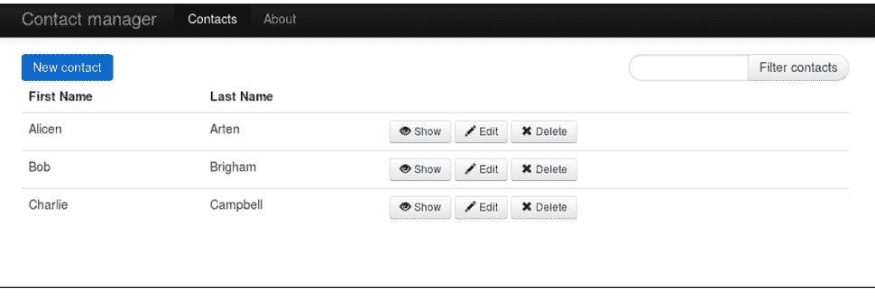

# RequireJS 与 Marionette 模块独行代码

`define(["app"], function(ContactManager){`

`ContactManager.module("HeaderApp", function(Header, ContactManager, Backbone, Marionette, $, _){`

```javascript
var API = {
  listHeader: function(){
    require(["apps/header/list/list_controller"], function(ListController){
      ListController.listHeader();
    });
  }
};
ContactManager.commands.setHandler("set:active:header", function(name){
  ContactManager.HeaderApp.List.Controller.setActiveHeader(name);
});
Header.on("start", function(){
  API.listHeader();
});
```

正如您所看到的，第 13 行不在`require`（加载）回调内：因此在我们需要它的时候我们还不能确定`List`（列表）控制器已就绪。让我们重构此代码以将`List`控制器作为模块依赖项进行`load`：

```javascript
// assets/js/apps/header/header_app.js
define(["app", "apps/header/list/list_controller"],
  function(ContactManager, ListController){
    ContactManager.module("HeaderApp", function(Header, ContactManager,
      Backbone, Marionette, $, _){
        var API = {
          listHeader: function(){
            ListController.listHeader();
          }
        };
        ContactManager.commands.setHandler("set:active:header", function(name){
          ListController.setActiveHeader(name);
        });
        Header.on("start", function(){
          API.listHeader();
        });
    });
    return ContactManager.HeaderApp;
});
```

我们在第 1 和第 2 行已在顶层`load`了`List`（列表）控制器，并且可以在第 7 和第 12 行访问其引用。有了这个修改：我们的头部现在正确地高亮显示了活动的菜单条目：



被高亮的“Contacts（联系）”条目

> Git commit 重新实现了"header"子应用：
[58433228d70846a3afd9153ca6796fa97c3d0e14](https://github.com/davidsulc/structuring-backbone-with-requirejs-and-marionette/commit/58433228d70846a3afd9153ca6796fa97c3d0e14)

<sup>35</sup> https://github.com/davidsulc/structuring-backbone-with-requirejs-and-marionette/commit/58433228d70846a3afd9153ca6796fa97c3d0e14

## Marionette 模块与普通 RequireJS 模块

Marionette 提供了一个模块化机制，RequireJS也有。我们已经同时使用了这两者：为什么？因为 Marionette 的模块为我们提供一些功能而 RequireJS无法提供：即启动/停止一个模块（及其子模块）的功能，我们将在下一章实现它。

由于我们尚未使用 Marionette 模块提供的`start`/`stop`能力（我们将这样做是在[下一章]），因此它们的使用尚有争议：在本章中，我们将看看在使用"plain" RequireJS 模块时一些模块会是什么样子：这在许多项目中都是你所需要的一切。但再次地：你除了 RequireJS 模块之外是否还使用 Marionette 模块取决于你的具体`circumstances`（情况）以及一定程度上的品位。

## 将 Contact 实体转换为 Plain RequireJS 模块

我们将从转换我们的`contact entity`（联系实体）开始，因为我们目前将模型*和*集合定义在同一个 RequireJS 模块中：这违背了最佳实践。但我们必须从头开始：从我们的"local storage"适配器。这是我们当前的文件：

**assets/js/apps/config/storage.js**

```javascript
define(["app", "localstorage"], function(ContactManager){
  ContactManager.module("Entities", function(Entities,
    ContactManager, Backbone, Marionette, $, _){
      var findStorageKey = function(entity){
        // edited for brevity
      };
      var StorageMixin = function(entityPrototype){
        // edited for brevity
      };
      Entities.configureStorage = function(entity){
        _.extend(entity.prototype, new StorageMixin(entity.prototype));
      };
    });
    return ContactManager.Entities.configureStorage;
});
```

以及我们的文件看起来像什么，作为普通 RequireJS 模块：

**assets/js/apps/config/storage.js**

```javascript
define(["localstorage"], function(){
  var findStorageKey = function(entity){
    // edited for brevity
  };
  var StorageMixin = function(entityPrototype){
    // edited for brevity
  };
  return configureStorage = function(entity){
    _.extend(entity.prototype, new StorageMixin(entity.prototype));
  };
});
```

正如您所看到的，我们不再需要`ContactManager`应用程序的引用：因为我们在模块之外不参考它。一旦定义了所需的行为：我们就简单返回（第 10-12行）我们将在其他模块中使用的功能的函数。

> RequireJS 对象`return value`不一定必须是`object`，任何有效的函数返回值都是允许的。

```javascript
});
return ;
});
```

如上所述，我们需要将其拆分为两个独立的文件：一个用于模型，另一个用于集合。以下是我们模型文件的代码（注意不同的文件路径）：

### assets/js/entities/contact/model.js

```javascript
define(["jquery", "backbone", "app", "apps/config/storage/localstorage"],
  function($, Backbone, ContactManager, configureStorage){
    var Contact = Backbone.Model.extend({
      // 为简洁起见已编辑
    });
    configureStorage(Contact);
    var API = {
      getContactEntity: function(contactId){
        var contact = new Contact({id: contactId});
        var defer = $.Deferred();
        // 为简洁起见已编辑
        return defer.promise();
      }
    };
    ContactManager.reqres.setHandler("contact:entity", function(id){
      return API.getContactEntity(id);
    });
    ContactManager.reqres.setHandler("contact:entity:new", function(id){
      return new Contact();
    });
    return Contact;
});
```

在此文件中，我们仅定义了联系人模型及其相关的处理器。如第1行和第2行所示，我们需要定义所有将要引用的依赖项。之前的情况并非如此，因为Marionette模块在回调函数定义中提供了对许多依赖项（jQuery、Backbone等）的引用。你还可以看到我们返回了`Contact`对象，尽管我们不会在任何其他模块中直接引用它：我们将通过请求-响应机制来访问`Contact`模型实例。但既然我们有一个确定的可用对象作为返回值，我们不妨就使用它。

## 使用独立模块作为事件聚合器

在上面的代码中，我们添加了`ContactManager`作为依赖项，以便随后使用其`reqres`属性。我们可以将整个主应用程序作为依赖项包含进来，因为它相当小。如果你有一个更大的主应用程序文件（包含许多依赖项），你可能希望定义一个专门的模块来提供请求-响应事件聚合器（如这里36所示）。

提供事件聚合器的 RequireJS 模块 (`assets/js/vent.js`)

```javascript
define([ "Backbone", "Marionette" ], function(Backbone){
  return new Backbone.Wreqr.EventAggregator();
});
```

如果你将此定义与Marionette维基中的链接页面进行比较，你会注意到语法略有不同：维基使用的是高级技术37，用于将所有Marionette组件作为单独的AMD模块包含进来。我们只是使用了包含“things included”的构建，因此我们声明`Backbone`作为依赖项以便在第2行引用它，并且我们将`Marionette`作为依赖项以便加载它并注册我们需要使用的`Wreqr`属性。

然后，我们可以像这样使用我们的事件聚合器模块：

在另一个模块的定义中使用事件聚合器

```javascript
define([ "assets/js/vent" ], function(vent) {
  vent.on("eventName", function(){});
  vent.trigger("eventName");
});
```

## 转换集合

我们的模型已重写，接下来让我们重写我们的联系人集合。这是我们当前的代码：

> ^2 https://github.com/marionettejs/backbone.marionette/wiki/Using-marionette-with-requirejs#example-with-central-vent
> ^https://github.com/marionettejs/backbone.marionette/wiki/Using-marionette-with-requirejs#advanced-usage

`assets/js/entities/contact.js`

```javascript
 1 define(["app", "apps/config/storage/localstorage"], function(ContactManager){
 2   ContactManager.module("Entities", function(Entities,
 3                            ContactManager, Backbone, Marionette, $, _){
 4     // 为简洁起见已编辑
 5
 6     Entities.ContactCollection = Backbone.Collection.extend({
 7       url: "contacts",
 8       model: Entities.Contact,
 9       comparator: "firstName"
10     });
11
12     Entities.configureStorage(Entities.ContactCollection);
13
14     var initializeContacts = function(){
15       var contacts = new Entities.ContactCollection([
16         { id: 1, firstName: "Alice", lastName: "Arten",
17           phoneNumber: "555-0184" },
18         { id: 2, firstName: "Bob", lastName: "Brigham",
19           phoneNumber: "555-0163" },
20         { id: 3, firstName: "Charlie", lastName: "Campbell",
21           phoneNumber: "555-0129" }
22       ]);
23       contacts.forEach(function(contact){
24         contact.save();
25       });
26       return contacts.models;
27     };
28
29     var API = {
30       getContactEntities: function(){
31         var contacts = new Entities.ContactCollection();
32         var defer = $.Deferred();
33         contacts.fetch({
34           success: function(data){
35             defer.resolve(data);
36           }
37         });
38         var promise = defer.promise();
39         $.when(promise).done(function(contacts){
40           if(contacts.length === 0){
```

## Marionette模块 vs 普通RequireJS模块

```javascript
// 如果我们还没有任何联系人，为了方便起见，创建一些
var models = initializeContacts();
contacts.reset(models);
}
});
return promise;
},
getContactEntity: function(contactId){
// 为简洁起见已编辑
}
};
ContactManager.reqres.setHandler("contact:entities", function(){
return API.getContactEntities();
});
// 为简洁起见已编辑
}));
return ;
}));
```

我们同样需要将其存储在不同的文件中。以下是我们新的模块：

### assets/js/entities/contact/collection.js

```javascript
define(["jquery", "backbone", "app",
    "entities/contact/model", "apps/config/storage/localstorage"],
```


```javascript
function($, Backbone, ContactManager, ContactModel, configureStorage){

  var ContactCollection = Backbone.Collection.extend({

    url: "contacts",

    model: ContactModel,

    comparator: "firstName"

  });

  configureStorage(ContactCollection);

  var initializeContacts = function(){

    var contacts = new ContactCollection([

      { id: 1, firstName: "Alice", lastName: "Arten",

        phoneNumber: "555-0184" },

      { id: 2, firstName: "Bob", lastName: "Brigham",

        phoneNumber: "555-0163" },

      { id: 3, firstName: "Charlie", lastName: "Campbell",

        phoneNumber: "555-0129" }

    ]);

    contacts.forEach(function(contact){

      contact.save();

    });

    return contacts.models;

  };

  var API = {

    getContactEntities: function(){

      var contacts = new ContactCollection();

      var defer = $.Deferred();

      contacts.fetch({

        success: function(data){

          defer.resolve(data);

        }

      });

      var promise = defer.promise();

      $.when(promise).done(function(contacts){

        if(contacts.length === 0){

          // 如果我们还没有任何联系人，为了方便起见，创建一些

          var models = initializeContacts();

          contacts.reset(models);

        }

      });

      return promise;

    }

  };

  ContactManager.reqres.setHandler("contact:entities", function(){

    return API.getContactEntities();

  });

  return ContactCollection;

});
```

> 由于我们使用的是普通RequireJS模块，我们需要将`Contact`模型声明为依赖项，以便我们可以在第6行引用它。

## 重写显示视图

我们还需要重写视图模块，使其看起来像这样：

```javascript
assets/js/apps/contacts/show/show_view.js

define(["marionette", "tpl!apps/about/show/templates/message.tpl"], function(Marionette, messageTpl){

    return {

        Message: Marionette.ItemView.extend({

            template: messageTpl

        })

    };

});
```

## 重写显示动作

现在我们有了用于联系人模型/集合的全新模块，让我们重写我们的“显示”动作（作为一个示例），以使用定义`Contact`模型的普通RequireJS模块：

```javascript
assets/js/apps/contacts/show/show_controller.js

define(["app", "apps/contacts/show/show_view"], function(ContactManager, View){

    return {

        showContact: function(id){

            require(["common/views", "entities/contact/model"], function(CommonViews){

                // 为简洁起见已编辑

                var fetchingContact = ContactManager.request("contact:entity", id);

                $.when(fetchingContact).done(function(contact){

                    // 为简洁起见已编辑

                    ContactManager.mainRegion.show(contactView);

                });

            });

        }

    }

});
```

如你所见，在第4行我们引入了联系人模型，这样我们就能在第7行请求一个联系人实例。我们再次强调，我们并非通过直接引用`Contact`模型来获取它，而是通过请求-响应机制进行请求。通过引入联系人实体，我们确保了`"contact:entity"`处理器已注册并会返回所需数据。同样重要的是，我们不再定义一个命名的`Controller`对象：我们直接将对象作为RequireJS模块的返回值返回。

## 根据路由启动/停止模块

在本章中，我们将使模块根据路由来启动和停止。如果你在上一章中认真听讲，你会记得我们使用*Marionette*模块而非普通RequireJS模块的主要原因，就是为了能够轻松地启动/停止它们（及其子模块）。

在深入探讨之前，让我们先花点时间讨论*为什么*要根据路由启动/停止模块。这不是一个你应该不加区别地应用于所有项目的方法，因为在许多情况下，它会引入额外的复杂性开销而收益甚微。那么，你的应用在什么情况下会受益于启动/停止功能呢？主要有两种情况：

- 当你的子应用需要一个在其他地方未使用的库时（例如图表库）；
- 当你的应用在初始化时需要加载大量数据，并且需要在另一个子应用加载时释放内存时（例如具有下钻功能的仪表板）。

在这些情况下，我们能够在子应用启动时加载库和/或数据，并在用户导航离开子应用时释放内存（例如，当他不再查看需要高级可视化和大量数据的仪表板时）。

### 实现策略

在我们当前的实现中，模块会随其父模块自动启动，这一过程会一直延续到主应用。换句话说，我们定义的所有模块在主应用运行时就会启动。我们需要对此进行轻微修改以实现模块的启动/停止：显然，我们不希望子应用自动启动，而是在我们告知它们时才启动。但实现这种行为并不像告诉模块不要自动启动那么简单：我们需要每个子应用的*路由器*随主应用自动启动，以便它们能够响应路由事件（并在必要时启动相应的模块）。

要解决这个挑战，我们需要一个通用的`"路由器"`模块，它将包含所有子应用的路由代码（并会自动启动）；然后我们可以在子应用的主模块（例如`ContactsApp`）中将`startWithParent`设置为`false`。具体如下所示：

```javascript
1 define(["app"], function(ContactManager){
2   ContactManager.module("ContactsApp", function(ContactsApp, ContactManager,
3                                             Backbone, Marionette, $, _){
4     ContactsApp.startWithParent = false;
5     ContactsApp.onStart = function(){
6       console.log("starting ContactsApp");
7     };
8    ContactsApp.onStop = function(){
9      console.log("stopping ContactsApp");
10    };
11  });
12  ContactManager.module("Routers.ContactsApp", function(ContactsAppRouter,
13                          ContactManager, Backbone, Marionette, $, _){
14    ContactsAppRouter.Router = Marionette.AppRouter.extend({
15      appRoutes: {
16        // 为简洁起见已编辑
17      }
18    });
19    var API = {
20      // 为简洁起见已编辑
21    };
22    // 导航事件监听器（为简洁起见已编辑）
23    ContactManager.addInitializer(function(){
24      new ContactsAppRouter.Router({
25        controller: API
26      });
27    });
28  });
29  return ContactManager.ContactsAppRouter;
30 });
```

让我们看看我们所做的更改：

- 在第2-13行，我们定义了一个名为`"ContactsApp"`的新Marionette模块。其中，
  - 我们在第4行声明它不应随其父应用（即主应用）一起启动；
  - 我们添加了一个`onStart`函数（第6-8行），该函数将在应用每次启动时执行。这是加载子应用所需的额外库或数据的地方；
  - 我们添加了一个`onStop`函数（第10-12行），通过在用户导航离开子应用时取消引用不再使用的变量（例如使用`delete`^38^或将其赋值为`null`）来释放内存。

- 在第15行，我们将模块从`ContactsApp`重命名为`Routers.ContactsApp`。这是因为我们将使用`Routers` Marionette模块来保存我们所有的路由控制器，它将随主应用（自动）启动。其余代码未作修改（除了将`ContactsApp`重命名为`ContactsAppRouter`，例如在第30行）。

> 那像`List`这样的子模块呢？我们让这些子模块保持原样：我们需要它们的`startWithParent`属性为`true`（这是默认值）。这样，我们阻止了顶层`ContactsApp`在`ContactManager`启动时自动启动，但当我们手动启动`ContactsApp`时，它的子模块（`List`等）也会启动（因为它们被配置为`startWithParent`）。

通过这个代码更改，我们在*assets/js/apps/contact/contacts_app.js*中定义了顶层`ContactsApp`子应用模块，这是我们的联系人子应用第一个被要求的文件。因此，`ContactsApp`的`startWithParent`被立即设置为`false`，除非我们明确启动它，否则它不会启动。然后我们可以定义包含路由控制器代码的Marionette模块，并将其作为RequireJS模块的返回值。

但我们仍然缺少拼图的一个主要部分：我们需要代码来启动我们需要的子应用，并停止所有其他子应用。让我们想象我们有2个非常大的Marionette子应用程序，它们都提供仪表板。其中一个处理客户数据（他们的居住地、购物频率、个人资料等），另一个显示汇总的财务信息（例如过去2周按客户细分的销售额、访问次数、库存周转率等）。这两个子应用程序都提供高级分析功能和多种显示与重新组合数据的方式。

为了增强性能，最常分析的数据在子应用程序初始化时加载。这样，当用户想要更改他正在查看的分析（例如从"总体销售额"转为"单身男性销售额"）时，子应用程序已经拥有这些数据并能快速显示新的分析。不幸的是，所有这些数据都占用内存，当用户切换到不同的子应用程序时，这些数据就不再必要了：它占用的内存应该被释放。这可以通过停止当前模块，并在Marionette模块的`onStop`方法中取消引用已加载的数据来实现。

随着所有这些模块的启动和停止，我们需要一个可以调用的函数，以确保我们想要使用的子应用处于活动状态，并停止所有其他子应用。具体如下所示：

^38^https://developer.mozilla.org/en-US/docs/Web/JavaScript/Reference/Operators/delete

```javascript
1 ContactManager.startSubApp = function(appName, args){
2   var currentApp = ContactManager.module(appName);
3   if (ContactManager.currentApp === currentApp){ return; }
4   if (ContactManager.currentApp){
5     ContactManager.currentApp.stop();
6   }
7   ContactManager.currentApp = currentApp;
8   currentApp.start(args);
9 };
10
11 ContactManager.on("initialize:after", function(){
12   // 为简洁起见已编辑
13 });
```

当然，现在我们需要在任何控制器操作之前执行此方法：

```javascript
1  var API = {
2    listContacts: function(criterion){
3      require(["apps/contacts/list/list_controller"], function(ListController){
4        ContactManager.startSubApp("ContactsApp");
5        ListController.listContacts(criterion);
6        ContactManager.execute("set:active:header", "contacts");
7      });
8    },
9
10   showContact: function(id){
11     require(["apps/contacts/show/show_controller"], function(ShowController){
12       ContactManager.startSubApp("ContactsApp");
13       ShowController.showContact(id);
14       ContactManager.execute("set:active:header", "contacts");
15     });
16   },
17
18   editContact: function(id){
```

如你在上面所见，有不少重复的代码。让我们用一个新`"私有"`函数来清理一下：

```javascript
assets/js/apps/contact/contact_app.js

var executeAction = function(action, arg){
  ContactManager.startSubApp("ContactsApp");
  action(arg);
  ContactManager.execute("set:active:header", "contacts");
};

var API = {
  listContacts: function(criterion){
    require(["apps/contacts/list/list_controller"], function(ListController){
      executeAction(ListController.listContacts, criterion);
    });
  },
  showContact: function(id){
    require(["apps/contacts/show/show_controller"], function(ShowController){
      executeAction(ShowController.showContact, id);
    });
  },
  editContact: function(id){
    require(["apps/contacts/edit/edit_controller"], function(EditController){
      executeAction(EditController.editContact, id);
    });
  }
};
```

修改`"AboutApp"`，让它只在收到明确指令时才启动自己的模块。解决方案如下所示。

## 修改 AboutApp

这是我们修改后的`"about"`子应用文件：

```javascript
assets/js/apps/about/about_app.js

define(["app"], function(ContactManager){
```


`ContactManager.module("AboutApp", function(AboutApp, ContactManager, Backbone, Marionette, $, _) {
    AboutApp.startWithParent = false;
    AboutApp.onStart = function() {
        console.log("starting AboutApp");
    };
    AboutApp.onStop = function() {
        console.log("stopping AboutApp");
    };
});

ContactManager.module("Routers.AboutApp", function(AboutAppRouter, ContactManager, Backbone, Marionette, $, _) {
    AboutAppRouter.Router = Marionette.AppRouter.extend({
        appRoutes: {
            "about": "showAbout"
        }
    });
    var API = {
        showAbout: function() {
            require(["apps/about/show/show_controller"], function(ShowController) {
                ContactManager.startSubApp("AboutApp");
                ShowController.showAbout();
                ContactManager.execute("set:active:header", "about");
            });
        }
    };
    ContactManager.on("about:show", function() {
        ContactManager.navigate("about");
        API.showAbout();
    });
    ContactManager.addInitializer(function() {
        new AboutAppRouter.Router({
            controller: API
        });
    });
});

return ContactManager.AboutAppRouter;
```

完成这些更改后，当你在应用中导航时（例如通过点击头部菜单中的链接），可以看到各种消息被打印到控制台。此外，如果你在地址栏中手动输入 URL，模块也会被正确地启动/停止（并显示控制台消息）。成功了！

按路由实现模块启动/停止的 Git 提交：`3bf9ff22f4bb7645c074bc636783dc7aae1bd23a`³⁹

³⁹https://github.com/davidsulc/structuring-backbone-with-requirejs-and-marionette/commit/3bf9ff22f4bb7645c074bc636783dc7aae1bd23a

## 混合搭配模块

我们之前讨论过为什么要在 RequireJS 项目中使用 Marionette 模块[earlier](#)，也见过如何在你的项目中编写[普通的 RequireJS 模块](#)。当然，在某些情况下，你可能希望同时使用两种类型的模块：对于不需要（卸载）库和资源的子应用使用普通的 RequireJS 模块，对于需要的则使用 Marionette 模块。为了涵盖这个用例，我们将把"about"子应用转换为仅使用普通的 RequireJS 模块。

## 将 About 子应用转换为普通 RequireJS 模块

`assets/js/apps/about/about_view.js`

```javascript
define(["marionette", "tpl!apps/about/show/templates/message.tpl"],
    function(Marionette, messageTpl) {
        return {
            Message: Marionette.ItemView.extend({
                template: messageTpl
            })
        };
    });
```

`assets/js/apps/about/show/show_controller.js`

```javascript
define(["app", "apps/about/show/show_view"], function(ContactManager, View) {
    return {
        showAbout: function() {
            var view = new View.Message();
            ContactManager.mainRegion.show(view);
        }
    };
});
```

`assets/js/apps/about/about_app.js`

```javascript
define(["app", "marionette"], function(ContactManager, Marionette) {
    var Router = Marionette.AppRouter.extend({
        appRoutes: {
            "about": "showAbout"
        }
    });
    var API = {
        showAbout: function() {
            require(["apps/about/show/show_controller"], function(ShowController) {
                ContactManager.startSubApp("AboutApp");
                ShowController.showAbout();
                ContactManager.execute("set:active:header", "about");
            });
        }
    };
    ContactManager.on("about:show", function() {
        ContactManager.navigate("about");
        API.showAbout();
    });
    ContactManager.addInitializer(function() {
        new Router({
            controller: API
        });
    });
    return Router;
});
```

如果你现在使用这个应用，会看到它可以工作。但是，我们的启动/停止代码有一个小问题需要修复。这是我们当前的代码：

第 2 行正在制造麻烦：`module` 调用返回 Marionette 模块*如果它存在*，否则返回一个*新的* Marionette 模块。所以在我们的例子中，由于 `AboutApp` Marionette 模块不存在，它将被实例化。这不是我们想要的行为，所以让我们修复它。

## 用混合模块类型管理启动/停止

我们要做的第一件事是传递 `null` 来指示当前子应用不是一个 Marionette 模块，因此不需要启动或停止。

如你所见，我们修改了第 4 行来传递 `null` 值，因为我们的"about"应用不再是一个 Marionette 模块。接下来，我们需要修改我们的模块启动代码来正确管理两种模块类型。

```javascript
ContactManager.startSubApp = function(appName, args) {
    var currentApp = ContactManager.module(appName);
    if (ContactManager.currentApp === currentApp) { return; }
    if (ContactManager.currentApp) {
        ContactManager.currentApp.stop();
    }
    ContactManager.currentApp = currentApp;
    currentApp.start(args);
};
```

```javascript
var API = {
    showAbout: function() {
        require(["apps/about/show/show_controller"], function(ShowController) {
            ContactManager.startSubApp(null);
            ShowController.showAbout();
            ContactManager.execute("set:active:header", "about");
        });
    }
};
```

`assets/js/app.js`

```javascript
1 ContactManager.startSubApp = function(appName, args) {
2   var currentApp = appName ? ContactManager.module(appName) : null;
3   if (ContactManager.currentApp === currentApp) { return; }
4
5   if (ContactManager.currentApp) {
6     ContactManager.currentApp.stop();
7   }
8
9   ContactManager.currentApp = currentApp;
10  if (currentApp) {
11    currentApp.start(args);
12  }
13 };
```

我们的改动相当简单：

- 我们将 `currentApp` 设置为模块（如果它存在），否则使用 `null`（第 2 行）；
- 如果当前模块是 Marionette 模块，我们停止它（第 5-7 行）；
- 如果新模块是 Marionette 模块，我们启动它（第 10-12 行）。

有了这个修改，我们的应用可以愉快地运行两种模块类型了！

> 混合模块类型的 Git 提交：
[ef42ce031913810542566f928d84e26e2f7850c5](https://github.com/davidsulc/structuring-backbone-with-requirejs-and-marionette/commit/ef42ce031913810542566f928d84e26e2f7850c5)

## 用 r.js 优化应用

到目前为止，我们已经重写了应用，使用"普通" RequireJS 和 Marionette 模块的混合，全部由 RequireJS 处理。如你所记得的，RequireJS 自动处理依赖关系并按正确顺序加载 JavaScript 文件。然而，这个顺序并不经常改变（当然不是在每个页面请求时），所以我们为什么要让这项工作一遍又一遍地做呢？更聪明的做法不是只计算一次依赖关系，将结果代码存储在一个文件中，然后在我们的应用中使用它吗？当然是的，这就是 `r.js` 的目标之一，即 RequireJS 提供的优化器。

在我们对应用运行优化器之前，我们需要安装 `node.js`（在此下载⁴¹）。然后，从此处⁴² 下载 `r.js` 文件并将其存储在应用的根路径中⁴³。

完成这些之后，我们就快准备好运行优化器了。我们需要一个构建文件⁴⁴：

**`assets/js/build.js`**

```javascript
{
    baseUrl: ".",
    name: "require_main",
    mainConfigFile: "require_main.js",
    out: "require_main.built.js"
}
```

以下是每个属性的作用（了解更多请访问此处⁴⁵）：

- `baseUrl` 定义了确定所有其他路径的 URL，它默认为构建文件的路径，在我们的例子中是 `assets/js`（因为我们把构建文件存放在那里）。这意味着我们的库将在 `assets/js/assets/js` 中搜索，因为构建文件的默认基础路径是 `assets/js`，而我们的主配置文件定义了自己的 `baseUrl` 属性为 `assets/js`。把这两个合在一起，优化器会在 `assets/js/assets/js` 中查找库，这不是我们想要的……相反，我们需要提供我们想要使用的实际路径，相对于应用的基础目录。在我们的例子中，我们希望它是那个相同的基础目录，因此使用 `"."` 路径；

> http://nodejs.org/download/

> http://requirejs.org/docs/download.html#rjs

注意，按照说明，你也可以在使用 `npm` 安装优化器后使用它。

> http://requirejs.org/docs/optimization.html#wholeproject

> https://github.com/jrburke/r.js/blob/master/build/example.build.js

- 由于我们仅优化一个模块（主模块，它将递归优化其所有依赖项），因此可以通过 `name` 属性内联提供模块名称。由于 `assets/js/require_main.js` 文件定义了我们的主模块，我们只需在此提供其名称，RequireJS 会通过 `baseUrl` 属性确定其位置；

- `mainConfigFile` 允许我们告知优化器我们的配置选项所在位置，这样我们就不必在命令行中重复它们。同样，文件位置由 `baseUrl` 属性确定；

- `out` 是我们希望优化器生成的构建文件的名称。这样，我们将得到一个单一、优化且压缩后的文件，用于包含在部署的应用程序中。这里，其位置也由 `baseUrl` 属性确定。

现在我们准备运行优化器。从应用程序的根目录使用命令控制台运行

```bash
node r.js -o assets/js/build.js
```

你会注意到我们通过 `-o` 选项指定了构建文件的位置。一旦优化器运行完毕，你将获得一个全新的文件：`assets/js/require_main.built.js`，其中包含我们整个应用程序的单个压缩文件。

让我们通过在 `index.html` 文件中使用它来试试我们的新文件：

### index.html

```html
1 <!DOCTYPE html>
2 <html lang="en">
3  <head>
4   <meta charset="utf-8">
5   <title>Marionette Contact Manager</title>
6   <link href="./assets/css/bootstrap.css" rel="stylesheet">
7   <link href="./assets/css/application.css" rel="stylesheet">
8   <link href="./assets/css/jquery-ui-1.10.0.custom.css" rel="stylesheet">
9 </head>
10
11 <body>
12  <div id="header-region"></div>
13
14 <div id="main-region" class="container">
15   <p>Here is static content in the web page. You'll notice that
16     it gets replaced by our app as soon as we start it.</p>
17 </div>
```

```html
19    <div id="dialog-region"></div>
20
21    <script src="./assets/js/require_main.built.js"></script>
22  </body>
23 </html>
```

如你所见，我们在第 21 行用新优化后的文件替换了原始的 RequireJS 包含。但当我们刷新索引页面时，应用程序并未正常加载。相反，我们收到一条错误消息，指出 "define is not defined"。这是什么意思？嗯，即使我们不需要 RequireJS 来处理依赖关系，我们仍然需要它来加载我们的模块。因此，我们需要在加载我们的应用文件之前包含 RequireJS 库：

`index.html`

```html
1 <script src="./assets/js/vendor/require.js"></script>
2 <script src="./assets/js/require_main.built.js"></script>
```


使用单个优化文件的 Git 提交：
`a736595a0fecd466aee049ae91429c086b2b6049`

我们的应用现在可以正常加载了，但这似乎有点浪费，不是吗？我们加载了 RequireJS 及其所有功能（还有文件大小！），只是为了加载我们独特的模块。一定有更好的方法！

## 使用 Almond.js 加载

`Almond.js` 是一个最小的 AMD 模块加载器，同样由 RequireJS 背后的 James Burke 编写。它旨在轻量化，以提供非常有限的功能集为代价，而这正是我们所寻找的！让我们从这里下载它并将其保存为 `assets/js/vendor/almond.js`。

使用 Almond 确实会带来一些限制，其中包括无法使用动态代码加载（例如，尝试使用 CDN 托管的库并回退到本地版本）。

然后，我们需要更改构建文件以将 Almond 包含在优化后的文件中：

`https://github.com/davidsulc/structuring-backbone-with-requirejs-and-marionette/commit/a736595a0fecd466aee049ae91429c086b2b6049`
`https://raw.github.com/jrburke/almond/latest/almond.js`
`https://github.com/jrburke/almond#restrictions`

### `assets/js/build.js`

```
({

    baseUrl: ".",

    name: "vendor/almond",

    include: "require_main",

    mainConfigFile: "require_main.js",

    out: "require_main.built.js"

})
```

注意第3行和第4行的更改：我们告诉优化器构建 Almond 并*包含*我们的主应用程序。重新编译我们的应用后，我们调整索引页面：

### `index.html`

```
<!DOCTYPE html>

<html lang="en">

  <head>

    <meta charset="utf-8">

    <title>Marionette Contact Manager</title>

    <link href="./assets/css/bootstrap.css" rel="stylesheet">

    <link href="./assets/css/application.css" rel="stylesheet">

    <link href="./assets/css/jquery-ui-1.10.0.custom.css" rel="stylesheet">

  </head>

  <body>

    <div id="header-region"></div>

    <div id="main-region" class="container">

      <p>Here is static content in the web page. You'll notice that

         it gets replaced by our app as soon as we start it.</p>

    </div>

    <div id="dialog-region"></div>

    <script src="./assets/js/require_main.built.js"></script>

  </body>

</html>
```

注意在第21行，我们只包含了编译后的文件：RequireJS 和 Almond *没有*被包含。

我们现在可以重新加载我们的应用，哎呀，它不工作了！除了其他错误，我们得到了 "Error: undefined missing entities/header" 错误。这怎么可能呢，它在 RequireJS 下明明工作得很好？这是因为我们有嵌套的 `require` 调用（即在模块*内部*声明依赖，而不仅仅是在其定义中）。幸运的是，解决方法很简单，只需在我们的构建文件中添加一个 `findNestedDependencies` 属性：

```
assets/js/build.js

({

    baseUrl: ".",

    name: "vendor/almond",

    include: "require_main",

    mainConfigFile: "require_main.js",

    out: "require_main.built.js",

    findNestedDependencies: true

})
```

我们使用相同的命令再次编译应用

```
node r.js -o assets/js/build.js
```

以生成我们编译后应用程序的新版本。这次当我们重新加载应用时，它正常工作了！

> 使用 Almond 加载优化后应用程序的 Git 提交：[85d3d3dd40d0cebd858224c3903a12d6998d668d](https://github.com/davidsulc/structuring-backbone-with-requirejs-and-marionette/commit/85d3d3dd40d0cebd858224c3903a12d6998d668d)

## 结束语

我们现在已使用 RequireJS 重写了应用程序，并在此过程中引入了一些新想法。你现在应该对 RequireJS 的工作原理有了很好的掌握，并且应该能够将所学内容应用到自己的项目中。

如果你喜欢这本书，如果你能花几分钟时间在书籍的[评论页面](https://leanpub.com/structuring-backbone-with-requirejs-and-marionette/feedback)上写下你的看法，那将是莫大的帮助。帮助他人判断这本书是否适合他们！

你希望我在未来的书中涵盖另一个主题吗？通过电子邮件 `davidsulc@gmail.com` 或 Twitter（`@davidsulc`）让我知道。同时，请参阅下一章了解[我当前的书籍列表](#)。

感谢阅读本书，很高兴能与你同行！

## 保持联系

我计划在未来发布更多书籍，每本书都将教授一项新技能（就像本书一样）或帮助你提升现有技能并将其提升到新的水平。

如果你想在我发布新书、获得折扣等时收到通知，请在 [davidsulc.com/mailing_list](http://davidsulc.com/mailing_list) 上注册我的邮件列表。没有垃圾邮件，我保证！

你也可以在 Twitter 上关注我：`@davidsulc`

## 我写的其他书

假设你已经对 Marionette 的工作方式感到满意。如果情况并非如此，请查看最初开发联系人管理器应用程序的那本书：[Backbone.Marionette.js: A Gentle Introduction](https://leanpub.com/marionette-gentle-introduction)。
