# JavaScript 基础：Web 编程力量解锁指南

## 前言

欢迎来到动态且不断发展的 JavaScript 编程世界！本书《JavaScript 基础》为那些踏上 Web 开发、软件工程等广阔领域之旅的人打开了大门。本书专为初学者量身打造，旨在为 `JavaScript` 打下坚实基础——这门语言以其灵活性、普遍性以及在现代 Web 应用中的关键作用而备受赞誉。

`JavaScript` 常被称为 Web 语言，在互联网主导的时代已成为开发者的必备技能。它的重要性从创建交互式网页到开发全栈应用（无论是客户端还是服务器端）都得以体现。`JavaScript` 的通用性使其几乎能在所有平台上运行，成为有志开发者、数字创作者和技术爱好者的关键资产。无论你梦想设计前沿的 Web 界面、使用 `Node.js` 开发服务器端应用，还是涉足移动应用开发和物联网（`IoT`）领域，`JavaScript` 都将是你的向导和伙伴。

在阅读《JavaScript 基础》的过程中，你将通过既全面又易于理解的方式学习 `JavaScript` 的核心原则。我们的教育理念强调清晰与参与，确保初学者能够理解 `JavaScript` 的复杂性而不感到不知所措。想象一下，通过与导师的对话来深入主题，这位导师使用现实世界的例子、实际演示和一点幽默来让 `JavaScript` 的精髓变得生动。

我们的目标是点燃你对学习的热情，让你的教育之旅既令人兴奋又富有启发性。我们相信，掌握 `JavaScript` 的过程应该激发好奇心、挑战你的思维，并最终带来巨大的回报。为此，本书包含了各种练习、项目和动手示例，鼓励你应用所学知识并在书页之外进行实验。这些活动不仅仅是教学，更是邀请你探索 `JavaScript` 提供的无限可能性。

从《JavaScript 基础》开始只是进入更广阔、不断变化的开发机会世界的第一步。`JavaScript` 领域充满活力，新的框架、库和最佳实践不断涌现。我们鼓励你保持探索精神，深入前端和后端 `JavaScript` 的广阔生态系统，并始终寻找新的问题来解决。

当我们踏上这段穿越 `JavaScript` 迷人领域的旅程时，让我们带着创新、创造力和解决问题的乐趣——这些是编程的核心特质。我们很高兴能在这条道路上引导你，并迫不及待地想看到你将用 `JavaScript` 打造的精彩项目和解决方案。祝你在 `JavaScript` 的创意、发现和编码乐趣之旅中一帆风顺。欢迎来到《JavaScript 基础》。

祝你编码愉快！

## 致谢

我们，`Programming Hub` 团队，非常高兴向数字世界的未来建设者呈现这本《JavaScript 基础：解锁 Web 编程的力量》。这本书是我们编程和教学设计专家团队集体努力和坚定奉献的证明。

首先，我们向所有分享知识、专业知识和热情的工程师、开发者和教育者致以最深切的感谢。他们对卓越的承诺以及对 `JavaScript` 的深刻理解，对于创建这本全面的 `JavaScript` 学习指南至关重要。

我们同样向尊敬的作者们致以诚挚的谢意，他们倾注了创造力与专业知识，共同塑造了本书的内容。他们化繁为简的独特能力，结合引人入胜的写作风格和对清晰性的执着追求，使本书成为不同学习阶段读者的宝贵资源。

我们感谢在本书编写过程中提供建设性反馈和深刻见解的审阅者们。他们敏锐的观察力和对细节的一丝不苟，极大地帮助了内容的完善，确保了内容的准确性和有效性。

我们向技术编辑和校对人员表示感激，他们仔细审阅了手稿，以维护最高标准的质量和可读性。

此外，我们还要感谢才华横溢的设计师和插画师，他们用视觉上引人入胜的图形、图表和插图，为本书的页面注入了活力。他们富有想象力的风格和艺术造诣极大地丰富了学习体验，使内容不仅更易于理解，而且令人难忘。同时，我们衷心感谢读者们，你们对学习的热情和掌握 `JavaScript` 的渴望，正是本书创作的灵感源泉。

最后，我们感谢 `Programming Hub` 的整个团队，他们对卓越的不懈追求和致力于丰富学习体验的奉献精神，使这一努力得以实现。

我们期待《JavaScript 基础：解锁网页编程的力量》能够激发你的好奇心，助力你的学习，并赋予你驾驭 `JavaScript` 编程广阔领域所需的能力。愿你在 `JavaScript` 世界中的旅程充满发现、成长，以及解锁这门语言巨大潜能的兴奋感。

祝你编码愉快，愿你在编程实践中充分利用 `JavaScript` 的全部力量！——`Programming Hub`

## 探索 JavaScript 基础

### 1.1 JavaScript 简介：其重要性与应用

#### 1.1.1 什么是 JavaScript？概述

`JavaScript` 是一种动态编程语言，主要用于在网页上创建交互元素。它由 `Netscape` 在 20 世纪 90 年代初开发，此后与 `HTML` 和 `CSS` 一起发展成为万维网的核心技术之一`JavaScript` 使开发者能够为网页添加多种功能，包括表单验证、交互式地图、动画图形以及复杂的网页布局。

与许多其他编程语言不同，`JavaScript` 在客户端浏览器上执行，能够对用户操作做出即时响应，而无需每次操作都与服务器通信。这种客户端执行能力使 `JavaScript` 成为在网络上创建无缝动态用户体验的关键角色。

#### 1.1.2 JavaScript 在现代 Web 开发中的作用

在现代 Web 开发中，`JavaScript` 在前端和后端开发中都扮演着关键角色。在前端，它用于创建动态且交互式的用户界面。`JavaScript` 允许开发者实时响应用户操作，使网页感觉更像原生应用。

在后端，`Node.js` 的引入使 `JavaScript` 也能在服务器上运行。这意味着开发者可以用 `JavaScript` 编写服务器端代码，从而实现更统一、更高效的开发流程，因为同一语言可以贯穿整个技术栈。

#### 1.1.3 应用：从网页到服务器端开发

`JavaScript` 的应用远不止于网页上的简单动画和验证。随着复杂框架和工具的出现，它现在驱动着复杂的 Web 应用、移动应用、游戏，甚至物联网（`IoT`）设备。`JavaScript` 的非阻塞、事件驱动特性使其特别适合开发实时应用，如聊天应用和实时内容更新。

此外，通过 `Node.js` 等环境，服务器端 `JavaScript` 彻底改变了开发者构建可扩展、高性能 Web 服务器的方式。这种全栈能力意味着 `JavaScript` 现在几乎应用于软件开发的各个方面。

#### 1.1.4 JavaScript 框架与库：增强功能

`JavaScript` 生态系统拥有丰富的框架和库，旨在简化和增强 Web 开发。`Angular`、`React` 和 `Vue.js` 等框架为开发复杂的单页应用（`SPA`）提供了强大的解决方案，而 `jQuery` 等库则使 `DOM` 操作更加简单直观。

框架和库不仅加快了开发过程，还通过提供结构化和可维护的代码库来帮助保持代码质量。它们为常见任务提供了预编写的代码，让开发者能够专注于项目的独特方面，而不是为基本功能重复造轮子。

`JavaScript` 在 Web 开发领域的重要性不容低估。从一种简单的脚本演变为通用的全栈工具，通过理解 `JavaScript` 的核心原理并学会利用框架和库，开发者可以构建高效、交互性且动态 Web 应用。

### 1.2 编写你的第一个程序：“Hello World!”

#### 1.2.1 理解 JavaScript 结构

一个 `JavaScript` 程序由一系列语句组成，浏览器按它们顺序执行。`JavaScript` 程序可以简单到只有一行代码，执行特定任务。语句通常跟分号（`;`）来标记当前结束，但注意的是由于自动分号插入（`ASI`）机制，`JavaScript` 引擎即使没有分号也能解释语句。`JavaScript` 程序可以包含用于存储数据的变量、用于重复操作的循环、用于组织代码函数。

#### 1.2.2 创建一个简单的“Hello World!”脚本

“Hello World!”程序是一个简单的练习，它在屏幕上输出字符串。以下是如何用 `JavaScript` 创建一个“Hello World!”脚本：代码包含在 `<script>` 标签内，或者放在一个外部 `JavaScript` 文件中，并在控制台中显示。

#### 1.2.3 使用浏览器控制台执行

运行 `JavaScript` 代码最简单的方法是使用浏览器控制台。

1. 打开控制台：右键点击网页，选择“检查”（或按 F12 / Mac 上按 `Cmd+I`），然后导航到“控制台”。
2. 编写 `JavaScript` 代码：直接在控制台中输入 `console.log('Hello World!');` 然后回车。
3. 查看输出：执行后，你会立即看到 `Hello World!`。

#### 1.2.4 编写和组织 代码的最佳实践

随着你学习更复杂的 `JavaScript` 程序，遵循最佳实践以确保代码可读、维护：

- 使用意义的名字：为变量选择清晰且描述性的名称。
- 保持风格：无论是变量命名还是代码布局，坚持一种风格。
- 注释你的代码：使用注释解释代码的目的。
- 避免全局变量：尽量减少全局变量的使用，避免不同部分之间产生意外。
- 结构化你的代码：将相关代码分组到函数或类中。
- 错误处理：实现机制应对潜在错误。

遵循这些原则将帮助你在编程之旅开始时编写高质量的代码。

## 在 JavaScript 中处理数据

### 2.1 理解值与变量

#### 2.1.1 JavaScript 中的值与变量是什么？

在 `JavaScript` 中，值与变量的概念是基础。值指的是程序中表示的实际数据，例如数字（如 `5`）、字符串（如 `"Hello!"`）或布尔值（`true` 或 `false`）。而变量是存储值的容器。它们提供了一种用描述性名称标记数据的方式，使程序更容易被人类和计算机理解。例如将数字存储在一个名为 `pi` 的变量中。

#### 2.1.2 值与变量的区别

理解值与变量的区别在 `JavaScript` 中有效编程至关重要。值是内存中不可变的数据。当我们在程序中使用一个值时，我们直接引用该数据。然而，变量是对值的引用。变量并不“包含”数据，它指向内存中的值。当我们对变量执行操作或为变量赋予新值时，这种区别就重要。变量指向的内存位置可以改变，但值本身（例如数字 `42` 或字符串 `"hello"`）是不可变的。

#### 2.1.3 JavaScript 中声明变量

`JavaScript` 提供了三个声明变量的关键字：`var`、`let` 和 `const`。

- `var`：在 ES6（ECMAScript 2015）之前，`var` 是 `JavaScript` 中声明变量的唯一方式。使用 `var` 声明的变量具有函数作用域，如果在函数外部声明，则具有全局作用域。缺点之一是 `var` 声明可能因变量提升而导致混淆。
- `let`：在 ES6 中引入，`let` 允许开发者声明块作用域的变量，通过将变量的作用域限制在其声明的块内，显著提高了代码的管理性。
- `const`：同样在 ES6 中引入，`const` 用于声明旨在成为常量或值不通过重新赋值改变的变量。与 `let` 一样，`const` 也是块级作用域。

声明一个变量，你需要指定关键字，后跟变量名：`let age = 30;`

#### 2.1.4 变量命名约定与最佳实践

在 `JavaScript` 中命名变量时，需要遵循一些约定：

- 使用描述性且有意义的名称，清晰表明变量所代表的数据。例如，使用 `userName` 而不是 `str` 或 `n`。
- 变量名采用驼峰命名法（`camelCase`,例如 `userProfile`、`isLoading`）。
- 对于保存常量值的 `const` 变量，通常使用大写字母加下划线（例如 `MAX_USERS`、`API_KEY`）。
- 避免使用 `JavaScript` 保留字（如 `new`、`class`、`function`）作为变量名。
- 保持名称长度合理。虽然描述性名称很好，但过长的名称可能使代码更难阅读。

遵循这些实践不仅能让你的代码更易读，还有助于避免一些与 `JavaScript` 中变量声明和命名相关的常见陷阱。

### 2.2 探索数据类型：从数字到字符串

#### 2.2.1 原始数据类型：概述与用法

`JavaScript` 支持多种原始类型，这些基本数据类型构成了代码的基础构建块。包括：

- **数字**：表示整数和浮点数。
- **字符串**：表示文本数据。
- **布尔值**：表示真或假。
- **null**：表示空值。
- **undefined**：表示未定义。
- **符号**：在 ES6 中引入。

#### 2.2.2 数字与字符串

`JavaScript` 中的数字类型包括整数和浮点数。字符串则用于表示文本，可以使用单引号（`'`）、双引号（`"`）或反引号（`` ` ``）来定义。


- `let` 和 `const`：这两个关键字都允许块级作用域，这将变量的可见性限制在声明它的块内（块由花括号 `{}` 定义）。这是管理变量生命周期、避免程序不同部分之间意外干扰的关键特性。

### 2.3.4 示例与常见陷阱

- 提升：`var` 声明会被提升到其作用域的顶部，如果理解不当，可能会导致令人意外的行为。

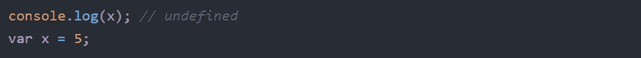

`let` 和 `const` 也会被提升，但不会被初始化，这意味着由于暂时性死区，在声明之前无法访问它们。

- 块级作用域与函数作用域：

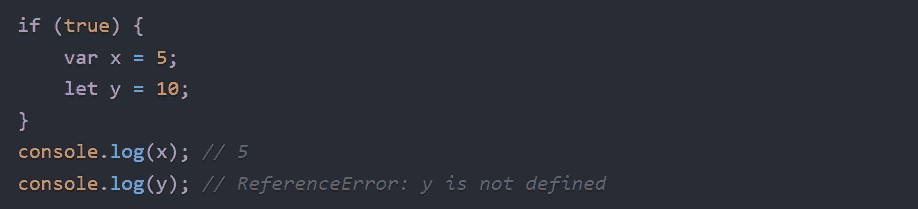

- 重新声明与重新赋值：

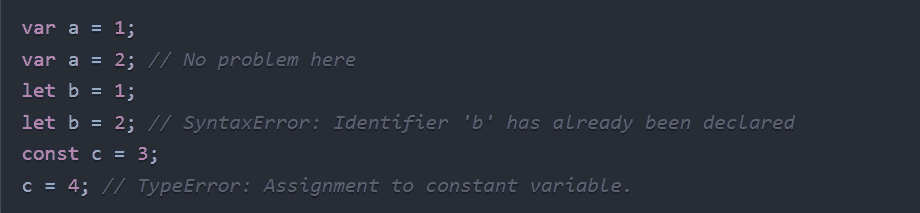

理解 `var`、`let` 和 `const` 之间的区别，以及它们的作用域和正确使用场景，对于编写健壮且无错误的 JavaScript 代码至关重要。

## 2.4 执行操作：基本运算符

### 2.4.1 算术运算符及其使用

JavaScript 中的算术运算符包括我们比较熟悉的加法（`+`）、减法（`-`）、乘法（`*`）和除法（`/`）。还有取模或余数运算符（`%`），它返回除法的余数；递增（`++`）和递减（`--`）运算符，分别将数字增加或减少 1。这些运算符用于执行数学计算。例如：

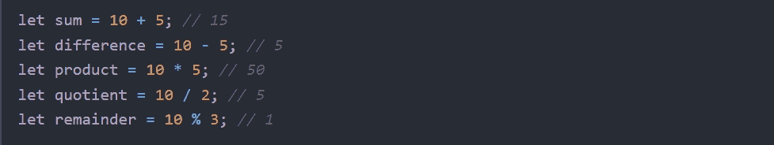

### 2.4.2 用于拼接的字符串运算符

在 JavaScript 中 `+` 运算符也用于拼接字符串。当 `+` 运算符与字符串一起使用时，它会将它们连接成一个字符串：


ES6 中引入的模板字面量提供了一种更强大的创建和操作字符串的方式。它们由反引号（`` `）括起来，可以包含由 `${expression}` 标记的占位符，这些占位符会被表达式的值替换：

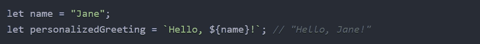

### 2.4.3 比较运算符与条件求值

比较运算符用于比较两个值，并返回一个布尔值，即 `true` 或 `false`。这些运算符包括：

- `==`（等于）
- `===`（严格等于，即值和类型都相等）
- `!=`（不等于）
- `!==`（严格不等于）
- `>`（大于）
- `<`（小于）
- `>=`（大于等于）
- `<=`（小于等于）

例如：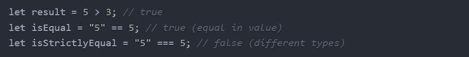

### 2.4.4 逻辑运算符：组合条件

逻辑运算符允许你组合多个条件。它们包括：

- `&&`（逻辑与）：如果两个操作数都为真，则返回 `true`。
- `||`（逻辑或）：如果其中一个或两个操作数为真，则返回 `true`。
- `!`（逻辑非）：如果操作数为假，则返回 `true`，反之亦然。

这些运算符常用于条件语句中，以组合多个条件：

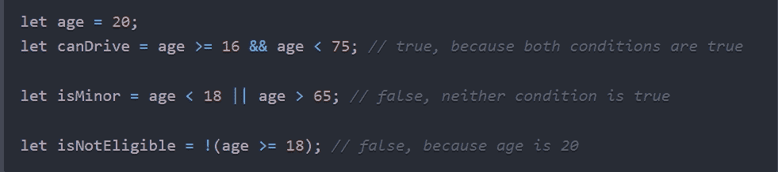

理解这些运算符以及如何有效使用它们，是 JavaScript 编程逻辑的关键部分，能够高效地执行复杂条件和计算。

## 2.5 理解运算符优先级

### 2.5.1 什么是运算符优先级及其重要性

运算符优先级指的是决定表达式中操作执行顺序的规则。在 JavaScript 中，与数学一样，除非使用括号明确指示，否则某些操作会优先于其他操作执行。

理解运算符优先级至关重要，因为它能确保复杂表达式按预期求值，不会产生意外结果。例如，算术运算遵循数学中常见的顺序（乘法优先于加法），这会影响表达式的求值方式。

### 2.5.2 运算符优先级与结合性规则

JavaScript 中的运算符具有特定的优先级级别，这决定了它们被求值的顺序。优先级高的运算符先于优先级低的运算符求值。

当运算符具有相同的优先级时，它们的结合性（从左到右或从右到左）决定了求值顺序。例如，赋值运算符 `=` 具有从右到左的结合性，这意味着像 `x = y = 5` 这样的表达式会被处理为 `x = (y = 5)`。

运算符优先级级别从高到低的示例：

- 分组：`()` 具有最高优先级，可以改变自然的优先级顺序。
- 成员访问：`.` 用于访问对象属性。
- 一元运算符：例如 `++`、`--`、`!` 和 `typeof`。
- 乘法和除法：`*`、`/` 和 `%`。
- 加法和减法：`+` 和 `-`。
- 关系运算符：`<`、`<=`、`>` 和 `>=`。
- 等等运算符：`==`、`!=`、`===` 和 `!==`。
- 逻辑与：`&&`。
- 逻辑或：`||`。
- 赋值：`=`、`+=`、`-=`、`*=` 和 `/=`。

### 2.5.3 覆盖默认优先级：使用括号

括号 `()` 可以覆盖标准操作顺序，确保括号内的表达式先被求值，无论自然的优先级规则如何。这允许在复杂表达式中显式控制求值顺序。

### 2.5.4 运算符优先级实际应用示例

1. 无括号：

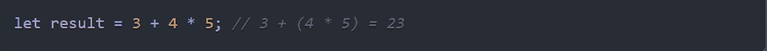

乘法 `*` 的优先级高于加法 `+`，因此先将 4 乘以 5，再将结果加上 3。

2. 有括号：


括号改变了自然优先级，因此先将 3 与 4 相加，再将结果乘以 5。

3. 组合不同类型：


先执行乘法，然后根据结合性从左到右执行加法和减法。

4. 逻辑运算符：


逻辑与 `&&` 的优先级高于逻辑或 `||`，但使用括号可以改变求值顺序，以明确意图或改变结果。

理解并利用运算符优先级，可以在 JavaScript 中编写精确且准确的表达式，这对于开发逻辑清晰且高效的代码至关重要。

## 控制流程

### 3.1 做出决策：`if`/`else` 语句

条件执行代码的能力使程序能够根据各种标准做出决策，这使得 `if`/else` 语句成为编程的基础。这里我们将探讨如何在 JavaScript 中使用这些控制结构。

#### 3.1.1 理解 `if` 语句

`if` 语句是最简单的控制流形式，允许你仅在给定条件为真时执行一段代码。其基本语法为：

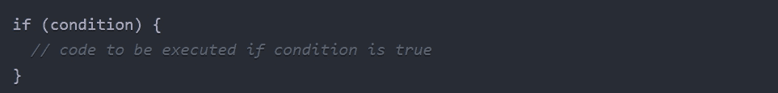

示例：

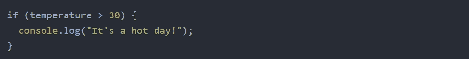

这里，只有当 `temperature` 大于 30 时，才会在控制台输出该消息。

#### 3.1.2 使用 `else` 和 `else if` 子句

为了在 `if` 条件为假时提供替代路径，可以使用 `else` 子句。对于多个条件，可以使用 `else if`。

语法：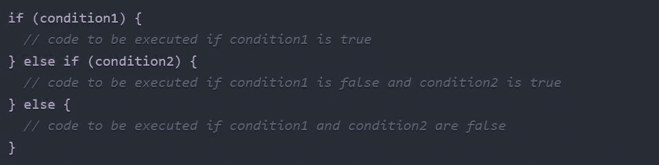示例：

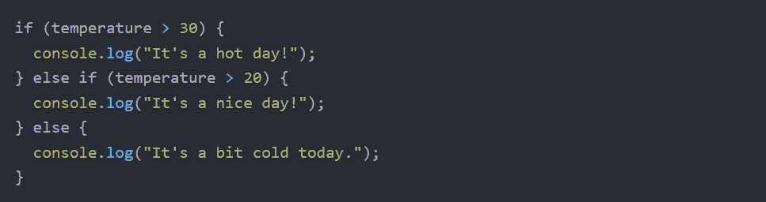

#### 3.1.3 嵌套 if 语句

`if` 语句可以相互嵌套，从而实现更复杂的决策。

示例：

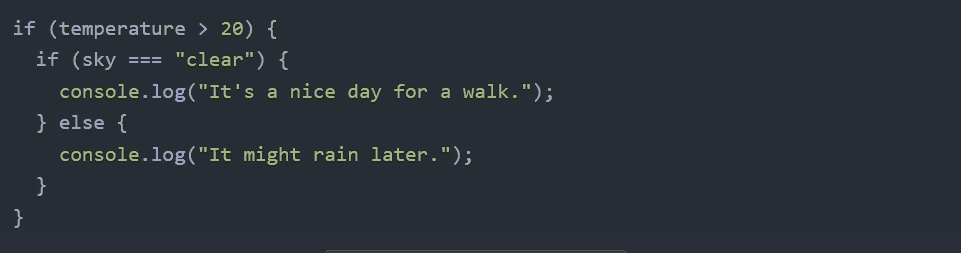此结构在外层条件（温度是否大于 20）内部测试另一个条件（天空是否晴朗）。

#### 3.1.4 用于条件赋值的三元运算符

对于简单条件，三元运算符提供了 `if/else` 语句的简洁替代方案。它接受三个操作数：一个条件、条件为真时执行的表达式，以及条件为假时执行的表达式。

语法：

示例：

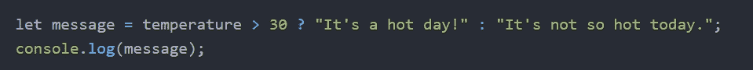这里，`message`根据 `temperature` 是否大于 30 被赋值为两个字符串之一。

理解并正确使用 `if` 语句和三元运算符，可以让你有效控制 JavaScript 程序的流程，使代码更具动态性并能响应不同条件。

## 3.2 重复操作：for 和 while 循环

循环是编程中的基本概念，允许你重复执行一段代码，直到满足指定条件。本章深入探讨 JavaScript 中的 `for` 和 `while` 循环、它们的变体以及控制循环执行。

### 3.2.1 for 循环简介

`for` 循环是最常用的循环之一。当迭代次数事先已知时，它特别有用。

语法：

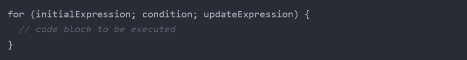

- `initialExpression`：初始化计数器变量。
- `condition`：每次循环迭代前评估。如果为真，循环继续；否则终止。
- `updateExpression`：每次迭代后执行，通常用于更新计数器。

示例：

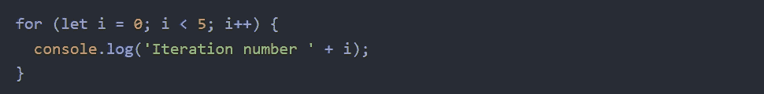此循环打印五次，`i`表示从 0 到 4 的迭代次数。

### 3.2.2 探索 while 循环

`while` 循环创建一个循环，只要条件评估为真就执行。与 `for` 循环不同，`while` 循环只需要表达式。

语法：

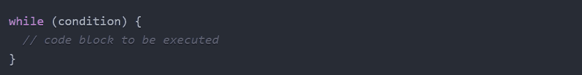示例：

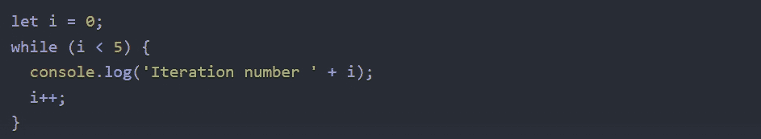这与之前的 `for` 循环功能相同，但展示了不同的语法。

### 3.2.3 do-while 循环变体

`do-while` 循环与 `while` 循环类似，但有一个关键区别：代码块在条件测试之前至少执行一次。

语法：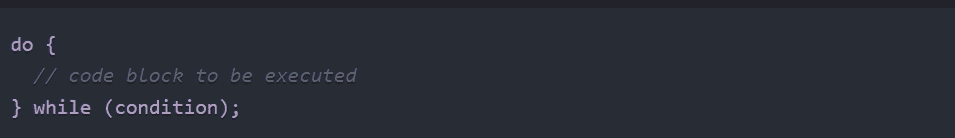示例：

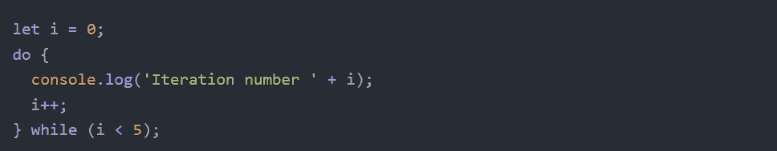即使条件在第一次评估为假，由于 `do-while` 循环的特性，代码块仍然执行一次。

### 3.2.4 循环控制：break 和 continue

`break` 和 `continue` 语句控制循环执行。`break` 完全退出循环，而 `continue` 跳过当前迭代并继续一次。

Break 示例：

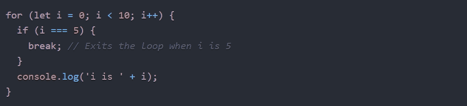Continue 示例：

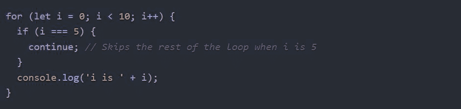理解并有效利用循环和控制语句，实现高效的代码执行，避免必要的冗余的操作，使程序更快。

## 3.3 遍历数据：循环数组

数组是 JavaScript 中的基本数据结构，常用于存储数据集合。高效地遍历数组以访问或修改元素是编程中的常见任务。本节探讨 JavaScript 中循环数组的不同方法。

### 3.3.1 使用 for 循环进行基本遍历

传统的 `for` 循环是通过索引遍历的直接方式。

示例：

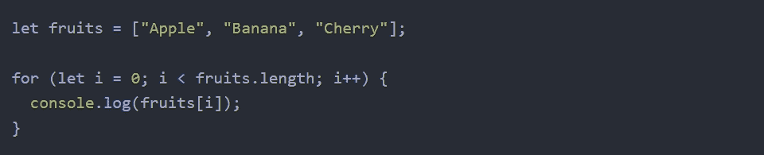这里，`fruits[i]`表示数组中的每个元素，循环从 0 迭代到 `fruits.length - 1`。

### 3.3.2 forEach 方法

`forEach` 方法提供了一种更简洁、具表现力的数组遍历方式。它接受一个回调函数，该函数对数组中的每个元素执行。

语法：示例：

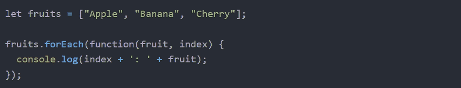此方法因其可读性和函数式遍历受到青睐。

### 3.3.3 使用 for...of 循环

`for...of` 循环在 ES6 中引入，简化了对对象（如数组、集合）的遍历。它直接访问元素，无需索引。

示例：

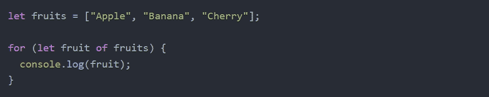`for...of`循环提供了简洁的语法，当只需要元素时尤其有用。

### 3.3.4 用于遍历的数组方法：map、filter 和 reduce

JavaScript 数组带有高阶函数，这些方法对数组进行操作并根据提供的函数返回新数组或值。

- `map()`创建一个新数组，填充了数组中每个元素调用函数的结果。示例：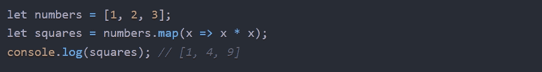
- `filter()`创建一个新数组，包含所有通过提供的函数测试的元素。示例：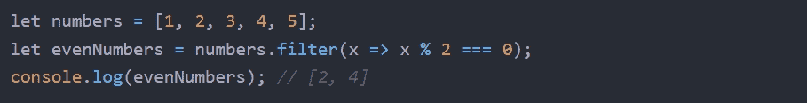
- `reduce()`对数组的每个元素应用归约函数，最终得到一个值。示例：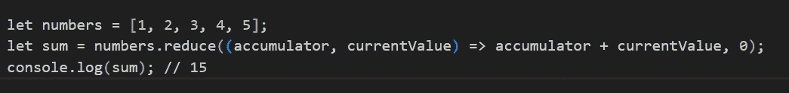

理解并有效使用这些遍历技术，可以编写更简洁、高效的代码。每种方法在处理数据时都有优势。

## 3.4 高级流程：switch语句和错误处理

除了简单的条件和循环结构，JavaScript 还提供了高级流程机制，如 `switch` 语句和错误处理 `try/catch/finally` 块。

### 3.4.1 使用 switch语句进行分支决策

`switch` 语句允许根据表达式的值执行不同的部分。当有多个潜在条件时特别有用。

语法：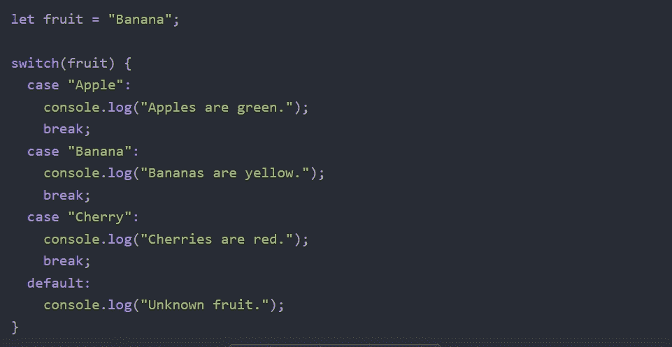此代码打印“Banana”，因为`fruit`的值匹配`case`。

### 3.4.2 使用 try/catch/finally 块进行错误处理

JavaScript 使用 `try/catch/finally` 块来处理异常并执行清理。可以使用 `catch` 块捕获错误或异常，防止程序崩溃。

语法：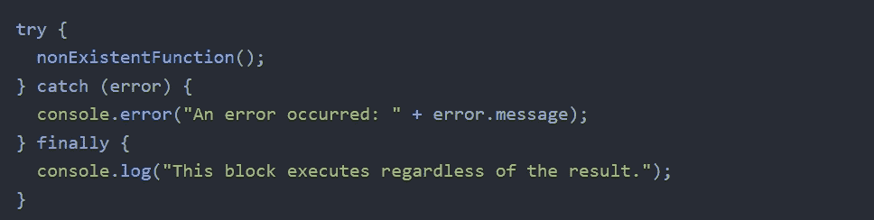此示例通过捕获不存在函数的错误演示错误处理。

### 3.4.3 使用 throw语句抛出自定义错误

可以使用 `throw` 语句抛出自定义错误在验证输入数据、以特定方式处理异常时有用。

语法：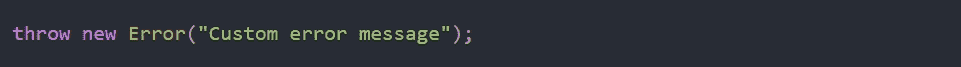示例：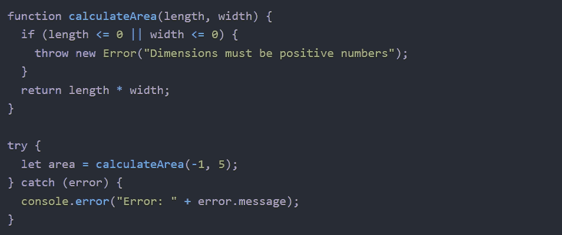如果尺寸不是正数，此代码会抛出错误，确保数据完整性。高级流程控制，如`switch`语句、错误处理和自定义错误，增强了管理逻辑的能力，使程序更健壮。

## 函数与作用域

### 4.1 定义和调用函数

函数是 JavaScript 中的基本构建之一，允许你定义多次执行的代码块。它们实现了代码的模块化、重用性和关注分离。

#### 4.1.1 函数基础

使用 `function`关键字声明，后跟名称、用括号 `()`括起来的参数列表，以及用花括号 `{}`括起来的代码块。

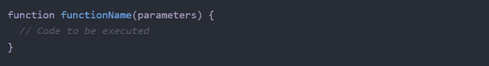示例：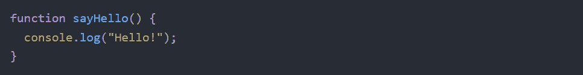要调用或执行函数，你需要使用函数名后跟括号：

#### 4.1.2 参数与实参

函数可以接受参数。参数作为函数执行任务使用的变量。当函数被调用时，你可以向这些参数传递值。这些值被称为实参。示例：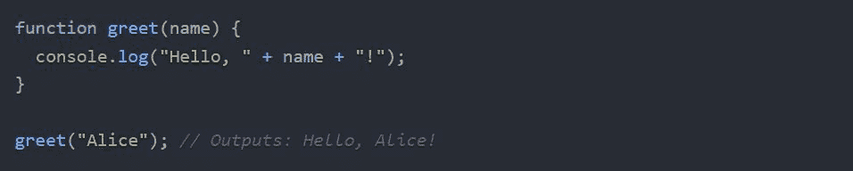在这个示例中，`name`是`greet`函数的参数，而 `"Alice"`是传递给函数的实参。

#### 4.1.3 函数返回值

函数可以使用 `return`语句返回值。一旦执行了 `return` 语句，函数就会停止执行并返回指定的值。示例：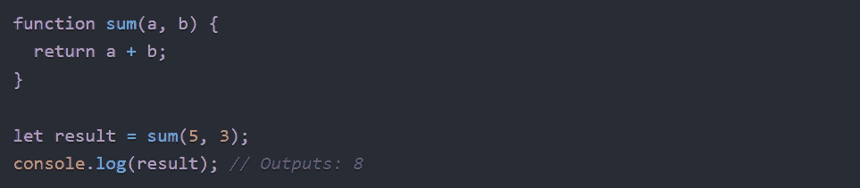如果函数没有指定返回值，则默认返回 `undefined`。

#### 4.1.4 立即调用与函数作为等公民

JavaScript 中的函数是一等公民，意味着它们可以像其他值一样被对待——可以赋值给变量、作为参数传递给其他函数，甚至从函数中返回。立即调用函数表达式（IIFE）：IIFE是一种定义后立即执行的函数。

语法：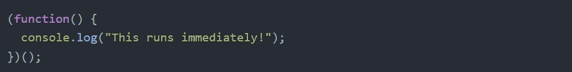IIFE对于创建私有作用域和污染全局命名空间非常有用。带参数的示例：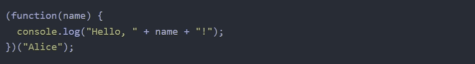函数作为一等公民允许灵活且强大的编程模式，包括回调、函数工厂等。

### 4.2 探索函数声明与函数表达式

在 JavaScript 中，可以通过多种方式创建函数，每种方式都有其细微差别和使用影响。理解函数声明与表达式之间的区别，以及命名和提升如何影响它们的行为，对于有效的 JavaScript 开发至关重要。

### 4.2.1 函数声明

函数声明定义了一个具名函数。函数声明的一个关键特性是它们会被提升，意味着可以在代码中声明之前调用该函数。语法：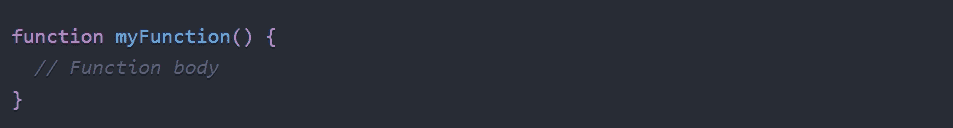示例：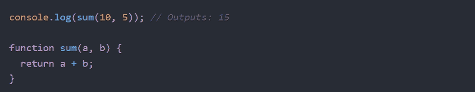尽管 `sum`在代码中出现之前就被调用了，但由于提升机制，程序可以无错误地执行它。

### 4.2.2 函数表达式

函数表达式将一个匿名函数或具名函数赋值给一个变量。函数表达式不会被提升，意味着不能在代码中定义它们之前调用它们。语法：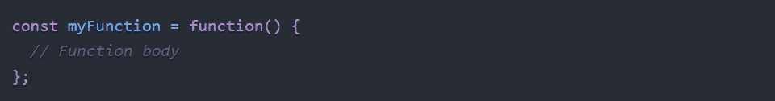示例：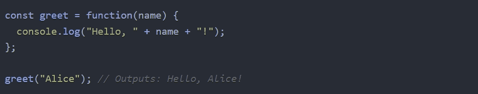尝试在定义之前调用 `greet`会导致错误，因为函数表达式不受提升。

### 4.2.3 具名函数与匿名函数

函数表达式可以是匿名的（如上所示），也可以是具名的。具名函数表达式：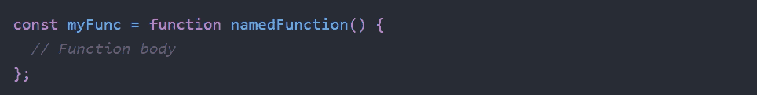一个关键区别在于调试：具名函数在堆栈跟踪中更容易识别。然而，在函数体内，你可以使用该名称来引用函数本身，例如创建递归调用。匿名函数表达式：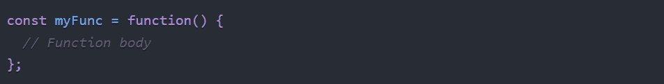匿名函数很常见，尤其是作为函数的参数或在 IIFE 中使用。

### 4.2.4 函数中的提升

提升是JavaScript的一种机制，其中变量和函数声明会在代码执行前被移动到其包含作用域的顶部。然而，这种行为在函数声明和表达式之间有所不同。

- 函数声明：完全提升，意味着整个函数被移动到其作用域的顶部，并且可以在源代码中声明之前使用。
- 函数表达式：变量声明被提升，但函数赋值不会被提升。如果尝试在定义之前调用函数表达式，你会遇到错误，因为该函数尚未定义。

示例演示：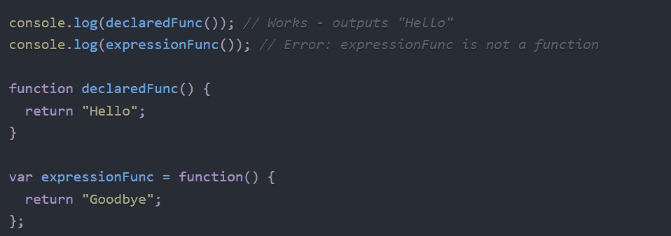


## 4.3 箭头函数：简洁的语法

箭头函数在 ECMAScript 6（ES6）中引入，为编写函数表达式提供了更简洁的语法。它们特别适用于短函数以及需要保留 `this` 词法作用域的情况。

### 4.3.1 语法与基本用法

箭头函数语法允许你用更少的代码行编写函数。省略了 `function` 关键字，改用 `=>` 箭头。

基本语法：

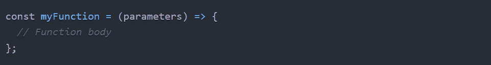无参数：

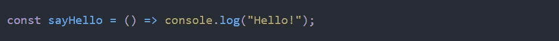单个参数：

多个参数：

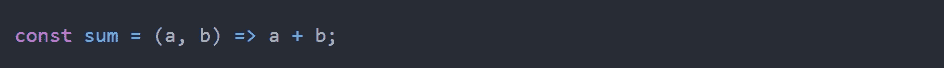返回对象：

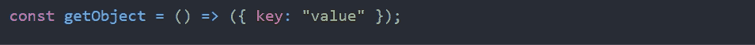

### 4.3.2 箭头函数与 `this` 关键字

箭头函数最有益的特性之一是它们如何处理 `this` 关键字。与传统函数不同，箭头函数内部的 `this` 值由外围（封闭）词法上下文决定，而不是由函数的调用方式决定。

示例：

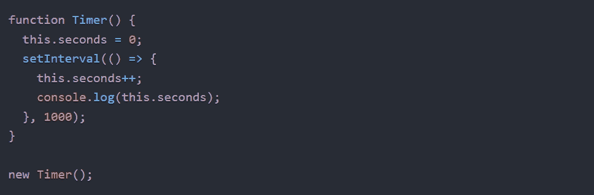在这个示例中，箭头函数内部的 `this` 正确地指向了 `Timer` 对象，因为它从外围代码继承了 `this`。

### 4.3.3 限制与特性

虽然箭头函数有几个优点，但它们也有局限性：

- 没有 `new` 关键字：箭头函数不能用作构造函数，尝试这样做会导致错误。
- 没有 `arguments` 对象：箭头函数没有自己的 `arguments` 对象。不过，你可以使用剩余参数来实现类似功能。
- 不能改变 `this`：`this` 的值是词法绑定的，意味着不能通过 `call`、`apply` 或 `bind` 等方法改变它。

### 4.3.4 箭头函数的实际用途

箭头函数在以下几种场景中表现出色：

- 回调和高阶函数：它们非常适合传递给数组方法（如 `.map()`、`.filter()` 和 `.reduce()`）的简短回调函数。


- 事件处理程序：当使用箭头函数作为事件处理程序时，它们会保留法法 `this`。


- 异步操作：箭头函数广泛用于 Promise 和异步函数中。


理解何时以及如何有效使用箭头函数可以大大简化你的 JavaScript 代码，并帮助在异步操作中维护 `this` 上下文，从而编写出更清晰、更易于维护的代码。

## 4.4 作用域：理解局部与全局

作用域是 JavaScript 中的一个基本概念，决定了变量和函数在代码不同部分的可访问性。理解作用域对于管理变量的生命周期以及避免冲突和错误至关重要。

### 4.4.1 什么是作用域？

JavaScript 中的作用域指的是变量或函数可访问的上下文。JavaScript 有三种主要的作用域类型：

- 全局作用域：在全局作用域中定义的变量可以从代码的任何部分访问。
- 函数（局部）作用域：在函数内部定义的变量只能在该函数内部访问。
- 块级作用域：在块 `{}` 内部定义的变量只能在该块内部访问。这个概念在使用 `let` 和 `const` 关键字时适用。

### 4.4.2 局部（函数）作用域与块级作用域

- 函数作用域：使用 `var` 在函数内部声明的变量无法从函数外部访问。


- 块级作用域：ES6 引入的，使用 `let` 和 `const` 声明的变量作用域限定在最近的封闭块内，而不仅仅是函数块。


### 4.4.3 全局作用域

在全局作用域中声明的变量可以从程序的任何部分访问。然而，污染全局作用域可能导致名称冲突和难以追踪的 bug，因此通常最好尽量减少全局变量的使用。

### 4.4.4 `let` 和 `const` 关键字

ES6 引入了 `let` 和 `const`，它们提供了块级作用域，比函数作用域或全局作用域的 `var` 更具控制力。

- `let` 允许你声明变量，其作用域限定在使用的块、语句或表达式中。
- `const` 与 `let` 类似，但用于声明其值不应通过重新赋值改变的变量。

`let` 和 `const` 都不会像 `var` 那样被提升，因此使用它们更安全，可以防止在声明前意外引用。

### 4.4.5 变量遮蔽与作用域链

当在嵌套作用域中声明了同名的变量时，就会发生变量遮蔽，从而有效地遮蔽外部变量。


作用域链是 JavaScript 搜索变量的机制：从最内层作用域开始，向外层移动，直到找到变量或到达全局作用域。理解作用域，包括全局、局部和块作用域之间的区别，以及变量遮蔽和作用域链等概念，是编写清晰、有效的代码的基础。

## 更多关于函数

### 5.1 函数调用：深入探讨

在 JavaScript 基本的基础上，本节探讨围绕函数的复杂交互。通过探索组合、递归以及高阶函数和纯函数的使用，解锁了强大的范式和技巧。

#### 5.1.1 组合与链式调用

组合是将两个或多个函数组合以产生一个新函数。组合有助于创建模块化和重用的代码。链式调用是在同一个对象上连续调用多个函数。这是 JavaScript 中的常见模式，常见于 jQuery 或 Lodash 等库。

组合示例：img/image_rsrc1Z7.jpg

#### 5.1.2 递归函数

递归函数是直接或间接调用自身的，为某些问题（尤其是可以分解为相似问题）提供了优雅的解决方案。递归函数有一个基本条件来防止无限循环和栈溢出。

示例：img/image_rsrc18.jpg

#### 5.1.3 高阶函数

高阶函数可以将其他函数作为参数或返回函数作为结果。这一概念是函数式编程的基石，允许抽象行为。

示例：img/image_rsrc19.jpg

#### 5.1.4 纯函数与副作用

纯函数是指对于相同的输入总是产生相同输出，并且不引起任何副作用（修改作用域之外的状态）。

无副作用示例：img/image_rsrc1ZA.jpg

有副作用示例：img/image_rsrc1ZB.jpg

纯函数提高了代码的可读性、测试性和维护性，因为它们不修改作用域之外的状态。理解如何正确管理和操作传递给函数的数据，对于确保代码的可靠性至重要。

## 5.2 传值与引用

在 JavaScript 中，理解数据是如何传递——按值还是引用——对于掌握行为至关重要，尤其是在对象和数组环境中。本节探讨原始类型与引用类型之间的区别、可变性与不可变性的概念，以及克隆数据以保留状态。

#### 5.2.1 原始类型与引用类型

原始类型直接存储在变量的位置。这些类型包括 `number`、`string`、`boolean`、`undefined`、`null`、`symbol` 和 `bigint`。按值传递给函数即创建副本。img/image_rsrc1ZC.jpg

引用类型包括对象、数组。按引用传递给函数即指向原始数据的指针，函数内的修改会影响原始数据。img/image_rsrcZD.jpg

#### 5.2.2 可变性与不可变性

- 可变性是指数据结构在创建后可以修改的能力。JavaScript 中对象和数组默认是可变的。
- 不变性意味着一旦创建了数据结构就不能更改。JavaScript 中的原始值是不可变的。

理解这些概念对于处理可能修改输入的函数至重要。

#### 5.2.3 克隆对象和数组

为了防止通过引用传递对象或数组产生不必要的副作用，在操作之前进行克隆或复制至关重要。

- 浅克隆可以通过 `Object.assign()` 或对象的展开语法 `...` 实现，数组可以使用 `Array.slice()`。这种方法只复制顶层，嵌套的对象或数组仍然引用数据。img/image_rsrc1ZE.jpg

- 深克隆可以使用 Lodash 的 `_.cloneDeep()` 方法，或手动实现递归克隆。它确保不保留原始对象的引用。

#### 5.2.4 引用的常见陷阱及避免方法

与引用类型相关的常见问题包括意外修改、不必要的深拷贝导致的性能下降，以及不正确的深隆实现导致的栈溢出。

避免陷阱的方法：

- 向函数传递参数时，注意数据类型（原始类型 vs. 引用类型）。
- 默认对对象和数组使用 `const`，以防止重新赋值。
- 如果需要修改对象或数组而不影响原始数据，则显式克隆它们。
- 对于深嵌套，考虑使用专为不可变性设计的库（例如 `Immer`、`Immutable.js`）来简化状态管理。

## 5.3 返回值的威力

函数中的返回值不仅仅是计算的结果。它们是提高代码模块化、可组合性和可靠性的重要工具，有助于错误处理，并通过更简洁的语法增强可读性。

### 5.3.1 利用返回值增强模块化

代码的模块化是指将其组织成小的、可重用的组件。返回值的函数可以看作是单一用途的单元，根据接收的输入输出数据。这允许通过组合这些模块化单元来构建更复杂的功能。img/image_rsrc1ZF.jpg

### 5.3.2 使用返回值创建可组合的代码

组合的代码是指能够将简单函数组合成更复杂函数的能力。返回值对于组合至关重要，因为它们使一个函数的输出能够无缝地流入另一个函数的输入。

### 5.3.3 通过返回值进行错误处理

函数可以使用返回值来指示成功或失败，从而使错误处理更具预测性。这种策略通常涉及返回一个包含状态码和错误消息或操作结果的对象。img/image_rsrc1ZG.jpg 通过检查 `success` 属性，代码的其他部分可以适当地响应函数的结果。

### 5.3.4 提前返回以简化代码

提前返回是一种通过一旦满足特定条件就退出函数来提高代码可读性的策略，避免了 `if-else` 语句的深层嵌套，并使函数的主要操作清晰明了。img/image_rsrc1ZH.jpg 提前返回有助于防止不必要的计算，并使函数的逻辑更易于理解。

## 5.4 回调函数

回调函数是 JavaScript 中的基础概念，用于异步操作、自定义功能以及处理可能立即完成的操作。回调作为参数传递，允许基于事件或条件动态执行。

### 5.4.1 基本用法和示例

回调函数在给定任务时被调用。这种模式允许一个函数接受另一个函数作为参数，并在自身执行。

### 5.4.2 用于异步操作的回调

JavaScript 中，回调广泛用于处理异步操作，例如读取文件、发起 HTTP 请求或查询，这些操作中不知道何时响应。使用 `setTimeout` 的示例：img/image_rsrc1ZJ.jpg

### 5.4.3 使用回调自定义功能

回调允许执行不同的代码片段而不改变结构。

### 5.4.4 回调中的错误处理

错误处理是回调函数的一个重要方面。一种常见模式是，如果发生错误，将错误作为第一个参数传递给回调。示例：img/image_rsrc1ZK.jpg

## 5.5 高级函数模式

高级函数模式揭示了可以优化、模块化和保护 JavaScript 代码的强大技术。包括立即执行函数（IIFE）、流和防抖、柯里化和函数应用，以及使用封装数据。

### 5.5.1 立即执行函数 (IIFE)

`IIFE` 是一种在定义后立即执行的函数。这种模式为了避免命名空间。示例：img/image_rsrc1ZM.jpg IIFE 也可以通过赋值获取返回值。img/image_rsrc1ZN.jpg

### 5.5.2 流和防抖

流确保一个函数在指定时间段内最多调用一次。对于处理频繁触发（如窗口调整或滚动）非常有用。流示例：img/image_rsrc1ZP.jpg

### 5.5.3 柯里化和函数应用

柯里化将接受多个参数函数转换为一系列只接受一个参数函数。函数应用是指固定一个参数，产生另一个函数。柯里化示例：img/image_rsrc1ZR.jpg

### 5.5.4 使用封装数据

在 JavaScript 中，闭包用于创建私有数据。这种模式涉及定义一个函数，返回另一个函数。示例：img/image_rsrc1ZS.jpg

## 6 数组与对象

### 6.1 数组简介：处理数据

JavaScript 中的数组用于在变量中存储多个值。它们是相似类型元素集合。数组提供了多种遍历和修改的方法。让我们了解如何创建、初始化数组。

#### 6.1.1 创建和初始化数组

使用方括号 `[]` 或 `Array` 构造函数来创建和初始化数组。使用方括号：img/image_rsrc1ZT.jpg 使用 `Array` 构造函数：img/image_rsrc1ZU.jpg 也可以创建空数组然后填充数据。

#### 6.1.2 基本数组方法（`push`、`pop`、`shift`、`unshift`）

- `push`：向数组末尾添加或多个元素并返回数组的新长度。img/image_rsrc1ZV.jpg
- `pop`：从数组中移除最后一个元素并返回该元素。此方法改变数组的长度。img/image_rsrc1ZW.jpg
- `shift`：从数组中移除第一个元素并返回被移除的元素。此方法改变数组的长度。img/image_rsrc1ZX.jpg
- `unshift`：向数组开头添加或多个元素并返回数组的新长度。img/image_rsrc1ZY.jpg

#### 6.1.3 遍历数组

可以使用多种方法遍历数组，包括循环和数组迭代方法（如 `forEach`）。使用 `for` 循环：使用 `forEach`：img/image_rsrc1ZZ.jpg

#### 6.1.4 多维数组

多维数组是元素为数组的数组。它们对于表示矩阵或任何网状结构结构有用。img/image_rsrc200.jpg 在多维数组中，使用嵌套循环或递归应用 `forEach` 或其他迭代方法遍历每个维度。

### 6.2 基本和高级数组操作

数组是通用的结构，不仅允许存储数据，还允许对数据进行复杂操作。通过多种内置方法，JavaScript 使开发者对数组执行基本和高级操作，从排序和过滤到将内容缩减为单个值。

### 6.2.1 排序和反转数组

- 排序数组：`sort()` 方法对数组元素进行原地排序并返回排序后的数组。默认情况下，`sort()` 将元素按字符串的字母顺序升序排列。但是，可以提供一个比较函数来确定排序顺序。img/image_rsrc201.jpg
- 反转数组：`reverse()` 方法会就地反转数组。第一个数组元素变为最后一个，最后一个数组元素变为第一个。img/image_rsrc202.jpg

### 6.2.2 过滤与映射数组

- 过滤数组：`filter()` 方法创建一个新数组，其中包含所有通过所提供函数测试的元素。img/image_rsrc203.jpg
- 映射数组：`map()` 方法创建一个新数组，其结果是调用数组中的每个元素上提供的函数返回值。img/image_rsrc204.jpg

### 6.2.3 将数组归约为单个值

`reduce()` 方法对数组中的每个元素执行一个归约函数（由你提供），最终返回一个单一的输出值。img/image_rsrc205.jpg

### 6.2.4 合并与切片数组

- 合并数组：`concat()` 方法用于合并两个或多个数组。此方法不会更改现有数组，而是返回一个新数组。img/image_rsrc206.jpg


- 切片数组：`slice()` 方法返回一个数组的一部分的浅拷贝，该拷贝是从 `start` 到 `end`（不包括 `end`）选取的新数组对象，其中 `start` 和 `end` 表示该数组中项的索引。原数组不会被修改。

这些操作展示了 JavaScript 中数组的强大和灵活性，为开发者提供了一套丰富的数据操作和分析工具。

## 6.3 理解对象：键值对

在 JavaScript 中，对象是键值对的集合。它们是构建复杂数据结构的基础，并提供了一种高效组织和处理数据的方式。让我们探索如何在对象中创建、操作和访问信息。

### 6.3.1 创建对象与对象字面量

在 JavaScript 中，可以使用对象字面量语法或 `Object` 构造函数来创建对象。

对象字面量语法：

使用 `Object` 构造函数：

对象字面量是一种简洁且首选的创建对象的方式。

### 6.3.2 嵌套对象

对象可以包含其他对象，从而能够创建复杂的数据结构。可以使用点号或方括号的链式表示法来访问嵌套对象。

### 6.3.3 使用 `for...in` 和 `Object.keys()` 遍历对象

要遍历对象的属性，可以使用 `for...in` 循环或 `Object.keys()` 方法。

使用 `for...in`：

使用 `Object.keys()`：

这些方法提供了一种动态访问和操作对象属性的方式。

### 6.3.4 解构对象

解构提供了一种将对象中的属性解包到不同变量中的方式。

你还可以在解构时提供新的变量名。

解构可以极大地简化处理对象的过程，使代码更清晰、更易读。

理解对象及其操作在 JavaScript 中至关重要，因为它们是数据表示的基石。从简单的键值对到复杂的嵌套对象，掌握对象可以让开发者高效地组织和处理数据。

## 6.4 访问对象属性：点号表示法与方括号表示法

访问 JavaScript 对象属性主要有两种方式：点号表示法和方括号表示法。理解何时以及如何使用每种方法，可以帮助你高效地处理对象及其属性。

### 6.4.1 何时使用点号表示法

点号表示法是访问对象属性最常见、最直接的方式。它因其可读性和简洁性而备受青睐。


点号表示法应在以下情况使用：

- 属性名事先已知，并且是一个有效的 JavaScript 标识符。
- 访问的是不需要动态求值的静态属性。

### 6.4.2 何时使用方括号表示法

方括号表示法比点号表示法更灵活，但可能稍显冗长。它允许使用标识符中不允许的字符，例如空格或数字开头。此外，当属性名是动态确定时，方括号表示法至关重要。


在以下情况使用方括号表示法：

- 属性名包含特殊字符或空格。
- 属性名以数字开头。
- 属性名存储在变量中或需要计算得出。

### 6.4.3 动态属性名

在处理动态确定的属性（例如基于用户输入或运行时值）时，方括号表示法大放异彩。

这种能力在需要灵活性的场景中特别有用，例如遍历对象中的键或根据变量输入访问属性。

### 6.4.4 属性存在性与枚举

要检查对象是否具有特定属性，可以使用 `in` 运算符或 `Object.hasOwnProperty()` 方法。


要枚举（列出）对象的属性，可以使用 `Object.keys()`、`Object.values()` 或 `Object.entries()` 方法，它们分别返回属性的名称、值或两者。


选择合适的表示法并理解属性存在性与枚举，可以让你在 JavaScript 应用程序中更有效地操作和查询对象。

## 深入理解对象

### 7.1 面向对象 JavaScript 简介

面向对象编程（OOP）是一种基于“对象”概念的编程范式，对象可以包含字段（通常称为属性）形式的数据和过程（通常称为方法）形式的代码。JavaScript 通过原型支持 OOP，并且从 ES6（ECMAScript 2015）开始，还支持类来实现。

#### 面向对象编程四大支柱

面向对象编程四大支柱包括：

1. 封装：该原则是将数据以及操作的方法绑到一个“对象”单一单元中。它限制对对象某些组件的访问。
2. 抽象：意味着隐藏复杂的现实，只暴露必要的部分。通过提供实体的简化模型来突出。
3. 继承：这是一种机制，允许一个类获取另一个类的属性（方法）。通过继承，你可以创建一个通用类，然后扩展为专门类。
4. 多态：允许实体以多种形式表示。它是在不同对象上调用相同方法让每个对象以自己的响应的能力。

#### JavaScript 中的对象和类

在 JavaScript 中，传统上，原型是添加方法和属性的主要方式。然而 ES6 引入了类，它基于原型的继承之上添加了一层，使得实现复杂的对象更加容易。示例：


#### 封装与信息隐藏

JavaScript 类通过将数据（属性）和操作数据的函数（方法）集成到一个类的单元中来支持封装。然而，直到最近，JavaScript 没有直接支持数据隐藏，通常通过闭包或私有字段语法来实现。使用私有字段的示例：


#### 类中的方法与 `this` 上下文

方法是可以对对象执行的操作。JavaScript 方法定义存储在属性中。方法中的 `this` 关键字指向该方法的所有者。在类的上下文中，`this` 指向实例。`this` 的值直到方法调用时才绑定。如果方法依赖于 `this`，将其作为回调传递可能会导致错误。箭头函数用于自动将 `this` 绑定到函数定义的作用域，而不是使用它的作用域。理解这些概念对于 JavaScript 中有效利用面向对象编程技术至关重要，最终有助于编写更结构化、易于管理的代码。

## 7.2 理解 `this` 关键字

JavaScript 中的 `this` 关键字是一个强大的特性，一旦理解它，就能极大地增强代码的灵活性能力。它指向所属的对象，因此是上下文相关的。它的值根据函数的调用方式而变化。

### 7.2.1 全局作用域和函数作用域中的 `this`

在全局执行上下文（任何函数外部）中，无论处于严格模式，`this` 都指向全局对象。在 Web 浏览器中，全局对象是 `window`。


在普通（非箭头）函数中，`this` 在函数被调用时动态设置。在全局作用域或未与对象关联的函数内部，非严格模式下 `this` 指向全局对象，严格模式下为 `undefined`。


### 7.2.2 方法和构造函数中的 `this`

方法作为对象的属性被调用时，`this` 指向调用方法的对象。在构造函数（旨在与 `new` 关键字一起使用的函数或类）中，`this` 指向新创建的对象实例。


### 7.2.3 使用 `call`、`apply` 和 `bind` 的 `this`

`call`、`apply` 和 `bind` 是允许你在调用函数时手动设置 `this` 值的方法。

- `call()` 允许你以指定的 `this` 值和逐个提供的参数来调用函数。
- `apply()` 与 `call` 类似，但接受一个参数数组。
- `bind()` 返回一个新函数，允许永久设置 `this` 值。

### 7.2.4 箭头函数与词法 `this`

箭头函数没有自己的 `this` 上下文；相反，它们捕获创建时所在封闭作用域的 `this` 值。这词法作用域。


由于箭头函数中 `this` 的词法作用域特性，它们特别适用于回调函数，因为你希望 `this` 指向外部上下文。理解 `this` 的行为使得在 JavaScript 中能够进行更灵活的面向对象编程，让开发者能够显式定义并控制代码执行的上下文。

## 7.3 构造函数与对象实例

JavaScript 提供了多种创建对象和实现继承的范式，每种范式都有其细微差别和适用场景。理解这些差异对于编写健壮且可维护的代码至关重要。

### 7.3.1 使用构造函数创建对象

构造函数是 JavaScript 中创建对象的传统方式。这些函数使用 `this` 关键字为对象分配属性，当函数与 `new` 关键字一起调用时，这些属性将被赋予新创建的对象。


### 7.3.2 `new` 关键字及其作用

将 `new` 关键字与构造函数一起使用会执行以下操作：

1. 创建一个新的空对象。
2. 将构造函数的 `this` 上下设置为指向新创建的对象。
3. 执行构造函数体。
4. 将新对象的原型设置为构造函数的 `prototype`。
5. 返回新创建的对象（除非构造函数显式返回了另一个对象）。

### 7.3.3 工厂函数与构造函数

与构造函数不同，工厂函数通常使用 `new` 关键字或 `this`。相反，工厂函数显式创建并返回一个新对象，提供更灵活的对象创建方式。


### 7.3.4 使用 `call` 和 `apply` 实现构造函数

继承可以通过在构造函数中使用 `call` 或 `apply` 实现，允许一个构造函数在其内部调用另一个构造函数，并将上下文（`this`）设置为新创建的对象。

## 7.4 原型与继承

JavaScript 采用基于原型的继承，与许多语言中基于类的继承不同。模型允许对象从其他对象继承属性和方法。

### 7.4.1 理解 JavaScript 中的原型

在 JavaScript 中，每个函数和对象都有名为 `prototype` 的属性，但 `null` 对象除外。当函数与 `new` 关键字一起使用时，新创建的对象从构造函数的 `prototype` 继承。

### 7.4.2 原型链与继承

原型链是对象之间的系列链接，每个对象都引用其原型。当访问对象的属性或方法时，JavaScript 首先在对象自身查找。如果找不到，则查找对象的原型，然后是原型的原型，依此类推直到 `null`。这条链是 JavaScript 中继承的基础。例如，假设有一个对象 `O` 继承自 `B`，而 `B` 又继承自 `A`。如果在 `O` 上找不到某个属性，查找会转移到 `B`，如果在 `B` 上也找不到，继续到 `A`。

### 7.4.3 原型属性遮蔽

当添加到对象的属性与原型链中的属性同名时，就会发生遮蔽。对象上的属性会遮蔽”原型上的属性，意味着如果对象存在同名属性，则无法通过该对象访问原型上的属性。这可能很有用，但也需要注意如果不小心遮蔽了原型属性，可能会导致意外。

```javascript
function Person() {}
Person.prototype.name = "Anonymous";

const person = new Person();
console.log(person.name); // Anonymous

person.name = "John"; console.log(person.name); // John - 实例上的属性遮蔽了原型上的属性。
```

### 7.4.4 原型继承模式

在 JavaScript 中，有几种使用原型实现继承的模式：

- 构造函数模式：如前所述，使用构造函数和 `new` 关键字。
- 原型模式：直接操作构造函数的 `prototype` 以实现继承。
- `Object.create()`：一种现代方法，可以创建具有原型对象和属性的新对象。

使用 `Object.create()`，可以轻松设置继承：


每种模式都有其优点和适用场景。选择哪种模式取决于继承的复杂性、性能考量以及个人或团队的偏好等因素。JavaScript 的原型继承模型相比经典模型更具活性且简洁。通过充分理解和利用原型，开发者可以实现强大且高效的继承结构。

## 7.5 高级对象模式与技巧

随着开发者深入使用 JavaScript，他们经常会遇到需要高级对象操作和设计模式的复杂场景。这些模式和技巧有助于编写更易维护、更灵活且具扩展性的代码。

### 7.5.1 组合优于继承

“组合优于继承”原则建议对象的行为和状态应通过包含其他对象来获得，而不是从超类继承。这种方法可以构建更模块化、更易理解的系统，因为它鼓励设计小而复用的实体。组合避免了深层继承层次结构的陷阱，后者可能变得笨重且脆弱。我们不再问“这个对象是什么？”，而是问“这个对象能做什么？”，关注能力而非血统。


### 7.5.2 混入与对象组合

混入是对象组合的一种形式，其中组件的特性被混合到复合对象中。这使得对象可以从多个来源构建，增加了对象定义和使用的灵活性。


### 7.5.3 封装私有属性和方法

JavaScript 没有内置对私有属性和方法的支持，但可以通过模拟实现。一种常见的技术是使用闭包：


随着 ES6 的推出，JavaScript 引入了一种更正式的方式来定义私有字段，即使用哈希 `#` 前缀：

### 7.5.4 对象不可变性与只读属性

使对象不可变（创建后无法更改）是一种强大的技术，尤其在函数式编程中。要使属性只读，可以使用 `Object.defineProperty()` 或 `Object.defineProperties()`：

```javascript
const obj = {};
Object.defineProperty(obj, 'readOnly', {
value: 'This is read-only',
writable: false // 阻止属性写入
});

console.log(obj.readOnly); // 'This is read-only'
// obj.readOnly = 'New Value'; 在严格模式下尝试写入将失败。
```

对于深层不可变性，可以使用 `Object.freeze()` 递归冻结对象，但需要注意这是一个浅层操作。

## 8. 异步 JavaScript

### 8.1 理解异步 JavaScript

异步 JavaScript 允许执行长时间的操作而不阻塞主线程，从而保持用户界面的响应性。理解 JavaScript 中处理异步操作的核心概念和可用工具对于现代 Web 开发至关重要。

#### 8.1.1 事件循环与非阻塞 I/O

JavaScript 是单线程的，意味着一次一次执行一段代码。事件循环是一种机制，它允许 JavaScript 通过尽可能将操作卸载到系统内核来执行非阻塞 I/O 操作（如读取文件或发起 HTTP 请求）。当这些操作完成时，它们会作为事件返回给 JavaScript。事件循环持续检查消息队列中是否有完成事件，并在它们到达时处理其回调函数。这种模型允许 JavaScript 在等待异步操作的同时执行其他任务。

#### 8.1.2 使用回调函数

回调函数是作为参数传递给另一个函数的，当异步操作完成时，该函数会执行回调。虽然回调有助于管理异步操作，但它们可能导致“回调地狱”或“末日金字塔”，即回调嵌套在回调中，使代码难以阅读和维护。

#### 8.1.3 Promise：创建与链式调用

`Promise` 是一个表示异步操作最终完成（或失败）的对象。与回调相比，`Promise` 提供了一种更清晰、更灵活的方式来处理异步操作。


你可以通过链式调用 `.then()` 来处理异步操作序列，从而编写出既更易读又更易维护的代码。此外，`.catch()` 提供了一种集中处理错误的方式。


### 8.1.4 Async/Await 实现异步流程控制

`async`/`await` 简化了使用 `Promise` 所需的语法，使异步代码看起来更像同步代码，从而更易于理解和调试。

`async` 函数返回一个 `Promise`，而 `await` 会暂停 `async` 函数的执行，直到 `Promise` 被解决。


### 8.1.5 异步 JavaScript 中的错误处理

在异步 JavaScript 中，正确的错误处理对于确保可靠性和可维护性至关重要。使用回调时，需要在每个回调中手动处理错误。`Promise` 和 `async`/`await` 则分别通过 `.catch()` 和 `try`/catch` 块提供了更简化的错误处理方式。


理解这些概念并有效利用 JavaScript 提供的处理异步操作的工具，是开发现代 Web 应用程序的基本技能。

## 8.2 发起 HTTP 请求

发起 HTTP 请求是 Web 开发的基础，它使客户端代码能够与服务器、API 和其他 Web 服务进行通信。理解如何有效地发起和管理这些请求对于创建动态、数据驱动的 Web 应用程序至关重要。

### 8.2.1 Fetch API 简介

`Fetch` API 提供了一种基于 `Promise` 的现代机制来发起异步 HTTP 请求。与旧技术相比，`Fetch` 提供了更强大、更灵活的功能集来处理请求和响应。它内置于全局 `window` 作用域中，因此在现代浏览器中可直接使用。


### 8.2.2 使用 XMLHttpRequest 实现 AJAX

在 `Fetch` 出现之前，`XMLHttpRequest`（`XHR`）是 Web 应用程序与服务器异步交互的主要方式。虽然它不如 `Fetch` 友好，但理解 `XHR` 对于维护旧代码库或在某些 `Fetch` 不可用的特定场景中仍然很重要。

### 8.2.3 处理网络错误与 Fetch API 的局限性

虽然 `Fetch` 简化了发起 HTTP 请求的过程，但处理潜在错误并了解其局限性至关重要。一个常见的误解是 `Fetch` 仅在网络错误时拒绝其 `promise`，而不会针对 HTTP 错误状态（如 404 或 500）拒绝。

要正确处理错误（包括 HTTP 状态错误）：

### 8.2.4 超越 GET 请求：POST、PUT、DELETE

`Fetch` 可以处理所有类型的 HTTP 请求，包括 POST、PUT 和 DELETE。这通过在 `fetch` 调用中设置选项来实现，指定 `method`，以及非 `GET` 请求所需的 `headers` 和 `body`。

### 8.2.5 使用 Headers 和 CORS

HTTP 请求中的 `Headers` 允许客户端在请求或响应中传递附加信息。例如，`Headers` 可用于指定内容类型、身份验证令牌或 CORS（跨域资源共享）策略。

跨域资源共享（CORS）是一种安全机制，用于限制网页上的资源如何从最初提供资源的域名之外的另一个域名请求。在使用 API 或执行 POST、PUT、DELETE 操作时，如果服务器未配置为允许来自你所在域名的请求，通常会遇到 CORS 错误。

管理请求头并理解 CORS 对于开发能够安全高效地与外部服务交互的 Web 应用至关重要。


掌握这些 HTTP 请求的方面为 Web 开发者打开了广阔的可能性，从与第三方 API 交互到构建依赖服务器端数据和操作的复杂 Web 应用。

## 8.3 处理 JSON 数据

JavaScript 对象表示法（JSON）是一种轻量级的数据交换格式，易于人类读写，也易于机器解析和生成。它基于 JavaScript 编程语言的一个子集，常用于在 Web 应用中客户端与服务器之间传输数据。

### 8.3.1 JSON 格式与数据类型

JSON 基于两种结构：

- 名称/值对的集合（通常实现为对象、记录、结构体、字典、哈希表、键控列表或关联数组）。
- 值的有序列表（通常实现为数组、向量、列表或序列）。

JSON 支持以下数据类型：

- 字符串
- 数字
- 布尔值（`true` 和 `false`）
- null
- 对象（名称/值对的集合）
- 数组（值的有序列表）

数据以键/值对的形式组织，其中每个键都是字符串，值可以是 JSON 支持的任何数据类型。JSON 中的字符串必须用双引号括起来。

### 8.3.2 使用 `JSON.parse` 解析 JSON

`JSON.parse` 将 JSON 格式的字符串转换为 JavaScript 对象。当你从服务器接收到 JSON 格式的文本数据，并需要将其转换为 JavaScript 对象进行操作时，这尤其有用。

### 8.3.3 使用 `JSON.stringify` 序列化对象

`JSON.stringify` 接收一个 JavaScript 对象并将其转换为 JSON 格式的字符串。当你需要以 JSON 格式将数据从客户端发送到服务器时，这特别有用。


### 8.3.4 处理 JSON 数据的最佳实践

1. 使用有效的 JSON：始终确保 JSON 数据格式正确。可以使用工具和在线验证器来检查你的 JSON。
2. 双引号：名称和字符串值应使用双引号括起来。
3. 检查 undefined：`JSON.stringify` 会跳过值为 `undefined` 的属性。在序列化对象时要注意这一点。
4. 日期处理：JSON 没有“日期”类型。日期通常表示为字符串，与 JavaScript `Date` 对象之间的转换需要手动处理。
5. 避免循环引用：循环引用会导致 `JSON.stringify` 抛出错误。如果你的对象包含循环引用，必须移除它们或使用自定义替换函数。
6. 调试时使用美化打印：在调试或追求可读性时，可以使用 `JSON.stringify` 的第三个参数来美化打印 JSON。

高效且遵循最佳实践地处理 JSON 数据，使开发者能够在客户端和服务器之间无缝交换数据，这成为现代 Web 开发中的一项关键技能。

## 8.4 高级异步模式

掌握 JavaScript 中的高级异步模式对于开发复杂且高效的 Web 应用至关重要。这些模式能够并发处理多个操作、迭代异步操作，并优化高频事件的性能。

### 8.4.1 使用 Promise 和 `Promise.all` 处理并发任务

Promise 是现代异步 JavaScript 的核心，允许编写更清晰、更易于管理的代码。当需要并发运行多个异步操作时，`Promise.all` 就派上了用场。它接收一个可迭代的 Promise 对象，并返回一个单一的 Promise，该 Promise 在可迭代对象中的所有 Promise 都解决时（或可迭代对象中不包含任何 Promise 时）解决。

### 8.4.2 异步迭代器与生成器

异步迭代器和生成器提供了一种无缝处理异步数据流的方法。异步生成器是一个函数，它可以在等待异步操作完成时暂停执行，并在结果可用时逐个产生结果。


### 8.4.3 防抖与节流异步操作

防抖和节流是控制函数执行次数的技术，特别适用于优化高频事件（如窗口调整大小、滚动或按键事件）的性能。

- 防抖确保函数在最后一次调用后经过指定的时间间隔后才执行一次。
- 节流限制函数在指定的时间间隔内最多执行一次，无论被调用多少次。

这些模式可以防止对昂贵操作的不必要调用，并显著提高 Web 应用的性能。


### 8.4.4 使用 Web Worker 实现非阻塞任务

Web Worker 为 Web 提供了一种在后台线程中运行脚本的简单方法。使用 Web Worker，你可以执行密集计算或数据处理而不会阻塞界面。


理解并应用这些异步模式可以显著提升应用性能、可用性和维护性，使开发者能够构建复杂的功能。

## 8.5 管理异步 JavaScript 中的状态

在 Web 应用动态环境中，状态管理是一个常见的挑战。状态指的是应用在任何时间点可能处于各种条件。正确的状态管理确保应用执行的正确且可预测。

### 8.5.1 有状态的异步操作

有状态的异步操作涉及那些结果依赖于先前结果的任务。管理这些操作的一种常见方法是使用 `Promise` 或 `async/await` 语法来顺序或并发执行。


### 8.5.2 使用库和框架进行状态管理

对于更复杂的应用，各种框架和库提供了强大的管理解决方案：

- `Redux`：在 `React` 生态系统中流行，用于可预测的状态管理。
- `Vuex`：为 `Vue` 应用提供类似的功能，使得状态变化更加容易。
- `MobX`：通过观察对象和动作提供了一种更灵活的管理方法。

这些工具提供了不同的管理范式，但共同目标是简化状态。

### 8.5.3 实现简单的状态机

状态机是一个抽象概念，其中“实体”在任意时间只能处于有限集合中的。以下是一个实现：


### 8.5.4 测试异步代码

测试异步代码需要特殊考虑：

- 回调：使用回调支持异步测试。
- `Promise`：从测试中返回一个 promise。
- `Async/Await`：现代框架支持 `async/await`，提供了一种直观的方式。


## 9 现代 JavaScript 发展

### 9.1 ES6 及更高版本：探索新语法与特性

JavaScript 通过 ES6（ECMAScript 2015）及后续版本的演进，引入了重大增强，使语言变得强大、高效。让我们深入探讨其中关键增强。

#### 9.1.1 ES6 增强概述

ES6 带来了一套全面的新特性，旨在解决常见痛点：

- `let` 和 `const`：引入块级作用域和常量，减少了 `var` 相关的陷阱。
- 箭头函数：提供了更简洁的函数语法，解决了 `this` 关键字挑战。
- 模板字量：提供了一种更简单的字符串创建，支持多行和插值。
- 默认参数：使函数可以设置默认值，简化函数调用。
- 解构：允许更轻松从数组和对象中提取数据。
- 模块：引入原生支持，实现了更好的代码组织。

### 9.2 展开与剩余运算符：简化数组与对象操作

ES6 引入的展开和剩余运算符已成为开发者工具箱中不可或缺的工具。两者使用相同的语法（`...`），但应用场景截然不同，简化了数组和对象的操作以及函数参数的处理。

#### 9.2.1 数组与对象中展开运算符的基础

展开运算符允许可迭代对象（数组或对象）在需要零个或多个参数（函数调用）、元素（数组字量）或键值对（对象字量）的位置展开：

- 数组：在数组中使用展开可以连接数组或将元素插入新数组。


- 对象：在对象中使用展开可以克隆或合并对象。


#### 9.2.2 函数中剩余运算符的强大功能

剩余运算符用于函数定义，将不定数量的函数参数打包成数组参数：


这显著改进了函数参数的处理，允许函数接受无限数量的参数。

#### 9.2.3 展开与剩余运算符的实际应用

这两个运算符简化并增强了常见的 JavaScript 任务：

- 使用展开进行函数调用：轻松将数组作为参数传递给函数。


- 复制数组和对象：创建数组和对象的浅拷贝，防止突变。


- 合并集合：紧凑地合并多个数组或对象。


#### 9.2.4 深入探讨复杂用法

除了基础知识外，展开和剩余运算符还为代码模式带来了更大的创造力和效率：

- 条件对象：在对象中属性。


- 结合剩余运算符进行函数解构。


```markdown

模板字面量增强了 JavaScript 处理字符串的能力，使字符串构建、操作和求值的代码更加直观且易于维护。它们的引入带来了更易读、更简洁的代码，尤其是在涉及动态内容生成和字符串处理的场景中。

## 9.4 解构：简化数据访问

JavaScript 中的解构是 ES6 引入的一种便捷语法，用于从数组或对象中提取多个属性到不同的变量中。这一特性不仅使代码更易读、更具表现力，还显著简化了对复杂数据结构的操作。

### 9.4.1 解构数组以实现高效数据处理

数组解构允许你根据数组元素的位置，将值从数组元素中解包到单独的变量中：


这种技术对于无需临时变量即可交换值、处理返回数组的函数以及将数组内容的子集直接提取到变量中非常有用。

### 9.4.2 解构对象以简化数据访问

对象解构允许将属性提取到变量中。变量可以直接映射到对象的属性，甚至支持重命名和设置默认值：


这种解构形式在处理函数选项对象、配置以及解析 JSON 数据时特别方便。

### 9.4.3 嵌套解构：深入复杂结构

JavaScript 还支持嵌套解构，即解构对象或数组内部的对象或数组。这使得从复杂结构中解包值更加直接：

嵌套解构是处理深层结构化数据（如 API 响应）的强大特性。

### 9.4.4 解构与函数参数：简化代码

解构可用于函数参数中，直接提取所需的属性。这简化了选项对象的处理，并减少了函数内部手动访问属性的需求：


这种方法对于接受复杂或可配置参数的函数尤为优雅，使函数签名更清晰，函数体更简洁。

总之，解构彻底改变了 JavaScript 开发者处理数据的方式，为访问和操作数组与对象提供了更直观、更简洁的方法。这一 ES6 特性增强了代码的可读性和效率，尤其是在处理复杂数据结构或配置时。

## 9.5 利用 ES6 及更高版本中的新数据结构

ES6 为 JavaScript 引入了几个重要的新数据结构，增强了语言处理复杂集合的能力，并提供了对内存和类型约束的更多控制。这些新增内容包括 Map、Set、WeakMap、WeakSet 和 Typed Arrays，每种都满足数据管理和操作中的特定需求。

### 9.5.1 探索 Map：键值对数据结构

Map 是一种键值对数据结构，可以使用任何类型的键，而对象仅支持字符串和符号作为键。这一特性使得 Map 在某些数据处理场景中更加通用：


Map 保留插入顺序，因此适用于需要基于键访问的有序集合。

### 9.5.2 JavaScript 中的 Set：唯一值的集合

Set 是任意类型唯一值的集合。当你需要确保每个元素只出现一次时，它们特别有用：

Set 通过多种方法支持并集、交集和差集等操作，尽管其中一些操作需要额外的 JavaScript 逻辑来实现。

### 9.5.3 WeakMap 和 WeakSet：轻量引用处理

WeakMap 和 WeakSet 是 Map 和 Set 集合的变体，专为仅保留键的弱引用的场景而设计。这使得这些集合中的元素在没有其他引用时可以被垃圾回收：

- WeakMap 允许在键不再被引用时对键值对进行垃圾回收。
- WeakSet 允许集合中的值在其他地方未被引用时被垃圾回收。

这些结构在内存管理成为关注点的场景中非常有用，例如处理 Web 应用程序中的 DOM 节点时。


### 9.5.4 使用 Typed Arrays 处理二进制数据

Typed Arrays 提供了更高效访问原始二进制数据的接口。它们特别适用于处理文件、流或涉及数值数据的复杂数据结构：


Typed Arrays 支持多种数据类型，如 `Int8`、`Uint8`、`Int16`、`Uint16`、`Int32`、`Uint32`、`Float32` 和 `Float64`，为高效处理不同类型的数值数据提供了灵活性。

ES6 及更高版本引入的这些新数据结构显著扩展了 JavaScript 处理多种数据类型和集合的能力，为开发者提供了更多工具和选项来编写高效、干净的代码。

## 9.6 改进 JavaScript 中的异步编程

JavaScript 中的异步编程经历了显著演变，尤其是在 ES6 及后续语言版本的引入之后。这一演变使得处理异步操作（如 API 调用、文件操作或任何需要等待执行完成的任务）的代码更加清晰、易读且易于管理。让我们探讨一些促成这些改进的关键特性。

### 9.6.1 Promise 与 Async/Await：让异步代码更清晰

在 Promise 和 async/await 引入之前，JavaScript 中的异步代码严重依赖回调，导致出现所谓的“回调地狱”，代码嵌套且难以理解。ES6 引入了 `Promise` 作为解决方案，为处理异步操作提供了更易于管理的结构：


在 `Promise` 的基础上，ES8（ECMAScript 2017）引入了 `async/await`，允许编写看起来像同步代码的异步代码，使其更加清晰且易于理解：


### 9.6.2 迭代器与生成器：创建自定义可迭代对象

迭代器和生成器为 JavaScript 对象定义或自定义其迭代行为提供了一种方式。这在异步编程中对于管理自定义数据流特别有用。生成器是可以暂停和恢复的函数，能够随时间产生多个值：


### 9.6.3 使用生成器处理异步操作

生成器可以与 `Promise` 结合，以看起来同步的方式处理异步操作。这种模式是迈向 `async/await` 语法的一步，允许异步执行流被暂停和恢复：


### 9.6.4 JavaScript 中 Async/Await 的演变

`Async/await` 可视为 `Promises` 的语法糖，旨在进一步简化异步编程。它标志着 JavaScript 处理异步操作的最新演进，提供了一种直观的方式来编写既易于阅读又易于编写的异步代码。

`Async/await` 在幕后处理 `Promises`，无需手动使用 `.then()` 和 `.catch()` 方法，并减少了样板代码，尤其是在处理复杂的异步工作流或需要按顺序执行多个异步操作时。

通过建立在 `Promises` 和生成器奠定的基础之上，`async/await` 使 JavaScript 的异步编程模型更加易用且更加强大，使开发者能够编写干净、高效且可维护的异步代码。

总之，JavaScript 异步编程特性的持续演进——从回调到 `Promises`，从生成器到 `async/await`——展示了该语言的适应性及其对改善开发者体验和代码可读性的承诺。这些特性为开发者提供了在现代 Web 开发中高效处理日益复杂的异步操作所需的工具。

## 浏览器环境

### 10.1 DOM（文档对象模型）简介

#### 10.1.1 什么是 DOM？

文档对象模型（DOM）是浏览器提供的编程接口，允许脚本动态访问和更新网页的内容、结构和样式。本质上，DOM 将文档表示为可编程操作的对象层次树。页面的每个元素都是该对象树的一部分，并可通过 DOM API 进行访问。

#### 10.1.2 DOM 树与节点

DOM 将网页结构组织为节点树，其中每个节点代表文档的一部分。这棵树包括从根文档节点到各个文本节点的所有内容：

- 文档节点：代表整个 HTML 文档的根节点。
- 元素节点：代表 HTML 元素（`<div>`、`<header>`、`<p>` 等），并作为其他类型节点的容器。
- 文本节点：包含 HTML 元素内的文本，并且始终是叶子节点，因为它们不能包含任何其他节点。
- 属性节点：在现代 DOM 规范中不再被视为 DOM 树的一部分。属性现在是元素节点的属性。

#### 10.1.3 在 JavaScript 中访问 DOM

通常使用 JavaScript 访问 DOM，它提供了多种从 DOM 树中选择节点的方法：

- `document.getElementById(id)`：通过 `id` 属性选择单个元素节点。
- `document.getElementsByTagName(tagName)`：返回具有指定标签名称的实时元素集合。
- `document.getElementsByClassName(className)`：返回具有指定类名的实时元素集合。
- `document.querySelector(selector)`：返回匹配指定 CSS 选择器的第一个元素。
- `document.querySelectorAll(selector)`：返回匹配指定 CSS 选择器的所有元素的 `NodeList`。

#### 10.1.4 DOM 操作的方法与属性

一旦选中节点，DOM API 提供了多种方法和属性：

- 更改样式和类：使用 `element.style` 以及 `element.classList.add()`、`remove()`、`toggle()`。
- 操作内容：使用 `innerHTML` 或 `textContent`。
- 创建和移除：使用 `document.createElement(tagName)` 和 `element.removeChild(child)`。
- 属性：使用 `element.setAttribute(name, value)` 和 `element.getAttribute(name)`。
- 事件：使用 `element.addEventListener(event, handler, [options])`。

## 10.4 动态创建页面与导航

### 10.4.1 动态修改页面

动态修改允许在不重新加载整个页面的情况下添加、删除或更改内容。这可以显著提升用户体验，常见技术包括：

- 直接操作 DOM 元素。
- 更改元素的样式和可见性。
- 利用模板和框架根据数据变化渲染。

### 10.4.2 使用 History API 进行导航

History API 提供了一种标准方式操作浏览器历史记录，使开发者能够在 Web 应用中实现复杂的导航。在单页应用（SPA）中，这些技术至关重要：

- `history.pushState(state, title, url)`：向会话历史栈添加一个状态，允许更改 URL 而需重新加载。
- `history.replaceState(state, title, url)`：将会话历史栈中的当前状态替换为新。
- `window.onpopstate` 事件：当活动历史记录条目发生变化时触发，允许开发者在用户使用浏览器的后退和前进时动态更新。

### 10.4.3 实现单页应用（SPA）

单页应用（SPA）是加载单个 HTML 页面并根据用户与交互动态更新该页面的 Web 应用。SPA 使用 AJAX 和 History API 创建流畅且响应迅速的体验：

- 异步加载内容并实时更新 DOM。
- 更改 URL 并维护功能正常的浏览器历史记录。
- 仅请求所需的数据（通常为 JSON 格式）并在客户端渲染。

### 10.4.4 用于异步页面更新的 AJAX 和 Fetch API

AJAX（异步 JavaScript 和 XML）和 Fetch API 是允许通过后台与服务器交换少量数据来异步更新网页的技术。

- **AJAX**：实现网页与服务器之间的异步数据交换，允许在不重新加载整个页面的情况下更新网页部分内容。

```


- **Fetch API**：提供基于 Promise 的现代机制，用于发起网络请求和获取资源。它比传统 AJAX 中使用的旧版 `XMLHttpRequest` 对象更通用、更强大。


这些技术的结合使开发者能够创建动态、用户友好的 Web 应用，无缝加载新内容而无需页面重新加载，从而提升整体用户体验。

## 10.5 高级 DOM 操作与优化技术

创建高性能 Web 应用通常需要高级 DOM 操作和优化技术。这些方法有助于缓解因过度或低效的 DOM 操作而导致的性能瓶颈。

### 10.5.1 使用文档片段实现最佳性能

在插入或操作多个 DOM 元素时，提升性能的一种常见方法是使用`文档片段`。文档片段充当一个轻量级的最小文档对象，可以容纳 DOM 节点。你可以像操作实际 DOM 一样向其中追加节点，但由于文档片段不属于活动 DOM 树的一部分，修改它不会引起回流或重绘。完成后，你可以将整个片段追加到 DOM 中，仅触发一次回流和重绘周期。


### 10.5.2 高效处理大型列表和滚动事件

对于处理大型列表或频繁滚动事件的 Web 应用，`虚拟滚动`或`窗口化`技术有助于保持流畅的性能。这些方法仅加载和渲染用户可见的大型列表子集，并在用户滚动时动态渲染其他项目。`React Virtualized` 或 `React Window` 等库可帮助在 React 应用中实现这些模式。

### 10.5.3 最小化回流与重绘的策略

回流和重绘会显著影响 Web 应用的性能。以下是一些最小化其影响的策略：

- **批量 DOM 更新**：尽可能将 DOM 操作分组。使用文档片段进行批量添加或删除。
- **修改类而非样式**：更改元素的 `className`（从而应用一组新的 CSS 规则）比频繁修改内联样式更高效。
- **对动画使用 `transform` 和 `opacity`**：更改这些属性不会引起回流，并且可能由合成线程处理。
- **利用 `will-change` CSS 属性**：向浏览器提示某个元素即将发生变化，使其能够在变化发生前进行优化。

### 10.5.4 使用 MutationObserver 观察 DOM 变化

`MutationObserver` 是一个强大的 API，允许开发者监视 DOM 树的变化。它适用于在 DOM 更新时执行代码，而无需轮询 DOM 或手动绑定更新事件。它可以观察元素的添加、删除、属性更改等，对于动态更新 UI 或根据用户交互触发功能非常有用。


虽然非常有用，但务必谨慎使用 `MutationObserver`，以避免因回调执行过多而导致性能问题。

这些高级技术可以帮助开发者通过高效管理和观察 DOM 变化，构建更快、响应更迅速的 Web 应用。

## 调试与错误处理

### 11.1 JavaScript 调试简介

调试是开发过程中不可或缺的一部分，涉及识别、诊断和修复软件应用程序中的问题或缺陷。JavaScript 作为 Web 开发的关键组成部分，在调试方面有其独特的挑战和解决方案。

#### 11.1.1 调试的重要性：概述

JavaScript 调试之所以至关重要，原因如下：

- **确保代码可靠性**：通过识别和修复错误，调试有助于使代码更加可靠和健壮。
- **提升代码质量**：它有助于更好地理解代码，从而改进代码结构和质量。
- **增强用户体验**：调试确保最终用户遇到更少的问题，提升整体体验。
- **节省时间和资源**：高效的调试可以节省因未解决错误而浪费的大量时间和资源。

本质上，调试不仅关乎解决眼前的问题，更在于维护和提升软件的整体健康状态。

#### 11.1.2 基本调试技术与策略

以下是调试 JavaScript 的一些基本技术和策略：

- **断点调试**：大多数现代浏览器和开发环境允许在代码中设置断点，执行可在断点处暂停，以便检查变量和评估表达式。
- **`console.log()` 方法**：将变量或表达式打印到控制台是一种简单而有效的方式，用于了解代码中正在发生的事情。
- **使用调试器语句**：在代码中插入`debugger` 语句，当浏览器开发者工具打开时，执行会暂停，起到断点作用。
- **代码检查**：像 `ESLint` 这样的工具可以帮助在运行时之前识别潜在错误和代码质量问题。

#### 11.1.3 理解错误信息与追踪错误

理解浏览器抛出的错误信息是高效调试的关键：

- 错误信息通常包括错误类型、描述问题的消息以及错误发生的行号。
- 堆栈跟踪提供了通向错误起源的路径，有助于在代码中回溯以找到根本原因。
- 学会区分语法错误、类型错误和逻辑错误，有助于采用正确的调试方法。

#### 11.1.4 利用 `console` 方法进行调试

`console` 对象提供了多种方法，超越了 `console.log()`，在调试中非常有用：

- **`console.error()`**：在控制台中将消息突出显示为错误，使其更醒目。
- **`console.warn()`**：用于记录警告消息，适用于不符合错误条件的潜在问题。
- **`console.table()`**：以表格形式显示数据，便于阅读。
- **`console.group()` 和 `console.groupEnd()`**：允许对控制台消息进行分组，可折叠和展开，有助于组织记录的信息。
- **`console.assert()`**：仅在断言条件为假时记录消息，适用于测试代码中的假设。

通过将这些技术和策略与深思熟虑的编码和问题解决方法相结合，开发者可以高效地处理错误，并维护一个更易于管理、无错误的代码库。

## 11.2 使用浏览器开发者工具

浏览器开发者工具提供了一个集成环境，用于调试、测试和优化 Web 应用程序。这些工具提供了广泛的功能，从实时编辑 HTML 和 CSS 到分析 JavaScript 性能。

### 11.2.1 浏览浏览器开发者控制台

开发者控制台是一个强大的工具，用于诊断问题、评估表达式和访问网页内部结构。以下是如何有效使用它：

- **访问控制台**：通常可以通过右键单击网页并选择“检查”，然后导航到“控制台”选项卡，或按 `Ctrl+Shift+J`（Windows/Linux）或 `Cmd+Option+J`（macOS）来打开开发者控制台。
- **过滤控制台输出**：大多数控制台允许按错误类型（如日志、警告或错误）过滤输出，从而更容易关注相关信息。
- **执行 JavaScript**：控制台不仅用于查看消息；还可以直接执行 JavaScript 代码，为测试代码片段或操作 DOM 提供了便捷工具。

### 11.2.2 断点与逐步调试

断点对于理解 JavaScript 代码如何逐行执行至关重要：

- **设置断点**：可以在浏览器开发者工具的“源代码”或“调试器”选项卡中设置断点。当脚本执行到这些行时暂停，允许检查当前值和流程。
- **单步跳过、进入、跳出**：执行暂停后，可以使用步进控制来导航代码。“单步跳过”执行下一行，“单步进入”进入函数内部，“单步跳出”从当前函数返回。
- **条件断点**：这些是强大的工具，仅在指定条件为真时暂停执行，非常适合调试复杂问题。

### 11.2.3 使用网络面板调试请求

网络面板允许开发者监控和调试网络活动，包括 HTTP 请求和响应：

- **查看请求**：该面板列出页面发出的所有网络请求，以及状态码、响应大小和计时等详细信息。
- **过滤和搜索**：可以按类型（例如 XHR、JS、CSS）过滤请求，或使用搜索功能查找特定请求。
- **检查请求详情**：单击某个请求会显示更多信息，如标头、响应正文和计时，这对于调试 API 调用宝贵。

### 11.2.4 内存与性能分析

内存泄漏和低效脚本会严重影响 Web 应用程序性能。开发者工具提供了各种分析工具帮助识别这些：

- **JavaScript 分析器**：有助于识别执行时间长或频繁调用的函数。
- **内存堆照**：允许拍摄当前内存使用情况，有助于识别内存泄漏并正确回收对象。
- **性能时间线**：记录事件、帧率、网络请求等的时间线，全面展示页面加载和交互过程中消耗。

通过利用开发者工具的这些高级功能，你可以显著改进调试过程，提升应用程序性能。

## 1.3 理解运行时错误与异常处理

在 JavaScript 编程环境中，有效处理错误对于构建健壮应用程序至关重要。运行时错误会中断执行导致意外行为。理解不同错误、使用结构化错误处理以及实现自定义错误是开发者的基础。

### 1.3.1 JavaScript 错误类型：语法错误、运行时错误和逻辑错误

- **语法错误**：当代码出现问题时发生此类错误。如果脚本包含语法错误，JavaScript 引擎不会执行它。
- **运行时错误**：也称为异常，发生在脚本执行过程中。例如访问不存在的属性或未定义的变量。
- **逻辑错误**：最难调试的类型，当脚本正确但因逻辑缺陷无法按预期执行时发生。逻辑错误不会报错但会导致错误的结果。

### 1.3.2 `try...catch` 语句：捕获与处理错误

`try...catch` 语句提供了一种结构化的方法来捕获和处理错误，防止它们突然中断执行。


- **`try` 块**：包含执行的代码。如果 `try` 块内发生错误会被执行。
- **`catch` 块**：通过 `error` 对象访问错误详情，例如消息和堆栈跟踪。

### 1.3.3 使用 `finally` 子句

`finally` 子句可以添加到 `try...catch` 语句中，无论是否抛出错误都会执行，对于清理资源或执行某些操作有用。


### 1.3.4 抛出自定义错误

为了提供更具体的错误信息或以方式处理特定错误，JavaScript 允许 `throw` 语句抛出自定义错误。


- **自定义错误**：包含任何类型的错误对象，包括内置的 `Error`、`TypeError`、`ReferenceError` 等以及扩展 `Error` 类。

JavaScript 中有效的错误处理不仅通过清晰的错误帮助调试，还提高了应用程序的健壮性和可靠性。

## 1.4 调试最佳实践

调试可能复杂且耗时，但遵循最佳实践可以显著提高效率。采用主动的方法编写和维护代码可以减少错误。

### 1.4.1 保持代码整洁

- **一致的命名约定**：为变量和函数使用清晰的名称，反映其用途。一致性有助于理解。
- **注释和文档**：良好的代码注释和文档有助于阐明复杂逻辑，使代码更容易调试。
- **定期重构**：定期审查和重构代码以优化调试。

### 1.4.2 编写可测试代码

- **模块化设计**：将代码设计成小型、管理且复用的模块，每个模块只做一件事。这有助于调试。
- **单元测试**：为函数和模块编写单元测试，确保在调试阶段之前捕获许多错误。
- **集成测试**：除了单元测试外，还要进行集成测试以确保应用程序不同部分无缝协作，有助于发现问题。

### 1.4.3 使用断言进行错误检查

- **断言条件**：使用断言检查代码运行必须满足的条件。断言可以通过验证执行流程中的特定点。
- **信息丰富的断言消息**：当断言失败时，提供清晰的消息，帮助识别错误。

### 1.4.4 为压缩代码实现源映射

- **理解源映射**：源映射在压缩文件与其原始源代码之间建立连接，使得开发人员能够以源码形式调试，即使浏览器运行的是压缩版本。
- **生成源映射**：大多数现代构建工具（如 `Webpack`、`Rollup` 或 `Gulp`）都能够在构建过程中生成源映射。确保已启用并正确配置。
- **使用源映射调试**：启用源映射后，浏览器开发者工具将显示错误的原始源代码，而不是压缩文件，从而简化生产问题的调试。

## 1.5 高级错误处理技术

JavaScript 中的高级错误处理技术对于创建能够优雅管理和从意外问题中恢复的弹性应用程序至关重要。这些技术允许开发人员在发生错误时保持对应用程序流程的控制，确保更好的用户体验。

### 1.5.1 错误传播策略

- **显式传播**：错误可以被捕获，然后显式地重新抛出或传递给处理函数。允许在更高级别处理错误。
- **Promise 拒绝**：在异步操作中，使用 Promise 的 `.catch()` 方法处理错误。将 Promise 链中的错误传播到集中式错误处理机制。

### 1.5.2 创建和管理自定义错误处理器

创建自定义错误处理器涉及定义一个错误处理函数或类，该函数或类可以根据错误的严重性、类型或其他标准处理不同类型的错误。

- **自定义错误类**：扩展内置的 `Error` 类以创建自定义错误类型。这对于区分错误上下文以及提供有关错误的附加信息非常有用。
- **集中式错误处理器**：实现一个中央函数或模块来处理应用程序范围的错误。处理器可以记录错误、通知开发人员或根据错误类型执行特定操作。

### 1.5.3 处理异步错误

异步代码引入了错误处理的复杂性，尤其是在回调和 Promise 中。

- **Promise**：使用 `.catch()` 方法或 `try/catch` 与 `async/await` 来处理在 Promise 上下文中运行的异步代码中的错误
- **回调**：将回调函数包装在 `try/catch` 中，并使用错误优先的回调模式，其中回调函数的第一个参数保留用于错误对象（如果有）。

### 11.5.4 利用第三方调试和错误跟踪工具

许多第三方工具提供集成，调试和跟踪。

- `Sentry`、`LogRocket` 和 `Raygun`：这些服务提供实时跟踪和报告。


1. 监听事件：为按钮或其他界面元素添加监听器，以触发 `JavaScript` 函数。示例：

```javascript
document.getElementById('myButton').addEventListener('click', myFunction);
```

2. 操作 DOM：通过 `JavaScript` 更改 `HTML` 元素的内容、样式或属性，以反映交互结果。例如，提交后隐藏表单，或在获取数据时显示加载旋转图标。

### 12.1.5 使用 AJAX 获取数据并更新 UI

AJAX（异步 JavaScript 和 XML）允许你在不重新加载页面的情况下从服务器请求数据，使应用更加动态和快速。

1. `Fetch API`：使用 `Fetch API` 发起 HTTP 请求以获取数据。

```
fetch('https://api.example.com/data').then(response => response.json()).then(data => console.log(data));
```

2. 更新 UI：获取数据后，使用 `JavaScript` 动态更新 `DOM`，向用户展示新数据。这可能包括添加新元素或使用获取的数据更新现有元素。

通过遵循这些步骤，你可以构建一个结构清晰、样式美观且具有交互性的简单 Web 应用。通过练习这些技能，你将能够逐步开发更复杂的 Web 应用。

## 12.2 利用本地存储实现数据持久化

在现代 Web 开发中，跨会话持久化数据是一个常见需求。`HTML5` 引入了 `Web Storage API`，为 Web 应用提供了在浏览器中存储键值对的机制。下面我们来探讨如何有效使用 `localStorage` 实现数据持久化。

### 12.2.1 Web Storage API 简介

`Web Storage API` 提供了两种存储机制：`localStorage` 和 `sessionStorage`。两者提供相同的方法和属性，但生命周期不同。`sessionStorage` 为每个源维护一个独立的存储区域，仅在页面会话期间可用。相比之下，`localStorage` 功能相同，但即使在浏览器关闭并重新打开后仍会持久保存。

- 特性：
  - 存储的数据没有过期时间。
  - 与 `Cookie` 不同，数据不会随每次服务器请求发送，因此效率更高。
  - 可存储多达 5MB 的数据，远超 `Cookie`。

### 12.2.2 使用 localStorage 存储和检索数据

**存储数据**：要存储数据到 `localStorage`，使用 `setItem()` 方法，该方法接受一个键和一个值。


```
localStorage.setItem('key', 'value');
```

**检索数据**：要检索存储的数据，使用 `getItem()` 方法，并指定与要获取的值关联的键。


**删除数据**：要删除特定项，使用 `removeItem()` 方法。


### 12.2.3 使用本地存储实现待办事项列表

实现一个跨浏览器会话持久化任务的待办事项列表是 `localStorage` 实用性的一个实际示例。

1. 添加任务：添加任务时，将其存储到 `localStorage` 中。


2. 显示任务：页面加载时，获取并显示存储在 `localStorage` 中的任务。


3. 删除任务：从列表中删除任务时，同时从 `localStorage` 中移除它。


### 12.2.4 使用本地存储的最佳实践

- 不要存储敏感信息：`localStorage` 不安全。切勿在 `localStorage` 中存储敏感或个人身份信息。

- 对非字符串数据进行序列化：`localStorage` 只能存储字符串，因此使用 `JSON.stringify()` 存储数组或对象，并使用 `JSON.parse()` 将其读回。

- 注意数据大小：存储限制约 5MB。对于更大的数据集，考虑使用 `IndexedDB` 等替代方案。

- 优雅降级：确保在 `localStorage` 不可用或满时，应用能够优雅降级基本功能。

通过遵循这些实践和示例，你可以在 Web 应用中有效利用 `localStorage`，通过数据持久化提升体验。

## 12.3 部署你的 JavaScript 应用

部署 Web 应用是让项目面向全球的关键步骤。这一过程包括准备应用、选择托管服务和域名，以及部署后保持更新并监控。

### 12.3.1 为部署准备应用

在部署应用之前，确保它准备好面向公众。以下是准备应用的一些步骤：

- 优化代码：压缩 `JavaScript`、`CSS` 和 `HTML` 文件以减小大小。使用 `UglifyJS`、`CleanCSS` 和 `HTMLMinifier` 等工具。

- 使用内容分发网络（CDN）：对于库和框架，考虑使用 CDN 加载时间。

- 在多种设备上测试：确保应用在各种设备和浏览器上良好运行。

- 设置 HTTPS：使用 `SSL/TLS` 加密用户之间的数据，增强安全性。

- 错误处理：确保应用具有健壮的错误处理机制，能够优雅处理任何问题。

### 12.3.2 选择托管服务和域名

选择适合应用的托管服务：

- 静态站点：像 `GitHub Pages`、`Netlify` 和 `Vercel` 这样的服务是经济实惠的选择。

- 云服务商：`AWS`、`Google Cloud Platform` 和 `Azure` 提供更强的控制，但可能更多配置。

- 传统主机：`GoDaddy` 和 `Bluehost` 等公司提供托管服务外，还提供域名注册。

### 12.3.3 使用 GitHub Pages

`GitHub Pages` 是一种便捷且免费的部署方式。以下是使用 `GitHub Pages` 部署步骤：

1. 将代码送到 GitHub：如果尚未操作，为你的项目创建一个仓库并将代码推送上去。

2. 启用 GitHub Pages：在仓库设置中找到 Pages 部分，选择要部署的分支，通常是 `main` 或 `gh-pages`。

3. 配置：如果你的项目不在根目录下。

4. 访问站点：访问 `https://{username}.github.io/{repository}`。

### 12.3.4 监控和更新

一旦应用上线，保持其运行至关重要：

- 使用监控工具：`Google Analytics`、`Sentry` 和 `LogRocket` 等服务可以帮助监控。

- 定期更新：保持依赖项的最新状态，最大程度降低风险。

- 反馈循环：实现一种收集用户反馈的方式。

- 性能优化：根据需要进行优化，确保快速加载。

## 12.4 哪里：继续你的 JavaScript 之旅

掌握基础知识并部署了第一个 Web 应用之后，你可能想知道接下来做什么。`JavaScript` 作为 Web 开发中最通用、广泛使用的语言之一，提供了大量高级概念和框架供你探索，提供了服务器端开发的机会以及丰富的社区文化。

### 12.4.1 探索高级 JavaScript 

随着你对 JavaScript 熟悉，深入研究其高级概念将极大地提升你的技能：

- 异步编程：掌握 `promises`、`async/await` 来处理 API 调用等异步操作。

- 函数式编程：学习纯函数、不可变性、高阶函数，以及它们如何带来更清晰、健壮的代码。

- ES6 及更高版本：了解最新的 `ECMAScript` 标准，例如模板字量、箭头函数、解构和展开运算符。

- 设计模式：熟悉常见的 `JavaScript` 设计模式，如模块模式、观察者模式和单例模式，这些模式有助于更高效地组织代码。

### 12.4.2 学习 JavaScript 框架和库

这些可以显著简化开发过程：

- `React`：由 Facebook 开发，是一个声明式、高效且灵活的 `JavaScript` 库，用于构建用户界面。

- `Angular`：一个用于使用 `HTML` 和 `TypeScript` 构建单页应用的平台和框架，由 Google 开发。

- `Vue.js`：一个用于构建用户界面的渐进式框架，从一开始就被设计为逐步采用。

- `Node.js`：不是一个框架，而是一个运行时环境，允许你在服务器端运行 `JavaScript`。

### 12.4.3 JavaScript 在服务器端开发中的应用

`JavaScript` 不限于浏览器。借助 `Node.js`，它已成为服务器端开发的强大工具，使 `JavaScript` 开发者能够构建可扩展的网络应用。重要概念包括：

- `Express.js`：一个快速、不固执己见、极简的 `Node.js` Web 框架，它简化了构建服务器端路由和中间件的过程。

- 数据库：学习使用 `JavaScript` 将应用连接到 `NoSQL` 数据库（如 `MongoDB`）或关系型数据库（如 `PostgreSQL`）。

- `RESTful API` 开发：理解如何设计和开发符合 `REST` 架构风格的应用编程接口（API）。

### 12.4.4 加入开发者社区并为开源项目做贡献

成为开发者社区的一员可以极大地加速你的学习。它提供了协作、获得帮助和分享知识的机会。

- `GitHub`：为开源项目做贡献，分享你自己的项目，并与他人协作。

- `Stack Overflow`：一个面向专业和业余程序员的问答网站。是解决疑惑和帮助他人的好地方。

- 开发者聚会和会议：参加这些活动，与其他开发者建立联系，从他们的经验中学习，并了解最新的技术动态。

继续你的 `JavaScript` 之旅需要不断学习，并紧跟最新趋势和技术。通过探索高级概念、学习框架、深入服务器端开发以及参与社区活动，你不仅能提升技能，还能在广阔的 Web 开发世界中打开新机遇和创新的大门。

## 关于作者

Programming Hub 是一个开创性的平台，它彻底改变了百万学习者接触编程和计算机的方式。秉承让编程人人及的使命，Programming Hub 已取得重大里程碑，赋能来自不同背景的个人探索编程世界。
