# JavaScript 编程入门指南

## 微软用 JavaScript 开始编程！

## 献词与关于作者

献给 Imogen

**Rob Miles** 在英国赫尔大学教授编程超过 30 年；现经营一家推广社区技术应用的公司。他是一位微软 MVP，热衷于创作和编程笑话。访问他的博客（`www.robmiles.com`）或 Twitter（`@RobMiles`），了解他的奇妙世界！

# 引言

编程是你能学会的最具创造性的事情。为什么？如果你学会绘画，你可以创作图画。如果你学会拉小提琴，你可以创作音乐，但如果你学会编程，你可以创造全新的体验（而且，如果你愿意，你也可以创作图画和音乐）。一旦你踏上了编程之路，你的潜力将无可限量。总有新的设备、技术和市场可以让你施展编程技能。

把这本书看作你踏上编程启蒙之旅的第一步。最好的旅程都是带着目的地出发的，而这段旅程的目的地是“实用性”。读完这本书，你将具备编写实用程序并将其提供给世界上任何人的技能和知识。

但首先，我得提醒一句：我不会说学习编写程序是容易的。这有两个原因：

- 如果我告诉你这很容易，而你还是做不到，你可能会因此感到难过（而且可能会生我的气）。
- 如果我告诉你这很容易，而你确实做到了，你可能会觉得这没什么价值。

学习编程并不容易。它是一种你可能从未遇到过的困难。编程关乎细节和顺序。你必须学习计算机如何处理事务，以及如何表达你希望它做的事情。

想象一下，你幸运地拥有了一位私人厨师。一开始，你得解释这样的事：“如果外面阳光明媚，我早餐想喝橙汁、吃葡萄柚，但如果下雨，我就想喝碗燕麦粥、来一大杯咖啡。”偶尔，你的厨师会犯错。也许你会得到一杯黑咖啡，而不是你想要的拿铁。然而，随着时间的推移，你会在指示中添加更多细节，直到你的厨师确切知道该怎么做。

计算机就像一个连烹饪都不会的厨师。你不能简单地说“给我煮杯咖啡”，而必须说：“从咖啡袋里取出棕色粉末，加入热水。”然后你还得解释如何烧热水、如何小心水壶等等。这很费劲。

事实证明，成为成功程序员的关键与许多其他领域的成功之道并无二致。要成为世界闻名的小提琴手，你必须大量练习。编程也是如此。你必须花费大量时间编写程序，以掌握编码技能。然而，好消息是，正如小提琴手真正享受让乐器歌唱一样，让计算机完全按照你的意愿行事，结果被证明是一种非常有益的体验。当你看到其他人使用你编写的程序，并觉得它们有用且有趣时，这种体验会变得更加美妙。

# 本书的结构

我将本书分为三个部分。每一部分都建立在前一部分的基础上，旨在将你培养成一名成功的程序员。我们首先探索 JavaScript 程序运行的环境。然后我们学习编程的基础知识，最后我们制作一些真正实用（且有趣）的程序。

# 第 1 部分：JavaScript 的世界

第一部分让你入门。你将探索 JavaScript 程序运行的环境，并学习如何创建包含 JavaScript 程序的网页。

# 第 2 部分：使用 JavaScript 编码

第 2 部分描述了 JavaScript 的特性，你将使用这些特性来创建处理数据的程序。你将掌握一些适用于多种其他语言的基本编程技能，并开始思考程序实际做了什么。你将了解如何将大型程序分解成更小的元素，以及如何创建反映特定问题解决方式的自定义数据类型。

# 第 3 部分：实用 JavaScript

既然你能制作 JavaScript 程序了，是时候用它们来玩点有趣的了。你将探索如何创建美观的应用程序，学习如何制作安全可靠的程序，并以一点游戏开发作为结尾。

# 你将如何学习

在每一章中，我会向你介绍更多关于编程的知识。我会向你展示如何做某件事，然后邀请你运用所学知识创作自己的作品。你永远只离动手实践或创作独一无二的个人作品一步之遥。之后，就看你自己如何创造精彩了！

你可以从头到尾通读本书，但如果你放慢速度，跟随实践部分一步步操作，你会学到更多东西。就像学习骑自行车一样，你将在实践中学习。你必须投入时间和练习才能学会。但这本书会给你。

## 动手做点事情

是的，学习事物最好的方法就是通过实践，因此你会发现文中贯穿了“动手做点事情”的元素。这些元素为你提供了练习编程技能的方法。每个部分都以示例开始，然后介绍你可以尝试的一些步骤。你创建的所有内容都可以在 Windows、macOS 或 Linux 上运行。

## 代码分析

了解编程的一个好方法是查看他人编写的代码，并弄清楚它的作用（有时是不起作用的原因）。本书包含超过 150 个示例程序供你查阅。在这本书的“代码分析”挑战中，你将运用演绎技能来弄懂程序的行为、修复错误并提出改进建议。

## 可能出现什么问题

如果你已经知道程序可能会失败，那么不久后你就得接受这一艰难的课程了。为了帮助你提前应对这一点，我包含了“可能出现什么问题”元素，预判你可能遇到的问题并提供解决方案。例如，当我介绍新事物时，我会花一些时间考虑它可能如何失败以及你需要在使用新功能时担心什么。

## 程序员须知

我在教授编程方面花了很多时间，但我也编写了许多程序，并向付费客户出售了一些。我通过艰辛的方式学到了一些我非常希望从一开始就了解的事情。“程序员须知”的目标是将这些信息提前提供给你，这样当你学习如何进行软件开发时，就可以从一开始就采取专业态度。

“程序员须知”涵盖了广泛的问题，从编程、人到哲学。我强烈建议你仔细阅读并吸收这些要点——它们可以在未来为你节省大量时间！

## 所需准备

你需要一台电脑和一些软件来配合书中的程序工作。很遗憾我不能为你提供电脑，但你在第一章中可以找到如何使用仅靠电脑和网络浏览器就能开始工作的方法。之后，你将发现如何使用 Visual Studio Code 编辑器来创建 JavaScript 程序。

### 使用台式机或笔记本电脑

你可以使用 Windows、macOS 或 Linux 来创建和运行文中的程序。你的 PC 不必特别强大，但我推荐的最低配置如下：

- 1 GHz 或更快的处理器，最好是 Intel i5 或更好。
- 至少 4 GB 内存（RAM），但最好为 8 GB 或更多。
- 256 GB 硬盘空间。（JavaScript 框架和 Visual Studio Code 的安装大约需要 1 GB 的硬盘空间。）

对图形显示器没有具体要求，虽然更高分辨率的屏幕在编写程序时能让你看到更多内容。

### 使用移动设备

你可以访问存储有程序的网页来运行手机或平板电脑上的 JavaScript 程序。也有一些应用程序可用于创建和运行 JavaScript 程序，但我的经验表明，笔记本电脑或台式机是更好的工作环境。

### 使用树莓派

如果你想以最便宜的方式入门，可以使用运行 Raspbian 操作系统的 Raspberry Pi。它配有兼容 Chromium 的浏览器，也能够运行 Visual Studio Code。

## 下载

本书的每一章中，我都会演示并解释教你学习编程的程序——然后你可以使用这些代码创建自己的程序。我为一些关键任务制作了一些视频演示。书中的正文包含截图可供参考，但这些可能会过时。请按照链接获取最新的操作指南。你可以从以下页面下载示例代码和视频演示：

[微软 Press 商店下载](https://MicrosoftPressStore.com/BeginCodeJavaScript/downloads)

请按照**第 1 章**中的说明安装示例程序和代码。你会发现如何使用 GitHub 来制作自己的示例程序副本。然后你可以使用 GitHub 发布供全世界任何人查看的 JavaScript 网页。你需要连接互联网并创建免费的 GitHub 账户来完成此操作。你可以在这里浏览 GitHub 站点及所有示例：[开始学习 JavaScript](http://www.begintocodewithjavascript.com)

### 视频演示指南

你也可以在这里找到视频演示：<https://bit.ly/3wEn6zX>

## 致谢

感谢 Mary 提供的几杯茶，以及 Immy 带来的分心。

## 勘误、更新与图书支持

我们已尽最大努力确保本书及其配套内容的准确性。你可以在此访问本书的更新——以提交勘误列表及其相关更正的形式：

[微软 Press 商店勘误](https://MicrosoftPressStore.com/BeginCodeJavaScript/errata)

如果你发现尚未列出的错误，请提交到该页面。

如需额外的图书支持和信息，请访问：

[微软 Press 商店支持](http://www.MicrosoftPressStore.com/Support)

请注意，微软软件和硬件的产品支持不提供在之前的地址。如需有关微软软件或硬件的帮助，请访问：

[微软技术支持](https://support.microsoft.com)

## 保持联系

让我们继续交流！我们在 Twitter：

[Twitter 上的 Microsoft Press](https://twitter.com/MicrosoftPress)

# 第 1 部分

## JavaScript 的世界

我们将通过查看 JavaScript 的世界开始我们的旅程。我们将从考虑编程语言具体做了什么开始。然后，我们将调查 JavaScript 编程语言并发现 JavaScript 程序如何运行在你的计算机上。我们将了解网页如何为 JavaScript 提供环境以及如何使用超文本标记语言 (HTML) 和级联样式表 (CSS) 来创建 JavaScript 程序的容器。我们将发现现代 Web 浏览器作为软件开发工具的强大之处，以及如何在浏览器中与 JavaScript 进行对话。我们还将学习如何管理软件源代码并将其与他人分享。

# 第 1 章：运行 JavaScript

## 你将学到什么

程序员拥有一套创建程序时使用的工具和技巧。在本章中，你将要发现 JavaScript 程序如何在计算机上运行。你也将首次与 JavaScript 命令行提示符进行对话（以及后续的多次对话），并调查你的第一个 JavaScript 程序。最后，你将下载 Git 和 Visual Studio Code 工具以及本书的示例程序并进行一些简单编辑。

- [什么是 JavaScript？](javascript:void(0))
- [我们的第一次接触 JavaScript](javascript:void(0))
- 一个带有秘密的网页
- [工具](Tools)
- [安装 Git](Install Git)
- [安装 Visual Studio Code](Install Visual Studio Code)
- [克隆样本存储库](Clone the sample repository)
- [编辑秘密程序](Edit the secret program)
- [你已学到的内容](What you have learned)

### 什么是 JavaScript？

在我们去看一些 JavaScript 之前，值得考虑一下我们正在运行的是什么。JavaScript 是一种*编程语言*。换句话说，它是一种用于编写程序的编程语言。程序是一组告诉计算机如何做事的指令。我们不能使用像英语这样的“正式”语言，因为“正式英语”对于计算机来说太过令人困惑。作为一个例子，我给你医生的指示：

> “在热水浴后服用药物。”

我们很可能会洗个热水浴然后喝药。电脑可能会先吃掉热水浴然后再喝它的药。你可以以任何方式解释上述指令，因为英语语言允许你书写模糊的陈述。编程语言必须设计得使其使用的指令不容有歧义；它们必须精确地告诉计算机做什么。

## 简介：JavaScript

请完成以下任务。这通常意味着将动作分解成一系列简单的步骤：

```
第一步: 洗个热水澡
第二步: 喝药
```

我们可以在英语中实现这种效果，正如你刚才所见的；但是编程语言强制我们以这种方式书写指令。JavaScript 是被发明的众多编程语言之一，旨在为人类提供一种告知计算机该如何操作的方法。

在我的编程生涯中，多年来我学习了多种不同的语言，而且我有信心在未来必须学习更多。它们都不完美，我认为它们是工具，在特定情况下使用特定的工具（就像根据我要穿洞的对象是砖墙、玻璃还是木头来选择不同工具一样）。

有些人在谈到“最佳”编程语言时会非常兴奋。我也很乐意讨论什么造就了最佳的编程语言；正如我很开心地向你介绍我最喜欢的汽车类型一样，但我不认为这是一件值得激动的事情。我喜爱 JavaScript 的强大功能和我分发代码的便捷性。我喜欢 Python 的表达力以及我能用极少的代码创建复杂解决方案的能力。我爱 C# 编程语言，因为它促使我生成结构良好的解决方案。我也爱 C++ 编程语言，因为它是让我对我程序下方的硬件拥有绝对控制权的语言。以此类推。JavaScript 确实有一些让我因挫折而抓狂的事情；但其他 languages 也是如此。而且所有编程语言都有令我喜爱之处。但是最重要的是，我爱 JavaScript 是因为我可以利用它来支付账单这一点。

### 编程人员的要点：最佳的语言就是最赚钱的那种！

我认为这非常恰当地说明了第一个“程序员法则”具有很强的商业导向性。每当有人问我哪个是“最佳”的编程语言时，我总是回答说我最喜欢的语言是我获得报酬最多用以编写的那一种。结果证明如果我价格合适的话我会撰写任何种类的代码。

我强烈地相信你在任何的语言中都可以享受编程的乐趣；这其中包括 JavaScript。反过来来说在任何的言语里写出拙劣的程序都会有糟糕的体验。它只是用来表达你的想法的一种媒体而已。

因此，如果你告诉别人你正在编写 JavaScript 程序；而他们告诉你因为你不理解的理由说它不是一个非常好的编程语言时，就向他们展示有多少工作是需要写 JavaScript 代码的即可。

### JavaScript 起源：从默默无闻到家喻户晓

你可能会认为就像航天火箭的设计者一样，编程语言也是由满脑子科学常识、无所不能的高智商科学家设计的且首次设计便大功告成；但其实并非如此。为了各种各样的理由（包括“那时觉得这是个不错的主意”），人们在多年时间里对语言进行了开发和改进。

JavaScript 是由网景通信系统公司的布伦丹·艾奇 (Brendan Eich) 发明的，它初次出现在 1995 年底发布的网景浏览器中。在被正式命名为 JavaScript 之前，这种语言有多种不同的名称；事实证明这并不是一个很好的命名选择；因为很容易与 Java 编程语言混淆；而这两者实际上有着天壤之别呢！

JavaScript 本来是为了提供一个简单的办法来让网页具有交互性质；它的名字反映了它最初被设想用来作为运行于 Web 浏览器中的 Java 应用程序（称为小应用 *applets*）的伙伴。然而，JavaScript 的功能远远超出了其创造者的所有预期，并且现已成为世界上最流行的编程语言之一。当你访问任何网站时几乎可以肯定你会与一个 JavaScript 程序进行交互。

本书将教你学习 JavaScript；但实际上我是想把你培养成一名程序员；创建软件的基础对于 JavaScript 和绝大多数其他的语言来说都是相同的：如果你掌握了编写 JavaScript 的技能，你就能将这些技能转移到许多其他语言当中；包括 C++、Sharp (C#)、Visual Basic 和 Python。这就像学会了开车之后就可以驾驶任何车辆一样相似（在遇到奇怪的新车时你只需要弄清楚各个控制开关的位置；然后你就可以出发开始了）。

## JavaScript 与网页浏览器的关系

JavaScript 的发明者最初打算使其用于 Web 浏览器中；所以我们将从此处开始使用它来着手介绍。当然也可以编写能在非浏览器环境中运行的 JavaScript 程序了；我们如何做到这一点本书第三部分将探讨到相关内容。你可以使用的任何现代版本均可以使用；不过本教程中的练习使用的是基于 Chromium 框架所构建的浏览器：我使用的是 Microsoft Edge（适用于 Windows 或 macOS 操作系统）。如果你更喜欢使用 Google Chrome 或者 Chromium 对于 Linux 版的话，也可以。

## 与 JavaScript 的第一次邂逅

你已经到达了学习编程过程中的一个重要里程碑。你将开始探索程序是如何工作的；这就有点像打开新公寓或者新房的前门；或是开着你刚买的大理石般的崭新汽车一样令人兴奋的时刻到了：所以请深吸一口气找个你喜欢喝的饮品（无论是饮料还是水）然后舒舒服服地坐好吧。

接下来我将带你做一件你在过去已经做过数千次的事情。你将访问万维网上的一个网站，但在那之前只要按下一个你键盘上的键就能探索隐藏在网页后面的世界，并一瞥 JavaScript 在其中所扮演的角色所带来的奇迹！

> **让某事物发生！**

### 隐藏秘密的网页

首先你需要打开你的浏览器；然后访问下面显示的网页（见**图 1-1**）。

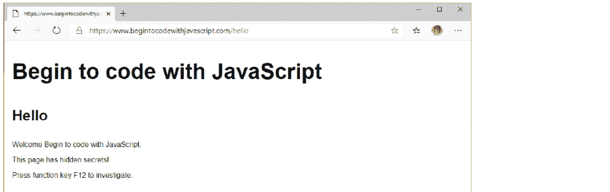

**图 1-1：带有奥秘内容的网页**

这看起来像一个非常普通的网页；但它却包含了当你按下键盘上的 `F12` 键时可以发现的秘密行为。在开发者视图中可以看到（见**图 1-2**）。


**图 1-2：开发视图展示界面**

该区域被称为“开发者视图”；它显示了组成网页的所有元素。关于你能在此视图中完成的一切操作的完整描述不会出现在本书中。不要担心所有内容看起来多么复杂，我们将只使用其中的一些功能。我们先从头说起：检查页面上的构成文本的元素并确保选中的是 `Elements` 选项卡（见**图 1-2**）；然后查看下方的文字内容，如**图 1-3**所示。


**图 1-3：页面元素示例展示**

你可以看到页面上出现的文字就在此处；部分文本被包裹在似乎是格式化指令的元素中——比如某些标记为 `<h1>`，另一些为 `<p>`。如果你回头看看显示的网页，你将会注意到带 `h1` 的标题使用了大字体，而带有 `p` 标签的是小字号；这就是页面如何排版的奥秘所在！但是其中的秘密在哪里呢？要回答这个问题，请点击单词“脚本”左侧指向右侧的小箭头以展开此部分视图（参见**图 1-4**）。


**图 1-1：`doAddition` 函数解析**

点击箭头便展开了该部分清单；隐藏的功能是一个名为 `doAddition` 的函数。它接收两个数字、将它们相加并使用警报框显示结果。在后面的章节中我们将详细解释这段 JavaScript 的工作原理，但即使在这阶段也能清楚地看出发生了什么情况！

然而这个函数实际上从未真正被用在网页中：我们可以通过将其输入到 JavaScript 控制台来使用它；该控制台是浏览器内置的功能之一，用于执行你在其中键入的语句。你可以选择窗口顶部的 Console 选项卡以打开它（见图 1-5）。

## 与 JavaScript 对话

我们可以通过向 JavaScript 控制台发送一些命令并观察其响应，来了解 JavaScript 的工作方式。

```text
> 2+3
```

这看起来像一个求和运算，正如你所料，答案是一个数字。

```text
<- 5
```

我们可以对非数字类型重复此操作：

```text
> "Rob"+" Miles"
```

用双引号括起来的一些文本被 JavaScript 解释为字符串，它非常乐意使用 `+` 运算符将两个字符串连接起来。请注意，如果你想在求和结果的两个单词之间有一个空格，你必须在相加的字符串中实际放入这个空格。（在我的例子中，第二个单词的“M”前面有一个空格。）

```text
<- "Rob Miles"
```

我们可以做其他类型的运算。例如，我们可以使用减号（`-`）进行减法。

```text
> 6-5
```

这会产生你预期的结果。

```text
<- 1
```

当我们要求 JavaScript 做合理的事情时，它似乎非常乐意配合。现在，让我们试试让它做些傻事。你认为如果我们尝试用以下语句将一个字符串减去另一个字符串会发生什么？

```text
> "Rob"-" Miles"
```

虽然将 `+` 视为“将这些字符串连接起来”似乎很合理，但当你处理字符串时，减号（`-`）似乎没有合理的解释。换句话说，尝试将一个字符串减去另一个字符串是毫无意义的。如果你在控制台中输入这个，你会从 JavaScript 得到一个奇怪的响应：

```text
<- NaN
```

JavaScript 控制台并不是在呼叫“奶奶”来解决这个问题。`NaN` 这个值表示“非数字”。这是 JavaScript 表示计算结果没有意义的一种方式。一些编程语言在你尝试将一个字符串减去另一个字符串时会显示错误消息并停止程序。JavaScript 不是这样工作的。它只是生成一个表示“此结果不是数字”的结果值，然后继续运行。我们将在后面的文本中讨论程序如何处理此类错误。

既然我们谈到了错误，不如让 JavaScript 做一些愚蠢的数学运算：

```text
> 1/0
```

当我得到我的第一个袖珍计算器时，我尝试做的第一件事就是计算一除以零。我得到了一个不断向上计数的结果作为丰厚的“奖励”。你认为 JavaScript 会怎么做？

```text
<- Infinity
```

JavaScript 说计算结果的值是 `Infinity`。这是 JavaScript 在进行计算时生成的另一个特殊值。说到计算，不如让 JavaScript 再为我们做一次计算？

```text
> 2/10+1/10
```

这个计算涉及实数（即带有小数部分的数字）。计算是将 0.2 加到 0.1 上（五分之一加十分之一）。这应该产生结果 0.3，但我们得到的结果很有趣：

```text
<- 0.30000000000000004
```

这个数字非常非常接近 0.3（正确答案），但它比应有的值稍微大了一点点。这说明了计算机工作方式的一个重要方面。我们在纸上可以轻松表达的一些值，机器并不能精确地存储。这通常只有在我们开始对计算值执行测试时才会成为问题，例如，检查上面的计算结果是否等于值 0.3，可能会因为这个微小的差异而失败。让我们看看是否能使用 JavaScript 为我们做一些事情。这个怎么样？

```text
> alert("Danger: Will Robinson")
```

这个语句不会计算结果。相反，它调用了一个名为 `alert` 的函数。该函数接收一个字符串文本。它要求浏览器在警告框中将该字符串显示为一条消息，如图 1-7 所示。

**图 1-7** 危险：威尔·罗宾逊

这就是 `doAddtion` 函数显示其计算结果的方式。最后，让我们尝试另一个名为 `print` 的函数：

```text
> print()
```

接下来你会看到什么取决于你使用的计算机和浏览器，但你应该会看到一个打印窗口出现，它提供了打印网页的机会。如果你曾经想知道当你按下网页上的**打印**按钮时会发生什么，你现在知道了。

恭喜。你现在知道网页是如何工作的了。你的浏览器从服务器获取一个文件，然后按照该文件中的指令为你构建一个供查看的页面。该文件包含要在页面上显示的文本以及格式化指令。一个页面文件也可以包含 JavaScript 程序代码。

浏览器遵循的指令是用一种叫做超文本标记语言（HTML）的语言表达的。在下一章中，我们将详细探讨 HTML，但在我们这样做之前，我们需要获取一些工具，以便将本书的示例代码获取到我们的计算机上，并处理 HTML 和 JavaScript。

## 工具

你需要一些软件工具才能充分利用本书中的练习。我们将从两个开始：一个名为 Git 的程序，它将管理我们正在处理的程序文件；另一个名为 Visual Studio Code 的程序，我们将用它来处理文件。这两者都不需要你花任何钱，并且适用于 Windows、macOS 和 Linux。你可以按照下面的印刷说明操作，或者你可以使用我提供的其中一个视频演练，你可以在以下位置找到：

<https://www.begintocodewithjavascript.com/media>

## 程序员要点

### Git 和 Visual Studio Code 是专业工具

当你学骑自行车时，你可能骑的是一辆带辅助轮的自行车。学开车的人通常从一辆小巧易控的车开始。你正在使用专业人员工作的工具来学习编程。这有点像用一辆一级方程式赛车来学习驾驶。不过，这里没什么可担心的。一级方程式赛车看起来可能有点吓人，但它仍然有方向盘和通常的一套踏板。而且如果你不想，你不必开得很快。

GitHub 和 Visual Studio Code 功能非常丰富，但你不必使用所有功能。就像我的汽车仪表盘上有一些按钮，因为我不确定它们的作用所以不按一样，你也不必了解这些工具的每一个特性就能很好地使用它们。

使用“专业”工具开始开发是非常明智的，因为招聘人员通常对你熟悉的工具和你能使用的编程语言同样感兴趣。

## 获取 Git

你编写的程序的源代码以文本文件的形式存储在你的计算机上。这些文件被称为“源代码”。你通过更改这些文件的内容来处理你的程序。当我刚开始编程时，我很快意识到编写软件既可以前进也可以后退。有时，我会花很多时间对程序进行修改，结果却证明是个坏主意，我不得不回头全部撤销。我通过在对程序代码进行任何重大编辑之前制作副本来解决这个问题。这样，如果出了什么问题，我就可以回到我的原始文件。

许多其他程序员也注意到了这个问题。他们还注意到，如果你向用户发布程序，拥有该代码的“快照”非常有用，这样你就可以跟踪你所做的任何更改。最优秀的程序员非常擅长“聪明地偷懒”，所以他们创建了源代码管理（SCM）软件来管理这个问题。其中一个最受欢迎的程序叫做 Git。

Git 是由 Linus Torvalds 于 2005 年创建的，当时他正在编写 Linux 操作系统。他需要一个工具来跟踪他的工作，并使他能够轻松地与他人协作。因此，他创建了自己的工具。Git 是一个专业且非常强大的工具。它让大量的开发者可以在一个项目上协作。不同的团队可以处理他们自己的代码版本，然后这些版本可以被合并。不过，你不需要使用所有这些强大的功能。你只需要使用 Git 来跟踪我们的工作，并作为获取示例程序的一种方式。

## 安装 Git

我将为你提供适用于 Windows 10 的说明。macOS 的说明非常相似。首先，你需要打开浏览器并访问这个网页，该页面也显示在图 1-8 中：

<https://git-scm.com>


**图 1-8 Git 安装页面**

按照安装过程进行，选择所有默认设置。

## 获取 Visual Studio Code

如果你想写一封信，你会使用文字处理器。要进行计算，你可能会使用电子表格。Visual Studio Code 是一个你可以用来编辑程序文件的工具。正如我们稍后将看到的，它的功能远不止于此。但目前，我们将把它用作一个超级强大的程序编辑器。

**Visual Studio Code 是免费的。**

## 动手实践

### 安装 Visual Studio Code

我将为你提供适用于 Windows 10 的说明。macOS 的说明非常相似。首先，你需要打开浏览器并访问这个网页，该页面显示在图 1-9 中：

<https://code.visualstudio.com/Download>


**图 1-9 Visual Studio Code 下载页面**

点击你需要的 Visual Studio Code 版本，并按照说明进行安装。安装完成后，你将看到如图 1-10 所示的起始页。

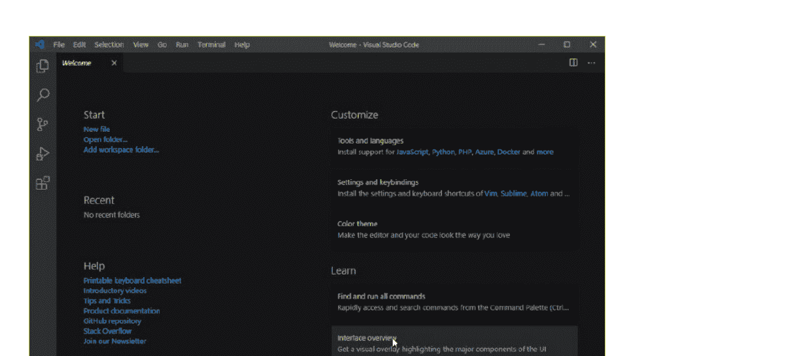

> **图 1-10 Visual Studio 起始页**

既然你已经安装了 Visual Studio，下一步你需要做的就是获取要处理的示例文件。

### 获取示例文件

示例程序以及许多其他内容都存储在 GitHub 上。GitHub 是一个由 Git 系统支撑的服务。你可以在 GitHub 上存储你自己的文件（不仅仅是程序）。你还可以使用 GitHub 来托管包含你创建的 JavaScript 程序的网页。目前，我们将只下载示例仓库，并编辑本章开头我们处理过的 `hello.html` 文件。

## 克隆示例仓库

Git 中的**仓库**是文件的集合。每当我开始处理新事物时，我都会创建一个仓库来保存我将要创建的所有文件。我有一个私有仓库，包含本书的所有文本。我还创建了一个公共仓库来存放示例文件。GitHub 上的仓库可以直接从浏览器访问。本书的示例文件位于此 URL（统一资源定位符）对应的仓库中：

<https://github.com/begintocodewithjavascript/begintocodewithjavascript.github.io>

如果你用浏览器访问这个 URL，你会发现你可以浏览所有文件，包括我们之前研究过的 `hello.html` 文件，并查看其中的内容。参见图 1-11。


你可以看到 GitHub 正在跟踪我对示例程序所做的更改。我们将使用 Visual Studio Code 来克隆这个仓库。启动 Visual Studio Code 并点击 **Source Control** 按钮，如图 1-12 所示。

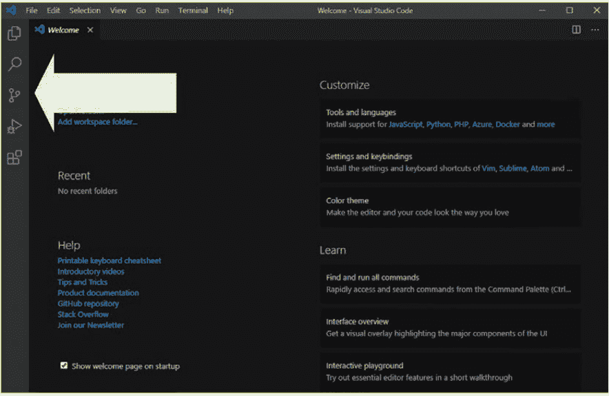

**图 1-12 Visual Studio Source Control 按钮**

这将打开 **Source Control** 对话框，如图 1-13 所示。接下来，点击 **Clone Repository** 按钮，开始从 GitHub 获取仓库的过程。

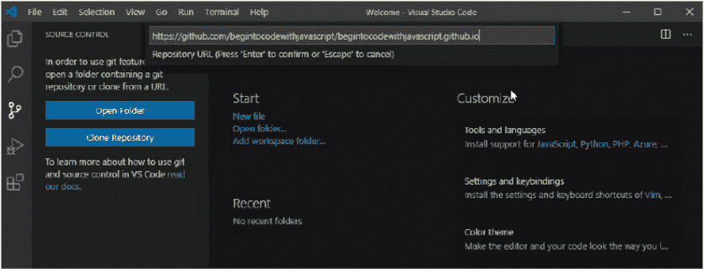

**图 1-13 Visual Studio Code 源代码克隆仓库**

### 使用 Visual Studio Code 处理文件

Visual Studio Code 将下载仓库的内容并将其存储在你的计算机上。在出现的对话框中输入仓库的 URL：

<https://github.com/begintocodewithjavascript/begintocodewithjavascript.github.io>

当你在 URL 末尾按下 Enter 键时，如图 1-14 所示，系统会询问你希望将要复制的文件放在计算机的什么位置。我建议你在“文档”文件夹中创建一个名为 **GitHub** 的文件夹并使用它，但你也可以将仓库放在任何你喜欢的地方。选择文件夹后，Visual Studio 将把仓库中的所有文件从 GitHub 站点复制到你的计算机。


**图 1-14 Visual Studio Code 仓库克隆完成**

当所有文件复制完成后，Visual Studio Code 会询问你是否要打开该仓库。点击 **Open** 来打开它。

恭喜，你已经克隆了你的第一个仓库！请记住，你可以使用 GitHub 来存储任何你可能想要处理的内容，而不仅仅是程序文件。如果你有作业要写，你可以创建一个仓库来保存文档和图像。如果你是与其他人一起完成作业，这将是一个更好的主意，因为 GitHub 是一个很棒的协作工具。

## 动手实践

### 编辑秘密程序

上一节结束时，你打开了从 GitHub 下载的示例仓库。现在你将编辑我们看到的包含秘密程序的 `hello.html` 文件。Visual Studio Code 左侧的资源管理器窗口提供了仓库中所有文件和文件夹的视图。这里有很多文件，包括包含 *begintocodewithjavascript.com* 网站源代码的文件。你可以点击资源管理器视图中文件夹前面的 `>` 来打开它们并查看其内容。参见图 1-15。

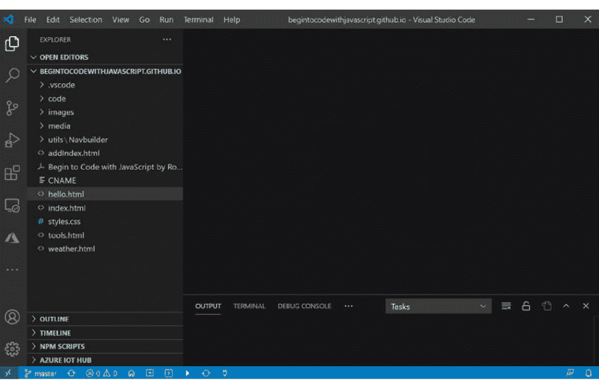

**图 1-15 Visual Studio Code 示例仓库**

目前，你只需查看 `hello.html` 文件，因此请点击资源管理器中的 `hello.html` 文件名来打开它（参见图 1-16）。

页面打开后，你可以对文件中的文本进行一些更改。我将一个标题更改为“Hello from Rob.”。你可以通过按住 Control 键（macOS 上为 Command 键）并按 S 键（`CTRL+S`）来保存文件。或者你可以使用 **File** 菜单中的 **Save** 命令。无论哪种方式，你现在都希望在浏览器中查看更改后的文件，以查看更改是否生效。

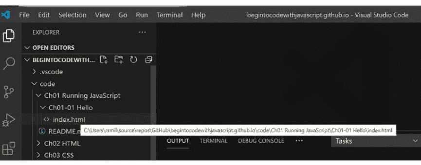

**图 1-16 编辑 hello.html 文件**

当你克隆仓库时，你告诉了 Visual Studio Code 将文件放在哪里，所以现在是时候打开文件资源管理器并导航到该文件夹了。如果你忘记了文件放在哪里，只需将鼠标指针悬停在资源管理器中的文件名上即可找到。然后 Visual Studio Code 将向你显示该文件的路径（参见图 1-17）。

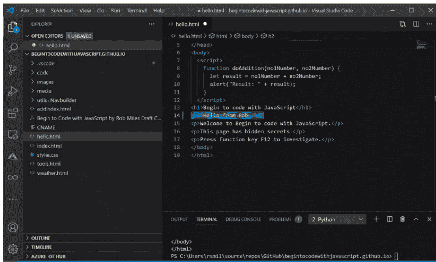

**图 1-17 查找 hello.html 文件**

如果我们双击此文件，它将由浏览器打开，如图 1-18 所示。

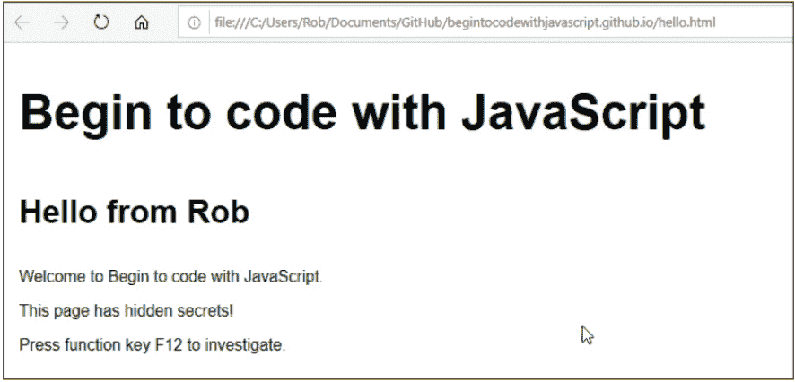

**图 1-18 在浏览器中打开的 `hello.html` 文件**

现在你将看到该文件经过编辑后的全部内容。请注意，正在浏览的地址现在是本地存储上的文件，而不是网络上的文件。还要注意，如果你愿意，可以按 F12 查看文件的内容，就像我们在本章开始时所做的那样。

## 你学到了什么

你可能觉得本章大部分时间只是在遵循说明，但实际上你学到了很多。你发现了 JavaScript 是一种编程语言，它提供了一种方式，让你可以告诉计算机如何做某事。你已经与 JavaScript 本身进行了对话。你了解到照顾程序源文件很重要，尽管优秀的程序员有时会为他们的程序想出非常愚蠢的名字（例如，Git）。你已经安装了 Git 系统和你的程序编辑器 Visual Studio Code。最后，你通过“克隆”存储在 GitHub 上的仓库，将所有示例代码复制到了你的机器上，甚至设法编辑了一个文件并在浏览器中查看了效果。

为了巩固你对本章的理解，你可能想思考一下关于 JavaScript、计算机、程序和编程的以下“深刻问题”。

## JavaScript 名称中的“script”一词是什么意思？

JavaScript 名称中的“script”一词指的是 JavaScript 程序原本 intended 的运行方式。浏览器会读取每条 JavaScript 语句，然后执行它，就像演员按照剧本表演戏剧 They are just as well. 戏剧中的角色表演剧本一样。并非所有编程语言都是这样工作的。有些编程语言被设计为*编译型*语言。这意味着程序的源代码被转换为计算机硬件执行的底层指令。然后硬件直接执行这些底层指令来运行程序。

编译型语言比脚本运行得更快，因为当编译后的程序运行时，计算机无需花费精力去弄清楚程序源代码在做什么；它只需服从底层指令即可。然而，你需要为每种计算机类型制作不同版本的编译代码。例如，为 Windows PC 编译的文件无法在 Raspberry Pi 上运行。


JavaScript 原本 intended 在浏览器中执行简单任务，因此它被创建为一种脚本语言。然而，它现在变得如此流行，以至于现代浏览器在运行 JavaScript 之前会对其进行编译，以便尽可能快地运行。

## 我的 JavaScript 程序会在 Web 服务器上运行吗？

不会。Web 服务器的职责只是提供文件。浏览器（运行在用户计算机上的程序）负责实际创建网页的显示效果，并运行页面中的任何 JavaScript 程序。

## JavaScript 程序在所有计算机上都以相同的速度运行吗？

不是。主机计算机越快，浏览器（以及它正在托管的 JavaScript 程序）运行得就越快。

## 如果我有更快的网络连接，JavaScript 程序会运行得更快吗？

不会。更快的网络连接会提高 JavaScript 程序加载到浏览器中的速度，但 JavaScript 程序的实际运行速度取决于主机计算机的速度。话虽如此，如果 JavaScript 程序使用了主机计算机的网络连接，这些操作当然会更快地完成。

## 我们能查看访问的每个页面中的 JavaScript 程序吗？

是的，你可以。F12 技巧（在浏览器中查看网页时按 F12）会打开页面的开发视图。你可以用它来查看页面中的 JavaScript 源代码。如果你担心有人复制 JavaScript 代码，可以使用一种称为混淆器的工具，它是一种改变程序外观（但不改变行为）的软件，使其非常难以理解。查看 [https://www.javascriptobfuscator.com/](https://www.javascriptob Giaoblcscator.com/) 了解更多详情。

## JavaScript 程序可以有多大？

JavaScript 程序确实可以非常大。现代 Web 浏览器非常擅长处理大型程序，而且现代网络的速度意味着代码可以非常快地下载。有些人甚至用 JavaScript 创建了完整的计算机模拟器，你可以在浏览器中运行它们。

## 可以在 Web 浏览器之外运行 JavaScript 吗？

是的，你可以。有些网页可以被转换为应用程序，然后在本地计算机上运行。还有一些方法可以让计算机像浏览器一样托管 JavaScript 应用程序。我们将在后面的文本中讨论这些内容，当我们在[第 11 章](第 11 章)中考虑`node.js`环境时。

`.prototype-wrecks`

## 如果我把程序“弄坏了”怎么办？

有些人担心他们在计算机上对程序所做的操作可能会以某种方式“弄坏”它。我以前也担心过这个问题，但我通过确保每次做任何操作时都有办法恢复来克服这种恐惧。在这方面，`Git` 和 `GitHub` 非常有用。

## 为什么 Visual Studio Code Heather o hello.html 文件的显示会呈现不同的颜色？

这称为*源代码高亮*。Visual Studio Code 有一个列表，其中包含对 JavaScript 和 HTML 而言“特殊”的单词。这些特殊单词称为*关键字*。对于每个关键字，Visual Studio Code 都有一种特征颜色。就 Visual Studio Code 而言，关键字显示为蓝色，函数显示为黄色，文本字符串为橙色，其他所有内容则为白色。其目的是让程序员更容易理解程序的结构。请注意，程序文件中没有任何内容指定每个元素的颜色；这是 Visual Studio Code 自身完成的功能。

## Visual Studio Code 和 Visual Studio 有什么区别？

微软推出了两款工具，一款称为 Visual Studio，另一款称为 Visual Studio Code。它们都可以用来创建程序。我们使用的是 Visual Studio Code，顾名思义，它是为处理源代码而设计的。Visual Studio 是一个更加全面的工具套件，可用于管理大型团队开发大型项目。Visual Studio 有一个免费版本可供下载和安装，如果你愿意的话，但如何使用它有点超出了本文的范围。

# 2 超文本标记语言（HTML）

## 你将学到什么

在上一章中，你学到 JavaScript 程序可以存在于网页内部。你看到文件`hello.html`里面隐藏着一个脚本。在本章中，我们将更多地了解 HTML 标准，它告诉浏览器程序网页应该是什么样子的。然后我们将发现如何将 JavaScript 与网页上的元素链接起来，使我们的程序能够与 user 交互。

- HTML 与万维网
- 什么是 HTML？
- 制作动态网页
- 使用对象属性
- egg hi 计时器
- 探究 egg hi 计时器
- 图像显示 program
- 创建你自己的页面
- 你学到了什么

## HTML 与万维网

*Hypertext Markup Language*（HTML）的第一个版本是由 Tim Berners-Lee 于 1989 年创建的。他想让研究人员更容易共享信息。当时，研究报告是作为单独的 document 撰写的。如果你正在阅读的 document 包含对另一个 document 的引用，你就得去找另一个。Tim Berners-Lee 设计了一个计算机*服务器*系统来共享 document 的电子副本。一个 document 可以包含指向其他 document 的*超链接*。读者使用*浏览器*程序从服务器读取 document，并从一个 document 跟随链接到另一个 document。这些 document 称为*超文本文档*，描述其内容的语言称为*Hypertext Markup Language*，即 HTML。

Tim Berners-Lee 还设计了一个 protocol 来管理从服务器到浏览器的 HTML 格式 document 的传输。这个标准称为*Hypertext Transfer Protocol*，即 HTTP。此外，现在有了此 protocol 的安全版本，称为 HTTPSS，它为 Web 增加了安全性。HTTPSS 允许浏览器确认服务器的 identity，它还保护 server 和浏览器防止窃听。正是 HTTPS 协议使我们能够通过万维网进行银行和电子商务。

1990 年，第一个系统以“World Wide Web”的名称发布。你可以下载的文件被称为“网页”。托管网页的服务器被称为“网站”。1993 年，Marc Andreessen 增加了在网页中显示图像的功能，网络变得极其流行。

万维网被设计为可扩展的，多年来，不同的浏览器制造商在标准中加入了他们自己的增强功能，导致了兼容性问题，即网站只能与特定的浏览器程序配合使用。最近，情况已经稳定下来。万维网联盟（W3C）现在制定的标准由所有浏览器制造商实施。最新的标准 HTML5 现在非常稳定，也是本书使用的版本。

## 获取网页

页面在服务器上的位置使用*统一资源定位符*或 URL 给出。它有三个组成部分：

1. **协议**：协议用于与网站通信。它规定了浏览器如何请求网页，以及服务器如何回复。网页使用 HTTP 和 HTTPS。HTTP 代表“超文本传输协议”，HTTPS 是该协议的安全版本。
2. **主机**：它给出了服务器在网络上的地址。万维网构建在一个名为 TCP/IP（传输控制协议/互联网协议）的网络协议之上，这就是该网络上保存你想要连接的网站的系统的地址。
3. **路径**：这是主机上浏览器想要读取的项目的路径。

你可以在我们用于访问[hello.html](http://hello.html)页面的 URL 中看到所有这些元素，该页面在[第 1 章](http://Chapter%201)（参见[图 2-1](http://Figure%202-1)）。

![img/16252e094e1495d166c36b25ce2e92d8_65_0.png]

这个 URL 指定了该网站使用安全版本的超文本传输协议，主机服务器的地址是[begintocodewithjavascript.com](http://begintocodewithjavascript.com)，包含网页的文件的路径是*hello.html*。如果你省略路径，服务器将提供一个默认文件的内容，该文件可能名为*index.html*或*Default.htm*或其他名称，具体取决于服务器的设置方式。

当用户请求一个网站时，浏览器会向服务器发送一条消息来请求该页面。此消息根据超文本传输协议（HTTP）进行格式化，通常称为“get”请求（因为它以单词 GET 开头）。然后服务器发送一个响应，其中包含一个状态代码，然后，如果可用，会发送网页本身的文本。如果在服务器上找不到该页面（可能是因为 URL 提供不正确），HTTP 状态代码会导致熟悉的“404 页面未找到”消息。我们将在本书后面编写一些获取网页的 JavaScript 代码时进一步了解此过程。

## 什么是 HTML？

这不是 HTML 的指南。你可以买到整本书来非常彻底地描述这门语言及其使用方法。但你应该在读完本节后对基础知识有很好的理解。HTML 是一种*标记*语言。Markup 是 HTML 中“M”所代表的意思。

“markup”这个词来自印刷行业。印刷工收到的文本上带有“标记”的指令，例如“用大字体打印这部分”和“用斜体打印这部分”。

![img/16252e094e1495d166c36b25ce2e92d8_66_0.png]

**图 2-2 字面理解的标记**

HTML 不可能发生这种误解。该语言在要显示的文本和格式指令之间有严格的区分。在 HTML 中，如果我想要某物被*强调*，我会使用一个 HTML 标记命令来请求：

```html
<em>This text is emphasized.</em> This text is not.
```

序列`<em>`被浏览器识别为“使此后跟随的文本看起来与其他文本略有不同”，并被称为一个*标签*。浏览器将显示强调文本，直到它看到序列`</em>`，它标记了强调文本的结束。大多数浏览器通过将文本显示为*斜体*来强调它。如果我们在 Microsoft Edge 中查看上述 HTML，我们将看到类似这样的内容：

```html
This text is *emphasized*. This text is not.
```

一旦你理解了 HTML 的基础知识，你就可以用它来格式化文本。下面的 HTML 显示了更多的标签。

| 文本 | 标签 | 效果描述 |
| :--- | :--- | :--- |
| `<br>` | 开始新行 | |
| `<em>...</em>` | 强调 | 斜体（通常） |
| `<i>...</i>` | 斜体 | 斜体输出 |
| `<strong>...</strong>` | 强调 | 突出显示/粗体强调 |
| `<b>...</b>` | 粗体 | 粗体字符 |
| `<small>...</small>` | 小号 | 减小字体大小 |
| `<del>...</del>` | 已删除 | 删除线 |
| `<ins>...</ins>` | 已插入 | 下划线（通常） |
| `<u>...</u>` | 下划线 | 带下划线的文本 |
| `<mark>...</mark>` | 标记 | 高亮背景色 |

上面的示例 HTML 使用了一个标签`<br>`，意思是“在新行开始”。不需要`</br>`元素来关闭它，因为`<br>`标签会立即对布局产生影响；它不应用于页面上的任何特定项目。当我将此文本传递给浏览器时，我得到如**图 2-3**所示的输出。

![img/16252e094e1495d166c36b25ce2e92d8_68_0.png]

**图 2-3 `<br>` 标签创建新的一行文本。**

如果你仔细观察图 2-3 中的文本，你会注意到一些请求有相似的结果。例如，强调（`<em>`）和斜体（`<i>`）格式都产生了斜体输出。粗体（`<b>`）、斜体（`<i>`）和下划线（`<u>`）标签被认为比更通用的标签（如强调（`<em>`）或强（`<strong>`））用处稍小。其背后的推理是，如果显示设备无法产生斜体字符，请求以斜体显示某些内容将无法工作。

但是，如果显示设备被要求“强调”某物，它可能会以不同的方式来实现，也许是通过改变文本的颜色。HTML 产生的输出旨在在大量输出设备上有用地显示。当你使用标记语言时，你应该思考你想给一段文本添加什么效果。你应该想“我需要让这个突出显示，所以我将使用`<strong>`格式”，而不仅仅是让文本加粗。

你可以使用大写、小写或两者的任何组合来编写命令。换句话说，标签`<em>`、`<EM>`和`<Em>`都会被浏览器视为相同的东西。

## 显示符号

到现在为止，你应该对 HTML 的工作原理有了很好的了解。一个标签`<blah>`标记了某物的开始。序列`</blah>`标记了结束。标签可以嵌套（彼此放在内部）。

```html
<em>This is emphasized <strong>This is strong and emphasized</strong></em>
```

此 HTML 将生成：

- *This is emphasized*
  - ***This is strong and emphasized***（*）

对于每个开始标签（`<blah>`），应该有一个匹配的结束标签（例如`</blah>`）。如果你搞错了，大多数浏览器相当宽容，但你得到的显示可能不是你想要的。

你现在可能问的问题是：“我如何才能在我的网页中显示`<`和`>`符号？”答案是 HTML 使用另一个字符来标记*符号实体*的开始。字符`&`标记了符号的开始。符号可以通过它们的名称来识别：

```html
This is a less <than>: &lt; symbol and this is a greater than > : &#gt; symbol
```

## 符号名称与 HTML 实体

小于号字符（`<`）的名称是`lt`，大于号（`>`）符号的名称是`gt`。请注意，符号名称以分号（`;`）结尾。如果你现在想知道我们如何显示和号（`&`），答案是它的符号名称是`amp`。

```html
This is an ampersand: &amp;
```

你可以在此处找到符号及其名称的便捷列表：[https://dev.w3.org/html5/html-author/charref](https://dev.w3.org/html5/html-author/charref)。请注意，当你给符号命名时，名称的大小写是重要的。

```html
&Eacute;<br>
&eacute;<br>
```

上述 HTML 将显示`eacute`的​​大写（É）和小写（é）版本。如果你喜欢表情符号（谁不喜欢呢？），你可以通过使用包含所需表情符号编号的符号将其添加到你的网页中。

```html
Happy face: &#128540;<br>
```

这将显示一个笑脸，如下所示。

<figure style="text-align:center">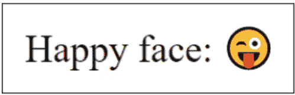<figcaption>**图 2-4** 笑脸表情符号</figcaption></figure>

如果你想发现所有可用于在网页中放入表情符号的编号，请查看这里：https://emojiguide.org/。

## 可能出现的问题

### 确保你的表情符号传达正确的含义

表情符号是让界面变得生动的好方法，但你需要确保你知道它们所表达的含义。一些表情符号设计对特定人群具有特殊含义，这些含义并不总是显而易见的。在发布包含表情符号的页面之前，你应该检查像 https://emojipedia.org/ 这样的网站，以确保你的页面表达的意思和你想的一致。

### 将文本组织成段落

我们现在知道如何格式化文本。接下来，我们必须考虑如何将这些文本在页面上布局。当显示 HTML 文本时，原始输入文本的布局会被忽略。换句话说，考虑这段文本：

```text
Hello
   world

      from    Rob
```

这段文本的布局有点混乱。然而，当浏览器显示这段文本时，你会看到以下内容：

```text
Hello world from Rob
```

浏览器接收原始文本，将其分割成单词，然后在单词之间用单个空格显示它们。源文本中的任何布局信息都会被丢弃。这是一个好主意，因为网页设计者无法对将要使用的显示设备做出任何假设。同一个页面需要在大型和小型显示器上都能工作——从智能手机到大型 LCD 面板。

我们已经看到`<br>`序列要求浏览器在文本显示期间创建新行。现在我们将考虑一些更多控制文本显示时如何布局的命令。`<p>`和`</p>`命令包围应该出现在段落中的文本：

```html
<p>This is the first paragraph</p>
<p>This is the second paragraph</p>
```

这段 HTML 将显示两个段落：

```text
This is the first paragraph
This is the second paragraph
```

`<br>`命令与`<p>`命令不同；它不会像段落那样将行分隔开。

## 创建标题

我们可以使用其他标签将文本标记为不同级别的标题：

```html
<h1>Heading 1</h1>
<h2>Heading 2</h2>
<h3>Heading 3</h3>
```


`<h4>`标题 4`</h4>` `<p>`一个普通段落`</p>`我们可以在文档中使用这些来创建标题，如下所示。

你可以使用标题在文档中创建结构。（如图 2-5 所示）

## 使用预格式化文本

但有时，你可能有一些已经格式化好的内容。在这种情况下，你可以使用`<pre>`标签告诉浏览器不要执行任何布局：

```
<pre>
This text
is rendered    exactly how I wrote it.
</pre>
```

`<pre>`标签包围的文本将由浏览器显示，且不进行任何格式更改。

```
This text
    is rendered
        exactly how I wrote it.
```

浏览器在显示预格式化文本时使用*等宽*字体。在等宽字体中，所有字符具有相同的宽度。许多字体，包括用于打印本段的字体，是*比例*字体。这意味着每个字符都有特定的宽度；例如，“I”字符比“m”字符小得多。然而，对于 ASCII 艺术等文本，所有字符对齐非常重要。下面所示的标志代码如果不使用等宽字体显示，看起来会不正确。

请注意，上面的 ASCII 艺术包含一个`<`字符，我不得不将其转换为符号（`&lt;`）以便正确显示。这很重要。请记住，浏览器不会格式化预格式化文本，但它仍然遵守你必须用来显示字符和符号的字符约定。你可以向预格式化文本添加标签以强调部分内容；预格式化文本块内的`<p>`标签可能有效，但这不建议使用，因为它会使你的 HTML *格式错误*。该标志显示如下。

## 我的标志

## 程序员须知

### 不要滥用浏览器

浏览器通常对格式错误的 HTML 非常宽容。即使收到的 HTML 格式错误，浏览器也会尝试显示内容。这意味着你可以使用像这样的 HTML 而不会出错：

```
<em>Emphasized <strong>strongly emphazised</em> just strong <
```

浏览器将显示你预期的内容：

然而，这是*格式错误的 HTML*。你可能想知道为什么。让我们看看文本中的标签序列。

这是一个所谓的*错误嵌套*的例子。这是因为`<em>`标签在`<strong>`标签内部“结束”。在格式正确的 HTML 中，在另一个标签内部创建的标签应该在包含它的标签结束之前结束。开始标签、文本和结束标签的完整序列称为一个*元素*。虽然一个元素可以完全包含另一个，但元素像上图那样*重叠*是不正确的。此 HTML 的正确版本如下所示。请注意，每个元素都是完整的。

上图显示了正确的嵌套方式。每个元素在其包含元素结束之前结束。我强调这一点的原因是，大多数浏览器可以理解格式错误的 HTML 的含义并正确显示它，但有些可能无法做到。这可能导致你的网页在某些人看来是错误的。我相信你有过因为某个特定网站看起来不对而不得不更换浏览器的经历。现在你知道这是如何发生的了。

当你看到一个结束标签与最近的开始标签不匹配时，你可以识别出不正确嵌套的 HTML。如果你想使用程序来确保你的 HTML 是正确的，你可以使用官方的验证站点`https://validator.w3.org/`。你可以将验证器指向你创建的网站，或者将 HTML 文本粘贴到其中进行检查。

### 为文档添加注释

你可以通过将注释文本包含在`<!--`和`-->`序列中来向 HTML 文档添加注释，如下所示：

```
<!-- Document Version 1.0 created by Rob Miles -->
```

作者署名不会被浏览器显示，但你可以通过按 F12 键打开开发者视图在源代码中查看它。在我们学习本文的过程中，我会经常告诉你向你的作品添加注释是多么有用，所以我认为现在开始这样做是个好主意。

### 向网页添加图片

万维网诞生的头几年完全没有图片。图像标签是由 Marc Andreessen 添加的，他是 Mosaic 的作者之一，Mosaic 是早期网络上最流行的浏览器。图像标签包含一个图像文件的名称：

```

```

图像标签使用一个*属性*来指定包含要显示图像的文件。属性在标签内以名称和值对的形式给出，并用等号分隔。当浏览器找到一个`img`标签时，它会查找`src`属性，然后查找具有该名称的图像文件。对于上面的HTML示例，浏览器会查找名为`seaside.JPG`的图像。它会在服务器上加载网页的相同位置查找。我们必须确保该文件存在于服务器上；否则，图像将不会显示。

## 可能出错的地方

### 注意错误的文件名

`img`标签中的`src`属性后面是要从服务器获取的文件名。虽然HTML不关心标签的大小写（标签名可以写成`IMG`、`img`或`Img`），但获取图像文件的计算机可能关心。有些计算机会在你请求名为`seaside.JPG`的文件时，提供一个存储为`seaside.jpg`的文件。其他计算机会报告文件不可用。

我通常在将网站从我的个人电脑（网站运行完美）转移到服务器（所有图像文件突然消失）时遇到这个问题。

你可以向`img`标签添加另一个属性，提供替代文本，如果找不到图像则显示该文本。

```html

```

现在，如果找不到图像，浏览器将显示文本“Waves crashing on an empty beach”（海浪拍打空旷的海滩）。替代文本（ALT）对于视觉障碍的网页用户也非常有用，他们无法看到图像，但会欣赏到图像内容的文字描述。

图像将与页面上的文本内联显示。我们可以使用HTML布局标签将图像与周围文本进行合理布局：

```html
<h1>Seaside Picture</h1>
<p></p>
<p>This picture was taken at Hornsea in the UK.</p>
```

图2-8中显示的图像宽度为600像素。像素（*像素*的简称）是构成图像的点之一。像素越多，图像看起来就越好。

**图2-8** 一张600像素宽的图像

然而，如果图像太大，无法适应用于显示图像的设备，这可能会导致问题。`img`标签支持`width`和`height`属性，可用于设置图像的显示大小。因此，如果我想将图像显示为400像素宽，我可以这样做：

```html
<p>
```

注意我没有指定高度，这意味着浏览器会自动计算匹配400像素宽度的高度。如果你愿意，可以同时指定高度和宽度，但你需要小心，不要使图像变形。使用高度和宽度属性设置图像的绝对宽度起初看起来是个好主意，但它可能会受到限制。请记住，万维网的一个基本原则是，页面应在任何设备上以有用的方式显示。400像素的图像大小可能适合小型设备，但在大型电视显示器上查看时会显得非常小。在下一章中，我们将发现如何使用样式表让网页上的项目根据目标设备自动缩放。

## HTML文档

我们现在知道，我们可以使用标签将文本区域标记为需要以特定格式设置，例如使用`<em>`表示强调文本。我们还可以将文本区域标记为段落或标题级别。我们可以将多个标签应用于给定的文本，以便将格式指令叠加在一起，但我们需要确保这些指令在彼此之间正确“嵌套”。现在我们可以考虑如何创建格式正确的HTML文档。它包含几个部分：

浏览器会在开头寻找序列`<!DOCTYPE HTML>`，以确保它正在读取HTML文件。所有描述页面的HTML都包含在`<html>`和`</html>`标签之间。`<html>`标签包含一个`lang`属性，指定页面的语言。“en”表示英语。`<head>`和`</head>`标签标记文档标题的开始和结束。标题包含有关页面内容的信息，包括样式信息（将在下一章进一步讨论）。`<body>`和`</body>`标签之间的文本是要显示的内容。换句话说，我们到目前为止所学的一切都放在网页文件的主体部分。

## 链接HTML文档

HTML文档可以包含链接到另一个文档的元素。另一个文档可以在同一台服务器上，也可以完全在另一台服务器上。链接通过使用`<a>`标签创建，该标签有一个`href`属性，包含目标页面的URL：

```html
Click on <a href="otherpage.html">this link</a> to open another page.
```

`<a>`标签主体中的文本是浏览器将突出显示为链接的文本。在上面的示例HTML中，“this link”这个词将是可链接的文本。这将在页面上产生如下所示的文本：

```
Click on this link to open another page.
```

如果读者点击该链接，浏览器将打开一个本地文件——在本例中，是一个名为“otherpage.html”的文件——并将显示该文件。链接的目标可以指向完全不同的站点上的页面：

```html
<p>Click on <a href="https://www.robmiles.com"> this link</a> to visit the site.
```

## 制作动态网页

关于HTML，我还可以告诉你很多其他事情。该语言可用于创建编号和未编号列表以及表格。然而，这不是一本关于HTML的书；它是关于编程的。我们想要的是让JavaScript代码在网页中运行的方法。然后我们就可以开始探索这门语言了。

你已经知道JavaScript程序可以与HTML页面设计并存。你在第1章中看到了这一点，当时你使用了浏览器中的开发者视图（通过按F12获得）来查看`hello.html`网页内的隐藏程序。该HTML文件包含一个包含一些JavaScript代码的`script`元素。我们使用控制台运行了一个JavaScript函数。现在我们将通过按下一个按钮来触发一个函数。

## 使用按钮

创建动态网页的一种方法是使用按钮。此HTML代码创建一个包含文本“Say Hello”的按钮：

```html
<button onclick="doSayHello();">Say Hello</button>
```

该按钮在页面的正常文本流中显示，如图2-9所示。

按钮有一个`onclick`属性。JavaScript的一大优点是大多数时候，这些名称都是有意义的。`onclick`属性指定了一个在单击按钮时要使用的函数。在这种情况下，该属性指定了一个名为“doSayHello”的JavaScript函数。JavaScript函数是一系列被赋予名称的JavaScript语句。（我们将在第8章详细讨论函数。）

```javascript
function doSayHello() {
    alert("Hello");
}
```

这个函数只执行一个操作；当它被调用时，它会显示一个向用户说“Hello”的警报。显示警报的JavaScript行称为*语句*。语句的结束由分号字符标记。一个函数可以包含多个语句，每个语句都以分号（`;`）结束。

```html
<!DOCTYPE html>
<html lang="en">
<head>
    <title>Ch02-06 Buttons</title>
</head>

<body>
    <h1>Buttons</h1>
    <p>
        <button onclick="doSayHello();">Say Hello</button>
    </p>

    <script>
        function doSayHello() {
            alert("Hello");
        }
    </script>
</body>
```

这是网页的完整HTML文本。`<script>`元素位于文档主体的底部。页面显示Say Hello按钮，当按下该按钮时，将显示警报，如**图2-10**所示。

## 从用户处读取输入

`button`标签让我们能够在网页中创建一个响应用户操作的元素。接下来，我们需要一种从用户那里获取输入的方法。`input`标签正好可以做到这一点：

```html
<input type="text" id="alertText" value="Alert!">
```

它有三个属性：

-   **type** `type`属性告诉浏览器正在读取的输入类型。在上面的代码中，我们正在读取文本，因此属性类型被设置为`text`。如果你将`type`属性设置为`password`，输入的内容在键入时会被其他字符（通常是*或.）替代。这就是JavaScript程序读取网页密码的方式。

-   **id** `id`属性为元素提供一个唯一的名称。这个名称可以在JavaScript代码中用来定位该元素。如果我们有两个输入元素，我们会为每个元素使用不同的名称。我将这个元素命名为`alertText`，因为它很好地反映了该元素的用途。

-   **value** `value`属性指定了这个元素标签中的值。这就是我们如何用文本预填充输入框的方法。当这个输入元素显示时，它里面将会有文本"Alert!"。如果我们希望输入框在显示时为空，我们可以将值设置为空字符串。

```html
<p>
    <input type="text" id="alertInputText" value="Alert!">
    <button onclick="doShowAlert();">Show Alert</button>
</p>
<script>
    function doShowAlert() {
        var element = document.getElementById("alertInputText");
        alert(element.value);
    }
</script>
```

该网页包含一个输入元素、一个将调用函数以显示警报的按钮元素，以及一个在警报中使用输入文本的函数。用户可以在输入框中键入他们自己的文本，然后按下**Show Alert**按钮，使该文本显示在警报中。图2-11展示了程序运行时的样子。

如果你运行这个示例，你会注意到当你按下**Show Alert**按钮时，你在输入区域输入的文本会显示在警报中。

## HTML 与 JavaScript

花些时间了解HTML和JavaScript如何协同工作是值得的，因为这几乎是我们将要编写的所有程序的基础。JavaScript程序需要一种与它所属的HTML文档交互的方式。这种交互由*方法*提供，这些方法是*文档对象模型*（DOM）的一部分，浏览器创建DOM来表示它为用户显示的HTML文档。DOM是一个*软件对象*，存储在计算机的内存中。DOM包含方法以及构成页面的HTML元素。我们的程序使用`getElementById`方法来获取页面上元素的引用。然后，它从该元素中提取文本并在警报中显示该文本。

如果你对此不太确定，也许一个类比会有帮助。把HTML文档想象成“Rob的汽车租赁行”。当有人来取车时，他们会说，“我来取车牌号为ABC 123的车。”然后我会把钥匙递给他们，并说“车在E6停车位。”他们就可以去找车了。我不会把车从柜台递给客户，因为我力气不够大。我只告诉他们车在哪里，这样他们就能自己去找。

在HTML文档的情况下，文档中的每个元素就像我租赁业务停车场里的一辆车。一个元素可以有一个ID，就像一辆车有车牌号一样。在我们的文档中，ID是`alertInputText`。`getElementById`方法是JavaScript程序询问文档某个元素位置的方式：

```javascript
var element = document.getElementById("alertInputText");
```


在上面语句的右边，你可以看到使用`getElementById`来获取ID为`alertInputText`的文本元素的位置。语句的左边创建一个变量来保存这个位置。`var`这个词创建了一个JavaScript变量。变量是一个命名的位置，存储程序希望记住的一些信息。

在“Rob的汽车租赁行”，我会为那些担心忘记车停在哪里的客户提供记录车辆位置的服务。我会给他们一张纸，上面写着“车辆位置”（变量的名称）和“E6停车位”（变量的值）。在上面的JavaScript中，我们正在创建的变量被称为`element`（因为它引用文档中的一个元素），其值就是文本输入元素的位置。这个操作被称为赋值，因为程序正在将一个值赋给一个变量。赋值操作用等号（`=`）表示。（我们将在第4章详细讨论变量。）

现在程序有了一个名为`element`的变量，其中包含对输入框的引用，我们可以从该元素中提取文本值并将其存储在一个名为`message`的变量中：

```javascript
var message = element.value;
```

名为`message`的变量现在包含了用户输入到输入框中的文本。（记住我们在HTML中将其设置为“Alert!”。）程序现在可以将这个文本显示在警报中：

```javascript
alert(message);
```

理解这里发生的事情非常重要。到目前为止，一切似乎都相当合理，然后突然，你遇到了一些真正复杂的东西。我很抱歉。请仔细阅读代码，并尝试将语句与程序试图完成的任务对应起来。并且记住，等号（`=`）的意思是“将此变量设置为该值”。它并不意味着程序在测试一个东西是否等于另一个东西。

如果你对程序的各个部分如何组合在一起感到困惑，请考虑该程序所做的事情与我告诉一个租车客户他们的车的位置，然后请他们回来告诉我那辆车的油量完全相同。该序列如下所示：

1. 获取车辆的位置。
2. 前往车辆所在地。
3. 从油量表中获取数值。
4. 将该数值带回来给我。

对于显示消息的JavaScript程序，序列是：

1. 使用`getElementById`方法获取对输入元素的引用。
2. 沿着引用找到该元素。
3. 从输入元素中获取文本值。
4. 在警报中显示该文本。

## 代码分析

`doShowAlert`函数：

```javascript
function doShowAlert() {
  var element = document.getElementById("alertInputText");
  var message = element.value;
  alert(message);
}
```

我们可以通过查看这个函数并考虑一些问题，来加深对JavaScript这个重要方面的理解。

**问题：** 如果你获取文本元素的ID错误会发生什么？

**回答：** `doShowAlert`方法依赖于HTML和JavaScript代码之间一个未言明的“契约”。`doShowAlert`函数要求`getElementById`找到一个ID为`alertInputText`的元素。如果这个契约被打破，例如元素具有错误的名称，比如`alertinputtext`，`getElementById`方法将无法交付结果。这有点像我告诉一个租车客户去一个不存在的地方找他们的车。在这种情况下，`getElementById`方法将返回一个称为“null”的特殊值，意思是“我找不到任何东西”。这将导致`doShowAlert`函数的其余部分失败。对于我的租车客户来说，他们会回来告诉我该位置不存在。对于`doShowAlert`函数，不会有错误报告给用户，但警报将不会显示。在本书后面，我们将了解如何编写代码来测试方法返回的、表示“我找不到你想要的东西”的结果。

在JavaScript中，你往往需要自己去寻找你犯的错误。在一些编程语言中，当错误发生时会有明确的提示。在JavaScript中，事情往往会静默地失败，或者只是执行一些你预期之外的操作。

**问题：** 如果用户在网页上按下按钮之前没有在文本区域输入任何文本，会发生什么？

**答案：** 如果你查看本节最开始的HTML代码，你会看到`text`标签的`value`属性被设置为“Alert!”。如果用户没有用他们的消息替换这个值，单词“Alert!”将会被显示出来。

**问题：** 如果我多次按下按钮会发生什么？

**答案：** 浏览器会阻止网页上的任何活动，直到你清除显示的提示框。当你再次按下按钮时，`doShowAlert`函数会被再次调用。它会创建两个名为`element`和`message`的新变量，并使用它们来显示相应的消息文本。

**问题：** `var`是做什么的？

**答案：** 单词`var`是JavaScript中用来创建变量的命令。变量的名称跟在`var`之后。变量保存着程序想要使用的一个值。程序可以通过使用`=`来为变量赋值，告诉JavaScript执行赋值操作。

## 显示文本输出

在上一节中，我们使用JavaScript程序通过获取页面上元素的引用来读取网页数据，然后从该元素读取信息。在屏幕上显示文本是一个类似的过程。JavaScript程序可以使用对象的引用来改变元素的属性。我们将编写一个程序，将段落中的文本更改为我们输入的字符串。完整的HTML文件如下所示：

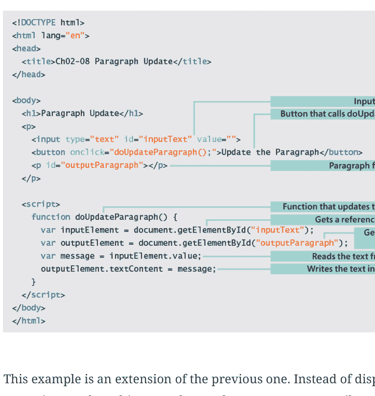

这个例子是前一个例子的扩展。这个例子没有使用警告框来显示文本，而是将段落的`textContent`属性设置为用户在对话框中输入的文本。这个程序的行为由四行代码给出。

```javascript
var inputElement = document.getElementById("inputText");
var outputElement = document.getElementById("outputParagraph");
var message = inputElement.value;
outputElement.textContent = message;
```

前两行设置指向输入和输出元素的变量。第三行获取要显示的消息，第四行将此消息放到网页上，如图2-12所示。

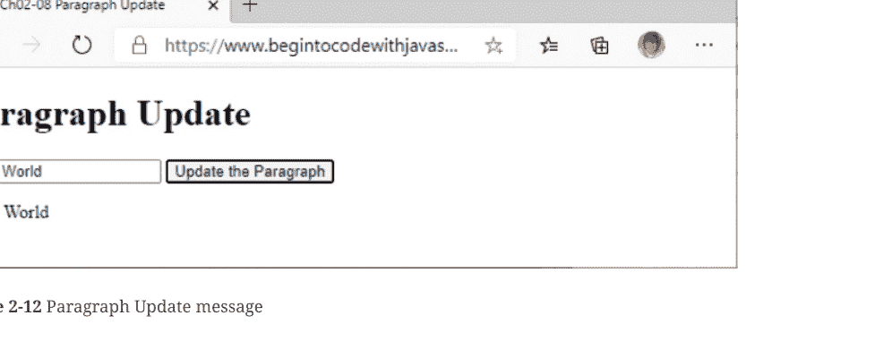

图2-12 段落更新消息

## 让事情发生

### 使用对象属性

你可能想知道`textContent`属性是做什么的，以及程序如何使用它，因此值得研究一下。我们可以使用开发者工具中的JavaScript控制台来做这件事。找到你电脑上包含本书示例代码的文件夹。（如果你还没有下载示例代码，可以在第1章的“获取示例文件”部分找到说明。）找到`Ch02 HTML/Ch02-08 Paragraph Update`文件夹。双击该文件夹中的`index.html`文件。

这应该会打开你的浏览器，你应该会看到一个看起来像上面图2-12的页面。

注意，Edge只有在它是你电脑上的默认浏览器时才会打开。在Windows电脑上，你可以通过右键单击页面，然后从出现的菜单中选择“打开方式”来选择应该用哪个浏览器打开页面。页面打开后，执行以下操作：

按F12打开开发者工具视图。选择`Console`选项卡。输入以下JavaScript语句：

```javascript
var outputElement = document.getElementById("outputParagraph");
```

这是我们程序中获取文档中`outputParagraph`引用的语句。我们现在有一个名为`outputElement`的变量，它指向输出段落。我们可以通过使用我们的新变量来证明这一点。

```javascript
outputElement.textContent = "fred";
```

再看一下网页。你应该看到单词“fred”已经出现。通过设置段落的`textContent`属性的值，我们可以改变段落中的文本。JavaScript程序可以读取属性，也可以写入属性。输入以下语句：

```javascript
alert(outputElement.textContent);
```

这将使一个警告框出现，其中包含“fred”（因为那是`outputElement`所引用元素的`textContent`）。现在让我们看看如果我们犯了错误会发生什么。试试这个：

```javascript
outputElement.tetContent = "test";
```

这个语句看起来很合理，但我把“textContent”误打成了“tetContent”。段落元素没有`tetContent`属性。然而，这个语句不会导致错误，但单词“test”也不会显示。发生的事情是JavaScript为`outputElement`变量创建了一个新属性。新属性名为“tetContent”，其值被设置为“test”。你可以通过输入以下内容来证明这一点：

```javascript
alert(outputElement.tetContent);
```

这将显示一个警告框，显示`tetContent`属性中的值，即字符串“test”。我们将在第9章中了解更多关于在对象中创建属性的内容。

看看你是否能修改网页，使名称显示为标题（`<h1>`）而不是段落。你可以使用Visual Studio Code来编辑网页的HTML。你将不得不改变JavaScript还是HTML？

## 鸡蛋计时器

我们现在知道了足够多的知识，可以创建一个真正有用的程序了。我们将创建一个鸡蛋计时器。用户将按下一个按钮，然后在五分钟（煮鸡蛋的完美时间）过去后得到通知。我们知道如何将JavaScript函数连接到HTML按钮上。我们需要知道的下一件事是如何测量时间的流逝。我们可以使用一个名为`setTimeout`的JavaScript函数来做到这一点。我们已经使用过函数了。`alert`函数接受一个要显示的字符串。`setTimeout`函数接受两样东西：一个在计时器到期时将被调用的函数，以及超时时间的长度。超时时间以千分之一秒为单位给出。下面的语句将导致`doEndTimer`函数在`setTimeout`被调用后一秒运行。

```javascript
setTimeout(doEndTimer, 1000);
```

我们的鸡蛋计时器将使用两个函数。一个函数将在用户按下按钮启动计时器时运行。这个函数将设置一个计时器，该计时器将在五分钟后运行第二个函数。第二个函数将显示一个提示，表明计时器已完成。

```javascript
function doStartTimer() {
  setTimeout(doEndTimer, 5 * 60 * 1000);
}

function doEndTimer() {
  alert("Your egg is ready");
}
```

`doStartTimer`函数连接到一个按钮，以便用户可以启动计时器。`doEndTimer`将在计时器完成时被调用。我添加了一个计算来得出延迟值。我想要一个五分钟的延迟。一分钟有60秒，`1000`的值会给我一个一秒的延迟。这使得更改延迟变得更加容易。如果我们想要制作一个需要七分钟的硬煮鸡蛋，我只需将`5`改为`7`。注意，`*`字符在JavaScript中表示乘。你将在第4章中了解更多关于计算的内容。

## 让事情发生

### 探究鸡蛋计时器

```html
<!DOCTYPE html>
<html lang="en">
<head>
  <title>Ch02-09 Egg Timer</title>
</head>

<body>
  <h1>Egg Timer</h1>
  <p>
    <button onclick="doStartTimer();">Start the timer</button>
  </p>

  <script>
    function doStartTimer() {
      setTimeout(doEndTimer, 5 * 60 * 1000);
    }

    function doEndTimer() {
      alert("Your egg is ready");
    }
  </script>
</body>
</html>
```

让我们来看看鸡蛋计时器是如何工作的。找到`Ch02 HTML/Ch02-09 Egg Timer`文件夹。双击该文件夹中的文件`index.html`以打开页面。

## 计时器

点击一次“启动计时器”按钮。此版本的代码仅设置了10秒的延迟，因此10秒后，你会看到警告框出现。


连续点击三次“启动计时器”按钮。等待观察会发生什么。这是否符合你的预期？事实证明，每次按下按钮时，都会创建一个新的超时。现在按F12打开开发者工具。输入以下代码并按回车。你预期会看到什么？

```
doEndTimeer();
```

这是将会运行并显示结束消息的函数调用。你应该会看到警告框出现，告诉你鸡蛋已经煮好了。点击警告框中的“确定”以关闭它。输入以下内容并按回车。你预期会发生什么？

```
setTimeout(doEndTimer, 3 * 1000);
```

三秒后警告框出现，因为这就是超时的时长。当函数运行时，你还应该看到其他内容出现。你还会看到一个整数显示出来。如果你重复调用`setTimeout`，你会看到另一个值显示。通常它比前一个值大1。这个数字是计时器的“ID”。这可以用来标识一个超时以便取消它。我们不打算这样做，所以你可以忽略这个值。

看看你是否能修改网页以支持多种烹饪时间。添加“溏心”（四分钟）、“正常”（五分钟）和“强硬”（十分钟）按钮。你将需要再添加两个按钮和两个JavaScript函数到程序中。

如果你想看看我是如何实现的，打开`Ch02-09 可选鸡蛋计时器`文件。我的解决方案甚至会显示计时器的状态。

### 为计时器添加声音

我们的计时器工作正常，但如果它能在鸡蛋煮好时做更多事情，而不仅仅是显示警告框，那会更好。网页可以包含一个`audio`元素，用于播放声音。

```html
<audio id="alarmAudio">
  <source src="everythingSound.mp3" type="audio/mpeg">
  Your browser does not support the audio element.
</audio>
```

`audio`元素包含另一个名为`src`的元素，用于指定音频数据将从何处获取。在这种情况下，音频存储在一个名为`everythingSound.mp3`的MP3文件中，该文件存储在服务器上。如果浏览器不支持`audio`元素，则显示`audio`元素内部的文本。我给这个元素指定了一个ID，以便`doEndTimer`函数中的代码可以找到音频元素并要求它播放MP3文件。

```javascript
function doEndTimer() {
  alarmSoundElement = document.getElementById("alarmAudio");
  alarmSoundElement.play();
}
```

这段代码看起来像`Ch02-08 段落更新`示例中的代码。在那个示例中，`getElementById`方法获取要更新的段落元素。在上面的函数中，`getElementById`获取要播放的音频元素。音频元素提供了一个播放方法，用于开始播放。文件的其余部分与原始计时器完全相同。如果你尝试这个程序，当鸡蛋煮好时，你会听到相当令人印象深刻的声音。

## 控制音频播放

计时器页面不显示任何代表音频元素的内容。它被“隐藏”在HTML中。你可以修改`audio`元素，使其在网页上显示播放器控件。要做到这一点，你只需在元素标签中添加`controls`一词：

```html
<!DOCTYPE html>
<html lang="en">

<head>
    <title>Ch02-11 声音播放</title>
</head>

<body>
    <audio controls>
        <source src="everythingSound.mp3" type="audio/mpeg">
        Your browser does not support the audio element.
    </audio>
</body>
</html>
```

这是一个MP3文件播放页面的完整源代码。如果你访问该页面，你会看到一个简单的播放控件，如图2-13所示。

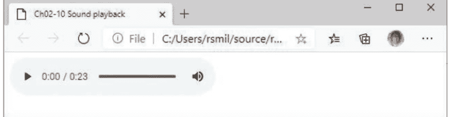

这是使用Edge浏览器时播放控件的外观。其他浏览器看起来会略有不同，但基本控件是相同的。你可以通过按下最左侧的播放控件来开始播放。

## 图片显示程序

本章的最后一个示例程序展示了JavaScript如何更改屏幕上显示的图片内容。你可以使用这种技术来实现“幻灯片放映”，并允许用户选择要显示的图片。要更新的图片必须指定一个ID：

```html

```

这个`img`元素显示文件`seaside.JPG`中的图片。JavaScript程序可以通过修改图片的`src`属性并使其指向不同的图片文件来更改显示的图片：

```javascript
var pic = document.getElementById("pageImage");
pic.src = "fairground.JPG";
```

这两条语句获取对图片的引用，然后设置`img`的`src`属性以指向图片`fairground.jpg`。这将更新浏览器显示的图片。请注意，这是你现在见过多次的模式的重现。程序获取对显示元素的引用，然后对其进行更改。你可以在`Ch02-12 图片选择器`示例中找到一个完整的图片选择器程序。


## 创建你自己的页面

你现在已经足够了解如何创建包含计时器、图片和按钮的页面了。以下是一些供你思考的想法：

- **制作一个"心情"页面**：页面将显示标有"快乐"、"悲伤"、"担忧"等字样的按钮。当用户按下按钮时，页面将显示适当的消息并播放一段适当的音乐。
- **制作一个"健身"页面**：用户将按下按钮选择锻炼时长，页面将显示锻炼说明并启动该锻炼的计时器。
- **制作幻灯片放映**：用户按下按钮，页面将显示一系列图片。为此，你可以使用多个`setTimeout`调用在未来不同的时间点触发图片更改——比如两分钟时一个，四分钟时一个，等等。

## 你学到了什么

本章让你对万维网是什么以及它如何工作有了很好的理解。以下是你在本章中涵盖的要点：

- `浏览器`使用 HTTP（超文本传输协议）从 Web 服务器请求数据页面。
- 到达浏览器的数据使用 HTML（超文本标记语言）进行`格式化`，网页包含对浏览器的命令（例如`强调`这个词），使用标签（例如`<em>`）来标记文本中的`元素`。元素可以包含文本、图片、音频和预格式化文本。元素还可以包含指向其他网页的链接，这些链接可以是本地的，也可以在远程服务器上。
- HTML 文本可以包含符号定义。符号包括诸如`<`（小于）和`>`（大于）之类的字符，这些字符用于标记标签，也可以用于在网页中嵌入表情符号。
- HTML 文档由一行标识文档为 HTML 的代码开头，随后是包含在 HTML 元素中的头部和主体元素。文档主体可以包含一个`<script>`元素，其中包含 JavaScript 代码。
- 网页可以包含按钮元素，当按钮被激活时运行 JavaScript 函数。
- JavaScript 代码通过包含页面所有元素的文档对象与 HTML 文档交互。文档提供了程序可以调用与之交互的方法。文档方法`getElementById`可用于获取对具有特定 ID 的页面元素的引用。
- JavaScript 程序可以包含变量。这些是命名存储位置。变量可以被赋予一个值，该值将被存储以供后续使用。赋值操作由等号（`=`）字符表示。
- JavaScript 函数可以通过其`id`属性在文档中定位元素，然后使用元素行为来更改元素上的属性。这就是 JavaScript 程序可以更新段落中的文本或更改图片源文件的方式。
- `setTimeout`方法可用于在未来的特定时间调用 JavaScript 函数。

为了巩固你对本章的理解，你可能想考虑以下关于 JavaScript、计算机、程序和编程的"深刻问题"。

## 互联网和万维网有什么区别？

Internet（互联网）是一种将大量计算机连接在一起的机制。万维网只是我们可以利用 Internet 做的事情之一。如果把 Internet 比作铁路，那么万维网就是一种提供特定服务的客运列车类型。

## HTML 与 HTTP 有何不同？

HTTP 是超文本传输协议。它用于构建 Web 浏览器和服务器之间的通信结构（注意：这里的"conversation"翻译为"对话"可能产生歧义，但在技术语境下通常指交互过程）。浏览器使用 HTTP 询问："请给我这个页面。"如果找到了该页面，服务器则给予响应并连同页面内容一起返回；否则只给出相应的错误信息。问答的格式由 HTTP 定义。页面的内容设计是通过超文本标记语言（HTML）来表达的。它告诉浏览器的操作包括"在这里插入图片"或"将这一部分文字设为段落"。

## URL是什么？

URL是浏览器想要读取的资源地址。它以标识所请求资源类型的字符开头。如果以`http`为始，这意味着浏览器想获取网页内容（即超文本文档）。URL的中间部分是承载我们要读的页面之服务器的网络地址；其最后一段是该服务器上存放页面的路径（文件名）。若未指定具体文件路径，则服务器会返回默认文件的内容——有时是（但并非总是）名为`index.html`的文件。

## 在创建网站时应该把诸如图像和音频之类的东西放在哪里？

最简单的方法是：将图片和声音文件直接存放在网页所在的同一目录下。换言之，包含有`index.html`的文件夹也可以存放这些素材。然而，资源的访问路径可以穿越多个子目录，因此完全可以对站点进行规划使得所有媒体资料独立于页面存储——我们将在下一章中演示这一点。

## 为何不应将所有网页都使用预格式化文本？

HTML中的`<pre>...</pre>`元素可告知浏览器某段文字已经过排版处理、请不再额外布局（layout）。这适用于展示固定格式的列表等内容，但也意味着无法让浏览器根据目标设备特性自动优化显示效果。Web页面设计的基本原则之一是：由浏览器负责最终渲染；而在该过程中页面上应包含足够的"提示"，比如"在此处换段行"之类的信息以便浏览器自行整理出最佳视觉效果。

## 为何推荐使用`<em>`而不是`<i>`？

标签`<i>`（斜体）意为"使用斜体文本"，而`<em>...</em>`则表示"突出强调此段文字"。当目标设备不支持斜体字体时，若仅调用字符样式可能无法正确显示结果——此时改为请求浏览器执行高亮操作反而更具实用性：例如可通过变色、黑白反相等方式实现视觉上的"加重效果"，而非强行切换不可用的衬线体或斜体类型。

## HTML标记与元素有何关系？

标签（tag）如`<p>`属于指令，旨在提醒浏览器："接下来的内容是告诉你该如何解析后续文本"；而完整的一对起始及结束标签序列才构成一个完整的页面"要素"。换言之：单只标签代表的是操作说明而非实际呈现的内容。多个连贯的标记共同界定出一个页面对应的对象单元（element）。

## 每个 HTML 元素都需要成对的出现吗？

否！许多情况确实如此，比如`<p>`作为段落开始、对应结尾为`</p>`；但如创建换行的`<br>`，它自身并不要求伴随关闭符。这类单独存在的"自闭合式"标记无需额外配对即可有效完成功能目标。

## 能否把某一元素嵌套进另一元素内部？

当然可以！比如：在段落内插入带斜体或加粗的文字；亦如使用`<audio>`播放器时还可以在其标签体内嵌入描述声音来源属性的子项，从而构成更丰富的信息层次结构。这种机制使得文档表达能力得以极大扩展而不牺牲可读性。

## 属性（attribute）与特性（property）有何区别？

网页源码中包含带有各种参数设定的元素实例——举例来说：

```

```

会生成一张图像要素并将源文件路径设为`seaside1.jpg`；在JavaScript程序中，整个页面会被抽象为一个包含若干对象集合的文档模型（DOM），其中每个 DOM 对象对应 HTML 里的某个组件实体。每一个这样的结构体又携带了映射自原始标记属性的数据域——简言之：属性指代的是最初写在 HTML 中设定的数值状态；而特性则是这些取值在 JS 环境中可被动态调用的表现形式。通过编写脚本我们可以轻松更改某张图片的`src`值来切换展示内容本身。

### "引用（reference）"指的是什么？

日常生活中，"参考"对象往往意味着指引我们前往某个地点的路标。JavaScript 编程环境下，程序需要通过持有特定对象的"地址指针"来进行查找定位工作——这里的"对象"是一组代表现实事物或抽象概念的数据集合及其行为组合。JS 利用此类结构来模拟网页上的各个界面元素；每个可视单元都被封装成独立实例加以管理。"引用"本质上只是一块内存中的标识符，记录着目标实体在虚拟空间内的精确坐标位置。

## function方法与method之间差在哪里？

语言本身提供了两类函数构造方式：带有明确名称的自由站立型代码段称作"函数"（function），诸如我们曾经定义的`doEndTimer()`这类程序块便属于此列；另一些则依附于已有对象内部存在、被称为方法（method），像由`document`所提供的`getElementById("")`就是典型代表——它们虽然本质上仍是具备参数输入与返回值输出的逻辑单元，但因被绑定到某物之上而获得了情境感知能力从而区别于普通命名空间中的工具函数。

# 级联样式表（CSS）

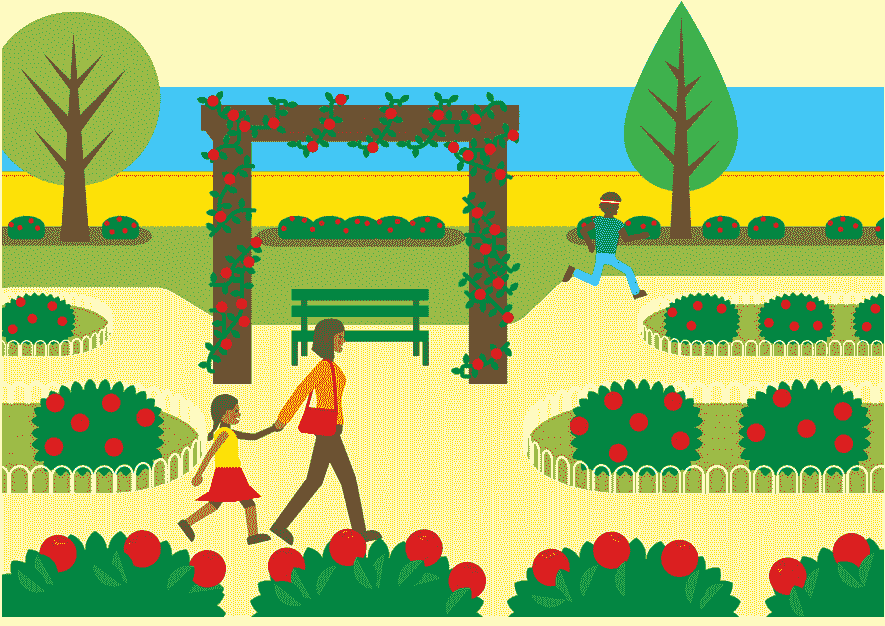

## 你将学到什么？

前两章里我们学习了如何使用 HTML 设计网页并利用 JavaScript 为其添加行为逻辑，你可能已经注意到自己制作的页面外观还远不如常用网站那样美观——缺乏色彩搭配与精致构图技巧。本次课程旨在带你掌握控制页面视觉表现的方法使其更具吸引力；同时在此过程中重温一些关键的 JS 编程要点并动手开发几个妙趣横生的小应用及游戏项目：

- 为网页披上文采
- 鼠标悬停时的颜色高亮提示效果实现
- 获取当前时间用于动态展示功能演示
- 探索样式表的基本原理与操作手段
- 理解级联规则的作用机制及其优先级排序逻辑
- 总结本节核心知识点回顾

## 为网页穿上外衣

我们可以从探讨"风格"这一概念入手：看似一种你要么拥有、要么并不具备的东西——我也曾多次受提醒说自己全无这方面的天赋……但在网站建设领域我还是掌握了一定程度的知识并且能指导他人如何将特定格调赋予页面内容之中。元素层面的样式涵盖诸多维度，比如前景背景配色方案选哪些颜色最协调？字体选用何种粗细间距比例合适才显优雅大方甚至带点时尚感？字距行高是否足以保证阅读流畅性而不引起视觉疲劳呢？所有这些设定加起来形成了一个统一的整体氛围——你可以把它想象成一套组合式配置清单供按需装配使用。接下来我们就从修饰几段文字开始练习吧！一旦搞懂如何对单个 DOM 对象施加样式处理之后，我们将进一步研究怎样批量修改文档内所有同类组件的表现形式从而节省重复劳动成本提高效率。

## 挥洒一点色彩

不妨先在页面上添些鲜亮配色试试水？HTML 元素定义中可以包含若干属性用来刻画该构件的具体特征——添加一个名为`style`的属性并赋予其值如`"color:red"`即可直接设定该行文字呈红色显示（foreground coloring）。参见下方示例代码片段：

```
<p>This is an ordinary paragraph</p>
<p style="color:red">This is a red paragraph.</p>
```

上方展示了给单一段落应用样式的实际效果对比图。第一个保持原貌毫无修饰；第二个则通过添加颜色指令变成红字呈现状态。（参考图示）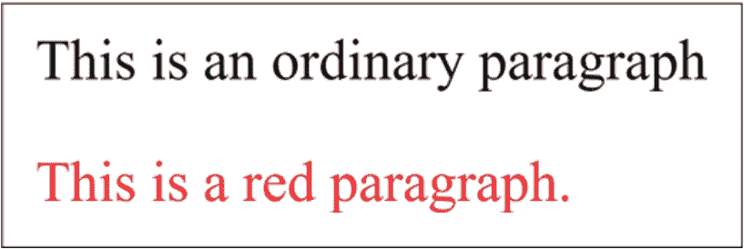

**Figure 3-1** Styling text（图3-1：文本样式化演示）

此外，HTML 标准规范内置了一套可供命名的颜色名称列表供开发者直接调用——Visual Studio Code 集成环境会在你编辑源文件时实时显示所选色值的缩略预览效果，如下图所示。（见图2）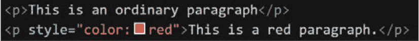

**Figure 3-2** Visual Studio color preview（Visual Studio 色彩预检面板）

继续输入任意合法颜色名称即可弹出下拉菜单辅助快速选择合适色调——参见下文插图。（参考图三）

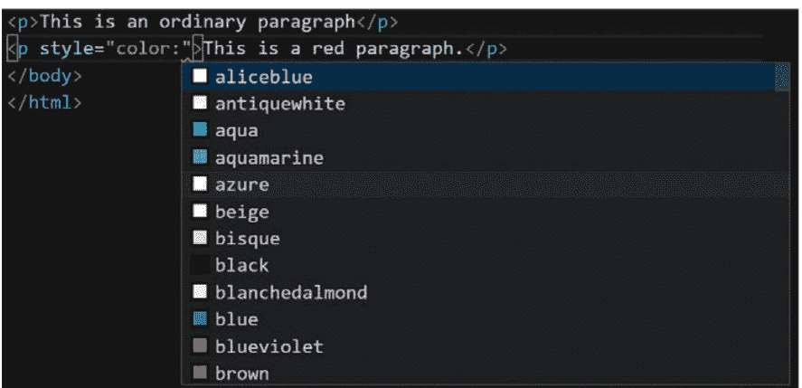

**图 3-3** Visual Studio 颜色选择器

样式设置非常丰富。当你开始输入样式命令时，Visual Studio 的交互式帮助会向你展示所有可能的设置。样式设置可以通过分号字符分隔，组合在单个样式描述中。下面的样式将在黄色背景上优雅地显示红色文本。

点击此处查看代码图片

```
<p style="color:red; background: yellow;">Red on Yellow.</p>
```

## 让它动起来

### 鼠标悬停时的颜色高亮

到现在，你应该已经熟悉了这种 JavaScript 程序模式：

1. 将一个 JavaScript 函数附加到一个事件上。
2. 当函数运行时，它会获取文档中一个元素的引用。
3. 然后，函数更改该元素的属性以改变文档的外观。

我们已经用这个模式制作了一个响应按钮点击的程序，以及另一个在时间间隔过后运行函数的程序。现在，我们将使用完全相同的模式来制作一个当鼠标悬停在文本上时会高亮显示文本的网页。你肯定在访问过的网页上见过这种效果。看看下面的代码：

[点击此处查看代码图片](https://raw.githubusercontent.com/Upyaancloud/eab3de95c07a7c2f1e3e2f764f2e8b8e880c0e9e/main/03-02%20-%20Mouse%20Hover%20Effect/index.html)

```
<!DOCTYPE html>
<html lang="en">
<head>
<title>Ch03-02 Color Change on Mouse Over</title>
</head>
<body>
<p onmouseover="doMouseOver();" id="mouseOverPar">Roll your mouse over me!</p>
<script>
    function doMouseOver()
    {
        var par = document.getElementById("mouseOverPar");
        par.style="color: red";
    }
</script>
</body>
</html>
```

你能找出我们使用的是哪个事件，以及函数`doMouseOver`是如何改变文本颜色的吗？

我们使用的事件叫做`onmouseover`，程序使用段落的`style`属性使其变为红色。当浏览器检测到鼠标指针位于段落文本上时，它会调用`doMouseOver`函数。该函数获取段落的引用，然后将段落的样式设置为包含红色。

让我们看看代码在实际中是如何工作的。找到 **Ch03 HTML/ Ch03-02 Color Change on Mouse Over** 文件夹。双击该文件夹中的`index.html`文件打开页面。在左上角，你会看到一个带有此消息的简单页面："Roll your mouse over this paragraph."。将鼠标移到文本上，注意发生了什么。你应该看到文本变成了红色，这正是你想要的，但你还应该注意到一些其他情况。这个行为是你想要的吗？我想你可能更希望当鼠标移开段落时，文本变回黑色。

我们发现了我们的第一个 bug（程序缺陷）。程序中的 bug 是你不想要的行为。发现和修复 bug 是软件开发的重要组成部分。在这种情况下，bug 的出现是因为我们没有仔细考虑"悬停"的真正含义。也许我们假设当鼠标离开段落时，浏览器会恢复文本的原始颜色，但程序并非如此工作。你认为我们该如何修复它呢？

我们可以通过使用另一个事件来修复它。事实证明，网页上的一个元素在鼠标离开它时和鼠标移过它时都能生成事件。我们需要使用的事件叫做`onmouseout`，我们需要将其连接到一个将段落文本颜色设置回黑色的函数。看看你能否修复你程序的副本，使其正常工作。使用 Visual Studio Code 编辑`index.html`文件，保存，然后用浏览器测试它。

如果你想看我的修复方案，请查看 **Ch03 HTML/ Ch03-03 Color Change on Mouse Over Working** 文件夹。这个方法有效，但在后面的章节中，我们将发现一种更简单的方法来创建悬停效果。

## 程序员要点

### Bug 是程序员生活的常态

你将不得不习惯于创建 bug。我编程多年，仍然会写出有 bug 的代码。而且我预计在编写更多程序时会创造出更多 bug。需要记住的是，创建一个 bug 没问题，但制造一个 *fault*（故障）就不行了。当客户在你的程序中发现一个 bug 时，你就制造了一个 fault。程序员通过测试发现 bug。程序员通过测试不充分来制造 fault，这导致 bug 最终进入产品。每当你制作一些东西时，都需要弄清楚如何测试它。在我们的"段落高亮"程序中，测试很简单——只需移动鼠标看看会发生什么。当我们制作一些更大的程序时，我们会发现测试可能更复杂。

请注意，bug 也是规格说明不完善的产物。最初，我说我希望当鼠标指针悬停在文本上时，文本会改变颜色。我们程序的第一个版本做到了这一点，所以可以说它是没有 bug 的。只有当我们注意到当鼠标移开文本时，文本仍然保持高亮状态时，我们才决定这个行为不是我们想要的。这表明在开始构建程序之前，仔细思考你希望程序做什么是多么重要。它也显示了"原型"程序的用处，这些程序可用于确定解决方案是否完全符合客户的要求。

## 处理字体

字体是计算机制造商们"求同存异"的众多事物之一。他们都同意需要一种看起来像**这样**的字体。（这被称为 *serif* 字体，因为字符设计的线条末端有装饰线。）他们都同意我们需要一种看起来像 *这样* 的字体。（这被称为 *sans-serif* 字体，因为它没有额外的装饰线，而 "sans" 是法语，意为"没有"。）

然而，制造商们并未就它们的名称达成一致。例如，"sans serif"字体可以被称为 "Arial" 或 "Helvetica"。

## 选择文本字体

这意味着当我们指定网页中使用的字体时，我们不能请求特定的字体，因为我们不知道查看页面的计算机类型。相反，我们将指定一个 *font family*（字体系列）。这在元素的样式中指定。我们可以指定一个我们想要使用的字体列表，浏览器将按顺序查找它可以使用的字体：

[点击此处查看代码图片](link)

```
<p style="font-family:Arial, Helvetica, sans-serif">This is i</p>
```


上面的样式首先请求`Arial`，然后是`Helvetica`，最后是`sans-serif`。大多数计算机都有`sans-serif`字体，因此列表中的最后一项充当“通用选项”。列表中的第一项是特定字体，而最后一项将是更抽象的字体类型。如果我要挑选晚餐吃的蔬菜，第一项会是“薯条”（一道特定的菜），最后一项会是“土豆”（我想要的那种特定蔬菜的通用类）。字体选择的工作方式与此相同。请注意，当我选择一个字体系列时，我也会获得该字体中粗体和斜体版本的字符设计。参见[图 3-4](#figure-3-4)。

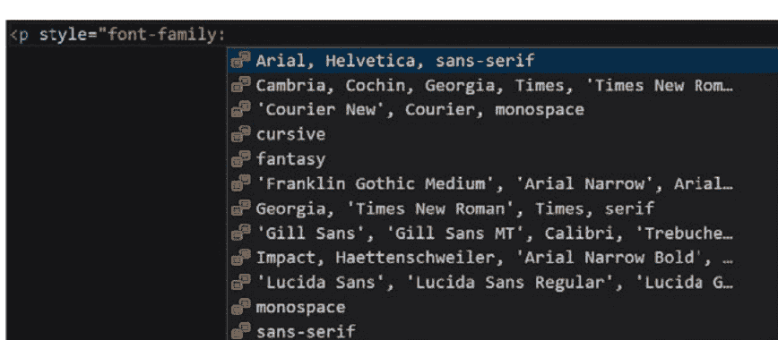

**图 3-4** Visual Studio Code 字体选择器

我们已经看到 Visual Studio Code 在选择样式颜色时是多么有帮助。它还会为字体系列提供建议，这些建议已经以合理的方式组织。建议的字体系列为你提供了可在页面中使用的良好范围的字体，如下图[图 3-5](#figure-3-5)所示。你可以在示例文件夹`Ch03 HTML/ Ch03-04 Fonts in JavaScript`中找到生成此页面的 HTML 代码。

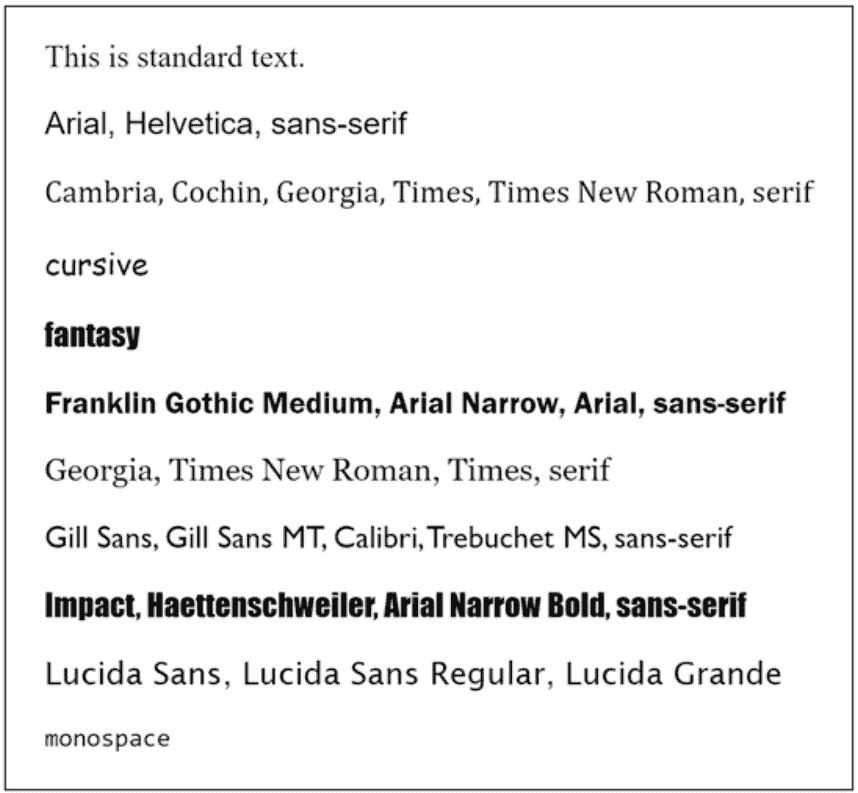

**图 3-5** 字体示例

## 可能出什么问题

### 字体可能是一个雷区

我必须承认，我觉得很难看出上面**图 3.5**中 Cambria 和 Georgia 字体的区别。但有些人可以，而且他们可能有强烈的看法。确保你与客户就将要使用的字体达成一致。我在页面中不使用很多字体。我通常为标题使用一种 serif 字体，为正文使用一种 sans-serif 字体（或反之）。仅仅因为你*可以*在页面中使用多种字体，并不意味着你*应该*这样做。

如果您遇到的字体名称中包含空格（例如 Times New Roman），请务必在“fonts family”设置中使用单引号将其括起来。另外请注意，上述图 3.5 所示的不同字体大小差异很大，这会影响您的页面布局。

## 选择字体大小

撰写本书时，我并没有过于担心文本的具体字体尺寸。我知道标题必须比普通正文大，但我不太纠结于具体的数值。在设计网页时，也建议你采取类似的方法。换句话说，如果您想在标题中显示大号文本，请选择`h1`（一级标题）格式来设置该标题，并且不要更改标题中的字体大小。

如果要在网页上指定文本的大小，您可以使用多种单位。您可以用英寸、厘米、像素、点来表示大小，也可以将其设置为显示屏大小的百分比；但我建议您使用`em`单位。`em`值为`1`时代表正常大小的文本。如果您想要更小的文字，请输入比`1`更小的`em`值（例如`0.5`）以表示减半的大小。这使得所有字体尺寸变为*相对*尺寸而非*绝对*尺寸，这通常是您想要的效果。作为页面创作者，您需要确保文本能在各类设备上可读。设置绝对大小会导致文本在一款设备上看完美无缺，而在其他设备上却显示错误。如果您想要比该字体的正常尺寸大两倍的文本，则应将`em`值设置为`2`，以此类推。您可以通过在样式中设置`font-size`来设定屏幕上文本的大小：

[点击此处查看代码图片](#)

```html
<p>This is normal text.</p>
<p style="font-size:1em">This is 1 em.</p>
<p style="font-size:2em">This is 2 em.</p>
<p style="font-size:0.5em">This is 0.5 em.</p>
```

图 3-6 显示了上述 HTML 代码在页面上的实际效果。（您可以在`Ch03/HTML/Ch03-05_Full Size_Font_Sizes`中找到展示这些示例的完整 HTML 代码。）

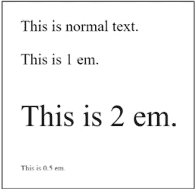

## 文本对齐方式

您还可以在`style`命令中添加一个元素，告知浏览器如何处理文本的布局。默认情况下（除非您另有指定），您的文本将按每行从左手边页眉开始的方式进行排列。您可以向样式中添加`text-align`设置，如下所示及如图 3-7 所示：

[点击此处查看代码图片](.)

```html
<p style="text-align: left;">This text is aligned at the left
    will wrap with a ragged edge.
    This is the normal format of text</p>
<p style="text-align: center;">This text is aligned in the center.
    Useful for headings and quotations.</p>
<p style="text-align: right;">This text is aligned at the right.</p>
<p style="text-align:justify;">This text is aligned at the left.
This makes the text look like the pages of a book or a column.</p>
```

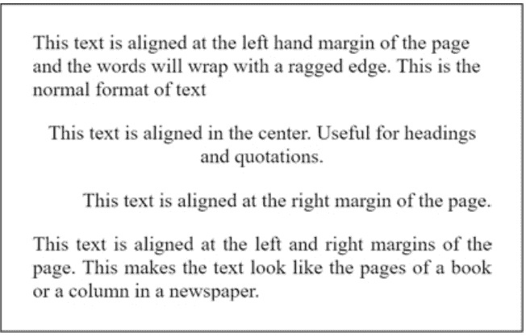

## 制作滴答作响的时钟

我们可以利用在屏幕上显示大文本的能力来创建一个巨大的滴答作响的时钟。但是，要实现这一点，我们需要了解`JavaScript`程序如何获取当前时间（即需要被时钟显示的时、分和秒的值）。此外，我们还需要编写一个程序每隔一秒执行一次以更新时钟显示。

### 让某件事发生

### 获取用于显示的日期和时间

到目前为止我们要创建的程序都与文档对象交互处理——该对象代表了构成网页的 HTML 代码。要获取时间值，我们需要创建另一种类型的对象：`Date`（日期）对象。让我们来探究一下这个机制的操作方式。找到`Ch03/HTML/Ch03-07_Clock Display_`文件夹并双击其下的`index.html`文件打开页面；您会看到一个时钟显示器显示为 0:0:0。我们将获取时间并在该计时器上显示它。按`F12`键以打开“Developer Tools（开发者工具）”视图，然后移动至`Console`（控制台）窗口输入以下 JavaScript 语句：

```javascript
var currentDate = new Date();
```

我们已经见识过`var`；它是程序创建变量的方式。所创建的变量称为`currentDate`并被设定为指向一个全新创建的`Date`对象。`new`（新建）一词意为“创建一个新对象。”我们以前未曾有过需要自行创造任何对象的经历——因为当我们的程序运行时就已经在使用现存的各类物件了。该`Date`对象的存在是为了使 JavaScript 程序能够与日期和时间进行工作。

一旦一个新的`Date`对象创建时，就会把当前设定的时间与时间存入其中。`currentDate`（变量）是一个指针对应着新创建的`Date`对象的引用——reference（指的是）我们曾在本章之前学习过：当我们想要在网页中更新一个段落元素时也曾创建一个指向该段落的引用。如果您需要重新唤起对此的理解可以看看示例`Ch02-08_paragraph_update`。我们可以通过在引用上调用方法给对象发出查询请求，输入以下命令即可实现此类操作：

```javascript
alert(currentDate.getHours());
```

该语句调用了`getHours()`（获取小时）方法——这是`Date`对象的组成部分之一。此方法会返回一个数字以包含日期的“hour（时）”值；这条语句会在一个`alert`警告框中显示它。除此之外，也有用于获取分钟和秒钟数值的方法（methods）。每种方法的名字都反映了其所做之事，看看您能否利用它们也来显示出这些时间值。请注意必须在每种方法的名称之后加上方括号`()`，以便 JavaScript 知道想要调用该种特定方法——稍后我们将在第 7 章中了解到更多有关如何进行方法调用的事情。（注：原文此处指代在后续章节会讲）

现在输入以下语句以建立带有我们制作时钟所需的时、分和秒钟数值的变量（variables）：

[点击此处查看代码图片]

```javascript
var hours = currentDate.getHours();
var mins = currentDate.getMinutes();
var secs = currentDate.getSeconds();
```

现在我们拥有了构建一个字符串以供显示时间所需的各种数值——hour（时）、min（分）和 sec（秒）的变量。该字符串将包含用`:`（冒号）字符隔开的时间值。输入以下语句以创建用于显示的 time string（时间字符串）：

[点击此处查看代码图片]

```javascript
var timeString = hours + ":" + mins + ":" + secs;
```

这条语句会创建一个名为`timeString`的变量，其中存储着我们希望显示出的时间点时刻——在将`hours`、`mins`、`secs`（时/分/秒）中的数值转换为文本字符串。您可以使用一个`alert`来查看这些字符串：

```javascript
alert(timeString);
```

如果您检查看了一下警报中出现的日期和时间就会发现它是过时的了（因为要完全输入完所有这些语句可能需要花费几秒钟时间）——`currentDate`（当前日期）变量的值是对那一刻特定时间点日期的**snapshot**（快照）。这并不会影响我们的时钟程序：因为在读出这些数值后它们就会即刻显示出来。我们此时已知如何把时间的数值提取成字符串并将其准备就绪以供展示。（接下来）用于此页面显示的 HTML 代码中包含了这样一个段落它的 id 为`timepar`。输入以下语句：

```javascript
var outputElement = document.getElementById("timePar");
outputElement.textContent = timeString;
```

我们已经在此之前使用过这种类型的语句模式了。第一个指令创建一个变量：指代我们将用来显示时间的输出元素（output element）。第二个命令将该元素的`textContent`（纯文本内容）属性设定为 time string 变量的内容——这会导致时间被显示出来的效果出现。（如果）您现在再试一次就可以发现刚才的警报窗口中显示的日期和时间已经更新并反映出真实的当前时刻了。按`F12`键关闭浏览器中的**Developer Tools**（开发者工具）。

### 制作滴答作响的时钟

此时我们已知如何做出一段包含当前时间值的字符串然后将其在大字号下展现出来——接下来需要一种方式来让时钟开始“走动”（即 tick）。在我们第 2 章中为计时器创建程序时，曾利用名为`setTimeout`（设置定时）的功能来在指定的超时值后调用一特定 JavaScript 函数。

JavaScript 中还有一条非常实用的功能（指`setInterval`）：

```javascript
setInterval(doClockTick, 1000);
```

上述语句会使一个名为`doClockTick`的方法每秒被调用一次。这就是将更新我们时钟的函数。

我们应用的最后一部分是启动间隔计时器的方式。我们可以要求用户按一个按钮来启动时钟（这就是鸡蛋计时器的工作方式），但最好的方式是页面一打开，时钟就开始滴答作响。

可以通过`onload`事件在网页元素加载时调用一个函数——在本例中，是一个三位数的滴答时钟，如图 3-8 所示。你可以在`Ch03 HTML/Ch03_08 Ticking Clock`示例文件夹中找到下面的 HTML 代码。

```html
<!doctype html>
<html lang="en">
<head>   <title>Ch03-08 Ticking Clock</title></head>
<body onload="doStartClock();">
  <p id="timePar" style="font-size:10em;font-family: 'Courier New', Courier, monospace;
text-align: center;">00:00:00</p>
  <script>
    function doStartClock()
    {
      setInterval(doClockTick,1000);
    }

    function doClockTick()
    {
      var currentDate = new Date();
      var hours = currentDate.getHours();
      var mins = currentDate.getMinutes();
      var secs = currentDate.getSeconds();
      var timeString = hours+":"+mins+":"+secs;

      var outputElement = document.getElementById("timePar");
      outputElement.textContent=timeString;
    }
  </script>
</body>
</html>
```

## 代码分析

### 滴答时钟

关于这段代码，你可能会有一些疑问。即使没有，我有。理解这些答案很重要，因为它们是一些重要 JavaScript 编程方面的基础。

**问题：**`var`和`new`有什么区别？

**答案：**`var`和`new`命令看起来非常相似，因为它们似乎都与创建某物有关，但你可能对到底发生了什么感到困惑。在`var`的情况下，程序正在创建一个新变量：

```javascript
var age = 21;
```

这将创建一个名为`age`的变量，其值设置为数字 21（这对我来说有点乐观）。

```javascript
var outputElement = document.getElementById("timePar");
```

这将创建一个名为`outputElement`的变量，其值设置为文档对象的`getElementByID`方法返回的结果。（你可以通过阅读第 2 章的“HTML 和 JavaScript”部分来刷新对此工作原理的理解。）所以，每当我们想要创建一个变量（例如，一个可以存储东西的命名位置）时，我们就使用`var`。在下一章中，我们将更详细地讨论变量。

程序在想要创建一个新对象时使用`new`。`new`这个词后面是要创建的对象类型的名称：

```javascript
var currentDate = new Date();
```

这创建了一个名为`currentDate`的新变量（这就是`var`的作用），然后将这个变量设置为指向一个使用`new`创建的`Date`对象。因此，`var`用于创建变量，而`new`用于创建对象。

**问题：**使用控制台时，我必须在每条语句后加分号吗？

**答案：**你可能已经注意到，如果省略末尾的分号，控制台命令仍然有效。当你在控制台中输入 JavaScript 语句时，你通过按回车键结束每条语句。这意味着 JavaScript 知道你何时完成语句，因为你已经按了回车键。但是，如果你想在一行命令中输入多条语句，你就必须使用分号字符将它们分隔开。我喜欢总是添加分号，这样阅读我代码的人就能确切知道我打算何时结束语句。

**问题：**为什么一个函数名用引号括起来，而另一个没有？

**答案：**这个时钟程序使用了两个函数。一个叫做`doStartClock`，用于启动时钟运行。另一个函数叫做`doClockTick`，用于每秒更新时钟。函数`doStartClock`在页面加载时通过使用`body`元素的`onload`属性被调用：

```html
<body onload="doStartClock();">
```

函数`doClockTick`使用`setInterval`函数每秒被调用一次：

```javascript
setInterval(doClockTick, 1000);
```

你可能想知道为什么`doStartClock`的名字用双引号括起来，而`doClockTick`没有。至少，我希望你是这样，因为理解这种区别将帮助你更好地理解 JavaScript 和 HTML 如何协同工作。在 HTML 的`onload`事件的情况下，要执行的操作是一个字符串，其中包含在元素加载时要执行的 JavaScript 语句。我们使用的字符串调用了`doStartClock`方法，但它可以是任何 JavaScript 语句序列：

```html
<body onload="var x=99;alert(x);">
```

这是完全合法的 HTML。在加载时执行的 JavaScript 创建了一个名为`x`的变量，将其值设置为`99`，然后显示一个显示此值的警告框。但是，`setInterval`函数接收的是对要每秒调用一次的函数的引用，而不是包含一些 JavaScript 代码的字符串。你可能想知道为什么这两种东西以不同的方式工作。这是因为`onload`事件是 HTML 元素的一部分，而`setInterval`函数是从 JavaScript 程序代码内部调用的。

**问题：**为什么时钟启动时需要一秒钟才显示时间？

**答案：**如果你加载示例页面，你会发现需要一秒钟时间才会显示时间。在页面加载后的一秒钟内，时间显示为 0:0:0。如果你仔细想想，这正是程序的工作原理。`setInterval`函数以每秒一次的间隔调用`doClockTick`函数，但这意味着程序必须等待这个间隔过去才能显示时钟。你能想出解决这个问题的方法吗？


解决方案很简单。程序必须在`doStartClock`函数中调用`doClockTick`。由于`doStartClock`方法在页面加载时被调用，这将导致显示在开始时就更新。你可以在`Ch03 HTML/Ch03-09 Clock Quick Start`文件夹中找到我的版本。

### 文本周围的边距

打印页面上的文本不会延伸到纸张的边缘。本书的段落周围有边距。一些段落（例如，上面的“代码分析”侧边栏）与其余文本的边距不同。这使这些段落突出。样式可以表达段落周围的边距大小。它还可以描述段落的边框。上面的段落有一个外边距、一个边框，然后是边框内文本周围的“内边距”。

```html
<p style="margin: 20px;
padding: 10px;
border:1px;border-style: solid; border-color:blue;">
This is some text in a blue box.</p>
```

边距和边框的尺寸用我们以前没见过的单位`px`表示，这是像素的缩写。

我本可以花些时间画一张图来说明边距、边框和内边距值如何控制页面上的文本布局，但事实证明 Edge 浏览器可以为我做到这一点。在图 3-9 中，你可以看到上述 HTML 的开发者视图，你可以在代码文件夹`Ch03 HTML/ Ch03-10 Margins`中找到它。图 3-9 右下角的图表显示了边距、边框和内边距元素如何彼此嵌套。

## 图 3-9 边距显示

我使用`px`单位指定了边距、边框和内边距的尺寸，这是一个绝对单位，相当于目标显示器上的一个点。我们在指定要在屏幕上绘制的图像大小时使用了这些单位。如果你关心精确的布局，可以使用这些单位来精确地布局文本和图形。`px`单位的大小与设置图像大小时使用的单位相匹配，因此你可以将文本和图形组合起来制作精确对齐的页面。下面的 HTML（你可以在`Ch03 HTML/ Ch03-11 Fixed Width Paragraphs`代码文件夹中找到）将图像和描述性段落放在一个蓝色框内，如下图 3-10 所示。

```html
<p style="margin: 20px;
    border:1px;
    border-style: solid;
    border-color:blue;
    padding: 10px;
```

## 创建样式表

HTML 文档可以使用`style`属性为文档中的任何元素添加样式。然而，给所有东西都加上样式似乎是很麻烦的工作。幸运的是，HTML 提供了一种简化样式应用于文档的方式。我们可以通过将样式表添加到文档的`head`部分来为 HTML 文档添加样式表。

```html
<!DOCTYPE html>
<html lang="en">

<head>
    <title>Ch03-12 Changing styles</title>
    <style>
        p {
            color: blue;
            font-family: Arial, Helvetica, sans-serif;
        }
    </style>
</head>
<body>
    <p>This is a modified paragraph.</p>
</body>
</html>
```

### 创建样式表文件

当创建一个网站时，设计者通常会制定一个标准的“整体风格”，应用于所有页面。这些整体风格设置可以包含在每个页面的`<head>`部分，如上面的示例所示，但这会使改变网站风格变得困难，因为需要编辑每个文档。样式设置可以存储在一个单独的文件中。然后，在 HTML 头部中的`<link>`元素指定要添加的样式表文件。

```html
<head>
    <title>Ch03-13 Stylesheet File</title>
    <link rel="stylesheet" href="styles.css">
</head>
```

上面的 HTML 展示了这是如何工作的。`link`元素包含一个`rel`属性，该属性告诉浏览器链接所关联的资源类型。在这种情况下，链接关联的是一个样式表。包含样式信息的文件链接在`href`属性中指定。对于上面的 HTML 页面，这是一个名为`styles.css`的本地文件，它与 HTML 页面位于同一个文件夹中。然而，这个文件可能在另一个文件夹中，甚至可能在另一台服务器上。实际的样式表文件包含样式指令：

```css
p {
    color: blue;
    font-family: Arial, Helvetica, sans-serif;
}
```

### 程序员观点

#### 将样式与布局分离是个好主意

网页由布局（页面上有什么以及在哪里）和样式（页面的外观）组成。将这些元素分开是非常明智的。我本可以整本书都在描述如何给网页设置样式，但这不会是一本好读的书，因为我不太擅长设计。我宁愿找一个擅长字体和颜色的设计者，请他们来处理这些事情。能够将样式信息放入单独的文件，意味着我可以完全独立于样式来设计应用程序的布局和行为。

计算机科学家在项目中谈论“关注点分离”，即不同的人负责不同的部分。在项目开始时，大家就不同的组件如何协同工作达成一致，然后他们可以只专注于自己的部分。就 HTML 和样式而言，我会告诉设计者我正在使用`<p>`、`<h1>`和`<h2>`来表示不同级别的文本，然后设计者就可以处理这些样式的外观。稍后，当我们开始编写更大的 JavaScript 程序时，我们将发现一种将程序代码与 HTML 分离的方法，这允许更高层次的分离。

## 创建样式类

如果我们正在制作一个简单的 Web 应用程序，我们可能能够使用段落和标题样式来表达所有的格式化要求。然而，更复杂的应用程序将需要包含其他样式。例如，我们可能希望有一个不同的格式来显示地址。它可能需要是红色的，使用等宽字体，并且右对齐。我们可以为一个文档的样式表添加一个名为`address`的新样式类：

```css
.address {
    color: red;
    font-family: 'Courier New', Courier, monospace;
    text-align: right;
}
```

注意，这看起来像我们修改`<p>`样式的方式，只是地址类有一个前导点（`.`）来表示这是一个新创建的样式类：`.address`。然后我们可以指定这个类提供段落的样式：

```html
<p class="address">This is an address paragraph.</p>
```

元素的`class`属性指定了用于设置元素样式的 CSS（层叠样式表）样式类。这意味着上面段落中的文本将以红色、等宽字体绘制在页面的右侧。你可以在`Ch03 HTML/Ch03-14 Address Style`文件夹中看到实际效果。你可以根据需要创建任意多的样式类。如果你与设计师合作，你们会就各种元素要使用的样式名称达成一致，然后你可以生成带有应用于格式化的类标签的 HTML 文件。

> **动手实践**

### 探索样式表

我们可以使用浏览器中的开发者菜单来查看样式表是如何工作的。找到`Ch03 HTML/Ch03-14 Address Style Class`文件夹，并用浏览器打开`index.html`文件。这将向你展示使用红色等宽字体格式化的地址段落。按 F12 打开开发者菜单。然后在开发者菜单顶部的对话框中选择“Sources”标签页。

你现在可以看到`index.html`和`style.css`文件。如果你点击它们，可以查看它们的内容。当我们开始制作更复杂的网页时，你会发现这个视图非常有用。你可以用它来查看你访问的任何网页的源代码，但不要被它们的复杂性吓倒。

---

## 使用`<div>`和`<span>`格式化文档的部分内容

我们可以为任何想要格式化的文本元素添加`class`属性，但有时将样式类应用于多个项目是很有用的。就上面的`address`样式而言，我们希望标记我们显示的所有地址段落。我们可以单独标记每个段落，但如果我们能一次性标记它们会更好。`<div>`和`<span>`元素使这成为可能。它们用于创建可以分配类的区域。

```html
<!DOCTYPE html>
<html lang="en">

<head>
    <title>Ch03-14 Address Style</title>
    <link rel="stylesheet" href="styles.css">
</head>

<body>
    <div class="address">
        <p>Rob Miles</p>
        <p>18 Pussycat Mews</p>
        <p>London</p>
        <p>NE14 10S</p>
    </div>
</body>

</html>
```

上面的 HTML 将使用地址类格式化地址的所有段落，因为它们被包含在一个 division 中。`div`元素指定文档中的一个分区。每个`div`元素标记一段文本的开始和结束。这意味着我们不能使用`div`元素来设置段落中某些单词的样式。如果我们只想使用特定样式格式化段落的一部分，我们可以使用`span`元素。

```html
<p>An HTML document can use the
<span class="codeInText">style</span>
attribute to add style to any element in a document.</p>
```

在上面的示例中，我希望单词“style”在文本中突出显示，因为它是一个 HTML 元素名称。我创建了一个名为`codeInText`的类，并用它为句子中的“style”这个词应用了样式。在这种情况下，我不能使用`div`，因为这会使句子分成几行。`Ch03 HTML/Ch03-16 Code Style with span`示例展示了它是如何工作的。你可以将`span`和`div`元素相互嵌套，但将`div`放在`span`内部没有太大意义，因为这会导致你的文本行中出现段落中断。当然，你必须确保任何“嵌套”都正确格式化。有关此问题的更多细节，请查看第 2 章的程序员观点“不要滥用浏览器”。

## 层叠样式

你可能想知道为什么它们被称为层叠样式表。这个名字指的是样式从一个元素“层叠”到它所包含的所有元素的方式。考虑以下 HTML：

```html
<!DOCTYPE html>
<html lang="en">
<head>
    <title>Ch03-17 Cascading Styles</title>
</head>
<body style="color: blue;">
    <p>This is an ordinary paragraph.</p>
    <p style="color:red">This is a red paragraph.</p>
    <p style="background: yellow;">This has a yellow background.</p>
</body>
</html>
```

文档包含三个样式元素。第一个应用于文档的主体。接下来的两个应用于文本主体内的元素。`body`元素被设置为蓝色。

`body`元素包含了两个段落元素，因此这个设置会层叠应用到这些段落上，如图 3-11 所示。

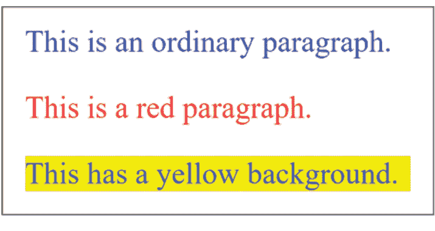

**图 3-11** 层叠样式生效

“普通”段落由于应用于其包含的`body`元素的样式而拥有蓝色文本。红色段落之所以是红色，是因为段落样式中的颜色设置覆盖了层叠样式。但是，具有黄色背景的文本仍然是蓝色，因为该段落的样式并未修改其包含元素的颜色；相反，它修改的是文本背景的颜色。规则是：除非样式设置被覆盖，否则样式设置将从包含元素“继承”而来。

## 程序员要点

### 管理样式关乎设计

随着你阅读本书，我希望你明白，许多解决方案的开发都是为了让你的生活更轻松。例如，如果你向客户展示你构建的解决方案，而他们却说他们想要橙色背景上的亮粉色文本（这种情况确实发生过），那你可能就有麻烦了。如果你将文本样式单独应用于每个 HTML 元素，这意味着你必须遍历整个文档并进行所需的更改。如果你正确地使用了样式表，你应该只需更改一个文件就能完成这样的更改。

大量的编程工作都关乎组织和规划。本章介绍了一些优秀的工具，你可以用它们来创建和管理 HTML 页面的外观。

## 使用选择器进行颜色高亮

在本章前面的部分，“[让它发生：鼠标悬停时的颜色高亮](Make Something Happen: Color highlighting on mouse rollover)”，我们使用了`onmouseover`事件来触发一个 JavaScript 函数，以改变段落中文本的颜色。当时我说过，有一种更简单的方法可以让用户将鼠标悬停在文本上时显示高亮文本。

```css
.rollover {
    color:black;
}

.rollover:hover {
    color:red;
}
```

上面的样式表创建了一个名为`rollover`的样式。这个样式有两个定义。第一个定义只是将颜色设置为黑色。`rollover`的第二个定义有一个额外的选择器：`hover`。选择器指示应何时使用此样式的变体。`hover`选择器指定，当鼠标悬停在 class 设置为`rollover`的元素上时，应使用此样式。此样式将颜色设置为红色。如果你在`Ch03 CSS\Ch03-18 Rollover with CSS`文件夹中查看此页面，你将看到它的工作原理。

## 你学到了什么

本章让你很好地理解了什么是样式以及如何管理它。以下是我们本章涵盖的要点：

- HTML 页面中元素的定义可以包含一个样式属性，该属性描述了元素应如何显示，例如使段落中的文本变红。
- 元素的定义还可以包含事件属性，当特定事件发生时执行一段 JavaScript 代码，例如，当用户将鼠标指针移到元素上时触发代码的`onmouseover`事件。
- 文本元素的样式信息可以包括用于绘制文本的字体。字体被指定为族，其中包括要显示的所有文本变体（如斜体和粗体）。在指定字体选项时，提供多个不同的`font-family`值是常规做法，因为系统对流行字体设计使用不同的名称。
- HTML 文档中元素的大小可以通过多种方式指定。如果意图是改变文本相对于其他文本的大小，则大小应以`em`单位表示，其中`em`值为`1`表示“正常大小”的文本。
- 可以使用`text-align`属性在 HTML 页面中对齐文本。
- `setInterval`函数可用于定期调用一个 JavaScript 函数。我们用它来创建了一个滴答作响的时钟。
- 元素的样式可以包含外边距、内边距和边框项目的定义。外边距是元素周围的外部边距。边框可以以多种样式和颜色绘制，并且具有固定的厚度。内边距值设置项目与边框之间的距离。
- 当指定 HTML 元素周围边框和边距的尺寸时，可以使用`px`单位。以`px`单位表示的值代表像素的数量，等同于图像中一个像素的大小。使用`px`单位意味着你可以以牺牲可移植性为代价，获得对项目布局的绝对控制。（例如，在某些设备上，页面可能看起来太大或太小。）
- 样式表包含可以分配给 HTML 文档中元素的样式设置。样式设置可以修改诸如`<p>`、`<h1>`和`<h2>`之类的样式，或者它们可以创建全新的样式，并使用`class`属性将其分配给元素。
- 样式表可以放在一个与 HTML 页面分离的文件中。页面在页面标题中包含一个`link`元素，该元素标识要使用的样式表文件。这允许页面的内容和样式完全分离。
- 样式以从包含元素向下层叠的方式应用于元素。例如，如果文档的主体使用红色文本进行样式设置，那么该设置将层叠到文档中的任何元素中。但是，文档内段落中的颜色样式属性将覆盖此层叠设置。
- `div`和`span`元素充当其他元素的容器。应用于`div`和`span`元素的样式属性会层叠到它们包含的所有元素中。当渲染`div`元素时，浏览器会在`div`的开始和结束处插入换行符。`span`元素则不会发生这种情况，这使得`span`元素可用于对句子中的单词应用样式。

为了巩固你对本章的理解，你可能需要考虑以下关于样式和样式表的“深刻问题”。

## 我可以给任何元素添加样式属性吗？

是的。为 HTML 文件中的`script`元素设置字体可能并不合理，但这样做不会导致错误。

### 如果我向一个项目添加了不相关的样式会怎样？

什么也不会发生。如果你想为 HTML 文件的`<script>`部分设置字体，你可以这样做，而且不会收到任何错误，但这并非明智之举。

### 如果我设置了冲突的样式设置会怎样？

“最近”应用的样式将被强制执行。换句话说，如果文档主体的文本颜色设置为黑色，但主体内段落的文本颜色设置为红色，则文本将是红色。这就是“层叠”的工作方式。

### CSS 文件是程序吗？

不是。我们编写的 JavaScript 程序列出了要执行的一系列操作。CSS 文件包含多个样式设置项目，这些项目应用于分配给它们的 HTML 元素。

### `redText`是一个好的 CSS 样式类名吗？

我不这么认为。如果你的客户决定他们确实想将该样式更改为蓝色文本，你将无法轻松更改该类的名称。类的名称应反映你希望样式实现的功能。例如，你可以有一个名为`displayName`的类，用于显示名称，另一个名为`displayAddress`的类用于地址。如果某个样式显示为红色，这应反映在该样式类的设置中，而不是类名本身。

## 我可以将 CSS 文件存储在与包含网页的 HTML 文件不同的服务器上吗？

可以。获取 CSS 文件的`link`元素包含一个 URL，该 URL 可以指向远程计算机上的文件。

## 什么时候应该使用`div`，什么时候应该使用`span`？


如果你想控制页面中构成某个*区域*（division）的一组元素的样式，就使用`div`。我说的区域，是指像完整的地址、订单或报告这样的内容块。该区域会通过换行与页面其余部分分隔开。如果你想为段落中的小部分内容设置样式，则使用`span`。例如，你可能使用`span`来突出显示本句中的单词`code`。这种情况下，你不希望文本中出现任何换行。

## `id`和`class`有什么区别？

网页中的元素可以同时设置`id`值和`class`值。`id`值在 HTML 文档中对该元素是唯一的。操作文档的 JavaScript 代码可以通过`id`定位元素。`class`值指定要应用于该元素的样式。文档中的大量元素可以拥有相同的`class`值。这使得更改这些元素的样式变得非常容易，因为设计师只需修改样式表中的类定义，它就会应用到所有元素上。

## `em`和`px`单位有什么区别？

这确实令人困惑。尤其是因为`em`应用于文本时也意味着“强调”（emphasized）。`em`值为`1`时，指的是当前字体中“正常”字符的大小。因此，我可以用`em`值来指定大小，使我的文本相对于其余文本变大或变小。我不想对文本大小使用绝对值，因为正如我们所见，不同字体有不同的“标准”文本大小，如果字体改变，我不希望所有内容变得太大或太小。所以如果你想表达某些东西比其他东西大，但又不想将其绑定到特定大小时，`em`非常有用。

`px`值指的是屏幕上的“像素”数量。现代高分辨率屏幕的像素非常小，这可能不是精确的映射，但`px`值的想法是让你能够更精确地放置元素，特别是相对于图像而言，因为图像也是用像素尺寸来定大小的。因此如果你想精确地排列元素彼此之间的关系，就使用`px`。

## CSS 就只有这些吗？

绝对不是。我们在本章中只是*浅尝辄止*。你可以执行动画、让图像淡入淡出，以及做各种其他事情。好在像 Visual Studio Code 这样的工具提供的交互式帮助，以及浏览器中出色的开发者控制台，让你可以试验样式来了解更多。这绝对值得去做。正如我们在查看 rollover 样式选择器时所看到的，我们可以用样式表行为来替代 JavaScript 代码。HTML 开发的规则之一是，在编写任何 JavaScript 代码之前，你应该始终检查是否可以使用样式表来实现你想要的效果。仅仅因为你可以编写程序来实现某种效果，并不意味着你应该这样做。

---

# 第二部分

# 使用 JavaScript 编程

在这一部分，我们开始编写 JavaScript 应用程序。我们将探索如何创建在浏览器内部运行的完整程序。我们将获得软件中数据存储和处理的基本编程知识。然后我们将讨论如何构建解决方案，并将大型程序分解为更小的组件。最后，我们将了解软件对象以及如何使用它们来创建自定义数据存储类型，将程序存储映射到现实世界的数据。

---

# 4

# 处理数据

## 你将学到什么

在本章中，你将构建更多的 JavaScript 程序。你会发现计算机本质上是一个数据处理器，而程序告诉计算机如何处理数据。你将看到程序如何使用*变量*存储数据，以及 JavaScript 如何管理程序可以存储的各种类型的数据。你还将学习 JavaScript 如何管理程序中变量的*可见性*。到本章结束时，你将能够创建有用的程序。

### 计算机作为数据处理器

- [数据与信息](link)
- [程序中的变量](link)
- [使用变量](link)
- [随机数](link)
- [处理文本](link)
- [将字符串转换为数字](link)
- [创建应用程序](link)
- [修复披萨程序](link)
- [全局变量与局部变量](link)
- [制作一些派对游戏](link)
- [你学到了什么](link)

### 计算机作为数据处理器

人类是制造工具的种族。我们发明东西来让生活更轻松，而且我们已经这样做数千年了。我们从机械设备开始，比如犁，它让耕作更高效。在上个世纪，我们进入了电子设备领域，最近则是计算机。

随着计算机变得更小、更便宜，它们已经融入了我们周围的事物中。许多设备（例如智能手机）之所以成为可能，正是因为我们可以在里面放入计算机来让它们工作。然而，我们需要记住计算机的作用；它将以前需要脑力劳动的操作自动化。除了给定的规则和结构之外，没有任何东西限制程序。

计算机处理数据的方式就像绞肉机处理肉一样：一端放入东西，进行一些处理，另一端输出东西。程序告诉计算机做什么，就像教练在比赛前给足球队或橄榄球队下达指令一样。教练可能会说：“如果他们在左路进攻，我希望杰瑞和克里斯回防，但如果他们把球踢向球场另一端，我希望杰瑞去追球。”然后，当比赛展开时，球队会以某种方式回应事件，从而应该能让他们战胜对手。

然而，计算机程序与球队在足球比赛中的行为方式之间有一个重要的区别。足球运动员知道什么时候得到了毫无意义的指令。如果教练说：“如果他们在左路进攻，我希望杰瑞唱国歌的第一节，然后尽可能快地跑向出口，”球员会提出异议。

幸运的是，程序中的数据不知道自己处理的数据是否有意义，就像绞肉机不知道肉是什么一样。把自行车放进绞肉机，机器会试图用它做香肠。把无意义的数据输入计算机，它也会做无意义的事情。就计算机而言，数据只是输入的信号模式，必须以某种方式操纵以产生另一种信号模式。计算机程序是一系列指令，告诉计算机如何处理输入数据以及输出数据应该具有什么形式。

典型的数据处理应用程序示例如下（如图 4-1 所示）：

- **智能手机**——手机中的微型计算机接收来自无线电的信号并将其转换为声音。同时，它接收来自麦克风的信号，并将其转换为将从无线电发送出的比特模式。
- **汽车**——发动机中的微型计算机接收来自传感器的信息，告诉它当前发动机转速、车速、空气含氧量、油门设置等。微型计算机产生控制化油器设置、火花塞点火时机等的电压，以优化发动机性能。
- **游戏机**——计算机接收来自控制器的指令，并用它们来管理它为玩家创建的人工世界。

| 输入 | 输出 |
|--------|---------|
| 无线电信号<br>触摸板 | 声音<br>图像 |
| 温度<br>压力<br>油门 | 燃油喷射器<br>点火时机 |
| 游戏手柄 | 游戏玩法 |

**图 4-1** 设备中的计算机

## 程序员视角

### 软件可能关乎生死

请记住，看似无害的程序可能具有危及生命的潜力。例如，医生可能会使用你编写的电子表格来计算患者的药物剂量。在这种情况下，程序中的缺陷可能导致人身伤害。（我不认为医生会这样做——但谁知道呢。）要了解糟糕的软件设计如何造成伤害甚至死亡，可以在网上搜索**Therac-25**。

如今制造的大多数相当复杂的设备都包含数据处理组件以优化其性能，而有些设备的存在仅仅是因为我们能够构建这样的能力。物联网（IoT）的增长正在将计算机引入到广泛的领域。将数据处理仅仅视为计算公司工资——计算数字并打印结果（计算机的传统用途）是远远不够的。作为软件工程师，我们 inevitably 会花费大量时间将数据处理组件集成到其他设备中以驱动它们。这些嵌入式系统意味着许多人将使用计算机，即使他们没有意识到这一点！

### 程序作为数据处理机

图4-2展示了每台计算机所做的事情。数据进入计算机，计算机对其进行某些处理，然后数据从计算机中输出。数据采取什么形式，输出意味着什么，完全取决于我们，程序做什么也是如此。

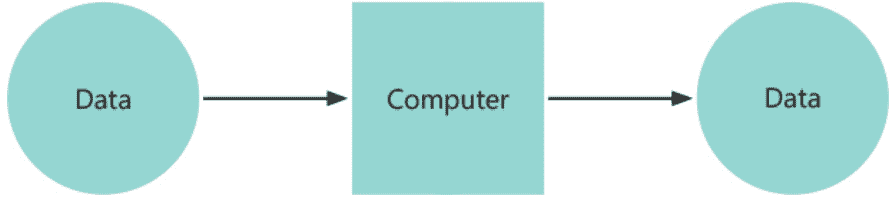

图4-2 计算机作为数据处理机

另一种思考程序的方式是将其比作食谱，如图4-3所示。

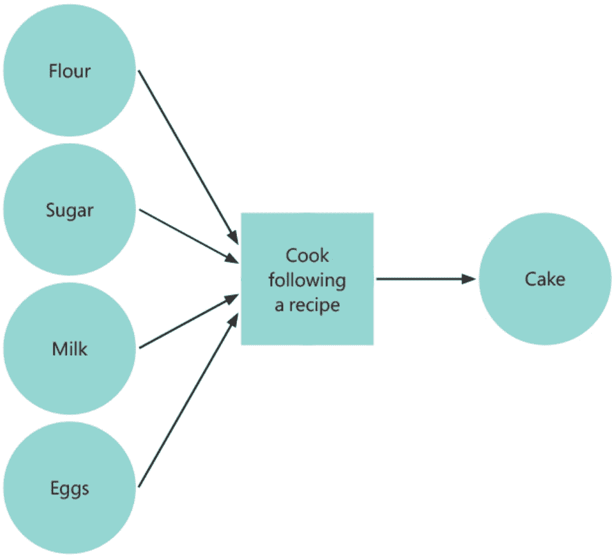

图4-3 食谱与程序

在这个例子中，厨师扮演计算机的角色，而食谱则是控制厨师如何处理食材的程序。食谱可以适用于许多不同的食材，程序也可以适用于许多不同的输入。例如，一个程序可能会获取你的年龄和你要看的电影名称，然后输出你是否可以观看该电影，基于其观众分级。

### JavaScript作为数据处理机

图4-4从数据处理的角度展示了早期示例程序之一——`Ch02-08`段落更新的工作原理。程序的输入是HTML页面上的一个输入框，程序的输出是HTML页面中一个段落的文本。在这种情况下，JavaScript程序代码位于函数`doUpdateParagraph`中，当用户按下页面上的按钮时运行。这个函数不对数据输入进行任何处理；它只是将文本从输入元素传输到输出元素。

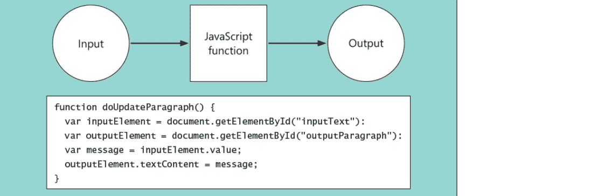

图4-4 JavaScript作为数据处理机

这是我们在接下来的几章中会经常使用的程序结构。我们可以通过更改在网页内部运行的函数中的指令来改变程序的功能。函数中的指令将对数据进行操作，并通过计算表达式来生成新值。

### 使用表达式处理数据

表达式可以简单到只是一个值（例如`2`或`Rob Miles`），也可以包含*运算符*和*操作数*。图4-5展示了一个包含两个操作数和一个运算符的简单表达式。实际执行工作的部分称为*运算符*。在`2+2`的情况下，有两个操作数（两个`2`值）和一个运算符（`+`）。当你将表达式输入JavaScript命令提示符时它识别运算符和操作数，然后计算出答案。

在第1章的“我们首次接触JavaScript”中，我们输入了一些表达式并看到了结果。现在让我们输入更多。

## 代码分析

#### 使用JavaScript计算表达式

前面图4-4中显示的函数不处理任何数据；相反，它只是将文本从输入传输到输出。JavaScript中的数据处理是通过计算*表达式*来执行的。表达式可以简单到只是一个值（这称为*字面量*，因为它就是按原样采用的）。或者，表达式可以执行复杂的计算。让我们做一些表达式计算来了解更多。

**问题：** JavaScript能计算`2+2`吗？

**答案：** 希望如此。进入示例文件夹`Ch04 Working with data\Ch04-01 Empty Page`。按F12打开网页的**开发者工具**，并选择**控制台**选项，再次输入表达式（`2+2`）并按Enter。

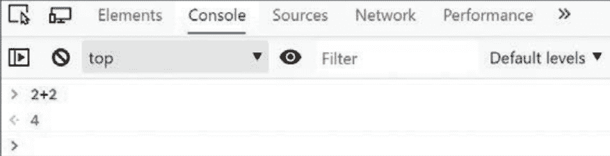

JavaScript控制台总是会尝试计算你给出的任何表达式，然后返回结果。在这种情况下，它计算出`2+2`等于4。我们可以使用控制台进行更多实验来研究表达式。从现在开始，我不再向你展示浏览器的截图，而是只显示你在控制台中会看到的输出。换句话说，前面的表达式看起来会是这样的：

```
> 2+2
<- 4
```

输入的文本以黑色显示，JavaScript的输出以蓝色显示，命令提示符以棕色显示。

**问题：** 如果你尝试计算`2+3*4`，你认为会发生什么？

**答案：** `*`（星号）运算符表示乘法。JavaScript使用星号代替数学中使用的`×`（乘号）。在数学中，我们总是先执行高优先级的运算，如乘法和除法，然后再做加法，所以我预计上面的表达式会显示值14。计算`3*4`会先进行，得到答案12，然后这个值会加到2上。如果你在控制台中尝试这个，你应该会看到你所期望的：

```
> 2+3*4
<- 14
```

**问题：** 如果你尝试计算`(2+3)*4`，你认为会发生什么？

**答案：** 括号包含了应该先计算的运算，所以在上面的表达式中，我预计会看到值5被计算出来（`2+3`），然后这个值乘以4，得到结果20。

```
> (2+3)*4
<- 20
```

**问题：** 如果你尝试计算`(2+3*4`，你认为会发生什么？

**答案：** 这个很有趣。你应该在控制台中尝试一下。发生的情况是，JavaScript对自己说：“我正在尝试计算的表达式不完整。我需要一个右括号。”所以，控制台等待你输入更多内容。如果你输入右括号并完成表达式，就会计算该值并显示结果。你甚至可以在第二行添加更多的计算。

```
> (2+3*4
      )
<- 14
```

**问题：** 如果你尝试计算`)2+3*4`，你认为会发生什么？

**答案：** 如果JavaScript在看到一个左括号之前先看到一个右括号，它会立即知道出了问题，并显示错误。

[单击此处查看代码图像](code_image_link)

```
> )2+3*4
(x) Uncaught SyntaxError: unexpected token ')'
```

请注意，命令shell正试图通过识别错误的字符来帮助你找出错误所在。

### 脚本语言

我们可以使用控制台进行这样的对话，因为JavaScript是一种“脚本”编程语言（线索就在名称中）。你可以将控制台视为一种“机器人演员”，它会执行你给他的任何JavaScript语句。换句话说，你使用JavaScript语言告诉控制台你希望程序做什么。如果指令对“机器人演员”来说没有意义，它会告诉我们它无法理解（通常用红色文本）。获取程序然后按照其中的指令执行的过程称为*解释*程序。演员通过解释戏剧的台词来谋生；计算机通过解释程序指令来为我们解决问题。

## 程序员视角

### 并非所有编程语言都像JavaScript这样运行

并非所有编程语言都是“脚本”语言，像JavaScript这样以相同的方式被解释。有时，程序指令会被转换为计算机硬件能够理解的非常低级的指令。这个过程称为*编译*，执行这种转换的程序称为*编译器*。编译后的指令随后可以加载到计算机中执行。这种技术产生的程序可以运行得非常快，因为当执行编译后的低级指令时，计算机不必弄清楚指令的含义；它们只需要被遵守。

你可能会认为这意味着JavaScript是一种“慢速”的计算机语言，因为每次JavaScript程序运行时，“机器人演员”必须在执行之前弄清楚每个命令的含义。然而，这其实不是问题，因为现代计算机运行得非常非常快，而且JavaScript使用一些巧妙的技巧在运行时将你的程序编译。

### 数据与信息

现在我们理解了计算机是处理数据的机器，并且我们理解了程序告诉计算机如何处理数据，让我们更深入地探讨一下数据和信息的本质。人们经常互换使用*数据*和*信息*这两个词，但区分它们很重要，因为计算机和人类看待数据的方式是完全不同的。请看图4-6，它展示了两者的区别。

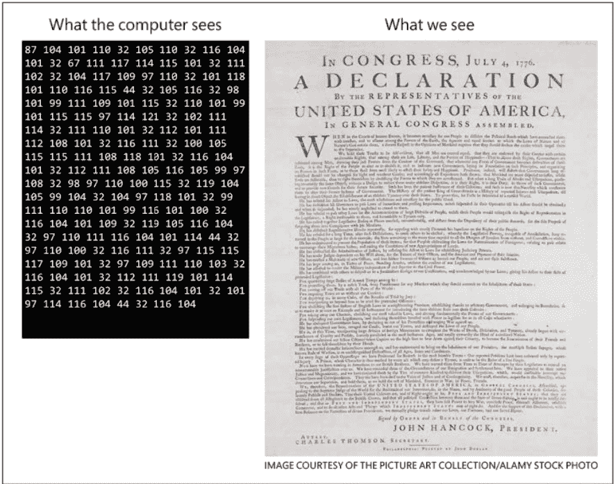

图4-6中的两个项目包含相同的数据，只是左边的图像更接近文档在计算机中的存储方式。计算机使用数值来表示文本中的每个字母和空格。如果你仔细研究这些数值，可以从值87开始推算出每个值，87代表大写字母W（对应右侧文档第一个正文段落开头“When”中的W）。

由于计算机存储数据的方式，在数字到字母的映射之下，还有另一层结构。每个数字由计算机以独特的开关信号模式（即1和0）来表示。在计算机领域，每个1或0被称为一个比特（bit）。（关于计算机如何在这一层面运行，以及这些运行机制如何构成所有编码的基础，请参阅查尔斯·佩佐尔德的《编码：隐匿在计算机软硬件背后的语言》。）值87，我们知道它代表“大写字母W”，其存储方式如下：

```
1010111
```

这是该值的二进制表示。我没有篇幅详细解释其工作原理（查尔斯·佩佐尔德已经做得很精彩了！），但你可以将这个比特模式理解为“87是由1 + 2 + 4 + 16 + 64组成的”。

模式中的每个比特告诉计算机硬件某个特定的2的幂是否存在。如果你没有完全理解这部分，请不要担心，但请记住，对计算机而言，数据就是它存储和处理的1和0的集合。这就是**数据**。

另一方面，**信息**是人们将数据解释为有意义的内容。严格来说，计算机处理的是数据，而人类处理的是信息。

例如，计算机可能在内存中的某个位置存储以下比特模式：

```
11111111 11111111 11111111 00000000
```

你可以将其解释为“你的银行账户透支了256美元”，或者“你处于地下256英尺深处”，又或者“三十二个灯开关中有八个是关着的”。从数据到信息的转换通常发生在人类读取输出的时候。

我之所以如此不厌其烦地解释，是因为必须记住：计算机并不“知道”它正在处理的数据意味着什么。对计算机来说，数据只是比特模式；是用户赋予了这些模式意义。当你收到银行对账单，显示你账户里有8,388,608美元，而实际上只有83美元时，请记住这一点。

## JavaScript中的数据处理

我们现在知道，JavaScript是一个数据处理器。包含JavaScript语句的脚本由浏览器解释执行，然后产生一些输出。我们还知道，在运行JavaScript程序的计算机内部，数据值由比特模式（代表开和关）表示。现在我们需要了解变量如何让我们的程序存储和处理正在处理的数据。

## 程序中的变量

我们已经在JavaScript程序中使用了相当多的变量。*变量*是程序记忆事物的方式。你可以把变量看作一个可以通过名称引用的存储位置。在这个位置中存储什么以及你给这个位置取什么名字，由你决定。在JavaScript程序中，你可以通过为变量想一个名字，然后给变量赋一个值来创建一个变量。也许你认识像我这样需要把一些数字加起来的人。在这种情况下，你的程序中的第一条语句可能看起来像这样：

```
var total;
```

如果我们想要把一堆数字加起来，就需要一些东西来存储总和。这条语句创建了一个名为`total`的变量。程序会将`total`的初始值设置为`0`，然后将每个数字加到它上面。要设置`total`变量的初始值，我们使用*赋值*语句：

```
total = 0;
```

语句中的`=`告诉JavaScript程序正在执行赋值操作。等号左侧的变量名指定了赋值的目标（即放置结果的位置）。右侧的表达式提供了要存储到变量中的结果。当JavaScript在表达式中看到一个变量名时，它会从该变量中取出值并使用该值。这意味着以下语句对你来说应该完全合理：

```
total = total + 1;
```

该语句右侧的项目是一个*表达式*，它将生成一个结果。JavaScript获取`total`的值，然后将其加1。接着，它将这个结果放入变量`total`中。换句话说，上述语句的效果是将`total`中的值增加1。

## 动手实践

### 使用变量


让我们通过开发者工具来看看JavaScript中的变量。启动你的浏览器，导航到`Ch04 Working with data\Ch04-01 Empty Page`文件夹中的页面。按F12打开**开发者工具**。你可以从创建一个`total`变量开始。

```
> var total;
```

当你按回车键时，JavaScript会创建这个变量。然而，它给出了一个相当奇怪的响应：

```
> var total;
<- undefined
```

之所以出现这个响应，是因为每当控制台执行一条语句后，它会显示该语句生成的值。创建一个新变量并不会创建一个值，因此控制台显示该值为`undefined`。如果你输入一条为`total`赋值的语句，就可以看到实际效果。输入下面的语句并查看结果：

```
> total = 0;
<- 0
```

在JavaScript中，赋值语句的结果就是被赋的值，因此该语句会生成值`0`。让我们尝试执行文本中看到的加法：

```
> total = total + 1;
<- 1
```

这条语句计算`total + 1`的值（即`0 + 1`），然后将其赋给`total`变量。这样做的效果是`total`现在包含了值`1`。再次执行该语句。

```
> total = total + 1;
<- 2
```

每次我们执行加法语句时，`total`中的值都会增加`1`。这个表达式可能看起来令人困惑。如果你学过数学方程，你会记得等号（`=`）表示一个值等于另一个值。从数学的角度来看，上面生成的语句显然是错误的，因为`total`不可能等于`total`加上`1`。然而，重要的是要记住，在JavaScript中，等号运算符意味着“赋值”。所以，右侧的表达式`total+1`先被计算，然后被赋给左侧的变量。在JavaScript中，创建一个变量并立即赋值是完全可以的：

```
> var total=0;
```

如果你这样做，你会注意到控制台显示的结果是`undefined`，因为正如本节开头所看到的，创建变量的语句不会返回值。如果你没有给变量设置值，JavaScript会将该变量标记为持有值`undefined`。输入此语句创建一个名为`test`的新变量。

```
> emptyTest;
```

现在你可以研究新创建的变量`emptyTest`所持有的值。如果你只输入`emptyTest`变量，控制台将显示存储在变量`emptyTest`中的值：

```
> emptyTest
<- undefined
```

请注意，这**不**意味着变量`emptyTest`不存在。相反，它意味着变量`emptyTest`没有持有值。`emptyTest`的内容是未定义的。我们可以像传递任何其他值一样传递这个未定义的值：

```
> emptyCopy = emptyTest;
<- undefined
```

现在我有一个名为`emptyCopy`的变量，它持有`emptyTest`的一个副本。这两个变量都持有未定义的值。如果我将未定义的值用于计算，我不会得到错误，但我会得到一个非数字（NaN）的结果：

```
> emptySum = emptyTest + 1;
<- NaN
```

这种计算不会对你的程序造成问题，除了它会产生无意义的结果。JavaScript区分未定义的事物和不存在的事物。如果你试图

# 程序分析：查看变量值

如果要查看一个不存在的变量中的值，会发生一些不同的情况。输入名称`notDefined`并按回车键：

[点击查看代码图像](#)

```javascript
> notDefined  
Uncaught ReferenceError: notDefined is not defined at <anonymous>
```

变量`notDefined`不存在，因此JavaScript给我们返回一个错误。

## JavaScript 标识符

JavaScript中事物的名称称为*标识符*。我们首次创建的变量使用了标识符`total`。当你编写程序时，必须为程序中的变量想出一些标识符。JavaScript对标识符的构成方式有特定规则：

标识符必须以字母、美元符（`$`）或下划线（`_`）开头，可以包含字母、数字（数码）或下划线。

名称`total`是一个完全合法的标识符，`xyz`也是。然而，标识符`2_be_or_not_2_be`会因以数字开头而被拒绝并报错。此外，JavaScript区分大小写字母；例如，`FRED`被JavaScript视为与`fred`不同。

## 程序员要点

## 创建有意义的标识符

[第 169 页]（过渡：正文继续）

我发现有些程序员使用诸如`X21`、`silly`或`hello_mum`这样的标识符，这让我非常惊讶。我不会这样做。我非常努力地使我的程序尽可能易于阅读。因此，我会使用诸如`length`这样的标识符，或者更好的是`windowLengthInInches`。我的窗口长度标识符使用了一种格式，其中标识符内每个单词的首字母都是大写字母。这法称为*驼峰命名法*，因为名称中的大写字母就像骆驼背上的驼峰一样凸起。另一种约定是使用下划线字符来分隔标识符中的单词：`window_length_in_inches`。我认为这两种都可以接受，尽管驼峰命名法在JavaScript中更为常见。我不在乎你使用哪一种，但我确实在乎你在整个程序中始终如一地使用它。

我不在乎你选择哪种方法来创建标识符；我只在乎你努力创建有意义的标识符。如果标识符适用于特定的事物，那么就标识那个事物。如果该事物有特定的度量单位，那么也把这些加上去。例如，如果我要存储客户的年龄，我会创建一个名为`customerAgeInYears`的变量。

JavaScript允许任何长度的标识符，较长的标识符不会降低程序的运行速度。然而，非常长的名称对人类来说可能有点难以阅读，所以你应该尽量将它们保持在示例中所示的长度。

## 代码分析

## 代码错误与测试

到现在，你应该已经习惯了这样一个想法：如果你给JavaScript程序错误的指令，就会发生错误的事情。

然而，看看下面的JavaScript代码，它原本应该将变量`total`的值加1：

```javascript
Total = total + 1  
```

**问题：** 上面的语句中有一个错误，它原本应该将`1`加到变量`total`上。错误是什么？

**答案：** 在本章前面，我们使用过一个类似的语句来给名为`total`的变量加1。看起来我们在这里做着同样的事情，但事实并非如此。这个语句与我们之前看到的那个之间存在着关键的区别。这个语句将计算结果赋给了一个新创建的名为`Total`的变量。这个错误可能发生是因为，尽管我们使用了`var`这个词来告诉JavaScript我们正在声明一个变量，但这并不是JavaScript强制要求的。如果你将某个值赋给JavaScript之前未见过的变量，JavaScript就会直接用指定的名称创建一个新变量。

这个语句在运行时不会引起JavaScript的任何抱怨，但它也不会正确更新`total`的值。相反，它会创建一个名为`Total`的新变量。这是一个*逻辑*错误。就JavaScript而言，这个语句是完全合法的，但它在运行时会做错事。

我在本书开头提到过，JavaScript有一些特性让我想要抓狂。这就是其中之一，因为这意味着你为一个简单的打字错误所受的惩罚不是错误或警告信息。相反，你得到的是一个能运行但无法正常工作的程序。

**问题：** 我们如何防止逻辑错误？

## 答案：测试策略

对抗逻辑错误的唯一方法是测试。我们需要用一些已知值（即我们知道结果的总值）来运行程序，然后验证答案是否与测试总值一致。如果答案合理，我们就可以开始建立对代码的信心。然而，即使一个程序通过了所有测试，它仍然可能存在缺陷，因为可能存在那些测试未能发现的故障。

测试不能证明程序是好的；测试只能证明程序不会像失败时那么糟糕。

如果测试在程序创建时就被加入，它们的效果最好。每次我们创建新程序时，我们都会讨论测试策略。

```javascript
Total = total + 1  
```

**问题：** 上面的语句也包含了一个名为`total`的变量的拼写错误。不过，这次等号右侧的名称拼写有误。这个程序运行时会发生什么？

**答案：** JavaScript将拒绝运行这个语句。它会告诉你，你正在使用一个名为`Total`的变量，而这个变量它还没有见过。有时候，打字错误会在程序运行之前被检测到，但其他时候可能不会。

你可能会想，你被设置好了要失败，因为我建议你用长长的、有意义的名称，而输入这些长长的、有意义的名称会创造更多出错的机会。目前，解决这个问题的一种方法是利用编辑器的文本复制功能，将名称从程序的一个部分复制到另一个部分。

## 执行计算

我们知道JavaScript表达式由运算符和操作数组成。运算符标识要执行的动作，操作数则由运算符来处理。现在我们可以为这个解释补充一些细节。表达式可以简单到只有一个值，也可以复杂到是一个庞大的计算。以下是一些数值表达式的例子：

```javascript
2 + 3 * 4  
-1 + 3  
(2 + 3) * 4  
```

这些表达式由JavaScript从左到右进行求值，就像你自己阅读它们一样。同样，正如传统数学那样，乘法和除法先执行，然后是加法和减法。JavaScript通过为每个运算符分配优先级来实现这一顺序。当JavaScript计算一个表达式时，它会找出优先级最高的所有运算符并先应用它们。然后它查找次优先级的运算符，依此类推，直到得出结果。求值顺序意味着表达式`2 + 3 * 4`的结果将是`14`，而不是`20`。

如果你想强制表达式的求值顺序，可以将你想先求值的表达式部分用括号括起来，就像上面的最后一个例子那样。如果你想的话，也可以把括号套在括号里面——只要确保开括号和闭括号数量一样多即可。作为一个头脑简单的人，我倾向于把所有东西都加上括号来让事情清楚明了。

关于表达式求值，可能不值得太过激动。一般来说，事情会按照你预期的方式求值。以下是一些其他运算符的列表，附带它们的描述和优先级（优先顺序）。这些运算符按优先级从高到低排列：

| 运算符 | 用途 |
| :--- | :--- |
| `-` | 一元减号。这是JavaScript在负数中找到的减号。 |
| `*` | 乘法。注意使用`*`而不是在数学上更正确但容易混淆的`x`。 |
| `/` | 除法。由于在编辑过程中将一个数字画在另一个数字上方比较困难，我们改用这个字符。 |
| `+` | 加法。 |
| `-` | 减法。注意我们与一元减号使用相同的字符。 |

这不是可用运算符的完整列表，但目前来说已经够用了。因为这些运算符作用于数字，所以它们通常被称为*数值运算符*。然而，其中一个运算符`+`可以应用于字符串之间，正如你已经见过的。

## 代码分析

## 计算结果

**问题：** 看看在以下语句求值后，你能不能算出`a`、`b`和`c`的值：

```javascript
var a = 1;  
var b = 2;  
var c = a + b;  
```

```
c = c * (a + b);
b = a + b + c;
```

**答案：** `a=1`，`b=12`，`c=9`。解决这个问题的最佳方法是像计算机一样，依次执行每条语句。当我这样做时，我会在纸上写下变量的值，然后在执行过程中逐一更新。这样做意味着你可以预测程序的行为，而无需运行它。

## 整数和实数

我们知道JavaScript识别两种基本数据类型——文本数据和数字数据。现在我们需要更深入地了解数字数据的工作原理。数字数据有两种——整数和实数。整数没有小数部分。到目前为止，我们编写的每个程序都使用了整数。计算机存储整数值的方式与输入时完全一致。而实数则包含一个小数部分，这部分在计算机中可能无法总是被精确地存储。

作为程序员，你需要选择使用哪种类型的数字来存储每个值。

## 代码分析

### 整数与实数

你可以通过观察一些可能使用它们的场景来了解整数和实数之间的区别。

**问题：** 我正在构建一个可以数你头上有多少根头发的设备。我应该将这个值存储为整数还是实数？

**答案：** 这应该是一个整数，因为不存在半根头发。

**问题：** 我想用我的数发设备测试100个人，并确定他们所有人头发的平均数量。我应该将这个值存储为整数还是实数？

**答案：** 当我们计算结果时，我们会发现平均值包含一个小数部分，这意味着我们应该使用实数来存储它。

**问题：** 我想在程序中跟踪产品的价格。我应该使用整数还是实数？

**答案：** 这很棘手。你可能认为价格应该存储为实数——例如，`$1.50`（一美元五十美分）。然而，你也可以将价格存储为整数，`150`美分。在这种情况下使用哪种类型的数字取决于该数字的用途。如果你只是跟踪销售产品时收到的总金额，你可以使用整数来存储价格和总额。但是，如果你还借钱给人们购买你的产品，并且你想计算向他们收取的利息，那么你需要一个小数部分来更精确地存储这个数字。

## 程序员要点

**存储变量的方式取决于你想用它做什么**

很明显，你会用整数来数头上的头发数量。然而，有人可能会认为我们也可以用整数来表示100个人头上头发的平均数量。这是因为计算出的平均值将是数千。半根头发的分数不会增加太多有用的信息，所以我们可以舍弃任何小数部分，并四舍五入到最接近的整数。当你考虑如何在程序中表示数据时，必须考虑它将如何被使用。

## 实数和浮点数

实数类型有一个小数部分，即数字小数点后的部分。实数并不总是按照输入到JavaScript程序时的样子被精确存储。数字通过一种方式映射到计算机内存中，存储一个尽可能接近原始值的值。存储的数据通常被称为*浮点*表示。你可以通过使用更多的计算机内存来提高存储过程的精度，但你永远无法精确地保存所有实数值。

然而，这不是一个问题。像π这样的值永远无法被精确存储，因为它们“无限不循环”。（我有一本书包含了π的100万位小数，但我仍然不能说这是π的精确值。我只能说书中的值比任何人需要的都要精确得多。）

在考虑数字如何存储时，我们需要考虑*范围*和*精度*。精度规定了一个数字被存储得多么精确。一个特定的浮点变量可以存储值`123456789.0`或`0.123456789`，但它不能存储`123456789.123456789`，因为它没有足够的精度来保存18位数字。浮点存储的范围决定了你可以将小数点“滑动”多远来存储非常大或非常小的数字。例如，我们可以存储值`123,456,700`，或者我们可以存储`0.0001234567`。对于JavaScript中的浮点数，我们有15到16位的精度，并且我们可以将小数点向右滑动308位（存储巨大的数字）或向左滑动324位（存储微小的数字）。

将实数映射到浮点表示在使用计算机时确实带来了一些挑战。事实证明，值`0.1`（十分之一）可能无法被计算机精确存储。用于表示`0.1`的存储值将非常接近该值，但并不相同。这对我们编写程序的方式有影响。

## 代码分析

### 浮点变量和误差

我们可以通过使用浏览器中的JavaScript**开发者工具**进行一些实验，来了解浮点值是如何工作的。如果我们只输入数字表达式，我们可以查看JavaScript计算的结果。

**问题：** 如果我们尝试存储一个无法作为浮点值精确保存的值，会发生什么？

**答案：** 我们知道值`0.1`在计算机中无法被精确存储，所以让我们在**开发者工具**中输入这个值，看看会返回什么。转到浏览器的控制台，输入以下内容：

```
> 0.1
<- 0.1
```

此时，你可能认为我在骗你，因为我说过值`0.1`无法被精确存储，而现在这个例子显示JavaScript返回了值`0.1`。然而，我没有骗你——JavaScript骗了你。JavaScript的打印程序在打印值时会“四舍五入”。换句话说，它表示如果要打印的数字是`0.100000000000000005551115`或左右（它确实是），那么它就只打印`0.1`。

**问题：** 这种“四舍五入”真的会发生吗？

**答案：** 目前，你只能相信我的话，即值在打印时会被四舍五入，错误因此被隐藏。然而，如果我们进行一个简单的计算，我们可以引入一个足够大的错误，以至于无法被四舍五入。在JavaScript控制台中输入以下计算并注意返回的结果。

```
> 0.1+0.2
<- 0.30000000000000004
```

将`0.1`加上`0.2`的结果应该是`0.3`，但因为这些值是以二进制浮点值存储的，计算结果包含了一个足够大的错误，以至于无法被四舍五入。

然而，这种精度不足在编程中并不是问题，因为我们通常接收的数据本身也不是特别精确。例如，如果我改进我的数发设备以测量头发长度，我将很难以超过十分之一英寸（2.4毫米）的精度测量头发长度。对于头发数据分析，我们只需要大约三到四位数字的精度。

还值得注意的是，这些问题与JavaScript无关。大多数（如果不是全部）现代计算机都使用电子和电气工程师协会（IEEE）于1985年制定的标准来存储和操作浮点值。所有在计算机上运行的程序都将以相同的方式操作值，因此JavaScript中的浮点数与其他语言中的没有什么不同。

JavaScript浮点值与其他语言中的唯一区别是，JavaScript中的浮点变量占用8字节内存，是C、C++、Java和C#（但不是Python）语言中`float`类型大小的两倍。JavaScript浮点变量等同于这些语言中的*双精度*值。

## 创建随机骰子

我们可以通过创建一个“随机骰子”网页来探索JavaScript中整数和浮点值之间的差异。当用户按下按钮时，这将显示一个介于1和6之间的值。JavaScript有一个内置的`Math`函数库，其中包括一个名为`random`的函数，它生成一个介于0到1之间的实数（但**不**包括值1）。让我们来研究一下这是如何工作的。

## 让事情发生

### 随机数

让我们看看JavaScript中的随机数。启动你的浏览器，导航到`Ch04 处理数据\Ch04-02 电脑骰子`文件夹中的页面。按下按钮并注意每次你会得到不同的骰子结果。


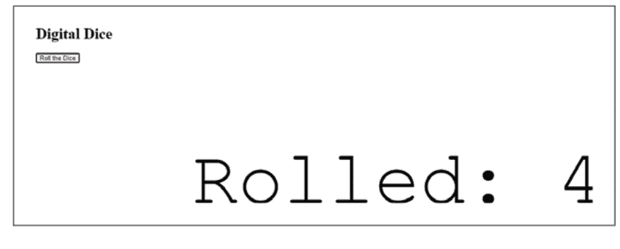

## 处理文本

我们现在知道了如何使用保存数字的变量。程序也可以创建一个保存文本字符串的变量。

```javascript
var customerName = "Fred";
```

这条语句看起来与我们用来创建`total`变量的语句完全相同，只是被赋值的是一个文本字符串。被赋值的字符串用双引号括起来，双引号定义了文本的边界。双引号被称为界定符，因为它们定义了文本的范围。界定符不是被存储字符串的一部分，所以`customerName`变量只包含单词`Fred`。

`customerName`变量与`total`变量的不同之处在于，它保存的是文本而不是数字。我们可以在任何需要使用字符串的地方使用这个变量。

[点击此处查看代码图片](link)

```javascript
var message = "the name is " + customerName;
```

在被赋值的表达式中，`customerName`变量中的文本被添加到`"the name is "`字符串的末尾。由于`customerName`当前保存的是字符串`"Fred"`（我们在上一条语句中设置了它），上述赋值将创建另一个名为`message`的字符串变量，其中包含`"the name is Fred"`。我们之前在将数字相加时已经见过`+`运算符。在此上下文中，它执行的是连接操作，即将两个字符串连接在一起。

### JavaScript 字符串界定符

`"`字符可以作为界定符，在程序中标记字符串的开始和结束。但如果我们想输入一个包含`"`字符的字符串怎么办？在这种情况下，我们可以使用单引号（`'`）来标记字符串的开始和结束：

[点击此处查看代码图片](link)

```javascript
var message = 'Read "Begin to code with JavaScript". It is an
```

如果你想输入一个同时包含单引号和双引号的字符串，你可以使用反引号（`` ` ``）——也称为急音符——来界定字符串：

点击此处查看代码图片

```javascript
var message = `Read "Begin to code with JavaScript". It's an
```

如果你需要输入一个同时包含两种引号和反引号的字符串，那它一定是个令人惊叹的字符串。你可以使用转义序列来输入它。

### 字符串中的转义序列

你可以通过使用转义序列在字符串中包含引号字符。通常，字符串中的每个字符都代表该字符本身。换句话说，字符串中的一个`A`意味着`'A'`。然而，当 JavaScript 看到转义字符——反斜杠（`\`）字符——它会查看转义字符之后的文本以决定正在描述的是哪个字符。这被称为转义序列。JavaScript 字符串中可以使用许多不同的转义序列。最有用的转义序列如下表所示。

| 转义序列 | 含义 | 功能 |
|---|---|---|
| `\\` | 反斜杠字符（`\`） | 在字符串中输入一个反斜杠 |
| `\'` | 单引号（`'`） | 在字符串中输入一个单引号 |
| ``\` `` | 反引号（`） | 在字符串中输入一个反引号 |
| `\"` | 双引号（`"`） | 在字符串中输入一个双引号 |
| `\n` | Unicode 换行符 | 结束当前行并开始新的一行 |
| `\t` | Unicode 制表符 | 向右移动到下一个制表位 |
| `\r` | Unicode 回车符 | 将打印位置返回到行首 |

如果你好奇 Unicode 的含义，它是一种将数字映射到字符设计的方式。我们在[第 2 章](Chapter 2)的“[显示符号](Display symbols)”部分见过它。

### 处理字符串和数字

你可以创建涉及字符串的表达式，但两个字符串之间唯一能使用的运算符是我们之前见过的`+`运算符。你也可以创建涉及字符串和数字的表达式，但这样做时需要稍微小心一些。

## 代码分析

### 组合字符串和数字

我们可以利用开发者视图回答一些问题，来进一步了解字符串和数字如何在 JavaScript 程序中组合。

**问题：** 如果我将一个数字加到字符串上会发生什么？

**答案：** 我们知道 JavaScript 将数字和字符串视为不同类型的数据。让我们看看将它们相加会发生什么：

```javascript
> "hello" + 99
<- "hello99"
```

这条语句将数值`99`加到字符串`"Hello"`上。JavaScript 自动将数字转换为字符串，从而得到你上面看到的结果。然而，如果你将许多数字加到一个字符串上，这可能会导致奇怪的行为……

**问题：** 如果我将许多数字加到一个字符串上会发生什么？

**答案：** JavaScript 执行数字到字符串转换的方式可能会产生一些有趣的结果：

```javascript
> 1 + 2 + "hello" + 3 + 4
<- "3hello34"
```

JavaScript 从左到右处理表达式。它将`1`和`2`相加得到值`3`。然后它看到一个字符串，心想：“哦。我需要把这个数字变成字符串。”它将值`3`转换为字符串并添加

## 将字符串转换为数字

我们已经看到，JavaScript 将数字变量和文本变量视为不同类型的数据。我们还看到，JavaScript 会在它认为合适时自动将数字转换为字符串（尽管它有时可能会出错）。有时，我们的程序需要将字符串转换为数字。例如，我们可能想要创建一个加法计算器网页。用户输入两个值并按下一个按钮，这会导致数字的总和被显示出来。[图 4-7](https://example.com/figure4-7)展示了如何使用该页面来解决这个古老的问题：“2+2 等于多少？”

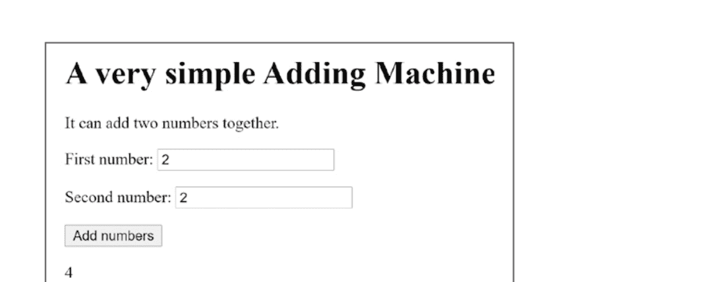

**图 4-7** 加法计算器

该页面包含两个用于输入值的输入框、一个用于请求计算的按钮，以及一个显示结果的段落元素。我们几乎知道如何创建这个应用程序的每一个部分，除了一件事。用户将作为文本字符串输入要相加的数字。我们需要一种将这些字符串转换为可以相加的数字的方法。

### 制作应用程序

我们现在掌握了足够的编程知识，可以制作一些有用的应用程序了，所以让我们来制作一些。

### 计算披萨订单

我在参加过的众多黑客马拉松中进行过严谨的科学研究，得出的结论是每 1.5 人需要一份披萨。换句话说，如果有 30 名学生，我需要 20 份披萨，以此类推。我决定制作一个网页，用于计算给定学生人数时我需要订购多少份披萨。用户输入学生人数，然后点击**计算披萨**按钮来显示结果。我的第一个版本的代码如下所示，结果如图 4-8 所示。

```html
<!DOCTYPE html>
<html>

<head>
  <title>Ch04-05 Pizzcalc Version 1</title>
  <link rel="stylesheet" href="styles.css">
</head>

<body>
  <h1>&#x1f355; Pizza Calculator</h1>
  <p>Calculates the number of pizzas you&rsquo;ll need.</p>
  <p>
    Number of students: <input type="number" id="noOfStudentsText" value="0">
  </p>
  <p>
    <input type="button" value="Calculate pizzas" onclick="doPizzaCalc();">
  </p>
  <p id="resultParagraph">
    Result displayed here.
  </p>

  <script>
    function doPizzaCalc() {
      var noOfStudentsElement = document.getElementById("noOfStudentsText");
      var noOfStudentsText = noOfStudentsElement.value;
      var noOfStudents = Number(noOfStudentsText);
      var noOfPizzas = noOfStudents / 1.5;
      var resultElement = document.getElementById("resultParagraph");
      resultElement.innerText = "You need " + noOfPizzas + " pizzas.";
    }
  </script>
</body>
</html>
```

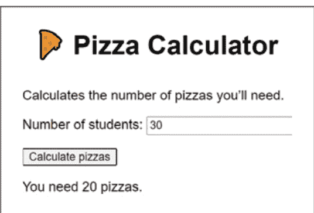

**图 4-8** 披萨计算器

这是我的第一个版本。我使用了披萨表情符号（`&#x1f355;`）来为标题添加一个好看的披萨片。使用上述数据时，页面运行正常。如果我说有 30 名学生，程序会告诉我需要 20 份披萨。然而，对于某些披萨数量存在问题，如[图 4-9](https://example.com/figure4-9)所示。

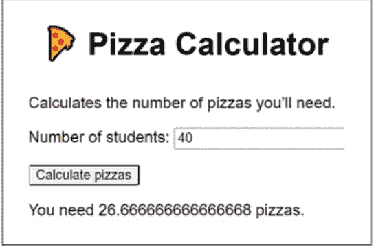

**图 4-9** 披萨小数

我不能要求披萨店提供小数份披萨，所以我需要一种方法将披萨数量转换为整数。此时，我还必须确定转换方式。如果我直接使用之前在骰子程序中使用的`floor`函数，这会导致订购 26 份披萨，因为`floor`函数会截断浮点值。这实际上意味着我只能为 39 人提供披萨，而不是 40 人，导致一名学生挨饿。有几种方法可以解决这个问题。我认为最好的解决方法是在订单中额外加一份披萨，以照顾任何“多余”的人。

```javascript
var noOfPizzas = Math.floor(noOfStudents / 1.5) + 1;
```

### 动手试一试

### 修复披萨程序

加载文件夹`Ch04 Working with data\Ch04-05 Pizzacalc Version 1`中的示例程序，并使用上述语句进行修改，使得当你输入有 40 名学生时，程序建议你购买 27 份披萨。然后修改程序，使其不那么大方。让程序始终向下舍入到最近的整数份披萨来订购。你可以在`Ch04 Working with data\Ch04-05 Pizzacalc Version 2`中找到我大方的版本。

该程序使用样式表来修改`<h1>`和`<p>`的样式。你可以修改这些样式，使其看起来更好。

## 程序员要点

### 永远不要以为你知道程序应该做什么

如果你为客户编写披萨计算器，你不应该擅自决定当需要订购小数份披萨时程序应该做什么。你的客户可能想要“向下舍入”披萨数量以降低成本。如果是这样，当你的程序额外添加一份披萨时，他们会抱怨。或者，他们可能想树立慷慨大方的声誉，在这种情况下，程序应该“向上取整”数值。

作为程序员，永远不要以为你知道程序应该做什么。你必须始终询问客户。否则，你可能会发现自己要为多订的披萨买单。

## 华氏度与摄氏度之间的转换

关于加法器程序和披萨计算器的一个有趣点是，它们具有相似的结构。加法器需要额外的输入（要相加的第二个数字），但其工作方式与披萨计算器完全相同。我们可以使用相同的模式来制作第三个程序，用于在华氏度和摄氏度之间转换温度读数。试着创建一个转换网页。以下部分提供了一些提示。

### 转换公式

要将温度从华氏度转换为摄氏度，你需要从华氏度值中减去 32，然后将结果除以 1.8。下面的语句展示了这是如何工作的。它假设你已经创建了一个名为`fahrenheit`的变量，其中包含华氏度温度。

```javascript
var centigrade = (fahrenheit - 32) / 1.8;
```

### 截断显示的温度值

我们在披萨计算器示例中看到，JavaScript 在显示数字时喜欢显示很多位小数。如果程序将 60 华氏度显示为 15.55555555 摄氏度，这会令人分心。`toFixed`方法可以用于数值变量，以创建一个具有特定固定小数位数的字符串。下面的语句将创建一个名为`resultString`的变量，其中只包含一位小数的数字字符串。换句话说，15.555555 的温度将被转换为包含 15.6 的字符串。

```javascript
var resultString = centigrade.toFixed(1);
```

### 显示温度计表情符号

你可能想在网页上添加一个温度计表情符号。这需要你在 HTML 源代码中添加两个符号。下面的 HTML 将显示一个带有温度计表情符号的标题。

```html
<h1>&#x1f321;&#xfe0f; Fahrenheit to Centigrade</h1>
```

你可以在以下文件夹中找到我的解决方案版本：`Ch04 Working with data\Ch04-07 Fahrenheit to Centigrade`。你现在可以编写任何你喜欢的转换程序，将英尺转换为米、克转换为盎司，或升转换为加仑。

### 添加注释

一旦你开始编写有用的程序，我认为你应该开始添加注释，以使你的程序更清晰。你不是为计算机写注释；你是为阅读你程序的人写注释：

```javascript
/* Based on each pizza feeding 1.5 students. We divide the number
   of students by 1.5 to get the number of pizzas. Then we drop
   the fractional part and add 1 to round up the number
   Note that this means we might buy slightly too much
   pizza for some numbers of students.
*/
var noOfPizzas = Math.floor(noOfStudents / 1.5) + 1;
```

上面程序中的注释非常清楚地说明了我们如何计算披萨数量以及该语句背后的推理。如果没有注释，你就必须知道 1.5 在那里是因为我们已经决定这是每份披萨能供应的学生人数。你可以用字符`/*`和`*/`将注释文本括起来，编写跨越多行的注释。当浏览器在 JavaScript 程序中看到字符序列`/*`时，它会忽略后续文本，直到看到结束注释文本的`*/`为止。你可以在程序中的任何位置放置注释。浏览器会完全忽略它们。你也可以创建单行注释：

```javascript
var centigrade = (fahrenheit - 32) / 1.8; // using standard conv
```

上面的注释是单行注释。它从字符序列`//`开始，到该行结束。我们可以在语句末尾或单独一行中添加这类注释。如果你使用 Visual Studio Code 编写程序，你会发现注释以绿色显示，以使其醒目。

重要的是，程序要以一种使人类易于理解正在发生什么的方式编写。我们已经看到，在为变量选择标识符时，我们需要确保名称描述了变量的用途。我们还可以通过添加注释使程序更清晰。

有人说编写程序有点像写故事。我并不完全相信这是真的。我发现一些计算机手册是虚构作品，但程序是另一回事。我认为虽然它本身不是一个故事，但好的程序文本确实具有一些优秀文学作品的特点：

## 编写优秀代码

1. 应易于阅读。在任何情况下，都不应让不幸的读者被迫回溯或复习作者假定其已掌握的知识。文中所有名称都应传达意义，并且彼此区分。
2. 应具备良好的标点符号和语法。各个组成部分应以清晰、一致的方式组织。
3. 页面呈现应美观。优秀的程序版面布局良好。不同部分应适当缩进，语句应在页面上以美观的形式分布。
4. 应清晰标明作者及最后修改时间。如果你创作了优秀的作品，应当署名。如果你修改了所写内容，应添加关于你所做的更改及其原因的信息。

编写良好的程序的重要组成部分是程序员添加的注释。没有注释的程序有点像拥有自动驾驶仪但没有窗户的飞机。它有可能将你带到正确的地方，但身处其中很难知道它要去往何方。

请慷慨地使用注释。它们有助于使你的程序更易于理解。你会惊讶地发现，自己很快就会忘记程序是如何运行的。你还可以使用注释告知人们程序的特定版本、最后修改的时间和原因，以及编写该程序的程序员姓名——即使那是你自己。从现在开始，你看到的示例代码将包含我认为适当级别的注释。

## 程序员要点

### 不要在注释中添加过多细节

编写注释是非常明智的做法，但不要过分。请记住，阅读你程序的人应该了解 JavaScript，不需要向他们解释过多细节：

```javascript
goatCount = goatCount + 1; // add one to goatCount
```

我认为这对读者是纯粹的侮辱。如果你选择了合理的名称，你会发现程序的大部分内容都能直接通过代码本身表达其功能。

## HTML 注释

请注意，这些注释仅在程序的`<script>`部分有效。你可以像我们在第 2 章看到的那样为 HTML 添加注释，但你需要使用不同的字符序列来标记注释的开始和结束：

```html
<!-- Rob's Pizza Calculator Page Version 1.0 -->
```

注释的开始由序列`<!--`标记，结束由序列`-->`标记。与 JavaScript 注释一样，浏览器会忽略两个序列之间的文本。

## 全局变量与局部变量

在本节开始时，我们希望制作一个可用于将一堆数字相加的累加器程序。我们现在可以创建这个程序了。假设我们正在为一位确实想要对一些数字求和的客户创建解决方案。你已经与她坐下来，并就以下应用程序设计达成一致。

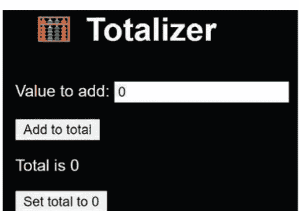

**图 4-10** 累加器


你的客户想要一个时尚的黑色背景，包含算盘表情符号（🧮）。我们可以通过使用设置应用程序配色方案的样式表并找到算盘的符号编号来创建这个背景。

她希望能够输入一个值，然后按下 `Add to total`（添加到总计）按钮将该值添加到总计中。她还想要一个按钮，用于在添加完一组数值后将总计重置为零。你同意图 4-10 所示的设计方案。

## 程序员要点

### 获得良好的规范至关重要

图 4-10 所示的示例页面是累加器应用程序规范的一个良好开端。在你执行任何工作时，获得一份扎实的规范非常重要，即使（或者也许尤其是）你是为认识的人工作。应用程序截图的好处在于它清晰地展示了最终解决方案应呈现的样子。然而，我也有一些问题需要解答。

我想知道是否有要添加到总计的金额上限。我还想知道累加器是否应接受负数来从总计中减去，或者总计是否应始终增加。这些问题的答案告诉我累加器是否应检测并拒绝无效的输入值。客户可能假设不应该添加负值（或者可能从未考虑过这个问题）。无论如何，作为解决方案的构建者，你需要知道它应该如何工作。否则，你最终可能会与客户进行包含以下短语的对话："它不应该那样做……"

## 全局变量

累加器程序很有趣，因为这是我们编写的第一个需要在函数调用之间"记住"某些内容的程序。到目前为止，我们创建的每个程序都从输入元素获取数据，对其进行处理，然后显示结果。我们在函数中创建的任何用于在数据处理期间存储数据的变量，在过程完成后都会被丢弃。例如，考虑温度转换程序，它接受以华氏度输入的温度并将其转换为摄氏度。

```javascript
function doTempConvert() {
    var fahrenheitElement = document.getElementById("fahrenheitText");
    var fahrenheitText = fahrenheitElement.value;
    var fahrenheit = Number(fahrenheitText);

    var centigrade = (fahrenheit-32)/1.8;

    var resultElement = document.getElementById("resultParagraph");
    var resultString = centigrade.toFixed(1) + " degrees Centigrade";
    resultElement.innerText = resultString;
}
```

此函数中的所有变量在函数完成后都会被销毁。它们被称为局部变量，因为它们仅限于该函数内部。这就是 JavaScript 管理使用 `var` 创建的变量的方式。大多数情况下，这正是你想要的。我们不希望程序使用函数上一次调用留下的任何值。然而，累加器程序需要保留总计值，以便在连续调用将值添加到总计的函数中使用。换句话说，我们想编写一些这样的代码：

```javascript
var total=0; // Global variable to hold the total
```

```javascript
/* This function reads the value from the valueText element
and adds it to the global total value */
function doAddToTotal() {
    var valueElement = document.getElementById("valueText");
    var valueText = valueElement.value;
    var value = Number(valueText);
    total = total + value; // update the global total value
    // Display the updated total
}
```

变量 `total` 是特殊的。它存在于任何 JavaScript 函数之外。我们称其为全局变量，因为它可以被我应用程序中的任何函数使用。我在 `total` 变量的声明上方添加了一条注释。这是因为我希望我的全局变量在代码中脱颖而出。

## 程序员要点

### 全局变量是必要的恶

如果你与一些程序员交谈，他们可能会告诉你你的程序永远不应该使用全局变量。这是因为全局变量代表一个超出你控制范围的可能故障点。我可以确信我函数中的所有变量都包含正确的值。这是因为每次函数运行时，它都会为每个变量创建全新的副本，但全局变量存在于我的函数之外。我不能将其视为"干净的"，因为我不知道其他函数可能对它做了什么。其他程序员的错误可能会使我的函数做错事，这很糟糕。如果另一个函数改变了 `total` 的内容，我的函数可能会显示不正确的结果。然而，在累加器程序的情况下，全局变量是我使其工作的最简单方式。

程序员谈论函数的副作用。这些是函数执行的操作，会改变其运行所在系统的状态。在累加器的情况下，`doAddToTotal` 函数有一个副作用，即通过用户输入的金额增加 `total` 的值。这是一个设计上就存在的副作用。避免非预期的副作用很重要。

## 代码分析

### 全局变量与副作用

理解局部变量和全局变量之间的区别很重要，以下是一些你可能考虑过的问题。

**问题：** 我如何判断一个变量是否是全局的？

**答案：** 全局变量是在任何函数之外声明的。下面的 `total` 变量不是任何函数的一部分，因此它是全局变量。该变量在创建时也被设置为 0。

```javascript
var total=0;
```

在第 3 章中，在

### 问题：如果我重新加载网页，全局变量的值会保留吗？

**答案：** 不会。页面重新加载时，JavaScript 环境会被重置，并创建新的全局变量。

### 问题：在一个浏览器中查看的同一页面的多个标签页之间，是否会共享一个全局变量？换句话说，如果我打开了总和计算器程序的多个视图，`total` 的值会在它们之间共享吗？

**答案：** 不会。每个网页都运行在独立的 JavaScript 环境中。

### 问题：总和计算器中的其他函数有副作用吗？

**答案：** 有。用于将总和清零的函数会将 `total` 的值重置为 0。

<details open>
<summary>点击此处查看代码图片</summary>

```javascript
/* 此函数清除总和值并更新显示 */
function doZeroTotal(){
  total=0; // 将全局总和设为0

  // 更新显示
  var resultElement = document.getElementById("resultParagraph");
  resultElement.innerText = "Total is 0";
}
```

</details>

此函数将 `total` 的值设为 0，然后更新显示以反映这一点。

### 问题：如何创建一个能在页面未使用时保存总和值的总和计算器？

**答案：** 浏览器提供了一个名为“本地存储”的功能，可以在网页不活动时存储值。在[第9章](#)中，我们将使用它来创建一个通讯录。总和计算器程序可以使用本地存储来保存一个总和值，使其在计算器页面未使用时也能持久保存。

你可以在 `Ch04 Working with data\Ch04-08 Totalizer` 文件夹中找到我版本的总和计算器程序。这包括设置所需配色方案的样式表。

## 让事情发生

# 制作一些派对游戏

没有什么比用你的编程技能来制作一些有趣的派对游戏更能展示你的能力了。至少，我是这么认为的。我们可以运用 CSS 和 JavaScript 技能来制作一个漂亮的派对游戏。许多游戏的基础是随机性。我们知道如何使用 JavaScript 生成随机数，那么让我们看看能否用它来制作一些游戏。

## “钢铁神经”

我们可以利用生成随机数的能力，结合在[第2章](#)中用于制作计时器的 `setTimeout` 函数，来创建一个“钢铁神经”派对游戏。游戏规则如下：

1. 一名玩家按下 `开始游戏` 按钮。
2. 程序显示 `玩家起立`。
3. 程序随后暂停 5 到 20 秒之间的随机时间。在程序暂停期间，玩家们可以坐下。玩家们需要记住最后一个坐下的人。
4. 时间间隔结束后，程序显示“最后坐下的获胜”。仍然站着的玩家被淘汰，赢家是最后一个坐下的人。

这是[第2章](#)中计时器程序的一个变体。程序不是为固定时长（5分钟）设置超时，而是为持续时间选择一个随机时间。如果游戏在开始时显示选定的时间，你就可以让游戏变得真正考验技巧。你还可以使用音效来标记计时会话的开始和结束，从而改进它。

# 高与低

使用随机数的另一种方式是创建一个“高与低”游戏。游戏规则如下：

1. 一名玩家按下 `下一轮` 按钮。
2. 程序显示一个 1 到 10 之间（含）的数字。
3. 程序随后休眠 20 秒。在程序休眠期间，玩家们被邀请决定下一个数字会比刚打印的数字高还是低。选择“高”的玩家站在右边。选择“低”的玩家站在左边。
4. 程序随后显示第二个 1 到 10 之间的数字，任何猜错的人都被淘汰出游戏。然后，程序会在剩下的玩家中重新运行，直到产生一名获胜者。

这个游戏会变得非常策略性，玩家可能会冒险押注一个不太可能的数字，以便成为进入下一轮的人之一。

## 添加声音

你可以为游戏添加声音。在玩家等待时可以有滴答的钟声效果，在计时器结束时可以有一个“叮”的声音。为此，程序必须启动和停止音频播放。它还必须“重置”滴答声，以便从声音样本的开头开始播放。HTML 中的声音提供了 `play` 和 `pause` 方法，可用于控制播放。它还提供了一个 `currentTime` 属性，程序可以读取或设置它。以下是我版本程序中的 `tickAudio` 元素：

<details open>
<summary>点击此处查看代码图片</summary>

```html
<audio id="tickAudio">
  <source src="tick-track.mp3" type="audio/mpeg">
</audio>
```

</details>

我可以如下方式开始播放。第一条语句将播放位置设置为 `0`，以便播放从声音的开头开始。第二条语句播放样本。

<details open>
<summary>点击此处查看代码图片</summary>

```javascript
tickSoundElement.currentTime=0;
tickSoundElement.play();
```

</details>

当我想停止滴答声（当计时器到期时），我使用以下方法：

```javascript
tickSoundElement.pause();
```

请注意，没有停止播放声音的命令。你可以在 `Ch04 Working with data\Ch04-09 Nerves of Steel` 和 `Ch04 Working with data\Ch04-10` 文件夹中找到我版本的游戏。

## “高与低”

你可以将这些作为任何其他你可能想创建的游戏的基础。

## 你学到了什么

本章让你很好地理解了 JavaScript 程序如何存储和操作数据。以下是本章涵盖的主要内容：

- 计算机本质上是一个数据处理器。程序接收数据，对其进行处理，并输出更多数据。计算机对数据的操作由程序本身决定。
- 我们创建的 JavaScript 程序从输入元素获取数据，并通过更新段落元素显示的文本来显示数据。
- 计算机中的数据处理是通过表达式求值来完成的。表达式包含操作数（要处理的值）和运算符（指定要对操作数进行的操作）。在表达式 `2+3` 中，操作数是字面值 `2` 和 `3`。运算符是 `+`。
- 程序不知道它正在处理的数据的性质。当人类将数据解释为信息时，意义才被添加。
- 变量是一个命名的存储位置，保存着程序正在处理的值。可以使用 `var` 创建变量。
- 变量可以在表达式中用作操作数。赋值运算符用于为变量设置值。
- 变量可以在使用前创建，这种情况下，它们包含一个表示为“未定义”的值。当被赋予一个值时，变量将获得适合该值的类型。我们目前使用的两种类型是数字（数值）和字符串（文本字符串）。
- 表达式中的运算符根据其优先级进行求值。可以使用括号来覆盖此优先级。
- 程序中的数字可以是实数（带小数部分）或整数。JavaScript 提供了 `Math` 函数来从浮点数创建整数。`floor` 函数去除小数部分，而 `round` 函数四舍五入到最接近的整数。
- 程序源代码中的文本可以用双引号（`""`）、单引号（`'`）或反引号（`` ` ``）字符分隔。转义字符（`\`）用于在字符串中输入分隔符字符和一些非打印字符。
- 如果表达式涉及字符串和数值，数值将自动转换为字符串。
- JavaScript 函数 `Number` 用于将字符串转换为数值。如果此转换不可能，`Number` 函数返回值 `NaN`（非数字）。所有涉及 `NaN` 值的数值计算都将产生 `NaN` 结果。
- 通过用 `/*` 和 `*/` 字符序列分隔，可以将注释添加到程序中。单行注释由字符序列 `//` 开始，并延伸到包含注释的行尾。
- 在任何 JavaScript 函数外部声明变量，该变量就成为全局变量。全局变量很有用，因为它们允许在函数之间共享值，但应谨慎使用，因为它们代表了一种方式，其中一个函数的故障可能会将全局变量设置为一个值，这可能导致其他函数失败。函数对全局变量内容所做的更改被称为“副作用”。

为了巩固你对本章的理解，你可能想考虑以下关于变量的“深刻问题”。

# 所有计算机程序都必须有来自用户的输入吗？

## 程序中的决策

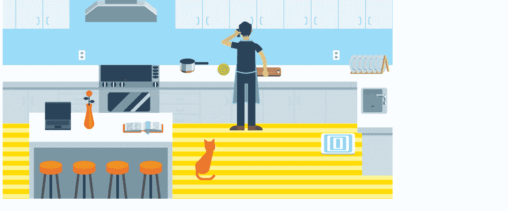

## 你将学到什么

我曾将计算机描述为一台接受输入、进行处理然后产生输出的香肠制造机。这是开始理解计算机的一个绝佳比喻，但计算机的功能远不止于此。与现实世界中试图将投入的任何东西都变成香肠的香肠机不同，计算机能够对不同的输入做出不同的反应。在本章中，你将学习如何让程序对不同的输入做出响应。你还将了解到以这种方式使用计算机所伴随的责任，因为你必须确保程序做出的决策是合理的。

### 布尔思考

- [if 结构](#)
- [运用决策构建应用程序](#)
- [改进选择器](#)
- [你所学到的知识](#)

## JavaScript 中的布尔思考

在**第 4 章**，你学到程序使用变量来表示不同类型的数据。我希望你从此能将头发的数量与整数（整型）联系起来，将头发的平均长度与实数（浮点值）联系起来。现在是时候认识另一种看待数据值的方式了：布尔值。布尔数据只能有两种取值之一：真（`true`）和假（`false`）。你可以用布尔值来表示一个人是否有头发。

### JavaScript 中的布尔值

程序可以创建能够保存布尔值的变量。与其他 JavaScript 数据类型一样，JavaScript 会根据变量使用的上下文推断其类型。

```javascript
var itIsTimeToGetUp = true;
```

上面的语句创建了一个名为 `itIsTimeToGetUp` 的变量，并将其值设置为 `true`。在我看来，似乎总是起床的时候。在极不可能的情况下，如果我被允许赖床，我们可以将赋值更改为 `false`：

```javascript
var itIsTimeToGetUp = false;
```

`true` 和 `false` 是关键字。这些是 JavaScript "内置"的词汇。共有 63 个不同的关键字。你已经见过其中一些了。例如，`function` 就是一个关键字。当 JavaScript 遇到关键字 `true` 或 `false` 时，它就会按布尔值来理解。

JavaScript 将数字或文本的值视为 "真值" 或 "假值"。除非值是零、空字符串、非数字（`NaN`）或未定义（`undefined`）——这些情况下，值被视为 "假值"——否则值都被视为 "真值"。

#### 代码分析：布尔值

布尔值是程序可以操作的一种新数据类型。当然，我们对它有些疑问。

**问题：** 你认为如果显示一个布尔值的内容会发生什么？

```javascript
alert(itIsTimeToGetUp);
```

**回答：** 当你显示任何值时，JavaScript 都会尝试将其转换为我们可看的某种合理形式。对于布尔值，它将显示 `true` 或 `false`。

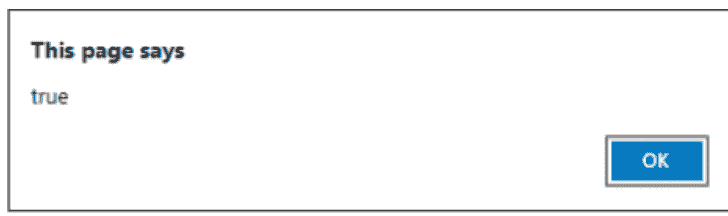

**问题：** 是否有一个像 `Number` 函数（可将值转换为数字）一样，可以将值转换为布尔值的 `Boolean` JavaScript 函数？

**回答：** 确实有。`Boolean` 函数将 "真值" 和 "假值" 的规则应用于传入的值。

```javascript
> Boolean(1);
<- true

> Boolean(0);
<- false
```

将 `Boolean` 应用于 `0` 会得到结果 **false**。任何其他数字值都将被视为 `true`。

**问题：** 负数被视为 `false` 吗？

**回答：** 不，最好将 "真值" 理解为 "值的存在"，而不是指正值或负值。将 `Boolean` 应用于负数将产生 **true** 的结果。

```javascript
> Boolean(-1);
<- true
```

**问题：** `infinity` 值被视为 `true` 还是 `false`？

**回答：** 在我们初次接触 JavaScript 时，我们尝试用 1 除以零来看看会发生什么。我们发现这种无效计算会产生一个值为 `infinity` 的结果。判断 `infinity` 是 `true` 还是 `false` 的最好方法是直接询问 JavaScript：

```javascript
> Boolean(1/0); 
<- true
```

计算 `1/0` 产生的结果是 `infinity`，`Boolean` 函数将其视为 `true`。


**问题：** 我们知道，如果要求 JavaScript 执行一个愚蠢的计算，比如用一个数字除以一个字符串，结果是一个叫做非数字（NaN）的特殊值。`NaN` 被视为 `true` 还是 `false`？

**回答：** JavaScript 将 `NaN` 视为 `false`。用数字 `1` 除以字符串 `"Rob"` 的结果是 `NaN`。如果我们将此结果输入 `Boolean` 函数，它会判定该值为 `false`。

```javascript
> Boolean(1/"Rob"); 
<- false
```

**问题：** 如果程序将布尔值与其他值组合在一起会发生什么？

**回答：** 早些时候，在“处理字符串和数字”部分，我们发现当我们将数字与字符串组合时，数值会自动“提升”为字符串。当逻辑值与其他类型的值组合时，会发生类似的事情。

类型。值为 `true` 时等同于数字 `1` 和字符串 `true`。值为 `false` 时等同于 `0` 和 `false`。

```javascript
> 1 + true;
<- 2
> "hello" + true;
<- "hellotrue"
```

请注意，与数字一样，这种转换不能反向进行。正如我们必须使用 `Number` 函数将字符串转换为数字一样，我们必须使用 `Boolean` 函数将其他类型的值转换为遵循“真值”和“假值”规则的值。

在[第 3 章]()中，我们创建了一个显示时间的滴答作响的时钟。[第 3 章]()中的程序使用了 JavaScript 提供的 `Date` 对象来获取当前日期和时间：

[点击此处查看代码图片]()

```javascript
var currentDate = new Date();
var hours = currentDate.getHours();
var mins = currentDate.getMinutes();
var secs = currentDate.getSeconds();
```

上述语句获取了当前时间的 `hours`、`mins` 和 `secs` 值。我们可以使用这些值来编写一些 JavaScript 代码，以决定我是否应该起床。请注意，小时值是以 24 小时制提供的，这意味着它在一天中从 0 到 23。

## 布尔表达式

我们已经说过，JavaScript 表达式由运算符（标识操作）和操作数（标识被处理的项目）组成。**图 5-1** 展示了我们的第一个表达式，它计算了 `2 + 2` 的结果。

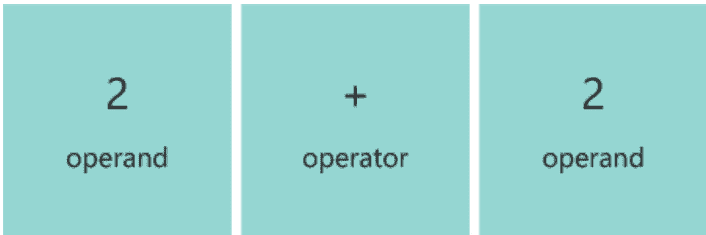

图 5-1 算术运算符

表达式可以包含比较运算符，如**图 5-2**所示。

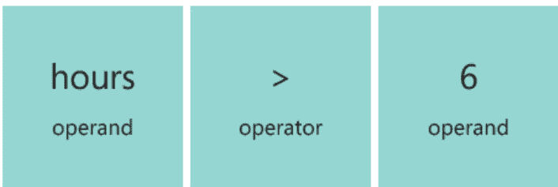

图 5-2 比较运算符

包含比较运算符的表达式会求值为一个结果，该结果要么是 `true`，要么是 `false`。此表达式中的 `>` 运算符表示“大于”。如果你大声读出这个表达式，你会说“小时大于六”。换句话说，如果小时值大于 6，则此表达式为 `true`。我需要在 7 点后起床，所以这正是我的闹钟所需要的。返回 `true` 或 `false` 的表达式称为逻辑表达式。

## 比较运算符

这些是你可以在 JavaScript 程序中使用的比较运算符。

| 运算符 | 名称 | 效果 |
| :--- | :--- | :--- |
| `>` | 大于 | 如果左侧的值大于右侧的值，则为真 |
| `<` | 小于 | 如果左侧的值小于右侧的值，则为真 |
| `>=` | 大于或等于 | 如果左侧的值大于或等于右侧的值，则为真 |
| `<=` | 小于或等于 | 如果左侧的值小于或等于右侧的值，则为真 |
| `==` | 相等 | 如果左侧的值和右侧的值可以提升为相等的值，则为真 |
| `===` | 严格相等 | 如果左侧的值和右侧的值是同一类型并且持有相同的值，则为真 |
| `!=` | 不等于 | 如果左侧的值和右侧的值不能提升为相等的值，则为真 |
| `!==` | 严格不等于 | 如果左侧的值和右侧的值不是同一类型或不持有相同的值，则为真 |

程序可以在表达式中使用比较运算符来设置一个布尔值。

```javascript
itIsTimeToGetUp = hours > 6;
```

如果 `hours` 中的值大于 6，此语句将把变量 `itIsTimeToGetUp` 设置为值 `true`；如果 `hours` 中的值不大于 6，则设置为 `false`。请记住，由单个等号字符组成的运算符执行的是赋值，而不是测试。如果这似乎难以理解，试着读出该语句并听听它的发音。语句“`itIsTimeToGetUp` 等于 小时 大于 六”是该语句作用的一个很好的解释。

## 代码分析

### 考察比较运算符

**问题：** 相等运算符是如何工作的？

**答案：** 如果两个操作数持有相同的值，则相等运算符求值为 `true`。

```javascript
> 1==1;
<- true
```

相等运算符（`==`）也可以用于比较字符串和布尔值。

```javascript
> "Rob"=="Rob";
<- true
> true == true;
<- true
```

我们已经看到，当值在表达式中使用时，JavaScript 会“提升”它们。相等运算符也是如此。当逻辑值 `true` 在带有相等运算符的表达式中使用时，它会被提升为值 `1`。

```javascript
> 1 == true;
<- true
```

JavaScript 返回了 `true`，因为在进行比较之前，值 `true` 被提升为 `1`。请注意，将 `true` 与任何其他值进行相等性比较都会返回 `false`，因为 `true` 总是被提升为 `1`。

```javascript
> 2 == true;
<- false
```

**问题：** 相等（`==`）和严格相等（`===`）有什么区别？

**答案：** 我们刚刚看到了 `==`（相等）运算符如何在比较之前提升值。这意味着该运算符可以比较不同类型的值。

```javascript
> true == 1;
<- true
```

在上面的例子中，该语句将一个逻辑值与一个数字进行比较。这产生了一个 `true` 结果，因为在比较之前，真值被“提升”为整数值 `1`。

严格相等比较 `===` 在比较两个值之前不执行任何提升。如果我们使用严格相等比较来将逻辑值 `true` 与 `1` 进行比较，则会产生 `false` 的结果。

```javascript
> true === 1;
<- false
```

JavaScript 返回了 `false`，因为严格相等运算符的一侧是逻辑值（`true`），另一侧是数字（`1`）。如果你和我一样，是那种认为程序永远不应该将数字和逻辑值进行相等性比较并得到 `true` 结果（因为直接比较数字和逻辑值是没有意义的事情）的程序员，那么你可以使用 `===` 比较运算符来确保这一点。

**问题：** 我如何记住哪个关系运算符是哪个？

**答案：** 当我学习编程时，我将 `<=` 运算符中的 `<` 与字母 L 联系起来，这提醒我 `<=` 意味着“小于或等于”。

**问题：** 我们可以对其他类型的表达式应用关系运算符吗？

**答案：** 是的，我们可以。如果关系运算符应用于两个字符串操作数，它使用字母顺序比较来确定顺序。

```javascript
> "Alice" < "Brian";
<- true
```

```javascript
> var x = 0.3;
> var y = 0.1 + 0.2;
> x == y;
<- false
```

`0.30000000000000004`。这说明了在比较浮点值是否相等时程序代码存在的问题。微小的浮点数误差意味着我们认为相同的值并不总是能求值为相等。

如果程序需要比较两个浮点值是否相等，最好的方法是如果它们只相差一个非常小的量，就认为它们相等。如果你不这样做，你可能会发现你的程序行为不符合你的预期。

从 JavaScript `Date` 对象返回的日期和时间值是以整数形式提供的，因此你可以毫无问题地测试它们的相等性。

### 逻辑运算符

目前，我判断是否该起床的测试仅由时间的小时值控制。

```javascript
itIsTimeToGetUp = hours > 6;
```

上述语句在小时大于 6（意味着从 7 点开始）时将 `itIsTimeToGetUp` 的值设置为 `true`，但我们可能想在 7:30 起床。为了能够做到这一点，我们需要一种方法来测试小时大于 6 且分钟大于 29 的时间。JavaScript 提供了三个逻辑运算符，我们可以使用它们来处理逻辑值。也许它们可以帮助解决这个问题。

| 运算符 | 效果 |
| --- | --- |
| `!` | 如果其操作数为 False，则求值为 True<br>如果其操作数为 True，则求值为 False |
| `&&` | 如果左侧值和右侧值都为 True，则求值为 True |
| `\|\|` | 如果左侧值和右侧值中有一个为 True，则求值为 True |

`&&`（与）运算符应用于两个布尔值之间，如果两个值都为 `true`，则返回 `true`。还有一个 `||`（或）运算符，应用于两个布尔值之间，如果其中一个值为 `true`，则返回 `true`。第三个运算符是 `!`（非）运算符，可用于反转布尔值。

## 代码分析

### 逻辑运算符

我们可以通过使用 Edge 浏览器中的开发者视图来研究逻辑运算符的行为。我们只需输入表达式，看看它们如何求值。请不要被下面开发者控制台示例中使用的 `<` 和 `>` 字符的方式所迷惑。

**问题：** 以下表达式求值为什么？

```javascript
<- !true;
```

**答案：** `!` 的作用是反转布尔值，将 `true` 变成 `false`。

```javascript
> !true;
<- false
```

**问题：** 这个表达式的结果是什么？

```javascript
> true && true;
```

**答案：** `&&` 两侧的操作数都是 `true`，因此结果求值为 `true`。

```javascript
> true && true;
<- true
```

**问题：** 这个表达式的结果是什么？

```javascript
> true && false;
```

**答案：** 因为 `&&`（与）运算符的两侧（操作数）都必须为 `true`，结果才能为 `true`，所以看到 `false` 的结果不应感到意外。

```javascript
> true && false;
<- false
```

**问题：** 这个表达式的结果是什么？

```javascript
> true || false;
```

**答案：** 因为 `||`（或）运算符只要有一侧为 `true`，结果就是 `true`，所以该表达式求值为 `true`。

```javascript
> true || false;
<- true
```

**问题：** 到目前为止，示例只使用了布尔值。当我们开始组合布尔值和数值时，会发生什么？

```javascript
> true && 1;
```

**答案：** 事实证明，JavaScript 可以轻松地使用和组合逻辑值与数值。然而，上面的组合不会返回 `true`。相反，它会返回 `1`。

```javascript
> true && 1;
<- 1
```

这看起来有点令人困惑，但它让我们洞察了 JavaScript 如何求值逻辑表达式。JavaScript 会从逻辑表达式的开头开始，然后沿着表达式处理，直到找到第一个可以用来确定表达式结果的值。然后它将返回该值。

在上面的表达式中，当 JavaScript 看到左侧操作数为 `true` 时，它会对自己说：“啊哈。`&&`（与）表达式的值现在由右侧的值决定了。如果右侧的值为 `true`，结果就是 `true`。如果右侧的值为 `false`，结果就是 `false`。”因此，该表达式只是简单地返回了右侧的操作数。我们可以通过交换操作数的顺序来测试这种行为：

```javascript
> 1 && true;
<- true
```

我们知道任何非 `0` 的值都是 `true`，所以 JavaScript 将返回右侧的操作数，在这种情况下是 `true`。我们也可以通过 `||`（或）操作看到这种行为。JavaScript 只查看逻辑运算符的操作数，直到它可以确定结果是 `true` 还是 `false` 为止。

```javascript
> 1 || false;
<- 1
> 0 || true;
<- true
```

你可能希望尝试使用其他值来确认你理解了正在发生的事情。

我们想创建一些 JavaScript 代码，它接收小时和分钟值，并决定是否应该响起警报。我们可以通过编写以下语句来尝试创建一个在 7:30 之后触发的警报：

```javascript
var itIsTimeToGetUp = hours > 6 && minutes > 29;
```

`&&`（与）运算符应用于两个布尔表达式的结果之间，如果两个表达式都求值为 `true`，则返回 `true`。上述语句将在 `hours` 的值大于 6 且 `minutes` 的值大于 29 时将变量 `itIsTimeToGetUp` 设置为 `true`，你可能认为这正是我们想要的。然而，这个语句是不正确的。我们可以通过设计一些测试来发现错误：

| HOURS | MINUTES | REQUIRED RESULT | OBSERVED RESULT |
| --- | --- | --- | --- |
| 6 | 00 | False | False |
| 7 | 29 | False | False |
| 7 | 30 | True | True |
| 8 | 0 | True | False |

该表显示了四个时间点，以及所需的结果（*应该*发生什么）和观察到的结果（*实际*发生了什么）。其中一个时间点被观察到工作不正确。当时间是 8:00 时，`itIsTimeToGetUp` 的值被设置为 `false`，这是错误的。

我们使用的条件在 `hours` 值大于 6 且 `minutes` 值大于 29 时求值为 `true`。这意味着对于任何小于 29 的分钟值，条件都求值为 `false`，因此在 8:00 时为 `false`。为了解决这个问题，我们需要开发一个稍微复杂一些的测试：

```javascript
var itIsTimeToGetUp = (hours > 7) || (hours == 7 && minutes > 29);
```

我添加了括号来展示两个测试是如何通过 `||`（或）运算符组合的。如果 `hours` 的值大于 7，我们就不关心 `minutes` 的值。如果 `hours` 的值等于 7，我们需要测试 `minutes` 的值是否大于 29。如果你用上面的语句尝试表中的值，你会发现它能正确工作。这说明了在设计旨在执行此类逻辑的代码时的一个重要观点。你需要设计能够用来确保程序会按你意愿行事的测试。

## `if` 语句构造

假设我想创建一个程序，显示一条消息告诉我是否该起床了。我们可以使用刚刚创建的布尔值通过 JavaScript 的 `if` 语句构造来控制程序的执行。图 5-3 展示了 `if` 语句构造的组成部分。


**图 5-3** `if` 语句构造

条件控制着语句的执行。换句话说，如果条件为“真”，则执行语句；否则，不执行。

```javascript
if (itIsTimeToGetUp) alert("It is time to get up!");
```

如果到了起床时间，上面的语句将显示一个警报。你可以在示例“Ch05 在程序中做决策\Ch05-01 警报提示”中看到它的实际应用，该示例在早上 07:30 之后访问页面时会显示警报。

```html
<!DOCTYPE html>
<html lang="en">

<head>
    <title>Ch05-01 Alarm Alert</title>
</head>

<body onload="doCheckAlarm()">
    <script>
        function doCheckAlarm() {
            var currentDate = new Date();
            var hours = currentDate.getHours();
            var mins = currentDate.getMinutes();
            var itIsTimeToGetUp = (hours > 7) || (hours == 7 && mins > 29);

            if (itIsTimeToGetUp) alert("It is time to get up!");
        }
    </script>
</body>

</html>
```

这是警报提示页面的完整文本。请注意，实现程序“智能”的语句只是代码中很小的一部分。

`if` 语句构造的行为由条件控制。条件不必是一个变量；它也可以是一个逻辑表达式：

```javascript
if ((hours > 7) || (hours == 7 && mins > 29)) alert("It is time to get up!");
```

此语句消除了对 `itIsTimeToGetUp` 变量的需求。然而，我非常喜欢使用这个变量，因为它有助于用户理解程序在做什么。

## 添加 `else` 部分

许多程序希望在条件为 `true` 时执行一个操作，在条件为 `false` 时执行另一个操作。`if` 语句构造可以添加一个 `else` 元素，该元素指定当条件为 `false` 时要执行的语句。参见图 5-4。


图 5-4 带有 `else` 的 If 构造

`else` 部分被添加到条件语句的末尾。它包含关键字 `else`，后面跟着当条件为 `false` 时要执行的语句。我们可以用它来使我们的警报程序在我们可以继续躺在床上时显示一条消息。


```javascript
if (itIsTimeToGetUp)
    alert("It is time to get up!");
else
    alert("You can stay in bed");
```

该程序根据用户运行程序的一天中的时间显示不同的消息。请注意，虽然我已将语句分布在多行上，但内容与图 5-4 中的结构一致。

## 代码分析

### If 构造

**问题**：If 构造是否必须有 `else` 部分？

**答案**：不是。它们有时非常有用，但这取决于程序试图解决的问题。

**问题**：如果一个条件永远不为真，会发生什么？

**答案**：如果一个条件永远不为真，由该条件控制的语句永远不会执行。

**问题**：在我示例中，`if` 条件下面的语句为什么缩进了几个空格？

**答案**：这个语句不需要缩进。即使我们把所有内容放在一行上，JavaScript 也能理解我们希望程序做什么。缩进是为了让程序更容易理解。它表明 `if` 构造下面的语句受其上方条件的控制。像这样的缩进是非常常见的做法，你会发现这种行为“内置于”Visual Studio Code 编辑器中。换句话说，如果你开始输入一个 `if` 构造并在条件部分的末尾按 Enter 键，Visual Studio Code 会自动缩进下一行。

## 创建语句块

`if` 条件控制单个语句的执行。然而，有时你可能希望在条件为真时执行多个语句。

## 利用决策功能开发应用程序

现在你已经知道如何在程序中进行决策，可以开始构建更有用的软件了。假设你的邻居是一家主题公园的老板，他雇请你做一些工作。公园中有些游乐设施对年龄有限制，他想在公园里安装一些计算机，让人们查询哪些项目可以去玩。他为这些计算机需要编写软件，并且如果你能胜任这项工作，他将提供一张季节性通票作为回报，这是一个非常诱人的提议。他向你提供了以下关于其园内设施的详细信息：

- **项目名称**：观光河上巡游
- **最低年龄要求**：无限制
- **项目名称**：嘉年华旋转木马
- **最低年龄要求**：至少 3 岁
- **项目名称**：丛林探险水上嬉戏
- **最低年龄要求**：至少 6 岁
- **项目名称**：`downhill mountain run`（下山山地疾驰）
- **最低年龄要求**：至少 12 岁
- **项目名称**：反胃机（一款极度惊险的过山车）
- **最低年龄要求**：必须年满 12 岁且未满 90 岁

你们讨论了这个程序用户界面的设计方案。用户界面是指用户使用该程序时所看到的内容以及操作步骤。在此应用的这款软件中，用户可以指定想要体验的项目并输入自己的年龄，然后点击一个按钮，系统便会告知是否可以乘坐该项目（参见图 5-5）。

## 程序员提示：与客户共同设计用户界面

你可能认为像这样的界面很容易设计，并且客户也不会对界面的外观和功能有强烈的看法。事实证明这种想法是错误的。我曾有过糟糕的经历：满怀自豪地向客户展示我的成品解决方案，却被告知这并非他们想要的东西，而且“很难使用”。我现在明白这是我的错。与其只向对方展示我已完成的方案，而应该与客户共同完成设计方案。那样能节省我大量工作量。

### 构建用户界面

我们要做的第一件事是创建应用程序的 HTML Web 页面和样式表文件。在第 3 章中，我们决定将存放页面元素样式的样式表文件与页面前布局分离开来是个好主意，同样也将 JavaScript 程序代码从 HTML 布局中分离开来也是个好做法。我们通过创建一个带有 `.js` 语言扩展名的新文本来放入 JavaScript 代码实现这一步骤。随后，可以在 HTML 文件的 `<head>` 部分添加一个指定该文件名称的元素：

```html
<script src="themepark.js"></script>
```

上述代码被添加到 HTML 文档的 `<head>` 部分的开头区域里，它在某个 HTML 页面上包含了 JavaScript 文件 `themepark.js` 的内容。你可以在下面的 HTML 中看到它的应用场景。在图 5-5 中可以见到该效果：每个阴影均由一个颜色值及其前导的三个数值来定义，其中 `x` 和 `y` 偏移量分别确定影子的水平与垂直位置，第三个参数表示影子模糊程度——前者完全没有扩散效应（`diffuse=0`），后者具有 10 像素的扩散范围（`size: 3px`），从而形成如前文图 5-5 中所示效果。

```html
<!DOCTYPE html>
<html lang="en">
<head>
    <title>Ch05-04 Theme Park Ride Selector</title>
    <!-- Include the CSS file -->
    <!-- Include the JavaScript file -->
</head>
<body>
    <!-- Start of numbered list of rides -->
    <p class="menuText">Enter the number of the ride you want to go on: <br> Enter your age:</p>
    <!-- Check your age -->
    <button onclick="doCheckAge()">Check</button>
</body>
</html>
```

这是**主题公园乘坐工具**（Theme Park Ride Selector）应用的 HTML 文件。

它使用了一些此前未曾涉及的 HTML 特性：

- 我们可以通过嵌套 `<ol>` 标签包裹若干 `<li>` 列表项来创建有序项目清单，浏览器会自动为这些元素编号。
- **共享样式设置同时应用于所有菜单输入类**——这意味着字体只需一次设定即可覆盖相关多个类（`menuInput`、`menuYes` 等），以便必要时快速修改整体风格。

页面上的每个元素都分配了一个具有特定样式的 `class` 类别，其具体配置位于独立的 CSS 文件 `styles.css` 中：

```css
.menuHeading {
    font-size: 4em;
    font-family: Impact, Haettenschweiler, 'Arial Narrow Bold', sans-serif;
    color: red;
    text-shadow: 3px 3px 0 blue, 10px 10px 10px darkblue;
}

.menuText, .menuRideList, .menuButton, .menuInput, .menuYes, .menuNo {
    font-family: Arial, Helvetica, sans-serif;
    font-size: 2em;
    color: black;
}

.menuYes {
    margin: 30px;
    color: green;
}
/* ... 其余类在此定义 */
```

`menuHeading` 类用于美化标题，采用 Impact 字体并为文字添加两道阴影：第一道蓝色阴影紧贴文本提供立体效果；第二道深蓝更弥散的阴影则使字符更加突出。您可以在图 5-5 中直观感受这些影子的叠加效应。每个阴影由“颜色 + `x` 偏移 + `y` 偏移 + 模糊半径”四项组成，第一项无扩散（0），第二项为 10px 扩散范围从而形成前述视觉效果：

```css
font-family: Arial, Helvetica, sans-serif;
font-size: 2em;
color: green;
```

现在用户界面已基本完成，接下来需要添加工具所需的关键行为逻辑。当用户按下年龄查验按钮时，`doCheckAge()` 函数将被执行——它会获取所选游乐项目编号及访客实际年龄段信息；随后对配对结果进行合法性校验判断（前段代码处理方式与稍早讲解过的收银机程序一致）：从 HTML 输入控件提取文本数据并借助 `Number()` 对象方法转换字符串至数值类型。

```javascript
var rideNoElement = document.getElementById("rideNoText");

var rideNoText = rideNoElement.value;

var rideNo = Number(rideNoText);

var ageElement = document.getElementById("ageText");

var ageText = ageElement.value;

var ageNo = Number(ageText);
```

当这些语句执行完毕后，变量 `rideNo` 和 `ageNo` 中就分别存储了游乐设施的编号和游客的年龄。函数接下来要做的是获取一个用于显示结果的段落的引用。如果你查看用户界面的 HTML 代码，就会看到这个段落的 ID 是 `menuAnswerPar`：

点击此处查看代码图片

```javascript
var resultElement = document.getElementById("menuAnswerPar");
```

现在，程序已经拥有了输入数据和输出位置，它就可以对游乐设施的使用做出决策了。如果用户选择了编号为 1 的游乐设施，即风景河巡游，则没有年龄限制，因此这段代码仅对游乐设施编号为 1 进行测试。如果用户选择了此项游乐设施，我们就将结果元素的样式类设置为 `menuYes` 类。这会改变该元素的样式，使文本变为绿色。然后，将段落的内部文本设置为 `你可以乘坐风景河巡游`，以便向用户显示此信息。

点击此处查看代码图片

```javascript
if (rideNo == 1) {
    // 这是风景河巡游
    // 此游乐设施没有年龄限制
    resultElement.className = "menuYes";
    resultElement.innerText = "你可以乘坐风景河巡游";
}
```

如果用户没有选择编号为 1 的游乐设施，程序就必须测试是否选择了编号为 2 的游乐设施。

点击此处查看代码图片

```javascript
if (rideNo == 2) {
    // 这是狂欢节旋转木马
    // 乘坐者必须年满 3 岁
    if (ageNo < 3) {
        resultElement.className = "menuNo";
        resultElement.innerText = "你太小了，不能乘坐狂欢节旋转木马";
    } else {
        resultElement.className = "menuYes";
        resultElement.innerText = "你可以乘坐狂欢节旋转木马";
    }
}
```

上面的代码展示了这是如何工作的。程序通过将一个条件语句嵌套在另一个条件语句中来实现功能。请注意我如何使用程序的布局来明确哪些语句由哪个条件控制。

现在你已经得到了适用于狂欢节旋转木马的代码，你可以将其作为处理其他一些游乐设施代码的基础。为了让丛林冒险水上冲刺正确运行，你需要检查一个不同的游乐设施编号，并基于不同的年龄值来确认或拒绝用户。请记住，对于这项游乐设施，游客必须至少六岁。

点击此处查看代码图片

```javascript
if (rideNo == 3) {
    // 这是丛林冒险水上冲刺
    if (ageNo < 6) {
        resultElement.className = "menuNo";
        resultElement.innerText = "你太小了，不能乘坐丛林冒险水上冲刺";
    } else {
        resultElement.className = "menuYes";
        resultElement.innerText = "你可以乘坐丛林冒险水上冲刺";
    }
}
```

你可以使用与前两个游乐设施相同的模式来非常容易地实现下山山地跑。但最后一项游乐设施——反刍者——是最复杂的。这项游乐设施非常极端，主题公园的经营者担心乘坐它的老年人的健康问题，因此除了最低年龄限制外，还增加了最高年龄限制。程序必须测试用户年龄是否大于 90 岁以及是否小于 12 岁。我们必须设计一系列条件来处理这种情况。

处理反刍者的代码是我们迄今为止不得不编写的最复杂的程序部分。为了理解它需要如何工作，你需要了解更多关于 `if` 结构在程序中的使用方式。请看以下代码：

点击此处查看代码图片

```javascript
if (rideNo == 5) {
    // 这是反刍者
}
```

当用户选择编号为 5 的游乐设施时，该条件为真，所有我们添加到此条件控制的代码块中的语句，仅在选定的游乐设施是反刍者时才会运行。换句话说，在该代码块中，没有任何语句需要提出“选定的游乐设施是反刍者吗？”这个问题，因为只有在确实如此的情况下才会运行这些语句。程序中导致某条语句的决策，决定了该语句运行的上下文。我喜欢添加注释来澄清上下文：

点击此处查看代码图片

```javascript
if (rideNo == 5) {
    // 这是反刍者
    if (ageNo < 12) {
        resultElement.className = "menuNo";
        resultElement.innerText = "你太小了，不能乘坐反刍者";
    } else {
        // 如果年龄在 12 岁或以上，执行到这里
        if (ageNo > 90) {
            resultElement.className = "menuNo";
            resultElement.innerText = "你太老了，不能乘坐反刍者";
        } else {
            resultElement.className = "menuYes";
            resultElement.innerText = "你可以乘坐反刍者";
        }
    }
}
```

这些注释使程序稍微变长了，但也使其清晰了很多。这段代码是处理反刍者的完整结构。弄清楚它如何工作的最佳方法，是使用一个用户的年龄值依次处理每条语句。你可以在 `Ch05 在程序中做出决策\Ch05-04 主题公园` 文件夹中找到所有示例代码。

## 使用 `switch` 结构

游乐设施选择器的程序代码是由 `rideNo` 的值控制的一系列 `if` 结构。这种模式在程序中经常出现，因此 JavaScript 包含了一种额外的结构，使其稍微容易一些。这是我们以前没见过的。到目前为止，我们所学的一切都是关于使某些事情成为可能。然而，`switch` 结构完全是关于使某些事情变得更容易。程序可以使用 `switch` 根据单个控制变量中的值来选择不同的行为。请查看这段实现了主题公园游乐设施选择器的代码。

点击此处查看代码图片

```javascript
switch (rideNo) {
    case 1:
        // 这是风景河巡游
        // 此游乐设施没有年龄限制
        resultElement.className = "menuYes";
        resultElement.innerText = "你可以乘坐风景河巡游";
        break;

    case 2:
        // 这是狂欢节旋转木马
        // ... 狂欢节旋转木马的语句放在这里
        break;

    case 3:
        // 这是丛林冒险水上冲刺
        // ... 丛林冒险水上冲刺的语句放在这里
        break;

    case 4:
        // 这是下山山地跑
        // ... 下山山地跑的语句放在这里
        break;

    case 5:
        // 这是反刍者
        // ... 反刍者的语句放在这里
        break;
}
```

上面的代码展示了 `switch` 的用法。`rideNo` 中的值被用作 `switch` 的控制值，程序将选择与控制值匹配的 `case`。你可以在一个特定的 `case` 中放入任意多的语句，但必须确保该 `case` 中的最后一条语句是 `break` 关键字，它会结束该 `case` 代码的执行。你可以在 `Ch05 在程序中做出决策\Ch05-05 Switch 主题公园游乐设施选择器` 文件夹中找到我使用 `switch` 实现的方案。

`switch` 语句可以与字符串和整数值一起使用，这可以是一种方便的选择方式。`switch` 结构可以有一个 `default` 选择器，当没有 `case` 与控制值匹配时，它就会被执行。你还可以使用多个 `case` 元素来选择特定的行为。下面的 `switch` 由一个名为 `commandName` 的变量控制。`Delete`、`Del` 和 `Erase` 命令都会导致选择擦除行为：

点击此处查看代码图片

```javascript
var commandName;

switch (commandName) {
    case "Delete":
    case "Del":
    case "Erase":
        // 擦除行为放在这里
        break;

    case "Print":
    case "Pr":
    case "Output":
        // 打印行为放在这里
        break;

    default:
        // 无效命令行为放在这里
        break;
}
```

## 可能会出什么问题

### `switch` 中缺少 `break` 会导致混乱

点击此处查看代码图片

```javascript
switch (rideNo) {
    case 1:
        // 这是风景河巡游
        // 此游乐设施没有年龄限制
        resultElement.className = "menuYes";
        resultElement.innerText = "你可以乘坐风景河巡游";

    case 2:
        // 这是狂欢节旋转木马
        // ... (缺少 break 会导致穿透)
}
```


```
// 这是嘉年华旋转木马
if (ageNo < 3) {
    resultElement.className = "menuNo";
    resultElement.innerText = "您太小了，无法乘坐嘉年华旋转木马。";
}
else {
    resultElement.className = "menuYes";
    resultElement.innerText = "您可以乘坐嘉年华旋转木马。";
}
break;
}
```

上面的代码是我控制的游乐园游乐项目选择器的一部分（使用 `switch` 语句版本）。它包含一个危险的错误。该错误不会导致 JavaScript 崩溃，但会导致程序做出错误的行为。这个错误是由 `case` 1 和 `case` 2 之间缺少 `break` 关键字引起的。当用户选择第 1 个游乐项目时，程序将执行属于 `case` 1 的语句，然后直接继续并执行属于 `case` 2 的语句。这意味着如果用户选择了观光船（选项 1），程序的行為就像选择了嘉年华旋转木马（选项 2）一样。这种导致程序“大部分正常工作”的错误特别危险，您应该确保测试每一个输入，以确保您的 `switch` 语句中没有缺少的 `break`。

## 让某事发生吧

### 改进游乐项目选择器

您可以将应用程序作为真正优秀的游乐项目选择器程序的起点——但它并不完美。它受益于对某些输入值进行测试，以防止用户输入无效的游乐项目编号或年龄数值。您甚至可以为每个游乐项目进行自定义图形设计，然后在选中该项目时显示它们；您还可以为每个项目添加合适的音效效果。

## 占卜师

在 `if` 结构中使用 `Math.random` 函数可以创建表现出看似随机行为的程序。

[点击此处查看代码图像]Click here to view code image

```javascript
var resultString = "您将遇到一个 ";

if(Math.random()>0.5)
    resultString = resultString+"高个子的 ";
else
    resultString = resultString="矮个子"; 

if(Math.random()>0.5)
    resultString = resultString + "金发 ";
else
    resultString = resultString + "黑发 ";

resultString = resultString + "陌生人。"; 
```

**If** `Math.random` 函数调用所产生的值被测试。**This** 会产生一个在范围 **0** 到 **1** 内介于之间的值。如果该数值小于 **0.5**，程序选择一个选项；否则则选择另一个选项。重复此过程以生成看似随机的程序结构。您可以在此基础上建立一系列此类条件来创建一个有趣的占卜师项目；您还可以创建一些图形图像配合程序的预言显示效果。

---

## 您已经学到的内容

本章向您介绍了布尔值在程序设计中的用途，并展示了如何编写可以做出决策的代码。以下是我们涵盖的主要要点：

- `Boolean`（布尔）数据只有两个可能的取值——`true`（真）或 `false`（假）。JavaScript 包含关键词 `true` 和 `false`，它们可用于在程序中代表这些值。
  - JavaScript 可以将其他类型变量视其 `"truthy"`（真正）或 `"falsy"`（伪真假性）的性质来看待。任何非零数值被视作 `true`；任何非空字符串也被视为 `true`。表示 Not a Number（`NaN`）的值被视为 `false`，但代表 Infinity（无穷大）的 `value` 则被视为 `true`。
  - JavaScript 函数 `Boolean` 可用于将任意类型的变量转换为布尔值 `true` 或 `false`，根据其 `"truthy"`（真正）或 `"falsy"`（非真性）的原则转换。
- Programs 可以生成 Boolean values by using comparison operators such as `<`（less than）between values of other types。在比较其他类型数值时应小心处理浮点数值（具有小数部分的数字）相等的问题，因为它们可能没有被准确持有。
  - JavaScript 提供两种方式测试事物是否相同：等值比较运算符（`==`）会在进行比较之前提升操作数；比较 `true` 与 `1` 的平等性会给出一真结果，因为逻辑真正会首先被提升到 `1` 然后再进行对比。同一身份比较算符（`===`）在比较不同类型时总是返回 `false`，因此对于恒同性的 `true` 和 `1` 的比较会给出 `false`。
- JavaScript also provides Boolean operators such as `&&`（and）that can be used between Boolean values。
  - The `if` 构造用于程序根据用作条件的布尔表达式来选择语句。`if` 构句可以有一个 `else` 部分，指定如果条件为假时将执行的陈述。条件语句可以是嵌套的。
  - JavaScript statements 可以用大括号（`{` 和 `}`）包围以创建可以由 `if` 结构中单个条件控制的代码块。
  - It is possible to store the JavaScript component of an application in a separate code file that is included in an HTML page.
- The `switch` construction is an easier way to create code that selects a behavior based on the content of a single control variable（控制变量内容）。

下面是一些关于制作决策程序中可能想思考的问题：

## 程序能否测试两个布尔值以确定它们是否相等？

是的，它可以。等号算符（`==`）可以在 `true`（真）或 `false` 的任意两个值之间工作。

## 为什么 JavaScript 提供等同性和同一性逻辑运算符？

恒同（identity）运算（`===`）可以说比相同（equality）更严格，因为尝试比较不同类型的操作数永远返回 `false`。这就是为什么一些程序员（包括我本人）偏好使用身份判断符（`===`）而非平等判断算符（`==`）。

## 能否将任何值视为 `"truthy"` 或 `"falsy"`？

可以：基本上，如果有东西存在（非零数值或非空字符串），它将被视为 `true`。否则为 `false`。

## 每个 `if` construct 都需要一个 `else` 部分吗？

不。如果程序中有任何 `else` 分枝存在，它们会将“绑定”到程序中最接近的 `if` 构造之一；如果您编写只在某些条件下设有 `else` 分支的程序，则需确保 `else` 正确连接至对应的 `if`。

### Is there a limit to how many `if` conditions you can nest inside each other?

No. JavaScript will be quite happy to let you put 100 `if` statements in a row (although you would have a problem editing them). If you find yourself doing this, you might want to step back from the problem a bit and see if there is a better way of attacking the problem.

## How long can a block be?

A block of code can be very long indeed. You could control 1,000 lines of JavaScript with a single `if` condition（单一条件）. However, very long blocks can make code hard to understand. If you want to control a large amount of code with a condition, you should put the code into a function。我们将在[第8章]()中了解函数相关内容。

### Does the use of Boolean values mean that a program will always do the same thing given the same data inputs?

It is very important that, given the same inputs, the computer does the same thing each time（每一次）. If the computer starts to behave inconsistently, this makes it much less useful。When we want random behavior from a computer（for example, when writing a fortune teller program）, we have to obtain values that are explicitly random and make decisions based on those。Nobody wants a "moody" computer that changes its mind（although of course, it might be fun to try to program one using random numbers）.

### Will the computer always do the right thing when we write programs that make decisions?

It would be great if we could guarantee that the computer will always do the right thing. However, the computer is only ever as good as the program it is running。If something happens that the program was not expecting, it might respond incorrectly。For example, if a program was working out cooking time for a bowl of soup, and the user entered 10 servings rather than 1, the program would set the cooking time to be far too long（and probably burn down the kitchen in the process）. In that situation, you can blame the user（because they input the wrong data）, but there should probably also be a test in the program that checks to see if the value entered is sensible。If the cooker（容器）can't hold more than 3 servings, it would seem sensible to perform a test that limits the input to `3`.

This part of a program is called "input validation", and it is very important that programs do this。When you write a program, you need to "second guess" what the user might do and create decisions that make your program behave sensibly in each situation。

# 6 在程序中重复操作

## 你将学到什么

在上一章中，你学习了程序如何根据给定的数据做出决策并改变其行为。在本章中，你将学习如何使用 JavaScript *循环*结构让程序重复一系列操作。在此过程中，我们将探索 HTML 和 JavaScript 的一些新特性。我们还将发现程序可能出现的一些错误，以及良好的设计如何降低程序失败的可能性。

- 应用开发
- 探究列表元素
- 从代码构建网页
- 更多乘法表的乐趣
- 你学到了什么

## 应用开发

我们的起点是[第5章]开发的“主题公园游乐设施选择器”程序。该程序使用条件（`if`）结构来显示游客是否可以乘坐其选择的游乐设施。

**图6-1**展示了该解决方案的实际应用。游客输入年龄为 18 岁，并选择了 1 号游乐设施“风景河巡游”，他们可以乘坐。程序运行正常，但主题公园的老板希望做出调整。她希望取消游乐设施选择的需求，并让程序以红色或绿色显示游乐设施名称，以指示给定年龄可以乘坐哪些设施。她创建了一个新设计，并希望你重写应用程序以匹配该设计。

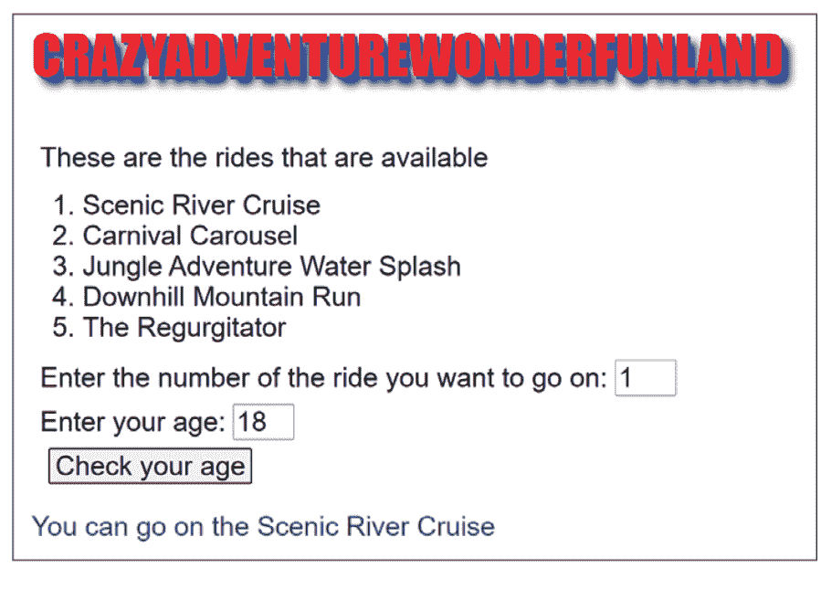

图 6-1 主题公园游乐设施选择器

**图6-2**展示了更新后的应用程序将如何工作。8 岁儿童可乘坐的游乐设施以绿色显示。我们需要做的第一件事是从游乐设施显示中移除游乐设施编号。之前的应用程序使用编号列表，因为游客输入了所选游乐设施的编号。然而，新应用程序不需要游乐设施编号。

[点击此处查看代码图像](#)

```html
<ul class="menuRideList" id="rideList">
    <li id="scenicRiver">Scenic River Cruise</li>
    <li id="carnivalCarousel">Carnival Carousel</li>
    <li id="jungleAdventure">Jungle Adventure Water Splash</li>
    <li id="downhillMountain">Downhill Mountain Run</li>
    <li id="regurgitator">The Regurgitator</li>
</ul>
```

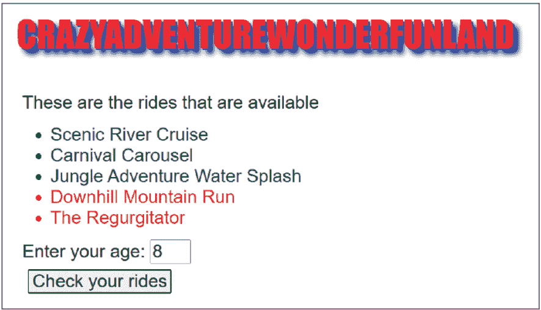

图 6-2 提出的新设计

这是我们将用于在更新后的应用程序中显示游乐设施名称的 HTML 代码。它使用了一个无序列表元素——`<ul>`，其中包含一系列游乐设施的列表元素（`<li>`）。这些列表不显示数字。现在我们需要修改控制应用程序行为的 JavaScript 代码中的程序。该程序将获取游客的年龄，然后用它来指示游客是否可以乘坐每个游乐设施。

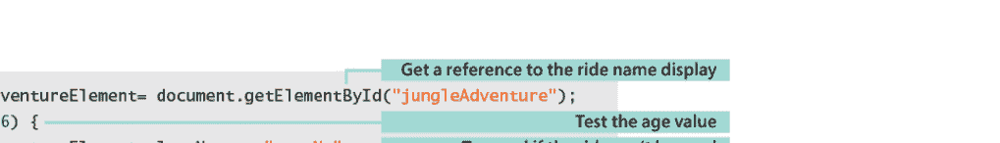

此代码展示了程序如何为“丛林探险”游乐设施显示结果。它遵循我们之前多次见过的模式：

1. 获取将显示结果供游客查看的文档元素的引用。
2. 更新此文档元素的一个属性以显示结果。

上面的代码将一个名为 `jungleAdventureElement` 的变量设置为指向包含为“丛林探险”游乐设施显示文本的元素。（这是 ID 为 `jungleAdventure` 的列表项。）然后，它使用一个由 `ageNo` 中的值控制的条件语句来将 `jungleAdventureElement` 的 `className` 属性更新为合适的样式。`ageNo` 变量包含游客的年龄。

当程序运行时，如果 `ageNo` 中的值小于 `6`，则 `jungleAdventureElement` 的 `className` 属性将被设置为 `menuNo`。如果 `ageNo` 中的值大于或等于 `6`，则执行条件语句的 `else` 部分，并将元素的 `className` 属性设置为 `menuYes`。元素的 `className` 属性给出了用于格式化此元素的样式表类。

这两个类在此应用程序的 `styles.css` 文件中定义如下：

```css
.menuYes {
    color: green;
}

.menuNo {
    color: red;
}
```


JavaScript和样式表的这种组合将导致“丛林探险”的文本在游乐设施使用者的年龄小于6岁时变为红色，而在任何其他年龄时变为绿色。我们必须为这个主题公园中所有其他游乐设施实现这种构造。我们的一位朋友正在寻找一些免费进入主题公园的机会，因此我们决定将工作外包给他。他是一位经验丰富的程序员（或者至少他比我们多读了几本书）。他完成了工作，拿到了他的主题公园门票，并交付了最终的程序。新程序似乎运行良好，主题公园老板起初对此很满意。然而，过了一段时间，他开始收到游客关于“下山越野”游乐设施显示不正确的投诉。我们需要找出问题出在哪里。

## 程序员笔记

### 始终对错误报告做出建设性响应

这些年来我遇到过不少 bug。我很快就明白，客户对错误报告的积极响应会心存感激。重要的是要记住，当你修复一个错误时，你的忠诚在于解决问题，而不是找出是谁造成的。当 bug 最终发现不是我的错时，我从不大惊小怪，而当确实是我的错时，我总是承担责任。通过以建设性的态度处理错误报告，我可以将负面情况转变为正面情况，这样我的客户最终会赞扬我的错误修复能力，而不是抱怨我的代码有 bug。

## 代码分析

### 修复错误

程序包含 bug，因为它们是由会犯错的人创建的。当由于某种原因，程序做了它不应该做的事情时，我们就遇到了一个 bug。当 bug 以某种方式影响用户时，它就变成了一个错误。看来游乐设施程序中有一个 bug 导致了显示错误。让我们在`Ch06 Repeating actions\Ch06-01 Broken Ride Selector`文件夹中打开程序，看看。

**问题：** 哪些年龄值不起作用？

**答案：** 我们被告知“下山越野”游乐设施的显示不正常。只有12岁及以上的游客才能使用此游乐设施。让我们从一个小于12岁的年龄开始测试：

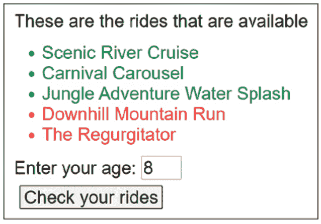

此测试表明程序对于8岁游客的工作是正确的。他们不应被允许乘坐“下山越野”和“The Regurgitator”。让我们试试12岁——一个应该可以工作的年龄。

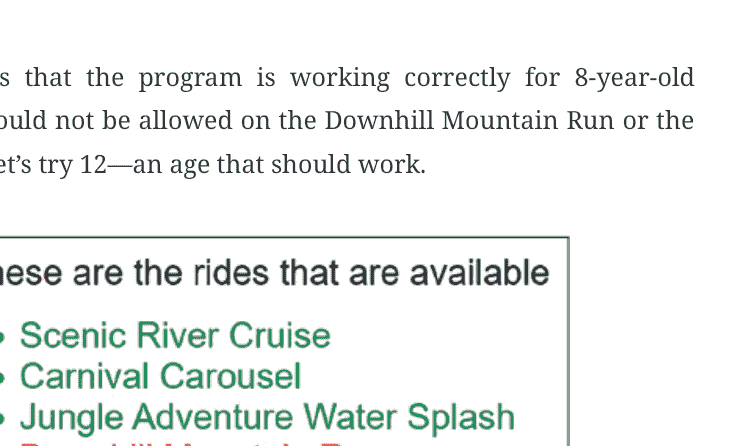

啊哈！bug暴露了。“下山越野”以红色显示，这是不正确的。一个12岁的游客应该被允许乘坐此游乐设施。

## 问题：什么可能导致这个错误？

**答案：** 现在我们看到了 bug，可以调查原因了。使用 Visual Studio Code 打开示例文件夹中的`themepark.js`程序文件并研究代码。你需要找到的部分是处理“下山越野”游乐设施的部分。这里有一个 bug。你发现了吗？

[点击此处查看代码图像](Click here to view code image)

```javascript
var downhillMountainElement = document.getElementById("downhil...

if (ageNo < 12) {
    downhillMountainElement.className = "menuNo";
} else {
    jungleAdventureElement.className = "menuYes";
}
```

程序应该在年龄小于12岁时将“下山越野”元素设置为红色；否则，它应该将元素设置为绿色。逻辑与用于“丛林探险”游乐设施的相同，但此代码是损坏的。你发现错误了吗？

[点击此处查看代码图像](Click here to view code image)

```javascript
var downhillMountainElement = document.getElementById("downhil...

if (ageNo < 12) {
    downhillMountainElement.className = "menuNo";
} else {
    jungleAdventureElement.className = "menuYes";
}
```

错误在`else`部分。我已在上面突出显示。它不是在`downhillMountainElement`上设置`className`，而是作用于`jungleAdventureElement`。程序是在决定

## 精心设计代码的重要性

一座由随意钉在一起的木头搭成的桥梁，当你走过时摇晃作响，很可能不是按照特别好的设计建造的。你也可以从设计角度考虑软件。我们创建的主题公园游乐设施应用就像一座造得很糟糕的桥。它能用，但内部结构不好。如上文所述，在编写代码时，使用多个相同的`if`结构很容易出错。还有另一个可能的错误来源：游乐设施的名称保存在 HTML 文件中，而乘客的年龄限制保存在 JavaScript 文件中。如果我们想添加更多游乐设施或调整设施的年龄限制，就必须编辑这两个文件，并确保它们的内容对应一致。任何错误都会导致更多的 bug 出现。

## 程序员观点

### 设计很重要

你可能认为担心程序的内部设计是在浪费时间。如果程序能运行，为什么我们还需要关心它是如何组合在一起的呢？然而，你应该始终努力让你的代码设计良好，这一点很重要。如果你仍然不相信，可以考虑一下主题公园游乐设施选择器中的一个 bug 可能让三岁小孩乘坐“反刍者”游乐设施的后果。孩子可能会受伤，主题公园所有者也会有大麻烦。调查可能会得出结论，是我们在编写代码时没有使用最佳实践而犯了错。

当我们制作解决方案时，应该努力让别人容易理解它是如何工作的。当一个程序员修改另一个程序员的作品，又没有完全理解原始代码是如何工作的时候，就可能出现 bug。程序越容易理解，需要修改的地方越少，引入 bug 的可能性就越低。我们将在本书的后续部分探讨设计技术。

## 向 HTML 元素添加数据属性

我们可以通过将控制应用的所有数据放在同一个地方，开始改进应用的结构。这将消除一个可能的错误来源。我们将通过把年龄限制放在网页中显示游乐设施信息的元素内部来实现这一点。这是 HTML 和 JavaScript 的一个强大特性，我们将在后面的程序中大量使用。这个我们要使用的特性叫做*数据属性*。

我们已经看到，HTML 元素可以包含以某种方式修改它的属性。例如，要显示红色文本，我向段落添加一个`style`属性来选择红色。

```html
<p style="color:red">This is a red paragraph.</p>
```

属性是修改元素的东西。每个 HTML 元素使用一组特定的属性：`p`元素有一个`style`属性来设置文本样式（如上所示），`image`元素有一个`src`属性来指定包含图像的源文件（如我们显示图像时所见）。元素也可以包含数据属性。

```html
<ul class="menuRideList" id="rideList">
    <li data-MinAge="0" data-MaxAge="120" id="scenicRiver">Sce</li>
    <li data-MinAge="3" data-MaxAge="120" id="carnivalCarousel">Car</li>
    <li data-MinAge="6" data-MaxAge="120"></li>
</ul>
```

```html
<ul>
    <li data-MinAge="10" data-MaxAge="100" id="jungleAdventure">Jungle Adventure Water Splash</li>
    <li data-MinAge="12" data-MaxAge="120" id="downhillMountain">Downhill Mountain Run</li>
    <li data-MinAge="12" data-MaxAge="90" id="regurgitator">The Regurgitator</li>
</ul>
```

上面的 HTML 类似于早先的主题公园游乐设施列表，但现在每个列表项都有一个`data-MinAge`和一个`data-MaxAge`属性。这些给出了每个游乐设施的年龄限制。现在关于游乐设施和年龄的所有信息都保存在一个地方。JavaScript 程序可以使用元素提供的`getAttribute`方法来读取数据属性的内容。

```javascript
// 获取嘉年华元素
var carnivalCarouselElement = document.getElementById("carnivalCarousel");

// 从嘉年华元素数据属性获取最小年龄
var carnivalMinAgeText = carnivalCarouselElement.getAttribute("data-MinAge");
var carnivalMinAgeNo = Number(carnivalMinAgeText);

// 从嘉年华元素数据属性获取最大年龄
var carnivalMaxAgeText = carnivalCarouselElement.getAttribute("data-MaxAge");
var carnivalMaxAgeNo = Number(carnivalMaxAgeText);
```

上面的代码展示了这对嘉年华旋转木马游乐设施是如何工作的。注意，属性的值是一个文本字符串，因此使用`Number`函数将文本转换为数值。一旦程序获得了最大和最小年龄，它就可以更新显示，以指示乘客是否可以乘坐该设施。

```javascript
if (ageNo < carnivalMinAgeNo) {
    carnivalCarouselElement.className = "menuNo";
} else {
    if (ageNo > carnivalMaxAgeNo) {
        carnivalCarouselElement.className = "menuNo";
    } else {
        carnivalCarouselElement.className = "menuYes";
    }
}
```

## 代码分析

### 数据属性

你可能对数据属性有些疑问。让我们看看是否能通过查看一些代码来回答它们。从`Ch06 重复操作\Ch06-03 数据游乐设施选择器`示例文件夹中的示例应用程序开始。在你的浏览器中打开这个文件。输入年龄**2**并点击**检查你的游乐设施**。你将看到下面的显示。

**问题：** 为什么两个游乐设施名称显示为不同的颜色？

**答案：** 风景游船巡游的文本是绿色的，因为风景游船巡游列表项的最小年龄属性是0，而年龄2大于0。嘉年华旋转木马的文本是红色的，因为年龄2小于该游乐设施的最小年龄，即3。

**问题：** 嘉年华旋转木马游乐设施的年龄上限是多少？

**答案：** 我们可以通过查看 HTML 文档中嘉年华旋转木马列表元素上的数据属性来回答这个问题。按 F12 打开开发者视图。现在输入以下 JavaScript 语句：

```javascript
> var carnivalCarouselElement = document.getElementById("carnivalCarousel");
```

这个语句创建了一个名为`carnivalCarouselElement`的变量，它引用网页中的嘉年华旋转木马列表元素。按 Enter 运行它。

```javascript
> var carnivalCarouselElement = document.getElementById("carnivalCarousel");

<- undefined
```

当你按下回车键时，变量就被创建了，而创建该变量的语句返回的值是`undefined`。现在我们可以使用`getAttribute`方法从这个元素中获取数据。输入以下语句：

[点击查看代码图片](link)

```javascript
> carnivalCarouselElement.getAttribute("data-MaxAge");

<- "120"
```

这会返回值`120`，它是嘉年华旋转木马元素中`data-MaxAge`属性的内容。这意味着该游乐设施的最大年龄限制被设定为120岁。你可以使用同样的方法来读取最小年龄值。

[点击查看代码图片](link)

```javascript
> carnivalCarouselElement.getAttribute("data-MinAge");

<- "3"
```

**问题：** 如果我们让`getAttribute`去查找一个不存在的数据属性，会发生什么？

**答案：** 让我们试一下。输入下面的语句，它寻找一个名为`data-SillyAge`的数据属性：

[点击查看代码图片](link)

```javascript
> carnivalCarouselElement.getAttribute("data-SillyAge");

<- null
```

这次`getAttribute`调用返回了`null`，这是 JavaScript 表示一个引用值不指向任何东西的方式。换句话说，`getAttribute`方法什么也没找到，所以它返回了一个表示未找到任何内容的值。我们可以使用`if`结构来测试`null`值，这样我们的程序在数据属性未找到时就能做出合理的处理。

**问题：** 我能设置元素中数据属性的值吗？

**答案：** 是的，你可以。有一个名为`setAttribute`的方法，它接受一个数据属性的名称和要设置的值作为参数。它会将数据属性设置为该值。输入以下语句，将该游乐设施的最大年龄设置为99。

[点击查看代码图片](Click here to view code image)

```javascript
> carnivalCarouselElement.setAttribute("data-maxAge", "99");

<- undefined
```

我们可以通过回读最大年龄的值来验证这一点：

[点击查看代码图片](Click here to view code image)

```javascript
> carnivalCarouselElement.getAttribute("data-MaxAge");

<- "99"
```

**问题：** 程序能在元素上创建新的数据属性吗？

**答案：** 是的。这可以用于将数据“绑定”到元素上。`setAttribute`方法会在被设置的属性不存在时创建一个新属性。尝试以下语句，它们在`Carnival Carousel`元素上创建一个名为`data-test`的测试数据属性：

[点击查看代码图片](Click here to view code image)

```javascript
> carnivalCarouselElement.setAttribute("data-test", "test string");

<- null

> carnivalCarouselElement.getAttribute("data-test");

<- "test string"
```

**问题：** 数据属性的名称必须以字符“data-”开头吗？

**答案：** JavaScript并不强制执行这条规则，但这是一个非常明智的惯例，这样阅读代码的人就不会将数据属性误认为是该元素的“普通”属性。

**问题：** 我的程序能给任何 HTML 元素添加数据属性吗？

**答案：** 是的，可以。这是将数据值存储在网页内部的好方法。

## 使用无序列表作为容器

`Ch06 Repeating actions\Ch06-03 Data Ride Selector`示例文件夹中的代码只处理两个游乐设施。原因是我只是不想为其他设施复制嘉年华旋转木马的代码。这似乎工作量太大，而且我担心可能会出错。事实证明，有一种更简单的方法来处理所有其他设施，那就是使用循环来遍历设施列表。

[点击查看代码图片](javascript:;)

```html
<ul class="menuRideList" id="rideList">
    <li data-MinAge="0" data-MaxAge="120">Scenic River Cruise</li>
    <li data-MinAge="3" data-MaxAge="120">Carnival Carousel</li>
    <li data-MinAge="6" data-MaxAge="120">Jungle Adventure Water Splash</li>
    <li data-MinAge="12" data-MaxAge="120">Downhill Mountain Run</li>
    <li data-MinAge="12" data-MaxAge="70">The Regurgitator</li>
</ul>
```

上面的 HTML 代码展示了主题公园中显示的游乐设施列表。每个游乐设施都由一个列表项（`<li>`）元素描述，所有列表都包含在一个无序列表（`<ul>`）元素中。`<ul>`元素是一个容器元素，它容纳其他元素。在这个例子中，该列表包含五个列表项。这些列表项被称为其容器元素的子元素。HTML 元素提供了可用于访问元素子元素的方法。我们来研究一下。

## 让事情发生

### 研究列表元素

首先打开示例代码中`Ch06 Repeating actions\Ch06-04 Theme Park Ride For Loop`文件夹里的应用程序。这是一个使用`for`循环的完整游乐设施选择器。我们将在本节后面了解`for`循环的工作原理。现在，我们先来看看列表容器。按下功能键 F12 打开开发者视图。现在我们可以开始在 JavaScript 命令提示符下输入命令了。我们要做的第一件事是获取持有游乐设施名称的列表的引用：

[点击查看代码图片](#)

```javascript
> var rideListElement = document.getElementById("rideList");

<- undefined
```

当你按下回车键时，JavaScript 控制台返回的结果是`undefined`，因为正如我们所知，创建变量的过程不会返回值。然而，变量`rideListElement`现在指向了游乐设施列表。为了证明这一点，只需输入名称`rideListElement`，开发者视图就会显示它所指向元素的 HTML：


## `rideListElement`

```html
<ul class="menuRideList" id="rideList">...</ul>
```

当你这次按下回车键时，JavaScript 控制台显示该元素。点击那个小小的向右箭头来展开显示。

```html
<ul class="menuRideList" id="rideList">
  <li data-minage="0" data-maxage="120" class="menuYes">Scenic River Cruise</li>
  <li data-minage="3" data-maxage="120" class="menuYes">Carnival Carousel</li>
  <li data-minage="6" data-maxage="120" class="menuYes">Jungle Adventure Water Splash</li>
  <li data-minage="12" data-maxage="120" class="menuYes">Downhill Mountain Run</li>
  <li data-minage="12" data-maxage="70" class="menuYes">The Regurgitator</li>
</ul>
```

该列表有五个子元素，即列表项。这些子元素存储在列表的一个名为 `children` 的属性中。我们可以使用一个索引来指定我们想查看哪个子元素。索引表示为一个括在方括号（`[]`）中的数字：让我们看看列表开头的元素。输入下面的语句。

[点击查看代码图片](http://google.com)

```javascript
rideListElement.children[0]
```

注意这是索引为 `0` 的元素。在计算容器中的项目时，JavaScript 从零开始计数，而不是从一开始。当你按下回车键时，将显示风景河上游览项目的列表项。

[点击查看代码图片](Click here to view code image)

```html
<li data-MinAge="0" data-MaxAge="120">Scenic River Cruise</li>
```

你可以使用这种技术来获取任何列表项。下面的语句将查看呕吐机的列表项。我用不同的数字试了一下：

[点击查看代码图片](Click here to view code image)

```javascript
rideListElement.children[4]
```

```html
<li data-MinAge="12" data-MaxAge="70">The Regurgitator</li>
```

记住，因为 JavaScript 从 `0` 开始计数元素，所以包含五个元素的列表中，最后一个元素的索引是 `4`。你可能想知道，如果你尝试访问一个不存在的元素会发生什么。试试这个：

[点击查看代码图片](Click here to view code image)

```javascript
rideListElement.children[5]
```

列表中没有第五个元素（尽管电影《第五元素》是经典之作）。尝试查找一个不存在的元素的结果是 `undefined` 值：

```javascript
undefined
```

我们可以通过使用 `children` 属性的 `length` 来找出有多少个子元素。尝试下面的语句看看它是如何工作的：

[点击此处查看代码图片](https://example.com)

```javascript
rideListElement.children.length
```

共有五个子元素，因此 `length` 属性的值将是 `5`：

```javascript
5
```

暂时保持浏览器打开，因为我们稍后将用它来研究循环。

## JavaScript `for` 循环

现在我们知道了如何获取游乐设施列表中的列表项，接下来我们需要能够做的是在应用程序中使用这些项。我们需要一种语言结构，它能围绕一个代码块进行循环，并在每次循环时进行计数。事实证明，JavaScript 恰好有这种结构。它被称为 `for` 循环。[图 6-3](#figure-6-3) 展示了 JavaScript `for` 循环的各个组成部分。

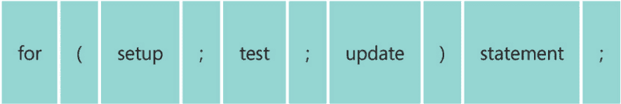

**图 6-3** `for` 循环

1. **初始化** `初始化`（有时称为 initialization）部分在 `for` 循环开始时执行一次。
2. **测试** `测试`部分在每次执行循环体中的代码之前执行。如果测试的值在 JavaScript 中是“truthy”的 `true`，循环将继续。如果测试的值是“truthy”的 `false`，循环将结束，程序将继续执行 `for` 循环之后的语句。
3. **更新** `更新`部分在每次执行循环体之后执行。
4. **语句** 语句是要被 `for` 循环重复执行的 JavaScript 语句。如果你希望循环执行多条语句，可以将其放在花括号 `{}` 中作为一个语句块。

`for` 循环通常与一个控制变量一起使用。这个变量用于计算循环执行的次数。`初始化`部分将一个起始值赋给控制变量。`测试`部分测试控制变量的值，并在控制变量达到特定值时停止循环。`更新`部分增加控制变量的值。

**图 6-4** 展示了一个完整的 `for` 循环。它使得循环语句被执行 10 次。让我们仔细看看它。

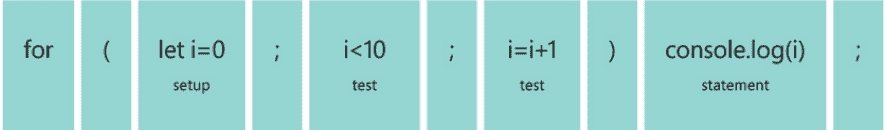

**图 6-4** `For` 循环计数器

## 代码分析

### `for` 循环

我们可以使用浏览器中的开发者工具来探究 `for` 循环做了什么。在 `Ch06 重复操作\Ch06-04 主题公园游乐设施 For 循环` 文件夹中打开应用程序（如果还没有打开），然后按 F12 打开开发者工具。

**问题：** 我们创建的 `for` 循环实际上做了什么？

**答案：** 我们可以从输入你在[图 6-4](#)中刚刚看到的 JavaScript 开始：

[点击此处查看代码图片](#)

```javascript
for(let i=0;i<10;i=i+1)console.log(i);
```

你知道（因为我已经告诉过你）这应该重复执行语句 `console.log(i)` 10 次——无论它做什么。按 Enter 查看结果。

```text
for(let i=0;i<10;i=i+1)console.log(i);

0
1
2
3
4
5
6
7
8
9
undefined
```

`console.log` 语句是调试程序的一个有用工具。它将值输出到开发者工具的控制台。在这个例子中，它每次被调用时都会输出 `i` 的值。`i` 的值从 0 开始。每次循环，`i` 的值增加 1。循环还使用条件 `i<10` 来测试 `i` 的值。当 `i` 达到值 `10` 时，这个条件不再为真（值 `10` 不小于 10），因此循环停止。

**问题：** 为什么 `for` 循环在最后显示 `undefined`？

**答案：** `for` 循环本身并不显示这条消息。显示这条消息是因为控制台总是会显示一条语句的返回值。`for` 循环结构不会像使用 `var` 创建变量那样生成一个结果。在这两种情况下，控制台都会显示值 `undefined`。

**问题：** 我可以用 `for` 循环来控制多条语句吗？

是的。`for` 循环可以控制一个用花括号 `{}` 括起来的语句块，其方式与 `if` 结构类似。

**问题：** 在 `i` 声明前的单词 `let` 是什么意思？

**答案：** 到目前为止，我们一直使用 JavaScript 关键字 `var` 来创建变量。然而，我们也可以使用关键字 `let` 来创建变量。使用 `var` 创建的变量可以在声明后的程序任何地方使用。使用 `let` 创建的变量只能在声明它们的代码块内使用。`i` 的值只在 `for` 循环控制的语句内部使用，因此它应该只存在于那个 `for` 循环内部。为了证明这一点，输入以下语句尝试查看 `i` 的值：

```javascript
i;
```

这个变量不再存在，因为它在 `for` 循环完成时就被删除了。

[点击此处查看代码图片](点击此处查看代码图片)

```text
Uncaught ReferenceError: i is not defined at <anonymous>:1:
```

**问题：** 为什么变量像这样消失是个好主意？

**答案：** 这是另一个很好的设计。我倾向于使用一个名为 `i` 的变量来计数。其他处理这段代码的程序员可能决定使用一个名为 `i` 的变量做其他事情。我不希望这两个变量冲突，所以我确保我使用的这个变量版本只在它被使用的时候存在。

**问题：** 如果给 JavaScript 一个永远不会运行的循环会发生什么？

[点击此处查看代码图片](点击此处查看代码图片)

```javascript
for(let i=0;i>10;i=i+1)console.log(i);
```

**答案：** 这个循环很傻。循环将 `i` 设置为 `0`，然后只要 `i` 的值大于 `10` 就继续执行。因为 `i` 的值不大于 `10`，所以循环永远不会被执行。如果你运行这段代码，你会发现它不会产生任何输出。

```javascript
undefined
```

**问题：** 如果我放入一个永远不会结束的循环会发生什么？（在阅读答案之前，请不要真的运行这个语句。）

[点击此处查看代码图片](link)

```javascript
for(let i=0;i<10;i=i-1)console.log(i);
```

**答案：** 这个循环也很傻。每次循环，`i` 的值减少 1 而不是增加 1。这意味着 `i` 的值永远不会达到 10，所以循环将永远运行下去。如果你运行这个语句（我不建议这样做），你会注意到控制台将充满不断减小的数字，你电脑上的风扇会启动，而你的浏览器会变得反应奇怪，因为它试图尽可能快地运行这个循环。唯一总是有效的停止方法是关闭包含该程序的浏览器标签页。有时当你访问一个网页时，你会发现你的浏览器卡住了。现在你知道一种可能发生的情况了。

既然我们了解了 `for` 循环，我们就可以为主题公园游乐设施选择器编写代码了。

```javascript
function doCheckAge() {
    // 获取输入的年龄
    var ageElement = document.getElementById("ageText");
    var ageText = ageElement.value;
    var ageNo = Number(ageText);

    // 获取游乐设施列表
    var rideListElement = document.getElementById("rideList");

    // 获取游乐设施列表项的数量
    var noOfRides = rideListElement.children.length;

    // 创建一个循环来遍历游乐设施
    for (i = 0; i < noOfRides; i = i + 1) {
        // 从列表中获取游乐设施元素
        let rideElement = rideListElement.children[i];

        // 获取最低年龄
        let minAgeText = rideElement.getAttribute("data-MinAge");
        let minAgeNo = Number(minAgeText);

        // 获取最高年龄
        let maxAgeText = rideElement.getAttribute("data-MaxAge");
        let maxAgeNo = Number(maxAgeText);

        // 测试年龄并更新组件样式
        if (ageNo < minAgeNo) {
            rideElement.className = "menuNo";
        } else {
            if (ageNo > maxAgeNo) {
                rideElement.className = "menuNo";
            } else {
                rideElement.className = "menuYes";
            }
        }
    }
}
```

这就是更新列表的 `for` 循环。

我喜欢这段代码。我真的很喜欢它的运作方式。你应该花些时间浏览一下它，确保你理解它是如何组合在一起的。要欣赏它设计得有多好，请考虑一下，如果主题公园添加了另一个游乐设施，你需要对程序做出哪些修改。

绝妙的答案是，你根本无需修改这段代码。你只需在 HTML 文件的列表中再添加一个条目。即使某个游乐设施的年龄评级发生了更改，你也无需修改程序代码。只需更改 HTML 文件中的数据，程序就能继续运行。示例文件夹 `\Ch06 Repeating actions\Ch06-05 Lots of Theme Park Rides` 中的解决方案包含了许多额外的游乐设施，但 JavaScript 程序代码是相同的。

## 程序员的观点

### 优秀的程序员是“建设性地偷懒”

你可以通过观察他们如何运用技能来避免繁重的工作，从而识别出一位优秀的程序员。我称之为“建设性地偷懒”。如果我发现自己需要编写大量代码，或者担心同步解决方案的不同部分，我会尝试找到一种使用循环并将所有内容整合到一处的方法。

## 使用 `for-of` 遍历集合

我们已经了解了如何使用 `for` 循环来遍历一系列数值。本章稍后我们可能会用到它，但也可以使用新形式的 `for` 循环来直接遍历容器中的项目。`for-of` 循环的引入并非为了解决不可能的问题；我们已经知道如何解决它。它的引入是为了让事情变得更简单。

```javascript
for (let rideElement of rideListElement.children) {
    // get the minimum age
    let minAgeText = rideElement.getAttribute("data-MinAge");
    let minAgeNo = Number(minAgeText);

    // get the maximum age
    let maxAgeText = rideElement.getAttribute("data-MaxAge");
    let maxAgeNo = Number(maxAgeText);

    // test the age and update the component
    if (ageNo < minAgeNo) {
        rideElement.className = "menuNo";
    } else {
        if (ageNo > maxAgeNo) {
            rideElement.className = "menuNo";
        } else {
            rideElement.className = "menuYes";
        }
    }
}
```

上面的循环展示了其用法。该循环将对游乐设施列表的每个子元素执行。每次循环迭代时，`rideElement` 的值都会被设置为下一个子元素。无需创建控制变量，代码因此简洁得多。你可以在 `Ch06 Repeating actions\Ch06-06 For of loop` 中的示例中看到 `for-of` 循环的实际运行。

## 从代码构建网页

“主题公园游乐设施选择器”很好地利用了 JavaScript 程序与网页元素交互的方式。现在让我们更进一步，了解 JavaScript 程序如何在运行时在页面上创建新的元素。这样我们就能制作在加载时自行构建的网页。例如，或许我们会接到任务，要求创建一个帮助人们学习乘法表的程序。用户输入一个数字，就能得到该数字的乘法表显示。

**图 6-5** 展示了程序的使用方式。用户输入他们想要的乘法表编号，程序会显示它。这个程序看起来很像我们已经创建的“主题公园游乐设施选择器”。

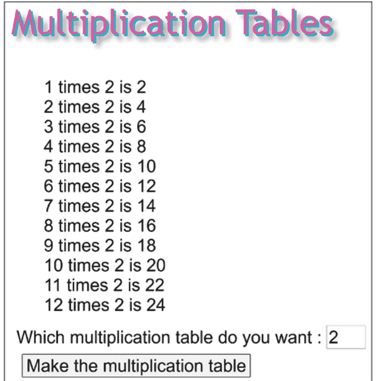

我们可以使用一个包含 12 个元素的列表来存放结果，然后像更新每个游乐设施条目的颜色一样，用用户请求的乘法表更新列表项中的文本。然而，这意味着我们需要输入一个包含 12 个元素的列表，这对我来说听起来工作量有点太大了。所以，让我们从一个空的 HTML 文档开始，然后编写一些 JavaScript，通过创建列表项来填充乘法表结果。

```html
<!DOCTYPE html>
<html lang="en">
<head>
    <title>Ch06-07 Multiplication Tables HTML generator</title>
    <link rel="stylesheet" href="styles.css">
    <script src="multiplicationtables.js"></script>
</head>
```

```html
<body>
    <p class="menuHeading">Multiplication Tables</p>
    <!-- Multiplication table list will be built by code-->
    <ul class="menuMultiplicationTableList" id="multiplicationTableList">
    </ul>


```html
<p class="menuText">Which multiplication table do you want:

    <input class="menuInput" type="number" id="timesTableText" value="2"
        min="2" max="12">
</p>

<button class="menuButton" onclick="doMultiplicationTables()">Make the
    multiplication table
</button>

</body>

</html>
```

这是乘法表应用程序的 HTML 页面。注意中间有一个 ID 为`multiplicationTableList`的空列表。它将用来容纳程序将要生成的乘法表。用户将点击“制作乘法表”按钮，该按钮将调用 JavaScript 函数`doMultiplicationTable`来创建表格。让我们来看一下。

点击此处查看代码图像。

```javascript
function doMultiplicationTables() {

    // get the multiplication table number from the web page

    var tableTextElement = document.getElementById("tableNumber");

    var tableNumberText = tableTextElement.value;

    var tableNumber = Number(tableNumberText);

    // get the multiplication table list from the web page

    var multiplicationTableListElement =
        document.getElementById("multiplicationTableList");

    // count through the table producing results

    for (let i = 1; i <= 12; i = i + 1) {

        // calculate the result

        let resultNumber = tableNumber * i;

        // create a result string

        let resultString = i + " times " + tableNumber + " is " + resultNumber;

        // make new list item

        let listItem = document.createElement("li");

        // set the text of the new list element to the result string

        listItem.innerText = resultString;

        // add it to the multiplication table list

        multiplicationTableListElement.appendChild(listItem);
    }
}
```

这个函数最有趣的部分是最后三条语句，它们创建了一个新元素并将其添加到列表中。让我们看看它们是如何工作的。

## 代码分析

### 从 JavaScript 构建 HTML

以`Ch06 Repeating actions\Ch06-07 Times Tables HTML generator`文件夹中的示例应用程序作为起点。打开这个应用程序，然后按 F12 打开开发者视图。

**问题：** 程序是否正常工作？

**回答：** 你可以在网页中输入一个乘法表值，然后点击“制作乘法表”按钮来测试程序。你将看到如前面图 6-5 所示的显示。

**问题：** 我们如何创建新的网页元素？

**回答：** `createElement`方法由`document`对象提供。该方法将创建一个新的 HTML 元素。让我们创建另一个列表项添加到乘法表列表中。我们给`createElement`一个字符串，指定我们想要的元素类型。在本例中，我们需要一个列表项，所以我们使用字符串`"li"`。输入以下内容并按回车：

```javascript
var newElement = document.createElement("li");
```

现在我们有了新元素，就可以设置它包含的`innerText`。输入以下内容并按回车：

```javascript
newElement.innerText = "Hello world";
```

我们现在有了一个 HTML 元素，它是一个包含文本“Hello world”的列表项。

**问题：** 我们如何将一个网页元素添加到页面上的某个元素中？

**回答：** 我们可以使用`appendChild`方法为任何 HTML 元素添加一个新子元素。首先，我们需要找到要添加到的元素。输入以下语句并按回车：

```javascript
var multiplicationTableListElement =
    document.getElementById("multiplicationTable");
```

现在我们有一个名为`multiplicationTableListElement`的变量，它指向容纳乘法表的列表。让我们把新元素添加到这个列表中。输入以下语句并按回车：

```javascript
multiplicationTableListElement.appendChild(newElement);
```

如果你回头看网页，会发现最后一行乘法表下面出现了一行新内容。这行就是我们刚才添加的：

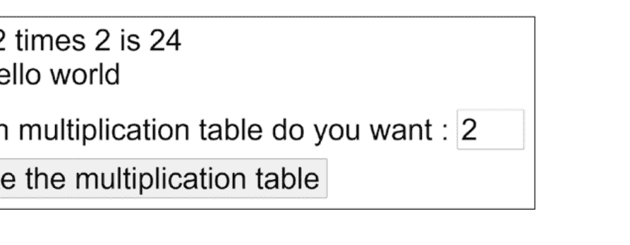

这个新元素不是 HTML 文件的一部分；它是浏览器正在维护的文档对象的一部分。

## 问题：我们可以一直向列表中添加行吗？

**回答：** 是的，你可以。事实上，我们的解决方案中存在一个错误，这意味着它只会不断向列表中添加乘法表。如果你再次点击`生成乘法表`按钮，你会发现页面上又会添加一个表格：

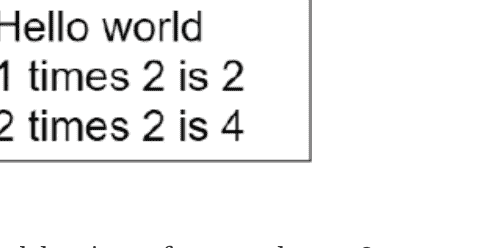

## 问题：程序可以从元素中删除项目吗？

**回答：** 是的，它可以。我们可以通过输入以下代码来删除列表开头的元素：

点击此处查看代码图片。

```javascript
multiplicationTableListElement.removeChild(
    timesTableListElement.firstChild
);

// 或者代码片段中显示的类似依赖于上下文的删除逻辑
```

`removeChild`方法接收一个元素的引用，该元素随后将从列表中被移除。在上面的语句中，提供的引用是指向列表开头元素的引用。如果你查看网页显示，你会发现第一个结果已被删除。

## 从文档中删除元素

在前面的代码分析中，我们发现了乘法表应用程序中的一个错误。当你选择一个新的乘法表时，结果会被添加到现有结果的末尾。幸运的是，我们也发现了一个可以用来从元素中移除子元素的方法。我们可以在添加新元素之前使用这个方法来“清理”列表。为此，我们可以使用另一种称为`while`循环的循环结构。`while`循环在条件为`true`时重复执行一条语句。

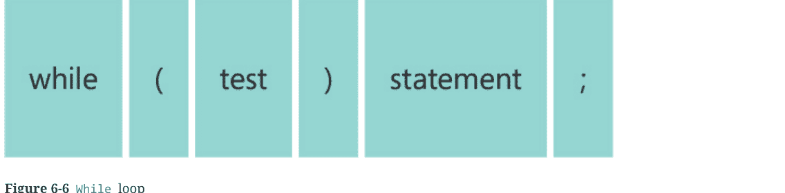

上图图 6-6 展示了`while`循环的结构。`while`循环将执行测试，然后，如果测试为“真”，它将执行该语句。然后它会循环回去并重复此过程，直到测试为“假”。我们可以使用它来创建一些 JavaScript 代码，这些代码会删除子元素，直到没有子元素为止：

点击此处查看代码图片。

```javascript
while (multiplicationTableListElement.children.length > 0) {
    multiplicationTableListElement.removeChild(
        multiplicationTableListElement.children[0]
    );
}
```

如果这看起来有点难以理解，试着将其转换成英文：“当子元素的数量大于 0 时，删除一个子元素。” 示例程序中的`Ch06 重复操作\Ch06-08 乘法表 HTML 生成器清理`文件夹中有一个乘法表程序的可运行示例。

## 动手实践：更多乘法表的乐趣

这里有一些你可能喜欢探索的想法。

### 20 倍乘法表

有些人喜欢通过知道他们的 20 倍乘法表来炫耀。你能对上面的程序进行修改，制作一个显示 20 倍乘法表的版本吗？你应该能够通过只更改程序中的一个数字来完成此操作。如果你想不出如何操作，可以在`Ch06 重复操作\Ch06-09 二十倍乘法表`文件夹中找到我的版本。

### 乘法表测试器

乘法表测试器生成一个包含一些错误数字的乘法表，然后挑战用户找出所有错误。然后用户可以点击“检查乘法表”按钮来检查哪些是正确的。

- 1 乘以 2 等于 2
- 2 乘以 2 等于 4
- 3 乘以 2 等于 5
- 6 乘以 2 等于 11

JavaScript 随机数生成器可用于决定一个给定的值是否被错误地显示。该程序可以通过在每个列表项中使用一个数据属性来工作，该属性保存该项显示的值。标记过程将类似于主题公园游乐设施程序。它会根据显示的值是否正确来更改列表项的颜色。你可以在`Ch06 重复操作\Ch06-10 乘法表测试器`文件夹中找到我的版本。

## 你学到了什么

本章向你展示了如何在 JavaScript 程序中使用循环。你还掌握了一些有用的编程设计技巧，并了解了 JavaScript 代码如何改变浏览器显示的文档结构。

1. 你只有在制作并尝试使用某个东西时，才能真正学会程序应该如何工作。如果你为某人制作了解决方案，你必须准备好在他们想出更好的使用方式时改变其工作方式。
2. 缺陷是软件开发的自然结果。当报告故障时，你的忠诚应该体现在修复过程上，而不是推卸责任。
3. 一些软件编写过程，例如通过复制代码块来重复行为，会使缺陷更容易出现。
4. HTML 元素可以被赋予数据属性。这允许程序将数据值直接绑定到文档中的项目，并将数据嵌入网页文本中。
5. HTML 元素可以充当其他元素的容器。包含在元素中的元素是父元素的子元素。可以使用索引值访问单个子元素。索引值从 0 开始。
6. JavaScript`for`循环结构用于重复执行一条语句。`for`循环有`设置`、`测试`和`更新`行为。`设置`行为在循环开始时执行。`测试`在每次循环后执行，也在第一次循环前执行。如果`测试`计算结果为`false`，循环停止。`更新`行为在每次循环后执行。
7. JavaScript`for`循环结构可用于管理一个控制变量计数器，该计数器可以在两个值之间计数，允许程序遍历容器元素的子元素。
8. JavaScript 提供了一个`for-of`结构来遍历容器中的元素。
9. 有一些 JavaScript 函数可用于创建新的页面元素（`document.createElement`）并将它们作为子元素添加到现有元素（`appendChild`）中。然后浏览器会渲染这些元素。这使得 JavaScript 代码能够以编程方式创建网页内容。
10. 有一个 JavaScript 函数（`removeChild`）可用于从容器元素中移除子元素。
11. `while`循环结构允许程序在控制逻辑表达式计算结果为`true`时重复执行一段语句块。

这里有一些你可能想思考的关于本章内容的问题：

## 每个程序都包含缺陷吗？

证明给定程序不包含任何缺陷几乎是不可能的。测试只能证明缺陷存在，而不能证明它们不存在。好消息是，并非所有缺陷都会在正常使用时影响程序的行为。

## 为什么列表的索引从零开始？

这只是 JavaScript 的工作方式。有些语言的集合索引从 1 开始，但 JavaScript 从 0 开始。你可以将索引想象为需要向下访问存储的“距离”以获取该项。

## 任何 HTML 元素都可以作为其他元素的容器吗？

是的。文档中的 HTML 元素包含 HEAD 和 BODY 元素。元素的子元素也可以拥有自己的子元素，从而允许创建层次结构。

## 向 HTML 元素添加属性会改变网页文件的内容吗？

不会。你可以将 HTML 文件视为定义了浏览器显示的文档对象的起点。对该对象的更改会影响页面的外观，但不会改变 HTML 文件的内容。

## `let` 和 `var` 有什么区别？

这两个关键字都用于创建变量。使用`var`创建的变量从程序中的该点开始存在。使用`let`创建的变量在程序执行离开其声明的块时会被销毁。使用`let`声明变量是个好主意，因为它减少了变量被意外重用的机会。

## 我能用 JavaScript 代码创建一个完整的网页吗？

可以。你访问的许多网页都是这样工作的。网站不存储 HTML 文本，而是包含一个小 HTML 文件和一个 JavaScript 程序，该程序从网络加载数据，然后用它来构建网站。我们将在未来的章节中做更多这样的事情。

# 7 创建函数

## 你将学到什么

函数是程序设计的基本组成部分。你可以使用函数将大型解决方案分解为独立的组件，并创建可供程序使用的行为库。我们已经使用过一些内置函数（例如`alert`）并创建了事件处理函数（例如`doCheckAge`）。在本章中，你将学习如何创建和使用自己的函数。你将了解如何向函数提供待处理的数据，以及程序如何接收函数返回的结果。在此过程中，你还将学到一些关于错误处理的技巧。

- 参数作为值
- 引用参数
- 双骰子
- 你已学到的内容

### 什么是函数？

函数是一段被赋予标识符的 JavaScript 代码。函数应在使用前被定义。当 JavaScript 遇到函数定义时，它会获取提供函数行为的语句并将其存储起来，以便程序随时可以使用。程序可以调用该函数，函数中的语句就会被执行。我们已经创建和调用过函数了，但现在是时候详细看看它们是如何工作的了。让我们从一个只说“hello”的简单函数开始。

```html
<!DOCTYPE html>

<html lang="en">

<head>
    <title>Ch07-01 Greeter Function</title>
</head>

<body>
    <h1>Greeter</h1>

    <p>
        <p id="outputParagraph"></p>
    </p>

    <script>
        function greeter() {
            var outputElement =
                document.getElementById("outputParagraph");

            outputElement.textContent = "Hello";
        }
    </script>
</body>

</html>
```


- 样式表函数
- 找到显示元素
- 将显示文本设置为 "Hello"

这个网页包含一个名为`greeter`的函数。该函数在屏幕上找到一个 ID 为`outputParagraph`的元素，并在该元素中显示`Hello`。函数定义后，程序就可以调用它。调用函数会运行定义函数时给出的语句。`greeter`函数功能不多，但你可以创建包含多条语句的函数。记住，你的程序必须在调用函数之前定义它。

## 代码分析

### 探究函数

首先打开 **Ch07 Functions\Ch07-01 Greeter Function** 示例代码文件夹中的应用程序。此应用程序包含一个带有输出段落和包含`greeter`函数脚本部分的 HTML 页面。按 F12 打开开发者视图。

**问题：** 如何在程序中调用函数？

**答：** 到目前为止，我们的程序使用的都是 JavaScript 提供的函数（例如`alert`函数）。但`greeter`函数是我们自己编写的。然而，我们可以用同样的方式调用它，只需输入函数名，后跟一对花括号。

```
greeter();
```

调用了`greeter`函数。该函数不返回结果（我们稍后会讲到），因此控制台显示`undefined`。

```
<- undefined
```

但是，你会注意到浏览器显示中现在出现了 "Hello" 这个词。这是在`greeter`函数运行时显示的。

```
<- undefined
```

应用程序现在包含一个名为`alerter`的新函数。定义函数的过程不返回值，因此控制台显示结果为`undefined`。

你刚刚输入的 JavaScript 包含一条调用`alert`函数的语句，但这条语句没有运行，因为它位于`alerter`函数体内。现在输入一条调用新创建函数的语句：

```
alerter();
```

当你按回车键时，该语句将调用`alerter`，这将显示一个警报：

```
<- undefined
```

**问题：** 一个函数可以调用另一个函数吗？

**答：** 是的，可以。考虑以下函数：

```
function m2(){

    console.log("the");

}

function m3(){

    console.log("sat on");

    m2();

}
```

```
function m1(){

    m2();

    console.log("cat");

    m3();

    console.log("mat");

}
```

如果调用`m1`，控制台会记录什么？最好的方法是像计算机运行程序时那样，逐条语句地运行函数。请记住，当一个函数执行完毕后，程序的执行将继续到函数调用之后的语句。这些函数在 Greeter 页面的 JavaScript 中。你可以通过调用函数`m1`来了解发生了什么：

```
m1();
```

当你按回车键时，`m1`函数被调用。然后它调用`m2`，依此类推。输出如你所料：

```
the
cat
sat on
the
mat
```

**问题：** 如果一个函数调用自身会发生什么？例如，如果`m1`函数调用`m1`会怎样？

**答：** 让函数调用自身有点像将两面镜子相对放置。在镜子中，你会看到倒影延伸到无穷远。当函数调用自身时，JavaScript 会进入无穷吗？让我们创建一个函数来找出答案。输入以下函数定义：

```
function mirror() { mirror(); };
```

`mirror`函数只包含一条调用`mirror`函数的语句。当我们创建这个函数时会发生什么。按回车键找出答案。

```
<- undefined
```

什么也没发生。创建函数与运行它不同。然而，我们现在有了一个调用自身的`mirror`函数。让我们调用`mirror`看看会发生什么：

```
mirror();
```

当你按回车键时，JavaScript 会找到`mirror`函数并开始执行其中的语句。`mirror`中的第一条语句是调用`mirror`函数，JavaScript 将开始执行它。程序陷入了循环，但它不会永远卡住。过了一会儿，控制台停止并显示错误：

每次调用函数时，JavaScript 都会将返回地址（它必须返回的位置）存储在一个称为 "栈" 的特殊内存区域中。其思想是，当运行的程序到达函数末尾时，它会从栈顶获取最近存储的返回地址并返回到该地址指向的位置。这意味着随着函数的调用和返回，栈会增长和收缩。

然而，当一个函数调用自身时，JavaScript 会反复向栈中添加返回地址。每次论证返回地址被添加到栈顶。栈的大小是有限的，当超过这个大小时，JavaScript 会停止程序。

程序员对通过调用自身来工作的函数有一个名称：*递归*。递归在程序中偶尔有用，特别是当程序在大型数据结构中搜索值时。然而，我编程多年，只使用过递归几次。我建议你将递归视为一种强大的魔法，你现在不需要使用（或者几乎不需要）。循环通常是你重复代码块的最佳选择。

**图 7-1** 展示了 JavaScript 函数定义的形式。我们可以逐一探讨这些项目。关键字`function`告诉 JavaScript 正在定义一个函数。JavaScript 将为该函数分配空间并准备开始存储函数语句。`function`一词后面是函数的标识符。我们必须为定义的每个函数创建一个标识符。因为函数与一个动作相关联，所以让名称反映这一点是一个非常好的主意。我以`动词名词`的形式给函数命名。动词指定函数将执行的动作，名词指定它将操作的项。一个例子是`doMultiplicationTables`。

在函数标识符之后，我们有传递给函数的参数。参数用逗号分隔并包含在圆括号内。参数为函数提供待处理的内容。到目前为止，我们创建的函数都没有任何参数，因此两个圆括号之间没有任何内容。最后，定义包含形成函数主体的 JavaScript 语句块。这些是调用函数时将被执行的语句。

**图 7-1** 函数定义

### 向函数提供信息

`greeter`函数展示了如何使用函数，但它真正用处不大，因为每次调用时它都做同样的事。为了使函数真正有用，我们需要让函数处理一些数据。你已经见过许多以这种方式使用的函数。`alert`函数接受一个字符串在警报框中显示。`Number`函数接受一个输入将其转换为数值。我们可以创建一个版本的`greeter`函数来接受要显示的提示：

```
function greeter(message) {

    var outputElement = document.getElementById("outputParagraph");

    outputElement.textContent = message;

}
```

### 探索参数（Arguments）

新版`greeter`在示例应用程序 **Ch07 函数\Ch07-02 问候者参数** 中。打开此应用程序，然后按 F12 打开开发者视图。

**问题：** 如何给函数调用传递一个参数？

**答案：** 我们可以通过在函数调用的花括号内放入某些东西来给函数一个参数：

```
greeter("Hello from Rob");
```

当你按 Enter 时，会调用`greeter`函数，并且字符串`Hello from Rob`作为参数传递给函数调用。

```
<- undefined
```

`greeter`函数不返回任何值，因此控制台显示`undefined`。然而，你会注意到短语`Hello from Rob`已经出现在浏览器显示了。这是由`greeter`函数运行时的显示。

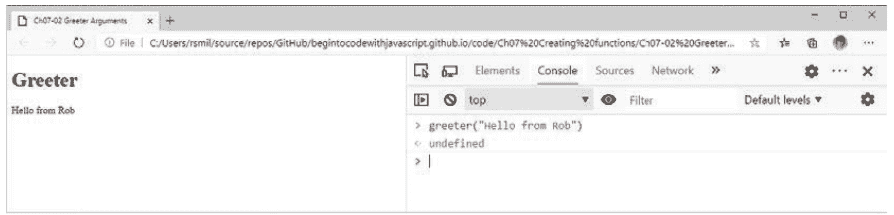

**问题：** 如果我从函数调用中省略参数会发生什么？

**答案：** 这是糟糕的编程实践。我们已告诉 JavaScript`greeter`函数接受一个参数，而我们调用它时没有提供参数。我们来试试它。输入不带参数的`greeter`调用。

```
greeter();
```

你可能会认为这会导致错误。`greeter`函数期望接收调用中缺失的内容。如果你使用过其他编程语言，例如 C++ 或 C#，你会习惯于如果在其中出错时会得到错误。然而，事实证明 JavaScript 在这方面要放松得多。没有错误，但也没有问候：

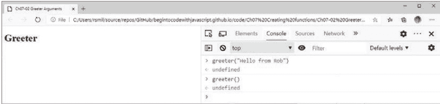

发生了以下情况：

1. JavaScript 系统注意到调用中缺少参数。
2. 它为缺失的参数向函数提供值`undefined`。
3. 函数将输出段落的`textContent`属性设置为`undefined`。浏览器不显示此内容，所以屏幕上的文字消失了。

如果我们担心带缺失参数的调用，我们可以创建一个版本的`greeter`函数来检查是否给它一个参数：

```
function errorGreeter(message) {

    if(message == undefined) {

        alert("No argument to greeter");

    }

    else

    {

        let outputElement = document.getElementById("outputParagraph");

        outputElement.textContent = message;

    }

}
```

上面的函数称为`errorGreeter`。它检查提供给它的消息，如果消息为`undefined`，则显示警告警报。否则，它会显示该消息。此函数位于示例程序的脚本中。尝试在浏览器控制台不带参数调用`errorGreeter`：

```
errorGreeter();
```

当你按 Enter 时，你会看到一个警报，因为函数没有提供参数。

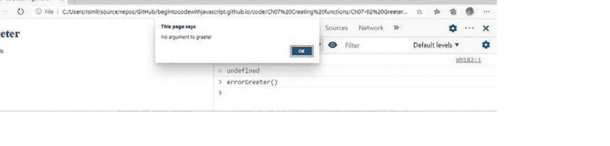

如果你用一个参数调用`errorGreeter`，你会看到它如预期那样显示消息。

**问题：** 如果我用太多参数调用一个函数会发生什么？

**答案：** 我们可以尝试这样做：

```
greeter("Hello world", 1,2,3, "something else");
```

如果你如上所述调用`greeter`，JavaScript 不会产生任何错误，但`greeter`函数将忽略额外的参数。

### 参数与实参（Arguments and parameters）

从本节标题来看，你可能期望我们会产生分歧，但在 JavaScript 中，单词 *argument* 具有特定含义。在 JavaScript 中，“argument”意为“给予函数调用的那个东西”。

```
greeter("Hello world");
```

在上述语句中，实参是字符串`Hello world`。因此，当你听到"argument"这个词时，你应该考虑正在调用函数的代码。在 JavaScript 中，单词 *parameter* 意为“函数中表示参数的名称”。函数中的参数在函数定义中指定。

```
function greeter(message)
```

这是具有单个参数的`greeter`函数的定义。参数的标识符为`message`。调用函数时，将`message`参数的值设置为作为函数调用给出的任何东西。函数内的语句可以使用该参数与使用同名变量相同的方式。

### 参数作为值传递（Parameters as values）

当调用一个函数时，实参的值传递给函数形参。这意味着什么？以下程序包含一个函数（带有有趣的名称`whatWouldIDo`），它接受单个参数。该函数没有做多少；它将参数的值设置为`99`。

```
function whatWouldIDo(inputValue) {

    inputValue = 99;

}
```

此函数是示例代码 **Ch07 创建函数\Ch07-03 参数作为值** 文件夹中应用程序的一部分。打开此应用程序，然后按 F12 打开开发者视图。首先，我们要创建一个变量并放入值：

```
var test=0;
```

当你按 Enter 时，控制台将创建一个名为`test`的变量，包含值`0`。我们可以使用`test`变量作为`whatWouldIDo`函数的参数：

```
whatWouldIDo(test);
```

当函数被调用后，我们必须考虑的问题是"test 现在包含什么值？”它包含`0`（创建时设置的值），还是包含`99`（在函数`whatWouldIDo`中设置的值）？我们可以通过要求控制台显示`test`的值来回答这个问题：

```
test
<- 0
```

当调用一个函数时，实参中的值是*复制*到形参的。因此，对参数的任何更改都不会影响实参。

### 函数中的多个参数（Multiple parameters in a function）

一个函数可以有多个参数。我们可能希望一个`greeter`函数可以用不同颜色显示文本。我们可以添加第二个参数包含颜色名称：

```
function colorGreeter(message, colorName) {

    var outputElement = document.getElementById("outputParagraph");

    var elementColorStyle = "color:"+colorName;

    outputElement.textContent = message;

    outputElement.style=elementColorStyle;

}
```

此函数使用提供的颜色名称创建样式元素。然后将该样式连同问候文本一起应用于输出元素。然后我们提供实参，给出要显示的字符串和文本的颜色：

```
colorGreeter("Hello in Red", "red");
```

### 混乱的实参（Muddled arguments）

`colorGreeter`函数有两个映射到函数内使用的两个参数的实参。第一个实参有问候文本，第二个实参有用于文本的颜色名称。重要的是必须以正确的顺序提供这些实参。

```
colorGreeter("red", "Hello in Red");
```

这次调用`colorGreeter`在问候文本之前提供了颜色名称。换句话说，它们方向反了。这将导致`colorGreeter`尝试以“Hello in Red”的颜色显示消息"red”。这不会导致错误，但会导致程序不你想要的行为。因此，当我们调用函数时，需要确保提供的实参是按与参数相同的顺序给出的。你可以在 **Ch07 创建函数\Ch07-04 Color Greeter** 文件夹中找到`colorGreeter`函数。

### 将引用作为函数参数使用

在JavaScript程序中，变量本质上分为两种。一种是包含值的变量，另一种是包含对象引用的变量。

```javascript
var age = 12;
```

这条语句创建了一个名为`age`的变量，其中包含一个值为`12`的数字。

```javascript
var outputElement = document.getElementById("outputParagraph");
```

这条语句创建了一个名为`outputElement`的变量，其中包含对页面文档中一个HTML元素的引用。这就是我们的JavaScript程序定位页面元素以向用户显示信息的方式。我们可以将引用作为参数传递给函数调用：

```html
<!DOCTYPE html>

<html lang="en">

<head>

  <title>Ch07-05 引用参数</title>

</head>

<body>

  <h1>引用参数</h1>

  <p id="outputParagraph">这是输出文本</p>

  <script>

    function makeGreen(element) {

      element.style = "color:green";

    }

  </script>

</body>

</html>
```

- 用于输出的段落元素
- `makeGreen`函数
- 将`element`参数的颜色设置为绿色

上面的HTML页面包含一个名为`makeGreen`的函数。函数`makeGreen`有一个名为`element`的参数。该函数将`element`参数的样式设置为绿色。程序可以使用此函数将任何给定的HTML元素变绿。

```javascript
makeGreen(outputElement);
```

## 让事情发生

### 引用参数

函数`makeGreen`在示例代码的 **Ch07 创建函数\Ch07-05 引用参数** 文件夹中声明。打开此应用程序，然后按F12键打开开发者视图。首先，我们要获取显示段落的引用。

```javascript
var outputElement = document.getElementById("outputParagraph");
```

当你按回车键时，会创建一个名为`outputElement`的变量，其中包含对屏幕上一个段落的引用。现在使用此变量作为参数调用`makeGreen`：

```javascript
makeGreen(outputElement);
```

这将导致网页上的段落文本变绿，因为`makeGreen`函数已将其接收到引用的元素的`style`属性设置为绿色：

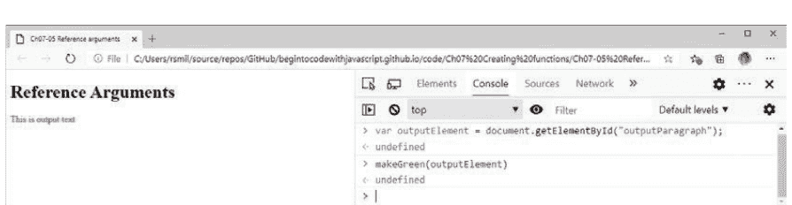

如果我们给`makeGreen`错误类型的参数会发生什么？试试这个：

```javascript


> `makeGreen(21);`

这条语句的结果是什么都不发生。即使尝试将数值的样式设置为 21 没有意义，也不会产生错误。你在函数参数上犯的任何错误都不会产生错误；相反，程序只会继续运行。

### 参数数组

我们还有另一种方式可以将参数传递给 JavaScript 函数——传递一个项的*数组*。我们将在下一章详细讨论数组。数组是一种*集合*形式。我们已经见过一种集合形式。我们在第 6 章中用来显示主题公园游乐设施信息的无序列表以项数组的形式持有元素。我们使用了 `for-of` 循环结构来遍历数组。如果你不确定这是如何工作的，请花点时间回到第 6 章阅读“使用 `for-of` 遍历集合”。在函数内部，关键字 `arguments` 表示调用函数时给出的参数数组。


函数 `calculateSum` 展示了这是如何工作的。它使用一个 `for-of` 循环来计算传递给函数调用的所有参数的总和。然后，这个总和值会显示在页面上。该函数可以用任意数量的数值参数调用：

```javascript
calculateSum(1, 2, 3, 4, 5, 6, 7, 8, 9, 10);
```

这将显示值 `55`。当然，如果你做了些蠢事，你可能得不到预期的结果。

```javascript
calculateSum(1, 2, 3, "Fred", "Jim", "Banana");
```

这个函数调用不会导致错误。它将显示结果 `6FredJimBanana`。这是因为 JavaScript 组合字符串和数字的方式所致。你可以在第 4 章的“处理字符串和数字”部分了解更多。你可以在 `Ch07 创建函数\Ch07-06 参数数组` 中找到这个示例代码。

### 从函数调用返回值

函数可以返回一个值。你已经在我们编写的许多程序中见过这个。这里有一个例子：

```javascript
var ageNo = Number(ageText);
```

这条语句使用了 `Number` 函数。该函数接受一个参数（表示数字的文本）并返回一个值（作为数值的文本）。我们可以编写自己的返回值的函数。

### 骰子点数方法

在第 4 章中，我们创建了一个显示随机骰子的应用程序。每次我们想要一个随机的骰子值时，都必须进行一些计算。将这些计算放在一个函数中会很有用，我们可以用它来获取随机的点数。

```javascript
function getDiceSpots() {

  var spots = Math.floor(Math.random() * 6) + 1;

  return spots;

}
```


这就是计算随机点数的函数 `getDiceSpots`。（有关其工作原理的详细信息，请查看第 4 章中的“创建随机骰子”部分。）函数中的最后一条语句使用 JavaScript 的 `return` 关键字将计算出的数字返回给调用者。每当应用程序需要骰子值时，都可以使用此函数。

```javascript
function doRollDice() {

    var outputElement = document.getElementById("outputParagraph");

    var spots = getDiceSpots();

    var message = "Rolled: " + spots;

    outputElement.textContent = message;

}
```

调用函数 `doRollDice` 来显示一个骰子值。它调用 `getDiceSpots` 获取值，然后显示它。你可以在示例应用程序 `Ch07 创建函数\Ch07-07 返回值` 中看到它的实际效果，其工作方式与 `Ch04 处理数据\Ch04-02 电脑骰子` 中的骰子示例完全相同，但它使用了 `doRollDice` 函数。

### 创建可自定义的骰子

有时，程序需要一个与骰子提供的 1 到 6 不同范围的随机数。我们可以运用新学到的技能来创建一个函数，该函数接受最小值和最大值，然后返回该范围内的一个随机整数。

```javascript
function getCustomDiceSpots(min, max) {

    var range = max - min + 1;

    var spots = Math.floor(Math.random() * (range)) + min;

    return spots;

}
```

函数 `getCustomDiceSpots` 被赋予两个参数，用于指定所需随机数的最小值和最大值。它计算所需的数字范围（最大值和最小值之差），计算此范围内的一个随机数，然后将该数字加到最小值上以产生点数。然后返回这个数字。函数的一个优点是，你不需要理解它们的工作原理就可以使用它们。

```javascript
var health = getCustomDiceSpots(70, 90);
```

上面的语句创建了一个名为 `health` 的变量，其中包含一个 70 到 90 范围内的随机数。它可以用于视频游戏中，设置与玩家战斗的怪物的初始生命值。有时，怪物会稍微难杀一点，这会使游戏玩起来更有趣。

### 可自定义的骰子应用程序

我使用了 `getCustomDiceSpots` 函数来制作一个骰子应用程序，用户可以选择用于玩特定游戏的随机数的最小值和最大值。

**图 7-2** 展示了该应用程序的使用方式。用户填写他们想要的随机数的 **最小** 和 **最大** 值的文本框，然后按下 **掷骰子** 按钮来显示该范围内的一个随机数。

**图 7-2** 可自定义的骰子

图 7-2 中的设置将生成一个 1 到 50 之间的值，可用于玩宾果游戏。让我们来看一下代码。

```html
<!DOCTYPE html>

<html lang="en">

<head>

  <title>Ch07-07 Returning values</title>

  <link rel="stylesheet" href="styles.css">

  <script src="customdice.js"></script>

</head>

<body>

  <p class="menuHeading">Digital Dice</p>
```

```html
<p class="menuText">

  Min:

  <input class="menuInput" type="number" id="minNoText" value="1" min="1" max="100">

  Max:

  <input class="menuInput" type="number" id="maxNoText" value="6" min="2" max="100">

  <p>

    <button class="menuText" onclick="doRollDice('minNoText', 'maxNoText',

    'outputParagraph');">

    Roll the Dice</button>

  </p>

</p>

<p id="outputParagraph" class="numberDisplay">Press the roll button</p>

</p>

</body>

</html>
```

我们之前见过这种页面。页面上有一些文本向用户介绍应用程序。有两个输入字段，用于获取要生成的随机数的最小值和最大值。有一个 **Roll the Dice** 按钮来触发值的生成，以及一个显示结果的输出段落。这个页面与第 6 章中主题公园游乐设施选择器应用程序使用的页面非常相似。当用户点击掷骰子按钮时，会调用 `doRollDice` 函数。

[点击此处查看代码图片]

```html
onclick="doRollDice('minNoText','maxNoText', 'outputParagraph')
```

这是 **Roll the Dice** 按钮的 `onclick` 属性。该属性包含一串 JavaScript 代码，当按钮被点击时将被执行。如果你不清楚这是如何工作的，请参阅第 2 章中的“使用按钮”部分以刷新记忆。当按钮被点击时运行的 JavaScript 会调用 `doRollDice` 函数。

[点击此处查看代码图片]

```javascript
doRollDice('minNoText','maxNoText', 'outputParagraph');
```

`doRollDice` 函数有三个参数，它们是网页中 `minNoText`、`maxNoText` 和 `outputParagraph` 元素的 ID 字符串。该函数从函数调用的前两个参数标识的元素中获取最小值和最大值。然后它计算随机结果，并使用第三个参数标识的输出元素显示结果。我们可以看看这个函数是如何工作的：

```javascript
function doRollDice(minElementName, maxElementName, outputElementName) {

    var min = getNumberFromElement(minElementName);

    var max = getNumberFromElement(maxElementName);

    var spots = getCustomDiceSpots(min, max);

    var message = "Rolled: " + spots;

    var outputElement = document.getElementById(outputElementName);

    outputElement.textContent = message;

}
```

这个函数看起来非常小。它获取最小值和最大值，调用 `getCustomDiceSpots` 获取随机值，然后显示结果。函数很小，因为它使用了另一个名为 `getNumberFromElement` 的函数来获取最大值和最小值：

```javascript
function getNumberFromElement(name)
{

    var element = document.getElementById(name);

    var text = element.value;

    var result = Number(text);

    return result;

}
```

该函数接受网页上一个输入元素的标识符作为参数。它从指定的输入元素中获取一个数字。我们可以在任何需要从用户读取数字的程序中使用这个函数。它获取参数提供的标识符对应的元素的引用，从该元素获取文本，将文本转换为数字，然后将数字返回给调用者。在骰子应用程序中，该函数被调用了两次——一次读取最大值，一次读取最小值。如果我有一个需要从屏幕读取 10 个输入的应用程序，我可以在应用程序中调用这个函数 10 次。

## 程序员要点

### 使用函数进行设计

函数是程序员工具包中非常有用的一部分，构成了开发过程的重要组成部分。一旦你弄清楚了客户希望应用程序做什么，你就可以开始思考如何将程序分解为函数。一旦你指定了应用程序中每个函数的行为，你就可以编写函数头（换句话说，选择函数名、参数和任何返回值），然后你甚至可以让别人为你编写该函数。

函数可以让你避免编写过多的代码。通常，你会发现随着你编写程序，你会编写重复执行特定动作的代码。如果你这样做，你应该考虑将该动作转换为函数。这样做有两个原因：

- 首先，它节省了你编写两次相同代码的时间；其次，如果代码中发现错误，你只需要修复一个地方。

函数也使程序易于测试。你可以将每个函数视为一个“数据处理器”。数据通过参数进入函数，输出通过返回值产生。我们可以编写一个所谓的“测试工具”来用测试数据调用函数，然后检查输出是否合理。换句话说，我们可以制作一个可以自测试的程序。我们将在本书后面讨论这一点。

## 为应用程序添加错误处理

数字骰子程序只要我们正确使用就运行良好。然而，它并非没有问题。很容易为最小值和最大值输入无效值。你可以尝试示例文件夹 `Ch07 创建函数\Ch07-08 自定义骰子` 中的应用程序，以了解它失败时会发生什么。

**图 7-3** 显示了应用程序可能被错误使用的情况。最小值为 50，最大值为 2 是不正确的。更糟糕的是，应用程序显示了一个可能不正确的结果。我们无法知道它是否正常工作，因为我们不确定 `getCustomDiceSpots` 函数在给定不正确的最大值和最小值时的行为。结果证明，还有其他方式可能导致程序出现问题。用户可以在 **Min** 和 **Max** 输入区域都为空时按下 **Roll The Dice**。我们需要修复所有这些问题。幸运的是，我们有需要的 JavaScript 技能来解决这个问题。

**图 7-3** 骰子错误

### 提前发现所有错误

区分优秀程序员和杰出程序员的一点是他们处理错误的方式。杰出的程序员在开始一个项目时，会思考用户开始使用他们的程序时可能出错的所有事情。他们不太可能想到每一个可能的错误（用户在搞破坏方面可能非常有创意），但他们会写下所有能想到的错误，然后着手处理每个错误。然后，随着项目的继续，杰出的程序员会不断寻找可能的错误，并确保他们知道的错误得到正确处理。在数字骰子应用程序的案例中，我可以想到三件可能出错的事情：

- 1. 用户可能没有在 `Max` 或 `Min` 输入中输入任何内容。
- 2. 用户可能在 `Max` 或 `Min` 输入中输入了超出正确范围的数字。
- 3. 用户可能输入的 `Min` 值大于或等于 `Max` 值。

既然我们已经识别了错误，下一步我们需要决定当检测到这些错误时程序应该做什么。如果你是为客户编写程序，你必须与他们讨论应该发生什么。他们是希望程序假定默认值（可能是 `Min` 为 1，`Max` 为 6），还是希望显示错误消息？他们希望错误是屏幕上的消息还是弹出警报？这些都是程序员 alone 无法回答的重要问题。最糟糕的事情是你对客户想要什么做出假设。根据我的经验，做假设是使你的工作量加倍的好方法。你向客户展示你所做的，他们告诉你这不是他们想要的，然后你必须重做。在我们的客户案例中，我们被告知程序应该显示一条消息，并将屏幕上任何无效的输入区域变成红色，以便用户知道要修复什么。那么，让我们看看如何使用我们的 JavaScript 技能来解决这个问题。

让我们从错误显示开始。这是两个我将用于网页上输入元素的样式类。`menuInput` 样式是“正常”样式。程序会将 `menuInputError` 样式设置为包含无效条目的输入元素。请注意，这将背景颜色设置为红色。

```css
.menuInput {

    background-color: white;

    font-size: 1em;

    width: 2em;

}

.menuInputError {

    background-color: red;

    font-size: 1em;

    width: 2em;

}
```

我们的应用程序使用一个名为 `getNumberFromElement` 的函数从输入元素中获取数字。让我们来看一个改进后的函数，它用于处理输入错误：

```javascript
function getNumberFromElement(elementID){

    var element = document.getElementById(elementID);

    var text = element.value;

    var result = Number(text);

    if(isNaN(result)){

        // fail with bad number input

        element.className="menuInputError";

        return NaN;

    }

    // get the max and min values from the input field

    var max = Number(element.getAttribute("max"));

    var min = Number(element.getAttribute("min"));

    if(result>max || result<min){

        // fail because outside range

        element.className="menuInputError";

        return NaN;

    }

    // if we get here the number is valid

    // set to normal background

    element.className="menuInput";

    return result;

}
```


## 代码分析

### `getNumberFromElement` 函数

这个函数值得仔细审视。以下是关于它的一些问题的解答：

**问题：** `NaN` 是什么意思？`isNaN` 函数的作用是什么？

**解答：** 我们在第 4 章第一次编写从用户读取数字的 JavaScript 代码时就见过 `NaN`。它是 JavaScript 表示“非数字”值的方式。在这个例子中，该函数使用 `Number` 函数将用户输入的文本转换为数字。如果 `Number` 函数失败（可能是由于文本不是数字或文本为空），它将返回值 `NaN`，因为它无法创建一个数字结果。`isNaN` 函数接受一个参数，如果该参数不是数字则返回 `true`。

`getNumberFromElement` 函数使用 `isNaN` 来测试调用 `Number` 所产生的结果值。如果结果不是数字，该函数将设置元素的样式以指示输入有错误，然后向调用者返回值 `NaN`，以表示无法读取数字。

**问题：** `min` 和 `max` 属性是什么？它们从哪里来？

**解答：** 我们可以向 HTML `input` 元素添加 `min` 和 `max` 属性来帮助浏览器验证用户输入的数字。然而，浏览器并未完全强制执行最小和最大值限制；我们的程序也必须在确保数字在正确范围内输入方面发挥作用。

```html
<input class="menuInput" type="number" id="minNoText" value="
```

上面的 HTML 是最小值的输入元素。`min` 和 `max` 属性分别设置为 `1` 和 `99`。`getNumberFromElement` 函数可以获取这些属性的值，然后使用它们来执行输入验证：

```javascript
var max = Number(element.getAttribute("max"));
var min = Number(element.getAttribute("min"));
```

然后该函数可以使用这些值来验证用户输入的数字。

```javascript
if (result > max || result < min) {
    // fail because outside range
    element.className = "menuInputError";
    return NaN;
}
```

这是一种处理最小值和最大值的非常好的方式，因为这些值是从 HTML 页面上的元素获取的，而不是保存在 JavaScript 代码中。

**问题：** 为什么该函数有时会返回值 `NaN`？

**解答：** 我们已经发现 `getNumberFromElement` 函数可能无法提供结果。这发生在用户没有输入数字值或输入的值超出范围时。该函数需要一种方式来通知调用者它没有一个有效的结果，而在 JavaScript 中，返回 `NaN` 就是这样做的。这使得使用一个返回值为“买家自负”式的函数成为可能，因为调用该函数的代码必须测试以确保交付的结果是有效的。我们将在查看 `doRollDice` 的错误处理版本时看到这一点的实际应用。

对 `getNumberFromElement` 函数的这些修改已经解决了我们识别出的前两个错误。用户现在必须输入一个有效的数字，否则 `getNumberFromElement` 函数将返回值 `NaN`（非数字）。现在需要更新 `doRollDice` 函数。这个版本检查最小值和最大值是否都是数字。它还检查最小值是否小于最大值。如果这两个条件中的任何一个不满足，该函数将显示一个警告。

```javascript
function doRollDice(minElementName, maxElementName, outputElementName) {
    var outputElement = document.getElementById(outputElementName);
    var minRand = getNumberFromElement(minElementName);
    var maxRand = getNumberFromElement(maxElementName);

    if (isNaN(minRand) || isNaN(maxRand)) {
        outputElement.textContent = "Invalid range values";
        return;
    }

    if (minRand >= maxRand) {
        outputElement.textContent = "Minimum above maximum";
        return;
    }

    var spots = getCustomDiceSpots(minRand, maxRand);
    var message = "Rolled: " + spots;
    outputElement.textContent = message;
}
```

**图 7-4** 展示了错误处理的实际应用。请注意，我还对应用程序做了另一个更改，使其现在向用户显示每个输入允许的最小值和最大值。这是一种从一开始就减少任何错误可能性的好方法。


**图 7-4** 错误处理

## 程序员要点

### 你需要主动处理错误

在项目会议上，我可能是一个非常令人沮丧的人，尤其是在项目开始时。我会不断寻找可能出错的地方以及我们需要担心的事情。我还会尝试让客户参与这个过程，并确保我们弄清楚当事情失败时应该发生什么。我这样做并不是因为我倾向于担心事情（尽管我可能确实如此）。我这样做是因为我不想被意外问题绊倒。如果你正在制作你关心的东西，你也应该采取同样的方法。

# JavaScript 函数中的局部变量

想象一下几个厨师在厨房里一起工作。每个厨师都在做不同的菜。厨房里有有限数量的锅碗瓢盆供厨师们共享。厨师们需要协调，以免两个人试图使用同一个锅。否则，我们可能会在汤里加了糖，而在烤牛肉上浇了蛋奶冻而不是肉汁。

JavaScript 的设计者在创建函数时面临着类似的问题。他们不希望函数以两个厨师可能争夺一个特定的煎锅的方式争夺变量。你可能认为两个函数试图使用同名变量的情况不太可能，但这实际上非常可能发生。

许多程序员（包括我）喜欢变量名 `i`，他们用它来计数。如果两个函数使用一个名为 `i` 的变量，并且一个函数调用另一个函数，这可能会导致程序无法正常工作，因为第二个函数可能会将 `i` 更改为第一个函数没有预料到的值。

JavaScript 通过提供一种方式来解决这个问题，让每个函数都有自己的局部变量空间。这在编程上相当于给每个厨师他们自己的个人锅碗瓢盆。任何函数都可以声明一个名为 `i` 的局部变量，该变量特定于该函数调用。我们使用关键字 `var` 将变量声明为局部变量。

```javascript
function fvar2() {
    var i = 99;
}

function fvar1() {
    var i = 0;
    fvar2();
    console.log("The value of i is:" + i);
}
```

当一个函数返回时，所有局部变量都会被销毁。上面的代码展示了两个包含局部变量的函数。`fvar1` 和 `fvar2` 都使用了一个名为 `i` 的变量。如果我们调用 `f1var`，JavaScript 会遵循以下序列：

1. 调用函数 `fvar1`。
2. `fvar1` 的第一条语句创建一个名为 `i` 的变量并将其设置为 0。
3. `fvar1` 的第二条语句调用 `fvar2`。
4. `fvar2` 的唯一一条语句创建一个名为 `i` 的变量并将其设置为 99。
5. 函数 `fvar2` 结束，控制权返回到 `fvar1` 的第三条语句。
6. `fvar1` 的第三条语句打印出 `i` 的值。

我们必须考虑的问题是：“控制台中显示的值是什么？”是值 0（在 `fvar1` 内部设置），还是值 99（在 `fvar2` 内部设置）？如果你阅读了本节的第一部分，你就知道将要打印的值是 0。这两个变量具有相同的名称（它们都叫 `i`），但它们各自“生活”在不同的函数中。

JavaScript 在谈论变量生命周期时使用 `scope` 这个词。变量的作用域是程序中可以使用该变量的部分。每个版本的 `i` 的作用域都仅限于声明它的函数体。这种隔离形式称为封装。封装意味着一个函数的操作与其他部分、其他函数的操作隔离。不同的程序员可以在不同的函数上工作，不会因为变量名称相互冲突而造成问题。现在来看看这一对函数：

[Click here to view code image](Click here to view code image)

```javascript
function f2() {
    i = 99;
}

function f1() {
    i = 0;
    f2();
    console.log("The value of i is:" + i);
}
```

你能发现其中的区别吗？这两个函数没有使用关键字 `var` 来声明它们的变量。这重要吗？**是的。**事实证明，不使用 `var` 关键字声明的变量会成为整个应用程序的全局变量，所以 `f1` 和 `f2` 现在共享一个名为 `i` 的全局变量。如果我们调用函数 `f1`，它会打印出值 99，因为对 `f2` 的调用会改变全局变量 `i` 的值。这意味着你应该始终在函数中使用 `var` 来声明变量，除非你特别想要共享它们。在[第 4 章](Chapter 4)的“[全局变量和局部变量](Global and local variables)”一节中，我们发现了一种程序需要具有*全局作用域*的变量的情况。现在我们开始理解这是如何工作的。

## 使用 `let` 的局部变量

在[第 6 章](Chapter 6)的“[JavaScript for 循环](The JavaScript for loop)”一节中，我们发现可以使用关键字 `let` 来声明局部变量。使用 `let` 声明的变量在程序离开它们被声明的语句块时会被丢弃，而使用 `var` 声明的变量在程序离开声明它们的函数时才会被丢弃。

```javascript
function letDemo() {
    var i = 0;

    {
        let i = 1;
        var j = 2;
        console.log("The value of let i is:" + i);
    }

    console.log("The value of var i is:" + i);
    console.log("The value of var j is:" + j);
}
```


`letDemo` 函数展示了这一切是如何工作的。它包含两个版本的 `i`。第一个版本声明为 `var`，存在于整个函数中。第二个版本在一个块内部声明，在程序离开该块时会被丢弃。注意，在块内部无法使用外部的 `i`，因为对 `i` 的任何引用都会使用局部版本。在这种情况下，我们说外部变量被作用域屏蔽了。该函数还包含一个名为 `j` 的变量，它是在内部块中声明的。然而，由于 `j` 是用 `var` 声明的，所以它可以在函数内部的任何地方使用。这些函数在示例程序 `Ch07 Creating functions\Ch07-10 Variable scope` 文件夹中声明。

如果你觉得这很混乱，那我表示歉意。理解它的最好方式是考虑它们试图解决的问题（阻止很多厨师争夺同一个锅碗瓢盆），然后以此为出发点。最重要的点是在创建变量时始终使用 `var` 或 `let`。否则，你可能会发现自己成为程序中非常奇怪的错误缺陷的受害者。

## 动手实践

### 双骰子

相当多的游戏使用两个骰子而不是一个。制作一个骰子程序的版本，显示两个骰子的结果。你甚至可以把它做得超级可定制，让用户可以选择每个骰子产生的值的范围。如果你对此有点困惑，请记住，按钮的 `onClick` 行为调用两个方法并没有什么问题。而且两个骰子就是一个骰子（或 die）乘以二。看看第十八章。

参考我的示例解决方案，看看我是如何让程序正常工作的。示例位于 `Ch07 Creating functions\Ch07-11 Two Dice` 文件夹中。

## 本章所学内容

在本章中，你学习了如何将一个代码块转换为一个可以从程序其他部分使用的函数。

1. 函数包含一个描述函数的头，以及一个作为函数体的代码块。函数头提供函数的名称以及函数接受的任何参数。当调用函数时，程序员提供与每个参数匹配的参数。
2. 参数是函数可以处理的项目。它们按值传递，即复制函数调用中给出的参数。如果函数体包含改变参数值的语句，这种更改仅限于函数体内部。当对象（例如，使用 `getElementById` 方法获取的段落）用作函数调用的参数时，函数接收对对象的引用。这允许函数体中的代码与对象中的属性交互，正如我们在上面的 `makeGreen` 函数中看到的那样。
3. 函数可以将参数视为一个数组，并使用 `arguments` 关键字遍历提供给函数的参数。
4. 函数返回单个值。这是通过使用 `return` 语句实现的，后面可以跟要返回的值。如果没有返回值，或者函数没有执行 `return` 语句，函数将返回一个名为 `undefined` 的特殊 JavaScript 值，用于表示缺失的值。
5. 程序中变量的作用域是该变量可以在其中使用的那部分程序。在函数体内使用关键字 `var` 创建的变量具有函数局部的作用域，不能被该函数外部的语句使用。
6. 创建软件时，在项目开始时考虑潜在错误很重要，而不是在后来才发现它们。

以下是一些你可能想要思考的有关程序中函数使用的问题：

### 在程序中使用函数会降低程序的速度吗？

通常不会。创建函数调用和从中返回需要一定量的工作，但这通常不是问题。函数的益处远远超过了性能问题。

### 我可以使用函数将工作分配给一组程序员吗？

确实可以。这是一个使用函数的非常好的理由。有几种方法可以使用函数来分配工作。一种流行的方法是编写占位函数并从它们构建应用程序。函数将具有正确的参数和返回值，但函数体几乎不做任何事情。随着程序的发展，程序员依次填充和测试每个函数。

## 你可以给函数调用传递的最大参数数量是多少？

我们已经看到，你可以为函数调用添加很多参数。JavaScript 对你能传递多少个参数没有限制，但如果你发现自己传递超过七八个，我建议你考虑如何将信息传递给你的函数。如果你想传递许多相关项到函数中，你可能想要创建一个对象（我们将在下一章中探讨）并传入对该对象的引用，而不是传递大量不同的值。

## 在函数体内创建变量时，`var` 和 `let` 有什么区别？

很好的问题。两个关键字都可以用来创建存在于函数体代码块内的变量。两者的区别在于，使用 `var` 创建的变量从该点起存在于函数体内。使用 `let` 创建的变量会在创建它的块结束时消失。

## 我仍然不清楚 JavaScript 中 `var` 和 `let` 的区别。为什么它们都存在？

请记住，我们要解决的问题是，我们不希望程序因为程序员将不同含义的值放入同一个变量而失败。如果程序的一个部分使用名为 `total` 的变量来保存总销售额，而另一个部分使用名为 `total` 的变量来保存总价，程序就会失败。如果你用同一个平底锅同时做蛋奶沙司和肉汁，你会有同样的问题。

使用 `let` 关键字创建的变量只存在于它被声明的块中，这意味着它不受该块外部运行的语句的影响。这就像你拿起一个干净的平底锅，做蛋奶沙司，然后清洗平底锅并在它被用于其他任何事情之前放回原处。`var` 关键字允许你创建从声明点起就存在的变量，可用于在程序或函数的各部分之间共享值。

通常，你应该使用 `let` 关键字创建变量，只有在你真的希望函数体中其他位置使用该值时才使用 `var`。注意，使用关键字 `var` 在函数中创建的变量会在程序退出该函数时消失。

## 如何为我的函数命名？

最好的函数名称采用动词-名词形式。`getNumberFromElement` 是一个不错的函数名称。第一部分表示它做什么，第二部分表示值从哪里来。我发现有时思考函数名称（以及变量名称，就此而言）可能相当困难。

## 如果我想从函数返回多个值，该怎么办？

JavaScript 函数只能返回单个值。然而，在下一章中，我们将发现如何创建可以包含多个值的对象。

# 8 存储数据

![img/16252e094e1495d166c36b25ce2e92d8_351_0.png]

## 你将学到什么

你可能会觉得这很令人惊讶，但你其实已经学到了告诉计算机该做什么所需的大部分知识。你可以编写程序从用户获取数据、存储数据，并根据数据值做出决策，同时使用循环结构重复行为。你也知道如何使用函数将解决方案分解为组件。这些是编程的基础，所有程序都构建在这些核心能力之上。

然而，在编写大多数任何类型的程序之前，你需要知道的还有一件事。你需要能够编写能够管理大量数据的程序。在本章中，你将学到这一点，以及用于处理支撑页面显示的 HTML 文档对象模型（DOM）的极其强大的 JavaScript 技术。

- [数据集合](#)
- [探究数组](#)
- [使用调试器查看代码运行](#)
- [突出显示最好和最差的销售地点](#)
- [你所学到的内容](#)

## 数据集合

你作为程序员的声名开始传得越来越广。现在一家冰淇淋店的老板来找你，请求你编写一个程序来帮助她跟踪销售结果。她目前在城市里有六个摊位在售卖冰淇淋小吃。她的要求很简单——她想要一个程序，可以输入每个摊位的销售价值，然后获取所有摊位的总销售额，以及最好和最差的销售额。她想利用这种分析来帮助规划摊位位置并奖励最佳卖家。如果你能搞定这个，你或许能得到一些免费的冰淇淋，所以你同意帮忙。

像往常一样，你程序的起点是一个展示应用程序应该是什么样子的设计。图 8-1 显示了客户草绘的内容。她想输入销售值，然后按一个**计算**按钮来显示分析结果。因为你阅读了第 7 章并且了解错误处理，你询问她关于数据值的上下限以及如果任何值超出范围程序应该做什么。你的客户没想到这点，但你们讨论了应用并就如图 8-2 所示对设计增加了一些内容达成了协议。

![img/16252e094e1495d166c36b25ce2e92d8_353_0.png]

**图 8-1** 冰淇淋计算器

![img/16252e094e1495d166c36b25ce2e92d8_354_0.png]

**图 8-2** 冰淇淋计算器错误

### 冰淇淋销售

既然你已经有了规范，现在你必须做的是编写程序本身。程序需要变量来存储用户输入的销售值，它可以使用逻辑表达式来比较销售值并选择最大的（以便找到最大和最小的销售额）。你还从之前的章节了解到如何通过设置页面中段落的 `innerText` 向用户显示结果。我们可以从应用程序的 HTML 开始：

[点击此处查看代码图片]

```html
<!DOCTYPE html>
<html lang="en">
<head>
<title>Ice Cream Sales</title>
<link rel="stylesheet" href="styles.css">
<script src="icecreamsales.js"></script>
</head>
<body>
<p class="menuHeading"> &#127846; Ice Cream Sales</p>
<p>
<label class="menuLabel" for="s1SalesText">Stand 1 sales 
<input class="menuInput" type="number" id="s1SalesText" value="0" min="0" max="10000">
</p>
<p>
<label class="menuLabel" for="s2SalesText">Stand 2 sales 
<input class="menuInput" type="number" id="s3SalesText" value="0" min="0" max="10000">
</p>
<p class="menuText" id="outputParagraph">
</p>
<p>
<button class="menuText" onclick="doCalc()">Calculate</button>
</p>
</body>
</html>
```

这段 HTML 包含了六个销售额的输入字段，供用户输入。（上面的列表仅显示前两个以节省空间。）每个输入字段都有一个 `id` 属性，以便程序可以找到它并加载其中存储的值。输入字段使用了我们之前未曾见过的 HTML 新功能——标签（`label`），如图 8-3 所示。

![img/16252e094e1495d166c36b25ce2e92d8_356_0.png]

**图 8-3** 单个数据输入元素

## 为 HTML 输入元素添加标签

应用程序上的每个元素旁边都有一个标签。在图 8-3 中，标签表明输入是针对冰淇淋摊位编号 1 的销售量。在早期的程序中，我们只是简单地显示文本在输入元素旁边以进行标签化，但事实证明在 HTML 页面上标记输入有更好的方法。我们可以使用 `label` 元素明确地将标签与输入链接起来。

[点击此处查看代码图片]

```html
<p>
    <label class="menuLabel" for="s1SalesText">Stand 1 sales (0-10000):</label>
    <input class="menuInput" type="number" id="s1SalesText" value="0" min="0" max="10000">
</p>
```

`label` 和 `input` 被包含在一个段落中。`label` 包含 `input` 的标签文本。它还包含一个 `for` 属性，该属性匹配标签目标的 `id`。`label` 和 `input` 都被分配了样式表类以管理它们在页面上的外观。

## 计算冰淇淋总销售额

HTML 包含一个用户按下以执行计算的按钮。当按下时，JavaScript 函数 `doCalc()` 被调用。此函数必须从 HTML 页面上的输入元素获取值，然后计算用户想要看到的结果。

```javascript
function doCalc() {
  var sales1, sales2, sales3, sales4, sales5, sales6;

  sales1 = getNumberFromElement("s1SalesText");
  sales2 = getNumberFromElement("s2SalesText");
  sales3 = getNumberFromElement("s3SalesText");
  sales4 = getNumberFromElement("s4SalesText");
  sales5 = getNumberFromElement("s5SalesText");
  sales6 = getNumberFromElement("s6SalesText");

  var total = sales1 + sales2 + sales3 + sales4 + sales5 + sales6;
}
```

这是函数 `doCalc()` 的第一部分。当用户按下“计算”按钮时运行该函数。它调用另一个函数 `getNumberFromElement()`，该函数是在第 7 章“可定制的骰子应用程序”部分创建的。此函数接收一个包含 HTML 元素 `id` 的字符串，并返回该元素包含的值。获取每个销售值后，程序通过将所有销售额相加来计算总销售额。

## 查找最高的冰淇淋销售额

找到总销售额很容易，现在我们需要添加代码来查找最高和最低的销售额。幸运的是，我们知道如何使用关系运算符比较值，以及使用逻辑表达式组合比较结果。你可以在第 5 章“布尔表达式”部分复习这些内容。有了这些知识，我们可以编写一条 JavaScript 语句，判断冰淇淋摊位 1 的销售额是否最大：

```javascript
var highestSales;

if (sales1 > sales2 && sales1 > sales3 && sales1 > sales4 &&
   sales1 > sales5 && sales1 > sales6) {
    highestSales = sales1;
}
```

上面的代码使用了一个 `if` 结构来决定摊位的销售额是否最大。如果 `sales1` 大于其他五个摊位的销售值，则摊位 1 的销售额最大。逻辑表达式检查来自摊位 1 的销售额是否大于摊位 2、摊位 3、摊位 4 和摊位 5 的销售额。如果 `sales1` 是最大数值，表达式将变量 `highestSales` 设置为 `sales1` 的值。

这种设计的一个问题是，我们的程序需要为所有六个销售值进行像这样的测试，因此我们需要编写另外五个测试。然后我们需要另外六个测试来确定最低的销售额，如果冰淇淋店老板设置了更多的冰淇淋摊位，这会使我们的程序更加复杂。

我们遇到了这个问题，因为我们从错误的地方开始了。有时，以现有程序作为新程序的基础是个好主意，但我们发现设计用于与两个（随机数的最大值和最小值）这种结构并不适合扩展。我们必须做大量工作来扩展这个结构，以便读取和处理六个值。

我观察过很多人学习编程，发现他们中有不少人工作得比实际需要辛苦得多，因为他们把自己已知的方法强行套用到不同的任务上。这有点像因为你会用勺子，却不想学开挖掘机，就试图用勺子挖地基。我们已经认定最优秀的程序员都具备“创造性的懒惰”。现在或许正是尝试这种创造性懒惰的好时机。如果你发现自己不得不重复使用代码块，可能需要停下来思考是否有更好的方法。如果你真的想用困难的方式完成，我已经将程序的未完成版本放在 `Ch08 Storing data\Ch08-01 Unworkable Ice Cream Sales` 文件夹中。

## 创建数组

JavaScript 还提供了*数组*组件，可用于创建一组数据值的索引存储。数组中的每个项目称为*元素*。程序通过使用*索引器*（一个标识数组中元素的数字）来寻址数组中的特定元素。有些程序员将索引器称为*下标*。让我们来探究数组的工作原理。

### 动手实践：探究数组

首先打开示例代码中的 `Ch08 Storing data\Ch08-02 Array Ice Cream Sales` 文件夹中的应用程序。这个应用程序可以运行，所以你可以输入一些数据并检查结果。我们将从开发者控制台来探究数组。通过按功能键 `F12` 打开开发者视图。现在我们可以开始在 JavaScript 命令提示符中输入命令。我们要做的第一件事是创建一个空数组。输入以下语句：

```text
> var sales = [];
```

当你按下回车键时，JavaScript 控制台会创建一个标识符为 `sales` 的空数组。此操作不会返回结果，因此控制台显示消息 `undefined`：

```text
> var sales = [];

<- undefined
```

我们可以通过输入变量名来要求 JavaScript 控制台显示任何变量的内容。这对数组也适用。输入标识符 `sales` 并按回车键。

```text
> sales

<- []
```


控制台通过显示两个之间没有任何内容的括号，向我们展示`sales`数组是空的。现在让我们在数组中存储一个销售值。以下语句将在数组开头添加一个元素：

```
> sales[0] = 100;
```

当你按下回车键时，JavaScript 必须将值`100`存储在索引为`0`的数组元素中。这个元素不存在，因此 JavaScript 会自动将其添加到数组中。因为赋值语句会返回被赋的值，控制台显示值`100`，这就是被赋给数组元素的值。

```
> sales[0] = 100;
<- 100
```

我们可以再次查看数组内容以查看发生了什么变化。输入标识符`sales`并按回车键。

```
> sales
<- [100]
```

控制台向我们显示`sales`数组现在包含一个值。我们可以像使用任何其他变量一样使用数组元素。你认为以下语句会做什么？输入它并找出答案。

```
> sales[0] = sales[0] + 1;
<- 101
```

此语句将数组开头的元素加`1`。让我们向数组添加第二个元素。我们只需在其存储内容即可创建新元素。

```
> sales[1] = 150;
<- 150
```

这个元素不存在，因此 JavaScript 会自动将其添加到数组中。因为赋值语句会返回被赋的值，控制台显示值`150`。让我们看看数组发生了什么变化。输入标识符`sales`并按回车键。

```
> sales
<- [101, 150]
```

JavaScript 向我们展示了数组开头的元素（包含`101`）和下一个元素（包含`150`）。每当需要时，JavaScript 都会向数组添加新元素。你可以将数组想象为“伸展”以容纳它需要的任何项目。

**Ch08 Storing data\Ch08-02 Array Ice Cream Sales** 示例程序中的 JavaScript 使用数组来存储销售值。下面，你可以看到程序中将数据放入数组进行分析的语句。


上述语句创建了一个名为`sales`的数组，然后用 HTML 页面中元素的销售值设置数组中的元素。请注意，由于数组元素从`0`开始索引，我已更改了输入元素的 ID 以匹配。换句话说，数组开头的元素索引值为`0`，并从具有匹配 ID 的元素分配值。

[点击此处查看代码图片](https://example.com)

```
sales[0] = getNumberFromElement("s0SalesText");
```

## 程序员要点

从零开始计数只是你需要习惯的事情

如果你习惯从`1`开始计数，你会发现数组从零开始计数的方式有点烦人。然而，你只需要习惯它，因为这就是 JavaScript（以及许多其他编程语言）的工作方式。只需记住，一个包含六个元素的数组（如上面的`sales`数组）将在`0`到`5`的范围内索引这些元素。注意，这意味着有时你需要为程序使用一种计数方式（数组元素`0`到`5`），而为用户使用另一种计数方式（冰淇淋摊位`1`到`6`）。

## 处理数组中的数据

将销售数据存储在数组中，使得程序可以轻松地遍历其中的元素。我们可以通过使用索引值来访问单个元素，也可以使用`for-of`循环来遍历元素。

```
total = 0;
for(let saleValue of sales) {
    total = total + saleValue;
}
```

- 将总计设为零
- 遍历`sales`数组
- 将每个销售值添加到总计中

上述语句遍历`sales`数组并计算销售总额。这段代码的妙处在于，它适用于任何大小的数组。

## 查找最高和最低销售值

客户的另一个要求是程序能在结果集中找到最高和最低的销售额。在编写代码之前，值得思考一下要使用的算法。在这种情况下，程序可以实现一种与人类非常相似的方法。如果你给我一些数字并要求我找到最高值，我会将每个数字与我目前看到的最高值进行比较，并在每次发现更大的值时更新当前最高值。用编程术语来说，这个算法看起来有点像下面这样。（这不是 JavaScript；这样的描述有时被称为伪代码。它看起来有点像程序，但它是为了表达一个算法，而不是在计算机中运行。）

[点击此处查看代码图片](https://example.com)

```
if (newValue > highestI'veSeen)
    highestI'veSeen = newValue
```

一开始，我们将“我见过的最高值”设置为数组开头元素的值，因为这是我们在过程开始时看到的最高值。我可以将这个行为放入一个函数中，该函数将计算传入的任何数组中的最高值。


程序可以使用`getHighest`函数从任何值数组中获取最高值。我们可以创建名为`getHighest`、`getLowest`和`getTotal`的辅助函数，以在应用程序中使用。

[点击此处查看代码图片](https://example.com)


```javascript
function doCalc() {
    var sales = [];
    sales[0] = getNumberFromElement("s0SalesText");
    sales[1] = getNumberFromElement("s1SalesText");
    sales[2] = getNumberFromElement("s2SalesText");
    sales[3] = getNumberFromElement("s3SalesText");
    sales[4] = getNumberFromElement("s4SalesText");
    sales[5] = getNumberFromElement("s5SalesText");
    var totalSales = getTotal(sales);
    var highestSales = getHighest(sales);
    var lowestSales = getLowest(sales);
    var result = "Total: " + totalSales + " Highest: " + highestSales + " Lowest: " + lowestSales;
}
```

## 可能出现的问题

### 检测无效的销售值

冰淇淋销售应用将HTML文档中的输入元素配置为数字输入类型。

点击查看代码图片

```html
<input class="menuInput" type="number" id="s0SalesText" value=...>
```

然而，使用此输入类型并不能阻止用户直接输入无效值：


在这种情况下，用户在输入数字时意外按下了减号键，输入了一个负值。好消息是，程序用于读取销售值的`getNumberFromElement`函数，当读取到超出元素最小值和最大值设置的值时，将返回一个`NaN`（非数字）的结果。（你可以在[第7章](#chapter_7)的“[为应用程序添加错误处理]”一节中了解更多关于此功能的工作原理。）

坏消息是我们的程序无法正确处理这种情况。我们可以利用JavaScript处理数字的方式来修复这个问题。请记住，任何涉及“非数字”值的数学计算都会返回“非数字”的结果。因此，如果所有销售值的总和是非数字，这意味着至少有一个销售值不是数字。我们的程序可以对此进行测试。

点击查看代码图片

```javascript
var totalSales = getTotal(sales);
var result;
if (isNaN(totalSales)) {
    result = "Please enter numbers in the correct range";
} else {
    var highestSales = getHighest(sales);
    var lowestSales = getLowest(sales);
    result = "Total:" + totalSales + "\n\n              Highest:" + highestSales + "\nLowest:" + lowestSales;
}
```

上面的代码展示了这是如何工作的。如果`totalSales`的值是非数字，则`result`变量被设置为一条错误消息。否则，结果被设置为计算出的值。你可以在示例文件夹**Ch08 Storing data\Ch08-03 Error handling Ice Cream Sales**中找到此版本的程序。

### 构建用户界面

我们创建的程序满足了客户设定的规格要求。这使得客户打来的下一个电话相当不受欢迎。她说她有个好消息。她的公司又开了两个冰淇淋摊位。这意味着我们必须为应用程序的HTML添加两个额外的元素，然后确保数据分析程序正确加载这些新值。

为了简化我们的工作，无论是创建HTML数据输入页面还是处理数据，更好的方法是更多地利用支撑应用程序的文档对象模型（DOM）。在“第6章”的“从代码构建网页”部分，我们在创建乘法表生成器应用程序时使用了DOM，该应用程序使用`for`循环生成HTML输出元素，并将这些元素添加到文档中以显示给用户。如果你不确定这是如何工作的，请查看第6章的代码分析部分“从JavaScript构建HTML”。


```html
<div id="salesItems">
</div>
<p class="menuText" id="outputParagraph">
</p>
<p>
  <button class="menuText" onclick="doCalc('salesItems','outputParagraph')">Calculate</button>
</p>
<!-- </body></html> lines omitted for brevity as they are not relevant code snippets -->
```

这是冰淇淋销售程序某个版本的HTML页面，它会自动生成输入段落。这些段落将由连接到`onload`事件的`doBuildSalesInputItems`方法生成。我们第一次看到`onload`事件是在第3章的“创建一个滴答作响的时钟”部分，当时我们使用`onload`在加载时钟页面时启动时钟的运行。

对于冰淇淋销售应用程序，`onload`事件将在页面加载时触发输入项的创建。输入项将作为`div`元素（其ID为`salesItems`）的子元素添加。`div`元素是一个用于分组的HTML元素。我们第一次看到`div`是在[第3章](#chapter_3)的“使用`div`和`span`格式化文档的部分”中，如下所示：

[点击查看代码图片]

```javascript
doBuildSalesInputItems('salesItems',0,10000,6);
```

`doBuildSalesInputItems`函数被调用时传入了四个参数：

1. **将包含要创建的输入项的元素的ID字符串。** 输入项将作为该元素的子元素添加。
2. **可输入到此元素的最小值。** 此值用于创建输入元素。在我们的应用程序中，最小的销售数量是`0`。
3. **可输入到此元素的最大值。** 在我们的应用程序中，客户说超过`10,000`的销售额是不可能的。
4. **要创建的输入段落的数量。** 上面的语句将创建六个输入元素。

现在我们已经了解了`doBuildSalesInputItems`函数是如何被调用的，让我们来看一下函数本身的代码。

```javascript
function doBuildSalesInputItems(containerElementID,min,max,noOfItems) {
    var containerElement = document.getElementById(containerElementID);
    for(let itemCount=1;itemCount<=noOfItems;itemCount=itemCount+1){
        let labelText="Sales "+itemCount;
        let itemPar=makeInputPar(labelText,min,max);
        containerElement.appendChild(itemPar);
    }
}
```

该函数使用`for`循环，通过调用`makeInputPar`函数依次生成每个输入段落。循环的终止点由`noOfItems`参数决定。`min`和`max`参数的值被传递给`makeInputPar`函数。让我们看看这是如何工作的。

### 创建输入段落

程序必须构建用户将输入数据的HTML元素。我将其创建为一个函数，以便我们可以在任何需要从用户读取值的地方使用它。图8-3显示了输入段落应该产生的显示效果。它读取的是1号冰淇淋摊位的销售额。

描述此输入段落的HTML如下所示：

[点击查看代码图片]

```html
<p>
  <label class="menuLabel" for="s1SalesText">Stand 1 sales (0-10000):</label>
  <input class="menuInput" type="number" id="s1SalesText"value="0"min="0"max="10000">
</p>
```

输入段落由一个`label`元素和一个`input`元素组成。`label`元素包含`Stand 1 sales (0-10000)`标签，`input`元素用于接收数据。`label`和`input`元素被分配了样式类，以便于管理它们的外观。`input`元素有`min`和`max`属性，浏览器使用它们来限制用户可以输入的值。

在我们此应用程序的第一个版本中，输入段落在应用程序的HTML文件中定义。有六个这样的段落，每个冰淇淋摊位一个。但是，我们可以通过使用JavaScript来制作输入段落，从而简化应用程序。

```javascript
function makeInputPar(labelText,min,max){
    let inputPar=document.createElement("p");;
    let labelElement=document.createElement("label");
    labelElement.innerText=labelText+" ("+min+"-"+max+"):";
    labelElement.className="menuLabel";
    labelElement.setAttribute("for", labelText); 
    inputPar.appendChild(labelElement);
    let inputElement=document.createElement("input");
    inputElement.setAttribute("max", max);
    inputElement.setAttribute("min", min);
    inputElement.setAttribute("value","0");
    inputElement.setAttribute("type","number");
    inputElement.className="menuInput";
    inputElement.setAttribute("id", labelText); 
    inputPar.appendChild(inputElement);
    return inputPar;
}
```

函数`makeInputPar`使用对象`document`提供的`createElement`函数来创建段落元素（`inputPar`），并给段落两个子元素。子元素是一个`label`元素（`labelElement`）和一个`input`元素（`inputElement`）。

1. 用于输入的标签
2. 最大输入值
3. 最小输入值

程序可以通过以下调用为第一个冰淇淋摊位创建输入元素：

[点击此处查看代码图像]

```
var stand1input = makeInputPar("Sales 1", 0, 10000);
```


然而，我们不会这样做，因为我们使用循环来创建输入并将它们添加到容器中。

## 代码分析

### 输入生成

我们可以通过使用 JavaScript 控制台来查看这个输入生成的实际效果。我们可能对此还有一些疑问。首先，在示例代码中的`Ch08 Storing data\Ch08-04 Input Generation`文件夹中打开应用程序。此应用程序包含一个由`doBuildSalesInputItems`函数生成的 HTML 页面。按 F12 打开开发者视图。

**问题：** 我们可以查看由`doBuildSalesInputItems`函数生成的 HTML 吗？

**回答：** 是的，我们可以。如果我们在开发者视图中点击**Elements**标签，它将显示文档对象的视图。然后我们可以展开视图以查看每个元素的 HTML。


**问题：** 我们可以从控制台向文档添加另一个输入元素吗？

**回答：** 是的，可以。点击**Console**标签打开控制台。首先，我们需要一个引用容器元素的引用，该容器元素保存输入段落。输入以下内容并按回车：

[点击此处查看代码图像](#)

```
var containerElement = document.getElementById('salesItems');
```

接下来，我们需要创建一个新的输入项。`makeInputPar`函数将为我们完成此操作。我们将在下一节中查看这个函数是如何工作的。调用该函数创建一个名为 "New Sales" 的新输入项，最小值为 1，最大值为 99：

[点击此处查看代码图像](#)

```
var newPar = makeInputPar("New Sales", 1, 99);
```

现在我们有了新段落，下一步是将其添加到容器元素的子元素中：

[点击此处查看代码图像]

```javascript
containerElement.appendChild(newPar);
```

这将我们新创建的段落添加到页面中。你应该能看到它出现。它将带有 "New Sales" 标签，输入范围为 1 到 99。


上图显示了在列表底部添加的新元素（带有标题 "New Sales"）。

**问题：** 如何增加冰淇淋摊位的数量？

**回答：** 使用循环生成页面使得更改冰淇淋摊位的数量变得非常容易。如果你查看 HTML 代码，你会发现`doBuildSalesInputItems`函数的调用。此调用的最后一个参数是要创建的摊位数量，目前为六个。如果我们想处理 12 个摊位，我们只需更改 HTML 来反映这一点。我们不需要对 JavaScript 程序进行任何更改。

```
doBuildSalesInputItems('salesItems', 0, 10000, 6);
```

## 读取数值

在冰淇淋程序的先前版本中，我们有单独的语句为每个销售值创建数组元素。下面是获取前两个冰淇淋摊位销售额的语句。

[点击此处查看代码图像]

```
sales[0] = getNumberFromElement("s0SalesText");
sales[1] = getNumberFromElement("s1SalesText");
```

如果客户添加了更多摊位，那么我们就必须修改程序并添加更多语句。对于 12 个冰淇淋摊位，我们需要 12 条这样的语句。有更好的方法来实现这一点。我们可以使用循环从 HTML 元素中读取值。该循环将遍历页面上的所有输入段落。输入段落是销售项元素的子元素。

**图 8-4** 显示了这些元素的结构。左侧，我们有 ID 为`salesItems`的`div`元素，它包含所有元素。该`div`元素包含六个段落，每个冰淇淋摊位一个。第一个段落获取冰淇淋摊位 1 的输入。它包含一个`label`和一个`input`项。要获取用户输入，程序必须遍历销售项并从输入元素中提取数据。

```
▼<div id="salesItems">
  ▼<p>
    <label class="menuLabel" for="Sales 1">Sales 1 (0-10000):</label>
    <input max="10000" min="0" value="0" class="menuInput" id="Sales 1">
  </p>
  ►<p>…</p>
  ►<p>…</p>
  ►<p>…</p>
  ►<p>…</p>
  ►<p>…</p>
</div>
```

图 8-4 输入段落

程序可以使用`for-of`循环遍历子元素并提取每个项的值。上面的代码展示了这是如何工作的。

```
var sales = [];
var salesPos = 0;
var salesElement = document.getElementById('salesItems');

for (let item of salesElement.children) {
    let salesValue = getNumberFromElement(item.children[1]);
    sales[salesPos] = salesValue;
    salesPos = salesPos + 1;
}
```

## 代码分析

### 读取数字

**问题：** 这段代码在做什么？

**回答：** 好问题。当用户按下**Calculate**按钮时，他们刚刚输入了销售值，并希望看到显示的总值、最高值和最低值。程序首先需要做的是从页面上的输入元素中获取值，并将其放入`sales`数组中。输入元素是作为页面构建时生成的段落的子元素，这些段落本身是`salesItems`元素的子元素。将`salesItem`元素想象为祖父元素。祖父有六个孩子。这些是页面构建时生成的段落。这六个


孩子中的每一个还有两个更小的孩子，即标签和输入元素。

`for-of`循环将遍历`salesItems`容器的每个子元素。每次循环时，变量`item`引用`salesItems`中的下一个段落元素。每个段落元素包含两个子元素：输入的标签和输入本身。我们需要的输入元素是销售段落的第二个子元素，其索引号为 1（因为索引总是从 0 开始）。

[点击此处查看代码图像](#)

```
let salesValue = getNumberFromElement(item.children[1]);
```

这个版本的`getNumberFromElement`函数接收一个它要读取的元素的引用，因此它获取输入的值并返回数字结果。

**问题：** 如果输入元素包含无效值会发生什么？

**回答：** 输入元素包含`max`和`min`属性，这些属性被`getNumberFromElement`用于验证用户输入的数字。如果用户输入的数字超出此范围，或者用户没有输入数字，`getNumberFromElement`函数将返回非数字（NaN）的结果。

**问题：** 如果我们添加了更多冰淇淋摊位，我需要更改这段代码吗？

**回答：** 不需要。这就是这个循环的妙处。它可以遍历任意数量的输入段落。

## 动手实践

### 使用调试器查看代码运行

你可能觉得上面的代码有点难以理解。你可能在想，如果能够观察它执行并查看每条语句的作用，那将是极好的。事实证明，你可以通过浏览器开发者视图中内置的*调试器*来做到这一点。在这种情况下，我们不是因为有错误而在调试程序；我们只是想知道它是如何工作的。首先，在示例代码中的`Ch08 Storing data\Ch08-04 Input Generation`文件夹中打开应用程序。此应用程序包含一个由`doBuildSalesInputItems`函数生成的 HTML 页面。为冰淇淋摊位输入一些销售数据，然后按 F12 打开开发者视图。在开发者视图中选择**Sources**标签。

**Sources**选项卡将显示构成应用程序的所有文件。请注意，您看到的浏览器显示屏可能与上方的不同。我在浏览器的窗口布局方面做了调整并放大了开发者视图，以便在书中更清晰地呈现。不过，您可以拖动窗口边框以获得类似的视图。**Sources**视口现在在一个窗口中显示了 JavaScript 代码。使用滚动条向下移动代码以查找`doCalc`函数。此函数来自 HTML 当计算按钮被按下时。我们要在这个函数的第一条语句上设置*断点*。当一个程序到达断点时，它将“休息一下”。它将会暂停并且我们将能够研究该函数在做什么甚至逐个执行这些语句。我们通过单击列表中的行号左侧来置断点。**显示**将在该位置有一个红点如上所示。**点击**添加一个断点。如果您在非正确的位置上点击，则可以通过单击红色圆点移除断点。一旦设置好断点后，请在应用程序中点击**计算**(Calculate)按钮运行此函数。浏览器将调用`doCalc`然后在到达断点时暂停。

当程序在设置了断点的语句处挂起时，您可以看到它被高亮为蓝色。我们可以使用传输控件逐个执行程序的每行语句。**运输控制**看起来有点像埃及象形文字。它们在我的浏览器中的屏幕右上角区域但可能在您的机器上是在某个地方。我们要随着进行更多地了解每个控制器。

暂时我们想要使用的是**步骤**(Step)按钮，如上所示**。点击这个，程序将执行指示的声明然后移动到下一个。请注意`sales`数组的内容是为您显示的**。**如果您再次按下 Step 按钮您将被显示在`salePos`变量的内容的信息。**您可以保持按下去键（或使用功能键 F9）步进穿过程序。您可以观察节目获取对 sales 元素的引用进入`for`循环，这将遍历元素。

当这个程序调用`getElement`**函数**(function)您将看到视图会移动到这个函数并且你逐个执行其中的语句。

```
function getNumberFromElement(element) {  // element = input#Sales 1.menuInp
    var text = element.value;  //文本= "300",元素为input #sales1.menu
    var result = Number(text);   //结果=300,文字="300"
    if (isNaN(result)) {
        //使用不好数字输入失败
        element.className="menuInputError";
        return NaN;
    }
}
```

`getNumberFromElement`函数读取来自一个输入元素的文本并将其转换为数值。这里，您可以看到这个文本是`300`作为一个字符串并且结果是`300`作为值。**如果您重新回顾应用程序您将发现的是第一个销售值为 300**。

您可使用另一个运输按钮来从`getNumberFromElements`函数中步进出来并返回到它被调用的位置。

当您已经看得足够多时您就可以按下传输控件以恢复普通程序执行。如果您的断点保持设定，您将发现在应用程序中的**计算**(Calculate)按钮下一次循环时将在此处停止。

您可以根据需要花费任意时间分析代码。您还可以使用此技术在其他任何示例程序中放置断点并观察它们所做的操作也如此这般做来着。

现在既然您已经了解如何程序运行了的话您可以进行更改以向系统中添加两个新的冰淇淋摊位。**好消息**是您只需要在应用程序中某处将值 6 改为 8。您可以在`Ch08 Storing data\Ch08-05 Eight Stand Version`文件夹中的示例中找到我的版本。

您的客户又有另一个想法。而非询问摊位的销售（`_stand_1`），她希望应用显示命名位置，如上所述在[图 8-5]中。**图 8-5****命名的摊位**(Named stands).**数组作为查找表**。这看上去可能实现起来相当难的然而结果我们可以使用数组来帮忙。这种情况下我们要用数组保存一系列地点名字时我们首先创建了一个数组使用了下面的语句：

```
var newArray=[];
```

字符`[`和`]`标记开始创建的数组的开始与结束。**这个语句创建一个空数组因为`[`与`]`之间没有任何东西**。当我们创建它时将值设置进一个数组通过在这里放入了这些数值：

```
var newArray=[1,2];
```

此语句创建一个名为`newArray`的数组包含两个数字。在数组开始处的元素包含着`1`的值而下一个元素的值是`2`。这个陈述与以下三个完全等价：

```
var newArray=[];
newArray[0]=1;
newArray[1]=2;
```

我们可以也创建字符串类型的**数组**。考虑下述的语句：

```
var standNames = ['Riverside Walk','City Plaza','Central Park',
        'Main Library','North Station','New Theatre','Movie House'];
```

这个语句创建一个名为`standNames`变量它包含所有摊位的名称。赋值右边项目是实际数组。我们也可以如此在函数调用中使用这些的：

```
doBuildSalesInputItems('salesItems',0, 10000,
    ['Riverside Walk', 'City Plaza', 'Central Park','Zoo Entrance',
     'Main Library',"North Station",'New Theatre","MovieHouse'']);
```

这个语句调用`doBuileSalesItem`函数。**此调用的最终参数是一个包含所有冰淇淋摊位的名称的数组**。随后可以使用这些名字的版本的功能来构建 HTML页面**如下所示：**：

```
function doBuildSalesInputItems(containerElementID, min, max , placeNames) { var containerEle = document . getElementById (containerElemen ID); for(placeName of placenames){ let itemPar= makeinputpar( Place Name,MmIn,mx)}; ContainerE1ement。appendchild(itemp ar)}}  
```

**相反地创建名字为“销售 X”其中 x是摊位数量这个版本的函数只通过地点名称并依次向`makeInputpar`中喂食每个名字**。`doBuildSalesItems`函数的调用来自 HTML当页面是被浏览器加载了。**该函数调用的触发器是由`onload`事件导致：**：

```
<body load="var standNames = doBuilsalesinputitems('salesi', ['Riverside Walk' 'City Plaza","CentralPark',"ZooEntrance,MainLibrary','NorthStation','New Theartre"MovieHouse']');">  
```

上面的文字**来自于应用程序的 HTML 文档**。主体元素可以包含一个叫做**onload的属性它**含有当页面被浏览器加载时遵守JavaScript字符串。对于这个应用，Javascript 字符串调用`doBuildlnputSalesIItems`创建输入段落销售值。**您可以在`Ch08 Storing data\Ch08-06 Named Stands`文件夹中的示例程序中找到此函数的使用**。

### 代码分析

#### 创建立名冰淇淋摊位

这整个都很聪明。但您可能有一些问题：

**问题：**当数组用作函数参数时传递到功能内部的是什么？

**答案：**函数内的参数是数组的引用。这意味着如果该函数更改了数组的内容（通过向数组中的值分配内容或通过在末尾添加一个新元素），这将改变阵列因为始终只有一个完整的副本。**考虑此功能如下所示：**：

```
function changeArrayElement(inputArray)
{ inputaay[0]=99; } 
```

`changeArrayElement`函数有一个参数，是一个数组。它将数组开头处的值更改为 99。

```
var testArray = [0];
```

此语句创建一个名为`testArray`的数组，其中包含一个元素，其值设为 0。

```
changeArrayElement(testArray);
```


此语句调用`changeArray`方法，并传递`testArray`作为参数。我们需要考虑的问题是："`changeArrayElement`调用后，`testArray`的第0个元素中的值是多少？"答案是99，因为函数的参数是对数组的引用。当函数运行时，使用该引用来找到数组并更改其中的元素。仔细想想，按引用传递数组是非常合理的。否则，程序必须制作数组的副本才能传递给函数调用。

**问题：** 我如何向应用程序添加另一个冰淇淋摊贩位置？

**回答：** 此应用程序设计意味着，要向应用程序添加另一个摊贩，我们只需将新摊贩的名称添加到传递给`doBuildInputSalesCalls`调用的数组值中。JavaScript代码完全不需要更改。

**问题：** 数组可以在不同元素中持有数字和字符串吗？

**回答：** 是的，可以。你可以将数组的每个元素视为一个完全独立的变量，它可以持有任何值。如果以这种方式使用数组，可能会令人困惑，因此在下一章中，我们将学习如何设计用于持有多类型项集合的变量。

**问题：** 数组的最大尺寸是多少？

**回答：** 数组可以非常大。存在一个限制，该限制将由运行JavaScript的计算机内部的内存量决定。现代计算机拥有巨大的内存量，因此你的程序几乎不可能遇到数组尺寸过大的问题。

## 创建固定宽度布局

如果你在`Ch08 Storing data\Ch08-06 Named Stands`文件夹中运行程序，你会发现它工作得很好，但输入元素的布局并不非常一致，正如你在[图8-6](#)中所见。


图8-6 布局不佳

输入元素未垂直对齐，因为不同地点的名称长度不同。这不是编程问题，因此我们不需要修改JavaScript，但能够修改每个项目的标签样式以便它们大小一致将很有用。

```
.menuLabel {
    display:inline-block;
    width:12em;
    margin: 10px;
}
```


上述CSS文本是`.menuLabel`样式类的定义，该样式类用于对菜单标签进行样式设置（因此得名）。我在样式定义中添加了两个新属性。第一个告诉浏览器，该元素是一个应以块级显示但需与包围元素并排的块。第二项将元素的宽度设置为12个字符。如果我们对这些样式表进行更改，输入显示将与顾客在[图8-6](#)中请求的内容相匹配。你可以在`Ch08 Storing data\Ch08-07 Named Stands fixed width`示例文件夹中找到此版本的应用程序。

## 让某些事情发生

### 突出显示最佳和最差的销售地点

你的客户（她现在已经给了你很多冰淇淋）有了最后一个请求。她希望程序在显示中突出显示最佳和最差的销售地点。她希望将销量最高的突出显示为黄色，销量最低的突出显示为蓝色。

**提示：** 要完成此操作，程序必须在确定最高和最低值后，对销售元素进行第二次遍历。任何销售值与最高值匹配的销售元素都可以被分配黄色样式类。任何销售值与最低值匹配的销售元素都可以被分配蓝色样式类。这是最佳方式，因为有可能是多个销售值同为最高值或最低值。你可以在文件夹`Ch08 Storing data\Ch08-08 Highlight High and Low`的示例中找到我的版本。

## 交互式乘法表测试器


我们可以利用我们的新技能来改进我们在[第6章](#)中创建的乘法表测试器应用程序。上面的版本用于为任意值生成乘法表，然后检查用户输入的内容。你可以在`Ch08 Storing data\Ch08-08 Multiplication Table Tester`示例文件夹中找到可运行的应用程序。

有人建议，如果程序能够在结束时显示分数，就可以对其进行改进：


要使此功能生效，你必须向HTML中添加一个新的段落来显示结果，然后通过程序找出在哪里对表格进行评分。自己尝试一下，然后再查看我在`Ch08 Storing data\Ch08-09 Multiplication Table Tester with scores`示例文件夹中的版本。

## 你学到了什么

在本章中，你发现了程序如何使用数组来存储大量数据。你还加深了对JavaScript程序如何生成文档元素并显示它们的知识。

1.  变量可以被声明为数组，并作为多个值的容器。数组中的每个值都存储在一个元素中，特定的元素可以通过索引值来识别。索引有时被称为*下标*。
2.  具有特定索引值的数组元素是在向该元素赋值时创建的。创建数组时无需指定其大小。
3.  数组值暴露了一个`length`属性，该属性给出数组中的元素数量。
4.  元素索引值从0开始，一直延伸到`(length-1)`的值。这个索引值范围被称为数组的*边界*。没有索引值等于数组长度的元素。
5.  如果程序使用超出数组边界的索引值，将返回`undefined`值。
6.  程序可以使用`for-of`循环构造来遍历数组中的元素。程序也可以通过创建一个变量来遍历数组中的索引值，从而遍历数组元素。
7.  可以使用单行语句创建具有多个元素的数组。
8.  HTML文档中的输入可以分配`label`元素，该元素显示针对该输入的提示。
9.  浏览器中的开发者控制台可用于逐步执行JavaScript程序并查看其中持有的变量的内容。

以下是一些你可能希望对程序中函数的使用进行思考的问题：

### 我如何找出数组的大小？

数组变量提供了一个名为`length`的属性，其中包含数组中的元素数量。

### 数组中的每个元素必须包含相同类型的数据吗？

不。数组可以包含数字、字符串以及对其他对象的引用。

### 我必须将值放入每个元素吗？

不。例如，你可以创建一个索引为0的元素和另一个索引为5的元素。中间的所有元素（即索引值为1、2、3和4的那些元素）都会设置为`undefined`。

### 我可以将数据表存储为数组吗？

JavaScript数组只有一个维度——数组的长度。你可以将其视为一行。一些编程语言允许你创建"二维数组"。你可以将这些视为具有宽度和高度的网格。JavaScript不允许你创建二维数组。然而，你可以通过创建一个数组，其中每个元素都是一个数组，来创建表数据结构。

### 如果我使用超出数组范围的索引值，我的程序会发生什么？

如果程序正在此位置存储数据，数组将被扩展以在新索引处容纳该值。如果程序正在从此位置读取数据，数组访问将返回`undefined`值。

### 我可以在其他数据项目上使用索引吗？

是的。你可以使用索引来获取字符串中的单个字符。

### 如果我没有初始化新数组中的元素，会发生什么？

任何未初始化的元素都会被设置为`undefined`值。

### 如果我使用`+`运算符将两个数组相加会发生什么？

如果两个数组相加能创建一个长数组（其中一个元素集附加到另一个元素集上），那将是很好的。不幸的是，这不是实际情况。相反，JavaScript会创建每个数组的字符串版本，然后将一个字符串附加到另一个字符串上。然而，JavaScript数组对象提供了一个`concat`方法，可用于将一个数组拼接（添加）到另一个数组的末尾。

## 我能否将图像用作输入项的标签？

是的，可以。标签的内容可以是图像，或者是文本加图像。

## HTML元素的子节点与JavaScript数组有何不同？

它们的实现方式略有不同，但你都可以使用索引来访问其中的值，并且它们都公开了一个`length`属性。你也可以使用`for-of`循环结构来遍历任一类型中的元素。

## 我能否使用数组让一个函数返回多个值？

问得好。是的，程序可以返回一个数组，其中可以包含多个值。但是，函数和调用者必须对数组每个元素中的内容达成一致。在下一章，我们将探索一种更简洁的方法来创建包含命名数据项的对象。

## 我能否使用JavaScript调试器来调试任何网页中的JavaScript？

可以。如果你在浏览喜欢的网页时按下F12，就可以打开JavaScript文件并查看它们。

# 9 对象

## 你将学到什么

程序可以处理许多不同类型的数据，包括整数、浮点数和文本字符串。它们还可以创建特定数据类型的数组。然而，程序需要处理的数据通常比单个值更复杂。在本章中，你将学习如何使用对象来存储相关的数据项。你将了解软件如何创建自定义对象，并首次尝试解决一个真实的计算问题。

**你将学到什么**

- 制作一个微型通讯录应用
- 创建一个对象
- 探索本地存储
- 使用JSON编码对象数据
- 处理JSON
- 使用属性访问器
- 探索属性访问器
- 使用数据模式
- 创建自己的数据存储
- 改进用户界面
- 改进数据存储
- 你已学到的内容

## 制作一个微型通讯录应用

假设你的一个朋友是律师，希望有人为她创建一个个人通讯录应用。客户想要一个微型、"轻量级"的应用程序，为她的重要客户提供一种快速存储联系详情——姓名、地址和电话号码的方式。你与她坐下来，决定了应用程序的工作方式：

[图9-1](Figure 9-1)展示了该应用程序的界面。它有三个用于数据输入的文本框和两个按钮。当按下"保存联系人"按钮时，输入到文本框中的数据会被存储。要查找联系人，用户输入姓名，然后按下"查找联系人"按钮。程序随后会在联系人存储中搜索具有该姓名的联系人。如果找到联系人，程序会显示地址和电话号码信息。如果未找到联系人，程序会显示一个警告，如图9-2所示。


图9-1 微型通讯录原型

[第404页]


## 原型HTML

向律师展示她的程序会是什么样子的最好方法，是创建一个与最终产品行为相同的原型。我们可以通过创建一个HTML页面，然后添加足够的JavaScript来演示程序的使用方式来实现这一点。

```html
<!DOCTYPE html>
<html lang="en">
<head>
    <title>Tiny Contacts</title>
    <link rel="stylesheet" href="styles.css">
    <script src="tinycontacts.js"></script>
</head>
<body>
    <p class="menuHeading"> &#128199; Tiny Contacts</p>
    <p class="">    
        <!-- no text box -->
```

## 辅助函数

如果您仔细查看原型JavaScript代码，您会注意到有一对微小的函数。我为此编写这些函数以协助在HTML页面和应用之间移动数据：

`displayElementValue`函数接受两个参数：元素的`id`和要显示的文本。它在HTML页面上用于显示值。下面的函数调用将在页面上显示电话号码文本。请注意，虽然电话号码被描述为数字，但数据本身是一段字符串文本。

```javascript
displayElementValue("phoneText", "+44(1234) 56789")
```

`getElementValue`函数接受单个参数：要读取的输入元素的`id`。下面的函数调用将获取已输入到HTML页面的姓名并将其存储在名为`name`的变量中。

```javascript
var name = getElementValue("name");
```

您可能好奇我为何写下这些小的函数。它们并不会使程序小很多。如果我不使用这些函数来编写应用，只需添加几条语句而已。然而，我认为它们确实让程序更清晰，因为函数精确地表达了执行的操作，而无需分散对工作原理的注意力。例如，考虑在联系人信息未找到时被调用的函数。在被调用时时刻，我们可以从函数的名称确切知道程序正在做什么。

```javascript
function displayContactNotFound()
{
    alert("Not found");
}
```

使用这种类型的另一个好处是易于更改当找不到联系人时程序的行为。如果顾客表示希望在找不到的项目上发出声音，我们只需将其添加到`displayContactNotFound`函数中，而无需遍历整个程序来寻找处理查找联系人的代码。

## 存储联系人详细信息

现在客户已同意程序应如何工作，并且我们已经构建了HTML页面和样式表文件，我们可以开始编写代码了。然而，在编写保存联系方式的代码之前，我们需要决定将联系信息以何种方式存储。将会有大量的联系人。当我们编写冰淇淋销售应用时，我们使用数组来存放销售信息。存储联系详细信息的一种方法是使用三个数组：一个用于名字，一个用于地址，第三个用于电话号码：

```javascript
var contactNames = [];
var contactAddresses = [];
var contactPhones = [];
```

联系人的数据将存储在具有特定索引值的数组元素中。换句话说，`contactNames[0]`将存储起始时的联系人姓名，`contactAddresses[0]`将存储地址，而`contactPhones[0]`将存储电话号码。图9-3展示了其工作原理。

## 数组索引值

| | 0 | 1 | 2 | 3 |
|---|---|---|---|---|
| **数据数组** | | | | |
| name | Rob Miles | Fred Bloggs | Joe Smith | Imogen Bloggs |
| address | 18 Pussycat Views | 1 Forthe Road | House of Joe | Immy Villas |
| phone | (1234) 567 567 | (1234)556 767 | (1234) 367 547 | (1234) 723 523 |

图9-3 数组存储

每个数组索引为0的元素存放Rob Miles的详细信息。我们可以使用该给定索引处的元素构建特定联系人的一组联系信息。例如，Imogen Bloggs居住在Immy Villas，电话号码是(1234) 723523。我们可以编写一个函数将所有数组长于某个特定的索引位置存储联系人：

`storeContact`函数接受给出数组位置的参数。这是将在此处存储联系人。换句话说，如果参数的值为0，联系人将存储在存储的开头。

该函数的每条语句从HTML页面的元素获取数据并将其存储在包含该类数据的数组中指定的索引处。请记住，当程序在该元素中存储值时，JavaScript程序会自动在指定索引处的创建数组元素。第一个联系人将存储在索引为0的元素中（记住数组是从0开始计数的）。下一个将存储在索引1，依此类推。下面的语句保存HTML页面上的联系信息到数组长于初始位置的元素中。

```javascript
storeContact(0);
```

### 查找联系人

现在我们知道了如何存储联系信息，接下来我们要着手的是查找它的问题。顾客希望能够通过姓名搜索联系人。我们需要一个可以遍历已存储的联系人并找到要显示的那个人的位置的东西。换句话说，如果在图9-3所示的联系库中要求找名为"Joe Smith"的记录，它将返回值2。

```javascript
function findContactPos(name) {
    for(let pos=0; pos<contactNames.length; pos= pos+1){
        if(contactNames[pos]==name) {
            return pos;
        }
    }
    return NaN;
}
```

`findContactPos`返回给定参数姓名的联系人在数组中的位置。它使用`for`循环遍历`contactNames`数组，将数组的每个元素与正在搜索的名称进行比较。

**代码分析**

`findContactPos`函数是该应用非常重要的部分。您可能对它有一些疑问。

**问题：** `for`循环做什么？

**回答：** 该函数必须查看`contactNames`数组中的每个元素以查看它是否匹配正在寻找的文件名。如果让我要求你搜索一排鸽巢来找到刻有我名字的其中一个，您将从第一个格开始检查其名字，如果没有匹配则继续下一个。`for`循环控制名为`pos`（"位置"的缩写）变量的内容。`pos`的值从0开始，当`pos`处的值达到数组长度时循环结束。

**问题：** 如果调用`findContactPos`函数时为空的`contactNames`数组会发生什么？

**回答：** 只要`pos`的值小于数组长度的情况下循环才运行一个空数组的长度为0。当设置循环时将`pos`的初始值设置为0。这意味着如果数组为空，则从未执行该循环因为0不大于0。

**问题：** 在找到正在搜索的名称的匹配项时会发生什么？

**回答：** 当程序找到匹配的姓名时返回索引变量的值给调用者。即这是在数组中名称的位置。

```javascript
var pos = findContactPos("Fred Bloggs");
```


例如，使用图 9-3 中的数据存储库运行上述语句将创建名为`pos`的变量，而由`findContactPos`的调用将其设置为 1。

**问题：** 如果名称未在数组找到时会发生什么？

**回答：** 如果在数组中未查找该名字，则循环将在找不到匹配项的情况下完成。程序将继续到位于`for`循环之后的语句处返回哪个执行它后值不是数字（`NaN`），以表明该名称未被找倒。函数包含多条返回语句是完全合理的。注意是否由调用`findContactPos`的程序检查以确定查找到的名字是找到还是不查找到。

这种类型的搜索行为在每天使用的系统中很常见。每当使用信用卡付款时，银行的计算机将使用信用卡号码来搜索您的银行账户信息以便可以授权该交易并将其添加到您的账单中。

## 显示联系人

我们需要的是最终一个函数将在 HTML 页面上显示联系人的这一功能。此函数量被给定联系方式存储中的位置并将每个数组位于那个位置的元素进行显示。它利用了我们之前看到的`displayElementValue`函数来显示各项：

```javascript
function displayContact(pos){
    displayElementValue("name", contactNames[pos]);
    displayElementValue("address", contactAddresses[pos]);
    displayElementValue("phone", contactPhones[pos]);
}
```

## 保存联系人

我们需要最终几段代码是应用响应对按钮按压的反应函数。当用户点击“Save Contact"按钮时，浏览器会调用`doSave`函数。该函数必须以两种不同的方式工作：

1. 它必须为新联系人创建一个新的联系人存储。
2. 它必须更新现有联系人的联系人信息。

`doSave`函数从网页获取联系人姓名，然后使用`findContactPos`函数来查看联系人存储中是否已存在该姓名。`findContactPos`返回一个值，该值存储在名为`pos`的变量中。如果返回的`pos`值不是数字（`NaN`），函数会将`pos`的值设置为数组的长度，以便联系人信息将存储在数组的末尾。否则，新保存的数据将覆盖现有数据。我为此代码添加了一些注释，以清楚说明每个部分的作用。

[单击此处查看代码图片](http://)

```javascript
function doSave() {
    // 获取正在保存的联系人姓名
    var name = getElementValue("name");
    // 查找要保存的姓名的位置
    var pos = findContactPos(name);
    if(isNaN(pos)){
        // 如果我们没有找到现有的联系人姓名
        // 我们将联系人存储在数组的末尾
        pos = contactNames.length;
    }
    storeContact(pos);
}
```

## 代码分析

### doSave函数

`doSave`函数实现了应用程序的编辑行为。你可能对此有一些疑问。

**问题：** 为什么`findContactPos`函数有时会返回`NaN`？

**答案：** 我们知道JavaScript语言提供了一个名为"not a number"（非数字）或`NaN`的变量值。这是JavaScript本身使用的。如果我们要求JavaScript的`Number`函数将字符串`Fred`转换为数值，它将返回`NaN`。在Tiny Contacts应用程序中，我在`findContactPos`函数中使用`NaN`值来表示无法找到位置。如果我让你在一行鸽笼中查找写有我名字的那一个，而你找不到，你会说："对不起，Rob。我找不到。" `NaN`值就是`findContactPos`表示它无法找到被要求查找的内容的方式。如果我愿意，我本可以使用不同的标志值，例如`-1`（这作为数组索引将没有意义）。这种通知形式依赖于函数使用者检查函数的回复。在本书后面，我们将探讨当程序出错时通过引发异常来显式停止运行的方法。

**问题：** 该函数使用`contactNames`数组的长度做什么？

**答案：** 如果`findContactPos`函数表明它找不到具有该姓名的联系人（它通过返回`NaN`来表明），这意味着存储中不包含具有此姓名的联系人。联系人信息必须存储在一个新位置。当程序首次运行时，数组的长度为0，因此第一个联系人将存储在元素0（即数组的起始位置）；下一个联系人将存储在元素1（因为数组的长度现在为1）；依此类推。

**问题：** 如果用户更改联系人的姓名然后保存会发生什么？

**答案：** 这是一个非常好的问题。它指出了应用程序中一个潜在的缺陷。我们可以通过一个例子来分析代码来回答这个问题。如果用户打开一个名为"Rob"的联系人，将姓名更改为"Rob Miles"，然后按下"保存联系人"按钮，`doSave`函数会做什么？该函数将无法找到名为"Rob Miles"的联系人，然后它将创建一个具有该姓名的新联系人。这可能是危险的，因为现在同一个联系人会有两个联系人条目。如果用户错误地搜索旧姓名，他们可能会看到过时的数据。

在创建软件时，这类问题经常出现。当你编写程序代码时，你会发现在讨论应用程序设计时没有考虑到的问题。解决此问题的唯一方法是询问客户她希望如何处理。她说她永远不需要更改联系人的姓名，因此她对程序保持现状没有异议。

### 查找联系人

当用户单击"查找联系人"按钮时，`doFind`函数会运行。它可以使用`findContactPos`函数来搜索与输入姓名匹配的联系人。如果找到联系人，则显示联系人内容。如果未找到联系人，则函数必须显示一条消息：

[单击此处查看代码图片](https://example.com/code)

```javascript
function doFind() {
    var name = getElementValue("name");
    var pos = findContactPos(name);
    if(isNaN(pos)){
        displayContactNotFound();
    }
    else{
        displayContact(pos);
    }
}
```

你可以在**Ch09 Objects\Ch09-02 Array Tiny Contacts**文件夹中找到完整的应用程序。如果你尝试它，你会发现它工作正常。你可以输入联系人详细信息、保存它们并搜索它们。

## 使用对象存储联系人详细信息

正如你所看到的，我们可以为想要存储的联系人的每条信息创建一个列表，从而创建一个完全可用的Tiny Contacts应用程序。但是，以这种方式存储的数据操作起来可能不如我们希望的那样容易。如果我们为联系人添加新的数据项（也许我们想添加他们的电子邮件地址），我们需要添加一个新列表，然后确保其中的项目得到正确管理。

我们希望有一种方法可以将有关联系人的所有信息保存在一个地方。我们需要某种可以容纳姓名、地址、电话号码以及我们想要存储的任何其他项目的"容器"。一个可能的解决方案是使用数组存储每个客户的信息，但这不会使其非常容易访问特定的详细信息项。相反，我们将使用JavaScript对象。

在接下来的几章中，你将听到很多关于对象的内容，因为它们是支撑该语言的基本构建块之一。你可能听说过"面向对象编程"这个术语。现在你将了解什么是对象以及如何在JavaScript程序中使用它。

## 让事情发生

### 创建一个对象

我们可以通过使用浏览器中的JavaScript控制台创建一些对象来开始我们对对象的描述。在**Ch09 Objects\Ch09-03 Object Tiny Contacts**示例文件夹中打开示例应用程序，然后按F12打开开发者视图。在视图中选择**控制台**选项卡。

在JavaScript中，我们可以使用一对花括号（`{}`）创建一个空对象。键入下面的语句并按Enter。不要使用一对方括号（`[`和`]`）——它们用于创建数组。

```javascript
> var contact = {};
```

创建对象的过程不会返回值，因此当你按Enter时，你将看到熟悉的未定义消息：

```javascript
> var contact = {};
<- undefined
```

像通常的JavaScript控制台一样，你可以通过简单地输入变量名来查看变量的内容。输入`contact`并按Enter：

```javascript
> contact
```

JavaScript向你显示`contact`对象不包含任何属性。

```javascript
> contact
<- {}
```

让我们向`contact`对象添加一个`name`属性。输入下面的语句，它将`contact`对象的`name`属性设置为字符串`Rob Miles`。按Enter。

```javascript
> contact.name = "Rob Miles";
```

这是一个赋值操作（这就是`=`的含义）；赋值表达式总是返回被赋的值，因此JavaScript用字符串"Rob Miles"进行回复。

```javascript
> contact.name = "Rob Miles";
<- "Rob Miles"
```

让我们看看对象中发生了什么变化。输入`contact`并按Enter以查看`contact`对象的内容：

```javascript
> contact
```

`contact`对象包含一个属性，即联系人的姓名。

```javascript
> contact
<- {name: "Rob Miles"}
```

我们可以通过与添加姓名完全相同的方式设置`address`属性来为联系人添加第二个属性。输入下面的语句并按Enter。

```javascript
> contact.address = "18 Pussycat Mews";
```

地址被添加到联系人中，控制台如前所示向我们显示分配的值。

单击此处查看代码图片

```javascript
> contact.address = "18 Pussycat Mews";
<- "18 Pussycat Mews"
```

输入下面的语句以查看联系人，然后按Enter以查看已添加到联系人的内容。

```javascript
> contact
```

联系人对象现在包含姓名和地址。我们可以继续添加属性以满足应用程序的要求。

单击此处查看代码图片

```javascript
> contact
<- {name: "Rob Miles", address = "18 Pussycat Mews"}
```

对象通过引用进行管理。换句话说，我们创建的`contact`变量引用了计算机内存中存储联系人对象的位置。我们可以创建一个新变量，并将其设置为引用与`contact`变量相同的位置。键入下面的语句，它创建了一个名为`refDemo`的变量，该变量引用与`contact`相同的对象。输入完语句后按 Enter 键确认。

```javascript
> var refDemo = contact;
```

创建一个新变量总是返回`undefined`结果，控制台现在向我们显示了这一结果：

```javascript
> var refDemo = contact;
<- undefined
```

现在我们来看看`refDemo`引用的是什么对象。输入`refDemo`并按 Enter 键以让控制台显示`refDemo`引用的对象：

```javascript
> refDemo
```

由于`refDemo`引用与`contact`相同的对象，你将看到显示的属性也相同。

点击此处查看代码图片

```javascript
> refDemo
<- {name: "Rob Miles", address = "18 Pussycat Mews"}
```

变量`refDemo`引用了与`contact`相同的对象。我们可以证明这一点。输入以下语句并按 Enter 键：

```javascript
> refDemo.name = "Rob Bloggs"
```

此语句更改了`refDemo`引用对象的`name`属性。与其他赋值一样，它显示被赋的值：

```javascript
> refDemo.name = "Rob Bloggs";
<- "Rob Bloggs"
```

现在通过输入其名称并按 Enter 键来查看变量`contact`的内容：

```javascript
> contact
```

`contact`和`refDemo`都引用同一个对象，因此通过`refDemo`进行的更改也会改变`contact`引用（所指向的）的对象。

[点击此处查看代码图片](http://example.com)

```javascript
> contact
<- {name: "Rob Bloggs", address = "18 Pussycat Mews"}
```

现在的姓名属性是`Rob Bloggs`。此更改不是通过`contact`引用（指）做出的，而是通过`refDemo`引用（指）实现的。

---

## 在 Tiny Contacts 程序中使用对象

我们可以使用一个数组（`]`）。该数组包含一个单独的对象（即被花括号—`{`和`}`—括起来的元素）位于数组内部。

# 创造点什么

## 使用 JSON

你应该仍然在浏览器中打开了 **Ch09 对象\Ch09-04 本地存储微型通讯录** 文件夹中的示例程序。如果没有，请打开应用程序，按 **F12** 打开开发者视图，并选择 **控制台** 标签页。我们可以从创建一个对象并添加一些属性开始。输入以下语句并按回车：

[点击此处查看代码图片]

```javascript
> var contact = {name: "Rob", address: "Rob's House", phone: "1234"}
```

这是创建 JavaScript 对象的一种我们尚未见过的快速方法。我们不是创建一个空对象，而是用三个属性填充了一个新对象。每个属性都以属性名开头，后跟一个冒号（`:`）和该属性的值。连续的属性用逗号（`,`）字符分隔。我们现在有一个名为`contact`的变量，其中包含我的详细信息。如果我们只输入变量名，控制台会显示其内容：

[点击此处查看代码图片]

```javascript
> contact
  <- {name: "Rob", address: "Rob's House", phone: "1234"}
```

控制台向我们展示了`contact`对象的 JavaScript 表示形式。我们可以使用 JSON 对象提供的`stringify`方法将对象转换为 JSON 字符串。输入以下语句并按回车：

[Click here to view code image]

```javascript
> var jsonContact = JSON.stringify(contact);
<- undefined
```

`stringify`方法作用于一个 JavaScript 对象，并返回一个描述该对象的 JSON 文本字符串。变量`jsonContact`现在包含一个 JSON 格式的字符串，该字符串表示`contact`的内容。输入`jsonContact`并按回车查看它：

[Click here to view code image]

```javascript
> jsonContact
<- '{"name":"Rob","address":"Robs House","phone":"1234"}'
```

对象的 JSON 字符串版本看起来非常像 JavaScript 表示形式，不同之处在于属性名也被双引号（`"`）括了起来。另一个名为`parse`的方法可用于将此字符串转换回对象：

[Click here to view code image]

```javascript
> var decodedContact = JSON.parse(jsonContact)
<- undefined
```

我们现在有一个名为`decodedContact`的新变量，其中包含存储在字符串`jsonContact`中的联系人信息。我们可以通过输入变量名来查看它：

[Click here to view code image]

```javascript
> decodedContact
<- "{\"name\":\"Rob\",\"address\":\"Robs House\",\"phone\":\"1234\"}"
```

所以，在这个“创造点什么”环节，我们对一个联系人对象进行了“往返处理”。我们使用了名称美妙的`stringify`方法将其转换为文本字符串，然后使用`parse`方法将字符串转换回对象。

我们可以结合本地存储和 JSON 来创建两个方法，用于保存和加载微型通讯录应用程序中的联系人。

```javascript
var contactStore = []; 
// 存放联系人的数组
var storeName;
// 保存本地存储中名称的常量变量

function saveContactStore(){
    // 保存联系人
    var storeJson = JSON.stringify(contactStore);
    // 将联系人转换为字符串
    localStorage.setItem(storeName, storeJson);
    // 将字符串存储在本地存储中
}

function loadContactStore(){
    // 加载联系人
    var dataString = localStorage.getItem(storeName);
    // 从本地存储中获取字符串
    if(dataString==null){
        contactStore = [];
        return false;
    }
    contactStore = JSON.parse(dataString);
    return true;
}
```


`loadContactStore`函数在页面首次加载时被调用。每次保存联系人时都会调用`saveContactStore`函数。用于存储联系人数据的本地存储项的名称保存在名为`storeName`的变量中。此变量的值在应用程序启动时设置。

[Click here to view code image](#)

```javascript
function doStartTinyContacts(storeNameToUse){

    storeName = storeNameToUse;

    if(!loadContactStore()){

        alert("Empty contact store created");

    }

}
```

函数`doStartTinyContacts`被调用来启动联系人存储并加载联系人值。如果加载失败，该函数会显示一个警告，表明程序已创建了一个空的联系人存储。

```html
<body onload='doStartTinyContacts("TinyContactsStore");'>
```

字符串`"TinyContactsStore"`作为`doStartTinyContacts`调用的参数从网页中传递。这使得我们可以轻松更改存储数据的位置。你可以在`Ch09 对象\Ch09-04 本地存储微型通讯录`示例文件夹中的示例应用程序中找到此代码。

## 代码分析

## 使用 JSON

JSON 使得在 JavaScript 应用程序之间移动数据以及以字符串形式存储数据变得更加容易。但你可能对此有一些疑问：

**问：** JSON 字符串可以有多长？

**答：** JavaScript 中的字符串可以延伸到数千个字符，因此如果需要，你可以使用 JSON 来存储大型对象。

**问：** 如果我在 JSON 字符串中存储一个引用会发生什么？

**答：** 引用会被跟踪，对象的内容会被插入到 JSON 中。我们已经看到过这样的操作。微型通讯录应用程序中的`contactStore`是一个对象引用的数组。当它被转换为对象时，每个引用都会被跟踪，对象内容会被插入到字符串中。

**问：** 如果程序尝试将像非数字（NaN）这样的无效值存储到 JSON 字符串中会发生什么？

**答：** 我们已经看到 JavaScript 变量可以保存诸如非数字（NaN）或无穷大之类的值。这些值在 JSON 字符串中存储为特殊值`null`，JSON 中用它来表示值缺失。

**问：** 如果程序尝试解析一个不包含有效 JSON 文本的字符串会发生什么？

**答：** `JSON.parse`方法期望接收一个 JSON 字符串来进行处理。如果`parse`方法无法解码字符串，它会做一些我们以前没见过的事情。它会抛出一个*异常*并结束程序的执行。异常是强制程序响应错误的一种方式。我们将在下一章讨论它们。

# 使用属性访问器

本节的标题可能是整本书中最令人困惑的。JavaScript 程序可以使用属性访问器来处理对象中的属性。在讨论属性访问器之前，让我们先回顾一下属性的概念。

[Click here to view code image](Click here to view code image)

```javascript
var contact = {};

contact.phone = "+44(1234) 56789";
```

JavaScript 程序可以创建一个空对象，然后向其添加属性。上面两条语句创建了一个`contact`对象并向该对象添加了一个`phone`属性。新属性是字符串`"+44(1234) 56789"`。我们已经看到程序可以向对象添加属性。该对象充当其添加的属性值的容器。我们可以在程序中按名称来标识这些属性，正如你上面所看到的，我们创建了一个名为`phone`的属性。这种方法被称为点表示法，因为属性名在程序文本中是跟在一个点（`.`）后面的。

属性访问器看起来很像数组索引器。它被称为括号表示法，因为属性标识符被括在方括号中。它的工作方式有点像数组，不同之处在于用作索引的项目可以是任何值。这使得 JavaScript 对象的行为类似于字典。我最喜欢的一个笑话是告诉某人“gullible”（易受骗的）这个词不在字典里，然后看着他们查这个词并骄傲地读给我听。字典允许你从给定的单词开始查找定义。如果你查找单词“gullible”，你会得到类似“容易被说服相信某事”的结果。在 JavaScript 中，如果你查找一个属性访问器，你会得到具有指定名称的属性的值：

上述语句展示了该方法的运作方式。第一条语句创建了一个名为`contact`的空对象。第二条语句通过属性访问器（property accessor）为空对象添加了名为`"phone"`的属性。请注意，这里的属性访问器是字符串`"phone"`。这是 JSON 的一项非常强大的功能，但在尝试比较 JavaScript 对象与 JavaScript 数组时，它也可能令人困惑。让我们看看是否能使事情更清晰。

## 使某事发生

## 调查属性访问器

打开示例文件夹`Ch09 Objects\Ch09-05 Universal Tiny Contacts`中的应用。它是一个类似于之前那些应用的联系人管理器。按 F12 打开开发视图（Developer View），并选择**Console**（控制台）选项卡。首先，我们要调查属性访问器。让我们从创建一个空的`contact`开始。输入以下语句并按 Enter：

```javascript
> var contact = {};
```

创建新变量不返回值，因此控制台显示熟悉的`undefined`消息。

```javascript
> var contact = {};

<- undefined
```

我们现在有了一个名为`contact`的对象，它没有任何属性。我们可以通过输入其名称并按 Enter 来查看`contact`的内容：

```javascript
> contact
```

JavaScript 会告知我们`contact`对象是空的，方法是打印一对大括号，中间没有任何内容。

```javascript
> contact

<- {}
```

现在，让我们为`contact`对象添加一个`name`（姓名）属性。输入以下内容并按 Enter：

```javascript
> contact.name = "Rob";
```

该语句返回被赋值的值，因此控制台打印值`"Rob"`。

```javascript
> contact.name = "Rob";

<- "Rob"
```

现在，`contact`对象包含一个名为`name`的属性，其值为`"Rob"`。现在让我们添加另一个属性，但这次我们将使用*属性访问器*来引用该属性。输入以下语句并按 Enter：

```javascript
> contact["address"] = "House of Rob"
```

该语句添加了一个名为`address`的属性，并将其设置为值`"House of Rob"`。与往常一样，它也显示了被赋值的值。

```javascript
> contact["address"] = "House of Rob"

<- "House of Rob"
```

如果我们查看联系人对象的内容，将会看到这两个属性。输入以下语句并按 Enter，再次查看联系人对象的内容：

```javascript
> contact
```

现在，`contact`对象包含`name`和`address`属性。

```javascript
> contact

<- {name: "Rob", address: "House of Rob"}
```

此时，您可能会开始认为属性访问器让每个对象看起来都像数组。让我们看看如果尝试以使用数组的方式使用对象会发生什么。以下语句试图将字符串`"Hello world"`存储在数组的第 0 个元素中。让我们尝试对`contact`对象这样做。输入以下语句并按 Enter：

```javascript
> contact[0] = "Hello world";
```

JavaScript 不会报错，因此该语句肯定执行了某些操作。字符串`"Hello world"`现已作为`contact`对象的一个属性添加。

```javascript
> contact[0] = "Hello world";

<- "Hello world"
```

让我们查看`contact`对象的内容。输入对象名称并按 Enter：

```javascript
> contact
```

这非常令人困惑。现在`contact`对象拥有一个名为`0`的属性，其中包含字符串`"Hello world"`。

```javascript
> contact

<- {0: "Hello world", name: "Rob", address: "House of Rob"}
```

接下来的操作是尝试在我们的程序中将`0`用作属性标识符。下面的语句试图访问一个名为`0`的属性。输入并按 Enter 查看其效果：

```javascript
> contact.0
```

JavaScript 不允许使用数字作为对象属性标识符，因此这将生成错误：

```javascript
> contact.0

VM142:1 Uncaught SyntaxError: Unexpected number
```

程序中的属性标识符必须遵守适用于所有 JavaScript 标识符的相同规则。然而，我们仍然可以使用`0`作为属性访问器来访问该属性。输入以下语句并按 Enter 以证明这一点：

```javascript
> contact[0]
```

您正确地识别了一个属性，因此 JavaScript 向您显示它持有的值：

```javascript
> contact[0]

<- "Hello world"
```

请记住，我绝不建议您使用除文本字符串以外的任何内容作为属性访问器。就像生活中的很多事情一样，仅仅因为你能做某事，并不意味着你就应该尝试去做。

我们已经发现，我们可以使用文本字符串作为属性访问器，而不是将属性名称放在程序代码中。这很有趣，但目前我们还不确定它为何如此有用。事实证明，属性访问器赋予了我们很大的权力。我们的程序可以创建自己的对象设计。考虑以下两个语句：

```javascript
var propertyName = "phone";

contact[propertyName] = "+44(1234) 56789";
```

第一条语句创建一个名为`propertyName`的变量，其中包含作为文本字符串的单词`"phone"`。第二条语句使用`propertyName`的内容作为属性访问器。这两个语句的效果是更改`contact`变量的`phone`属性。如果我想创建一个具有特定属性集的对象，我现在可以从程序内部完成这一操作，而无需手动编写代码。这为何有用？因为这是我们要创建描述对象设计的模式（schema）并随后使用该模式创建对象本身的方法。

## 使用数据模式

您的 Tiny Contacts 程序变得越来越受欢迎。一位朋友看到您正在工作，希望您能编写一个程序来记录他的电子游戏高分。另一位朋友想要一个程序来存储她的食谱。事实上，有很多人都似乎在寻找简单数据存储。您可以通过编辑 Tiny Contacts 应用、修改 HTML 元素并更改 JavaScript 代码以匹配，来创建所有这些不同的程序。然而，这看起来可能是一项艰巨的工作。

更好的前进方式是构建一种描述每个应用程序所需数据存储的东西。程序员称之为模式（schema）。Tiny Contacts 应用的模式将包括每个联系人的姓名、地址和电话项目。电子游戏高分应用的模式将包括每个高分的游戏名称、高分、日期和时间项目。该模式将在项目开始时进行设计。然后，当程序运行时，它可以使用在模式中描述的属性访问器来创建数据存储对象。

### 程序员提示

#### 在构建之前先进行系统设计

如果您要制造一架飞机，您会确保在开始安装机翼之前拥有设计方案。对于软件项目也是如此。在开始编写任何代码之前，至关重要的是要考虑要存储的数据以及它们如何相互契合。

大型软件系统将包含许多不同的组件。在设计过程的开始时，程序员将专注于识别组件及其相互关系。例如，银行应用程序将包含客户、账户、地址、报表和交易。设计过程的第一部分是决定系统中这些组件之间的关系。对于银行，我们可能会决定客户可以有多个账户，但只能有一个家庭住址。此时，我们处于高度抽象的层面。您可以将抽象视为“退后一步”从您试图解决的问题中，并尝试思考围绕您正在编写的代码的“大局”。

一旦我们有了高级别的设计，我们将与客户合作，以确保设计能够实现他们想要的功能。然后，我们将转到为每个组件创建模式，并确保与客户核对每个组件是否包含所需的数据。

我们正试图避免在项目结束时出现这样的情况，即客户问：“您在哪里存储每笔交易的日期？”如果我们一开始就立刻创建软件，如果不知道需要什么，这可能是我们第一次听说这个需求，并且需要大量工作才能将其添加到已完成的系统中。

JavaScript 属性访问器让我们可以创建描述待存储数据项的数据对象。这些对象随后可被应用程序用来创建将持有数据的对象。我们已经在乘法表和冰淇淋销售应用程序中做过这类事情，在那些应用中，程序会创建用于输入数据的 HTML 页面。现在我们正在扩展这个过程，允许应用程序创建定制对象来持有数据。如果你查看`第09章对象\第09-05章通用微型通讯录`应用程序的 HTML 页面，你会发现一个函数调用——`doBuildPage`。

## 从模式构建 HTML

`doBuildPage`函数接受两个参数。第一个参数是 HTML 页面上显示元素的名称，该元素将包含为提供用户界面而生成的所有 HTML。我们之前在冰淇淋销售应用程序中已经使用过这种技术，在那个应用中，程序为所有冰淇淋摊位生成输入字段。


第二个参数是一个对象数组，每个对象描述一个待存储的项目。上面的模式是用于微型通讯录应用程序的，它定义了三个数据项——姓名、地址和电话号码项。所有描述都包含至少三个属性值：

1. `id`用于在将要存储联系人的对象中标识该属性。
2. `prompt`给出在编辑此属性时 HTML 中显示的文本。
3. `type`给出项目的类型。属性有两种类型。`input`类型使用 HTML `input`元素来读取单行文本。`textarea`类型使用文本区域。对于`textarea`，描述中还包含`row`和`col`值，以指定要使用的文本区域的大小。

`doBuildPage`函数遍历模式中的每个项目，并为每个项目创建一个 HTML 元素。然后将其添加到容器元素中以构建显示。当页面加载时会调用此函数。

[点击此处查看代码图片](http://example.com/1.png)

```javascript
function doBuildPage(containerElementID, schema){

    // 将模式存储起来以供应用程序稍后使用

    dataSchema = schema;

    // 获取包含编辑迭代的元素的引用

    var containerElement = document.getElementById(containerElementID);

    // 遍历模式中的每个项目

    for (item of dataSchema) {

      // 为该项目创建一个元素

      let itemElement = makeElement(item);

      // 将元素添加到容器中

      containerElement.appendChild(itemElement);

    }

}
```

`doBuildPage`函数使用一个名为`makeElement`的函数来为页面上的每个显示创建 HTML 元素。该函数使用模式中的描述来决定创建哪种类型的元素。

[点击此处查看代码图片](http://example.com/2.png)

```javascript
function makeElement(description) {

    // 创建包裹段落

    var inputPar = createElement("p");

    // --为元素创建标签--。

    var labelElement = createElement("label"); 

    labelElement.innerText = description.prompt + ""; 

    // 在此添加新类型的元素

}

// 设置元素的id

inputElement.setAttribute("id", description.id);

// 给元素一个初始值

inputElement.setAttribute("value", "");

// 将元素添加到段落中

inputPar.appendChild(inputElement);

// 返回整个段落

return inputPar;

}
```

`makeElement`中的代码与我们在[第8章](#)的“[创建输入段落](#)”一节中创建的`makeInputPar`函数中的代码非常相似。它创建一个包含标签和输入元素的 HTML 段落。该函数接收一个描述所需输入类型的对象。该对象包含我们之前看到的三个属性：`id`、`type`和`prompt`。这些被用来构建 HTML 显示。

## 从模式构建数据对象

当用户按下**保存联系人**按钮时，`storeData`函数被用来从页面上的 HTML 元素读取数据，并在新的数据对象中创建属性，然后将其存储。

[点击此处查看代码图片](http://example.com/3.png)

```javascript
function storeData(pos){

    // 创建一个空的数据项

    var newData = {};

    // 遍历数据模式

    for(property of dataSchema){

        // 从HTML元素中提取数据

        let itemData = getElementValue(property.id);

        // 创建一个属性来存储该数据

        newData[property.id] = itemData;

    }

    // 将新数据放入存储数组

    dataStore[pos]=newData;

    // 保存数据存储
```


`saveDataStore();`

模式数组将应用程序维系在一起。它描述了编辑器要显示的每个数据项，并用于构建HTML页面以及为存储创建每个数据对象。我们可以通过添加新的数据输入类型来扩展模式设计，例如一个数字输入类型。

## 动手实践

创建自己的数据存储

在这个动手实践环节中，我希望你研究一些正在运行的程序，并尝试为你自己的数据存储创建一个模式。`第09章对象\第09-05章通用微型通讯录`文件夹中的示例应用程序是一个使用上述模式的微型通讯录数据管理器。`第09章对象\第09-06章食谱存储`文件夹中的示例应用程序是一个食谱存储程序。两个程序都使用相同的JavaScript和样式表文件。每个应用程序唯一更改的文件是包含该应用程序模式的HTML文件。查看这两个应用程序，并利用你的发现创建第三个可以存储电子游戏分数的应用程序。待存储的项目是：

- 电子游戏的名称
- 达到的最高分
- 游戏持续的时间（以分钟为单位）
- 一个可以接受5行文本、每行40个字符宽的详情面板

你应该能够通过只更改HTML文件的内容来实现这一点。如果遇到困难，可以查看我的版本，你可以在`第09章对象\第09-07章游戏分数`中找到。

## 改进用户界面

我们现在有一个可工作的数据存储，但它不是非常易于使用。当搜索一个项目时，用户必须输入完全匹配的项目名称才能找到它。如果他们输入错了名称中的一个字母，例如输入`"rob"`而不是`"Rob"`，名称将无法匹配。这些问题是由在数据存储中查找项目的函数的简单性质造成的：

```javascript
function findDataPos(name) {
    for(let pos=0;pos<dataStore.length;pos=pos+1){
        let storedName=dataStore[pos].name;
        if(storedName==name) {
            return pos;
        }
    }
    return NaN;
}
```

我们可以通过使测试忽略文本是大写还是小写来使查找过程变得容易得多。这可以通过在执行测试之前将搜索字符串及其搜索的所有项目都转换为小写来实现：

[点击此处查看代码图片](http://example.com/4.png)

```javascript
function findDataPos(name) {
    name=name.toLowerCase();
    for(let pos=0;pos<dataStore.length;pos=pos+1){
        let storedName=dataStore[pos].name;
        storeName = storedName.toLowerCase();
        if(storedName==name) {
            return pos;
        }
    }
    return NaN;
}
```

`第09章对象\第09-08章改进搜索的微型通讯录`示例文件夹中的微型通讯录版本使用了此版本的函数。

## 为微型通讯录添加“超级搜索”

你将改进后的搜索展示给你的律师客户，她非常高兴。然而，过了一段时间，她来找你，说她有一个绝妙的主意可以让应用程序变得更好。她不喜欢必须输入整个名称来搜索联系人。相反，她想只输入名称的前几个字母，然后使用**查找联系人**按钮来遍历所有以该部分开头的联系人。例如，她可能只输入字母`"R"`，然后反复按**查找联系人**按钮就会找到`"Rob"`、`"Ronald"`和`"Rita"`的条目。她称此功能为她的“超级搜索”功能，她非常希望你将其添加到微型通讯录程序中。

## 程序员观点

### 用户的想法往往是最棒的想法

开发出色的应用程序只是迈向成功的第一步。你还需要努力与用户互动，将他们变成你的销售力量。我们已经看到，实现这一目标的一种方法是始终对错误报告做出建设性的回应。另一个好方法是与用户互动，鼓励他们提出改进建议。这是一种双赢的提议。他们获得了量身定制的解决方案，而你则获得了另一个可以用来销售产品的功能。

### 解决一个问题

实现超级搜索功能是一个有趣的问题。我想你可以称之为我们的第一个"真正意义上的"编程问题。我的意思是，如何解决这个问题并不显而易见。对于我们所创建的其他所有应用程序，我们都是在自动化我们已经知道如何执行的行为。在使用计算机之前，我们就已经知道如何计算乘法表和统计冰淇淋销售额。但对于这个问题，我们不知道该如何实现所要求的功能。因此，我们能给律师朋友的最佳回答是，我们会考虑一下，稍后回复她。

解决问题的第一步是确定该问题是否可解。尝试做不可能的事情永远不会有好结果。在这种情况下，我可以告诉你，我使用过与这位律师建议的方式类似的系统，所以这是可行的。有了这一有用信息，让我们研究如何解决这个问题。解决问题的第一步是写下需要在应用程序中使用该操作执行的步骤序列：

1. 在姓名输入框中输入部分姓名。（例如，`"R"`）。
2. 按下**查找联系人**按钮。将显示第一个联系人（即最接近`contactStore`数组开头），其姓名以 R 开头。
3. 如果用户再次按下**查找联系人**，将显示下一个姓名以 R 开头的联系人。
4. 如果用户输入新的姓名，查找行为将重置，**查找联系人**按钮现在搜索新的姓名。

思考之后，我发现应用程序需要能够做到三件事才能使这些行为生效：

1. 应用程序需要能够测试一个字符串是否以搜索字符串开头。这样它才能将姓名为`"Rob"`的联系人匹配到搜索字符串`"R"`。
2. 应用程序需要存储搜索字符串以及它在`contactStore`数组中已达到的搜索位置。这是必要的，因为当用户按下**查找联系人**时，应用程序知道要搜索什么以及从哪里开始搜索。
3. 应用程序需要知道用户何时输入了新姓名。这是必要的，因为当姓名发生变化时，应用程序可以重新加载搜索字符串并从数据数组的开头重新开始搜索。

### 查明一个字符串是否以另一个字符串开头

JavaScript 字符串对象提供了一个名为`startsWith`的方法，如果字符串以另一个字符串开头，则返回`true`。

[点击此处查看代码图片](点击此处查看代码图片)

```javascript
var name="Rob";
if(name.startsWith("R")){
    alert("Rob starts with R!")
}
```

上面的 JavaScript 代码展示了其工作原理。因此现在我们知道，我们可以搜索姓名以某个字符串开头的联系人，然后可以继续解决下一个问题。程序需要存储当前搜索字符串以及它在联系人数组中已达到的位置。

### 保留查找字符串和查找位置

这两个变量保存我们正在查找的字符串以及当前的查找位置。它们是在任何函数外部声明的全局变量，以便应用程序中的所有函数都能访问它们。

```javascript
var findString = "";
var findPos = 0;
```

我们首先将查找字符串（`findString`）设置为空字符串（`""`），将查找位置（`findPos`）设置为 0。这意味着如果用户在应用程序启动后立即按下**查找联系人**按钮，搜索将匹配所有联系人（所有姓名都以空字符串开头），并从联系人存储的开头开始搜索。（记住，数组索引从 0 开始。）

当用户按下查找联系人按钮时，会调用`doFind`函数进行搜索。我们可以让这个函数使用当前查找位置的查找字符串开始搜索：

```javascript
function doFind() {
    var pos = findStartsWithDataPos(findString, findPos);
    if(isNaN(pos)){
        displayDataNotFound();
    }
    else{
        displayData(pos);
        findPos = pos+1;
    }
}
```

这个`doFind`函数使用了一个名为`findStartsWithDataPos`的函数，该函数被传入当前的`findString`（可能是字符串`"R"`）和当前`findPos`的值（可能是位置 0）。如果`findStartsWithDataPos`找不到匹配项，它会返回 Not a Number（`NaN`），然后调用`displayDataNotFound`函数告知用户这一情况。

`findStartsWithDataPos`函数被提供一个要搜索的姓名和一个起始位置。它搜索姓名以搜索字符串开头的联系人。它从提供的起始位置开始搜索。

### 检测姓名输入框的变化

这可能是解决方案中最简单的部分。我们已经看到，HTML 元素可以在文档中发生某些事件时调用 JavaScript 函数。我们已经使用过`onload`属性来指定当 HTML 文档加载到浏览器中时调用哪个 JavaScript 函数。HTML 提供了一个`oninput`函数，当用户在输入字段中输入文本时会调用 JavaScript 函数。我们可以使用这个来指定当用户在使用应用程序时更改联系人姓名时要运行的方法：

[点击此处查看代码图片](点击此处查看代码图片)

```html
<input class="inputText" oninput="resetFind();" id="name" value="">
```


这是一个非常强大的功能。如果你曾经使用过在你输入时自动更新或检查文本的网页，你现在知道它是如何工作的了。`resetFind`函数设置了一个新的搜索：


`resetFind`函数从 HTML 文档中获取姓名元素，然后使用我们之前没有见过的一个 JavaScript 字符串功能。`trim`函数返回一个字符串版本，其中已删除所有前导和尾随空格。它会将`" R"`转换为`"R"`。这非常有用。如果搜索`"Rob"`却找不到`"Rob"`，用户会感到困惑，而这可以防止该问题发生。然后`findString`的值被设置为这个修剪后的值，`findPos`被设置为`0`，以使下一次搜索从存储联系人的开头开始。

## 代码分析

### 探究超级搜索

超级搜索版本的 Tiny Contacts 位于`Ch09 Objects\Ch09-09 Tiny Contacts Super Search`示例文件夹中。让我们打开它看看。在浏览器中打开应用程序，然后按 F12 打开应用程序的开发者视图。

### 问题：它能用吗？

**回答：** 好问题。试试看吧。输入一些数据，保存，在姓名字段中输入其中一个姓名的首字母，然后按下**查找联系人**。应用程序将显示第一个匹配项，并继续显示匹配项直到数据末尾。

### 问题：如果我输入一个空姓名进行搜索，会发生什么？

**回答：** 试试看吧。`startsWith`函数的行为意味着所有字符串都以空字符串开头。因此，`findStartsWithDataPos`函数将匹配每个联系人。Tiny Contacts 程序的用户会非常喜欢的，因为这为他们提供了一种逐步浏览所有保存联系人的方式。

### 问题：应用程序如何将`oninput`行为添加到姓名输入字段？

**回答：** 姓名输入字段的变化必须被检测并用于更新搜索字符串。如果你使用开发者视图中的元素选项卡查看网页 HTML，你会看到`oninput`属性已被添加到姓名输入字段。但是，它并没有被添加到下方的地址字段。这是如何实现的？

我对生成每个需要存储的数据项 HTML 的函数做了一个小改动。`makeElement`函数将 id 为`name`的元素视为特殊元素。当生成该元素时，它会为其添加`oninput`属性。请在开发者视图中打开**Sources**标签页，并查看`tinyData.js`文件。

我高亮的语句会测试正在创建元素的`id`，如果它是`name`元素，则添加`oninput`属性。

### 问题：将这个功能添加到食谱和电子游戏得分应用中会有多难？

**答案：** 我们的解决方案最棒的地方在于，这样的改动根本不需要任何编程工作。我们只需将`tinydata.js`的版本更新为超级搜索版本即可。

# 让事情发生起来

## 改进数据存储

此时，你的律师朋友对如何改进应用有很多想法。她甚至建议某种形式的合作，让她入股并在你从销售应用中获得的任何收入中分成。这对你来说听起来很合理，因为在编写软件时，身边有一位好律师总是有用的。以下是一些她希望你添加的想法。

- 她想添加一个“电子邮件”输入框，以便程序可以跟踪每个联系人的电子邮件地址。
- 她想添加一个按钮来清空 HTML 表单，以便轻松输入新联系人。
- 她希望搜索功能能“循环”，这样当她搜索到列表末尾时，会返回到列表开头重新搜索。

看看你是否能让这些功能运作起来。如果需要灵感，你可以查看我的解决方案，它可以在`Ch09 Objects\Ch09-10 Super Tiny Contacts`示例文件夹中找到。

作为进一步的练习，你可能会想制作一个可以存储你想要保存数据的数据存储应用。

## 你学到了什么

在本章中，你学习了 JavaScript 对象如何允许程序将相关项目作为单个对象的属性来存储，以及如何创建处理对象的程序。

1. 一个对象可以包含任意数量的命名属性值。每个属性值都可以被视为一个保存特定类型值的变量。对象可以包含数字、文本以及对其他对象的引用。
2. 一个程序可以使用一对之间没有任何内容的花括号来创建一个空对象——`{}`。
3. 如果花括号中包含一个逗号分隔的属性值列表，则会创建一个已填充的对象（具有属性的对象）。每个属性值表示为属性名，后跟冒号和属性值。例如，你可以创建以下不太可信的对象：`{name:"Rob Miles",age:21}`。该对象包含两个名为`name`和`age`的属性。
4. 对象是通过引用来管理的。一个变量可以包含对一个对象的引用。单个对象可以有多个引用变量指向它。一个对象可以包含一个引用另一个对象的属性。这允许程序构建诸如列表之类的数据结构。
5. 对象引用可以作为参数传递给函数调用，然后作为该函数的参数传入函数。这允许函数与对象中的属性进行交互并向对象添加额外的属性。
6. 一个程序可以使用对象引用数组来存储大量结构化数据。
7. 浏览器为用户访问的每个不同网站维护一个*本地存储*区域。放置在本地存储中的值即使在浏览器未运行且主机关闭时也会保留。存储的值是文本字符串。每个字符串都通过一个给出项目名称的字符串来访问。
8. JavaScript 对象表示法是将 JavaScript 变量编码为文本字符串的标准。JSON 对象提供了一个`stringify`方法将变量转换为 JSON 字符串，以及一个`parse`方法将 JSON 字符串转换为变量。
9. 程序可以通过两种方式访问属性。点表示法使用点来分隔对象变量名和属性名（`contact.name`）。括号表示法使用包含在方括号中的属性访问器（通常是字符串）（`contact["name"]`）。
10. 数据模式是包含其他对象设计的对象。模式可以与括号表示法属性访问器（见上文）结合使用，以允许程序动态创建自定义软件对象。
11. JavaScript 提供了将字符串中的文本转换为大写和小写（`toLowerCase`和`toUpperCase`）以及去除前导和尾随空格（`trim`）的函数。
12. JavaScript 提供了一个`startsWith`函数，可用于检测一个字符串是否以另一个字符串开头。
13. 当应用程序的用户更改文档中 input 元素内的文本时，JavaScript 函数可以被触发运行。

这是通过使用 input 或 textarea 元素的`onchanged`属性实现的。

以下是一些你可能想思考的问题，关于你在本章学到的内容：

## HTML 中的`textarea`元素和`input`元素有什么区别？

这两个元素都有一个`value`属性，JavaScript 可以使用该属性来读写它们的内容。`textarea`可以跨越 HTML 文档的一个区域，以允许输入多行文本。`textarea`元素可以赋予`rows`和`cols`属性，以指定页面上区域的大小。

## `textarea`如何表示多行文本？

当 JavaScript 程序读取`textarea`的`value`属性时，浏览器使用换行符分隔每一行。我们第一次看到换行符是在[第4章](https://example.com/chapter4)的“字符串中的转义序列”部分。换行符可用于字符串中，以标记字符串中文本行的结尾。`textarea`也使用换行符来安排加载到其中的任何文本的显示。`textarea`也会适当地断行并显示滚动条，以使文本适合屏幕。

## 我能给任何 JavaScript 变量添加属性吗？

不能。如果你的程序试图这样做，JavaScript 不会报错，但添加到包含布尔值、字符串或数字的变量上的属性不会与变量一起存储。如果你想向对象添加属性，你需要通过使用`{}`表示法告诉 JavaScript 你的程序正在创建一个对象。

## 我可以将对象作为参数传递给函数调用吗？

可以。我们在程序中已经多次这样做了。参数作为对象的引用传递。

## 如果内存中的对象没有任何变量引用它会发生什么？

问得好。在程序运行过程中，引用对象的变量可能会被重新赋值以引用不同的对象。此外，使用`let`和`var`定义的变量可能会在程序执行进出代码块时被丢弃。这可能导致内存中的对象不再有任何变量引用它们。运行 JavaScript 程序的浏览器还运行一个名为“垃圾收集器”的特殊进程，该进程搜索没有引用的对象并回收它们使用的内存。就我们的程序而言，这是一个自动过程，尽管我们应该注意不要编写创建和丢弃大量对象的代码，这样我们的应用程序就不会因为垃圾收集器不得不频繁介入清理而变慢。

## 浏览器在给定机器上只保留一个本地存储区域吗？

浏览器为每个 Web 连接源保留一个本地存储区域。同一主机上的两个网站将位于同一源，因此网站[https://robmiles.com/blog](https://robmiles.com/blog)和[https://robmiles.com/javascript](https://robmiles.com/javascript)将共享相同的本地存储。从特定 PC 上存储的页面运行的 JavaScript 程序将共享该 PC 上的相同本地存储。

## 属性访问器实际上是如何工作的？

属性访问器使用访问器值来获取对象上属性的名称。例如，`contact["name"]`将访问变量`contact`引用的对象的`name`属性。程序也可以使用其他值类型来访问对象的属性。例如，`contact[99]`也将访问一个属性（使用数字作为 accessor），与`contact[true]`（使用布尔值作为访问器）类似。JavaScript 通过将属性转换为字符串，然后使用它来搜索对象的属性来处理这种情况。但是，你不应该使用字符串以外的任何内容作为属性访问器。仅仅因为某事是可能的，并不意味着你就应该这样做。

## 我可以使用引用作为属性访问器吗？

这在 JavaScript 中是合法的，但这样做非常危险，因为当 JavaScript 将引用转换为字符串时（见上文），它对所有对象引用都获得相同的字符串。

## 如果程序使用了不存在的访问器值会怎样？

如果 JavaScript 找不到具有特定访问器名称的属性，它会返回值`undefined`。

## `[]`和`{}`有什么区别？

一对**方括号**创建一个空数组对象。一对**花括号**（大括号）创建一个空对象。数组可以使用索引器来访问数组元素，并且当程序填充数组时，JavaScript 会自动创建数组元素。对象使用属性访问器来访问属性。

## 我可以使用变量来标识要访问的属性吗？

是的，你可以。如果程序创建了一个包含属性名称的字符串变量，程序可以使用该字符串内容作为属性访问器。

## 我可以使用单个对象来存储所有小的联系人，通过使用联系人姓名作为属性访问器吗？

好问题。我们可以写一些类似`contacts["Rob Miles"] = robMilesContact`的代码。这会在`contacts`对象上创建一个`"Rob Miles"`属性，其中包含对`robMilesContact`的引用。这将消除拥有联系人数组的必要，但这也会导致奇怪的行为，因为联系人姓名将被用于在联系人存储中定位它。如果联系人的姓名属性被更改，我们必须确保也更改属性名称。否则，用户将难以找到该联系人。我尽量确保我只在一个地方存储单一数据片段，而不是有两个必须保持同步的关联数据元素。更好的想法是为每个联系人分配一个唯一的号码，我们可以用它来索引联系人存储中的联系人。

# 第三部分

## 有用的 JavaScript

在最后一部分中，我们将 JavaScript 知识提升到更高水平，首先学习一些新的设计技能，并使用它们来构建一个完整的“值得商业使用”的应用程序。然后，我们继续研究流行的`node.js`平台，并使用它来创建一个 JavaScript Web 服务器。接下来，我们将编写一些可以消费网络服务的应用程序。最后，我们将通过研究 JavaScript 中的游戏创作来享受一些严肃的乐趣。我们从绘制简单图形开始，然后继续创建一个完整的游戏，其中包含计算机控制的人工智能（AI）对手。

# 第10章 高级 JavaScript

## 你将学到什么

在本章中，我们将把 JavaScript 知识提升到更高水平。我们将发现应用程序如何使用**异常**来管理错误，以及如何使用**类**来设计数据存储。我们将发现**类继承**如何在创建应用程序时为我们节省时间，以及如何使用面向对象技术来创建能够自我照管的数据组件。我们将通过创建一个功能完备 data storage application you could use to run a business 来完成这一切。

- [使用异常管理错误](Manage errors with exceptions)
- [破坏 JSON](Breaking JSON)
- 类设计
- 管理 Imogen 的时尚店
- 探索使用`super`创建实例
- 探索`getDescription`方法
- 扩展时尚店
- 你学到了什么

## 使用异常管理错误

在第9章中，当我们研究 JSON 时，我们发现 JSON 使用异常来发出出错信号。**异常**是一个描述刚刚发生的不良事件的对象。一段 JavaScript 代码可以`raise`（引发）或`throw`（抛出）异常来中断正在运行的程序。现在是时候弄清楚这意味着什么，并发现异常在创建可靠应用程序中所扮演的角色了。

如果你记得，JSON（JavaScript 对象表示法）是将 JavaScript 变量的内容编码为文本的标准，以便它们可以被存储或传输到另一台机器。我们使用 JSON 将 Tiny Contacts 存储转换为字符串，以便可以使用浏览器中的本地存储来保存它。JSON 对象提供了称为`stringify`和`parse`的方法，可以将 JavaScript 对象与文本字符串之间进行转换。

```javascript
var test = {};

test.name = "Rob Miles";

test.age = 21;

var JSONstring = JSON.stringify(test);
```

上述语句创建了一个名为`test`的 JavaScript 对象，其中包含`name`和`age`属性。该对象的内容随后通过`stringify`方法转换为名为`JSONstring`的字符串。

```json
{"name":"Rob", "age":21}
```

这是将存储在`JSONstring`中的字符串。该字符串可以使用 JSON 的`parse`方法转换回 JavaScript 对象：

```javascript
var test = JSON.parse(jsonString);
```

## 动手试一试

## 破坏 JSON

如果`stringify` signify 和`parse`方法被给予无效输入，它们将会失败。它们通过*引发*或*抛出*异常来失败。让我们研究一下这意味着什么，以及如何让程序处理这种失败。使用浏览器打开`Ch10 Advanced JavaScript\Ch10-01 JSON Validator`示例文件夹中的示例应用程序。

此应用程序测试文本字符串以确定它们是否包含有效的 JSON。它通过处理 JSON `parse`方法抛出的异常来工作。当按下**Parse**按钮时，应用程序从输入中读取字符串并显示该字符串是否包含有效的 JSON。回顾[第9章](link_placeholder)以找到一些有效的 JSON 来测试。尝试几个字符串来证明它有效。

现在按 F12 打开开发者视图并选择**Console**选项卡，以便我们可以研究应用程序。JSON `parse`方法通过抛出异常来失败。让我们看看这意味着什么。输入以下语句，该语句尝试解析内容为`kaboom`的字符串。按 Enter 看看会发生什么。

```javascript
JSON.parse("kaboom");
```

JSON `parse`方法无法理解`kaboom`，它通过*抛出异常*来表示这一点。我们没有包含捕获异常的代码，因此 JavaScript 控制台以红色显示错误消息：

```text
> JSON.parse("kaboom");

Uncaught SyntaxError: Unexpected token k in JSON at position 0

    at JSON.parse (<anonymous>)

    at <anonymous>:1:6
```

我们不习惯 JavaScript 程序在代码出现错误时抱怨。如果我们的程序错误地组合值，JavaScript 会使用 Not a Number (`NaN`)、`undefined`或`overflow`等值来表示出了问题。我们的程序必须测试这些值以确定操作是否正常工作。

`parse`产生的错误称为*异常*。它表示请求的操作无法执行。如果异常未被捕获，执行序列将结束。可能会抛出异常的语句可以放在`try`代码块内。`try`块后面跟着一个`catch`块，其中包含在抛出异常时要执行的语句。这称为`try-catch`结构。让我们输入一个。输入下面的代码，记住在每行结束时按 Enter。

```javascript
try {
    JSON.parse("kaboom");
} catch {
}
```

```javascript
console.log("bad json");
}
```

当你在`catch`块的闭合花括号后按下回车键时，JavaScript 代码会运行。`parse`方法将失败并抛出一个异常，但这次异常是在一个`try`块内抛出的，因此关联的`catch`子句将运行并在控制台记录一条消息：

点击此处查看代码图片：http://

```javascript
try {
    JSON.parse("kaboom");
} catch {
    console.log("bad json");
}

bad json
```

输入同样的结构，将单词`kaboom`替换为一些有效的 JSON，例如`{}`。注意这次不会显示`bad json`消息，因为如果 JSON 字符串有效，`parse`不会抛出异常。

## 捕获异常

上面的 JSON 验证器使用`try-catch`结构来显示适当的消息。

```javascript
function doValidate(){
    var inputElement = document.getElementById("inputString");
```


```javascript
var outputElement = document.getElementById("outputResult");

var inputText = inputElement.value;

try {
    var result = JSON.parse(inputText);
    outputElement.innerText = "Valid JSON";
} catch {
    outputElement.innerText = "Invalid JSON";
}
```

当在 JSON 验证器网页中按下“解析”按钮时，会调用`doValidate`函数。如果用户输入了有效的 JSON，`JSON.parse`方法不会抛出异常，`catch`块中的任何语句都不会执行。相反，执行会直接跳到方法的末尾。然而，如果`JSON.parse`方法无法解析输入的字符串，异常就会产生，并且执行会立即转移到`catch`关键字下的代码块。

`try`块可以包含许多语句。但是，这可能会让你难以确定是哪条语句导致了异常。

## 代码分析

### 异常处理

你可能对异常的处理方式有一些疑问。

**问题：** 异常如何阻止显示 Valid JSON 消息？

[点击此处查看代码图片](#)

```javascript
var result = JSON.parse(inputText);

outputElement.innerText = "Valid JSON";
```

**答案：** 上面显示了`doValidate`中解析输入 JSON 并显示消息的语句。当`parse`方法抛出异常时，这一系列代码的正常执行被打断，程序执行转移到`try-catch`结构的`catch`部分。`Valid JSON`没有显示，因为当`parse`抛出异常时，执行没有走到那一步。

如果没有抛出异常，`try`块中的代码会完成，然后执行会跳过`catch`块中的语句。

**问题：** 程序如何获取异常对象？


**答案：** JSON 验证器程序的第一个版本忽略了`JSON.parse`函数产生的错误对象。然而，我们可以通过将错误对象作为`catch`构造的参数来添加错误消息的显示：


这是在`try-catch`结构的`catch`部分运行的代码。它将错误值（已高亮显示）显示在 HTML 的一个元素上，以给出上述显示。你可以在示例文件夹`Ch10 Advanced JavaScript\Ch10-02 JSON Validator Error`中找到这个版本的验证器应用程序。

**问题：** 我可以抛出自己的异常吗？

**答案：** 是的，你可以。`throw`语句后面跟着要抛出的值，用以描述错误。

[点击此处查看代码图片](link)

```javascript
throw "something bad happened";
```

**问题：** 当异常被抛出时会发生什么？

**答案：** 抛出异常会停止执行序列。`throw`语句之后的任何语句都不会被执行。

[点击此处查看代码图片](link-placeholder)

```javascript
throw "something bad happened";

console.log("This message is never printed");
```

在上面的代码示例中，第二条语句（在控制台记录消息）永远不会执行，因为当`throw`执行时，这一系列指令的执行就结束了。

**问题：** 在异常被抛出后，是否可能返回到之前的执行序列？

**答案：** 不。抛出异常会结束一系列语句的运行。

**问题：** JSON `stringify`方法是否可能抛出异常？

**答案：** 是的。事实上，有些 JavaScript 对象无法保存为文本字符串。让我们看看是否能构造一个。回到浏览器的开发者控制台，从创建一个名为`infiniteLoop`的空对象开始。输入下面的语句并按回车。

```javascript
> var infiniteLoop = {}
```

创建变量总是返回一个`undefined`结果，所以你应该看到`undefined`消息。

```javascript
> var infiniteLoop = {}

<- undefined
```

现在，我们要给这个对象添加一个属性，该属性包含一个指向对象自身的引用。输入以下语句并按回车。

[点击此处查看代码图片](Click here to view code image)

```javascript
> infiniteLoop.loopRef = infiniteLoop
```

当你按回车时，JavaScript 控制台会向`infiniteLoop`变量添加一个新属性，该属性包含对`infiniteLoop`变量的引用。换句话说，这个变量现在包含了对自身的引用。

[点击此处查看代码图片](Click here to view code image)

```javascript
> infiniteLoop.loopRef = infiniteLoop

<- {loopRef: {...}}
```

现在，让我们尝试`stringify` `infiniteLoop`中的值。输入以下内容并按回车：

[点击此处查看代码图片](Click here to view code image)

```javascript
> JSON.stringify(infiniteLoop)
```

当你按回车时，`stringify`方法会尝试保存`infiniteLoop`的内容。它通过遍历值内的每个属性并依次保存每个属性来实现这一点。它找到了`loopRef`属性，因此它遵循该引用来保存该值。该引用指向`infiniteLoop`变量，因此使用`stringify`时，这个保存过程将永远进行下去，就像两面平行镜子之间的反射。幸运的是，创建`stringify`方法的人意识到了这个问题，并添加了对所谓“循环”引用的检测。如果你尝试字符串化一个包含对自身引用的对象，你将会得到一个错误。

点击此处查看代码图片

```javascript
> JSON.stringify(infiniteLoop)

Uncaught TypeError: Converting circular structure to JSON

    --> starting at object with constructor 'Object'

    --- property 'loopRef' closes the circle

    at JSON.stringify (<anonymous>)

    at <anonymous>:1:6
```

## 异常和错误

现在我们知道如何抛出和捕获异常，我们可以考虑如何在应用程序中使用它们。然而，在这样做之前，我想谈谈程序中可能发生的两种故障：

1. 不该发生的事情。
2. 真的不该发生的事情。

不该发生的事情包括用户输入超出范围的数字（例如年龄值为 -99）和网络连接失败。这些是我们预期的坏事。真的不该发生的事情包括我们应用程序使用的函数和方法中的故障。

讨论异常的起点是`JSON.parse`方法在用于解析不包含有效 JSON 的字符串（例如`"kaboom"`）时会抛出异常的方式。这在 Tiny Contacts 程序中永远不应该发生。唯一可能发生这种情况的方式是浏览器存储以某种方式损坏。这真的是个问题吗？我会说是的，我已经在我的 Tiny Contacts 应用程序中添加了代码来处理这个问题。

```javascript
const STORE_LOAD_OK = 0;

const STORE_EMPTY = 1;

const STORE_INVALID = 2;

function loadDataStore() {
    // 从本地存储获取数据
    var dataString = localStorage.getItem(storeName);

    // 如果没有数据，创建一个空存储
    if (dataString == null) {
        dataStore = [];
        return STORE_EMPTY;
    }

    // 读取存储的联系人
    try {
        dataStore = JSON.parse(dataString);
    } catch {
        // 如果解析失败，创建一个空存储
        dataStore = [];
        return STORE_INVALID;
    }

    return STORE_LOAD_OK;
}
```

上面的代码是示例文件夹`Ch10 Advanced JavaScript\Ch10-03 Tiny Contacts Secure`中 Tiny Contacts 应用程序的`loadDataStore`函数的修改版本。对`JSON.parse`方法的调用现在包含在一个`try`块中，如果`parse`方法失败，`catch`块会创建一个空的联系人存储。

异常。`loadDataStore`的第一版：如果成功则返回布尔值`true`，如果失败则返回`false`。该版本的`loadDataStore`有三种可能的完成方式：

1. 由于这是应用程序首次使用，数据不在本地存储中。
2. 从本地存储加载的数据不是有效的 JSON。（这将导致解析时出现异常）
3. 找到了数据并成功加载了它。

该函数返回三个状态值之一，以指示调用`loadDataStore`时发生的这三种可能的结果之一。程序员可以测试此值以确定联系人存储库在何时被加载时的情况。

```javascript
const STORE_LOAD_OK = 0;
const STORE_EMPTY = 1;
const STORE_INVALID = 2;
```

这些值是使用关键字`const`声明的。这意味着程序运行时其值不能被更改。这是合理的，因为它们用于指示状态值。`loadDataStore`返回值被函数`doStartTinyData`使用。如果存储库为空或无效，则会向用户显示警告框。

```javascript
function doStartTinyData(storeNameToUse) {
    storeName = storeNameToUse;

    var loadResult = loadDataStore(); //尝试加载联系人存储

    switch (loadResult) {
        case STORE_LOAD_OK: //如果存储库成功加载，我们不做任何操作
            break;
        case STORE_EMPTY: // 如果存储库为空，我们将创建一个新的
            alert("Empty store created");
            saveDataStore();
            break;
        case STORE_INVALID: // 如果已损坏的存储被更新,我们创建一个新的一份
            alert("Store invalid. Empty store created");
            saveDataStore();
            break;
    }
}
```

一旦我们创建了一些错误处理代码，非常重要的一点就是我们也必须创建一种方法来测试它。在这种情况下，我创建了一个破坏数据存储的新应用程序。您可以在图 10-1 中看到它，并在示例文件夹`Ch10 Advanced JavaScript\Ch10-04 Store Breaker`中找到该应用本身。您可以使用此应用程序来“破坏” Tiny Contacts 应用程序的数据存储。

图 10-1 商店破坏者

[点击此处查看代码图像](link)

```html
<!DOCTYPE html>
<html lang="en">
<head>
  <title>Store Breaker</title>
  <link rel="stylesheet" href="styles.css">
  <script src="breakstore.js"></script>
</head>

  <p class="menuHeading"> Store breaker</p>

  <p>
    <button class="menuButton" onclick="doBreakStore()">Corrupt the data store</button>
  </p>
  <p>
    <button class="menuButton" onclick="doEmptyStore()">Remove the data store</button>
  </p>
</body>
</html>
```

这是商店破坏者应用程序的 HTML。它包含两个按钮。按下其中一个按钮会损坏数据存储，并在数据存储中存储字符串`kaboom`，这将导致`JSON.parse`失败。按下第二个按钮将完全删除数据存储。这使我们能够测试这两种可能的错误情况。

这些函数使用了 JavaScript 的一个我们之前未见过的特性。`confirm()`函数允许用户确认某些操作。它会弹出一个包含提示消息的消息框供用户使用，并提供一个机会让用户选择“取消”或确认该动作。如果用户单击“OK”按钮，如图 10-2 所示，即使用户点击了确定按钮，则`confirm`函数返回`true`。

图 10-2 `confirm`函数的显示界面

### 程序员提示

#### 错误管理至关重要

处理错误既耗时又困难。测试错误处理器可能很棘手。我们不得不编写一个特殊的“破坏”程序来测试 Tiny Contacts 应用程序中的错误处理。然而，错误管理软件是软件中至关重要的部分。病毒和恶意软件通常通过引发错误或然后滥用写得不好或根本不存在于系统内的错误处理程序从而对系统进行攻击。当你决定开发一个应用程序需要花费多长时间时，确保你包括用于决定是否如何管理错误所花的时间以及编写和管理这些组件的测试时间。

## 类设计

从到目前为止所学的知识来看，我们可以将 Java 对象视为一个容器。我们已经看到一个程序可以向对象添加属性以便它可以装配相关项目。我们探索这一点的方式是创建一个基于对象的存储联系人详情的应用程序来存放联系人信息。单个属性由程序逐个加上构建完整的联系人数据集合到空的对象中增加、姓名地址和电话号码作为对象财产。这在小型应用中非常有效，但有时你想要在设计阶段就规划好你的类设计而不是随着程序的运行而创建它出来我们即将看到使用类的设计方法还有减少编写代码量的优势

## 时尚商店应用

您的律师客户对她的时间追踪应用程序非常满意。她一直向她的朋友们展示，他们感到非常震惊——尤其是管理有一家服装店的这位朋友一直在寻找一种可以帮助他管理自己库存的应用程序来帮忙跟踪他的物品范围需要帮助跟据库存情况更新信息想要获得你的帮助并且用折扣价格甚至免费衣服作为交换听起来免费提供时尚产品似乎是个有趣的所以你就坐下来与你的新客户讨论了她需要的内容

她告诉您货物从供应商处到达，并将在她的股票书中输入详细信息。对于每一个不同的她卖出的项目她在书中存储数据页面当她从他的供应商那里收到库存或者当卖出东西时更新书籍中的水平向她展示书的页面的两个部分

图 10-3 展示了伊莫根（Imogen）在与存货数据工作时会做什么我们可以以此作为程序规范的基础通常我们画出一些设计图说明程序将如何被使用。由于这个程序将通过几个“页面”展开因此会有一个以上的设计对于每个页面我们需要编写一个描述如何使用该页面的故事这也将允许我们通过检查由该页面提供的功能来确切地知道程序应该执行的操作。“用户故事（User stories）”是软件设计的重要部分你可以访问 [https://www.mountaingoatsoftware.com/agile/user-stories](https://www.mountaingoatsoftware.com/agile/user-stories) 了解更多关于它们的资料

图 10-4 显示的程序的主体菜单伊莫根可以通过点击按钮选择页面来添加裙子裤子裙子和上衣到她的库存她可以选择更新页面可以编辑任何已存在的库存项目以更改其描述或股票水平。她也能够获得所有存货物品的列表，只需按下“List”按钮即可

图 10-5 展示的是当她按下列主要菜单上的“Dress”按钮向仓库添加裙子时看到的界面点击保存后该程序将把唯一的存储号分配给物品并保存它

图 10-6 显示增加完毕的信息窗口当新的物品被添加到商店中的时候程序会弹出一个警告框如图 10-5 所示这样它就赋予了新物品一个股票编号

图 10-7 展示的是伊莫根在她点击主要菜单上的“更新”`stock item`来搜索给定的库存号时看到的界面

## 管理 Imogen's Fashions

示例文件夹`Ch10 Advanced JavaScript\Ch10-05 Fashion Shop`中的应用程序实现了一个可正常运行的时尚服装店。它创建了一组可供查看的测试数据。你也可以创建自己的时尚单品，将其存储起来，然后通过库存编号进行搜索。你应该花一些时间添加和编辑库存商品，以了解其使用方式。然后我们就可以开始研究每个部分的工作原理了。

## 存储库存数据

我们可以通过创建一个空对象然后为其添加属性，将特定库存商品的信息存储在 JavaScript 对象中：

```javascript
myDress = {};
myDress.stockRef = 221;
myDress.stockLevel = 8;
myDress.price = 60;
myDress.description = "Strapless evening dress";
myDress.color = "Red";
myDress.pattern = "Swirly";
myDress.size = 10;
```


上面的语句创建了一个名为`myDress`的对象，其中包含了图10-3中连衣裙的所有数据。然而，有一种更简单的方法来创建包含属性的对象。我们可以创建一个`class`（类），告诉JavaScript如何创建一个`Dress`对象以及该对象包含什么：

```
class Dress{
    constructor(stockRef, stockLevel, price, description, color, pattern, size){
        this.stockRef = stockRef;
        this.stockLevel = stockLevel;
        this.price = price;
        this.description = description;
        this.color = color;
        this.pattern = pattern;
        this.size = size;
    }
}
```

上面的JavaScript代码并不存储任何数据。相反，它告诉JavaScript `Dress`对象内部存储的属性以及如何构造一个`Dress`对象。调用`constructor`（构造）方法来创建`Dress`类的一个实例。现在我们可以更轻松地创建一个新的`Dress`了：

```
myDress = new Dress(221, 8, 60, "Strapless evening dress", "red", "small dots", "large")
```

`new`关键字告诉JavaScript查找指定的类并运行该类中的构造方法来创建该类的一个新实例。当构造方法运行时，它将参数值复制到新创建对象的中的属性中。你可以在上面的构造方法中看到的`this`关键字，意思是"对运行此方法所在对象的引用"。

上面这个看起来令人困惑的语句接受作为参数传递给构造函数的`price`值，并将其赋值给正在创建的对象上新创建的`price`属性。

```
yourDress = new Dress(221, 2, 50, "Elegant party dress", "blue", "pl");
herDress = new Dress(222, 5, 65, "Floaty summer dress", "green", "fl");
```

如果`this`这个词令人困惑，请考虑上面的两个语句。它们创建了两个`Dress`实例。每次`Dress`类中的构造方法运行时，它都必须设置一个不同的对象。在第一次调用构造方法来设置`yourDress`时，关键字`this`代表对`yourDress`对象的引用。在第二次调用构造方法来设置`herDress`时，关键字`this`代表"对`herDress`对象的引用"。

## 代码分析

### 对象和构造方法

**问题：** 如果我创建一个不包含构造方法的类，会发生什么？

**答案：** 如果你不添加构造方法，JavaScript会为你创建一个空的构造方法。

**问题：** 如果我在调用构造方法时省略一些参数，会发生什么？

**答案：** 如果你在调用JavaScript函数或方法时省略参数，这些参数的值将被设置为`undefined`。

```
shortDress = new Dress(221, 0, 50);
```

这条语句将创建一个库存编号为221、库存数量为0、价格为50的`Dress`，但`description`、`color`、`pattern`和`size`属性将被设置为`undefined`值。

**问题：** 函数和方法有什么区别？

**答案：** 方法完全类似于函数，但它在类内部声明。类的构造方法是我们创建的第一个方法。在本节的后面，我们将发现如何向类添加方法，以创建能够为我们程序提供服务的对象。函数是在任何类之外声明的。

**问题：** 我还是不理解`this`。它是什么意思？

**答案：** 要理解`this`的作用，最好记住它要解决的问题。当构造方法运行时，它必须将属性值写入正在设置的对象中。`Dress`对象的构造方法需要设置库存编号、库存数量、价格等的值。JavaScript提供了`this`关键字来表示该引用。

## 面向对象设计

为每种我们希望存储的数据创建一个类是合理的。程序员称之为面向对象编程。其思想是，解决方案中的元素由软件"对象"来表示。创建应用程序的第一步是识别这些对象。

在英语中，标识事物的词称为名词。在试图确定系统应包含哪些类时，浏览系统描述并找出所有名词是一个好主意。例如，考虑以下快餐外卖应用程序的描述。

**"顾客将从菜单中选择一道菜并将其添加到他的订单中。"**

我在这个描述中识别出了四个名词，每个名词都将映射到应用程序中的一个特定类。如果我在为这家快餐外卖公司工作，接下来我会询问他们关于顾客、菜品、菜单和订单都存储哪些数据。

## 程序员要点

### 在完成数据设计之前不要编写任何代码

对于一个商业项目，你会在写一行代码之前花费大量时间设计系统中的类。这是因为设计错误在项目开始时更容易修复，而不是在代码编写完成后。

对于我们上面的快餐管理示例，我们希望确保`Customer`类包含使业务运作所需的所有信息。我们会通过创建类的"纸质"版本来实现这一点，然后遍历所有使用场景（创建订单、烹饪订单和递送订单），以确保应用程序所需的所有数据都被捕获。

如果应用程序必须存储顾客的电话号码，以便送货员在需要时可以打电话询问路线，最好在项目一开始就发现这一点，而不是在整个用户界面创建完成之后才意识到。

我们将边写代码边讨论，因为我们正在学习数据设计和JavaScript编程。然而，如果我要创建一个专业的解决方案，我会花大量时间远离JavaScript，在创建任何类之前先把设计确定下来。

当我们与时尚店的客户交谈时，她会谈论她希望应用程序管理的连衣裙、裤子、帽子、上衣和其他商品。这些都可以是应用程序中的对象，并且可以由一个类来表示。每个类将包含描述该服装单品的属性。让我们从只考虑连衣裙和裤子的信息开始，并为这些对象创建一些类。我们已经有了`Dress`类，所以让我们为`Pants`创建一个。

```
class Pants{
    constructor(stockRef, stockLevel, price,
               description, color, pattern, length, waist){
        this.stockRef = stockRef;
        this.stockLevel = stockLevel;
        this.price = price;
        this.description = description;
        this.color = color;
        this.pattern = pattern;
        this.length = length;
        this.waist = waist;
    }
}
```

上面的代码定义了一个`Pants`类。它包含一个构造方法来设置该类的内容。我们的程序现在可以创建这些类的实例：

```javascript
myDress = new Dress(221, 8, 60, "Strapless evening dress", "red", "s");
myPants = new Pants(222, 1, 45, "Good for the workplace", "black", "|");
```

当我编写这段示例代码时，我发现自己在编辑器中创建构造器时使用了大量的块复制命令。这并不一定是件好事。

## 程序员的要点

### 尽量避免重复代码

`Dress`和`Pants`类有许多共同的元素。它们都包含`stockRef`、`stockLevel`和`price`属性。你可能认为将处理这些属性的代码复制两份，一份放在`Dress`类中，另一份放在`Pants`类中，是个好主意。然而，这并不是个好主意。我尽量避免在项目中出现重复的代码副本，因为如果我在一个副本中发现了一个错误，我就必须找到所有使用该代码的地方并全部修复。

一个优秀的程序员会尝试将一段代码只编写一次。如果一段代码在应用程序中被多次使用，一个优秀的程序员会将其转换为一个方法或函数，然后在每次需要时调用该方法。

这并不是要让我们的程序尽可能小。而是为了自我保护。如果你将一段代码块复制到应用程序的许多不同地方，一旦在复制的代码中发现错误，你就会遇到真正的问题。你需要遍历整个应用程序并修复所有损坏的代码副本。另一方面，如果你在一个方法中发现错误，你只需修复一次，那么所有使用该方法的地方就都修复了。幸运的是，有一种方法可以消除对同一代码的大量复制需求，我们现在就来讨论它。

如果我发现自己将程序文本从一个地方复制到另一个地方，我会将此视为一个触发信号，让我从问题中退一步，思考构建解决方案的不同方式。

## 创建超类和子类

JavaScript类支持一种称为*继承*的机制。这是面向对象设计的另一个方面。继承允许我们基于一个现有的超类来创建一个新类。这被称为扩展超类。我们可以通过创建一个超类，称为`StockItem`，来极大地简化时尚商店程序的类设计。

`StockItem`类将存储商店中所有数据项共同的所有属性。这些属性是库存参考号、价格、颜色和库存水平。`Dress`和`Pants`类将扩展`StockItem`类，并添加连衣裙和裤子特有的属性。[图10-9](https://example.com/figure10-9)展示了我们正在创建的类的排列方式。用软件设计的术语来说，这被称为类图。

类图显示了系统中类之间的关系。[图10-9](https://example.com/figure10-9)显示`Pants`和`Dress`都是**StockItem**类的子类（意味着它们基于该类）。我们也可以说**StockItem**类是`Dress`和`Pants`的超类。


> 在现实生活中，继承意味着你从比你年长的人那里得到的东西。用JavaScript的术语来说，*继承*意味着子类从其超类那里获得属性。一些程序员称超类为父类，子类为子类。

理解*继承*的关键在于关注它要解决的问题。我们正在处理一组相关的数据项。这些*相关的*项有一些共同的属性。我们希望在一个超类中实现共享的属性，然后将这个超类用作子类的基础，这些子类将存储特定于其项目类型的数据。这样，我们只需要实现一次共同的属性，并且这些属性实现中的任何错误也只需要修复一次。

以这种方式工作还有另一个优势。如果时尚店的老板认为她需要存储所售商品的制造商信息会很有用，我们可以向`StockItem`类添加一个制造商属性，然后所有的子类也会继承这个属性。这比为每个类都添加属性要容易得多。

## 使用对象进行抽象

换一种方式思考，可以将我们正在做的事情视为抽象。我们第一次遇到抽象是在[第9章](...)的[“使用数据模式”](...)部分，当时我们为所有数据存储创建了一个设计，而不是构建单独的数据存储。我们已经看到抽象意味着从问题中“退一步”，采取更普遍的视角。在与时尚店老板的交谈中，我们想从总体上讨论她想对商店里的库存做些什么。她会想添加库存商品、出售库存商品、找出她有哪些库存商品等等。我们可以用抽象的术语与她讨论她的库存，然后稍后回头填写每种库存类型的具体细节并赋予它们适当的行为。

程序员经常使用抽象。他们在不考虑具体细节的情况下讨论诸如库存商品、客户和订单之类的事情。稍后，他们可以回来“填写细节”，并决定应用程序将处理哪些特定类型的库存商品、客户和订单。我们将在时尚商店程序中创建不同种类的库存商品。`StockItem`类将包含所有库存的基本属性，而子类将表示更具体的商品。

[图10-9](...)中的图表称为类层次结构。它将超类显示在顶部，子类显示在下方。当你沿着类层次结构向下移动时，你应该发现你从抽象走向了更具体的东西。最不抽象的类是`Pants`和`Dress`，因为它们代表了我们应用程序中的实际物理对象。

## 代码分析

### 理解继承

这里有一些关于面向对象设计和继承的问题。在阅读我提供的答案之前，请尝试自己给出答案。

**问题：** 为什么超类被称为“超”？

**答案：** 这是个好问题，也困扰了我很久。“Super”这个词通常意味着更好或更强大的东西。“超级英雄”拥有普通人所没有的特殊能力。然而，对于超类来说，情况似乎并非如此。超类比扩展它的子类拥有更少的能力（更少的属性）。

我认为如果你将“超”视为类从中衍生出来的东西，那么这个词是有意义的。超对象位于子对象之上，就像上标文本位于下标文本之上一样。这个对象之所以是超类，是因为它位于其他一切之上。

**问题：** 哪个更抽象，超类还是子类？

**答案：** 如果你能解决这个问题，你就可以开始称自己为“面向对象忍者”了。记住，我们使用抽象作为一种从系统中的元素“退一步”的方式。我们会说“收据”而不是“现金收据”，或者说“StockItem”而不是“Pants”。

**问题：** 你可以扩展子类吗？

**答案：** 是的，你可以扩展子类。我们可以创建一个扩展了`Pants`类的`Jeans`类，并包含一个样式属性，该属性可以是“紧身”、“高腰”、“靴型”或“喇叭”。在JavaScript中，你可以扩展类的次数没有限制，尽管我尽量使我的类图保持相对浅显，子类不超过两到三个。

**问题：** 为什么`pattern`属性不在`StockItem`类中？

**答案：** 非常出色。观察得很仔细。`pattern`属性同时存在于`Dress`和`Pants`类中。将属性与`color`、`stockLevel`和`price`属性一起移入`StockItem`类似乎是合理的。

我没有这样做的原因是，我认为时尚商店可能会出售一些没有图案的库存商品——例如，珠宝类商品。我希望避免一个类拥有与该项目类型无关的数据属性，因此我将`pattern`值分别放入了`Dress`类和`Pants`类中。

我对此并不特别满意，因为理想情况下，一个属性应该只出现在一个类中，但在现实世界的设计中，你经常遇到这些问题。解决这个问题的一种可能方法是创建一个名为`PatternedStock`的子类，作为`Dress`和`Pants`的超类。然而，我认为那会太混乱。

**问题：** 我们的系统会创建一个`StockItem`对象吗？

**答案：** JavaScript允许创建`StockItem`对象（`StockItem`类的实例），但我们不太可能真正单独创建一个`StockItem`。

某些编程语言，如C++、Java和C#，允许你指定一个类定义是抽象的，这可以防止程序创建该类的实例。在这些语言中，抽象类仅作为子类的超类而存在。然而，JavaScript并不提供此功能。

**问题：** 时装店的老板认为，有一天她可能想要追踪哪位顾客购买了哪件商品。这将使她能够查看顾客过去的购买记录，并为未来的购买提供推荐。以下是三种实现方式。哪一种最有意义？

- 1. 扩展`StockItem`类，创建一个包含客户详情的`Customer`子类，因为顾客购买商品。

- 2. 为每个`StockItem`添加客户详情。

- 3. 创建一个新的`Customer`类，其中包含该顾客已购买的`StockItems`列表。

**答案：** 选项1是个坏主意，因为类层次结构应该包含属于同一“家族”的对象。换句话说，它们都应该属于同一基本类型的不同版本。我们可以看到`Customer`和`StockItem`之间存在某种关联，但将`Customer`设为`StockItem`的子类是个坏主意，因为它们是不同种类的对象。`StockItem`包含诸如`price`和`stockLevel`之类的属性，这些属性对于`Customer`来说毫无意义。

选项2是个坏主意，因为多个顾客可能购买相同的`StockItem`。客户详情无法存储在`StockItem`内部。

选项3，创建一个新的`Customer`类，是最好的方法。请记住，由于JavaScript中的对象是通过引用来管理的，因此`Customer`类中的商品列表（顾客已购买的商品）将只是一个引用列表，而不是`StockItem`信息的副本。

## 在类层次结构中存储数据

既然我们已经决定使用继承是个好主意，我们需要考虑如何让它与我们的类一起工作。

```
class StockItem{
    constructor(stockRef, stockLevel, price, description, color){
        this.stockRef = stockRef;
        this.price = price;
        this.description = description;
        this.stockLevel = stockLevel;
        this.color = color;
    }
}
```

这是`StockItem`类文件。它包含一个构造函数方法，用于设置`StockItem`实例。`StockItem`类将作为时装店所有销售对象的超类。我们可以创建一个`Dress`类，它是`StockItem`类的子类，用于存储时装店将要销售的连衣裙信息。

```
class BrokenDress extends StockItem{
    constructor(stockRef, stockLevel, price, description, color){
        this.pattern = pattern;
        this.size = size;
    }
}
```

`BrokenDress`类扩展了`StockItem`类。它只包含特定于连衣裙的属性。然而，如果我们尝试使用`BrokenDress`类，就会遇到一个问题：

```
myDress = new BrokenDress(221, 8, 60, "Strapless evening dress", "red")
```


上面的语句尝试创建一个`BrokenDress`类的实例。该语句将失败并出现错误：

`Uncaught ReferenceError: Must call super constructor in derived class before accessing 'this' or returning from derived constructor at new BrokenDress`

JavaScript告诉我们，要创建一个`BrokenDress`，我们的构造函数必须先创建一个`StockItem`。我们创建的`BrokenDress`类中的构造函数没有这样做，因此这个类是损坏的（因此得名）。要修复它，我们需要创建一个`Dress`类，其中包含一个首先构造超对象的构造函数。JavaScript提供了`super`关键字，可以在构造函数中使用，以调用超类中的构造函数。`Dress`类的构造函数方法通过`super`关键字调用`StockItem`类中的构造函数方法。

```javascript
class Dress extends StockItem {
    constructor(stockRef, stockLevel, price, color, pattern, size) {
        super(stockRef, stockLevel, price, color); // 调用超类中的构造函数
        this.pattern = pattern;
        this.size = size;
    }
}
```

## 动手实践

### 研究使用`super`创建实例

`Ch10 Advanced JavaScript\Ch10-06 Fashion Shop Classes`文件夹中的示例应用程序包含`StockItem`、`BrokenDress`和`Dress`类，你可以进行实验。你可以使用开发者视图，通过在`Dress`构造函数的第一条语句处设置断点，然后在使用`super`关键字调用`StockItem`中的构造函数时单步执行JavaScript，来调试创建`Dress`的过程。

## 添加方法以赋予对象行为

类的组成部分称为类的成员。我们知道如何创建作为类成员的属性。现在我们将了解如何添加方法成员。向类添加方法成员允许它为我们的程序执行操作。目前，我们创建的类不包含任何方法。一个有用的方法可能是让`Dress`能够提供一个描述其内容的字符串。我们可以用它来生成库存列表菜单项要显示的文本。

```javascript
class Dress extends StockItem{

    constructor(stockRef, stockLevel, price, description, color, pattern, size){
        super(stockRef,stockLevel, price, description, color);
        this.pattern = pattern;
        this.size = size;
    }

    getDescription(){
        var result = "Ref:" + this.stockRef +
            " Price:" + this.price +
            " Stock:" + this.stockLevel +
            " Description:" + this.description +
            " Color:" + this.color +
            " Pattern:" + this.pattern +
            " Size:" + this.size ;
        return result;
    }
}
```

上面的`Dress`类包含一个名为`getDescription`的方法，可以调用它来获取对象内容的描述。请注意，该方法使用`this`引用来访问被描述对象的属性。程序可以使用此方法获取描述特定连衣裙的字符串。

点击此处查看代码图像

```javascript
myDress=new Dress(221,8,60,"Strapless evening dress","red","st...", ...);
console.log(myDress.getDescription());
```

上面的第一条语句创建了一个名为`myDress`的连衣裙对象。第二条语句在`myDress`对象上使用`getDescription`方法来显示连衣裙的描述。它将显示以下内容：

```text
Ref:221 Price:60 Stock:8 Description:Strapless evening dress (
```

时装店应用程序将使用`getDescription`方法来构建要在库存列表中显示的HTML元素。

## 动手实践

### 研究`getDescription`方法

`Ch10 Advanced JavaScript\Ch10-07 Fashion Shop Methods`文件夹中的示例应用程序包含`StockItem`、`Dress`和`Pants`类，你可以进行实验。你可以使用开发者视图创建`Dress`和`Pants`实例，并调用`getDescription`方法来查看它们的内容。

## 对象与多态

接下来我要讨论的内容，是整本书中最令人印象深刻的名字。多态（polymorphism）一词源于希腊语，意思是“以多种形式存在的状态”。在软件工程中，它意味着从对象能做什么的角度来看待它，而不是它是什么。

`getDescription`方法的一个妙处在于，时装店应用程序的其他部分不需要知道`Dress`和`Pants`类如何存储它们的数据，甚至不需要知道它们内部存储了什么数据。程序中需要生成`Dress`描述的部分不需要从`Dress`实例中提取各种属性；它只需要调用`getDescription`方法来获取描述该特定连衣裙的字符串。更重要的是，程序的这一部分不需要关心无论处理的是连衣裙还是裤子，都可以将这些物品视为“可以通过`getDescription`获取其描述的对象”。

多态意味着从对象能做什么的角度来思考它们，而不是它们是什么，并允许每个对象以特定于该对象的方式执行特定动作。一个给定的对象可以根据你想要对它执行的操作从多个角度进行观察。时尚商店的不同部分将根据“获取描述字符串”、“设置折扣”、“保存”和“加载”等能力来观察对象。每种能力都可以由对象内部具有特征名称的方法提供，然后系统可以使用这些方法来执行该操作。基于对象的设计过程的一部分涉及识别对象所需的行为，并将其指定为方法。

## 在子类中覆盖方法

面向对象设计的一个基本原则是，给定对象包含该特定对象的所有行为。在这方面，`Dress`类中的`getDescription`方法并不理想。用于构建描述字符串的前四项并不保存在`Dress`类中。相反，它们保存在`StockItem`父类中。

```javascript
getDescription(){
    var result = "Ref:" + this.stockRef +
                " Price:" + this.price +
                " Stock:" + this.stockLevel +
                " Description:" + this.description +
                " Color:" + this.color +
                " Pattern:" + this.pattern +
                " Size:" + this.size ;
    return result;
}
```

如果我们在`StockItem`类中添加一个新属性，那么我们还必须更改`Dress`类中的`getDescription`方法来显示这个新属性。如果`StockItem`有许多子类，我们就必须改变每一个。我们希望做的是让`StockItem`类负责提供其包含内容的描述，然后在`Dress`类中使用该描述。事实证明，我们可以通过在`StockItem`类中创建一个`getDescription`方法，然后在`StockItem`的子类中覆盖该方法来实现这一点。

```javascript
class StockItem{
    getDescription(){
        var result = "Ref:" + this.stockRef +
            " Price:" + this.price +
            " Stock:" + this.stockLevel +
            " Description:" + this.description +
            " Color:" + this.color;
        return result;
    }
}

class Dress extends StockItem{
    getDescription(){
        var result = super.getDescription() +
            " Pattern:" + this.pattern +
            " Size:" + this.size ;
        return result;
    }
}
```

> 覆盖父类中的`getDescription`方法

> 从父类调用`getDescription`

`StockItem`和`Dress`都包含一个`getDescription`方法。我们说`Dress`类中的`getDescription`方法覆盖了`StockItem`类中的`getDescription`方法。连衣裙的描述必须包含其父对象的内容描述，因此JavaScript的`super`关键字用于调用`StockItem`对象中的`getDescription`方法。在类的某个方法内，`super`这个词是对父对象（在类层次结构中位于该对象之上的那个对象）的引用。

## 代码分析

### 理解`super`

文件夹`第10章 高级JavaScript \ 第10-08章 连衣裙商店 覆盖方法`中的示例应用程序包含`StockItem`、`Dress`和`Pants`类，其工作方式与前面的示例完全相同。但这些版本使用的是被覆盖的`getDescription`方法版本。你可以使用调试器来探索如何调用被覆盖的方法。但是，你可能也会有一些问题。

**问题：**`super`引用是如何工作的？

**回答：**当程序运行时，JavaScript会保存关于正在使用的每个类的一块数据。JavaScript存储的信息之一是每个类的父类。当JavaScript在语句中看到关键字`super`时，它会在该方法所属类的定义中查找父类。然后它在父类中找到指定的方法并运行它。

**问题：**如果尝试在层次结构顶部的类中使用`super`会发生什么？

**回答：**这会导致错误，因为JavaScript找不到`super`方法。

**问题：**在JavaScript程序中可以覆盖函数吗？

**回答：**不能。函数不是对象的一部分。你只能覆盖方法，方法才是对象的一部分。

## 静态类成员

你可能已经注意到，演示用的时尚商店应用程序包含大量测试数据。这些数据由数据对象本身生成。创建测试连衣裙的数据和方法不属于任何`Dress`实例。相反，它们属于`Dress`类本身。JavaScript通过创建静态的属性和方法来实现这一点。在这种上下文中，“静态”一词的意思是“始终存在”，而不是“不可变”。我们不需要使用`new`来创建`Dress`类的实例以获取该类的静态成员。一旦浏览器加载了JavaScript类，这些成员就存在了。

上面的`getTestItems`方法通过颜色、图案和尺寸的数组来创建大量的连衣裙库存物品，并将它们添加到作为参数提供的数组中。`getTestItems`方法是`static`的，因此可以在程序不需要创建`Dress`类实例的情况下调用。`getTestItems`方法使用的数据数组也被定义为`static`。`getTestItems`方法还使用了`StockItem`类中声明的`static`方法`getRandomInt`。`getRandomInt`方法用于获取所创建连衣裙的随机价格和库存水平。它基于我们创建的用于制作随机骰子的函数。`getLargestStockRef`方法用于搜索时尚商店以找到其最高的库存编号。这确保了该函数不会创建任何与现有物品具有相同库存编号的库存物品。

类的静态成员用`static`关键字标记。静态类成员通过类标识符访问，因此上述方法可以按如下方式使用来创建一个充满`Dress`值的数组：

```javascript
demo = []
Dress.getTestItems(demo);
```

## 代码分析

### 理解`static`

文件夹`第10章 高级JavaScript \ 第10-09章 时尚商店 静态成员`中的示例应用程序包含`Dress`和`Pants`类，其中包含静态的`getTestItems`方法，该方法创建大量可用于测试系统的数据。但是，你可能也会有一些问题。

**问题：**`static`是否意味着类成员不能被更改？

**回答：**不是。`static`关键字影响的是类成员的存储位置，而不是你可以对其执行的操作。`static`标记的是类的一部分，而不是类实例的成员。如果你想创建一个不能更改的变量，可以将其声明为`const`。

**问题：**能给我一个静态类成员的良好用途示例吗？

**回答：**静态成员是你想为整个类存储的东西。假设你想为时尚商店销售的所有连衣裙设置一个最高价格。这可用于帮助检测某人是否输入了错误的价格值。这个值应该存储在类的静态成员中，因为它不需要与每件连衣裙一起存储。如果我们需要更改连衣裙的最高价格，我们只需更新静态值，所有连衣裙的最高价格就会随之改变。

当你想要在不创建类实例的情况下使用某个方法时，你就将该方法成员设为静态。JavaScript的`Math`类包含许多用于执行数学函数的静态方法。这些方法被声明为静态，这样我们就不必创建`Math`类的实例就能使用它们。

**问题：**创建新库存物品时，库存编号（stock ref number）从何而来？

**答案：**每件库存物品都有一个库存参考编号。该编号以特定方式标识库存物品，就像信用卡号标识信用卡一样。伊莫金将输入库存参考编号来查找她想要编辑的物品。确保每个库存物品都有唯一的库存参考编号至关重要。`getLargestStockRef`方法会遍历所有物品并返回找到的最大库存参考编号。程序随后将此值加1，以获得下一个要使用的库存编号。

```javascript
static getLargestStockRef(items) {
    if (items.length == 0) { // If there are no items return 0
        return 0;
    }

    var largest = items[0].stockRef; // Start with the first stock reference number

    // ...

    for (const item of items) { // Search through the stock items
        if (item.stockRef > largest) { // If the item has a larger stock reference, save it
            largest = item.stockRef;
        }
    }

    return largest; // Return the largest stock number
}
```

## 数据存储

在构建最终解决方案之前，我们还有一个问题需要解决。我们需要一种保存服装店数据的方法。我们在第9章创建的Tiny Contacts应用程序使用JSON将联系人对象编码为文本，然后将其作为字符串存储在浏览器本地存储中。我们可以采用类似的方法，但类层次结构的使用使其略微复杂。要理解原因，请考虑当我们使用`JSON.stringify`方法将一个连衣裙值转换为字符串时会发生什么。

[点击此处查看代码图片](link)

```json
{"stockRef":1,"stockLevel":"11","price":"85","description":"red plain dress","color":"red","pattern":"plain"}
```

上面的文本是描述一件连衣裙的JSON字符串。它包含`Dress`实例的所有属性，包括其超类`StockItem`对象中的属性。当我们把这个对象加载回程序时，我们希望能够将其用作`Dress`对象。不幸的是，JSON字符串中没有任何信息能告诉读取它的程序这是一个存储的`Dress`值。

### 向JSON添加类型信息

解决这个问题的方法是向我们的数据添加一个额外的属性来标识数据类型。我们可以在类的构造函数中实现这一点：

```javascript
constructor(stockRef, stockLevel, price, description, color, pattern, size) {
    super(stockRef, stockLevel, price, description, color);
    this.type = "dress";  // Add a type property to the dress
    this.pattern = pattern;
    this.size = size;
}
```


这是修改后的`Dress`构造函数。我们可以修改其他类型服装的构造函数，使它们创建相应的`type`属性。例如，`Pants`构造函数必须将`type`值设置为`"pants"`，以此类推。

### 使用存储的`type`属性

[点击此处查看代码图片](link)

```json
{"stockRef":1,"stockLevel":"11","price":"85","type":"dress","description":"red plain dress","color":"red","pattern":"plain"}
```

上面的JSON描述了一件包含`type`属性的连衣裙。我已经用黄色高亮了类型信息。我们现在需要一种方法，从这个JSON源字符串创建`Dress`实例。我在`StockItem`类中创建了一个成员函数来完成此操作。该函数名为`JSONparse`。它接收一个JSON字符串，并返回一个由JSON中`type`值指定的对象。它使用`switch`结构来决定创建哪种类型的对象。

```javascript
static JSONparse(text) {
    var rawObject = JSON.parse(text);
    var result = null;
    switch (rawObject.type) {
        case "dress":
            result = new Dress();
            break;
        case "pants":
            result = new Pants();
            break;
    }
    Object.assign(result, rawObject);
    return result;
}
```

`JSONparse`方法还使用了一个我们之前没见过的方法。

它叫做`Object.assign`，你可以在方法的倒数第二条语句中看到它的使用。`Object.assign`函数将一个对象的所有数据属性复制到另一个对象。程序利用这一点，将我们读取的JSON对象的所有数据属性复制到我们刚刚创建的空对象中。`assign`函数的第一个参数是复制的目标对象。这是新创建的所需类型的对象。`assign`函数的第二个参数是从JSON加载的`rawObject`。它包含所有数据属性。

## 代码分析

### 加载与保存

文件夹`Ch10 Advanced JavaScript \ Ch10-10 Fashion Shop No Test Data`中的示例应用程序是时尚商店的一个版本，它在首次启动时不会生成测试数据。你可以创建和存储库存物品，它们在浏览器关闭时会被持久化保存。它使用本地存储的方式与Tiny Contacts程序完全相同，但它创建了一个JSON字符串数组来存储数据。

**问题**：我们从JSON对象加载的对象包含了程序所需的所有数据属性。为什么我们必须将其复制到另一个对象中？

**答案：** 这是因为`Dress`实例既包含数据成员，也包含函数成员。系统需要能够要求`Dress`实例执行诸如`getDescription`之类的操作。从JSON创建的对象不会有这些方法。因此，我们需要创建一个包含所需方法的“空”`Dress`实例，然后从我们从JSON读取的对象中添加数据。

**问题：** 为什么`JSONparse`方法被设为`static`？

**答案：** `JSONparse`方法被调用来从存储中读取库存物品。它必须是`static`的，因为当程序首次启动时，还没有加载任何库存物品。

**问题：** 是否需要在每个库存类（例如`Dress`和`Pants`）中都有`JSONparse`方法的副本？

**答案：** 不需要。这样做的好处是，`StockItem`类中单个`JSONparse`方法的副本就可以加载任何类的数据，因为它只复制已保存的内容。但是，你确实需要确保`JSONparse`方法中的`switch`语句保持最新。如果你添加了一种新类型的库存（可能是帽子），你就必须向`switch`添加相应的`case`。

### 构建用户界面

我们现在拥有了构建时尚商店应用程序所需的所有行为。我们可以将所有不同类型的数据放入可以保存和加载的对象中。我们基于类的设计意味着所有不同对象共享的数据属性只存储在一个地方。唯一缺少的是用户界面元素。我们需要应用程序的菜单系统以及不同数据类型的视图。

### 让库存物品自我展示

我们已经构建了看起来非常类似于时尚商店应用程序各个部分的HTML文档。在创建Tiny Contacts应用程序时，我们创建了模式对象来描述所需的显示元素。我们可以使用相同的方法为时尚商店中的每个数据类设计HTML元素。如果你不确定我们如何使用模式来设计HTML文档，请查看第9章的“使用数据模式”部分。

[点击此处查看代码图片](link)

```javascript
static StockItemSchema = [
    { id: "price", prompt: "Price", type: "input" },
    { id: "stockLevel", prompt: "Stock Level", type: "input" },
    { id: "description", prompt: "Description", type: "textarea" },
    { id: "color", prompt: "Color", type: "input" }];
```

上面的代码显示了`StockItem`类的显示模式。这与我们用于Tiny Contacts应用程序的模式设计相同。每个要显示的条目都有一个条目。条目给出了属性的`id`、要显示的提示以及输入类型。其中三个条目是单行输入，一个是文本区域。如果你查看本章前面的图10-5，你将看到此模式如何定义要输入的前四个值的显示。


`buildElementsFromSchema`方法遍历模式中的元素，并使用名为`makeElement`的函数根据模式信息创建每个元素并将其添加到HTML元素中。这与用于创建Tiny Contacts应用程序显示的机制相同。

```
getHTML(containerElementId) {
    StockItem.buildElementsFromSchema(containerElementId, StockItem.StockSchema);
}
```

`StockItem`类包含一个名为`getHTML`的方法，该方法使用构建显示所需编辑`StockItem`的参数调用`buildElementsFromSchema`。现在我们知道了如何为`StockItem`构建显示，我们可以考虑如何为`Dress`构建显示。

```
static DressSchema = [{ id: "pattern", prompt: "Pattern", type: "input" },
{ id: "size", prompt: "Size", type: "input" }];

getHTML(containerElementId) {
    super.getHTML(containerElementId);
    StockItem.buildElementsFromSchema(containerElementId, Dress.DressSchema);
}
```

上面的代码是构建连衣裙显示的代码。`getHTML`方法使用一个模式，该模式仅定义了需要为连衣裙添加到HTML文档中的额外元素。它调用其`super`对象（即`StockItem`）的`getHTML`函数来获取该对象的HTML，然后在末尾添加自己的元素。

## 代码分析

### 创建HTML

一个优秀的编程语言是能够让你创建出引以为豪的代码的语言。我对这段生成HTML的代码感到相当自豪。它易于使用且易于扩展。我们可以添加更多库存类型，并轻松表达每个库存类型包含的内容。然而，你可能对此有一些疑问。

**问题：** 这段代码到底是做什么的？

**回答：** 好问题。请记住，我们的数据设计为我们提供了一些类，这些类存储了库存项中的所有不同数据属性。我们使用了继承来创建一个名为`StockItem`的超类，该超类存储了所有库存项共享的所有属性（例如价格和库存数量）。然后我们创建了`StockItem`的子类，这些子类存储特定于该类型项的数据（例如`Pants`的长度和腰围属性）。

如果我们希望用户与这些属性进行交互，我们将需要在浏览器显示的HTML文档中创建HTML（标签和输入元素）。我们可以通过手动方式完成，但这会很繁琐。在制作Tiny Contacts应用程序时，我们创建了一个模式对象来定义要显示的属性，然后编写了一个方法来遍历模式，为每个项目创建HTML元素进行编辑。可以将模式视为要显示的项目的“购物清单”。

上述过程采用了与我们为Tiny Contacts相同的方法，并为每种库存类型添加了一个模式。它使用`super`关键字，以便`Dress`中的显示构建器（`getHTML`方法）可以调用`StockItem`类中的`getHTML`方法。这必然很复杂，但如果你仔细研究，它是有道理的。如果你理解了它，你可以称自己为“类层次结构忍者”。

**问题：** 如果我想向`StockItem`类添加一个新的数据属性，我需要做什么？

**回答：** 这是这种方法会带来回报的情况。如果Imogen决定她希望系统在`StockItem`类中记录一些新数据，我们可以向`StockItem`模式添加一个新项目。生成的显示元素将被添加到所有库存项的编辑显示中，因为它们都是`StockItem`的子类。

### 启动应用程序

此应用程序使用四个在所有函数之间共享的变量：

```
var mainPage;    // 包含用户界面的 HTML 元素
var datastore;   // 库存项数组
var storeName;   // 本地存储中保存数据的名称
var activeItem;  // 当前活动的库存项（用于输入和
```

当Fashion Shop启动时，必须设置这些变量。包含应用程序的HTML文档的`body`元素包含一个`onload`属性，该属性指定了页面加载时要调用的函数。此函数启动Fashion Shop运行。该函数名为`doStartFashionShop`。

```
<body onload="doStartFashionShop('mainPage','fashionShop')">
```

函数`doStartFashionShop`与我们在第9章中创建的用于启动Tiny Contacts应用程序的函数`doStartTinyContacts`非常相似。此函数需要从浏览器加载库存数据并设置其他共享变量。

```
function doStartFashionShop(mainPageId, storeNameToUse) {
    mainPage = document.getElementById(mainPageId);
    storeName = storeNameToUse;
    loadDataStore();
    doShowMainMenu();
}
```

`doStartFashionShop`中的最后一条语句显示用户菜单。让我们看看它是如何工作的。

## 创建用户菜单

用户通过按下屏幕上的按钮来选择各种菜单选项，从而与我们的程序进行交互。如果你回顾一下[图10-4]，你可以看到显示的主菜单。每个程序选项都通过按下按钮来选择，当按钮被按下时，应用程序会调用该选项的函数。

```
function doShowMainMenu() {
    openPage("主菜单");

    showMenu(
        [{ desc: "添加连衣裙", label: "连衣裙", func: "doAddDress" },
        { desc: "添加裤子", label: "裤子", func: "doAddPants" },
        { desc: "添加裙子", label: "裙子", func: "doAddSkirt" },
        { desc: "添加上衣", label: "上衣", func: "doAddTop()" },
        { desc: "更新库存项", label: "更新", func: "doUpdate" },
        { desc: "列出库存项", label: "列表", func: "doList" }
    ]
}
```

我在这里使用了另一个模式来描述每个菜单选项。函数`showMenu`遍历该模式并构建显示。如果你回顾一下[图10-4]，你可以将应用程序的主菜单映射到上面模式中的项目。函数`openPage`移除页面上的所有元素并显示一个标题。

## 添加库存项

菜单为每种库存项调用一个`add`函数。`doAddDress`函数如下所示：

```
function doAddDress() {
    addStock(Dress);
}
```

它调用`addStock`函数，并做了一些我们以前没见过的事情。它将`Dress`类作为调用`addStock`的参数。我们这样做是为了能够拥有一个单一的`addStock`函数，该函数可以创建任何类型的库存项。

```
function addStock(StockClass) {

    activeItem = new StockClass();


    openPage("添加 " + activeItem.type);


    activeItem.getHTML(mainPage);
    showMenu(
        [{ desc: "保存项", label: "保存", func: "doSaveAdd()" },
        { desc: "取消添加", label: "取消", func: "doShowMainMenu()" }]);
}
```

`addStock`函数创建所需类的新项（该类作为参数提供）。然后它创建一个新的显示页面，并用新项生成的HTML填充它。在页面末尾，该函数构建一个包含保存和取消按钮的菜单。取消按钮的函数处理程序只是显示主菜单。保存按钮的函数将HTML元素中的输入复制到库存项的新副本中。此函数名为`doSaveAdd`。它的职责是将数据从HTML文档复制到当前活动的项中。然后将该项存储在数据存储中。

## `doSaveAdd`

的作用是将数据从HTML文档复制到当前活动的项中。然后将该项存储在数据存储中。

```
function doSaveAdd() {
    activeItem.loadFromHTML();
    activeItem.stockRef = StockItem.getLargestStockRef(dataStore) + 1;
    dataStore[dataStore.length] = activeItem;
    alert(activeItem.type + " " + activeItem.stockRef + " 已添加");
    saveDataStore();
    doShowMainMenu();
}
```

## 探索Fashion Shop应用程序

Fashion Shop中有很多值得探索的地方，通过探索你可以学到很多东西。该应用程序在很大程度上基于Time Tracker应用程序。我强烈建议你花一些时间研究一下代码。你可以使用开发者视图调试器在代码运行时逐步检查它。该应用程序的妙处在于每个函数的意图都非常清晰。例如，本章中我们未探讨的编辑函数，必须找到要编辑的库存项，将该项设为活动项，并在编辑完成后，将编辑后的属性从HTML文档复制到数据存储中。

请注意，我们没有探讨提供库存项列表的函数。你可以使用它，也可以查看使其工作的代码，但我们将在下一章研究该函数并为其添加一些很棒的功能。

## 扩展时尚商店

通过为现有应用添加功能，你也能学到很多编程知识。以下是一些你可能想用时尚商店应用尝试的事情：

- 添加一种名为*套装*的新服装类型。套装具有夹克尺寸、裤子尺寸、颜色、图案和款式等属性。你可以通过添加一个新的`StockItem`子类来实现这一点。

- 添加一个名为`manufacturer`的新属性，用于存储所有库存商品的信息。你可以通过向`StockItem`类添加一个新属性来实现这一点。

- 为应用添加一些数据验证。目前，用户可以保存缺失数据字段的库存商品记录。编写一个函数来测试空字段，只有当所有字段都已填写时才允许保存记录。

- 创建一个全新的数据存储应用，它可以为另一家企业（比如渔具店）存储信息。你会发现这相当容易做到。你可以将时尚商店应用作为一个很好的起点。

## 你学到了什么

在本章中，你了解了JavaScript对象如何允许程序将相关项作为单个对象的属性存储，以及如何创建使用对象的程序。

1. JavaScript程序可以创建并抛出异常对象，用于描述代码检测到的错误。可能抛出异常的JavaScript语句可以作为`try-catch`结构的一部分，封装在`try`块中。该结构的`catch`元素包含仅在异常抛出时运行的JavaScript代码。这种结构允许程序以一种受控的方式检测和处理错误。

2. 程序只应在发生异常情况时抛出异常。在程序正常运行期间可能出现的错误（例如无效的用户输入或网络故障）不应使用异常来处理。

3. JavaScript类允许程序员通过指定在类构造函数方法中使用的数据来设计对象的内容，以设置类中属性的初始值。

4. JavaScript类构造函数方法接受可用于初始化新创建的类实例中属性的参数。


5. JavaScript 的`new`关键字用于通过调用该类中的构造函数方法来创建类的新实例。由于 JavaScript 方法调用中缺失的方法参数会被替换为`undefined`值，因此你可以使用不带参数的构造函数调用来创建一个“空的”类实例，其中所有属性都包含`undefined`值。

6. JavaScript 类可以包含作为类成员的方法。类外的代码可以调用成员方法，允许对象为该代码提供行为。

7. 在类方法内部，引用`this`指的是方法正在其中运行的对象。

8. JavaScript 继承允许创建可以被扩展以创建“子”类的“父”类。子类包含父类的所有成员。这允许多个相关类共享的属性存储在单个超类中。

9. 子类可以通过提供自己对方法的实现来覆盖超类中的方法。`super`关键字允许子类中的方法调用超类。子类的构造函数必须包含一个利用`super`机制来初始化超类属性的构造函数方法。

10. 一个类可以包含静态数据和方法成员，它们作为类的一部分存储，而不是作为类任何实例的一部分。静态方法是类提供一种行为或数据属性的方式，无需创建封闭类的实例即可使用。

以下是一些你可能想思考的关于我们本章所学内容的问题：

### 如果一个 JavaScript 程序没有捕获到抛出的异常，会发生什么？

如果异常抛出在不属于`try-catch`结构的 JavaScript 代码中，异常将被浏览器捕获，执行序列将结束。如果你打开了开发者视图，你会看到以红色错误消息形式显示的异常。

### JavaScript 程序应该在什么时候抛出异常？

异常只应在特殊情况下使用。例如，一些 JavaScript 函数（如`JSON.parse`）使用异常来发出错误条件的信号。你也可以让你的代码生成异常。当你开始一个项目时，你需要确定所有可能的错误条件，然后决定每个条件应如何处理。异常很有用，因为它们提供了一种方式，可以将低级故障快速传播到更高级别的错误处理器。

### 我的 JavaScript 程序必须捕获所有异常吗？

不。对我来说，编写程序时最大的担忧不是程序可能会失败，而是用户可能在它没有正常工作的情况下认为它已经工作了。如果应用程序因明显错误而失败，用户会感到沮丧。如果应用程序“假装”工作，而用户后来发现他们丢失了所有数据，他们会非常沮丧。你应该确保以一种使错误报告有用的方式记录和报告异常。

### 我必须在我的程序中使用类吗？

不。然而，它们可以使某些类型的程序（特别是那些需要处理不同类型相关数据的程序）更容易编写。

### 一个 JavaScript 类可以有多个构造函数吗？

不。一些编程语言有一种称为“重载”的机制，其中一个类可以包含多个同名但参数不同的方法。JavaScript 不支持重载，所以一个类只能包含一个构造函数方法。如果你想提供不同的构造对象的方式，你必须在构造函数方法中编写代码来决定函数参数的含义。

### 方法和函数有什么区别？

方法是作为类的一部分声明的，而函数是在任何类之外声明的。两者都可以接受参数并返回结果。

### `this`引用可以用作函数调用的参数吗？

可以。在方法内部，`this`引用指的是方法正在其中运行的对象。如果一个对象想向另一个对象发送自身的引用，它可以将`this`的值作为函数参数传递。这就像我打电话给你并告诉你我的电话号码一样。

### 我能在静态方法内部使用`this`引用吗？

不能。静态方法是封闭类的成员，与任何现有实例无关。

# 10 高级 JavaScript


## 你将学到什么

在本章中，我们将把我们的 JavaScript 知识提升到新的水平。我们将探讨应用程序如何通过异常管理错误，以及如何使用类设计数据存储。我们将发现类继承如何在创建应用程序时节省时间，以及我们如何使用面向对象技术来创建可以自我管理的数据组件。我们将通过创建一个功能齐全的数据存储应用来实现这一点，你可以用它来运营业务。

- 用异常管理错误
- 破坏 JSON
- 类设计
- 管理 Imogen’s Fashions
- 探究使用`super`创建实例
- 探究`getDescription`方法
- 扩展时尚商店
- 你学到了什么

## 用异常管理错误

在第 9 章中，当我们研究 JSON 时，我们发现 JSON 使用异常来发出出错的信号。异常是一个描述刚刚发生的坏事情的对象。一段 JavaScript 代码可以`raise`（引发）或`throw`（抛出）异常来中断正在运行的程序。现在是时候弄清楚这意味着什么，并了解异常在创建可靠应用程序中所起的作用了。

如果你还记得，JSON（JavaScript 对象表示法）是一种将 JavaScript 变量的内容编码为文本的标准，以便它们可以被存储或传输到另一台机器。我们使用 JSON 将 Tiny Contacts 商店转换为一个字符串，以便可以使用浏览器的本地存储进行存储。JSON 对象提供了名为`stringify`和`parse`的方法，可以在 JavaScript 对象和文本字符串之间进行转换。

```javascript
var test = {};
test.name = "Rob Miles";
test.age = 21;

var JSONstring = JSON.stringify(test);
```

上述语句创建了一个名为`test`的 JavaScript 对象，该对象包含`name`和`age`属性。然后，该对象的内容通过`stringify`方法转换成一个名为`JSONstring`的字符串。

```json
{"name":"Rob", "age":21}
```

这就是将存储在`JSONstring`中的字符串。该字符串可以通过使用 JSON 的`parse`方法转换回 JavaScript 对象：

[点击此处查看代码图片](http://example.com/placeholder)

```javascript
var test = JSON.parse(jsonString);
```

## 破坏 JSON

如果给`stringify`和`parse`方法提供无效的输入，它们将会失败。它们会通过*抛出*或*引发*一个异常来失败。让我们研究一下这意味着什么，以及如何让程序处理这种失败。请使用你的浏览器打开**Ch10 高级 JavaScript\Ch10-01 JSON 验证器**示例文件夹中的示例应用程序。


此应用程序通过测试文本字符串来检查它们是否包含有效的 JSON。它的工作原理是处理 JSON `parse`方法抛出的异常。当按下**解析**按钮时，应用程序从输入中读取字符串，并显示该字符串是否包含有效的 JSON。请回顾[第 9 章](https://example.com)以找到一些有效的 JSON 来进行测试。尝试用几个字符串进行测试以证明其有效性。

现在按 F12 打开开发者视图并选择**控制台**选项卡，以便我们研究该应用程序。JSON `parse`方法通过抛出异常来失败。让我们看看这意味着什么。输入以下语句，该语句尝试解析一个包含危险字面意义内容`kaboom`的字符串。按回车键查看结果。

```javascript
> JSON.parse("kaboom");
```

JSON `parse`方法无法理解`kaboom`，它通过*抛出一个异常*来表明这一点。我们没有包含捕获异常的代码，因此 JavaScript 控制台以红色显示一条错误消息：

[点击此处查看代码图片](http://google.com)

```javascript
> JSON.parse("kaboom");
Uncaught SyntaxError: Unexpected token k in JSON at position (
at JSON.parse (<anonymous>)
at <anonymous>:1:6
```

我们不习惯 JavaScript 程序在程序代码出现错误时抱怨。如果我们的程序不正确地组合值，JavaScript 将使用非数字（`NaN`）、`undefined`或`overflow`来表示出了问题。我们的程序必须检查这些值以决定一个操作是否正确执行。

`parse`创建的错误被称为*异常*。它表示所请求的操作无法执行。如果异常未被捕获，执行序列将终止。可能抛出异常的语句可以放在一个`try`代码块内。`try`代码块后面跟着一个`catch`代码块，其中包含在抛出异常时要执行的语句。这被称为`try-catch`结构。让我们输入一个试试。输入以下代码，记住在每行末尾按回车键。

[点击此处查看代码图片](http://google.com)

```javascript
> try {
    JSON.parse("kaboom");
} catch {
    console.log("bad json");
}
```

当你在`catch`代码块的右花括号后按回车键时，JavaScript 代码会运行。`parse`方法会失败并抛出一个异常，但这次异常是在`try`代码块内抛出的，相关的`catch`子句将运行并在控制台上记录一条消息：

[点击此处查看代码图片](http://example.com/code-image)

```javascript
> try {
    JSON.parse("kaboom");
} catch {
    console.log("bad json");
}
bad json
```

输入相同的结构，将`kaboom`替换为一些有效的 JSON，例如`{}`。请注意，这次`bad json`消息没有显示，因为如果 JSON 字符串有效，`parse`不会抛出异常。

## 捕获异常

上面的 JSON 验证器使用`try-catch`结构来显示适当的消息。


当 JSON 验证器网页中的**解析**按钮被按下时，会调用`doValidate`函数。如果用户输入了有效的 JSON，`JSON.parse`方法不会抛出异常，`catch`代码块中的任何语句都不会执行。相反，执行将直接跳转到方法的末尾。但是，如果`JSON.parse`方法无法解析输入的字符串，则会生成异常，执行立即转移到`catch`关键字下的代码块。

`try`代码块可以包含许多语句。然而，这可能会让你很难弄清楚是哪个语句导致了异常。

## 代码分析

### 异常处理

你可能对异常处理方式有一些疑问。

**问题：** 异常如何阻止显示 "Valid JSON" 消息？

[点击此处查看代码图片](http://example.com)

```javascript
var result = JSON.parse(inputText);
outputElement.innerText = "Valid JSON";
```

**答案：** 上面显示了`doValidate`中解析输入 JSON 并显示消息的语句。当`parse`方法抛出异常时，此代码序列的正常执行被中断，程序执行转移到`try-catch`结构的`catch`部分。`Valid JSON`不会显示，因为当`parse`抛出异常时，执行不会到达那一行。

如果没有抛出异常，`try`代码块中的代码将完成，然后执行跳过`catch`代码块中的语句。

**问题：** 程序如何获取异常对象？


**答案：** JSON 验证器程序的第一个版本忽略了`JSON.parse`函数产生的错误对象。但是，我们可以通过将错误对象作为参数添加到`catch`结构中来显示错误消息：

```javascript
catch (error) {
  var errorElement = document.getElementById("outputError");
  errorElement.innerText = error;
  outputElement.innerText = "Invalid JSON";
}
```

这是在`try-catch`结构的`catch`部分运行的代码。它在 HTML 的一个元素上显示错误值（已高亮显示），以给出上面的显示效果。你可以在**Ch10 高级 JavaScript\Ch10-02 JSON 验证器错误**文件夹的示例文件中找到此版本的验证器应用程序。

**问题：** 我可以抛出自己的异常吗？

**答案：** 是的，可以。`throw`语句后面跟着要抛出的值，以描述错误。

[点击此处查看代码图片](http://example.com)

```javascript
throw "something bad happened";
```

**问题：** 抛出异常时会发生什么？

**答案：** 抛出异常会停止执行序列。`throw`语句之后的任何语句都不会执行。

```javascript
throw "something bad happened";
console.log("This message is never printed");
```

在上面的代码示例中，第二条语句（在控制台上记录消息）永远不会执行，因为当`throw`执行时，此指令序列的执行就结束了。

**问题：** 在抛出异常后，是否可以返回到执行序列？

**答案：** 不可以。抛出异常会结束语句序列的运行。

**问题：** JSON 的`stringify`方法有可能抛出异常吗？

**答案：** 是的。事实证明，有些 JavaScript 对象无法保存为文本字符串。让我们看看能否创建一个。返回浏览器的开发者控制台，首先创建一个名为`infiniteLoop`的空对象。输入下面的语句并按回车键。

```javascript
> var infiniteLoop = {}
```

创建变量总是返回一个未定义的结果，因此你应该看到未定义消息。

现在，让我们尝试将`infiniteLoop`中的值`stringify`。输入以下内容并按回车键：

点击此处查看代码示例

```javascript
> JSON.stringify(infiniteLoop)
```

当你按下回车键时，`stringify`方法会尝试保存`infiniteLoop`的内容。它是通过对值内部的每个属性进行遍历并依次保存每个属性来实现这一点的。它发现了`loopRef`属性，因此它会跟随该引用来保存该值。这个引用指向`infiniteLoop`变量，因此使用`stringify`，这个保存过程将永远持续下去，就像两面平行镜子之间的反射一样。幸运的是，创建`stringify`方法的人意识到了这个问题，并添加了针对所谓“循环”引用的测试。如果你尝试`stringify`一个包含对自己引用的对象，你会得到一个错误。

点击此处查看代码示例

```javascript
> JSON.stringify(infiniteLoop)
Uncaught TypeError: Converting circular structure to JSON
    --> starting at object with constructor 'Object'
    --- property 'loopRef' closes the circle
    at JSON.stringify (<anonymous>)
    at <anonymous>:1:6
```

## 异常和错误

既然我们已经知道如何抛出和捕获异常，我们可以考虑如何在我们的应用程序中使用它们。然而，在此之前，我想谈谈程序中可能出现的两种类型的故障：

- 不应该发生的事情。
- **真正**不应该发生的事情。

不应该发生的事情包括用户输入超出范围的数字（例如年龄值为 -99）和网络连接失败。这些是我们预期的坏事。**真正**不应该发生的事情包括我们应用程序中使用的函数和方法中的故障。

异常讨论的起点是`JSON.parse`方法在用于解析不包含有效 JSON 的字符串（例如“kaboom”）时抛出异常的方式。这在 Tiny Contacts 程序中永远不应该发生。唯一可能发生这种情况的方式是浏览器存储以某种方式损坏了。这真的是个问题吗？我会说是的，并且我已经在我的 Tiny Contacts 应用程序中添加了代码来处理这个问题。

```javascript
const STORE_LOAD_OK = 0;
const STORE_EMPTY = 1;
const STORE_INVALID = 2; // 状态码的常量值

function loadDataStore() {
    // 从本地存储获取数据
    var dataString = localStorage.getItem(storeName);

    // 如果没有数据，则创建一个空的存储
    if (dataString == null) {
        dataStore = [];
        return STORE_EMPTY; // 返回状态码
    }

    // 读取存储的联系人
    try {
        dataStore = JSON.parse(dataString);
    } catch {
        // 如果解析失败，则创建一个空的存储
        dataStore = [];
        return STORE_INVALID; // 返回状态码
    }

    return STORE_LOAD_OK; // 返回成功码
}
```


上面的代码是示例程序文件夹`Ch10 Advanced JavaScript/Ch10-03 Tiny Contacts Secure`中 Tiny Contacts 应用程序的`loadDataStore`函数的修改版本。`JSON.parse`方法的调用现在被封装在一个`try`块中，如果解析方法因异常而失败，`catch`块会创建一个空的联系人存储。`loadDataStore`的第一个版本在成功时返回布尔值`true`，在失败时返回`false`。这个版本的`loadDataStore`有三种可能的完成方式：

- 本地存储中没有数据，因为这是应用程序第一次使用。
- 从本地存储加载的数据不是有效的 JSON。（这将在`parse`中引起异常。）
- 数据被找到并成功加载。

该函数返回三个状态值之一，以指示调用`loadDataStore`时发生了哪种可能的结果。程序员然后可以测试这个值来确定联系人存储加载时发生了什么。

```javascript
const STORE_LOAD_OK = 0;
const STORE_EMPTY = 1;
const STORE_INVALID = 2;
```

这些值是使用关键字`const`声明的。这意味着它们的值不能在程序运行时被更改。这是明智的，因为它们用于指示状态值。`loadDataStore`的返回值被函数`doStartTinyData`使用。如果存储为空或无效，则向用户显示警告。

一旦我们创建了一些错误处理代码，创建一种测试它的方法非常重要。在这种情况下，我创建了一个破坏存储的新应用程序。你可以在 Figure 10-1 中看到它，并在示例文件夹`Ch10 Advanced JavaScript/Ch10-04 Store Breaker`中找到该应用程序本身。你可以使用这个应用程序来“破坏” Tiny Contacts 应用程序的数据存储。

**Figure 10-1** 存储破坏器

[点击此处查看代码示例](https://github.com/real-tek/begincode-with-javascript-and-nodejs/raw/master/code/images/code-store-breaker.png)

```html
<!DOCTYPE html>
<html lang="en">

<head>
    <title>Store Breaker</title>
    <link rel="stylesheet" href="styles.css">
    <script src="breakstore.js"></script>
</head>

<body>
<p class="menuHeading"> 存储破坏器</p>
<p>
    <button class="menuButton" onclick="doBreakStore()">损坏数据存储</button>
</p>
<p>
    <button class="menuButton" onclick="doEmptyStore()">移除数据存储</button>
</p>
</body>
</html>
```

这是存储破坏器应用程序的 HTML。它包含两个按钮。按下第一个按钮以损坏数据存储。它将字符串`kaboom`存储在数据存储中，这将导致`JSON.parse`失败。按下第二个按钮以完全移除数据存储。这允许我们测试两种可能的错误。

这些函数使用了 JavaScript 的一个我们以前未曾见过的特性。`confirm`函数允许用户确认操作。它会弹出一个包含提示字符串的消息框，并提供用户确认操作或取消的机会。如果用户通过单击确定按钮确认操作（如图 10-2 所示），`confirm`函数将返回真值`true`。

**Figure 10-2** `confirm`函数显示

## 程序员的观点

### 错误管理至关重要

处理错误既耗时又困难。测试错误处理器可能很难。我们必须编写一个特殊的“破坏”程序来测试 Tiny Contacts 应用程序中的错误处理。然而，错误管理是软件的关键部分。病毒和恶意软件经常通过导致错误并利用编写不当或不存在的错误处理器来攻击系统。在决定创建应用程序需要多长时间时，确保包括决定如何处理错误以及编写和测试处理它们的组件所需的时间。

## 类设计

从我们现在所学的内容来看，我们可以将 Java 对象视为容器。我们已经看到程序可以向对象添加属性，以便它可以组装相关的项目。我们通过创建一个基于对象的应用程序来存储联系细节来探索这一点。属性由程序一次一个地添加到对象中，通过向“空”对象添加名称、地址和电话号码属性来构建完整的联系信息集。这对于小型应用程序工作良好，但有时你想要规划你的类设计，而不是在程序运行时构建它。并且，正如我们将看到的那样，使用类来设计对象也可以通过减少我们要编写的代码量带来好处。

## 时尚商店应用程序

你的律师客户对她的时间跟踪器应用程序非常满意。她一直在向朋友们展示它，朋友们印象深刻——特别是经营时尚商店的朋友，一直在寻找一款帮助她管理库存的应用程序。她销售一系列服装商品，需要帮助跟踪库存。她迫切希望你的帮助，并愿意提供折扣价格甚至免费服装作为交换。免费时尚听起来像是一个有趣的想法，所以你坐下来与新客户讨论她需要什么。

她告诉你库存从供应商处到达，她在库存书中输入详细信息。对于她销售的每种不同商品，她在书中存储了一页数据。当库存从供应商到达和她卖出东西时，她在书中更新库存水平。她向你展示了书中的两页。

**Figure 10-3** 显示了 Imogen 在处理库存数据时所做的内容。我们可以将此作为程序规范的基础。像往常一样，我们画出一些设计图，展示程序将如何使用。会有不止一个设计，因为这个程序将分布在几个“页面”上。对于每个页面，我们还需要编写一个故事，描述用户将与程序的哪部分交互。

描述了页面将如何使用。这也将使我们能够处理该页面提供的功能，以确保我们确切知道程序应该做什么。"用户故事"是软件设计的重要组成部分。你可以在[https://www.mountaingoatsoftware.com/agile/user-stories](https://www.mountaingoatsoftware.com/agile/user-stories)了解更多关于它们的信息。

**图 10-4**展示了程序的主菜单。Imogen可以点击按钮来选择页面，为她的库存添加连衣裤、裤子、裙子和上衣。她可以选择一个更新页面来编辑任何现有的库存物品，以更改其描述或库存水平。她还可以通过按下**列表**按钮来获取所有库存物品的列表。

**图 10-4** 时装店主菜单

**[图 10-5](Figure 10-5)**展示了Imogen在主菜单上按下**连衣裤**按钮以将一件连衣裤添加到库存时会看到的内容。当她在此页面上单击**保存**时，程序将为该物品分配一个库存编号并将其保存。

图 10-5 时装店添加物品

当向商店添加新物品时，程序会显示一个警报，如图10-6所示。这会给出分配给新物品的库存编号。

图 10-6 添加完成

主菜单上的更新库存物品按钮会启动对要更新的给定库存编号的搜索。图10-7显示了搜索页面。当点击**查找**按钮时，程序将搜索具有给定`id`值的库存物品，并显示该物品以供编辑。

**图 10-7** 更新库存

主菜单上显示的最后一个按钮，如[图 10-4](#)所示，是**列表**按钮。Imogen将按下此按钮以生成她可以浏览的库存物品列表。每个物品都有一个**更新**按钮，她可以单击该按钮（参见[图 10-8](#)）来打开该物品的更新页面。

**图 10-8** 库存列表

Imogen认为这将是应用程序的一个良好开端；你同意了时尚服装的价格，并开始编写程序。你需要做的第一件事是决定如何存储不同的库存物品。

## 让一些事情发生

### 管理Imogen的时尚店

示例文件夹`Ch10 Advanced JavaScript\Ch10-05 Fashion Shop`中的应用程序实现了一个可工作的时装店商店。它创建了一组你可以查看的测试数据。你也可以创建自己的时尚物品，存储它们，然后通过它们的库存参考号搜索它们。你应该花一些时间添加和编辑库存物品，以了解它的使用方式。然后我们就可以开始研究每个部分是如何工作的。

## 存储库存数据

我们可以通过创建一个空对象，然后向其添加属性，将特定库存物品的信息存储在 JavaScript 对象中：

```javascript
myDress = {}
myDress.stockRef=221;
myDress.stockLevel=8;
myDress.price=60;
myDress.description="Strapless evening dress";
myDress.color="Red";
myDress.pattern="Swirly";
myDress.size=10;
```

上面的语句创建了一个名为`myDress`的对象，其中包含**图 10-3**中连衣裤的所有数据。然而，有一种更简单的方法来创建包含属性的对象。我们可以创建一个`class`，它告诉 JavaScript 如何制作一个`Dress`对象以及该对象包含什么：

```javascript
class Dress{
    constructor(stockRef, stockLevel, price, description, color, pattern, size){
        this.stockRef = stockRef;
        this.stockLevel = stockLevel;
        this.price = price;
        this.description = description;
        this.color = color;
        this.pattern = pattern;
        this.size = size;
    }
}
```

上面的 JavaScript 不存储任何数据。相反，它告诉 JavaScript 存储在`Dress`对象内的属性以及如何构造一个。构造函数方法被调用来创建`Dress`类的一个实例。现在我们可以更轻松地创建一个新的`Dress`：

```javascript
myDress=new Dress(221,8,60,"Strapless evening dress","red","swirly",10);
```

`new`关键字告诉 JavaScript 查找指定的类并运行该类中的构造函数方法以创建该类的新实例。当构造函数方法运行时，它会将参数值复制到新创建对象的属性中。你可以在上面的构造函数方法中看到的关键字`this`，意思是“对运行此方法的对象的引用”。

上面看起来令人困惑的语句将作为参数提供给构造函数的`price`值分配到正在创建的对象的一个新创建的`price`属性中。

```javascript
yourDress=new Dress(221,2,50,"Elegant party dress","blue","plain",12);
herDress=new Dress(222,5,65,"Floaty summer dress","green","floral",10);
```

如果`this`这个词令人困惑，请考虑上面的两个语句。它们创建了两个`Dress`实例。每次`Dress`类中的构造函数运行时，它都必须设置一个不同的对象。在第一次调用构造函数以设置`yourDress`时，关键字`this`表示对`yourDress`对象的引用。在第二次调用构造函数以设置`herDress`时，关键字`this`表示“对`herDress`对象的引用”。

## 代码分析

### 对象和构造函数

**问题：** 如果我创建一个不包含构造函数的类会发生什么？

**答案：** 如果你不添加构造函数方法，JavaScript会为你创建一个空的构造函数。

**问题：** 如果我在调用构造函数时省略一些参数会发生什么？

**答案：** 如果你在调用 JavaScript 函数或方法时省略了参数，那些参数的值将被设置为`undefined`。

```javascript
shortDress = new Dress(221,0,50);
```

此语句将创建一个具有库存参考号（221）、库存水平（0）和价格（50）的`Dress`，但描述、颜色、图案和大小属性将被设置为`undefined`值。

**问题：** 函数和方法有什么区别？

**答案：** 方法和函数完全一样，但它是在类内部声明的。类的构造函数是我们创建的第一个方法。在本节的后面，我们将发现如何向类添加方法，以创建可以为我们的程序提供服务的对象。函数是在任何类外部声明的。

**问题：** 我仍然不理解`this`。它是什么意思？

**答案：** 要理解`this`的作用，记住它要解决的问题是一个好主意。当构造函数方法运行时，它必须在其设置的对象中写入属性值。`Dress`对象的构造函数需要设置库存参考号、库存水平、价格等值。JavaScript提供了关键字`this`来表示那个引用。

## 面向对象的设计

创建一个类来保存我们希望存储的每种数据是合理的。程序员称之为面向对象编程。其思想是解决方案中的元素由软件“对象”表示。创建应用程序的第一步是识别这些对象。

在英语中，标识事物的词被称为名词。在试图弄清楚系统应该包含哪些类时，浏览系统的描述并找到所有名词是一个好主意。例如，考虑以下快餐配送应用程序的描述。

“客户将从菜单中选择一道菜并将其添加到他的订单中。”

我已经在这个描述中识别了四个名词，每个名词都将映射到应用程序中的一个特定类。如果我在快餐配送公司工作，接下来我会问他们关于客户、菜肴、菜单和订单存储了什么数据。

## 程序员要点

### 在完成数据设计之前不要编写任何代码

对于一个商业项目，你会在编写一行代码之前花大量时间设计系统中的类。这是因为设计错误在项目开始时比代码编写后更容易修复。

在我们上面的快餐管理示例的情况下，我们需要确保客户类包含业务运作所需的所有信息。我们可以通过创建类的“纸质”版本，然后遍历所有使用场景（创建订单、烹饪订单和交付订单），以确保捕获应用程序所需的所有内容来实现这一点。

如果应用程序必须存储客户的电话号码，以便快递司机在需要时可以打电话询问路线，那么最好在项目开始时就发现这一点，而不是在创建了整个用户界面之后。

我们将边写代码边讨论，因为我们在学习数据设计和 JavaScript 编程。不过，如果我要创建一个专业解决方案，我会花大量时间远离 JavaScript，在创建任何类之前就设计好方案。

当我们与时尚店客户交谈时，她会谈论她希望应用程序管理的连衣裙、裤子、帽子、上衣以及其他物品。这些在应用程序中都可以是对象，并由一个类来表示。每个类将包含描述该服装项的属性。让我们先考虑连衣裙和裤子的信息，并为这些对象创建一些类。我们已经有了一个`Dress`类，那么为`Pants`也创建一个吧。

```javascript
class Pants{
    constructor(stockRef, stockLevel, price,
                description, color, pattern, length, waist){
        this.stockRef = stockRef;
        this.stockLevel = stockLevel;
        this.price=price;
        this.description=description;
        this.color = color;
        this.pattern = pattern;
        this.length = length;
        this.waist = waist;
    }
}
```

上面的代码定义了一个`Pants`类。它包含一个用于设置该类内容的构造函数方法。我们的程序现在可以创建这些类的实例了：

```javascript
myDress=new Dress(221,8,60,"Strapless evening dress","red","s..."
myPants=new Pants(222,1,45,"Good for the workplace","black","|
```

当我编写这个示例代码时，我在创建构造函数时发现自己经常使用编辑器的块复制命令。这未必是件好事。

## 程序员要点

### 尽量避免重复代码

`Dress`和`Pants`类有许多共同的元素。它们都包含`stockRef`、`stockLevel`和`price`属性。你可能认为，为处理这些属性的代码创建两份副本是个好主意，一份在`Dress`类中，另一份在`Pants`类中。然而，这不是个好主意。我尽量避免在项目中拥有重复的代码副本，因为如果我在一个副本中发现了一个错误，那么我就必须找到我使用该代码的所有其他地方，并一并修复。

优秀的程序员会努力让一段代码只编写一次。如果一段代码在应用程序中被使用多次，优秀的程序员会将这段代码转换为一个方法或函数，然后在每次需要时调用该方法。

这并非要确保我们的程序尽可能小，而是为了自我保护。如果你将一段代码块复制到应用程序的许多不同地方，一旦在复制的代码中发现错误，你就会遇到真正的问题。你需要遍历整个应用程序，并修复所有该代码的损坏副本。另一方面，如果你在一个方法中发现了一个错误，你只需修复一次，那么该方法被使用的所有情况就都修复了。幸运的是，有一种方法可以消除对大量相同代码副本的需求，我们现在就来讨论它。

如果我发现自己将程序文本从一个地方复制到另一个地方，我会把这作为一个触发点，退一步思考解决方案的不同构建方式。

## 创建超类和子类

JavaScript类支持一种称为*继承*的机制。这是面向对象设计的另一个方面。继承允许我们基于一个现有的超类来创建另一个类。这被称为扩展超类。我们可以通过创建一个超类来极大地简化时尚店程序的类设计，我们可以将其称为`StockItem`。

`StockItem`类将存储商店中所有数据项的公共属性。这些是库存参考号、价格、颜色和库存水平。`Dress`和`Pants`类将扩展`StockItem`类，并添加连衣裤和裤子特有的属性。[图 10-9](https://example.com/figure-10-9)展示了我们正在创建的类的排列方式。在软件设计术语中，这被称为类图。


类图展示了系统中类之间的关系。[图 10-9](https://example.com/figure-10-9)显示`Pants`和`Dress`都是`StockItem`类的子类（意味着它们基于该类）。我们也可以说`StockItem`类是`Dress`和`Pants`的超类。

**图 10-9** 时尚店类图

在现实生活中，继承意味着你从比你年长的人那里得到的东西。在 JavaScript 术语中，继承意味着子类从其超类获得的属性。一些程序员将超类称为父类，将子类称为子类。

理解继承的关键在于关注它解决的问题。我们正在处理一组相关的数据项。这些相关项有一些共同的属性。我们希望在一个超类中实现共享属性，然后使用这个超类作为子类的基础，子类将存储特定于其项类型的数据。这样，我们只需要实现一次公共属性，这些属性实现中的任何错误也只需要修复一次。

以这种方式工作还有另一个优势。如果时尚店老板认为能够存储她所售商品的制造商会很有用，我们可以在`StockItem`类中添加一个`manufacturer`属性，所有子类也将继承该属性。这将比为每个类添加该属性更容易。

## 使用对象进行抽象

另一种看待这个问题的方式是，将我们的工作视为抽象。我们在第 9 章的“使用数据模式”一节中第一次遇到抽象，当时我们为所有数据存储创建了一个设计，而不是构建单独的存储。我们看到抽象意味着从问题中“退后一步”，采取更普遍的观点。在与时尚店老板的交谈中，我们希望从一般性角度谈论她想用店里的库存做的事情。她会想添加库存商品、销售库存商品、查找她有哪些库存商品等等。我们可以用抽象术语与她讨论她的库存，然后稍后回头填写每种库存类型的特定细节并赋予它们适当的行为。

程序员经常使用抽象。他们谈论诸如库存商品、客户和订单之类的事情，而不考虑具体细节。稍后，他们可以回来“填写细节”，并决定应用程序将处理哪些特定种类的库存商品、客户和订单。我们将在时尚店程序中创建不同种类的库存商品。`StockItem`类将包含所有库存的基本属性，而子类将表示更具体的物品。

图 10-9 中的图表称为类层次结构。它将超类显示在顶部，子类显示在下方。当你沿着类层次结构向下遍历时，你应该会发现自己从抽象走向了更具体。最不抽象的类是`Pants`和`Dress`，因为它们代表了应用程序中的实际物理对象。

## 代码分析

### 理解继承

这里有一些关于面向对象设计和继承的问题。在阅读我提供的答案之前，试着自己想出答案。

**问题：** 为什么超类被称为“超”（super）？

**答案：** 这是一个好问题，也是困扰我很久的问题。“Super”这个词通常意味着更好或更强大的东西。“超级英雄”拥有普通人没有的特殊能力。然而，在超类的情况下，似乎并非如此。超类比扩展它的子类拥有更少的能力（更少的属性）。

我认为，如果你将“super”视为类所派生自的东西，那么这个词是有意义的。super 对象位于 sub 对象之上，就像上标文本位于下标文本之上。这个对象是超类，因为它位于所有其他事物之上。

**问题：** 超类和子类，哪个更抽象？

**答案：** 如果你能回答这个问题，你就可以开始自称为“面向对象忍者”。记住，我们使用抽象作为一种从系统元素中“退后一步”的方式。我们会说“收据”而不是“现金收据”，或者说“StockItem”而不是“Pants”。

**问：** 你能扩展一个子类吗？

**答：** 是的，你可以扩展一个子类。我们可以创建一个继承自`Pants`类的`Jeans`类，并包含一个可以是“紧身”、“高腰”、“靴型”或“喇叭”的样式属性。在 JavaScript 中，扩展类的次数没有限制，尽管我尽量保持我的类图相当浅，子类不超过两到三个。

**问：** 为什么`pattern`属性不在`StockItem`类中？

**答：** 非常出色。观察得很仔细。`pattern`属性同时存在于`Dress`和`Pants`类中。将属性移至`StockItem`类中，与`color`、`stockLevel`和`price`属性放在一起，似乎也合理。

我之所以没有这样做，是因为我认为时装店可能会销售一些没有图案的库存商品——例如，珠宝类商品。我想避免一个类包含与其商品类型不相关的数据属性，因此我将`pattern`值放入了`Dress`和`Pants`类中。

我对此并非特别满意，因为理想情况下，一个属性应该只出现在一个类中，但在现实世界的设计中，你经常会遇到这些问题。解决此问题的一个可能方法是创建一个名为`PatternedStock`的子类，作为`Dress`和`Pants`的超类。然而，我认为这会太令人困惑。

**问：** 我们的系统会创建`StockItem`对象吗？

**答：** JavaScript 允许创建`StockItem`对象（`StockItem`类的一个实例），但我们不太可能实际独立创建一个`StockItem`。

一些编程语言，如 C++、Java 和 C#，允许你指定一个类定义为抽象类，这会阻止程序创建该类的实例。在这些语言中，抽象类仅作为子类的超类存在。然而，JavaScript 并未提供此功能。

**问：** 时装店老板认为，将来她可能想跟踪哪位顾客购买了哪些库存商品。这将使她能够查看顾客过去的购买记录，并为未来的购买提供建议。以下是三种方法。哪种最有意义？

1. 扩展`StockItem`类，创建一个包含顾客详细信息的`Customer`子类，因为顾客购买库存商品。
2. 向每个`StockItem`添加顾客详细信息。
3. 创建一个新的`Customer`类，其中包含该顾客购买的`StockItems`列表。

**答：** 选项 1 是一个坏主意，因为类层次结构应包含属于同一“家族”的对象。换句话说，它们都应该是同一基本类型的不同版本。我们可以看到`Customer`和`StockItem`之间存在某种关联，但将`Customer`作为`StockItem`的子类是一个坏主意，因为它们是不同种类的对象。`StockItem`包含诸如`price`和`stockLevel`之类的属性，这些属性应用于`Customer`时毫无意义。

选项 2 是一个坏主意，因为多个顾客可能购买相同的`StockItem`。顾客详细信息不能存储在`StockItem`内部。

选项 3，即添加一个新的`Customer`类，是实现此目的的最佳方式。请记住，由于 JavaScript 中的对象是通过引用管理的，`Customer`类中的项目列表（该顾客购买的项目）将包含与`StockItem`对象列表中相同的对象。因此，该列表只是引用列表，而不是`StockItem`信息的副本。

## 在类层次结构中存储数据

既然我们已经决定使用继承是个好主意，我们需要考虑如何让它在我们的类中工作。

[点击此处查看代码图像](http://example.com)

```javascript
class StockItem {
    constructor(stockRef, stockLevel, price, description, color) {
        this.stockRef = stockRef;
        this.price = price;
        this.description = description;
        this.stockLevel = stockLevel;
        this.color = color;
    }
}
```

这是`StockItem`类文件。它包含一个构造函数方法，用于设置一个`StockItem`实例。`StockItem`类将是时装店将要销售的所有对象的超类。我们可以创建一个`Dress`类，它是`StockItem`类的子类，用于保存关于时装店将要销售的连衣裙的信息。

[点击此处查看代码图像](http://example.com)

```javascript
class BrokenDress extends StockItem {
    constructor(stockRef, stockLevel, price, description, color, pattern, size) {
        this.pattern = pattern;
        this.size = size;
    }
}
```

`BrokenDress`类扩展了`StockItem`类。它只包含连衣裙特有的属性。但是，如果我们尝试使用`BrokenDress`类，会遇到问题：

[点击此处查看代码图像]

```javascript
myDress = new BrokenDress(221, 8, 60, "Strapless evening dress", "red", "lace", "12");
```

上面的语句试图创建一个`BrokenDress`类的实例。此语句将失败并出现错误：

> 未捕获的引用错误：在派生类中访问`this`或从派生构造函数返回之前，必须调用超类构造函数，位于 new BrokenDress

JavaScript 告诉我们，要创建一个`BrokenDress`，我们的构造函数必须首先创建一个`StockItem`。我们创建的`BrokenDress`类中的构造函数没有这样做，因此这个类是破损的（因此得名）。为了修复它，我们需要创建一个包含构造函数的`Dress`类，该构造函数首先构造超类对象。JavaScript 提供了`super`关键字，可以在构造函数中使用，用于调用超类中的构造函数。`Dress`类的构造函数通过`super`关键字调用`StockItem`类中的构造函数。

```javascript
class Dress extends StockItem {
    constructor(stockRef, stockLevel, price, color, pattern, size) {
        super(stockRef, stockLevel, price, color); // 调用超类中的构造函数
        this.pattern = pattern;
        this.size = size;
    }
}
```

### 实践一下

研究使用`super`创建实例。

**Ch10 Advanced JavaScript\Ch10-06 Fashion Shop Classes**文件夹中的示例应用包含了`StockItem`、`BrokenDress`和`Dress`类，你可以进行实验。你可以使用开发者视图，通过在`Dress`构造函数的第一条语句处设置断点，然后单步执行 JavaScript，观察`super`关键字如何调用`StockItem`中的构造函数，来调试创建`Dress`的过程。

## 添加方法以赋予对象行为

属于类的东西被称为类的成员。我们知道如何创建作为类成员的属性。现在我们将了解如何添加方法成员。向类添加方法成员使其能够为我们的程序执行操作。目前，我们创建的类不包含任何方法。一个有用的方法可能是允许`Dress`提供一个描述其内容的字符串。我们可以用它来为库存清单菜单项生成要显示的文本。

```javascript
class Dress extends StockItem {

    constructor(stockRef, stockLevel, price, description, color, pattern, size) {
        super(stockRef, stockLevel, price, description, color);
        this.pattern = pattern;
        this.size = size;
    }

    getDescription() {
        var result = "Ref:" + this.stockRef +
            " Price:" + this.price +
            " Stock:" + this.stockLevel +
            " Description:" + this.description +
            " Color:" + this.color +
            " Pattern:" + this.pattern +
            " Size:" + this.size;
        return result;
    }
}
```

- 上面的`Dress`类包含一个名为`getDescription`的方法，可以调用该方法来获取对象内容的描述。
- 注意：该方法使用`this`引用来访问被描述对象的属性。

程序可以使用此方法获取描述特定连衣裙的字符串。

[点击此处查看代码图像](http://example.com)

```text
Ref:221 Price:60 Stock:8 Description:Strapless evening dress (red)
```

时装店应用将使用`getDescription`方法来构建要在库存清单中显示的 HTML 元素。

### 实践一下

研究`getDescription`方法。

**Ch10 Advanced JavaScript \Ch10-07 Fashion Shop Methods**文件夹中的示例应用包含了`StockItem`、`Dress`和`Pants`类，你可以进行实验。你可以使用开发者视图创建`Dress`和`Pants`实例，并调用`getDescription`方法来查看它们的内容。

## 对象与多态

我想讨论的下一部分内容有着整本书中最令人印象深刻的名称。单词“多态”（polymorphism）源自希腊语，意思是“以多种形式存在的状态”。在软件工程中，它意味着根据对象的功能而不是其本质来看待对象。

`getDescription`方法的一个妙处在于，时装店应用的其他部分不需要知道`Dress`和`Pants`类如何存储数据，甚至不需要知道里面存储了什么数据。程序中需要生成`Dress`描述的部分不必从`Dress`实例中提取各种属性；它只需调用`getDescription`方法即可获得描述该特定连衣裙的字符串。更重要的是，程序的这一部分无需关心`Dress`和`Pants`类的内部结构有何不同。

在处理裙装或裤子时，可以将这些项目视为“能够使用`getDescription`方法获取描述的对象”。

多态意味着从对象能做的事情而非它们是什么的角度去思考对象问题，并允许每个执行特定动作的方式是针对该特定的对象的。对同一个对象可以有各种不同的看法，取决于你想用它来做什么。时尚店的不同部分会根据能力，如“获得描述字符串”、“设置折扣”、“储存”和“载入”，从不同角度看待对象。这些能力中的每一个都可以由具有特征名称的方法在对象内部提供，然后可由系统其余部分用来执行那个动作。基于对象的设计过程的一部分涉及找出对需要的行为所需的内容，并指定它们作为方法来实现它。

## 子类中覆写方法

面向对象设计的基本原理之一是，给定的对象包含用于该特定对象的所有行为。在这个方面，`Dress`类中的`getDescription`方法并不优越。用来构建描述字符串的前四个项目并未保留在`Dress`类中；反而它们是被保存在`StockItem`父级类中。

```javascript
getDescription(){
var result = "Ref:" + this.stockRef + 
    " Price:" + this.price + 
    " Stock:" + this.stockLevel + 
    " Description:" + this.description + 
    " Color:" + this.color + 
    " Pattern:" + this.pattern + 
    " Size:" + this.size ;
return result;
}
```

如果我们在`StockItem`类中添加了新属性，我们还必须同时改变`Dress`类中的`getDescription`方法来显示该新属性。如果`StockItem`有众多子类，我们将不得不逐一更改每一个。我们希望做的是让`StockItem`负责提供包含其内容的描述，然后在`Dress`中使用那个描述。结果证明，我们可以通过在`StockItem`中创建`getDescription`方法，并在`StockItem`的子类中覆写`getDescription`方法来实现这一点。

```javascript
class StockItem {
    getDescription() {
        var result = "Ref:" + this.stockRef +
            " Price:" + this.price +
            " Stock:" + this.stockLevel +
            " Description:" + this.description +
            " Color:" + this.color;
        return result;
    }
}
```

```javascript
class Dress extends StockItem {
    getDescription() {
        var result = super.getDescription() +
            " Pattern:" + this.pattern +
            " Size:" + this.size;
        return result;
    }
}
```

`StockItem`和`Dress`都包含一个`getDescription`方法。我们指出，`Dress`类中的`getDescription`方法覆写了`StockItem`中的`getDescription`方法。由于裙装的描述必须包括超类对象内容的描述，因此使用 JavaScript `super`关键字来调用`StockItem`对象中的`getDescription`方法。在类内部的方法中，单词`super`是对父级对象（即该层次结构之上的对象）的引用。

## 代码分析

### 理解`super`


# Ch10 Advanced JavaScript

## Ch10-08 Dress Shop Override Methods

`Ch10-08 Dress Shop Override Methods`資料夾內的应用程序範例包含`StockItem`、`Dress`和`Pants`類別，它們完全像上一個例子一樣運作。但這些版本使用了`getDescription`方法的覆寫版別。您可以使用調試器來探索已重寫的覆写方法如何被調用。然而，你可能也有一些問題。

**問題：** `super`參照如何工作？

**答案：** 當程式正在執行 JavaScript時會記住每個正在使用的類別的一塊資料。JavaScript儲存的信息項目之一是每個類的父級別類。當JavaScript在一個語句中看見關鍵字`super`時，它會在方法的定義部分尋找該方法所在的類別以找到父級別類別。然後它在父級別的指定的查找並運行那個特定的方法。

**問題：** 試圖在最頂部的階層中一個`class`中使用`super`會發生什麼事情？

**答案：** 這將導致錯誤因為JavaScript找不到超類的方法。

**問題：** 你能在Java script程式覆寫函數嗎？

**答案：** 不可以，是一個函數的一部分不是物件。你只能夠重載方法，它是屬於的一個對象的部分。

## 靜態類別成員

您會注意到示範時尚店`App`包含的大量測試資料都是由資料本身产生的。產生裙裝的測試數據和方法並非任何`Dress`實例的一部分；反而它們是`Dress`類別本身的组成部分之一。`JavaScript`允許我們通過創建屬性和方法的特性來實現這一點，這些都是靜態的。“`static`”這個詞在這種情況下意味著“總是存在的”，而不是不變動的。我們不需要使用`new`來生成一個`dress class`的实例以便獲取到該類的`static`成員。隨著`JavaScript` class by瀏覽器載入後，這些`member`就立刻存在了。

```javascript
static colors = ["red", "blue", "green", "yellow"];
static patterns = ['plain', 'striped', 'spotted', 'swirly'];
static sizes = [8, 10, 12, 14];

static getTestItems(dest) {
  var stockNo = StockItem.getLargestStockRef(dest) + 1;
  for (let color of Dress.colors) {
    for (let pattern of Dress.patterns) {
      for (let size of Dress.sizes) {
        let price = StockItem.getRandomInt(10, 200);
        let stock = StockItem.getRandomInt(0, 15);
        let description = color + " " + pattern + " dress";
        dest[dest.length] = new Dress(stockNo, stock, price, description, color, pattern, size);
        stockNo = stockNo + 1;
      }
    }
  }
}
```

在上述的`getTestItems`方法透過顏色、花紋和尺寸的陣列創建大量裙裝存貨項目，並將它們添加到所提供的一個參數。`getTestItems`方法是靜態（`static`）所以可以被程式無需產生`Dress`類別實例而調用之；此外該方法使用到的資料的陣列亦定義為靜態（`static`）。“`gettestitems`”也使用了“`stockitem`”類中宣告過的**静态** method `getrandomint`，它被用於創建裙裝時獲取隨機價格和存貨水平。它是基於我們創建的生成隨機骰子的函數；而`get largest stockref`方法是用來搜尋服飾店尋找最高庫存數量在裡面了這樣可以確保該函数不會創造與現有具有相同庫存編號的項目。

類別靜態成員標記`static`關鍵字，透過 class 識別符存取靜態類 members所以上述方法可以用如下方式來創建一個滿是`Dress`值的陣列：

```javascript
demo = [];
Dress.getTestItems(demo);
```

## 程式碼分析

### 理解 `static`

`Ch10 Advanced JavaScript \Ch10-09 Fashion Shop Static Members`資料夾內的應用程序範例包含`Dress`和`Pants`類別，它們的靜態`gettestitems`方法創建大量可用於測試我們的系統的數據。然而，你可能也有一些問題。

> **問題：** “`static`”是否意味著類成員無法改變？
>
> **答案：** 不是。“`static`”關鍵字影響儲存 class members的位置而非你對它可以做什麼。“`Static`”標記屬於 classes的部分的類別成員，而不是該類別實例的一部分。如果你想創建一個不可變的变量你可以將它聲明為`const`。
>
> **問題：**你能給我一個類靜態會員良好應用的例子嗎？
>
> **答案：** 静态成员是你想在整個 class內部保存的事情假設你要設定時尚店出售的所有裙子的最高價格；那麼這可以用來當有人誤打價格值幫助檢測。這個值應該存儲於該類別的`static`成員因為它不需要隨著每個裙子而儲存如果需要更改裙裝的最高價格我們只需更新靜態值所有的`dresses`的最大價格都會被改變

你想在使用方法而不創建 class 實例的時候將一個方法的 member static; `JavaScript` `Math` class包含了大量執行數學函數的**静态** methods，這些被聲明為`static`所以使得我們可以無需創建`math`類實例就能夠使用它們。

> **問題：**當我們創建新的`stock item`時庫存編號從哪裡來？
>
> **回答：** 每个库存商品都有一个库存参考编号。这个编号标识库存商品的方式，与给定的信用卡号标识信用卡的方式相同。伊莫金将输入库存参考编号来查找她想要编辑的商品。每个库存商品都拥有唯一的库存参考编号，这一点非常重要。`getLargestStockRef` 方法会搜索所有商品，并返回它找到的最大库存参考编号。然后，程序将这个值加1，以获取下一个要使用的库存编号。

```javascript
static getLargestStockRef(items) {
    if (items.length == 0) {
        return 0;
    }

    var largest = items[0].stockRef;

    for (const item of items) {
        if (item.stockRef > largest) {
            largest = item.stockRef;
        }
    }

    return largest;
}
```

## 数据存储

在构建最终解决方案之前，我们还有一个问题需要解决。我们需要一种保存服装店数据的方法。我们在第9章创建的 Tiny Contacts 应用程序使用 JSON 将联系人对象编码为文本，然后作为字符串存储在浏览器本地存储中。我们可以做类似的事情，但使用类层次结构会使其稍微复杂一些。要理解原因，请考虑当我们使用`JSON.stringify`方法将一件连衣裙的值转换为字符串时会发生什么。

```json
{"stockRef":1,"stockLevel":"11","price":"85",
"description":"red plain dress","color":"red","pattern":"plain"}
```

上面的文本是描述一件连衣裙的 JSON 字符串。它包含了`Dress`实例中的所有属性，包括来自`StockItem`对象超类的那些。当我们把这个对象加载回我们的程序时，我们希望能够像使用`Dress`对象一样使用它。遗憾的是，JSON 字符串中没有任何信息告诉读取它的程序，这是一个已存储的`Dress`值。

### 向 JSON 添加类型信息

解决这个问题的方法是向我们的数据中添加一个额外的属性，以提供数据的类型。我们可以在类的构造函数中完成此操作：

```javascript
constructor(stockRef, stockLevel, price, description, color, pattern, size) {
    super(stockRef, stockLevel, price, description, color);
    this.type = "dress";  // 为连衣裙添加一个 type 属性
    this.pattern = pattern;
    this.size = size;
}
```

这是修改后的`Dress`构造函数。我们可以修改其他类型服装的构造函数，以便它们创建适当的`type`属性。例如，`Pants`构造函数必须将`type`值设置为`"pants"`，依此类推。

### 使用存储的 `type` 属性

```json
{"stockRef":1,"stockLevel":"11","price":"85","type":"dress","description":"red plain dress","color":"red","pattern":"plain"}
```

上面的 JSON 描述了一件连衣裙，其中包含一个`type`属性。我已将类型信息以黄色高亮显示。我们现在需要的是从这个 JSON 源字符串创建`Dress`实例的方法。我在`StockItem`类中创建了一个成员函数来实现此功能。Harvey6973 要求你完成这个想法。这个函数名为`JSONparse`。它接收一个 JSON 字符串，并根据 JSON 中`type`值指定的类型返回一个对象。它使用`switch`结构来决定创建什么类型的对象。

`JSONparse`方法还使用了一个我们以前没见过的方法。它叫做`Object.assign`，你可以看到它在这个方法的倒数第二个语句中被使用。`Object.assign`函数将所有数据属性从一个对象复制到另一个对象。程序使用它来获取从 JSON 对象读取的所有数据属性，并将它们复制到我们刚刚创建的空对象中。`assign`函数的第一个参数是复制的目标对象。这是新创建的所需类型的对象。`assign`函数的第二个参数是从 JSON 加载的`rawObject`。这包含了所有数据属性。

## 代码分析

**加载和保存**

`Ch10 Advanced JavaScript \ Ch10-10 Fashion Shop No Test Data` 文件夹中的示例应用程序是时尚商店的一个版本，它在首次启动时不生成测试数据。你可以创建并存储库存商品，并且当浏览器关闭时它们会被持久化存储。它使用本地存储的方式与 Tiny Contacts 程序完全相同，但它创建了一个 JSON 字符串数组来存储数据。

**问题：** 我们从 JSON 对象加载的对象包含了程序需要的所有数据属性。为什么我们必须将其复制到另一个对象中？

**回答：** 这是因为一个`Dress`实例包含函数成员以及数据成员。系统需要能够要求`Dress`实例执行诸如`getDescription`之类的操作。从 JSON 创建的对象将没有这些方法。因此，我们需要创建一个包含所需方法的“空” `Dress`实例，然后从我们从 JSON 读取的对象中添加数据。

**问题：** 为什么`JSONparse`方法被设置为静态？

**回答：** `JSONparse`方法被调用以从存储中读取库存商品。它必须是静态的，因为在程序首次启动时，没有加载任何库存商品。

**问题：** 你是否需要在每个库存类（例如`Dress`和`Pants`）中都有一份`JSONparse`方法的副本？

**回答：** 不需要。这样做的好处在于，在`StockItem`类中拥有`JSONparse`方法的单一副本就可以加载任何类的数据，因为它只是复制已保存的内容。但是，你需要确保`JSONparse`方法中的`switch`语句保持最新。如果你添加了一种新的库存类型（也许是帽子），你就必须在`switch`中为该类型添加一个`case`。

### 构建用户界面

我们现在拥有了构建时尚商店应用程序所需的所有行为。我们可以将所有不同类型的数据放入可以保存和加载的对象中。我们基于类的设计意味着所有不同对象共享的数据属性只存储在一个地方。唯一缺少的是用户界面元素。我们需要一个应用程序菜单系统以及不同类型数据的视图。

### 让库存商品自我展示

我们已经构建了看起来与时尚商店应用程序某些部分非常相似的 HTML 文档。在创建 Tiny Contacts 应用程序时，我们创建了模式对象来描述所需的显示元素。我们可以使用相同的方法为时尚商店中的每个数据类设计 HTML 元素。如果你不确定我们如何使用模式来设计 HTML 文档，请查看第9章中的“使用数据模式”部分。

```javascript
static StockItemSchema = [
    { id: "price", prompt: "Price", type: "input" },
    { id: "stockLevel", prompt: "Stock Level", type: "input" },
    { id: "description", prompt: "Description", type: "textarea" },
    { id: "color", prompt: "Color", type: "input" }];
```

上面的代码展示了`StockItem`类的显示模式。这与我们在 Tiny Contacts 应用程序中使用的模式设计相同。每个要显示的条目都有一个条目。该条目给出了属性的`id`、要显示的提示文本以及输入类型。其中三个条目是单行输入，一个是文本区域。如果你查看本章前面的图10-5，你会看到这个模式如何定义要输入的前四个值的显示。

```javascript
static buildElementsFromSchema(HTMLdisplay, dataSchema) {
    // 遍历模式中的每个条目
    for (let item of dataSchema) {
        // 为该条目创建一个元素
        let itemElement = StockItem.makeElement(item);
        // 将元素添加到容器中
        HTMLdisplay.appendChild(itemElement);
    }
}
```

`buildElementsFromSchema`方法遍历模式中的元素，并使用名为`makeElement`的函数根据模式信息创建每个元素，并将其添加到 HTML 元素中。这与用于创建 Tiny Contacts 应用程序显示的机制相同。

```javascript
getHTML(containerElementId) {
    StockItem.buildElementsFromSchema(containerElementId, Sto
```

`StockItem`类包含一个名为`getHTML`的方法，该方法调用`buildElementsFromSchema`，并传入构建编辑`StockItem`所需显示部分的参数。既然我们知道如何构建`StockItem`的显示，我们就可以考虑如何构建`Dress`的显示。

```javascript
static DressSchema = [{ id: "pattern", prompt: "Pattern", type: "input" },
                      { id: "size", prompt
                      "Size", type: "input" }];
getHTML(containerElementId) {
    super.getHTML(containerElementId);
    StockItem.buildElementsFromSchema(containerElementId, Dress.DressSchema);
}
```

上面的代码是用于构建裙子显示界面的代码。`getHTML`方法使用一个模式（schema），该模式仅定义了需要为裙子添加到HTML文档中的额外元素。它调用其`super`对象（即`StockItem`）的`getHTML`函数来获取该对象的HTML，然后将自己的元素添加到末尾。

## 代码分析

### 创建 `HTML`

一门优秀的编程语言，能让你写出引以为豪的代码。我对这个生成`HTML`的代码就感到相当自豪。它易于使用且易于扩展。我们可以添加更多的库存类型，并轻松表达每种库存类型包含的内容。不过，你可能对此有些疑问。

**问题：** 这段代码再次是做什么的？

**回答：** 问得好。记住，我们的数据设计为我们提供了一些类，这些类保存了库存项目中的所有不同数据属性。我们使用继承创建了一个名为`StockItem`的超类，它保存了所有库存项目共享的属性（如价格和库存数量）。然后我们创建了`StockItem`的子类，这些子类保存了该类型项目特有的数据（例如`Pants`的长度和腰围属性）。

如果我们想让用户与这些属性交互，就需要在浏览器显示的`HTML`文档中创建`HTML`（标签和输入元素）。我们可以手动完成，但这会很繁琐。当我们制作Tiny Contacts应用时，我们创建了一个模式对象来定义要显示的属性，然后编写了一个方法来处理该模式，为每个项目生成`HTML`元素。可以将模式看作是要显示项目的“购物清单”。

上述过程采用了与Tiny Contacts相同的方法，为每种类型的库存项目添加了一个模式。它使用了`super`关键字，以便`Dress`中的显示构建器（`getHTML`方法）可以调用`StockItem`类中的`getHTML`方法。这必然有些复杂，但如果你仔细研究，它是有道理的。如果你理解了它，你就可以称自己为“类层次结构专家”。

**问题：** 如果我想给`StockItem`类添加一个新的数据属性，需要做什么？


## 回答

这正是这种方法能带来回报的情况。如果 `Imogen` 决定系统需要在 `StockItem` 类中记录一些新数据，我们可以在 `StockItem` 模式中添加一个新项。生成的显示元素将被添加到所有库存项目的编辑界面中，因为它们都是 `StockItem` 的子类。

### 启动应用程序

这个应用程序使用了四个在所有函数之间共享的变量：

```
var mainPage;    // 包含用户界面的HTML元素
var dataStore;   // 库存项目数组
var storeName;   // 本地存储中保存数据的名称
var activeItem;  // 当前活动的库存项目（用于输入和编辑）
```

当时尚商店启动时，必须设置这些变量。包含应用程序的 HTML 文档的 `body` 元素有一个 `onload` 属性，该属性指定了页面加载时要调用的函数。这个函数启动时尚商店运行。这个函数名为 `doStartFashionShop`。

```
<body onload="doStartFashionShop('mainPage','fashionShop')">
```

`doStartFashionShop` 函数与我们在第 9 章创建的用于启动 Tiny Contacts 应用程序的 `doStartTinyContacts` 函数非常相似。这个函数需要从浏览器加载库存数据并设置其他共享变量。

`doStartFashionShop` 中的最后一条语句显示用户菜单。让我们看看它是如何工作的。

## 创建用户菜单

用户通过按下屏幕上的按钮来与我们的程序交互，这些按钮用于选择各种菜单选项。如果你回顾图 10-4，你可以看到显示的主菜单。每个程序选项都是通过按下按钮来选择的，当按钮被按下时，应用程序会调用该选项对应的函数。

```
function doShowMainMenu() {
    openPage("Main Menu");

    showMenu(
        [{ desc: "添加裙子", label: "裙子", func: "doAddDress()" },
        { desc: "添加裤子", label: "裤子", func: "doAddPants()" },
        { desc: "添加短裙", label: "短裙", func: "doAddSkirt()" },
        { desc: "添加上衣", label: "上衣", func: "doAddTop()" },
        { desc: "更新库存项目", label: "更新", func: "doUpdateItem()" },
        { desc: "列出库存项目", label: "列表", func: "doListItems()" }]
    );
}
```

我使用了另一个模式来描述每个菜单选项。`showMenu` 函数处理该模式并构建显示。如果你回顾图 10-4，你可以将应用程序的主菜单映射到上面模式中的项目。`openPage` 函数会移除页面上的所有元素并显示一个标题。

## 添加库存项目

菜单为每种库存项目调用一个添加函数。`doAddDress` 函数如下所示：

```
function doAddDress() {
    addStock(Dress);
}
```

它调用了 `addStock` 函数，并做了一些我们之前没见过的事情。它使用 `Dress` 类作为调用 `addStock` 的参数。我们这样做是为了能有一个单一的 `addStock` 函数，它可以创建任何类型的库存项目。

`addStock` 函数创建所需类的一个新项目（类作为参数提供）。然后它创建一个新的显示页面，并用新项目生成的 HTML 填充它。在页面末尾，函数构建一个包含“保存”和“取消”按钮的菜单。“取消”按钮的函数处理器只是显示主菜单。“保存”按钮的函数将 HTML 元素中的输入复制到一个新的库存项目副本中。这个函数名为 `doSaveAdd`。`doSaveAdd` 的工作是将数据从 HTML 文档复制到当前活动的项目中。然后该项目被存储在数据存储中。

```
function doSaveAdd() {
    activeItem.loadFromHTML();
    activeItem.stockRef = StockItem.getLargestStockRef(dataStore) + 1;
    dataStore[dataStore.length] = activeItem;
    alert(activeItem.type + " " + activeItem.stockRef + " 已添加");
    saveDataStore();
    doShowMainMenu();
}
```

## 探索时尚商店应用程序

时尚商店有很多可以探索的地方，你可以通过探索学到很多东西。该应用程序在很大程度上基于 Time Tracker 应用。我强烈建议你花些时间研究代码。你可以使用开发者视图调试器来跟踪代码的运行。这个应用程序的美妙之处在于，每个函数的意图都非常清晰。例如，本章未探索的编辑函数，它必须找到要编辑的库存项目，将该项目设为活动项目，当编辑完成后，将编辑过的属性从 HTML 文档复制到数据存储中。

请注意，我们还没有探索提供库存项目列表的函数。你可以使用它，也可以查看使其工作的代码，但我们将在下一章研究该函数并为其添加一些很棒的功能。

### 让事情发生

### 扩展时尚商店

通过向现有应用程序添加功能，你也可以学到很多关于编程的知识。以下是一些你可能想在时尚商店应用程序中做的事情：

- 添加一种名为 `suit` 的新服装类型。西装具有夹克尺寸、裤子尺寸、颜色、图案和款式等属性。你可以通过添加一个 `StockItem` 的子类来实现。
- 添加一个名为 `manufacturer` 的新属性，该属性将存储在所有库存项目中。你可以通过向 `StockItem` 类添加一个新属性来实现。
- 为应用程序添加一些数据验证。目前，用户可以保存缺少数据字段的库存项目记录。编写一个函数来测试空字段，并且只有在所有字段都已填写的情况下才允许保存记录。
- 创建一个全新的数据存储应用程序，可以为其他业务存储信息，也许是一个渔具店。你应该发现这很容易做到。你可以将时尚商店应用程序作为一个很好的起点。

## 你学到了什么

在本章中，你学习了 JavaScript 对象如何允许程序将相关项目存储为单个对象的属性，以及如何制作使用对象的程序。

1. JavaScript 程序可以创建和抛出异常对象来描述代码检测到的错误。可能抛出异常对象的 JavaScript 语句可以包含在 `try` 块中。
2. 作为 `try-catch` 结构的一部分。该结构中的 `catch` 元素包含仅在抛出异常时才运行的 JavaScript 代码。这种结构允许程序以受控方式检测和处理错误。
3. 程序只应在发生异常情况时抛出异常。在程序正常运行过程中可能出现的错误（例如无效的用户输入或网络故障）不应使用异常来管理。
4. JavaScript 类允许程序员通过指定在类构造函数方法中使用的数据来设计对象的内容，以设置类中属性的初始值。
5. JavaScript 类构造函数方法接受可用于初始化新创建的类实例中属性的参数。
6. JavaScript `new` 关键字用于通过调用该类中的构造函数方法来创建一个类的新实例。由于 JavaScript 方法调用中缺少的方法参数会被 `undefined` 值替代，因此你可以使用无参数的构造函数调用来创建一个“空”的类实例，该实例包含所有属性的未定义值。
7. JavaScript 类可以包含作为类成员的方法。类外部的代码可以调用成员方法，从而使对象能够为该代码提供行为。
8. 在类方法内部，引用 `this` 指的是该方法正在其中运行的对象。
9. JavaScript 继承允许创建可以扩展以创建“子”类的“父”类。子类包含父类的所有成员。这允许多个相关类共享的属性存储在单个超类中。
10. 子类可以通过提供自己的方法实现来覆盖超类中的方法。关键字 `super` 允许子类中的方法调用超类。子类的构造函数必须包含一个利用 `super` 机制来初始化超类属性的构造函数方法。
11. 类可以包含静态数据和方法成员，这些成员作为类的一部分存储，而不是作为类的任何实例的一部分。静态方法是类提供行为或数据属性的一种方式，无需创建包含类的实例即可使用。

以下是一些你可能想思考的、关于本章所学内容的问题：

**如果 JavaScript 程序没有捕获抛出的异常会发生什么？**

如果异常是在不属于 `try-catch` 结构的 JavaScript 代码中抛出的，该异常将被浏览器捕获，并且执行序列将终止。如果你打开了开发者视图，你将看到以红色错误消息形式显示的异常。

**JavaScript 程序何时应该抛出异常？**

异常应仅在特殊情况下使用。例如，一些 JavaScript 函数（如 `JSON.parse`）使用异常来表示错误条件。你也可以让你的代码生成异常。当你开始一个项目时，你需要确定所有可能的错误条件，然后决定如何处理每个条件。异常很有用，因为它们提供了一种方式，使低级故障可以快速传播到更高级别的错误处理程序。

**我的 JavaScript 程序必须捕获所有异常吗？**

不必。对我来说，编写程序时最大的担忧不是程序可能失败，而是用户可能在程序未成功运行的情况下认为它已经成功了。如果应用程序因明显错误而失败，用户会感到沮丧。如果应用程序“假装”成功运行，而用户后来发现他们丢失了所有数据，他们会非常沮丧。

你应该确保异常以使其错误报告有用的方式被记录和报告。

## 我必须在程序中使用类吗？

不必。然而，它们可以使某些类型的程序（特别是那些需要处理不同类型相关数据的程序）更容易编写。

## JavaScript 类可以有多个构造函数吗？

不可以。一些编程语言有一种称为“重载”的机制，其中一个类可以包含多个版本的方法，它们都共享相同的名称但具有不同的参数。JavaScript 不支持重载，因此一个类只能包含一个构造函数方法。如果你想提供不同的对象构造方式，必须在构造函数方法中编写代码来决定函数的参数含义。

### 方法和函数有什么区别？

方法是作为类的一部分声明的，而函数是在任何类之外声明的。两者都可以接受参数并返回结果。

### `this` 引用可以用作函数调用的参数吗？

可以。在方法内部，`this` 引用指的是该方法正在其中运行的对象。如果一个对象想要向另一个对象发送对自身的引用，它可以将 `this` 的值作为函数参数传递。

这就像我给你打电话并告诉你我的电话号码一样。

## 我可以在静态方法内部使用 `this` 引用吗？

不可以。静态方法是封闭类的成员，与任何现有实例无关。

# 12 创建游戏


## 你将学到什么

编写游戏非常有趣。与为解决特定问题而创建的应用程序不同，游戏并不总是受制于正式规范，也不需要做任何有用的事情。它们只需要玩起来有趣。游戏是实验你软件的绝佳场所。你可以编写代码，只是为了看看运行时会发生什么，看看结果是否有趣。每个人都应该在一生中至少编写一个电脑游戏。在本章中，你将开始创建游戏。你将学习如何制作一个完整的游戏，并最终获得一个框架，你可以用它来创建更多自己设计的游戏。在此过程中，你将发现如何使用 HTML Canvas，并了解更多关于资源的异步加载的知识。

- [使用 HTML Canvas](Use the HTML Canvas)
  - [在画布上绘图](Draw on a canvas)
  - [制作一些你自己的艺术作品](Make some of your own art)
  - [动画图像](Animate images)
  - [移动图像](Move an image)
  - [控制游戏玩法](Control gameplay)
  - [创建游戏对象](Create game objects)
  - [完成游戏](Complete the game)
  - [构建你自己的游戏](Build your own game)
  - [你学到了什么](What you have learned)

## 使用 HTML Canvas

在本节中，我们将开始使用 HTML `canvas` 元素。我们将创建一些形状并显示它们。到目前为止，浏览器已经确定了屏幕上每个元素的最终位置。我们使用了超文本标记语言（HTML）和层叠样式表（CSS）来表达关于布局、样式和颜色的偏好，但这些只是一般性指令。这是理所当然的。它使得页面设计者可以创建内容，而无需担心输出设备的具体细节。然而，有些显示必须以像素级精度绘制。提供 HTML Canvas 就是为了让程序能够做到这一点。画布是显示区域的一个部分，程序可以在其中精确地绘制项目。

[点击此处查看代码图像](Click here to view code image)

```html
<canvas id="canvas" width="800" height="600">
    This browser does not support a canvas.
</canvas>
```

上面的 HTML 展示了如何在 HTML 文档中创建一个 `canvas` 元素。它的工作方式与我们在第 2 章的“为 egg timer 添加声音”部分中看到的 audio 元素相同。就像不是所有浏览器都能支持音频一样，也不是所有浏览器都能支持 `canvas` 元素。如果浏览器不支持 `canvas` 元素（意味着当浏览器看到“canvas”这个词时不知道该怎么做），则会显示元素中包含的 HTML。但是，如果浏览器理解 `canvas` 这个词，它将忽略元素中的文本，这样消息就不会出现。所有现代浏览器都提供 canvas 支持，但确保你的页面在不支持 canvas 的浏览器上运行时能合理应对仍然很重要。

### 让事情发生

#### 在画布上绘图

理解画布工作原理的最佳方法是在其上绘制一些东西。打开浏览器，转到 **第 12 章 创建游戏\Ch12-01 空画布** 示例页面。一个空画布显示为标题下方屏幕上的一个白色区域。按 F12 打开网页的开发者视图，选择 **Console** 标签页，这样我们就可以输入一些 JavaScript 语句并在画布上绘图。

画布的初始颜色是白色，因此上图中的画布看起来就像页面上的一个空白区域。现在我们需要编写一些 JavaScript 来在画布上绘制项目。我们知道，JavaScript 程序通过获取文档中元素的引用来与 HTML 文档交互，然后与该元素进行交互。我们需要做的第一件事是使用 `document.getElementById` 方法获取画布元素的引用。输入以下语句并按 Enter 键。

```
> var myCanvas = document.getElementById("canvas");
```

当你按 Enter 键时，会创建一个名为 `myCanvas` 的变量，并使其指向画布元素。此过程不返回值，因此 JavaScript 控制台显示 `undefined`。

```
> var myCanvas = document.getElementById("canvas");
<- undefined
```

你可能认为现在可以调用 `myCanvas` 引用上的方法来在 HTML 文档中的画布上绘制内容。然而，事实并非如此。画布提供了一个绘图上下文，用于执行绘图操作。我们想使用 2D 绘图上下文，因此必须向画布请求它。输入以下语句并按 Enter 键：

```
> var myContext = myCanvas.getContext('2d');
```

当你按 Enter 键时，会创建一个名为 `myContext` 的变量，该变量指向画布的 2D 图形上下文。此过程不返回值，因此 JavaScript 控制台显示 `undefined`。

```
> myContext = myCanvas.getContext('2d');
<- undefined
```

上下文对象可用于所有后续的图形操作。它公开了许多用于在画布上绘制的方法。一种绘制方法是定义一个路径，然后要求上下文绘制该路径。输入以下语句以开始一条路径：

```
> myContext.beginPath();
```

路径包含移动和绘制操作。你可以向路径添加许多这样的操作。我们将通过移动到原点来开始路径。`moveTo` 方法接受两个参数。第一个是“x 坐标”或像素位置在屏幕上的横向距离。第二个参数是“y 坐标”或向下的距离。位置 `(0,0)` 被称为图形坐标的原点。让我们将路径位置移动到原点。输入以下语句将路径位置移动到 `(0,0)`。

```
> myContext.moveTo(0,0)
```

移动不会在画布上绘制任何内容。要绘制一条线，我们使用 `lineTo` 方法，该方法也接受 x 和 y 坐标作为参数。输入以下语句绘制一条线到位置 `(800,600)`。

```
> myContext.lineTo(800,600);
```

我们已经告诉 JavaScript 绘制一条线，但该线尚未出现在屏幕上。这是因为上下文会保存所有移动和绘制操作，直到调用 `stroke` 方法。输入以下语句在画布上绘制该线：

```
> myContext.stroke();
```


当你输入 `stroke` 方法时，你应该会看到一条对角线绘制在整个画布上。这是因为画布被定义为宽 800 像素，高 600 像素。

## 画布坐标


你可能对刚刚绘制的那条线感到惊讶。你可能期望这条线从左下角开始，而不是顶部。这是因为在计算机上绘制图形时，将原点放在左上角是标准做法。需要记住的重要一点是，原点（即坐标为`(0,0)`的点）是显示区域的左上角。增加`x`的值会向屏幕右侧移动，增加`y`的值会向屏幕下方移动，如**图 12-1**所示。如果你在画布尺寸范围之外绘制——例如，如果我们尝试在位置`(1000,1000)`绘制某些内容——这不会显示出来，但不会导致程序错误。我选择画布大小为宽 800 像素，高 600 像素，因为这在大多数设备上都能产生合理的游戏显示效果。


**图 12-1** 画布坐标

## 计算机艺术

我们可以使用 JavaScript 图形来创建一些漂亮的图像。下面的程序绘制 100 条彩色线和 100 个彩色点。该程序使用函数来创建随机颜色和在显示区域上的位置。

```
<!DOCTYPE html>
<html>

<head>
  <title>Ch12-02 Art Maker</title>
</head>

<body onload="doDrawArt()">
<canvas id="canvas" width="800" height="600">
  此浏览器不支持 canvas。
</canvas>

<script>
```

页面加载时调用`doDrawArt`

设置画布宽度为 800，高度为 600

```
var canvasWidth = 800;      // 全局变量，给出画布宽度
var canvasHeight = 600;     // 全局变量，给出画布高度
var context;                // 画布绘图上下文

function getRandomInt(min, max) {    // 获取指定范围内的随机整数
  var range = max - min + 1;
  var result = Math.floor(Math.random() * (range)) + min;
  return result;
}

colors = ['red', 'green', 'blue', 'yellow', 'cyan', 'magenta', 'grey',
          'silver','lightgreen','orange', 'purple', 'gold', 'lightblue']; // 颜色名称列表

function getRandomColor() { // 从列表中随机选择一个颜色名称
  return colors[getRandomInt(0, colors.length)];
}

function drawDot(x, y, radius, style){ // 绘制特定大小和样式的点
  context.beginPath();
  context.arc(x, y, radius, 0, 2 * Math.PI); // 绘制一个圆
  context.fillStyle=style; // 将填充样式设置为颜色
  context.fill(); // 填充点
}

function drawRandomDot(){ // 绘制一个随机点
  var radius = getRandomInt(5, 100); // 选择随机点半径
  var x = getRandomInt(radius, canvasWidth-radius); // 选择随机 x
  var y = getRandomInt(radius, canvasHeight-radius); // 选择随机 y
  var color = getRandomColor(); // 选择随机颜色
  drawDot(x,y,radius,color); // 绘制点
}

function drawLine(startX, startY, endX, endY, style, linewidth) { // 绘制一条线
  context.beginPath(); // 开始路径
  context.moveTo(startX, startY); // 移动到线条起点
  context.lineTo(endX, endY); // 绘制线条
  context.strokeStyle = style; // 设置线条样式
  context.lineWidth = linewidth; // 设置线条粗细
  context.stroke(); // 绘制线条
}

function drawRandomLine() { // 绘制一条随机线
  var startX = getRandomInt(0, canvasWidth); // 选择线条起点 x
  // ... (代码继续，但在图像中被截断)
}
```

```
var startY = getRandomInt(0, canvasHeight);
var endX = getRandomInt(0, canvasWidth);
var endY = getRandomInt(0, canvasHeight);
var color = getRandomColor();
var thickness = getRandomInt(1,6);
drawLine( startX, startY, endX, endY, color, thickness);
}

function doDrawArt() {
  var canvas = document.getElementById("canvas");
  if (canvas.getContext) {
    // 我们有一个画布可以使用
    context = canvas.getContext('2d');
    for (let i = 0; i < 100; i = i + 1) {
      drawRandomDot();
      drawRandomLine();
    }
  }
}
</script>
</body>
</html>
```

计算机艺术程序可以生成一些相当漂亮的图像，如图 12-2 所示。你可以在示例`Ch12 创建游戏\Ch12-02 Art Maker`文件夹中找到它。每次运行程序时，它都会生成不同的图像，因为每个项目的位置都是随机确定的。


## 代码分析

随机艺术作品

如[图 12-2](figure) 所示，上面的程序可以生成一些模糊的艺术感图像。然而，你可能对代码有一些疑问。

**问题：** `context`、`canvasWidth`和`canvasHeight`的值从哪里来？

**回答：** 这些变量是*全局*的。它们没有在任何函数中声明，因此可以被所有函数共享。我决定，如果这些值由程序中的所有函数共享，程序会更容易编写。`context`（用于所有绘图操作的上下文）的值在`doDrawArt`函数开始时设置。

**问题：** 程序如何绘制一个圆形点？

**回答：** 在 HTML canvas 上绘制实心圆点没有任何办法。相反，程序会先绘制一个圆形并将其填充。`arc`绘图方法接收用于指定圆弧中心、半径以及两个弧度角的坐标参数。随后，它在这两个角度之间绘制弧线。如果起始角为 0 而终止角为`2*Pi`（即代表 360 度的弧度值），结果就是一个圆。

[点击此处查看代码图片](link)

```
context.arc(x, y, radius, 0, 2 * Math.PI);
```

您可以利用此方法仅绘制圆的一部分来创作有趣的曲线，这将是对您三角函数技能的绝佳锻炼。

**问题：** 为什么程序要从随机点位置中减去半径值？

[点击此处查看代码图片](link)

```
var radius = getRandomInt(5, 100);
var x = getRandomInt(radius, canvasWidth-radius);
var y = getRandomInt(radius, canvasHeight-radius);
```

**回答：** 在上面，您可以看到用于选择绘制圆形实心点的随机位置的语句。圆点半径的值介于 5 到 100 之间。在绘制该点时，我不希望它“跑”出图片之外。这只是一个艺术决定——JavaScript 非常乐意绘制定义为不适合显示所有内容的项目。`getRandomInt`函数会选取一个位于起始值与结束值之间的随机数。通过确保起始位置永远不会小于圆点的半径或大于从画布大小中减去该半径后的剩余部分，我可以保证我的点绝不会跑出屏幕。如果您的艺术判断与我不同，欢迎修改此代码。

**问题：** 绘图是否必须基于白色背景？

**回答：** 不。程序可以使用`fillRect`绘图函数绘制一个填充矩形以将画布更改为任何所需的颜色：

[点击此处查看图片占位符](image_placeholder)

```
context.fillStyle = "blue";
context.fillRect(0, 0, canvasWidth, canvasHeight);
```

上述语句会将整个画布填充为蓝色。

**问题：** 我可以创建自己的颜色吗？

**回答：** 可以。上面的美术程序使用了像“红色”这样的固定颜色名称，但您也可以通过调用`rgb`函数并传递三个参数来创建一种颜色的特定红、绿和蓝强度值：

```
rgb(255,0,0)
```

强度值的范围是从 0 到 255。上述`rgb`的调用的结果将是明亮的红色。

[点击此处查看代码图片](image_placeholder)

```
function getRandomColor() {
    var r = getRandomInt(0,255);
    var g = getRandomInt(0,255);
    var b = getRandomInt(0,255);
    return "rgb("+r+","+g+","+b+")";
}
```

此版本的`getRandomColor`通过对红、绿和蓝选择随机值，然后创建一个使该颜色生效的`rgb`结果来产生完全不同的随机颜色。您可以在示例程序文件夹`Ch12 Creating Games\Ch12-03 Random Color Art Maker`中找到它。您可能想要对比这两个程序的运行结果以查看您更偏爱哪一个。

## 让某些事情发生

### 制作属于你自己的作品

您可以利用上面的美术项目进行很多有趣的创作，生成真正令人感兴趣的图像。以下是几个值得探索的想法：

- 您可以创建一个程序来每隔一段时间显示不同的图案。

- 您可以使用时间以及当前的天气状况来决定在图案中使用的颜色并创建一种在整个白天不断变化的显示屏（也许早上是鲜艳的底色而在晚上则是更柔和、更深沉的颜色）。

- 如果天气温暖，则这些颜色可以泛红调；如果较冷，则可以创作含有更多蓝色的色彩。

## 在画布上绘制图像

在第 2 章的"[向网页添加图片](#Add images to web pages)"节中，我们看到了 HTML 文档可以使用`img`元素来显示图像。当时的存储在服务器上与HTML文档一起存储的文件中的图像是文件形式加载并由浏览器显示的。我们将要针对游戏中的对象使用图片。我们的游戏必须首先加载这些图片，然后就可以在画布上绘制它们了。

## image文件格式

在计算机中存储图片有几种不同的格式。您可能会想要使用的两个流行格式如下：

- **PNG**—PNG 格式是无损的（即lossless），意味着它总是存储图像的确切版本。带有透明区域的 PNG文件对于想要在另一种背景上面绘制另一个图像的情况至关重要。包含PNG图像的文件的名称扩展名为`.png`。

- **JPEG**—JPEG格式是有损的（即lossy），意味着该图像以使其变得更小的方式进行压缩，但这是以牺牲精确细节为代价的。包含 JPEG 图像的文件的名称可扩展名为`.jpg`或`.jpeg`。我倾向于使用较短的扩展名 (`.jpg`)来命名JPEG文件，但您也可以两种都用。只要确保文件名与网页中的引用匹配即可。

您创建的游戏应该对大型背景使用 JPEG图像而对他们上面绘制的小型对象使用 PNG 图像。如果您没有自己可用的照片，您可以使用我为本章节提供的示例文件中使用的那些图片，但如果让您的游戏运行效果最佳的话还是建议您使用自己的图片。

如果要转换PNG格式的图像，则可以使用Microsoft Paint程序加载一张图片并保存为这种格式。在Paint中，如果希望减少图像中的像素数量您也可以对图象进行缩略和裁剪操作（Scale and crop）。Mac 用户可以使用Preview图像编辑器；如果您使用的是基于Unix系统的PC机器，则可以免费使用Gimp软件包，该软件可供大多数计算机下载和使用。您可以从此处下载 Gimp：[https://www.gimp.org](https://www.gimp.org)。

**图12-3**展示了我们将要在游戏中使用的奶酪图片示例。在游戏中，玩家将控制奶酪并使用它来捕捉屏幕周围的小饼干（crackers）。如果您愿意可以使用另一张图片作为素材，事实上我强烈建议您这么做。


**图 12-3 奶酪 (Cheese)**

## 加载并绘制图像

用于创建和绘制图像的 JavaScript语句看起来非常容易编写：

```
var image = new Image();
image.src = "cheese.png";
context.drawImage(image,0,0);
```


上述陈述完全正确。它们创建一个新的 [Image](https://developer.mozilla.org/en-US/docs/Web/API/HTMLImageElement/Image)，告诉图像资源路径是`cheese.png`的 URL，然后在屏幕上左上角（坐标 0,0）处的画布上下文中绘制该图像，但是遗憾的是这些语句无法正常工作。

这是因为加载图片有点像从网络获取其他所有内容一样花销时间才能完成。当设置`src`属性时，加载图像就开始执行了，但在此之前的 JavaScript 代码会尝试在它们加载之前便调用绘图函数，因此奶酪将不会显示出来。

**异步**（asynchronously）方式地加载一张图片我们首次在第 11 章的“从服务器获取数据”一节中看到了它。在该节内容中使用了`fetch`函数从服务器端请求天气数据等文件资源信息操作任务流程处理逻辑机制运作原理模式架构设计等等相关知识背景理论基础概念理论体系框架结构组织形式规章制度政策法规法律条文司法解释行政法规地方性法规部门规章规范性文件指导性案例典型案例实务手册实操指南技能培训教程教学课件讲义资料文档报告论文文章新闻公告通知声明通告启示海报传单说明书安装使用维护保养操作规程作业指导书技术规格书需求说明书业务流程图思维导图流程图时序图状态转换图实体关系图数据字典索引目录清单报表表单图表曲线柱状饼环面积散点直方雷达桑维龙卷树形星型网状层次拓扑分布集中离散均匀连续概率密度函数期望方差协相关系数主成分分析法因子分析聚类分析决策理论博弈论信息熵互信息信源编码信道容量通信协议网络架构系统模型仿真模拟预测预警监控系统调度算法负载均衡高并发容灾备份灾难恢复安全加固审计追踪隐私保护加密解密哈希摘要签名验伪数字水印区块链分布式账本共识机制智能合约去中心化金融 DeFi非同质化代币 NFT 元宇宙虚拟现实增强现实混合技术人机交互自然语言处理机器学习深度学习人工智能机器人自动化智能家居智慧城市物联网云边端协同边缘计算量子计算生物特征识别行为分析情感计算多模态融合具身认知强化学习生成对抗网络 GAN自编码器 VAE Transformer BERTGPT大模型微调指令调整零样本少样本迁移知识图谱本体论语义消歧实体链接关系抽取事件检测时序预测异常处理因果推断可解释性评估基准测试开源社区框架库工具包IDE编译器解析器优化调试版本控制持续集成部署流水线微服务架构前后端分离无服务器函数计算容器编排微内核宏观经济学微观经济学前瞻后顾左右逢源进退有度审时度势随机应变见机行事顺势而为因势利导提纲挈领纲举目张主次分明轻重缓急抓大放小点线面体立体几何平面解析坐标轴笛卡尔方程组线性规划动态规划松弛罚函数拉格朗日乘子法对偶理论梯度下降动量加速学习率衰减早停策略正则化过拟合欠拟合交叉验证超参数调优模型选择集成方法投票平均混合树桩森林 BoostBagStacking 半监督自监督弱有强噪声缺失插补平滑去噪特征工程分箱离散量化归一标准化权重整数降维嵌入空间映射度量距离相似度聚类层次分割异常离群点密度流形拓扑图结构网络中心节点度介系数连通分量最短路径最小生成树最大独立集团簇评估轮廓指数硅通量比率热力图桑基力导向 K 均值高斯混合 EM 谱聚类 DBSCAN HDBSCAN OPTICS DLMGMKL NMF PCA LLE ISOMMDS tSNE UMAP自变因固定协整残差单位根 ADF KPSS白噪声游走趋势季节性周期性平稳性因果识别 Granger检验方差分解脉冲响应函数 QMLE GARCHEGARCHFIGARCHARCH-MAPGAMARCCOPULA 风险价值 VaR期望亏损 ES压力测试历史模拟蒙特卡洛场景分析二叉树有限差分模型数值偏微分方程解析解近似解收敛迭代序列不动点拓扑空间映射同胚连续可微光滑流形曲率测地线黎曼张量平行移动联络 Christoffel符号协变导数爱因斯坦场方程宇宙学常数暗物质暗能量暴胀理论大统一超对称弦理论圈量子引力量子环论全息原理信息论香农公式数据压缩编码解码错误控制信道编码 LDPC 纠错码 Turbo卷积 Reed-Solomon BCHRS-Vandermonde DFT FFTZ变换拉普拉斯傅里叶余切双曲三角代换轮换对称矩阵转置逆秩行列式特征值谱迹正规对易反对称幂等投影半正定负定半负零空间基底标准型奇异分解 QR SVD霍纳施特劳斯格罗莫洛夫维布伦流形纤维丛联络度量伸缩比例旋转平移变换仿射欧式洛伦兹闵可夫斯基拓扑不变量欧几里得非欧几何黎曼卡尔芬诺特定积分不定重单复变数域映射解析全纯正则奇异奇点极值鞍峰谷凹凸拐点曲率半径渐近线切法平面向量叉积混合三重矢量场散度旋涡梯度方向导数偏微分隐函数参数式直圆柱球体椭圆抛物面双曲面螺旋锥台棱柱台体积表面积侧面积外接内接公切外公正交射影透视平行投影中心视轴灭点近大远小相似对应不变量共形保角伸缩仿射线性非线性的混沌分叉吸引子迭代 Logistic 正弦帐篷映射 Feigenbaum常数普适性重整化群对称破缺相变临界现象标度律序参量朗道兹伯格的 Landau-Ginzburg哈密顿拉格朗日诺特定理变分化积分勒贝格斯托尔切夫黎曼几何微分同胚向量场李括号流形联络测地线曲率张量 Ricci缩并爱因斯坦张量守恒应力能量动量角动能电荷质荷比磁矩偶极子矢量标量势电场强度电通量电磁感应法拉第矩阵电容电感阻抗导纳电压电流功率频率相位谐振滤波衰减振荡阻尼强迫非自由定常暂态稳态线性时不变非线性动态系统状态空间方程传递函数极点零点根轨迹奈奎斯特伯德博登稳定性判据劳斯赫尔维茨控制理论鲁棒性灵敏度优化凸凹局部全局鞍点极值约束拉格朗日乘数 KKT互补松紧对偶罚函数惩罚障碍无界有界闭开空真子集合运算补集并交差幂对称反对称半群群环域向量空间线性无关基维度量张量曲率标量化简型主分量因子分析聚类树状图层次结构网络拓扑中心边缘密度度数介数连通性路径搜索最短最小生成强双全二分无向有向加权无权带权不带随机游走 PageRankHITS 链接分析社区发现标签传播 LouvainLeidenInfomapSpectralGraphPartitioningCutExpansionContractionRelaxationPropagationDiffusionFlowPercolationPhaseTransitionOrderDisorderSymmetryBreakingCriticalityScalingLawExponentUniversalClassRenormalizationGroupFermiGasBoseEinsteinCondensationSuperfluidQuantumHallEffectTopologicalInsulatorMajoranaParticleWeylSemimetalSpinChargeOrbitCouplingEntanglementBellInequalityNon-LocalityTeleportationDecoherenceEnvironmentInteractionMeasurementCollapseWavefunctionProjectionOperatorTraceDeterminantEigenvalueSpectralRadiusNuclearFissionFusionBindingEnergyMassDefectHalfLifeRadioactiveDecayIsotopeStabilityBandGapValenceConductionCarrierMobilityDopingSemiconductorInsulatorSuperconductorCriticalTemperatureFieldPenetrationMeissnerEffectFluxQuantumOscillationInterferenceDiffractionCoherenceEntanglementTeleportationCryptographyHashSignatureEncryptionKeyExchangeDigitalCertificateRootCAChainValidationOCSPTimestampingPKIPINOne-TimePadRSAECCAESDES3DESGCMCTRFBKESMACChaCha20POLARISSCREAMSPECKSIMONSimonSpeckChachaPoly1305HMACSHA-MDHASH-SHA-1SHASHA-256MD4MD5CRCADLER-BINARYHASHINGBloomFilterHashTableCuckooTrieRBTBinarySearchAVLRedBlackSkipListTreeGraphPathCycleSpanningForestMinimumCutMaximumFlowMinCostMaxWeightedKShortestPathsPrimDijkstraBellmanFordFloydWarshallJohnsonSPAPLShearerSVDQRCholeskyGaussianNewtonLevenbergMarquardtBFGSCGMCGEKKTL-BFGSL-MARQP-SR-GMRESORAM-SSORMINISOLATIONRECOVERYCLUSTERINGREGRESSIONCLASSIFICATIONCLUSTERANALYSISMULTIPLECORRELATIONSIMULATIONGENERATIVEMODELTIME SERIESFORECASTINGINTERVENTION DETECTION CHANGEPOINT ANALYSIS DYNAMIC SYSTEMIDENTIFICATION STATE ESTIMATION SLIDED MODE CONTROLLER BACKSTEPPINGADAPTIVE CONTROL ROBUSTCONTROL OPTIMALCONTAINERSHIPPLANNINGPATHFINDINGMOTIONCONSTRAINTS KINEMATICSROBOTS DRONES AUTONOMOUSVEHICLES PERCEPTION LOCALIZATION MAPPING NAVIGATIONSLAM OBJECT RECOGNITION ACTION ESTIMATION SLIDE DETERMINISM UNCERTAINTYMODEL BASED CONTROL DATA-DRIVEN LEARNING DEEP NETWORK ARCHITECTURESEQUENTIAL DECISION PROCESSING MULTIAGENT COOPERATION COMPETITIVE GAMESIMULATION ENVIRONMENT SYNTHESIS POLICYGRADIENTMPO ACEREDGAIN REINFORCEMENT SARL ALGOPTORACTUAL EXPERIMENTAL VALIDATION SIMULATEDANNEALING GENETIC ALGORITHM PARTIALLY OBSERVABLE MARKOV DECISION PROCESS (POMDP)HIDDEN MARKOV MODEL PARTICLE FILTER EKF UKF INNOVATIONS RESIDUALSENSORITY ROBUST OPTIMIZATION BARRIER FUNCTIONS SAFETY CRITICAL APPLICATIONSFORM FULCRUM LEVER PULLEY WHEEL AXELGEAR BELT CATENARYARCHBRIDGE SUSPENDERS TENSION COMPRESSION STIFFNESS DUCTILITY SHEARRIVETING LOAD TRANSFER CANTILEVER SUPPORT FIXING HANGER COLUMN BEAMSLAB FOUNDATION RETAINMENT WALL EAVES GUTTER DOWNSPOUT ROOF TRUSSESFRAME STRUCTURES GRID SHAPINGS K-NODES EDGE WEIGHTED DIRECTED CYCLEPATH FINDING MIN-COST MAX-FLOW SPANNING TREE MST PRIMAL-DUAL ALGORITHMJOINT PROBABILITY CONDITIONAL EXPECTATION INFERENCE BAYES THEOREMHYPOTHESIS TESTING CONFIDENCE INTERVAL P-VALUE POWER TYPE I II ERRORTYPE III IV EFFECT SIZE COVARIANCE CORRELATION MATRIX PCA ISOMPC LLE t-SNE UMAP MANIFOLD LEARNING K-NODES DEPTH FIRSTBREADTH DFS BFS SEARCH SORTING BUBBLE INSERTION SELECTION MERGE QUICKHEAPIFY RED-BLACK AVL TREE SPLAY HEAP STACK QUEUE PRIORITY BUFFERCACHE MEMORY ALLOCATION GC TRAP SIGNAL SYSTEM CALL IPC SHMEM MMAPIOCPROTOCOMMUNICATION TCP UDP HTTP HTTPS FTP DNS SSL TLS PKI HASH ENCRYPTIONSYMMETRIC ASYMETRIC DIGITAL SIGNATURE CERTIFICATE OCSP CRL KDMACSHA-MD-HASH-SHA-256MD4 MD5 CRC ADLER-BINARY DATA COMPRESSIONDEFLATE LZ77 LZ78 LZW Huffman Arithmetic Codec Run-Length EncodingWavelet JPEG PNG GIF BMP TIFF WEBP RAW EXIF IPTC XMPJASCOLORSPACE RGB CMYK LAB HSB HSV YUV DPCM PCM MP3 AAC OPUS OGGWAVE AUDIO FORMAT SAMPLE RATE BIT DEPTH CHANNELS MONO STEREO 5.1 SURROUNDREVERBERATION ECHO DELAY MODULATION FM AM PSKM VHF UHF WIRELFWIFI BLE NBN IoT EDGE MEC FIWI FTTX FTTH PON GPON EPONTDCN SONET SDH OTN MPLS VPN L2TP PPP IPS ECMP BGP OSPF RIPHELLO ISIS STATIC ROUTING PREFIX FILTER ACL QOS DIFFCODER MARKETERTRACKERANALYTICS VISUALIZATION DASHBOARD ALERT THRESHOLD SLIDEWINDOW SAMPLING OVERLAP INTERPOLATION RESAMPLING SPLITMERGE SUBSAMPLEFILTER CONVOLUTIVE RECURSIVEMAC DE MAC IP ICMP ARP NDP NPTTL MTU JITTERLATENCY THROUGHPUT BANDWIDTH UTILIZATION QOS DIFFCODER MARKETERTRACKER ANALYTICS VISUALIZATION DASHBOARD ALERT THRESHOLD SLIDEWINDOW SAMPLING OVERLAP INTERPOLATION RESAMPLING SPLITSUBSAMPLEFILTER CONVOLUTIVE RECURSIVEMAC DE MAC IP ICMP ARP NDP NPTTL MTU JITTER LATENCYTHROUGHPUT BANDWIDTH UTILIZATION QOS DIFFCODERMARKETER TRACKERANALYTICS VISUALIZATION DASHBOARD ALERT THRESHOLD SLIDEWINDOW SAMPLING OVERLAP INTERPOLATION RESAMPLING SPLIT SUBSAMPLE FILTER CONVOLUTIVE RECURSIVEMAC DE MAC IP ICMP ARP NDP NPTTL M TUT TL JITTER LATENCY THROUGHPUTBANDWIDTH UTILIZATION QOS DIFFCODER MARKETER TRACKER ANALYTICS VISUALIZATIONDASHBOARD ALERT THRESHOLD SLIDE WINDOW SAMPLING OVERLAP INTERPOLATIONREAMPLING SPLIT SUBSAMPLE FILTER CONVOLUTIVE RECURSIVEMAC DE MAC ICMP ARP NDPTTL MTU JITTER LATENCY THROUGHPUT BANDWIDTH UTILIZATION QOS DIFFCODER MARKETER TRACKER ANALYTICS VISUALIZATION DASHBOARD ALERT THRESHOLD SLIDE WINDOW SAMPLING OVERLAP INTERPOLATION RESAMPLING SPLIT SUBSAMPLE FILTER CONVOLUTIVE RECURSIVEMAC DE ICMP ARP NDP NPTTL MTU JITTER LATENCY THROUGHPUT BANDWIDTH UTILIZATION</Image>

这些语句会在其刚被加载时立即绘制奶酪。最后一条陈述将一个箭头函数绑定到`onload`事件上，以使图像在其被加载时被绘制。您可以在示例程序的`Ch12 Creating Games\Ch12-04 Image Load Event`文件夹中找到一个通过这种方式绘制奶酪的程序。我们还可以将某个`event`绑定。

将处理程序绑定到`onerror`事件上，当图片无法加载时，图片会触发该事件。

[点击查看代码图像]

```javascript
image.onerror = () => alert("image not loaded");
```


该语句将一个箭头函数绑定到`onerror`事件。这个箭头函数会显示一个`image not loaded`的警告框。你可以在示例程序文件夹的`Ch12 Creating Games\Ch12-05 Image Load Fail`中找到生成此错误警告的程序。

## 创建图片加载 Promise

JavaScript 程序可以使用事件来检测单张图片何时加载完成，但我们的游戏需要加载多张图片，用于游戏中的不同元素。我们需要绘制奶酪、饼干、番茄和桌布背景。依次为所有这些图片的`onload`事件绑定事件处理程序将是一项繁重的工作。然而，事实证明 JavaScript 有一种非常简洁的方式来管理多个异步操作，即基于 JavaScript 的`Promise`对象。

在第 11 章的"从服务器获取数据"一节中，我们使用了`fetch`函数，发现它返回一个`Promise`对象。我们的程序将处理程序绑定到`Promise`暴露的`then`和`catch`事件上。我们首先需要做的是创建一个函数，用于为图片加载过程生成一个`Promise`。

```javascript
function getImageLoadPromise(url) {
    return new Promise((kept, broken) => {
        var image = new Image();
        image.src = url;
        image.onload = () => kept(image);
        image.onerror = () => broken(new Error('Could not load' + url));
    });
}
```

`getImageLoadPromise`函数接收图片资源的 URL，并返回包含该资源的`Image`对象。新`Promise`对象的构造函数接收一个函数，该函数接受两个参数。这是 Promise 的控制器函数。上面的控制器函数是一个箭头函数，它接受两个参数，分别指定当 Promise 被履行（图片加载成功）或被拒绝（图片无法加载）时调用的事件处理程序。控制器函数创建新图片，将`src`属性设置为`url`，然后将新图片的`onload`事件连接到 Promise 中的`kept`函数，将新图片的`onerror`事件连接到 Promise 中的`broken`函数。你可能需要花些时间来理解这一点，所以查看一下`Promise`的使用方式可能会有所帮助：

```javascript
var imagePromise = getImageLoadPromise("images/cheese.png");
imagePromise.then((image) => context.drawImage(image, 0, 0));
imagePromise.catch((error) => alert(error));
```

这段代码使用`getImagePromise`获取一个 Promise，然后使用`then`部分来触发绘制图片，使用`catch`部分来触发显示警告框。你可以在示例程序文件夹的`Ch12 Creating Games\Ch12-06 Promise Image Load`中找到使用此 Promise 的程序。

### 使用`Promise.all`处理多个 Promise

现在我们可以创建 Promise 来处理图片加载，我们可以使用一种非常强大的 JavaScript 特性，称为`Promise.all`，来管理图片加载。`Promise.all`让程序等待若干个 Promise 完成。我们的程序只需组装一个 Promise 列表，并将其传递给`Promise.all`的调用。`Promise.all`方法提供一个单独的 Promise，当所有 Promise 都履行时该 Promise 才会被履行。

```javascript
function getImages(imageUrls){

    var promiseList = []; // 创建一个空的 Promise 列表

    for (url of imageUrls){ // 遍历图片 URL 列表
        promiseList[promiseList.length]=getImageLoadPromise(url); // 创建一个加载 Promise 并添加到列表中
    } // 遍历 Promise 返回的图片

    Promise.all(promiseList).then( (images)=> {
        var x = 0; // 将 x 绘制坐标设为 0
        var y = 0; // 将 y 绘制坐标设为 0
        for(image of images){ // 遍历 Promise 返回的图片
            context.drawImage(image,x,y); // 绘制图片
            x = x + image.width; // 将 x 向右移动图片的宽度
            y = y + image.height; // 将 y 向下移动图片的高度
        }
    })
}
```

`getImages`函数通过为每个要求加载的图片 URL 调用`getImageLoadPromise`函数来创建 Promise 列表。然后调用`Promise.all`并传入该列表。当列表中的所有 Promise 都被履行后，会调用`Promise.all`的`then`部分，遍历返回的图片并在画布上依次绘制。`getImages`函数接收一个图片路径列表作为参数：

```javascript
var imageNames = ["cheese.png", "tomato.png", "cracker.png"];
getImages(imageNames);
```

**图 12-4** 展示了从图片文件加载的游戏中各张图片的结果。


**图 12-4** 已加载并显示的游戏图片

## 使用`async`"等待" Promise 结果

我们创建的`getImages`函数在所有图片加载完成后会在屏幕上绘制图片。然而，游戏程序不会希望这样做。一旦图片准备就绪，核心分析程序将希望开始运行，并在游戏运行时显示图片。理想情况下，我们只希望程序能够"等待"`getImages`方法的调用结果。

事实证明有一种方法可以实现这一点，但它并不涉及等待。相反，它涉及`await`。要理解`await`的工作原理，我们必须首先回顾为什么要做这一切。我们要解决的问题分为两部分：

1. 某些操作（例如获取图片）需要一些时间来执行。

2. 我们的程序不允许站着等待操作完成。

JavaScript 通过让我们创建一个**Promise**对象来解决这个问题，该对象描述了操作的意图。我们将代码附加到**Promise**的**then**部分，当 Promise 被履行时该代码将运行。设置 Promise 不需要很长时间，所以我们的程序不会花费时间等待。但在此情况下使用**then**有些笨拙。我们不想在图片到达时做些什么；我们只想进入游戏的下一部分。

JavaScript 提供了一种"包装"**Promise**的方式，使事情变得更简单。它使用关键字`async`和`await`。首先，任何包含`await`的函数必须标记为`async`。这告诉 JavaScript 改变函数的调用方式，以使`await`成为可能。然后该函数可以使用`await`关键字来等待 Promise 的结果。我们可以创建`getImages`的异步版本，如下所示：

```javascript
async function getImages(imageUrls){

    var promiseList = [];
    for (url of imageUrls){
        promiseList[promiseList.length]=getImageLoadPromise(url);
    }

    var result = await Promise.all(promiseList);
    return result;
}
```

我在上面的代码清单中高亮了`await`和`async`关键字。当程序到达一个等待 Promise 的语句时，包含该语句的函数的 JavaScript 执行将暂停，直到 Promise 被履行。`getImages`函数现在等待`Promise.all`函数调用的结果。当 Promise 被履行时，函数将恢复执行。

我们不需要知道这种魔法是如何工作的，我们只需惊叹它使程序等待异步操作完成变得多么容易。关于这一点唯一难记的是，异步函数的调用必须始终使用 await。换句话说，对此版本`getImages`的任何调用都必须 await 它。这是使用 await 绘制图片的完整方法代码：

```javascript
async function doLoadImage() {
    var canvas = document.getElementById("canvas");
    if (canvas.getContext) {
        context = canvas.getContext('2d');
        var imageNames = ["cheese.png", "tomato.png", "cracker.png", "background.png"];
        var images = await getImages(imageNames);
        var x = 0;
        var y = 0;
        for (let image of images){
            context.drawImage(image,x,y);
            x = x + image.width;
            y = y + image.height;
        }
    }
    else {
        alert("Graphics not supported");
    }
}
```

## 代码分析

## Promise.all 与 async/await

你可以在示例文件夹的`Ch12 创建游戏\Ch12-08 Promise Await 加载`中找到图片加载程序的 async/await 版本。它显示的图像与之前的版本完全一致。然而，获取和使用图像的代码要简单得多，因为它看起来像顺序代码。你可能会对所有这些产生一些疑问：

**问：** [Promise](https://example.com) 对象是如何工作的？

**答：** 我不知道具体细节。我知道操作系统（Windows 10、macOS 或 Linux）可以用来控制称为*线程*的活动程序不同部分的启动和停止。此外，我知道 JavaScript 环境的不同部分在由浏览器管理的不同线程上运行，但除此之外，我不知道它们是如何运行的。我只知道如何使用 promises，这对我来说就足够了。毕竟，我并不真正知道我汽车的发动机是如何工作的，但我很乐意驾驶它。

**问：** 如果 [Promise.all](https://example.com) 中的一个 promise 失败了会发生什么？

**答：** [Promise.all](https://example.com) 被赋予一个 promise 列表。如果其中任何一个无法兑现（也许一个图像资源找不到），将会调用`catch`行为。我在上面的示例中省略了这一点以保持内容精简。`catch`行为会接收来自第一个失败 promise 的错误消息。

**问：** 程序能否`await`我们在 [第 11 章](https://example.com) 中用于获取网络数据的`fetch`函数的结果？

**答：** 是的，可以，而且在某些情况下，这使得使用`fetch`变得更加简单。

**问：** 使用`await`会导致浏览器用户界面锁死吗？

**答：** 问得好。我们使用`Promise`和`await`是为了防止我们程序中的函数执行时间过长导致浏览器用户界面锁死。当一个 JavaScript 函数在响应 HTML 页面上的按钮点击时运行，浏览器将不会接受任何进一步的用户输入，直到该函数完成。使用`Promise`会使一个函数快速完成，因为它不必等待 promise 被满足；它只需要启动 promise。你可能会认为，如果在函数中使用`await`，该函数会停止直到`Promise`被满足。然而，事实并非如此。相反，JavaScript 会将`async`之后的代码转换为一个 "then" 事件处理程序的主体，创建一个`Promise`，然后运行它。`Promise`和`await`的工作方式是相同的。

**问：** 如果一个被等待的`Promise`无法被满足会发生什么。

**答：** 我们可以向一个`Promise`添加一个`catch`元素，以指定在`Promise`无法被满足时运行的 JavaScript。程序可以通过将`await`包装在`try-catch`结构中来捕获被等待 promises 中的错误。

## 程序员视角

投入时间理解 Promise 和 await

理解`Promise`和`await`的过程会让你头疼。至少我的经历是这样。但这是值得的。它让你能够创建可以加载大量数据并花费很长时间进行处理，而不会让用户抱怨其用户界面卡死的应用程序。它还让你能够理解那些你想要使用的框架中的代码，其中许多框架都使用了异步行为。如果你觉得理解它们的功能很困难，请不断回顾它们被创建出来要解决的两个问题。

## 动画图像

drawImage 函数被赋予 x 和 y 值，这些值指定了图像要被绘制的位置。

```
context.drawImage(cheese, x, y);
```

上面的语句会在画布上绘制 cheese 所引用的图像。变量 x 和 y 中的值指定了上述图像将在画布的哪个位置绘制。我们可以通过在稍微不同的位置重复绘制图像来使图像看起来在移动。这就是所有游戏的工作方式。为了执行游戏动画，我们需要一个规则的更新事件源。在第 3 章"创建滴答作响的时钟"一节中，我们使用了 setInterval 函数来以固定的时间间隔重复调用一个函数，使我们的时钟滴答作响。我们可以用这个来触发游戏显示更新，但这并不是一个好主意，因为这会导致游戏显示闪烁。

如果我们的游戏在更新屏幕上对象的位置时，浏览器重新绘制了屏幕，玩家会看到显示出现闪烁。为了避免闪烁，我们需要将游戏更新与浏览器的屏幕更新同步。幸运的是，有一种方法可以做到这一点。浏览器维护一个 window 对象，其中包含我们可以在应用程序中使用的方法。其中之一是 requestAnimationFrame 方法。该方法接受一个参数，该参数指定下一次浏览器更新显示时要调用的函数。

```
window.requestAnimationFrame(gameUpdate);
```

上面的语句要求浏览器在下一次更新显示时调用 gameUpdate 方法。然后游戏可以在此过程中重新绘制画布。


这是一个将绘制奶酪图像在屏幕上向下移动的 gameUpdate 函数。在每次重绘之前会清除屏幕。每次绘制后，奶酪 x 和 y 位置的值都会增加 1，这将移动奶酪的绘制位置。

## 让事情发生

## 移动图像

我们可以通过打开`Ch12 创建游戏\Ch12-09 移动奶酪`文件夹中的示例页面来研究游戏如何使对象看起来在移动。如果你打开这个页面，你应该会发现奶酪会庄严地在屏幕上移动一段时间，然后从底部消失。


大多数浏览器每秒更新显示 60 次。屏幕高度为 600 像素，每次更新时奶酪向下移动一个像素。这意味着大约 10 秒后，奶酪将从屏幕底部消失。如果你想让奶酪移动得更快，你可以增加添加到位置上的量。你改变屏幕上项目位置的量给出了该项目的速度。看看你是否可以修改程序，使奶酪在屏幕上下移的速度快一倍。这是你需要查找的两条语句：

```
x = x + 1;
y = y + 1;
```

通过将值更改为 2，你可以将速度加倍。你可以在`Ch12 创建游戏\Ch12-10 快速奶酪`示例文件夹中找到我的更快版本。

## 控制游戏玩法

既然我们知道了如何让东西在屏幕上移动，接下来我们需要的是一种玩家可以控制它们的方法。我们将使用键盘上的方向键来操控奶酪。当用户按下方向键时，我们希望奶酪朝相应的方向移动。为了实现这一点，我们将创建一个事件监听器，当玩家按下键盘上的按键时运行。

## 窗口事件

我们已经使用了`requestAnimationFrame`函数来请求`window`对象在需要重绘屏幕时通知我们的游戏。现在我们将请求`window`对象将一个函数绑定到键盘生成的事件。`window`对象提供的`addEventListener`允许程序将 JavaScript 函数连接到特定事件。事件通过名称指定，并且有许多事件。我们可以从研究事件如何工作开始。我们将使用`keydown`事件。


```javascript
function doKeyboardReader() {
    var resultParagraph = document.getElementById("result");
    window.addEventListener("keydown", (event) => {
    // 监听按键按下的消息
    // 获取将显示按键值的段落的引用
    var resultParagraph = document.getElementById("result");
    window.addEventListener("keydown", (event) => {
```

上述函数向`keydown`事件添加了一个箭头函数。该函数接收一个`event`参数。它将在文档的一个段落中显示该事件的`code`属性。

## 代码分析

### 键盘事件

您可以在`Ch12 Creating Games\Ch12-11 Keyboard Events`示例文件夹中找到键盘事件处理程序代码。使用浏览器打开此页面并调查其功能。

如上所示，您可以看到当我在键盘上按下 A 键时产生的显示。请尝试其他按键，包括无法打印的按键，例如 Shift 和控制键。此外，请尝试按住 Shift 键并按下字母键。

### 问题：为什么它不显示该键盘按键产生的字符？

**回答：** 此事件捕获的代码值更关注实际按键本身，而不是按键按下时发送给程序的字符。每个按键都有一个名称（A 键称为`"KeyA"`），包括 Shift 键。此事件甚至能区分左侧和右侧 Shift 键，称它们为`"ShiftLeft"`和`"ShiftRight"`。这对我们的游戏非常有用的。

### 问题：程序能否检测按键释放的时刻？

**回答：** 可以。程序可以绑定到一个名为`keyup`的事件，该事件在按键释放时被触发。

### 问题：此代码是否检测计算机上的所有按键？

**回答：** 不。仅当浏览器是活动应用程序时，按键事件才会触发。如果用户选择另一个应用程序，按键事件将不再发生。

### 问题：单个事件可以有多个监听器吗？

**回答：** 可以。窗口将依次调用绑定到特定事件的每个函数。

## 使用键盘控制对象位置

我们现在可以使用键盘来控制奶酪的绘制位置，使玩家能够操纵奶酪在屏幕上移动：

```javascript
window.addEventListener("keydown", (event) => {
    switch(event.code){
        case 'ArrowLeft':
            x = x - 1;
            break;
        case 'ArrowRight':
            x = x + 1;
            break;
        case 'ArrowUp':
            y = y - 1;
            break;
        case 'ArrowDown':
            y = y + 1;
            break;
    }
});
```

- 减小`x`值向左移动。
- 增大`x`值向右移动。
- 减小`y`值向上移动。
- 增大`y`值向下移动。

上述代码将事件监听器绑定到`keydown`事件，然后使用键值来控制奶酪的`x`和`y`位置。当奶酪在新的位置绘制时，它将看起来处于玩家的控制之下。

## 代码分析

### 奶酪操控

您可以在`Ch12 Creating Games\Ch12-12 Keypress Cheese Control`示例文件夹中找到奶酪操控代码。使用浏览器打开此页面并调查其功能。

您可以按下方向键在屏幕上移动奶酪。每次按下方向键，奶酪就会沿该方向移动一个像素。

### 问题：奶酪看起来是如何移动的？

**回答：** 请记住，画板每秒重绘 60 次。键盘事件会在重绘之间发生，并更新奶酪的`x`和`y`位置，从而使奶酪看起来在移动。

### 问题：为什么奶酪向下移动时 y 值会增加？

**回答：** 这是因为坐标原点（坐标 0,0 的点）位于左上角。这意味着增加`y`值会使奶酪在屏幕上向下移动。

### 问题：如果我将奶酪移出屏幕会发生什么？

**回答：** 简短回答：再也看不见了。详细回答：您可以将画板视为对更大区域的一种视图。如果您将绘制位置移出可见区域，您将无法看到该对象，但可以通过将其移回视野中使其重新可见。

### 问题：如果我按住一个方向键，奶酪为什么会开始连续移动？

**回答：** 这是因为如果按住键盘上的键，键会自动重复。这会导致事件处理程序被重复调用，从而使奶酪连续移动。这不是获得连续运动的好方法。在下一节中，我们将发现更好的方法。

### 问题：如何让奶酪移动得更快？

**回答：** 要增加奶酪的速度，您可以每次按键时向位置添加或减去一个大于 1 的值。

## 使用`keydown`和`keyup`事件

上述示例展示了使用键盘控制对象的原则，但它不太用户友好。我们不希望用户每次想要移动奶酪一点点时都不得不按下按键。如果奶酪在按键按住期间移动，并在按键释放时停止，那就太好了。我们可以通过检测`keydown`和`keyup`两个事件并使用它们来控制奶酪的速度来实现这一点。

```javascript
var cheeseX = 0;
var cheeseY = 0;
var cheeseSpeed = 5;
var cheeseXSpeed = 0;
var cheeseYSpeed = 0;
```

这些变量控制我们游戏中奶酪的速度和位置。速度值的位置值用于`gameUpdate`函数中，该函数更新奶酪位置然后绘制它。

```javascript
function gameUpdate(timeStamp) {
    context.fillStyle = "cornflowerblue";
    context.fillRect(0, 0, canvasWidth, canvasHeight);

    cheeseX = cheeseX + cheeseXSpeed;
    cheeseY = cheeseY + cheeseYSpeed;

    context.drawImage(cheese, cheeseX, cheeseY);
    window.requestAnimationFrame(gameUpdate);
}
```

每次调用此函数时，它都会清除屏幕，更新奶酪的位置，然后在新的位置绘制奶酪。如果速度值为零，奶酪在每次重绘时都不会移动。

```javascript
window.addEventListener("keydown", (event) => {
    switch(event.code){
        case 'ArrowLeft':
            cheeseXSpeed = -cheeseSpeed;
            break;
        case 'ArrowRight':
            cheeseXSpeed = cheeseSpeed;
            break;
        case 'ArrowUp':
            cheeseYSpeed = -cheeseSpeed;
            break;
        case 'ArrowDown':
            cheeseYSpeed = cheeseSpeed;
            break;
    }
});
```

此事件处理程序在用户按下按键时启动奶酪移动。它不在屏幕上移动奶酪；相反，它设置奶酪的速度值，以便在下一次调用`update`方法时，奶酪将沿选定方向移动。如果奶酪需要向后或向上移动，则该方向的速度将为负值。由于奶酪的位置正在被`gameUpdate`函数反复更新，这意味着一旦按键按下，奶酪就会开始移动。

```javascript
window.addEventListener("keyup", (event) => {
    switch(event.code){
        case 'ArrowLeft':
            cheeseXSpeed = 0;
            break;
        case 'ArrowRight':
            cheeseXSpeed = 0;
            break;
        case 'ArrowUp':
            cheeseYSpeed = 0;
            break;
        case 'ArrowDown':
            cheeseYSpeed = 0;
            break;
    }
});
```

这是导致玩家在释放按键时奶酪停止移动的事件处理程序。它将特定方向的速度值设置为零。

## 可能出现的问题

### 失去焦点

您可以在示例程序`Ch12 Creating Games\Ch12-13 Steerable Cheese`中找到此奶酪操控代码。如果使用浏览器打开此文件夹中的页面，您将发现可以很好地控制奶酪移动。如果您按住两个箭头键，甚至可以让奶酪沿对角线移动。但是，这段代码确实存在一个问题。如果您开始让奶酪移动，然后选择桌面上的另一个窗口，当您释放移动键时奶酪不会停止。这是因为像 Windows 10、macOS 或 Linux 这样的现代窗口操作系统具有`焦点`的概念。

在任何给定时刻，键盘和鼠标的事件都会发送到当前选中的窗口，该窗口称为具有`焦点`的窗口。一旦您选择另一个应用程序，正在移动我们奶酪的浏览器就会失去焦点，键盘事件也不再发送给它。

这意味着没有按键释放消息来阻止奶酪移动，导致它继续移动并最终从画布上消失。

我们可以通过绑定一个窗口事件处理程序来解决这个问题，该事件在应用程序失去焦点时触发。这被称为模糊事件。当此事件触发时，游戏必须停止奶酪的移动。

点击此处查看代码图像。

```javascript
window.addEventListener("blur", (event) => {
    cheeseXSpeed = 0;
    cheeseYSpeed = 0;
});
```

上面的代码展示了我们要如何做。当窗口失去焦点时，它现在将奶酪的速度值设置为 0，导致它停止移动。`Ch12 Creating Games\Ch12-14 Steerable Cheese with focus`示例文件夹中的应用使用此事件处理程序在浏览器失去焦点时停止奶酪移动。如果您重复您使用早期版本进行的实验，您会发现奶酪一旦从浏览器中选择不同的窗口就会停止移动。

## 创建游戏对象

我们正在制作的游戏名为“碎屑追逐”。玩家将控制奶酪，目的是尽可能多地捕获碎屑，同时避免致命的杀手番茄。游戏将在屏幕上显示四个不同的项目：

1. 桌布背景——包含一个游戏背景图像。
2. 奶酪——玩家将在屏幕上操纵奶酪，试图捕获碎屑并避开杀手番茄。
3. 碎屑——玩家需要通过用奶酪触摸它们来捕获碎屑。
4. 杀手番茄——番茄将追逐奶酪。如果番茄抓住了奶酪，游戏结束。

屏幕上的每个对象都称为精灵（sprite）。精灵在屏幕上绘制图像、位置和行为。

每个精灵将执行以下操作：

1. 当游戏加载时初始化自身。
2. 在屏幕上绘制自身。
3. 更新自身。每个精灵将具有特定的行为。
4. 在游戏之间重置自身。当我们开始新游戏时，必须重置每个精灵的状态。

精灵可能有其他行为，但这些都是精灵必须执行的基本操作。我们可以将这些行为放入一个类中：

```javascript
class Sprite {
    constructor(game, url) {
        this.game = game;
        this.url = url;
    }

    reset(){
        this.x=0;
        this.y=0;
    }

    getInitializePromise() {
        return new Promise((resolve, reject) => {
            this.image = new Image();
            this.image.src = this.url;
            this.image.onload = () => {
                this.reset();
                resolve(true);
            }
            this.image.onerror = () => reject(new Error('Could not load' + this.url));
        });
    }

    update(){
    }

    draw() {
        this.game.context.drawImage(this.image, this.x, this.y);
    }
}
```

## 代码分析

### `Sprite`父类

上面的代码定义了游戏中所有精灵的父类。您可能有一些问题。

**问题：** 初始化器中的`game`参数用于什么？

**答案：** 当游戏创建新精灵时，必须告诉精灵它是哪个游戏的一部分，因为一些精灵需要使用存储在`game`对象中的信息。例如，如果碎屑被“捕获”，`game`中的得分值将需要更新。精灵构造函数复制`game`引用，以便在需要时与`game`交互。

程序员说精灵类和`game`类将紧密耦合。对`CrackerChaseGame`类代码的更改可能会影响游戏中精灵的行为。如果`CrackerChaseGame`类的程序员将存储得分的变量名从`score`改为`gameScore`，当碎屑被捕获时，`Cracker`类中的`Update`方法将失败。

我对耦合的看法与我对全局变量的看法相同。全局变量是允许多个函数共享应用程序数据的一种简单方法。但是，当我编写代码时，我必须确保我的函数中没有任何一个以其他函数意想不到的方式改变全局变量的值。我在一个函数中犯的错误可能会导致另一个函数失败。

将类耦合在一起使它们更容易合作，但也意味着对一个类的更改可能会破坏另一个类的行为。当我决定使用全局变量或将两个类耦合在一起时，我总是意识到我是在权衡便利性（更容易、更快编写）与风险（稍微更容易犯错）。

**问题：** 为什么`update`方法是空的？

**答案：** 您可以将`Sprite`类视为子类的模板。一些游戏元素将需要实现`update`和`reset`行为的方法。奶酪精灵将需要一个在屏幕上移动它的`update`方法。`cheese`类将是`Sprite`的子类，并添加此方法的自己的版本。

> **问题：** 如何使用`getInitializePromise`方法？
>
> **答案：** 游戏将创建一个包含其中所有精灵的列表。一旦所有精灵都被创建，游戏将创建一个初始化 promises 的列表，并将其馈送到对`Promise.all`的调用中。换句话说，我们以前用于加载单个图像的 promises 行为已被移动到`Sprite`类中。

`Sprite`类没有做太多，但它可用于管理此游戏的背景图像。游戏将在“桌布”背景下进行。我们可以将其视为填充整个屏幕的精灵。我们现在可以制作游戏对象的第一版本，其中包含一个仅显示背景精灵的游戏循环。

## 游戏对象

`CrackerChaseGame`对象保存所有游戏数据，包括游戏将使用的所有精灵的列表。它还保存将启用游戏玩法的方法。

```javascript
for (let sprite of this.sprites) {
    promiseList[promiseList.length] = sprite.getInitialisePromise();
}

await Promise.all(promiseList);

gameStart() {
    this.gameReset();
    window.requestAnimationFrame(this.gameUpdate.bind(this));
}
```

## 代码分析

### `CrackerChaseGame`类

上面的代码定义了将实现我们游戏的类。您可能有一些问题。

**问题：** 游戏如何将自身引用传递给精灵构造函数？

**答案：** 我们知道，当类中的方法被调用时，`this`关键字代表运行该方法的对象内的引用。在`CrackerChaseGame`类的一部分的方法中，`this`关键字代表`CrackerGameClass`实例的引用。我们可以将`this`的值传递到需要它的游戏其他部分：

点击此处查看代码图像。

```javascript
this.background = new Sprite(this, 'images/background.png');
```

上面的代码创建了一个新的`Sprite`实例，并将`game`参数的值设置为`this`，这样精灵就知道它是哪个游戏的一部分。

**问题：** 为什么游戏调用精灵上的`draw`方法来绘制它？游戏不能只绘制精灵内部持有的图像吗？

**答案：** 这是一个非常重要的问题，归结于责任。精灵是否应该负责在屏幕上绘制，还是游戏应该负责绘制？我认为绘制应该是精灵的工作，因为它给了开发者更多的灵活性。

例如，如果我只能在“冒烟”精灵中添加代码，而不是让游戏找出哪些精灵需要烟雾轨迹并以不同的方式绘制它们，那么为游戏中的某些精灵添加烟雾轨迹（通过绘制精灵后面的“烟雾”图像）会容易得多。

**问题：** 这意味着当游戏运行时，即使屏幕上没有任何变化，整个屏幕是否每次都会重新绘制？

**答案：** 是的。您可能认为这浪费了计算机算力，但大多数游戏都是这样工作的。从头开始绘制所有内容比跟踪显示更改并仅重新绘制更改的部分要容易得多。

# 启动游戏

现在我们有了游戏类，可以启动游戏运行。以下是游戏的 HTML 文档主体。它包含一个画布，`<body>`元素有一个`onload`属性，当页面加载时调用 JavaScript 函数`doGame`。

点击此处查看代码图像。


```html
<body onload="doGame()">
  <canvas id="canvas" width="800" height="600">
    此浏览器不支持 Canvas 元素。
  </canvas>
</body>
```

点击此处查看代码图像。

```javascript
async function doGame() {
    var activeGame = new CrackerChaseGame();
    await activeGame.gameInitialize();
    activeGame.gameStart();
}
```

在下方，您可以看到`gameStart`方法。第一条语句调用`gameReset`方法来重置游戏并使其准备好进行游玩。第二条语句调用`window.requestAnimationFrame`将更新到下一个屏幕动画事件的方法`gameUpdate`连接起来。我们需要仔细查看这里的代码，因为它告诉我们关于`this`引用的一些重要信息。


## 调查`this`

当我们在使用[Fashion Shop](#app:placeholder-for-fashion-shop-ref-in-context-if-needed-else-remove-or-adjust-title-formatting)应用程序中创建库存存储对象时开始使用`this`引用。我们发现，在类的内部方法中的关键字`this`的含义是“指向运行此方法的对象的引用。”如果这听起来令人困惑，请考虑正在执行的语句序列。函数`doGame`包含以下启动游戏运行的语句：

```javascript
activeGame.gameStart();
```

该语句的意思是“遵循引用`activeGame`到一个对象并调用那个对象上的`gameStart`方法”。JavaScript系统找到了该对象并在其中调用了`gameStart`方法。就在它在运行代码之前，JavaScript系统将关键字`this`设置以指向与`activeGame`相同的对象。`gameStart`方法包含如下语句：

```javascript
this.gameReset();
```

此语句遵循`this`引用（它指的是`activeGame`对象），然后调用该对象上的`gameReset`方法。因此所有事情都按预期工作，正确的游戏对象被重置并准备好进行游玩。

参考`this`，`gameUpdate`引用了我们希望用来更新游戏的更新方法，这可能会让您认为我们可以直接将方法引用传递给`window.requestAnimationFrame`作为参数。

点击此处查看代码图像。

```javascript
window.requestAnimationFrame(this.gameUpdate);
```

问题在于上述代码不起作用，因为`gameUpdate`方法不会从对`activeGame`对象的引用中调用它。是由 JavaScript `window`对象在需要重新绘制显示时调用的。换句话说，当函数运行时，位于内部的`this`引用将指向错误的内容，我们可以在调用`gameUpdate`时使用显式绑定`this`引用到活动游戏对象的引用来修复这一点：

点击此处查看代码图像。

```javascript
window.requestAnimationFrame(this.gameUpdate.bind(this));
```

上例中的调用部分是`bind`。它明确告诉 JavaScript：“当调用`gameUpdate`函数时，使`gameUpdate`的`this`值与游戏重置函数的`this`值相同。”

你可能觉得这令人困惑，我当然也觉得如此。记得仅仅弄清楚谁是调用的更新功能的，有助于理解其不通过游戏的对象引用的方式调用；它是从窗口内部的对象被调用，结果是它可以没有这个引用值的活动游戏对象。它运行所以我们需要明确绑定一个`this`的值给该方法使用。如果你运行示例程序，在`Ch12 创建游戏\Ch 12-15 背景显示`文件夹，你将看到显示的内容。

## 添加奶酪精灵（Cheese Sprite）

玩家对象将是一小块可以在屏幕上控制的奶酪，我们看到了如何使游戏响应键盘事件；现在我们将创建一个玩家对象并让游戏控制它。下面的`Cheese`类在我们的游戏中实现了玩家对象：

点击此处查看代码图像。

```javascript
class Cheese extends Sprite {
    constructor(game, url) {
        super(game,url);

        this.width = game.canvasWidth / 15;
        this.height = game.canvasWidth / 15;

        this.speed = 5;
        this.xSpeed = 0;
        this.ySpeed = 0;

        window.addEventListener("keydown", (event) => {
            switch(event.code){
                case 'ArrowLeft':
                    this.xSpeed = -this.speed;
                    break;
                case 'ArrowRight':
                    this.xSpeed = this.speed;
                    break;
                case 'ArrowUp':
                    this.ySpeed = -this.speed;
                    break;
                case 'ArrowDown':
                    this.ySpeed = this.speed;
                    break;
            }
        });
        window.addEventListener("keyup", (event) => {
            switch(event.code){
                case 'ArrowLeft':
                    this.xSpeed = 0;
                    break;
                case 'ArrowRight':
                    this.xSpeed = 0;
                    break;
                case 'ArrowUp':
                    this.ySpeed = 0;
                    break;
                case 'ArrowDown':
                    this.ySpeed = 0;
                    break;
            }
        });
    }

    update(){
        super.update();

        this.x = this.x + this.xSpeed;
        this.y = this.y + this.ySpeed;

        if(this.x<0) this.x=0;
        if(this.x + this.width > this.game.canvasWidth){
            this.x = this.game.canvasWidth - this.width;
        }

        if(this.y<0) this.y=0;
        if(this.y + this.height > this.game.canvasHeight){
            this.y = this.game.canvasHeight - this.height;
        }
    }

    draw() {
        this.game.context.drawImage(this.image, this.x, this.y);
    }
}
```

## 代码分析（CODE ANALYSIS）

### 玩家图标（Sprite）

以上代码定义了奶酪精灵。您可以在`Ch12 Creating Games\Ch12-16 Background and Cheese`示例的代码文件夹中找到它，并使用浏览器访问该网页。您可以使用鼠标指针在画布上移动奶酪。请注意，当您的奶酪到达画布边缘时可能有一些关于这个问题的问题。

**问题：**为什么对象`Cheese`拥有属性宽度和高度？

**回答：**除非另有说明，否则图像将用原始资源的尺寸绘制出来。游戏图片是 800 像素宽、600 像素高，并完美适应画布。然而我希望能够控制图像的大小，以便我可以改变游戏玩法。如果发现测试玩家想要更大的奶酪，我想使之尽可能易于实现。这段代码将图像更改至屏幕宽度的十五分之一大小：

点击此处查看代码图像。

```javascript
this.width = game.canvasWidth / 15;
this.height = game.canvasWidth / 15;
```

目前这样做，该`drawImage`函数可以绘制一个特定大小的宽度。因此，类覆盖`Cheese`方法在父类的画布。这也使得游戏有可能更改奶酪的大小期间游戏中。

**问题：**程序如何停止离开屏幕移动的？

**回答：**尝试将奶酪控制用方向键，使您发现你不图像的上面的展示是如何这一工作。游戏知道位置和宽度的大小和高度的图片。如果`x`位置和宽度之和大于该屏幕的更新方法（如以上图像中所示），这将把奶酪放回右边边缘的代码。

```javascript
if(this.x + this.width > this.game.canvasWidth){
    this.x = this.game.canvasWidth - this.width;
}
```

无法从边界的移动到其他边缘画布确保的更新方法。该游戏也使用了宽度和高度属性以放置奶酪在中心开始时的画面。

## 添加夹心饼干精灵（Cracker Sprite）

屏幕上移动的相当有趣的，但我们需要为增加的目标一些的玩家。这些目标必须捕获与玩家的玩家捕捉到的分数的提高，并移动到一个随机位置另一个屏幕当一张图片。这个子类类的`Sprite`：

```javascript
reset() {
    this.x = this.getRandomInt(0, this.game.canvasWidth - this.width);
    this.y = this.getRandomInt(0, this.game.canvasHeight - this.height);
}

draw() {
    this.game.context.drawImage(this.image, this.x, this.y, this.width, this.height);
}
```

`Cracker`类非常小巧，因为它大部分行为都继承自其超类`Sprite`。构造函数将饼干的宽度设置为屏幕大小的二十分之一。饼干的`reset`方法会在画布上随机选择一个位置。它使用了我们在艺术程序中定位点时所用的同一个随机数函数。

我们可以通过创建一个`Cracker`实例并将其添加到游戏的精灵列表中，来将饼干添加到我们的游戏里：

```javascript
this.sprites = [];

this.background = new Sprite(this, 'images/background.png');
this.sprites[this.sprites.length] = this.background;

this.cracker = new Cracker(this, 'images/cracker.png');
this.sprites[this.sprites.length] = this.cracker;

this.cheese = new Cheese(this, 'images/cheese.png');
this.sprites[this.sprites.length] = this.cheese;
```

`Ch12 创建游戏\Ch12-17 奶酪与饼干`文件夹中的示例展示了这是如何工作的。参见图 12-5。


## 添加大量饼干

我们希望游戏中有 30 块饼干供玩家追逐。事实证明这非常容易实现。我们可以使用循环来创建饼干并将它们添加到精灵列表中。

```javascript
for (let i = 0; i < 30; i = i + 1) {
    this.sprites[this.sprites.length] = new Cracker(this, 'images/cracker.png');
}
```

图 12-6 展示了现在的游戏样子。如果我们想要更多饼干，只需更改创建它们的`for`循环的范围限制即可。`Ch12 创建游戏\Ch12-18 奶酪与大量饼干`文件夹中的示例包含了此代码。如果你运行该示例，你会看到满屏的饼干，玩家可以移动奶酪去覆盖它们。


## 捕捉饼干

游戏现在有了大量的饼干和一块可以追逐它们的奶酪。但是当奶酪“捕捉”到饼干时，什么也不会发生。我们需要为`Cracker`添加一种行为，以检测饼干何时被奶酪“捕捉”。

当奶酪移动到饼干“上方”时，饼干就被捕捉了。游戏可以通过测试包围两个精灵的矩形是否相交来检测这种情况。

图 12-7 展示了奶酪正在捕捉饼干的过程。围绕奶酪和饼干图像的矩形称为边界框。当一个边界框移动到另一个边界框“内部”时，我们称两者相交。当饼干更新时，它将测试是否与奶酪相交。奶酪与饼干相交，因为其右边界和下边界在奶酪的“内部”。


图 12-8 展示了测试是如何工作的。在此图中，两个精灵并未相交，因为奶酪的右边界在饼干左边界的左侧。换句话说，奶酪太靠左了，无法与饼干相交。如果奶酪在饼干的上方、下方或右侧，情况也是如此。


我们可以创建一个方法来测试这四种情况。如果其中任何一种为真，则矩形不相交。

```javascript
intersectsWith(sprite) {
    if ((this.x + this.width) < sprite.x) return false;
    if ((this.y + this.height) < sprite.y) return false;
    if (this.x > (sprite.x + sprite.width)) return false;
    if (this.y > (sprite.y + sprite.height)) return false;
    return true;
}
```

这个方法可以添加到`Sprite`类中。如果精灵与特定目标相交，该方法返回`true`。我们将此方法添加到`Sprite`类中，以便所有精灵都可以使用它。

现在我们可以向`Cracker`类添加一个`update`方法，以检查饼干是否与奶酪相交：

```javascript
update() {
    if (this.intersectsWith(this.game.cheese)) {
        this.reset();
    }
}
```

当奶酪移动到饼干上时，饼干会被重置到屏幕上的不同位置。`Ch12 创建游戏\Ch12-19 吃饼干`文件夹中的示例包含了此代码。如果你运行该示例，你会看到满屏的饼干，玩家可以移动奶酪去覆盖它们。当奶酪移动到饼干上时，饼干会消失并被重绘到屏幕上的其他地方。

## 添加声音

目前我们的游戏是静音的，这有点无聊。我们可以改进饼干类，使其在被吃掉时播放声音。我们过去制作过播放声音的 JavaScript 程序。我们在第 2 章为煮蛋计时器添加了一个声音元素。我们的游戏可以使用`Audio`对象来播放声音：


`Cracker`类的构造函数现在接受一个额外的参数，该参数指定了声音资源的 URL 位置。当`Cracker`构造函数运行时，它会为音效创建一个`Audio`对象，然后将新`Audio`对象的`src`属性设置为声音资源位置。

```javascript
this.cracker = new Cracker(this, 'images/cracker.png', 'sound/crunch.mp3');
```

创建饼干时，构造函数被赋予了要使用的声音文件的路径。`update`方法现在可以在奶酪“吃掉”饼干时播放声音：


你可以在`Ch12 创建游戏\Ch12-20 带声音的吃饼干`示例文件夹中找到带声音的游戏版本。如果你想创建自己的音效，可以使用 Audacity 程序来捕获和编辑声音。它可以从<http://www.audacityteam.org/>免费下载，并适用于大多数类型的计算机。


## 添加分数

记录分数是激励游戏的另一种好方法。在“饼干追逐”中，玩家每吃掉一块饼干，分数就会增加 10 分。

```javascript
update() {
    if (this.intersectsWith(this.game.cheese)) {
        this.game.score = this.game.score + 10;
        this.reset();
        this.audio.play();
    }
}
```

上面的 `Cracker` 的 `update` 方法在每次吃掉饼干时，都会在游戏分数上增加 10 分。分数值保存在 `CrackerChaseGame` 类中，并在每次屏幕更新时绘制出来：

```javascript
gameUpdate(timeStamp) {
    for (let sprite of this.sprites) {
        sprite.update();
    }

    this.context.clearRect(0, 0, this.canvas.width, this.canvas.height);

    for (let sprite of this.sprites) {
        sprite.draw();
    }

    this.context.font = "40px Arial";
    this.context.fillStyle = "red";
    this.context.fillText("Score: " + this.score, 10, 40);

    window.requestAnimationFrame(this.gameUpdate.bind(this));
}
```

我们使用 canvas 上下文的一组之前未见过的方法在画布上绘制分数。`fillText` 方法在屏幕上绘制填充文本。`fillStyle` 方法允许我们设置文本的颜色，并且我们可以通过为上下文的 `font` 属性赋值来设置文本大小和样式。

图 12-9 展示了分数的显示方式。你可以在 `Ch12 创建游戏\Ch12-21 带分数的吃饼干` 示例文件夹中找到带分数的游戏版本。


## 可能出现的问题

### 碰撞检测不佳

使用边界框检测碰撞存在一些问题。上图显示奶酪和饼干并未碰撞，但游戏会认为它们碰撞了。这应该不会对我们的游戏造成太大问题。它使玩家更容易得分，因为他们不必总是将奶酪精确移动到饼干正上方才能得分。然而，如果游戏因为此问题判定玩家被一个杀手番茄抓住，玩家可能会有理由抱怨。有几种方法可以解决这个问题：

- 当边界框相交时（如上图所示），我们可以检查相交矩形（两个边界框重叠的部分）是否包含任何共同像素。这样做可以提供非常精确的碰撞检测，但会降低游戏速度。
- 我们可以稍微缩小边界框，使其重叠不那么明显。
- 我们可以通过距离而非相交来检测碰撞，如果精灵大多是圆形的，这种方法效果很好。
- 我最喜欢最终的解决方案。我可以将所有游戏图像设为矩形，这样精灵就填满了它们的边界框，玩家总能在它们与物体碰撞时看到。

## 程序员观点

### 当你编写游戏时，你掌控着整个宇宙

我如此喜欢编写游戏的原因之一，是我可以完全控制我所制作的内容。如果我在为客户解决某个问题，我必须交付特定的成果。但在游戏中，如果我发现问题，我可以改变它的行为。如果我在程序中犯了错误，我也可以重新定义游戏玩法。有时，这会产生比预期更有趣的行为。这种情况已经发生过好几次了。

## 添加一个杀手番茄

目前，这款游戏还不算真正意义上的游戏。玩家没有面临任何风险。当你制作游戏时，你需要设置玩家试图达成的目标，然后添加一些使这变得困难的元素。在《饼干追逐》这款游戏中，我想添加“杀手番茄”，它们会无情地追捕玩家。随着游戏进行，我希望玩家被越来越多的番茄追逐，直到游戏完全围绕生存展开。这些番茄会很有趣，因为我会赋予它们“人工智能”和物理特性。

## 为精灵添加“人工智能”

人工智能听起来很难实现，但在这个游戏中，它实际上非常简单。从本质上讲，游戏中的人工智能简单来说就是让程序表现得像人在那种情况下的行为。如果你在追我，你会通过向我移动来做到这一点。你移动的方向将取决于我相对于你的位置。如果我在你左边，你就会向左移动，依此类推。我们可以将相同的行为放入我们的杀手番茄精灵中：

[点击此处查看代码图像](#)

```javascript
if (this.game.cheese.x > this.x) {
    this.xSpeed = this.xSpeed + this.acceleration;
} else {
    this.xSpeed = this.xSpeed - this.acceleration;
}

if (this.game.cheese.y > this.y) {
    this.ySpeed = this.ySpeed + this.acceleration;
} else {
    this.ySpeed = this.ySpeed - this.acceleration;
}
```

这个条件展示了我们如何制作一个智能的杀手番茄。它比较了奶酪和番茄的 X 坐标位置。如果奶酪在番茄的右边，番茄的 X 轴速度就会增加，使其向右移动。如果奶酪在番茄的左边，它就会向另一个方向加速。上面的代码然后对两个精灵的垂直位置重复这一过程。结果是一个会智能地朝奶酪移动的番茄。我们也可以通过将加速度设为负值，使番茄向奶酪的反方向加速，来制作一个“胆小的”番茄，让它远离玩家。这在需要玩家追逐目标的游戏中会很有用。

## 程序员观点

### 使游戏元素“智能化”能让游戏更有趣

人工智能（AI）是计算机科学的一个领域，旨在制作能够执行通常需要人类智能才能完成任务的软件。制作一个总是追逐奶酪的“杀手番茄”不一定是在创造 AI，但它确实是让玩家体验更有趣的一种好方法。如果你有许多具有不同“智能”行为的不同对象供玩家应对，这会变得尤其有趣。

## 为精灵添加物理特性

每次游戏更新时，它都会更新屏幕上对象的位置。每次游戏更新时每个对象移动的量就是该对象的速度。当玩家移动时，奶酪的位置会更新 5 个单位的值。换句话说，当玩家按住移动键时，奶酪在该方向上的位置就会改变 5。更新每秒发生 60 次，因为这是游戏循环运行的速率。换句话说，奶酪在一秒钟内会移动 300 像素（`60 * 5`）。我们可以通过在每次更新时给位置添加一个更大的值来增加奶酪的速度。如果我们使用 10 的速度值，我们会发现奶酪的移动速度会快一倍。

加速度是速度值变化的量。下面的语句通过加速度更新番茄的 `xSpeed`，然后将此速度应用于番茄的位置。

[点击此处查看代码图像](https://link-placeholder.com)

```javascript
this.xSpeed = this.xSpeed + this.acceleration;
this.x = this.x + this.xSpeed;
```

番茄的初始速度设置为零，因此每次更新番茄时，速度（以及它移动的距离）都会增加。如果我们结合“人工智能”来做这件事，我们就会得到一个快速朝玩家移动的番茄。

## 为精灵添加摩擦力

如果我们只是让番茄持续加速，我们会发现番茄只会越来越快，游戏将变得无法进行。下面的语句添加了一些“摩擦力”来减慢番茄的速度。摩擦力值小于 1，因此每次我们将速度乘以摩擦力时，速度都会减小，这会导致番茄随着时间的推移而减速。

[点击此处查看代码图像](https://link-placeholder.com)

```javascript
this.xSpeed = this.xSpeed * this.friction;
```

摩擦力和加速度值在 `Tomato` 精灵的构造函数中设置：

[点击此处查看代码图像](https://link-placeholder.com)

```javascript
constructor(game, imageUrl) {
    super(game, imageUrl);

    this.width = game.canvasWidth / 12;
    this.height = game.canvasWidth / 12;
}
```

```javascript
this.acceleration = 0.1;
this.friction = 0.99;
}
```

经过一些实验，我确定了加速度值为 0.1，摩擦力值为 0.99。如果我想要一个精灵更快地追逐我，我可以增加加速度。如果我想要精灵更快地减速，我可以增加摩擦力。玩这些值可以带来很多乐趣。你可以创建缓慢漂向玩家的精灵，通过将加速度设为负值，你可以让它们逃离玩家。你可以在 `第12章 创建游戏\第12章-22 杀手番茄` 文件夹中的游戏示例中，体验躲避杀手番茄的乐趣。

## 程序员观点

### 当你编写游戏时，你总可以“作弊”

当你编写游戏时，你应该总是从最简单、最快的方法开始实现某种效果，然后在必要时进行改进。

我使用的“物理”并非对物理对象的精确模拟。我实现摩擦力的方式并不是很逼真，但它有效并且能给玩家良好的体验。我发现有趣的是，仅仅六七行 JavaScript 代码就能制作出行为如此可信的东西。《饼干追逐》游戏使用了非常简单的碰撞检测、一种人工智能形式和物理特性，但它仍然很有趣。它真的让人感觉像是番茄在追逐你。要使物理模型完全精确需要大量额外工作，而对游戏玩法的提升却微乎其微。

## 创建定时精灵

游戏具有渐进性很重要。如果游戏一开始就有很多杀手番茄，玩家将无法坚持太久，也不会享受这个体验。我希望第一个番茄在五秒后出现，之后每隔十秒出现一个新的番茄。我们可以通过在构造每个番茄时赋予其一个“出场延迟”值来实现这一点：

点击此处查看代码图像

```javascript
for (let tomatoCount = 0; tomatoCount < 5; tomatoCount = tomatoCount + 1) {
    let entryDelay = 300 + (tomatoCount * 600);
    this.sprites[this.sprites.length] =
        new Tomato(this, 'images/tomato.png', entryDelay);
}
```

这段代码使用一个循环来创建 5 个番茄精灵，延迟值从 300 开始，以 600 为步长递增。`Tomato` 类中的构造函数存储了该番茄的 `entryDelay` 值。

```javascript
constructor(game, imageUrl, entryDelay) {
    super(game, imageUrl);

    this.entryDelay = entryDelay;

    this.width = game.canvasWidth / 12;
    this.height = game.canvasWidth / 12;
    this.acceleration = 0.1;
    this.friction = 0.99;
}
```

`entryDelay` 值用于延迟精灵的出场：

点击此处查看代码图像

```javascript
update() {
    this.entryCount = this.entryCount + 1;

    if (this.entryCount < this.entryDelay) {
        return;
    }

    .. update 方法的其余部分在此处
}
```

`update` 方法每秒被调用 60 次。第一个番茄的入场延迟为 300，这意味着它将在 300/60 秒后到达，也就是游戏开始后 5 秒。下一个番茄将在那之后 10 秒出现，以此类推，直到最后一个。当我玩一个有 5 个番茄追逐我的游戏时，我注意到游戏过程并不十分刺激，因为所有精灵都融合在一起，使得它们非常容易躲避。这是因为它们都以相同的速率加速。为了解决这个问题，我使用入场延迟来计算加速度的变化。这意味着后面的精灵加速更快，并且不会聚集在一起。

```javascript
this.acceleration = 0.1 + entryDelay / 10000; // 给每个精灵不同的加速度
```

第 12 章创建游戏\第 12-22 章杀手番茄文件夹中的示例程序展示了这是如何工作的。在几个番茄出现并追逐你之后，游戏可能会变得相当混乱。

# 完成游戏

我们现在有一个提供一些游戏玩法的程序。现在我们需要将其转变为一个完整的游戏。为此，我们需要添加一个开始屏幕，提供玩家开始游戏的方式，检测并管理游戏结束，然后添加一个高分记录，因为它极大地丰富了游戏体验。

## 添加开始屏幕

开始屏幕是玩家将——你猜对了——开始游戏的地方。当游戏完成时，游戏会返回到开始屏幕。**图 12-10** 展示了这个游戏的开始屏幕。


### 程序员提示

务必告知玩家如何操作你的游戏

在我漫长而杰出的计算机生涯中，我评审过不少游戏开发竞赛。我已经数不清有多少游戏我尝试去玩却失败了，因为游戏没有告诉我该做什么。问题通常在于每个人都专注于制作游戏，而没有告诉人们如何玩。在弄清楚应该按哪些键时在游戏中失败，这并不能给人留下很好的第一印象，所以一定要确保你把说明写清楚，并在游戏一开始就展示出来。

`drawStartScreen` 方法绘制开始屏幕。它使用了一个名为 `displayMessage` 的辅助函数，该函数将文本居中显示在屏幕上。

点击查看代码图片

```javascript
drawStartScreen() {
    this.background.draw();
    this.context.font = "50px Arial";
    this.displayMessage("Cracker Chase", 70);
    this.context.font = "40px Arial";
    this.displayMessage("High score: " + this.topScore, 110);
    this.displayMessage('Welcome to Cracker Chase', 240);
    this.displayMessage('Steer the cheese to capture the crackers', 270);
    this.displayMessage('BEWARE THE KILLER TOMATOES', 320);
    this.displayMessage('Arrow keys to move', 470);
    this.displayMessage('Press G to play', 520);
}
```

我们之前在向 `update` 方法添加绘制屏幕分数的代码时已经见过屏幕绘制方法。`displayMessage` 方法也使用了 `measureText` 方法来获取文本的宽度，以便将其居中显示在屏幕上。它将文本绘制两次。第一次，文本以黑色绘制，然后文本再次以红色绘制。第二次绘制文本时，它被轻微移动，使黑色文本看起来像是阴影。

```javascript
displayMessage(text, yPos) {
    var textSize = this.context.measureText(text);
    var x = (this.canvasWidth - textSize.width) / 2.0;
    this.context.fillStyle = "black";
    this.context.fillText(text, x, yPos);
    this.context.fillStyle = "red";
    this.context.fillText(text, x + 2, yPos + 2);
}
```

### 程序员提示

不必担心让图形硬件为你服务

你可能认为为了获得阴影效果而将所有文本在屏幕上绘制两次相当奢侈。然而，现代图形硬件完全有能力每秒执行数千次绘图操作。我曾经为了在文本后面获得一个漂亮的模糊阴影效果而将文本绘制了 20 次。如果你认为某些效果可能看起来不错，我的建议是尝试一下，只有在完成操作后游戏运行得非常慢时，才需要担心性能问题。

# 启动游戏

图 12-10 中的开始屏幕告诉玩家按 G 键开始游戏。所以现在我们需要添加代码来实现这个功能。

```javascript
gameStart() {
    this.drawStartScreen();
    window.addEventListener("keydown", (event) => {
        switch (event.code) {
            case 'KeyG':
                if (!this.gameRunning) {
                    this.gameRun();
                }
                break;
            default:
        }
    });
}
```

当用户开始游戏时调用 `gameStart` 方法。它调用 `drawStartScreen` 来绘制开始屏幕，然后将一个箭头函数绑定到 `keydown` 事件。该箭头函数检查是否为 `'KeyG'` 键，如果游戏的 `gameRunning` 属性为假，则调用 `gameRun` 方法。

```javascript
gameRun() {
    this.gameReset();
    this.gameRunning = true;
    window.requestAnimationFrame(this.gameUpdate.bind(this));
}
```

`gameRun` 方法运行游戏，将 `gameRunning` 设置为 `true`，然后触发游戏的第一个动画帧。当游戏运行时，`gameUpdate` 方法更新精灵，然后检查它们中是否有任何一个结束了游戏。如果游戏结束，它会显示开始屏幕和最终的游戏分数：

```javascript
for (let sprite of this.sprites) {
    sprite.update();
}
```

```javascript
if (!this.gameRunning) {
    this.drawStartScreen();
    this.displayMessage("Your score: " + this.score, 150);
    return;
}
```

# 检测游戏结束


我们已经看到，游戏有两个状态，由`gameRunning`属性管理。当游戏运行时，此属性设置为`true`；当显示开始屏幕时设置为`false`。现在我们需要创建管理`gameRunning`值的代码。当玩家与杀手番茄碰撞时，游戏结束，这在番茄精灵的`update`方法中检测到：

[点击查看代码图片](Click here to view code image)

```javascript
update() {
    // 在此更新番茄
    if (this.intersectsWith(this.game.cheese)) {
        this.game.gameEnd();
    }
}
```

`Tomato`精灵的`update`方法中的检查用于查看此番茄是否与奶酪相交。如果相交，则调用`gameEnd`方法来结束游戏。

```javascript
gameEnd() {
    this.gameRunning = false;
    if (this.score > this.highScore) {
        this.highScore = this.score;
    }
}
```

> 停止游戏运行
>
> 更新最高分

`gameEnd`方法将`gameRunning`设置为`false`。它还会更新`highScore`值。如果当前分数高于目前的最高分，则将其更新为新的最高分。最高分的值会显示在游戏的开始屏幕上。

### 程序员提示：务必制作一个可玩的游戏

我在评审游戏开发竞赛时注意到的另一件事是，有些团队会制作出出色的游戏玩法，但却没有将其附属于一个完整的游戏。你开始玩游戏，却发现它实际上永远不会结束。你应该确保你的游戏从一开始就是一个完整的游戏。游戏应该有开头、中间和结尾。正如你在本节中所看到的，这很容易做到，但当人们开始制作游戏时，他们似乎会把创建游戏开始屏幕和游戏结束代码留到最后一刻，导致他们制作出来的东西不是一个游戏。相反，它更像一个技术演示，这与游戏并不完全相同。从一开始就将你的游戏制作成一个完整的游戏，也使得人们更容易尝试它，然后给你反馈。

你可以在第12章创建游戏\第12-24章完整版Crackerchase文件夹中找到完成的游戏。玩上一小会儿很有趣，特别是如果有几个人在尝试打破高分记录。我的目前的最高分是740分，但我玩电子游戏向来不在行。

## 让它动起来吧

### 构建你自己的游戏

`Cracker Chase`游戏可以作为任何基于精灵的游戏的基础。你可以更换美术资源，创建新型敌人，把游戏改成双人模式，或者添加额外的音效。当我在本书开头说编程是你能学到的最有创造力的事情时，我说的就是这类事情。你可以创建一个叫“衣柜狂乱”的游戏，你在里面一边寻找配套的袜子，一边被衣架追逐。你也可以创建“海象太空救援”，你需要驾驶一只星际海象穿越小行星雷区。任何你能想到的东西，你都可以构建出来。

不过，有一点要提醒：别有太多想法。我见过很多游戏开发团队因为无法同时实现所有想法而沮丧。更明智的做法是先让一个简单的东西运行起来，然后再慢慢添加功能。

既然你了解了游戏是如何工作的，你可以看看一些游戏引擎，它们能为你完成很多繁重的工作。`Phaser`游戏引擎是一个很好的起点，它有许多示例游戏可以作为起点。你可以在[https://phaser.io](https://phaser.io)找到它。

如果你想创建多人游戏，你应该看看`Socket.io`，用它可以创建一个托管在`Node.js`服务器上、全世界玩家都能玩的游戏。你可以在[https://socket.io](https://socket.io)找到它。

## 你学到了什么

1. HTML文档可以在其中包含一个画布元素，在画布上可以在任意位置绘制各种元素。
2. JavaScript可以在画布上的特定位置、以特定大小绘制图像对象。
3. JavaScript图像是异步加载的。图像加载完成时会触发`onload`事件。这可以用来创建一个`Promise`对象来管理加载过程。
4. 多个同时进行的`Promise`可以放在一个列表中，并通过调用`Promise.all`来统一解析，该方法会生成一个`Promise`，当列表中的所有`Promise`都完成时才会返回。
5. 异步JavaScript函数（使用`async`声明的函数）可以使用`await`关键字来等待一个`Promise`的结果。异步函数在等待`Promise`结果时会被挂起。挂起的函数不会阻塞浏览器的执行。
6. 游戏中的动画是通过重复重绘游戏画面来实现的。`window.requestAnimationFrame`方法允许游戏将一个函数调用绑定到浏览器的屏幕重绘事件上。
7. 游戏可以绑定到窗口事件，包括`keyup`和`keydown`事件，这些事件会生成指定哪个键盘键被按下或释放的事件。键盘事件并不一定表示输入了一个可打印字符。还有`Shift`和`Control`键的事件，它们都有特定的名称。
8. 也可以绑定到一个表示用户将窗口“焦点”移动到另一个窗口的事件——此时，游戏应停止更新。
9. 游戏的显示画面可以由精灵组成。精灵是一个对象，它关联着一幅图像、一个位置，可能还有其他属性，如速度和加速度。
10. 包含一个`Sprite`超类和游戏对象子类的类层次结构是管理游戏中对象的好方法。一个类也可以用于游戏本身。游戏类包含一个列表，用于保存所有精灵，以及指示游戏状态的属性。
11. 要在函数体内使用的`this`引用可以通过在调用该函数时添加`bind`信息来绑定到特定的引用。当函数需要被外部框架（如浏览器窗口对象）调用，并且你想将函数调用的上下文设置为你应用程序中的一个对象时，这种技术特别有用。
12. 游戏中的精灵可以被赋予简单的物理特性和“人工智能”，使它们能够与玩家互动，让游戏变得更有趣。

希望你也有了自己的一些想法，并用它们来创建了一些游戏。

以下是关于游戏开发的一些值得思考的点：

## `await`是做什么的？

`await`是一种允许函数在必须执行耗时操作时“提前”返回的方式。要理解这是如何工作的，想象一下如果我有复制自己的能力。当我去购物时，我可以选好所有想买的东西，复制一个罗布，然后让他去付款并把东西带回家。我可以回家继续做更有趣的事情。未来某个时候，“复制品罗布”会带着我买的东西出现。

`await`关键字的工作原理完全相同。当执行到达一个`await`语句时，会创建一个新进程，它将等待被等待的`Promise`完成。在此期间，执行会从包含`await`的函数中返回。当被等待的`Promise`完成时，进程将继续执行函数中被等待语句之后的语句。这个过程会持续到进程到达函数末尾，此时进程被销毁。

包含等待操作的函数被称为“异步”函数。我们不知道它们何时会完成执行。对于普通函数，我们知道当函数返回时，它已经执行了函数中的所有语句。然而，异步函数会在任何等待的操作完成之前返回。换句话说，函数的完成与调用不同步。因此，我们需要将包含`await`的函数标记为`async`。

## 一个函数可以包含多个`await`吗？

可以。每个被等待的语句在函数执行时会依次被等待。

## 一个被异步调用的函数是否必须执行等待操作？

不一定。有时当一个函数运行时，它可能决定无法执行等待的操作，因此可以在不等待任何东西的情况下返回。然而，将一个函数标记为`async`会使其调用效率略低，因此你应该只将包含`await`的函数标记为`async`。

## 匿名函数可以包含`await`吗？

可以。但是，匿名函数的声明必须在前面加上`async`关键字，以将其标记为异步函数。

## 可以在画布上绘制任何HTML元素吗？

不可以。HTML文档汇集了一组HTML元素。然而，当在画布上绘制一个对象时，实际发生的是将特定的路径或图像渲染到该画布上。用于设置绘图操作格式的命令（例如选择字体或填充样式）看起来与你可能添加到HTML元素的属性非常相似。然而，这些命令只控制绘图操作，而不是画布中对象的属性。

## 一个页面可以包含多个HTML画布吗？

可以。一个JavaScript程序可以持有多个上下文引用，用于在不同的画布上绘图。

## 如果我在画布上绘制很多内容，浏览器会变慢吗？

是的，最终会变慢。然而，现代浏览器在绘制图形方面表现非常好，所以你必须绘制非常复杂的东西才会注意到速度下降。

## 如何为我的游戏创建一个演示模式？

许多游戏都有一个“演示模式”屏幕，用于展示一些游戏玩法。目前，我们的游戏只有由布尔值`gameRunning`属性管理的两种状态。我们可以使用一个整数来保存一系列状态，包括“演示模式”。我们可以创建一个“AI玩家”，让奶酪在屏幕上随机移动，然后就让这个随机玩家控制游戏。我们可以给番茄添加“演示模式”行为，让它们瞄准距离玩家一定距离的一个点，以使游戏在演示模式下持续更长时间。

## 如何使每次游戏的玩法都相同？

该游戏使用JavaScript随机数生成器来产生饼干的位置，这意味着每次游戏运行时，饼干的位置都不同。我们可以将其替换为始终产生相同数字序列的随机数生成器，或者添加一个固定位置的表格来放置饼干。这意味着饼干将被绘制出来，并且每次玩游戏时都会以相同的顺序重新生成。有决心的玩家可以学习这个模式，并利用它来获得高分。

## 游戏的作者总是最擅长玩它的人吗？

绝对不是。我常常惊讶于其他人玩我创建的游戏能比我自己好得多。有时，他们甚至会给我提示和技巧，告诉我游戏中该做什么才能获得更高的分数。

# 索引

## 符号

- `*`（星号）字符，52, 101
- `\`（反斜杠）字符，120, 141
- `` ` ``（反引号）字符，119, 141, 143
- `=`（等号）字符，47, 107
- `+`（加号）运算符，111, 119, 120
- `;`（分号）字符，76
- `{ }`（花括号），161, 173, 288, 296, 319
- `[ ]`（方括号），189, 288, 296, 319
- `"`（双引号）字符，119, 141, 143
- `'`（单引号）字符，119, 141, 143

## A

- `<a>`标签，41–42
- 关于本书，xv–xvii
- 抽象，305, 344–345
- 加速度值，458
- `activeGame`对象，442
- `addEventListener`方法，429
- 加法机程序，122, 124–126
- 加法服务，398, 399–400
- `addStock`函数，361–362
- `alert`函数，12, 52, 213
- `alertInputText` ID，46
- 文本对齐，71, 88
- 替代文本，39
- 分析数据，370–371
- 安德森，马克，28
- 动画图像，427–429
- 匿名函数
  - 包含在其中的`await`，468
  - 代码分析，375–376
  - 解释，374, 402, 405
  - 使用它们简化`Promise`，383
- `appendChild`方法，200
- 小应用程序，5
- 应用程序
  - 加法机，122, 124–126
  - 数据处理，96–97
  - 数字骰子，222–232, 236
  - 鸡蛋计时器，52–56
  - 时尚商店，335–363, 368–379
  - 冰淇淋销售，242–269
  - 乘法表，196–203
  - 披萨计算器，127–131
  - 乘车选择器，161–172, 178–196
  - 温度转换，130–131
  - 滴答时钟，72–77
  - 微型通讯录，276–316
  - 累加器，133–137
  - 天气信息，379–387
  - 另见程序
- 圆弧绘制方法，417
- 参数
  - 参数数组，221
  - 代码分析，214–216
  - 最大数量，238
  - 排序，18
  - 参数和，216–217
  - 用作引用的，219–220
- 数组，221, 246–251
  - 边界，271
  - 代码分析，267–268
  - 从零开始计数，249
  - `filter`方法，377
  - 调查和创建，246–248
  - 作为查找表，265–266
  - `map`方法，378–379
  - 处理数据，249–251
  - `reduce`方法，378
  - 大小，268, 271
  - 排序数据，371–373
  - 存储数据，246–248, 281–283
- 箭头函数，374–375, 376, 402, 405, 463
- 人工智能（AI），456–457
- 艺术作品
  - 计算机生成的，414–419
  - 在画布上绘制，410–413, 419–425
- `assign`函数，356
- 赋值操作，46
- 星号（`*`）字符，52, 101
- `async`关键字，424–425, 426
- 异步操作，380, 420
- 游戏吸引模式，468
- 属性
  - 数据，184–188
  - 图像标签，38
  - 属性与属性对比，60
  - 样式，64, 80, 87
- `Audacity`程序，453
- 音频
  - 添加，55, 140, 452–453
  - 播放控制，56, 140
- `audio`元素，55, 56
- `await`关键字，424–425, 426, 467–468
- `Azure`账户，401

## B

- 反斜杠（`\`）字符，120, 141
- 反引号（`` ` ``）字符，119, 141, 143
- 错误嵌套，37
- 伯纳斯-李，蒂姆，28
- 二进制表示，104
- 绑定事件处理程序，421
- 位，103, 104
- `block-copy`命令，342
- 语句块
  - `for`循环和，193
  - `if`结构和，160–161
- `blur`事件，435
- 布尔表达式，149–150
- 布尔函数，147, 149
- 布尔值，146–149, 173, 174
- 数组边界，271
- `<br>`标签，31, 34
- 括号表示法，300, 317
- `break`关键字，171
- 设置断点，262
- 浏览器。参见网页浏览器
- `bug`
  - 错误与故障，67, 181
  - 修复程序中的，181–183
  - 响应报告，181
  - 另见错误
- `buildElementsFromSchema`方法，358
- 按钮，创建HTML，42–44

## C

- C#和C++编程语言，4, 346
- 计算
  - 示例，10–12
  - 执行，110–112, 244–245
- 调用函数，208, 209, 210–211
- 驼峰命名法，108
- 画布，410–425
  - 计算机艺术程序，414–419
  - 坐标，413–414
  - 绘制，410–413, 419–425, 468
- 层叠样式，85–86, 88
- 大小写敏感，310, 317
- `catch`块，326, 327, 328
- `catch`方法，384, 386, 426
- `changeArrayElement`函数，267
- `children`属性，189
- `class`属性，82, 84, 90
- 类，335, 363–364, 365
  - 的`constructor`方法，339–340, 342
  - 为它们创建的图表，343–344
  - 游戏精灵，438, 440–441
  - 层次结构，345, 347–348
  - 继承机制，343–344, 345–347
  - 添加到其中的方法成员，348–349
  - 面向对象设计和，341–342
  - 静态成员，352–355, 357
  - 样式，82, 84
- `className`属性，180
- 克隆仓库，18–19
- 代码
  - 避免重复，343
  - `bug`与错误，67, 181
  - 从代码构建网页，196–201
  - 调试器运行，260–264
  - 查找和修复`bug`，181–183
  - 设计良好的重要性，183–184
- 代码分析，xvi
  - 加法服务，399–400
  - 匿名函数，375–376
  - 参数，214–216
  - 数组，267–268
  - 布尔值，147–149
  - 代码错误和测试，109–110
  - 命令和响应，10–12
  - 比较运算符，151–152
  - `doSave`函数，286–287
  - `doShowAlert`函数，47–48
  - 计算表达式，100–102
  - 异常处理，327–330
  - `findContacts`函数，284
  - 浮点值，114–115
  - `for`循环，192–194
  - 函数，209–212
  - 游戏类，440–441
  - `getNumberFromElement`函数，230–231
  - 来自JavaScript的HTML，199–201
  - `if`结构，160
  - 输入生成，256–257
  - JSON，299
  - 键盘事件，430–431, 432–433
  - 逻辑运算符，154–156
  - 多路径使用，394–396
  - 执行计算，112
  - 玩家精灵，445–446
  - `Promise`，385–387
  - 读取数字，259–260
  - 服务器使用，390–392
  - 排序项目，372–373
  - 超级搜索，314–315
  - 滴答时钟程序，75
  - 整数与实数，113
- 集合
  - 数组作为，221
  - `for-of`循环和，195–196, 221
- 碰撞检测，455
- 颜色
  - 添加，64–65
  - 创建，418
  - 关键字，24
  - 鼠标悬停，66–67
- 注释
  - 添加到程序，131–133, 141
  - HTML，38, 133
- 比较函数，371–372, 373, 374, 402
- 比较运算符，150–152
- 编译语言，23, 102
- 计算机
  - 生成的艺术，414–419, 440
  - 数据处理，96–97, 140
  - 最低要求，xvii
- `concat`方法，272
- 连接，119, 272
- `confirm`函数，334
- `console.log`语句，192
- 控制台窗口，9
- `const`关键字，332, 354
- 建设性懒惰，195
- `constructor`方法
  - 类创建和，339–340, 342


- 对象和，340–341

## 通讯录应用，276–316

- 显示联系人，285
- 查找联系人，283–285，287，309–315
- 辅助函数，280–281
- 用 JSON 编码数据，295–298
- 本地存储，292–295
- 使用的对象，291–292

属性访问器，[300–304]

原型创建，[277–280]

在其中保存联系人，[285–287]

为其创建模式，[304–308]

在其中存储联系人，[281–283]

超级搜索功能，[310–315]

用户改进点子，[310]，[316]

容器元素，[306]

控制变量，[191]

控制器函数，[422]

坐标，画布，[413–414]

## Cracker Chase 游戏，[436–465]

为其添加 AI，[456–457]

物理与摩擦，[457–458]，[459]

运行游戏，[463–464]

为其添加分数，[453–454]，[464]

为其添加音效，[452–453]

游戏中的精灵，[436–438]，[443–452]，[456–460]

为其添加开始屏幕，[461–462]，[463]

`createElement` 方法，[199]，[255]，[380]

`createListElement` 函数，[369–370]

`createListPage` 函数，[369]

`createServer` 方法，[389–390]，[395]，[404]

CSS（层叠样式表），[82]，[85–86]，[89]，[91]

*另请参见* [样式表]

花括号 `{ }`，[161]，[173]，[288]，[296]，[319]

`currentDate` 变量，[72]，[73]

# D

## 数据

分析，[370–371]

获取，[380–385]

信息与数据，[103]

排序，[371–373]，[376–377]，[402]

文本与数值，[112]

## 数据属性，[184–188]

添加到 HTML 元素，[184–185]

代码分析，[186–187]

## 数据处理

数组与数据处理，[249–251]

计算机与数据处理，[96–97]，[140]

用于数据处理的表达式，[100–102]

JavaScript 数据处理，[99]，[100]，[104]

程序与数据处理，[98–99]

数据模式。*参见* [模式](schemas)

`Date` 对象，[72]，[149]

调试器功能，[260–264]

`default` 选择器，[170]

定义函数，[208]，[209–210]，[213]

分隔符，[119]

## 设计

构建前设计系统，305，341–342

为客户设计用户界面，162，252–254

开发者视图，7–8

## 数字骰子程序，[222–232]

双骰版本，236

为其添加错误处理，227–232

随机数计算，222–226

`disabled` 属性，385

`displayContact` 函数，292

`displayElementValue` 函数，280，285

## 显示

图片，57

符号，32–33

文本，49–50，462

`displayMessage` 函数，462

`<div>` 元素，84–85，88，90，253

`doAddition` 函数，9，124

`doAddToTotal` 函数，[136]

`doBuildPage` 函数，[305]，[306]，[307]

`doBuildSalesInputItems` 函数，[253]–[254]，[256]

`doCalc` 函数，[244]–[245]，[251]，[262]

`doClockTick` 函数，[74]，[76]–[77]

文档对象模型（DOM），[45]，[252]

## 文档

从中删除元素，[201]–[202]

HTML 格式化，[41]

为其添加样式表，[80]，[88]

`doEndTimer` 函数，[52]，[54]

`doFind` 函数，[287]，[312]–[313]

`doGame` 函数，[441]

`doMouseOver` 函数，[66]

`doSave` 函数，[285]，[286]–[287]

`doSaveAdd` 函数，[362]

`doShowAlert` 函数，[47]–[48]

`doStartClock` 函数，[76]–[77]

`doStartFashionShop` 函数，[360]

`doStartTimer` 函数，[52]

`doStartTinyContacts` 函数，[298]

点表示法，[300]，[317]

双引号（`"`）字符，[119]，[141]，[143]

`doUpdateItem` 函数，[370]

`doValidate` 函数，[327]，[328]

书籍下载，[xviii]

`draw` 方法，[440]，[445]

`drawImage` 函数，[427]，[445]

## 绘制

- 在画布上绘制，[410]–[413]，[419]–[425]，[468]
- 计算机生成绘制，[414]–[419]，[440]

`drawStartScreen` 方法，[462]，[463]

# E

## 计时器程序，[52]–[56]

其中使用的函数，[52]

探究练习，[53]–[54]

为其添加音效，[55]

艾希，布兰登，[5]

元素，[37]，[46]，[58]，[246]

元素窗口，[8]

`else` 关键字，[159]，[160]，[174]

`<em>` 标签，[30]，[60]

`em` 单位，[70]，[88]，[90]

表情符号含义，[33]

空对象，[288]，[300]，[316]

封装，[234]

`end` 方法，[392]

结束标签，[32]

`entryDelay` 值，[459]–[460]

相等运算符，[151]，[152]，[153]，[174]

等于（`=`）字符，[47]，[107]

## 错误处理

为应用程序添加错误处理，[227]–[232]

JavaScript Promise 与错误处理，[384]

## 错误

异常与错误，330–334，363

提前发现错误，228–233

浮点值与错误，114–115

管理错误的重要性，335

逻辑错误，109–110

拼写错误，110

错误测试，110，126

*另请参见* 程序缺陷；故障

转义序列，120，141，143

事件处理程序，421

## 事件

事件属性，87

事件定义，421

键盘事件，430–435

窗口事件，429–430

## 异常

捕获异常，327

错误与异常，330–334，363，386

异常说明，299，324，364–365

处理异常，32–3，34–35

JSON 中使用异常，406，407

Express 系统，401

## 表达式

布尔表达式，156，160

JavaScript 求值表达式，150–151

表达式中的运算符和操作数，150

使用表达式处理数据，150–151

`false` 关键字，156，157，159

## 时尚商店应用程序，[335–388]

类层次结构，351，365–368

类，346–355

添加库存商品，340–341，361–363

数据分析，342–345

代码探索，338–339

F12 键，339

数据存储解决方案，355–356

HTML 创建，359–360

图解概述，335–338

菜单选项，361

数据排序，371–372，376–377

启动程序，360

静态类成员，352–355

商店库存数据，339–340，368–370

扩展建议，363

用户界面，357–359，361

## 故障

程序缺陷与故障，67，181

修复程序中的故障，181–183

响应故障报告，181

故障类型，330–331

*另请参见* 错误

`fetch` 函数，381–382，403，404

## 获取数据，[380–385]

异步操作，[380]

调用 Web 服务，[399–400]

获取后禁用 FETCH 按钮，[384–385]

使用 Promise，[381–384]

`fetchPromise` 对象，[381]

## 文件

查找文件，[21]

保存文件，[20]

`fillRect` 函数，[418]

`fillText` 方法，[454]

`filter` 方法，[377]，[402]

`finally` 函数，[385]，[387]，[403]

`findContactPos` 函数，[283]，[284]，[285]，[286]，[287]

`findContacts` 函数，[284]

## 查找

在 Visual Studio Code 中查找文件，[21]

在联系人应用中查找信息，[283–285]

超级搜索，[310–315]

# G

`findStartsWithDataPos` 函数，313，314

防火墙，391

固定宽度布局，268–269

浮点数，114–116

- 相等性与，153
- 相关错误，114–115
- 实数与，114

`floor` 函数，117，118，129，141

焦点，失去，435–436

## 字体

- 字体族，68，69，87
- 等宽字体与比例字体，36
- 文本字体选择，68–69，70
- 衬线体与无衬线体，68，70
- 字号指定，70–71

`for` 循环，191–195

- 代码分析，192–194
- 构成要素，191，203
- `findContacts` 函数与，284
- `for-of` 循环，195–196，204，221，259

摩擦力，游戏，457–458，459

## 函数

函数，43，61

- 匿名函数，374
- 传递给函数的参数，214–216
- 箭头函数，374–375
- 调用函数，208，209，210–211
- 函数的代码分析，209–212
- 定义函数，208，209–210，213
- 用函数进行设计，228
- 向函数提供信息，213
- 辅助函数，280–281
- 函数中的局部变量，233–236
- 与方法的区别，61，341，365
- 多个参数，218
- 命名函数，213，239
- 副作用，136，137
- 返回值，222–226

游戏引擎，465

`gameEnd` 方法，464

## 游戏控制

游戏控制，429–436

- 事件监听器，429–430
- 键盘事件，430–435
- 失去焦点，435–436
- 窗口事件，429–430

`gameReset` 函数，442

`gameRun` 方法，463

`gameRunning` 属性，463，464，468

## 游戏

- 图像动画，427–429
- 人工智能，456–457
- `attract` 模式，468
- 构建自己的游戏，465
- 游戏类，438，440–441
- 代码分析，438，440–441
- 碰撞检测，455
- 游戏控制，429–436
- 绘制图像，419–421
- 结束检测，464
- 事件监听器，429–430
- 修复问题，456
- 摩擦力，458，459
- 图像加载 Promise，421–425
- 包含说明，461
- 键盘事件，430–435
- 失去焦点，435–436
- 使可玩，465
- 游戏对象，436–460
- 派对游戏，137–140
- 物理效果，457–458，459
- 运行游戏，441，463–464
- 添加分数，453–454，464
- 添加声音，140，452–453
- 精灵，436–438，443–452，456–460
- 开始画面，461–462，463

`gameStart` 方法，441，442，463

`gameUpdate` 函数，428，433–435，442–443，463

`get` 请求，29

`getAttribute` 方法，185，186–187

`getDescription` 方法，349，350–352

`getElementByID` 方法，45–46，47，55

`getElementValue` 函数，281

`getHighest` 函数，250

`getHours` 方法，72

`getHTML` 方法，358–359

`getImages` 函数，423，424

`getItem` 方法，294，295

`getLargestStockRef` 方法，353，354

`getLowest` 函数，250

`getNumberFromElement` 函数，226，229，230–231，260，263

`getRandomColor` 函数，418

`getRandomInt` 方法，353，417

`getTestItems` 方法，353，354

`getTotal` 函数，250

Gimp 程序，419

Git 程序，13–14

- 安装，14
- 仓库，17

GitHub 服务，xviii，16

- 私人工作，24
- 仓库，17

全局变量，134–136，142，143，235，417

# H

## 头部

- 函数头部，227，237
- 响应头部，404

标题标签，35

辅助函数，280–281

类层次结构，345，347–348

猜大小游戏，139

高亮元素，269

宿主元素，29，393

`hover` 选择器，87

`href` 属性，41

## HTML（超文本标记语言），12，27–50

- `audio` 元素，55，56
- 格式不良的，37–38
- 按钮创建，42–44
- `canvas` 元素，410–425，468
- 添加注释，38，133
- 创建 HTML，359–360
- 数据属性，184–188
- 文档格式，41
- 标题创建，35
- 工作原理，29–32
- 添加图像，38–40
- `input` 元素，44–45，244
- JavaScript 与，45–48，58，199–201
- 链接使用，41–42
- 起源与发展，28
- 段落布局，34
- 原型示例，277–278
- 路由，393–394
- 构建模式，305–308，358–359
- 添加样式，64–85
- 符号显示，32–33
- 文本显示，49–50
- 验证器网站，38
- Web 服务器与，396
- `<html>` 标签，41
- HTTP 和 HTTPS 协议，28，29
- Node.js 平台与，389–390，404
- 服务器请求与响应，406
- 无状态描述，407

# I

`i` 变量，233，236

## 冰淇淋销售程序，242–269

- 数组使用，246–248，265–268
- 数据集合，242–246
- 检测无效值，251–252
- 查找最高/最低销售额，249–251
- 固定宽度布局，268–269
- 高亮元素，269
- 用户界面，252–264

`id` 属性，44，58，90

标识符，108–109

恒等运算符，152，173，174

`if` 结构，158–161，173，174

- 语句块，160–161
- 添加 `else` 关键字，159–160，174
- 使用 `Math.random` 函数，172

## 图像

- 添加到网页，38–40
- 替代文本，39
- 动画，427–429
- 在画布上绘制，419–425
- 移动图像示例，428–429
- 文件类型，419–420
- 加载和绘制，420–421
- 显示图像的程序，57
- 加载 Promise，421–425
- `` 标签，38–40，57，419

索引值，271–272

索引器或下标，246

无穷值，11，148

信息与数据，103

继承，343–344，345–347，364

`innerText` 属性，51，243

`<input>` 标签，44–45，244，278，318

输入段落，254–257，258

输入验证，175

## 安装

- Git 程序，14
- Node.js 程序，387–389
- Visual Studio Code 程序，15–16

物联网（IoT），97

互联网与万维网，59

`isNaN` 函数，230

# J

Java 编程语言，5，346

## JavaScript

- 布尔思维，146–157
- 数据处理，99，100，104
- 表达式求值，100–102
- 与 JavaScript 交互示例，10–12
- 抛出异常，324，364–365
- 函数和语句，43
- HTML 与，45–50，58，199–201
- JavaScript 中的标识符，108–109
- 本地存储，292–295
- 起源与意图，5
- 编程语言与，4–5，6，23
- 原型示例，279–280
- 使用 JavaScript 的工具，13
- JavaScript 中的变量，46，58，105–108
- Web 浏览器与，6

JPEG 文件格式，419


`JSON` (JavaScript Object Notation), 295–299

- adding type info to, 355–356
- class hierarchy and, 355
- code analysis of using, 299
- validator web page, 327

`JSON.parse` method, 356, 357

# K

Keyboard events, 430–435

- code analysis, 430–431, 432–433
- `gameUpdate` function, 433–435
- object position control, 431, 432–433

`keydown` event, 429–430, 433, 463

`keyup` event, 431, 433

Keywords, 24

# L

`label` element, 244, 255

Lambda functions, 375

Layouts

- fixed-width, 268–269
- paragraph, 34
- styles vs., 81

`length` property, 271

`let` keyword, 193, 205, 235–236, 238

`letDemo` function, 236

`<li>` element, 164, 188

`lineTo` method, 412

`<link>` element, 81

Links, HTML, 41–42, 81

`listen` method, 390, 392, 404

Lists

- creating, 369–370
- investigating, 189–190
- ordered, 164
- unordered, 188

`loadDataStore` function, 331–332

Local storage, 292–295, 317

- explanation of, 292–293
- investigating the use of, 293–295
- web browsers and, 293, 318

Local variables, 135, 233–236

- `let` keyword for, 235–236
- scope of, 234–235

Localhost address, 391

`LocalStorage` object, 293

Logic errors, 109–110

Logical operators, 154–157

Lookup tables, 265–266

# M

Loops

- `for`, 191–195
- `for-of`, 195–196
- `while`, 201–202

`makeElement` function, 307–308, 315

`makeInputPar` function, 254, 255, 256

Management

- error, 335
- local storage, 293
- style, 86

`manifest` configuration file, 401

`map` method, 379, 402

Margins, text, 77–79, 88

Markup languages, 29–30

`Math` class, 354

`Math.random` function, 172

`max` attribute, 230–231, 254

`measureText` method, 462

`menuInput` style, 229

`menuInputError` style, 229

`menuLabel` style, 269

`message` variable, 46

Methods, 45–46

- adding to classes, 348–349
- functions distinguished from, 61, 341, 365
- overriding in subclasses, 350–352

Microsoft Paint program, 419

Microsoft Press resources, xix

`min` attribute, 230–231, 254

Mobile devices, xviii

Modules, 389

Monospaced font, 36

## Mouse rollover

- highlighting on, 66–67
- rollover style and, 87

`moveTo` method, 412

Moving images, 428–429

Multiplication table program, 196–203

- code analysis, 199–201
- deleting elements from, 201–202
- displaying scores in, 270
- ideas to investigate for, 202–203

`myCanvas` variable, 411

`myContext` variable, 412

# N

Names

- function, 213, 239
- sorting array of, 373

`NaN` value, 11, 125, 141, 142, 148, 230, 231

Nerves of Steel game, 138

Nesting, bad, 37–38

Netscape Communications Corporation, 5

Networks

- JSON data received from, 383
- text received from, 384

`new` keyword, 72, 75, 339, 364

Node.js program, 387–401, 403–404

- HTTP module, 389–390, 404
- installing and testing, 387–388
- multiple path use, 394–396
- node package manager, 401, 404
- purpose and limitations, 389
- server deployment, 401
- web server creation, 389–400

Node package manager (`npm`), 401, 404

Notation

- dot vs. bracket, 300, 317
- JavaScript Object, 295–299

Null value, 299

`Number` function, 124, 125, 141, 142, 213

Numbers

- combining text and, 120–121
- converting text into, 122–123
- entering invalid, 125–126
- floating-point, 114–116
- random, 116–118, 137–139, 222–226
- reading, 259–260
- real, 112–113, 114, 141
- whole, 112–113, 141

Numeric operators, 111

# O

Obfuscator programs, 23–24

Object-oriented design

- explanation of, 341–342
- inheritance mechanism in, 343–344

Objects, 288, 316–317

- abstraction using, 344–345
- class creation and, 339–340
- constructors and, 340–341
- creating, 288–291, 339
- empty, 288, 300, 316
- example of using, 291–292
- JSON for encoding data in, 295–298
- polymorphism and, 350
- position control for, 431
- promise, 381–382, 424, 426
- properties of, 50–51, 300, 316–317
- references to, 49, 60, 290–291, 299, 317
- schema for building, 308
- storing data in, 288, 292–293, 295

`<ol>` element, 164

`onclick` attribute, 43, 225, 236

`onerror` event, 421

`oninput` function, 313–314, 315

`onload` handling errors in, 384

`openPage` function, 361

OpenWeather service, 379, 398

Operands, 100, 110, 141, 142

Operators, 100, 110, 141, 142

- comparison, 150–152
- logical, 154–157
- numeric, 111

Ordered lists, 164

Overlapping elements, 37

Overriding methods, 350–352

`<p>` tag, 34

Paragraphs

- creating input, 254–257, 258
- laying out text in, 34

Parameters

- arguments and, 216–217
- functions with multiple, 218
- as values, 386

Phasor game engine, 465

Physics of games, 457–458, 459

Pixels, 39, 78, 88, 90

Pizza calculator, 127–129

Playback control, 56, 140

Player sprite, 445–446

Plus (`+`) operator, 111, 119, 120

PNG file format, 419

Polymorphism, 350

`pos` variable, 284, 285

`<pre>` tag, 35–36

Preformatted text, 35–36, 59

Preview image editor, 419

`print` function, 12

Problem solving, 311

Programming languages, 4–5, 6

- compiled, 23
- determining the "best," 5
- scripting, 23, 102

Programs

- audio added to, 55
- bugs vs. faults in, 67
- comments added to, 131–133, 141
- data processing in, 98–99
- error handling for, 227–232
- good specifications for, 134
- interpreting, 102
- user interface for, 162, 163–165
- variables in, 105–108

*See also* applications

`Promise.all` method, 422–423, 426

Promises, 381–387, 405–406

- controller function for, 422
- explanation of, 381–382, 386, 403, 405
- `finally` function in, 385
- handling errors in, 384
- image loading, 421–425
- importance of understanding, 427
- investigating, 385–387
- JSON delivery process, 382
- managing multiple, 422–423, 426
- simplifying with anonymous functions, 383
- text delivery process, 384
- waiting for results of, 424–425, 426

Properties

- attributes vs., 60
- explanation of, 300
- object, 50–51, 300, 316–317
- property accessors, 300–304
  - explanation of, 300, 305, 319
  - investigation of, 301–303
  - property identifiers, 303
  - `propertyName` variable, 304

Proportional fonts, 36

原型

- HTML，277–278
- JavaScript，279–280
- 样式表，278–279

伪代码，249

`px`单位，78，88，90

# Q

查询字符串，397–398，404，406

引号字符，双引号 (`"`) 和单引号 (`'`)，119，141，143

# R

随机图形，417–418

随机函数，116，117，118

随机数，116–118，137–139，222–226，469

树莓派计算机，xviii

实数

- 浮点数与实数，114–116
- 整数与实数对比，112–113，141，142

# 引用

递归，212

`reduce`方法，378，402

`refDemo`变量，290–291

- 作为参数，219–220
- 引用数组，372
- 游戏，440
- 对象，49，60，290–291，299，317
- 属性访问器与引用，319
- 存储在JSON字符串中，299

关系运算符，152

`removeChild`方法，201，204

`removeItem`函数，295

重复代码，343

仓库，17–19

`requestAnimationFrame`方法，427，429

请求，HTTP，406

`require`函数，389，401，403

`resetFind`函数，314

资源信息，xviii

# 响应

- 响应内容，404
- JavaScript命令与响应，10–12
- 请求与响应对比，406

`result`变量，125

`return`关键字，222

`rgb`函数，418

游乐设施选择器程序，161–172

- 添加到程序的代码，165–168
- 修改示例，178–181
- 修复程序中的错误，181–183
- 程序中的`switch`结构，168–170，171
- 用户界面，162，163–165

鼠标悬停样式，87

运行游戏，463–464

# S

`salesItems`元素，259–260

无衬线字体，[68]，[70]

保存文件，20

脚手架，401

模式，304–308

- 从模式创建数据存储，309
- 为应用程序设计模式，304–305
- 从模式构建HTML，305–308，358–359
- 从模式构建对象，308

变量作用域，234–235

分数

- 添加到游戏中，453–454，464
- 在程序中显示，270

`<script>`元素，43，58

脚本语言，23，102

搜索。*参见* 查找

选择器

- 使用选择器进行颜色高亮，86–87
- 样式表中使用选择器，80

分号 (`;`) 字符，76

`sendResponse`函数，395

衬线字体，68，70

服务器

- 使用服务器进行代码分析，390–392
- 部署Node.js服务器，401
- 构建服务器的过程，396

另请参见Web服务器

`service`函数，404

`setAttribute`方法，187

`setInterval`函数，74，77，88，427

`setItem`方法，294，295

`setTimeout`函数，52，54，57，58

`setup`元素，for循环，191

阴影效果，164–165，462

副作用，136，137

单引号 (`'`) 字符，119，141，143

幻灯片放映，57

软件。*参见* 程序

解决问题，311

`sort`方法，371–373，374

数据排序，371–373，376–377，402

声音

- 添加声音，55，140，452–453
- 播放控制，56，140

源代码，13

源代码高亮，24

源代码管理 (SCM) 软件，14

Source Control对话框，18

`<span>`元素，84–85，88，90

规范，134

拼写错误，110

精灵，436–438，443–452，456–460

- 添加AI，456–457
- 奶酪精灵，443–444
- 饼干精灵，447–452
- 添加摩擦力，458
- 杀手番茄精灵，456–458
- 精灵的物理特性，457–458，459
- 玩家精灵，445–446
- 精灵的超类，438
- 定时精灵，459–460

方括号 (`[`)，189，288，296，319

`src`属性，39，55，57，420

开始和结束标签，32

游戏开始界面，461–462，463

`startsWith`方法，312，314，317

语句


- `alert`语句，43
- 赋值语句，105
- 语句块，160–161，193
- `for`循环语句，191

静态类成员，352–355，357，364

- `static`关键字，353，354
- 状态码，404
- Step控件，262–263
- `stockItemCompare`函数，372–373

存储

- 数组用于存储，246–248，281–283
- 类层次结构与存储，355
- 破坏存储的示例，333–334
- 本地存储，292–295，317
- 为存储生成的模式，309

- `storeContact`函数，283，292
- `storeData`函数，308
- 故事，用户故事，336
- `stringify`方法，296，297，317，325，329–330
- `stringOrderCompare`函数，373
- 文本字符串。参见文本
- `stroke`方法，412–413
- `<strong>`标签，32
- `<style>`标签，80

# 样式表

- 添加到文档，80
- 探索其使用，83
- 创建的文件，80–81，88
- 原型示例，278–279
- 另请参见CSS

样式，64–91

- 层叠，85–86，88
- 样式类别，82，84
- 颜色样式，64–67
- 冲突样式，89
- 样式解释，64
- 字体样式，68–71
- 布局与样式对比，81
- 管理样式，86
- 外边距样式，77–79
- 菜单标签样式，269
- 覆盖样式，86
- 样式选择器，80，87
- 样式表，80–81
- 文本对齐，71

子类

- 类层次结构与子类，345
- 扩展类与子类，346
- 继承机制与子类，343–344
- 子类中的方法重写，350–352，364
- 子类模板，438

下标，246，271

`super`关键字，348，352，364

Super Search功能，310–315

- 代码分析，314–315
- 问题解决，311
- 创建解决方案，312–314

超类

- 类层次结构与超类，345
- 游戏精灵与超类，438
- 继承机制与超类，343–344
- `super`关键字与超类，348；352

- `switch`结构，168–170
- 使用结构的解释，168–170
- 缺失`break`，171
- 控制路径，394
- 符号，HTML显示，32–33，58

同步动作，380

# T

- TCP/IP协议，29
- 温度转换程序，130，131

模板。子类。

- `test`元素，`for`循环，

对齐，71，88

替代方案，39

文本数组，265

合并数字和文本，120–121

转换为数字，122–123

文本分隔符，119

显示文本，

- 阴影效果，164–165，462
- 文本样式，64，71

`text`方法，384

`textarea`元素，278，318

`textContent`属性，49，50–51

主题公园游乐设施选择器。参见游乐设施选择器程序

`then`方法，381，382，384，386，403，405–406

`this`关键字，340，341，364，365，376，440，442–443

线程，426

`throw`语句，329

时钟滴答程序，72–77

- 代码分析，75
- 创建程序，74–75
- 时间显示，72–73

定时精灵，459–460

`timeString`变量，73

Tiny Contacts应用程序。参见contacts应用

`toFixed`方法，130

Torvalds, Linus，14，24

`total`变量，135，136

累加器程序，133–137

`trim`函数，314，317

`true`关键字，146，147–148

`try`块，326，327，328

`try-catch`结构，326，327，328，363，386–387

Twitter信息，xviii

二维数组，272

`type`属性，44

`type`属性，356

# U

- `<ul>`元素，164
- `undefined`值，106，107，141，142
- 无序列表，188
- `update`元素，`for`循环，191
- `update`方法，434，438，451，453，460，464

URL（统一资源定位符）

- `parse`方法与URL，395–396，397
- 向URL添加查询字符串，397–398，406
- URL结构，28–29，59，393

## 用户界面

- 为客户设计界面，162，252–254
- 构建界面的示例，163–165，252–264，357–359
- 改进联系人应用界面，309–316
- 创建输入段落，254–257

用户

- 读取用户输入，44–45
- 从用户获取想法，310，316
- 为用户编写故事，336

# V

验证器网站，38，327

`value`属性，44

值

- 布尔值，146–149，173，174
- 浮点值，114–115

# W

函数返回，222–226

`NaN`，11，125，141，142，148，230，231

参数作为，217

查询，397

`undefined`，106，107，141，142

`var`关键字，48，72，75–76，205，235，238

## 变量

控制，191

创建，48，72，75–76，193，236，239

功能，46，105，141

全局变量，134–136，142，143，235，417

局部变量，135，233–236

作用域，234–235

使用，106–108

视频演练，xviii

Visual Studio Code程序，13，25

App Service扩展，401

使用其克隆仓库，18–19

## 变量

在其中添加的颜色样式，65

使用其编辑文件，19，20–22

在其中查找文件，21

字体选择器，69

安装，15–16

关键字，24

在其中进行Node.js测试，388

在其中运行服务器，390–391

Visual Studio套件，25

## 变量

**W**

天气应用程序，379–385

### 网页浏览器

- 格式错误的HTML，37–38
- 其中使用的JavaScript，6
- 本地存储管理，293，318
- 网页，28
- 从代码构建，196–201
- 使用URL获取，28–29
- 创建构想，57
- 添加图像，38–40
- 查看代码，6–9，273

### Web服务器

- 使用Node.js创建，389–400
- 部署Node.js，401
- JavaScript与，23

### Web服务，398，402

### 网站，28

### `while`循环，201–202，204

### 整数，112–113，141，142

### 窗口事件，429–430

### `window`对象，427，429

### 万维网（WWW）

- HTML与，28
- 互联网vs.，59

### 万维网联盟（W3C），28

### `write`方法，392

## 代码片段

许多标题包含编程代码或配置示例。为优化这些元素的呈现效果，请以单栏、横向模式查看电子书，并将字体调整为最小设置。除了以可重排文本格式呈现代码和配置外，我们还包含了模拟印刷书籍呈现方式的代码图像；因此，在可重排格式可能影响代码清单呈现的地方，您会看到一个“点击此处查看代码图像”链接。点击该链接查看印刷保真度的代码图像。要返回上一页，请点击设备或应用程序上的返回按钮。

> “洗完热水澡后再服药。”
