# Adobe AIR 入门指南：Adobe Integrated Runtime 应用构建

# 第一部分：入门

- 第 1 章：AIR（Adobe 集成运行时）简介 . . . . . . . . . . . . . . . 3
- 第 2 章：富互联网/桌面应用程序 . . . . . . . . . . . . . . . . . . . . . 15
- 第 3 章：编程语言 . . . . . . . . . . . . . . . . . . . . . . . . . . . . . 21
- 第 4 章：AIR 开发工具 . . . . . . . . . . . . . . . . . . . . . . . . . . . . . 35
- 第 5 章：构建应用程序 . . . . . . . . . . . . . . . . . . . . . . . . . . . . 53
- 第 6 章：打包 AIR . . . . . . . . . . . . . . . . . . . . . . . . . . . . . . . 65

## 第二部分：添加数据

- 第 7 章：处理远程数据 . . . . . . . . . . . . . . . . . . . . . . . . . . 89

## 第三部分：AIR API

- 第 8 章：访问文件系统 . . . . . . . . . . . . . . . . . . . . . . . . . . 113
- 第 9 章：窗口 API . . . . . . . . . . . . . . . . . . . . . . . . . . . . . . . . . 135
- 第 10 章：与操作系统交互 . . . . . . . . . . . . . . . . . . . . . . . . . . . . . 153
- 第 11 章：SQLite 数据库 . . . . . . . . . . . . . . . . . . . . . . . . . . . . . 169
- 第 12 章：AIR 与操作系统之间的通信 . . . . . . . . . . . . 197
- 第 13 章：应用程序状态 . . . . . . . . . . . . . . . . . . . . . . . . . . . . . 217

## 第四部分：AIR 组件

- 第 14 章：文件系统组件 . . . . . . . . . . . . . . . . . . . . . . . 235
- 第 15 章：HTML 组件 . . . . . . . . . . . . . . . . . . . . . . . . . . . . . 245
- 附录 A：将 Flex 应用程序移至桌面 . . . . . . . . . . . . . . . . . . . . . 259
- 附录 B：练习答案 . . . . . . . . . . . . . . . . . . . . . . . . . . . . . 281
- 索引 . . . . . . . . . . . . . . . . . . . . . . . . . . . . . . . . . . . . . . . . . . . . . . . . . . . 305


## 关于作者

**Rich Tretola** 是 Herff Jones, Inc. 的富应用程序技术负责人。他是一位屡获殊荣的 Flex 开发者，也是 Wrox 出版的 *Professional Flex 2*（ISBN 978-0-470-10267-1）的主要作者。他于 1990 年代末进入 Web 开发领域，并从此一直构建应用程序。

除了 Flex，他还使用 ColdFusion、Flash 和 Java（他是 Sun 认证程序员）构建应用程序。Rich 在 Flex 社区中备受推崇，被认为是 RIA 领域的专家，同时也是 Adobe 社区专家。他在 `http://blog.everythingFlex.com` 运营着一个受欢迎的 Flex 和 AIR 博客，并且是 `http://www.InsideRIA.com` 的社区经理。

Rich 还被选为 Adobe MAX 2007 大会（在芝加哥举行）的演讲者。

## 关于技术编辑

**Joe Johnston** 是 Knoware 的体验设计师，Knoware 是一家交互设计工作室，构建从 RIA 到嵌入式设备的应用程序。Joe 从 AIR/Flex 测试阶段就开始使用它，并且每天在他的所有项目中都使用它。他还发现构建应用程序以创建独特的用户交互非常令人兴奋。你可以在 `http://merhl.com` 看到更多内容并联系他。

# 第 10 章 算法设计与分析

15. 设计一个算法，判断给定的有向图是否为强连通图。强连通图是指图中任意两个顶点之间都存在双向路径。

16. 给定一棵二叉树，编写算法计算其深度。

17. 设计算法，将一个字符串中的所有空格替换为 '%20'。

18. 给定两个有序数组，编写算法找到它们的中位数。

19. 设计算法，判断一个链表是否有环。

20. 给定一个无向图，编写算法判断它是否为二部图。

21. 设计算法，求解 0/1 背包问题。

22. 给定一个整数数组，编写算法找到和为特定值的所有唯一组合。

23. 设计算法，将二叉搜索树转换为排序的双向链表。

24. 给定一个棋盘和一组棋子，编写算法判断是否存在有效的布局。

## 贡献者

**执行编辑**
Chris Webb

**副总裁兼执行集团出版商**
Richard Swadley

**开发编辑**
William Bridges

**副总裁兼执行出版商**
Joseph B. Wikert

**技术编辑**
Joe Johnston

**项目协调员，封面设计**
Lynsey Stanford

**制作编辑**
Daniel Scribner

**排版**
Craig Johnson, Happenstance Type-O-Rama

**文字编辑**
Cate Caffrey

**校对**
Sossity Smith

**编辑经理**
Mary Beth Wakefield

**索引编制**
Melanie Belkin

**制作经理**
Tim Tate


# 致谢

我感谢策划编辑克里斯·韦伯（Chris Webb）和开发编辑威廉·布里奇斯（William Bridges）为帮助本书在不断变化的时间表下最终完成所做的工作。

我要特别感谢丹尼·乔舍尔（Danny Joscher）、弗兰克·费拉拉（Frank Ferrara）、乔伊“大鼻子”·菲奥雷洛（Joey "the Schnoz" Fiorello）以及来自纽约长岛 J&R Discount 的“老板”菲奥雷洛先生。多年来，我与这些人共度了许多时光，并从他们每个人身上学到了很多。菲奥雷洛先生实际上是我开始涉足编程的引路人，他与我分摊了我第一台笔记本电脑的费用。还有一件事必须说，尤其是对弗兰基（Frankie）：冲啊，岛人队！！

最重要的是，我感谢我的妻子兼最好的朋友金（Kim），以及我的女儿们斯凯（Skye）和科拉尔（Coral）。任何经历过撰写技术书籍过程的人都知道这需要投入多少时间和精力，以及身边最亲近的人的支持有多重要。我爱你们所有人！


## 前言

作者：爱德华·曼索里

基于互联网的应用程序生命周期正迎来一个激动人心的转折点——迈向桌面。

最早被公众大规模使用的互联网应用程序是20世纪80年代基于ASCII文本的电子邮件和网页客户端，例如华盛顿大学的Pine和明尼苏达大学的Gopher。

随着1993年9月首个图形浏览器NCSA Mosaic的推出，一个基于浏览器、以图形内容为主的互联网时代开启了，并持续了十多年之久。

多年来，浏览器本身取得了显著的进步，能够呈现日益丰富的内容，包括音频和视频，同时还为网页开发者提供了客户端运行时环境，支持JavaScript和微软Active X等语言，进一步定制用户与网页内容的交互方式。此外，面向设计者的展示能力也随着层叠样式表（CSS）等语言的出现而持续加速发展。

同样，另一项与浏览器本身一样持续可靠演进的重要技术，是来自Macromedia（2005年被Adobe收购）的Shockwave Flash（SWF）文件格式。

Flash于1996年首次登场，最初主要是作为图形设计师工具箱中的一员，用于将动画和引人入胜的内容嵌入网站。

几年后，随着ActionScript的出现——一种简单而强大的语言，用于编写Flash内容的脚本行为——Flash开始转向吸引设计师和开发者。

将数据导入Flash“影片”并快速提交到远程网络位置的能力迅速兴起，同样兴起的还有根据远程组装的数据和内容创建丰富的用户界面的能力。

富互联网应用（Rich Internet Application，RIA）时代已经到来。

提供与熟悉的桌面应用程序相似用户体验的浏览器应用程序的前景出现，特别是拖放功能。

此外，网站或网络应用程序不再需要依赖传统的Web“无状态”模型，即每次点击超链接时，网站的每个页面都需要卸载并完全替换为下一个页面。

JavaScript程序员对浏览器的XMLHttpRequest对象（以及Internet Explorer中的微软MSXML对象）的发现同样具有重大意义，向世界介绍了富互联网应用的另一个范式——AJAX（异步JavaScript和XML）——也许Google Maps是最著名的例子。

尽管基于互联网的内容和应用领域取得了这些显著进步，但事实仍然是，所有功能都局限于Web浏览器的限制性沙箱环境。

虽然AJAX为许多开发者提供了一个构建富互联网应用的优雅平台，但开发一个能在所有主要Web浏览器上同等可靠执行的基于AJAX的应用程序是一项艰巨的任务，需要大量的额外知识和编码时间。

2006年，Adobe宣布正在开发一个名为*Apollo*的突破性新平台，该平台将为富互联网应用开发者带来令人难以置信的能力：一个跨操作系统的运行时环境，使以HTML/AJAX为中心的开发者以及以Flash/Flex为中心的开发者能够构建将Web应用程序的最佳特性与桌面应用程序的能力相结合的应用程序。

2007年3月，Apollo以公开Alpha版发布，并在三个月后的6月迅速转为公开Beta版，产品也更名为AIR，即Adobe集成运行时。

AIR的影响立竿见影，开发者们纷纷在博客中炫耀，他们如何在几小时内将现有的HTML/AJAX、Flash或基于Flex的应用程序打包成AIR应用程序，同时添加桌面组件。

在2007年剩余的时间里，涌现出多个专门推广AIR的兴趣社区，包括特雷托拉先生的EverythingFlex.com网站和我的O2Apps.com网站，它们都为各种技能水平的AIR开发者提供了全面的示例应用程序、代码和教程。

我的编程背景是开发电子学习（E-Learning）软件，我对AIR的兴趣源于我长期以来的目标：将桌面功能引入在线师生领域。

早在2000年，我就尝试使用WebDAV、Java和C++等技术来实现这一目标。每次尝试，我都对所能达到的稳定性不足以及这些技术固有的复杂性感到不满意，更不用说需要掌握更难的编程语言了。

AIR为我提供了一种方式，可以利用我自1996年以来不断积累的Web开发技能（即HTML、JavaScript、CSS、ActionScript、Flash和Flex）来构建实用的基于桌面的功能，使我的用户能够执行诸如将文件从桌面拖放到基于互联网的在线课堂等操作——这在严格的基于浏览器的应用程序中几乎是不可能的。

显然，吸引人的不仅是AIR能做什么，还有做起来有多容易。

对于创意设计师来说，你会喜欢AIR如何让你将HTML和Flash内容混合在一起。使用诸如Flex Builder HTML组件之类的技术，你可以创建自定义形状的HTML界面，为你的客户和用户留下良好的第一印象和体验。

此外，你的AIR应用程序所能达到的覆盖范围可能远远超过任何其他替代方案。

在过去的二十年里，Adobe公司使其PDF文件格式获得了近乎普遍的认知。此外，他们已经能够在世界上近99%的联网计算机上实现Flash Player的存在。他们拥有经验、资源，并且显然，有意愿将AIR推向类似的高度。

特雷托拉先生的《*Adobe® AIR™入门*》一书是帮助你开始构建AIR应用程序的绝佳资源，并将在你进一步构建首个杀手级富桌面应用程序的过程中继续为你服务。

特雷托拉先生在阐明AIR应用程序的基本原理方面做得非常出色，并对AIR开发者可用的主要编程范式（Flex、Flash、AJAX或三者的组合）提供了非常均衡的介绍。

本书提供的实用示例和源代码已经并将继续为我继续构建自己的基于桌面的电子学习应用程序提供宝贵的灵感和参考资料。

祝贺你决定构建AIR应用程序。我希望你能像我一样在AIR中获得乐趣。能够参与到一项很可能在未来几十年定义人们与互联网交互方式的技术中，是一个令人兴奋的机会，而特雷托拉先生的书将为你提供一个坚实的起点。

### 简介

AIR（Adobe集成运行时）于2008年初由Adobe首次推出，旨在为桌面应用程序开发提供一个跨平台的运行时环境。尽管存在一些平台特定的功能，但AIR API使得桌面应用程序的“一次编写，随处部署”成为可能。

AIR的独特之处在于，用于构建AIR应用程序的语言并非新语言。它们是多年来一直用于Web开发的语言。这些语言包括HTML与JavaScript（AJAX）、MXML（Flex）和ActionScript。通过让现有的AJAX和Flex/Flash开发者能够非常轻松地编写桌面应用程序，对于有这些语言经验的人来说，学习时间极短。这也有助于提高AIR开发平台的采用率。

本书遵循循序渐进的过程，带你了解AIR开发平台的各项功能。旨在让你快速熟悉AIR的许多特性。我强烈建议你通过理解和使用Adobe提供的ActionScript和MXML文档来继续你的学习过程。

### 本书适合谁阅读

尽管书中包含一些在Dreamweaver CS3中使用HTML创建应用程序以及使用Flash CS3创建基于Flash的AIR应用程序的简单示例，但本书的主要语言将是MXML和ActionScript，主要开发工具将是Flex Builder 3。如果你一直使用Flex或ActionScript，示例对你来说将非常容易理解。如果你没有Flex经验，但确实有任何其他基于标签的XML语言的经验，你应该也能很好地理解。

### 本书涵盖内容

本书涵盖了AIR的许多特性，这些特性将使你能够构建遵循传统桌面应用程序架构的桌面应用程序。它涵盖了多种数据存储方法，包括文件系统本地存储和嵌入式数据库，以及远程服务器上的存储。它还演示了许多使你的AIR应用程序能够与Mac OS X和Windows操作系统进行交互的功能。


# 引言

## 本书结构

本书分为四个部分加两个附录，每个部分都涵盖了 AIR 的特定领域。各部分内容如下：

-   **入门指南** — 第一部分介绍了 Adobe 集成运行时，并讨论了富互联网应用开发平台以及富桌面应用。接下来，我们涵盖了用于创建和打包 AIR 应用程序的不同编程语言和开发工具。

-   **添加数据** — 第二部分重点介绍如何从 XML、ColdFusion、JSON 和 Web Services 获取数据到 AIR 应用程序中。

-   **AIR API** — 第三部分涵盖了众多 AIR 特有的 API，它们处理与操作系统的交互，包括文件系统访问、窗口管理、SQLite 嵌入式数据库等等。

-   **AIR 组件** — 第四部分涵盖了文件系统组件以及 HTML 组件。

附录 A 是一个额外的部分，它将一个现有的 Flex 应用程序转换为 AIR，并在此过程中添加 AIR 特有的功能。

附录 B 展示了伴随部分章节练习的一些可能答案。

### 使用本书所需的环境

本书中的示例是在 Mac OS X 和 WindowsXP 操作系统上构建的。对于许多示例，你可以使用其中任何一个系统；但是，有些示例是特定于其中一个系统的。虽然你可以使用免费的 AIR SDK 编译本书中的所有示例，但如果你使用 Flex Builder 3（可以免费试用下载），你的开发过程会轻松得多。

### 源代码

在学习本书示例时，你可以选择手动输入所有代码，或者使用随书附带的源代码文件。本书使用的所有源代码都可以在 www.wrox.com 下载。进入网站后，只需找到本书标题（使用搜索框或标题列表之一），然后在图书详情页上单击 Download Code 链接，即可获取本书的所有源代码。

由于许多书的标题相似，你可能会发现按 ISBN 搜索最方便；本书的 ISBN 是 978-0-470-22904-0。

下载代码后，只需使用你喜欢的压缩工具解压即可。或者，你也可以访问 www.wrox.com/dynamic/books/download.aspx 的 Wrox 主要代码下载页面，查看本书和所有其他 Wrox 图书的可用代码。

### 勘误

我们尽一切努力确保文本和代码中没有错误。然而，没有人是完美的，错误确实会发生。如果你在我们的任何一本书中发现错误（例如拼写错误或有问题的代码），我们将非常感谢你的反馈。通过发送勘误，你可以为其他读者节省数小时的挫折感，同时，你也在帮助我们提供更高质量的信息。

要查找本书的勘误页面，请访问 www.wrox.com 并使用搜索框或标题列表之一找到本书标题。然后，在图书详情页上，单击 Book Errata 链接。在此页面上，你可以查看已提交并由 Wrox 编辑发布在本书的所有勘误。包含指向每本书勘误链接的完整书单也可在 www.wrox.com/misc-pages/booklist.shtml 查看。

如果你在 Book Errata 页面上没有发现“你的”错误，请访问 www.wrox.com/contact/techsupport.shtml 并填写那里的表格以将你发现的错误发送给我们。我们会检查信息，如果合适，会在本书的勘误页面上发布消息，并在后续版本中修正该问题。

### p2p.wrox.com

如需作者和同行讨论，请加入 p2p.wrox.com 的 P2P 论坛。这些论坛是一个基于 Web 的系统，你可以在这里发布与 Wrox 图书及相关技术相关的消息，并与其他读者和技术用户互动。论坛提供订阅功能，当有新帖子发布到论坛时，会通过电子邮件将你选择的感兴趣主题发送给你。Wrox 的作者、编辑、其他行业专家以及你的读者同伴都在这些论坛上。

在 http://p2p.wrox.com，你会发现几个不同的论坛，它们不仅在你阅读本书时对你有所帮助，而且在你开发自己的应用程序时也会提供帮助。要加入论坛，只需按照以下步骤操作：

1.  前往 p2p.wrox.com 并单击 Register 链接。
2.  阅读使用条款并单击 Agree。
3.  完成加入所需的信息以及你希望提供的任何可选信息，然后单击 Submit。
4.  你将收到一封电子邮件，其中包含有关如何验证你的帐户并完成加入过程的信息。

你可以不加入 P2P 就阅读论坛中的消息，但要发布自己的消息，你必须加入。

加入后，你可以发布新消息并回复其他用户发布的消息。你可以随时在 Web 上阅读消息。如果你想让某个特定论坛的新消息通过电子邮件发送给你，请在论坛列表中的论坛名称旁边单击“Subscribe to This Forum”图标。

有关如何使用 Wrox P2P 的更多信息，请务必阅读 P2P 常见问题解答，其中包含关于论坛软件如何工作的问题答案，以及许多关于 P2P 和 Wrox 图书的常见问题。要阅读常见问题解答，请在任何 P2P 页面上单击 FAQ 链接。

### AIR（Adobe 集成运行时）简介

AIR（Adobe 集成运行时）最初代号为 Apollo，是一个跨操作系统的运行时，允许开发人员使用他们现有的技能集构建和部署富互联网应用程序到桌面。AIR 应用程序可以使用 HTML、AJAX、Adobe Flash 和 Adobe Flex 构建。1.0 版本同时支持 Mac OSX 和 WindowsXP 以及 Vista。Adobe 还确认，Linux 版本的运行时正在其计划中。

那么，这对开发者到底意味着什么？首先，也是最重要的一点是，它意味着如果你当前的技能集包括 HTML/JavaScript (AJAX)、Flex 或 Flash，你就已经拥有了创建可以在 Windows 或 Mac 电脑上安装的桌面应用程序所需的一切。因此，你不需要了解 Java、C++、C 或任何其他传统的桌面语言来创建和分发功能齐全的桌面应用程序。

这也意味着，由于 Adobe 创建了这些运行时，Adobe 负责确保你的应用程序在 AIR 支持的任何操作系统上表现一致。如果你来自 Flash 或 Flex 背景，你已经知道编写一个在传统 Web 浏览器中的 Flash 播放器内表现一致的应用程序是多么好。如果你来自 HTML/JavaScript 背景，你无疑曾经历过无数次挫折和变通方法，才让你的网页在许多不同的浏览器中显示一致。好吧，如果你经历过 HTML 和浏览器的这种挫折，我有一个好消息要告诉你。当你的 HTML/JavaScript 应用程序作为 AIR 应用程序部署时，你将不再受此折磨，因为它将在 Adobe 集成运行时内运行。

### 在线应用与桌面应用

*在线应用*的传统定义是在连接到互联网时在 Web 浏览器内运行的应用程序。*桌面应用*传统上是在本地计算机上运行的应用程序，无论是否有互联网连接。像 AIR 这样的新编程模型已经开始融合这些概念，创建混合应用程序，其中一些数据本地存储，而当存在互联网连接时，其他数据可能会加载到应用程序中。或者，应用程序可以在存在互联网连接时同步其数据或文件，以备之后没有互联网连接时使用。Google 通过其 Gears API 也开始创建基于浏览器的应用程序，这些应用程序可以将数据缓存在嵌入式数据库中以供离线使用。

毫无疑问，在线应用和桌面应用融合成偶尔连接的应用程序的趋势将持续下去。使用像 AIR 这样的工具，创建无论是否存在互联网连接都能表现良好的应用程序比以往任何时候都更容易。

### 运行时环境

运行时环境保证了跨不同操作系统和各操作系统版本的体验一致性。例如，AIR 应用程序中有一个 API 用于处理新文件或文件夹的创建。AIR 开发人员使用这个 API 编写应用程序。然后，运行时将这个请求转换为特定于操作系统的调用，确保文件或文件夹以操作系统通常处理创建文件或文件夹的原生方式创建。

运行时本身既可以作为针对每个操作系统的独立安装包分发，也可以与 AIR 应用程序一起打包和分发。一旦运行时存在于用户的机器上，它将负责安装新的 AIR 应用程序，以及维护自身的版本历史，该版本历史是完全向后兼容的。这种向后兼容性将允许开发人员构建针对特定运行时版本的应用程序，同时也确保未来的运行时版本不会破坏现有应用程序。

Adobe 集成运行时的一些独特功能包括基于 Safari WebKit 的集成 Web 浏览器以及基于 SQLite 嵌入式数据库分发的集成数据库。这些只是 AIR 独有的功能中的一部分，将在本书后面讨论。

### AIR 文件

`.air` 文件扩展名是 Adobe 的一个新文件扩展名，用于标识构建为在 Adobe 集成运行时上运行的应用程序。当开发人员创建新的 AIR 应用程序时，它会被编译成一个具有 `.air` 扩展名的 AIR 包，例如 `HelloWorld.air`。当用户下载 `HelloWorld.air` 包时，运行时会将其识别为安装程序包，然后将应用程序安装到操作系统中。应用程序本身在 Windows 上是可执行的 `.exe` 文件扩展名，在 Mac 上是 `.app` 文件扩展名。应用程序安装后，原始的 `HelloWorld.air` 文件就不再需要了，可以删除，因为它仅用于分发和安装。

### 工具

Adobe 使得创建和分发 AIR 应用程序完全免费成为可能。它再次（就像在 Flex 2 中那样）提供了一个免费的 SDK，可用于使用命令行打包 AIR 应用程序。


## 第一章：AIR（Adobe集成运行时）简介

窗口中的ADT库。该SDK还允许将应用程序编译为临时文件以供测试。临时文件使用ADL库创建，无需安装到操作系统即可运行应用程序。

Flex Builder也已更新至3版本，现在包含了AIR工具。Flex Builder 3使得创建、测试、调试和打包AIR应用程序变得轻而易举。尽管这不是一个免费工具，但根据我的经验，它的价值绝对物超所值。本书将重点介绍如何使用Flex Builder 3构建应用程序。

Adobe还为Dreamweaver CS3和Flash CS3发布了扩展，以便在这些工具中集成AIR应用程序的创建和测试。这些工具将在第4章和第5章中介绍。

### AIR SDK

AIR SDK是Adobe提供的一款免费库，它允许你使用`adl`命令测试AIR应用程序，也可以使用`adt`命令将应用程序编译为可分发的AIR包。虽然没有提供图形用户界面（GUI），但设置一个ant任务从Eclipse等编辑工具调用这些命令也并非难事。

### ADL

`adl`命令是免费AIR SDK的一部分，它允许在无需打包和安装AIR应用程序的情况下对其进行测试。通过终端窗口导航到包含应用程序的目录后，`adl`的示例语法如下所示：

```
adl HelloWorld-app.xml
```

有关使用`adl`测试和调试应用程序的更多信息，请参阅第5章。

### ADT

`adt`命令同样是免费AIR SDK的一部分，它允许将AIR应用程序编译和打包为AIR包，以便分发和安装。通过终端窗口导航到包含应用程序的目录后，`adt`的示例语法如下所示：

```
adt -package -storetype pkcs12 -keystore cert.pfx HelloWorld.air
HelloWorld-app.xml HelloWorld.swf
```

有关使用`adt`打包应用程序和创建自签名证书的更多信息，请参阅第6章。

### Flex Builder 3

Flex Builder 3是对基于Eclipse的Flex Builder 2的更新，可作为Eclipse的插件或独立安装。与前代产品相比，Flex 3增加了许多新功能。其中最大的特色，也是本书最关注的，就是包含了AIR功能。Flex Builder 3使得构建基于Flex的AIR应用程序变得极其简单，无论是使用源代码视图还是设计视图。它还包括一个出色的界面，用于测试AIR应用程序，以及编译和创建AIR部署包。在众多新功能中，Flex Builder 3还包含了使用特定SDK编译应用程序的能力。Flex Builder 3价格适中，但其易用性，以及它确实能让你开发得更快这一事实，无疑证明了它的物有所值。

# 第一部分：入门

#### Dreamweaver CS3

Adobe为Dreamweaver CS3创建了一个扩展，以帮助简化HTML/JavaScript AIR应用程序的创建和测试。多年来，Dreamweaver一直是HTML/JavaScript的主流开发工具，这个新扩展将使目前使用Dreamweaver的开发人员能够轻松部署AIR应用程序。有关使用Dreamweaver CS3进行AIR开发的更多信息，请参阅第4章和第5章。

#### Flash CS3

Flash在富互联网内容领域占据主导地位已超过10年，Flash开发工具已被数百万Flash开发人员使用。Adobe发布了一个扩展，允许Flash开发人员轻松测试和打包他们的应用程序，以便在Adobe集成运行时中部署。有关使用Flash CS3进行AIR开发的更多信息，请参阅第4章和第5章。

#### 安装AIR运行时

安装AIR运行时就像安装任何其他软件一样简单。只需从Adobe.com下载运行时，安装程序就会在你的系统上安装或更新AIR运行时。

#### 在Mac上设置SDK

以下步骤假设你已将SDK放在名为AIRSDK的文件夹中，并且该文件夹位于OSX硬盘驱动器的根目录下。参见图1-1。

打开Terminal.app并输入`pico .profile`，如图1-2所示。现在点击Enter，你应该会看到类似图1-3的内容。现在，将`:/AIRSDK/bin/`追加到PATH变量中（参见图1-4），然后点击Ctrl+o，再点击Enter以保存更新后的文件。关闭终端窗口。

打开一个新的终端窗口，输入`adl -help`，然后点击Enter。你现在应该会看到类似图1-5的内容，这表明命令已被找到并显示了帮助信息。你也可以尝试运行`adt -help`。有关如何使用`adl`和`adt`测试和编译AIR应用程序的信息，请参阅第5章。


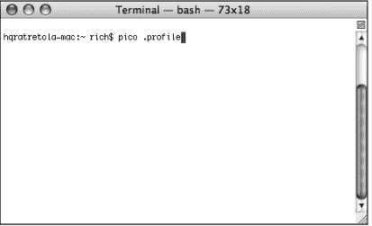

图1-2：用于打开profile文件进行编辑的命令。

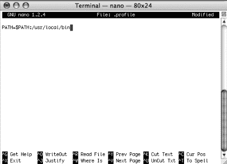

图1-3：编辑前的.profile文件。

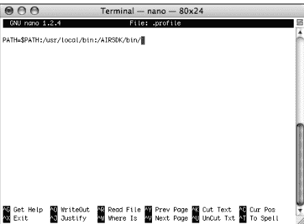

图1-4：添加AIR SDK后的.profile文件。

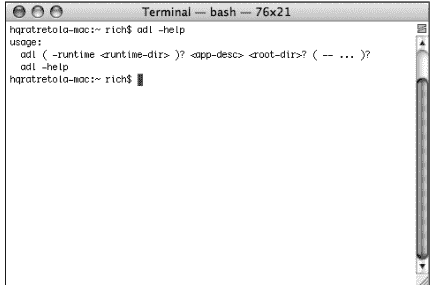

图1-5：运行`adl -help`后的终端屏幕。

#### 在Windows上设置SDK

以下步骤假设你已将SDK放在名为AIRSDK的文件夹中，并且该文件夹位于C:驱动器的根目录C:\AIRSDK下。参见图1-6。

打开Windows控制面板并选择“系统”。这将打开系统属性对话框。现在选择“高级”选项卡，你应该会看到如图1-7所示的内容。

点击“环境变量”按钮将打开“环境变量”对话框。现在，向下滚动系统变量列表，直到找到`Path`变量。选中`Path`变量（如图1-8所示），然后点击“编辑”按钮。这将打开一个编辑窗口，允许你追加AIR SDK的变量。向右滚动当前的“变量值”，添加一个分号和`C:\AIRSDK\bin`，使你的变量值看起来与图1-9所示相似。点击“确定”，然后在其余窗口中点击“确定”以应用该变量。

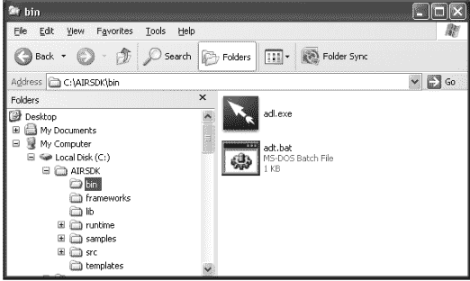

图1-6：AIRSDK在WindowsXP中的位置。

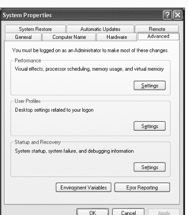

图1-7：选中“高级”选项卡的系统属性。

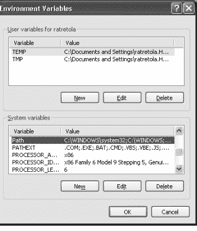

图1-8：环境变量。

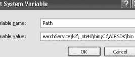

图1-9：Path变量的编辑窗口。

现在，点击Windows开始菜单，然后选择“运行”，并在提示符中输入`cmd`。应该会打开一个命令窗口。输入`adl -help`，然后点击Enter，你现在应该会看到类似图1-10的内容，这表明命令已被找到并显示了帮助信息。你也可以尝试运行`adt -help`。有关如何使用`adl`和`adt`测试和编译AIR应用程序的信息，请参阅第5章。

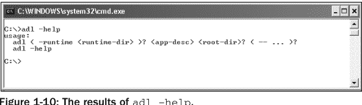

## 创建你的第一个AIR应用程序

请按照以下步骤创建你的第一个AIR应用程序。

-   打开Flex Builder 3，从屏幕顶部的导航菜单中选择“文件” → “新建” → “Flex项目”。参见图1-11。
-   接下来，输入**MyFirstAIR**作为项目名称，并在“应用程序类型”部分选择“桌面应用程序”（在Adobe AIR中运行）。参见图1-12。
-   下一个屏幕允许你选择输出位置；保持默认即可。参见图1-13。
-   第四步允许你设置源文件夹、主应用程序文件名和应用程序ID。它还允许你添加库资产（SWC文件等）。保持默认并点击“完成”。参见图1-14。

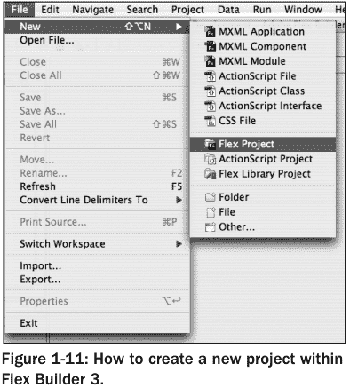


## 第一章：介绍 AIR（Adobe 集成运行时）

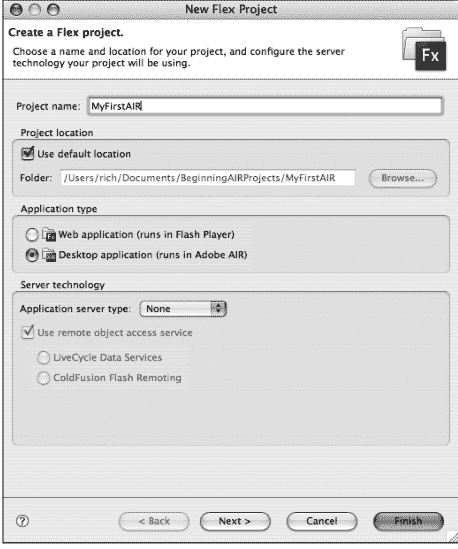

图 1-12：创建新 AIR 项目的第 2 步。

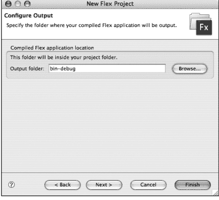

图 1-13：创建新 AIR 项目的第 3 步。

**第一部分：入门**

图 1-14：创建新 AIR 项目的第 4 步。

**你现在应该已经拥有一个名为 MyFirstAIR 的新 AIR 项目，以及一个名为 _MyFirstAIR.mxml_ 的主文件。图 1-15 显示了 Flex Builder 3 导航器视图中的新项目。你可以看到，还创建了一个 MyFirstAIR-app.xml 文件。我们将在第 6 章讨论这个文件及其属性。**

图 1-16 显示了 Flex Builder 3 源代码视图中的 _MyFirstAIR.mxml_ 文件。

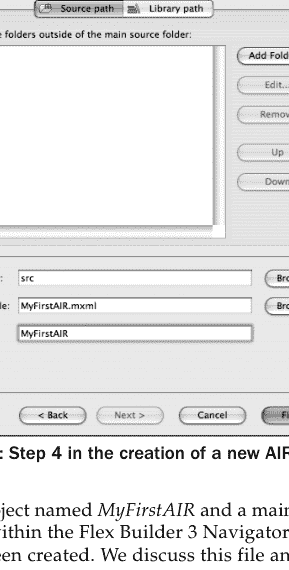

**图 1-15**：Flex Builder 3 导航器中新创建的 AIR 项目。

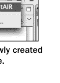

**图 1-16**：新创建的 **MyFirstAIR**.mxml 文件。

好了，你现在已经成功迈向了你的第一个 AIR 应用程序。现在，只需将一个标签组件添加到 MyFirstAIR.mxml 文件中。

```
<mx:Label text="My First AIR application" horizontalCenter="0"
          fontWeight="bold" fontSize="20"/>
```

你完成的 MyFirstAIR.mxml 文件现在应该看起来像代码清单 1-1。

**代码清单 1-1：完成的 MyFirstAIR.mxml 文件**

```
<?xml version="1.0" encoding="utf-8"?>
<mx:WindowedApplication xmlns:mx="http://www.adobe.com/2006/mxml"
    layout="absolute">
    <mx:Label text="My First AIR application" horizontalCenter="0"
              fontWeight="bold" fontSize="20"/>
</mx:WindowedApplication>
```

现在，通过点击绿色箭头并选择 MyFirstAIR 来运行应用程序，如图 1-17 所示。这将使用 ADL 创建 MyFirstAIR 应用程序的测试版本。你的结果应该看起来像图 1-18。

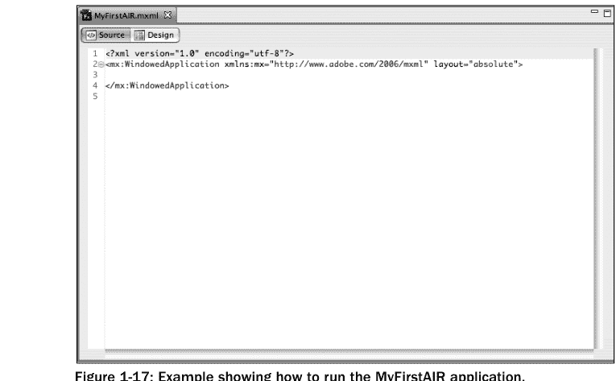

图 1-17：展示如何运行 MyFirstAIR 应用程序的示例。

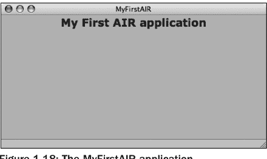

图 1-18：MyFirstAIR 应用程序。

### 总结

本章介绍了 AIR 及其开发工具。它还提供了在 OSX 和 Windows 操作系统上设置 AIR SDK 的指导。最后，通过分步演示介绍了如何创建你的第一个基于 Flex 的 AIR 应用程序。

下一章将重点关注富互联网应用和富桌面应用的定义，以及众多试图在这个不断扩大的市场中分一杯羹的厂商。一些科技巨头，如微软、Sun 和 Adobe，都提供了创建富互联网应用和富桌面应用的工具。每家公司都有自己实现这些应用的特定方式，我们将逐一介绍。

### 练习

在 Flex Builder 中创建一个新的 AIR 应用程序，切换到设计视图，将几个组件拖放到工作区，然后运行该应用程序。

14

## 第二章：富互联网/桌面应用

**在讨论富桌面应用之前**，理解**富互联网应用**的历史以及标题 RIA 下涵盖的各种技术非常重要。越来越多的软件厂商试图进入 RIA 领域。在撰写本文时，已经有来自 Adobe、Sun、Microsoft、Mozilla 和 OpenLaszlo 等公司的开发工具，以及像 AJAX 这样的免费软件。

#### 什么是 RIA？

富互联网应用是一种在传统浏览器中运行，但利用中间层来绕过当前大多数 Web 应用程序标准的“传统页面刷新”模式的应用程序。实现此中间层最常见的工具包括在异步 JavaScript 和 XML 中使用的 JavaScript，以及使用 Flash Player 的 Flex 或 Flash。其他 RIA 解决方案包括 OpenLaszlo（同样使用 Flash Player 和 Ajax）、XUL（依赖于兼容 Mozilla 的浏览器）和 Microsoft Silverlight。

#### Adobe Flash

*Adobe Flash* 创建在 Flash Player 中运行的 SWF 文件类型。Adobe Flash 目前是 Adobe Creative Suite 3 软件集合中的第 9 版。Flash 已经存在超过 10 年，最初被称为 FutureSplash，后来被 Macromedia 收购并更名为 *Macromedia Flash*。Flash 是构建互联网内容的一种全新方式。它允许创建可以嵌入网页的基于矢量的动画。尽管 Flash 最初主要用于为网站创建动画和介绍页面，但它迅速发展成为一种创造引人入胜的互联网体验的方式。随着 ActionScript 1.0 的首次发布以及能够轻松将数据加载到 Flash 应用程序中的能力，开发者开始创建第一批真正丰富的互联网应用程序。所使用的方法对于传统开发者来说有些复杂，难以掌握。随着 Flash MX 2004 和 ActionScript 2 基于表单的 Flash 应用程序的发布，使用 Flash 构建 RIA 变得容易得多；然而，它仍然缺乏传统软件开发的感觉，因为它仍然依赖于基于时间轴的应用程序。这一切都随着 Flex 1.0 的首次发布而改变。

#### Adobe Flex

与 Adobe Flash 类似，*Adobe Flex* 编译为 SWF 并在 Flash Player 中运行。Flex 目前是第 3 版，最早于 2003 年以 Macromedia Flex 1.0 的形式推出。当 Flex 首次推出时，它被宣传为一种更适合传统程序员需求的编程语言，因为它是 100% 基于代码的，而不是基于时间轴的 Flash。与 Flash 一样，Flex 编译为 SWF 文件格式。Flex 1.0 使用基于标签的 MXML 语言，这是一种基于 XML 的语言，以及当时也是 Flash 标准的 ActionScript 2.0。Flex 1.5 是 Flex 1.0 的升级版，继续使用 ActionScript 2.0 作为伴随 MXML 的脚本语言。

Flex 2.0 于 2006 年 7 月推出，标志着目标受众的重大转变。虽然 Flex 1.0 和 1.5 专注于企业级公司，并相应定价，但 Flex 2.0 引入了免费的 Flex SDK 以及免费版本的 Flex 服务器。这极大地增加了对使用 Flex 构建应用程序感兴趣的开发者数量。Flex 2.0 也通过引入 ActionScript 3.0 实现了对 Flash 的超越。与 ActionScript 2.0 相比，这是一个重大变化，因为它现在是一种真正的面向对象的脚本语言——并且对于那些已经使用传统的软件开发语言（如 C 或 Java）创建应用程序的人来说非常熟悉。

Flex 3 于 2007 年推出，继续提供免费版本。它再次通过成为开源项目，在目标受众方面做出了重大转变。尽管在撰写本文时，Flex 3 开源项目才刚刚起步，但预测这将再次吸引更多开发者进入 Flex 开发领域。

#### XUL

*XML 用户界面语言*是一种由 Mozilla 项目开发的基于 XML 的语言。它是一种基于标签的语言，包含许多预定义的小部件（按钮、单选按钮等），这些小部件只能由兼容 Mozilla 的浏览器（如 Firefox）渲染。虽然它也可以用于创建 RIA，但 XUL 最广泛用于创建 Mozilla 应用程序和扩展。

### OpenLaszlo

与 Flex 类似，*OpenLaszlo* 可以编译为 SWF，并且由于它是开源的，开发者也可以免费使用。OpenLaszlo 应用程序使用 JavaScript 以及一种名为 *LZX* 的基于可扩展标记语言的编程语言构建，并编译为 SWF。它与 Flex 非常相似，并且由于它是免费的，在 Flex 1.5 时代获得了更多的关注。因为 OpenLaszlo 编译为 SWF，所以它拥有与 Flex 和 Flash 应用程序同义的“一次编写，随处运行”特性。OpenLaszlo 相对于 Flex 的一个优势是，OpenLaszlo 的下一个版本（代号 *legals*）将允许“一次编写，编译为 SWF 或动态 HTML 或 Ajax 应用程序”。OpenLaszlo 的主要缺点是，与 Flex 相比，它的内置组件集较小，并且在针对最新 Flash Player 的优化方面，它始终至少落后一个完整版本。


## 第 2 章：富互联网/桌面应用程序

#### HTML/AJAX

Ajax 是**HTML或可扩展超文本标记语言 (XHTML)**、**层叠样式表 (CSS)** 和 **JavaScript** 的结合体，旨在从标准的网页请求中创建具有应用程序般感觉的体验。CSS 和 JavaScript可用于触发页面视觉方面的更新，而 XML HttpRequest（XHR）则用于在后台获取数据。这些技术的结合使得单个网页可以在无需向服务器发出额外请求的情况下改变外观并更新时间。**但是**, 这种类型的**富客户端 (RIA)**也存在许多限制，包括与浏览器版本之间的兼容性问题以及 RIA正常运行所需的 JavaScript支持差异或缺乏支持。

#### Windows Presentation Foundation/Silverlight

Windows Presentation Foundation (**WPF**) 由一个引擎和一个框架组成，它们将预安装于**Windows Vista**,并引入**XAML**作为一种基于标签的新语言。**XAML**与 Adobe Flex **MXML**非常相似,因为它是一种带有属性的基于标签的 XML 语言,其中每个标签都会创建一个对象模型类。XAML 标签具有完全可扩展性，允许开发人员创建自定义类。C#是编程语言,XAML 与 C#,将对应于 Adobe Flex中的 MXML 和 ActionScript 3。**微软 Silverlight**是一个跨浏览器、跨平台的插件用于提供下一代基于**.NET的媒体体验**和 Web上的丰富交互式应用程序。Silverlight提供一个灵活的编程模型，支持 AJAX, **VB**, **C#**, Python 和 Ruby ,并与现有 Web 应用集成。对于所有在 Mac OS 或 Windows 上运行的主要浏览器,Silverlight都提供了高质量视频的快速、低成本交付方式。

借助微软的支持,WPF/Silverlight 和 XAML必将在**Web2.0及RIA领域贡献巨大**。微软表示，还将推出 WPF/**E**,即“无处不在的 Windows Presentation Server”(Windows Presentation Server Everywhere)。WPF/E将支持其他浏览器和平台。**WPF的一个主要优势是开箱即用即可支持3D显示**,而这是 Flash Player 所缺乏的功能。然而,WPF**不支持在Flash Player中运行**,且微软要使其运行时获得与 Flash Player相同的普及率还将耗费很长时间。

### JavaFX

JavaFX 是由 Sun推出的新产品，旨在竞争富互联网应用程序 (RIA)市场。**JavaFX基于Java技术**,包括一组运行时环境、组件和脚本环境。截至本文写作时,Sun已发布两个实现版本:第一种是**JavaFX Script**,专为针对 Java 环境而创建,允许开发人员使用丰富的媒体和内容。JavaFX Script能够直接调用 Java API ,因此成为一种非常强大的语言。**第二种实现是 JavaFX Mobile，专用于移动设备**。整个 JavaFX产品线承诺为 Java开发人员提供工具，使其能够利用传统的 Java技术创建丰富应用程序。

#### RIA的历史概念

虽然执行功能更符合传统桌面应用概念的 Web 应用理念已存在多年,Macromedia却在**2002年3月首次引入了RIA这一术语**。**此后**,用于创建 RIAs工具和语言取得了巨大进步,**Flash和Flex的崛起以及像 Google这样的公司使用 AJAX，使 RIA真正跃升为Web技术领域的前沿**。来自微软和 Sun的新工具近年来将显著加快 RIA 的使用速度。

# 第 I 部分：入门指南

#### RIA的优势

与传统的 Web应用相比,RIA提供了许多优势:以下是其中的几个好处:

- RIA提供**更丰富的界面**,无需重新加载页面即可提供更引人入胜的用户体验。**用户事件会触发实时反馈**。
- **传统桌面应用程序的外观和感觉可以在 RIA 中实现，同时支持包括音频和视频在内的完整多媒体体验**。
- **具有与传统 Web应用相同的局限性或根本无法实现的丰富功能,例如现实时聊天和协作等能力**

###向桌面迁移

Google 和 Adobe目前都有了处于测试版的工具用于将传统Web应用程序扩展到桌面。***Google Gears**** 是一个 Firefox浏览器插件，它将在浏览器内嵌入 SQLite数据库引擎，从而实现数据同步和离线浏览。**第一个与 Google Gears技术集成的产品是 Google Reader**,而这是一个传统的 Web应用。**Google Gears赋予了 Google Reader以下能力：将 RSS馈送内容下载到嵌入式数据库中**。这允许用户在没有网络连接的情况下阅读这些 RSS 的内容。

Adobe通过发布***Adobe Integrated Runtime(AIR1.0)****，大力推动将Web应用程序迁移到桌面端。**AIR赋予了开发人员使用传统网络技术(如HTML和**JavaScript)**以及富技术 (如 Flash 和 Flex)**编写桌面应用的能力**。此外,AIR能够检测是否存在互联网连接,从而为开发人员在刷新本地存储数据与服务器的交互之间提供了选择。

微软和 Sun毫无疑问将通过在 JavaFX 和 Silverlight中添加支持来简化应用程序的离线迁移过程。

###传统桌面应用程序类库

自个人电脑出现以来，桌面应用就一直掌握在大**手之中(即普通用户手中)**.许多用于构建这些应用的技術依赖于计算机**操作系统或必须编译才能在特定操作系统上运行**。Java和 Java虚拟机通过提供一种运行时环境来解决这个问题,可以解释以字节码形式的应用程序代码并在多个平台上运行,包括 Linux、Windows 以及 OSX。

#### C语言

贝尔电话实验室于1972年开发了C 语言。**这是一种过程式编程语言**,最初是为 Unix操作系统开发的，它广泛用于桌面应用开发,**也是C++的先驱**。C语言采用人类可读的**结构化编程风格**,必须编译为字节码才能运行，且可以在多个平台上进行。作为一种弱类型语言,C与强类型的 C#和 Java形成鲜明对比;后者由于典型的输入问题会导致更多的编译器错误。

#### C ++  

虽然**C++是一种独立于C但建立在C概念之上的语言**。最初被称为“带类的C"(*C with Classes),它是通过添加类对 C 的升级。**它是一种强类型面向对象 (OO)语言**,意味着支持多态性和继承性，允许开发人员编写包含方法、属性等的类。对于大型应用程序来说，由于代码重用能力和更易于管理的特性,C是理想选择;此外,**它还比组织较差的C更容易管理**。**这是一种必须通过编译器运行的语言**。

#### Java语库  

**Java是一种面向对象的语言**,从 C和 C++中借用了许多原理,但拥有更强的 OO原则。它目前被公认为当今最流行的编程语言之一，如前所述,它将编译为字节码,进而由***Java虚拟机 (JVM)******解释执行****。**特定于操作系统,JVM的构建目标是确保在不同系统上运行结果一致**。这是 Sun公司“一次编写，到处运行(write once, run anywhere)”的目标的一部分。

#### 总结  

谁将成为 RIA(富互联网应用程序)**和RDA**(富桌面应用）的主导力量仍有待观察；不过 Adobe似乎已拥有一个不错的先发优势：**Flex是一款成熟的产品**,而 AIR也在路上。**其他公司投入大量资源争夺市场份额的巨大规模**只会加速 RIA 与 RDA的普及速度。下一章将探讨参与创建 AIR应用的编程语言,**包括 ActionScript3、MXML、HTML和 JavaScript**。

### 编程语言

AIR 应用程序可以使用多种不同的编程语言构建，包括 MXML、ActionScript 3、HTML、JavaScript 和 CSS。一个应用程序可以仅用其中一种语言构建，也可以组合使用其中部分或全部语言。本章将提供每种 AIR 编程语言的一些背景知识和定义。

### AIR Flex/Flash 应用程序

使用 Flex 或 Flash 构建的 AIR 应用程序，可以使用 ActionScript 3 作为应用程序的基础语言。在这两个平台中的任何一个上工作时，应用程序都可以完全使用 ActionScript 3 来构建。

Flash 应用程序通常使用 Flash 开发环境的可视化工具来创建视觉内容。这些应用程序传统上是基于时间轴的，ActionScript 3 用于支持和扩展视觉界面的功能。

Flex 应用程序通常（但并非总是）使用 MXML 和 ActionScript 3 的组合来构建。MXML 简化了可视组件及其布局，而 ActionScript 3 则增加了功能性。

### MXML

MXML 是一种基于 XML 的语言，由 Macromedia 于 2004 年首次引入。MXML 是一种声明性的基于标签的标记语言，自推出以来，在 Flex 用户界面设计中的组件布局方面非常成功。作为一种 XML 语言，它非常有结构，并且可以通过 Adobe DTD 进行验证。

MXML 主要用于组件布局，以设计 Flex 或基于 Flex 的 AIR 应用程序的视觉方面。例如，`<mx:ComboBox>` 向显示中添加一个组合框，`<mx:Button>` 向显示中添加一个按钮对象，而 `<mx:DataGrid>` 会添加一个数据网格。

MXML 也可以用于定义非可视对象的其他对象。其中一些例子包括：`<mx:WebService>`，定义与 WSDL 文件的连接；`<mx:NumberValidator>`，用于验证数据；以及 `<mx:Binding>`，可用于在组件之间绑定数据。MXML 组件也可以被扩展以创建自定义组件，甚至可以组合起来创建复合自定义组件。这种能力使得创建可跨应用程序共享的可重用组件变得非常容易。

MXML 可以用任何文本编辑器编写，也可以使用 Flex Builder 3 的可视化编辑工具进行编辑。MXML 组件也可以在组件标签的属性中或使用外部 CSS 样式表来设置样式。

虽然仅使用 MXML 就可以创建完整的应用程序，但当与 ActionScript 3 结合使用时，这种语言的真正威力才得以展现。

MXML 最终会编译成 SWF，这是为在 Adobe Flash Player 中运行而创建的文件格式。

清单 3-1 展示了一个包含 Button 和 Label 组件的 MXML 文件示例。

#### 清单 3-1：一个 MXML 文件示例

```xml
<?xml version="1.0" encoding="utf-8"?>
<mx:VBox xmlns:mx="http://www.adobe.com/2006/mxml">

    <mx:Label text="Label"/>
    <mx:Button label="Button"/>

</mx:VBox>
```

### ActionScript 3

*ActionScript 3 是一种健壮、成熟的面向对象编程语言，其语法对于使用 C#、Java 和 JavaScript 等其他编程语言的用户来说非常熟悉。*

ActionScript 3 和 JavaScript 非常相似，因为它们都源自欧洲计算机制造商协会 (ECMA) 文档 ECMA-262，该文档是 JavaScript 语言的国际标准。ActionScript 3 基于 ECMA-262 第 4 版规范，这就是这两种语言之间相似之处的来源。

由于 ActionScript 3 是面向对象的，它使开发人员能够扩展 Flex 框架中的 ActionScript 类，以创建自定义组件和对象。

将 ActionScript 与 MXML 集成，为开发人员提供了使用 Flex 完成几乎任何任务所需的所有工具。AIR 更进一步，因为在构建 AIR 应用程序时，与 Flex 基于 Web 的应用程序相比，安全限制要少得多。

与 MXML 一样，ActionScript 将被编译成 SWF 文件格式。

清单 3-2 展示了一个名为 `AngleButton` 的自定义 ActionScript 3 类的示例。该类扩展了 `mx.controls.Button` 类，并将组件的旋转设置为 45 度。

#### 清单 3-2：AngleButton 自定义类

```actionscript
package
{
  import mx.controls.Button;

  public class AngleButton extends Button
  {
    public function AngleButton()
    {
      super();
      this.rotation = 45;
    }
  }
}
```

### 使用文档

Adobe 以 *ASdocs* 的形式为 MXML 和 ActionScript 对象提供了文档，其形式非常类似于 JavaDocs。了解如何阅读和使用这些文档将使你能够充分发挥 MXML 和 ActionScript 的潜力。图 3-1 到 3-11 展示了 MXML Button 组件文档的一些片段。每张图片分别展示了按钮的属性、事件、样式等不同部分。

图 3-1 是文档的最顶部部分，展示了 Button 组件的继承关系。查看此部分，我们可以轻松地看到 Button 的父对象、它所属的包、它实现的接口以及它的子类。图 3-2 提供了你正在研究的对象的简要描述。Button 文档中的下一个项目是用于创建 Button 的语法示例，如图 3-3 所示。图 3-4 到 3-7 展示了其他公共和私有属性与方法。每个都可以展开以显示继承的属性和方法。图 3-4 展示了文档界面展开后显示的继承保护属性示例。每个继承项都会显示一个箭头，表示它从继承树中更上层的某个父级继承而来。图 3-8 到 3-10 展示了 Button 对象可用的事件、样式和效果。这些也都可以展开以显示继承项。最后，图 3-11 展示了 Button 对象可用的公共常量。

| 包 | mx.controls |
| --- | --- |
| 类 | public class Button |
| 继承 | Button → UIComponent → FlexSprite → Sprite → DisplayObjectContainer → InteractiveObject → DisplayObject → EventDispatcher → Object |
| 实现 | IDataRenderer, IDropInListItemRenderer, IFocusManagerComponent, IListItemRenderer |
| 子类 | AccordionHeader, CheckBox, LinkButton, PopUpButton, RadioButton, ScrollThumb, SliderThumb |

图 3-1：此示例展示了 Button 的继承关系。

Button 控件是一个常用的矩形按钮。Button 控件看起来可以被按下。它们的表面可以包含文本标签、图标，或两者兼有。

按钮通常使用事件监听器在用户选择控件时执行操作。当用户在 Button 控件上单击鼠标，并且该控件处于启用状态时，它会分派一个 `click` 事件和一个 `buttonDown` 事件。无论按钮是启用还是禁用状态，它总会分派诸如 `mouseMove`、`mouseOver`、`mouseOut`、`rollOver`、`rollOut`、`mouseDown` 和 `mouseUp` 等事件。

你可以自定义 Button 控件的外观，并将其功能从普通按钮更改为切换按钮。你可以通过为按钮的每种状态使用外观来更改按钮的外观。

图 3-2：Button 的定义。

```
MXML 语法 ◆ 隐藏 MXML 语法

<mx:Button>` 标签继承了其超类的所有标签属性，并添加了以下标签属性：

<mx:Button
    属性
        autoRepeat="false|true"
        emphasized="false|true"
        label="Button"
        labelPlacement="right|left|bottom|top"
        selected="false|true"
        selectedField="null"
        stickyHighlighting="false|true"
        toggle="false|true"

    样式
        borderColor="0xAAB3B3"
        color="0x0B333C"
        cornerRadius="4"
        disabledColor="0xAAB3B3"
        disabledIcon="null"

```

图 3-3：Button 组件的语法示例。

##### 公共属性
显示继承的公共属性

| 属性 | 定义者 |
| :--- | :--- |
| **autoRepeat** : Boolean<br>指定如果用户按住鼠标按钮，是否分派重复的 buttonDown 事件。 | Button |
| **data** : Object<br>当你将 data 属性用作项渲染器或项编辑器时，该属性允许你向组件传递一个值。 | Button |
| **emphasized** : Boolean<br>如果 emphasized 设置为 true，则在按钮处于弹起状态时，在 Button 控件周围绘制一个粗边框。 | Button |
| **label** : String<br>出现在 Button 控件上的文本。 | Button |

图 3-4：Button 的公共属性。

##### 保护属性
隐藏继承的保护属性

| 属性 | 定义者 |
| :--- | :--- |
| 🔒 **resourceManager** : IResourceManager<br>[只读] 对管理所有应用程序本地化资源的对象的引用。 | UIComponent |
| **textField** : UITextField<br>呈现此 Button 标签的内部 UITextField 对象。 | Button |
| 🔒 **unscaledHeight** : Number<br>[只读] 用于确定组件未缩放高度的便捷方法。 | UIComponent |
| 🔒 **unscaledWidth** : Number<br>[只读] 用于确定组件未缩放宽度的便捷方法。组件的所有绘图和子项布局都应在此宽度内的边界矩形内完成，该矩形也作为参数传递给 `updateDisplayList()`。 | UIComponent |

图 3-5：Button 的保护属性。

24


# 第三章：编程语言

## 公共方法
隐藏继承的公共方法

| 方法 | 定义于 |
| :--- | :--- |
| Button()<br>构造函数。 | Button |
| ↑ addChild(...) 添加一个子DisplayObject实例... | DisplayObjectContainer |
| ↑ addChildAt(...) 添加一个子DisplayObject实例... | DisplayObjectContainer |
| ↑ addEventListener(...) 注册一个事件监听器对象... | EventDispatcher |

**图 3-6**：Button 的公共方法。

## 受保护方法
显示继承的受保护方法

| 方法 | 定义于 |
| :--- | :--- |
| clickHandler(...) 默认处理器... | Button |
| mouseDownHandler(...) 默认处理器... | Button |
| mouseUpHandler(...) 默认处理器... | Button |
| rollOutHandler(...) 默认处理器... | Button |
| rollOverHandler(...) 默认处理器... | Button |

**图 3-7**：Button 的受保护方法。

## 事件
显示继承的事件

| 事件 | 摘要 | 定义于 |
| :--- | :--- | :--- |
| buttonDown | 当用户按下Button控件时触发。 | Button |
| change | 当切换Button控件的selected属性发生变化时触发。 | Button |
| dataChange | 当data属性发生变化时触发。 | Button |

**图 3-8**：Button组件可用的事件。

## 样式
显示继承的样式

| 样式 | 描述 | 定义于 |
| :--- | :--- | :--- |
| borderColor | 边框颜色... Button, CheckBox... 默认值取决于... 0xB7BABC。 | Button |
| color | 组件中文本的颜色... 默认值为 0x0B333C。 | Button |
| cornerRadius | 组件角的半径... 默认值取决于... 如果未覆盖... 0。 | Button |

**图 3-9**：Button组件可用的样式。

***

# 第一部分：入门

## 效果
隐藏继承的效果

| 效果 | 描述 | 定义于 |
| :--- | :--- | :--- |
| ⬆ addedEffect | 触发事件：added | |
| ⬆ creationCompleteEffect | 触发事件：creationComplete | |
| ⬆ focusInEffect | 触发事件：focusIn | |
| ⬇ focusOutEffect | 触发事件：focusOut | |

**图 3-10**：Button组件可用的效果。

## 公共常量
隐藏继承的公共常量

| 常量 | 定义于 |
| :--- | :--- |
| DEFAULT_MAX_HEIGHT : Number = 10000<br>[static] maxHeight属性的默认值。 | UIComponent |
| ⬆ DEFAULT_MAX_WIDTH : Number = 10000<br>[static] maxWidth属性的默认值。 | UIComponent |
| ⊗ DEFAULT_MEASURED_HEIGHT : Number = 22<br>[static] measuredHeight属性的默认值。 | UIComponent |

**图 3-11**：Button组件的公共常量。

***

了解如何使用Flex/ActionScript文档将使你在构建应用程序时轻松得多。虽然额外的参考书、书籍和最佳实践对于理解如何构建应用程序总是有用的，但文档应该是你依赖的基础，因此了解如何使用和理解它至关重要。

# AIR HTML应用程序
AIR应用程序也可以使用传统的Web语言构建，如HTML、JavaScript、CSS、XHTML和DOM。HTML多年来一直是互联网的支柱，几乎任何打开过文本编辑器编辑网页的人都熟悉它。由于AIR赋予我们使用简单HTML创建桌面应用程序的能力，可能的AIR开发社区规模非常庞大。基于HTML的AIR应用程序可以使用JavaScript来扩展应用程序并为其提供额外功能。JavaScript还具有与ActionScript通信的能力。这使得经过JavaScript增强的基于HTML的AIR应用程序能够利用许多AIR功能，而无需开发人员了解ActionScript语言。

### HTML（超文本标记语言）
1991年底，Tim Berners-Lee在一份题为“HTML标签”的文件中首次公开定义了HTML。它描述了22个HTML标签，其中13个至今仍然存在。这种非常简单的标记语言为早期的互联网开发者提供了格式化主要基于文本的网页所需的一切。HTML多年来不断发展，从最初版本到1995年完成的HTML 2.0。1996年，万维网联盟（W3C）成为维护HTML标准的权威机构，并在1997年初正式发布了HTML 3.2。此后不久，1997年底发布了HTML 4.0，随后在1999年发布了HTML 4.01。2000年，HTML也成为国际标准（ISO/IEC 15445:2000）。HTML 5仍然是一个编辑草案，尚未正式发布。清单3-3显示了一个基本的HTML文件，它包含一个head（`<head>`）标签，其中嵌套了一个title（`<title>`）标签，一个body（<body>）标签，其中包含几个不同大小的标题（<h1>, <h2>, <h3>），一个段落（<p>）标签，其中包含几个换行标签（<br/>）和一个超链接标签（<a href>）。**图3-12**显示了清单3-3中HTML代码的结果。

#### 清单3-3：一个基本的HTML文件
```html
<html>
  <head>
    <title>This is a title</title>
  </head>

  <body>
    <h1>Heading</h1>
    <h2>Heading 2 (smaller)</h2>
    <h3>Heading 3 (smaller than 2)</h3>

    <p>This is a paragraph tag<br/>
      There are two break tags above, which will leave vertical space
      <br/>
      Visit my Web Page: http://blog.everythingflex.com</a>
    </p>
  </body>
</html>
```

### JavaScript
*JavaScript*是一种动态脚本语言，它既是弱类型的，也是基于原型的。*JavaScript*最初被称为*Mocha*，后来称为*LiveScript*。它被重命名为*JavaScript*是一个营销策略，旨在利用*Java*的流行。*JavaScript*于1995年首次包含在Netscape 2浏览器中，并此后不断更新。*JavaScript*的最新版本是1.7版。Adobe AIR支持基于ECMA-262标准的*JavaScript* 1.5。AIR的*JavaScript*引擎是通过集成WebKit开源浏览器引擎项目构建的。*JavaScript*在客户端执行，这意味着用户必须安装了JavaScript并且可以访问，代码才能正确运行。这在基于Web的应用程序中使用JavaScript时有时是一个问题；但是，由于JavaScript引擎是AIR运行时的一部分，你可以确信你的代码在AIR桌面应用程序中运行时将按预期执行。

#### 清单3-4：一个包含多个JavaScript块的示例HTML文件
```html
<HTML>
    <HEAD>
        <SCRIPT LANGUAGE="JAVASCRIPT">
            <!--
            function showAlert(){
                alert ("Javascript Alert")
            }
            -->
        </SCRIPT>
        <TITLE>Page Title</TITLE>
    </HEAD>
    <BODY>
        <SCRIPT LANGUAGE="JAVASCRIPT">
            <!--
            document.write("Written by JavaScript");
            -->
        </SCRIPT>
        <a href onClick="showAlert()">Click Me</a>
    </BODY>
</HTML>
```

### CSS（层叠样式表）
CSS（层叠样式表）是一种为HTML或XHTML网页设置样式的语言。颜色、字体、布局、背景等通常在样式表中定义。CSS有助于将应用程序的样式与表示层分离。在CSS出现之前，所有样式都与底层HTML内联完成。CSS不仅改变了这一点，而且实际上允许相同的底层HTML通过简单地替换一些CSS样式来以不同的方式显示。CSS原则也是Flex样式包的一部分，可以以与HTML非常相似的方式应用于MXML。样式不仅应用于最外层的容器标签，也应用于嵌套标签。CSS样式可以通过名称应用于标签，也可以应用于标签本身内部的标签。

#### 清单3-5：HTML文件中CSS的示例
```html
<html>
  <head>
    <title>CSS HTML Example</title>
    <style type="text/css">
      h1 {
        color: #008000;
      }
      .bold {
        font-weight: bold;
      }
    </style>
  </head>
  <body>
    <h1>Green Header</h1>
    Normal Font
    <p class="bold">Bold Font</p>
  </body>
</html>
```

#### 清单3-6：MXML文件中CSS的示例
```xml
<?xml version="1.0" encoding="utf-8"?>
<mx:WindowedApplication xmlns:mx="http://www.adobe.com/2006/mxml">
  <mx:Style>
    Label {
      font-size:36;
    }
    .boldI {
      font-weight:bold;
      font-style:italic;
    }
  </mx:Style>
```


# 第一部分：入门

**示例 3-6：MXML 文件中的 CSS 示例** *(续)*

```
<mx:Label text="Large"/>
<mx:Label text="Large and Bold" styleName="boldI"/>
<mx:Button label="Bold and Italic" styleName="boldI"/>
</mx:WindowedApplication>
```

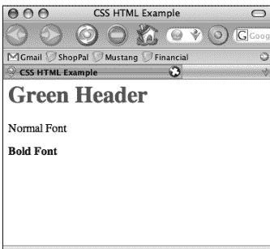

图 3-14：展示带有 CSS 的 HTML 的示例。

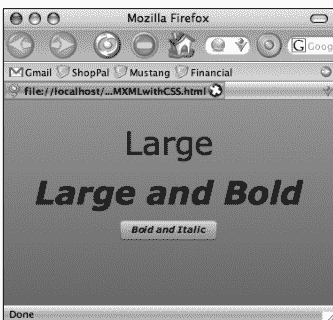

图 3-15：展示在 MXML 文件中使用 CSS 的示例。

## XHTML（可扩展标记语言）

*XHTML（可扩展标记语言）* 是建立在 XML 之上的 HTML 的严格实现版本。由于 XHTML 不如 HTML 那样宽容（HTML 即使未正确验证也能正确输出），因此 XHTML 必须格式正确。这一点很重要，因为 XHTML 可以使用自动化技术进行验证，而 HTML 必须通过自定义解析器运行。这意味着 XHTML 文档可以针对自定义 DTD 或命名空间进行验证。XHTML 文件可以设置为 transitional（过渡型），以便在较旧的浏览器中仍正常运行；也可以设置为使用 DTD，这将强制进行严格的代码验证。在示例 3-7 中，您看到一个文件被设置为针对严格 DTD（xhtml1-strict.dtd）进行验证。在示例 3-8 中，您看到一个文件被设置为针对过渡型 DTD 进行验证。在此示例中，请注意 body 的背景色被设置为蓝色。此属性在示例 3-7 中是不允许的，因为严格的 DTD 不会验证 bgcolor 属性，因为它已被弃用，应由 CSS 属性替换。

**示例 3-7：使用严格 DTD 的文档**

```
<?xml version="1.0" encoding="UTF-8"?>
<!DOCTYPE html PUBLIC "-//W3C//DTD XHTML 1.0 Strict//EN" "DTD/xhtml1-strict.dtd">
<html xmlns="http://www.w3.org/1999/xhtml" xml:lang="en" lang="en">
  <head>
    <title> Strict XHTML Example </title>
  </head>
  <body>
  Some Text
  </body>
</html>
```

**示例 3-8：使用过渡型 DTD 的文档**

```
<?xml version="1.0" encoding="UTF-8"?>
<!DOCTYPE html PUBLIC "-//W3C//DTD XHTML 1.0 Transitional//EN"
"DTD/xhtml1-transitional.dtd">
<html xmlns="http://www.w3.org/1999/xhtml" xml:lang="en" lang="en">
  <head>
    <title> Transitional XHTML Example </title>
  </head>
  <body bgcolor="#0000FF">
  Some Text
  </body>
</html>
```

## DOM（文档对象模型）

DOM（Document Object Model）是一项规范，允许将 HTML 或 XML 文件作为对象访问，并清晰地遍历其层级结构。DOM 中的每一项（图像、表单元素、文本等）都可以通过导航 DOM 树的结构来访问。这允许通过使用 JavaScript 更新 HTML 和 XML 文档的内容或结构。因此，无需完全刷新即可更新特定文档内容。使用 JavaScript 可以访问 DOM，并修改文档对象的具体部分。DOM 可以使用点符号进行导航，如示例 3-9 所示，该示例显示了读取并显示在警报窗口中的名称为 myForm 的 document 的 form 中 myTextField 表单字段的值。示例 3-9 的结果可以在图 3-16 中看到。

**示例 3-9：通过点符号访问 DOM**

```
<html>
  <head>
    <title>DOM Dot Notation</title>
    <script language="javascript">
    <!--
      function alertIt(){
        alert (document.myForm.myTextField.value);
      }
    -->
    </script>
  </head>
  <body>
    <form name="myForm">
      <input type="text" name="myTextField" value="Hello World"/>
      <input type="button" onClick="alertIt()"/>
    </form>
  </body>
</html>
```

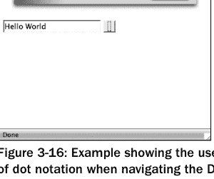

DOM 还可以使用 `getElementById()` 方法通过 id 访问项目。示例 3-10 显示了与示例 3-9 类似的示例，但这次使用了 `getElementById()` 方法。示例 3-10 的结果可以在图 3-17 中看到。

**示例 3-10：使用 getElementById() 方法**

```
<html>
  <head>
    <title>DOM getElementById()</title>
    <script language="javascript">
    <!--
      function alertIt(){
        alert (document.getElementById('myTextField').value);
      }
    -->
    </script>
  </head>
  <body>
    <form name="myForm">
        <input type="text" id="myTextField" value="Hello World"/>
        <input type="button" onClick="alertIt()"/>
    </form>
  </body>
</html>
```

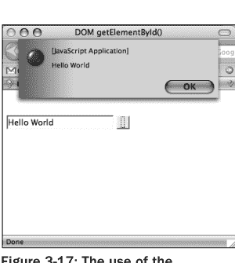

您也可以使用 `createElement()` 或 `createTextNode()` 等方法将项目添加到 DOM 中，然后使用 `appendChild()` 方法将其添加到 DOM。示例 3-11 展示了这些函数的使用。单击按钮对象将向文档添加一些文本（“Hello World”）。示例 3-11 的结果可以在图 3-18 中看到。

**示例 3-11：如何向 DOM 添加对象**

```
<html>
<head>
<title>DOM appendChild()</title>
<script language="javascript">
<!--
    function addText(){
        var divTag = document.createElement("div");
        var someText  = document.createTextNode("Hello World");
        divTag.appendChild(someText);
        document.body.appendChild(divTag);
    }
-->
</script>
</head>
<body>
    <input type="button" onClick="addText()" value="Add Text"/>
</body>
</html>
```

W3C 于 1998 年首次引入 DOM 1，并于 2000 年将其更新到 DOM 2。DOM 3 随后于 2004 年发布，这是当前最新版本。

作为 AIR 一部分的 HTML 控件允许完全访问加载到该控件中的位置的 DOM。

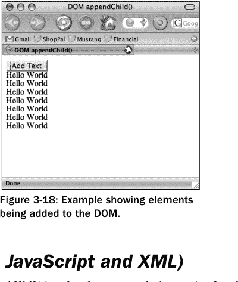

## AJAX（异步 JavaScript 和 XML）

*AJAX（异步 JavaScript 和 XML）* 是一种开发技术，使用 JavaScript 和 DOM 在无需完全刷新页面的情况下操作网页的各个部分。数据通过使用 XMLHttpRequest 检索，并以 XML、HTML、JSON 或纯文本形式返回。数据随后被解析，并通过操作 DOM，刷新页面的部分。这不仅给用户提供了更加流畅的应用程序感知，还节省了巨大的带宽。

在传统客户端/服务器模型中，当客户端浏览器的 JavaScript 启用时，AJAX 技术才能正常工作。由于 Adobe 已经嵌入了 WebKit 引擎，因此在处理 AIR 应用程序时这不是问题，因为作为开发人员，我们可以确保应用程序将正常运行。

### 总结

本章简要定义并提供了用于创建 AIR 应用程序的不同语言的示例代码。一个、多个或所有这些语言都可以在单个应用程序中使用。下一章将讨论并演示用于创建 AIR 应用程序的工具。涵盖了 Flex Builder 3、Dreamweaver CS3 和 Flash CS3。

## AIR 开发工具

Adobe 使其多种产品能够与 AIR 协同工作。其中包括用于基于 Flex 的 AIR 项目的 Flex Builder 3，用于基于 HTML/JavaScript 的项目的 Dreamweaver CS3，以及用于 Flash 项目的 Flash CS3。

## Flex Builder 3 简介

Flex 2 产品系列中最重要的部分之一是全新的 Flex Builder 2。原始的 Flex Builder 是建立在 Dreamweaver 之上的，坦率地说，社区并不含蓄地向 Macromedia（现 Adobe）表达了他们对 Flex Builder 1 实际表现糟糕的看法。幸运的是，对于 Flex 开发社区，Macromedia 承认了这一点，决定彻底废弃它，并以 Eclipse 为基础重新开始开发 Flex Builder 2。Flex Builder 2 比原版领先了几个世纪，大多数开发人员现在将其作为进行 Flex MXML 和 ActionScript 开发的首选工具。

Flex Builder 3 是 Flex Builder 2 的升级版本，并添加了许多新功能，包括构建和编译 AIR 应用程序的能力。Flex Builder 3 的易用性使其成为构建、调试、测试和打包 AIR 应用程序的首选工具。

大多数现代系统在运行 Flex Builder 3 时不会有任何问题。

Adobe 对 Flex Builder 的官方要求如下。

#### Windows

- Intel Pentium 4 处理器
- 推荐 1 GB RAM
- Microsoft Windows XP（带 Service Pack 2）
- Microsoft Vista Home Premium 或更高版本
- 安装需要 300 MB 可用硬盘空间


# 第一部分：入门

- Java™虚拟机：Sun JRE 1.4.2（包含在内）、Sun JRE 1.5、IBM JRE 1.5
- Eclipse 3.2.1 或更高版本，用于安装插件版

#### Macintosh

- G4 1.25 GHz PowerPC 或以 Intel 为基础的 Mac 电脑
- OS X 10.4.7–10.4.9
- 建议配备 1 GB RAM
- 需要预留 300 MB 硬盘空间以进行安装
- Java™虚拟机：来自 Apple 的 JRE 1.5 或 JRE 1.6
- Eclipse 3.2.1 或更高版本，用于插件版

## Flex Builder Eclipse Stand-Alone（独立版）和 Plug-in（插件版）

Flex Builder 3 提供两种不同的发行版本。**独立版**的功能运作方式与*插件版完全相同*，但作为轻量级应用程序。独立版构建在精简版的 Eclipse 之上*使其安装体积更小且占用内存更少*.不过，对于那些已经使用完整版 Eclipse 进行其他开发（例如 Java、ColdFusion 等）的用户而言，Flex Builder 将以插件形式提供并安装到 Eclipse 中，就像许多其他 Eclipse 插件一样。

## Flex Builder Perspectives（视角度）

Flex Builder 拥有多个**视角**。一个*视角定义了适用于当前任务的编辑器集和查看器面板*.例如，如果您正在调试应用程序，Flex Builder 将切换到不同的视角。切换至某一视角会改变 Eclipse 应用中显示的查看器和编辑器列表。在某些情况下，切换视角会自动发生。默认视角是***开发视角***，它包含源模式（图 4-1）和设计模式。另一个视角则是*调试视角*。

### 开发视角下的源代码模式

***源代码模式***是一个基础的代码编辑工具，其中针对 MXML 和 ActionScript 代码均提供代码提示、代码补全、语法高亮以及实时错误报告功能。**概览查看器**（图 4-2）显示了启用源模式的开发视图中 Outline view。*概览查看器*在编辑 MXML 文件时显示该文件的层级结构，或在编辑 ActionScript 类文件时展示该类文件的属性和方法.*无论采用何种方式，均可以通过点击概览查看器中的条目直接跳转到代码的特定行*.

### 开发视角下的设计模式

如图所示（图 4-3），切换到*设计模式*后会在右侧屏幕提供两个面板：**状态面板**和***组件面板*****.位于屏幕中间的*编辑器面板****会变更为视觉编辑工具，允许拖放定位组件以及从***组件面板**中拖放组件.您可以利用*状态面板创建新的、可以通过视觉方式进行设计的状态*.如需有关如何使用状态的更多信息请参阅第 8 章。

## 第四章：AIR 开发工具

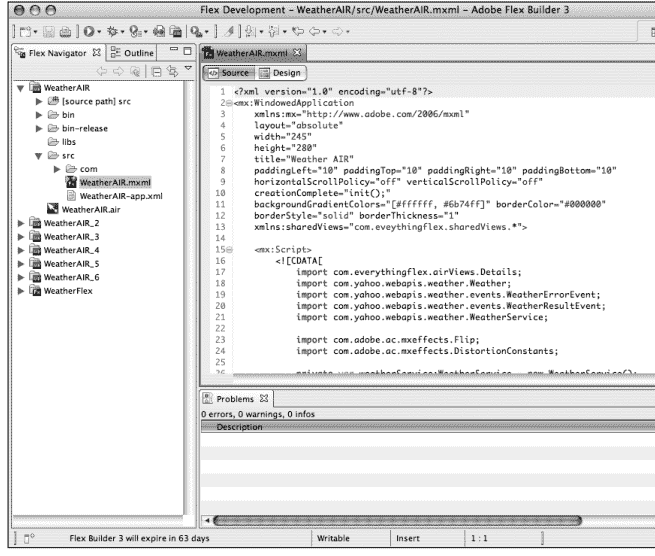  

图 4-1:源代码模式下的开发视角。

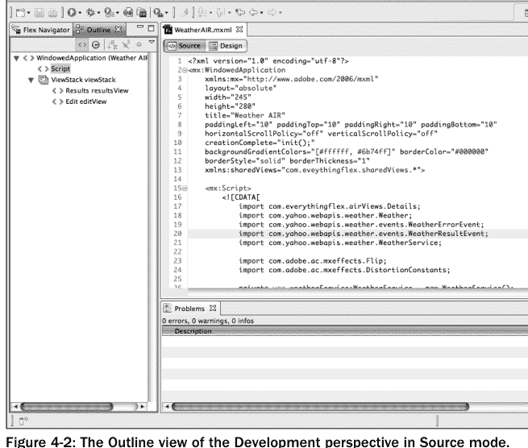  

图 4-2：源代码模式下开发视角的概览查看器.

请注意，在编辑 ActionScript 文件时无法切换至设计模式。它仅适用于编辑 MXML 文件.*此外还应注意的是*默认情况下组件面板出现在屏幕左侧（与概览查看器）同一工作区中*,而状态和属性面板则显示在右侧*.

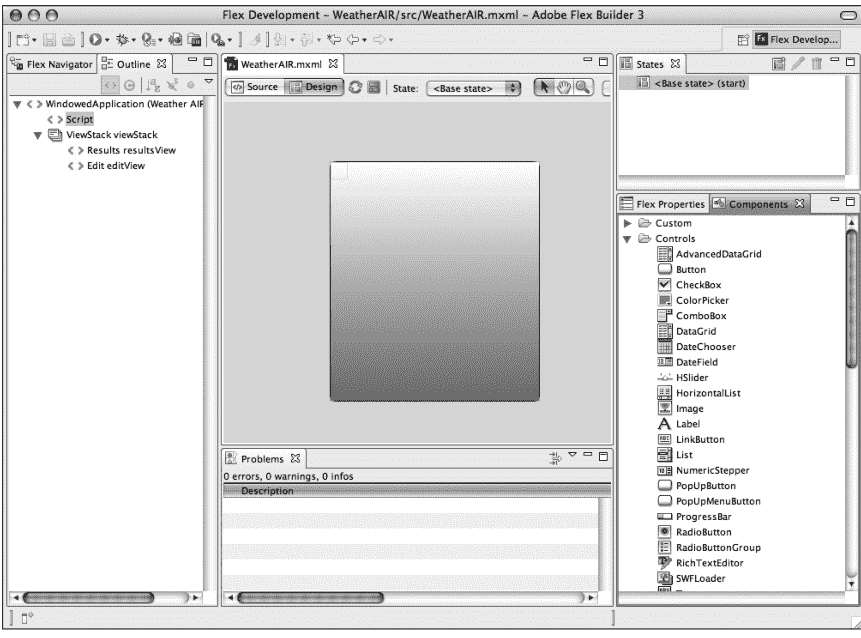  

图 4-3：设计模式下的开发视角。  
设计模式的另一部分是*属性查看器***，该查看器包含多个板块以及以下选项:

- **标准属性查看器选项** — 在属性的标准查看区内设有三个独立的区域.
- **通用区块** - 允许编辑组件的属性（如图4.所示）,如左图.  
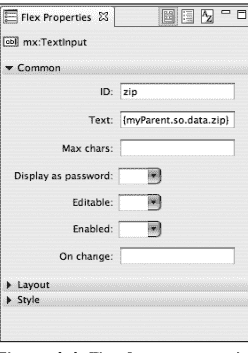

- **样式区块 -**
*如图所示(图 4 - ,该模块借助颜色选择器、滑块、组合框和按钮,方便地编辑选中组件的式样属性*.修改将实时反映在设计编辑器中。  


- **布局部分** — 这是您进行更改以修改布局属性的区域，包括在定向布局工作时处理宽度和高度.它还包括在绝对布局内部工作时的 X、Y坐标以及布局约束。请在约束选项区域内使用复选框将选中组件锚定到父容器的一个或多个角上*图6是布局部分显示组件被锚定为父容器右下角的情况任何所作的更改都将在设计编辑器中以实时方式反映..  

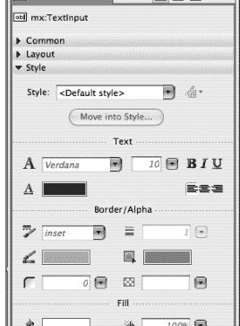

图 4-:属性查看器的布局部分.


- **类别属性查看器选项 -**如图4 -，在分类查看器中显示所有可供使用的属性的树形结构。可以通过更新每个属性旁边的文本域来编辑这些属性*.一些文本字段将包含视觉编辑器以便于颜色和已知属性选项的编辑..

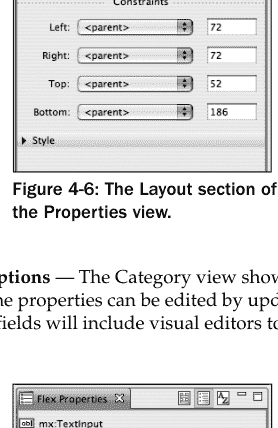  

图  - :分类查看器的属性查看器。


- **字母顺序属性查看器选项 -**如所示(*图),字母顺序显示包括在*类别*视图中的全部相同属性，但以简单的按字母排列的列表呈现而非树形布局.若要使用**属性查看器对组件进行更改**,只需在设计编辑器中点击某个组件,即可更新面板以向该选定组件显示的可用选项..  

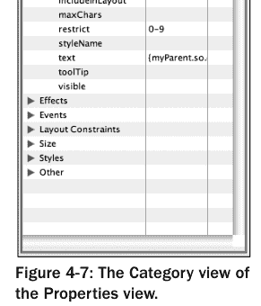  

图  - :属性查看器的字母顺序视图.

### 调试视角  
切换到*****调试**视角允许运行 Flex Debugger、设置断点、监视变量并在代码中逐步执行。要切换到***调试视图*，只需在编辑器右上角的"*"中选择 ***Flex Debugging Perspective***,**如所示 (*图).除非之前已经打开过至少一次该调试视图*,否则将看不到它如图.9)中所显示的情况。若要第一次显示此**视角**,您必须点击顶部右窗口的“打开透视”按钮或在窗口中按顺序按下`Window ⤵Perspective⤵Flex Debugging`.

### 诊断应用程序  
Flex Builder *3*提供***调试功能使您可查找应用中的错误**.调试器允许停止和启动应用程序以寻找问题，或者对变量进行查看或替换*.若要对此类项目进行*,您必须首先利用位于编辑器窗口顶部各标签内的按钮将当前视图像切换至**如所示,*图).当您进入“Flex 调试视角”后*可通过右键单击希望设置断点的代码行并从上下文中选择*** Toggle Breakpoint**(即：切换断点)来置断，这正如 (*图.-10)*所显示。您也可以直接双击需要断点的代码行以在断点和不添加断点之间进行快速开关.

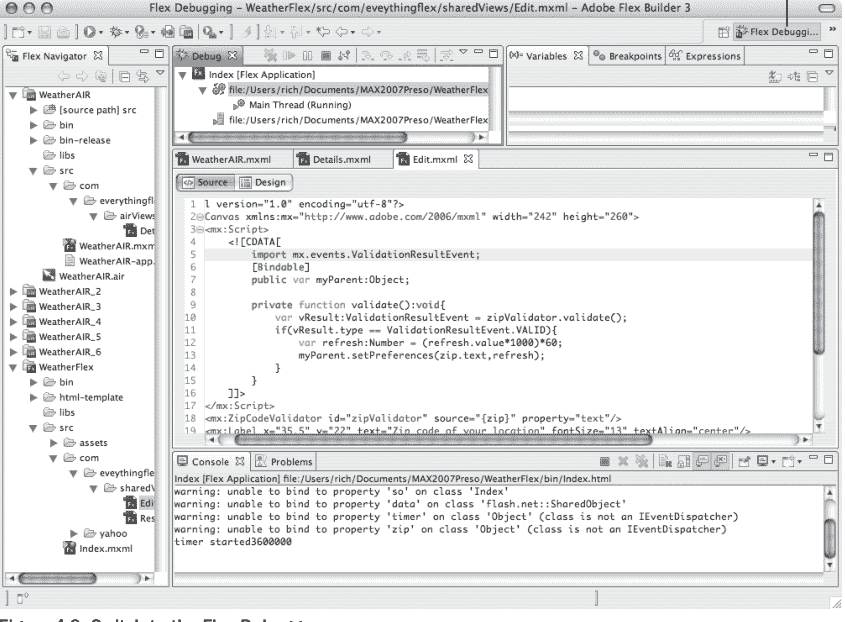  

*图  -.切换到Flex Debugger.*  

请注意：遇到断点或者发生运行时抛出一个错误时，调试视角会自动打开.

***调试视图中还包括用于读取、编辑和监视变量、管理断点和监视表达式的查看器。**这些包括 Console view(控制台)、Variables view (变量）、Breakpoints view (断点）以及 Expressions view（表达式）。  

### 控制台视图  
*console View**在用户正在对 Flex App进行调试时显示其源代码中的任何 trace语句.**该查看器将成为您在调试Flex应用程序时的得力助手。此View也提供运行时错误.*

### *变量****视图*** 
的调试器允许您方便地复制、查找、修改以及*****监视您的变量.要做到这一点，只需右键单击一个变量名,然后使用上下文菜单即可..


## 第四章：AIR 开发工具

如图4-11所示，执行上述任何功能。从上下文菜单中选择“监视”即可将变量添加到表达式视图（下文讨论）。

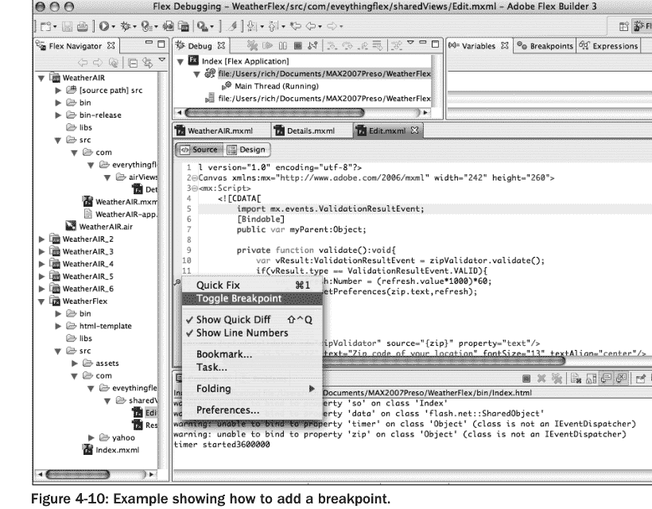

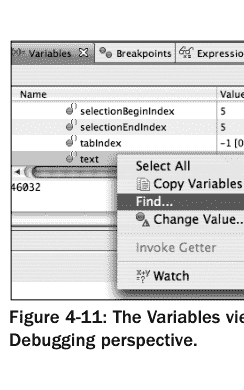

# 第一部分：入门

变量视图包含许多可能令人困惑的图标和符号。下表提供了各种符号的定义。

| 符号 | 定义 |
| :--- | :--- |
| 红色方块 | 定义私有变量 |
| 绿色圆形 | 定义公共变量 |
| 黄色菱形 | 定义受保护变量 |
| 蓝色菱形 | 定义内部变量 |
| 橙色方块（包） | 定义作用于用户定义命名空间的变量 |

下表提供了各种图标的定义。

| 图标 | 定义 |
| :--- | :--- |
| C 图标 | 定义常量变量 |
| D 图标 | 定义动态变量 |
| S 图标 | 定义静态变量 |
| Getter 图标 | 表示该变量具有 getter |

#### 断点视图

*断点视图*是在调试会话中管理断点的便捷场所。如图4-12所示，你可以右键单击断点并使用上下文菜单来更改状态或移除断点。你还可以使用断点工具栏实现更多功能，包括跳转到源代码中的断点、跳过所有断点以及展开和折叠断点树。

#### 表达式视图

使用*表达式视图*来添加和编辑你正在监视的变量的表达式。你也可以选择重新计算你正在监视的表达式，因为数据可能在调试会话过程中发生了变化。如图4-13所示，你可以右键单击一个表达式并使用上下文菜单。

Index.mxml [行: 71]
Index.mxml [行: 80]

+   - 转到文件
- 启用
- 禁用
- 移除
- 移除所有
- 全选 ⌘A
- 复制 ⌘C
- 粘贴 ⌘V
- 导出断点...
- 导入断点...

图 4-12：调试透视图中的断点视图。

+   - 全选 ⌘A
- 复制表达式 ⌘C
- 移除
- 移除所有
- 查找... ⌘F
- 更改值...
- 添加监视表达式...

图 4-13：调试透视图中的表达式视图。

### Flash CS3 简介

*Flash CS3* 是 Adobe 发布的 Flash 产品线中最新的开发工具。Flash CS3 是迄今为止最先进的工具，可用于为 Web 以及移动设备创建丰富的交互式内容。

Flash CS3 是 Flash 产品线中第一个包含新 ActionScript 3 的产品，该语言于 2006 年首次在 Flex 2 产品线中引入。这一点意义重大，因为它允许两个产品线通过共享一种原生语言进行交互。

Flash IDE 由许多视图组成；以下是对一些最常用视图的描述。

#### 舞台

*舞台*是处理 Flash 项目设计元素时的主视觉工作区。默认情况下，时间轴是附加的，但它可以独立于舞台关闭。参见图4-14。

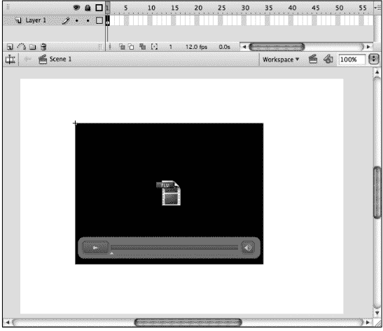

**图 4-14：添加了单个组件的 Flash CS3 舞台。**

如图4-15所示的组件窗口可以方便地将组件拖放到舞台上。组件按类别分组，可用的不同类别取决于你正在构建的应用程序版本，是 ActionScript 2 还是 3。

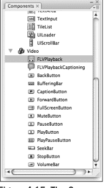

**图 4-15：组件窗口。**

Flash CS3 通过使用“动作”窗口具有完整的 ActionScript 功能。“动作”窗口包括脚本助手、语法检查器、代码格式化器、代码折叠和调试工具。图4-16显示了“动作”窗口。

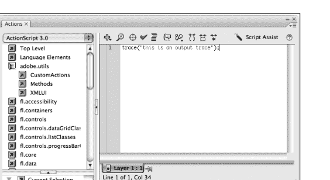

运行/调试应用程序时，“输出”窗口是你查看调试信息以及代码中包含的任何 trace 语句的地方。这是 Flash 开发中不可或缺的一部分。图4-17显示了图4-16中所示 trace 语句的结果。

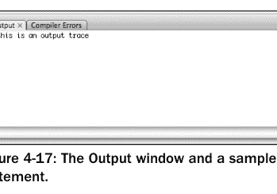

当在舞台上选择一个组件时，“属性”窗口将显示与该组件相关的一些常用属性。这允许轻松编辑组件属性。图4-18显示了图4-14中舞台上显示的 FLVPlayback 组件的属性。这些属性以及“属性”窗口中未显示的其他属性可以直接在 ActionScript 中设置。

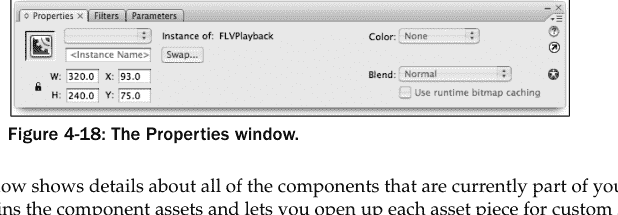

“库”窗口显示有关当前属于你应用程序的所有组件的详细信息。它还包含组件资源，并允许你打开每个资源部分进行自定义皮肤制作。图4-19所示的“库”窗口包含 FLVPlayback 组件以及一个 Button 组件。资源文件夹已展开以显示皮肤。

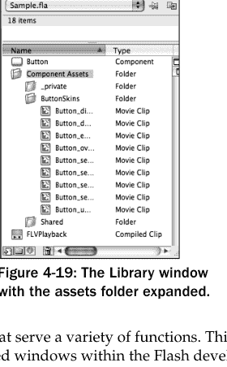

还有许多其他窗口服务于各种功能。本概述仅展示 Flash 开发环境中最常用和最广泛使用的窗口。

#### AIR/Flash CS3 更新程序

Adobe 为 Flash CS3 提供了一个更新程序，允许使用 Flash 开发环境测试和打包 AIR 项目。因此，无论你是使用 Flash CS3 构建完整的 AIR 应用程序，还是构建最终将成为编译为 AIR 的 Flex 应用程序一部分的部件，Flash CS3 都使这一过程变得非常简单。

Adobe 分发的扩展是一个简单的自安装更新。只需从 Adobe.com 下载并按照安装程序的说明操作即可。

Adobe AIR 更新程序 for Flash CS3 的最低系统要求如下。

#### Windows

+   - Windows XP SP2
- Windows Vista 家庭高级版、商业版、旗舰版或企业版（经 32 位认证）
- Flash CS3 Professional

#### Macintosh

+   - Mac OS X 10.4.x（Intel 或 PPC）
- Flash CS3 Professional

## 第四章：AIR 开发工具

### Dreamweaver CS3 简介

Dreamweaver CS3 是 Dreamweaver 产品家族的最新更新，包含许多与 AIR 应用程序相关的新功能。其中最重要的是包含了 Spry 框架工具。Spry 框架是一个 Ajax 库，允许开发动态用户界面。Spry 效果添加了诸如增长、收缩、淡入淡出和高亮等视觉过渡效果。Spry 小部件是一组工具，如菜单、列表、表格和中继器。Spry 数据允许轻松集成 XML 数据或与 RSS 数据混合。这些 Spry 功能，加上通过 CSS 对布局的完全控制，使得仅使用 HTML/JavaScript 创建丰富的用户界面变得非常容易。然后，这些应用程序可以使用 Dreamweaver AIR 扩展轻松编译为桌面应用程序。

由于 Dreamweaver 也是一个 CS3 产品，其界面与本章前面演示的 Flash CS3 界面有一些共通之处。以下是一些组成 Dreamweaver 开发环境的更常用窗口和组件。

#### 代码/设计视图

Dreamweaver CS3 的主工作区包含正在开发内容的三种不同视图。首先是“代码”视图，它显示正在编辑文档的完整源代码，并具有完整的代码高亮显示以及为 AIR 应用程序中使用的 HTML 和 JavaScript（以及许多其他语言）提供的代码提示。其次是“设计”视图，它显示代码外观的预览，并允许进行所见即所得（"what you see is what you get"）编辑。“设计”视图还使用“属性”视图轻松编辑许多标准文本选项。最后是“拆分”视图，它将“代码”视图和“设计”视图组合到一个工作区中。在此视图中，可以通过更改代码或编辑设计部分来编辑源代码。图4-20显示了一个将在下一章介绍的示例应用程序的拆分视图。

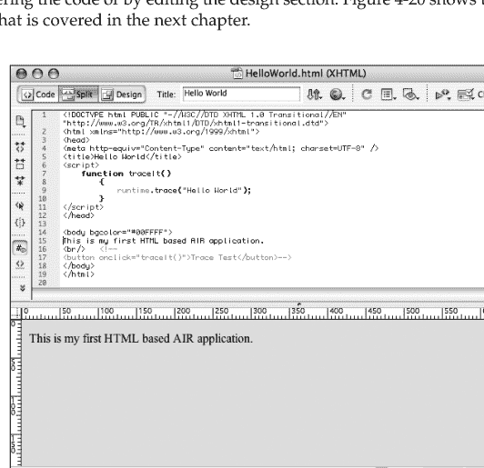

图 4-20：拆分视图下的 Dreamweaver CS3 主工作区。


# 第一部分：入门

*文件窗口*是项目中与文件进行交互的主要界面。你的应用程序文件存储在一个嵌套的文件夹系统中，并在文件窗口的树状菜单中显示。图 4-21 展示了文件窗口以及一个名为*HelloWorld*的 Dreamweaver 站点资源，该站点将在下一章中创建。

*属性窗口*允许轻松编辑许多文本属性，包括文本的标准格式化，以及使用 CSS 格式化文本和布局的能力。图 4-22 展示了属性窗口。

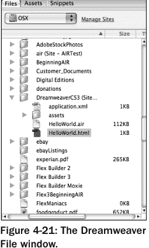

**图 4-21：Dreamweaver CS3 文件窗口。**

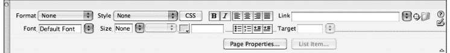

**图 4-22：Dreamweaver CS3 属性窗口。**

Dreamweaver 开发环境的主工具栏是一个选项卡式工具栏。它包括*常用选项卡*，由图像、链接、表格等对象组成。*布局选项卡*包括传统的 div、表格和框架，但也包括 Spry 菜单、折叠面板、选项卡式面板和可折叠面板。*表单选项卡*包括所有标准表单对象以及 Spry 表单验证对象。*数据选项卡*包括许多连接到应用程序服务器的工具以及处理 Spry 数据集的工具。*Spry 选项卡*在一个工具栏中包含了所有前面提到的 Spry 工具，最后，*文本选项卡*包含了所有用于更改文本字体和大小的工具。图 4-23 展示了 Dreamweaver 主工具栏中的 Spry 选项卡。

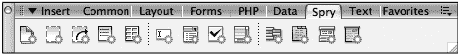

**图 4-23：Dreamweaver 的主工具栏，显示 Spry 工具。**

## 第四章：AIR 开发工具

### AIR/Dreamweaver CS3 扩展

Adobe 为 Dreamweaver CS3 提供了一个扩展，使得使用 Dreamweaver 开发环境创建、测试和打包基于 HTML 的 AIR 应用程序变得非常容易。Dreamweaver 扩展以 MXP 文件形式分发，并且可以使用 Adobe 扩展管理器轻松安装。

Dreamweaver CS3 扩展 for Adobe AIR 的最低系统要求是：

#### Windows
- Windows XP
- Windows Vista
- Dreamweaver CS3

#### Macintosh
- Mac OS 10.4.x (Intel 或 PPC)
- Dreamweaver CS3

此扩展不支持早期版本的 Dreamweaver。

有关如何使用 Dreamweaver CS3 AIR 扩展的更多信息和演示，请参阅第 5 章。

### 总结

本章概述并演示了 Flex Builder 3、Flash CS3 和 Dreamweaver CS3 的一些关键特性和工具。第 5 章将演示如何在这些开发环境中创建项目。然后，它将演示如何在 Flex Builder 3、Flash CS3 和 Dreamweaver CS3 中测试和打包 AIR 应用程序。它还将演示如何使用 AIR SDK 通过控制台测试和打包 AIR 应用程序。

## 第五章：构建应用程序

有几种工具和技术可用于测试和创建 AIR 应用程序。根据你所使用的技术，AIR 应用程序可以使用 Flex Builder 3、Flash CS3 或 Dreamweaver CS3 开发环境进行测试或编译。

Flex Builder 3 用于构建基于 Flex 的 AIR 应用程序，Flash CS3 用于构建基于 Flash 的应用程序，Dreamweaver CS3 用于构建基于 HTML 的应用程序。

所有不同的技术也可以使用免费的 AIR SDK 测试或编译为 AIR。

本章演示如何测试和调试 AIR 应用程序。有关编译 AIR 应用程序的信息，请参阅第 6 章。

### 创建你的第一个 AIR Flex 应用程序

基于 Flex 的 AIR 应用程序可能由 MXML 代码、ActionScript 代码或两者组成。由于基于 Flex 的 AIR 应用程序由可以使用任何基本文本编辑器编辑的源代码组成，因此编写应用程序代码并非必须使用 Flex Builder 3。尽管你可以使用像 Notepad 或 TextEdit 这样简单的编辑器编写源代码，但你仍然需要一个编译器来测试应用程序。Flex Builder 3 使测试变得非常简单。以下示例演示了如何使用 Flex Builder 和 AIR SDK 测试 AIR 应用程序。

### 使用 Flex Builder 进行测试

打开 Flex Builder 并创建一个名为*HelloWorld*的新 AIR 项目。有关在 Flex Builder 中创建 AIR 项目的更多信息，请回顾第 3 章。创建此项目后，你应该看到一个类似于图 5-1 的导航器窗口。

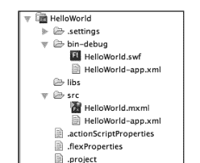

**图 5-1：Flex Builder 3 中的 HelloWorld AIR 项目。**

更新新的 HelloWorld.mxml 文件，使代码看起来像代码清单 5-1。

**代码清单 5-1：HelloWorld.mxml 示例代码**

```xml
<?xml version="1.0" encoding="utf-8"?>
<mx:WindowedApplication
    xmlns:mx="http://www.adobe.com/2006/mxml"
    layout="absolute">
    <mx:Label text="Hello World!"
              horizontalCenter="0"
              verticalCenter="0"/>
</mx:WindowedApplication>
```

要使用 Flex Builder 测试此项目，你只需点击顶部工具栏中的绿色播放按钮。Flex Builder 将启动应用程序的测试版本，其外观应如图 5-2 所示。

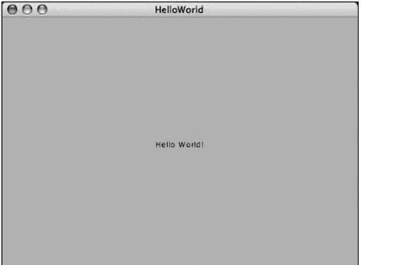

**图 5-2：HelloWorld 应用程序的测试版本。**

### 使用 Flex Builder 进行调试

要使用调试器测试你的应用程序，首先需要添加一些跟踪语句以便在调试器中查看。跟踪语句是在调试 Flex 应用程序时将数据输出到控制台的最简单方法。跟踪语句具有以下签名：

```
trace('Debug Test');
```

通过添加一个按钮（该按钮的点击处理程序中包含一个跟踪语句）来更新你的 HelloWorld.mxml 文件的代码。mx:Button 应该如下所示。

```xml
<mx:Button label="Debug Test" click="trace('Debug Test')"
    verticalCenter="28" horizontalCenter="0"/>
```

完整的 HelloWorld.mxml 文件现在应包含代码清单 5-2 所示的代码。

**代码清单 5-2：带有跟踪语句的 HelloWorld.mxml 示例代码**

```xml
<?xml version="1.0" encoding="utf-8"?>
<mx:WindowedApplication
    xmlns:mx="http://www.adobe.com/2006/mxml"
    layout="absolute">
    <mx:Label text="Hello World!"
        horizontalCenter="0"
        verticalCenter="0"/>
    <mx:Button label="Debug Test" click="trace('Debug Test')"
        verticalCenter="28" horizontalCenter="0"/>
</mx:WindowedApplication>
```

要在 Flex 调试器中测试此文件，只需点击调试器按钮。应用程序将像以前一样打开。但是，当你点击“Debug Test”按钮时，你会在控制台中看到类似图 5-3 的输出。


**图 5-3：Flex Builder 中的调试控制台输出。**

### 使用 SDK 进行测试

要在终端窗口中使用 AIR SDK 运行此应用程序，首先需要在与 HelloWorld.html 文件相同的文件夹中创建 HelloWorld-app.xml 文件。这是一个示例 -app.xml 文件。有关此 XML 文件属性的更多信息，请参阅第 6 章。

**代码清单 5-3：HelloWorld-app.xml 配置文件**

```xml
<?xml version="1.0" encoding="UTF-8"?>
<application xmlns="http://ns.adobe.com/air/application/1.0">
    <id>com.everythingflex.beginningAIR.helloWorldFlex</id>
    <filename>HelloWorld</filename>
    <version>v1</version>
    <initialWindow>
        <content>HelloWorld.swf</content>
    </initialWindow>
    <name>HelloWorld</name>
</application>
```

假设你已经按照第 1 章的描述正确设置了你的 Mac 或 Windows 环境，打开你的终端窗口，导航到包含 HelloWorld.mxml 和 HelloWorld-app.xml 文件的文件夹，然后运行以下代码：

```
adl HelloWorld-app.xml
```

这将生成 HelloWorld 应用程序的测试版本，你应该看到与图 5-2 类似的内容。

### 使用 SDK 进行调试

当使用 SDK 测试应用程序时，你会注意到原本在 Flex Builder 3 控制台视图中出现的相同跟踪语句，现在显示在终端窗口中，如图 5-4 所示。

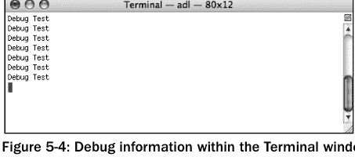

**图 5-4：终端窗口内的调试信息。**

### 创建你的第一个 AIR HTML 应用程序

到目前为止，我们已经探讨了使用 Flex（通过 MXML 和 ActionScript）或 Flash（在 Flash CS3 IDE 中使用 ActionScript）创建的 AIR 应用程序。然而，AIR 应用程序也可以由 HTML 或 HTML 与 JavaScript 组成。此应用程序可以使用 AIR SDK 或 Dreamweaver CS3 AIR 插件（在撰写本文时，Dreamweaver CS3 AIR 插件处于 Beta 测试阶段，可在 http://labs.adobe.com 获取）进行编译。


## 第五章：构建应用程序

### 使用 Dreamweaver CS3 进行测试

安装 Dreamweaver CS3 AIR 插件后，打开 Dreamweaver CS3 并创建一个新站点。操作方法是点击“站点”菜单并选择“新建站点”，如图 5-5 所示，然后输入站点名称，如图 5-6 所示。

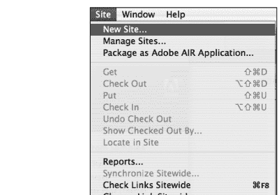

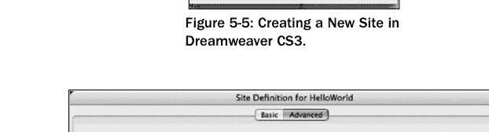

现在，通过选择顶部菜单中的“文件”，然后选择“新建”来创建一个新文件。接着，在选择“空白页”、“HTML”和“<无>”后，点击“创建”按钮。将打开一个新窗口，其中包含你创建的新文件。将视图切换到“代码”后，你应该会看到类似图 5-7 的内容。

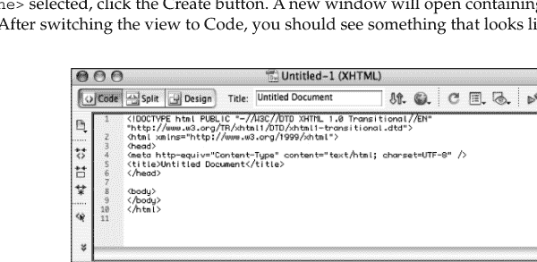

# 第一部分：入门

现在，将标题更新为 HelloWorld，并在 body 标签内添加一些内容，或者直接从清单 5-4 中复制代码。

#### 清单 5-4：HelloWorld.html 的内容

```
<!DOCTYPE html PUBLIC "-//W3C//DTD XHTML 1.0 Transitional//EN"
"http://www.w3.org/TR/xhtml1/DTD/xhtml1-transitional.dtd"><html
xmlns="http://www.w3.org/1999/xhtml">
<head>
<meta http-equiv="Content-Type" content="text/html; charset=UTF-8" />
<title>Hello World</title>
</head>
<body bgcolor="#0066FF">
This is my first HTML based AIR application.
</body>
</html>
```

通过选择顶部菜单中的“文件”，然后选择“保存”来保存文件。将文件命名为 *HelloWorld.html*，如图 5-8 所示。

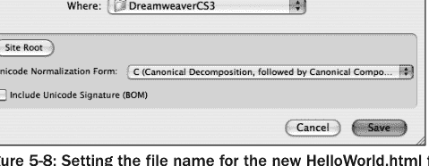

图 5-8：设置新的 HelloWorld.html 文件的文件名。

要将这个新的 HTML 页面作为 AIR 应用程序进行测试，你需要点击 *Ctrl (Command)+Shift+F12*。这将把应用程序编译为测试版本，结果应类似于图 5-9 所示。


图 5-9：HelloWorld 应用程序的测试版本。

## 第五章：构建应用程序

### 使用 SDK 测试你的应用程序

要在终端窗口中使用 AIR SDK 运行此应用程序，你首先需要在与 HelloWorld.html 文件相同的文件夹中创建 HelloWorld-app.xml 文件。清单 5-5 是一个示例 -app.xml 文件。有关此 XML 文件属性的更多信息，请参阅第 6 章。

#### 清单 5-5：用于 HelloWorld.html 文件的 -app.xml 文件

```
<?xml version="1.0" encoding="UTF-8"?>
<application xmlns="http://ns.adobe.com/air/application/1.0">
    <id>com.everythingflex.beginningAIR.helloWorldHTML</id>
    <filename>HelloWorld</filename>
    <version>v1</version>
    <initialWindow>
        <content>HelloWorld.html</content>
    </initialWindow>
    <name>HelloWorld</name>
</application>
```

假设你已按照第 1 章中的描述正确设置了 Mac 或 Windows 环境，打开你的终端窗口，导航到包含 HelloWorld.html 文件的文件夹，然后运行以下代码：

```
adl HelloWorld-app.xml
```

这将生成 HelloWorld 应用程序的测试版本，你应该会看到类似图 5-9 的内容。

### 使用 SDK 进行调试

要在使用 SDK 测试时在终端窗口中查看调试信息，你可以在脚本块内使用 runtime.trace() 语句。基于清单 5-4 中的先前测试，将以下 JavaScript 块添加到文档的 head 部分：

```
<script>
    function traceIt() {
        runtime.trace("Hello World");
    }
</script>
```

同时将以下按钮添加到文档的 body 部分：

```
<button onclick="traceIt()">Trace Test</button>
```

现在，HelloWorld.html 文档的完整内容应如清单 5-6 所示。

#### 清单 5-6：更新后的 HelloWorld.html，包含 JavaScript trace 语句

```
<!DOCTYPE html PUBLIC "-//W3C//DTD XHTML 1.0 Transitional//EN"
"http://www.w3.org/TR/xhtml1/DTD/xhtml1-transitional.dtd">
<html xmlns="http://www.w3.org/1999/xhtml">
<head>
<meta http-equiv="Content-Type" content="text/html; charset=UTF-8" />
<title>Hello World</title>
<script>
    function traceIt(){
    runtime.trace("Hello World");
    }
</script>
</head>
<body bgcolor="#0066FF">
This is my first HTML based AIR application.
<br/>
<button onclick="traceIt()">Trace Test</button>
</body>
</html>
```

现在，打开你的终端窗口并导航到包含 HelloWorld.html 和 HelloWorld-app.xml 文件的文件夹。运行以下语句：

```
adl HelloWorld-app.xml
```

你现在应该能看到创建的应用程序，它应该看起来像图 5-10。

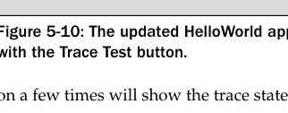

图 5-10：带有 Trace Test 按钮的更新后的 HelloWorld 应用程序。

点击 Trace Test 按钮几次，将在终端窗口中显示 trace 语句，如图 5-11 所示。

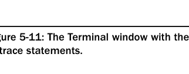

图 5-11：带有 trace 语句输出的终端窗口。

## 创建你的第一个 AIR Flash 应用程序

要创建你的第一个 AIR Flash 应用程序，你必须安装 AIR/Flash CS3 更新程序。有关更多信息，请参阅第 4 章。

首先打开 Flash CS3 开发环境，点击“文件”菜单并选择“新建”，如图 5-12 所示。接下来，在如图 5-13 所示的新文件对话框中选择“Flash 文件 (ActionScript 3.0)”，然后点击“确定”。为了设置 AIR 应用程序设置，你需要保存这个新文件。选择“文件 ➪ 另存为”，并输入 **FirstFlashAIR.fla** 作为文件名。


**图 5-12：** 展示创建 AIR Flash 应用程序第一步的示例。


**图 5-13：** 选择“Flash 文件 (ActionScript 3.0)”。

# 第一部分：入门

保存文件后，你可以更新发布设置以包含 AIR 所需的设置。选择“文件 ➪ 发布设置”，如图 5-14 所示，以打开“设置”对话框。从顶部菜单中选择“Flash”，然后将“版本”属性切换为“Adobe AIR 1.0”，如图 5-15 所示，并点击“确定”。


现在，当你选择“文件 ➪ 发布”或 *Ctrl (Command)+Enter* 时，你会注意到应用程序在一个 adl 窗口中打开，如图 5-16 所示。Flash 应用程序中包含的任何 trace 语句都将像其他任何 Flash 应用程序一样，在 Flash 输出窗口中显示为调试信息。

## 第五章：构建应用程序


**图 5-16：FirstFlashAIR 通过 Flash CS3 的 `adl` 打开。**

就是这样——你现在已成功使用 Flash CS3 创建了一个 AIR 应用程序。剩下唯一要做的就是将这个新应用程序打包为 AIR 分发包。这将在下一章名为“使用 Flash CS3 打包”的部分中介绍。

### 总结

本章演示了如何在三个不同的工具中创建应用程序。使用 Flex Builder 3 构建基于 Flex 的 AIR 应用程序，使用 Flash CS3 构建基于 Flash 的应用程序，使用 Dreamweaver CS3 构建基于 HTML 的应用程序。

下一章将演示如何使用 Flex Builder、AIR SDK、Dreamweaver CS3 和 Flash CS3 将应用程序配置并打包为 AIR 分发文件。

## 6

### 打包 AIR

AIR 应用程序使用带有 .air 扩展名的包进行分发和安装。第 5 章有两个示例，其中使用 AIR 配置文件通过 SDK 的 `adl` 命令来测试应用程序。在本章中，我们将进一步研究此配置文件的设置，并展示更改生成编译后 AIR 文件方式的方法。

### AIR 配置文件

*AIR 配置文件*是一个 XML 文件，包含确定 AIR 应用程序打包分发方式的所有设置。此文件中有许多必需和可选的属性，本章的第一部分将重点介绍每个设置及其对生成的包的影响。

#### <application/>

`<application>` 标签是 AIR 配置文件的根标签。它唯一的属性是 `xmlns`，用于定义安装和运行应用程序所需的 AIR 运行时版本。

```
<application xmlns="http://ns.adobe.com/air/application/1.0">
```

#### <id/>

`<id>` 标签是 `<application>` 标签的子项。id 是应用程序的唯一标识符，应特定于该应用程序。建议 id 包含域名空间以确保唯一性。例如，以下示例是一个名为 *Configureyzhqm*t 的应用程序，因此我选择使用的 id 是 `com.everythingflex.beginningAIR.configureIt`。

```
<id>com.everythingflex.beginningAIR.configureIt</id>
```


# 第6章：打包 AIR 应用程序

## `<version/>`

`<version>` 标签是 `<application>` 标签的子标签。`version` 属性会提醒 AIR 安装程序，当新版本与当前安装的版本不同时，提示用户。它并不知道已安装的版本是比正在安装的版本新还是旧；它只是注意到差异并提醒用户。参见图6-1和图6-2，其中展示了版本1作为我们测试应用程序的已安装版本，而安装程序正尝试安装两个不同的版本。

```
<version>version 1</version>
```


## `<name/>`

`<name>` 标签是 `<application>` 标签的子标签。名称可以设置为您希望的任何内容，并将在安装过程中显示（图6-3），以及在 Mac Finder 和 Windows 程序菜单中显示应用程序信息。

```
<name>ConfigureIt</name>
```


## `<filename/>`

`<filename>` 标签是 `<application>` 标签的子标签。此文件名在安装过程中显示，如图6-4所示。

```
<filename>ConfigureIt</filename>
```


## `<description/>`

`<description>` 标签是 `<application>` 标签的子标签。此描述在安装过程中显示，如图6-5所示。

```
<description> A sample application demonstrating the configuration
settings.</description>
```


描述由配置文件的 `<description>` 属性设置。

图6-5：安装过程中显示的描述。

## `<copyright/>`

`<copyright>` 标签是 `<application>` 标签的子标签。此标题在 Mac OS X 的“关于”菜单中显示，如图6-6所示。

```
<copyright>Copyright 2007 EverythingFlex.com</copyright>
```


图6-6：Mac OS X “关于”菜单显示自定义图标、文件名和版权信息。

## `<icon/>`

AIR 应用程序可以包含四种尺寸的图标：16 × 16、32 × 32、48 × 48 和 128 × 128。图标可接受的格式是 PNG。在以下示例代码中，我在主项目文件夹下创建了一个 assets 文件夹，其中包含各种 PNG 文件。

```
<icon>
  <image16x16>assets/e16.png</image16x16>
  <image32x32>assets/e32.png</image32x32>
  <image48x48>assets/e48.png</image48x48>
  <image128x128>assets/e128.png</image128x128>
</icon>
```

打包应用程序时，请务必包含这些图像文件，可以在 Flex Builder 的向导对话框中（参见图6-7）或在 SDK 的 adt 命令语句中包含。有关使用 adt 打包的信息，请参阅本章的“使用 SDK 打包”部分。


然后，应用程序图标将在许多地方替代默认的 AIR 图标。图6-8至图6-13展示了在 Windows XP 和 Mac OS X 上图标放置的一些示例。


图6-9：Mac Finder 中显示两种不同尺寸图标的该应用程序。


图6-10：Mac Dock 中的该应用程序。


图6-11：WindowsXP 任务栏中的应用程序窗口。


图6-12：WindowsXP 应用程序窗口内的图标。


图6-13：WindowsXP “添加或删除程序”窗口中的图标。

## `<initialWindow/>`

在 `<initialWindow>` 标签内（它是 `<application>` 标签的子标签）可以设置多个属性。除了 `<content>` 标签外，所有这些对于编译器来说都是可选设置。本节将介绍这些属性。

```
<initialWindow>
    <content></content>
    <title></title>
    <systemChrome></systemChrome>
    <transparent></transparent>
    <visible></visible>
    <minimizable></minimizable>
    <maximizable></maximizable>
    <resizable></resizable>
    <width></width>
    <height></height>
    <x></x>
    <y></y>
    <minSize></minSize>
    <maxSize></maxSize>
</initialWindow>
```

## `<content/>`

`<content>` 标签是 `<initialWindow>` 标签的子标签，而 `<initialWindow>` 标签又是 `<application>` 标签的子标签。如果您在 AIR SDK 中编译应用程序，则需要将 `<content>` 标签的内容设置为应用程序的根内容。这可以是 .swf 或 .html 文件。如果您使用 Flex Builder、Dreamweaver CS3 或 Flash CS3，编译应用程序时该值将为您自动设置。

```
<content>ConfigureIt.swf</content>
```

## `<title/>`

`<title>` 标签是 `<initialWindow>` 标签的子标签，而 `<initialWindow>` 标签又是 `<application>` 标签的子标签。在此标签内设置的值将是主应用程序窗口的标题。

```
<title>ConfigureIt</title>
```

## `<transparent/>` 和 `<systemChrome/>`

应用程序透明度可以在 `<transparent>` 标签内设置，该标签是 `<initialWindow>` 标签的子标签，而 `<initialWindow>` 标签又是 `<application>` 标签的子标签。可用的选项是 True 或 False。

```
<transparent>true</transparent>
<systemChrome>none</systemChrome>
```

系统边框在 `<systemChrome>` 标签内设置，该标签是 `<initialWindow>` 标签的子标签，而 `<initialWindow>` 标签又是 `<application>` 标签的子标签。systemChrome 的可用选项是 Standard 和 None。当 systemChrome 设置为 Standard 时，AIR 应用程序将使用操作系统原生的应用程序窗口控件（关闭、最小化、还原）。当 systemChrome 在 HTML 应用程序中设置为 None 时，应用程序将没有任何控件。在 Flex 应用程序中，将有一组备用控件来处理关闭、最小化和还原，因为这是 `<mx:WindowedApplication>` 标签的内置功能。要禁用这些控件，必须将 `<mx:WindowedApplication>` 标签的 `showFlexChrome` 属性设置为 False。

请注意，`transparent` 只有在 `systemChrome` 设置为 None 时才能设置为 True。如果 `transparent` 设置为 True 而 `systemChrome` 设置为 Standard，则会出现编译器错误，如图6-14所示。


## `<visible/>`

AIR 应用程序的可见性可以在 `<initialWindow>` 标签的 `<visible>` 节点中设置，该标签是 `<application>` 标签的子标签。默认值为 True；但是，它可以初始设置为 False，然后在 AIR 应用程序启动后更新为 True。

```
<visible>false</visible>
```

## `<minimizable/>`、`<maximizable/>` 和 `<resizable/>`

`<minimizable/>`、`<maximizable/>` 和 `<resizable/>` 标签都是 `<initialWindow>` 标签的子标签，而 `<initialWindow>` 标签又是 `<application>` 标签的子标签。它们默认值均为 True，但可以设置为 False 以禁用用户调整 AIR 应用程序大小的功能。

```
<minimizable>false</minimizable>
<maximizable>false</maximizable>
<resizable>false</resizable>
```

## `<width/>` 和 `<height/>`

`<width/>` 和 `<height/>` 标签都是 `<initialWindow>` 标签的子标签，而 `<initialWindow>` 标签又是 `<application>` 标签的子标签。这些是可选的，但设置它们将强制应用程序以指定的宽度和高度属性启动。

```
<height>600</height>
<width>800</width>
```

## `<x/>` 和 `<y/>`

`<x/>` 和 `<y/>` 标签都是 `<initialWindow>` 标签的子标签，而 `<initialWindow>` 标签又是 `<application>` 标签的子标签。这些是可选的，但设置它们将强制应用程序在指定的 x 和 y 位置启动。

```
<x>100</x>
<y>200</y>
```

## `<minSize/>` 和 `<maxSize/>`

`<maxSize/>` 和 `<minSize/>` 标签都是 `<initialWindow>` 标签的子标签，而 `<initialWindow>` 标签又是 `<application>` 标签的子标签。这些是可选的，但设置它们将限制应用程序可以调整到的最小和最大尺寸。它们以宽度和高度值的配对形式输入：

```
<minSize>640 480</minSize>
<maxSize>800 600</maxSize>
```

## `<installFolder/>`

`<installFolder>` 标签是 `<application>` 标签的子标签，且是可选的。添加文件夹路径会将添加的路径追加到默认安装目录。图6-15显示了默认安装路径。


图6-15：默认安装路径示例。

以下 `<installFolder>` 节点的示例将导致图6-16所示的安装位置：

```
<installFolder>AIRApps/</installFolder>
```


# 第一部分：入门


## `<customUpdateUI/>`

`<customUpdateUI>` 标签是 `<application>` 的子项。将此值设置为 True 将提醒应用程序，一旦安装完成，后续的任何更新都应由应用程序自身负责。这意味着，即使你下载了更新的 AIR 安装程序包，它也不会更新已安装的应用程序。当用户尝试安装时，当前已安装的应用程序将打开，并将由该已安装应用程序负责处理更新。除非你的应用程序已经构建了处理更新的功能，否则请勿将此项设置为 True。

```
    <customUpdateUI>true</customUpdateUI>
```

## `<allowBrowserInvocation>`

`<allowBrowserInvocation>` 标签是 `<application>` 的子项。将其设置为 True 将允许应用程序通过网页浏览器中的无缝徽章安装过程进行安装。

```
    <allowBrowserInvocation>true</allowBrowserInvocation>
```

## `<programMenuFolder/>`

`<programMenuFolder>` 标签是 `<application>` 的子项。设置此标签的内容将提醒安装程序在 Windows 开始菜单中创建指向该文件夹的快捷方式。

```
    <programMenuFolder>EverythingFlex</programMenuFolder>
```

## `<fileTypes/>`

`<fileTypes>` 标签是 `<application>` 的子项。此节点可以包含一个或多个 `<fileType>` 标签集。每个标签集都可以定义一个与 AIR 应用程序关联的文件类型。`<fileType>` 节点包含定义与文件类型关联的名称、扩展名、描述、`contentType` 和图标的子标签。此示例将扩展名为 .test 的文件与 AIR 应用程序关联，并分配了图标。描述和 `contentType` 是可选的子标签，在本示例中已省略。图 6-17 显示了一个名为 `myfile.test` 的文件与 `ConfigureIt.app` 关联。

```
<fileTypes>
    <fileType>
        <name>Test</name>
        <extension>test</extension>
        <icon>
            <image16x16>assets/e16.png</image16x16>
            <image32x32>assets/e32.png</image32x32>
            <image48x48>assets/e48.png</image48x48>
            <image128x128>assets/e128.png</image128x128>
        </icon>
    </fileType>
</fileTypes>
```


**图 6-17：myfile.test 与 ConfigureIt.app 关联。**

# 第一部分：入门

### 打包为 AIR

有多种方式可以将你的应用程序打包为 AIR 包。对于 Flex 项目，选择有 Flex Builder 3 或免费的 SDK。对于 HTML 项目，选择有 Dreamweaver CS3 或免费的 SDK；对于 Flash 项目，选择有 Flash CS3 或免费的 SDK。以下示例演示了如何使用 Flex Builder 3、Dreamweaver CS3、Flash CS3 和 AIR SDK 打包为 AIR。

### 使用 Flex Builder 3 打包

要将你的 AIR 项目在 Flex Builder 3 中打包为 AIR 包，请先选择你希望导出的项目，然后选择 “File” ✥ “Export” ✥ “Release Build”（参见图 6-18）。


图 6-18：导出 AIR 包按钮。

这将启动 “Export Release Build” 向导，引导你完成可分发 AIR 包的创建。此过程的第 1 步（如图 6-19 所示）要求你选择希望打包的项目和主应用程序文件，以及包的创建位置。

完成第 1 步并点击“下一步”后，你将进入第 2 步，如图 6-20 所示。在这里，你将定义用于签署应用程序的证书。如果你已购买商业证书或已创建了自签名证书，可以浏览选择它，输入密码，然后进入第 3 步。如果没有，点击“Create”按钮，将打开如图 6-21 所示的表单。填写相关信息并点击“OK”以保存你的新证书。

图 6-22 显示了选择证书后的 “Export Release Build” 向导第 2 步。

点击“下一步”按钮进入第 3 步，在这里你将选择希望编译到应用程序中的资源。如图 6-23 所示。

现在，只需点击“完成”，新的 AIR 包将被创建到你指定的位置。图 6-24 显示了 AIR 包正在被创建到默认位置。


图 6-19：Flex Builder 3 的 Export AIR Package 向导。


图 6-20：Export Release Build 向导第 2 步。


图 6-21：创建自签名证书。


图 6-22：使用数字证书。


图 6-23：Export Release Build 向导第 3 步。


图 6-24：新创建的 .air 文件。

### 使用 Dreamweaver CS3 打包

要在 Dreamweaver CS3 中将 HTML 应用程序打包为 AIR，请从顶部菜单中选择 “Site” 和 “Create AIR File”，如图 6-25 所示。


接下来，填写 AIR Application and Installer Settings 中的表单。必填字段是 File name、ID、Initial content 和 Digital signature。可选字段包括 Description、Copyright 等（参见图 6-26）。有关此表单上所有字段的定义，请参阅本章开头部分。


点击 “Select icon images” 按钮将启动如图 6-27 所示的 Application Icon 向导。这是一个可选步骤。如果你不提供自定义图标，将使用默认的 AIR 图标。


接下来，你需要定义一个 “Digital signature” 文件。与 Flex Builder 一样，你可以从 Dreamweaver CS3 中创建自签名安全证书。点击 “Set” 按钮以启动如图 6-28 所示的 Digital Signature 窗口。可以浏览现有证书，或点击 “Create” 按钮创建新证书。“Create” 按钮将启动如图 6-29 所示的 Self-Signed Digital Certificate 窗口。

最后，点击 AIR Application and Installer Settings 窗口中的 “Create AIR File” 按钮，或点击顶部菜单中的 Site 菜单和 “Create AIR File” 来创建 AIR 包。结果如图 6-30 所示。


图 6-29：Dreamweaver CS3 中的 Self-Signed Digital Certificate 窗口。


图 6-30：新创建的 HelloWorld.air 包。

### 使用 Flash CS3 打包

要将 Flash CS3 应用程序打包为 AIR 文件，首先需要确保将 Flash 应用程序的发布设置设置为 Adobe AIR。如果需要帮助，请参阅第 5 章中关于创建你的第一个 Flash CS3 AIR 应用程序的部分。

选择 Commands ➜ “AIR - Application and Installer Settings”，如图 6-31 所示，以打开设置对话框窗口。如图 6-32 所示的 “AIR - Application & Installer Settings” 窗口允许你编辑在创建 AIR 文件时将打包到 application.xml 文件中的信息。此窗口还有一个用于设置应用程序图标的附加对话框。点击 “Select Icon Images” 按钮将打开如图 6-33 所示的 “AIR - Icon Images” 窗口。打开此窗口后，你将能够浏览本地文件系统以选择希望与 AIR 文件一起打包的图标图像。

接下来，你需要点击 “Set” 按钮以添加数字证书。这将打开如图 6-34 所示的 “Digital signature” 窗口，你可以在其中浏览证书文件或通过点击 “Create” 按钮创建新证书。


## 第6章：打包 AIR

点击“数字签名”窗口中的“创建”按钮将打开如图6-35所示的“创建自签名数字证书”窗口。

既然您已经完成了“AIR - 应用程序与安装程序设置”窗口的配置，现在可以点击窗口底部的“发布 AIR 文件”按钮来创建新的 AIR 包。您也可以点击“确定”关闭此窗口，然后通过如图6-36所示的点击菜单 Commands ➤ “AIR - 创建 AIR 文件”来创建新的 AIR 包。


**图6-31：打开设置对话框所需的步骤。**


**图6-32：“AIR - 应用程序与安装程序设置”窗口。**

83

# 第一部分：入门


**图6-33：AIR 图标图像窗口。**


**图6-34：Flash CS3 中的“数字签名”窗口。**


**图6-35：Flash CS3 中的“自签名数字证书”窗口。**

**84**

## 第6章：打包 AIR


**图6-36：创建 AIR 包的快捷方式。**

#### 使用 SDK 打包

基于 SWF 和 HTML 的应用程序都可以使用 AIR SDK 打包成 AIR。唯一的区别在于 AIR 配置文件的 `<initialWindow>` 标签的子标签 `<content>` 中设置的主文件。例如，对于基于 SWF 的应用程序，`<content>` 标签可能如下所示：

```xml
<content>HelloWorld.swf</content>
```

对于基于 HTML 的应用程序，则可能如下所示：

```xml
<content>HelloWorld.html</content>
```

一旦您按照所需方式配置好所有配置文件设置，下一步就是打开终端窗口并导航到包含配置文件的目录。以下命令将创建一个名为 HelloWorld.air 的新 AIR 包。`adt` 命令的格式为：

```
adt -package SIGNING_OPTIONS <air-file> <app-desc> FILE_ARGS
```

如果您没有证书，可以使用 `adt` 创建一个自签名证书。创建自签名证书的格式如下：

```
adt -certificate -cn name [-ou org_unit][-o org_name][-c country] key_type pfx_file password
```

- 或者，要将 SWF 应用程序编译为 AIR 包：

```
adt -package -store type pkcs12 -keystore mycert.pfx HelloWorld.air application.xml HelloWorld.swf
```

- 一个包含额外文件（在本例中为图标 PNG）的包示例如下：

```
adt -package -store type pkcs12 -keystore mycert.pfx HelloWorld.air application.xml HelloWorld.swf assets/e.png assets/e.png 148.png
```

- 一个快捷方式是将整个 assets 文件夹包含在一行中，如下所示：

```
adt -package -store type pkcs12 -keystore mycert.pfx HelloWorld.air application.xml HelloWorld.swf assets
```

### 总结

- 本章介绍了打包 AIR 应用程序时可能需要的所有配置设置，并演示了如何使用不同技术来完成此操作，包括 Flex Builder、Dreamweaver CS3、Flash CS3 和 AIR SDK。

- 下一章将演示如何在 AIR 应用程序中处理远程数据。将涵盖的技术包括通过 ColdFusion 的 AMF 远程调用、Restful 数据服务以及 Web 服务。

## 第二部分：添加数据

## 第7章：使用远程数据


## 使用远程数据

尽管 AIR 应用程序旨在桌面上运行，并且有多种方式存储本地数据，但肯定会有一些时候处理远程数据源是有益的。无论是通过 ColdFusion 等中间件提供数据，通过 XML 或 JSON 等 Restful 数据服务，还是通过 Web 服务，AIR 都能轻松连接和检索数据。本章将演示如何使用 AMF 通过 Flex RPC（远程过程调用）服务、通过 Flex HTTPServices 的 XML 和 JSON 以及通过 Flex WebServices 的 SOAP 来处理远程数据。

### AMF/远程调用

ActionScript 消息格式 (AMF) 是一种以二进制方式传输数据的数据格式，比其他数据传输格式更小、更快。AMF 是由 Macromedia 创建的专有格式，现由 Adobe 拥有，并在其许多产品系列中使用，包括 ColdFusion，本章将进行演示。

#### ColdFusion

从 7.02 版本开始，ColdFusion 支持从 Flex 直接调用 CFC（ColdFusion 组件），数据传输通过非常快速的 AMF 格式进行。以下示例演示了如何使用 `<mx:RemoteObject>` 标签通过 RPC（远程过程调用）从 AIR 连接到 ColdFusion 服务器。对于本示例，您需要一个 ColdFusion 服务器。可以从 Adobe.com 下载免费的开发者版本。

本示例包含两个 ColdFusion 组件。第一个是 AIR 将与之通信的主要访问点，第二个是值对象，它将演示服务器端的 ColdFusion 对象如何映射到 ActionScript 对象。请按照以下步骤创建后端 ColdFusion 文件。

1.  在 ColdFusion 7.02 或更高版本服务器的根目录下创建一个新目录，并将其命名为 beginningAIR。在该文件夹内，创建一个名为 business 的新目录。到目前为止，您的目录结构应如图7-1所示。

2.  现在在 business 目录中创建一个新文件，并将其命名为 *Delegate.cfc*。打开新文件并复制清单7-1的内容。这个 ColdFusion 组件有一个名为 `helloWorld()` 的单一方法。此方法将从 AIR 使用 `RemoteObject` 类进行访问。

##### 清单7-1：Delegate.cfc ColdFusion 文件

```xml
<cfcomponent>
    <cffunction name="helloWorld" returntype="string" access="remote">
        <cfreturn "Hello From ColdFusion">
    </cffunction>
</cfcomponent>
```

3.  创建一个名为 *Chapter7_CF* 的新 AIR 项目，并将主文件命名为 *Chapter7_CF.mxml*。将清单7-2的内容复制到此文件中。请注意，此文件使用 `<mx:RemoteObject>` 标签创建与 ColdFusion 服务器的连接。请注意，端点属性可能因您的 ColdFusion 服务器设置而异。该文件还包含一个调用 `helloWorld()` 函数的 `<mx:Button>`。此函数向 `cfService` 添加一个 `addEventListener`，然后通过 `cfService.helloWorld()` 这行代码调用 ColdFusion Delegate。名为 `helloWorldResult` 的结果处理函数启动一个 Alert，通过调用 `event.result.toString()` 显示返回的数据。此函数的结果如图7-2所示。

##### 清单7-2：Chapter7_CF.mxml 的内容

```xml
<?xml version="1.0" encoding="utf-8"?>
<mx:WindowedApplication xmlns:mx="http://www.adobe.com/2006/mxml">
    <mx:Script>
        <![CDATA[
        import mx.rpc.events.ResultEvent;
        import mx.controls.Alert;

        private function helloWorld():void{
            cfService.addEventListener(ResultEvent.RESULT,helloWorldResult);
            cfService.helloWorld();
        }
        private function helloWorldResult(event:ResultEvent):void{
            Alert.show(event.result.toString(),"Result");
        }
        ]]>
    </mx:Script>

    <mx:RemoteObject
        destination="ColdFusion"
        id="cfService"
        endpoint="http://localhost:8500/flex2gateway/"
        showBusyCursor="true"
        source="business.Delegate"/>

    <mx:Button label="Hello World" click="helloWorld()"/>
</mx:WindowedApplication>
```

90

## 第7章：使用远程数据

```xml
source="beginningAIR.business.Delegate"
concurrency="last"/>

<mx:Button label="Hello World" click="helloWorld()"/>

</mx:WindowedApplication>
```


上一个示例演示了如何将简单的字符串从 ColdFusion 返回到 AIR。ColdFusion 还具有返回可自动转换为 ActionScript 对象的对象的功能。为了演示这一点，请在 ColdFusion 服务器根目录下的 beginningAIR 目录中创建一个名为 vo 的新目录。创建此目录后，文件结构应如图7-3所示。


在 vo 目录中，创建一个名为 Person.cfc 的新文件，并复制清单7-3的内容。Person.cfc 是一个值对象，具有 firstName 和 lastName 两个属性。接下来，我们必须向 Delegate.cfc 文件添加一个新函数，以将 Person 对象返回给我们的应用程序。清单7-4中列出的 `getPerson()` 函数创建一个新的 Person 对象，设置一些属性，并返回该对象。将此函数添加到 Delegate.cfc 文件中 `helloWorld()` 函数的下方。

##### 清单7-3：Person.cfc ColdFusion 值对象

```xml
<cfcomponent output="false">
	<cfproperty name="firstName" type="string" />
	<cfproperty name="lastName" type="string" />
	<!--- Initialize vars --->
	<cfscript>
		variables.instance["firstName"]="";
		variables.instance["lastName"]="";
	</cfscript>

	<!--- Populate data --->
	<cffunction name="init" output="false" access="public"
```


## 第二部分：添加数据

代码清单 7-3：Person.cfc ColdFusion 值对象（续）

```
returntype="beginningAIR.vo.Person">
    <cfargument name="firstName" type="string" required="yes">
    <cfargument name="lastName" type="string" required="yes">
    <!--- 保存全部数据 --->
    <cfscript>
        setFirstName(arguments.firstName);
        setLastName(arguments.lastName);
    </cfscript>
    <cfreturn this>
</cffunction>

<cffunction name="getFirstName" output="false" access="public"
    returntype="string">
    <cfreturn variables.instance.firstName>
</cffunction>
<cffunction name="setFirstName" output="false" access="public"
    returntype="void">
    <cfargument name="val" required="true" type="string">
    <cfset variables.instance.firstName=arguments.val>
</cffunction>

<cffunction name="getLastName" output="false" access="public"
    returntype="string">
    <cfreturn variables.instance.lastName>
</cffunction>
<cffunction name="setLastName" output="false" access="public"
    returntype="void">
    <cfargument name="val" required="true" type="string">
    <cfset variables.instance.lastName=arguments.val>
</cffunction>
</cfcomponent>
```

代码清单 7-4：添加到 Delegate.cfc 文件中的 getPerson 函数

```
<cffunction name="getPerson" returntype="beginningAIR.vo.Person"
    access="remote">

    <cfscript>
        var person = createObject("component","beginningAIR.vo.Person");
        person.setFirstName("Rich");
        person.setLastName("Tretola");
    </cfscript>
    <cfreturn person/>
</cffunction>
```

这样就完成了服务器端的设置。现在我们需要更新 AIR 应用程序以使用 `getPerson()` 函数。将以下内容添加到 Chapter7_CF.mxml 的 `<mx:Script>` 块中：

```
private function getPerson():void{
    removeAllListeners();
    cfService.addEventListener(ResultEvent.RESULT,getPersonResult);
    cfService.getPerson();
}
private function getPersonResult(event:ResultEvent):void{
    var person:Person = event.result as Person;
    Alert.show(person.toString(),"Result");
}
```

你还需要为 Person 类添加一条导入语句。将 `import beginningAIR.vo.Person;` 添加到 Chapter7_CF.mxml 文件中。

接下来，通过在新的 `removeAllListeners()` 函数中添加一个调用来更新 `helloWorld()` 函数，该函数将移除现有的监听器，以便同一个服务可以用于两个示例。更新后的函数应如下所示：

```
private function helloWorld():void{
    removeAllListeners();
    cfService.addEventListener(ResultEvent.RESULT,helloWorldResult);
    cfService.helloWorld();
}
```

现在添加新的 `removeAllListeners()` 函数。

```
private function removeAllListeners():void{
    cfService.removeEventListener(ResultEvent.RESULT,helloWorldResult);
    cfService.removeEventListener(ResultEvent.RESULT,getPersonResult);
}
```

最后，添加一个新的按钮来调用服务的新函数。

```
<mx:Button label="Get Person" click="getPerson()"/>
```

如果你查看新的 `getPersonResult()` 处理函数，你会注意到返回的变量被设置为一个 Person 对象，而该对象当前并不存在，也没有用于存放 `Person` 类的目录。此目录结构需要与之前在 ColdFusion 根目录下创建的目录结构相匹配。要创建这个新类，首先在 AIR 项目中创建一个名为 *beginningAIR* 的目录，然后在 beginningAIR 文件夹中再创建一个名为 *vo* 的目录。现在，在 vo 目录中创建一个名为 `Person.as` 的新 `ActionScript` 类。将代码清单 7-5 的内容粘贴到这个新文件中。

## 代码清单 7-5：`Person.as` 类

```
package beginningAIR.vo
{
    [RemoteClass(alias="beginningAIR.vo.Person")]
    public class Person
    {
        public var firstName:String;
        public var lastName:String;

        public function toString():String{
            return firstName + " " + lastName;
        }
    }
}
```

请注意，`Person.as` 类与 Person.cfc 对象具有相同的两个属性。它还包括一个 `[RemoteClass]` 元数据标签，该标签用于创建 ActionScript 类和 ColdFusion 组件之间的关联。`Person.as` 类还有一个名为 `toString()` 的额外方法，这正是示例应用程序中用于显示警报数据的方法。现在运行此应用程序时，你应该会看到如图 7-4 所示的结果。


图 7-4：`cfService.getPerson()` 方法的结果。

除了返回对象，ColdFusion 还可以向 AIR 返回数据数组。为了演示这一点，请将以下函数添加到 Delegate.cfc 文件。这个新函数创建一个包含两个 person 对象的数组并返回该数组。

```
<cffunction name="getPeople" returntype="array">
    <cfscript>
        var people = ArrayNew(1);
        var person1 = createObject("component","beginningAIR.vo.Person");
        var person2 = createObject("component","beginningAIR.vo.Person");
        person1.setFirstName("Rich");
        person1.setLastName("Tretola");
        person2.setFirstName("Coral");
        person2.setLastName("Skye");
        arrayAppend(people,person1);
        arrayAppend(people,person2);
    </cfscript>
    <cfreturn people/>
</cffunction>
```

要使用这个新的 ColdFusion 函数，我们同样需要更新 Chapter7_CF.mxml 文件。请按照以下步骤操作：

+   1. 添加两个新函数，用于从 ColdFusion 获取数据并在接收到数据时处理数据。下面的函数将首先移除所有活动的事件监听器，然后创建一个新的监听器来处理 `getPeople()` 函数的结果。该监听器接收数据并将其设置为 DataGrid 的 dataProvider。

```
private function getPeople():void{
    removeAllListeners();
    cfService.addEventListener(ResultEvent.RESULT,getPeopleResult);
    cfService.getPeople();
}
private function getPeopleResult(event:ResultEvent):void{
    dataGrid.dataProvider = event.result;
}
```

+   2. 接下来，通过添加另一行来移除新的监听器，更新 `removeAllListeners()` 函数。该函数现在应如下所示：

```
private function removeAllListeners():void{
    cfService.removeEventListener(ResultEvent.RESULT,helloWorldResult);
    cfService.removeEventListener(ResultEvent.RESULT,getPersonResult);
    cfService.removeEventListener(ResultEvent.RESULT,getPeopleResult);
}
```

现在，添加一个数据网格来显示 `getPeople()` 函数的结果，并添加一个按钮来调用这个新函数。

```
<mx:Button label="Get People" click="getPeople()"/>
<mx:DataGrid id="dataGrid">
    <mx:columns>
        <mx:DataGridColumn headerText="First Name"
            dataField="firstName"/>
        <mx:DataGridColumn headerText="Last Name"
            dataField="lastName"/>
    </mx:columns>
</mx:DataGrid>
```

如果你所有步骤都操作正确，你的结果应该如图 7-5 所示。


图 7-5：显示 `cfService.getPeople()` 方法结果的示例。

## ## 第二部分：添加数据

## # REST

REST 代表 *表述性状态转移*，被定义为一种非常简单的接口，用于通过 HTTP 交换数据，而无需 Web 服务的复杂性。REST 通过 HTTP GET 或 POST 进行访问，具体取决于你是要读取还是写入数据。使用 REST 的系统通常被称为 RESTful 或 RESTful 数据服务。接下来的两个示例，使用 JSON 和 XML 与 Flex `<mx:HTTPService>` 组件，说明了 RESTful 数据服务的使用。

## # JSON

JSON 代表 *JavaScript 对象表示法*，是一种轻量级的数据格式，采用纯文本且人类可读（与 AMF 等二进制格式不同）。由于其轻量级，它比 XML 的数据传输速度更快，但不及二进制格式快。JSON 基于 JavaScript 编程语言标准 ECMA-262 第 3 版的子集。JSON 可用于数据存储，既可以在 AIR 应用程序本地存储，也可以在远程服务器上存储。本章将重点介绍如何使用 `<mx:HTTPService>` 标签从远程服务器读取 JSON 数据。有关处理本地 JSON 格式数据的示例，请参阅第 8 章的文件读写示例。如果你通过 `FileStream` 读取文件，可以运行相同的解析函数将数据提取到 ActionScript 数组中。要将数据保存回文件系统，你只需使用 `JSON` 类的 `encode()` 静态方法即可。

代码清单 7-6 是一个 JSON 文件的示例。

### **代码清单 7-6：people.json 示例**

```
[{"lastName":"Tretola","firstName":"Rich"},{"lastName":"Tretola","firstName":"Kim"},{"lastName":"Tretola","firstName":"Skye"},{"lastName":"Tretola","firstName":"Coral"}]
```

为了演示如何将 JSON 用作数据源，创建一个名为 *Chapter7_JSON* 的新 AIR 项目。要解析 JSON 文件，你需要一些第三方类的帮助。这些类是 as3corelib 项目的一部分，托管在 Google 代码 `http://code.google.com/p/as3corelib/` 上。下载此库并将 SWC 文件添加到你的新项目中。现在将代码清单 7-7 的内容复制到 Chapter7_JSON.mxml 中。你还需要创建代码清单 7-6 所示的 people.json 文件，并将其放置在你的包的根目录中。你的文件结构现在应该如图 7-6 所示。

### **代码清单 7-7：完整的 Chapter7_JSON.mxml 文件内容**

```
<?xml version="1.0" encoding="utf-8"?>
<mx:WindowedApplication xmlns:mx="http://www.adobe.com/2006/mxml">

    <mx:Script>
        <![CDATA[
        import mx.rpc.events.ResultEvent;
        import com.adobe.serialization.json.JSON;
        
        private function onLoad(event:ResultEvent):void{
            var rawData:String = String(event.result);
            dataGrid.dataProvider = (JSON.decode(rawData) as Array);
        }
        ]]>
    </mx:Script>
```


## 第7章：处理远程数据

```xml
</mx:Script>

<mx:HTTPService
    id="httpService"
    resultFormat="text"
    url="people.json"
    result="onLoad(event);" />

<mx:DataGrid id="dataGrid">
    <mx:columns>
        <mx:DataGridColumn headerText="First Name"
            dataField="firstName"/>
        <mx:DataGridColumn headerText="Last Name"
            dataField="lastName"/>
    </mx:columns>
</mx:DataGrid>
<mx:Button label="Load JSON Data"  click="httpService.send()"/>
</mx:WindowedApplication>
```


在审查清单7-7的内容时，你会注意到它并没有太多内容。它首先导入了几个类，`ResultEvent`类，这是`onLoad()`函数签名所必需的，以及`JSON`类，它是核心库的一部分，用于将JSON文件解析成数组。虽然在这个示例中，`<mx:HTTPService>`指向一个本地URL（`people.json`），但这个文件可以位于任何HTTP地址。一旦文件加载完成并且结果事件被触发，事件结果数据会被转换成一个名为`rawData`的字符串，然后使用静态`JSON.decode`方法转换成数组。结果如图7-7所示。


## 第二部分：添加数据

### XML

XML，全称可扩展标记语言，是一种基于标签的语言，是数据交换的行业标准。RSS（简易信息聚合）和ATOM（Atom联合格式）是XML的流行示例，用于各种数据类型的联合订阅数据传输，包括新闻、娱乐和博客文章。XML也可用于数据存储，无论是AIR应用程序本地还是远程服务器上。本章将重点介绍如何使用`<mx:HTTPService>`标签从远程服务器读取XML数据。有关处理本地XML格式数据的内容，请参考第8章中的文件读写示例。如果你通过FileStream读取文件，你可以运行相同的解析函数将数据提取到一个XML对象中。要将数据保存回文件系统，你只需使用内置的XML类创建XML字符串即可。

清单7-8是一个XML文件示例。清单7-9展示了Chapter7_XML.mxml的内容。

#### 清单7-8：people.xml示例

```xml
<?xml version="1.0" encoding="utf-8"?>
<people>
    <person firstName="Rich" lastName="Tretola"/>
    <person firstName="Kim" lastName="Tretola"/>
    <person firstName="Skye" lastName="Tretola"/>
    <person firstName="Coral" lastName="Tretola"/>
</people>
```

#### 清单7-9：Chapter7_XML.mxml的内容

```xml
<?xml version="1.0" encoding="utf-8"?>
<mx:WindowedApplication xmlns:mx="http://www.adobe.com/2006/mxml">
    <mx:Script>
        <![CDATA[
            import mx.rpc.events.ResultEvent;

            private function onLoad(event:ResultEvent):void{
                var xml:XML = event.result as XML;
                dataGrid.dataProvider = xml.person;
            }
        ]]>
    </mx:Script>

    <mx:HTTPService
        id="httpService"
        url="people.xml"
        resultFormat="e4x"
        result="onLoad(event)"/>

    <mx:DataGrid id="dataGrid" width="100%">
        <mx:columns>
            <mx:DataGridColumn headerText="First Name"
                dataField="@firstName"/>
            <mx:DataGridColumn headerText="Last Name"
                dataField="@lastName"/>
        </mx:columns>
    </mx:DataGrid>
    <mx:Button label="Load XML" click="httpService.send()"/>
</mx:WindowedApplication>
```

为了演示如何使用XML作为数据源，创建一个名为*Chapter7_XML*的新AIR项目。现在将清单7-9的内容复制到Chapter7_XML.mxml中。你还需要创建清单7-8中所示的people.xml文件，并将其放在你的包根目录下。你的文件结构现在应该如图7-8所示。


在审查清单7-9的内容时，我们可以看到它首先只导入了一个类，即`ResultEvent`类，这是`onLoad()`函数签名所必需的。虽然在这个示例中，`<mx:HTTPService>`指向一个本地URL（`people.xml`），但这个文件可以位于任何HTTP地址。一旦文件加载完成并且结果事件被触发，事件结果数据会被转换成一个名为*xml*的XML对象，然后设置为DataGrid的dataProvider。dataProvider直接指向`<person>`节点，DataGrid通过DataGrid列定义中`dataField`属性内的@符号来查看`firstName`和`lastName`属性。结果如图7-9所示。


### Web 服务

Web服务是一种在服务器之间交换数据的方式，采用请求-响应模型。Flex和AIR通过管理所有SOAP数据包的生成，使得调用Web服务变得非常容易。有关SOAP数据包的定义，请参见下文。调用Web服务是通过使用`<mx:WebService>`标签完成的。如前所述，该标签将处理从远程服务器发送和接收的SOAP数据包的创建和解析。本节中的示例使用了来自webservicesx.net的免费Web服务。

#### SOAP

SOAP，全称简单对象访问协议，是一种以XML格式进行数据交换的协议。当数据被发送到调用Web服务的远程服务器时，它们以SOAP数据包的形式发送。从服务器返回的结果也封装在SOAP数据包中。以下是本节后续示例中将使用的SOAP数据包示例。清单7-10是一个SOAP请求示例，清单7-11是一个SOAP响应示例。

##### 清单7-10：SOAP请求示例

```
POST /stockquote.asmx HTTP/1.1
Host: www.webservicex.net
Content-Type: text/xml; charset=utf-8
Content-Length: length
SOAPAction: "http://www.webserviceX.NET/GetQuote"

<?xml version="1.0" encoding="utf-8"?>
<soap:Envelope xmlns:xsi="http://www.w3.org/2001/XMLSchema-instance"
xmlns:xsd="http://www.w3.org/2001/XMLSchema"
xmlns:soap="http://schemas.xmlsoap.org/soap/envelope/">
  <soap:Body>
    <GetQuote xmlns="http://www.webserviceX.NET/">
      <symbol>string</symbol>
    </GetQuote>
  </soap:Body>
</soap:Envelope>
```

##### 清单7-11：SOAP响应示例

```
HTTP/1.1 200 OK
Content-Type: text/xml; charset=utf-8
Content-Length: length

<?xml version="1.0" encoding="utf-8"?>
<soap:Envelope xmlns:xsi="http://www.w3.org/2001/XMLSchema-instance"
xmlns:xsd="http://www.w3.org/2001/XMLSchema"
xmlns:soap="http://schemas.xmlsoap.org/soap/envelope/">
  <soap:Body>
    <GetQuoteResponse xmlns="http://www.webserviceX.NET/">
      <GetQuoteResult>string</GetQuoteResult>
    </GetQuoteResponse>
  </soap:Body>
</soap:Envelope>
```

#### WSDL

WSDL，全称Web服务描述语言，是一种XML格式的文件，用于描述一组网络服务。幸运的是，包括Flex Builder 3在内的许多工具都使用WSDL文件进行内省，即解释WSDL文件。本章最后一节将演示新的Flex Builder 3导入Web服务向导如何对Web服务进行内省。清单7-12展示了一个WSDL文件的示例，该文件将在本节后续中用于向应用程序提供数据。

清单7-12是本节后续示例中将使用的WSDL文件示例。

##### 清单7-12：来自www.webservicex.net/stockquote.asmx?wsdl的WSDL文件

```xml
<?xml version="1.0" encoding="utf-8"?>
<wsdl:definitions xmlns:http="http://schemas.xmlsoap.org/wsdl/http/"
    xmlns:soap="http://schemas.xmlsoap.org/wsdl/soap/"
    xmlns:s="http://www.w3.org/2001/XMLSchema"
    xmlns:soapenc="http://schemas.xmlsoap.org/soap/encoding/"
    xmlns:tns="http://www.webserviceX.NET/"
    xmlns:tm="http://microsoft.com/wsdl/mime/textMatching/"
    xmlns:mime="http://schemas.xmlsoap.org/wsdl/mime/"
    targetNamespace="http://www.webserviceX.NET/"
    xmlns:wsdl="http://schemas.xmlsoap.org/wsdl/">
    <wsdl:types>
        <s:schema elementFormDefault="qualified"
            targetNamespace="http://www.webserviceX.NET/">
            <s:element name="GetQuote">
                <s:complexType>
                    <s:sequence>
                        <s:element minOccurs="0" maxOccurs="1" name="symbol" type="s:string" />
                    </s:sequence>
                </s:complexType>
            </s:element>
            <s:element name="GetQuoteResponse">
                <s:complexType>
                    <s:sequence>
                        <s:element minOccurs="0" maxOccurs="1" name="GetQuoteResult"
                            type="s:string" />
                    </s:sequence>
                </s:complexType>
            </s:element>
            <s:element name="string" nillable="true" type="s:string" />
        </s:schema>
    </wsdl:types>
    <wsdl:message name="GetQuoteSoapIn">
        <wsdl:part name="parameters" element="tns:GetQuote" />
    </wsdl:message>
    <wsdl:message name="GetQuoteSoapOut">
        <wsdl:part name="parameters" element="tns:GetQuoteResponse" />
    </wsdl:message>
    <wsdl:message name="GetQuoteHttpGetIn">
        <wsdl:part name="symbol" type="s:string" />
    </wsdl:message>
    <wsdl:message name="GetQuoteHttpGetOut">
        <wsdl:part name="Body" element="tns:string" />
    </wsdl:message>
    <wsdl:message name="GetQuoteHttpPostIn">
        <wsdl:part name="symbol" type="s:string" />
    </wsdl:message>
    <wsdl:message name="GetQuoteHttpPostOut">
        <wsdl:part name="Body" element="tns:string" />
    </wsdl:message>
```


## 第二部分：添加数据

清单 7-12：来自 www.webservicex.net/stockquote.asmx?wsdl 的 WSDL 文件（续）

```
    <wsdl:part name="Body" element="tns:string" />
</wsdl:message>
<wsdl:portType name="StockQuoteSoap">
  <wsdl:operation name="GetQuote">
    <documentation xmlns="http://schemas.xmlsoap.org/wsdl/">Get Stock quote for a
company Symbol</documentation>
    <wsdl:input message="tns:GetQuoteSoapIn" />
    <wsdl:output message="tns:GetQuoteSoapOut" />
  </wsdl:operation>

</wsdl:portType>
<wsdl:portType name="StockQuoteHttpGet">
  <wsdl:operation name="GetQuote">
    <documentation xmlns="http://schemas.xmlsoap.org/wsdl/">Get Stock quote for a
company Symbol</documentation>
    <wsdl:input message="tns:GetQuoteHttpGetIn" />
    <wsdl:output message="tns:GetQuoteHttpGetOut" />
  </wsdl:operation>
</wsdl:portType>

<wsdl:portType name="StockQuoteHttpPost">
  <wsdl:operation name="GetQuote">
    <documentation xmlns="http://schemas.xmlsoap.org/wsdl/">Get Stock quote for a
company Symbol</documentation>
    <wsdl:input message="tns:GetQuoteHttpPostIn" />
    <wsdl:output message="tns:GetQuoteHttpPostOut" />
  </wsdl:operation>
</wsdl:portType>
<wsdl:binding name="StockQuoteSoap" type="tns:StockQuoteSoap">

  <soap:binding transport="http://schemas.xmlsoap.org/soap/http" style="document" />
  <wsdl:operation name="GetQuote">
    <soap:operation soapAction="http://www.webserviceX.NET/GetQuote"
style="document" />
    <wsdl:input>
      <soap:body use="literal" />
    </wsdl:input>
    <wsdl:output>
      <soap:body use="literal" />
    </wsdl:output>

  </wsdl:operation>
</wsdl:binding>
<wsdl:binding name="StockQuoteHttpGet" type="tns:StockQuoteHttpGet">
  <http:binding verb="GET" />
  <wsdl:operation name="GetQuote">
    <http:operation location="/GetQuote" />
    <wsdl:input>
      <http:urlEncoded />
    </wsdl:input>

    <wsdl:output>
```

## 第七章：使用远程数据

```
<mime:mimeXml part="Body" />
      </wsdl:output>
    </wsdl:operation>
  </wsdl:binding>
  <wsdl:binding name="StockQuoteHttpPost" type="tns:StockQuoteHttpPost">
    <http:binding verb="POST" />
    <wsdl:operation name="GetQuote">
      <http:operation location="/GetQuote" />
      
      <wsdl:input>
        <mime:content type="application/x-www-form-urlencoded" />
      </wsdl:input>
      <wsdl:output>
        <mime:mimeXml part="Body" />
      </wsdl:output>
    </wsdl:operation>
  </wsdl:binding>
  <wsdl:service name="StockQuote">
    
    <wsdl:port name="StockQuoteSoap" binding="tns:StockQuoteSoap">
      <soap:address location="http://www.webservicex.net/stockquote.asmx" />
    </wsdl:port>
    <wsdl:port name="StockQuoteHttpGet" binding="tns:StockQuoteHttpGet">
      <http:address location="http://www.webservicex.net/stockquote.asmx" />
    </wsdl:port>
    <wsdl:port name="StockQuoteHttpPost" binding="tns:StockQuoteHttpPost">
      <http:address location="http://www.webservicex.net/stockquote.asmx" />
    </wsdl:port>
    
  </wsdl:service>
</wsdl:definitions>
```

现在你了解了 Web 服务的各个部分，是时候展示从 AIR 中使用 Web 服务是多么简单了。如上所述，你无需创建发送到远程服务器的 SOAP 数据包，也无需解析返回的 SOAP 数据包，因为 `<idraids.webservice>` 类会为你完成这些工作。让我们首先创建一个名为 *Chapter7_WebService* 的新 AIR 项目，并将清单 7-13 的内容复制到新的 Chapter7_WebService.mxml 文件中。

#### 清单 7-13：Chapter7_WebService.mxml 的内容

```
<?xml version="1.0" encoding="utf-8"?>
<mx:WindowedApplication xmlns:mx="http://www.adobe.com/2006/mxml">

  <mx:Script>
  <![CDATA[
  import mx.controls.Alert;
  import mx.rpc.events.ResultEvent;
  
  private function onLoad(event:ResultEvent):void{
    Alert.show(event.result.toString(), "WebService Results");
  }
```

（续）

#### 清单 7-13：Chapter7_WebService.mxml 的内容（续）

```
]]>
</mx:Script>

<mx:WebService id="webService"
    wsdl="http://www.webservicex.net/stockquote.asmx?wsdl"
    result="onLoad(event);" />
<mx:TextInput id="symbol" text="adbe"/>
<mx:Button label="Call WebService"
    click="webService.GetQuote(symbol.text)"/>
</mx:WindowedApplication>
```

如果我们检查清单 7-13 中的代码，可以看到，通过调用 Web 服务与远程服务器交互其实并没有涉及太多复杂操作。`<mx:WebService>` 标签定义了几个属性。首先，为其指定了一个 `id`，接着分配了一个 `wsdl`，最后指定了如何处理结果。请注意，最佳实践是还应该为 `fault` 属性指定一个函数，用于处理调用 Web 服务时可能发生的错误。`onLoad()` 函数接受 `ResultEvent` 参数，在本例中，它只是显示一个包含响应内容的警报窗口。在真实示例中，会解析返回的 XML 字符串以访问数据。要查看解析这些数据的示例，请参阅本章末尾的混搭示例。最后，有一个按钮通过从 `<mx:TextInput>` 组件传入单个参数来调用 Web 服务。因此，当按钮被点击时，它会调用 `webService.GetQuote()` 方法，传入来自 `<mx:TextInput>` 组件的 `symbol.text` 值。结果如图 7-10 所示。


图 7-10：Web 服务调用的结果。

### 混搭应用

*MashUp* 被定义为一个利用来自多个来源的数据，并将它们组合成单一用户体验的应用程序。以下示例将使用两个数据服务来提供同一股票代码的不同类型的数据。首先，它将使用与清单 7-13 中相同的 Web 服务来获取股票代码的价格信息。然后，它还将使用一个 RESTful 服务从雅虎获取关于该股票代码的新闻信息。

所使用的组件包括 `<mx:WebService>` 用于连接股票数据服务，以及 `<mx:HTTPService>` 用于连接雅虎新闻服务。

要创建此混搭应用程序，首先创建一个新的 AIR 应用程序，命名为 *Chapter7_MashUp*。将清单 7-14 中的代码复制到 Chapter7_MashUp.mxml 文件中。使用项目渲染器的进一步步骤如清单 7-15 所示。

#### 清单 7-14：Chapter7_MashUp.mxml 的完整代码

```
<mx:WindowedApplication xmlns:mx="http://www.adobe.com/2006/mxml" 
    layout="absolute" 
    width="500" height="500">

    <mx:Script>
        <![CDATA[
            import mx.rpc.events.ResultEvent;
            import mx.controls.Alert;
            [Bindable]
            private var stockInfo:XML;

            private function getStockData():void{
                stockInfo = null;
                news.dataProvider = null;
                webService.GetQuote(symbol.text);
                httpService.send();
            }

            private function webServiceOnLoad(event:ResultEvent):void{
                stockInfo = new XML(event.result);
            }
            private function httpServiceOnLoad(event:ResultEvent):void{
                news.dataProvider = event.result.rss.channel.item;
            }

        ]]>
    </mx:Script>
    <mx:WebService
        id="webService"
        wsdl="http://www.webservicex.net/stockquote.asmx?wsdl"
        result="webServiceOnLoad(event)"
        fault="Alert.show(event.fault.toString(), 'GetQuote Error')"/>

    <mx:HTTPService
        id="httpService"
        url="http://finance.yahoo.com/rss/headline?s={symbol.text}"
        result="httpServiceOnLoad(event)"
        fault="Alert.show(event.fault.toString(), 'Yahoo Error')"/>

    <mx:Label x="134.5" y="12" text="Symbol" fontWeight="bold"/>
    <mx:TextInput id="symbol" text="adbe" x="193.5" 
        y="10" width="50" enter="getStockData()"/>
    <mx:Button label="Get Stock Data"
```

#### 清单 7-14：Chapter7_MashUp.mxml 的完整代码（续）

```
            click="getStockData()"
            x="251.5" y="10"/>

      <mx:Label x="24" y="44" text="Company Name:"
         fontWeight="bold"/>
      <mx:Label x="130" y="44"
         text="{stockInfo.Stock.Name} "
         width="343"/>

      <mx:Label x="24" y="70" text="Quote" fontWeight="bold"/>
      <mx:Label x="67.5" y="70"
         text="{stockInfo.Stock.Last}  {stockInfo.Stock.Change}"
         width="164.5"/>
      <mx:Label x="240" y="70"
         text="{stockInfo.Stock.Date} {stockInfo.Stock.Time}"/>

      <mx:List id="news" width="450" rowHeight="160"
         itemRenderer="NewsRenderer"  x="24" y="96" height="368"/>
   </mx:WindowedApplication>
```

#### 清单 7-15：在 `<mx:List>` 中使用的项目渲染器 NewsRenderer.mxml

```
   <?xml version="1.0" encoding="utf-8"?>
   <mx:VBox xmlns:mx="http://www.adobe.com/2006/mxml" height="154">
      <mx:Script>
         <![CDATA[
            private function goToFullStory():void{
               var u:URLRequest = new URLRequest(data.link);
               navigateToURL(u,"_blank");
            }
         ]]>
      </mx:Script>
      <mx:DateFormatter id="dateFormat"/>
      <mx:Label text="{data.title}" width="400" fontWeight="bold"/>
      <mx:Label text="{dateFormat.format(data.pubDate)}"/>
      <mx:TextArea text="{data.description}"
         borderStyle="none" editable="false"
         backgroundAlpha="0" width="400" height="75"/>
      <mx:LinkButton label="Read More" click="goToFullStory()"
         rollOverColor="#FFFFFF"/>

   </mx:VBox>
```

让我们来分析清单 7-14 中的代码。如上所述，涉及两个不同的服务。首先，是调用 `www.webservicex.net/stockquote.asmx?wsdl` Web 服务的 `GetQuote()` 函数，然后调用 `http://finance.yahoo.com/rss/headline?s={symbol.text}`，其中股票代码通过 HTTPService 绑定自 id 为 symbol 的 `<mx:TextInput>` 组件的文本值。Web 服务的结果由 `webServiceOnLoad()` 函数解析到不同的 Flex 显示组件中，以显示公司名称、报价价值、CCI 涨跌值以及


## 第7章：处理远程数据

引用数据/时间。HTTPService的结果由`httpServiceOnLoad()`函数解析，并使用一个名为`NewsRenderer.mxml`的项目渲染器显示在`<mx:List>`组件中，如清单7-15所示。此渲染器显示文章名称、日期、简短描述和完整故事的链接。

这个应用程序代码量并不大，但它展示了使用多个数据源构建数据丰富的应用程序是多么容易。此应用程序的结果如图7-11所示。


### 导入Web服务 (WSDL)

Flex Builder 3 内置了一个内省向导，它能读取远程WSDL文件，并自动生成调用Web服务所需的客户端代码。该向导会创建ActionScript类，这些类将返回类型化的对象，可以方便地在你的应用程序中使用。如果你正在使用Flex Builder 3，WSDL内省向导无疑会使你在应用程序中使用Web服务变得更加容易。为了演示如何使用此向导，请创建一个名为`Chapter7_Introspection`的新AIR项目。

1. 要启动向导，请选择Data菜单，然后选择“导入Web服务 (WSDL)”以启动WSDL内省向导（参见图7-12）。
2. 接下来，选择一个源文件夹，这将是生成新ActionScript类的位置，然后单击“下一步”按钮（参见图7-13）。

107

## 第二部分：添加数据

此示例将使用之前使用过的同一个股票报价Web服务。

1. 在下一步中，为WSDL URI输入 **www.webservicex.net/stockquote.asmx?wsdl**，如图7-14所示。
2. 单击“下一步”，你可能会看到一个错误，提示仅支持SOAP 1.1协议。要解决此问题，请从“端口”下拉菜单中选择StockQuoteSOAP。如图7-15所示。
3. 现在单击“完成”按钮，ActionScript类将被生成。

图7-16显示了生成的类。要使用此服务，你现在可以像使用任何其他对象一样，简单地创建一个新的StockQuote对象并调用其方法。新创建的类将处理对远程服务的调用。本章末尾的练习将要求你使用我们刚刚生成的类来检索股票报价信息。


**图 7-12：** 选择“导入Web服务”以启动内省向导。


**图 7-13：** 为类生成选择一个源文件夹。

**108**

## 第7章：处理远程数据


**图 7-14：** 输入WSDL地址。


**图 7-15：** 选择一个有效的SOAP 1.1服务。

## 第二部分：添加数据


**图 7-16：** 由WSDL导入向导创建的类。

### 总结

本章演示了从远程数据源消费数据的多种方法。它展示了使用RPC（远程过程调用）连接到远程混淆服务器，使用HTTPServices处理像XML和JSON这样的RESTful数据，以及通过调用Web服务使用传统的WSDL。最后，它演示了如何在MashUp中组合多个服务。

下一章将探讨AIR中包含的窗口API。我们将演示如何创建启用了不同选项（包括透明度）的桌面窗口。

### 练习

使用本章“导入Web服务”部分创建的项目，来复制清单7-13和图7-10中演示的功能。不要像清单7-13那样直接调用WSDL，而是使用WSDL导入向导创建的ActionScript类。

## 第三部分：AIR API

- 第8章：访问文件系统
- 第9章：窗口API
- 第10章：与操作系统交互
- 第11章：SQLite数据库
- 第12章：AIR与操作系统之间的通信
- 第13章：应用程序状态


> # 8
## 访问文件系统

本章将介绍AIR应用程序的文件系统访问功能。涵盖的功能包括创建目录、移动目录、复制目录、删除目录、列出目录内容、创建文件、写入和更新文件内容、移动文件、复制文件、删除文件，以及临时文件和目录。

### 文件系统安全

AIR应用程序享有传统桌面应用程序的所有权限，这意味着在访问本地文件系统时必须极其谨慎。AIR应用程序没有内置任何限制来防止其移动或删除文件系统上的资源。这种类型的访问是一种特权，但也可能是一把双刃剑，因为赋予应用程序完整的文件系统访问控制可能既有用又危险。

### 使用文件系统

AIR使得使用客户端机器的本地文件系统变得容易。一旦应用程序安装并具有所需的权限，那么创建、更新、移动和删除文件或目录都可以通过API完成。这是一个重要的事实，因为命令是通过API发出的，AIR运行时确保文件系统更改请求可以在应用程序安装的任何操作系统/版本上工作。

#### 目录

以下示例演示了如何使用File API对文件系统进行更改。这些示例使用`flash.filesystem.File`类与文件系统进行交互。这组示例将使用同一个项目，并随着每个新功能的添加而在其基础上构建。要开始，请创建一个新的AIR项目并将其命名为Chapter8_Dir。你现在应该有一个名为`Chapter8_Dir.mxml`的空文件，如清单8-1所示。请注意，`Chapter8_Dir.mxml`的完整源代码可在清单8-3中找到。

## 清单 8-1：用于下一组示例的空`Chapter8_Dir.mxml`文件

```
<?xml version="1.0" encoding="utf-8"?>
<mx:WindowedApplication xmlns:mx="http://www.adobe.com/2006/mxml"
    layout="absolute">

</mx:WindowedApplication>
```

### 创建目录

我们将探索的第一组功能是创建新目录。要创建新目录，首先必须向`Chapter8_Dir.mxml`添加一个`<mx:Script>`块。接下来添加一个import语句并导入`flash.filesystem.File`类。现在，添加一个名为`createDirectory()`的新函数，它返回void，并声明一个名为`newDirectory`的`File`类型变量，将其设置为等于`File.desktopDirectory.resolvePath("MyNewDirectory")`。现在向`createDirectory`函数添加另一条语句：`newDirectory.createDirectory()`。现在只需向文件添加一个`<mx:Button>`，使用`click`属性调用新函数，你将得到一个示例应用程序，该程序将在你的桌面上创建一个名为*MyNewDirectory*的新目录。

如果你正确地按照步骤操作，你的`Chapter8_Dir.mxml`现在应该如清单8-2所示。

## 清单 8-2：更新后的`Chapter8_Dir.mxml`文件

```
<?xml version="1.0" encoding="utf-8"?>
<mx:WindowedApplication xmlns:mx="http://www.adobe.com/2006/mxml"
    layout="absolute">

    <mx:Script>
    <![CDATA[
    import mx.controls.Alert;
    import flash.filesystem.File;

    private function createDirectory():void{
        var newDirectory:File =
        File.desktopDirectory.resolvePath("MyNewDirectory");
        newDirectory.createDirectory();
        Alert.show(newDirectory.nativePath);
    }

    ]]>
    </mx:Script>
    <mx:Button label="Create New Directory"
        click="createDirectory()" y="10" horizontalCenter="0"/>
</mx:WindowedApplication>
```

## 第8章：访问文件系统

你可能已经注意到，File类有一个名为`desktopDirectory`的内置属性，它提供了对用户机器桌面的引用。这是AIR提供的一个方便快捷方式，可以轻松导航到用户的桌面，甚至无需知道使用的是什么操作系统。AIR还提供了其他四个快捷属性。尝试以下任何属性来代替`desktopDirectory`，看看你会得到什么样的结果：

- `applicationResourceDirectory` 是对应用程序安装路径`/Contents/Resources`目录的引用。例如，使用`applicationResourceDirectory`在本示例中创建目录，将在Mac上创建MyNewDirectory文件夹于`/Users/rich/Applications/Chapter8File-API.app/Contents/Resources/MyNewDirectory`，或在Windows上于`C:\Documents and Settings\rich\Local Settings\Application Data\Chapter8-FileAPI\MyNewDirectory`。
- `applicationStorageDirectory` 是对应用程序默认存储位置的引用。例如，在Mac上它将在`/Users/rich/Library/Preferences/Chapter8-FileAPI/Local Store/MyNewDirectory`创建目录，而在Windows上它将在`C:\Documents and Settings\rich\Application Data\Chapter8-FileAPI\Local Store\MyNewDirectory`创建文件夹。
- `desktopDirectory` 是对用户桌面目录的引用。例如，在Mac上它将在`/Users/rich/Desktop/MyNewDirectory`创建目录，而在Windows上它将在`C:\Documents and Settings\rich\Desktop\MyNewDirectory`创建目录。
- `documentsDirectory` 是对用户文档目录的引用。例如，在Mac上它将在`/Users/rich/Documents/MyNewDirectory`创建目录，而在Windows上它将在`C:\Documents and Settings\rich\My Documents\MyNewDirectory`创建目录。
- `userDirectory` 是对用户目录的引用。例如，在Mac上它将在`/Users/rich/MyNewDirectory`创建目录，而在Windows上它将在`C:\Documents and Settings\rich\MyNewDirectory`创建目录。

### 移动目录

为了演示如何移动目录，我们需要向测试应用程序添加一个新函数。使用File类的`moveTo`方法可以轻松移动目录。要测试此功能，请将以下新函数添加到`Chapter8_Dir.mxml`文件的脚本块中：

```
private function moveDirectory():void{
    var originalLoc:File = File.desktopDirectory.resolvePath("MyNewDirectory");
    var newLoc:File = File.desktopDirectory.resolvePath("MovedDirectory");
    originalLoc.moveTo(newLoc);
}
```

现在，在原按钮下方向文件添加另一个按钮。

```
<mx:Button label="Move Directory"
    click="moveDirectory()" y="40" horizontalCenter="0"/>
```

当你测试更新后的应用程序时，请务必在尝试移动之前先创建目录，否则你将遇到错误。（错误 #3003：文件或目录不存在。）


## 第三部分：AIR API

### **复制目录**

为了演示如何复制目录，我们需要向测试应用程序添加一个新函数。要复制目录，我们将使用 `File` 类的 `copyTo` 方法。为此，请在 `Chapter8_Dir.mxml` 文件的脚本块中添加以下新函数：

```
private function copyDirectory():void{
    var originalLoc:File = File.desktopDirectory.resolvePath("MyNewDirectory");
    var copyLoc:File = File.desktopDirectory.resolvePath("MyNewDirectory copy");
    originalLoc.copyTo(copyLoc);
}
```

现在在文件中的原始按钮下方再添加一个按钮。

```
<mx:Button label="Copy Directory"
          click="copyDirectory()" y="70" horizontalCenter="0"/>
```

测试更新后的应用程序时，请务必在尝试复制目录之前先创建该目录，否则你会遇到错误。（错误 #3003：文件或目录不存在。）

### **删除目录**

为了演示如何删除目录，我们需要向测试应用程序添加一个新函数。`File` 类有一个 `deleteDirectory` 方法，可以轻松地删除文件夹。以下添加到 `Chapter8_Dir.mxml` 文件脚本块中的新函数将演示如何删除目录：

```
private function deleteDirectory():void{
    var newDirectory:File=File.desktopDirectory.resolvePath("MyNewDirectory");
    newDirectory.deleteDirectory();
}
```

现在在文件中的原始按钮下方再添加一个按钮。

```
<mx:Button label="Delete Directory"
          click="deleteDirectory()" y="100" horizontalCenter="0"/>
```

测试更新后的应用程序时，请务必在尝试将其移至回收站之前先创建该目录，否则你会遇到错误。（错误：错误 #3003：文件或目录不存在。）

`File` 类中的 `deleteDirectory` 方法接受一个可选的 `Boolean` 类型参数。此参数将决定一个非空目录是会被删除，还是抛出相同的错误（错误 #3003：文件或目录不存在）。要测试这一点，请运行应用程序并点击“创建目录”按钮，然后不要关闭应用程序，前往桌面并向“MyNewDirectory”中添加一些内容。现在返回应用程序并点击“删除目录”按钮，你将得到一个运行时错误 #3003：文件或目录不存在。

关闭应用程序并将源代码更新为 `newDirectory.deleteDirectory(true);`。再次执行这些步骤（创建目录、向其中添加内容，然后尝试删除），你会看到这次删除成功了。

#### **将目录移至回收站**

处理文件删除的一种更安全的方法是将其移至回收站，而不是永久删除。为了演示如何将目录移至回收站，我们需要向测试应用程序添加一个新函数。在 Chapter8_Dir.mxml 文件的脚本块中添加以下新函数：

```
private function moveDirToTrash():void{
  var newDirectory:File=File.desktopDirectory.resolvePath("MyNewDirectory");
  newDirectory.moveToTrash();
}
```

现在在文件中的原始按钮下方再添加一个按钮。

```
<mx:Button label="Move Dir to Trash"
    click="moveDirToTrash()" y="130" horizontalCenter="0"/>
```

测试更新后的应用程序时，请务必在尝试将其移至回收站之前先创建该目录，否则你会遇到错误。（错误 #3003：文件或目录不存在。）

#### **列出目录内容**

要列出目录的内容，可以使用 `File` 类的 `getDirectoryListing()` 方法将目录内容设置到一个 `Array` 中，然后你可以遍历该数组以输出目录的内容。下面是一个示例：

```
private function listDirectory():void{
  var newDirectory:File=File.desktopDirectory.resolvePath("MyNewDirectory");
  var dirContents:Array = newDirectory.getDirectoryListing();
  for(var i:int=0; i<dirContents.length; i++){
    log.text += dirContents[i].name + " " + dirContents[i].size + " bytes\n";
  }
}
```

```
<mx:Button label="List Directory"
    click="listDirectory()" y="160" horizontalCenter="0"/>
<mx:TextArea id="log" y="190" horizontalCenter="0"
    height="125" width="400"/>
```

要测试此示例，请打开应用程序并点击“创建目录”按钮。现在前往桌面并向该目录添加一些文件。返回应用程序并点击“列出目录”按钮，你应该会看到类似图 8-1 所示的内容。

除了上面示例中显示的 `name` 和 `size` 属性外，还有许多其他可用属性。以下是完整列表：

-   creationDate
-   creator
-   exists
-   icon
-   isDirectory
-   modificationDate
-   name
-   nativePath
-   parent
-   size
-   type


## 清单 8-3：完成的 Chapter8_Dir.mxml 文件

```
<?xml version="1.0" encoding="utf-8"?>
<mx:WindowedApplication xmlns:mx="http://www.adobe.com/2006/mxml"
    layout="absolute">

    <mx:Script>
        <![CDATA[
            import mx.controls.Alert;
            import flash.filesystem.File;

            /*
            创建一个新目录
            */
            private function createDirectory():void{
                var newDirectory:File =
                    File.desktopDirectory.resolvePath("MyNewDirectory");
                newDirectory.createDirectory();
                Alert.show(newDirectory.nativePath);
            }
        ]]>
    </mx:Script>
```

118

## 第 8 章：访问文件系统

```
/*
移动目录
注意：确保在尝试移动前
先创建“MyNewDirectory”
*/
private function moveDirectory():void{
    var originalLoc:File =
        File.desktopDirectory.resolvePath("MyNewDirectory");
    var newLoc:File = File.desktopDirectory.resolvePath("MovedDirectory");
    originalLoc.moveTo(newLoc);
}
```

```
/*
复制目录
注意：确保在尝试复制前
先创建“MyNewDirectory”
*/
private function copyDirectory():void{
    var originalLoc:File = File.desktopDirectory.resolvePath("MyNewDirectory");
    var copyLoc:File = File.desktopDirectory.resolvePath("MyNewDirectory copy");
    originalLoc.copyTo(copyLoc);
}
```

```
/*
删除目录
注意：确保在尝试删除前
先创建“MyNewDirectory”
*/
private function deleteDirectory():void{
    var newDirectory:File =
        File.desktopDirectory.resolvePath("MyNewDirectory");
    newDirectory.deleteDirectory();
}
```

```
/*
将目录移至回收站
注意：确保在尝试移至回收站前
先创建“MyNewDirectory”
*/
private function moveDirToTrash():void{
    var newDirectory:File =
        File.desktopDirectory.resolvePath("MyNewDirectory");
    newDirectory.moveToTrash();
}
```

```
/*
列出目录
*/
private function listDirectory():void{
    var newDirectory:File =
        File.desktopDirectory.resolvePath("MyNewDirectory");
    var dirContents:Array = newDirectory.getDirectoryListing();
    for(var i:int=0; i<dirContents.length; i++){
        log.text += dirContents[i].name + " " + dirContents[i].size +
            "bytes\n";
    }
}
```

（续）

119

## 第三部分：AIR API

## 清单 8-3：完成的 Chapter8_Dir.mxml 文件（续）

```
}]>
</mx:Script>

<mx:Button label="Create Directory"
           click="createDirectory()" y="10" horizontalCenter="0"/>
<mx:Button label="Move Directory"
           click="moveDirectory()" y="40" horizontalCenter="0"/>
<mx:Button label="Copy Directory"
           click="copyDirectory()" y="70" horizontalCenter="0"/>
<mx:Button label="Delete Directory"
           click="deleteDirectory()" y="100" horizontalCenter="0"/>
<mx:Button label="Move Dir to Trash"
           click="moveDirToTrash()" y="130" horizontalCenter="0"/>
<mx:Button label="List Directory"
           click="listDirectory()" y="160" horizontalCenter="0"/>
<mx:TextArea id="log" y="190" horizontalCenter="0"
             height="125" width="400"/>

</mx:WindowedApplication>
```

### 文件

处理文件与处理目录非常相似，只是增加了 <u>flash.filesystem.FileStream</u> 类用于与单个文件的内容进行交互，以及 <u>flash.filesystem.FileMode</u> 类用于以特定权限（读、写等）打开文件。下一组示例将使用相同的项目，并在每个新功能的基础上进行构建。首先，创建一个新的 AIR 项目并将其命名为 <u>Chapter8_File</u>。你现在应该有一个名为 <u>Chapter8_File.mxml</u> 的空文件，其内容如清单 8-4 所示。请注意，<u>Chapter8_File.mxml</u> 的完整代码如清单 8-5 所示。

## 清单 8-4：用于下一组示例的**空** Chapter8_File.mxml 文件

```
<?xml version="1.0" encoding="utf-8"?>
<mx:WindowedApplication xmlns:mx="http://www.adobe.com/2006/mxml"
    layout="absolute">

</mx:WindowedApplication>
```

除了 <u>FileMode</u> 类的 `READ` 常量外，该类还有 `WRITE`、`UPDATE` 和 `APPEND` 常量。这些常量的定义如下：

-   <u>FileMode.READ</u> 将以只读方式打开文件。文件必须存在以避免文件 I/O 错误。
-   <u>FileMode.WRITE</u> 将以完全写入权限打开文件。如果文件不存在，将创建该文件。如果文件已存在，其内容将被覆盖。
-   <u>FileMode.APPEND</u> 将以完全追加访问权限打开文件。如果文件不存在，将创建该文件。如果文件已存在，任何添加都将发生在任何现有内容的末尾，并且不会覆盖任何数据。
-   <u>FileMode.UPDATE</u> 将以读写访问权限打开文件。如果文件不存在，将创建该文件。使用 `UPDATE` 打开文件时，只有更改的数据会被覆盖。


### 创建文件

创建新文件与创建目录的过程相同。以下示例将通过使用 `File` 类获取引用，然后使用 `FileStream` 和 `FileMode` 类以写权限打开文件来创建一个新文件。最后，使用 `writeUTFBytes` 方法写入文件并关闭流。从空的 `Chaper8_file.mxml` 文件开始，添加以下 `<mx:Script>` 代码块：

```
<mx:Script>
<![CDATA[
import flash.filesystem.FileMode;
import flash.filesystem.FileStream;
import flash.filesystem.File;

private function createFile():void{
    var newFile:File = File.desktopDirectory.resolvePath("MyNewFile.txt");
    var fileStream:FileStream = new FileStream();
    fileStream.open(newFile, FileMode.WRITE);
    fileStream.writeUTFBytes("Beginning air");
    fileStream.close();
}
]]>
</mx:Script>
```

现在添加以下按钮：

```
<mx:Button label="创建文件"
    click="createFile()" y="10" horizontalCenter="0"/>
```

结果可以在图 8-2 中看到。


图 8-2：新创建的文本文件。

### 读取文件

要读取我们刚刚创建的文件，你需要使用 `FileMode.READ` 常量打开 `FileStream`。为了演示这一点，只需添加以下函数：

```
private function readFile():void{
    var myfile:File = File.desktopDirectory.resolvePath("MyNewFile.txt");
    var fileStream:FileStream = new FileStream();
    fileStream.open(myFile, FileMode.READ);
    Alert.show(fileStream.readUTFBytes(fileStream.bytesAvailable),"读取文件");
    fileStream.close();
}
```

由于此示例使用 `Alert` 显示文件读取结果，你还需要添加一条导入语句。

```
import mx.controls.Alert;
```

最后，添加另一个按钮来触发新函数。

```
<mx:Button label="读取文件"
            click="readFile()" y="40" horizontalCenter="0"/>
```

请务必在尝试读取文件之前创建该文件，以避免文件错误。（错误 #3003：文件或目录不存在。）

文件读取结果将类似于图 8-3。


图 8-3：文件读取后的内容。

### 更新文件

更新文件需要以 `UPDATE` 模式打开它。以下示例将以 `UPDATE` 模式打开文件，并在文件的特定位置写入新数据块：

```
private function updateFile():void{
    var myFile:File = File.desktopDirectory.resolvePath("MyNewFile.txt");
    var fileStream:FileStream = new FileStream();
    fileStream.open(myFile, FileMode.UPDATE);
    fileStream.position = 10;
    fileStream.writeUTFBytes("AIR");
    fileStream.close();
}
```

```
<mx:Button label="更新文件"
            click="updateFile()" y="70" horizontalCenter="0"/>
```

要测试此功能，请运行应用程序并使用“创建文件”按钮创建文件。接下来，单击“读取文件”按钮，你应该会看到类似图 8-3 的内容。现在，单击“更新文件”按钮，然后再次单击“读取文件”按钮，你现在应该会看到类似图 8-4 的内容。


图 8-4：文件更新后的内容。

### 追加到文件

要追加到文件，你应该使用 `FileMode.APPEND` 打开文件。以下函数将以 `APPEND` 模式打开文件，并向文件追加一些数据：

```
private function appendFile():void{
    var myFile:File = File.desktopDirectory.resolvePath("MyNewFile.txt");
    var fileStream:FileStream = new FileStream();
    fileStream.open(myFile, FileMode.APPEND);
    fileStream.writeUTFBytes(" by Rich Tretola");
    fileStream.close();
}
```

```
<mx:Button label="追加文件"
           click="appendFile()" y="100" horizontalCenter="0"/>
```

要测试此功能，请运行应用程序并使用“创建文件”按钮创建文件。接下来，单击“读取文件”按钮，你应该会看到类似图 8-3 的内容。现在，单击“更新文件”按钮，然后再次单击“读取文件”按钮，你应该会看到类似图 8-4 的内容。最后，单击“追加文件”按钮以追加一些文本，然后再次单击“读取文件”按钮。你现在应该会看到类似图 8-5 的内容。


图 8-5：文件追加后的内容。

### 移动文件

要移动文件，请使用 `File` 类的 `moveTo` 方法。将以下函数和按钮添加到 `Chapter8_File.mxml` 文件中：

```
private function moveFile():void{
    var originalLoc:File = File.desktopDirectory.resolvePath("MyNewFile.txt");
    var newLoc:File = File.desktopDirectory.resolvePath("MovedFile.txt");
    originalLoc.moveTo(newLoc);
}
```

```
<mx:Button label="移动文件"
        click="moveFile()" y="130" horizontalCenter="0"/>
```

请务必在尝试移动文件之前创建该文件，以避免文件错误。（错误 #3003：文件或目录不存在。）

### 复制文件

要复制文件，请使用 `File` 类的 `copyTo` 方法。将以下函数和按钮添加到 `Chapter8_File.mxml` 文件中：

```
private function copyFile():void{
    var originalLoc:File = File.desktopDirectory.resolvePath("MyNewFile.txt");
    var copyLoc:File = File.desktopDirectory.resolvePath("MyNewFileCopy.txt");
    originalLoc.copyTo(copyLoc);
}
```

```
<mx:Button label="复制文件"
        click="copyFile()" y="160" horizontalCenter="0"/>
```

请务必在尝试复制文件之前创建该文件，以避免文件错误。（错误 #3003：文件或目录不存在。）

### 删除文件

要删除文件，请使用 `File` 类的 `deleteFile` 方法。将以下函数和按钮添加到 `Chapter8_File.mxml` 文件中：

```
private function deleteFile():void{
    var newFile:File = File.desktopDirectory.resolvePath("MyNewFile.txt");
    newFile.deleteFile();
}
```

```
<mx:Button label="删除文件"
        click="deleteFile()" y="190" horizontalCenter="0"/>
```

请务必在尝试删除文件之前创建该文件，以避免文件错误。（错误 #3003：文件或目录不存在。）

### 将文件移动到回收站

要将文件移动到回收站，请使用 `File` 类的 `moveToTrash` 方法。将以下函数和按钮添加到 `Chapter8_File.mxml` 文件中：

```
private function moveFileToTrash():void{
    var newFile:File = File.desktopDirectory.resolvePath("MyNewFile.txt");
    newFile.moveToTrash();
}
```

```
<mx:Button label="将文件移到回收站"
           click="moveFileToTrash()" y="220" horizontalCenter="0"/>
```

请务必在尝试将文件移动到回收站之前创建该文件，以避免文件错误。（错误 #3003：文件或目录不存在。）

`Chapter8_File.mxml` 的完整代码如清单 8-5 所示。

## 清单 8-5：完整的 Chapter8_File.mxml

```
<?xml version="1.0" encoding="utf-8"?>
<mx:WindowedApplication xmlns:mx="http://www.adobe.com/2006/mxml"
    layout="absolute">
    <mx:Script>
    <![CDATA[
    import flash.filesystem.FileMode;
    import flash.filesystem.FileStream;
    import flash.filesystem.File;
    import mx.controls.Alert;
    /*
    创建一个新文件
    */
    private function createFile():void{
        var newFile:File = File.desktopDirectory.resolvePath("MyNewFile.txt");
        var fileStream:FileStream = new FileStream();
        fileStream.open(newFile, FileMode.WRITE);
        fileStream.writeUTFBytes("Beginning air");
        fileStream.close();
    }
    /*
    读入一个文件
    注意：请务必先创建文件
    */
    private function readFile():void{
        var myFile:File = File.desktopDirectory.resolvePath("MyNewFile.txt");
        var fileStream:FileStream = new FileStream();
        fileStream.open(myFile, FileMode.READ);
        Alert.show(fileStream.readUTFBytes(fileStream.bytesAvailable),"读取文件");
        fileStream.close();
    }
    /*
    更新一个文件
    */
    private function updateFile():void{
        var myFile:File = File.desktopDirectory.resolvePath("MyNewFile.txt");
        var fileStream:FileStream = new FileStream();
        fileStream.open(myFile, FileMode.UPDATE);
        fileStream.position = 10;
        fileStream.writeUTFBytes("AIR");
        fileStream.close();
    }
    /*
    追加到一个文件
    */
    private function appendFile():void{
        var myFile:File = File.desktopDirectory.resolvePath("MyNewFile.txt");
        var fileStream:FileStream = new FileStream();
        fileStream.open(myFile, FileMode.APPEND);
        fileStream.writeUTFBytes(" by Rich Tretola");
        fileStream.close();
    }
    /*
    移动一个文件
    注意：请务必在尝试移动之前
    先创建文件
    */
    private function moveFile():void{
        var originalLoc:File = File.desktopDirectory.resolvePath("MyNewFile.txt");
        var newLoc:File = File.desktopDirectory.resolvePath("MovedFile.txt");
        originalLoc.moveTo(newLoc);
    }
    /*
    复制一个文件
    注意：请务必在尝试复制之前
    先创建文件
    */
    private function copyFile():void{
        var originalLoc:File = File.desktopDirectory.resolvePath("MyNewFile.txt");
        var copyLoc:File = File.desktopDirectory.resolvePath("MyNewFileCopy.txt");
        originalLoc.copyTo(copyLoc);
    }
    /*
    删除一个文件
    注意：请务必在尝试删除之前
    先创建文件
    */
    private function deleteFile():void{
        var newFile:File = File.desktopDirectory.resolvePath("MyNewFile.txt");
        newFile.deleteFile();
    }
    /*
    将目录移动到回收站
    注意：请务必在尝试移动到回收站之前
    先创建文件
    */
    private function moveFileToTrash():void{
        var newFile:File = File.desktopDirectory.resolvePath("MyNewFile.txt");
        newFile.moveToTrash();
    }
    ]]>
    </mx:Script>
    <mx:Button label="创建文件"
        click="createFile()" y="10" horizontalCenter="0"/>
    <mx:Button label="读取文件"
        click="readFile()" y="40" horizontalCenter="0"/>
    <mx:Button label="更新文件"
        click="updateFile()" y="70" horizontalCenter="0"/>
    <mx:Button label="追加文件"
        click="appendFile()" y="100" horizontalCenter="0"/>
    <mx:Button label="移动文件"
        click="moveFile()" y="130" horizontalCenter="0"/>
    <mx:Button label="复制文件"
        click="copyFile()" y="160" horizontalCenter="0"/>
    <mx:Button label="删除文件"
        click="deleteFile()" y="190" horizontalCenter="0"/>
    <mx:Button label="将文件移到回收站"
        click="moveFileToTrash()" y="220" horizontalCenter="0"/>
</mx:WindowedApplication>
```


private function moveFileToTrash():void{
    var newFile:File = File.desktopDirectory.resolvePath("MyNewFile.txt");
    newFile.moveToTrash();
}
]]>
</mx:Script>
<mx:Button label="创建文件"
    click="createFile()" y="10" horizontalCenter="0"/>
<mx:Button label="读取文件"
    click="readFile()" y="40" horizontalCenter="0"/>
<mx:Button label="更新文件"
    click="updateFile()" y="70" horizontalCenter="0"/>
<mx:Button label="追加文件"
    click="appendFile()" y="100" horizontalCenter="0"/>
<mx:Button label="移动文件"
    click="moveFile()" y="130" horizontalCenter="0"/>
<mx:Button label="复制文件"
    click="copyFile()" y="160" horizontalCenter="0"/>
<mx:Button label="删除文件"
    click="deleteFile()" y="190" horizontalCenter="0"/>
<mx:Button label="将文件移至回收站"
    click="moveFileToTrash()" y="220" horizontalCenter="0"/>
</mx:WindowedApplication>

### 异步与同步

到目前为止给出的示例都集中在同步方法上。*同步*调用一个方法意味着在调用期间，应用程序会暂停，直到该方法调用完成。例如，假设您想读取图像文件夹中 1000 张图像的文件信息。作为同步方法执行此操作意味着，在读取图像文件时，应用程序将无法使用。更好的方法是使用*异步*方法，这允许用户在异步方法执行期间继续使用应用程序。当异步方法执行时，您可以通过设置事件侦听器来接收其进度更新。

许多 `File` 类方法都有异步版本。以下是完整列表：

目录

- copyToAsync()
- deleteDirectoryAsync()
- getDirectoryListingAsync()
- moveToAsync()
- moveToTrashAsync()

文件

- copyToAsync()
- deleteFileAsync()
- moveToAsync()
- moveToTrashAsync()

FileStream

- openAsync()

以下示例将演示如何使用 File 类的 deleteDirectoryAsync() 方法以及 FileStream 类的 openAsync() 方法。相同的原则也适用于所有其他异步方法。

要测试代码清单 8-6 中的示例，首先单击“创建目录”按钮创建一个目录，然后单击“删除目录”按钮异步删除该目录。结果如图 8-6 所示。

## 代码清单 8-6：Chapter8_DirAsynch.mxml 的源代码

```xml
<?xml version="1.0" encoding="utf-8"?>
<mx:WindowedApplication xmlns:mx="http://www.adobe.com/2006/mxml"
    layout="absolute">
    <mx:Script>
      <![CDATA[
      import flash.filesystem.File;
      import mx.events.FileEvent;
      import mx.controls.Alert;

      /*
      创建新目录
      */
      private function createDirectory():void{
        var newDirectory:File=File.desktopDirectory.resolvePath("MyNewDirectory");
        newDirectory.createDirectory();
      }
      /*
      异步删除目录
      */
      private function deleteDirectory():void{
        var directory:File = File.desktopDirectory.resolvePath("MyNewDirectory");
        directory.addEventListener(Event.COMPLETE,completeHandler);
        directory.deleteDirectoryAsync();
      }
      private function completeHandler(event:Event):void {
        Alert.show("目录已删除","完成处理器");
      }

      ]]>
    </mx:Script>
    <mx:Button label="创建目录"
      click="createDirectory()" y="10" horizontalCenter="0"/>
    <mx:Button label="删除目录"
      click="deleteDirectory()" y="40" horizontalCenter="0"/>
</mx:WindowedApplication>
```


代码清单 8-7 中的示例演示了如何使用 FileStream 类的 openAsync 方法。要测试此方法，请单击“创建文件”按钮创建一个文件，然后单击“异步读取文件”按钮异步读取该文件。结果如图 8-7 所示。

## 代码清单 8-7：Chapter8_FileAsynch.mxml 的源代码

```xml
<?xml version="1.0" encoding="utf-8"?>
<mx:WindowedApplication xmlns:mx="http://www.adobe.com/2006/mxml"
    layout="absolute">

    <mx:Script>
    <![CDATA[
        import mx.controls.Alert;
        import mx.events.FileEvent;
        import flash.filesystem.FileMode;
        import flash.filesystem.FileStream;
        import flash.filesystem.File;

        private var fileContents:String;
        /*
        创建新文件
        */
        private function createFile():void{
            var newFile:File = File.desktopDirectory.resolvePath("MyNewFile.txt");
            var fileStream:FileStream = new FileStream();
            fileStream.open(newFile, FileMode.WRITE);
            fileStream.writeUTFBytes("Beginning AIR by Rich Tretola");
            fileStream.close();
        }
        /*
        读取文件
        注意：请确保先创建文件
        */
        private function readFileAsynch():void{
            var resourceFile:File = File.desktopDirectory.resolvePath("MyNewFile.txt");
            var fileStream:FileStream = new FileStream();
            fileStream.openAsync(resourceFile, FileMode.READ);
            fileStream.addEventListener(Event.CLOSE,completeHandler);
            fileStream.addEventListener(IOErrorEvent.IO_ERROR,errorHandler);
            fileContents = fileStream.readUTFBytes(fileStream.bytesAvailable);
            fileStream.close();
          }

          private function completeHandler(event:Event):void {
            Alert.show("文件读取完成","完成处理器");
          }
          private function errorHandler(event:IOErrorEvent):void {
            Alert.show("错误 " + event.text,"错误处理器");
          }

          ]]>
        </mx:Script>

        <mx:Button label="创建文件"
          click="createFile()" y="10" horizontalCenter="0"/>
        <mx:Button label="异步读取文件"
          click="readFileAsynch()" y="40" horizontalCenter="0"/>
</mx:WindowedApplication>
```


图 8-7：当 `文件读取` 完成时触发的完成处理器。

### 创建临时文件和目录

有时您可能希望拥有用于临时文件和目录的本地文件存储。AIR 在 File API 中包含了创建临时目录和文件的方法。导入 File 类后，可以通过调用 `File` 类的 `createTempDirectory()` 方法创建临时（temp）目录，通过调用 `createTempFile()` 方法创建临时文件。代码清单 8-8 展示了如何创建临时目录和临时文件。

## 代码清单 8-8：创建临时目录和文件的示例文件

```xml
<?xml version="1.0" encoding="utf-8"?>
<mx:WindowedApplication xmlns:mx="http://www.adobe.com/2006/mxml"
layout="absolute">

<mx:Script>
<![CDATA[
import mx.controls.Alert;
import flash.filesystem.File;

private function createTempDirectory():void{
    var tempDirectory:File = File.createTempDirectory();
    Alert.show("nativePath = " + tempDirectory.nativePath +
    "\n\nisDirectory = " + tempDirectory.isDirectory,
    "tempDirectory");
}

private function createTempFile():void{
    var tempFile:File = File.createTempFile();
    Alert.show("nativePath = " + tempFile.nativePath +
    "\n\nisDirectory = " + tempFile.isDirectory,
    "tempFile");
}
]]>
</mx:Script>

<mx:Button label="创建临时目录"
    click="createTempDirectory()" horizontalCenter="0"
    y="10"/>
<mx:Button label="创建临时文件"
    click="createTempFile()" horizontalCenter="0"
    y="40"/>
</mx:WindowedApplication>
```

结果如图 8-8 和 8-9 所示。请注意，每个图中 `isDirectory` 属性的输出显示，临时目录被识别为目录，而临时文件则不是。如果您在 Windows 机器上运行此示例，您预期的结果应该是一个类似 C:\Documents and Settings\rich\Local Settings\Temp\fla28F.tmp 的文件路径。


## 第三部分：AIR API

### 浏览文件

本章的上一节展示了如何允许用户通过操作系统原生的浏览对话框来选择文件或目录。代码清单8-9中的示例代码展示了两种打开原生浏览对话框的方法。第一种方法使用`File`类的`browseForOpen`函数，该函数接受一个参数作为对话框的标签。也可以使用第二个可选参数来限制浏览对话框只显示特定类型的文件。添加了一个`eventListener`来显示用户的选择。结果如图8-10和8-11所示。第二个示例使用`File`类的`browseForDirectory`函数，该函数接受一个参数作为浏览对话框的标签。结果如图8-12和8-13所示。

## 代码清单8-9：在AIR中使用操作系统原生浏览对话框的代码

```xml
<?xml version="1.0" encoding="utf-8"?>
<mx:WindowedApplication xmlns:mx="http://www.adobe.com/2006/mxml"
    layout="absolute">
    <mx:Script>
        <![CDATA[
        import flash.filesystem.File;
        import mx.controls.Alert;
        // 允许用户选择文件
        private function browseForOpen():void{
            var file:File = new File();
            file.addEventListener(Event.SELECT,openHandler);
            file.browseForOpen("选择文件");
        }
        private function openHandler(event:Event):void{
            Alert.show(event.target.nativePath,"已选文件");
        }
        // 允许用户选择目录
        private function browseForDirectory():void{
            var file:File = new File();
            file.addEventListener(Event.SELECT,openDirHandler);
            file.browseForDirectory("选择目录");
        }
        private function openDirHandler(event:Event):void{
            Alert.show(event.target.nativePath,"已选目录");
        }
        ]]>
    </mx:Script>
    <mx:Button label="浏览文件"
        click="browseForOpen()" y="10" horizontalCenter="0"/>
    <mx:Button label="浏览目录"
        click="browseForDirectory()" y="40" horizontalCenter="0"/>
</mx:WindowedApplication>
```


图8-10：来自`browseForOpen`的对话框，标签为"选择文件。"


图8-11：已选的文件。


图8-12：来自`browseForDirectory`的对话框，标签为"选择目录。"


图8-13：已选的目录。

本章演示了如何通过使用`File`、`FileMode`和`FileStream`类，从AIR应用程序与文件系统进行交互。下一章将介绍AIR窗口和窗口API。

### 总结

本章展示了AIR与操作系统文件系统交互的能力。它介绍了如何创建、编辑和删除文件与文件夹。同时，通过示例展示了如何使用内置的文件浏览控件来浏览和选择文件与文件夹。

下一章将提供如何构建使用多窗口的应用程序的示例。同时，将展示如何在Mac OS X的主应用程序窗口上添加原生菜单。

### 练习

在桌面上创建一个名为`Today.txt`的新文件，并将其内容设置为"今天是（使用Date类插入日期），我通过AIR创建了我的第一个文件。"

# 9

## 窗口API

窗口作为传统桌面应用程序的一部分已经有很多年了。如果你曾打开过桌面应用程序的“帮助”窗口或“首选项”窗口，你就已经体验过多窗口应用程序了。AIR也赋予了我们创建窗口作为AIR桌面应用程序一部分的能力。每个窗口都是一个完整的系统窗口，并且可以独立于其他窗口运行；即使在主应用程序窗口关闭后，它仍然可以保持打开状态。如果你正在使用运行Microsoft Windows的计算机，你会看到每个窗口都像其他桌面应用程序一样出现在任务栏中。

### 创建窗口

使用AIR创建窗口是一个极其简单的过程。AIR应用程序窗口有两种不同的类型。`NativeWindow`是一个轻量级的窗口类，属于flash类路径，只能添加同样属于flash类路径的子项。`mx:Window`组件是一个完整的窗口组件，属于`mx`命名空间，因此可以包含`mx`命名空间下的任何组件。

### NativeWindow

由于`NativeWindow`属于`flash.display`包，它可以在任何Flex、Flash或HTML AIR项目中使用。`NativeWindow`有许多属性可以改变其功能和外观。以下示例将创建一个基本的`NativeWindow`，并在同一个文件上进行扩展，创建`NativeWindow`的不同版本。

首先创建一个名为*Chapter9_NW*的新AIR项目，这将创建一个名为*Chapter9_NW.mxml*的新应用程序文件。内容将如代码清单9-1所示。

## 代码清单9-1：新创建的Chapter9_NW.mxml文件

```xml
<?xml version="1.0" encoding="utf-8"?>
<mx:WindowedApplication xmlns:mx="http://www.adobe.com/2006/mxml"
    layout="absolute">
</mx:WindowedApplication>
```

现在，通过添加代码清单9-2中的代码来添加一个新的脚本块。此函数将通过向构造函数传入一个新的`NativeWindowInitOptions()`对象来创建一个默认的新`NativeWindow`对象。接下来设置标题、宽度和高度。创建一个新的`TextField`并通过调用`stage.addChild()`方法将其添加到`NativeWindow`中。然后将`NativeWindow`的内容对齐到左上角，并设置为不缩放。最后，调用`activate()`方法来创建窗口。要调用`createNativeWindow()`函数，请添加代码清单9-3中的按钮。运行应用程序，你应该会看到类似图9-1或9-2的内容。

## 代码清单9-2：createNativeWindow()函数

```xml
<mx:Script>
    <![CDATA[
        private var nw1:NativeWindow;

        private function createNativeWindow():void{
            nw1 = new NativeWindow(new NativeWindowInitOptions());
            nw1.title = "Native Window";
            nw1.width = 400;
            nw1.height = 200;
            var tf:TextField = new TextField();
            tf.text="A NativeWindow";
            tf.wordWrap=true;
            tf.name="winText";
            nw1.stage.addChild(tf);
            nw1.stage.align = StageAlign.TOP_LEFT;
            nw1.stage.scaleMode = StageScaleMode.NO_SCALE;
            nw1.activate();
        }
    ]]>
</mx:Script>
```

## 代码清单9-3：用于调用createNativeWindow()函数的按钮

```xml
<mx:Button label="Native Window" click="this.createNativeWindow()" horizontalCenter="0" y="10"/>
```


图9-1：Mac OS X上的NativeWindow。


基于同一个示例，我们将添加一个属性以保持`NativeWindow`始终在应用程序窗口前面。只需在`nw1.activate();`上方添加`nw1.alwaysInFront = true;`。为了演示如何访问`NativeWindow`的控件，请将代码清单9-4中的内容添加到Chapter9_NW.mxml文件中。这里有四个按钮组件，每个都访问`NativeWindow`的不同方法。这些控件演示了如何最小化、最大化、还原和关闭`NativeWindow`。此外，还有一个`TextInput`组件，它将更新`NativeWindow`内`TextField`的内容。运行应用程序，启动`NativeWindow`后，测试每个按钮，然后在`TextInput`中输入内容，以查看`NativeWindow`的`TextField`内容被更新。应用程序现在应该看起来像图9-3或9-4。

## 代码清单9-4：用于访问NativeWindow控件的组件

```xml
<mx:Button click="nw1.minimize()" label="Minimize" x="77.5" y="40"/>
<mx:Button click="nw1.maximize()" label="Maximize" x="160.5" y="40"/>
<mx:Button click="nw1.restore()" label="Restore" x="247.5" y="40"/>
<mx:Button click="nw1.close()" label="Close" x="326.5" y="40"/>
<mx:Label x="120" y="72" text="Set Text"/>
<mx:TextInput id="t1" x="180" y="70"
    change="TextField(nw1.stage.getChildByName('winText')).text = t1.text "/>
```


## 第三部分：AIR API


### NativeWindowInitOptions

为了对 `NativeWindow` 对象进行更精细的控制，我们现在将探讨 `NativeWindowInitOptions` 类。回想一下清单 9-2，我们向 `NativeWindow` 构造函数传递了一个新的 `NativeWindowInitOptions` 对象。通过创建此类的一个实例，我们可以在将其传递给 `NativeWindow` 构造函数之前设置一些属性。

首先，将 `createNativeWindow()` 函数的第一行从

```
nw1 = new NativeWindow(new NativeWindowInitOptions());
```

更改为

```
var nwio:NativeWindowInitOptions = new NativeWindowInitOptions();
nw1 = new NativeWindow(nwio);
```

仅此更改在运行应用程序时不会产生任何差异；然而，现在它将允许我们试验一些 `NativeWindowInitOptions` 的属性。

### 标题栏按钮与调整大小设置

`NativeWindowInitOptions` 类包含用于禁用最大化和最小化按钮以及调整大小手柄的属性。要禁用这些功能，请在 `nwio` 变量下方添加清单 9-5 中的代码，这样你的 `createNativeWindow()` 函数现在将看起来像清单 9-6。结果如图 9-5 或 9-6 所示，显示了启用的关闭按钮和右下角消失的调整大小手柄。

## 清单 9-5：禁用窗口控件的属性

```
nwio.maximizable = false;
nwio.minimizable = false;
nwio.resizable = false;
```

## 清单 9-6：更新后的 `createNativeWindow()` 函数版本

```
private function createNativeWindow():void{
    var nwio:NativeWindowInitOptions = new NativeWindowInitOptions();
        nwio.maximizable = false;
        nwio.minimizable = false;
        nwio.resizable = false;
        nw1 = new NativeWindow(nwio);
        nw1.title = "Native Window";
        nw1.width = 400;
        nw1.height = 200;
        var tf:TextField = new TextField();
        tf.text="A NativeWindow";
        tf.wordWrap=true;
        tf.name="winText";
        nw1.stage.addChild(tf);
        nw1.stage.align = StageAlign.TOP_LEFT;
        nw1.stage.scaleMode = StageScaleMode.NO_SCALE;
        nw1.alwaysInFront = true;
        nw1.activate();
}
```


### NativeMenus

根据操作系统，`NativeWindows` 可能允许使用 `NativeMenus`。以下示例代码将在 Mac 和 Windows 上编译，但只会在 Windows 上显示 `NativeMenu`，因为 Mac 不允许在子窗口上使用 `NativeMenus`。有关 `NativeMenus` 的更多信息，请参阅第 12 章。要添加 `NativeMenu`，请在 `nw1.activate();` 行的正上方添加清单 9-7 中的代码。如果我们检查代码，你会看到 `NativeWindow.supportsMenu` 会根据操作系统返回 True 或 False。这将仅在允许时才添加 `NativeMenu`。如果你使用的是 WindowsXP，结果如图 9-7 所示。

## 清单 9-7：向 `NativeWindow` 添加 `NativeMenu` 的代码

```
var nativeMenu:NativeMenu = new NativeMenu();
var menuRoot:NativeMenuItem = new NativeMenuItem();
var menuItem1:NativeMenuItem = new NativeMenuItem("Menu Item 1");
var menuItem2:NativeMenuItem = new NativeMenuItem("Menu Item 2");
nativeMenu.addItem (menuItem1);
nativeMenu.addItem(menuItem2);
menuRoot.submenu = nativeMenu;
if(NativeWindow.supportsMenu){
  nw1.menu = nativeMenu;
}
```

### NativeWindowType

`NativeWindows` 可以呈现几种不同的外观。`NativeWindowInitOptions` 类的 `type` 属性接受 `NativeWindowType` 类的静态属性。这些包括 `NativeWindowType.LIGHTWEIGHT`、`NativeWindowType.MODAL`、`NativeWindowType.NORMAL` 和 `NativeWindowType.UTILITY`。为了演示 `NativeWindowInitOptions` type 属性的用法，请在 `nwio.resizable = false;` 行的正下方添加以下行：

```
nwio.type = NativeWindowType.UTILITY;
```

运行此示例代码将使窗口呈现新的外观，采用操作系统实用程序窗口的样式。结果将类似于图 9-8 或 9-9。同样需要注意的是，类型为 Utility 的窗口在操作系统任务栏中不会显示为真正的独立窗口。


### NativeWindowSystemChrome

NativeWindows 还允许你完全移除系统边框，从而让你创建自定义外观的窗口，并使用自己的自定义控件进行管理。在更改边框之前，你需要移除或注释掉在清单 9-7 中添加的 NativeMenu 代码，因为没有边框的窗口无法拥有 NativeMenu 并会抛出错误。

为了避免新窗口成为唯一打开的窗口而卡住，让我们添加一些代码，以确保在应用程序关闭时关闭 NativeWindow。要在关闭主应用程序窗口时关闭所有窗口，请在 `mx:WindowedApplication` 标签中添加 `closing="NativeApplication.nativeApplication.exit(0)"`。这将确保没有边框、因此没有关闭按钮的窗口在应用程序退出时关闭。

为了演示如何移除边框，尝试在 `var nwio.type = NativeWindowType.UTILITY;` 下方添加 `nwio.systemChrome = NativeWindowSystemChrome.NONE;`，你将看到类似图 9-10 或 9-11 的结果。注意，现在没有系统边框或控件，因此你需要使用主应用程序文件上的按钮来管理此窗口。


现在，要使窗口透明，尝试在 `nwio.systemChrome = NativeWindowSystemChrome.NONE;` 下方添加 `nwio.transparent = true;`，你将看到 "A NativeWindow" 文字悬浮在主应用程序窗口上，因为 NativeWindow 的其余部分现在完全透明。

### Window (mx:Window)

Window 组件是 Flex 框架的一个组件，位于 mx.core 包下，这意味着它可以包含任何 Flex 组件类型的子元素。创建 Window 组件就像创建任何其他 Flex 组件一样简单。清单 9-8 展示了一个包含单个 Label 组件的 Window 组件示例。你会注意到它是一个简单的容器标签，像任何其他布局控件（Canvas、HBox 等）一样布局其子元素。

为了演示如何使用 mx:Window 创建窗口，首先创建一个名为 Chapter9_Win 的新 AIR 项目。然后创建一个名为 BasicWindow.mxml 的新文件，并将清单 9-8 中的代码复制进去。接下来，只需将清单 9-9 中的代码复制到新的 Chapter9_Win.mxml 文件中。在检查清单 9-9 的代码时，你会看到一个名为 win、类型为 BasicWindow 的变量被实例化。然后在按钮的 click 处理程序方法中，对 win 实例调用了 open() 方法。结果如图 9-12 或 9-13 所示。

## 清单 9-8：一个示例 mx:Window 组件

```
<?xml version="1.0" encoding="utf-8"?>
<mx:Window xmlns:mx="http://www.adobe.com/2006/mxml"
    layout="absolute"
    width="300" height="200">

    <mx:Label horizontalCenter="0" y="58"
        text="A Sample Window" id="lbl"/>

</mx:Window>
```

## 清单 9-9：Chapter9_Win.mxml 的内容

```
<?xml version="1.0" encoding="utf-8"?>
<mx:WindowedApplication
    xmlns:mx="http://www.adobe.com/2006/mxml"
    layout="absolute">
    <mx:Script>
    <![CDATA[
        private var win:BasicWindow = new BasicWindow ();

        private function createWindow():void{
            win.open();
        }
    ]]>
    </mx:Script>
    <mx:Button label="Create Window" click="createWindow()"
        horizontalCenter="0" y="10"/>
</mx:WindowedApplication>
```


为了从主应用程序窗口控制窗口，我们将使用之前在NativeWindow示例中使用的相同控件。为了演示这一点，请将清单9-10中的代码添加到Chapter9_Win.mxml文件中。结果可以在图9-14或图9-15中看到。

- **清单9-10**：从主文件控制窗口的组件

```
<mx:Button click="win.minimize()" label="Minimize" x="77.5" y="40"/>
<mx:Button click="win.maximize()" label="Maximize" x="160.5" y="40"/>
<mx:Button click="win.restore()" label="Restore" x="247.5" y="40"/>
<mx:Button click="win.close()" label="Close" x="326.5" y="40"/>
<mx:Label x="120" y="72" text="Set Text">
<mx:TextInput id="t1" x="180" y="70"
    change="win.lbl.text = t1.text " />
```


## 第三部分：AIR API

Window组件具有禁用最大化、最小化和调整大小控件的属性，以及一个使窗口保持在其他窗口前面的属性。清单9-11展示了添加了这些额外属性的Window组件的更新版本。图9-16和图9-17展示了设置这些额外属性后的结果。

- **清单9-11**：带有附加属性的Window组件

```
<?xml version="1.0" encoding="utf-8"?>
<mx:Window xmlns:mx="http://www.adobe.com/2006/mxml"
	layout="absolute"
	width="300" height="200"
	maximizable="false"
	minimizable="false"
	resizable="false"
	alwaysInFront="true">

<mx:Label horizontalCenter="0" y="58"
	text="A Sample Window" id="lbl1"/>
</mx:Window>
```


**图9-16**：Mac OS X上的窗口，仅启用了关闭按钮，没有调整大小的手柄。


**图9-17**：Windows XP上的窗口，仅启用了关闭按钮，没有调整大小的手柄。

### NativeMenu

可以通过将NativeMenu赋值给mx:Window组件的底层`nativeWindow.menu`属性来将其添加到窗口，如清单9-12所示。当创建新窗口时，会触发`creationComplete`事件，然后调用`init()`函数。`init`函数创建新的NativeMenu，然后仅当`NativeWindow.supportsMenu`属性返回true时才分配菜单。与本章开头关于NativeMenu的部分一样，当在Microsoft Windows上运行应用程序时，NativeMenu将仅在Window组件内显示，如图9-18所示。有关NativeMenu的更多信息，请参阅第12章。

- **清单9-12**：添加到nativeWindow.menu属性的NativeMenu

```
<?xml version="1.0" encoding="utf-8"?>
<mx:Window xmlns:mx="http://www.adobe.com/2006/mxml"
    layout="absolute"
    width="300" height="200"
    creationComplete="init()">

    <mx:Script>
        <![CDATA[
            private var nativeMenu:NativeMenu = new NativeMenu();

            private function init():void{
                var menuRoot:NativeMenuItem = new NativeMenuItem();
                var menuItem1:NativeMenuItem = new NativeMenuItem("Menu Item 1");
                var menuItem2:NativeMenuItem = new NativeMenuItem("Menu Item 2");
                nativeMenu.addItem(menuItem1);
                nativeMenu.addItem(menuItem2);
                menuRoot.submenu = nativeMenu;
                if(NativeWindow.supportsMenu){
                    this.nativeWindow.menu = nativeMenu;
                }
            }
        ]]>
    </mx:Script>

    <mx:Label horizontalCenter="0" y="58"
        text="A Sample Window" id="lbl"/>

</mx:Window>
```


### NativeWindowType

与之前讨论的`NativeWindow`对象一样，Window也有一个type属性，允许设置窗口的样式。设置NativeWindowType就像在`mx:Window`标签中添加一个type属性一样简单。清单9-13展示了应用于与清单9-12相同代码的更新后的`mx:Window`标签的示例。此更新示例的结果可以在图9-19和图9-20中看到。

- **清单9-13**：实用程序窗口的示例

```
<?xml version="1.0" encoding="utf-8"?>
<mx:Window xmlns:mx="http://www.adobe.com/2006/mxml"
    layout="absolute"
    width="300" height="200"
    type="utility">

    <mx:Label horizontalCenter="0" y="58"
        text="A Sample Window" id="lbl"/>

</mx:Window>
```


**图9-19**：Mac OS X上的实用程序窗口。


**图9-20**：Windows XP上的实用程序窗口。

### 窗口图标

当`systemChrome`设置为`none`且`flexChrome`成为默认的chrome时，AIR 1.0窗口标题图标将在Mac OS X和Microsoft Windows上显示。随着AIR后续版本的推出，在Windows上运行应用程序时，将可以为每个窗口分配自定义图标。要为窗口分配图标，您只需将一个图像文件的实例嵌入为Class对象类型，并使其可绑定（Bindable）。这在清单9-14和图9-21中进行了演示。

### NativeWindowSystemChrome

与之前讨论的NativeWindow对象一样，Window也有一个`systemChrome`属性，允许设置窗口的样式。在尝试使用`systemChrome`属性之前，让我们添加一些代码以确保在应用程序关闭时关闭NativeWindow。要关闭所有窗口，请在Chapter9_Win.mxml文件中的`mx:WindowedApplication`标签中添加`closing="NativeApplication.nativeApplication.exit(0)"`。这将确保没有chrome（因此没有关闭按钮）的窗口在应用程序退出时关闭。

现在，我们只需在窗口的根标签中添加`systemChrome="none" borderStyle="solid"`。示例如清单9-14所示。这将移除系统chrome并显示默认的flex chrome，在Mac和Windows上看起来相同。这可以在图9-21和图9-22中看到。

- **清单9-14**：使用flex chrome的窗口示例

```
<?xml version="1.0" encoding="utf-8"?>
<mx:Window xmlns:mx="http://www.adobe.com/2006/mxml"
    layout="absolute"
    width="300" height="200"
    titleIcon="{myIcon}"
    systemChrome="none"
    borderStyle="solid">

    <mx:Script>
        <![CDATA[
            [Embed(source="e16.png")]
            [Bindable]
            public var myIcon:Class;
        ]]>
    </mx:Script>

    <mx:Label horizontalCenter="0" y="58"
        text="A Sample Window" id="lbl"/>

</mx:Window>
```

要移除flexChrome，您需要如清单9-14所示将`showFlexChrome`设置为false。只要`systemChrome`仍然设置为none，您最终会得到类似图9-23和图9-24所示的结果。请注意，移除flex chrome意味着您需要创建一种方式供用户管理窗口。

- **清单9-14**：没有chrome的窗口示例

```
<?xml version="1.0" encoding="utf-8"?>
<mx:Window xmlns:mx="http://www.adobe.com/2006/mxml"
   layout="absolute"
   width="300" height="200"
   systemChrome="none"
   borderStyle="solid"
   showFlexChrome="false">

   <mx:Label horizontalCenter="0" y="58"
       text="A Sample Window" id="lbl"/>
   
</mx:Window>
```


**图9-23**：在Mac OS X上，`systemChrome`设置为**None**且`showFlexChrome`设置为**False**的窗口。


**图9-24**：在Windows XP上，`systemChrome`设置为**None**且`showFlexChrome`设置为**False**的窗口。

### 透明度

要使窗口完全透明，您需要将`systemChrome`设置为none，并将`showFlexChrome`设置为false，如前一节所示，同时还需要将`transparent`设置为true。清单9-15展示了一个透明窗口的示例。


## 第三部分：AIR API

## 清单 9-15：一个透明窗口

```xml
<?xml version="1.0" encoding="utf-8"?>
<mx:Window xmlns:mx="http://www.adobe.com/2006/mxml"
  layout="absolute"
  width="300" height="200"
  systemChrome="none"
  borderStyle="solid"
  showFlexChrome="false"
  transparent="true">

  <mx:Label horizontalCenter="0" y="58"
    text="A Sample Window" id="lbl"/>

</mx:Window>
```

### 总结

本章演示了如何使用和配置 `NativeWindow` 类的属性。我们还讨论了如何使用 `mx:Window` 类创建窗口，并演示了如何使用 `systemChrome`、`NativeMenus` 和 `titleBar` 图标。

在下一章中，我们将讨论如何使用系统托盘和带有菜单的停靠图标。本章还将展示如何在 AIR 应用程序中使用上下文菜单。

### 练习

创建一个应用程序，该应用程序创建两个窗口。第一个窗口应包含一个 TextInput 组件，第二个窗口应包含一个 Label 组件，用于显示第一个窗口中 TextInput 的当前内容。

> 确保将窗口创建为主类的实例，并将主应用程序的引用传递给每个窗口。然后，您可以通过实例名称来引用它们。

## 10 与操作系统交互

AIR 可以通过利用操作系统的一些现有功能与底层操作系统进行交互，包括 Mac OS X 上的停靠图标、Microsoft Windows 上的系统托盘图标以及右键上下文菜单。停靠图标和系统托盘图标也可以包含菜单。

### 停靠图标

Mac OS X 有一个停靠栏，它可以位于屏幕的右侧、左侧或底部。停靠栏包含用于打开已安装应用程序的快捷方式，并且还会显示当前正在运行的应用程序。第 6 章演示了如何为安装程序创建自定义图标。此图标将是应用程序启动时在停靠栏中显示的图标。AIR 还允许我们在应用程序运行时更改停靠图标。这对于向用户显示信息非常有用。更改图标是一个简单的过程，只需创建一个 `flash.display.BitmapData` 对象。可以从应用程序中显示的现有图像创建此对象，也可以从嵌入的图像类创建。

首先，请创建一个名为 *Chapter10_Dock* 的新 AIR 项目，这将创建一个名为 *Chapter10_Dock.mxml* 的新文件。您还需要一个图像文件用作停靠图标。本书附带的源代码中有四个 PNG 文件，分别代表我创建的四种不同大小的图标。图像尺寸分别为 16 × 16、32 × 32、48 × 48 和 128 × 128。正如您稍后将看到的，停靠图标接受一个包含各种大小图像的数组，然后使用最适合当前情况的图像；理想情况下，您只需使用一个中等大小的图像即可。

现在，我们将继续添加停靠图标的源代码。将清单 10-1 中的代码输入到新创建的 Chapter10_Dock.mxml 文件中。如果您只有一个 128 × 128 的图标图像，也可以选择使用清单 10-2 中的代码，但当它缩放以满足所有系统要求时，质量可能无法接受。

清单 10-1 中的代码首先嵌入四个图像文件并将它们类型化为类对象。接下来，在应用程序的 `creationComplete` 事件中，调用 `init()` 函数，其中从嵌入的图像创建四个新的 Bitmap 对象。最后，使用 Bitmap 对象的 `bitmapData` 属性设置 `NativeApplication.nativeApplication.icon.bitmaps`。

结果可以在图 10-1 和图 10-2 中看到。图 10-1 显示了用作停靠图标图像的图像，图 10-2 显示了在 Alt-Tab 菜单中使用的图像。

本节将提供额外的代码，用于添加停靠图标菜单和停靠图标的弹跳功能。本节的完整代码可在清单 10-5 中看到。

## 清单 10-1：在 Mac OS X 上创建四个图像文件的停靠图标示例

```xml
<mx:WindowedApplication xmlns:mx="http://www.adobe.com/2006/mxml"
    layout="absolute" creationComplete="init()">

    <mx:Script>
        <![CDATA[
            [Embed(source="e16.png")]
            [Bindable]
            private var Icon16:Class;
            [Embed(source="e32.png")]
            [Bindable]
            private var Icon32:Class;
            [Embed(source="e48.png")]
            [Bindable]
            private var Icon48:Class;
            [Embed(source="e128.png")]
            [Bindable]
            private var Icon128:Class;

            private function init():void{
                var bitmap16:Bitmap = new Icon16();
                var bitmap32:Bitmap = new Icon32();
                var bitmap48:Bitmap = new Icon48();
                var bitmap128:Bitmap = new Icon128();
                NativeApplication.nativeApplication.icon.bitmaps =
                    [bitmap16.bitmapData,
                     bitmap32.bitmapData,
                     bitmap48.bitmapData,
                     bitmap128.bitmapData];
            }
        ]]>
    </mx:Script>
</mx:WindowedApplication>
```

## 清单 10-2：在 Mac OS X 上创建一个图像的停靠图标示例

```xml
<mx:WindowedApplication xmlns:mx="http://www.adobe.com/2006/mxml"
    layout="absolute" creationComplete="init()">

    <mx:Script>
        <![CDATA[
            [Embed(source="e128.png")]
            [Bindable]
            private var Icon128:Class;

            private function init():void{
                var bitmap128:Bitmap = new Icon128();
                NativeApplication.nativeApplication.icon.bitmaps =
                [bitmap128.bitmapData];
            }
        ]]>
    </mx:Script>
</mx:WindowedApplication>
```


### 菜单

停靠图标还支持添加自定义菜单。添加自定义菜单与添加 NativeMenu 或 ContextMenu 非常相似。您只需构建一个 NativeMenu 对象，然后将其应用于 DockIcon 对象。有关 NativeMenus 的更多信息，请查看第 12 章。

要将菜单添加到停靠图标，请将清单 10-3 中的两个函数添加到 Chapter10_Dock.mxml 文件的脚本块中。如果您检查这些函数，将看到一个 `createMenu()` 函数和一个 `handleMenuClick()` 函数。`createMenu()` 函数首先创建一个 NativeMenu 对象，然后创建四个 NativeMenuItem 对象。每个 NativeMenuItem 都添加了一个事件监听器，并分配了 `handleMenuClick()` 函数，该函数将在选择菜单时被调用。然后将 NativeMenuItem 项添加到 NativeMenu 对象中，最后，如果 `NativeApplication.supportsDockIcon` 返回 True，则将 `NativeApplication.nativeApplication.icon` 强制转换为 DockIcon 并设置菜单。

当选择 NativeMenuItem 时，将调用 `handleMenuClick()` 函数并执行相应的操作。

您需要做的最后一件事是在 Chapter10_Dock.mxml 的 `init()` 函数中添加对 `createMenu()` 函数的调用。结果可以在图 10-3 中看到。

## 清单 10-3：createMenu() 和 handleMenuClick() 函数

```actionscript
private function createMenu():void{
	var dockMenu:NativeMenu = new NativeMenu();
	var minimizeMenu:NativeMenuItem = new NativeMenuItem("Minimize");
	var maximizeMenu:NativeMenuItem = new NativeMenuItem("Maximize");
	var restoreMenu:NativeMenuItem = new NativeMenuItem("Restore");
	var closeMenu:NativeMenuItem = new NativeMenuItem("Close");
	minimizeMenu.addEventListener(Event.SELECT, handleMenuClick);
	maximizeMenu.addEventListener(Event.SELECT, handleMenuClick);
	restoreMenu.addEventListener(Event.SELECT, handleMenuClick);
	closeMenu.addEventListener(Event.SELECT, handleMenuClick);
	dockMenu.addItem(minimizeMenu);
	dockMenu.addItem(maximizeMenu);
	dockMenu.addItem(restoreMenu);
	dockMenu.addItem(closeMenu);
	if (NativeApplication.supportsDockIcon) {
		DockIcon(NativeApplication.nativeApplication.icon).menu = dockMenu;
	}
}

private function handleMenuClick(e:Event):void{
	var menuItem:NativeMenuItem = e.target as NativeMenuItem;
	if(menuItem.label == "Minimize") this.minimize();
	if(menuItem.label == "Maximize") this.maximize();
	if(menuItem.label == "Restore") this.restore();
	if(menuItem.label == "Close") this.close();
}
```


图 10-3：DockIcon 菜单。

### 弹跳

当应用程序正在运行但当前不在焦点上，并且想要引起用户的注意时，应用程序会指示停靠图标弹跳。AIR 添加了此功能并提供了两个选项。图标可以设置为仅弹跳一次，或者可以设置为弹跳直到用户与其交互。
默认情况下，图标仅弹跳一次。通常，您会在应用程序内部发生某些变化且应用程序当前不在焦点时设置停靠图标弹跳。在此示例中，我们将通过在 10 秒延迟后设置图标弹跳来模拟这种情况。


**第10章：与操作系统交互**

将清单 10-5 中的函数添加到 `Chapter_Dock.mxml` 文件中的 script 块内。有两个方法。第一个方法名为 `bounceTimer()`，它将创建一个 Timer 对象，在等待 10 秒后运行一次。当它运行时，会调用 `timerHandler()` 函数，该函数将测试 `NativeApplication.supportsDockIcon` 是否为 true，然后将 `NativeApplication.nativeApplication.icon` 进行类型转换。在这种情况下，该方法被传入静态属性 `NotificationType.CRITICAL`。请注意，在 `Chapter_Dock.mxml` 中，我们将图标的初始状态设置为 `false`，以便你可以尝试这两种方法（甚至可以添加更多 `NotificationType` 值或移除它们）。如果 `timerHandler()` 方法没有传入任何参数或传入 `NotificationType.INFORMATIONAL`，那么图标只会跳动一次。

在测试之前，你需要在 `Chapter_Dock.mxml()` 函数中添加对 `createMenu()` 函数的调用。完成此操作后，运行应用程序，然后点击任何其他应用程序（例如Adobe产品），使 **Chapter10** 应用程序不再处于焦点状态。图标将在应用程序启动 10 秒后开始跳动。

**清单 10-5：停靠图标示例的完整最终源代码，包括菜单和跳动功能**

```xml
<?xml version="1.0" encoding="utf-8"?>
<mx:WindowedApplication xmlns:mx="http://www.adobe.com/2006/mxml"
    layout="absolute" creationComplete="init()">
    <mx:Script>
        <![CDATA[
            [Embed(source="e16.png")]
            [Bindable]
            private var Icon16:Class;
            [Embed(source="e32.png")]
            [Bindable]
            private var Icon32:Class;
            [Embed(source="e48.png")]
            [Bindable]
            private var Icon48:Class;
            [Embed(source="e128.png")]
            [Bindable]
            private var Icon128:Class;

            private function init():void{
                var bitmap16:Bitmap = new Icon16();
                var bitmap32:Bitmap = new Icon32();
                var bitmap48:Bitmap = new Icon48();
                var bitmap128:Bitmap = new Icon128();
                NativeApplication.nativeApplication.icon.bitmaps = 
                    [bitmap16.bitmapData, 
                     bitmap32.bitmapData, 
                     bitmap48.bitmapData, 
                     bitmap128.bitmapData];
                
                createMenu();
                bounceTimer();
            }

            private function createMenu():void{
                var dockMenu:NativeMenu = new NativeMenu();
                var minimizeMenu:NativeMenuItem = new NativeMenuItem("Minimize");
                var maximizeMenu:NativeMenuItem = new NativeMenuItem("Maximize");
                var restoreMenu:NativeMenuItem = new NativeMenuItem("Restore");
                var closeMenu:NativeMenuItem = new NativeMenuItem("Close");
                minimizeMenu.addEventListener(Event.SELECT, handleMenuClick);
                maximizeMenu.addEventListener(Event.SELECT, handleMenuClick);
                restoreMenu.addEventListener(Event.SELECT, handleMenuClick);
                closeMenu.addEventListener(Event.SELECT, handleMenuClick);
                dockMenu.addItem(minimizeMenu);
                dockMenu.addItem(maximizeMenu);
                dockMenu.addItem(restoreMenu);
                dockMenu.addItem(closeMenu);
                if(NativeApplication.supportsDockIcon) {
                    DockIcon(NativeApplication.nativeApplication.icon).menu = dockMenu;
                }
            }

            private function handleMenuClick(e:Event):void{
                var menuItem:NativeMenuItem = e.target as NativeMenuItem;
                if(menuItem.label == "Minimize") this.minimize();
                if(menuItem.label == "Maximize") this.maximize();
                if(menuItem.label == "Restore") this.restore();
                if(menuItem.label == "Close") this.close();
            }

            private function bounceTimer():void{
                var myTimer:Timer = new Timer(10000, 1);
                myTimer.addEventListener("timer", timerHandler);
                myTimer.start();
            }

            public function timerHandler(event:TimerEvent):void {
                if(NativeApplication.supportsDockIcon){
                    DockIcon(NativeApplication.nativeApplication.icon)
                    .bounce(NotificationType.CRITICAL);
                }
            }
        ]]>
    </mx:Script>
</mx:WindowedApplication>
```

### 系统托盘图标

Windows 系统托盘位于屏幕底部右侧的任务栏中。这是应用程序可以以较小的形式存在，并能够向用户提供控件和关于应用程序状态通知的区域。添加系统托盘图标与在 Mac 上添加停靠图标相同。

让我们开始创建一个名为 *Chapter10_SysTray* 的新 AIR 项目，它将创建一个新文件 *Chapter10_SysTray.mxml*。现在将清单 10-6 的内容输入到 `Chapter10_SysTray.mxml` 文件中。请注意，此清单与清单 10-1 相同，但将在接下来的几个部分中进行更改。与停靠图标示例一样，此示例使用了四个 PNG 文件作为图标。你可以使用单张图片；但是，当图片被缩放以满足所有系统要求时，质量可能无法接受。

清单 10-6 中的代码首先嵌入了四个图像文件，并将它们定义为类对象。接下来，在应用程序的 `creationComplete` 时，调用 `init()` 函数，在该函数中从嵌入的图像创建四个新的 Bitmap 对象。最后，使用 Bitmap 对象的 `bitmapData` 属性设置 `NativeApplication.nativeApplication.icon.bitmaps`。结果如图 10-4 所示。

本节将添加额外的代码，为系统托盘图标添加菜单和工具提示功能。本节的完整代码可参见清单 10-9。

**清单 10-6：在 Windows XP 上创建的系统托盘图标示例，使用了四个图像文件**

```xml
<?xml version="1.0" encoding="utf-8"?>
<mx:WindowedApplication xmlns:mx="http://www.adobe.com/2006/mxml"
    layout="absolute" creationComplete="init()">
    <mx:Script>
        <![CDATA[
            [Embed(source="e16.png")]
            [Bindable]
            private var Icon16:Class;
            [Embed(source="e32.png")]
            [Bindable]
            private var Icon32:Class;
            [Embed(source="e48.png")]
            [Bindable]
            private var Icon48:Class;
            [Embed(source="e128.png")]
            [Bindable]
            private var Icon128:Class;

            private function init():void{
                var bitmap16:Bitmap = new Icon16();
                var bitmap32:Bitmap = new Icon32();
                var bitmap48:Bitmap = new Icon48();
                var bitmap128:Bitmap = new Icon128();
                NativeApplication.nativeApplication.icon.bitmaps = 
                    [bitmap16.bitmapData,
                     bitmap32.bitmapData,
                     bitmap48.bitmapData,
                     bitmap128.bitmapData];
            }
        ]]>
    </mx:Script>
</mx:WindowedApplication>
```

Tooltip


**图 10-4：Windows XP 上的系统托盘图标。**

`SystemTrayIcon` 类也支持工具提示。添加工具提示非常简单，只需要一行代码。清单 10-7 显示了向系统托盘图标添加工具提示的函数。它首先需要检查 `NativeApplication.supportsSystemTrayIcon` 是否为 `true`，如果是，则将 `NativeApplication.nativeApplication.icon` 转换为 `SystemTrayIcon` 对象，然后使用 `toolTip` 属性应用工具提示。将清单 10-7 所示的函数添加到 `Chapter10_SysTray.mxml` 的 script 块中，然后在 `init()` 函数中添加对 `createToolTip()` 函数的调用。结果如图 10-5 所示。

**清单 10-7：向系统托盘图标添加工具提示所需的代码**

```actionscript
private function createToolTip():void{
    if(NativeApplication.supportsSystemTrayIcon){
        SystemTrayIcon(NativeApplication.nativeApplication.icon).tooltip = 
        "Sample Tooltip";
    }
}
```


**图 10-5：带有工具提示的系统托盘图标。**

### 菜单

与停靠图标一样，系统托盘图标也支持菜单。这些菜单通过右键单击启动，与 Windows 上的上下文菜单启动方式相同。要向系统托盘图标添加菜单，将清单 10-8 中的两个函数添加到 `Chapter10_SysTray.mxml` 的 script 块中。你还需要在 `init()` 函数中添加对 `createMenu()` 函数的调用。

`createMenu()` 函数首先创建一个 `NativeMenu` 对象；接下来创建四个 `NativeMenuItem` 对象。每个 `NativeMenuItem` 都添加了事件监听器，并分配了 `handleMenuClick()` 函数，该函数将在菜单被选中时调用。然后将 `NativeMenuItem` 项目添加到 `NativeMenu` 对象中，最后，如果 `NativeApplication.supportsSystemTrayIcon` 返回 `true`，则将 `NativeApplication.nativeApplication.icon` 转换为 `SystemTrayIcon` 并设置菜单。结果如图 10-6 所示。


**图 10-6：带有菜单的系统托盘图标。**

**清单 10-8：创建和处理系统托盘菜单功能所需的函数**

```actionscript
private function createMenu():void{
    var trayMenu:NativeMenu = new NativeMenu();
    var minimizeMenu:NativeMenuItem = new NativeMenuItem("Minimize");
    var maximizeMenu:NativeMenuItem = new NativeMenuItem("Maximize");
    var restoreMenu:NativeMenuItem = new NativeMenuItem("Restore");
    var closeMenu:NativeMenuItem = new NativeMenuItem("Close");
    minimizeMenu.addEventListener(Event.SELECT, handleMenuClick);
    maximizeMenu.addEventListener(Event.SELECT, handleMenuClick);
    restoreMenu.addEventListener(Event.SELECT, handleMenuClick);
    closeMenu.addEventListener(Event.SELECT, handleMenuClick);
    trayMenu.addItem(minimizeMenu);
    trayMenu.addItem(maximizeMenu);
    trayMenu.addItem(restoreMenu);
    trayMenu.addItem(closeMenu);
    if(NativeApplication.supportsSystemTrayIcon){
        SystemTrayIcon(NativeApplication.nativeApplication.icon).menu = trayMenu;
    }
}

private function handleMenuClick(e:Event):void{
    var menuItem:NativeMenuItem = e.target as NativeMenuItem;
    if(menuItem.label == "Minimize") this.minimize();
    if(menuItem.label == "Maximize") this.maximize();
    if(menuItem.label == "Restore") this.restore();
    if(menuItem.label == "Close") this.close();
}
```

161


## 第三部分：AIR API

## 清单 10-9：Chapter10_SysTray.mxml 的最终版本

```xml
<?xml version="1.0" encoding="utf-8"?>
<mx:WindowedApplication xmlns:mx="http://www.adobe.com/2006/mxml"
    layout="absolute" creationComplete="init()">

    <mx:Script>
        <![CDATA[
            [Embed(source="e16.png")]
            [Bindable]
            private var Icon16:Class;
            [Embed(source="e32.png")]
            [Bindable]
            private var Icon32:Class;
            [Embed(source="e48.png")]
            [Bindable]
            private var Icon48:Class;
            [Embed(source="e128.png")]
            [Bindable]
            private var Icon128:Class;

            private function init():void{
                var bitmap16:Bitmap = new Icon16();
                var bitmap32:Bitmap = new Icon32();
                var bitmap48:Bitmap = new Icon48();
                var bitmap128:Bitmap = new Icon128();
                NativeApplication.nativeApplication.icon.bitmaps =
                    [bitmap16.bitmapData,
                     bitmap32.bitmapData,
                     bitmap48.bitmapData,
                     bitmap128.bitmapData];

                createToolTip();
                createMenu();
            }

            private function createToolTip():void{
                if(NativeApplication.supportsSystemTrayIcon){
                    SystemTrayIcon(NativeApplication.nativeApplication.icon).tooltip =
                        "Sample Tooltip";
                }
            }

            private function createMenu():void{
                var trayMenu:NativeMenu = new NativeMenu();
                var minimizeMenu:NativeMenuItem = new NativeMenuItem("Minimize");
                var maximizeMenu:NativeMenuItem = new NativeMenuItem("Maximize");
                var restoreMenu:NativeMenuItem = new NativeMenuItem("Restore");
                var closeMenu:NativeMenuItem = new NativeMenuItem("Close");
                minimizeMenu.addEventListener(Event.SELECT, handleMenuClick);
                maximizeMenu.addEventListener(Event.SELECT, handleMenuClick);
                restoreMenu.addEventListener(Event.SELECT, handleMenuClick);
                closeMenu.addEventListener(Event.SELECT, handleMenuClick);
                trayMenu.addItem(minimizeMenu);
                trayMenu.addItem(maximizeMenu);
                trayMenu.addItem(restoreMenu);
                trayMenu.addItem(closeMenu);
                if(NativeApplication.supportsSystemTrayIcon){
                    SystemTrayIcon(NativeApplication.nativeApplication.icon).menu = trayMenu;
                }

                private function handleMenuClick(e:Event):void{
                    var menuItem:NativeMenuItem = e.target as NativeMenuItem;
                    if(menuItem.label == "Minimize") this.minimize();
                    if(menuItem.label == "Maximize") this.maximize();
                    if(menuItem.label == "Restore") this.restore();
                    if(menuItem.label == "Close") this.close();
                }

            ]]>
        </mx:Script>
    </mx:WindowedApplication>
```

### 上下文菜单

上下文菜单，在 Mac 上也称为 Ctrl-点击菜单，在 Windows 上称为右键菜单，是传统桌面应用程序的重要组成部分。AIR 使我们能够在任何继承自 `flash.display.InteractiveObject` 的对象上添加上下文菜单。这意味着你不仅可以为应用程序窗口添加上下文菜单，还可以为几乎所有可见组件添加上下文菜单。

上下文菜单的类型是 `NativeMenu`，因此创建上下文菜单与创建 `NativeMenu` 相同，这也在第 12 章中有所介绍。

为了演示如何使用上下文菜单，请首先在 Flex Builder 3 中创建一个新的 AIR 项目，命名为 Chapter10_ContextMenu，它将自动创建名为 Chapter10_ContextMenu.mxml 的主应用程序文件。现在，将清单 10-10 的内容添加到 Chapter10_ContextMenu.mxml 文件中。

如果我们查看清单 10-10，你会看到在应用程序的 `creationComplete` 时，`createMainMenu()` 函数被调用。在此函数中，创建了一个 `NativeMenu` 对象，并且也创建了四个 `NativeMenuItem`。所有 `NativeMenuItem` 都被分配了相同的事件监听器，以便在它们被选中时调用 `handleMenuClick` 函数。此函数评估所选的菜单项，然后在应用程序上调用相应的方法来最小化、最大化、恢复或关闭应用程序。结果可以在图 10-7 中看到。

该文件的最终版本可以在清单 10-12 中看到。

## 第三部分：AIR API

## 清单 10-10：如何创建上下文菜单

```xml
<?xml version="1.0" encoding="utf-8"?>
<mx:WindowedApplication xmlns:mx="http://www.adobe.com/2006/mxml"
	layout="absolute" creationComplete="init()">
<mx:Script>
	<![CDATA[
		private function init():void{
			createMainMenu();
		}

		private function createMainMenu():void{
			var mainMenu:NativeMenu = new NativeMenu();
			var minimizeMenu:NativeMenuItem = new NativeMenuItem("Minimize");
			var maximizeMenu:NativeMenuItem = new NativeMenuItem("Maximize");
			var restoreMenu:NativeMenuItem = new NativeMenuItem("Restore");
			var closeMenu:NativeMenuItem = new NativeMenuItem("Close");
			minimizeMenu.addEventListener(Event.SELECT, handleMenuClick);
			maximizeMenu.addEventListener(Event.SELECT, handleMenuClick);
			restoreMenu.addEventListener(Event.SELECT, handleMenuClick);
			closeMenu.addEventListener(Event.SELECT, handleMenuClick);
			mainMenu.addItem(minimizeMenu);
			mainMenu.addItem(maximizeMenu);
			mainMenu.addItem(restoreMenu);
			mainMenu.addItem(closeMenu);
			this.contextMenu=mainMenu;
		}

		private function handleMenuClick(e:Event):void{
			var menuItem:NativeMenuItem = e.target as NativeMenuItem;
			if(menuItem.label == "Minimize") this.minimize();
			if(menuItem.label == "Maximize") this.maximize();
			if(menuItem.label == "Restore") this.restore();
			if(menuItem.label == "Close") this.close();
		}

	]]>
</mx:Script>
</mx:WindowedApplication>
```

上下文菜单的一个酷炫之处在于，如前所述，它们可以被分配给任何继承自 `InteractiveObject` 的对象。这意味着我们可以为内容添加特定的菜单，同时仍然为应用程序分配一个主上下文菜单。为了演示这一点，请将清单 10-11 中的代码添加到 Chapter10_ContextMenu.mxml 文件的脚本块中。你还需要在 `init()` 函数中添加对 `createImageMenu()` 的调用，然后向 Chapter10_ContextMenu.mxml 文件中添加 `<mx:Image id="myImage" source="@Embed('e128.png')" horizontalCenter="0" verticalCenter="0"/>`。

`createImageMenu()` 函数将创建一个新的 `NativeMenu`，其中包含三个 `NativeMenuItem`，用于缩放或恢复图像大小。每个 `NativeMenuItem` 都设置了事件处理程序以调用 `handleImgClick()` 函数，该函数将评估哪个 `NativeMenuItem` 被选中并应用适当的缩放。结果可以在图 10-8 中看到。


## 清单 10-11：添加上下文菜单所需的函数

```javascript
private function createImageMenu():void{
    var imgMenu:NativeMenu = new NativeMenu();
    var scaleBigger:NativeMenuItem = new NativeMenuItem("Scale Bigger");
    var scaleSmaller:NativeMenuItem = new NativeMenuItem("Scale Smaller");
    var restore:NativeMenuItem = new NativeMenuItem("Restore");
    scaleBigger.addEventListener(Event.SELECT, handleImgClick);
    scaleSmaller.addEventListener(Event.SELECT, handleImgClick);
    restore.addEventListener(Event.SELECT, handleImgClick);
    imgMenu.addItem(scaleBigger);
    imgMenu.addItem(scaleSmaller);
    imgMenu.addItem(restore);
    myImage.contextMenu = imgMenu;
}

private function handleImgClick(e:Event):void{
    var menuItem:NativeMenuItem = e.target as NativeMenuItem;
    if(menuItem.label == "Scale Bigger") {
        myImage.scaleX=2;
        myImage.scaleY=2;
    }
    if(menuItem.label == "Scale Smaller") {
        myImage.scaleX=.5;
        myImage.scaleY=.5;
    }
    if(menuItem.label == "Restore") {
        myImage.scaleX=1;
        myImage.scaleY=1;
    }
}
```


## 第三部分：AIR API

> 图 10-8：应用于图像组件的上下文菜单。

## 清单 10-12：Chapter10_ContextMenu.mxml 的最终版本

```xml
<?xml version="1.0" encoding="utf-8"?>
<mx:WindowedApplication xmlns:mx="http://www.adobe.com/2006/mxml"
    layout="absolute" creationComplete="init()">
<mx:Script>
<![CDATA[
private function init():void{
createMainMenu();
createImageMenu();
}

private function createMainMenu():void{
var menu:NativeMenuItem = new NativeMenuItem("minimize");
var maximize:NativeMenuItem = new NativeMenuItem("maximize");
var restore:NativeMenuItem = new NativeMenuItem("restore");
var close:NativeMenuItem = new NativeMenuItem("close");

menu.addEventListener(Event.SELECT, handleClick);
maximize.addEventListener(Event.SELECT, handleClick);
restore.addEventListener(Event.SELECT, handleClick);
close.addEventListener(Event.SELECT, handleClick);

menu.addItem(maximize);
menu.addItem(restore);
menu.addItem(close);
this.contextMenu=menu;
}

private function handleClick(e:Event):void{
if(this.maximize) this.close();
if(this.restore) this.minimize();
if(this.close) this.close();
}

private function createImageMenu():void{
    var imgMenu:NativeMenu = new NativeMenu();
    var scaleBigger:NativeMenuItem=new NativeMenuItem("Scale Bigger");
    var scaleSmaller:NativeMenuItem=new NativeMenuItem("Scale Smaller");
    var restore:NativeMenuItem = new NativeMenuItem("Restore");
    scaleBigger.addEventListener(Event.SELECT, handleImgClick);
    scaleSmaller.addEventListener(Event.SELECT, handleImgClick);
    restore.addEventListener(Event.SELECT, handleImgClick);
    imgMenu.addItem(scaleBigger);
    imgMenu.addItem(scaleSmaller);
    imgMenu.addItem(restore);
    myImage.contextMenu = imgMenu;
}

private function handleImgClick(e:Event):void{
    var menuItem:NativeMenuItem = e.target as NativeMenuItem;
    if(menuItem.label == "Scale Bigger") {
        myImage.scaleX=2;
        myImage.scaleY=2;
    }
    if(menuItem.label == "Scale Smaller") {
        myImage.scaleX=.5;
        myImage.scaleY=.5;
    }
    if(menuItem.label == "Restore") {
        myImage.scaleX=1;
        myImage.scaleY=1;
    }
}
]]>
</mx:Script>
<mx:Image id="myImage" source="@Embed('e128.png')"
          horizontalCenter="roker" verticalCenter="0"/>
</mx:WindowedApplication>
```

### 总结

本章演示了 Mac 上的停靠图标和 PC 上的系统托盘图标的使用方法。它还展示了如何将菜单应用于这些图标，以及如何为 AIR 应用程序的组件应用上下文菜单。

下一章将介绍嵌入在 AIR 运行时中的 SQLite 数据库。AIR 提供了一个用于与 SQLite 交互的优秀 API，这使我们能够使用熟悉的 SQL 语法在关系数据库中存储本地数据。本章给出了如何创建 SQLite 数据库以及操作其中数据的示例。

### 练习

创建一个应用程序，当每个窗口获得焦点时，为其分配一个不同的图标（停靠图标或系统托盘图标）。

---

## 第 10 章：与操作系统交互

---

# SQLite 数据库

AIR 的发布包含了嵌入式版本的 SQLite 数据库，在我看来，这是 AIR 最重要的特性之一。许多转向 AIR 的开发者将来自传统的 Web 开发背景，并习惯于使用 SQL 与数据库交互。AIR 中包含 SQLite 将使这些开发者在使用其现有的 SQL 技能的同时，能够与特定于其 AIR 应用程序的本地离线数据库进行交互。

### 关于 SQLite

SQLite 是一个关系数据库管理系统，包含在一个相对较小的 C 编程库中。与客户端-服务器数据库管理系统不同，SQLite 引擎不是程序与之通信的独立进程；SQLite 库被链接进来，从而成为程序的一个组成部分。程序通过简单的函数调用来使用 SQLite 的功能。这减少了数据库访问的延迟，因为函数调用比进程间通信更高效。整个数据库（定义、表、索引和数据本身）都作为单个跨平台文件存储在主机上。这种简单的设计是通过在事务开始时锁定整个数据库文件来实现的。

### 入门

在进行任何使用 SQLite 的示例之前，我们需要创建一个新的 SQLite 数据库。下一节将演示如何创建这样的 SQLite 数据库，创建表，插入数据，读取数据以及删除数据。对于本章的示例，请创建一个名为 Chapter11_SQLite 的新 AIR 项目，并将清单 11-1 的内容复制到 Chapter11_SQLite.mxml 文件中。我们将在本章中探索 SQLite 的功能时，基于此文件进行构建。在每个部分的末尾，将有一个清单显示 Chapter11_SQLite.mxml 文件的当前版本。

## 第三部分：AIR API

## 创建 SQLite 数据库

创建 SQLite 数据库与创建一个文件相同。如果你还记得第 8 章，我们曾使用类似这样的代码来创建文件：

`var newFile:File = File.desktopDirectory.resolvePath("MyNewFile.txt");`

创建 SQLite 数据库完全相同，只是文件扩展名将是 .db。在打开数据库之前，你需要使用 `flash.data.SQLConnection` 类创建一个 `SqlConnection`。

首先，让我们看看清单 11-1 中的示例，了解创建与 SQLite 数据库的连接需要什么。首先需要导入所需的 `SQL` 和 `File` 类。接下来，设置一个 `SqlConnection` 变量作为类变量，以便本章后续的其他函数可以访问它。查看 `openDatabase` 函数，你会注意到 `SqlConnection` 类是一个基于事件的类。该函数首先创建一个新的 `SqlConnection`，然后设置一个用于处理潜在错误的 `eventListener`。接下来，尝试使用 `File` 类的解析方法定位数据库文件。最后，如果文件存在，则添加一个名为 `openHandler` 的 `eventListener`；如果不存在，则添加一个名为 `createHandler` 的 `eventListener`。记住，如果文件不存在，它将在首次运行此函数时被创建。

## 清单 11-1：Chapter11_SQLite.mxml 文件的第一个版本

```xml
<?xml version="1.0" encoding="utf-8"?>
<mx:WindowedApplication xmlns:mx="http://www.adobe.com/2006/mxml"
	width="700" height="400">
	<mx:Script>
		<![CDATA[
			import mx.controls.Alert;
			import flash.filesystem.File;
			import flash.data.SQLConnection;
			import flash.events.SQLErrorEvent;
			import flash.events.SQLEvent;

			private var conn:SQLConnection;

			private function openDatabase():void{
				conn = new SQLConnection();
				conn.addEventListener(SQLErrorEvent.ERROR, errorHandler);

				var dbFile:File = File.applicationStorageDirectory.resolvePath("MyDB.db");
				if(dbFile.exists) {
					conn.addEventListener(SQLEvent.OPEN, openHandler);
				} else {
					conn.addEventListener(SQLEvent.OPEN, createHandler);
				}
				conn.openAsync(dbFile);
			}

			private function errorHandler(event:SQLErrorEvent):void {
				var err:String = "Error id:" + event.error.errorID +
					"\nDetails:" + event.error.details;
				Alert.show(err,"Error");
			}

			private function createHandler(event : SQLEvent) : void {
				Alert.show("The database was created successfully", "createHandler");
			}

			private function openHandler(event : SQLEvent) :void {
				Alert.show("The database was opened successfully", "openHandler");
			}
		]]>
	</mx:Script>
	<mx:Button label="Create or Open Database" click="openDatabase()" />
</mx:WindowedApplication>
```

## 第 11 章：SQLite 数据库

首次运行此应用程序时，MyDB.db 将在桌面上创建，并且将调用 XuHandler。结果可以在图 11-1 和 11-2 中看到。

图 11-1：应用程序首次运行。

图 11-2：在 applicationStorageDirectory 中新创建的 MyDB.db 文件。


第 III 部分：AIR API

### 创建表

现在既然我们已经成功创建了一个新的 SQLite 数据库，我们可以继续在新的数据库中创建一个表。你需要做的第一件事是添加一个新的 `SQLStatement` 作为类变量。在 `conn` 变量的声明正下方，添加以下内容：

```
private var createTableStatement:SQLStatement;
```

由于这个新变量是 `SQLStatement` 类型，我们需要添加以下导入语句：

```
import flash.data.SQLStatement;
```

现在有了我们的 `createTableStatement` 变量，我们可以继续实际执行 `createTable()` 函数。将 Listing 11-2 中包含的函数添加到 Chapter11_SQLite.mxml 文件中。

Listing 11-2: The `createTable()` function

```
private function createTable():void{
    var sqlText:String = "CREATE TABLE Users(ID INTEGER PRIMARY KEY, " +
                                        "USER_NAME TEXT, PASSWORD TEXT)";
    createTableStatement = new SQLStatement();
    createTableStatement.sqlConnection = conn;
    createTableStatement.addEventListener(SQLEvent.RESULT, createTableResult);
    createTableStatement.addEventListener(SQLErrorEvent.ERROR, errorHandler);
    createTableStatement.text = sqlText;
    createTableStatement.execute();
}
```

查看此函数，你会发现有一个名为 `sqlText` 的字符串对于任何使用过 SQL 的人来说都很熟悉。该字符串将创建一个名为 `Users` 的表，包含三个列——ID（整数类型且为主键）、USER_NAME（文本类型）和 PASSWORD（也是文本类型）。

接下来，创建了 `createTableStatement` 的一个实例。`createTableStatement` 有几个属性必须设置。首先是 `sqlConnection`，它被设置为 `openDatabase()` 函数中设置的 `conn` 变量。其次是 `text` 属性，它被设置为同一函数内创建的 `sqlText` 字符串。最后添加了两个事件监听器，一个处理表的创建结果，另一个处理可能出现的错误。名为 `createTableResult` 的结果处理器意味着我们需要添加一个额外的函数来显示结果。对于错误处理器，我们只需重用于在 `openDatabase()` 函数中使用的相同 `errorHandler()` 函数。将以下 `createTableResult()` 方法添加到 Chapter11_SQLite.mxml 文件中。

```
private function createTableResult(event:SQLEvent):void {
    Alert.show("the table Users was created successfully");
}
```

## 第 11 章：SQLite 数据库

在图 11-4 和 11-5 中。注意图 11-5 是一个名为 *SQLite 数据库浏览器*的开源项目，显示了创建后的数据库。SQLite 数据库浏览器是一个免费的独立应用程序，可在 Windows 和 Mac 上使用，地址为 http://sqlitebrowser.sourceforge.net/。

```
<mx:Button label="Create Users Table" click="createTable()"/>
<mx:HRule width="100%"/>
```


Listing 11-3：包含 createTable() 函数的 Chapter11_SQLite.mxml 文件的第二个版本

```
<?xml version="1.0" encoding="utf-8"?>
<mx:WindowedApplication xmlns:mx="http://www.adobe.com/2006/mxml"
    width="700" height="400">
```

# 第 III 部分：AIR API

Listing 11-3：包含 createTable() 函数的 Chapter11_SQLite.mxml 文件的第二个版本（续）

```
<mx:Script>
    <![CDATA[
        import mx.controls.Alert;
        import flash.filesystem.File;
        import flash.data.SQLConnection;
        import flash.events.SQLErrorEvent;
        import flash.events.SQLEvent;
        import flash.data.SQLStatement;

        private var conn:SQLConnection;
        private var createTableStatement:SQLStatement;

        private function openDatabase():void{
            conn = new SQLConnection();
            conn.addEventListener(SQLErrorEvent.ERROR, errorHandler);

            var dbFile:File = File.applicationStorageDirectory.resolvePath("MyDB.db");
            if(dbFile.exists) {
                conn.addEventListener(SQLEvent.OPEN, openHandler);
            } else {
                conn.addEventListener(SQLEvent.OPEN, createHandler);
            }
            conn.openAsync(dbFile);
        }

        private function errorHandler(event:SQLErrorEvent):void {
            var err:String = "Error id:" + event.error.errorID +
                "\nDetails:" + event.error.details;
            Alert.show(err,"Error");
        }

        private function createHandler(event:SQLEvent):void {
            Alert.show("The database was created successfully", "createHandler");
        }

        private function openHandler(event:SQLEvent):void {
            Alert.show("The database was opened successfully", "openHandler");
        }

        private function createTable():void{
            var sqlText:String = "CREATE TABLE Users(ID INTEGER PRIMARY KEY, " +
                                "USER_NAME TEXT, PASSWORD TEXT)";
            createTableStatement = new SQLStatement();
            createTableStatement.sqlConnection = conn;
            createTableStatement.addEventListener(SQLEvent.RESULT, createTableResult);
            createTableStatement.addEventListener(SQLErrorEvent.ERROR, errorHandler);
            createTableStatement.text = sqlText;
            createTableStatement.execute();
        }
    ]]>
</mx:Script>
```

```
private function createTableResult(event:SQLEvent):void {
    Alert.show("the table Users was created successfully");
}
]]>
</mx:Script>
<mx:Button label="Create or Open Database" click="openDatabase()"/>
<mx:HRule width="100%"/>
<mx:Button label="Create Users Table" click="createTable()"/>
<mx:HRule width="100%"/>
</mx:WindowedApplication>
```

### 操作数据

现在我们已经创建了一个新数据库并添加了一个新表到数据库，我们可以开始添加、检索、更新和删除数据。本节将演示如何使用 SQLStatement 类执行所有这些操作。所有这些操作都通过以与 createTable() 函数相同的方式在文件中创建函数来完成。

### 保存数据

向新表保存数据是一个相对无痛的过程。在我们利用 SQLStatement 进行数据插入之前，我们需要创建一些 TextInput 组件来持有需要插入的数据。将 Listing 11-4 的代码块添加到 Chapter11_SQLite.mxml 文件的底部。

Listing 11-4：TextInput 组件所需的 MXML 代码

```
<mx:HBox>
    <mx:Label text="Username:"/>
    <mx:TextInput id="usernameTxt" width="100" text="rich"/>
    <mx:Label text="Password:"/>
    <mx:TextInput id="passwordTxt" displayAsPassword="true" width="100"
                  text="password"/>
    <mx:Button label="Insert User" click="insertRecord()"/>
</mx:HBox>
<mx:HRule width="100%"/>
```

注意，在 `<mx:Button>` 组件中，click 属性调用了尚未创建的 `insertRecord()` 函数。在创建此函数之前，我们需要添加一个名为 insertStatement 的 SQLStatement 到文件中。以与创建 createTableStatement 变量相同的方式将此新变量添加到 Chapter11_SQLite.mxml 中。

```
private var insertStatement:SQLStatement;
```

现在，我们可以创建名为 insertRecord() 的新函数，它实际上将把新记录插入到 Users 表中。将 Listing 11-5 中的函数添加到 Chapter11_SQLite.mxml 文件中。

# 第 III 部分：AIR API

**Listing 11-5: The `insertRecord()` function**

```
private function insertRecord():void{
    var sqlText:String = "INSERT INTO Users(USER_NAME, PASSWORD) " +
                                    "VALUES(:username,:password)";
    insertStatement = new SQLStatement();
    insertStatement.sqlConnection = conn;
    insertStatement.addEventListener(SQLEvent.RESULT, insertResult);
    insertStatement.addEventListener(SQLErrorEvent.ERROR, errorHandler);
    insertStatement.text = sqlText;
    insertStatement.parameters[":username"] = usernameTxt.text;
    insertStatement.parameters[":password"] = passwordTxt.text;
    insertStatement.execute();
}
```

Listing 11-5 中的 `insertRecord()` 函数遵循先前添加的 `createTable()` 函数的相同格式。回头查看 Listing 11-2，并将其与 Listing 11-5 进行比较。除了包含 `INSERT` SQL 语句的 sqlText 字符串、`SQLStatement` 的名称以及指向名为 `insertResult()` 的新函数的 `SQLEvent.RESULT` 监听器外，它们是完全相同的。说到 `insertResult()` 方法，我们需要添加此方法。将 Listing 11-6 中的函数复制到 `Chapter11_SQLite.mxml` 文件中。注意此结果处理器还包括几行代码来清除 TextInput 组件的值。

**Listing 11-6: The `insertResult()` function**

```
private function insertResult(event:SQLEvent):void {
    usernameTxt.text = "";
    passwordTxt.text = "";
    Alert.show("the record was inserted successfully", "insertResult");
}
```

运行应用程序，确保首先点击打开数据库的按钮，然后点击“Create Users Table”按钮。注意由于你在本章的前一部分已经创建了 Users 表，你会看到错误处理器被触发（见图 11-6）。现在点击 Insert User 按钮将用户名和密码字段中的值插入到 Users 表中。结果可以参见图 11-7 和 11-8。图 11-8 显示了从 SQLite 数据库浏览器看到的实际存在于 Users 表中的数据视图。


## 第11章：SQLite数据库


图11-7：新记录成功插入。


图11-8：用户表中的新数据。

### 清单11-7：Chapter11_SQLite.mxml文件的第三版，包含insertRecord()函数

```xml
<?xml version="1.0" encoding="utf-8"?>
<mx:WindowedApplication xmlns:mx="http://www.adobe.com/2006/mxml"
    width="700" height="400">
    <mx:Script>
    <![CDATA[
        import mx.controls.Alert;
        import flash.filesystem.File;
        import flash.data.SQLConnection;
        import flash.events.SQLErrorEvent;
        import flash.events.SQLEvent;
        import flash.data.SQLStatement;

        private var conn:SQLConnection;
        private var createTableStatement:SQLStatement;
        private var insertStatement:SQLStatement;

        private function openDatabase():void{
            conn = new SQLConnection();
            conn.addEventListener(SQLErrorEvent.ERROR, errorHandler);

            var dbFile:File = File.applicationStorageDirectory.resolvePath("MyDB.db");
            if(dbFile.exists) {
                conn.addEventListener(SQLEvent.OPEN, openHandler);
            } else {
                conn.addEventListener(SQLEvent.OPEN, createHandler);
            }
            conn.openAsync(dbFile);
        }

        private function errorHandler(event:SQLErrorEvent):void {
            var err:String = "Error ID:" + event.error.errorID+
                "\nDetails:" +  event.error.details;
            Alert.show(err,"Error");
        }

        private function createHandler(event:SQLEvent):void {
            Alert.show("The database was created successfully", "createHandler");
        }

        private function openHandler(event:SQLEvent):void {
            Alert.show("The database was opened successfully", "openHandler");
        }

        private function createTable():void{
            var sqlText:String = "CREATE TABLE Users(ID INTEGER PRIMARY KEY, " +
                                "USER_NAME TEXT, PASSWORD TEXT)";
            createTableStatement = new SQLStatement();
            createTableStatement.sqlConnection = conn;
            createTableStatement.addEventListener(SQLEvent.RESULT, createTableResult);
            createTableStatement.addEventListener(SQLErrorEvent.ERROR, errorHandler);
            createTableStatement.text = sqlText;
            createTableStatement.execute();
        }

        private function createTableResult(event:SQLEvent):void {
            Alert.show("the table Users was created successfully");
        }

        private function insertRecord():void{
            var sqlText:String = "INSERT INTO Users(USER_NAME, PASSWORD) " +
                                "VALUES(:username,:password)";
            insertStatement = new SQLStatement();
            insertStatement.sqlConnection = conn;
            insertStatement.addEventListener(SQLEvent.RESULT, insertResult);
            insertStatement.addEventListener(SQLErrorEvent.ERROR, errorHandler);
            insertStatement.text = sqlText;
            insertStatement.parameters[":username"] = usernameTxt.text;
            insertStatement.parameters[":password"] = passwordTxt.text;
            insertStatement.execute();
        }

        private function insertResult(event:SQLEvent):void {
            usernameTxt.text = "";
            passwordTxt.text = "";
            Alert.show("the record was inserted successfully", "insertResult");
        }

    ]]>
</mx:Script>
<mx:Button label="Create or Open Database" click="openDatabase()"/>
<mx:HRule width="100%"/>
<mx:Button label="Create Users Table" click="createTable()"/>
<mx:HRule width="100%"/>
<mx:HBox>
    <mx:Label text="Username:"/>
    <mx:TextInput id="usernameTxt" width="100" text="rich"/>
    <mx:Label text="Password:"/>
    <mx:TextInput id="passwordTxt" displayAsPassword="true" width="100"
                  text="password"/>
    <mx:Button label="Insert User" click="insertRecord()"/>
</mx:HBox>
<mx:HRule width="100%"/>
</mx:WindowedApplication>
```

### 检索数据

现在我们已经在用户表中有一些数据了，如果我们能检索到这些数据就好了。同样，创建获取数据的函数与之前创建用户表和插入数据的函数是类似的。请在Chapter11_SQLite.mxml文件中添加以下变量实例。

```actionscript
private var selectAllSQL:SQLStatement;
```

我们还需要一个额外的导入，它将作为结果处理程序的一部分使用。

```actionscript
import flash.data.SQLResult;
```

现在我们需要添加一个函数来选择所有用户。请将清单11-8中的selectAllUsers()函数添加到Chapter11_SQLite.mxml文件中。

## 清单11-8：selectAllUsers()函数

```actionscript
private function selectAllUsers():void{
    var sqlText:String = "SELECT * FROM Users";
    selectAllSQL = new SQLStatement();
    selectAllSQL.sqlConnection = conn;
    selectAllSQL.addEventListener(SQLEvent.RESULT, selectAllUsersResult);
    selectAllSQL.addEventListener(SQLErrorEvent.ERROR, errorHandler);
    selectAllSQL.text = sqlText;
    selectAllSQL.execute();
}
```

我希望你现在注意到我们需要一个结果处理程序。在这种情况下，结果处理函数被设置为`selectAllUsersResult()`。请在下面添加结果处理程序。

```actionscript
private function selectAllUsersResult(event:SQLEvent):void{
    var result:SQLResult = selectAllSQL.getResult();
    var users:ArrayCollection = new ArrayCollection();
    grid.dataProvider = result.data;
}
```

同时，为ArrayCollection添加导入语句。

```actionscript
import mx.collections.ArrayCollection;
```

现在我们需要添加一个`<mx:DataGrid>`来保存结果，并添加另一个按钮来调用`selectAllUsers()`函数。数据提供者是在`selectAllUsersResult()`函数内部设置的。

```xml
<mx:Button click="selectAllUsers()" label="Select All Users"/>
<mx:DataGrid id="grid" width="320" height="100"/>
<mx:HRule width="100%"/>
```

确保在运行此代码时，先点击“创建或打开数据库”按钮，并且至少添加了一条记录。然后点击“全选用户”按钮，你应该会看到类似图11-9的内容。


图11-9：`selectAllUsers()`函数的结果。

所以现在你已经选择了数据，并将结果应用到了`<mx:DataGrid>`的数据提供者上，但单个记录呢？

要选择单个用户，我们将添加一个名为`selectUserSQL`的额外`SQLStatement`，一个`searchForUser()`函数，以及一个名为`searchForUserResult()`的结果处理函数。请将清单11-9中的代码添加到`Chapter11_SQLite.mxml`文件中。

## 清单11-9：selectUser SQLStatement、searchForUser()函数和searchForUserResult()函数

```actionscript
private var selectUserSQL:SQLStatement;

private function searchForUser():void{
    var sqlText:String = "SELECT * FROM Users WHERE ID = " + userId.value;
    selectUserSQL = new SQLStatement();
    selectUserSQL.sqlConnection = conn;
    selectUserSQL.addEventListener(SQLEvent.RESULT, searchForUserResult);
    selectUserSQL.addEventListener(SQLErrorEvent.ERROR, errorHandler);
    selectUserSQL.text = sqlText;
    selectUserSQL.execute();
}

private function searchForUserResult(event:SQLEvent):void{
    var result:SQLResult = selectUserSQL.getResult();
    if(result.data.length){
        idTxt.text = result.data[0]["ID"];
        unameTxt.text = result.data[0]["USER_NAME"];
        pwordTxt.text = result.data[0]["PASSWORD"];
    }
}
```

同时，添加一个数字步进器和按钮来调用searchForUser()函数，以及一些新的文本输入组件来保存结果。

## 清单11-10：添加搜索功能所需的组件

```xml
<mx:HBox>
    <mx:NumericStepper id="userId" minimum="1" stepSize="1"  />
    <mx:Button click="searchForUser()" label="Search For User"/>
</mx:HBox>
<mx:Label text="RESULTS"/>
<mx:HBox>
    <mx:Label text="ID:"/>
    <mx:TextInput id="idTxt" width="20" editable="false"/>
    <mx:Label text="Username:"/>
    <mx:TextInput id="unameTxt" width="100"/>
    <mx:Label text="Password:"/>
    <mx:TextInput id="pwordTxt" width="100"/>
</mx:HBox>
<mx:HRule width="100%"/>
```

运行应用程序，并再次确保在尝试搜索用户功能之前打开数据库。如果你一直在遵循本章的步骤，你应该有一个ID为1的用户。点击“搜索用户”按钮，你应该会看到类似图11-10的内容。


## 第三部分：AIR API

## 清单 11-11：Chapter11_SQLite.mxml 文件的第四版，包含 selectAllUsers() 和 searchForUser() 函数

```
<?xml version="1.0" encoding="utf-8"?>
<mx:WindowedApplication xmlns:mx="http://www.adobe.com/2006/mxml"
    width="700" height="400">
    <mx:Script>
        <![CDATA[
            import flash.data.SQLResult;
            import flash.data.SQLStatement;
            import mx.controls.Alert;
            import flash.filesystem.File;
            import flash.data.SQLConnection;
            import flash.events.SQLErrorEvent;
            import flash.events.SQLEvent;

            private var conn:SQLConnection;
            private var createTableStatement:SQLStatement;
            private var insertStatement:SQLStatement;
            private var selectAllSQL:SQLStatement;
            private var selectUserSQL:SQLStatement;

            private function openDatabase():void{
                conn = new SQLConnection();
                conn.addEventListener(SQLErrorEvent.ERROR, errorHandler);

                var dbFile:File = File.applicationStorageDirectory.resolvePath("MyDB.db");
                if(dbFile.exists) {
                    conn.addEventListener(SQLEvent.OPEN, openHandler);
                } else {
                    conn.addEventListener(SQLEvent.OPEN, createHandler);
                }
            }
        ]]>
    </mx:Script>
</mx:WindowedApplication>
```

## 第 11 章：SQLite 数据库

```
            conn.openAsync(dbFile);
        }

        private function errorHandler(event:SQLErrorEvent):void {
            var err:String = "Error id:" + event.error.errorID + "\nDetails:" + event.error.details;
            Alert.show(err,"Error");
        }

        private function createHandler(event:SQLEvent):void {
            Alert.show("The database was created successfully", "createHandler");
        }

        private function openHandler(event:SQLEvent):void {
            Alert.show("The database was opened successfully", "openHandler");
        }

        private function createTable():void{
            var sqlText:String = "CREATE TABLE Users(ID INTEGER PRIMARY KEY, " + "USER_NAME TEXT, PASSWORD TEXT)";
            createTableStatement = new SQLStatement();
            createTableStatement.sqlConnection = conn;
            createTableStatement.addEventListener(SQLEvent.RESULT, createTableResult);
            createTableStatement.addEventListener(SQLErrorEvent.ERROR, errorHandler);
            createTableStatement.text = sqlText;
            createTableStatement.execute();
        }

        private function createTableResult(event:SQLEvent):void {
            Alert.show("the table Users was created successfully", "createTableResult");
        }

        private function insertRecord():void{
            var sqlText:String = "INSERT INTO Users(USER_NAME, PASSWORD) " + "VALUES(:username,:password)";
            insert cement = new SQLStatement();
            insertStatement.sqlConnection = conn;
            insertStatement.addEventListener(SQLEvent.RESULT, insertResult);
            insertStatement.addEventListener(SQLErrorEvent.ERROR, errorHandler);
            insertStatement.text = sqlText;
            insertStatement.parameters[":username"] = usernameTxt.text;
            insertStatement.parameters[":password"] = passwordTxt.text;
            insertStatement.execute();
        }

        private function insertResult(event:SQLEvent):void {
            usernameTxt.text = "";
            passwordTxt.text = "";
            Alert.show("the record was inserted successfully", "insertResult");
        }

        private function selectAllUsers():void{
            var sqlText:String = "SELECT * FROM Users";
            selectAllSQL = new SQLStatement();
```

## 第三部分：AIR API

清单 11-11：Chapter11_SQLite.mxml 文件的第四版，包含 selectAllUsers() 和 searchForUser() 函数（续）

```
            selectAllSQL.sqlConnection = conn;
            selectAllSQL.addEventListener(SQLEvent.RESULT, selectAllUsersResult);
            selectAllSQL.addEventListener(SQLErrorEvent.ERROR, errorHandler);
            selectAllSQL.text = sqlText;
            selectAllSQL.execute();
        }

        private function selectAllUsersResult(event:SQLEvent):void{
            var result:SQLResult = selectAllSQL.getResult();
            grid.dataProvider = result.data;
        }

        private function searchForUser():void{
            var sqlText:String = "SELECT * FROM Users WHERE ID = " + userId.value;
            selectUserSQL = new SQLStatement();
            selectUserSQL.sqlConnection = conn;
            selectUserSQL.addEventListener(SQLEvent.RESULT, searchForUserResult);
            selectUserSQL.addEventListener(SQLErrorEvent.ERROR, errorHandler);
            selectUserSQL.text = sqlText;
            selectUserSQL.execute();
        }

        private function searchForUserResult(event:SQLEvent):void{
            var result:SQLResult = selectUserSQL.getResult();
            if(result.data.length){
                idTxt.text = result.data[0]["ID"];
                unameTxt.text = result.data[0]["USER_NAME"];
                pwordTxt.text = result.data[0]["PASSWORD"];
            }
        }

        ]]>
    </mx:Script>
    <mx:Button label="Create or Open Database" click="openDatabase()"/>
    <mx:HRule width="100%"/>
    <mx:Button label="Create Users Table" click="createTable()"/>
    <mx:HRule width="100%"/>
    <mx:HBox>
        <mx:Label text="Username:"/>
        <mx:TextInput id="usernameTxt" width="100" text="rich"/>
        <mx:Label text="Password:"/>
        <mx:TextInput id="passwordTxt" displayAsPassword="true" width="100"
            text="password"/>
        <mx:Button label="Insert User" click="insertRecord()"/>
    </mx:HBox>
    <mx:HRule width="100%"/>
    <mx:Button click="selectAllUsers()" label="Select All Users"/>
    <mx:DataGrid id="grid" width="320" height="100"/>
    <mx:HRule width="100%"/>
    <mx:HBox>
        <mx:NumericStepper id="userId" minimum="1" stepSize="1" />
    </mx:HBox>
    <mx:Button click="searchForUser()" label="Search For User"/>
    </mx:HBox>
    <mx:Label text="RESULTS"/>
    <mx:HBox>
        <mx:Label text="ID:"/>
        <mx:TextInput id="idTxt" width="20" editable="false"/>
        <mx:Label text="Username:"/>
        <mx:TextInput id="unameTxt" width="100"/>
        <mx:Label text="Password:"/>
        <mx:TextInput id="pwordTxt" width="100"/>
    </mx:HBox>
    <mx:HRule width="100%"/>
</mx:WindowedApplication>
```

### 更新数据

向 Chapter11_SQLite.mxml 文件添加一个更新函数所需的改动很小。我们只需添加另一个 SQLStatement、一个更新函数以及一个更新结果处理程序即可。只需将清单 11-12 中的代码添加到 Chapter11_SQLite.mxml 文件中。

## 清单 11-12：更新功能所需的 ActionScript 代码

```
private var updateUserSQL:SQLStatement;

private function updateUser():void{
    var sqlText:String = "UPDATE Users " +
                        "SET USER_NAME = :username, " +
                        "PASSWORD = :password " +
                        "WHERE ID = :id";
    updateUserSQL = new SQLStatement();
    updateUserSQL.sqlConnection = conn;
    updateUserSQL.addEventListener(SQLEvent.RESULT, updateResult);
    updateUserSQL.addEventListener(SQLErrorEvent.ERROR, errorHandler);
    updateUserSQL.text = sqlText;
    updateUserSQL.parameters[":username"] = unameTxt.text;
    updateUserSQL.parameters[":password"] = pwordTxt.text;
    updateUserSQL.parameters[":id"] = Number(idTxt.text);
    updateUserSQL.execute();
}

private function updateResult(event:SQLEvent):void{
    idTxt.text = "";
    unameTxt.text = "";
    pwordTxt.text = "";
    selectAllUsers();
    Alert.show("the record was updated successfully", "updateResult");
}
```

如果你快速浏览一下 `updateUser()` 函数，你会注意到它是一个标准的 SQL 更新语句，使用了 TextInput 组件的 text 属性作为新值，并将 idTxt 的 text 属性转换为 Number 类型用于 where 子句。`updateResult()` 函数只是简单地将文本属性重置为“空字符串”，调用 `selectAllUsers()` 以重新填充 DataGrid，并弹出一个提示框。

## 第三部分：AIR API

现在，我们需要添加一个按钮来调用 `updateUser()` 函数。将以下代码添加到 ID 为 pwordTxt 的 `<mx:TextInput>` 组件下方。

```
<mx:Button click="updateUser()" label="Update User"/>
```

你现在应该能够运行应用程序了。首先通过点击“创建或打开数据库”按钮打开数据库连接，然后点击“选择所有用户”按钮。你现在应该能看到至少一个用户；如果没有，请使用“插入用户”按钮添加一个，然后再次点击“选择所有用户”进行刷新。使用“搜索用户”按钮通过 ID 加载一个用户。编辑用户名或密码，然后点击“更新用户”按钮。你应该会看到类似图 11-11 的结果。

图 11-11：`updateUser()` 函数的结果。

## 清单 11-13：Chapter11_SQLite.mxml 文件的第五版，包含 updateUser() 函数

```
<?xml version="1.0" encoding="utf-8"?>
<mx:WindowedApplication xmlns:mx="http://www.adobe.com/2006/mxml"
    width="700" height="400">
    <mx:Script>
        <![CDATA[
            import flash.data.SQLResult;
            import flash.data.SQLStatement;
            import mx.controls.Alert;
            import flash.filesystem.File;
            import flash.data.SQLConnection;
            import flash.events.SQLErrorEvent;
            import flash.events.SQLEvent;

            private var conn:SQLConnection;
```

## 第11章：SQLite数据库

```actionscript
private var createTableStatement:SQLStatement;
private var insertStatement:SQLStatement;
private var selectAllSQL:SQLStatement;
private var selectUserSQL:SQLStatement;
private var updateUserSQL:SQLStatement;

private function openDatabase():void{
    conn = new SQLConnection();
    conn.addEventListener(SQLErrorEvent.ERROR, errorHandler);

    var dbFile:File = File.applicationStorageDirectory.resolvePath("MyDB.db");
    if(dbFile.exists) {
        conn.addEventListener(SQLEvent.OPEN, openHandler);
    } else {
        conn.addEventListener(SQLEvent.OPEN, createHandler);
    }
    conn.openAsync(dbFile);
}

private function errorHandler(event:SQLErrorEvent):void {
    var err:String = "Error id:" + event.error.errorID + "\nDetails:" +
                    event.error.details;
    Alert.show(err,"Error");
}

private function createHandler(event:SQLEvent):void {
    Alert.show("The database was created successfully", "createHandler");
}

private function openHandler(event:SQLEvent):void {
    Alert.show("The database was opened successfully", "openHandler");
}

private function createTable():void{
    var sqlText:String = "CREATE TABLE Users(ID INTEGER PRIMARY KEY, " +
                        "USER_NAME TEXT, PASSWORD TEXT)";
    createTableStatement = new SQLStatement();
    createTableStatement.sqlConnection = conn;
    createTableStatement.addEventListener(SQLEvent.RESULT, createTableResult);
    createTableStatement.addEventListener(SQLErrorEvent.ERROR, errorHandler);
    createTableStatement.text = sqlText;
    createTableStatement.execute();
}

private function createTableResult(event:SQLEvent):void {
    Alert.show("the table Users was created successfully", "createTableResult");
}

private function insertRecord():void{
    var sqlText:String = "INSERT INTO Users(USER_NAME, PASSWORD) " +
                        "VALUES(:username,:password)";
    insertStatement = new SQLStatement();
    insertStatement.sqlConnection = conn;
    insertStatement.addEventListener(SQLEvent.RESULT, insertResult);
    insertStatement.addEventListener(SQLErrorEvent.ERROR, errorHandler);
    insertStatement.text = sqlText;
    insertStatement.parameters[":username"] = usernameTxt.text;
    insertStatement.parameters[":password"] = passwordTxt.text;
    insertStatement.execute();
}

private function insertResult(event:SQLEvent):void {
    usernameTxt.text = "";
    passwordTxt.text = "";
    Alert.show("the record was inserted successfully", "insertResult");
}

private function selectAllUsers():void{
    var sqlText:String = "SELECT * FROM Users";
    selectAllSQL = new SQLStatement();
    selectAllSQL.sqlConnection = conn;
    selectAllSQL.addEventListener(SQLEvent.RESULT, selectAllUsersResult);
    selectAllSQL.addEventListener(SQLErrorEvent.ERROR, errorHandler);
    selectAllSQL.text = sqlText;
    selectAllSQL.execute();
}

private function selectAllUsersResult(event:SQLEvent):void{
    var result:SQLResult = selectAllSQL.getResult();
    grid.dataProvider = result.data;
}

private function searchForUser():void{
    var sqlText:String = "SELECT * FROM Users WHERE ID = " + userId.value;
    selectUserSQL = new SQLStatement();
    selectUserSQL.sqlConnection = conn;
    selectUserSQL.addEventListener(SQLEvent.RESULT, searchForUserResult);
    selectUserSQL.addEventListener(SQLErrorEvent.ERROR, errorHandler);
    selectUserSQL.text = sqlText;
    selectUserSQL.execute();
}

private function searchForUserResult(event:SQLEvent):void{
    var result:SQLResult = selectUserSQL.getResult();
    if(result.data.length){
        idTxt.text = result.data[0]["ID"];
        unameTxt.text = result.data[0]["USER_NAME"];
        pwordTxt.text = result.data[0]["PASSWORD"];
    }
}

private function updateUser():void{
    var sqlText:String = "UPDATE Users " +
                        "SET USER_NAME = :username, " +
                        "PASSWORD = :password " +
                        "WHERE ID = :id";
    updateUserSQL = new SQLStatement();
    updateUserSQL.sqlConnection = conn;
    updateUserSQL.addEventListener(SQLEvent.RESULT, updateResult);
    updateUserSQL.addEventListener(SQLErrorEvent.ERROR, errorHandler);
    updateUserSQL.text = sqlText;
    updateUserSQL.parameters[":username"] = unameTxt.text;
    updateUserSQL.parameters[":password"] = pwordTxt.text;
    updateUserSQL.parameters[":id"] = Number(idTxt.text);
    updateUserSQL.execute();
}

private function updateResult(event:SQLEvent):void{
    idTxt.text = "";
    unameTxt.text = "";
    pwordTxt.text = "";
    selectAllUsers();
    Alert.show("the record was updated successfully", "updateResult");
}
]]>
</mx:Script>
<mx:Button label="创建或打开数据库" click="openDatabase()"/>
<mx:HRule width="100%"/>
<mx:Button label="创建Users表" click="createTable()"/>
<mx:HRule width="100%"/>
<mx:HBox>
    <mx:Label text="用户名:"/>
    <mx:TextInput id="usernameTxt" width="100" text="rich"/>
    <mx:Label text="密码:"/>
    <mx:TextInput id="passwordTxt" displayAsPassword="true" width="100" text="password"/>
    <mx:Button label="插入用户" click="insertRecord()"/>
</mx:HBox>
<mx:HRule width="100%"/>
<mx:Button click="selectAllUsers()" label="查询所有用户"/>
<mx:DataGrid id="grid" width="320" height="100"/>
<mx:HRule width="100%"/>
<mx:HBox>
    <mx:NumericStepper id="userId" minimum="1" stepSize="1" />
    <mx:Button click="searchForUser()" label="搜索用户"/>
</mx:HBox>
<mx:Label text="结果"/>
<mx:HBox>
    <mx:Label text="ID:"/>
    <mx:TextInput id="idTxt" width="20" editable="false"/>
    <mx:Label text="用户名:"/>
    <mx:TextInput id="unameTxt" width="100"/>
    <mx:Label text="密码:"/>
    <mx:TextInput id="pwordTxt" width="100"/>
    <mx:Button click="updateUser()" label="更新用户"/>
</mx:HBox>
```

## 第三部分：AIR API

### 清单 11-13：Chapter11_SQLite.mxml 文件的第五个版本，其中包含 updateUser() 函数（续）

### 删除数据

本章将介绍的最后一个SQL功能是从SQLite数据库中删除数据所需的代码。同样，将添加一个属性和两个函数。将清单 11-14 的内容添加到 Chapter11_SQLite.mxml 文件中。

## 清单 11-14：删除功能所需的 ActionScript 代码

```actionscript
private var deleteUserSQL:SQLStatement;

private function deleteUser():void{
    var sqlText:String = "DELETE FROM Users " +
                        "WHERE ID = :id";
    deleteUserSQL = new SQLStatement();
    deleteUserSQL.sqlConnection = conn;
    deleteUserSQL.addEventListener(SQLEvent.RESULT, deleteResult);
    deleteUserSQL.addEventListener(SQLErrorEvent.ERROR, errorHandler);
    deleteUserSQL.text = sqlText;
    deleteUserSQL.parameters[":id"] = Number(idTxt.text);
    deleteUserSQL.execute();
}

private function deleteResult(event:SQLEvent):void{
    idTxt.text = "";
    unameTxt.text = "";
    pwordTxt.text = "";
    selectAllUsers();
    Alert.show("the record was deleted successfully", "deleteResult");
}
```

`deleteUser()` 函数遵循与 `searchUser()` 和 `updateUser()` 函数相同的格式。结果处理程序将 TextInput 组件重置为空字符串值，然后调用 `selectAllUsers()` 以重新填充数据网格。

接下来，您需要添加一个按钮来调用 `deleteUser()` 函数。将下面的按钮直接添加到 Update User 按钮下方的 Chapter11_SQLite.mxml 文件中。

```xml
<mx:Button click="deleteUser()" label="删除用户"/>
```

运行应用程序，确保通过点击 *创建或打开数据库* 按钮打开数据库连接，然后点击 *查询所有用户* 按钮。现在通过点击 *搜索用户* 按钮加载一个用户。点击 *删除用户* 按钮，您加载的用户记录将被删除。结果如图 11-12 所示。

190


## 清单 11-15：Chapter11_SQLite.mxml 文件的第六个也是最后一个版本，其中包含 deleteUser() 函数

```xml
<?xml version="1.0" encoding="utf-8"?>
<mx:WindowedApplication xmlns:mx="http://www.adobe.com/2006/mxml"
    width="700" height="400">
    <mx:Script>
        <![CDATA[
            import flash.data.SQLResult;
            import flash.data.SQLStatement;
            import mx.controls.Alert;
            import flash.filesystem.File;
            import flash.data.SQLConnection;
            import flash.events.SQLErrorEvent;
            import flash.events.SQLEvent;

            private var conn:SQLConnection;
            private var createTableStatement:SQLStatement;
            private var insertStatement:SQLStatement;
            private var selectAllSQL:SQLStatement;
            private var selectUserSQL:SQLStatement;
            private var updateUserSQL:SQLStatement;
            private var deleteUserSQL:SQLStatement;

            private function openDatabase():void{
                conn = new SQLConnection();
                conn.addEventListener(SQLErrorEvent.ERROR, errorHandler);

                var dbFile:File = File.applicationStorageDirectory.resolvePath("MyDB.db");
                if(dbFile.exists) {
                    conn.addEventListener(SQLEvent.OPEN, openHandler);
```


## 第三部分：AIR API

## **清单 11-15：** Chapter11_SQLite.mxml 文件的第六个也是最后一个版本，其中包含 deleteUser() 函数（续）

```actionscript
else {
    conn.addEventListener(SQLEvent.OPEN, createHandler);
}
conn.openAsync(dbFile);

private function errorHandler(event:SQLErrorEvent):void {
    var err:String = "Error id:" + event.error.errorID + "\nDetails:" +
    event.error.details;
    Alert.show(err,"Error");
}

private function createHandler(event:SQLEvent):void {
    Alert.show("The database was created successfully", "createHandler");
}

private function openHandler(event:SQLEvent):void {
    Alert.show("The database was opened successfully", "openHandler");
}

private function createTable():void{
    var sqlText:String = "CREATE TABLE Users(ID INTEGER PRIMARY KEY, " +
    "USER_NAME TEXT, PASSWORD TEXT)";
    createTableStatement = new SQLStatement();
    createTableStatement.sqlConnection = conn;
    createTableStatement.addEventListener(SQLEvent.RESULT, createTableResult);
    createTableStatement.addEventListener(SQLErrorEvent.ERROR, errorHandler);
    createTableStatement.text = sqlText;
    createTableStatement.execute();
}

private function createTableResult(event:SQLEvent):void {
    Alert.show("the table Users was created successfully", "createTableResult");
}

private function insertRecord():void{
    var sqlText:String = "INSERT INTO Users(USER_NAME, PASSWORD) " +
    "VALUES(:username,:password)";
    insertStatement = new SQLStatement();
    insertStatement.sqlConnection = conn;
    insertStatement.addEventListener(SQLEvent.RESULT, insertResult);
    insertStatement.addEventListener(SQLErrorEvent.ERROR, errorHandler);
    insertStatement.text = sqlText;
    insertStatement.parameters[":username"] = usernameTxt.text;
    insertStatement.parameters[":password"] = passwordTxt.text;
    insertStatement.execute();
}

private function insertResult(event:SQLEvent):void {
    usernameTxt.text = "";
    passwordTxt.text = "";
    Alert.show("the record was inserted successfully", "insertResult");
}

private function selectAllUsers():void{
    var sqlText:String = "SELECT * FROM Users";
    selectAllSQL = new SQLStatement();
    selectAllSQL.sqlConnection = conn;
    selectAllSQL.addEventListener(SQLEvent.RESULT, selectAllUsersResult);
    selectAllSQL.addEventListener(SQLErrorEvent.ERROR, errorHandler);
    selectAllSQL.text = sqlText;
    selectAllSQL.execute();
}

private function selectAllUsersResult(event:SQLEvent):void{
    var result:SQLResult = selectAllSQL.getResult();
    grid.dataProvider = result.data;
}

private function searchForUser():void{
    var sqlText:String = "SELECT * FROM Users WHERE ID = " + userId.value;
    selectUserSQL = new SQLStatement();
    selectUserSQL.sqlConnection = conn;
    selectUserSQL.addEventListener(SQLEvent.RESULT, searchForUserResult);
    selectUserSQL.addEventListener(SQLErrorEvent.ERROR, errorHandler);
    selectUserSQL.text = sqlText;
    selectUserSQL.execute();
}

private function searchForUserResult(event:SQLEvent):void{
    var result:SQLResult = selectUserSQL.getResult();
    if(result.data.length){
        idTxt.text = result.data[0]["ID"];
        unameTxt.text = result.data[0]["USER_NAME"];
        pwordTxt.text = result.data[0]["PASSWORD"];
    }
}

private function updateUser():void{
    var sqlText:String = "UPDATE Users " +
                        "SET USER_NAME = :username, " +
                        "PASSWORD = :password " +
                        "WHERE ID = :id";
    updateUserSQL = new SQLStatement();
    updateUserSQL.sqlConnection = conn;
    updateUserSQL.addEventListener(SQLEvent.RESULT, updateResult);
    updateUserSQL.addEventListener(SQLErrorEvent.ERROR, errorHandler);
    updateUserSQL.text = sqlText;
    updateUserSQL.parameters[":username"] = unameTxt.text;
    updateUserSQL.parameters[":password"] = pwordTxt.text;
    updateUserSQL.parameters[":id"] = Number(idTxt.text);
    updateUserSQL.execute();
}

private function updateResult(event:SQLEvent):void{
    idTxt.text = "";
    unameTxt.text = "";
    pwordTxt.text = "";
    selectAllUsers();
    Alert.show("the record was updated successfully", "updateResult");
}

private function deleteUser():void{
    var sqlText:String = "DELETE FROM Users " +
                        "WHERE ID = :id";
    deleteUserSQL = new SQLStatement();
    deleteUserSQL.sqlConnection = conn;
    deleteUserSQL.addEventListener(SQLEvent.RESULT, deleteResult);
    deleteUserSQL.addEventListener(SQLErrorEvent.ERROR, errorHandler);
    deleteUserSQL.text = sqlText;
    deleteUserSQL.parameters[":id"] = Number(idTxt.text);
    deleteUserSQL.execute();
}

private function deleteResult(event:SQLEvent):void{
    idTxt.text = "";
    unameTxt.text = "";
    pwordTxt.text = "";
    selectAllUsers();
    Alert.show("the record was deleted successfully", "deleteResult");
}
</mx:Script>
<mx:Button label="Create or Open Database" click="openDatabase()"/>
<mx:HRule width="100%"/>
<mx:Button label="Create Users Table" click="createTable()"/>
<mx:HRule width="100%"/>
<mx:HBox>
    <mx:Label text="Username:"/>
    <mx:TextInput id="usernameTxt" width="100" text="rich"/>
    <mx:Label text="Password:"/>
    <mx:TextInput id="passwordTxt" displayAsPassword="true" width="100"
                  text="password"/>
    <mx:Button label="Insert User" click="insertRecord()"/>
</mx:HBox>
<mx:HRule width="100%"/>
<mx:Button click="selectAllUsers()" label="Select All Users"/>
<mx:DataGrid id="grid" width="320" height="100"/>
<mx:HRule width="100%"/>
<mx:HBox>
    <mx:NumericStepper id="userId" minimum="1" stepSize="1" />
    <mx:Button click="searchForUser()" label="Search For User"/>
</mx:HBox>
<mx:Label text="RESULTS"/>
<mx:HBox>
    <mx:Label text="ID:"/>
    <mx:TextInput id="idTxt" width="20" editable="false"/>
    <mx:Label text="Username:"/>
    <mx:TextInput id="unameTxt" width="100"/>
    <mx:Label text="Password:"/>
    <mx:TextInput id="pwordTxt" width="100"/>
    <mx:Button click="updateUser()" label="Update User"/>
    <mx:Button click="deleteUser()" label="Delete User"/>
</mx:HBox>
<mx:HRule width="100%"/>
</mx:WindowedApplication>
```

### 总结

本章演示了 AIR 与 SQLite 嵌入式数据库交互的所有主要功能。其中的示例展示了如何创建数据库、创建表、添加数据、选择数据、更新数据以及删除数据。

在下一章中，我将讨论 AIR 与操作系统交互的能力。将演示从文件系统拖放到 AIR 以及从 AIR 拖放到文件系统等特性。此外，还将有一节内容展示如何读取和写入操作系统的剪贴板。

### 练习

创建一个应用程序，读取 XML 文件并将其转换为本地数据库表。

> 有关如何读取文件的信息，请参阅第 8 章；有关如何解析 XML 的信息，请参阅第 7 章。

# 12

## AIR 与操作系统之间的通信

在创建优雅的用户体验时，AIR 应用程序与操作系统之间的通信非常有用。应用程序能够读取和写入用户的剪贴板，或接受拖入其中的文件，这创造了一种非常用户友好的体验。本章将重点介绍拖放支持以及剪贴板访问。最后，将介绍原生菜单的使用及其在 AIR 应用程序中的应用方式。

### 拖放支持

那些从 Flex 背景转到 AIR 的开发者都了解如何在原生 Flex 组件之间拖动对象。实现这一点的便捷性一直是 Flex 应用程序的杀手级特性之一。然而，由于 Flash Player 沙箱限制，从来无法将用户文件系统中的文件拖入 Flash 应用程序。这在 AIR 中现在变得可能了。简要概述一下，你将能够将任何文件类型拖入 AIR 应用程序，然后由应用程序决定是否接受该文件以及如何处理该文件。

### 拖入

让我们从创建一个允许文件从文件系统拖入 AIR 应用程序的应用程序开始。创建一个新的 AIR 项目，命名为 Chapter12_DragIn。你现在应该有一个名为 Chapter12_DragIn.mxml 的新文件。本示例的完整代码将在清单 12-5 中看到。

我们需要添加到这个文件的第一件事是一些必要的导入语句，用于处理拖放所需的类。mx.controls.Image 类用于在 AIR 应用程序中显示图像，而 mx.controls.Alert 类将在出现未映射的扩展名时显示。尽管在从根窗口进行操作时不需要 flash.filesystem.File 类


## 第三部分：AIR API

在AIR项目中，最佳实践是导入它。将清单12-1中的脚本块复制到Chapter12_DragIn.mxml文件中。

## 清单12-1：必要的导入语句

```xml
<mx:Script>
<![CDATA[
    import mx.controls.Alert;
    import mx.controls.Image;
    import flash.filesystem.File;
]]>
</mx:Script>
```

接下来，我们将添加一个`init()`函数，用于设置处理拖入和放置事件所需的必要监听器。此函数将创建两个监听器。第一个监听`NativeDragEvent.NATIVE_DRAG_ENTER`事件，并将处理程序设置为`onDragIn`；第二个监听`NativeDragEvent.NATIVE_DRAG_DROP`事件，并将其处理函数设置为`onDrop`。将清单12-2中的代码添加到脚本块中，然后还要在`<mx:WindowedApplication>`中添加`creationComplete="init()"`。

## 清单12-2：创建监听器的init函数

```actionscript
private function init():void{
    this.addEventListener(NativeDragEvent.NATIVE_DRAG_ENTER,onDragIn);
    this.addEventListener(NativeDragEvent.NATIVE_DRAG_DROP,onDrop);
}
```

现在我们的监听器已经设置好了，我们需要创建两个处理函数。看一下清单12-3，让我们来检查这些处理函数。第一个是`onDragIn()`，在我们的例子中，这意味着我们将接受所有文件类型。第二个是`onDrop()`函数，它将处理放置后的文件。这个特定的例子将只处理图像文件。`onDrop()`函数随后通过使用`event.clipboard`对象的`getData()`函数来抓取放置的文件，并创建一个名为`dropfiles`的数组。它将`ClipboardFormats.FILE_LIST_FORMAT`属性传递给`getData()`方法，以检索剪贴板的内容。然后它循环遍历`dropfiles`数组，将每个元素转换为`flash.filesystem.File`，并检查文件的扩展名。如果扩展名与某个case语句匹配，则调用`addImage()`函数，并传入文件的`nativePath`。如果扩展名在case语句中不存在，则会向用户显示一个Alert。将清单12-3中的代码添加到Chapter12_DragIn.mxml文件中。

## 清单12-3：处理函数

```actionscript
private function onDragIn(event:NativeDragEvent):void{
    NativeDragManager.acceptDragDrop(this);
}

private function onDrop(event:NativeDragEvent):void{
    var dropfiles:Array =
    event.clipboard.getData(ClipboardFormats.FILE_LIST_FORMAT) as Array;
    for each (var file:File in dropfiles){
        switch (file.extension.toLowerCase()){
            case "png" :
                addImage(file.nativePath);
                break;
            case "jpg" :
                addImage(file.nativePath);
                break;
            case "jpeg" :
                addImage(file.nativePath);
                break;
            case "gif" :
                addImage(file.nativePath);
                break;
            default:
                Alert.show("Unmapped Extension");
        }
    }
}
```

最后，这个示例需要包含`addImage()`函数。这个函数只是创建一个新的`mx.controls.Image`对象，设置其`source`，最后将其作为子项添加到应用程序中。将清单12-4中的代码添加到Chapter12_DragIn.mxml文件中。

## 清单12-4：`addImage()`函数

```actionscript
private function addImage(nativePath:String):void{
    var i:Image = new Image();
    if(Capabilities.os.search("Mac") >= 0){
        i.source = "file://" + nativePath;
    } else {
        i.source = nativePath;
    }
    this.addChild(i);
}
```

在添加了清单12-4中的最后一个函数后，尝试运行该应用程序。你现在应该可以将文件拖到应用程序上方，并看到一个指示器出现。这在图12-1中进行了演示。释放文件后，如果它是case语句中的图像，它将放置到应用程序上并作为子项添加，或者应用程序将抛出一个Alert，说明无法处理该文件类型。这在图12-2和图12-3中进行了演示。图12-3中显示的结果是在尝试拖入一个PDF文件时出现的。最后，尝试将多个图像拖入应用程序，你应该会看到类似于图12-4的内容。


# 第12章：AIR与操作系统之间的通信


图12-2：图像放置并作为子项添加后。


图12-3：一个未映射的扩展名被拖入应用程序。


图12-4：多个文件被拖入应用程序。

## 清单12-5：Chapter12_DragIn.mxml的完整代码

```xml
<?xml version="1.0" encoding="utf-8"?>
<mx:WindowedApplication xmlns:mx="http://www.adobe.com/2006/mxml" layout="vertical" creationComplete="init()">
<mx:Script>
    <![CDATA[
        import mx.controls.Alert;
        import mx.controls.Image;
        import flash.filesystem.File;

        private function init():void{
            this.addEventListener(NativeDragEvent.NATIVE_DRAG_ENTER,onDragIn);
            this.addEventListener(NativeDragEvent.NATIVE_DRAG_DROP,onDrop);
        }

        private function onDragIn(event:NativeDragEvent):void{
            NativeDragManager.acceptDragDrop(this);
        }

        private function onDrop(event:NativeDragEvent):void{
            var dropfiles:Array =
                event.clipboard.getData(ClipboardFormats.FILE_LIST_FORMAT) as Array;
            for each (var file:File in dropfiles){
                switch (file.extension.toLowerCase()){
                    case "png" :
                        addImage(file.nativePath);
                        break;
                    case "jpg" :
                        addImage(file.nativePath);
                        break;
                    case "jpeg" :
                        addImage(file.nativePath);
                        break;
                    case "gif" :
                        addImage(file.nativePath);
                        break;
                    default:
                        Alert.show("Unmapped Extension");
                }
            }
        }

        private function addImage(nativePath:String):void{
            var i:Image = new Image();
            if(Capabilities.os.search("Mac") >= 0){
                i.source = "file://" + nativePath;
            } else {
                i.source = nativePath;
            }
            this.addChild(i);
        }
    ]]>
</mx:Script>

</mx:WindowedApplication>
```

## 第三部分：AIR API

### 拖出

既然你知道了如何创建一个允许文件被拖入的应用程序，下一个要研究的拖拽事件是将文件从AIR应用程序拖出到用户文件系统的能力。让我们从创建一个名为*Chapter12_DragOut*的新AIR项目开始。你现在应该有一个名为*Chapter12_DragOut.mxml*的文件。注意，*Chapter12_DragOut.mxml*的完成版本将在清单12-9中显示。

我们需要添加的第一件事是`flash.filesystem.File`类的导入语句。将清单12-6中的脚本块复制到*Chapter12_DragOut.mxml*文件中。

## 清单12-6：必要的导入语句

```xml
<mx:Script>
    <![CDATA[
        import flash.filesystem.File;
    ]]>
</mx:Script>
```

接下来，你需要将一张图片复制到项目文件夹中，并在*Chapter12_DragOut.mxml*文件中添加一个`<mx:Image>`组件。将清单12-7中的代码添加到*Chapter12_DragOut.mxml*文件中。注意，这个示例假设你在*Chapter12_DragOut*应用程序的根目录中有一个名为*wrox_logo.gif*的图像。

## 清单12-7：`<mx:Image>`标签

```xml
<mx:Image id="image" source="wrox_logo.gif" mouseDown="onMouseDown(event)" />
```

查看清单12-7的内容，你会注意到有一个名为`onMouseDown()`的方法附加到`mouseDown`事件上。清单12-8包括了`onMouseDown()`函数以及另一个名为`createTransferableData()`的函数。

## 清单12-8：onMouseDown()和createTransferableData()函数

```actionscript
private function onMouseDown(event:MouseEvent):void{
    var bitmap:Bitmap = Bitmap(event.target.content);
    var bitmapFile:File = new File(event.target.content.loaderInfo.url);
    var transferObject:Clipboard = createTransferableData(bitmap,bitmapFile);
    NativeDragManager.doDrag(this,transferObject,bitmap.bitmapData,
                            new Point(-mouseX, - mouseY));
}

private function createTransferableData(image:Bitmap, sourceFile:File):Clipboard{
    var transfer:Clipboard = new Clipboard();
    transfer.setData(ClipboardFormats.BITMAP_FORMAT,image.bitmapData,false);
    transfer.setData(ClipboardFormats.BITMAP_FORMAT,image.bitmapData,false);
    transfer.setData(ClipboardFormats.FILE_LIST_FORMAT,new Array(sourceFile),false);
    return transfer;
}
```


## 第12章：AIR与操作系统的通信

**好的**，在运行应用程序之前，我们先来看看**清单12-8**中的函数。

`onMouseDown()`函数从事件目标的内容创建一个新的Bitmap对象，该目标是ID为*image*的`<mx:Image>`组件。

接下来，它使用`<mx:Image>`组件的loaderInfo URL创建一个新的File对象。然后，它使用`createTransferableData()`函数创建一个Clipboard对象，并传入Bitmap和File对象数据。

`createTransferableData()`函数从图像数据创建Clipboard对象并返回它。最后，`onMouseDown()`函数通过调用**`doDrag()`**方法告诉DragManager执行拖拽。

现在，运行应用程序，你应该能够将图像从AIR应用程序拖出并放入主机计算机的文件系统中。
参见**图12-5**。


## 清单12-9：Chapter12_DragOut.mxml的完成版本

```xml
<?xml version="1.0" encoding="utf-8"?>
<mx:WindowedApplication xmlns:mx="http://www.adobe.com/2006/mxml"
    layout="absolute">
    <mx:Script>
        <![CDATA[
            import flash.filesystem.File;

            private function onMouseDown(event:MouseEvent):void{
                var bitmap:Bitmap = Bitmap(event.target.content); 
                var bitmapFile:File = new File(event.target.content.loaderInfo.url);
                var transferObject:Clipboard=createTransferableData(bitmap,bitmapFile);

                NativeDragManager.doDrag(this,transferObject,bitmap.bitmapData,
                new Point(-mouseX,-mouseY));
            }

            private function createTransferableData(image:Bitmap,sourceFile:File):Clipboard{
                var transfer:Clipboard = new Clipboard();
                // ... (code continues on next page)
```

## 第三部分：AIR API

## 清单12-9：Chapter12_DragOut.mxml的完成版本（续）

```xml
                return transfer;
            }
        ]]>
    </mx:Script>

    <mx:Image id="image" source="wrox_logo.gif"
          mouseDown="onMouseDown(event)"/>
</mx:WindowedApplication>
```

### 复制和粘贴

虽然Flex 2允许读取剪贴板，但它仅限于文本，并且无法写入剪贴板。AIR已经消除了这些限制，并提供了完全访问权限，可以读取和写入所有类型的数据到系统剪贴板。本节将演示如何在AIR应用程序中复制和粘贴图像文件。

# 粘贴

这个应用程序的前半部分将处理将数据粘贴到AIR应用程序中的功能。这涉及使用Clipboard类来访问剪贴板并读取文件。首先，创建一个名为Chapter12_Paste的新AIR应用程序。这将创建一个名为Chapter12_Paste.mxml的新文件，我们将在整个部分中对此进行构建。清单12-14将显示此应用程序的完成版本。

我们将从引入必要的导入语句开始。此应用程序将需要flash.filesystem.File。我们还将使用mx.controls.Alert和mx.controls.Image类。将清单12-10的内容复制到Chapter12_Paste.mxml文件中。

## 清单12-10：必要的导入语句

```xml
<mx:Script>
    <![CDATA[
        import mx.controls.Alert;
        import mx.controls.Image;
        import flash.filesystem.File;
    ]]>
</mx:Script>
```

接下来，我们将添加一个简单的按钮来模拟粘贴操作。将清单12-11中的Button组件添加到Chapter12_Paste.mxml文件中。要在Windows上使用Ctrl-v或在Mac上使用Cmd-v实现此功能，你可以使用Flex KeyboardEvent类（参见本章末尾的练习）。

## 清单12-11：Button组件

```xml
<mx:Button click="paste()" label="Paste"/>
```

## 第12章：AIR与操作系统的通信

我们刚刚添加的按钮通过调用`paste()`函数来触发粘贴操作。清单12-12所示的`paste()`函数首先调用`Clipboard.generalClipboard`类的`getData()`函数来访问剪贴板内容。`getData()`函数接受`ClipboardFormats.FILE_LIST_FORMATS`属性来确定从剪贴板读取的数据。`getData()`函数的结果被强制转换为名为`clipboardFiles`的新数组。`clipboardFiles`数组被循环遍历，每个文件被提取出来并进行检查。在我们的示例中，我们特别寻找扩展名为图像类型的文件。如果在switch语句中找到图像，则调用`addImage()`函数并传入文件的`nativePath`属性。

```
private function paste():void{
    var clipboardFiles:Array =
        Clipboard.generalClipboard.getData(ClipboardFormats.FILE_LIST_FORMAT) as Array;
    for each (var file:File in clipboardFiles){
        switch (file.extension.toLowerCase()){
            case "png" :
                addImage(file.nativePath);
                break;
            case "jpg" :
                addImage(file.nativePath);
                break;
            case "jpeg" :
                addImage(file.nativePath);
                break;
            case "gif" :
                addImage(file.nativePath);
                break;
            default:
                Alert.show("Unmapped Extension");
        }
    }
}
```

接下来，我们需要添加`addImage()`函数，它与之前在拖入示例中使用的函数相同。它只是通过使用传入的`nativePath`创建`Image`，并使用`addChild()`将其包含在应用程序中，从而将新的`Image`对象添加到应用程序中。将清单12-13的内容复制到Chapter12_Paste.mxml文件中。

```
private function addImage(nativePath:String):void{
    var i:Image = new Image();
    if(Capabilities.os.search("Mac") >= 0){
        i.source = "file://" + nativePath;
    } else {
        i.source = nativePath;
    }
    this.addChild(i);
}
```

## 第三部分：AIR API

就是这样——继续运行应用程序。你应该能够从文件系统中的任何位置复制一个图像文件，然后点击“粘贴”按钮，你会看到类似图12-6的内容。


图12-6：一个文件被粘贴到应用程序中。

现在，尝试复制几张图片，你应该会看到类似图12-7的内容。


图12-7：多张图片被粘贴到应用程序中。

## 清单12-14：Chapter12_Paste.mxml的完成版本

```xml
<?xml version="1.0" encoding="utf-8"?>
<mx:WindowedApplication xmlns:mx="http://www.adobe.com/2006/mxml"
    layout="vertical"
    creationComplete="init()">
    <mx:Script>
        <![CDATA[
            import mx.controls.Alert;
            import mx.controls.Image;
            import flash.filesystem.File;

            private function paste():void{
                var clipboardFiles:Array =
                    Clipboard.generalClipboard.getData(ClipboardFormats.FILE_LIST_FORMAT) as Array;
                for each (var file:File in clipboardFiles){
                    switch (file.extension.toLowerCase()){
                        case "png" :
                            addImage(file.nativePath);
                            break;
                        case "jpg" :
                            addImage(file.nativePath);
                            break;
                        case "jpeg" :
                            addImage(file.nativePath);
                            break;
                        case "gif" :
                            addImage(file.nativePath);
                            break;
                        default:
                            Alert.show("Unmapped Extension");
                    }
                }
            }

            private function addImage(nativePath:String):void{
                var i:Image = new Image();
                if(Capabilities.os.search("Mac") >= 0){
                    i.source = "file://" + nativePath;
                } else {
                    i.source = nativePath;
                }
                this.addChild(i);
            }
        ]]>
    </mx:Script>
    <mx:Button click="paste()" label="Paste"/>
</mx:WindowedApplication>
```

### 复制

要将文件从AIR复制到文件系统，我们需要比本章前面示例更多的类。首先，我们需要flash.filesystem.FileMode、flash.filesystem.FileStream、flash.filesystem.File和mx.graphics.codec.JPEGEncoder来创建图像文件的副本以放置到剪贴板上，还需要mx.controls.Alert类来告知我们文件已在剪贴板上。Chapter12_Copy.mxml文件的完成版本可以在清单12-18中看到。

让我们开始创建一个名为Chapter12_Copy的新应用程序。这将创建一个名为Chapter12_Copy.mxml的新主文件。

将清单12-15中的脚本块添加到Chapter12_Copy.mxml文件中。


## 第三部分：AIR API

```
代码清单 12-15：必要的导入语句

<mx:Script>
    <![CDATA[
        import mx.controls.Alert;
        import flash.filesystem.FileMode;
        import flash.filesystem.FileStream;
        import flash.filesystem.File;
        import mx.graphics.codec.JPEGEncoder;
    ]]>
</mx:Script>
```

接下来，你需要添加几个 `<mx:Image>` 组件来存放将从应用程序中复制出来的图像。在你的应用程序根目录下添加几个图像，然后创建两个 `<mx:Image>` 组件，其图像源嵌入在组件中。每个 `<mx:Image>` 组件在点击时将调用 `copyToClipboard()` 函数。你的代码应类似于代码清单 12-16。

```
代码清单 12-16：两个 Image 组件的示例

<mx:Image source="@Embed('wrox_logo.gif')" click="copyToClipboard(event)"/>
<mx:Image source="@Embed('ApolloApp_128.png')" click="copyToClipboard(event)"/>
```

现在，我们只需添加 `copyToClipboard()` 函数。在将其添加到应用程序之前，让我们先看看 `copyToClipboard()` 函数的内容。在将事件目标强制转换为 Image 类型后，使用图像名称加上 `jpg` 扩展名创建一个 `tempFile`。我们将在稍后的函数中使用 `JPEGEncoder`，这就是为什么 `tempFile` 使用 `jpg` 扩展名的原因。接下来，我们从图像中获取 `BitmapData`，并使用 `JPEGEncoder` 将其编码为 `ByteArray`。然后使用 `FileStream` 类，将 `ByteArray` 写入 `tempFile`。现在，我们可以调用 `Clipboard.generalClipboard` 类的 `setData()` 函数，并传入格式类型（将是 `ClipboardFormats.FILE_LIST_FORMAT`）以及 `tempFile`。就是这样。图像现在已在系统剪贴板上，可以粘贴到文件系统中。如果你检查 `setData()` 函数中添加 `tempFile` 的部分，你会看到它作为单个项添加到一个 `Array` 中。你也可以向此 `Array` 添加多个项，从而将多个项添加到剪贴板。现在，将代码清单 12-17 的内容添加到 `Chapter12_Copy.mxml` 文件中。

```
代码清单 12-17：copyToClipboard() 函数

private function copyToClipboard(event:MouseEvent):void {
    var i:Image = event.target as Image;
    var tempFile:File = File.createTempDirectory().resolvePath(i.name + ".jpg");
    var bd:BitmapData = new BitmapData(i.width, i.height);
    bd.draw(i);
    var encoder:JPEGEncoder = new JPEGEncoder();
    var ba:ByteArray = encoder.encode(bd);
    var fs:FileStream = new FileStream();
    fs.open(tempFile, FileMode.WRITE);
    fs.writeBytes(ba);
    fs.close();
    Clipboard.generalClipboard.setData(ClipboardFormats.FILE_LIST_FORMAT,
                                    [tempFile],false);
    Alert.show("Image has been copied to clipboard", "Success");
}
```

# 第12章：AIR与操作系统之间的通信

现在请运行应用程序，并点击其中一个图像文件；你应该会看到类似图 12-8 的内容。尝试粘贴到文件系统，你应该会看到一个新的 `jpg` 文件被添加。


```
代码清单 12-18：Chapter12_Copy.mxml 的完整版本

<?xml version="1.0" encoding="utf-8"?>
<mx:WindowedApplication xmlns:mx="http://www.adobe.com/2006/mxml"
             layout="vertical">
    <mx:Script>
        <![CDATA[
            import mx.controls.Alert;
            import flash.filesystem.FileMode;
            import flash.filesystem.FileStream;
            import flash.filesystem.File;
            import mx.graphics.codec.JPEGEncoder;

            private function copyToClipboard(event:MouseEvent):void {
                var i:Image = event.target as Image;
                var tempFile:File = File.createTempDirectory().resolvePath(i.name + ".jpg");
                var bd:BitmapData = new BitmapData(i.width, i.height);
                bd.draw(i);
                var encoder:JPEGEncoder = new JPEGEncoder();
                var ba:ByteArray = encoder.encode(bd);
                var fs:FileStream = new FileStream();
                fs.open(tempFile, FileMode.WRITE);
                fs.writeBytes(ba);
                fs.close();
                Clipboard.generalClipboard.setData(ClipboardFormats.FILE_LIST_FORMAT,
                        [tempFile],false);
                Alert.show("Image has been copied to clipboard", "Success");
            }
        ]]>
    </mx:Script>
```

## 第三部分：AIR API

```
代码清单 12-18：Chapter12_Copy.mxml 的完整版本（续）

<mx:Image source="@Embed('wrox_logo.gif')" click="copyToClipboard(event)"/>
<mx:Image source="@Embed('ApolloApp_128.png')" click="copyToClipboard(event)"/>

</mx:WindowedApplication>
```

### 原生菜单

AIR 有能力通过使用其原生菜单 API 集成到操作系统的菜单系统中。`NativeMenu` 对象由一个或多个 `NativeMenuItem` 组成，并且可以包括分隔符和键盘快捷键。

### 基本 NativeMenu

为了演示这一点，让我们首先创建一个名为 *Chapter12_NativeMenu* 的新 AIR 应用程序，它将创建主应用程序文件 `Chapter12_NativeMenu.mxml`。代码清单 12-25 将展示 `Chapter12_NativeMenu.mxml` 的完成版本。请注意，此示例仅在 Mac OS X 操作系统上有效，因为 Windows 不支持在根应用程序窗口上使用原生菜单。有关如何向 `NativeWindow` 添加原生菜单的信息，请参考第9章。

由于 `NativeMenu` 和 `NativeMenuItem` 是 `flash.display` 包的成员，因此添加 `NativeMenu` 不需要导入。但是，我们将使用 `Alert` 类，所以请将代码清单 12-19 中的脚本块添加到 `Chapter12_NativeMenu.mxml` 文件中。

```
代码清单 12-19：所需的导入语句

<mx:Script>
  <![CDATA[
    import mx.controls.Alert;
  ]]>
</mx:Script>
```

现在让我们向应用程序添加一个简单的 `NativeMenu`。首先在 `<mx:WindowedApplication>` 根标签中添加 `creationComplete="init()"`。代码清单 12-20 中的代码将在应用程序的 `creationComplete` 上创建一个简单的菜单。它首先创建一个名为 *nativeMenu* 的 `NativeMenu` 对象，然后创建一个标签为 "My Menu" 的 `NativeMenuItem` 对象 *menuItem*。接着，它将 `nativeMenu` 设置为 `menuItem` 对象的 `submenu` 属性。最后，它将新的 `menuItem` 添加到 `NativeApplication.nativeApplication.menu` 类。将 `init()` 函数添加到 `Chapter12_NativeMenu.mxml` 文件中。结果如图 12-9 所示。

```
代码清单 12-20：一个简单的 NativeMenu

private function init():void{
   var nativeMenu:NativeMenu = new NativeMenu();
   var menuItem:NativeMenuItem = new NativeMenuItem("My Menu");
   menuItem.submenu = nativeMenu;
   NativeApplication.nativeApplication.menu.addItem(menuItem);
}
```

# 第12章：AIR与操作系统之间的通信


### 带有子菜单的原生菜单

接下来，我们将向新的原生菜单添加子菜单。为此，我们将创建三个额外的 `NativeMenuItem`，分别命名为 SubMenuA、SubMenuB 和 SubMenuC。代码清单 12-21 包含了 `init()` 函数的更新版本。检查这个函数，你会看到创建了三个新的 `MenuItems`，每个都使用 `addItem()` 方法添加到 `nativeMenu` 对象中。将 `Chapter12_NativeMenu.mxml` 文件中的 `init()` 函数更新为代码清单 12-21 中的代码。

这个新版本的结果可以在图 12-10 中看到。

```
代码清单 12-21：init() 函数的第二个版本

private function init():void{
  var nativeMenu:NativeMenu = new NativeMenu();
  var menuItem:NativeMenuItem = new NativeMenuItem("My Menu");
  var subMenuA:NativeMenuItem = new NativeMenuItem("Sub Menu A");
  var subMenuB:NativeMenuItem = new NativeMenuItem("Sub Menu B");
  var subMenuC:NativeMenuItem = new NativeMenuItem("Sub Menu C");
  nativeMenu.addItem(subMenuA);
  nativeMenu.addItem(subMenuB);
  nativeMenu.addItem(subMenuC);
  menuItem.submenu = nativeMenu;
  NativeApplication.nativeApplication.menu.addItem(menuItem);
}
```


## 第三部分：AIR API

### 带分隔符的原生菜单

为了在子菜单之间添加一些分隔，AIR 提供了添加分隔符的功能。添加分隔符很简单；你只需添加另一个空的 `NativeMenuItem`，然后将第二个参数设置为 `true`。分隔符菜单的示例如下：`nativeMenu.addItem(new NativeMenuItem("", true));`。

我们还将在新的分隔符下方添加一个额外的菜单（“子菜单 D”）。请更新 `Chapter12_NativeMenu.mxml` 文件中的 `init()` 函数，使其如清单 12-22 所示。图 12-11 展示了 `init()` 函数第三版的结果。

## 清单 12-22：init() 函数的第三版，展示了分隔符和 subMenuD 的添加

```actionscript
private function init():void{
    var nativeMenu:NativeMenu = new NativeMenu();
    var menuItem:NativeMenuItem = new NativeMenuItem("My Menu");
    var subMenuA:NativeMenuItem = new NativeMenuItem("Sub Menu A");
    var subMenuB:NativeMenuItem = new NativeMenuItem("Sub Menu B");
    var subMenuC:NativeMenuItem = new NativeMenuItem("Sub Menu C");
    var subMenuD:NativeMenuItem = new NativeMenuItem("Sub Menu D");
    nativeMenu.addItem(subMenuA);
    nativeMenu.addItem(subMenuB);
    nativeMenu.addItem(subMenuC);
    nativeMenu.addItem(new NativeMenuItem("", true));
    nativeMenu.addItem(subMenuD);
    menuItem.submenu = nativeMenu;
    NativeApplication.nativeApplication.menu.addItem(menuItem);
}
```


### 菜单选择处理器

好的，现在我们有了一个不错的菜单，但当选择一个菜单项时，什么也不会发生。为了解决这个问题，我们需要添加事件监听器来监听菜单选择。要添加事件监听器，你只需为每个菜单项应用一个事件监听器。事件监听器的示例如下：

```actionscript
subMenuA.addEventListener(Event.SELECT, handleMenuClick);
```

# 第12章：AIR与操作系统之间的通信

监听器被添加到菜单项上；它被设置为监听 `Event.SELECT`，并在被选择时调用 `handleMenuClick()` 函数。清单 12-23 中的代码为每个子菜单都包含了事件监听器。请将 `Chapter12_NativeMenu.mxml` 文件中的 `init()` 函数更新为清单 12-23 中的代码。同时，将 `handleMenuClick()` 函数添加到 `Chapter12_NativeMenu.mxml` 文件中。其结果（显示事件监听器被调用）可以在图 12-12 中看到。

## 清单 12-23：init() 函数的第四版，包含事件监听器和 handleMenuClick() 函数

```actionscript
private function init():void{
    var nativeMenu:NativeMenu = new NativeMenu();
    var menuItem:NativeMenuItem = new NativeMenuItem("My Menu");
    var subMenuA:NativeMenuItem = new NativeMenuItem("Sub Menu A");
    var subMenuB:NativeMenuItem = new NativeMenuItem("Sub Menu B");
    var subMenuC:NativeMenuItem = new NativeMenuItem("Sub Menu C");
    var subMenuD:NativeMenuItem = new NativeMenuItem("Sub Menu D");

    subMenuA.addEventListener(Event.SELECT, handleMenuClick);
    subMenuB.addEventListener(Event.SELECT, handleMenuClick);
    subMenuC.addEventListener(Event.SELECT, handleMenuClick);
    subMenuD.addEventListener(Event.SELECT, handleMenuClick);

    nativeMenu.addItem(subMenuA);
    nativeMenu.addItem(subMenuB);
    nativeMenu.addItem(subMenuC);
    nativeMenu.addItem(new NativeMenuItem("", true));
    nativeMenu.addItem(subMenuD);
    menuItem.submenu = nativeMenu;
    NativeApplication.nativeApplication.menu.addItem(menuItem);
}

private function handleMenuClick(e:Event):void {
    var menuItem:NativeMenuItem = e.target as NativeMenuItem;
    Alert.show(menuItem.label + " has been selected");
}
```


图 12-12：示例展示了由事件监听器触发后的警告框。

### 键盘激活菜单

AIR NativeMenus 还允许为任何菜单项设置键盘快捷键。这非常有用，因为它将允许开发者为应用程序创建的自定义菜单系统提供快速访问。要添加键盘快捷键，请将菜单项的 `keyEquivalent` 属性设置为一个字母。以下是添加键盘快捷键的示例：`subMenuC.keyEquivalent = "C";`。清单 12-24 展示了 `init()` 函数的更新版本，其中包含了 `subMenuC` 菜单项的键盘快捷键。请将 `Chapter12_NativeMenu.mxml` 的 `init()` 函数更新为清单 12-24 的内容。其结果可以在图 12-13 中看到。

## 清单 12-24：init() 函数的第五版，包含 keyEquivalent

```actionscript
private function init():void{
  var nativeMenu:NativeMenu = new NativeMenu();
  var menuItem:NativeMenuItem = new NativeMenuItem("My Menu");
  var subMenuA:NativeMenuItem = new NativeMenuItem("Sub Menu A");
  var subMenuB:NativeMenuItem = new NativeMenuItem("Sub Menu B");
  var subMenuC:NativeMenuItem = new NativeMenuItem("Sub Menu C");
  var subMenuD:NativeMenuItem = new NativeMenuItem("Sub Menu D");

  subMenuA.addEventListener(Event.SELECT, handleMenuClick);
  subMenuB.addEventListener(Event.SELECT, handleMenuClick);
  subMenuC.addEventListener(Event.SELECT, handleMenuClick);
  subMenuD.addEventListener(Event.SELECT, handleMenuClick);

  subMenuC.keyEquivalent = "C";

  nativeMenu.addItem(subMenuA);
  nativeMenu.addItem(subMenuB);
  nativeMenu.addItem(subMenuC);
  nativeMenu.addItem(new NativeMenuItem("", true));
  nativeMenu.addItem(subMenuD);

  menuItem.submenu = nativeMenu;
  NativeApplication.nativeApplication.menu.addItem(menuItem);
}
```


图 12-13：分配给子菜单 C 的键盘快捷键。

# 第12章：AIR与操作系统之间的通信

## 清单 12-25：Chapter12_NativeMenu.mxml 的完成版本

```xml
<?xml version="1.0" encoding="utf-8"?>
<mx:WindowedApplication xmlns:mx="http://www.adobe.com/2006/mxml" layout="absolute" creationComplete="init()">
    <mx:Script>
        <![CDATA[
            import mx.controls.Alert;

            private function init():void{
                var nativeMenu:NativeMenu = new NativeMenu();
                var menuItem:NativeMenuItem = new NativeMenuItem("My Menu");
                var subMenuA:NativeMenuItem = new NativeMenuItem("Sub Menu A");
                var subMenuB:NativeMenuItem = new NativeMenuItem("Sub Menu B");
                var subMenuC:NativeMenuItem = new NativeMenuItem("Sub Menu C");
                var subMenuD:NativeMenuItem = new NativeMenuItem("Sub Menu D");

                subMenuA.addEventListener(Event.SELECT, handleMenuClick);
                subMenuB.addEventListener(Event.SELECT, handleMenuClick);
                subMenuC.addEventListener(Event.SELECT, handleMenuClick);
                subMenuD.addEventListener(Event.SELECT, handleMenuClick);

                subMenuC.keyEquivalent = "c";

                nativeMenu.addItem(subMenuA);
                nativeMenu.addItem(subMenuB);
                nativeMenu.addItem(subMenuC);
                nativeMenu.addItem(new NativeMenuItem("", true));
                nativeMenu.addItem(subMenuD);

                menuItem.submenu = nativeMenu;
                NativeApplication.nativeApplication.menu.addItem(menuItem);
            }

            private function handleMenuClick(e:Event):void {
                var menuItem:NativeMenuItem = e.target as NativeMenuItem;
                Alert.show(menuItem.label + " has been selected");
            }
        ]]>
    </mx:Script>
</mx:WindowedApplication>
```

### 总结

本章展示了 AIR 与宿主操作系统交互的三种不同方式。我首先演示了如何将文件拖入和拖出 AIR 应用程序。接下来，我们探讨了如何与系统剪贴板进行交互。然后，我演示了如何读取剪贴板内容以及如何写入剪贴板。最后，我们研究了 AIR 的 NativeMenu API，并演示了如何创建菜单、子菜单、分隔符和键盘快捷键。


## 第三部分：AIR API

在接下来的章节中，我们将探讨 AIR 如何确定是否存在 Internet 连接。本章还将演示我创建能够检查新版本并在需要时更新自己的 AIR 应用程序的方法论。

### 练习

使用 Flex 3 KeyboardEvent 类，为 Chapter12_Paste 示例添加对 Ctrl-v 键盘快捷键的支持以将图像粘帖到应用程序中。

## 第 13 章：应用状态

没有标题的段落没有内容。

### 检查互联网连接

AIR 使得测试 Internet 连接变得非常容易，这通过使用由主 Shell 类广播的事件 NETWORK_CHANGE 来实现。

为了演示如何测试网络连接，请创建一个名为 Chapter 13 ConnStatus 的新 AIR 项目。您现在应该拥有一个名为 Chapter13_Connstatus.mxml 的空文件。将标题设置为“Connection Status"（连接状态），宽度设置为400。您的文件现在应类似于清单**Listing 13-1：Chapter13_ConnStatus.mxml 文件的开头**。

```xml
<?xml version="1.0" encoding="utf-8"?>
<mx:WindowedApplication xmlns:mx="http://www.adobe.com/2006/mxml" layout="absolute" title="Connection Status" width="400">
</mx:WindowedApplication>
```

接下来，我们需要在 Chapter13_ConnStatus.mxml 文件中添加一块导入语句块以引入 LowMonitor、URLRequest 和 StatusEvent 类。在此文件中创建一个新的 `<mx:Script>` 块并添加清单**Listing 13-2：新的 Script 块及导入语句（续）**的内容。

```actionscript
import flash.events.StatusEvent;
import flash.net.URLRequest;
import air.net.URLMonitor;]]>
</mx:Script>
```

现在我们需要添加一个变量来保存当前的连接状态，默认设置为 false。我们还需要创建一个类型为 URLMonitor 的变量，它必须是一个类变量以便事件可以发布（announced）。在导入语句下方立即添加以下内容：

```actionscript
[Bindable]
private var isConnected:Boolean = false;
private var urlMonitor:URLMonitor;
```

isConnected 变量将在每次连接状态更改时更新。为了启动 URLMonitor 以通知我们关于连接状态的变更，我们将此功能包含在 `init()` 函数中（该函数会在 `applicationComplete` 时被调用）。清单**Listing 13-3：初始化 () 函数**显示的 init() 函数将首先创建一个新的 URLRequest，并将方法设置为 HEAD。我们使用 HEAD 的原因是并不关心检索任何内容；我们只是希望知道请求是否可以成功完成。HEAD 返回的数据量最少，因此是获取响应的最快方式。虽然在本例中，Google 作为被放置在 URLRequest 的 URL 变量中的构造函数传递到其中的测试 URL，但它可以是任何 URL，只要您知道它是可用的即可。创建了一个 URLMonitor 类的实例并将 URLRequest 变量传入（passed in）。接下来，添加一个事件监听器以侦听状态变更并调用 `statusChanged()` 函数；当发生更改时就会执行此操作。最后，在 URLMonitor 上调用 start() 方法开始聆听状态变更。请将清单**Listing 13-3：初始化 () 函数**的内容添加到 Chapter13_ConnStatus.mxml 中。

```actionscript
private function init():void{
    var urlRequest:URLRequest = new URLRequest('http://www.google.com')
    urlRequest.method = "HEAD";
    urlMonitor = new URLMonitor(urlRequest);
    urlMonitor.addEventListener(StatusEvent.STATUS, statusChanged);
    urlMonitor.start();
}
```

现在，我们需要定义事件监听器来处理由 URLMonitor 广播的 StatusEvent。清单**Listing 13-4：statusChanged 函数**包含名为 `statusChanged()`的函数，该函数用于处理状态更改并设置 isConnected 变量。请将来自清单 Listing 13-4 的功能添加到 Chapter13_ConnStatus.mxml 文件中。

```actionscript
private function statusChanged(event:StatusEvent):void{
    isConnected = urlMonitor.available;
}
```

现在唯一需要做的就是添加一些可视组件，以便我们可以看到当前的连接状态。“Listing 13-5：Chapter12_Paste 示例的可视化部件”包含 `<mx:Label>`和`<mx:Text>` 组件，它们绑定到 `isConnected` 变量并显示 True或False。请将清单 Listing 13-5中的组件添加到 Chapter13_ConnStatus.mxml 文件中。

**Listing 13-6：Chapter12_Paste 示例的可视化部件**

```html
<h1 class="_header">Title</h1>
<ol><li>The beginning of the file.</li></ol>
[Bindable] private var currentVersion : String = appXML.ns::version; 

<mx:Label text="Connected: " x="141" y="70"/>
<mx:Text text="{isConnected}" x="222" y="70"/>

```

一旦您的文件中有了清单**Listing 5-6：Chapter13_ConnStatus.mxml 文件中显示的组件，您将需要在 WindowedApplication 标签的 applicationComplete属性中添加对init()函数的调用。图 13-1: 第 13 章 ConnStatus.mxml文件的最终版本。**所示为 Chapter 12_Paste应用连接的例子。假设您拥有一个可以访问google.comInternet连接您可以运行应用程序并看到如下所示的样子，如图**图：13-**所示。如果您拔出您的连接线状态应该会自动更改**。这用图表示在图 12-7中。


**Listing 13-6：Chapter13_ConnStatus.mxml的最终版本**

```xml
<?xml version="1.0" encoding="utf-8"?>
<mx:WindowedApplication xmlns:mx="http://www.adobe.com/2006/mxml" layout="absolute" title="Connection Status" width="400">
    <mx:Script>
      <![CDATA[ import flash.events.StatusEvent;]]>
```

### 关于更新器类

`Updater` 类对于 AIR开发人员来说是一个极其重要的类，因为它允许AIR应用程序进行自我更新。为什么这如此重要呢？那些来自 Web开发的人有能力将更改推向单一位置并确保持访问您的网站时下次有人用户看到的是新版本的程序然而桌面客户机器上实际正在运行的与最近的代码之间可能会存在断开的连接作为AIR应用开发的处理这种问题的唯一办法是将你的构建应用程序以便它自动检查是否有更新并且要么通知用户可用或有可用的版本或者在再次使用应用程序之前强迫用户下载更新您将看到新的应用的下载安装是完全无缝的。

### 关于程序更新方法论

使用该 `Updater`类安装新版本的应用程序定义明确将在这本章中所示。确定是否需要更新的方法论是个人的决定（个人的）下列方法是我提出的并在我的AIR应用中使用的。为了演示此方法请创建一个新名为 Chapter12_SelfUpdating AIR应用程序这个示例展示了更新功能如何工作我还发布了一个公开的 UpdateManager 类封装了大量代码来自本例可从 http://blog.everythingflex.com/2007/10/01/air-update-manager/免费下载它用于检测确定是否或当前版本是最新的或者可用

-   **What is the version of:**当前安装的 AIR应用程序的版本是多少？
-   **What is the most current version available?**当前可用的最新版本是什么？

### 检查当前版本

让我们从第一项开始。为了确定已安装应用程序的当前版本号，我们将解析来自 NativeApplication.nativeApplication.applicationDescriptor信息中的 `version`属性此信息是每个AIR应用内的XML descriptor文件的一部分。所以让我们来启动我们的 Chapter13_SelfUpdater 应用软件打开Chapter12_SelfUpdating-app.xml并设置根标签的版本为**property**。关于 AIR配置文件的更多信息请参见第6章创建一个新的 `<mx:Script>`块并在其中添加一个名为 appXML的私有变量类型为XML来保存 NativeApplication.nativeApplication.applicationDescriptor 的内容还有一个类型Namespace名为ns以及当前版本currentVersion的类型String添加到 Chapter12_SelfUpdater.mxml。清单**Listing 13-7：Chapter12_SelfUpdater.mxm文件的目前版本**。

```xml
<?xml version="1.0" encoding="utf-8"?>
<mx:WindowedApplication xmlns:mx="http://www.adobe.com/2006/mxml"> layout="absolute"><mx:Script> ]]> 
    private var appXML:XML = NativeApplication.nativeApplication.applicationDescriptor;
    private var ns : Namespace = appXML.namespace(); [Bindable] private var currentVersion : String = appXML.ns::version; </mx:Script></mx:WindowedApplication>
```

### 获取当前版本的方法论（补充说明）


```html
<h1 class="_header">Title</h1>
<ol><li>The beginning of the file.</li></ol>
[Bindable] private var currentVersion : String = appXML.ns::version; 

<div id="content" style='font-size: 2.5'; font-family="sans-serif;">

```


## 第三部分：AIR API

现在，添加一个 `Label` 组件以在主 `<mx:WindowedApplication>` 文件中显示 `currentVersion` 的值。这可以在代码清单 13-8 中看到。

**清单 13-8：一个 `Label` 组件，用于显示 `currentVersion`**

```
<mx:Label text="Current Version {currentVersion}" fontWeight="bold"  x="0" y="36" textAlign="center" width="100%"/>
```

现在，运行应用程序，你应该会看到类似图 13-3 的内容。


### 确定可用的最新版本

既然我们知道了当前版本，就需要将其与最新版本进行比较。为此，我们将使用 `<mx:HTTPService>` 来读取远程服务器上的 XML 文档。

清单 13-9 是 `version.xml` 文件的一个示例。你需要根据你的信息调整属性。将 `version.xml` 文件复制到你的服务器上。如果没有公共服务器，你可以使用 `localhost`。

**清单 13-9：`version.xml` 文件示例**

```
<?xml version="1.0" encoding="ISO-8859-1"?>
<currentVersion version="1.1"
    downloadLocation="http://www.yourserver.com/NewAirFile.air"
    forceUpdate="false"/>
```

将该文件加载到你的 AIR 应用程序中并解析信息非常简单。编辑 URL，然后将清单 13-10 的内容复制到 `Chapter13_SelfUpdater.mxml` 文件中。

**清单 13-10：`<mx:HTTPService>` 标签**

```
<mx:HTTPService
    id="versionTest"
    url="http://www.yourdomain.com/version.xml"
    useProxy="false" method="GET" resultFormat="xml"
    result="testVersion(event)"/>
```

请注意，清单 13-10 中的 `<mx:HTTPService>` 标签将 `testVersion()` 方法定义为结果处理程序。该方法将解析服务结果并将其与本章前面定义的 `currentVersion` 变量进行比较。清单 13-11 展示了这将如何呈现。

## 清单 13-11：`testVersion()` 函数

```
private function testVersion(event:ResultEvent):void{
  version = XML(event.result);
  if((currentVersion != version.@version) && version.@forceUpdate == true){
    getUpdate();
  }else if(currentVersion != version.@version){
    Alert.show("There is an update available, would you like to get it now?",
  "Choose Yes or No", 3, this, alertClickHandler);
  } else {
    Alert.show("There are no new updates available", "Notice");
  }
}
```

让我们分析清单 13-11。首先，你会注意到 `event.result` 被转换为 XML 并设置为我们尚未添加的名为 `version` 的变量。接下来，你会看到它有三种可能的操作：

- 如果版本不同且 `forceUpdate` 设置为 True，它将自动更新而不询问用户。
- 如果版本不同且 `forceUpdate` 设置为 False，它将询问用户是否希望更新。
- 如果安装了最新版本，则只是提醒用户。除非你有用户触发的按钮来检查更新，否则这在生产环境中不会显示。在这种情况下，更新检查是在应用程序启动时进行的。

### 更新应用程序

为了实际更新应用程序，我们需要一些额外的导入语句、变量和 ActionScript 代码，以使所有可能的选项正常工作。

请将清单 13-12 中的导入语句和变量添加到 `Chapter13_SelfUpdating.mxml` 文件中 `<mx:Script>` 块的顶部。

## 清单 13-12：`Chapter13_SelfUpdater.mxml` 所需的额外导入语句和变量

```
import flash.filesystem.FileMode;
import flash.filesystem.FileStream;
import flash.filesystem.File;
import mx.events.CloseEvent;
import mx.rpc.events.ResultEvent;
import mx.controls.Alert;

private var version:XML;
private var urlStream:URLStream = new URLStream();
private var fileData:ByteArray = new ByteArray();
```

现在我们只需添加清单 13-13 中的函数。这些函数处理应用程序实现自我更新所需的剩余功能。将这些函数添加到 `Chapter13_SelfUpdating.mxml` 文件中，我们将讨论整个流程是如何运行的。

## 清单 13-13：完成 `Chapter13_SelfUpdating.mxml` 文件所需的最后一组函数

```
private function alertClickHandler(event:CloseEvent):void {
    if (event.detail==Alert.YES){
        getUpdate();
    }
}

private function getUpdate():void{
    var urlReq:URLRequest = new URLRequest(version.@downloadLocation);
    urlStream.addEventListener(Event.COMPLETE, loaded);
    urlStream.load(urlReq);
}

private function loaded(event:Event):void {
    urlStream.readBytes(fileData, 0, urlStream.bytesAvailable);
    writeAirFile();
}

private function writeAirFile():void {
    var file:File = File.applicationStorageDirectory.resolvePath("Update.air");
    var fileStream:FileStream = new FileStream();
    fileStream.addEventListener(Event.CLOSE, fileClosed);
    fileStream.openAsync(file, FileMode.WRITE);
    fileStream.writeBytes(fileData, 0, fileData.length);
    fileStream.close();
}

private function fileClosed(event:Event):void {
    var updater:Updater = new Updater();
    var airFile:File = File.applicationStorageDirectory.resolvePath("Update.air");
    updater.update(airFile,version.@version);
}
```

现在，我们将添加一个 `checkForUpdate()` 函数，该函数将触发 `<mx:HTTPService>` 检查远程服务器并启动该过程。我们还需要在 `<WindowedApplication/>` 标签的 `applicationComplete` 属性中调用此函数。将清单 13-14 的内容添加到 `Chapter13_SelfUpdating.mxml` 文件中。然后在主 `<WindowedApplication/>` 标签中添加 `applicationComplete="checkForUpdate()"`。

## 第 13 章：应用程序状态

## 清单 13-14：`checkForUpdate()` 函数

```
private function checkForUpdate():void {
    versionTest.send();
}
```

以下是更新流程的完整说明：

1. 应用程序加载，触发 `applicationComplete` 事件。
2. `applicationComplete` 事件调用 `checkForUpdate()` 函数。
3. `checkForUpdate()` 函数调用 `versionTest.send()` 方法。
4. `versionTest.send()` 触发 `<mx:HTTPService>` 加载远程 `version.xml` 文件。
5. `<mx:HTTPService>` 调用 `testVersion()` 函数。
6. `testVersion()` 函数将结果设置为名为 `version` 的 XML 变量。
7. `testVersion()` 检查远程版本文件是否与 `currentVersion` 属性中设置的匹配；
8. 如果 `currentVersion` 与远程版本不同且 `forceUpdate` 为 True，则调用 `getUpdate()`。
9. 如果 `currentVersion` 与远程版本不同且 `forceUpdate` 为 False，则显示 Alert 告知用户有可用更新——如果他们选择更新，则调用 `getUpdate()`。
10. `getUpdate()` 创建一个新的 `URLRequest`，传入新的 AIR 包的 URL。
11. `getUpdate()` 使用 `URLStream` 加载 `URLRequest`。
12. 当 `URLStream` 完成时，调用 `loaded()` 函数。
13. `loaded()` 使用 `URLStream` 读取数据并调用 `writeAirFile()` 函数。
14. `writeAirFile()` 使用 `File` 类解析新 AIR 包的位置。
15. `writeAirFile()` 使用 `FileStream` 将新的 AIR 包写入磁盘。
16. 当 `FileStream` 写入完成后，调用 `fileClosed()` 函数。
17. `fileClosed()` 创建 `Updater` 类的实例。
18. `Updater` 通过调用 `updater.update()` 并传入新的 AIR 包和版本来更新应用程序。
19. 应用程序自动重新加载。

要亲自尝试，请务必将应用程序打包为 AIR 包并安装该应用程序，然后再运行它。如果在测试模式下运行，它将无法正常工作。如果有问题，请将你的 `Chapter13_SelfUpdating.mxml` 文件与清单 13-15 中显示的已完成版本进行比较。运行此应用程序的结果可以在图 13-4 中看到。


## 第三部分：AIR API


## 清单 13-15：Chapter13_SelfUpdating.mxml 的完整版本

```xml
<?xml version="1.0" encoding="utf-8"?>
<mx:WindowedApplication xmlns:mx="http://www.adobe.com/2006/mxml"
    layout="absolute" applicationComplete="checkForUpdate()">

    <mx:Script>
        <![CDATA[
            import flash.filesystem.FileMode;
            import flash.filesystem.FileStream;
            import flash.filesystem.File;
            import mx.events.CloseEvent;
            import mx.rpc.events.ResultEvent;
            import mx.controls.Alert;

            private var appXML:XML =
                NativeApplication.nativeApplication.applicationDescriptor;
            private var ns : Namespace = appXML.namespace();

            [Bindable]
            private var currentVersion : String = appXML.ns::version;

            private var version:XML;
            private var urlStream:URLStream = new URLStream();
            private var fileData:ByteArray = new ByteArray();

            private function checkForUpdate():void {
                versionTest.send();
            }

            private function testVersion(event:ResultEvent):void{
                version = XML(event.result);
                if((currentVersion != version.@version) && version.@forceUpdate == true){
                    getUpdate();
                }else if(currentVersion != version.@version){
                    Alert.show("There is an update available," +
                               "would you like to get it now?",
                               "Choose Yes or No", 3, this, alertClickHandler);
                } else {
                    Alert.show("There are no new updates available", "Notice");
                }
            }

            private function alertClickHandler(event:CloseEvent):void {
                if (event.detail==Alert.YES){
                    getUpdate();
                }
            }

            private function getUpdate():void{
                var urlReq:URLRequest = new URLRequest(version.@downloadLocation);
                urlStream.addEventListener(Event.COMPLETE, loaded);
                urlStream.load(urlReq);
            }

            private function loaded(event:Event):void {
                urlStream.readBytes(fileData, 0, urlStream.bytesAvailable);
                writeAirFile();
            }

            private function writeAirFile():void {
                var file:File = File.applicationStorageDirectory.resolvePath("Update.air");
                var fileStream:FileStream = new FileStream();
                fileStream.addEventListener(Event.CLOSE, fileClosed);
                fileStream.openAsync(file, FileMode.WRITE);
                fileStream.writeBytes(fileData, 0, fileData.length);
                fileStream.close();
            }

            private function fileClosed(event:Event):void {
                var updater:Updater = new Updater();
                var airFile:File = File.applicationStorageDirectory.resolvePath("Update.air");
                updater.update(airFile,version.@version);
            }
        ]]>
    </mx:Script>

    <mx:HTTPService
        id="versionTest"
        url="http://www.yourdomain.com/version.xml"
        useProxy="false"
        method="GET" resultFormat="xml" result="testVersion(event)"/>

    <mx:Label text="Current Version {currentVersion}" fontWeight="bold"
        horizontalCenter="0" y="36" textAlign="center" width="100%"/>
    <mx:Button horizontalCenter="0" y="71"
        label="Check for Update" click="checkForUpdate()"/>

</mx:WindowedApplication>
```

## 第13章：应用程序状态

### 将一切整合起来

本章已经展示了如何测试互联网连接以及如何自动更新应用程序。现在让我们将两者结合起来。创建一个名为 *Chapter13_Combined* 的新 AIR 应用程序。将 *Chapter13_SelfUpdating.mxml* 的内容复制到新的 *Chapter13_Combined.mxml* 文件中。

现在，我们将通过添加在尝试更新前检查连接所需的函数，来更新 *Chapter13_Combined.mxml* 文件的内容。

首先，将清单 13-16 中的导入语句和变量定义添加到 *Chapter13_Combined.mxml* 文件中。

## 清单 13-16：向 Chapter13_Combined.mxml 添加连接状态所需的导入语句和变量

```actionscript
import air.net.URLMonitor;
import flash.net.URLRequest;
import flash.events.StatusEvent;

private var urlMonitor:URLMonitor;
```

接下来，将清单 13-17 中的 `init()` 函数添加到 *Chapter13_Combined.mxml* 文件中。我们将在本节稍后部分将 `applicationComplete` 更改为在应用程序加载时首先调用此方法。

## 清单 13-17：init() 函数

```actionscript
private function init():void{
    var urlRequest:URLRequest = new URLRequest('http://www.google.com')
    urlRequest.method = "HEAD";
    urlMonitor = new URLMonitor(urlRequest);
    urlMonitor.addEventListener(StatusEvent.STATUS, statusChanged);
    urlMonitor.start();
}
```

现在，将清单 13-18 中的 `statusChanged()` 函数添加进来，以处理来自 `init()` 函数的 *StatusEvent*。此函数与最初在 *Chapter13_ConnStatus.mxml* 文件中使用的函数也有所不同。此函数只是调用 `checkForUpdate()` 函数。

## 清单 13-18：StatusEvent 的事件处理器

```actionscript
private function statusChanged(event:StatusEvent):void {
    checkForUpdate();
}
```

为了防止在没有互联网连接时检查更新，我们将更新 `checkForUpdate()` 函数以测试是否存在连接。将 *Chapter13_Combined.mxml* 文件中当前的 `checkForUpdate()` 函数替换为清单 13-19 中的内容。

## 清单 13-19：更新后的 checkForUpdate() 函数

```actionscript
private function checkForUpdate():void {
    if(urlMonitor.available)versionTest.send();
}
```

在打包、安装和运行应用程序之前，你需要做的最后一件事是将 `<mx:WindowedApplication>` 标签中的 `applicationComplete` 属性更改为调用 `init()` 而不是 `checkForUpdate()`。`checkForUpdate()` 函数将仅在状态更改且应用程序已连接时被调用。

你现在应该能够运行 Chapter13_Combined 应用程序了。清单 13-20 显示了 Chapter13_Combined.mxml 的完整源代码。

## 清单 13-20：Chapter13_Combined.mxml 的完整源代码

```xml
<?xml version="1.0" encoding="utf-8"?>
<mx:WindowedApplication xmlns:mx="http://www.adobe.com/2006/mxml"
    layout="absolute" applicationComplete="init()">

<mx:Script>
<![CDATA[
    import flash.filesystem.FileMode;
    import flash.filesystem.FileStream;
    import flash.filesystem.File;
    import mx.events.CloseEvent;
    import mx.rpc.events.ResultEvent;
    import mx.controls.Alert;

    import air.net.URLMonitor;
    import flash.net.URLRequest;
    import flash.events.StatusEvent;

    private var appXML:XML =
        NativeApplication.nativeApplication.applicationDescriptor;
    private var ns : Namespace = appXML.namespace();

    [Bindable]
    private var currentVersion : String = appXML.ns::version;

    private var version:XML;
    private var urlStream:URLStream = new URLStream();
    private var fileData:ByteArray = new ByteArray();

    private var urlMonitor:URLMonitor;

    private function init():void{
        var urlRequest:URLRequest = new URLRequest('http://www.google.com')
        urlRequest.method = "HEAD";
        urlMonitor = new URLMonitor(urlRequest);
        urlMonitor.addEventListener(StatusEvent.STATUS, statusChanged);
        urlMonitor.start();
    }

    private function statusChanged(event:StatusEvent):void {
        checkForUpdate();
    }

    private function checkForUpdate():void {
        if(urlMonitor.available)versionTest.send();
    }

    private function testVersion(event:ResultEvent):void{
        version = XML(event.result);
        if((currentVersion != version.@version) && version.@forceUpdate == true){
            getUpdate();
        }else if(currentVersion != version.@version){
            Alert.show("There is an update available, " +
                       "would you like to get it now?",
                       "Choose Yes or No", 3, this, alertClickHandler);
        } else {
            Alert.show("There are no new updates available", "Notice");
        }
    }

    private function alertClickHandler(event:CloseEvent):void {
        if (event.detail==Alert.YES){
            getUpdate();
        }
    }

    private function getUpdate():void{
        var urlReq:URLRequest = new URLRequest(version.@downloadLocation);
        urlStream.addEventListener(Event.COMPLETE, loaded);
        urlStream.load(urlReq);
    }

    private function loaded(event:Event):void {
        urlStream.readBytes(fileData, 0, urlStream.bytesAvailable);
        writeAirFile();
    }

    private function writeAirFile():void {
        var file:File =
        File.applicationStorageDirectory.resolvePath("Update.air");
        var fileStream:FileStream = new FileStream();
        fileStream.addEventListener(Event.CLOSE, fileClosed);
        fileStream.openAsync(file, FileMode.WRITE);
        fileStream.writeBytes(fileData, 0, fileData.length);
        fileStream.close();
    }

    private function fileClosed(event:Event):void {
        var updater:Updater = new Updater();
        var airFile:File =
        File.applicationStorageDirectory.resolvePath("Update.air");
        updater.update(airFile,version.@version);
    }
]]>
</mx:Script>

<mx:HTTPService
    id="versionTest"
    url="http://www.yourdomain.com/version.xml"
    useProxy="false"
    method="GET" resultFormat="xml" result="testVersion(event)"/>

<mx:Label text="Current Version {currentVersion}" fontWeight="bold"
    horizontalCenter="0" y="36" textAlign="center" width="100%"/>
<mx:Button horizontalCenter="0" y="71"
    label="Check for Update" click="checkForUpdate()"/>

</mx:WindowedApplication>
```

## 第四部分

## AIR 组件篇

### 第 14 章：文件系统组件

## 第 15 章：HTML 组件

## 14

## 文件系统组件

如我们在第八章中已经看到的，AIR 完全访问计算机操作系统文件系统。为了简化文件系统的导航操作，**AIR**提供了五种专门的组件用于实现这一目的。**本章将演示如何使用这些组件中的每一个**。本章节涵盖以下各组件：**FileSystemComboBox**、**FileSystemDataGrid**、**FileSystemList**、**FileSystemTree**和**FileSystemHistoryButton**。每个组件都将被添加到一个单一的应用程序示例中，并在适当的时候将它们捆绑在一起。第 14-7号列表中展示了 **Chapter14_Comps.mxml**文件的完整源代码：

```
<?xml version="1.0" encoding="utf-8"?>
<mx:WindowedApplication xmlns:mx="http://www.adobe.com/2006/mxml"
    layout="absolute" width="650" height="550">

</mx:WindowedApplication>
```

要开始，请创建一个新的 **Flex Builder 3**项目名为 *Chapter14_Comps*。这会创建一个名为 *Chapter14_Comps.mxml*的应用程序文件（如第 14-1号列表所示）：

### FileSystemDataGrid

**FileSystemDataGrid**控件以数据网格格式显示文件信息。**显示的包含文件名、创建日期、修改日期、类型和大小的文件信息**。使用该组件非常简单——你可以选择提供一个 *directory*属性，将其作为起始目录进行显示；或者干脆省略此属性（默认情况），此时 **FileSystemDataGrid**将使用文件系统根部作为起点。为了演示此功能，请将第 14-2号列表中的内容添加至 *Chapter14_Comps.mxml*文件后便可看到如图所示结果。**双击 FileSystemDatagrid的根目录内你会发现可以轻松深入文件系统进入各个文件夹**。这些显示结果的示例如第 14-2图所示：


  


如果你通过双击文件夹继续导航文件系统，你会很快注意到没有办法返回到上级目录结构。幸运的是，**AIR提供了一个专门用于此用途的控件，叫做 FileSystemHistoryButton**。

### FileSystemHistoryButton

**FileSystemHistoryButton**组件不仅仅是简单的按钮——它是两个按钮和一个下拉菜单的组合体。**当点击主部分的按钮时控制部件会广播一个简单的事件 click；当点击下载菜单项时的广播事件为 itemClick。**结合 **FileSystemDataGrid**使用该控件可以方便地在目标控件的历史记录中或向前向后导航历史。在我们的示例中将添加两个 **FileSystemHistoryButton**。第一个用于通过 **FileSystemDatagrid**历史记录进行回退，而另一个将用于向前通过该组件的历史记录。**请将第 14-3号列表中的内容添加到 Chapter14_Comps.mxml文件中后查看效果如下所示：**

```
<mx:FileSystemDataGrid id="fsdg"
 horizontalCenter="0" y="10" width="600" height="250"/>
```


如果仔细检查来自第 **14-3 号列表**中的代码，你将会注意到每个控件都使用了一个 *FileSystemDataGrid*的属性作为其数据源。**向后（Back）按钮使用的是 FileSystemDatagrid的 backHistory数组来填充dataProvider**。然后该内容将在 **FileSystemHistoryButton的下拉菜单中显示**。向前 (**Forward**)按钮则用于 *forwardHistory 数组**以填充下拉菜单。你还将注意到每个组件都定义了 `click`和*itemClick处理器**。该点击（*click*）处理器调用了或 **navigateBack()**或navigate(*Forward()*方法，以便在文件系统网格上更新数据。**而 itemClick(项被点击)处理器则也会调用 navigate(*Back*) 或者 *Navigate()*forward()*。但这次提供的是 FileSystemHistoryButton的index索引值**（它允许你在向后移动时向前导航经过多个目录层）。第 **14-3图展示了带有已打开下拉菜单 Forward按钮和 FileSystemHistoyButtons**。

### FileSystemList与文件系统

**FileSystemDataGrid还有一些用于编辑显示数据的有用属性。**

`enumerationMode**(枚举模式)` 属性将控制显示的顺序，或者过滤显示的文件夹和文件类型：只显示文件和折叠、或只显示文件或仅显示文件。同时还可以设置哪个在上部位置。该属性可以接受 **FileSystemEnumerationMode对象*并拥有静态属性来设置模式。**你也可以通过组件的 `showIcons`、` showExtensions` 或 *showHidden* (隐藏)特性设置为 True，从而显示扩展程序图标，或显示隐藏的文件以及文件本身等类型。你还可以通过指定 *Extension*财产来控制希望在 **FileSystemDatagrid**中显示的文件类型。（此属性接受一个数组为扩展名）

仅更新 FileSystemDataGrid到第 14-4号列表所示代码效果如下：图 14-4。别忘记添加导入语句（import）。

```
<?xml version="1.0" encoding="utf-8"?>
<mx:WindowedApplication xmlns:mx="http://www.adobe.com/2006/mxml" layout="absolute"> 
    <mx:Script> 
        <![CDATA[ 
            import mx.controls.FileSystemEnumerationMode; 

        ]]> 
    </mx:Script>         
</mx:WindowedApplicaiton>
```

**列出：14-5：**FileSystemDataGrid 更新后显示文件和文件夹扩展名及图标状态为隐藏的视图。  


### FileSystemList（文件系统列表）组件  
**FileSystemDataList 与之前的 *FileSysytemDataGrid*非常相似，并且拥有很多相同的属性。**要添加一个 **FileSystemlist**,简单地包括 `<mx:Fsystemlist id="fsl" x="4569239807"/>`在 Chapter14_Comps.mxml文件中即可。由于这个示例没有包含 *directory属性（目录属性）*,这将会创建一个从你的系统硬盘的根开始显示的 *FileSystemList*组件的效果如图 14-5所示：  

---
```updater.update(airFile, version.@version];  
}}]   
</mx:Script> 
<mx:httpService  
    id="versions"  
     url=http://www.yourdomain.com//version.xml"/>   
    useProxy=false method=GET resultFormatxml       
      results=testVersion(event);  
       <mx:label text=current  version:{currentversion} fontWeight:bold horizontalCenter=0 y36 textAlign=center width=100%/>
       mx_button horizentalCenter=0 Y71 label"check for update click="checkForUpdate();"  

   
</mx:WindowedApplication>  
```

### 总结

本章演示了如何确定 **AIR应用是否与互联网有当前连接**,以及如何设置 *Air应用程序*,以便在网络状态变化时触发事件，然后接着展示了如何利用 *Updater*类实现一个应用程序自身升级的能力。最后将这两种概念结合起来创建了首先检查是否存在与互联网的连接的、然后查看是否有新的版本可供下载的一款 Air 更新器应用程序。  

下一章将介绍仅针对 AIR应用可用的新文件系统组件（**FileSystemComponents**）。这组组件使得在 **AIR应用中查看本地文件系统**变得非常容易完成的事情。

### 练习题

-   1. 以一个简单的 *HelloWorld* (你好世界)开头，添加功能来测试是否存在一个 Internet连接
-   2.然后添加功能使你的 HelloWorld应用程序成为自我更新的应用程序（self-updating application）。  

你可能可以使用我在 http://blog.everythingflex.com提供的 **ConnectionManager**和UpdateManagers类（这两个组件我提供了 *一切柔性*博客）


## 第14章：文件系统组件

要使用此组件，只需在当前视图中双击任何目录即可进入目录树。这样您就可以浏览文件系统，但目前它只是一个单向路径。在FileSystemDataGrid示例中，我们使用FileSystemHistoryButton来浏览FileSystemDataGrid控件的历史记录，实现前进和后退。


在这个示例中，我们将使用简单的按钮为FileSystemList添加后退、前进、向下和向上导航。后退和前进按钮将使用我们之前见过的`navigateBack()`和`navigateForward()`方法；但是，向下和向上按钮将使用`navigateDown()`和`navigateUp()`方法。那么区别何在？`navigateBack()`将通过浏览FileSystemList时发生的点击历史记录来后退，这可能不会沿目录树向上移动。`navigateUp()`方法只会将控件内容向上移动一级目录。`navigateDown()`方法将钻取FileSystemList中当前选定的目录。

FileSystemList共享我们在FileSystemDataGrid部分提到的许多属性。在那个例子中，我们演示了`enumerationMode`和`showExtensions`属性。这一次，让我们看看`extensions`属性。更新Chapter14_Comps.mxml的内容以包含更新后的FileSystemList组件，并添加清单14-5所示的按钮。结果将是，当您浏览文件系统时，只有扩展名为jpg或gif的图像文件将可见。如图14-6所示。

## 清单14-5：更新后的FileSystemList和导航按钮

```
<mx:FileSystemList id="fsl" x="24" y="299" extensions="['.jpg','.gif']"/>
<mx:Button click="fsl.navigateBack()" label="Back" x="27" y="461" width="75"/>
<mx:Button click="fsl.navigateForward()" label="Forward" x="110" y="461"/>
<mx:Button click="fsl.navigateDown()" label="Down" x="27" y="491" width="75"/>
<mx:Button click="fsl.navigateUp()" label="Up" x="110" y="491" width="73"/>
```

## 第四部分：AIR组件


**图14-6：** 带有扩展名过滤器和导航按钮的FileSystemList。

### FileSystemTree

FileSystemTree与FileSystemDataGrid和FileSystemList也非常相似，不同之处在于它将以树状布局显示目录结构。通过在Chapter14_Comps.mxml文件中包含<mx:FileSystemTree id="fst" x="204" y="299" height="214"/>来添加一个FileSystemTree。结果将如图14-7所示。

FileSystemTree具有与FileSystemDataGrid和FileSystemList相同的许多属性，包括enumeration、showHidden等。在这个例子中，我们将展示如何读取与选定文件夹或文件关联的数据。通过添加change="showFileDetails()"来更新FileSystemList以包含一个变更处理程序。接下来，在Chapter14_Comps.mxml文件中通过包含<mx:TextArea id="log" x="384" y="298" width="240" height="109"/>来添加一个TextArea组件。最后，如清单14-6所示，将showFileDetails()方法和File类的import语句添加到脚本块中。如果我们查看showFileDetails()方法，您会看到树节点被转换为File对象，此时File对象的所有属性都可用。name、size和nativePath被添加到TextArea组件的text属性中。这些添加的结果如图14-8所示。

```
清单14-6：import语句和showFileDetails方法

import flash.filesystem.File;

public function showFileDetails():void {
    var file:File = fst.selectedItem as File;
    log.text += "name: " + file.name + " size: " + file.size + "\n";
    log.text += "         nativepath: " + file.nativePath + "\n";
}
```


**图14-7：** 显示新添加的FileSystemTree组件的示例。


**图14-8：** 显示FileSystemTree选定节点属性的示例。

## 第四部分：AIR组件

### FileSystemComboBox

FileSystemComboBox是文件系统组件中的最后一个。它接受与之前介绍的其他文件系统组件相同的directory属性。它始终允许您看到从设置为directory属性的文件到文件系统根目录的完整路径。为了演示这一点，将<mx:FileSystemComboBox id="fscb" x="384" y="419" width="240"/>添加到Chapter14_Comps.mxml文件中。接下来将fscb.directory = file;添加到showFileDetails()方法的末尾。这将把FileSystemComboBox的directory属性设置为FileSystemTree的选定文件夹。结果如图14-9所示。


## 清单14-7：Chapter14_Comps.mxml的完整版本

```
<?xml version="1.0" encoding="utf-8"?>
<mx:WindowedApplication xmlns:mx="http://www.adobe.com/2006/mxml"
    layout="absolute" width="650" height="550">

    <mx:Script>
        <![CDATA[
            import mx.controls.FileSystemEnumerationMode;
            import flash.filesystem.File;

            public function showFileDetails():void {
                var file:File = fst.selectedItem as File;
                log.text += "name: " + file.name + " size: " + file.size + "\n";
                log.text += "          nativepath: " + file.nativePath + "\n";
                fscb.directory = file;
            }
        ]]>
    </mx:Script>

    <mx:FileSystemDataGrid id="fsdg"
        horizontalCenter="0" y="10" width="600" height="250"
        enumerationMode="{FileSystemEnumerationMode.FILES_FIRST}"
        showExtensions="false"/>

    <mx:FileSystemHistoryButton dataProvider="{fsdg.backHistory}"
        click="fsdg.navigateBack()"
        itemClick="fsdg.navigateBack(event.index)"
        label="Back" x="252" y="268"/>

    <mx:FileSystemHistoryButton dataProvider="{fsdg.forwardHistory}"
        click="fsdg.navigateForward()"
        itemClick="fsdg.navigateForward(event.index)"
        label="Forward" x="318" y="268"/>

    <mx:FileSystemList id="fsl" x="24" y="299" extensions="['.jpg','.gif']"/>

    <mx:Button click="fsl.navigateBack()" label="Back" x="27" y="461" width="75"/>
    <mx:Button click="fsl.navigateForward()" label="Forward" x="110" y="461"/>
    <mx:Button click="fsl.navigateDown()" label="Down" x="27" y="491" width="75"/>
    <mx:Button click="fsl.navigateUp()" label="Up" x="110" y="491" width="73"/>

    <mx:FileSystemTree id="fst" x="204" y="299" change="showFileDetails()"
        height="214"/>
    <mx:TextArea id="log" x="384" y="298" width="240" height="109"/>

    <mx:FileSystemComboBox id="fscb"  x="384" y="419" width="240"/>
</mx:WindowedApplication>
```

### 总结

本章介绍并演示了AIR中文件系统组件的一些用途。FileSystemComboBox、FileSystemDataGrid、FileSystemList、FileSystemTree和FileSystemHistoryButton都被添加到我们名为*Chapter14_Comps*的示例AIR项目中。几个组件被链接在一起，并演示了一些更有用的属性。

### 练习

创建一个示例应用程序，该程序将从FileSystemDataGrid和FileSystemList组件的选定行中读取文件夹或文件属性。

## 第15章：HTML组件

HTML组件是AIR中最酷的新组件之一。基于Safari WebKit构建，HTML组件将在您的AIR应用程序中显示完整的HTML内容。这包括对JavaScript、Flash和PDF内容的支持。HTML内容可以打包在AIR应用程序中，可以从本地路径加载，也可以是通过公共或私有URL加载的任何可访问内容。或者，您可以提供HTML字符串作为HTML组件的源，允许您在运行时创建内容，而无需将其保存到文件。

### 关于Safari WebKit

WebKit是一个开源的网页浏览器引擎，托管在http://webkit.org。WebKit也是该引擎的Mac OS X系统框架版本的名称，被Safari、Dashboard、Mail以及许多其他OS X应用程序使用。最近，使用WebKit引擎的Safari浏览器被测试为世界上最快的浏览器。将WebKit作为AIR的HTML解析引擎，可确保在AIR应用程序中使用的任何HTML内容都能获得快速且一致的体验。

### 使用HTML组件

与允许有限HTML标签子集的Flex 2 TextArea组件不同，AIR HTML组件将显示任何现代浏览器中运行的任何合规HTML内容。HTML组件可以接受基本的HTML文本字符串，也可以指向本地或外部URL。

### 基本HTML

为了演示如何加载基本HTML，请创建一个新的AIR项目，命名为Chapter15_HTML_Basic，这将创建一个名为Chapter15_HTML_Basic.mxml的新文件。清单15-1显示了一个示例，其中包含一个名为htmlString的变量，其中是一些基本的HTML代码。它被设置为[Bindable]并绑定到HTML组件的htmlText属性。要测试此功能，请将清单15-1的内容添加到Chapter15_HTML_Basic.mxml文件中，然后运行应用程序。结果如图15-1所示。


## 第四部分：AIR 组件

## 清单 15-1：一个使用基本 HTML 字符串的 HTML 组件示例

```
<?xml version="1.0" encoding="utf-8"?>
<mx:WindowedApplication xmlns:mx="http://www.adobe.com/2006/mxml"
    layout="absolute">
    <mx:Script>
        <![CDATA[
        [Bindable]
        private var htmlString:String = '<html>' +
            '<body>' +
            '<p align="center"><font size="2" id="f1">' +
            'This is a paragraph with font size of 2 and aligned center.' +
            '</font></p>' +
            '<p><font size="5" id="f2"><i>' +
            'This is paragraph with a font size of 5 and italics.' +
            '</i></font></p>'+
            '</body>' +
            '</html>'
        ]]>
    </mx:Script>
    <mx:HTML id="html" htmlText="{htmlString}" width="200" height="200"
        horizontalCenter="0" verticalCenter="0"/>
</mx:WindowedApplication>
```


### 使用 Location 属性

HTML 组件也可以根据其 location 属性中输入的 URL 加载内容。要使用 location 属性，只需在 location 属性中提供一个完整的 http:// 或文件路径。在 Flex Builder 3 中创建一个名为 *Chapter15_HTML* 的新 AIR 项目。这也会创建一个名为 *Chapter15_HTML.mxml* 的新文件。现在只需向该文件添加一个新的 HTML 组件，并将 location 属性设置为 `http://blog.everythingflex.com`，这样你的代码现在看起来就像清单 15-2 所示。运行此代码将得到类似图 15-2 的结果。

第 15 章：HTML 组件

## 清单 15-2：设置了 location 的 HTML 组件

```
<?xml version="1.0" encoding="utf-8"?>
<mx:WindowedApplication xmlns:mx="http://www.adobe.com/2006/mxml"
    layout="absolute">

    <mx:HTML width="100%" height="100%"
        location="http://blog.everythingflex.com"/>
</mx:WindowedApplication>
```


### 浏览历史记录

现在你已经了解了如何使用 HTML 组件的 location 属性，如果我们能为用户提供在其浏览器历史记录中前进或后退的选项将会很有用。幸运的是，HTML 组件使这变得非常简单。在本节中，我们将构建一个基本的 Web 浏览器，包含当前位置以及前进和后退的历史控制。首先，创建一个名为 *Chapter15_Browser* 的新 AIR 项目，这也会创建一个名为 *Chapter15_Browser.mxml* 的新文件。接下来，将清单 15-3 的内容添加到 Chapter15_Browser.mxml 文件中。

清单 15-3 是浏览器示例的基础，将在本节中添加更多功能。有一个 `TextInput` 组件，其 text 属性绑定到 HTML 组件的 `location` 属性。`TextInput` 组件允许用户输入一个 URL，然后按 [Enter] 键，这将调用 `goToURL()` 函数。`goToURL()` 函数将 HTML 组件的 `location` 属性设置为 `TextInput` 组件的文本值。Go! 按钮在被点击时也会调用 `goToURL()` 函数。运行应用程序将得到类似图 15-3 的结果。

247

## 第四部分：AIR 组件

## 清单 15-3：浏览器示例的基础

```
<?xml version="1.0" encoding="utf-8"?>
<mx:WindowedApplication xmlns:mx="http://www.adobe.com/2006/mxml"
    layout="absolute" width="800" height="600">

    <mx:Script>
        <![CDATA[
        private function goToURL():void {
            html.location=loc.text;
        }
        ]]>
    </mx:Script>
    <mx:TextInput text="{html.location}" width="500" x="10"
        id="loc" enter="goToURL()" y="3"/>
    <mx:Button click="goToURL()" label="Go!" x="511" y="3"/>
    <mx:HTML width="100%" height="100%" id="html"
        location="http://blog.everythingflex.com" y="30"/>
</mx:WindowedApplication>
```


### historyBack()

historyBack() 方法的功能正如你所想的那样，即在 HTML 组件中加载的每个 URL 所创建的历史记录中向后导航。为了演示这一点，请将 `<mx:Button click="html.historyBack()" label="Back" x="559" y="3"/>` 添加到 Chapter15_Browser.mxml 文件中。

### historyForward()

historyForward() 方法的功能也正如你所想的那样——它在 HTML 组件中加载的每个 URL 所创建的历史记录中向前导航。为了演示这一点，请将 `<mx:Button click="html.historyForward()" label="Forward" x="617" y="3"/>` 添加到 Chapter15_Browser.mxml 文件中。

### historyGo()

historyGo() 方法允许你通过传入正数向前导航，或通过传入负数向后导航。传入零将重新加载当前页面。要测试这一点，请尝试将对 historyBack() 和 historyForward() 的调用更改为 historyGo(-1) 和 historyGo(1)。

### HTMLHistoryItem

HTML 组件的历史记录存储为 HTMLHistoryItem 对象。HTMLHistoryItem 包含诸如 title（包含页面标题）、url（包含页面 URL）和 isPost（显示页面是否包含 POST 数据）等属性。

为了演示 HTMLHistoryItem 的属性，我们将添加一个 TextArea 组件和一个 Button 来输出 HTMLHistoryItem。将清单 15-4 的内容添加到 Chapter15_Browser.mxml 文件中。你还需要将 HTML 组件的 y 属性更改为 163，以便为 TextArea 留出空间。最后，你需要添加一个函数来创建历史日志 TextArea 的内容。将清单 15-5 的内容添加到 Chapter15_Browser.mxml 文件的脚本块中。如果你查看清单 15-5 中的 showHistoryItems() 函数，你会看到它首先将 TextArea 组件的内容设置为空。接下来，有一个 For 循环，从 0 循环到 HTML 组件的 historyLength。此属性返回当前历史记录项的长度。在循环中，通过使用 getHistoryAt() 方法从 HTML 组件返回一个 HTMLHistoryItem 对象来创建一个新的 HTMLHistoryItem 对象。最后，它将 title 和 url 属性添加到 historyLog TextArea 组件的 text 属性中。

如果你完成了本节的所有步骤，Chapter15_Browser.mxml 文件现在应该看起来像清单 15-6 所示。结果可以在图 15-4 中看到。

## 第四部分：AIR 组件

## 清单 15-4：显示历史日志所需的组件

```
<mx:Button click="showHistoryItems()" x="694" label="Show History" y="3"/>
<mx:TextArea id="historyLog" width="100%" height="125" y="30" x="0"/>
```

## 清单 15-5：显示 HTML 组件历史记录内容所需的函数

```
private function showHistoryItems():void{
    historyLog.text = "";
    for(var i:int=0; i<html.historyLength; i++){
        var histItem:HTMLHistoryItem = html.getHistoryAt(i);
        historyLog.text += histItem.title + " : " + histItem.url + "\n";
    }
}
```

## 清单 15-6：Chapter15_Browser.mxml 文件

```
<?xml version="1.0" encoding="utf-8"?>
<mx:WindowedApplication xmlns:mx="http://www.adobe.com/2006/mxml"
    layout="absolute" width="800" height="600">

    <mx:Script>
        <![CDATA[
            [Bindable]
            private var startLocation:String = "http://blog.everythingflex.com";

            private function goToURL():void{
                html.location=loc.text;
            }
            private function showHistoryItems():void{
                historyLog.text = "";
                for(var i:int=0; i<html.historyLength; i++){
                    var histItem:HTMLHistoryItem = html.getHistoryAt(i);
                    historyLog.text += histItem.title + " : " + histItem.url + "\n";
                }
            }
        ]]>
    </mx:Script>
    <mx:TextInput text="{html.location}" width="500" x="10"
        id="loc" enter="goToURL()" y="3"/>
    <mx:Button click="goToURL()" label="Go!" x="511" y="3"/>
    <mx:Button click="html.historyGo(-1)" label="Back" x="559" y="3"/>
    <mx:Button click="html.historyGo(1)" x="617" label="Forward" y="3"/>
    <mx:Button click="showHistoryItems()" x="694" label="Show History" y="3"/>
    <mx:TextArea id="historyLog" width="100%" height="125" y="30" x="0"/>
    <mx:HTML width="100%" height="435" id="html"
        location="{startLocation}" y="163" x="0"/>
</mx:WindowedApplication>
```


## 第 15 章：HTML 组件

### HTML 文档对象模型

HTML 文档对象模型（DOM）的内容均可访问。通过访问 HTML 组件的 `htmlLoader` 属性的 `document`，您将能够访问 DOM 的所有属性和方法。本节将演示几种访问 DOM 部分的方法。有关可用属性和方法的更多信息，您可以参考 WebKit DOM 参考资料于 developer.apple.com/documentation/AppleApplications/Reference/WebKitDOMRef/index.html。

为演示几个 DOM 属性和方法，创建一个名为 `Chapter15_DOM` 的新 AIR 项目，它将创建一个新的文件 `Chapter15_DOM.mxml`。在此文件中，请添加清单 15-7 的内容。当前清单 15-7 仅包含一个 HTML 组件，其位置设置为 `www.google.com`。结果如图 15-5 所示。我们将在下面的章节中继续在该文件中访问 DOM。


**清单 15-7：Chapter15_DOM.mxml 文件的基础**
```xml
<?xml version="1.0" encoding="utf-8"?>
<mx:WindowedApplication xmlns:mx="http://www.adobe.com/2006/mxml"
    layout="absolute" width="930" height="700">
    <mx:HTML id="html" location="http://www.google.com"
        width="500" height="500"
        horizontalCenter="0" y="120"/>
</mx:WindowedApplication>
```

## 第四部分：AIR 组件

### innerHTML

`innerHTML` 是一个 DOM 属性，它将返回网页中 `<html></html>` 标签内的所有内容。为演示这一功能，我们需要添加一个 `TextArea` 和一个 `Button` 组件以及一个用于解析 HTML 的函数。将清单 15-8 和 15-9 的内容添加到 `Chapter15_DOM.mxml` 文件中。在查看清单 15-9 中的 `showHTML()` 函数时，您会注意到它创建了一个名为 `str` 的 `String` 变量，并将其内容设置为 `html.htmlLoader.window.document.documentElement.innerHTML`。此时，其内容仅包含 Google 主页中 `<html></html>` 标签内的内容。下一行简单地将这些标签添加回 `str` 变量。最后，将 `TextArea` 组件的 `text` 属性设置为显示 HTML 代码的 `str` 变量。该结果如图 15-6 所示。

**清单 15-8：用于显示 HTML 的组件**
```xml
<mx:Button click="showHTML()" label="Show HTML" x="321.5" y="5"/>
<mx:TextArea horizontalCenter="0" y="30" width="800" height="68" id="htmlLog"/>
```

**清单 15-9：用于显示 HTML 的函数**
```xml
<mx:Script>
    <![CDATA[
private function showHTML():void{
    var str:String=html.htmlLoader.window.document.documentElement.innerHTML;
    str = '<html>' + str + '</html>';
    htmlLog.text = str;
}
]]>
</mx:Script>
```


### getElementsByTagName()

我们还可以根据标签名获取 DOM 元素。换句话说，我们可以解析出所有 `<p>` 段落标签或 `<a>` 链接标签。为演示这一功能，我们将解析出 Google 徽标并替换为另一张图片。我们需要添加另一个按钮来触发图片切换以及执行操作的函数。在 `Chapter15_DOM.mxml` 文件中添加 `<mx:Button click="changeImage()" x="417.5" label="Change Image" y="5"/>`，同时也添加清单 15-10 的函数。`changeImage()` 函数使用 `getElementsByTagName()` 函数获取 DOM 中的所有 `` 标签，并将它们设置为一个名为 `images` 的对象，类型为 `Object`。然后遍历 `images` 对象，设置图片的 `src`、`alt`、`title`、`width` 和 `height` 属性为新值。图 15-7 显示了点击“更换图片”按钮后的结果。

**清单 15-10：changeImage() 函数**
```xml
private function changeImage():void{
   var images:Object =
   html.htmlLoader.window.document.documentElement.getElementsByTagName("img");
   if(images != null)
      for(var i:Number=0; i < images.length; i++) {
         images[i].src = "http://www.everythingflex.com/assets/images/logo.jpg";
         images[i].alt = "EverythingFlex";
         images[i].title = "EverythingFlex";
         images[i].width=334;
         images[i].height=61;
      }
   }
```

图 15-7：Google 徽标已被替换为更漂亮的东西。


### getElementById()

与使用 `getElementsByTagName()` 类似，`getElementById()` 允许您在 DOM 中查找特定元素。例如，如果您有一个 ID 为"myImage"的``标签，您可以使用 `html.htmlLoader.window.document.getElementById("myImage")` 访问该 `` 及其属性。为演示这一功能，打开之前列为清单 15-1 的 `Chapter15_HTML_Basic.mxml` 文件，并向其中添加 `<mx:Button click="changeFonts()" label="Change Fonts" horizontalCenter="0" y="10"/>`。接下来，将清单 15-11 中的 `changeFonts()` 函数添加到 `Chapter15_HTML_Basic.mxml` 文件的脚本块中。请注意，`changeFonts()` 函数通过 ID 访问 `<font>`标签。一旦访问到`<font>`标签，字体大小便与原始 `htmlString` 中的相反。结果如图 15-8 所示。查看差异时，请将其与图 15-1 中显示的原始页面进行比较。

**清单 15-11：使用 getElementById() 函数**
```xml
private function changeFonts():void{
    html.htmlLoader.window.document.getElementById("f1").size = 5;
    html.htmlLoader.window.document.getElementById("f2").size = 2;
}
```


### PDF 支持

HTML 组件仅在内安装的版本为 Adobe Reader 8.1 或更高版本时支持显示 Adobe PDF。您可以使用 `HTML`类 的静态 `pdfCapability` 属性来测试这一点。确认用户可以将 PDF 文件加载到 HTML 组件中的最简单方法是测试 `HTML.pdfCapability` 和 `HTMLPDFCapability` 类的 `STATUS_OK` 静态属性之间的关系。清单 15-12 显示了一个简单的函数，它将检查用户是否拥有正确版本的 Adobe Reader。如果找到阅读器，将加载示例 PDF；否则，将向用户显示 Adobe Reader 下载页面。结果如图 15-9 和图 15-10 所示。

**清单 15-12：使用 pdfCapability 属性**
```xml
<?xml version="1.0" encoding="utf-8"?>
<mx:WindowedApplication xmlns:mx="http://www.adobe.com/2006/mxml" layout="absolute"
    creationComplete="testPDFCapability()" width="825" height="625">
    <mx:Script>
        <![CDATA[
        private function testPDFCapability():void{
            if(HTML.pdfCapability == HTMLPDFCapability.STATUS_OK){
                html.location="http://www.everythingflex.com/assets/pdfs/sample.pdf";
            }else{
                html.location="http://www.adobe.com/products/acrobat/readstep2.html";
            }
        }
        ]]>
    </mx:Script>
    <mx:HTML id="html" width="800" height="600"/>
</mx:WindowedApplication>
```


图 15-9：Chapter15_PDF 应用程序在 HTML.pdfCapability 失败时指导用户前往 Reader 下载页面。


图 15-10：正在加载到 HTML 组件中的示例 PDF。

### 总结

本章展示了 HTML 组件的一些功能，包括如何访问 HTML 文档对象模型以及显示 PDF 内容的能力。HTML 组件是一个非常强大的组件，我高度推荐您探索该组件的其他功能。

### 练习

创建一个应用程序，在一个单独的窗口中显示网页包含的所有图片。

*您需要使用 `getElementsByTagName()` 解析出这些图片。另外，请参见第 9 章以获取有关 Windowing API 的信息。*


# 将 Flex 应用迁移至桌面

Adobe Integrated Runtime（AIR）的推出为那些使用 Adobe Flex、Adobe Flash、HTML 和 JavaScript 等技术进行开发的人员打开了许多扇门，使他们能够利用自己熟悉的技术创建桌面应用程序。本附录重点介绍如何将 Adobe Flex 应用程序部署到桌面上。新的 AIR 应用程序将添加一些 AIR 特有的功能，同时还会继续共享原始 Flex 应用程序的部分内容。

### 原始的 Flex 应用程序

首先让我们来审视一下现有的 Flex 应用程序。这是一个非常简单的混搭应用，它使用 Yahoo 天气 API（`AstraWebAPIs.swc`）来获取本地天气状况。在首次运行时，应用程序会切换到首选项视图（`Edit.mxml`），在该视图中收集本地邮政编码以及自动刷新频率。这些值被存储在共享对象中，以便在多次访问之间保持持久性。`Results.mxml` 视图显示 Yahoo 天气详情，还通过利用 `URLRequest` 类链接到完整的天气预报。最后，Alex Uhlmann 的变形效果类（`DistortionEffects.swc`）中的 `Flip effect` 类负责处理 `Results.mxml` 和 `Edit.mxml` 视图之间的过渡。图 A-1 和图 A-2 分别展示了结果视图和首选项视图。

## 图 A-1：原始 Flex 应用程序的结果视图。

图 A-2：原始 Flex 应用程序的首选项视图。

### 将其转换为 AIR

如果你尚未这样做，请从 Wrox 下载网站下载原始的 Weather Flex 项目，并将其导入到 Flex Builder 3 中。

现在在 Flex Builder 3 中创建一个名为 *WeatherAIR* 的新项目。确保你为“应用程序类型”选择了"桌面应用程序"。点击"下一步"，然后将"输出文件夹"保留为 bin-debug 并再次点击"下一步"。现在点击"添加文件夹"，将 WeatherFlex 项目的 src 文件夹添加为源文件夹，然后点击"完成"。最后，将 `DistortionEffects.swc` 文件和 `AstraWebAPIs.swc` 从 WeatherFlex 项目的 libs 文件夹复制到 WeatherAIR 项目的 libs 文件夹。你的项目现在应该看起来像图 A-3 所示的图像。

图 A-3：新 AIR 项目的导航视图。

现在只需将 WeatherFlex.mxml 文件的内容复制到 WeatherAIR.mxml 文件中。接下来将基础标签从 `<mx:Application>` 更改为 `<mx:WindowedApplication>`。你现在应该能够测试该 AIR 应用程序了。运行新应用程序后，你应该会看到类似于图 A-4 的内容。

图 A-4：新创建的 AIR 应用程序。

### 检查网络连接

当这还是一个基于 Flex Web 的应用程序时，在应用程序加载时是否拥有互联网连接从来都不是一个问题。但对于 AIR 应用程序，我们无法假定互联网连接一定存在。

我们需要添加代码来检查网络连接，并向用户提示潜在的问题。因此，我们需要添加代码，通过对一个众所周知的域进行 ping 操作来检查连接。那么让我们开始吧。你需要做的第一件事是在 src 下创建一个新的文件夹路径 com/everythingflex/air/managers。确保你是在 WeatherAIR 项目的 src 文件夹中工作，而不是在 [source path] src 文件夹（即共享源）中工作。在这个新包中，创建一个名为 ConnectionManager.as 的新 ActionScript 类，并将清单 A-1 的内容输入到这个新文件中。

## 清单 A-1：ConnectionManager 类
```actionscript
package com.everythingflex.air.managers
{
    import air.net.URLMonitor;
    import flash.events.StatusEvent;
    import flash.net.URLRequest;
    import mx.controls.Alert;

    public class ConnectionManager
    {
        private var eventObj:StatusEvent;
        private var urlMonitor:URLMonitor;
        // if true, show the Alert window
        private var showMessage:Boolean;
        // message to display when connection fails and showMessage is true
        private var message:String;
        // URL to test for a connection
        [Bindable]
        public var connectionURL:String;
        [Bindable]
        public var isConnected:Boolean = false;

        public function ConnectionManager(showMessage:Boolean=true,
            connectionURL:String="http://www.google.com",
            message:String="This application requires\nan Internet connection"):void{

            this.showMessage = showMessage;
            this.connectionURL = connectionURL;
            this.message = message;
            startMonitor();
        }

        // start the URLMonitor and test against the connectionURL
        public function startMonitor():void{
            var urlRequest:URLRequest = new URLRequest(connectionURL)
            urlRequest.method = "HEAD";
            urlMonitor = new URLMonitor(urlRequest);
            urlMonitor.addEventListener(StatusEvent.STATUS, statusChanged);
            urlMonitor.start();
        }

        // handle changes in the connection status and dispatches StatusEvent
        public function statusChanged(event:StatusEvent):void{
            this.isConnected =  urlMonitor.available;
            if(!this.isConnected && this.showMessage){
                Alert.show(this.message, "Connection Failure");
            }
            eventObj = new StatusEvent(StatusEvent.STATUS);
            dispatchEvent(eventObj);
        }
    }
}
```

现在完成对 WeatherAIR.mxml 文件的以下更新。

将下面所示的 import 语句和变量添加到 WeatherAIR.mxml 文件中；这将是我们用来测试连接的 ConnectionManager 实例。

```actionscript
import com.everythingflex.air.managers.ConnectionManager;
private var cm:ConnectionManager = new ConnectionManager();
```

将下面所示的事件监听器添加到 WeatherAIR.mxml 的 `init()` 函数中。这将监听 `ConnectionManager` 的 `isConnected` 属性的变化。

```actionscript
cm.addEventListener(StatusEvent.STATUS, connectionStatusChanged);
```

将下面的函数添加到 WeatherAIR.mxml 文件中。该函数将处理连接状态的变化。如果存在连接，它将调用 `getWeather()`。

```actionscript
public function connectionStatusChanged(event:StatusEvent):void{
    if(event.target.isConnected){
        this.getWeather();
    }
}
```

为了确保在尝试调用 Yahoo 之前存在连接，请更新 WeatherAIR.mxml 的 `getWeather()` 函数以检查连接。

```actionscript
public function getWeather():void{
    if(cm.isConnected){
        model.weather = null;
        weatherService.getWeather(model.zip, "f");
    }
}
```

完成这些更改后，测试应用程序。你可以通过断开和重新连接你的互联网连接来测试它是否正常工作。图 A-5 中的图像代表了对互联网连接的失败测试。

**图 A-5：** `ConnectionManager` 向用户提示连接失败。

### 使用 HTML 控件和 Windowing API

当这还是一个基于 Flex Web 的应用程序时，显示所选城市 Yahoo 完整天气预报的唯一选项是使用 `URLRequest` 类导航到新的网页。现在它是一个 AIR 应用程序了，我们可以使用 HTML 控件将相同的 URL 加载到我们的应用程序中，而不再依赖于 Web 浏览器。

此步骤还将使用 Window 组件来轻松创建一个独立于根应用程序窗口的新应用程序窗口。这一点很重要，因为它是独立的，所以可以是我们想要的任何大小。这使我们在显示 Yahoo 的完整预报链接时能够显示完整的浏览器窗口。

你需要做的第一件事是在 com.everythingflex.air 下创建一个 views 文件夹，然后在该文件夹中创建一个名为 Details.mxml 的 Window 类型 MXML 组件。这将是一个新的应用程序窗口，将包含一个 HTML 组件，该组件绑定到从 Yahoo 天气服务返回的天气链接。将清单 A-2 的内容输入到这个新组件中。

## 清单 A-2：Details.mxml Window 组件
```xml
<?xml version="1.0" encoding="utf-8"?>
<mx:Window xmlns:mx="http://www.adobe.com/2006/mxml"
    layout="absolute" width="800" height="600">

    <mx:Script>
        <![CDATA[
            import com.everythingflex.shared.model.DataModel;
            [Bindable]
            private var model:DataModel = DataModel.getInstance();
        ]]>   
    </mx:Script>

    <mx:HTML location="{model.weather.link}" width="100%" height="100%"/>
</mx:Window>
```

接下来，更新 WeatherAIR.mxml 文件中的 showFullForecast() 方法，以创建一个新窗口，而不是使用 URLRequest 打开浏览器窗口。该方法应更新为如下所示的 showFullForecast() 方法。

```actionscript
public function showFullForecast():void{
    var details:Details = new Details();
    details.open();
}
```

你还需要添加一个 import 语句，将 Details 组件导入到 WeatherAIR.mxml 文件中。

```actionscript
import com.everythingflex.air.views.Details;
```


## 附录A：将Flex应用移植到桌面


### 集成SQLite

由于AIR能够轻松与SQLite集成，我们可以使用数据库来存储从天气服务检索到的部分数据。这些数据将在本附录的后续部分中使用。为了处理与SQLite数据库的所有交互，我们将使用一个`DataManager`类。请在`com.everythingflex.air.managers`包中创建一个新的ActionScript类，命名为`DataManager.as`，并输入代码清单A-3的内容。

## 代码清单A-3：DataManager类

```
package com.everythingflex.air.managers
{
    import flash.data.SQLConnection;
    import flash.filesystem.File;
    import flash.events.SQLErrorEvent;
    import flash.events.SQLEvent;
    import flash.data.SQLStatement;
    import flash.filesystem.FileStream;
    import flash.filesystem.FileMode;
    import flash.data.SQLResult;
    import mx.collections.ArrayCollection;
    import com.everythingflex.shared.model.DataModel;

    public class DataManager {
        private var conn:SQLConnection;
        private var createTableStatement:SQLStatement;
        private var insertStatement:SQLStatement;
        private var selectHistorySQL:SQLStatement;

        // 打开或创建数据库
        public function openDatabase():void {
            conn = new SQLConnection();
            conn.addEventListener(SQLErrorEvent.ERROR, errorHandler);
            var dbFile:File =
                File.applicationStorageDirectory.resolvePath("WeatherAIR.db");
            if(dbFile.exists) {
                conn.addEventListener(SQLiteEvent.OPEN, openHandler);
            } else {
                conn.addEventListener(SQLiteEvent.OPEN, createHandler);
            }
            conn.openAsync(dbFile);
        }

        // 处理并记录错误
        private function errorHandler(event:SQLErrorEvent):void {
            var err:String = "Error Id:" + event.error.errorID + "\nDetails:" +
                event.error.details;
        }

        // 处理新数据库的创建
        private function createHandler(event:SQLEvent):void {
            trace("The database was created successfully");
            createTable();
        }

        // 处理数据库打开事件
        private function openHandler(event:SQLEvent):void {
            trace("The database was opened successfully");
        }

        // 如果表不存在则创建它
        private function createTable():void{
            var sqlText:String = "CREATE TABLE CALLS(ID INTEGER PRIMARY KEY, " +
                "DATETIMESTAMP TEXT, TEMPERATURE TEXT, PRESSURE TEXT, ZIPCODE TEXT, " +
                "WEATHERDATETIMESTAMP TEXT)";
            createTableStatement = new SQLStatement();
            createTableStatement.sqlConnection = conn;
            createTableStatement.addEventListener(SQLiteEvent.RESULT,
                                                  createTableResult);
            createTableStatement.addEventListener(SQLErrorEvent.ERROR,
                                                  errorHandler);
            createTableStatement.text = sqlText;
            createTableStatement.execute();
        }

        // 处理创建表的结果
        private function createTableResult(event:SQLEvent):void {
            trace("The table CALLS was created successfully");
        }

        // 向表中插入一条记录
        public function insertRecord(dateTime:Date,temperature:Number,
                                    pressure:Number,zipCode:String):void{
            var sqlText:String = "INSERT INTO CALLS(DATETIMESTAMP, TEMPERATURE, " +
                        "PRESSURE, ZIPCODE, WEATHERDATETIMESTAMP) " +
                        "VALUES(:dateTimeStamp,:temperature,:pressure,:zipCode,:dateTime)";
            insertStatement = new SQLStatement();
            insertStatement.sqlConnection = conn;
            insertStatement.addEventListener(SQLEvent.RESULT, insertResult);
            insertStatement.addEventListener(SQLErrorEvent.ERROR, errorHandler);
            insertStatement.text = sqlText;
            insertStatement.parameters[":dateTimeStamp"] = new Date().toString();
            insertStatement.parameters[":temperature"] = temperature;
            insertStatement.parameters[":pressure"] = pressure;
            insertStatement.parameters[":zipCode"] = zipCode;
            insertStatement.parameters[":dateTime"] = dateTime.toString();
            insertStatement.execute();
        }

        // 处理成功插入
        private function insertResult(event:SQLEvent):void {
            trace("The record was inserted successfully");
        }
    }
}
```

要使用这个新类，请执行以下步骤。

将这个新类的一个实例添加到WeatherAIR.mxml：

```
import com.everythingflex.air.managers.DataManager;
private var dm:DataManager = new DataManager();
```

要打开或创建新数据库，请将`dm.openDatabase();`添加到`WeatherAIR.mxml`的`init()`方法中。

要记录每次对雅虎天气服务的调用，请将以下内容添加到`WeatherAIR.mxml`文件中的`weatherResultWeatherHadler()`方法中。

```
dm.insertRecord(model.weather.date,
               model.weather.current.temperature,
               model.weather.current.atmosphere.pressure,
               model.zip);
```

要查看实际效果，请在Mac上打开Finder或在Windows上打开资源管理器，导航到数据库创建的位置。在Mac上，这将位于`/Users/username/Library/Preferences/WeatherAIR`下；在Windows上，则位于`C:\Documents and Settings\username\Application Data\WeatherAIR\Local Store`。现在运行应用程序，你将看到`WeatherAIR.db`文件被创建。

图A-7展示了使用`DataManager`创建的`WeatherAIR.db`文件。它是使用SQLite Database Browser打开的。


### 使用File API进行日志记录

记录错误的能力是桌面应用程序的常见功能，在为应用程序提供支持时非常有帮助。由于`File`和`FileStream`类赋予了我们写入本地文件系统的能力，我们可以使用这些类来记录任何应用程序错误。在这个示例中，我们将设置应用程序来记录使用`DataManager`类时发生的任何SQL错误。你还可以为其他类型异常发生时的错误创建额外的日志文件。

要实现这一点，我们只需要按照以下步骤更新`DataManager.as`类。

将以下导入语句添加到`DataManager.as`类中，这些是写入文件系统所需的。

```
import flash.filesystem.File;
import flash.filesystem.FileStream;
import flash.filesystem.FileMode;
```

通过向`DataManager.as`类添加一个类变量来实例化新的日志文件。

```
private var sqlLog:File = 
    File.applicationStorageDirectory.resolvePath("SQL errorLog.log");
```

最后，将以下内容添加到在DataManager类中任何错误发生时调用的`errorHandler()`函数中。注意，文件是以`FileMode.APPEND`作为模式参数打开的。这允许我们追加到文件而不丢失之前的日志信息。

```
var fileStream:FileStream = new FileStream();
    fileStream.open(sqlLog, FileMode.APPEND);
    fileStream.writeUTFBytes(new Date() + ": " + err+"\n\n");
    fileStream.close();
```

运行应用程序时，除非抛出SQL错误，否则不会显示这个新的错误日志记录功能。你可以临时更改DataManager的`insertRecord()`方法中SQL的一个字段名称。这将引发一个错误并将其记录到SQL errorLog.log文件中，该文件将与WeatherAIR.db SQLite数据库位于同一目录中。

图A-8展示了我在测试应用程序并强制其通过更改insertStatement中的ZIPCODE字段名称来抛出错误时创建的SQLErrorLog.log文件。


### DockIcon和SystemTray

AIR允许我们在运行时自定义Mac上的停靠图标和Windows上的系统托盘图标。这意味着即使我们的应用程序不在焦点状态，我们仍然能够向用户提醒关于我们应用程序的重要信息。我们还能够让停靠图标弹跳以吸引用户的注意力，并强制用户将焦点移动到我们的应用程序。以下代码将通过使用从雅虎天气服务返回的图像并在其上叠加当前温度来创建一个自定义停靠图标。该图标将在每次加载新图像时通过监听Results视图中`img`对象的更新事件来重新创建。

要实现DockIcon和SystemTray图标，请执行以下步骤。向WeatherAIR.mxml文件添加一条导入语句：

```
import mx.events.FlexEvent;
```

通过将下面一行添加到`init()`函数中，在WeatherAIR.mxml的`init()`函数内设置一个事件监听器。

```
resultsView.img.addEventListener(FlexEvent.UPDATE_COMPLETE, setDockIcon);
```

接下来，将`setDockIcon()`方法添加到WeatherAIR.mxml文件中。此方法将在天气图像每次更改时被调用。它通过读取持有天气图像的`<mx:Image>`对象和持有当前温度的`<mx:Text>`对象的字节来创建一个新的`BitmapData`对象。然后，将这个新的BitmapData对象传递给`NativeApplication.nativeApplication.icon.bitmaps`数组。

```
private function setDockIcon(event:FlexEvent):void {
    var weatherImage:BitmapData = new BitmapData(resultsView.img.width,
                                               resultsView.img.height);
    weatherImage.draw(resultsView.img);
    weatherImage.draw(resultsView.temp);
    NativeApplication.nativeApplication.icon.bitmaps = [weatherImage];
}
```


## 附录 A：将 Flex 应用移植到桌面

测试该应用程序，根据您的操作系统，您将看到 Mac 上的 dock 图标或 Windows 上的系统托盘图标得到更新。

为了让 dock 图标在天气更新时跳动（仅限 Mac），请将以下内容添加到 `WeatherAIR.mxml` 文件的 `weatherResultEventHandler()` 函数中：

```
if(NativeApplication.supportsDockIcon){
    var dock:DockIcon = NativeApplication.nativeApplication.icon as DockIcon;
    dock.bounce(NotificationType.CRITICAL);
}
```

请注意，将 `NotificationType` 设置为 `CRITICAL` 将强制要求与图标交互后才会停止跳动。将 `dock.bounce()` 方法留空将只触发图标跳动一次。确保应用程序已最小化以触发跳动；如果用户当前正在使用该应用程序，则不会跳动。

图 A-9 和图 A-10 分别展示了 Windows XP 上的系统托盘和 Mac OS X 上的 dock。


### 添加原生菜单

`NativeMenu` 类使我们能够集成操作系统原生的菜单系统。这创建了一个更符合用户对桌面应用程序期望的界面。我们还可以为访问这些菜单项添加快捷键。要添加 `NativeMenu`，首先需要构建 `NativeMenu` 和 `NativeMenuItems`，然后使用 `NativeApplication.nativeApplication.menu` 对象的 `addItem()` 方法将其添加到 shell 中。将以下代码添加到 `WeatherAIR.mxml` 文件的 `init()` 方法中。清单 A-4 中的代码将创建一个名为 `Navigation` 的菜单，包含两个子菜单 `Preferences` 和 `Full Forecast`。它还为选择菜单项添加了键盘快捷键。最后，它添加了一个监听 `SELECT` 事件的事件监听器，并调用 `handleMenuClick()` 函数。将清单 A-4 的代码复制到 `WeatherAIR.mxml` 文件中 `init()` 方法内。

## 清单 A-4：构建 NativeMenu 的代码

```
var nativeMenu:NativeMenu = new NativeMenu();
var menuItem:NativeMenuItem = new NativeMenuItem("Navigation");
var prefMenu:NativeMenuItem = new NativeMenuItem("Preferences");
var forecastMenu:NativeMenuItem = new NativeMenuItem("Full Forecast");

prefMenu.addEventListener(Event.SELECT,handleMenuClick);
prefMenu.keyEquivalent = "P";

forecastMenu.addEventListener(Event.SELECT,handleMenuClick);
forecastMenu.keyEquivalent = "F";

nativeMenu.addItem(prefMenu);
nativeMenu.addItem(forecastMenu);
nativeMenu.addItem(new NativeMenuItem("",true));

menuItem.submenu = nativeMenu;
NativeApplication.nativeApplication.menu.addItem(menuItem);
```

接下来，将 `handleMenuClick()` 函数添加到 `WeatherAIR.mxml` 文件中。

```
private function handleMenuClick(e:Event):void {
    var menuItem:NativeMenuItem = e.target as NativeMenuItem;
    if(menuItem.label == "Preferences")flipToEdit();
    if(menuItem.label == "Full Forecast")showFullForecast();
}
```

测试应用程序，您现在应该能在 Mac 顶部的菜单栏中看到菜单，如图 A-11 所示。


图 A-11：NativeMenu。

### 添加上下文菜单

由于我们之前添加的 NativeMenu 只会在 Mac OS X 上显示，我们需要为 Windows 用户提供支持。幸运的是，将同一个 NativeMenu 作为 ContextMenu（右键单击）添加到应用程序中非常简单。要做到这一点，只需在 `init()` 函数中创建 NativeMenu 的下方添加 `this.contextMenu = nativeMenu;`。结果如图 A-12 所示。


图 A-12：ContextMenu（右键单击）。

### 使其自动更新

另一个当它是基于 Flex 的 Web 应用程序时不算是问题的问题，就是版本控制。那时，如果我们想发布新版本，只需将更改上传到服务器，用户下次访问时就会获得新版本。对于 AIR 应用程序，我们的用户不会在每次运行应用程序时访问我们的服务器，因此我们很容易失去对应用程序的控制。解决方案是编写一个自动更新方案。非常重要的一点是，您必须在发布的第一个版本中实现此功能，否则您将最终得到无法更新的孤儿应用程序，除非用户主动请求更新。请注意，此解决方案是我创建的，并非 Adobe 官方的应用程序更新方法。

请按照以下步骤为 WeatherAIR 应用程序添加自动更新功能。

创建一个新的名为 UpdateManager 的 ActionScript 类，位于 `com.everythingflex.air.managers` 包中，并将清单 A-5 的内容输入到这个新类中。

## 清单 A-5：UpdateManager 类

```
package com.everythingflex.air.managers
{
    import flash.desktop.NativeApplication;
    import flash.desktop.Updater;
    import flash.events.Event;
    import flash.filesystem.File;
    import flash.filesystem.FileMode;
    import flash.filesystem.FileStream;
    import flash.net.URLRequest;
    import flash.net.URLStream;
    import flash.utils.ByteArray;

    import mx.controls.Alert;
    import mx.events.CloseEvent;
    import mx.rpc.events.FaultEvent;
    import mx.rpc.events.ResultEvent;
    import mx.rpc.http.HTTPService;

    public class UpdateManager
    {
        // URL of the remote version.xml file
        private var versionURL:String;
        // load in the applicationDescriptor
        private var appXML:XML = NativeApplication.nativeApplication.applicationDescriptor;
        private var ns : Namespace = appXML.namespace();
        // set the currentVersion information
        private var currentVersion:String = appXML.ns::version;
        // holder for remote version.xml XML data
        private var version:XML;
        private var urlStream:URLStream = new URLStream();
        private var fileData:ByteArray = new ByteArray();

        // the constructor requires the versionURL
        public function UpdateManager(versionURL:String,
                                      autoCheck:Boolean=true):void{
            this.versionURL = versionURL;
            if(autoCheck) loadRemoteFile();
        }

        // load the remote version.xml file
        private function loadRemoteFile():void{
            var http:HTTPService = new HTTPService();
            http.url = this.versionURL;
            http.useProxy=false;
            http.method = "GET";
            http.resultFormat="xml";
            http.send();
            http.addEventListener(ResultEvent.RESULT,testVersion);
            http.addEventListener(FaultEvent.FAULT,versionLoadFailure);
        }

        /*
        test the currentVersion against the remote version file and
        either alert the user of
        an update available or force the update, if no update available,
        alert user
        */
        public function checkForUpdate():Boolean{
            if(version == null){
                this.loadRemoteFile();
                return true;
            }
            if((currentVersion != version.@version)&&version.@forceUpdate == true){
                getUpdate();
            }else if(currentVersion != version.@version){
                Alert.show("There is an update available,\nwould you like to " +
                           "get it now? \n\nDetails:\n" + version.@message,
                           "Choose Yes or No", 3, null, alertClickHandler);
            }else{
                Alert.show("There are no new updates available", "NOTICE");
            }
            return true;
        }

        /*
        test the currentVersion against the remote version file and
        either alert the user of
        an update available or force the update
        */
        private function testVersion(event:ResultEvent):void{
            version = XML(event.result);
            if((currentVersion != version.@version)&&version.@forceUpdate == true){
                getUpdate();
            }else if(currentVersion != version.@version){
                Alert.show("There is an update available,\nwould you like to " +
                           "get it now? \n\nDetails:\n" + version.@message,
                           "Choose Yes or No", 3, null, alertClickHandler);
            }
        }

        /*
        Load of the version.xml file failed
        */
        private function versionLoadFailure(event:FaultEvent):void{
            Alert.show("Failed to load version.xml file from "+
                       this.versionURL,"ERROR");
        }

        // handle the stamping the update available or force the update, if no update available, soft version about the user of an update available or force the update, if no update available, soft
        private function alertClickHandler(event:CloseEvent):void {
            if (event.detail==Alert.YES){
                getUpdate();
            }
        }

        // get the new version from the remote server
        private function getUpdate():void{
            var urlReq:URLRequest = new URLRequest(version.@downloadLocation);
            urlStream.addEventListener(Event.COMPLETE, loaded);
```


## 附录 A：将 Flex 应用扩展到桌面

```
urlStream.load(urlReq);
}

// 读取新的 AIR 包
private function loaded(event:Event):void {
    urlStream.readBytes(fileData, 0, urlStream.bytesAvailable);
    writeAirFile();
}

/*
将新下载的 AIR 包写入
应用程序存储目录
*/
private function writeAirFile():void {
    var file:File = File.applicationStorageDirectory.resolvePath("Update.air");
    var fileStream:FileStream = new FileStream();
    fileStream.addEventListener(Event.CLOSE, fileClosed);
    fileStream.openAsync(file, FileMode.WRITE);
    fileStream.writeBytes(fileData, 0, fileData.length);
    fileStream.close();
}

// 写入完成后，调用 Updater 类中的 update 方法
private function fileClosed(event:Event):void {
    var updater:Updater = new Updater();
    var airFile:File =
        File.applicationStorageDirectory.resolvePath("Update.air");
    updater.update(airFile, version.@version);
}
}
}
```

要使用这个新类，请执行以下步骤。

在 WeatherAIR.mxml 中通过添加 import 语句和类变量来添加该类的一个实例，如下所示。`UpdateManager` 的构造函数需要传入版本 `.xml` 文件的 URL。还有一个类型为 `Boolean` 的可选参数，用于告知 `UpdateManager` 是否自动检查更新。它默认为 `True`；但在本例中，我们将其设置为 `False`。

```
import com.everythingflex.air.managers.UpdateManager;

private var um:UpdateManager = new
    UpdateManager("http://www.everythingflex.com/AIR/WeatherAIR/version.xml", false);
```

`UpdateManager` 将尝试读取名为 `version.xml` 的远程文件。列表 A-6 显示了 `version.xml` 应包含的内容示例。请注意，`version` 属性将与已安装应用程序的 `application.xml` 中存储的版本进行比较。`downloadLocation` 是新版本存储的位置，也将在此处下载。如果 `forceUpdate` 属性设置为 `True`，应用程序将自动更新而不会提示用户。最后，如果 `forceUpdate` 为 `False`，当有可用更新时，消息将显示在 Alert 窗口中。列表 A-6 展示了你保存在服务器上的 `version.xml` 文件示例。

由于我们将 `UpdateManager` 设置为不自动检查更新，因此我们需要添加一些代码来执行此操作。在 WeatherAIR.mxml 的 `connectionStatusChanged()` 函数中的 if 块内添加 `um.checkForUpdate();`。这将触发表程仅在有互联网连接时才检查更新。结果可以在图 A-13 中看到，该图显示了当有可用更新且 `forceUpdate` 为 `False` 时用户看到的 Alert 提示。

### 列表 A-6：一个示例 version.xml 文件

```
<?xml version="1.0" encoding="ISO-8859-1"?>
<currentVersion version="1.41"
    downloadLocation="http://www.yourdomain.com/WeatherAIR.air"
    forceUpdate="false"
    message="Added all sorts of cool things!"/>
```


图 A-13：指示有新版本可用的 Alert 提示。

### 添加历史记录窗口

本附录的最后一步是利用存储在 SQLite 数据库中的数据。为了使用这些数据，我们将创建一个简单的历史记录窗口，显示当前使用的邮政编码的天气服务的最后 10 条结果。我们还需要在 `DataManager` 类中添加一些方法来检索历史数据。数据将作为 `SQLResult` 对象返回，然后转换为 `ArrayCollection` 并设置到绑定到 History.mxml 窗口组件中 DataGrid 的 DataModel 的 `historyData` 属性中。以下是添加历史记录窗口所需的步骤。

向 `DataManager` 类添加一个新的 `SQLStatement`。

```
private var selectHistorySQL:SQLStatement;
```

向 `DataManager` 类添加 import 语句。

```
import flash.data.SQLResult;
import com.everythingflex.shared.model.DataModel;
import mx.collections.ArrayCollection;
```

在 `DataManager` 类中创建 DataModel 的一个实例，以保存 `selectHistorySQL` 语句的结果：

```
private var model:DataModel = DataModel.getInstance();
```

接下来，向 `DataManager` 类添加 `getHistory()` 函数。

```
public function getHistory(zipCode:String):void{
    var sqlText:String = "SELECT MAX(TEMPERATURE) AS HIGH, " +
                        "ZIPCODE, WEATHERDATETIMESTAMP " +
                        "FROM CALLS " +
                        "WHERE ZIPCODE = :zipCode " +
                        "GROUP BY WEATHERDATETIMESTAMP " +
                        "ORDER BY ID DESC " +
                        "LIMIT 10 ";
    selectHistorySQL = new SQLStatement();
    selectHistorySQL.sqlConnection = conn;
    selectHistorySQL.addEventListener(SQLEvent.RESULT,getHistoryResult);
    selectHistorySQL.addEventListener(SQLErrorEvent.ERROR,errorHandler);
    selectHistorySQL.text = sqlText;
    selectHistorySQL.parameters["zipCode"] = zipCode;
    selectHistorySQL.execute();
}
```

现在为 `DataManager` 类中的 `getHistory()` 函数添加一个结果处理程序。

```
private function getHistoryResult(event:SQLEvent):void {
    var result:SQLResult = selectHistorySQL.getResult();
    model.historyData = new ArrayCollection(result.data);
}
```

在 `com.everythingflex.air.views` 包中创建一个名为 `History.mxml` 的 Window 类型的新 MXML 组件，并在列表 A-7 中输入代码。

### 列表 A-7：History.mxml 窗口组件

```
<?xml version="1.0" encoding="utf-8"?>
<mx:Window xmlns:mx="http://www.adobe.com/2006/mxml"
    layout="absolute" width="400" height="300"
    title="Last {model.historyData.length} results for {model.zip}">

    <mx:Script>
        <![CDATA[
            import com.everythingflex.shared.model.DataModel;
            [Bindable]
            private var model:DataModel = DataModel.getInstance();
        ]]>
    </mx:Script>

    <mx:DataGrid dataProvider="{model.historyData}"
        width="100%" height="100%">
        <mx:columns>
            <mx:DataGridColumn dataField="WEATHERDATETIMESTAMP"
                headerText="Date/Time"/>
            <mx:DataGridColumn dataField="HIGH"
                headerText="Temperature" width="100"/>
        </mx:columns>
    </mx:DataGrid>

</mx:Window>
```

接下来，将 `showHistory()` 函数添加到 WeatherAIR.mxml 文件中。

```
public function showHistory():void{
    dm.getHistory(so.data.zip);
    var history:History = new History();
    history.open();
}
```

您还需要将 History 组件导入到 WeatherAIR.mxml 文件中。

```
import com.everythingflex.air.views.History;
```

现在，您可以通过更新 WeatherAIR.mxml 文件中的 `init()` 函数将此新窗口添加到 `NativeMenu` 中。用列表 A-8 中的代码替换 `init()` 函数中添加 `NativeMenus` 的部分。

### 列表 A-8：创建 NativeMenus 的更新代码

```
var nativeMenu:NativeMenu = new NativeMenu();
var menuItem:NativeMenuItem = new NativeMenuItem("Navigation");
var prefMenu:NativeMenuItem = new NativeMenuItem("Preferences");
var forecastMenu:NativeMenuItem = new NativeMenuItem("Full Forecast");
var historyMenu:NativeMenuItem = new NativeMenuItem("History");

prefMenu.addEventListener(Event.SELECT,handleMenuClick);
prefMenu.keyEquivalent = "P";
forecastMenu.addEventListener(Event.SELECT,handleMenuClick);
forecastMenu.keyEquivalent = "F";
historyMenu.addEventListener(Event.SELECT,handleMenuClick);
historyMenu.keyEquivalent = "H";

nativeMenu.addItem(prefMenu);
nativeMenu.addItem(forecastMenu);
nativeMenu.addItem(historyMenu);
nativeMenu.addItem(new NativeMenuItem("", true));
menuItem.submenu = nativeMenu;
NativeApplication.nativeApplication.menu.addItem(menuItem);
```


# 附录 A：将 Flex 应用程序部署到桌面

您还需要在 WeatherAIR.mxml 文件的 `handleMenuClick()` 函数中添加调用 `showHistory()` 的代码。

```
if(menuItem.label == "History")showHistory();
```

最后，将 `historyData` 属性添加到共享的 `com.everythingflex.shared.model.DataModel` 类中，以存储 `selectHistorySQL` 语句的结果。由于这是一个 `ArrayCollection`，您还需要添加一个导入语句。

```
import mx.collections.ArrayCollection;
public var historyData:ArrayCollection;
```

现在您可以运行应用程序，并使用 `NativeMenu` 打开新的历史记录窗口。图 A-14 显示了历史记录窗口。


图 A-14：新添加的历史记录窗口。

# 后续步骤

许多其他新功能是针对 AIR 独有的，并不包含在 Flex 3 中。您可以利用 AIR 透明度和自定义窗体、应用程序与操作系统之间的拖放功能、生成用于处理其他类型应用程序错误的额外日志文件，或添加通知窗口以在应用程序后台运行时吸引用户的注意来进行实验并进一步扩展此应用程序。请随意添加、更新或更改此示例应用程序，但请发送您创建内容的链接给我。

# 练习题解答

本处的示例解决方案并非实现练习目标的唯一方式，因此如果您的解决方案与 mine 不同并感到担心也无妨。只要它能编译并实现目标，您就应当对自己的解决方案感到满意。

# 第 1 章练习

这个简单的练习要求您创建一个新应用程序并添加一些组件。为了创建此示例，我不过在 Flex Builder 3 中创建了一个新应用程序，切换到设计视图，并添加了一些组件。列表 B-1 展示了我的结果。图 B-1 显示了运行结果。

# 列表 B-1：第 1 章练习的解决方案

```
<?xml version="1.0" encoding="utf-8"?>
<mx:WindowedApplication xmlns:mx="http://www.adobe.com/2006/mxml"
    layout="absolute">
    <!--
    在 Flex Builder 中创建一个新的 AIR 应用程序，
    切换到设计视图并将几个组件拖到
    工作区，然后运行应用程序。
    -->
    <mx:Button x="123" y="75" label="按钮"/>
    <mx:CheckBox x="283" y="131" label="复选框"/>
    <mx:DateChooser x="45" y="116"/>
    <mx:NumericStepper x="283" y="230"/>
    <mx:RadioButton x="237" y="56" label="单选框"/>

</mx:WindowedApplication>
```

# 附录 B：练习题解答


# 第 7 章练习

利用导入Web 服务（WSDL）向导创建的类，我成功地实现了列表 7-13 中演示的功能。查看列表 B-2，您将看到在 `init()` 函数中创建了 StockQuote 类的实例，并添加了一个事件监听器来处理该服务返回的结果。此外还有一个 `getQuote()` 函数，被调用时只需将股票代码符号传递给 StockQuote 类的 `getQuote()` 函数。最后，结果处理函数简单地在一个 Alert 窗口中显示结果。XML 结果可见于图 B-2。

# 列表 B-2：第 7 章练习的解决方案

```
<?xml version="1.0" encoding="utf-8"?>
<mx:WindowedApplication xmlns:mx="http://www.adobe.com/2006/mxml"
 creationComplete="init()">
<!-- 使用本章导入 Web 服务部分创建的项目来复制本列表 7-13 和本章图 7-10 中演示的功能。不要像列表 7-13 所示那样直接调用 WSDL，而是利用 WSDL 导入向导创建的 ActionScript 类。 -->
<mx:Script>
<![CDATA[
import net.webservicex.GetQuoteResultEvent;
import net.webservicex.StockQuote;
private var quote:StockQuote;
private function init():void{
 quote = new StockQuote();
 quote.addGetQuoteEventListener(quoteResult);
    }

    private function getQuote():void{
        quote.getQuote(symbol.text)
    }

    private function quoteResult(event:GetQuoteResultEvent):void{
        mx.controls.Alert.show(event.result);
    }
    ]]>
</mx:Script>
<mx:TextInput text="" id="symbol" enter="getQuote()"/>
<mx:Button label="获取报价" click="getQuote()" x="168"/>
</mx:WindowedApplication>
```


# 第 8 章练习

此练习要求您创建一个新文件并将其内容设置为特定的字符串。为此，您需要同时使用 `File` 类来创建文件，以及 `FileStream` 类来写入文件内容。如果您查看列表 B-3，您将看到有一个名为 `createFile()` 的单函数。该函数首先使用 `File` 类在桌面上创建一个名为 `Today.txt` 的文件。然后在名为 `s` 的变量中创建字符串，这是按照指示使用 `Date` 类捕获今天的日期。最后，使用 `FileStream` 类，以写入模式打开新文件，并将变量 `s` 的内容写入文件。结果可见于图 B-3 和 B-4。

# 列表 B-3：第 8 章练习的解决方案

```
<?xml version="1.0" encoding="utf-8"?>
<mx:WindowedApplication xmlns:mx="http://www.adobe.com/2006/mxml">
<!--
在桌面上创建一个名为 Today.txt 的新文件，并将其内容设置为
"Today is (使用 Date 类插入日期) and I have
created my first file from AIR."
-->
<mx:Script>
    <![CDATA[
    import mx.controls.Alert;
    private function createFile():void{
        var newFile:File = File.desktopDirectory.resolvePath("Today.txt");
        var d:Date = new Date();
        var s:String = "Today is " + d + "" +
                        " and I have created my first file from AIR.";
        var fileStream:FileStream = new FileStream();
        fileStream.open(newFile, FileMode.WRITE);
        fileStream.writeUTFBytes(s);
        fileStream.close();
        mx.controls.Alert.show("文件创建成功","提示");
    }
    ]]>
</mx:Script>
<mx:Button label="创建文件" click="createFile()"
           horizontalCenter="0" verticalCenter="0"/>
</mx:WindowedApplication>
```


图 B-3：创建文件后的第 8 章练习文件。


图 B-4：由第 8 章练习创建的文件。

# 第 9 章练习

第 9 章的练习要求您创建一个会生成两个窗口应用程序的练习题。这些窗口需要相互通信。这是通过在第 1 个窗口中放置一个 TextInput 组件，并在第 2 个窗口中放置一个 Label 组件来演示的，Label 组件将显示在第 1 个窗口中输入的文本。解决方案展示在列表 B-4、B-5 和 B-6 中。

如果我们检查列表 B-4，您会注意到脚本块的顶部有两个变量，它们定义了将在本应用程序中使用的两个窗口组件。它们被定义为类变量，以便我们拥有一个可以将文本设置在 LabelWindow 中的引用。接下来，有一个名为 `createWindows()` 的函数，它创建并打开这两个窗口。现在，查看列表 B-5，您将看到一个 `myParent` 变量，它在列表 B-4 的 `createWindows()` 函数中被设置为主要应用程序文件的引用。您还将注意到当 TextInput 内容发生变化时，有一个调用 `myParent.setLabelText()` 的操作，其中传递了 TextInput 组件的 text 属性。这个 `setLabelText()` 函数位于主要应用程序文件中，它然后设置了 LabelWindow 中 Label 组件的 text 属性。结果可见于图 B-5。

# 列表 B-4：第 9 章练习的主解决方案文件

```
<?xml version="1.0" encoding="utf-8"?>
<mx:WindowedApplication xmlns:mx="http://www.adobe.com/2006/mxml"
    layout="absolute" width="400" height="200">
    <!--
    创建一个创建两个窗口应用程序。第一个窗口
    应包含一个 TextInput 组件，第二个窗口应包含一个
    Label 组件，该组件显示第一个窗口中 TextInput
    的当前内容。提示：确保将窗口创作为
    主类的实例，并将主要应用程序的引用传递给每个窗口。然后
    您可以通过实例名称引用它们。
    -->
    <mx:Script>
        <![CDATA[
        private var textWindow:TextWindow;
        private var labelWindow:LabelWindow;

        private function createWindows():void{
            textWindow = new TextWindow();
            textWindow.myParent = this;
            textWindow.open();
            labelWindow = new LabelWindow();
            labelWindow.open();
        }

        public function setLabelText(s:String):void{
            labelWindow.l.text = s;
        }
        ]]>
    </mx:Script>
    <mx:Button label="打开窗口" click="createWindows()"
            horizontalCenter="0" verticalCenter="0"/>

</mx:WindowedApplication>
```


# 附录 B：习题解答

## 清单 B-5：TextWindow 组件

```xml
<?xml version="1.0" encoding="utf-8"?>
<mx:Window xmlns:mx="http://www.adobe.com/2006/mxml" width="300" height="150" layout="absolute" title="Text Window">
    <mx:Script> <![CDATA[ public var myParent:Object; ]]> </mx:Script> 
    <mx:TextInput id="ti" horizontalCenter="0" verticalCenter="0 change="myParent.setLabelText(ti.text)"/>
</mx:Window>
```

## 清单 B-6：LabelWindow 组件

```xml
<?xml version="1.0" encoding="utf-8"?>
<mx:Window xmlns:mx="http://www.adobe.com/2006/mxml" width="300" height="150 layout="absolute" title="Label Window"> 
    <mx:Label id="l" horizontalCenter="0" verticalCenter="0"/> 

</mx:Window>
```


# 第 10 章练习

本练习的目标是：当四个窗口中的一个获得焦点时，为其分配不同的停靠栏或系统托盘图标。清单 B-7 包含了第 10 章练习的主文件。该文件声明了应用程序中将使用的四个窗口，然后包含四个 Button 组件来创建每个窗口。

# 附录 B：习题解答

清单 B-8 展示了四个窗口中一个的示例。其他三个窗口（本节未包含）的唯一区别是将使用的图标来源。进一步查看清单 B-8，你会看到在窗口 `creationComplete` 时，添加了一个事件监听器，**每当用户与窗口交互时，该监听器就会触发**。

`init()` 函数还会调用 `addIcon()` 函数，以在窗口首次打开时设置图标。**前面提到的事件监听器将处理在窗口已经打开后与其交互时对 `addIcon()` 的调用**。图 B-6 和图 B-7 展示了在 Mac OS X 停靠栏中显示的 Window 2 和 Window 4 的图标。

### 清单 B-7：第 *10* 章练习的主解答文件

```xml
<?xml version="1.0" encoding="utf-8"?> 
<mx:WindowedApplication xmlns:mx="http://www.adobe.com/2006/mxml"> 
        
<!-- 创建一个应用程序，当每个窗口获得焦点时分配不同的图标（停靠栏或系统托盘）。 -->
<my_script> <![CDATA[ import mx.core.Window; 

private var win1:Win1 = new Winl();

 private var win2:Win2=new Winz());

private var win3:Win3= new Win3 (); 
privatevarwinAw4=newwina() 


private function openwin(w:Window):void{ w.open };
]]> </my_script> 

<mx button click="openwin(win1)" Iabel='Open Window 1'.  
```

## 清单 B-8：本练习中使用的四个 *窗口* 组件之一的示例：

```xml
<?xml version= "l.0" encoding="utf-8"> 
<my_window xmlns:mx="http://www.adobe.com/2006/mxMI>  
layout= absolute idtli=w "400 height= 1990 creationCompelteinit”)>

<mx_script> <![CDATA[ [Embed(source="win -l.tif")] private var Icon:Class; 

private function init():void { this.nativeWindow.addEventListener(Event. ACTIVATE, nowActive); addIcon(); } 
 
private function nowActive(event:Event): void { 
addIcon ();  
}
private function Addicn() :viod{  var bitmap:Bitmap = new icin(); NativeApplication.nativeApplication.icon.bipmaps= [bitmap.bitmapData]; ]]> </mx_script> <mx text="Window l" horizontalCenter="0 verticalcenter "0 fontSize=20/> 
</mywindow. 

```


图 B-6：Window 2 的图标。

[第 320 页]
**清单 B-8：** 本练习中使用的四个 **窗口** 组件之一的示例 *（续）*

***(注：原始图片引用已更新为一致的命名模式，确保跨页的逻辑连续性)***

[第 321 页]


图 B-7：Window 4 的图标。

# 第 *11* 章练习


本次练习的任务是获取清单 **B-9** 中的 XML，解析它并将其插入到一个新的 SQLite 数据库中。因此，你需要做两件事来完成此任务。首先，你需要创建必要的代码来创建一个新的数据库和表来存放月份数据。其次，你需要加载 XML、解析它，并插入到新数据库中。

查看清单 **B-10** 中的解答文件。你会看到在 `creationComplete` 时调用的 `init()` 函数调用了 `openOrCreateDatabase()` 函数。此函数将打开已存在的数据库，或者创建数据库文件，然后调用 `createTable()`。`createTable()` 函数将创建包含五个字段的月份表：一个用于存储唯一标识符、排序顺序以及英语、西班牙语和意大利语翻译。

月份 XML 文件将使用 HTTPService 加载。标有 "save xml to database" 的按钮在被点击时，将通过调用 HTTPService 的 `send()` 方法来加载 months.xml 文件。在 months.xml 文件加载完成后，会调用 `load()` 函数。此函数解析 XML，遍历每个月份节点，并在循环的每次迭代中调用 `insertMonth()` 函数。`insertMonth()` 函数接受一个 XMLNode，解析出每个属性，并将其插入到月份数据库表中。结果如图 **B-8** 和图 **B-9** 所示。


[第 322 页]
# 附录 *：***习题解答
**清单*B-9**：months.xml 文件

```xml
<?xm1 version="1.0" encoding="utf -8"> 
<months> <monthsortorder= "I english*January spanish enero italian gennaij/> 
<montn sortorder *2 englisn February spenishfebrero italían febbraio/ >  
<mount sorlorder 3 English Marchspanishmarzointialian marzo/) 
<montb sorlorer4 enghshAprilspenishabril itallanaprile/> <month so rorder5englishMay spanish mayo italian maggio/> <monthsorler6EnghhJune spanynjunioitaliangaugno/ >  
<moutt sortorder7 englihJuly spenghiyulioitaian luglio/) 
<mons sorlorder *8 english Augustspanishagostoitallan agosto />  
montb sorter9 English September spanishseptembre italiansettembre/> <monthsortoder"10*English Octoberspenichoctubre italianottobre/ >  
<monts order"11*EnchlishNovetber spcnisnnovierneitalian novembree/) 
<month sortorder "l2 englishDecember spanishdiciembre italiandicembe/> <months>
```  

清单**B-10**：第 *I l* 章练习的解答文件

```
xml  
<?xm1version"*.0"encoding-utf -8">  
<mxWindowedApplicationxmlns:*mx=http://wwwwwadobe.com/2O06/mxrn> 
    layout=absolute creationComplete=int()) 
<!-- 读取Monthsmml文件并写入SQLite数据库 --> <m:<script > <![CDATA[ import mx.rpcevends*ResultsVent: privetvarconn:*SQLConnectioni priratevarcreateTableStatement:SOLSTatement private var Insertstatemeni :SOI Statement privaatevardbFile:*File 
```  

privete function init().void{ opentOrCreateDatabase;}
  
// 打开或创建数据库

privatefunction openOrcreatDatabase() void { conn = new SQLConnection: ) dbFile= File(applicationStorageDirrectory.resolvePath"Chapterl 1_ Exercises.db"): if (dbfile.exits) { conneAddEventListert(SQLEvent.OPEN, OpenHandleri } else{ COnNeEventListenerSQLEVent.OPEN.Create Handler} conn.openAsync(dbfle):

// 如果被调用，则调用 createTable()
privatefunction*createHandier(event:*SQLeVent ):void  createtable(); 

privat**e function openhandier (event :SOLEvent) void{ 
log.text += *数据库已成功打开\n"; }  

privefe functior errorHandler(event: SQLError Event):viod{ var err:String=Errorid+" + event.*erro.erroriD+n Details*"evet. error.messase logtext+=errn*};  
}

// 创建用于存放月份数据的表 

privte fucton createTable( void { var sqliext : String ="CIEATE TALE Months(IDINTEGERPRIMARY KEY SortOrder *INTETTEREngl sh TEXT SpanichTEXT ltalianTexT):  ;createTableStatement new SQLSfatement: createtablestatemeni .sqlConnection conn createTableStalement.AddventListenerSQLeVent RESULTS createTabieResult; 
crteablestament.*text sqliext: createtabirsta ment.exeute(

privete functior*creatable Result (event:*SOL Event void{ log. tet+=thetablewas created succefully \n};  
privatefunticor*nload(event :ResoltEvent)void {  varxmd *XMLDoeument new XMLDocument:   xmliqnoeWhile true; xml.parscXM*Evend result asxml): for each (varitem:*XMLNode inxm1.firsstchildnodes){ insertMonth(item); 

// 插入月份数据  

private function intentMont(node :XMLNo)void var sqltexi:Stirtng = "INSERT IMTO Months(Sortorder English spanish ltalian)" + VALUES(:sortOrder *english spanish  ltaian):"

```
（续）

# 附录 B：练习解答

清单 B-10：第 11 章练习的解决方案文件（续）

```
insertStatement = new SQLStatement();
insertStatement.sqlConnection = conn;
insertStatement.addEventListener(SQLResult.RESULT, insertResult);
insertStatement.addEventListener(SQLErrorEvent.ERROR, errorHandler);
insertStatement.text = sqlText;
insertStatement.parameters[":sortOrder"] = node.attributes.sortOrder;
insertStatement.parameters[":english"] = node.attributes.english;
insertStatement.parameters[":spanish"] = node.attributes.spanish;
insertStatement.parameters[":italian"] = node.attributes.italian;
insertStatement.execute();
}

private function insertResult(event:SQLResult):void {
    log.text += "new record was inserted successfully with id " +
    event.target.getResult().lastInsertRowID + "\n";
}
]]>
</mx:Script>

<mx:HTTPService
    id="httpService"
    url="months.xml"
    resultFormat="e4x"
    result="onLoad(event)ytemp"/>

<mx:Button click="httpService.send();"
    label="Save XML to Database" x="158" y="10"/>

<mx:TextArea id="log"  x="10" y="50" width="449" height="232"/>
</mx:WindowedApplication>
```


图 B-8：Chapter11_Exercises 应用程序的运行结果。


# 第 12 章练习

本练习要求你集成键盘事件来触发 Chapter12_Paste 示例的粘贴功能。为此，你需要使用 `KeyboardEvent` 类来监听按键操作。查看清单 B-11，你会注意到 `init()` 函数在 `WindowedApplication` 标签的 `applicationComplete` 时被调用。`init()` 函数为应用程序的 `nativeApplication` 属性添加了一个事件监听器。该事件监听 `KeyDown` 事件，并且第三个参数设置为 True，这将拦截按键捕获。如果省略此属性或将其设置为 False，你会注意到 `NativeMenu`（在 Mac 上）将被 `KeyDown` 事件触发。因此，如果你的应用程序中有带有键盘快捷键的 `NativeMenu`，你需要为它们编写代码，因为应用程序将不再自动处理它们。当 AIR 应用程序在使用中时，该事件监听器会在键盘被使用时触发 `onKeyDown()` 函数。在 `onKeyDown()` 函数内部，有一些逻辑来评估已按下的按键。如果按键组合包含 Windows 上的 `controlKey` 和 `keyCode` 编号 86（"V" 键）或 Mac 上的 `commandKey` 和 `keyCode` 编号 86，则将调用 `paste()` 函数。从这一点开始，该应用程序与 Chapter12_Paste 示例完全相同。

# 清单 B-11：第 12 章练习的解决方案文件

```
<?xml version="1.0" encoding="utf-8"?>
<mx:WindowedApplication xmlns:mx="http://www.adobe.com/2006/mxml"
    layout="vertical"
    applicationComplete="init()">
<!-- 
使用 Flex 3 的 KeyboardEvent 类为 Chapter12_Paste 示例
添加对 ctrl-v 键盘快捷键的支持，用于将图像粘贴到应用程序中。
-->
<mx:Script>
    <![CDATA[
        import mx.controls.Alert;
        import mx.controls.Image;
        import flash.filesystem.File;

        private function init():void{
            this.nativeApplication.addEventListener(KeyboardEvent.KEY_DOWN,
                                                   onKeyDown,true);
        }

        private function onKeyDown(event:KeyboardEvent):void {
            if(event.controlKey && event.keyCode == 86 || 
               event.commandKey && event.keyCode == 86){
                paste();
            }
        }

        private function paste():void{
            var clipboardfiles:Array = Clipboard.generalClipboard.getData(
                ClipboardFormats.FILE_LIST_FORMAT) as Array;
            for each (var file:File in clipboardfiles){
                switch (file.extension.toLowerCase()){
                    case "png" :
                        addImage(file.nativePath);
                        break;
                    case "jpg" :
                        addImage(file.nativePath);
                        break;
                    case "jpeg" :
                        addImage(file.nativePath);
                        break;
                    case "gif" :
                        addImage(file.nativePath);
                        break;
                    default:
                        Alert.show("Unmapped Extension");
                }
            }
        }

        private function addImage(nativePath:String):void{
            var i:Image = new Image();
            if(Capabilities.os.search("Mac") >= 0){
                i.source = "file://" + nativePath;
            } else {
                i.source = nativePath;
            }
            this.addChild(i);
        }
    ]]>
</mx:Script>

<mx:Label text="Try ctrl-v to paste an image" fontWeight="bold"/>
<mx:Button click="paste()" label="Paste an image"/>
</mx:WindowedApplication>
```

# 第 13 章练习

本练习要求你创建一个简单的应用程序，然后集成我在 http://blog.everything和谐的 `ConnectionManager` 和 `UpdateManager` 类。

清单 B-12 展示了 `ConnectionManager` 类。`ConnectionManager` 类的构造函数接受三个可选参数。第一个是布尔值，当为 true 时，将显示 Alert 消息；当连接失败时，它默认为 True。第二个是 `ConnectionManager` 将尝试连接的 URL。它默认为 www.google.com。最后一个是保存 Alert 消息的字符串。它默认为 "This application requires an Internet connection."。`ConnectionManager` 有一个名为 `isConnected` 的公共属性，它将保存应用程序的当前状态。要使用 `ConnectionManager`，你只需要创建 `ConnectionManager` 类的一个实例并设置任何可选参数。一旦创建实例，它将创建 `URLMonitor` 的一个实例，该实例将宣布状态的任何变化，并将 `isConnection` 属性设置为 True 或 False。

清单 B-13 展示了 `UpdateManager` 类。`UpdateManager` 检查 `NativeApplication.nativeApplication` 的 `applicationDescriptor` 属性以确定已安装应用程序的版本。然后将其存储在 `currentVersion` 属性中。构造函数接受一个必需参数和一个可选参数。第一个必需参数是存放 version.xml 文件的 URL，用于测试。要查看 version.xml 文件的示例，请参阅清单 B-14。第二个是一个布尔值，告诉 `UpdateManager` 是自动检查更新还是等待用户触发检查。它默认为 True。如果为 true，它将加载此 XML 文件，解析它，并将 XML 文件的 version 属性与从 `applicationDescriptor` 解析出的版本进行比较。如果存在差异且 version.xml 文件的 `forceUpdate` 属性为 True，则应用程序将自动更新。如果存在差异且 `forceUpdate` 为 False，则会提醒用户有可用的更新，提供更新的描述，并让用户选择更新他或她的应用程序。然后 `UpdateManager` 将使用 `File` 和 `FileStream` 类下载并将新的 AIR 文件写入磁盘，然后使用 `Updater` 类完成更新。

`UpdateManager` 还包含一个 `checkForUpdate()` 方法，允许你的应用程序为用户提供手动触发更新检查的方式。要使用 `UpdateManager`，你只需要创建 `UpdateManager` 的一个实例，并传入 version.xml 文件的 URL。你也可以传入可选的第二个参数。

包含这两个类的解决方案文件位于清单 B-15 中。如你所见，用法非常简单。一个名为 `cm`、类型为 `ConnectionManager` 的变量被创建为类变量。请记住，在创建时，此类将自动开始监控连接状态。请注意，此变量被设置为 `Bindable`。接下来，创建 `UpdateManager` 的一个实例，传入 version.xml URL 并将自动检查设置为 False。有一个 Label 组件，简单地显示 "Hello World!"，以及一个 Button 组件，用于检查更新。如果你查看 Button 组件，你会注意到其 `enabled` 属性绑定到 `Connection Manager` 的 `isConnected` 属性。这将仅允许此按钮在 `isConnected` 属性为 True 时启用。单击后，将调用 `UpdateManager` 的 `checkForUpdate()` 方法。结果可以在图 B-10 和图 B-11 中看到。


# 附录 B：习题解答

## 清单 B-12：ConnectionManager 类

```actionscript
package com.everythingflex.air.managers 
{
    import air.net.URLMonitor;
    import flash.events.StatusEvent;
    import flash.net.URLRequest;
    import mx.controls.Alert;

    public class ConnectionManager 
    {
        private var eventObj:StatusEvent;
        private var urlMonitor:URLMonitor;
        // 如果为 true，则显示警报窗口
        private var showMessage:Boolean;
        // 连接失败且 showMessage 为 true 时显示的消息
        private var message:String;
        // 用于测试连接的 URL
        [Bindable]
        public var connectionURL:String;
        
        // 连接状态标志
        [Bindable] 
        public var isConnected:Boolean = false;

        /**
         * ConnectionManager 的构造函数。
         * @param showMessage 布尔值，指示是否显示警报（默认：true）
         * @param connectionURL 要检查连接性的站点的 URL 字符串（默认：Google）
         * @param message 在线测试失败时显示的警报消息（默认：特定文本）
         */  
        public function ConnectionManager( 
            showMessage:Boolean = false,
            connectionURL:String ="http://www.google.com", 
            message:String="This application requires\nan Internet connection"):void{

            this.showMessage = showMessage;
            
          this.connectionURL = connectionString ||  connectionURL;}

            if (this.isConnected && this.showMessage){
                Alert.show(this.message, "Online Check Complete");
            }  
            eventObj=new StatusEvent(StatusEvent.STATUS); 
            dispatchEvent(eventObj);
        }  

        // 启动 URLMonitor 并针对 connectionURL 进行测试   
        public function startMonitor():void{
          try { 
           var urlRequest:URLRequest = new  URLRequest(connectionURL);            
           this.urlMonitor =new URLMonitor(urlRequest, true);           
   this.urlMonitor.addEventListener(StatusEvent.STATUS, statusChanged);                  
   this.startMonitoring();  
            }catch(e:Object){}          
        public function startMonitoring():void{
         for(var i=0;i<5;i++) {                
    urlCheckConnection(i);}                 
       if  (this.isConnected){    
             dispatchStatusChangedEvent(true);             
           return;}   
        setTimeout(function(){startMonitoring();}, 1000 || 2000 ||3000||4000 ||5000) };  
     public function urlCheckConnection(i:UInt):Boolean{
         if(!this.isConnected) { 
            var URLRequest:request= new   URLRequest( this.connectionURL); 
              URLRequest.method="HEAD";             
           return  true;   
        }       
    return false;}    
      public function statusChanged(event:StatusEvent){           
     this.urlMonitor.available=true ||false ;         
       if(this.urlMonitor.available) {
         Alert.show("The application is online!", "Online");                
             dispatchStatusChangedEvent(true); 
            eventObj=new StatusEvent(StatusEvent.STATUS);            
        }     
               // else handle offline state...  
    public function statusCheckComplete(event:MouseEvent):void{          
   if(this.isConnected){           
       alert('You are connected!'}       
         this.update();             
           return;
      }else {         
  Alert.show("The application is NOT online!", "Offline");               
     eventObj=new StatusEvent(StatusEvent.STATUS);                
    dispatchStatusChangedEv ent(false);      
        this.urlMonitor.stopMonitoring();              
       return;}    
            try{          
               var URLRequest:request= new  U R LRequest(this.connectionURL+?
                 +this.connectString);}   
      finally {         
          if(!connection)                 
              Alert.show("An error occurred while checking your connection.");               
         }            
        }   
    public function dispatchStatusChangedEvent(isOnline:Boolean):void{           
     eventObj=new StatusEvent(StatusEvent.STATUS, isOnline);       
           if(this.isConnected &&this.showMessage){  
                 alert('You are connected!  ');} 
                this.connection= true||false;          
            return;}        
   /**
      * @desc 返回应用程序是否有活跃的互联网连接。     
    */   
       public function get isConnected():Boolean{             
        // 为简洁起见，省略实现细节         
         return false;    
     }      
       /************* LISTING_END  **************/  
```

## 清单 B-13：UpdateManager 类

```actionscript
package com.everythingflex.air.managers 
{               
   import flash.desktop.NativeApplication;        
    import flash.events.EventDispatcher ;           
      import flash.filesystem.FileMode;}    
       public function checkForUpdate():Boolean{   
           if(this.versionXML!=null){         
              this.loadRemoteVersionFile();              
            }else {                 
                return false;}    
    private  var urlStream:URLStream = new URLStream();     
     private function loadRemoteVersionFile() : void {
         try{                         
             var uri:URLRequest =new URLRequest(version);        
               if(uri.status===200){                     
                   this.versionXML=uri;                
                       }else{                            
                           alert("Error loading remote file");             
                         return;}           
                }catch(e:Object)              
              Alert.show("Failed to load version information.");         
                    finally {                   
                     dispatchStatusChangedEvent(true);                  
                      if(this.isConnected &&this.showMessage){  
                            alert('You are connected!  ');} 
                             this.update();                     
                           updateFile(airPackage, airXML, "app.xml");       
         }               
        // checkForUpdate() 实现代码继续于下方...      
       /**         
      * @desc 返回应用程序是否有活跃的互联网连接。     
    */   
   _public function isConnected():Boolean {                  
          return false;  
     private var version:String = appDescriptor.version();             
              this.currentVersion=version;}          
        }           
```

## 清单 B-14：`version.xml` 文件示例  

```xml
<?xml 	version="2.0" encoding="UTF -8"? > 
         <Application Version ="3." downloadLocation="http://www.yourdomain.com/appName/version.xml">    
                    </Version>            
             message="Added new features"/>                   
    **清单 B-15** 第 13 章习题的主解决方案文件  

<?xml version="1.0" encoding="utf -8"? >        
<mx:WindowedApplication xmlns:"mx "http://www.adobe.com/2006/mxl">  
           <mx :Script>         
        <![CDATA[          
     import com.everythingflex.air.managers.UpdateManager;   
         import   com.everythingflex.air . man age rs . Connection Manager ;    
          [Bindable] private var cm:ConnectionManager =new  Connec tionManage r();       
     	private var um:Update M anager=new   
            UpdateManager(" http://www.yourdomain.com/appName/version.xml");          
             ]]>         
         <mx :Script>  
        </m x :WindowedApplication >                 
        <!-- 
          从一个简单的 Hello World 应用程序开始，并添加    
    测试互联网连接的功能。       
  接下来，添加功能使你的 HelloWorld 应用程序      
     	成为一个自更新应用程序          
           注意，你可以使用我提供的 ConnectionManager 和 U pdateM ana ger   
            类，地址为 http://blog.everythingflex.com               
         -->         
        <mx :Label text="Hello World!" fontSize ="20"                 
       horizontalCenter="0" y ="120"/>       
     	<mx:Button label="Check for Update "    
          click="um.checkForUpdate()"  
               enabled ="{cm.isConnected}"   
             	horizontalCenter="0"y=" 160"> 
          
            </mx :WindowedApplication >         
```

## 清单 B-14（续）：version.xml 文件示例
以下示例展示了如何在你的 `HelloWorld` 应用程序中配置 **检查更新** 按钮。此按钮验证是否已从远程服务器下载了更新文件，如果已下载，则通过 Adobe Flex SDK 工具（如 Native Application 类方法，包括在运行时执行阶段期间由分配给存储在编译时阶段为部署到符合 Adobe Systems Incorporated 规范的 AIR 技术标准的目标平台之前在内存分配空间中动态创建的临时数据结构的相关对象引用的监听器函数中启动的回调处理程序触发的 update() 方法调用）提供的对话交互机制，提示用户自动或手动继续安装过程。


## 第14章练习

本练习要求你创建一个应用程序，该程序能从`FileSystemDataGrid`和`FileSystemList`组件的选定行中读取文件夹或文件属性。解决方案文件如清单B-16所示。该文件有两个功能相同的函数。每个函数都将从`FileSystemDataGrid`或`FileSystemList`中获取的`selectedItem`转换为`File`对象，然后将`name`和`size`属性写入到其中一个`TextArea`组件中。运行结果如图B-12所示。

### 清单B-16：第14章练习的解决方案文件

```xml
<?xml version="1.0" encoding="utf-8"?>
<mx:WindowedApplication xmlns:mx="http://www.adobe.com/2006/mxml"
    layout="absolute" width="650" height="525">
    <!--
    通过从FileSystemDataGrid和FileSystemList组件的选定行中读取选定的文件夹或文件属性，
    创建一个示例应用程序。
    -->
    <mx:Script>
        <![CDATA[
        import mx.controls.FileSystemEnumerationMode;
        import flash.filesystem.File;

        public function showFSDGDetails():void {
            var file:File = fsdg.selectedItem as File;
            log1.text += "name: " + file.name  + " size: " + file.size + "\n";
            log1.text += "           nativepath: " + file.nativePath + "\n";
        }

        public function showFSLDetails():void {
            var file:File = fsl.selectedItem as File;
            log2.text += "name: " + file.name + " size: " + file.size + "\n";
            log2.text += "      nativepath: " + file.nativePath + "\n";
        }
        ]]>
    </mx:Script>

    <mx:FileSystemDataGrid id="fsdg"
        horizontalCenter="0" y="10" width="600" height="250"
        enumerationMode="{FileSystemEnumerationMode.FILES_FIRST}"
        showExtensions="false" change="showFSDGDetails()"/>

    <mx:FileSystemList id="fsl" x="243" y="268" extensions="['.jpg','.gif']"
        change="showFSLDetails()" height="225"/>

    <mx:TextArea id="log1" x="24" y="268" width="204" height="225"/>
    <mx:TextArea id="log2" x="420" y="268" width="204" height="225"/>

</mx:WindowedApplication>
```

图B-12：Chapter14_Exercises的运行结果。

## 第15章练习

本练习要求你创建一个应用程序，该程序使用一个`HTML`组件加载网页，然后在需要时创建一个新窗口，显示该`HTML`组件中所有属于HTML内容的图片。查看清单B-17，你会看到一个`ID`为`HTML`的`HTML`组件，它将显示`http://images.google.com`。还有一个`Button`类型的组件，当被点击时会调用`showImages()`函数。`showImages()`函数是本应用程序的核心。它首先通过调用`html.htmlLoader.window.document.documentElement.getElementsByTagName("img")`在`HTML`组件中搜索图片。这些图片被存储为一个对象。然后创建一个新的`Window`组件，遍历图片对象，并在每次迭代中创建一个新的`Image`组件；将图片源设置为图片对象中的`src`。接着，将新的`Image`组件作为子项添加到窗口中。运行结果如图B-13所示。

### 清单B-17：第15章练习的解决方案文件

```xml
<?xml version="1.0" encoding="utf-8"?>
<mx:WindowedApplication xmlns:mx="http://www.adobe.com/2006/mxml"
    layout="absolute" width="850" height="575">
    <!--
    创建一个应用程序，在一个单独的窗口中显示网页包含的所有图片。
    提示，你需要使用getElementsByTagName()解析图片。另外，参见第9章了解
    窗口API的相关信息。
    -->
    <mx:Script>
        <![CDATA[
        import mx.core.Window;
        import mx.controls.Image;

        private function showImages():void{
            var images:Object =
                html.htmlLoader.window.document.documentElement.getElementsByTagName("img");
            if(images != null){
                var win:Window = new Window();
                win.layout = "horizontal";
                win.width=600;
                win.height=200;
                win.open();
                for(var i:Number=0; i < images.length; i++) {
                    var img:Image = new Image();
                    img.source = images[i].src;
                    win.addChild(img);
                }
            }
        }
        ]]>
    </mx:Script>

    <mx:HTML id="html" location="http://images.google.com" width="800" height="509" horizontalCenter="0" y="40"/>
    <mx:Button click="showImages()" x="375.5" label="Show Image" y="10"/>
</mx:WindowedApplication>
```

图B-13：Chapter15_Exercises应用程序的运行结果。

## 附录B：练习解答

### 清单B-16：第14章练习的解决方案文件

```xml
<?xml version="1.0" encoding="utf-8"?>
<mx:WindowedApplication xmlns:mx="http://www.adobe.com/2006/mxml"
    layout="absolute" width="650" height="525">
    <!--
    通过从FileSystemDataGrid和FileSystemList组件的选定行中读取选定的文件夹或文件属性，
    创建一个示例应用程序。
    -->
    <mx:Script>
        <![CDATA[
        import mx.controls.FileSystemEnumerationMode;
        import flash.filesystem.File;

        public function showFSDGDetails():void {
            var file:File = fsdg.selectedItem as File;
            log1.text += "name: " + file.name  + " size: " + file.size + "\n";
            log1.text += "           nativepath: " + file.nativePath + "\n";
        }

        public function showFSLDetails():void {
            var file:File = fsl.selectedItem as File;
            log2.text += "name: " + file.name + " size: " + file.size + "\n";
            log2.text += "      nativepath: " + file.nativePath + "\n";
        }
        ]]>
    </mx:Script>

    <mx:FileSystemDataGrid id="fsdg"
        horizontalCenter="0" y="10" width="600" height="250"
        enumerationMode="{FileSystemEnumerationMode.FILES_FIRST}"
        showExtensions="false" change="showFSDGDetails()"/>

    <mx:FileSystemList id="fsl" x="243" y="268" extensions="['.jpg','.gif']"
        change="showFSLDetails()" height="225"/>

    <mx:TextArea id="log1" x="24" y="268" width="204" height="225"/>
    <mx:TextArea id="log2" x="420" y="268" width="204" height="225"/>

</mx:WindowedApplication>
```

图B-12：Chapter14_Exercises的运行结果。

### 清单B-17：第15章练习的解决方案文件

```xml
<?xml version="1.0" encoding="utf-8"?>
<mx:WindowedApplication xmlns:mx="http://www.adobe.com/2006/mxml"
    layout="absolute" width="850" height="575">
    <!--
    创建一个应用程序，在一个单独的窗口中显示网页包含的所有图片。
    提示，你需要使用getElementsByTagName()解析图片。另外，参见第9章了解
    窗口API的相关信息。
    -->
    <mx:Script>
        <![CDATA[
        import mx.core.Window;
        import mx.controls.Image;

        private function showImages():void{
            var images:Object =
                html.htmlLoader.window.document.documentElement.getElementsByTagName("img");
            if(images != null){
                var win:Window = new Window();
                win.layout = "horizontal";
                win.width=600;
                win.height=200;
                win.open();
                for(var i:Number=0; i < images.length; i++) {
                    var img:Image = new Image();
                    img.source = images[i].src;
                    win.addChild(img);
                }
            }
        }
        ]]>
    </mx:Script>

    <mx:HTML id="html" location="http://images.google.com" width="800" height="509" horizontalCenter="0" y="40"/>
    <mx:Button click="showImages()" x="375.5" label="Show Image" y="10"/>
</mx:WindowedApplication>
```

图B-13：Chapter15_Exercises应用程序的运行结果。

## 索引

**A**

- Acrobat Reader 8.1，PDF支持，255–257
- ActionScript 3
  - AIR中的应用，21
  - ASdocs，MXML文档，23–26
  - 元素，22–23
  - 文件，示例，23
  - Flash CS3功能，46–47
  - 与MXML结合，3，16，22–23
- ActionScript消息格式（AMF）
  - 与ColdFusion，89–95
  - 功能，89
- Actions窗口，Flash CS3，46–47
- activate方法，NativeWindow，136
- addChild函数，粘贴函数，205
- addImage函数
  - 拖放操作，199–200
  - 粘贴，205–206
- addItem函数，创建原生菜单，211，270–271
- adl命令，语法，5
- Adobe Acrobat Reader 8.1，PDF文件支持，255–257
- Adobe Flash
  - 发展，15
  - 与富Internet应用程序，15
- Adobe Flex
  - 发展，16
  - 与富Internet应用程序，16
- Adobe集成运行时（AIR）。参见AIR
- adt命令，语法，5
- AIR
  - .air文件，4
  - 配置文件。参见AIR配置文件
  - 开发工具。参见Dreamweaver CS3；Flash CS3；Flex Builder 3
  - 免费库。参见AIR SDK
  - HTML内容。参见HTML组件
  - 在Windows上安装，8–10
  - 支持的语言，3
  - 打包为，76–86
  - 运行时环境，4
  - SQLite数据库，169–196
- AIR应用程序
  - 文件系统，113–134
  - 第一个应用程序，步骤，10–14
  - 与Flash。参见Flash/AIR应用程序
  - 与Flex。参见Flex/AIR应用程序
  - 与HTML。参见HTML/AIR应用程序
  - 连接到互联网，217–220
  - 操作系统交互，153–167
  - 更新，220–227
- AIR配置文件，65–75
  - <allowBrowserInvocation>标签，74
  - <application>标签，65
  - <content>标签，71
  - <copyright>标签，68
  - <customUpdateUI>标签，74
  - <description>标签，67–68
  - <filename>标签，67
  - <fileTypes>标签，74–75
  - <icon>标签，68–70
  - <id>标签，65
  - <initialWindow>标签，71
  - <installFolder>标签，73–74
  - <minimizable>、<maximizable>、<resizable>标签，72
  - <minSize>和<maxSize>标签，73
  - <name>标签，66–67
  - <programMenuFolder>标签，74
  - <systemChrome>标签，71
  - <title>标签，71
  - <transparent>标签，71
  - <version>标签，66
  - <visible>标签，72
  - <width>和<height>标签，72
  - <x>和<y>标签，73
- .air文件，4
- AIR SDK
  - adl命令，5
  - adt命令，5
  - AIRSDK文件夹，6
  - Flex/AIR应用程序，测试/调试，55–56
  - 功能，5
  - 位置，6
  - 使用其打包为AIR，85–86
- AJAX（异步JavaScript和XML），元素，17，34
- <allowBrowserInvocation>标签，74
- 字母视图，Flex Builder 3，41
- 追加到，文件，123，126
- <application>标签，65
- applicationComplete函数，224
  - 测试互联网连接，218–219
- application id，10，12
- 应用程序编程接口（API）
  - 复制和粘贴，204–210
  - 目录，113–120
  - 拖放支持，197–204
  - 文件，120–127
  - 原生菜单，210–215
  - 操作系统交互，153–167
  - SQLite数据库，169–196
  - 窗口，135–152
- applicationResourceDirectory，115
- applicationStorageDirectory，115
- 数组
  - clipboardFiles数组，205
  - ColdFusion，94
  - dropfiles数组，198
  - JSON，97
- ASdocs，MXML文档，23–26
- 异步方法
  - 定义，127
  - 用于目录，127
  - 用于文件，127–128
  - 用于FileStream，127–130
- ATOM（Atom联合格式），功能，98

**B**

- 弹跳
  - AIR选项，156
  - 程序坞图标，156–159
- 断点视图，Flex调试器，41–42，44–45
- 浏览
  - 文件/目录，132–134
  - 原生浏览对话框，132–134
- 浏览器
  - <allowBrowserInvocation>标签，74
  - SQLite数据库浏览器，173
- 按钮控件
  - mx:Window，145
  - NativeWindow，137–139
  - 粘贴，204–205


DataManager

## C

- 分类属性视图，Flex Builder 3，40
- C/C++，开发，19
- changeFonts 函数，255
- changeImage 函数，254
- checkForUpdate 函数，224–225, 229, 276
- 单击处理程序，237
- 剪贴板
  - clipboardFiles 数组，205
  - ClipboardFormats 属性，205, 208
  - 复制与粘贴，205–209
  - copyToClipboard，208–209
- 代码视图，Dreamweaver CS3，49
- ColdFusion
  - AIR 应用程序，更新，92–95
  - 数组，返回，94
  - 后端文件，创建，89–90
  - 新 AIR 项目，创建，90–91
  - 服务器，下载，89
  - 值对象，91–92
- 公共部分，Flex Builder 3，38–39
- 组件面板，Flex Builder 3，36
- 组件窗口，Flash CS3，46
- 配置文件。参见 AIR 配置文件
- ConnectionManager，261–262
- connectionStatusChanged 函数，276
- 连接变量，SQLite 数据库，170
- 控制台视图，Flex 调试器，42
- `<content>` 标签，71
- 上下文菜单，163–167
  - 分配给对象，164
  - 创建，164–167
  - Flex/AIR 应用程序，添加菜单，272
  - 功能，163
  - 所需函数，165
  - 使用的图像，165–166
  - 在应用程序根目录上，165
- 复制，207–210
  - copyToClipboard，208–209
  - 图像组件，208
  - 导入语句，208
- 复制和粘贴。参见复制；粘贴
- 复制
  - 目录，116, 119
  - 文件，124, 126
- `<copyright>` 标签，68
- copyToAsync，127
- 创建目录，114–115，会用
- 创建文件，121–122, 125
- createHandler，SQLite 数据库，170–171
- createImageMenu，164–165
- createMainMenu 函数，163–164
- createMenu 函数，155–156, 161
- createTable，SQLite 数据库，172–174
- createTransferableData 函数，拖放，202–203
- CSS（层叠样式表）
  - 发展，28
  - 元素，28–30
  - 文件示例，29–30
  - 在 HTML 文件中，示例，29
  - 在 MXML 文件中，示例，29–30
- `<customUpdateUI>` 标签，74

## D

- 数据库。参见 SQLite 数据库
- 数据交换
  - ActionScript 消息格式（AMF），89
  - ColdFusion，89–95
  - 数据库。参见 SQLite 数据库
  - JSON（JavaScript 对象表示法），96–97
  - MashUp，104–107
  - REST（具象状态传输），96
  - SOAP（简单对象访问协议），100
  - Web 服务，99–104
  - WSDL（Web 服务描述语言），100–104
  - XML（可扩展标记语言），98–99
- DataManager，SQLite 数据库集成，265–267, 276–277

### 调试

**调试，Flash CS3**

输出窗口，47
trace 语句，47

**调试，Flex Builder 3**

断点视图，41–42, 44–45
控制台视图，42
调试透视图，36
表达式视图，44–45
Flex Builder 3，41–45
HelloWorld.mxml，55
SDK，使用 SDK 调试，56
步骤，41–42
变量视图，42–44

异步方法，127
浏览，132–134
内容，列出，117–120
复制，116, 119
创建，114–115, 118
删除，116, 119
desktopDirectory，115
documentsDirectory，115
列出，117–119
移动，115, 119
移动到回收站，117, 119
临时，创建，130–132
userDirectory，115

**调试，HTML，SDK，使用 SDK 进行测试/调试，59–60**

**删除**

数据，从 SQL 数据库，190–195
目录，116–117, 119
文件，124–125, 126
另请参见回收站

**分隔符，添加到 NativeMenu，212**

**程序坞图标，153–159**

弹跳，156–159
创建，153–159
Flex/AIR 应用程序，自定义图标，269–270
功能，153
使用的图像，154–155
添加的菜单，155–156

**deleteDirectoryAsync，127–128**

**deleteFileAsync，127**

**deleteUser 函数，SQLite 数据库，190–195**

**`<description>` 标签，67–68**

**设计模式，Flex Builder 3，36–41**

**设计视图，Dreamweaver CS3，49**

**桌面应用程序**

与 AIR，18
与 C/C++，19
Google Gears，18
与 Java，19

**desktopDirectory，115**

**开发透视图，Flex Builder 3，36**

**数字证书**

AIR SDK，85
Dreamweaver，81
Flash，82–84
Flex，78

**目录，113–120**

applicationResourceDirectory，115
applicationStorageDirectory，115

**文档对象模型（DOM），251–255**

点表示法，32
元素
getElementById，32–33, 255
getElementsByTagName，253–254
innerHTML，252–253
对象，添加，33–34

**documentsDirectory，115**

**doDrag 方法，203**

**点表示法，使用点表示法访问 DOM，32**

**拖放支持，197–204**

createTransferableData 函数，202–203
DragIn 文件，从文件系统到 AIR，197–201
DragOut 文件，从 AIR 到文件系统，202–204
dropFiles 数组，198
事件监听器，198
处理函数，198–199
图像，199–200, 202
导入语句，197–198, 202
onMouseDown 函数，202–203

Dreamweaver CS3，49–51
与 AIR，6
AIR 扩展，51
代码视图，49
设计视图，49
文件窗口，50
HTML/A 坐标，使用测试，57–58
新功能，49
打包到 AIR，79–82
属性窗口，50
拆分视图，49
系统要求，51
工具栏/工具，50

dropFiles 数组，198
DTD，过渡，与 XHTML 文件一起，31
动态用户界面，使用 Spry 框架，49

浏览，132–134
复制，124, 126
创建，121, 125
删除，124, 126
DragIn 文件，从文件系统到 AIR，197–201
DragOut 文件，从 AIR 到文件系统，202–204
信息，235–236
移动，124, 126
移动到回收站，125–127
以只读方式打开，120
以追加方式打开，120
以读/写方式打开，120
以写权限打开，120
读取，121–122, 125
临时，创建，130–132
更新，122–123, 125–126

## E

编辑器面板，Flex Builder 3，36
enumerationMode，238
环境变量，安装 AIR，8–9
errorHandler 函数，记录错误，268–269
事件处理程序，Internet 连接/更新检查，228–229

事件监听器
- 添加到 NativeMenu，212–213
- 浏览文件，132
- 拖放支持，198
- Internet 连接，测试，218–219
- SQLite 数据库，170
- Weather AIR 项目，269–270

导出发行版构建，Flex，打包 AIR，76–79
表达式视图，Flex 调试器，44–45

文件扩展名
- .air 文件，4
- .jpg 扩展名，208

FileMode.APPEND，120, 123
FileMode.READ，120, 121
FileMode.UPDATE，120, 122
FileMode.WRITE，120

文件名
- 对于 AIR 应用程序，10, 12
- `<filename>` 标签，67

FileStream
- 异步方法，127–130
- 创建文件，121
- 记录错误，268–269

## F

文件，120–127
- 追加到，123, 126
- 异步方法，127–128
- 浏览，132–134
- 复制，124, 126
- 创建，121, 125
- 删除，124, 126
- DragIn 文件，从文件系统到 AIR，197–201
- DragOut 文件，从 AIR 到文件系统，202–204
- 信息，235–236
- 移动，124, 126
- 移动到回收站，125–127
- 以只读方式打开，120
- 以追加方式打开，120
- 以读/写方式打开，120
- 以写权限打开，120
- 读取，121–122, 125
- 临时，创建，130–132
- 更新，122–123, 125–126

文件系统（AIR），113–134
- 目录，113–120
- 文件，120–127
- FileSystemComboBox，242–243
- FileSystemDataGrid，235–236
- FileSystemEnumerationMode，238
- FileSystemHistoryButton，237–238
- FileSystemList，238–240
- FileSystemTree，240–241
- 安全，113

FileSystemComboBox，242–243

### FileSystemDataGrid

- 功能，235–236
- 更新，237–238

**FileSystemHistoryButton，237–238**

**FileSystemList，238–240**

**FileSystemTree，240–241**

**`<fileTypes>` 标签，74–75**

**文件窗口，Dreamweaver CS3，50**

**Flash/AIR 应用程序，61–63**
- 发布设置，更新，62
- 步骤，61

**Flash CS3，45–48**
- ActionScript 功能，46–47
- 与 AIR，6
- AIR 更新程序，48
- 调试，47
- NativeWindow，135
- 打包到 AIR，82–84
- 舞台，窗口，45–48
- 系统要求，48

**Flex/AIR 应用程序，53–56**
- AIR 应用程序，步骤，10–14
- 上下文菜单，添加，272
- 调试，55
- 程序坞图标，269–270
- 文件 API，使用 API 记录，268–269
- Flex 应用程序，下载，259–261
- 历史记录窗口，添加，276–279
- HTML 控件，使用，263–264
- Internet 连接，测试，261–263
- NativeMenu，添加，270–271
- 项目，测试，54
- SDK，使用 SDK 测试/调试，55–56
- 自更新，实施，272–276
- SQLite 数据库集成，265–268, 276–279
- 系统托盘图标，269–270
- Window 组件，使用，264–265

**Flex Builder 3，35–45**
- 断点视图，44–45
- 控制台视图，42
- 调试透视图，36, 41–45
- 设计模式，36–41
- 表达式视图，44–45
- 内省向导，107–110
- mx:Window，143
- 新功能，5, 35
- 大纲视图，36–37
- 打包到 AIR，76–79
- 透视图，36
- 源代码模式，36–37
- 独立/插件版本，36
- 系统要求，35–36
- 变量视图，42–44

**flex chrome，149–151**

**FLVPlayback，Flash，47**

文件夹
- `<installFolder>` 标签，73–74
- `<programMenuFolder>` 标签，74
- AIRSDK 文件夹，6
- 源文件夹，10, 12

字体，changeFonts 函数，255

## G

- getData 函数，198
- getDirectoryListing，117
- getDirectoryListingAsync，127
- getElementById，DOM 示例，32–33, 255
- getElementsByTagName 函数，253–254
- getHistory 函数，277
- Google Gears，功能，18
- goToURL，247

## H

- handleMenuClick 函数，155–156, 161, 163, 164, 213
- 处理函数，拖放，198–199
- `<height>` 标签，72


### 历史
- 浏览器，导航，247–249
- FileSystemHistoryButton，237–238
- Flex/AIR 应用程序，历史记录窗口，添加，276–279
- historyBack 方法，249
- historyData，276
- historyForward 方法，249
- historyGo 方法，249

### HTML（超文本标记语言）
- AIR 组件。参见 HTML 组件
- CSS 配合使用示例，29
- 开发过程，26–27
- 文件示例，27
- JavaScript 块在其中的示例，28
- MXML 配合使用示例，29–30

### HTML/AIR 应用程序，56–60
- Dreamweaver，测试应用程序，57–58
- SDK，测试/调试，59–60

### HTML 组件，245–257
- 基础 HTML，加载，245–246
- 文档对象模型 (DOM)，251–255
- history，导航，247–249
- HTMLHistoryItem，249–250
- location 属性，246–247
- PDF 支持，255–257

### HTMLHistoryItem，249–250

### htmlString，245–246

### htmlText，245–246

### HTTPService
- 最新版本，检查是否可用，222–223
- 股票数据服务，连接到，106–107

### mx:Window，149
- PNG 格式，68
- AIR 应用程序中的大小，68–69、153
- 系统托盘图标，159–163
- 可见性和系统 chrome，149

### ID。*参见应用程序 ID*

### <id>标签，65

### 图像
- 用于上下文菜单，165–166
- 复制功能，208
- 用于停靠图标，154–155
- 拖放，199–200、202
- 图标，69–70
- AIR 应用程序中的图标大小，68–69、153
- 粘贴功能，205–206
- 系统托盘图标，159–160

### 导入语句
- 复制，208
- 创建文件，122
- 拖放，197–198、202
- FileSystemTree，240
- 互联网连接/更新检查，228
- 互联网连接，测试，218
- NativeMenus，210
- 粘贴，204
- 应用程序更新，223–224、226

### init 函数
- 互联网连接/更新检查，228
- 互联网连接，测试，218
- 原生菜单，创建，210–215

### <initialWindow>标签，71

### innerHTML，252–253

### insertRecord 函数，SQLite 数据库，175–179

### insertResult 函数，SQLite 数据库，176

### <installFolder>标签，73–74

### 安装 AIR
- AIR 配置文件，65–75
- 在 Mac 上，6–8
- 在 Windows 上，8–10

### 互联网，应用程序更新检查，228–231

### 图标
- 弹跳，156–157
- 停靠图标，153–159
- Dreamweaver 图标选择工具，81
- Flash 图标图像窗口，84
- <icon>标签，68–70

# 互联网连接
- 互联网连接测试，217–220
- 事件监听器，218–219
- 导入语句，218
- 视觉组件，219
- Weather AIR 项目，261–263

isConnected，互联网连接，测试，218、263

### Mac
- 停靠图标，153–159
- 安装 AIR，6–8

### MashUp，104–107
- 功能，104
- 股票数据服务，连接到，105–107

### 最大化
- <maximizable>标签，72
- NativeWindow，137

### <maxSize>标签，73

### 菜单
- 上下文菜单，163–167
- createImageMenu，164–165
- createMainMenu 函数，163–164
- createMenu 函数，155–156、161
- 为停靠图标添加菜单，155–156
- handleMenuClick 函数，155–156、161、163、164、213
- mx:Window，147
- NativeMenus，140、210–215
- 系统托盘图标，添加菜单到，161–163
- 参见特定类型的菜单

### Microsoft Windows
- 安装 AIR，8–10
- 系统托盘图标，159–163

### 最小化
- <minimizable>标签，72
- NativeWindow，137

### <minSize>标签，73

### moveToAsync，128

### moveToTrashAsync，127、128

### 移动
- 目录，115、119
- 文件，124、126

### MXML
- 配合 ActionScript 3，16、22–23
- 文档示例，23–26
- 元素，21–22
- 文件示例，22
- 编写，工具，22

# Java，Java 虚拟机 (JVM)，19

### JavaFX
- 功能，17
- 与富互联网应用程序 (RIA)，17

### JavaScript
- HTML 中的块示例，28
- 开发过程，27
- 元素，27–28
- 文件示例，28

### JPEGEncoder，.jpg 扩展名，208

### JSON（JavaScript 对象表示法）
- 数组，97
- 作为数据源，96–97
- 元素，96

# 键盘快捷键，NativeMenus，214–215

# 在指定 X 和 Y 位置启动应用程序，73

# 布局部分，Flex Builder 3，39–40

# 库资源，用于 AIR 应用程序，10

# 库窗口，Flash CS3，47–48

# 列出目录，117–119

# localhost，222

# location 属性，HTML 组件，246–247

### mx:Window，143–152
- 创建，143–144
- 图标，149
- 位置，143
- NativeMenus，147
- 调整大小设置，146
- 系统 chrome，149–151
- 标题栏按钮，145
- 透明度，151–152
- type 属性，148

### _MyFirstAIR_，步骤，10–14

# N

### <name>标签，66–67

### NativeApplication，221、270

### 原生浏览对话框，查找文件，132–134

### NativeMenus，210–215
- 创建基本菜单，210–211
- 分隔符，添加，212
- 事件监听器，添加，212–213
- Flex/AIR 应用程序，添加菜单，270–271
- 导入语句，210
- 键盘快捷键，214–215
- mx:Window，147
- NativeWindow，140
- 子菜单，添加到，211

### nativePath，粘贴功能，205

### NativeWindow，135–143
- 按钮控件，137–139
- 随应用程序关闭，142
- 控件，禁用，138–139
- 创建，135–136
- 置于应用程序前方，137
- NativeMenus，140
- NativeWindowInitOptions，138–143
- 调整大小设置，138–140
- 系统 chrome，移除，142–143
- 文本字段，136–138
- 标题栏按钮，138–140
- 透明度，143
- type 属性，140–142、148

### navigateBack 函数，237、239

### navigateDown 函数，239

### navigateForward 函数，237、239

### navigateUp 函数，239

### 网络连接测试。*参见互联网连接测试*

# O

### 对象，分配给上下文菜单，164

### 面向对象语言，C++，19

### onDragIn 函数，198

### onDrop 函数，198

### onMouseDown 函数，拖放，202–203

### openAsync，128、129

### openHandler，SQLite 数据库，171

### OpenLaszlo
- 功能，15–16
- 优点/缺点，16
- 与富互联网应用程序，16

### 操作系统交互，153–167
- 上下文菜单，163–167
- 复制和粘贴，204–210
- 停靠图标，153–159
- 拖放支持，197–204
- 系统托盘图标，159–163

### 大纲视图，Flex Builder 3，36–37

### 输出窗口，Flash CS3，47

# P

### 打包为 AIR，76–86
- 配合 AIR SDK，85–86
- 配合 Dreamweaver，79–82
- 配合 Flash，82–84
- 配合 Flex，76–79
- 图标图像文件，包含，69–70

### 打包为 AIR

# 粘贴

### 粘贴，204–207
- addImage 函数，205–206
- 按钮控件，204–205
- 导入语句，204

### PDF 文件
- Acrobat Reader 8.1 支持，255–257
- pdfCapability 属性，256

### 视角，Flex Builder 3，36

### PNG 格式，图标，68

### <programMenuFolder>标签，74

### 编程语言
- ActionScript 3，22–26
- AJAX（异步 JavaScript 和 XML），34
- CSS（层叠样式表），28–30
- DOM（文档对象模型），31–34
- HTML（超文本标记语言），26–27
- JavaScript，27–28
- MXML，21–22
- XHTML（可扩展超文本标记语言），30–31

### Properties 视图，Flex Builder 3，38–41

### Properties 窗口
- Dreamweaver CS3，50
- Flash CS3，47

### 发布设置，Flash 应用程序，62

# R

### 异步读取文件，129

### 读取文件，121–122、125

### 远程数据，处理。*参见数据交换*

### <resizable>标签，72

### 调整大小设置
- mx:Window，146
- NativeWindow，138–140

### REST（表述性状态转移）
- 功能，96
- JSON（JavaScript 对象表示法），96–97
- RESTful 数据服务，96

### 恢复，NativeWindow，137

### 富互联网应用程序 (RIA)
- 与 Adobe Flash，15
- 与 Adobe Flex，16
- 与 Ajax，17
- 优势，18
- 定义，15
- 开发过程，17–18
- 与 JavaFX，17
- 与 OpenLaszlo，16
- 与 Windows Presentation Foundation/Silverlight，17
- 与 XUL（XML 用户界面语言），16

### RPC（远程过程调用），以及 ColdFusion，89

### RSS（真实简单 syndication），功能，98

### 运行时环境，元素，4

# S

### Safari，WebKit，245

### SDK。*参见 AIR SDK*

### searchForUser 函数，SQLite 数据库，180–184

### searchForUserResult 函数，SQLite 数据库，181

### selectAllUsers，SQLite 数据库，179–180、182–184

### selectAllUsersResult 函数，SQLite 数据库，180

### selectUser 函数，SQLite 数据库，181

### 自签名数字证书
- AIR SDK，85
- Dreamweaver，82
- Flash，83–84
- Flex，78

### SelfUpdater.mxml，221–227

### 自动更新。*参见应用程序更新*

### setData 函数，208

### setDockIcon 方法，269

### 快捷键，NativeMenus，214–215


## T

- 表（table(s)）
    - 创建，SQLite 数据库，172–175
    - 数据，保存至，175–179
    - sqlConnection，172
- 标签名称（tag name），getElementsByTagName，253–254
- 临时目录（temporary directories），创建，130–132
- 临时文件（temporary files），创建，130–132
- testVersion 函数，223
- 文本字段（text field），NativeWindow，133–138
- TextInput，247
- `<title>` 标签，71
- 标题栏按钮（titlebar buttons）
    - mx:Window，145
    - NativeWindow，138–140
- 工具提示（tool tips），系统托盘图标，160
- trace 语句（trace statement）
    - Flash 调试，47
    - Flex 调试，55
- 透明度（transparency）
    - mx:Window，151–152
    - NativeWindow，143
    - 以及系统chrome设置，72, 151–152
- `<transparent>` 标签，71
- 回收站（trash）
    - 目录，移入，117, 119
    - 文件，移入，125, 126–127
    - 树形布局（tree layout），FileSystemTree，240–241

## U

- 更新（update(s)）
    - `<customUpdateUI>` 标签，74
    - AIR 应用程序。参见 updating applications
    - 文件，122–123, 125–126
    - SQLite 数据库，185–190
- updateResult 函数，SQLite 数据库，185
- updateUser 函数，SQLite 数据库，185–190
- 更新应用程序（updating applications），220–227
    - checkForUpdate 函数，224–225
    - 确定当前版本，221–222
    - 实施 Flex/AIR 应用程序自更新，272–276
    - 所需函数，224, 226–227
    - import 语句，223–224, 226
    - 互联网连接/更新检查，228–231
    - 检查最新版本，222–223
    - SelfUpdater.mxml，221–227
    - UpdateManager ActionScript 类，272–276
    - Updater 类，220–221
    - 确定是否需要更新，221
    - 所需变量，223–224, 226
- URLMonitor，互联网连接，测试，218–219
- URLRequest，互联网连接，测试，218, 264
- userDirectory，115

## V

- 值对象（value object），ColdFusion，91–92
- 变量视图（Variables view）
    - Flex 调试器，42–44
    - 其符号/图标，44
- 变量值（Variable Values），安装 AIR，8
- 版本（version(s)）
    - 确定当前版本，221–222
    - 检查最新版本，222–223
    - testVersion 函数，223
    - 更新。参见 updating applications
- `<version>` 标签，66
- `<visible>` 标签，72

## W

- Weather AIR 项目
    - 坞站图标（dock icons），269–270
    - 事件监听器，269–270
    - 使用文件 API 记录日志，268–269
    - 下载 Flex 应用程序，259–261
    - 添加历史记录窗口，276–279
    - 测试互联网连接，261–263
    - 添加 NativeMenu，270–271
    - 实施自更新，272–276
    - SQLite 数据库集成，265–268, 276–279
    - 系统托盘图标，269–270
    - 使用 Window 组件，264–265
- WebKit，速度，245
- Web 服务（web services）
    - 调用，99, 103–104
    - Flex 自省向导，107–110
    - 其函数，99
    - SOAP（Simple Object Access Protocol），100
    - WSDL（Web Services Description Language），100–104
- `<width>` 标签，72
- 窗口（windows），135–152
    - `<initialWindow>` 标签，71
    - mx:Window，143–152
    - NativeWindow，135–143
    - `<WindowedApplication>` 标签，224
    - 另见特定类型的窗口
- Windows Presentation Foundation/Silverlight
    - 其特性，15, 17
    - 与富互联网应用程序（RIA），17
    - 与 XAML，17
- 写入权限，打开具有该权限的文件，120

## Y

- `<y>`

## Z

- WSDL（Web Services Description Language），100–104

---

# 树形布局（tree layout）

- showFileDetails 方法，240
- showHTML 函数，252–253
- Silverlight。参见 Windows Presentation Foundation/Silverlight
- SOAP（Simple Object Access Protocol），100
    - 其函数，100
    - 请求/响应示例，100
- 软件开发工具包（Software Development Kit (SDK)）。参见 AIR SDK
- 源文件夹（source folder），用于 AIR 应用程序，10, 12
- 源模式（Source mode），Flex Builder 3，36–37
- 分割视图（Split view），Dreamweaver CS3，49
- Spry 工具，Dreamweaver CS3，49, 50
- sqlconnection，172
- SQLite 数据库，169–196
    - 连接变量，170
    - 创建，170–171
    - 数据，保存至表，175–179
    - 数据检索，179–185
    - 删除数据，190–195
    - 错误，记录日志，268–269
    - Flex/AIR 应用程序，与之集成，265–268, 276–279
    - 其函数，169
    - SQLite Database Browser，173
    - SQLResult，276
    - 表，172–175
    - 更新，185–190
- 舞台（stage），Flash CS3，45–48
- 标准属性视图（standard property-view），Flex Builder 3，38
- 状态面板（States panel），Flex Builder 3，36
- statusChanged 函数，互联网连接，测试，218
- 样式部分（Style section），Flex Builder 3，39
- 子菜单（submenus），NativeMenus，创建，211
- 同步方法（synchronous methods），定义，127
- 聚合源（syndication feeds）
    - ATOM（Atom Syndication Format），98
    - RSS（Really Simple Syndication），98
- 系统 chrome（system chrome）
    - flex chrome，149–151
    - 与图标可见性，149
    - mx:Window，149–151
    - NativeWindow，移除，142–143
    - 无 chrome 窗口，150–151
    - `<systemChrome>` 标签，71
    - systemChrome 设置，72
- 系统托盘图标（system tray icons），159–163
    - 创建，159–163
    - Flex/AIR 应用程序，自定义图标，269–270
    - 用于此处的图像，159–160
    - 添加至菜单，161–163
    - 工具提示，160
- 系统变量（System Variables），安装 AIR，8–9

---

Programmer to Programmer™

## 将您的图书馆带到任何地方。

现在，无论您身在何处，都可以在线访问超过 70 本完整的 Wrox 图书！您的 **Wrox 参考图书馆** 订阅包含每幅图表、描述、屏幕截图和代码示例。为了在您需要时提供答案，请访问 wrox.books24x7.com 并立即订阅！

| 查找图书类别 | |
|---|---|
| • ASP.NET | • .NET |
| • C#/C++ | • 开源（Open Source） |
| • 数据库（Database） | • PHP/MySQL |
| • 综合（General） | • SQL Server |
| • Java | • Visual Basic |
| • Mac | • Web |
| • Microsoft Office | • XML |

www.wrox.com
