# Ajax 入门指南


更新、源代码和技术支持请访问 www.wrox.com


Wiley Publishing, Inc.

## 关于作者

**Chris Ullman** 是一名自由网络开发者和技术作家，多年来一直从事 ASP/ASP.NET 相关工作。他拥有计算机科学背景，最初是 UNIX/Linux 专家，在 ASP 的全盛时期（1997 年夏天）转向了微软技术。他在 Wrox Press 的 ASP 指南中磨练了技能，此后他撰写并参与了超过 25 本书的创作，最著名的是作为 Wrox 畅销书 *Beginning ASP/ASP.NET 1.x* 系列的首席作者。他为关于 PHP、ColdFusion、JavaScript、Web Services、C#、XML 和其他互联网相关技术的书籍撰写了章节。2001 年 8 月离开 Wrox 全职工作后，他涉足 VB.NET/C# 编程和 ASP.NET 开发，并于 2003 年 4 月创立了自己的公司 CUASP Consulting Ltd。他维护着各种网站，从 http://www.cuasp.co.co.uk（他的“工作”网站）到 http://www.atomicwise.com（他关于音乐和艺术的文章精选）。他现在将时间分配给家庭和为其音乐项目 Open E 创作电子音乐。

**Lucinda Dykes** 是一名自由网络开发者、教师和技术作家，自 1994 年以来一直在编写代码和开发网站。她的职业生涯始于医学高科技领域，但为了追求对技术和网络的兴趣而离开了医学界。多年来，她通过自己的公司 Zero G Web 参与使用 JavaScript 进行客户端开发，并在 eclasses.org 为国际学生群体在线教授 JavaScript 课程。她还撰写了多本关于 XML、XHTML 和使用 Dreamweaver 进行 Web 应用程序开发的技术书籍。

## 致谢

**高级收购编辑**
Jim Minatel

**图形与制作专家**
Jennifer Mayberry
Alicia B. South

**开发编辑**
Kevin Shafer

**质量控制技术员**
Laura Albert
John Greenough
Melanie Hoffman
Jessica Kramer

**技术编辑**
Alexei Gorkov
Sam Judson
Todd Meister
Matthew Carl Tyson
Spike Xavier

**项目协调员**
Jennifer Theriot

**制作编辑**
Rachel Meyers

**校对与索引**
Aptara

**文字编辑**
Nancy Kruse Hannigan

**周年纪念标志设计**
Richard Pacifico

**编辑经理**
Mary Beth Wakefield

**制作经理**
Tim Tate

**副总裁兼执行组出版商**
Richard Swadley

**副总裁兼执行出版商**
Joseph B. Wikert

> > 将我所有的爱献给我的妻子 *Kate* 和孩子们。
> 
> —Chris Ullman

> > 将我的爱与感谢献给 Wali，感谢她忍受嫁给一位作家的生活；献给我的母亲 Doris Dykes，感谢她培养了我对阅读和书籍的终身热爱；以及献给所有与我们分享知识的网络先驱和创新者。
> 
> —Lucinda Dykes

## 致谢

感谢我的合著者 Lucinda，感谢她在查询和评论方面的支持。感谢 Kevin Shafer 对我的文本所作的极其细致和持续的投入。感谢 Alexei Gorkov 对各章节和代码的出色而精辟的意见。并感谢 Jim Minatel 在我提出众多请求时提供帮助。

—*Chris Ullman*

感谢我的合著者 Chris，从他那里我学到了所有关于服务器端开发的知识。感谢 Kevin Shafer 容忍与两位作者远程合作的所有古怪之处。感谢 Alexei Gorkov 的出色技术审查和对代码的建议。并感谢 Jim Minatel 总是回答我们的问题，提供出色的建议，并让我有机会参与这个项目。

—*Lucinda Dykes*


隐藏框架 118

概念 118

优点和缺点 124

隐藏内联框架 124

概念 124

优点和缺点 128

动态脚本加载 128

概念 128

优点和缺点 130

图像和Cookies 130

概念 131

优点和缺点 135

总结 **135**

练习 **136**

第7章：Web服务、API和Mashups - 179

- **什么是Web服务？** - 180
  - 公共Web服务 - 181
- **使用第三方Web服务** - 181
- **Web服务的结构** - 183
  - REST方法 - 184
  - SOAP方法 - 185
- **将Web服务集成到你的Ajax应用中** - 186
  - 使用XMLHttpRequest消费服务 - 187
    - 同源策略 - 187
  - 创建应用程序代理 - 188
  - Script标签技巧 - 195
  - 未来替代方案 - 198
- **使用API** - 198
  - Web服务与API的区别 - 199
  - Google Maps APIs - 199
    - Google Maps API密钥 - 200
    - Map对象 - 200
    - 地理编码 - 201
    - XMLHttpRequest工厂方法 - 201
- **Mashups** - 209
- **Ajax如何助力Mashups的使用** - 210
  - 使用Flickr API - 210
  - 标签云（加权列表） - 211
  - 使用Flickr API密钥 - 212
  - 创建示例应用 - 212
    - 在Flickr中为照片添加地理标记 - 212
    - 显示来自Flickr的照片 - 222
- **总结** - 225
- **练习** - 226

## 引言

在过去两年里，Ajax已经成为一个流行语，它常常与另一个流行语——Web 2.0——相提并论。这两个术语所指的都并非具体或可下载的东西，但它们的创造都是为了反映互联网面貌的变化。Web 2.0不仅关乎新的发展，更关乎一种态度和思维方式。若干创新同时涌现，共同促成了这场巨变，例如维基、博客、新闻源、第三方应用程序编程接口（API）和Web服务。Ajax是主要的推动者之一。

Ajax本身并非一项技术，而是一个总括性术语，用来描述如何将JavaScript、文档对象模型（DOM）和可扩展标记语言（XML）等现有技术结合使用，以创建交互性更强的Web应用程序，使得当页面只有部分发生变化时，无需刷新整个网页。

虽然“Ajax”这个术语出现得相当晚，但Ajax应用程序中所使用的技术已经存在多年，一些程序员至少在五年前就开始使用Ajax风格的技术和技巧了。然而，在过去一年中，使用Ajax风格技术的网站数量急剧增加。此外，许多新的职位也要求程序员懂得如何编写Ajax风格的应用程序。本书旨在帮助程序员理解“Ajax”背后的核心技术，并开始使用Ajax技术构建网站。

尽管许多人听说过Ajax，但很少有人懂得如何使用这些技巧来编写应用程序。Ajax模糊了前端开发人员和服务器端开发人员之间的传统界限，它迫使我们重新评估应用程序的创建方式，以及用户界面应提供的前提条件。

Ajax不需要新的软件、新的服务器或工具。它在于利用现有的资源。它在于挑战那种“所有事情都必须在服务器上完成”的观念。它在于回归旧有的想法并为其注入新的活力。它在于从根本上改变互联网的工作方式。

## 本书适合谁？

本书教你如何根据Ajax原则创建应用程序。本书对Internet Explorer (IE)、Firefox还是Safari是更优秀的浏览器不持任何立场，并提供了在所有主流浏览器上都能工作的示例。然而，由于涉及的复杂性，Ajax并非完全的初学者所能轻松掌握。读者应熟悉以下客户端技术：

- HTML（和/或）XHTML
- JavaScript
- 层叠样式表（CSS）


## 简介

读者还需要熟悉以下两种服务器端技术中的至少一种：

*   PHP
*   ASP.NET

将在 PHP 和 ASP.NET/C#中给出服务器端示例，但不需要深入精通其中任何一种。

读者不需要提前了解以下任何内容，因为本书将给出每项技术的完整介绍（尽管熟悉其中一项或多项可能会有用）：

*   Document Object Model (DOM)
*   XML
*   XPath
*   Extensible Stylesheet Language Transformations (XSLT)
*   Web services (REST and SOAP)

与其他的 Wrox Beginning 系列书籍一样，你将会发现讨论的一个章节中的概念在其他章节中会被使用和扩展。

# 本书涵盖的内容

本书探讨了 Ajax 是什么以及对 Web 开发者的意义，以及 Ajax 应用背后的技术。本书的早期章节从讨论 Ajax 技术的优缺点开始，并提供 JavaScript 技巧的快速复习。阅读本书，你将了解 Ajax 应用如何在客户端和服务器端开发技术之间跨越，审视一些常见的 Ajax 模式，并了解 Ajax 如何与现有技术（如 XSLT、Web 服务和 DOM）链接。最后一章提供了一个关于创建 Ajax 应用的深入案例研究。

以下是按章节划分的预期内容：

*   **第一章："介绍 Ajax"** —— 本章对 Ajax 是什么进行了客观评估，阐述了其优点、缺点或潜在风险。本章探讨了不同的技术，并以一个动态菜单的坚固示例开篇，该菜单从 XML 后端获取显示内容。
*   **第二章："JavaScript 复习”** —— 在开始详细讨论构建 Ajax 应用之前，所有读者都应从同一水平起步。本章提供了 JavaScript 技巧的快速复习，并讨论了 DOM，包括为什么它在 Ajax 应用中具有如此重要的角色。
*   **第三章："Ajax 与服务器端技术”** —— 虽然 Ajax 主要是关于使用 JavaScript 构建应用程序并在底层调用服务器，但服务器如何接收、处理并返回数据至关重要。本章引入了 `XMLHttpRequest` 对象，并探讨它如何调用 ASP.NET、PHP 和 Java 应用程序。讨论还考察了它以不同方式和格式将信息返回给客户端的方法。
*   **第四章："Ajax 技术”** —— 本章深入探讨了关于 XMLHttpRequest 对象的更多细节。它讨论了所有可被视为 Ajax 技术的不同技巧，无论它们是否使用 XMLHttpRequest 对象、隐藏帧、隐藏的内置框架、动态图像加载和动态脚本加载。讨论还考虑了可能使用它们的某些场景。
*   **第五章："处理 XML"** —— XML 已成为存储数据并以结构化方式传输数据的既定标准。Ajax 技术原则之一就是使用 XMLHttpRequest 对象。虽然该对象并不局限于仅使用 XML，但它主要用于 XML。本章深入探讨了创建 XML 文档的规则以及如何进行高效的导航和查询。
*   **第六章：“调试与错误处理”** —— 集成开发环境（IDE）如 Visual Studio、.NET 和 Dreamweaver 为用户提供了一套工具和安全网用于调试。然而如果没有它们，定位错误可能会很棘手。本章讨论如何最好地手动调试 JavaScript 应用程序以及如何编写错误处理器，以便您的 Ajax 应用能够处理任何结果的后果。
*   **第七章："Web 服务、API 和聚合”** —— Web 2.0 拼图的另一块碎片是大公司和机构通过公开应用功能。任何开发者都可以自由地通过 Web 服务或 API 在应用程序中嵌入地图、照片、天气预报或音乐播放列表。本章探讨如何将这些新功能结合到 Ajax 应用中以创建混搭（Mashups）。
*   **第八章："XSLT 与 XPath"** —— XSLT 和 XPath 是基于 XML 的技术，提供了查询和输出 XML 文档更高效和灵活的方式（而不是使用 JavaScript 和 DOM）。本章提供了关于如何使用两者的快速导览，并展示了它们如何帮助创建丰富且无缝的用户界面。
*   **第九章："模式”** —— 编程是关于代码的模块化与重用。相同的问题倾向于在商业中重复出现，解决方案是使用经过试用的可靠技巧，即被称为 *模式*。Ajax 应用适合特定的用途（如页面预加载和表单验证）。本章查看了一些 Ajax 可用于实现的常见模式。
*   **第十章："处理外部数据"** —— 本章探讨如何使用外部馈送如 RSS 和 Atom，以及如何创建应用程序以消耗定期推送数据的源数据。讨论谈到了示例馈送所需的结构以及应用程序需要能够执行的操作来读取此类馈送。
*   **第十一章："JSON"** —— 本章探讨了 JavaScript 用于传输数据的替代格式，即 JavaScript 对象表示法 (JSON)，它返回一组数组和对象字面量。讨论考察了该格式可用于解决哪些问题以及如何构建一个返回此格式的组件。
*   **第十二章："深入示例”** —— 最后一章提供了一个大型示例应用程序，该程序使用了 Scriptaculous 和贯穿本书学习的技术，包括 XMLHttpRequest 对象、DOM 和键盘事件处理器。
*   附录 A: "练习答案" —— 所有章节练习的答案。
*   附录 B:"Ajax 资源：框架和库”—— 关于如何安装和使用一些最常见的框架和库的指南，如 Prototype、Scriptaculous、Dojo 等。

xxxiii

**附录 C：** *JavaScript 资源* —— 一份有用的博客、教程、文章和专用于 JavaScript 的网站清单。
**附录 D:"JavaScript 语言参考”—— JavaScript 对象和语言构造的概述。

## 本书的结构

本书通过分步解释概念，使用工作示例和详细说明，演示如何创建 Ajax 应用。虽然并非所有章节都依赖于之前章节开发的知识，但你将会发现大多数章节确实如此，因此最有可能的是，前后阅读研究方式是理解所解释概念的最好方法。Wrox Beginning 系列书籍采用叙事开发方式，为用户提供系统且友好的方法。它们追求一种讲述你将要做的事情的哲学，引导你完成一个示例，然后解释你已经做的事情。本书的作者们密切合作（并得到了出色的编辑支持），为您提供稳定且完整的教程。

## 使用本书所需的条件

为了从本书中获得最大收益，你应该在系统中安装以下软件：

*   [ ] 最低需要 Windows XP Professional 或某种 Linux 版本
*   [ ] 以下两种 Web 服务器之一：IIS 或 Apache
*   [ ] 以下两种服务器端技术之一：PHP（版本 5）或 ASP.NET（版本 2.0）
*   [ ] Internet Explorer 6 或 7 版以及 Mozilla Firefox 2 版
*   [ ] 文本编辑器（如记事本或 emacs）

虽然 Ajax 应用不必调用服务器端页面，但如果不调用它们，其可用性和潜力会受到很大限制。本书中的许多示例都需要运行 PHP 或 ASP.NET 的 Web 服务器。每个示例都提供了两个版本，除非罕见情况，原因会提前说明。

## 惯例

为了帮助你从文本中获得最大收益并跟踪正在发生的事情，书中使用了多种惯例。

> **动手试一试**

“动手试一试”部分是本书中的练习，你应该按照书中的文字进行操作。

1.  它们由一系列步骤组成。
2.  每个步骤都有一个编号。


## 请按照以下步骤操作你的代码副本。你可以自行输入代码，也可以从 www.wrox.com 网站下载。有时网站上可能会有书中未包含的额外项目（例如图片）。这些对于运行示例并非必需。

## 工作原理

在每个“动手实践”部分之后，你输入的代码将被详细解释。

> 像这样的方框包含重要的、不可遗忘的信息，这些信息与周围文本直接相关。

*关于当前讨论的提示、建议、技巧和补充内容会单独放置并使用斜体，如下所示。*

关于文本中的样式：

- 新术语和重要词汇在引入时会*以斜体显示*。
- 键盘按键以 Ctrl+A 的形式显示。
- 文本中的文件名、URL 和代码以如下形式出现：`persistence.properties`
- 代码以两种不同的方式出现：

```
在代码示例中，新的和重要的代码会用灰色背景高亮显示。
```

```
在当前上下文中不太重要的代码或之前已展示过的代码，不会使用灰色高亮。
```

## 源代码

在学习本书中的示例时，你可以选择手动输入所有代码，也可以使用随书附带的源代码文件。本书中使用的所有源代码均可在 www.wrox.com 上下载。访问该网站时，只需找到本书的书名（可以使用搜索框，也可以通过书名列表），然后点击书籍详情页上的“下载代码”链接，即可获取本书的所有源代码。

*由于许多书名相似，按 ISBN 搜索可能最为便捷。本书的 ISBN 是 978-0-470-10675-4。*

下载代码后，只需用你喜欢的压缩工具解压即可。或者，你也可以访问 Wrox 主要代码下载页面 `www.wrox.com/dynamic/books/download.aspx`，查看本书及所有其他 Wrox 书籍的可用代码。

## 引言

## 勘误

我们已尽一切努力确保文本和代码中没有错误。但人无完人，错误难免发生。如果你在 Wrox 书籍中发现错误（例如拼写错误或代码错误），作者和编辑将非常感谢你的反馈。通过提交勘误，你可能会为其他读者节省数小时的烦恼，同时也在帮助我们提供更高质量的信息。

要查找本书的勘误页面，请访问 www.wrox.com，使用搜索框或书名列表找到本书。然后，在书籍详情页面上，点击“书籍勘误”链接。在此页面上，你可以查看已提交并由 Wrox 编辑发布在本书勘误页面上的所有勘误。包含每本书勘误链接的完整书单也可在 www.wrox.com/misc-pages/booklist.shtml 上找到。

如果你在“书籍勘误”页面上没有发现“你的”错误，请访问 www.wrox.com/contact/techsupport.shtml，并填写表单以发送你发现的错误。我们会核查信息，如果合适，将在后续版本的书籍勘误页面上发布消息并修正问题。

## p2p.wrox.com

如需作者和同行讨论，请加入 P2P 论坛：http://p2p.wrox.com。这些论坛是一个基于 Web 的系统，你可以发布与 Wrox 书籍及相关技术相关的消息，并与其他读者和技术用户互动。论坛提供订阅功能，当你选择的主题有新帖子发布时，会通过电子邮件通知你。Wrox 作者、编辑、其他行业专家和你的读者同伴都在这些论坛上。

在 http://p2p.wrox.com，你会发现许多不同的论坛，它们不仅在你阅读本书时提供帮助，在你开发自己的应用程序时也是如此。要加入论坛：

1. 访问 http://p2p.wrox.com，并点击“注册”链接。
2. 阅读使用条款，然后点击“同意”。
3. 填写加入所需的信息以及你希望提供的任何可选信息，然后点击“提交”。
4. 你将收到一封电子邮件，其中包含有关如何验证你的账户并完成加入过程的信息。

> 你无需加入 P2P 即可阅读论坛中的消息，但要发布自己的消息，必须加入。

加入后，你可以发布新消息并回复其他用户发布的消息。你可以随时在网页上阅读消息。如果你想将某个论坛的新消息通过电子邮件发送给你，请在论坛列表中点击论坛名称旁的“订阅此论坛”图标。

有关如何使用 Wrox P2P 的更多信息，请务必阅读 P2P 常见问题解答，其中包含关于论坛软件如何运作的问题答案，以及许多关于 P2P 和 Wrox 书籍的特定常见问题。要阅读常见问题解答，请点击任何 P2P 页面上的“常见问题解答”链接。

## Ajax 简介

历史的道路上充满了分歧、分支和“如果当时”的假设。技术发展的步伐是无情的，往往也是残酷的。过去的竞争见证了 VHS 战胜 Betamax，PC 战胜微型计算机，Internet Explorer (IE) 战胜 Netscape Navigator，还有许多类似的冲突正等着在 DVD 格式领域上演。这并不意味着一种技术必然优于另一种；只是某一种格式或技术在当时具备了使其更受欢迎所需的功能和特性。现在你仍然会发现一些爱好者热情洋溢地赞美 Betamax 录像带的优点，声称它更小、质量更好等等。这并不意味着他们错了。也许他们有些执着和感伤，但从根本上说，他们是有道理的。

互联网的发展也经历了类似的分岔。一个持续存在的争论是所谓的“胖客户端”与“瘦客户端”之争。简而言之，这是在让浏览器完成大部分工作与让服务器端进行处理之间做出选择。最初，在 20 世纪 90 年代中期，“胖客户端”理念似乎将胜出。IE 4 和 Netscape Navigator 4 的推出带来了动态 HTML 的出现，它使用脚本语言来修改页面，使你可以拖放项目或让菜单出现和消失，而无需刷新页面。然而，不到一年，随着 Active Server Pages 和 PHP 等服务器端技术的推出，人们又迅速转向了“瘦客户端”。客户端技术仍然存在，但当前互联网和网页使用模式大体上基于服务器端的方法：“输入数据，将页面发送到服务器，然后等待响应。”

当一种格式在采用的洪流中占据主导地位时，你常常会忘记另一种格式的优点。例如，页面验证的某些方面同样可以在浏览器端很好地完成。如果你在电子邮件文本框中输入“假电子邮件”，你不需要去服务器进行检查。JavaScript 可以同样高效地为你执行检查，而且速度更快。虽然很多人明智地在客户端和服务器端都进行验证，但许多页面仅尝试在服务器端执行处理。如果说 Web 有一个持续存在的难题，那就是它很慢。超时、页面未找到错误、无响应的按钮和链接并没有消失，尽管带宽增加了十倍。因此，解决这种迟缓的其他方法正变得越来越普遍。

公司已经开始重新评估他们的工作方式，以期在多个层面上改善用户体验——让页面更快、响应更灵敏，同时提供更无缝、更丰富的体验。这常常涉及到回归旧的技术。以这种“新”方式创建 Web 应用程序的首要且最佳范例是 Google 的 Gmail。Google 还在 Google Suggest 和 Google Maps 等应用程序中使用了这些技术，尽管这两个应用程序都没有以如此有效的方式展示它们，也没有享有同样高的知名度。Windows Live Mail（原名 Kahuna）、亚马逊的搜索引擎 A9.com、雅虎的用于在线组织照片的 flickr.com 都缺乏一种描述其功能的通用方式，直到 2005 年一篇在线文章通过将这些技术命名为 Ajax 而改变了这一切。

### 什么是 Ajax？

Ajax 是 Jesse James Garrett 在他 2005 年为 Adaptive Path 撰写的文章《Ajax: A New Approach to Web Applications》中创造的一个朗朗上口的术语，该文章仍可在 http://adaptivepath.com/publications/essays/000385.php 找到。如果你还没读过这篇文章，应该读一读，但请先读完本章，因为它在 Ajax 到底是什么方面可能会有些误导！Ajax 也是一个首字母缩略词，但出于同样的原因，让我们暂时推迟解释它代表什么。在这篇文章之前 Ajax 并不存在，但文章中描述的功能确实早已存在。

简而言之，Ajax 是一组编程技术或一种特定的 Web 编程方法。这些编程技术包括能够利用服务器的输入无缝更新网页或 Web 应用程序的某个部分，而无需立即刷新页面。这并不意味着浏览器不与 Web 服务器建立连接。事实上，原文的描述略有不完整，因为它未能提及服务器端技术通常仍然需要。很可能你的页面，或者用于生成页面的数据，在某个时刻仍然需要与服务器进行会面来更新。Ajax 模型的不同之处在于页面被更新的位置发生了变化。我们稍后将更详细地探讨这两种模型。

Garrett 的文章设想了一个 Web 应用程序在功能上可以媲美 Windows 应用程序的世界。“丰富性”、“响应性”和“简单性”是涉及的关键词。他设想了一种新型应用程序，一种将缩小 Windows 应用程序和 Web 应用程序之间差距的应用程序。他引用了 Gmail、Google Suggest 和 Google Maps 作为这种新方法的关键例证。

这篇文章——甚至“Ajax”这个术语——使人们产生了分歧。虽然很多人喜欢它并接受了它的理念，但许多开发者批评了从“Ajax”这个名字（称其平庸）到所描述的技术（无论如何都不是新的）的各个方面。抱怨中肯定带有一种现代艺术厌恶者对抽象艺术的典型批评——“嘿，我能做到，我十岁的孩子也能做到”。仅仅因为人们本可以使用这些技术来创建他们的网页和应用程序，并不意味着他们已经在使用了。不幸的是，嫉妒和背后诋毁盛行。

然而，出现了一种共识，即 Jesse James Garrett 描述的技术和想法确实引起了共鸣（例如“如果我们从头开始为应用程序设计 Web，我们不会让用户等待”和“挑战在于这些应用程序的设计者：要忘记我们以为自己了解的 Web 限制，并开始想象更广泛、更丰富的可能性范围”）。这是一个号召，呼吁使用现有的成熟稳定的方法来创建 Web 应用程序，而不是使用最新的不稳定的测试版。它邀请开发者利用现有的 JavaScript、样式表和文档对象模型（DOM）知识，而不是拼命去掌握最新的基于标签的页面构建语言。它是解放性的，一夜之间，招聘广告被重新措辞——“招聘：具有五年 JavaScript Ajax 经验的开发者”。

这并没有真正让你感受到 Ajax 的功能，一如既往，最好的方法是通过目前正在 Web 上使用的一些 Ajax 技术来了解它。

2


## 第一章：Ajax 简介

### Ajax 实践

毫无疑问，Ajax 的“杀手级”应用是 Gmail，它允许用户编辑和更新他们的电子邮件和收件箱，而无需成百上千次地刷新页面。一夜之间，它说服了那些原本在自己电脑上使用 Outlook、Outlook Express 或 Thunderbird 等应用程序的人转而使用基于网络的电子邮件系统。遗憾的是，Gmail 不登录就很难演示，而且目前只对数量有限的国家开放注册。所以，让我们来看看一些其他的例子。

#### flickr

雅虎的 flickr.com 是一个照片组织网站，让你能够“在线整理、存储、搜索和分享照片”。之前，flickr 主要使用 Flash 作为其照片显示界面的幕后工具，但在 2005 年 5 月，它宣布转向使用动态 HTML 和 Ajax (http://blog.flickr.com/flickrblog/2005/05/from_flash_to_a.html)。你需要注册一个账户才能看到这个工具的实际运行效果，但因为它是免费的，并且网络应用上的照片处理工具是展示 Ajax 技术的绝佳方式，你应该去研究一下。

一旦你登录，你可以通过“组织”菜单访问该工具，选择“组织你所有的照片”选项（图 1-1）。你可以将照片拖放到一个批次中，然后可以旋转它们并修改其标签。

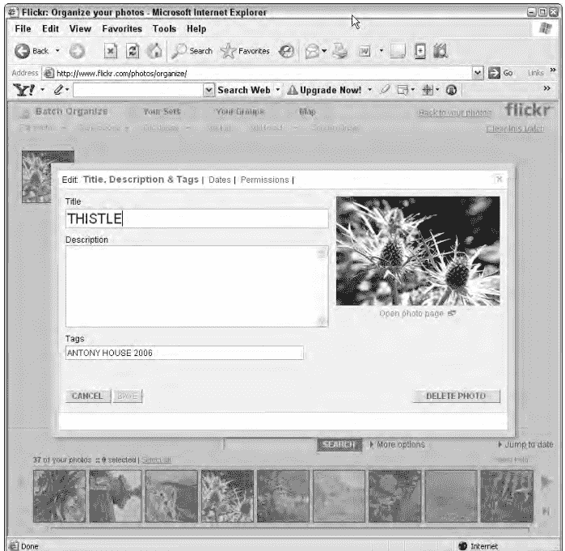

图 1-1：组织你的照片选项。

这一切都是使用 Ajax 技术无缝完成的。此外，“发送到群组”、“添加到集”和“博客发布”按钮也直接在页面上执行其功能。flickr 甚至提到，这些页面使用“旧技术”来实现这一点。动态 HTML 技术取代了 Flash，因为 Flash 要求你安装最新的 Macromedia 插件，而且 Flash 的包装器加载时间可能很长。用户对此表示不满。Flash 是一个很棒的应用程序，但在这里 Ajax 技术证明更为高效。

#### Basecamp

Basecamp 是一个用于管理和跟踪项目的基于网络的工具。你可以在 <www.basecamphq.com> 找到它。同样，你需要注册才能使用它，但有一个免费的注册选项，包含了相当广泛的功能。

Basecamp 在以下操作中使用了 Ajax：向公司添加人员、向项目添加公司、添加/编辑/删除/重新排序/完成待办事项、添加/编辑/删除/重新排序待办事项列表、添加/编辑/删除时间项目以及重命名附件到消息（图 1-2）。

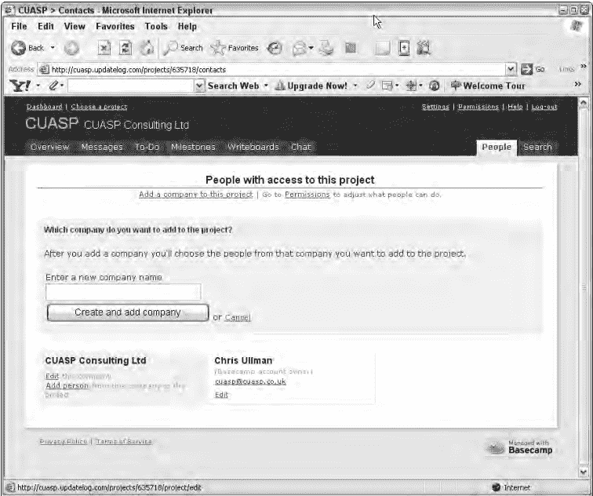

**图 1-2：向公司添加人员。**

当你点击为公司添加人员时，对话框会平滑地向下展开，无需刷新屏幕。此外，当你选择“不再显示”按钮时，提示和技巧面板会消失。

并非 Basecamp 的所有功能都使用了 Ajax，但使其引人注目的是服务器端交互和 Ajax 技术的混合使用——它们没有被滥用，而是在能够为最终用户体验带来益处时付诸实践。

#### Amazon (A9.com)

Amazon 以其商店网站而闻名，但其搜索引擎 www.A9.com 则不那么为人所知，该引擎结合了来自众多来源的搜索结果。自搜索引擎诞生以来，其用户界面相当静态。你输入一个单词，然后点击搜索。改变的是引擎背后的搜索复杂性以及你现在可以查询的不同来源。Amazon 的 A9 允许你跨电影、书籍、Wiki 页面和博客等多种媒体搜索单个词条。图 1-3 显示了对“环法自行车赛”（Tour De France）进行典型搜索的结果。

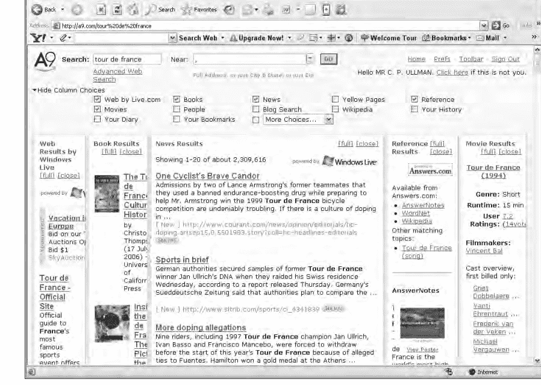

图 1-3：对“环法自行车赛”进行典型搜索的结果。

当你点击复选框以添加或移除搜索时，Ajax 就发挥作用了。你可以点击“人物”链接，即使你在原始搜索中没有包含它，一个框也会无需刷新地出现。你可以取消选中“参考资料”和“电影”框，这些链接会立即消失。这是即时的，完全体现了丰富且响应迅速的用户界面精神。

谷歌 Suggest 和谷歌 Maps 在 Adaptive Path 的文章中都被提及为很好的例子。之所以最后提到它们，是因为它们对 Ajax 技术的使用不如其他提到的网络应用那么广泛，并且作为例子可能已经过于熟悉了。Google Suggest 是搜索引擎的一个版本，试图在你输入时提供类似搜索的建议。如图 1-4 所示，可以在 www.google.com/webhp?complete=1&hl=en 找到它。

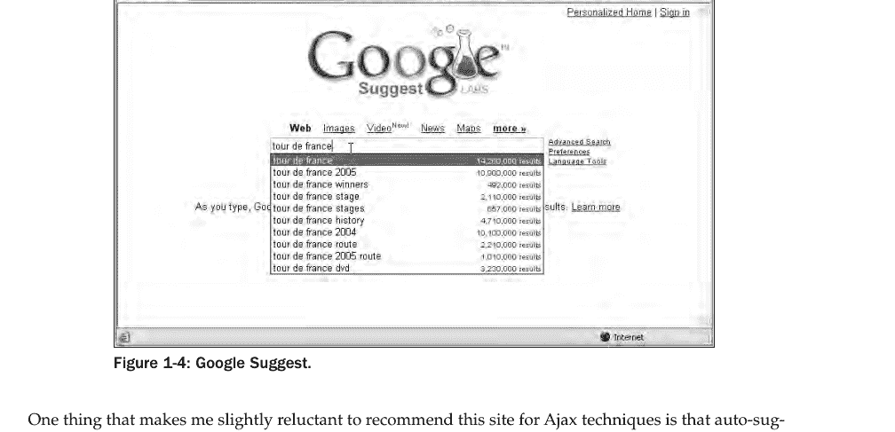

有一点让我有点不太愿意推荐这个网站作为 Ajax 技术的例子，那就是自动建议框在一些用户中名声不佳。它们可能被视为侵入性或令人困惑，或者两者兼而有之。使用移动电话短信服务的用户会非常熟悉那种挫败感，当“no”这样的词被“贴心地”改为“on”时。这与进行“预测”你将输入内容的代码有很大关系。在 Google Suggest 中，这是对该技术的良好应用，但当使用类似的东西进行表单验证时，你应该小心，不要侵入表单的可用性。简单的错误信息通常就足够了。

Google Maps 使用了 Ajax。当地图上的一个位置被定位后，它会加载地图的相关部分。如果你接着滚动，它不会将整个地图保持在内存中，而是根据你的需要分块加载地图。你可以在图 1-5 中看到实际效果；加载速度确实非常快。

#### 图 1-5：Google Maps。


这是仅使用一种技术来增强网站可用性和最终用户体验的另一个例子。

#### 其他网站

许多其他网站都采用了 Ajax 技术，当然，不可能预览所有这些网站。一个好的起点是查看 A Venture Forth 网站上由初创公司创建的十大 Ajax 应用程序列表。可以在以下地址找到：`www.aventureforth.com/2005/09/06/top-10-ajax-applications/`。它的列表包含一个在线日历、一个文字处理器、一个 RSS 阅读器、一个项目管理工具和一个亚马逊版的 Google Suggest（即 Amazon Suggest）。这组例子很好地概述了你可以利用 Ajax 做的事情。你唯一的限制是你的想象力。

最后，有一个关于你可能使用 Ajax 技术执行的任务的不错列表，可以在网站 `http://swik.net/Ajax/Places+To+Use+Ajax` 找到。它是一个 Wiki，所以是互动性的，人们不断地添加建议。以下是一些较好的建议：

- **动态菜单** — 网站是不断变化的实体，对其施加僵化的结构只意味着当结构改变时需要做更多工作。当由客户端代码处理时，菜单响应更灵敏，并且你可以使用 Ajax 来拉取数据填充它们。
- **自动保存** — 一个良好的幕后程序是在用户未提示的情况下保存文本框的内容。
- **自动完成** — 预测性文本短语，像 Google Suggest 一样，如果做得好，可以加快输入过程。
- **分页或组织大量结果** — 当查询（如搜索）返回大量数据时，你可以使用 Ajax 应用程序对数据进行排序、组织，并将其显示为易于管理的块。
- **用户间通信** — 如果每次发送或接收消息都必须刷新屏幕，你可能会对使用 MSN Messenger 持保留态度。然而，在网络应用的在线论坛或聊天区，这种情况经常发生。在网络应用中与另一个用户即时通信是 Ajax 可以发挥作用的好地方。

你可以看到，这些任务已经使用服务器端技术实现了。然而，这些任务如果通过将一些处理交回客户端来执行，可能完成得更好，从而实现更快、更响应迅速的网站。

#### 不好的例子

当然，并非所有在网络上使用 Ajax 的例子都是好的。如前所述，并非所有领域都适合使用 Ajax。在 Alex Bosworth 的 Ajax 错误列表 http://alexbosworth.backpackit.com/pub/67688 中，列表末尾添加了一条新注释：“为了使用 Ajax 而使用 Ajax（Using Ajax for the sake slash sake of Ajax）”。也许让许多 Ajax 的批评者感到恼火的是，开发人员会采用一项尖端技术或方法，并将其应用于特定任务，而不管其是否适合。

那么，究竟是什么构成了不好的 Ajax 例子呢？提供一些 URL 可能具有启发性，也可能有点俏皮，但可能会引发很多激烈争论，更不用说诉讼了。这也是相当主观的。让我们将“不好”的例子定义为那些使用了 Ajax，但其完成的速度比简单地提交到服务器可能实现的速度更慢的网站。

例如，你可能见过一个搜索引擎分页器，虽然它不更新页面，但返回结果的时间可能比仅仅将查询发送到服务器要长。问题在于，通过将焦点转回客户端，你也部分依赖于用户的机器资源和所涉及的浏览器。如果你让他们处理大量数据，那么奔腾 2 处理它的速度就不会像奔腾 4 那样快。

另一个不好的 Ajax 例子可能是在表单验证中，如果你在用户完成输入之前就中断了他们的输入。你不想打断用户输入或输入数据的正常模式。Ajax 的关键目标之一必须是改善用户的整体体验。在某些情况下，这可能意味着 Ajax 的使用非常微妙或几乎察觉不到，但当涉及用户界面时，这是一件好事。

现在是时候谈谈 Ajax 代表什么，以及为什么它所代表的并不一定就是 Ajax 目前的全部内涵了。


## 第1章：Ajax简介

### Ajax：这个缩写词

如果你读过Adaptive Path的那篇文章，那么你已经知道Ajax这个缩写词代表的是*异步JavaScript*和*XML*。这里有个转折：Ajax不一定非要用XML，也不一定非得是异步的。Ajax应用可以使用XML，也可以进行异步更新。这些都是更新页面时相当常见的技巧和技术，但它们并不与这些技术绑定。

重申之前的一个观点，Ajax是“一套编程技术”，“一种特定的Web编程方法”。它不是僵化的；它不像是一个仅限会员的俱乐部，如果你不使用某项技术，它就不是Ajax；它是一种总体的指导哲学。如何在客户端实现这些目标，取决于你自己。不过，这些目标本身被证明是一个很好的起点。Jesse James Garrett在文章中提到“几种技术……以强大的新方式结合在一起”。以下是他具体提到的技术：

- XHTML 和 CSS
- 文档对象模型 (DOM)
- JavaScript
- XML 和 XSLT
- XMLHttpRequest 对象

实际上，要创建一个使用Ajax技术的应用程序，你只需要其中的三项：XHTML、DOM和JavaScript。不过，如果你用Ajax技术做大量的开发工作，那么在某个时刻几乎肯定会用到所有这些技术。

你可能还需要一种服务器端语言来处理与服务器的所有交互。这通常是最典型的以下三种之一：

- PHP
- ASP.NET (Visual Basic.Net/C#)
- Java

在构建网页时，你可能已经遇到过很多或大部分这些技术，但也许不是全部，所以值得快速提醒一下每项技术是什么、做什么、它在Web开发中的作用，以及它与Ajax的关系。

#### XHTML 和 CSS

你会熟悉超文本标记语言 (HTML)，它是Web的通用语言，但也许对它的后继者——可扩展超文本标记语言 (XHTML) 不太熟悉。XHTML是HTML更严格的版本。事实上，它是被指定为XML文档的HTML标准。主要区别在于，HTML一直以来相当宽松，浏览器会尽力显示你放在标签里的任何内容，而XHTML现在遵循XML的规则。例如，XML文档必须是格式良好的（标签必须正确地打开和关闭，并且嵌套），XHTML页面也必须如此。例如，以下是正确的嵌套：

```html
<div>
<h1>
This is a correctly nested H1 tag
</h1>
</div>
```

以下是错误的嵌套：

```html
<div>
<h1>
This is an incorrectly nested H1 tag
</div>
</h1>
```

尽管这似乎与HTML轻松易编码的本质相悖，但如果一个页面结构不正确，那么你将无法执行本书中讨论的Ajax技术。要使用DOM，页面必须格式正确。否则，你将无法访问页面的不同部分。

层叠样式表 (CSS) 是HTML页面背后的模板，它描述了HTML页面中包含的文本和数据的呈现方式和布局。CSS对开发者特别有意义，因为对样式表的更改会立即反映在页面显示中。样式表通常通过HTML `<link>`标签链接到文档中，尽管（但不推荐）也可以为页面上的每个HTML标签指定样式属性。你也可以通过DOM访问CSS属性。

在任何网站或Web应用的设计中，你都应该尽可能清晰地区分页面的内容/结构和呈现方式。假设你有100个页面，并且在这100个页面上都将字体大小指定为样式属性。当你被迫更改字体大小时，你将不得不逐个更改每个页面，而不是只在样式表中更改一次。

拥有样式表并非100%必不可少，但为了保持良好的组织结构，样式表是不可或缺的辅助工具。

#### 文档对象模型 (DOM)

DOM是网页的层级或树状结构表示，其中页面的每个部分（图形、文本框、按钮以及文本本身）都由浏览器建模。

在IE 4和Netscape Navigator 4之前，网页的并非所有部分都可以被代码访问。事实上，要更改网页上的文本，必须使用服务器端技术，否则根本无法更改。整个页面被称为*文档*，该文档包含组成页面的所有HTML标签和文本。DOM由万维网联盟 (W3C) 指定为标准 (www.w3.org)，因此它是所有浏览器表示页面的标准方式。你可以相当有把握地保证，当你在IE中使用JavaScript更改页面背景色时，在Mozilla、Safari或Opera中也能正确做到。不过，这条规则也有例外。IE中有几种非标准方法，而像ActiveX控件这样的项目无法在其他浏览器中使用。

你可以使用脚本语言（如JavaScript或VBScript）向DOM添加项目或更改它们，它们会立即出现在页面上。它们通常以层级格式进行寻址，例如下面的代码，它寻址表单上名为“button”的按钮并更改该按钮的文本。请注意，在此代码片段中，表单元素的name属性设置为 `form1`：

```javascript
document.form1.button.value = "Click Me";
```

或者，你可以使用可以访问页面上特定元素或元素子集的方法，例如 `document.getElementById` 方法，它将返回匹配条件的特定元素实例：

```javascript
var myTextBox = document.getElementById("myTextbox");
```

然后你可以为你创建的变量赋值以更改其值。要使文本框不可见，你可以调用以下代码：

```javascript
myTextBox.style.visibility = "visible";
```

另一个相关的方法是 `getElementsByTagName` 方法。`getElementsByTagName` 方法将返回网页上所有具有给定标签名称的元素数组，类型为 `NodeList`，即使页面上只有一个该元素的出现。以下代码将返回页面上的所有图像元素：

```javascript
var imageElements = document.getElementsByTagName("img");
```

也可以通过向文档添加名为 `节点` 的新部分来组装页面。这些可以是元素、属性甚至是纯文本。例如，你可以创建一个包含简短消息的span标签，并将其添加到页面，如下所示：

```javascript
var newTag = document.createElement("span");
var newText = document.createTextNode("Here is some New Text. Ho Hum.");
newTag.appendChild(newText);
document.body.appendChild(newTag);
```

所有这些DOM技术都适用于客户端，因此，浏览器可以即时更新页面或其部分。Ajax非常依赖这些功能来提供丰富的用户体验。另外，如前所述，这些技术自IE第4版以来就已存在。只是它们一直未被充分利用。DOM是一个重要的主题，将在第2章更详细地讨论。

#### JavaScript

JavaScript是大多数Web开发人员的首选脚本语言。你必须了解JavaScript才能使用本书。本书不教授JavaScript，尽管第2章提供了对最重要知识点的快速复习。

Ajax技术并非JavaScript的专属。VBScript也提供了相同的动态更新功能——尽管仅限于IE。虽然JavaScript在ECMAScript标准中有规范，但JavaScript最初是在此类标准存在之前在Netscape Navigator中创建的。微软并行创建了其自己的JavaScript版本（称为JScript），结果每个浏览器的JavaScript版本都略有不同。尽管JavaScript仍然是更新网页的非常强大的方法，但需要进行一定程度的双重编码以确保网页和应用程序在不同浏览器中都能正确运行。当不可能时，也需要一些错误处理代码。


## 第 1 章：介绍 Ajax

相当一部分的 Ajax 代码将涉及处理跨浏览器代码以及（在必要时）处理错误，除非你能保证你的代码能应对它们）。这种情况是令人遗憾的，即便是新版本的 IE 和 Firefox 也无法解决。后续章节将讨论这两个难题。

#### XML、XSLT 和 XPath

XML 是另一个熟悉的基石，对于任何网络开发人员来说，它都是用来描述和结构化数据的语言。

随着 XML 的出现，还有大量配套技术应运而生，每项技术都有其独特的应用领域。XML 文档本身不包含关于如何显示或搜索它的信息。一旦数据被渲染为 XML 文档，你通常需要其他技术来从中搜索和显示信息。IE 和 Firefox 都包含 XML 引擎，可以解析 XML 文档。

XSLT 是一种将 XML 文档转换为其他 XML 文档的语言。它并不局限于将 XML 文档转换为 XML（格式）。你也可以指定 HTML 或纯文本作为输出格式。当你转换文档时，你从一个源 XML 文档开始，如下所示的片段：

```
<HotelList>
  <Hotel>
    <Name>Hotel Shakespeare</Name>
    <Rooms>50</Rooms>
    <City>Birmingham</City>
  </Hotel>
  <Hotel>
    <Name>Hotel Washington</Name>
    <Rooms>500</Rooms>
    <City>Chicago</City>
  </Hotel>
</HotelList>
```

你将第二个 XSLT 文档应用到第一个文档上。XSLT 文档包含了一组规则来执行转换，如下所示：

```
<xsl:stylesheet version="1.0"
    xmlns:xsl="http://www.w3.org/1999/XSL/Transform">

  <xsl:template match="/">
    <table>
      <tr>
        <td>
          Hotel Name
        </td>
        <td>
          Number of Rooms
        </td>
        <td>
          Location
        </td>
      </tr>
      <xsl:for-each select="//Hotel">
```

```
    <tr>
        <td>
            <xsl:value-of select="Name" />
        </td>
        <td>
            <xsl:value-of select="Rooms" />
        </td>
        <td>
            <xsl:value-of select="City" />
        </td>
    </tr>
</xsl:for-each>
</table>
</xsl:template>

</xsl:stylesheet>
```

你会得到一个结果 XML 文档（在这种情况下也是 XHTML 文档），看起来像这样：

```
<table>
<tr>
    <td>
        Hotel Name
    </td>
    <td>
        Number of Rooms
    </td>
    <td>
        Location
    </td>
</tr>
<tr>
    <td>
        Hotel Shakespeare
    </td>
    <td>
        50
    </td>
    <td>
        Birmingham
    </td>
</tr>
<tr>
    <td>
        Hotel Washington
    </td>
    <td>
        500
    </td>
    <td>
        Chicago
    </td>
</tr>
</table>
```

你可以随后动态地将 XHTML 文档片段插入到 HTML 页面中以更新页面。

XSLT 是 W3C 维护的另一个标准。IE 和 Mozilla 都有 XSLT 处理器；然而，它们并不总是以相同的方式处理 XSLT 文档。XSLT 在应用其转换时使用另一种语言（XPath）来查询 XML 文档。XPath 查询用于访问原始 XML 文档中的元素，例如如下所示：

```
<xsl:for-each select="//Hotel">
```

`//Hotel` 语句指示浏览器的 XSLT 处理器查找名为 `<Hotel>` 的元素，这些元素是根元素 `<HotelList>` 的后代。XPath 查询可用于在 XML 文档中定位特定项目或一组项目，使用与浏览器定位网页方式表面相似的语法，以下是一个示例：

```
//HotelList/Hotel/Rooms
```

这些技术可用于检索数据部分并通过浏览器在页面上显示。同样，它们能够提供即时更新，无需返回服务器。XSLT 和 XPath 将在第 8 章中进行更详细的讨论。

### XMLHttpRequest 对象

如果在先前的内容中遇到的一件事不太可能是什么，那很可能是 `XMLHttpRequestObject`。Microsoft 在 Internet Explorer 版本 5 (IE 5) 中引入了一种相当不寻常的 ActiveX 控件，称为 `XMLHttp` 对象。当然，ActiveX 控件与 IE 绑定，因此不久之后，Mozilla 工程师也效仿创建了适用于 Mozilla 1 和 Netscape 7 的版本，即相应的 `XMLHttpRequest` 对象。这些对象的状态因被包含在原始 Ajax 文章中而大大提高。现在它们通常单独被称为 `XMLHttpRequest` 对象，并且，在 IE 7 中，除了 ActiveX 控件外，还有一个原生的 `XMLHttpRequest` 对象。该对象的各个版本也已包含在 Safari 1.2 和 Opera 中。

但它能做什么呢？嗯，它允许开发者在后台提交和接收 XML 文档。以前，你可以使用隐藏帧或 iframe 来执行此任务，但 `XMLHttpRequest` 在允许你发送和获取数据方面更为复杂。

不幸的是，由于它尚未成为标准，这意味着创建它仍有两种不同的方式。在 IE 7 之前版本中，它在 JavaScript 中作为 `ActiveXObject` 创建，如下所示：

```
var xhrObject = new ActiveXObject("Microsoft.XMLHTTP");
```

> MSXML 库有若干个版本，各自具有实例化 `XMLHttp` 对象的相应 `ProgID`。具体来说，你不能使用给定的独立 `ProgID` `Microsoft.XMLHTTP` 实例化任何高于 'Msxml2.XMLHTTP.3.0' 版本的 `XMLHttp` 对象。尽管书中的示例，这已足够。

在 Mozilla Firefox、IE 7 和其他浏览器中，它创建如下：

```
var xhrObject = new XMLHttpRequest();
```

因此，这意味着在确定对象应该如何创建之前，你必须先进行一点浏览器功能检测。由于 ActiveX 控件和对象是 IE 独有的，你可以通过尝试调用窗口对象的 `ActiveXObject` 方法来检测它们。对于 IE 7、Mozilla Firefox、Safari 和 Opera，存在一个 `XMLHttpRequest` 方法。这些调用使用隐式类型转换返回 `true` 或 `false`，具体取决于查看页面的浏览器。换句话说，如果该浏览器上有 `ActiveXObject`，它将返回 `true`；否则，它将返回 `false`。

通常，你的浏览器功能检测和对象创建代码看起来像这样：

```
var xhrObject = false;
if (window.XMLHttpRequest)
{
    xhrObject = new XMLHttpRequest();
}
else if (window.ActiveXObject)
{
    xhrObject = new ActiveXObject("Microsoft.XMLHTTP");
}
else
{
    //Do something to handle non-Ajax supporting browsers.
}
```

计划在未来 DOM 规范的第 3 级中标准化此功能，但在那时之前，你需要为此事实留出余地。

`XMLHttpRequest` 对象所扮演的角色非常重要。它在 Google 的 Gmail 中被大量使用，在幕后来回传输数据。事实上，它可以提供 Ajax 应用的异步部分。它使用 `onreadystatechange` 事件来指示何时完成加载信息。你可以指示它获取 XML 文档，如下所示：

```
xhrObject.open("GET", "SuiteList.xml", true);
```

然后，在稍后的时间点，你可以检查 `readyState` 属性的值，看看它是否完成加载，如果已完成，则提取所需的信息。

一个方面，`XMLHttpRequest` 对象具有误导性，因为你不一定需要用它传输 XML。你可以非常愉快地用它来回传输 HTML 或纯文本。将在第 4 章中对其进行更详细的检查。数据同步传输和异步传输方法的区别在本章稍后将进行探讨。

## 服务器端技术

这个等式的最后一部分（并且并非真的在 Garrett 的原始文章中涉及）是 Ajax 需要使用的一些服务器端技术。本书使用 PHP 和 ASP.NET（视情况而定）来服务服务器请求。任何单一方法并不比另一种更好；相反，你应该使用你最熟悉的那一种。


 ## 第一章：Ajax 简介

与 JavaScript 一样，本书不会讲授如何使用 PHP 和 ASP.NET。预期你已经了解其中一种。服务器端技术将在第三章中更详细地探讨，但当前的讨论尽量避免过于深入地介绍它们，因为它们为 Ajax 提供的是粘合剂，而非 backbone。

随着 Ajax 拼图的所有碎片都已就位，现在我们更仔细地来看看 Ajax 如何改变传统的 Web 交互方式。

### Ajax 应用模型

起初，Web 旨在仅显示 HTML 文档。这意味着经典的 Web 应用具有"输入数据、将页面发送到服务器、等待响应"的模型，仅适用于网页。其次，存在同步通信的问题。现实世界同步设备的一个很好的例子是公共电话亭。你必须给某人打电话，而那个人必须能够与你通信。在许多公共电话亭，你无法让接听方给你回电。你只能呼叫接听方并传递信息。通话结束后你必须离开电话亭，因为通常会有其他人在等待使用它。如果接听方尚未给你所需的信息，那就太糟糕了。异步通信的例子则是使用你的家用电话：你给某人打电话，他们现在无法给你所需的信息，所以他们同意在有信息时给你回电，无论何时。

在 Web 上，同步意味着用户请求一个 HTML 页面，浏览器代表他或她向 Web 服务器发送 HTTP 请求（图 1-6）。服务器执行处理，然后以 HTML 页面的形式向浏览器返回响应。浏览器显示请求的 HTML 页面。浏览器始终发起请求，而 Web 服务器仅响应此类浏览器请求。Web 服务器从不发起请求——通信始终是单向的。"请求/响应"周期是同步的，在此期间用户必须等待。

如前所述，该模型适用于浏览网页，但越来越复杂的 Web 应用的开发意味着该模型现在正在崩溃。它崩溃的第一个领域是性能。"输入、发送和等待"的方法意味着存在时间浪费。其次，每当你刷新页面时，你都会向服务器发送一个新的请求。这需要额外的服务器处理，并导致等待响应的时间损失，以及由冗余页面刷新引起的更高带宽消耗。潜在的问题是完全没有双向、实时通信能力，服务器无法发起更新。

这种情况导致缓慢、不可靠、低生产率且低效的 Web 应用。这里有两个基本问题：一个是必须等待服务器响应，另一个是服务器无法发起更新。Ajax 应用模型旨在通过巧妙地改变其工作方式来产生更高的性能，从而创建更高效的 Web 应用。

Ajax 向 Web 应用模型引入了"部分屏幕更新"的理念。在 Ajax 应用中，只有包含新信息的用户界面元素才会被更新。用户界面的其余部分应保持不变。这意味着你不必发送那么多信息，也不会因为前一页面已经在运行而等待响应。该模型使网页能够持续运行，也意味着页面上完成的工作不必遵循直线、可预测的模式。

除了同步模型，你现在可以有异步模型或轮询模型。在 Ajax 应用中，服务器可以在准备就绪时留下通知，客户端会在需要时获取它。或者，客户端可以定期轮询服务器以查看服务器是否就绪，但在此期间可以继续其他操作，如图 1-7 所示。

因此，用户可以在客户端在后台向服务器请求信息时继续使用应用。当新数据最终到达时，只需更新用户界面的相关部分即可。

#### 我为什么应该使用 Ajax？

我们已经了解了模型，但现在让我们用实际术语来说明使用 Ajax 创建应用的优势。这相当于我作为二手车经销商的卖力推销。

##### 部分页面更新

你不必更新整个页面的数据。你可以仅更新页面中需要更新的部分。这应该意味着无需完整页面刷新、更少的数据传输量，以及改进的用户体验流程。你不必在页面之间磕磕绊绊。

##### 隐形数据检索

你看一个网页的时间越长，它过时的可能性就越大。使用 Ajax 应用，即使表面上没有要求网页做任何事情，它也可能在后台自我更新。

##### 持续更新

因为你不必每次等待页面刷新，而且 Ajax 可以在幕后检索数据，Web 应用可以持续更新。Word 或 Outlook 等传统软件应用会根据其配置、持有的数据或所处的环境来改变显示的菜单或视图。它不必等待服务器或用户执行操作才能下载新邮件或应用新模板。Ajax 技术使 Web 应用能够因此表现得*更像* Windows 应用程序。

##### 流畅的界面

不需要更改的界面几乎必然更容易使用。Ajax 在这方面可能是一把双刃剑，因为你可以用它来修改界面的部分，并简单地通过改变脚下的地面来*迷惑*用户。理论上，通过进行微妙的更改，你可以帮助用户顺利通过界面或向导，并加快流程。

##### 简洁性与丰富功能

正如前面的示例所示，一些最令人印象深刻的 Ajax 应用是那些你必须寻找 Ajax 功能的应用，例如 Basecamp。如果 Ajax 可以用来使你的应用更简洁，同时改善用户体验，那这一定是一种改进。

##### 拖放功能

拖放功能是大多数软件应用最便捷的功能之一，从 Windows 资源管理器到 Windows 桌面。它并不严格属于 Ajax 功能。这在 Web 应用中已经可能实现了很多年，甚至在 `XMLHttpRequest` 对象引入之前。大多数开发者似乎选择 Flash 或类似的重量级解决方案，而不是使用 JavaScript 和 DOM 解决方案。在 Ajax 带来的用户界面创建技术重新评估中，拖放功能可以用来管理前端更改，然后这些更改通过 Ajax 提交到服务器。例如，你将屏幕上的几个项目拖到新位置，然后注销。稍后，当你回来时，这些项目位于相同的位置。

有了如此众多的好处，可能很难想象为什么每个人都没有转向使用 Ajax 应用。不过，肯定有一些陷阱需要考虑。

#### 何时不使用 Ajax

一旦学会了 Ajax 技术，你不应该回去撕毁所有旧的 Web 页面并重新开始。相反，你应该考虑如何改进页面的可用性，以及 Ajax 是否是一个有助于改进它们的解决方案。如果没有可用性的进步，你不妨干脆不要 bother。


大量文章解释了为何在特定情况下不应使用 Ajax 技术，例如以下网址中的内容：

-   **Ajax 很糟糕** — http://www.usabilityviews.com/ajaxsucks.html （一篇关于 Jakob Nielsen “为什么框架糟糕”的戏仿文章）
-   **Ajax：承诺还是炒作** — http://www.quirksmode.org/blog/archives/2005/03/ajax_promise_or.html
-   **Ajax 并不酷** — http://www.lastcraft.com/blog/index.php?p=19

##### 响应性差

使用 Ajax 时，最引人注目的问题或许是：理论上它能加速交互，实际上却拖慢了页面。

如果你持续使用 Ajax 向服务器提交数据，可能会发现页面速度变慢了。反过来，如果服务器向客户端返回大量数据集，你会发现浏览器难以及时处理这些数据。理论上，搜索引擎似乎是一个使用 Ajax 分割数据的好场景，这样从第 1–10 页跳转到第 11–20 页时无需刷新页面。但实际上，由服务器将数据集切分成小块，远比让浏览器尝试处理超过 1000 条记录的数据集要好得多。关键在于智能且审慎地运用 Ajax 技术。

##### 破坏浏览器的后退按钮

如果应用不当，Ajax 应用程序可能会破坏浏览器的后退按钮。

一个绝佳的 Ajax 应用典范是 Gmail，它非常有效地运用了后退和前进按钮。此外，也有许多不使用 Ajax 技术的网站，同样禁用了后退按钮。在我列举的“罪状”中，这一条并不算特别严重。

##### 破坏书签和搜索引擎索引

如果你在一个 Ajax 应用中收藏了一个页面，最终可能会在收藏夹列表中得到一个不同的页面。JavaScript 创建了页面的特定“视图”，而这个“视图”不依赖于原始 URL。反过来说，对于动态菜单系统，你可能认为网站中某些通过菜单无法访问的部分已经失效，但实际上其他人仍然可以访问。许多网站都有大量指向旧版页面的点击记录，这些点击只会导致服务器报错。

当然，可以创建正确处理书签和后退按钮的 Web 应用。关于如何有效处理这两者的优秀示例，可参见 http://onjava.com/lpt/a/6293。

##### 加重浏览器负担

如果将数据处理的全部负担都推回给浏览器，你就更加依赖浏览器和用户的计算机来代你完成处理。等待浏览器处理页面，并不比等待 Web 服务器响应更好。事实上，在某些情况下（比如你正在等待 Internet Explorer），情况可能更糟，因为它在处理时可能会占用机器的所有处理资源，导致整个系统响应极其缓慢。

## 第一章：Ajax 简介

你现在应该感觉到，其中的每一条理由都是有条件的。——Ajax 的使用可能会妨碍而不是提升可用性；然而，如果考虑到开发过程，如果你采取措施解决了后退按钮和书签的问题，那么就没有理由不使用 Ajax 技术。但这确实提出了一个问题。

如果 Garrett 那篇开创性的文章如此漏洞百出，为何它还如此流行？这或许是因为它阐明了许多人已经在思考和实践、却未能命名的东西。关于执行方式的一些不准确之处并不重要。它完全引起了开发者的共鸣。你可以将其比作一些早期披头士乐队的录音，演奏并非最完美，但其中的旋律总是闪闪发光，因此人们总是满怀深情地记起它们。即使是那些对该文有意见的开发者也承认，它描述了一种创建 Web 应用的合理方法，并重新审视了那些曾被忽视或遗忘的旧技术。

### *谁可以/不可以使用 Ajax？*

不言而喻，并非所有人都能使用 Ajax。你应该始终意识到网站的某些部分可能因其采用的特定技术而排除了一些用户，并应考虑如何解决这部分目标受众的问题。

以下是一些主要考量因素：

-   使用较新版本主流浏览器（IE 4+、Mozilla Firefox/Netscape 7+、Safari 和 Opera 5+）的用户会发现他们可以很好地使用 Ajax 应用。使用旧版浏览器的用户则无法使用。
-   禁用了脚本语言的人无法使用 Ajax（或 JavaScript 应用）。在你嘲笑之前，请记住，在 IE 和 Microsoft Outlook 最近发生一些漏洞事件后，微软最初的建议是禁用活动脚本，直到补丁修复漏洞。
-   离线浏览应用的人。这看起来可能几乎是使用 Web 的原始方式，但实际上，它也是一种非常现代的方式。移动通信的带宽收费昂贵且吞吐量有限，因此登录、下载、注销是非常常见的操作。像 AvantGo 这样的网站允许你离线浏览一系列订阅的网页。如果这些页面包含了 Ajax，就会导致功能失效。

再次强调，要清楚你的目标受众是谁，以及他们的需求是什么。

### 创建你自己的示例

你读完本章后，不应该觉得“那么何必使用 Ajax 呢？”。这不是重点。正确使用 Ajax 是有其时宜和场合的。把它想象成一辆跑车。当然，它能在 7 秒内从 0 加速到 60 英里/小时，最高时速可达 150 英里/小时。但在市区或高速公路上，并不是展示这些能力的场合。你会招致其他民众的愤怒，更不用说警察了。Ajax 也是同理。如果你在每个可用的机会都使用它，你网站的访客数量可能就不会像你预期的那么多了。

## 第一章：Ajax 简介

创建一个 Ajax 应用，关乎设计，关乎思考如何通过你的应用改善用户界面和体验。我们将创建一个快速示例，展示如何使用 `XMLHttpRequest` 对象和 XML 文件，为一个商业场景创建一个动态菜单系统。

商业场景如下：你有一家旅游公司，其网站展示酒店和套房信息。酒店希望仅展示当前可用套房的预订信息。此信息以 XML 文件形式发布。公司以固定间隔将数据作为文本或 XML 文件发布到同一位置是非常常见的，因为它通常可以自动生成。本示例不创建发布 XML 文件的功能，而是每 10 秒检查一次并从给定位置获取新数据。这将产生更新菜单系统选项的效果，而无需刷新页面。

请注意，这个示例相当复杂。它演示了一种有意义的 Ajax 应用方式。你应该略读代码。后面的章节将讨论 `XMLHttpRequest` 对象、DOM 的使用，以及在应用中可以使用 XML 和 XSL 的场景。

### 试一试

#### 第一个 Ajax 示例

1.  在你的 Web 服务器根目录中创建一个名为 `BegAjax` 的新文件夹。在其中创建一个名为 `Chapter1` 的文件夹。
2.  首先创建 XML 数据文件。将其保存在 `Chapter1` 文件夹中的 `SuiteList.xml`。请注意，所有这些文件都可以在记事本或你首选的文本或网页编辑器中创建。如果你不想手动输入代码，可以从 `www.wrox.com` 的“下载”部分下载。

```xml
<?xml version="1.0" encoding="utf-8" ?>
<SuiteList>
  <Suite>
    <SuiteID>1001</SuiteID>
    <Name>Ponderosa</Name>
    <Size>2</Size>
    <Price>50</Price>
    <WeeksFree>10</WeeksFree>
  </Suite>
  <Suite>
    <ProductID>1002</ProductID>
    <Name>Colenso</Name>
    <Size>2</Size>
    <Price>30</Price>
    <WeeksFree>10</WeeksFree>
  </Suite>
  <Suite>
    <ProductID>1003</ProductID>
    <Name>Dunroam</Name>
    <Size>2</Size>
    <Price>60.00</Price>
    <WeeksFree>10</WeeksFree>
  </Suite>
</SuiteList>
```


## 第一章：初识 Ajax

```xml
<Suite>
    <ProductID>1003</ProductID>
    <Name>Family</Name>
    <Size>6</Size>
    <Price>90.00</Price>
    <WeeksFree>10</WeeksFree>
</Suite>
```

3. 接下来，您需要创建一个 JavaScript 脚本来处理客户端逻辑。将其保存为 `ajax.js`，同样放在 `Chapter1` 文件夹中。

```javascript
// 创建 XMLHttpRequest 对象
var xHRObject = false;
if (window.XMLHttpRequest)
{
    xHRObject = new XMLHttpRequest();
}
else if (window.ActiveXObject)
{
    xHRObject = new ActiveXObject("Microsoft.XMLHTTP");
}
function getData()
{
    //检查 XMLHttpRequest 对象是否就绪以及是否返回了合法响应
    if (xHRObject.readyState == 4 && xHRObject.status == 200)
    {
        var xmlDoc = xHRObject.responseXML;

        if (window.ActiveXObject)
        {
            //加载 XSL
            var xsl = new ActiveXObject("Microsoft.XMLDOM");
            xsl.async = false;
            xsl.load("MenuDisplay.xsl");

            //转换
            var transform = xmlDoc.transformNode(xsl);
            var spanb = document.getElementById("menuhere");

        }
        else
        {
            var xsltProcessor = new XSLTProcessor();

            //加载 XSL
            XObject = new XMLHttpRequest();
            XObject.open("GET", "MenuDisplay.xsl", false);
            XObject.send复send(null);

            xslStylesheet = XObject.responseXML;
            xsltProcessor.importStylesheet(xslStylesheet);

            //转换
            var fragment = xsltProcessor.transformToFragment(xmlDoc, document);

            document.getElementById("menuhere").innerHTML = " ";
            document.getElementById("menuhere").appendChild(fragment);
        }
        if (spanb != null)
        {
            spanb.innerHTML = transform;
        }

        //清除对象并在 10 秒后调用 getDocument 函数
        xHRObject.ab复abort();
        setTimeout("getDocument()", 10000);
    }
}

function getDocument()
{
    //重置函数
    xHRObject.onreadystatechange = getData;

    //IE 会缓存 GET 请求；唯一的解决办法是附加一个
    //不同的查询字符串。我们添加一个新的日期并将其作为查询字符串
    xHRObject.open("GET", "SuiteList.xml?id=" + Number(new Date), true);

    xHRObject.send(null);
}
```

4. 此示例还需要一个 XSL 样式表。它负责处理 XML 文档中包含的数据的展示方式。这是控制 XML 文档中哪些项目显示、哪些项目不显示的部分。将该 XSL 样式表保存为 `MenuDisplay.xsl`，放到 `Chapter1` 文件夹中。

```xml
<?xml version="1.0" encoding="utf-8"?>

<xsl:stylesheet version="1.0"
    xmlns:xsl="http://www.w3.org/1999/XSL/Transform">

    <xsl:output method="html"/>

    <xsl:template match="/">
        <div onmouseout="var submenu = document.getElementById('romesubmenu');submenu.style.visibility = 'hidden';return true;">
            <table>
                <tr>
                    <td id="td1" class="menublock"
                        onMouseOver="td1.style.backgroundColor='#cccccc';"
                        onMouseOut="td1.style.backgroundColor='#eeeeff';">
                        巴黎酒店
                    </td>
                </tr>
                <tr>
                    <td id="td2" class="menublock"
                        onMouseOver="td2.style.backgroundColor='#cccccc';"
                        onMouseOut="td2.style.backgroundColor='#eeeeff';">
                        伦敦酒店
                    </td>
                </tr>
                <tr>
                    <td id="td3" class="menublock"
                        onmouseover="td3.style.backgroundColor='#cccccc';var submenu = document.getElementById('romesubmenu');submenu.style.visibility = 'visible';return true;"
                        onMouseOut="td3.style.backgroundColor='#eeeeff';">
                        罗马酒店
                    </td>
                </tr>
                <tr>
                    <td id="td4" class="menublock"
                        onMouseOver="td4.style.backgroundColor='#cccccc';"
                        onMouseOut="td4.style.backgroundColor='#eeeeff';">
                        纽约酒店
                    </td>
                </tr>
                <tr>
                    <td id="td5" class="menublock"
                        onMouseOver="td5.style.backgroundColor='#cccccc';"
                        onMouseOut="td5.style.backgroundColor='#eeeeff';">
                        蒙特利尔酒店
                    </td>
                </tr>
            </table>
            <xsl:call-template name="DynamicSubMenu"></xsl:call-template>
        </div>
    </xsl:template>

    <xsl:template name="DynamicSubMenu">
        <div id="romesubmenu" class="submenublock" onmouseover="var submenu = document.getElementById('romesubmenu');submenu.style.visibility = 'visible';return true;">
            <xsl:for-each select="//Suite">
                <xsl:if test="WeeksFree&gt;0">
                    <a href="{Name}.htm">
                        <xsl:value-of select="Name"/>
                    </a>
                    <br/>
                </xsl:if>
            </xsl:for-each>
        </div>
    </xsl:template>

</xsl:stylesheet>
```

## 第一章：初识 Ajax

5. 接下来是 CSS，它控制动态子菜单的开关以及菜单块的展示方式，例如颜色和字体大小。将其保存为 `SuiteListStyles.css`，放在 `Chapter1` 文件夹中。

```css
td.menublock
{
    background-color:#eeeeff; width:120px;height:25px;border-style:ridge; border-width:thin; border-color:gray; font-weight: bold; text-align:center; font-family:Arial; color:gray;
}
div.submenublock
{
    visibility:hidden; background-color:lightsteelblue; position:absolute; top: 70px; left: 133px; width:180px;border-style:ridge; border-width:thin; color:gray; font-weight: bold; text-align:center; font-family: Arial;
}
a
{
    color: White; text-decoration: none;
}

a:hover
{background-color: #28618E;
                font-weight: bold;
}
```

6. 最后一个是包含极少内容的 HTML 页面。它仅仅包含指向脚本和 CSS 的链接，以及一个单一的占位符 `<span>` 标签，用于写入菜单信息。将其保存为 `default.htm`，放在 `Chapter1` 文件夹中。

```html
<html>
<head>
    <title>Ajax 首个示例</title>
    <link rel="stylesheet" type="text/css" href="SuiteListStyles.css" />
    <script type="text/javascript" src="ajax.js"></script>
</head>
<body onload="GetDocument()">
    <span id="menuhere"></span>
</body>
</html>
```

> 注意，在第一章的代码下载中，有一些额外页面对应各个套房。这些仅用于展示，示例中并不需要。

7. 打开浏览器并查看 `default.htm` 页面。请确保通过您的 Web 服务器来访问。例如，在浏览器地址栏中输入以下内容将是正确的：

```
http://localhost/BegAjax/Chapter1/default.htm
```

如果您通过 Windows 资源管理器直接浏览到该文件并点击它，那么您将看到以下内容，这无法正常工作：

```
C:\Inetpub\wwwroot\BegAjax\Chapter1\default.htm
```

## 第一章：初识 Ajax

与服务器端技术一样，XMLHttpRequest 对象需要服务器才能正常工作。如果工作正常，您将看到一个页面，左侧有五个菜单选项。其中四个选项是非活动的。活动的选项是**罗马酒店**，如果您将鼠标悬停在其上，将会看到一个蓝色菜单出现（图 1-8）。

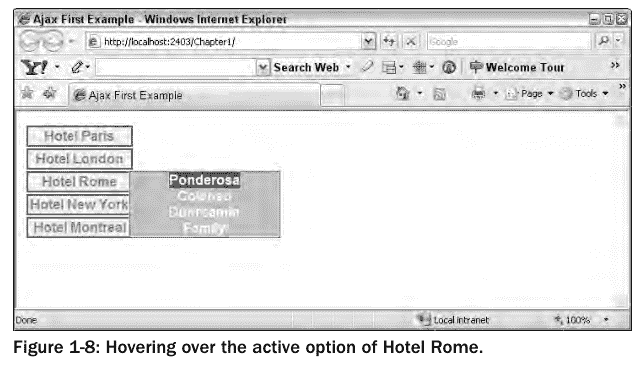

8. 现在，这是巧妙之处。假设您使用的 XML 文档刚刚被更新，以反映您在 Ponderosa 套房没有空房的情况。回到 `SuiteList.xml` 文件，并将可用周数改为零：

```xml
...
<Suite>
    <SuiteID>1001</SuiteID>
    <Name>Ponderosa</Name>
    <Size>2</Size>
    <Price>50</Price>
    <WeeksFree>0</WeeksFree>
</Suite>
...
```

9. 返回页面，确保不要刷新它。等待大约 10-15 秒。再次将光标悬停在罗马酒店上，如图 1-9 所示。

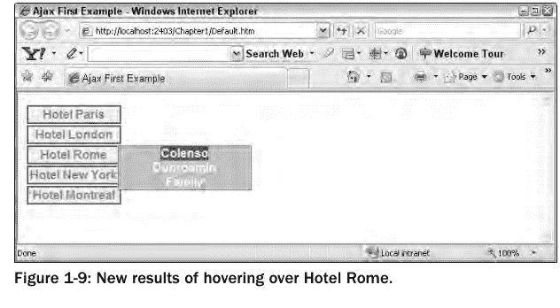

**10.** 最上面的条目已经消失。

## 工作原理

如前所述，这里不会详细讨论此示例，因为这些技术将在后面的章节中介绍。相反，让我们看看应用程序在做什么以及不同部分如何组合在一起。我们在 XSL 模板中创建了一个简单的菜单系统。它由一个包含五行单元格的表格组成。XSL 模板从 XML 文档 `SuiteList.xml` 中获取数据。XSL 模板的中间行包含一个 JavaScript `mouseover` 事件，用于开启子菜单的可见性。XSL 模板包含一个子模板，用于显示子菜单：

```xml
<xsl:template name="DynamicSubMenu">
    <div id="romesubmenu" class="submenublock" onmouseover="var submenu =
    document.getElementById('romesubmenu');submenu.style.visibility = 'visible';return true;">
        <xsl:for-each select="//Suite">
            <xsl:if test="WeeksFree&gt;0">
                <div>
                    <a href="{Name}.htm">
                        <xsl:value-of select="Name"/>
                    </a>
                </div>
                <br/>
            </xsl:if>
        </xsl:for-each>
    </div>
</xsl:template>
```

模板中使用 XSL 语句来遍历 `SuiteList.xml` 文档。`xsl:for-each` 语句定位 XML 文档中每个名为 `<Suite>` 的元素。总共有四个元素：

```xml
...
<Suite>
    <SuiteID>1001</SuiteID>
    <Name>Ponderosa</Name>
    <Size>2</Size>
    <Price>50</Price>
    <WeeksFree>0</WeeksFree>
</Suite>
...
```

然后，使用 `<xsl:if>` 语句来条件显示子菜单项。您检查 `<WeeksFree>` 元素的值，并表示如果该元素大于零，则显示包含在内的 `<span>` 和 `<a>` 元素。否则，不显示。这样只会显示子菜单上 `WeeksFree` 值大于零的套房，这与希望仅显示有可用的周的套房的企业需求相对应。

最有趣的是幕后发生的事情。无需等待返回服务器进行刷新，您实际上正在让代码每 10 秒重新加载一次 XML 文档。这一切都由页面上的 JavaScript 控制。通过四个快速步骤，您创建了一个 `XMLHttpRequest` 对象，设置事件以便在 XML 文档加载完成后通知您，获取 XML 文档，并发送它。`XMLHttpRequest` 对象的创建在代码头部执行。它是浏览器独立的，但您可以添加一些代码以确保这在 IE 6 上也能工作。您在头部创建它是因为希望该对象能被脚本中的所有函数访问。


## 第 1 章：介绍 Ajax

```javascript
// 创建 XMLHttpRequest
var xhrObject = false;
if (window.XMLHttpRequest)
{
    xhrObject = new XMLHttpRequest();
}
else if (window.ActiveXObject)
{
    xhrObject = new ActiveXObject("Microsoft.XMLHTTP");
}
```

其余三个步骤包含在 `getDocument()` 函数中，该函数通过 `body` 元素的 `onload` 事件处理器加载：

```javascript
//重置函数
xhrObject.onreadystatechange = getData;

//IE 将缓存 GET 请求；解决此问题的唯一方法是添加不同的查询字符串。我们添加一个新日期并作为查询字符串追加
xhrObject.open("GET", "SuiteList.xml?id=" + Number(new Date), true);

xhrObject.send(null);
```

当 `readystatechange` 事件触发时，它会调用函数 `getData`。`getData` 检查响应（XML）是否已从服务器返回，如果已返回则进行操作。然后它执行三个步骤来加载包含数据的 XML 文档、加载 XSL 样式表（控制数据显示在菜单上的部分），并对 XML 文档执行转换——这意味着两者结合以生成 HTML 文档片段。

```javascript
if (window.ActiveXObject)
{
    //加载 XSL
    var xsl = new ActiveXObject("Microsoft.XMLDOM");
    xsl.async = false;
    xsl.load("MenuDisplay.xsl");

    //转换
    var transform = xmlDoc.transformNode(xsl);
    var spanb = document.getElementById("menuhere");

}
else
{
    var xsltProcessor = new XSLTProcessor();

    //加载 XSL
    XObject = new XMLHttpRequest();
    XObject.open("GET", "MenuDisplay.xsl", false);
    XObject.send(null);

    xslStylesheet = XObject.responseXML;
    xsltProcessor.importStylesheet(xslStylesheet);

    //转换
    var fragment = xsltProcessor.transformToFragment(xmlDoc, document);
    document.getElementById("menuhere").innerHTML = "";
    document.getElementById("menuhere").appendChild(fragment);
}
```

XSLT 是特定于浏览器的，因此您有一个 IE 分支和一个 Firefox 分支，但它们都执行相同的功能。它们存储 XML 响应、加载 XSL 样式表并对它执行转换。然后，将片段插入到 ID 为"menuhere"的`<span>`元素中。当文档发生变化时，您不再依赖于页面刷新。XML 文档正在加载，并使用 `innerHTML` 属性将其放入 DOM 中。

```javascript
spanb.innerHTML = transform;
```

最后，您使用 `abort` 方法清除 `XmlHttpRequest` 对象，然后使用 `setTimeout` 调用另一个方法 `getDocument()`。`getDocument` 对 `XmlHttpRequest` 对象执行与脚本开始处相同的处理，它实际上设置了一个循环来每隔 10 秒加载一次 XML 文档。

```javascript
//清除对象并在 10 秒后调用 getDocument 函数
xhrObject.abort();
setTimeout("getDocument()", 10000);
```

每 10 秒重新加载页面绝对不是一种填充动态菜单系统的最有效方法。您可能会考虑一些替代方案。ASP.NET 有一个 `Cache` 对象，允许您创建依赖关系，以便在 XML 文件更新时自动刷新缓存的内容。您可以将此功能强行集成到应用程序中，使菜单每次文件更新时都进行更新；它会重新加载到 `XmlHttpRequest` 中。目前，情况就是这样，如果您每隔 10 秒加载大型 XML 文件，您最终可能会遇到一直试图避免的无响应。不过，为了演示这种类型的更新是如何工作的，它已经充分达到了目的。

您有一个流程——数据包含在 XML 文档中，您使用 XSL 样式表来解释文档。每 10 秒，您使用 DOM 和 `XMLHttpRequest` 将合并的 XML/XSL 文档加载到您的 HTML 页面。您使用 CSS 使输出看起来更美观。

如果您觉得这有点快，不要担心。每个单独的方面将在后来的章节中进行详细检查。目前，您应该可以看到您可以拥有一个模型，在该模型中可以更新网页的部分而无需刷新页面——并且没有任何延迟。同样值得一提的是，这仅仅是关于如何使用 Ajax 的一种“视图”。书中探讨了各种使用 Ajax 的截然不同的技术。

### 总结

本章探讨了什么是 Ajax 以及您可能使用 Ajax 技术的某些原因。本章考察了 Jesse James Garrett 的原始文章以及他描述为构成 Ajax 应用程序的不同组件。由于围绕什么是什么和不是什么是存在大量争议，本章解释了并非文章中所有内容都必须出现在 Ajax 应用程序中。讨论阐述了为什么滥用 Ajax 可能会产生与期望相反的效果。示例展示了一些正在运行的良好 Ajax 应用程序，本章还讨论了它们的技术。最后，您创建了自己的 Ajax 应用程序，使用了本书将讨论和使用的许多技术。

### 练习

这些问题的建议解决方案可在附录 A 中找到。

1.  将使 Web 应用成为 Ajax 应用的定义要点是什么？
2.  为什么 Ajax 可能被视为误导性的缩写？

30

# 第 2 章：JavaScript 复习课

JavaScript 是 Ajax 包的重要组成部分。JavaScript 充当浏览器（客户端）和服务器之间的中介，以便在不刷新整个页面的情况下动态更新网页。

JavaScript 由 Brendan Eich 开发，并于 1995 年 Netscape 2.0 版本中发布。因为 JavaScript 提供了一种为 HTML 页面添加交互性的方法，它很快变得流行并得到广泛使用。Netscape 和其他浏览器制造商都开发了不同版本，但最终 European Computer Manufacturer’s Association (ECMA) 将 JavaScript 语言标准化为 ECMAScript。

ECMAScript 标准定义了 JavaScript 语言的核心。当今大多数浏览器支持 ECMA-262 标准的第三版。

本章为一些熟悉和了解 JavaScript 和基本编程结构（变量、运算符、函数）的读者提供 JavaScript (ECMAScript) 核心、JavaScript 对象、文档对象模型 (DOM) 和事件处理的复习。如果您是编程和/或 JavaScript 的新手，请参见《*Beginning JavaScript, Second Edition*》(Indianapolis: Wiley Publishing, 2004) 和《*Professional JavaScript for Web Developers*》(Indianapolis: Wiley Publishing, 2005)，以获取更多有关 JavaScript 的更全面信息。

在本章中，您将学习这些主题：

- 核心 JavaScript (变量、运算符、语句、函数)
- 面向对象的 JavaScript (内置对象、浏览器对象模型、用户定义对象)
- 文档对象模型 (DOM)
- JavaScript 和事件

## 核心 JavaScript

核心 JavaScript (ECMAScript) 提供了实现基本编程任务所需的一切：作用于变量的变量、运算符，以及提供可重用代码块以实现任务的语句和函数。对象也是 ECMAScript 的一部分，它们将在本章后面的“面向对象的 JavaScript”部分进行讨论。

### 语法

ECMAScript 标准规定了 JavaScript 的基本语法规则。使用正确的语法至关重要。如果您的代码存在语法错误，浏览器的 JavaScript 解释器将停止处理您的代码，直到错误被修正。

几条准则可以帮助您遵循良好的编程实践并避免语法错误：

- **JavaScript 区分大小写** —— 在使用变量、函数和对象名称中的大写字母时格外注意。一个名为 `myVar` 的变量与一个名为 `myvar` 的变量不同。
- **分号是可选的** —— 尽管在每条代码语句末尾不需要分号，但在代码中包含它们是良好做法，以界定代码行的结束位置。它们使代码更易读、更容易调试，并且有助于减少浏览器读取您的代码时生成的错误数量。
- **让代码自动换行** —— 不要在代码行的中间插入换行符。代码语句中间的换行字符是 JavaScript 中最常见的错误之一，换行符会使您的代码无法工作。
- **添加注释** —— JavaScript 注释的语法是单行注释使用 `//`，多行注释使用 `/*` 和 `*/` 进行开头和结尾。为您的代码添加注释将使您或任何其他人在更新或调试时更容易理解您的代码。请记住，更新或调试的人可能正是您自己。

### 变量

一个 *变量* 是数据的临时存储容器。JavaScript 变量可以使用 `var` 关键字声明。例如，以下代码声明了一个名为 `myColor` 的新变量：

```javascript
var myColor;
```

该变量目前不包含任何信息。如果将此变量包含在警报消息中（如下所示），其值将是 `undefined`，如图 2-1 所示：

```javascript
alert ("myColor = " + myColor);
```

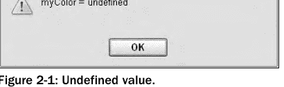


## 第2章：JavaScript 复习

你不必将变量声明作为单独的步骤。相反，你可以*初始化*一个变量——同时声明它并为其赋值，如下所示：

```
var myColor = "green";
```

> 你不必使用 `var` 操作符来声明或初始化变量。然而，如果你省略它，变量会自动具有全局作用域。使用 `var` 还可以明确表明你正在声明或初始化一个新变量，并使代码调试更容易。

变量名必须以字母、下划线 (_) 或美元符号 ($) 开头。尽管没有特定的命名要求，但变量名通常使用*驼峰命名法*。在驼峰命名法中，第一个单词小写，后续单词首字母大写，如下所示：

```
var myFavoriteNumber;
```

### 原始数据类型

每个 JavaScript 变量都有一个数据类型，用于指示该变量包含的数据种类。*原始数据类型*直接将数据存储在变量中。原始数据类型有五种：

- 数字
- 字符串
- 布尔值
- 未定义
- 空值

*数字类型*包括整数和浮点数。*字符串类型*包括一个或多个字符的任何组合。字符串与数字的区别在于它被引号括起来。例如，"5" 是一个字符串，而 5 是一个数字。*布尔类型*有两个值：`true` 和 `false`。*未定义类型*只有一个值：`undefined`。当一个变量被声明但未被赋值时，就会出现*未定义值*，就像前面 `myColor` 变量所示的那样。*空值类型*也只有一个值：`null`。空值意味着所讨论的对象不存在。

你不必在声明或初始化 JavaScript 变量时包含数据类型。JavaScript 使用动态类型——数据类型是从 JavaScript 语句的上下文中推断出来的。这也意味着同一个变量可以在不同的时间用于不同类型的数据，如下所示：

```
var myNumber = "lucky";
// myNumber 包含一个字符串
myNumber = 3;
// myNumber 包含一个数字
```

### 引用数据类型

JavaScript 中的*引用数据类型*包含对内存中某个位置的引用，该位置存储着数据，而不是数据本身。`Object` 类型（以及 `Object` 的特殊类别，如 `Array` 和 `Function`）是一种引用数据类型。

明确你正在使用的是原始类型还是引用类型非常重要。如果你在函数参数中使用引用类型，然后在函数内部对数据进行更改，你可以修改引用类型中的原始数据。即使更改是在本地（函数内部）进行的，数据也会在全局范围内被更改，如下所示：

```
function myArray(a) {
  var a[0] = 5;
}
var nextArray = [1, 2, 3];
myArray(nextArray);
alert ("nextArray = " + nextArray);
```

调用 `myArray` 函数后，`nextArray` 的值变为 [5, 2, 3]。

### 操作符

操作符使你能够对变量执行操作。JavaScript 的基本操作符包括赋值、算术、比较、逻辑以及递增/递减操作符。

#### 赋值操作符

赋值操作符 (=) 用于为变量赋值，如下所示：

```
var myTree = "oak";
```

在这个例子中，值 "oak" 被赋给了变量 myTree。

#### 算术操作符

JavaScript 包含用于所有基本算术函数的操作符，包括加法 (+)、减法 (-)、乘法 (*) 和除法 (/)。

> 加法操作符与字符串连接操作符是同一个字符 (+)。如果你将此操作符用于数值，这些数字会被相加。如果你将此操作符用于字符串值，这些字符串会被连接（拼接）成一个单一的字符串。

```
var a = 5;
var b = 10;
var c = a + b;
  // c = 15
a = "My";
b = " name";
c = a + b;
  // c ="My name"
```

#### 比较操作符

比较操作符用于计算表达式并返回一个布尔值（true 或 false），指示比较是否为真。例如，如果 a = 2 且 b = 4，则表达式 a > b 为假。在这种情况下，比较操作符是大于 (>) 操作符。

表 2-1 展示了 JavaScript 的比较操作符。

| 操作符 | 含义 |
|---|---|
| > | 大于 |
| < | 小于 |
| >= | 大于或等于 |
| <= | 小于或等于 |
| == | 等于 |
| != | 不等于 |
| === | 值相等且类型相同 |
| !== | 值不相等或类型不同 |

一个常见的错误是混淆赋值操作符和相等操作符，如下所示：

```
var a = 1;
var b = 2;
a = b;
// 将变量 b 中包含的值赋给变量 a，并求值为 true
a == b;
// 比较 a 和 b 并求值为 false，因为 a 和 b 不相等
```

#### 逻辑操作符

理解逻辑操作符最简单的方法是使用真值表（表 2-2）。真值表显示一个值或表达式是真还是假。下表显示了 A、B 以及使用逻辑操作符的表达式的值。如你所见，&& 操作符仅当 A 和 B 都为真时才返回 true。|| 操作符当 A 或 B 为真时返回 true。

| A | B | A && B | A \|\| B | !A | !B |
|---|---|---|---|---|---|
| True | True | True | True | False | False |
| False | True | False | True | True | False |
| True | False | False | True | False | True |
| False | False | False | False | True | True |

#### 递增和递减操作符

递增和递减操作符提供了一种快捷方式，用于将值增加或减少 1，如下所示：

```
var a = 1;
a++;
// a = 2
var b = 45;
b-- ;
// b = 44
```

递增和递减操作符可以出现在变量之前（前缀）或之后（后缀）。如果一个带有前缀操作符的变量在表达式中使用，那么变量的值会在表达式求值之前增加或减少。如果使用后缀操作符，则值在表达式求值之后增加或减少。例如：

```
var a = 1;
alert(++a);
```

**图 2-2**：在表达式求值之前增加一个值。

另一方面，如果你使用后缀操作符，a 的值会在表达式求值之后增加：

```
alert (++a);
```

**图 2-3**：在表达式求值之后增加一个值。

#### 语句

JavaScript 程序由*语句*组成。变量声明、赋值和初始化是 JavaScript 语句的示例。JavaScript 还包含一组核心编程语句，类似于其他编程语言中使用的语句：条件语句（`if/else`、`switch`）、循环（`for`、`while`）和流程控制（`break`、`continue`）。

#### 条件语句

你可以使用 `if` 语句或 `switch` 语句来控制程序中代码的执行。

`if` 语句计算表达式的布尔值（true 或 false），然后根据该计算结果执行代码。如果括号中的表达式计算结果为 true，则执行表达式后面的花括号 ({}) 中包含的代码块。如果表达式计算结果为 false，则执行右花括号后面的第一条代码语句：

```
if (myValue == "hedgehogs")
{
    var yourValue = "warthogs";
}
```

请注意，右括号后或右花括号后没有分号，但代码块中的每条语句后都有分号。

你也可以通过添加 `else if` 和 `else` 来计算额外的表达式：

```
if (myValue == "hedgehogs")
{
    var yourValue = "warthogs";
}
else if (myValue == "dragons")
{
    var yourValue = "dungeons";
}
else
{
    var yourValue = "centipede";
}
```


## 第2章：JavaScript 复习

`switch` 语句可以用来替代一系列的 `if` 语句：

```
switch (myValue)
{
 case 'hedgehogs':
 var yourValue = "warthogs";
 break;
 case 'dragons':
 var yourValue = "dungeons";
 break;
 default:
 var yourValue = "centipede";
}
```

请注意，每个代码块后都使用了 `break` 语句。`break` 用于在执行完该 `case` 的代码后立即退出 `switch` 结构。然后执行 `switch` 之后的第一条语句。

`default` 分支的作用类似于 `else` 语句。如果某个值没有对应的特定 `case`，则会执行 `default` 分支的代码。

### 循环

循环是一种基于你指定的条件来重复执行一段代码块的方式。两种主要的循环是 `for` 和 `while`。

`for` 循环包含三个部分：

-   初始化
-   测试条件
-   迭代器（计数器）

```
for (i=0; i<=10; i++) {
 document.write("i = " + i + "<br>");
}
```

请注意这段代码块中的以下几点：

-   初始化部分是 `i = 0;`。
-   测试条件是 `i <= 10;`。
-   迭代器是 `i++`。

这段循环中的代码将执行11次，并将 `i` 的当前值每次写入页面，如图2-4所示。

`while` 循环可以看作是 `for` 循环的另一种形式。它包含一个测试条件和一个迭代器。只要测试条件为真，循环就会持续执行。

你可以将上面的 `for` 循环改写成 `while` 循环：

```
var i=0;
while (i <= 10){
  document.write("i = " + i + "<br>");
  i++;
}
```

在此情况下：

-   初始化是 `i = 0;`。初始化发生在 `while` 循环开始之前。
-   测试条件是 `i <= 10`。
-   迭代器是 `i++`。

> **小心，不要创建无限的 `while` 循环。请确保你的测试条件不会总是为真。**

`do-while` 循环与 `while` 循环非常相似。主要区别在于条件是在循环结束时测试的，这意味着循环体至少会执行一次。

```
var i = 0;
do {
  document.write("i = " + i + "<br>");
  i++;
}
while (i <=10);
```

两个可以与循环一起使用的流程控制语句是 `break`（正如你在前面的 `switch` 语句中所见）和 `continue`。`break` 语句是一种退出循环并继续执行循环之后的第一条语句的方式。`continue` 语句允许你跳过循环体的剩余部分，但继续执行循环的下一次迭代。

## 函数

*函数* 是一组可重用的代码语句，被视为一个单元。JavaScript 包含许多内置函数，你也可以为你想要重用的代码块创建自己的函数。

函数定义通常包含在 HTML/XHTML 页面 `head` 部分的脚本块中。函数必须先定义才能使用。因为页面 `head` 部分的代码是在 `body` 部分的代码之前被读取和解释的，所以函数通常在 `head` 部分定义，并从 `body` 部分调用。

要创建一个函数，你需要定义它并给它一个名字：

```
function myCat (catname) {
  alert (catname + " is a great name for a cat!");
}
```

要调用（执行）一个函数，在代码语句中使用函数名：

```
myCat("Jobo");
```

当 `myCat` 函数被调用时，参数 `catname` 被赋值为 `Jobo`。

一个函数包括 `function` 关键字和以下部分：

-   **一个名称** —— `myCat`
-   **括号中的一个参数** —— `(catname)`
-   **花括号之间的一个代码块** —— `{alert (catname + " is a great name for a cat!");}`

为函数提供参数是可选的。但即使函数没有参数，你也必须在函数名后加上括号。通常，你用于参数的名称完全由你自己决定。如果你使用一个有意义的名称（例如，一个与参数用途相关的名称），它将帮助你更好地理解代码。

你可以使用 `return` 语句从函数返回一个值：

```
function shopping (price) {
  var salesTax = price * .0625;
  var total = price + salesTax;
  return total;
}
```

> 除非函数显式返回一个值，否则将返回 `undefined`。

### 面向对象的 JavaScript

一个 *对象* 是一组属性和方法的集合，它们以单个名称组织在一起。对象将完成特定任务所需的一切聚集在一起。

JavaScript 使用四种不同类型的对象：

-   内置对象（例如 `Date` 和 `Math` 对象）
-   浏览器对象（例如 `window`、`navigator` 和 `history` 对象）
-   文档对象（例如图像、表单和链接）
-   用户自定义对象

没有单一的标准来定义 JavaScript 的所有用途。例如，这四种类型的 JavaScript 对象各自源自不同的来源。内置对象是核心 JavaScript 的一部分，在 ECMAScript 标准中定义。浏览器对象和文档对象都可以称为 *宿主对象*，因为它们是宿主环境的一部分，而非由 ECMAScript 标准定义。浏览器对象不是由任何标准组织定义的。它们由浏览器厂商开发，其在任何浏览器中的使用和支持都由浏览器厂商决定。文档对象是 W3C 定义的文档对象模型（DOM）的一部分。用户自定义对象当然由程序员定义。

#### 内置对象

当你使用 `new` 关键字和对象构造函数时，你就创建了该对象的一个新实例：

```
var myArray = new Array();
// 创建一个 Array 对象的新实例
```

在这种情况下，实例是一个特定的 `Array` 对象，它被赋值给一个名为 `myArray` 的变量。这个对象拥有所有 `Array` 对象的所有方法和属性。你对这个特定 `Array` 实例所做的任何更改都只会影响这个实例，而不会影响 `Array` 对象本身。

方法是属于特定类型对象的特定函数。例如，`Array` 对象包含一个 `reverse()` 函数，用于反转数组成员的顺序：

```
var backwards = myArray.reverse();
```

对象还包括 *属性*。属性是对象的特征。例如，`Array` 对象包含一个 `length` 属性。

```
var howLong = myArray.length;
```

你可以使用点号表示法来访问对象的方法或属性：

```
myArray.reverse();
myArray.length;
```

有关九个 JavaScript 内置对象的更多细节，请参见附录 D 和 ECMA-262 标准第三版。

ECMA-262 标准的 PDF 文件可从 www.ecma-international.org/publications/standards/Ecma-262.htm 下载。

#### 浏览器对象

*浏览器对象模型*（BOM）是与浏览器窗口交互的对象集合。这些对象包括 `window` 对象、`history` 对象、`location` 对象、`navigator` 对象、`screen` 对象和 `document` 对象。

`window` 对象是 BOM 层次结构中的顶层对象。`window` 对象可用于移动和调整窗口大小，以及创建新窗口。`window` 对象还包括创建对话框的方法，例如前面图2-1、2-2和2-3中所示的警告对话框。`window` 对象是一个独特的对象——当你使用它的方法或属性时，你不必显式地包含对它的引用。考虑以下示例：

```
alert("看！有引用吗？");
```

这与下面的代码功能完全相同：

```
window.alert("看！有引用吗？");
```

`history` 对象跟踪用户访问的每个页面。该对象的方法包括 `forward`、`back` 和 `go`：

```
history.back(2);
// 返回2个页面
```

`location` 对象包含页面的 URL。你可以使用其 `href` 属性跳转到新页面：

```
location.href="myPage.htm";
```

`navigator` 对象包含有关浏览器名称和版本的信息。属性包括 `appName`、`appVersion`、`userAgent`。

> 随着浏览器检测变得越来越复杂，这个对象变得不太有用且不可靠。目前，对象检测优于浏览器检测。对象检测检查浏览器是否支持特定功能，而不是检测浏览器名称或版本。

`screen` 对象提供有关显示特征的信息，例如以像素为单位的屏幕高度和宽度。

`document` 对象包含在 `window` 对象中。这个对象同时属于 BOM 和文档对象模型（DOM）。BOM 中的 `document` 对象包含页面属性，如背景色（`bgColor`），还包括页面中所有表单、图像和链接的数组。

你可以通过项目名称或数组索引号来访问这些数组中的各个元素：

```
document.form('myForm');
// 通过名称访问表单
document.form[0];
// 访问页面上的第一个表单
```

### 用户自定义对象

要创建一个*用户自定义对象*，你需要使用构造函数来创建新对象，然后为该对象添加属性和方法。

#### 构造函数

新的用户自定义对象是通过 `Object` 构造函数创建的：

```
var member = new Object();
```

在这种情况下，你定义的是一个新对象，而不是内置对象的新实例。

然后你可以为该对象添加属性：

```
member.name = "Jobo";
member.address = "325 Smith Rd";
member.isRegistered = true;
```

你还可以为该对象创建方法。你可以通过创建一个命名函数来实现：

```
function showMe()
{
alert("I'm here!");
}
```

然后你可以将此函数赋值为对象的一个属性：

```
member.present = showMe;
```

你可以用通常的方式调用此函数：

```
member.present();
```

你可以使用函数字面量更高效地实现这一点：

```
member.present = function()
{
alert("I'm here!");
};
```

请注意，在这种情况下函数是匿名的——它没有名称。另请注意，函数字面量末尾有一个分号。

在这种情况下，你仍然可以用通常的方式调用该函数：

```
member.present();
```

你也可以使用对象字面量来创建一个新对象：

```
var member =
{
  name: "Jobo",
  address: "325 Smith Road",
  isRegistered: true,
  present: function () {alert("I'm here!");}
};
```

通常你可能希望创建一个对象的多个实例，以便拥有具有相同基本属性但属性值不同的对象。你可以创建一个使用 JavaScript 的 `this` 关键字的函数，这样你就可以在创建新对象时传递参数，并为每个创建的新实例指定属性值：

```
function member (name, addr, reg)
{
  this.name = name;
  this.address = addr;
  this.isRegistered = reg;
  this.present = function () {alert("I'm here!");};
}
```

> `this` 关键字始终指代当前对象。

然后你可以使用 `new` 关键字创建 `member` 对象的新实例：

```
var member1 = new member ("Robert", "17 Cove Ct", true);
var member378 = new member ("Joan", "44 Redding Rd", false);
```

你也可以添加特定于实例而非原始对象定义一部分的新属性：

```
member1.city = "Chicago"
```

#### 原型

JavaScript 中的每个对象都基于一个原型对象，并且每个对象都包含一个指向该原型对象属性和方法的 `prototype` 属性。你可以使用此属性为该类型的所有对象指定属性和方法。

例如，在创建 `member` 对象的实例时，会创建并存储 `present` 函数的多个副本。你可以通过使用 `prototype` 属性并在构造函数定义外部定义 `present` 函数来避免占用内存，同时仍让所有 `member` 对象都能访问此函数：

```
function member (name, addr, reg)
{
this.name = name;
this.address = addr;
this.isRegistered = reg;
}
member.prototype.present = function () {
    alert("I'm here!");
};
```

你还可以使用 `prototype` 属性为对象指定默认值：

```
member.prototype.isActive = true;
```

你可以通过指定具有不同值的实例变量来更改默认值：

```
member378.isActive = false;
```

如果实例对象访问一个属性，JavaScript 解释器会检查是否存在具有该名称的实例属性。如果没有，它会在原型对象中查找具有该名称的属性，并沿着原型链向上查找。JavaScript 中的所有对象都派生自一个通用的 `Object`。如果在通用 `Object` 中找不到该属性，则值为 `undefined`。

> JavaScript 中的原型类似于，但不完全等同于，Java 和 C++ 中的类。

#### 销毁对象

对象是引用类型，因此它们可能占用大量内存空间。如果你不再需要某个对象，请销毁它，以便内存空间可以被重用。

要销毁一个对象，将其设置为 `null`：

```
member378 = null;
```

### 试试看：创建对象

在这个例子中，创建了一个新对象。属性在构造函数中指定。使用对象的 `prototype` 属性为对象添加了一个方法。此方法允许你在创建新对象时为位置和背景颜色传递不同的参数值。在你的文本编辑器中输入以下代码并将其保存为 `ch2_exampl.htm`。

```
<!DOCTYPE html PUBLIC "-//W3C//DTD XHTML 1.0 Transitional//EN"
"http://www.w3.org/TR/xhtml1/DTD/xhtml1-transitional.dtd">
<html xmlns="http://www.w3.org/1999/xhtml">
<head>
<meta http-equiv="Content-Type" content="text/html; charset=iso-8859-1" />
<title>Address Book</title>
<style type="text/css">
.ab {
    font-family: Verdana, Arial, Helvetica, sans-serif;
    font-size: small;
    color: #993300;
    background-color: #CCFFCC;
    padding: 5px;
    height: 100px;
    width: 350px;
    border: thin dotted #993300;
}
</style>
<script type="text/javascript">
function addrBook (fname, lname, email) {
  this.fname= fname;
  this.lname = lname;
  this.email = email;
  var adrbook = "<p class='ab'>First Name: " + fname + "<br />";
  adrbook += "Last Name: " + lname + "<br />";
  adrbook += "Email Address: " + email + "</p>";
  document.write(adrbook);
}
</script>
</head>

<body>
<script type="text/javascript">
var aB1 = new addrBook('Roger', 'Williams', 'rwilliams@gmail.com');
var aB2 = new addrBook ('Rose', 'Schultz', 'rose_s@earthlink.net');
</script>
</body>
</html>
```

当你在浏览器中打开此页面时，它应该显示两个通讯录条目，如图 2-5 所示。

图 2-5：浏览器中的通讯录条目。

## 工作原理

`addrBook` 对象构造函数位于页面的 `head` 部分。此函数包含三个参数：`fname` 代表名，`lname` 代表姓，`email` 代表电子邮件地址。

```
function addrBook (fname, lname, email) {
```

传递给 `addrBook` 函数的参数——`fname`、`lname` 和 `email`——为通讯录条目提供了值。`this` 关键字表明这些属性适用于 `addrBook` 对象的当前实例。

```
this.fname= fname;
this.lname = lname;
this.email = email;
```

所有 `addrBook` 对象都使用在页面 `head` 部分定义的 `ab` 样式类：

```
<style type="text/css">
.ab {
    font-family: Verdana, Arial, Helvetica, sans-serif;
    font-size: small;
    color: #993300;
    background-color: #CCFFCC;
    padding: 5px;
    height: 100px;
    width: 350px;
    border: thin dotted #993300;
}
</style>
```

此样式通过 `adrbook` 变量应用于 `addrBook` 对象的新实例。此变量包含一个带有 `ab` 类的 `p` 标签，以及三个参数（`fname`、`lname`、`email`）各一行。使用 `+=` 运算符来构建此变量的值。然后使用 `document.write` 方法将变量值写入页面。

```
var adrbook = "<p class='ab'>First Name: " + fname + "<br />";
adrbook += "Last Name: " + lname + "<br />";
adrbook += "Email Address: " + email + "</p>";
document.write(adrbook);
```

在页面 `body` 部分的脚本块中，创建了两个新的 `addrBook` 对象实例。

```
var aB1 = new addrBook('Roger', 'Williams', 'rwilliams@gmail.com');
var aB2 = new addrBook ('Rose', 'Schultz', 'rose_s@earthlink.net');
```

### 文档对象模型

文档对象模型（DOM）是万维网联盟（W3C）为 XML 和 HTML/XHTML 创建的基于树的文档表示。DOM 提供了一组用于表示文档结构的对象，以及访问这些对象的方法。DOM 分为三个部分。核心 DOM 包括 XML 和 HTML 共有的对象，XML DOM 包括 XML 对象，HTML DOM 包括 HTML 对象。


## 第2章：JavaScript 复习

页面中的所有元素都与最顶层的对象——文档对象相关联。利用这个模型，你可以使用 JavaScript 访问 HTML 文档中的*任何*对象并更改其属性。例如，你可以执行以下操作：

-   更改其位置
-   更改其源文件
-   更改其样式属性
-   更改其内容
-   添加新内容

### *文档作为家族树*

要有效使用 DOM，理解 HTML/XHTML 文档作为一个家族树结构非常重要，如图 2-6 所示。

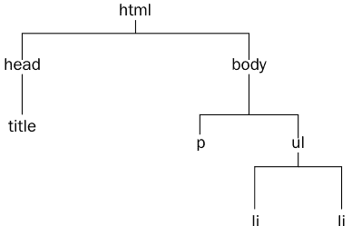

**图 2-6：文档作为家族树结构。**

以下是家族树结构的关键组成部分：

-   **html** — 页面中的每个元素都包含在此元素中，因此它是根元素。它也是 head 和 body 元素的父元素。
-   **head, body** — 这两个元素是兄弟节点。它们都是 html 元素的子元素。它们也都是父元素，并有自己的子节点——head (title) 和 body (p 和 ul)。
-   **title** — 此元素是 head 元素的子节点。
-   **p, ul** — 这两个元素是兄弟节点——它们都是 body 元素的子节点。

### *文档作为节点树*

除了将文档视为家族树之外，文档也可以被视为节点树。在节点树视图中，文档是*节点*的集合。节点是文档树上的分支和叶子。

节点有几种类型，但主要有三种：元素节点、文本节点和属性节点。

这行 HTML 可以被视为一个节点结构，如图 2-7 所示：

```
<p class="intro">Welcome to my site.</p>
```


以下是节点结构的关键组成部分：

-   **元素节点** — `p` 是一个元素节点。元素是文档的基本构建块，赋予文档结构。元素可以包含其他元素。
-   **文本节点** — `Welcome to my site.` 是一个文本节点。在 HTML/XHTML 中，文本节点总是包含在元素节点内。
-   **属性节点** — `class="intro"` 是一个属性节点。属性提供关于元素的更多信息。属性节点总是包含在元素节点内。

### 用于访问对象的 DOM 方法

一旦理解了 DOM 树的基本结构，就可以使用 DOM 方法来访问任何元素。

#### getElementById

如果一个元素有 `id`，访问它的最简单方法是 `getElementById`。

```
<p id="myPara">Greetings, earthlings!</p>
...
var x = document.getElementById('myPara');
```

`x` 现在是访问具有 `id` 值为 `myPara` 的唯一元素的快捷方式。

要更改此元素的属性，例如字体粗细，请使用以下代码：

```
x.style.fontWeight = "bold";
// 将字体粗细更改为粗体
```

你也可以使用 `getElementById` 通过家族关系和节点属性访问元素。例如，如果图 2-6 中的 head 和 body 元素包含 `id` 值，如下所示，你可以使用这些 `id` 值来访问页面中的所有其他元素：

```
<head id="el1">
...
<body id="el2">
```

要访问 head 和 body 元素的父节点，你可以使用以下任一方式：

```
document.getElementById('el1').parentNode;
document.getElementById('el2').parentNode;
```

这两者都访问 html 元素。

要访问 body 元素的所有子节点，请使用以下代码：

```
document.getElementById('el2').childNodes;
```

子节点包含在一个数组中。你可以通过使用数组索引值来访问单个子节点：

```
document.getElementById('el2').childNodes[0];
```

这访问的是 body 元素的第一个子节点——p——因为数组索引从 0 开始。

你也可以使用此代码访问第一个子节点：

```
document.getElementById('el2').firstChild;
```

如果你想访问一个兄弟节点，请使用以下代码：

```
document.getElementById('el2').previousSibling;
// 访问 head 元素
document.getElementById('el1').nextSibling;
// 访问 body 元素
```

#### getElementsByTagName

要使用 `getElementsByTagName` 方法，你使用的是标签名而不是 id。例如：

```
var y = document.getElementsByTagName('p');
```

`y` 包含一个引用文档中所有 `p` 元素的数组。

要更改*所有*段落的文本颜色，请使用以下代码：

```
for (i=0; i < y.length; i++) {
  y[i].style.color = "green";
}
```

如果你想只更改*第一个*段落，请使用以下代码：

```
var z = document.getElementsByTagName('p')[0];
```

`z` 现在是访问文档中第一个 `p` 元素的快捷方式。

### 创建节点

DOM 包含许多向文档对象添加新节点的方法，例如 `createElement` 和 `createTextNode`。要创建一个新的段落，请使用以下代码：

```
var newNode = document.createElement('p');
```

要创建一个新的文本节点，请使用以下代码：

```
var newText = document.createTextNode('Just to add one more thing on this subject.');
```

要将新的文本节点添加到段落中，你需要另一个 DOM 方法 `appendChild`：

```
newNode.appendChild(newText);
```

这会将两个新节点（段落和文本节点）组合在一起。

这些 DOM 方法是在文档的输入流关闭后向页面添加新内容的好方法。你可以通过使用带有 `id` 的 `div` 作为添加新内容的占位符，而不是写入新页面，来向现有页面添加新内容。

### 尝试一下：向现有页面添加新元素

在这个示例中，你将使用一个按钮来调用一个函数，该函数向现有页面添加一个新段落。在文本编辑器中键入以下代码，并将其保存为 `ch2_examp2.htm`：

```
<!DOCTYPE html PUBLIC "-//W3C//DTD XHTML 1.0 Transitional//EN"
"http://www.w3.org/TR/xhtml1/DTD/xhtml1-transitional.dtd">
<html xmlns="http://www.w3.org/1999/xhtml">
<head>
<meta http-equiv="Content-Type" content="text/html; charset=iso-8859-1" />
<title>Adding New Elements</title>
<style type="text/css">
body {
    font-family: Verdana, Arial, Helvetica, sans-serif;
    font-size: small;
    font-weight: bold;
}
.newDiv {
    background-color:#ffcccc;
}
</style>
<script type="text/javascript">
function newOne() {
  var newEl = document.createElement('p');
  var newTx = document.createTextNode('This is the new paragraph.');
  newEl.appendChild(newTx);
  var newPara = document.getElementById('newText');
  newPara.appendChild(newEl);
}
function newColor() {
  document.getElementById('newText').style.color="red";
}
</script>
</head>
<body>
<p>This is the first paragraph on the page.</p>
<div class="newDiv" id="newText"></div>
<p>This is the next paragraph on the original page.</p>
<form>
<input type="button" value="Add a new paragraph" onclick="newOne()" /><br /><br />
<input type="button" value="Make it red" onclick="newColor()" />
</form>
</body>
</html>
```

在浏览器中打开此页面，点击标有“添加新段落”的按钮，然后点击标有“使其变红”的按钮。一个新段落将被添加到现有页面中，如图 2-8 所示。

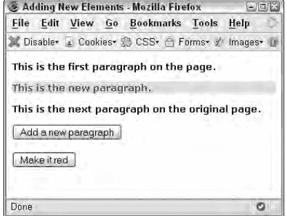

图 2-8：段落已添加到现有页面。

## 工作原理

向现有页面添加新内容的第一步是添加一个占位符元素，以便有一个位置来插入新内容。此元素包含一个 id 属性，以便可以通过 getElementById 方法访问。

```
<div class="newDiv" id="newText"></div>
```

在页面 head 部分的脚本块中，newOne 函数包含将新段落添加到页面的代码。

```
var newEl = document.createElement('p');
```

此代码创建一个名为 `newEl` 的变量来保存新的 `p` 元素：

```
var newTx = document.createTextNode('This is the new paragraph.');
newEl.appendChild(newTx);
```

名为 `newTx` 的变量包含新的文本节点。`appendChild` 方法用于将文本节点添加到新的 `p` 元素。

```
var newPara = document.getElementById('newText');
newPara.appendChild(newEl);
```

`newPara` 变量包含 id 为 `newText` 的元素——这是新元素的占位符元素。一旦使用 `getElementById` 方法识别出占位符元素，`appendChild` 属性就用于将新元素添加到占位符元素。

```
document.getElementById('newText').style.color="red";
```

`newColor` 函数也使用 `getElementById` 来访问新元素，并使用元素的 `style` 属性将新段落的文本颜色更改为红色。

```
<form>
<input type="button" value="Add a new paragraph" onclick="newOne()" />
<input type="button" value="Make it red" onclick="newColor()" />
```

每个函数都通过点击一个包含内联事件处理程序 (`onclick`) 和函数名的按钮来调用。

### innerHTML 替代方案

所有 HTML 元素的 `innerHTML` 属性是使用 DOM 方法更改元素内容的一个有些争议的替代方案。它在 Ajax 应用程序的回调函数中非常常见，你将在本书的许多示例中看到它的使用。

`innerHTML` 属性使你可以用字符串替换任何 HTML 元素的内容。此字符串可以包含 HTML 元素，因此你可以不用 DOM 方法来创建新元素。

在前面的示例中，以下代码在页面完全加载后使用 DOM 方法向页面添加了新的段落：

```
function newOne() {
  var newEl = document.createElement('p');
  var newTx = document.createTextNode('This is the new paragraph.');
  newEl.appendChild(newTx);
  var newPara = document.getElementById('newText');
  newPara.appendChild(newEl);
}
```


## 第二章：JavaScript复习

使用`innerHTML`，可以用更少的代码完成这个任务：

```
function newOne() {
    var newPara = document.getElementById('newText');
    newPara.innerHTML = "<p>This is the new paragraph.</p>";
}
```

关于`innerHTML`的争议在于它不是任何W3C或其他标准的一部分。它得到了大多数当前浏览器的支持，包括Firefox 2、Internet Explorer 6和7，以及Opera 9。

除了需要更少的代码外，`innerHTML`也比使用DOM方法生成新内容快得多。Peter-Paul Koch为`innerHTML`创建了一个基准测试，并证明在他测试的所有浏览器中，它都比DOM方法更快。更多详细信息，请参见www.quirksmode.org/dom/innerHTML.html。

### JavaScript与事件

浏览器事件是页面加载后运行JavaScript代码的关键。一旦网页在浏览器窗口中加载，所有的JavaScript代码就已经被读取和执行。事件对于创建JavaScript和HTML之间的任何进一步交互是必要的。事件发生在用户执行某些操作（将鼠标悬停在元素上）或浏览器执行某些操作（加载页面）时。

HTML属性如`onclick`、`onblur`或`onload`是将事件绑定到事件处理程序（JavaScript代码）的一种方式。例如，在下面的例子中，当用户点击按钮时，会调用`myResponse`函数：

```
<input type="button" value = "Click Me" onclick="myResponse()">
```

事件是`click`，事件处理程序是`myResponse`函数。

#### 事件模型

由于事件模型的跨浏览器差异，事件仍然是脚本编写中复杂的一部分。事件模型指定了事件如何被处理以及涉及哪些对象。目前的一个主要差异是Internet Explorer（IE）模型和W3C DOM事件模型之间的事件流差异。（Mozilla系列浏览器使用的事件模型类似于W3C DOM模型。）

处理事件流主要有两种技术。在事件冒泡技术中，事件从最特定的目标触发到最不特定的目标。事件目标是事件最初发生的元素。在事件捕获技术中，事件从最不特定的目标触发到最特定的目标。

最好用一个例子来说明：

```
<div>
    <p>Event order</p>
</div>
```

如上所示，一个子元素（p）嵌套在一个父元素（div）中。如果用户将鼠标悬停在子元素上，这将为子元素和父元素都创建一个mouseover事件。哪个mouseover事件先触发？

在事件捕获中，父元素（div）的`mouseover`事件先触发。在事件冒泡中，子元素（p）的`mouseover`事件先触发。

Internet Explorer（包括IE 7）使用事件冒泡技术。W3C DOM模型同时包含事件捕获和事件冒泡。

#### 事件注册

在JavaScript中使用事件的第一步是注册一个事件处理程序，以便在事件发生时浏览器运行你的脚本。

注册事件处理程序最常用的方法是使用HTML属性：

```
<a href="goThere.html" onclick="startNow()">
```

这种方法称为*内联事件注册*。

要停止事件的默认行为（例如，防止在前面的代码中点击链接时被跟踪），可以使用`return false`：

```
<a href="goThere.html" onclick="startNow();return false">
```

这种注册事件处理程序的方法是可靠的，并且被所有支持事件的浏览器所支持。然而，它将行为（JavaScript）和结构（HTML/XHTML）混合在一起，而不是将它们作为文档中的独立层。表2-3展示了页面层次结构的Web标准视图。

| 结构 | HTML/XHTML |
| 表现 | CSS |
| 行为 | JavaScript |

你也可以直接使用事件属性和函数名将事件处理程序注册到元素：

```
var myElement = document.getElementById('1stpara');
myElement.onclick = startNow;
```

这种方法被称为传统事件注册。`startNow`函数被绑定到`myElement`的点击事件。

在HTML元素的代码被读取之前，你不能注册这个事件处理程序，否则会产生运行时错误。为了防止这种情况，你可以将注册事件的JavaScript代码放在元素之后，或者将注册代码放在页面加载后调用的函数中。

**注意** `startNow`后面没有括号。如果你加上括号，函数会被调用，并且函数的结果会被赋值给`myElement.onclick`，而不是将函数本身赋值。

要移除事件注册，使用以下代码：

```
myElement.onclick = null;
```

这种方法可靠且跨浏览器兼容，但它只允许你为一个元素上的同一个事件注册一个事件处理程序。Internet Explorer和W3C都包含了注册多个事件处理程序的方法。

##### Internet Explorer事件注册模型

Internet Explorer包含了两种注册和注销事件处理程序的方法：`attachEvent()`和`detachEvent()`：

```
var myElement = document.getElementById('1stpara');
myElement.attachEvent('onclick', startNow);
```

你也可以注册额外的事件处理程序：

```

```

要移除注册，使用以下代码：

```

```

这些方法是专有的，仅在IE中有效。

##### W3C DOM事件注册模型

W3C DOM方法使用三个参数：事件名称、函数名称和一个布尔值（true或false）。如果事件注册应在事件捕获阶段使用，则布尔值设置为`true`；如果应在事件冒泡阶段使用，则设置为`false`。

```

```

你也可以添加额外的事件注册：

```

```

事件监听器代码等同于前面看到的传统事件注册：

`myElement.onclick = startNow;`

在传统事件注册中，事件注册是在事件的冒泡阶段添加的。

要移除事件监听器，使用以下代码：

```
myElement.removeEventListener('click', startNow, false);
```

### 事件对象

事件对象用于访问事件，以便你可以获取其属性信息，例如用户按下了哪个键。事件对象在事件发生时创建。

事件对象有两种不同的模型：Internet Explorer模型和W3C DOM模型。

在Internet Explorer中，事件对象是window对象的一个属性（window.event）。在此模型中，window.event属性包含最后发生的事件。

```
var myElement = document.getElementById('1stpara');
myElement.onclick = startNow;
function startNow () {
    // window.event gives access to the event
}
```

在W3C DOM模型中，事件作为参数传递给事件处理函数：

```
var myElement = document.getElementById('1stpara');
myElement.onclick = startNow;
function startNow (e) {
    // e gives access to the event
}
```

为了以兼容任一模型的方式访问事件，你可以使用如下函数：

```
var myElement = document.getElementById('1stpara');
myElement.onclick = startNow;
function startNow (e) {
    if (!e) {
        var e = window.event;
    }
    // if e doesn't already exist, assign window.event to e
}
```

Internet Explorer事件对象和W3C DOM事件对象具有不同的属性和方法。更多详细信息，请参见附录D。

### 尝试一下：跨浏览器事件注册

在此示例中，事件注册将事件（click）与一个函数（addBord）添加到段落并从中移除。该函数为文本段落添加边框和背景颜色。Internet Explorer（attachEvent/detachEvent）和W3C DOM


## 第2章：JavaScript 温故知新

（`addEventListener`/`removeEventListener`）方法已包含在内。在文本编辑器中输入以下代码，并将其保存为 `ch2_examp3.htm`。

```
<!DOCTYPE html PUBLIC "-//W3C//DTD XHTML 1.0 Transitional//EN"
"http://www.w3.org/TR/xhtml1/DTD/xhtml1-transitional.dtd">
<html xmlns="http://www.w3.org/1999/xhtml">
<head>
<meta http-equiv="Content-Type" content="text/html; charset=iso-8859-1" />
<title>Event Registration</title>
<script type="text/javascript">
function addHandler () {
  var addH = document.getElementById('p1');
  if (addH.addEventListener) {
    addH.addEventListener('click', addBord, false);
  }
  else if (addH.attachEvent) {
    addH.attachEvent('onclick', addBord);
  }
}
function detHandler () {
  var detH = document.getElementById('p1');
  detH.style.border = '';
  detH.style.backgroundColor = '#ffffff';
  if (detH.removeEventListener) {
    detH.removeEventListener('click', addBord, false);
  }
  else if (detH.detachEvent) {
    detH.detachEvent('onclick', addBord);
  }
}
function addBord () {
  var add = document.getElementById('p1');
  add.style.border = '1px dotted #ff0000';
  add.style.backgroundColor = '#ffff99';
}
</script>
</head>
<body onload="addHandler()">
<p id='p1'>Lorem ipsum dolor sit amet, consectetuer adipiscing elit. Sed
scelerisque odio non ligula. </p>
<p>Integer mollis, libero et facilisis hendrerit, tellus dui porttitor quam, vitae
iaculis nisi mauris ac dui. Vivamus volutpat sollicitudin est. </p>
<form>
<input type='button' value='No border, please!' onclick='detHandler()'>
</form>
</body>
</html>
```

在浏览器中打开此页面并点击第一段时，应该会显示边框和背景色，如图 2-9 所示。

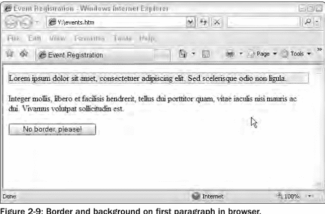

图 2-9：浏览器中第一段落的边框和背景。

## 工作原理

页面加载时，会调用 `addHandler` 函数。

```
<body onload="addHandler()">
```

该函数识别 ID 等于 p1 的段落。

```
function addHandler () {
  var addH = document.getElementById('p1');
}
```

如果浏览器支持 `addEventListener` 方法，则使用 W3C DOM 方法为点击事件添加事件监听器——即事件处理程序。第三个参数为 `false`，用于指定事件冒泡阶段。

```
if (addH.addEventListener) {
  addH.addEventListener('click', addBord, false);
}
```

如果浏览器支持 `attachEvent` 方法，则使用 Internet Explorer 的方法为点击事件添加事件处理程序。事件名称包含 `on` 前缀。`attachEvent` 方法仅使用两个参数。

```
else if (addH.attachEvent) {
  addH.attachEvent('onclick', addBord);
}
```

当用户点击段落时，会调用 `addBord()` 函数。使用 `getElementById` 识别该段落，然后通过 `style` 属性为段落应用格式。

```
function addBord () {
    var add = document.getElementById('p1');
    add.style.border = '1px dotted #ff0000';
    add.style.backgroundColor = '#ffff99';
}
```

使用一个按钮来调用 `detHandler()` 函数。

```
<input type='button' value='No border, please!' onclick='detHandler()'>
```

使用 `getElementById` 识别段落之后，样式被移除。

```
function detHandler () {
    var detH = document.getElementById('p1');
    detH.style.border = '';
    detH.style.backgroundColor = '#ffffff';
}
```

如果浏览器支持 `removeEventListener` 方法，则使用 W3C DOM 方法从点击事件中移除事件监听器。第三个参数为 `false`，用于指定事件冒泡阶段。

```
if (detH.removeEventListener) {
    detH.removeEventListener('click', addBord, false);
}
```

如果浏览器支持 `detachEvent` 方法，则使用 Internet Explorer 的方法从点击事件中移除事件处理程序。事件名称包含 `on` 前缀。`detachEvent` 方法仅使用两个参数。

点击按钮并移除事件处理程序后，当用户点击段落时，`addBord()` 函数将不再被调用。

### 小结

JavaScript 是一个庞大的主题，本章仅触及了当前浏览器中使用的 JavaScript 的基本特性。有关 JavaScript 语法的更多详细信息，请参阅附录 D。

由于 JavaScript 是 Ajax 的核心组成部分，本书通篇都包含了额外的 JavaScript 代码和概念。

本章包含以下要点：

- ECMA-262 标准为 JavaScript 核心语言提供了规则，包括变量、运算符、语句、函数和对象。
- JavaScript 的内置对象包括 `String` 对象、`Date` 对象、`Math` 对象和 `Array` 对象。
- 浏览器包含一组对象，如 `window` 对象、`history` 对象和 `location` 对象，可以使用 JavaScript 访问这些对象，以在浏览器窗口中创建交互性。
- 用户定义的对象使用对象构造函数创建，然后向对象定义中添加方法和属性。
- 对象的 prototype 属性可用于向对象添加新方法和属性，这些新方法和属性由该对象的每个新实例继承。
- 文档对象模型（DOM）是文档的一种表示形式，包含对象和访问这些对象的方法。
- 文档可以看作是由不同类型的节点组成的树，这些节点与该树中的其他节点具有家族关系。
- 可以使用 DOM 方法来识别特定元素并创建新元素。
- 浏览器事件提供了一种在页面上创建交互性的方式。可以调用 JavaScript 代码来响应浏览器事件。
- 当今浏览器中的事件模型尚未标准化。Internet Explorer 使用的事件模型和事件对象与基于 Mozilla 的浏览器不同。

### 练习

这些问题的建议解决方案可以在附录 A 中找到。

1. 使用 `for` 循环创建从 1 到 10 的累计总和。使用 `document.write` 在页面上显示小计。
2. 创建一个函数来更改页面的 `backgroundColor` 样式。使用按钮调用该函数。

# 3

## Ajax 与服务器端技术

此时你可能会认为 Ajax 只关乎客户端发生的事情。在 Ajax 的最初定义中，"来自服务器的输入"是一个重要的附加说明。事实上，许多 Ajax 开发者会认为，使用 `XMLHttpRequest` 更新页面而没有任何来自服务器的输入的应用程序根本不是 Ajax 应用程序。到目前为止，讨论都回避了客户端/服务器通信的另一面——服务器端。然而，实际上这就像打电话进行对话，却听不到对方说话一样。事实上，本书的前两章没有使用任何服务器端代码。这种状态无法持续。

本书的最初目标之一是保持中立，不偏向于告诉你应该使用哪种服务器端技术。事实上，本章的讨论假定你已经做出了选择；因此，告诉你作者偏好哪一种只会引起反感。使用 Ajax 技术的一大优势是，你应该能够轻松地将任何服务器端技术融入你的 Ajax 应用程序中。本章将演示这一点。

Ajax（即 `XMLHttpRequest` 对象）与服务器通信的方式对于每种技术来说基本上是相同的。但一旦信息到达，处理它的方式对于每种技术略有不同。显然，本章不可能涉及所有服务器端技术，因此作者选择了被认为最常见、与 Ajax 开发者最相关的三种技术：ASP.NET、PHP 和 Java。如果你使用其他技术，那么你应该能够查看这里的模式，并了解如何获取返回的信息。

本讨论不会深入详细介绍每种技术的工作原理，也不会教你语法或用法。相反，本章直奔主题，提供了一个示例，说明 Ajax 应用程序如何与每种技术协作，以及该特定的服务器端技术如何向客户端回传可以在应用程序中使用的信息和数据。


## 第三章：Ajax 与服务器端技术

本章将探讨以下内容：

* Ajax 与服务器端技术
* ASP.NET
* PHP
* Java servlets

## Ajax 与服务器端技术

到目前为止，本书已经确立了服务器端技术通常工作方式（"添加数据-发送-等待"模式）与 Ajax 工作方式（通过异步调用服务器）之间的主要区别，这是 Ajax 改变传统网页使用模式的核心方式。

Ajax 并不局限于单一的使用模式，在第九章中你将看到 Ajax 可以通过多种不同的模式来改变从客户端到服务器的数据流。所有这些模式的一个共同点是，你不再需要显式地提交表单然后等待其响应。让我们简单谈谈表单和 HTML 控件在页面中的使用方式。

### 表单与 HTML 控件

Ajax 并未改变 HTML 控件工作的基本方式，也未改变从它们获取数据的方式。你仍然拥有一组 HTML 控件（例如下拉列表、单选按钮、复选框、文本框和文本区域），并且它们仍然会被提交到服务器。服务器也以相同的方式获取它们。

然而，有两个重大变化。第一是服务器端页面被调用的方式，第二是 HTML 表单可以完全从页面中移除，或者被修改到以至于无法按预期方式工作。让我们先通过仔细查看现有表单提交到服务器端的模型是如何工作的，来解释这一点。

### 表单提交模型

对于任何服务器端技术而言，提交表单的常规方式是拥有一个表单，其中包含一个按钮，当用户点击该按钮时，表单会被提交到服务器。

经典 ASP 和 PHP 会使用表单的 ACTION 属性将用户从原始页面重定向到响应页面。处理在服务器上完成，然后用户被重定向到新页面，而新页面用于显示数据（图 3-1）。

---


ASP.NET 微妙地改变了这一模型，它移除了 ACTION 方法，并加入了 RUNAT="SERVER" 属性。页面不再移动到另一个页面，而是回发到自身。不过，页面仍然是在用户的干预下执行操作（图 3-2）。

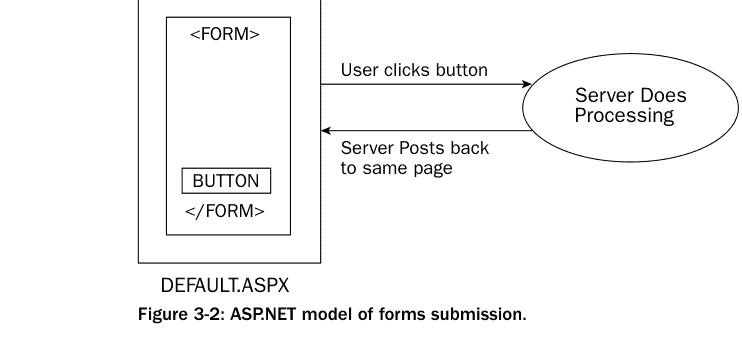

在 ASP.NET 模型中，页面之间的导航更常通过 `Response.Redirect` 或 `Server.Transfer` 方法执行。从经典 ASP 迁移到 ASP.NET 的新手面临的最大障碍之一就是难以跨越这一概念上的差异。这一直是常见的使用模式，直到 Ajax 出现，它重新引入了让脚本代替提交页面的理念。

### Ajax/JavaScript 提交模型

Ajax 所使用的 JavaScript 提交模型再次改变了这一模式。表单可以被（尽管并非必须）完全从模型中移除。

这一模型使用 JavaScript 来拦截对事件的调用，当该事件发生时（例如用户点击按钮或在 HTML 控件中进行选择），调用会被传递给脚本。然后由脚本来发起对服务器的调用（图 3-3）。

**图 3-3：** JavaScript/Ajax 提交模型。

当然，脚本不必立即提交数据。它可以等待其他条件和标准满足后再提交数据。此外，在这种模型中，由于脚本可以立即响应事件，而不必等待显式提交，因此从服务器返回的数据也不必立即对用户可见。脚本不受必须等待响应的限制。

### 从服务器端开始

JavaScript 用于启动客户端/服务器交互。现在我们越过这个分界线，谈谈数据到达服务器后会发生什么。因为流程的每个部分都处理得相当独立，你可以将每个部分切割开来，几乎独立于其他部分进行检验。你可以将这些部分视为黑盒。它们需要特定的输入，并会提供特定的输出，尽管内部运作可能完全不同。

例如，考虑一台自动柜员机或 ATM。你将卡片插入其中，输入个人识别码（PIN），然后期望从机器中取出钱（以及可能的收据）。全国有成千上万的 ATM，属于许多不同的银行。有些会收取手续费，有些提供查看银行明细的功能，还有些只提供取款功能。它们的工作方式各不相同，但它们提供了相同的界面供你交流。

客户端/服务器事务中的服务器端部分，其工作方式与这个假设的黑盒或 ATM 非常相似。它将接收来自 HTTP 请求的数据，最终，在处理完这些数据后，必须以服务器响应的形式返回数据。

### 向服务器提交数据

虽然向服务器提交数据有多种方法，但我们只关注 `XMLHttpRequest` 对象。使用此对象向服务器提交数据，涉及三个步骤：

1. 设置数据接收时触发的事件。
2. 调用 open 方法并附带请求。
3. 发送请求。

这里只讨论 open 方法。

```
XMLHttpRequestObject.open(method, URL to call, asynchronous or synchronous);
```

它通过以下两种方式之一提交数据。首先可以是通过 HTTP GET 方法，消息发送方式如下：

```
XMLHttpRequestObject.open("GET", "response.aspx?value=1", "true");
```

或者，它可以通过 HTTP `Post` 方法。在以下代码片段中，变量 data 经过 URI 编码，包装在请求体中，然后发送请求：

```
var argument = "value=";
argument += encodeURIComponent(data);
XMLHttpRequestObject.open("POST", "response.aspx", "true");
xHRObject.send(bodyofrequest);
```

这使你能够以与通过 PHP 或 ASP.NET 提交页面完全相同的方式和格式，将 HTML 控件和表单数据的值发送到服务器。

### 服务器接收请求

一旦服务器接收到数据，会发生什么呢？JavaScript 已经指定了 GET 或 POST 方法来发布数据，作为 URL 的一部分或 `Request` 主体的一部分。在经典 ASP 和 ASP.NET 中，你可以使用 `QueryString`、`Form` 或 `Params` 集合来获取这些项目。在 PHP 中，你可以使用 `$_GET`、`$_POST` 或 `$_REQUEST` 集合来获取它们。

从 HTML 表单还是从 JavaScript 发起的请求接收数据，两者之间没有可观察到的区别。例如，你可以在你的 HTML 页面中通过以下代码创建一个名为 "MyTextbox1" 的文本框：

```
<input type="text" id="MyTextbox1" name="MyTextbox1" />
```

当通过 GET 方法提交时，它将出现在 ASP.NET 中使用 C# 的 `QueryString` 集合中。

```
string TextBox = Request.QueryString["MyTextbox1"].ToString();
```

或者，当通过 `POST` 方法提交时，它可以出现在 `Form` 集合中。

```
string TextBox = Request.Form["MyTextbox1"].ToString();
```

或者，要从 `QueryString` 或 `Form` 集合中获取该名称的项目，你可以使用以下代码：

```
string TextBox = Request.Params["MyTextbox1"].ToString();
```

在 PHP 中，与之等价的是 `$_REQUEST` 集合。例如，你可以使用以下代码：

```
$TextBox = $_REQUEST["MyTextbox1"];
```

在 PHP 中，你也可以通过 `$_GET` 或 `$_POST` 集合分别获取这些集合的值，它们分别类似于 ASP.NET 的 `QueryString` 和 `Form` 集合。

```
$TextBox = $_GET["MyTextbox1"];

$TextBox = $_POST["MyTextbox1"];
```

一旦你获取了数据，服务器就可以自由处理数据，然后将其返回给客户端。

### 编写 HTTP 响应

与使用服务器端技术时正常的事件序列不同的是，你希望显示的信息不能立即写回页面。相反，你不得不将信息打包到 `HTTP Response` 中。这听起来比实际要简单得多。

在 ASP 和 ASP.NET 中，你只需使用 `Response.Write` 方法写入数据。

```
string data = "This is our data";
Response.Write(data);
```

在 PHP 中，你使用 `echo` 命令。

```
$data = "This is our data";
echo $data
```

你可以创建更复杂的结构（例如 XML 文档或其他结构），只要它们可以被解析为文本即可。在 ASP.NET 中可以这样实现：

```
XmlDocument XmlDoc = new XmlDocument();
XmlNode versionNode = XmlDoc.CreateXmlDeclaration("1.0","ISO-8859-1","yes");
XmlNode mainNode = XmlDoc.CreateElement("root");
XmlDoc.AppendChild(mainNode);
XmlNode childNode = XmlDoc.CreateElement("child");
childNode.AppendChild(XmlDoc.CreateTextNode("Data"));
mainNode.AppendChild(versionNode);
mainNode.AppendChild(childNode);
```


 ```
string strXml = XmlDoc.InnerXml;
Response.Write(strXml);
```

或者，在 PHP 中，可以如下所示：

```
$doc = new DomDocument('1.0');
$root = $doc->createElement('root');
$root = $doc->appendChild($root);
$child = $doc->createElement('child');
$child = $root->appendChild($child);
$value = $doc->createTextNode("Data");
$value = $child->appendChild($value);
$strXml = $doc->saveXML();
echo $strXml;
```

这会产生如下 XML 文档：

```
<?xml version="1.0"?>
<root>
<child>Data</child>
</root>
```

该字符串附加到 HTTP 响应并发送回客户端以便获取。虽然此过程部分是简单的，但当响应返回给客户端时，获取数据则稍显复杂。

### XMLHttpRequest 对象

如第 4 章所见，`XMLHttpRequest` 对象并非执行 Ajax 技术所需的客户端/服务器交互的唯一手段。然而，它可能是最广泛被青睐的。

本章并未详细讨论该对象的工作原理，所以不妨将其想象成另一个黑盒，期望其输入来自 HTTP 响应。

### 回调函数

接收数据的第一个阶段称为回调函数。这仅仅是一个 JavaScript 函数，当数据从服务器完全下载时运行。你可以将回调函数命名为一些通用名称，如 `getData()`，该函数在大多数 Ajax 应用中看起来非常相似。在回调函数内，首先要执行的任务是检查数据是否已准备好获取。这是通过检查 `XMLHttpRequest` 对象的 `readyState` 属性是否等于 4（代表完成）来实现的。

# 第 3 章：Ajax 与服务器端技术

一旦你确认数据已准备好，你就可以使用 `XMLHttpRequest` 对象的两个属性之一来获取它：

- responseText
- responseXML

## responseText 属性

`responseText` 属性是获取 HTTP 响应中数据的最常见方法，也是最简单的方法。你可以创建一个新的 JavaScript 变量来收集响应的内容，它将作为字符串返回。

```
var text = xhrObject.responseText;
```

如果你的 ASP.NET 页面创建了以下内容，那么 `responseText` 方法将包含 "This is our data"：

```
string data = "This is our data";
Response.Write(data);
```

在 PHP 中，你将创建以下内容：

```
$data = "This is our data";
echo $data;
```

这就是全部。你也可以用它来获取 HTML/XHTML。但是，如果你想获取 XML 数据该怎么办？你仍然可以使用 `responseText` 方法。只是它将作为字符串返回 XML 数据。考虑以下 ASP.NET 代码：

```
string data = "<?xml version=\"1.0\" encoding=\"ISO-8859-1\"
standalone=\"yes\"?><root><child>Data</child></root>";
Response.Write(data);
```

考虑以下 PHP 代码：

```
$data = "<?xml version=\"1.0\" encoding=\"ISO-8859-1\"
standalone=\"yes\"?><root><child>Data</child></root>";
echo $data;
```

这将返回以下数据：

```
<?xml version="1.0" encoding="ISO-8859-1"
standalone="yes"?><root><child>Data</child></root>
```

然而，将 XML 文档作为字符串返回可以去除使用 XML 的许多好处。因此，有一个 `responseXML` 方法。

## responseXML 属性

如果要从客户端开始传递 XML 文档，`responseXML` 属性看起来是一个更好的选择。它允许你将响应视为 XML 文档对象，并使用 DOM 遍历不同的元素、属性和文本节点。不过与 Ajax 一样，使用时需注意不少问题。

假设你有以下服务器端代码来读取 XML 文档：

```
string data = "<?xml version=\"1.0\" encoding=\"ISO-8859-1\" standalone=\"yes\"?><root><child>Data</child></root>";
Response.Write(data);
```

然后你更改 JavaScript 代码以如下方式读取。

```
var document = xHRObject.responseXML;
```

如果你期望获得一个完全可用的 XML 文档，你可能会感到有些惊讶。你会得到返回一个对象，但它将是空的，没有任何传输的 XML 的迹象。这发生是因为在写入 Response 之前，`Response` 的 `ContentType` 必须设置为 `"text/xml"`。

```
string data = "<?xml version=\"1.0\" encoding=\"ISO-8859-1\" standalone=\"yes\"?><root><child>Data</child></root>";
Response.ContentType = "text/xml";
Response.Write(data);
```

不幸的是，Internet Explorer (IE) 对此特别无法容忍。如果你不在服务器端设置它，你就无法在浏览器中使用 `responseXML`。在 Firefox 中，有可能在 JavaScript 中使用 `overrideMimeType` 方法在代码调用之前覆盖并在客户端将类型设置为 `text/xml`，如下所示：

```
xHRObject.overrideMimeType("text/xml");
xHRObject.send(null);
var document = xHRObject.responseXML;
```

IE 不存在此属性。不过，问题并不止于此。如果你在 XML 文档中犯错导致其不是井格式，那么你也将从 IE 那里得到一个空对象，而不会立即出现明显的错误信息。

### 调试 responseXML

在确定为什么没有从 `responseXML` 获得任何数据时，你可以使用四种方法。第一个是检查 `responseText`，以查看是否在此返回了任何内容。假设你运行以下警报消息：

```
var text = xHRObject.responseText;
alert(text);
```

你会看到类似以下内容：

```
<?xml version="1.0" encoding="ISO-8859-1"
standalone="yes"?><root><child>Data</child></root>
```

如果看不到这个，那么响应没有正确传输给服务器，你需要检查你的服务器端代码。但是，更有可能的是，你会看到正确的数据。

如果你看不到正确的数据，那么下一步是检查错误代码。

# 第 3 章：Ajax 与服务器端技术

### 在 IE 中调试 responseXML

要在 IE 中找到有关错误的更多信息，你应该使用以下代码返回更有教育意义的错误消息，并指导你如何修正 XML 文档：

```
var errorcode = xHRObject.responseXML.parseError.errorCode;
```

在正常情况下，IE 应返回的代码应为零。如果你确实已将 ContentType 设置为 "text/xml"，且 responseXML.xml 为空，那么代码将是非零值。

你可以获取以下信息以了解从 responseXML 属性返回的代码的含义：

```
var errormessage = xHRObject.responseXML.parseError.reason;
```

### 在 Firefox 中调试 responseXML

虽然 Firefox 没有类似的 parseError 对象，但通过 Firefox 的菜单工具是“Javascript Console”，它将允许你检查有意义的错误消息，包括导致错误的对象类型。如果你在 Ajax 响应中有 XML 格式化问题，JavaScript Console 提供如下信息且无需更改或添加 JavaScript 代码：

```
Error: mismatched tag. Expected: </error>.
Source File: http://localhost:8080/Company/WebPages/framed.jsf?com.asparity.AJAX_CLIENT_ID=_idJsp0%3AmasterTree&com.company.AJAX_REQUEST=true&oracle.adf.faces.STATE_TOKEN=3&nodeString=%3A%3AdomainModel%3A1&clientNodeId=%3A%3AdomainModel%3A1%3A1aawaiting
AjaxData
Line: 1, Column: 6905
Source Code: [...]
```

此外，有一个易于安装的扩展名为 'firebug'，它允许开发人员实时检查 XHR 流量，包括请求和响应。

### 使用数据

一旦你成功从 `responseXML` 属性返回了数据，你就可以像获取 DOM 对象一样检索数据。例如，假设你有以下文档：

```
<?xml version="1.0" encoding="ISO-8859-1" standalone="yes"?>
<cart>
  <book>
    <Title>Beginning ASP.NET with C#</Title>
    <Quantity>1</Quantity>
  </book>
</cart>
```

那么你可以如下返回 XML 文档中的 `<cart>` 元素：

```
var XMLDoc = xHRObject.responseXML;
var book = XMLDoc.getElementsByTagName("book");
```


var title = book[0].firstChild;

两大主流浏览器IE和Mozilla在从XML文档返回文本内容的方式上存在显著差异。

IE会使用`text`属性来返回，如下所示：

```javascript
var title = book[0].firstChild.text;
// title的值将是"Beginning ASP.NET with C#"
```

Mozilla则会使用`textContent`属性来返回，如下所示：

```javascript
var title = book[1].firstChild.textContent;
// title的值将是"Beginning ASP.NET with C#"
```

此外，你会注意到在IE中，使用`book[0]`来引用第一个节点，而在Firefox中则是`book[1]`。这是因为Firefox中的`book[0]`会包含一个带有换行符的文本节点，因为Firefox不会跳过空白字符；它将其视为独立的节点，而IE则不会。

因此，为了访问从服务器返回的数据，我们再次需要进行一些跨浏览器的编码。

### 服务端技术

到目前为止的讨论涉及了数据如何从服务器发送和接收的过程，但并未涉及服务器本身发生的事情。服务端技术是独立于Ajax的实体，必须单独学习。让我们假设你已经具备这些技术中的一种的实用知识，因为如果你无法在服务器上执行一些基本操作，你将无法走得太远。接下来是对每种技术的非常简要的介绍，随后是一个利用该技术的示例Ajax应用程序。

如果你熟悉ASP.NET但不熟悉PHP或Java，请不要觉得需要跳过这些部分。熟悉你最擅长使用的语言和工作之外的其他语言和技术，不仅能给开发者打下坚实的基础，还能使其具备前瞻性。通常，你会看到一些工作或合同涉及将应用程序从一种语言移植到另一种语言，这需要对两种语言都有深入的了解。

Classic ASP和PHP有很多相似之处，你很快就会看到它们彼此的相似之处。下面的讨论会简要涉及Java，以展示它如何与Ajax理念巧妙结合，但让我们先从微软目前的旗舰产品开始：ASP.NET。

## # 第三章：Ajax和服务端技术

ASP.NET是微软用于创建动态网页的技术。它在计算机上运行有两个先决条件：安装.NET Framework和一个兼容的Web服务器，通常是Internet Information Server（IIS）。

.NET自2000年就已存在，但最新的主要版本.NET 2.0于2005年底发布。你可以从http://update.microsoft.com获取最新版本。确保选择“自定义”选项而不是“快速”，并在“可选软件更新”下搜索。

另一方面，IIS仅作为Windows操作系统的一部分提供。许多Windows版本默认不安装它，而且在Windows XP家庭版中不可用。你可以通过进入控制面板并选择“添加或删除Windows组件”图标来添加它。

ASP.NET被认为是语言无关的。其理念是你可以使用任何.NET实现语言来创建你的应用程序。实际上，通常归结为在两种语言中选择一种：Visual Basic.NET和C#。对于本书，让我们用C#来创建ASP.NET示例，因为C#在结构上与JavaScript相似，并具有区分大小写等特性。它也更接近PHP。

要在ASP.Net中部署应用程序，你需要将其放置在`C:\inetpub\wwwroot\application_name`文件夹（或你选择的任何位置）中，然后使用IIS将其创建为虚拟目录。这可以通过运行IIS并右键单击你希望启用的目录，然后选择“属性”来完成，如图3-4所示。

> **图3-4：** 在IIS中选择目录的属性。

然后，在出现的对话框中单击“创建”按钮以创建一个新的应用程序，如图3-5所示。

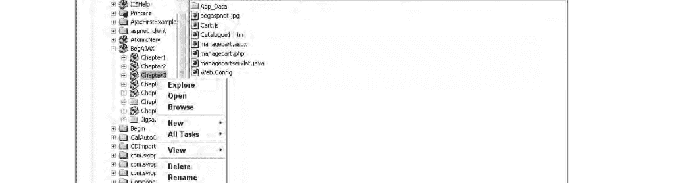

> **图3-5：** 属性对话框中的“创建”按钮。
   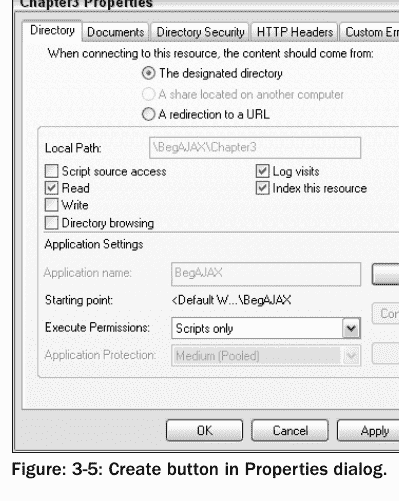

如果你然后在浏览器中访问你的新应用程序（在此示例中，`http://localhost/BegAjax/chapter3`），你将收到一个HTTP 403禁止查看目录的错误，这表明你已成功创建它。

一旦应用程序在Web服务器上正确部署，你就可以在JavaScript中通过在XMLHttpRequest对象的Open方法中传递对你要调用的ASP.NET页面的引用来调用它，如下所示：

```javascript
XMLHttpRequestObject.open("POST", "response.aspx?value=1", "true");
```

### 使用AJAX和ASP.NET的示例

让我们为使用购物车的图书销售商创建一个虚拟目录页面。你将允许用户将商品放入购物车并在无需刷新页面的情况下更新购物车。

为使示例尽可能简单，让我们假设用户已被识别。

购物车将具有三项功能：

-   - 你可以向其中添加新商品。
-   如果你添加第二个相同商品，数量将增加一个。
-   你可以从中移除商品。

现在，这显然不是可以完全在客户端实现的事情，尽管它可以在客户端发起。应用程序将从客户端页面获取书名并将其传递给服务器。这用于在你将书放入购物车时识别该书。

在服务器端，购物车必须跟踪用户已放入购物车中的商品以及商品数量。为此，购物车将存储在会话变量中。这意味着在一个大型目录中，用户将能够在页面之间移动，而不会丢失已放入购物车中的商品的跟踪。

让我们使用一个XML文档来存储购物车中的商品。有一个单独的`cart`元素，其内部是用户购买的每种不同书名的`book`元素。`book`元素包含一个`title`元素和一个`quantity`元素（尽管可以扩展以添加ISBN、价格、作者）。虽然你只有一个目录页面，但这个示例是可扩展的，因此你可以从多个目录页面运行它。

### 动手实践：ASP.NET中的购物车示例

-   1. 创建一个名为Catalogue1.htm的新文件。
-   2. 创建一个名为Cart.js的脚本。

```html
<html xmlns="http://www.w3.org/1999/xhtml" >
<head>
    <script type="text/javascript" src="Cart.js"></script>
</head>
<body >
<br/>

<br />
<b>Book:</b><span id="book">Beginning ASP.NET with C#</span><br />
<b>Authors: </b><span id="authors">Hart, Kauffman, Sussman, Ullman</span>
<br /><b>ISBN: </b><span id="ISBN">0764588508</span>
<br /><b>Price: </b><span id="price">$39.99</span>
<br /><br />
<a href="#" onclick="AddRemoveItem('Add');" >添加到购物车</a>
<br /><br />
<span id="cart" ></span>
</body>
</html>
```

```javascript
var xhrObject = false;
if (window.XMLHttpRequest) 
{
    xhrObject = new XMLHttpRequest();
}
else if (window.ActiveXObject)  
{
    xhrObject = new ActiveXObject("Microsoft.XMLHTTP");
}

function getData()
{
```

-   3. 创建一个名为ManageCart.aspx的页面。

```csharp
<%@ Page Language="C#" Debug="true" %> 

<%@ import Namespace="System.Xml" %> 
<script language="C#" runat="server">
    void Page_Load()
    {
        string newitem = Request.Params["book"];
        string action = Request.Params["action"];
        Hashtable ht = new Hashtable();
        if (Session["Cart"] != null)  
```


## 第三章：Ajax 与服务器端技术

```csharp
{
    ht = (Hashtable)Session["Cart"];
    if (action == "Add")
    {
        if (ht.ContainsKey(newitem))
        {
            int value = int.Parse(ht[newitem].ToString());
            ht.Remove(newitem);
            value++;
            ht.Add(newitem, value);
            Session["Cart"] = ht;
            Response.ContentType = "text/xml";
            Response.Write(toXml(ht));
        }
        else
        {
            ht.Add(newitem, 1);
            Session["Cart"] = ht;
            Response.ContentType = "text/xml";
            Response.Write(toXml(ht));
        }
    }
    else
    {
        ht.Remove(newitem);
        Session["Cart"] = null;
        Response.ContentType = "text/xml";
        Response.Write(toXml(ht));
    }
}
else
{
    ht.Add(newitem, 1);
    Session["Cart"] = ht;
    Response.ContentType = "text/xml";
    Response.Write(toXml(ht));
}
}

string toXml(Hashtable ht)
{
    XmlDocument XmlDoc = new XmlDocument();
    XmlNode versionNode = XmlDoc.CreateXmlDeclaration("1.0","ISO-8859-1","yes");
    XmlNode mainNode = XmlDoc.CreateElement("cart");
    XmlDoc.AppendChild(versionNode);
    XmlDoc.AppendChild(mainNode);

    foreach (string key in ht.Keys)
    {
        XmlNode childNode = XmlDoc.CreateElement("book");
        XmlNode TitleNode = XmlDoc.CreateElement("Title");
        XmlNode QuantityNode = XmlDoc.CreateElement("Quantity");
        TitleNode.AppendChild(XmlDoc.CreateTextNode(key));
        QuantityNode.AppendChild(XmlDoc.CreateTextNode(ht[key].ToString()));
        childNode.AppendChild(TitleNode);
        childNode.AppendChild(QuantityNode);
        mainNode.AppendChild(childNode);
    }

    string strXml = XmlDoc.InnerXml;

    return strXml;
}
</script>
```

4.  在浏览器中启动 Catalogue1.htm，然后选择“添加到购物车”链接，如图 3-6 所示。

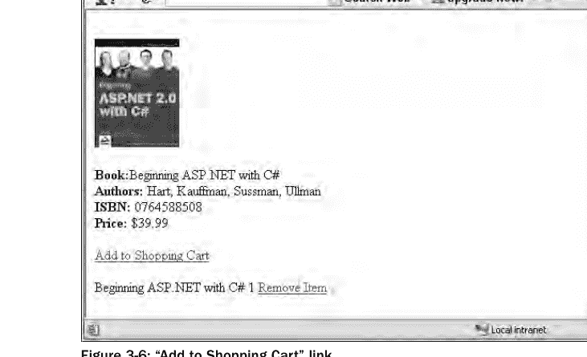

图 3-6：“添加到购物车”链接。

5.  再次点击“添加到购物车”，商品数量增加一个，如图 3-7 所示。

6.  现在，点击“移除商品”，该商品会从你的购物车中消失，如图 3-8 所示。

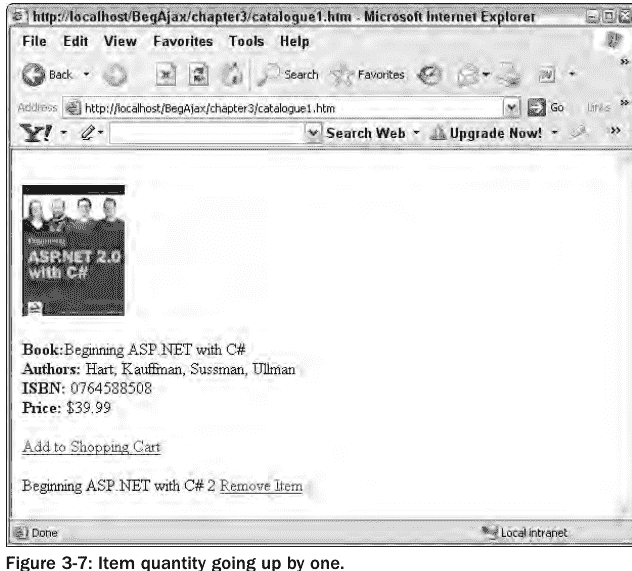

图 3-7：商品数量增加一个。

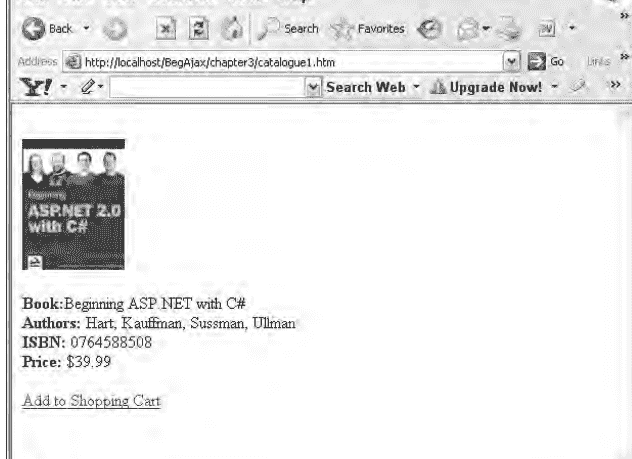

图 3-8：商品从购物车中消失。

## 工作原理

这三页的循环完全反映了前面讨论的 JavaScript 模型。HTML 页面是一个“虚拟”页面，用于显示目录中的一个商品。实际上，这个页面应该是一个服务器端页面，它会从数据库中提取一本书的详细信息并显示在屏幕上。这个目录页面在页面中包含了脚本 `cart.js`。该脚本通过“添加到购物车”链接被调用：

```
<a href="#" onclick="AddRemoveItem('Add');" >Add to Shopping Cart</a>
```

你在脚本中使用同一个函数来执行从购物车中添加和移除商品的操作。你只需传递一个字符串变量作为脚本的参数，以指示你是想“添加”还是“移除”一个商品。我们不深入探讨这个函数的功能，因为讨论 XMLHttpRequest 并非本次练习的目的。

该函数使用 `document.getElementById` 从页面中提取书籍，并根据调用的是添加还是移除商品任务，创建一个发送到服务器的请求。它组装一个查询字符串并调用服务器端页面。

```javascript
function AddRemoveItem(action)
{
    var book = document.getElementById("book").innerHTML;
    if(action=="Add")
    {
        xhrObject.open("GET", "managecart.aspx?action=" + action + "&book=" +
        encodeURIComponent(book) + "&value=" + Number(new Date), true);
    }
    else
    {
        xhrObject.open("GET", "managecart.aspx?action=" + action + "&book=" +
        encodeURIComponent(book) + "&value=" + Number(new Date), true);
    }
    xhrObject.onreadystatechange = getData;
    xhrObject.send(null);
}
```

服务器端代码 `managecart.aspx` 中有两个方法。第一部分在 `Page_Load` 方法中，页面一旦被调用就会执行。第二个是 `toXml`，它将购物车序列化为 XML 格式，并准备将其发送回客户端。你从 `Page_Load` 开始，创建三个变量：前两个用于存储你在客户端页面上提取的书名，第三个是用户选择的操作（可以是添加或移除）。然后，你创建一个哈希表来存储购物车中的商品。将购物车中商品的标题与用户选择的数量一起存储。

```csharp
void Page_Load()
{
    string newitem = Request.Params["book"];
    string action = Request.Params["action"];
    Hashtable ht = new Hashtable();
}
```

接下来，检查保存你购物车的 `Session` 变量是否为空。如果不为空，那么你知道用户以前来过，这就有四种可能的操作：

-   用户正在添加一个商品，而该商品已经存在于购物车中。
-   用户正在添加一个不在购物车中的新商品，但购物车已经存在。
-   用户正在移除一个商品。
-   用户正在添加一个商品，而没有购物车存在，因此必须创建一个。

如果用户正在添加一个商品，并且该商品已经存在于哈希表 `ht` 中，那么你执行以下代码：

```csharp
if (Session["Cart"] != null)
{
    ht = (Hashtable)Session["Cart"];
    if (action == "Add")
    {
        if (ht.ContainsKey(newitem))
        {
            int value = int.Parse(ht[newitem].ToString());
            ht.Remove(newitem);
            value++;
            ht.Add(newitem, value);
            Session["Cart"] = ht;
            Response.ContentType = "text/xml";
            Response.Write(toXml(ht));
        }
```

无论你执行哪个操作，你都确保从 `Session` 变量中获取购物车的最新版本，并将其存储在哈希表 `ht` 中。你检查 `action` 变量是否等于 `Add`，并检查商品是否存在于哈希表中。接下来，你创建一个变量 `value` 来存储哈希表中与商品关联的数量。然后从哈希表中移除该商品。你将值加一，并将新商品添加到哈希表中。你将更新后的哈希表读回到 `Session` 变量中。

下一步至关重要。你将 `content-type` 设置为 `Xml`。如果你不这样做，那么 `responseXML` 将无法正常工作。最后，你通过函数 `toXML`（稍后讨论）将哈希表写入 `Response` 流。

如果哈希表不包含该商品，你必须添加一个新商品，因此运行以下代码。

```csharp
else
{
    ht.Add(newitem, 1);
    Session["Cart"] = ht;
    Response.ContentType = "text/xml";
    Response.Write(toXml(ht));
}
}
```

你将商品添加到哈希表中，并为其赋值 1。你还将 `Content-Type` 设置为 `text/xml`，然后将其写入 `response` 流。在每种可能的场景结束时，你都必须这样做，以确保客户端显示正确的信息。

第三种场景是 `Action` 变量不等于 `Add`，因此你假设它必须是 `Remove`。要移除一个商品，你运行以下代码段：

```csharp
else
{
    ht.Remove(newitem);
    Session["Cart"] = null;
    Response.ContentType = "text/xml";
    Response.Write(toXml(ht));
}
```

你从哈希表中移除该商品。你将包含购物车的 `Session` 变量设置为零，并将 `ContentType` 设置为 `text/xml`，然后将哈希表写入 `Response` 流。

最后一种场景看起来相当熟悉。它基本上与第二种场景相同。你将一个商品添加到哈希表中，将哈希表存储在 `Session` 变量中，将 `ContentType` 设置为 "text/xml"，并将哈希表写入 `Response` 流。

```csharp
else
{
    ht.Add(newitem, 1);
    Session["Cart"] = ht;
    Response.ContentType = "text/xml";
    Response.Write(toXml(ht));
}
}
```

在每个场景结束时，你调用 `toXML` 函数将哈希表序列化为 XML。第五章将更详细地介绍 XML，因此我们在此不过多讨论文档的结构。

```csharp
XmlDocument XmlDoc = new XmlDocument();
XmlNode versionNode = XmlDoc.CreateXmlDeclaration("1.0","ISO-8859-1","yes");
XmlNode mainNode = XmlDoc.CreateElement("cart");
XmlDoc.AppendChild(versionNode);
XmlDoc.AppendChild(mainNode);
```

你创建一个新文档，并创建一个声明节点。你创建一个根节点并称之为 `cart`。然后你将根节点和声明附加到你的文档中。

接下来，你遍历哈希表中的每个键。你将书籍的 `Title` 作为键存储在表中，将用户希望购买的 `Quantity` 作为值存储。对于表中的每个项目，你创建一个书籍 `Title` 和 `Quantity` 元素。因为 `Title` 和 `Quantity` 是 book 的子元素，所以你必须小心附加它们的顺序以及附加到哪些项。

```csharp
foreach (string key in ht.Keys)
{
    XmlNode childNode = XmlDoc.CreateElement("book");
    XmlNode TitleNode = XmlDoc.CreateElement("Title");
    XmlNode QuantityNode = XmlDoc.CreateElement("Quantity");
```


## 第3章：Ajax 与服务器端技术

首先，你必须将哈希表中的文本值添加到元素中。你将哈希表的键附加到 `Title` 元素，并将键对应的值附加到 `Quantity` 元素：

```xml
TitleNode.AppendChild(XmlDoc.CreateTextNode(key));
QuantityNode.AppendChild(XmlDoc.CreateTextNode(ht[key].ToString()));
```

然后，你将这两个子元素附加到子元素 `<book>`。最后，你将这个书籍元素附加到 `cart` 元素以完成文档。

```xml
childNode.AppendChild(TitleNode);
childNode.AppendChild(QuantityNode);
mainNode.AppendChild(childNode);
```

所有这些步骤完成后，你需要使用 `innerXml` 方法获取此文档的文本版本，并将其返回给调用方法：

```csharp
string strXml = XmlDoc.InnerXml;
return strXml;
```

当然，你的工作尚未完成。你已经成功地将数据发送到了服务器，并且在服务器上，你已经将数据打包并作为 XML 文档发送了响应。你仍然需要解析这个 XML 并在页面上显示它。这又回到了你的 JavaScript 和当 `readystatechange` 事件触发时被调用的 `getData()` 函数。

在回调函数内部，你从 `XMLHttpRequest` 对象的 `responseXML` 属性中检索数据。你使用 DOM 的 `getElementsByTagName` 方法来检索书籍元素的数组，从而隔离出 XML 的一个子集。

```javascript
var serverResponse = xHRObject.responseXML;
var header = serverResponse.getElementsByTagName("book");
```

同时，你还必须检索将要显示购物车的 HTML 元素的信息。你已经在 `Catalogue1.htm` 中创建了一个空的 `<span>` 标签。这里，你使用 DOM 的 `getElementById` 方法检索它，并确保其 `innerHTML` 属性被设置为零。

```javascript
var spantag = document.getElementById("cart");
spantag.innerHTML = "";
```

现在你已经检索了所有的书籍元素并将它们存储在一个数组中，是时候解析它们了。你创建一个循环，并将其最大值设置为数组中的项目数量。然后，你检查用户使用的是 IE 还是 Mozilla。如果用户使用的是 IE，那么使用 `text` 属性来显示每个书籍元素。如果用户使用的是 Mozilla，那么你使用 `textContent` 属性。书籍元素的 `firstChild` 是 `Title` 元素；书籍元素的 `lastChild` 是 `Quantity` 元素。

```javascript
for (i=0; i<header.length; i++)
{
    if (window.ActiveXObject)
    {
        spantag.innerHTML += " " + header[0].firstChild.text;
        spantag.innerHTML += " " + header[0].lastChild.text + " " + "<a href='javascript:AddRemoveItem(\"Remove\");'>Remove Item</a>";
    }
    else
    {
        spantag.innerHTML += " " + header[0].firstChild.textContent;
        spantag.innerHTML += " " + header[0].lastChild.textContent + " " + "<a href='javascript:AddRemoveItem(\"Remove\");'>Remove Item</a>";
    }
}
```

在你显示了书籍元素的标题和数量之后，你还创建了一个动态链接，允许用户删除一个项目。这通过调用 `AddRemoveItem` 并传递 `"Remove"` 作为参数，与 JavaScript 关联起来。这就完成了整个回路。

这个 ASP.NET 页面有相当多的代码，但正如你所看到的，它包含的代码并没有什么特别困难的地方。你将在 PHP 版本的代码中看到同样的情况。

## PHP

PHP 这个缩写据传有多种含义。普遍接受的是“超文本预处理器”，但其他含义也包括“个人主页”和“PHP 超文本预处理器”（一个可能递归的缩写）。PHP 也许是 ASP.NET 最简单的替代方案。与 ASP.NET（利用现有编程语言）不同，PHP 本身就是一种编程语言。它可以在两个主要的 Web 服务器（IIS 和 Apache）上运行，并且不会与 Windows 平台绑定。它成功地保持了许多最初吸引开发者使用经典 ASP 的简洁性，因为变量不需要强类型化，也不必将所有内容打包到单独的程序或方法中。

PHP 是一个开源产品，由 Zend Technologies 公司商业化。可以从 www.php.net 下载。截至本文撰写时，当前版本是 5.1.6。虽然 ASP.NET 理论上要求你至少在某个环节购买了 Windows 操作系统，但 PHP 完全免费，因为它可以在开源操作系统（如 Linux）上运行。它也可以在非常流行的 Apache Web 服务器（www.apache.org）上运行，该服务器与 PHP 一样具有灵活性和多平台支持。

PHP 类似于两种主要语言。它最初是由 Rasmus Lerdorf 使用 PERL 和 C 创建的。然而，它已经去除了这两种语言的许多复杂性。它拥有一系列模仿经典 ASP/ASP.NET 对象的对象，包括 `Request` 和 `Session`，因此对 ASP 和 ASP.NET 开发者来说不会太陌生。

尽管早期版本的 PHP 以安装困难而闻名，但最新的 PHP 5 版本现在很容易安装在 IIS 上。如果你在硬盘上创建一个目录，并从 www.php.net/downloads.php#v5 将 Windows 安装程序 ZIP 文件的内容解压到这里，你只需要通过 IIS 注册 ISAPI 过滤器即可。为此，请转到 IIS，右键单击“默认网站”并选择“属性”。选择“ISAPI 筛选器”选项卡，如图 3-9 所示。单击“添加”，将过滤器名称创建为 PHP，并将可执行文件指向 php5isapi.dll 的位置。

一旦应用程序在 Web 服务器上正确部署，你就可以像使用 ASP.NET 一样，通过 XMLHttpRequest 对象的 Open 方法，在 JavaScript 中调用它，如下所示：

```javascript
XMLHttpRequestObject.open("POST", "response.php?value=1", "true");
```

事实上，PHP 可以与 ASP/ASP.NET 无缝并行运行。

### 使用 AJAX 和 PHP 的示例

现在让我们将本章的示例转换为使用 PHP 代替 ASP.NET。在客户端代码的工程化方面，这是一项相对简单的任务。你只需将对 ASP.NET 页面的调用更改为对 PHP 页面的调用。

请注意，如果你不想先创建 ASP.NET 示例，请按照该“动手实践”部分的步骤 1 和 2 操作，然后跳转到以下“动手实践”部分的步骤 1。

然后，你在 PHP 代码中遵循与 ASP.NET 代码相同的模式。你有两段代码——一段执行购物车操作（添加和删除项目），另一段将购物车内容序列化为 XML 文档。

### 动手实践：PHP 中的购物车示例

1.  打开 Catalogue1.htm，更改以下行，并将其另存为 catalogue1PHP.htm：

```html
<head>
<script type="text/javascript" src="cartPHP.js"></script>
</head>
```

2.  在 `cart.js` 的 `AddRemoveItem` 函数中更改以下高亮行，使其内容如下所示，并将其另存为 `cartPHP.js`：

```javascript
if(action=="Add")
{
    xHRObject.open("GET", "managecart.php?action=" + action + "&book=" + book + "&value=" + num, true);
}
else
{
    xHRObject.open("GET", "managecart.php?action=" + action + "&book=" + book + "&value=" + num, true);
}
```

3.  现在，创建一个名为 `managecart.php` 的新页面，并添加以下内容：

```php
<?php
session_register('Cart');
header('Content-Type: text/xml');
?>
<?php
$newitem = $_GET["book"];
$action = $_GET["action"];
if ($_SESSION["Cart"] != "")
{
    $MDA = $_SESSION["Cart"];
    if ($action == "Add")
    {
        if ($MDA[$newitem] != "")
        {
            $value = $MDA[$newitem] + 1;
            $MDA[$newitem] = $value;
            $_SESSION["Cart"] = $MDA;
            echo (toXml($MDA));
        }
        else
        {
            $MDA[$newitem] = "";
            $_SESSION["Cart"] = $MDA;
            echo (toXml($MDA));
        }
    }
    else
    {
        $MDA = "";
        $_SESSION["Cart"] = "";
        echo (toXml($MDA));
    }
}
else
{
```

## 第三章：Ajax 与服务器端技术

首先，你注册一个名为 `Cart` 的 `Session` 变量，用于保存购物车。然后将响应的 `Content-Type` 设置为 `text/xml`，以便能够被 `responseXML` 方法使用。

```
session_register('Cart');
header('Content-Type: text/xml');
```

接着，你创建两个变量来存储图书标题和用户选择的操作。这两个值取自 GET 集合，该集合作为查询字符串附加到 JavaScript 发出的请求中：

```
$newitem = $_GET["book"];
$action = $_GET["action"];
```

你查询 `$_SESSION["Cart"]` 变量，判断其是否为空。如果不为空，则创建一个名为 `$MDA` 的变量来存储该 `Session` 变量。由于 PHP 不使用强类型，你无需担心将 PHP 变量从一种类型转换为另一种类型，这一切都会自动处理。

```
if ($_SESSION["Cart"] != "")
{
	$MDA = $_SESSION["Cart"];
```

你检查 `$action` 变量是否包含从 JavaScript 传递过来的 "Add" 一词。如果是，则需要处理以下两种情景之一。

第一种情景是购物车中已有该商品，你只需将其数量加一，将新值存入数组，再将数组存入 `Session` 变量，然后将数组序列化，如下所示：

```
if ($action == "Add")
{
	if ($MDA[$newitem] != "")
	{
		$value = $MDA[$newitem] + 1;
		$MDA[$newitem] = $value;
		$_SESSION["Cart"] = $MDA;
		ECHO (toXml($MDA));
	}
```

该数组的工作方式与 ASP.NET 的哈希表非常相似。每个元素由其存储的图书标题引用，数组的索引值就是图书标题。如果购物车中没有该商品，则将其值设为空，将数组存入 `Session` 变量，然后将数组序列化为 XML。

```
else
{
	$MDA[$newitem] = "";
	$_SESSION["Cart"] = $MDA;
	ECHO (toXml($MDA));
}
```

在第三种情景中，你通过将数组和 Session 变量都设为空字符串来移除一项商品，然后将其序列化为 XML：

```
else
{
    $MDA= "";
    $_SESSION["Cart"] = "";
    ECHO (toXml($MDA));
}
```

最后，第四种情景（购物车尚不存在时）使用与第二种情景相同的代码。

```
$MDA[$newitem] = "1";
$_SESSION["Cart"] = $MDA;
ECHO (toXml($MDA));
```

你将值设为 1，创建 Session 变量 cart 并将数组赋值给它，然后将数组序列化为 XML。

虽然 PHP 本身没有专门用于创建 XML 文档的方法集，但它确实有 DomDocument 方法。在本例中，让我们将 XML 文档创建为 DOM 文档，并像 ASP.NET 那样创建和追加 XML 元素以及文本节点。你有一个根元素 `<cart>`，在其中为购物车中的每种不同图书创建一个 book 元素。book 元素包含 `<title>` 元素和 `<quantity>` 元素，你为这些元素分配文本节点来存储数据。

```
function toXml($MDA)
{
    $doc = new DomDocument('1.0');
    $cart = $doc->createElement('cart');
    $cart = $doc->appendChild($cart);

    foreach ($MDA as $Item => $ItemName)
    {
        $book = $doc->createElement('book');
        $book = $cart->appendChild($book);

        $title = $doc->createElement('title');
        $title = $book->appendChild($title);
        $value = $doc->createTextNode($Item);
        $value = $title->appendChild($value);

        $quantity = $doc->createElement('quantity');
        $quantity = $book->appendChild($quantity);
        $value2 = $doc->createTextNode($ItemName);
        $value2 = $quantity->appendChild($value2);
    }

    $strXml = $doc->saveXML();
    return $strXml;
}
```

你使用 saveXML 函数将文档编译为一个整体，将其存储为字符串并返回给 echo 函数。echo 函数写入响应流，将信息从服务器传递回客户端脚本，XML 文档在其中用于组装 HTML 页面。

现在，再次运行示例，查看 Catalogue1.htm。它应该与之前的工作方式完全相同。

## 工作原理

你在客户端代码中几乎只改了将引用指向 PHP 代码这一点。那么，PHP 代码有何不同呢？嗯，PHP 本身不支持哈希表这种数据结构；相反，你被迫使用多维数组来存储 Session 变量。

除此之外，代码几乎与 ASP.NET 代码直接对应。

再次说明，你需要处理四种情景：

-   用户添加商品，且该商品已在购物车中
-   用户添加购物车中没有的新商品，但购物车已经存在
-   用户移除商品
-   用户添加商品时购物车不存在，因此需要同时创建购物车

由于 PHP 不要求你对变量进行强类型处理，这使得你必须提供的代码比 ASP.NET 代码稍微简短和简单一些。由于不需要特定的 `on_load` 事件，你希望每次页面被调用时运行的 PHP 代码只需放在页面顶部即可。

### Java Servlets

最后一种服务器端技术涉及使用 Java。虽然 Java 运行环境可以存在于客户端，但本节讨论的是服务器端的 Java，即使用 servlets。*Servlets* 是用 Java 编程语言编写的服务器端应用程序。它们用于创建交互式网页，并提供你期望从 PHP 或 ASP.NET 获得的功能（如表单处理、会话和 Cookie 管理、会员和登录处理等）。

同样，与 PHP 类似，虽然 Java 技术是专有的，但 Sun 公司免费分发它，可从 http://java.sun.com 获取。

具有讽刺意味的是，Ajax 现在正被用来填补 Java 大约十年前旨在填补的空白。最初，Java 使用 Java 虚拟机（JVM）在客户端运行更具交互性、功能更丰富的应用程序。

有几个问题阻碍了这一特定用途的发展。首先，`<applet>` 标签是 Netscape 批准的补充（在 HTML 3.2 中标准化），用于运行 Java 小程序，但它很快在 HTML 4.0 中被弃用，并被视为一种异常现象。事实上，整个 HTML 3.2 标准都被认为有些偏离正轨。

批准的替代方案是 `<object>` 标签，它在很长一段时间内只存在于 Internet Explorer 中，因此你没有添加 Java 应用程序的有效标准方式。除此之外，运行 Java 所需的 JVM 经常更新，而浏览器附带的 JVM 却停留在同一版本，除非单独更新。实际上，这意味着为了运行更"现代"的 Java 小程序，你 often 不得不先下载一个全新的 JVM 版本。

最后一个原因是，Java 几乎将整个处理负担推回了客户端。Java 小程序经常下载缓慢，而且根据用户的处理能力，启动运行更慢。虽然 Java 作为编程语言和开发环境继续蓬勃发展，但 Ajax 在客户端 definitely 已经取代了它的地位。

尽管 Ajax 已经取代了 Java 在客户端的角色，但这并不意味着 Ajax 技术不能与服务器端运行的 Java 非常成功地配合使用。

### 使用 AJAX 和 Java Servlets 的示例

你现在应该已经熟悉这个模式了。让我们将本章的示例改编为在 Ajax 应用程序中使用 servlet 技术。


## 第三章：Ajax 与服务器端技术

Tomcat@Jakarta (http://tomcat.apache.org/) — 这是你可以运行 Servlet 的服务器。

Servlet 需要一个支持 Java 技术的服务器，并带有 Tomcat 内嵌的 Servlet 引擎。你必须按照提供的说明安装 J2EE SDK 并部署 Java 应用程序服务器。Java 应用程序服务器通常运行在 http://localhost:8080、http://localhost:8081 或 http://localhost:4848 上。接下来，你必须安装 Tomcat 并按照安装说明启动其服务。

当应用程序在 Web 服务器上正确部署后，你可以从 JavaScript 中调用它，方式与之前类似但略有不同。Servlet 必须在被引用之前进行编译，因此你需要将一个 Java 类编译成一个 .class 文件。然后，你可以通过 XMLHttpRequest 对象的 Open 方法引用该 .class 文件，如下所示：

```
XMLHttpRequestObject.open("POST", "response?value=1", "true");
```

同样，这个示例只需要对客户端代码进行最少的干预；改变的只是服务器端的代码。并且由于本示例使用 Tomcat 作为服务器，因此你放置文件的位置也必须改变。Tomcat 还要求你进行一些额外的配置才能让 Servlet 正常工作。

### Java 购物车示例

1.  将所有文件放入 C:\Program Files\Apache Software Foundation\Tomcat 5.5\webapps\ROOT 文件夹，除非另有说明。打开 Catalogue1.htm，更改以下行，并将其另存为 catalogue1Java.htm：

```
<head>
    <script type="text/javascript" src="cartJava.js"></script>
</head>
```

2.  更改 cart.js 中函数 AddRemoveItem 里的以下高亮行，使其内容如下，并将其另存为 cartJava.js：

```
if(action=="Add")
{
    xHRObject.open("GET", "ManageCartServlet?action=" + action + "&book=" +
    book + "&value=" + num, true);
}
else
{
    xHRObject.open("GET", "ManageCartServlet?action=" + action + "&book=" +
    book + "&value=" + num, true);
}
```

```
spantag.innerHTML += " " + header[0].lastChild.text + " " + "<a href='#' onclick='AddRemoveItem(\"Remove\");'>Remove Item</a>";
}
else
{
    spantag.innerHTML += " " + header[0].childNodes[1].textContent;
    spantag.innerHTML += " " + header[0].childNodes[3].textContent + " " + "<a href='#' onclick='AddRemoveItem(\"Remove\");'>Remove Item</a>";
}
}
```

3.  接下来，创建一个名为 `ManageCartServlet.java` 的文本文件，并添加以下内容：

```
import javax.servlet.http.HttpServlet;
import javax.servlet.http.HttpServletResponse;
import javax.servlet.http.HttpSession;
import javax.servlet.http.HttpServletRequest;
import javax.servlet.ServletException;
import java.io.IOException;
import java.util.Hashtable;
import java.util.Iterator;

public class ManageCartServlet extends HttpServlet {

    public void doGet(HttpServletRequest req, HttpServletResponse  res)
        throws IOException, ServletException {

        String newitem = req.getParameter("book");
        String action = req.getParameter("action");
        Hashtable ht = new Hashtable();
        HttpSession session = req.getSession(true);
        if (session.getAttribute("cart") != null)
        {
            ht = (Hashtable) session.getAttribute("cart");
            if ("Add".equals(action))
            {
                if (ht.containsKey(newitem))
                {
                    int value= 1;
                    if (ht.containsKey(newitem))
                    {
                        Integer currentQuantity = (Integer)ht.get(newitem);
                        value += currentQuantity.intValue();
                    }
                    ht.put(newitem, new Integer(value));
                    session.setAttribute("cart", ht);
                    String cartXml = toXml(ht);
                    res.setContentType("text/xml");
                    res.getWriter().write(cartXml);
                }
                else
                {
                    ht.put(newitem, 1);
                    session.setAttribute("cart", ht);
                    String cartXml = toXml(ht);
                    res.setContentType("text/xml");
                    res.getWriter().write(cartXml);
                }
        }
        else
        {
                ht.remove(newitem);
                session.setAttribute("cart", null);
                    String cartXml = toXml(ht);
                    res.setContentType("text/xml");
                    res.getWriter().write(cartXml);
        }
    }
    else
    {
                    ht.put(newitem, 1);
                    session.setAttribute("cart", ht);
                    String cartXml = toXml(ht);
                    res.setContentType("text/xml");
                    res.getWriter().write(cartXml);
    }
}

    public String toXml(Hashtable ht)
    {
      StringBuffer xmlDoc = new StringBuffer();
      xmlDoc.append("<?xml version=\"1.0\" encoding=\"UTF-8\" standalone=\"yes\"?>\n");
      xmlDoc.append("<cart>\n");

            for (Iterator<String> x = ht.keySet().iterator() ; x.hasNext() ; )
            {
                String item = x.next();
                int Quantity = ((Integer)ht.get(item)).intValue();
                xmlDoc.append("<book>\n");
                xmlDoc.append("<title>");
                xmlDoc.append(item);
                xmlDoc.append("</title>\n");
                xmlDoc.append("<quantity>");
                xmlDoc.append(Quantity);
                xmlDoc.append("</quantity>\n");
                xmlDoc.append("</book>\n");
            }
            xmlDoc.append("</cart>\n");
            return xmlDoc.toString();

    }
}
```

4.  将应用程序编译为类文件。Sun JDK 包含 `javac` 命令行编译器。编译时你需要像下面这样包含 Servlet API（注意，以下 URL 可能因你安装 Tomcat 的方式而异）。为方便起见，ManageCartServlet.java 文件已放置在与 javac.exe 编译器相同的文件夹中。

```
javac -classpath ".;C:\Program Files\Apache Software Foundation\Tomcat 5.5\common\lib\servlet-api.jar" ManageCartServlet.java
```

5.  在 Tomcat 的默认配置中，编译后的 Servlet 需放置在 Tomcat 安装目录下的 webapps\ROOT\WEB-INF\classes 文件夹中进行部署。将 ManageCartServlet.class 文件放入该目录。如果你是第一次运行 Tomcat，则必须创建此文件夹。

6.  创建一个如下所示的 web.xml 文件，并将其保存在 ROOT 文件夹下的 WEB-INF 文件夹中：

```
<?xml version="1.0" encoding="ISO-8859-1"?>
<web-app xmlns="http://java.sun.com/xml/ns/j2ee"
    xmlns:xsi="http://www.w3.org/2001/XMLSchema-instance"
    xsi:schemaLocation="http://java.sun.com/xml/ns/j2ee
http://java.sun.com/xml/ns/j2ee/web-app_2_4.xsd"
    version="2.4">

    <display-name>ManageCartServlet Application</display-name>
    <description>
Beg Ajax
    </description>

    <servlet>
        <servlet-name>ManageCartServlet</servlet-name>
        <servlet-class>ManageCartServlet</servlet-class>
    </servlet>

    <servlet-mapping>
        <servlet-name>ManageCartServlet</servlet-name>
        <url-pattern>/ManageCartServlet</url-pattern>
    </servlet-mapping>

</web-app>
```

7.  现在，重新运行示例，访问 http://localhost:8080/Catalogue1Java.htm，但这次使用的是 Java。它的运行方式将与使用 ASP.NET 和 PHP 完全相同。

## 工作原理

这个示例与前两个示例类似，尽管需要一些额外的配置才能使其工作。同样，你使用两个方法来完成所有工作。

doGet 方法类似于 ASP.NET 的 OnLoad 方法，因为它是每次页面执行时都会调用的方法。如果你不熟悉 ASP.NET，那么这就是在页面开始运行时调用的方法。通常，在 PHP 文件中，这是未包含在函数内的代码。

你再次回到了四种场景。我们不再第三次复述它们，也不会过于详细地讲解代码。相反，让我们关注基本的区别。


# 第三章：Ajax 与服务端技术

你可以再次使用哈希表来存储购物车信息，并将此表存储在 Session 变量中。从语义上讲，Java 的会话处理比其 ASP.NET 和 PHP 的同类技术稍显冗长，但其工作方式大同小异。你设置值并将其存储在哈希表中。你使用哈希表的键来存储书名。你设置会话变量的内容、响应的 Content-Type，然后以几乎与你在 ASP.NET 和 PHP 示例中相同的方式写入序列化的哈希表（通过 toXML 方法）。

`toXML` 方法比 ASP.NET 或 PHP 的方法更为基础，为保持示例简单，以下代码中创建了一个 `StringBuffer` 对象，并动态生成包含 XML 文档的字符串：

```
public String toXml(Hashtable ht)
{
    StringBuffer xmlDoc = new StringBuffer();
    xmlDoc.append("<?xml version=\"1.0\" encoding=\"UTF-8\" standalone=\"yes\"?>\n");
    xmlDoc.append("<cart>\n");

    for (Iterator<String> x = ht.keySet().iterator(); x.hasNext(); )
    {
        String item = x.next();
        int Quantity = ((Integer)ht.get(item)).intValue();
        xmlDoc.append("<book>\n");
        xmlDoc.append("<title>");
        xmlDoc.append(item);
        xmlDoc.append("</title>\n");
        xmlDoc.append("<quantity>");
        xmlDoc.append(Quantity);
        xmlDoc.append("</quantity>\n");
        xmlDoc.append("</book>\n");
    }
    xmlDoc.append("</cart>\n");
    return xmlDoc.toString();

}
```

这将连同序列化的 XML 文档一起返回给 `doGet` 方法，然后再返回给客户端。由于你已将响应的 Content-Type 设置为 "text/xml"，尽管你是在服务器端将其创建为字符串，但 XMLHttpRequest 对象仍能正确处理它。

### 应该使用哪一个？

我们希望你现在对所有最常用的服务端技术都有了了解。ASP.NET 和 PHP 可以在 IIS 上运行。PHP 也可以在 Apache 上运行，而 Java servlets 则需要自己的应用服务器。这些示例之间并没有显著差异，更复杂的方面可能在于实际安装服务端技术并使其运行起来。

本次讨论的目的并非评判一种技术相对于另一种技术的优劣。通常，需求驱动着开发者，你要么已被客户指定使用某种特定技术，要么只对其中一种技术足够熟悉，从而能够用它开发完整的解决方案。

当然，有时一种技术会比另一种更适合特定的实现。ASP.NET 拥有比 PHP 更复杂和健壮的状态处理，并且它提供了一种不依赖 cookie 的替代方式来管理状态。PHP 和 Java 可以在比 ASP.NET 更多的平台上工作，但 ASP.NET 正变得越来越普遍。就回答“是否有某一种特定技术更适合或更适用于 Ajax？”这个问题而言，答案是“没有”。事实上，反过来看会更好。Ajax 填补了每种服务端技术都需要填补的一个空白。

选择完全取决于你自己，你不应因为可能受限于特定的开发平台或技术而对使用 Ajax 技术望而却步；Ajax 与所有这些技术都能良好协作。

### 总结

本章简要地审视了服务器在 Ajax 应用程序中的角色。如果你曾期望 Ajax 让你完全不必使用服务器，那么你可能会感到些许失望，而且对于大多数应用程序来说，这恐怕是无法避免的。你首先研究了服务器在传统 Web 编程请求/响应周期中的角色，然后将其与 Ajax 和 JavaScript 调用服务器的方式进行了比较。接着，你扩展了这一周期中每个步骤的介绍。

接下来，你非常简要地了解了三种服务端技术。你创建了一个单一的购物车示例，并将 ASP.NET、PHP 和 Java 的服务器端页面嵌入到 Ajax 应用程序中，以查看它们之间有何微小差异。你在客户端花费的时间不多，但我们不得不稍微谈谈 `XMLHttpRequest` 对象是如何用于发起请求和接收数据的。

第 4 章将更详细地探讨这一点，以及 Ajax 用于创建请求和处理结果的方法。

### 练习

这些问题的建议解答可在附录 A 中找到。

1.  将 ISBN 添加到 XML 文档中。这为什么可能有用？
2.  修改购物车，使 ISBN 现在能在购物车显示中可见。

## 第四章：Ajax 技术

第 1 章讨论了当人们提到 Ajax 时，通常指的是使用 `XMLHttpRequest` 对象和客户端脚本在网页后台执行交互。该讨论还提到，`XMLHttpRequest` 对象并非发起客户端/服务器通信的唯一途径。有些技术早于 `XMLHttpRequest` 对象，涉及隐藏框架和隐藏内联框架，而一些替代使用 `XMLHttpRequest` 的技术则使用动态脚本加载或预加载图像和 cookie。本章将简要介绍所有这些技术，它们广泛地属于 Ajax 旗下。

虽然听起来有很多内容要介绍，但这些技术大多相当简单，并且都值得了解。探讨从 `XMLHttpRequest` 对象开始，并花费最多时间研究它，因为它在许多 Ajax 应用程序中至关重要。此外，它也是大多数开发者最广泛适用的解决方案。讨论将研究如何将其与 POST 和 GET 方法一起使用，因为与 ASPX 或 PHP 页面不同，它必须以相当不同的方式与这两种方法配合使用。同时，还会考虑人们开始使用此对象时遇到的一些最常见错误和问题。讨论了你在尝试让你的页面在所有浏览器上运行时可能遇到的一些问题；这也将成为后续章节的反复出现的主题。然后，本章将探讨每种替代 Ajax 技术，并提供一个关于如何使用它们的快速示例。

在本章中，你将了解以下内容：

- `XMLHttpRequest` 对象
- 隐藏框架
- 隐藏 iframe
- 动态脚本加载
- 预加载图像和 cookie

### XMLHttpRequest 对象

`XMLHttpRequest` 对象最初是作为 Internet Explorer 5.0 (IE 5) 中的一个 ActiveX 控件出现的，尽管其实际概念可以追溯到 Outlook Web Access 2000。Outlook Web Access 2000 是一个 Outlook 网页邮件服务，用于允许人们在移动中访问电子邮件功能（例如下载电子邮件、查看日历和更新联系人）。它通过允许应用程序发出自己的客户端 HTTP 请求来实现这一点。它很快被引入 IE 5 以用于相同目的。

ActiveX 控件有一个尴尬的特性，即只能在 Internet Explorer 上运行。然而，该对象立即获得了普及，后来被纳入 Mozilla 1.0、Netscape 7、Safari 1.2 和 Opera 7.60。

> 尽管 Opera 在 7.60 中实现了该对象，但存在一些缺陷，直到 8.0 版本才得以解决。因此，如果你使用的是 7.6 版本，你应该从 www.opera.com/ 下载更新的版本，目前版本是 9.02。

这意味着该对象的实现方式在 IE 使用的版本和所有其他主要浏览器使用的版本之间存在差异，后者作为 window 对象的一部分运行。实际上，这意味着你必须使用浏览器检测脚本来确定正在使用哪种浏览器，然后才能创建该对象的实例。万维网联盟 (W3C) 标准组织接管了该对象的实现，旨在创建一个可在所有浏览器上使用的通用属性和方法子集，其第二个工作草案可在 www.w3.org/TR/XMLHttpRequest 找到。

因此，`XMLHttpRequest` 现在作为原生对象包含在 IE 7 中（这意味着它的工作方式与 Firefox 中相同），而 `XMLHTTP` 对象仍然作为 ActiveX 控件存在。由于 IE 6 是 Windows XP 操作系统不可或缺的一部分，在未来很长一段时间内，你可能仍需要在你的应用程序中为其做出安排。

这解释了该对象的一些历史，但并未说明其功能。根据 `XMLHttpRequest` 对象标准的工作草案二，该对象可用于“允许脚本通过 HTTP 以编程方式连接到其原始服务器”。换句话说，它允许脚本在正常的 HTTP 请求/响应场景之外与服务器通信。

`XMLHttpRequest` 对象的主要目的是能够仅使用 HTML 和脚本直接连接到存储在服务器上的数据层。它允许你在许多情况下绕过对服务器端脚本的需求。第 1 章讨论了如何使用 DOM 创建动态菜单系统，其中菜单选项完全由 XML 文件派生的数据填充。使用 `XMLHttpRequest` 的好处在于，你不必发送页面或刷新它，因为底层数据的更改（例如菜单中的文本）会立即反映在浏览器显示的网页中。它是创建 Ajax 应用程序所追求的无缝且丰富的用户界面不可或缺的一部分。让我们看看如何使用它。

### 创建 XMLHttpRequest 对象

第 1 章讨论了你如何在 Firefox 和 IE 中创建 `XMLHttpRequest` 对象。以防你忘记了（或者以防你是那种会跳过任何书的第 1 章的人），以下是执行此操作所需的 JavaScript 代码。在 IE 7、Firefox、Safari 和 Opera 中，创建对象所需的语法如下：

100


## 第四章：Ajax 技术

```javascript
var xmlRequest = new XMLHttpRequest();
```

在 IE 5 和 IE 6 中，代码如下所示：

```javascript
var xmlRequest = new ActiveXObject("Microsoft.XMLHTTP");
```

由于 JavaScript 区分大小写，你必须确保正确使用那种相当奇怪的写法。否则，你会发现什么也不会创建出来。

当然，仅仅在你的网页上创建对象并不会产生任何可见效果，也不会让对象立即开始工作。你可以以两种方式使用 XMLHttpRequest：同步方式或异步方式。

### 同步使用

你可以按照以下模式同步地使用 XMLHttpRequest 对象：

1.  创建对象。
2.  创建请求。
3.  发送请求。
4.  挂起处理，直到你收到响应。

这对应于你在向服务器发送请求并等待响应时通常所做的操作。然而，真正的威力在于异步使用它。

### 异步使用

当你异步使用该对象时，你必须通过 `onreadystatechange` 事件来调用该对象。当此事件被触发时，你的应用程序在采取行动之前必须检查 `readystate` 属性的内容。这意味着你将遵循以下模式：

1.  创建对象。
2.  将 `readystatechange` 事件设置为触发一个特定函数。
3.  检查 `readyState` 属性以查看数据是否就绪。如果没有，则在一段时间后再次检查。如果已就绪，则继续下一步。
4.  打开请求。
5.  发送请求。
6.  继续处理，只在收到响应时中断它。

`readystatechange` 事件的整个操作都在幕后进行，使你能够异步使用 XMLHttpRequest 对象。

这听起来可能有点奇怪，但该对象的工作方式类似于带着孩子进行汽车旅行。当孩子到了五岁，旅程中每过五分钟，他们总会问出经典问题：“我们快到了吗？” 无论你离目的地有多近，唯一改变的是你对他们问题的回答。一开始，你可能会说类似“还有好远路要走”的话。然后，在旅程中途，你会说“我们已经走了一半了”。接近尾声时，会是“没多久了”。到达终点时，会是“呼，我们到了”。当然，只有最后一种回应在防止孩子发脾气方面是有效的。

XMLHttpRequest 对象与之类似，它通过 `readyState` 属性不断告诉你它的状态，然而你真正想知道的只是它何时完成数据加载，因为在那之前你无法使用它的属性和方法。

### readyState 属性

`readyState` 属性指示 XMLHttpRequest 对象在发送/接收数据方面处于哪个阶段。XMLHttpRequest 对象会经历五种可能的状态变化。代码如下所示，并指示了数据加载的循环：

-   0 – 未初始化 — 这是对象已创建但尚未初始化的时候。换句话说，尚未调用 `open` 方法。
-   1 – 已打开 — 这是对象已创建并初始化，但尚未调用 `send` 方法的时候。
-   2 – 已发送 — 这是已调用 `send` 方法，但对象正在等待状态码和报头返回的时候。
-   3 – 接收中 — 这是已接收到部分数据，但尚未全部接收的时候。你将无法使用对象的属性查看部分结果，因为状态和响应报头尚未完全可用。
-   4 – 已完成 — 这是所有数据都已接收并且完整数据可用的最终阶段。这通常是你将要检查的 `readyState` 代码。

一旦数据加载完成，你就可以使用其他属性和方法从对你请求的响应中获取数据。

### XMLHttpRequest 属性和方法

如表 4-1 所示，XMLHttpRequest 对象在其操作中使用了相当少的选择方法和属性。

**表 4-1：XMLHttpRequest 属性**

| 属性 | 描述 |
| :--- | :--- |
| `onreadystatechange` | 返回或设置异步请求的事件处理程序。 |
| `readyState` | 返回一个表示请求状态的代码。可以是以下之一：<br>0 – 未初始化<br>1 – 已打开<br>2 – 已发送<br>3 – 接收中<br>4 – 已完成 |
| `responseBody`（仅限 IE 7） | 以无符号字节数组形式返回 HTTP 响应。 |
| `responseText` | 以字符串形式返回 HTTP 响应。 |
| `responseXML` | 以 XML DOM 对象形式返回 HTTP 响应。 |
| `status` | 返回 HTTP 状态码。 |
| `statusText` | 返回描述特定 HTTP 状态码含义的文本。 |

表 4-2 显示了用于执行各种功能的方法。

**表 4-2：XMLHttpRequest 方法**

| 方法 | 描述 |
| :--- | :--- |
| `abort` | 取消进行中的请求。 |
| `getAllResponseHeaders` | 获取整个 HTTP 响应报头列表。 |
| `getResponseHeader` | 仅获取指定的 HTTP 响应报头。 |
| `open` | 接受多个参数。第一个参数指定方法属性，第二个参数指定目标 URL，第三个参数指定请求是同步发送（false）还是异步发送（true）。 |
| `send` | 将请求发送到服务器。 |
| `setRequestHeader` | 向请求添加自定义 HTTP 报头。 |

你可以看到，你将使用 `onreadystatechange` 事件处理程序来指示应运行哪段代码，使用 `open` 方法创建请求，以及使用 `send` 方法发送请求。`readyState` 属性帮助我们确切知道何时运行处理响应的代码，而 `responseText` 或 `responseXML` 属性可用于检索响应。最后，`abort` 方法用于取消正在进行的特定请求。尽管表格中还有其他方法和属性，但正如你所见，你的大部分应用程序将基于这七个属性和方法。现在让我们来看一个使用该对象的非常简单的例子，它适用于所有浏览器。

### 使用 XMLHttpRequest 对象动态显示

在第一章中，提到的示例网站之一是 Basecamp，它以一种非常不引人注目的方式使用 Ajax 技术，按需动态显示页面的部分内容。现在让我们看一个使用 `XMLHttpRequest` 对象模拟这种技术的例子，当你点击链接时，按需显示页面的部分内容。你将向此页面添加一些服务器端脚本，你可以选择使用 ASP.NET 或 PHP，取决于你的偏好。

1.  在 Web 服务器的根目录中找到名为 `BegAjax` 的文件夹。在其中创建一个名为 `Chapter4` 的文件夹。

2.  创建一个客户端脚本，如下所示，并将其保存为 XmlHttpRequest.js：

```javascript
var xhrObject = false;
if (window.XMLHttpRequest)
{
    xhrObject = new XMLHttpRequest();
}
else if (window.ActiveXObject)
{
    xhrObject = new ActiveXObject("Microsoft.XMLHTTP");
}

function sendRequest(data)
{
    xhrObject.open("GET", "display.php?value=" + data, true);
    xhrObject.onreadystatechange = getData;
    xhrObject.send(null);
}

function getData()
{
    if (xhrObject.readyState == 4 && xhrObject.status == 200)
    {
        var serverText = xhrObject.responseText;

        if(serverText .indexOf('|' != -1))
        {
            element = serverText.split('|');
            document.getElementById(element[0]).innerHTML = element[1];
        }
    }
}
```

> **请注意，如果你想在 ASP/ASP.NET 中完成此示例，则将粗体突出显示的行更改为以下内容：**
>
> `xhrObject.open("GET", "display.aspx?value=" + data, true);`

3.  创建一个 HTML 页面，如下所示，并将其保存为 display.htm：

```html
<html>
<head>
    <script type="text/javascript" src="XmlHttpRequest.js"></script>
</head>
<body>
<a href="#" onclick ="sendRequest('Contacts');return false;">Contacts</a>
<a href="#" onclick ="sendRequest('Calendar');return false;">Calendar</a>
<a href="#" onclick ="sendRequest('Adverts');return false;">Adverts</a><br/>
<div id="box1">
</div>
<div id="box2">
</div>
<div id="box3">
</div>
```

### 4. 最后，如果你想使用PHP，请添加以下内容，并将其保存为`display.php`：

```php
<?php
switch($_REQUEST['value']) {
case 'Contacts':
    echo "box1|<br><b>Contacts</b><br>John Doe 1, Acacia Avenue<br>Jane Doe, 2 Willow Tree Lane";
    break;
case 'Calendar':
    $dt = gmdate("M d Y H:i:s");
    echo "box2|<br><b>Calendar:</b><br> $dt";
    break;
case 'Adverts':
    $source = "wrox_logo.gif";
    echo "box3|<br><b>Advert:</b><br>";
    break;
}
?>
```

或者，如果你想使用ASP.NET，请添加以下内容，并将其保存为`display.aspx`：

```aspx
<%@Page Language = "C#" Debug="true" %>
<script language="C#" runat="server">
    void Page_Load()
    {
        switch (Request.Params["value"])
        {
            case "Contacts":
                Response.Write("box1|<br><b>Contacts</b><br>John Doe 1, Acacia Avenue<br>Jane Doe, 2 Willow Tree Lane");
                break;
            case "Calendar":
                string dt = DateTime.Now.ToString();
                Response.Write("box2|<br><b>Calendar:</b><br>" + dt);
                break;
            case "Adverts":
                string source = "wrox_logo.gif";
                Response.Write("box3|<br><b>Advert:</b><br>");
                break;
        }
    }
</script>
```

5. 现在，在浏览器中运行视图`display.htm`，并点击每个链接，相应的文本就会出现，如图4-1所示。

## 第4章：Ajax技术

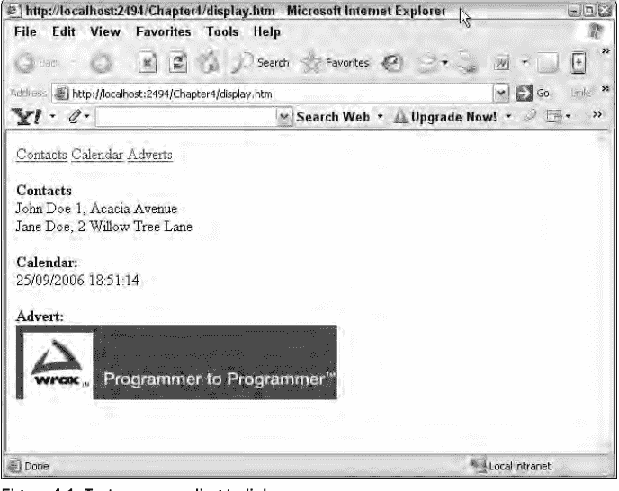

图4-1：链接对应的文本。

## 工作原理

你可以看到，这个示例在一个非常基本的层面上工作，它使用`XMLHttpRequest`对象来创建和发送请求，这些请求由服务器处理。这里的服务器为每个选项返回几行HTML，但应该很容易从中推断出它可以返回什么样的数据。到目前为止，它使用的代码可能已经相当熟悉了。首先检测浏览器并创建特定于浏览器的`XMLHttpRequest`对象实例。

```javascript
var xHRObject = false;
if (window.XMLHttpRequest)
{
    xHRObject = new XMLHttpRequest();
}
else if (window.ActiveXObject)
{
    xHRObject = new ActiveXObject("Microsoft.XMLHTTP");
}
```

接下来，创建一个函数`sendRequest`，它设置`onreadystatechange`事件处理程序并向服务器页面`display.php`（如果你使用的是`display.aspx`）打开一个请求。最后，它发送对象。

```javascript
function sendRequest(data)
{
    xHRObject.open("GET", "display.php?value=" + data, true);
    xHRObject.onreadystatechange = getData;
    xHRObject.send(null);
}
```

这个函数在HTML页面的三个锚点`<a>`标签中被调用：

```html
...
<a href="#" onclick="sendRequest('Contacts');return false;">Contacts</a>
<a href="#" onclick="sendRequest('Calendar');return false;">Calendar</a>
<a href="#" onclick="sendRequest('Adverts');return false;">Adverts</a>
...
```

向`sendRequest`方法传递一个参数。这个参数又由服务器用来确定要运行哪个分支的代码。

```php
switch($_REQUEST['value']) {
case 'Contacts':
    echo "box1|<br><b>Contacts</b><br>John Doe 1, Acacia Avenue<br>Jane Doe, 2 Willow Tree Lane";
    break;
case 'Calendar':
    $dt = gmdate("M d Y");
    echo "box2|<br><b>Calendar:</b><br>" . $dt;
    break;
case 'Adverts':
    $source = "wrox_logo.gif";
    echo "box3|<br><b>Advert:</b><br>";
    break;
}
```

`switch`语句中的每个条件只是打印出一行相关数据。为了保持这个示例简单，你实际上没有检索任何数据。PHP页面的执行完成，但在`onreadystatechange`事件触发之前，页面上不会显示任何内容。如果你回到`XmlHttpRequest.js`并再次查看`sendRequest`方法，你会看到你设置了以下代码行，让`getData`函数在每次此事件触发时运行：

```javascript
xHRObject.onreadystatechange = getData;
```

在数据加载过程中，该事件会触发多次。你只对在知道数据已完全加载后运行最终代码以在屏幕上显示项目感兴趣。正如你可能记得的，这发生在`XMLHttpRequest`对象的`readyState`属性返回代码4时。

```javascript
if (xHRObject.readyState == 4 && xHRObject.status == 200)
{
    var serverText = xHRObject.responseText;
    if(serverText.indexOf('|') != -1)
    {
        element = serverText.split('|');
        document.getElementById(element[0]).innerHTML = element[1];
    }
}
```

在条件内部，创建一个变量`serverText`，并将`xHRObject`的`responseText`属性中的任何内容赋值给它。此方法将返回你告诉PHP/ASP.NET程序返回到屏幕上的内容。因此，对于`contacts`，它将包含：

```
"box1|<br><b>Contacts</b><br>John Doe 1, Acacia Avenue<br>Jane Doe, 2 Willow Tree Lane"
```

接下来，创建一个名为`element`的数组。然后检查你的输出中是否有`|`符号。你使用管道`|`符号仅作为分隔符，表示你的数据行包含两条信息。

第一条信息`box1`是你想要动态填充的元素的名称；第二条是你想要用来填充它的实际HTML。因此，数组现在有两个项目：

- `element[0] = box1`
- `element[1] = <br><b>Contacts</b><br>John Doe 1, Acacia Avenue<br>Jane Doe, 2 Willow Tree Lane`

最后，使用`getElementById`来标识ID为`box1`的元素，并将其`innerHTML`属性设置为包含你想显示的HTML和文本。对于联系人链接，有一行执行流程如下：

1.  当页面中的链接被点击时，它通过`click`事件运行`sendRequest('Contacts')`。
2.  `XmlHttpRequest.js`脚本创建一个`XMLHttpRequest`对象。
3.  `sendRequest`方法在该对象上创建一个请求，查询字符串为`display.php?value=Contacts`。
4.  调用`send`方法。
5.  `onreadystatechange`事件触发。它被设置为1，并且`getData`函数被运行但不做任何事情。
6.  该方法调用`display.php`页面并运行它。
7.  在第一个情况中（在PHP页面中），触发了`Contacts`，它运行以下行：`echo "box1|<br><b>Contacts</b><br>John Doe 1, Acacia Avenue<br>Jane Doe, 2 Willow Tree Lane";`
8.  PHP页面的执行完成。
9.  `onreadystatechange`事件触发。它被设置为3。页面仍在加载，`getData`函数被运行但不做任何事情。
10. `onreadystatechange`事件触发，它被设置为4，并且`getData`函数被运行，但这次条件满足了。
11. `getData`函数更改了它收到的`div`的`innerHTML`属性以显示HTML。

### 常见错误

如果你第一次没有成功运行上一个示例，那么你可以考虑在创建示例时发现的以下常见陷阱：

- 在Windows资源管理器中双击HTM文件并期望它运行。
- 未在IIS上将文件夹设置为应用程序。
- 错误拼写`XMLHttpRequest`的大小写：
  - 正确 — `XMLHttpRequest`
  - 错误 — `XmlHttpRequest`
  - 错误 — `XMLHTTPRequest`
- 编写带有括号的行：
  - 正确 — `xHRObject.onreadystatechange = getData;`
  - 错误 — `xHRObject.onreadystatechange = getData();`

在JavaScript中，如果你在这行代码中函数名后面包含括号，你就是将函数的结果赋值给`onreadystatechange`，而不是函数本身。两者之间的区别如下：

```javascript
// 这将函数赋值给onreadystatechange
xHRObject.onreadystatechange = getData;

// 这调用函数，然后将函数的结果赋值给
// onreadystatechange
xHRObject.onreadystatechange = getData();
```

这些错误中的大多数都可以归因于心不在焉或遵循你平常的习惯和做法。然而，并非所有问题都能如此轻易地解决。已经发表的文章说Ajax技术很容易，并且不必要的“危言耸听”正在发生。事实是，很多时候你会发现一个使用了Ajax技术的页面没有按预期方式工作，而且可能没有任何明显的问题。让我们来看看一些更复杂的问题，这些问题可能会困扰Ajax应用程序。

### 更复杂的问题

在上一个示例中，你不应该遇到本节中研究的较难问题，所以现在让我们来看看它们，因为你很有可能在本书的后面遇到它们。做好准备并提前预警是个好主意。


## 第四章：Ajax 技术

### 同源问题

`XMLHttpRequest` 对象在同源策略方面存在一些问题。在早期浏览器版本中，来自任何来源的脚本都可以运行，但这显然会带来太多潜在的安全隐患。因此，通常会强制执行“同源策略”，即只运行源自同一域名、同一协议和同一端口的脚本。如果这些值中有任何一个不同，脚本将不会运行。

实际上，IE 还进一步引入了安全区域的概念。然而，不幸的是，IE 并没有真正验证从 `XMLHttpRequest` 对象返回的字段。其中一个字段是 `HTTPREFERER` 值，它包含将用户引向特定页面的页面 URL/域名（注意，并非总是存在）。这意味着客户端可以完全伪造 `Referer`，并且可以使用伪造的 `Referer` 值检索和显示页面及图像。

这个安全漏洞意味着 `Referer` 值不应被信任。在编写 cookie 时，最好将域名/服务器添加到 cookie 中，同时验证发送和接收的是否正确。

### 缓存控制：IE 的激进缓存

你可能会遇到的一个问题（尽管在本例中不应该出现）是，当页面背后的数据更新后，页面并未反映更新。它显示的是旧数据，因为为了节省重新加载时间，浏览器会在本地缓存页面，然后从缓存中提取页面而不是重新加载它。这个特定问题在 IE 中更为常见，除非你明确强制它不这样做，否则 IE 往往会缓存页面。

通常，要解决这个问题，你需要将以下代码插入 HTML 页面：

```
<meta http-equiv="Pragma" CONTENT="no-cache" />
<meta http-equiv="Expires" CONTENT="-1" />
```

这应该足以强制它重新加载页面。然而，当使用 `XMLHttpRequest` 对象进行请求并使用 `GET` 指令时，不幸的是，IE 总会缓存页面而从不重新加载它。

### 动手试试：Internet Explorer 中的激进缓存

让我们通过对你刚刚运行的示例进行快速调整来演示这一点。

1.  在 IE 中运行上一个示例的 `display.htm` 程序。
2.  打开 `display.php`，并更改以下行中的名称：
    `switch($_REQUEST['value']) {`
    `case 'Contacts':`
    `echo "box1<br><b>Contacts</b><br><b>William Woe</b> 1, Acacia Avenue<br>Jane Doe, 2 Willow Tree Lane";`
    `break;`
3.  现在，返回并再次点击“Contacts”。没有任何变化，如图 4-2 所示。

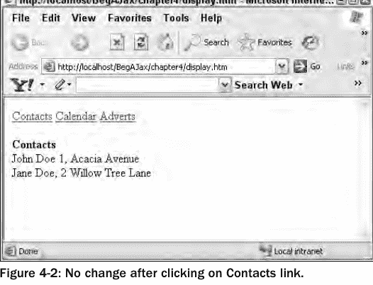

图 4-2：点击“Contacts”链接后没有变化。

## 工作原理

然而，某些东西应该会改变。让我们从执行周期的角度重新考虑一下发生的事情：

1.  当页面中的链接被点击时，它会运行 `sendRequest('Contacts')` 函数。
2.  `XmlHttpRequest.js` 脚本创建一个 `XMLHttpRequest` 对象。
3.  `sendRequest` 方法在对象上创建一个请求，查询字符串为 `display.php?value=Contacts`。
4.  调用 `send` 方法。

你调用了 `display.php`，考虑到你刚刚更改了页面内容并且这是一个全新的请求，它应该使用新页面。错！即使你添加了 `no-cache` `<meta>` 标签，IE 仍然会缓存页面并产生与之前相同的页面。如果你试图用 Ajax 创建一个动态更新的网站，这个问题会非常恼人。

有三种解决方案。第一种是在你的 GET 请求末尾添加一个查询字符串，你可以保证每次运行时它都不同。例如，日期将是一个不错的选择，如下所示：

```
xhrObject.open("GET", "display.php?id=" + Number(new Date) + "&value=" + data, true);
```

“每次不同”的查询字符串解决方案在概念上有点取巧（它在查询字符串上创建了一个冗余项）。想象一下，就像一场比赛，它说你不能参加两次，但没什么能阻止你在第二次参赛时用你阿姨的名字、你猫的名字、你狗的名字，甚至你金鱼的名字报名。这就是第二种解决方案的用武之地。

第二种解决方案是设置 HTTP 头 `If-Modified-Since` 以引用过去的某个日期：

```
xHRObject.open("GET", "display.php?value=" + data, true);
xHRObject.setRequestHeader("If-Modified-Since", "Sat, 1 Jan 2000 00:00:00 GMT");
```

这样，就防止了缓存。

第三种解决方案是改用 `POST` 请求。浏览器和服务器的行为各不相同，因此良好的实践是结合使用技术。第三种解决方案完全避免了这个问题，但前两种更简单，并且可以轻松组合。现在让我们看看如何操作。

### 动手试试：修正激进缓存问题

这个示例涉及 `display.php` 中代码的一些“来回”修改。不幸的是，这是无法避免的。

1.  打开 `display.php`，将名称改回以下内容：

```
switch($_REQUEST['value']) {
case 'Contacts':
echo "box1|<br><b>Contacts</b><br>John Doe 1, Acacia Avenue<br>Jane Doe, 2
Willow Tree Lane";
break;
```

2.  打开 `XmlHttpRequest.js`，找到函数 `sendRequest`，并按如下方式修改代码：

```
function sendRequest(data)
{
xHRObject.open("GET", "display.php?id=" + Number(new Date) + "&value=" + data,
true);
xHRObject.setRequestHeader('If-Modified-Since', 'Sat, 1 Jan 2000
00:00:00 GMT');
xHRObject.onreadystatechange = getData;
xHRObject.send(null);
}
```

3.  启动一个新的 IE 实例，或者，如果上一个示例的浏览器仍然打开，请单击“刷新”按钮。这是为了确保浏览器使用的是更新版本的 `XmlHttpRequest.js`。保持此浏览器打开，不要按刷新。如果操作成功，你将看到图 4-3 所示的结果。

4.  打开 `display.php`，再次将名称改回以下内容：

```
switch($_REQUEST['value']) {
case 'Contacts':
echo "box1|<br><b>Contacts</b><br>William Woe 1, Acacia Avenue<br>Jane Doe, 2
Willow Tree Lane";
break;
```

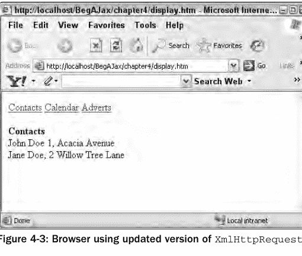

5.  现在，回到你打开的浏览器，再次点击“Contacts”。这一次，它更新了页面，如图 4-4 所示。

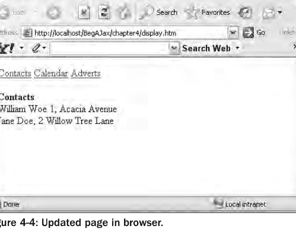

## 工作原理

第一行代码在查询字符串中附加了一个数字形式的日期。因为日期不断变化，这将保证其唯一性：

```
xhrObject.open("GET", "display.php?id=" + Number(new Date) + "&value=" + data, true);
```

如前所述，可以想象这就像在只能参加一次的比赛中填写了你狗的名字。这个技巧骗过了 IE，让它认为这实际上是一个新请求并正确地重新加载，而不是使用缓存版本。当然，Mozilla 没有采用相同的激进缓存策略，因此不受此问题的影响。你可以使用 Mozilla 运行此示例的第一个版本并更改数据，当你点击“Contacts”链接时，它会立即生效。

添加的第二行代码只是附加了一个过去设置过的请求头。

```
xhrObject.setRequestHeader('If-Modified-Since', 'Sat, 1 Jan 2000 00:00:00 GMT');
```

请求头是随请求一起发送的额外信息。`If-Modified-Since` 头通常与 `GET` 方法一起使用使其成为有条件的。换句话说，如果请求的文档自指定时间以来未更改，则不会发送文档。这是诱使浏览器重新发送请求的另一种方式。

关于使用 `POST` 方法的讨论应该推迟，因为使用 `POST` 方法稍微复杂一些，而且实际上是一个独立的主题。相反，让我们考虑另一个困扰 Ajax 开发人员的棘手问题。

### 跨浏览器影响

使用 Ajax 时，也许最难解决的问题是确保你的应用程序在 IE、Mozilla、Safari 和 Opera 中都能工作。事实上，有时支持所有浏览器并不切实际。除非你能确定你的目标用户不会使用某个特定浏览器，或者只有极少数人使用，否则你真的应该尽力适应他们。

在 `XmlHttpRequest` 示例中，用户是使用 IE 还是 Mozilla 的问题影响最小，因为它最终归结为需要创建哪个版本的 `XMLHttpRequest` 对象。有一些事情需要记住：

-   ActiveX 控件不能在 IE 之外使用。
-   动态 HTML 集合 `document.all` 仅在 IE 上有效。
-   同步 `XMLHttpRequest` 会导致某些版本的 Firefox 崩溃。
-   IE 在使用 JavaScript 将图像插入 HTML 时不会缓存图像。

ID 属性/元素名称大小写的情况可能会影响脚本是否有效。IE 可能对此很宽容，但 Mozilla 会对属性名称使用不同的大小写感到不满。例如，`Box1` 和 `box1` 会被视为两个不同的元素。

根据你使用的 IE 版本，你可能需要调用不同版本的 MSXML。

此检查并不详尽，因为每个浏览器中都存在无数的怪癖和特性。

不能保证这里提供的解决方案能解决所有问题，但它肯定能解决最常见的问题。Ajax 并不难学，但有时它需要一点调整才能正常工作。


## 第四章：Ajax技术

### POST方法

如前所述，使用`POST`方法代替`GET`是解决IE浏览器积极缓存每个页面、从而阻止你使用Ajax技术提供更流畅前端的另一种方案。

让我们回到之前的例子并进行修改，改用`POST`方法。这不仅仅是简单地在`sendRequest`方法中将`GET`替换为`POST`；如果真有那么简单就好了，事情会容易得多。你需要移除`querystring`，然后自行编码要发送的数据，并将其作为`send`方法的参数发送到服务器。这个参数仍然是一个名称/值对，就像`querystring`一样，格式为`value=Contacts`。但它不再附加到URL上，而是放在请求的`body`中传输。它同样经过了URL编码。

### 尝试使用POST方法

我们不修改现有示例，而是克隆其中的部分内容，并使用新的页面版本。

1.  首先，将文件`display.htm`复制为新文件`displaypost.htm`，然后修改其中的以下代码行：

```
<html>
<head>
	<script type="text/javascript" src="XmlHttpRequest2.js"></script>
</head>
<body>
<a href="javascript:sendRequest('Contacts')">Contacts</a>
<a href="javascript:sendRequest('Calendar')">Calendar</a>
<a href="javascript:sendRequest('Adverts')">Adverts</a>
<br/>
<div id="box1">
</div>
<div id="box2">
</div>
<div id="box3">
</div>
</body>
</html>
```

2.  接下来，将`XmlHttpRequest.js`复制为名为`XmlHttpRequest2.js`的文件，并修改`sendRequest`方法中的代码，使其如下所示：

```
function sendRequest(data)
{
    var bodyofrequest= getBody(data);
    xHRObject.open("POST", "display.php", true);
    xHRObject.setRequestHeader("Content-Type", "application/x-www-form-urlencoded");
    xHRObject.onreadystatechange = getData;
    xHRObject.send(bodyofrequest);
}
```

3.  接下来，向脚本中添加一个名为`getBody()`的新函数：

```
function getBody(data)
{
    var argument = "value=";
    argument += encodeURIComponent(data)
    return argument;
}
```

4.  现在，在你的浏览器中打开`displaypost.htm`，并点击"Contacts"。示例的执行方式与之前完全一样，如图4-5所示。

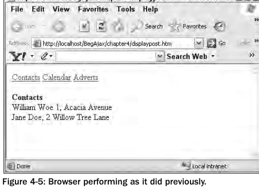

5.  如果你是在IE中查看此页面，并且你再次将服务器端代码中的名称改为"John Doe"，然后点击"Contacts"，更改会立即生效。

## 工作原理

你修改了示例以使用`POST`方法。提交数据的方式是相同的，通过`<a>`标签链接调用JavaScript的`sendRequest`（方法），所以除了将其指向新的脚本外，你不需要修改HTML。

在`sendRequest`方法中，发生了相当大的变化：

```
var bodyofrequest= getBody(data);
xHRObject.open("POST", "display.php", true);
xHRObject.setRequestHeader("Content-Type", "application/x-www-form-urlencoded");
xHRObject.onreadystatechange = getData;
xHRObject.send(bodyofrequest);
```

你首先创建要发送的请求主体。这再次采用了名称/值对的形式：

```
value=Contacts
```

`getBody`函数为你创建了这个，我们稍后会讨论。然后，你将PHP页面的名称传递给`Open`方法，以确定你正在调用的服务器端页面的位置，同时传递方法"POST"和异步参数`true`。你创建了一个请求头，并表明这是表单URL编码的数据。你像使用`GET`方法时一样设置了`onreadystatechange`方法。不过，你没有使用`send`方法发送`null`值，而是发送了由`getBody`函数构造的变量`bodyofrequest`。

`getBody`函数用于对你传递的变量进行`URLEncode`：

```
var argument = "value=";
argument += encodeURIComponent(data)
return argument;
```

`argument`变量由名称"value"和`data`变量的内容构成，后者经过了URL编码。实际上，你其实并不需要这样做，因为你已经在HTML页面中硬编码了这个值。但由于数据需要进行表单URL编码，并且在更复杂的应用程序中，你必须确保这一点，所以还是添加了这个额外的步骤。如果你有多个值需要传递，你可以使用循环将每个经过URL编码的项目追加到一个数组中，然后返回整个数组。

总的来说，代码所需的更改并不算剧烈，但确实增加了一点复杂性。让我们简要讨论一下使用`POST`或`GET`方法的优缺点。

### 使用POST和GET方法的优缺点

尽管这两种方法通常可以互换使用，但它们之间有一些微妙的差异值得注意。

`GET`方法使用的`querystrings`的长度受到限制，具体取决于你使用的浏览器。在IE中是2083个字符，在Opera中是4050，在Netscape 4及以下版本中是8192，在Netscape 6中是2000；在Mozilla中没有明确规定，但比其他的长。

使用`GET`方法的另一个限制是发送的数据只能使用ASCII码。此外，`GET`请求是可以被缓存的（正如你在IE中看到的），而`POST`请求则永远不会。

还有一些推荐的指导原则，说明何时应该选择一种方法而不是另一种。`GET`请求用于不会引起更改的查询；如果表单或数据的提交会引起更改，那么应优先使用`POST`方法。

你会看到，在整本书中，由于使用其中一种或另一种方法，代码都需要进行不同的处理。

### 其他Ajax技术

### 隐藏帧

隐藏帧技术是开发者长期以来使用的技巧，用于从服务器返回信息但对用户不可见。它使用一个标准的框架集，包含两个帧（或更多，如果需要），第一个帧对用户可见，第二个帧通过将其宽度或高度设置为零而变得不可见。隐藏帧可以用于发送请求和从服务器检索数据，但数据仅在需要时才放入可见帧。

隐藏帧通常可用于减少访问服务器的次数，并且可以用于预加载或缓存数据。隐藏帧的一个特别好的应用是在文件上传中。一旦用户选择了要上传的文件，你就可以在后台立即开始上传文件。同样，目标是提供更流畅的用户体验。

#### 概念

隐藏帧的工作原理如下：

1.  脚本对隐藏帧进行调用。
2.  通过隐藏帧向服务器发出请求。
3.  从服务器接收到的响应进入隐藏帧。
4.  在事件触发时（通常是`onload`），数据从隐藏帧传输到可见帧。

这个概念相当简单，但将数据从可见帧传递到隐藏帧，再到服务器，然后再返回，可能有点繁琐。关于这是否真正符合Ajax技术，存在一些争论，但正如你将在下一个示例中看到的，它能够利用服务器上的数据来更新页面的方式，无疑与Ajax应用有共同之处。

#### 使用隐藏帧传递信息

现在让我们创建一个简单的示例。在这个示例中，你有一个来自旅行社应用程序的网页，显示特定价格范围内每个城市的酒店信息。信息不是等待用户提交页面，而是每次用户从酒店下拉列表或价格范围单选按钮列表中做出选择时，都从XML文件中提取。

> 给纯粹主义者的一个说明：从技术上讲，这并没有减少对服务器的访问次数。事实上，它增加了访问次数。但是，为了保持这个示例相对简短并演示一个观点，我们姑且接受这一点。

1.  创建一个名为`frameset.htm`的页面，并添加以下代码：

```
<html>
<head>
</head>
<frameset rows="100%,*">
<frame name="currentframe" src="current.htm">
<frame name="hiddenframe" src="about:blank">
</frameset>
</html>
```


## 第四章：Ajax技术

2.  添加另一个HTML页面。这个页面将显示可见的框架。将其命名为current.htm。

```html
<html>
<head>
<script type="text/javascript" src="HiddenFrame.js"></script>
</head>
<body>
目的地：
<br />
<select id="selectCity" onchange="retrieveInformation()">
 <option value="London" selected="true">伦敦</option>
 <option value="Paris">巴黎</option>
 <option value="New York">纽约</option>
 <option value="Chicago">芝加哥</option>
 <option value="Seattle">西雅图</option>
</select> <br />
<br />
价格范围：
<br />
经济型<input name="type" value="1" type="radio" onchange="retrieveInformation()"/>
标准型<input name="type" value="2" type="radio" onchange="retrieveInformation()" checked="true"/>
豪华型<input name="type" value="3" type="radio" onchange="retrieveInformation()"/>
<div id="information">
</div>
</body>
</html>
```

3.  现在，创建一个名为HiddenFrame.js的脚本。

```javascript
function initialize()
{
    var hiddenForm = document.getElementById('displayinfo');
    if(hiddenForm != null)
    {
        parent.frames[0].document.getElementById('information').innerHTML =
        hiddenForm.innerHTML;
    }
}

function retrieveInformation()
{
    var city = document.getElementById("selectCity").value;
    var type = "";
    var input = document.getElementsByTagName("input");
    for (var i=0; i < input.length; i++)
    {
        if (input.item(i).checked == true)
        {
            type = input.item(i).value;
        }
    }
    top.frames["hiddenframe"].location = "retrieveHotelInformation.aspx?city="
        + city + "&type=" + type;
}
```

或者，如果你想使用ASP.NET，请将**粗体**行更改为以下内容：

```javascript
top.frames["hiddenframe"].location = "retrieveHotelInformation.aspx?city=" + city + "&type=" + type;
```

4.  最后一个页面是服务器端页面。PHP代码如下。将其保存为retrieveHotelInformation.php。

```php
<?php
$xmlFile = "C:\inetpub\wwwroot\BegAjax\Chapter4\hotel.xml";
$HTML = "";
$count = 0;
$dt = simplexml_load_file($xmlFile);
$dom = DOMDocument::load($xmlFile);
$hotel = $dom->getElementsByTagName("hotel");

foreach($hotel as $node) {
    $city = $node->getElementsByTagName("City");
    $city = $city->item(0)->nodeValue;

    $type = $node->getElementsByTagName("Type");
    $type = $type->item(0)->nodeValue;

    $name = $node->getElementsByTagName("Name");
    $name = $name->item(0)->nodeValue;

    $price = $node->getElementsByTagName("Price");
    $price = $price->item(0)->nodeValue;

    if (($type == $_GET["type"]) && ($city == $_GET["city"]) ) {
        $HTML .= $HTML."<br><span>酒店：". $name."</span><br><span>价格：". $price."</span><br>";
        $count++;
    }
}

if ($count == 0) {
    $HTML = "<br><span>没有可用酒店</span>";
}

echo "<div id='displayinfo'>".$HTML."</div>";
?>
<html>
<script type="text/javascript" src="HiddenFrame.js"></script>
<body onload="initialize()">
</body>
</html>
```

ASP.NET版本如下。将其保存为retrieveHotelInformation.aspx。

```aspx
<%@ Page Language="C#" %>
<%@ Import Namespace="System.Data" %>
<%@ Import Namespace="System.Xml" %>

<html>
<script type="text/javascript" src="HiddenFrame.js"></script>
	<script language="c#" runat="server">
		void Page_Load()
		{
			string xmlFile = @"C:\inetpub\wwwroot\BegAjax\Chapter4\hotel.xml";
			string HTML = "";
			DataSet ds1 = new DataSet();
			ds1.ReadXml(xmlFile);
			DataTableReader dt = ds1.CreateDataReader();
			int count = 0;
			while (dt.Read())
			{
				if ((dt["City"].ToString() == Request.Params["city"].ToString()) &&
(dt["Type"].ToString() == Request.Params["type"].ToString()))
				{
					HTML += "<br><span>酒店：" + dt[1].ToString() +
"</span><br><span>价格：" + dt[3].ToString() + "</span><br>";
					count++;
				}
			}
			if (count ==0)
			{
				HTML ="<br><span>没有可用酒店</span>";
			}
			Response.Write("<div id='displayinfo'>" + HTML + "</div>");
		}
	</script>
<body onload="initialize()">
</body>
</html>
```

5.  接下来，为了创建数据，制作一个小型XML文件。将其保存为hotels.xml。

```xml
<hotels>
<hotel>
	<City>Paris</City>
	<Name>La Splendide</Name>
	<Type>Budget</Type>
	<Price>100</Price>
</hotel>
<hotel>
	<City>London</City>
	<Name>The Rilton</Name>
	<Type>Luxury</Type>
	<Price>300</Price>
</hotel>
</hotels>
```

6.  在浏览器中打开frameset.htm，从下拉列表框中选择“伦敦”选项，并从单选按钮中选择“豪华型”选项，如图4-6所示。

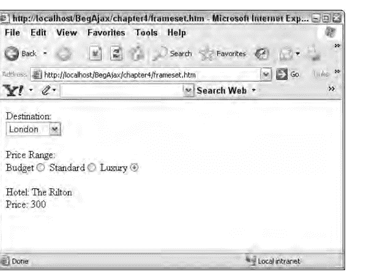

**图4-6：选择伦敦和豪华型。**

7.  现在，选择“经济型”单选按钮。下方的文本会改变，以反映数据中不可用的信息，如图4-7所示。

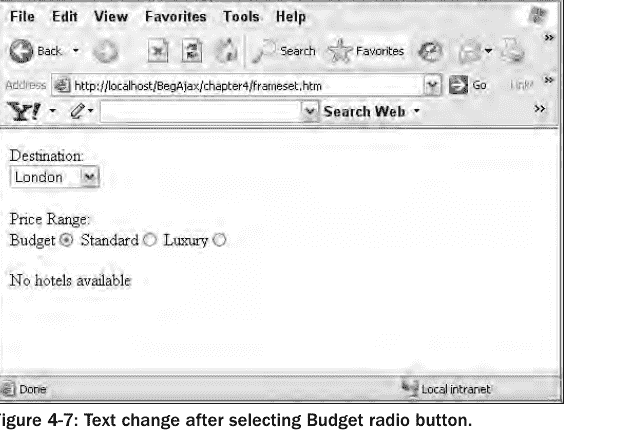

**图4-7：选择经济型单选按钮后的文本变化。**

## 工作原理

这个例子使用了隐藏框架。你在frameset.htm中创建了两个框架：

```html
<frame name="currentFrame" src="current.htm">
<frame name="hiddenFrame" src="about:blank">
```

下拉列表通过onchange方法调用了HiddenFrame.js脚本中的retrieveInformation()方法，而单选按钮则通过onclick()事件调用了同一个方法。retrieveInformation方法设置了两个变量city和type，它们记录了用户在可见框架中所选项目的值。所有单选按钮都有相同的name属性，使用document.getElementsByTagName来获取所有三个元素，然后遍历每个元素的checked值，直到找到一个为true的。将其值赋给type变量。

```javascript
var city = document.getElementById("selectCity").value;
var type = "";
var input = document.getElementsByTagName("input");
for (var i=0; i < input.length; i++)
{
    if (input.item(i).checked == true) {
        type = input.item(i).value;
    }
}
```

然后，你将一个位置分配给空白的隐藏框架，并将type和city变量附加到查询字符串中：

```javascript
top.frames["hiddenframe"].location = "retrieveHotelInformation.aspx?city="
+ city + "&type=" + type;
```

## 第四章：Ajax技术

由于服务器端代码并非隐藏框架技术的核心部分，因此这里不对其进行详细讨论。服务器端代码加载XML文件，获取`查询字符串`的值，然后根据`city`和`type`元素的值是否与用户选择的值匹配，来决定显示哪些元素。然后，它将它们动态地写入隐藏框架中一个名为`displayinfo`的`div`标签。

在服务器端代码的末尾，有一个带有`onload()`事件的`body`标签，它调用了你JavaScript中的`initialize`函数。该函数在隐藏框架中搜索动态创建的`<div>`标签。

```javascript
function initialize()
{
    var hiddenForm = document.getElementById('displayinfo');
    if(hiddenForm != null)
    {
        parent.frames[0].document.getElementById('information').innerHTML = 
        hiddenForm.innerHTML;
    }
}
```

如果页面上存在此标签，那么你访问可见页面`current.htm`上一个名为`'information'`的相应`<div>`标签，并使用`innerHTML`属性传递信息。

正如你所看到的，这是一种相对简单的技术，但它允许你潜在地将信息存储在隐藏框架中，并在需要时才调用它。

#### 优缺点

这种技术的一个明显优势是，你不需要特定于浏览器的代码，因为所有现代浏览器都支持框架。此外，关于文件上传，这是使用`XMLHttpRequest`对象实际上无法实现的事情，但使用隐藏框架可以做到。

这种技术的主要缺点是，并非所有旧版浏览器都能正确隐藏框架。尽管将框架的高度和宽度设置为零，仍然会留下一些不美观的边框。此外，它在客户端/服务器交互中引入了额外的复杂性层，这可能是不受欢迎的。

#### 隐藏内联框架

HTML 4.0标准引入了一个新元素——*内联框架*，或者更通俗的名称，`<iframe>`元素。内联框架是浮动框架，其工作方式与图像相同，即文本会环绕它们，但它们可以包含独立的网页，就像普通框架一样。与传统框架不同，它们不必放置在特定的框架集中。它们在IE 3中引入，但直到Netscape Navigator版本6才得到支持。它们可以通过脚本动态创建，并以与普通框架相同的方式访问。


## 第四章：Ajax 技术

3.  从服务器收到的响应被传输到隐藏帧中。
4.  当触发事件（通常是 `onload`）时，数据从隐藏帧传输到可见帧。

内联帧可以直接替代隐藏帧。因为它们具有无需放置在帧集中的优点，你可以随时使用 JavaScript 将它们动态添加到页面中。内联帧是隐藏帧更好的替代品，并且由于其更大的灵活性，你会每次都选择使用它们，只是它们在浏览器中的支持程度不如隐藏帧，并且在 Firefox 和 IE 之间的实现上存在一些差异。

#### 实战：使用隐藏内联帧传递信息

让我们回到隐藏帧示例，移除帧集，改为动态创建一个执行此任务的 `iframe`。这样做相当简单，但可能不如你希望的那样简洁。

1.  打开文件 `current.htm`。将其复制到名为 `currentiframe.htm` 的文档，并添加以下高亮行：

```html
<html>
<head>
<script type="text/javascript" src="HiddenIFrame.js"></script>
</head>
<body onload="createiframe()">
目的地：
<br />
...</body>
</html>
```

2.  接下来，复制文件 `HiddenFrame.js`，并将其命名为 `HiddenIframe.js`。现在，向其中添加以下函数：

```javascript
function createiframe()
{
    var iframe = document.createElement("iframe");
    iframe.style.border = "0px";
    iframe.style.width = "0px";
    iframe.style.height = "0px";
    document.body.appendChild(iframe);
}
```

3.  仍在同一文件中，找到 `initialize` 函数，并修改其中的以下行：

```javascript
function initialize()
{
    var hiddenForm = document.getElementById('displayinfo');
    if(hiddenForm != null)
    {
        parent.currentframe.document.getElementById('information').innerHTML = hiddenForm.innerHTML;
    }
}
```

4.  在函数 `retrieveInformation` 中，更改以下行：

```javascript
function retrieveInformation()
{
    var city = document.getElementById("selectCity").value;
    var type = "";
    var input = document.getElementsByTagName("input");
    for (var i=0; i < input.length; i++)
    {
        if (input.item(i).checked == true)
        {
            type = input.item(i).value;
        }
    }
    top.frames[1].location = "retrieveHotelInformation2.aspx?city=" + city + "&type=" + type;
}
```

5.  转到服务器端页面（无论是 PHP 还是 ASP.NET），将脚本行修改为如下内容，并将其保存为：`retrieveHotelInformation2.(.aspx 或 .php)`：

```html
<script type="text/javascript" src="HiddenIFrame.js"></script>
```

6.  在你的浏览器中运行 `currentiframe.htm`。它的工作方式与隐藏帧示例完全相同，如图 4-8 所示。

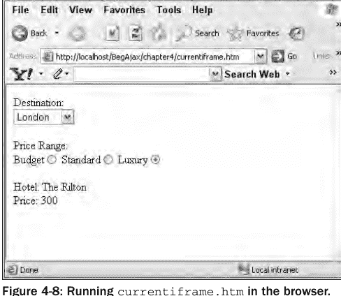

## 工作原理

原始的隐藏帧示例如下工作：

-   可见帧将信息传递给隐藏帧，这实际上是对服务器的调用。
-   服务器将信息返回到隐藏帧中的 `<div>` 标签。
-   内容从隐藏帧中的 `<div>` 标签传输到可见帧中的 `div` 标签。

我们现在在这个示例中所做的稍显复杂（但也只是稍显）；我们必须动态创建 iframe 并将边框、高度和宽度属性设置为零，以确保它在页面上实际上是不可见的。然后你将元素附加到你的 HTML 页面，如下所示：

```javascript
function createiframe()
{
    var iframe = document.createElement("iframe");
    iframe.style.border = "0px";
    iframe.style.width = "0px";
    iframe.style.height = "0px";
    document.body.appendChild(iframe);
}
```

你修改了你的 HTML 页面，以便在页面首次加载时调用 `createiframe()` 函数。并且你修改了 `initialize` 函数，使其在将信息写回页面上的 `<div>` 标签时，不再需要通过 `frameset` 来访问它。

```javascript
parent.document.getElementById('information').innerHTML =
    hiddenForm.innerHTML;
```

你还更改了 `retrieveInformation` 函数中对帧的引用。接下来，你将服务器端页面的结果分配给你的隐藏 iframe，如下所示：

```javascript
top.frames[1].location = "retrieveHotelInformation2.aspx?city="
    + city + "&range=" + range;
```

在这个示例中，你所做的是移除了 `frameset` 页面，动态创建了一个 `iframe` 来替换它，并使用内联帧来与服务器之间传递信息。其他一切都不需要改变。

如果你想动态检索表单的内容，在 IE 中，你可以使用 `contentWindow.document` 属性来检索 iframe 的 `document` 元素，而在 Firefox 中，你必须使用 `contentDocument` 属性：

```javascript
doc = iframe.contentDocument || iframe.contentWindow.document;
```

当使用比这更复杂的示例时，一个问题可能是你的浏览器加载文档可能需要更长时间。因此，你可以在访问文档内容之前查询文档的 `readyState` 属性，如下所示：

```javascript
doc = iframe.contentDocument || iframe.contentWindow.document;
if (typeof doc.readyState != "undefined" && doc.readyState != "complete") {
    doc.onreadystatechange = function() {
        if (doc.readyState == "complete") {
            ...
        }
    }
} else {
   ...
}
```

这样，你可以保证 iframe 在开始使用之前已完全加载。

#### 优缺点

这个示例足够简单，尽管对于更复杂的示例，你必须注意浏览器兼容性。事实上，如果不小心，你可能最终会为 IE 5、IE 5.5、IE 6/7 和 Firefox 使用不同的方法。另外，在 IE 5 中根本无法动态创建 iframe。

尽管有这些小问题，iframe 代表了对隐藏帧的明确改进。让我们考虑另一种技术。

### 动态脚本加载

专业 Ajax 作者 Nicholas Zakas 在 www.webreference.com/programming/ajax_tech/ 的一篇文章中谈到了另一个技巧，该技巧作为 XMLHttpRequest 对象的良好替代品已经使用了一段时间。这就是动态脚本加载。这是指可以使用 DOM 动态创建 JavaScript 脚本，并且 src 属性也是动态分配的。JavaScript 源文件仅在你将其添加到页面时才会被下载和执行。

#### 概念

概念确实非常简单：

1.  你向页面添加一个脚本。
2.  这个脚本动态地向页面添加另一个脚本，并在稍后点附加 SRC 标签。
3.  该脚本启动与服务器的对话。

现在让我们看一个例子。让我们创建一个非常简短和基本的示例，该示例采用一个脚本，并根据用户在网页上选择的单选按钮，动态创建三个其他脚本中的一个。为了保持这个示例简短，让我们不启动任何与服务器的对话，因为这种方法存在一些陷阱，稍后将讨论。

1.  创建一个名为 `ScriptLoader.htm` 的 HTML 页面。

```html
<html xmlns="http://www.w3.org/1999/xhtml" >
<head>
    <script type="text/javascript" src="ScriptLoader.js"></script>
</head>
<body>
你想加载哪个脚本？
<br/>
<br/>
脚本 1<input id="range" name="range" value="1" type="radio"
onclick="retrieveInformation('1')" /><br/>
脚本 2<input id="Radio1" name="range" value="2" type="radio" onclick="retrieveInformation('2')" /><br/>
脚本 3<input id="Radio2" name="range" value="3" type="radio" onclick="retrieveInformation('3')"/><br/>
</body>
</html>
```

2.  接下来，创建脚本 `ScriptLoader.js`。

```javascript
function retrieveInformation(data)
{
    var newScript = document.createElement("script");
    newScript.src = "script" + data + ".js";
    document.body.appendChild(newScript);
}
```

3.  现在，创建另一个脚本 `script1.js`。

```javascript
alert ("Are you sure you wanted to load script one?");
```

4.  现在，创建另一个脚本 `script2.js`。

```javascript
alert ("Script two is no picnic either!");
```

5.  创建最后一个脚本如下，并将其命名为 `script3.js`。

```javascript
alert ("This is the ultimate in scripts, script three");
```

6.  现在，在你的浏览器中打开 `ScriptLoader.htm`，然后单击第一个单选按钮，如图 4-9 所示。

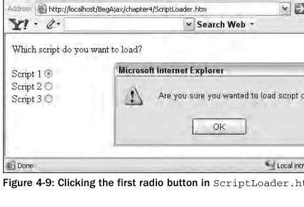

7.  单击其他单选按钮将运行其他脚本。


## 第四章：Ajax技术

## 工作原理

这是一个相当异想天开的例子，但它表明在程序中加载第二个脚本并动态确定其属性是多么容易。脚本中只有三行代码完成了这个操作：

```
var newScript = document.createElement("script");
newScript.src = "script" + data + ".js";
document.body.appendChild(newScript);
```

第一行创建了一个`script`元素。第二行设置了`src`属性。你加载不同的脚本，具体取决于用户选择了哪个单选按钮。最后一行将新元素附加到`body`元素。此时，脚本就会被执行。

尽管你没有使用第二个脚本以任何方式与服务器通信，但要在每个脚本中添加一个单独的服务器调用，调用服务器上的不同页面或向服务器传递不同的信息，并不是一个太大的任务。

#### 优点和缺点

这种技术的优点在于你可以拥有多个不同的脚本，并且根据情况动态加载你需要的脚本。它提供了另一个发起服务器调用的机会。

然而，也有一些相当大的缺点。首先是无法判断脚本是否正确加载，因为第二个脚本没有返回值。第二个问题是，在IE中，脚本的动态加载会停止所有其他处理。这种方法的一个可能应用是，在文件上传时动态加载一个动画GIF。但不幸的是，在IE中，它甚至会停止处理动画GIF！此外，这种方法仅限于`GET`方法，不能使用`POST`方法。因为它使用DOM，所以你只能稍微受限地使用4.0及以上版本的浏览器。

也许最严重的缺点是，在IE 5和IE 6中使用此技术可能导致潜在的内存泄漏。尽管从表面上看这是一种相当吸引人的方法，但由于其在不同浏览器中结果的不可预测性，它肯定不太常见。最后一种技术就没有这样的问题。

### 图片和Cookie

图片在网页和电子邮件中的使用（或更准确地说是滥用）甚至迫使像Microsoft Outlook这样的主要应用程序改变了它们的行为方式。你可能现在会在许多电子邮件客户端中注意到，当你收到一封HTML邮件时，系统会提示你是否希望下载图片。如果你选择下载图片，那么你很可能会向服务器传递包含关于你自己的信息的数据。通常，这将是相当良性的，旨在让应用程序知道有多少人打开了特定的电子邮件，特别是哪些用户打开了。

这属于Ajax的范畴，因为它再次允许对服务器进行调用，独立于提交请求/接收响应的模型。在这种情况下，它是通过``标签的`src`属性完成的。通常显示的``是1像素乘以1像素，这样用户在页面上就不会注意到它。然后，服务器可以对此信息进行操作，在用户的计算机上写入一个cookie。

当然，cookie收到了很多负面报道，但实际上并没有造成任何伤害。它们只是小的文本文件，它们存储的信息量很小，并且与存储在用户机器上的信息没有直接关联。它们可以包含一个唯一ID，服务器可以在用户每次返回页面时检索该ID。

最近，有一个丑闻涉及搜索引擎记录了某些用户输入的所有内容。通过识别用户每次搜索时的cookie，可以推断出诸如用户住在哪里、以什么为业等信息；在某些情况下，这些信息可以与特定个人联系起来。

这里描述的技术不那么爱窥探。如果你将此应用于产品目录，在每个页面上使用一个图形来传递信息，你就能够跟踪用户查看产品的模式，并且你可以做一些事情，例如推荐相关产品，或根据查看过相同产品的其他用户的查看模式进行推荐。

#### 概念

此模式的工作原理如下：

1. ``元素将服务器请求包装在`src`属性中，将任何附加信息传递到`查询字符串`。
2. 服务器存储信息，并将一些唯一可识别的信息写入客户端的cookie。

这种模式在实现上与动态脚本加载示例非常相似。然而，它没有相同的缺点，并且被广泛用于希望跟踪其用户浏览习惯的批量电子邮件用户或网站。

#### 动手试试：图片和Cookie

让我们创建一个示例，模拟一个图书销售商网站上的单个页面。当用户查看页面时，关于他或她正在查看哪个页面的信息会作为图片的一部分发送到服务器；然后服务器将一个唯一标识符写入cookie，并在消息框中向用户显示cookie中包含的信息。

1.  创建一个HTML页面，并将其命名为`Catalogue.htm`。此示例需要几张图片。它们可以（连同本书的代码）从www.wrox.com下载。

```html
<html xmlns="http://www.w3.org/1999/xhtml" >
<head>
  <script type="text/javascript" src="ImageLoader.js"></script>
</head>
<body onload="createImage()">
<b>Book:</b>
<br/>

<br />
<br />
<b>Authors: </b><span id="authors"> Hart, Kauffman, Sussman, Ullman</span>
<br /><b>ISBN: </b><span id="ISBN">0764588508</span>
<br /><b>Price: </b><span id="price">$39.99</span>
<br /><br />
<input type="button" onclick="showCookie()" value="Click to see Cookie" />
</body>
</html>
```

2.  创建一个名为`ImageLoader.js`的脚本，并添加以下代码：

```javascript
function createImage()
{
    var bookid = document.getElementById("ISBN").innerHTML;
    var img = document.getElementById("secret");
    img.src = "relayInformation.aspx?bookid=" + bookid;
    img.width = 0;
    img.height = 0;
}

function showCookie()
{
    var cookie = document.cookie;
    alert(cookie);
}

function getCookieInfo(cookie)
{
    RegularXp = "(?:; )?" + cookie + "=([^;]*);?";
    var RegularXpExtract = new RegExp(RegularXp);
    if (RegularXpExtract.test(document.cookie))
    {
        return decodeURIComponent(RegExp["$1"]);
    }
    else
    {
        return null;
    }
}
```

3.  现在，创建一个服务器端页面来设置cookie。如果你使用的是PHP，请添加以下内容，并将其命名为`relayInformation.php`：

```php
<?php
if ($_COOKIE[AnonymousID])
{
    $tempCookie = $_COOKIE["AnonymousID"];
    setcookie("AnonymousID", $tempCookie."|BOOKID:".$_GET["bookid"], time()+3600);
}
else
{
    $random_id = (rand()%9999999);
    $tempCookie = "USERID:" . $random_id. "|BOOKID:" . $_GET["bookid"];
    setcookie("AnonymousID", $tempCookie."|BOOKID:".$_GET["bookid"], time()+3600);
}
?>
```

如果你想添加ASP.NET，请将其命名为`relayInformation.aspx`，并添加以下内容：

```c#
<%@ Page Language="C" %>
<script language="c#" runat="server">
    void Page_Load()
    {
        if (Request.Cookies["AnonymousUser"] == null)
        {
            HttpCookie userCookie = new HttpCookie("AnonymousID");
            Guid userguid = System.Guid.NewGuid();
            userCookie.Value = "USERID:" + userguid.ToString() + "|BOOKID:" + Request.QueryString["bookid"].ToString();
            userCookie.Expires = DateTime.Now.AddYears(1);
            Response.Cookies.Add(userCookie);
        }
        else
        {
            HttpCookie userCookie = Request.Cookies["AnonymousID"];
            userCookie.Value += "|BOOKID:" + Request.QueryString["bookid"].ToString();
            userCookie.Expires = DateTime.Now.AddYears(1);
            Response.Cookies.Add(userCookie);
        }
    }
</script>
```

4.  现在，在浏览器中打开`catalogue.htm`，并点击查看cookie，如图4-10所示。

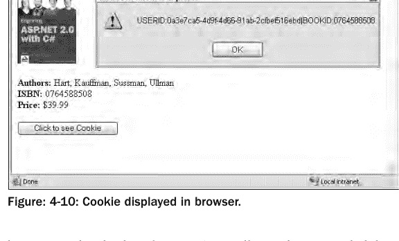

5.  关闭浏览器，然后返回到页面。你会看到它已经第二次将`bookid`附加到了cookie中，如图4-11所示。如果你更改HTML页面中ISBN号的值，那么新值将被存储。


## 第四章：Ajax 技术

图：4-11：第二次将 `bookid` 追加到 cookie 中。

## 工作原理

本示例展示了如何动态更改图像的 `src` 属性，使其改为向服务器发出请求。你在页面开始时加载 `createImage`，然后定位包含书籍 ISBN 的 `<span>` 元素内容（用于存储在 cookie 中），以及显示 `onebyone.gif` 的图像。

```
var bookid = document.getElementById("ISBN").innerHTML;
var img = document.getElementById("secret");
```

你动态地将其 `src` 属性替换为指向服务器端页面并传递书籍 ISBN 作为查询字符串的值。然后，你将高度和宽度设置为零，并将其追加到文档 `body` 中。

```
img.src = "relayInformation.aspx?bookid=" + bookid;
img.width = 0;
img.height = 0;
```

服务器端代码仅检查 cookie 是否存在。如果存在 cookie，它会添加一个唯一 ID（在 ASP.NET 中，这是使用 GUID 生成的；而在 PHP 中，GUID 支持并非原生，因此在本例中仅为生成一个随机数）和书籍的 ISBN：

```
if (Request.Cookies["AnonymousUser"] == null)
{
    HttpCookie userCookie = new HttpCookie("AnonymousUser");
    Guid userguid = System.Guid.NewGuid();
    userCookie.Value = "USERID:" + userguid.ToString() + "|BOOKID:" +
    Request.QueryString["bookid"].ToString();
```

134

```
userCookie.Expires = DateTime.Now.AddYears(1);
Response.Cookies.Add(userCookie);
}
```

或者，如果 cookie 已存在，你将 ISBN 信息追加到 cookie 的末尾。

```
else
{
    HttpCookie userCookie = Request.Cookies["AnonymousUser"];
    userCookie.Value += "|BOOKID:" +
Request.QueryString["bookid"].ToString();
    userCookie.Expires = DateTime.Now.AddYears(1);
    Response.Cookies.Add(userCookie);
}
```

然后，你使用 `showCookie()` 函数来显示内容。在这里，你可以使用 Ajax 技术相当快速地获取一个“匿名”用户的浏览模式。由于 GUID 总是唯一的，将其存储在数据库中不会有太大问题。然后，你可以随着时间的推移，积累出用户在网站上的访问轨迹图景。

#### 优缺点

这种方法的主要问题在于，在诸如电子邮件客户端（或者过去在浏览器中很常见）的应用程序中，用户可以选择关闭图像下载功能。（实际上，在 Outlook 中默认就是关闭的。）此外，cookie 可存储的信息量也有限制，大约为 4KB（具体取决于 cookie 唯一事务 ID 占用的空间）。即使这里只是将信息存储在 cookie 中以展示其可行性，该示例也会很快遇到问题。

另一个缺点是，这同样仅限于使用 `GET` 方法，无法用于 `POST` 方法。

你现在应该对许多可用于创建客户端/服务器通信的流行技术及其可能的应用场景有了一个概览。

### 总结

本章概述了五种不同的 Ajax 技术。大部分讨论都集中在 `XMLHttpRequest` 对象上，因为这是开发者最有可能使用的对象。你了解了可能无法使 `XMLHttpRequest` 正常工作的一些原因。这次探讨触及了一些最常见问题的表面，你看到浏览器不兼容性往往是问题的核心。接下来，讨论审视了另外四种替代技术，发现隐藏框架、隐藏 `iframe`、动态脚本加载和预加载图像技术也并非对这类问题免疫。

本章要传达的关键信息是，在使用 Ajax 技术时没有捷径可走。虽然所有技术都为开发者提供了与服务器通信的实用且可用的方法，但你会发现自己必须密切关注在不同浏览器中获得的响应。最终，`XMLHttpRequest` 对象是创建 Ajax 应用程序最灵活和强大的方式。你可以从对象本身获取更多关于数据发送和接收状态的信息，并且通过 `onreadystatechange` 事件处理程序，你还可以使其以更真正异步的方式工作。

在本书的示例中，XML 已经被大量使用，因此现在是时候研究 XML 本身及其与 Ajax 技术的配合使用了。这将在第五章中讨论。

### 练习

建议的参考答案见附录 A。

- 1. 修改 `XMLHttpRequest` 对象示例，使其“同步”工作。它的行为会如何变化（如果有的话）？你认为这是为什么？
- 2. 修改使用隐藏框架的示例，改用 `POST` 方法。

   *提示：你需要“欺骗”浏览器提交隐藏框架。*

# 5
## 处理 XML

- 当你使用 XMLHttpRequest 对象向服务器发出请求时，服务器会以两种格式之一返回请求的数据：文本或 XML。

  文本数据是字符字符串，易于添加到页面中。然而，这是一种非常有限的数据交换格式。它没有元素、数据类型或字符之间的其他区分。XML 是一种在客户端（浏览器）和服务器之间交换数据的更实用的格式。XML 是一种标记语言，它使用用户定义的标签以特定方式组织数据。

- 当浏览器收到来自服务器的 XML 文档以响应 Ajax 请求时，你需要一种方法来提取 XML 数据，以及一种方法来显示数据。JavaScript 可以使用节点、节点属性和 DOM 方法从 XML 文档中检索数据。一旦 XML 数据被提取出来，就可以使用 CSS 和/或 XSLT 将其显示在页面上。

- 本章将回顾基本的 XML 概念和语法，介绍多种使用 JavaScript 从 XML 文档中提取数据的方法，并探讨使用 CSS 显示 XML 数据的技术，以及使用 JavaScript 为服务器返回的数据创建动态样式的技术。

| 本章中，你将学习以下内容： | XML 基础（创建标签、XML 语法、格式良好和有效的 XML 文档） | 使用 JavaScript、DOM、CSS 提取 XML 数据 | 使用 CSS（CSS 与 XML 数据、结合 JavaScript 使用 CSS） |

## XML 基础

# 第五章：处理 XML

### 创建标签

当你从头开始构建一个新的 XML 文档时，你需要创建自己的自定义标签集。这些标签提供了文档的基本结构。你需要根据使用数据的需求来构建文档。以下是一个示例：

```
<classes>
  <class>
    <classID>CS255</classID>
    <department>Computer Science</department>
    <title>JavaScript</title>
    <credits>3</credits>
    <instructor>Dykes</instructor>
  </class>
</classes>
```

在此代码中，`classes` 元素包含所有其他元素。`class` 元素是 `classes` 元素的子元素，它包含五个其他元素（`classID`、`department`、`title`、`credits` 和 `instructor`）。

> 一个元素包括标签及其内容。例如，在上面的代码中，`<classID>` 是一个起始标签，而 `classID` 元素则包括起始和结束的 `classID` 标签，以及它们之间包含的内容。

XML 标签名必须以字母或下划线开头。它们可以包含字母、数字、句点、连字符或下划线，但不能包含任何空格。

### XML 语法

XML 非常灵活，但 XML 语法非常严格。所有 XML 文档都需要遵循这些基本规则：

- XML 文档以 XML 声明开始：

```
<?xml?>
```

此声明是文档的第一行，它简单地表明这是一个 XML 文档。该声明还应包含版本号，如下所示：

```
<?xml version="1.0"?>
```

- XML 文档包含一个根元素，该元素包含所有其他元素：

```
<classes>
  <class>
    <classID>CS255</classID>
    <department>Computer Science</department>
    <title>JavaScript</title>
    <credits>3</credits>
    <instructor>Dykes</instructor>
  </class>
</classes>
```


## 第五章：使用 XML

在本例中，`classes` 元素是根元素。

根元素也被称为*文档元素*。

- XML 元素必须包含开始标签和结束标签：
  `<title>JavaScript</title>`

```
<title>JavaScript</title>
```

此规则的例外是*空元素*。空元素不包含任何内容，尽管它们可以包含属性，如下所示：
`<catalog id="1428"/>`

```
<catalog id="1428"/>
```

- 此空元素包含一个值为 1428 的 id 属性。注意，该元素在结束尖括号前包含一个 /，以表明这是一个空元素。你不需要在正斜杠前包含空格——XML 处理器将识别出这是一个空元素。

- 标签必须正确嵌套：

```
<classes>
  <class>
  </class>
</classes>
```

最后打开的标签是第一个关闭的标签。

*缩进你的代码有助于保持嵌套层次清晰。*

- 所有属性值必须用引号括起来：
  `<warehouse group="downtown">Grant Street</warehouse>`

```
<warehouse group="downtown">Grant Street</warehouse>
```

无论属性值中包含何种类型的信息，该值都必须用单引号或双引号括起来。

当然，除了这些基本语法规则之外，XML 文档还有许多其他规则。有关所有详细信息，请参见 W3C XML 1.0 规范，网址为 www.w3.org/TR/xml/。

### 格式良好且有效的 XML 文档

*格式良好*的 XML 文档是指遵循 XML 语法规则的 XML 文档。*有效*的 XML 文档是指既格式良好又遵循*文档类型定义 (DTD)* 或 *XML Schema* 文档中指定规则的 XML 文档。DTD 和模式提供了 XML 文档的描述，例如必须包含哪些元素、元素的顺序、每个元素在文档中可以出现的次数、元素的任何属性以及元素中可以包含的数据类型。

使用 XML 进行数据交换的一个主要优势是，XML 文档描述（尤其是 XML 模式）可以包含关于文档中可包含数据的类型和格式的非常具体的信息。验证 XML 文档有助于确保你收集和共享的数据的质量。

### 动手实践：请求 XML 数据

在本示例中，你创建一个 XMLHTTPRequest 对象来从服务器检索 XML 文档（classes.xml）。在文本编辑器中输入以下代码，并将其保存为 ch5_examp1.htm。当用户单击"Make Request"按钮时，会显示一个警告框，如图 5-1 所示。

```
<!DOCTYPE html PUBLIC "-//W3C//DTD XHTML 1.0 Transitional//EN" "http://www.w3.org/TR/xhtml1/DTD/xhtml1-transitional.dtd">
<html xmlns="http://www.1999/xhtml">
<head>
<meta http-equiv="Content-Type" content="text/html; charset=iso-8859-1" />
<title>Requesting XML</title>
<script language = "javascript">
    function getDoc()
    {
        if (window.XMLHttpRequest) {
            request = new XMLHttpRequest();
        }
        else if (window.ActiveXObject) {
            request = new ActiveXObject("Microsoft.XMLHTTP");
        }
        if (request.overrideMimeType) {
            request.overrideMimeType("text/xml");
        }
        
        if(request) {
            request.open("GET", "classes.xml", true);
            request.onreadystatechange = function()
            {
                if (request.readyState == 4 && request.status == 200) {
                    var xmlDocument = request.responseXML;
                    alert('XML Document Retrieved');
                }
                request.send(null);
            }
        }
    }
</script>
</head>
<body>
<h1>Requesting XML</h1>
<form>
<input type = "button" id="reqDoc" value = "Make request">
</form>
<script type="text/javascript">
var myDoc = document.getElementById('reqDoc');
myDoc.onclick = getDoc;
</script>
</body>
</html>
```

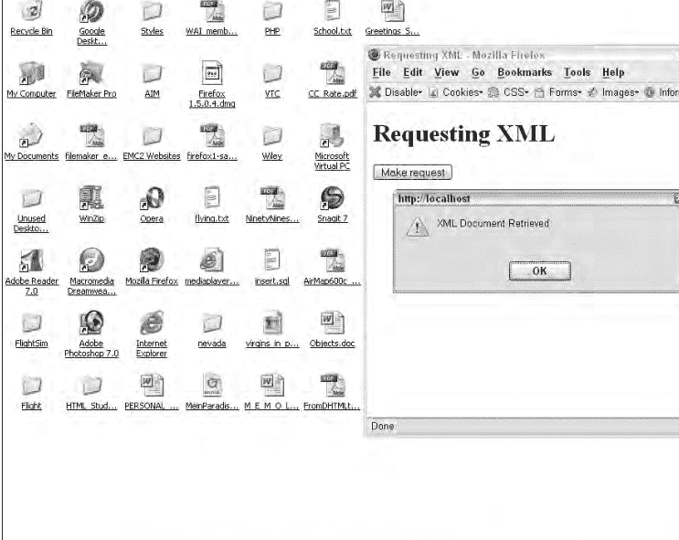

图 5-1：单击"Make Request"按钮后显示的警告框。

在文本编辑器中输入以下代码，并将其保存为 `classes.xml`：

```
<?xml version="1.0"?>
<classes>
  <class>
    <classID>CS115</classID>
    <department>ComputerScience</department>
    <credits req="yes">3</credits>
    <instructor>Adams</instructor>
    <title>Programming Concepts</title>
  </class>
  <class>
    <classID semester="fall">CS205</classID>
    <department>ComputerScience</department>
    <credits req="yes">3</credits>
    <instructor>Dykes</instructor>
    <title>JavaScript</title>
  </class>
  <class>
    <classID semester="fall">CS255</classID>
    <department>ComputerScience</department>
    <credits req="yes">3</credits>
    <instructor>Brunner</instructor>
    <title>Java</title>
  </class>
</classes>
```

`Ch5_examp1.htm` 和 `classes.xml` 都需要放在你的服务器上，Ajax 请求才能工作。将这两个文件复制到 Web 服务器根文件夹下的 `BegAjax` 文件夹中的 `Chapter5` 子文件夹（例如，如果你使用 IIS，根文件夹是 `wwwroot` 文件夹；如果你使用 Apache，则是 `htdocs` 文件夹）。

## 工作原理

此页面包含一个带有标有"Make Request"按钮的表单。当用户单击该按钮时，会调用 `getDoc()` 函数。

```
  <form>
  <input type = "button" id="reqDoc" value = "Make request">
  </form>
```

此处使用了传统的事件注册方式来注册单击事件，而不是在 input 标签中包含 `onclick` 属性。

```
  <script type="text/javascript">
  var myDoc = document.getElementById('reqDoc');
  myDoc.onclick = getDoc;
  </script>
```

`getDoc()` 函数使用 `if` 语句来测试浏览器是否直接支持 `XMLHttpRequest`。如果是，则创建一个新的 `XMLHttpRequest` 对象，并将其存储在名为 `request` 的变量中。

```
      if (window.XMLHttpRequest) {
        request = new XMLHttpRequest();
      }
```

如果浏览器是 Internet Explorer 5 或 6，则创建一个新的 `ActiveXObject` 并将其存储在 `request` 变量中。

```
      else if (window.ActiveXObject) {
        request = new ActiveXObject("Microsoft.XMLHTTP");

      }
```

Internet Explorer 7 直接支持 `XMLHttpRequest`，至少在无需使用 ActiveX 即可创建新的 `XMLHttpRequest` 对象方面是如此。有关 IE 7 和 `XMLHttpRequest` 对象的更多详细信息，请参见 `http://ajaxian.com/archives/ie7-xmlhttprequest-native-or-not` 上的"IE7 XMLHttpRequest — Native or?"。

`XMLHttpRequest` 对象的属性和方法在不同的浏览器中略有不同。基于 Mozilla 的浏览器（Mozilla、Firefox、Netscape Navigator）、Safari 和 Internet Explorer 各自支持不同的属性和方法。第四章提供了更多信息。

`overrideMimeType` 方法在基于 Mozilla 的浏览器中受支持。`overrideMimeType` 方法用于覆盖 `Content-Type` 头的任何问题，并确保服务器返回的文档的 Mime 类型为"text/xml"。使用 `if` 语句检查浏览器是否支持此方法，如果支持，则将该方法应用于对象。

```
if (request.overrideMimeType) {
    request.overrideMimeType("text/xml");
}
```

如果对象已创建，则使用 `XMLHTTPRequest` 对象的 `open` 方法从 XML 文档 `classes.xml` 请求数据。此方法使用三个参数：用于请求的 HTTP 方法（"GET"）、文档的 URL（"classes.xml"）以及值为 `true` 的布尔值，以表明该调用是异步的。

```
if(request) {
    request.open("GET", "classes.xml", true);
}
```

如果服务器连接需要用户名和密码，`open` 方法还可以包含两个额外的参数。

当 `XMLHttpRequest` 对象的 `readyState` 属性发生变化时（即数据开始下载时），会调用一个匿名函数。

```
request.onreadystatechange = function() {
    if (request.readyState == 4 && request.status == 200) {
```

如果 `readyState` 属性等于 4，则下载完成。作为额外的检查，`status` 属性等于 `200` 也表示请求已成功处理。

```
var xmlDocument = request.responseXML;
alert('XML Document Retrieved');
}
```

下载完成后，使用 `responseXML` 属性将数据作为 XML 存储在名为 `xmlDocument` 的变量中。显示一个警告框以表明文档已成功检索。


## 第5章：处理XML

本文件使用了`XMLHttpRequest`对象的多个方法和属性来向服务器发送请求并获取XML数据。`send`方法用于发起请求并开始下载数据，`open`方法用于配置对象，而`responseXML`属性将服务器响应中的数据保存为XML格式。

如果你想查看使用`responseXML`检索到的数据，可以在Internet Explorer中使用`responseXML`的`xml`属性来查看文档。请在匿名函数中第一个alert语句之后添加此代码：

```
alert(request.responseXML.xml);
```

图5-2展示了在Internet Explorer的警告框中显示的XML文档。

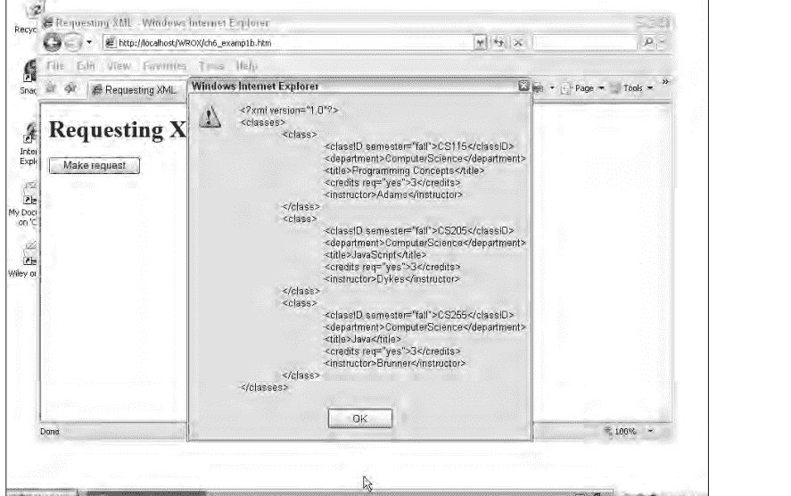

> 图5-2：在Internet Explorer中查看XML文档。

在本章下一节中，你将学习如何使用JavaScript从服务器返回的XML文档中提取数据。

### 使用JavaScript提取XML数据

一旦你从服务器检索到了XML文档，下一步就是使用JavaScript从文档中提取XML数据。你可以使用节点和节点属性，或者DOM方法来完成此操作。除了提取XML元素的值，你还可以提取XML属性的值。

#### 使用节点

JavaScript内置了节点属性，你可以用它们来访问XML文档中的节点。`documentElement`属性可用于访问XML文档的根元素。其他节点属性包括诸如以下的家族关系：

+   - `firstChild` — 第一个子节点
- `lastChild` — 最后一个子节点
- `nextSibling` — 下一个兄弟节点
- `previousSibling` — 上一个兄弟节点
- `childNodes` — 子节点数组

其他节点属性提供关于节点本身的信息：

+   - `nodeName` — 节点名称
- `nodeValue` — 节点值
- `nodeType` — 节点类型

`nodeType`对于检查特定类型的节点很有用。12种节点类型如表5-1所示。

> 关于将文档视为家族树和节点树的更多信息，请参见第2章。

| nodeType | 描述 |
|---|---|
| 1 | 元素 |
| 2 | 属性 |
| 3 | 文本 |
| 4 | CDATA节 |
| 5 | XML实体引用 |
| 6 | XML实体 |
| 7 | XML处理指令 |

*表续下页*

| nodeType | 描述 |
|---|---|
| 8 | XML注释 |
| 9 | XML文档 |
| 10 | XML DTD |
| 11 | XML文档片段 |
| 12 | XML表示法 |

你可以使用家族关系来访问XML文档中的节点。例如，如果你想访问`classes.xml`文档中第一个课程的标题，可以向`ch5_exampl.htm`添加额外的代码，利用家族关系遍历XML文档的节点。你可以通过使用`documentElement`属性来访问`classes.xml`的根元素：

```
var rootNode = xmlDocument.documentElement;
```

`xmlDocument`是包含`XMLHTTPRequest`对象`requestXML`属性的变量名。`rootNode`就是`classes`元素。

你可以继续使用家族关系遍历文档：

```
var classNode = rootNode.firstChild;
var titleNode = classNode.lastChild;
var titleText = titleNode.firstChild;
```

`classNode`是`classes`元素的第一个子元素`classifieres`。`class`元素的最后一个子元素是`title`元素，存储在`titleNode`变量中。`title`元素的第一个子元素是包含标题数据的文本节点，存储在`titleText`变量中。现在你可以获取包含课程标题的文本节点的值：

```
var titleValue = titleText.nodeValue;
```

这在Internet Explorer中运行良好；然而，基于Mozilla的浏览器将XML文档中的空白符视为文本节点。当你在基于Mozilla的浏览器中访问`classes`元素的`firstChild`时，你访问到的是空白符。为什么会发生这种情况？主要原因在于，在Mozilla浏览器中，XML文档内的空白字符（如换行符、空格等）被视为文本节点。这意味着当你尝试检索一个元素的`firstChild`时，你可能得到的是由空白符形成的文本节点，而不是你期望的元素节点。例如，在`classes`元素中，如果有任何换行或缩进，这些空白符将被视为单个文本节点。因此，`rootNode.firstChild`返回的是这个重命名的Classes根节点的第一个子元素。Mozilla浏览器将这些空白符视为有效节点，而IE则不这样处理。这种差异导致了跨浏览器的兼容性问题。为了解决这个问题，你可以使用`nextSibling`属性来跳过这些空白符文本节点。

你可以添加一个`nextSibling`属性来跳过空白符文本节点：

```
var classNode = rootNode.firstChild.nextSibling;
```

你可以添加代码来移除XML文档中的所有空白符，而不是处理这些日益繁琐的家族关系。或者，你可以采用完全不同的方法，通过名称来访问元素，如下一节所示。

#### 通过名称访问XML元素

JavaScript包含一个`getElementsByTagName`方法，你可以用它通过XML元素的名称从XML文档中提取特定元素。

例如，如果你想提取第一个`title`元素的值，请使用该元素的名称：

```
var titleNode = xmlDocument.getElementsByTagName('title');
```

因为`classes.xml`文档中有多个`title`元素，所以`titleNode`是一个数组。使用以下方式访问数组中的第一个值：

```
var firstTitle = titleNode[0];
```

一旦你访问了第一个`title`元素，就可以使用`firstChild`和`nodeValue`来提取文本节点的值：

```
var titleValue = firstTitle.firstChild.nodeValue;
```

你可以通过在页面上想要显示文本的位置添加一个带有`id`值的`div`来在页面上显示此值。

```
<div id="title"></div>
```

创建一个新元素和文本节点，以在`div`元素内显示标题值：

```
var myEl = document.createElement('p');
var newText = "The first course listing is " + titleValue + ".";
var myTx = document.createTextNode(newText);
myEl.appendChild(myTx);
var course = document.getElementById('title');
course.appendChild(myEl);
```

关于使用JavaScript向现有页面添加新元素的更多信息，请参见第2章。

图5-3显示了用户点击按钮并向浏览器请求XML文档后，第一个课程标题显示在页面上的情况。

### 访问属性值

你还可以使用JavaScript来提取XML文档中属性节点的值。属性节点包含在元素节点内，因此你需要从访问包含你感兴趣的属性的元素开始。例如，在`classes.xml`文档中，`credits`元素包含一个名为`req`的属性，该属性指示某门课程是否是计算机科学学位的必修课。你可以轻松地使用`getElementsByTagName`访问`credits`元素：

```
var creditStatus = xmlDocument.getElementsByTagName('credits');
```

然后你可以使用`attributes`属性来访问该属性。因为有多个`credits`元素，所以`creditStatus`变量包含一个数组。如果你想知道文档中第三个`credits`元素的属性值，请使用以下代码：

```
var creditAttr = creditStatus[2].attributes;
```

`getNamedItem`方法允许你通过属性的名称来访问属性节点：

```
var reqAttr = creditAttr.getNamedItem('req');
```

最后，你可以使用`nodeValue`属性获取`req`属性的值：

```
var reqVal = reqAttr.nodeValue;
```

### 动手试试：提取XML元素和属性值

在这个示例中，你将创建一个`XMLHttpRequest`对象来下载XML文档。然后，你将从该文档中提取XML元素和属性值，并将它们添加到现有页面中。将以下代码输入到你的文本编辑器中，并将其保存为`ch5_examp2.htm`。将其复制到你Web服务器根文件夹（例如，如果你使用IIS，根文件夹是`wwwroot`文件夹；如果你使用Apache，则是`htdocs`文件夹）中`BegAjax`文件夹的`Chapter5`子文件夹。

图5-4显示了在Firefox中元素和属性的显示效果。


> 图5-4：Firefox中的元素和属性显示。

```
<!DOCTYPE html PUBLIC "-//W3C//DTD XHTML 1.0 Transitional//EN"
"http://www.w3.org/TR/xhtml1/DTD/xhtml1-transitional.dtd">
<html xmlns="http://www.w3.org/1999/xhtml">
<head>
<meta http-equiv="Content-Type" content="text/html; charset=iso-8859-1" />

<title>Checking Courses</title>
<script language = "javascript">
    function getDoc()
    {
      if (window.XMLHttpRequest) {
        request = new XMLHttpRequest();
      }
      else if (window.ActiveXObject) {
        request = new ActiveXObject("Microsoft.XMLHTTP");
      }
      if(request.overrideMimeType) {
        request.overrideMimeType("text/xml");
      }

      if(request) {
```


## 第 5 章：处理 XML

```javascript
request.open("GET", "classes.xml", true);

request.onreadystatechange = function()
{
  if (request.readyState == 4 && request.status == 200) {
    var xmlDocument = request.responseXML;
    findClass(xmlDocument);
  }
}
request.send(null);
}
}

function findClass(doc) {
  var titleNode = doc.getElementsByTagName('title');
  for (i=0; i < titleNode.length; i++) {
    var title = titleNode[i];
    var titleValue = title.firstChild.nodeValue;

    var myEl = document.createElement('p');
    var newText = titleValue + " is the name of a course in the Computer Science department.";
    var myTx = document.createTextNode(newText);
    myEl.appendChild(myTx);
    var course = document.getElementById('title');
    course.appendChild(myEl);

    var creditStatus = doc.getElementsByTagName('credits');
    var creditAttr = creditStatus[i].attributes;
    var reqAttr = creditAttr.getNamedItem('req');
    var reqVal = reqAttr.nodeValue;

      if (reqVal == 'yes') {
        var addlText = " This is a required course.";
        var addlText2 = document.createTextNode(addlText);
        myEl.appendChild(addlText2);
      }
  }
}</script>
</head>
<body>
  <h1>检查课程</h1>
  <form>
    <input type = "button" id="reqDoc" value = "检查课程">
  </form>
<script type="text/javascript">
var myDoc = document.getElementById('reqDoc');
myDoc.onclick = getDoc;
</script>
<div id="title"></div>
</body>
</html>
```

## 工作原理

该文件添加了您在上一示例中创建的文件中的内容。您创建一个 XMLHttpRequest 对象，正如在以前的示例中所做的那样。从服务器检索 XML 文档后，您将调用 findClass 函数以提取 XML 元素和属性数据并将其添加到您的页面中。

```javascript
if (request.readyState == 4 && request.status == 200) {
    var xmlDocument = request.responseXML;
    findClass(xmlDocument);
}
```

该函数首先使用 getElementsByTagName 方法在 XML 文档中搜索 title 元素。

```javascript
function findClass(doc) {
    var titleNode = doc.getElementsByTagName('title');
}
```

由于存在多个 title 元素，因此 variable titleNode 包含一个数组。使用 for 循环遍历 titleNode 数组的每个成员。该数组的长度（titleNode.length）用作继续 for 循环的测试条件。

```javascript
for (i=0; i < titleNode.length; i++) {
    var title = titleNode[i];
    var titleValue = title.firstChild.nodeValue;
}
```

使用 createElement、createTextNode 和 appendChild 将标题文本节点的值添加到现有页面中。

```javascript
var myEl = document.createElement('p');
var newText = titleValue + "是计算机系课程的名字。";
var myTx = document.createTextNode(newText);
myEl.appendChild(myTx);
var course = document.getElementById('title');
course.appendChild(myEl);
```

使用 getElementsByTagName、attributes 和 getNamedItem 提取 credits 元素的 req 属性的值。

由于存在多个 credits 元素，因此 creditStatus 包含一个数组。for 循环中 i 的值用于指定 creditStatus 数组的每个成员并应用 attributes 属性。

```javascript
var creditStatus = doc.getElementsByTagName('credits');
var creditAttr = creditStatus[i].attributes;
var reqAttr = creditAttr.getNamedItem('req');
var reqVal = reqAttr.nodeValue;
```

使用 if 语句比较 reqVal 的值。如果值为 'yes'，则在 myEl 元素中添加一个额外的文本节点。

```javascript
if (reqVal == 'yes') {
    var add1Text = "这是一门必修课程。";
    var add1Text2 = document.createTextNode(add1Text)
    myEl.appendChild(add1Text2)
}
```

### 在 XML 数据中使用 CSS

XML 文件是文本文件，不包含任何格式信息。如果 XML 文档结构良好并在 Internet Explorer 中打开，您会看到元素的显示、属性和内容，如图 5-5 所示。

如果在 Firefox 中打开同一文档，其显示与 Internet Explorer 中的类似，但如果您在 Netscape 中打开该文档，则只会显示包含文档数据的字符串，如图中图 5-6 的 Netscape 7 所示。

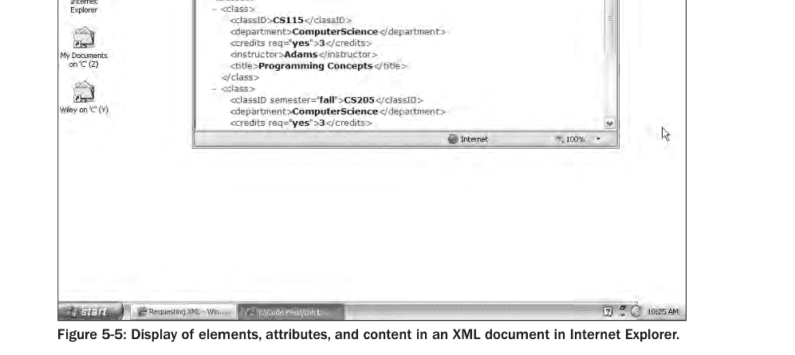

### 在 XML 文档中使用 CSS

您可以通过向文档添加 CSS 样式表，直接为 XML 文档应用级联样式表（CSS）样式。通过向文档添加引用样式表 URL 的处理指令来将样式表链接到 XML 文档：

```xml
<?xml-stylesheet type="text/css" href="classes.css"?>
```

此处理指令在紧随 XML 声明之后添加到页面中：

```xml
<?xml version="1.0"?>
<?xml-stylesheet type="text/css" href="classes.css"?>
```

您可以使用 XML 元素名称作为 CSS 选择器。例如，如果您想在 `classes.xml` 中以深红颜色的文字显示 classID、title 和 credits 元素（设置为 Arial），则可以创建以下样式：

```css
classID, title, credits{
    display: block;
    color: maroon;
    font-size: small;
    font-family: Arial;
    font-weight: bold;
}
```

### 在 Ajax 中使用 CSS

由于 Ajax 用于在不重新加载整个页面的情况下更新页面，因此也可将其动态应用于包括添加到页面上的任何 XML 数据在内的页面元素。您可以使用 JavaScript 和 CSS 动态应用样式。JavaScript 的 `style` 和 `className` 属性可用于此目的。

### style 属性

JavaScript 的 `style` 属性使您能够设置任何 CSS 样式的值。格式如下：

```javascript
element.style.property = "value"
```

例如，如果您有一个 id 等于 p1 的段落，则代码将 p1 段落的文本颜色设置为紫色：

```javascript
var myPara = document.getElementById("p1");
myPara.style.color = "purple";
```

大多数带有连字符的 CSS 属性名称在 JavaScript 中是一个单词，使用驼峰命名法（例如，border-right 变为 borderRight，padding-top 变为 paddingTop）。

您可以为提取并添加到页面的任何 XML 数据的显示添加 CSS 格式。例如，在 ch5_examp2.htm 文件中，您可以通过添加此行代码来为您添加到页面上的 XML 数据应用颜色。这将 myEl 元素中的所有文本以红色显示。

```javascript
myEl.style.color = 'red';
```

> style 属性无法访问已在外部 CSS 样式表中设置的属性或嵌入在文档头部区域内的属性的值。不过，它可以定义覆盖任何外部或嵌入风格的行内样式，但标记为 !important 的除外。

### className 属性

JavaScript 的 className 属性提供了一种快速切换应用到对象的 CSS 类的快捷方式。例如，假设您已定义了两个 CSS 类选择器 .red 和 .blue，并将 red 类最初分配给一个段落：

```html
<p id="first" name="p1 first" class="red">
```

您可以使用以下 JavaScript 更改该分配：

```javascript
document.getElementById("first").className="blue";
```

className 属性不受 style 属性的限制。您不是直接使用 JavaScript 改变风格属性，而是使用 JavaScript 来改变应用于对象的 CSS 类。

### 总结

从 Ajax 请求返回的数据采用文本或 XML 格式。对于交换数据而言，XML 通常是比纯文本文档更有用的格式。

本章包括以下要点：

-   XML 允许您创建自定义标签集以按照对您的需求最有利的方式组织和格式化您的数据。
-   当您使用 Ajax 请求下载 XML 文档时，重要的是这些文档遵循 XML 语法规则。如果文档已通过类似于 DTD 或 XML Schema 文档的文件描述符进行了验证也很有用。这确保了数据处于您需要在应用程序中使用的格式和数据类型。
-   当从 XML 文档提取数据时，您可以访问整个文档（包括元素、属性和内容）。
-   您可以使用节点和节点属性通过 JavaScript 从 XML 文档中提取数据。此方法在 Internet Explorer 中能合理运作，但在将空白字符视为文本节点的浏览器中可能很麻烦。
-   最快捷最简单的方法来提取 XML 元素数据是使用 `getElementsByTagName` 方法。该方法可与 XML 元素名称一起使用，以及 HTML/XHTML 元素名称。
-   CSS 可用于为 XML 文档提供格式信息，无论这些文档是直接还是在浏览器中查看还是首先提取 XML 数据然后添加到现有页面中均可用。
-  可以将CSS和JavaScript结合使用以在显示从Ajax请求返回的数据时应用动态格式化。

### 练习

上述问题的建议解决方案可以在附录 A 中找到。  

1. 创建一个 XML 文档，组织一天的销售数据并将其分为三个类别：`date `、`amount `、`salesperson 。请在 salesperson元素中包含一个 salesID attribute(属性)。一旦创建了文档结构（元素和属性），请将以下内容添加到文档中:
    -   date —今天的日期  
-   amount —20 到 $500 之间的任意金额  
-   salesperson —Marie (salesID = 225), Joan (salesID = 198) 以及 Ron(salesID = 304)  

2.使用 JavaScript 的 style属性动态应用样式到一个仅由单个单词（flower）组成的段落。改变背景和字体颜色，并指定 Arial 字族和粗体字型。  


## 6

## 调试与错误处理

当您的 Ajax 应用程序的代码无法按预期工作时，您需要一种方法来调试代码并找到问题的根源。两个最可能的根源是 JavaScript 代码中的错误和 Ajax 请求中的问题。

JavaScript 语法错误发生在代码被解释时。当 JavaScript 解析器解析到意外字符（例如多余的尖括号）时，会发生语法错误。如果发现语法错误，代码解析将在此时停止，并且不会执行任何代码。JavaScript 运行时错误发生在代码执行时。例如，如果代码包含对不存在函数的函数调用，那么在执行该函数调用时将发生运行时错误。如果发生运行时错误，该代码线程的代码执行将停止，但其他代码仍会执行。运行时错误也称为*异常*。

JavaScript 现在包含内置的异常处理，使用 `try` 语句，以及其他工具，例如 Mozilla JavaScript 控制台、Microsoft Script Debugger 和 Firefox 的 Firebug 扩展，可用于识别错误。

您还可以对 Ajax 请求进行故障排除，以确定 `XMLHttpRequest` 对象是否被创建以及请求是否实际发出。浏览器请求或服务器响应都可能存在 problems。由于 Ajax 请求在后台发生，可以使用特殊工具（如 DOM 检查器和 Firebug 控制台）来查看运行时发生的情况。

本章回顾了用于调试 Ajax 应用程序的工具和技术，包括使用控制台和调试器对 JavaScript 进行故障排除、使用 DOM 检查器以及查看实时 HTTP 头信息。

在本章中，您将了解以下内容：

- JavaScript 错误处理 — `try` 语句、Mozilla JavaScript 控制台、Microsoft Script Debugger、Firebug 控制台和调试器
- DOM 检查器 — Firefox DOM Inspector、IE DOM Inspector、MODI (Mouseover DOM Inspector)
- 用于 Ajax 故障排除的工具 — Firebug 控制台、Firefox Live HTTP Headers 扩展、ieHTTPHeaders Explorer Bar

## JavaScript 错误处理

JavaScript 以容易出错且难以调试的语言而闻名。尽管这种声誉可能适用于旧浏览器中 JavaScript 的早期版本，但 JavaScript 和较新浏览器的变化现在使得查找和纠正错误变得容易得多。尽管还没有一个成熟的 JavaScript 集成开发环境 (IDE)，但浏览器工具和附加组件（如控制台和调试器）可以帮助您查找 JavaScript 代码中的错误和异常。

## 处理异常

ECMAScript 第三版采用了 Java 的 `try` 语句并将其添加到 JavaScript 中。`try` 语句可以帮助您测试代码并识别错误。

`try` 语句与 `catch` 和/或 `finally` 子句一起使用，如下所示：

```
try {
// 执行此代码块
}
catch (err) {
// 如果 try 代码无法执行，则执行此代码
}
```

如果在执行 `try` 语句中的代码块时发生错误，该代码的执行会在该点停止，并执行 `catch` 语句之后的代码。

`finally` 子句可以添加到 `try` 语句或带有 `catch` 子句的 `try` 语句中。`finally` 子句包含无论是否发生异常都会执行的代码，如下所示：

```
try {
var x;
x[1] = 3;
}
catch (err) {
alert ('发生了一个错误：' + err.message);
}
finally {
alert('try/catch 测试完成');
}
```

以下代码行会产生错误，因为为 `x` 数组的索引位置 1 赋值，但尚未创建 `x` 数组：

```
x[1] = 3;
```

图 6-1 显示了在 Firefox 中执行此代码时显示的错误消息，图 6-2 显示了 IE 7 中的相应错误消息。如您在这些图中所见，错误消息的内容在每个浏览器中有所不同。

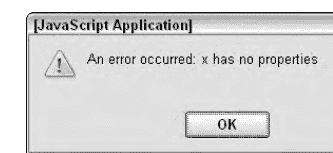

图 6-1：在 Firefox 中显示的错误消息。


图 6-2：在 IE 7 中显示的错误消息。

catch 子句捕获由 try 代码创建的 JavaScript Error 对象。Error 对象包含一个 message 属性，其中包含实际的错误消息。Error 对象还包含一个 name 属性，用于指定错误的类型。在这种情况下，会创建 TypeError，因为变量 x 的类型不是数组。您可以添加代码来显示错误的名称和类型，如下所示：

```
catch (err) {
  alert ('发生了一个 ' + err.name + ' 错误：' + err.message);
}
```

图 6-3 显示了在 Firefox 中显示的此警报消息。


图 6-3：在 Firefox 中显示的警报消息。

`TypeError` 是六种可能的错误类型之一，如表 6-1 所示。

| 名称 | 描述 |
|---|---|
| EvalError | 在 eval() 函数包含的代码中发生错误。 |
| RangeError | 值超出允许值范围。 |
| ReferenceError | 使用了非法引用。 |
| SyntaxError | 在 eval() 函数包含的代码中发生解析错误。* |
| TypeError | 变量类型与预期值不同。 |
| URIError | URI 函数（encodeURI() 或 decodeURI()）使用不正确。** |

* eval() 函数之外的语法错误无法用 try 语句处理。

** encodeURI() 和 decodeURI() 函数用于替换统一资源标识符（URI）中的特殊字符，例如空格。URL 是 URI 的一种类型。

有关 JavaScript 中错误处理的更多详细信息，请参阅 *Professional JavaScript for Web Developers*（Indianapolis: Wiley, 2005）和 *Beginning JavaScript, Second Edition*（Indianapolis: Wiley, 2004）。

## onerror 事件处理器

当脚本生成错误时，浏览器中会触发 error 事件。您可以使用此事件来识别错误，方法是创建一个 onerror 事件处理器，当 error 事件发生时调用该处理器：

```
function handleIt (msg, url, line) {
  alert ('发生了一个错误:\n消息：' + msg + '\nurl: ' + url +'\n行: ' + line);
  return true;
}
```

当 error 事件在 window 对象上触发时，会创建有关错误的三项信息：

- 浏览器对此错误的默认错误消息
- 生成错误的页面的 URL
- 发生错误的行号

您可以访问这些详细信息以获取有关错误的更多信息。在 `handleIt` 函数中，参数会传递给函数以用于这三项中的每一项（`msg`、`url`、`line`）。除非 `onerror` 事件处理器返回值 `true`，否则发生错误时仍会显示浏览器错误消息，因此应该在函数代码中包含 `return true`：

```
function handleIt (msg, url, line) {
  alert ('发生了一个错误:\n消息：' + msg + '\nurl：' + url +'\n行：' + line);
  return true;
}
```

### 试一试 使用 onerror 事件处理器

在此示例中，页面主体中的代码块生成一个 JavaScript 错误。`onerror` 事件处理器被指派给 `handleIt()` 函数，该函数显示一个警告框，其中包含错误消息、URL 和错误行号。在文本编辑器中键入以下代码并将其保存为 `ch6_exampl.htm`。图 6-4 显示了在 IE 7 中加载此页面时显示的警告消息。

```
<!DOCTYPE html PUBLIC "-//W3C//DTD XHTML 1.0 Transitional//EN"
"http://www.w3.org/TR/xhtml1/DTD/xhtml1-transitional.dtd">
<html xmlns="http://www.w3.org/1999/xhtml">
<head>
<meta http-equiv="Content-Type" content="text/html; charset=iso-8859-1" />
<title>Accessing the error event</title>
<script type="text/javascript">
  function handleIt (msg, url, line) {
    alert ('发生了一个错误:\n消息：' + msg + '\nurl：' + url +'\n行：' +
line);
    return true;
  }
</script>
</head>
<body>
<script type="text/javascript">
  onerror = handleIt;
  var x;
  x[3] = 3;
</script>
</body>
</html>
```


## 工作原理

页面主体中的 script 块将 `handleIt()` 函数注册为 error 事件的事件处理器。

```
onerror = handleIt;
```

当执行事件注册后面的两行代码时，会创建一个错误并触发 error 事件：

```
var x;
x[3] = 3;
```


## 第6章：调试与错误处理

当错误事件发生时，`handleErr()` 函数会被调用，并显示一个包含错误信息、出错页面的URL以及错误行号的警告框，如图6-4所示。换行符（`\n`）用于在警告框显示中创建换行。

```
alert ('An error occurred:\nmessage: ' + msg + '\nurl: ' + url + '\nline: ' + line);
```

使用 `error` 事件进行错误处理的主要问题在于，它是浏览器对象模型（BOM）的一部分。不同的浏览器处理此事件的方式可能存在重大差异。

> 除了 `window` 对象外，`image` 对象也支持 `error` 事件的使用。例如，当图像文件加载失败时会发生 `error` 事件。不过，当图像发生错误时，关于消息、URL 或行号的额外信息是不可用的。

### Mozilla JavaScript 控制台

JavaScript 控制台是基于 Mozilla 的浏览器中提供的一种工具。它用于报告当前加载在浏览器中的页面中的 JavaScript 错误。它还会报告 CSS 错误以及来自浏览器“chrome”（浏览器边框和围绕浏览器窗口的对象）的消息。

JavaScript 控制台会跟踪整个浏览器会话期间发生的每个错误，并将它们记录在控制台中。例如，如果你通过打开一个包含以下 JavaScript 代码的页面来启动浏览器会话，将会生成一个错误：

```
var x = 3;
alert ("x = + x);
```

要查看 JavaScript 控制台中的错误，请在页面加载后，在浏览器地址栏中输入 `javascript:`。控制台会在一个单独的窗口中打开，如图6-5所示。已选择 `All` 选项，因此控制台会显示所有错误、警告和消息。

> 在某些版本的 Netscape 中，无法从浏览器地址栏打开 JavaScript 控制台。
> 相反，请选择“工具” → “JavaScript 控制台”或“工具” → “Web 开发” → “JavaScript 控制台”。

错误消息是“unterminated string literal”，因为警报代码中只有一个引号而不是一对引号。解读控制台创建的错误消息可能需要一些练习；了解常见错误消息的一个好方法是在代码中故意制造错误，然后打开控制台查看显示哪个错误消息。

图6-5：JavaScript 控制台窗口。

如果你点击错误消息后显示的文件链接，会打开一个新窗口，显示页面的源代码并突出显示包含错误的行，如图6-6所示。不过，如果错误在高亮显示的行中不明显，请查看前一行代码，看看实际错误是否发生在那里。如果错误发生在花括号和方括号嵌套的代码中，这种情况尤其可能发生。

图6-6：错误行高亮显示。

一旦显示错误，请点击控制台中的“清除”按钮，以便控制台随后仅显示新的错误消息，而不是自打开浏览器以来发生的所有错误的持续日志。一旦找到并更正了错误，请保存并重新加载页面，然后再次打开控制台以确保错误已更正，并且页面中没有其他错误。

你也可以通过在控制台顶部的文本框中输入内容，然后点击文本框右侧的“评估”按钮来评估 JavaScript 表达式。这使你可以在不创建页面的情况下测试一段代码是否有错误。例如，如果你在文本框中输入以下内容，将显示一个值为 7 的警告消息，如图6-7所示：

```
var x = 5; var y = x + 2; alert (y);
```

你可以保持控制台打开状态，让浏览器加载新页面，并在错误消息记录到控制台时查看它们。

控制台是查找 JavaScript 语法错误和异常的非常有用的工具，但它不允许你使用断点或逐行单步执行源代码来调试代码。为此，你需要使用像 Microsoft Script Debugger 或 Firefox 的 Firebug 扩展这样的调试器。

图6-7：显示“7”的警告消息。

### Microsoft Script Debugger

Microsoft Script Debugger 是一个免费工具，适用于 Windows NT、Windows 2000、Windows XP 和 Windows Server 2003 上的 Internet Explorer。可以从 Microsoft 站点 www.microsoft.com/downloads/details.aspx?FamilyID=2f465be0-94fd-4569-b3c4-dffdf19ccd99&DisplayLang=en 下载。安装调试器后，请重新启动 Internet Explorer。然后可以通过“查看”菜单访问 Script Debugger。

> 尽管 Microsoft Script Debugger 仍可免费下载，但 Microsoft 已不再支持 Script Debugger，并推荐使用 Visual Studio .NET 2003 作为调试工具。

确保在 IE 中启用了脚本调试。从主菜单中，选择“工具” → “Internet 选项”，然后点击“高级”选项卡。在“浏览”列表中，确保标记为“禁用脚本调试（Internet Explorer）”的复选框未被选中。

当你在 Internet Explorer 中加载一个包含 JavaScript 错误的页面时，会显示一条错误消息，如图6-8所示。如果点击“是”按钮，Microsoft Script Debugger 将打开。你也可以通过从 IE 主菜单栏选择“查看” → “脚本调试器”来打开 Script Debugger。

图6-8：Internet Explorer 中的 JavaScript 错误。

图6-9 显示了以下代码的 Script Debugger 窗口：

```
<script type="text/javascript">
function debugIt() {
var x = 3;
alert ('x = x);
}
</script>
</head>
<body>
<script type="text/javascript">
debugIt();
</script>
```

`debugIt()` 函数在以下代码行中包含一个错误：

```
alert ('x = x);
```

此行包含一个未终止的字符串，如图6-8中的错误消息所示。调试器高亮显示在第15行：

```
debugIt();
```

第8行的未终止字符串导致错误，因此 `debugIt()` 函数未被创建。当解析第15行时，`debugIt()` 函数仍未定义，从而生成了第二个错误。

Script Debugger 窗口包含另外三个视图窗口，可以通过“查看”菜单打开。“运行文档”窗口显示在 IE 中打开的所有文档。“调用堆栈”窗口显示导致错误的函数调用列表。最近调用的函数位于列表顶部。“命令窗口”可用于输入命令以显示变量和属性的当前值、更改变量和属性的值，或创建新对象。

调试器还包括用于设置断点和单步执行代码的选项。可以通过主菜单栏上的“调试”菜单或源代码窗口上方工具栏的“调试”部分访问这些选项。*断点*会在该点停止代码执行。然后，你可以逐行单步执行代码，以跟踪代码执行的过程。

一旦识别出错误，要编辑源文件，请选择“文件” → “打开”并选择该文件。这会在一个新窗口中打开源代码的第二个副本。与主调试器窗口中的只读源代码不同，此代码可以编辑和保存。一旦错误更正并保存了更改，请在浏览器窗口中刷新文档。如果这次没有出现错误消息，则错误已更正且未发现其他错误。

### Firebug

Firefox 的 Firebug 附加组件将 Mozilla JavaScript 控制台和 Microsoft Script Debugger 的最佳功能结合到一个易于使用的工具中。Firebug 适用于 Firefox 1.5 及更高版本。可以从 <https://addons.mozilla.org/firefox/1843/> 下载。安装 Firebug 后，浏览器窗口的右下角会出现一个绿色的勾选标记。点击此勾选标记会在浏览器底部打开一个 Firebug 窗口，如图6-10所示。

图6-10：浏览器底部的 Firebug 窗口。

Firebug 菜单包含三个选项卡：控制台、调试器和检查器。


## 第6章：调试与错误处理

控制台标签页会显示错误信息，其显示方式类似于 JavaScript 控制台。错误信息右侧的链接显示发生错误的代码行。点击该链接，源代码将在新窗口中显示，并高亮显示该行代码。选中控制台标签页时，可以点击 Firebug 窗口左上角的“清除”按钮来清除控制台信息。"选项"按钮会显示控制台中要查看的消息类型的选项（例如 JavaScript 错误和警告、CSS 错误或 XML 错误）。选项菜单的内容因所选标签页而异。Firebug 控制台也可用于排查 XMLHttp 请求，如本章后面的“排查 Ajax”部分所示。

调试器标签页允许您逐行单步执行代码。调试器标签页会在代码执行停止的行显示一个标记。您可以通过在希望代码执行停止的位置向 JavaScript 中添加以下代码，在代码的不同位置设置断点：

```
debugger;
```

保存文件，然后在浏览器中刷新该文件。

调试器标签页还包括一个调用栈，显示导致错误的函数调用列表，以及在标签页右侧的帧中当前选择的属性列表。您可以点击左侧代码显示下方的按钮来单步执行代码。当发生错误时，浏览器右下角的绿色对勾会变为红色 X，并在 X 旁边显示错误数量。然后，您可以点击控制台标签页以获取有关该错误的更多信息。

当以下代码块在浏览器中被解析和执行时，会产生两个错误。图 6-11 显示了控制台标签页中显示的错误信息。

```
<html>
<head>
<title>Firebug Debugger</title>
<script type="text/javascript">
function debugIt() {
var x = 3;
alert('x = ' + x);
}
</script>
</head>
<body>
<script type="text/javascript">
debugIt();
</script>
</body>
</html>
```

如果您在调试器标签页中查看代码，会在第 15 行显示一个断点，如图 6-12 所示。如果您随后点击窗口底部调试工具栏中的“步入”按钮，只需点击一次“步入”按钮就会产生两个错误。一旦调用 `debugIt()` 函数，就会生成未终止的字符串字面量错误，`debugIt()` 函数未被创建，并且第 15 行的函数调用会产生第二个错误，因为被调用的函数未定义。

检查器使您可以检查当前加载文档中 HTML 元素的属性。检查器在窗口底部包括用于页面源代码（Source）、样式、布局、事件和 DOM 属性的附加选项。

您可以向 JavaScript 源代码中添加控制台命令，以包含额外的功能，例如用于计算代码块执行时间的计时器。只需在代码块开头添加 `console.time('code1');`，在代码块结尾添加 `console.timeEnd('code1');`。括号中的值可以是任何唯一标识符。保存文件，然后在浏览器中刷新该文件。控制台将显示浏览器执行该代码所花费的时间。

有关 Firebug 的更多信息，请参阅文档 [www.joehewitt.com/software/firebug/docs.php](http://www.joehewitt.com/software/firebug/docs.php)。

### DOM 检查器

DOM 检查器使您可以检查 DOM 的动态模型。DOM 检查器遍历浏览器的当前 DOM 模型并显示 DOM 的当前状态。

#### Firefox DOM 检查器

Firefox DOM 检查器仅在您选择自定义安装并选中开发者工具选项时，才会随 Firefox 安装一起安装。您可以通过从主菜单栏打开“工具”菜单来检查它是否已安装。如果已安装，DOM 检查器选项会显示在此菜单中。如果看不到此选项，请重新安装 Firefox。您当前的设置将保留，并且 DOM 检查器将被添加。

当您打开 DOM 检查器时，DOM 检查器窗口会打开并显示当前加载文档的 DOM 树。例如，如果您在 Firefox 中打开 `ch5_examp2.htm` 文件，DOM 树会显示在 DOM 检查器窗口的左窗格中（图 6-13）。如果您在 DOM 树中选择一个节点，节点的名称、类型和值会显示在 DOM 检查器的右窗格中。如果您点击右窗格顶部的窗口图标，可以选择菜单中的其他选项，包括以下内容：

- **盒模型** —— 显示表示所选元素的盒模型的属性值。
- **XBL 绑定** —— 显示 Firefox 基于 XML 的用户界面语言（XUL）的绑定。
- **CSS 样式规则** —— 显示专门应用于所选元素的 CSS 规则。
- **计算样式** —— 显示应用于所选元素的 CSS 样式，包括继承的样式。
- **JavaScript 对象** —— 显示表示所选元素的 JavaScript 对象的所有属性。

图 6-13：DOM 检查器窗口左窗格中显示的 DOM 树。

当您点击 DOM 检查器窗口右上角的“检查”按钮时，浏览器窗口会显示在 DOM 检查器的下半部分。如果当 `ch5_examp2.htm` 显示时您点击“Check Courses”按钮，会创建一个 Ajax 请求，并在 div 元素内添加三个新的文本段落。DOM 您可以找到特定节点，方法是从主菜单中选择“搜索” → “查找节点”。在“查找节点”对话框中，您可以按 ID、标签名称或属性值进行搜索。

#### IE DOM 检查器

IE DOM 检查器是 IE 开发者工具栏的一部分，该工具栏适用于 Internet Explorer 6.0 及更高版本。您可以通过点击开发者工具栏上的“查看 DOM”按钮来打开 DOM 检查器（图 6-15）。DOM 树、节点名称和属性以及当前样式属性显示在 DOM 检查器的三个窗格中。检查器显示在浏览器窗口的底部。

图 6-15：在 IE 7 中点击开发者工具栏上的“查看 DOM”按钮。

DOM 检查器窗口顶部是一个工具栏，包含开发者工具栏的所有按钮，以及两个额外按钮：“文件”和“查找”。“文件”菜单包括刷新和撤销选项。“查找”菜单包括通过类、ID 或名称值查找元素的选项，以及通过在浏览器窗口中单击来选择元素的选项。

要下载 IE 开发者工具栏，请访问 www.microsoft.com/downloads/，并在搜索框中输入 Developer Toolbar。

### 鼠标悬停 DOM 检查器（MODI）

鼠标悬停 DOM 检查器（MODI）书签小程序是一个 DOM 检查器，可用于 Firefox、Mozilla、Opera 7.5 及更高版本、Netscape 8 以及 Internet Explorer 6 及更高版本。

要使用 MODI，请访问 http://slayeroffice.com/tools/modi/v2.0/modi_help.html 并将该页面加入书签。然后，打开您要检查的页面，并打开 MODI 书签。一个 MODI 弹出窗口将出现，并显示鼠标所在页面区域的 DOM 信息（图 6-16）。

MODI 包括键盘命令，例如通过输入 W 来选择当前选择的父元素。MODI 还包括附加功能，例如“保持视图”功能，当您垂直滚动时会调整 MODI 窗口的位置。完整的键盘命令和附加功能列表可在 MODI 帮助页面上找到。


## Ajax 故障排查

Ajax 应用程序可能难以排查，因为浏览器请求和服务器响应都在后台进行，而且当某些功能不正常时不会产生错误。用于排查 Ajax 的工具开始出现。Firefox 支持两个 Ajax 排查工具：Firebug 控制台和 LiveHTTP Headers 扩展。对于 IE，也有一个 *LiveHTTP* Header 书签小工具可用。

### 使用 Firebug 控制台与 XMLHttpRequest

Firebug 控制台是排查 *XMLHttpRequest* 问题的极其有用的工具。Firebug 控制台会记录 *XMLHttpRequest*，你可以在控制台中查看响应和头部。如果你的 Ajax 应用程序没有显示预期的响应，请检查控制台以查看服务器响应的内容。图 6-17 显示了 Ch5_exam2.htm 中 *XMLHttpRequest* 返回的 XML。

## 第 6 章：调试和错误处理

图 6-17：Firebug 控制台中的响应标签页。

你也可以检查 XMLHttpRequest 的头部，如图 6-18 所示。

图 6-18：Firebug 控制台中的头部标签页。

查看响应和头部是了解 XMLHttpRequest “幕后”实际发生了什么的简便方法。

### Live HTTP Headers

Live HTTP Headers 是一个 Firefox 扩展，它实时显示 HTTP 头部，并允许你跟踪 HTTP 请求和响应。该扩展可从 http://livehttpheaders.mozdev.org/ 下载。

安装该扩展后，你可以通过选择“工具” → “Live HTTP Headers”从 Firefox 主菜单栏访问它。Live HTTP Headers 窗口出现并记录 HTTP 活动。图 6-19 显示了 Live HTTP Headers 窗口中的一个 HTTP 请求。

## 第 6 章：调试和错误处理

图 6-19：Live HTTP Headers 窗口中显示的 HTTP 请求。

请求的第一行表明这是一个使用 HTTP 1.1 的 `GET` 请求。

```
GET /WROX/ch5_examp2.htm HTTP/1.1
```

第二行显示了请求的目标，一个本地 Web 服务器。

```
Host: localhost
```

第三行显示了发送请求的浏览器的 `user-agent` 字符串。

```
User-agent: Mozilla/5.0 (Windows;U;Windows NT 5.1;en-US; rv:1.8.1) Gecko/20061010 Firefox/2.0
```

图 6-20 显示了一个 HTTP 响应。请求和响应之间的主要区别在于，响应在第一行显示了请求的状态。

```
HTTP/1.x 304 Not Modified
```

174

## 第 6 章：调试和错误处理

**图 6-20**：HTTP 响应。

304 状态码表示自上次请求以来，请求的页面未被修改。

### ieHTTPHeaders Explorer 工具栏

ieHTTPHeaders Explorer 工具栏是 IE 的一个免费工具栏，可实时显示 HTTP 头部。此工具栏可从 http://www.blunck.info-iehtp-headers.html 下载。下载并安装工具栏后，你可以在 IE 7 中通过单击文档标签右侧的工具图标，然后从菜单中选择“工具栏” → “Explorer Bar” → “ieHTTPHeaders”来访问它。

此工具与 Firefox 的 Live HTTP Headers 扩展非常相似。它出现在浏览器页面底部的分屏视图中，并显示当前浏览器会话的 HTTP 头部日志（图 6-21）。

## 第 6 章：调试和错误处理

图 6-21：ieHTTPHeaders Explorer 工具栏。

### 总结

Ajax 应用程序的错误处理和调试包括检查 JavaScript 代码错误、检查 DOM 元素的属性以及查看 HTTP 响应和头部。

本章包括以下要点：

-   由于 Ajax 请求是用 JavaScript 编写的，JavaScript 的错误处理和调试是排查 Ajax 应用程序不可或缺的一部分。

-   有多种工具可用于识别 JavaScript 错误，包括 JavaScript `try` 语句、Mozilla JavaScript 控制台和 Microsoft Script Debugger。

-   Firefox 的 Firebug 扩展结合了控制台和调试器的最佳功能，目前是用于识别和纠正 JavaScript 错误的最有用且最易用的工具。

-   DOM 检查器使你能够检查 Ajax 应用程序中 DOM 元素的当前状态。大多数 DOM 检查器工具会显示当前的 DOM 树，并提供有关 DOM 元素属性的信息。

-   MODI 书签小工具是一个易于使用的 DOM 检查器工具，可在大多数当前浏览器中工作。

-   查看 HTTP 请求和响应的头部提供了有关 Ajax 请求和服务器响应当前状态的信息。Firebug 控制台允许你检查服务器响应的内容以及 HTTP 请求头部。你也可以使用 Firefox Live Headers 扩展或 ieHTTPHeaders Explorer 工具栏查看头部。

## 第 6 章：调试和错误处理

在第 7 章中，你将学习如何将 Ajax 与 Web 服务、应用程序接口（API）和 *mashup* 结合使用。Mashup 是一种通过组合两个来源（通常是 Web 服务）而创建的混合应用程序。

### 练习

这些问题的建议解决方案可在附录 A 中找到。

1.  使用你选择的工具找出以下文档中 JavaScript 代码的四处错误：

```html
<!DOCTYPE html PUBLIC "-//W3C//DTD XHTML 1.0 Transitional//EN"
"http://www.w3.org/TR/xhtml1/DTD/xhtml1-transitional.dtd">
<html xmlns="http://www.w3.org/1999/xhtml">
<head>
<meta http-equiv="Content-Type" content="text/html; charset=iso-8859-1" />
<title>Debugging JavaScript</title>
<script type="text/javascript">
  function myErrors () {
    alert ("There's an error!');
  }
</script>
</head>
<body>
<script type="text/javascript">
onerror=myErrors;
var x = a;
x = x * 3;
alert ('x = ' + x;
</body>
</html>
```

2.  创建一个包含 JavaScript 代码的 HTML 文件，该代码使用 `try` 语句和 `catch` 子句。在 `try` 语句的代码块中故意引入一个错误。`catch` 子句中的代码应仅包含一行，该行应是一个 alert，用于显示错误名称和消息。

# Web 服务、API 和 Mashup

新手开发者在创建 Ajax 应用程序时可能面临的问题之一，是被迫同时精通客户端和服务器端语言。即使在本书的早期章节中，服务器端代码的使用也是不可避免的。但如果你只是将你的页面连接到别人的服务器端代码会怎样呢？良好的编程实践一直提倡从日历和广告轮换器到内容管理系统（CMS）以及电子商务购物车和结账系统等通用功能的组件化，以及此类组件的重用。Web 也不应该有什么不同。

事实上，Web 服务已经在很长一段时间内实现了这种功能。这些应用程序以标准方式通过 Web 提供数据。天气预报、股票报价、音乐 CD 图像和产品信息以及新闻源都是可以通过 Web 服务提供的信息类型的例子。你的应用程序所需要做的就是知道去哪里寻找信息以及它期望能获取哪些变量。

Ajax 为 Web 服务提供了一个有趣的新视角。作为一种促进与 Web 服务器交互的客户端技术，你考虑的不是你可以创建哪些 Web 服务，而是如何最好地使用它们。实际上，使用 Web 服务是 Web 服务中经常被忽视的一个领域。开发人员认为它微不足道或很简单。但也许这正是 Web 服务没有像原本可能那样普及的主要原因之一：它们并不总是像初看起来那样直接。对于 Web 服务，信息始终在那里，随时可用。决定多久获取一次信息以及如何将其放入你的应用程序中，这取决于你。这可能就是问题开始的地方。

Web 服务并不是通过 Web 提供数据的唯一方式。亚马逊和谷歌等主要公司更进一步，向开发人员公开了一组 API，允许他们将亚马逊和谷歌网站的部分内容添加到自己的应用程序中。你现在可以将亚马逊网站的购物车或特定产品的客户评论列表集成进来，甚至可以在 JavaScript 中将谷歌地图添加到你的应用程序中。更重要的是，这些 API 是免费提供的。

随着 *Mashup* 的发明，Web 服务和 API 的受欢迎程度可能会进一步提高。*Mashup* 出现在两个来源（通常是 Web 服务）的信息交汇之处。


## 第7章：Web服务、API与混合应用

将不同的服务组合起来可以创建新的应用程序，例如，将地图与照片结合，利用照片中的图像位置信息在地图上进行定位。随着越来越多的公司希望使其网站功能（通过Web服务或API）可供外部使用，大量基于非常规组合的应用开始涌现。

本章采取了略为不同的策略：你将不会花任何时间去创建Web服务。本章并不真正讨论Web服务的功能，重点在于如何消费（使用）这些服务。本章的讨论将延伸到在程序中使用一些常见的API。本章将从Ajax的视角来审视Web服务、API和混合应用，着眼于提供丰富且无缝的用户体验。

本章的讨论将涵盖以下内容：

- 理解什么是Web服务
- 消费一个Web服务
- 在Ajax应用程序中消费Web服务
- 使用API
- 理解什么是混合应用
- 创建混合应用

### 什么是Web服务？

Web服务是一种通过网络或互联网，使一个Web应用程序的数据可供另一个应用程序访问的方式。由于实现方式可能有无数种，万维网联盟（W3C）组织对Web服务进行了标准化。如果你在 www.w3.org/2002/ws/ 上查看W3C关于Web服务的标准，看太久可能会让你头疼。W3C描述了大量的首字母缩写词，如SOAP、WSDL和UDDI；但是，如果你只是想从一个已存在的Web服务获取信息，你并不需要了解这些。

Web服务的一大优点是它们几乎是无形的。一个很好的例子是当前的飞行模拟程序，它们能够模拟天气。它们能够联网，下载天气预报，然后在玩家驾驶虚拟飞机时，将这些天气条件转换并应用到飞行模拟器中。

这种无形性同样也可能成为它们的弱点。如果你不知道一个应用程序正在使用某个服务，那么你也就不会知道该服务提供了什么。事实上，到目前为止，还没有出现单一的、像谷歌或Internet Explorer（IE）那样的Web服务“杀手级”应用。另一个问题是，Web服务被认为过于复杂。此外，它们鼓励免费信息的交换，这意味着它们最终成为那些有能力提供免费产品的大型公司的专属领域。一个小型的个人咨询公司花费数小时构建却不得不免费赠送的服务，是没有意义的。另一方面，如果你对服务收费，就必须保证其可用性。做到全年365天、每天24小时不间断服务，无论对开发者还是客户来说成本都很高。

谷歌、雅虎、eBay和亚马逊等行业巨头一直走在前列，推出了可供他人接入使用的Web服务套件。Web 2.0与其说是一组新的软件或应用程序，不如说是一组人们在构建应用程序或网站时所采用的原则和实践。

Web服务关乎内容交付，而这正是Ajax融入该模式的地方。通过将内容集成到应用程序中，可以应用Ajax原则来提供丰富且无缝的用户体验。事实上，创建新内容的趋势已明显减弱，转而倾向于以新的方式消费现有内容。因为Web服务以XML格式提供其输出，所以这不仅仅是接收信息就完事了。你的应用程序必须努力提取相关内容，忽略无关信息，并使用样式表、JavaScript和XSLT将其定位在你的网页中。

### 公共Web服务

为了专注于消费Web服务，你需要一些可自由使用的Web服务仓库。以下网站都提供不同程度的免费Web服务：

- WebServiceX.Net (www.webservicex.net)
- Yahoo Web Services (http://developer.yahoo.com)
- Amazon Web Services (http://aws.amazon.com)
- Last.FM (www.audioscrobbler.net/data/webservices/)
- eBay (http://developer.ebay.com/developercenter/rest/)

当然，你会很快发现API和Web服务之间的界限变得模糊。为便于本次讨论，对Web服务的定义是：你可以通过发送一个URL及查询字符串，或者一个XML文档来访问它，并且可以接收回一个XML文档。正如你将看到的，API的定义则更加模糊，你收到的信息未必是结构化或可预测的。

### 消费第三方Web服务

让我们立即通过一个消费服务的实际示例来开始本章。在最基本的层面上，它只涉及启动浏览器并输入一个已存在Web服务的名称。该服务的URL被称为服务*端点*。这是一个 *.asmx* 文件

> **动手试试：消费一个示例Web服务**
>
> Web服务的一个典型用途是提供股票报价，事实上一些股票行情应用程序在底层会充分利用Web服务。前面已经展示了一些免费公共Web服务的例子，现在让我们来消费一个。

1.  首先，你需要一个Web服务端点。访问 www.webservicex.net/stockquote.asmx，你应该会看到该特定服务可用的方法集。在这个例子中，只有一个方法：GetQuote，如图7-1所示。

**图7-1：定位一个Web服务。**

2.  点击GetQuote链接。如**图7-2**所示，你会看到一个页面，要求你提供一些参数，并显示该Web服务将以SOAP请求/响应、HTTP-GET请求/响应或HTTP-POST请求/响应形式返回的示例请求/响应。

**182 图7-2：点击GetQuote链接的结果。**

3.  在“symbol”文本框中输入代码**MSFT**（微软的缩写），然后点击Invoke。你应该会看到如**图7-3**所示的结果。

**图7-3：输入MSFT的结果。**

## 工作原理

你向Web服务发送了一个请求，Web服务返回了一个包装在字符串元素中的XML文档，这个文档可以像普通XML文档一样被提取和处理。XML信息被封装在`<string>`元素中，这意味着其中包含的XML信息不一定是格式良好的，尽管它应该是。如果你想在应用程序中使用这些信息，需要将其读入相应的XML解析器并首先检查语法。目前，你所拥有的只是Web服务传递的原始信息。

不过，在讨论这个之前，让我们深入探讨一下发送/接收循环背后的整个过程。

### Web服务的结构

Web服务的结构可以看作以下循环的四个步骤过程：

1.  客户端通过一个协议调用Web服务。这通常是HTTP，但不一定是，因为你同样可以使用其他协议，如简单邮件传输协议（SMTP）和安全HTTP（HTTPS）。
2.  客户端向服务器发送一个方法，其中包含对Web服务所需内容的指示。
3.  服务器返回值和/或已接收该方法的确认。
4.  客户端获取结果并对接收到的信息采取行动。这可能涉及再次调用Web服务或不同的Web服务、对接收到的结果进行处理，或者不再进行任何操作。

在这个第一个例子中，当你点击Invoke按钮来调用Web服务时，你执行了步骤1。作为请求的一部分，以下信息被发送到Web服务：

- □ 协议（本例中是HTTP）
- 发送到Web服务的参数（在第一个例子中，这些参数是在请求体中发送的，但也同样可以通过查询字符串的形式附加在URL上发送）


## 第 7 章：Web 服务、API 和 Mashups（混合应用）

-   **传输方式** (HTTP-GET, HTTP-POST 或 SOAP)
-   发送的信息量
-   Web 服务所需的文档类型（可能是 XML，也可能是 JavaScript Object Notation 或其简写 JSON 格式）
-   有关客户端的信息（例如浏览器类型）
-   请求的日期

您使用 HTTP-POST 发送了该请求，服务器以 XML 文档的形式返回了值。这种模型的轻微问题是它对利用 Web 服务这一任务采取了过于简单化的方法。

Web 服务标准长期规定必须使用 SOAP（名义上代表 Simple Object Access Protocol，即简单对象访问协议，但现在已不再被视为缩写）来向 Web 服务发送和接收数据。问题在于，您不能仅仅将数据附加到查询字符串中，也不能将其塞入带有 SOAP 的文档主体。您需要先创建一个特定的 SOAP 文档。SOAP 消息就是正常的 XML 文档。它们具有特定标签，指示 XML 文档中的哪个部分是头部 (header)，文件的正文部分又是哪一部分。此外，如果您向 Web 服务发送 SOAP 消息，那么您将从该 Web 服务收到格式为 SOAP 的响应消息；解耦这些响应可能比处理简单的纯 XML 文档稍微复杂一些。

SOAP 的优势在于它允许文档中包含比通常会更多的指令。不过，当您在了解 Web 服务时，SOAP引入了一个您可以避免的分层混淆（obfuscation）。

事实上，SOAP已在网络上引发了另一轮激烈的辩论，人们拥护使用 HTTP-GET/POST方法并 coined（创造）REST这一术语（Representational State Transfer的缩写），以此反对更为复杂的 SOAP 方案。

### REST方式

在使用 REST时，您提供一个 URL，并假定 Web 服务将返回一个 XML片段，正如在第一个示例中所做的那样。换句话说，遵循向 Web 服务器发帖的正常 HTTP-GET/HTTP-POST模型。以下请求是一个REST查询：

```
http://www.webservicex.net/StockQuote.asmx/GetQuote?symbol=MSFT
```

作为回报，您将收到一个如下所示的 XML片段：

```
<?xml version="1.0" encoding="utf-8" ?>
<string xmlns="http://www.webserviceX.NET/">
<StockQuotes><Stock><Symbol>MSFT</Symbol><Last>28.52</Last><Date>10/18/2006</Date>
<Time>4:00pm</Time><Change>0.00</Change><Open>N/A</Open><High>N/A</High><Low>N/A</Lo
w><Volume>0</Volume><MktCap>284.3B</MktCap><PreviousClose>28.52</PreviousClose><Per
centageChange>0.00%</PercentageChange><AnnRange>21.46 - 28.70</AnnRange><Earns>1.196</Earns><P-E>23.85</P-E><Name>MICROSOFT CP</Name></Stock></StockQuotes>
</string>
```

除此之外别无他物。REST方式的优势如下：

-   将消息存储在 XML中
-   使用 HTTP 进行传输
-   使用 HTTP 动词 GET/POST/PUT
-   使用 URI 进行标识
-   可以使用 HTTP 身份验证来提供安全性
-   易于使用

使用它的两个主要问题如下：

-   与 SOAP相比，其安全性不够健全。
-   在使用GET时，URI长度有限制。

Amazon和eBay均针对产品信息服务提供了对其Web服务的REST访问权限；而Atom和RSS之类的新闻源也是按照REST设计的，以便设备或进程发出的多次调用或多轮失败调用不会造成更大的问题。尽管在 Web 服务早期被视为一种“肮脏”的捷径，但它现在已成为调用 Web 服务的一种有效且流行的方法。

### SOAP方式

本次讨论不会对SOAP深入展开太多细节（否则您会迅速累积大量可能不需要了解也不需与之合作的缩写和标准）。但是，如果您想使用 Web  service来传递高强度或敏感数据时，对其进行简要探讨也是合情合理的。

简而言之，REST鼓励对Web服务采取纯粹的客户端/服务器视图；然而，在Web服务所经路径上可能存在许多跳转（hop）。SOAP也处理诸如消息优先级、消息失效时间 (expiration)、安全凭证及其加密、消息路由以及关键数据的利用等重要的功能特性。

在使用 SOAP时，消息作为SOAP文档发送至服务器。该SOAP文档包含`<soap:Envelope>`元素。反过来，此信封(envelope)元素又包含一个`<soap:Header>`元素和一个`<soap:Body>`元素。<soap:Envelope> 元素指定了一个命名空间(namespace)，且文档中的所有元素都必须以此命名空间为准 (qualified by this namespace)。 `<SOAP:Header>` 元素类似于 HTTP标头 (headers)，可用于传达诸如授权信息（如用户 ID和密码）等信息。`<SOAP:Body>`元素将包含要调用的 Web 服务的名称，以及参数和关于您希望如何返回响应的信息等描述内容。

与您在第一个示例中通过 URL调用Web服务不同，您可以在ASP.NET或PHP中构建以下文档并将其发送给服务器：

```
POST /stockquote.asmx HTTP/1.1
Host: www.webservicex.net
Content-Type: text/xml; charset=utf-8
Content-Length: length
SOAPAction: "http://www.webserviceX.NET/GetQuote"
<?xml version="1.0" encoding="utf-8"?>
<soap:Envelope xmlns:xsi="http://w3.org/2001/XMLSchema-instance"
  xmlns:xsd="http.w3org/xmlschema"
  xmlns:soap=http/schemas.xmlsoap.org/soap/envelope/>
  <soap.Body>
    GetQuote xmlnshttp/www.webserviceX.NET./
      symbolMSFT.symbolGetquote.
</soappbody.soapEnvelope>
```

*(注：鉴于原文中存在一些编码错误或格式混乱的XML示例，此处按翻译要求保留原意及大致结构，未对明显语法错误进行擅自修复。)* 这将导致您收到如下所示的结果：

```
HTTP/1.1 200 OK
Content-Type: text/xml; charset=utf-8
Content-Length: length

<?xml version="1.0" encoding="utf-8"?><soap:Envelope xmlns:xsi="http://w3.org/2001/XMLSchema-instance"xmlns:xsd"http.w3org/xmlschema""xmlsapschemas.xmlsoap.org/soap/envelope/"
  <soap.Body>
    GetQuoteResponse http/www.webserviceX.NET./
      &ltStockQuotes&gt&ltSymbolMSFT/&gtLast28.4Date)0,17;2Oo6Time5:PMChange-O.OOpen2S.OpenHSHighH.LowTvolVME.MktCap.TBPreviousClosel.SPercentageChanae-AnnRanqgeZLEarnsIP-E-MICROSOFTCP/Name/&lt;/stock&gt&lt/SockQuotesGetQuoteResult
    </soappbody.soapEnvelope>
```

这一切意味着额外的额外工作。您必须构建文档，并且不仅要遵守XML的法律 (laws)，还要遵守SOAP的规定。返回的文档也是经过编码的（以便正确渲染 XML 中的特殊字符）。当然，随后您还必须编写应用程序来获取 SOAP 文档中的显著数据；而这比获取普通的旧版 XML片段要简单得多少。因此在本章中您将使用 REST来调用和消费 Web 服务。

### 将Web service集成到您的Ajax应用中

向Ajax应用添加web services应该非常平易近人 (disarmingly easy)。`XMLHttpRequest`对象具有名为 **open** 的方法，该方法接受三个参数：其中之一是 URL。（但）您不想传递URL；您可以放置 web service的端点作为参数。如果生活仅仅是这样简单就好了。

### 使用 XMLHttpRequest消费服务

使用 XMLHttpRequest消费服务时的主要问题是必须将其托管在您应用程序的同一域(domain)中。如果您想要消耗由自己、同事创建的 Web 服务，这种情况是可以接受的：此方法将令人满意地工作；并且调用应用程序的资源服务器和调用 web service的应用程序之间的区别几乎微不足道。例如，以下代码片段将调用作名为 stockquote（股票代码 MSFT）的web service端点:

```
url = "stockquote.asmx/GetQuote？symbolMSFT"xmlhopen("GET", url, true); 
```

这将向服务器发出调用请求，并以与任何其他请求同样准确的方式接收数据。但如果您想从外部源整合天气预测或股票报价怎么办？例如，考虑以下情形:

```
url = "http/www.webserviceX.NET/stockquote.asmx/getQuote?symbolMSFT"xmlhopen("GET", url, true); 
```

如果使用 IE浏览器，则根据您在设置工具(Tools→Internet Options) →安全(Security (tab)) →可信赖站点(Trusted sites)(假设您的脚本正从“受信任的站点”区域加载文档运行) →自定义级别(Custom level)... →杂项(Miscellaneous section)"中的 “跨域访问数据源(Access data sources across domains)”选项设置不同，会出现三种可能的行为。如果将默认设置为“Prompt（提示）”，则IE 将在首先显示一个非常笨拙的警示对话框（如图7-4所示），允许您执行此操作之后：


图 : 7 - 4: IE中的警示对话框。

您可以将其更改为“Enable（启用）”以消除此对话框；但如果您设置为 “Disable(禁用)” ，则会显示 "Access denied (拒绝访问)"错误消息。
Firefox甚至根本不允许您走到这一步：脚本将在此处直接崩溃，而不会通知您有关此问题，尽管您可以在 Firefox的错误控制台中看到如下错误消息:"Error: uncaught exception: permission denided to call method XMLHttpRequest.open"（未捕获异常：“被禁止调用方法XMLHttpRequest.open”）。

### 同源策略(Same Origin Policy)
实际上碰到的并不是真正的技术问题；而是一项合理的安全限制：这就是**同源**(same origin)安全政策 (policy)。该政策旨在阻止您的浏览器载运 (load)一个由反病毒软件标记为“合适”的脚本，随后在不知情下于另一台服务器加载恶意脚本的情况。Mozilla 网站在其以下网址中明确说明了允许和禁止跨域载运的策略：

www.mozilla.org/projects/security/components/same-origin.html


## 第7章：Web 服务、API 与混搭应用

当然，这意味着在你的应用程序中调用其他人的 Web 服务（这完全是一项合法活动）会变得困难得多。

### 创建应用代理

目前，有几种变通方案，但它们都不够简洁优雅。请记住，这些都是变通方案（或者换个说法叫“ hack ”），如果使用不当，可能会在你的安全系统中打开缺口。

最常见的变通方案涉及在服务器上创建一个页面来为你执行此操作。该页面被称为 *代理* —— 换句话说，就是一个中介。它的工作原理如下：`XMLHttpRequest` 对象调用服务器上的页面，然后服务器上的页面将该调用转发给 Web 服务。当然，这牺牲了使用第三方 Web 服务的一个好处 —— 即你不需要使用服务器端代码。但幸运的是，这种情况下所需的服务器端代码相对较少。

例如，在 PHP 中，你可以使用以下代码：

```
$url = 'http://www.webservicex.net/stockquote.asmx/GetQuote?symbol=';
$qs = $_GET["symbol"];
$url = $url.$qs;
$url = DOMDocument::load($url);
echo $url->saveXML();
```

在 ASP.NET 中，代码如下：

```
XmlDocument Dom = new XmlDocument();
string url = "http://www.webservicex.net/stockquote.asmx/GetQuote?symbol=" + Request.QueryString["symbol"].ToString();
Dom.Load(url);
```

现在，让我们通过一个示例来实际操作一下。

> 动手试试：通过代理调用 Web 服务

你已经看过了股票报价 Web 服务。现在，让我们将这个 Web 服务集成到一个应用程序中，该应用程序将允许用户通过在文本框中输入代码来动态构建一个“投资组合”。你会将每个项目显示在一个表格中。

你已经看到了从不同域调用 `XMLHttpRequest` 对象的问题，也看到了如何解决它。你将把这作为解决方案的一部分使用。

- 1. 创建一个 HTML 文件，命名为 webservice.htm：

```
<html xmlns="http://www.w3.org/1999/xhtml" >
<head>
    <title>Untitled Page</title>
    <script type="text/javascript" src="webservice.js"></script>
</head>
<body>
<form id="form1" name="form1">
Enter Symbol: <input type="text" name="stocksymbol" id="stocksymbol" />
<input type="button" onclick="sendData()" value="Click button to add quote" />
<br /><br />
<table id="table1">
</table>
</form>
</body>
</html>
```

- 2. 创建一个 JavaScript 文件，命名为 webservice.js：

```
var xmlhttp = null;
if (window.XMLHttpRequest) {
  xmlhttp = new XMLHttpRequest();
} else if (window.ActiveXObject) {
  xmlhttp = new ActiveXObject("Microsoft.XMLHTTP");
}

function sendData()
{
  xmlhttp.abort();
  var url = "applicationproxy.aspx?symbol=" + document.form1.stocksymbol.value;
  xmlhttp.open("GET", url, true);
  xmlhttp.onreadystatechange = getData;
  xmlhttp.send(null);
}

function getData()
{
  if ((xmlhttp.readyState == 4) && (xmlhttp.status == 200))
  {
    var myXml = xmlhttp.responseXML;
    var XMLDoc = null;
    var xmlobject = null;

    if (window.ActiveXObject)
    {
      XMLDoc = myXml.childNodes[1].firstChild.nodeValue;
      var xmlobject = new ActiveXObject("Microsoft.XMLDOM");
      xmlobject.async="false";
      xmlobject.loadXML(XMLDoc);
    }
    else
    {
      XMLDoc = myXml.childNodes[0].firstChild.nodeValue;
      var parser = new DOMParser();
      var xmlobject = parser.parseFromString(XMLDoc, "text/xml");
    }

    var table = document.getElementById("table1");
    var row = table.insertRow(table.rows.length);

    var cell1 = row.insertCell(row.cells.length);
    cell1.appendChild(getText("Name",xmlobject));
    var cell2 = row.insertCell(row.cells.length);
    cell2.appendChild(getText("Last",xmlobject));
    var cell3 = row.insertCell(row.cells.length);
    cell3.appendChild(getText("Date",xmlobject));

    table.setAttribute("border", "2");
  }
}

function getText(tagName, xmlobject)
{
  var tags = xmlobject.getElementsByTagName(tagName);
  var txtNode = null;
  if (window.ActiveXObject)
  {
    txtNode = document.createTextNode(tags[0].firstChild.text);
  }
  else
  {
    txtNode = document.createTextNode(tags[0].firstChild.textContent);
  }
  return txtNode;
}
```

- 3. 接下来创建应用代理。在 ASP.NET 中，创建以下代码，并将其保存为 ApplicationProxy.aspx：

```
<%@ Page Language = "C#" Debug="true" %>
<%@ import Namespace="System.Xml" %>
<script language="C#" runat="server">
    void Page_Load()
    {
        XmlDocument Dom = new XmlDocument();
        string url = "http://www.webservicex.net/stockquote.asmx/GetQuote?symbol="
+ Request.QueryString["symbol"].ToString();
        Dom.Load(url);
        string abc = Dom.InnerXml;
        Response.ContentType = "text/xml";
        Response.Write(abc);
    }
</script>
```

或者，在 PHP 中，你可以使用以下代码：

```
<?php
header('Content-Type: text/xml');
?>
<?php
$url = 'http://www.webservicex.net/stockquote.asmx/GetQuote?symbol=';
$qs = $_GET["symbol"];
$url = $url.$qs;
$url = DOMDocument::load($url);
echo $url->saveXML();
?>
```

- 4. 现在，在你的浏览器中启动 `webservice.htm`。输入 **MSFT**，然后点击按钮，如图 7-5 所示。

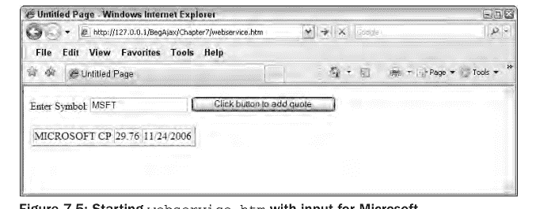

图 7-5：启动 `webservice.htm`，输入微软的股票代码。

- 5. 接下来，输入 **ORCL**（Oracle 的缩写），再次点击。屏幕无需刷新即可更新，两只股票的详细信息都显示在 HTML 表格中，如图 7-6 所示。

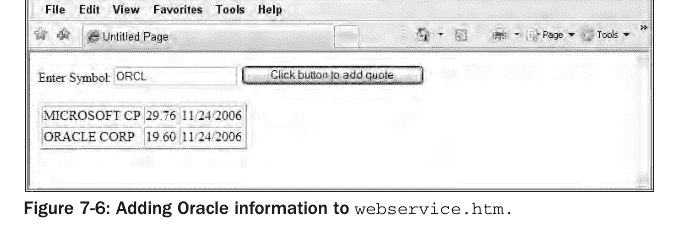

图 7-6：将 Oracle 的信息添加到 `webservice.htm`。

## 工作原理

HTML 页面包含一个 `<script>` 标签，用于加载脚本 `webservice.js`。它还包含一个按钮，点击时调用 `sendData()` 函数。脚本的第一部分创建一个 `XMLHttpRequest` 对象实例，一个用于 IE 7、Firefox 以及其他支持 `XMLHttpRequest` 的浏览器，另一个用于 IE 5 和 IE 6。这里绝对没有什么值得特别关注的不寻常之处。

`sendData` 函数应该同样熟悉：

```
function sendData()
{
  xmlhttp.abort();
  var url = "applicationproxy.aspx?symbol=" + document.form1.stocksymbol.value;
  xmlhttp.open("GET", url, true);
  xmlhttp.onreadystatechange = getData;
  xmlhttp.send(null);
}
```

你首先使用 `abort()` 方法清除上一次请求的内容，因为每次用户发出请求时都会调用 `XMLHttpRequest`。你创建一个 URL，该 URL 将调用 PHP 或 ASP.NET 代理页面，并将用户想要提交给 Web 服务的股票代码名称传递给它。最后三行代码打开对象，将 `onreadystatechange` 事件处理程序设置为运行 `getData` 函数，然后发送请求。

服务器端代码简短而精炼。在 PHP 和 ASP.NET 中几乎完全相同。在 PHP 中，代码如下：

```
$url = 'http://www.webservicex.net/stockquote.asmx/GetQuote?symbol=';
$qs = $_GET["symbol"];
$url = $url.$qs;
$url = DOMDocument::load($url);
echo $url->saveXML();
```

你创建一个变量来保存 Web 服务的 URL。你将查询字符串附加到 URL，然后对 `DOMDocument` 的 `load` 方法执行静态调用，将 Web 服务的完整 URL 和股票代码传递给它。然后你将 `saveXML` 方法的结果写入响应流。

ASP.NET 代码使用 `XmlDocument` 对象而不是 `DOMDocument`，使用 `InnerXml` 属性代替 `SaveXml`，并且在代码中而不是在页面顶部编写内容类型。除此之外，两者是相同的。

```
XmlDocument Dom = new XmlDocument();
string url = "http://www.webservicex.net/stockquote.asmx/GetQuote?symbol=" + Request.QueryString["symbol"].ToString();
Dom.Load(url);
string abc = Dom.InnerXml;
Response.ContentType = "text/xml";
Response.Write(abc);
```

处理返回调用的 JavaScript 代码稍微复杂一些。你仍然必须从返回的 XML 中提取数据，而且，如第一个示例中所述，当使用 HTTP GET 或 HTTP POST 时，XML 文档会将响应包装在单个 `<string>` 元素中。这意味着你必须深入文档才能获取所需的元素。`getData()` 函数从回调开始，并读取 `responseXML` 方法的内容以获取 Web 服务返回的 XML：

```
if ((xmlhttp.readyState == 4) &&( xmlhttp.status == 200))
{
    var myXml = xmlhttp.responseXML;
```

如果你输入的是 MSFT，那么你从 Web 服务收到的 XML 文档将是这样的：

```
<?xml version="1.0" encoding="utf-8" ?>
<string xmlns="http://www.webservicex.NET/">    
<string xmlns="http://www.webservicex.NET/">&lt;StockQuotes&gt;&lt;Stock&gt;&lt;Symbol&gt;MSFT&lt;/Symbol&gt;&lt;Last&gt;29.76&lt;/Last&gt;&lt;Date&gt;11/24/2006&lt;/Date&gt;&lt;Time&gt;1:00pm&lt;/Time&gt;&lt;Change&gt;0.00&lt;/Change&gt;&lt;Open&gt;N/A&lt;/Open&gt;&lt;High&gt;N/A&lt;/High&gt;&lt;Low&gt;N/A&lt;/Low&gt;&lt;Volume&gt;0&lt;/Volume&gt;&lt;MktCap&gt;292.6B&lt;/MktCap&gt;&lt;PreviousClose&gt;29.76&lt;/PreviousClose&gt;&lt;PercentageChange&gt;0.00%&lt;/PercentageChange&gt;&lt;AnnRange&gt;2
```


## 第7章：Web服务、API与混搭应用

```
1.46 - 30.00&lt;AnnRange&gt;&lt;Earns&gt;1.251&lt;/Earns&gt;&lt;PE&gt;23.79&lt;/PE&gt;&lt;Name&gt;MICROSOFT
CP&lt;/Name&gt;&lt;/Stock&gt;&lt;/StockQuotes&gt;
&lt;/string&gt;
```

其中包含大量无关信息。在此示例中，你已锁定`<last>`价格、`<date>`日期和`<name>`名称元素。同时你面临一个更紧迫的问题：用户正在使用哪个浏览器查看页面？你必须以略有不同的方式创建XML文档。如果是IE浏览器，则所需的XML存储在`childNodes[1]`中。你必须加载`ActiveXObject` XMLDOM并使用其实例来存储XML文档。

```
if (window.ActiveXObject)
{
    XMLDoc = myXml.childNodes[1].firstChild.nodeValue;
    xmlobject = new ActiveXObject("Microsoft.XMLDOM")
    xmlobject.async="false";
    xmlobject.loadXML(XMLDoc);
}
```

否则，你必须使用`childNodes[0]`，因为使用IE时，XML声明会随文档自动返回。在Firefox中，第一个元素将是`<string>`。在Firefox中，你使用`DOMParser`并调用`parseFromString`方法来返回XML文档。

```
else
{
    XMLDoc = myXml.childNodes[0].firstChild.nodeValue;
    var parser = new DOMParser();
    xmlobject = parser.parseFromString(XMLDoc, "text/xml");
}
```

变量`xmlobject`中得到的是一个去除了XML声明和`<string>`元素、以`<StockQuotes>`元素开头的XML文档。此函数的最后一部分用于动态创建表格以显示信息：

```
var table = document.getElementById("table1");
var row = table.insertRow(table.rows.length);

var cell1 = row.insertCell(row.cells.length);
cell1.appendChild(getText("Name",xmlobject));
var cell2 = row.insertCell(row.cells.length);
cell2.appendChild(getText("Last",xmlobject));
var cell3 = row.insertCell(row.cells.length);
cell3.appendChild(getText("Date",xmlobject));

table.setAttribute("border", "2");
```

页面中已存在`<table>`元素，你使用`getElementById`方法获取其引用。然后创建一个表格行`<tr>`并将其添加到表格中。接着创建三个单元格：分别用于名称、最新价格和日期。你将`getText`函数返回的值附加到这些单元格中。你将这些单元格添加到行中，并将表格的border属性设置为2以改善显示效果。

`getText`函数执行重复性任务。它搜索指定的XML标签并将该标签的文本内容添加到`<td>`元素中。根据使用的是IE还是Firefox，它有不同的分支处理：

```
function getText(tagName, xmlobject)
{
    var tags = xmlobject.getElementsByTagName(tagName);
    var txtNode = null;
    if (window.ActiveXObject)
    {
        txtNode = document.createTextNode(tags[0].firstChild.text);
    }
    else
    {
        txtNode = document.createTextNode(tags[0].firstChild.textContent);
    }
    return txtNode;
}
```

它向`getData`函数返回一个`textNode`。然后表格显示出来，将Web服务中的信息嵌入表格中展示。

有时此方案可能不适用。例如，如果你通过公司代理服务器访问，或者需要使用安全证书进行HTTPS通信，那么我们基本的脚本可能无法胜任。这时就需要一个更复杂的解决方案（由Jason Levitt设计，被许多开发者引用），它使用PHP中的cURL函数（可通过http://uk.php.net/curl获取客户端库）来打开和关闭会话，为你调用Web服务。Curl是一个用于从远程站点获取数据的PHP函数库。默认情况下，该库未安装，必须单独从PHP安装。

安装后，你通过查询字符串`ws_path`调用服务器端代理，并提供Web服务的名称及要传递的数据。例如，你可以在脚本中对服务器端的代理进行如下调用，以调用第一个示例中看到的`stockquote`服务，查询MSFT股票代码：

```
var path = 'http://www.webservicex.net/stockquote.asmx/GetQuote?symbol=' +
    document.getElementById("stocksymbol").value;
var url = 'http://localhost/curl_proxy.php?ws_path=' + encodeURIComponent(path);
xmlhttp.open('GET', url, true);
```

由于路径中包含问号，且你的服务器调用也包含问号，因此必须对路径进行编码以确保不会破坏查询字符串。

然后，你的服务器端代码将代表脚本进行调用，将`hostname`添加到URL中，并使用Curl执行Web服务调用：

```
define ('HOSTNAME', 'http://www.webservicex.net/');
$path = ($_POST['ws_path']) ? $_POST['ws_path'] : $_GET['ws_path'];
$url = HOSTNAME.$path;

// 打开Curl会话
```

```
$session = curl_init($url);

if ($_POST['ws_path']) {
    $postvars = '';
    while ($element = current($_POST)) {
        $postvars .= key($_POST).'='.$element.'&';
        next($_POST);
    }
    curl_setopt ($session, CURLOPT_POST, true);
    curl_setopt ($session, CURLOPT_POSTFIELDS, $postvars);
}

// 返回调用结果而非头部信息
curl_setopt($session, CURLOPT_HEADER, false);
curl_setopt($session, CURLOPT_RETURNTRANSFER, true);

// 调用数据
$xml = curl_exec($session);

header("Content-Type: text/xml");

echo $xml;
curl_close($session);
```

使用ASP.NET时，你很可能会使用HttpWebRequest类来检索文本。

### script标签技巧

第二种替代方案是script标签"技巧"。在第4章中，你看到的最后一种方法涉及动态创建`<script>`标签并动态分配`src`属性。使用这种Ajax模式，你可以构造一个比应用代理方法更简单的Web服务调用替代方案。该方法工作原理如下：

- 你移除`XMLHttpRequest`对象，并在`<script>`标签的`src`属性中进行Web服务调用。
- Web服务必须能够以JSON格式返回输出（第11章介绍）。
- 你检索JSON格式的数据。

此讨论不会深入太多细节，但让我们快速创建一个能以JSON格式返回输出的Web服务示例，例如Yahoo! TimeService，来演示如何实现这一点。

| 试一试 | 通过script标签调用Web服务 |
|:---|:---|
| **1.** | 创建一个名为`webservicescripttag.htm`的文件，内容如下： |

```
<html xmlns="http://www.w3.org/1999/xhtml" >
<head>
    <title>使用动态script标签的Web服务示例</title>
    <script type="text/javascript" src="webservice2.js"></script>
```

```
</head>
<body>
<form id="form1" name="form1">
<input type="button" onclick="dynamicTag();" value="点击按钮使用Web服务" />
</form>
</body>
</html>
```

**2.** 创建一个名为webservice2.js的脚本，内容如下：

```
function getTime(JSONData) {
    if (JSONData != null)
    {
        alert(TimeStampToDate(JSONData.Result.Timestamp));
    }
}

function TimeStampToDate(xmlDate)
{
    return new Date(xmlDate);
}

function dynamicTag()
{
    request = "http://developer.yahooapis.com/TimeService/V1/getTime?appid=YahooDemo&output=json&callback=getTime&format=ms";
    var head = document.getElementsByTagName("head").item(0);
    var script = document.createElement("script");
    script.setAttribute("type", "text/javascript");
    script.setAttribute("src", request);
    head.appendChild(script);
}
```

**3.** 在浏览器中查看webservicescripttag.htm，并点击按钮（图7-7）。

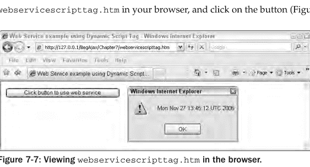

196

## 工作原理

这是Web服务的一个相当简单的用法，但不幸的是，目前没有太多服务保证返回JSON格式而不是标准XML。如果你的Web服务只返回标准XML文档，那么这会导致你的脚本出错，因为你已将script标签的`src`属性赋值为Web服务的输出。因此，浏览器期望接收到某种JavaScript脚本。

你首先创建一个`request`变量：

```
var request =
"http://developer.yahooapis.com/TimeService/V1/getTime?appid=YahooDemo&output=json&
callback=getTime&format=ms";
    var head = document.getElementsByTagName("head").item(0);
    var script = document.createElement("script");
    script.setAttribute("type", "text/javascript");
    script.setAttribute("src", request);
    head.appendChild(script);
```

`request`变量调用Web服务并附加三个额外的查询字符串。第一个是服务的输出应为JSON格式而非XML，第二个是当Web服务返回结果时你希望调用的脚本中函数的名称。第三个是将返回结果的格式设置为毫秒。Yahoo! Time Web服务返回自1970年以来的毫秒级时间戳。默认情况下，Web服务返回秒级时间。如果你移除此查询字符串，那么你会发现显示的是1970年某个日期的日期，而不是当前日期。

然后，你检索文档的`head`元素并向其添加一个`script`标签，其`src`属性赋值为Web服务的URL。你可能需要考虑两个额外要点。第一，如果你不想让IE缓存该脚本，可以在`src`属性末尾附加一个唯一变量。第二，使用JSON时，应生成唯一的脚本标签ID。

回调函数将接收一个作为参数返回的对象：

```
function getTime(JSONData) {
    if (JSONData != null)
    {
        alert(TimeStampToDate(JSONData.Result.Timestamp));
    }
}
```

你将此参数命名为`JSONData`并检查它是否为null。此Web服务的结果是一个时间戳。要将其转换为可读日期，你必须进行一些转换，这在`TimeStampToDate`函数中完成：

```
function TimeStampToDate(xmlDate)
{
    return new Date(xmlDate);
}
```

这里，你创建一个新日期，然后将从Web服务检索到的值赋给`timestamp`方法。你将整个`Date`对象返回以在警告框中显示。更简单的做法是直接调用JavaScript的`Date`对象，但因为本示例演示的是返回JSON的Web服务，所以使用了这种更为直白的解决方案。


### 未来替代方案

Web服务的跨域浏览是一个短期内不会消失的问题，因此目前有多种新解决方案正在开发中：

- FlashXMLHttpRequest — Flash已经允许你创建一个`crossdomain.xml`文件，该文件指定了可被调用的允许域列表。Julian Couvreur提出了一种方案，即Flash可以代表你被调用来进行跨域Web服务请求。更多详情可访问www.xml.com/lpt/a/1662。
- ContextAgnosticXMLHttpRequest — Chris Holland的提案是创建一个名为“Allow Foreign Hosts”的头部和一个新的附加对象`ContextAgnosticXMLHttpRequest`，该对象仅在存在此头部时才会暴露信息。更多详情可访问：http://chrisholland.blogspot.com/2005/03/contextagnosticxmlhttprequest-informal.html
- JSONRequest — 让更多Web服务以JSON而非XML返回数据，意味着你可以使用动态脚本标签的变通方法来返回数据。Doug Crockford的提案承认，你不仅需要一个变通方法来返回JSON，更需要一个全新的浏览器服务，该服务将发起浏览器与JSON数据服务器之间的双向数据交换。更多详情可访问：http://json.org/JSONRequest.html

所有这些都表明，尽管存在重要的安全影响，但解决跨域调用Web服务的需求非常明确。这不仅仅是少数爱好者可能想要尝试的事情。正如你将在后续讨论公司API使用和Mashup（混搭）主题时所看到的，这是任何严肃的开发者最终都可能需要考虑的事情。

### 使用API

继Web服务之后的下一步发展是引入公开可用的应用程序编程接口（API）。如果你熟悉Visual Basic、C#、Java甚至JavaScript等编程语言，这些API就像你已经在那些语言中找到的现成API和函数一样，例如`Date`或`Math`语句。

大多数大型网络公司（想想亚马逊、谷歌、微软、eBay、雅虎！）不仅通过Web服务提供信息，还创建了API，你可以从JavaScript内部调用这些API来访问其网站的功能。

在最简单的情况下，你可以直接添加HTML标签来渲染对象，如音乐播放列表、书籍阅读列表或最近的照片；然而，这受限于执行此操作的嵌入式标签的约束。更令人印象深刻的是能够针对某些公司的应用程序和产品列表运行查询。这些查询是通过以API形式自由提供给独立开发者来实现的。

以下是一些可供开发者使用的最常见的API示例：

- Flickr (www.flickr.com/services/)
- YouTube (www.youtube.com/dev)
- Google Maps (www.google.com/apis/maps/)
- eBay (http://developer.ebay.com/)
- del.icio.us (www.programmableweb.com/api/del.icio.us)
- Virtual Earth (www.viavirtualearth.com)

还有更多示例。如果你在www.programmableweb.com网站上搜索，会发现一个每天更新的列表。浏览这些列表，你会发现它们与本章前面介绍的Web服务列表非常相似（即使不完全相同）。

### Web服务与API的区别

有什么区别？直接的回答是：差别不大；这是相当随意的。API是程序请求特定服务集的方式。API本质上是一组服务的用户友好包装器。这些服务，你大概也能猜到，可以同样是Web服务，也可以是在你机器上运行的某处服务。

回忆本章开头做出的以下区分：

- 本章讨论的Web服务，是接受HTTP-GET/HTTP-POST（也称为REST请求）并返回XML文档，或者接受SOAP请求文档并返回SOAP响应文档的东西。Web服务遵守W3C.org指定的标准。
- API是一组方法的规范，用于通过编程语言与给定应用程序交互。这可以实现为C++库、一组TCP/IP命令，甚至作为Web服务。这里我们讨论的是Web API，在这个特定情况下使用JavaScript调用方法。API不必符合任何标准，因为从本质上讲，它们是专有性的。

不过，它们之间没有铁定的区别。例如，Last.fm将其服务归类为Web服务API，暗示两者兼有。当然，清晰地区分它们是令人困惑的，因为API可能只是在底层调用Web服务（很多时候确实如此）。需要强调的是API的不可预测性。因为你使用的是专有机制，所以你无法确定会从中得到什么。事实上，要使用每家公司自己的API，你会发现自己必须为谷歌地图学习一样东西，为Flickr学习另一样东西，为YouTube再学习另一样东西。这并不意味着它们没有共同之处，因为它们确实有。同样，这也不意味着它们极其复杂且难以使用。很多API使用起来相对简单。你将面临的是，每次学习一套新API时，至少存在一定的学习曲线。你还会发现，在大多数情况下，你必须注册某种密钥或开发者帐户才能使用API。

现在让我们来看一个特定的API，即谷歌地图API（因为它使用简单，也是比较容易集成到应用程序中的API之一）。要访问该API，需要克服的障碍和难关相对较少。选择谷歌地图作为示例API，是因为谷歌地图已经导出了一个用于使用`XMLHttpRequest`对象的现成方法（换句话说，它是一个现成的Ajax应用程序）。

### 谷歌地图API

谷歌地图是一个大型在线世界地图。谷歌地图API使谷歌地图应用程序的大部分功能可用于你自己的网站。你可以在地图上显示特定区域并放置标记。只要你的网站对所有人免费开放，谷歌地图API就可以免费使用并嵌入你的网站中。网址是www.google.com/apis/maps/。

你需要注册才能使用它，这要求你拥有一个谷歌帐户。然后，你必须指定你希望使用地图的网站的URL。如果你没有网站，也不用担心，因为如果你注册本地URL，就可以在本地Web服务器上开发示例。注册本地URL使得谷歌能够为你提供开发者密钥。

### 谷歌地图API密钥

谷歌地图API密钥必须插入到你的HTML页面中。这是一个示例的样子：

```
<script
src="http://maps.google.com/maps?file=api&amp;v=2&amp;key=ABQIAAAA2VWtIiYkkrFt6uptBppqpRQ-nq7HHFDIgV4kpixi_vFUjvLLkxTADPZAsa_8fbnH5iUxIH47AOnELA"
type="text/javascript"></script>
```

> 每个密钥都是为该开发者唯一创建的，因此不要嵌入此密钥并期望它能在你的代码中工作。

谷歌并不是唯一需要特殊密钥的公司。其他公司要求提供此类项目以便其API可访问是相当普遍的。例如，Flickr要求提供应用程序API密钥。

### Map对象

谷歌地图API最简单的用法是在你的网页中嵌入地图。将API密钥添加到页面后，你必须在HTML页面中添加一个`<div>`标签，其ID设置为`map`，宽度和高度设置为你所需的大小。你还必须在`<body>`标签中初始化两个事件：`load()`和`GUnload()`：

```
<body onload="load()" onunload="GUnload()">
    <div id="map" style="width: 500px; height: 300px"></div>
</body>
```

`GUnload()`函数是谷歌提供的，你不需要担心。你只需要提供`load()`代码。接下来，你必须在JavaScript中创建一个`map`对象。这包含在`load()`函数中。这是一个三步过程：

- 检查你的浏览器是否足够现代以支持谷歌地图。
- 创建一个`map`对象。
- 在地图对象上设置一个位置。

此示例取自谷歌地图文档，将创建一个以帕洛阿尔托为中心的地图。

```
function load() {
  if (GBrowserIsCompatible()) {
    var map = new GMap2(document.getElementById("map"));
    map.setCenter(new GLatLng(37.4419, -122.1419), 13);
  }
}
```


# 第 7 章：Web 服务、API 及 Mashups

你已能看出 API 的几种功能。`GBrowserIsCompatible` 检查浏览器是否兼容；`GMap2` 创建新的地图对象并提供具有 map ID 的 HTML 元素。最后，使用 `setCenter` API 通过经纬度定位地图。

### Geocode（地理编码）

Google Maps 利用纬度和经度来标识地图上地点的位置。向 `GLatLng` 方法提供两个坐标足够简单。然而，如果你（像大多数公众一样）不知道试图在地图上定位的项目的纬度及经度坐标，这可能会变得不便。Google Maps 使用 **Geocode** 对象将这些地址转换为这些坐标系中的坐标，反之亦然。

通过 **GClientGeoCoder** 对象访问“地理编码转换器”。你创建该对象的实例，然后可以使用 `getLatLng` 方法为某个地址返回特定纬度和经度。这并非像听起来那么简单，因为你需要将匿名函数作为第二个参数提供给 `getLatLng` 方法。正是就在这回调函数内部才执行经纬度的转换过程；Google Maps API 文档中的以下代码演示了这一点：

```javascript
function showAddress(address) {
  geocoder.getLatLng(
    address,
    function(point) {
      if (!point) {
        alert(address + " not found");
      } else {
        map.setCenter(point, 13);
        var marker = new GMarker(point);
        map.addOverlay(marker);
        marker.openInfoWindowHtml(address);
      }
    }
  );
}
```

首先，你必须检查 `point` 参数是否实际返回一组坐标。如果该参数为空，则表明未找到地址。如果已找到，则使用 `setCenter` 方法并将其设置为 `point` 参数和第二个值为 13（这是使用该对象的代码）的第二个参数。此外，本示例代码在地图上创建了一个标记器。这需要另外三行代码（一行用于创建标记器，然后两行更多将其添加到地图），方法是利用 `addOverlay` 对象来实现：

### The XMLHttpRequest Factory Method（XMLHttpRequest 工厂方法）

最后还有一个情况涉及 Google Maps 如何运用 **XMLHttpRequest** 对象。它通过一种“工厂”方法来执行此操作。该方法为你创建该对象，并返回该对象的属性和方法供你使用，无需你先显式地创建它。Google API 文档中的示例代码展示了如何通过调用：

```javascript
var request = GXmlHttp.create();
request.open("GET", "myfile.txt", true);
request.onreadystatechange = function() {
  if (request.readyState == 4) {
    alert(request.responseText);
  }
}
request.send(null);
```

> 你调用“GXmlHttp”对象的 **create** 方法。之后，你可以将其视同普通的 XMLHttpRequest 对象使用。有趣的是，还存在第二个名为 GDownloadURL 的 API，它消除了检查 XMLHttpRequest 对象的 readyState（就绪状态）选项的需要：

```javascript
GDownloadUrl("myfile.txt", function(data, responseCode) {
  alert(data);
});
```

这是由系统为你完成的。这总结了在页面中嵌入 Google Maps 的基本机制。

让我们创建一个小型示例，在其中使用 **Google Maps API**。与其只是复述该网站上的样本内容一样，我们添加一些额外的功能，即动态创建你自己的书签的能力。当你看到本章的最终示例时，这种能力将很有用：
>   首先，你将邀请用户在文本框中输入地址。你会将此地址转换为地图上的标记器。即使浏览器被关闭了，然后用户再次回到映射界面，该标记器仍将存在。这需要一个两步流程。你添加一个必须被转换到地理编码位置并写入 XML 文件的地址。随后应用程序必须扫描 XML 文件并将其中的标记器放置在地图上。它将信息保存至该 XML 文件中。这需要一些服务器端交互作用，因为 JavaScript 无法在不经过冗长临时解决方案的情况下直接向计算机上的文件直接书写。获取一小段能将该 XML 文件写往你机器的服务器端代码要容易得多：

>   ## Try it out（试一试）:
> ### An Example Application Using Google Maps（使用 **Google Maps**的示例应用程序）


在以下示例中，XMLHttpRequest 对象被使用了两次；一次是在幕后使用时用于 Google Maps；另一次是处理将标记器数据写入 XML 文件。

1.   Go to (前往) the following URL：
    http://www.google.com/apis/maps/signup.htm
2.   Sign up for a **Google Maps API key**。你必须指定一个与示例使用的网址。使用以下地址，因为 localhost（本地主机）有时会在其后生成额外端口名称以致于破坏所有东西；使用该代码也确保大小写完全匹配：
    http://127.0.0.1/BegAjax/Chapter7/
3.   写下或复制该键到文本文件。
4.   Create the following page (创建以下页面) called “page.htm”（名为“**page.htm**”）并添加键至代码：

```html
<html xmlns="http://www.w3.org/1999/xhtml">
<head>
    <meta http-equiv="content-type" content="text/html; charset=utf-8" />
    <title>Google Maps JavaScript API example</title>
    <script src="http://maps.google.com/maps/api/js?key=YOUR_KEY_HERE&amp;v=2"></script>
</head>
<body onload="Load()" onunload="Unload()">

<input id="address" name="address" type="text" size="50"/>
<input type="button" onclick="load('true')" value="Click to Add Marker" />
<div id="map" style="width: 500px; height: 300px"></div>

</body>
</html>
```

4. Create the JavaScript file, call it “**map.js**”（创建名为“**map.js**”的文件），并添加以下代码：

```javascript
var map = null;
var geocoder = null;
var xmlhttp = null;
if (window.XMLHttpRequest) {
    xmlhttp = new XMLHttpRequest();
} else if (window.ActiveXObject) {
    xmlhttp = new ActiveXObject("Microsoft.XMLHTTP");
}

function load(e)
{
    if (GBrowserIsCompatible())
    {
        map = new GMap2(document.getElementById("map"));
        geocoder = new GClientGeocoder();
        placeMarkers(document.getElementById("address").value, e);
        geocoder.getLatLng("Paris", function(point) {map.setCenter(point, 13)});
    }
}

function placeInXmlFile(point)
{
    var xml = null;
    if (window.ActiveXObject)
    {
        xml = new ActiveXObject("Microsoft.XMLDOM");
        xml.async = false;
        xml.load("data.xml");
    }
    else
    {
        xml = document.implementation.createDocument("", "", null);
        xml.async = false;
        xml.load("data.xml");
    }
    var newmarker = xml.getElementsByTagName("markers")[0];
    var newtag = xml.createElement("marker");
    newmarker.appendChild(newtag);
    newtag.setAttribute("lat", point.y);
    newtag.setAttribute("lng", point.x);
    newtag.setAttribute("address", address.value);

    xmlhttp.abort();
    var xmlToSave = xml.xml || (new XMLSerializer().serializeToString(xml));
    var xmlcode = encodeURIComponent(xmlToSave);
    var url = "Save.aspx?xml=" + xmlcode;
    xmlhttp.open("GET", url, true);
    xmlhttp.setRequestHeader("Content-Type", "text/xml");
    xmlhttp.send(null);
}

function placeMarkers(address, e)
{
    if (e == "true")
    {
        geocoder.getLatLng(address, function(point) {
            if (!point) {
                alert(address + " not found");
            } else {
                map.setCenter(point, 13);
                var marker = new GMarker(point);
                map.addOverlay(marker);
                marker.openInfoWindowHtml(address);
                placeInXmlFile(point, address);
            }
        });
    }
}
GDownloadUrl("data.xml", function(data, responseCode) {
  var xml = GXml.parse(data);
  var markers = xml.documentElement.getElementsByTagName("marker");
  for (var i = 0; i < markers.length; i++) {
      point2 = new GLatLng(parseFloat(markers[i].getAttribute("lat")),
                       parseFloat(markers[i].getAttribute("lng")));
      map.setCenter(point2, 13);
      marker2 = new GMarker(point2);
      map.addOverlay(marker2);
      marker2.openInfoWindowHtml(markers[i].getAttribute("address"));
  }
});
```

5. Create the data file “**data.xml**”（创建名为“**data.xml**”的数据文件），其中包含坐标列表，但在当前时刻将其留空，仅保留这两个元素：

```xml
<?xml version="1.0"?>
<markers>
</markers>
```

6. Last, create the server-side file to write to the XML file（最后，创建服务器端文件以写入该 XML 文件）。在 ASP.NET 中，将其称为 “**save.aspx**”：

```csharp
<%@ Page Language = "C#" Debug="true" ValidateRequest="false"%>
<%@ Import Namespace="System.Xml" %>
<script language="C#" runat="server">
    void Page_Load()
    {
        XmlDocument Dom = new XmlDocument();
        Dom.InnerXml = Request.QueryString["xml"];
        Dom.Save(Server.MapPath("Data.xml"));
    }
</script>
```


# 第7章：Web服务、API和混搭

确保ASP.NET账户对文件夹`BegAjax\Chapter7`具有读取和写入权限。你可以通过打开Windows资源管理器并转到硬盘上的该文件夹，然后右键单击它并选择属性来实现这一点。选择安全选项卡，点击添加，然后输入ASPNET。点击检查名称，然后点击确定确认。在允许列中勾选读取和写入复选框，然后再次点击确定。如果在Windows XP家庭版或Windows XP专业版中，由于任何原因看不到安全选项卡，请转到Windows资源管理器 → 工具 → 文件夹选项，在对话框中选择查看选项卡，向下滚动并确保未勾选"使用简单文件共享（推荐）"复选框。

或者，在PHP中，将其保存为`save.php`：

```php
<?php
$doc = new DomDocument('1.0');
$qs = $_GET["xml"];
$doc->loadXML($qs);
$doc->save('data.xml');
?>
```

1. 在浏览器中查看页面`map.htm`，如图7-8所示。

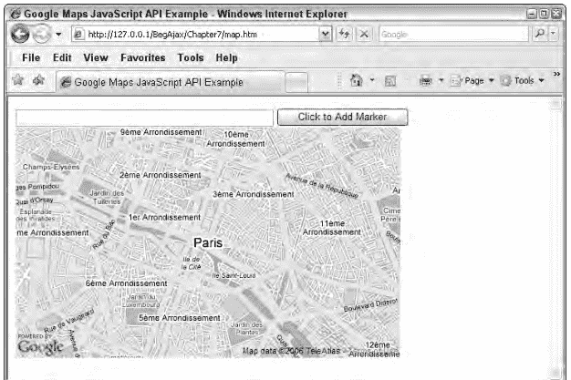

**图7-8：在浏览器中查看页面`map.htm`。**

2. 现在，输入一个你能看到的地址（或你碰巧知道的一个），然后点击添加标记按钮。例如，输入**香榭丽舍大街，巴黎**将产生如图7-9所示的结果。

3. 关闭浏览器，然后重新打开它。转到`map.htm`。滚动回该位置，标记仍然会存在。打开文件`data.xml`，你应该会看到以下内容：

```xml
<?xml version="1.0"?>
<markers>
 <marker lat="48.869801" lng="2.307586" address="Champs-Elysees, Paris"/>
</markers>
```

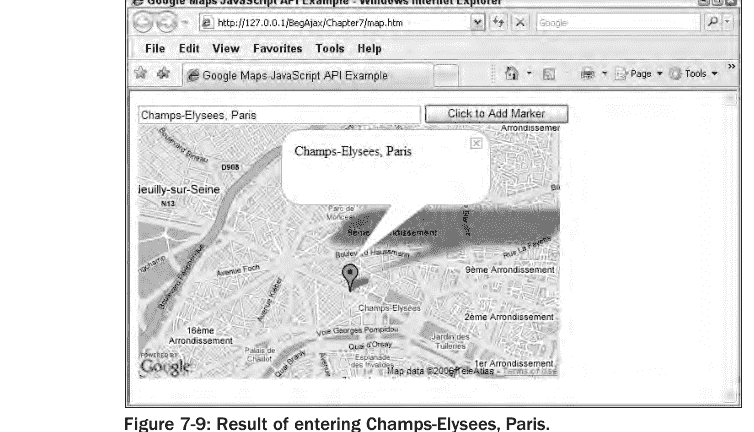

图7-9：输入香榭丽舍大街，巴黎的结果。

## 工作原理

本示例已经使用了之前讨论过的Google Maps网站上的大量示例代码。不过，你已经以一种新的方式将它们串联起来，以执行所需的功能。

`map.htm`页面与Google Maps文档中的示例几乎相同，只是你添加了一个名为`marker`的文本框和一个带有`onclick`事件的按钮：

```html
<body onload="load()" onunload="GUnload()">
    <input id="address" name="address" type="text" size="50"/>
    <input type="button" onclick="load('true')" value="Click to Add Marker" />
    <div id="map" style="width: 500px; height: 300px"></div>
</body>
```

该按钮也会调用`load()`函数，但它会带有一个额外的参数来调用它。当你第一次运行应用程序时，你需要确定你是第一次运行该应用程序，还是有人点击了添加标记按钮。在这种情况下，你必须确定一个稍微不同的操作过程。让我们现在来看一下脚本。`map.js`除了`load()`函数外还包含两个函数，但那些稍后再说。你开始创建`XMLHttpRequest`对象来处理服务器写入XML文件：

```javascript
var map = null;
var geocoder = null;
var xmlhttp = null;
```

```javascript
if (window.XMLHttpRequest) {
  xmlhttp = new XMLHttpRequest();
} else if (window.ActiveXObject) {
  xmlhttp = new ActiveXObject("Microsoft.XMLHTTP");
}
```

从文档中选取了三个小示例，第一个允许你输入地址并在地图上定位该地点。这用于`load()`事件中：

```javascript
if (GBrowserIsCompatible())
{
    map = new GMap2(document.getElementById("map"));
    geocoder = new GClientGeocoder();
    placeMarkers(document.getElementById("address").value, e);
    geocoder.getLatLng("Paris", function(point){map.setCenter(point, 13)});
}
```

你使用`GBrowserIsCompatible` API检查浏览器是否可以显示Google Maps。如果可以，你使用`GMap2`创建一个新的`map`对象。然后你使用`GClientGeocoder` API创建一个`Geocode`对象。你调用`placeMarkers`函数，传递文本框中提供的地址，以及第二个参数，该参数仅在用户按下按钮时设置。然后你将地图中心定位在巴黎。

`placeMarkers`将随后为你将红色标记应用到地图上的所需位置。第二个示例代码使用`getLatLng`方法，将地址转换为一组经纬度坐标，并将其存储在`point`对象中。首先，它评估用户是否点击了添加标记按钮。如果是，则`e`参数将设置为`true`，并将添加新的标记。

```javascript
if (e == "true")
{
    geocoder.getLatLng(address, function(point) {
        if (!point) {
            alert(address + " not found");
        } else {
            map.setCenter(point, 13);
            var marker = new GMarker(point);
            map.addOverlay(marker);
            marker.openInfoWindowHtml(address);
            placeInXmlFile(point, address);
        }
    });
}
```

`map.setCenter`将地图中心定位到新位置。`map.addOverlay`向地图添加标记。最后，`openInfoWindowHtml`打开伴随标记的小信息气泡。

你还调用`placeInXml`方法将标记添加到你的XML文件中。从文档中获取的第三段示例代码读取XML文档`data.xml`，该文档包含地图上的经纬度标记。这也包含在`placeMarkers`函数中。你从`data.xml`文件下载数据并使用工厂方法从文件中读取XML。你使用DOM提取`marker`标签作为集合，并将它们读入`markers`变量。然后，你遍历集合中的每个`marker`，为每个标记调用`GLatLng`方法以返回坐标。然后你使用生成的`point`对象将标记和标记信息气泡添加到地图上。

```javascript
GDownloadUrl("data.xml", function(data, responseCode) {
    var xml = GXml.parse(data);
    var markers = xml.documentElement.getElementsByTagName("marker");
    for (var i = 0; i < markers.length; i++) {
        point2 = new GLatLng(parseFloat(markers[i].getAttribute("lat")),
                            parseFloat(markers[i].getAttribute("lng")));
        map.setCenter(point2, 13);
        marker2 = new GMarker(point2);
        map.addOverlay(marker2);
        marker2.openInfoWindowHtml(markers[i].getAttribute("address"));
    }
}
```

让我们稍微跳回一下`placeInXmlFile`方法，它为你执行写入操作。这相当简单。你传入包含经纬度坐标的`point`对象。你从一些浏览器特定的代码开始，将`data.xml`的内容加载到`XMLDOM`对象或`document`对象中，具体取决于所使用的浏览器。

```javascript
function placeInXmlFile(point)
{
    var xml = null;
    if (window.ActiveXObject)
    {
        xml = new ActiveXObject("Microsoft.XMLDOM");
        xml.async = false;
        xml.load("data.xml");
    }
    else
    {
        xml = document.implementation.createDocument("", "", null);
        xml.async = false;
        xml.load("data.xml");
    }
}
```

你获取根元素`markers`并将其读入`newmarker`元素。然后你创建一个新的`marker`对象并追加它。你为这个新标签设置三个属性，并将前两个命名为`lat`和`lng`，这是`data.xml`文件所需的。纬度包含在`point.y`属性中，而经度存储在`point.x`属性中。第三个不是必需的，但它存储`address`属性，以便你可以显示标记信息气泡。

```javascript
var newmarker = xml.getElementsByTagName("markers")[0];
var newtag = xml.createElement("marker");
newmarker.appendChild(newtag);
newtag.setAttribute("lat", point.y);
newtag.setAttribute("lng", point.x);
newtag.setAttribute("address", address.value);
```


## 第7章：Web服务、API与混搭应用

此时XML文档已为你准备就绪，你只需将其写入文件。为此，你需要先清空现有的`XMLHttpRequest`对象，然后对创建的XML进行URI编码，并将其读入变量`xmlcode`。随后将该变量附加到查询字符串中，最终传递给服务器端代码。

```javascript
xmlhttp.abort();
var xmlToSave = xml.xml || (new XMLSerializer().serializeToString(xml))
var xmlcode = encodeURIComponent(xmlToSave);
var url = "Save.aspx?xml=" + xmlcode;
xmlhttp.open("GET", url, true);
xmlhttp.setRequestHeader("Content-Type", "text/xml" );
xmlhttp.send(null);
}
```

服务器端代码会创建新的`XmlDocument`对象，从查询字符串中提取XML数据并保存至文件。无论是PHP还是ASP.NET，处理逻辑都完全相同。

```csharp
XmlDocument Dom = new XmlDocument();
Dom.InnerXml = Request.QueryString["xml"];
Dom.Save((Server.MapPath("Data.Xml")));
```

至此完成整个循环流程。新条目已添加至XML文件，下次浏览时，先前介绍的方法将读取标记点并将其显示在地图上。这让我们完整领略了Google Maps API的实际应用效果。

现在让我们转向最后一个主题：如何整合两组不同API的结果来创建全新应用。

### 混搭应用

混搭是互联网领域相对新兴的现象。该术语源自流行音乐中的类似概念，最常见的形式是将一首歌曲的人声轨道叠加在另一首歌曲的伴奏轨道上。这种创作并非制造听觉灾难，而是让经典老歌焕发全新生命力。多首流行金曲都采用了这种技术。

在Web领域，混搭有着不同含义——它指整合来自两个不同来源的API或Web服务，构建单一应用程序。典型例子通常围绕Google Maps展开，例如在地图上显示用户提交到`flickr.com`的照片位置。Flickr允许用户为每张照片添加标签，勤奋的摄影爱好者还会通过地理标记提交拍摄地点。另一个应用场景是将你最近播放的音乐（LastFm提供此类功能）与该艺术家的评论或传记信息相关联。

混搭不一定必须使用API，但这样就需要通过应用代码手动提供混搭内容的一方。因此尽可能利用现有数据源更为简便，因为内容创作本身就是一个完全独立的专业领域。

#### Ajax如何助力混搭应用开发

讨论API和混搭看似偏离了Ajax主线，实则始终与之紧密相连。正如你将看到的，构建混搭应用时，客户端与服务器之间会存在大量“往返通信”——无论是更新XML文件还是通过代理调用Web服务。由于Google Maps这类应用已采用Ajax实现地图无缝滚动，我们自然不希望应用每次访问服务器都触发页面刷新。此时又需要`XMLHttpRequest`大显身手。

因为API通过JavaScript调用，Web服务可通过代理启动，将这些控制全部放在客户端处理是合理的。事实上，这也是众多开发者构建混搭应用时的首选方案。

混搭应用的乐趣在于：随着API的公开开放，主动权已完全交到家庭开发者和业余爱好者手中。你无需Visual Studio.NET，无需昂贵软件，所有操作都可免费完成。更重要的是，由于使用JavaScript编写，代码不必遵循强类型规范；无需提前用正统方法论设计规划所有功能，也不必确保完全可复用。这仿佛重回经典ASP和PHP的时代——只需让程序运行起来，大胆尝试新思路。当然，结构化编程和面向对象依然至关重要，但对于新手而言，起步阶段的乐趣往往在于探索实践。

你将使用Flickr API获取照片列表，再通过Google Maps API将照片显示在创建的每个标记点旁。虽然Flickr自带地图功能可展示地理标记照片，但本应用旨在演示如何轻松整合两个独立的应用API。此外，笔者个人更偏爱Google Maps因其细节丰富，这并非多此一举。

此项目需要两个应用：第一个从Flickr网站提取信息并写入XML文件；第二个是改进版的Google Maps API应用，能够将照片作为地图标记的一部分显示。

在开始之前，让我们深入了解Flickr API。

#### 使用Flickr API

Flickr网站（www.flickr.com）是雅虎旗下的照片分享与归档平台。它提供上传、整理、展示照片的多样化工具，并可设置查看权限。用户还能为照片添加标签以便归类——不同于HTML中`<table>`、`<form>`这类预设标签，Flickr允许用户自定义标签体系。例如为巴黎照片添加`Paris`标签，为雕塑作品添加`sculpture`标签。这些标签作为关键词，能高效整理分类海量异质内容。

#### 标签云（加权列表）

标签是Web 2.0的典型现象，常以标签云形式可视化呈现——热门标签会通过放大显示来体现权重。Flickr率先普及了这种独特视觉风格，随后众多网站（如Last.fm）纷纷效仿。无衬线字体、灰色背景上的蓝色文本以及全小写排版，几乎已成为此类信息展示的隐形标准。

图7-10展示了Flickr最受欢迎的标签列表。

关注标签是为了通过Flickr API按标签分类获取照片集。这依赖于用户准确标记自己的照片。例如你会在Flickr标签云中发现newyork和newyorkcity，两者重叠可能导致纽约照片的检索混乱。

实际标记操作很简单：在Flickr找到目标照片，点击旁边的"Add a tag"链接，在文本框输入合适标签，最后点击Add按钮。Flickr允许用户基于自定义标签集合生成专属标签云。

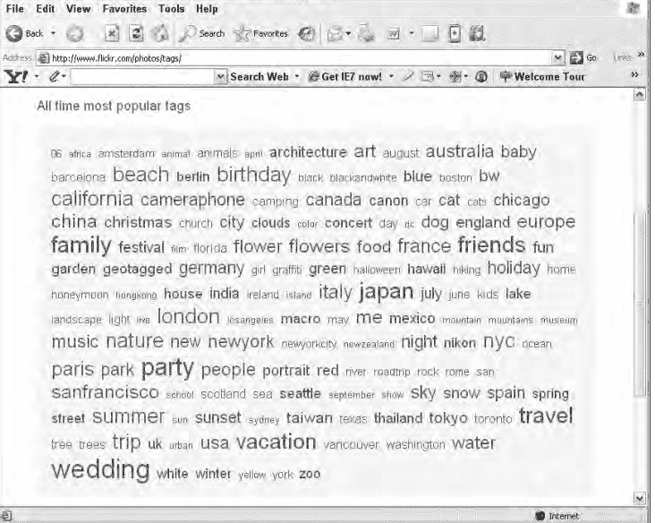

图7-10：Flickr最受欢迎标签列表

#### 使用Flickr API密钥

与Google Maps类似，使用Flickr API需要注册免费账户。阅读API文档时请注意，其表述可能比实际情况更复杂。若调用无需认证的API，只需申请API密钥即可。

若使用需要认证的API，则需遵循以下流程：

- 1. 申请API密钥。
- 2. 通过API密钥创建登录链接。
- 3. 创建授权处理器。
- 4. 使用处理器调用`getToken`方法。
- 5. 凭借令牌进行认证API调用。
- 6. 将API调用集成到应用程序中。

幸运的是，本例涉及的API无需认证。文档可能让你误以为所有API都需认证，实际并非如此。

#### 创建示例应用

让我们创建一个示例：当输入特定用户ID时，将检索该用户的公开照片及其地理坐标，并写入XML文件。重点涉及以下API：

- `getPublicPhotos` API —— 提供用户ID后，返回XML格式的照片列表。
- `getGeoLocation` API —— 提供照片ID后，返回包含经纬度坐标的地理位置信息。

具体实现方案为：在文本框输入用户ID（代码中将提供包含若干公开照片的WroxTest特殊账户ID），调用`getPublicPhotos` API获取XML照片列表，然后对列表中每张照片使用`getGeoLocation` API提取经纬度信息，最终将这些信息整合为XML文件保存。

#### 在Flickr中进行地理标记

你已了解标签基础知识，可能好奇位置标签如何实现。如前所述，照片标签由用户手动添加，可能导致分类不规范。幸运的是，位置标记采用更精确的方式实现。

每个Flickr账户都包含地图选项卡。用户可放大至特定位置，直接将照片拖放到地图上。操作完成后，照片将自动包含经纬度坐标，后续可通过`getGeoLocation` API获取这些地理信息。


## 第7章：Web服务、API与Mashup应用

以下URL提供了更详细的流程说明：

```
www.flickr.com/groups/geotagging
```

现在你已准备好在应用程序中使用Flickr API。Flickr API本质上是Web服务，因此在页面中调用API的方式与调用普通Web服务完全相同。这应该能让开发过程更轻松，代码也更易于理解。

### 动手实践：创建调用Flickr API的应用程序

本应用将要求用户在文本框中输入用户ID，然后扫描该用户在Flickr上的公开照片，并将照片数据（如标题、照片ID、经纬度坐标）写入XML文件。

需要注意的是，XML文件将基于你在Google Maps API示例中见过的布局格式。这将使Google Maps应用能够读取XML文件，同时你可以修改此应用以利用XML文件中传递的额外信息。这些额外信息不会影响Google Maps API——它会直接忽略多余数据。这些信息将在第二个应用中使用。

1. 首先在www.flickr.com/services/api/key/apply/申请API密钥（如果尚未申请）。你需要提供简短说明以解释申请用途，并确认仅限个人使用。申请后将获得密钥和共享密钥。本示例只需使用密钥。

2. 创建以下HTML页面并保存为`flickr.htm`：

```
<html xmlns="http://www.w3.org/1999/xhtml" >
<head>
    <title>按位置获取照片</title>
    <script src="flickr.js" type="text/javascript"></script>
</head>
<body>
    <input id="user" name="user" type="text" size="30"/>
    <input type="button" onclick="sendData()" value="点击保存该用户的地理位置照片" />
</body>
</html>
```

3. 创建名为`flickr.js`的脚本文件：

```
var xmlhttp = null;
var finalXML = null;

if (window.ActiveXObject)
{
    finalXML = new ActiveXObject("MSXML2.DOMDocument.3.0");
}
else
{
    finalXML = document.implementation.createDocument("", "", null);
}
```

```
finalXML.appendChild(finalXML.createElement("markers"));

countLength = 0;
globalCount = 0;
var photoid = new Array();
var phototitleid = new Array();
var photoserverid = new Array();
var photosecret = new Array();


function getRequest()
{
    if (window.XMLHttpRequest)
    {
      return xmlhttp = new XMLHttpRequest();
    }
    else if (window.ActiveXObject)
    {
    return xmlhttp = new ActiveXObject("Microsoft.XMLHTTP");
    }
}

function sendData()
{
    var request = getRequest();
    var url = "flickrproxy.aspx?method=flickr.people.getPublicPhotos&api_key=your_value_here&parametertype=user_id&parametervalue=" +
    document.getElementById("user").value;
    request.open("GET", url, true);
    request.onreadystatechange = function() { getData(request) };
    request.send(null);
}

function getData()
{

    if ((xmlhttp.readyState == 4) && (xmlhttp.status == 200))
    {

    var xmlobject = xmlhttp.responseXML;
    var photos = xmlobject.getElementsByTagName("photo");
    countLength = photos.length;

    for (var i = 0; i < photos.length; i++) {
    photoid[i] = photos[i].getAttribute("id");
    phototitleid[i] = photos[i].getAttribute("title");
    photoserverid[i] = photos[i].getAttribute("server");
    photosecret[i] = photos[i].getAttribute("secret");
    }
    sendGeoData();

    }

}
```

```
function sendGeoData()
{
    var request = getRequest();
    var url = "flickrproxy.aspx?method=flickr.photos.geo.getLocation&api_key=your_value_here&parametertype=photo_id&parametervalue=";
    
    request.open("GET", url + photoid[globalCount], true);
    request.onreadystatechange = function() { getGeoData(request) };
    request.send(null);
}

function getGeoData(request)
{
    if (request.readyState == 4 && request.status == 200)
    {
        xmlobject = request.responseXML;
        
        var newtag = finalXML.createElement("marker");
        var loc = xmlobject.getElementsByTagName("location")[0];
        var photo = xmlobject.getElementsByTagName("photo")[0];
        newtag.setAttribute("lat", loc.getAttribute("latitude"));
        newtag.setAttribute("lng", loc.getAttribute("longitude"));
        newtag.setAttribute("address", phototitleid[globalCount]);
        newtag.setAttribute("secret", photosecret[globalCount]);
        newtag.setAttribute("server", photoserverid[globalCount]);
        newtag.setAttribute("user_id", document.getElementById("user").value);
        newtag.setAttribute("photo_id", photo.getAttribute("id"));
        
        finalXML.firstChild.appendChild(newtag);
        
        globalCount++;
        
        if (globalCount != countLength) {
            window.setTimeout(sendGeoData, 10);
        } else {
            saveXml();
        }
    }
}

function saveXml()
{
    var xmlToSave = null;
    if(window.ActiveXObject)
    {
        xmlToSave = finalXML.xml
    }
    else
    {
        xmlToSave = new XMLSerializer().serializeToString(finalXML);
    }
}
```

```
var xmlcode = encodeURIComponent(xmlToSave);
var url = "Save.aspx?xml=" + xmlcode;
var request = getRequest();
request.open("GET", url, true);
request.onreadystatechange = function() {
    if (request.readyState == 4) {
        alert("文件已保存。");
    }
};
if (request.overrideMimeType) {
    request.overrideMimeType("text/plain");
}
request.send(null);
```

4. 创建服务器端文件。在ASP.NET中，保存为flickrproxy.aspx。

```
<%@ Page Language = "C#" Debug="true" %>
<%@ import Namespace="System.Xml" %>
<script language="C#" runat="server">
void Page_Load()
{
    XmlDocument Dom = new XmlDocument();
    string url = "http://api.flickr.com/services/rest/?method=" +
    Request.QueryString["method"] + "&api_key=" + Request.QueryString["api_key"] + "&" +
    Request.QueryString["parametertype"] + "=" +
    Request.QueryString["parametervalue"];
    Dom.Load(url);
    string abc = Dom.InnerXml;
    Response.ContentType = "text/xml";
    Response.Write(abc);
}
</script>
```

或在PHP中，保存为save.php。

```
<?php
header('Content-Type: text/xml');
?>
<?php
$url = 'http://api.flickr.com/services/rest/?method=';
$method = $_GET["method"];
$api_key = $_GET["api_key"];
$parametertype = $_GET["parametertype"];
$parametervalue = $_GET["parametervalue"];
$url = $url.$method.'&api_key='.$api_key.'&'.$parametertype.'='.$parametervalue;
$url = DOMDocument::load($url);
echo $url->saveXML();
?>
```

5. 确保本示例与上一个示例运行在同一位置，且存在save.aspx/save.php文件。代码无需修改。

6. 在浏览器中运行flickr.htm，输入WroxTest用户的编号64002153@N00，如图7-11所示。这将获取WroxTest用户的系列照片并保存到data.xml文件。

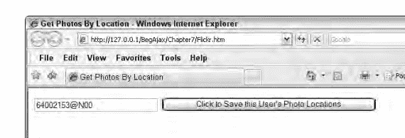

图7-11：输入WroxTest用户编号。

7. 查看data.xml文件内容，应如下所示：

```
<?xml version="1.0"?>
<markers>
  <marker lat="48.85359" lng="2.292366" address="eiffel" secret="c5bdad7cc1" server="89" user_id="64002153@N00" photo_id="277502325"/>
  <marker lat="48.880634" lng="2.282752" address="champseelysees" secret="1080ee2ca6" server="119" user_id="64002153@N00" photo_id="277437193"/>
</markers>
```

## 工作原理

本示例使用Flickr API从Flickr数据库提取WroxTest用户的照片，然后将显示所需的数据（以及地理经纬度信息）写入XML文件。XML采用Google Maps API要求的格式。这正是实现两个独立API跨应用交互的方式。本应用仅创建了data.xml文件，第二个应用将读取该文件。

HTML文件采用常规格式。按钮用于调用JavaScript文件flickr.js中的sendData()事件。但JavaScript文件并未按惯例直接创建XMLHttpRequest对象。此次每个交互都需要创建独立的XMLHttpRequest对象——仅调用abort()并重用该对象会导致Firefox浏览器出现异常行为。因此我们创建了getRequest()函数，允许在每次函数调用时生成新的XMLHttpRequest对象并返回给调用函数。此外需要定义额外全局变量存储信息，包括用于存储标签的数组，以及用于存放生成XML文档的finalXML变量：

```
if (window.ActiveXObject)
{
  finalXML = new ActiveXObject("MSXML2.DOMDocument.3.0");
}
else
{
  finalXML = document.implementation.createDocument("", "", null);
}
```


# 第7章：Web服务、API和混搭应用

```javascript
finalXML.appendChild(finalXML.createElement("markers"));

countLength = 0;
globalCount=0;
var photoid = new Array();
var phototitleid = new Array();
var photoserverid = new Array();
var photosecret = new Array();

function getRequest()
{
if (window.XMLHttpRequest)
{
  return xmlhttp = new XMLHttpRequest();
}
   else if (window.ActiveXObject)
   {
   return xmlhttp = new ActiveXObject("Microsoft.XMLHTTP");
   }
}
```

`sendData()`函数会清空XMLHttpRequest对象，然后创建一个包含你想要调用的方法的URL。再次强调，你需要使用服务器端代理代码来避免跨域调用的问题。

在服务器端代码中，你调用`getPublicPhotos` API方法，同时传入API密钥以及一个参数类型和参数值。该API接收一个user_id，并以XML格式返回一组数值：

```xml
<photos page="2" pages="89" perpage="10" total="881">
    <photo id="2636" owner="47058503995@N01"
        secret="a123456" server="2" title="test_04"
        ispublic="1" isfriend="0" isfamily="0" />
    <photo id="2635" owner="47058503995@N01"
        secret="b123456" server="2" title="test_03"
        ispublic="0" isfriend="1" isfamily="1" />
    <photo id="2633" owner="47058503995@N01"
        secret="c123456" server="2" title="test_01"
        ispublic="1" isfriend="0" isfamily="0" />
    <photo id="2610" owner="12037949754@N01"
        secret="d123456" server="2" title="00_tall"
        ispublic="1" isfriend="0" isfamily="0" />
</photos>
```

你最终需要照片ID、标题、服务器和密钥值才能显示照片。因此，目前你需要将这些信息保存在XML文件中。稍后在本章中创建下一个应用程序时，会介绍如何从Flickr显示照片。

> 需要注意的一点是，`sendData`函数仅适用于需要单个参数的Flickr API方法。由于你希望调用的所有方法都只接受一个必需参数，所以这不成问题。但如果你想改编代码以调用使用多个参数的Flickr API方法，这就可能成为问题。

URL被传递给XMLHttpRequest对象，并且在onreadystatechange事件触发时调用`getData`函数。在调用新的`getRequest()`方法后，你像往常一样将对象发送到服务器：

```javascript
function sendData()
{
    var request = getRequest();
    var url = "flickrproxy.aspx?method=flickr.people.getPublicPhotos&api_key=your_value_here&parametertype=user_id&parametervalue=" + document.getElementById("user").value;
    request.open("GET", url, true);
    request.onreadystatechange = function() { getData(request) };
    request.send(null);
}
```

`getData()`函数为服务器端代码提供回调函数。你将responseXML方法的内容加载到一个变量中：

```javascript
function getData()
{
    if ((xmlhttp.readyState == 4) && ( xmlhttp.status == 200))
    {
        var xmlobject = xmlhttp.responseXML;
        var photos = xmlobject.getElementsByTagName("photo");
        countLength = photos.length;

        for (var i = 0; i < photos.length; i++) {
            photoid[i] = photos[i].getAttribute("id");
            phototitleid[i] = photos[i].getAttribute("title");
            photoserverid[i] = photos[i].getAttribute("server");
            photosecret[i] = photos[i].getAttribute("secret");
        }
        sendGeoData();
    }
}
```

由于你调用了`getPublicPhotos` API方法，你知道将接收每个photo标签的id、title、server和secret属性。你将这些存储在JavaScript头部创建的数组中。最后，一旦数组填充完毕，你就调用另一个函数`sendGeoData()`。

此时让我们快速回顾一下。你已经使用user_id调用了`getPublicPhotos` API。你已经接收到一个XML文档，列出了该用户在公共领域的所有照片。但这个XML文档还不够合适，而且你仍然没有位置数据，即经度和纬度。你目前有的是照片ID，现在必须将其提供给`getGeoLocation` API方法。然而，你有多张照片，所以必须根据照片数量多次调用该方法来获取位置。

`sendGeoData`函数使用全局变量photoid，这是一个照片ID数组。你将使用数组中的每个单独项目来调用`getGeoLocation` API方法。不过，你无法在你的函数内部设置循环来执行此操作，因此你的函数结构只显示对`flickrproxy`服务器端页面的单次调用，以及单个回调函数`getGeoData`。

```javascript
function sendGeoData(photoid)
{
    var request = getRequest();
    var url = "flickrproxy.aspx?method=flickr.photos.geo.getLocation&api_key=your_value_here&parametertype=photo_id&parametervalue=";

    request.open("GET", url + photoid[globalCount], true);
    request.onreadystatechange = function() { getGeoData(request) };
    request.send(null);
}
```

你应该开始理解这组相当不整洁的全局变量的用途了。虽然你无法在循环中调用`getGeoLocation` API然后等待多个回复，但你必须做的是：调用一次，获取回复，将回复添加到你的文档中，再次调用API，再次获取回复，并将其添加到文档中。这正是回调函数使你能够做到的。

```javascript
function getGeoData(request)
{
  if (request.readyState == 4 && request.status == 200)
  {
    xmlobject = request.responseXML;

    var newtag = finalXML.createElement("marker");
    var loc = xmlobject.getElementsByTagName("location")[0];
    var photo = xmlobject.getElementsByTagName("photo")[0];
    newtag.setAttribute("lat", loc.getAttribute("latitude"));
    newtag.setAttribute("lng", loc.getAttribute("longitude"));
    newtag.setAttribute("address", phototitleid[globalCount]);
    newtag.setAttribute("secret", photosecret[globalCount]);
    newtag.setAttribute("server", photoserverid[globalCount]);
    newtag.setAttribute("user_id", document.getElementById("user").value);
    newtag.setAttribute("photo_id", photo.getAttribute("id"));

    finalXML.firstChild.appendChild(newtag);

    globalCount++;

    if (globalCount != countLength) {
        window.setTimeout(sendGeoData, 10);
    } else {
        saveXml();
    }
  }
}
```

`getGeoData`函数与`getData`函数类似，因为再一次地，你获取responseXML方法结果并将XML读入XML文档。这次，不是将数据存储在全局数组中，而是必须准备将其放入XML文档中。 Kenn如你所知，这个函数可能会被调用多次。你只需要为每张照片动态创建一个`marker`标签。

你要做的是创建单个`marker`标签，其中包含latitude、longitude、address（标题）、secret、server、user_id和photo_id标签：

```xml
<marker lat="48.85359" lng="2.292366" address="eiffel" secret="c5bdad7cc1" server="89" user_id="64002153@N00" photo_id="277502325"/>
```

这既是你需要在地图上以地理方式显示标记的信息，也是下一个应用程序显示地图所需的信息。你从全局数组中获取address、secret和server的信息，并从`getGeoLocation` API方法返回的XML文档中提取latitude、longitude和photo_id属性。你将这些信息追加到finalXML数组中，该数组包含你创建的每个marker标签。

如前所述，你知道必须在sendGeoData和getGeoData函数之间来回切换，切换次数与照片数量相同。你使用globalCount变量来统计照片数量。你还在全局countLength变量中保存了照片总数，因此当这两个数值相等时，你就知道已经为每张照片调用了`getGeoLocation` API。如果还没有，就将计数加1并再次调用sendGeoData。如果已经处理完毕，则调用最终函数saveXML。

saveXML函数创建一个名为markers的根元素，然后将finalXML数组中的每个marker标签追加到根元素。然后你对该XML进行URI编码，将其作为查询字符串追加，并将其发送给上一个示例中使用的相同服务器端代码。这将信息保存为名为data.xml的XML文档。

```javascript
function saveXml()
{
    var xmlToSave = null;
    if(window.ActiveXObject)
    {
        xmlToSave = finalXML.xml
    }
    else
    {
        xmlToSave = new XMLSerializer().serializeToString(finalXML);
    }
    var xmlcode = encodeURIComponent(xmlToSave);
    var url = "Save.aspx?xml=" + xmlcode;
    var request = getRequest();
    request.open("GET", url, true);
    request.onreadystatechange = function() {
        if (request.readyState == 4) {
            alert("File saved.");
        }
    };
    if (request.overrideMimeType) {
        request.overrideMimeType("text/plain");
    }
    request.send(null);
}
```

你在这里还没有向屏幕显示任何内容，但写入XML文件为你奠定了基础。data.xml文件符合Google Maps API可以使用的合法格式，因此你现在只需从中检索信息并从Flickr显示照片即可。


### 第七章：Web 服务、API 和混搭应用

#### 在 Flickr 显示照片

问题的关键在于能够显示照片。这并不像显示一个简单的 URL 那样直接。这些 URL 是动态创建的，并且存储在不同的服务器上，因此你需要每次都动态创建它们。

URL 可以有多种格式，但这里需要关注的格式如下：

```
http://static.flickr.com/{server-id}/{photo_id}_{secret}.jpg
```

你需要 `server-id`、`photo_id` 和 `secret` 密钥。当我们使用 `getPublicPhotos` API 方法时，这些项都会作为属性返回。因此，只要你在某处存储了它们，那么要显示照片，你所要做的就是正确地将 URL 组装为一个字符串。

所以，如果你的 `server-id` 是 89，`photo_id` 是 277502325，`secret` 密钥是 c5bdad7cc1，那么以下 URL 应该能显示照片：

```
http://static.flickr.com/89/277502325_c5bdad7cc1.jpg
```

当然，这将显示全尺寸照片。如果你想显示缩略图或其他尺寸，可以附加一个尺寸代码，如下所示：

```
http://static.flickr.com/{server-id}/{photo_id}_{secret}_[mstb].jpg
```

其中以下内容适用：

*   **s** — 小方块 75x75
*   **t** — 缩略图，最长边 100
*   **m** — 小图，最长边 240
*   **-** — 中等，最长边 500
*   **b** — 大图，最长边 1024（仅对非常大的原始图像存在）
*   **o** — 原始图像，jpg、gif 或 png，取决于源格式

小版本图像可以通过以下 URL 调用：

```
http://static.flickr.com/89/277502325_c5bdad7cc1_s.jpg
```

查看以下 URL 了解更多详情：

```
http://www.flickr.com/services/api/misc.urls.html
```

现在让我们回到地图示例，进行一些修改，使其与 Flickr 应用程序协同工作。让我们利用 `openWindowInfoHtmlRat` API，这次传递的不只是简单的文本。你已经完成了 90% 的工作，所以如果发现这个示例需要的代码比前两个少，不要感到惊讶。

1. 将 `maps.htm` 复制到一个名为 `mashup.htm` 的新文件中，并删除文本框和按钮行。同时，更改 `script` 标签，使其现在引用文件 `mashup.js`。它现在应该看起来像：

```
<script
src="http://maps.google.com/maps?file=api&amp;v=2&amp;key=add_your_own_key_here"
type="text/javascript"></script>
```

2. 将 `maps.js` 复制到一个名为 `mashup.js` 的新文件中。修改函数 `placeMarkers`，使其现在如下所示：

```javascript
function placeMarkers(address, e)
{
  GDownloadUrl("data.xml", function(data, responseCode) {
  var xml = GXml.parse(data);
  var markers = xml.documentElement.getElementsByTagName("marker");
  for (var i = 0; i < markers.length; i++) {

      point2 = new GLatLng(parseFloat(markers[i].getAttribute("lat")),
                           parseFloat(markers[i].getAttribute("lng")));
      map.setCenter(point2, 13);
麦迪逊也是

    3. 修改函数 `load()`，删除调用 `placeMarkers` 时使用的第二个参数，如下所示：

```javascript
function load(e)
{
  if (GBrowserIsCompatible())
```

```javascript
{
    map = new GMap2(document.getElementById("map"));
    geocoder = new GClientGeocoder();
    placeMarkers();
    geocoder.getLatLng("Paris", function(point){map.setCenter(point, 13)});
}
```

4. 在浏览器中打开 `mashup.htm`。滚动到标记处（埃菲尔铁塔西侧有一个），然后点击标记。你现在会看到来自 Flickr 网站的照片显示在 Google 地图上（图 7-12）。

**图 7-12：** 来自 Flickr 网站的照片显示在 Google 地图上。

## 工作原理

在最后的示例中，你将两个应用程序结合在一起。在经历了之前应用程序的所有辛苦工作之后，你不需要再添加太多内容。你已经从 HTML 中移除了按钮和文本框，因为不需要接受用户输入。（这现在可以由 Flickr 应用程序提供。）你已经更新了 `load()` 和 `placeMarkers()` 函数来实现这一点。

事实上，你唯一需要添加的新代码在 `placeMarkers` 中：

```javascript
marker2 = new GMarker(point2);
map.addOverlay(marker2);
attr = markers[i].getAttribute("address");
aurl = "http://www.flickr.com/photos/" + markers[i].getAttribute("user_id") + "/" 
+ markers[i].getAttribute("photo_id");
imageurl = "http://static.flickr.com/" + markers[i].getAttribute("server")+ "/"
+ markers[i].getAttribute("photo_id") +"_" + markers[i].getAttribute("secret") +
"_s.jpg";

GEvent.addListener(marker2, "click", (function(marker, pAurl, pAttr,
    pImageurl) {
        return function() { marker.openInfoWindowHtml("<a href='" + pAurl
            +"'/></a>&nbsp;<span>" + pAttr +
            "</span>",new GSize(200,200));  }
})(marker2, aurl, attr, imageurl));
```

这里的代码像以前一样在地图上创建了一个新标记。不同之处在于，`openInfoWindowHtml` 方法不必只接受文本。你可以传递一个 `` 元素，并且可以根据本"动手实践"部分之前描述的规则来构造 `` 元素的 `src` 属性。你还创建了一个锚标签，链接回 Flickr 上可以访问此照片的页面。执行此操作的 URL 简单来说如下：

```
http://www.flickr.com/{user_id}/{photo_id}
```

你还发送了照片的地址/标题，并将其写为 `span` 标签。你构建了这个微型 HTML 片段，并将其作为参数提供给 `openInfoWindowHtml` API 方法。这确保了标记创建一个显示图像和相关信息的弹出气泡。你返回匿名函数的内容，该函数为每个标记点打开窗口。一旦你为某个标记打开一个窗口，任何先前存在的窗口都会关闭。你现在有一个混搭应用程序，结合了 Flickr 的照片并将其显示在 Google 地图上。更好的是，它使用 Ajax 使整个过程尽可能无缝。

### 总结

本章涉及了许多不同的主题。讨论从 Web 服务开始，探讨了如何使用浏览器通过 REST 消费简单的 Web 服务。然后讨论比较了 REST 范式与 SOAP 范式，并简要讨论了为什么要使用其中一个而不是另一个。本章接着讨论了如何将 Web 服务整合到 Ajax 应用程序中，并展示了从一个域调用 Web 服务时涉及的问题。提出了两种解决方案，一种涉及使用服务器端代理，另一种涉及将 `<script>` 标签的 `src` 属性指向 Web 服务，并以 JSON 格式而非 XML 格式返回信息。

接下来，本章探讨了 API 以及相对于 Web 服务而言 API 的相当任意的定义。你以 Google Maps API 作为一个简单的例子。然后讨论引入了混搭的概念，并结合 Google Maps API 与 Yahoo Flickr API 的调用，提供了一个最终的示例应用程序。

第八章将介绍 XSLT 和 XPath 语言（它们用于帮助以更高的粒度从文档和 Web 服务中选择信息），以及它们如何用于控制 Ajax 应用程序中的展示。


## 第 7 章：Web 服务、API 和应用组合（Mashups）

### 练习题

建议的问题解答可以在附录 A 中找到。

1.  修改第一个示例 `webservice.htm`，使其不再要求用户输入，而是直接返回一份五个价格的列表，涉及微软（MSFT）、甲骨文（ORCL）、太阳微系统（SUNW）、IBM（IBM）和苹果（AAPL）。
2.  访问 Google Maps API 应用程序，并对其进行修改，使其将视图中心定位到 `data.xml` 文件中的第一个 `<marker>` 元素。

> *提示：你需要检查文件中是否存在一个 `<marker>` 元素。*

## 第 8 章：XSLT 和 XPath

现代浏览器在过去五年中的一大主要新增功能便是增加了可扩展样式表语言转换（XSLT）处理器。XSLT 主要用于将一个 XML 文档转换为另一个。转换可用于选择文档中的特定项目或部分内容。XSLT 促进了将文档结构与网页的呈现和内容分离。

最吸引人的是，XSLT 允许您使用其他 XML 语言（如 XPath）来查询 XML 文档。您无需每次都回到数据库并使用查询命令，现在您处于从服务器提取单个 XML 文档的位置，然后可以在客户端决定从中提取哪些数据。相比于使用 JavaScript，XPath 可以更简单高效地从 XML 文档中选择和查询数据。XSLT 也可以用于通过级联样式表（CSS）添加样式，其方式与样式表控制 HTML 页面的呈现类似。您可以使用 XSLT 将您的纯文本 XML 文档转换为极具表现力的输出。

尽管如此，XSLT 在一些领域只得到了冷淡的接待。您在 XSLT 中几乎可以做到的所有事情，都可以用 JavaScript 和 DOM 来完成。它增加了发送回客户端的文件大小。其编程结构可能让习惯仅使用 HTML 和 CSS 文件的设计师感到困惑。更具问题的是，令人头疼的浏览器兼容性问题再次浮现。Internet Explorer (IE) 和 Firefox 的 XSLT 引擎必须由 JavaScript 代码以不同的方式调用，更糟糕的是，尽管存在一项规范 XSLT 的标准，但这两个主要浏览器并不总是以相同的方式使用或呈现 XSLT 的主要元素。

尽管存在这些缺点，XSLT 在 Web 开发人员工具集中对于应用程序中渲染 XML 数据仍占据重要位置。XSLT 也进入了 Ajax 的范畴，因为通常当服务器向客户端返回数据时，它将是以 XML 文档的形式。您的应用程序不必这样做，但更多的是，这是一个好主意，因为 XML 保留了数据的结构，且 XML 的文本格式非常适合所有应用都能理解的数据传输。

在本章中，您将了解以下内容：

- XSLT 是什么
- XSLT 标签
- XPath 是什么
- 执行转换
- 向 XSLT 文档传递参数

## XSLT 及其用途

XML，一种用于将一个 XML 文档转换为另一个 XML 文档的语言，可用于执行编程语言（如 JavaScript、PHP 或 C#）的许多程序功能，也可用于向 XML 文档提供样式信息。这两个功能都不是 XSLT 最擅长的事情。

XML 数据的一个问题是任何人都可以创建模式（schema）。即使在相对受限的领域（例如乐谱、化学元素或股票）也会有多种模式。借助 XSLT，您拥有了一个可以从多个来源获取文档并以统一结构转换它们的工具。XSLT 可以生成多种不同格式的输出：XML、HTML 或纯文本。

XSLT 到底是什么？XSLT 样式表本身就是 XML 文档，因此 XML 规则（例如文档必须是良好形成和有效的、必须有单个根元素、元素必须正确嵌套等）也适用于 XSLT。XSLT 基于一组模板构建。模板可以被认为是与 JavaScript 中的函数类似的，并且它们可以以相同方式重用。处理器还必须知道从哪里开始，先处理哪个模板。这是通过 `match` 属性完成的。模板内部是 XSLT 标签、XML 数据、HTML 标签或文本的混合体。

当 XSLT 生成 HTML 输出时，它创建了一个由 HTML 元素和 XSLT 指令组成的混合 XML 文档。浏览器以正常方式解析 HTML 元素，但 XSLT 指令的作用方式有点像经典的 ASP 或 PHP 命令。例如，考虑以下经典 ASP 代码片段：

```
<% if  (x ==5 )  { %>
 <span id="name"> William Shakespeare </span>
<% }  else  { %>
 <span id="name"> Arthur Miller </span>
<% } %>
```

现在，考虑一个 PHP 代码片段：

```
<?php if  ($x ==5 )  { ?>
 <span id="name"> William Shakespeare </span>
<?php }  else  { ?>
 <span id="name"> Arthur Miller </span>
<?php } ?>
```

粗体项永远不会显示。此外，根据变量 x 的值，两个 span 标签中只有一个会被显示。从这个角度来看，XSLT 看起来已经有点熟悉了：

```
<xsl:choose>
    <xsl:when test="x=5">
        <span id="name"> William Shakespeare </span>
    </xsl:when>
    <xsl:otherwise>
        <span id="name"> Arthur Miller </span>
    </xsl:otherwise>
</xsl:choose>
```

浏览器不会显示这些 XSL 指令，但它们是指令，用于最终创建可以以 HTML 元素或文本形式显示的浏览器内容。然而，最重要的区别在于，XSLT 引擎是浏览器的一部分，因此任何 XSLT 指令都在客户端处理，无需访问服务器。

此外，ASP.NET 服务器端编程技术也具有 XSLT 处理器，而 PHP 可以通过 Ginger Alliance 的 Sablotron 库添加 XSLT 处理器。（更多详细信息请参见：[http://uk2.php.net/xslt.]）

有一点需要注意的是，XSLT 在转换方面不提供任何新功能。它提供了一种更灵活、结构化的执行方式。这意味着用户不再受限于必须导航通过 XML 文档中的节点。他们可以使用 XPath 来定位文档中的元素和属性，并使用 XSLT 为文档提供结构。也值得一提的是，XSLT 不提供与 CSS 类似的行内样式。相反，它依赖于 CSS 和 HTML 来处理这些方面。因此，XSLT 是一个中间件，有助于保持您网页的内容和结构分离。

不过，XSLT 并非普遍流行，就像大多数 Web 技术一样，它有合适的时间和场景，使用它的理由和不使用它的理由。让我们考虑一些使用 XSLT 的主要原因：

- 在 DOM 中使用 JavaScript 将一个 XML 文档转换为另一个 XML 文档要困难得多。
- 在 XSLT 中，可以将文档结构与设计和内容分离开来，尽管这取决于设计是否正确实现。
- XSLT 使用 XPath 访问节点。这对执行查询更好且可以提升性能。
- XSLT 特别适用于将非 XML 格式的数据转换为 XML。

反对 XSLT 的理由也很有说服力：

- XSLT 有导致应用程序膨胀的倾向。在复杂的应用程序中，XSLT 文档可以达到数千行长。
- 它相当复杂。虽然设计师可以在没有任何编程知识的情况下轻松更新 CSS，但在使用 XSLT 时，设计师被迫要掌握通用的编程结构。尽管您的设计与内容已分离，但设计师和开发人员执行的任务会变得模糊不清。

229


## 第8章：XSLT与XPath

尽管使用XPath查询文档能带来性能优势，但如果你创建了庞大的XSLT文档，那么实际上是将负载转嫁回了客户端，而这些工作本可在服务器端完成。这可能会对性能产生负面影响。你必须做出权衡。在处理从服务器返回的XML文档时，XSLT或许能带来好处；但当文档开始变得庞大而笨重时，或许正是你应该开始考虑在服务器端以减少后续处理的方式来创建XML文档的时机。

### XSLT元素

XSLT具有基于元素的结构，这与你熟悉的其他所有标记语言（如HTML和XML）非常相似。你可以使用许多预定义元素来创建XSLT样式表。遗憾的是，没有快速掌握它们的捷径，要构建XSLT样式表，你确实需要学习它们。本节将在你看到使用示例之前，快速概述构建样式表时需要使用的主要元素。

#### xsl:stylesheet

每个XSLT模板都以XML声明开头，因为它们都是XML文档。之后是一个包含整个页面的XSL样式表声明。所有其他`xsl:指令`都应包含在此元素中。

`xsl:stylesheet`格式如下：

```xml
<xsl:stylesheet version="1.0" xmlns:xsl="http://www.w3.org/1999/XSL/Transform">
    ... 页面内容在此 ...
</xsl:stylesheet>
```

`xsl:stylesheet`元素指定了所使用的XSLT版本，通常也包含命名空间。`version`属性是必需的。

`xsl:transform`标签可以替代`xsl:stylesheet`元素使用，且工作方式完全相同。

> `xsl:transform`标签可以替代`xsl:stylesheet`元素使用，且工作方式完全相同。

#### xsl:output

XSLT文档中常见的下一个元素是`xsl:output`元素。`xsl:output`是一个可选元素，用于指定文档转换后的格式。以下是使用`<xsl:output>`元素创建XML文档的示例：

```xml
<xsl:output method="xml" omit-xml-declaration="yes" version="1.0"
    indent="no" encoding="UTF-8"/>
```

你可以指定诸如是否添加XML声明以及XML声明中的版本属性等事项。所有属性都是可选的。表8-1描述了这些属性。

| 属性名 | 描述 |
| :--- | :--- |
| method | 指定输出格式为XML、HTML、text或name。默认为XML，除非根的第一个子元素是HTML（此时默认为HTML）。 |
| version | 指定HTML或XML标准的版本。 |
| encoding | 指定编码类型。 |
| omit-xml-declaration | 指定是否包含XML声明。默认为no。 |
| standalone | 设置为yes或no，定义独立声明是否出现在输出中。 |
| doctype-public | 指定DOCTYPE声明的Public属性。 |
| doctype-system | 指定DOCTYPE声明的System属性。 |
| cdata-section-elements | 指定一个元素列表，其内容应写在CDATA节中。 |
| indent | 设置为yes或no，指定文档是否应根据标签的嵌套进行缩进。 |
| media-type | 指定输出的MIME类型，通常为text/xml。 |

```xml
<xsl:output method="html" doctype-public="-//W3C//DTD HTML 4.01//EN" doctype-system="http://www.w3.org/TR/html4/strict.dtd"/>
```

你可以同样轻松地使用此元素来指定HTML文档：这些指令用于创建位于XML或HTML文档顶部的XML和DOCTYPE声明。当然，XSLT样式表本身已经有XML声明，但`xsl:output`是为转换后的文档创建声明。

## 第8章：XSLT与XPath
### xsl:template、xsl:apply-templates与xsl:call-template

到目前为止*，你的XSLT样式表中包含了XML声明、样式表元素和一个可选的输出元素。这些都不涉及XML文档的实际处理。XSLT是一种基于模板的语言，它使用一系列可重用的模板，在这些模板中创建HTML或XML文档的片段。然而，每个文档都需要一个起点，让XSLT处理器可以开始工作。这取决于`xsl:template`标签是如何指定的。一个`xsl:template`必须有一个`match`属性或一个`name`属性。

#### match属性

如果`<xsl:template>`有一个`match`属性，那么它可以被`<xsl:apply-templates>`指令调用。通常，如果只有一个模板处理所有节点，那么`<xsl:apply-templates>`元素会被省略，页面也能正常工作。如果你想创建一个等同于C#/VB.NET中的`Page_Load()`，或者一个总是执行的脚本，你可以将匹配模式设置为"/"。以下片段可用于处理XLM文档中的每个节点（取决于该节点的内容）：

```xml
<xsl:template match="/">
    ...
</xsl:template>
```

匹配模式也可以设置为仅处理文档中的特定节点。假设你希望此模板应用于使用以下XML文档的节点子集：

```xml
<?xml version="1.0"?>
<cart>		
    <book>
        <title>Beginning ASP.NET with C Sharp</title>
        <quantity>1</quantity>
        <authors>Hart Kauffinan, Sussiman Ullman</authors>
        <ISBN>0764588505</ISBN>
        <price>39.99</price>
    </book>
    <book>
        <title>Beginning JavaScript 2nd Edition</title>
        <quantity>1</quantity>
        <authors>Wilton</authors>
        <ISBN>076455871X</ISBN>
        <price>39.99</price>
    </book>
    <total>119.97</total>
</cart>
```

然后你可以使用以下`match`属性设置：

```xml
<xsl:template match="book">
    ...	
</xsl:template>
```

这意味着`cart`中的`book`元素将由该模板规则处理，而`total`元素将被忽略。放置在这个元素内的任何内容都会根据`match`模式被自动处理。对于HTML文档，你会将每个文档都包含的最外层HTML标签放置于此，例如`<html>`、`<head>`和`<body>`：

你将创建的大多数XSLT样式表将具有以下格式：

```xml
<?xml version="1.0"?>
<xsl:stylesheet version="1.0" xmlns:xsl="http://www.w3.org/1999/XSL/Transform">

    <xsl:output method="html" doctype-public="-//W3C//DTD HTML 4.01//EN" 
        doctype-system="http://www.w3.org/TR/html4/strict.dtd" />

    <xsl:template match="/">
        <html>
            <head></head>
            <body>
                ... 内容放置于此 ...
            </body>
        </html>
    </xsl:template>

</xsl:stylesheet>
```

#### name属性

XSLT还可以通过模板重用模块化的代码段。这些模板通过设置`name`属性来定义，如下所示：

```xml
<xsl:template name="MyTemplate">
	...
</xsl:template>
```

如果你想在任何时候调用该特定模板，你需要插入以下调用：

```xml
<xsl:call-template name="MyTemplate"></xsl:call-template>
```

这两组模板通常在页面中一起使用。`match`属性将指定文档的入口点，而`<xsl:call-template>`将被放置在“主”模板内。一个模板调用另一个模板是很常见的，通过这种方式，许多模板可以嵌套。不过，这可能会使代码非常难以理解。

### XSLT参数

对于像方法和函数这样的可重用代码段，你还需要能够将信息传递到结构中。XSLT模板也不例外。参数使用`xsl:param`元素定义：

```xml
<xsl:param name="MyParameter" />
```

然后可以在文档中按如下方式引用参数：

```text
$MyParameter
```

## 第八章：XSLT 与 XPath

您还可以使用 `xsl:with-param` 元素向模板传递参数：

```xml
<xsl:with-param name="current">
...
</xsl:with-param>
```

### xsl:if

XSLT 使用 `xsl:if` 元素实现决策结构。`xsl:if` 元素接受一个 `test` 参数。在 `test` 属性内部，您指定一个表达式，以决定是否显示该特定代码片段。

`xsl:if` 的格式如下：

```xml
<xsl:if test="price &gt; 0">
...
</xsl:if>
```

该测试也可以包含更复杂的 XPath 指令，正如您将在本章后面关于 XPath 的讨论中看到的。

### xsl:choose

XSLT 没有 if-else 元素格式。相反，对于需要选择其中一个分支的决策分支，它使用一组不同的元素：`<xsl:choose>`、`<xsl:when>` 和 `<xsl:otherwise>`。`<xsl:choose>` 元素包含另外两个元素。`<xsl:when>` 的用法类似于 `xsl:if` 标签，并指定测试条件。`<xsl:otherwise>` 元素用于指定 else 的情况。

`xsl:choose` 的格式如下：

```xml
<xsl:choose>
  <xsl:when test="price &gt; 0">
    ...
  </xsl:when>
  <xsl:otherwise>
    ...
  </xsl:otherwise>
</xsl:choose>
```

如果您想模拟 `if {} else if {} else {}` 结构，那么只需在 `<xsl:choose>` 结构内放置更多 `<xsl:when>` 元素即可，如下所示：

```xml
<xsl:choose>
  <xsl:when test="price &lt; 5">
    ...
  </xsl:when>
  <xsl:when test="price &gt; 10">
    ...
  </xsl:when>
</xsl:choose>
```

```xml
<xsl:otherwise>
    ...
</xsl:otherwise>
</xsl:choose>
```

这里，如果 `price` 的值小于 5，则触发第一个条件；如果价格大于 10，则触发第二个条件。价格在 5 到 10 之间的情况将由 `xsl:otherwise` 子句处理。

### 转义 XSLT 特殊字符

关于前面的示例，需要注意的一点是，XSLT 遵循 XML 关于特殊字符的规则。因此，它对某些字符非常挑剔，这些字符需要进行转义。只有五个，如表 8-2 所示。

| 字符 | 转义码 |
| :--- | :--- |
| & | &amp; |
| < | &lt; |
| > | &gt; |
| " | &quot; |
| ' | &apos; |

### xsl:for-each

XSL 使用 `xsl::for-each` 实现循环结构。鉴于您可能不知道具体有多少个元素，这对于处理 XML 文档中的节点特别有用。

[`xsl:for-each`](#) 结构具有以下格式：

```xml
<xsl:for-each select="//book">
    ...
</xsl::foreach>
```

`xsl:for-each` 元素接受一个 `select` 属性。这里再次可以使用 XPath 表达式。这里，您调用了每一个 `<book>` 元素。`//` 符号实现了这种调用。

`xsl:for-each` 结构通常与 [`<xsl::if>`](#) 元素结合使用。它的作用相当于对文档中的每个标签，如果某个特定条件为真，则显示此标签。例如，如果您只想显示 `price` 高于 35 美元的书籍，可以使用以下代码：

```xml
<xsl::for-each select="//book">
    <xsl:if test="price &gt; 35">
        ... Display Content here ...
    </xsl::if>
</xsl:foreach>
```

`xsl:for-each` 结构在所有实际用途上都类似于 C# 或 PHP 的 `foreach` 结构。

### xsl:value-of

XSL 样式表中最常用的标签之一是 [`<xsl::value-of>`](#) 标签。它用于显示特定元素或变量的内容。

`[xsl:ualue-of](#)` 格式接受 `select` 属性。您指定要显示的 XML 元素或变量的名称，如下所示：

```xml
<xsl::valueof select="price">
```

如果在 `<xsl::for-each>` 循环的上下文中完成此操作，那么它将显示具有此元素或属性的每个元素的内容。例如，以下代码将显示每个 [`book`](#) 元素的每个 `price` 元素：

```xml
<xsl::foreach select="//book">
    <xsl:value-of select="pricel/>
</xsl:for-each>
```

您还可以将此代码与 HTML 元素交错使用，以便将文本插入表格单元格，如下所示：

```xml
<xsi:foe-each seleet="//book">
    <td>
        <xsl:value-of select="price"/>
    </td>
</xsl::for-echo>
```

### xslt-sort

如果您想对从 XML 文档获取的数据进行排序，则可以使用 `xsl:sort` 标签并指定一个特定元素。例如，以下代码将返回按 `price` 排序的书籍列表：

```xml
<xsl::foreach select="book">
    <xsl:sort sclect="price" />
    ... Page Content here .. .
</xlsl.foreach>
```

### xsl-variabie

最后，您可以在 XSLT 中声明变量，然后在模板的后面引用这些变量。变量的创建方式与普通编程语言相同。您创建一个名称并为其赋值。例如，要创建一个名为 `myvar` 的变量，其值为 [`price`](#) 元素乘以 10，您将使用以下代码：

```xml
<xsl::varlable name="myval" select="price * 10">
```

## 第八章：XSLT 与 XPath

至此，您已经了解了入门所需的所有 XSLT 元素。还有更多元素，但为了创建简单的样式表并将其与本章探讨的 XPath 功能结合使用，这些已经绰绰有余。

XSLT 依赖于 XPath 来执行其算术运算和字符串格式化。XPath 有一组函数可供调用以提供此功能。这些将在本章后面进行探讨。

### 主要浏览器中的 XSLT 支持

正如本章引言所暗示的，在使用两个主要浏览器的 XSLT 引擎时，XSLT 支持一直是个棘手的问题。虽然两者都支持 XSLT，但它们在解释语言的方式上仍有些分歧。这类似于 CSS 长期存在的情况，而且 XSLT 标准比 CSS 标准更大更复杂，这无助于改善这种状况。

目前的浏览器支持范围如下：

+   - IE 版本 5.5、6 和 7
- Firefox 1 和 2、Netscape 6（有限）、7 和 8
- Opera 9

本章中的所有示例都将在 IE 和 Firefox 中运行，除非另有说明。这些示例尚未在 Opera 上进行测试。

### 执行转换

尽管每个浏览器在实现语言语义方面可能有一些怪癖，但 XSLT 语言对于所有浏览器都是相同的。而将一个文档转换为另一个文档的行为，在两个浏览器之间则有些不同。文档转换的过程大致相同，但执行转换所需的 JavaScript 是不同的。

步骤如下：

+   1. 加载 XSLTlocument
2. 2Load the XML document., 调用一个方法，使用 XSI! 样式表转换 XML 文档。,
*让我们首先看看 IE 如何执行此操作。*

### 使用 IE 执行转换

在 `IE` 中，您必须创建两个 [ActiveXObject](#)。对于本章中的示例，它们都将属于 [`XMLDOM`](#) 类型，尽管也有替代的 ActiveX 对象，例如 [`MSXM2.FreeThreadedDomDocument.30`](#) 和 MSXML2.XSLTemplate`，它们提供了额外的能力，例如传递参数的能力。您首先加载一个 XML 文档，然后加载一个 XSI! 文档（尽管严格来说，您这样做的顺序并不重要）。您不希望它们异步加载，因此将 [asynel](#) 属性设置为 `false`，

XMLDOM 对象有一个 [`transformNode`](#) 属性，它接受一个节点（在这种情况下是 Document 对象），使用 XSL1 样式表处理它，并返回转换后的 XML 文档。transformNode 方法的参数可以是 XMLTlocument 或 XSI! 样式表的节点。一旦保存了转换结果，如果需要，您可以将其写入屏幕。

以下代码片段加载一个名为 [`Example.xml`](#) 的 XML dooument，加载一个名为 [ExarnpLelxsl](#) 的 XS! 样式表，使用 Ihe styie shet 对 XML documenl 执行 trausformation，并将文档保存在 variabie `transform` 中。然后，代码在网页中搜索具有 id 属性为 example 的元素，并用转换后的文档替换其 `innerHleer](#)` 属性。

```javascript
//load XML var xml = new ActiveObject("Microsoft.XMIDOM"); .sync=false ; xul.load("Example.xml") //LoadXSL :or xsI=new Activex0bject("Microso1.XMLDOM"); asyncl:alse; xlolad( "Exampie.xsl ") ,
//Transform var transion = xml.transformNode(xsl) ;
,Write to screen' ver spantag= document.-getElementById("example") ; span tag.innerHleer=transforn

```

**动手实践** | **在 IE 中执行转换**，让我们现在运行一个快速示例，您取一个非常简单的 XML documenl，执行 tramform'，并将转换结果作为网页的一部分返回。此 exarnple 从 XIL! 文档中获取酒店列表，并在 HTML 表格中显示酒店名称和价格。如果价格低于 175，则价格以红色高亮显示。*

您需要四个不同的项目来执行此操作：XML 文档（和 XSIT sy le sheet）、一个 HTNL 网页和一个 scripl。您需要主要关注执行的 tranasformation。请注意，此示例仅在 IE 中有效；下一个示例将在 Mo zilla 中有效。

1, 创建一个带有 follovng 代码的 HTML 页面：，并将其保存为 `IE Transform.htm`：
```html

<html> <head> <title>IExansformaton</titie> <script type="text/javascript" src= "lETransform.js"> </heed>
238


## 第八章：XSLT 与 XPath

```html
<body onload="Transform()">
<span id="example"></span>
</body>
</html>
```

2. 创建包含以下代码的 JavaScript 页面，并将其保存为 IETransform.js：

```javascript
function Transform()
{
	//Load XML
	var xml = new ActiveXObject("Microsoft.XMLDOM");
	xml.async = false;
	xml.load("Example.xml");

	//Load XSL
	var xsl = new ActiveXObject("Microsoft.XMLDOM");
	xsl.async = false;
	xsl.load("Example.xsl");

	//Transform
	var transform = xml.transformNode(xsl);

	//Insert item into web page
	var spantag = document.getElementById("example");
	spantag.innerHTML = transform;
}
```

3. 创建具有以下格式的 XML 文档，并将其保存为 Example.xml：

```xml
<?xml version="1.0"?>
<hotels>
  <hotel>
    <name>La Splendide</name>
    <city>Paris</city>
    <price>200</price>
  </hotel>
  <hotel>
    <name>The Imperial</name>
    <city>New York</city>
    <price>150</price>
  </hotel>
</hotels>
```

4. 创建具有以下格式的 XSL 文档，并将其保存为 Example.xsl：

```xml
<?xml version="1.0" encoding="utf-8"?>

<xsl:stylesheet version="1.0"
xmlns:xsl="http://www.w3.org/1999/XSL/Transform">

<xsl:output
method="html"
indent="yes"
version="4.0" />

<xsl:template match="/">
  
  <table border="1">
    <xsl:for-each select="//hotel">
      <xsl:choose>
        <xsl:when test="number(price)&lt; 175">
          <tr >
            <td>
              <xsl:value-of select="name"/>
            </td>
            <td style="background:red">
              <xsl:value-of select="price"/>
            </td>
          </tr>
        </xsl:when>
        <xsl:otherwise>
          <tr>
            <td>
              <xsl:value-of select="name"/>
            </td>
            <td>
              <xsl:value-of select="price"/>
            </td>
          </tr>
        </xsl:otherwise>
      </xsl:choose>
    </xsl:for-each>
  </table>
</xsl:template>
</xsl:stylesheet>
```

5. 打开 `Transform.htm`，并在 IE 中查看（图 8-1）。

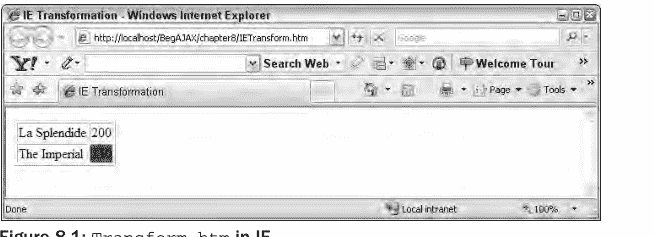

图 8-1：IE 中的 Transform.htm。

## 工作原理

JavaScript 代码遵循四个步骤：

- 1. 加载 XML 文档。
- 2. 加载 XSLT 样式表。
- 3. 执行转换。
- 4. 将转换后的内容插入到网页中。

你已经了解了 JavaScript 代码的作用，现在让我们聚焦于执行转换的关键点。以下 JavaScript 代码的调用将你从 JavaScript 代码带入 XSLT 引擎：

```javascript
//Transform
var transform = xml.transformNode(xsl);
```

XSLT 引擎在 `output` 标签之后遇到的第一个元素是 `xsl:template`。它有一个 `match` 属性，用于匹配文档中的根元素。接下来，你在 `xsl:template` 内部立即创建一个带边框的表格：

```xml
<xsl:template match="/">
  <table border="1">
```

然后，你开始使用 `xsl:for-each` 循环。你指定了每个 `hotel` 元素，并在其中放置一个 `xsl:choose` 结构。你设定当 `price` 元素的内容小于 175 时，创建一个新的表格行，其中包含两个单元格。第一个显示酒店名称，第二个以红色背景显示价格。

```xml
<xsl:for-each select="//hotel">
    <xsl:choose>
      <xsl:when test="number(price)&lt; 175">
        <tr >
          <td>
            <xsl:value-of select="name"/>
          </td>
          <td style="background:red">
            <xsl:value-of select="price"/>
          </td>
        </tr>
      </xsl:when>
```

否则，如果 `price` 元素的值大于 175，则只显示一个表格行和两个表格单元格，显示酒店名称和价格，但不带任何背景颜色。

```xml
<xsl:otherwise>
  <tr>
    <td>
      <xsl:value-of select="name"/>
    </td>
    <td>
      <xsl:value-of select="price"/>
    </td>
  </tr>
</xsl:otherwise>
</xsl:choose>
</xsl:for-each>
</table>
</xsl:template>
```

如果你跳到 XML 文档，可以看到第一个 <hotel> 元素的价格是 200，因此它不会以红色背景显示。

```xml
<hotel>
  <name>La Splendide</name>
  <city>Paris</city>
  <price>200</price>
</hotel>
```

对于第二个元素，价格小于 175，因此它将以红色背景显示。

```xml
<hotel>
  <name>The Imperial</name>
  <city>New York</city>
  <price>150</price>
</hotel>
```

随着 XSLT 处理器逐页处理，它会编译文档的转换版本。最终的转换文档如下：

```html
<!DOCTYPE html PUBLIC "-//W3C//DTD HTML 4.01//EN"
"http://www.w3.org/TR/html4/strict.dtd">
<table border="1">
<tr>
<td>La Splendide</td>
<td>200</td>
</tr>
<tr>
<td>The Imperial</td>
<td style="background:red">150</td>
</tr>
</table>
```

然后，这就是你赋值给 <span> 元素的 HTML，它将显示在页面上。

### 在 Firefox 中执行转换

要在 Firefox 中执行转换，你必须使用稍微不同的方法。Firefox 不支持 ActiveX 对象，虽然它没有原生的 XMLDOM 对象，但它支持原生的 Document 对象，因此你可以使用这个对象或 XMLHttpRequest 对象来加载 XML 文档和 XSL 样式表。因此，Firefox 版本稍微长一些，但实际上并不更复杂。

首先，你创建 XSLTProcessor 对象的一个新实例来处理样式表。然后，你创建 XMLHttpRequest 对象的一个新实例并加载 XSL 文档。先加载 XML 还是 XSL 文档并不重要。关键的区别在于，你需要在这里同步加载文档。你不想等待稍后再回来，因为你需要 XML 文档和 XSL 样式表都完全加载后才能执行其他操作。XSL 文档使用 Firefox 的原生 DOM 文档对象以相同的方式创建和加载。XSL 样式表使用 importStylesheet 方法加载，该方法只需要一个参数，即样式表本身。

成功导入样式表后，使用 `transformToFragment` 方法执行转换，该方法需要两个参数。第一个是 XML 文档，第二个是"拥有"该片段的文档对象。当将新片段放入当前网页时，你可以传入当前的 `document` 对象。

```javascript
var xsltProcessor = new XSLTProcessor();

//Load XSL
xslStylesheet = document.implementation.createDocument("", "doc",
    null);
xslStylesheet.async = false;
xslStylesheet.load("Example.xsl");
xsltProcessor.importStylesheet(xslStylesheet);

//Load XML
xmlDoc = document.implementation.createDocument("", "doc", null);
xmlDoc.async = false;
xmlDoc.load("Example.xml");

//Transform
var fragment = xsltProcessor.transformToFragment(xmlDoc, document);
document.getElementById("example").appendChild(fragment);
```

可以使用 `appendChild` 方法以真正的 DOM 中心方式将片段添加到网页的元素中。

如前所述，Firefox 中的 XSLT 处理器与 IE 中的工作方式不完全相同。这意味着在 IE 中执行的转换结果可能与在 Firefox 中执行完全相同的转换的结果不同。这是需要注意的一点。确保你尽可能简洁地构建 XSLT 样式表。Mozilla XSLT 引擎支持的元素和函数列表可以在以下 URL 找到：

http://developer.mozilla.org/en/docs/Transforming_XML_with_XSLT

更多详细信息可以在以下 URL 找到：

http://developer.mozilla.org/en/docs/Using_the_Mozilla_JavaScript_interface_to_XSL_Transformations

### 在 Firefox 中执行转换

本示例采用前面的 XML 文档和 XSL 样式表，并使用 Firefox 的 XSLT 处理器来执行转换。

- 1. 打开上一个示例中的网页 `Transform`；将其修改以使用名为 `FFTransform.js` 的脚本，并将其保存为 `FFTransform.htm`。

```html
<html>
<head>
```


## 第8章：XSLT与XPath

```html
    <title>Firefox Transformation</title>
    <script type="text/javascript" src="FFTransform.js"></script>
  </head>
  ...
```

+   2. 创建一个名为 `FFTransform.js` 的新脚本，并添加以下内容：

```javascript
function Transform()
{
		var xsltProcessor = new XSLTProcessor();

		//Load XSL
	xslStylesheet = document.implementation.createDocument("", "doc", null);
		xslStylesheet.async = false;
		xslStylesheet.load("Example.xsl");
		xsltProcessor.importStylesheet(xslStylesheet);

		//Load XML
		xmlDoc = document.implementation.createDocument("", "doc", null);
		xmlDoc.async = false;
		xmlDoc.load("Example.xml");


		//Transform
		var fragment = xsltProcessor.transformToFragment(xmlDoc, document);
		document.getElementById("example").appendChild(fragment);
}
```

+   3. 在Firefox中打开 `FFTransform.htm`，并查看它（图8-2）。

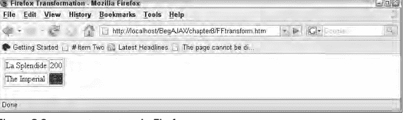

## 工作原理

如你所见，Firefox的显示与IE的显示是相同的。对于简单的样式表，你不太可能遇到两个主要浏览器之间的差异。

要创建一个跨浏览器兼容版本的代码，你可以简单地将两个脚本拼接在一起，并使用你在本书中一直用于 `XMLHttpRequest` 对象的 `if (window.ActiveXObject)` 检查。

### 在服务器端执行转换

除了担心跨浏览器兼容性外，另一种选择是在服务器端执行转换。.NET框架有自己的原生XSLT处理器。不幸的是，PHP不原生支持XSLT，尽管你可以下载一个使用Sablotron和expat库的扩展。这些都可以在www.gingerall.org/sablotron.html找到。提供了二进制文件和源代码。因为你希望（尽可能）避免下载和安装额外的扩展，让我们只创建一个.NET示例版本。

在创建示例之前，值得指出一些关于.NET框架XSLT处理器的要点。.NET框架有两个不同的版本，这些不同的版本支持不同的处理器。.NET框架1.0和1.1只支持 `XslTransform`，它在.NET 2.0中已被弃用。.NET 2.0引入了 `XslCompiledTransform` 类，它在解析和显示XSL样式表方面更为严格，但它允许在Visual Studio.NET中对XSLT样式表进行逐步调试。

> “弃用”意味着它已被标记为从未来版本的.NET中移除，并且不鼓励使用它。但这并不意味着你不能使用该方法。

`XslCompiledTransform` 是一个更快的引擎，应该优先使用。不过，确实存在一些内存泄漏和性能问题，可能需要微软的补丁。在下面的示例中，你不应该遇到任何此类问题。

**动手实践：使用.NET执行转换**

让我们使用前两个示例中的样式表和XML文档，并使用.NET 2.0创建一个Ajax应用程序，该程序为你调用.NET XSLT处理器。它以 `XMLHttpRequest` 对象可以处理的格式返回结果。

+   1. 打开上一个示例中的网页Transform，并更改它，使其现在使用名为NETTransform.js的脚本。

```html
<html>
<head>
  <title>.NET Transformation</title>
  <script type="text/javascript" src="NETTransform.js"></script>
</head>
...
```

+   2. 创建一个名为NETTransform.js的新脚本，将其保存为NETTransform.htm，并添加以下内容：

```javascript
var XHRObject = false;

if (window.XMLHttpRequest)
{
  XHRObject = new XMLHttpRequest();
}
else if (window.ActiveXObject)
{
  XHRObject = new ActiveXObject("Microsoft.XMLHTTP");
}
```

```javascript
    }

    function Transform()
    {
        xhrObject.open("GET", "NETTransform.aspx", true);
        xhrObject.onreadystatechange = getData;
        xhrObject.send(null);
    }

    function getData()
    {
        if ((xhrObject.readyState == 4) && (xhrObject.status == 200))
        {
            var spantag = document.getElementById("example").innerHTML = xhrObject.responseText;
        }
    }
```

3. 创建一个服务器端页面NETTransform.aspx，并添加以下内容：

```aspx
<%@ Page Language="C#" %>
<%@ import Namespace="System.Net" %>
<%@ import Namespace="System.IO" %>
<%@ import Namespace="System.Xml" %>
<%@ import Namespace="System.Xml.XPath" %>
<%@ import Namespace="System.Xml.Xsl" %>
<script language="C#" runat="server">

    void Page_Load(Object Sender, EventArgs e)
    {
        //Create the XslCompiledTransform object
        XslCompiledTransform xslDoc = new XslCompiledTransform();

        //Load the Xsl Stylesheet
        xslDoc.Load(Server.MapPath("Example.xsl"));

        //Perform the transformation
        xslDoc.Transform(Server.MapPath("Example.xml"), null, Response.Output);
    }
</script>
```

4. 在浏览器中查看页面NETTransform.htm（图8-3）。

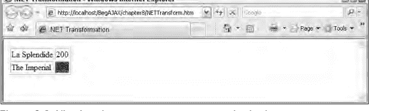

## 工作原理

这个示例不必使用Ajax。可以直接调用 `NETTransform.aspx` 页面并让它在页面上显示结果。然而，由于这是调用客户端XSLT处理器的另一种选择，因此使用了 `XMLHttpRequest` 对象来调用服务器并管理结果。

使用.NET XSLT处理器与之前的客户端引擎并没有太大不同。你仍然需要遵循相同的步骤。在.NET中，首先需要创建一个XslCompiledTransform对象来读入XML文档。这是你将使用Load方法加载XSL样式表的对象。

```csharp
//Create the XslTransform object
XslCompiledTransform xslDoc = new XslCompiledTransform();

//Load the Xsl Stylesheet
xslDoc.Load(Server.MapPath("Example.xsl"));
```

最后，执行转换。

```csharp
xslDoc.Transform(Server.MapPath("Example.xml"), null, Response.Output);
```

XSL的 `Transform` 方法接受三个参数：

- XML文档（包含文档名称）
- XSLTArgumentList对象（此处为空）
- 转换后文档的输出位置

因为你希望它写入 `Response.Stream`，所以将其设置为 `Response.Output`。再次，你可以看到由XSLT引擎生成的文档与IE和Mozilla XSLT处理器生成的文档是相同的。这并不总是必然如此。一个选择是，如果两个客户端版本不同，你可以创建一个服务器端代理为你执行转换。

现在，让我们创建一个更令人印象深刻的示例。

### 为购物车创建XSLT样式表

第3章中的购物车示例确实相当基础。你返回了书名和数量，但没有返回任何价格信息，甚至没有尝试为购物车中的产品提供标题。

你应该回去重新审视那个示例。你将向XML文档添加信息，如价格、ISBN号和作者。现在，你并不需要所有这些信息（如ISBN号和作者），但你会需要其中一部分（如价格），并且你会想要计算总价。

在这个示例中不会使用Ajax，因为目的是首先集中于XSL语法及其使用方式。一旦掌握了这些，你将在改进版的Ajax应用程序中应用这些技术。在这个示例中，你将只生成XML文档的静态版本，然后使用XSL显示它。

**动手实践** XSLT购物车示例

你需要在 `BegAjax` 目录中为本章的示例创建一个 `Chapter8` 文件夹。提供了一些小图形来配合这些示例：`sbasket.gif` 和 `button.jpg`。首先应从 `www.wrox.com` 网站下载这些文件，并将它们包含在同一文件夹中。

1. 创建一个HTML页面，将其命名为 `staticxslt.htm`，并添加以下代码：

```html
<html xmlns="http://www.w3.org/1999/xhtml" >
<head>
  <script type="text/javascript" src="StaticXslt.js"></script>
  <link id="Link1" rel="stylesheet"  href="Cart.css" type="text/css" />
</head>
<body>
<a href="javascript:GenerateCart();" >Add to Shopping Cart</a>
<br /><br />
<span id="cart" ></span>
</body>
</html>
```

2. 创建一个JavaScript页面，将其命名为 `staticxslt.js`，并添加以下代码：

```javascript
function loadDocument(fileName)
{
    var xmlDoc = window.ActiveXObject ? new ActiveXObject("MSXML2.DOMDocument.3.0") :
    document.implementation.createDocument("","",null);
    xmlDoc.async = false;
    xmlDoc.load(fileName);
    return xmlDoc;
}

function getTransformedHTML(xmlDoc, xslDoc) {
    var html = "";
    if (window.XSLTProcessor)
    {
        var xsltProc = new XSLTProcessor();
        xsltProc.importStylesheet(xslDoc);
        var fragment = xsltProc.transformToFragment(xmlDoc, document);
        html = new XMLSerializer().serializeToString(fragment);
    }
    else if (window.ActiveXObject)
    {
        html = xmlDoc.transformNode(xslDoc);
    }
    return html;
```


## 第8章：XSLT 与 XPath

函数 AddRemoveItem() {}

function GenerateCart()
{
    var xmlDoc = loadDocument("cart.xml");
    var xslDoc = loadDocument("cart.xsl");
    document.getElementById("cart").innerHTML = getTransformedHTML(xmlDoc, xslDoc);
}

3. 创建以下 XML 页面，并将其保存为 `cart.xml`：

```xml
<?xml version="1.0"?>
<cart>
    <book>
        <Title>Beginning ASP.NET with CSharp</Title>
        <Quantity>1</Quantity>
        <Authors>Hart, Kauffman, Sussman, Ullman</Authors>
        <ISBN>0764588508</ISBN>
        <Price>39.99</Price>
    </book>
    <book>
        <Title>Beginning JavaScript 2nd Edition</Title>
        <Quantity>2</Quantity>
        <Authors>Wilton</Authors>
        <ISBN>076455871</ISBN>
        <Price>39.99</Price>
    </book>
    <Total>119.97</Total>
</cart>
```

4. 创建以下 XSL 页面，并将其保存为 `cart.xsl`：

```xml
<?xml version="1.0" encoding="utf-8"?>
<xsl:stylesheet version="1.0"
    xmlns:xsl="http://www.w3.org/1999/XSL/Transform">

    <xsl:output
        method="html"
        indent="yes"
        version="4.0" />

    <xsl:template match="/">
        <table id="shoppingcart">
            <xsl:call-template name="DisplayCart"></xsl:call-template>
        </table>
    </xsl:template>

    <xsl:template name="DisplayCart">

        <thead class="head">
            <tr>
                <td colspan="4" align="center">购物篮 </img>
                </td>
            </tr>
        </thead>
        <xsl:if test="sum(//book/Quantity)&gt;0">
            <tr>
                <td class="border">项目</td>
                <td class="border">数量</td>
                <td class="border">价格</td>
                <td></td>
            </tr>
        </xsl:if>

        <xsl:for-each select="//book">
            <tr>
                <td class="border2" width="75px">
                    <xsl:value-of select="Title"/>
                </td>
                <td class="border2" align="center">
                    <xsl:value-of select="Quantity"/>
                </td>
                <td class="border2">
                    $<xsl:value-of select="(Price) * (Quantity)"/>
                </td>
                <td class="border2">
                    <a href="javascript:AddRemoveItem('Remove');">
                        
                    </a>
                </td>
            </tr>
        </xsl:for-each>
        <tr>
            <td colspan='4' class="border2"> </td>
        </tr>
        <xsl:choose>
            <xsl:when test="number(//book/Quantity)>0">
                <tr>
                    <td colspan="2" class="border2">合计：</td>
                    <td class="border">
                        $<xsl:value-of select="(//Total)"/>
                    </td>
                    <td class="border2"> </td>
                </tr>
            </xsl:when>
            <xsl:otherwise>
                <tr>
                    <td colspan="4" class="border2">您的购物篮为空</td>
                </tr>
            </xsl:otherwise>
        </xsl:choose>
        <tr>
            <td colspan="4" class="border2"> </td>
        </tr>
    </xsl:template>
</xsl:stylesheet>
```

**5.** 创建一个名为 `cart.css` 的 CSS 页面，并添加以下代码：

```css
table
{
    background-color: beige;
    border: 1px solid #e4ddca;
}
A IMG
{
    border:0px;
}
tr, td
{
    font-family: Verdana;
    height:15px;
    font-size:75%;
    margin:2px 0px 0px 0px;
    padding:0px 0px 0px 5px;
}
.border
{
    font-weight: bold;
    text-align:center;
}
.border2
{
    background: beige;
}
.head
{
    font-family: Verdana;
    height:15px;
    vertical-align:middle;
    background:#665D43;
    color: beige;
    font-weight: bold;
}
```

**6.** 在浏览器中打开 `staticXSLT.htm`，并点击“添加到购物车”按钮（图 8–4）。

**7.** 现在，返回 `cart.xml`，删除除以下内容外的所有行，然后保存：

```xml
<?xml version="1.0"?>
<cart>
</cart>
```

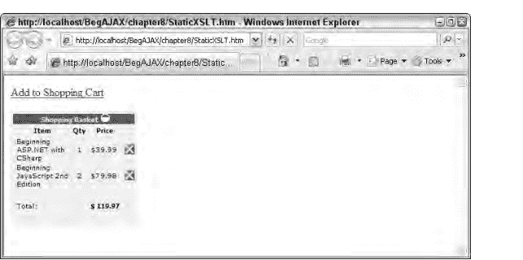

图 8-4：在浏览器中打开 `staticXSLT.htm` 并点击“添加到购物车”按钮。

8. 再次在浏览器中打开 `staticXSLT.htm`，并再次点击“添加到购物车”按钮（图 8-5）。

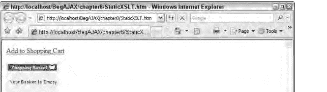

图 8-5：再次点击“添加到购物车”按钮。

## 工作原理

你已经创建了一个将购物车作为组件显示的样式表。你使用了 XSLT 和 CSS 来为购物车提供更友好的前端界面。

发生的情况是，HTML 页面中有一个链接调用了 JavaScript 代码中的 `GenerateCart()` 函数。该代码加载 XML 和 XSL 文件，对它们执行转换，并将结果写回网页。代码中还有几个其他函数。第一个函数提供了一种非常快捷的方式来以浏览器兼容的方式加载 XML 文档和 XSL 文档：

```javascript
function loadDocument(fileName)
{
    var xmlDoc = window.ActiveXObject ? new ActiveXObject("MSXML2.DOMDocument.3.0") :
    document.implementation.createDocument("", "", null);
    xmlDoc.async = false;
    xmlDoc.load(fileName);
    return xmlDoc;
}
```

你将文件名作为参数传入，根据你是使用 IE 还是 Firefox 浏览该页面，你会创建一个 MSXML2.DOMDocument 对象或 Firefox 的原生 Document 对象。与之前一样，这些文件是同步加载的。

最后一个函数用于提取转换后的 HTML。Firefox 的实现要求你创建一个处理器实例并导入样式表，然后将 HTML 序列化为字符串，之后才能将其添加到页面，而 IE 版本则允许你直接转换节点：

```javascript
function getTransformedHTML(xmlDoc, xslDoc) {
    var html = "";
    if (window.XSLTProcessor)
    {
        var xsltProc = new XSLTProcessor();
        xsltProc.importStylesheet(xslDoc);
        var fragment = xsltProc.transformToFragment(xmlDoc, document);
        html = new XMLSerializer().serializeToString(fragment);
    } else if (window.ActiveXObject) {
        html = xmlDoc.transformNode(xslDoc);
    }
    return html;
}
```

现在让我们关注一下执行的转换，因为它比之前的例子要复杂一些。在 XML 声明之后是 xsl:stylesheet 根元素，它包含所有其他 XSLT 元素和指定输出为 HTML 的 xsl:output 元素。第一个模板是匹配根节点的通用模板。在这个模板内部，你创建了一个 HTML 表格。在表格内部，你调用了另一个名为 DisplayCart 的模板。

```xml
<xsl:template match="/">
    <table id="shoppingcart">
        <xsl:call-template name="DisplayCart"></xsl:call-template>
    </table>
</xsl:template>
```

该表格在 CSS 中有对应的引用。这是你用来创建带有 1 像素宽边框的小米色盒子的样式集。

```css
table
{
    background-color: beige;
    border: 1px solid #e4ddca;
}
```

DisplayCart 模板和 CSS 共同完成了所有实际的工作。DisplayCart 模板中的第一项是表头，即 `<thead>` 元素，它包含了购物篮的橄榄绿色标题。

```xml
<thead class="head">
    <tr>
        <td colspan="4" align="center">购物篮 </img>
        </td>
    </tr>
</thead>
```

`<thead>` 元素引用了样式表中的 `head` 类。

```css
.head
{
    font-family: Verdana;
    height:15px;
    vertical-align:middle;
    background:#665D43;
    color: beige;
    font-weight: bold;
}
```

`head` 元素设置了标题的字体大小、字体颜色、字体高度、垂直对齐、背景颜色和加粗。你在 `<thead>` 元素中创建了一行，一个单元格包含文本和一个购物篮图片。此部分没有 XSL 声明。

XSLT 样式表的下一部分处理子标题，该标题仅在购物篮中有内容时才显示。

```xml
<xsl:if test="sum(//book/Quantity)>&gt;0">
    <tr>
        <td class="border">项目</td>
        <td class="border">数量</td>
        <td class="border">价格</td>
        <td></td>
    </tr>
</xsl:if>
```

子标题在表格列中条件性地显示“项目”、“数量”和“价格”字样。要测试购物篮中是否有东西，你使用了一个简单的 XPath 表达式。该表达式对所有属于 `<book>` 元素的 `<Quantity>` 元素中的数字求和。如果它返回的数字大于零，那么你可以推断购物篮中有东西，然后显示子标题。从逻辑上讲，这意味着如果有一个项目的数量大于零，那么购物篮中一定有东西。你知道这是正确的，因为如果购物篮中没有任何项目，那么就没有 `<book>` 或 `<quantity>` 元素。创建 XPath 表达式将在本示例之后进行更详细的探讨。

一旦显示了标题和子标题，你就可以开始执行显示购物篮中每个项目的任务了。这是通过一个 xsl:for-each 循环完成的。你将 select 属性赋值为一个引用 XML 文档中每个 book 节点的 XPath 表达式。它表示，对于每个节点，显示一个包含四列的表格行。

```xml
<xsl:for-each select="//book">
    <tr>
        <td class="border2" width="75px">
            <xsl:value-of select="Title"/>
```


第一列显示书名。使用 xsl:value-of 元素来显示每个 `<title>` 元素的内容。单元格附加了边框样式 border2，它将单元格背景色设置为米黄色。第二列显示购物车中该物品的数量，同样使用 xsl:value-of 元素。再次应用相同的样式。

第三列显示购物车中该特定物品的总价。此值不是直接从 XML 文档中获取的，而是间接获取的。您想在该行（书籍）中显示总价，所以如果有一本书，就是 39.99，如果有两本，就是 79.98，依此类推。为此，您创建一个 XPath 表达式，取 Price 元素和 Quantity 元素并将它们相乘。使用 xsl:value-of 元素来显示最终结果。

最后一列中，您显示移除物品的链接。而不是显示文本超链接，为了保持购物车小巧且不显眼，创建了一个带有叉号的小按钮图像，应该直观地让任何人知道这将从购物篮中移除一个物品。<a> 标签调用 JavaScript 中的 AddRemoveItem 方法。此链接在本例中不起作用，因为您尚未将其插回主 Ajax 应用程序中。

在购物车底部，您还有另一个决定要做。根据购物篮中是否有物品，您将选择显示物品的总和或一条消息来指示购物篮为空。为此，使用了 xsl:choose 构造。xsl:choose 语句内有两个可能结果。在 `xsl:when` 标签中，您执行与之前代码中相同的测试，查看 Quantity 元素是否有任何值。如果有，则使用 XML 文档中的 Total 元素显示总和。

```
<xsl:choose>
  <xsl:when test="sum(//book/Quantity)gt;0">
    <tr>
      <td colspan="2" class="border2">Total:</td>
      <td class="border">
        $
        <xsl:value-of select="(//Total)"/>
      </td>
      <td class="border2"> </td>
    </tr>
  </xsl:when>
  <xsl:otherwise>
```

The xsl:otherwise case handles all other possibilities and displays a table row and single cell containing the "your basket is empty" message. After that, you display a single blank row underneath the row containing the total for aesthetic purposes, and you close the template.
注意，您在这里没有使用 XPath 来推导总价，尽管您可以这样做。Price 元素中包含的内容不是您想要使用的值，并且使用 XPath 执行比最基础算术功能更多的操作可能会在 XSLT 中造成后勤上的麻烦（例如如何计算两个来自其他临时 XPath 表达式的值的乘积）。换句话说，当您乘以价格*数量得到某一行价格时，它并没有存储在任何地方，从 XPath 中检索它比在服务器端计算该值并将该值作为新元素写入 XML 文档更复杂。

Because this discussion seems to be running more and more into XPath expressions, it's time to consider exactly how to create them and what they can be used for.
## 第 8 章：XSLT 和 XPath
折叠并引导某人去散步。说轻一点，这可能会显得有点笨拙且效率低下。XPath 非常有用在快速隔离和确定元素（或元素的子集）及其包含的值方面，并将这些结果直接返回到 XSLT 样式表而不是 JavaScript 或网页。这反过来又可以导致页面被更快地创建并提高应用程序的性能。XPath 包含优秀的设施来保留您在 XML 文档中相对于其他元素和节点的位置上下文。

As with XSLT, this discussion only skims the surface and demonstrates just a small set of functions to allow you to get around in it.
### XPath 及其用途
XSLT 主要用于选择输入文档的一部分供 XSLT 样式表格式化。此外，它可以用于提供算术函数和字符串格式设置，并为表达式添加布尔条件。XPath 的作用与 SQL 有些类似，即您创建简短的表达式用于从现有数据源检索数据。

The XPath specification found at www.w3.org/TR/xpath describes XPath as an expression language (in other words, not a full-fledged programming language). XPath doesn't allow you to create or manipulate the existing data. It is simply used to query it.
XPath 就像 XSLT 一样，在 Ajax 应用程序中具有重要作用。第 3 章中使用的选择使用 JavaScript 和 DOM 选择 XML 部分的代码采用以下格式：

```
var header = serverResponse.getElementsByTagName("book");
...
spantag.innerHTML += " " + header[0].firstChild.text;
spantag.innerHTML += " " + header[0].lastChild.text + " " + "<a href='javascript:AddRemoveItem(\"Remove\");'>Remove Item</a>";
```

## 第 8 章：XSLT 和 XPath

folded and getting someone to direct you to take a walk. It can be a little clumsy and inefficient, to put it mildly. XPath is very useful in quickly isolating and ascertaining elements (or subsets of elements) and the values they contain, and returning these results directly to the XSLT style sheet rather than the JavaScript or web page. This, in turn, can lead to a page being more quickly created and increasing your application's performance. XPath contains excellent facilities for retaining the context of where you are in an XML document with regard to other elements and nodes.

As with XSLT, this discussion only skims the surface and demonstrates just a small set of functions to allow you to get around in it.
### Basic XPath Functionality
您已经从 XSLT 示例中了解了一些关于 XPath。这是不可避免的，因为当您使用一种语言时，最终不得不使用另一种语言。以下示例也使用 XSLT 来演示 XPath 的工作原理。

This examination splits up the discussion of XPath into two broad sections. The first is the terminology needed to use XPath expressions, and the second goes through some of the most useful of the XPath functions.
#### XPath Expressions
Microsoft Developer's Network (MSDN) 文档将 XPath 表达式分为五种基本类型：

-   当前上下文
-   文档根
-   根元素
-   递归下降
-   特定元素

让我们简要看看每一个。因为它使可视化更容易，让我们使用来自 XML 购物车的以下 XML 文档作为示例：

```
<?xml version="1.0"?>
<cart>
  <book>
    <Title>Beginning ASP.NET with CSharp</Title>
    <Quantity>1</Quantity>
    <Authors>Hart, Kauffman, Sussman, Ullman</Authors>
    <ISBN>0764588508</ISBN>
    <Price>$39.99</Price>
  </book>
  <book>
    <Title>Beginning JavaScript 2nd Edition</Title>
    <Quantity>2</Quantity>
  </book>
</cart>
```

#### Chapter 8: XSLT and XPath

```
<ISBN>076455871</ISBN>
<Price>$39.99</Price>
</book>
<Total>119.97</Total>
</cart>
```

XML 文档中的每个元素都可以在 XPath 表达式中单独引用。

##### Current Context
The *current context* is the current element you are looking at or dealing with. This, as you've already seen, is referenced using just the node name. For example, to use the current value of the `Price` element, you would use the following:

```
Price
```

It can also be referenced using the following syntax with a period followed by a forward slash as well:

```
./Price
```

The XPath expression to select the current value of the `Price` element in the `xsl:value-of` tag, for example, would be as follows:

```
<xsl:value-of select="Price">
...
```

If there were many `Price` elements in the XML document and this expression were called outside of any `xsl:for-each` loops, then this would return the value in the first `price` element ($39.99). If it were called in an `xsl:for-each` construct, then it would return the value of each element in turn, depending on where in the loop you were.

##### Document Root
The *document root* is a node. To reference the document root node, you would use a single slash in front of the node and indicate that you want to select the node at the root of the tree to be used as the current context.

```
/cart
```

This would return the `<cart>` with the `<book />` element with the `<Title />` child element, which, in turn, contains the "Beginning ASP.NET with CSharp" text node.

##### Root Element
To use the *root element* as your context, the XPath expression is a single slash followed by an asterisk.


### 递归下降

递归下降听起来可能是个相当令人担忧的术语，但当你使用 `xsl:for-each` 循环时，你已经见过它的实际应用了。你用它来指明循环中的每个条目，如下所示：

```
//book
```

它用于在搜索中包含零个或多个层级层次，其具体作用取决于在文档中使用的上下文。因此，它将包含 XML 文档中所有的 book 元素。

它还可以用于隔离更深层次的元素组。如果你只对每本书的 `<Price>` 元素感兴趣，可以使用以下表达式：

```
//book/Price
```

你可以将此插入 `xsl:if` 条件中，例如，用来测试每个 `<price>` 元素是否大于零：

```
<xsl:if test="sum(//book/Price) &gt; 0">
```

### 特定元素或项目

如果你想使用 XPath 来指定单个项目或元素，你同样已经见过一个实际的例子。如果你想指定一个可能存在一个或多个项目的特定项目，请使用以下术语：

```
book/Price
```

这些项目中的每一个都应在 XSLT 标签属性的上下文中使用。

### XPath 函数

除了用于处理表达式的语法外，XPath 还提供了许多函数。这些通常是你使用 XPath 的主要目的。现在让我们看一些最常用的函数。

#### number 函数

`number` 函数用于将值转换为双精度浮点数，相当于 double 数据类型。如果你有一个具有数值（例如布尔值）的变量，但该数值不能立即被识别为数字，这将非常有用。有时，如果你对 XML 文档中返回的数据格式不是百分之百确定，它可以作为代码中的安全措施。

例如，你可以按如下方式使用它来确认 `price` 元素是否返回了数值。如果值不是数字，`number` 函数将返回值 `NaN`（非数字）。

```
<xsl:if test="string(number(Price)) = 'NaN'">
```

然后，你将仅在价格有值时才显示 `Price`。例如，如果某本书已被删除，那么可能没有给定的价格，因此你可以使用此方法来显示“不适用”或“不可用”消息。XPath 的 `string` 函数用于将 `number` 函数的结果转换为字符串。还有一个类似的函数叫做 `boolean`，它将表达式的结果转换为布尔值。

#### position 函数

`position` 函数可用于查看你是否处于特定序列的开头或结尾。该函数返回上下文节点在上下文节点集中的位置。虽然 `position` 函数有许多用途，但它提供的一个有用功能是可以在循环中使用，以发现你在特定循环中的位置：

例如，如果你想添加一系列单词（例如在菜单中），每个单词用“|”（管道）字符分隔，那么你可以创建一个 XSLT 函数来测试当前上下文在循环中是否不是最后一个，然后显示管道字符，如下所示：

```
<xsl:for-each select="//book">
  <xsl:if test="position() != last()">
    |
  </xsl:if>
</xsl:for-each>
```

#### count 函数

`count` 函数接受一个节点集作为其参数，并返回节点集中的节点数量。例如，如果你想返回文档中 book 元素的数量（2），那么你将使用以下示例：

```
<xsl:value-of select="count(//book)"/>
```

#### 字符串格式化

这里告诉你一个不太广为人知的秘密。XPath 并不是执行字符串格式化的最佳语言之一。最好在其他地方尝试进行格式化，例如在服务器上提前处理（如果可能的话）。XPath 的大多数用于定位字符串部分的功能都归结为单个 `substring` 函数，它可能使字符串切分操作变得像填字游戏或逻辑谜题一样困难。一些常用的 XPath 字符串表达式如下：

- `substring` — 返回字符串值的一部分
- `concat` — 接受两个或多个字符串参数，并将它们首尾相连

XPath 2.0 还引入了 `replace()` 函数，但目前没有现代浏览器支持此标准。

要从“concat”中创建一个只包含单词“cat”的子字符串，你可以使用以下表达式：

```
substring("concat", 4, 3)
```

- `sum` — 返回数字节点集中数字的总和
- `round` — 将数字四舍五入到最接近的整数（例如，3.3 变为 3，4.7 变为 5）
- `ceiling` — 将数字向上舍入到最接近的更高整数（例如，1.2 变为 2）
- `floor` — 将数字向下舍入到最接近的更低整数（例如，3.9 变为 3）

算术函数都相当不言自明。考虑 `sum` 函数的以下用法：

```
sum (//Price)
```

这将对 XML 文档中的 `price` 元素求和。

你可以在元素的内容上使用这些函数。例如，如果你想为消费超过 100 美元的用户提供折扣，那么你可以构建以下 XSLT 分支来实现所需功能：

```
<xsl:if test="sum(//Total) &gt; 100">
...
</xsl:if>
```

XPath 2.0 添加了以下函数：

- `max` — 返回节点集中的最大值
- `min` — 返回节点集中的最小值
- `avg` — 返回节点集中的平均值

不过，这些函数在 IE 中不受支持。

#### 逻辑函数

在 XPath 中，逻辑运算符就是代表操作的文字，逻辑值就是这些文字本身。

- `not` — 如果值为假则返回 `true`，反之亦然
- `true` — 返回 `true`
- `false` — 返回 `false`

XPath 中的逻辑运算符与普通编程语言中的使用方式相同：用于连接一系列表达式，以提供更复杂的查询集。

- `and`
- `or`

例如，如果你想给购买了三件以上独立物品且价值超过 100 美元书籍的客户提供进一步的折扣，那么以下 XSLT 连接了两个表达式：

```
<xsl:if test="(price &gt; 100) and (quantity &gt; 3)">
...
</xsl:if>
```

### 在 XML 文档中使用 XPath 进行查询

你已经为你的工具包编译了一套合理的 XPath 函数。让我们深入探讨并创建一个快速示例，该示例依赖于 XPath 来为你完成工作。

> **试一试** 使用 XPath 查询 XML 文档

在这个简短的示例中，你将使用 XPath 对一些跑步者的比赛成绩进行快速操作（例如计算平均时间并确保数据格式正确显示时间）。为了让事情稍微复杂一点，结果只以每个跑步者的总秒数形式提供。这可能使其显得有点人为，但它允许你使用一些额外的 XPath 处理来以你想要的方式显示数据。

1. 创建一个名为 XPath.htm 的新 HTML 文件，并添加以下内容：

```
<html>
<head>
<title>XPath Example</title>
<script type="text/javascript" src="Xpath.js"></script>
</head>
<body onload="Transform()">
<span id="example"></span>
</body>
</html>
```

2. 创建一个名为 xpath.js 的 JavaScript 文件，并添加以下内容：

```
function loadDocument(fileName)
{
    var xmlDoc = window.ActiveXObject ? new ActiveXObject("MSXML2.DOMDocument.3.0") : document.implementation.createDocument("","",null);
    xmlDoc.async = false;
    xmlDoc.load(fileName);
    return xmlDoc;
}

function getTransformedHTML(xmlDoc, xslDoc) {
    var html = "";
    if (window.XSLTProcessor)
    {
        var xsltProc = new XSLTProcessor();
        xsltProc.importStylesheet(xslDoc);
        var fragment = xsltProc.transformToFragment(xmlDoc, document);
        html = new XMLSerializer().serializeToString(fragment);
    }
    else if (window.ActiveXObject)
    {
        html = xmlDoc.transformNode(xslDoc);
    }
```


## 第8章：XSLT 和 XPath

```javascript
return html;
}

function Transform()
{
    var xmlDoc = loadDocument("runners.xml");
    var xslDoc = loadDocument("runners.xsl");
    document.getElementById("example").innerHTML = getTransformedHTML(xmlDoc,
    xslDoc);
}
```

3.  创建一个名为 `runners.xml` 的 XML 文件：

```xml
<?xml version="1.0"?>
<runners>
    <runner>
        <name>John Doe</name>
        <totalseconds>3274</totalseconds>
    </runner>
    <runner>
        <name>Joe Bloggs</name>
        <totalseconds>3314</totalseconds>
    </runner>
    <runner>
        <name>Jean Blanc</name>
        <totalseconds>3305</totalseconds>
    </runner>
    <runner>
        <name>Hans Schwarz</name>
        <totalseconds>3256</totalseconds>
    </runner>
    <runner>
        <name>Pedro Blanco</name>
        <totalseconds>3301</totalseconds>
    </runner>
</runners>
```

4.  创建一个名为 `runners.xsl` 的 XSLT 样式表，并添加以下内容：

```xml
<?xml version="1.0" encoding="utf-8"?>

<xsl:stylesheet version="1.0"
    xmlns:xsl="http://www.w3.org/1999/XSL/Transform">

    <xsl:output
        method="html"
        indent="yes"
        version="4.0" />

    <xsl:template match="/">
        <table border="1">
            <thead>
                <tr>
                    <td>Position</td>
                    <td>Name</td>
                    <td>Time</td>
                </tr>
            </thead>
            <xsl:for-each select="//runner">
                <xsl:sort select="totalseconds"/>
                <tr>
                    <td>
                        <xsl:value-of select="position()"/>
                    </td>
                    <td>
                        <xsl:value-of select="name"/>
                    </td>
                    <td>
                        <xsl:value-of select="floor(totalseconds div 60)"/>.
                        <xsl:choose>
                            <xsl:when test="(totalseconds mod 60) &gt; 9">
                                <xsl:value-of select="(totalseconds mod 60)"/>
                            </xsl:when>
                            <xsl:otherwise>
                                0<xsl:value-of select="(totalseconds mod 60)"/>
                            </xsl:otherwise>
                        </xsl:choose>
                    </td>
                </tr>
            </xsl:for-each>
            <tr>
                <td>Average Time:</td>
                <td>
                </td>
                <td>
                    <xsl:variable name="avgtime" select="sum(//totalseconds) div count(//runner)"/>
                    <xsl:value-of select="floor($avgtime div 60)"/>.
                    <xsl:choose>
                        <xsl:when test="($avgtime mod 60) &gt; 9">
                            <xsl:value-of select="($avgtime mod 60)"/>
                        </xsl:when>
                        <xsl:otherwise>
                            0<xsl:value-of select="($avgtime mod 60)"/>
                        </xsl:otherwise>
                    </xsl:choose>
                </td>
            </tr>
        </table>
    </xsl:template>
</xsl:stylesheet>
```

5.  在浏览器中查看 Xpath.htm（图 8-6）。

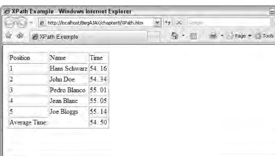

图 8-6：在浏览器中查看 Xpath.htm。

## 工作原理

用于创建页面和执行转换的 JavaScript 和 HTML 与前一个示例相同，因此我们不再进一步讨论它们。让我们从 XPath 的角度来审视 XSLT 样式表。你首先使用递归下降表示法来指定 XML 文档中的每一个 `<runner>` 元素。XPath 本身没有排序结果的能力，因此你不得不借用 XSLT 的 `sort` 标签，并使用 `totalseconds` 元素作为排序键。

```xml
<xsl:for-each select="//runner">
    <xsl:sort select="totalseconds"/>
</xsl:for-each>
```

在第一列中，你希望显示排名信息。然而，XML 文档中并不存在这样的信息。你知道排序会在 `xsl:for-each` 循环中按顺序显示跑步者，因此你只需使用 XPath 的 `position()` 函数来返回在循环中的数值位置：

```xml
<tr>
    <td>
        <xsl:value-of select="position()"/>
    </td>
</tr>
```

在第二个单元格中，你使用 XPath 的当前上下文表示法来显示 `name` 元素的当前值。这个值会为文档中的每个元素而变化。

```xml
<td>
    <xsl:value-of select="name"/>
</td>
```

第三列显示跑步者的时间。当然，将跑步者的时间显示为总秒数并不是特别有用，因此你需要将其更改为显示分钟和秒。你必须分别获取这两个值。

为了获得分钟值，你将 `totalseconds` 元素除以 60，并使用 `floor` 函数来获得分钟的整数部分。大多数编程语言都有一个运算符可以为你完成这个操作，实际上，XPath 2.0 引入了 `idiv` 运算符。然而，对于 IE 浏览器来说，这并非一个可用的选项。

第二个值是秒数，它只是通过 `modulo`（取模）运算符计算得出的剩余秒数。还有一个最后的小障碍需要克服：如果秒数小于 10，你最终显示的时间可能会是 54:9 而不是 54:09。为了绕过这个问题，你需要检查 `totalseconds` 除以 60 的余数是否小于或等于 9。如果是，你就附加一个额外的零；否则，你就什么也不做。

```xml
<td>
    <xsl:value-of select="floor(totalseconds div 60)"/>.
    <xsl:choose>
        <xsl:when test="(totalseconds mod 60) &gt; 9">
            <xsl:value-of select="(totalseconds mod 60)"/>
        </xsl:when>
        <xsl:otherwise>
            0<xsl:value-of select="(totalseconds mod 60)"/>
        </xsl:otherwise>
    </xsl:choose>
</td>
</tr>
</xsl:for-each>
```

XPath 2.0 还提供了一个 `avg` 函数，但同样，由于目前没有浏览器支持它，你无法使用这个函数。这意味着你计算平均值的方式需要稍微复杂一些。平均值是通过取每个 `totalseconds` 元素的值，然后除以跑步者的数量来计算的。你可以使用 XPath 的 `count()` 函数来计算所有元素的数量，从而得到跑步者的数量。在这两种情况下，你都使用递归下降（`//`）表示法来识别文档中的所有元素。然后，一旦你得到了每个跑步者的平均 `totalseconds`，你就可以使用与之前相同的过程来提取分钟和秒，并在表格中显示它们。

```xml
<tr>
    <td>Average Time:</td>
    <td>
    </td>
    <td>
        <xsl:variable name="avgtime" select="sum(//totalseconds) div
        count(//runner)"/>
        <xsl:value-of select="floor($avgtime div 60)"/>.
        <xsl:choose>
            <xsl:when test="($avgtime mod 60) &gt; 9">
                <xsl:value-of select="($avgtime mod 60)"/>
            </xsl:when>
            <xsl:otherwise>
                0<xsl:value-of select="($avgtime mod 60)"/>
            </xsl:otherwise>
        </xsl:choose>
    </td>
</tr>
```

正如你所看到的，XPath 的局限性意味着，即使是提供像显示时间这样简单的功能，也可能变得相当麻烦。然而，有时开发者没有讨价还价的余地。他们只是接收 XML 数据，然后不得不凑合着使用。在这些情况下，开发者可以选择在 XSLT 中或在 JavaScript 中来操作它，而且通常，许多人选择在 XSLT 中使用 XPath 来处理它。

### 修订购物车示例以使用 XSLT 和 Ajax

你现在到了可以在购物车示例中结合这些语言的时候，以使购物车成为一个可以添加和移除商品的工作应用程序，并使用 XSLT 样式表和 CSS 规则来以更令人印象深刻的设计呈现购物车。

**动手试一试** **让购物车示例变得可交互**

你将结合第3章（原始购物车）中使用的代码，并修改本章前面介绍的一些代码，来创建你的 Ajax 工作应用程序。

1.  打开你在第3章创建的 `Catalogue1.htm`。（如果你没有创建，不用担心，因为完整的代码已在此提供。）

```html
<html xmlns="http://www.w3.org/1999/xhtml" >
<head>
    <link id="Link1" rel="stylesheet" href="Cart.css" type="text/css" />
    <script type="text/javascript" src="ShoppingCart.js"></script>
</head>
<body>
<form id="form1" method="post" action="cartdisplay.aspx">
<br/>

<br />
<br />
<b>Book:</b><span id="book">Beginning ASP.NET with CSharp</span><br />
<b>Authors: </b><span id="authors"> Hart, Kaufman, Sussman, Ullman</span>
<br /><b>ISBN: </b><span id="ISBN">0764588508</span>
<br /><b>Price: </b><span id="price">$39.99</span>
<br /><br />
<a href=" " onclick="AddRemoveItem('Add');" >Add to Shopping Cart</a>
<br /><br />
<span id="cart" ></span>
</form>
</body>
</html>
```

2.  打开你之前在本章创建的 `Cart.js`，并修改以下内容。将其另存为 `ShoppingCart.js`。请注意，你使用这个版本是因为它使用 POST 方法发送数据，并且为了实现功能，在这种情况下使用 POST 方法更容易。

```javascript
var xhrObject = false;

if (window.ActiveXObject)
{
    xhrObject = new ActiveXObject("Microsoft.XMLHTTP");
}
else if (window.XMLHttpRequest)
{
    xhrObject = new XMLHttpRequest();
}
```


## 第 8 章：XSLT 和 XPath

```javascript
function getBody(action)
{
    var argument = "book=";
    argument += encodeURI(document.getElementById("book").innerHTML);
    argument += "&ISBN=";
    argument += encodeURI(document.getElementById("ISBN").innerHTML);
    argument += "&authors=";
    argument += encodeURI(document.getElementById("authors").innerHTML);
    argument += "&price=";
    argument += encodeURI(document.getElementById("price").innerHTML);
    argument += "&action=";
    argument += encodeURI(action);
    return argument;
}

function getData()
{
    if ((xhrObject.readyState == 4) && (xhrObject.status == 200))
    {
        if (window.ActiveXObject)
        {
            // Load XML
            var xml = xhrObject.responseXML;

            // Load XSL
            var xsl = new ActiveXObject("Microsoft.XMLDOM");
            xsl.async = false;
            xsl.load("Cart.xsl");

            // Transform
            var transform = xml.transformNode(xsl);
            var spanb = document.getElementById("cart");
            spanb.innerHTML = transform;
        }
        else
        {
            var xsltProcessor = new XSLTProcessor();

            // Load XSL
            xslStyleSheet = document.implementation.createDocument("", "doc",
                null);

            xslStyleSheet.async = false;
            xslStyleSheet.load("Cart.xsl");
            xsltProcessor.importStyleSheet(xslStyleSheet);

            // Load XML
            xmlDoc = xhrObject.responseXML;

            // Transform
            var fragment = xsltProcessor.transformToFragment(xmlDoc, document);
            document.getElementById("cart").innerHTML = new
                XMLSerializer().serializeToString(fragment);
        }
    }
}
```

```javascript
function AddRemoveItem(action)
{
    var book = document.getElementById("book").innerHTML;
    var bodyoform = getBody(action);
    xhrObject.open("POST", "cartdisplay.aspx", true);
    xhrObject.setRequestHeader("Content-Type", "application/x-www-form-urlencoded");
    xhrObject.onreadystatechange = getData;
    xhrObject.send(bodyoform);
}
```

**3.** 接下来，打开服务器端代码 \`cartdisplay.aspx\`，并添加以下命名空间：

```
<%@ import Namespace="System.Globalization" %>
```

**4.** 在服务器端代码中，对 \`toXml\` 函数进行以下修改。在 ASP.NET 中，则如下所示：

```csharp
string toXml(Hashtable ht)
{
    XmlDocument XmlDoc = new XmlDocument();
    XmlNode versionNode = XmlDoc.CreateXmlDeclaration("1.0", "ISO-8859-1", "yes");
    XmlNode mainNode = XmlDoc.CreateElement("cart");
    XmlDoc.AppendChild(versionNode);
    XmlDoc.AppendChild(mainNode);
    decimal total = 0;
    XmlNode TotalNode = XmlDoc.CreateElement("Total");

    foreach (string key in ht.Keys)
    {
        XmlNode childNode = XmlDoc.CreateElement("book");
        XmlNode TitleNode = XmlDoc.CreateElement("Title");
        XmlNode QuantityNode = XmlDoc.CreateElement("Quantity");
        XmlNode AuthorNode = XmlDoc.CreateElement("Author");
        XmlNode ISBNNode = XmlDoc.CreateElement("ISBN");
        XmlNode PriceNode = XmlDoc.CreateElement("Price");

        TitleNode.AppendChild(XmlDoc.CreateTextNode(key));
        QuantityNode.AppendChild(XmlDoc.CreateTextNode(ht[key].ToString()));
        AuthorNode.AppendChild(XmlDoc.CreateTextNode(Request.Form["authors"]));
        ISBNNode.AppendChild(XmlDoc.CreateTextNode(Request.Form["ISBN"]));
        string price = Request.Form["price"].Replace("$", "");
        PriceNode.AppendChild(XmlDoc.CreateTextNode(price));
        int quantity = int.Parse(ht[key].ToString());
        total += decimal.Parse(price, new CultureInfo("en-US")) * quantity;
        childNode.AppendChild(TitleNode);
        childNode.AppendChild(QuantityNode);
        childNode.AppendChild(AuthorNode);
        childNode.AppendChild(ISBNNode);
        childNode.AppendChild(PriceNode);
        mainNode.AppendChild(childNode);
    }

    TotalNode.AppendChild(XmlDoc.CreateTextNode(total.ToString()));
    mainNode.AppendChild(TotalNode);
    string strXml = XmlDoc.InnerXml;

    return strXml;
}
```

在 PHP 中，则如下所示：

```php
function toXml($MDA)
{
    $doc = new DomDocument('1.0');
    $cart = $doc->appendChild($doc->createElement('cart'));
    $total = 0;

    foreach ($MDA as $Item => $ItemName)
    {
        $book = $cart->appendChild($doc->createElement('book'));

        $title = $book->appendChild($doc->createElement('Title'));
        $title->appendChild($doc->createTextNode($Item));

        $authors = $book->appendChild($doc->createElement('Authors'));
        $authors->appendChild($doc->createTextNode($_POST['authors']));

        $isbn = $book->appendChild($doc->createElement('ISBN'));
        $isbn->appendChild($doc->createTextNode($_POST['ISBN']));

        $price = str_replace("$", "", $_POST['price']);
        $priceNode = $book->appendChild($doc->createElement('Price'));
        $priceNode->appendChild($doc->createTextNode($price));

        $quantity = $book->appendChild($doc->createElement('Quantity'));
        $quantity->appendChild($doc->createTextNode($ItemName));

        $book->appendChild($title);
        $book->appendChild($quantity);
        $book->appendChild($authors);
        $book->appendChild($isbn);
        $book->appendChild($priceNode);

        $total += $price * $ItemName;
    }

    $totalNode = $cart->appendChild($doc->createElement('Total'));
    $totalNode->appendChild($doc->createTextNode($total));

    $strXml = $doc->saveXML();
    return $strXml;
}
```

**5.** 在浏览器中打开 Catalogue1.htm，并点击“添加到购物车”（图 8-7）。

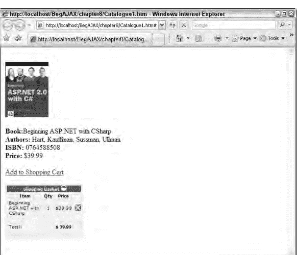

图 8-7：在浏览器中打开 \`Catalogue1.htm\` 并点击“添加到购物车”。

**6.** 如果您再次点击“添加到购物车”，总额将增加。如果您点击叉号，所有项目将被移除，如图 8-8 所示。

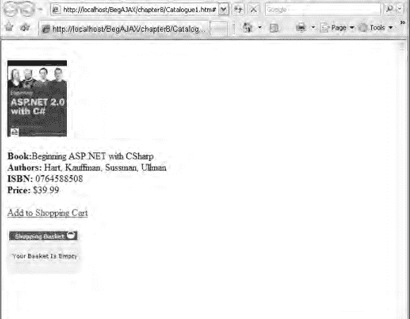

图 8-8：点击叉号后的结果。

## 工作原理

本示例中并未引入任何显著的新内容。您只是利用了现有代码来启用购物车功能并使其动态运行，而不是将其仅仅作为静态页面处理。您在早期的购物车示例中添加了用于在 IE 或 Mozilla 中执行转换的脚本，然后添加了一个名为 \`action\` 的额外参数。此额外参数用于确定您是否打算向购物车添加项目还是移除它们。由于您使用 \`POST\` 方法通过 `\`XMLHttpRequest\` 对象传递数据，因此必须使用 \`getBody\` 函数将额外参数包装在表单中。

```javascript
function getBody(action)
{
    var argument = "book=";
    argument += encodeURI(document.getElementById("book").innerHTML);
    argument += "&ISBN=";
    argument += encodeURI(document.getElementById("ISBN").innerHTML);
    argument += "&authors=";
    argument += encodeURI(document.getElementById("authors").innerHTML);
    argument += "&price=";
    argument += encodeURI(document.getElementById("price").innerHTML);
    argument += "&action=";
    argument += encodeURI(action);
    return argument;
}
```

这需要向代码中添加额外的两行，并将 \`action\` 参数的值传入该函数。如果用户点击了“添加到购物车”，则该参数包含单词"Add"。

在服务器端代码中，您所做的只是向 XML 文档中添加了一个额外元素以记录总额。这意味着在创建 XML 文档时，您必须确保创建此节点，并将各项目的价格正确累加到此节点中。在 ASP.NET 中，这涉及创建一个小数变量来存储总额并创建一个元素。

```csharp
decimal total = 0;
XmlNode TotalNode = XmlDoc.CreateElement("Total");
```

然后，在循环期间，您可以添加每项的价格乘以数量：

```csharp
total += decimal.Parse(price, new CultureInfo("en-US")) * quantity;
```

因为一些国家的小数点符号是特定的，所以需要额外指定一下您使用的小数点符号。

最后，在循环结束时，您可以将总额值追加到元素中，并将新的 \`total\` 元素追加到 XML 文档中。

```csharp
TotalNode.AppendChild(XmlDoc.CreateTextNode(total.ToString()));
mainNode.AppendChild(TotalNode);
```


本章对两种语言进行了快速概览：XSLT和XPath。这两种语言各自都有专门的著作进行深入讲解，因此本章省略了许多细节。

XSLT是将一个XML文档转换为另一个的变换语言。XPath是用于帮助你在文档中查询和定位特定节点或元素的子语言。

你能够使用这些技术来变换XML文档，并将输出返回到`XMLHttpRequest`对象的`responseXML`方法。XSLT使用元素，但它具有类似编程语言的结构，其特点包括`xsl:if`分支、使用`xsl:for-each`的循环以及使用`xsl:template`标签的可重用模板。XPath本身并非真正的语言，它为XSLT属性提供查询，这些查询可用于定位特定的文档内容，作为使用DOM来完成此操作的替代方案。

在Ajax应用程序中使用XSLT和XPath的原因在于：它们有助于保持设计与内容的分离；它们以XML形式返回内容（因此与`XMLHttpRequest`对象配合使用是理想的选择）；并且它们提供了一种更简单（且更有效）的方法来在网页上搜索和显示XML文档中的特定内容。

### 小结

本章对两种语言进行了快速概览：XSLT和XPath。这两种语言各自都有专门的著作进行深入讲解，因此本章省略了许多细节。

XSLT是将一个XML文档转换为另一个的变换语言。XPath是用于帮助你在文档中查询和定位特定节点或元素的子语言。

你能够使用这些技术来变换XML文档，并将输出返回到`XMLHttpRequest`对象的`responseXML`方法。XSLT使用元素，但它具有类似编程语言的结构，其特点包括`xsl:if`分支、使用`xsl:for-each`的循环以及使用`xsl:template`标签的可重用模板。XPath本身并非真正的语言，它为XSLT属性提供查询，这些查询可用于定位特定的文档内容，作为使用DOM来完成此操作的替代方案。

在Ajax应用程序中使用XSLT和XPath的原因在于：它们有助于保持设计与内容的分离；它们以XML形式返回内容（因此与`XMLHttpRequest`对象配合使用是理想的选择）；并且它们提供了一种更简单（且更有效）的方法来在网页上搜索和显示XML文档中的特定内容。

### 练习

本练习的参考解答可在附录A中找到。

- 1. 创建一个XSLT样式表，该样式表接收`Example.xml`中的酒店列表，并以一组列表项（而非表格）的形式显示它。
- 2. 修改购物车的XSLT样式表，使其也能显示图书的ISBN号。

# 第9章：模式

编程的一个重要原则是构建可在整个应用程序中重用的代码。然而，如果你稍微退后一步，从更广阔的视角审视你的应用程序，你应该会发现，不仅需要重复的是小段代码，代码旨在解决的问题类型也会重复出现。开发者需要多少次构建购物车或实现安全的登录算法？

诸如表单验证之类的任务是开发者工作中的典型琐事，无法回避。问题在于，通常无法将你在某个应用程序中的代码直接移植到另一个中。如果你一周为书店编写代码，下一周为会计师事务所编写，代码的某些部分可能可以移植，但很多部分可能不行。两个站点可能都需要表单验证，都需要拖放列表之类的元素，并且都可能希望以优雅的方式处理错误。

在编程中，针对常见问题的解决方案被称为*模式*或*设计模式*。它是一个概述了你应如何处理特定问题的模板。正如第1章所讨论的，仅仅因为你可以在所有网页上使用Ajax，并不意味着你应该这样做。就像任何学科，从体育到工程，做事都有正确和错误的方式。在体育中，如果你没有正确地进行热身和放松，或者没有遵循合理的训练计划，你可能不会变得更强壮，甚至可能受伤。在工程中，如果你没有遵循建造桥梁的正确技术，那么你的桥梁很有可能会倒塌（或者像伦敦一座臭名昭著的桥梁那样，曾经一度左右摇晃！）。在Ajax应用程序中，如果你不遵循特定的模式，那么你的应用程序很可能无法按预期工作，甚至根本无法工作。

尽管有些人总是不喜欢遵循说明和从别人的错误中吸取教训，但重新发明轮子是毫无意义的，特别是涉及到表单验证这样枯燥的事情时。如果有一种更好的方法，别人早就发明了！本章将探讨Ajax可以应用的五个简单设计模式，并且你将使用每个模式创建一些示例代码。

本章讨论以下主题：

- 设计模式背景
- 表单验证设计模式
- 关于鼠标悬停模式的额外信息
- 刷新模式
- 拖放列表
- 处理错误

## 设计模式背景

模式（或设计模式）是针对特定常见问题的经过验证的技术或方法。

最早尝试文档化设计模式的人之一是程序员Michael Mahemoff，他在其网站 www.ajaxpatterns.org 上进行了记录。就像网络上的大多数事物一样，成千上万的人紧随其后，因此你会发现许多其他网站提供类似的模式，所有这些都提供非常相似（即使不完全相同）的模式集合。

本章采取了与本书其他章节不同的方法。每个问题都被单独处理。讨论解释了如何使用Ajax来解决问题，然后如何实现解决方案。目前有数百种可用的模式，不可能全部涵盖，因此本章选择了一些常见的、以及相当有用的模式。如果你没有找到你需要的东西，那么值得查看前面提到的网站，因为那里有一个庞大的模式库。由于这些模式相当简单，本章不会花太多时间讨论它们；代码本身会更有价值。

第一个问题是表单验证。

### 表单验证

表单验证不是许多开发者喜欢的活动。然而，如果你想过滤掉用户可能输入到表单中的大量意外或恶意垃圾信息，这是一项非常必要的活动。

### 问题

等待用户输入整页数据后再尝试验证他们输入的内容，是开发者多年来一直在寻找方法改进的瓶颈。如果你只在客户端进行验证，那么你就无法访问数据库获取详细信息。如果你只在服务器端进行验证，那么响应速度就不够快。通常，开发者最终会在客户端和服务器端都进行验证。

### 模式

有两种模式变体可用于表单验证：

- 当值发生变化或字段失去焦点时提交每个字段
- 定期提交表单内容以进行验证

你实际上应该采用哪种解决方案取决于具体的场景。请记住，表单验证是你应该谨慎对待的领域。如果你尝试在每次按键后都验证表单，那就是自找麻烦，这会与你试图创建的丰富且无缝的用户体验背道而驰。

让我们通过第一个场景开始，创建一个例子，要求用户提供一组详细信息，其中包括用户名。正如第1章所提到的，Ajax技术可能非常具有干扰性，因此这个示例故意不使用它来验证表单上的每个细节。你将取UserName，当焦点丢失时（当onblur事件触发时你会知道这一点），UserName框中的内容将被提交到服务器，服务器将查询一个包含姓名列表的Access数据库。然后，它将向用户显示一条消息，让他或她知道首选的用户名是否已被占用。

此示例将根据用户在国家/地区中选择的是US选项还是UK选项来更改表单文本。这不是通过Ajax执行的，而是仅仅通过一些动态的JavaScript。这个想法是仅在真正需要时才使用Ajax。

#### 实践：在焦点丢失时提交值

要练习在焦点丢失时提交值，请按照以下步骤操作：

- 1. 创建一个名为`FormValidation.htm`的HTML页面，如下所示：

```html
<html xmlns="http://www.w3.org/1999/xhtml" >
<head>
<title>Form Validation Example</title>
<link id="Link1" rel="stylesheet" href="FormValidation.css" type="text/css" />
<script type="text/javascript" src="FormValidation.js"></script>
</head>
<body>
Preferred User Name: <input id="UserName" type="text"
onblur="Validate('UserName')" />
<br/>
<span id="span"></span>
<br/>
First Name:<input id="FirstName" class="textbox" type="text" />
<br /><br />
Last Name:<input id="LastName" class="textbox" type="text" />
<br /><br />
Address:<input id="Address" class="textbox" type="text" />
<br /><br />
Town/City:<input id="TownCity" class="textbox" type="text" />
<br /><br />
Country:<select id="Country" class="textbox" onchange="Change()">
<option>US</option>
<option>UK</option>
```


# 第9章：模式

```html
</select>
<br /><br />
<span id="state">State:</span><input id="Text1" class="textbox" type="text" />
<br /><br/>
<span id="zipcode">ZipCode:</span>
<input id="Text2" class="textbox" type="text" />
<br /><br />
<input type="button" onclick="submit('UserName')" value="Click here to submit details" />
</body>
</html>
```

2. 创建一个名为 FormValidation.js 的脚本，如下所示：

```javascript
var xHRObject = false;

if (window.XMLHttpRequest)
{
    xHRObject = new XMLHttpRequest();
}
else if (window.ActiveXObject)
{
    xHRObject = new ActiveXObject("Microsoft.XMLHTTP");
}

var NameTaken = "False";

function getData()
{
    if ((xHRObject.readyState == 4) && (xHRObject.status == 200))
    {
        var serverText = xHRObject.responseText;
        if (serverText == "True")
        {
            span.innerHTML = "This user name has already been taken";
            NameTaken = "True";
        }
        if (serverText == "False")
        {
            span.innerHTML = "This user name is available";
            NameTaken = "False";
        }
    }
}

function getBody(newform, data)
{
    var argument = data + "=";
    argument += encodeURIComponent(document.getElementById(data).value)
    return argument;
}

function Validate(data)
{
    var newform = document.forms[0];
    var bodyofform = getBody(newform, data);
    if (bodyofform != "UserName=")
    {
        xHRObject.open("POST", "Validate.php", true);
        xHRObject.setRequestHeader("Content-Type", "application/x-www-form-urlencoded");
        xHRObject.onreadystatechange = getData;
        xHRObject.send(bodyofform);
    }
    else
    {
        span.innerHTML = "Blank user names not allowed";
    }
}

function submit(data)
{
    if (NameTaken == "False")
    {
        var newform = document.forms[0];
        var bodyofform = getBody(newform, data);
        if (bodyofform != "UserName=")
        {
            window.location = "formcheck.php"
        }
        else
        {
            span.innerHTML = "Blank user names not allowed";
        }
    }
}

function Change()
{
    if(state.innerHTML == "State:")
    {
        state.innerHTML = "County:"
        zipcode.innerHTML = "Postcode:"
    }
    else
    {
        state.innerHTML = "State:"
        zipcode.innerHTML = "Zipcode:"
    }
}
```

3. 创建一个名为 Validate.aspx 的 ASP.NET 页面，如下所示：

```csharp
<%@ Page Language = "C#" Debug="true" ValidateRequest="false"%>
<%@ import Namespace="System.Xml" %>
<%@ import Namespace="System.Data.OleDb" %>
<script language="C#" runat="server">
void Page_Load()
{
    bool check = false;
    OleDbConnection SourceDb = new OleDbConnection("PROVIDER=Microsoft.Jet.OLEDB.4.0;Data Source=" + Server.MapPath("chapter9.mdb") + ";");
    SourceDb.Open();

    OleDbCommand myOleDbCommand = new OleDbCommand("SELECT * from Users;", SourceDb);
    OleDbDataReader oleDbReader = myOleDbCommand.ExecuteReader();
    while (oleDbReader.Read())
    {
        if (Request.Form["UserName"] != null)
        {
            if (Request.Form["UserName"] == oleDbReader["UserName"].ToString())
            {
                check = true;
            }
        }
    }

    //clean up database connection
    SourceDb.Close();
    SourceDb.Dispose();
    Response.Write(check);
}
</script>
```

或者，你也可以创建一个 PHP 脚本，如下所示：

```php
<?php
$conn = new COM('ADODB.Connection') or exit('Cannot start ADO.');
$rs = new COM('ADODB.Recordset') or die('Could not make rs');
$connstring = "Provider=Microsoft.Jet.OLEDB.4.0; Data Source=".realpath('chapter9.mdb')."";
$conn->Open($connstring);
$sql = 'SELECT * from Users';
$rs->Open($sql, $conn, 1, 3);
$rs = $conn->Execute($sql);
$check = "False";
while (!$rs->EOF)
{
    if ($rs->Fields['UserName']->value == $_POST["UserName"])
    {
        $check = "True";
    }
    $rs->MoveNext();
}
$rs->Close();

$conn->Close();

$rs=null;
$conn=null;

echo $check;
?>
```

4. 创建一个名为 FormValidation.css 的小型样式表：

```css
.textbox
{
    position: absolute;
    left: 100px;
}
span#span
{
    color: Red;
}
```

5. 最后，添加一个虚拟的存根页面，以确保点击提交时程序不会出错。将其命名为 formcheck.aspx。

```csharp
<%@Page Language = "C#" Debug="true" ValidateRequest="false"%>
<%@ import Namespace="System.Xml" %>
<%@ import Namespace="System.Data.OleDb" %>
<script language="C#" runat="server">
    void Page_Load()
    {
        Response.Write("Your form details have been received");
    }
</script>
```

或者，使用以下 PHP 代码，并将其命名为 formcheck.php：

```php
<?php
echo " Your form details have been received";
?>
```

6. 在浏览器中打开 FormValidation.htm。输入名字 Chris，如图 9-1 所示，然后移动到下一个字段。不要提交表单！

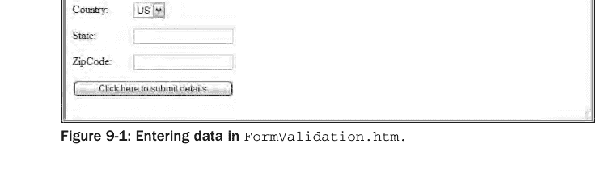

图 9-1：在 FormValidation.htm 中输入数据。

## 工作原理

这个示例应该会有一种非常熟悉的感觉。你正在使用 `POST` 方法提交数据。`UserName` 的文本框包含一个对 JavaScript 中 `Validate` 函数的调用。这仅在 `onblur` 事件触发时被调用。`onblur` 是 `onfocus` 的反面，因此它只在用户进入了获得焦点的控件，然后又移出该控件使其失去焦点时才会触发。

```
onblur="Validate('UserName')"
```

在 JavaScript 中，你在任何函数外部初始化一个 `XMLHttpRequest` 对象，使其全局可用：

```javascript
var xHRObject = false;

if (window.XMLHttpRequest)
{
    xHRObject = new XMLHttpRequest();
}
else if (window.ActiveXObject)
{
    xHRObject = new ActiveXObject("Microsoft.XMLHTTP");
}
```

然后，在 `Validate` 函数中，你将控件的名称传递给服务器端代码。你使用 `POST` 机制（与大多数表单一样），并使用 `getBody` 函数对数据进行 URI 编码。

```javascript
function Validate(data)
{
    var newform = document.forms[0];
    var bodyofform = getBody(newform, data);
    if (bodyofform != "UserName=")
    {
        xHRObject.open("POST", "Validate.php", true);
        xHRObject.setRequestHeader("Content-Type",
        "application/x-www-form-urlencoded");
        xHRObject.onreadystatechange = getData;
        xHRObject.send(bodyofform);
    }
    else
    {
        span.innerHTML = "Blank user names not allowed";
    }
}
```

你还会检查用户是否输入了空白名称，因为根本没有必要尝试验证空白名称。如果用户没有输入空白名称，那么你将数据内容发送到 `formcheck.aspx` 或 `formcheck.php`，具体取决于你使用哪种服务器端技术。服务器端页面创建一个 `Boolean` 变量来指示用户名是否匹配。一开始假设它没有匹配。接下来，你创建一个到 Access 数据库的连接，并 `Open` 数据库：

```csharp
bool check = false;
OleDbConnection SourceDb = new OleDbConnection("PROVIDER=Microsoft.Jet.OLEDB.4.0;Data Source=" + Server.MapPath("chapter9.mdb") + ";");
SourceDb.Open();
```

你创建一个 SQL 语句，选择 Users 表的所有内容。如果你打开 Users 表，你会看到它只包含两列，一列是唯一 ID，一列是一组名称。然后你对数据库执行这个 SQL 语句。你遍历 Users 表中的每一行，检查字段中的名称是否与用户提供的名称匹配。只有当匹配时，你才将布尔变量改为 true。

```csharp
OleDbCommand myOleDbCommand = new OleDbCommand("SELECT * from Users;",
    SourceDb);
OleDbDataReader oleDbReader = myOleDbCommand.ExecuteReader();
while (oleDbReader.Read())
{
    if (Request.Form["UserName"] != null)
    {
        if (Request.Form["UserName"] == oleDbReader["UserName"].ToString())
        {
            check = true;
        }
    }
}
```

最后，你关闭并释放连接。你将布尔变量的内容写入 Response 流。

```csharp
SourceDb.Close();
SourceDb.Dispose();
Response.Write(check);
```

`getData` 函数处理来自服务器的响应。返回的响应将包含 True 或 False（尽管，在本章后面你会看到，可能有第三种情况需要考虑）。如果响应包含 true，那么你可以在用户提交表单之前立即向用户指示该名称已被占用。否则，你可以让用户知道该名称可用。

```javascript
var NameTaken = "False";

function getData()
{
    if ((xHRObject.readyState == 4) && (xHRObject.status == 200))
    {
        var serverText = xHRObject.responseText;
        if (serverText == "True")
        {
            span.innerHTML = "This user name has already been taken";
            NameTaken = "True";
        }
        if (serverText == "False")
        {
            span.innerHTML = "This user name is available";
        }
    }
}
```


## 第九章：模式

```javascript
NameTaken = "False";
}
}
}
```

设置一个全局变量 `NameTaken`，用于创建用户名称是否可用的“记忆”，以防页面进一步更新时，`responseText` 变量返回既非真也非假的响应。

表单的提交由另一个服务器端页面处理，该页面可以对数据执行单独的验证检查。如前所述，有些信息在用户输入时进行检查是有益的，而其他信息则最好等到用户提交表单后再处理。

最后一个小节是 Change 函数，它严格来说并非 Ajax，但很好地补充了用户名检查。这个示例特意将国家信息置于州和邮政编码信息之上，这样当用户从下拉列表中选择国家时，它会自动替换表单上接下来两个文本框的标签，以表示英语提交中的 County 和 Postcode。

```javascript
if(state.innerHTML == "State:")
{
    state.innerHTML = "County:"
    zipcode.innerHTML = "Postcode:"
}
else
{
    state.innerHTML = "State:"
    zipcode.innerHTML = "Zipcode:"
}
```

Change 函数只是根据它们是否已设置为 State 或 County，来更改相应 `<span>` 标签的 `innerHTML` 属性。

### 鼠标悬停模式的额外信息

鼠标悬停长期以来一直是动态在网页上显示信息的流行解决方案。虽然动态 HTML 技术意味着你可以重新排列页面以显示额外信息，但动态移动信息以容纳新部分的概念可能显得笨拙。鼠标悬停技术通过避免影响屏幕上任何原始信息的布局来规避这些陷阱。

### 问题

如何在不弄乱界面或分散用户当前活动注意力的情况下，显示关于某个项目的额外信息？

### 模式

一个半透明的框弹出，显示关于该特定项目的额外信息。这不会中断流程，并且半透明意味着页面上的原始信息也不会被遮挡。

在网站上显示图形列表（例如 Last.fm 上乐队的图片或 Flickr 上的照片组）是很常见的。一图胜千言的格言在当代网页开发思想中似乎很受欢迎。因此，对于目录中大量的产品，你可以发现它们以一系列图像的形式展示。使用弹出框是因为它们快速且完全不改变页面布局，这使得它们非常常见。

此示例显示六本书的封面。当用户将鼠标悬停在封面上时，他或她将获得该图像的较大版本，以及一些关于该书的详细信息。此示例使用了一个现有的库 `boxover.js`，可从 http://boxover.swazz.org 获取，该库非常流行，它承担了显示图像的繁重工作。严格来说，这不需要 Ajax；然而，此示例嫁接了一些 Ajax 代码，该代码访问一个 XML 文件，通过 ISBN 识别鼠标悬停的书籍，然后返回关于该书的一些精选信息（如标题、作者、ISBN 和价格），所有这些都显示在鼠标悬停框中。

#### 试一试：显示透明弹出框

要练习显示透明弹出框，请按照以下步骤操作：

1.  创建一个名为 `MouseOver.htm` 的页面，内容如下：

```html
<!DOCTYPE html PUBLIC "-//W3C//DTD XHTML 1.0 Transitional//EN"
"http://www.w3.org/TR/xhtml1/DTD/xhtml1-transitional.dtd">
<html xmlns="http://www.w3.org/1999/xhtml" >
<head>
<title>鼠标悬停示例</title>
<script type="text/javascript" src="mouse.js"></script>
<script type="text/javascript" src="boxover.js"></script>
</head>
<body>
<table>
<tr>
<td>
<a title="header=[] body=[0470106751]"
href="catalogue1.htm">
</a></td>
<td><a title="header=[] body=[0764588508]"
href="catalogue2.htm"></a></td>
<td><a title="header=[] body=[076455871]"
href="catalogue3.htm"></a></td>
<td><a title="header=[] body=[0764557831]"
href="catalogue4.htm"></a></td>
<td><a title="header=[] body=[0764570773]"
href="catalogue5.htm"></a></td>
<td><a title="header=[] body=[076455871]"
href="catalogue6.htm"></a></td>
</tr>
</table>
</body>
</html>
```

2.  从 http://boxover.swazz.org 下载最新版本的 `boxover.js` 到同一文件夹。

3.  找到 `getParam` 函数，并通过添加高亮代码按如下方式修改它：

```javascript
function getParam(param,list) {
    var reg = new RegExp('([^a-zA-Z]' + param + '|^' + param + 
    ')\s*=\s*\\[\\s*(((\\[\\]|(\\\\))|([^\\]\\]))*?)\s*\\]');
    var res = reg.exec(list);
    var returnvar;
    if (param != "body")
    {
    if(res)
        return res[2].replace('[[','[').replace(']]',']');
    else
        return '';
        }
    else
        {
        if (res)
            return mousebox(res[2].replace('[[','[').replace(']]',']'));
        else
            return '';
        }
}
```

4.  创建一个名为 `mouse.js` 的新脚本，并添加以下内容：

```javascript
var isbn = null;
var http = null;

function mousebox(isbn)
{
            if (window.ActiveXObject)
            {
                http = new ActiveXObject("Microsoft.XMLHTTP");
            }
            else if (window.XMLHttpRequest)
            {
                http = new XMLHttpRequest();
            }
            http.open("GET", "Catalogue.xml", false);
            http.send(null);
            var xml = http.responseXML;

            //Load XSL

            if (window.ActiveXObject)
            {
            var xsl = new ActiveXObject("MSXML2.FreeThreadedDomDocument.3.0");
            xsl.async = false
            xsl.load("Catalogue.xsl")

            var template = new ActiveXObject("MSXML2.XSLTemplate")
            template.stylesheet = xsl

processor = template.createProcessor()

processor.input = xml
processor.addParameter("ISBN", isbn)
processor.transform()

//Transform
return processor.output;
}
else
{

    var xsltProcessor = new XSLTProcessor();

    //Load XSL
    http = new XMLHttpRequest();
    http.open("GET", "Catalogue.xsl", false);
    http.send(null);

    xslStyleSheet = http.responseXML;

    xsltProcessor.importStylesheet(xslStyleSheet);
    xsltProcessor.setParameter(null, "ISBN", isbn);

    //Transform
    var fragment = xsltProcessor.transformToDocument(xml, document);
    return new XMLSerializer().serializeToString(fragment);
}

}
```

5.  创建一个名为 `catalogue.xml` 的文件，包含以下数据：

```xml
<?xml version="1.0" encoding="utf-8" ?>
<catalog>
    <book>
        <Title>Beginning ASP.NET with CSharp</Title>
        <Authors>Hart, Kauffman, Sussman, Ullman</Authors>
        <ISBN>0764588508</ISBN>
        <Price>$39.99</Price>
    </book>
    <book>
        <Title>Beginning JavaScript 2nd Edition</Title>
        <Authors>Wilton</Authors>
        <ISBN>076455871</ISBN>
        <Price>$39.99</Price>
    </book>
    <book>
        <Title>Beginning Ajax</Title>
        <Authors>Dykes, Ullman</Authors>
        <ISBN>0470106751</ISBN>
        <Price>$39.99</Price>
    </book>
    <book>
        <Title>Beginning XML</Title>
        <Authors>Hunter, Watt, Rafter, Duckett</Authors>
        <ISBN>0764570773</ISBN>
        <Price>$39.99</Price>
    </book>
    <book>
        <Title>Beginning PHP5</Title>
        <Authors>Squier, Mercer, Kent, Choi</Authors>
        <ISBN>0764557831</ISBN>
        <Price>$39.99</Price>
    </book>
    <book>
        <Title>Professional Ajax</Title>
        <Authors>Zakas, McPeak, Fawcett</Authors>
        <ISBN>0471777781</ISBN>
        <Price>$39.99</Price>
    </book>
</catalog>
```

6.  创建一个名为 `Catalogue.xsl` 的新文件，并添加以下数据：

```xml
<?xml version="1.0" encoding="utf-8"?>

<xsl:stylesheet version="1.0"
    xmlns:xsl="http://www.w3.org/1999/XSL/Transform">

    <xsl:output
        method="html"
        indent="yes"
        version="4.0" />
    <xsl:param name="ISBN" />

    <xsl:template match="/">
        <xsl:for-each select="//book">
            <xsl:if test="ISBN=$ISBN">
                <span>
                    <b>标题</b> -
                    <xsl:value-of select="Title"/>
                </span>
                <br/>
                <span> <b>作者</b> -
                    <xsl:value-of select="Authors"/>
                </span>
                <br/>
                <span> <b>ISBN</b> -
                    <xsl:value-of select="ISBN"/>
                </span>
                <br/>
                <span> <b>价格</b> -
                    <xsl:value-of select="Price"/>
                </span>
                <br/>
            </xsl:if>
        </xsl:for-each>
    </xsl:template>
</xsl:stylesheet>
```


## 7. 在浏览器中查看 MouseOver.htm

在您的浏览器中查看文件 \`MouseOver.htm\`，并依次将鼠标悬停在每本图书封面上方，如图 **图 9-2** 所示。

#### 图 9-2：将鼠标悬停在图书封面上方。

---

## 工作原理

这个示例对现有的大型库进行了非常微小的修改，以便您可以使用 Ajax 提取信息并在页面上显示它。我们不深入探讨 \`boxover.js\` 具体做什么，因为它执行了一些相当复杂的处理逻辑，以确保在鼠标悬停到正确元素上时盒子才会被打开和关闭，而在离开这些元素时会关闭。

HTML 页面实际上包含了第一个兴趣点。每个封面都包含一些额外信息，并传递到了 `title` 属性中。

```html
<td><a title="header=[] body=[0764588508]'
 href="catalogue2.htm"></a></td>
```

这些参数被 `boxover.js` 中的 `getParam` 方法拾取。通常，每个参数（例如 `header` 和 `body`）会依次进行识别，并且信息会被移除方括号以仅返回 HTML 标签。在此处的代码已被修改，以便对脚本中创建的函数提供调用。

```javascript
if (param != "body")
{
  if(res)
    return res[2].replace('[[','[').replace(']]',']');
  else
    return '';
}
else
{
  if (res)
  // ... (rest of code cut off)
```

---

## 第九章：模式

```javascript
return mousebox(res[2].replace(['[','(').replace(')','']);
else return '';
}
```

您现在不再将 HTML 作为要显示在鼠标悬停图像下方的盒子主体传递，而是调用一个函数来发送 ISBN，返回 XML 文档，通过 XSL 对文档执行转换，并返回 HTML 片段作为该函数的返回值。

该函数首先创建一个 `XMLHttpRequest` 对象的实例。您立即打开包含目录数据的 XML 文档，将其发送并存储在 `xml` 变量中：

```javascript
if (window.ActiveXObject) {
    http = new ActiveXObject("Microsoft.XMLHTTP");
} else if (window.XMLHttpRequest) {
    http = new XMLHttpRequest();
}
http.open("GET", "Catalogue.xml", false);
http.send(null);
var xml = http.responseXML;
```

接下来，您加载 XSL。这是一个浏览器特定的练习。您必须做的不仅仅是加载 XSL 样式表，但也不仅仅如此。您还必须向样式表传递一个参数（ISBN 编号）。不幸的是，`MSXML.DOMDocument` 对象不具备独立于样式表加载参数的功能，因此转而使用 `MSXML2.FreeThreadedDomDocument` 对象。它在实际加载方面以类似的方式工作，但需要在创建 XSL 模板对象时增加一个额外步骤。模板分配了一个样式表，而 `createProcessor` 方法为您创建一个 XSLT 样式表处理程序的实例。

```javascript
if (window.ActiveXObject) {
var xsl = new ActiveXObject("MSXML2.FreeThreadedDomDocument.3.0");
xsl.async = false
xsl.load("Catalogue.xsl")

var template = new ActiveXObject("MSXML2.XSLTemplate")
template.stylesheet = xsl
processor = template.createProcessor()
```

接下来，您将样式表分配给处理器。然后您创建一个参数并传递 `isbn` 变量，其中包含当前鼠标悬停的图像中的值。然后您可以执行转换并返回输出。

```javascript
processor.input = xml
processor.addParameter("ISBN", isbn)
processor.transform()

//Transform
return processor.output;
}
```

幸运的是，Mozilla 在其自己的 XSLT 处理器中没有这种不灵活的情况，该处理器可以通过 `setParameter` 方法添加参数。除此之外，它以熟悉的方式工作。

```javascript
else
{
    var xsltProcessor = new XSLTProcessor();

    //Load XSL
    http = new XMLHttpRequest();
    http.open("GET", "Catalogue.xsl", false);
    http.send(null);

    xslStylesheet = http.responseXML;

    xsltProcessor.importStylesheet(xslStylesheet);
    xsltProcessor.setParameter(null, "ISBN", isbn);

    //Transform
    var fragment = xsltProcessor.transformToFragment(xml, document);
    return new XMLSerializer().serializeToString(fragment);
}
```

XSL 样式表定义了参数 `ISBN`。然后，在文档中通过在该参数前放置一个美元符号 (`$`) 来引用该参数。您使用 XPath 选择 XML 文档中的每个图书元素。您只想显示与鼠标悬停的图书相关的图书元素中的信息。因此，您使用 `xsl:if test` 检查每个元素的 ISBN 编号来自图书的 ISBN 编号。

```xml
<xsl:param name="ISBN" />

<xsl:template match="/">
    <xsl:for-each select="//book">
        <xsl:if test="ISBN=$ISBN">
            <span>
                <b>Title</b> -
                <xsl:value-of select="Title"/>
            </span>
            ...
        </xsl:if>
    </xsl:if>
```

只有当项目匹配时，您才显示生成的 HTML 片段。

```html
<span><b>Title</b> - Beginning Ajax</span><br><span><b>Authors</b> - Dykes, Ullman</span><br><span><b>ISBN</b> - 0470106751</span><br><span><b>Price</b> - $39.99</span><br>
```

该事件在鼠标移动越过不同的图像时每次都会触发，并且每次都会动态用来自 XML 文档的信息填充。

---

### 轮询服务器模式

许多应用程序将信息以流的形式提供（例如新闻源或 Web 服务）。对于读取这些流的 applications，即使它们会在您刷新页面时进行更新，您可能希望更频繁地更新浏览器显示，而无需页面刷新的帮助。

### 问题

您如何检查服务器不仅仅一次获取信息，而是按固定的时间间隔？

### 模式

这种异步活动被称为 *轮询服务器*。这种类型的图案也被称为 *页面流式传输* 或 *服务流式传输*。要做到这一点，您创建一个持续运行的脚本来调用服务器/数据。大多数函数会在第一次调用后退出，但在这种模式中，它将在循环中运行，调用该函数，然后等待一段时间，然后再次调用该函数。正如第一章所述，如果您使用 `XMLHttpRequest` 对象的 `GET` 方法，Internet Explorer (IE) 会积极缓存正在调用的 XML 页面。如果更新的原因是刷新页面以获取新数据，那么显示具有缓存或已过时数据的页面将违背轮询服务器的目的。因此，也必须为此考虑因素。

此示例创建一个带有虚拟股票数据以及随机数字生成的虚拟股票价格的 XML 文件，这些价格是发送到 XML 文件的。您将更新 XML 文件，并确保护主页几乎立即刷新。

#### 动手试一试：轮询服务器/页面流式传输

为了练习轮询服务器，请按照以下步骤操作：

1. 创建名为 \`polling.htm\` 的页面如下：

```html
<html xmlns="http://www.w3.org/1999/xhtml" >
<head>
    <title>Polling The Server Example</title>
    <link id="Link1" rel="stylesheet" href="Polling.css" type="text/css" />
    <script type="text/javascript" src="polling.js"></script>
</head>
<body onload="getDocument()">
    <span id="Stocks"></span>
</body>
</html>
```

2. 创建名为 \`Polling.js\` 的脚本如下：

```javascript
var xHRObject = false;

if (window.XMLHttpRequest)
{
    xHRObject = new XMLHttpRequest();
}
else if (window.ActiveXObject)
{
```

```javascript
xHRObject = new ActiveXObject("Microsoft.XMLHTTP");
}

function loadDocument(fileName) {
    var xmlDoc = null
    if (window.ActiveXObject)
    {
        xmlDoc = new ActiveXObject("MSXML2.DOMDocument.3.0")
    }
    else
    {
        document.implementation.createDocument("","",null);
    }
    xmlDoc.async = false;
    xmlDoc.load(fileName);
    return xmlDoc;
}

function transformToHTML(xmlDoc, xsldoc) {
    var html = "";
    if (window.XSLTProcessor) {
        var xsltProc = new XSLTProcessor();
        xsltProc.importStylesheet(xsldoc);
        var fragment = xsltProc.transformToFragment(xmlDoc, document);
        html = new XMLSerializer().serializeToString(fragment);
    } else if (window.ActiveXObject) {
        html = xmlDoc.transformNode(xsldoc);
    }
    return html;
}

function getData()
{
    //Check to see if the XMLHttpRequest object is ready and whether it has
    //returned a legitimate response
    if (xHRObject.readyState == 4 && xHRObject.status == 200)
    {
        // Load XML
        var xml = loadDocument("Stocks.xml");
        //Load XSL
        var xsl = loadDocument("Stocks.xsl");
        //Transform
        document.getElementById("Stocks").innerHTML = transformToHTML(xml, xsl);
        //Clear the object and call the getDocument function in 5 seconds
        setTimeout("getDocument()", 5000);
    }
}

function getDocument()
{
    xHRObject.open("GET", "GetStocksList.aspx?id=" + Number(new Date()), true);
    xHRObject.onreadystatechange = getData;
```


 # 第9章：模式

```
if (xHRObject.overrideMimeType) {
	xHRObject.overrideMimeType("text/plain");
}
```

```
xHRObject.send(null);
```

3. 创建一个名为 Stocks.xml 的 XML 文件，包含以下数据：

```
<?xml version="1.0" encoding="iso-8859-1" standalone="yes"?>
<stocks>
	<company>
		<name>Isotope International Ltd</name>
		<price>7.8</price>
		<direction>Down</direction>
	</company>
	<company>
		<name>Cartkeys Conglomerates</name>
		<price>29.9</price>
		<direction>Down</direction>
	</company>
	<company>
		<name>Merruble Networks Inc</name>
		<price>53.1</price>
		<direction>Down</direction>
	</company>
	<company>
		<name>Sable Strongholds</name>
		<price>140.4</price>
		<direction>Up</direction>
	</company>
</stocks>
```

4. 创建一个名为 stocks.xsl 的 XSL 样式表，包含以下数据：

```
<?xml version="1.0" encoding="utf-8"?>
<xsl:stylesheet version="1.0"
	xmlns:xsl="http://www.w3.org/1999/XSL/Transform">

<xsl:output
	method="html"
	indent="yes"
	version="4.0"/>

<xsl:template match="/">
	<xsl:call-template name="DisplayStocks"></xsl:call-template>
</xsl:template>

<xsl:template name="DisplayStocks">

<table id="stocks">
	<thead class="head">
		<tr>
			<td>Company</td>
			<td>Price</td>
			<td>Direction</td>
		</tr>
	</thead>
	<tbody>
	<xsl:for-each select="//company">
	  <tr>
	    <td class="border2">
	      <xsl:value-of select="name"/>
	    </td>
	    <td class="border2" align="center">
	      <xsl:value-of select="price"/>
	    </td>
	    <xsl:choose>
	      <xsl:when test="direction='Up'">
	        <td class="border2" style="color:blue;">
	          <xsl:value-of select="direction"/>
	        </td>
	      </xsl:when>
	      <xsl:otherwise>
	        <td class="border2" style="color:red;">
	          <xsl:value-of select="direction"/>
	        </td>
	      </xsl:otherwise>
	    </xsl:choose>
	  </tr>
	</xsl:for-each>
	</tbody>
</table>
</xsl:template>
</xsl:stylesheet>
```

**5.** 创建一个名为 polling.css 的样式表，内容如下：

```
table
{
    background-color: beige;
    border-top:1px solid #e4ddca;
    border-left:1px solid #e4ddca;
    border-right:1px solid #e4ddca;
    border-bottom :1px solid #e4ddca;
}

tr, td
{
    font-family: Verdana;
    height:15px;
    font-size:75%;
    margin:2px 0px 0px 0px;
    padding:0px 0px 0px 5px;
}

.border
{
    font-weight: bold;
    text-align:center;
}

.border2
{
    background: beige;
}

.head
{
    font-family: Verdana;
    height:15px;
    vertical-align:middle;
    background:#665D43;
    color: beige;
    font-weight: bold;
}
```

6. 创建服务器端页面，并命名为 GetStocksList.aspx：

```
<%@ Page Language = "C#" Debug="true" %>
<%@ import Namespace="System.Xml" %>
<script language="C#" runat="server">
    void Page_Load()
    {
        XmlDocument CurrentXml = new XmlDocument();
        CurrentXml.Load(Server.MapPath("stocks.xml"));
        XmlNode root = CurrentXml.LastChild;

        Random rc = new Random();
        int RandomNumber;

        for (int i = 0; i < root.ChildNodes.Count; i++)
        {
            RandomNumber = rc.Next(0, 100);
            XmlNode child = root.ChildNodes[i];
            for (int j = 0; j < child.ChildNodes.Count; j++)
            {
                if (child.ChildNodes[j].Name == "price")
                {
                    decimal value = decimal.Parse(child.ChildNodes[j].InnerXml);

                    Random rp = new Random();
                    decimal RandomPrice = rp.Next(0, (int)value);

                    RandomPrice = RandomPrice / 10;
                    string direction = "";
                    if ((RandomNumber % 2) == 1)
                    {
                        direction = "Down";
                        value = value - RandomPrice;
                    }
                    else
                    {
                        direction = "Up";
                        value = value + RandomPrice;
                    }
                    child.ChildNodes[j].InnerText = value.ToString();
                    child.ChildNodes[j + 1].InnerText = direction;
                }
            }
        }
        CurrentXml.Save(Server.MapPath("stocks.xml"));
    }
</script>
```

或者，如果你想使用 PHP，请使用以下代码并将其命名为 GetStocksList.php：

```
<?php
    $dom = new DomDocument('1.0');
    $dom->load('stocks.xml');
    $root = $dom->lastChild;
    srand(time());
    foreach ($root->childNodes As $child)
    {
        $RandomNumber = (rand()%100);
        if ($child->nodeType == 1)
        {
            foreach ($child->childNodes As $subchild)
            {
                if ($subchild->nodeName == "price")
                {
                    $value = $subchild->textContent;
                    $RandomPrice = (rand()%$value);
                    $RandomPrice = $RandomPrice / 10;

                    $direction = "";
                    if (($RandomNumber % 2) == 1)
                    {
                        $direction = "Down";
                        $value = $value - $RandomPrice;
                    }
                    else
                    {
                        $direction = "Up";
                        $value = $value + $RandomPrice;
                    }

                    $textNode = $dom->createTextNode($value);
                    $subchild->nodeValue = "";
                    $newchild = $subchild->appendChild($textNode);
                }

                if ($subchild->nodeName == "direction")
                {
                    $textNode = $dom->createTextNode($direction);
                    $subchild->nodeValue = "";
                    $newchild = $subchild->appendChild($textNode);
                }
            }
        }
    }
    $dom->save('stocks.xml');
?>
```

7. 如果你使用的是 ASP.NET，请通过 Windows 资源管理器将 `ASPNET` 用户添加到允许修改 `C:\\inetpub\\wwwroot\\BegAjax\\chapter9` 的用户列表中。

如果你使用的是 Apache 环境下的 PHP，请转到"服务"，右键单击 Apache 服务，然后选择"属性"。单击"登录"选项卡，将"本地系统账户"切换为"此账户"。使用浏览器选择本地账户，并输入密码。单击"确定"完成。

如果你使用的是 IIS 环境下的 PHP，请打开 IIS 控制台并右键单击"默认网站"。单击"目录安全性"。单击"编辑"按钮，将 `IUSR_你的计算机名` 切换为本地账户（通过单击"浏览"按钮）。取消选中"允许 IIS 控制密码"，并在密码字段中输入你所选账户的密码。单击"确定"完成。

8. 在浏览器中打开 `Polling.htm`，如图 9-3 所示。

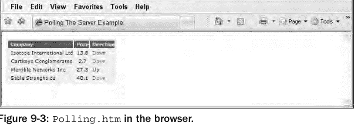

**图 9-3：** 浏览器中的 `Polling.htm`。

## 工作原理

本示例模拟了一个比现实世界中的股票更快的股票行情显示器。然而，这是必要的，这样可以证明你已经使用 Ajax 向服务器轮询获取更新的 XML 文件。

body 的 `onload` 属性设置为 `getDocument()` 函数。脚本首先创建一个 `XMLHttpRequest` 对象。`getDocument()` 函数指定在 `XMLHttpRequest` 对象状态改变时调用 `getData` 函数。你在 `GetStocksList.aspx` 末尾追加一个日期，因为你知道这将反复调用，而你不想让 IE 缓存该文件。然后，你将对象的内容发送到服务器。

```
    function getDocument()
    {
        xHRObject.open("GET", "GetStocksList.aspx?id=" + Number(new Date()), true);
        xHRObject.onreadystatechange = getData;
        if (xHRObject.overrideMimeType) {
            xHRObject.overrideMimeType("text/plain");
        }
        xHRObject.send(null);
    }
```

接收页面 GetStocksList 需要执行三项任务。第一是加载现有的 XML 文档。第二是随机生成一些股票数据，第三是将新数据保存到 XML 文档。第一步只需要两行代码。之后，你必须定位文档的根节点（<stocks> 元素）以执行迭代。

```
XmlDocument CurrentXml = new XmlDocument();
CurrentXml.Load(Server.MapPath("stocks.xml"));
XmlNode root = CurrentXml.LastChild;
```

生成随机数的过程占据了大部分代码。你生成两个随机数。一个用于确定股票是涨还是跌。你生成一个 1 到 100 之间的数，如果它是奇数，那么股票下跌；否则，股票上涨。第二个随机数是股票涨跌的幅度。这是一个 1 到当前股票值之间的数。然后你将该数字除以 10，以确保股票最多可以涨跌其价值的 10%。

```
Random rc = new Random();
int RandomNumber;

for (int i = 0; i < root.ChildNodes.Count; i++)
{
    RandomNumber = rc.Next(0, 100);
    XmlNode child = root.ChildNodes[i];
    for (int j = 0; j < child.ChildNodes.Count; j++)
    {
        if (child.ChildNodes[j].Name == "price")
        {
            decimal value = decimal.Parse(child.ChildNodes[j].InnerXml);

            Random rp = new Random();
            decimal RandomPrice = rp.Next(0, (int)value);

            RandomPrice = RandomPrice / 10;
            string direction = "";
            if ((RandomNumber % 2) == 1)
            {
                direction = "Down";
                value = value - RandomPrice;
            }
            else
            {
                direction = "Up";
                value = value + RandomPrice;
            }
            child.ChildNodes[j].InnerText = value.ToString();
            child.ChildNodes[j + 1].InnerText = direction;
        }
    }
}
```

然后将这些值重新分配给文档中每个项目的价格和 direction 元素，然后保存文档。

```
CurrentXml.Save(Server.MapPath("stocks.xml"));
```


## 第 9 章：模式（Patterns）

保存文档后，JavaScript 将处理其余操作。XML 被加载，XSL 也被加载。对 XML 执行转换以生成一个显示最新股票信息的框。

```javascript
var xhrObject = false;

if (window.XMLHttpRequest)
{
    xhrObject = new XMLHttpRequest();
}
else if (window.ActiveXObject)
{
    xhrObject = new ActiveXObject("Microsoft.XMLHTTP");
}

function loadDocument(fileName) {
    var xmlDoc = null
    if (window.ActiveXObject)
    {
        xmlDoc = new ActiveXObject("MSXML2.DOMDocument.3.0")
    }
    else
    {
        document.implementation.createDocument("", "",null);
    }
    xmlDoc.async = false;
    xmlDoc.load(fileName);
    return xmlDoc;
}

function transformToHTML(xmlDoc, xslDoc) {
    var html = "";
    if (window.XSLTProcessor) {
        var xsltProc = new XSLTProcessor();
        xsltProc.importStylesheet(xslDoc);
        var fragment = xsltProc.transformToFragment(xmlDoc, document);
        html = new XMLSerializer().serializeToString(fragment);
    } else if (window.ActiveXObject) {
        html = xmlDoc.transformNode(xslDoc);
    }
    return html;
}
```

这应该相当熟悉。它仅仅是`getData()`函数末尾的代码与正常代码略有不同。一旦你将转换的结果分配给框，然后清空 XMLHttpRequest 对象并通过 JavaScript `setTimeout`方法再次调用它。

```javascript
function getData()
{
    //检查 XMLHttpRequest 对象是否已就绪以及是否返回了有效的响应
    if (xHRObject.readyState == 4 && xHRObject.status == 200)
    {
        //加载 XML
        var xml = loadDocument("Stocks.xml");
        //加载XSL
        var xsl = loadDocument("Stocks.xsl");
        //转换
        document.getElementById("Stocks").innerHTML = transformToHTML(xml, xsl);
        //清空对象并在 5 秒后调用 getDocument functions
        setTimeout("getDocument()", 5000);
    }
}
```

这确保了整个操作在循环中继续进行，从而使股票行情牌每隔五秒钟随机生成一些新数据来更新结果。实际上，它将从 web 服务绘制此类结果。在第 7 章中考察了这种可能性。

### Drag-and-Drop Lists Pattern

拖放列表是自从获得 DOM 访问权限就一直存在的东西。它们仅需 JavaScript 和 CSS 即可提供功能。如果你想将列表内容保存到数据库，那么Ajax就进入了这个环节。两种提供此类功能的网站是在线音乐协会 www.mog.com 以及背包产品制造商/www.37signals.com/web web软件的背部。

#### 问题（Problem）

如何动态拖放列表项，然后将顺序保存到文件或数据库中，以便下次回到该屏幕时仍能保留？

#### 模式（Pattern）

必须考虑几个问题，这使得此模式比你可能想象的更复杂。首先是对象的动态移动，只需在 y 轴上进行（换句话说，向上和向下，而不是左右）。

以下代码似乎提供了一种快速跨浏览器的替代方案来动态移动一个项目：

```javascript
function mouseMoveEvent(e)
{
    if (window.ActiveXObject)
    {
        document.getElementById(ListItemDrag).style.top = event.y;
    }
    else
    {
        document.getElementById(ListItemDrag).style.top = e.layerY;
    }
}
```

变量`ListItemDrag`包含你要移动的元素的 ID。你使用`mousemove`事件，只需获取由`mouseMoveEvent`生成的 y 坐标并将它们设置为正在拖放的元素的y 坐标即可。这实际上在 IE 中工作正常，但在 Firefox 中不起作用，并且会导致鼠标光标在屏幕上游走跳动（上下），因为事件目标更改了，对象也会根据事件处理器返回哪个对象而改变。

还有许多其他事物必须考虑到，例如事件中引用的项目以及 Mozilla可以返回很多不同元素的事实（这使得处理更加困难）。事实上，已经有使用自定义`drag` 事件的库解决了这个问题，本示例将加以利用。

第二个问题是，一旦你开始拖放一个项目，如何知道你何时将其悬停在另一个项目上？一种解决方案可能是使用 onmouseover 事件，但当你使用基于ondrag移动元素的库时，则无法触发。解决方案是将项目的位置存储在数组中，然后计算正在拖放的元素与页面上的其他元素之间的相对位置。然后，当元素接近拖放元素时，将最近的元素从其当前位置移动到空位。

模式如下：

1. 处理鼠标按下事件并检测并拖动该元素。
2. 处理鼠标移动事件以动态移动我们的元素。
3. 检测元素相对于其他元素的位置。
4. 如果存在位于拖放元素附近的静态元素，则将其移动到下一个可用空位。下一个可用空位的位置将取决于正在拖放和掉落的项目以及哪个项目是目标（指代对象）。
5. 处理鼠标释放事件以正确放置并定位已拖动的元素。这将意味着将其重新对齐到可用的间隙中。通过Ajax将此信息保存到数据库/XML文档。

本示例的代码将由几个库提供，以便你可以专注于实际执行拖动、掉落、排序和保存操作的代码。

本示例从包含五本书列表的XML 文档获取数据。你将允许用户将列表中每本书的名称拖放到新位置，确保其他书名正确洗牌以代替被拖放的书名。然后，当用户点击按钮时，此顺序将被保存，以便当用户返回页面时，新的顺序得以保留。

#### 使用 Ajax 尝试保存拖放列表的顺序

遵循以下步骤使用Ajax来保存拖放列表的顺序：

1. 创建名为`DragDrop.htm`的页面：

```html
<html xmlns="http://www.w3.org/1999/xhtml" >
<head>
    <title>Drag Drop Example</title>
    <link id="Link1" rel="stylesheet" href="DragDrop.css" type="text/css" />
    <script type="text/javascript" src="dom-drag.js"></script>
    <script type="text/javascript" src="SaveListOrder.js"></script>
    <script type="text/javascript" src="simple-dnd.js"></script>
</head>
<body>
My Favourite Books:
<br />
<br />
<span id="root">
</span>
<br />
<br />
<input type="button" value="Click to store the sequence" onclick="SaveOrder()" />
</body>
</html>
```

2. 如上所述，有可用的库来检测和拖动屏幕上的元素。与其重新发明轮子，让我们采用其中一种现成的库。从 http://boring.youngpup.net/2001/domdrag下载 dom-drag.js文件或输入以下内容：

```javascript
/***********************************************
 * dom-drag.js
 * 09.25.2001
 * www.youngpup.net
***********************************************
 * 10.28.2001 - fixed minor bug where events
 * sometimes fired off the handle, not the root.
***********************************************/

var Drag = {

		obj : null,

		init : function(o, oRoot, minX, maxX, minY, maxY, bSwapHorzRef, bSwapVertRef, fXMapper, fYMapper)
		{
			o.onmousedown		= Drag.start;
			o.hmode				= bSwapHorzRef ? false : true ;
			o.vmode				= bSwapVertRef ? false : true ;

			o.root = oRoot && oRoot != null ? oRoot : o ;

			if (o.hmode && isNaN(parseInt(o.root.style.left ))) o.root.style.left	=
"0px";
			if (o.vmode && isNaN(parseInt(o.root.style.top ))) o.root.style.top	=
"0px";
			if (!o.hmode && isNaN(parseInt(o.root.style.right ))) o.root.style.right	=
"0px";
			if (!o.vmode && parseInt(parseInt(o.root.style.bottom))) o.root.style.bottom=
"0px";

			o.minX		= typeof minX != 'undefined' ? minX : null;
			o.minY		= typeof minY != 'undefined' ? minY : null;
```


## 第九章：模式

```javascript
o.maxX     = typeof maxX != 'undefined' ? maxX : null;
o.maxY     = typeof maxY != 'undefined' ? maxY : null;

o.xMapper = fXMapper ? fXMapper : null;
o.yMapper = fYMapper ? fYMapper : null;

o.root.onDragStart    = new Function();
o.root.onDragEnd      = new Function();
o.root.onDrag         = new Function();
},

start : function(e)
{
var o = Drag.obj = this;
e = Drag.fixE(e);
var y = parseInt(o.vmode ? o.root.style.top  : o.root.style.bottom);
var x = parseInt(o.hmode ? o.root.style.left : o.root.style.right );
o.root.onDragStart(x, y);

o.lastMouseX    = e.clientX;
o.lastMouseY    = e.clientY;

if (o.hmode) {
if (o.minX != null)    o.minMouseX      = e.clientX - x + o.minX;
if (o.maxX != null)    o.maxMouseX      = o.minMouseX + o.maxX - o.minX;
} else {
if (o.minX != null) o.maxMouseX = -o.minX + e.clientX + x;
if (o.maxX != null) o.minMouseX = -o.maxX + e.clientX + x;
}

if (o.vmode) {
if (o.minY != null)    o.minMouseY      = e.clientY - y + o.minY;
if (o.maxY != null)    o.maxMouseY      = o.minMouseY + o.maxY - o.minY;
} else {
if (o.minY != null) o.maxMouseY = -o.minY + e.clientY + y;
if (o.maxY != null) o.minMouseY = -o.maxY + e.clientY + y;
}

document.onmousemove   = Drag.drag;
document.onmouseup     = Drag.end;

return false;
},

drag : function(e)
{
e = Drag.fixE(e);
var o = Drag.obj;

var ey     = e.clientY;
var ex     = e.clientX;
var y = parseInt(o.vmode ? o.root.style.top  : o.root.style.bottom);
var x = parseInt(o.hmode ? o.root.style.left : o.root.style.right );

var nx, ny;

if (o.minX != null) ex = o.hmode ? Math.max(ex, o.minMouseX) : Math.min(ex, o.maxMouseX);
if (o.maxX != null) ex = o.hmode ? Math.min(ex, o.maxMouseX) : Math.max(ex, o.minMouseX);
if (o.minY != null) ey = o.vmode ? Math.max(ey, o.minMouseY) : Math.min(ey, o.maxMouseY);
if (o.maxY != null) ey = o.vmode ? Math.min(ey, o.maxMouseY) : Math.max(ey, o.minMouseX);

nx = x + ((ex - o.lastMouseX) * (o.hmode ? 1 : -1));
ny = y + ((ey - o.lastMouseY) * (o.vmode ? 1 : -1));

if (o.xMapper) nx = o.xMapper(y)
else if (o.yMapper) ny = o.yMapper(x)

Drag.obj.root.style[o.hmode ? "left" : "right"] = nx + "px";
Drag.obj.root.style[o.vmode ? "top" : "bottom"] = ny + "px";
Drag.obj.lastMouseX = ex;
Drag.obj.lastMouseY = ey;

Drag.obj.root.onDrag(nx, ny);
return false;
},

end : function()
{
document.onmousemove = null;
document.onmouseup = null;
Drag.obj.root.onDragEnd(parseInt(Drag.obj.root.style[Drag.obj.hmode ? "left" : "right"]),
parseInt(Drag.obj.root.style[Drag.obj.vmode ? "top" : "bottom"]));
Drag.obj = null;
},

fixE : function(e)
{
if (typeof e == 'undefined') e = window.event;
if (typeof e.layerX == 'undefined') e.layerX = e.offsetX;
if (typeof e.layerY == 'undefined') e.layerY = e.offsetY;
return e;
}
};
```

3. 第二个库处理列表的拖放功能。这里添加了一些全局变量，以**粗体**显示。将其保存为 simple-dnd.js。

```javascript
/***********************************
 * Simple DnD
 * Copyright (c) 2006 Ben Sherratt
 *
 * Permission is hereby granted, free of charge, to any person obtaining a copy of
 * this software and associated documentation files (the "Software"), to deal in
 * the Software without restriction, including without limitation the rights to
/*
 * Copyright (c) 2008, Free Software Foundation, Inc. <info@fsf.org>
 *
 * Permission is hereby granted, free of charge, to any person obtaining a copy
 * of this software and associated documentation files (the "Software"), to deal
 * in the Software without restriction, including without limitation the rights
 * to use, copy, modify, merge, publish, distribute, sublicense, and/or sell copies
 * of the Software, and to permit persons to whom the Software is furnished to do
 * so, subject to the following conditions:
 *
 * The above copyright notice and this permission notice shall be included in all
 * copies or substantial portions of the Software.
 *
 * THE SOFTWARE IS PROVIDED "AS IS", WITHOUT WARRANTY OF ANY KIND, EXPRESS OR
 * IMPLIED, INCLUDING BUT NOT LIMITED TO THE WARRANTIES OF MERCHANTABILITY,
 * FITNESS FOR A PARTICULAR PURPOSE AND NONINFRINGEMENT. IN NO EVENT SHALL THE
 * AUTHORS OR COPYRIGHT HOLDERS BE LIABLE FOR ANY CLAIM, DAMAGES OR OTHER
 * LIABILITY, WHETHER IN AN ACTION OF CONTRACT, TORT OR OTHERWISE, ARISING FROM,
 * OUT OF OR IN CONNECTION WITH THE SOFTWARE OR THE USE OR OTHER DEALINGS IN THE
 * SOFTWARE.
 *****************************************************************************/

if (window.XMLHttpRequest)
{
    xhrObject = new XMLHttpRequest();
}
else if (window.ActiveXObject)
{
    xhrObject = new ActiveXObject("Microsoft.XMLHTTP");
}


var list = null;
var listItems = null;
Display();

function makeDnD(list) {
    // Get the items of the list
    var listItems = list.getElementsByTagName("div");

    for(var i = 0; i < listItems.length; i++) {
        var listItem = listItems[i];

        // Set up the drag
        Drag.init(listItem, null, 0, 0);

        listItem.onDragStart = function() {
            var listItem = Drag.obj;
            list = listItem.parentNode;

            // Set temp variables
            listItem.items = list.getElementsByTagName("div");

            for(var i = 0; i < listItem.items.length; i++)
                if(listItem.items[i] == listItem)
                    listItem.position = i;

            listItem.originalPosition = listItem.position;

            // Set the style
            listItem.style.opacity = 0.75;
            listItem.style.filter = "alpha(opacity=75)";
            listItem.style.zIndex = listItem.items.length;
        };

        listItem.onDrag = function(x, y, e) {
            var listItem = Drag.obj;

            var top = listItem.offsetTop + (listItem.offsetHeight / 2);

            if(listItem.position != 0 && listItem.position <=
                listItem.originalPosition && top < (listItem.items[listItem.position - 1].offsetTop
                + (listItem.items[listItem.position - 1].offsetHeight / 2))) {
                    // Change the position and top
                    listItem.position--;
                    listItem.items[listItem.position].style.top =
                    listItem.offsetHeight + "px";
            } else if(listItem.position != 0 && listItem.position >
                listItem.originalPosition && top < (listItem.items[listItem.position].offsetTop +
                (listItem.items[listItem.position].offsetHeight / 2))) {
                    // Change the position and top
                    listItem.position--;
                    listItem.items[listItem.position + 1].style.top = "0px";
            } else if(listItem.position != listItem.items.length - 1 &&
                listItem.position >= listItem.originalPosition && top >
                (listItem.items[listItem.position + 1].offsetTop +
                (listItem.items[listItem.position + 1].offsetHeight / 2))) {
                    // Change the position and top
                    listItem.position++;
                    listItem.items[listItem.position].style.top = -
                    listItem.offsetHeight + "px";
            } else if(listItem.position != listItem.items.length - 1 &&
                listItem.position < listItem.originalPosition && top >
                (listItem.items[listItem.position].offsetTop +
                (listItem.items[listItem.position].offsetHeight / 2))) {
                    // Change the position and top
                    listItem.position++;
                    listItem.items[listItem.position - 1].style.top = "0px";
            }
        };

        listItem.onDragEnd = function(x, y, e) {
            var listItem = Drag.obj;

            for(var i = 0; i < listItem.items.length; i++)
                listItem.items[i].style.top = "0px";

            // Remove the item
            list.removeChild(listItem);

            // Re-insert the item
            if(listItem.items[listItem.position])
                list.insertBefore(listItem, listItem.items[listItem.position]);
            else
                list.appendChild(listItem);

            // Unset temp variables
//      listItem.items = null;
            listItem.position = null;
            listItem.originalPosition = null;

            // Unset the style
            listItem.style.opacity = 1.00;
            listItem.style.filter = "alpha(opacity=100)";
            listItem.style.zIndex = 0;
        };
    }
}
```

4. 在此脚本中添加以下函数并保存：

```javascript
function Display()
{
    xHRObject.onreadystatechange = getData;
    xHRObject.open("GET", "List.xml?id="+ Number(new Date()),true);
    xHRObject.send(null);
}
```

5. 下一个脚本全部是啥代码。将其保存为 SaveListOrder.js。

```javascript
var xHRObject = false;

if (window.XMLHttpRequest)
{
    xHRObject = new XMLHttpRequest();
}
else if (window.ActiveXObject)
{
    xHRObject = new ActiveXObject("Microsoft.XMLHTTP");
}

function getData()
{
    if ((xHRObject.readyState == 4) && (xHRObject.status == 200))
    {
        var xmlDoc = xHRObject.responseXML;
        if (window.ActiveXObject)
        {
            // Load XML
            var xml = new ActiveXObject("Microsoft.XMLDOM");
            xml.async = false;
            xml.load("list.xml");

            //Load XSL
            var xsl = new ActiveXObject("Microsoft.XMLDOM");
            xsl.async = false;
            xsl.load("list.xsl");

            //Transform
            var transform = xml.transformNode(xsl);
            var spanb = document.getElementById("root");
            if (spanb != null)
            {
```


# 第9章：模式

```javascript
spanb.innerHTML = transform;
makeDnD(document.getElementById("root"));
}
}

else
{

    var xsltProcessor = new XSLTProcessor();

    //Load XSL
    var XHRObject = new XMLHttpRequest();
    XHRObject.open("GET", "list.xsl", false);
    XHRObject.send(null);

    xslStylesheet = XHRObject.responseXML;
    xsltProcessor.importStylesheet(xslStylesheet);

    //Load XML
    XHRObject = new XMLHttpRequest();
    XHRObject.open("GET", "list.xml", false);
    XHRObject.send(null);

    xmlDoc = XHRObject.responseXML;

    //Transform
    var fragment = xsltProcessor.transformToFragment(xmlDoc, document);
    if(document.getElementById("root").innerHTML != "")
    {
        document.getElementById("root").innerHTML = "";
    }
    document.getElementById("root").appendChild(fragment);
    makeDnD(document.getElementById("root"));

            }
    }
}

function SaveOrder()
{
    list = document.getElementById("root");
    var newlist= list.getElementsByTagName("div");
    querystring = "";
    for(var i = 0; i < newlist.length; i++) {
        querystring += "booktitle" + (i+1) + "=" + newlist[i].innerHTML;
        if (i!=newlist.length-1) querystring+="&";
    }

    querystring = encodeURI(querystring);
    XHRObject.open("GET", "SaveList.aspx?"+querystring,true);
    XHRObject.send(null);
}
```

6. 将以下内容保存为 list.xml：

```xml
<?xml version="1.0" encoding="ISO-8859-1" standalone="yes"?>
<books>
  <book>
    <title>On The Road</title>
  </book>
  <book>
    <title>Midnight's Children</title>
  </book>
  <book>
    <title>The Corrections</title>
  </book>
  <book>
    <title>At Swim Two Birds</title>
  </book>
  <book>
    <title>Atonement</title>
  </book>
</books>
```

7. 将以下内容保存为 list.xsl：

```xml
<?xml version="1.0" encoding="utf-8"?>

<xsl:stylesheet version="1.0" xmlns:xsl="http://www.w3.org/1999/XSL/Transform">

<xsl:template match="/">
  <xsl:for-each select="//book">
    <div>
      <xsl:value-of select="title"></xsl:value-of>
    </div>
  </xsl:for-each>
</xsl:template>

</xsl:stylesheet>
```

8. 将以下文件保存为 SaveList.aspx：

```aspx
<%@ Page Language = "C#" Debug="true" ValidateRequest="false"%>
<%@ import Namespace="System.Xml" %>
<script language="C#" runat="server">
    void Page_Load()
    {
        XmlDocument XmlDoc = new XmlDocument();
        XmlNode versionNode = XmlDoc.CreateXmlDeclaration("1.0", "ISO-8859-1", "yes");
        XmlNode mainNode = XmlDoc.CreateElement("books");
        XmlDoc.AppendChild(versionNode);
        XmlDoc.AppendChild(mainNode);

        foreach (string key in Request.QueryString)
        {
            XmlNode childNode = XmlDoc.CreateElement("book");
            XmlNode TitleNode = XmlDoc.CreateElement("title");
            TitleNode.AppendChild(XmlDoc.CreateTextNode(Request.QueryString[key]));
            childNode.AppendChild(TitleNode);
            mainNode.AppendChild(childNode);
        }
        XmlDoc.Save(Server.MapPath("List.Xml"));
    }
</script>
```

PHP 版本如下（应保存为 SaveList.php）：

```php
<?php
    $xmlDoc = new DomDocument('1.0');
    $mainNode = $xmlDoc->createElement('books');
    $mainNode = $xmlDoc->appendChild($mainNode);

    foreach ($_GET as $key=>$value)
    {
        $childNode = $xmlDoc->createElement('book');
        $childNode = $mainNode->appendChild($childNode);

        $titleNode = $xmlDoc->createElement('title');
        $titleNode = $childNode->appendChild($titleNode);

        $textNode = $xmlDoc->createTextNode($value);
        $textNode = $titleNode->appendChild($textNode);
    }

    $xmlDoc->save('List.Xml');
?>
```

- 9. 在浏览器中查看页面 dragdrop.htm，如图 9-4 所示。

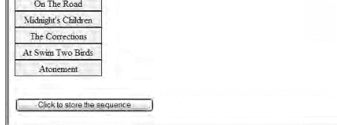

- 10. 在浏览器中拖动项目。如果你刷新页面，它会恢复到原始顺序。点击按钮，此代码现在会将新的顺序作为 XML 文档保存。关闭浏览器，然后查看新的排序顺序，如图 9-5 所示。

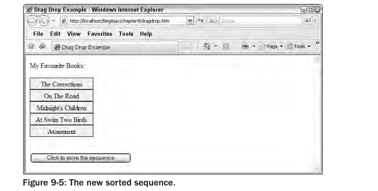

## 工作原理

这个示例包含大量代码，但让我们专注于你从头开始创建的 JavaScript 页面。不用担心拖放功能是如何处理的，因为它已整齐地封装在 `Drag.Init` API 中。列表中的每个元素都添加了 `ondrag` 事件，每当你尝试拖动列表中的元素时，该事件就会触发。

同时，让我们不考虑拖放列表元素的实际繁琐过程。这是通过计算可拖动元素的当前位置、存储坐标，并将其与列表中其他元素的存储坐标进行比较来完成的。然后，这些元素会依次被移动。

函数 `getData()` 用于加载 XML 文档并再次对其执行转换。它通过调用 `makeDnd` 方法并传递根元素（包含整个列表的元素）来提供处理拖放的脚本链接。

```javascript
function getData()
{
    if ((xHRObject.readyState == 4) && (xHRObject.status == 200))
    {
        var xmlDoc = xHRObject.responseXML;
        if (window.ActiveXObject)
        {
            // Load XML
            var xml = new ActiveXObject("Microsoft.XMLDOM");
            xml.async = false;
            xml.load("list.xml");

            //Load XSL
            var xsl = new ActiveXObject("Microsoft.XMLDOM");
            xsl.async = false;
            xsl.load("list.xsl");

            //Transform
            var transform = xml.transformNode(xsl);
            var spanb = document.getElementById("root");

            //If you refresh the page then this tag is sometimes empty.
            //This stops it causing an error and redisplays the page.
            if (spanb != null)
            {
                spanb.innerHTML = transform;
                makeDnD(document.getElementById("root"));
            }
        }
        else
        {
            var xsltProcessor = new XSLTProcessor();

            //Load XSL
            var XHRObject = new XMLHttpRequest();
            XHRObject.open("GET", "list.xsl", false);
            XHRObject.send(null);

            xslStylesheet = XHRObject.responseXML;
            xsltProcessor.importStylesheet(xslStylesheet);

            //Load XML
            XHRObject = new XMLHttpRequest();
            XHRObject.open("GET", "list.xml", false);
            XHRObject.send(null);

            xmlDoc = XHRObject.responseXML;

            //Transform
            var fragment = xsltProcessor.transformToFragment(xmlDoc, document);
            if(document.getElementById("root").innerHTML != "")
            {
                document.getElementById("root").innerHTML = "";
            }
            document.getElementById("root").appendChild(fragment);
            makeDnD(document.getElementById("root"));
        }
    }
}
```

当用户点击“保存”按钮时，会调用 SaveOrder 函数。SaveOrder 函数首先选择页面上的列表，然后创建一个包含每个列表元素的数组。提取列表中每个元素的文本并将其添加到动态创建的查询字符串中。每个书名末尾都添加了一个额外的数字，以便可以单独识别。你没有回调函数，因为控制权将由主页面接管；你只想保存文件。

```javascript
function SaveOrder()
{
    list = document.getElementById("root");
    var newlist= list.getElementsByTagName("div");
    querystring = "";
    for(var i = 0; i < newlist.length; i++) {
        querystring += "booktitle" + (i+1) + "=" + newlist[i].innerHTML;
        if (i!=newlist.length-1) querystring+="&";
    }

    querystring = encodeURI(querystring);
    XHRObject.open("GET", "SaveList.aspx?"+querystring,true);
    XHRObject.send(null);
}
```

然后，查询字符串被传递到服务器端页面。服务器端页面创建一个 XML 文档，从中派生列表顺序。它为每本书创建一个 book 元素和一个 title 元素。对于查询字符串中的每个独立值，你创建几个新元素，并将查询字符串的内容作为该元素的文本节点传递。查询字符串保留了列表的顺序，因此你可以确定当你依次提取每个项目时，你保存的是用户在屏幕上保存的项目顺序。

```csharp
XmlDocument XmlDoc = new XmlDocument();
XmlNode versionNode = XmlDoc.CreateXmlDeclaration("1.0", "ISO-8859-1",
"yes");
XmlNode mainNode = XmlDoc.CreateElement("books");
XmlDoc.AppendChild(versionNode);
XmlDoc.AppendChild(mainNode);

foreach (string key in Request.QueryString)
{
    XmlNode childNode = XmlDoc.CreateElement("book");
    XmlNode TitleNode = XmlDoc.CreateElement("title");
    TitleNode.AppendChild(XmlDoc.CreateTextNode(Request.QueryString[key]));
    childNode.AppendChild(TitleNode);
    mainNode.AppendChild(childNode);
}
XmlDoc.Save(Server.MapPath("List.Xml"));
```

XML 文档被保存，然后 JavaScript 会再次获取它并显示。通过这种方式，元素可以被拖动，但顺序仅在用户点击按钮时保存。

### 错误处理模式

使用 Ajax 的问题之一是，涉及的一些技术可能有点怪异，往好了说！即使在本书中，你可能也会遇到页面渲染延迟或页面根本不渲染的情况。这很可能是由一个小的输入错误或页面名称拼写错误造成的，在这种情况下，你需要你的应用程序比一遇到麻烦就崩溃更具健壮性。调试和错误处理的过程在第 6 章中有更详细的讨论，但出于本讨论的目的，让我们考虑一些应用程序应该能够处理的常见场景。如果你犯了错误，以下三种结果之一是可能的：


## 第 9 章：模式

- 404 — 页面未找到错误
- 302 — 已找到 — 请求重定向许可
- 200 — 无错误，但页面不显示

让我们先处理最后一种错误，因为模式对此确实无能为力。这意味着服务器端代码或`XMLHttpRequest`对象调用的代码存在错误。`responseText`和`responseXML`属性将为空。这通常可归因于代码中的逻辑错误。它表明代码已正确执行，但未返回结果。在这种情况下，`XMLHttpRequest`对象的status属性将为200。然而，前两个响应处理起来要容易得多。

### 问题

如果`XMLHttpRequest`对象返回的`readyState`为4，但返回的status不是200，应该采取什么措施？

### 模式

`XMLHttpRequest`对象经历一系列阶段：初始化对象、发送数据、再次接收响应。它从0到4变化。通常，你会期望status属性返回200的同时，`readyState`返回4。但如果这没有发生，可能会导致脚本崩溃，因为一旦返回了`readyState`为4，`readyState`将不会改变，除非重置。

有两种可能的解决方法。第一种是完全取消请求；第二种是继续尝试指定的时间（或请求次数）。现在让我们看看两种场景的实际示例。

在本章的第一个示例中，你使用`XMLHttpRequest`对象通过将`UserName`与已包含一组用户名的数据库进行比对来执行某种表单验证。互联网上的瞬时状况可能导致你无法返回200的状态。在这种情况下，必须采取其他措施。让我们通过将`XMLHttpRequest`对象调用的文件名更改为不存在的文件来模拟这些情况。在状态不等于200的情况下，让我们显示第三个备选消息。

#### 试一试：取消请求

要练习取消请求，请按以下步骤操作：

1. 回到`formvalidation.htm`，按如下方式修改代码，并将其保存为`formvalidation2.htm`：

```
<head>
    <title>Form Validation Example</title>
    <link id="Link1" rel="stylesheet" href="FormValidation.css" type="text/css" />
    <script type="text/javascript" src="FormValidation2.js"></script>
</head>
```

2. 打开`formvalidation.js`，并修改其中的两个函数。按如下方式更改`GetData()`：

```
if ((xHRObject.readyState == 4))
{
    if (xHRObject.status == 200)
    {
        var serverText = xHRObject.responseText;
        if (serverText == "True")
        {
            span.innerHTML = "This user name has already been taken";
            NameTaken = "True";
        }
        if (serverText == "False")
        {
            span.innerHTML = "This user name is available";
            NameTaken = "False";
        }
    }
    else
    {
        span.innerHTML = "We cannot currently assess whether this user name is taken or not. It will be checked when you submit the form";
        xHRObject.abort();
    }
}
```

3. 接下来，找到函数`Validate`，并按以下高亮显示的行更改代码。（确保你引用的文件实际上不存在。）

```
function Validate(data)
{
    var newform = document.forms[0];
    var bodyofform = getBody(newform, data);
    if (bodyofform != "UserName=")
    {
        xHRObject.open("POST", "thisfiledoesntexist.php", true);
        xHRObject.setRequestHeader("Content-Type", "application/x-www-form-urlencoded");
        xHRObject.onreadystatechange = getData;
        xHRObject.send(bodyofform);
    }
    else
    {
        span.innerHTML = "Blank user names not allowed";
    }
}
```

4. 将其保存为`formvalidation2.js`。
5. 在浏览器中打开`formvalidation2.htm`，输入任意用户名，然后移动到另一个文本框而不点击提交（图 9-6）。

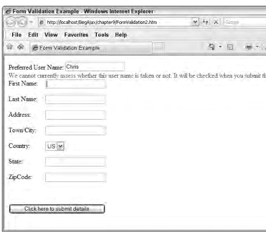

**图 9-6：** 在`formvalidation2.htm`页面中输入用户名。

## 工作原理

本示例涉及调整代码以故意返回404状态。你还必须修改代码以处理这种情况。

首先，你必须将`readyState`的检测与status的检测分开。现在将它们作为两个独立的`if`子句进行评估，一个嵌套在另一个内部。

```
if ((xHRObject.readyState == 4))
{
    if (xHRObject.status == 200)
    {
```

最内层的`if`子句现在将有一个单独的`else`子句。你将它们分开，是因为`readyState`会发生变化，并且此函数会在`readyState`从0变为4的过程中被触发多次。在返回`readyState`为4之前，你不知道status属性将返回什么。因此，你必须将`if`子句分开。

在`else`子句中，你提供单独的消息作为`innerHTML`属性，并通过调用`abort`方法清除`XMLHttpRequest`对象。

```
else
{
    span.innerHTML = "We cannot currently assess whether this user name is taken or not. It will be checked when you submit the form";
    xhrObject.abort();
}
```

实际上就这么简单。但是，例如，如果你想继续尝试查看status是否等于200，会发生什么呢？

在本章前面的服务器轮询示例中，你持续轮询服务器以获取响应。在这些情况下，服务器返回的某个响应很可能返回除200以外的状态（例如，如果服务器宕机）。在这种情况下，你可能希望继续轮询服务器并显示旧信息，但让用户知道屏幕上显示的信息已过时。让我们现在就这样做。

#### 试一试：重试多次

要练习重试多次，请按以下步骤操作：

1. 打开页面`polling.htm`，按如下方式更改，并将其保存为`polling2.htm`：

```
<head>
    <title>Polling The Server Example</title>
    <link id="Link1" rel="stylesheet" href="Polling.css" type="text/css" />
    <script type="text/javascript" src="polling2.js"></script>
</head>
```

2. 打开脚本`polling.js`，修改函数`GetData`，并按如下方式进行修改，添加灰色高亮显示的部分：

```
if (xhrObject.readyState == 4)
{
    if (xhrObject.status == 200)
    {
        // Load XML
        var xml = loadDocument("Stocks.xml");
        // Load XSL
        var xsl = loadDocument("Stocks.xsl");
        // Transform
        document.getElementById("Stocks").innerHTML = transformToHTML(xml, xsl);
        // Clear the object and call the getDocument function in 5 seconds
        setTimeout("getDocument()", 5000);
    }
    else
    {
        var Stocks = document.getElementById("Stocks");
        if (Stocks.innerHTML.indexOf("available") == -1)
        {
            Stocks.innerHTML += "<br/><span>Current stock information not available, currently showing the last available data</span>";
        }
        xhrObject.abort();
        setTimeout("getDocument()", 5000);
    }
}
```

3. 将其保存为`polling2.js`。
4. 在浏览器中查看，不做任何更改。它应该与轮询服务器的示例一样工作。
5. 接下来，进入你的Web服务器（无论是Apache还是IIS），并为该应用程序关闭服务器。完成后，在IIS中你会看到如图 9-7 所示的屏幕。


**图 9-7：** 从IIS停止Web服务器。

6. 在浏览器中查看`polling2.htm`，如图 9-8 所示。


**图 9-8：** 在浏览器中查看`polling2.htm`页面。

7. 返回服务器，重新启动服务器。消息将出现，信息将再次更新。


## 工作原理

允许您再次尝试的功能已经存在于页面中。getDocument() 方法每五秒被轮询一次。相反，你必须做的是在 JavaScript 处理 XMLHttpRequest 对象的响应的末尾添加一些额外的错误处理。

再次，你必须将这两个子句分开。第一个检查就绪状态是否等于 4，而第二个检查状态是否为除 200 以外的其他值。

```javascript
if (xhrObject.readyState == 4) {
    if (xhrObject.status == 200)
    {

    }
```

然后，在子句的末尾，你添加一个 else 子句。这个子句必须处理来自 XMLHttpRequest 对象未返回任何信息的事实。你应该获取上一次运行的数据。在这种情况下，你需要使用 document.getElementById 方法抓取信息。

```javascript
else {
    Stocks = document.getElementById("Stocks");
    if (Stocks.innerHTML.indexOf("available") == -1) {
        Stocks.innerHTML += "<br/><span>当前股票信息不可用，当前显示的是上次可用的数据</span>";
    }
    xhrObject.abort();
    setTimeout("getDocument()", 5000);
```

接下来，你有一个小问题需要处理。你想将一条消息追加到现有信息的底部；然而，你还想在 else 子句结束时轮询服务器。如果 XMLHttpRequest 对象连续几次迭代返回没有数据，那么你将不断打印该消息的新版本。相反，你检查已打印的信息是否包含单词 "available"。（注意，不一定是这个单词，但这是一个容易扫描的简单词。）如果不存在，则使用 innerHTML 例程将关于旧信息的消息追加到股票数据的底部。如果存在，则只需跳过该部分。

最后，你调用 abort() 来清除对象，然后调用 getDocument() 通过 5,000 毫秒的超时来启动整个循环。

### 总结

本章没有理论化，因为涉及的模式非常简单。

讨论首先查看了表单验证模式，它使用 onblur 事件来触发一个脚本，该脚本使用 Ajax 来识别 UserName 是否已在 Access 数据库中已被占用。通过这种方式，你可以向用户显示关于首选用户名选择的其他信息。

## 第 9 章：模式

第二个示例使用了鼠标悬停库来查询 XML 文档（尽管它也可以很容易地是一个数据库），然后将此内容注入到鼠标悬停框中。

第三个示例展示了如何使用 ``XMLHTTPRequest`` 对象连续轮询服务器页面，以及如何将此信息流式传输回页面以进行更新，而不需要刷新。

第四个示例使用了两个更多的库来为列表提供拖放功能，并使用 Ajax 将保存的顺序存储在 XML 文档中的列表。

最后，本章考虑了两种错误处理模式，这些模式允许你处理 ``XMLHttpRequest`` 对象返回状态不是 200 的情况。

第 10 章更详细地检查了如何使用 Ajax 利用外部资源（如新闻源）。

### 练习

附录 A 中找到了这些问题的建议解决方案。

1.  修改表单验证示例，使得如果用户请求的 UserName 已经被占用，则无法提交表单。
2.  修改最终的重试示例，使其不再显示消息，而是计数 10 次，然后完全不显示任何股票信息。随后显示一条新消息告诉用户当前信息不可用。

# 处理外部数据

今天 Web 上用于共享数据的用途最广泛的格式之一是特定格式并聚合为新闻源的 XML 文件。这些 XML 文件可用于让访问者预览网站或博客的最新内容，包括最新信息的描述和链接。虽然这些 XML 文件通常用于新闻，但它们也可用于任何可分离成独立信息项的内容。

一种访问这些 XML 文件的方法是使用桌面阅读器并订阅你感兴趣站点和博客的可用的源。如果你的自有站点内容经常发生变化，你可以为你的站点创建 XML 馈源并将它们注册到 RSS 目录中。

你也可以使用 Ajax 在自己的站点上创建在线馈源阅读器，从 XML 馈源检索数据。当你向服务器发出 Ajax 请求时，你可以通过两种不同方式从服务器响应检索数据：

-   你可以使用 ``XMLHttpRequest`` 对象的 `responseXML` 属性以 XML 格式访问数据。
-   你可以使用此对象的 `responseText` 属性以字符串格式访问数据。

选择取决于你想对数据做什么。如果你想获取单个变量值，你可以使用 JavaScript 的 `getElementsByTagName` 方法从 XML 文件中提取值，该方法也适用于 XML 标签以及 HTML/XHTML 标签。如果你想检索添加到页面的 HTML 或 JavaScript 代码，你可以将代码提取为字符串数据。

本章提供对不同类型用于馈源的 XML 格式的深入了解，包括如何从这些文件中提取数据并将其添加到网页，以及如何使用 Ajax 和 PHP 为你的站点添加馈源阅读器。

## 第 10 章：处理外部数据

在本章中，你将学习

-   聚合和 XML 源 — RSS 0.9x、RSS 2.0、RSS 1.0、Atom 1.0
-   从 XML 源提取数据 — 提取 XML 数据和提取字符串数据
-   构建在线馈源阅读器 — 创建 Ajax 请求，解析服务器响应，并在网页上显示来自响应的数据

## 处理 XML 新闻源

与 Web 的许多方面一样，XML 新闻源自 1998 年首次在 Internet Explorer 4.0 中作为 Active Channels（活动通道）引入以来，已经演变并发生变化。Active Channels 是用户通过在线订阅聚合和提供有关站点内容更新的第一种方式。Channel 并没有真正流行起来，主要是因为内容充满了广告并且带宽很重。然后，在 1999 年，Netscape 推出了 My Netscape 门户，旨在收集来自选定站点的最新新闻的定制集合，并通过链接和描述访问 My Netscape 门户页面上的此信息信息。作为 MyNetscape 项目的一部分，Netscape 开发了名为*资源描述框架（RDF Site Summary）*(RSS) 的 XML 格式。这个版本的 RSS 后来被称为 RSS 0.9，是基于万维网联盟 (W3C) 对一种 XML 语言的推荐，称为*资源描述框架（RDF Resource Description Framework）*。

RSS 0.9 格式的修改由 UserLand 的 Dave Winer 进行，用于他的站点 Scripting News 的新闻格式。同年稍晚时候（1999 年），Blogger 引入了一种免费的基于 Web 的工具来创建 RSS 文件，这样用户就不需要手动为新闻源创建 XML 文件了。事实上，要成功使用此工具，用户根本不需要知道如何编码。RSS 格式的修改和 Blogger 等工具的推出是将博客（Web 日志）演变成当今流行的短日录形式的主要力量。

随后发生了两条独立的 RSS 开发路线：一条线（RSS 1.0）紧密基于 RDF，另一条线（包括 RSS 0.9x 和 RSS 2.0）旨在排除许多 RDF 格式的复杂性。

伴随着不同形式的 RSS 还有关于 RSS 缩写的不同含义，包括以下内容：

-   *富网站摘要* (Rich Site Summary, RSS 0.91)
-   *资源描述框架站点摘要* (RDF Site Summary, RSS 0.9 和 RSS 1.0)
-   *简单聚合* (Really Simple Syndication, RSS 2.0)

在 2003 年，Dave Winer 将 RSS 2.0 的版权转移给哈佛大学，并从这一点起有意停止了该线的开发。对 RSS 2.0 的不满意以及无法对其进行进一步修改，促成了另一种 XML 聚合语言的诞生和开发，命名为 Atom。Atom 项目最终移至 *互联网工程任务组（IETF Internet Engineering Task Force）*，并且 Atom 1.0 作为提议的 IETF 标准于 2005 年 12 月发布。

目前，RSS 2.0 是用于新闻源的最广泛使用的 XML 格式。Atom 1.0 是最新的竞争者，并被 Google 和 Movable Type 以及许多其他方采用为 RSS 替代品。许多博客（如 Peter-Paul Koch 的 Elsewhere on the 'Net 博客）提供 RSS 或 Atom 格式的源，如图 10-1 所示。如果你想从新闻源中提取数据，了解这些格式的结构很有用。


## 第10章：处理外部数据


图10-1：互联网上的另一方天地。

> 关于XML新闻源曲折且充满争议的历史的更多信息，请参阅 www.rss-specifications.com/history-rss.htm 上的“RSS历史”和 http://diveintomark.org/archives/2004/02/04/incompatible-rss 上的“RSS兼容性的神话”。

### RSS 0.9x

所有RSS文件都是XML文件，它们以XML声明开头：

```
<?xml version="1.0"?>
```

有关XML结构和语法的更多信息，请参阅第5章“处理XML”。

RSS 0.9x（即RSS 0.91、RSS 0.92、RSS 0.93和RSS 0.94）文件有一个`rss`根元素，其中包含一个`channel`元素，该元素容纳了文档的其余部分：

```
<rss version="0.91">
  <channel>
    ...
  </channel>
</rss>
```

`channel`有五个必需的子元素：

- `title` — 源的名称
- `link` — 与源相关联的网站的URL
- `description` — 频道的文本描述
- `language` — 源所使用的语言代码
- `image` — 源的图形图标的描述

`channel`元素还有几个可选的子元素（例如`copyright`元素），如果你正在创建RSS文件，这些元素很重要。然而，通常这些元素不包含你想从文件中提取的数据。

尽管RSS 0.9x中并非必需，但XML新闻源最重要的部分是`item`元素。`item`元素包含两个必需的子元素：

- `title` — 包含内容项的标题
- `link` — 包含内容项的URL

`item`元素还包含一个可选元素：

- `description` — 包含项内容的文本摘要，最多500个字符

以下代码是一个RSS 0.91文件，用于一个假想的新闻源，包含一个`item`元素。

> 此文件采用Userland RSS 0.91格式。还有一种使用文档类型定义（DTD）的Netscape RSS 0.91格式。

```
<?xml version="1.0"?>
<rss version="0.91">
  <channel>
    <title>My Channel</title>
    <link>http://www.mySite.com/</link>
    <description>My News</description>
    <language>en</language>
    <copyright>2006, Lucinda Dykes</copyright>
    <image>
      <title>My Logo</title>
      <url>http://www.silkcreek.net/graphics/sc_logo.jpg</url>
      <link>http://www.wilkcreek.net</link>
      <width>90</width>
      <height>67</height>
    </image>
    <item>
      <title>Earth Headed for Warmest Temps in a Million Years</title>
      <link>http://dailynews.att.net</link>
      <description>In about 45 years, temperatures on Earth will be hotter than at
anytime during the past one million years, says the U.S. government's top
climatologist in a new report released today.
      </description>
    </item>
  </channel>
</rss>
```

通常，你想从RSS文件中提取的信息包括`item`元素的标题、链接和描述：

```
<item>
  <title>Earth Headed for Warmest Temps in a Million Years</title>
  <link>http://dailynews.att.net</link>
  <description>In about 45 years, temperatures on Earth will be hotter than at anytime during the past one million years, says the U.S. government's top climatologist in a new report released today.
  </description>
</item>
```

对于RSS 0.9x，`item`元素是`channel`元素的子元素。

RSS 0.9x系列的最后一个版本是RSS 0.94，于2002年8月发布。不久之后，2002年9月发布了最受欢迎的RSS版本——2.0。

> 为增加RSS历史的整体混乱感，版本编号并不总是按时间顺序排列。RSS 0.93和RSS 0.94都是在RSS 1.0之后发布的。

### RSS 2.0

RSS 2.0与RSS 0.9x非常相似。RSS 2.0的一个主要新增功能是可选的命名空间模块。命名空间是在特定XML文档中定义的XML元素词汇表。命名空间提供了一种使用在不同XML文件中定义的同名元素的方法。在源文件中使用的命名空间在`rss`元素中声明。命名空间声明包括一个前缀，用于标识来自该命名空间的元素，如下例所示：

```
<?xml version="1.0"?>
<rss version="2.0" xmlns:radio="http://backend.userland.com/radioWeblogPostModule">
```

将此命名空间添加到`rss`元素，使你能够添加来自`radioWeblogPostModule`命名空间的元素。在源文件中，来自该命名空间的元素使用`radio`前缀标识。例如，`radioWeblogPostModule`包含一个`id`元素：

```
<item>
  <title>Earth Headed for Warmest Temps in a Million Years</title>
  <link>http://dailynews.att.net</link>
  <description>In about 45 years, temperatures on Earth will be hotter than at anytime during the past one million years, says the U.S. government's top climatologist in a new report released today.</description>
  <radio:id>68795874989</radio:id>
</item>
```

请注意，包含在命名空间声明中（`xmlns:radio`）的`radio`前缀也包含在源文档中使用的任何来自该命名空间的元素（`radio:id`）的开始和结束标签中。该前缀标识该元素是`radioWeblogPostModule`命名空间的成员。

*有关RSS 2.0/2.01命名空间模块的更多信息，请参阅 http://blogs.law.harvard.edu/tech/directory/5/specifications/rss20ModulesNamespaces。*

在RSS 2.0中，RSS文件的整体结构与早期版本略有不同。RSS 2.0文件仍然包含一个`rss`根元素，其中包含一个`channel`元素，该元素容纳了文档的其余部分，但`channel`的唯一必需子元素是`title`、`link`和`description`。`channel`元素中可以包含任意数量的`item`元素。每个`item`元素中必须包含至少一个`title`或`description`元素，但除此之外，`item`元素没有其他必需的子元素。

RSS 2.0中包含`channel`元素和`item`元素的几个额外的可选子元素。更多详细信息，请参阅 http://blogs.law.harvard.edu/tech/rss 上的RSS 2.0规范。

以下是RSS 2.0格式的假想新闻源。`image`元素现在是可选的，因此未包含在内，并且添加了一个新的可选元素`comments`，用于指定项的评论页的URL。除此之外，该文件与RSS 0.91版本几乎完全相同。

```
<?xml version="1.0"?>
<rss version="2.0">
  <channel>
    <title>My Channel</title>
    <link>http://www.mySite.com/</link>
    <description>My News</description>
    <language>en</language>
    <copyright>2006, Lucinda Dykes</copyright>
    <item>
      <title>Earth Headed for Warmest Temps in a Million Years</title>
      <link>http://dailynews.att.net</link>
      <description>In about 45 years, temperatures on Earth will be hotter than at anytime during the past one million years, says the U.S. government's top climatologist in a new report released today.</description>
      <comments>http://myNews.com/entry/6743/notes</comments>
    </item>
  </channel>
</rss>
```

> RSS 2.0的可选`enclosure`元素可用于创建播客源文件。RSS 2.0 *播客*是使用RSS 2.0 `enclosure`元素指定在线媒体文件位置的源。播客阅读器用于订阅播客源并下载源中包含的URL处的媒体文件。尽管Atom 1.0也可用于播客，但RSS 2.0目前仍然是首选的播客格式。

### RSS 1.0

RSS 1.0是W3C于2000年发布的一项规范。RSS 1.0基于W3C的*资源描述框架（RDF）*规范。RDF是一种XML语言，用于提供关于Web上资源的*元数据*。元数据是描述和建模其他数据的数据。

RSS 1.0是RDF的轻量级版本，但它比RSS 0.9x或2.0更复杂。


# 第十章：处理外部数据

```
<?xml version="1.0"?>
<rdf:RDF xmlns:rdf="http://www.w3.org/1999/02/22-rdf-syntax-ns#"
xmlns="http://purl.org/rss/1.0">
  <channel rdf:about="http://www.mySite.com/mySite.rdf">
    <title>My Channel</title>
    <link>http://www.mySite.com/</link>
    <description>My News</description>
    <image rdf:resource="http://www.silkcreek.net/graphics/sc_logo.jpg" />
    <items>
      <rdf:Seq>
        <li rdf:resource="http://dailynews.att.net" />
      </rdf:Seq>
    </items>
  </channel>
  <image rdf:about="http://www.silkcreek.net/graphics/sc_logo.jpg">
    <title>My Logo</title>
    <url>http://www.silkcreek.net/graphics/sc_logo.jpg</url>
    <link>http://www.silkcreek.net</link>
  </image>
  <item rdf:about="http://dailynews.att.net">
    <title>Earth Headed for Warmest Temps in a Million Years</title>
    <link>http://dailynews.att.net</link>
    <description>In about 45 years, temperatures on Earth will be hotter than at
anytime during the past one million years, says the U.S. government's top
climatologist in a new report released today.
    </description>
  </item>
</rdf:RDF>
```

这个虚构的 RSS 1.0 新闻源与 RSS 0.9x 或 2.0 版本有很大不同。其根元素是 `rdf:RDF`，并使用了来自 `rdf` 命名空间的几个属性来指定与源项目相关的资源位置。`item` 元素并未包含在 `channel` 元素内。相反，`channel`、`image` 和 `item` 元素都是根元素 `rdf:RDF` 的子元素。

RSS 1.0 的复杂性可能是它在 XML 源的 RSS 格式中流行度最低的主要原因。

### Atom

Atom 1.0 联合格式是 XML 联合语言的最新成员，它与任何版本的 RSS 都有很大不同。由于 Atom 也是 XML，其基本结构类似于任何 XML 文件，但 Atom 使用了与 RSS 不同的根元素（`feed`），并且包含其他重要差异。

```
<?xml version="1.0"?>
<feed xmlns="http://www.w3.org/2005/Atom" xml:lang="en">
```

`feed` 元素包含三个必需的子元素：

- `id` — 源的永久 URL
- `title` — 源的名称
- `updated` — 源的最后更新时间

```
<feed xmlns="http://www.w3.org/2005/Atom" xml:lang="en">
    <id>http://www.mySite.com</id>
    <title>My News</title>
    <updated>2006-09-13T12:00:00Z</updated>
```

代替 `item` 的是使用 `entry` 元素。此元素包含三个必需的子元素：

- `id` — 条目的 URL
- `title` — 条目的名称
- `updated` — 条目的最后修改时间

`summary` 元素是 `entry` 的可选子元素，类似于 RSS `item` 中使用的 `description` 元素。

```
<entry>
    <id>http://mySite.com/entry/6743/</id>
    <title>Earth Headed for Warmest Temps in a Million Years</title>
    <updated>2005-07-15T12:00:00Z</updated>
    <summary>In about 45 years, temperatures on Earth will be hotter than at anytime during the past one million years, says the U.S. government's top climatologist in a new report released today.</summary>
</entry>
```

Atom 联合格式中还有许多其他可选元素，但一个 Atom 文件可以像下面这个虚构新闻源的 Atom 1.0 文件一样简单：

```
<?xml version="1.0"?>
<feed xmlns="http://www.w3.org/2005/Atom" xml:lang="en">
    <id>http://www.mySite.com</id>
    <title>My News</title>
    <updated>2006-09-13T12:00:00Z</updated>
    <entry>
        <id>http://mySite.com/entry/6743/</id>
        <title>Earth Headed for Warmest Temps in a Million Years</title>
        <updated>2005-07-15T12:00:00Z</updated>
        <summary>In about 45 years, temperatures on Earth will be hotter than at anytime during the past one million years, says the U.S. government's top climatologist in a new report released today.</summary>
    </entry>
</feed>
```

Atom 1.0 支持纯文本、HTML、XHTML、XML 和 base-64 编码的二进制内容（例如用作电子邮件文档的传输编码）。Atom 还包含无障碍功能及其自己的 MIME 媒体类型 `application/atom+xml`。有关 Atom 1.0 格式的更多详细信息，请参阅 `www.atomenabled.org/developers/syndication/` 上的“Atom 联合格式”。

### 从 XML 源提取数据

XML 新闻源（无论是 RSS 格式还是 Atom 格式）都是一个 XML 文件。你可以选择以 XML 形式或字符串数据形式提取源中的数据，使用 `XMLHttpRequest` 对象的 `responseXML` 或 `responseText` 属性来处理对 Ajax 请求的服务器响应。

#### 提取 XML 数据

在本节中，你将使用虚构新闻源文件的 RSS 2.0 版本，并将从该文件中以 XML 形式提取数据。在本章后面的“创建 Ajax 源阅读器”动手实践中，你将学习如何使用 PHP 将实际的 XML 源文件加载到在线 Ajax 源阅读器应用程序中。

#### 动手实践：从 XML 源提取 XML 数据

在此示例中，你创建一个 `XMLHttpRequest` 对象，用于从服务器检索 RSS 2.0 格式（feed.xml）的 XML 文档。将以下代码键入你的文本编辑器，并将其保存为 `ch10_examp1.htm`。当用户单击“提取”按钮（图 10-2）时，源文件中项目的 `title`、`link` 和 `description` 数据将被添加到页面上选定的 `span` 元素中，如图 10-3 所示。

```
<!DOCTYPE html PUBLIC "-//W3C//DTD XHTML 1.0 Transitional//EN"
"http://www.w3.org/TR/xhtml1/DTD/xhtml1-transitional.dtd">
<html xmlns="http://www.w3.org/1999/xhtml">
<head>
<meta http-equiv="Content-Type" content="text/html; charset=iso-8859-1" />
<title>Extracting XML from a news feed</title>
<script language = "javascript">
var request = makeHTR();

function makeHTR()
{
  var request;
  if(window.XMLHttpRequest)
  {
    try
    {
      request = new XMLHttpRequest();
    }
    catch (e)
    {
      request = null;
    }
  }
  else
  {
    try
    {
      request = new ActiveXObject("Microsoft.XMLHTTP");
    }
    catch (e)
    {
      request = null;
    }
  }
}
```

```
if (!request)
{
    alert("Error creating the XMLHttpRequest object.");
}
else
{
    return request;
}

function sendRequest()
{
    if (request.readyState == 4 || request.readyState == 0) {
        request.open("GET", "feed.xml", true);
        request.onreadystatechange = processResults;
        request.send(null);
    }
}

function processResults() {
    if (request.readyState == 4)
    {
        if (request.status == 200)
        {
            var xmlDocument = request.responseXML;
            var channelNodes = xmlDocument.documentElement.firstChild.childNodes;
            var item = channelNodes[5].childNodes;
            var title = item[0].firstChild.nodeValue;
            document.getElementById('title').innerHTML = title;
            var link = item[1].firstChild.nodeValue;
            document.getElementById('link').innerHTML = link;
            var description = item[2].firstChild.nodeValue;
            document.getElementById('description').innerHTML = description;
        }
        else
        {
            alert("There was a problem accessing the server: " + request.statusText);
        }
    }
}
</script>
</head>
<body>

<h1>Get Feed Results</h1>
<form>
    <input type="button" id="feedR" value = "Extract">
</form>

<h4>Title: <span id="title"></span></h4>
<h4>Link: <span id="link"></span></h4>
<h4>Description: <span id="description"></span></h4>
<script type="text/javascript">
var myDoc = document.getElementById('feedR');
myDoc.onclick = sendRequest;
</script>
</body>
</html>
```


图 10-2：选择“提取”按钮。


图 10-3：源文件中的项目数据已添加到选定的 span 元素中。

333


# 第10章：使用外部数据

将以下代码输入到你的文本编辑器中，并将其保存为 `feed.xml`：

```xml
<?xml version="1.0"?>
<rss version="2.0">
    <channel>
      <title>My Channel</title>
      <link>http://www.mySite.com/</link>
      <description>My News</description>
      <language>en</language>
      <copyright>2006, Lucinda Dykes</copyright>
        <item>
        <title>Earth Headed for Warmest Temps in a Million Years</title>
        <link>http://dailynews.att.net</link>
        <description>In about 45 years, temperatures on Earth will be hotter than at any time during the past one million years, says the U.S. government's top climatologist in a new report released today.</description>
        <comments>http://myNews.com/entry/6743/notes</comments>
      </item>
    </channel>
  </rss>
```

`Ch10_examp1.htm` 和 `feed.xml` 这两个文件都需要位于你的服务器上，Ajax 请求才能正常工作。将这两个文件复制到你的 Web 服务器根文件夹中 `BegAjax` 文件夹的 `Chapter10` 子文件夹内（例如，如果你使用的是 IIS，根文件夹就是 `wwwroot` 文件夹；如果你使用的是 Apache，则是 `htdocs` 文件夹）。

## 工作原理

当浏览器解析 `Ch10_examp1.htm` 页面时，页面头部脚本块中的 `makeHTR()` 函数会被立即调用，并创建一个 `XMLHttpRequest` 实例存储在名为 `request` 的全局变量中。

```javascript
<script language = "javascript">var request = makeHTR();</script>
```

`makeHTR()` 函数创建一个名为 `request` 的局部变量，然后检查浏览器是否支持 `XMLHttpRequest` 对象。如果支持，则创建一个新的 `XMLHttpRequest` 对象实例。如果新实例未能创建，`request` 变量的值将在 `catch` 语句块中被设置为 `null`。

> 有关错误处理以及使用 `try` 语句和 `catch` 子句的更多详情，请参阅第6章“调试与错误处理”。

```javascript
var request;
if (window.XMLHttpRequest) 
{
    try
    {
      request = new XMLHttpRequest();
    }
    catch (e)
    {} // 注意：原始文本结构在此处建议使用'break'或块逻辑结束，为清晰起见简化，同时保留意图。
}
```

如果浏览器是 Internet Explorer 5 或 6，它不支持 `XMLHttpRequest` 对象；`makeHTR()` 函数的下一部分将创建一个新的 `ActiveXObject` 实例。如果新实例未能创建，`request` 变量的值将在 `catch` 语句块中被设置为 `null`。

```javascript
else 
{  
    try   
    {       
        request = new ActiveXObject("Microsoft.XMLHTTP");   
    }     
    catch (e)      
    {        
         // 注意：在 IE 的原始代码上下文中，'break'关键字通常放在此处或隐式处理，为标准结构简化。
       request = null;  
     }; 
}   
```

然后，`makeHTR()` 函数会检查新的对象实例（`request`）是否已创建。如果 `request` 未被创建，则会使用警报显示一条错误消息。否则，将返回新对象。

```javascript
if (!request) 
{
    alert("Error creating the XMLHttpRequest object.");
}else {   
   return request;}; 
}
```
在页面主体中使用带有 `id` 属性的 `span` 元素创建了三个占位符。这些占位符将用于显示从 feed 中提取的数据。

```html         
<h4>Title: <span id="title"></span></h4>        
  <h4>Link:<span id="link"></span</h4>       
   <head>Description:**;<p><spani d"descripton</span>)
      <form>
        <input type = "button"id= feedR valus="Extract">   
       </form>  
```
使用传统的事件注册来注册点击事件，而不是在 input 标签中包含 `onclick` 属性。

```javascript
   
<script type ="text/javascript"><var myDoc = document.getElementById('feedr');my doc onclick sendRequest <script>      
     
    if (!request)   
     {}
   }       
}  
```
305

# 第10章：使用外部数据

当用户单击“Extract”按钮并调用 `sendRequest()` 函数时，会使用一个 `if` 语句来检查请求对象的状态。如果请求对象的 readyState 属性值为 4（完成）或 0（未初始化），则请求对象可用，并发起一个新的 HTTP 请求。XMLHttpRequest 对象的 open 方法被调用来从 XML 文档 feed.xml 请求数据。此方法使用三个参数：

+ 用于请求的 HTTP 方法（例如 "GET"）
+ 文档的 URL（例如 "feed.xml"）
+ 一个布尔值，指示调用是否为异步

```javascript
   
       function sendRequest()   
    4.0689157329,
        open( "GET". "feed.xml": 
     ```

当 XMLHttpRequest 对象的 `readyState` 属性发生变化时（即数据开始下载时），将调用 `processResults()` 函数来处理从服务器返回的数据。

```javascript
   
request.readystate = proceesresults:
    request.send(null)  
```
一旦请求对象的 readyState 属性发生变化，就会调用 `processResults()` 函数。如果 `readyState` 属性等于 4，则表示从服务器的下载已完成。作为额外检查，状态属性等于 200 也表示请求已成功处理。

```javascript
  
function ProcessRe sults)      
   if (request.readyState==4}       
       {            
           //处理数据
       }        
    functionProcessResults()    
        i f(request.status-20o  
     ```        

下载完成后，`responseXML` 属性用于将数据作为 XML 存储在名为 `xmlDocument` 的变量中。

```javascript
  
varxmlDocament = request.responsetext:     
  var chann elnodes=xmldocument.docu
    mentElement.firstChild.childNodes;        
   Variom ChannelNodes[5].childNodes;          
```
文档元素是 XML 文档的根元素。在这种情况下，就是 rss 元素。rss 元素的第一个子元素是 channel 元素。channel 元素包含一个由六个子节点组成的数组。

# 第10章：使用外部数据

子节点数组的索引值从 0 到 5。channel 元素的最后一个子节点，即 item 元素，其数组索引值为 5。item 元素也包含一个由四个子节点组成的数组，数组索引值从 0 到 3。

> 此示例在 Internet Explorer 中工作正常；但是，基于 Mozilla 的浏览器会将 XML 文档中的空白视为文本节点。当你在基于 Mozilla 的浏览器中访问 rss 元素的 firstChild 时，你访问的是空白文本节点，而不是 channel 元素。你可以考虑空白，并使用 family 关系跳过这些空白文本节点。有关此方法的更多信息，请参阅第5章。
你也可以添加代码来删除 xml 文档中的所有空白，而不是处理这些日益繁琐的 family 关系。另一种在基于 Mozilla 的浏览器中解决空白问题的方法是使用服务器端语言（如 PHP）从 XML 文档中提取数据，而不是像本章稍后你将看到的那样使用 JavaScript 遍历 DOM。

```javascript
var title=item[O].firstchild.nodevalue; 
document.getelem entbyid('title').innerHTML = tile varlink-item(l).firslChild.noDeValue; docurmentgetelemt byid(link'.innerHTML link: vardescriptioniteml2].. fir stChild.nodeVa lue:  
   document.getElementbyId(description.in n erHle description
```

item 元素的第一个子节点是 title 元素。title 元素的第一个子节点是包含 title 元素内容的文本节点。该节点的值被赋给 `title` 变量。`document.getElementById` 方法用于定位 id 值为 title 的 span 元素，然后使用 `innerHTML` 属性通过该元素将数据赋给 span 元素。link 元素和 description 元素也使用相同的序列。

```javascript
else  
    {          
        alert" ThereWasap roblemaccessingthsever: +request.statustext)" 
       }         
```

如果状态码不等于 200，则下载不成功，并使用警报通过 XMLHttpRequest 对象的 `statusText` 属性（包含 HTTP 响应状态文本）显示一条错误消息。

### 提取字符串数据
你可以使用 xmlRequest 对象的 `responseText` 属性从 XML 新闻源文件中提取字符串数据。不过，用 JavaScript 处理这些数据并提取特定数据添加到页面中是困难的。例如，在之前示例中使用的 Ch10_examp1.htm 文件中，如果你将 `responseXML` 属性更改为 `responseText`，并尝试使用 `innerHTML` 属性将该数据添加到页面上的一个 span 中，你最终会得到一个未分化的字符串，其中主要包含 XML 文件的文本内容，如图 10-4 和 10-5 所示。


## 第10章：处理外部数据

```
var xmlDocument = request.responseText;
document.getElementById('response').innerHTML = xmlDocument;
...
<h4>响应： <span id="response"></span></h4>
```


图10-4：使用 `responseText` 提取数据。


图10-5：使用 `responseText` 返回一个未分化的字符串。

## 第10章：处理外部数据

### 使用 Ajax 构建在线订阅源阅读器

使用新闻源和源阅读器的主要原因，是为了提供一种访问频繁变化的在线内容的手段。你可以创建一个 Ajax 应用程序，该程序包含用于请求 XML 新闻源文件的 JavaScript，用于在将数据添加到页面之前从新闻源中提取和处理数据的 PHP，以及用于在页面上显示提取数据的 XHTML 和 CSS。对于这个应用程序，你将为应用程序的每个部分（XHTML、CSS、JavaScript 和 PHP）使用单独的文件。此应用程序可在 Internet Explorer 6 和 7 以及 Firefox 中运行。

#### 动手试试

##### 创建一个 Ajax 源阅读器

在这个示例中，你将使用一个外部 JavaScript 文件来创建一个 `XMLHttpRequest` 对象，该对象用于请求一个 PHP 文件。PHP 文件使用 PHP 5 的 simpleXML 扩展来加载一个 XML 新闻源文件，然后从源中提取标题链接和发布日期的数据。数据通过一个 div 和 innerHTML 添加到 XHTML 页面，并使用 CSS 进行格式化。源数据可以通过点击一个按钮随时更新，该按钮会生成一个新的 `XMLHttpRequest` 实例。

此应用程序包含四个文件：ch10_examp2.htm、feed.js、feed.css 和 FeedRead3.php。所有这些文件都需要放在你的服务器上，Ajax 请求才能工作。将这四个文件复制到你的 Web 服务器根文件夹中 BegAjax 文件夹的第10章子文件夹中（例如，如果你使用 IIS，根文件夹是 wwwroot，如果你使用 Apache，则是 htdocs）。

图10-6显示了在 Firefox 中的应用程序。

## 第10章：处理外部数据


图10-6：在 Firefox 中的应用程序。

在文本编辑器中输入以下代码，并将其保存为 ch10_examp2.htm：

```
<!DOCTYPE html PUBLIC "-//W3C//DTD XHTML 1.0 Transitional//EN"
"http://www.w3.org/TR/xhtml1/DTD/xhtml1-transitional.dtd">
<html xmlns="http://www.w3.org/1999/xhtml">
<head>
<meta http-equiv="Content-Type" content="text/html; charset=iso-8859-1" />
<title>Ajax 源阅读器</title>
<link rel="stylesheet" href="feed.css" type="text/css" />
<script type="text/javascript" src="feed.js"></script>
</head>
<body onload="sendRequest()">
<div id="masthead">
  <h1 id="siteName">Chris Ullman 和 Lucinda Dykes 所著的 Ajax 入门</h1>
</div>
<div id="content">
  <h2 id="pageName">第1章</h2>
  <div class="story">
    <h3>介绍 Ajax</h3>
    <p> 历史上充斥着分歧、分支和假设。技术发展的步伐是无情的，往往是冷酷无情的。过去的竞争见证了 VHS 击败 Betamax，个人电脑击败微型计算机，Internet Explorer 击败 Netscape Navigator，而且在 DVD 格式方面还有更多类似的冲突等待发生。这并不意味着一种技术一定比另一种更好，只是当时一种格式或技术具备了使其更受欢迎所需的功能和特性。你仍然会发现现在有爱好者对 Betamax 磁带的好处赞不绝口，声称它更小、质量更好等等，这并不意味着他们是错的，也许有点可悲和执迷不悟，但归根结底他们是有道理的。</p>
</div>
<div class="story">
  <p> 互联网的发展也经历了自己类似的岔路口。其中一个持续至今的是所谓的“胖客户端”与“瘦客户端”的辩论。简而言之，这是在让你的浏览器完成大部分工作，还是让另一端的服务器进行处理之间做出选择。最初在90年代中期，看起来“胖客户端”理念似乎将获胜。Internet Explorer 4 和 Netscape Navigator 4 的引入带来了动态 HTML 的出现，它使用脚本语言来修改页面，使得你可以拖放项目或让菜单出现和消失，而无需刷新页面。然而，在一年之内，随着服务器端技术（如 Active Server Pages 和 PHP）的引入，人们迅速转向了“瘦客户端”。客户端技术仍然存在，但当前互联网和网页使用的模型大致基于服务器端的方法，即“输入你的数据，将页面发送到服务器并等待响应”的模型。</p>
</div>
</div>
<div class="feedResults">
<form>
<input type="button" value="更新源" name="update" id="update" />
</form>
<script type="text/javascript">
var updateFeed = document.getElementById('update');
updateFeed.onclick = sendRequest;
</script>
<div class="feedResults" id="displayResults">&nbsp;
</div>
<br />
</body>
</html>
```

在文本编辑器中输入以下代码，并将其保存为 feed.js：

```
var request = makeHTR();

function makeHTR()
{
  var request;
  if(window.XMLHttpRequest)
  {
    try
    {
      request = new XMLHttpRequest();
    }
    catch (e)
    {
      request = null;
    }
  }
  else
  {
    try
    {
      request = new ActiveXObject("Microsoft.XMLHTTP");
    }
  }
```

```
catch (e)
{
    request = null;
}
if (!request)
    alert("创建 XMLHttpRequest 对象时出错。");
else
    return request;
}

function sendRequest()
{
if (request.readyState == 4 || request.readyState == 0) {
    num = Math.round(Math.random()*999999);
    request.open("GET", "FeedRead3.php?id="+num, true);
    request.onreadystatechange = processResults;
    request.send(null);
}
else
    setTimeout('sendRequest()', 1000);
}

function processResults()
{
  if (request.readyState == 4)
  {
    if (request.status == 200)
    {
      var textResponse = request.responseText;
      alert('正在更新源');
      document.getElementById('displayResults').innerHTML = textResponse;

    }
    else
    {
      alert("访问服务器时出现问题：" + request.statusText);
    }
  }
}
```

在文本编辑器中输入以下代码，并将其保存为 FeedRead3.php：

```
<?php
$feed = simplexml_load_file('http://feeds.feedburner.com/ajaxian');

foreach($feed->channel as $channel) {
    echo '<h3>' . htmlentities($channel->title) . '</h3>';
    echo '<p><a href="' . htmlentities($channel->link) . '">' . htmlentities($channel->link) . '</a></p>';
    echo '<ul>';
            foreach ($channel->item as $item) {
                echo '<li><a href="' . htmlentities($item->link) . '">';
                echo htmlentities($item->title) . '</a><br />'; 
                echo htmlentities($item->pubDate) .'<br /></li>';
```

```
        }
    echo '</ul>';
}
?>
```

在文本编辑器中输入以下代码，并将其保存为 feed.css：

```
body {
    font-family: Arial,sans-serif;
    color: #333333;
    line-height: 1.166;
    margin: 0px;
    padding: 0px;
}

a:link, a:visited, a:hover {
    color: #006699;
    text-decoration: none;
}

a:hover {
    text-decoration: underline;
}

h1, h2, h3, h4, h5, h6 {
    font-family: Arial,sans-serif;
    margin: 0px;
    padding: 0px;
}

h1{
    font-family: Verdana,Arial,sans-serif;
    font-size: 120%;
    color: #334d55;
}

h2{
    font-size: 114%;
    color: #006699;
}

h3{
    font-size: 100%;
    color: #334d55;
}

h4{
    font-size: 100%;
    font-weight: normal;
    color: #333333;
}

h5{
    font-size: 100%;
```

## 第10章：处理外部数据

```
color: #334d55;
}

ul{
    list-style-type: square;
}

ul ul{
    list-style-type: disc;
}

ul ul ul{
    list-style-type: none;
}

#masthead{
    margin: 0;
    padding: 10px 0px;
    border-bottom: 1px solid #cccccc;
    width: 100%;
}

#content{
    float:right;
    width: 50%;
    margin: 0;
    padding: 0 3% 0 0;
    border: medium dotted #0066CC;
}

.story{
    clear: both;
    padding: 10px 0px 0px 10px;
    font-size: 80%;
}

.story p{
    padding: 0px 0px 10px 0px;
}

.feedResults{
    margin: 0px;
    padding: 0px 0px 10px 10px;
    font-size: 90%;
}
```

## 工作原理

`feed.js` 文件包含了创建 `XMLHttpRequest` 对象新实例的 JavaScript 代码。这段 JavaScript 代码的初始部分与 `Ch10_examp1.htm` 中包含的代码完全相同。当浏览器解析 `feed.js` 页面时，第一行会调用 `makeHTR()` 函数，一个 `XMLHttpRequest` 实例会存储在名为 `request` 的全局变量中。


## 第10章：处理外部数据

```javascript
var request = makeHTR();
```

`makeHTR()` 函数创建一个名为 `request` 的局部变量，然后检查浏览器是否支持 `XMLHttpRequest` 对象。如果支持，则创建 `XMLHttpRequest` 对象的新实例。如果新实例未能创建，则在 `catch` 语句块中将 `request` 变量的值设置为 `null`。

```javascript
function makeHTR()
{
    var request;
    if(window.XMLHttpRequest)
    {
        try
        {
            request = new XMLHttpRequest();
        }
        catch (e)
        {
            request = null;
        }
    }
```

如果浏览器是 Internet Explorer 5 或 6，它不支持 `XMLHttpRequest` 对象，那么 `makeHTR()` 函数的下一部分会创建 `ActiveXObject` 的一个新实例。如果新实例未能创建，则在 `catch` 语句块中将 `request` 变量的值设置为 `null`。

```javascript
else
{
    try
    {
        request = new ActiveXObject("Microsoft.XMLHTTP");
    }
    catch (e)
    {
        request = null;
    }
}
```

然后，`makeHTR()` 函数检查新对象实例（`request`）是否已创建。如果 `request` 未被创建，则使用 `alert` 显示错误消息。否则，返回新对象。

```javascript
if (!request)
    alert("Error creating the XMLHttpRequest object.");
else
    return request;
}
```

当 `ch10_examp2.htm` 页面在浏览器中加载完成后，会调用 `sendRequest()` 函数。如果 `request` 对象的 `readyState` 属性值为 4（完成）或 0（未初始化），则请求对象可用，并发起新的 HTTP 请求。

```javascript
function sendRequest()
{
    if (request.readyState == 4 || request.readyState == 0) {
```

在发起 HTTP 请求之前，会生成一个随机数并添加到 GET 请求的 URL 中。Internet Explorer 会缓存请求，并且不会在每次发出新请求时更新它。作为此问题的解决方法，此代码在每次发出新请求时生成一个新数字，以使每个请求都不同。有关此问题的更多信息，请参阅 Ajaxian 博客上的这篇文章：http://ajaxian.com/archives/ajax-ie-caching-issue。

```javascript
num = Math.round(Math.random()*999999);
```

图 10-7 展示了 Firebug 控制台和一系列连续的 GET 请求。每个请求都有一个不同的 `id` 值。


**图 10-7：Firebug 控制台及 GET 请求列表。**

`XMLHttpRequest` 对象的 `open` 方法用于向加载了最新版本 XML 新闻源并已为源中每个条目的标题、链接和发布日期提取数据的 PHP 文件请求数据。`open` 方法使用三个参数：

- 用于请求的 HTTP 方法（"GET"）
- 文档的 URL（"FeedRead3.php?id="+num），该 URL 添加了一个查询字符串，其中包含一个 `id` 变量，其值等于前一行代码生成的随机数（`num`）
- 一个布尔值 `true`，表示调用是异步的

```javascript
request.open("GET", "FeedRead3.php?id="+num, true);
```

当 `XMLHttpRequest` 对象的 `readyState` 属性发生变化时（即数据开始下载时），将调用 `processResults()` 函数来处理从服务器返回的数据。

```javascript
request.onreadystatechange = processResults;
```

实际对服务器的请求是使用 `XMLHttpRequest` 对象的 `send` 方法发出的。当使用 GET 方法时，需要为此方法包含一个 `null` 参数。

```javascript
request.send(null);
```

包含一个 `else` 条件，以便在连接繁忙时，在 1000 毫秒（1 秒）后再次调用 `sendRequest` 函数。

```javascript
else
    setTimeout('sendRequest()', 1000);
}
```

一旦 `request` 对象的 `readyState` 属性发生变化，就会调用 `processResults()` 函数。如果 `readyState` 属性等于 4，则表示从服务器的下载已完成。作为额外检查，`status` 属性等于 200 也表示请求已成功处理。

```javascript
function processResults() {
    if (request.readyState == 4)
    {
        if (request.status == 200)
        {
```

下载完成后，`responseText` 属性用于将字符串数据存储在名为 `textResponse` 的变量中。在此例中，使用 `responseText` 而不是 `responseXML`，因为请求的是 PHP 页面，该页面将处理 XML、提取数据并返回一个字符串。会显示一个警报，让用户知道源数据已更新——否则，如果数据没有变化，用户可能不知道请求是否成功。然后，使用 `getElementById` 方法、一个 `id` 值为 `displayResults` 的 `div` 以及 `innerHTML` 属性（该属性用 `textResponse` 变量的内容替换 `div` 的内容），将字符串数据添加到 XHTML 页面中。

```javascript
var textResponse = request.responseText;
alert('Updating the Feed');
document.getElementById('displayResults').innerHTML = textResponse;
```

如果 `status` 不等于 200，则下载不成功，使用 `alert` 通过 `XMLHttpRequest` 对象的 `statusText` 属性（包含 HTTP 响应状态文本）显示错误消息。

```javascript
else
{
    alert("There was a problem accessing the server: " + request.statusText);
}
```

页面包含一个带有“更新源”按钮的表单。当用户单击该按钮时，会调用 `sendRequest()` 函数。此函数在页面初始加载时被调用，但也可以通过单击按钮在任何时候再次调用。

```html
<form>
    <input type="button" value="Update Feed" name="update" id="update" />
</form>
```

使用传统的事件注册来注册单击事件，而不是在 `input` 标签中包含 `onclick` 属性。

```javascript
<script type="text/javascript">
var updateFeed = document.getElementById('update');
updateFeed.onclick = sendRequest;
</script>
```

PHP 文件使用 `simpleXML` 扩展（在 PHP 5 中默认启用）来加载源的 URL。当你安装 PHP 5 时，`simpleXML` 扩展默认是启用的。此 URL 是 Ajaxian 博客的 XML 新闻源文件（一个极好的 Ajax 新闻来源），但可以更改为另一个 URL。尽管此应用程序仅使用一个新闻源，但可以通过使用 PHP 数组加载多个 XML 文件来扩展以包含额外的源。

> 有关使用 simpleXML 的更多信息，请参阅 www.onlamp.com/pub/a/php/2004/01/15/simplexml.html 上的“使用 PHP 5 的 SimpleXML”。

```php
<?php
$feed = simplexml_load_file('http://feeds.feedburner.com/ajaxian');
```

读取 XML 文件，并使用两个 `foreach` 循环从源中 `channel` 元素的 `title` 和 `link` 元素，以及每个 `item` 元素的 `title`、`link` 和 `pubDate`（发布日期）元素中提取数据。

每次创建新的 `XMLHttpRequest` 时，PHP 文件都会加载最新版本的源文件并提取当前数据，然后将这些数据添加到 XHTML 页面中。

在图 10-8 中，Firebug 控制台显示了从 PHP 页面返回的数据。你可以看到它是 HTML 代码，可以直接使用 `innerHTML` 添加到页面中。

> 有关使用 Firebug 的更多信息，请参见第 6 章“调试与错误处理”。


### 总结

XML 新闻源是一种广泛可用的外部 XML 数据源，可以使用 Ajax 技术将其添加到网页中。

本章包括以下要点：

- 尽管有几种不同的 XML 格式用于新闻源，但目前最广泛使用的格式是 RSS 2.0。
- Atom 1.0 聚合格式比 RSS 2.0 包含更多功能，被 Google 和 Movable Type 等众多平台使用，并且正成为一种非常流行的格式。
- 基于 Mozilla 的浏览器将空格视为文本节点，这使得遍历 DOM 以从 XML 新闻源文件中提取数据变得困难。


## 第10章：处理外部数据

-   Internet Explorer 会缓存 Ajax 请求，因此有必要添加一个解决方案来处理此问题，以实现重复请求。
-   虽然你可以从 XMLHttpRequest 返回 XML 或字符串数据，但当请求的是 XML 新闻源时，处理和提取 XML 数据比处理字符串数据更容易。
-   你可以使用 PHP 5 等应用服务器来处理和提取 XML 数据，并将其作为可直接添加到页面的 HTML 代码字符串数据返回。

如你所见，解析 XML 并提取要添加到页面的数据可能很困难。从无差别的字符串中提取数据也可能是个问题。在第 11 章中，你将了解一种名为 JavaScript 对象表示法（JSON）的替代数据格式。JSON 可以与 XMLHttpRequest 对象的 `responseText` 属性一起使用，将数据返回到你的页面，这些数据可以使用额外的 JavaScript 轻松提取。

### 练习

本题的建议解决方案可在附录 A 中找到。

1.  向 `ch10_examp1.htm` 添加 JavaScript，以便在页面上显示数据时将链接文本转换为实际的链接。

```
var link = item[1].firstChild.nodeValue;
document.getElementById('link').innerHTML = link;
```

# 第11章：JSON

正如你通过阅读第 3 章可能了解到的，当你向服务器发出 Ajax 请求时，你可以通过两种不同的方式检索服务器响应中的数据。你可以使用 XMLHttpRequest 对象的 `responseXML` 属性以 XML 格式访问数据，或者可以使用该对象的 `responseText` 属性以字符串格式访问数据。XML 目前是数据传输的标准语言，但使用 XML 的缺点之一是，它可能很难解析 XML 并提取你想添加到页面的数据。

Douglas Crockford 创建了一种名为 *JavaScript 对象表示法* (JSON) 的替代数据传输格式。使用 JSON 进行数据传输的优势之一是，JSON 实际上是 JavaScript——它是一种基于 ECMAScript 第三版 JavaScript 对象字面量语法子集的文本格式。这意味着你可以使用 `responseText` 从服务器检索 JSON 数据，然后你可以使用 JavaScript 的 *eval()* 方法将 JSON 字符串转换为 JavaScript 对象。然后，你可以使用额外的 JavaScript 轻松地从该对象中提取数据——而不需要 DOM 操作。

大多数编程语言（包括 C++、C#、ColdFusion、Java、Perl、PHP 和 Python 等）也有可用的 JSON 库。这些库使你能够将这些语言格式化的数据转换为 JSON 格式。有关更多详细信息，请访问 JSON 网站 www.json.org。

本章将深入探讨使用 JSON，包括 JSON 语法基础、使用 JSON 和 XML 进行数据传输的比较，以及使用 XMLHttpRequest 对象检索和提取 JSON 数据的详细信息。

在本章中，你将学习以下内容：

-   JSON 语法（对象字面量、数组字面量、数据类型）
-   数据传输格式（可读性、速度、数据提取）
-   使用 JSON 数据（为 JSON 数据创建 Ajax 请求、解析服务器响应、使用 JSON 解析器以及在网站上显示响应中的数据）
-   将 JSON 与 PHP 一起使用

## JSON 语法

JSON 包含两种数据结构：

-   **对象** — 名称/值对的无序集合
-   **数组** — 值的有序集合

JSON 中没有变量或其他控制结构。它专门用于传输数据。

JSON 语法基于 JavaScript 中对象字面量和数组字面量的语法。当你使用字面量时，你包含的是数据本身，而不是生成数据的表达式。例如，在下面的代码块中，分配给变量 x 的值是一个字面量 (15)，而分配给变量 y 的值是一个表达式 (3*x)，它在赋值完成之前必须被求值。

```
var x = 15;
var y = 3 * x;
```

### JSON 数据类型

JSON 数据结构可以包含以下任何类型的数据：

-   字符串
-   数字
-   布尔值（true/false）
-   null
-   对象
-   数组

JSON 字符串必须用双引号括起来。它们使用标准 JavaScript 转义码，并在以下字符前添加反斜杠：

-   “（引号）
-   b（退格）
-   n（换行符）
-   f（换页符）
-   r（回车符）
-   t（水平制表符）
-   u（加 4 位数字表示一个 Unicode 字符）
-   \（反斜杠）
-   /（正斜杠）

例如，要表示字符串 I feel "funny"，你需要转义单词 funny 周围的两组引号：

```
    "I feel \"funny\""
```

### 对象字面量

JavaScript 对象可以使用对象构造函数或对象字面量来定义。要使用构造函数定义一个新对象，你需要使用 `new` 关键字和 Object 构造函数。

```
    var member = new Object();
```

然后你可以使用点表示法向对象添加属性。

```
    member.name = "Jobo";
    member.address = "325 Smith Rd";
    member.isRegistered = true;
```

你也可以使用数组语法向对象添加属性。

```
    member["name"] = "Jobo";
    member["address"] = "325 Smith Rd";
    member["isRegistered"] = true;
```

你可以通过使用对象字面量更高效地创建相同的对象。

```
    var member =
    {name: "Jobo",
    address: "325 Smith Road",
    isRegistered: true
    };
```

JSON 不使用构造函数，只使用字面量。以下代码显示了 `member` 对象表示为 JSON 文本的形式：

```
    {"name": "Jobo",
     "address": "325 Smith Road",
     "isRegistered": true
    }
```

请注意，JSON 对象定义末尾没有分号。

如果有多个 member 对象，你可以在 JSON 中将其表示为一个包含两个对象数组的对象。

```
    {"member": [
    {"name": "Jobo",
     "address": "325 Smith Road",
     "isRegistered": true
    },
    {
      "name": "Rico",
      "address": "30 Ocean Drive",
      "isRegistered": false
    }
    ]
    }
```

*有关 JavaScript 对象的更多详细信息，请参见第 2 章。*

### 数组字面量

JavaScript 数组也可以使用构造函数或数组字面量创建。要使用构造函数定义一个新数组，你需要使用 `new` 关键字和 Array 构造函数。

```
var myArray = new Array();
```

然后，你可以使用方括号和表示数组中位置的索引值向数组添加成员。

```
myArray[0] = 1218;
myArray[1] = "Crawford";
myArray[2] = "Drive";
```

你可以通过使用数组字面量更高效地创建相同的对象。

```
var myArray = [1218, "Crawford", "Drive"];
```

以下代码显示了此数组表示为 JSON 文本的形式：

```
[1218, "Crawford", "Drive"]
```

### 使用 JSON 解析器

你可以使用 JSON 解析器从对象和数组创建 JSON 文本，以及从 JSON 文本创建对象和数组。JSON 网站 www.json.org/json.js 上提供了一个 JSON 解析器。你可以复制此 JavaScript 文件，并通过在页面的 head 部分包含此代码来在页面中引用它：

```
<script type="text/javascript" src="json.js"></script>
```

它定义了两个函数：

-   toJSONString()
-   parseJSON()

toJSONString() 方法被添加到 JavaScript Object 和 Array 定义中，它使你能够将 JavaScript 对象或数组转换为 JSON 文本。对象或数组不需要预先表示为字面量才能使用此方法。例如，下面用于 member 对象的代码使用了 Object 构造函数：

```
<script type="text/javascript">
var member = new Object();
member.name = "Jobo";
member.address = "325 Smith Rd";
member.isRegistered = true;
member = member.toJSONString();
alert("The member object as a JSON data structure: \n" + member);
</script>
```

图 11-1 显示了此转换在 IE 7 中的警报对话框中的结果。


`parseJSON()` 方法被添加到 JavaScript String 定义中，使你能够从 JSON 文本创建对象或数组。你将在本章后面的“Ajax 和 JSON”部分使用此方法。

### 数据传输格式

JSON 或 XML 都可以用于 Ajax 应用程序中的数据传输。选择数据传输格式的主要因素是你想要传输的数据类型。XML 的结构比 JSON 复杂得多，它可以用于传输几乎任何类型的数据。许多桌面应用程序（如 Microsoft Word、Excel 和 Access）现在允许你以 XML 格式导入和导出数据；然而，对于传输 Ajax 应用程序中的数据，JSON 简单的数据结构可能正是你所需要的，并且使用 JSON 有几个优势：

-   JSON 是 JavaScript。— JSON 文本可以轻松地使用 JavaScript 的 `eval()` 方法转换为 JavaScript 对象和数组。然后你可以使用 JavaScript 从服务器响应中提取数据。这意味着如果你已经熟悉 JavaScript，JSON 特别容易使用。
-   JSON 是有类型的。— JSON 对象已经具有 JavaScript 数据类型：字符串、数字、布尔值、null、数组或对象。XML 内容的数据类型可以通过使用 DTD 或 XML 模式来定义 XML 文档的结构来包含，但 JavaScript 数据类型不是 XML 的内置功能。
-   JSON 可以作为 JavaScript 来解析。— JSON 以文本格式表示 JavaScript。使用 JavaScript 本身，你可以将 JSON 文本转换为 JavaScript。为了额外的安全性，你可以使用 JSON 解析器进行转换。以 XML 形式返回数据意味着你需要解析 XML。这通常需要 DOM 方法和 DOM 操作。正如你在前面的章节中看到的，即使对于简单数据，这也可能变得相当复杂。


 ## 第11章：JSON

XML 和 JSON 都很容易被人与机器读取。以下代码展示了来自第5章的 XML 文件 classes.xml：

```
<?xml version="1.0"?>
<classes>
    <class>
        <classID>CS115</classID>
        <department>ComputerScience</department>
        <credits req="yes">3</credits>
        <instructor>Adams</instructor>
        <title>Programming Concepts</title>
    </class>
    <class>
        <classID semester="fall">CS205</classID>
        <department>ComputerScience</department>
        <credits req="yes">3</credits>
        <instructor>Dykes</instructor>
        <title>JavaScript</title>
    </class>
    <class>
        <classID semester="fall">CS255</classID>
        <department>ComputerScience</department>
        <credits req="yes">3</credits>
        <instructor>Brunner</instructor>
        <title>Java</title>
    </class>
</classes>
```

以下是相同数据的 JSON 格式（classes.txt）：

```
{"class1": [
    {
        "classID": "CS115",
        "department": "Computer Science",
        "credits": 3,
        "req": "yes",
        "instructor" : "Adams",
        "title" : "Programming Concepts"
    },
    {
        "classID": "CS205",
        "semester": "fall",
        "department": "Computer Science",
        "credits": 3,
        "req": "yes",
        "instructor" : "Dykes",
        "title" : "JavaScript"
    },
    {
        "classID": "CS255",
        "semester": "fall",
        "department": "Computer Science",
        "credits": 3,
        "req": "yes",
        "instructor" : "Brunner",
        "title" : "Java"
    }
]
}
```

对象名称已从 class 更改为 class1，因为 class 是 JavaScript 中的保留字。保留字是为 JavaScript 语言的未来扩展而预留的。

XML 使用元素、属性、实体及其他结构。JSON 并非文档格式，因此它不需要这些额外的结构。由于 JSON 数据仅包含名称-值对（对象）或仅包含值（数组），JSON 数据的大小比等效的 XML 数据更小。例如，`classes.xml` 为 690 字节，而 `classes.txt` 为 647 字节。尽管在此案例中这一差异微不足道，但在大型应用中，XML 与 JSON 数据之间的大小差异可能会对速度产生显著影响。

有关 XML 与 JSON 比较的更多详细信息，请参阅 www.json.org/xml.html 上的 "JSON: The Fat-Free Alternative to XML"。

## Ajax 与 JSON

与创建任何用于文本数据的 Ajax 请求相同，你可以使用 `XMLHttpRequest` 对象来创建用于 JSON 数据的请求。

### 创建请求

如果你直接从服务器上的 JSON 文件请求 JSON 数据（换句话说，不使用 PHP 等服务器端语言作为获取数据的中间层），则可以直接按名称请求该 JSON 文件。

```
request.open("GET", "classes.txt", true);
```

在此情况下，`classes.txt` 是 JSON 数据文件的名称，`request` 是创建的用于保存 `XMLHttpRequest` 对象的变量。

图 11-2 显示了 Firebug 控制台中的服务器响应。如图 11-3 所示，响应的 `content-type` 为 `text/plain`。


**图 11-3：响应的 Content-type 为 `text/plain`。**

*有关使用适用于 Firefox 的 Firebug 扩展的更多信息，请参阅第6章。*

如果你直接从服务器上的 XML 文件请求 XML 数据，你也按名称请求该 XML 文件。

```
request.open("GET", "classes.xml", true);
```

图 11-4 显示了 Firebug 控制台中的服务器响应。如图 11-5 所示，由于我们使用的是 Apache Web 服务器，响应的 `content-type` 为 `application/xml`。如果 Web 服务器是 IIS，则响应的 `content-type` 为 `text/xml`。


**图 11-4：Firebug 控制台中再次显示的服务器响应。**

**图 11-5：响应的 Content-type 为 application/xml。**

### 解析响应

从服务器接收到 JSON 数据后，你可以通过两种不同的方式解析此响应。你可以使用 JavaScript 内置的 `eval()` 函数，或者，为了额外的安全性，可以使用 JSON 解析器。

### 使用 eval()

`eval()` 方法接受一个 JavaScript 字符串作为参数，并将该字符串转换为对象或将该字符串作为命令运行。例如，你可以使用 `eval()` 创建一个保存当前日期和时间的新变量。

```
eval("var myDate = new Date();");
```

如果你正在请求 JSON 数据，请使用 XMLHttpRequest 对象的 `responseText` 属性，然后使用 `eval()` 将 JSON 文本字符串转换为 JavaScript 对象。

```
var jsonResp = request.responseText;
jsonResp = eval("(" + jsonResp + ")");
```

> 由于 JSON 字符串通常包含花括号（例如 JavaScript  for 或 if 语句中使用的花括号），因此在 JSON 字符串周围使用额外的括号，以表明这是一个待计算的表达式，而不是待执行的命令。

### 使用 parseJSON()

如果你的 Web 服务器同时提供 JSON 数据和请求页面，使用 `eval()` 是可以的。但如果安全性是一个问题，则应使用 JSON 解析器。JSON 解析器仅会对 JSON 文本起作用，而不会执行任何其他 JavaScript。

在这种情况下，你使用 `responseText`，但使用 `parseJSON()` 方法将 JSON 文本字符串转换为 JavaScript 对象。

```
var jsonResp = request.responseText;
jsonResp = jsonResp.parseJSON();
```

为了访问 `parseJSON()` 函数，你还需要包含一个引用 `json.js` 文件的 script 标签。

```
<script type="text/javascript" src="json.js"></script>
```

### 将 JSON 数据添加到你的页面

将 JSON 数据转换为 JavaScript 对象后，你可以使用 JavaScript 从对象中提取数据。例如，如果变量 `jsonResp` 包含一个 JavaScript 数组，你可以使用 `for` 循环来遍历该数组的成员。

```
for (i=0; i < jsonResp.class1.length; i++) {
    ...
}
```

你不需要使用 DOM 从响应中提取数据，但你可能会使用 `createElement()` 等 DOM 方法来动态地将响应数据添加到你的页面中，如下例所示。

### 试一试 为 JSON 数据创建 XMLHttpRequest

在此示例中，为 `classes.txt` 文件（即 `classes.xml` 文件的 JSON 数据版本）创建并打开一个 `XMLHttpRequest`。然后使用 DOM 方法将数据动态显示到页面中。在你的文本编辑器中输入以下代码，并将其保存为 `ch11_examp1.htm`。

```
<!DOCTYPE html PUBLIC "-//W3C//DTD XHTML 1.0 Transitional//EN"
"http://www.w3.org/TR/xhtml1/DTD/xhtml1-transitional.dtd">
<html xmlns="http://www.w3.org/1999/xhtml">
<head>
    <meta http-equiv="Content-Type" content="text/html; charset=iso-8859-1" />
    <title>Checking Courses</title>
    <script type="text/javascript">
        function getDoc()
        {
            var request;
            if (window.XMLHttpRequest) {
                request = new XMLHttpRequest();
            }
            else if (window.ActiveXObject) {
                request = new ActiveXObject("Microsoft.XMLHTTP");
            }
            if(request) {
                request.open("GET", "classes.txt", true);
                request.onreadystatechange = function()
                {
                    if ((request.readyState == 4) && (request.status == 200)) {
                        var jsonResp = request.responseText;
                        jsonResp = eval("(" + jsonResp + ")");
                        findClass(jsonResp);
                    }
                }
                
                request.send(null);
            }
        }
        
        function findClass(jsonResp) {
          for (i=0; i < jsonResp.class1.length; i++) {
            var title = jsonResp.class1[i].title;
            var req = jsonResp.class1[i].req;
            var myEl = document.createElement('p');
            var newText = title + " is the name of a金科善行 Intro to Computer Science department.";
            var myTx = document.createTextNode(newText);
            myEl.appendChild(myTx);
            var course = document.getElementById('title');
            course.appendChild(myEl);
            
            if (req == 'yes') {
              var addlText = " This is a required course.";
              var addlText2 = document.createTextNode(addlText);
              myEl.appendChild(addlText2);
            }
            else {
              var addlText = " This is not a required course.";
              var addlText2 = document.createTextNode(addlText);
              myEl.appendChild(addlText2);
            }
          }
        }
    </script>
</head>
<body>
<h1>Checking courses</h1>
<form>
  <input type = "button" id="reqDoc" value = "Check courses" />
</form>
<script type="text/javascript">
var myDoc = document.getElementById('reqDoc');
myDoc.onclick = getDoc;
</script>
<div id="title"></div>
</body>
</html>
```

`ch11_examp1.htm` 和 `classes.txt` 都需要放在你的服务器上，Ajax 请求才能正常工作。将这两个文件都复制到 Web 服务器根文件夹下 BegAjax 文件夹中的 Chapter11 子文件夹里（例如，如果你使用的是 IIS，根文件夹是 `wwwroot` 文件夹；如果你使用的是 Apache，根文件夹是 `htdocs` 文件夹）。


# 第 11 章：JSON

## 工作原理

本页面包含一个表单，其中有一个按钮标记为“检查课程”。当用户点击时，会调用 `getDoc()` 函数。（注：上下文暗示点击调用该函数，修正了隐含的语法）。

```html
<form>
<input type="button" id="reqDoc" value="发起请求">
</form>
```

传统的事件注册用于注册点击事件，而不是在 `input` 标签中包含 `onclick` 属性。引用 ID 为 "reqDoc" 的按钮元素通过 JavaScript 实现，并直接分配其 `onclick` 属性：

```javascript
<input type="button" id = "reqDoc"> // 从原始片段修正引用逻辑

<script language='JavaScript'> // 书中通常发现的上下文代码片段
var myBtn=document.getElementById('reqDoc'); 
myBtn.onclick=getDoc;
</script>
// 注意：OCR 文本包含部分代码片段，已根据上下文恢复。
``` 

`getDoc()` 函数使用 if 语句测试浏览器是否直接支持 `XMLHttpRequest`。如果是，则创建一个新的 `XMLHttpRequest` 对象并存储在名为 `request` 的变量中。

```javascript
function getDoc() { 
    if (window.XMLHttpRequest) { // 现代浏览器的标准检查  
        var request =new XMLHttpRequest();         
        open("GET","classes.txt",true);      
        send(null);}           
} else{ // 处理不支持 XMLHTTPRequest 的 IE5 及更早版本        
    try{       
        xhrFactory=new ActiveXObject('Msxml2.XMLHTTP');
    }catch(e){
        if(try newActive XObject ("Microsoft.XML HTTP") catch (e)){} }}   
```

如果浏览器是 IE 6 或更旧版本，则创建一个新的 `ActiveXObject` 并存储在 request 变量中。

```javascript
 
elseif(window.ActiveXObject) {   // 检查 ActiveX 的可用性
    var request =new Active XObject("Microsoft.XML HTTP");      
}     
request.onreadystatechange=handle response;        
    
function handle Response(){         
 if ((xhr.readyState == 4 ) && ( xhr.status==200)) {       
        
     jsonResp=xhr.responseText ;            
 jsonResp = eval("(" + jsonResp+")" );                
 findClass(jsonresp);}       
}// 处理程序结束
```

如果对象已创建，则使用 XMLHttpRequest 对象的 `open()` 方法从 JSON 文档 `classes.txt` 请求数据。

`responseText` 属性存储 JSON。
`jsonResp = eval("(" + jsonResp+ "))" ); // 旧版解析或使用解析器时调用 parseJSON()。`
完成后，像这样调用函数：

```javascript
 
function findClass(jsonresp){       
        
    for (i=0;i<json resp.class1.length; i++){               
     // 遍历 JSON 结构 
     var title = jsonResp.class1[i].title ;        
     myTitle.innerText += " "+title +" 是计算机科学系的一门课程。"
  }   
}  
```

如果浏览器根本不支持 XHR（遗留环境），您可能会看到错误或需要回退逻辑。在尝试创建尚不存在的对象之前，始终首先检查 `window.XMLHttpRequest`；如果代码运行无误但无法加载数据，请验证控制台日志以确保在 IE 版本中设置正确（ActiveX 注册可能会因用户权限设置而静默失败），尽管通常这里会抛出特定错误并在此处以优雅方式处理，除非被安全策略禁用。

当就绪状态等于 4 且状态为 200 时：
```javascript
 
if ((xhr.readyState == 4) && (xhr.status==200)){       
    var jsonResp = xhr.responseText;    
 jsonresp=eval('(' + jsonResp+'))');        
 findClass(jsonResp);}   
}   
//文件结束
```

### 使用 PHP 中的 JSON

许多服务器端框架（包括 PHP、Java、C#、Ruby、Python、Perl 和 ColdFusion）都支持 JSON。完整列表见 [www.json.org](http://mike.teczno.com/JSON)。

要使用 JSON-PHP：
1\. 复制并保存 `jsph.php` 为 `json.php`。

2\. 使用以下方法在您的 PHP 页面中加载此文件：     
```php
require_once("json.php");   
myJson=new Services_JSON();        
$resp=my json -> encode ($response);      
print($rsp)             
?>       
// 注意：本示例假设进行了正确的语法调整以确保清晰。

3\. 创建 `Services_JSON()` 类的实例并分配给 PHP 变量。  
4\. 使用 `.encode()` 转换您的对象。  
5\. 通过 echo 或 header() 将结果发送回客户端。  

以下是返回服务器端处理（PHP）JSON 输出的数组创建代码片段：
```php  
<?php   
require_once("json.php");  
$myJson = new Services_JSON();           
$arr=[1,2,'text'];         
$result=$my-json-> encode($arr)       
echo $result ;          
 ?>     
 // 输出将是 [" 1","2 "," text"]（取决于框架全局配置选项中的格式化偏好）
?>      
```  

例如，以下 PHP 代码（array.php）：

```php  
<?php    
require("json" . php);         
$myJson = new Services_JSON();          
$arr=["a",b,"c"];               
$result=$ my-json->encode ($arr)             
echo $result ;     
 ?>     
 // 输出：[" 1 ",2 " c"]（根据库设置格式化）。
?>      
```  

图 3-6 显示了在 Firebug 控制台捕获的示例响应，显示从客户端脚本发送请求后解析的输出。

## 摘要  

JSON 使用简单的数据结构，被广泛用于不同编程语言/平台之间的交换，通常替代冗长的 XML 架构，在传输过程中需要较少的带宽开销，同时仍提供跨移动设备等多样化平台有用的结构化访问模式，这些设备需要低延迟响应，即使在网络连接缓慢的情况下也是如此，这使其特别适合那些重视效率胜过遗留系统中丰富的文档格式化功能（例如围绕 Microsoft Office 套件或 Adobe Creative Cloud 应用程序等技术构建的系统）的场景。

本章包括：

- JSON 是一种文本格式，使用两种结构进行数据传输：JavaScript 对象字面量（包含名称 - 值对）和 JavaScript 数组字面量（包含值）。
- 与 XML 不同，JSON 仅设计用于数据传输，而不是 W3C 标准规范中概述的文档存储（RFC 4728 文档描述了与此相关当前使用的各种格式关联的 MIME 类型，application/json 即其中一种实例）。

在第 12 章中，您将探索利用这些原则的现实世界应用，通过实施基于通过异步调用检索的数据库记录的功能（使用此处广泛讨论的技术以及支持开发人员构建可扩展系统、能够高效处理大量数据集的在线相关工具）。


## 第 12 章：深入示例：可排序列表

## 使用 MySQL

数据库是以有序方式存储的信息集合。“数据库”这一术语有时也被用来指代数据库软件，但数据库软件实际上是一个数据库管理系统（DBMS）。数据库可以通过 DBMS 创建和操作。用于 Web 应用的常见类型的 DBMS 是关系型数据库管理系统（RDBMS），例如 Microsoft Access 或 MySQL。

根据您的数据库设计经验、预计的网站访问量以及预算，您几乎可以配合任何 DBMS 使用 Web 应用。选择 MySQL 用于此应用，是因为它与 PHP 易于配合使用，并且它在基于文件的数据库系统（如 Microsoft Access）和高端商业服务器端系统（如 Oracle）之间取得了良好的平衡。MySQL 现在既提供了开源免费的开发者版本（MySQL Community Server），也提供了用于生产环境的商业版本（MySQL Enterprise Server）。有关更多信息，请参见 MySQL 主页 www.mysql.com。

> 在基于文件的系统中，数据是在客户端处理的。当用户请求从数据库表中获取数据时，整个表会被复制到用户计算机上，并在那里处理该请求。而在基于服务器的系统中，请求是在服务器端处理的，然后将筛选后的数据发送给用户计算机。基于服务器的系统比基于文件的系统传输的数据量少得多，能够更高效地向更多用户提供服务。MySQL 是一种基于服务器的系统。

### 创建 MySQL 表

在 Windows 上交互式地操作 MySQL 的一种简便方法是使用 MySQL Monitor（如图 12-1 所示）。MySQL Monitor 作为 Windows 版 MySQL 安装的一部分进行安装，它提供了一个用于与 MySQL 数据库交互的命令行界面。要打开 MySQL Monitor，请选择“开始” → “所有程序” → "MySQL" → "MySQL Server" → "MySQL 命令行客户端”。启动监视器时，您需要输入安装 MySQL 时设置的密码。

Windows MySQL Monitor 在 Mac OS X 上的对应程序是 MySQL 守护进程（daemon）。您可以通过 Terminal 窗口访问它。双击 Mac 桌面上的 Macintosh 硬盘图标，然后选择“应用程序” → “实用工具” → "Terminal”。通过 Terminal 窗口连接 MySQL 的具体细节因 MySQL 安装而异。请参阅 MySQL 文档获取更多信息。


图 12-1：MySQL Monitor。

打开 MySQL Monitor 并输入密码后，请在 mysql 提示符下输入以下代码以创建 tasks 数据库：

```
CREATE DATABASE tasks;
```

请在 mysql 提示符下输入以下代码以选择 tasks 数据库：

```
USE tasks;
```

此应用的数据库表非常简单。它包含以下三个字段：

- task_id — 列表项的 ID 以及表的主键
- task — 列表项的文本内容
- rank — 列表中项目的当前顺序

以下代码创建了名为 tasks 的表（如图 12-2 所示）：

```
CREATE TABLE tasks (
    task_id int not null auto_increment,
    task varchar(100) not null,
    rank int,
    primary key (task_id)
);
```


### 向表中添加数据

创建表之后，请使用 `INSERT INTO` 语句为列表项添加一些值，例如如下所示：

```
INSERT INTO tasks (task) VALUES ("New forecast dates for Med3 Project");
INSERT INTO tasks (task) VALUES ("Call Joe Smith and schedule meeting");
INSERT INTO tasks (task) VALUES ("Get estimates from Laura");
```

`INSERT INTO` 后面紧跟数据库表的名称（`tasks`）。由于您只为表中的一个字段添加值，请在表名之后加上该字段名，并用括号括起来，例如（`task`）。接着是 `VALUES`，随后是包含在引号和括号中的 task 字段内容，例如（"Get estimates from Laura"）。

您可以使用 `SELECT *` 语句来查看表的内容，如图 12-3 所示。

```
SELECT * FROM tasks;
```


`*` 是一个通配符，用于选择表中的所有字段。您可以看到 `task_id` 字段已自动分配了增量值，而 `rank` 字段的值目前为 NULL，因为列表尚未排序。

> 随着您开发此应用程序，MySQL Monitor 将证明是一个非常实用的工具。如果在处理应用程序文件时保持 Monitor 开启，您可以随时使用 `SELECT *` 语句检查表的当前内容。这是一种深入了解数据库中实际发生了什么情况的绝佳方法。

### 创建数据库连接

为了与应用程序中的 MySQL 数据库进行交互，您必须建立到该数据库的连接。您可以将所有连接详细信息保存在一个 PHP 文件中，然后将该文件保存为外部文件，以供其他 PHP 文件通过 `require_once` 函数调用。

为了使您的应用程序建立数据库连接，您必须提供四组信息：

- 主机名（Host name）
- 用户名
- 密码
- 数据库名

一旦为主机、用户和密码设置了值，您就可以使用 `mysql_connect` 函数连接到 MySQL。

将以下代码保存为 `connect.php`。您将在本应用包含的其他几个 PHP 文件中将其引用为外部 PHP 文件，并且每当需要创建与 MySQL 的连接时，您都会调用它。

```php
<?php
define ("MYSQLHOST", "localhost");
define ("MYSQLUSER", "root");
define ("MYSQLPASS", "****");
define ("MYSQLDB", "tasks");
function dbConnect() {
    $db = mysql_connect(MYSQLHOST, MYSQLUSER, MYSQLPASS);
    if (!$db) {
        return false;
    }
    else {
        mysql_select_db (MYSQLDB, $db);
    }
    return $db;
}
?>
```

将这些值更改为适用于您 MySQL 数据库的值。创建连接后，`mysql_select_db` 函数会告诉 MySQL 用于查询的数据库名称（`tasks`）。

### 创建数据库查询

*数据库查询* 用于提供数据，以便在网页上动态创建列表。它们还用于动态地对列表进行排序。使用两个 PHP 函数来创建数据库查询并返回结果数组，代码如下所示。将此文件保存为 `tasks.php`。

```php
<?php
function getTasks()
{
    $query = 'SELECT task_id, task FROM tasks ORDER BY rank';
    $result = mysql_query($query);
    $tasks = array();
    while ($row = mysql_fetch_object($result)) {
        $tasks[$row->task_id] = $row->task;
    }
    return $tasks;
}
function taskOrder($key)
{
    if (!isset($_POST[$key]))
        return;
    $tasks = getTasks();
    $queries = array();
    $rank = 1;
    foreach ($_POST[$key] as $task_id) {
        if (!array_key_exists($task_id, $tasks))
            continue;
        $query = sprintf('UPDATE tasks SET rank = %d WHERE task_id = %d',
                        $rank,
                        $task_id);
        mysql_query($query);
        $rank++;
    }
}
?>
```

### 获取当前字段值

本页面中的第一个函数 `getTasks` 用于提取数据库中 `tasks` 表中所有记录的 `task_id` 和 `task` 的当前值，并依据 `rank` 字段的值将其按升序排序：

```php
$query = 'SELECT task_id, task FROM tasks ORDER BY rank';
```

`mysql_query` 函数用于实际执行查询：

```php
$result = mysql_query($query);
```

创建了一个名为 `tasks` 的数组，并使用 `while` 循环和 `mysql_fetch_object` 函数将该数组填充数据：

```php
$tasks = array();
while ($row = mysql_fetch_object($result)) {
    $tasks[$row->task_id] = $row->task;
}
```

`mysql_fetch_object` 函数返回一行作为一个对象。使用该函数时，您可以通过字段名访问数据库表中的每一行的数据（例如 `task_id` 和 `task`）。

`getTasks` 函数由应用程序调用，用于查询数据库并向动态显示当前数据库值的列表提供信息。当应用的索引页面（`index.php`）在浏览器中加载时，它将用于创建列表值。它也被 `tasks.php` 页面上的第二个函数（即 `taskOrder` 函数）所使用。


### 列表排序

每当列表顺序被更改时，系统会调用 `taskOrder` 函数来创建数据库查询。索引页面上的一个 Ajax 请求使用 POST 方法调用 `order.php` 文件。该文件接着调用 `taskOrder` 函数。通过 Ajax 请求调用 `order.php` 文件，使得 JavaScript 能够调用 PHP 函数。

因为请求中使用了 POST 方法，所以 `taskOrder` 函数首先检查 `$_POST` 数组中 `$key` 索引值对应的元素是否已设置。如果没有设置，函数会执行 `return` 语句并在此终止。

```
if (!isset($_POST[$key]))
    return;
```

如果 `$key` 索引值对应的元素已设置，则调用 `getTasks` 函数，并返回数据库表字段的当前值。

```
$tasks = getTasks();
```

一个 `foreach` 循环会创建一个查询，该查询生成一个按照数据库表中当前顺序排列的 `task_id` 值的数组。然后，会为表的每一行按顺序分配一个 `rank` 字段的值。

```
foreach ($_POST[$key] as $task_id) {
    if (!array_key_exists($task_id, $tasks))
        continue;
    $query = sprintf('UPDATE tasks SET rank = %d WHERE task_id = %d',
        $rank,
        $task_id);
```

`sprintf` 函数通过向查询字符串提供 `rank` 和 `task_id` 的值来创建数据库查询字符串。此查询更新表中 `rank` 的值。

```
mysql_query($query);
$rank++;
```

该查询通过 `mysql_query` 函数执行，并且 `rank` 的值递增 1。

`taskOrder` 函数从 `order.php` 文件中调用，如下列代码所示。将此文件保存为 `order.php`。

```
<?php
require_once('connect.php');
require_once('tasks.php');
if (!dbConnect()) {
    echo 'Unable to establish database connection';
    exit;
}
$tasks = taskOrder('task_list');
?>
```

## 第 12 章：深入示例：可排序列表

此文件调用 `connect.php` 以建立数据库连接，并调用 `tasks.php` 来调用 `taskOrder` 函数。`'task_list'` 参数值是索引页面上使用的无序列表（`ul`）的 `id`。

`tasks.php` 文件提供了用于查询数据库以在索引页面显示列表，并在顺序更改时为列表添加 `rank` 值的函数。你还必须创建 PHP 文件，这些文件创建数据库查询来添加或删除列表项。

### 编辑数据库记录

`insert.php` 和 `delete.php` 文件使用数据库查询来添加或删除列表项以及相应的数据库记录。Ajax 请求用于调用这些文件中的每一个。列表显示和数据库记录会动态更新。

### 插入记录

索引页面包含一个用于向任务列表添加新任务的 HTML 表单。当用户单击按钮提交新任务时，会调用一个 JavaScript 函数，该函数创建一个 Ajax 请求。此请求使用 POST 方法并调用 `insert.php` 文件，如下列代码所示。将此文件保存为 `insert.php`。

```
<?php
require_once('connect.php');
if (!dbConnect()) {
    echo "Unable to establish database connection";
    exit;
}
$task = $_POST['task'];
$task = mysql_real_escape_string($task);
if ((isset($_POST['task']))) {
    $sql = mysql_query("INSERT INTO tasks (task)" . "VALUES ('$task')");
    $result = mysql_query("SELECT task_id, task FROM tasks ORDER BY rank");
    if(!$result) {
        die("Query Failed.");
    }
    echo '<ul id="task_list" class="sortable">';
    while($row = mysql_fetch_row($result)) {
        $task_id = $row[0];
        $task = $row[1];
        echo '<li id="task_';
        echo $task_id;
        echo '">' . $task . '</li>'; 
    }
    echo '</ul>';
}
?>
```

此文件调用 `connect.php` 以建立数据库连接。`$_POST` 数组中 `task` 索引对应的元素被赋值给 `$task` 变量。`mysql_real_escape_string` 函数在字符串用于查询之前，会转义用户在表单字段中输入的字符串数据中的任何特殊字符。这是防止 SQL 注入的一种方式，SQL 注入是一种通过篡改 SQL 查询来访问隐藏数据或在数据库主机上执行系统命令的技术。有关 SQL 注入及其预防方法的更多信息，请参阅 PHP 手册中的 SQL 注入部分：http://us3.php.net/manual/en/security.database.sql-injection.php。

```
$task = $_POST['task'];
$task = mysql_real_escape_string($task);
```

如果 `$_POST` 数组中 `task` 索引对应的元素已设置，则创建一个数据库查询，将新任务添加到任务列表中。当新记录插入数据库表时，会自动生成 `task_id` 的值，而用户的输入则用于 `task` 字段的值。`rank` 的初始值将是 `NULL`，直到列表被排序。

```
if ((isset($_POST['task']))) {
    $sql = mysql_query("INSERT INTO tasks (task)" . "VALUES ('$task')");
}
```

创建第二个查询以从数据库表获取当前信息。

```
$result = mysql_query("SELECT task_id, task FROM tasks ORDER BY rank");
```

PHP 的 `echo` 函数用于向 Ajax 请求发送响应。Ajax 请求的回调函数使用此响应来刷新列表的显示并包含新的列表项。

```
echo '<ul id="task_list" class="sortable">';
while($row = mysql_fetch_row($result)) {
    $task_id = $row[0];
    $task = $row[1];
    echo '<li id="task_';
    echo $task_id;
    echo '">' . $task . '</li>';
}
echo '</ul>';
```

`mysql_fetch_row` 函数将一行作为数组返回。通过将数组值分配给列表变量，返回的数据包含数据值而不是数组引用。这使得可以继续使用 `task_id` 值来表示列表中的唯一项。此值用于排序列表，以及从列表中添加和删除项目。例如，假设你添加到表中的第三个项目仍然位于列表的最后位置：

```
INSERT INTO tasks (task) VALUES ("New forecast dates for Med3 Project");
```

`echo` 函数为此项目创建的字符串将如下所示：

```
<li id="task_3">New forecast dates for Med3 Project</li>
```

### 删除记录

应用程序的索引页面包含一个可拖放区域。当列表项被拖放到页面的此区域时，会调用一个 JavaScript 函数，该函数创建一个 Ajax 请求。此请求使用 `GET` 方法并调用 `delete.php` 文件，如下列代码所示。将此文件保存为 `delete.php`。

```
<?php
require_once('connect.php');
if (!dbConnect()) {
    echo "Unable to establish database connection";
    exit;
}
$task_id = $_GET['task_id'];
if ((isset($_GET['task_id']))) {
    $sql = mysql_query("DELETE FROM tasks WHERE task_id = " . $task_id);
}
$result = mysql_query("SELECT * FROM tasks ORDER BY rank");
if(!$result) die("Query Failed.");
echo '<ul id="task_list" class="sortable">';
while($row = mysql_fetch_row($result)) {
    $task_id = $row[0];
    $task = $row[1];
    echo '<li id="task_';
    echo $task_id;
    echo '">' . $task . '</li>';
}
echo '</ul>';
?>
```

`delete.php` 文件与 `insert.php` 文件几乎完全相同，只是第一个查询字符串用于删除记录。此外，它使用 GET 变量而不是 POST 变量。当创建 Ajax 请求时，`task_id` 值作为查询字符串的一部分发送，它提供了要删除记录的唯一 `id` 值。

```
$sql = mysql_query("DELETE FROM tasks WHERE task_id = " . $task_id);
```

与 `insert.php` 中一样，使用第二个查询从数据库表获取当前信息。

```
$result = mysql_query("SELECT task_id, task FROM tasks ORDER BY rank");
```

PHP 的 `echo` 函数用于向 Ajax 请求发送响应。Ajax 请求的回调函数使用此响应来刷新列表的显示并排除已删除的项目。

### 使用 Scriptaculous 实现拖放

使用 Ajax 的一个重要方面是包含一种让用户知道页面某个区域已刷新的方法。一种方法是使用 Scriptaculous JavaScript 库来实现视觉效果和拖放功能。

Scriptaculous 是建立在 Prototype JavaScript 库之上的用户界面组件集合。要在你的应用程序中使用 Scriptaculous，你还需要包含 Prototype。Prototype 包含在 Scriptaculous 的下载包中，所以这并不困难。本章重点介绍如何使用 Scriptaculous 实现拖放，但它也包含许多视觉效果以及自动完成功能。有关 Scriptaculous 及其他 JavaScript 库和 Ajax 框架的更多信息，请参阅附录 B。你也可以在 http://script.aculo.us/ 上了解更多关于 Scriptaculous 的信息。


### 创建可拖放元素

在应用程序的索引页面中，使用 Scriptaculous 创建了一个可拖放的 `div` 元素。当一个列表项被拖拽并放置到该 `div` 的显示区域时，会触发一个 `onDrop` 回调来调用一个匿名函数，该函数首先确认用户是否确实要删除该任务项，然后隐藏该项，并调用一个 JavaScript 函数向 `delete.php` 发送 Ajax 请求。

这个可拖放的 `div` 是通过 `delTask` 函数创建的：

```
function delTask () {
    Droppables.add ('dropZone',
        {onDrop: function (element) {
            var myDelete = confirm("Do you want to delete this task?");
            if (myDelete) {
                Element.hide(element);
                removeTask(element.id);
            }
        }
    });
}
```

`delTask` 函数在页面加载时被调用，以创建一个 `Droppable` 元素。`div` 元素的 `id`（`dropZone`）是 `Droppables.add` 函数的第一个参数。`onDrop` 回调在列表项被放置到 `div` 上时调用一个函数。该函数首先检查以确保用户确实想删除该列表项。如果用户在确认消息中点击了“是”，则使用 Prototype 的 `Element` 对象的 `hide` 方法隐藏该列表项。此方法将被放置元素的 `style.display` 值设置为 none。

```
Element.hide(element);
```

被放置元素的 `id` 作为参数传递给 `removeTask` 函数，以创建一个向 `delete.php` 发送的 Ajax 请求。

```
removeTask(element.id);
```

CSS 用于创建拖放区域的外观，如图 12-4 所示。

```
#dropZone
{
    border: 1px dotted #ff0000;
    width: 300px;
    padding: 10px;
}
```

除了 `onDrop` 回调外，`Droppable` 元素还可以包含其他几个选项。更多详情，请参阅 Scriptaculous wiki 上的文档，网址为 http://wiki.script.aculo.us/scriptaculous/show/Droppables.add。

# 第12章：深入示例：可排序列表


### 创建可排序元素

在应用程序的索引页面中，使用 Scriptaculous 创建一个可排序的无序列表元素。

```
Sortable.create('task_list', { tag: "li", onUpdate : updateList });
```

Sortable.create 会初始化一个可排序元素。该函数的第一个参数是可排序元素的 id 值（即具有此 id 值的无序列表元素）。其他选项包括 tag（指定将要变为可排序的项目的标签名）和一个 onUpdate 回调（当拖动元素导致排序顺序变化时，会调用 updateList 函数）。

当您将鼠标移到可排序项目上时，它会变成一个可以用来拖动项目的控制柄，如图 12-5 所示。

以下是关于使用 Sortable.create 的两个重要细节：

- 每当列表以任何方式（添加、删除或顺序更改）发生变化时，您都必须调用 Sortable.create，以将列表维护为可排序元素。
- 可排序元素必须具有以下格式的 id 属性：`string_identifier`，例如 `task_list` 或 `task_1`。否则，您将无法使用 Sortable.serialize 来格式化信息以使其适用于 HTTP GET 或 POST 请求。

# 第12章：深入示例：可排序列表


除了 `tag` 和 `onUpdate` 回调外，`Sortable.create` 还可以包含其他几个选项。更多详情，请参阅 Scriptaculous wiki 上的文档，网址为 http://wiki.script.aculo.us/scriptaculous/show/Sortable.create。

在应用程序中，`onUpdate` 回调函数 `updateList` 使用 `Sortable.serialize` 来序列化数据，以便通过 POST 方法发送 Ajax 请求。图 12-6 显示了一个警告消息，其中展示了当列表项被移动时，发送到 Ajax 目标 URL 的序列化数据示例。

```
function updateList()
{
    new Ajax.Request('order.php', {method : 'post',
    parameters : Sortable.serialize('task_list')});
}
```


# 第12章：深入示例：可排序列表

`updateList` 函数使用 Prototype 的 Ajax 对象和 Ajax.Request 类来创建一个 Ajax 请求。第一个参数 `order.php` 指定了 Ajax 请求的目标 URL。其他参数包括 `method` 和 `parameters`。`parameters` 是一个格式化的值列表。在这种情况下，使用 `Sortable.serialize` 为 id 为 `task_list` 的 `ul` 元素创建列表数据的序列化形式。这会在 `tasks.php` 文件中包含的 `taskOrder` 函数所使用的 `$_POST` 数组中，设置具有 `$key` 索引的元素。因为当您在应用程序中使用 Scriptaculous 库时，必须包含 Prototype 库，这意味着您也可以在应用程序中包含并使用 Prototype 库的项目。有关 Prototype 的更多信息，请参阅附录 B。您也可以在 Prototype 网站 http://prototype.conio.net/ 和 Prototype wiki http://wiki.script.aculo.us/scriptaculous/show/Prototype 上了解更多关于 Prototype 的信息。

### 与用户交互：索引页面

此应用程序的索引页面 `index.php` 包含了列表显示的代码、用于添加列表项的表单以及用于删除列表项的可拖放区域。尽管该应用程序包含八个文件（不包括 Scriptaculous 和 Prototype 文件），但用户与应用程序的交互是通过 `index.php` 进行的，如下列代码所示。将此文件保存为 `index.php`。

```php
<?php
require_once('connect.php');
require_once('tasks.php');
if (!dbConnect()) {
    echo 'Unable to establish database connection';
    exit;
}
$tasks = getTasks();
?>
<!DOCTYPE html PUBLIC "-//W3C//DTD XHTML 1.0 Strict//EN" "DTD/xhtml1-strict.dtd">
<html>
<head>
<title>Sortable List with Ajax and PHP</title>
<link rel="stylesheet" type="text/css" href="sortable.css" />
<script type="text/javascript" src="scriptaculous-js-1.6.4/lib/prototype.js"></script>
<script type="text/javascript" src="scriptaculous-js-1.6.4/src/scriptaculous.js"></script>
</head>
<body onload="delTask()">
<h1>Sortable List</h1>
<div id="newlist">
<ul id="task_list" class="sortable">
<?php foreach($tasks as $task_id => $task) { ?>
    <li id="task<?= $task_id ?>"><?= $task ?></li>
<?php } ?>
</ul>
</div>
<h3>Add New Task</h3>
<form>
<input type="text" name="newtask" id="newTask" size="50" maxlength="100"/>
<input type="button" name="addTask" id="addTask" value="Add Task"
onclick="appendTask()"/>
</form>
<br /><br />
<hr />
<div id="dropZone"><strong>
Drop Tasks Here to Delete</strong></div>
<script type="text/javascript">
var id = 0;
function delTask () {
    Droppables.add ('dropZone',
        {onDrop: function (element) {
            var myDelete = confirm("Do you want to delete this task?");
            if (myDelete) {
                Element.hide(element);
                removeTask(element.id);
            }
        }
    });
}
function updateList()
{
    new Ajax.Request('order.php', {method : 'post',
    parameters : Sortable.serialize('task_list')});
}
Sortable.create('task_list', { tag: "li", onUpdate : updateList });
</script>
</body>
</html>
```

索引页面首先调用 `connect.php`。一旦数据库连接建立，就通过调用 `tasks.php` 中包含的 `getTasks` 函数来获取列表项的当前数据。这些信息将用于在此页面上初始显示列表。

```php
<?php
    require_once('connect.php');
    require_once('tasks.php');
    if (!dbConnect()) {
        echo 'Unable to establish database connection';
        exit;
    }
    $tasks = getTasks();
?>
```

页面头部包含了对一个外部 CSS 文件（`sortable.css`）和三个 JavaScript 文件的引用。

```html
<link rel="stylesheet" type="text/css" href="sortable.css" />
<script type="text/javascript" src="scriptaculous-js-1.6.4/lib/prototype.js"></script>
<script type="text/javascript" src="scriptaculous-js-1.6.4/src/scriptaculous.js"></script>
<script type="text/javascript" src="tasks.js"></script>
</head>
```


# 第12章：深入示例：可排序列表

JavaScript文件包括 `prototype.js`、`scriptaculous.js` 和 `tasks.js` 文件。所有这些文件必须可用，应用程序才能正常运行，因此请修改其位置以指向适用于您版本的应用程序的文件。请注意，`prototype.js` 包含在 `scriptaculous` 目录中。

页面完全加载后，`delTask` 函数被调用，并为 id 值为 `dropZone` 的 div 创建一个 Droppable 元素。

```
<body onload="delTask()">
...
<div id="dropZone"><strong>
Drop Tasks Here to Delete</strong></div>
...
function delTask () {
    Droppables.add ('dropZone',
    {onDrop: function (element) {
        var myDelete = confirm("Do you want to delete this task?");
        if (myDelete) {
            Element.hide(element);
            removeTask(element.id);
        }
    }
});
}
```

`getTasks` 函数返回的数据用于为列表的初始显示提供数据。

```
<h1>Sortable List</h1>
<div id="newList">
    <ul id="task_list" class="sortable">
        <?php foreach ($tasks as $task_id => $task) { ?>
            <li id="task_<?= $task_id ?>"><?= $task ?></li>
        <?php } ?>
    </ul>
</div>
```

PHP `foreach` 循环用于访问由 `getTasks` 返回的 `$tasks` 数组数据。此循环遍历数组中的每个元素，并访问数组键（`$task_id`）和值（`$task`）来创建列表项。

一个 HTML 表单用于提供向列表添加新列表项的方式。

```
<form>
<input type="text" name="newTask" id="newTask" size="50" maxlength="100" />
<input type="button" name="addTask" id="addTask" value="Add Task"
onclick="appendTask()"/>
</form>
```

此表单包含一个文本字段和一个按钮。请注意，`form` 元素不包含任何属性，如 `name`、`id`、`method` 或 `action`。此外，该表单使用一个普通按钮而不是提交按钮。当用户点击该按钮时，将调用一个名为 `appendTask` 的 JavaScript 函数。此函数使用 POST 方法向 `insert.php` 发送一个 Ajax 请求。

`updateList` 函数和 `Sortable.create` 语句完成了索引页。

```
function updateList()
{
    new Ajax.Request('order.php', {method : 'post',
        parameters : Sortable.serialize('task_list')});
}
Sortable.create('task_list', { tag: "li", onUpdate : updateList });
```

`Sortable.create` 语句使列表可排序，并在列表项被拖动到不同顺序时调用 `updateList` 函数。

应用程序的最后一部分是 `tasks.js` 文件，其中包含用于插入和删除列表中以及数据库中项目的 Ajax 请求的代码，以及 `sortable.css` 文件，该文件包含页面和列表样式。

### 使用 Ajax 进行更新

`tasks.js` 页面包含四个 JavaScript 函数，它们创建 `XMLHttpRequest` 对象，生成用于插入或删除列表项的 Ajax 请求，并处理服务器响应，如下所示的代码所示。将此文件另存为 `tasks.js`。

```
function makeRequest ()
{
    var request;

    if (window.XMLHttpRequest) {
        request = new XMLHttpRequest();
    }
    else if (window.ActiveXObject) {
        request = new ActiveXObject("Microsoft.XMLHTTP");
    }

    return request;
}

function appendTask()
{
    var request = makeRequest();
    if(request) {
        var str_1 = document.getElementById('newTask').value;
        str_1 = encodeURIComponent(str_1);
        var str = "task=" + str_1;
        document.forms[0].newTask.value = "";
        request.open("POST", "insert.php", true);
        request.setRequestHeader("Content-Type", "application/x-www-form-urlencoded");
        request.onreadystatechange = function()
        {
            if ((request.readyState == 4) && (request.status == 200)) {
                var doc = request.responseText;
                processResults(doc);
            }
            request.send(str);
        }
    }
}

function removeTask(id)
{
    var request = makeRequest();
    if(request) {
        var task_id = (id).substring(5);
        request.open("GET", "delete.php?task_id=" + task_id, true);
        request.onreadystatechange = function()
        {
            if ((request.readyState == 4) && (request.status == 200)) {
                var doc = request.responseText;
                processResults(doc);
            }
        }
        request.send(null);
    }
}

function processResults(doc)
{
    document.getElementById('newList').innerHTML = doc;
    updateList();
    Sortable.create('task_list', { tag: "li", onUpdate : updateList });
}
```

第一个函数 `makeRequest` 创建一个 `XMLHttpRequest` 对象。`appendTask` 函数使用表单数据和 `POST` 方法向 `insert.php` 发送 Ajax 请求。`removeTask` 函数使用 `GET` 方法和被拖放元素的 `task_id` 向 `delete.php` 发送 Ajax 请求。第四个 JavaScript 函数 `processResults` 在 Ajax 请求完成时被调用。此函数处理服务器对 Ajax 请求返回的响应。

这段代码中的大部分在前面的章节中可能已经熟悉。`makeRequest` 函数创建一个 `XMLHttpRequest` 对象。该代码包括支持直接使用 `XMLHttpRequest` 的浏览器的选项，以及使用 `ActiveX` 对象进行请求的浏览器的选项。

```
if (window.XMLHttpRequest) {
  request = new XMLHttpRequest();
}
else if (window.ActiveXObject) {
  request = new ActiveXObject("Microsoft.XMLHTTP");
}
```

新对象存储在 `request` 变量中，并从函数返回。

#### 创建 POST 请求

使用 **POST** 方法的 Ajax 请求和使用 **GET** 方法的 Ajax 请求之间存在差异。此外，`appendTask` 和 `removeTask` 之间还有一些其他差异，因为 `appendTask` 中的 Ajax 请求使用了 `index.php` 中的 HTML 表单数据。

**appendTask** 函数创建一个名为 *request* 的局部变量，并将其赋值为调用 *makeRequest* 函数返回的值。

```
var request = makeRequest();
```

如果已创建 request 变量，则使用 `getElementById` 函数访问表单文本字段中用户的输入。此信息存储在 `str_1` 变量中。`encodeURIComponent` 函数用于将某些字符替换为表示该字符的 UTF-8 编码的转义序列。例如，`%40` 是字符 `@` 的转义序列。将字符串 `task=` 添加到 `str_1` 变量的值中，以创建一个任务的名值对。

```
if(request) {
    var str_1 = document.getElementById('newTask').value;
    str_1 = encodeURIComponent(str_1);
    var str = 'task=' + str_1;
}
```

一旦文本字段的值存储在 `str` 变量中，就通过将其设置为空字符串来从 `index.php` 页面中清除该值。

```
document.forms[0].newTask.value = '';
```

请求使用 POST 方法和 `insert.php` 目标打开。因为此请求使用表单数据，所以使用 `setRequestHeader` 方法将 Content-Type 设置为 `application/x-www-form-urlencoded`。

```
request.open('POST', 'insert.php', true);
request.setRequestHeader("Content-Type", "application/x-www-form-urlencoded");
```

当请求对象的 `readyState` 属性发生变化时（即数据开始下载时），会调用一个匿名函数。下载完成后，`responseText` 属性用于将数据作为字符串存储在名为 `doc` 的变量中。然后调用 `processResults` 函数来处理服务器响应。

```
request.onreadystatechange = function() 
{
    if ((request.readyState == 4)  && (request.status == 200)) {
        var doc = request.responseText;
        processResults(doc);
    }
}
```

因为此请求使用 **POST** 方法，所以包含数据的 `str` 变量用作 **send** 方法的参数。

```
request.send(str);
```


# 第12章：深入示例：可排序列表

Firebug 是调试 Ajax 应用程序的绝佳工具，因为你可以在控制台中查看请求和响应的内容。图 12-7 显示一个新列表项已添加到列表顶部。Firebug 控制台在 Post 选项卡中显示该项的编码内容，图 12-8 则在 Response 选项卡中显示服务器的响应。有关 Firefox 的 Firebug 扩展的更多信息，请参见第 6 章。


图 12-7：一个新列表项添加到列表顶部


图 12-8：Response 选项卡中的服务器响应

### 创建 GET 请求

`removeTask` 函数使用 `index.php` 中 `delTask` 函数的数据。`delTask` 中的 `removeTask` 函数调用包含一个 `id` 参数。这是被拖到 `dropZone` div 上的列表项的 `id`。

```javascript
var task_id = (id).substring(5);
```

386

因为这个 `id` 值的格式是 `task` 后面跟着 `task_id` 的值（以便序列化用于更新列表顺序），所以你使用 JavaScript 的 `substring` 方法来提取包含 `task_id` 值的子字符串。

```javascript
request.open("GET", "delete.php?task_id=" + task_id, true);
```

请求使用 `GET` 方法打开，并且包含 `task_id` 值的查询字符串被附加到 `delete.php` 的 URL 中。这个值将由 `delete.php` 用于标识要删除的数据库记录。

图 12-9 显示了 Firebug 控制台中 `GET` 请求的显示。查询字符串显示在 URL 中，响应内容显示在 Response 选项卡中。


```javascript
request.send(null);
```

因为此请求使用 `GET` 方法，`send` 方法的参数值为 `null`。

### 处理结果

`appendTask` 和 `removeTask` 函数都使用 `processResults` 函数来处理服务器响应。

```javascript
var doc = request.responseText;
processResults(doc);
```

此函数从 `appendTask` 和 `removeTask` 调用时接收一个 `doc` 参数，这是一个包含服务器响应文本的变量。

```javascript
document.getElementById('newList').innerHTML = doc;
```

服务器响应替换 `newList` div 的内容，并在 `index.php` 页面上显示新列表。

```javascript
updateList();
Sortable.create('task_list', { tag: "li", onUpdate : updateList });
```

### 添加样式

`sortable.css` 文件包含列表项和 `dropZone` div 的 CSS 样式。

```css
.sortable {
    list-style-type : none;
}
.sortable li {
    border : thin solid #ccc;
    cursor : move;
    margin : 2px 0 2px 0;
    padding : 5px;
    width : 300px;
    font-family: Verdana, Arial, Helvetica, sans-serif;
    font-size: small;
    background-color: #99CC99;
}
#dropZone
{
  border: 1px dotted #ff0000;
  width: 300px;
  padding: 10px;
}
body {
    font-family: Verdana, Arial, Helvetica, sans-serif;
    font-size: small;
}
```

可以为 `index.php` 上任何这些项目的显示添加其他样式。

### 文件

此应用程序包含以下八个文件（不包括 `scriptaculous.js` 和 `prototype.js`）：

- index.php
- connect.php
- tasks.php
- insert.php
- delete.php
- order.php
- tasks.js
- sortable.css

本章包含了这八个文件的所有代码。在服务器上测试这些文件时，请务必包含 Scriptaculous 和 Prototype 文件。

### 小结

在本章中，你学习了创建 Ajax 应用程序来制作可排序列表。开发此应用程序需要本书前面章节讨论的许多技术。它表明，即使是非常简单的 Ajax 应用程序也可能需要大量代码，并且展示了各种不同类型的 Ajax 请求。

本章包括以下要点：

- 当使用与数据库交互的应用程序时，可以使用 MySQL 监视器来跟踪数据库中实际发生的情况。
- 当应用程序与数据库交互时，注意安全问题非常重要。如果你的应用程序包含要添加到数据库的用户输入，请确保采取适当的步骤来防止 SQL 注入。
- 你可以通过使用针对调用 PHP 函数的 PHP 页面的 Ajax 请求，从 JavaScript 调用 PHP（或其他服务器端语言）函数。
- 外部 JavaScript 库可用于为 Ajax 应用程序添加功能。Scriptaculous 对于视觉效果和拖放功能等交互效果特别有用。
- Firefox 的 Firebug 扩展可用于调试 Ajax 应用程序并查看请求、响应和标头的内容。

389

# 附录 A：练习答案

本附录提供书中各章节精选练习的答案。

## 第 1 章

**练习 1**
使 Web 应用程序成为 Ajax 应用程序的关键点是什么？

**答案**
能够刷新页面或页面的一部分，而无需完整的屏幕刷新。

**练习 2**
为什么 Ajax 可能被认为是一个误导性的缩写？

**答案**
Ajax 名义上代表"**A**synchronous **J**avaScript and **X**ML"（异步 JavaScript 和 XML），但 Ajax 应用程序不一定是异步的，也不一定必须使用 XML。

## 第 2 章

本章重点介绍 JavaScript 作为一种语言以及 JavaScript 与浏览器之间的交互。

**练习 1**
使用 `for` 循环创建从 1 到 10 的累计总和。使用 document.write 在页面上显示小计。

**答案**

```html
<!DOCTYPE html PUBLIC "-//W3C//DTD XHTML 1.0 Transitional//EN"
"http://www.w3.org/TR/xhtml1/DTD/xhtml1-transitional.dtd">
<html xmlns="http://www.w3.org/1999/xhtml">
<head>
<meta http-equiv="Content-Type" content="text/html; charset=iso-8859-1" />
<title>Subtotals</title>
<script type="text/javascript">
j = 0;
for (i=1; i<=10; i++) {
  j+= i;
  document.write('j equals ' + j + '<br />');
}
</script>
</head>
<body>
</body>
</html>
```

使用 `for` 循环将 1 到 10 的数字相加，并使用 `document.write` 在页面上显示小计。循环迭代器是 `i++`。使用单独的变量 `j` 通过 `+=` 运算符来保持累计小计。

**练习 2**
创建一个函数来更改页面的 `backgroundColor` 样式。使用按钮调用该函数。

**答案**

```html
<!DOCTYPE html PUBLIC "-//W3C//DTD XHTML 1.0 Transitional//EN"
"http://www.w3.org/TR/xhtml1/DTD/xhtml1-transitional.dtd">
<html xmlns="http://www.w3.org/1999/xhtml">
<head>
<meta http-equiv="Content-Type" content="text/html; charset=iso-8859-1" />
<title>Subtotals</title>
<script type="text/javascript">
function myColor () {
  document.body.style.backgroundColor = "blue";
}
</script>
</head>
<body>
<form>
  <input type="button" value="Color Me" onclick="myColor()" />
</form>
</body>
</html>
```

点击按钮时，调用 `myColor` 函数。此函数使用 `style` 属性将页面的背景颜色更改为蓝色。

## 第 3 章

**练习 1**
将 ISBN 添加到 XML 文档中。为什么这可能有用？

**答案**
这对于在目录中以及在购物车中唯一标识特定书籍可能很有用。

以下是 Cart.js：

```javascript
var xHRObject = false;
if (window.XMLHttpRequest)
{
    xHRObject = new XMLHttpRequest();
}
else if (window.ActiveXObject)
{
    xHRObject = new ActiveXObject("Microsoft.XMLHTTP");
}

function getData()
{
    if ((xHRObject.readyState == 4) && (xHRObject.status == 200))
    {
        var serverResponse = xHRObject.responseXML;
        var header = serverResponse.getElementsByTagName("book");
        var spantag = document.getElementById("cart");
        spantag.innerHTML = "";

        if (window.ActiveXObject)
        {
            spantag.innerHTML += " " +header[0].firstChild.text;
            spantag.innerHTML += " " + header[0].lastChild.text + " " + "<a href='#' onclick='AddRemoveItem("Remove");'>Remove Item</a>";
        }
        else
        {
            spantag.innerHTML += " " +header[0].firstChild.textContent;
            spantag.innerHTML += " " + header[0].lastChild.textContent + " " + "<a href='#' onclick='AddRemoveItem("Remove");'>Remove Item</a>";
        }
    }
}

function AddRemoveItem(action)
{
    var book  = document.getElementById("book").innerHTML;
    var ISBN  = document.getElementById("ISBN").innerHTML;
}
```


## 附录 A：练习解答

```javascript
xHRObject.open("GET", "ManageCart.aspx?action=" + action + "&book=" +
    encodeURIComponent(book) + "&ISBN=" + encodeURIComponent(ISBN) + "&value=" +
    Number(new Date), true);
xHRObject.onreadystatechange = getData;
xHRObject.send(null);
```

以下是 ManageCart.aspx：

```csharp
<%@ Page Language = "C#" Debug="true" %>

<%@ import Namespace="System.Xml" %>
<script language="C#" runat="server">
    string ISBN="";

    void Page_Load()
    {
        string newitem = Request.Params["book"];
        ISBN = Request.Params["ISBN"];
        string action = Request.Params["action"];
        Hashtable ht = new Hashtable();
        if (Session["Cart"] != null)
        {
            ht = (Hashtable)Session["Cart"];
            if (action == "Add")
            {
                if (ht.ContainsKey(newitem))
                {
                    int value = int.Parse(ht[newitem].ToString());
                    ht.Remove(newitem);
                    value++;
                    ht.Add(newitem, value);
                    Session["Cart"] = ht;
                    Response.ContentType = "text/xml";
                    Response.Write(toXml(ht));
                }
                else
                {
                    ht.Add(newitem, 1);
                    Session["Cart"] = ht;
                    Response.ContentType = "text/xml";
                    Response.Write(toXml(ht));
                }
            }
            else
            {
                ht.Remove(newitem);
                Session["Cart"] = null;
                Response.ContentType = "text/xml";
                Response.Write(toXml(ht));
            }
        }
        else
        {
            ht.Add(newitem, 1);
            Session["Cart"] = ht;
            Response.ContentType = "text/xml";
            Response.Write(toXml(ht));
        }
    }

    string toXml(Hashtable ht)
    {
        XmlDocument XmlDoc = new XmlDocument();
        XmlNode versionNode = XmlDoc.CreateXmlDeclaration("1.0","ISO-8859-1","yes");
        XmlNode mainNode = XmlDoc.CreateElement("cart");
        XmlDoc.AppendChild(versionNode);
        XmlDoc.AppendChild(mainNode);

        foreach (string key in ht.Keys)
        {
            XmlNode childNode = XmlDoc.CreateElement("book");
            XmlNode TitleNode = XmlDoc.CreateElement("Title");
            XmlNode QuantityNode = XmlDoc.CreateElement("Quantity");
            XmlNode ISBNNode = XmlDoc.CreateElement("ISBN");
            TitleNode.AppendChild(XmlDoc.CreateTextNode(key));
            QuantityNode.AppendChild(XmlDoc.CreateTextNode(ht[key].ToString()));
            ISBNNode.AppendChild(XmlDoc.CreateTextNode(ISBN));
            childNode.AppendChild(TitleNode);
            childNode.AppendChild(QuantityNode);
            childNode.AppendChild(ISBNNode);
            mainNode.AppendChild(childNode);
        }

        string strXml = XmlDoc.InnerXml;
        return strXml;
    }
</script>
```

以下是 ManageCart.php：

```php
<?php
session_register('Cart');
header('Content-Type: text/xml');
?>
<?php
$newitem = $_GET["book"];
$ISBNNo = $_REQUEST["ISBN"];
$action = $_GET["action"];
if ($_SESSION["Cart"] != "")
{
    $MDA = $_SESSION["Cart"];

    if ($action == "Add")
    {
        if ($MDA[$newitem] != "")
        {
            $value = $MDA[$newitem] + 1;
            $MDA[$newitem] = $value;
            $_SESSION["Cart"] = $MDA;
            ECHO (toXml($MDA));
        }
        else
        {
            $MDA[$newitem] = "";
            $_SESSION["Cart"] = $MDA;
            ECHO (toXml($MDA));
        }
    }
    else
    {
        unset($MDA[$newitem]);
        $_SESSION["Cart"] = "";
        ECHO (toXml($MDA));
    }
}
else
{
    $MDA[$newitem] = "1";
    $_SESSION["Cart"] = $MDA;
    ECHO (toXml($MDA));
}

function toXml($MDA)
{
    $doc = new DomDocument('1.0');
    $cart = $doc->createElement('cart');
    $cart = $doc->appendChild($cart);

    foreach ($MDA as $Item => $ItemName)
    {
        $book = $doc->createElement('book');
        $book = $cart->appendChild($book);

        $title = $doc->createElement('title');
        $title = $book->appendChild($title);
        $value = $doc->createTextNode($Item);
        $value = $title->appendChild($value);

        $ISBN = $doc->createElement('ISBN');
        $ISBN->appendChild($doc->createTextNode($_GET["ISBN"]));
        $book->appendChild($ISBN);

        $quantity = $doc->createElement('quantity');
        $quantity = $book->appendChild($quantity);

        $value2 = $doc->createTextNode($ItemName);
        $value2 = $quantity->appendChild($value2);

    }

    $strXml = $doc->saveXML();
    return $strXml;
}
?>
```

### 练习 2

修改购物车，使 ISBN 现在能在购物车显示中可见。

#### 解答

更改 Cart.js 中的以下行：

```javascript
if (window.ActiveXObject)
{
    spantag.innerHTML += " " +header[0].childNodes[0].text;
    spantag.innerHTML += " " +header[0].childNodes[1].text;
    spantag.innerHTML += " " + header[0].lastChild.text + " " + "<a href='#' onclick='AddRemoveItem(\"Remove\")'>Remove Item</a>";
}
else
{
    spantag.innerHTML += " " +header[0].childNodes[0].textContent;
    spantag.innerHTML += " " +header[0].childNodes[1].textContent;
    spantag.innerHTML += " " + header[0].lastChild.textContent + " " + "<a href='#' onclick='AddRemoveItem(\"Remove\")'>Remove Item</a>";
}
```

# 第 4 章

### 练习 1

修改 XMLHttpRequest 对象示例，使其“同步”工作。其行为有何变化（如果有的话）？你认为这是为什么？

#### 解答

将以下行更改为：

```javascript
xHRObject.open("GET", "display.php?id=" + Number(new Date()) +"&value=" + data, false);
```

对于 IE，行为没有改变（尽管这不是同步请求通常的处理方式）。`readystatechange` 事件序列被触发，并且响应被正确处理。在 Firefox 中，示例停止工作，因为对于同步请求，`readystatechange` 事件不会被触发，并且响应根本没有被处理。

### 练习 2

动态脚本标签也可用于加载 Web 服务。创建一个示例，使用以下 Web 服务调用，在按下按钮时显示五张威廉·莎士比亚的图片：

```
http://api.search.yahoo.com/ImageSearchService/V1/imageSearch?appid=YahooDemo&query=Shakespeare&output=json&callback=getImages
```

*提示：结果将以 JSON 对象的形式返回。你在 JavaScript 中创建一个回调函数并返回此对象，如下所示：*

```javascript
function getImages(JSONData)
{
    ...
}
```

*JSON 对象包含网络上所有莎士比亚的图片。你可以按如下方式从对象中检索图片 URL，其中 `i` 是图片编号：*

```javascript
JSONData.ResultSet.Result[i].Url
```

*这些是你需要的对 JSON 对象的唯一引用。*

#### 解答

以下是 HTML：

```html
<html xmlns="http://www.w3.org/1999/xhtml" >
<head>
    <title>Dynamic Script Tag Example</title>
    <script type="text/javascript" src="dynamictag.js"></script>
</head>
<body>
    <input type="button" onclick="dynamicTag();" value="Get Shakespeare" />
    <br />
    <div id="PlaceImages"></div>
</body>
</html>
```

以下是 JavaScript (`dynamictag.js`)

```javascript
function dynamicTag()
{
    var request =
        "http://api.search.yahoo.com/ImageSearchService/V1/imageSearch?appid=YahooDemo&query=Shakespeare&output=json&callback=getImages";
    var head = document.getElementsByTagName("head").item(0);
    var script = document.createElement("script");
    script.setAttribute("type", "text/javascript");
    script.setAttribute("src", request);
    head.appendChild(script);
}

function getImages(JSONData) {
    if (JSONData != null)
    {
        var div = document.getElementById("PlaceImages");
        for (i=0; i<5; i++)
        {
            var image = document.createElement("image");
            image.setAttribute("src", JSONData.ResultSet.Result[i].Url);
            image.setAttribute("width", 100);
            image.setAttribute("height", 100);
            div.appendChild(image);
        }
    }
}
```

# 第 5 章

本章重点讲解如何处理服务器响应 Ajax 请求而返回的 XML。你可以使用 JavaScript 和 CSS 动态地为添加到页面中的 XML 数据设置样式。

### 练习 1

创建一个 XML 文档，将一天的销售数据组织为三个类别：日期、金额、销售人员。在销售人员元素中包含一个 salesID 属性。创建文档结构（元素和属性）后，向文档中添加以下内容：

-   日期：今天的日期
-   金额：从 $20 到 $500 的任意金额
-   销售人员：Marie (salesID = 225), Joan (salesID = 198), 和 Ron (salesID = 304)

#### 解答

```xml
<?xml version="1.0" encoding="iso-8859-1"?>
<totalSales>
    <sales>
        <date>Aug 21</date>
        <amount>45</amount>
        <salesperson salesID="225">Marie</salesperson>
    </sales>
    <sales>
        <date>Aug 21</date>
        <amount>395</amount>
        <salesperson salesID="198">Joan</salesperson>
    </sales>
    <sales>
        <date>Aug 21</date>
        <amount>160</amount>
        <salesperson salesID="304">Ron</salesperson>
    </sales>
</totalSales>
```


## 附录 A：练习解答

<salesperson salesID="304">Ron</salesperson>
</sales>
</totalSales>

### 练习 2

使用 JavaScript 的 `style` 属性，为一个仅包含一个单词（flower）的段落应用动态样式。更改背景颜色和文字颜色，并指定 Arial 字体族以及加粗字体粗细。

#### 解答

```html
<!DOCTYPE html PUBLIC "-//W3C//DTD XHTML 1.0 Transitional//EN"
"http://www.w3.org/TR/xhtml1/DTD/xhtml1-transitional.dtd">
<html xmlns="http://www.w3.org/1999/xhtml">
<head>
<meta http-equiv="Content-Type" content="text/html; charset=iso-8859-1" />
<title>Dynamic Styles</title>
<script type="text/javascript">
function changeFlower() {
  flower.style.backgroundColor = "silver";
  flower.style.color = "red";
  flower.style.fontFamily = "Arial";
  flower.style.fontWeight = "bold";
}
function changeBack() {
  flower.style.backgroundColor = "";
  flower.style.color = "black";
  flower.style.fontFamily = "Times";
  flower.style.fontWeight = "normal";
}
</script>
</head>
<body>
<p id="fl">flower</p>
<script type="text/javascript">
var flower=document.getElementById('fl');
flower.onmouseover = changeFlower;
flower.onmouseout = changeBack;
</script>
</body>
</html>
```

当用户将鼠标移动到段落时，会调用 `changeFlower` 函数并动态更改应用于该段落的样式属性。当用户将鼠标移出段落时，会调用 `changeBack` 函数并移除样式更改。

## 第 6 章

本章专注于 Ajax 应用程序中的调试和错误处理。这包括调试 JavaScript、检查 DOM 树以及查看 HTTP 标头信息。

## 附录 A：练习解答

### **练习 1**

使用您选择的工具查找此文档（`ch6_exercise1.html`）中的四个错误。

```html
<!DOCTYPE html PUBLIC "-//W3C//DTD XHTML 1.0 Transitional//EN"
"http://www.w3.org/TR/xhtml1/DTD/xhtml1-transitional.dtd">
<html xmlns="http://www.w3.org/1999/xhtml">
<head>
<meta http-equiv="Content-Type" content="text/html; charset=iso-8859-1" />
<title>Debugging JavaScript</title>
<script type="text/javascript">
  function myErrors () {
    alert ("There's an error!');
  }
</script>
</head>

<body>
<script type="text/javascript">
onerror=myErrors;
var x = a;
x = x * 3;
alert ('x = ' + x;
</script>
</body>
</html>
```

### **解答**

*第 8 行：未终止的字符串字面量* — 在此 alert 中使用了两种不同类型的引号。引号应该是单引号或双引号的匹配对。

```javascript
alert ("There's an error!');
```

*第 14-18 行：此脚本块没有关闭脚本标签* — 当脚本标签未关闭时，代码会以纯文本形式显示在页面上。

```javascript
<script type="text/javascript">
onerror=myErrors;
var x = a;
x = x * 3;
alert ('x = ' + x;
```

*第 18 行：参数列表后缺少 )* — `alert` 语句中缺少右括号。

```javascript
alert ('x = ' + x;
```

*第 16 行：x 未定义* — 变量 `x` 被赋值为未定义的值。请更改该值或删除此行。

```javascript
var x = a;
```

修正后文件的完整代码（`ch6_exercise1_corrected.html`）如下。

#### 解答

```html
<!DOCTYPE html PUBLIC "-//W3C//DTD XHTML 1.0 Transitional//EN"
"http://www.w3.org/TR/xhtml1/DTD/xhtml1-transitional.dtd">
<html xmlns="http://www.w3.org/1999/xhtml">
<head>
<meta http-equiv="Content-Type" content="text/html; charset=iso-8859-1" />
<title>Debugging JavaScript</title>
<script type="text/javascript">
  function myErrors () {
    alert ("There's an error!");
  }
</script>
</head>

<body>
<script type="text/javascript">
onerror=myErrors;
var x = 5;
x = x * 3;
alert ('x = ' + x);
</script>
</body>
</html>
```

### 练习 2

创建一个包含 JavaScript 代码的 HTML 文件，该文件使用 `try` 语句和 `catch` 子句。在 `try` 语句的代码块中包含一个错误。`catch` 子句中的代码应只有一行，且应显示一个警报以显示错误名称和消息。

#### 解答

```html
<!DOCTYPE html PUBLIC "-//W3C//DTD XHTML 1.0 Transitional//EN"
"http://www.w3.org/TR/xhtml1/DTD/xhtml1-transitional.dtd">
<html xmlns="http://www.w3.org/1999/xhtml">
<head>
<meta http-equiv="Content-Type" content="text/html; charset=iso-8859-1" />
<title>Try and Catch</title>
<script type="text/javascript">
try {
  var x = a;
  alert (x);
}
catch (err) {
  alert ('A ' + err.name + ' occurred: ' + err.message);
}
</script>
</head>

<body>
</body>
</html>
```

这是此练习的一个可能解决方案。如果在 Firefox 中打开此文件，错误被标识为 `ReferenceError`。如果在 IE 中打开此文件，错误被标识为 `TypeError`。

## 第 7 章

### 练习 1

修改第一个示例 `webservice.htm`，使其不再询问用户输入，而是直接返回五种价格的列表（Microsoft (MSFT), Oracle (ORCL), Sun (SUNW), IBM (IBM), 和 Apple (AAPL)）。

#### 解答

以下是 `WebService.htm`：

```html
<html xmlns="http://www.w3.org/1999/xhtml" >
<head>
    <title>Untitled Page</title>
<script type="text/javascript" src="webservice.js"></script>
</head>
<body>
<form id="form1" name="form1">

<table id="table1">
</table>
</form>
</body>
</html>
```

以下是 `WebService.js`：

```javascript
var xmlhttp = null;
if (window.XMLHttpRequest) {
    xmlhttp = new XMLHttpRequest();
} else if (window.ActiveXObject) {
    xmlhttp = new ActiveXObject("Microsoft.XMLHTTP");
}

var stockList = new Array("MSFT", "ORCL", "SUNW", "IBM", "AAPL");
var i=0;

    xmlhttprequest = getRequest();
    var url = "applicationproxy.aspx?symbol=" + stockList[i];
    xmlhttprequest.open("GET", url, true);
    xmlhttprequest.onreadystatechange = getData;
    xmlhttprequest.send(null);

function getRequest()
{
if (window.XMLHttpRequest)
{
    return xmlhttp = new XMLHttpRequest();
}
    else if (window.ActiveXObject)
    {
        return xmlhttp = new ActiveXObject("Microsoft.XMLHTTP");
    }
}

function getData()
{
  if ((xmlhttp.readyState == 4) && ( xmlhttp.status == 200))
  {
    var myXml = xmlhttp.responseXML;
    var xmlobject = null;
    var XMLDoc = null;
    if (window.ActiveXObject)
    {
        XMLDoc = myXml.childNodes[1].firstChild.nodeValue;
        var xmlobject = new ActiveXObject("Microsoft.XMLDOM");
        xmlobject.async="false";
        xmlobject.loadXML(XMLDoc);
    }
    else
    {
        XMLDoc = myXml.childNodes[0].firstChild.nodeValue;
        var parser = new DOMParser();
        xmlobject = parser.parseFromString(XMLDoc, "text/xml");
    }

    var table = document.getElementById("table1");
    var row = table.insertRow(table.rows.length);

    var cell1 = row.insertCell(row.cells.length);
    cell1.appendChild(getText("Name",xmlobject));
    var cell2 = row.insertCell(row.cells.length);
    cell2.appendChild(getText("Last",xmlobject));
    var cell3 = row.insertCell(row.cells.length);
    cell3.appendChild(getText("Date",xmlobject));

    table.setAttribute("border", "2");
    i++;
    if (i<5)
    {
      xmlhttprequest = getRequest();
      var url = "applicationproxy.aspx?symbol=" + stockList[i];
      xmlhttprequest.open("GET", url, true);
      xmlhttprequest.onreadystatechange = getData;
      xmlhttprequest.send(null);
    }
  }
}

function getText(tagName, xmlobject)
{
  var tags = xmlobject.getElementsByTagName(tagName);
          var txtNode = null;
          if (window.ActiveXObject)
          {
              txtNode = document.createTextNode(tags[0].firstChild.text);
          }
          else
          {
              txtNode = document.createTextNode(tags[0].firstChild.textContent);
          }
          return txtNode;
}
```

### 练习 2

转到 Google Maps API 应用程序，并修改它以使其现在定位于 `data.xml` 文件中的第一个 `<marker>` 元素。

> 提示：您需要检查文件中是否存在一个 `<marker>` 元素。

#### 解答

将按钮上的 `onclick` 事件更改为 `onclick="find()"`；
将 `load()` 函数更改为以下代码：

```javascript
function load()
{
    if (GBrowserIsCompatible())
    {
        map = new GMap2(document.getElementById("map"));
        geocoder = new GClientGeocoder();
        GDownloadUrl("data.xml", function(data, responseCode) {
            var xml = GXml.parse(data);
            var markers = xml.documentElement.getElementsByTagName("marker");
            for (var i = 0; i < markers.length; i++) {
                point2 = new GLatLng(parseFloat(markers[i].getAttribute("lat")),
                    parseFloat(markers[i].getAttribute("lng")));
                map.setCenter(point2, 13);
                var marker2 = new GMarker(point2);
                map.addOverlay(marker2);
                if( i == 0 )
                    marker2.openInfoWindowHtml(markers[i].getAttribute("address"));
            }
            if (markers.length > 0)
            {
                point2 = new GLatLng(parseFloat(markers[0].getAttribute("lat")),
                    parseFloat(markers[0].getAttribute("lng")));
                map.setCenter(point2, 13);
            }
            else
            {
                geocoder.getLatLng("Paris", function(point){map.setCenter(point, 13)});
            }
        });
    }
}
```


## 附录 A：练习解答

### 练习 1

将 `placeMarkers` 方法重命名为 `find()`，并按如下方式重写：

```javascript
function find()
{
    var address = document.getElementById("address").value;

    geocoder.getLatLng(address, function(point) {
        if (!point) {
            alert(address + " not found");
        } else {
            map.setCenter(point, 13);
            var marker = new GMarker(point);
            map.addOverlay(marker);
            marker.openInfoWindowHtml(address);
            placeInXmlFile(point, address);
        }
    });
}
```

## 第 8 章

### 练习 1

创建一个 XSLT 样式表，将 `Example.xml` 中的酒店列表以列表项的形式显示，而不是表格形式。

**解答**

```xml
<?xml version="1.0" encoding="utf-8"?>

<xsl:stylesheet version="1.0"
    xmlns:xsl="http://www.w3.org/1999/XSL/Transform">

    <xsl:output
        method="html"
        indent="yes"
        version="4.0" />

    <xsl:template match="/">
        <ul>
            <xsl:for-each select="//hotel">
                <xsl:choose>
                    <xsl:when test="sum(price)&lt; 175">
                        <li>
                            <xsl:value-of select="name"/>
                            -
                            <xsl:value-of select="price"/>
                        </li>
                    </xsl:when>
                    <xsl:otherwise>
                        <li>
                            <xsl:value-of select="name"/>
                            -
                            <xsl:value-of select="price"/>
                        </li>
                    </xsl:otherwise>
                </xsl:choose>
            </xsl:for-each>
        </ul>
    </xsl:template>

</xsl:stylesheet>
```

修改购物车的 XSLT 样式表，使其同时显示书籍的 ISBN 号。

**解答**

```xml
<?xml version="1.0" encoding="utf-8"?>

<xsl:stylesheet version="1.0" xmlns:xsl="http://www.w3.org/1999/XSL/Transform">

<xsl:output method="html" indent="yes" version="4.0" doctype-public="-//W3C//DTD HTML 4.01//EN" doctype-system="http://www.w3.org/TR/html4/strict.dtd"/>

<xsl:template match="/">
<table id="shoppingcart">
<xsl:call-template name="DisplayCart"></xsl:call-template>
</table>
</xsl:template>

<xsl:template name="DisplayCart">

<tr class="head">
<td colspan="4" align="center">购物篮 </td>
</tr>

<xsl:if test="number(//book/Quantity)>0">
<tr>
<td class="border">商品</td>
<td class="border">ISBN</td>
<td class="border">数量</td>
<td class="border">价格</td>
<td></td>
</tr>
</xsl:if>
<xsl:for-each select="//book">
<tr>
<td class="border2" width="75px">
<xsl:value-of select="Title"/>
</td>
<td class="border2" align="center">
<xsl:value-of select="ISBN"/>
</td>
<td class="border2" align="center">
<xsl:value-of select="Quantity"/>
</td>
<td class="border2">
$<xsl:value-of select="Price * Quantity"/>
</td>
<td class="border2">
<a href="javascript:AddRemoveItem('Remove');">

</a>
</td>
</tr>
</xsl:for-each>
<tr>
<td colspan='4' class="border2"> </td>
</tr>
<xsl:choose>
<xsl:when test="sum(//book/Quantity)&gt;0">
<tr>
<td colspan="2" class="border2">总计：</td>
<td class="border">
$<xsl:value-of select="(//Total)"/>
</td>
<td class="border2"> </td>
</tr>
</xsl:when>
<xsl:otherwise>
<tr>
<td colspan = "4" class="border2">您的购物篮为空</td>
</tr>
</xsl:otherwise>
</xsl:choose>
<tr>
<td colspan="4" class="border2"> </td>
</tr>
</xsl:template>
</xsl:stylesheet>
```

## 第 9 章

### 练习 1

修改表单验证示例，使得如果用户请求的 `UserName` 已被占用，则无法提交表单。

**解答**

按如下方式修改 `formvalidation.htm`：

```html
<html xmlns="http://www.w3.org/1999/xhtml" >
<head>
    <title>表单验证示例</title>
    <link id="Link1" rel="stylesheet" href="FormValidation.css" type="text/css" />
    <script type="text/javascript" src="FormValidation.js"></script>
</head>
<body>
首选用户名：<input id="UserName" type="text"
    onblur="Validate('UserName')" />
<br/>
<span id="span"></span>
<br/>
名：<input id="FirstName" class="textbox" type="text" />
<br /><br />
姓：<input id="LastName" class="textbox" type="text" />
<br /><br />
地址：<input id="Address" class="textbox" type="text" />
<br /><br />
城镇/城市：<input id="TownCity" class="textbox" type="text" />
<br /><br />
国家：<select id="Country" class="textbox" onchange="Change()">
    <option>US</option>
    <option>UK</option>
</select>
<br /><br />
<span id="state">州：</span><input id="Text1" class="textbox" type="text" />
<br /><br/>
<span id="zipcode">邮政编码：</span>
<input id="Text2" class="textbox" type="text" />
<br /><br />
<input type="button" onclick="submit('UserName')" value="点击此处提交详细信息" />
</body>
</html>
```

在 `FormValidation.js` 中添加一个全局变量：

```javascript
var NameTaken = "False";
```

按如下方式修改 `getData` 函数：

```javascript
function getData()
{
    if ((xHRObject.readyState == 4) && (xHRObject.status == 200))
    {
        var serverText = xHRObject.responseText;
        if (serverText == "True")
        {
            span.innerHTML = "此用户名已被占用";
            NameTaken = "True";
        }
        if (serverText == "False")
        {
            span.innerHTML = "此用户名可用";
            NameTaken = "False";
        }
    }
}
```

在 `FormValidation.js` 中添加这个新函数：

```javascript
function submit(data)
{
    if (NameTaken == "False")
    {
        var newform = document.forms[0];
        var bodyofform = getBody(newform, data);
        if (bodyofform != "UserName=")
        {
            window.location = "formcheck.php";
        }
        else
        {
            span.innerHTML = "不允许空白用户名";
        }
    }
}
```

修改最终的重试示例，使其不再显示消息，而是计数到 10 次，然后完全不显示任何库存信息。之后显示一条新消息，告知用户当前信息不可用。

**解答**

添加以下全局变量：

```javascript
var Count = 0;
```

按如下方式修改 `getData()`：

```javascript
function getData()
{
    //检查 XMLHttpRequest 对象是否就绪以及是否已返回合法响应
    if (xHRObject.readyState == 4)
    {
        if  (xHRObject.status == 200)
        {
            // 加载 XML
            var xml = loadDocument("Stocks.xml");
            //加载 XSL
            var xsl = loadDocument("Stocks.xsl");
            //转换
            document.getElementById("Stocks").innerHTML = transformToHTML(xml, xsl);
            //清除对象并在 5 秒后调用 getDocument 函数
            setTimeout("getDocument()", 5000);
        }
        else
        {
            var Stocks = document.getElementById("Stocks");
            if (Stocks.innerHTML.indexOf("available")==-1)
            {
                Count++;
            }
            if (Count>=10)
            {
                Stocks.innerHTML = "<br/><span>当前库存信息不可用</span>";
            }
            xHRObject.abort();
            setTimeout("getDocument()", 5000);
        }
    }
}
```

## 第 10 章

本章重点介绍如何使用 Ajax 从 XML 新闻源获取外部数据、提取数据、处理数据并在网页上显示。

### 练习 1

在 `ch10_examp1.htm` 中添加 JavaScript，以便在数据在页面上显示时将链接文本转换为实际的链接。

**解答**

```javascript
var link = item[1].firstChild.nodeValue;
var link2 = "<a href='" + link + "'>" + link + "</a>";
document.getElementById('link2').innerHTML = link2;
...
<h4>链接：<span id="link2"></span></h4>
```

使用 JavaScript 向 `link` 变量添加 HTML 代码。

创建一个名为 `link2` 的新变量，然后添加带有 `href` 属性的开头 `a` 标签。HTML 被视为字符串，因此需要放在引号中。`=` 后的单引号将用于 URL 值。这里需要使用单引号，以便与结束此字符串的双引号区分开来。否则，第二个引号将被误解为字符串的结尾。

```javascript
"<a href='"
```

使用连接运算符（+）将 `link` 变量添加到字符串中，然后添加更多 HTML，用 URL 值末尾的单引号和闭合尖括号来关闭开头的 `a` 标签。

```javascript
"<a href='" + link + "'>"
```

再次添加 `link` 变量。在本例中，它将用于页面上显示的链接文本。最后，添加一个包含闭合 `a` 标签的字符串。

```javascript
var link2 = "<a href='" + link + "'>" + link + "</a>";
```

确保将此行代码中的变量名从 `link` 更改为 `link2`。你必须在这一行中更改两处。

```javascript
document.getElementById('link2').innerHTML = link2;
```

将 `span` 中的 `id` 值从 `link` 更改为 `link2`。

```html
<h4>链接：<span id="link2"></span></h4>
```

`Ch10_examp1b.htm` 包含修订后的代码。

## 第 11 章

本章重点介绍如何将 Ajax 与 JSON 结合使用。


## 附录 A：练习解答

### 练习 1

将以下 JavaScript 对象定义转换为对象字面量：

```
var myObject = new Object();
myObject.name = "Cessna";
myObject.model = "152";
myObject.year = "1984";
myObject.color1 = "white";
myObject.color2 = "blue";
```

#### 解答

```
var myObject = 
{name: "Cessna",
model: "152",
year: "1984",
color1: "white",
color2: "blue"
};
```

### 练习 2

使用 JSON 解析器 `json.js` 将练习 1 中的 JavaScript 对象转换为 JSON 格式。

#### 解答

```
<!DOCTYPE html PUBLIC "-//W3C//DTD XHTML 1.0 Transitional//EN"
"http://www.w3.org/TR/xhtml1/DTD/xhtml1-transitional.dtd">
<html xmlns="http://www.w3.org/1999/xhtml">
<head>
<meta http-equiv="Content-Type" content="text/html; charset=iso-8859-1" />
<title>Stringify</title>
<script type="text/javascript" src="json.js"></script>
</head>
<body>
<script type="text/javascript">
var myObject = new Object();
myObject.name = "Cessna";
myObject.model = "152";
myObject.year = "1984";
myObject.color1 = "white";
myObject.color2 = "blue";
myObject = myObject.toJSONString();
alert("myObject as a JSON data structure: \n" + myObject);
</script>
</body>
</html>
```

该代码位于名为 `stringify.html` 的文件中。

包含一个引用外部 JavaScript 文件 `json.js` 的 script 标签。确保此文件与 `stringify.html` 位于同一文件夹中。

```
<script type="text/javascript">
```

使用 `toJSONString()` 方法将名为 `myObject` 的 JavaScript 对象转换为 JSON 数据。

```
myObject = myObject.toJSONString();
```

## 附录 B：Ajax 资源：框架与库

框架和库提供了用于常见功能的可重用代码，减少了创建 Ajax 应用程序所需的自定义编码量。虽然你可能会听到“框架”这个术语被用来描述几乎所有与 Ajax 开发相关的内容，但框架和库之间存在区别。*框架* 包括程序、库和一种脚本语言，它通常包含一个用于组织项目的底层结构。*库* 是一组易于访问的函数集合，因为它们被汇集在一个位置。

许多客户端框架和库包含用于创建和发送 Ajax 请求以及提取结果的 JavaScript 函数。有些还包括用于显示结果的视觉效果和小部件。*小部件* 允许用户使用图形界面（如按钮、菜单或拨动开关）与页面进行交互。由于 Ajax 请求在后台发生，无需完全刷新页面，*视觉效果* 让用户知道请求已完成，并且请求中的信息已在页面上可用。

服务端框架包含用于处理 Ajax 请求和将响应传输到浏览器的函数。有些框架还能生成 HTML 和 JavaScript。

框架和库在大小和功能上范围广泛。像 Ruby on Rails 这样的框架提供了全面的编程环境，而像 Scriptaculous 这样的库则专注于视觉效果。这些框架和库的文档也多种多样，有些几乎没有文档，有些则拥有全面的文档。

目前有 100 多个与 Ajax 相关的框架和库，而且每周都有新的出现。此外，其中许多框架和库已经历了多个版本的演进。细节变化太快，将它们全部包含在此处并无实际意义。因此，本附录重点介绍主要框架和库的 Ajax 相关特性。

## 客户端

在撰写本文时，与 Ajax 应用程序开发相关的主要客户端库有 Prototype、Scriptaculous、Dojo、Yahoo! User Interface 和 MochiKit。

### Prototype

Prototype 是一个通用的 JavaScript 库，它扩展了 JavaScript 语言以包含更多面向对象的编程能力。Prototype 包含在 Ruby on Rails 框架的安装中，但它可以在任何环境中使用。

你可以从 Prototype 网站 http://prototype.conio.net/ 下载 Prototype。当前版本 1.4.0 是一个 54KB 的 JavaScript 文件。你可以通过在页面中包含一个指向 Web 服务器上 prototype.js 位置的 script 标签来访问 Prototype 库：

```
<script type="text/javascript" src="prototype.js"></script>
```

Prototype 最强大的函数之一是 `Object.extend`，它允许第二个对象通过将第二个对象的属性和方法添加到第一个对象来“扩展”第一个对象：

```
myObj = {name: "reservation", required: "yes"};
myObj2 = {deposit: "one night"};
Object.extend(myObj, myObj2);
```

现在 `myObj` 除了自己的属性外，还包含了 `myObj2` 的属性。除了支持使用 `Object.extend` 创建自定义对象外，Prototype 还包含几种扩展 JavaScript 内置对象的方法。例如，`camelize` 方法可用于 `String` 对象的实例，将用连字符分隔的字符串转换为 camelCase 字符串。这对于将 CSS 属性名转换为 JavaScript 格式很有用。

Prototype 包含一个内置的 `Ajax` 对象，可用于进行跨浏览器的 XMLHTTP 请求。它可以与 `Request` 方法和 `new` 关键字一起使用，以创建一个 `Ajax.Request` 对象，该对象接受一个 URL 和一个选项对象，选项对象包含诸如 `onComplete` 属性（指定回调函数）之类的属性。例如，要创建一个指向 `ajax.php` 的 XMLHTTP 请求，并在请求完成时调用一个名为 `process` 的函数，你可以使用以下代码：

```
new Ajax.Request('ajax.php', {method: 'get', onComplete: process});
```

如果服务器响应是 HTML，你可以使用 `Ajax.Updater` 将响应添加到页面上由其 id 值标识的特定元素中。例如，你可以使用以下代码将 HTML 添加到 ID 值为 `myDiv` 的 div 元素中：

```
new Ajax.Updater('myDiv', 'ajax.php', {method: 'get', onComplete: process});
```

*注意：* `getElementById()` 方法在 Prototype 中已弃用，并将很快被移除。

- Prototype 的 `Element` 对象包含多个用于 DOM 操作的方法。类似于 `getElementById()`，`Element` 对象使用 *id* 值来引用页面上的特定元素：

```
<p id="p3" >My Para</p>
<a href="#" onclick='Element.hide("p3');return false;">Hide the paragraph</a>
```

- 对于 Ajax 开发特别有用的方法是 `Element.cleanWhitespace`。它会移除元素的所有空文本节点子节点，以避免它们干扰 DOM 遍历，这是解决基于 Mozilla 的浏览器中解析 Ajax 响应时空白问题的另一种方案。

- 其他 DOM 操作方法包括 `$()`、`$$()` 和 `getElementsByClassName()` 方法。

- `$()` 方法是在 Prototype 1.5 中引入的，它使你能够使用 CSS 选择器语法来选择元素。例如，以下代码返回一个包含在 id 值为 `contactInfo` 的表单中的所有 `select` 元素的数组：

```
var mySelects = $$("contactInfo select");
```

如果你下载 Prototype 本身，当前版本是 1.4。但是，如果你与 Scriptaculous 一起使用 Prototype，则当前 Scriptaculous 下载包中包含了 Prototype 1.5。

- 你也可以使用 `$()` 来访问所有具有特定类名的元素。你可以使用以下代码来访问所有类名为 `red` 的段落：

```
var myPara = $$("p.red");
```

- 或者你可以使用 `getElementsByClassName()` 方法返回所有具有 CSS 类名 *red* 的元素的数组：

```
var myPara = document.getElementsByClassName('red');
```

*注意：* Prototype 包含更多功能，并且幸运的是，越来越多的文档可供使用，包括位于 http://wiki.script.aculo.us/scriptaculous/show/Prototype 的 Prototype wiki，以及 Sergio Pereira 针对 Prototype 1.4.0 的详细文档 www.sergiopereira.com/articles/prototypejs.html。

### Scriptaculous

Scriptaculous 是构建在 Prototype 库之上的用户界面组件集合。你可以从 http://script.aculo.us/downloads 下载 Scriptaculous。

```
<script src="javascripts/prototype.js" type="text/javascript"></script>
<script src="javascripts/scriptaculous.js" type="text/javascript"></script>
```


## 附录 B：Ajax 资源：框架和库

你也可以通过在逗号分隔的列表中指定所需的脚本来仅包含你需要的脚本。这五个脚本分别是 `builder`、`effects`、`dragdrop`、`controls` 和 `slider`。

```
<script src="javascripts/prototype.js" type="text/javascript"></script>
<script src="scriptaculous.js?load=effects,dragdrop" type="text/javascript"></script>
```

核心效果包括 `Opacity`、`Scale`、`MoveBy`、`Highlight` 和 `Parallel`。效果有许多可选参数，包括 `duration` 和 `startpoint`。你还可以指定在效果运行期间调用的回调函数。还有各种由五个核心效果构建的组合效果，包括 `Appear`、`Fade`、`Grow`、`Pulsate` 和 `Shake` 等效果。组合效果的演示可以在 http://wiki.script.aculo.us/scriptaculous/show/CombinationEffectsDemo 查看。

Scriptaculous 包含了拖放效果，包括可排序列表和滑块，以及自动完成功能。你可以在 http://wiki.script.aculo.us/scriptaculous/show/Demos 查看这些效果的演示。

Scriptaculous 的文档通过 wiki 提供。虽然目前 wiki 中尚未包含 Scriptaculous 的所有功能，但提供了足够的入门信息。你可以通过 Scriptaculous 的主要网站 http://script.aculo.us/ 访问该 wiki。

### Dojo

Dojo 是一个强大的 JavaScript 库，包含一组用于处理 HTML、JavaScript 和 DOM 的核心库，以及用于数据结构、RPC、JSON、动画、拖放、验证、加密、数学和大量小部件的库。你可以从 Dojo 的主要网站 http://dojotoolkit.org 下载许多特殊版本之一（例如，Ajax 版、事件版或小部件版）。

Dojo 由多个包组成，包括 Ajax、动画、拖放、事件和小部件等包。一旦你将 `dojo.js` 复制到你的 Web 服务器，你就可以通过在页面中包含一个指向 `dojo.js` 文件 URL 的 `script` 元素来访问 Dojo 包，该文件也称为 *Dojo 引导程序*：

```
<script type="text/javascript" src="dojo.js"></script>
```

接下来，添加另一个 `script` 元素，指定你在页面中使用的 Dojo 包：

```
<script type="text/javascript">
    dojo.require("dojo.event.*");
    dojo.require("dojo.widget.*");
</script>
```

Ajax 请求使用 `dojo.io.bind()` 方法处理：

```
dojo.io.bind({
    url: "http://example.com/Data.txt",
    load: processResults,
    mimetype: "text/plain"
});
```

### Yahoo! UI 库

Yahoo! UI 库 (YUI) 是一组工具和控件的集合。最初由 Yahoo! 为自己创建，现在作为开源软件提供。

每个 Yahoo 库都依赖于小的（4K）`yahoo.js` 文件。一旦你下载了库并将其上传到你的 Web 服务器，你就可以从你的页面访问任何 YUI 库。要从页面引用库，请包含 `yahoo.js` 和你要使用的特定库。例如，要使用连接库，请在页面的 `head` 部分包含这些 `script` 标签：

```
<script type="text/javascript" src="yahoo.js"></script>
<script type="text/javascript" src="connection.js"></script>
```

然后，你可以使用连接库创建一个跨浏览器的异步请求。如果你的请求使用 `GET` 方法，请创建一个变量，其中包含带有查询字符串的 URL，查询字符串包含与请求一起发送的名称-值对。

```
var myURL = "ajax.php?username=JBanks&userid=379";
```

创建另一个变量来保存 `callback` 对象：

```
var callback = {success: process};
```

如果 HTTP 响应状态码大于或等于 200 且小于 300，则 `success` 方法调用 `process` 函数。

```
var request = YAHOO.util.Connect.asyncRequest ('GET', myURL, callback);
```

`callback` 对象还包括用于失败、参数、作用域、超时间隔和文件上传的附加方法。`request` 返回一个事务对象，其中包括事务 ID、HTTP 状态码、状态文本、响应头、`responseText`、`responseXML` 以及来自 `callback` 对象的参数。

你也可以发出 `POST` 请求：

```
var myOtherURL = "form.php";
var request = YAHOO.util.Connect.asyncRequest ('POST', myOtherURL, callback,
    postInfo);
```

在这种情况下，`postInfo` 是一个包含 `POST` 消息的变量。

如果你要发送表单数据，可以使用 `setForm` 方法来发送表单数据。

```
YAHOO.util.Connect.setForm('contactForm');
var request = YAHOO.util.Connect.asyncRequest ('POST', myOtherURL, callback);
```

这将把 `id` 值为 `contactForm` 的表单中的表单数据发送到 `form.php`，并将响应返回给 `callback` 对象。

DOM 库包含一组用于 DOM 脚本的方法，包括用于定位、获取样式、设置样式、获取文档窗口（视口）大小和管理类名的方法。例如，此代码使用 `getElementsByClassName` 方法返回一个类名为 `red` 的 `p` 元素数组：

```
var myEl = YAHOO.util.Dom.getElementsByClassName('red', 'p');
```

要访问 DOM 库，请包含一个引用 `dom.js` 文件位置的 `script` 标签：

```
<script type="text/javascript" src="dom.js"></script>
```

YUI 库的主要优势之一是事件库，它包含几个有用的方法（包括用于附加事件监听器、自动清理事件监听器和作用域修正的方法）。事件库还支持自定义事件创建。一个特别有用的功能是事件监听器的延迟附加。如果你尝试在页面完全加载之前将事件监听器附加到一个元素，而该元素尚不可用，事件实用程序会定期检查该元素，直到页面完全加载，而不是创建 JavaScript 错误。

有关事件库的更多信息，请参阅库下载中包含的文档，并查看 Dustin Diaz 的文章 "Forget addEvent, use Yahoo's Event Utility,"，网址为 www.dustindiaz.com/yahoo-event-utility/。

Yahoo 的文档非常出色，每个库都可以与 `yahoo.js` 文件一起单独下载和使用。然而，有些库并不小，在使用某些库（如拖放和树视图）时，大小确实是一个考虑因素。有关文件大小的更多详细信息，请参阅 Dean Edwards 的博客文章 http://dean.edwards.name/weblog/2006/05/das-bloat。

有关更多信息，请访问 YUI 库主页 http://developer.yahoo.com/yui/index.html。

### MochiKit

MochiKit 自称是一个“轻量级 JavaScript 库”。它可以在 www.mochikit.com 免费下载，也与基于 Python 的 TurboGears 框架捆绑在一起。

MochiKit 是 14 个模块的集合。`MochiKit.Base` 模块是其余模块的基础。`MochiKit.Base` 包含用于操作对象和数组的函数、比较函数以及用于 JSON 序列化和求值的函数。`MochiKit.Base` 类似于 Python 标准库。

MochiKit 还包含用于异步任务、DOM 操作、事件处理和日志记录的模块，以及用于效果和 CSS（包括拖放、CSS 操作、可排序对象和视觉效果）的模块。

MochiKit 的方法文档齐全，但除非你精通函数式编程技术，否则你可能会觉得它难以使用。

## 服务端

在撰写本文时，与 Ajax 应用程序开发相关的主要服务端框架和库是 Ruby on Rails 和 ASP.NET Ajax（以前称为 Atlas）。


## 附录 B：Ajax 资源：框架与库

### Ruby on Rails

Ruby on Rails 是一个用于快速开发基于 Ruby 编程语言的数据库驱动 Web 应用程序的框架。Ruby 是一种面向对象的编程语言，于 20 世纪 90 年代初起源于日本，随着其特性的英文文档面世而在全球流行。Rails 由 37signals 团队（www.37signals.com）在开发 Basecamp 在线项目管理软件时创建。

Rails 通过 Prototype 库提供 Ajax 支持，该库已包含在 Rails 安装包中。你可以通过将以下代码添加到网页的 head 部分来使用 Prototype：

```
<%= javascript_include_tag "prototype" %>
```

Rails 包含特定的 Ajax 辅助函数，包括 `link_to_remote()`、`form_remote_tag()` 和 `observe_field()`。

请看以下示例：

```
<%= link_to_remote( "get feed",
    :update => "results",
    :url =>{ :action => :update_feed }) %>
```

`link_to_remote()` 方法使用三个参数：

- 链接显示的文本（`"get feed"`）
- 包含将被执行动作结果替换内容的 DOM 元素的 `id`（`"results"`）
- 要调用的服务器端动作的 URL（`update_feed`）

当用户点击链接时，浏览器创建一个 `XMLHttpRequest` 并将其发送到服务器。`update_feed` 动作被调用，并返回响应。该响应用于替换 `id` 值为 `"results"` 的元素内容。

你还可以在 `link_to_remote()` 中包含可选的 `position` 参数，以便在目标元素之前或之后插入响应内容，或在元素内容的顶部或底部插入：

```
<%= link_to_remote("get feed",
    :update => "results",
    :url =>{ :action => :update_feed },
    :position => "after") %>
```

`form_remote_tag()` 方法与 `link_to_remote()` 类似，不同之处在于它发送 HTML 表单的内容。`observe_field()` 方法用于监控表单字段，并在字段值发生变化时发起 Ajax 请求。

更多信息（包括屏幕录像和教程链接），请参阅 Ruby on Rails 主页 www.rubyonrails.org。

### Atlas（ASP.NET Ajax）

ASP.NET Ajax（早期版本称为 Atlas）是微软为 ASP.NET 开发人员设计的 Ajax 应用程序开发框架，尽管 Microsoft Ajax 库也可作为独立库使用。ASP.NET Ajax 包含 JavaScript 库和服务器组件。

该框架的客户端功能包括对 JavaScript 的扩展（如命名空间和对象序列化），以及对 JavaScript 的 `Array`、`Boolean`、`Error`、`Number`、`Object` 和 `String` 对象的扩展。有关这些扩展的更多细节，请参见 `http://ajax.asp.net/docs/ClientReference/JavascriptTypeExtensions/default.aspx`。这些库还包含用户界面组件和控件，例如自动完成文本框。

该框架的服务器端功能包括与 Ajax 应用程序集成的 Web 服务、生成 JavaScript 代码的服务器控件，以及与 Visual Studio 的集成。

异步通信模型包括以下内容：

- 数据格式，包括 XML、JSON、字符串和自定义格式，具体取决于指定的内容类型
- `XmlHttpExecutor` 组件
- JavaScript Web 服务代理

有关 ASP.NET AJAX 框架的更多信息，请参见 `http://ajax.asp.net`。


## 附录 C：JavaScript 资源

目前有众多在线资源可用于学习 JavaScript，包括博客、网站、教程和文章。本附录主要介绍那些侧重编码技巧、文档、教程和文章的资源，而非专注于预构建代码样本供复制粘贴脚本的资源。

## JavaScript 博客

专注于 JavaScript 的博客是学习更多 JavaScript 知识的绝佳资源，它们已成为 JavaScript 信息的主要来源。JavaScript 博客文章通常包含常见编码问题和跨浏览器问题的解决方案、新 JavaScript 工具的评论、会议及其他活动的信息或链接，以及对 JavaScript 主题评论文章的评论。以下是作者们最喜欢的一些博客：

- Web Standards with Imagination（www.dustindiaz.com）—— Dustin Diaz 现在为 WSI 博客提供三种不同的订阅源，包括文章、播客和视频教程。他的网站和博客专注于 JavaScript、CSS、XHTML、无障碍以及广泛的 Web 开发主题。Diaz 是雅虎的用户界面工程师。
- Wait Till I Come!（www.wait-till-i.com）—— Christian Heilmann 的博客专注于 JavaScript 和 DOM 脚本主题，包括脚本最佳实践、无障碍、跨浏览器问题以及 CSS 和 JavaScript 的集成。Heilmann 是一名 Web 开发人员。
- DOM Scripting（http://domscripting.com）—— Jeremy Keith 是 Web 开发人员、Web 标准项目成员以及 DOM 脚本任务组成员。他的 DOM Scripting 博客专注于 DOM 脚本问题、Web 标准、CSS、JavaScript 和 Ajax。
- Quirks Blog（www.quirksmode.org/blog/）—— Peter-Paul Koch（ppk）是一名 Web 开发人员，多年来一直撰写关于 JavaScript 和 Web 开发主题的文章。他的 Quirks 博客延续了他提供 JavaScript 代码解决方案、跨浏览器技巧以及对 JavaScript 主题（如事件）进行易懂且有用探索的传统。
- Simon Willison's Weblog（http://simon.incutio.com/）—— Simon Willison 的博客涵盖多个 Web 开发主题，包括 PHP、Python、CSS 和 XML，以及 JavaScript 问题。Willison 是 Web 应用程序开发人员，也是 Web 标准项目成员。
- NCZOnline（www.nczonline.net/）—— Nicholas Zakas 是软件工程师和用户界面设计师。他还著有 *Professional JavaScript for Web Developers*（印第安纳波利斯：Wiley，2005），并是 *Professional Ajax, Second Edition*（印第安纳波利斯：Wiley，2007）的主要作者。Zakas 的博客涵盖 JavaScript 和 Ajax 主题、跨浏览器问题以及其他 Web 开发主题。

## JavaScript 网站

目前有许多关于 JavaScript 的网站。以下列表包含那些提供 JavaScript 编码技巧或 JavaScript 主题文章和教程的网站：

- http://javascript.about.com/ —— About.com 的 Focus on JavaScript 网站包含每日发布的 JavaScript 编码技巧，以及 JavaScript 文章和教程。
- www.webdeveloper.com/javascript/ —— Webdeveloper.com 网站的 JavaScript 栏目包含大量 JavaScript 文章，范围从《JavaScript Diaries》和《JavaScript Basic》系列中的 JavaScript 基础知识，到众多关于当前 JavaScript 开发问题的文章，如将 JavaScript 与 XML 结合使用。
- www.webreference.com/programming/javascript/index.html —— 除了 JavaScript 教程和文档外，Webreference.com 网站的 JavaScript 栏目还包含大量 JavaScript 文章，提供代码解决方案和当前 JavaScript 开发主题。
- www.javascriptkit.com/ —— JavaScript Kit 网站提供关于 JavaScript、CSS、DOM 和其他 Web 开发主题的文章、脚本、参考指南和广泛的教程。

以下列表提供 JavaScript 文档的网站：

- www.mozilla.org/js/ —— Mozilla 的 JavaScript 页面包含基于 Mozilla 浏览器中的实现和 JavaScript 支持信息。
- www.mozilla.org/js/language/ —— Mozilla 的 JavaScript 语言资源页面包含所有版本 ECMAScript 的 PDF 链接，包括 E4X（ECMAScript for XML），以及关于 JavaScript 2.0 和 ECMAScript 第 4 版的更多信息链接。
- http://developer.mozilla.org/en/docs/Core_JavaScript_1.5_Guide —— Core JavaScript 1.5 指南提供 JavaScript 1.5 基础信息，包括运算符、语句、函数和对象。更多细节可在 Core JavaScript 1.5 参考 http://developer.mozilla.org/en/docs/Core_JavaScript_1.5_Reference 中找到。
- http://msdn.microsoft.com/library/default.asp?url=/library/en-us/script56/html/e4fb1cc7-15e0-43e9-bf2e-469fe7b2050c.asp —— MSDsite 上的 JScript 用户指南包含 JScript 基本特性和高级特性的信息。


## 附录 C：JavaScript 资源

此外，以下两个网站各自提供了全面的 JavaScript 常见问题解答（FAQ）：

-   www.jibbering.com/faq/
-   www.faqts.com/knowledge_base/index.phtml/fid/53/

### 教程

JavaScript 教程可分为两类：一类专注于 JavaScript 基础知识，另一类涵盖当前的 JavaScript 开发主题。

以下教程涵盖 JavaScript 基础知识：

-   www.w3schools.com/js/default.asp —— W3Schools 上的 JavaScript 教程是对基本和高级 JavaScript 概念与技巧的简短介绍。
-   www.yourhtmlsource.com/javascript/ —— HTML Source 网站的 JavaScript 部分提供了多个关于基础和高级 JavaScript 的教程。
-   www.htmlgoodies.com/primers/jsp/ —— HTML Goodies 网站包含两个系列的基础 JavaScript 教程。

这些教程专注于高级 JavaScript 主题，以及当前的 JavaScript 和 Ajax 开发问题：

-   www.onlinetools.org/articles/unobtrusivejavascript/ —— Christian Heilmann 的这个教程探讨了 JavaScript 和无障碍访问问题。
-   www.econym.demon.co.uk/googlemaps/ —— Mike Williams 的教程侧重于使用 Google Maps API 创建交互式地图。
-   www.javascriptkit.com/javatutors/closures.shtml —— Morris Johns 的这个教程探讨了 JavaScript 闭包。

### 文章

除了博客和教程外，一些优秀的 JavaScript 文章可以帮助你了解更多关于 JavaScript 开发问题以及 JavaScript 基本特性：

-   www.digital-web.com/articles/scope_in_javascript/ —— 在这篇文章中，Mike West 对 JavaScript 中的作用域问题进行了全面的审视。
-   www.jibbering.com/faq/faq_notes/closures.html —— 除了全面探讨 JavaScript 中的闭包问题外，本文还涉及了执行上下文和作用域链。
-   www.robertnyman.com/2005/04/25/53/ —— Robert Nyman 的文章详细阐述了内容（HTML）、表现（CSS）和行为（JavaScript）三个独立层的网络标准观点。

-   www.thinkvitamin.com/features/dev/the-importance-of-maintainable-javascript —— Christian Heilmann 提出了八条准则，旨在让你的 JavaScript 代码易于维护。
-   www.bobbyvandersluis.com/articles/goodpractices.php —— 在这篇文章中，Bobby Vandersluis 挑选了 10 条编写 JavaScript 的良好实践。
-   http://javascript.crockford.com/ —— 该网站包含指向 JavaScript 对象表示法（JSON）的创建者 Douglas Crockford 及其他 JavaScript 开发者撰写的多篇 JavaScript 文章的链接。
-   www.litotes.demon.co.uk/js_info/private_static.html —— Richard Cornford 的文章扩展了 Douglas Crockford 关于 JavaScript 闭包的工作，并展示了如何利用闭包来创建 JavaScript 对象的私有成员。

JavaScript 库是另一类重要的 JavaScript 资源。有关库和框架的更多信息，请参阅附录 B。


### JavaScript 语言参考

本附录提供了 JavaScript 语言的参考。在此附录中，你将找到 JavaScript 众多语言约定的列表，包括其对象、方法和属性。有关使用该语言的更多信息，请参阅第 2 章。

> 为了恰当地涵盖标准 JavaScript，本参考指南省略了特定于浏览器的对象、属性和方法。本附录涵盖了 ECMA-327 第三版 (www.ecma-international.org/publications/standards/Ecma-327.htm)。

本附录基于 Steven M. Schafer 所著《Web Standards Programmer's Reference: HTML, CSS, JavaScript, Perl, Python, and PHP》(Indianapolis: Wiley, 2005) 中最初发布的信息。

#### 常量

表 D-1 显示了可用的常量。

| 常量 | 描述 |
| -- | -- |
| Infinity | 表示正无穷大。当数字超过浮点类型的上限时，使用此常量代替该数字。 |
| NaN | 非数字。当预期返回合法数字但无法返回时，使用此常量代替该数字。你可以使用函数 isNaN() 来检测 NaN。 |

#### 运算符

本节检查可用的运算符，并按以下方式分组：

-   算术运算符
-   赋值运算符
-   比较运算符
-   逻辑运算符
-   按位运算符
-   杂项运算符
-   字符串运算符
-   转义字符

##### JavaScript 算术运算符

表 D-2 描述了 JavaScript 算术运算符。

| 运算符 | 描述 |
| --- | --- |
| + | 加法（注意：相同的符号也用于字符串连接运算符） |
| - | 减法 |
| * | 乘法 |
| / | 除法 |
| % | 取模 |
| ++ | 递增 |
| -- | 递减 |

##### JavaScript 赋值运算符

表 D-3 描述了 JavaScript 赋值运算符。

| 运算符 | 描述 |
| --- | --- |
| = | 赋值 |
| += | 递增赋值 |
| -= | 递减赋值 |
| *= | 乘法赋值 |
| /= | 除法赋值 |
| %= | 取模赋值 |

##### JavaScript 比较运算符

表 D-4 描述了 JavaScript 比较运算符。

| 运算符 | 描述 |
| --- | --- |
| == | 等于 |
| === | 严格相等（值和类型都相等） |
| != | 不等于 |
| !== | 严格不等于 |
| > | 大于 |
| < | 小于 |
| >= | 大于或等于 |
| <= | 小于或等于 |

##### JavaScript 逻辑运算符

表 D-5 描述了 JavaScript 逻辑运算符。

| 运算符 | 描述 |
| --- | --- |
| && | 与 |
| \|\| | 或 |
| ! | 非 |

##### JavaScript 按位运算符

表 D-6 描述了 JavaScript 按位运算符。

| 运算符 | 描述 |
| --- | --- |
| & | 与 |
| \| | 或 |
| ^ | 异或 |
| ~ | 非 |
| << | 左移 |
| >> | 右移 |
| >>> | 零填充右移 |

##### JavaScript 杂项运算符

表 D-7 描述了 JavaScript 杂项运算符。

| 运算符 | 描述 |
| --- | --- |
| . | 对象/属性/方法分隔符（点表示法）。 |
| ? | 条件运算符（也称为三元运算符）；用于简短的 `if/else` 语句：<br>`if (x ==3) { x = y}`<br>`else {x = z}`<br>可以表示为：<br>`x ==3 ? x = y : x =z` |
| , | 在一个表达式的位置指定多个表达式。例如，你可以使用此运算符在 `for` 循环开头指定要初始化的两个变量：<br>`for (x=0, y=0; x<=20; x++) {`<br>`// 循环代码`<br>`}` |
| delete | 删除指定的对象。 |
| new | 创建新对象。 |
| typeof | 返回一个包含对象数据类型的字符串："number" 表示 Number 类型，"string" 表示 String 类型，"boolean" 表示 Boolean 类型，"undefined" 表示 Undefined 类型，"object" 表示 Null 类型或引用类型。 |

##### 字符串运算符

表 D-8 描述了字符串运算符。

| 运算符 | 用法 |
| --- | --- |
| + | 连接（注意：相同的符号也用于加法运算符） |

#### 转义字符

表 D-9 描述了转义字符。

| 字符 | 描述 |
|---|---|
| \ ' | 单引号 |
| \ " | 双引号 |
| \\ | 反斜杠 |
| \b | 退格符 |
| \f | 换页符 |
| \n | 换行符 |
| \r | 回车符 |
| \t | 制表符 |

> 反斜杠也可以用来转义任何字符，只需在该字符前加上反斜杠即可。

#### 语句

表 D-10 描述了语句。

| 语句 | 描述 |
|---|---|
| break [label] | 跳出由可选标签指定的封闭语句。封闭语句可以是循环或任何包含在花括号中的语句块。程序执行继续在封闭语句之后的第一行。当不指定标签使用 break 时，它可以与 switch 语句以及循环一起使用。 |
| 注释 (// 和 /* */) | 使用任一构造（双斜杠或斜杠-星号）在代码中创建注释。双斜杠方法可用于单行注释或行尾注释：<br> // 这是一个注释<br> i++; // 递增 i<br> 斜杠-星号方法可用于多行注释：<br> /* 函数 circle_area<br> 参数：半径<br> 返回：圆的面积 */<br> 多行注释 (/**/) 不能嵌套。 |


## 附录 D：JavaScript 语言参考

| 语句 | 描述 |
| --- | --- |
| `continue [ label ]` | 使当前循环或由可选标签指定的循环结束当前迭代并开始下一次迭代。程序执行恢复到相应循环的开头，并根据情况在开始下一次迭代时执行任何增量或其他操作。 |
| `do {` | 当 `expr` 求值为 true 时执行循环代码。请注意，由于条件语句位于循环末尾，循环代码将至少执行一次。 |
| `// 循环代码` | |
| `} while ( expr );` | |
| `for ( init_expr; cond_expr; counter) {` | `for` 循环是一个复杂的循环结构，通常用于迭代一系列数字。在循环开始时，`init_expr` 和 `cond_expr` 被求值。只要 `cond_expr` 保持为 true，循环就会执行。每次循环完成一个周期时，计数器会递增或递减初始表达式的值。例如，以下循环执行 10 次，将变量 x 赋值为 1 到 10： |
| `// 循环代码` | `for (x=1; x<=10; x++) {` |
| | `// 循环代码` |
| | `}` |
| `for (var_name in object) {` | 对 `object` 中的每个属性执行一次循环代码，并将变量 `var_name` 依次分配给每个属性。例如，以下代码将输出 window 对象的每个可用属性名和值： |
| `// 循环代码` | `for (p in window) {` |
| | `document.write("属性: "+p+` |
| | `}` |
| | 如果省略 `return` 语句，函数将返回 `undefined` 值。 |
| `if (expr) {` | 根据表达式 `expr` 的求值执行代码。如果 `expr` 求值为 `true`，则执行 `if` 部分中的代码块。如果 `expr` 求值为 `false`，则不执行 `if` 部分中的代码，而是执行可选的 `else` 部分中的代码。 |
| `// 如果 expr = true 则执行的代码` | |
| `} [ else {` | |
| `// 如果 expr = false 则执行的代码` | |
| `} ]` | |
| `label:` | 在代码中声明一个 `label`，可通过 `break` 或 `continue` 语句引用。标签文本 (`label`) 可以是任何有效的非保留名称，并且必须以冒号结尾。例如，以下代码使用了一个名为 `loop1` 的 `label`： |
| | `loop1:` |
| | `for (i = 1; i <= 20; i++) {` |
| | `for (j = i+1; j <= 20; j++) {` |
| | `// 循环代码` |
| | `// 如果 k 超过 20，则跳出循环` |
| | `if (k > 20) { break loop1; }` |
| | `}` |
| | `}` |
| `return [expr]` | 使当前函数的执行结束，并返回表达式 `expr` 的可选值。只能在函数内使用。 |
| `switch (expr) {` | 根据表达式 `expr` 的值执行代码段。在 `switch` 结构的开始处，`expr` 被求值并与每个 `case` 的 `value` 进行匹配。如果找到匹配项，则执行匹配的代码（在相应的 `case` 部分中）。如果未找到匹配项，则执行可选的 `default` 部分中的代码。例如，以下 `switch` 结构根据变量 `x` 的值输出相应的文本： |
| `case value1:` | `switch (x) {` |
| `// 如果 expr = value1 则执行的代码` | `case 1:` |
| `break;` | `document.write("x = 1");` |
| `case value2:` | `break;` |
| `// 如果 expr = value2 则执行的代码` | `case 2:` |
| `break;` | `document.write("x = 2");` |
| `...` | `break;` |
| `case valueN:` | `default:` |
| `// 如果 expr = valueN 则执行的代码` | `document.write("x != 1 或 2");` |
| `break;` | `}` |
| `[default:` | |
| `// 如果 expr != 任何值则执行的代码 ]` | |
| `}` | |
| `throw expression` | 创建一个异常，该异常会跳出当前 `try` 结构，并可被相应的 `catch` 结构捕获。（有关 `try` 和 `catch` 的信息，请参见下一个条目。） |
| `try {` | 为代码创建一个测试结构。在 `try` 部分使用 `throw` 语句可以创建特定的异常（错误），然后可以被 `catch` 结构捕获。还可以使用可选的 `finally` 部分来提供无论 `try` 部分中发生什么都会执行的代码。 |
| `// 要尝试的代码` | 例如，以下代码在 k = 12 或 24 时抛出一个异常，通知 `catch` 结构 k 的值： |
| `[ throw value; // 抛出一个错误]` | `try {` |
| `}` | `// 要尝试的代码` |
| `catch (value) {` | `if (k == 12 \|\| k == 24) { throw k; }` |
| `// 诊断/报告错误的代码` | `}` |
| `}` | `catch (err) {` |
| | `// 现在 err = 异常抛出时 k 的值` |
| | `// 适当地处理和/或报告` |
| | `}` |
| `finally {` | 与 `try` 或 `try` 和 `catch` 一起使用时，`finally` 语句提供无论 `try` 块中发生什么都会执行的代码。通常用于在执行 `try` 代码后进行清理。 |
| `// 如果 try 执行则总是执行的代码` | `finally { // 如果 try 执行则总是执行的代码 }` |
| `var var_name [= value ] \| [= new object_type]` | 声明一个变量并可选地为其赋一个初始值。当与 `new` 运算符和对象构造函数一起使用时，分配一个对象类型，或一个带有初始值的对象类型。例如，以下 var 语句都是有效的： |
| | `var x;` |
| | `var x = 3;` |
| | `var myImage = new Image();` |
| | `var myArray = new Array("dog", "cat", "ferret");` |
| `while (expr) {` | 当 `expr` 求值为 true 时执行循环代码。请注意，由于条件语句位于循环的开头，循环代码可能不会执行（如果 expr 最初为 false）。请注意，如果 expr 始终求值为 true，循环将是无限的。 |
| `// 当 expr = true 时执行的循环代码` | |
| `}` | |
| `with (object) {` | 使用特定对象执行多个操作。如果 `with` 结构中的代码调用了一个对象，将尝试匹配 `with` 语句中指定的对象。例如，以下代码消除了为每个方法和属性（PI 和 pow()）重复指定 Math 对象的需要： |
| `// 使用 object 的代码` | `with (Math) {` |
| | `var area = PI * pow(radius, 2);` |
| `}` | `}` |

### 标准元素

本节详细说明了多个对象通用的方法、属性和事件。本节中的列表仅解释项目的含义；有关特定对象是否支持此处列出的特定项目，请参见特定对象的列表。

### 标准方法

表 D-11 显示了标准方法。

| 方法 | 描述 |
| --- | --- |
| `blur()` | 从对象移除焦点 |
| `select()` | 高亮显示文本表单控件元素（`type="text"` 的 input 元素或 textarea 元素）中的全部或部分文本 |
| `click()` | 触发对象的 onclick 处理程序 |
| `focus()` | 将焦点应用于对象 |

### 标准属性

表 D-12 显示了标准属性。

| 属性 | 描述 |
| --- | --- |
| `constructor` | 对创建该对象的构造函数的引用。 |
| `prototype` | 对象构造函数的 `prototype` 属性。可以使用 `object.constructor.prototype` 引用。可以使用 `prototype` 属性为对象的所有实例添加额外的属性。 |

### 标准事件处理程序

JavaScript 中事件处理程序的名称始终为小写（例如 onclick）。HTML 中事件处理程序的名称不区分大小写（例如 onclick、onClick 或 ONCLICK）。表 D-12 列出了标准事件处理程序。

| 事件处理程序 | 描述 |
| --- | --- |
| `onabort` | 在发生中止事件时触发，例如用户在页面完成加载前导航离开或单击“停止”按钮 |
| `onblur` | 在对象失去焦点时触发 |
| `onchange` | 在表单字段失去焦点且表单字段的值已更改时触发 |
| `onclick` | 在单击对象时触发 |
| `ondblclick` | 在双击对象时触发 |
| `onerror` | 在发生 JavaScript 语法错误或运行时错误时触发 |
| `onfocus` | 在对象获得焦点时触发 |
| `onkeydown` | 在按下键时触发 |


## 附录 D：JavaScript 语言参考

| 事件处理器 | 描述 |
| --- |--- |
| onkeypress | 当按下按键时触发（在 keydown 之后） |
| onkeyup | 当释放按键时触发（在 keypress 之后） |
| onload | 当对象（body、img、frameset）加载完成时触发 |
| onmousedown | 当鼠标按钮被按压时触发 |
| onmousemove | 当移动鼠标时触发 |
| onmouseout | 当鼠标指针移出对象范围之外时触发（在位于该对象之后） |
| onmouseover | 当将鼠标指针置于对象上方时触发 |
| onmouseup | 当释放鼠标按钮时触发 |
| onreset | 当用户点击相应表单的重置按钮 (Reset button) 时触发 |
| onresize | 当窗口大小改变时触发 |
| onselect | 当选定文本时触发 |
| onsubmit | 当用户点击相应表单的提交按钮 (Submit button) 时触发 |
| onunload | 当文档或 frameset 被卸载时触发 |

## 函数

| Function( ) | Returns（返回） | Description（描述） |
| :--- | --- | --- |
| isFinite(object)( ) | Boolean （布尔类型） | 此函数评估给定的对象，如果该对象是有限数字则返回 true，否则（如果是无限大或不是数字）返回 false。 |
| isNaN( object )( ) | Boolean （布尔类型） | 此函数评估给定的对象，如果该对象不能解析为数字则返回true，可以解析为数字时返回false。（注意：isNaN()也可用于检测 NaN）。 |
| Number(object)( ) | number or NaN（数值或NaN ） | 此函数将给定的对象作为参数进行解析并得到相应的number值。如果被评估的对象是 number，则 return该 value；否则return false。(Note that theNumber() function can be used to translate Boolean objects into their numeric equivalents — 0 for false or1for true.)注意：可以使用Number()函数将Boolean type翻译成其对应的数值——对于false为0,或true为l。) |
| parseFloat ( object )( ) | float or NaN（浮点数或NaN） | 。被评估的对象如果是float数，则返回该object;否则,return false。 |
| parseInt(object)( ) | integer or NaN(整数或NaN) 如果被评估对象可解析成int型, returnthe evaluated number； otherwise(returnfalse)。 |
| String(value)( ) | string（字符串） 将给定value转换为string类型的值。 |

**注释：** 
- parseFloat()和parseInt()函数的参数如果无法被完全解析为数字时会返回NaN。


### Area Object区域对象
An`Area` object is a type of `Link`object and has the same attributes. This object corresponds to the XHTML `<area>` tag. For more information aboutthe area, see below

#### 属性 Properties( )
**The**standard properties apply See the section "Standard Properties," earlier in this appendix 

#### Methods (方法) 
Table D-15 shows the methods for this object there are no methods specific to the `Area`object

### Boolean Object逻辑类型对象Boolean() wrapper
**The standard object properties apply.**See the section **"standardproperties,**earlier**inthisappendif。"

#### Property（属性）
| Method / Method(方法) | Description （描述） |
| --- | :--- 
| `focus` ( ) Scrolls thedocument tothelocationoftheAnchorobject.将文档滚动到锚点对象的位置处 

## String Object 字符串类型String() Wrapper  
**The standard object properties apply**.See**thensectionstandardproperties"earlierinthisappendix。

### Button 按钮Object 
A `Button` object is created with every instance of an XHTML `<input type="button">` tag in the document. The objects are stored **Inthe arrayoftheparentform andaccssedbusing thenamedefined**inth eX HTML< code >tag oranintegerrepresentingtheorderinwhichtheelement appearsinth form(with0 beingthefirst element).

#### Properties（属性）
| Property( ) | Description （描述） |
| --- |--- 
| `form` 返回对对象父级表单的引用。Returns reference to the object's parent.  
| name Sets orreturnsthevalueoftheobject'name'attribute setsoreturns**thevalu of theobjec t'name 'attribute**. **Setsorreturns* *thename*'attibutevalue**。 |
| type The valueof thisproperty isalways`button`.该属性的值始终为“button”。 |
| value Sets or returns the object's `valueset orreturnsthe objcet'value'attribute.设置或返回对象的"value"属性。 |

### JavaScript 语言参考附录D：JavaScriptLanguage Reference (Appendix D)  
**The following table shows common eventsandtheirdescriptions.**下表展示了常见事件及其描述 

#### Property（属性）
Table D-14shows the property for this object. 
对象对应的表为D_0。见下表格

| Method(Method( )) | Description （描述） |
| --- |--- |
| `concat(array1,array2...arrayN)` | 组合多个数组并创建一个新数组Joinmultiple`Arraytobecreateanewarray**fromexistingarrays*`.  

### Array object 数组成分 
The JavaScript **Arrayobject is similar to the arrayobjects of other languages**, holding an ordered setofvalues. The followingexample creates an array offourstring elements:

```
fruits = new Array("banana", "pear" "apple". **"strawberry**"):  
```
Elements 数组元素的numericindex（数值索引）corresponding totheirposition in thearraystartingwith**0**.Forexampleyou couldaccess thesecond elementinthe preceding array ("pear") as `fruits[1]`. 

### Boolean object布尔对象 (wrapper) 
The`Boolean()`is anobjectwrap for a **boolean value**。 The following constructors will all createa**boolanobjectwithavalueoffalse`:
```javascript
new bo olean ()  
 new boolean(0 )  
 new boo lean(-O)  
 new bool een(null).  
 new boolean(false）.  
 new Boolean(""))   
 
``` 

A constructor with anyother value willcreateaboolen objectwithava l u eoftrue**evenif th eargumentis thestring"false”。任何其它值作为参数,均会创建布尔对象，且其值为true**,即使 参数是字符串“ false"**。

| Property（属性） | Description（描述） |
| --- | --- 
| `length` | 当前数组元素的个数 The lengthofarray(number of elements）。**  
```
fruits.push("orange"); console.log(fruits.lengn); //输出5:
```  

#### Methods (方法) Table D-17showsthemethods forthisobject.下表展示了该对象的常用方法。

| Method() | Description （描述） |
|---   ---  --- 
 `concat(arry1.array2...arrayN)` 组合多个`Array()`对象并创建一个新的数组 **  
```javascript
var arrI = [l,] var aryz=[253]; console.log(ar l.concattarrz]); //输出[，.5,}
```

| Method() | Description(描述) |
| --- 
 `join(separator)` 将数组成一个字符串，由指定的分隔符隔开。  
`pop()` | *移除*最后一元素 **  
`push()` */在数组**末尾添加一*个元素。**  

### Object（对象）Object( ) 

#### Property属性Table D-14 shows the property for this object. 
| Method(Method() 方法) Description:描述）
 `toString()` Convertstheobjecttoa string。将objcet转换为字符串 **  
`valueof () *返回*该对象的原始值

### Area Object区域对象 
An**Area（区城）Objectis atype of Link( )andhas thesame attributes,This object correspondstothe XML< area >tag Formore information about the "area"objectseethe`link()`。更多关于“area”对象的更多信息，请参见链接对象

#### Property 属性
Thereareno**properties**specific to **Area**there are no properties specific to Area()。没有针对该区域的特定属性

### Boolean Object布尔型逻辑值 
A**Boolean（boolen,boolean)**type of logical value for boolean operations in JavaScript. 

```javascript
x= (2>3) ; console.log(typeof x); //输出: false 1
y = "false"; console.log(yoludtypeof y). // outputtrue  
const b = Bolean(false );console. log(b):// olputflase  

```   
#### Property( ) 
The standard object properties apply See then"Standard Proprietie**earlier in this appendix。适用标准对象属性，详见本附录中的“标准属性”一节 

### Boolean 方法 Methods()Table D-18 shows the methods forthisobject.  
| Method(Method) | Description (描述） |
| --- |--- 
`toString()` Convertstheboolen obj et toastring(for example,**true**of*false**)。将布尔对象转换为字符串（例如"tru或“ flse”。 **Thismethodis called automaticallywheneveraboolenobject isusedinaituationrequiringastring**.一旦需要将布尔型转换成字符串，会自动调用此方法  

### Button Object 按钮对象 
A`button( )*Object.is created with every instance of an XHTML `<input type=" button"> tag in the document。**每一个带有**`<inputtype=="bnton>`标签的对象都会创建一个新的 **Button()obj ect**.Objectsare storedinthearrayoftheparentform and acceseedusingthenamedefinedinthexHTMLtag oranintegerrepresenting theorderine whichtheelement appearsinth form**(withObeingthefirst element).  

**The followingcode example creates a button named "submit"and assigns it toa variable:**  
```javascript
var mybutton document.write('<inputtype="button"name=="sUbmit">"); console.log(document.all["Submit"]); //output object 1.0  
document.Write("<input type = 'subnuit' name=,mybutton") )；Console.log( all.submlt);/ output:object  

```   
### Button Object按钮对象 (Button()）
A`Button()`is an**XHTML(input"type ="bution>") element that can be used to create a clickable button on the page.  
TableD-14showsproperties forthe `button(object`.下表展示了*但顿对象的属性**。

| Property() 属性 | Description（描述)   
形式） 
`form` Returns areference **tothparent'sobject.**返回一个对父对象引用的引用 object。  

### Boolean Object 布尔型 (Boolean())Wrapper  
A**boolean( )wrapper**is an object that encapsulates a boolean value for use in JavaScript expressions. The `boolean() constructor creates anew instanceof the booleantype witha defaultvalue of`false**。 *Boolean()*构造函数用于创建一个新的布尔类型实例，默认值为`false`.  

```javascript
boolen x = new Boolean ( false); //true, butx.value is flase!  
Console.log(x)://outputflse  
console.log(x. value) ; // ouput false 
 ```   
### Boolean 方法 Methods()Table D-18 shows themethodsfor thisobject。  

| Method(Method ) | Description （描述） |
| :--- : ---:  
`toString()` ConvertstheBoolean objecttoastring(e.g."true"or**false**)。**此方法的返回值是一个表示逻辑真 (true)或假(false)*的字符串**。 **Thismethodis calledautomatically whenever*a Booleanobject is usedin a situation requiringa string. 
| `valueOf() | Returns the primitive value(true*lor`flse)) oftheBoolean object。  

### Button Object 按钮对象  
A**`Button( )`object isthe HTML element `<button >**. **The**methodoftheform'sarrayistoprocessallbuttonsandotherinput elements,includingtextfields andcheckboxes.

| Property() | Description （描述) 
:   :---   
 `form`(形式） Returns a reference to the object parent form.**返回对象父级表单的引用。  
`name *(名称） *Sets or returns thevalue oftheobject's name*attribute。**设置或获取对象的“Name”属性的值**  

### Button Object 按钮对象  
| Type 类型 | Description(描述) 
:---    --- :   
Thevaluethispropertyisalwaysbutton.**属性值为"btn"**。

`value *(值） **Sets or returns the object's value attribute.* *设置或返回对象的"value”属性的值**。  

### Array Object数组成分  
#### Property 属性Table D-14shows properties forthisobject.下表展示了该对象的常用方法
| Method( ) | Description（描述)    
concat(arrayl array2... arrayN） Combines multiple`Array()`objects into a newarray。将多个数组合并成一个新的数组 。  

### Array Object (数组对象)(arrays()）  
#### Methods 方法TableD-17 showsthe methods fortisobject.下表展示了该对象的常用方法
| Method( ） | Description （描述)    
:    ---       
**concat(arrayl, array2...arrayN)** Joinsmultiple`Array()` objects to creat a new arry.*合并多个数组对象，创建一个新数 组。  

### Array Object 
Elements of an **Array () can be accessedby theirnumeric index**,correspondingtotheirposition in the array startingwith0. For exampleyou couldaccessthesecondelementinthe precedingarray**("pear")as`fruits[1]`.  
数组元素可以通过数字索引来访问，该数组的位置从*O开始*,例如,您可以以前一个的"apple”为示例:  

#### Property 属性TableD-16 shows theproperty for this object.下表展示了对象的常用方法
| Propertv( ) | Description（描述) 
   ---   
` length *(长度） **The**lengthoftheArray()object(number of elements)。数组元素的个数 (number offelements）。  
```javascript

fruits.push("orange"); console.log(fruits.length); // output: 5  

### Array Object数组对象(array()） Methods Table D-17 shows themethod forthis object.下表展示了对象的常用方法
| Method(): | Description(描述)  
    --- :--   
**conact(arrayl,aray2... ary.N）** Joinsmultiple`Array() objects to create a new array。合并多个数组对象，创建一个新数组。  

```javascript
var arr1 = [1]. vararrrz = [2.,3]; consoleiog(ar l.concattarr 2]) // output: [,2,} 

**join separator( ) joins the elements ofan array into a singi string separated bythe given separater**。用给定的分隔符连接成单个字符串。  
```javascript
let arr=[1,"two",3]; console.io g(arr.join("-")); /output:l-two-3)  

### Array Object 数组对象Array() 
*splice(start[,number],[ell,el2,[.]]） **Inserts**,deletes,replaces arrayelementsstartingby removingthespecifed numberof elements beginning at start and replacing themwiththe arguments e i elz.,.. if thearguments areincluded**。  
```javascript
let arr = [1 , 9 .83]:  

console.log(arr.splice(12))[outputl,3]; consoleiog$arr); // output:[,,]   

### Array Object（数组对象)Array() Method: 

| `sort(function()` | **Sorts the elements of an arrayvia thefunctionspecified**.  
**Ifno function is specified**,the`sort`method sorts thearray lexicographically. To-sortan arravnuerically,you caneefineandspecify*oneofthefollowingfunctionsinyourcode:  

|  Method(Method) | Description(描述）     
---    --- : 
function numAscending(a,b){retun*(a-b);}  
**对数组升序排序**。   
```javascript
let arr = [s.1,2,3]; console.log(arr.sort(function(numAs.cending (a.b); // output: 1 .2.s)  

### Boolean Object 布尔对象（boolean Wrapper）  
#### Property( ) The standardobjectproperties apply.See the section StandardProperies"earlier in this appendix。见上附录中的“标准属性”一节
```javascript

var a = truse; var b = new Booler (true);console.log(a.b)；// output:true, false  

### Boolean Object 布尔对象（Boolean()Wrapper）  
#### Methods( ) Table D-18 shows the methods forthis object.下表展示了该对象的常用方法:
| Method(Method()) | Description （描述） 
    --- :--   
`toString()` Convertsthe**boolean (objecttoastring**(e.g.**true*or"false"**ThismethodisCalledautomaticallywhenevera booleanobject isusedina situationrequiring a string. **一旦需要将布尔型转换成字符串时会自动调用此方法。  
| `valueOf() | Returns theprimitive value(true orflse ofthe`Boolean()`Object。**返回布尔对象的值（true或Flae）  

## Objects 对象
This section provides details on themultitude ofobjects available in JavaScript.本节介绍JavaScript中众多的可用的对象类型

### Anchor Object 引用对象  
The **Anchor()**object corresponds to anXHTML anchortag(`<a>`) thatincludes*a name* attribute**.You can use this objectto createananchorwiththe`document.write()`method,inadditiontowritingspecific code forth eAnche. Thefollowingexamplesareidentical:  

```javascript
var myheader "Chapter"; document.Write(myheadel.anchor("Chaptea_1")

document.Write ( '<a name=*"Chapter 1"> Chapter 1 </a> );  
 
### Anchor Object引用对象Anchor() Property( ) Table D-14 shows theproperty for this object。下表展示了该对象的常用方法
| Proper ty（属性） Name | Description (**描述**名)       
A string that specifies the anchor"name".指定锚点名称的名称  

#### Method(Method())`focus( * Scrolls the documentto the locationtheAnchor Object.将文档滚动到锚点对象的位置处  

### Anchor **Object  引用对象 Anchor()**  
The following examples are identical:以下示例相同
```javascript
var myheader = "Chapter I";  
document.Write(myheaer,anchor("Chapter_1") ); 

DocumentWrite ( '<an name= *"ChaplerI"> Chapte r l </a>*);  

### Area Object 区域对象Area() 
An `**Area( ) **object is a type of Link** object andhas the same attributes.**`Link`和area属性相同**。  
This object corresponds totheXHTML `<are > tag.本对象对应于 XHTML area>`标签。  
For more information about the "area" objects,see below see **below**.更多关于 Area 对象的更多有关信息，请见下


| Property（属性） | Description （描述) 
   --- :----   
There are no properties specific to `Area( )**。不存在针对 area()的特定属性  

### Are Object区域对象  
#### Methods(Methods）Methods:下表展示了该区域的常用方法
`focus()` Scrolls thedocumenttothelocationoftheAnchor object.**将文档滚动到锚点对象的位**置处。    

## Area 对象 (Area( ) Properties) 
An **`area () *`object is a type of `Link()*object and has thesameattributes. This**objectcorrespondstothexhtml `<areatag`. For moreinformation onthe`Area()` object，see below。**详见下
```javascript
var mypage = "<map name=*"MyMap""> <area shape ='rect"href='home.html" coords="1o,20.304> /";  
document.Write(mypage) ;  

### Area() Object Region/Shape(区域形状)  
For moreinformationonthe**`Area()` object, see the **Link()*object**.有关 area 对象的更多信息，请参见 link对象。

| Property（属性） | Description （描述） 
The standard properties apply. See then section "standardproperties" earlier in this appendix。标准性质适用于附录 D 中的“标准属性”一节


### Area Object区域  
`link()` **An `area()` object corresponds to an XHTML `<are a>` tag.**< code > area</code>标记对应于一个**XHTML的 link对象**。

| Propertty（属性） | Description （描述) 
      ---    :---   
There are no properties specific to the Area( )object。没有特定于area()对象的属性  

### Button Object 按钮物体Button  
A **button() object is created with every instance of an XHTML `<input type=" button">**tag inthe document.**Theobjectsare storedin thearrayoftheparentformandaccessedusing thenamedefinedinthexHTML tag oran integerrepresentingtheorderine whichthe element appears in *the form**(with 0 being the firstelement).  
#### Properties（属性）Table D-19 shows properties forthis object。下表展示了对该对象的常用方法：
| Propeny( ) | Description(描述) 
   --- :---   
`form *(表单)` Returns a **reference**to the object's parent form.**返回对对象父级表单的引用**。  
`name*(名`) Sets or returnsthe value oftheobject"name*attribute.设置或获取对象的"value"属性的值。  

### Button 按钮Button Object( ) `type`(类型)  
Thevalueofthispropertyisalways**“button"**属性值为 “button”。

| Property（属性） | Description （描述) 
    --- : ----   
`form *Returnsareferenceto theobject's parent form**.返回父表单的引用。  
`name *(名称)**Sets orreturnsthevalue ofthe object "nane"attribute.设置或获取该对象的"name*属性的值**
</ `type ( 类型) **The valueofthis propertyisalwaysbutton**.这个值的属性是“button”。

### Button Object按钮对象Button() 
A`Button( )object iscreatedwith everyinstance of anXHTML `<input type=" button"> tag in the document.在文档中的每个带有`< input"type ==buntion >》标签的对象**实例中都会创建一个 **butto n ( )**obj ect。  

### Button Object 按钮对象Button()  
A `button() objectis created with every instance of an* *XHTML*(input type= " button">tag in the document.文档中每个带有< inputtype="btnoan" >”标签的实例都会创建一个新的 **button( )**object。**这些对象存储在父表单数组中，并根据在 XHTML 标签中定义的名称或表示该元素在表单中出现顺序（第一个为0）的整数进行访问**。

| Property （属性) | Description (描述) 
   --- :---   
`form *Returnsa**reference*tothe **obj ect'spa rent form**.返回对对象父级表单引用的引用  
`name *(名称）**Sets or returnsthevalue of the object " nam e"attribution.设置或获取对象的"name"*属性的值。  

### Button Object 按钮物体Button() `type`(类型) | The valueof this propertyisalway**“button”。这个属性值为 “btnon **|
</body>`


## 附录 D：JavaScript 语言参考

#### 方法

适用标准对象方法。请参阅本附录前面的“标准方法”部分。

#### 事件处理器

以下是此对象的事件处理器：

- onblur
- onclick
- onfocus
- onmousedown
- onmouseup

### 复选框对象

文档中每个 XHTML `<input type="checkbox">` 标签实例都会创建一个 `Checkbox` 对象。这些对象存储在其父表单的数组中，并可使用 XHTML 标签中定义的名称或一个表示元素在表单中出现顺序的整数进行访问（0 表示第一个元素）。

#### 属性

表 D-19 显示了此对象的属性。

| 属性 | 描述 |
| :--- | :--- |
| `checked` | 一个布尔值，设置或返回对象的当前状态（如果复选框被选中则为 `true`，未被选中则为 `false`） |
| `defaultChecked` | 一个布尔值，指示复选框是否默认选中 |
| `form` | 返回对象父表单的引用 |
| `name` | 设置或返回对象 `name` 属性的值 |
| `type` | 此属性的值始终为 `checkbox` |
| `value` | 设置或返回对象 `value` 属性的值 |

#### 方法

适用标准对象方法。请参阅本附录前面的“标准方法”部分。

#### 事件处理器

以下是此对象的事件处理器：

- onblur
- onclick
- onfocus

### 日期对象

`Date` 对象允许你处理日期和时间。你可以使用 `new` 运算符和 `Date` 构造函数创建一个 `Date` 对象：

```
var today = new Date(*parameters*);
```

可用的参数如表 D-20 所示。

| 参数 | 描述 |
| :--- | :--- |
| `milliseconds` | 一个整数，指定自 01/01/1970 00:00:00 以来的毫秒数 |
| `datestring` | 一个字符串，表示 `Date.parse()` 方法可识别格式的日期 |
| `year_num`, `month_num`, `day_num` | 代表年、月、日的整数 |
| `hour_num`, `min_num`, `sec_num`, `ms_num` | 代表小时、分钟、秒和毫秒的整数 |

如果你不提供任何参数，JavaScript 将使用本地计算机的当前时间创建一个对象。

#### 属性

适用标准对象属性。请参阅本附录前面的“标准属性”部分。

#### 方法

表 D-21 显示了此对象的方法。

| 方法 | 描述 |
| :--- | :--- |
| `getDate()` | 返回一个整数（在 1 到 31 之间），表示指定 `Date` 对象的月份中的日期。 |
| `getDay()` | 返回一个整数（在 0 到 6 之间），表示指定 `Date` 对象的星期几，0 表示星期日。 |
| `getFullYear()` | 返回一个整数，表示指定 `Date` 对象的 4 位数年份。 |
| `getHours()` | 返回一个整数（在 0 到 23 之间），表示指定 `Date` 对象的小时。 |
| `getMilliseconds()` | 返回一个整数（在 0 到 999 之间），表示指定 `Date` 对象的毫秒。 |
| `getMinutes()` | 返回一个整数（在 0 到 59 之间），表示指定 `Date` 对象的分钟。 |
| `getMonth()` | 返回一个整数（在 0 到 11 之间），表示指定 `Date` 对象的月份，0 表示一月。 |
| `getSeconds()` | 返回一个整数（在 0 到 59 之间），表示指定 `Date` 对象的秒。 |
| `getTime()` | 返回一个整数，表示指定 `Date` 对象自 01/01/1970 00:00:00 以来的毫秒数。 |
| `getTimezoneOffset()` | 返回本地时间与协调世界时（UTC）之间的分钟差值。 |
| `getUTCDate()` | 返回一个整数（在 1 到 31 之间），根据协调世界时，表示指定 `Date` 对象的月份中的日期。 |
| `getUTCDay()` | 返回一个整数（在 0 到 6 之间），根据协调世界时，表示指定 `Date` 对象的星期几。 |
| `getUTCFullYear()` | 返回一个整数，根据协调世界时，表示指定 `Date` 对象的 4 位数年份。 |
| `getUTCHours()` | 返回一个整数（在 0 到 23 之间），根据协调世界时，表示指定 `Date` 对象的小时。 |
| `getUTCMilliseconds()` | 返回一个整数（在 0 到 999 之间），根据协调世界时，表示指定 `Date` 对象的毫秒。 |
| `getUTCMinutes()` | 返回一个整数（在 0 到 59 之间），根据协调世界时，表示指定 `Date` 对象的分钟。 |
| `getUTCMonth()` | 返回一个整数（在 0 到 11 之间），根据协调世界时，表示指定 `Date` 对象的月份。 |
| `getUTCSeconds()` | 返回一个整数（在 0 到 59 之间），根据协调世界时，表示指定 `Date` 对象的秒。 |
| `parse(date_string)` | 解析一个表示日期的字符串，并返回自 1970 年 1 月 1 日 00:00:00 以来的毫秒数。 |
| `setDate(integer)` | 设置指定 `Date` 对象的月份中的日期。 |
| `setFullYear(integer)` | 设置指定 `Date` 对象的完整年份。 |
| `setHours(integer)` | 设置指定 `Date` 对象的小时。 |
| `setMilliseconds(integer)` | 设置指定 `Date` 对象的毫秒。 |
| `setMinutes(integer)` | 设置指定 `Date` 对象的分钟。 |
| `setMonth(integer)` | 设置指定 `Date` 对象的月份。 |
| `setSeconds(integer)` | 设置指定 `Date` 对象的秒。 |
| `setTime(integer)` | 将指定 `Date` 对象的时间设置为自 1970 年 1 月 1 日 00:00:00 以来的毫秒数。 |
| `setUTCDate(integer)` | 根据协调世界时，设置指定 `Date` 对象的月份中的日期。 |
| `setUTCFullYear(integer)` | 根据协调世界时，设置指定 `Date` 对象的完整年份。 |
| `setUTCHours(integer)` | 根据协调世界时，设置指定 `Date` 对象的小时。 |
| `setUTCMilliseconds(integer)` | 根据协调世界时，设置指定 `Date` 对象的毫秒。 |
| `setUTCMinutes(integer)` | 根据协调世界时，设置指定 `Date` 对象的分钟。 |
| `setUTCMonth(integer)` | 根据协调世界时，设置指定 `Date` 对象的月份。 |
| `setUTCSeconds(integer)` | 根据协调世界时，设置指定 `Date` 对象的秒。 |
| `toDateString()` | 将指定 `Date` 对象的日期部分作为字符串返回。 |
| `toLocaleString()` | 使用相关区域设置的日期惯例，将指定 `Date` 对象转换为字符串。 |
| `toString()` | 将指定 `Date` 对象转换为字符串。每当需要将 `Date` 对象作为文本时，此方法会自动调用。 |
| `toUTCString()` | 使用协调世界时惯例，将指定 `Date` 对象转换为字符串。 |
| `UTC()` | 根据协调世界时，返回自 1970 年 1 月 1 日 00:00:00 以来的毫秒数。 |
| `valueOf()` | 返回一个原始值，表示指定 `Date` 对象自 1970 年 1 月 1 日 00:00:00 以来的毫秒数。 |

> 非协调世界时 `Date` 函数在转换或构造日期值时使用本地日期和时间惯例。

### 文档对象

`Document` 对象提供了对文档中 XHTML 元素的访问。这包括表单、链接和锚点的属性，以及通用的 `Document` 属性。

#### 属性

表 D-22 显示了此对象的属性。

| 属性 | 描述 |
| :--- | :--- |
| `anchors[ ]` | 一个数组，包含指定文档中所有命名的 Anchor 对象。 |
| `bgColor [= "color"]` | 返回或设置指定文档的背景颜色。颜色值可以是颜色的十六进制定义（例如，#FF0000）或其文本描述（例如，red）。 |
| `cookie [= "expression"]` | 返回或设置与指定文档关联的 cookie。请注意，此属性仅返回可见且未过期的 cookie。 |
| `domain [= "domain"]` | 返回指定文档来源的域名。 |
| `embeds[ ]` | 一个数组，包含指定文档中所有嵌入对象。 |
| `forms[ ]` | 一个数组，包含指定文档中所有 Form 对象。 |
| `images[ ]` | 一个数组，包含指定文档中所有 Image 对象。 |
| `lastModified` | 返回指定文档最后修改的日期。 |
| `links[ ]` | 一个数组，包含指定文档中所有 Area 和 Link 对象。 |
| `referrer` | 返回指定文档的引用 URL。 |
| `title` | 返回指定文档的标题（即 `<title>` 标签之间的文本）。 |
| `URL` | 返回指定文档的完整 URL。 |

#### 方法

表 D-23 显示了此对象的方法。

| 方法 | 描述 |
| :--- | :--- |
| `addEventListener()` | 为指定文档添加事件处理函数。Internet Explorer (IE) 不支持。 |
| `attachEvent()` | 为指定文档添加事件处理函数。仅 IE 支持。 |
| `close()` | 关闭先前使用 document.open 方法打开的输出流，并强制显示任何 document.write 或 document.writeln 方法的数据。 |
| `createAttribute()` | 创建一个具有指定名称的新 Attr 节点。 |
| `createComment()` | 创建一个包含指定字符串的新 Comment 节点。 |
| `createElement()` | 创建一个具有指定元素名称的新 Element 节点。 |
| `createTextNode()` | 为指定文本创建一个新的 Text 节点。 |


## 附录 D：JavaScript 语言参考

| 方法 | 描述 |
|---|---|
| `detachEvent()` | 从指定文档中移除一个事件处理函数。仅在 IE 中受支持。 |
| `getElementById('value')` | 返回指定文档中 `id` 属性具有指定值的元素。 |
| `getElementsByName('value')` | 返回一个 `name` 属性具有指定值的元素数组。 |
| `getElementsByTagName('value')` | 返回一个标签名具有指定值的元素数组。 |
| `open()` | 用于打开指定文档中的一个输出流以进行写入。 |
| `removeEventListener()` | 移除指定文档中的一个事件处理器。在 IE 中不受支持。 |
| `write("expression(s)")` | 用于将文本（可能包含也可能不包含 XHTML 或其他代码）写入指定文档。 |
| `writeln("expression(s)")` | 与 `write` 方法相同，不同之处在于 `writeln` 在写入后以换行符结束。 |

#### 事件处理器

以下是此对象的事件处理器：

-   onclick
-   ondblclick
-   onkeydown
-   onkeypress
-   onkeyup
-   onmousedown
-   onmouseup

### 事件对象

JavaScript 在事件发生时会自动创建一个 `Event` 对象。该对象的各种属性可以提供有关事件的信息（例如事件类型、事件发生时光标的位置等）。

#### 属性

表 D-24 显示了此对象的属性。

| 属性 | 描述 |
| --- | --- |
| screenX / screenY | 返回事件发生时光标相对于屏幕的位置（以像素为单位） |
| type | 返回一个表示事件类型的字符串（click、keydown 等） |

Event 对象支持以下类型的事件：

-   abort
-   blur
-   change
-   click
-   dblclick
-   dragdrop
-   error
-   focus
-   keydown
-   keypress
-   keyup
-   load
-   mousedown
-   mousemove
-   mouseout
-   mouseover
-   mouseup
-   move
-   reset
-   resize
-   select
-   submit
-   unload

#### 方法

表 D-25 显示了此对象的方法。

| 方法 | 描述 |
| :--- | :--- |
| `initEvent()` | 初始化一个新 Event 对象的属性 |
| `preventDefault()` | 指示浏览器不要执行此事件的默认动作 |
| `stopPropagation()` | 阻止事件继续传播 |

### FileUpload 对象

`FileUpload` 对象是为文档中每个 XHTML `<input type="file">` 标签的实例创建的。这些对象存储在父表单的数组中，可以使用 XHTML 标签中定义的名称访问，也可以使用表示元素在表单中出现顺序的整数访问（0 表示第一个元素）。

#### 属性

表 D-26 显示了此对象的属性。

| 属性 | 描述 |
| :--- | :--- |
| `form` | 返回对对象父表单的引用 |
| `name` | 设置或返回对象的 `name` 属性的值 |
| `type` | 此属性的值始终为 `file` |
| `value` | 设置或返回对象的 `value` 属性的值 |

#### 方法

适用标准对象方法。请参阅本附录前面的“标准方法”部分。

#### 事件处理器

以下是此对象的事件处理器：

-   `onblur`
-   `onselect`
-   `onfocus`

### Form 对象

`Form` 对象是为文档中每个 XHTML `<form>` 标签的实例创建的。这些对象存储在 `Document` 对象中，可以使用 XHTML 标签内定义的名称访问，也可以使用表示元素在文档中出现顺序的整数访问（0 表示第一个元素）。

#### 属性

表 D-27 显示了此对象的属性。

| 属性 | 描述 |
| --- | --- |
| `action [= "string"]` | 返回或设置指定表单的 `action` 属性 |
| `elements[ ]` | 一个包含与指定表单中表单控件元素对应对象的数组 |
| `encoding [= "string"]` | 返回或设置指定表单的 `enctype` 属性 |
| `length` | 返回指定表单中的元素数量 |
| `method [= "GET|POST"]` | 返回或设置指定表单的 `method` 属性 |
| `name [= "string"]` | 返回或设置指定表单的 `name` 属性 |
| `target [= "string"]` | 返回或设置指定表单的 `target` 属性 |

#### 方法

表 D-28 显示了此对象的方法。

| 方法 | 描述 |
| --- | --- |
| `reset()` | 模拟单击“重置”按钮 |
| `submit()` | 模拟单击“提交”按钮，但不触发 `submit` 事件 |

#### 事件处理器

以下是此对象的事件处理器：

-   onreset
-   onsubmit

### Function 对象

`Function` 对象对应于 JavaScript 代码中定义的函数。使用标准 `function` 语句定义的函数具有以下基本语法：

```
function function_name (function_argument(s)) {
  // 函数代码
  return return_value;
}
```

例如，要定义一个将两个值相加的函数，你可以使用以下代码：

```
function add_values (value1, value2) {
  var total = value1 + value2;
  return total;
}

alert("2 和 4 的和是: "+add_values(2,4));
```

该函数也可以使用标准对象形式中的函数构造函数来定义：

```
var function_name = new Function("argument1", "argument2"...,
    "argumentN", "expression(s)");
```

将此示例函数转换为此格式将得到以下结果：

```
var add_values = new Function("value1","value2",
    "var total=value1+value2; return total;");

alert("2 和 4 的和是: "+add_values(2,4));
```

#### 属性

表 D-29 显示了此对象的属性。

| 属性 | 描述 |
| --- | --- |
| arguments[ ] | 一个包含传递给指定函数的所有参数的数组 |
| arguments.length | 返回传递给指定函数的参数数量 |
| length | 函数期望传递的参数数量 |

#### 方法

表 D-30 显示了此对象的方法。

| 方法 | 描述 |
| --- | --- |
| toString() | 返回一个包含函数源代码的字符串 |
| valueOf() | 与 toString 类似，返回一个包含函数源代码的字符串 |

### Hidden 对象

Hidden 对象是为文档中每个 XHTML `<input type="hidden">` 标签的实例创建的。这些对象存储在父表单的数组中，可以使用 XHTML 标签中定义的名称访问，也可以使用表示元素在表单中出现顺序的整数访问（0 表示第一个元素）。

#### 属性

表 D-31 显示了此对象的属性。

| 属性 | 描述 |
|------------|-------------|
| form | 返回对对象父表单的引用 |
| name | 设置或返回对象的 name 属性的值 |
| type | 此属性的值始终为 `hidden` |
| value | 设置或返回按钮的 `value` 属性 |

#### 方法

`Hidden` 对象没有特定的方法。

### History 对象

`History` 对象是一个预定义的 JavaScript 对象，可通过 `window` 对象的 `history` 属性访问。`window.history` 属性返回一个 URL 字符串数组，反映了 `History` 对象中的条目；这些条目对应于可通过浏览器历史功能访问的 URL。

#### 属性

表 D-32 显示了此对象的属性。

| 属性 | 描述 |
|----------|-------------|
| length | 返回历史列表中的条目数量 |

#### 方法

表 D-33 显示了此对象的方法。

| 方法 | 描述 |
|---------|-------------|
| `back()` | 使浏览器在历史列表中向后移动一个条目（类似于按浏览器的“后退”按钮）。 |
| `forward()` | 使浏览器在历史列表中向前移动一个条目（类似于按浏览器的“前进”按钮）。 |
| `go(delta\|location)` | 使浏览器加载历史列表中的特定条目。可以使用正或负增量（负数向后移动指定数量的条目，正数向前移动）或包含要与历史列表中最接近 URL 匹配的文本的字符串来指定该条目（例如，指定 `"example.com"` 将移动到包含 `example.com` 的最近条目）。 |


### Image 对象

每个 XHTML `` 标签的实例都会创建一个 `Image` 对象。这些对象存储在 `document.images` 属性的数组中，可以通过 XHTML 标签中定义的名称或表示元素在文档中出现顺序的整数（0 表示第一个元素）来访问。

你也可以使用 Image 构造函数和 `new` 操作符来创建一个 Image 对象，然后将其显示在已存在的显示元素中。例如，以下代码创建了一个名为 myImage 的新 Image 对象，其中包含图像 `cat.gif`：

```javascript
var myImage = new Image()
myImage.src = "cat.gif"
```

然后，你可以设置在按钮被按下时，让这张图片替换一张已有的图片，通过创建一个事件链接到交换图片源的代码来实现。

#### 属性

表 D-34 显示了该对象的属性。

| 属性 | 描述 |
|------------|-------------|
| `border` | 返回一个包含指定图像边框宽度（以像素为单位）的字符串 |
| `complete` | 返回一个布尔值，指示浏览器是否已完成指定图像的加载（只读） |
| `height` | 返回一个包含指定图像 `height` 属性（以像素为单位）的字符串 |
| `hspace` | 返回一个包含指定图像 `hspace` 属性（以像素为单位）的字符串 |
| `name` | 设置或返回对象的 `name` 属性的值 |
| `src` | 设置或返回对象的 `src` 属性的值 |
| `vspace` | 返回一个包含指定图像 `vspace` 属性（以像素为单位）的字符串 |
| `width` | 返回一个包含指定图像 `width` 属性（以像素为单位）的字符串 |

#### 方法

`Image` 对象没有特定的方法。

#### 事件处理程序

*Image 对象的所有事件处理程序都有一个等效的小写属性，可以与 Image 构造函数一起使用。*

以下是该对象的事件处理程序：

- onabort
- onerror
- onload

### Link 对象

文档中每个 XHTML `<a>` 或 `<area>` 标签的实例都会创建一个 `Link` 对象。这些对象存储在 `document.links` 属性的数组中，可以通过 XHTML 标签中定义的名称或表示元素在文档中出现顺序的整数（0 表示第一个元素）来访问。

`Link` 对象也是一个 `Location` 对象，因此共享相同的属性。

#### 属性

表 D-35 显示了该对象的属性。

| 属性 | 描述 |
|------------|-------------|
| hash | 返回指定对象的锚点部分（#anchor） |
| host | 返回指定对象的主机名和端口号部分（例如，www.example.com:80） |
| hostname | 返回指定对象的服务器名和域名（例如，www.example.com）或 IP 地址 |
| href | 返回指定对象的整个 URL（协议、主机名、端口等） |
| pathname | 返回指定对象的路径和名称（例如，/samples/index.html） |
| port | 返回指定对象的端口号（例如，80） |
| protocol | 返回指定对象的协议（例如，http:） |
| search | 返回指定对象的任何查询信息（也称为 GET 信息，例如，?name=Steve&id=245） |
| target | 设置或返回对象的 target 属性的值 |

#### 方法

`Link` 对象没有特定的方法。

#### 事件处理程序

以下是该对象的事件处理程序：

- onclick
- ondblclick
- onkeydown
- onkeypress
- onkeyup
- onmousedown
- onmouseout
- onmouseup
- onmouseover

### Location 对象

`Location` 对象是 `Window` 对象的一部分，通过 `window.location` 属性访问。该对象包含指定 `Window` 对象的完整 URL。

#### 属性

表 D-36 显示了该对象的属性。

| 属性 | 描述 |
|------------|-------------|
| `hash` | 返回指定对象的锚点部分（#anchor） |
| `host` | 返回指定对象的主机名和端口号部分（例如，www.example.com:80） |
| `hostname` | 返回指定对象的服务器名和域名（例如，www.example.com）或 IP 地址 |
| `href` | 返回指定对象的整个 URL（协议、主机名、端口等） |
| `pathname` | 返回指定对象的路径和名称（例如，/samples/index.html） |
| `port` | 返回指定对象的端口号（例如，80） |
| `protocol` | 返回指定对象的协议（例如，http:） |
| `search` | 返回指定对象的任何查询信息（也称为 GET 信息，例如，?name=Steve&id=245） |

#### 方法

表 D-37 显示了该对象的方法。

| 方法 | 描述 |
|---------|-------------|
| `reload()` | 使浏览器重新加载窗口的当前文档 |
| `replace(URL)` | 用指定的 URL 替换对象的历史记录条目 |

### Math 对象

`Math` 对象是一个顶层的、内置的 JavaScript 对象，用于执行高级计算。

#### 常量

表 D-38 列出了 Math 对象的常量。

| 常量 | 描述 |
|-----------|-------------|
| E | 提供欧拉常数和自然对数的底数（约等于 2.7183） |
| LN10 | 提供 10 的自然对数（约等于 2.3026） |
| LN2 | 提供 2 的自然对数（约等于 0.6931） |
| LOG10E | 提供 E 的以 10 为底的对数（约等于 0.4343） |
| LOG2E | 提供 E 的以 2 为底的对数（约等于 1.4427） |
| PI | 提供圆周率 π 的值（约等于 3.1416） |
| SQRT1_2 | 提供 1 除以 2 的平方根的值（约等于 0.7071） |
| SQRT2 | 提供 2 的平方根（约等于 1.4142） |

#### 方法

表 D-39 显示了该对象的方法。

| 方法 | 描述 |
|---------|-------------|
| `abs(number)` | 返回 number 的绝对值 |
| `acos(number)` | 返回 number 的反余弦值 |
| `asin(number)` | 返回 number 的反正弦值 |
| `atan(number)` | 返回 number 的反正切值 |
| `atan2(number1, number2)` | 返回其参数商的反正切值 |
| `ceil(number)` | 返回一个等于或大于 `number` 的最小整数 |
| `cos(number)` | 返回 `number` 的余弦值 |
| `exp(number)` | 返回 E<sup>number</sup> 的值，其中 E 是欧拉常数 |
| `floor(number)` | 返回一个等于或小于 `number` 的最大整数 |
| `log(number)` | 返回 `number` 的自然对数（以 E 为底） |
| `max(number1, number2)` | 返回提供的两个数字中较大的一个 |
| `min(number1, number2)` | 返回提供的两个数字中较小的一个 |
| `pow(number1, number2)` | 返回 `number1` 的 `number2` 次幂的值（`number1`<sup>`number2`</sup>），其中 `number1` 是底数，`number2` 是指数 |
| `random()` | 返回一个介于 0 和 1 之间的伪随机数 |
| `round(number)` | 返回四舍五入到最接近整数的 `number` |
| `sin(number)` | 返回 `number` 的正弦值 |
| `sqrt(number)` | 返回 `number` 的平方根 |
| `tan(number)` | 返回 `number` 的正切值 |

### Navigator 对象

`Navigator` 对象包含有关用户代理的信息。它最初是为 Netscape Navigator 设计的，但也可以用于其他浏览器。

#### 属性

表 D-40 显示了该对象的属性。

| 属性 | 描述 |
|------------|-------------|
| `appCodeName` | 包含浏览器的代码名称 |
| `appName` | 包含浏览器的名称 |
| `appVersion` | 包含有关浏览器版本的信息 |
| `platform` | 包含一个字符串，其中包含浏览器运行所在的机器类型 |
| `userAgent` | 包含一个字符串，其中包含客户端发送给服务器的 `User-agent` 头的值 |

#### 方法

表 D-41 显示了该对象的方法。


## 附录 D：JavaScript 语言参考

| 方法 | 描述 |
| :--- | :--- |
| `javaEnabled` | 测试 Java 是否启用，如果启用则返回 `true`，否则返回 `false` |

### Number 对象

`Number` 对象是原始数值的对象包装器。

#### 常量

表 D-42 列出了 Number 对象的常量。

| 常量 | 描述 |
| :--- | :--- |
| `MAX_VALUE` | 包含 JavaScript 中可能的最大数值（约 1.79769e+308） |
| `MIN_VALUE` | 包含 JavaScript 中可能的最小数值（约 5e-324） |
| `NaN` | 表示特殊值非数字（`NaN`） |
| `POSITIVE_INFINITY` | 包含表示无穷大的特殊值，在溢出时返回 |

#### 方法

表 D-43 显示了此对象的方法。

| 方法 | 描述 |
| :--- | :--- |
| `toFixed(n)` | 将数字转换为字符串，并指定小数点后位数（n） |
| `toString()` | 将数字转换为字符串 |
| `valueOf()` | 将 `Number` 对象的原始值作为数字数据类型返回 |

### Object 对象

`Object` 是 JavaScript 对象，所有其他对象都派生自它。

#### 属性

表 D-44 显示了此对象的属性。

| 属性 | 描述 |
| :--- | :--- |
| `constructor` | 对创建该对象的构造函数的引用。 |
| `prototype` | 对象构造函数的 `prototype` 属性。可以通过 `object.constructor.prototype` 来引用。可以使用 `prototype` 属性为对象的所有实例添加附加属性。 |

#### 方法

表 D-45 显示了此对象的方法。

| 方法 | 描述 |
| :--- | :--- |
| `toString()` | 返回表示指定对象的字符串 |
| `valueOf()` | 返回指定对象的原始值 |

### Option 对象

文档中每个 XHTML `<option>` 标签的实例都会创建一个 `Option` 对象。这些对象存储在父表单的数组中，可以通过 XHTML 标签中定义的名称或表示元素在表单中出现顺序的整数（0 表示第一个元素）来访问。

#### 属性

表 D-46 显示了此对象的属性。

| 属性 | 描述 |
| :--- | :--- |
| `defaultSelected` | 一个布尔值，指示该选项是否被默认选中。 |
| `selected` | 设置或返回对象的当前状态（选中返回 `true`，未选中返回 `false`）。一个布尔值，指示该选项是否被选中。 |
| `text` | 设置或返回对象的文本值（构成选项可见部分的文本）。 |
| `value` | 设置或返回对象的 `value` 属性值。 |

### Password 对象

文档中每个 XHTML `<input type="password">` 标签的实例都会创建一个 `Password` 对象。这些对象存储在父表单的数组中，可以通过 XHTML 标签中定义的名称或表示元素在表单中出现顺序的整数（0 表示第一个元素）来访问。

#### 属性

表 D-47 显示了此对象的属性。

| 属性 | 描述 |
| :--- | :--- |
| `form` | 返回对象父表单的引用 |
| `name` | 设置或返回对象的 `name` 属性值 |
| `type` | 此属性的值始终为 `password` |
| `value` | 返回用户输入的值 |

#### 方法

`Password` 对象没有特定的方法。

#### 事件处理器

以下是此对象的事件处理器：

- `onblur`
- `onfocus`

### Radio 对象

文档中每个 XHTML `<input type="radio">` 标签的实例都会创建一个 `Radio` 对象。这些对象存储在父表单的数组中，可以通过 XHTML 标签中定义的名称或表示元素在表单中出现顺序的整数（0 表示第一个元素）来访问。因为单选按钮共享相同的名称，所以它们以按钮组的名称存储在数组中。

#### 属性

表 D-48 显示了此对象的属性。

| 属性 | 描述 |
| :--- | :--- |
| `checked` | 一个布尔值，指示该单选按钮是否被选中 |
| `defaultChecked` | 一个布尔值，指示该单选按钮是否被默认选中 |
| `form` | 返回对象父表单的引用 |
| `name` | 设置或返回对象的 `name` 属性值 |
| `type` | 此属性的值始终为 `radio` |
| `value` | 设置或返回对象的 `value` 属性值 |

#### 方法

Radio 对象没有特定的方法。

#### 事件处理器

以下是此对象的事件处理器：

- `onblur`
- `onclick`
- `onfocus`

### RegExp 对象

RegExp 对象包含一个正则表达式，并使用其方法和属性来匹配字符串。可以使用 `new` 关键字和 `RegExp()` 构造函数创建 RegExp 对象。构造函数的第一个参数是包含正则表达式的字符串，如下所示：

```javascript
var myExp = new RegExp("\\d{4}");
```

也可以使用字面语法创建 RegExp 对象：

```javascript
var myPattern = /\d{4}/;
```

`myExp` 和 `myPattern` 变量都包含一个指定四位数字模式的正则表达式。

RegExp 对象包括静态属性（RegExp 构造函数的属性）和实例属性（RegExp 对象的各个实例的属性）。

#### 静态属性

表 D-49 显示了此对象的静态属性。

| 属性 | 描述 |
| :--- | :--- |
| `$1`, ..., `$9` | 包含来自最近模式匹配的前九个反向引用（括号子字符串）的文本的字符串 |
| `index` | 最近模式匹配中第一个字符的位置 |
| `input` | 要与模式匹配的字符串 |
| `lastIndex` | 字符串中下一个匹配将开始的位置 |
| `lastMatch` | 包含最近模式匹配的字符串 |
| `lastParen` | 包含来自最近模式匹配的最后一个括号子字符串的文本的字符串 |
| `leftContext` | 最近模式匹配之前的子字符串 |
| `multiline` | 一个布尔值，指定是否在多行中搜索字符串 |
| `rightContext` | 最近模式匹配之后的子字符串 |

#### 实例属性

表 D-50 显示了此对象的实例属性。

| 属性 | 描述 |
| :--- | :--- |
| `global` | 指定是进行所有匹配还是仅第一个匹配，对应 `g` 标志 |
| `ignoreCase` | 指定匹配是否不区分大小写，对应 `i` 标志 |
| `lastIndex` | 字符串中下一个匹配将开始的位置 |
| `multiline` | 一个布尔值，指定是否在多行中搜索字符串 |
| `source` | 正则表达式的字符串源 |

#### 方法

表 D-51 显示了 `RegExp` 对象的方法。

| 方法 | 描述 |
| :--- | :--- |
| `compile(pattern [, flags])` | 编译指定的正则表达式；用于将表达式替换为新的表达式 |
| `exec([string])` | 使用指定的正则表达式在字符串中执行搜索，并返回结果数组 |
| `test()` | 测试字符串是否包含特定模式，返回布尔值 |
| `toString()` | 返回与正则表达式对应的字符串 |

### Reset 对象

文档中每个 XHTML `<input type="reset">` 标签的实例都会创建一个 Reset 对象。这些对象存储在父表单的数组中，可以通过 XHTML 标签中定义的名称或表示元素在表单中出现顺序的整数（0 表示第一个元素）来访问。

#### 属性

表 D-52 显示了此对象的属性。

| 属性 | 描述 |
| :--- | :--- |
| `form` | 返回对象父表单的引用 |
| `name` | 设置或返回对象的 `name` 属性 |
| `type` | 此属性的值始终为 `reset` |
| `value` | 设置或返回对象的 `value` 属性 |

#### 方法

Reset 对象没有特定的方法。

#### 事件处理器

以下是此对象的事件处理器：

- `onblur`
- `onclick`
- `onfocus`

### Screen 对象

Screen 对象包含并返回有关用户显示屏幕的信息。

#### 属性

表 D-53 显示了此对象的属性。

| 属性 | 描述 |
| :--- | :--- |
| `availHeight()` | 返回屏幕的可用高度（以像素为单位），减去操作系统界面功能（如 Windows 任务栏） |
| `availWidth()` | 返回屏幕的可用宽度（以像素为单位），减去操作系统界面功能（如 Windows 任务栏） |
| `colorDepth()` | 返回正在使用的调色板的颜色位深度，或者如果没有使用调色板，则返回屏幕的位深度 |


## 附录 D：JavaScript 语言参考

| 属性 | 描述 |
| :--- | :--- |
| height() | 返回屏幕的完整高度（以像素为单位） |
| pixelDepth() | 返回屏幕的颜色位深度 |
| width() | 返回屏幕的完整宽度（以像素为单位） |

#### 方法

`Screen` 对象没有特定的方法。

### Select 对象

`Select` 对象是为文档中每个 XHTML `<select>` 标签的实例创建的。这些对象存储在父表单的数组中，并通过 XHTML 标签中定义的名称或表示元素在表单中出现顺序的整数（0 表示第一个元素）来访问。

#### 属性

表 D-54 显示了此对象的属性。

| 属性 | 描述 |
| :--- | :--- |
| form | 返回对对象父表单的引用。 |
| length | 包含选择列表中的项目（选项）数量。 |
| name | 设置或返回对象的 `name` 属性值。 |
| options[ ] | 一个包含指定对象中所有选项的数组。 |
| selectedIndex | 返回当前选中项目（选项）的索引。如果列表允许多选，则此属性仅返回第一个选中项目的索引。 |
| type | 返回选择对象的类型值。如果列表仅允许单选，则返回 `select-one`；如果允许多选，则返回 `select-multiple`。 |

#### 方法

表 D-55 显示了此对象的方法。

| 方法 | 描述 |
| :--- | :--- |
| add() | 添加一个新选项 |
| remove(n) | 移除选项数组中位于第 n 个位置的选项 |

#### 事件处理程序

以下是此对象的事件处理程序：

- onchange

### String 对象

String 对象表示字符串中的一系列字符。

#### 属性

表 D-56 显示了此对象的属性。

| 属性 | 描述 |
|---|---|
| `length` | 返回字符串中的字符数 |

#### 方法

表 D-57 显示了此对象的方法。

| 方法 | 描述 |
|---|---|
| `anchor("name")` | 将字符串嵌入锚点标签（`<a>`）中，使用 `name` 作为锚点的名称（例如，`<a name="name">string</a>`）。 |
| `big()` | 将字符串嵌入 big 标签（`<big>`）中。 |
| `blink()` | 将字符串嵌入 blink 标签（`<blink>`）中。 |
| `bold()` | 将字符串嵌入 bold 标签（`<b>`）中。 |
| `charAt(integer)` | 返回字符串中位于 `integer` 位置的字符。（请注意，字符串中的第一个字符索引为 0。） |
| `charCodeAt(integer)` | 返回字符串中位于 `integer` 位置的字符的 Unicode 值。 |
| `concat(string1, string2..., stringN)` | 将给定字符串与指定对象连接起来，并返回结果字符串。 |
| `fixed()` | 将字符串嵌入 teletype 标签（`<tt>`）中。 |
| `fontcolor("colorvalue")` | 将字符串嵌入 font 标签中，使用 `colorvalue` 作为颜色属性的值（例如，`<font color="colorvalue">string</font>`）。 |
| `fontsize("sizevalue")` | 将字符串嵌入 font 标签中，使用 `sizevalue` 作为大小属性的值（例如，`<font size="sizevalue">string</font>`）。 |
| `fromCharCode(code1, code2...,codeN)` | 返回由提供的 Unicode 值组成的字符串。（_静态方法，不返回对象。_） |
| `indexOf(searchstring, [index])` | 返回 `searchstring` 在指定字符串中首次出现的索引，从字符串中可选的 `index` 位置开始搜索。 |
| `italics()` | 将字符串嵌入斜体标签（`<i>`）中。 |
| `lastIndexOf(searchstring, [index])` | 返回 `searchstring` 在指定字符串中最后一次出现的索引，从字符串中可选的 `index` 位置开始向后搜索。 |
| `link(url)` | 将字符串嵌入锚点标签（`<a>`）中，使用 `url` 作为 `href` 属性中的 URL（例如，`<a href="url">string</a>`）。 |
| `match(regexp)` | 在指定字符串中匹配正则表达式 `regexp`。返回匹配的字符串部分，如果无法匹配则返回 `null`。 |
| `replace(regexp, newstring)` | 在指定字符串中匹配正则表达式 `regexp`，并将所有匹配项替换为指定的 `newstring`。返回替换后的字符串。 |
| `search(regexp)` | 在指定字符串中搜索匹配正则表达式 `regexp` 的文本。如果找到匹配项则返回 1，否则返回 0。 |
| `slice(start, end)` | 返回从索引 `start` 到索引 `end`（包含）的指定字符串的切片。 |
| `small()` | 将指定字符串嵌入 small 标签（`<small>`）中。 |
| `split(separator)` | 在每次出现 `separator` 的地方分割指定字符串，创建一个包含结果子字符串的数组。（注意：`separator` 被丢弃，不会出现在结果子字符串中。） |
| `strike()` | 将指定字符串嵌入删除线标签（`<strike>`）中。 |
| `sub()` | 将指定字符串嵌入下标标签（`<sub>`）中。 |
| `substr(start [, length]);` | 返回从指定字符串的 `start` 索引开始，总长度为 `length` 个字符的子字符串。如果未指定 `length`，则子字符串包含从 `start` 索引到字符串末尾的字符。 |
| `substring(start, end)` | 返回指定字符串中在 `start` 和 `end` 索引之间（包含）的子字符串。 |
| `sup()` | 将指定字符串嵌入上标标签（`<sup>`）中。 |
| `toLowerCase()` | 返回转换为小写的指定字符串。 |
| `toString()` | 返回指定对象的字符串表示形式。 |
| `toUpperCase()` | 返回转换为大写的指定字符串。 |
| `valueOf()` | 以字符串数据类型返回 `String` 对象的原始值。 |

### Submit 对象

Submit 对象是为文档中每个 XHTML `<input type="submit">` 标签的实例创建的。这些对象存储在父表单的数组中，并通过 XHTML 标签中定义的名称或表示元素在表单中出现顺序的整数（0 表示第一个元素）来访问。

#### 属性

表 D-58 显示了此对象的属性。

| 属性 | 描述 |
| :--- | :--- |
| form | 返回对对象父表单的引用 |
| name | 设置或返回对象的 name 属性值 |
| type | 此属性的值始终为 submit |
| value | 设置或返回对象的 value 属性 |

#### 方法

Submit 对象没有特定的方法。

#### 事件处理程序

以下是此对象的事件处理程序：

- onblur
- onclick
- onfocus

### Text 对象

Text 对象是为文档中每个 XHTML `<input type="text">` 标签的实例创建的。这些对象存储在父表单的数组中，并通过 XHTML 标签中定义的名称或表示元素在表单中出现顺序的整数（0 表示第一个元素）来访问。

#### 属性

表 D-59 显示了此对象的属性。

| 属性 | 描述 |
| :--- | :--- |
| defaultValue | 设置或返回对象的初始 value 属性 |
| form | 返回对对象父表单的引用 |
| name | 设置或返回对象的 name 属性值 |
| type | 此属性的值始终为 `text` |
| value | 设置或返回对象的 `value` 属性 |

#### 方法

表 D-60 显示了此对象的方法。

| 方法 | 描述 |
|---|---|
| `select()` | 高亮显示文本字段中的文本 |

#### 事件处理程序

以下是此对象的事件处理程序：

- onblur
- onchange
- onfocus
- onselect

### Textarea 对象

Textarea 对象是为文档中每个 XHTML `<textarea>` 标签的实例创建的。这些对象存储在父表单的数组中，并通过 XHTML 标签中定义的名称或表示元素在表单中出现顺序的整数（0 表示第一个元素）来访问。

#### 属性

表 D-61 显示了此对象的属性。

| 属性 | 描述 |
|---|---|
| `defaultValue` | 设置或返回对象的初始 `value` 属性 |
| `form` | 返回对对象父表单的引用 |
| `name` | 设置或返回对象的 `name` 属性值 |
| `type` | 此属性的值始终为 `textarea` |
| `value` | 设置或返回对象的 `value` 属性 |

#### 方法

表 D-62 显示了此对象的方法。


## 附录 D：JavaScript 语言参考

| 方法 | 描述 |
| --- | --- |
| select | 高亮显示文本区域中的文本 |

#### 事件处理器

以下是此对象的事件处理器：

- onblur
- onchange
- onfocus
- onkeydown
- onkeypress
- onkeyup
- onselect

### Window 对象

作为 JavaScript 客户端层次结构中的顶级对象，每个窗口和框架（每个 XHTML `<body>` 或 `<frameset>` 标签的实例）都会创建一个 Window 对象。

#### 属性

表 D-63 显示了此对象的属性。

| 属性 | 描述 |
| --- | --- |
| closed | 返回一个布尔值，对应于窗口是否已关闭。如果窗口已关闭，则此属性为 true。 |
| defaultStatus [= "message"] | 返回或设置窗口状态栏中显示的消息。此属性在 Firefox 中可能被用户禁用。 |
| document | 返回对窗口中当前显示的文档的引用。请参阅 Document 对象。 |
| frames[ ] | 一个包含当前窗口中所有子框架的数组。 |
| history | 对窗口 History 对象的引用。请参阅 History 对象。 |
| length | 返回窗口中包含的子框架数量。 |
| location | 对窗口 Location 对象的引用。请参阅 Location 对象。 |
| name [= "name"] | 返回或设置窗口的 name 属性。 |
| opener | 返回对打开指定窗口的对象（通常是 window）的引用。 |
| `outerheight` / `outerwidth` | 确定窗口外部边界（包括所有界面元素）的尺寸（以像素为单位）。 |
| `pageXOffset` / `pageYOffset` | 返回当前文档左上角相对于窗口显示区域左上角的 X 和 Y 位置（以像素为单位）。 |
| `parent` | 返回对包含调用框架的窗口或框架的引用。 |
| `personalbar` [.visible = `true`|`false`] | 设置窗口个人栏（或目录栏）的可见性。 |
| `scrollbars` [.visible = `true`|`false`] | 设置窗口滚动条的可见性。 |
| `self` | 返回对当前活动窗口或框架的引用。 |
| `status` [= "message"] | 返回或设置窗口状态栏中显示的消息。 |
| `statusbar` [.visible = `true`|`false`] | 设置窗口状态栏的可见性。 |
| `toolbar` [.visible = `true`|`false`] | 设置窗口工具栏的可见性。请注意，此属性只能在窗口打开之前设置，并且需要 `UniversalBrowserWrite` 权限。 |
| `top` | 返回对最顶层浏览器窗口的引用。 |
| `window` | 返回对当前窗口或框架的引用。 |

#### 方法

表 D-64 显示了此对象的方法。

| 方法 | 描述 |
| --- | --- |
| `alert("message")` | 显示一个包含 `message` 和一个确定按钮（用于清除框）的警报框。 |
| `blur()` | 从指定窗口移除焦点。 |
| `captureEvents(event_types)` | 指示窗口捕获特定类型的所有事件。请参阅 `Event` 对象了解事件类型列表。 |
| `clearInterval(intervalID)` | 用于取消之前用 `setInterval` 方法设置的间隔。 |
| `clearTimeout(timeoutID)` | 用于取消之前用 `setTimeout` 方法设置的超时。 |
| `close()` | 导致指定窗口关闭。 |
| `confirm("message")` | 显示一个包含消息以及确定和取消按钮的对话框。如果用户单击确定按钮，此方法返回 true；如果用户单击取消按钮（或以其他方式关闭对话框），则返回 false。 |
| `disableExternalCapture()` | 禁用之前使用 `enableExternalCapture` 方法启用的事件捕获。 |
| `enableExternalCapture()` | 允许包含框架的窗口捕获从其他服务器加载的文档中的事件。 |
| `focus()` | 将焦点分配给指定窗口。 |
| `forward()` | 导致窗口在历史记录列表中向前移动一个条目（类似于按下浏览器的前进按钮）。 |
| `home()` | 模拟用户按下主页按钮，导致窗口显示指定为用户主页的文档。 |
| `moveBy(horizPixels, vertPixels)` | 相对于其当前位置，将窗口水平移动 horizPixels 像素，垂直移动 vertPixels 像素。 |
| `moveTo(Xposition, Yposition)` | 将窗口的左上角移动到位置 Xposition（水平）和 Yposition（垂直）。 |
| `open(URL, windowname [, features])` | 打开一个名为 windowname 的新窗口，显示 URL 引用的文档，并带有可选的指定功能。指定的功能包含在一个字符串中，功能之间用逗号分隔。功能可以包括以下内容：<br>- `toolbar=yes|no` — 控制窗口工具栏的可见性<br>- `location=yes|no` — 控制窗口地址栏的可见性<br>- `directories=yes|no` — 控制窗口目录按钮的可见性<br>- `status=yes|no` — 控制窗口状态栏的可见性<br>- `menubar=yes|no` — 控制窗口菜单栏的可见性<br>- `resizable=yes|no` — 控制窗口是否可调整大小<br>- `scrollbars=yes|no` — 控制窗口滚动条的可见性<br>- `width=pixels` — 设置新窗口的宽度<br>- `height=pixels` — 设置新窗口的高度<br>例如，要创建一个 400 像素见方、不可调整大小且没有滚动条的新窗口，你可以为功能使用以下字符串：<br>`"height=400,width=400,resizeable=no,scrollbars=no"` |
| `print()` | 调用 `print` 例程，供用户代理打印当前文档。 |
| `prompt(message [, input])` | 显示一个包含 `message` 和一个带有默认 `input`（如果指定）的文本框的对话框。如果用户单击确定，则返回文本框的内容。如果用户单击取消或以其他方式关闭对话框，则方法返回 `null`。 |
| `releaseEvents (event_type)` | 用于释放任何捕获的指定类型的事件，并将它们发送给事件层次结构中更下层的对象。 |
| `resizeBy(horizPixels, vertPixels)` | 通过指定的水平和垂直像素调整指定窗口的大小。窗口保持其左上角位置；调整大小会适当地移动右下角。 |
| `resizeTo(horizPixels, vertPixels)` | 将指定窗口调整为指定的尺寸。 |
| `routeEvent(event_type)` | 用于将事件沿正常事件层次结构向下发送。 |
| `scrollTo(Xposition, Yposition)` | 将指定窗口滚动到指定的坐标，使指定的坐标成为可见区域的左上角。 |
| `setInterval (expression/function, milliseconds)` | 导致表达式或函数每 `milliseconds` 毫秒被计算或调用一次。返回间隔的 ID。使用 `clearInterval` 方法停止迭代。 |
| `setTimeout (expression/function, milliseconds)` | 导致表达式或函数在指定的 `milliseconds` 毫秒后被计算或调用。返回计时器的 ID。使用 `clearTimeout` 方法停止迭代。 |
| `stop()` | 模拟用户单击浏览器中的停止按钮。 |

#### 事件处理器

以下是此对象的事件处理器：

- onblur
- onerror
- onfocus
- onload
- onresize
- onunload

# 索引

## 符号

&（和号）
&&, JavaScript 与运算符, 35-36, 431
&., JavaScript 按位与运算符, 431
&, 在 XSLT 中, 235
*（星号）
*=, JavaScript 乘法赋值运算符, 430
*, JavaScript 乘法运算符, 34, 430
*, 在 MySQL 中, 370
\（反斜杠）
JavaScript 转义字符, 433
在 JSON 中, 352
^（脱字符）, JavaScript 按位异或运算符, 432
{}（花括号）
在 JavaScript 中, 37
在 JSON 中, 359
$（美元符号）
在 JavaScript 变量中, 33
$() 方法, Prototype, 417
$$() 方法, Prototype, 417
$1, . . . , $9 属性, RegExp 对象, 463
.（点表示法用于对象）, 41, 432
“（双引号）
包围 JSON 字符串, 352
包围标签属性, 139
在 JavaScript 中转义, 433
在 XSLT 中, 235
=（等号）
=, JavaScript 赋值运算符, 34, 430
===, JavaScript 全等运算符, 35, 431
==, JavaScript 相等运算符, 35, 431
!（感叹号）
!=, JavaScript 不等运算符, 35, 431
!==, JavaScript 严格不等运算符, 35, 431
!, JavaScript 非运算符, 35-36, 431
<（左尖括号）
<<, JavaScript 左移运算符, 432
<, JavaScript 小于运算符, 35, 431
<=, JavaScript 小于等于运算符, 35, 431
<, 在 XSLT 中, 235
-（减号）
--=, JavaScript 递减赋值运算符, 430
--, JavaScript 递减运算符, 36-37, 430
-, JavaScript 减法运算符, 34, 430
()（圆括号）
在条件语句中, 37
在事件注册中（不正确）, 56, 109
在函数调用中, 40
在方法调用中, 41
%（百分号）
%=, JavaScript 取模赋值运算符, 431
%, JavaScript 取模运算符, 35, 430


## B

**+ (加号)**

+, JavaScript 加法运算符, 34, 430
+, JavaScript 连接运算符, 34, 432
+=, JavaScript 增量赋值运算符, 430
++, JavaScript 自增运算符, 36-37, 430

**? (问号), JavaScript 条件运算符, 432**

**> (右尖括号)**

>, JavaScript 大于运算符, 35, 431
>=, JavaScript 大于或等于运算符, 35, 431
>>, JavaScript 右移运算符, 432
>>>, JavaScript 零填充右移运算符, 432
>, 在 XSLT 中, 235

**; (分号), 在 JavaScript 中, 32**

**` (单引号)**

包围标签属性, 139
在 JavaScript 中转义, 433
在 XSLT 中, 235

**/ (斜杠)**

//, 表示 XPath 递归下降, 259
//, 在 JavaScript 中, 32, 433
/\* ... \*/, 在 JavaScript 中, 32, 433
/=, JavaScript 除法赋值运算符, 430
/, JavaScript 除法运算符, 34, 430
/, 在 JSON 中, 352
/, 在 XPath 文档根节点之前, 258
/\*, 在 XPath 根元素之前, 258

**~ (波浪号) JavaScript 按位非运算符, 432**

**\_ (下划线), 在 JavaScript 变量名中, 33**

**| (竖线)**

|, JavaScript 按位或运算符, 431
||, JavaScript 或运算符, 35-36, 431

## A

**A Venture Forth 网站, 7**
**\<a\> 标签, 440, 456**
**abort() 方法, XMLHttpRequest 对象, 103**
**About.com 网站, 426**
**abs() 方法, Math 对象, 458**
**acos() 方法, Math 对象, 458**
**action 属性, Form 对象, 452**
**Active Channels, 324**
**ActiveX 控件, 100**

**ActiveXObject 对象, 14**
**add() 方法, Select 对象, 466**
**addEventListener() 方法, Document 对象, 56, 448**
**加法运算符 (+), JavaScript, 34, 430**
**激进缓存, 控制, 110-117**
**"Ajax: A New Approach to Web Applications" (Garrett), 2, 9**

**Ajax (异步 JavaScript 和 XML)**

优点, 17-18
应用模型, 16-17
使用 Ajax 的应用程序, 3-8
不好的示例, 8
定义, 2, 9
历史, 2
适合使用 Ajax 的任务, 7-8
所需技术, 9
用户和浏览器要求, 20
何时不使用, 18-20

**Ajax is not cool 网站, 19**
**Ajax 对象, Prototype, 416**
**Ajax promise or hype 网站, 19**
**Ajax sucks 网站, 19**
**alert() 方法, Window 对象, 472**
**Amazon 搜索引擎 (A9.com), 5**
**Amazon Web Services 网站, 181**

**&符号 (&)**

&&, JavaScript 与运算符, 35-36, 431
&, JavaScript 按位与运算符, 431
&, 在 XSLT 中, 235

**anchor() 方法, String 对象, 467**
**Anchor 对象, JavaScript, 440-441**
**anchors 属性, Document 对象, 448**
**与运算符, 按位 (&), JavaScript, 431**
**与运算符 (&&), JavaScript, 35-36, 431**
**and 运算符, XPath, 261**
**A9.com (Amazon 搜索引擎), 5**
**练习答案, 391-414**

**APIs (应用程序编程接口)**

与 Web 服务相比, 181, 199
定义, 179, 198
列表, 198-199

**撇号 (')**

包围标签属性, 139
在 JavaScript 中转义, 433
在 XSLT 中, 235

- appCodeName 属性, Navigator 对象, 459
- \<applet\> 标签, 91
- 应用程序模型, 16-17
- 应用程序编程接口. 参见 APIs
- appName 属性, Navigator 对象, 459
- appVersion 属性, Navigator 对象, 459
- Area 对象, JavaScript, 441
- \<area\> 标签, 441, 456
- arguments 属性, Function 对象, 453
- arguments.length 属性, Function 对象, 453
- 算术函数, XPath, 260-261
- 算术运算符, JavaScript, 34, 430
- Array 构造函数, JSON, 354
- 数组字面量, JSON, 354
- Array 对象, JavaScript, 441-442
- Array 类型, JavaScript, 33-34
- 数组, JSON, 352
- 文章. 参见 publications
- asin() 方法, Math 对象, 458
- .asmx 文件, 181

### ASP.NET

  - 优点, 97
  - 从 JavaScript 调用应用程序, 75
  - 定义, 15-16, 73-74
  - 部署应用程序, 74-75
  - 使用示例, 75-85

- ASP.NET Ajax (Atlas), 423
- 赋值运算符 (=), JavaScript, 34, 430
- 赋值运算符, JavaScript, 430-431

**星号 (\*)**

  - \*=, JavaScript 乘法赋值运算符, 430
  - \*, JavaScript 乘法运算符, 34, 430
  - \*, 在 MySQL 中, 370

- 异步 JavaScript 和 XML. 参见 Ajax
- 异步模型, 17
- atan() 方法, Math 对象, 458
- atan2() 方法, Math 对象, 458
- Atlas (ASP.NET Ajax), 423

### Atom. 另请参见 news feeds

  - 元素, 329-330
  - 历史, 324

- attachEvent() 方法, Document 对象, 56, 448

- 属性节点, DOM 节点树
  - 定义, 49
  - 使用属性节点提取 XML 数据, 148-152
- attributes 属性, JavaScript, 148
- 受众 (用户), 使用 Ajax 的能力, 20
- availHeight 属性, Screen 对象, 465
- availWidth 属性, Screen 对象, 465
- avg() 函数, XPath, 261

## B

- \b (退格符), JavaScript, 433
- 后退按钮, 被 Ajax 禁用, 19
- back() 方法, History 对象, 454

**反斜杠 (\\)**

  - JavaScript 转义字符, 433
  - 在 JSON 中, 352

- 退格符 (\b), JavaScript, 433
- Basecamp, 4-5
- Beginning JavaScript, Second Edition (Wiley), 31, 160
- bgColor 属性, Document 对象, 448
- big() 方法, String 对象, 467
- 按位与运算符 (&), JavaScript, 431
- 按位非运算符 (~), JavaScript, 432
- 按位运算符, JavaScript, 431-432
- 按位或运算符 (|), JavaScript, 431
- 按位异或运算符 (^), JavaScript, 432
- blink() 方法, String 对象, 467
- Blogger, 324
- 关于 JavaScript 的博客, 425-426
- blur() 方法, Window 对象, 472
- blur standard() 方法, Window 对象, 438
- body 元素, DOM 家族树, 48
- \<body\> 标签, 471
- bold() 方法, String 对象, 467
- BOM (浏览器对象模型), 42-43
- 书签, 被 Ajax 破坏, 19
- 书籍. 参见 publications
- Boolean 对象, JavaScript, 442-443
- Boolean 类型, JavaScript, 33
- border 属性, Image 对象, 455
- Bosworth, Alex (Ajax 错误列表), 8
- break 语句, JavaScript, 40, 433, 436

## 浏览器事件

- 冒泡, 54-55
- 捕获, 54-55
- 定义, 54
- 相关对象, 57
- 注册, 55-60
- 注销, 56, 57

- 浏览器对象模型 (BOM), 42-43
- 浏览器对象, 41, 42-43

### 浏览器

  - BOM (浏览器对象模型), 42-43
  - 外观, 162
  - 配置, 基于配置决定能否使用 Ajax, 20

  - 差异
    - 激进缓存, 控制, 114
    - 跨浏览器代码, 11-12
    - 调试 responseXML 属性, 72
    - 事件模型, 54-55
    - 事件对象, 57
    - 事件注册, 56-57
    - 从 responseXML 属性检索数据, 72-73

  - 名称, 在 Navigator 对象中, 42, 459
  - 性能, 差, 19-20
  - 要求, 20
  - 对 XSLT 的支持, 237

  - 版本
    - 基于版本决定能否使用 Ajax, 20
    - 在 Navigator 对象中, 42, 459

- 冒泡浏览器事件, 54-55
- 构建器脚本, Scriptaculous, 418
- 内置对象, 41-42
- Button 对象, JavaScript, 443-444

## C

- 缓存, 激进, 110-117
- callback() 函数, 69-70
- callback 对象, YUI, 420
- 驼峰式命名法, 用于 JavaScript 变量名, 33
- camelize() 方法, Prototype, 416
- captureEvents() 方法, Window 对象, 472
- 捕获浏览器事件, 54-55
- 脱字符 (^), JavaScript 按位异或运算符, 432
- 回车符 (\r), JavaScript, 433

### 级联样式表 (CSS)

  - 应用于 XML 数据, 152-154
  - 定义, 10
  - 使用示例, 388

- case 语句, JavaScript, 435-436
- 大小写敏感, JavaScript, 32
- catch 子句, try 语句, 158-159, 436
- ceil() 方法, Math 对象, 459
- ceiling() 函数, XPath, 261
- channel 元素, RSS, 325-326, 328
- charAt() 方法, String 对象, 467
- charCodeAt() 方法, String 对象, 467
- Checkbox 对象, JavaScript, 444
- checked 属性, Checkbox 对象, 444
- checked 属性, Radio 对象, 462
- childNodes 属性, JavaScript, 145
- 外观, 162
- 类, 与原型对象相比, 45
- className 属性, JavaScript, 154
- clearInterval() 方法, Window 对象, 472
- clearTimeout() 方法, Window 对象, 472
- click() 标准方法, JavaScript, 438

### 客户端技术

  - 与服务器端技术相比, 1-2
  - 用于数据库处理, 368
  - DOM 作为客户端技术, 11

  - 库
    - Dojo 库, 418-419
    - MochiKit 库, 421
    - Prototype 库, 416-417, 422
    - Scriptaculous 库, 376-380, 417-418
    - Yahoo! 用户界面 (YUI) 库, 419-421

  - close() 方法
    - Document 对象, 448
    - Window 对象, 472

  - closed 属性, Window 对象, 471
  - 代码复用. 参见 patterns
  - colorDepth 属性, Screen 对象, 465
  - comments 元素, RSS, 328
  - 注释, 在 JavaScript 中, 32, 433
  - 比较运算符, JavaScript, 35, 431
  - compile() 方法, RegExp 对象, 464
  - complete 属性, Image 对象, 455
  - concat() 函数, XPath, 260


## del.icio.us API

- **concat() 方法**
  - Array 对象，442
  - String 对象，467

**concatenation operator (+)，JavaScript，34，432**

**conditional operator (?), JavaScript, 432**

**conditional statements, JavaScript, 37-38**

**confirm() 方法, Window 对象, 473**

**constants, JavaScript, 429**

**constructor 属性, Object 对象, 461**

**constructor 标准属性, Object 对象, 438**

**constructors**
  - 定义, 43-44
  - 作为构造函数的函数, 44, 47

**ContextAgnosticXMLHttpRequest 对象, 198**

**continue 语句, JavaScript, 40, 434**

**controls, HTML, 64**

**controls script, Scriptaculous, 418**

**cookie 属性, Document 对象, 448**

**cookies, 130-135**

**copyChildren() 方法, Dojo, 419**

**Core DOM, 47**

**Core JavaScript 1.5 Guide, 网站, 426**

**Cornford, Richard (文章作者), 428**

**cos() 方法, Math 对象, 459**

**count() 函数, XPath, 260**

**Couvreur, Julian (FlashXMLHttpRequest 对象), 198**

**CREATE DATABASE 语句, MySQL, 368**

**CREATE TABLE 语句, MySQL, 368**

**createAttribute() 方法, Document 对象, 448**

**createComment() 方法, Document 对象, 448**

**createDocument() 方法, Dojo, 419**

**createElement() 方法, Document 对象,edis 51-53, 448**

**createTextNode() 方法, Document 对象, 51-53, 448**

**Crockford, Douglas**
  - 文章作者, 428
  - JSON 开发者, 351
  - JsonRequest 对象开发者, 198

### CSS (Cascading Style Sheets，层叠样式表)
  - 应用于 XML 数据, 152-154
  - 定义, 10
  - 使用示例, 388

**Curl 库, 194-195**

**大括号 ({})**
  - JavaScript 中的使用, 37
  - JSON 中的使用, 359

**当前上下文, XPath, 258**

## D

**数据检索, 不可见的, 18**

**database（数据库）**
  - 创建连接, 370-371
  - 创建数据库, 368
  - 定义, 368
  - 删除记录, 375-376
  - 插入记录, 374-375
  - 查询
    - 创建, 371-372
    - 提取结果, 372
  - 数据库管理系统 (DBMS), 368

**datatypes（数据类型）**
  - JavaScript, 33-34
  - JSON, 352-353

**Date 对象, JavaScript, 445-447**

**DBMS (database management system，数据库管理系统), 368**

**debugging. 参见 errors and exceptions; troubleshooting**

**decision-making, XSLT, 234-235**

**decrement 赋值运算符 (-=), JavaScript, 430**

**decrement 运算符 (-), JavaScript, 36-37, 430**

**defaultChecked 属性**
  - Checkbox 对象, 444
  - Radio 对象, 462

**defaultSelected 属性, Option 对象, 461**

**defaultStatus 属性, Window 对象, 471**

**defaultValue 属性**
  - Text 对象, 469
  - Textarea 对象, 470

**delete 运算符, JavaScript, 432**

**del.icio.us API, 199**

### description 元素, RSS, 326

**design patterns（设计模式）**
  - 定义, 275, 276
  - 拖放列表, 301–314
  - 表单验证, 276–284
  - 错误处理, 314–320
  - 鼠标悬停效果, 284–291
  - 轮询服务器, 291–301
  - 相关网站, 276

**detachEvent() 方法, Document 对象, 56, 449**

**Diaz, Dustin**
  - 博客, 425
  - "Forget addEvent, use Yahoo's Event Utility", 421

**disableExternalCapture() 方法, Window 对象, 473**

**division 赋值运算符 (/=), JavaScript, 430**

**division 运算符 (/), JavaScript, 34, 430**

**do 循环, JavaScript, 434**

**Document 对象, JavaScript, 42–43, 48, 447–449**

**Document Object Model. 参见 DOM**

**document 属性, Window 对象, 471**

**document root（文档根节点）, XPath, 258**

**Document Type Definition (DTD，文档类型定义), 139**

**documentElement 属性, JavaScript, 145, 146**

**Dojo 库, 418–419**

**dojo.io.bind() 方法, Dojo, 418–419**

**美元符号 ($)**
  - JavaScript 变量中的使用, 33
  - $() 方法, Prototype, 417
  - $$() 方法, Prototype, 417
  - $1, ..., $9 属性, RegExp 对象, 463

**DOM (Document Object Model，文档对象模型)**
  - Core DOM, 47
  - 定义, 10–11, 47–48
  - 作为家族树, 48
  - HTML DOM, 47
  - DOM 查看工具
    - Firefox DOM inspector, 168–170
    - IE DOM inspector, 170–171
    - Mouseover DOM Inspector (MODI), 171–172
  - 作为节点树, 48–49
  - 添加节点, 51–54
  - 访问 DOM 中的对象, 49–50
  - 组成部分, 47
  - XML DOM, 47

**DOM Scripting (Keith), 425**

**domain 属性, Document 对象, 448**

**点表示法用于对象, 41, 432**

**双引号 (")**
  - 包裹 JSON 字符串, 352
  - 包裹标签属性, 139
  - JavaScript 中的转义, 433
  - XSLT 中的使用, 235

**双斜杠 (//), JavaScript 中的注释, 32**

**do-while 循环, JavaScript, 39**

**拖放, 18**

**拖放列表**
  - 定义, 301
  - 使用示例, 302–314
  - 模式, 301–302

**dragdrop script, Scriptaculous, 418**

**DTD (Document Type Definition，文档类型定义), 139**

**动态菜单系统, 示例, 21–29**

**动态脚本加载**
  - 优点和缺点, 130
  - 定义, 128
  - 使用示例, 128–130

## E

**E 常量, Math 对象, 458**

**eBay API, 199**

**eBay 网站, 181**

**ECMA (European Computer Manufacturer's Association，欧洲计算机制造商协会), 31**

**ECMAScript, 31. 参见 JavaScript**

**ECMA-262 标准, 41–42**

**ECMA-327 标准, 429**

**Edwards, Dean (博客), 421**

**effects script, Scriptaculous, 418**

**element nodes（元素节点）, DOM 节点树, 49**

**Element 对象, Prototype, 417**

**Element.cleanWhitespace() 方法, Prototype, 417**

**elements 属性, Form 对象, 452**

**embeds 属性, Document 对象, 448**

**enableExternalCapture() 方法, Window 对象, 473**

**enclosure 元素, RSS, 328**

## 示例

**encodeURI() 函数, JavaScript, 439**

**encoding 属性, Form 对象, 452**

**endpoint（端点）, Web 服务, 181**

**entry 元素, Atom, 330**

**等号 (=)**
  - =, JavaScript 赋值运算符, 34, 430
  - ===, JavaScript 全等运算符（值相等且类型相同）, 35, 431
  - ==, JavaScript 相等运算符, 35, 431

**error 事件, 160-162**

**Error 对象, JavaScript, 159-160**

**errors and exceptions（错误和异常）. 参见 troubleshooting**
  - 定义, 157
  - 异常处理, 158-160
  - Firebug 调试工具, 166-168
  - Microsoft Script Debugger, 164-166
  - Mozilla JavaScript 控制台, 162-164
  - onerror 事件处理程序, 160-162
  - 处理模式, 314-320

**转义特殊字符**
  - JavaScript 中, 433
  - JSON 中, 352-353
  - XSLT 中, 235

**European Computer Manufacturer's Association (ECMA，欧洲计算机制造商协会), 31**

**eval() 函数, JavaScript, 351, 359, 439**

**EvalError 类型, JavaScript, 160**

**event handlers（事件处理程序）, JavaScript, 438-439**

**event models（事件模型）, 跨浏览器差异, 54-55**

**Event 对象, JavaScript, 449-451**

**events（事件）(浏览器)**
  - 冒泡, 54-55
  - 捕获, 54-55
  - 定义, 54
  - 事件对象, 57
  - 注册, 55-60
  - 注销, 56, 57

**examples（示例）**
  - 控制主动缓存, 110-117
  - ASP.NET, 75-85
  - 动态显示, 103-109
  - 动态菜单系统, 21-29
  - 动态脚本加载, 128-130
  - 向页面添加元素, 51-53
  - 事件注册, 57-60
  - 从新闻源提取文本数据, 337-339
  - 提取 XML 数据
    - 从属性节点, 149-152
    - 从新闻源, 331-337
  - Flickr API, 212-221, 222-225
  - Google Maps API, 202-209
  - 隐藏框架, 118-124
  - 隐藏内联框架, 125-128
  - Java servlets, 91-96
  - JSON (JavaScript Object Notation), 360-364
  - 混搭应用 (mashups), 222-225
  - 新闻源
    - 提取文本数据, 337-339
    - 提取cfd 提取 XML 数据, 331-337
    - 新闻源阅读器, 339-348
  - 创建对象, 45-47
  - onerror 事件处理程序, 161-162
  - 模式
    - 拖放列表, 301-314
    - 表单验证, 277-284
    - 错误处理, 314-320
    - 鼠标悬停效果, 284-291
    - 轮询服务器, 291-301
  - PHP, 86-91
  - POST 方法, 115-117
  - 购物车
    - ASP.NET 实现, 75-85
    - 交互式购物车, 267-273
    - Java servlets 实现, 91-96
    - PHP 实现, 86-91
    - XSLT 实现, 247-256
  - 可排序列表
    - CSS 样式, 388
    - 创建数据库, 368-371
    - 编辑数据库, 374-376
    - 查询数据库, 371-374
    - 描述, 367
    - 创建可放置元素, 377-378
    - 使用的文件, 388
    - 列表更新请求, 383-387
    - 创建可排序元素, 378-380
    - 用户交互, 380-383
  - 消费 Web 服务
    - 使用代理, 188-195
    - 流程, 181-183
    - 使用 script 标签 hack, 195-197
  - 请求 XML 数据, 140-144
  - XMLHttpRequest 对象, 103-109, 360-364


## 示例（续）

示例（续）
XPath，查询 XML 文档，262–266
执行 XSLT 转换
使用 Firefox，242–244
使用 IE（Internet Explorer），237–242

DOM 的族谱，48
“胖客户端”理念，1

感叹号 (!)
!=，JavaScript 不等于运算符，35，431
!==，JavaScript 不全等运算符，35，431
!，JavaScript 非运算符，35–36，431

feed 元素，Atom，329–330

订阅源
Atom
其元素，329–330
其历史，324

exec () 方法，RegExp 对象，464
练习，答案，391–413
exp () 方法，Math 对象，459

从其提取文本数据，337–339
从其提取 XML 数据，331–337
创建订阅源阅读器，323，339–348

表达式，XPath，257–259

其历史，324–325，327

可扩展超文本标记语言 (XHTML)，9–10

可扩展样式表语言转换 (XSLT)。另见 XPath

FileUpload 对象，JavaScript，451
finally 子句，try 语句，158，437
Firebug，166–168，172–173
Firefox。另见浏览器
Firefox DOM 检查器，168–170

支持它的浏览器，237
其决策结构，234–235
定义，12–14，227，228–229
其元素，230–237

firstChild 属性，JavaScript，145，146
fixed () 方法，String 对象，467
FlashXMLHttpRequest 对象，198

在样式表中包含文件，231
其循环结构，235
转换的输出格式，230–231
不使用的原因，229–230
使用的原因，229

Flickr API
定义，210
显示其中的照片，222–225
使用示例，212–221，222–225
在其中为照片添加地理标记，212–213
所需的密钥，212
使用它生成标签云，222–225
其网站，198
Flickr 网站，3–4

使用它的购物车示例，247–256
排序，236
其中的特殊字符，转义，235
其样式表（模板）
创建，232–233
使用示例，21–29
通过匹配调用，232
通过名称调用，233
其参数，233–234

floor () 函数，XPath，261
floor () 方法，Math 对象，459
focus () 方法
Anchor 对象，441
Window 对象，473
Focus on JavaScript 网站，426
focus() 标准方法，JavaScript，438
fontcolor() 方法，String 对象，467
fontsize() 方法，String 对象，467
for 循环，JavaScript，38，434
“Forget addEvent, use Yahoo’s Event Utility” (Diaz)，421

执行转换
使用 Firefox，242–244
使用 IE (Internet Explorer)，237–242
在服务器上，使用 .NET Framework，245–247
变量，236

## 外部数据。另见订阅源

## F

\f（换页符），JavaScript，433
false 运算符，XPath，261

Form 集合，ASP.NET，68

换页符 (\f)，JavaScript，433
Form 对象，JavaScript，451–452
form 属性
Button 对象，443
Checkbox 对象，444
FileUpload 对象，451
Hidden 对象，454
Password 对象，462
Radio 对象，462
Reset 对象，465
Select 对象，466
Submit 对象，469
Text 对象，469
Textarea 对象，470
<form> 标签，451
form_remote_tag() 函数，Ruby on Rails，422
表单
其提交模型，64–66
其验证
定义，276
模式，277–284
表单提交模型，64–65
forms 属性，Document 对象，448
forward() 方法
History 对象，454
Window 对象，473
框架
隐藏框架
优缺点，124
定义，118
使用示例，118–124
隐藏内联框架
优缺点，128
定义，124–125
使用示例，125–128
frames 属性，Window 对象，471
<frameset> 标签，471
框架
Atlas，423
定义，415
Ruby on Rails，422
fromCharCode() 方法，String 对象，468
function 关键字，JavaScript，40
函数字面量，43
Function 对象，JavaScript，452–453
function 语句，JavaScript，434–435

Function 类型，JavaScript，33–34
函数。另见特定函数
JavaScript，40，439–440
XPath，259–261

## G

Garrett, Jesse James ("Ajax: A New Approach to Web Applications")，2，9
Geocode 转换器，Google Maps API，201
GET 集合，PHP，68
GET 方法
优缺点，117
使用它提交数据，67
使用它提交 Web 服务请求，184
getAllResponseHeaders() 方法，XMLHttpRequest 对象，103
getAncestorsByTag() 方法，Dojo，419
getDate() 方法，Date 对象，445
getDay() 方法，Date 对象，445
getElementById() 方法，Document 对象，11，49–50，449
getElementsByClassName() 方法
Prototype，417
YUI，420
getElementsByName() 方法，Document 对象，449
getElementsByTagName() 方法，Document 对象，11，50，147–148，449
getFullYear() 方法，Date 对象，445
getHours() 方法，Date 对象，445
getMilliseconds() 方法，Date 对象，445
getMinutes() 方法，Date 对象，446
getMonth() 方法，Date 对象，446
getNamedItem() 方法，JavaScript，148
getResponseHeader() 方法，XMLHttpRequest 对象，103
getSeconds() 方法，Date 对象，446
getTime() 方法，Date 对象，446
getTimezoneOffset() 方法，Date 对象，446
getUTCDate() 方法，Date 对象，446
getUTCDay() 方法，Date 对象，446
getUTCFullYear() 方法，Date 对象，446
getUTCHours() 方法，Date 对象，446
getUTCMilliseconds() 方法，Date 对象，446

getUTCMinutes() 方法，Date 对象，446
getUTCMonth() 方法，Date 对象，446
getUTCSeconds() 方法，Date 对象，446
global 属性，RegExp 对象，464
**Gmail**
定义，3
它使用的 XMLHttpRequest 对象，15
go() 方法，History 对象，454
**Google Maps API**
定义，198，199
使用示例，202–209
其 Geocode 转换器，201
所需的密钥，200
Map 对象，200–201
要求，200
其 XMLHttpRequest 工厂方法，201–202
**Google Maps 网站**，6–9
**Google Suggest**，6
**大于运算符 (>)**，JavaScript，35，431
**大于等于运算符 (>=)**，JavaScript，35，431

**历史**
Ajax 的历史，2
JavaScript 的历史，31
.NET Framework 的历史，74
订阅源的历史，324–325，327
XMLHttpRequest 对象的历史，100
**History 对象，JavaScript**，42，454
**“RSS 的历史”**，在线文章，325
history 属性，Window 对象，471
**Holland, Chris (ContextAgnosticXMLHttpRequest 对象)**，198
home() 方法，Window 对象，473
**宿主对象**，41
host 属性
Link 对象，456
Location 对象，457
**hostname 属性**
Link 对象，456
Location 对象，457
**href 属性**
Link 对象，456
Location 对象，457
**hspace 属性**，Image 对象，455
**HTML 控件**，64
**HTML DOM**，47
html 元素，DOM 族谱，48
**HTML Goodies**，其 JavaScript 教程，427
**HTML Source**，其 JavaScript 教程，427
**HTTP 标头，故障排除**
使用 ieHTTPHeaders Explorer Bar，175–176
使用 Live HTTP Headers，173–175
**Http 对象**，100
**连字符 (-)**
-=，JavaScript 减法赋值运算符，430
-，JavaScript 自减运算符，36–37，430
-，JavaScript 减法运算符，34，430

## H

**hash 属性**
Link 对象，456
Location 对象，457
**head 元素**，DOM 族谱，48
**head 部分**，HTML/XHTML 页面，40
**height 属性**
Image 对象，455
Screen 对象，466
**Heilmann, Christian**
他的文章，428
他的博客，425
他的教程，427
**隐藏框架**
优缺点，124
定义，118
使用示例，118–124
**隐藏内联框架**
优缺点，128
定义，124–125
使用示例，125–128
Hidden 对象，JavaScript，453–454

## I

id 元素，Atom，329，330
**IE 开发者工具栏**，170–171
**IE DOM 检查器**，170–171
**IE (Internet Explorer)**。另见浏览器
**ieHTTPHeaders Explorer Bar**，175–176
**IETF (Internet Engineering Task Force)**，324

## JSON (JavaScript Object Notation)

+   - if 语句，JavaScript，37，435
- ignoreCase 属性，RegExp 对象，464
- IIS (Internet Information Server)，73–74
- image 元素，RSS，326，328
- Image 对象，JavaScript
  - 定义，455–456
  - 其 error 事件，162
- images 属性，Document 对象，448
- images，使用图像发送服务器请求，130–135
-  标签，455
- 增量赋值运算符 (+=)，JavaScript，430
- 自增运算符 (++)，JavaScript，36–37，430
- index 属性，RegExp 对象，463
- indexOf() 方法，String 对象，468
- Infinity 常量，JavaScript，429
- initEvent() 方法，Event 对象，451
- 内联事件注册，55
- 内联框架，隐藏
  - 优缺点，128
  - 定义，124–125
  - 使用示例，125–128
- innerHTML 属性，53–54
- input 属性，RegExp 对象，464
- INSERT INTO 语句，MySQL，370
- 检查器，DOM
  - Firefox DOM 检查器，168–170
  - IE DOM 检查器，170–171
  - Mouseover DOM Inspector (MODI)，171–172
- Internet Engineering Task Force (IETF)，324
- Internet Explorer (IE)。另见浏览器
- Internet Information Server (IIS)，73–74
- 不可见数据检索，18
- isFinite() 函数，JavaScript，440
- isNaN() 函数，JavaScript，440
- italics() 方法，String 对象，468
- item 元素，RSS，326–329

+   - JavaScript
  - 相关文章，427–428
  - 相关博客，425–426
  - 相关书籍，31
  - 其大小写敏感性，32
  - 其注释，32，433
  - 常量，429
  - 跨浏览器代码，11–12
  - 其数据类型，33–34
  - 定义，11–12
  - 转义字符，433
  - 事件处理程序，438–439
  - 异常处理，158–160
  - 函数，40，439–440
  - 历史，31
  - 换行符，32
  - 方法，438
  - 节点属性，145–147
  - 运算符，34–37，430–432
  - 属性，438
  - 分号 (;)，32
  - 语句，37–40，433–437
  - 语法错误，157
  - 语法，32
  - 相关教程，427
  - 变量，32–33
  - 相关网站，426–427
- JavaScript 控制台，Mozilla，162–164
- JavaScript Kit 网站，426
- JavaScript 提交模型，65–66
- JavaScript Object Notation。另见 JSON
- Johns, Morris (教程)，427
- join() 方法，Array 对象，442
- JScript User's Guide，网站，426

+   - JSON (JavaScript Object Notation)
  - 数组字面量，354
  - 使用它进行数据传输，355–357
  - 数据类型，352–353
  - 定义，351
  - 使用示例，360–364
  - 从 JSON 响应中提取数据，360
  - 相关库，351
  - 对象字面量，353–354
  - 其解析器，354–355
  - 解析 JSON 数据响应，359–360
  - 请求 JSON 数据，357–359

+   - J
  - Java
    - 优点，97
    - 定义，91
    - 使用示例，91–96
  - Java 虚拟机 (JVM)，91
  - javaEnabled() 方法，Navigator 对象，460


## JSON（JavaScript 对象表示法）(续)

特殊字符、转义，352–353
语法，352
与 PHP 一起使用，364–365
“JSON：XML 的轻量化替代方案”，在线文章，357
JSON-PHP 库，364
JSONRequest 对象，198
J2EE SDK，91
JVM（Java 虚拟机），91

Levitt, Jason（Curl 库），194
库
定义，415
Dojo 库，418–419
MochiKit 库，421
Prototype 库，416–417
Script.aculo.us 库，417–418
Yahoo! User Interface (YUI) 库，419–421

换行符，JavaScript 中，32
链接元素，RSS，325, 326
link() 方法，String 对象，468
Link 对象，JavaScript，456–457
links 属性，Document 对象，448
link_to_remote() 函数，Ruby on Rails，422

列表
拖放，301–314
可排序列表示例
CSS 样式，388
数据库，创建，368–371
数据库，编辑，374–376
数据库，查询，371–374
描述，367
可拖放元素，创建，377–378
所用文件，388
列表更新的请求，383–387
可排序元素，创建，378–380
用户交互，380–383

Live HTTP Headers，173–175
LN2 常量，Math 对象，458
LN10 常量，Math 对象，458
Location 对象，JavaScript，42, 457–458
location 属性，Window 对象，471
log() 方法，Math 对象，459
LOG2E 常量，Math 对象，458
LOG10E 常量，Math 对象，458
逻辑函数，XPath，261
逻辑运算符，JavaScript，35–36, 431

循环
JavaScript，38–40
XSLT，235

## K

Keith, Jeremy（博客作者），425
Koch, Peter-Paul（博客作者），425

## L

label 语句，JavaScript，435
元素，RSS，326
lastChild 属性，JavaScript，145, 146
Last.FM 网站，181
lastIndex 属性，RegExp 对象，464
lastIndexOf() 方法，String 对象，468
lastMatch 属性，RegExp 对象，464
lastModified 属性，Document 对象，448
lastParen 属性，RegExp 对象，464

左尖括号 (<)
<<, JavaScript 左移运算符，432
<, JavaScript 小于运算符，35, 431
<=, JavaScript 小于或等于运算符，35, 431
<, 在 XSLT 中，235

leftContext 属性，RegExp 对象，464

length 属性
Array 对象，441
Form 对象，452
Function 对象，453
History 对象，454
Select 对象，466
String 对象，467
Window 对象，471

Lerdorf, Rasmus（PHP 开发者），85

小于运算符 (<)，JavaScript，35, 431

小于或等于运算符 (<=)，JavaScript，35, 431

## M

Mahemoff, Michael（模式设计者），276

Map 对象，Google Maps API，200–201

地图，Google

- Google Maps API
定义，198, 199
使用示例，202–209
地理编码转换工具，201
所需密钥，200
Map 对象，200–201
要求，200
XMLHttpRequest 工厂方法，201–202

Google Maps 网站，6–9

混搭 (mashups)

- 与 Ajax 一起使用的优势，210
定义，179–180, 209
使用示例，222–225

match() 方法，String 对象，468

Math 对象，JavaScript，458–459

max() 函数，XPath，261

max() 方法，Math 对象，459

MAX_VALUE 常量，Number 对象，460

菜单系统，动态，21–29

元数据，在 RDF 中，328

method 属性，Form 对象，452

方法。另见特定方法和对象

- 定义，41
JavaScript，438

Microsoft Script Debugger，164–166

min() 函数，XPath，261

min() 方法，Math 对象，459

MIN_VALUE 常量，Number 对象，460

减号 (-)

- -=, JavaScript 减量赋值运算符，430
–, JavaScript 减量运算符，36–37, 430
-, JavaScript 减法运算符，34, 430

MochiKit 库，421

MODI（鼠标悬停 DOM 检查器），171–172

模数赋值运算符 (%=)，JavaScript，430

模数运算符 (%), JavaScript，35, 430

Mouseover DOM Inspector (MODI), 171–172

鼠标悬停，透明弹出窗口，284–291

moveBy() 方法，Window 对象，473

moveTo() 方法，Window 对象，473

Mozilla JavaScript 控制台，162–164

Mozilla JavaScript 语言资源网站，426

Mozilla JavaScript 网站，426

基于 Mozilla 的浏览器。见浏览器

multiline 属性，RegExp 对象，464

乘法赋值运算符 (*=), JavaScript，430

乘法运算符 (*), JavaScript，34, 430

My Netscape portal，324

MySQL

- 数据库连接，创建，370–371
数据库，创建，368
定义，368
查询，创建，371–372

表

- 添加数据，370
创建，368–369

MySQL daemon，368

MySQL Monitor，368

mysql_connect() 函数，MySQL，371

mysql_select_db() 函数，MySQL，371

“RSS 兼容性神话”，在线文章，325

## N

\n（换行字符），JavaScript，433

name 属性

- Anchor 对象，441
Button 对象，443
Checkbox 对象，444
FileUpload 对象，451
Form 对象，452
Hidden 对象，454
Image 对象，455
Password 对象，462
Radio 对象，463
Reset 对象，465
Select 对象，466
Submit 对象，469
Text 对象，469
Textarea 对象，470
Window 对象，471

命名空间模块，RSS，327

NaN 常量

- JavaScript，429
Number 对象，460

Navigator 对象，JavaScript，42, 459–460

NCZOnline (Zakas)，426

## .NET Framework

- 历史，74
ASP.NET 所需，73
使用它执行的 XSLT 转换，245–247

Netscape。见浏览器

new 关键字

- JavaScript，41, 44
JSON，353, 354

换行字符 (\n), JavaScript，433

new 运算符，JavaScript，432

新闻源

- Atom
元素，329–330
历史，324
从中提取文本数据，337–339
从中提取 XML 数据，331–337
阅读器，创建，323, 339–348
历史，324–325, 327
RSS (RDF Site Summary)
历史，324, 327
RSS 0.9x，325–327
RSS 1.0，328–329
RSS 2.0，327–328
版本，324

nextSibling 属性，JavaScript，145, 146

DOM 的节点树

- 添加节点，51–54
定义，48–49

nodeName 属性，JavaScript，145

节点

- 添加到 DOM，11
使用节点提取 XML 数据，145–147

nodeType 属性，JavaScript，145–146

nodeValue 属性，JavaScript，145, 149

不等于运算符 (!=), JavaScript，35, 431

不等于或不同类型运算符 (!==), JavaScript，35, 431

NOT 运算符，按位 (~), JavaScript，432

NOT 运算符 (!), JavaScript，35–36, 431

not 运算符，XPath，261

null 关键字，JavaScript，45

Null 类型，JavaScript，33

Number() 函数，JavaScript，440

number() 函数，XPath，259–260

Number 对象，JavaScript，460

Number 类型，JavaScript，33

Nyman, Robert（文章作者），427

## O

Object 构造函数

- JavaScript，43
JSON，353

对象字面量

- JavaScript，43
JSON，353–354

Object 对象，JavaScript，460–461

<object> 标签，91

Object 类型，JavaScript，33–34

Object.extend() 函数，Prototype，416

对象。另见特定对象

- 浏览器对象，42–43
内置对象，41–42
创建
使用构造函数，41, 43–44, 47
示例，45–47
使用对象字面量，43, 353–354
定义，41
销毁，45
宿主对象，41
JSON，352
方法，41
属性，41
原型对象，44–45
类型，41
用户定义对象，43–44

observe_field() 函数，Ruby on Rails，422

onabort 事件处理器，JavaScript，438

onblur 事件处理器，JavaScript，438

onchange 事件处理器，JavaScript，438

onclick 事件处理器，JavaScript，438

ondblclick 事件处理器，JavaScript，438

onerror 事件处理器，JavaScript，160–162, 438

onfocus 事件处理器，JavaScript，438

onkeydown 事件处理器，JavaScript，438

onkeypress 事件处理器，JavaScript，439

onkeyup 事件处理器，JavaScript，439

onload 事件处理器，JavaScript，439

onmousedown 事件处理器，JavaScript，439

onmousemove 事件处理器，JavaScript，439

onmouseout 事件处理器，JavaScript，439

onmouseover 事件处理器，JavaScript，439

onmouseup 事件处理器，JavaScript，439

onreadystatechange 属性，XMLHttpRequest 对象，101, 102


## onreset 事件处理程序, JavaScript, 439
## onresize 事件处理程序, JavaScript, 439
## onselect 事件处理程序, JavaScript, 439
## onsubmit 事件处理程序, JavaScript, 439
## onunload 事件处理程序, JavaScript, 439
## open() 方法
- Document 对象, 449
- Window 对象, 473
### XMLHttpRequest 对象
- 定义, 103
- 部署 ASP.NET 应用程序, 75
- 部署 PHP 应用程序, 86
- 部署 servlet 应用程序, 92
- 提交数据, 67
### opener 属性, Window 对象, 471
### Opera. 参见浏览器
### 运算符, JavaScript, 34–37, 430–432
### Option 对象, JavaScript, 461
### <option> 标签, 461
### options 属性, Select 对象, 466
### OR 运算符, 按位或 (|), JavaScript, 431
### OR 运算符 (||), JavaScript, 35–36, 431
### 或运算符, XPath, 261
### outerHeight 属性, Window 对象, 472
### outerWidth 属性, Window 对象, 472
### Outlook Web Access 2000, 100
### 部分页面更新, 17
### Password 对象, JavaScript, 462
### pathname 属性
- Link 对象, 456
- Location 对象, 457
### 模式
- 定义, 275, 276
- 用于拖放列表, 301–314
- 用于表单验证, 276–284
- 用于处理错误, 314–320
- 用于鼠标悬停, 284–291
- 用于轮询服务器, 292–301
- 包含模式的网站, 276
### 百分号 (%)
- %=, JavaScript 模运算赋值运算符, 431
- %, JavaScript 模运算符, 35, 430
### 性能
- Ajax 应用程序, 19–20
- JSON, 365
- Web 应用程序, 17
- Web 服务, 180
- XPath, 256
- XSLT, 229, 230, 245
### 句号 (.), 对象点符号表示法, 41, 432
### personalBar 属性, Window 对象, 472
### 照片整理网站。参见 flickr 网站
## P
## p 元素, DOM 家族树, 48
## 页面（服务）流式传输, 291–301
## pageXOffset 属性, Window 对象, 472
## pageYOffset 属性, Window 对象, 472
## 参数, 在 JavaScript 函数中, 40
## Params 集合, ASP.NET, 68
## parent 属性, Window 对象, 472
## 括号 (()), JavaScript
- 在条件语句中, 37
- 在事件注册中（不正确）, 56, 109
- 在函数调用中, 40
- 在方法调用中, 41
## parse() 方法, Date 对象, 446
## parseFloat() 函数, JavaScript, 440
## parseInt() 函数, JavaScript, 440
## parseJSON() 函数, JSON, 354–355, 359–360
## PHP
- 优点, 97
- 从 JavaScript 调用应用程序, 86
- 定义, 15–16, 85
- 安装, 85
- 与 JSON 配合使用, 364–365
## PI 常量, Math 对象, 458
## pixelDepth 属性, Screen 对象, 466
## platform 属性, Navigator 对象, 459
## 加号 (+)
- +, JavaScript 加法运算符, 34, 430
- +, JavaScript 连接运算符, 34, 432
- +=, JavaScript 递增赋值运算符, 430
- ++, JavaScript 递增运算符, 36–37, 430
## 轮询模型, 17
## 轮询服务器, 291–301
## pop() 方法, Array 对象, 442
## 鼠标悬停时的弹出窗口, 284–291
## port 属性
- Link 对象, 456
- Location 对象, 457
## position() 函数, XPath, 260
## POSITIVE_INFINITY 常量, Number 对象, 460
## POST 集合, PHP, 68
## POST 方法
- 优缺点, 117
- 使用 POST 方法控制激进缓存, 115-117
- 使用 POST 方法提交数据, 67
- 使用 POST 方法提交 Web 服务请求, 184
## pow() 方法, Math 对象, 459
## preventDefault() 方法, Event 对象, 451
## previousSibling 属性, JavaScript, 145
## 原始数据类型, JavaScript, 33
## print() 方法, Window 对象, 474
## 问题。参见故障排除
## *Professional JavaScript for Web Developers* (Wiley), 31, 160
## 使用 Basecamp 进行项目管理和跟踪, 4-5
## prompt() 方法, Window 对象, 474
## 属性。另参见特定对象和属性
- 定义, 41
- JavaScript, 438
## protocol 属性
- Link 对象, 456
- Location 对象, 457
## Prototype, 376-380
## Prototype 库, 416-417, 422
## prototype 对象, 44-45
## prototype 属性, Object 对象, 461
## prototype 标准属性, JavaScript, 44-45, 438
## 代理, 使用代理消费 Web 服务, 188-195
## 公共 Web 服务, 181
## 出版物
- "Ajax: A New Approach to Web Applications" (Garrett), 2, 9
- *Beginning JavaScript, Second Edition* (Wiley), 31, 160
- 关于动态脚本加载的在线文章, 128
- "Forget addEvent, use Yahoo's Event Utility" (Diaz), 421
- "History of RSS", 在线文章, 325
- 关于 JavaScript, 427-428
- "JSON: The Fat-Free Alternative to XML", 在线文章, 357
- "The Myth of RSS Compatibility", 在线文章, 325
- *Professional JavaScript for Web Developers* (Wiley), 31, 160
- "Using PHP 5's SimpleXML", 在线文章, 348
- *Web Standards Programmer's Reference: HTML, CSS, JavaScript, Perl, Python, and PHP* (Schafer), 429
## push() 方法, Array 对象, 442
## Q
## 查询, 在 MySQL 中, 371-372
## QueryString 集合, ASP.NET, 67
## 问号 (?), JavaScript 条件运算符, 432
## Quirks Blog (Koch), 425
## 引号，双引号 ("")
- 包含 JSON 字符串, 352
- 包含标签属性, 139
- 在 JavaScript 中转义, 433
- 在 XSLT 中, 235
## 引号，单引号 (')
- 包含标签属性, 139
- 在 JavaScript 中转义, 433
- 在 XSLT 中, 235
## R
## 
 (回车字符), JavaScript, 433
## Radio 对象, JavaScript, 462-463
## random() 方法, Math 对象, 459
## RangeError 类型, JavaScript, 160
## RDBMS（关系数据库管理系统）, 368
## rdf 元素, RSS, 329
## RDF（资源描述框架）, 324
## RDF 站点摘要（RSS）
- 历史, 324, 327
- RSS 0.9x, 325-327
- RSS 1.0, 328-329
- RSS 2.0, 327-328
- 版本, 324
## readyState 属性, XMLHttpRequest 对象, 102
## readyStatechange 事件, 101
## Really Simple Syndication。参见 RSS（RDF 站点摘要）
## 递归下降, XPath, 259
## 引用数据类型, JavaScript, 33–34
## ReferenceError 类型, JavaScript, 160
## referrer 属性, Document 对象, 448
## RegExp 对象, JavaScript, 463–464
## 注册浏览器事件, 55–60
## 关系数据库管理系统 (RDBMS), 368
## releaseEvents() 方法, Window 对象, 474
## reload() 方法, Location 对象, 458
## 余数运算符 (%), JavaScript, 35
## remove() 方法, Select 对象, 466
## removeEventListener() 方法, Document 对象, 57, 449
## replace() 函数, XPath, 260
## replace() 方法
- Location 对象, 458
- String 对象, 468
## 表述性状态转移 (REST), 184–185
## REQUEST 集合, PHP, 68
## JSON 数据请求, 357–359
## 服务器请求。参见 XMLHttpRequest 对象
## reset() 方法, Form 对象, 452
## Reset 对象, JavaScript, 465
## resizeBy() 方法, Window 对象, 474
## resizeTo() 方法, Window 对象, 474
## 资源描述框架 (RDF), 324
## 资源。另参见出版物；网站资源
## 框架
- Atlas (ASPNET Ajax), 423
- Ruby on Rails, 422
### 库
- Dojo 库, 418–419
- MochiKit 库, 421
- Prototype 库, 416–417
- Scriptaculous 库, 417–418
- Yahoo! 用户界面 (YUI) 库, 419–421
## Response 对象 (HTTP), Write() 方法, 68–69
## 响应时间。参见性能
## responseBody 属性, XMLHttpRequest 对象, 103
## responseText 属性, XMLHttpRequest 对象
- 定义, 70–71, 103
- 检索数据, 323, 337–339, 347
- 检索 JSON 数据, 351
## responseXML 属性, XMLHttpRequest 对象
- 调试, 71–73
- 定义, 71, 103
- 检索数据, 323, 336
## REST（表述性状态转移）, 184–185
## 返回字符, 在 JavaScript 中, 32
## return 语句, JavaScript, 40, 434–435
## reverse() 方法, Array 对象, 442
## Rich Site Summary。参见 RSS（RDF 站点摘要）
## 右角括号 (>)
- >, JavaScript 大于运算符, 35, 431
- >=, JavaScript 大于等于运算符, 35, 431
- >>, JavaScript 右移运算符, 432
- >>>, JavaScript 零填充右移运算符, 432
- >, 在 XSLT 中, 235
## rightContext 属性, RegExp 对象, 464
## 根元素, XPath, 258
## round() 函数, XPath, 261
## round() 方法, Math 对象, 459
## routeEvent() 方法, Window 对象, 474
## RSS。另参见新闻订阅
- rss 元素, RSS, 325
## RSS（RDF 站点摘要）
- 历史, 324, 327
- RSS 0.9x, 325–327
- RSS 1.0, 328-329
- RSS 2.0, 327–328
- 版本, 324
## Ruby on Rails, 422
## 运行时错误。参见错误和异常
## S
## 同源问题, XMLHttpRequest 对象, 110, 187–188
## Schafer, Steven M. (*Web Standards Programmer's Reference: HTML, CSS, JavaScript, Perl, Python, and PHP*), 429


**绘图列表、JavaScript**，42，465–466
screenX/screenY **属性**，事件 **对象**，450

**脚本调试器，微软**，164–166

**脚本标签技巧**，195–197

**Prototype JavaScript 库**，376–380，417–418

**脚本新闻**，324

滚动条 **属性**，窗口 **对象**，472
scrollTo() **方法**，窗口 **对象**，474

## 搜索引擎
- 东亚广告网（亚马逊搜索引擎），5
- Google 搜索建议，6
- 索引被 Ajax 阻挡，19

search() **方法**，字符串 **对象**，468
search **属性**
- 链接对象，456
- 位置对象，457

**安全性，针对 XMLHttpRequest 对象**，110，187–188

## select() **方法**
- 文本对象，470
- 文本域对象，471

Select **对象，JavaScript**，466；
select() **标准方法，JavaScript**，438
SELECT **语句，MySQL**，370，371
selected **属性，Option 对象**，461
selectedIndex **属性，Select 对象**，466
self **属性，窗口对象**，472
分号 (;), **在 JavaScript 中**，32

send() **方法**，XMLHttpRequest **对象**，103

## 服务器
- 轮询，291–301
- 接收到的请求，处理方式，67–68
- 服务器响应的
  - 获取，69–73
  - 写入，68–69
- 向服务器提交数据，67

## 服务器端技术
- ASP.NET
  - 优势，97
  - 从 JavaScript 调用应用程序，75
  - 定义，15–16，73–74
  - 部署应用程序，74–75
  - 使用示例，75–85
- 选择，96–97
- 与客户端技术比较，1–2
- 用于数据库处理，368
- 使用的表单，64

## 框架
- Atlas (ASP.NET Ajax)，423
- Ruby on Rails，422
- HTML 控件，64

Java
- 优势，97
- 定义，91
- 使用示例，91–96
- 选项，63–64，73

PHP
- 优势，97
- 从 JavaScript 调用应用程序，86
- 定义，15–16，85
- 安装，85
- 与 JSON 配合使用，364–365
- 提交模式，64–66

**服务（页面）流传输**，291–301

servlets
- 定义，91
- 使用示例，91–96
- 要求，91–92

setDate() **方法**，日期 **对象**，446
setForm() **方法**，YUI，420
setFullYear() **方法**，日期 **对象**，446
setHours() **方法**，日期 **对象**，446
setInterval() **方法**，窗口 **对象**，474
setMilliseconds() **方法**，日期 **对象**，446
setMinutes() **方法**，日期 **对象**，446
setMonth() **方法**，日期 **对象**，446
setRequestHeader() **方法**，XMLHttpRequest **对象**，103
setSeconds() **方法**，日期 **对象**，446
setTime() **方法**，日期 **对象**，447
setTimeout() **方法**，窗口 **对象**，474
setUTCDate() **方法**，日期 **对象**，447
setUTCFullYear() **方法**，日期 **对象**，447
setUTCHours() **方法**，日期 **对象**，447
setUTCMilliseconds() **方法**，日期 **对象**，447
setUTCMinutes() **方法**，日期 **对象**，447
setUTCMonth() **方法**，日期 **对象**，447
setUTCSeconds() **方法**，日期 **对象**，447
shift() **方法**，数组 **对象**，442

## SyntaxError 异常类型，JavaScript

**购物车示例**
- 使用 ASP.NET，75–85
- 交互式，267–273
- 使用 Java  servlets，91–96
- 使用 PHP，86–91
- 使用 XSLT，247–256

**Simon Willison 的博客** (Willison)，426

**简单对象访问协议 (SOAP)**，184，185–186

**simpleXML**，348

**sin() 方法**，Math 对象，459

**单引号 (')**
- 包装标签属性，139
- 在 JavaScript 中转义，433
- 在 XSLT 中，235

**斜杠 (/)**
- //，指示 XPath 递归下降，259
- //，在 JavaScript 中，32，433
- /* ... */，在 JavaScript 中，32，433
- /=，JavaScript 除法赋值运算符，430
- /，JavaScript 除法运算符，34，430
- /，在 JSON 中，352
- /，位于 XPath 文档根节点之前，258
- /*，位于 XPath 根元素之前，258

**slice() 方法**
- 数组对象，442
- 字符串对象，468

**滑块脚本，Scriptaculous**，418

**small() 方法**，字符串对象，468

**SOAP (简单对象访问协议)**，184，185–186

**练习解决方案**，391–413

**sort() 方法**，数组对象，442

**可排序列表示例**
- CSS 样式，388
- 数据库
  - 创建，368–371
  - 编辑，374–376
  - 查询，371–374
- 描述，367
- 可拖放元素，创建，377–378
- 使用的文件，388
- 列表更新请求，383–387
- 可排序元素，创建，378–380
- 用户交互，380–383

**XSLT 中的排序**，236

**source 属性**，正则表达式对象，464

**特殊字符**
- 在 JavaScript 中转义，433
- 在 JSON 中转义，352–353
- 在 XSLT 中转义，235

**请参阅性能，402**（注：原文为 speed. See performance，此处按意译处理）

**splice() 方法**，数组对象，442

**split() 方法**，字符串对象，468

**sqrt() 方法**，Math 对象，459

**SQRT1_2 常量**，Math 对象，458

**SQRT2 常量**，Math 对象，458

**src 属性**，图像对象，455

**语句，JavaScript**，37–40

**status 属性**
- 窗口对象，472
- XMLHttpRequest 对象，103

**statusbar 属性**，窗口对象，472

**statusText 属性**，XMLHttpRequest 对象，103

**股票行情仪，轮询**，291–301

**stop() 方法**，窗口对象，474

**stopPropagation() 方法**，事件对象，451

**strike() 方法**，字符串对象，468

**字符串格式化，XPath**，260

**String() 函数，JavaScript**，440

**字符串对象，JavaScript**，467–468

**字符串运算符，JavaScript**，432

**String 类型，JavaScript**，33，34

**style 属性，JavaScript**，153–154

**样式表。参见 CSS (层叠样式表); XSLT (可扩展样式语言转换)**

**sub() 方法**，字符串对象，468

**提交模式**，64–66

**submit() 方法**，表单对象，452

**Submit 对象，JavaScript**，469

**substr() 方法**，字符串对象，468

**substring() 函数，XPath**，260

**substring() 方法**，字符串对象，468

**减法运算符 (-), JavaScript**，34，430

**sum() 函数，XPath**，261

*summary 元素，Atom*，330

**sup() 方法**，字符串对象，468

**switch 语句，JavaScript**，38，435

**同步模型**，16–17

*SyntaxError 异常类型，JavaScript*，160

## 	 (制表符字符)，JavaScript

**\t (制表符字符)，JavaScript，433**

## 表格，MySQL
- 添加数据到，370
- 创建，368–369

**标签云，Flickr API**，211

**标签，XML**
- 属性，语法格式，139
- 创建，138
- 嵌套，139
- 打开和关闭，要求，139

*tan()* **方法，Math *对象*，459

*target* **属性**
- *表单* *对象*，452
- *链接* *对象*，456

**模板（样式表）。参见 CSS (层叠样式表)；XSLT (可扩展样式语言转换)**

*test()* **方法，RegExp *对象*，464**

**文本节点，DOM 节点树，49**

*文本* **对象，JavaScript**，469–470

*text* **属性，Option *对象*，461**

*文本域* **对象，JavaScript**，470–471

*<textarea>* **标签**，470

**“薄客户端”理念，1**

*this* **关键字，JavaScript**，44

**throw 语句，JavaScript，436**

*波浪号 (~)*，**JavaScript 按位非运算符，432**

**title 元素**
- Atom，329，330
- DOM 家族树，48
- RSS，325，326

*title* **属性，Document *对象*，448**

*toDateString()* **方法，Date *对象*，447**

*toFixed()* **方法，Number *对象*，460**

*toJSONString()* **函数，JSON，354–355**

*toLocaleString()* **方法，Date *对象*，447**

*toLowerCase()* **方法，String *对象*，468**

**Tomcat@Jakarta，92**

*toolbar* **属性，Window *对象*，472**

*top* **属性，Window *对象*，472**

*toString()* **方法**
- *数组* *对象*，442
- *布尔* *对象*，443
- *日期* *对象*，447
- *函数* *对象*，453
- *数字* *对象*，460
- *对象* *对象*，461
- *正则表达式* *对象*，464
- *字符串* *对象*，468

*toUpperCase()* **方法，String *对象*，468**

*toUTCString()* **方法，Date *对象*，447**

**传统事件注册，55**

**鼠标悬停时的透明弹出窗口，284–291**

**故障排除。参见错误和异常**
- 激进的缓存，控制，110–117
- Ajax 应用程序
  - 使用 Firebug 控制台，172–173
  - 使用 ieHTTPHeaders 资源栏，175–176
  - 使用 Live HTTP Headers，173–175
- DOM 检查器
  - Firefox DOM 检查器，168–170
  - IE DOM 检查器，170–171
  - 鼠标悬停 DOM 检查器 (MODI)，171–172
- 事件注册，109
- JavaScript 语法错误，157
- *responseXML 属性，XMLHttpRequest *对象*，72
- *XMLHttpRequest *对象*，109，157，172–173

*true* **运算符，XPath，261**

**真值表，用于 JavaScript 逻辑运算符，36**

**try 语句，JavaScript，158–160，436**

**JavaScript 教程，427**

*type* **属性**
- *按钮* *对象*，443
- *复选框* *对象*，444
- *事件* *对象*，450
- *文件上传* *对象*，451
- *隐藏* *对象*，454
- *密码* *对象*，462
- *单选按钮* *对象*，463
- *重置* *对象*，465
- *选择* *对象*，466
- *提交* *对象*，469
- *文本* *对象*，470
- *文本域* *对象*，470

*TypeError 异常类型，JavaScript*，159，160

*typeof* **运算符，JavaScript，432**


# 索引网站资源

-   **U** ul 元素，DOM 家族树，48
-   Undefined 类型，JavaScript，33
-   下划线（.），在 JavaScript 变量中，33
-   注销浏览器事件，56，57
-   unshift() 方法，Array 对象，442
-   已更新元素，Atom，329，330
-   URIError 类型，JavaScript，160
-   URL，包含该属性的 location 对象，42，457
-   URL 属性，Document 对象，448
-   userAgent 属性，Navigator 对象，459
-   用户定义对象，41，43-44
-   用户，使用 Ajax 的能力，20
-   "Using PHP 5's SimpleXML"，在线文章，348
-   UTC() 方法，Date 对象，447
-   **V** 有效的 XML，139-140
-   value 属性
    -   Button 对象，443
    -   Checkbox 对象，444
    -   FileUpload 对象，451
    -   Hidden 对象，454
    -   Option 对象，461
    -   Password 对象，462
    -   Radio 对象，463
    -   Reset 对象，465
    -   Submit 对象，469
    -   Text 对象，470
    -   Textarea 对象，470
-   valueOf() 方法
    -   Array 对象，442
    -   Boolean 对象，441
    -   Date 对象，441
    -   Function 对象，453
    -   Number 对象，461
    -   Object 对象，461
    -   String 对象，468
-   Vandersluys，Bobby（其文章），431
-   var 关键字，JavaScript，32-33，437
-   变量
    -   JavaScript，32-33，34
    -   XSLT，236
-   **W** Wait Till I Come! (Heilmann).
-   **Web 服务**与 API 的比较，181，190
    -   消费，示例
    -   未来的解决方案
    -   通过代理进行的过程，194-195
    -   通过代理服务器
    -   script 标签技巧
    -   使用 XMLHttpRequest 对象，跨域浏览或
    -   定义
    -   缺点
    -   端点
    -   公共
    -   提交请求的 REST 方法
    -   提交请求的 SOAP 方法
    -   标准
-   **网站资源**
    -   Amazon Web Services, A9.com（亚马逊搜索引擎）, APIs, ASP.NET, Atlas（ASP.NET Ajax）, Basecamp, 上下文无关的 XMLHttpRequest 对象, Curl 库, del.icio.us API, Dojo 库, 动态脚本加载, 关于其的在线文章，128
    -   eBay，181
    -   eBay API，199
    -   ECMA-262 标准，42
    -   ECMA-327 标准，429
    -   Firebug，166，168
    -   FlashXMLHttpRequest 对象，198
    -   flickr，3
    -   Flickr API，198，210
    -   Google Maps API，198，199
    -   Google Suggest，6
    -   IE 开发者工具栏，171
    -   ieHTTPHeaders Explorer Bar，175
    -   Java，91
    -   JavaScript，425-428
    -   JSON（JavaScript 对象表示法），351，364
    -   JSON 解析器，354
    -   JSON-PHP 库，364
    -   JSONObject 对象，198
    -   J2EE SDK，91
    -   Last.FM，181
    -   Ajax 错误列表，8
    -   不使用 Ajax 的原因列表，19
    -   前 10 大 Ajax 应用列表，7
    -   Live HTTP Headers，173
    -   Microsoft Script Debugger，164
    -   MochiKit 库，421
    -   MODI（鼠标悬停 DOM 检查器），171
    -   MySQL，368
    -   命名空间模块，RSS，327
    -   Opera，100
    -   模式，276
    -   PHP，85
    -   Prototype 库，416，417
    -   RSS 2.0 规范，328
    -   RSS，历史，325
    -   Ruby on Rails，422
    -   Scriptaculous JavaScript 库，376
    -   Scriptaculous 库，417
    -   simpleXML，348
    -   可使用 Ajax 完成的任务，7-8
    -   Tomcat@Jakarta，92
    -   A Venture Forth 的网站，7
    -   Virtual Earth API，199
    -   W3C（万维网联盟），10
    -   Web 服务，公共，181
    -   Web 服务标准，180
    -   WebServiceX.Net，181
    -   XML 规范，139
    -   XMLHttpRequest 对象，标准，100
    -   XPath 规范，256
    -   Yahoo! 用户界面（YUI）库，419，421
    -   Yahoo Web Services，181
    -   YouTube API，198

-   **Web Standards Programmer's Reference: HTML, CSS, JavaScript, Perl, Python, and PHP (Schafer)**，429
-   **Web Standards with Imagination (Diaz)**，426
-   **Webdeveloper.com 网站**，426
-   **Webreference.com 网站**，426
-   **WebServiceX.Net 网站**，181
-   格式正确的 XML，139-140
-   West, Mike（其文章），427
-   while 循环，JavaScript，38-39，434，437
-   小部件，415

-   **width 属性**
    -   Image 对象，455
    -   Screen 对象，466

-   **Williams, Mike（其教程）**，427
-   **Willison, Simon（其博客）**，426
-   **Window 对象，JavaScript**
    -   定义，42，471-474
    -   error 事件，160-162

-   **window 属性**，Window 对象，472
-   window.event 属性，57
-   window.location 属性，457
-   **Winer, Dave（其修改的 RSS 格式）**，324
-   with 语句，JavaScript，437
-   **万维网联盟（W3C）**
    -   其制定的 DOM 规范，10
    -   其 RDF 建议，324
    -   Web 服务标准，180

-   write() 方法，Document 对象，449
-   Write() 方法，Response 对象，68-69
-   writeln() 方法，Document 对象，449
-   **W3Schools**，其 JavaScript 教程，427

## XSLT（可扩展样式表语言转换）

**X**

-   **XHTML（可扩展超文本标记语言）**，9-10

-   **XML**
    -   创建标签，138
    -   应用于其的 CSS，152-154
    -   定义，12，137
    -   使用示例，21-29
    -   从中提取数据
        -   属性节点，148-152
        -   按元素名称，147-148
        -   使用节点，145-147
    -   查询，使用 XPath，262-266
    -   从服务器请求，示例，140-144
    -   其根元素，138-139
    -   文档语法，138-139
    -   有效，139-140
    -   W3C 规范，139
    -   格式良好，139-140
    -   `<?xml?>` 声明，138

-   **XML DOM**，47
-   **XML 新闻源**。参见新闻源
-   **XML Schema**，139
-   **XMLHttp 对象**，14
-   **XMLHttpRequest 工厂方法**，Google Maps API，201-202
-   **XMLHttpRequest 对象**
    -   激进缓存，控制，110-114
    -   异步使用，101-102
    -   使用它消费 Web 服务，187-188
    -   创建，100-101
    -   定义，14-15，100
    -   使用示例，21-29，103-109，383-387
    -   使用其创建的 feed 阅读器，323，331-337，339-348
    -   历史，100
    -   方法，103
    -   open() 方法，67
    -   属性，102-103
    -   同源问题，110，187-188
    -   安全问题，110，187-188
    -   同步使用，101
    -   故障排除，157，172-173
-   **XOR 运算符**，位运算（^），JavaScript，432
-   **XPath**。另见 XSLT（可扩展样式表语言转换）
    -   当前上下文，258
    -   定义，14，227，256-257
    -   文档根，258
    -   表达式，257-259
    -   函数，259-261
    -   性能，较差，230
    -   使用其查询 XML 文档，262-266
    -   递归下降，259
    -   根元素，258
    -   规范，256
-   **XSL 样式表**。参见 XSLT（可扩展样式表语言转换）
-   `xsl:apply-templates` 元素，232-234
-   `xsl:call-template` 元素，232-234
-   `xsl:choose` 元素，234-235
-   `xsl:for-each` 元素，235
-   `xsl:if` 元素，234
-   `xsl:includes` 元素，231
-   `xsl:otherwise` 元素，234
-   `xsl:output` 元素，230-231
-   `xsl:param` 元素，233-234
-   `xsl:sort` 元素，236
-   `xsl:stylesheet` 元素，230
-   **XSLT（可扩展样式表语言转换）**。另见 XPath
    -   支持的浏览器，237
    -   决策结构，234-235
    -   定义，12-14，227，228-229
    -   元素，230-237
    -   在样式表中包含文件，231
    -   循环结构，235
    -   转换的输出格式，230-231
    -   不使用的理由，229-230
    -   使用的理由，229
    -   使用它的购物车示例，247-256
    -   排序，236
    -   特殊字符，转义，235
    -   样式表（模板）
        -   创建，232-233
        -   使用示例，21-29
        -   按匹配调用，232
        -   按名称调用，233
        -   参数，233-234
    -   转换，执行
        -   在 Firefox 中，242-244
        -   在 IE（Internet Explorer）中，237-242
        -   在服务器上，使用 .NET Framework，245-247
    -   变量，236
-   `xsl:template` 元素，232-234
-   `xsl:transform` 元素，230
-   `xsl:value-of` 元素，236
-   `xsl:variable` 元素，236-237
-   `xsl:when` 元素，234

# Y

-   Yahoo! 用户界面（YUI）库，419-421
-   Yahoo Web Services 网站，181
-   YouTube API，198

# Z

-   Zakas, Nicholas
    -   其博客，426
    -   其动态脚本加载技术，128
-   Zend Technologies，85
-   零填充右移运算符（>>>），JavaScript，432

498

# 将你的图书馆随身携带。

现在，无论身在何处，你都可以在线访问超过 70 本完整的 Wrox 书籍！只要你订阅了 **Wrox 参考图书馆**，即可获取每张图表、描述、屏幕截图和代码示例。在你需要时、需要的地方获取答案，立即访问 wrox.books24x7.com 并订阅吧！

| 查找关于以下主题的书籍 | |
| --- | --- |
| • ASP.NET | • .NET |
| • C#/C++ | • 开源 |
| • 数据库 | • PHP/MySQL |
| • 通用 | • SQL Server |
| • Java | • Visual Basic |
| • Mac | • Web |
| • Microsoft Office | • XML |

# 在 Wrox.com 获取更多 Wrox 资源！

## 特别优惠
每月利用特别优惠

## 免费章节摘录
率先预览最新 Wrox 出版物的章节

## 无限访问...
... 可访问我们 Wrox 参考图书馆中超过 70 本书（在线查看更多详情）

## 论坛，论坛，论坛
与其他程序员一起积极参与在线讨论

## 与 Wrox 作者会面！
阅读作者们关于他们编程经验以及任何他们想谈论的内容的实时评论

### 浏览书籍
-   .NET
-   SQL Server
-   Java
-   XML
-   Visual Basic
-   C#/C++

# 加入社区！

在 [newsletter.wrox.com](http://newsletter.wrox.com) 注册我们的免费月度通讯


[content]
