# Ajax ASP.NET 入门指南

## 开始使用 ASP.NET 的 Ajax 编程

## 致谢

**执行编辑**

Bob Elliott

**高级开发编辑**

Kevin Kent

**技术编辑**

Steven A. Smith

**制作编辑**

Pamela Hanley

**文字编辑**

Foxxe Editorial Services

**编辑经理**

Mary Beth Wakefield

**制作经理**

Tim Tate

**副总裁兼执行集团出版人**

Richard Swadley

**副总裁兼执行出版人**

Joseph B. Wikert

**图形与制作专员**

- Carrie A. Foster
- Lauren Goddard
- Joyce Haughey
- Barbara Moore
- Heather Ryan
- Alicia B. South

**质量控制技术员**

- John Greenough
- Brian Walls

**项目协调员**

Jennifer Theriot

**校对与索引**

Techbooks

## 献辞

献给我的妻子 Ronda、我的两个孩子 Kirsten 和 Bradley，以及我的其他家人。

——Wallace B. McClure

我对本项目的贡献献给我刚出生的儿子 Cameron。我要感谢 Michael Schwarz，他不仅编写了 Ajax.NET Professional 库，还提供了研究协助；还要感谢 myKB.com 的所有员工，他们对本项目非常支持和帮助。特别感谢 Lorin Thwaits，他帮助我进行研究，并为我的章节提供了几个很棒的想法。

——Scott Cate

献给我美妙的妻子 Michele，感谢她持久的爱与耐心；我的三个孩子 Kristy、Marc 和 Elizabeth，他们如此可爱，又都是出色的人；我的两个孙辈 Olivia 和 William，他们就做他们自己就好；我亲爱的父母一直以来的支持；以及我在人生道路上遇到的每一个人，无论好坏，感谢你们帮助我走到今天。

——Paul Glavich

首先将这部作品献给上帝，然后是我的 Peachy、TyRy、Zachy-zoo 和小 Jacob——在我撰写本文时他开始降临人世。

——Craig Shoemaker

献给 Michelle，感谢你忍受我的时间比任何人都长。

——Steven A. Smith

## 关于作者

Wallace B. "Wally" McClure 于 1990 年毕业于佐治亚理工学院，获得电气工程学士学位。他在那里继续深造，于 1991 年获得同一领域的硕士学位。从那时起，他曾为美国教育部、可口可乐、Bechtel National、Magnatron 和 Lucent Technologies 等组织提供咨询和开发服务。产品和服务包括 ASP、ADO、XML 和 SQL Server 方面的工作，以及 Microsoft .NET Framework 中的众多应用程序。Wally 自 2000 年夏天以来一直在使用 .NET Framework。Wally McClure 专注于构建拥有大量用户和大量数据的应用程序。他是 Microsoft MVP 和 ASPInsider，也是 Scalable Development, Inc. 的合伙人。您可以在 http://weblogs.asp.net/wallym 阅读 Wally 的博客。Wally 与合著者 Paul Glavich 还共同主持 ASP.NET Podcast。您可以在 www.aspnetpodcast.com 收听。此外，Wally 在美国东南部各地进行用户组演讲和参加各种 CodeCamp 的课程。

不工作或研究技术时，Wally 尽量花时间陪伴妻子 Ronda 和他们的两个孩子 Kirsten 和 Bradley。偶尔，Wally 会打高尔夫球，并于 2005 年 7 月 30 日首次在真正的 golf 球场上破了标准杆。如果他当时不在场，他也不会相信这是真的。

Scott Cate 是亚利桑那州斯科茨代尔 myKB.com, Inc. 的总裁。myKB.com, Inc. 是一家专注于商业 ASP.NET 应用程序的技术公司。他的产品线包括 myKB.com（知识库软件）、kbAlertz.com（Microsoft 知识库通知）和 EasySearchASP.net（适用于 ASP.NET 网站的可插拔搜索引擎）。Scott 还运营 AZGroups.com（亚利桑那州 .NET 用户组），这是全国最大、最活跃的用户组社区之一，也是 ASPInsiders.com 的成员，该组织致力于向 Microsoft ASP.NET 团队提供早期反馈。此外，Scott 还与人合著了小说*《Surveillance》*，可以在 http://surveillance-the-novel.com 找到。

Paul Glavich 目前是 ASP.NET MVP，在 Readify 担任高级技术顾问。他拥有超过 15 年的行业经验，涵盖了 PICK、C、C++、Delphi 和 Visual Basic 3/4/5/6，以及他目前的专长 .NET C++ 与 C#、COM+ 和 ASP.NET。Paul 自 .NET 首次进入测试阶段以来一直在开发 .NET 技术，并曾是一个世界首批使用 .NET 技术的互联网银行解决方案的技术架构师。Paul 活跃于各种 .NET 相关的新闻组，曾在悉尼 .NET 用户组（www.sdnug.org）做过演讲，也是 ASPInsiders（www.aspinsiders.com）的董事会成员。他还撰写了一些技术文章，可见于 ASPAlliance.com（www.aspalliance.com）等社区网站。

更个人化地说，Paul 已婚，有三个孩子和两个孙子，并拥有 budo-jitsu 三段黑带。

Craig Shoemaker 闲不住。作为 Polymorphic Podcast（polymorphicpodcast.com）的主持人，Craig 讲授从软件架构等及时话题到最新 Ajax 技术等前沿技术的各种主题。无论是为*《CoDe Magazine》*、ASPAlliance 还是 DotNetJunkies 撰稿，还是在本地用户组、南加州 Code Camp 或 VSLive! 演讲，Craig 都热衷于分享他对软件开发艺术与科学的热情。Craig 还是 Microsoft 认证合作伙伴 PDSA, Inc.（pdsa.com）的全职软件工程师，公司位于加利福尼亚州塔斯汀。

## 关于技术编辑

Steven A. Smith 是 ASPAlliance.com 和 DevAdvice.com 的总裁。他是一位 Microsoft 区域开发者、Microsoft ASP.NET MVP 和 ASPInsiders 董事会成员。他是国际 .NET 协会（INETA）演讲局成员，并著有两本关于 ASP.NET 的书籍。Steve 同时也是一名陆军工程师军官和"伊拉克自由行动"的老兵，他在 2004 年花了 6 个月的时间在该行动中定位和清除弹药。他与妻子兼商业伙伴 Michelle 以及他们的女儿 Ilyana 一起住在俄亥俄州的肯特市。当不使用电脑时，Steve 喜欢与家人一起徒步旅行、骑自行车和玩游戏。

## 致谢

写作项目如何启动以及想法如何变成书籍，这确实很有趣。我多年来一直见过隐藏框架的技巧（至少从 1998 年开始），但我总是觉得它设置和维持运行太困难，所以通常就忽略了它。我在 2003 年初看到了第一个正式的 Ajax 应用程序，尽管当时它还不叫 Ajax。该应用程序仅在 Internet Explorer 中运行，并使用 MSXML 组件。我记得和编写它的人坐在一起，试图调试使一切正常工作的 JavaScript。尽管它只适用于 Windows/IE 并且调试非常困难，但我看到了这种开发方式的潜力。我一直将它记在心里。随着 Google Suggest、Google Maps 和其他几个网站的发布，以及 Jesse James Garrett 关于 Ajax 的文章（其中创造的术语公开发布），Ajax 在开发者心目中真正兴起。当我看着 2005 年 3 月变成 4 月，然后又变成 6 月时，我怀疑自己是否错过了一个关于杀手级技术的写作项目的机会。我在 2005 年 6 月开始使用 ASP.NET 的 Ajax 库，我想知道关于 ASP.NET 上的 Ajax 这个主题是否有足够的内容来写。随着 Scott Guthrie 在 2005 年 6 月底宣布 Atlas，我知道 Ajax 是我想参与的事情。在 Scott Guthrie 宣布的星期二，我和 Wiley 的 Bob Elliott 谈了，可能整个 2005 年 7 月的每一天都在谈论 Ajax 以及用 ASP.NET 写一本关于 Ajax 的书。从那时起，事情开始推进。我在 aspadvice.com 的一些在线列表中开始大量讨论 Ajax。Paul、Scott 和我立即开始讨论 Ajax。Paul 和我已经在 ASP.NET Podcast（www.aspnetpodcast.com）上合作，我们三个人都来自我们所在的 ASPInsider 和 Microsoft MVP 小组，彼此早已认识。考虑到 Scott 和 Paul 现有的知识，说服他们加入并一起编写这本书并不困难。

个人而言，我要感谢 Bob Elliott 让我专注于正在发生的事情，并与我们一起开发这本书。我们也要感谢 Wiley 的编辑团队。感谢他们在"生活发生"时帮助我们保持正轨。我们的技术编辑 Steven A. Smith 的工作令人印象深刻，他对细节的关注非常出色。许多幕后人员也为这本书付出了辛勤的努力。通过将这个团队聚集在一起，Wiley 创建了一个致力于创作关于 ASP.NET 上 Ajax 最佳书籍的团队。为此，我们深表感谢。

~Wallace B. McClure 及作者团队

# 引言

感谢您购买 *Beginning Ajax with ASP.NET*。我们深知您在选择编程书籍时有许多选择，很高兴您选择了我们。我们相信您会对 Wrox 出版社系列书籍的卓越内容和高质量感到满意。

Ajax 是一组将彻底改变基于 Web 的应用程序设计方式的技术。它彻底改变了应用程序的使用方式，为用户提供了响应迅速的应用程序，并为开发者提供了构建应用程序的替代方案。我们相信本书能满足您在 ASP.NET 平台上进行 Ajax 编程的需求。

## 本书适用人群

对本书感兴趣的人士主要是那些在 ASP.NET 环境中工作，并寻求使用与桌面应用程序方法非常相似的技术来创建响应更迅速、更现代的应用程序的开发者。那些希望改善现有应用程序的用户体验、开发新应用程序、开发内部业务线应用程序，以及那些想要掌握全球开发者都在讨论的最新技术的人士，都能在本书中找到所需内容。

本书适用于使用 ASP.NET 并且刚开始接触 Ajax 技术的程序员。本书将帮助那些在基于 ASP.NET 的应用程序上工作的开发者提升他们的应用和技能，通过在深入探讨如何将 Ajax 应用到他们的应用程序之前，为他们提供 Ajax 的背景知识。

## 使用本书所需环境

要运行本书中的示例，您需要以下内容：

- Visual Studio .NET 2005
- Windows XP 或 Windows 2003 Server
- 现代 Web 浏览器，例如 Internet Explorer 最新版、Mozilla Firefox 或 Apple 的 Safari。
- Ajax.NET Pro 插件——虽然并非所有章节都需要，但关于 Ajax.NET Pro 的章节将需要此插件。有关该插件的信息，请访问 www.ajaxpro.info。
- Atlas 插件——虽然并非所有章节都需要，但关于 Atlas 的章节将需要此插件。有关该插件的信息以及获取副本，请访问 http://atlas.asp.net。

# 引言

## 本书涵盖内容？

本书分为 13 章，内容如下：

- **第 1 章**，"ASP.NET 上的 Ajax 介绍"，介绍了 Ajax 的主题

## 简介

本书已提交的勘误表已由 Wrox 编辑发布。完整的书目列表（包括每本书勘误表的链接）也可以在 www.wrox.com/misc-pages/booklist.shtml 找到。

如果您在图书勘误页面上没有发现"您的"错误，请访问 www.wrox.com/contact/techsupport.shtml 并填写那里的表格，将我们发现的错误发送给我们。我们会检查相关信息，如果合适，将在该书的勘误页面发布消息，并在本书的后续版本中修复问题。

## p2p.wrox.com

如需与作者和同行讨论，请加入 p2p.wrox.com 的 P2P 论坛。这些论坛是一个基于网络的系统，您可以在此发布与 Wrox 图书及相关技术有关的消息，并与其他读者和技术用户互动。论坛提供订阅功能，当论坛上有新帖子发布时，会通过电子邮件向您发送您感兴趣的选定主题。Wrox 作者、编辑、其他行业专家以及您的 fellow 读者都在这些论坛上。

在 http://p2p.wrox.com，您会发现许多不同的论坛，这些论坛不仅会在您阅读本书时为您提供帮助，还会在您开发自己的应用程序时为您提供帮助。要加入论坛，只需按照以下步骤操作：

1. 访问 p2p.wrox.com，然后点击注册链接。
2. 阅读使用条款，然后点击同意。
3. 填写加入所需的必填信息以及您希望提供的任何可选信息，然后点击提交。
4. 您将收到一封电子邮件，其中包含如何验证您的账户并完成加入流程的说明。

> *您可以不加入 P2P 就能阅读论坛中的消息，但要发布您自己的消息，您必须加入。*

加入后，您可以发布新消息并回复其他用户发布的消息。您可以随时在网站上阅读消息。如果您希望将某个特定论坛的新消息通过电子邮件发送给您，请点击论坛列表中论坛名称旁边的"订阅此论坛"图标。

有关如何使用 Wrox P2P 的更多信息，请务必阅读 P2P 常见问题解答，以获取有关论坛软件如何工作以及许多与 P2P 和 Wrox 图书相关的常见问题的答案。要阅读常见问题解答，请点击任何 P2P 页面上的常见问题链接。

xxii

## 1 ASP.NET 上的 Ajax 简介

多年来，我们开发人员见证了开发方式方面的诸多变化。我们从基于终端的编程发展到基于 PC 的编程，再到基于 Windows 的编程，然后是网络编程。现在我们正处于另一场编程革命的边缘。这场编程革命将为 Web 应用程序带来更具交互性的用户界面。这场编程革命是通过一套通常被称为 Ajax（异步 JavaScript 和 XML，Asynchronous JavaScript And XML）的技术带给开发人员的。用户将不再需要在点击按钮提交数据时看到令人恼火的闪烁。用户将不再会丢失他们所在位置的上下文，也不会被抛回页面顶部。借助 Ajax，开发人员可以构建跳出传统 Web 回发模型的应用程序，为用户提供改进的用户界面，并让开发人员能够开发对用户更加友好的应用程序。

在本章中，您将了解：

- ASP.NET 开发及其如何引向 Ajax
- 什么是 Ajax 及其一些基础技术的高层概述
- Ajax 的优势
- 一些使用 Ajax 可能不太合适的事情

## 开发趋势

如果您已经开发了一段时间，像我们这样的老手，您已经经历了开发的几个迭代阶段。开发从连接大型机和小型计算机的终端发展到个人计算机，然后再到客户端-服务器开发。客户端-服务器开发允许通过仅在后台和前端之间发送必要的数据，来最小化后端资源、网络资源和前端 PC 的使用。智能客户端-服务器开发允许构建对用户响应迅速并能有效利用网络和后台资源的应用程序。随着 Web 开发方法在 1990 年代末兴起，我们不幸地回到了终端式开发。在这种方法中，客户端和服务器之间的任何重大操作都需要在所谓的*往返行程*中发送所有数据。在往返行程中，表单中的所有数据都会从客户端发送到 Web 服务器。Web 服务器处理数据，然后将其发送回客户端。往返行程的结果是大量数据在客户端和服务器之间来回发送。例如，表单数据、视图状态和图像可能被来回发送，而没有必要来回发送。图 1-1 展示了客户端只需要 Web 浏览器，以及通信如何通过充当客户端和任何资源之间中介的 Web 服务器进行工作。

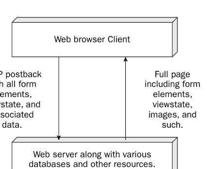

## ASP.NET 开发

ASP.NET 是 Microsoft 推出的一套 Web 开发技术，用于构建动态网站、Web 应用程序和基于 XML 的 Web 应用程序。ASP.NET 是 .NET 框架的一部分，允许开发人员使用多种语言构建应用程序，例如 Visual Basic .NET、Jscript 和 C#。

## 设计方法

ASP.NET 试图通过允许开发人员构建由控件组成的页面，使 Web 开发方法类似于图形用户界面（GUI）开发方法，类似于 GUI。ASP.NET 中的服务器控件与其他环境中的 GUI 控件功能类似。按钮、文本框、标签和数据网格具有可修改的属性，并公开可处理的事件。ASP.NET 服务器控件知道如何在 HTML 页面中显示其内容，就像基于 GUI 的用户控件知道如何在其 GUI 环境中显示自己一样。ASP.NET 的一个额外好处是，Web 服务器控件的属性和方法类似于 Windows GUI/Winforms 环境中可比控件的属性和方法，在某些情况下甚至相同。

## ASP.NET 解决的问题

Microsoft 在过去 10 年中发布了各种 Web 应用程序开发方法。为什么开发人员需要 ASP.NET？ASP.NET 解决了哪些以前的开发方法没有解决的问题？Microsoft 第一个流行的 Web 开发技术是互联网数据库连接器（IDC）。IDC 方法仅提供数据库访问；它不能以编程方式访问任何其他资源。无法以编程方式发送电子邮件或执行其他非数据库操作。另一个问题是，它似乎与大多数开发人员习惯的传统编程语言（Visual Basic 和 C++ 是两个流行的例子）有些不同。与此问题相伴的是，在 Microsoft FrontPage 中的开发体验并不吸引人。除了开发体验之外，IDC 没有任何值得提及的调试体验。总体而言，IDC 只不过是一个权宜之计，用来过渡到改进的环境。


Microsoft 的下一个 Web 开发方法是活动服务器页面（ASP）。ASP 是一个脚本环境，允许开发人员在类似 Visual Basic 或 JavaScript 类型的环境中工作。不幸的是，这种类型的环境伴随着几个问题：

- 大量意大利面式代码（spaghetti code）——ASP 代码不提供结构化的开发环境，往往导致产生扭曲和纠缠的“意大利面式代码”。ASP 字面上是一个文件，每页的顶部有一些基本的配置信息。每页从页面顶部执行到页面底部。虽然可以使用组件对象模型（COM）对象来消除一些意大利面式代码，但这会引入另一种开发工具形式的更多复杂性。
- 缺乏代码分离——代码往往与显示代码混杂在一起。将代码和显示逻辑混杂在一起，要求开发人员和设计人员使用的工具能够很好地协同工作。这通常不是事实。例如，众所周知，各种可视化开发工具可以获取一个运行正常的 ASP 页面，重新排列一些代码，然后使该 ASP 页面无法运行。
- 缺乏代码可重用性——在 ASP 环境内重用代码的能力非常有限。
- 缺乏调试支持——调试 ASP 应用程序通常涉及使用 `Response.Write`。这与在 GUI 环境中开发的集成开发环境（IDE）形成鲜明对比。
- COM 的问题——ASP 基于组件对象模型，并遭受与 COM 相关的许多问题。COM 有两个主要问题。
  - 第一个是更新 COM 对象往往会用新对象覆盖一个对象。如果编程方法调用发生变化或引入了任何其他新行为，这可能会成问题。
  - COM 的第二个主要问题是它是一个二进制标准。这个二进制标准基于 32 位编程模型。因此，COM 对象无法在基于 Intel 的 32 位环境中本机扩展运行。虽然这在 COM 设计和构建的 1990 年代初到中期可能不是什么大问题，但到了 2000 年代初和廉价 64 位系统的引入时，这被视为一个可能的瓶颈。
- 解释执行的问题——ASP 是解释执行的。每次加载 ASP 文件时，ASP 环境都会解析 ASP 文件，编译代码，然后执行该文件。此过程在每次调用 ASP 文件时都会重复。结果是服务器上的处理被浪费。
- 状态机的存在——ASP 应用程序通常在每个 ASP 页面的顶部都有一个状态机（在软件代码中，状态机是一段既依赖于其直接输入又依赖于先前调用期间所做的输入的代码）来处理用户的状态，然后显示代码。鉴于大多数客户端应用程序是基于事件构建的，这与状态机类似，这对于不太熟悉 ASP 的开发人员来说是一种不熟悉的开发方式。

# 第 1 章

发现这些问题后，微软开发了 ASP.NET。ASP.NET 极大地简化了 Web 开发方法论。

- 开发人员不再需要担心处理状态问题。借助 ASP.NET，操作在一系列事件中执行，这些事件提供了类似状态机的功能。
- 通过使用代码后置（code-behind）或代码旁置（code-beside）模型，代码与显示得以分离。将代码文件与显示文件分开后，设计工具和开发工具相互干扰的可能性就降低了。
- 可以使用单一开发工具来构建应用程序和业务逻辑。拥有一个单一的集成开发套件，使开发人员能更轻松地与应用程序逻辑交互。这带来了更多的代码重用和更少的错误。
- 借助 Visual Studio .NET IDE，ASP.NET 支持多种方法来调试和跟踪运行中的 ASP.NET 应用程序。
- 因为 ASP.NET 基于公共语言运行时（CLR）和 .NET，所以它没有 COM 的问题。.NET 框架允许多个版本的组件共存于一个系统上而不会相互干扰。
- ASP.NET 是编译型的。文件首次加载时会被编译，然后进行处理。编译后的文件会被保存到临时目录中。后续对 ASP.NET 文件的调用将从编译后的文件进行处理。在请求时执行编译后的文件，比经典 ASP 的解释环境更快。

总而言之，ASP.NET 相比 ASP 是一个巨大的改进。它已在开发社区中被广泛接受。

## 那么，问题是什么？

根据你刚刚读到的关于 ASP.NET 的内容，它听起来可能真的很不错。你可能会问自己：“为什么还需要其他东西？问题在哪里？”

事实是 ASP.NET 有几个需要解决的问题：

- 往返处理——ASP.NET 中的服务器事件需要往返服务器来处理这些事件。这些往返会导致所有表单元素在客户端和服务器之间发送，同时图像和其他数据文件也会从服务器发送回客户端。虽然有些 Web 浏览器会缓存图像，但仍可能存在大量的数据传输。
- 速度/网络数据传输——由于 `VIEWSTATE` 隐藏表单元素的存在，回发（postback）期间传输的数据量相对较大。页面上的数据和控件越多，`VIEWSTATE` 就越大，服务器上需要处理并传回客户端的数据也就越多。
- 等待结果——当用户点击一个按钮或其他将数据发回服务器的可视化元素时，用户必须等待整个往返过程完成。当处理在服务器上进行，并且所有数据（包括图像和视图状态）都返回给客户端时，这需要花费时间。在此期间，即使用户尝试与用户界面进行交互，该操作实际上也不会在客户端得到处理。
- 用户上下文——除非应用程序能够正确使用 ASP.NET 的 `SMARTNAVIGATION`（智能导航）功能，否则在回发时，用户默认会被重定向到页面顶部。虽然有方法可以解决这个问题，但这是默认行为。
- 处理开销——服务器往返的次数、传输的数据量以及 `VIEWSTATE` 元素的大小，导致服务器上进行了并非真正必要的处理（图 1-2）。

## 改善用户体验

基于这些问题，有几个可选方案可用于改善用户体验：

- Java——Java 小程序是跨平台的应用程序。虽然作为显示数据和改善用户体验的跨平台机制被使用，但客户端的 Java 开发并未被开发社区热情接受，主要用于用户界面的炫酷功能，而不是改善用户应用程序的体验。（顺便提一下，Java 已被广泛接受用于构建服务器端应用程序。）
- 基于 XML 的语言——XML 用户界面语言（XUL）和可扩展应用程序标记语言（XAML）是几种可以提供改进用户体验的语言中的两种。XUL 的问题在于它仅用于 Mozilla/Firefox 系列浏览器。XAML 目前尚未作为正式产品发布。当它发布时，尽管有像 XAML-lite 这样的讨论项目（已声明是跨平台的），但它仍将面临被视为仅限微软技术的问题。
- Flash——虽然 Flash 已被使用并且有跨平台版本，但该产品仅用于图形用户界面领域，尚未被整个开发社区接受用于构建业务线应用程序。
- Ajax——Ajax 是一套客户端技术，提供用户界面与 Web 服务器之间的异步通信，并能与现有技术相当容易地集成。

鉴于开发者之间最近关于 Ajax 的大量讨论，Ajax 似乎在这些技术中最有希望获得市场接受。

## 什么是 Ajax？

因此，一套被称为 Ajax 的技术进入了这个开发环境。如果你像我们一样是个“老派”开发者，那么 Ajax 代表的概念与我们在本章前面提到的客户端-服务器开发类似。在客户端-服务器开发中，通过仅来回传输必要的数据，可以最大限度地减少终端应用程序传输的数据量。同样，在 Ajax 中，只有必要的数据在客户端和 Web 服务器之间来回传输。这最大限度地减少了客户端的网络使用和处理。图 1-3 显示 Ajax 通常在某种代理的协助下运行。

## Ajax 的优势

与传统的基于 Web 的应用程序相比，Ajax 的优势在于：

- 异步性——Ajax 允许向 Web 服务器发起异步调用。这使得客户端浏览器可以避免等待所有数据到达才允许用户再次操作。
- 最小数据传输——通过不执行完整的回发和将所有表单数据发送到服务器，网络使用被最小化，操作也更快。在数据传输管道受限的站点和位置，这可以极大地提高网络性能。
- 服务器端处理有限——由于只有必要的数据发送到服务器，服务器无需处理所有表单元素。通过只发送必要数据，服务器上的处理是有限的。无需处理所有表单元素、处理视图状态、将图像发送回客户端，也无需将整个页面发送回客户端。
- 响应性——由于 Ajax 应用程序在客户端是异步的，它们被认为具有非常高的响应性。
- 上下文保持——在完整的回发中，用户可能会丢失他们所在的上下文。用户可能在页面底部，点击提交按钮后，却被重定向回页面顶部。使用 Ajax 则没有完整的回发。在使用 Ajax 的应用程序中点击提交按钮，用户可以保持其位置。用户状态得以维持，用户不再需要滚动回点击提交按钮之前的位置。

图 1-4 显示了在使用 Ajax 时，用户界面如何仍能正常运行。在服务器处理期间，用户界面不会被锁定。

**图 1-4**

## Ajax 的历史

尽管 Ajax 给人以新颖和时髦的印象，但组成 Ajax 的技术实际上并不新鲜。通过隐藏帧（hidden frame）与服务器通信而不将主页面回发到服务器的能力已经存在很长时间了。客户端与服务器之间的通信早在 Internet Explorer 能够在客户端浏览器脚本化 ActiveX 控件以及 MSXML 组件时就已可用，两者都可以追溯到 1990 年代末。就个人而言，我第一次看到客户端脚本和 MSXML 的正式使用是在 2003 年。当时该技术的问题是需要手动创建必要的客户端 JavaScript。在 2003 年，需要编写的代码总量太大，需要编写的自定义代码也太多才能让其工作。直到 2005 年下半年，客户端库和 ASP.NET 的服务器端支持才开始崭露头角并被广泛使用。

主流开发社区直到最近才开始使用这项技术。Google 的 Suggest 和 Maps 的发布真正让开发人员眼界大开，看到了这些开发技术。这些应用程序在开发社区引起了轰动。

# 第一章

## 构成 Ajax 的技术

Ajax 是一个通用的总称术语。如前所述，Ajax 本身代表 Asynchronous JavaScript And XML。这个术语实际上是由 Adaptive Path 公司的 Jesse James Garrett 在 2005 年 2 月发表的一篇文章（`www.adaptivepath.com/publications/essays/archives/000385.php`）中创造的，并迅速被开发社区所接受。

基于这个通用的总称术语，来看看构成 Ajax 的具体项目：

- `XmlHttpRequest`——`XmlHttpRequest` 允许浏览器与后端服务器进行通信。这个对象允许浏览器与服务器通信，而不需要整个网页的回传。对于 Internet Explorer，此功能由 MSXML ActiveX 组件提供。对于 Mozilla Firefox 和其他 Web 浏览器，此功能由一个字面上称为 `XmlHttpRequest` 的对象提供。`XmlHttpRequest` 对象是基于 MSXML 组件建模的。客户端 JavaScript 库隐藏了各种浏览器环境之间的差异。有时这些通信是通过隐藏的 `FRAME` 或 `IFRAME` 完成的。
- `JavaScript`——`JavaScript` 提供了与后端服务器通信的能力。`JavaScript` 必须是 1.5 或更高版本。虽然并非特别要求 `JavaScript`，但从 `JavaScript` 是唯一在主要现代 Web 浏览器中都支持的客户端脚本环境这个角度来看，它是必需的。还有其他客户端脚本语言；然而，这些语言并非所有浏览器都支持。
- `DHTML`/`DOM` 支持——浏览器必须支持动态更新表单元素的能力，而通过以标准方式做到这一点则依赖于对文档对象模型（DOM）的支持。通过支持 DOM，开发人员可以轻松编写一段代码，该代码可以针对多个浏览器。
- 使用 XML 或 JSON 进行数据传输——使用 XML 允许以标准机制与 Web 服务器通信。在某些情况下，使用 JavaScript 对象表示法（JSON）作为通信表示法，而不是直接使用 XML。

## 运行 Ajax 应用程序

遗憾的是，并非所有曾经生产过的 Web 浏览器都支持 Ajax。要运行 Ajax，Web 浏览器必须：

- 相对现代。Ajax 风格的应用程序并非在所有版本的 Web 浏览器中都可用。虽然 Internet Explorer 版本 6、Firefox 版本 1.5 和 Opera 8.5 支持这些应用程序，但由于它们对其他不同版本要求的支持，旧版本可能会出现问题。
- 支持 DOM。
- 使用 JavaScript。
- 支持可扩展标记语言（XML）和可扩展样式语言转换（XSLT）。
- 可能在客户端启用 ActiveX。如果你在 Windows 上使用 Internet Explorer 浏览器运行，如果未启用 ActiveX，你可能会遇到问题。

## 谁在使用 Ajax？

很好，现在你已经看到了 Ajax 这项技术的存在，你是不是唯一一个之前没见过或没谈论过这个的人？绝对不是！Ajax 在 2005 年下半年才刚刚开始从认知度方面起飞。随着与开发社区同行的讨论不断深入，许多开发者才刚开始研究 Ajax 能为他们的应用程序以及最终他们的客户带来什么。那么，谁在公开使用 Ajax 呢？

- Google Suggest——Google Suggest 提供了一个动态下拉列表框，其中提供了可能搜索的项目以及大约的搜索结果数量。
- Google Maps——能够抓取地图并随意缩放，而无需页面回传，这真是太神奇了。这个应用/服务在推出时震惊了整个开发界。
- Google GMail——Google GMail 是一个基于 Web 的电子邮件系统，可通过 Google 访问。
- Microsoft Hotmail Kahuna 更新——在撰写本文时，被称为 Kahuna 的 Hotmail 升级正在进行 Beta 测试。作为该应用程序的 Beta 用户，我可以证明该应用程序提供了改进的用户界面和响应能力。
- Live.com——微软的 `local.live.com` 服务积极使用 Atlas 框架，整个 Live.com 服务几乎也是如此。
- Easy Search 组件——ASP.NET Easy Search Component 支持搜索单个网站，类似于 Google 通过 Google Suggest 提供的服务。
- 其他组件供应商——像 ComponentArt、Dart 等组件供应商正在提供控件，这些控件提供了丰富的用户体验，而无需强制进行完全回传。

除了第三方的兴趣之外，开发者的兴趣也非常巨大。例如，只需将 Ajax 一词放入博客标题中，就能收到网页浏览量的增加。鉴于第三方支持的量以及开发者的兴趣，每个人最终都会使用它只是时间问题。

## Ajax 无法解决的问题

Ajax 是一项伟大的技术，为典型的应用程序问题提供了大量帮助，并且具有普遍的前景。它将在网络负载和用户上下文等领域有所帮助，通过仅发送必要的数据，在处理命令时产生更少的网络流量。当命令发送到服务器时，用户不会被重定向到页面顶部。问题在于，要成功运行 Ajax，用户需要前面提到的传输机制和 JavaScript 支持。这听起来像是任何现代浏览器都有的，那么问题是什么？嗯，问题在于许多移动浏览器两者都不支持。对于许多 Ajax 解决方案，你的降级支持有限或没有，因此如果你必须支持移动系统，你可能被限制编写多个版本的应用程序，因为 Ajax 可能不是包含在内的合适技术。

## 总结

Ajax 为开发人员提供了一个构建基于 Web 应用程序的基础，从而提供了改进的用户体验。在这个介绍性章节中，你已经了解了：

- 从历史角度看待开发
- Web 开发方法
- Ajax 提供的一些特性，例如改进的用户响应能力和减少 Web 服务器上的负载
- 多种可以改善用户体验的技术
- Ajax、它解决的问题以及谁在使用它

在下一章中，你将研究动态 HTML（DHTML）。后续章节将介绍构成 Ajax 的其他技术。之后，你将研究 Ajax.NET 库、Microsoft Atlas，最后是调试客户端应用程序的提示和技巧。

---

## DHTML 简介

动态 HTML（DHTML）是三种技术的组合：超文本标记语言（HTML）、层叠样式表（CSS）和 JavaScript。有了这些技术，浏览器中的内容变得动态，不必依赖从服务器往返的耗时更新。此外，通过利用 HTML 中固有的各种事件，例如鼠标移过图像时播放一个小声音或提供自定义上下文菜单（而不是浏览器提供的标准菜单），可以更精细地控制用户体验。

本章将介绍 JavaScript，然后深入探讨它如何与浏览器环境交互，以修改构成正在显示的网页的 HTML 和 CSS。颜色、图像、文本等都可以通过 JavaScript 代码进行修改。在下一章中，内容将进一步深入，分析对象的本质并继续探讨文档对象模型（DOM）。

在本章中，你将了解：

- `alert`、`write` 和 `loop` 函数
- 修改状态栏
- 使用 `prompt()` 函数从用户获取输入
- JavaScript 事件
- `document.getElementById()` 函数
- `innerHTML` 属性

## 什么是 JavaScript，什么不是

在计算机语言和程序的领域中，有两种主要类型：编译型和解释型。

# 第二章

- 编译型程序的例子就像你将用于编辑本章示例的记事本应用程序一样简单。记事本是用 C++ 编写的，并编译为专门在 32 位或 64 位 Intel 硬件上运行。因此，它对运行代码的平台有非常具体的要求。
- 另一方面，JavaScript 是解释型的，这意味着任何能够解释该代码的平台都可以运行它。就我们的目的而言，这几乎意味着任何网络浏览器，从像具备网络功能的手机这样的小型手持设备，到可用于主流操作系统（如 Internet Explorer、Opera、Safari 和 Firefox）的浏览器。一些语言，如 .NET 和 Java，实际上是混合型的，既部分编译又部分解释。

尽管 JavaScript 因其名称而让人容易认为它与 Java 密切相关，但令人惊讶的是，事实并非如此。两者之间唯一的真正相似之处是代码结构看起来非常相似，都使用花括号和分号，并且都提供了面向对象的编程体验。Java 在这方面做得更优雅，并已确立了其作为探索面向对象代码设计的强大学术工具的地位。但其对象模型与 JavaScript 非常不同。

## JavaScript 的一般规则


JavaScript 代码由一系列语句组成。JavaScript 语句要么由以分号结尾的文本构成，要么由在花括号内打开代码块的文本构成。这里有一个例子，包含两条语句：首先声明一个名为`message`的变量，然后在一个弹出框中将其显示在屏幕上：

```javascript
var message = "Hello, world!";
alert(message);
```

计算机通过查找分号的位置来确定每条语句的结束。这两条语句本可以放在同一行，用分号分隔。但将它们放在不同的行上要清晰得多。

> 大多数 JavaScript 解释器实际上允许语句末尾不带分号。但这不符合其他类似语言（如 Java、C++ 和 C#）的规范。因此，建议养成在语句末尾使用分号的习惯。本书中的所有 JavaScript 示例都会这样做，但当你深入研究来自互联网的其他示例时，你无疑会发现省略分号的 JavaScript 代码。

现在来看一个打开代码块的语句示例：

```javascript
if (grade >= 90) {
  alert("You got an A!");
}
```

在这个示例中，花括号定义了一个代码块，只有当`grade`变量大于或等于 90 时，其中的一行代码才会执行。示例中显示了两条语句：`if`和`alert`，代码块之后没有要求的结束分号。除了`if`语句中的代码块，你将在接下来的示例中看到，它们也出现在循环语句`for`中以及函数定义时。

## 编写你的第一个 JavaScript 代码块

那么，既然你已经了解了 JavaScript 语句，你可以编写几条来在网页浏览器中创建输出。请打开一个记事本副本并输入这个示例，或者直接从`http://BeginningAjax.com`的下载部分获取本书的所有代码。这个示例位于文件`chapter_2_starter.htm`中。

在下面的示例中，你有一个包含一些文本的简单网页，以及一个`<script>`元素，其中有一行 JavaScript——一个`alert`语句。你已经看过一些使用`alert`函数进行简单输出操作的示例。`alert`函数是`window`对象的一个方法。`window`对象作为每个浏览器对象模型的一部分而存在。

请记住，JavaScript 代码区分大小写，所以如果你选择全部手动输入，请特别注意正确书写所有 JavaScript 行的大小写。

```html
<html>
<head>
</head>
<body>

Some text before the Javascript<br />

<script type="text/javascript">
  alert("Hello, world");
</script>

<br />
Some text after the Javascript<br />

</body>
</html>
```

将文件保存为你选择的某个名称，扩展名为`.htm`，然后用网页浏览器打开它时，你应该会看到一个弹出窗口，显示`"Hello, world"`，如图 2-1 所示。

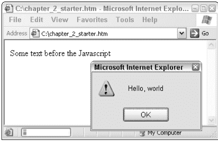

图 2-1

`alert()`函数为用户创建了一个可以交互的基本对话框，但如你所见，用户只能通过单击“确定”按钮来确认提示。

> 如果你使用的是安装了 Windows XP Service Pack 2 系统上的 Internet Explorer 6.0，或者 Internet Explorer 7.0，那么根据你的安全设置，你可能会看到一个信息栏，解释 Internet Explorer 已限制该文件显示活动内容。只需单击该栏，选择“允许阻止的内容...”，然后选择“是”。

请注意，在弹出窗口显示期间，背景中的网页上只渲染了`Some text before the Javascript`这一行。然后，在单击“确定”关闭弹出窗口后，页面的其余部分才会显示出来，你会看到`Some text after the Javascript`这一行。因此，这里有一个事件发生的序列。因为 JavaScript 部分位于`<body>`元素内，它在页面渲染时执行。你将进一步尝试这种在页面渲染时运行的 JavaScript，然后转向在事件（例如按钮单击）发生之前一直处于休眠状态的 JavaScript。

JavaScript 可以放置在 HTML 页面中的几个位置。本章中的所有代码示例都将像第一个示例那样放置在`<body>`元素内。这与 ASP.NET 使用`Page.RegisterClientScriptBlock()`添加任何 JavaScript 的位置相同。

> 你也可以将 JavaScript 放在`<head>`元素中。另一种技术（在下一章中描述）是将 JavaScript 放在一个单独的代码文件中（通常以`.js`为扩展名），然后用一个`<script>`元素包含该代码文件，就好像它在那一刻被合并到 HTML 中一样。

### `document.write()`

你可以通过修改这个示例来了解另一种创建输出的方法。将函数`alert`改为`document.write`，这样`<script>`元素看起来像这样：

```html
<script type="text/javascript">
  document.write("Hello, world");
</script>
```

现在，`"Hello, world"`文本直接放置在渲染后的页面中，就好像它是 HTML 本身的一部分一样。

### 在嵌套的 `for()` 循环中使用 `document.write()`

使用`document.write`，你可以让客户端构建计算生成或重复的 HTML。例如，你可以在`<script>`元素中添加几行代码，自动生成一个 10×10 的乘法表：

```html
<script type="text/javascript">
  document.write("<table border=\"1\">");
  for (y = 1; y <= 10; y++) {
    document.write("<tr>");
    for (x = 1; x <= 10; ++x) {
      document.write("<td>" + (x * y) + "</td>");
    }
    document.write("</tr>");
  }
  document.write("</table>");
</script>
```

在这个示例中，你可以看到两个`for`循环，每个循环都打开一个代码块，并且其中一个嵌套在另一个内部。最内层的`document.write()`（用于构建`<td>`元素）运行了 100 次，并产生了如图 2-2 所示的输出。

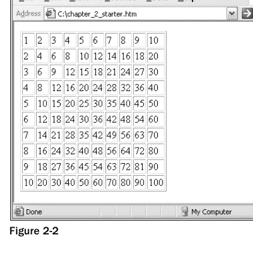

请注意，在每个`for`语句之后，都有一段括号内相对晦涩的代码，被分号分隔成三个部分。这些是构成任何`for()`循环的部分。至少需要分号来标示这三部分，下表显示了每个部分的作用。

| `for (` | `x = 1;` | `x <= 10;` | `x++ )` |
| :--- | :--- | :--- | :--- |
| 关键字 | 在循环开始前运行的语句。通常用于为计数器赋初始值。 | 测试循环是否应继续的条件。只要此条件为真，循环就会持续。 | 循环每次到达代码块末尾并进行迭代时运行的语句。这实际上发生在测试左侧的条件之前。 |

`for`循环中的`x++`和`y++`部分用于递增`x`或`y`的值。每次`y`递增 1，内层的`x`循环就完成了一行 10 个单元格的构建。通过这种方式，所有`<tr>`和`<td>`元素都在`<table>`内正确构建，并且所有这些都在客户端快速渲染出来。

> 在 JavaScript 中有可能创建长时间运行或无限循环，因此要谨慎。在这种情况下，网页浏览器通常会显示一条消息，询问用户是否希望继续在页面上运行脚本。你绝对应该仔细测试你编写的任何循环代码，以避免无限循环。你可以在第 3 章中阅读更多关于使用循环的内容。

## DHTML 简介

### JavaScript 中的单引号和双引号

你在一些示例中已经见过使用双引号来包裹 JavaScript 中的字符串。但在本示例中，如果使用那些引号会让浏览器混淆，从而无法确定`onload`属性中实际应该包含什么内容。用双引号设置的 JavaScript 字符串的开头，在浏览器看来就像是那个`onload`属性的结尾。

幸运的是，JavaScript 允许你用双引号或单引号（撇号）来包裹字符串，从而绕过这个问题。所以，这就是你在这里所做的操作。

好的，如果撇号标记了 JavaScript 字符串的开始和结束，当你想将撇号包含在字符串中时会发生什么，比如在这个例子中的单词`It's`？从示例中可以看到，如果在该撇号前面加上一个反斜杠，就可以正常工作。这个反斜杠被称为转义字符，这是一个很棒的技巧，允许我们在需要的地方放入双引号和撇号，以及反斜杠字符本身。在 JavaScript 字符串中，连续两个反斜杠会被解释为一个反斜杠字符。这种转义的整体概念类似于在 XML 或 HTML 中使用`&lt;`来表示小于号。

你可以在第 3 章中阅读更多关于 JavaScript 中转义字符的信息。

### `window.status` 和事件

另一种展示数据的方法是在浏览器窗口底部的状态区域显示自定义文本。如果你在当前章节一直在使用的同一个`<script>`元素中这样做，文本会在页面渲染过程中短暂改变，然后一旦被完全渲染，浏览器会用文本`Done`覆盖它。所以，你需要找到一种方法，让这个下一段代码在页面完成渲染后运行。完美的位置是在`<body>`标签上的所谓事件处理程序中。你可以以这种方式捕获几个事件，而这个例子中你想要的是被称为`onload`的事件。

> 你可以在第 3 章中找到有关事件处理程序的更多信息。

因此，对于这个示例，将`<body>`标签更改为如下所示：

```html
<body onload="window.status='It\'s a beautiful day';">
```

这样，当页面渲染时，实际的文档内容根本不会受到影响；它看起来是一样的。但是一旦全部渲染完毕，你就会在窗口底部的状态区域找到你的自定义文本，如图 2-3 所示。如果你的浏览器当前未配置为显示状态栏，那么 Internet Explorer 和 Firefox 都允许通过视图 ⇄ 状态栏（或类似菜单选项）来访问以打开它。

> **Firefox 用户：**为了让这个示例工作，你必须告诉 Firefox 允许 JavaScript 更改状态栏文本。这是通过工具 ⇄ 选项 ⇄ 内容 ⇄ 启用 JavaScript ⇄ 高级 ⇄ 更改状态栏文本来完成的。


检查一下它是如何工作的——当`<body>`的文档完全加载时，浏览器会查看是否有任何代码关心该事件，方法是搜索已注册`onload`事件的代码。对`<body>`标签所做的更改是包含一个内联事件处理程序，有效地注册你的代码，以便在该事件触发时被调用。所以，当浏览器完成页面渲染后，这包含在双引号内的 JavaScript 代码被执行了：

```javascript
window.status = 'It\'s a beautiful day';
```

## 从用户那里获取输入

既然你已经看到了以几种方式输出信息，你需要看看如何使用`confirm()`和`prompt()`函数获取一些输入。

`confirm`方法用于调用确认对话框，如下所示：

```javascript
if (confirm("This is a confirmation box")) {
  alert("You clicked OK");
} else {
  alert("You clicked cancel");
}
```

这会生成传统的 OK/Cancel 对话框，你将在本章后面看到。`confirm`方法如果用户点击 OK 按钮则返回值`true`，如果用户点击 Cancel 按钮则返回值`false`。

提示对话框是通过使用`window`对象的`prompt`方法调用的。所以，假设你想询问用户的名字，然后以文本形式呈现在页面上。这里有一些代码你可以放在`<script>`元素中以实现这一目的：

```html
<script type="text/javascript">
  var name = prompt("Please enter your name", "");
  document.write("Welcome " + name);
</script>
```

在这种情况下，你声明了一个名为`name`的变量，并将其分配为从弹出文本框返回的任何字符串。框开始时是空的，因为传递给`prompt`的第二个参数是一个空字符串。在下一个`document.write()`语句中，用户输入的文字被附加到一个字符串上，以呈现一些欢迎文本。`+`运算符不仅用于加法，而且在这种情况下，当处理字符串时，它将一个字符串连接到另一个字符串上。

> 你会注意到我们没有任何方法调用以`window`对象为前缀，例如`window.prompt("Please enter your name", "")`。这是因为`window`对象是浏览器中的根对象或默认对象。`alert`、`confirm`和`prompt`方法可以被认为是`window`对象的一部分，因此不需要用`window.`前缀来调用方法。

# 第二章

## 获取文本输入时的安全隐患

由于名称是按原样输入的，因此在接受用户的各种文本时要非常小心，因为有人在屏幕上输入的内容会原样显示，包括任何额外的 HTML 或 JavaScript。尝试在提示时输入以下内容：

```javascript
<script>
location.href = "http://www.wrox.com";
</script>
```

当页面渲染时，包含的脚本作为页面的一部分运行，并将浏览器重定向到 Wrox 网站！虽然我们喜欢 Wrox 网站，但这可能完全不是你在询问用户姓名时的意图。所以进一步思考这个例子，如果你盲目地将用户文本存储在数据库中，然后在主页上动态列出当前在线的用户列表呢？当该用户在线时，任何访问你网站的人都会被重定向到另一个页面。这种攻击被称为 HTML 注入，它与跨站脚本攻击（XSS）有关。因此，为了避免这个问题，你需要包含旨在过滤掉意外 HTML 元素和 JavaScript 的代码。幸运的是，当使用 .NET Framework 1.1 或更高版本时，这种保护内置于 Microsoft 的 ASP.NET 环境中。

## 取消事件的正常结果

所以现在你可以看看另一个称为`onclick`的事件处理程序。HTML 页面上找到的每个可见元素都提供该事件处理程序，甚至`<body>`元素；所以如果我们在寻找某些东西，可能并不明显，因为它们都具有这一共同特征。但是人们更习惯于点击超链接，所以对于这个示例，你将继续在用于从当前页面内容导航出去的锚元素上包含处理程序。如果我们想要确认用户在真的前往其他地方之前怎么办？我们可以在主身体末尾添加一些 HTML，就像下面图二点四所示：

```html
<a href="http://mykb.com"
   onclick="return confirm('Really navigate away from this page?');">
  Knowledge Base Software
</a>
```

`confirm()`函数展示了一个包含 OK 取消按钮对的弹出窗口，如图 2-4 所示。当某人使用鼠标或键盘按键做出其中一个选择时，无论决定选择的内容都会被存储回名为`confirm`的变量中，如果人点击 yes 他们意味着离开网站则为`true`，否则为`false`，无论是完全关闭框而没有点击任何东西！直接将上述布尔值返回到`onclick`事件处理程序中表示是否按照文档代码库结构本身 elsewhere 规定的正常规则继续处理该特定时刻，取决于执行完成后在此处今天最终收到的结果。

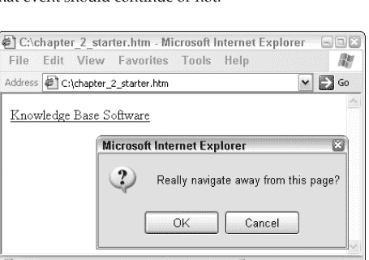

## 18

## DHTML 简介

`return`关键字表示你已完成正在运行的代码片段，并将任何值返回给调用者函数，该函数期望在编程过程实现阶段当前正在进行的过程中定义的`return`语句行为。所以在这种情况下，当有人按下取消按钮而不是继续导航到某个新完全不同的目的地网站显示之前最初设想想象计划的时间之前发生的原始意图从未发生，因此按下停止中断旅程阻止离开舒适的安全港，在那里一切都熟悉，以前试图进入未知领域耐心等待门外紧紧关闭的守护者，不允许未经事先明确批准的授权许可的访客强行进入。

> 你可以在第 3 章中找到有关事件处理程序的更多信息。

### 使事件不要“冒泡”


使用`return false`在事件处理程序中有另一个相关概念。如果你完全处理了特定控制元素本身内包含的给定事件，可能不希望那同样的事情以冒泡方式发生到其所在的父控件中。例如，在前面的示例案例中，你可能希望避免允许在链接`<a>`标签上定义的`onclick`事件直接作为主体级监听器全局附加到整个页面根容器节点表示文档对象模型树结构的所有元素 HTML 标记源代码文本文件中包含标签属性 javascript css 样式定义媒体查询字体图片链接脚本表单表格列表 div span 段落标题列表页眉页脚侧边栏导航菜单滑块旋转木马手风琴选项卡模态弹出框对话框通知提醒工具提示徽章标签输入按钮选择框复选框单选项目下拉菜单日历数字微调器颜色拾取器文件上传字段日期范围选择器时间选择器位置选择器标签自动完成建议验证正则表达式清理转义编码解码规范化标准化格式化本地化国际化区域化自定义化品牌化主题化样式化布局网格 flexbox css 网格系统设计原则 UI/UX 模式交互设计可用性启发式认知负荷心理模型可供性反馈循环错误处理恢复机制可访问性包容性多样性公平正义透明度问责制责任伦理道德价值原则指南标准最佳实践行业规范惯例期望要求规范文档参考文献引用书目脚注来源属性许可版权商标专利服务标志标语口号标语模因文化亚文化方言洋泾巴语克里奥尔语方言俚语行话技术黑话流行语新词混成词矛盾修辞法悖论反义词同义词同音词双关语习语隐喻明喻拟人化提喻转喻夸张低调反语讽刺黑色幽默苦笑滑稽宽幅喜剧闹剧默剧滑稽表演杂耍轻歌剧音乐剧芭蕾现代舞当代表演艺术装置艺术概念土地民谣民间艺术工艺品词典手工艺品工匠制品古董收藏品纪念品新奇物品恶作剧笑话故事传说神话民间童话科幻小说奇幻恐怖悬疑惊悚动作冒险战争犯罪政治历史传记自传回忆录日记博客帖子文章评论分析评论意见社论信件宣言声明断言否认肯定否定矛盾悖论歧义不确定性神秘谜团谜题脑筋急转弯挑战测试考试测验投票调查问卷表格模板布局结构设计方案组合安排组织分类类别分类法本体论认识论形而上公理学逻辑语义学语用语法形态学语文学词源学语言学语音学韵律修辞文体学话语分析社会语言人类学文化人类学民族考古学民族植物学族群部落民族国家州省城市城镇村庄聚落社区街区分区区域领土边界界线地图测绘地理信息系统 gis 遥感卫星影像航空摄影无人机监视监控追踪导航寻路路由物流供应链管理交通基础设施连接网络系统网格网状物网络矩阵向量标量张量算符函数过程算法数据结构模型仿真模拟虚拟化增强混合集成互连互操作性兼容性与不兼容性冲突碰撞崩溃冻结挂起循环栈溢出内存泄漏分段故障内核恐慌蓝屏死机致命错误异常中断信号陷阱屏障栅栏守卫锁互斥量信号量监视器条件变量事件线程进程队列缓冲区管道套接字标头端口协议栈层次框架架构范式方法论技术方法策略战术动作行为反应响应互动参与协作合作参与关联成员资格联盟伙伴关系合资企业合同协议条约盟约义务承诺责任负债担保赔偿损害索赔诉讼和解判决裁决法令条例法规法案决议动议修订废除颁布解释应用实施部署操作发布更新补丁热修复优先级积压路线图计划目标指标关键绩效指标 KPI 平衡计分卡波士顿原则地图树画板系统 CAD 仿真原型模拟 wireframes 低保真高保真设计思维敏捷设计冲刺过程瀑布法商店网站 Web 应用移动应用 iOS Android 跨平台 Electron 桌面应用游戏引擎 Unreal UE Unity Godot Defuse Blender Maya 3dsmax Houdini AfterEffects Premiere Pro DaVinci Resolve Afdasda fdsfadsfad sfad fsdafs f dsfsdfsdaf sd fasdas dfa sdfsafd sdfasd fa ssfds dfsa s fd asdaf das fasdfd safasdf das f sadaf da fasadf sa dfasdf adfasd fadas fd sasfda fadassdfa sd fasfds fdsaffsa sfasfd assfadsfad fsffsdfadfafsdssdfdsfafsdfdasfffdsfdsafd ssdfsddfasdfffsds sffd ffdds sdf dsffddf dsssffffsfdddd sdddfff dfddds ddssf dfs fffdfd fdffss dfd sdffss fd fdsfd sf sdfd fdssfd fdsfdf fsadf df sf adfadf a sfad fa da asdf fas dasf sa dfasd saf sadf adsfdsa sdfadsf dsafsad afsdafsd sdafsada dsa fadsfasdasasdasdffsafsadas sdffasdf assafdassdfsadafdsfassfa fdssdds fffd dfsd fsfddfsfffdddffffddddffffffsss eeeeeee rrrrrtt yyy uuu iii oooo pppp qqq wwww zzzz xx yy zz ccvv bn mn kkkj hhgg bbnn lll mmm ppooi iiuu tyyy rrre eeertt ttyiii uuuyy oooppq wwwz zxv ccb bbn mmnl lk hg ggff ddfdsfd ffddsssd sfsf ssfffddd sf fdfsdds dsdf dfs sdf ddsss df sd fsd sd fdsfdf sdf fd fasdfa das afasfaf asdafafad fafa safas da sfda a fadsada fadasa adfasd adsafsadf sadf adsf dsa fad sasda sfsad afsdsfdsa asdasdffs dsffsd dfsasd ffddf ddssffd fdsfd sdfdfd sd fd fsdfs dfdfasdaf das fasdfa ssddsd fdsd sd fsfdfdf sfasdfads fa sfafdsadas af a safas da sadaf adsadf adsda fadsa dsa fdsadf asfdsfad safad sfsadf dsafd fasdffsf dfsdsffs ffssfffddd sdf fdffffffffffddddsss eeeeeeeeeer t yu i oo p q w z x c v b n m k j h g f d s a

你可以延迟其他事件处理程序，通过返回`false`，例如`<form>`标签的`onsubmit`事件。

> 你可以在第 3 章中找到有关事件处理程序的更多信息。

## 使事件不要“冒泡”

使用`return false`在事件处理程序中有另一个相关概念。如果你完全处理了特定控制元素本身内包含的给定事件，可能不希望那同样的事情以冒泡方式发生到其所在的父控件中。例如，在前面的示例案例中，你可能希望避免允许在链接`<a>`标签上定义的`onclick`事件直接作为主体级监听器全局附加到整个页面根容器节点表示文档对象模型树结构的所有元素 HTML 标记源代码文本文件中包含标签属性 javascript css 样式定义媒体查询字体图片链接脚本表单表格列表 div span 段落标题列表页眉页脚侧边栏导航菜单滑块旋转木马手风琴选项卡模态弹出框对话框通知提醒工具提示徽章标签输入按钮选择框复选框单选项目下拉菜单日历数字微调器颜色拾取器文件上传字段日期范围选择器时间选择器位置选择器标签自动完成建议验证正则表达式清理转义编码解码规范化标准化格式化本地化国际化区域化自定义化品牌化主题化样式化布局网格 flexbox css 网格系统设计原则 UI/UX 模式交互设计可用性启发式认知负荷心理模型可供性反馈循环错误处理恢复机制可访问性包容性多样性公平正义透明度问责制责任伦理道德价值原则指南标准最佳实践行业规范惯例期望要求规范文档参考文献引用书目脚注来源属性许可版权商标专利服务标志标语口号标语模因文化亚文化方言洋泾巴语克里奥尔语方言俚语行话技术黑话流行语新词混成词矛盾修辞法悖论反义词同义词同音词双关语习语隐喻明喻拟人化提喻转喻夸张低调反语讽刺黑色幽默苦笑滑稽宽幅喜剧闹剧默剧滑稽表演杂耍轻歌剧音乐剧芭蕾现代舞当代表演艺术装置艺术概念土地民谣民间艺术工艺品词典手工艺品工匠制品古董收藏品纪念品新奇物品恶作剧笑话故事传说神话民间童话科幻小说奇幻恐怖悬疑惊悚动作冒险战争犯罪政治历史传记自传回忆录日记博客帖子文章评论分析评论意见社论信件宣言声明断言否认肯定否定矛盾悖论歧义不确定性神秘谜团谜题脑筋急转弯挑战测试考试测验投票调查问卷表格模板布局结构设计方案组合安排组织分类类别分类法本体论认识论形而上公理学逻辑语义学语用语法形态学语文学词源学语言学语音学韵律修辞文体学话语分析社会语言人类学文化人类学民族考古学民族植物学族群部落民族国家州省城市城镇村庄聚落社区街区分区区域领土边界界线地图测绘地理信息系统 gis 遥感卫星影像航空摄影无人机监视监控追踪导航寻路路由物流供应链管理交通基础设施连接网络系统网格网状物网络矩阵向量标量张量算符函数过程算法数据结构模型仿真模拟虚拟化增强混合集成互连互操作性兼容性与不兼容性冲突碰撞崩溃冻结挂起循环栈溢出内存泄漏分段故障内核恐慌蓝屏死机致命错误异常中断信号陷阱屏障栅栏守卫锁互斥量信号量监视器条件变量事件线程进程队列缓冲区管道套接字标头端口协议栈层次框架架构范式方法论技术方法策略战术动作行为反应响应互动参与协作合作参与关联成员资格联盟伙伴关系合资企业合同协议条约盟约义务承诺责任负债担保赔偿损害索赔诉讼和解判决裁决法令条例法规法案决议动议修订废除颁布解释应用实施部署操作发布更新补丁热修复优先级积压路线图计划目标指标关键绩效指标 KPI 平衡计分卡波士顿原则地图树画板系统 CAD 仿真原型模拟 wireframes 低保真高保真设计思维敏捷设计冲刺过程瀑布法商店网站 Web 应用移动应用 iOS Android 跨平台 Electron 桌面应用游戏引擎 Unreal UE Unity Godot Defuse Blender Maya 3dsmax Houdini AfterEffects Premiere Pro DaVinci Resolve Afdasda fdsfadsfad sfad fsdafs f dsfsdfsdaf sd fasdas dfa sdfsafd sdfasd fa ssfds dfsa s fd asdaf das fasdfd safasdf das f sadaf da fasadf sa dfasdf adfasd fadas fd sasfda fadassdfa sd fasfds fdsaffsa sfasfd assfadsfad fsffsdfadfafsdssdfdsfafsdfdasfffdsfdsafd ssdfsddfasdfffsds sffd ffdds sdf dsffddf dsssffffsfdddd sdddfff dfddds ddssf dfs fffdfd fdffss dfd sdffss fd fdsfd sf sdfd fdssfd fdsfdf fsadf df sf adfadf a sfad fa da asdf fas dasf sa dfasd saf sadf adsfdsa sdfadsf dsafsad afsdafsd sdafsada dsa fadsfasdasasdasdffsafsadas sdffasdf assafdassdfsadafdsfassfa fdssdds fffd dfsd fsfddfsfffdddffffddddffffffsss eeeeeee rrrrrtt yyy uuu iii oooo pppp qqq wwww zzzz xx yy zz ccvv bn mn kkkj hhgg bbnn lll mmm ppooi iiuu tyyy rrre eeertt ttyiii uuuyy oooppq wwwz zxv ccb bbn mmnl lk hg ggff ddfdsfd ffddsssd sfsf ssfffddd sf fdfsdds dsdf dfs sdf ddsss df sd fsd sd fdsfdf sdf fd fasdfa das afasfaf asdafafad fafa safas da sfda a fadsada fadasa adfasd adsafsadf sadf adsf dsa fad sasda sfsad afsdsfdsa asdasdffs dsffsd dfsasd ffddf ddssffd fdsfd sdfdfd sd fd fsdfs dfdfasdaf das fasdfa ssddsd fdsd sd fsfdfdf sfasdfads fa sfafdsadas af a safas da sadaf adsadf adsda fadsa dsa fdsadf asfdsfad safad sfsadf dsafd fasdffsf dfsdsffs ffssfffddd sdf fdffffffffffddddsss eeeeeeeeeer t yu i oo p q w z x c v b n m k j h g f d s a

## 使用图像`src`属性

那么，如果你希望点击图像时更换图片该怎么办呢？你只需将不同的 URL 赋值给`this.src`，图像就会立即更新。试试在事件处理程序中修改 JavaScript 代码，使其变为如下形式：

```html

```

现在，当你第一次点击图像时，运行的 JavaScript 代码如下：

```javascript
this.src = 'images/ArrowRight.gif';
```

因此，一旦新的图像文件加载完成，它就会被替换，从而显示另一个箭头图像。

> 关于在`<script>`标签中使用`src`属性的内容，将在第 3 章讨论。

## 使用函数

如果两个图像能随每次点击相互切换，那岂不更好？如何实现呢？这需要稍多一些代码，并且在`onclick`属性的双引号内编写大量逻辑开始变得有些麻烦。因此，这正是介绍如何使用函数的绝佳时机。函数只是将一束有用的代码封装成一个可以通过名称调用的代码块。在本例中，`onclick`代码将调用一个名为`ChangeMe()`的函数，该函数将在`<script>`元素中定义。

```html

```

你没有删除之前使用的`<script>`元素吧？希望没有！但如果删除了，只需重新添加一个即可。它可以存在于`<head>`或`<body>`元素中的任何位置。它不必存在于``元素之前，因为它是在页面完全加载后被调用的。在该`<script>`元素内，添加以下内容：

```javascript
var isArrowLeft=true;
function ChangeMe(target)
{
  isArrowLeft=!isArrowLeft;
  if(isArrowLeft)
    target.src = "images/ArrowLeft.gif";
  else
    target.src = "images/ArrowRight.gif";
}
```

渲染页面后，`isArrowLeft`变量最初被设置为`true`。当图像被点击时，`ChangeMe()`函数被调用，图像对象作为参数传入。在该函数内部，图像对象被称为`target`。第一个语句将持有布尔值的`isArrowLeft`变量设置为其相反值。然后，根据`isArrowLeft`的值设置目标图像的`src`属性。

一个类似的例子可以在第 7 章的开头找到，但它更进一步，包含了使用`split()`函数进行更复杂的字符串操作以及引用数组成员。它还使用`prototype`关键字为所有字符串添加一个名为`substitute()`的方法。这个更深入的例子在你消化了下一章（关于对象和更多函数的信息）后会更容易理解。

## 以编程方式填充`<select>`中的选项

当在下拉列表中做出选择时，通常方便的做法是用适当的选择来填充第二个下拉列表。使用 Ajax，这相当简单，本示例将向你展示如何在 JavaScript 端实现这一点，即动态地向一个下拉列表的内容添加新的`<option>`对象。`<select>`元素用于构建下拉列表（如果设置了`size`属性，则为列表框）。下一个“动手试一试”将让你使用`<select>`构建一个下拉列表，然后在其下方添加一个文本框和一个按钮。当你输入一些文本并点击按钮时，它将在下拉列表中构建一个新选项。

> **使用`document.getElementById()`查找对象**

在继续之前，你需要了解一个可使用的重要工具。在上一节中，你通过事件处理程序内部的特殊`this`关键字来操作图像对象。这很方便，但如果你想找到页面上的现有对象并更改其属性呢？从历史上看，不同的浏览器有不同的方法来完成这项任务。例如，Internet Explorer (IE) 会使用`document.all`，而 Netscape 会使用`document.layers`。幸运的是，`document`对象上的一个通用方法现在使你能够搜索网页并通过 ID 找到页面上的任何对象：`getElementById()`。要有效使用此方法，被引用的元素必须应用了`id`属性。在本章剩余的示例以及下一章更详细的介绍中，你将看到`document.getElementById()`的使用。

## 动态下拉选项

从以下 HTML 开始：

```html
<select id="mySelect"></select><br />
<input type="text" id="newOption" />
<input type="button" value="Add a new option to the drop-down"
    onclick="addOption(document.getElementById('newOption').value);" />
```


按钮的 `onclick` 事件处理程序调用一个名为 `addOption` 的函数，该函数使用 `getElementById()` 方法来查找名为 `newOption` 的文本框中的文本值。

接下来，是你应该添加的 `addOption` 函数：

```html
<script type="text/javascript">
function addOption(optionText)
{
    var objSelect=document.getElementById("mySelect");
    objSelect[objSelect.length] = new Option(optionText);
}
</script>
```

这个函数与你上次看到的那个有点不同：它接受一个名为 `optionText` 的参数，该参数在函数名称后的括号中指定。调用时，此函数期望一个字符串值作为 `optionText` 传入。这将在函数内部用于指定应与正在构建的新 `Option` 对象关联的文本。

通过 `document.getElementById()` 获取对名为 `mySelect` 的 `<select>` 元素的引用。这个名为 `objSelect` 的引用用于更新选项的内容。方括号表示正在引用一个数组，在本例中是 `<select>` 元素下的选项数组。方括号内的值定义了正在修改数组中的哪个元素的索引。新的 `Option` 对象被放置为数组的最后一个元素，方法是让索引引用数组的当前长度。当添加此项时，新选项会立即显示在下拉列表中，如图 2-6 所示。注意图 2-6 的上部屏幕中，选择框是空的。当你添加短语“谁说 HTML 很无聊”并点击“向列表添加新选项”按钮时，图 2-6 的底部显示了完成的结果。

如果这个 `<select>` 元素位于 HTML 表单中并提交给服务器，那么回传的值将完全等同于用户输入的任何文本。

如果你想回传不同的值给服务器，那么可以在构建新的 `Option` 对象时指定两个参数，第一个是显示给用户的文本，第二个是回传给服务器的值。为了说明这个概念的重要性，请考虑一个州下拉列表。你希望向用户显示州名，但一旦它回传给服务器，你希望你的应用程序了解州代码。这很重要，因为你现在将对用户重要的东西（友好的州名）与对计算机重要的东西（唯一的州代码）关联起来。

## DHTML 简介

### 使用 `innerHTML` 属性

当你检查 `innerHTML` 的内容时，你会发现不同浏览器之间存在差异。在 Internet Explorer 中加载页面后，尝试在 `<textarea>` 中输入一些内容，你会发现当你点击按钮时，弹出的 `alert()` 显示的正是可以重新创建其当前状态的 `<span>` 的 HTML。同时勾选复选框，然后再次点击按钮调出 `alert()`，注意此时出现了 `CHECKED` 属性。有关显示内容的示例，请参见图 2-7。不幸的是，在其他浏览器中，这种对 `innerHTML` 的良好动态引用并不存在；它们只是显示 `<span>` 内容的页面源代码。

然而，Netscape、Firefox 和 IE 都可能实现的一点是，你可以通过编程方式更改 `innerHTML` 的内容。考虑一下其潜力。可以在页面上设置一个 `<div>` 或 `<span>`，在该页面仍然显示的同时，浏览器可以向服务器发送异步请求，接收原始 HTML 数据，并方便地将结果放入 `innerHTML` 属性中。这正是 Ajax 的基础，即动态更新页面上的特定内容，而无需刷新整个页面。

> 另一种动态地在页面上放置新内容的方法是使用 `createElement()` 及其相关方法，这将在下一章讨论。

## 操作样式表

编写 DHTML 代码的一个主要特点是能够动态地更改样式表。使用 JavaScript，你可以通过多种不同的方式操作样式表。进行这些动态更改的一种方法是通过挂钩元素事件来响应页面上的用户交互。其中一个事件的例子是锚元素的 `onclick` 事件。

在对样式表进行任何更改之前，JavaScript 必须知道你想要影响页面上的哪个元素。在页面上查找所需元素最常用的方法是使用函数 `document.getElementById()`。样式表的一个非常有用的属性是 `display` 属性。`display` 属性将决定元素在页面上的显示方式。当元素设置为 `display:block` 时，元素将占用页面上的空间。当元素设置为 `display:none` 时，元素将从页面显示的元素中移除。

## 试一试：显示和隐藏 DHTML 面板

为了说明这种行为，接下来的“试一试”展示了如何构建一个可以切换显示属性的面板。对用户的视觉效果是，它看起来就像用一次点击隐藏面板，用下一次点击显示面板一样。

对于此示例，首先向页面添加以下 HTML：

```html
<a href="javascript:void(0);"
    onclick="ShowHide('divDetails');UpdateText(this);">
    Show Details
</a>

<div id="divDetails" style="display:none;">
    Details Panel
</div>
```

此代码块包含两个部分。HTML 的第一部分在页面上渲染一个链接，允许用户点击元素以启动对样式表的更改。代码的下一部分是受此更改影响的面板。这是被隐藏后再次显示给用户的该面板。

接下来，向页面添加以下 JavaScript：

```html
<script type="text/javascript">
function ShowHide(elementId)
{
    var element = document.getElementById(elementId);
    if(element.style.display != "block")
    {
        element.style.display = "block";
    }
    else
    {
        element.style.display = "none";
    }
}

function UpdateText(element)
{
    if(element.innerHTML.indexOf("Show") != -1)
    {
        element.innerHTML =
            "Hide Details";
    }
    else
    {
        element.innerHTML =
            "Show Details";
    }
}
</script>
```

上述 JavaScript 以两种方式更改网页。`ShowHide` 函数执行查找页面上的面板并更新样式表 `display` 属性的工作。如果元素未显示给用户（`display:block`），则将设置更新为显示面板。或者，如果面板正在显示，则更新样式表以隐藏该面板。

下一个函数 `UpdateText` 使用上一节介绍的 `innerHTML` 属性，来更新用户点击的链接中的文本。注意在 HTML 中，当函数被调用时，会向该函数传入一个单一的参数，即此元素。这个元素引用允许函数知道是哪个元素发起了对该函数的调用。有了这个引用，函数检查链接的 `innerHTML` 并对显示给用户的文本做出相应的更改。

## 创建上下文菜单

本章最后的“试一试”仅适用于 IE，展示了如何引用 `<div>` 的各种样式属性，以便将其设为可见或隐藏并重定位其在屏幕上的位置。您将使用此 `<div>` 作为自定义上下文菜单，当右利手鼠标的右键按钮被点击（或配置的替代鼠标按钮）时出现在页面上。当此次点击完成时触发的事件是 `oncontextmenu`。您处理此事件，首先只是将鼠标的 x 和 y 位置显示在状态窗口中，并推迟替代点击的常规行为：显示浏览器的上下文菜单。

### 试一试：添加上下文菜单

如果您一直按照所有示例进行操作，那么 `<body>` 标签上已经有一个事件处理器来处理 `onload`。您会保持那个不变，并像这样添加另一个 `oncontextmenu` 事件处理器：

```html
<body onload="window.status='It\'s a beautiful day';"
oncontextmenu="contextMenuClick(); return false;">
```

正如您可能猜到的，`return false;` 语句绕过了此事件处理器的常规行为，该行为会弹出浏览器的上下文菜单。因此，您可以在 `<script>` 标签中添加一个名为 `contextMenuClick()` 的函数，它只需检查 `event` 对象上找到的名为 `clientX` 和 `clientY` 的几个属性：

```javascript
function contextMenuClick()
{
  window.status=event.clientX+' '+event.clientY;
}
```

当您测试此代码时，您会发现 `event.clientX` 和 `event.clientY` 属性给出点击时鼠标确切位置的 x 和 y 坐标。因此，当渲染页面并右键单击某处时，状态菜单会显示那些 x 和 y 坐标。您可以利用这些坐标来放置一个 `<div>` 从而利用该信息。将此代码添加到大体的任何位置：

```html
<div id="contextMenu"
     style="position:absolute; z-index:999;
            visibility:hidden; border:3px solid #000080;
            background-color:#4000C0; color:#FFFF00">
  My excellent context menu
</div>
```

现在既然有了这个 `<div>`，您可以使用其 `style.left` 和 `style.top` 属性来放置它。您还需要使其可见。更新现有的 `contextMenuClick()` 函数，代码如下：

```javascript
function contextMenuClick()
{
  var objContextMenu=document.getElementById("contextMenu");
  objContextMenu.style.left=event.clientX;
  objContextMenu.style.top=event.clientY;
  objContextMenu.style.visibility="visible";
}
```

在这种情况下，您使用了本章之前提到的文档对象的特定方法 `getElementById()`，通过其 id 找到 `contextMenu` 对象并将该引用放入名为 `objContextMenu` 的新变量中。这实际上为您提供了一个方便指向 `<div>` 的指针，您随后使用接下来的三个语句更新 `<div>` 的位置和可见性。这样一来，无论您在页面的何处右键单击，都会显示上下文菜单。

## 总结

本章旨在设计为一个轻松的引导过程，向您介绍一些围绕 DHTML 的重要概念，其中大部分内容涵盖了 JavaScript。现在，您可以运用所学知识的原则继续实验！

在本章中，您了解了以下内容：

- JavaScript 语法的一些简要介绍以及展示数据的一些示例
- 从用户处检索数据
- 使用 JavaScript 函数处理事件
- 直接操作 HTML 对象

随着您对 Ajax 的了解加深，这些概念将是必不可少的。从这一点出发，您可以在下一章深入研究 JavaScript 对象的工作原理。

## 第 3 章：JavaScript 和文档对象模型

超文本标记语言（HTML）目前是互联网的语言。所有浏览器都知道如何将解析和渲染为人类易于查看和理解的格式的 HTML。当被告知从服务器检索页面时，返回给浏览器的是一个包含 HTML 的文档。浏览器随后可以解释和渲染此 HTML 文档以向用户展示。

HTML 文档是用户界面的静态表示。一旦将此界面呈现给用户，界面通常无法更改，除非重新发送给服务器进行处理，并且返回并渲染另一个 HTML 文档供用户使用。JavaScript 和文档对象模型（DOM）提供了一种方式，使您可以根据用户点击鼠标等事件在浏览器内部以程序化和动态的方式更改此渲染显示。

在本章中，您将了解：

- JavaScript 的发展
- 语言基础
- JavaScript 高级功能
- HTML 文档对象模型及相关标准
- 使用 JavaScript 和文档对象模型以程序化和动态方式更改已渲染的 HTML 文档

本章的所有代码示例都可以在 `http://beginningajax.com` 下载。只需访问该网站并下载第 3 章的示例。它们作为 Visual Studio .NET 2005 Web 站点项目提供。只需根据需要加载并执行每个页面。

## 从静态到动态——简要历史

大约十年前，即 1995 年（在计算机行业术语中几乎是一生的时间），名叫 Brendan Eich 的一名男子开发了一种松散类型的脚本语言，旨在使 Netscape Navigator 新添加的 Java 支持对非 Java 程序员更易用。1995 年 12 月 4 日，Netscape 和 Sun 联合向世界宣布了新 JavaScript 语言的存在。

尽管 JavaScript 的初衷是进一步发展 Java 语言，但它很快就有了自己的生命。JavaScript 通常用于操作图像和 HTML 文档的内容，而不仅仅是操纵和控制 Java 小程序。尽管 JavaScript 在其名称中保留了 Java，但目前它与核心 Java 语言没有任何关系，除了 Java 用于模拟 JavaScript 原始语言特征的事实。这通常是开发人员的困惑来源，他们假设 JavaScript 是 Java 核心语言的子集。JavaScript 的发展已经形成了自己的生命。

使用 JavaScript，以前静态的网页内容现在可以动态操作。世界各地的 Web 程序员开始在 Web 应用程序中看到巨大的新潜力。最初，绝大多数 Web 应用程序简单地使用 JavaScript 来响应用户的鼠标点击以更改图像。然而，JavaScript 并非没有问题。浏览器兼容性问题和安全问题困扰着初始实现，并且在它的生命周期中经过了多次修订。JavaScript 已演变为控制和扩展文档作者和 Web 应用程序设计师操纵客户端浏览器体验的主要方式。

目前，JavaScript 是唯一一种可以实现客户端跨浏览器动态行为的方式。Microsoft 也试图通过发布 VBScript（一种与 Visual Basic 语法非常相似的脚本语言，最初仅限于 Windows 平台）来解决网页上动态内容和交互的问题。Microsoft 还发布了 JavaScript 的移植版，名为 JScript，于 1996 年发布。这种脚本语言的碎片化、Microsoft 的脚本语言没有 JavaScript 那么强大以及它们滞后了一两个版本的事实，导致 JavaScript 成为动态 Web 内容（尤其是非常流行的图像交换效果）的更受欢迎的选择。

## 标准化尝试

随着浏览器的演变和动态网页变得更为流行，浏览器及其实现之间的差异变得明显。Internet Explorer 会以一种方式实现功能，而 Netscape 会以另一种（尽管通常非常相似）的方式实现功能。这种自然效果是尝试通过向欧洲计算机制造商协会（ECMA）提交来标准化 JavaScript 语言。JavaScript 现在有了一个新名字：ECMAScript。ECMAScript 于 1997 年 6 月被 ECMA 采纳，并于 1998 年被 ISO（国际标准化组织）采纳。

当 JavaScript 正在被标准化的时候，浏览器供应商正在发布他们浏览器的另一个版本。这大约是在浏览器 4.0 发行版时代左右。随着动态更新客户端内容的新能力，浏览器供应商在浏览器内部实现了对象模型来表示它们包含的文档；每个都由其各自的浏览器供应商称为文档对象模型（DOM）。不幸的是，大多数供应商实现了不同的对象模型，导致不同供应商的浏览器上的动态内容变得困难。

## JavaScript 与文档对象模型

浏览器创新持续高速发展，不同厂商浏览器间的兼容性问题也持续存在。许多库被开发出来，试图为不同浏览器提供一个通用的应用程序接口（API）。这些库通常能够提供一种跨多种浏览器开发动态 HTML（DHTML）应用的通用方式，但它们仅取得了部分成功。

在此期间，微软、网景（Netscape）以及多家其他公司与万维网联盟（W3C）合作，致力于提供一个一致且标准化的 DOM。这是为了试图消除目前在跨各种浏览器开发 DHTML 应用程序时存在的复杂性。

> W3C 为所有网络相关技术开发可互操作的技术（规范、指南、软件和工具）。您可以在 `www.w3.org` 访问其网站获取更多信息。

在本章中，您将了解 JavaScript 的核心组件以及与 DOM 交互和操作的方法。尽管跨浏览器的 DOM 兼容性尚未完全实现，但已得到显著改善，比以前容易得多。然而，厂商实现之间的不一致性仍然存在，并且仍然有许多库和框架可用于提供跨厂商浏览器实现的通用 API。本书第 9 章将讨论其中一些库。

如今，JavaScript 是浏览器中普遍使用的脚本语言。它是实现 Web 应用程序动态客户端交互性的主要方法。微软已经启动了将强大的 ASP.NET 服务器端编程环境与 JavaScript 支持集成的工作。异步客户端脚本和 Atlas 等技术也将在本书的后续章节中讨论。所有这些先进技术都利用了 JavaScript 的核心组件和特性。

## 深入探讨更多 JavaScript 基础知识

第 2 章开始了 JavaScript 的介绍，特别是展示了它如何与浏览器环境交互以修改构成网页的 HTML 和 CSS。在本章中，您将在第 2 章所学内容的基础上进行扩展和延伸。

看看下面这个简单的 JavaScript 示例：


```html
<!DOCTYPE html PUBLIC "-//W3C//DTD XHTML 1.0 Transitional//EN" "http://www.w3.org/TR/xhtml1/DTD/xhtml1-transitional.dtd">
<html xmlns="http://www.w3.org/1999/xhtml">
<head>
    <title>Basic Javascript</title>

    <script type="text/javascript">
        alert("Hi, I am some simple JavaScript");
    </script>
</head>
<body>
    <p>Simple Javascript Page</p>
</body>
</html>
```

# 第 3 章

在 HTML 文档的 `<head>` 部分内，您有一个 `<script>` 标签，其中包含一些基本的 JavaScript。在这种情况下，会显示一个简单的警告框，其中包含文本“Hi, I am some simple JavaScript”。

`<script>` 标签是在 HTML 页面中包含脚本内容的主要方式。您还在 `<script>` 标签上有一个 `type` 属性，已将其设置为“text/Javascript”，以表示您将在 `<script>` 标签内包含的脚本类型。当前标准规定，对于所有 JavaScript 脚本，您应使用此 `type` 脚本属性设置，并且还应将 `<script>` 标签放置在文档的 `<head>` 部分内（这实际上是一个语义准则，而非合规性要求）。以前，这是不需要的，如以下代码所示：

```html
<!DOCTYPE html PUBLIC "-//W3C//DTD XHTML 1.0 Transitional//EN" "http://www.w3.org/TR/xhtml1/DTD/xhtml1-transitional.dtd">
<html xmlns="http://www.w3.org/1999/xhtml">
<head>
    <title>Basic Javascript</title>
    <script type="text/javascript">
        alert("Hi, I am some simple JavaScript");
    </script>
</head>
<body>
    <script language="javascript">
        alert("Alert box 2");
    </script>
    <p>Simple Javascript Page</p>
    <script language="javascript">
        alert("Alert box 3");
    </script>
</body>
</html>
```

尽管它们不是绝对必要的，并且尽管许多浏览器在不遵守这些标准的情况下也能正常工作，但建议的方法是遵守这些标准，用于任何当前和未来的 Web 开发。

您会注意到在前面的示例中，我们指定了一个值为“javascript”的 `language` 属性，而不是一个值为“text/javascript”的 `type` 属性。脚本仍然可以正常工作；但是，这要求每个 `<script>` 标签必须有一个 `type` 属性，其值是指定的 MIME 类型。使用 `language` 和 `type` 属性之间存在一些处理差异；然而，当前标准规定使用 `type` 属性，这也是本书将一直使用的属性。

> XHTML 是 HTML 的最新版本，它更符合 XML 语义和形式来描述或重新表述 HTML 元素。它还增强了结构与表示的分离。更多信息可在 `www.w3.org/TR/xhtml1` 找到。

# JavaScript 与文档对象模型

前面示例中引用的外部文件包含一些 JavaScript 代码，如下所示：

```js
document.writeln("I have been written by some javascript");
```

因此，页面引用了 JavaScript 文件“BasicScripting_Script.js”，该文件包含用于将字符串输出到网页的 JavaScript 代码。然后页面执行该 JavaScript 代码，就像它直接在页面中声明一样。

浏览器可能禁用 JavaScript，因此在页面加载时不会运行任何脚本。在某些浏览器上，当 JavaScript 被禁用时，脚本本身会作为在 HTML 页面中编写的那样被呈现到页面上。为了规避这个副作用，开发者经常用注释标签包裹他们的脚本，如果 JavaScript 被禁用，这些标签会导致脚本不被渲染。通常，您会在 JavaScript 库和框架中看到这种做法。以下是一个示例：

```html
<script type="text/javascript">
<!--
    alert("Hi, I am some simple Javascript");
-->
</script>
```

# 函数与语法

前面的示例展示了作为页面加载时执行的 JavaScript，即在遇到或解析时执行。但是，您也可以定义函数来封装功能块。

```html
<script type="text/javascript">
function TestFunction() {
    document.writeln("I have been written by some javascript");
}
</script>
```

这里您定义了一个 JavaScript 函数，当调用该函数时，它会输出指定的文本。如第 2 章所述，函数只是用于将一组语句组合在一起。要调用此函数，您只需使用以下脚本：

```js
TestFunction();
```

您会注意到该行以分号（`;`）结束。同样，如第 2 章所述，这不是绝对必要的。每行也可以仅以回车符结束。

```js
function TestFunction() {
    document.writeln("I have been written by some javascript");
    document.writeln("This is some more text");
    document.writeln("and yet some more");
}
```

但是，要在一行上放置多个语句，这些语句必须用分号分隔。

```js
document.writeln("<br />new line");
document.writeln("<br />second new line");
```

# 第 3 章

> 只是提醒第 2 章强调的内容——通常，为了保持一致性和清晰性，无论每行是否有多个语句，大多数开发人员都会在每行末尾使用分号。这是所有 JavaScript 开发的推荐方法。

函数还需要组成函数的代码块或函数体被括在花括号（`{ }`）中。开始和结束的花括号分别定义了代码块的开始和结束。在花括号内定义的代码块不仅用于函数。JavaScript 中其他需要对多个语句进行分组的语句也使用花括号语法。

```js
if (str == "something") {
    document.writeln("str contains something");
    alert("Test evaluated");
}
```

> 条件语句和其他核心语言特性将在本章后面详细研究。

函数可以接受参数（或称形参）并返回值。例如：

```js
function ConstructMessage(msg) {
    return "You Passed in the string: " + msg;
}
```

此函数接受单个参数并返回一个字符串值，该值部分由传入的参数组成。要使用此函数，代码应如下所示：

```js
alert(ConstructMessage("Test Message"));
```

可以通过用逗号（`,`）分隔参数来为函数的输入参数指定多个参数，例如：

```js
function MethodWithParameters(arg1, arg2, arg3) {
    // Do something with the values of arg1, arg2 and arg3
}
```

函数的参数可以是任何原始类型或任何类型的对象。

# 事件处理程序

您并不总是希望脚本在页面加载时执行。通常，您希望脚本响应诸如用户单击特定屏幕元素或鼠标移动等事件来执行。（例如，您可能还记得在第 2 章中，您使用了 `onload` 事件，在页面完全渲染后将自定义文本插入到浏览器窗口的状态区域。）这种活动通常通过使用 XHTML 属性引用内联 JavaScript 或函数来完成。在以下示例中，您首先使用内联脚本处理按钮的 `onclick` 事件：

```html
<input type="button" value="Click Me (inline)" onclick="alert('I was clicked - inline script');" />
```

# JavaScript 与文档对象模型

然后使用一个 `HandleClick()` 函数：

```html
<input type="button" value="Click Me (function)" onclick="HandleClick();" />
```

`onclick` 事件可能是 Web 开发者最熟悉的事件之一，它不仅限于应用于按钮等明显元素。它也可以应用于其他元素，比如段落标签 `<p>` 以及大多数其他元素。

```html
<p onclick="HandleParaTagClick();">This is some paragraph text</p>
```

> XHTML 要求所有事件处理程序声明都必须使用小写字母编写。虽然严格来说，不区分大小写也符合 HTML 规范，但要符合 XHTML 规范则必须区分。例如，`onClick`、`ONCLICK` 和 `onclick` 在 HTML 中都是有效的，但只有小写版本符合 XHTML 规范。因此，本书中使用的所有事件处理程序都将使用小写字母编写。

还有更多可供 Web 开发者使用的事件处理属性，本章后面将详细讨论这些内容。

## 核心语言

JavaScript 区分大小写。这意味着变量名的大小写是其名称的一部分，小写字母与大写字母是不同的。因此，一个名为 `getData()` 的函数与名为 `GetData()` 的函数是不同的函数。

## 变量

变量是存储数据的组件。在 JavaScript 中，使用 `var` 关键字来定义变量。

```javascript
var str = "this is a string";
```

上面的语句定义了一个名为 `str` 的变量，它包含字符串 `this is a string`。字面量字符串值被双引号（`""`）包围；不过，也可以使用单引号（`'`）。当在 JavaScript（其本身也被双引号包围）中指定字符串时，单引号就非常方便。这种情况通常在处理事件时发生。

```html
<input type="button" value="Click Me (inline)" onclick="alert('I was clicked - inline script');" />
```

## 注释

可以在任何 JavaScript 代码中以两种方式添加注释。使用双斜杠字符（`//`）表示其前面的所有内容都是注释。

```javascript
// This is a comment.
```

此外，可以用 `/*` 开始注释块，用 `*/` 结束注释块，来定义一个完整的注释块。

## 数据类型

JavaScript 中有三种基本或原始数据类型：字符串类型、数字类型和布尔类型。布尔类型可以包含 `true` 或 `false` 值。数字类型可以包含整数或浮点数。

```javascript
var boolVar = true;
var numberVar = 8.13;
var stringVar = "This is a string";
```

数字数据类型可以有特殊值。这些特殊值是 `Infinity` 和 `NaN`。

- 当数字变量的值超过其最大容量时，会被赋予 `Infinity` 的值。类似地，当数字变量的值低于其最小值时，会被赋予 `-Infinity` 的值。
- 当数字变量被赋予未定义操作（例如，零除以零）的结果值时，它也可以具有 `NaN` 的值，即“非数字”。

`Infinity` 值可以进行比较，所有等于无穷大的值都是相等的——也就是说，任何等于无穷大的操作结果都等于任何其他导致值为无穷大的操作结果。任何涉及无穷大值的操作都会导致整个结果等于无穷大。与 `Infinity` 不同，`NaN` 必须使用 `isNaN()` 函数进行显式测试。

## 转义码

字符串可以通过“转义”字符来包含特殊字符，例如退格、制表符和回车符，即使用转义码来表示该字符。字符串中的转义码以反斜杠为前缀。下表列出了转义码。

| 转义码 | 表示的字符或值 |
| :--- | :--- |
| `\b` | 退格 |
| `\r` | 回车 |
| `\n` | 换行或新行 |
| `\t` | 水平制表符 |
| `\v` | 垂直制表符 |
| `\f` | 换页符 |
| `\"` | 双引号 |
| `\'` | 单引号 |
| `\\` | 反斜杠 |
| `\000` | 由范围在 000–377 之间的三位八进制值表示的 Latin-1 字符，例如 `\056`。 |
| `\xHH` | 由范围在 00–FF 之间的两位十六进制数表示的 Latin-1 字符，例如 `\xA0`。 |

以下是一个使用转义码的示例：

```javascript
var s = "This is a tab\tThis is a newline\nI am on a new line";
```

## 弱类型或动态类型

JavaScript 支持 *弱类型* 或 *动态类型* 的概念。这意味着变量的类型是从其包含的数据推断出来的。这就是为什么只有一种声明变量的方式——使用 `var` 关键字。

试试这个测试：

```javascript
var v = "Some String Data";
alert(typeof v);

v = 5;
alert(typeof v);
```

在第一种情况下，将显示一个消息框，显示 `v` 的类型是字符串。在第二种情况下，`v` 的类型是数字。变量 `v` 的类型是根据其包含的数据类型推断出来的，并且实际上已经改变。

> `typeof` 语句是一个运算符，用于返回被检查变量的类型。该运算符将根据指定的参数返回 *object*、*boolean*、*number*、*string*、*function* 或 *undefined* 的值。

## 复合类型

JavaScript 还支持更复杂的数据类型，称为 *复合类型*。复合类型不仅可以包含原始类型，如字符串或数字，还可以包含其他复合类型。三种复合类型是数组、对象和函数。然而，数组和函数实际上只是特殊类型的对象。

思考复合类型的一个简单方法是：它可以包含任何其他类型的对象或对象的集合。数组是典型的复合类型，它将包含其他对象（可以是整数、字符串或自定义对象）的有序列表。数组通常包含相同类型对象的列表（例如，全都是整数），但并不仅限于此。在数组中混合使用数据类型通常会导致代码混乱，并可能产生难以跟踪的错误。通常不建议这种做法。

当需要一个对象来包含或处理逻辑上分组的数据集时，就需要复合类型。例如，可以使用数组来存储国家或州列表。

*数组* 是一个有序的值集合，可以通过多种方式定义。

```javascript
var array1 = [1, "string data", 4, 5, "6"];  // 混合数据类型

var array2 = new Array(4);
array2[0] = "zero";
array2[1] = "one";
array2[2] = "two";
array2[3] = "three";

var array3 = new Array(1, "two", 3, 4);  // 混合数据类型
```

你可以使用表示数组中元素位置的索引值来访问数组中的值：

```javascript
var val1 = array1[0];
var val2 = array1[1];
```

*对象* 可以包含任何类型的数据，是数据存储和浏览器交互的主要机制。对象可以包含数据（称为 *属性*）和函数（称为 *方法*）。使用点表示法在对象上访问方法和属性，格式如下：

```javascript
object.property;
```

或

```javascript
object.method();
```

浏览器提供了一组丰富的对象，以便开发者可以通过编程方式操纵浏览器。一个常用的对象是 `document` 对象。该对象有一个 `write` 方法，用于向浏览器窗口输出文本：

```javascript
document.write("This is some text. ");
document.write("Some more text <br />");
```

为了防止在使用其属性和方法时总是必须指定 `document` 对象，你可以使用 `with` 语句：

```javascript
with (document)
{
    write("Some text again. ");
    write("some more text again. <br />");
}
```

对象通常使用 `new` 关键字创建和分配。相反，通过将对象实例变量设置为 `null` 可以有效地销毁它们。JavaScript 提供了 `delete` 关键字，你可能认为可以用它来清除已分配的对象；然而，`delete` 仅用于删除属性（稍后详述）和数组元素。`delete` 关键字不同于 C++ 和 Java 中使用的 `delete` 关键字。使用 `delete` 来删除对象实例只会默默地失败。

# JavaScript 与文档对象模型

```javascript
var o = new Object();
delete o;

var array4 = new Array(5);
array4[0] = "something";
delete array4;
```


## 运算符和表达式

对于熟悉 C++ 或 Java 的开发者来说，JavaScript 会显得非常熟悉。JavaScript 包含一套用于数学运算的标准运算符和表达式。这套标准运算符包括赋值（`=`）、加法（`+`）、减法（`-`）、乘法（`*`）、除法（`/`）和取模（`%`）。以下代码行展示了其中一些示例：

赋值/加法/减法：

```javascript
y = x + 3 - 2;
```

乘法/除法：

```javascript
y = 2 * 4;
```

取模：

```javascript
y = 8 % 3;
```

JavaScript 也包含一套标准的位运算符，用于在位级别对数据进行操作。这些运算符包括与（`&`）、或（`|`）、非（`^`）、异或（`~`）、左移（`<<`）和右移（`>>`）。使用这些运算的结果通常是一个表示操作执行后位模式的值。

JavaScript 还支持与 C/C++ 和 Java 相同方式的数学运算标准简写表示法。以下行中列出了数学运算的简写版本，以及其展开后的等效形式（以注释形式）：

```javascript
var v = 3;
v++;     // v = v + 1;
v--;     // v = v - 1;
v *= 2; // v = v * 2;
v /= 2; // v = v / 2;
```

JavaScript 还支持位运算符，这些运算符提供了对一组参数的位表示进行操作的能力。这些运算符是与（`&`）、或（`|`）、非（`~`）、异或（`^`）、左移（`<<`）和右移（`>>`）。在典型的 JavaScript Web 应用中很少使用这些运算符，因为位级别的操作和比较通常超出了典型 Web 应用的范围。因此，这里不进行讨论。

然而，重要的是不要将这些运算符与名称相同但实际上是逻辑运算符的运算符混淆或误用。逻辑运算符的结果只等价于 `true` 或 `false` 值。这些运算符包括逻辑与（`&&`）、或（`||`）和非（`!`）。

## 第 3 章

这些运算符集通常与关系运算符结合使用，关系运算符包括等于（`==`）、小于（`<`）、大于（`>`）、不等于（`!=`）、小于等于（`<=`）和大于等于（`>=`）。因此，以下表达式：

```javascript
5 < 11 && 10 > 20
```

等价于：

```javascript
true && false
```

最终等价于 `false`。如果你错误地将位与（`&`）运算符代替逻辑与运算符（`&&`），使表达式看起来像这样：

```javascript
5 < 11 & 10 > 20
```

该表达式将产生结果 `0`，而不是预期的结果 `false`。显然，这可能导致难以追踪的错误，因此正确使用逻辑运算符非常重要。这个错误常常是初学者和经验丰富的开发者共同感到沮丧的根源。

如果你使用 `if` 语句来创建更复杂的表达式：

```javascript
if ( ( (x > 1) && (y < 10) ) || x == 0)
```

其中 `x = 0` 且 `y = 5`，该表达式等价于：

```javascript
if ( ( (false) && (true) || true)
```

然后简化为：

```javascript
if (false || true)
```

最终得到：

```javascript
if (true)
```

### 流程控制和循环

同样，与 C++ 和 Java 类似，JavaScript 包含一套相当标准的流程控制语句，其中你之前已经见过 `if-else` 语句。这个语句的含义是，如果条件为真，则执行一些代码；否则，执行另一组代码。一个例子可以很好地说明这一点：

```javascript
if (1 < 2)
{
    alert("the test is true");
} else
{
    alert("The test is false");
}
```

`else` 语句不是严格必需的，因此你可以写成：

```javascript
var x = 2;
if (x < 5)
{
    document.write("value was less than 5");
}
```

在需要进行多个测试的情况下，你可以使用 `switch` 语句。它们提供了一种使用 `case` 关键字处理多个测试的简洁方法，如下所示：

```javascript
var z = 2;
switch (z)
{
    case 1:
        document.write("The value of z is 1");
        break;
    case 2:
        document.write("The value of z is 2");
        break;
    case 3:
        document.write("The value of z is 3");
        break;
}
```

在这个例子中，将依次对 `case` 语句进行求值，直到找到与变量 `z` 值相等的测试。如果没有条件求值为 `true`，则执行 `default` 条件。每个 `case` 块都以 `break` 语句结束以退出 `switch` 块。如果不这样做，将导致求值继续向下执行 `switch` 块中的代码。

> `switch` 语句是 JavaScript 语言中相对较新的添加，直到 JavaScript 1.2 版本才引入。一些较旧的浏览器可能不支持此语句，因此如果需要兼容较旧的浏览器，应谨慎使用。

### while 和 for 循环

JavaScript 中有两种主要类型的循环——`while` 和 `for` 循环——每种都有两个变体。`while` 循环的用法如下：

```javascript
var x = 0;
while ( x < 3)
{
    x = x + 1;
    document.write("<br />Current Value of x = " + x);
}
```

这将执行代码块中的代码，增加 `x` 的值，直到 `x` 的值大于或等于 3。也就是说，括号内的条件必须在代码块执行前求值为 `true`。测试是在代码块内的代码执行之前进行的。它的变体是 `do/while` 循环，用法如下：

```javascript
var y = 0;
do
{
    y = y + 1;
    document.write("<br />Current Value of y = " + y);
} while (y < 3);
```

`while` 循环和 `do/while` 循环的区别在于 `do/while` 循环至少会执行一次代码块，然后才进行测试。而 `while` 循环总是在执行代码块之前评估测试条件。

`for` 循环在第 2 章中已介绍过，其功能类似于 `while` 循环；但是，它更加紧凑。请看下面的代码示例：

```javascript
for (var i = 0; i < 3; i++)
{
    document.write("<br />Current Value of i = " + i);
}
```

变量的声明、求值测试和变量递增都在单行中执行。代码将变量 `i` 初始化为 0，只有当 `i` 的值小于 3 时才执行代码块。每次循环迭代时 `i` 的值都会递增。

`for` 循环的变体是 `for/in` 循环。`for/in` 循环允许你遍历对象的属性或成员。例如：

```javascript
for (var member in document)
{
    document.write("<br />Document object has a member named: " + member);
}
```

此代码将遍历 `document` 对象的所有属性和事件，并将它们的名称写入显示区域。

### 中断或继续循环

在目前为止显示的所有循环结构示例中，你可以使用 `break` 语句提前退出循环。在循环内发出 `break` 语句将导致程序流退出循环或代码块，无论退出条件是否已满足。

```javascript
var z = 0;
while ( z < 20 )
{
    z++;
    if (z > 5)
        break;
    document.write("<br />The value of z is : " + z);
}
```

此代码示例将在变量 `z` 的值超过 5 时退出循环，即使循环测试条件只允许值小于 20。一旦 `z` 大于 5，`if` 条件求值为真，然后执行 `break` 语句。

或者，`continue` 语句会导致循环内的执行立即跳转到下一次迭代，并跳过该迭代中任何剩余的语句。

### 关于对象和函数的更多信息

JavaScript 中几乎所有非原始类型的东西都是对象，包括函数。对象充分利用了 JavaScript 的动态特性，即使与更传统的编程语言（如 C#、C++ 和 Java）相比，这也是相当先进的。

在本章前面，你看到了如何使用 `new` 运算符创建对象的新实例，以及如何通过将对象设置为等于 `null` 来清除该对象实例，`null` 表示该对象及其引用的任何内容都不再需要，与该对象关联的内存可以被释放。浏览器中的 JavaScript 解释器会为你处理这个过程。

JavaScript 的动态特性允许你在执行代码时动态地在代码中创建自定义对象。请看以下代码示例：

```javascript
function CreateCustomObject()
{
    var obj = new Object();
    obj.myCustomProperty = 1;
    obj.anotherProperty = "some data";
    return obj;
}

var o = CreateCustomObject();
alert("Property1: " + o.myCustomProperty);
alert("Property2: " + o.anotherProperty);
```

`CreateCustomObject` 函数返回一个带有两个属性的自定义对象。然后代码在 `alert` 框中显示每个属性。在 `CreateCustomObject` 函数内部，你只需创建一个新的通用对象，并为两个最初不存在的属性赋值。JavaScript 运行时从被赋值的数据中推断出每个属性的类型，并推断出你希望这两个属性在你新创建的对象上可用。你仅仅是通过为属性赋值就创建了一个带有两个属性的自定义对象。无需显式定义属性本身。JavaScript 解释器再次为我们推断出了这两个属性的定义。你动态地创建了这两个属性。这种方法与传统语言（如 C#、C++ 和 Java）截然不同，传统语言通常需要一个显式定义类上可用属性的类定义。然而，这种方法仍然是可用的，我们将在本章后面探讨。

你还可以使用 `delete` 关键字从对象中动态删除这些实例属性：

```javascript
delete o.myCustomProperty;
alert("Property1: " + o.myCustomProperty);
```

## 第三章

图3-1展示了显示的结果。

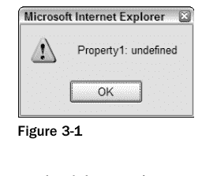

一个有趣但很少使用的特性是能够通过弱类型方法引用属性。这意味着像访问标准名称/值对一样访问对象的属性。例如：

```javascript
alert( o["anotherProperty"] );
```

这与以下方式完全相同：

```javascript
alert( o.anotherProperty );
```

这里，你会注意到你访问自定义属性的方式就像访问数组元素一样，只是使用的索引是属性名。

如前所述，这种技术在典型的 Web 应用程序中很少使用。然而，在为自己的 Web 应用程序开发框架时，由于框架的通用特性，这种技术可能被证明很有价值。通常，当设计时不知道对象属性名称时，需要使用某些字符串参数来访问该属性，这为框架提供了一定程度的灵活性和通用操作，而使用强类型机制通常无法实现。

## 常见属性和方法

所有 JavaScript 对象都有一组通用的属性和方法。这些属性和方法相对底层，在普通的 Web 应用程序中不常使用，但在处理自己的自定义对象时非常重要。所有对象都可用的通用或基本属性集列在下表中：

| 属性/方法 | 描述 |
|---|---|
| `prototype` | 此属性提供了一个指向该对象所继承的自定义“非实例”属性的对象的引用。此特性将在本章后面讨论。 |
| `constructor` | 提供一个指向充当对象构造函数的对象的引用。构造函数是在对象首次创建时自动执行的函数。 |
| `toString()` | 将对象转换为其字符串表示形式。 |
| `toLocaleString()` | 将对象转换为其本地化或特定于文化的字符串表示形式。 |
| `valueOf()` | 将对象转换为适当的“原始”类型。这通常是数字。 |
| `hasOwnProperty(nameOfProperty)` | 如果由 `nameOfProperty` 参数标识的实例属性存在，则此方法返回 `true`；否则返回 `false`。 |
| `isPrototypeOf(obj)` | 如果对象充当通过 `obj` 参数传入的对象的原型，则此方法返回 `true`；否则返回 `false`。 |
| `propertyIsEnumerable(nameOfProperty)` | 如果在 `for/in` 循环中使用对象时，`nameOfProperty` 参数中指定的属性将被枚举，则此方法返回 `true`。 |

## 自定义对象和高级对象机制

上一节探讨了所有 JavaScript 对象共有的一些属性和方法。在此之前，本章探讨了如何定义自定义实例属性以及创建全局可访问的通用对象形式。你还可以向对象动态添加函数，如下所示：

```javascript
function someFunction()
{
    alert("You are in a function");
}

var newObj = new Object();
newObj.prop1 = true;
newObj.showMessage = someFunction;
```

这里你创建了一个通用对象，分配了一个名为 `prop1` 的实例属性，并将一个名为 `someFunction` 的函数分配给了 `showMessage` 方法。要在对象上调用该方法，只需使用：

```javascript
newObj.showMessage();
```

### 使用函数字面量和对象字面量

你可以通过使用函数字面量使前面的示例更加紧凑。函数字面量是指使用 `function` 关键字定义但未给出函数名称的函数。下面的示例演示了这一点：

```javascript
var newObj = new Object();
newObj.prop1 = true;
newObj.showMessage = function() { alert ("You are in a function literal"); };

newObj.showMessage();
```

你也可以像这样向函数字面量传递参数：

```javascript
newObj.showMessage = function(msg)
{
        alert ("You are in a function literal. Message was: " + msg);
};

newObj.showMessage("my message");
```

这允许你使用函数字面量的概念为对象分配特定行为。在前面的示例中，定义了一个自定义函数 `showMessage`，其中包含显示消息的行为。这很容易是一个更复杂的函数，并且代表了构建具有完全自定义行为的自定义对象过程的一部分。

在创建 Web 应用程序的过程中，可以将功能组合在自定义对象中，其方式与使用服务器端语言（如 C# 和 VB.NET）创建传统对象相同。封装是一种面向对象的技术，其中逻辑分组的功能包含在单个组件中，以降低整个应用程序的复杂性。同样，这种技术可以应用于 JavaScript，你可以定义自己的具有专门行为的自定义对象（使用函数字面量定义对象行为），以逻辑地分组功能并提高 Web 应用程序的可管理性。

除了函数字面量，JavaScript（1.2 版及以上）还支持对象字面量。你使用标准的大括号来包含属性-值对的字面量对象定义，并可选地包含函数字面量。属性名和值用冒号分隔，每个属性-值对用逗号分隔。以下代码是使用对象字面量定义的先前对象示例：

```javascript
var newObj = {
    prop1: true,
    showMessage: function(msg)
    {
        alert("You are in a function literal, which is inside an object literal. Your message was: " + msg);
    }
};
// Invoke the method
newObj.showMessage("Another Message");
```

你在这里看到的是一种完全用属性和函数描述对象行为的方式，而无需像前面的示例那样在代码中按过程定义每个属性和函数。对象的功能是以声明方式定义的。

与其拥有执行创建自定义对象任务的大量代码段，不如使用对象字面量技术定义对象来创建自定义对象。

这种技术在整个一些可用的自定义框架和库（将在第 9 章详细讨论）中使用，以创建对象的字符串表示形式，传输到使用 JavaScript 的 Web 应用程序。由于对象字面量的表示形式是一个简单的字符串，因此可以轻松地传递给其他系统，或者实际上，由服务器动态生成（动态地），供客户端 Web 应用程序使用。

### 使用原型

理想情况下，你希望能够定义一个对象模板，该模板可用于创建或实例化自定义对象，其方式与 C#、C++ 和 Java 程序员使用类定义相同。这就是 JavaScript 中原型特性的功能。

## JavaScript 和文档对象模型

JavaScript 中的每个对象都有一个 `prototype` 属性，它本身就是一个对象。对象的 `prototype` 可以包含定义该原型所属对象的方法和属性，并在构造新对象时使用，以赋予对象一组默认的属性和方法。可以将原型视为创建该类型对象时对象属性和行为的蓝图。自定义实例属性和方法仍然可以在这些对象上定义，并与原型提供的属性组合。


基本上，`prototype` 属性是一个指向对象的引用，该对象包含对象首次创建时的初始结构和功能。进一步的自定义可以通过实例属性来完成，正如你已经看到的那样。在考虑定义自定义对象结构时，你必须掌握构造函数的概念。`constructor` 是在对象首次创建时执行的方法。作为 Web 应用程序开发者，你不需要显式调用构造函数来使其执行。当你创建一个 `new` 对象时，构造函数会隐式执行。它通常用于初始化任何自定义对象数据并准备对象以供使用。构造函数只是一个函数，你可以这样定义它：

```javascript
function Agent()
{
}

var agent1 = new Agent();
```

这里你创建了一个新的 `Agent` 对象。`Agent` 对象有一个构造函数，目前实际上没有做任何特别的事情。你可以使用构造函数向你的 `Agent` 对象添加一些实例属性，如下所示：

```javascript
function Agent()
{
    this.isActive = true;
    this.isSecret = false;
}

var agent1 = new Agent();
```

这里，你向你的 `Agent` 对象添加了两个实例属性。你无疑注意到了 `this` 关键字的使用。`this` 关键字持有对正在其中工作的对象的引用，或者基本上是对新对象的引用。你的对象现在是一个可以在代码中使用的自定义对象。你可以定义一个函数来操作你的自定义对象：

```javascript
function CheckIfActive(agentObject)
{
    if (agentObject.isActive)
        alert("The agent is currently active.");
    else
        alert("The agent is not active.");
}
```

并像这样将该函数与自定义对象结合使用：

```javascript
var agent1 = new Agent();
CheckIfActive(agent1);
```

# 第 3 章

由于构造函数仅仅是另一种函数，您也可以在函数中添加参数：

```javascript
function Agent(initiallyActive)
{
    if (initiallyActive == false)
        this.isActive = false;
    else
        this.isActive = true;
    this.isSecret = false;
}
```

这被称为带参数的构造函数。

现在，您可以创建一个新对象实例，既可以指定参数来提供初始值，也可以直接使用默认构造函数，如下所示：

```javascript
var agent1 = new Agent();
var agent2 = new Agent(false);
CheckIfActive(agent1);
CheckIfActive(agent2);
```

您会注意到，在带参数的构造函数中，您需要明确检查 `false` 的值，然后相应地设置实例属性。起初，您可能觉得先检查是否等于 `false`，然后再将内部变量 `isActive` 设置为 `false` 似乎是多余的。请记住，JavaScript 中的变量的类型取决于赋值给该变量的值究竟是什么。

当使用带参数的构造函数构建 `Agent` 对象时，预期参数 `initiallyActive` 的值应为布尔型（`true`/`false`），但实际上它可以是任何值（包括 `null`）。检查变量 `initiallyActive` 是否等于 `false` 的条件包含一个贯穿性逻辑：如果传入的任何非 `false` 值，则将内部变量 `isActive` 设置为 `true`。这确保了内部变量 `isActive` 的值始终仅被设置为 `true` 或 `false` 这两种布尔值，而不会是被传入的潜在不正确或无效的 `null` 值。这被称为防御式编程。

## 尝试演练：创建原型

至此，您已经了解了如何使用实例属性来自定义对象，以及如何为对象定义构造函数以在构造器内执行初始化操作。现在您已经准备好了解原型如何提供一种灵活且强大的方式来描述对象的“蓝图”。若要使用原型重构 `Agent` 示例，您可以按照以下步骤进行：

```javascript
function Agent(isUnderCover)
{
    if (isUnderCover)
        this.isSecret = true;
}

Agent.prototype.isSecret = false;
Agent.prototype.isActive = true;
Agent.prototype.checkIfActive = function()
{
    if (this.isActive)
        alert("This agent is currently active. Is a Secret Agent?: " +
            this.isSecret);
    else
        alert("This agent is not active. Is a Secret Agent?: " +
            this.isSecret);
};
```

本示例的作用是定义当创建该类型的新对象时，存在于对象上的属性和方法（在本例中为 `Agent` 对象）。对象的“蓝图”是通过定义其原型来确定的；并且当创建该类型的新对象时，会自动使用该原型定义来构建新版本的该对象。

在此前示例中，原型包含两个属性（`isSecret` 和 `isActive`，已分配初始值）、一个名为 `checkIfActive()` 的函数以及一个带参数的构造函数。将其与此前的示例进行对比：在先前的示例中，首先构造了一个通用对象，然后通过过程式代码动态添加属性和函数。在简单示例中，使用这种通过程序方法动态构建对象的技巧可能就够了；然而，对于更复杂的对象定义而言，提供原型定义则允许更加灵活地定义您想要的对象行为方式。如果您的对象是可在其他应用程序中重用的可重用框架或公共库的一部分时，这一点尤为重要。

现在要创建并使用您的 `Agent` 对象，只需执行以下操作：

```javascript
var agent1 = new Agent();
agent1.checkIfActive();

var agent2 = new Agent(true);
agent2.checkIfActive();
```

至此您便可以了解如何使用原型特性来定义 `Agent` 对象的结构，以及根据原型定义创建对象有多么简单。需要特别注意的是，对于每一个创建的类型为 `Agent` 的实例都共享相同的原型引用。也就是说，由原型创建的所有对象之间只共享一份原始代码副本的原型属性（`prototype`）。（这意味着原型的任何修改都会对基于该原型产生的所有对象生效。）

## 修饰 `prototype` 属性

如本章之前所提到的那样，所有的对象都具有一个 `prototype` 属性，并且可以修改任意对象的 `prototype` 定义。这对于内置对象的这一功能增强非常有用：例如如果您希望改进内置的 `String` 类以包含一个在字符串前添加特定字符集的函数时，您可以执行以下操作：

```javascript
String.prototype.addPrefix = function(prefix)
    {
        return prefix + this;
    }
```

然后您可以继续做如下操作（代码片段）：

```javascript
var newString = "Some String".addPrefix("This is ");
alert(newString); // 结果显示在下面图3-2中:
```

这产生如图3-2所示的结果（请参见图片）：


**图 3-2**

可以看到，修改对象的原型定义或者自定义自己的原型提供了一种非常强大的方式来定义您自定义对象的结构和行为，以及 JavaScript 所提供的现有内置对象的行为。

## 继承和原型链

您可以扩展这个概念并运用另一个面向对象的概念——即所谓的 `继承`。您可以继承来自已有对象的属性和行为特性，然后在此基础上构建出自己的自定义对象。这种做法的显着的益处是，无需为所有需要的客体特征都进行独立的定义工作：可以先从其他对象那里继承一些特定属性或方法，然后再根据需要添加更多新的属性或者选择性地覆盖现有属性；这种用于实现这些功能的技术称为原型链。

为了演示这一点，您可以从前述示例中的 `Agent` 类中继承其行为（如下所示）：

```javascript
function SuperAgent()
{
}

SuperAgent.prototype = new Agent();

SUPERAGENT.prototype.secretAbility = "See through walls";

var superDude1 = new SUPERAGENT();

VAR superDude2 = NEW SUPERAGENT();
superDude2.secretAbility = "Super speed";

superDude1.checkIfActive();

SUperDuke2.checkifActive();

alert(" Supers Agent lIs A CTIVE: " + SUpErDuKe I.active.tostring() + ", Secret Ability:" s UP Erduke !.secretabili);
aLERT("SupEruAgent1 is ActivE" Su per Duki, isActive.toString() + ", Secret Ablity " SuperDude l.secretAbility);

aLErt("SUpErAgent2 iS Acrive :" superDupe2.isActive.toString() + ", Secret Ability: " + superDud e 2.secretabili));
```

在这里，您通过以下行将其原型链接到 `SuperAgent` 对象，从而继承了前面定义的 `Agent` 对象的特性：

```javascript
SUPPERAGENT.prototype = newAgent();
```

这给了 `SupperAgent`（超级特工）对象所有的来自 `Agent`（普通特工）的特征。从这一点出发，您可以继续通过标准的原型语法定义属性和方法来进一步补充这种行为；若要覆盖 `Agent` 对象的任意行为，只需使用与继承来的属性同名属性或方法来重新定义它们即可。

## 小结到目前为止的学习内容

直到此处为止，本章介绍了 JavaScript 的一些基本语法、核心概念和高级对象概念。您已学会如何使用数组函数、事件处理器、基础流程控制、操作符以及基本的输入输出操作这些 JavaScript 的基本语法规则；并且还快速浏览了面向对象编程的构造器与更高级的原型链继承（object inheritance via prototype chaining）等知识点。

JavaScript 的主要目标是允许对 HTML 文档进行动态处理。换句话说，它作为 DHTML（动态 HTML）Web 应用的脚本引擎来发挥作用：现在既然您已经了解了 JavaScript 的核心概念及其工作原理，接下来我们就可以深入研究文本文档对象模型（DOM），并学习如何对其进行操纵。

## The Document Object Model

**文本文档对象模型（Document Object Model，简称 DOM）是一个可以提供访问 HTML 文档或页面中所有元素的对象，例如链接、表单字段、锚点等等。**然而也有几种与当今的 DOM 相关并且值得讨论的对象模型：在本章早些时候，我们简要讨论了各浏览器供应商对 DOM 版本演变的历程以及随着对象模型随时间发展而出现的各种兼容性问题。这既是优点也是缺点：一方面意味着对象模型正在持续得到审查和改进，其最终目标是达到主要浏览器供应商之间的标准化统一或者共性；这也是 W3C（万维网联盟）的主要基本原则之一，正如本章开头所提到的那样。另一方面，随着时间的推移，各供应商以不同方式实现了浏览器功能特性，这使得开发人员在确保其可在来自各种供应商的多个版本浏览器中正常工作之前很难实现所需的功能代码。

实际上只有三类主要的对象模型构成了 JavaScript 对象模型集合的基本元素：

- **核心 JavaScript** 对象库和语言
- *Browser Object Model*（即 `BrowserObjectModel`）（浏览器的对象模型）
- **The Document Object Model**（即 DOM）

在本章中，迄今为止我们只覆盖了这三类中的第一种——而且这种模式在各种浏览器供应商及其各自不同版本之间相当一致。

第二类代表了由浏览器自身所体现出的对象模型：它传统上以 `window`（窗口）对象根节点为基础，并包含指向其中存储的其他对象的引用（如包含页面元素的 `document`（文档）对象）。`Document`（文档）对象本身是对标准 DOM 的引用——它是 JavaScript 对象模型集合中的第三部分核心组件，也是您可以用 JavaScript 动态操纵网页元素所依赖的基础：**图 3-3** 展示了这种关系：


# 第 3 章

浏览器对象模型（Browser Object Model）与文档对象模型（Document Object Model）之间的区别一直以来都有些模糊，尤其是在早期浏览器版本中；然而，随着相关标准的成熟和更广泛的应用，这种区别正变得越来越明显。

浏览器对象模型实际上指的是浏览器本身的能力与特性。通过与 `window` 对象进行交互，你可以操控和管理浏览器的各个方面。由于 `window` 对象是浏览器对象模型的根对象，其使用常常被默认推断。也就是说，下面这种使用 `alert` 函数的方式：

```javascript
alert("We have inferred the use of the window object");
```

等效于以下列方式使用 `alert` 函数：

```javascript
window.alert("Directly referencing the window object");
```

后者明确列出了 `window` 对象。相比之下，前者使用了 `alert` 语句，这种方式默认推断出 `window` 对象的使用。换言之，在第一种情况中，`window` 对象的使用是被假定的。同样地，你可以这样写：

```javascript
document.write("Some text");

window.document.write("Some text");
```

这两条语句的含义完全相同。推断 `window` 对象的使用是一种非常常见的做法，本书余下部分都将采用这种方式。

# JavaScript 与文档对象模型

`document` 对象是大多数 Web 应用开发人员关注的核心，几乎所有 Web 应用中的动态内容都会用到它。

> 有关浏览器对象模型的更多信息和详细内容，请访问网址 `http://msdn.microsoft.com/library/default.asp?url=/library/en-us/dnproasp/html/thebrowserobjectmodel.asp` 或 `http://academic.hvcc.edu/~kantopet/old/javascript/index.php?page=the+js+bom&printme=true`。

由于 `document` 对象将是 Web 应用开发人员操作的主要媒介，本章将花比其他主题更多的时间来讨论它。与浏览器和基于 Web 的应用开发的大多数元素一样，其中涉及一些历史背景。要完​​全描述当前的 DOM，并理解作为 Web 应用开发人员了解目标用户或受众的局限性是多么重要，就需要了解各种 DOM 合规级别、特性和接受程度。

与任何 Web 应用开发一样，你使用了最新最好的符合 XHTML 标准的工具，并不意味着你的用户会用上最新最好的浏览器来访问这些内容。根据业务或应用的性质，你可能需要为 Internet Explorer 4 或 Netscape 4 等旧版浏览器提供支持。虽然这并不理想，因为需要额外的工作来应对这些情况，但了解这些浏览器的局限性非常重要，也就是它们所提供的 DOM 级别。

# 对象模型的标准化（或者说缺乏标准化）

Netscape 2/3 和 Internet Explorer 3 等主要浏览器的早期版本实现了对象模型，这些模型在目的上相似，但在某些情况下实现方式却大不相同。它们提供了对文档元素的一些基本访问，但并未暴露文档的所有元素，仍然缺乏提供真正动态体验的机制。

Netscape 4 和 Internet Explorer 4 为创建真正的动态 HTML 网页（DHTML）奠定了基础，通过向 JavaScript 暴露更广泛的属性和元素来实现，但它们的实现方式因厂商而异。

Internet Explorer 5/5.5/6、Netscape 6+ 以及后来的 Mozilla/Firefox 继续构建其对象模型，但在 W3C 的进一步指导和标准化下，在支持 JavaScript 开发人员可使用的通用 API 方面逐渐趋于一致。

# DOM 级别

Web 开发的这三个阶段，或者说时代，大致对应于 W3C 定义的“DOM 级别”的形成或合规性。这些级别的引入或形式化是为了纠正早期浏览器表现出的各种对象模型风格，统一差异，并为来自不同厂商的浏览器以及同一厂商的不同版本浏览器带来一定程度的通用性。即使在今天，主要厂商的最新版本浏览器之间仍存在一定程度的不兼容性，但这些情况比以前版本少得多，而且克服这些不兼容性所需付出的努力与早期相比也显著减少。

> 有关文档对象模型及其组成标准的更多详细信息，请访问 W3C 网站 `www.w3.org/DOM`。


DOM 共有四个级别，或者更准确地说，标准文档对象模型有四个级别。前三个级别（`DOM Level 0`、`1` 和 `2`）可以在当今一些浏览器中以不同的完整程度看到其实现。第四个级别，即 `DOM Level 3`，是相对较新的级别，W3C 最近才将其作为推荐标准。因此，目前没有任何浏览器实现该级别中超过少数特性的内容，如果有的话。主流浏览器对该级别的全面支持还需要一段时间。DOM 的四个级别如下：

- **DOM Level 0** — 这一级别不是 W3C 规范，常被称为经典或传统的 JavaScript 对象模型，与 Netscape 2/3 和 Internet Explorer 3 提供的功能相近。这一级别更多是关于所提供功能的定义，涵盖了对 HTML 文档的有限访问，并支持常见的对象集合，如 `forms[]`、`images[]` 和 `anchors[]`。

- **DOM Level 1** — 这一级别定义了通过一组熟知或通用的方法和属性来操控文档中所有元素的能力。这一级别的核心在于暴露文档的所有元素，并允许它们随时被读取和写入。这一级别由 `DOM Core` 和 `DOM HTML` 元素组成。

  - `DOM Core` 指的是一组可以表示任何结构化文档的接口，以及 XML 文档和基本 XML 文档支持。

  - `DOM HTML` 指的是提供更便捷文档查看方式的高层接口。DOM HTML 指的是 DOM Core 的底层接口。

当前主要浏览器对这一级别的支持非常好。该级别于 1998 年 10 月 1 日被 W3C 批准为推荐标准。

> 尽管 Internet Explorer 4 及以上版本提供了 `document.all` 属性集合来暴露文档的所有元素，但该属性并非 DOM Level 1 标准的一部分。`document.all` 属性集合是 Internet Explorer 4 及以上版本特有的。

- **DOM Level 2** — 这一级别结合了 DOM Level 0 和 Level 1，提供了访问和操作样式表元素的方法，并进一步提供了对与 XML 相关的页面元素的访问。DOM Level 2 标准还有其他一些贡献特性，但这些特性知名度较低；然而，这些特性中的许多在常见/主流浏览器中并不受支持。即使是声称高度符合标准的浏览器也尚未实现完整的 DOM Level 2 支持。大多数主流浏览器倾向于关注 DOM Level 2 倡导的样式表操作特性，但未能实现整套 DOM Level 2 特性。这一级别相当全面，包含六个不同的推荐标准 — `DOM2 Core`、`DOM2 HTML`、`DOM2 Style/CSS`、`DOM2 Events`、`DOM2 Traversal and Range` 和 `DOM2 Views`。

  - `DOM2 Core` 和 `DOM2 HTML` 是对 DOM Level 1 中定义的 DOM Core 和 DOM HTML 的扩展。

  - `DOM2 Style/CSS` 提供了处理样式和层叠样式表所有方面的接口。

  - `DOM2 Events` 暴露了通用事件系统，并引入了事件流、冒泡和取消等概念。

  - `DOM2 Traversal and Range` 提供了允许脚本动态遍历和识别文档中内容范围的接口。

  - `DOM2 Views` 允许脚本动态访问和更新文档表示的内容。

## JavaScript 与文档对象模型

- 该级别于 2000 年 11 月 13 日正式被 W3C 批准为推荐标准，但 DOM2 HTML 除外，它于 2003 年 1 月 9 日正式被批准为推荐标准。

- **DOM Level 3** — 该级别代表了 DOM 标准化进程的最终演进。该级别将 XML 支持扩展到 W3C 推荐标准对 XML 1.0 和 XML 信息集规范的其他组件进行了扩展，使 DOM 与 XML Schema 1.0 和 SOAP 1.2 这一层级包含五个不同的规范 — `DOM3 Core`、`DOM Load and Save`、`DOM Validation`、`DOM Events` 和 `DOM XPath`。

  - `DOM3 Core` 是对 DOM1 和 DOM2 Core 的进一步扩展。

  - `DOM3 Load and Save` 指的是动态加载 XML 文档内容到 DOM 文档中，以及将 DOM 文档序列化为 XML 文档的能力。

  - `DOM3 Validation` 提供了动态更新文档的方法，并确保文档及相关更新是有效的。

  - `DOM3 Events` 是 DOM2 事件的扩展，主要关注键盘事件。

  - `DOM3 XPath` 提供了使用 XPath 1.0 语法访问 DOM 树的接口。

该级别最近才被 W3C 正式推荐，其中 DOM Core 和 DOM Load and Save 于 2004 年 4 月 7 日正式被推荐。然而，DOM Validation 于 2004 年 1 月 27 日正式被推荐。该级别的其他部分尚未被正式推荐。

那么，作为 Web 应用程序开发人员，这一切对你意味着什么呢？这些级别代表了 W3C 为定义所有浏览器采用的标准和规范所付出的重大努力。熟悉过去 Web 开发的人都知道，试图适配大多数浏览器需要付出巨大的努力。W3C 推荐的这些级别是在减少创建真正跨浏览器兼容应用程序所需工作量方面迈出的重要一步。

## 动手试一试：确定当前浏览器的 DOM 级别

如果没有一种简单的方法来确定当前浏览器支持什么级别，从而了解其 DOM 具备什么功能，那么这些级别就不会有多大用处。这可以通过使用 `document.implementation.hasFeatures()` 方法来实现。该方法接受两个字符串 — 一个用于要测试的功能，例如 `CORE`，另一个用于版本号，例如 `1.0`。例如，要确定你的浏览器是否支持 DOM HTML Level 1（或版本 1.0），你可以使用以下 JavaScript 代码：

```javascript
document.implementation.hasFeature("HTML", "1.0")
```

`document.implementation.hasFeatures()` 方法返回一个布尔值（true/false），表示是否支持指定的功能。在 Internet Explorer v6.0 中，以下 JavaScript 代码将在浏览器窗口中写入 `true`：

```javascript
document.write(document.implementation.hasFeature("HTML", "1.0"));
```

为了更全面地展示，下面的 JavaScript 代码为相应的 DOM 功能和版本显示 true 或 false 值。

# 第 3 章

```javascript
var featuresLevel1 = ["HTML","XML"];
var featuresLevel2 =
["Core","HTML","XML","Stylesheets","CSS","CSS2","Views","Events","UIEvents","MouseE
vents","HTMLEvents","MutationEvents","Range","Traversal"];

document.write("<br />*** DOM Level 1 ***<br />");
showFeatureSupport(featuresLevel1,"1.0");

document.write("<br />*** DOM Level 2 ***<br />");
showFeatureSupport(featuresLevel2,"2.0");

// Generic function to loop through Advising and output feature support test result
function showFeatureSupport(featureArray,version)
{
    for (var featCnt=0; featCnt < featureArray.length; featCnt++)
    {
        var feature = featureArray[featCnt];
        
        var supportedFlag = document.implementation.hasFeature(feature,version);
        document.write("Feature '" + feature + "': " + supportedFlag);
        document.write("<br />");
    }
}
```

这段示例代码简单地使用 `document.implementation` 对象的 `hasFeature` 方法来确定是否实现了特定的功能。根据代码执行的平台/浏览器上是否可用指定的功能，该方法返回 true 或 false 值。每个 DOM 级别（1 和 2）的功能数组被传递给 `showFeatureSupport` 函数以执行测试。

你会注意到，你有一个包含与 DOM Level 1 和 Level 2 相关功能的字符串数组。这些简单的字符串是为每个功能专门命名的，准确指定功能的名称非常重要。功能名称的任何拼写错误都将导致 `hasFeature` 方法返回 false 值，而实际上预期的功能可能是存在的。

`hasFeature` 方法是 DOM 提供的一个重要方法，使开发人员能够测试特定功能是否在其代码运行的浏览器中实现。鉴于浏览器和 DOM 级别支持的无数种组合，有必要在使用某项功能之前确定它是否存在。

能够执行此项测试意味着为你的用户提供更稳健的应用程序。如果你的站点所需的特定功能不存在，那么你可以以优雅的方式通知用户，或者可能提供一些变通代码来缓解此问题。如果没有这样的测试，当你的站点在特定功能不可用时可能会产生错误，通常不会提供良好的用户体验。

值得注意的是，这段代码在不同浏览器中显示的不同结果。在当今最普遍的两个浏览器 — Internet Explorer 6 和 Firefox 1.5 中，这段代码产生图 3-4 所示的结果。

图 3-4 清楚地表明，即使在最新的浏览器集合中，DOM 级别支持也不一致，并且因浏览器而异。尽管标准确实存在，但当前浏览器对这些标准的遵从还有很长的路要走。

# JavaScript 与文档对象模型

那么，现在你知道跨浏览器支持是困难的，但正在改善。过去的 DOM 一直是由每个浏览器供应商定制的实现，有时看起来相似，但通常存在明显的差异，这使得 Web 应用程序开发变得困难。通过各种 DOM 级别走向标准化是一个缓慢但最终会实现的过程。DOM Level 1 在行业内相对被广泛采用，因此本章的其余部分将介绍 DOM Level 1 的组件，即 DOM Core 和 DOM HTML。

## 使用 DOM

一旦你知道 W3C 定义的标准 DOM 是当今 Web 应用程序的可行模型，你从这些信息中真正得到了什么呢？本质上，当 (X)HTML 页面被浏览器加载和渲染时，会在内存中构建一个*文档树*来表示显示的文档。文档树提供了文档的内部布局，可以进行操作和更新。本章前面图 3-3 中显示的 `document` 对象就是对这个内部文档树的引用，它本身实现了 W3C 定义的文档接口。

> 有关 DOM Level 1 `document` 对象提供的文档接口的详细描述，请访问 `www.w3.org/TR/REC-DOM-Level-1/level-one-core.html#i-Document`。

# 第 3 章

看一个简单的例子。下面的文档代表了一个极其简单的 Web 页面。

```html
<!DOCTYPE html PUBLIC "-//W3C//DTD XHTML 1.0 Transitional//EN"
"http://www.w3.org/TR/xhtml1/DTD/xhtml1-transitional.dtd">
<html xmlns="http://www.w3.org/1999/xhtml" >
<head>
    <title>DOM Tree 1</title>
</head>
<body>
    <h1>This is the Header</h1>
    <p>This is a paragraph of text.</p>
    <ul>
        <li>List Item 1</li>
        <li>List Item 2</li>
    </ul>
</body>
</html>
```

当浏览器加载并解析上述文档时，它会构建一个文档树并使用该树来显示文档。该文档树等同于图 3-5。

图 3-5 中的每个框代表文档树中的一个*节点*。节点上方的箭头线代表父子关系，顶部的节点是父节点，底部的节点是子节点。具有相同父节点的节点是兄弟节点。

## 动手试一试：修改文档树

DOM Level 1 定义的文档树足够灵活和强大，可以使用脚本代码从头构建文档。然而，很少需要这样做，因为文档使用标准的 (X)HTML 标记定义，文档树在浏览器加载和解析后进行操作。文档树中的任何元素都可以随时使用 JavaScript 进行修改和操作。例如，你可能想要更改标题的内容、动态写入更多段落内容，以及删除或删除无序列表。检查下面的 JavaScript 代码，它正是这样做的：

```javascript
// Get a nodelist with all the header elements
var headerNodeList = document.getElementsByTagName("h1");
// We know there is only 1, so get a reference to the 0th element
var hdr = headerNodeList[0];
// Use that reference to change the text/data
hdr.firstChild.data = "My Dynamically written Header Text";

// Get a nodelist with all the paragraph elements
var paragraphNodeList = document.getElementsByTagName("p");
// We know there is only 1, so get a reference to the 0th element
var paragraph = paragraphNodeList[0];
// Use that reference to change the text/data.
paragraph.firstChild.data = "This represents the new text of the first paragraph.";

// Get a nodelist with all the ul elements
var ulNodeList = document.getElementsByTagName("ul");
// We know there is only 1, so get a reference to the 0th element
```

# JavaScript 与文档对象模型

```javascript
var ul = ulNodeList[0];
// 使用 parentNode（这里是 'body' 元素），移除该子元素
paragraph.parentNode.removeChild(ul);

// 为第二个段落创建一个新的 Text 节点
var newTextNode = document.createTextNode("This text is the second set of paragraph text");
// 创建一个新的 Element 作为第二个段落
var newElementNode = document.createElement("p");
// 将文本放入段落中
newElementNode.appendChild(newTextNode);
// 通过将段落追加到
// BODY（即 para 的父节点）的方式，将其放到文档末尾
paragraph.parentNode.appendChild(newElementNode);
```


图 3-5

# 第 3 章

> 对于这个特定示例，重要的是前述脚本代码要放在文档中标记代码之后。如果这段代码像之前大多数示例那样放在 `<head>` 部分，文档树尚未构建，因为浏览器还没来得及解析那些标记部分，因此脚本代码会执行失败。

顺便一提，你会注意到使用了*索引*来检索节点列表中的第 0 号元素，即第一个元素。`getElementsByTagName()` 方法返回一个节点列表，或者说是一个节点数组，因此你可以使用数组索引器来返回该数组中的特定元素。或者，你也可以使用 `item` 方法来返回该数组列表中的特定元素编号，如下所示：

```javascript
var hdr = headerNodeList.item(0);
```

网页结构应该看起来类似于下面的文档（为简洁起见，省略了脚本代码）：


```html
<!DOCTYPE html PUBLIC "-//W3C//DTD XHTML 1.0 Transitional//EN"
"http://www.w3.org/TR/xhtml1/DTD/xhtml1-transitional.dtd">
<html xmlns="http://www.w3.org/1999/xhtml" >
<head>
    <title>DOM Tree 1</title>
</head>
<body>
    <h1>This is the Header</h1>
    <p>This is a paragraph of text.</p>
    <ul>
        <li>List Item 1</li>
        <li>List Item 2</li>
    </ul>
    <script type="text/javascript">
        alert("About to change the document.");
        // ... script code goes here ......
    </script>
</body>
</html>
```

在这里，你动态地操作了文档树，浏览器只需在树的内容发生变化时渲染这些内容即可。

在之前的示例中，你使用`getElementsByTagName()`方法来访问元素，该方法返回指定元素的节点列表（如果有的话）。虽然这确实可行，但更常见的是使用`getElementById()`方法，该方法返回对特定元素的引用。你在上一章中首次接触到`getElementById()`方法，虽然此方法可以更直接地访问特定元素，但它要求文档中的元素必须定义唯一的 id 属性。请看下面的例子：

# JavaScript 与文档对象模型

```html
<!DOCTYPE html PUBLIC "-//W3C//DTD XHTML 1.0 Transitional//EN"
"http://www.w3.org/TR/xhtml1/DTD/xhtml1-transitional.dtd">
<html xmlns="http://www.w3.org/1999/xhtml" >
<head>
    <title>DOM Tree 2</title>
</head>
<body>
    <h1 id="hdr1">This is the Header</h1>
    <p id="p1">This is a paragraph of text.</p>
    <ul id="ul1">
        <li>List Item 1</li>
        <li>List Item 2</li>
    </ul>

    <script type="text/javascript">

        alert("About to change the document.");

        // ... script code goes here ...

    </script>
</body>
</html>
```

此文档与前面的示例几乎完全相同，只是为每个要操作的元素添加了 id 属性。然后可以对 JavaScript 代码稍作简化，以利用`getElementById()`方法，如下所示：

```javascript
// 获取指向 header 元素的节点引用
var hdr = document.getElementById("hdr1");
// 使用该引用更改文本/数据。
hdr.firstChild.data = "My Dynamically written Header Text";

// 获取指向 paragraph 元素的节点引用
var paragraph = document.getElementById("p1");
// 使用该引用更改文本/数据。
paragraph.firstChild.data = "This represents the new text of the first paragraph.";

// 获取指向 ul 元素的节点引用
var ul = document.getElementById("ul1");
// 使用 parentNode（这里是 'body' 元素），移除该子元素
paragraph.parentNode.removeChild(ul);

// 为第二个段落创建一个新的 Text 节点
var newTextNode = document.createTextNode("This text is the second set of paragraph text");
// 创建一个新的 Element 作为第二个段落
var newElementNode = document.createElement("p");
// 将文本放入段落中
newElementNode.appendChild(newTextNode);
// 通过将段落追加到
// BODY（即 para 的父节点）的方式，将其放到文档末尾
paragraph.parentNode.appendChild(newElementNode);
```

`getElementById()`方法允许直接访问树中的节点，而`getElementsByTagName()`返回一个节点列表，你必须进一步检查该列表才能最终检索到所需的节点对象。最终，你会获得文档树中某个 DOM 节点对象的引用。

## 操作节点

在前一节的示例中，你简要了解了如何创建元素、追加子节点以及移除节点。操作节点的方法简单但丰富。你可以构造各种类型的元素，并将其追加或插入到文档树中。你已经了解了如何检索节点对象的引用，有了这些信息，你还可以移除、替换或复制节点。所有这些方法都作为`document`对象的一部分可用，该对象作为文档树的根对象。以下几节列出了各种可用的节点操作方法。

## 创建节点

下表列出并描述了可用的节点创建方法。

| 创建方法 | 描述 |
| --- | --- |
| `createAttribute(attributeName);` | 使用给定的属性名创建属性节点。 |
| `createComment(commentString);` | 使用提供的字符串作为注释本身来创建注释节点。 |
| `createDocumentFragment();` | 创建文档片段节点，可用于容纳一组待处理的节点。 |
| `createElement(tagName);` | 创建类型由`tagName`参数指定的元素。 |
| `createTextNode(textString);` | 使用提供的`textString`作为文本内容创建文本节点。 |

以下是使用节点创建方法的示例：

```javascript
var attributeNode = document.createAttribute("width");
var commentNode = document.createComment("My Comment");
var docFragmentNode = document.createDocumentFragment();
var elementNode = document.createElement("H1");
var textNode = document.createTextNode("Some Simple Text");
```

在每种情况下，方法都会返回一个特定的节点对象。请注意，前面示例中的这些语句不会影响文档的任何方面，只是返回对所需类型有效对象的引用。要使这些对象影响文档内容，通常必须将它们插入到文档中的某个位置。这将在下一节中讨论。

## 插入和追加节点

使用下面列出的 insert 或 append 方法时，通常需要使用本章前面描述的方法来获取父节点的引用，并从该节点引用调用方法，就像在前面示例中已经看到的那样。插入或追加的节点现在成为它被插入或追加到的父节点的子节点。

| 插入/追加方法 | 描述 |
| --- | --- |
| `insertBefore(newChildNode, referenceNode);` | 在文档树中，将`newChildNode`参数引用的节点插入到`referenceNode`参数引用的节点之前。 |
| `appendChild(newChildNode);` | 将`newChildNode`引用的节点追加到该父节点的子节点列表末尾。 |

## 移除、替换和复制节点

移除节点时，如本章前面示例所示，你需要获取对待移除节点的引用；然后使用其父节点调用`removeChild()`方法。`replaceChild()`方法的使用方式类似；使用父节点来调用该方法，传递新节点的引用和待替换节点的引用。

复制节点则没有这么直观。使用要复制/克隆对象的方法`cloneNode()`，并传入一个布尔值来指示应执行深拷贝还是浅拷贝。值为`true`表示执行深拷贝，即除了被克隆/复制的节点本身外，还会复制该节点的所有子节点。浅拷贝仅复制节点本身。

| 移除/替换/复制方法 | 描述 |
| --- | --- |
| `removeChild(childNode);` | 从调用该方法的父节点的子节点列表中，移除`childNode`参数引用的子节点。 |
| `replaceChild(newNode, nodeToReplace);` | 用`newNode`参数引用的节点替换`nodeToReplace`参数引用的子节点。 |
| `cloneNode(performDeepClone);` | 返回对该方法调用节点进行复制或克隆后的引用。如果`performDeepClone`参数为`true`，则执行深拷贝，即所有子节点也包含在复制/克隆过程中。 |

## 动手实践

### 克隆节点

移除和替换节点是相对直接的操作，在前面示例中已有所展示；然而，克隆则不那么直观。请看下面的网页及相关 JavaScript 代码：

# 第3章

```html
<!DOCTYPE html PUBLIC "-//W3C//DTD XHTML 1.0 Transitional//EN"
    "http://www.w3.org/TR/xhtml1/DTD/xhtml1-transitional.dtd">
<html xmlns="http://www.w3.org/1999/xhtml">
<head>
    <title>Cloning a Node</title>
</head>
<body>
    <p id="p1">This is some text and here is an image </p>

    <div id="div1"></div>

    <script type="text/javascript">
        var node = document.getElementById("p1");
        var div = document.getElementById("div1");

        var nodeShallow = node.cloneNode(false);
        var nodeDeep = node.cloneNode(true);

        alert("About to append the shallow copied node");
        div.appendChild(nodeShallow);

        alert("About to append the Deep copied node");
        div.appendChild(nodeDeep);

        alert("Done");

    </script>
</body>
</html>
```

当此页面加载并执行时，最初似乎没有为浅克隆的节点添加任何内容，随后深克隆的节点则被明显添加。在图3-5中，文档树显示了段落节点的文本内容作为其子节点，实际上，检查节点属性的 JavaScript 代码也证实了这一点。因此，当你请求节点的浅拷贝时，文本内容（和图像）不会被克隆；因此，当该节点被追加到文档的`div`元素中时，不会显示任何内容。

# 节点属性

节点对象有一组定义明确的属性，如下表所列：

| DOM节点对象属性 | 描述/详细信息 |
| --- | --- |
| `nodeName` | 包含节点的名称。 |
| `nodeValue` | 包含节点的值，但通常仅适用于文本节点。 |
| `nodeType` | 此属性包含一个数字，对应于节点类型，如下表所示。 |
| `parentNode` | 对当前节点父节点的引用（如果存在）。 |

## JavaScript与文档对象模型

| DOM节点对象属性 | 描述/详细信息 |
| --- | --- |
| `childNodes` | 对子节点列表的引用（如果存在）。 |
| `firstChild` | 对当前对象/节点第一个子节点的引用（如果存在）。 |
| `lastChild` | 对当前对象/节点最后一个子节点的引用（如果存在）。 |
| `previousSibling` | 对前一个兄弟节点的引用（如果存在）。这发生在父节点有多个子节点的情况下。如果节点是第一个子节点，此属性将没有有效的引用。 |
| `nextSibling` | 对下一个兄弟节点的引用（如果存在）。这发生在父节点有多个子节点的情况下。如果节点是最后一个子节点，此属性将没有有效的引用。 |
| `attributes` | 当前节点的属性列表/数组。 |
| `ownerDocument` | 对包含文档或此节点所属文档对象的引用。 |

下表解释了对应于节点类型的数字，即`nodeType`属性使用的数字。

| 节点类型编号 | 类型 | 描述 | 备注 |
| --- | --- | --- | --- |
| 1 | 元素 | 表示一个XML或(X)HTML元素 | |
| 2 | 属性 | 一个XML或(X)HTML属性 | 例如，`class="light"` |
| 3 | 文本 | 表示包含在元素或属性中的文本内容 | |
| 4 | CDATA节 | 表示可能包含否则将被视为标记的字符的文本块 | XML专用。用于表示文本的字面部分——即告诉解析器不要将其解释为标记 |
| 5 | 实体引用 | 表示一个实体引用 | XML专用 |
| 6 | 实体 | 表示一个实体 | XML专用 |
| 7 | 处理指令 | 表示一个处理指令 | XML专用。例如，XML文档中的第一行：`<?xml version="1.0" ?>` |
| 8 | 注释 | 表示一个注释 | 例如：`<!-- A comment -->` |

*表格续下页*

| 节点类型编号 | 类型 | 描述 | 备注 |
| --- | --- | --- | --- |
| 9 | 文档 | 表示对文档树中根对象的引用，即对整个文档的引用 | 参见本章前面的详细讨论 |
| 10 | 文档类型 | 文档类型定义 | 例如，HTML文档中的DOCTYPE元素：`<!DOCTYPE html PUBLIC "-//W3C//DTD XHTML 1.0 Transitional//EN" "http://www.w3.org/TR/xhtml1/DTD/xhtml1-transitional.dtd">` |
| 11 | 文档片段 | 表示轻量级的文档对象，或文档的一部分 | |
| 12 | 表示法 | 表示在DTD中声明的表示法 | DTD = 文档类型定义。一种较早的定义XML文档结构的形式 |

## 动手试试：使用节点属性

作为使用这些属性的一个例子，你可以检查前面示例中的一个段落（`<p>`）节点。你将向前面的示例添加一些额外的脚本代码，如以下代码块所示：

```javascript
var node = paragraph;
var msg = "Node Name: " + node.nodeName;
msg += "\nNode Type: " + node.nodeType;
msg += "\nNode Value: " + node.nodeValue;
msg += "\nNode Child Name: " + node.firstChild.nodeName;
msg += "\nNode Child Type: " + node.firstChild.nodeType;
msg += "\nNode Child Value: " + node.firstChild.nodeValue;
alert(msg);
```

这将产生如图3-6所示的对话框。

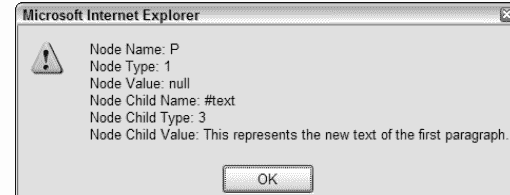

图3-6

## JavaScript与文档对象模型

你可以在这里看到，段落节点的类型为1，名称为P，而它的子节点（代表该段落节点的文本内容）类型为3，名称为`#text`。

节点的`attributes`属性是引用或检查伴随特定元素或节点的属性的一种便捷方式。正如本章前面列出的属性表中提到的，它是一个包含节点属性的数组。此数组中的元素数量会因运行的浏览器不同而有所差异。为了演示这一点，请检查下面的网页和相关脚本代码：


```html
<!DOCTYPE html PUBLIC "-//W3C//DTD XHTML 1.0 Transitional//EN"
    "http://www.w3.org/TR/xhtml1/DTD/xhtml1-transitional.dtd">
<html xmlns="http://www.w3.org/1999/xhtml">
<head>
    <title>DOM Tree Attributes</title>
</head>
<body>
    <h1>Attribute Listing</h1>
    <p id="p1" align="center" width="90%">This is some paragraph text</p>

    <script type="text/javascript">
        var p = document.getElementById("p1");
        var attrCnt = p.attributes.length;
        document.write("<br />Number of attributes: #" + attrCnt + "<br />");

        for (var cnt = 0; cnt < attrCnt; cnt++)
        {
            var attr = p.attributes[cnt];
            var val;
            if (attr.value == "")
                val = "[EmptyString]";
            else
                val = attr.value;
            document.write("<br />Attribute: <i><b>" + attr.nodeName + "</b></i> has a value of <b>" + val + "</b>");
        }
    </script>
</body>
</html>
```

此代码包含一个非常简单的网页，其中包含一个标题元素（`<h1>`）和一个段落（`<p>`）元素。JavaScript 代码使用`getElementById()`方法获取对段落元素的引用，显示与该元素关联的属性数量，然后列出每个属性的名称及其关联的值。

当此页面在 Firefox 中渲染时，你会得到预期的三个属性及其关联值的结果。页面输出如图 3-7 所示。

然而，当网页和代码在 Internet Explorer 6 中执行时，你会得到总共 83 个属性。这基本上代表了该元素在 Internet Explorer 6 中可能拥有的所有属性，无论是否已定义。图 3-8 中的屏幕截图显示了此输出：

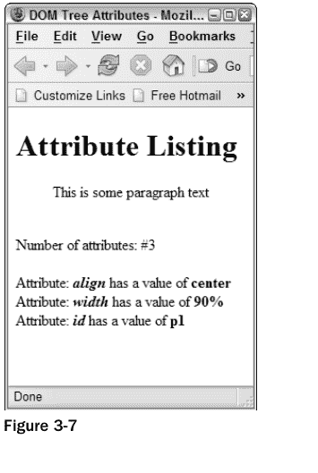

图 3-7

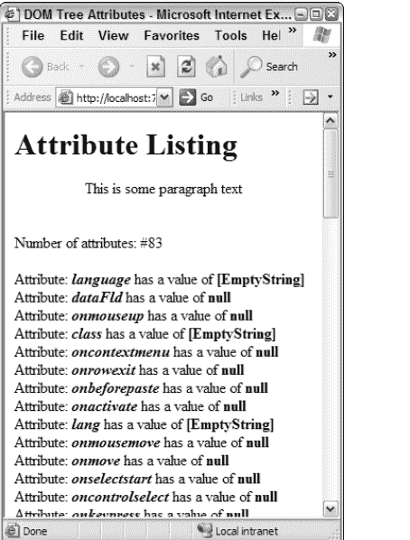

图 3-8

# JavaScript 与文档对象模型

显而易见，尽管相同的脚本代码可以无问题地执行，且支持相同的基本属性，但在不同的浏览器中，每个 DOM 树的表示方式仍然存在一定程度的差异。正如本章前面提到的，当你编写跨浏览器支持的代码时，你需要了解所有这些差异，并考虑如何处理它们以实现预期的结果。

## DOM Level 0 通用集合

为了与旧版浏览器保持向后兼容，DOM 支持一些属于 DOM Level 0 规范的对象集合。这些集合允许通过属性名建议的各种页面元素进行索引访问。下表列出了这些集合。

| 集合/数组对象 | 说明 |
| --- | --- |
| `document.anchors[]` | 页面中所有锚点元素的数组或集合，由锚点标签表示——即所有 `<a name="...">` 标签 |
| `document.applets[]` | 页面中所有 Java 小程序的数组或集合 |
| `document.forms[]` | 页面中所有表单元素的数组或集合 |
| `document.images[]` | 页面中所有图像元素的数组或集合，由图像标签表示——即所有 `` 标签 |
| `document.links[]` | 页面中所有链接元素的数组或集合，由链接锚点标签表示——即 `<a href="...">` |

使用这些集合非常简单，只需通过索引值访问每个集合即可。如果你有如下所示的简单网页示例：

```html
<!DOCTYPE html PUBLIC "-//W3C//DTD XHTML 1.0 Transitional//EN"
"http://www.w3.org/TR/xhtml1/DTD/xhtml1-transitional.dtd">
<html xmlns="http://www.w3.org/1999/xhtml">
<head>
    <title>DOM Level 0 Collections</title>
</head>
<body>
    <form id="form1" method="post" action="DOMLevel0Collections.htm">
        <a href="DOMLevel0Collections.htm">Links to this same page</a>
    </form>
</body>
</html>
```

你可以使用这些 Level 0 集合来访问 HTML 元素，如下面的 JavaScript 代码所示：

```javascript
alert(document.links[0].nodeName);
alert(document.forms[0].nodeName);
```

# 第 3 章：DOM、样式与 CSS

到目前为止，你已经了解了如何操作文档树中的实体或节点。DOM Level 2 包含对 CSS（层叠样式表）和样式的支持，并使你能够操作这些元素。Internet Explorer 6 并不完全支持 DOM Level 2，但其 DHTML 模型确实包含按照 DOM 标准设置样式的支持。

设置元素样式的一种方法是操作该元素的 CSS 样式，即其内联样式元素。假设你有以下段落元素：

```html
<p id="p1">Some Text</p>
```

当使用内联样式修改此元素的视觉外观时，会添加内联样式属性，如下所示：

```html
<p id="p1" style="width:100%;text-align:left">Some Text</p>
```

要引用此内联样式属性，你需要使用 JavaScript 中节点元素的`style`属性。

## style 属性与命名约定

你会在前面的示例中注意到，`text-align`样式属性是连字符形式的（包含`-`字符）。如果你尝试在 JavaScript 中字面表示这一点，就会遇到问题，因为连字符代表的是减号运算符。因此，样式属性通常遵循一些命名规范。

任何带连字符的样式属性都会去掉连字符，然后将后面的单词首字母大写——也就是说，它遵循驼峰命名法。驼峰命名法将第一个单词的首字母小写，后续单词的首字母大写，例如`camelCase`。所以，在前面的示例中，样式属性`text-align`在 JavaScript 中将表示为`textAlign`。下面的示例演示了这一点：

```html
<!DOCTYPE html PUBLIC "-//W3C//DTD XHTML 1.0 Transitional//EN"
"http://www.w3.org/TR/xhtml1/DTD/xhtml1-transitional.dtd">
<html xmlns="http://www.w3.org/1999/xhtml">
<head>
    <title>DOM Styles - Example 1</title>
</head>
<body>
    <p id="p1" style="width:100%;text-align:left">Some Text</p>
    <hr />
    <script type="text/javascript">
    var para = document.getElementById("p1");
    if (para != null)
    {
        alert("Changing the text alignment to 'center'");
        para.style.textAlign = "center";

        alert("Changing the text alignment to 'right'");
        para.style.textAlign = "right";

        alert("Changing the text alignment back to 'left'");
        para.style.textAlign = "left";
    }
    </script>
</body>
</html>
```

一般“去掉连字符，使用驼峰命名法”规则的唯一显著例外是`float` CSS 样式属性。`float`不能字面表示在 JavaScript 中，因为它是一个保留字。在这种情况下，它变成了`cssFloat`。

所有其他属性都遵循上述通用的驼峰命名规则，包括通常有大写的属性。例如，在 JavaScript 中访问样式规则时，`Top`变成了`top`，`Width`变成了`width`。

Firefox、Internet Explorer 6 和其他当前主流浏览器在很大程度上支持 CSS1（存在一些细微差异）。对 CSS2 和 CSS3 的支持较少，尤其是在 Internet Explorer 6 中；然而，这种情况会随着时间的推移而改变，并且值得了解各种浏览器的合规水平。Mozilla/Firefox 目前对这些标准有最好的支持。

> 对各种 CSS 级别、所有相关属性以及特定浏览器支持的完整讨论超出了本书的范围。有关详细信息，请访问 W3C 网站上托管这些标准的网站 `www.w3.org/Style/CSS`。

## 修改样式表

样式表在定义文档中要应用的 CSS 规则时起着重要作用。DOM Level 2 支持一个`styleSheets[]`集合，其中包含对文档中所有`<style>`元素的引用。正如`styleSheets[]`属性的`[]`所示，这是一个数组，每个元素都是一个`CSSStyleSheet`对象。

此对象包含允许一定程度操作的方法和属性；然而，Internet Explorer 在这种情况下不符合标准，使用了一组稍微非标准的方法。下表显示了 DOM 标准方法和 Internet Explorer 的等效方法。

| 方法/属性 | 说明 | Internet Explorer 等效方法 |
| :--- | :--- | :--- |
| `insertRule(ruleText, ruleIndex);` | 在数组的指定索引处插入参数`ruleText`中定义的 CSS 规则 | `addRule(ruleText, ruleIndex);` |
| `deleteRule(ruleIndex);` | 删除特定`ruleIndex`处包含的指定规则 | `removeRule(ruleIndex);` |
| `cssRules[]` | 包含样式块中各个规则的属性数组 | `rules[]` |

由于 Internet Explorer 缺乏标准支持，在多个浏览器中使用这些属性时必须小心。修改样式时，必须首先检查是否有权访问特定的属性集。

## 试一试：修改样式表以在 Firefox 和 IE 中工作

考虑下面的示例：

```html
<!DOCTYPE html PUBLIC "-//W3C//DTD XHTML 1.0 Transitional//EN"
"http://www.w3.org/TR/xhtml1/DTD/xhtml1-transitional.dtd">
<html xmlns="http://www.w3.org/1999/xhtml">
<head>
    <title>DOM Styles - Example 2</title>
    <style type="text/css">
        p { text-align: center; }
        body { color: blue; }
    </style>
</head>
<body>
    <p id="p1">Some paragraph Text</p>
    <div>This is some body text</div>
    <hr />
    <script type="text/javascript">
    document.write("Number of styleSheets: #" + document.styleSheets.length);

    var stylesheet = document.styleSheets[0];

    // Check to see if we are operating in Internet Explorer
    if (stylesheet.rules)
    {
        document.write("<br />Internet Explorer detected.<br />");

        // Map the standard DOM attributes and methods to the Internet Explorer
        // equivalents
        stylesheet.cssRules = stylesheet.rules;
        stylesheet.insertRule = function(ruleText, ruleIndex) {
            this.addRule(ruleText, ruleIndex);
        };
        stylesheet.deleteRule = function(ruleIndex) {
            this.removeRule(ruleIndex);
        };
    }

    // The 'p' style rule
    document.write("<br /><br /> 1st Style rule (text-Align) value: " +
        stylesheet.cssRules[0].style.textAlign);

    // The 'body' style rule
    document.write("<br /> 2nd Style rule (color) value: " +
        stylesheet.cssRules[1].style.color);

    alert("Deleting the 'body' color style rule.");
    stylesheet.deleteRule(1);
    </script>
</body>
</html>
```

## JavaScript 与文档对象模型

示例中的代码首先检查是否存在`rules[]`集合，如果存在，则将其作为`cssRules`属性添加到`stylesheets`集合中。此外，你还需要添加 DOM 标准的`insertRule`和`deleteRule`方法，并将它们映射到 Internet Explorer 的等效方法。

这实际上是在向 Internet Explorer 添加 DOM 属性和方法，以模拟所需的 DOM Level 2 支持。然后，你就可以基于标准的 DOM 接口进行开发，并确保你的网页在支持 DOM Level 2 的浏览器（如 Firefox）以及 Internet Explorer 中都能正常工作。

这类代码非常适合在所有 Web 应用程序中重复使用。因此，建议你将这些可重用的代码放入一个脚本文件中，以便在所有 Web 应用程序中引入和复用。为了演示这一点，以下代码展示了前面示例代码的一个修订版本：

```html
<!DOCTYPE html PUBLIC "-//W3C//DTD XHTML 1.0 Transitional//EN"
"http://www.w3.org/TR/xhtml1/DTD/xhtml1-transitional.dtd">
<html xmlns="http://www.w3.org/1999/xhtml">
<head>
    <title>DOM Styles - Example 3</title>
    <style type="text/css">
        p { text-align: center; }
        body { color: blue; }
    </style>

    <script type="text/javascript" src="DOMStyles3_Include.js"></script>
</head>
<body>
    <p id="p1">Some paragraph text</p>
    <div>This is some body text</div>
    <hr />
    <script type="text/javascript">
    document.write("Number of styleSheets: #" + document.styleSheets.length);

    // The 'p' style rule
    document.write("<br /><br /> 1st Style rule (text-Align) value: " +
        stylesheet.cssRules[0].style.textAlign);

    // The 'body' style rule
    document.write("<br /> 2nd Style rule (color) value: " +
        stylesheet.cssRules[1].style.color);

    alert("Deleting the 'body' color style rule.");
    stylesheet.deleteRule(1);
    </script>
</body>
</html>
```


你会注意到，现在的代码不再包含判断浏览器类型的逻辑，也不需要将函数映射到符合 DOM 标准的函数（如果需要的话）。唯一的添加是这一行：

```html
<script type="text/javascript" src="DOMStyles3_Include.js"></script>
```

它引入了一个脚本文件来执行特定于浏览器的检查和映射。这使你能够专注于与应用程序功能相关的代码，而无需担心为支持多种浏览器而需要编写的代码。然后，这个包含文件可以在你的所有 Web 应用程序中重复使用，如以下示例所示：

```javascript
/********************************************
** Include script that maps Internet Explorer methods
** to the DOM equivalents
*********************************************/

var stylesheet = document.styleSheets[0];
// Check to see if we are operating in Internet Explorer
if (stylesheet.rules)
{
    // Internet Explorer detected

    // Map the standard DOM attributes and methods to the internet explorer
    // equivalents
    stylesheet.cssRules = stylesheet.rules;
    stylesheet.insertRule = function(ruleText, ruleIndex) { this.addRule(ruleText, ruleIndex); };
    stylesheet.deleteRule = function(ruleIndex) { this.removeRule(ruleIndex); };
}
```

这个包含文件可以随时间不断改进，成为一个持续发展的实用代码库，为你在所有未来的 Web 开发应用中节省时间和精力。

## 总结

本章在很短的时间内涵盖了大量内容，但就开发网页或应用程序的可能性而言，它仅仅触及了表面。尤其是在处理 DOM 接口以及不同浏览器的多样化支持方面。这本身就足以写一整本书。在本章中，你已经：

- 了解了 JavaScript 的早期和当前发展
- 检视了 JavaScript 语言的基础及相关概念
- 学习了高级 JavaScript 特性及其在 Web 应用程序中的使用
- 探讨了 HTML 文档对象模型及其对你——Web 开发者的意义
- 研究了如何使用文档对象模型和 JavaScript 动态更改渲染后的 HTML 文档

JavaScript 的最初发展让我们洞察到它为何演变成今天的模样，并有助于消除围绕其 Java 渊源的一些困惑。本章涵盖了 JavaScript 语言的基础，尽管基础在不同浏览器间相当一致，但不同的 JavaScript 版本支持可能会引入更复杂的实现差异。在处理可能跨不同版本浏览器、尤其是不同厂商浏览器的网页或应用程序时，强调对需要遵守的最低标准支持级别进行调研的重要性，再怎么强调也不为过。

## JavaScript 与文档对象模型

正如你所见，尽管 JavaScript 是一种脚本语言，但它功能极其强大，具有面向对象的方法，并且特性非常动态。这些特性在更静态的语言如 C++、Java 和 C# 中并不常见。JavaScript 是动态 Web 应用程序的首选语言，当今高度互动的网站严重依赖 JavaScript 来实现其神奇效果。

在处理动态 Web 应用程序时，JavaScript 和文档对象模型是相辅相成的。JavaScript 提供引擎，而 DOM 则提供载体。许多 Web 应用程序开发者并不清楚为什么某个功能在一个特定的浏览器中有效，他们常常诉诸于一些初级技巧，比如在其网站上显示免责声明，声称该网站仅在浏览器版本 X 中有效。这不仅限制了网站的受众，也暴露了开发者处理跨浏览器支持能力的不足，并可能因这种支持缺失而让用户感到不满。更糟糕的是，错误和意外行为会让用户感到非常沮丧，他们很可能不会再次访问你的网站。显然，这不是我们期望的结果，你需要确定实现跨浏览器支持的最佳方式来解决这些问题。DOM 及其各种标准可以为我们提供答案。了解 DOM 及其各个级别的各种功能很重要，但它们也可能很复杂。本章只是浅尝辄止。如果你希望真正利用 DOM 所提供的优势，建议进行更深入的研究。

最后，JavaScript 和 DOM 都有着悠久的历史。两者的发展和进步都是由多年来许多 Web 开发者在试图实现那些如今相对容易实现的功能时所遇到的问题、挑战和挫折所推动的。JavaScript 和 DOM 都是动态 Web 应用程序的核心，也将成为所有未来动态 Web 内容的核心组成部分。


# XMLHttpRequest 对象

`XMLHttpRequest` 对象是大多数 Ajax 风格应用程序的主要基础。它作为主要组件，促进向服务器发出异步请求，并在不使用传统回传的情况下执行服务器端处理。这是为了避免传统的回传延迟，从而极大地提升用户体验。

还有其他一些不太传统的方法可以实现此行为，但使用 `XMLHttpRequest` 对象正成为实现这种 Ajax 风格功能的标准方式。

在本章中，你将了解：

- `XMLHttpRequest` 对象——它到底是什么及其历史
- 同步和异步请求
- 处理来自服务器的响应数据
- 使用 Web 服务

这些技术的使用会形成一种常见的使用模式。因此，开发者希望将这些通用技术提取出来，并将代码组织成一个可重用的库，以便在许多其他项目中复用，这是合乎逻辑的。这显然将节省未来重新编码、重新开发和重新测试类似功能的时间，而这正是贯穿本章的内容。在本章结束时，你将拥有一个可重用代码库的基本框架，你可以将其带到所有未来的项目中。

## 本章的代码示例

本章的所有代码示例均可在 `http://beginningajax.com` 下载。只需访问该网站并下载第 4 章的示例。它们以 Visual Studio .NET 2005 网站项目的形式提供。只需根据需要加载并执行每个页面即可。

# 第四章

由于该项目是一个基于文件的 Web 项目，Visual Studio .NET 在浏览器中启动网页时会分配一个随机端口号。该端口号将在浏览器的地址栏中显示。例如，如果地址栏包含以下 URL：

```text
http://localhost:7615/XmlHttp_Chap4/Examples/SimpleAsyncResponseText.aspx
```

则 Web 服务器使用的是临时端口号 7615。在示例代码访问该站点时，需要使用此端口号。正因如此，所有访问 URL 的示例代码都采用动态方式来确定端口号。JavaScript 的 `location` 对象包含一个 `host` 属性，可用于指定要访问的确切位置。例如，以下示例中的 URL：

```javascript
xmlHttpObj.open("GET", "http://localhost/XmlHttp_Chap4/DataFile.xml", true);
```

将被改为：

```javascript
xmlHttpObj.open("GET", "http://" + location.host + "/XmlHttp_Chap4/DataFile.xml", true);
```

如果端口号是 7615，那么 `location.host` 属性将包含 `localhost:7615`。这样一来，前面示例中的 URL 就有了正确的主机和位置信息。本章所有代码示例都将使用此方法来访问正确运行所需的资源。

## 什么是 XMLHttpRequest 对象？

`XMLHttpRequest` 对象是所有与 Ajax 相关的异步操作的核心。正是这个对象负责提供异步行为，使得 Ajax 风格的应用程序能够进行交互。

XMLHTTP 是一种旨在将数据封装为 XML，并通过网络将其发送到特定目标或端点的协议。这些信息通常会以某种方式处理，然后将结果返回给调用者。`XMLHttpRequest` 对象是大多数现代浏览器都实现的一个对象，用于促进这种通信协议。

## 小小的历史

`XMLHttpRequest` 对象所使用的技术大约从 1998 年就开始使用，并非什么新事物。微软可能是第一个在其 Outlook Web Access 产品中使用此技术的主要厂商，该产品使用了 `XMLHttpRequest` 对象的早期形式来实现功能完善的 Web 客户端应用程序界面。它在 Internet Explorer 4.0 中以有限的形式可用，但真正作为 ActiveX 对象可用是在 Internet Explorer 5.0 中。

> 近年来，谷歌等公司通过在 Google 地图（`http://maps.google.com`）和 Gmail（`www.gmail.com`）等产品中有效地实现异步行为，帮助普及了这项技术。微软也通过 MSN 虚拟地球（`http://virtualearth.msn.com`）提供了一个优秀的范例。

其他浏览器厂商也注意到了这种方法的好处，并提供了他们自己对该对象的实现，以提供相同的异步能力。目前支持该对象的浏览器列表包括 Internet Explorer 5.0 及更高版本、Safari 1.2 及更高版本、Mozilla 1.0/Netscape 7 及更高版本、Opera 8.0 及更高版本以及 Firefox。不幸的是，不同浏览器的支持并非无缝衔接，但这也并非主要障碍。要在 Safari、Mozilla 和一些其他非微软浏览器中使用此对象，你可以使用以下语法用 JavaScript 创建对象：

```javascript
var xmlHttpObj = new XMLHttpRequest();
```

在微软 Internet Explorer 中创建相同的对象则需要创建一个 ActiveX 对象，如下所示：

```javascript
var xmlHttpObj = new ActiveXObject("Microsoft.XMLHTTP");
```

或：

```javascript
var xmlHttpObj = new ActiveXObject("Msxml2.XMLHTTP");
```

具体使用哪种取决于安装的 Microsoft XML 解析器版本。

> 本文语境中的术语 JavaScript 以及最近的 ECMAScript 指的都是同一件事，即现代浏览器中可用的、类似 Java 的脚本语言。本章其余部分将把此脚本语言称为 JavaScript。

`XMLHttpRequest` 对象在不同浏览器中的用法是相同的；只是对象的创建方式不同。因此，有必要检查浏览器类型以确定如何构造该对象。

## 动手试试：检查浏览器类型以确定如何构造 XMLHttpRequest 对象

以下 JavaScript 代码展示了一种简单的方法：

```javascript
if (window.XMLHttpRequest) {
    xmlHttpObj = new XMLHttpRequest();
} else {
    try {
        xmlHttpObj = new ActiveXObject("Microsoft.XMLHTTP");
    } catch (e) {
        xmlHttpObj = new ActiveXObject("Msxml2.XMLHTTP");
    }
}
```

此代码检查浏览器是否支持标准对象构造；如果不支持，代码默认创建一个 ActiveX 对象。另一种方法是：

```javascript
if (window.ActiveXObject) {
    try {
        xmlHttpObj = new ActiveXObject("Microsoft.XMLHTTP");
    } catch (e) {
        xmlHttpObj = new ActiveXObject("Msxml2.XMLHTTP");
    }
} else {
    xmlHttpObj = new XMLHttpRequest();
}
```

这个版本的检查顺序相反：代码检查是否支持 ActiveX 对象。如果支持，则创建 ActiveX 对象；否则，代码将默认进行标准对象创建。

在当前和未来的 Web 应用中，很可能需要多次创建 `XmlHttpRequest` 对象。因此，将此代码分离成一个可重用的脚本库是一个好主意，该库可以包含在任何未来开发的页面中。这样做有几个优点：重用经过测试和验证的代码，并且减少了通常需要在每个应用程序中重新编写此逻辑的工作量。此外，由于大多数浏览器会在本地缓存脚本文件，将通用脚本逻辑放在单独的脚本文件中可以减少后续请求中 Web 服务器和浏览器之间必须传输的数据量。

前面以跨浏览器方式创建 `XmlHttpRequest` 对象的示例将被封装在一个名为 `CreateXmlHttpRequestObject()` 的函数中，并包含在一个名为 `CommonAJAXLibrary.js` 的脚本文件里。

以下代码片段展示了如何在你的应用程序中包含此文件以供使用，在接下来的示例中你将看到引用此库：

```csharp
<head runat="server">
    <title>AsyncHandlerSimpleExample</title>

    <script type="text/javascript" src="CommonAJAXLibrary.js"></script>

    <script type="text/javascript">

        // 一个“全局”变量，作为我们的 XMLHttpRequest 对象引用。
        var xmlHttpObj = CreateXmlHttpRequestObject();
```

从前面的代码示例可以看出，一个 `<script>` 标签被包含在页面的 `<head>` 部分中，其 `src` 属性指定了要包含的脚本文件，在本例中是你创建的 `CommonAJAXLibrary.js`。从那一刻起，就可以像调用现有页面的一部分一样调用该文件中的函数。

传统的基于 Web 的浏览器应用程序捕获用户交互，并通过同步 HTTP 请求将结果发送到服务器。用户通常被迫等待，因为请求是由浏览器发起的，并且浏览器需要从服务器接收响应。这是同步请求的本质，也是使用互联网的世界非常熟悉的事情。

从概念上讲，`XMLHttpRequest` 对象的运行方式与典型的 Web 浏览器并无不同。数据被捕获或以某种方式封装；这些数据通过网络发送到服务器或端点；结果被发送回发起请求的客户端或调用者。标准的浏览器表单将数据发布到服务器；`XMLHttpRequest` 对象使用 XMLHTTP 协议发送数据。两种方法都可以通过脚本来编写，即两种方法都可以使用 JavaScript 等脚本语言来启动和操作。标准 HTTP post 和 XMLHTTP 请求的主要区别在于，XMLHTTP 请求可以以异步方式运行。这意味着 XMLHTTP 请求可以与当前浏览器操作并行启动，实际上就像一个后台请求。

当用户仍在浏览器中操作信息时。这代表了 Ajax 的核心，也是它在传统浏览器应用程序中提供的核心优势。用户可以在浏览器应用程序中不受中断地继续工作，同时后台发送请求并接收包含某些服务器端处理结果响应。

## 同步请求

查看以下同步操作的一个简单代码示例，然后查看后面对其发生机制的详细解释。注意：为简洁起见，省略了之前提到的包含脚本包含文件的代码。

```javascript
function MakeXMLHTTPCall()
{
    var xmlHttpObj;
    xmlHttpObj = CreateXmlHttpRequestObject();

    if (xmlHttpObj)
    {
        xmlHttpObj.open("GET","http://" + location.host +
        "/XmlHttpExample1/DataFile.xml", false);
        xmlHttpObj.send(null);
        alert("Request/Response Complete.");
    }
}
```

### 工作原理

上面的代码示例非常简单，但它确实展示了 XMLHTTP 对象的基本用法。如果你仔细查看代码，你会看到以下内容：

1. 首先，你创建一个新的 XMLHTTP 对象并将其赋值给一个变量。

2. 在检查对象不为空之后，即第一步中的对象创建成功，你执行 `open` 方法并传入三个参数：

   `xmlHttpObj.open("GET","http://" + location.host + "/XmlHttpExample1/DataFile.xml", false);`

   - 第一个参数 `"GET"` 是要发起的请求类型（可以是任何标准 HTTP 动词 `"GET"`、`"POST"`、`"PUT"` 或 `"HEAD"`）。
   - 第二个参数是服务器地址或端点，即请求的目标。在这种情况下，它位于 `http://localhost/XmlHttpExample1/DataFile.xml` 的一个 XML 文件。
   - 第三个参数 `false` 指示应该是同步还是异步请求。在这种情况下，`false` 表示应发生同步请求。

3. 在 XMLHTTP 对象实例上执行 `send` 方法以执行实际请求。

   `xmlHttpObj.send(null);`

4. 由于你指定了应发生同步操作，下一个显示消息框的 `alert` 语句直到请求完成执行并从服务器返回后才显示。

   `alert("Request/Response Complete.");`

如上所述，前面的示例展示了一个同步操作，它在标准请求/响应范式（在 Web 应用程序中普遍存在）中没有提供任何实质性的变化。发出请求，用户等待响应，然后用户可以继续。现在，我们可以将其更改为异步。

## 异步请求

查看以下代码，它执行与前面示例完全相同的操作，但以异步方式运行。注意：为简洁起见，省略了之前提到的包含脚本包含文件的代码。


```javascript
function MakeXMLHTTPCall()
{
    var xmlHttpObj;

    xmlHttpObj = CreateXmlHttpRequestObject();

    if (xmlHttpObj)
    {
        xmlHttpObj.open("GET", "http://" + location.host +
        "/XmlHttpExample1/DataFile.xml", true);
        xmlHttpObj.onreadystatechange = function()
        {
            if ( xmlHttpObj.readyState == READYSTATE_COMPLETE )
            {
                alert("Request/Response Complete");
            }
        }
        xmlHttpObj.send(null);
    }
}
```

### 工作原理

此示例与初始同步示例相比有两个主要区别：

```javascript
xmlHttpObj.open("GET", "http://" + location.host + "/XmlHttpExample1/DataFile.xml", true);
```

第一个区别是最后一个参数使用了 `true`，以指示请求应以异步方式执行。

## `XMLHttpRequest` 对象

第二个区别是使用 `onreadystatechange` 事件和 `readyState` 属性值。代码：

```javascript
xmlHttpObj.onreadystatechange = function()
```

将函数或事件处理程序分配给 `onreadystatechange` 事件。当对象的状态改变时，将触发此事件并执行该函数。代码：

```javascript
if ( xmlHttpObj.readyState == READYSTATE_COMPLETE )
```

检查对象的状态以确定是否应采取任何操作。`XMLHttpRequest` 对象的就绪状态实际上包含一个代表其状态的数值。前面示例中检查的数值是 4，由变量 `READYSTATE_COMPLETE` 表示。有效的 `XMLHttpRequest` 就绪状态列表如下表所示：

| 值 | 描述 |
| --- | --- |
| 0 | 未初始化 |
| 1 | 加载中 |
| 2 | 已加载 |
| 3 | 交互中 |
| 4 | 完成 |

将 `XMLHttpRequest` 就绪状态的值放置在一个方便的位置是在之前定义的库中，该库包含创建 `XMLHttpRequest` 对象的函数。这使得可以为看似任意的值添加意义。以下代码：

```javascript
/* XMLHttpRequest 对象的 ReadyState 的常用值 */
var READYSTATE_UNINITIALIZED = 0;
var READYSTATE_LOADING = 1;
var READYSTATE_LOADED = 2;
var READYSTATE_INTERACTIVE = 3;
var READYSTATE_COMPLETE = 4;
```

已添加到本章前面定义的 JavaScript 通用库中。这意味着前面显示的异步调用示例相当于以下行：

```javascript
if ( xmlHttpObj.readyState == 4 )
```

然而，当前行是这样写的：

```javascript
if ( xmlHttpObj.readyState == READYSTATE_COMPLETE )
```

这使得代码更具可读性，并清楚地表明在代码片段中正在测试什么。

因此，示例中的 JavaScript 代码只是检查对象的就绪状态以确定异步请求是否已完成。如果就绪状态为完成，则继续处理你的响应数据（如果有）。

到目前为止，你已经看到如何通过分配事件处理器来执行到服务器的异步请求并等待响应。这是所有异步请求功能的基础，随着进展，你将以此为基础构建更复杂的示例。

### 处理响应数据

在大多数场景中，你希望在异步调用过程中从服务器检索并处理一些响应数据。在前面的示例中，你请求了一个 XML 数据文件，但并未尝试处理返回的数据。你只是指示请求已完成。

要在请求完成后从响应流中检索数据，你可以使用以下属性：

- `responseText` – 此属性以字符串形式返回响应数据。
- `responseXML` – 此属性以 XML 文档对象的形式返回响应数据。该对象可以使用 W3C 文档对象模型（DOM）节点树中可用的标准方法和属性以只读（不可更新）方式进行检查和解析。

#### 关于安全性的说明

值得注意的是，对 `XMLHttpRequest` 对象的使用存在安全限制。所有实现 `XMLHttpRequest` 对象的浏览器都实施一种称为“同源”策略的安全策略。这意味着使用 `XMLHttpRequest` 对象发出的请求必须是来自同一源的服务器。

例如，如果网页是从 `www.yourserver.com/somepage.aspx` 加载的，那么使用 `XMLHttpRequest` 发出的所有请求必须由同一主机（即 `www.yourserver.com`）处理。任何对服务器/主机名、协议或端口的偏离都会破坏安全策略。例如，给定前面的示例服务器，如果随后对 `www.anotherserver.com/anotherpage.aspx` 发出 `XMLHttpRequest`，则会违反安全策略。同样，尝试访问 `www.yourserver.com/somepage.aspx` 也会失败，因为协议指定为 `https:`，而之前的代码源自 `http:` 地址。

这个政策很有意义，因为它意味着网页不能随意向任何服务器发出请求，并可能成为能够发起拒绝服务攻击的客户端（即通过向服务器发出大量请求以使其宕机或禁用服务/服务器）。

不幸的是，不同的浏览器以不同的方式实施“同源”安全策略。如果向不被视为源服务器的服务器发出请求，大多数浏览器会以某种方式失败，并且在执行这类请求和处理错误时，很难兼容所有浏览器。推荐的做法是简单地不使用破坏同源策略的请求。如前所述，向源服务器发出请求，并让服务器使用标准的基于服务器的编程技术代表你执行任何跨域/非源服务器调用。

# 使用 `responseText` 属性

`responseText` 属性是利用响应数据最简单的方法。所有作为响应的一部分的数据都以单个字符串的形式返回。此属性适用于仅需返回并让页面操作或显示单个数据的简单操作。或者，返回的数据可能采用专有格式，需要客户端进行专门的解析。要查看如何在代码中使用该属性的方法，可以增强现有示例以在网页上显示异步调用返回的数据。

## 将响应数据作为字符串返回

该网页将成为一个非常简单的页面，包含一个按钮和一个用于显示响应数据的区域。紧随其后的 HTML 片段显示了 HTML 页面的“body（主体）”部分。

```html
<body>
  <form id="Form1" method="post" runat="server">
    <input type="button" onclick="MakeXMLHTTPCall();" value="Test XMLHTTP Call"
    />
    <br />
    <br />
    <div id="divResults">{no results}</div>
  </form>
</body>
```

示例 JavaScript 代码现在将如下面的片段所示。强调的文本显示了与之前的示例相比所添加的内容：

```html
<script type="text/javascript" src="CommonAJAXLibrary.js"></script>

<script type="text/javascript">
function MakeXMLHTTPCall(){

    var xmlHttpObj = CreateXmlHttpRequestObject();

    if (xmlHttpObj)
    {
        xmlHttpObj.open("GET","http://" + location.host + 
"/XmlHttpExample1/DataFile.xml", true);

        xmlHttpObj.onreadystatechange = function() {
            if ( xmlHttpObj.readyState == READYSTATE_COMPLETE )
            {
                // Extract the response text here and place in the div element.
                document.getElementById("divResults").childNodes[0].nodeValue = 
xmlHttpObj.responseText;
            }
        }

        xmlHttpObj.send(null);
    }
}
</script>
```

该代码将页面的单个 `div` 元素的文本属性值设置为返回数据的 `responseText`。对于这个简单的示例，使用 `XMLHttpRequest` 对象请求的 `DataFile.xml` 文件包含以下内容：

```xml
<?xml version="1.0" encoding="utf-8" ?>
<Customers>
    <Customer>
        <Firstname>Joe</Firstname>
        <Lastname>Bloggs</Lastname>
        <email>joe@bloggs.com</email>
    </Customer>
    <Customer>
        <Firstname>Alan</Firstname>
        <Lastname>Anonymous</Lastname>
        <email>anon@ymous.com</email>
    </Customer>
    <Customer>
        <Firstname>Marvin</Firstname>
        <Lastname>Martian</Lastname>
        <email>marvin@mars.com</email>
    </Customer>
</Customers>
```

当页面执行并单击按钮时，Web 浏览器将显示图 4-1 中所示的结果。

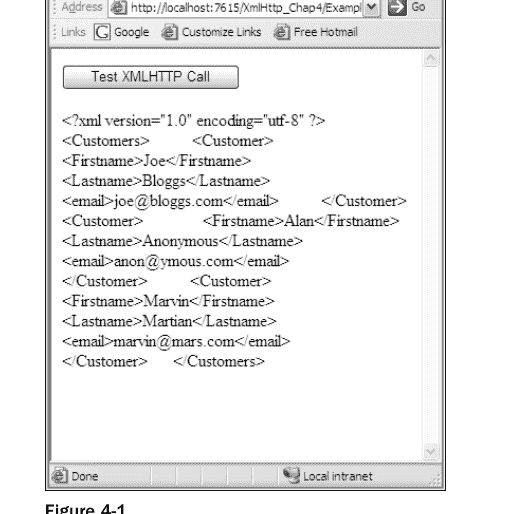

## `XMLHttpRequest` 对象

正如您所看到的，XML 文件中 contained（包含）的数据在页面中的渲染方式与存储在文件内的数据完全相同。

如前所述，对于仅需单个单位数据或专有格式数据的简单场景来说这或许没有问题，但对于更复杂的场景，您将希望使用 `responseXML` 属性。

## 使用 `responseXML` 属性

在大多数场景中，您可能希望返回多个结果项。这可能是一个要在下拉列表中显示的姓名列表、客户列表或对象表示形式。XML 格式非常适合于此，并且《响应请求（XMLHttpRequest）》对象的 `responseXML` 属性提供了对此格式的直接支持。该属性是标准 XML 文档对象，可以使用 W3C DOM 节点树方法和属性进行检查和解析。

> **有关 XML 文档对象模型的详细参考资料**，请访问 `http://msdn.microsoft.com/library/en-us/xmlsdk30/htm/xmmscxmlreference.asp`。

***试试看*：将响应数据作为 XML 文档对象返回：**您可以继续修改代码示例以从之前检索并显示的 XML 数据中提取值。**我们不会重复之前的整个代码样本，而只显示替换了使用 `responseText` 属性添加的代码的已修改部分。检查以下代码片段：

```javascript
if (xmlHttpObj.readyState == READYSTATE_COMPLETE)
{
    var doc = xmlHttpObj.responseXML;
    var node = doc.selectSingleNode("//Customers/Customer/Firstname/text()");
    document.getElementById("divResults").childNodes[0].nodeValue = node.nodeValue;
}
```

您不再简单地显示整个返回数据集，而是提取 `<Firstname>` 节点第一个实例的文本值。这是通过使用 `selectSingleNode` 方法实现的，该方法接收一个 XPath 表达式作为参数，如果找到一个节点则返回 XML 节点对象，或者如果在 XPath 查询中失败则返回 NULL。**利用返回的节点对象**，您将 `childNodes` 属性的第一个元素的 `nodeValue`（其本身是 `divResults` 元素的一个属性）设置为节点的文本值。

> **对于不熟悉 XPath 语言的人而言**，可以将其视为类似于数据库 ANSI SQL 操作 XML 文档的动态查询语言。可以使用 XPath 表达式来查询和返回节点、元素和数据。**XPath 表达式**可以包含条件表达式并相当复杂。**有关 XPath 表达式的详细参考资料及关联语法**，请访问 W3C 网站 `www.w3.org/TR/xpath`；或者对于更易于阅读的说明，尝试访问 `www.topxml.com/xsl/XPathRef.asp`。

本示例仍然相对简单。现在，您将运用新获得的知识并通过创建一个允许从客户列表中选择一项并显示全名和电子邮件地址的 Web 页面来应用这一知识，该操作将异步地在服务器端搜索您的 XML 数据文件。**Firefox 当前不支持使用 `selectSingleNode()` 和 `selectNodes()` 方法来获取 XML 文档内的数据**。为了解决此问题，脚本包含库包含了一些 JavaScript 代码以启用对此功能的支持。所包含的代码取自网站 `http://km0ti0n.blunted.co.uk/mozXPath.xap`。对这种支持的详细解释超出了本章的范围；总之是它允许在方式上与 Internet Explorer 相同支持 `selectSingleNode()` 和 `selectNodes()` 方法。

## 增强可用性

最近 `XMLHttpRequest` 对象的异步能力受到如此多关注的主要原因之一是它可以消除在使用后回送（postback）或服务器端调用以收集某些服务器端数据时通常会发生的用户体验中断。

在以下示例中，您将提供一个通过从 XML 数据文件获取的下拉列表显示的姓名列表。**当用户选择一个名称时**，将发出一个服务器调用来检索该数据并提取电子邮件地址。**在不使用 `XMLHttpRequest` 对象的异步能力的情况下**这将需要一个后回送（postback），并且用户将被迫等待请求发送到服务器和处理的过程以及结果返回并在浏览器上显示。现在您有能力异步执行服务器请求，因此可以执行获取数据的调用而不会中断浏览器上的用户交互。**实际上这是一种“不可见的后回送”——一个在后台执行并并行于任何用户界面交互执行的服务器请求**。

### 试试看：异步执行服务器请求

**检查以下代码片段列出的 Web 页面：**

```html
<body onload="LoadCustomers();">
    <form id="form1" runat="server">
    <div>
        <select id="ddlCustomers" onchange="DisplayCustomerDetails();">
            <option value="">- Select a Customer -</option>
        </select>
        <hr />
        <div>
            <p>Details:</p>
            <span id="spnDetailDisplay">(You have not made a selection yet.)</span>
        </div>
    </div>
    </form>
</body>
</html>
```

在 ASP.NET 表单元素 `<form id="form1" runat="server">` 内有一个作为客户下拉列表作用的 `<select>` 元素和一个可以显示客户详情的 `<span>` 元素。您还将注意到文件的 `onload` 事件分配了 `LoadCustomers()` 函数以最初加载客户列表，并且 `<select>` 项的 `onchange` 事件分配了 `DisplayCustomerDetails()` 函数以便在选择后显示所选客户的详情。

## `XMLHttpRequest` 对象

接下来列出的代码块中的 JavaScript 函数，是伴随页面列表一同使用的。第一个函数是一个通用函数，用于创建一个你可以直接使用的 `XMLHttpRequest` 对象：


```html
<!DOCTYPE html PUBLIC "-//W3C//DTD XHTML 1.0 Transitional//EN"
"http://www.w3.org/TR/xhtml1/DTD/xhtml1-transitional.dtd">

<html xmlns="http://www.w3.org/1999/xhtml">
<head runat="server">
    <title>Untitled Page</title>

    <script type="text/javascript">

    // 一个“全局”变量，作为我们的 XMLHttpRequest 对象引用。
    var xmlHttpObj = CreateXmlHttpRequestObject();
```

下一个函数是在文档首次加载时调用的，用于处理通过`XMLHttpRequest`对象从服务器加载客户数据：

```javascript
// 将客户选择数据加载到 <SELECT> 下拉列表控件的函数
function LoadCustomers()
{
    if (xmlHttpObj)
    {
        // 我们希望这个请求是同步的
        xmlHttpObj.open("GET", "http:// " + location.host +
            "/XmlHttp_Chap4/DataFile.xml", false);

        // 执行请求
        xmlHttpObj.send(null);

        // 如果请求成功（即 HTTP 状态码为 200）
        if (xmlHttpObj.status == 200)
        {
            var xmlDoc = xmlHttpObj.responseXML;
            // 使用 X Path 参数选择的 <CUSTOMER> 节点列表
            //var nodes = xmlDoc.selectNodes("//Customers/Customer");
            var nodes = xmlDoc.selectNodes("//Customers/Customer/Lastname/text()");
            // 获取 <SELECT> 下拉列表控件的引用。
            var ctrl = document.getElementById("ddlCustomers");

            for (var i=0; i < nodes.length; i++)
            {
                // 从我们的 XML 数据文档中获取 lastname 元素
                var lastName = nodes[i].nodeValue;
                // 创建一个新的 <OPTION> 节点。
                var htmlCode = document.createElement('option');
                // 将新的 <OPTION> 节点添加到我们的 <SELECT> 下拉列表中
                ctrl.options.add(htmlCode);
                // 设置 <OPTION> 的显示文本和值；
                htmlCode.text = lastName;
                htmlCode.value = lastName;
            }
        } else
```

```javascript
{
    alert('访问服务器上的客户数据时出现问题。');
}
}
}
```

在前面的代码中，你会注意到在以下代码行中使用了字面数字`200`：

```javascript
if (xmlHttpObj.status == 200)
```

这是另一个非常适合放入公共脚本包含文件的候选对象。代码可以如下定义：

```javascript
/* HTTP 状态码的常用值 */
var HTTPSTATUS_OK = 200;
```

这意味着任何比较 HTTP 状态码的代码，如前面的示例，都可以替换为以下代码行：

```javascript
if (xmlHttpObj.status == HTTPSTATUS_OK)
```

这使得代码更易于阅读和维护。

最后，你有一个 JavaScript 函数，用于在从下拉列表中选择后显示客户的详细信息：

```javascript
function DisplayCustomerDetails()
{
    if (xmlHttpObj)
    {
        // 我们希望这个请求是异步的
        xmlHttpObj.open("GET", "http:// " + location.host + "/XmlHttp_Chap4/DataFile.xml", true);

        xmlHttpObj.onreadystatechange = function()
        {
            if ( xmlHttpObj.readyState == READYSTATE_COMPLETE )
            {
                var ctrl = document.getElementById("ddlCustomers");
                var doc = xmlHttpObj.responseXML;
                var lastName = ctrl.options[ctrl.selectedIndex].value;
                var node = doc.selectSingleNode("//Customers/Customer[Lastname='" + lastName + "']");
                var details = '全名: ' + node.selectSingleNode('Firstname/text()').nodeValue +
                              ' ' + lastName + '. 电子邮件: ' + node.selectSingleNode('email/text()').nodeValue;
                document.getElementById("spnDetailDisplay").childNodes[0].nodeValue = details;
            }
        }
    }
}
```

在这里，你选择将 XML DAGPT 对象定义为一个“全局”变量`xmlHttpObj`，而不是在每个函数中重新声明和创建此对象。将有效的`XMLHttpRequest`实例分配给该变量的函数被分离成其自己独立的函数。这通常会作为公共脚本库的一部分，而不必在每个页面中重写此内容。

> 使用“全局”对象来保存对`XMLHttpRequest`对象的引用，如果后续请求在第一个请求完成之前使用相同的`XMLHttpRequest`对象发出，可能会使你的客户端应用程序暴露于潜在的错误或操作缺陷。

此外，由于`LoadCustomers()`函数作为页面加载事件的一部分执行，并且在函数执行完成之前页面不可用，因此你使用`false`参数以同步方式进行服务器调用，如下面的代码行所示：

```javascript
// 我们希望这个请求是同步的
xmlHttpObj.open("GET", "http://" + location.host + "/XmlHttp_Chap4/DataFile.xml", false);
```

你执行调用，然后通过检查`XMLHttpRequest`对象的`status`属性来检查调用状态。此属性包含由于发出请求而由服务器返回的标准 HTTP 状态码。在本示例中，你检查以确保调用返回了状态码`200`：

```javascript
// 如果请求成功（即 HTTP 状态码为 200）
if (xmlHttpObj.status == 200)
```

从服务器返回的状态码`200`表示已成功发起服务器请求。由于你已在脚本包含文件中定义了此字面值，代码将如下读取：

```javascript
// 如果请求成功（即 HTTP 状态码为 200）
if (xmlHttpObj.status == HTTPSTATUS_OK)
```

> 有关 W3C 定义的所有有效 HTTP 状态码列表，请参阅`www.w3.org/Protocols/rfc2616/rfc2616-sec10.html`。

然后，你使用 XML DOM 方法`selectNodes`在 XML 数据上执行 X Path 表达式，为每个`Customer`节点查找每个`Lastname`节点，并返回匹配节点的列表：

```javascript
var nodes = xmlDoc.selectNodes("//Customers/Customer/Lastname/text()");
// 获取 <SELECT> 下拉列表控件的引用。
var ctrl = document.getElementById("ddlCustomers");

for (var i=0; i < nodes.length; i++)
{
    // 函数的其余部分 . . .
```

你遍历`Lastname`节点列表，将每个客户的姓氏添加到下拉列表中。

在`DisplayCustomerDetails()`函数内部，你定义了一个函数，该函数在请求达到相应的`readystate`（`readystate == READYSTATE_COMPLETE`）时执行。然后，你使用 X Path 表达式定位与所选客户匹配的节点，使用`selectSingleNode`方法从 XML 数据文件中提取客户的详细信息，并在`<span>`元素中显示这些详细信息。

前面的示例介绍了作为`XMLHttpRequest`对象一部分的`status`属性。`XMLHttpRequest`对象没有大量的属性和方法列表，相对简单直接。接下来的两个表格分别是`XMLHttpRequest`对象可用方法和属性的参考表。

| 方法 | 描述 |
|:---|:---|
| `abort()` | 取消当前请求。 |
| `getAllResponseHeaders()` | 以字符串形式返回完整的 HTTP 头集合。 |
| `getResponseHeader("headername")` | 返回指定 HTTP 头的值。 |
| `open("method", "URL", "async", "uname", "pswd")` | 指定请求的方法、URL 和其他可选属性。`method`参数的值可以是`GET`、`POST`或`PUT`（请求数据时使用`GET`，发送数据时使用`POST`——尤其是当数据长度大于 512 字节时）。`URL`参数可以是相对 URL 或完整 URL。`async`参数指定请求是否应异步处理。`true`表示脚本处理在`send()`方法后继续，无需等待响应。`false`表示脚本在继续脚本处理之前会等待响应。 |
| `send(content)` | 发送请求。 |
| `setRequestHeader("label", "value")` | 向要发送的 HTTP 头添加标签/值对。 |

## XMLHttpRequest 对象

| 属性 | 描述 |
|:---|:---|
| `onreadystatechange` | 在每次状态变化时触发的事件的事件处理程序。（读/写） |
| `readyState` | 返回对象的状态：（只读）0 = 未初始化，1 = 加载中，2 = 已加载，3 = 交互中，4 = 完成 |
| `responseText` | 以字符串形式返回响应（只读） |
| `responseXML` | 以 XML 形式返回响应。此属性返回一个 XML 文档对象，可以使用 W3C DOM 节点树方法和属性进行检查和解析（只读） |
| `status` | 以数字形式返回状态（例如，“Not Found”返回 404，“OK”返回 200，“Server Error”返回 500）（只读） |
| `statusText` | 以字符串形式返回状态（例如，“Not Found”或“OK”）（只读） |

## 向服务器传递参数

显然，有时你需要向服务器端请求传递一些参数。一种传统方式是将查询字符串参数作为`XMLHttpRequest`的一部分使用。下面是一个示例，其中参数`arg`的值为 123。

```javascript
xmlHttpObj.open("GET", "http://" + location.host + 
    "/XmlHttpExample1/WebForm1.aspx?arg=123", true);
```

这种向服务器传递参数的方法通常用于“GET”请求（或“GET”动词），如前面的代码所示；但是，它也可以用于“POST”请求，如下一个示例所示：

```javascript
xmlHttpObj.open("POST","http://" + location.host + 
    "/XmlHttpExample1/WebForm1.aspx?arg=123", true);
```

接收并处理此请求的页面（在本例中为`WebForm1.aspx`）可以从 URL 中提取查询字符串参数，并使用它将相应的数据返回给客户端。这里展示了一个使用服务器端代码提取查询字符串参数的简单示例：

```csharp
private void Page_Load(object sender, System.EventArgs e)
{
    if (Request.QueryString.Count > 0)
    {
        string queryArg = Request.QueryString["arg"];
        switch (queryArg)
        {
            case "123":
                Server.Transfer("DataFile1.xml");
                break;
            case "456":
                Server.Transfer("DataFile2.xml");
                break;
            default:
                Server.Transfer("DataFile1.xml");
                break;
        }
    }
}
```

使用传统网页作为 XMLHTTP 请求的接收者并非执行此类型操作的最有效方式。页面通常用于呈现 HTML，而你通常希望以某种自定义数据进行响应，通常是以自定义 XML 文档的形式。虽然前面的示例确实实现了这一点，但你也不必担心 ASP.NET 可能作为其页面处理管道的一部分添加到响应中的内容。这不仅增加了不必要的处理开销，在某些情况下还可能引起响应数据及其处理方式的问题。理想情况下，与其使用标准页面，不如让 ASP.NET 将请求交给一个专门用于生成 Web 应用程序所需的自定义响应的自定义代码段。

## HTTP 处理程序

处理这些请求的更典型方法是使用 HTTP 处理程序。处理程序能够更直接地控制响应数据来响应请求。本质上，HTTP 处理程序存在于 ASP.NET 处理管道的非常早期阶段，可以直接处理请求，而无需担心由页面生成的 HTML 数据以及整个页面生命周期的不必要负担。此外，处理程序无需关心初始请求是否是一个格式正确的页面，而可以将其作为在应用程序上下文中有意义的自定义格式化消息。通常，这是一个用于在客户端和服务器之间传输数据的 XML 文档。

> HTTP 处理程序是一种在进行任何实际页面处理之前介入 ASP.NET 处理管道早期阶段的方法。有关开发自定义 HTTP 处理程序的更多信息，请参阅 MSDN 参考资料：`http://msdn.microsoft.com/library/en-us/cpguide/html/cpconhttphandlers.asp`。

## 使用 HTTP 处理程序进行尝试

为了演示如何使用 HTTP 处理程序来接受从`XMLHttpRequest`对象发送的参数，你首先在网页中定义用户界面，如下面的代码所示。这简单地显示了一个包含三个客户列表的下拉列表。当选择其中一个客户时，该客户 ID 用作异步请求的一部分，以请求仅与该客户详细信息相关的特定数据集：

```html
<form id="form1" runat="server">
<div>
    <select id="ddlCustomers" onchange="LoadCustomer();">
        <option value="">- Select a Customer -</option>
        <option value="1">Customer 1</option>
        <option value="2">Customer 2</option>
        <option value="3">Customer 3</option>
    </select>
    <hr />
    <div>
        <p>Details:</p>
        <span id="spnDetailDisplay">(You have not made a selection yet)</span>
    </div>
</div>
</form>
```

你还提供了名为`LoadCustomer()`的 JavaScript 函数的实现，该函数在`select`元素的`onchange`属性中引用，如下所示：


```javascript
function LoadCustomer()
{
    if (xmlHttpObj)
    {
        // Obtain a reference to the <SELECT> drop list control.
        var ddlCtrl = document.getElementById("ddlCustomers");
        var disp = document.getElementById("spnDetailDisplay");

        var custNumber = ddlCtrl.value;
        // We want this request synchronous
        xmlHttpObj.open("GET", "http://" + location.host +
        "/XmlHttp_Chap4/AsyncRequestHandler.ashx?arg="+custNumber, true);

        xmlHttpObj.onreadystatechange = function()
        {
            if (xmlHttpObj.readyState == READYSTATE_COMPLETE)
            {

                // If the request was ok (ie equal to a Http Status code of 200)
                if (xmlHttpObj.status == HTTPSTATUS_OK)
                {
                    var xmlDoc = xmlHttpObj.responseXML;
                    // Our list of <CUSTOMER> nodes selected using the X Path argument
                    var name =
                    xmlDoc.selectSingleNode("//root/Customer/name/text()");
                    var email =
                    xmlDoc.selectSingleNode("//root/Customer/email/text()");
                    alert(name);
                    disp.childNodes[0].nodeValue = "Name: " + name.nodeValue + " - Email: " + email.nodeValue;
                }
            }
            // Execute the request
            xmlHttpObj.send("SomeDataToSend");

        }
    }
}
```

你会注意到在定义进行异步请求的 URL 并根据下拉列表选择追加 `arg` 参数的值时，使用了处理程序。

```javascript
xmlHttpObj.open("GET","http://" + location.host + "/XmlHttp_Chap4/AsyncRequestHandler.ashx?arg="+custNumber, true);
```

最后，服务器端 HTTP 处理程序本身的实现显示在下面的代码块中。这是接收来自你的 `XMLHttpRequest` 对象的异步调用、提取客户编号或 ID，然后使用它返回仅包含该客户姓名和电子邮件地址的 XML 文档的处理程序。此代码位于 `AsyncRequestHandler.ashx` 文件中。

```csharp
<%@ WebHandler Language="C#" Class="AsyncRequestHandler" %>

using System;
using System.Web;
using System.Data;

public class AsyncRequestHandler : IHttpHandler {

    public void ProcessRequest (HttpContext context) {
        // Grab the URL parameters
        string param = context.Request.QueryString["arg"];

        const string xmlData = @"<?xml version=""1.0"" encoding=""utf-8"" ?>
            <root><Customer><name>{0}</name><email>{1}</email></Customer></root>";

        string returnXML = null;

        switch (param)
        {
            case "1":
                returnXML = string.Format(xmlData, "Big Bob", "big@bob.com");
                break;
            case "2":
                returnXML = string.Format(xmlData, "Small Sammy",
                    "small@sammy.com");
                break;
            case "3":
                returnXML = string.Format(xmlData, "Large Larry",
                    "large@larry.com");
                break;
        }

        context.Response.ContentType = "application/xml";
        context.Response.Write(returnXML);
    }

    public bool IsReusable {
        get {
            return false;
        }
    }
}
```

## XMLHttpRequest 对象

除了使用如上例所示的查询字符串参数外，你还可以利用 `XMLHttpRequest` 对象的 `send` 方法，指定一些作为请求体一部分随服务器请求发送的数据。

之前的示例使用了如下语法：

```javascript
xmlHttpObj.send(null);
```

来发起请求，指定 `null` 作为方法参数。此参数表示作为请求体一部分随请求发送的内容。要指示随请求发送的数据，你只需将其指定为方法参数即可：

```javascript
xmlHttpObj.send("MyDataToSend");
```

要从 HTTP 处理程序中的请求体中提取此数据，你可以将以下代码添加到你的处理程序实现中：

```csharp
byte[] data = new byte[context.Request.ContentLength];
context.Request.InputStream.Read(data, 0, context.Request.ContentLength);
string body = System.Text.UTF8Encoding.UTF8.GetString(data);
```

一旦你从请求体中提取出数据，你就可以提取相关信息。通常，这意味着你将数据加载到一个 `XMLDocument` 对象中，并提取执行服务器端工作所需的数据。

# 那 Web 服务呢？

.NET 包含对 Web 服务的广泛支持，并且是公开服务器端功能或为服务器端进程提供入口点的首选机制。以异步方式访问这些服务或入口点，是在开发基于 .NET 的 Web 应用程序时，将客户端和服务器端的最佳技术结合起来的明显一步。

Web 服务确实需要传递一些额外信息作为客户端请求的一部分，以确保识别出有效的调用。下面的示例包含一个名为 `Adder` 的 Web 服务，该服务将计算从客户端传递给服务的两个整数参数的加法结果。

# 试试看

## 访问 Web 服务

首先，你构建一个简单的用户界面来方便此操作：

```html
<form id="form1" runat="server">
    <div>
        <input type="text" id="val1" />
        <input type="text" id="val2" />
        <input type="button" value="Calculate" onclick="ExecWebService();" />
        <hr />
        <div>
            <p>Details:</p>
            <span id="spnDetailDisplay">(You have not made a selection yet)</span>
        </div>
    </div>
</form>
```

# 第 4 章

这个 HTML 文档仅包含两个接受整数参数的文本字段和一个用于计算两个参数加法结果的按钮。按钮包含一个 `onclick` 处理程序，它指向一个 JavaScript 函数。此函数将执行对 Web 服务的异步调用。

接下来，看看你的 Web 服务代码，它非常简单，对于所有创建过 Web 服务的开发者来说应该非常熟悉。Web 服务本身是使用端点 `AsyncService.asmx` 创建的，并包含一个方法，更具体地说，一个名为 `Adder` 的 `WebMethod`：

```csharp
[WebService(Namespace = "http://tempuri.org/")]
[WebServiceBinding(ConformsTo = WsiProfiles.BasicProfile1_1)]
public class AsyncService : System.Web.Services.WebService {

    public AsyncService () {
    }

    [WebMethod]
    public int Adder(int arg1, int arg2) {
        return arg1 + arg2;
    }
}
```

最后，检查调用上述 Web 服务的客户端代码：

```javascript
function ExecWebService()
{
    if (xmlHttpObj)
    {
        var disp = document.getElementById("spnDetailDisplay");
        var ctlVal1 = document.getElementById("val1");
        var ctlVal2 = document.getElementById("val2");

        // We want this request synchronous
        xmlhttpObj.open("POST","http://" + location.host +
"/XmlHttp_Chap4/AsyncService.asmx/Adder", true);

        xmlhttpObj.onreadystatechange = function()
        {
            if (xmlHttpObj.readyState == READYSTATE_COMPLETE)
            {
                // If the request was ok (ie equal to a Http Status code of 200)
                if (xmlHttpObj.status == HTTPSTATUS_OK)
                {
                    var xmlDoc = xmlHttpObj.responseXML;
                    var result = xmlDoc.lastChild.childNodes[0].nodeValue;
                    disp.childNodes[0].nodeValue = "Result: " + result;
                } else
                {
                    var fault = xmlHttpObj.responseText;
                    alert("Error Occurred! \n\n" + fault);
                }
            }
        }
        // Execute the request
        xmlHttpObj.setRequestHeader("Content-Type","application/x-www-form-urlencoded");
    }
}
```

### 工作原理

这段客户端代码与之前的示例非常相似，但确实存在一些重要差异，以方便调用 Web 服务。

首先，在指定 Web 服务的端点时，URL 遵循与之前请求略有不同的约定：

```javascript
xmlHttpObj.open("POST","http://" + location.host + "/XmlHttp_Chap4/AsyncService.asmx/Adder", true);
```

你会注意到 URL 包含 Web 服务 asmx 文件的位置，以及要调用的 Web 服务方法或操作，附加在 URL `/Adder` 之后。你还指定了应执行 `POST` 操作。

> 如果指定了某些数据作为使用 `XMLHttpRequest.send` 方法发送的内容的一部分，则始终执行 `POST` 操作，因为 `GET` 操作不会将数据作为内容或 HTTP 请求体的一部分发送。

在执行调用 Web 服务的请求之前，你将一个名为 `Content-Type` 的特定头值设置为 `application/x-www-form-urlencoded`。`Content-Type` 属性指定表单的编码类型。表单的默认值是 `application/x-www-form-urlencoded`；但是，这默认不作为 `XMLHttpRequest` 的一部分包含在内，必须如前面的代码所示手动指定。

在实际执行 `XMLHttpRequest` 对象的 `send` 方法时，你以与指定这些参数作为 URL 查询字符串类似的方式构建所需的参数列表。

```javascript
xmlHttpObj.send("arg1=" + ctlVal1.value + "&arg2=" + ctlVal2.value);
```

注意 `arg1` 参数和 `arg2` 参数如何用与号 (`&`) 分隔，其方式与构造 URL 查询字符串的方式非常相似。这将生成一个等效于以下内容的字符串：

```
arg1=1&arg2=2
```

其中 `arg1` 的值为 1，`arg2` 的值为 2。此字符串将作为请求体的一部分发送，并由 Web 服务自动解析和处理，以便在服务器端将正确的值分配给正确的 Web 服务参数。同样，这类似于在浏览器中 `GET` 请求中指定查询字符串的方式。使用查询字符串的类似请求可能如下所示：

```
http://www.somesite.com/SomePage.aspx?arg1=1&arg2=2
```

最后，提取结果的代码如下：

```javascript
var xmlDoc = xmlHttpObj.responseXML;
var result = xmlDoc.lastChild.text;
```

代码提取响应最后一个子节点的文本值。使用前面一组参数对 Web 服务请求的响应将如下所示：

```xml
<?xml version="1.0" encoding="utf-8"?>
<int xmlns="http://tempuri.org/">3</int>
```

此 XML 文档的第一个子节点等同于初始处理指令行，因此你必须提取此 XML 响应中的最后一个子节点，它等同于表示整数结果的行。这种值提取方法相当简单，但在大多数情况下应该有效；但是，这并未考虑 Web 服务是否生成错误。

对于此示例，你可以生成两种不同类型的错误，必须以不同的方式处理：

- 一种类型的错误可以通过从传递给 `open` 方法的 URL 中移除方法规范（即从 URL 中移除 `/Adder`）或向请求传递空或无效参数来生成。

- 另一种类型的错误可以通过忘记在请求头中指定 `Content-Type` 来生成。

对于这两种类型的错误，你都会收到一个状态码 500，表示服务器错误。但是，在第一种情况下，你会收到以下内容作为响应体：

```
System.InvalidOperationException: Request format is invalid: .
   at System.Web.Services.Protocols.HttpServerProtocol.ReadParameters()
   at System.Web.Services.Protocols.WebServiceHandler.CoreProcessRequest()
```

在第二种情况下，你会在响应体中收到以下内容：


```
<?xml version="1.0" encoding="utf-8"?><soap:Envelope
xmlns:soap="http://www.w3.org/2003/05/soap-envelope"
xmlns:xsi="http://www.w3.org/2001/XMLSchema-instance"
xmlns:xsd="http://www.w3.org/2001/XMLSchema"><soap:Body><soap:Fault><soap:Code><soa
p:Value>soap:Receiver</soap:Value></soap:Code><soap:Reason><soap:Text
xml:lang="en">System.Web.Services.Protocols.SoapException: Server was unable to
process request. ---&gt; System.Xml.XmlException: Data at the root level is
invalid. Line 1, position 1.
   at System.Xml.XmlTextReaderImpl.Throw(Exception e)
   at System.Xml.XmlTextReaderImpl.Throw(String res, String arg)
   at System.Xml.XmlTextReaderImpl.ParseRootLevelWhitespace()
   at System.Xml.XmlTextReaderImpl.ParseDocumentContent()
   at System.Xml.XmlTextReaderImpl.Read()
   at System.Xml.XmlTextReader.Read()
   at System.Web.Services.Protocols.SoapServerProtocol.SoapEnvelopeReader.Read()
   at System.Xml.XmlReader.MoveToContent()
   at
System.Web.Services.Protocols.SoapServerProtocol.SoapEnvelopeReader.MoveToContent()
   at System.Web.Services.Protocols.SoapServerProtocolHelper.GetRequestElement()
   at System.Web.Services.Protocols.Soap12ServerProtocolHelper.RouteRequest()
   at
System.Web.Services.Protocols.SoapServerProtocol.RouteRequest(SoapServerMessage
message)
   at System.Web.Services.Protocols.SoapServerProtocol.Initialize()
```

```
at System.Web.Services.Protocols.ServerProtocolFactory.Create(Type type, HttpContext context, HttpRequest request, HttpResponse response, Boolean& abortProcessing)
--- End of inner exception stack trace ---</soap:Text></soap:Reason><soap:Detail></soap:Fault></soap:Body></soap:Envelope>
```

在大多数情况下，仅通过状态码捕获已发生错误的事实就足够了。然而，要确定错误更具体的原因，则需要特定的处理，并需要对`XMLHttpRequest`对象的`responseText`属性进行特定解析。为了说明这一点，下面的代码展示了该函数的一个增强版本，用于处理来自 Web 服务调用的响应。

```javascript
if (xmlHttpObj.status == HTTPSTATUS_OK)
{
    var xmlDoc = xmlHttpObj.responseXML;
    var result = xmlDoc.lastChild.childNodes[0].nodeValue;
    disp.childNodes[0].nodeValue = "Result: " + result;
}
else
{
    var fault = xmlHttpObj.responseText;
    alert("Error Occurred! \n\n" + fault);
}
```

如果发生错误，将向用户显示一个警告框，其中包含服务器生成的特定错误响应文本。

## 调用 Web 服务——一些注意事项

需要注意的是，前面代码中所示的调用 Web 服务的方法并不是调用 Web 服务的标准化方式。Web 服务的消息格式通常是称为 SOAP（简单对象访问协议）的 XML 格式，其构建过程比前一个示例中使用的简单 HTTP 主体复杂得多。以标准方式构建格式正确的 SOAP 消息来访问 Web 服务当然是可能的，但比之前的示例复杂得多，并且需要相当大的工作量来实现 SOAP 协议栈，以确保任何消息都构建在有效的“SOAP 信封”中。

前面示例中所示的向 Web 服务传递参数的方法并不能保证在其他 Web 服务实现上有效工作。Web 服务互操作性特性的一部分是通过使用 SOAP 消息格式实现的，由于您没有使用该格式来调用 Web 服务，因此调用非 .NET Web 服务并不能保证成功。

> 有关与 Web 服务相关的 SOAP 格式的更多信息，请访问 `www.w3.org/TR/soap`。

尽管如此，如前所述的访问 .NET Web 服务的方法足以使用默认和最基本的 Web 服务实现来调用 .NET Web 服务。禁用或不允许对 Web 服务内容使用“GET”和“POST”动词的服务可能会导致错误且无法按预期工作。

此外，我们之前提到需要指定`Content-Type`以确保 Web 服务调用正常工作。有时，可能还需要指定一个额外的标头属性，即`SOAPAction` HTTP 标头属性，将其设置为要执行的*操作*或方法的名称。

# 第4章

尽管在目前展示的简单示例中这并非严格要求，但它为 Web 服务调用增加了一层额外的合规性，并且值得去做，以使您的 Web 服务客户端更好地与您的服务协作。这可以通过使用以下代码来实现：

```javascript
xmlHttpObj.setRequestHeader("SOAPAction", "{your_action}");
```

其中`"{your_action}"`指定要执行的服务方法或操作。除了实现完整的 SOAP 之外，这就是调用 .NET Web 服务所需的全部操作。同样，这完全取决于服务本身的配置。服务的需求、配置和参数越复杂，您就越可能难以有效地构建客户端代理来调用它。本章后面描述的一些框架提供了完整的 SOAP 实现，是编写自己的实现的一种更简单的替代方案。

## 总结

在本章中，我们了解了如何以跨浏览器友好的方式构建`XMLHttpRequest`对象，以及如何利用该对象的异步和同步请求能力。我们详细检查了该对象的属性，并了解了如何利用该对象发起服务器端请求以访问：

- 特定文件
- 页面
- 针对 .NET HTTP 处理程序的请求
- 针对 .NET Web 服务的请求

我们还了解了如何从这些请求中提取响应，以及在错误发生时如何处理。这提供了对您可以使用`XMLHttpRequest`对象并随心所欲地操控它的大多数方式的概述。使用这些技术，您可以开发自己的自定义方法和通用例程，用于访问和操作异步请求。

`XMLHttpRequest`对象是 Ajax 的核心。在此基础上，我们研究了如何执行 Web 开发人员可能需要实现的`XMLHttpRequest`对象的典型功能。在不中断浏览器或干扰用户的情况下访问服务器端功能是关键，如前所述，这可以通过简单的 HTTP GET 请求一直到使用 HTTP 处理程序和 Web 服务来完成。

此外，您还能够逐步构建一个可重用的脚本库，将通用功能抽象出来，例如以跨浏览器的方式创建`XMLHttpRequest`对象，以及识别常用常量（如 HTTP 状态码）。所有这些都可以在未来任何开发中节省时间，并可以成为您希望进一步开发的任何自定义库的基础。

利用本章学到的知识和您开发的代码库，您已准备好开始开发 Ajax 风格的应用程序。本章介绍的信息构成了几乎所有利用 Ajax 风格功能的库和应用程序的基础。

# 数据通信：XML、XSLT 和 JSON

任何类型分布式应用程序的一个重要部分是如何在应用程序的层或层级之间推送数据。此外，对于 Ajax，有几个概念需要了解和理解，这些概念涉及构建分布式异构环境。因此，在本章中，您将了解：

- **XML** — XML 是可扩展标记语言。它主要用于数据交换。
- **XSLT** — XSLT 是可扩展样式表语言转换。XSLT 设计用于将 XML 数据从一种格式转换为另一种格式。
- **JSON** — JSON 是 JavaScript 对象表示法。JSON 是一种轻量级的数据交换格式。

当与 Web 服务结合使用时，XML 和 JSON 允许在不同操作系统之间以及跨互联网进行数据交换。与那些紧密耦合且仅仅因为数据通信格式就需要每个系统运行特定操作系统的系统相比，这是一个重大变化。这些数据交换格式提供的另一个优势是，Web 服务通常运行在 HTTP 上。HTTP 运行在 80 端口。80 端口是一个非常广泛使用的端口，不像许多其他端口和协议（例如 Microsoft 的分布式组件对象模型 (DCOM) 对象）那样会被阻止。

试图将关于 XML、XSLT 和 JSON 的所有信息放在一章中，对任何一个主题都是不公平的。本章试图涵盖关于这些产品的足够信息，以便读者能够对这些与数据通信相关的技术有一个基本的了解。然而，每个主题都可以填满一本千页的书，并且无法完全涵盖该主题。Wrox 提供了几本关于 XML 和 XSLT 主题的优秀完整书籍，包括《*Beginning XML Third Edition*》(Wiley 2004)、《*XSLT 2.0 Programmer's Reference Third Edition*》(Wiley, 2004)、《*XPath 2.0 Programmer's Reference*》(Wiley, 2004)。您可以在 `wrox.com` 找到这些和其他标题。

本章假设您正在使用 Visual Studio 2005 和 .NET 2.0。此外，您可以下载本章的代码示例：第 5 章，访问 `http://beginningajax.com`。

## XML

我不会给你解释关于XML如何做到那些一切的所有盛大喧嚣（以及已经得到广泛覆盖）的谈话。足以说明的是，它相当普及。XML工作始于W3C的1996年。它于1998年2月正式推出。XML不会给你的地板打光，也不是甜点装饰；但是，花点时间看看XML究竟是什么，以及它具有哪些精心设计用于数据传输和存储的特性：

- **XML基于标准通用标记语言**(SGML) — 拥有基于现有国际标准（例如自1986年以来一直使用的SGML）的格式意味着你可以利用现有的知识库。
- 它具有自描述格式 — 结构和字段名称是众所周知的。
- **它具备数据的文本表示** — 这种数据的文本表示允许计算机科学数据结构以文本形式表示。这些数据结构包括树、列表和记录。
- **它是人类和机器可读的** — 这是对二进制/机器数据的改进，因为人类可以阅读它，这允许对数据进行简单的视觉检查。
- 它具有多语言支持 — 它支持任何人类语言以及ASCII和Unicode的信息。
- **它是高效且一致的** — 其严格的语法和解析要求允许解析算法有效地一致地执行。
- 它应用广泛 — XML的分层结构适合许多类型的文档。
- 它是独立于平台的 — 由于基于文本，XML相对独立于平台，并且对技术变化具有相对的免疫力。

话虽如此，XML并非解决所有问题的最佳方案。XML存在一些程序员需要留意的弱点：

- **XML相当冗长** — 在某些情况下，XML数据的表示可能是冗余的。结果可能需要更高的带宽和CPU处理能力。通过压缩，存储成本和带宽需求可能会被抵消；但是成本可能会增加存储CPU处理要求。此外，通过压缩数据，XML人类可读的优势几乎肯定会丧失。
- **数据存储要求不支持广泛的数据类型** — 结果是无法轻易将`2.781828`的数值`e`值识别为浮点值或宽度为八个字符的字符串。XML Schema和验证例程提供了这种支持；但是XML原生不提供这些信息。
- **映射到关系数据库模型可能很困难** — 复杂的XML布局可能不易于映射到关系数据库模型。

### XML历史

XML可以追溯其血统回到20世纪60年代中期，根源在于IBM的通用标记语言（GML）。SGML基于在IBM完成的GML工作。SGML是一种标准化金属anguage，即 **ISO 8879:1986 Information processing — Text and office systems — Standard Generalized Markup Language **(SGML)。之后有几个标准的修改以纠正一些遗漏并理清一些遗留问题。

### XML文档

看看一个简单的有效XML文档是什么样的：

```xml
<?xml version="1.0" encoding="UTF-8"?>
<menu>
    <menuitem>
        <item>Hamburger</item>
        <item>French Fries</item>
        <item flavor="Chocolate">Milk Shake</item>
        <cost>4.99</cost>
    </menuitem>
</menu>
```

文件的第一行是XML声明。这一行是可选的。它包含有关XML版本的信息，通常是`1.0`，字符编码，可能还有外部依赖：接下来，在XML中必须有一个根元素。在前面的示例中，`<menu>`标签是根元素。

文档的其余部分包含一组嵌套元素，可进一步划分为属性和内容。元素通常由开始标签和结束标签定义：在前面示例中，你的菜单项列表具有`</item>`的开始标签（start tag）和结束标签。如果开始标签定义为`<item />`，则可以省略结束标签。项目的内容是开始标签和结束标签之间的所有内容。元素还可能包含属性：属性包括在开始标签中的名称/值对，且在元素名称之后。属性值必须**用**单引号或双引号括起来。每个属性名称在一个元素内只应出现一次。在前面的代码中，值为`Milk Shake`的项目具有一个属性；属性的名称是`flavor`，值是`Chocolate`。除了文本外，元素还可以包含其他元素：在前面的代码示例中，`<menuitem>`**元素**包含三个单独的`<item>`**元素**。

## XML文档正确性

要使XML文档被认为是正确的，它必须满足两个要求。它必须是：

- **良构的**(Well formed) — 良构文档符合所有XML语法规则。解析器必须拒绝处理未良构的文档。良构文档必须符合以下规则：
    - XML声明、处理指令、编码和其他信息可以存在于XML文档中。
    - 仅在XML文档中指定一个根元素。
    - 非空元素由开始标签和结束标签定义。
    - 空元素可以用空元素标签标记。示例为`<item />`。
    - 属性必须用单引号或双引号括起来。属性名称是大小写敏感的。
    - 标签可以嵌套但不得重叠。
    - 文档必须使用指定的编码。UTF-8是默认值。
    - 元素名称是大小写敏感的。

- **有效**(Valid) — 有效文档具有符合一组内容规则的数据。这些规则描述了正确的数据值和文档组织结构（例如，元素中的数据类型必须匹配）。遵循定义的模式定义的XML文档为有效。XML模式是对一种类型XML文档的描述。模式通常表达为对文档结构和内容的约束。这超越了XML强加的基本约束。你将在本章稍后了解有关模式的更多信息。

## 练习：创建有效且良构的XML

XML要求元素被正确地**嵌套**且不重叠。以下示例显示无效XML，因为与`<item>`标签的标签重叠。在下面的示例中，标签打开，然后打开第二个相同类型的标签，关闭第一个`<item>`标签，然后关闭第二个`<item>`标签：

```xml
<?xml version="1.0" encoding="UTF-8"?>
<menu>
    <menuitem>
        <item>Hamburger</item>Hamburger<item></item>French Fries</item><!-- Note formatting errors in source -->
        <item>Milk Shake</item>--></item><item flavor="Chocolate">Milk Shock</item></menu
```

*注意：上面的代码块代表描述的逻辑，但为了澄清提到的具体错误：*

以下是基于描述（在关闭第一个内容之前打开第二个标签）标签重叠不正确的无效XML示例：


```xml
<?xml version="1.0" encoding="UTF-8"?>
<menu>
    <menuitem>
        <item>Hamburger</item><!-- Logic error: opening new item while previous not fully closed conceptually in raw text stream or attribute mismatch later -->
        <!-- Text stream corruption representation from OCR/Logic interpretation below for clarity of overlap case -->
```

考虑以下不是良构的代码示例（由于缺少根元素）：

```xml
<?xml version="1.0" encoding="UTF-8"?>

<item>Hamburger</item>

<item>French Fries</item>

<item flavor="Chocolate">Milk Shake</item>
```

为了使该示例良构，必须添加一个根元素：

现在文档已正确设置以创建多个菜单项并符合所需内容：

```xml
<?xml version="1.0" encoding="UTF-8"?>

<menu>
  <menuitem>
    <item>Hamburger</item>
    <item>French Fries</item>
    <item flavor="Chocolate">Milk Shake</item>
  </menuitem>
</menu>
```

**图5-1** 显示在 Internet Explorer v6 中解析和显示的简单 XML 示例。

**图5-1**

现在比较以前的有效示例与以下无效 XML（关闭标签的匹配大小写不匹配）：

```xml
<?xml version='1.0' encoding='UTF-8'?>

<menu>
    <menuitem>
        <item>Hamburger</item>
        <item>French Fries</item>
        <item>Milk Shake</item></MenuItem> <!-- Note the capital M and I --> <!-- Also note single space after menuitem start tag which is valid but illustrative of strictness in practice often preferred without extra spacing or attributes mixed oddly, though here main error is case sensitivity on end tag -->
    </menu
```

# 第五章

图 5-2 展示了在 Internet Explorer 中的结果。在此示例中，关闭的 `</MenuItem>` 标签与开始的 `<menuitem>` 标签不匹配，因为从大小写的角度来看，开始标签和关闭标签不匹配。

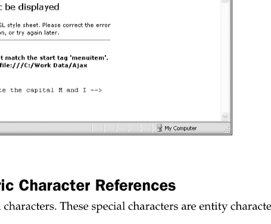

## 图 5-2

## 实体引用与数字字符引用

XML 中需要存储特殊字符。这些特殊字符是实体字符和数字字符引用。

XML 中的实体是数据体，通常是文本，包含非常规字符。XML 中的实体引用是实体的占位符。XML 包含几个预定义实体。实体的名称以与符号（`&`）开头，以分号（`;`）结尾。以下是所有预定义实体的列表：

- 与符号字符（`&`）定义为 `&amp;`。
- 左方括号，或小于符号（`<`）定义为 `&lt;`。
- 右方括号，或大于符号（`>`）定义为 `&gt;`。
- 单引号，或撇号字符（`'`）定义为 `&apos;`。
- 双引号字符（`"`）定义为 `&quot;`。

额外的实体可以在文档的 DTD 中定义——有关 DTD 的更多信息，请参阅下一节。

数字字符引用与实体类似。它不仅仅是 `&` 后跟实体名称并以分号结尾，而是 `&` 和 `#` 字符后跟一个十进制或十六进制的 Unicode 码点字符，最后以分号结尾。例如，`&` 字符也可以定义为 `&#038;`。

## DTD

## 数据通信：XML、XSLT 和 JSON

- DTD 缺乏对 XML 新特性的支持。例如，不支持命名空间。
- XML 文档的所有部分都无法在 DTD 中表达。
- DTD 使用继承自 SGML 的语法，而不是 XML 语法。

## XML Schema

DTD 的后继是 XML Schema。XML Schema 的另一个术语是 XML Schema 定义（XSD）。XSD 比 DTD 更适合描述 XML 语言。XSD 具有以下部分特性：

- 具有数据类型支持
- 允许对文档的逻辑结构进行详细约束
- 在验证框架中使用 XML 所必需
- 使用基于 XML 的格式

这是一个用于测试的示例 XML 文档。在此示例中，`MenuSchema` 将用于验证菜单 XML 文档。

```xml
<?xml version="1.0" encoding="UTF-8"?>

<menu xmlns="http://my-example.com/menus"
      xmlns:xsi="http://www.w3.org/2001/XMLSchema-instance"
      xsi:schemaLocation="http://my-example.com/menus Menu2.xsd">
    <menuitem>
        <item>Hamburger</item>
        <cost>1.99</cost>
    </menuitem>
    <menuitem>
        <item>Drink</item>
        <cost>.99</cost>
    </menuitem>
    <menuitem>
        <item>Fries</item>
        <cost>.49</cost>
    </menuitem>
</menu>
```

这是一个示例 XSD 文件，用于验证该文档：

```xml
<?xml version="1.0" encoding="UTF-8"?>

<xs:schema xmlns="http://my-example.com/menus"
           xmlns:xs="http://www.w3.org/2001/XMLSchema"
           targetNamespace="http://my-example.com/menus"
           elementFormDefault="qualified"
           attributeFormDefault="unqualified">
    <xs:element name="menu">
        <xs:annotation>
            <xs:documentation>Menu is the root element</xs:documentation>
        </xs:annotation>
        <xs:complexType>
            <xs:sequence>
                <xs:element name="menuitem" maxOccurs="unbounded">
                    <xs:complexType>
                        <xs:sequence>
                            <xs:element name="item" type="xs:string"/>
                            <xs:element name="cost" type="xs:decimal"/>
                        </xs:sequence>
                    </xs:complexType>
                </xs:element>
            </xs:sequence>
        </xs:complexType>
    </xs:element>
</xs:schema>
```

在此示例代码中，验证了 `<menuitem>` 标签。`<item>` 标签被验证为字符串，这相当容易验证，而 `<cost>` 标签被验证为十进制数。在 `<menu>` 标签内，允许多个 `<menuitem>` 标签的副本。在 `<menuitem>` 标签之上的是 `<menu>` 标签。

## 动手实践：验证 XML

假设有一些 XML 并且需要验证它，我们来看一些在 .NET 2.0 应用程序中验证 XML 的代码。在此示例中，代码创建了一个 `XmlSchemaSet` 对象。该对象保存 XML Schema 文件的内容。创建了一个 `XmlReaderSettings` 对象。该对象保存 XML Schema 以及读取 XML 源所需的任何其他设置。`XmlReader` 文档从 XML 源和 `XmlReaderSettings` 对象创建。一旦创建了 `XmlReader` 对象，读取 XML 文档时发生的任何错误都会被引发并传递给 `XmlReaderSettings` 的 `ValidationEventHandler` 方法。在此示例中，用户会在标签中收到通知。

**ASPX 页面**

```aspx
<form id="form1" runat="server">
    <div>
        Load Result: <asp:Label ID="lblLoadResult" runat="server" Text=""></asp:Label>
    </div>
</form>
```

**代码隐藏**

```csharp
protected void Page_Load(object sender, EventArgs e)
{
    System.Xml.XmlReaderSettings xmlRDS = new System.Xml.XmlReaderSettings();
    System.Xml.Schema.XmlSchemaSet sc = new System.Xml.Schema.XmlSchemaSet();

    sc.Add("http://my-example.com/menus", Server.MapPath("Menu2.xsd"));

    xmlRDS = new System.Xml.XmlReaderSettings();
    xmlRDS.ValidationEventHandler += new
        System.Xml.Schema.ValidationEventHandler(xmlRDS_ValidationEventHandler);
    xmlRDS.ValidationType = System.Xml.ValidationType.Schema;
    xmlRDS.Schemas.Add(sc);

    System.Xml.XmlReader xmlRd =
        System.Xml.XmlReader.Create(Server.MapPath("Menu2.xml"), xmlRDS);

    while (xmlRd.Read())
    {
    }
}

private void xmlRDS_ValidationEventHandler(
    object sender,
    System.Xml.Schema.ValidationEventArgs e)
{
    this.lblLoadResult.Text =
        "Validation Error: " + Convert.ToString(e.Message) + "<br />";
}
```

`XmlReaderSettings` 对象指定了读取某些 XML 时使用的设置。该对象与静态 `.Create()` 方法一起用于创建 `XmlReader` 对象。需要注意的属性是 `ValidationType`（从枚举设置）和 `Schemas` 属性（基于 `SchemaSet` 对象）。`XmlSchemaSet` 对象包含一组用于验证的 XML Schema。如果 XML 根据 schema 无效，则会生成 `XmlSchemaException()`。

## 解析 XML

两种流行的 XML 处理类型是文档对象模型（DOM）和简单 XML API（SAX）。这两种方法的主要区别在于，前者将整个 XML 文档加载到内存中的数据结构中，而后者则以只读、向前的方式一次迭代 XML 文档的一部分。

### DOM 解析

文档对象模型（DOM）是一种允许访问 XML 和 HTML 文档及其元素的 API。DOM 独立于编程语言和平台。

通常，已经开发了必须使用树结构的 XML 解析器，在所有元素完全加载到解析器之前才能进行任何操作。因此，DOM 最适合用于文档元素被随机访问和操作的应用程序。

DOM 规范有几个级别。这些规范级别是：

- 级别 0 —— 级别 0 DOM 包含在 W3C 标准化过程之前存在的所有供应商特定的 DOM。
- 级别 1 —— 级别 1 DOM 允许文档导航和内容修改。
- 级别 2 —— 级别 2 DOM 包含对 XML 命名空间、过滤视图和事件的支持。
- 级别 3 —— 级别 3 DOM 包含以下方面的支持：
  - DOM 级别 3 核心
  - DOM 级别 3 加载和保存
  - DOM 级别 3 XPath
  - DOM 级别 3 视图和格式
  - DOM 级别 3 要求
  - DOM 级别 3 验证

> 有关 DOM 的更多信息，请参阅第 3 章。

### SAX 解析

简单 XML API（SAX）解析是处理 XML 文件的另一种形式。基于 SAX 的解析器将 XML 作为单个数据流处理，该流仅单向可用。因此，访问之前使用过的数据将导致 XML 流被重新读取和重新解析。

SAX 处理基于异步事件。在此模型中，当 XML 文档被读取和解析时，事件会按照程序的设置触发。据信，与使用完全加载和解析的 DOM 树相比，这会导致更快的 XML 处理，因为内存占用要小得多。老实说，速度比较应该基于特定程序，因此像这样的概括在所有情况下并不成立。SAX 的另一个问题，比单向问题更重要的是事件驱动的编程模型。准确地创建一个事件驱动的程序可能非常复杂和令人沮丧。

## XML 总结

正如您所注意到的，XML 可能是一个非常复杂的话题。在本节中，我们尝试涵盖了您需要的关于 XML 是什么的基本主题，但这并非 XML 的完整参考，只是一些基本信息。有关更完整的信息，请参阅本章开头提到的书籍。在下一节中，我们将探讨使用称为 XSLT 的技术处理 XML。

## XSLT

可扩展样式表语言转换（XSLT）是一种基于 XML 的语言，用于将 XML 从一种格式转换为另一种格式。这些其他格式可能是不同的 XML Schema、HTML、纯文本、PDF 或其他格式。XSLT 源自 W3C 内部的可扩展样式表语言（XSL）开发工作。XSLT 规范于 1999 年 11 月 16 日由 W3C 首次作为建议发布。

## 处理如何进行

XSLT 语言是声明性的。声明性意味着 XSLT 样式表由一组模板规则组成。集合中的每个规则指定要添加到结果输出的内容，然后结果被发送到输出。一旦 XSLT 处理器找到满足处理条件的节点，模板规则内的指令就会按顺序处理。

XSLT 规范从源和结果的角度定义转换。这避免了将开发人员锁定在一组特定于系统的 API 中。

XSLT 使用 X Path 语言来识别源树中的适当数据。X Path 还提供了一系列协助 XSLT 处理的函数。

现在来看一些示例 XSLT 代码。首先，考虑以下示例 XML：

## 数据通信：XML、XSLT 和 JSON

```xml
<?xml version="1.0" encoding="UTF-8" ?>

<menuitem xmlns:xsi="http://www.w3.org/2001/XMLSchema-instance"
    xsi:noNamespaceSchemaLocation="MenuSchema.xsd">
    <item>Hamburger</item>
    <item>French Fries</item>
    <item>Milk Shake</item>
    <cost>4.99</cost>
</menuitem>
```

假设你希望从这段代码中提取 `<item>` 标签内的元素。以下 XSLT 代码将提取一个项目列表。

```xml
<?xml version="1.0" encoding="UTF-8" ?>

<xsl:stylesheet version="1.0"
    xmlns:xsl="http://www.w3.org/1999/XSL/Transform"
    xmlns="http://www.w3.org/1999/xhtml">

    <xsl:template match="/">
        <xsl:apply-templates />
    </xsl:template>

    <xsl:template match="item">
        <xsl:value-of select="." />
        <br />
    </xsl:template>

    <xsl:template match="cost" />
</xsl:stylesheet>
```


这段代码的工作原理是查找匹配的 `<item>` 标签，将其提取出来，并发送到输出流。在 `.NET Framework` 中，有一个 XML Transform 控件。通过设置该控件的 `DocumentSource` 和 `TransformSource` 属性，可以轻松输出 XML 文件经 XSLT 文件转换后的结果。该 XML 文件经 XSLT 文件转换后的结果如图 5-3 所示。

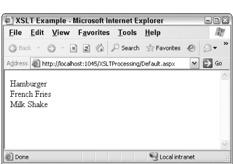

图 5-3

图 5-4 展示了 XSLT 处理的大致过程。

# 第 5 章

XSLT 处理按以下步骤进行：

1. XSLT 样式表由 XML 解析器加载。
2. XSLT 样式表被转换为一个节点树。这些节点也被称为*样式表树*。
   1. 检测 XSLT 样式表错误。
   2. 处理 `Include` 和 `import` 命令。
3. XML 输入由解析器加载并转换为一个节点树。
4. 样式表树中的纯空白文本节点被移除。
5. 源树中的纯空白文本节点被移除。
6. 样式表树补充了用于默认处理的内置模板规则。
7. 处理源树的根节点及其子节点。
   1. 处理与节点最佳匹配的模板规则。
   2. 创建模板规则。元素被视为指令，并解释其语义。模板规则中的元素和文本节点被特定地复制到结果树中。
8. 如果有必要，根据任何提供的 `xsl:output` 指令对结果树进行序列化。

## 内置函数

与许多编程语言一样，XSLT 提供了一组内置命令。这些命令涵盖字符串处理、日期处理以及循环运算符（如 `for` 循环结构）。在本节中，我们将了解一些内置于 XSLT 处理器中的函数。这些函数为许多 XSLT 操作提供了基础。

### XSLT `<template>`

`<xsl:template>` 元素与 `match` 属性一起使用，用于构建模板并将其与 XML 元素关联。

```xml
<xsl:template match="item" />
```

在此示例函数中，XSLT 处理器将搜索名为 `item` 的节点。如果找到匹配项，则会执行额外的功能。

### XSLT `<value-of>`

XSLT `<xsl:value-of>` 元素用于提取 XML 元素的值。提取的值随后在转换过程中被添加到输出的文本数据流中。请看以下示例：

```xml
<xsl:value-of select="item" />
```

这段代码将从 XML 文件的 `item` 元素中提取数据，然后将该值添加到转换输出的流中。

### XSLT `<for-each>`

XSLT `<xsl:for-each>` 元素用于在 XSLT 中提供循环支持。请看以下示例：

```xml
<xsl:for-each select="item" />
  <xsl:value-of select="." />
</xsl:for-each>
```

此示例将从指定的节点集中提取所有 `item` 节点，并将当前节点的值返回到 XSLT 流。

### XSLT `<sort>`

XSLT `<sort>` 元素用于协助 `<xsl:for-each>` 元素对 `<xsl:for-each>` 元素生成的节点集进行排序。

### XSLT `<if>`

`<xsl:if>` 元素用于测试 XML 文件的内容，类似于传统计算机编程语言中的 `if/endif`。请看以下示例：

```xml
<xsl:if test="cost &gt; 1.00">
..........
</xsl:if>
```

此 `<if>` 块常用于条件测试。通过这些测试，可以根据测试结果改变程序执行流程。如果条件为真，则执行 `<xsl:if></xsl:if>` 内的命令。在此示例中，如果 `cost` 节点的值大于 `1.00`，则执行 `<xsl:if>` 和 `</xsl:if>` 之间的代码。

### XSLT `<choose>`

`<xsl:choose>` 元素与 `<xsl:when>` 和 `<xsl:otherwise>` 一起使用，用于执行多个条件测试。请看以下代码：

```xml
<xsl:choose>
  <xsl:when test="expression">
...........
  </xsl:when>
  <xsl:otherwise>
..........
  </xsl:otherwise>
</xsl:choose>
```

在此示例中，测试表达式。当表达式为真时，执行 `<xsl:when></xsl:when>` 标签内的代码。如果不为真，则不执行该块中的任何代码；处理将转移到 `<xsl:otherwise></xsl:otherwise>` 标签并执行这些标签内的内容。

## 使用 XSLT 处理

现在你已经了解了一些主要的 XSLT 指令，让我们来看一些更复杂的使用 XSLT 进行处理的示例。在这些示例中，你将执行字符串处理、条件处理和数学处理。

### 动手试试：字符串处理

字符串处理是现代编程语言中非常常见的功能，XSLT 也不例外。它有许多内置的字符串处理命令。这些命令允许搜索字符串、返回字符串中字符的位置以及其他处理函数。你将使用以下 XML 文件：

```xml
<?xml version="1.0" encoding="UTF-8"?>
<employees xmlns:xsi="http://www.w3.org/2001/XMLSchema-instance">
  <Name>John Jones</Name>
  <Name>Mike Smith</Name>
  <Name>William Skakespeare</Name>
  <Name>Wally McClure</Name>
</employees>
```

你需要对这段 XML 代码执行几个操作。这些操作包括获取姓名的长度、解析员工的名字和姓氏。以下 XSLT 文件将执行这些操作：

```xml
<?xml version="1.0" encoding="UTF-8" ?>
<xsl:stylesheet version="1.0" xmlns:xsl="http://www.w3.org/1999/XSL/Transform"
    xmlns="http://www.w3.org/1999/xhtml">
  <xsl:template match="/">
    <table border='1'>
      <tr>
        <th>Employee Name:</th>
        <th>Length of Name:</th>
        <th>First Name:</th>
        <th>Last Name:</th>
      </tr>
      <xsl:apply-templates />
    </table>
  </xsl:template>
  <xsl:template match="Name">
    <tr>
      <td>
        <xsl:value-of select="." />
      </td>
      <td>
        <xsl:value-of select="string-length(.)" />
      </td>
      <td>
        <xsl:value-of select="substring-before(., ' ')"/>
      </td>
      <td>
        <xsl:value-of select="substring-after(., ' ')"/>
      </td>
    </tr>
  </xsl:template>
</xsl:stylesheet>
```

可以使用像这样的 XML 控件来处理 XML 和 XSLT 文件：

```xml
<asp:Xml ID="XMLStringExample" runat="server" DocumentSource="XMLStringTest.xml" TransformSource="XMLStringTest.xslt">
```

在此示例中，创建了一个表格。每行包含四列。

- 第一列是员工的姓名。它直接从 `<Name>` 标签中提取。
- 第二列包含员工姓名的长度。
- 第三列包含第一个空格之前的所有员工姓名部分。
- 最后一列包含第一个空格之后的所有员工姓名部分。

> 此示例假设姓名的格式为：名字，空格，然后是姓氏。

图 5-5 显示了示例 XML 文件经 XSLT 文件处理后的输出。

| Employee Name: | Length of Name: | First Name: | Last Name: |
| :--- | :--- | :--- | :--- |
| John Jones | 10 | John | Jones |
| Mike Smith | 10 | Mike | Smith |
| William Skakespeare | 19 | William | Shakespeare |
| Wally McClure | 13 | Wally | McClure |

图 5-5

> 有关 XSLT 中可用字符串处理方法的列表，请查阅附录 A。

# 第 5 章

**动手实践** 数值处理

XSLT 同样具备像许多其他编程语言一样的标准数学运算能力。这些运算范围可以从简单的加减法，到向上取整、向下取整和四舍五入等。

请看以下 XML 文件：

```xml
<?xml version="1.0" encoding="utf-8" ?>
<numbers xmlns:xsi="http://www.w3.org/2001/XMLSchema-instance">
    <a>9</a>
    <b>24.6</b>
    <c>-1</c>
    <d>4.3</d>
    <e>5</e>
</numbers>
```

你将处理这组数字，并对它们执行几个操作——显示数据、对节点求和、执行取模运算，最后通过一个条件判断，根据处理后的值是否为负数来输出一个字符串。接下来的 XSLT 文件将处理前面的数值 XML 文件并输出数值。

```xml
<?xml version="1.0" encoding="UTF-8" ?>
<xsl:stylesheet version="1.0" xmlns:xsl="http://www.w3.org/1999/XSL/Transform"
xmlns="http://www.w3.org/1999/xhtml">
    <xsl:template match="/">
        <table border='1'>
            <tr>
                <th>
                    a
                </th>
                <th>
                    b
                </th>
                <th>
                    c
                </th>
                <th>
                    d
                </th>
                <th>
                    e
                </th>
                <th>
                    数字总和
                </th>
                <th>
                    a 除以 e 的余数
                </th>
                <th>
                    (a-b) 是负数还是正数
                </th>
            </tr>
            <xsl:apply-templates />
        </table>
    </xsl:template>
    <xsl:template match="numbers">
        <tr>
            <td>
                <xsl:value-of select="a" />
            </td>
            <td>
                <xsl:value-of select="b" />
            </td>
            <td>
                <xsl:value-of select="c" />
            </td>
            <td>
                <xsl:value-of select="d" />
            </td>
            <td>
                <xsl:value-of select="e" />
            </td>
            <td>
                <xsl:value-of select="sum(*)"/>
            </td>
            <td>
                <xsl:value-of select="a mod e"/>
            </td>
            <td>
                <xsl:choose>
                    <xsl:when test="(a - b) &gt; 0">
                        正数
                    </xsl:when>
                    <xsl:when test="(a - b) &lt; 0">
                        负数
                    </xsl:when>
                    <xsl:otherwise>
                        0
                    </xsl:otherwise>
                </xsl:choose>
            </td>
        </tr>
        <br />
    </xsl:template>
</xsl:stylesheet>
```

可以使用像这样的 XML 控件来处理 XML 和 XSLT 文件：

```xml
<asp:Xml ID="XmlNumericExample" runat="server"
    DocumentSource="XMLNumericExample.xml"
    TransformSource="XMLNumericExample.xslt">
```

图 5-6 展示了数值 XML 文件经过数值 XSLT 文件处理后的输出结果。

- 前五列显示了来自 XSLT 文件的值。
- 第六列显示了数字的总和。
- 第七列显示了 `a` 除以 `e` 的余数。
- 最后一列显示了条件测试的组合，使用了 `<xsl:choose>` 和 `<xsl:when>` 标签，以及使用小于和大于命令进行测试。

| a | b | c | d | e | 数字总和 | a 除以 e 的余数 | (a-b) 是负数还是正数 |
|---|---|---|---|---|---|---|---|
| 9 | 24.6 | -1 | 4.3 | 5 | 41.9 | 4 | 负数 |

**图 5-6**

*有关 XSLT 内置处理函数的更多信息，请参阅附录 A 关于 XSLT 元素的内容。*

## 在 XSLT 中编写函数

`.NET Framework` 和 `MSXML` 组件中的 XSLT 处理器仅支持 XSLT 1.0 标准。这个标准版本使得在 XSLT 中编写函数有些困难。然而，这些组件支持编写自定义业务逻辑的能力。通过使用传统的编程语言（如 VBScript、JavaScript 或任何 .NET 支持的语言）扩展 XSLT，可以提供编写这些自定义业务对象的能力。鉴于 JavaScript 的广泛接受度，这些示例使用 JavaScript 来扩展 XSLT。

*XSLT 扩展大多是针对特定处理器的。有关更全面的示例，请参阅所使用的 XSLT 处理器提供的文档。*

XSLT 1.0 提供了两种类型的扩展：

- **扩展元素**，包括 `xsl:transform`、`xsl:template` 等内容。
- **扩展函数**，包括 `string`、`substring` 等内容。

XSLT 1.0 具有基于模板的模型。XSLT 处理器需要信息来区分静态内容和扩展元素。这可以通过处理器识别的某些命令来实现。下面的代码展示了一个示例：

```xml
<xsl:transform version="1.0" xmlns:xsl="http://www.w3.org/1999/XSL/Transform"
xmlns:out="http://www.w3.org/1999/xhtml"
xmlns:ext="http://exampleurl/extension"
extension-element-prefixes="ext">
<xsl:template match="/">
<out:html>
<ext:ExampleFunction/>
</out:html>
</xsl:template>
</xsl:transform>
```


这个示例展示了在 XSLT 中调用外部函数的最基本方式。输出的`xml`命名空间由`xmlns:out`属性定义，扩展的命名空间通过`xmlns:ext`属性添加。输出通过`<out:html>`标签格式化为 HTML，并通过`<ext:ExampleFunction/>`标签调用外部`ExampleFunction`。这个示例使用 MSXML 调用约定调用外部函数。

**120**

## XPath

XML 路径语言（XPath）是一种非 XML 语法，用于寻址 XML 文档的部分内容。开发者已将 XPath 作为一种简单的查询语言采用。XPath 是一系列步骤，用于从一组节点获取到另一组节点。这些步骤由斜杠（`/`）字符分隔。每个步骤由以下部分组成：

- **轴说明符** — 轴说明符指示导航方向。可用的轴包括：

    - `child`（子轴）

    - `attribute`（属性轴）

    - `descendant-or-self`（后代或自身轴）

    - `parent`（父轴）

    - `ancestor`（祖先轴）

    - `ancestor-or-self`（祖先或自身轴）

    - `following`（后续轴）

    - `preceding`（前序轴）

    - `following-sibling`（后续兄弟轴）

    - `self`（自身轴）

    - `namespace`（命名空间轴）

- **节点测试**

- **谓词**

在 XPath 中：

- 根元素由`/*`定义。

- 所有元素定义为`//`。

- 所有顶级元素定义为`/*/*`。

因此，一个示例 XPath 表达式可以是`/CustomerOrder/Item`。这将选择所有名为`Item`且是`CustomerOrder`子节点的节点。

一个更复杂的表达式可以指定为：`/CustomerOrder/Item/following-sibling::*[1]`。此表达式选择`Item`节点下方的所有元素，并指示`Item`节点是`CustomerOrder`节点的子节点。

在 XPath 中，表达式`@`可用于访问属性轴。例如，表达式`//Item[@price > 2]`选择具有`price`属性且值大于 2 的`Item`节点。

### 动手实践 XPath 示例

在这个动手实践中，你将使用菜单示例之一来了解 XPath 处理。在这个示例中，你将搜索`Menu2.xml`文件的某个`menuItems`的`<item>`标签。请看 C# 和 ASP.NET 中的示例代码：

```csharp
System.Xml.XPath.XPathDocument document = new
System.Xml.XPath.XPathDocument(Server.MapPath("Menu2.xml"));
System.Xml.XPath.XPathNavigator navigator = document.CreateNavigator();
System.Xml.XPath.XPathNodeIterator nodes =
navigator.Select("/menu/menuitem[cost=.49]/item");
while (nodes.MoveNext())
{
    Response.Write(nodes.Current.Value);
}
```

在这段代码中，如果 item 的 cost 设置为 .49，则会返回 menuitem 的 item 标签。该代码通过创建一个 XPath DOM 文档并加载`Menu2.xml`文件的内容来工作。下一步是创建`XPathNavigator`对象。XPath 表达式通过`XPathNavigator`的`.Select()`方法传递，并返回一个节点集合，然后可以遍历该集合。

现在，请看此示例中使用的 XML 文件：

```xml
<?xml version="1.0" encoding="UTF-8"?>
<menu>
    <menuitem>
        <item>Hamburger</item>
        <cost>1.99</cost>
    </menuitem>
    <menuitem>
        <item>Drink</item>
        <cost>.99</cost>
    </menuitem>
    <menuitem>
        <item>Fries</item>
        <cost>.49</cost>
    </menuitem>
</menu>
```

从 XML 源中，你可以看到唯一匹配 cost 为 .49 的 menuitem 是 Fries 项，这也是示例 XPath 代码返回的唯一结果。

## 集成 XML 和 Ajax

既然我们已经介绍了 XML，现在我们来谈一个不可避免的问题——我们如何将其与 Ajax 集成？如果你的开发团队有自己的库，或者需要调试现有库中发生的问题，这实际上是一个相当简单的过程。

快速看一些代码。在这个示例中，你使用 Sarissa 客户端库来执行与服务器的通信。对于到服务器的回调，你以 XML 格式获取人员列表。这被放入 XML DomDocument 中。在这个示例中，代码是同步加载的，但它也可以通过回调异步加载。你创建了一个包含 XSLT 命令的字符串。这个字符串被放入`XSLTProcessor()`对象中。最后的步骤是使用 XSLT 对象转换 XML DomDocument，然后将数据输出到浏览器。

## 数据通信：XML、XSLT 和 JSON

```javascript
var xsltProc = new XSLTProcessor();
var xsltDoc = Sarissa.getDomDocument();
var xsltStr = "<?xml version=\"1.0\" encoding=\"UTF-8\" ?>" + 
    "<xsl:stylesheet version=\"1.0\"" +
    "xmlns:xsl=\"http://www.w3.org/1999/XSL/Transform\"" +
    "xmlns=\"http://www.w3.org/1999/xhtml\">" + 
    "<xsl:template match='/'>" + 
        "<table border='1'>" + 
            "<tr>" + 
                "<th>" + 
                    "Employee Name:" + 
                "</th>" + 
            "</tr>" + 
            "<xsl:apply-templates />" + 
        "</table>" + 
    "</xsl:template>" + 
    "<xsl:template match=\"Name\">" + 
        "<tr>" + 
            "<td>" + 
                "<xsl:value-of select=\".\" />" + 
            "</td>" + 
        "</tr>" + 
    "</xsl:template>" + 
"</xsl:stylesheet>";
xsltDoc = (new DOMParser()).parseFromString(xsltStr, "text/xml");
xsltProc.importStylesheet(xsltDoc);
function SimpleExample() {
    var xmlDoc = Sarissa.getDomDocument();
    xmlDoc.async = false;
    xmlDoc.load("XMLStringTest.xml");
    var newDocument = xsltProc.transformToDocument(xmlDoc);
    document.write(Sarissa.serialize(newDocument));
}
SimpleExample();
```

图 5-7 展示了上述示例的输出结果。

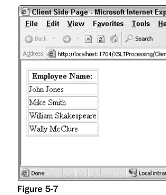

图 5-7

# 第 5 章

## JSON

正如本章前面所述，JSON 是 Computer-Readable 数据在一种轻量级的数据交换格式。JSON 相对于 XML 的主要优势在于，数据可以使用 JavaScript 内置的`eval()`方法相当容易地解析。而且，尽管 JSON 的名称中包含 JavaScript，但它实际上可以被多种语言使用。

### JSON 的结构

JSON 的用途在于数据交换领域，在某些方面它与 XML 类似。然而，它们之间存在一些关键的概念差异。XML 在概念上与数据库操作类似，主要设计用于处理数据集；而 JSON 在概念上与过程式编程语言中的数组和集合类似。这意味着 JSON 的设计目的是使其能够轻松地在过程式编程语言中使用。

JSON 建立在以下数据结构基础之上：

- **名称/值对** — 这可以称为对象、记录、结构体（struct）、哈希表、键控列表或关联数组。

- **值列表** — 这个值列表在大多数编程语言中被称为数组。

请查看下表中 JSON 的具体结构。

| 名称 | 描述 |

|------|-------------|

| object | `{}`<br>`{ members }` |

| members | `string : value`<br>`members , string : value` |

| array | `[]`<br>`[ elements ]` |

| elements | `value`<br>`elements , value` |

| value | `string, number, object, array, boolean, null` |

在 JSON 中，这些元素呈现以下形式：

- 对象是一组名称/值对。对象以左花括号（`{`）开始，以右花括号（`}`）结束。名称后面跟一个冒号（`:`）。名称/值对之间用逗号（`,`）分隔。

- 数组是值的集合。数组以左方括号（`[`）开始，以右方括号（`]`）结束。数组内的值用逗号（`,`）分隔。

- 值可以是几种数据类型之一。如果是字符串，则将包含在双引号内。数组内支持的其他数据类型包括数字、布尔值、null、对象和数组。

- 字符串是用双引号括起来的 Unicode 字符集合。字符可以使用正斜杠字符（`/`）进行转义。

### JSON 示例

请看一些使用 JSON 编码的数据：

```json
{
  "Tables": [
    {
      "Name": "Table1",
      "Rows": [
        {"tblStateId": 1, "State": "Tennessee"},
        {"tblStateId": 2, "State": "Alabama"}
      ]
    }
  ],
  "getTable": function(n) {
    return _getTable(n, this);
  }
}
```

这段示例文本展示了一个 ADO.NET 数据集的文本表示形式。在这个 JSON 对象中，有一个包含两行的表。有两列。这两列分别是`tblStateId`和`State`。第 1 行包含`tblStateId:1`和`State:Tennessee`。第 2 行包含`tblStateId:2`和`State:Alabama`。

现在你可以查看实际使用 JSON 对象的 JavaScript 代码。这段 JavaScript 代码在 Internet Explorer 中运行，并使用 Sarissa 客户端 JavaScript 库。它将从本地 Web 服务器提取数据，然后基于 JSON 对象创建一个对象。

```javascript
var xmlhttp = new XMLHttpRequest();
function clickme() {
    xmlhttp.onreadystatechange = myHandler;
    xmlhttp.open("GET", "GetData.aspx", true);
    xmlhttp.send(null);
}
function myHandler() {
    if (xmlhttp.readyState == 4) // READSTATE_COMPLETE is 4
    {
        var strObj = xmlhttp.responseText;
        var obj;
        eval("obj=" + strObj);
        for (m in obj)
            alert(m);
    }
}
```

在此示例中，创建了一个`XMLHTTP`对象，并向 Web 服务器发送了请求。当请求返回时，从返回的数据创建一个对象，并将该对象的可用属性显示在弹窗中给用户。

所示示例使用了 Sarissa 库。该库在第 9 章中讨论。

## 小结

在本章中，你学习了与数据通信相关的几个主题。

- XML——XML 包含数据传输的原始数据。它是一种对人和计算机都可读的、与语言无关的格式。

- XSLT——XSLT 用于将信息从一种 XML 格式转换为另一种。

- XPath——XPath 用于在 XML/XSLT 文档中进行导航。

- JSON——JSON 是一种对人和计算机都可读的数据交换格式，比 XML 更简单。

这些主题构成了异构通信的重要基础，例如 Ajax 中使用的通信，以及 Web 客户端和 Web 服务器之间的通信。了解 XML、XSLT 和 JSON 的结构对于构建自定义 Ajax 库、在 Web 客户端和 Web 服务器之间传输数据，或者诊断现有库中的问题都非常有价值。

你可以在以下网站找到本章讨论主题的更多信息：

- Wikipedia——http://en.wikipedia.org/wiki/XML

- "SGML Source"，Charles F. Goldfarb 著——www.sgmlsource.com

- 万维网联盟（W3C）——www.w3c.org

- W3 Schools 网站——www.w3schools.org

- JSON 网站——www.crockford.com/JSON


## ASP.NET 内置了什么

ASP.NET 2.0 相对于 ASP.NET 1.0 和 1.1 包含了大量改进。ASP.NET 团队试图解决先前版本中需要改进的各个 areas，而包含 Ajax 风格的功能就是其中之一。

ASP.NET 2.0 包含一种称为异步客户端脚本回调（Asynchronous Client Script Callbacks）的技术，或简称为*回调*。顾名思义，这提供了 ASP.NET 直接支持包含 JavaScript 代码的能力，使得能够从浏览器异步调用服务器进行处理——也就是说，从浏览器异步执行服务器方法，并在服务器方法完成时让 ASP.NET 指示浏览器执行 JavaScript`callback`方法。

在本章中，你将了解：

- ASP.NET V2.0 中支持异步回调功能的服务器控件

- 使用 ASP.NET V2.0 中的回调使你的页面支持异步行为

- 使用客户端回调开发支持异步行为的控件的高级技术

### 开箱即用的控件

在深入研究这些功能的基本原理和实现之前，需要注意的是，ASP.NET 附带的一些 Web 控件已经具备了支持回调功能的能力。具体来说，这些控件是：

- `TreeView`

- `GridView`

- `DetailsView`

这些控件带有简单的布尔属性，能够以浏览器友好的方式启用异步回调的使用，而完全不需要了解或编写任何 JavaScript。

# 第六章

同样，在本章内容变得过于技术化之前，先来了解一下利用某些原生支持此技术的控件，使用异步客户端脚本回调是多么容易。

## TreeView 控件

`TreeView`控件允许对任何数据源进行层级导航。此控件的一个非常常见的用途是作为网站的导航控件。通过将`TreeView`控件绑定到`SiteMapDataSource`控件，可以轻松实现这一点。然而，出于本示例的目的，您感兴趣的是为应用程序提供异步回调功能的内置能力。请研究以下简单的 ASP.NET 页面：

### 尝试利用异步客户端脚本回调支持的 TreeView 控件


```aspx
<%@ Page Language="C#" AutoEventWireup="true" CodeFile="TreeView.aspx.cs"
Inherits="_Default" %>

<!DOCTYPE html PUBLIC "-//W3C//DTD XHTML 1.0 Transitional//EN"
"http://www.w3.org/TR/xhtml1/DTD/xhtml1-transitional.dtd">

<html xmlns="http://www.w3.org/1999/xhtml">
<head runat="server">
    <title>Treeview Asynchronous Example</title>
</head>
<body>
    <form id="form1" runat="server">
        <div>
            &nbsp;<asp:XmlDataSource ID="XmlDataSource1" runat="server"
                DataFile="TestXMLFile.xml">
            </asp:XmlDataSource>
            <asp:TreeView ID="TreeView1" runat="server"
                DataSourceID="XmlDataSource1"
                ExpandDepth="1">
            </asp:TreeView>
        </div>
    </form>
</body>
</html>
```

此页面包含一个`TreeView`控件和一个`XmlDataSource`控件。`XmlDataSource`控件从名为`TestXMLFile.xml`的 XML 文件中提供数据。该文件包含以下内容：

```xml
<?xml version="1.0" encoding="utf-8" ?>
<root>
    <Node1>
        <Data1>
            <MoreNodes1 />
            <MoreNodes2 />
            <MoreNodes3 />
            <MoreNodes4 />
        </Data1>
        <Data2 />
    </Node1>
    <Node2>
        <Data3>
```

从前面代码块中显示的示例数据来看，`TreeView`控件将显示节点`Node1`、`Node2`、`Node3`和`Node4`。当点击或选择其中一个节点时，`TreeView`会从数据源请求所选节点的子节点。

默认情况下，当使用 Visual Studio .NET 2005 将`TreeView`控件拖放到页面上时，异步回调功能是启用的。`EnableClientScript`属性决定了此行为，其默认值为`true`。这样做的效果是，当点击`TreeView`中的一个节点，并且该节点有一些需要从数据源加载的子节点时，会执行异步回调来检索数据或本例中的子节点列表。用户不会看到网页向服务器回发。

如果您要更改前面的网页代码，使`TreeView`控件的标记如下所示：

```aspx
<asp:TreeView ID="TreeView1" runat="server"
    DataSourceID="XmlDataSource1"
    ExpandDepth="1"
    EnableClientScript="False">
</asp:TreeView>
```

这将告诉`TreeView`控件不要尝试使用客户端脚本来检索所需的额外数据。在这种情况下，每次展开一个节点时，您都会注意到浏览器执行回发。显然，引起回发不如执行回调那样无缝体验，因为后者不会看到用户体验中断。

调用必要的异步回调方法所需的所有 JavaScript 都是通过`EnableClientScript`布尔属性控制的。开发人员无需任何 JavaScript 知识或努力。

> 本章的代码示例可从`http://beginningajax.com`下载。

## GridView 控件

`GridView`控件源于 ASP.NET 1.0/1.1 中的`DataGrid`控件，后者曾被广泛用于呈现表格数据。`GridView`控件仍然用于呈现表格数据，但具有一些更高级的功能，并大量使用了 ASP.NET 2.0 的新特性和功能。

同样，出于本示例的目的，您关心的是此控件为您提供的异步行为。与默认启用异步回调功能的`TreeView`控件不同，`GridView`控件默认情况下并未启用异步行为。在研究一个简单的“尝试”之后，您将了解为什么是这种情况。请考虑以下代码。

### 尝试利用异步客户端脚本回调支持的 GridView 控件

```aspx
<%@ Page Language="C#" AutoEventWireup="true" CodeFile="GirdView.aspx.cs"
Inherits="GridViewAsyncExample_GirdView" %>

<!DOCTYPE html PUBLIC "-//W3C//DTD XHTML 1.0 Transitional//EN"
"http://www.w3.org/TR/xhtml1/DTD/xhtml1-transitional.dtd">

<html xmlns="http://www.w3.org/1999/xhtml">
<head runat="server">
    <title>GridView Asynchronous Example</title>
</head>
<body>
    <form id="form1" runat="server">
        <div>
            <asp:GridView ID="GridView1" runat="server"
                AllowPaging="True"
                AutoGenerateColumns="False"
                DataSourceID="XmlDataSource1"
                EnableSortingAndPagingCallbacks="True">
                <Columns>
                    <asp:BoundField DataField="BookTitle"
                        HeaderText="BookTitle"
                        SortExpression="BookTitle" />
                    <asp:BoundField DataField="Description"
                        HeaderText="Description"
                        SortExpression="Description" />
                    <asp:BoundField DataField="Comment"
                        HeaderText="Comment"
                        SortExpression="Comment" />
                </Columns>
            </asp:GridView>
            <asp:XmlDataSource ID="XmlDataSource1" runat="server"
                DataFile="~/GridViewAsyncExample/XMLFile.xml">
            </asp:XmlDataSource>
            &nbsp;&nbsp;
        </div>
    </form>
</body>
</html>
```

这个简单的页面包含一个`GridView`控件和一个`XmlDataSource`，`GridView`控件使用它来检索和操作其数据以进行呈现。数据同样存储在一个 XML 文件中，这次包含以下内容：

```xml
<?xml version="1.0" encoding="utf-8" ?>
<rootNode>
  <data1 BookTitle="Some Interesting stuff"
         Description="Lots of interesting stuff"
         Comment="Sort of interesting" />
  <data1 BookTitle="More Interesting stuff"
         Description="Even more interesting stuff"
         Comment="Much more interesting" />
  <data1 BookTitle="Less Interesting stuff"
         Description="Less interesting stuff"
         Comment="Not as interesting" />
  <data1 BookTitle="Big book"
         Description="A very big book"
         Comment="Too big" />
  <data1 BookTitle="Small Book"
         Description="A very small book"
         Comment="Too small" />
  <data1 BookTitle="Medium Book"
         Description="A medium sized book"
         Comment="Just right" />
  <data1 BookTitle="Truthfull stories"
         Description="Its the truth!"
         Comment="You know its true" />
  <data1 BookTitle="Lies, and why I never tell them"
         Description="Its all lies"
         Comment="I dont believe any of it" />
  <data1 BookTitle="Fun stories"
         Description="Lots of fun"
         Comment="Heaps of fun" />
  <data1 BookTitle="Horror stories"
         Description="Very scary"
         Comment="I was too scared to finish it" />
  <data1 BookTitle="Detective Stories"
         Description="Who dunnit?"
         Comment="Its a real mystery" />
  <data1 BookTitle="Fantasy stories"
         Description="Its a real fantasy"
         Comment="Its like living in a dream" />
  <data1 BookTitle="Drama stories"
         Description="Dramatic"
         Comment="I was riveted" />
  <data1 BookTitle="Action Stories"
         Description="Its all about action"
         Comment="Heart pounding" />
</rootNode>
```

### 工作原理

这里有一本书的列表，它们的描述，以及与每本书相关的一条评论。`GridView`将为用户渲染书目列表以供浏览。默认情况下，`GridView`控件上未启用排序和分页，因此所有书籍条目都显示在网页上。

在许多情况下，启用分页可以一次显示较小的内容列表，同时也允许用户推进该窗口或页面以查看列表中的更多条目。在本示例中，您通过将控件的`AllowPaging`属性设置为`true`来启用了分页。`GridView`控件还包含一个`PageSize`属性，该属性决定了启用分页时每页显示的条目数。默认值为 10，这也是本示例所使用的值。

当启用分页时，`GridView`会在控件底部显示一个分页导航栏，允许用户选择要查看的不同页面。默认情况下，当用户选择一个新页面时，`GridView`会引起回发，以便服务器可以检索下一页的数据。

在示例中，您会注意到您将`EnableSortingAndPagingCallbacks`属性设置为`true`，这正是启用`GridView`控件异步回调所需的。启用此属性后，每次用户单击分页导航栏以查看不同页面的数据时，不会发生回发，而是执行异步回调来在服务器上执行此工作并返回结果。然后，浏览器内的`GridView`控件会动态更新新页面。

现在可能更清楚为什么此属性默认情况下未启用了。`EnableSortingAndPagingCallbacks`属性仅在`GridView`控件内启用分页和/或排序时才适用，而此功能默认情况下未启用。因此，默认启用`EnableSortingAndPagingCallbacks`属性是没有意义的。

## 第 6 章 DetailsView 控件

`DetailsView`控件与`GridView`控件的功能非常相似。与`GridView`控件一样，`DetailsView`控件的客户端回调功能最初是禁用的。如果控件启用了分页，则可以将`AllowPagingCallbacks`属性设置为`true`，以使控件能够从浏览器异步执行其服务器端分页功能。

## 浏览器兼容性

微软已经吸取了过去的教训，良好的跨浏览器兼容性是 ASP.NET 2.0 的主要目标之一。前面展示的所有示例在大多数第五代浏览器中都能工作，例如 Internet Explorer 5.x 及以上版本、Mozilla/Netscape 6.x 及以上版本、Safari 1.2.x、Opera 7.x 以及 Firefox。

从应用程序开发的角度来看，检查当前访问你的应用程序的浏览器是否支持异步客户端回调也非常简单。请求中包含的`Browser`对象有两个新的布尔属性：`SupportsCallback`和`SupportsXmlHttp`。它们分别指示请求浏览器是否支持异步客户端回调和是否使用 XMLHttpRequest 对象。

它们是`Browser`对象属性集合的一部分，而`Browser`对象本身是`Request`对象的一部分，因此可以使用`Request.Browser.SupportsCallback`和`Request.Browser.SupportsXmlHttp`语法来访问。可以很容易地检查这些属性以确定请求浏览器是否支持所需的功能，如下所示的“动手试一试”所示。

```csharp
protected void Page_Load(object sender, EventArgs e)
{
    if (Request.Browser.SupportsCallback)
        lblCallbackMsg.Text = "This browser supports client side callbacks.";
    else
        lblCallbackMsg.Text = "This browser DOES NOT support client side callbacks.";

    if (Request.Browser.SupportsXmlHttp)
        lblXmlHttpMsg.Text = "This browser supports XmlHttp (receiving XML over HTTP).";
    else
        lblXmlHttpMsg.Text = "This browser DOES NOT XmlHttp (receiving XML over HTTP).";
}
```

**动手试一试** 使用服务器端代码确定客户端回调支持

### 工作原理

所有页面都可用的`Request`对象（类型为`System.Web.HttpRequest`）有一个`Browser`属性（类型为`System.Web.HttpBrowserCapabilities`），通过它可以访问布尔属性`SupportsCallback`和`SupportsXmlHttp`。

## ASP.NET 内置了什么

- `SupportsCallback`属性检查对 ASP.NET 2.0 使用的回调功能的明确支持，并寻找高级脚本支持，例如在异步操作完成时（即在回调模式下）调用脚本的能力。
- `SupportsXmlHttp`属性仅当浏览器支持通过 HTTP 通道发送 XML 内容时才会返回`true`。

异步回调与通过 HTTP 发送格式良好的 XML 内容相结合，在处理复杂数据时提供了一种强大的通信方法，正如你将在本章后面看到的。

## 框架

那么，你已经看到了一些原生支持异步客户端脚本回调的控件，也看到了如何以编程方式检测对此功能的支持，但你如何将其定制用于自己的应用程序并真正发挥其潜力呢？答案是双管齐下。

- 首先，有一个新引入的接口叫做`ICallbackEventHandler`接口。还有一个叫做`ICallbackContainer`的接口，它表示一个类可以生成自己的脚本来调用回调，但它不是处理异步客户端脚本回调时使用的主要接口，将在本章后面详细介绍。
- 其次，与 ASP.NET 1.0/1.1 的一个变化是，所有客户端脚本函数现在都包含在一个客户端脚本对象中（类型为`System.Web.UI.ClientScriptManager`），该对象作为每个 ASP.NET 页面对象的成员存在。它包含支持客户端 JavaScript 代码生成和操作所需的函数，特别是与异步调用的服务器端方法协同工作。

## ICallbackEventHandler 接口

`ICallbackEventHandler`接口是使页面或控件能够参与异步客户端脚本过程的主要机制。通过在控件或页面中实现此接口，服务器代码可以生成相关的 JavaScript 代码，从而允许客户端浏览器和服务器之间的异步交互。此接口有两个相关方法：

| 接口方法 | 描述 |
| :--- | :--- |
| `string GetCallbackResult();` | 此方法返回回调事件/异步调用到客户端浏览器的结果。 |


| `void RaiseCallbackEvent(string eventArgument);` | 异步调用以处理回调事件的方法。`eventArgument` 参数包含通过回调事件/方法传递的任何数据。 |

旨在提供对异步客户端脚本回调支持的 Web 控件或网页需要实现此接口，并为上表中描述的两个接口方法提供实现。

存在两个方法的原因是为了支持异步数据源，这是 .NET 2.0 中的一个新功能。异步数据源通常会发起一个请求来获取数据，然后在稍后的某个阶段，当初始调用的结果可用时进行处理。拥有两个方法来处理来自客户端的异步回调，为异步数据源提供了这种服务器端支持。

这些事件是所有回调事件的核心。这意味着，如果一个页面实现此接口以充当异步客户端脚本回调事件的接收者，`RaiseCallbackEvent` 方法将被页面内定义的所有客户端脚本回调调用，无论是一个还是一百个。这对于从客户端触发回调方法有多种方式且每个调用关联多种类型数据的复杂情况具有影响。当你研究一些使用异步客户端脚本回调功能的更复杂场景时，这一点将变得更加明显。

## Page.ClientScript — System.Web.UI.ClientScriptManager

为了在服务器上调用 `ICallbackEventHandler` 接口的服务器方法，必须首先由客户端（即浏览器）触发回调事件。由于浏览器上几乎所有的动态内容都是通过 JavaScript 执行的，你需要提供一个方法或注册一个方法来执行此功能。

ASP.NET 2.0 引入的变化之一是将所有基于脚本的管理功能集中到一个对所有 ASP.NET 页面都可用的客户端脚本管理对象中。这包括 ASP.NET 1.0/1.1 中存在的客户端脚本注册函数，例如 `RegisterStartupScript` 和 `RegisterClientScriptBlock` 方法。这些函数现在作为 `ClientScript` 对象的一部分存在，该对象是 `Page` 对象的成员。以前，在 ASP.NET 1.0/1.1 中，你是作为 `Page` 对象的一部分访问客户端脚本函数的：

```csharp
private void Page_Load(object sender, System.EventArgs e)
{
    Page.RegisterStartupScript("MyScript","<script
type='text/javascript'>alert('This is some Javascript');</script>");
}
```

在 ASP.NET 2.0 中，此功能现在通过 `Page` 对象的一部分——`ClientScript` 对象来访问。`ClientScript` 对象的类型为 `System.Web.UI.ClientScriptManager`。语法差异如下例所示：

```csharp
protected void Page_Load(object sender, EventArgs e)
{
    Page.ClientScript.RegisterStartupScript(this.GetType(), "MyScript",
    "alert('This is some Javascript');", true);
}
```

## Page.ClientScript.GetCallbackEventReference

除了 ASP.NET 1.0/1.1 的脚本管理功能外，异步客户端脚本管理功能也作为此对象的一部分存在。特别值得注意的是 `GetCallbackEventReference`。

## ASP.NET 中内置的功能

此方法允许开发者获取将触发异步回调事件的 JavaScript 方法的引用。该方法允许你指定用于传递事件数据和上下文数据的变量名称，以及在异步回调事件完成时要调用的客户端 JavaScript 方法。如果执行该方法的控件或页面未实现上一节描述的 `ICallbackEventHandler` 接口，则此方法将引发异常。以下代码展示了使用此方法的示例：

```csharp
string js = Page.ClientScript.GetCallbackEventReference(this, "arg", "OnServerCallComplete", "ctx", true);
```

第一个参数代表用作回调事件接收者的对象。`arg` 参数代表用于将回调事件结果传递给客户端 JavaScript 方法的参数名称。`OnServerCallComplete` 参数代表在异步回调事件执行完成后被调用的客户端 JavaScript 方法的名称。`ctx` 参数代表在异步回调事件完成时传递给客户端方法（本例中为 `OnServerCallComplete`）的上下文参数名称。最后，`true` 参数表示返回的回调事件引用应以异步方式执行。`js` 字符串参数保存一个引用（实际上是一段 JavaScript 代码），用于根据指定的参数调用异步客户端回调。根据前面的示例，`js` 参数将包含以下内容：

```javascript
WebForm_DoCallback('__Page', arg, OnServerCallComplete, ctx, null, true);
```

# 让所有活动部件协同工作

到目前为止，你知道为了使网页或控件能够参与或支持异步客户端脚本回调，必须实现 `ICallbackEventHandler` 接口。除了实现 `ICallbackEventHandler` 接口的两个基于服务器的方法外，页面或控件还必须利用 `ClientScript` 对象（它是每个 `Page` 对象的一部分）的脚本管理功能来注册触发异步回调事件所必需的 JavaScript。这将启动异步回调过程。

一旦过程被启动，就需要提供客户端方法（存在于网页中的 JavaScript 方法）作为最终端点，异步过程在此返回其结果，供 JavaScript 代码显示或操作。

这个过程可能相当难以理解，这种复杂性也增加了开发和调试利用异步客户端脚本的应用程序的难度。充分理解整个过程非常重要。当你开始整合异步过程的所有部分时，想象功能流程会很有帮助。这在图 6-1 中有所展示，该图将在本章稍后出现。在继续查看代码示例时，不断参考此图可以帮助你理解过程流中的步骤。

# 获取回调引用

正如你已经看到的，此过程的第一部分是在浏览器内检索回调事件的引用以触发异步调用：

```csharp
string js = Page.ClientScript.GetCallbackEventReference(this, "arg", "OnServerCallComplete", "ctx", true);
```

# 第 6 章

为了利用它来调用回调事件，你必须将其作为脚本块注册到客户端。虽然可以显式注册此块，但通常更好的做法是将此脚本块封装在一个简化的函数中，以便客户端代码轻松使用。考虑以下示例中的服务器端代码：

```csharp
protected void Page_Load(object sender, EventArgs e)
{
    // 获取我们的回调事件引用
    string js = Page.ClientScript.GetCallbackEventReference(this,
        "arg", "OnServerCallComplete", "ctx", true);

    // 创建一个简化的包装方法
    StringBuilder newFunction = new StringBuilder();
    newFunction.Append("function StartAsyncCall(arg, ctx) ");
    newFunction.Append("{ ");
    newFunction.Append(js);
    newFunction.Append(" } ");
    // 现在注册它
    Page.ClientScript.RegisterClientScriptBlock(this.GetType(), "NewAsyncMethod",
        newFunction.ToString(), true);
}
```

使用前面的代码，你已经显式定义了一个名为 `StartAsyncCall` 的 JavaScript 函数，该函数接受两个名为 `arg` 和 `ctx` 的参数。此函数将调用由调用 `GetCallbackEventReference` 方法生成的 JavaScript 事件，而该方法本身又调用异步事件。

# 实现 ICallbackEventHandler 接口

如前所述，你需要为 `ICallbackEventHandler` 接口中定义的方法提供实现。对于一个简单的实现，请考虑以下 `ICallbackEventHandler` 接口方法的实现：

```csharp
public string GetCallbackResult()
{
    return "Server method completed at: " + DateTime.Now.ToLongTimeString();
}

public void RaiseCallbackEvent(string eventArgument)
{
    System.Threading.Thread.Sleep(2000);
}
```

这个简单的例子在返回包含服务器日期和时间的字符串之前等待了 2 秒钟。

这解决了提供一种启动异步事件（通过获取回调引用）的方法，并且也为你在服务器端执行的异步操作提供了实现，但这只是完整图景的一半。你需要一种方法来处理此异步事件或过程的结果。为了通过实现来说明本章到目前为止涵盖的内容，图 6-1 展示了整个异步回调过程，其中已涵盖的特定区域用阴影区域标出：

## ASP.NET 中内置的功能

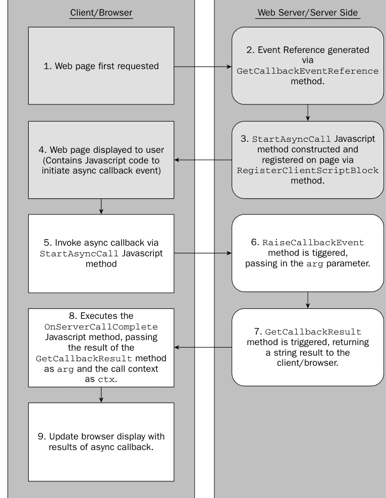

- 到目前为止涵盖的区域

图 6-1

## 从浏览器启动异步过程

网页本身需要使用使用异步客户端脚本框架构建和注册的 JavaScript 方法来启动异步回调。这在下面的 HTML 片段中很容易实现：

```html
<form id="form1" runat="server">
<div>
    <input type="button" onclick="StartAsyncCall('some text', 'my context');"
   value="Initiate Async Call" />
</div>
</form>
```

在前面的代码中，按钮的 `onclick` 事件执行 `StartAsyncCall` 方法，将 `'some text'` 作为参数传递给该函数，并将字符串 `'my context'` 用作调用的上下文数据。`StartAsyncCall` 方法就是你之前使用 `Page.ClientScript` 对象方法构建和注册的方法。

在此阶段，异步调用现在已执行，并将触发服务器上的 `RaiseCallbackEvent` 方法（之前已定义）。此后不久，`GetCallbackResult` 方法也会被执行，结果被发送回客户端/页面。

## 在客户端处理异步服务器端调用的结果

现在异步调用已执行，服务器端处理已完成，结果已发送回客户端浏览器，你必须有办法接收和处理这些结果。这代表了异步过程的最后一步，如图 6-2 所示。

在之前的服务器端代码中，你使用了 `Page.GetCallbackEventReference` 方法来获取触发异步事件的 JavaScript 事件，但该方法也提供了指定接收异步调用结果的 JavaScript 方法名称的能力。此事件在异步服务器端过程成功完成时会自动调用。在前面的示例中，此方法被命名为 `OnServerCallComplete`。此方法只需要在网页中被定义（并带有相应的实现）。这是在客户端处理服务器端调用结果的方法，通常会更新网页或执行其他操作以响应该数据。以下示例展示了此方法的简单示例实现：

```html
<script type="text/javascript">
function OnServerCallComplete(arg, ctx)
{
   alert("Async Call completed. Returned: [" + arg + "] Context Value: [" + ctx + "]");
}
</script>
```

前面的示例只是显示一个对话框，显示服务器端调用的结果（通过 `arg` 参数传入），以及与服务器端操作一起传递的上下文数据（通过 `ctx` 参数传入）。这些参数名称也是通过前面所示的 `Page.GetCallbackEventReference` 方法注册的。

## ASP.NET 内置了什么


**图 6-2**

# 第 6 章

这完成了这个简单的异步回调过程。为了将所有这些整合起来，下面的代码清单展示了网页和相关服务器端代码的完整列表。

### 动手实践：简单的异步客户端脚本回调示例

网页（`GetCallbackEventReferenceExample.aspx`）：

```xml
<%@ Page Language="C#" AutoEventWireup="true" CodeFile="GetCallbackEventReferenceExample.aspx.cs" Inherits="GetCallbackEventExample_GetCallbackEventExample" %>

<!DOCTYPE html PUBLIC "-//W3C//DTD XHTML 1.0 Transitional//EN" "http://www.w3.org/TR/xhtml1/DTD/xhtml1-transitional.dtd">
<html xmlns="http://www.w3.org/1999/xhtml">
<head runat="server">
    <title>GetCallbackEventReference 示例页面</title>
    <script type="text/javascript">
        function OnServerCallComplete(arg, ctx) {
            alert("异步调用已完成。返回: [" + arg + "] 上下文值: [" + ctx + "]");
        }
    </script>
</head>
<body>
    <form id="form1" runat="server">
        <div>
            <input type="button" onclick="StartAsyncCall('some text', 'my context');" value="发起异步调用" />
        </div>
    </form>
</body>
</html>
```

服务器端代码（`GetCallbackEventReferenceExample.aspx.cs`）：


```csharp
using System;
using System.Data;
using System.Configuration;
using System.Collections;
using System.Web;
using System.Web.Security;
using System.Web.UI;
using System.Web.UI.WebControls;
using System.Web.UI.WebControls.WebParts;
using System.Web.UI.HtmlControls;
using System.Text;

public partial class GetCallbackEventExample_GetCallbackEventExample : System.Web.UI.Page, ICallbackEventHandler {
    protected void Page_Load(object sender, EventArgs e) {
        // 获取我们的回调事件引用
        string js = Page.ClientScript.GetCallbackEventReference(this, "arg", "OnServerCallComplete", "ctx", true);

        // 创建一个简化的包装方法
        StringBuilder newFunction = new StringBuilder();
        newFunction.Append("function StartAsyncCall(arg, ctx) ");
        newFunction.Append("{ ");
        newFunction.Append(js);
        newFunction.Append(" } ");
        
        // 现在注册它
        Page.ClientScript.RegisterClientScriptBlock(this.GetType(), "NewAsyncMethod", newFunction.ToString(), true);
    }

    #region ICallbackEventHandler 成员
    
    public string GetCallbackResult() {
        return "服务器方法完成时间: " + DateTime.Now.ToLongTimeString();
    }

    public void RaiseCallbackEvent(string eventArgument) {
        System.Threading.Thread.Sleep(2000);
    }
    
    #endregion
}
```

## 在异步过程中处理错误

当服务器上发生错误时，通常意味着抛出了异常。显然，需要一种方式来识别何时发生异常并在客户端浏览器中处理它。就像你定义了一个在异步过程完成时调用的 JavaScript 方法一样，你可以定义一个在异步回调期间服务器上抛出异常时调用的 JavaScript 方法。这是在调用`GetCallbackEventReference`方法时作为附加参数指定的，如下例所示：

```csharp
string js = Page.ClientScript.GetCallbackEventReference(this, "arg", "OnServerCallComplete", "ctx", "OnServerCallError", true);
```

包含`OnServerCallError`的参数标识了当服务器上发生异常时调用的 JavaScript 方法的名称。此方法所需的参数数量与之前定义的处理成功调用的方法几乎相同。

### `OnServerCallError`方法的 JavaScript 实现

```javascript
function OnServerCallError(err, ctx) {
    alert("发生错误! [" + err + "] 传入的上下文是 [" + ctx + "]");
}
```

第一个参数`err`代表生成的异常消息，`ctx`参数代表与前面示例中定义的相同上下文。

为了演示这一点，服务器端方法的实现已被修改，以显式抛出异常来模拟错误条件。在下面的示例中，`GetCallbackResult`方法已被修改为抛出异常：

```csharp
public string GetCallbackResult() {
    throw new Exception("哇! 这是一个来自 'GetCallbackResult' 的服务器端异常");
    return "服务器方法完成时间: " + DateTime.Now.ToLongTimeString(); // 如果在上面抛出异常，这是不可达的代码
}
```

这一次，当点击网页上的按钮时，异步过程按预期启动。然而，JavaScript 例程现在被调用，显示异常消息，以及你之前定义的上下文数据。这种——为成功和不成功的调用定义 JavaScript 处理程序方法——通常是任何使用异步客户端脚本回调技术的生产系统的基本要求。

> 虽然前面的代码示例允许浏览器处理异常以用于演示目的，但重要的是你要在回调代码中正确处理所有异常。应使用`try...catch`语法进行正常的异常处理。这样，只有打算由浏览器传递和处理的异常才被你的代码允许。此外，你的服务器端代码可以在允许异常传递到客户端代码之前采取行动，以防止数据损坏或意外行为。

在前面的示例中，异常是由`GetCallbackResult`方法生成的。JavaScript 错误处理程序方法按预期显示了异常消息，但如果异常是由伴随的服务器端方法`RaiseCallbackEvent`生成的呢？

在下面的示例中，异常的生成已移至`RaiseCallbackEvent`方法，并从`GetCallbackResult`方法中移除。为了辅助此示例并防止混淆，显示了完整的服务器端代码清单：

```csharp
using System;
using System.Data;
using System.Configuration;
using System.Collections;
using System.Web;
using System.Web.Security;
using System.Web.UI;
using System.Web.UI.WebControls;
using System.Web.UI.WebControls.WebParts;
using System.Web.UI.HtmlControls;
using System.Text;

public partial class GetCallbackEventWithErrorHandlingExample_GetCallbackEventWithErrorHandlingExample : 
    System.Web.UI.Page, ICallbackEventHandler {
    
    protected void Page_Load(object sender, EventArgs e) {
        // 获取我们的回调事件引用
        string js = Page.ClientScript.GetCallbackEventReference(this, "arg", "OnServerCallComplete", "ctx", "OnServerCallError", true);

        // 创建一个简化的包装方法
        StringBuilder newFunction = new StringBuilder();
        newFunction.Append("function StartAsyncCall(arg, ctx) ");
        newFunction.Append("{ ");
        newFunction.Append(js);
        newFunction.Append(" } ");
        
        // 现在注册它
        Page.ClientScript.RegisterClientScriptBlock(this.GetType(), "NewAsyncMethod", 
            newFunction.ToString(), true);
    }

    #region ICallbackEventHandler 成员
    
    public string GetCallbackResult() {
        return "服务器方法完成时间: " + DateTime.Now.ToLongTimeString();
    }

    public void RaiseCallbackEvent(string eventArgument) {
        System.Threading.Thread.Sleep(2000);
        throw new Exception("哇! 这是一个来自 'RaiseCallbackEvent' 的服务器端异常");
    }
}
```

这样做的结果可能与你预期的不同，如图 6-3 所示。


**图 6-3**

# 第6章

在此你可以看到，除了`GetCallbackResult`方法的结果外，异常消息也已显示。这两条消息被聚合在一起，但用管道符（`|`）分隔。发生的情况是，异步客户端脚本框架仍然在调用`ICallbackEventHandler`接口的所有必需方法，即使其中一个方法产生了异常。一个方法产生异常这一事实并不妨碍另一个方法的执行。这一点很重要，因为`GetCallbackResult`方法需要了解在`RaiseCallbackEvent`方法执行期间发生的任何错误，而不是盲目地执行并假设如果执行到达该方法，则之前的所有程序执行都没有错误。

## 处理复杂数据

在前面的示例中，异步回调服务器端方法的结果仅是一个简单的单文本字符串。应用程序的需求多种多样，处理更复杂数据的需求是一个常见场景，特别是需要返回多个结果时。例如，假设你希望从一个可能运行时间较长的服务器端查询或操作中加载下拉列表的值。可能需要加载很多项到下拉列表中，每项通常会关联一个值，当用户从下拉列表中选择特定选项时返回该值。

为了说明这个场景，以下网页包含一个简单的下拉列表和一个`span`区域，该区域将包含从下拉列表中选择的值：

```html
<%@ Page Language="C#" AutoEventWireup="true"
CodeFile="AsyncDropDownListExample.aspx.cs"
Inherits="AsyncDropDownListExample_AsyncDropDownListExample" %>

<!DOCTYPE html PUBLIC "-//W3C//DTD XHTML 1.0 Transitional//EN"
"http://www.w3.org/TR/xhtml1/DTD/xhtml1-transitional.dtd">

<html xmlns="http://www.w3.org/1999/xhtml" >
<head runat="server">
    <title>Asynchronous Drop Down List Example</title>

    <script type="text/javascript">
    function LoadListItems()
    {

    }
    </script>

</head>
<body onload="LoadListItems();">
    <form id="form1" runat="server">
    <div>
        <select id="ddlList" disabled="true">
            <option>(Loading values from the Server)</option>
        </select>
    </div>
    <hr />
    <div>
        <label>Value Selected:&nbsp;</label><span id="msg">{none}</span>
    </div>

    </form>
</body>
</html>
```

如前所述，该网页包含一个下拉列表和一个显示所选值的区域，但它还包含一个`LoadListItems` JavaScript 方法，该方法在页面加载时通过`body`元素中定义的`onload`事件被调用。这将是发起异步服务器端调用以检索要加载到下拉列表中的项目的地方。

下拉列表的初始状态将是禁用的。这是因为在异步操作填充列表之前，没有可供选择的项目。

## 启用页面以进行异步回调

必须通过实现`ICallbackEventHandler`接口并获取回调事件引用（以 JavaScript 方法调用的形式）来启动对服务器端的请求，从而为该网页启用异步客户端脚本回调支持。

要获取回调事件引用，你可以使用与前面列出的完全相同的机制和代码。不同之处在于`ICallbackEventHandler`接口的实现。服务器端页面实现的代码如下所示：

```csharp
using System;
using System.Data;
using System.Configuration;
using System.Collections;
using System.Web;
using System.Web.Security;
using System.Web.UI;
using System.Web.UI.WebControls;
using System.Web.UI.WebControls.WebParts;
using System.Web.UI.HtmlControls;
using System.Text;

public partial class AsyncDropDownListExample_AsyncDropDownListExample : 
    System.Web.UI.Page, ICallbackEventHandler
{
    private DataSet lookupData = null;

    protected void Page_Load(object sender, EventArgs e)
    {
        // Get our callback event reference
        string js = Page.ClientScript.GetCallbackEventReference(this,
            "arg", "OnServerCallComplete", "ctx", "OnServerCallError", true);

        // Create a simplified wrapper method
        StringBuilder newFunction = new StringBuilder();
        newFunction.Append("function StartAsyncCall(arg, ctx) ");
        newFunction.Append("{ ");
        newFunction.Append(js);
        newFunction.Append(" } ");
        // Now register it
        Page.ClientScript.RegisterClientScriptBlock(this.GetType(),
        "NewAsyncMethod",
        newFunction.ToString(), true);
    }
    #region ICallbackEventHandler Members
    public string GetCallbackResult()
    {
        // nothing to return yet
        return null;
    }
    public void RaiseCallbackEvent(string eventArgument)
    {
        // no implementation yet
    }
    #endregion
}
```

你会注意到这段代码清单与前面的示例几乎完全相同。此时一个重要区别是包含了一个名为`lookupData`的私有成员变量的声明，其类型为`DataSet`。

```csharp
private DataSet lookupData = null;
```

这很重要，因为它将用于在`ICallbackEventHandler`接口的两个方法之间存储查找数据。然而，接口方法的实现将包含大部分自定义代码，并且与以前的示例有根本性的不同。

## 获取数据——实现`ICallbackEventHandler`接口

本示例将尝试模拟从数据库获取关联有 ID 值的查找值，以填充下拉列表。获取此数据将在`RaiseCallbackEvent`方法中实现。`RaiseCallbackEvent`方法是在异步回调过程中首先在服务器端调用的方法，因此尽早发起数据检索请求是合理的。这些数据的格式化和返回将在`GetCallbackResult`方法中实现。将处理分离到两个方法中，也将数据检索和格式化的离散过程分成了更易管理的单元。


当你处理来自数据库的数据时，一种常见的技术是使用`DataSet`对象来封装该数据。在这个示例中，`DataSet`将被用作数据库调用返回的对象。为简单起见，数据检索代码实际上不会查询数据库，而是手动构建一个包含一些数据的`DataSet`对象，并模拟一个耗时的数据库查询。此方法的实现细节并不重要，可以轻松修改以适应不同应用程序的需求。以下是该方法本身的清单：

```csharp
private DataSet GetLookupValuesFromDatabase()
{
    DataSet ds = new DataSet();
    DataTable dt = new DataTable();

    DataColumn idCol = new DataColumn("ID", typeof(int));
    DataColumn nameCol = new DataColumn("Name", typeof(string));
    dt.Columns.Add(idCol);
    dt.Columns.Add(nameCol);
    dt.AcceptChanges();

    DataRow newRow = null;
    newRow = dt.NewRow();
    newRow[idCol] = 1;
    newRow[nameCol] = "Joe Bloggs ID#1";
    dt.Rows.Add(newRow);

    newRow = dt.NewRow();
    newRow[idCol] = 2;
    newRow[nameCol] = "Mr A. Nonymous ID#2";
    dt.Rows.Add(newRow);

    newRow = dt.NewRow();
    newRow[idCol] = 3;
    newRow[nameCol] = "Mrs N. Extdoorneighbour ID#3";
    dt.Rows.Add(newRow);

    newRow = dt.NewRow();
    newRow[idCol] = 4;
    newRow[nameCol] = "Mr. Pea Body ID#4";
    dt.Rows.Add(newRow);

    ds.Tables.Add(dt);
    ds.AcceptChanges();
    return ds;
}
```

`RaiseCallbackEvent`方法的实现现在可能如下所示：

```csharp
public void RaiseCallbackEvent(string eventArgument)
{
    System.Threading.Thread.Sleep(2000);  // Simulate a delay
    lookupData = GetLookupValuesFromDatabase();
}
```

请注意数据检索例程`GetLookupValuesFromDatabase`的结果是如何被赋值给私有成员变量`lookupData`的。

# 第6章

有了这些基础，你现在可以利用从`GetCallbackResult`方法返回的数据了。请查看该方法的以下实现：

```csharp
public string GetCallbackResult()
{
    StringBuilder ids = new StringBuilder();
    StringBuilder names = new StringBuilder();

    int rowCnt = 0;
    int numRows = lookupData.Tables[0].Rows.Count;

    foreach (DataRow row in lookupData.Tables[0].Rows)
    {
        rowCnt++;

        ids.Append(row["ID"].ToString());
        if (rowCnt < numRows)  // Only append a separator if its NOT the last element
            ids.Append("|");  // Include a data element separator character

        names.Append(row["Name"].ToString());
        if (rowCnt < numRows)  // Only append a separator if its NOT the last element
            names.Append("|");  // Include a data element separator character
    }

    // Make one big string, separating the sets of data with a tilde '~'
    string returnData = string.Format("{0}~{1}", ids.ToString(), names.ToString());

    return returnData;
}
```

上述代码遍历`DataSet`对象中的每一行，该对象之前是从`RaiseCallbackEvent`方法赋值的。代码随后提取每个`ID`字段值，将其添加到一个字符串中（为提升速度而使用`StringBuilder`对象实现），并用竖线（`|`）字符分隔每个值。代码对`Name`字段值执行相同的操作，但将竖线分隔的值添加到另一个不同的字符串中。一旦此过程完成，并且所有值都已赋值给单独的`StringBuilder`对象，就进行最后一步——创建一个字符串，其中包含所有竖线分隔的`ID`值和竖线分隔的`Name`值，但每组数据之间再用另一个字符分隔，这次是波浪号（`~`）字符。

数据之所以用这些字符分隔，是因为当这些数据返回到浏览器时，JavaScript可以轻松地将此字符串数据拆分为单独的元素数组，这样你就可以遍历数组并将数据加载到下拉列表中。唯一需要的是明确了解哪些字符被用作数据的分隔符。

竖线（`|`）和波浪号（`~`）字符本身并不重要，只是选择它们是因为它们通常不用于字符串数据中。然而，你可以选择任何你喜欢的字符。

返回到浏览器的数据看起来如下所示：

```
1|2|3|4~Joe Bloggs ID#1|Mr A. Nonymous ID#2|Mrs N. Extdoorneighbour ID#3|Mr. Pea Body ID#4
```

## 在客户端处理返回的数据

既然服务器端已完全实现，你必须提供一种方式让客户端例程解析返回的字符串数据`blob`。

如前面的示例所示，当在服务器上的`Page_Load`事件期间获取回调事件引用时，`OnServerCallComplete`和`OnServerCallError`JavaScript例程被分别指定为成功和失败的异步调用结果的接收者。请考虑这些方法的以下实现：

```javascript
function OnServerCallComplete(arg, ctx)
{
    var idsAndNames = arg.split("~");
    var ids = idsAndNames[0].split("|");
    var names = idsAndNames[1].split("|");

    var htmlCode;
    var ddl = document.getElementById("ddlList");

    for (var i=0; i < ids.length; i++)
    {
        htmlCode = document.createElement('option');

        // Add the new <OPTION> node to our <SELECT> drop list
        ddl.options.add(htmlCode);

        // Set the <OPTION> display text and value;
        htmlCode.text = names[i];
        htmlCode.value = ids[i];
    }

    // Enable our drop down list as it
    // should have some values now.
    ddl.disabled = false;
}

function OnServerCallError(err, ctx)
{
    alert("There was an error processing the request! Error was [" + err + "]");
}
```

`OnServerCallComplete`方法首先使用`split`方法，该方法是所有JavaScript字符串对象的内置方法，使用指定字符作为分隔符将单个字符串分离为字符串数组。`ids`字符串数组包含要选择的数据的全部`id`值，`names`字符串数组包含要在下拉列表中显示的相应文本描述。这些数组的长度相同。

代码随后获取对控件的引用，如下所示：

```javascript
var ddl = document.getElementById("ddlList");
```

使用`for`循环遍历`ids`数组的每个元素，使用以下行创建一个新的选择选项：

```javascript
htmlCode = document.createElement('option');
```

这会创建如下所示的标记：

```html
<option></option>
```

随后将其添加到下拉列表的选项列表中，然后将相应的`id`和文本显示值赋给这个 newly 添加的下拉列表选项。所有选项添加完成后，通过将`disabled`标志设置为`false`来启用下拉列表：

```javascript
ddl.disabled = false;
```

下拉列表现已通过异步服务器端调用填充了值，并可以进行选择。为了说明下拉列表已正确填充，下拉列表的`onchanged`事件被分配了一个 JavaScript 方法来显示所选值，即文本选择元素的 ID。以下是网页和服务器端代码的完整代码清单。

### 动手实践：一个更复杂的异步客户端脚本回调示例

```aspx
网页 (AsyncDropDownListExample.aspx):
<%@ Page Language="C#" AutoEventWireup="true"
CodeFile="AsyncDropDownListExample.aspx.cs"
Inherits="AsyncDropDownListExample_AsyncDropDownListExample" %>
<!DOCTYPE html PUBLIC "-//W3C//DTD XHTML 1.0 Transitional//EN"
"http://www.w3.org/TR/xhtml1/DTD/xhtml1-transitional.dtd">
<html xmlns="http://www.w3.org/1999/xhtml" >
<head runat="server">
    <title>Asynchronous Drop Down List Example</title>
    <script type="text/javascript">
    function LoadListItems()
    {
        StartAsyncCall(null,null);
    }
    function OnServerCallComplete(arg, ctx)
    {
        var idsAndNames = arg.split("~");
        var ids = idsAndNames[0].split("|");
        var names = idsAndNames[1].split("|");
        var htmlCode;
        var ddl = document.getElementById("ddlList");
        for (var i=0; i < ids.length; i++)
        {
            htmlCode = document.createElement('option');
            // Add the new <OPTION> node to our <SELECT> drop list
            ddl.options.add(htmlCode);
            // Set the <OPTION> display text and value;
            htmlCode.text = names[i];
            htmlCode.value = ids[i];
        }
        // Enable our drop down list as it
        // should have some values now.
        ddl.disabled = false;
    }

    function OnServerCallError(err, ctx)
    {
        alert("There was an error processing the request! Error was [" + err + "]");
    }

    function OnDropListSelectChanged()
    {
        var ddl = document.getElementById("ddlList");
        // Display selected value
        var msg = document.getElementById("msg");
        msg.firstChild.nodeValue=ddl.value;
    }
    </script>

</head>
<body onload="LoadListItems();">
    <form id="form1" runat="server">
        <div>
            <select id="ddlList" disabled="false" onchange="OnDropListSelectChanged();">
                <option>(Loading values from the Server)</option>
            </select>
        </div>
        <hr />
        <div>
            <label>Value Selected:&nbsp;</label><span id="msg">{none}</span>
        </div>
    </form>
</body>
</html>
```


服务器端代码（`AsyncDropDownListExample.cs`）：

```csharp
using System;
using System.Data;
using System.Configuration;
using System.Collections;
using System.Web;
using System.Web.Security;
using System.Web.UI;
using System.Web.UI.WebControls;
using System.Web.UI.WebControls.WebParts;
using System.Web.UI.HtmlControls;
using System.Text;

public partial class AsyncDropDownListExample_AsyncDropDownListExample :
System.Web.UI.Page, ICallbackEventHandler
{
    private DataSet lookupData = null;

    protected void Page_Load(object sender, EventArgs e)
    {
        // Get our callback event reference
        string js = Page.ClientScript.GetCallbackEventReference(this,
            "arg", "OnServerCallBackComplete", "ctx", "OnServerCallError", true);

        // Create a simplified wrapper method
        StringBuilder newFunction = new StringBuilder();
        newFunction.Append("function StartAsyncCall(arg, ctx) ");
        newFunction.Append("{ ");
        newFunction.Append(js);
        newFunction.Append(" } ");
        // Now register it
        Page.ClientScript.RegisterClientScriptBlock(this.GetType(),
            "NewAsyncMethod",
            newFunction.ToString(), true);
    }

    #region ICallbackEventHandler Members

    public string GetCallbackResult()
    {
        StringBuilder ids = new StringBuilder();
        StringBuilder names = new StringBuilder();

        int rowCnt = 0;
        int numRows = lookupData.Tables[0].Rows.Count;

        foreach (DataRow row in lookupData.Tables[0].Rows)
        {
            rowCnt++;
            ids.Append(row["ID"].ToString());
            if (rowCnt < numRows)  // Only append a separator if its NOT the last element
                ids.Append("|");  // Include a data element separator character

            names.Append(row["Name"].ToString());
            if (rowCnt < numRows)  // Only append a separator if its NOT the last element
                names.Append("|");  // Include a data element separator character
        }

        // Make one big string, separating the sets of data with a tilde '~'
        string returnData = string.Format("{0}~{1}", ids.ToString(), names.ToString());
        return returnData;
    }
    #endregion
}
```

## ASP.NET 内置功能

```csharp
names.Append("|");  // 包含一个数据元素分隔符
}

// 构建一个大字符串，用波浪号 '~' 分隔各组数据
string returnData = string.Format("{0}~{1}", ids.ToString(),
names.ToString());

return returnData;
}

public void RaiseCallbackEvent(string eventArgument)
{
    System.Threading.Thread.Sleep(2000);  // 模拟延迟
    lookupData = GetLookupValuesFromDatabase();
}

#endregion

#region GetLookupValuesFromDatabase 辅助方法

private DataSet GetLookupValuesFromDatabase()
{
    DataSet ds = new DataSet();
    DataTable dt = new DataTable();

    DataColumn idCol = new DataColumn("ID", typeof(int));
    DataColumn nameCol = new DataColumn("Name", typeof(string));
    dt.Columns.Add(idCol);
    dt.Columns.Add(nameCol);
    dt.AcceptChanges();

    DataRow newRow = null;
    newRow = dt.NewRow();
    newRow[idCol] = 1;
    newRow[nameCol] = "Joe Bloggs ID#1";
    dt.Rows.Add(newRow);

    newRow = dt.NewRow();
    newRow[idCol] = 2;
    newRow[nameCol] = "Mr A. Nonymous ID#2";
    dt.Rows.Add(newRow);

    newRow = dt.NewRow();
    newRow[idCol] = 3;
    newRow[nameCol] = "Mrs N. Extdoorneighbour ID#3";
    dt.Rows.Add(newRow);

    newRow = dt.NewRow();
    newRow[idCol] = 4;
    newRow[nameCol] = "Mr. Pea Body ID#4";
    dt.Rows.Add(newRow);

    ds.Tables.Add(dt);
    ds.AcceptChanges();
    return ds;
}

#endregion
}
```

## XML 返回复杂数据的限制

前面的例子展示了处理多元素返回数据的一种方法。最终，任何需要返回多元素数据的情况都必须以某种方式打包并表示为字符串格式。异步回调的一个主要限制是，所有从服务器端调用返回的数据都必须打包成一个字符串。

在前面的由文本显示元素和相应 ID 值组成的例子中，元素是通过用作数据分隔符的特殊字符分隔的。当然，另一种表示数据的方式是使用 XML 文档。XML 擅长表示复杂的数据结构，尤其是层次化的数据结构。`.NET` 有许多构建 XML 文档的方法，阐述这些技术超出了本书的范围；不过，`DataSets` 可以很容易地通过使用 `DataSet` 对象的 `WriteXML` 方法表示为 XML。或者，也可以使用 `XMLDocument` 对象从头开始创建一个 XML 文档。

在浏览器/客户端解析 XML 数据可能会更麻烦一些。目前，并非所有浏览器都完全支持用于操作 XML 文档的 DOM，通常需要使用第三方库（如 XPath 等工具）来正确支持 XML 文档的解析。

有关 DOM XML 支持和在浏览器中处理 XML 数据的更多细节，请参见第 4 章。

需要认识到的主要一点是，待返回数据的性质将在很大程度上决定数据应如何格式化并打包成字符串以返回给客户端浏览器，然后在浏览器中被解析和“解包”。

## ICallbackContainer 接口

此接口是先前详述的 `ICallbackEventHandler` 接口的“配套”接口，适用于更高级的场景，通常是在需要支持异步回调的自定义控件时。例如本章开头详细描述的 `GridView` 控件。对于异步回调操作，在所有情况下都实现了 `ICallbackEventHandler` 接口；然而，`ICallbackContainer` 接口通常仅由支持异步回调的控件使用（尽管这并非强制性要求）。

`ICallbackContainer` 接口只有一个方法，其签名和参数如下：

- **方法**：`string GetCallbackScript(IButtonControl control, string argument);`
- **说明**：创建用于向 Web 服务器发起客户端回调的脚本。本质上，此方法返回一个包含 JavaScript 方法或脚本的字符串，该脚本在执行时将启动到服务器的异步回调。

**154**

- **参数**：
  - `IButtonControl control`：对发起回调请求的控件的引用。
  - `string argument`：用于构建回调脚本的参数。此参数被传递给处理回调的 `RaiseCallbackEvent` 方法，该方法是前面讨论的 `ICallbackEventHandler` 接口的一部分。这本质上代表了调用者希望传递给该方法的任何上下文数据，以帮助创建最终输出或返回数据。

如前所述，此接口通常由正在开发使用异步回调功能的控件的控件开发者实现。此接口作为 `ICallbackEventHandler` 接口的补充，并且实际上使用了相同的技术来生成发起回调所需的脚本。

以下代码展示了一个支持异步回调的控件的此接口的示例实现。

## 实现 ICallbackContainer 接口

```csharp
public string GetCallbackScript(IButtonControl buttonControl, string argument)
{
    // 为服务器代码准备输入
    
    string arg = "ControlArgument";
    
    string js = String.Format("javascript:{0};{1};{2}; return false;",
        "__theFormPostData = ''",
        "WebForm_InitCallback()",
        Page.ClientScript.GetCallbackEventReference(
            this, arg, "MyControl_Callback", "null"));
    return js;
}
```

### 工作原理

要说明一个完整的服务器控件设计是一个高级场景，超出了本书的范围和意图；不过，有必要解释一下这个实现——特别是 JavaScript 方法的格式化。以下代码：

```javascript
javascript:{0};{1};{2}; return false;
```

实际上执行的是将被放置在占位符位置 `{0}`、`{1}` 和 `{2}` 中的 JavaScript 代码，最后返回一个 `false` 值。返回 `false` 值确保了不会因为引发的事件而导致进一步的 JavaScript 处理。对于每个占位符元素，都嵌入了一段 JavaScript。

首先，`{0}` 占位符代表：

```javascript
"__theFormPostData = ''"
```

`{1}` 占位符代表：

```javascript
"WebForm_InitCallback()"
```

JavaScript 代码，它收集并准备要发布到服务器的表单数据，以便对服务器的回调能被 ASP.NET 运行时引擎正确解释和捕获。这至关重要，这样正确的服务器端方法才能按照预期响应回调事件。

最后，`{2}` 占位符代表代码：

```csharp
Page.ClientScript.GetCallbackEventReference(
    this, arg, "MyControl_Callback", "null"));
```

这段代码应该看起来很眼熟，它与前面讨论 `ICallbackEventHandler` 接口时，在最初的以页面为中心的例子中使用的获取回调事件引用的方法相同。它在这里用于完全相同的目的，作为发起向服务器的异步回调请求的最后一步。

总而言之，`ICallbackContainer` 方法的实现首先构造要发送到服务器端回调请求的参数，并返回一个 JavaScript 代码块，该代码块首先清空已发布的数据，初始化 HTTP 请求中已发布数据的收集（通过 `WebForm_InitCallback()`），最后通过 `Page.GetCallbackEventReference` 方法获取回调事件来发起回调请求。

本节并非旨在全面讨论在自定义控件中实现异步回调功能的具体细节，而只是作为一种介绍，说明如何开始此类任务并考虑异步回调。鼓励读者在此高级主题领域，特别是在创建自定义控件方面进行进一步研究。

## 总结

本章介绍了 ASP.NET 2.0 提供的异步回调客户端脚本概念。此功能允许开发者以多种方式在 ASP.NET 中使用类似 Ajax 的功能。

你了解了如何通过以下方式在应用程序中包含异步回调：

- 使用 ASP.NET 自带的“开箱即用”的服务器控件
- 实现必要的接口以使你的页面能够使用回调支持异步行为
- 使用高级技术开发支持使用客户端回调的异步行为的控件

迄今为止，最简单的方法是使用 ASP.NET 2.0 附带的、支持此功能的现有控件，例如 `GridView`、`DetailsView` 和 `TreeView` 控件。无需 JavaScript 或

## ASP.NET 内建了什么

要使用异步回调，需要显式编写服务器端代码。只需设置一些属性，剩下的交给控件处理即可。

对于任何自定义行为，最常见的应用是实现 `ICallbackEventHandler` 接口，并按照应用程序的需求进行设计。在本章展示的示例中，你探索了与客户端代码和服务器端代码交互的各种方式，特别是研究了在客户端和服务器端之间打包自定义数据进行传输的方法。

最后，你简要研究了用于更高级场景的 `ICallbackContainer` 接口，该接口用于创建支持异步客户端脚本回调功能的自定义控件。

异步客户端脚本回调提供了一个框架，用于利用类似 Ajax 的功能，该功能与 ASP.NET 以服务器端为中心的开发特性紧密集成。这是一个强大、灵活的框架，但确实需要一些手动工作来定制以满足你的应用程序需求。实践是掌握这个强大功能并让它按你意愿工作的关键。

值得一提的是，异步客户端脚本回调的未来实际上在于微软目前正在开发的一项技术，代号为 Atlas。Atlas 将使在客户端和服务器端实现异步功能变得显著容易。它将包含一个大幅增强的客户端框架，以及紧密集成的服务器控件，从而使本章演示的功能能够以更少的努力和复杂性实现。

Atlas 技术将在本书后面的第 10 章开始详细讨论。

## Ajax.NET Professional 库

每隔一段时间，随着新的封装库的引入，某项技术会变得极其简化。这些库使用现有技术，但通过将有时难以理解的概念封装成更易于使用的、更简化的概念，使开发过程更容易。因此，封装库这个术语源于将代码库封装在现有技术之上。当一个优秀的封装库发布时，你会因其瞬间流行而察觉到。

本章介绍了一个这样的封装库，称为适用于 `.NET` 的 Ajax 库。在本章和下一章中，我们将展示在客户端浏览器和应用程序服务器之间进行双向通信的简单性，而无需页面回发。我们还将稍微深入库的内部，向你展示这个库是如何以及为何工作的。

本章将向你展示如何开始使用 Ajax.NET Pro 库。首先，你将设置一个简单的示例并使其运行。将涵盖以下主题：

- 获取 Ajax.NET Pro
- 添加对 Ajax.NET Pro 程序集的引用
- 设置 `Web.Config` 以处理 Ajax 请求
- 注册 `page` 类
- 在后台代码中编写可在客户端访问的方法
- 检查请求
- 执行 Ajax 方法并获取服务器响应
- 深入了解回调和上下文
- 捕获错误

当你完成这些示例后，你将完成对 Ajax.NET Pro 库的首次实现。你将成功设置一个使用该库的 ASP.NET 页面，以使用来自 Web 服务器的数据刷新页面的部分内容。

## 获取 Ajax.NET Pro 6.4.16.1 版本


在第 7 章和第 8 章中，我们将使用并讨论 Ajax.NET Pro 6.4.16.1 版本。与所有软件一样，这个库也在不断演进、补充和升级。我们已在网站 `http://BeginningAjax.com` 上为你提供了 6.4.16.1 版本库的下载。你可以通过以下两种方式之一下载该版本：

- 编译后的库，可直接使用
- 库源代码，需要先编译

我建议你首先下载编译后的库。这是一个简单的 zip 文件，包含一个名为 `Ajax.NET` 的单个文件。这是已编译的库，你可以直接开始使用，并在下一节中将其作为引用。如果你想访问源代码，可以下载库源代码，其中包含你自行编译所需的所有源代码文件；然后可以将代码嵌入到你的应用程序中。

## 准备你的应用程序

为了准备你的应用程序使用 Ajax.NET Pro，请按照以下两个步骤操作：

1. 添加对 Ajax.NET Pro 库的引用。
2. 在 `Web.Config` 文件中配置 Ajax.NET Pro 库，以便你的应用程序能够处理由 Ajax.NET Pro 库创建的特殊请求。

### 动手实践：准备你的应用程序以使用 Ajax.NET Pro

1. 要使用 Ajax.NET Pro 库，你的第一步是设置对该库的引用。这允许你在应用程序中使用库功能。在 Visual Studio 中创建一个新的网站。Visual Studio 2005 会自动为你创建一个 `Bin` 文件夹。右键单击此文件夹并选择“添加引用”。图 7-1 显示了“添加引用”对话框。选择“浏览”选项卡，导航到你下载的（或从库源代码编译的）`AjaxPro.dll` 文件。选择此文件后，单击“确定”按钮，你将成功地从你的应用程序中引用了 Ajax.NET Pro 库。

2. Ajax.NET Pro 库使用页面处理器来处理来自客户端应用程序的请求。需要将此页面处理器配置到你的应用程序中，通过将其插入到 `Web.Config` 文件中完成。此代码应插入到 `Web.Config` 的 `<system.web>` 部分：

```xml
<httpHandlers>
  <add verb="POST, GET" path="AjaxPro/*.ashx"
       type="AjaxPro.AjaxHandlerFactory,AjaxPro" />
</httpHandlers>
```

如果你不完全理解 HTTP 处理程序是什么，你并非唯一。此代码基本上告诉 ASP.NET 接管所有进入你网站的、路径为 `/AjaxPro/` 且文件扩展名为 `.ashx` 的请求，然后使用 Ajax.NET Pro 库处理该请求。稍后你将看到从这些 `*.ashx` 路径动态加载的 JavaScript。当你看到这样的 URL 时，请记住它们是由 Ajax.NET Pro 库处理的。

你将在本章后面研究这些请求发生了什么。

## 使用 Ajax.NET Pro 库

既然你的应用程序已设置为使用 Ajax.NET Professional 库，你就可以开始受益于该库提供的易用性。在第 2 章中，你看到了如何使用 JavaScript 方法来更改图像。在本章的第一个示例中，你将执行相同的功能，但不是在客户端从左到右再返回来更改图像，而是向服务器请求要显示的图像。

在应用程序中使用 Ajax.NET Pro 库需要三个步骤：

1. 首先，你编写将在图像切换例程中使用的代码。
2. 其次，你将该代码配置为可被 Ajax.NET Pro 库使用。
3. 第三，你从 JavaScript 执行该代码。

因此，在本例中，你的目标是像第 2 章那样使用 JavaScript 切换图像。然而，主要区别在于你向服务器请求一个图像名称，服务器的响应将成为图像的 `src` 属性。

负责切换图像的服务器端代码如下所示：

```csharp
public string ChangeImage(string input, string left, string right)
{
    //获取不带文件扩展名的图像文件名
    string filename = System.IO.Path.GetFileNameWithoutExtension(input);
    //检查字符串是否匹配（忽略大小写）
    if (string.CompareOrdinal(filename, left) == 0)
    {
        //如果字符串匹配，则返回 'right' 字符串
        return input.Replace(filename, right);
    }
    //字符串不匹配，返回 'left' 字符串
    return input.Replace(filename, left);
}
```

`ChangeImage` 方法接受三个参数：一个 `input` 字符串，它是当前加载图像的路径；一个 `left` 字符串，定义左侧图像的 `src` 应该是什么；以及一个 `right` 字符串，定义右侧图像的 `src`。在代码中调用此方法如下所示：

```csharp
MyImage.ImageUrl = ChangeImage(MyImage.ImageUrl, "ArrowLeft", "ArrowRight");
```

这是直接切换图像的代码。

### 动手实践：将图像切换代码放置在你的页面中

1. 在网站根目录创建一个名为 `ImageSwitcher.aspx` 的页面。

2. 右键单击此文件，选择“设为默认页”，这样当运行应用程序时，浏览器中显示的将就是这个页面。默认情况下，Visual Studio 会为你创建一个 `ImageSwitch.aspx.cs` 文件。

3. 在页面顶部所有其他 `using` 语句之后添加 `using AjaxPro;`。

4. 打开此文件，在 `Page_Load` 方法下方插入 `ChangeImage()` 方法。编译你的项目。

此时，你的项目应该可以零错误编译。如果你确实有编译错误，很可能是因为你没有正确引用 `AjaxPro` 程序集，如图 7-1 所示。如果你运行项目，你不会看到任何页面输出，因为你还没有进行任何 UI 工作。这将在稍后完成。

你已经完成了在应用程序中使用 Ajax.NET Pro 库的第一步。然而，这个示例真正的魔力在于第二步——使该代码可通过 JavaScript 访问，以便你可以在客户端浏览器中访问此功能。使用 Ajax.NET Pro 库可以轻松完成此操作，这正是本示例要继续进行的。Ajax.NET Pro 库最棒的特性之一是，你可以轻松地调整现有代码而无需重写它。是的，你没看错——你不需要重写任何代码就可以使其在 JavaScript 中可用。你要做的就是将你的代码注册到 Ajax.NET Pro 库中。这听起来有点奇怪——注册你的代码——不是吗？使用 Ajax.NET 库的三个步骤中，前两个是最容易实现的。如果你的代码已经编写好，下一步应该只需要大约 2 分钟时间。要使你的代码通过 JavaScript 访问，你首先需要将 `page` 类注册到 Ajax.NET Pro 库。这个类包含你想要暴露给 JavaScript 的方法。然后，你需要注册想要暴露的方法。所有这些都将在接下来的两节中详细解释。

## 为 Ajax.NET Pro 注册你的页面

将 `page` 类注册到 Ajax.NET Pro 库是激活该库的操作。这条命令会生成一个可在客户端浏览器中使用的 JavaScript 对象。注册 `page` 类非常简单，只需一行代码。这行代码需要在页面生命周期中的某个位置执行，通常插入到 `Page_Load` 方法中。

```csharp
protected void Page_Load(object sender, EventArgs e)
{
    AjaxPro.Utility.RegisterTypeForAjax(typeof(Chapter7_ImageSwitcher));
}
```

默认情况下，你的 `page` 类名与你分配给 `.aspx` 文件的页面名称相同，前面可能包含文件所在的文件夹结构。在本例中，文件 `ImageSwitcher.aspx` 位于 `/Chapter7/` 文件夹中，因此名称会自动创建为 `Chapter7_ImageSwitcher`。如果你在 Visual Studio 中使用了 `rename` 函数，这可能会导致不同步。你可以在两个地方确认你的 `page` 类名（前提是应用程序可以编译）：

- 在 `.aspx` 页面顶部的页面指令中，你会看到一个 `Inherits` 属性。这就是你的页面类名。

```aspx
<%@ Page Language="C#" Inherits="Chapter7_ImageSwitcher" %>
```

- 第二个可以检查 `page` 类名的地方是在 `.cs` 文件中。`.cs` 文件实际上定义了一个部分类，该类与你的 `.aspx` 页面所继承的类共享。类签名就是类名。

我们提到这一点，是因为如果你重命名了一个 `.aspx` 页面，Visual Studio 会重命名实际文件，但它不会重命名页面类。

```csharp
public partial class Chapter7_ImageSwitcher: System.Web.UI.Page
```

请记住，C# 区分大小写，因此 `imageswitcher` 不同于 `ImageSwitcher`，也不同于 `imageSwitcher`。如果你错误地设置了名称的大小写，应用程序应该无法编译。

## 为 Ajax.NET Pro 注册你的方法

现在你已经注册了页面，下一步是注册页面方法。两者缺一不可。你必须注册一个包含 Ajax.NET Pro 方法的类。你已经将 `ChangeImage()` 方法添加到了 `ImageSwitch.aspx.cs` 文件中。记住，我说过你可以在 JavaScript 中调用这段代码而无需重写它。这就是该库的魔力。只需用 `AjaxPro.AjaxMethod()` 属性标记你的方法即可。如果你以前从未使用过属性，这会是一个大大的惊喜。这是一种装饰你现有代码的简单方法。只需在你的 `ChangeImage()` 方法前添加以下行：

```csharp
[Ajax.AjaxMethod()]
```

# 第 7 章

因此，你完整的服务器端 `ImageSwitch.aspx.cs` 代码文件应该如下所示：

### 服务器端 — Chapter7_ImageSwitcher.aspx.cs

```csharp
protected void Page_Load(object sender, EventArgs e)
{
    AjaxPro.Utility.RegisterTypeForAjax(typeof(Chapter7_ImageSwitcher));
}

[AjaxPro.AjaxMethod()]
public string ChangeImage(string input, string left, string right)
{
    //Get the image filename without the file extension
    string filename = System.IO.Path.GetFileNameWithoutExtension(input);
    //Check if the strings match, ignoring case
    if (string.CompareOrdinal(filename, left) == 0)
    {
        //strings match == send back 'right' string
        return input.Replace(filename, right);
    }
    //strings did not match, send back 'left' string
    return input.Replace(filename, left);
}
```

搞定！使用 Ajax.NET Pro 库的第二步（在你的应用程序中）完成了。你现在已经注册了你的页面类，并且该类中有一个 `AjaxMethod()`。你现在可以用非常标准的语法在 JavaScript 中访问这个方法。你的 JavaScript 将像下面这样简单：

```javascript
Chapter7_ImageSwitcher.ChangeImage(img.src, "ArrowLeft", "ArrowRight");
```

这行代码返回一个响应对象，其 `value` 属性包含你想设置为图像源的 URL，指向左侧或右侧的图像。现在你已准备好开始编写 UI 和 JavaScript，这是使用 Ajax.NET Pro 库三步流程的最后一步。

## 检查请求对象

在接下来的几页中，你将执行前面的 JavaScript 代码行，并处理从 JavaScript 调用返回的响应对象。这个对象使用起来非常简单，只有五个属性：`value`、`error`、`request`、`extend` 和 `context`。这些属性在下表中定义。所有这些属性的默认值都是 null，因此如果它们从未被填充，当你尝试使用它们时，你会得到一个客户端错误。这通常是导致著名的、非常不友好的 `undefined` 错误的罪魁祸首，如图 7-2 所示。好的做法是几乎在所有地方都检查 null 值。你将在后续内容中看到更多这方面的内容，特别是在本章后面关于错误处理的部分。

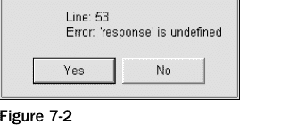

164

## Ajax.NET Professional 库

| 属性 | 默认值 | 描述 |
| --- | --- | --- |
| `response.value` | null | 该值填充了从服务器返回的内容。 |
| `response.error` | null | 错误值要么是 null，要么是从服务器返回的错误字符串。通常你希望它是 null，尽管正如你将看到的，它可以是一种向自己提供客户端信息的不错方式。 |
| `response.request` | null | 这是用于向服务器发出请求的原始 `request` 对象的副本。它包含两个非常有用的属性：`method` 和 `args`。`method` 是被调用的原始方法名，`args` 是一个描述传递给该方法的所有值的对象。 |
| `response.extend` | null | `extend` 属性是一个添加到所有 Ajax.NET Pro 对象的 JavaScript 原型。它在库内部用于绑定事件，通常不使用。 |
| `response.context` | null | `context` 是可选的，可以在某些情况下用于将数据从一个点传递到另一个点。你将在本章后面的使用中看到它，那时更容易理解。 |

## 在客户端执行你的 Ajax

基于你在第 2 章学到的概念，你将用非常相似的 HTML 开始这个示例，如下面的代码所示。HTML 预加载了左侧和右侧的图像。这仅仅是为了在从服务器获得响应后使切换更快。如果你没有在隐藏的 `<div>` 标签中预加载这些图像，最终用户将不得不等待从服务器下载新图像。你还有一个 `ChangeMe()` JavaScript 函数，它负责实际更改图像的工作。那么，这个 `ChangeMe()` 函数是如何触发的呢？

```html
客户端—第7章/ImageSwitcher.aspx
<script type="text/Javascript" language="Javascript">
function ChangeMe(target, leftName, rightName) {
    var response = Chapter7_ImageSwitcher.ChangeImage(target.src, leftName, rightName);
    target.src = response.value;
}
</script>

<div style="DISPLAY:none;VISIBILITY:hidden">
    <!-- 预加载图像 -->
    
    
</div>

```

## 什么是语言代理？

术语 *代理* 用于一种语言表示一个对象，该对象具有与另一种语言中的对象相同的所有属性（有时还包括方法调用）。因此，一个 JavaScript 代理对象将模拟 .NET 对象的所有属性。这意味着你可以轻松地在 JavaScript 中使用与在 .NET 中相同的语法。代理对象的工作是在 JavaScript 和 .NET 之间来回通信。代理类使你的编程生活更轻松，因为你无需担心两种语言或系统之间的通信。

可以将代理类想象成一个语言翻译器，让你能够轻松地使用母语进行交流，而代理则为你进行所有的翻译工作。

注意，`` 标签有一个 JavaScript `onclick` 属性，指向你的 `ChangeMe()` 函数。你传入三个值：首先，由关键字 `this` 表示的 `` 标签，然后是左右图像名称 `ArrowLeft` 和 `ArrowRight`。

函数的第一行使用了 `Class.Method` 命名约定调用 Ajax.NET Pro 库。记住，你注册了你的 `page` 类，名为 `Chapter7_ImageSwitcher`，然后你用 `AjaxPro.AjaxMethod()` 属性标记了你的服务器端 `ChangeImage()` 方法。Ajax.NET Pro 库现在为你创建了一个 JavaScript 对象，这是一个用于与你的 ASP.NET 应用程序通信的代理对象。


这个代理对象使你能够简单地调用`Chapter7_ImageSwitcher.ChangeImage()`方法，看起来就像在 JavaScript 中直接执行你的服务器端代码。实际上发生的是，代理对象使用与你的服务器端代码相同的签名和命名约定，使得从 JavaScript 调用服务器代码时看起来是透明的。

当最终用户点击图像时，`ChangeMe()`函数被调用。你要做的第一件事是构建一个`response`变量，用于保存`Chapter7_ImageSwitcher.ChangeImage()`方法的返回值。注意，你也向代理传递了适当的参数给你的服务器端方法。最后，你在`response.value`属性中从服务器获得一个值，这个值成为图像的新源值，即要使用的新图像 URL。

这与你在第 2 章看到的客户端效果相同，当用户点击图像时，图像从左向右切换。然而，这次值来自服务器。尽管这个示例非常基础，但它非常重要，因为你到目前为止真正构建的是能够在客户端浏览器和你的 ASP.NET 服务器之间使用 Ajax.NET Pro，从服务器返回一个字符串，然后更新客户端页面。

想象一下可能性。你可以返回整个数据网格（datagrid）的 HTML 并更新一个`div`标签的`innerHTML`。通过一点动态 HTML（DHTML），你可以更改`div`或`span`标签的样式，并使用你目前所学的内容创建一些非常强大的功能。

## 深入探究`response.value`

在第一个示例中，你在`response.value`属性中接收到了一个字符串。这是用于设置图像源从而将图像从右切换至左的`LeftArrow`或`RightArrow`图像的文件名字符串。字符串非常有用，且是反转字符串的常见后端。如果你将整个控件（例如数据网格）渲染为 HTML，并使用该 HTML 作为字符串值，会怎样呢？借助这种逻辑，在客户端神奇地加载数据网格就变得相当容易。以下代码用于将控件渲染为 HTML。下一个示例构建了一个数据网格，你可以轻松地将这些示例适配到任何控件以获取其渲染的 HTML。其之所以有效，是因为所有控件都具有一个`RenderControl()`方法。

### `RenderControlToHtml()`——从控件中获取 HTML 字符串

```csharp
public string RenderControlToHtml(Control ControlToRender)
{
    System.Text.StringBuilder sb = new System.Text.StringBuilder();
    System.IO.StringWriter stWriter = new System.IO.StringWriter(sb);
    System.Web.UI.HtmlTextWriter htmlWriter = new
System.Web.UI.HtmlTextWriter(stWriter);
    ControlToRender.RenderControl(htmlWriter);
    return sb.ToString ();
}
```

### 渲染数据网格

```csharp
[AjaxPro.AjaxMethod()]
public string CreateNewDataGrid()
{
    DataGrid myDataGrid = new DataGrid();
    myDataGrid.ShowHeader = false;
    myDataGrid.DataSource = BuildMultiplicationTable();
    myDataGrid.DataBind();
    return RenderControlToHtml(myDataGrid);
}

public DataTable BuildMultiplicationTable()
{
    //构建一个包含11个单元格的DataTable
    DataTable myTable = new DataTable();
    for (int i = 1; i < 11; i++)
        myTable.Columns.Add(new DataColumn(i.ToString()));

    //用10x10乘法表填充10行
    for (int i = 1; i < 11; i++)
    {
        DataRow row = myTable.NewRow();
        for (int j = 1; j < 11; j++)
        {
            row[j-1] = i*j;
        }
        myTable.Rows.Add(row);
    }

    return myTable;
}
```

使用字符串能让你在项目中快速推进。毕竟，几乎任何事情都可以转换为字符串，但正如你在下一部分中将看到的，能够返回自定义对象也很好。Ajax.NET Pro 开箱即用地支持以下 .NET 类型。列表中的任何类型都可以从你的服务器端函数返回到客户端调用，无需额外的编程。

- 字符串
- 整数
- `Double`
- `Boolean`
- `DateTime`
- `DataSet`
- `DataTable`

列表中的所有类型都很容易理解，最后两项除外。在客户端的 JavaScript 中，你会如何使用`DataSet`？那`DataTable`呢？事实证明，你在客户端做的事情与在服务器上所做的几乎相同。你没有像服务器端那样的`DataBind()`操作，但你拥有一个`DataTable.Tables`数组，每个表都有一个`Rows`数组，最后，每一行都拥有与原始表列名一致的属性。

## 动手实践：从`DataTable`对象构建 HTML 表格

以下代码在服务器端获取一个`DataTable`，并在客户端绘制一个 HTML 表格。

```html
客户端代码 — 从DataSet构建HTML表格
<script type="text/javascript" language="javascript">
function BuildHtmlTable() {
    var response = Chapter7_BuildHtmlTable.BuildMultiplicationTable();
    if(response.value != null && capitalist response.value.Rows.length>0) {
        var datatable = response.value;
        var table = new Array();
        table[table.length] = '<table border=1>';
        for(var r=0; r<datatable.Rows.length; r++) {
            var row = datatable.Rows[r];
            table[table.length] = '<tr>';
            for(var c=0; c<datatable.Columns.length; c++) {
                table[table.length] = '<td valign=top>' + row[c+1] + '</td>';
            }
            table[table.length] = '</tr>';
        }
        table[table.length] = '</table>';
        document.getElementById("DynamicTable").innerHTML  = table.join('');
    }
}
function ClearHtmlTable() {
    document.getElementById("DynamicTable").innerHTML = '';
}
// -->
</script>
<form id="form1" runat="server">
```

```html
<p>第7章 :: 构建HTML表格。<br />
<a href="#" onclick="ClearHtmlTable()">清除HTML表格</a><br />
<a href="#" onclick="BuildHtmlTable()">构建HTML表格</a>
</p>
<div id="DynamicTable"></div>
</form>
```

### 服务器端代码——返回`DataTable`

```csharp
protected void Page_Load(object sender, EventArgs e)
{
    AjaxPro.Utility.RegisterTypeForAjax(typeof(Chapter7_BuildHtmlTable));
}

[AjaxPro.AjaxMethod()]
public DataTable BuildMultiplicationTable()
{
    //构建一个包含11个单元格的DataTable
    DataTable myTable = new DataTable();
    for (int i = 1; i < 11; i++)
        myTable.Columns.Add(new DataColumn(i.ToString()));

    //用10x10乘法表填充10行
    for (int i = 1; i < 11; i++)
    {
        DataRow row = myTable.NewRow();
        for (int j = 1; j < 11; j++)
        {
            row[j - 1] = i * j;
        }
        myTable.Rows.Add(row);
    }
    return myTable;
}
```

请注意，客户端代码块中的最后一行是一个名为`DynamicTable`的空`<div>`标签。当点击超链接“构建HTML表格”时，JavaScript 函数`BuildHtmlTable()`将被调用。在服务器端代码中，页面类名为`Chapter7_BuildHtmlTable`，返回`DataTable`的服务器端方法是`BuildMultiplicationTable()`。因此，在 JavaScript 函数`BuildHtmlTable()`内部，你可以调用`Chapter7_BuildHtmlTable.BuildMultiplicationTable()`。然后在`response.value`中，你将得到一个非常类似于服务器端`DataTable`的对象，它具有`Rows`和`Columns`属性。与`DataTable`对象一样，Ajax.NET Pro 也有一个`DataSet`对象，可以同样轻松地使用。

## 返回自定义对象

那么，自定义对象呢？假设你有一个`Person`类，这个人具有名字、街道、城市、州、邮编和电话号码等属性。你能从函数中返回这个人并让它神奇地为你转换吗？幸运的是，答案是肯定的——但有一个条件。你要返回的自定义类需要被注册，就像页面类需要被注册一样（你将在第8章中看到为什么会这样），并且自定义类需要用`Serializable()`属性标记。本节中的代码块展示了自定义`Person`类的部分代码，仅显示了名字和街道属性。要使用这个类作为返回类型，它需要被注册，代理类将由 Ajax.NET Pro 库自动处理。

```csharp
Ajax.Utility.RegisterTypeForAjax(typeof(Person));
```

唯一的缺点是这个自动转换是单向的。它允许你将 .NET 对象序列化为 JavaScript 对象表示法（JSON，如第5章所述），以便在 JavaScript 中使用，但它不允许你将`Person`类作为输入值从 JavaScript 传回 .NET。可以将这个`Person`对象发送回 .NET（也许作为参数），但这不是自动的。你将在第8章中了解如何从 JavaScript 将自定义类传回 .NET。

```csharp
使用[Serializable()]属性标记的简单Person类
[Serializable()]
public class Person
{
    public Person()
    { }

    private string _Name;
    public string Name    
    {
        get { return _Name; }
        set { _Name = value; }
    }

    private string _Street;
    public string Street
    {
        get { return _Street; }
        set { _Street = value; }
    }
}
```

## 更高级的回调和上下文

前面使用 Ajax.NET Pro 库的方法很好，但值得在此迈出下一步。你是否注意到，请求响应的方式是在你的代码中内联进行的？如果你的方法执行需要 10 秒才能执行并返回响应给客户端，那会怎样？这意味着你的浏览器将被锁定并等待响应返回，在等待期间其他任何事情都无法发生。正如你在本书前面所遇到的，这被称为*同步*执行。有一个非常简单的方法可以使这段代码*异步*执行，也就是说，请求会被发出，但你不会等待响应。相反，当响应返回时，你会告诉 Ajax.NET Pro 库该如何处理它。这是通过回调例程来实现的。*回调*只是一个可以在其中传入响应的其他函数。

看看这个 JavaScript`ChangeMe()`函数的微小差异，并与本章 earlier “在客户端执行你的 Ajax”部分中的那个进行比较。

```javascript
function ChangeMe(target, onName, offName) {
    Chapter7_ImageSwitcherCallback.ChangeImage
        (target.src, onName, offName, ChangeMe_Callback,target);
}
```

注意你传递给`ImageSwitcher.ChangeImage()`方法的参数数量。现在有五个参数，而之前只有三个。服务器端的方法只接受三个参数，那么这怎么能工作呢？请记住，这实际上是由 Ajax.NET Pro 库为你创建的 JavaScript 代理对象。每个创建的代理对象都带有几个重载。*重载*是使用相同方法名但具有独特参数集（称为*签名*）的方法变体。签名定义为方法所接受的参数的顺序和类型。代理对象`Chapter7_ImageSwitcher.ChangeMe()`具有以下签名创建：

- `Chapter7_ImageSwitcher.ChangeImage(string, string, string)`
- `Chapter7_ImageSwitcher.ChangeImage(string, string, string, callback)`
- `Chapter7_ImageSwitcher.ChangeImage(string, string, string, callback, context)`

注意最后两个参数`callback`和`context`。`callback`是你希望将响应发送到的方法名称。在本例中，如果回调方法中唯一可用的只是来自服务器的响应，你就会遇到问题。你会遇到问题，因为你需要设置图像标签的值，而你不知道那个图像标签是什么。因此，Ajax.NET Pro 有一个名为`context`的最后一个参数。你作为`context`参数传递的任何对象将在响应对象中作为其`context`属性返回。记住，响应对象有五个属性：`value`、`error`、`request`、`extend`和`context`。现在你可以看到`context`哪里有帮助了。`context`基本上从你的执行点（你请求调用服务器方法的地方）免费传递到你的回调方法中。

通常将回调函数命名为与原函数名相同，并在其后附加`_Callback`。看看这个回调函数。

```javascript
function ChangeMe_Callback(response) {
    if(response.error != null)
        alert(response.error.name + ' :: ' + response.error.description);
    else
        response.context.src = response.value;
}
```

注意回调方法只接受一个参数。通常将这个参数称为`response`或`res`。`response`对象的`context`参数被填充了图像标签，因为你在执行这一行时将该标签作为`context`发送进来。

```javascript
Chapter7_ImageSwitcherCallback.ChangeImage
    (target.src, onName, offName, ChangeMe_Callback,target);
```

在 JavaScript 中，你可以像引用图像一样引用`response.context`。你将其源设置为从服务器返回的值。要获取从服务器返回的值，请在`response.value`属性中查找。现在整个 HTML + JavaScript 应该如下所示。

## 客户端——Chapter7/ImageSwitcherCallback.aspx


```html
<script type="text/Javascript" language="Javascript">
<!--
function ChangeMe(target, leftName, rightName) {
    alert(response.value);
    Chapter7_ImageSwitcherCallback.ChangeImage(target.src, leftName,
rightName,ChangeMe_Callback,target);
}
function ChangeMe_Callback(response) {
    if(response.error != null)
        alert(response.error.name + ' :: ' + response.error.description);
    else
        response.context.src = response.value;
}
//-->
</script>

<div style="DISPLAY:none;VISIBILITY:hidden">
    <!-- 预加载图像 -->
    
    
</div>

```

在前面的代码中，你正在以异步方式执行图像更改器。这意味着你不必等待服务器返回响应。代码可以继续执行并执行其他功能。当服务器确实返回响应时，Ajax.NET Pro 库将接收该响应并执行回调方法，将响应作为其对象发送进来。这是一种更流畅的编程风格，你将享受到代码不会因服务器上长时间运行的过程而被瓶颈化的好处。

## Ajax.NET Pro 请求事件——保持用户更新

`AjaxPro.Request` 对象有几个占位符事件，你可以针对它们设置 JavaScript 函数。这些事件占位符是 `onLoading`、`onError`、`onTimeout` 和 `onStateChanged`。我称它们为占位符，因为除非你为它们分配函数，否则它们为空。

在本节中，我们将研究 `onLoading` 事件以及如何用它来让用户知道后台正在发生某些事情。例如，用户可能刚刚点击了一个加载大量数据并需要 5 秒执行时间的按钮。在这 5 秒内（感觉像永远一样），如果没有任何更新让用户知道正在发生某些事情，他们可能会感到焦躁并再次点击按钮，一次又一次——这只会进一步延误问题。

以下示例使用了通过 `Utility.RegisterTypeForAjax` 调用（可能在你的页面加载事件中）注册的类对象的 `onLoading` 事件。在你注册的类上所有调用 `AjaxMethods` 之前和之后，Ajax.NET Pro 库都会调用此 `onLoading` 事件。

此示例的代码隐藏页面有一个名为 `WaitXSeconds` 的简单方法。它的工作只是等待给定的秒数，然后返回 true。在真实应用程序中，这可能是你的数据库调用或其他可能需要一段时间执行的常规操作。

在此代码工作时，你可以用一点 DHTML 让用户知道代码很忙。当文本按钮被点击时，窗口左上角将显示一个红色的“Loading ...”框。当方法完成时，“Loading ...”框将隐藏。

## `Chapter7_Onloading.aspx.cs` 示例

```csharp
protected void Page_Load(object sender, EventArgs e)
{
    Utility.RegisterTypeForAjax(typeof(Chapter7_OnLoading));
}
[AjaxPro.AjaxMethod()]
public string WaitXSeconds(int SecondsToWait)
{
    System.Threading.Thread.Sleep(SecondsToWait*1000);
    return string.Format("{0} seconds have passed",SecondsToWait.ToString());
}
```

此示例中的 `onLoading` 事件将被分配给你创建的函数。`onLoading` 函数接受一个参数，即 `true` 或 `false`，并让你知道 `onLoading` 函数是在请求开始时（`true`）还是请求结束时（`false`）被调用。

你使用此参数来设置名为 `"loading"` 的绝对定位 div 标签的 `visible` 属性。当它为 `true` 时，你将其可见性设置为 `visible`，当它为 `false`（结束）时，你将其值设置为 `hidden`。

## `Chapter7_Onloading.aspx` 示例

```html
<form id="form1" runat="server">
<div id="loading"
    style="visibility:hidden;position:absolute;top:0px;left:0px;background-
    color:Red;color:White;">Loading...</div>
<div>
    <A href="#" onclick="javascript:ShowLoading(4);void(0);">点击这里</A>
    运行一个 4 秒的过程，并在窗口左上角用 "Loading..." 标签告知用户。
</div>
</form>
<script language="javascript" type="text/javascript">
    Chapter7_OnLoading.onLoading = function(currentVis) {
        var loadingDiv = document.getElementById("loading");
        if(loadingDiv != null) {
            loadingDiv.style.visibility = currentVis ? "visible" : "hidden";
        }
    }
    function ShowLoading(seconds) {
        Chapter7_OnLoading.WaitXSeconds(seconds,WaitXSeconds_Callback);
    }
    function WaitXSeconds_Callback(response) {
        alert(response.value);
    }
</script>
```

`onLoading` 事件工作方式的一个不错特性是它与类对象绑定。因此，如果你的注册类（在本例中为 `Page` 类）有许多 `AjaxMethods`，`onLoading` 事件将在每个被调用方法的开始和结束时触发。并且记住，你只需编程一次！

## 错误，错误，错误。它们会发生，你捕获它们

到目前为止，你已经涵盖了响应的 `value`、`request` 和 `context` 属性。最后，也许是最重要的，是 `error` 属性。

当 Ajax.NET Pro 处理你的请求时，如果一切按计划进行且没有错误发生，此属性将为空值。如果在 Ajax.NET 处理期间抛出任何未处理的错误，会返回该错误的字符串值。

`response.error` 对象有三个属性：`name`、`description` 和 `number`。

## 检查空值

如果 `error` 属性为 null，则表示没有错误，至少没有在响应对象中发送回错误。如果 `value` 属性为 null，则表示服务器没有返回任何值；如果 `context` 为 null，则表示最初没有设置上下文。

但无论它们意味着什么，通常你在代码中会用一个简单的 `if()` 语句来处理这些 null 值，正如本章前面代码中演示的这样：

```javascript
if(response.error != null)
```

这行代码让你知道是否返回了错误。在示例中，你编写的代码是：如果有错误，则向用户显示错误信息，并且不设置图像源标签的值。但你可以选择以任何你想要的方式处理错误。

| 属性 | 说明 |
| --- | --- |
| `response.error.name` | 错误的名称，通常是所抛出错误的命名空间。 |
| `response.error.description` | 这相当于 .NET Framework 中的 `Exception.Message`。 |
| `response.error.number` | 如果抛出的异常有错误编号，则在此处填充。 |

请注意，上一节中的最后一个代码块包含检查 `response.error` 属性是否为 null 的代码。如果发现它不为 null，则你知道有错误，并向用户显示错误消息。这在你的实际应用程序中可能不是你想要做的。你可能会检查错误编号，然后根据导致错误的原因适当地处理错误。

## 使用 Ajax.NET Pro 库——深入探究

综上所述，准备你的应用程序以使用 Ajax.NET Pro 库需要以下步骤：

1. 首先，你必须将 ASP.NET 应用程序设置为支持 Ajax.NET Pro。这是通过引用 `AjaxPro.dll` 程序集来完成的。
2. 其次，你必须修改 `Web.Config` 文件，注册 `AjaxPro.AjaxHandlerFactory` 来处理所有 `AjaxPro/*.ashx` 请求。
3. 现在你的应用程序已支持 Ajax.NET Pro，你可以开始在页面中构建一些 Ajax 功能了。在页面级别，使用 `AjaxPro.Utility.RegisterTypeForAjax()` 方法注册你的 `page` 类。
4. 然后用 `AjaxPro.AjaxMethod()` 特性修饰你的方法。
5. 最后，Ajax.NET Pro 库会为你创建一个遵循 `ClassName.MethodName()` 命名约定的 JavaScript 代理对象。只需添加一些客户端 UI 和 JavaScript 来激活你的服务器响应，你的应用程序就在 Ajax 燃料驱动下运行了。

你现在还知道如何捕获错误、检查这些错误以及检查空值。

然而，虽然你现在是实现这一切的步骤，但你可能对幕后真正发生的事情有一些疑问，以使这些功能正常工作。接下来的几节将回答一些你可能有的关于所有这些功能实际如何工作的常见问题。

## 代理 JavaScript 何时创建？

还记得准备你的页面以启用 Ajax.NET Pro 库吗？这涉及两个步骤。

第一步是用如下代码注册你的 `page` 类：

```csharp
AjaxPro.Utility.RegisterTypeForAjax(typeof(Chapter7_ImageSwitcher));
```

第二步是用 `AjaxPro.AjaxMethod()` 特性标记你的公共方法：

```csharp
[AjaxPro.AjaxMethod()]
```

如果你在 `RegisterTypeForAjax` 调用上设置断点并逐步执行代码，你会发现库的这一部分在做一些非常简单的事情。它正在创建 JavaScript 标签，这些标签将被插入到页面顶部，其 source 值指向 `AjaxPro/*.ashx` 页面处理程序。

当你设置 `Web.Config` 文件时，你注册了页面处理程序，以便这些类型的调用由 Ajax.NET Pro 库处理。所以，`RegisterTypeForAjax` 方法的全部工作就是向页面写入 `<script>` 标签。

如果你在浏览器中查看 ASPX 页面的源代码，请在页面顶部查找与此格式匹配的脚本。

```html
<script type="text/javascript" src="/ajaxpro/prototype.ashx"></script>

<script type="text/javascript" src="/ajaxpro/core.ashx"></script>

<script type="text/javascript" src="/ajaxpro/converter.ashx"></script>

<script type="text/javascript" src="/ajaxpro/Chapter7_BuildHtmlTable,App_Web_it-kzny.ashx"></script>
```

前三个标签指向 `/AjaxPro/common.ashx`、`core.ashx` 和 `converter.ashx` 文件。这些是一些 JavaScript 文件，包含 Ajax.NET Pro 的一些通用辅助功能（你将在下一章中查看这些）。

# 第 7 章

第四个脚本源有一个更有趣的名称。`RegisterTypeForAjax` 创建了这个脚本源，格式为：

```text
ClassName,AssemblyName.ashx
```

但这个文件并不存在——它是如何被处理的呢？

还记得 `Web.Config` 中 `/AjaxPro/*.ashx` 到 Ajax 页面处理程序的映射吗？正因为如此，任何在 `/AjaxPro/` 目录中且以 `.ashx` 结尾的请求文件路径都将由 Ajax.NET Pro 库处理。

这个 URL 被解析，从找到的程序集和类名中，库能够创建 JavaScript 代理对象。

它怎么知道要创建什么代理对象呢？它通过使用 .NET Framework 中称为反射的功能来实现。反射允许你使用代码来检查其他代码。

因此，Ajax.NET Pro 库创建一个页面类实例，在本例中是一个 `Chapter7_ImageSwitcher.aspx` 页面，然后检查该页面类中任何标记有 `AjaxPro.AjaxMethod()` 特性的方法。找到的任何方法都会自动为其创建 JavaScript 代理对象。

这些代理对象是按需生成的，并作为 `AjaxPro/Chapter7_ImageSwitcher, App_Web_it-kzny.ashx` 请求的源代码写入。

为什么这个程序集名称 `App_Web_it-kzny` 这么奇怪？这是页面类 `Chapter7_ImageSwitcher` 所在的框架生成程序集。.NET 框架使用这些唯一名称来保留页面影子编译时的不同版本，所以对框架来说，在程序集名称中添加一组随机字符是很有帮助的。

这些唯一的程序集名称由框架生成，而 Ajax.NET Pro 库足够智能，能为你解决这个问题。所以幸运的是，你不必知道或关心页面类在哪里。`RegisterTypeForAjax` 调用会为你完成这一切。

## JavaScript 做了什么？

当浏览器请求 URL 时，服务器（在本例中是你的 ASP.NET 应用程序服务器）会返回一堆 HTML 给它。你可以通过浏览器的查看源代码轻松查看这些 HTML。

一旦收到这些 HTML，就必须对其进行解析。你看不到原始 HTML（除非你进行查看源代码），因为浏览器实际上会将这些 HTML 渲染成网页。

当具有 source 属性的 `<script>` 标签加载时，浏览器会向服务器发起另一个请求来获取该数据。重要的是要意识到这些是作为单独请求加载的。

图像也是同样的处理方式；即它们是在单独的同步请求中一个接一个加载的。

## 代理 JavaScript 触发后服务器上会发生什么？

当服务器上调用 JavaScript 源时，基于 URL，你知道这些脚本文件将由 Ajax.NET Pro 库处理。

创建的 JavaScript 会创建代理对象，使你能够调用 `PageClassName.MethodName()` JavaScript 函数调用。这些被称为代理对象，因为它们实际上不做任何工作；它们只是通过 Ajax 协议将调用代理到服务器。

## 代码后置中的方法是如何实际执行的，页面又是如何实际创建的？

你将在下一章中详细了解这是如何完成的。本质上，这是进行反射的地方，页面类在代码中创建，然后执行与从 JavaScript 调用中发送的参数一起的方法。

## 真正返回给客户端的是什么

在前面的示例中，你读到过发送到客户端的字符串。还记得 `response.value` 吗？`response.value` 可以保存任何值或对象，甚至保持为 null。

当返回简单类型（如 `String` 或 `Integer`）时，存储的是实际值。当返回类似 `DataSet` 的东西时，由于 JavaScript 中不存在 `DataSet` 对象，`DataSet` 被转换为 JavaScript 对象表示法（JSON）对象（JSON 在第 5 章中讨论），它包含与 `DataSet` 大部分相同的数据。

但要明白，你处理的不是完整的 ADO.NET `DataSet`，而是一个仅仅填充了与你期望的 `DataSet` 中数据相匹配的数据的 JSON 对象。

本章前面当你通过返回 `DataTable` 的 Ajax.NET Pro 调用动态创建 HTML 表时，已经展示了这一点。

一旦你知道 JSON 对象可以保存在 `response.value` 属性中，需要回答的问题是：“我可以返回自己的自定义类型吗？”当然可以。

事实上，如果你的自定义类型是简单类型，你只需用 `[Serializable()]` 特性标记你的类，Ajax.NET Pro 库就会完成其余工作。在第 8 章中查看扩展 Ajax.NET 框架时，你会更深入地了解这个功能。

## 小结

在本章中：

- 你了解到 Ajax.NET Pro 库的简介。
- 你能够从 www.BeginningAjax.com 下载代码并引用 Ajax.NET Pro 库。
- 项目设置完成后，你能够创建客户端/服务器对话，并以 Ajax 风格用服务器内容更新你的网页。


在第 8 章中，你会深入探究 Ajax.NET 库的幕后，了解更多关于这个“魔法”是如何发生的。你将逐步了解库中附带的代码，展示何时以及为什么会发生什么事。记住，包装器库的理念是让生活更轻松，希望本章中代码的简单性已经展示了这一点。第 8 章会稍微高级一些。如果你有兴趣用自定义对象扩展库，那么第 8 章将是你不错的阅读选择。

# Ajax.NET Pro 库的结构解析

学习一门特定技术有多个层次。有时，仅仅知道一项技术能工作以及如何使用它就足够了。你只需知道如何使用该技术来获取所需的功能，至于它如何工作其实并不重要。让我们以微软 Excel 为例。你可能已经非常擅长使用 Excel 了。你可以为单元格设置颜色编码、创建公式、打印工作表，甚至可能完成数百项其他相对复杂的任务。你只是通过使用这项技术就完成了这些。你是否真正理解 Excel 内部发生了什么才使得所有这些功能得以实现？一个更好的问题可能是——你真的关心 Excel“引擎盖下”的工作原理吗？我猜你可能并不关心。在第 7 章中，你已经了解了如何使用 Ajax.NET Pro 库，这让你快速掌握了该库的使用方法。

既然你已经能熟练使用该库，现在可以来看看这“魔法”是如何发生的。理解某样东西“能工作”和理解其“能工作”的基本原理是有区别的。在本章中，你将打开“引擎盖”，查看 Ajax.NET Pro 库的内部，以更好地理解它为何如此运作。而且与 Excel 不同，你会希望了解它的工作原理，因为这正是使你能够轻松扩展该库或根据自己的需求进行修改的关键。

本章将对库的代码进行逐行讲解。你将以第 7 章中采取的步骤作为本章的指导。也就是说，你将重新实现第 7 章中的示例，但这一次，你将深入库内部，查看在何时以及为何发生了什么。

本章将涵盖以下主题：

- 在你的机器上设置并运行 Ajax.NET Pro C# 代码库
- Ajax.NET Pro 的 Web.Config 配置及其作用
- 注册页面类
- `AjaxPro.AjaxMethod()` 特性的作用
- JavaScript 调用如何往返于服务器
- Ajax.NET Pro 转换器

当你理解了这些示例背后的机制，你将为扩展 Ajax.NET Pro 库并在自己的应用程序中使用它打下坚实的基础。

## 获取 Ajax.NET Pro 代码

在第 7 章中，你有两种选择来准备你的应用程序以使用 Ajax.NET Pro 库。你可以下载 Ajax.NET Pro 代码库并将其作为项目进行编译，或者你可以选择下载 Ajax.NET Pro 程序集并简单地设置对它的引用。由于本章要进行代码讲解，虽然不是强制要求，但将代码本地化到你的机器上会更有帮助；因此，强烈建议这样做。如果你想获取代码，需要从 `http://BeginningAjax.com` 网站获取代码库。该库有两个版本，一个用于 ASP.NET 1.1，另一个用于 ASP.NET 2.0。

| ASP.NET 版本 | Ajax.NET 的下载地址 |
| :--- | :--- |
| ASP.NET 1.1 | `http://BeginningAjax.com/Downloads/ASP1-Ajax-6.4.16.1.zip` |
| ASP.NET 2.0 | `http://BeginningAjax.com/Downloads/ASP2-Ajax-6.4.16.1.zip` |

下载并解压适用于你正在使用的 ASP.NET 框架版本的 zip 文件。你将拥有本章所需的所有代码。该 zip 文件包含一个名为 `AjaxPro.csproj` 的 Visual Studio 项目文件。打开你一直使用的 Ajax 应用程序，并将此项目添加到你的解决方案中。

图 8-1 展示了一种将项目添加到已打开解决方案的简便方法。右键单击解决方案，选择“添加现有项目”。这将打开一个文件对话框，你可以将其指向 `Ajax.csproj` 文件。

还有另一种方法可以在你的解决方案中编译此代码。第一个示例假设你想向解决方案中添加一个新项目（参见图 8-2）。然而，如果你的解决方案中已经有一个项目，你想将此代码添加到该项目中，只需通过拖放操作将文件从文件系统放入你选择的项目中即可。如果你选择这种方式，需要注意几个文件的生成操作。默认情况下，当你将文件拖入项目时，文件的生成操作为“生成”。这对所有文件都适用，除了 `core.js` 和 `prototype.js`。这两个文件是嵌入式资源，需要将其默认生成操作从“生成”更改为“嵌入的资源”。要执行此操作，只需单击每个文件一次以选中它。如果属性窗口尚未显示，可以右键单击该文件并选择“属性”。图 8-3 显示了 `core.js` 的属性，其生成操作应设置为“嵌入的资源”。

*图 8-1*

*图 8-2*

*图 8-3*

## Ajax.NET Pro 的 Web.Config 配置有何作用？

当你准备应用程序以使用 Ajax.NET Pro 库时，第一步就是创建一个 Web.Config 条目来连接 Ajax.NET Pro HTTP 页面处理程序。

```xml
<system.web>
  <httpHandlers>
    <add verb="POST,GET" path="ajaxpro/*.ashx"
            type="AjaxPro.AjaxHandlerFactory,AjaxPro" />
  </httpHandlers>
</system.web>
```

此 Web.Config 修改告诉 ASP.NET，所有对 ajaxpro 目录中具有 `.ashx` 文件扩展名的请求都应由 Ajax.NET Pro 库处理。这允许你拥有一条页面请求，其中包含一个页面名称，而该名称在文件系统中并不存在。这是通过使用页面处理程序来完成的。当你创建一个 ASPX 页面时，这会自动完成。如果你的页面名为 `Default.aspx`，你可以请求 `Default.aspx`，ASP.NET 会返回该内容。

但是，如果你希望能够动态生成页面名称，并在请求期间解析这些页面名称，以使用这些新获取的值来提供内容并在你的应用程序中执行某些操作，会发生什么？你需要使用一个 HttpPageHandler，就像 Ajax.NET Pro 库所做的那样。如果你检查前面代码块第 3 行的 `<add />`，你会注意到一些属性。看看 `path` 属性。你可能还记得旧 DOS 时代的 `*` 是通配符。此路径不区分大小写，但通常以小写书写。正如你将在接下来的几节中看到的，Ajax.NET Pro 库将使用此路径结构创建请求。`type` 属性的值分为三个有用的部分。第一部分是命名空间，后跟类名，然后是可以在其中找到此类的程序集（不带 `.dll` 扩展名）。因此，前面示例中的 `type` 表示在 AjaxPro.dll 程序集的 AjaxPro 命名空间中查找 AjaxHandlerFactory。

掌握 HttpPageHandler 的概念超出了本书的范围，但我想稍微深入一点，用一个示例向你展示正在发生什么。还记得第 7 章中为你神奇创建的代理类吗？

> 注意，在本章中，一些代码块包含清单编号和行号以辅助参考。

### 清单 8-1：创建请求，匹配你的 PageHandler 路径

```html
<script type="text/javascript"
    src="/BeginningAjaxPro/ajaxpro/core.ashx"></script>
<script type="text/javascript"
    src="/BeginningAjaxPro/ajaxpro/Chapter7_OnLoading,
    App_Web_rjv9qbqt.ashx"></script>
```

这些是带有 `src` 属性的 JavaScript 标签，它们回调你的应用程序。BeginningAjaxPro 是应用程序名称，ajaxpro 是伪文件夹，页面名称是 Chapter7_OnLoading_App_Web_rjv9qbqt_ashx。你知道这个文件不存在；事实上，ajaxpro 文件夹在你的应用程序中甚至不存在。但是，由于你在 Web.Config 中设置了 HttpPageHandler，Ajax.NET Pro 库能够为你处理这些文件。当这些请求进来时，类名 Chapter7_OnLoading 会从自动命名的 App_Web_rjv9qbqt 程序集中加载。这是对页面处理程序的简要介绍；在本章后面，你将更深入地了解它实际如何工作，但现在重要的是概念。

## 注册页面类时会发生什么？

一旦你的应用程序设置为与 Ajax.NET Pro 库一起工作，并且你已经进行了 Web.Config 修改，你就可以开始使用该库了。当你从 ASP.NET 提供一个包含你希望可以访问的代码后台方法的页面时，该库需要两个步骤。首先，注册页面类，其次，用 `AjaxPro.AjaxMethod()` 特性标记该方法。这在第 7 章中已经演示过多次。让我们看看当你注册页面类时会发生什么。

```csharp
protected void Page_Load(object sender, EventArgs e)
{
    AjaxPro.Utility.RegisterTypeForAjax(typeof(Chapter7_Onloading));
}
```

这里的页面类名是 `Chapter7_OnLoading`。你会注意到你正在将一个类型作为参数发送给 `AjaxPro.Utility.RegisterTypeForAjax()` 方法。使用 `typeof()` 方法，你可以获取类的类型（在本例中是你正在使用的页面）并将其作为参数发送。那么，让我们来看看 `AjaxPro.Utility.RegisterTypeForAjax()` 方法。清单 8-2 是为 `RegisterTypeForAjax()` 方法运行的代码。此方法有两项职责。首先，确保 Common.ashx 已经渲染到页面上，其次，为正在注册的类型在页面上渲染正确的脚本标签。这就是清单 8-1 中渲染的 HTML 代码。

# 第 8 章

### 清单 8-2：`/Ajax/Utility.cs` 中的 `RegisterTypeForAjax` 定义

```csharp
public static void RegisterTypeForAjax(Type type)
{
    System.Web.UI.Page page =
        (System.Web.UI.Page)System.Web.HttpContext.Current.Handler;
    RegisterTypeForAjax(type, page);
}

public static void RegisterTypeForAjax(Type type, System.Web.UI.Page page)
{
    RegisterCommonAjax(page);
    string path = type.FullName + "," + type.Assembly.FullName.Substring(0,
        type.Assembly.FullName.IndexOf(","));
    if(Utility.Settings.UseAssemblyQualifiedName) path =
        type.AssemblyQualifiedName;

    if(Utility.Settings != null &&
        Utility.Settings.UrlNamespaceMappings.ContainsValue(path))
    {
        foreach(string key in Utility.Settings.UrlNamespaceMappings.Keys)
        {
            if(Utility.Settings.UrlNamespaceMappings[key].ToString() == path)
            {
                path = key;
                break;
            }
        }
    }

    RegisterClientScriptBlock(page, "AjaxType." + type.FullName,
        "<script type=\"text/javascript\" src=\"" +
        System.Web.HttpContext.Current.Request.ApplicationPath +
        (System.Web.HttpContext.Current.Request.ApplicationPath
        .EndsWith("/") ? "" : "/") + Utility.HandlerPath + "/" +
        GetSessionUri() + path + Utility.HandlerExtension + "\"></script>");
}
```

`RegisterTypeForAjax()` 方法中首先发生的事情是在第 09 行调用了 `Utility.RegisterCommonAjax()` 方法。`RegisterCommonAjax()` 方法负责向页面添加对 `prototype`、`core` 和 `converter` 文件的脚本引用。此方法确保每个页面只注册这些文件一次，即使你注册了多个类型。稍后检查 `Settings` 对象时，你将看到这是如何实现的。

此时，你知道 `prototype`、`core` 和 `converter` 脚本已经注册完毕，可以继续进行并创建你自己类型的引用了。第 10 行创建了一个字符串，由类型的完全限定名和类型所在的程序集组成。这产生了在清单 8-1 第 2 行中找到的 `/Chapter7_OnLoading/App_Web_rjv9qbqt`。该值会与一个名为 `Utility.Settings.UrlNamespaceMappings` 的 `HashTable` 进行比较。如果找到该值，第 20 行调用 `break`，然后方法将类型名称替换为映射名称。你稍后将查看这个 `UrlNameSpaceMappings`。如果未找到该值，那么你知道只需使用类型名称作为脚本源。

184

第 25 行创建了实际渲染在页面上的 JavaScript 标签。这就是清单 8-1 中的第 2 行条目。此外，第 25 行使用了 `RegisterClientScriptBlock` 方法将此 JavaScript 调用注入到正在呈现的页面中。

清单 8-2 和 8-3 都引用了 `Utility.Settings` 类。此类填充了几个具有默认值的属性。

### 清单 8-3：`/Ajax/Utility.cs` 中的 `RegisterCommonAjax`


```csharp
internal static void RegisterCommonAjax(System.Web.UI.Page page)
{
    if(page == null)
        return;

    // If there is a configuration for this fileName in
    // web.config AjaxPro section scriptReplacements we will
    // redirect to this file.

    string rootFolder = System.Web.HttpContext.Current.Request.
        ApplicationPath + (System.Web.HttpContext.Current.
        Request.ApplicationPath.EndsWith("/") ? "" : "/");

    string prototypeJs = rootFolder + Utility.HandlerPath +
        "/prototype" + Utility.HandlerExtension;
    string coreJs = rootFolder + Utility.HandlerPath + "/core" +
        Utility.HandlerExtension;
    string convertersJs = rootFolder + Utility.HandlerPath +
        "/converter" + Utility.HandlerExtension;

    if(Utility.Settings != null)
    {
        if(Utility.Settings.ScriptReplacements.
            ContainsKey("prototype"))
        {
            prototypeJs = Utility.Settings.ScriptReplacements["prototype"];
            if(prototypeJs.Length > 0 && prototypeJs.StartsWith("~/"))
                prototypeJs = rootFolder + prototypeJs.Substring(2);
        }
        if(Utility.Settings.ScriptReplacements.ContainsKey("core"))
        {
            coreJs = Utility.Settings.ScriptReplacements["core"];
            if(coreJs.Length > 0 && coreJs.StartsWith("~/"))
                coreJs = rootFolder + coreJs.Substring(2);
        }
        if(Utility.Settings.ScriptReplacements.ContainsKey("converter"))
        {
            convertersJs = Utility.Settings.ScriptReplacements["converter"];
            if(convertersJs.Length > 0 && convertersJs.StartsWith("~/"))
                convertersJs = rootFolder + convertersJs.Substring(2);
        }
    }

    if(prototypeJs.Length > 0)
        RegisterClientScriptBlock(page, Constant.AjaxID + ".prototype",
            "<script type=\"text/javascript\" src=\"" +
            prototypeJs + "\"></script>");

    if(coreJs.Length > 0)
        RegisterClientScriptBlock(page, Constant.AjaxID + ".core",
            "<script type=\"text/javascript\" src=\"" +
            coreJs + "\"></script>");

    if(convertersJs.Length > 0)
        RegisterClientScriptBlock(page, Constant.AjaxID + ".converters",
            "<script type=\"text/javascript\" src=\"" +
            convertersJs + "\"></script>");

    if(Settings.TokenEnabled)
    {
        RegisterClientScriptBlock(page, Constant.AjaxID + ".token",
            "<script type=\"text/javascript\">AjaxPro.token = \"" +
            CurrentAjaxToken + "\";</script>");
    }
}
```

该库尽可能灵活，允许你通过额外的 `Web.Config` 条目来设置这些属性值。到目前为止，你在 `Web.Config` 中所做的只是配置了 Ajax Pro 页面处理器。该库定义了一个自定义节，你可以在 `Web.Config` 中使用。它由 `AjaxPro.AjaxSettingsSectionHandler` 处理，该处理器位于 `/Configuration/AjaxSettingsSectionHandler.cs` 文件中。

**动手实践：在你的 `Web.Config` 文件中添加自定义节**

幸运的是，ASP.NET 提供了框架调用，可以非常轻松地向 `Web.Config` 文件添加自定义节。清单8-4显示了一个 `Web.Config` 中的示例条目，用于覆盖 Ajax.NET Pro 库的几个默认属性和操作。清单8-5显示了库如何读取这些覆盖的值。

### 清单 8-4：`Web.Config` `configSections` 示例

```xml
<configuration>
...
01. <configSections>
02.   <sectionGroup name="ajaxNet">
03.     <section name="ajaxSettings"
              type="AjaxPro.AjaxSettingsSectionHandler, AjaxPro"
              requirePermission="false"
              restartOnExternalChanges="true" />
04.   </sectionGroup>
05. </configSections>
...
09. <ajaxNet>
10.   <ajaxSettings>
11.     <urlNameSpaceMappings>
12.       <add namespace="Namespace.ClassName,AssemblyName" path="MyPath" />
13.     </urlNameSpaceMappings>
14.     <jsonConverters>
15.       <!--  <remove type="Namespace.Class1,Assembly"/>
16.              <add type="Namespace.Class2,Assembly"/>
17.       -->
18.     </jsonConverters>
19.     <debug enabled="false" />
20.     <token enabled="false" sitePassword="password" />
21.     <!-- <scriptReplacements>
22.           <file name="core" path="~/scripts/debugcore.js" />
23.           <file name="prototype" path="~/scripts/debugprototype.js" />
24.           <file name="converter" path="~/scripts/debugconverter.js" />
25.         </scriptReplacements>
26.     -->
27.   </ajaxSettings>
28. </ajaxNet>
...
</configuration>
```

### 工作原理

- 清单8-4中的第一个自定义设置是第11行的 `urlNameSpaceMappings`。此设置允许你掩盖 JavaScript 调用，这样你就不会在应用程序中暴露类名和程序集名称。根据你所使用的 ASP.NET 和 Visual Studio 版本，你可能能够也可能不能使用此功能。如果你知道最终程序集的名称，那么你可以添加此掩盖。如果你使用的是动态编译，就像你在清单8-1中所做的那样，那么你不能使用此掩盖，因为你事先不知道程序集名称。掩盖你的类和程序集名称的好处在于，它消除了有人发现你应用程序内部知识的能力。

- 接下来是 `jsonConverters`。此节用于指示 Ajax.NET Pro 加载你的 JavaScript JSON 转换器。在注释部分，第15和16行，你可以看到加载这些转换器的格式。转换器可以使用标准的 `<remove />` 和 `<add />` 节点进行移除和添加。

调试也可以在此节中打开或关闭。如果调试已开启，并且 `Response.Error` 对象中返回了异常，那么该异常将包含比异常文本本身更多的信息，例如 `Stack`、`TargetSize` 和 `Source` 信息。

- Ajax.NET Pro 支持令牌概念，试图确认请求来自你最初提供内容的客户端。这是为了帮助消除对您网站的伪造。由于对服务器的回调是简单的 JavaScript 调用，因此可以从其他页面针对您的网站执行 JavaScript。如果令牌已启用并且设置了密码，那么在呈现的页面头部会放置一个安全令牌。

```html
<script type="text/javascript">AjaxPro.token =
    "f5274a7d77bc2a417b22efb3dfda9ba8";</script>
```

此令牌是一个哈希值，由多个关于用户的参数构成，包括IP地址、正在访问的站点、所使用的浏览器以及你提供的密码。这使得从另一台机器对你的站点尝试进行黑客攻击变得困难得多。

> 在所有情况下都应启用该令牌。这是一个非常不错的功能，它使得你的站点更难被入侵。

请回顾一下代码清单8-1，特别是第1行。脚本替换功能允许你使用非Ajax.NET Pro安装时附带的默认脚本。也许你添加了一些调试代码到静态文件中，希望在调试应用程序时使用它，但在部署应用程序时则不想使用。事先在 `Web.Config` 中预设这些替换脚本选项非常棒，因为你可以无需重新编译应用程序即可切换它。你会如何创建一个重写的核心、原型或转换器文件？难道你仍然不需要原始文件提供的所有基本功能吗？答案是：是的，你确实需要。但这并不意味着你不能在该脚本中添加自己的调试代码或其他代码。打开你的浏览器并指向你的Web应用程序 `/AjaxPro/core.ashx`。查看其源代码，你现在就拥有了 `core.ashx` JavaScript文件的一个副本。将其保存在你的应用程序中为 `/scripts/debugcore.js`。你可能想简单地在几个地方添加一个 `alert()` 方法来试试看，只是为了看看它是否能工作。现在，为了在你的应用程序中使用这个 `debugcore.js`，请将代码清单8-4的第22行添加到你的 `Web.Config` 中。将核心的路径设置为 `"~/scripts/debugcore.js"`。保存并运行你的应用程序，然后查看页面的源代码。注意，代码清单8-1中显示的 `Core.ashx` 列表已经更改为你自己的 `/scripts/debugcore.js` 文件。

代码清单8-5展示了 `Ajax/AjaxSettingsSectionHandler.cs` 的代码，正是这段代码使得所有这些配置设置成为可能。如果你对 `Web.Config` 配置节处理程序还不熟悉，这段代码非常值得一读。它相当简单易懂，可能会向你介绍一些新的XML技巧。

### 代码清单8-5：`/Ajax/AjaxSettingsSectionHandler.cs`


```csharp
namespace AjaxPro
{
  internal class AjaxSettingsSectionHandler :
                  IConfigurationSectionHandler
  {
    #region IConfigurationSectionHandler Members
    public object Create(object parent, object configContext,
                             System.Xml.XmlNode section)
    {
      AjaxSettings settings = new AjaxSettings();

      foreach(XmlNode n in section.ChildNodes)
      {
        if(n.Name == "coreScript")
        {
          if(n.InnerText != null && n.InnerText.Length > 0)
          {
            settings.ScriptReplacements.Add("core", n.InnerText);
          }
        }
        else if(n.Name == "scriptReplacements")
        {
            foreach(XmlNode file in n.SelectNodes("file"))
            {
                string name = "";
                string path = "";
                if(file.Attributes["name"] != null)
                {
                    name = file.Attributes["name"].InnerText;
                    if(file.Attributes["path"] != null) path = file.Attributes["path"].InnerText;
                    if(settings.ScriptReplacements.ContainsKey(name))
                        settings.ScriptReplacements[name] = path;
                    else
                        settings.ScriptReplacements.Add(name, path);
                }
            }
        }
        else if(n.Name == "urlNamespaceMappings")
        {
            settings.UseAssemblyQualifiedName = n.SelectSingleNode("@useAssemblyQualifiedName[.='true']") != null;
            XmlNode ns, url;
            foreach(XmlNode e in n.SelectNodes("add"))
            {
                ns = e.SelectSingleNode("@type");
                url = e.SelectSingleNode("@path");
                if(ns == null || ns.InnerText == "" || url == null || url.InnerText == "")
                    continue;
                if(settings.UrlNamespaceMappings.Contains(url.InnerText))
                    throw new Exception("Duplicate namespace mapping '" + url.InnerText + "'.");
                settings.UrlNamespaceMappings.Add(url.InnerText, ns.InnerText);
            }
        }
        else if(n.Name == "jsonConverters")
        {
            XmlNodeList jsonConverters = n.SelectNodes("add");
            foreach(XmlNode j in jsonConverters)
            {
                XmlNode t = j.SelectSingleNode("@type");
                if(t == null)
                    continue;
                Type type = Type.GetType(t.InnerText);
                if(type == null)
                {
                    // throw new ArgumentException("Could not find type " + t.InnerText + ".");
                    continue;
                }
                if (!typeof(IJavaScriptConverter).
                      IsAssignableFrom(type))
                {
                    // throw new ArgumentException("Type " +
                    //  t.InnerText + " does not inherit from
                    // JavaScriptObjectConverter.");
                    continue;
                }

                IJavaScriptConverter c =
                        (IJavaScriptConverter)Activator.CreateInstance(type);
                c.Initialize();
                settings.JavaScriptConverters.Add(c);
            }
        }
        else if(n.Name == "encryption")
        {
            string cryptType = n.SelectSingleNode("@cryptType") !=
                      null ? n.SelectSingleNode("@cryptType").InnerText
                      : null;
            string keyType = n.SelectSingleNode("@keyType") !=
                      null ? n.SelectSingleNode("@keyType").InnerText
                      : null;
            if(cryptType == null || keyType == null)
              continue;

            AjaxEncryption enc = new AjaxEncryption(cryptType, keyType);
            if(!enc.Init())
              throw new Exception("Ajax.NET Professional
                      encryption configuration failed.");
            settings.Encryption = enc;
        }
        else if(n.Name == "token")
        {
          settings.TokenEnabled = n.SelectSingleNode("@enabled") !=
                    null && n.SelectSingleNode("@enabled")
                    .InnerText == "true";
          settings.TokenSitePassword =
                    n.SelectSingleNode("@sitePassword") != null ?
                    n.SelectSingleNode("@sitePassword").InnerText :
                    settings.TokenSitePassword;
        }
        else if (n.Name == "debug")
        {
          if (n.SelectSingleNode("@enabled") != null &&
                  n.SelectSingleNode("@enabled").InnerText == "true")
              settings.DebugEnabled = true;
        }
        else if (n.Name == "oldStyle")
        {
          if (n.SelectSingleNode("objectExtendPrototype") != null)
          {
              if (!settings.OldStyle.Contains("objectExtendPrototype"))
                  settings.OldStyle.Add("objectExtendPrototype");
          }
        }
      }

      return settings;
    }
    #endregion
  }
}
```

## `Ajax.AjaxMethod()` 特性扮演什么角色？

就该库而言，此时你已经使用 `AjaxPro.RegisterTypeForAjax()` 方法注册了一个类型，该方法随后向浏览器发送了多个 `<script>` 标签。这些可以在代码清单 8-1 中看到。现在，是时候检查因脚本的 `src` 属性而生成的请求了。在示例中，已注册类型的源呈现为 `/BeginningAjax/ajaxpro/Chapter7_OnLoading,App_Web_rjv9qbqt.ashx`。请记住，`Chapter7_OnLoading` 是页面类名，而 `App_Web_rjv9qbqt` 是页面类编译到的动态程序集。

库中首先捕获此请求的代码是 `AjaxHandlerFactory`，它被指定用于处理所有指向 `/AjaxPro/*.ashx` 的传入请求。`AjaxHandlerFactory` 负责查看传入的 URL，创建一个新的 `AjaxPro.Request` 对象，然后将该请求交给一个 `AjaxProcessor` 来执行。所有这些都是相当标准的操作，并且每次请求都会发生。请记住，使用页面处理器的理念之一是处理动态生成的请求。库这样设计，是为了让你可以请求你想要为其创建 JavaScript 代理的类和程序集。一旦你提供了这些信息（类名和程序集），库就足够智能地能够推断出你想要的东西。

你问，它是如何足够智能的呢？嗯，坦白说，如果没有你已经提供的另一部分信息，它并不能做到。那部分信息就是你放置在想要向 AjaxPro.NET 库公开的公共方法签名之上的 `AjaxPro.AjaxMethod()` 特性。因此，我们将稍微快进一点，讨论库所做的事情。一个请求进来，库能够从 URL 中解析出类名和程序集名。如果你使用了 `urlNameSpaceMappings`，那么库仍然能够推断出类名和程序集；它只是需要先查看这个映射的 `HashTable`。一旦库获得了这两个关键信息，它就能使用一种名为反射的 .NET Framework 技术来检查或（正如其名称所恰当反映的那样）反思你所提供的类。反射确实是 .NET Framework 中一个命名恰当的部分。某些东西已经存在，在这个例子中是一个编译好的类，而你希望反思那个类。所以，反射在 .NET Framework 中拥有自己原生的强大支持，它允许你找到关于该类的所有你想知道的信息。库此时感兴趣的是在类中找到所有被标记为 `AjaxPro.AjaxMethod()` 特性的方法。一旦库找到了一个被标记了该特性的方法，它就知道需要构建一个 JavaScript 代理。事实上，对于类上所有被标记了该特性的方法，都会进行此操作。

# 第 8 章

通过 `AjaxPro.AjaxMethod()` 属性，代理类全部按顺序创建，并作为你的 JavaScript 调用的源代码发送回浏览器。

你马上就会看到代码，但现在一切都应该变得清晰了。为了加深理解，请考虑以下快速回顾。

1. 当你注册一个页面类时，注册工具负责编写 `<script>` 标签，其 `src` 将调用库并告诉库类名以及在哪里（在哪个程序集中）找到该类。
2. 一旦此调用进入库，它将使用反射加载该类并找到所有标记了 `AjaxPro.AjaxMethod()` 属性的方法。
3. 对于找到的每个方法，都会创建一个 JavaScript 代理类，最终结果作为 `<script>` 标签的 `src` 发送回浏览器。

现在，所有这些 JavaScript 都已加载到浏览器内存中，随时可以进行 JavaScript 调用（就像你在第 7 章所做的那样），这些调用使用创建的代理类与服务器通信。

## JavaScript 调用如何到达服务器并返回？

所以现在你知道框架如何创建代理类了。这通常永远不会被开发人员或任何人看到，因为查看源代码只会显示一个 URL 作为 `src` 属性指向库。清单 8-6 显示了来自 `Chapter7_OnLoading` JavaScript 源页面的呈现代码。这是浏览器收到的结果，因为 `<script>` 标签的 URL 指向 `AjaxPro/Chapter7_OnLoading,App_Web_rjv9qbqt.ashx`。


```
清单 8-6：来自 AjaxPro/Chapter7_OnLoading,App_Web_rjv9qbqt.ashx 的 JavaScript 源代码

01. addNamespace("Chapter7_OnLoading");
02. Chapter7_OnLoading_class = Class.create();
03. Object.extend(Chapter7_OnLoading_class.prototype,
04.         Object.extend(new AjaxPro.AjaxClass(), {
05.         WaitXSeconds: function(SecondsToWait) {
06.             return this.invoke("WaitXSeconds", {"SecondsToWait":SecondsToWait},
07.                     this.WaitXSeconds.getArguments().slice(1));
08.         },
09.         initialize: function() {
10.             this.url =
11.                     '/BeginningAjaxPro/ajaxpro/Chapter7_OnLoading,App_Web_ao7bzzpr.ashx';
12.         }
13. }));
14. Chapter7_OnLoading = new Chapter7_OnLoading_class();
```

注意第 3 行末尾是一个调用，返回 `new AjaxPro.AjaxClass` 函数。此函数调用 `Core.ashx` 请求返回的源代码。请记住，这只是你发出的两个请求之一返回的代码。这是特定于 `Chapter7_OnLoading` 请求的，但还有一个 `/AjaxPro/Core.ashx` 请求。

## 什么是 Ajax.NET Pro 转换器？

你现在应该对 Ajax.NET Pro 库及其内外工作原理有了很好的基础理解。你知道如何注册类，这些类创建带有 `src` 值的 `<script>` 标签，该 `src` 值将构建并动态生成你的 `AjaxPro.AjaxMethod()` 方法的 JavaScript 代理类。你还知道这些方法如何在代理类中被调用，以及返回值如何通过同步请求或异步回调方法进行处理。你唯一遗漏的一件事就是处理参数不匹配。

JavaScript 语言不是 .NET 框架的一部分，显然 .NET 也不是 JavaScript 语言的一部分。在两个不同平台之间通信的后果之一是确保两个平台都理解对方的数据类型。Ajax.NET Pro 转换器的唯一工作就是在 .NET 和 JavaScript 对象表示法（JSON）之间转换对象。这些转换器使得在两个平台上以类似的方式访问对象及其属性成为可能，幸运的是，Ajax.NET Pro 库的一部分已经为我们定义了一组很好的转换器。一旦两个平台能够理解对方的数据类型，就可以在两个平台上更轻松地传递和交换类型。可以把转换器想象成语言口译员。它们是中间人，在两个平台之间来回沟通。

在下面的示例中，你将了解 Ajax.NET Pro 库中内置的 `System.Data.DataTable` 转换器。该示例显示了 `DataTable` 的 JSON 转换器。你可能从第 5 章 JSON 介绍中的基本 `DataTable` 示例中认出了这种格式。

```csharp
01:  public override string Serialize(object o)
02:  {
03:      if(!(o is DataTable))
04:          throw new NotSupportedException();
05:
06:      StringBuilder sb = new StringBuilder();
07:      DataTable dt = (DataTable)o;
08:
09:      DataColumnCollection cols = dt.Columns;
10:      DataRowCollection rows = dt.Rows;
11:
12:      bool b = true;
13:
14:      sb.Append("new ");
15:      sb.Append(clientType);
16:      sb.Append("([");
17:
18:      foreach(DataColumn col in cols)
19:      {
20:          if(b){ b = false; }
21:          else{ sb.Append(","); }
22:
23:          sb.Append('[');
24:          sb.Append(JavaScriptSerializer.Serialize(col.ColumnName));
25:          sb.Append(',');
26:          sb.Append(JavaScriptSerializer.Serialize(col.DataType.FullName));
27:          sb.Append(']');
28:      }
29:  sb.Append("],[");
30:
31:  b = true;
32:
33:  foreach(DataRow row in rows)
34:  {
35:      if(b){ b = false; }
36:      else{ sb.Append(","); }
37:
38:      sb.Append(JavaScriptSerializer.Serialize(row));
39:  }
40:
41:  sb.Append("])");
42:
43:  return sb.ToString();
44:  }
```

此转换器允许你在 JavaScript 中处理 .NET `DataTable`。如果你回顾第 7 章“动手试一试：从 DataTable 对象构建 HTML 表格”部分，你会看到这个 `DataTable` 在 JavaScript 端实际使用的情况。

你也可以为你的对象创建自定义转换器类。只有当你需要在 JavaScript 中公开额外功能时，才需要自定义转换器类。大多数情况下，只需用 `[Serializable()]` 属性标记你的自定义类就足够了。请记住，如果你的类用 `[Serializable()]` 属性标记，那么 Ajax.NET Pro 将自动为该对象创建一个 JavaScript 代理类，并将所有数据传递回来。

## 总结

在本章中，你深入研究了 Ajax.NET Pro 库。你现在应该对库以及使用 JavaScript 从客户端浏览器与库通信到服务器端代码背后的整个过程有了很好的理解。具体来说，在本章中，你研究了：

- Ajax.NET Pro 库 C# 源代码
- 通过 `Web.Config` 进行的自定义设置
- Ajax.NET Pro 转换器

现在，在下一章中，你将把注意力转向其他用于 .NET 的 Ajax 库。

# 第 9 章

## 其他适用于 .NET 的 Ajax 框架

Ajax.NET 肯定是 ASP.NET 开源 Ajax 框架中最流行的，但以下材料将让你对其他有助于 Ajax 开发的框架有一个实用的了解。

本章分为两部分。第一部分概述了三个客户端 Ajax 框架：Sarissa、HTMLHttpRequest 和 MochiKit。本章的第二部分更深入地解释和示例了三个服务端框架：ComfortASP.NET、MagicAjax 和 Anthem.NET。

> 在本章中，术语“框架”和“库”将交替使用，以描述在项目中引用的第三方程序集，以提供 Ajax 功能。

在本章中，你将学习：

- 仅客户端 Ajax 框架如何运作
- 返回数据结构与使用服务端框架的已更改 HTML 架构之间的区别
- 库的集成方法：自定义控件和面板
- Ajax 框架之间的不同配置选项
- 使用三种不同的服务端 Ajax 框架实现实际场景

## 客户端框架

Ajax 开发是关于为用户无缝集成客户端与服务器之间的通信。虽然有时你可能完全控制数据在应用程序中的呈现方式，但有时你可能会遇到一种情况，你无法控制服务器向客户端提供的内容。在这些情况下，仅限客户端的 Ajax 框架是您工具箱中的利器。以下章节将向您介绍三个在客户端抽象 Ajax 功能的框架。

## 第九章

# Sarissa

**URL：** `http://sarissa.sourceforge.net/doc/`

Sarissa 是一个完全基于客户端的 JavaScript 库，它提供了一个编程层或应用程序接口（API），将大部分实现细节抽象出来，使 Web 开发人员无需直接处理。具体而言，Sarissa 可用于执行以下任务：

- XML DOM（文档对象模型）操作和文档加载（同步和异步）
- `XMLHttpRequest` 功能
- XSLT（可扩展样式表语言转换）
- XPath 文档导航
- 对象序列化与反序列化

某些浏览器原生支持 Sarissa 框架提供的部分功能，但 Sarissa 提供了一个通用层来访问所有这些功能，无论您使用的是哪种浏览器进行开发。这意味着使用此库的开发人员可以使用相同的方法调用和对象来编写代码，无论其运行在何种类型的浏览器上。Sarissa 框架会负责以适合或特定于该浏览器的方式翻译这些方法调用和对象创建。

## 使用 Sarissa 框架创建 `XMLHttpRequest`

以下是一个使用 Sarissa 框架创建新的 `XMLHttpRequest` 对象的示例，该方式在前面列出的所有浏览器中都受支持，并使用该对象执行异步请求：

```javascript
var xmlhttp = new XMLHttpRequest();
xmlhttp.open("GET", "http://www.YourServer.com/DataDocument.xml", true);
xmlhttp.onreadystatechange = function()
{
    if(xmlhttp.readyState == 4)
        alert("Finished loading!");
}
xmlhttp.send(null);
```

从前面的代码可以看出，创建 `XMLHttpRequest` 非常简单。Sarissa 框架会为您处理在所有支持的浏览器中以特定方式创建对象的工作。一旦您拥有了 `XMLHttpRequest` 对象，您就可以像操作普通的 `XMLHttpRequest` 一样来操作它。

## 使用 Sarissa 框架进行功能测试

该框架内提供了测试各种功能是否存在的方式。Sarissa 提供了一个名为 `Sarissa` 的实用对象，其中包含一些属性，可轻松确定您的应用程序运行所在浏览器的能力。这是一个非常有用的功能，因为它确保您无需过度关心代码运行在哪个浏览器上。代码可以简单地测试特定功能是否存在，并在该功能存在时使用它，或采取纠正措施。两个主要的例子是 `IS_ENABLED_SELECT_NODES` 和 `IS_ENABLED_XMLHTTP` 属性。

- `IS_ENABLED_SELECT_NODES` 属性是一个布尔值，如果 `selectNodes`/`selectSingleNode` 功能可用，则为 *true*。`selectNodes`/`selectSingleNode` 方法用于对 XML 文档执行 XPath 查询。目前，此功能在 Internet Explorer 中可用，但在 Firefox 中不可用。在第四章中，开发的脚本库包含了将此功能添加到 Firefox 中的功能。`IS_ENABLED_SELECT_NODES` 属性是一个静态布尔属性，访问它不需要创建对象实例。请参见接下来的示例。
- `IS_ENABLED_XMLHTTP` 属性是一个布尔值，如果 `XMLHttpRequest`（或等效功能）可用，则为 *true*。这是异步请求功能所围绕的核心对象。这是一个静态属性，访问它不需要创建对象实例。

要在应用程序中使用这些属性，您可以执行以下操作：

```html
<script type="text/javascript">
function TestPageProperties()
{
    if (Sarissa.IS_ENABLED_SELECT_NODES)
        alert("selectNodes/selectSingleNode functionality is supported in this browser");
    else
        alert("selectNodes/selectSingleNode functionality is NOT supported in this browser");

    if (Sarissa.IS_ENABLED_XMLHTTP)
        alert("Asynchronous functionality using XMLHTTP is supported in this browser.");
    else
        alert("Asynchronous functionality using XMLHTTP is NOT supported in this browser.");
}
</script>
```

如前一个示例所示，可以执行简单的单行检查来确定某个功能是否存在。这使得为不同浏览器中的功能适配变得非常容易且直接。通常，需要深入的浏览器知识，并且根据运行 Web 应用程序的浏览器，检查特定功能可能以许多不同的方式进行。这些简单的单行检查可以在页面内执行，也可以通过 `include` 脚本嵌入，以实现对浏览器功能的无缝检测。

## 使用 Sarissa 框架进行异步 XML 文档加载

除了提供创建 `XMLHttpRequest` 对象的简便方法外，您还可以使用 Sarissa 的 XML 文档异步加载能力，如下例所示：

```html
<!DOCTYPE HTML PUBLIC "-//W3C//DTD HTML 4.0 Transitional//EN">
<html>
    <head>
        <title></title>
        <meta name="GENERATOR" content="Microsoft Visual Studio .NET 7.1">
        <meta name="vs_targetSchema"
content="http://schemas.microsoft.com/intellisense/ie5">
        <script type="text/javascript" src="sarissa.js"> </script>

<script type="text/javascript">
function TestDocLoad()
{
    var oDomDoc = Sarissa.getDomDocument();
    oDomDoc.async = true; // 此行可以省略 - true 是默认值
    // 我们为 load 事件添加一个监听器，以了解加载何时完成

    oDomDoc.onreadystatechange = function() {
        if(oDomDoc.readyState == 4)
            document.getElementById("mySpanElement").firstChild.nodeValue
=Sarissa.serialize(oDomDoc);
    };
    oDomDoc.load("someXMLDocument.xml");
}
</script>
    </head>
    <body>
        <form>
            <input type="button"  onclick="TestDocLoad()" name="tstButton"
id="tstButton" value="Run Test Function" /><br />
            <hr />
            <span id="mySpanElement">{nothing to display}</span>
        </form>
    </body>
</html>
```

同样，Sarissa 框架使得从服务器异步请求文档的任务变得轻而易举。代码简洁且不言自明，易于维护和调试。该代码与第四章中为使用 `XMLHttpRequest` 对象直接实现相同功能而展示的原始代码仍然非常相似。

实际上，`XMLHttpRequest` 对象的创建已通过以下代码为您屏蔽：

```javascript
var oDomDoc = Sarissa.getDomDocument();
```

附加事件以检查文档加载完成的方式与直接处理 `XMLHttpRequest` 对象时完全相同，如下例所示：

```javascript
oDomDoc.onreadystatechange = function() {
    if(oDomDoc.readyState == 4)
}
```

发起请求略有不同，但非常简单直观：

```javascript
oDomDoc.load("someXMLDocument.xml");
```

从前面的示例中，很容易看出 Sarissa 如何简化了处理异步或类 Ajax 功能的任务，但更重要的是，Sarissa 将这种简洁性扩展为在所有受支持浏览器中的共同因素。

您还会注意到前面代码中有一行：

```javascript
ctrl.firstChild.nodeValue=Sarissa.serialize(oDomDoc);
```


这说明了 Sarissa 框架处理自定义文档和对象序列化的能力。序列化过程适用于非标准 JavaScript 对象（即自定义定义的对象），并将这些对象转换为 XML 字符串表示形式，反之亦然，只需一个非常简单的单方法调用。由于 Sarissa 是一个完全基于客户端/仅 JavaScript 的库，因此不包含服务器类型对象的支持。

Sarissa 的可下载软件包中包含一套完整的单元测试，可针对该框架运行。单元测试是一种测试和验证应用程序或库的每个单独组件是否按预期工作的方式。如果运行某个单元测试并失败，则代码的某些部分已损坏，需要纠正。如果所有单元测试都运行并通过，则代码应按预期工作。单元测试还提供了一种文档形式，展示了库的方法的预期使用方式。这些单元测试是使用另一个免费且开源的工具 ECMAUnit 编写的。ECMAUnit 是一个特定的框架，允许为 ECMAScript 或 JavaScript 代码编写单元测试。

> 有关 ECMAUnit 的更多信息或下载副本，请访问网站 `http://kupu.oscom.org/download/ecmaunit-0.3.html`。目前，此单元测试框架的版本为 `0.3`。

总体而言，Sarissa 框架是一个相当全面的编程接口。其在行业内的采用率或使用率较低；然而，它是一个相对较新的框架，值得研究。

## HTMLHttpRequest

**URL：** `www.twinhelix.com/javascript/htmlhttprequest/`

HTMLHttpRequest 库是一个 JavaScript 客户端脚本框架，它不像某些其他库或框架（如 Sarissa）那样包含大量功能，但它确实提供了一种独特的方式来异步加载内容和发出请求。

> 应当指出，在撰写本文时，此库目前仅处于 beta 2 阶段。

# 第 9 章

与许多其他 Ajax 风格的库和框架一样，本库为 `XMLHttpRequest` 对象提供了一个抽象层，使开发人员无需了解针对该特定对象编程的任何复杂细节。本库的目的与一些其他可用库相比有所不同且更为专注。大多数其他框架和库围绕 `XMLHttpRequest` 对象的构造和操作，以及围绕该对象的各种方面或功能（如支持 XPath、XSLT 等相关技术）提供了通用机制。本框架专门针对 HTML 内容的异步加载和显示，因此命名为 HTMLHttpRequest。HTML 内容是其重点，各种机制使得该内容的加载和显示非常容易，并且能以异步方式进行。

本库提供的主要区别之一在于其独特的调用异步请求的方式。虽然可以直接调用方法（这也是可行的），但加载远程文档并非必须通过此方式。相反，通过在文档中的 `<a href="..." />` 标签上装饰特定的类样式引用，会触发对引用文档的异步加载，并将其动态放置在 HTML 文档中的预定义位置。以下示例能最好地说明这一点：

```
/*
HTMLHttpRequest v1.0 beta2
(c) 2001-2005 Angus Turnbull, TwinHelix Designs http://www.twinhelix.com
Licensed under the CC-GNU LGPL, version 2.1 or later:
http://creativecommons.org/licenses/LGPL/2.1/
This is distributed WITHOUT ANY WARRANTY; without even the implied
warranty of MERCHANTABILITY or FITNESS FOR A PARTICULAR PURPOSE.
*/
<a class="loadinto-displayDocument" href="SomeDirectory/SomePage.html">My HTML Content Document</a>
<div id="displayDocument">
Area to have document loaded into
</div>
```

上述代码示例异步加载 `SomeDirectory` 目录中的 `SomePage.html` HTML 文件，并将该内容动态放置在 id 为 `displayDocument` 的 `<div>` 元素内。请注意，这段代码根本不包含 JavaScript，却利用了 `XMLHttpRequest` 对象的异步加载行为。其奥秘在于 `<a href="..." />` 元素和 `<div>` 元素的 `class` 属性的命名系统。

一个具有 `class` 属性且包含 `loadinto-{control_id}` 文本的元素，表示当此元素被点击时，底层框架应创建一个 `XMLHttpRequest` 对象，并使用它对 `href` 属性中指定的文档执行异步请求。一旦接收到文档，框架便会查找 id 属性与 `loadinto-{control_id}` 类属性的第二部分（即该属性的 `{control_id}` 部分）相匹配的控件。在前面的示例中，要搜索的控件 ID 是 `displayDocument`。加载的文档随后被分配给该控件的 `.innerHTML` 属性。

附加功能包括创建一个“盲”切换，即点击链接时切换内容部分的显示状态，这常用于展示文章并包含阅读更多链接以展开整篇文章的网站。这也利用了与前文所述类似的特定类属性定义方法来实现这种动态行为。

该框架包含支持代码，用于捕获用户点击指向服务器上另一个 HTML 文档的链接时发生的事件。点击事件由自定义方法进行检查，如果它包含与前述格式（即 `loadinto-{control_id}`）匹配的“类”属性，则会调用一个异步操作来执行文档加载，随后在 Web 浏览器显示中进行动态展示。

目前，该框架非常适合构建使用服务器上多个内容源并异步加载的 HTML 页面，从而使链接永远不会实际触发回发。在撰写本文时，实验性的修改允许将表单异步 `post` 到服务器并接收结果，该结果也会动态显示。然而，此功能尚未经过全面测试，仍在进行中。

如果希望使用动态和异步行为显示 HTML 文件，那么可以轻松有效地使用此库来实现。如果除了简单的 HTML 文档显示之外，还需要访问特定的服务器端服务，那么此库可能不是理想的选择。至少，此库轻松捕获事件的能力可用于执行该框架当前未提供的任何数量的任务。

## MochiKit

**URL：** `http://mochikit.com`

MochiKit 是一个客户端 JavaScript 框架，更准确地说，是一个 JavaScript 库套件。根据其网站本身的描述，MochiKit 被称为一套“让 JavaScript 不再糟糕”的 JavaScript 库。MochiKit 框架的目标是使 JavaScript 编程变得容易得多，并且像许多其他纯客户端库一样，在特定于每种浏览器的原始编码细节之间提供一层抽象。这允许使用一种通用的方法来访问对象和函数，例如 Ajax 异步功能，而无需为开发工作中需要支持的所有浏览器编写特定的实现。

MochiKit 是一个相当全面的框架，包含大量扩展异步行为的功能。广义上讲，MochiKit 涵盖以下领域：

- 异步请求
- 低级功能和比较特性
- DOM 操作
- 颜色和样式操作，并支持 CSS3（层叠样式表）
- 日期和时间格式化和解析例程
- 字符串格式化例程
- 日志功能并支持 API
- 用于辅助跟踪和调试的专用日志面板
- 视觉效果库
- 迭代支持 API

上述每个领域都包含在 MochiKit 框架的单独模块中。简洁性是该框架的一个关键目标，以下示例最好地说明了这一点：

```javascript
var x = getXMLHttpRequest();
```

上述代码将简单地返回一个对象，该对象等效于特定平台（即浏览器类型）的 `XMLHttpRequest` 对象：

```javascript
var d = loadJSONDoc(url);
```

此代码将对指定的 URL 位置执行异步请求，并以 JSON 格式的文档检索响应。JSON 是 JavaScript Object Notation 的缩写，是一种使用字符串格式表示对象的标准、轻量级的方式。JavaScript 原生理解这种格式，并可以使用 `eval` 方法评估 JSON 格式的字符串以返回有效的对象。

上面代码行中显示的 `loadJSONDoc` 方法返回一个类型为 `Deferred` 的对象。`Deferred` 对象是 MochiKit 库提供的一种特殊类型。`Deferred` 类型对象是一种抽象非阻塞事件的方式，例如 `XMLHttpRequest` 的最终响应。这允许将回调函数添加到 `Deferred` 对象集合中，这些函数在异步操作完成时被调用。完整的代码可能如下所示：

```javascript
var d = loadJSONDoc("http://www.yourhost.com/somedocument.json");
var gotMetadata = function (meta) {
    alert("JSON document loaded ok.");
};
var metadataFetchFailed = function (err) {
    alert("The document could not be fetched.");
};
d.addCallbacks(gotMetadata, metadataFetchFailed);
```

上述示例的第一行：

```javascript
var d = loadJSONDoc("http://www.yourhost.com/somedocument.json");
```

只是指示 MochiKit 库异步加载指定的文档，并返回一个类型为 `Deferred` 的对象实例。接下来的两行分别定义了当文档加载成功和发生错误时希望被调用的函数。

```javascript
var gotMetadata = function (meta) {
    alert("JSON document loaded ok.");
};
var metadataFetchFailed = function (err) {
    alert("The document could not be fetched.");
};
```

然后，使用以下语法将这些函数附加到返回的 `Deferred` 对象：

```javascript
d.addCallbacks(gotMetadata, metadataFetchFailed);
```

`Deferred` 对象是 MochiKit 框架的基础部分，它提供的功能远比此处列出的更为广泛，以支持各种异步操作。

# 适用于 .NET 的其他 Ajax 框架

锁定、同步、回调等等。在许多方面，`Deferred` 对象提供了与 .NET 框架中的委托相似的功能，或至少提供了类似的功能。

除了支持异步行为之外，MochiKit 还包含一些基本的视觉效果支持。目前，MochiKit 提供一种视觉效果：为 HTML 元素添加圆角。这些圆角完全通过 CSS 操作创建，不需要外部图像或样式表。这可以通过调用两种方法之一来实现：`roundClass` 或 `roundElement`。前者对所有匹配所提供的 `tagName` 和 `className` 参数的元素进行圆角处理，后者则立即对指定元素的角进行圆角处理。

MochiKit 为 JavaScript 编码中的复杂性和繁琐工作提供了良好的抽象，并且正在不断进行增强和变更。它是一个文档完善的库，提供了单元测试和广泛的 API 参考文档。仅此一点就使它成为值得考虑和评估的客户端开发框架，它似乎成功地实现了“让 JavaScript 不那么糟糕”的使命。

# 服务器端框架

虽然客户端框架有明显优势，但作为 ASP.NET 开发人员，你可能会发现自己希望使用为 ASP.NET 世界量身定制的框架。以下讨论将简要解释三种服务器端框架之间的区别，并让你有机会直接处理每一种框架。

# 架构区别

每个软件架构师都试图用不同的方法解决相同的问题。支持 Ajax 的页面不仅会使用 `XmlHttpRequest` 对象，还需要更改渲染后的页面以更新用户界面。本节中重点介绍的每个库之所以被选中，是因为框架开发人员尝试围绕底层 Ajax 技术创建抽象层的方式各不相同。

创建 Ajax 应用程序对开发人员来说可能很费力。JavaScript 是 Ajax 开发不可或缺的一部分，但它不像服务器端语言那样得到同等支持。虽然有些程序员的 JavaScript 技能有限，但即使是经验丰富的开发人员也没有完整的集成开发环境（IDE）集成、功能强大的调试工具和单元测试支持。各种 Ajax 框架的创建者通过架构设计来应对这一挑战，以尽量减少手动 JavaScript 编码的需求。事实上，有些框架允许你在不写一行 JavaScript 的情况下开发完整的 Ajax 应用程序；虽然这很有吸引力，但每个好处都有其自身的取舍。

有些框架要求你从基类继承；另一些则给你选择权，或者没有任何要求。有些框架通过将所有 JavaScript 调用抽象到服务器来封装 Ajax 功能；另一些则允许你使用 JavaScript 直接调用服务器方法。

如何从等式中移除 JavaScript？Ajax 依赖于 `XmlHttpRequest` 对象，而该对象只存在于 Web 浏览器中，所以这怎么可能？

答案在于应用程序如何处理数据以及如何更新用户界面。

# 第 9 章

## 数据结构 versus 更改的 HTML

Ajax 框架可以以多种方式分类，但区分它们的一种方法是查看返回给浏览器的数据类型。有些 Ajax 框架会返回数据结构，而另一些则只返回更改的 HTML。

> 在这方面，Anthem.NET 是独特的，因为你可以选择返回数据结构或更改的 HTML。

这两种不同方法背后的理念在于 JavaScript 的使用。向客户端返回数据结构的框架将需要浏览器对这些数据“做些什么”。通常浏览器会使用 DOM 将数据粘合到页面现有的 HTML 结构中。

有些开发人员宁愿远离直接使用 JavaScript，只向浏览器返回 HTML 的更改。这种技术消除了大量 JavaScript 解析 DOM 的需要，以及手动编写 JavaScript 的需要。这种方法的另一个好处是可以保留标准的 ASP.NET 页面事件生命周期。

Ajax.NET 和 Atlas 向客户端返回 JavaScript 对象表示法（JSON）数据结构，而 ComfortASP.NET 和 MagicAjax 只返回更改的 HTML。Anthem.NET 让你可以选择手动处理 JSON 对象，或者简单地向浏览器反馈 HTML 中更改的部分。

## 优点

处理数据结构的优点在于你对数据拥有完全的掌控力和控制权。如果你选择向客户端返回一块数据，并以多种不同方式渲染相同的信息，你可以这样做。数据结构的可用性还允许你以严格的代码隐藏设置中不可用的方式操作数据。如果你想在控件失去焦点时进行 Ajax 调用，拥有一个返回数据结构的数据包，你可以在其中编写自定义函数来操作你的数据，这不仅是可取的，而且是必需的。

纯 HTML 解决方案的优点在于它们真正让 Ajax 开发变得毫不费力。当你只需在页面上定义一些控件，然后在代码隐藏中以与有回发时相同的方式操作控件时，学习曲线就大大缩短了。向浏览器返回更改 HTML 的解决方案通常也不需要编写任何手动 JavaScript。这是可取的，因为现在你不必担心维护客户端代码。

## 缺点

缺点可能很明显，但当你有一个返回数据结构的框架时，你通常不得不编写和维护自己的 JavaScript 代码。

提供纯更改 HTML 架构的框架的缺点是，如果你需要以 ASP.NET 控件原生不支持的方式操作数据，你将无法接入该框架。例如，在 ComfortASP.NET 中，你无法在焦点离开控件时调用服务器端方法。该库的架构结构旨在使开发尽可能接近页面仍在传统 ASP.NET 回发模型下运行时的编码方式。

## 面板 versus 自定义控件

一旦服务器完成其处理并向客户端返回响应，应用程序必须有一种方法来确定要更新 HTML 页面的哪个部分。本节框架中你会发现两种方法使用面板或自定义控件。

当你想到“Ajax 面板”时，请沿着与 ASP.NET Panel 控件相同的思路思考。使用此控件时，你在页面上创建一个容器，放置在容器内的其他控件可以作为一组来处理。例如，如果你使面板不可见，所有子控件都不可见。

Ajax 库中使用的面板功能大致相同。当你在页面上定义 Ajax 面板时，你会自动获得更新面板子控件属性的能力，而无需页面执行完整的回发。这三个框架都在其架构中采用了面板。

让浏览器知道要更新什么的另一种方法是使用自定义控件。你可以声明性地将 Ajax 控件添加到页面，而不是将控件包装在某个容器中。这些控件随后被宿主框架识别并获得 Ajax 功能。自定义控件是 Anthem.NET 框架不可或缺的一部分。

## 优点

面板架构的优点在使用简便性方面最为明显。使用面板时，创建 Ajax 解决方案的大部分艰苦工作都由面板为开发人员生成的代码来管理。也许使用面板最大的好处是你可以将控件作为一组来处理；你无需逐个接触每个控件才能赋予它你想要的行为。面板为你的页面带来了灵活性。

自定义控件带来了一系列不同的好处。由于自定义控件针对页面上的每个控件是特定的，你将拥有更丰富的功能集可供使用。Anthem.NET 为其自定义控件添加了各种自定义属性、事件和方法。自定义控件的主要优点是对页面的细粒度控制。

## 缺点

使用面板的缺点是你对页面上的控件不会有那么多的控制。这种方法的优势可能是一种劣势，这取决于你的情况。

使用自定义控件的缺点有两个方面：

- 第一个缺点是 ASP.NET 控件与框架的自定义控件之间有时不存在一对一的关系。例如，截至本文出版时，Anthem.NET 没有为 ASP.NET 2.0 DetailsView 控件提供等效控件。
- 另一个缺点是使用自定义控件时，你本质上被迫用库中的控件替换原生 ASP.NET 控件。这可能是也可能不是问题，这取决于你的情况。

### 配置选项

每个框架都需要你以稍微不同的方式配置应用程序。特色框架之间不同的配置方法包括使用 `httpHandler` 或 `httpModule`、从库的基页类继承你的 ASP.NET 页面，或使用页面控件指令。

# 第 9 章


- 使用 `httpHandler` 或 `httpModule` 的相似之处在于，ASP.NET 会在允许页面执行之前，通过处理器或模块来处理请求。为了明确这一区别，从现在起，我们将使用 `httpHandler` 或 `httpModule` 的行为统称为“预处理”。预处理提供了一个层，应用程序可以在此检查到达服务器的请求，以确定渲染页面是否需要任何 Ajax 支持。仅有预处理配置选项不足以赋予页面 Ajax 支持，但可以减少页面层面的工作量。
- 一些框架提供了一个基页面类，你可以从该类继承你的 ASP.NET Web窗体，而不是传统的 `System.Web.UI.Page` 类。这个自定义基类将封装你的页面处理客户端与服务器之间 Ajax 交互所需的必要管道。
- 最后一个选项是使用页面控件指令。这些指令允许你在设计时以声明方式为页面添加 Ajax 支持。页面控件指令可以取代预处理或使用基页面类的需要。

在接下来的示例中，你将看到这些选项的每一种实现。

## 优势

预处理允许你应用程序中的每个页面都能通过你的 Ajax 引擎进行循环。这可以让你更轻松地启用页面的 Ajax 功能，因为在页面层面你需要编写的代码更少。

基类通过“免费”为你的页面提供 Ajax 处理支持，赋予你继承的所有好处。基类通常包含有用的服务，使编码更容易，但真正的好处在于易用性。通常，提供基类的框架只需要极少的额外编码就能创建 Ajax 体验。使用基类的另一个好处在于，你可以从该类继承。这额外的抽象层允许你在一个地方对 Ajax 页面进行更改和提供服务。

页面控件指令或许为你提供了两全其美的方案，因为你可以避免预处理和基类选项的缺点（在下一节中阐述），同时仍然为你的页面提供完整的 Ajax 支持。

## 缺点

在使用预处理框架的一些实验中，我们发现少数情况下 Ajax `httpHandler` 或 `httpModule` 会干扰使用自己的自定义处理器或模块的应用程序。如果你正在处理一个已经使用自己的处理器或模块的项目，预处理配置可能不是最佳选择。请进行严格测试以确保获得真正可行的解决方案。

基类的缺点在面向对象开发中是经典的。如果你想使用一个要求你从基类继承的方案，你可能会遇到一些问题。如果你已经从自己的基类继承了怎么办？.NET 运行时不支持多重继承，因此你必须做出选择；是保留你的基类，还是使用第三方框架的基类？你可能还会问自己其他问题：如果我更换 Ajax 库会怎样？这将对我的继承结构产生什么影响？尽管基类最初可能看起来很吸引人，但通过继承而不是组合来实现，最终可能在架构上限制你。

页面控件指令很好，因为它们是对页面的轻量级添加。然而，由于你不是从控件继承，进行全局更改会变得更加困难。如果你想添加

### 创建资源数据文件

在开始实现接下来的示例之前，你必须创建一个文件，该文件将为你的应用程序提供一些示例数据。这是一个 XML 结构的文件，它将允许你进行数据绑定，而无需担心连接到数据库。

1. 打开 Visual Studio.NET。
2. 按 `Ctrl+N` 显示“新建文件”对话框。
3. 单击 XML 文件模板。
4. 单击“打开”按钮。

```xml
<xml version="1.0" encoding="utf-8">
	<resources>			
		<resource>	
			<title>Polyphormic Podcast</title>		
			<ulr href='http://polyphemrocodcast.com/'>url</ul></author Wally McCauley/> </resource>				
		<resource><title ASP.NET Podcast</title><url http://aspnetpodcast.com/l/url'/authar Wally McClurel/uthor			
	/<resourcel/rsource>/<titleGLabs Blog Tne dotDutle of .Net><|tlnt|></rnrl httns:/weblogs.asp.net/pglavich!</url/)
			author: Paul Glavichi/>		
	</resource>/rcource><title Scott Catel Weblog/te> 	     <urll http://scottcate.mykb.com/l/urll> /uthar Scoat Caterh/thor) 
	 </resourccl)/rresources>`
```

5. 按 `Ctrl+S` 保存文件。
6. 将文件保存为：`C:\BeginningAJAX\Chapter9\Resources.xml`。

## 框架简介

以下示例将重点介绍 ComfortASP.NET、MagicAjax 和 Anthem.NET 框架的不同功能。在学习每个框架时，请记住你所做的开发类型以及哪种解决方案最适合你的需求。

# 第9章

每个库都采用了本节前面介绍的许多架构区别。介绍部分将让你熟悉该框架，并描述每个框架中可用的选项。示例从传统的“Hello World”实现开始，然后进行更深入的示例。一些演示在框架之间是重复的。这种重复是设计好的，旨在说明不同的库如何解决相同的问题。

# ComfortASP.NET

网址：`www.comfortasp.de`

ComfortASP.NET 是一个框架，允许你快速为任何 ASP.NET 页面启用 Ajax。以下示例只需要该软件的演示版本。你可以从 `http://beginningajax.com/chapter9/ComfortASP.NET` 下载 ComfortASP.NET。有关 ComfortASP.NET 的更多信息，请访问官方网站 `www.comfortasp.de`。

ComfortASP.NET 的架构灵活，为开发人员提供了多种不同的配置应用程序的方式。该框架采用仅更改 HTML 的架构，使用面板，并为你提供了使用预处理或基页面类的选项。

在接下来的示例中，你将使用 ComfortASP.NET 的基页面类。当基类配置正确后，你可以正常编写页面代码，而框架将负责处理 Ajax 实现细节。令人惊讶的是，这个框架对基类的唯一配置要求是将 `HiddenFormPostBack` 属性设置为 `true`。

可选地，ComfortASP.NET 可以将页面和 `ViewState` 信息保存在会话中。使用会话状态允许框架快速将页面返回给客户端，因为它使用持久化在会话中的信息，而不是要求服务器再次构建页面。会话的使用是可选的，可能根据你构建的应用程序的需要而定。

客户端和服务器之间传输的数据也可以由 ComfortASP.NET 压缩。ComfortASP.NET `Manager` 控件的 `CompressionLevel` 属性决定了对传输数据应用的压缩量。压缩范围从 1 到 9。在低端，压缩较少，传输速度较高；在高端，数据压缩更多，导致传输速度较低。

## 设置

在开始使用 ComfortASP.NET 框架之前，你必须首先下载文件，然后在 Web 项目中引用它们。以下步骤可帮助你构建一个包含为 ComfortASP.NET 框架创建的所有示例的解决方案。

### 下载文件

1. 从 `http://beginningajax.com/downloads/chapter9/Chapter9-Framework_DLLs.zip` 下载包含 `ComfortASP.NET DLL` 文件的 zip 文件。
2. 解压缩文件并将其放置在方便的位置。

### 创建解决方案

1. 打开 Visual Studio 2005。
2. 单击“文件”>“新建”>“网站”。
3. 选择 ASP.NET 网站模板。
4. 在“位置”下选择“文件系统”。
5. 将路径设置为 `c:\BeginningAJAX\Chapter9\ComfortASPDemo`。
6. 选择 C# 作为语言。
7. 单击“确定”。

### 引用 ComfortASP.NET

1. 在“解决方案资源管理器”中，右键单击项目名称，然后选择“添加 ASP.NET 文件夹”。
2. 选择 `App_LocalResources` 以创建 ASP.NET 文件夹。
3. 将 `ComfortASP.dll`（从你解压缩的 zip 文件中）复制到 `App_LocalResource` 文件夹。
4. 创建对 `ComfortASP.dll` 的引用。

### 复制数据文件

1. 将你在上一节中创建的 `Resources.xml` 复制到解决方案中的 `App_Data` 文件夹。

## 将 ComfortASP.NET 组添加到工具箱

ComfortASP.NET 附带一些控件，可用于创建特定行为。要在 Visual Studio 设计器中使用这些控件，必须将它们添加到工具箱中：

1. 右键单击“工具箱”窗口，然后选择“添加选项卡”。
2. 将选项卡命名为 **ComfortASP.NET**。
3. 左键单击 ComfortASP.NET 选项卡。
4. 右键单击 ComfortASP.NET。
5. 选择“选择项”。
6. 单击“浏览”并选择 `ComfortASP.dll`，位置是你在前面步骤中放置它的位置。
7. 新控件自动选中——单击“确定”。

你现在可以开始使用 ComfortASP.NET 框架实现你的第一个 Ajax 页面了。

# 使用 ComfortASP.NET

现在项目已配置为可与 ComfortASP.NET 框架一起使用，你可以开始动手实践该框架了。接下来的几个部分将引导你构建实现入门示例的页面，突出显示 ComfortASP.NET 独有的一些功能，并解释如何使用该框架执行一些常见操作。

# 第9章

### 示例1：Hello World

第一个练习将引导你逐步创建一个 Hello World 页面。在后续示例中，客户端与服务器之间的交互通过继承 ComfortASP.NET 的基页类来实现。要启用页面的 Ajax 功能，你只需开启页面的 `HiddenFormPostBack` 属性，而代码隐藏部分（code-behind）与传统回发范式中使用的代码保持不变。

图 9-1 展示了页面构建完成后的截图。

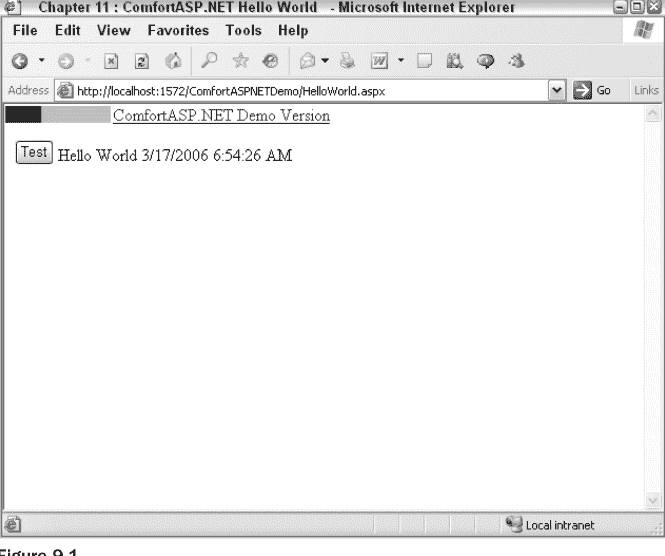

点击 Test 按钮时，标签会更新显示“Hello World”以及当前的日期和时间。

**动手试试：实现“Hello World”**

在解决方案中添加一个新的 Web 窗体，命名为 `HelloWorld.aspx`。打开 HTML 编辑器，在 `<div>` 标签内输入以下标记：

```aspx
<asp:Button
    ID="btnTest"
    Text="Test"
    runat="server" />

<asp:Label
    ID="lblTest"
    runat="server" />
```

注意，这里的 HTML 标记与不使用 ComfortASP.NET 时完全相同。

切换到设计视图，双击 Test 按钮。这将为按钮添加一个单击事件方法，并将你切换到代码隐藏窗口。

接下来，更新 `HelloWorld` 类，使其继承自 `ComfortASP.ComfortASP_Page`：

```csharp
public partial class HelloWorld : ComfortASP.ComfortASP_Page
{
    protected void Page_Load(object sender, EventArgs e)
    {
        this.HiddenFormPostBack = true;
    }
    protected void btnTest_Click(object sender, EventArgs e)
    {
        this.lblTest.Text = "Hello World " + DateTime.Now.ToString();
    }
}
```

`Page_Load` 事件方法将 `HiddenFormPostBack` 属性设置为 `true`，从而在页面上启用 ComfortASP.NET。在按钮的单击事件中，更新标签的文本，为用户显示 Hello World 以及当前的日期和时间。

现在你可以在浏览器中启动应用程序来测试你的代码。点击 Test 按钮，你会注意到标签已更新。再次点击按钮，你会发现没有发生回发，并且每次点击都会更新时间。

### 示例2：使用复杂控件

你现在看到了使用 ComfortASP.NET 很简单，但如果你想使用更复杂的控件，比如 ASP.NET 的 `GridView` 控件呢？像 ASP.NET `GridView` 这样的数据绑定控件具有更大的属性集以及自定义事件。ComfortASP.NET 可以让你使用这些控件的开发变得像上面的 Hello World 示例一样简单。

这个示例将把 `Resources.xml` 文件的内容绑定到一个 `GridView` 控件。当用户点击网格中的某个项目时，`SelectedIndexChanged` 事件将触发以更新页面，通知用户新的选定索引。此演示的目的是向你展示 ComfortASP.NET 框架使得处理具有自定义事件和扩展属性的控件与之前的 Hello World 示例一样简单。

图 9-2 展示了完成时页面的样子。

当你点击 Load Resource 按钮时，网格会加载数据。当你点击网格中的某个项目时，新的选定索引会打印在页面上。

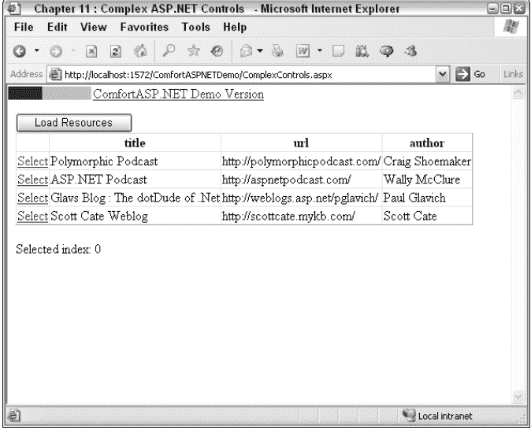

**图 9-2**

**动手试试：使用复杂控件**

在解决方案中添加一个新的 Web 窗体，命名为 `ComplexControls.aspx`。切换到源视图，在 `<div>` 标签之间添加以下标记。

```aspx
<asp:Button
    ID="btnLoadResources"
    OnClick="btnLoadResources_Click"
    Text="Load Resources"
    runat="server" />

<asp:GridView
    ID="grdResources"
    runat="server"
    OnSelectedIndexChanged="grdResources_SelectedIndexChanged">
    <Columns>
        <asp:CommandField ShowSelectButton="True" />
    </Columns>
</asp:GridView>

<p>Selected index:
<asp:Label ID="lblSelectedIndex" runat="server" /></p>
```

切换到源窗口以更新 `ComplexControls` 类。

```csharp
public partial class ComplexControls : ComfortASP.ComfortASP_Page
{
    protected void Page_Load(object sender, EventArgs e)
    {
        this.HiddenFormPostBack = true;
    }

    protected void btnLoadResources_Click(object sender, EventArgs e)
    {
        System.Data.DataSet ds;

        ds = new System.Data.DataSet();
        ds.ReadXml(Server.MapPath("~/App_Data/Resources.xml"));

        this.grdResources.DataSource = ds;
        this.grdResources.DataBind();
    }

    protected void grdResources_SelectedIndexChanged(object sender, EventArgs e)
    {
        this.lblSelectedIndex.Text =
            this.grdResources.SelectedIndex.ToString();
    }
}
```

该页面将继承自 ComfortASP.NET 基页，并在 `Page_Load` 方法中启用 `HiddenFormPostBack` 属性。当点击 Load Resources 按钮时，你将从 `Resources.xml` 文件加载数据并将其绑定到 `GridView` 控件。最后，当网格中的某个项目被选中时，`SelectedIndex` 将被打印到页面上的 `lblSelectedIndex` 标签。

现在你可以在浏览器中启动应用程序来测试你的代码。

### 示例3：ComfortASP.NET Manager控件

ComfortASP.NET 的 `Manager` 控件为你提供了一个集中管理页面 Ajax 功能的位置。Manager 控件提供了实现许多常见需求的服务。我们将在此处介绍该控件的一些更常见的功能，但请参阅 ComfortASP.NET 网站获取 `Manager` 控件的完整文档。

如果你想阻止用户反复点击一个发起 Ajax 调用的按钮，你可能选择在调用发出后禁用该按钮。ComfortASP.NET 使得禁用这些控件变得容易。Manager 的 `DisableFormWhilePostBack` 属性将自动化在回调到服务器期间启用或禁用页面上控件的过程。如果该属性设置为 `true`，则在 Ajax 调用期间所有控件都会被禁用；否则，控件将保持原状。

Ajax 应用面临着服务器并非总能及时响应的挑战。想象一下，当用户点击一个按钮后，页面在相当长的一段时间（比如超过一分钟）内没有任何反应，或者可能永远没有反应，用户会怎么想。ComfortASP.NET 的 `Manager` 控件内置了针对这种情况的保护措施。`HiddenRequestTimeout` 属性将定义页面在发送请求已超时的通知之前应等待的秒数。然后用户可以决定是否再次尝试该请求。Manager 控件还暴露了一个属性，允许你自定义在超时情况下显示给用户的消息。


`TransferDifference`属性将决定是返回整个页面标记给客户端，还是只传输页面更改的部分。这两种选项的区别在于会话状态的使用。如果你不希望`ComfortASP.NET`使用会话状态来持久化页面内容，那么`TransferDifference`设置为`false`。或者，如果你允许框架使用会话来保存页面内容，那么`TransferDifference`设置为`true`。

图9-3展示了当服务器忙于处理时，`ComfortASP.NET`框架生成的“正在加载”消息示例。还要注意按钮是如何被禁用的。这种行为是通过更改`ComfortASP.NET Manager`控件上的一些值来实现的。

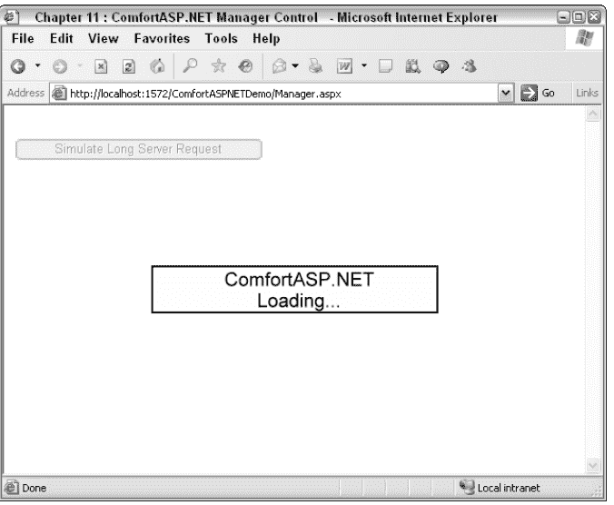

**图9-3**

图9-4是当请求超时发生时如何通知用户的示例。

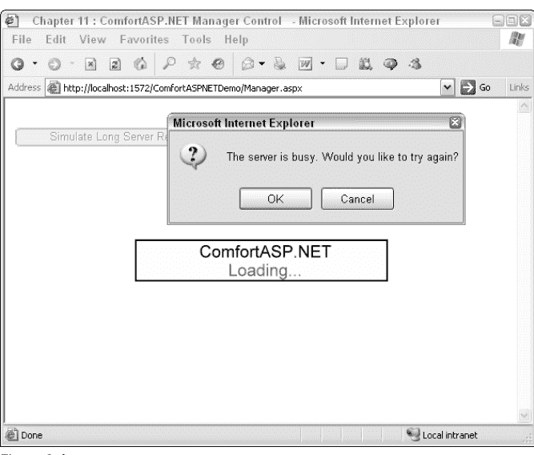

**图9-4**

## 其他.NET Ajax框架

### 动手试试：使用`Control Manager`

在解决方案中添加一个新的Web窗体，命名为`Manager.aspx`。确保ASPX页面处于设计视图，将鼠标悬停在工具栏上，将一个`ComfortASP.NET Manager`控件拖到页面上。切换到源视图，添加以下标记。

> `ComfortASP.NET Manager`控件已经添加到你的页面中；只需调整属性值以匹配此处列出的值，并为按钮和标签添加标记。

```aspx
<cc1:ComfortASP_Manager
    ID="comfortManager"
    HiddenRequestTimeout="20"
    HiddenRequestTimeoutText="The server is busy. Try again?"
    DisableFormWhilePostBack="True"
    TransferDifference="True"
    runat="server" />

<asp:Button
    ID="btnLongRequest"
    Text="Simulate Long Server Request"
    runat="server" />

<asp:Label
    ID="lblResult"
    runat="server" />
```

# 第九章

切换回设计视图，然后双击`btnLongRequest`按钮。此操作将切换到代码窗口，并连接按钮单击事件方法。

通过继承`ComfortASP.ComfortASP_Page`类来更新`Manager`类。此演示所需的其他更改仅为：在单击按钮时添加短暂的延迟，以及在请求完成时在标签上打印消息。

> 请注意，你并未设置页面的`HiddenFormPostBack`属性。`ComfortASP.NET`管理器控件负责通知应用程序此页面已启用 Ajax 功能。

```csharp
public partial class Manager : ComfortASP.ComfortASP_Page
{
    protected void Page_Load(object sender, EventArgs e)
    {

    }

    protected void btnLongRequest_Click(object sender, EventArgs e)
    {
        System.Threading.Thread.Sleep(5000);
        this.lblResult.Text = "Done";
    }
}
```

现在运行页面以展示其行为。

通过将ASPX文件中的`HiddenRequestTimeout`属性更改为`3`来尝试管理器设置。这允许页面在服务器完成处理之前超时，你可以看到框架将如何通知用户超时情况。更改`DisableFormWhilePostBack`属性，并注意当你向服务器发起调用时，页面上的控件不再被禁用。最后，你可以通过将`TransferDifference`属性设置为`false`并单击按钮来观察其效果。`ComfortASP.NET`演示版本包含一个条形图，表示通过网络传输的信息量。当`TransferDifference`关闭时，你可以通过该图看到传输到客户端的数据量增加了多少。

## 示例4：`PanelUpdater`控件（定期刷新）

`ComfortASP.NET`的`PanelUpdater`是一个控件，允许你定位页面上的特定区域进行更新。你可能希望更改页面某部分的内容，但页面的其余部分保持不变。`PanelUpdater`封装了许多实现细节，让你能够轻松访问页面片段。

`PanelUpdater`通过嵌套在ASP.NET `Panel`控件中工作。面板充当整体容器，而`PanelUpdater`只需放置在面板内部，就会将容器暴露给`ComfortASP.NET`。该控件存在于页面上，用于处理浏览器与服务器之间的交互，不会向用户呈现任何可见内容。

`ComfortASP.NET`的`PanelUpdater`与其父面板关联，因此你可以在单个页面上拥有多个`Panel/PanelUpdater`组合。

## .NET的其他Ajax框架

试想一下，你想创建一个页面，持续与服务器交互以查看是否有用户的新消息可用。`PanelUpdater`非常适合这种需求，原因有二：

- 原因之一是该控件允许你定位页面的一部分，并让系统仅更新你指定的页面区域。
- 原因之二是`PanelUpdater`具有计时器间隔功能，一旦设置，将指示控件每隔`n`秒向服务器发送请求。这种模式称为定期刷新模式，在下一节中使用`MagicAjax`时，你也会实现相同的行为。

以下示例实现了具有上述需求的页面。图9-5是最终成品外观的示例。

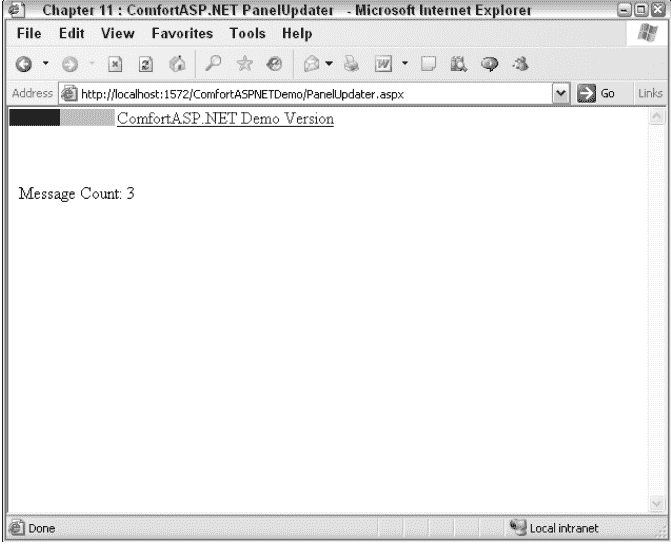

**图9-5**

> *`ComfortASP.NET`演示版本将自动在页面顶部打印条形图，指示传输的数据量，并附带返回`ComfortASP.NET`网站的链接。完整版本没有此功能。*

页面包含一个面板，每`3`秒联系服务器一次，以更新页面上的新消息数量。

## 动手实践：使用`PanelUpdater`控件

首先向解决方案中添加一个新的Web窗体，将其命名为`PanelUpdater.aspx`。确保你处于源视图，并在ASPX页面顶部的Page指令行之后添加以下行。

```html
<%@ Register Assembly="ComfortASP" Namespace="ComfortASP" TagPrefix="cc1" %>
```

注册标记将使`ComfortASP.NET`框架可用于该页面。

继续，在`<div>`标签之间添加以下标记：

```html
<asp:Panel ID="pnlContent" runat="server">
    <cc1:ComfortASP_PanelUpdater
        ID="ComfortASP_PanelUpdater1"
        TimerIntervalUpdate="3"
        Active="True"
        runat="server" />
    消息数量：
    <asp:Label
        ID="lblMessageCount"
        runat="server" />
</asp:Panel>
```

ASP.NET面板是页面中待更新部分的容器。`ComfortASP.NET PanelUpdater`控件将负责生成客户端代码以创建超时行为。确保通过将`Active`属性设置为`true`来激活`PanelUpdater`。`TimerIntervalUpdate`属性接受一个数值，表示你希望浏览器在联系服务器之前等待的秒数。最后，列表末尾的标签将获取来自服务器的最新信息，并将消息数量打印给用户。

现在切换到代码窗口以更新`PanelUpdater`类。

```csharp
public partial class PanelUpdater : ComfortASP.ComfortASP_Page
{
    private int MessageCount
    {
        get
        {
            if (this.ViewState["messageCount"] == null)
            {
                return 0;
            }
            else
            {
                return Convert.ToInt32(this.ViewState["messageCount"]);
            }
        }
        set
        {
            this.ViewState.Add("messageCount", value);
        }
    }

    protected void Page_Load(object sender, EventArgs e)
    {
        this.HiddenFormPostBack = true;
        this.UpdateMessageCount();
    }

    private void UpdateMessageCount()
    {
        this.MessageCount++;
        this.lblMessageCount.Text = this.MessageCount.ToString();
    }
}
```

与以往一样，该类将继承自`ComfortASP.ComfortASP_Page`，而非`System.Web.UI.Page`。你将通过在加载方法中开启`HiddenFormPostBack`属性来为页面启用 Ajax 功能。`MessageCount`属性是`ViewState`条目的强类型包装器，用于持久化消息数量。如果`ViewState`条目不存在，包装器会将值初始化为`0`。最后，`UpdateMessageCount`方法将简单地递增`MessageCount`属性，并将新的数量报告给页面上的标签。

你现在可以运行页面以展示其行为。

## 你学到了什么

`ComfortASP.NET`框架是一个对.NET开发者来说非侵入式的Ajax库。该框架允许你在ASP.NET页面中实现Ajax功能，而无需手动编写JavaScript或处理XML。`ComfortASP.NET`还具有许多有用的控件，允许你从中央位置管理框架的设置和行为。

## `MagicAjax`

网址：`www.magicajax.net`

`MagicAjax`是一个基于面板的变更HTML框架，使你能够轻松地为ASP.NET应用程序添加Ajax功能。`MagicAjax`的架构师创建了一个以轻微侵入方式集成到应用程序中的框架。一旦网站配置为与`MagicAjax`通信，大多数Ajax功能都可以通过向页面添加`MagicAjax`面板来实现。你无需继承自基类，也无需声明任何自定义控件。除了向页面添加`MagicAjax`面板外，ASPX和代码隐藏代码的编写方式与传统回发模型中的页面编写方式相同。

## 设置

在开始使用`MagicAjax`之前，你必须先下载文件，然后在Web项目中引用它们。以下步骤帮助你构建一个包含为`MagicAjax`创建的所有示例的解决方案。

# 第9章

### 下载文件

1. 如果您尚未这样做，请从`http://beginningajax.com/downloads/chapter9/Chapter9-Framework DLLs.zip`下载包含`MagicAjax` DLL的zip文件。
2. 提取文件并将其放置在方便的文件夹位置。

### 创建解决方案

1. 打开Visual Studio 2005。
2. 点击文件 > 新网站。
3. 选择ASP.NET网站模板。
4. 在位置栏中选择“文件系统”。
5. 设置路径为`c:\BeginningAJAX\Chapter9\MagicAjaxDemo`。
6. 选择C#作为语言。
7. 点击确定。

### 引用`ComfortASP.NET`

1. 在解决方案资源管理器中，右键单击项目名称并选择“添加工厂 ASP.NET 文件夹”。
2. 选择`App_LocalResources`以创建ASP.NET文件夹。
3. 将`MagicAjax.dll`（从您提取的zip文件中）复制到`App_LocalResource`文件夹。
4. 为`MagicAjax.dll`创建引用。

## 更新`Web.Config`

打开`Web.Config`文件，并在刚打开的`<system.web>`标签之后添加以下代码：

```xml
<pages>
    <controls>
        <add
            namespace="MagicAjax.UI.Controls"
            assembly="MagicAjax"
            tagPrefix="ajax"/>
    </controls>
</pages>
<httpModules>
    <add
        name="MagicAjaxModule"
        type="MagicAjax.MagicAjaxModule, MagicAjax"/>
</httpModules>
```

现在您的应用程序已配置为使用`MagicAjax`。

## 使用`MagicAjax`

现在您已经在机器上设置了`MagicAjax`，您可以开始实现示例。每个示例都会展示`MagicAjax`框架的一个新层次，让您体验该库的功能和优势。接下来的示例将演示`MagicAjax`的一些标准功能，并提供一些更复杂的示例，向您展示如何在现实世界中使用这些技术。

### 示例1：Hello World

您的`MagicAjax`示例从Hello World页面开始。由于没有需要继承的基类，并且`Web.Config`设置让每个页面都能访问框架，因此页面级配置非常少。为了赋予`MagicAjax`页面异步功能，您只需在`MagicAjax Panel`中声明一些ASP.NET控件即可。此练习与您为`ComfortASP.NET`框架实现的页面非常相似，即按钮点击将向服务器发起请求，服务器随后返回最新数据给客户，所有这一切都不需要回发。

图9-6是页面的截图。

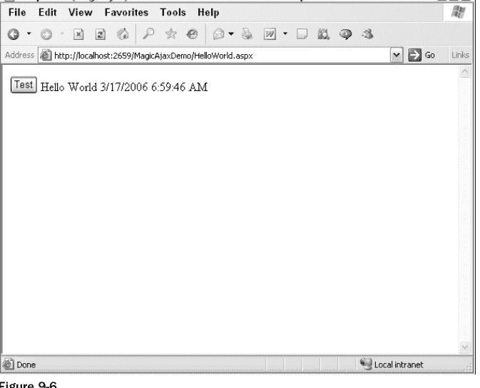

当您点击测试按钮时，将返回文本“Hello World"以及当前的日期和时间。

#### 试一试：实现“Hello World”

首先添加一个新网页表单到解决方案中，并将其命名为`HelloWorld.aspx`。切换到源视图，并在`<div>`标签之间添加以下标记：

```html
<ajax:ajaxpanel ID="Ajaxpanel1" runat="server">
    <asp:Button
        ID="Button1"
        OnClick="Button1_Click"
        Text="Test"
        runat="server" />
    <asp:Label
        ID="Label1"
        runat="server" />
</ajax:ajaxpanel>
```

您无法访问`ajaxpanel`的IntelliSense的原因是使用了配置选项，该选项在`Web.Config`中将`MagicAjax`功能添加到了每个页面。如果您要更改配置以使用`Register`指令，那么您将会看到IntelliSense列表。

现在切换到代码视图，并更新`HelloWorld`类。

```csharp
public partial class HelloWorld : System.Web.UI.Page
{
    protected void Page_Load(object sender, EventArgs e)
    {
    }

    protected void Button1_Click(object sender, EventArgs e)
    {
        this.Label1.Text = "Hello World " + DateTime.Now.ToString();
    }
}
```

请注意，与带有回发的正常ASP.NET实现相比，后端代码没有任何更改。`MagicAjax.NET`通过在`ajaxpanel`中添加控件来完成所有工作。

现在您可以在浏览器中启动页面以测试其行为。

### 示例2：延迟

每个Ajax框架都必须处理服务器完成给定命令可能需要几秒钟（也许更久）的情况。当您的应用程序出现此类延迟时，您必须向用户反馈以提示他们正在发生的情况。`MagicAjax`提供了一个“加载中..."消息，帮助您让用户了解页面上正在发生的事情。

接下来的示例将强制服务器在返回数据之前等待`5`秒。此延迟将为您提供机会，观察`MagicAjax`如何应对这种犹豫。

图9-7是显示“加载中..."消息的截图。

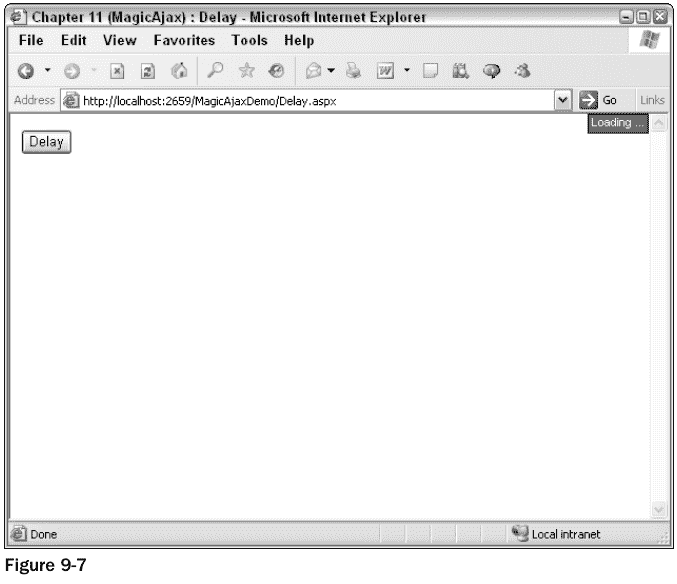

#### 试一试：演示延迟消息

向解决方案中添加一个新网页表单，并将其命名为`Delay.aspx`。打开页面的源视图，并在`<div>`标签之间的标记中使用以下代码更新：


```html
<ajax:AjaxPanel ID="AjaxPanel1" runat="server">
    <asp:Button
        ID="btnDelay"
        Text="Delay"
        OnClick="btnDelay_Click"
        runat="server" />

    <asp:Label
        ID="lblDelay"
        runat="server" />
</ajax:AjaxPanel>
```

现在切换到代码视图以更新`Delay`类。

```csharp
public partial class Delay : System.Web.UI.Page
{
    protected void Page_Load(object sender, EventArgs e)
    {
    }

    protected void btnDelay_Click(object sender, EventArgs e)
    {
        System.Threading.Thread.Sleep(5000);
        this.lblDelay.Text = "Done";
    }
}
```

当您点击延迟按钮时，服务器将犹豫 5 秒，并在屏幕右上角显示 MagicAjax“加载中..."消息。

现在您可以在 Web 浏览器中启动页面以测试其行为。

### 示例 3：Ajax 调用助手（周期性刷新）

如果您记得 ComfortASP.NET 部分中的示例，您创建了一个实现周期性刷新模式的页面。下一个示例将教您如何使用 MagicAjax 实现相同的行为。

设计目标是一样的；创建一个页面，该页面将定期检查服务器上的数据变化，而无需用户发起请求。本示例中的页面将使用 MagicAjax 的`AjaxCallHelper`类。该类拥有帮助自动化您的 Ajax 开发的实用工具。对于本示例，您将对`SetAjaxCallTimerInterval`方法，该方法将在浏览器上注册超时并每 *n* 秒向服务器创建一个请求。

图 9-8 是显示页面完成后的截图。

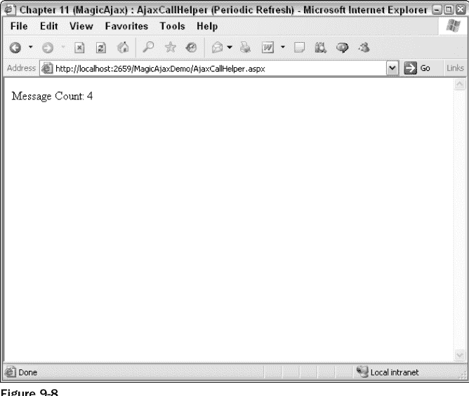

#### 试一试：使用 Ajax 调用助手

首先向解决方案中添加一个新网页表单，并将其命名为`AjaxCallHelper.aspx`。切换到源视图，并在`<div>`标签之间的标记中更新页面：

```html
<ajax:AjaxPanel ID="AjaxPanel1" runat="server">
    Message Count:
    <asp:Label
        ID="lblMessageCount"
        runat="server" />
</ajax:AjaxPanel>
```

此示例中的 ASPX 代码很简单。您创建一个标签来存储当前计数，并将其放置在 MagicAjax Panel 内。

现在切换到代码窗口以更新`AjaxCallHelper`类。

```csharp
public partial class AjaxCallHelper : System.Web.UI.Page
{
    private int MessageCount
    {
        get
        {
            if (this.ViewState["messageCount"] == null)
            {
                return 0;
            }
            else
            {
                return Convert.ToInt32(this.ViewState["messageCount"]);
            }
        }
        set
        {
            this.ViewState.Add("messageCount", value);
        }
    }

    protected void Page_Load(object sender, EventArgs e)
    {
        if (!this.Page.IsPostBack)
        {
            MagicAjax.AjaxCallHelper.SetAjaxCallTimerInterval(5000);
        }

        this.UpdateMessageCount();
    }

    private void UpdateMessageCount()
    {
        this.MessageCount++;
        this.lblMessageCount.Text = this.MessageCount.ToString();
    }
}
```

如果您实施了 ComfortASP.NET 演示，则该代码对您来说是熟悉的。`MessageCount`属性封装了此请求系列的数字消息的`ViewState`容器。

在首次请求页面时，您使用`SetAjaxCallTimerInterval`方法在浏览器上注册超时。该命令将处理为页面向页面渲染所有适当的 JavaScript，以每 5 秒向服务器发送请求。

当页面处于“回发”模式时，消息计数递增，并且标签得到更新。

现在请在浏览器中启动页面以测试其行为。

### 示例 4：直接脚本（微内容）

在之前的示例中，您看到了 MagicAjax 如何保持 ASP.NET 页面事件生命周期不变，从而允许您使用 Ajax 对页面的内容进行重大更改，并从代码隐藏文件中进行所有操作。这种模型功能强大，可能会帮助您完成大部分 Ajax 开发，但如果您需要在页面上创建非原生于 ASP.NET 架构的交互怎么办？如果您想要在用户从控件点击离开时更新页面上的元素怎么办？

以下步骤将指导您创建允许用户在页面上直接编辑文本的页面。例如，当用户遇到页面标题时，他或她可以单击标题文本，编辑其内容，并继续浏览。在后台，页面识别到变化，负责联系服务器以持久化最新数据。

本示例中实现的 Ajax 设计模式称为“微内容”。微内容模式表明页面的某些区域可以由用户编辑，而无需手动切换页面上的“编辑模式”（通过点击按钮或更改页面位置）。页面上小或“微型”的内容区域对用户而言仅需单击文本即可进行编辑。您通常会在此类由 Ajax 驱动的 Wiki 中实现此模式。

本练习将不仅使用 MagicAjax，还将使用一些自定义级联样式表定义来为界面变化提供线索，以提示正在发生的情况。

图 9-9 是用户第一次遇到页面的截图。

页面将通过在光标悬停在可编辑区域上时在文本上绘制边框，提供初始线索，表明页面的部分内容是可编辑的。图 9-10 显示了当鼠标悬停在控件上方时控件的外观。

## 其他适用于 .NET 的 Ajax 框架

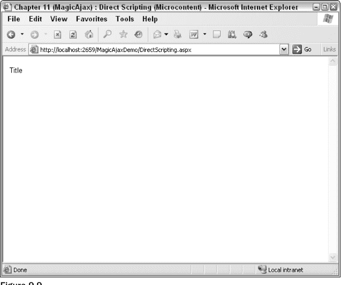

图 9-9

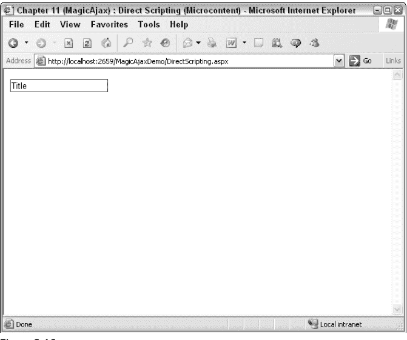

图 9-10

227

# 第 9 章

下一步是当用户将页面此区域置于“编辑模式”时，更改控件的外观。图 9-11 显示了用户在控件边框内点击后的页面。

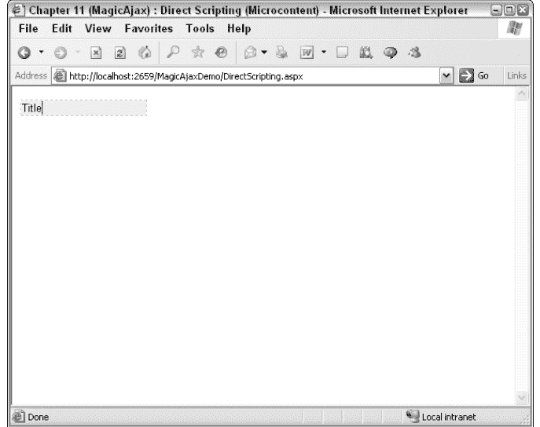

图 9-11

最后，当控件失去焦点时，MagicAjax 将联系服务器并允许后端处理来持久化最新数据。在正常情况下，你可能会将数据持久化到某种数据存储中。出于演示目的，本练习将仅将信息存储在 Session 状态中。这样，在你更改数据后，你可以导航离开页面并返回查看最新的更改，但无需为此示例实现数据层。

### 动手实践：使用直接脚本

首先向你的解决方案添加一个新的 Web 窗体，并将其命名为`DirectScripting.aspx`。接下来，切换到源视图，并在`<title>`标签之后向页面添加以下层叠样式表条目和 JavaScript：

```css
<style type="text/css">
input
{
    border:solid 1px #fff;
}

.focus
{
    background-color:#eee;
    border:dashed 1px #ccc;
}

.blur
{
    background-color:#fff;
    border:dashed 1px #fff;
}

.mouseOver
{
    border:solid 1px #c00;
}

.mouseOut
{
    border:solid 1px #fff;
}
</style>
```

228

这些样式表条目为页面提供视觉提示，以帮助用户理解页面上正在发生的事情。第一个条目将在页面的输入控件周围放置一个一像素的白色边框。这个白色边框是必要的，因为稍后你将给控件应用彩色边框，如果现有没有边框，页面内容将会看起来发生移动。

`focus`、`blur`、`mouseover`和`mouseout` CSS 类的命名与使用它们的事件保持一致。当控件获得焦点时，背景颜色变为浅灰色，并向控件应用虚线边框。当控件失去焦点时（即焦点模糊），将应用`blur`样式。`blur`样式将把背景和边框改回白色。当用户将鼠标悬停在控件上时，根据`mouseover`类的指定，边框变为红色。最后，当用户将鼠标移出控件时，`mouseout`事件和类会将边框恢复为原始的白色状态。

接下来，在结束的`<style>`标签正下方添加此 JavaScript 块：

```javascript
<script type="text/javascript">
function ChangeCSSClass(element,className)
{
    element.className = className;
}
</script>
```

此函数将处理以编程方式将指定的样式表条目应用于控件的工作。该函数在此处定义，并在代码隐藏中连接到控件。

接下来，使用以下代码更新`<div>`标签之间的标记：

```html
<ajax:AjaxPanel ID="AjaxPanel1" runat="server">
    <asp:TextBox
        ID="txtTitle"
        text="Title"
        OnTextChanged="txtTitle_TextChanged"
        runat="server" />
</ajax:AjaxPanel>
```

标记很简单。只需要一个在 MagicAjax 面板中的单个 ASP.NET`TextBox`控件。当浏览器识别到文本框内容发生更改时，`OnTextChanged`事件将触发。你将在产生的方法中实现你的持久化逻辑。

最后，切换到代码窗口，并使用以下代码更新`DirectScripting`类。

```csharp
public partial class DirectScripting : System.Web.UI.Page
{
    protected void Page_Load(object sender, EventArgs e)
    {
        if (!this.Page.IsPostBack)
        {
            this.txtTitle.Attributes.Add("onfocus",
                "ChangeCSSClass(this, 'focus');");

            this.txtTitle.Attributes.Add("onblur",
                "ChangeCSSClass(this, 'blur');" +
                MagicAjax.AjaxCallHelper.GetAjaxCallEventReference(this.txtTitle) +
                " return false;");

            this.txtTitle.Attributes.Add("onmouseover",
                "ChangeCSSClass(this, 'mouseOver');");

            this.txtTitle.Attributes.Add("onmouseout",
                "ChangeCSSClass(this, 'mouseOut');");

            if (this.Session["title"] != null)
            {
                this.txtTitle.Text = this.Session["title"].ToString();
            }
        }
    }

    protected void txtTitle_TextChanged(object sender, EventArgs e)
    {
        this.Session.Add("title", this.txtTitle.Text);
    }
}
```

当页面首次呈现给浏览器时，每个事件的 JavaScript 调用都会连接到控件。此代码块的最后一部分检查 Session 状态中是否存在当前的“title”值。如果找到该值，控件将显示该值；否则，页面将渲染 HTML 中定义的默认文本。

虽然每个事件函数都使用熟悉的`Attributes.Add`方法附加，但有一个事件在其余事件中显得格外突出。`blur`事件负责在用户离开控件焦点时联系服务器。这种与代码隐藏的交互并非 ASP.NET 架构的原生功能。为了在此时在客户端和服务器之间创建链接，MagicAjax 的`AjaxCallHelper`类必须完成与服务器通信的工作。

`AjaxCallHelper`公开了一个名为`GetAjaxCallEventReference`的方法，该方法将联系服务器，模拟代码隐藏中的“回发”，告诉页面作为参数传入的任何控件都是请求的发送者。一旦服务器识别出该请求，页面将运行`txtTitle_TextChanged`事件，并用最新值更新 Session 状态。现在，当你转到另一个页面并返回时，此页面将显示你更改后的值，而不是显示“Title”。

230

你现在可以在浏览器中启动该页面以测试其行为。

## 你学到了什么

MagicAjax 是一个能让任何 .NET 开发者都感到舒适的框架。这种面板和更改 HTML 类型的架构使得创建 Ajax 应用程序变得容易，因为框架负责在浏览器和服务器之间创建连接。事实上，你在这些示例中编写的唯一自定义 JavaScript 是为了更新样式表设置，而不是为了方便 Ajax 脚本。MagicAjax 还为你提供了钩子，以便调用在代码隐藏中编写的、不属于传统 ASP.NET 事件回发模式的代码。

## Anthem.NET

**URL:** `http://anthem-dot-net.sourceforge.net`

尽管 Anthem.NET 框架具有面板和更改 HTML 架构的特性，但你也可以选择使用自定义控件并向客户端返回数据结构。Anthem.NET 的架构设计为使用页面`Register`指令，而不是强迫你继承自基类，并且你不需要实现预处理来利用其强大功能。Anthem.NET 真正代表了两个世界的最佳结合。

## 设置

在开始使用 Anthem.NET 之前，你必须先下载文件，然后在 Web 项目中引用它们。以下步骤可帮助你构建一个解决方案，用于存放你为 Anthem.NET 创建的所有示例。

### 下载文件

1. 如果你还没有这样做，请从`http://beginningajax.com/downloads/chapter9/Chapter9-Framework DLLs.zip`下载包含 Anthem.NET DLL 的 zip 文件。
2. 解压缩文件，并将其放置在方便的位置。

### 创建解决方案

1. 打开 Visual Studio 2005。
2. 点击“文件” > “新建” > “网站”。
3. 选择 ASP.NET 网站模板。
4. 在位置下选择“文件系统”。
5. 将路径设置为`c:\BeginningAJAX\Chapter9\AnthemDemo`。
6. 选择 C# 作为语言。
7. 点击“确定”。

### 引用 ComfortASP.NET

1. 在解决方案资源管理器中，右键单击项目名称并选择“添加 ASP.NET 文件夹”。
2. 选择“App_LocalResources”以创建 ASP.NET 文件夹。
3. 将 Anthem.dll（从你解压缩的 zip 文件中）复制到 App_LocalResource 文件夹。
4. 创建对 Anthem.dll 的引用。

### 复制数据文件

1. 将你在上一节中创建的`Resources.xml`复制到解决方案中的 App_Data 文件夹。

## 使用 Anthem.NET

既然你已有机会使用面板，接下来的示例将重点介绍如何使用 Anthem.NET 的自定义控件。你还将有机会处理从服务器返回的数据结构。处理 Anthem.NET 的数据结构对你来说将显得熟悉，因为该过程与使用 Ajax.NET 框架的方式几乎相同。

### 示例 1：Hello World

Anthem.NET 的入门示例将遵循与 ComfortASP.NET 和 MagicAjax 示例相同的模式。


此演示将使用 Anthem.NET 控件。Anthem 按钮和标签继承自标准的 .NET 控件，并为该框架扩展了它们。虽然在此示例中控件的标记保持不变，但你将在代码隐藏中设置一个属性，该属性将标记标签控件供 Anthem.NET 使用以进行更新，而不是使用传统的 .NET 回发机制。

图 9-12 显示了完成后页面的示例。

### 动手实践：实现 "Hello World"

首先向解决方案添加一个 Web 窗体并将其命名为`HelloWorld.aspx`。现在将 Anthem 注册指令添加到页面中`<%@ Page %>`指令的下方。

```
<%@ Register TagPrefix="anthem" Namespace="Anthem" Assembly="Anthem" %>
```

接下来，通过在`<div>`标签之间添加以下代码来更新标记。

```
<anthem:Button
    ID="Button1"
    OnClick="Button1_Click"
    Text="Test"
    runat="server" />

<anthem:Label
    ID="Label1"
    runat="server" />
```

最后，用下面的代码更新`HelloWorld`类的代码后置。

```csharp
public partial class HelloWorld : System.Web.UI.Page
{
    protected void Page_Load(object sender, EventArgs e)
    {

    }
    protected void Button1_Click(object sender, EventArgs e)
    {
        this.Label1.Text = "Hello World " + DateTime.Now.ToString();
        this.Label1.UpdateAfterCallBack = true;
    }
}
```

当你点击`Test`按钮时，标签会更新为"Hello World"和当前日期时间。多次点击该按钮，可以看到时间会持续更新，而无需向服务器回发。

你现在可以在浏览器中启动页面来测试该行为。

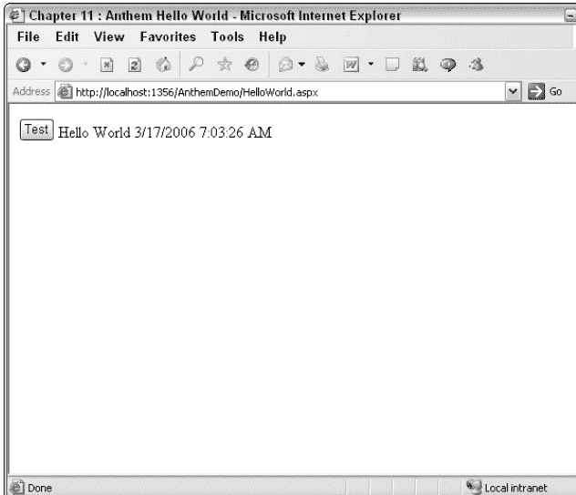

# 第 9 章

## 示例 2：复杂控件

正如你在 ComfortASP.NET 中观察到的那样，该框架在单个文本框上运行良好，但对于更复杂的控件，系统会有怎样的表现呢？本示例将引导你在页面上添加一个`GridView`控件，并使用 Anthem.NET 来响应`SelectedIndexChanged`方法。

图 9-13 展示了完成后的页面外观示例。

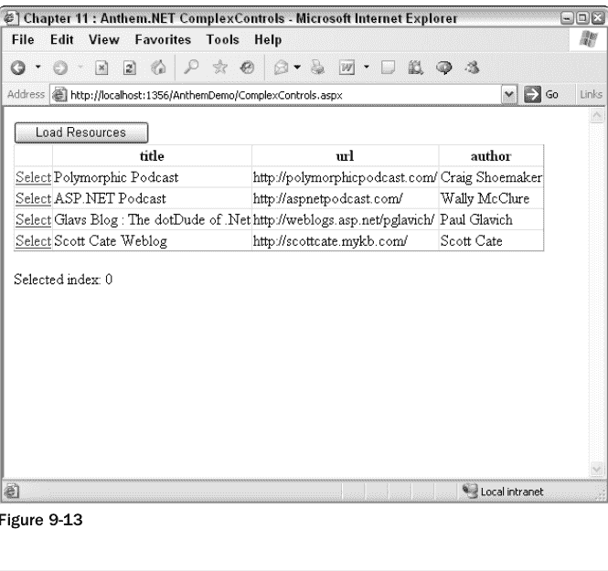

### 动手实践：使用复杂控件

首先，向解决方案中添加一个新建 Web 窗体，将其命名为`ComplexControls.aspx`。现在，在`<%@ Page %>`指令下方将 Anthem 注册指令添加到页面中。

```
<%@ Register TagPrefix="anthem" Namespace="Anthem" Assembly="Anthem" %>
```

接下来，通过添加以下代码来更新`<div>`标签之间的标记：

```aspx
<anthem:Button
    ID="btnLoadResources"
    OnClick="btnLoadResources_Click"
    Text="Load Resources"
    runat="server" />
```

```aspx
<anthem:gridview
    id="grdResources"
    runat="server"
    OnSelectedIndexChanged="grdResources_SelectedIndexChanged">
    <Columns>
        <asp:CommandField ShowSelectButton="True" />
    </Columns>
</anthem:gridview>

<p>Selected index:
<anthem:Label ID="lblSelectedIndex" runat="server" /></p>
```

最后，切换到代码视图，并将以下代码添加到`ComplexControls`类中：

```csharp
public partial class ComplexControls : System.Web.UI.Page
{
    protected void Page_Load(object sender, EventArgs e)
    {
    }

    protected void btnLoadResources_Click(object sender, EventArgs e)
    {
        DataSet ds;

        ds = new DataSet();
        ds.ReadXml(Server.MapPath("~/App_Data/Resources.xml"));

        this.grdResources.DataSource = ds;
        this.grydResources.DataBind();
        this.grdResources.UpdateAfterCallBack = true;
    }

    protected void grdResources_SelectedIndexChanged(object sender, EventArgs e)
    {
        this.lblSelectedIndex.Text = this.grdResources.SelectedIndex.ToString();
        this.lblSelectedIndex.UpdateAfterCallBack = true;
    }
}
```

当你点击`Load Resources`按钮时，网格将从 XML 存储中加载数据。当你点击网格中的`Select`链接时，标签的文本将更新为所选索引值。

你现在可以在浏览器中启动页面来测试该行为。

### 其他用于 .NET 的 Ajax 框架

## 示例 3：自定义属性

当 Anthem.NET 扩展 Web 控件时，新接口的一部分包含了一些你可以定义的属性。Markdown 文档的属性，以使控件的使用更加便捷。在某些框架中，你必须手动编写脚本来实现一个在发起服务器调用时禁用按钮的功能。而使用 Anthem 按钮时，你可以设置一个属性，让该功能自动为你实现。你可能还希望在页面开始联系服务器时更改按钮的文本。同样，Anthem.NET 的按钮控件允许你以声明方式定义此行为。

图 9-14 展示了点击使用 Anthem.NET 自定义属性定义的按钮后，页面的外观示例。

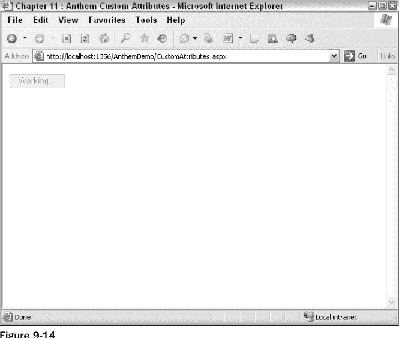

### 动手实践：使用自定义属性

首先，向解决方案中添加一个新建 Web 窗体，将其命名为`CustomAttributes.aspx`。现在，在`<%@ Page %>`指令下方将 Anthem 注册指令添加到页面中。

```
<%@ Register TagPrefix="anthem" Namespace="Anthem" Assembly="Anthem" %>
```

接下来，通过添加以下代码来更新`<div>`标签之间的标记：

```aspx
<anthem:Button
    ID="btnTest"
    EnabledDuringCallBack="false"
    TextDuringCallBack="Working..."
    Text="Test"
    runat="server"
    OnClick="btnTest_Click" />

<anthem:Label
    ID="lblTest"
    runat="server" />
```

最后，用下面的代码更新`CustomAttributes`类的代码后置：

```csharp
public partial class CustomAttributes : System.Web.UI.Page
{
    protected void btnTest_Click(object sender, EventArgs e)
    {
        System.Threading.Thread.Sleep(5000);
        this.lblTest.Text = DateTime.Now.ToString();
        this.lblTest.UpdateAfterCallBack = true;
    }
}
```

当你点击`Test`按钮时，服务器会延迟 5 秒再向浏览器返回响应。在此期间，你可以观察到按钮被禁用，文本变为"Working…."。当浏览器重新获得操作控制权时，按钮将被启用，文本恢复为原始值。

现在在浏览器中启动页面来测试该行为。

## 示例 4：客户端函数

除了自定义属性之外，Anthem.NET 还公开了客户端事件。这些事件让你在联系服务器时对页面具有更高程度的控制。本示例将向你展示如何在框架被联系之前、回调开始之前以及回调完成时实现一些自定义逻辑。

当你在 ASP.NET 页面上连接代码后置事件时，`OnClick`属性会将客户端点击事件链接到 ASP.NET 的回发机制，以联系服务器上运行的代码来执行你在代码后置中定义的点击事件方法。Anthem.NET 实现了一个`OnClientClick`属性，你可以在其中定义一个函数名，该函数在按钮点击后但在 Anthem.NET 框架被调用之前运行。`PreCallBackFunction`将在 Anthem.NET 接管请求时触发，但在联系服务器之前。最后，`PostBackFunction`将定义一个 JavaScript 函数，该函数在浏览器识别到响应后运行是新内容。

请注意，在示例中，每个 JavaScript 函数在定义时都传递了一个`this`参数给方法。传递该参数将公开对发起控件的引用，在本例中是`Test`按钮。这种方法很有价值，因为你现在可以轻松访问发起请求的控件，而无需解析 DOM。

图 9-15 展示了首次使用客户端函数点击按钮时页面的外观示例。

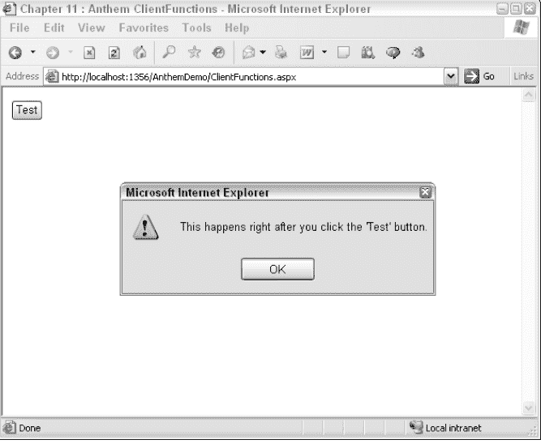

### 动手实践：使用客户端函数

首先，向解决方案中添加一个新建 Web 窗体，将其命名为`ClientFunctions.aspx`。现在，在`<%@ Page %>`指令下方将 Anthem 注册指令添加到页面中：

```
<%@ Register TagPrefix="anthem" Namespace="Anthem" Assembly="Anthem" %>
```

接下来，在`<head>`标签内添加以下代码：

```javascript
<script type="text/javascript">
function btnTest_PreCallBack()
{
    alert("This happens before contacting the server");
}

function btnTest_PostCallBack()
{
    alert("This happens after getting a " +
        "response from the server");
}

function btnTest_Click(control)
{
    alert("This happens right after you click the '" +
    control.value + "' button.");
}
</script>
```

每个方法都会通过警报通知浏览器哪个事件正在触发。`btnTest_Click`函数将访问发起控件的属性来构建其语句。

接下来，通过添加以下代码来更新`<div>`标签之间的标记：

```aspx
<anthem:Button
    ID="btnTest"
    OnClientClick="btnTest_Click(this)"
    PreCallBackFunction="btnTest_PreCallBack(this)"
    PostCallBackFunction="btnTest_PostCallBack(this)"
    Text="Test"
    OnClick="btn骤Test_Click"
    runat="server" />

<anthem:Label
    ID="lblTest"
    runat="server" />
```

最后，用下面的代码更新`ClientFunctions`类的代码后置：

```csharp
public partial class ClientFunctions : System.Web.UI.Page
{
    protected void btnTest_Click(object sender, EventArgs e)
    {
        this.lblTest.Text = DateTime.Now.ToString();
        this.lblTest.UpdateAfterCallBack = true;
    }
}
```

当你点击按钮时，每个事件都会触发相应的 JavaScript 函数。

你现在可以在浏览器中启动页面来测试该行为。

## 示例 5：调用页面方法

本示例演示了如何使用 Anthem.NET 调用服务器端代码，而无需使用面板或自定义控件。Anthem.NET 以类似于 Ajax.NET 框架的方式实现此功能，但 Anthem.NET 不是为每个公开方法到客户端的页面创建代理对象，而是有一个单独的函数来处理与服务器的通信。

Anthem.NET 用于与代码后置交互的函数名为`Anthem_InvokePageMethod`。此函数可取三个参数。

- 第一个参数是你希望函数在服务器上执行的方法名称。
- 第二个参数是服务器端方法参数值的数组。
- 最后，第三个参数用于回调函数，是服务器完成处理时浏览器将调用的函数名称。回调函数参数是可选的。

# 第 9 章

图 9-16 展示了完成后页面效果的示例。

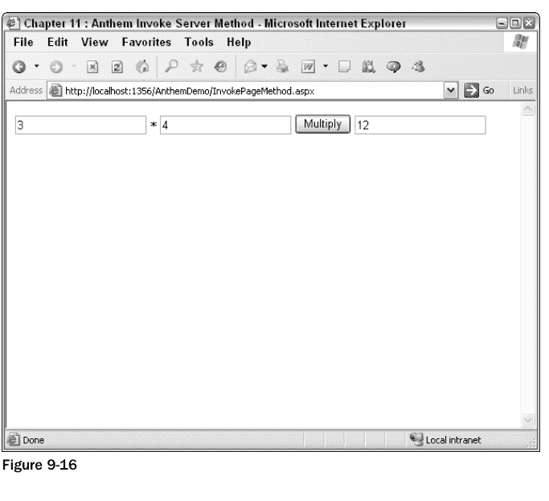

### 动手实践 | 调用页面方法

首先，向解决方案中添加一个新的 Web 窗体，将其命名为`InvokePageMethod.aspx`。然后，在`<head>`标签内添加以下代码：

```javascript
<script type="text/javascript">
function Multiply()
{
    var int1;
    var int2;

    int1 = document.getElementById('txtInt1').value;
    int2 = document.getElementById('txtInt2').value;

    Anthem_InvokePageMethod('Multiply',[int1, int2],Multiply_CallBack);
}

function Multiply_CallBack(result)
{
    document.getElementById('txtResult').value = result.value;
}
</script>
```

### 面向 .NET 的其他 Ajax 框架

这段 JavaScript 代码负责收集用户输入并将其传递给`Anthem_InvokePageMethod`函数。该函数的第一个参数是你想要在服务器上执行的方法的名称。在接下来的代码块中，你将在页面上定义一个名为`Multiply`的方法，这正是该函数将执行的代码。下一个参数是一个值数组，代表服务器上`Multiply`方法的签名。`Multiply`方法需要两个整数相乘并返回结果。最后一个参数是回调函数的地址。在`Multiply_CallBack`运行之后，文本框`txtResult`的值将包含两个数字的乘积。

在此示例中，你不会将 Anthem 页面指令添加到页面中。这里使用的技术将利用 Anthem.NET 的功能，直接从 JavaScript 访问代码隐藏中的方法。这种方法不需要你使用 Anthem.NET 控件。

接下来，更新标记，在`<div>`标签之间添加以下代码：

```html
<input
    type="text"
    id="txtInt1" />

<span>X</span>

<input
    type="text"
    id="txtInt2" />

<input
    type="button"
    id="btnMultiply"
    value="Multiply"
    onclick="Multiply();" />

<input
    type="text"
    id="txtResult" />
```

你在这里看到的 HTML 与之前示例中定义的标记类型有点不同。在这种情况下，你没有使用面板，也没有将控件声明为自定义控件。这种方法使用 JavaScript 直接访问代码隐藏的方法。每个输入框都是标准的 HTML 输入框，当你点击`Multiply`按钮时，工作就开始了。

最后，使用以下代码隐藏更新`InvokePageMethod`类：


```csharp
public partial class InvokePageMethod : System.Web.UI.Page
{
    protected void Page_Load(object sender, EventArgs e)
    {
        Anthem.Manager.Register(this);
    }

    [Anthem.Method]
    public int Multiply(int int1, int int2)
    {
        return (int1 * int2);
    }
}
```

# 第 9 章

根据你使用 Ajax.NET 的经验，这里定义的代码应该立即让你感到熟悉。这里的模式与 Ajax.NET 相同。首先，你必须将页面注册到 Anthem.NET 框架。然后，你将 `Anthem.Method` 属性添加到你的方法中。如上所述，`Multiply` 方法需要两个因子作为参数，并返回乘积。

现在，通过在浏览器中启动页面来测试行为。

## 示例 6：直接脚本（微内容）

回想一下在 MagicAjax 部分，你是如何实现微内容模式的。你现在将使用 Anthem.NET 实现相同的模式。

此练习不仅使用了 Anthem.NET，还使用了一些自定义的层叠样式表定义，来驱动用户界面的变化，为正在发生的事情提供线索。

页面将提供初始线索，表明页面的部分内容是可编辑的，当光标悬停在可编辑区域上时，会在文本周围绘制边框。（你可以参考图 9-10 来提醒自己这是什么样子。）

下一个线索是，当用户将此页面区域置于“编辑模式”时，改变控件的外观。（参考图 9-11 看到此示例。）

最后，当焦点从控件上移开时，Anthem.NET 将联系服务器，并允许后端处理持久化最新数据。在正常情况下，你可能会将数据持久化到某种数据存储中。出于演示目的，此练习将简单地将信息存储在 Session 状态中。这样，一旦你更改了数据，你就可以导航离开页面并返回查看最新的更改，但你不必仅为这个示例实现数据层。

> **动手实践：使用直接脚本**

首先，向解决方案中添加一个新的 Web 窗体，将其命名为 `DirectScripting.aspx`。然后，在 `<%@ Page %>` 指令下方将 Anthem 注册指令添加到页面。

```aspx
<%@ Register TagPrefix="anthem" Namespace="Anthem" Assembly="Anthem" %>
```

## 面向 .NET 的其他 Ajax 框架

```css
background-color:#fff;
border:solid 1px #fff;
}
.mouseOver
{
    border:solid 1px #c00;
}
.mouseOut
{
    border:solid 1px #fff;
}
</style>
```

样式表条目保存了格式信息，向用户提供有关正在发生什么的提示。（这与你在 MagicAjax 部分实现的 CSS 完全相同，因此如果你有代码可用，可以将其复制到此示例的文件中。）

接下来，在样式表定义之后添加以下 JavaScript。

```javascript
<script type="text/javascript">
function ChangeCSSClass(element,className)
{
    element.className = className;
}
</script>
```

接下来，更新标记，在 `<div>` 标签之间添加以下代码：

```html
<anthem:TextBox
    ID="txtTitle"
    text="Title"
    OnTextChanged="txtTitle_TextChanged"
    runat="server" />
```

最后，使用以下代码隐藏更新 `DirectScripting` 类：

```csharp
public partial class DirectScripting : System.Web.UI.Page
{
    protected void Page_Load(object sender, EventArgs e)
    {
        if (!this.Page.IsPostBack)
        {
            this.txtTitle.Attributes.Add("onfocus",
                "ChangeCSSClass(this,'focus');");

            this.txtTitle.Attributes.Add("onblur",
                "ChangeCSSClass(this,'blur');");

            this.txtTitle.Attributes.Add("onmouseover",
                "ChangeCSSClass(this,'mouseOver');");

            this.txtTitle.Attributes.Add("onmouseout",
                "ChangeCSSClass(this, 'mouseOut');");

            if (this.Session["title"] != null)
            {
                this.txtTitle.Text = this.Session["title"].ToString();
            }
        }
    }

    protected void txtTitle_TextChanged(object sender, EventArgs e)
    {
        this.Session.Add("title",this.txtTitle.Text);
        this.txtTitle.AutoUpdateAfterCallBack = true;
    }
}
```

尽管此实现与 MagicAjax 演示有许多相似之处，但请注意不同的方法。使用 Anthem.NET，你声明一个 Anthem TextBox 控件，并使用内置的触发 TextChanged 事件的机制来启动对服务器的请求。一旦联系到服务器，你就可以应用 Session 值，并将 TextBox 控件上的 `AutoUpdateAfterCallBack` 属性设置为 true。

你现在可以通过在浏览器中启动页面来测试行为。

## 示例 7：服务器异常

与本节列出的所有其他框架相比，Anthem.NET 独有的一个功能是处理未处理的服务器端异常的能力。在其他框架中，如果你的应用程序遇到未处理的异常，该错误可能会以令人费解且令人生畏的标准黄色和白色 ASP.NET 错误页面的形式冒泡到用户界面。虽然结构化异常管理的主题超出了本书的范围，但你将实现一个示例，该示例将强制执行此基本规则：保护用户免受无用错误消息的困扰。

Anthem.NET 将未处理的异常包装成 JSON 错误对象。当你遇到此对象时，你可以决定在客户端上如何处理该错误。Anthem.NET 返回的响应对象在其接口中包含一个错误对象。如果 `error` 属性不为 null，那么你在服务器上遇到了错误。

图 9-17 展示了当 Anthem 包装未处理的服务器异常时页面外观的示例。

## 动手试试：处理服务器异常

首先，在解决方案中添加一个新的 Web 窗体，将其命名为 `ServerException.aspx`。接下来，在 `<head>` 标签内添加以下代码：

```javascript
<script type="text/javascript">
function ShowError()
{
    Anthem_InvokePageMethod('ShowError',null,ShowError_CallBack);
}

function ShowError_CallBack(response)
{
    if(response.error != null)
    {
        alert(response.error);
    }
    else
    {
        alert("No errors here, just keep on working!");
    }
}
</script>
```

此示例使用 `Anthem_InvokePageMethod` 函数调用服务器上的一个方法，该方法将抛出一个未处理的异常。当回调函数运行时，会对 `response` 对象进行评估以检查是否存在错误。如果错误存在，则会向用户显示错误消息。

接下来，通过在 `<div>` 标签之间添加以下代码来更新标记：

```html
<input
    type="button"
    ID="btnTest"
    onclick="ShowError();"
    value="Throw Unhandled Exception on Server" />
```

由于你是直接调用服务器端代码，因此不需要使用 Anthem 控件。

最后，使用以下代码隐藏文件更新 `ServerException` 类：

```csharp
public partial class ServerException : System.Web.UI.Page
{
    protected void Page_Load(object sender, EventArgs e)
    {
        Anthem.Manager.Register(this);
    }

    [Anthem.Method()]
    public string ShowError()
    {
        throw new Exception("Something went very wrong.");
    }
}
```

你现在可以通过在浏览器中启动页面来测试其行为。

## 你学到了什么

Anthem.NET 框架提供了大多数服务器端框架中所没有的选项。Anthem.NET 的一个好处是提供了一种非侵入式的配置选项，便于集成到你的应用程序中。你还可以在仅仅更改页面 HTML 的方法与直接处理返回给客户端数据的方法之间进行选择。再加上对自定义控件的支持，Anthem.NET 也许是兼得鱼与熊掌的最佳选择。

## 总结

你有机会审视了三个客户端 Ajax 框架，并使用了三个以不同方式解决开发问题的服务器端 Ajax 框架。

在客户端，Sarissa、HTMLHttpRequest 和 MochiKit 提供了一种轻量级的方法来抽象浏览器中发起 XMLHttpRequest 调用的细节。每个客户端框架包含的内容远不止 Ajax 抽象，因此在选择一个之前，请务必研究每个库以找到最适合你应用程序的那一个。

246

## 其他适用于 .NET 的 Ajax 框架

在服务器端，ComfortASP.NET 和 MagicAjax 采用其“仅更改 HTML”的架构，可以使向页面添加 Ajax 成为一件轻松的事情。Anthem.NET 提供了在“更改 HTML”模式下工作的选项，但也让你可以选择直接处理返回的数据结构。每个都易于使用，并且都值得你花时间研究，因此请多加试验，看看哪个最适合你的开发环境。

选择框架时请记住：

- **开发人员的专业知识** — 你是否拥有精通 JavaScript、HTML 和 CSS 的人员？
- **你的页面级架构** — 你的页面当前是否继承自自定义或第三方基类？
- **你的应用程序级架构** — 你的应用程序是否使用可能与任何第三方框架冲突的 `httpHandlers` 或 `httpModules`？

下一章将开始介绍微软的 Ajax 框架 Atlas，并解释如何使用它来快速开发 Ajax 应用程序。

# 第 10 章

## Atlas 客户端脚本

表面上看，Atlas 听起来就像是另一个碰巧来自微软的 Ajax 库。虽然 Atlas 确实提供了对 Ajax 风格操作的支持，但它提供的远不止于此。通过 Microsoft Atlas 包，它支持生成客户端 JavaScript，本章将深入探讨 Atlas 的这一方面。在本章中，你将了解：

- Atlas 简介
- 调用 Web 服务
- Atlas 中的数据对象
- JavaScript 语言的扩展
- 对类似于 .NET 编程的编程模型的支持

> Atlas 的示例和代码基于 Atlas 的三月/四月 CTP 版本。三月 CTP 是第一个附带“正式发布”许可证的 Atlas 版本，允许在生产应用程序中实际使用。四月 CTP 基本上是三月 CTP 的一组错误修复。我们的意图是在 Atlas 发生破坏性更改时用新版本更新这些文件。文件网站是 http://beginningajax.com。或者，你可以查看本书在 Wrox 网站 (www.wrox.com) 上的更新信息。

## Atlas 简介

市场上对微软的 Atlas 项目究竟是什么存在很多困惑。目前，Atlas 将被包含在下一版本的 ASP.NET 和 .NET 框架中。从编程角度来看，Atlas 至少可以被视为两件关键的事情：

- **Ajax 库** — Atlas 中让程序员讨论最多的是其对 Ajax 的支持。通过此支持，微软创建了一个库，以支持在无需客户端向服务器执行完整回发的情况下与服务器进行通信的能力。

## 主要组件

Atlas 由一组文件组成。这些文件包括：

- 一个服务器端程序集（`.dll`）。该程序集名为 `Microsoft.Web.Atlas.dll`。
- 一个服务器端 `WebResource.axd` HTTP 处理程序。此文件负责将相应的 JavaScript 文件流式传输到客户端。流式传输到客户端的 JavaScript 内容基于 `ScriptManager` 控件中指定的功能，该控件将在本章后面介绍。
- 流式传输到客户端的 JavaScript 文件嵌入在 `WebResource.axd` HTTP 处理程序中。此外，还安装了一组独立的 JavaScript 文件。这些文件与在 `WebResource.axd` 文件中处理的文件相同。

## 服务器支持

Atlas 的服务器端支持由 `Microsoft.Web.Atlas.dll` 提供。该程序集为 `Microsoft.Web.*` 系列命名空间提供支持。在这些命名空间内，提供了对控件、数据序列化以及与 Web 服务通信的支持。

`WebResource.axd` HTTP 处理程序负责将相应的 JavaScript 文件发送到客户端。

## JavaScript 文件

如前所述，Atlas 附带一组 JavaScript 文件。这些文件如下：

- `Atlas.js` — `Atlas.js` 文件包含 Atlas 的核心功能集。例如，`Sys` 命名空间就是在此文件中定义的。
- `AtlasCompat.js` — `AtlasCompat.js` 文件提供了大部分的浏览器兼容层。此文件包含对 Internet Explorer、Mozilla 和 Safari 的支持。
- `AtlasCompat2.js` — `AtlasCompat2.js` 文件为其他浏览器提供额外支持。
- `AtlasFX.js` — 此文件包含对小工具的支持。
- `AtlasRuntime.js` — `AtlasRuntime.js` 文件用于执行仅限 Ajax 的服务器通信，无需所有其他文件及相关开销。
- `AtlasUIDragDrop.js` — `AtlasUIDragDrop.js` 为 Atlas 提供拖放 API。此外，还包含一些行为。
- `AtlasUIGlitz.js` — `AtlasUIGlitz.js` 文件包含对特殊 UI 和视觉效果的支持。这包括支持不透明度和动画等 UI 功能的类。
- `AtlasUIMap.js` — `AtlasUIMap.js` 文件提供对 Virtual Earth Atlas 控件的支持。
- `AtlasWebParts.js` — `AtlasWebParts.js` 文件提供对 Atlas 中 Web 部件的支持。
- `GadgetRuntime.js` — `GadgetRuntime.js` 文件提供对 Atlas 中小工具的支持。

250

## Atlas 客户端脚本

这些脚本分为以下几个通用的代码层：

- **浏览器兼容层** — 该层处理不同浏览器之间的差异。通过将各种浏览器的差异进行抽象，高层代码不需要使用 if-else 代码来处理浏览器差异。
- **JavaScript 扩展** — JavaScript 扩展为本身在 JavaScript 中不存在的对象、函数和数据类型提供支持。
- **脚本核心** — 脚本核心提供了许多可以被视为 JavaScript 语言扩展的功能。这些功能包括对命名空间、类、接口、继承、枚举、委托等的支持。通过提供这一层，Atlas 能够像其他编程语言一样，将数据、逻辑、行为等封装到类中。从功能上讲，这使 JavaScript 接近 .NET 语言中可用的功能。
- **基类库（BCL）** — Atlas BCL 与 .NET 框架中的 BCL 非常相似，并且是以其为模型构建的。该层提供了诸如 `StringBuilder`、`Debug`、`Event`、`Disposable` 支持，以及通过 `WebRequest` 和 `WebResponse` 对 `XmlHTTP` 进行抽象等功能。此外，该层还为 ASP.NET 服务（如 Profile 和 Authentication）提供支持，以便与服务器上的服务协同工作。
- **组件模型和 UI** — 该层为可通过其对象模型进行自我描述的组件提供支持。
- **控件和组件** — 该层提供了一组内置组件。其中一些组件包括 `Timer`、`Counter`、`Listview` 和 `MapControl`。
- **Web 部件和小工具** — 该层为与外部服务（如 Web 部件和小工具）集成提供支持。

## Ajax 支持


通过 Atlas，Microsoft 添加了许多 Web 浏览器/客户端功能。最受关注的功能是对 Ajax 的支持。Microsoft 经常因其缺乏跨平台（或非 Microsoft 操作系统）支持而受到批评。在撰写本文时，Atlas 支持 Internet Explorer、Mozilla Firefox 和 Macintosh Safari 浏览器。

Atlas 允许通过浏览器在 Web 应用程序中调用常规 Web 服务。这使 Web 浏览器能够为用户提供丰富的体验，而无需传统的回发到 Web 服务器。Atlas 通过在浏览器中公开 Web 服务的 JavaScript 代理，提供了使用户服务和公开 Web 服务的机制。

## 仅异步通信

在 Atlas 中，所有通信都是异步的。程序员使用的大多数操作都是同步通信，因此理解其中的差异非常重要。在 Atlas 中，无法调用 Web 服务并等待其响应。这点很重要。如果 Atlas 提供同步调用支持，并且进行了同步调用，那么在发出请求后服务器以某种方式消失时，客户端很可能会锁定。唯一的退出方式是停止正在运行的浏览器任务。其他库提供同步操作支持，但 Atlas 目前设计为仅提供异步通信。

# 第 10 章

既然你已经了解了 Atlas 为何是异步的，以及同步处理为何会在 Web 浏览器环境中引起问题，你实际上可以改变这种行为。你有两种机制来执行此更改：

- ASP.NET 团队的一名成员提供了执行此操作的机制。这可以在 Bertrand LeRoy 的博客上查看，网址为 `http://weblogs.asp.net/bleroy/archive/2005/12/15/433278.aspx`。
- 可以在适当 JavaScript 文件中的 `XMLHttpRequest` 对象的 `Open` 方法中，将 `Asynchronous` 标志更改为 `false`，而不是默认值 `true`。

## 使用 ScriptManager 控件添加 Atlas 支持

既然你已经了解了一些 Atlas 的基础知识，现在可以转向如何为 Web 页面添加 Atlas 支持的问题。除了 `ScriptManager` 之外，还需要在 `Web.Config` 中添加一些命令来正确配置 Atlas。

`ScriptManager` 控件是向 `.aspx` 页面添加 Atlas 支持的机制。基本上，所需的脚本通过使用 `ScriptManager` 控件添加到 `.aspx` 页面中。因此，要添加 Atlas 的基本支持（`atlas.js`），使用以下代码：

```xml
<atlas:ScriptManager ID="Script1" runat="server" />
```

下一步是添加对调用特定 Web 服务的支持。这是通过向 `ScriptManager` 控件添加服务来完成的。

在前面的示例中，你可以看到 `ScriptManager` 控件。该控件为页面上的 Atlas 提供支持。`<Services>` 标签为代码调用的 Web 服务添加支持。在此示例中，`WebService.asmx` 的代理将被放置在页面上以供调用。该代理可以被在客户端浏览器上运行的 JavaScript 代码调用。

如果仅需要 `AtlasRuntime.js` 文件，可以在 script manager 标签中设置 `EnableScriptComponents="false"`。

```xml
<atlas:ScriptManager ID="Script1" runat="server">
    <Services>
        <atlas:ServiceReference Path="WebService.asmx" />
    </Services>
</atlas:ScriptManager>
```

```xml
<atlas:ScriptManager ID="Script1" runat="server"
    EnableScriptComponents="false" />
```

## Atlas 客户端脚本

你将面临需要加载额外的 Atlas（或其他）JavaScript 库的情况。这些库通过使用 `<Scripts>` 标签来添加。下一个示例通过 `ScriptManager` 控件添加了几个脚本；具体而言，名为 `AtlasUIDragDrop` 的脚本和文件 `Script.js` 文件在浏览器中加载。

```xml
<atlas:ScriptManager ID="Script1" runat="server" EnableScriptComponents="false">
    <Scripts>
        <atlas:ScriptReference ScriptName="AtlasUIDragDrop" />
        <atlas:ScriptReference Path="Script.js" />
    </Scripts>
    <Services>
        <atlas:ServiceReference Path="WebService.asmx" />
    </Services>
</atlas:ScriptManager>
```

在此示例代码中，展示了两种调用脚本的方式。第一种方式是通过名称添加 `AtlasUIDragDrop` 脚本。这将是 Atlas 脚本添加到页面的正常方式。添加脚本的第二种方式是通过路径添加。这通过使用虚构的 `Script.js` 文件来展示。

## 与 Web 服务通信

调用 ASP.NET Web 服务是 Atlas 的重要组成部分。默认情况下，在 Web 浏览器中运行的 JavaScript 不知道如何与 Web 服务通信。Web 服务是使用 C#、Visual Basic .NET 或其他语言构建的。要与 Web 服务通信，JavaScript 必须知道如何调用 Web 服务，这是通过使用 Atlas 的一项功能生成 JavaScript 代理来实现的。

## 生成 JavaScript 代理

要生成 JavaScript 代理，你需要添加对 Web 服务的引用。除了该引用外，Web 服务方法必须被公开。当通过 `ScriptManager` 控件将 JavaScript 库作为服务添加时，这会自动完成。例如，当你添加对 `WebService.asmx` 文件的引用时，`ScriptManager` 会产生以下 JavaScript 代码。

此代码是 Web 页面上的源代码：

```xml
<atlas:ScriptManager ID="Script1" runat="server">
    <Services>
        <atlas:ServiceReference Path="WebService.asmx" />
    </Services>
</atlas:ScriptManager>
```

前面的代码将在客户端浏览器上生成以下输出：

```xml
<script type="text/xml-script">
<page xmlns:script="http://schemas.microsoft.com/xml-script/2005">
    <references>
        <add src="WebService.asmx/js" />
    </references>
    <components />
</page>
</script>
```

# 第 10 章

此代码展示了如何生成外部 Web 服务代理。`/js` 开关指示 Atlas 运行时创建代理对象。该代理对象也将在客户端运行。

当你使用前面的代码时，将生成以下 JavaScript 代理并在客户端加载：

```javascript
var WebServiceTest = {
    path: "/Chapter10Sample/WebService.asmx",
    GetProjects: function(onMethodComplete, onMethodTimeout, onMethodError) {
        return Web.Net.ServiceMethodRequest.callMethod(
            this.path, "GetProjects", {},
            onMethodComplete, onMethodTimeout, onMethodError
        );
    }
}
```

以下将是客户端调用并在服务器上运行的 Web 服务：

```csharp
using System;
using System.Web;
using System.Collections;
using System.Web.Services;
using System.Web.Services.Protocols;
using System.Data;
using System.Data.SqlClient;
using System.Xml;

/// <summary>
/// WebService 的摘要说明
/// </summary>
[WebService(Namespace = "http://tempuri.org/")]
[WebServiceBinding(ConformsTo = WsiProfiles.BasicProfile1_1)]
public class WebServiceTest : System.Web.Services.WebService {

    public WebServiceTest () {
        //如果使用的是设计好的组件，请取消注释以下行
        //InitializeComponent();
    }

    private string strCn = "..........";

    [WebMethod]
    public DataTable GetProjects()
    {
        string strSql = "select * from tblProject";
        SqlConnection sqlCn = new SqlConnection(strCn);
        SqlDataAdapter sqlDa = new SqlDataAdapter(strSql, sqlCn);
        DataSet dsData = new DataSet();
        try {
            //throw (new ApplicationException("服务器端错误。"));
            sqlDa.Fill(dsData, "tblProject");
        }
        finally {
            if(sqlCn.State != ConnectionState.Closed)
                sqlCn.Close();
            sqlCn.Dispose();
            sqlCn = null;
            sqlDa.Dispose();
            sqlDa = null;
        }
```

```csharp
return(dsData);
}
```

preceding code 是一个简单的 Web 服务示例。在此示例中，查询表 `tblProject` 中的所有记录并返回给调用方（即 Web 浏览器）。

在 Atlas 应用程序中，`Web.Config` 文件为 Web 服务添加了新的处理程序。其定义如下：

```xml
<httpHandlers>
  <remove verb="*" path="*.asmx"/>
  <add verb="*" path="*.asmx" type="Microsoft.Web.Services.ScriptHandlerFactory"
validate="false"/>
</httpHandlers>
```

## 调用 Web 服务

现在您已经了解了如何生成用于调用 Web 服务的 JavaScript 代理，接下来可以实际看看如何调用这些 Web 服务了。

从 JavaScript 中调用 Web service 是一个相当简单的过程。一个 JavaScript 调用的示例如下：

```javascript
Namespace.Class.MethodName(param1, param2, ..., paramN, OnMethodComplete,
OnServerTimeOut, OnServerException)
```

在此示例中，请查看参数明细。列出的 `param1`、`param2` 和 `paramN` 是 Web 服务正常情况下接受的参数。另外三个参数则非常有趣：您将在接下来的三部分中看到这三个参数的详细信息；它们是服务器端发生某些事件时使用的回调方法（Callback Methods）。

### OnMethodComplete

当 Web 服务完成其活动并将数据返回给调用应用程序时，它需要一个返回值的位置。`OnMethodComplete` 事件就是 Web 服务向应用程序返回时的 JavaScript 回调。当事件被调用时，会传递给该方法一个 `result` 参数。该 `result` 参数是 Web 服务返回值的序列化后的 JavaScript Object Notation (JSON) 版本。

`OnMethodComplete` 方法的语法如下：

```javascript
function MethodReturn(result)
{
  // Do something with the returned object.
}
```

返回的 `result` 可能是一个简单数据类型，也可能是一个非常复杂的复合对象，该对象已进行序列化并发送给浏览器。

### OnServerTimeOut

如果服务器未在预定义的时间范围内响应，则会调用 `OnServerTime` method。在此方法中，应用程序可以通知用户服务器不可用。

## OnServerException

检查以下代码以查看当 Web 服务返回异常时会发生什么情况：

```csharp
[WebMethod]
public DataSet GetProjects()
{
    string strSql = "select * from tblProject";
    SqlConnection sqlCn = new SqlConnection(strCn);
    SqlDataAdapter sqlDa = new SqlDataAdapter(strSql, sqlCn);
    DataSet dsData = new DataSet();
    try{
        throw (new ApplicationException("Error on the server."));
        sqlDa.Fill(dsData, "tblProject");
    }
    finally{
        if(sqlCn.State != ConnectionState.Closed)
            sqlCn.Close();
        sqlCn.Dispose();
        sqlCn = null;
        sqlDa.Dispose();
        sqlDa = null;
    }
    return(dsData);
}
```

当服务器的 Web 服务遇到抛回给调用方应用程序的异常时，Atlas 会触发 `OnServerException` 事件。该事件接收返回的结果对象（result object）。请查看以下结果对象（包含三个部分，但最后两个部分是可选的）：

- `get_message()` — 这是服务器上发生的异常的文本消息。如图 10-1 所示。

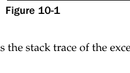

**图 10-1**

- `get_stackTrace()` — 这是异常的堆栈跟踪（Stack Trace）。如图 10-2 所示。

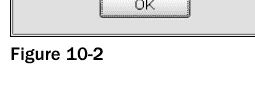

**图 10-2**

- `get_exceptionType()` — 这是异常的类型。如图 10-3 所示。

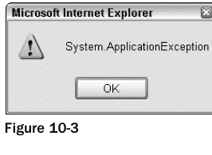

## 传递类型（Passing Types）

应用程序拥有需要传递各种类型参数的方法。这些参数可以是简单数据类型，如数字、字符串和布尔值；也可以是开发人员定义的更复杂的定制类型。Atlas 支持传递各种类型：简单和复杂的数据类型都可以轻松发送和接收。这包括布尔值、整数、字符串和其他简单数据类型，以及数据集（Datasets）和自定义对象。这些数据可以在调用参数的传入值和返回值之间来回传输。接下来的部分将介绍如何在客户端 Web 浏览器与服务器之间传递简单和复杂数据类型。

### 简单数据类型（Simple Data Types）

让我们看看包含使用简单数据类型的调用的网页示例。在此示例中，代码向 Web 服务传递两个整数，然后通过 Atlas 将这些值的总和返回给调用方法。

Web 服务的代码如下：

```csharp
[WebMethod]
public int ServerAdd(int val1, int val2)
{
    return (val1 + val2);
}
```

在此示例中，通过 Web service 接收两个整数并返回一个整数的代码逻辑如下：

网页上的代码如下所示：


```aspx
<%@ Page Language="C#" AutoEventWireup="true" CodeFile="SimpleDataTypes.aspx.cs"
Inherits="SimpleDataTypes" %>
<!DOCTYPE html PUBLIC "-//W3C//DTD XHTML 1.0 Transitional//EN"
"http://www.w3.org/TR/xhtml/DTD/xhtml1-transitional.dtd">
<html xmlns="http://www.w3.org/1999/xhtml" >
<head runat="server">
    <title>Simple Data Types Page</title>
    <script language="javascript">
        function CallServerAdd()
        {
            SimpleDataTypeWebService.ServerAdd( 3, 4, ServerAddReturn);
        }
    function ServerAddReturn(result)
    {
        alert("Result Value: " + result);
    }
</script>
</head>
<body>
    <form id="form1" runat="server">
        <input type="button" value="Click - Simple Add" onclick="CallServerAdd()"
    />
        <atlas:ScriptManager ID="Script1" runat="server">
            <Services>
                <atlas:ServiceReference Path="SimpleDataTypeWebService.asmx" />
            </Services>
        </atlas:ScriptManager>
    </form>
</body>
</html>
```

在前面的代码中，点击“Click - Simple Add”按钮将调用名为`CallServerAdd()`的JavaScript方法。`CallServerAdd()`方法会调出服务器端的`ServerAdd(...)`方法。（在此处原文可能有错漏，但需保留格式，暂按逻辑理解）值为3和4将通过名为`ServerAddReturn`的回调方法进行传递。当服务器上的`ServerAdd()`方法完成后，调用客户端侧的`ServerAddReturn`并将数据作为参数传回。

点击按钮的结果如图10-4所示：

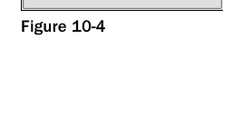

通过Atlas使用简单数据类型调用Web服务并获取返回结果非常简单。

### 复杂数据类型（Complex Data Types）

现在，您可以查看要使用某些复杂数据类型的情况。在这些示例中，您将看到一些数据集和自定义数据类型。

#### 数据集（Datasets）

什么是数据集？在.NET中，数据集是`System.Data`命名空间中的一个对象。可以将数据集视为本地数据的子集。一个数据集包含一组数据表。这些数据表通常包含查询结果。当开发人员处理数据集时，它们通常用作某些数据库查询的结果。从服务器向下发送到客户端的数据集正是本节我们将要研究的内容。

## Atlas客户端脚本（Atlas Client Script）

Atlas支持将数据集返回给Web浏览器，然后在客户端对数据集进行处理。请看看一个调用Web服务、返回数据集并随后处理该数据集的示例。

以下是您的网络服务：它只是一个执行查询然后返回数据集的网络服务。**Web方法**返回一个名为`tblProject`的数据表的数据集（`DataSet`）。请注意，这与前面异常示例中使用的网络服务代码相同，只是没有抛出异常的部分。

```csharp
[WebMethod]
public DataSet GetProjects()
{
    string strSql = "select * from tblProject";
    SqlConnection sqlCn = new SqlConnection(strCn);
    SqlDataAdapter sqlDa = new SqlDataAdapter(strSql, sqlCn);
    DataSet dsData = new DataSet();
    try{
        sqlDa.Fill(dsData, "tblProject");
    }
    finally{
        if(sqlCn.State != ConnectionState.Closed)
            sqlCn.Close();
        sqlCn.Dispose();
        sqlCn = null;
        sqlDa.Dispose();
        sqlDa = null;
    }
    return(dsData);
}
```

以下是在示例代码中将位于`DataTable.aspx`页面的客户端JavaScript：

```html
<form id="form1" runat="server">
    <atlas:ScriptManager ID="Script1" runat="server">
        <Services>
            <atlas:ServiceReference Path="~/WebService.asmx" />
        </Services>
    </atlas:ScriptManager>
<div>
<input type="button" id="btnGetProjects" value="Get Projects"
       onclick="PageLoadMethod()" /><br />
<span id="RowInfo"></span>
</div>
</form>
<script language="javascript">
    function PageLoadMethod()
    {
        WebService.GetProjects(MethodReturn);
    }
    function MethodReturn(result)
    {
        var i = 0;
        var str = "";
```

# 第10章

```javascript
var strRowsInfo = "";
var strReturn = "<br />";
//获取一个数据表
var tbl1 = result.getItem(0);
for(i = 0; i < tbl1.get_length(); i++)
{
    //tbl1.getItem(i)将返回第i个DataRow
    //getProperty("Column Name")将从DataRow返回列值
    strRowsInfo += tbl1.getItem(i).getProperty("ProjectName") + strReturn;
}
document.getElementById("RowInfo").innerHTML = strRowsInfo;
}
```

在此代码中，创建了指向您的`WebService.asmx`文件的引用。当点击按钮时，会异步调用`WebService.GetProjects()`。在此示例中，您处理的唯一回调方法是`MethodReturn`回调。`MethodReturn`函数在调用时获取数据集作为参数。要获取数据表，需要调用`result.getItem(0)`。这将返回数据表。一旦获得数据表，可以通过调用`.get_length()`获取数据表的行 prede 数量。然后在`for`循环中使用它来遍历数据表中的行。在`for`循环内，使用`.getProperty()`方法来获取列的内容。

> 关于Atlas如何处理数据表、数据列等的更多信息，请参阅本章稍后的相关章节。

## 自定义数据类型

在过去几年中构建的许多应用程序都是使用自定义业务对象构建的。这些自定义业务对象针对特定应用程序进行了高度优化。在此示例中，将创建一个自定义业务对象。此示例将有两个字符串作为自定义对象的属性。这些属性是`Name`和`Address`。

此示例的ASP.NET页面代码为：

```aspx
<%@ Page Language="C#" AutoEventWireup="true" CodeFile="ComplexDataSource.aspx.cs"
Inherits="ComplexDataSource" %>
<!DOCTYPE html PUBLIC "-//W3C//DTD XHTML 1.0 Transitional//EN"
"http://www.w3.org/TR/xhtml/DTD/xhtml1-transitional.dtd">
<html xmlns="http://www.w3.org/1999/xhtml" >
<head runat="server">
    <title>Complex Data Type Page</title>
</head>
<body>
    <form id="form1" runat="server">
    <script language="javascript">
    function ComplexDataTypeCall()
    {
        var CustName = "ACME Inc.";
        var CustAddr = "WileyVille, USA";
        var objCustObj = new cComplexCustomerType();
        objCustObj.Name = CustName;
        objCustObj.Address = CustAddr;
        ComplexWebService.AcceptComplexDataType(objCustObj,
ComplexScriptCompleteCallback);

function ComplexScriptCompleteCallback(result)
{
    alert("Value: " + result);
}
</script>
<input type="button" value="Click for Complex DataType"
       onclick="ComplexDataTypeCall();" />
<atlas:ScriptManager ID="Script1" runat="server">
    <Services>
        <atlas:ServiceReference Path="ComplexWebService.asmx" />
    </Services>
</atlas:ScriptManager>
<div>
</div>
</form>
<script type="text/xml-script">
    <page xmlns:script="http://schemas.microsoft.com/xml-script/2005">
        <references>
        </references>
        <components>
        </components>
    </page>
</script>
</body>
</html>
```

复杂数据类型的代码为：

```csharp
public class cComplexCustomerType
{
    public cComplexCustomerType()
    {
    }
    private string _Name;
    private string _Address;
    public string Name
    {
        get { return _Name; }
        set { _Name = value;}
    }
    public string Address
    {
        get { return _Address; }
        set { _Address = value; }
    }
}
```

Web服务的代码为：

```csharp
[WebMethod]
public cComplexCustomerType AcceptComplexDataType(cComplexCustomerType objComplexCustomerType)
{
    return (objComplexCustomerType);
}
```

在此示例代码中，Web服务接受自定义业务对象，然后返回值。没有什么能阻止Web服务使用传递的业务对象的属性，或者Web服务返回字符串而不是自定义业务对象。

对自定义对象的询问会返回有趣的信息。以下代码将生成图10-5中的结果。此图显示`Name`和`Address`属性可用，以及一个添加的成员——`_serverType`属性。此属性定义服务器上的类型。

```javascript
function ComplexScriptCompleteCallback(result)
{
    var str = "";
    debug.dump(result);
    for(prop in result)
        str += "Member: " + prop + "\r\n";
    alert(str);
}
```

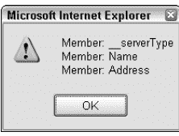

图10-5

对返回的结果对象调用`debug.dump()`会产生图10-6中的输出。`debug.dump()`方法在Atlas中显示对象的内容。本章稍后将更详细地讨论此方法。

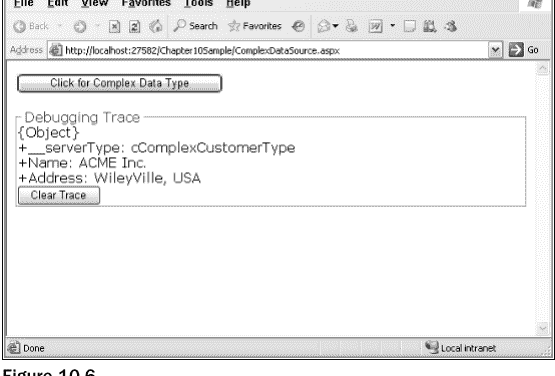

图10-6

## 缓存Web服务

从Web服务返回的数据可以被缓存。这在对时间要求不严格的数据情况下可能会有所帮助（例如，返回给定位置天气预报的Web服务）。这在.NET中是通过在`WebMethod()`属性的`CacheDuration`上设置值来完成的。正如您以前在Web服务工作中可能做过的那样，Atlas可以调用缓存的Web服务并获取Web服务调用的结果。根据数据和执行计算所需的时间，当考虑到数千个潜在用户时，缓存所节省的时间可能是显著的。

来看一些代码和结果。在此示例中，您将只显示每次调用的时间。在第一次调用时，返回的两个时间将是相同的。后续调用将导致当前时间更新，而缓存时间保持不变，而缓存时间直到缓存持续时间结束后才会更新。

这是一个.aspx页面的代码：


```aspx
<%@ Page Language="C#" AutoEventWireup="true" CodeFile="CachedWebService.aspx.cs"
Inherits="CachedWebService" %>
<!DOCTYPE html PUBLIC "-//W3C//DTD XHTML 1.0 Transitional//EN"
"http://www.w3.org/TR/xhtml1/DTD/xhtml1-transitional.dtd">
<html xmlns="http://www.w3.org/1999/xhtml" >
<head runat="server">
    <title>Untitled Page</title>
</head>
<body>
    <form id="form1" runat="server">
        <input type="button" id="btnGetServerTime" value="Get Server Time"
onclick="GetServerTime();" />
        <script language="javascript">
            function GetServerTime()
            {
                CachingWebService.GetServerCachedTime(DisplayServerCachedTime);
                CachingWebService.GetServerCurrentTime(DisplayServerCurrentTime);
            }
            function DisplayServerCurrentTime(result)
            {
                var ctrl = document.getElementById("NewTime");
                ctrl.innerText = result;
            }
            function DisplayServerCachedTime(result)
            {
                var ctrl = document.getElementById("StartTime");
                ctrl.innerText = result;
            }
        </script>
        <atlas:ScriptManager ID="Script1" runat="server">
            <Services>
                <atlas:ServiceReference Path="CachingWebService.asmx"
GenerateProxy="true" />
            </Services>
        </atlas:ScriptManager>
    </form>
    <div id="StartTime"></div>
    <br />
    New Time:
    <div id="NewTime">
    </div>
    <script type="text/xml-script">
        <page xmlns:script="http://schemas.microsoft.com/xml-script/2005">
            <references>
            </references>
            <components>
            </components>
        </page>
    </script>
</body>
</html>
```

在前面的代码中，点击按钮时，会向服务器发出两个远程调用——一个调用`GetServerCachedTime`方法，一个调用`GetServerCurrentTime`方法。服务器上的`GetServerCachedTime`方法在第一次调用时返回当前服务器时间。此调用的结果缓存在服务器内存中。后续调用在接下来的100秒内返回缓存结果，此时下一个请求将生成新的时间和服务器缓存中的新条目。因此，调用`GetServerCurrentTime()`将返回服务器的当前时间，而调用`GetServerCachedTime()`将返回一个可能长达100秒之久的值。

以下是Web服务的代码：

```csharp
[WebMethod(CacheDuration = 100)]
public DateTime GetServerCachedTime()
{
    return(DateTime.Now.ToUniversalTime());
}

[WebMethod]
public DateTime GetServerCurrentTime()
{
    return (DateTime.Now.ToUniversalTime());
}
```

> Atlas对日期和时间使用UTC编码。如果不记住这一点，可能会给您带来困惑。就我个人而言，我的系统设置为GMT – 5时区。因此，返回的时间差了5个小时。

图10-7显示了对缓存和非缓存Web服务进行多次调用的结果。

在图10-7中，您会注意到两个不同的时间值。这表明调用缓存的Web服务返回缓存值，而非缓存版本返回`DateTime.Now`对象的当前值。

## 从网页表单公开 Web 服务

在本章中，到目前为止你探索的所有示例都使用了专用的 Web 服务。同样，也可以在 Web 应用程序的内部页面中公开一个 Web 服务。表面上看，这似乎没有真正的优势。然而，使用通过网页表单公开的 Web 服务有两个优点。它们是：

- 页面和 Web 服务一起部署。需要部署的文件更少，出错的可能性也更小。
- 虽然在撰写本文时尚未宣布，但微软似乎将添加一些特殊功能，这些功能仅对在网页表单内调用的 Web 服务可用。鉴于 Atlas 目前处于早期阶段，未来会有更多相关信息发布。

下一个示例将在同一个 .aspx 页面上调用一个 Web 服务。

网页的代码如下：

```html
<%@ Page Language="C#" AutoEventWireup="true" CodeFile="InternalWebService.aspx.cs" Inherits="InternalWebService" %>
<!DOCTYPE html PUBLIC "-//W3C//DTD XHTML 1.0 Transitional//EN" "http://www.w3.org/TR/xhtml1/DTD/xhtml1-transitional.dtd">
<html xmlns="http://www.w3.org/1999/xhtml">
<head runat="server">
    <title>Internal Web Service Page</title>
</head>
<body>
    <asp:ScriptManager ID="Script1" runat="server">
    </asp:ScriptManager>
    <form id="form1" runat="server">
        <div>
            <input type="button" id="btn" value="Call Internal Web Service" onclick="CallInternalWebService()" />
            <script language="javascript">
                function CallInternalWebService()
                {
                    PageMethods.CallInternalWebService(InternalCallback);
                }

                function InternalCallback(result)
                {
                    alert(result);
                }
            </script>
        </div>
    </form>
</body>
</html>
```

在前面的代码中，请注意调用约定不是`Class.MethodName()`，而是`PageMethods.MethodName()`。`PageMethods`是一个用于调用页面内部方法的特殊类。

下面显示了后台代码文件。请注意添加了`System.Web.Services`命名空间，这通常不会在后台代码或 aspx 页面中指定。以下显示的方法仅作为示例返回一个字符串；然而，可以返回任意数量的数据类型，就像常规 Web 服务和其他示例一样。

```csharp
using System.Web.Services;

... [WebMethod] public string CallInternalWebService() { return ("Internal Web Service Called."); }
```

结果如图10-8所示。

## Atlas 对 JavaScript 的扩展

Atlas允许在浏览器内创建丰富的客户端应用程序。为了便于创建这些应用程序，Atlas为JavaScript中的类型系统创建了一组扩展。这些扩展为客户端Web浏览器环境提供了.NET类型系统的许多功能。这些扩展包括命名空间、继承、接口、枚举、对字符串和数组的支持。

### 语言增强

JavaScript作为一门语言自1995年底至1996年初Netscape Navigator 2.0网页浏览器的早期测试版出现以来就已存在。此后，JavaScript语言经历了众多增强。该语言的最新版本是1.6版。随着.NET Framework的发布，微软发布了一个包含一组基类的框架，这些基类具有跨各种语言（包括Visual Basic、C#以及在运行原生和服务器端应用程序时的JavaScript）的功能。Atlas正是步入了这一场景。Atlas在Web浏览器中运行的JavaScript基础上提供了一套增强功能。接下来的章节将探讨这些增强和扩展。

## 控件

Atlas提供了一组控件、类和对象，可以在JavaScript中以编程方式使用。

### Object

`Object`类是.NET `System.Object`类的客户端版本。它实现的唯一方法是`getType(obj)`方法。此方法将返回指定对象的类型。

### Array

`Array`类在概念上类似于.NET `System.Collections.ArrayList()`类。它有几个有趣的成员，例如`length`、`push()`和`pop()`。一个小例子如下：

```javascript
var ary = new Array();
ary.push(47);
alert("length: " + ary.length);
```

在这个简短的示例中，用户会看到一个长度为1的警报框。

### Date

`Date`类在概念上类似于.NET `System.DateTime`类的客户端Web浏览器版本。`Date`对象支持一组类似于C#等编程语言中原生日期类的方法。有用于创建日期、获取日期各部分以及设置日期各部分的方法。举个简单的例子，可以创建一个日期：

```javascript
var dt = new Date();
dt.setFullYear(2006, 3, 26); // Note: Months in JS arrays typically start at 0
dt.setHours(10, 12, 13, 5).setMinutes(10, 12, 13, 5);
Alert("Date: " + dt.toString());
```

在前面的示例代码中，创建的日期是2006年3月26日。然后在`alert()`窗口中向用户显示该日期。

### Number

`Number`类包含多种方法。有多种方法用于解析数字内容以及将其转换为字符串、获取指数值和执行其他操作。

### Boolean

`Boolean`类用于解析传统的布尔值。它实现了多个创建布尔值的方法。如果传递的值是逻辑上可转换为true或false的字符串表示形式，则返回相应的布尔值。

### String

`String`类是.NET `System.String`类的客户端Web浏览器版本。Atlas的`String()`类实现了一些类似于标准JavaScript实现和.NET类比中的方法。Atlas `String()`类一些更有趣的成员包括：

1. `indexOf(string, startingindex)` — 返回指定字符串首次找到的起始位置的值。
2. `lastIndexOf(string, startingindex)` — 返回向后搜索特定字符的起始索引；然而，如果在"abc"中搜索'a'，此方法返回4（概念上）。记录的返回值是起始位置或类似逻辑，具体取决于提供给用户的实现上下文。
3. `substring(start, end)` — 返回从起始位置到结束位置（但不包括结束位置）的子字符串。
4. `substr(string, start, length)` — 返回从偏移字符位置开始的子字符串。此函数相当于使用适当参数调用该方法。
5. `toLowerCase()` — 返回字符串的小写版本。
6. `toUpperCase()` — 返回字符串的大写版本。

### RegExp

`RegExp`类是.NET正则表达式库的客户端Web浏览器版本。Atlas的`RegExp`类支持`.parse(value)`方法。

### 内置命名空间

Atlas附带了许多内置命名空间和类，用于管理数据、HTTP通信、用户界面设计等。这些都在`Sys.*`命名空间中。接下来的章节将探讨其中几个命名空间及其相关类。

## 10-9 输出

显示的输出是在浏览器控制台或调试器环境中运行类似于下面所示的代码时捕获的，该环境显示检索到的内容："Web Content:"。

### Sys.Data.DataColumn

`Sys.Data`命名空间提供了一组类，这些类本质上是`System.Space`中类似类的客户端版本。此命名空间为称为`DataColumn`、`DataRow`、`DataTable`、`DataView`、`DataFilter`、`DataSource`的类提供支持。属性`Filter`也包含在内，尽管由于其角色是特定的过滤功能，而不是核心数据表示结构（如行、列或表视图本身），这些核心结构构成了在不通过用户代码显式创建这些对象的情况下直接应用过滤器所需的基本构建块，因此有时不被强调，以便过滤条件随后可以在运行时执行阶段仅对其中存在的实际行值进行评估，只有在根据初始化阶段制定的规范成功实例化之后，才可以在应用程序逻辑流控制机制中进行诸如添加行、修改现有行、删除不必要的条目等后续操作，这些机制贯穿于整个系统生命周期管理过程，从设置部署一直到持续维护支持活动，这些活动需要确保事情在用户日常执行与企业资源计划系统相关的正常业务任务时所期望的负载条件下平稳运行，这些系统利用云计算技术通过Web接口平台交付，可在世界各地任何时间访问，无需物理现场存在，这得益于今天现代基础设施能力实现的革命性进步，实现了无缝连接，每个人都可以远程访问信息，通过配置适当的专用网络处理身份验证授权协议，确保只有合法访问被授予适当权限，根据定义的角色分配权限，应用策略，遵循整个组织范围数字化转型之旅中建立的治理标准，以追求更高的敏捷性、效率、有效性和竞争优势，实现可持续的增长率，确保长期生存能力，保证未来的成功，满足利益相关者的期望，并始终如一地展现出始终如一的可靠性能，致力于提供卓越服务，日复一日在全球多个业务部门中服务于全球客户，建立信任伙伴关系，扩大影响力和影响，创造积极变革，在各地共同收获益处，和谐地团结在共同目标、共享愿景和鼓舞人心的使命之下！

# 第10章

`Sys.Data.DataColumn`类可用于查询`Sys.Data.DataTable`类中的列信息。`DataColumn`公开了以下成员。这些成员对于处理从Web服务返回的数据集和数据表非常有用。

| 成员 | 描述 |
| :--- | :--- |
| `get_columnName()` | 此方法将检索特定列的列名。 |
| `get_dataType()` | 此方法将检索列的数据类型。 |
| `get_defaultValue()` | 此方法将检索列的默认值。 |
| `dispose()` | 此方法将`dispose()`该对象并执行任何必要的清理。 |

以下示例代码将查询返回的数据集。首先需要的是获取一个数据表。这是通过调用`result.getItem(0)`方法来执行的。

```javascript
function MethodReturn(result)
{
    var i = 0;
    var str = "";
    var strColInfo = "";
    var strReturn = "<br />";

    for (prop in result)
        str += "Property: " + prop + "\r\n";

    alert(str);

    var tbl1 = result.getItem(0);

    for (i = 0; i < tbl1.get_columns().length; i++)
    {
        strColInfo += tbl1.get_columns()[i].get_columnName() + ":" +
            tbl1.get_columns()[i].get_dataType() + strReturn;
    }

    document.getElementById("ColInfo").innerHTML = strColInfo;
}
```


在前面的代码中，一个 Web 服务将数据集返回到 `MethodReturn()` JavaScript 函数的 `result` 变量中。有一个 `for()` 循环返回 `result` 对象的属性/成员。然后通过 `alert()` 框向用户展示。这个 `alert()` 框仅用于提供信息。通过调用 `result.getItem(0)` 从数据集中取出第一个数据表。在第一个数据表内，下一个 `for()` 循环遍历返回的列，获取数据类型，并创建一个字符串，在 `for()` 循环退出后，将数据展示给用户。

图 10-10 展示了前面代码的输出。需要注意的一点是 `get_dataType()` 返回的信息。

## Atlas 客户端脚本

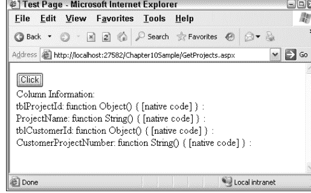


### Sys.Data.DataTable

`Sys.Data.DataTable` 类提供了与 `System.Data.DataTable` 集成的所有信息。`DataTable` 公开了以下可能感兴趣的成员。

| 成员 | 描述 |
| :--- | :--- |
| `get_length()` | 此方法将返回 `DataTable` 中的行数。 |
| `get_columns()` | 此方法将返回 `DataColumn` 对象的数组。 |
| `getItem(index)` | 此方法将在给定索引处返回特定的 `DataRow`。 |

以下是遍历 `DataTable` 行的一些代码：

```javascript
function MethodReturn(result)
{
    var i = 0;
    var str = "";
    var strRowsInfo = "";
    var strReturn = "<br />";
    //get a datatable
    var tbl1 = result.getItem(0);
    for(i = 0; i < tbl1.get_length(); i++)
    {
        //tbl1.getItem(i) will return the ith DataRow
        //getProperty("Column Name") will return the column value from a DataRow
        strRowsInfo += tbl1.getItem(i).getProperty("ProjectName") + strReturn;
    }
    document.getElementById("RowInfo").innerHTML = strRowsInfo;
}
```

在前面的代码中，返回了一个数据集。第一个数据表通过调用 `getItem(0)` 获得。然后遍历 `DataRows`。这是通过 `for()` 循环完成的。要获取特定行中列的值，我们使用 `getProperty("ProjectName")` 方法。在此示例中，此方法返回 `ProjectName` 列的值。前面代码的一些示例输出如图 10-11 所示。

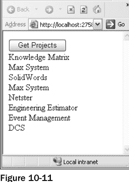

### Sys.Data.DataRow

`Sys.Data.DataRow` 类是 `System.Data.DataRow` 类的 Atlas 版本。`DataRow` 有一组属性，旨在用于访问数据表中的单行数据。例如，前面代码中显示的 `DataRow.getProperty("ColumnName")` 方法将返回该 `DataRow` 中特定列的值。

有关此命名空间、类及其他内容的更多信息，您可以查看 `http://atlas.asp.net/` 和 `http://atlas.asp.net/docs` 获取 Microsoft 的最新文档，以及本书的网站 `http://BeginningAjax.com`。

## 在 Atlas 中注册命名空间和类

JavaScript 是一种相当简单的脚本语言。当在 Web 浏览器环境中实现时，它缺乏现代编程语言的许多常见功能。因此，Atlas 有必要添加功能来创建命名空间、类以及其他对使用现代编程语言的开发者来说很熟悉的项目。在 Atlas 中注册类有几种不同的机制。

### Type.registerNameSpace

命名空间用于将共同功能分组在一起。`Type.registerNameSpace()` 方法用于在支持 Atlas 的 JavaScript 中注册命名空间。此方法的正确调用如下。

```javascript
Type.registerNameSpace('NamespaceName');
```

在此示例中，`NamespaceName` 是表示命名空间名称的字符串。

### NamespaceName.ClassName.registerClass

类是一组提供特定功能的方法和数据。Atlas 提供了一种注册类的机制。这是在以下调用中执行的。

```javascript
NamespaceName.ClassName.registerClass('NamespaceName.ClassName', ParentClass,
InterfaceImplemented);
```

在此示例中，`NamespaceName.ClassName` 是表示类名的字符串。如果要注册的类要继承自另一个类，则将该父类作为第二个参数传递。最后一个参数是类中可能实现的任何接口。

> 请注意，并非所有参数都是必需的。

### NamespaceName.ClassName.registerAbstractClass

抽象类是包含实际上未在类中实现的方法的类。此外，抽象类不能被实例化——它们的唯一目的是用作子类的模型。定义通过以下代码执行。

```javascript
NamespaceName.ClassName.registerAbstractClass('NamespaceName.ClassName',
ParentClass, InterfaceImplemented);
```

在此示例中，`NamespaceName.ClassName` 是表示类名的字符串。如果要注册的类要继承自另一个类，则将该父类作为第二个参数传递。最后一个参数是类中可能实现的任何接口。

> 请注意，并非所有参数都是必需的。

### NamespaceName.ClassName.registerSealedClass

密封类是不可被继承的类。定义通过以下代码执行。

```javascript
NamespaceName.ClassName.registerSealedClass('NamespaceName.ClassName', ParentClass, InterfaceImplemented);
```

在此示例中，`NamespaceName.ClassName` 是表示类名的字符串。如果要注册的类要继承自另一个类，则将该父类作为第二个参数传递。最后一个参数是类中可能实现的任何接口。

> 请注意，并非所有参数都是必需的。

### InterfaceName.registerInterface

接口本质上声明一个类实现了一组特定的方法。接口通过注册接口来定义。这是通过以下代码执行的。

```javascript
InterfaceName.registerInterface('InterfaceName');
```

在此示例中，`InterfaceName` 只是一个表示要实现的接口名称的字符串。请注意，按照惯例，所有接口都以大写“I”前缀命名。

### NamespaceName.ClassName.registerBaseMethod

如果一个类要在基类中被专门重写，则必须在基类中标记该方法。这是通过以下代码执行的：

```javascript
NamespaceName.ClassName.registerBaseMethod(class, "methodname");
```

例如，该类很可能在 JavaScript 中被定义为当前类（`this`）。方法名称的一个很好的候选是 `dispose` 方法。

## 命名空间和类

命名空间允许将紧密相关的类、方法、对象和数据分组。Atlas 在 `Type` 对象上包含用于添加命名空间和类的功能。这些通过 `Type.registerNamespace` 和 `Class.registerClass` 方法完成。

## 动手实践：通过 Atlas 添加命名空间和类

通过 Atlas 向 JavaScript 添加命名空间和类所需的步骤如下：

1. 必须将 `atlas:ScriptManager` 添加到 `.aspx` 页面。脚本管理器将添加适当的脚本引用。

   ```aspx
   <atlas:ScriptManager runat="server" ID="scriptManager" />
   ```

2. 注册一个命名空间。这是通过 `Type.registerNamespace` 方法执行的。在此示例中，字符串 `NamespaceName` 只是命名空间的一个示例名称：

   ```javascript
   Type.registerNamespace("NamespaceName");
   ```

3. 定义一个类的内容：

   ```javascript
   ExampleNamespace.cComplexCustomerType = function(Name, Address) {
       var _Name = Name;
       var _Address = Address;

       this.getName = function() {
           return _Name;
       }
       this.setName = function(val) {
           _Name = val;
       }
       this.getAddress = function() {
           return _Address;
       }
       this.setAddress = function(val) {
           _Address = val;
       }
       this.Dispose = function() {
           alert("disposing component with Customer Name:" + this.getName() + "@" + this.getAddress());
       }
   }
   ```

4. 注册该类：

   ```javascript
   Type.registerClass("ExampleNamespace.cComplexCustomerType", null, Web.IDisposable);
   ```

5. 要向类添加标准方法，例如 `toString()`，请使用原型成员：

   ```javascript
   ExampleNamespace.cComplexCustomerType.prototype.toString = function() {
       return this.getName() + " at " + this.getAddress();
   }
   ```

通过原型成员添加项会导致实例之间共享成员。必须避免共享通过原型成员定义的对象，否则可能会产生异常结果。从概念上讲，这类似于 .NET 中的静态/共享成员。

既然已经创建了一个类，程序就可以使用这个类。以下代码将使用该类并显示客户对象的 `toString()` 值：

```javascript
var objCust = new ExampleNamespace.cComplexCustomerType("Acme", "Wileyville, USA");
alert(objCust.toString());
```

图 10-12 显示了结果。

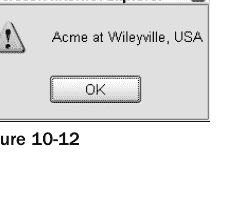

# 第 10 章

## 继承

继承是一种基于现有类的功能创建新类的机制。新类接管父类或基类的属性和行为。这有助于在进行极少修改的情况下重用现有代码。通过 Atlas，可以在 JavaScript 中实现继承。

### 动手实践：使用 Atlas 提供继承

在下面的示例中，你将看到一个名为 `Animal.Generic` 的类被创建。该类有两个属性：`Name` 和 `Address`。然后代码创建了一个名为 `Animal.Cat` 的类，它继承自 `Animal.Generic` 类：

```html
<script language="javascript">
Type.registerNamespace("Animal");
Animal.Generic = function(Name, Address) {
    var _Name = Name;
    var _Address = Address;

    this.getName = function() {
        return _Name;
    }
    this.setName = function(val) {
        _Name = val;
    }
    this.getAddress = function() {
        return _Address;
    }
    this.setAddress = function(val) {
        _Address = val;
    }
    this.Dispose = function() {
        alert("disposing component with Animal Name:" + this.getName() + " @ " + this.getAddress());
    }
    this.toString = function() {
        return _Name + " at " + _Address;
    }
}
Type.registerClass("Animal.Generic", null, Web.IDisposable);
Animal.Cat = function(Name, Address, Parents) {
    Animal.Cat.initializeBase(this, [Name, Address]);

    var _Parents = Parents;

    this.getParents = function() {
        return _Parents;
    }
    this.setParents = function(Parents) {
        _Parents = Parents;
    }
}
Type.registerClass('Animal.Cat', Animal.Generic);
</script>
```

请注意，在调用 `Type.registerClass` 时，父对象作为调用的第二个参数传递以注册该类。

要创建 `Animal.Cat` 类，请使用以下代码：

```javascript
function GenerateClasses() {
    var strReturn = "<br />";
    var strOutput;
    var objCat = new Animal.Cat("Wells", "Knoxville, TN", "Wally and Ronda");
    strOutput = "Cat's name: " + objCat.getName() + strReturn;
    strOutput += "Cat's Parents: " + objCat.getParents();
    document.getElementById("Output").innerHTML = strOutput;
}
```

上述代码的输出如图 10-13 所示。

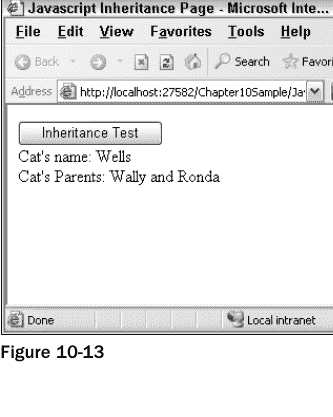

## 接口

接口是契约，它允许软件程序查看一个组件/类是否实现了特定的方法。接口可以被视为继承的补充。对于继承，基类提供了大部分功能。而对于接口，新类负责实现所需的功能。可以假设，如果实现了某个接口，那么该接口定义的方法/属性就已被实现。

### 动手实践：实现接口

在这个例子中，你将使用现有的 `Animal.Generic` 和 `Animal.Cat` 类，并在 `Animal.Cat` 中实现 `IPet` 接口，但不在 `Animal.Generic` 中实现。看看下面的代码：


```html
<script language="javascript">
Type.registerNamespace("Animal");
// Define an interface
Animal.IPet = function() {
    this.getFriendlyName = Function.abstractMethod;
}
Animal.IPet.registerInterface('Animal.IPet');
// define a generic base class
Animal.Generic = function(Name, Address) {
    var _Name = Name;
    var _Address = Address;

    this.getName = function() {
        return _Name;
    }
    this.setName = function(val) {
        _Name = val;
    }
    this.getAddress = function() {
        return _Address;
    }
    this.setAddress = function(val) {
        _Address = val;
    }
    this.Dispose = function() {
        alert("disposing component with Animal Name:" + this.getName() + "@" + this.getAddress());
    }
}
// define a class that inherits from Animal.Generic and implements IPet
Animal.Cat = function(Name, Address, Parents) {
    Animal.Cat.initializeBase(this, [Name, Address]);

    var _Parents = Parents;

    this.getParents = function() {
        return _Parents;
    }
    this.setParents = function(Parents) {
        _Parents = Parents;
    }
    this.getFriendlyName = function() {
        return "Cat";
    }
}
Animal.Cat.registerClass('Animal.Cat', Animal.Generic, Animal.IPet);
</script>
```

在前面的代码中，创建了一个名为 `Animal` 的命名空间。在该命名空间内有一个 `Animal.Generic` 类。这个类没有继承任何东西。它通过 `registerClass()` 方法实现了 `Sys.IDisposable`。定义了一个 `Animal.IPet` 接口，并定义了 `getFriendlyName()` 方法。创建了一个名为 `Animal.Cat` 的新类。这个类继承自 `Animal.Generic`，并且通过定义 `getFriendlyName` 实现了 `Animal.IPet` 接口。这项工作通过调用 `Animal.Cat.registerClass()` 方法来处理。

要调用前面的代码，请使用以下代码。下面的代码测试 `obj` 和 `objGen` 对象。`obj` 对象是 `Animal.Cat` 类型。鉴于 `Animal.Cat` 类实现了 `IPet` 接口，调用 `isImplementedBy(obj)` 方法返回 true。鉴于 `Animal.Generic` 类没有实现 `IPet` 接口，调用 `isImplemented(objGen)` 方法返回 false。

```javascript
function GenerateClasses() {
    var strReturn = "<br />";
    var strOutput;
    var objCat = new Animal.Cat("Wells", "Knoxville, TN", "Wally and Ronda");
    var objGeneric = new Animal.Generic("Spot", "Atlanta, GA");
    strOutput = "Cat's name: " + objCat.getName() + strReturn;
    strOutput += "Cat's Parents: " + objCat.getParents() + strReturn;
    if (Animal.IPet.isImplementedBy(objCat)) {
        strOutput += "Obj does implement IPet." + strReturn;
        strOutput += "This object has a friendly name of: " + objCat.getFriendlyName() + strReturn;
    }
    if (!Animal.IPet.isImplementedBy(objGeneric)) {
        strOutput += "Animal.Generic does not implement the IPet interface.";
    }
    document.getElementById("Output").innerHTML = strOutput;
}
```

上述代码的结果如图 10-14 所示。

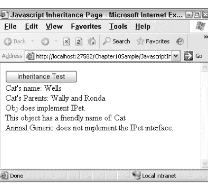

## 枚举

Atlas 框架允许创建类似于 .NET Framework 中的枚举。`Web.Enum` 类支持 `getValues()` 方法，该方法返回一组值。在这个例子中，代码遍历这些值。

```javascript
function PerformEnumerations() {
    var strOut = "";
    var strReturn = "<br />";
    var objEnum = Web.Enum.create("Good", "Bad", "Indifferent");
    for (var strItems in objEnum.getValues()) {
        strOut += strItems + strReturn;
    }
    document.getElementById("Output").innerHTML = strOut;
}
```

输出示例如图 10-15 所示。

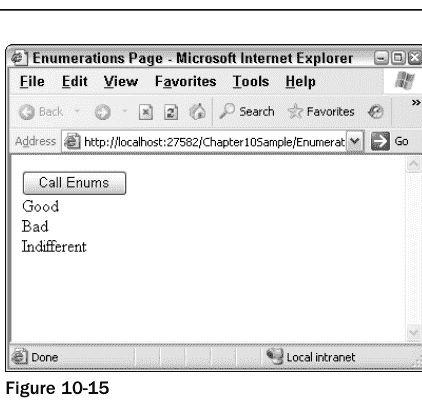

## 调试

使用 Atlas，你有两个对调试有用的特性。这些内置机制中的每一个都显示对象的内容。有关调试的更多信息，请参见第 13 章。

### 使用 `debug.dump` 进行调试

第一个选项是命令 `debug.dump`。`debug.dump` 命令将输出对象的内容，主要与三个参数一起使用。一个示例调用采用以下参数：

```javascript
debug.dump(object, string, boolean)
```

在此调用中，要查询的对象是第一个参数。第二个参数是一个字符串，将作为跟踪中对象的名称显示。最后一个参数决定是否将在其顶层以下的多层内查询该对象。

图 10-16 显示了使用数据集作为传递内容的 `debug.dump()` 调用的输出。

# 第10章

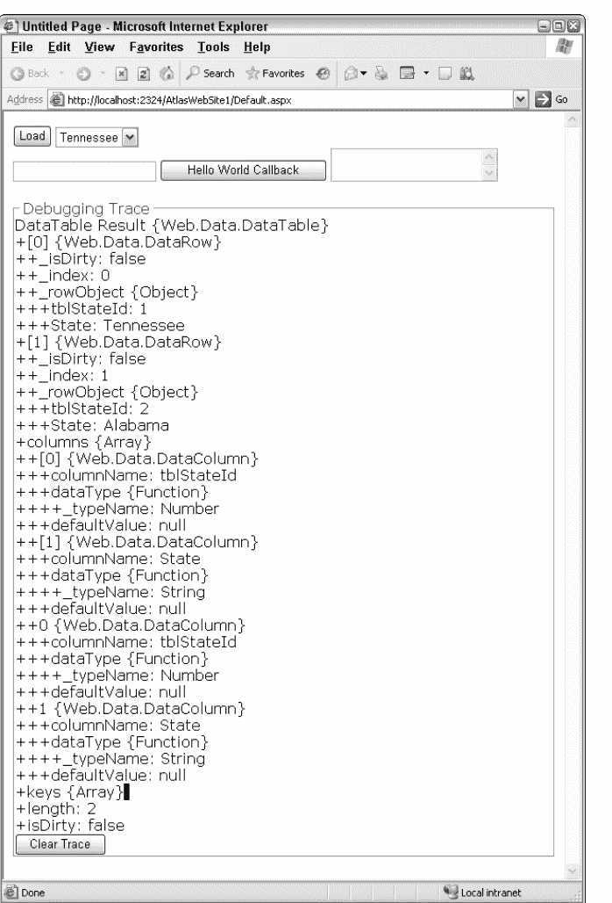

### 使用 `for()` 循环进行调试

第二种选项是在标准 JavaScript 中查询一个 JavaScript 对象。查询对象属性的代码使用 `for()` 循环构造，如下所示：

```javascript
for (prop in obj)
{
    alert(prop);
}
```

此代码将显示对象的属性。此代码可以扩展，通过递归算法显示对象的所有属性。

### 关于 Atlas 客户端脚本的特别注意事项

在使用 Atlas 客户端脚本时，您应该考虑一些特殊的事项。

- `document.writeln()` —— 使用 `document.writeln()` 会在 Atlas 中产生时间问题，可能导致该方法失败。因此，不建议使用。

- `Body` 标签的 `onload()` 事件 —— `onload()` 事件可能无法正确触发。为创建相同类型的功能，可以在页面的 XML/script 部分添加命令 `<application load="yourFunction"/>`。

- 时间问题 —— 很可能存在其他与时间相关的问题，因此请灵活应对。例如，在 `forums.asp.net` 上已经讨论过，`pageLoad()` 方法在 Atlas 环境中存在一些未记录的问题，并可能在某个时候被移除。

## 使用的资源

由于本书的 Atlas 章节是在该软件相对新时撰写的，因此可用的文档相当有限。因此，在撰写本书的这些章节时，大量使用了以下资源。

- **Wilco Bauwer** —— Wilco 是 Atlas 团队的实习生。他在 `www.wilcob.com` 上广泛撰写关于 Atlas 的博客。此外，Wilco 还亲自回答了我的许多电子邮件和即时消息问题。

- **ASP.NET 论坛** —— `www.asp.net` 上有几个专门讨论 Atlas 的论坛。

- **Scott Guthrie 的博客** —— `http://weblogs.asp.net/scottgu`。

- **Nikhil Kothari 的博客** —— `www.nikhilk.net`。

## 总结

在本章中，您开始深入了解 Atlas。Atlas 使您能够调用 Web 服务器并通过 Web 服务调用方法，而无需在客户端和服务器之间往返。对于用户来说，这消除了用户通常看到的恼人闪烁，以及将用户重定向回网页顶部（而不是用户在页面内滚动的位置）而导致的用户上下文丢失。在本章中，我们已经看到 Atlas 支持：

- 通过 Web 服务回调到 Web 服务器
- 在客户端和服务器之间传递简单和复杂的对象
- 使用命名空间、类、继承和接口等特性提供一套语言扩展

既然您已经了解了 Atlas 的一些客户端构建块，下一章将在此基础上，探讨 Atlas 框架提供的控件。

# Atlas 控件

本章介绍了 Microsoft Atlas 控件的概念。这些控件的功能与其他 ASP.NET 服务器控件类似。一旦呈现，这些控件将提供必要的 HTML，以便从客户端与服务器进行通信。在本章中，您将了解：

- 使用 Atlas 引用和创建客户端控件
- 客户端事件——由用户控件引发并在客户端脚本中处理的事件
- 扩展现有的 ASP.NET 控件
- 数据绑定，它允许连接组件和控件以管理两者之间的数据流

## 控件

通过 Atlas 框架，页面开发人员能够创建丰富的应用程序，而无需在每个用户操作时都回发到服务器。此功能的大部分由一组称为 Atlas 服务器控件的控件提供。这些控件为 Web 浏览器客户端输出适当的标记，以便客户端上的操作不需要进行令人畏惧的回发。

我们首先查看一些通用控件，然后介绍几个更复杂的控件。

### 按钮

HTML 按钮是 Web 应用程序中最基本的控件之一。它通常用作某种类型用户交互的最后一步。例如，用户将填写包含联系信息的表单。此过程的最后一步是用户将该信息提交给 Web 服务器。Atlas 支持在 `Sys.UI.Button()` 类中使用按钮。

**动手试试：创建按钮并更改其属性**

让我们看一个动态创建按钮然后更改其属性之一的示例。动态创建按钮可以通过文档对象模型（DOM）完成：

```javascript
var associatedElement = document.getElementById("divTest");
var btnCreate = document.createElement("button");
btnCreate.id = "btnCreated";
btnCreate.value = "Hi";
btnCreate.innerHTML = "Hi";
associatedElement.appendChild(btnCreate);
```

有关 DOM 的更多信息，请参阅第 3 章。

Atlas 允许通过 JavaScript 操作控件。前面的代码将持有对按钮的引用。创建对按钮的引用后，将设置对象的 `visible` 和 `accessKey` 属性。在第一个代码片段中，使用 DOM 创建了一个按钮。在第二个片段中，创建了对按钮的引用。按钮的 `visible` 属性设置为 `true`，`access` 属性设置为 `"o"`。

现在您在浏览器中有了一个按钮，您可能需要在 Atlas 中引用该按钮。要引用 Atlas 中的按钮，请使用以下代码：

```javascript
var btnAlreadyThere = new Sys.UI.Button($("btnCreated"));
btnAlreadyThere.set_visible(true);
btnAlreadyThere.set_accessKey("o");
```

在查看前面的代码时，请注意以下几点：

- 美元符号（`$`）是 `document.getElementById` 的快捷方式。使用 DOM 方法意味着该方法将在支持 DOM 的多个浏览器中提供支持。

- 有一个名为 `Sys.UI.Button` 的类。此类封装了 HTML 按钮的功能，并允许通过 Atlas 修改该按钮。

- `Sys.UI.Button` 类提供了对按钮的引用。该类不提供创建新按钮的支持，仅用于引用按钮。

- 设置属性很容易。前面的代码展示了 `visible` 和 `accessKey` 属性的设置。这些通过调用 `set_visible(boolean)` 和 `set_accessKey(string)` 来设置。

在 Atlas 中，可以为按钮或其他用户控件设置大约 40 个属性。最常见的将是显示/用户界面（UI）相关的属性，例如 `behaviors`、`cssClass`、`enabled` 和其他 UI 属性。详细讨论按钮控件的所有属性或每个控件的所有属性超出了本书的范围。可以说，Microsoft Atlas 提供的每个附加 UI 包装控件都提供了一组类似的属性。您可以使用第 10 章末尾介绍的 `for()` 循环来查询 JavaScript 对象，从而获取它们。

### `Sys.UI.Data` 控件

`Sys.UI.Data` 命名空间提供了一些关键的视觉/UI 相关控件——即 `listView` 和 `itemView` 类。我们将在这里查看 `listView` 控件。

**动手试试：使用 `listView`**

`listView` 是一个 Atlas 控件，用于显示表格形式的数据。它与 ASP.NET 中的 `GridView`/`DataGrid` 或经典 ASP 中用于呈现数据的 HTML 表格非常相似。`listView` 在页面 `xml-script` 部分的 `<page>` 标签内设置。让我们看看本章后面数据绑定部分中的使用 `listView` 的以下代码。

```xml
<page xmlns:script="http://schemas.microsoft.com/xml-script/2005">
    <components>
        <listView id="ProjectResults"
            itemTemplateParentElementId="ProjectTemplate">
            <layoutTemplate>
                <template layoutElement="ProjectTemplate" />
            </layoutTemplate>
            <itemTemplate>
                <template layoutElement="ProjectItemTemplate">
                    <label id="ProjectNameLabel">
                        <bindings>
                            <binding dataPath="ProjectName" property="text" />
                        </bindings>
                    </label>
                </template>
            </itemTemplate>
        </listView>
    </components>
</page>
```

请注意此 `listView` 中的一些设置：

- `listView` 的 ID 为 `"ProjectResults"`。

- 目标元素是 `"ProjectTemplate"`。此示例中的目标元素是一个 `div` 标签，它将接收表格结果。

- 绑定定义了数据如何绑定到元素。有关数据绑定的更多信息，请参阅本章后面的部分。在此示例中，数据列 `ProjectName` 绑定到标签 `ProjectNameLabel`。

- `layoutTemplate` 定义了记录将使用的布局。在这种情况下，`ProjectItemTemplate` 是将保存绑定到 `listView` 的数据内容的元素。

- `itemTemplate` 定义了单条记录将使用的布局。在 `itemTemplate` 内部，有一个绑定设置，将 `ProjectItemTemplate` 标签与由 `ProjectNameLabel` 元素定义的各个记录的布局相关联。

### 服务器控件


Atlas 的一个有趣之处在于对各种以服务器为中心的控件的支持，以及与以服务器为中心的 ASP.NET 思维方式的集成。这些控件背后的理念是保留服务器控件模型，并添加对客户端/Ajax 场景的支持。

## 部分更新和 UpdatePanel

最简单的场景之一是能够执行增量更新。目标是尽量减少回发和完全刷新的使用，转而使用有针对性的部分更新。此场景通过 `ScriptManager` 控件启用部分更新来实现。

```xml
<atlas:ScriptManager runat="server" id="scriptManager"
    EnablePartialRendering="true" />
```

将 `EnablePartialRendering` 属性设置为 `true`，会使用 Atlas `Sys.Net.WebRequest` 类（基于 `XMLHttpRequest` 对象）来模拟回发。在服务器端，页面将像发生了“经典”页面回发一样进行处理。这适用于调用 `doPostBack` 的服务器控件，无论是内置控件还是第三方控件。结果就是 `Page.IsPostBack` 在必要时会返回 `true`。此外，服务器端事件会按设计触发，事件处理器也会继续被处理。

## 尝试使用 UpdatePanel

此过程的下一步是确定当服务器返回数据时该怎么做。`ScriptManager` 需要确定页面的哪些部分发生了变化。在这种情况下，`UpdatePanel` 会帮助 `ScriptManager`。`UpdatePanel` 用于定义可以一起更新的页面部分/区域。`ScriptManager` 将覆盖整个 HTML 页面的呈现，仅显示 `UpdatePanel` 的内容。此外，`ScriptManager` 还将处理页面标题、视图状态（和其他隐藏字段）、更新后的样式等的更新。

考虑这个小例子。在这个例子中，你将有一个员工下拉列表。当选择一名员工时，将显示一个 `GridView` 并根据所选员工进行填充。这是一些 ASPX 代码：

```xml
<atlas:ScriptManager ID="ScriptManager1" runat="server" EnablePartialRendering="true" />
<div>
    <div>
        <table>
            <tr>
                <td><asp:Label runat="server" ID="lblEmployee">Employee:</asp:Label></td>
                <td><asp:DropDownList runat="server" ID="ddlEmployee"></asp:DropDownList></td>
            </tr>
            <tr>
                <td colspan="2">
                    <asp:Button runat="server" ID="btnSearch" Text="Search" OnClick="btnSearch_Click" />
                </td>
            </tr>
        </table>
    </div>
    <atlas:UpdatePanel runat="server" ID="upSearch">
        <ContentTemplate>
            <asp:GridView ID="gvSearchResults" runat="server" EnableSortingAndPagingCallbacks="true">
            </asp:GridView>
        </ContentTemplate>
        <Triggers>
            <atlas:ControlEventTrigger ControlID="btnSearch" EventName="Click" />
        </Triggers>
    </atlas:UpdatePanel>
</div>
```

### 工作原理

从概念上讲，你应该注意前面代码中的几个要点：

- `UpdatePanel` 允许开发者定义一个将被更新的区域。
- `<atlas:ControlEventTrigger>` 允许通过命名属性指定 `ControlID`。这使得 Atlas 可以专门作用于某个控件。
- 有一个 `EventName` 属性。此属性会“监听”由 `EventName` 属性指定的特定事件。该属性与指定的 `ControlID` 属性协同工作。

基于前面的代码，你将能够得到图 11-1 所示的结果屏幕。

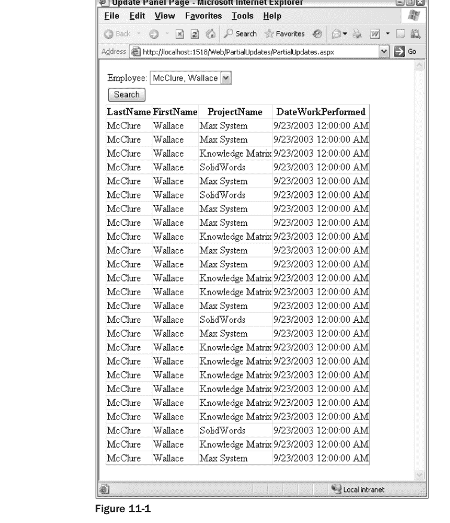

为了证明整个页面并未更新，请查看在方法返回其值后上述页面的源代码。

```html
<!DOCTYPE html PUBLIC "-//W3C//DTD XHTML 1.0 Transitional//EN" "http://www.w3.org/TR/xhtml1/DTD/xhtml1-transitional.dtd">
<html xmlns="http://www.w3.org/1999/xhtml" >
<head><title>
Update Panel Page
</title><style type="text/css">
atlas__delta { font-family:Lucida Console; }
</style></head>
<body>
<form name="form1" method="post" action="PartialUpdates.aspx" id="form1">
<div>
<input type="hidden" name="__VIEWSTATE" id="__VIEWSTATE" value="....." />
</div>
<script src="../ScriptLibrary/Atlas/Debug/Atlas.js"
type="text/javascript"></script>
<div>
</div>
<div>
<table>
<tr>
<td><span id="lblEmployee">Employee:</span></td>
<td><select name="ddlEmployee" id="ddlEmployee">
<option value=""></option>
<option value="ee8d807d-fab3-4e39-948a-67362c61a470">McClure, Wallace</option>
<option value="4d39f850-2b65-477d-9cf4-c90158e26b5f">Coder, Lou</option>
<option value="3a3221a8-5043-46cb-bd61-d12e77195f61">Smith, Joe</option>
</select></td>
</tr>
<tr>
<td colspan="2">
<input type="submit" name="btnSearch" value="Search" id="btnSearch" />
</td>
</tr>
</table>
</div>
<span id="upSearch_Start"></span>
<div>
</div>
        <span id="upSearch_End"></span>
<div>
<input type="hidden" name="__EVENTVALIDATION" id="__EVENTVALIDATION"
value="/wEWBgK9+Yf9BgLo+4f+BgKWzeL+BQL4qeKmDgKdwp/VDgKIn/PuCnnVW0Hi59nE7dq0vREhD29FVgTo" />
</div>
<script type="text/xml-script"><page
xmlns:script="http://schemas.microsoft.com/xml-script/2005"><components />
</page></script><script
type="text/javascript">Sys.WebForms._PageRequest._setupAsyncPostBacks(document.ge
tElementById('form1'), 'ScriptManager1');
</script></form>
</body>
</html>
```

上述代码包含几个需要理解的重要事项：

- 这与页面首次加载时会生成的代码相同。`ViewState` 在“查看源代码”中处于其默认设置。虽然在这个例子中 `ViewState` 为了简洁而被“裁剪”，但 `ViewState` 似乎并不包含你从将数据绑定到 `GridView` 并重新发送给客户端的页面所预期看到的全部数据绑定内容。`UpdatePanel` 已经处理了 `ViewState` 的更新。
- `GridView` 未显示在页面上。`UpdatePanel` 被 `<span>` 标签所取代。这将是数据返回到 Web 客户端时 `GridView` 被放置的位置。当数据返回时，数据被放置在 `<span>` 标签内。
- 这种方法允许将 Ajax 功能集成到 ASP.NET 应用程序中，同时保留 ASP.NET 传统上提供的以服务器为中心的开发方法。

## 定时刷新

Atlas 包含一个计时器控件，用于执行定时操作。可能有用的场景包括：

- 为投资者提供股票代码更新
- 制造环境中的库存更新
- 零售库存
- 高管信息系统或仪表盘

## 尝试使用 Timer 控件执行定时更新

看一些执行定时更新的代码：

```xml
<atlas:TimerControl runat="server" ID="tc" Interval="5000" OnTick="tc_Tick"/>
<atlas:UpdatePanel ID="up" runat="server" Mode=Conditional>
<ContentTemplate>
<asp:Label ID="lblInv" runat="server" AssociatedControlID="lblNum" />:
<asp:Label ID="lblNum" runat="server" />
</ContentTemplate>
<Triggers>
<atlas:ControlEventTrigger ControlID="tc" EventName="Tick" />
</Triggers>
</atlas:UpdatePanel>
```

ASP.NET 事件控件是：

```csharp
protected void tc_Tick(object sender, EventArgs e)
{
    lblInv.Text = "Widget";
    lblNum.Text = DateTime.Now.Millisecond.ToString();
    if ( /* Something happened */ true)
    {
        up.Update();
    }
}
```

### 工作原理

在此示例中，设置了一个名为 `<atlas:TimerControl>` 的 Atlas 服务器控件。有两个值得关注的属性。它们是：

- `Interval` — 间隔是在调用 `OnTick` 事件之前的毫秒数。在此示例中，接口设置为 5,000 毫秒。因此，每 5,000 毫秒，计时器控件将更新并运行。
- `OnTick` — 当 `Interval` 定义的时间段过去时触发此事件。

与计时器一起，示例中的 `<Trigger>` 显示当计时器控件从 5 秒倒数到 0 时，会调用指定的方法。在这种情况下，服务器端事件触发并更新标签控件，而无需不必要的页面回发。在此示例中，屏幕上列出的库存每 5 秒更新一次。

图 11-2 显示了输出可能的样子。

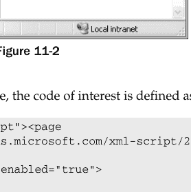

如果你查看此页面的源代码，相关的代码定义为：

```xml
<script type="text/xml-script"><page xmlns:script="http://schemas.microsoft.com/xml-script/2005">
  <components>
    <timer interval="5000" enabled="true">
      <tick>
        <postBack target="tc" argument="" />
      </tick>
    </timer>
  </components>
</page></script>
<script type="text/javascript">Sys.WebForms._PageRequest._setupAsyncPostBacks(document.getElementById('form1'), 'ScriptManager1');</script>
```

此代码包含客户端组件配置的定义。此代码由服务器端 `TimerControl` 生成。当服务器控件呈现给客户端时，生成的就是此代码。

## Atlas 控件

### 控件扩展程序

在 ASP.NET 中，有一组开发者已经相当熟悉的控件。这些控件包括文本框、标签、下拉列表框等。Atlas 带来的一个问题是，如何在保持开发者熟悉的编程模型的同时，为这些控件提供额外的功能。控制扩展程序正是为解决这个问题而生。通过控制扩展程序，可以将客户端功能添加到现有的服务器端控件上，同时保持服务器端编程模型不变。这类现有控件的扩展示例不胜枚举。

你将在下一节看到 `AutoComplete` 扩展控件。`AutoComplete` 扩展控件旨在扩展 ASP.NET `Textbox` 控件的功能。`AutoComplete` 控件将通过将其连接到 Web 服务来获取信息，从而扩展 `Textbox` 控件的功能。

> 在第 12 章，将介绍拖放扩展程序。它将通过 Atlas 提供拖放支持。

## AutoComplete

Ajax 的一个经典示例是一个在概念上类似于 Windows 组合框的文本框（类似，但并不完全相同）。此功能因 Google Suggest 服务而广为人知。

Atlas 提供了扩展 ASP.NET 2.0 中 `<asp:Textbox>` 的能力。此扩展从文本框中获取输入，将文本传递给 Web 服务，然后 Web 服务返回一个可能项的列表，类似于 Windows 组合框。让我们看一个简单的例子。以下是 ASPX 代码。

```html
<atlas:ScriptManager ID="ScriptManager1" runat="server" 
    EnablePartialRendering="true" />
<div>
    <asp:Textbox runat="server" id="txtBox" />
    <atlas:AutoCompleteExtender runat="server" ID="ace">
        <atlas:AutoCompleteProperties TargetControlID="txtBox"
            Enabled="true" ServicePath="AutoCompleteEx.asmx"
            ServiceMethod="TextBoxAutoComplete" />
    </atlas:AutoCompleteExtender>
</div>
```

看看这里指定了什么。

- 有一个 ASP.NET 文本框。这是 ASP.NET 中的标准文本框。
- 有一个新的服务器控件类型。这是一个扩展控件，具体来说是 `AutoCompleteExtender`。它是一个作用于 ASP.NET 文本框的服务器控件。扩展控件“扩展”了文本框的功能。
- 在 `<atlas:AutoCompleteProperties>` 标签内指定了一系列属性：
  - `TargetControlID` —— `TargetControlID` 是将作为扩展目标的控件。
  - `ServicePath` —— `ServicePath` 属性是要调用的 Web 服务的路径。
  - `ServiceMethod` —— `ServiceMethod` 属性是 Web 服务中函数的名称。

既然你已经看到了 ASPX 代码，现在让我们看看 Web 服务：

```csharp
[WebMethod]
public String[] TextBoxAutoComplete(string prefixText, int count) // 如果名称不是 prefixText 和 count，似乎会有问题
{
    int i = 0;
    int iLength = 10;
    List<String> Values = new List<string>();

    for (i = 0; (i < iLength); i++ )
    {
        Values.Add(Convert.ToString(prefixText + i.ToString()));
    }
    String[] strReturn = new String[Values.Count];
    strReturn = Values.ToArray();
    return (strReturn);
}
```

此 Web 服务需要注意的问题是：

- 必须返回以数组形式的一组字符串。


- 输入参数必须是一个字符串和一个整数。此外，在撰写本文时，这些参数必须命名为`prefixText`和`count`。将这些值命名为其他名称将导致代码无法正常工作。

- 在此示例中，代码旨在接收输入并添加值 0-9。此代码仅接受输入并添加一个数字。它期望输入一个数字，但在此示例中没有进行特定的检查。

既然你已经看到了代码，让我们看看图 11-3 中`AutoCompleteExtender`的输出。

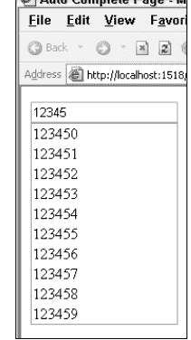

**图 11-3**

接下来，看看生成的源代码。以下是来自 Internet Explorer 的“查看源代码”功能的 HTML 输出。

```html
<script src="../ScriptLibrary/Atlas/Debug/Atlas.js" type="text/javascript"></script>
<div>
<input name="txtBox" type="text" id="txtBox" />
</div>
</div>
<div>
<input type="hidden" name="__EVENTVALIDATION" id="__EVENTVALIDATION" value="/wEWAgK44YDODwKF+8K0ARfViGhYggOYxdy6jHmmcQs826z" />
</div>
<script type="text/xml-script"><page xmlns:script="http://schemas.microsoft.com/xml-script/2005">
<components>
<control id="txtBox">
<behaviors>
<autoComplete serviceURL="AutoCompleteEx.asmx" serviceMethod="TextBoxAutoComplete" />
</behaviors>
</control>
</components>
</page></script><script type="text/javascript">Sys.WebForms.PageRequest._setupAsyncPostBacks(document.getElementById('form1'), 'ScriptManager1');
</script></form>
```

在查看此代码时，请注意以下几点：

- HTML 文本框定义上没有特殊参数。
- 有一个组件定义。
- 组件定义包含一个控件 ID 和一个行为。这些定义将文本框与行为关联起来。

## 数据绑定

数据绑定允许在组件和用户界面控件之间交换数据。Atlas 允许数据源和数据控件在 Web 浏览器中直接交互，而无需回发到服务器。Atlas 提供了创建数据源的机制。这些数据源为执行 CRUD（创建、读取、更新、删除）风格的操作提供服务。相关的数据库操作是`select`、`insert`、`update`和`delete`。

Atlas 支持两种类型的数据绑定——声明式和编程式。声明式数据绑定是大多数 ASP.NET 开发者所熟悉的，但接下来的两节将更详细地探讨这两种方式。

# 声明式数据绑定

当开发者将数据组件和用户界面组件绑定在一起时，这称为数据绑定。在 Atlas 和 ASP.NET 中，还有另一种称为声明式数据绑定的数据绑定类型。在声明式数据绑定中，所有绑定信息都静态地声明在网页的一部分中。

# 第 11 章

你会注意到，在下面的示例中，仍然有一些代码是编程式的。声明式数据绑定通常并非 100% 声明式。

# 动手尝试声明式数据绑定

在此示例中，你将了解代码片段和以声明方式获取数据所采取的步骤：

```html
<form id="form1" runat="server">
<atlas:ScriptManager runat="server" ID="ScriptManager1" >
    <Services>
        <atlas:ServiceReference GenerateProxy=true Path="WebServiceProjects.asmx" />
    </Services>
</atlas:ScriptManager>
<input type="button" id="btnGetData" value="Get Project List" onclick="GetData()"
/>
<script language="javascript">
    function GetData()
    {
        WebServiceProjects.GetProjects(OnServiceComplete);
    }
    function OnServiceComplete(result)
    {
        var projectName = $("ProjectResults");
        projectName.control.set_data(result);
    }
</script>
```

```html
<div id="ProjectResults">
</div>
<div id="ProjectTemplate">
This is a list of all project in the table tblProject:<br />
<div id="ProjectItemTemplate">
    Project: <strong><span id="ProjectNameLabel"></span></strong>
</div>
</div>
</div>
</form>
<script type="text/xml-script">
<page xmlns:script="http://schemas.microsoft.com/xml-script/2005">
<components>
<listView id="ProjectResults"
    itemTemplateParentElementId="ProjectTemplate" >
    <layoutTemplate>
        <template layoutElement="ProjectTemplate" />
    </layoutTemplate>
    <itemTemplate>
        <template layoutElement="ProjectItemTemplate">
            <label id="ProjectNameLabel">
                <bindings>
                    <binding dataPath="ProjectName" property="text" />
                </bindings>
            </label>
        </template>
    </itemTemplate>
</listView>
</components>
</page>
</script>
```

### 工作原理

现在我们来详细看一下这个示例：

1. 页面的设置方式与任何其他使用 Atlas 的页面相同。页面包含`ScriptManager`控件以及对一个 Web 服务的引用。
2. 有一个`<serviceMethod>`标签，它定义了要调用的 Web 服务，并创建了 JavaScript 代理。
3. 在`btnGetData`按钮的 HTML 中定义了一个 onclick 事件。当 Web 服务返回数据时，会调用`OnServiceComplete`方法并在那里完成处理。在`OnServiceComplete`方法内部，获取了对`ProjectResults` div 的引用，并将数据绑定到该 div 标签。
4. 在 ID 为`ProjectResults`的`<div>`标签内定义了一个用于存放最终结果的“容器”。
5. 定义了一个`listView`控件。该`listView`控件在脚本定义中与`ProjectResults``<div>`标签相关联。
6. 绑定部分定义了从何处获取数据。Web 服务数据集中的`ProjectName`字段被绑定到`projectNameLabel`。
7. `itemTemplate`定义了在绑定中按行包含的项目。在此示例中，`ProjectNameLabel`输出 span 被绑定到`ProjectName`属性。

## 编程式数据绑定

大多数 ASP.NET 开发者都熟悉声明式数据绑定。也可以以编程方式设置和执行数据绑定。编程式数据绑定意味着你是通过命令式的程序代码来设置数据绑定，而不是通过声明式标签和结构。

### 动手试试：编程式数据绑定

以下示例使用编程式数据绑定：

```xml
<atlas:ScriptManager runat="server" ID="ScriptManager1">
  <Services>
    <atlas:ServiceReference GenerateProxy="true" Path="WebServiceProjects.asmx" />
  </Services>
  <Scripts>
    <atlas:ScriptReference Path="~/ScriptLibrary/CustomTemplates.js" />
  </Scripts>
</atlas:ScriptManager>
<input type="button" id="btnGetData" onclick="GetData()" value="Get Project List" />
<script type="text/javascript">
function pageLoad()
{
    var listView = new Sys.UI.Data.ListView($("ProjectResults"));
    listView.set_itemTemplateParentElementId("ProjectTemplate");
    var layoutTemplate = new GenericTemplate($("ProjectTemplate"));
    listView.set_layoutTemplate(layoutTemplate);
    var itemTemplate = new GenericTemplate($("ProjectItemTemplate"), createItemTemplate);
    listView.set_itemTemplate(itemTemplate);
    itemTemplate.initialize();
    layoutTemplate.initialize();
    listView.initialize();
}
function createItemTemplate(markupContext, dataContext)
{
    var associatedElement = markupContext.findElement("ProjectNameLabel");
    var projectNameLabel = new Sys.UI.Label(associatedElement);
    projectNameLabel.set_dataContext(dataContext);
    var bindings = projectNameLabel.get_bindings();
    var textBinding = new Sys.Binding();
    textBinding.set_property("text");
    textBinding.set_dataPath('ProjectName');
    textBinding.initialize(projectNameLabel);
    bindings.add(textBinding);
    projectNameLabel.initialize();
}
function GetData()
{
    WebServiceProjects.GetProjects(OnServiceComplete);
}
function OnServiceComplete(result)
{
    var projectName = $("ProjectResults");
    projectName.control.set_data(result);
}
</script>
<div id="ProjectResults">
</div>
<div id="ProjectTemplate">
    This is a list of all projects in the table tblProject:<br />
    <div id="ProjectItemTemplate">
        Project: <strong><span id="ProjectNameLabel"></span></strong>
    </div>
</div>
```

### 工作原理

现在，让我们逐步查看这段代码：

1. 显示信息的设置方式与声明式数据绑定示例完全相同。因此，页面的工作方式也相同。
2. 通过`ScriptManager`控件包含了一个 JavaScript 文件中的自定义模板。该自定义模板被定义为`GenericTemplate()`类。这个自定义模板使得开发者更容易以编程方式进行数据绑定。
3. `pageLoad()`事件创建并设置`listView`、`layoutTemplate`和`itemTemplate`控件。`layoutTemplate`和`itemTemplate`使用包含的 JavaScript 文件中定义的`GenericTemplate`类来定义。
4. 项目模板由`createItemTemplate`方法创建。在`pageLoad()`事件中，`createItemTemplate`方法作为回调传递给`GenericTemplate()`类。
5. 当按钮的`onclick`事件发生时，会调用`GetData()`方法。
6. `OnServiceComplete()`方法将数据绑定到`listView`。

图 11-4 显示了调用声明式和编程式代码版本后屏幕上的输出。

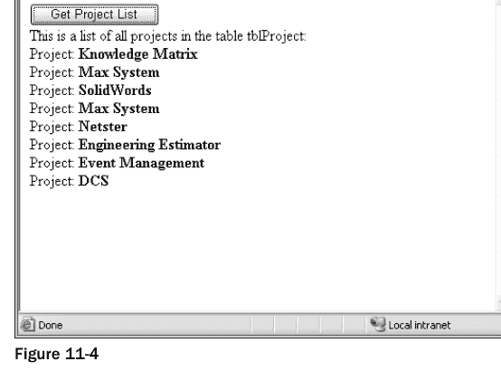

你最可能有的疑问是，为什么开发者会选择编程式数据绑定而不是声明式数据绑定。简单的答案是易用性与控制力的权衡。编程式数据绑定依赖于开发者了解和掌握数据绑定、创建模板以及 Atlas 的许多方面，而这些方面目前并非全部为人所知。同时，编程式数据绑定提供了一定程度的灵活性。另一方面，声明式数据绑定很可能会在 2005 版本之后的某个 Visual Studio .NET 版本中获得设计器、向导和图形界面的支持。

## 绑定方向

如前所述，数据绑定允许在组件和用户界面控件之间交换数据。这种交换可以沿几个方向进行——具体来说，是`In`（入）、`Out`（出）和`InOut`（双向）。这些方向在`Sys.BindingDirection`枚举中定义。这些方向的含义是：

- `In` — 定义数据从数据源流向用户界面控件
- `Out` — 定义数据从用户界面控件流向数据源
- `InOut` — 定义数据在用户界面控件和数据源之间来回流动

以下代码显示了`Sys.BindingDirection`枚举的允许值：

```javascript
function PerformEnumerations()
{
    var strOut = "";
    var strReturn = "<br />";
    for (var strItems in Sys.BindingDirection)
    {
        strOut += strItems + strReturn;
    }
    document.getElementById("Output").innerHTML = strOut;
}
```

## 绑定转换

绑定提供了附加处理程序和方法以在绑定的同时执行操作的能力。两个内置的转换是`ToString`和`Invert`。`ToString`转换将数据转换为字符串。`Invert`转换是为布尔操作设计的。它将输出与输入值相反的结果。Atlas 提供了创建自定义转换的灵活性。

```javascript
var custBinding = new Sys.Binding();
...
custBinding.transform.add(CustomTransformHandler);
...
function CustomTransformHandler(sender, eventArgs) { .. }
```

使这成为可能的类是`Sys.Bindings()`类。

## 验证

验证是一种验证数据输入的机制。有许多 ASP.NET 服务器验证器包含客户端功能。Atlas 提供了一组执行类似功能的客户端控件。内置的验证器包括：

- `requiredFieldValidator` — 验证数据是否存在于关联的控件中
- `typeValidator` — 验证数据的类型。这可以是`String`（字符串）或`Number`（数字）
- `rangeValidator` — 验证数据是否在指定的最小值和最大值范围内
- `regexValidator` — 根据提供的正则表达式验证数据
- `customValidator` — 定义一个自定义表达式处理程序


验证器通过一个集合一起定义，通常在`propertyChanged`事件上触发。在此事件期间，会检查验证，并触发`validate`事件。代码可以订阅此验证事件。此事件在验证之后触发。在验证期间，会检查验证器。检查验证器可能导致客户端控件的`invalid`和`validationMessage`属性被设置。

除了验证器，还有一个特殊的控件用于显示这些信息。此控件的类型是`validationErrorLabel`，用于显示错误消息——功能类似于 ASP.NET 的`ValidationSummary`控件。错误消息可以通过星号、工具提示或其他机制显示。此外，验证器可以分组在一起。然后可以对验证器控件进行汇总。

## 动手试试：使用`requiredFieldValidator`

在下面的代码中，你将研究`requiredFieldValidator`的用法。

```html
<form id="form1" runat="server">
    <atlas:ScriptManager runat="server" ID="ScriptManager1" />
    <div class="description">
        The textbox requires data entry. A requiredFieldValidator is attached.
        Enter a text field, then remove to see the effect. The validator is shown
        via the tooltip.
        <br /><br />
        <input type="text" id="textboxRequired" class="input" />
        &nbsp;
        <span id="valRequired" style="color: red">*</span>
    </div>
    <script type="text/xml-script">
        <page xmlns:script="http://schemas.microsoft.com/xml-script/2005">
            <components>
                <textBox targetElement="textboxRequired">
                    <validators>
                        <requiredFieldValidator errorMessage="You must enter some text." />
                    </validators>
                </textBox>
                <validationErrorLabel targetElement="valRequired"
                    associatedControl="textboxRequired" />
            </components>
        </page>
    </script>
</form>
```

### 工作原理

现在来看看使这段代码工作的步骤。

1. 定义了一个 HTML 文本框和`span`，以及 Atlas ScriptManager。

2. 在`xml-script`部分，有一组已定义的组件。定义了`textBox`，并为`textBox`控件分配了一个验证器。

# 第11章

## 实战演练：添加数据类型和范围验证支持

`validationErrorMessage`已与目标元素（`targetElement`）及相关控件（`associatedControl`）建立关联。

图 11-5展示了前述必填字段验证器的前置输出结果。

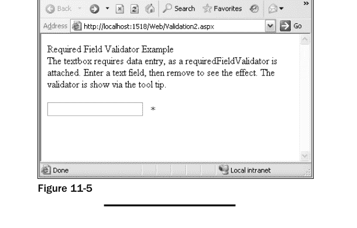

本示例的下一步将添加数据类型和范围验证支持。通过对`xml-script`部分进行如下修改，即可实现该验证功能。在本实例中，`<textbox>`标签内会包含一个`<validators>`标签。在`<validators>`标签内部设有多种已配置的验证器：第一个是`requiredFieldValidator`（必填字段验证器），它要求必须为该字段输入值；第二个是`typeValidator`（类型验证器），用于设定必须输入的值的类型，本例中要求的类型为`Number`（数字）；第三个也是本示例中的一个范围验证器`rangeValidator`。在本例中，如果用户输入的数字超出 10 到 20 的范围，系统会向用户显示该数值不在指定范围内的提示消息：

```xml
<page xmlns:script="http://schemas.microsoft.com/xml-script/2005">
    <components>
        <textBox targetElement="textboxRequired">
            <validators>
                <requiredFieldValidator errorMessage="You must enter some text." />
                <typeValidator type="Number" errorMessage="You must enter a valid number." />
                <rangeValidator lowerBound="10" upperBound="20" errorMessage="You must enter a number between 10 and 20." />
            </validators>
        </textBox>
        <validationErrorMessage targetElement="valRequired" associatedControl="textboxRequired" />
    </components>
</page>
```

## 实战演练：基于正则表达式的验证

此例代码用于执行`regex`-base（基于）的验证。本示例与前一示例类似，包含一个由一组组件构成的`xml-script`部分。当前情况下需确认所输入文本是否构成电子邮件地址格式；实例中会在`<validators>`标签内放置一个`<regexValidator>`。在`<regexValidator>`内部传入用于处理的正则表达式：

```xml
<form id="form1" runat="server">
    <atlas:ScriptManager runat="server" ID="ScriptManager1" />
    <div class="description">
        Regex Validation Example. Enter a valid email address. The validator is show via the tooltip.
        <br /><br />
        <input type="text" id="textboxRegex" class="input" />
        &nbsp;
        <span id="valRegex" style="color: red">*</span>
    </div>
    <script type="text/xml-script">
        <page xmlns:script="http://schemas.microsoft.com/xml-script/2005">
            <components>
                <textBox targetElement="textboxRegex">
                    <validators>
                        <requiredFieldValidator errorMessage="You must enter some text." />
                        <regexValidator regex="/(\w[-.\w]*\w@\w[-.\w]*\w\.\w{2,3})/" errorMessage="You must a valid email address in the form of an email address." />
                    </validators>
                </textBox>
                <validationErrorLabel targetElement="valRegex" associatedControl="textboxRegex" />
            </components>
        </page>
    </script>
</form>
```

尽管代码看起来与前述验证器示例相同，但存在一个重要差异：用于执行的`regex`在代表`<regex>`语句的字符串开头和结尾处包含`/`和`/`字符。你可能会提出疑问：“在何种情况下需要进行正则表达式验证？”虽然对数据类型、必填字段和范围进行核对可满足许多验证需求，但在某些场景中需要查找特定模式；在这些情形中利用正则表达式可有效满足相关要求。

## 实战演练：自定义验证器

接下来观察一个自定义的验证器的代码示例（与现有验证器代码十分相似）。在该`<components>`部分会有一个`customValidator()`，用以调用特定的 JavaScript 过程。请仔细查看其对应的代码内容：

# 第11章

```xml
<form id="form" runat="server">
    <atlas:ScriptManager runat="server" ID="ScriptManager1" />
    <div class="description">
        Regex Validation Example. Enter a value. Entering the term "fail" will cause the validation to fail.
    </div>
    <script language="JavaScript">
        function onValidateValue(sender, eventArgs) {
            var val = eventArgs.get_value();
            var valid = true;
            if (val == "fail") {
                valid = false;
            }
            // You could do something like this to send an alert to the user.
            // alert("The entry is: " + valid);
            eventArgs.set_isValid(valid);
        }
    </script>
    <script type="text/xml-script">
        <page xmlns:script="http://schemas.microsoft.com/xml-script/2005">
            <components>
                <textBox targetElement="textboxValue">
                    <validators>
                        <requiredFieldValidator errorMessage="You must enter some text." />
                        <customValidator validateValue="onValidateValue"
                            errorMessage="You entered fail." />
                    </validators>
                </textBox>
            </components>
        </page>
    </script>
</form>
```

撰写自定义验证器时，关于`customValidator`有几项关键点需注意：

1. `onValidateValue`方法就像 .NET 中事件（如按下网页表单中的按钮）那样接收两个参数。

2. `<customValidator>`在`validateValue`函数中以一个 JavaScript 函数作为参数。

既然你已了解`requiredFieldValidator`、`typeValidator`、`rangeValidator`和`regexValidator`，想必你会问：“为何需要使用`customValidator`呢？”这是一个极佳的疑问，确实存在一些场景要求根据自定义业务规则验证数据：例如可能需要针对数据库中的数据进行更复杂的验证——这是其他现有验证器无法实现的。在使用自定义验证器时，可拥有更多程序化选项来处理这类需求。

## Atlas Controls

## 实战演练：组合验证

既然你已经了解了自定义验证器的代码，现在可以将两个或多个验证器关联起来以进行组验证（group validation）：

```xml
<atlas:ScriptManager runat="server" ID="ScriptManager1" />
<div id="lblValid">Valid. Good data has been entered.<br /><br /></div>
<div id="lblInvalid">Invalid. Bad data has been entered. Please review your inputs.<br /><br /></div>
<div class="description">
    This is the group validation page. This example demonstrates the validation of two controls together.
</div>
<script language="JavaScript">
    function onValidateValue(sender, eventArgs) {
        var val = eventArgs.get_value();
        var valid = true;
        if (val == "fail") {
            valid = false;
        }
        // You could do something like this to send an alert to the user.
        // alert("The entry is: " + valid);
        eventArgs.set_isValid(valid);
    }
</script>
<script type="text/xml-script">
    <page xmlns:script="http://schemas.microsoft.com/xml-script/2005">
        <components>
            <textBox targetElement="textboxValue">
                <validators>
                    <requiredFieldValidator errorMessage="You must enter some text." />
                    <customValidator validateValue="onValidateValue"
                        errorMessage="You entered fail." />
                </validators>
            </textBox>
            <div id="lblInvalid" style="color: red"></div>
        </components>
    </page>
</script>
```

# 第11章


```xml
<textBox targetElement="textboxRequired">
    <validators>
        <requiredFieldValidator errorMessage="You must enter some text." />
        <typeValidator type="Number" errorMessage="You must enter a valid number." />
        <rangeValidator lowerBound="10" upperBound="20" errorMessage="You must enter a number between 10 and 20." />
    </validators>
</textBox>
<validationErrorLabel targetElement="valRequired" associatedControl="textboxRequired" />
<validationGroup id="formGroup" targetElement="formGroup">
    <associatedControls>
        <reference component="textboxValue" />
        <reference component="textboxRequired" />
    </associatedControls>
</validationGroup>
<label targetElement="lblValid" visibilityMode="Collapse">
    <bindings>
        <binding dataContext="formGroup" dataPath="isValid" property="visible" />
    </bindings>
</label>
<label targetElement="lblInValid">
    <bindings>
        <binding dataContext="formGroup" dataPath="isValid" property="visible" transform="Invert" />
        <binding dataContext="lblInValid" dataPath="text" property="text" transform="onValidGroup" />
    </bindings>
</label>
</components>
</page>
</script>
```

### 工作原理

在此示例中，请注意以下几点：

- 添加了两个`div`标签。这两个`div`标签的ID分别为`lblValid`和`lblInValid`。`lblValid`包含在所有验证器对输入都满意时显示的文本，而`lblInValid`包含在一个或多个验证器无效时显示的文本。
- 在`xml-script`部分定义了一个`validationGroup`。该验证组定义了将一起验证的控件。
- `lblValid`和`lblInValid`标签已添加到`xml-script`部分。为每个标签定义了一组绑定。

图11-6显示了组验证过程的输出。

## Atlas 控件

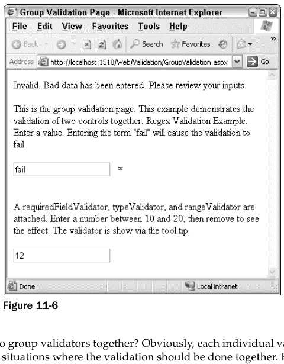

为什么要将验证器分组在一起？显然，每个单独的验证器都会触发。然而，可能存在需要一起执行验证的情况。例如，在用户注册新服务时，检查必填字段是非常有价值的。这就是Atlas中`validationGroup`控件的用途。

### 行为

行为是一组基于DHTML事件可执行的操作的名称。这些事件可能是点击、悬停、鼠标移过或其他客户端事件。执行的这些操作集合构成了自动完成和拖放等功能。换句话说，行为用于提供比标准DHTML更复杂的UI和行为功能。在Atlas中，行为被定义为客户端控件上的一个集合。换句话说，单个行为被附加到客户端控件上。

#### 动手实践：使用行为

来看一些包含行为的代码。在此示例中，在`lblHide`标签上设置了一个点击行为，使其在被点击时，将`displayData`标签的可见性设置为`false`，从而将`displayData`标签隐藏。当点击`lblShow`标签时，将`displayData`标签的可见性设置为`true`，并且如果`displayData`标签当前不可见，则将其显示在屏幕上。

```xml
<atlas:ScriptManager runat="server" ID="ScriptManager1" />
<div>
<div id="displayData">This is the text that will be hidden and shown based on clicking the text below.  Pretty cool.</div>
</div>
<span id="lblHide" >Hide</span>&nbsp;
<span id="lblShow" >Show</span>
</div>
<script type="text/xml-script">
    <page xmlns:script="http://schemas.microsoft.com/xml-script/2005">
        <components>
            <control targetElement="displayData" cssClass="start" />
            <label targetElement="lblHide">
                <behaviors>
                    <clickBehavior>
                        <click>
                            <setProperty target="displayData"
                                property="visible" value="false" />
                        </click>
                    </clickBehavior>
                </behaviors>
            </label>
            <label targetElement="lblShow">
                <behaviors>
                    <clickBehavior>
                        <click>
                            <setProperty target="displayData"
                                property="visible" value="true" />
                        </click>
                    </clickBehavior>
                </behaviors>
            </label>
        </components>
    </page>
</script>
```

图11-7显示了上述代码的输出。假设代码可见，点击“隐藏”将隐藏文本。假设代码隐藏，点击“显示”将显示代码。以这种方式使用行为的优势在于，无需在上述代码中进行任何编程。你不必设置任何JavaScript `onclick`事件或类似的东西。

## 使用的资源

- **Wilco Bauwer** —— 微软Atlas团队的实习生Wilco Bauwer在解答有关Atlas许多功能的问题方面提供了重要帮助。Wilco的网站和博客位于`www.wilcob.com`。
- **Nikhil Kothari** —— Nikhil在他的博客上提供了几篇关于如何正确使用Atlas多项功能的有用文章。Nikhil的网站和博客位于`www.nikhilk.net`。
- **Atlas快速入门** —— Atlas网站是`http://atlas.asp.net`。
- **ASP.NET网站上的论坛** —— 论坛位于`http://forums.asp.net`。

## 总结

本章向你介绍了一些非常新颖且重要的概念。这些是：

- 通过Atlas编程控件
- 使用服务器控件
- 使用数据绑定
- 使用行为

从中，你已经看到服务器控件中包含大量功能。伴随这些功能的是扩展服务器控件并为其添加新功能的能力。与服务器控件的集成非常重要，因为它带来了ASP.NET的服务器端方法，并使其能够提供显著的客户端功能。

既然你已经了解了如何将Atlas与服务器控件集成，下一章，你将学习将Atlas与成员身份、配置文件以及ASP.NET提供的其他服务集成。

## Atlas 与 ASP.NET 服务集成

Microsoft Atlas提供了一种与ASP.NET提供的服务集成的机制。此集成针对以下服务提供：

- **身份验证** —— 应用程序必须能够与ASP.NET身份验证服务集成，以便只允许正确的人员进入，并将不正确的用户拒之门外。
  - **授权** —— 应用程序必须能够控制用户在应用程序内被允许访问的位置。授权是决定应用程序用户是否被允许访问应用程序的一部分或全部的过程。它通常基于应用程序内的身份验证以及分配给用户的角色。
  - **角色** —— 应用程序必须能够提供基于客户端角色的安全性。角色通常与授权一起使用。
  - **配置文件** —— 应用程序必须能够提供与ASP.NET配置文件服务的集成。

# 第12章

## 检查 ASP.NET 服务

在深入探讨Atlas如何支持身份验证之前，有必要快速了解一下ASP.NET 2.0版本中提供的ASP.NET服务。这些服务由ASP.NET 2.0提供程序模型定义和提供。开发人员可以扩展这些服务。

尽管可以通过创建自定义提供程序来扩展这些服务，但除非另有说明，本章中的示例将使用默认提供程序。

### 身份验证

在ASP.NET应用程序中，*身份验证*是验证用户是否为其所声称的那个人的过程。典型的身份验证有两个部分——一个请求凭据的机制（例如用于输入用户ID和密码的一组文本框），以及一个用于检查这些凭据的数据存储（例如数据库）。在初始请求时，用户ID和密码会与数据存储进行核对。如果初始请求被批准，用户通常会获得一个浏览器端Cookie形式的令牌。此浏览器端Cookie表示用户已被授予访问权限。后续的检查涉及检查Cookie的有效性。

ASP.NET支持四种类型的身份验证。它们是：

- **基于Windows的身份验证** —— 基于Windows的身份验证由IIS控制。它主要用于在内部网上运行的内部Web应用程序，并通过基于Windows的服务器提供身份验证。
- **基本身份验证** —— 基本身份验证从用户的角度来看类似于基于Windows的身份验证；但是，它以明文形式传输信息。
- **基于窗体的身份验证** —— 基于窗体的身份验证是一种通用类型的身份验证，当使用非标准数据源时，主要用于针对各种数据源验证信息。它用于大多数非内网ASP.NET应用程序。窗体身份验证提供了一种基于自定义需求和代码对用户进行身份验证，然后维护身份验证令牌（浏览器Cookie、修改的URL或其他东西）的机制。
- **Passport身份验证** —— 使用Passport身份验证时，使用的是Microsoft Passport服务。如果你使用过Microsoft Hotmail服务，那么你就是在使用Passport服务。使用Passport服务时，用户ID和密码存储在Internet上的中央位置。此信息由Microsoft管理。使用Passport身份验证时，应用程序会将用户ID和密码传递给Passport系统进行测试。如果成功，Passport服务将返回一个令牌，类似于基于窗体的身份验证。

#### Windows 身份验证

Windows身份验证，也称为集成Windows身份验证，使用Windows操作系统帐户根据Windows用户存储（如Active Directory）测试用户ID和密码（也称为凭据）。如果用户请求需要Windows身份验证的Web资源，则用户必须登录到服务器运行的域，或者在尝试访问受保护页面时登录到域。使用Windows身份验证时，用于测试的凭据存储在Microsoft Active Directory数据库中。验证

## Atlas 与 ASP.NET 服务的集成

该集成是通过Kerberos协议执行的。此身份验证方案的一个主要优点是密码不会通过网络传输。如果用户尚未对某个资源进行身份验证，系统会向用户显示一个浏览器弹出式窗口，用于输入用户ID/密码组合。

虽然这是一个相当安全的方案，但它也有一些缺点。主要缺点如下：

- 用户必须针对服务器运行所在的域进行身份验证。对于未登录到网络的远程用户来说，这将是一个大问题。
- Windows身份验证与Windows和Internet Explorer紧密关联。虽然Mozilla Firefox浏览器的较新版本在Windows上运行时支持Windows身份验证，但大多数开发者认为Windows身份验证仅在Windows上的Internet Explorer中运行。

### 基本身份验证

从用户的角度来看，基本身份验证与Windows身份验证非常相似。如果用户尚未对需要身份验证的资源（页面、图像等）进行身份验证，系统会向用户显示一个浏览器弹出式窗口，用于输入用户ID/密码组合。在后台，两者之间存在显著差异。使用基本身份验证时，密码使用base64编码通过网络发送，嵌入在HTTP中，并且完全未加密。虽然安全性不如Windows身份验证，但基本身份验证在多种主要Web浏览器和服务器产品中得到支持。

### 窗体身份验证

窗体身份验证与基本身份验证类似。主要区别在于，窗体身份验证允许开发者定义自己的登录页面、错误页面以及用于验证用户的资源。使用窗体身份验证，会创建一个用于输入用户ID和密码的登录表单。该表单上的一个按钮将调用一个例程来测试用户是否有权访问该资源。ASP.NET提供了一些内置方法来测试用户是否可以访问某个资源。此外，开发者可以替换自己的例程来验证用户。

### Passport 身份验证

Passport身份验证使用Microsoft Passport系统。这是由Microsoft提供的集中式身份验证服务。它为成员网站提供单一登录和配置文件服务。Passport使用Triple DES加密。不幸的是，Passport身份验证系统在Microsoft网站家族之外并未被广泛接受，并且已不再作为公共服务提供，也不再允许非Microsoft网站注册。

## 授权/角色

一旦用户被授权使用Web资源，下一步是*授权*。这允许开发者指定在应用程序内，应用程序用户被允许访问哪些资源。将用户分组以管理他们可以访问哪些资源被称为*基于角色的安全*。这允许在应用程序中根据需要对用户进行分组，例如用户、主管、应用程序管理员和其他角色。

在ASP.NET中，授权规则可以存储在`Web.Config`文件、数据库、外部文件、自定义对象或其他位置。

### 成员资格

ASP.NET 2.0的一个“新”功能是开箱即包含用户管理能力。此新功能消除了编写管理用户和密码所需的所有代码的必要。

使用ASP.NET 2.0，登录控件提供了成员资格服务的默认实现。成员资格服务提供了两个重要的方法。它们是：

- `login` — `login`方法将根据数据存储验证用户并返回相应的Forms身份验证cookie。
- `validateUser` — `validateUser`根据数据存储验证用户；但是，它不会返回Forms身份验证cookie。

### 配置文件

配置文件服务是ASP.NET 2.0的一个“新”功能。配置文件服务提供程序支持在应用程序内存储和检索用户特定的数据。配置文件信息存储在`Machine.Config`或`Web.Config`中。一旦定义了应用程序的配置文件，就可以在Visual Studio .NET 2005中通过IntelliSense访问配置文件信息。

### Web 部件个性化

Web部件是ASP.NET 2.0的一项新功能，使Web应用程序更接近于像桌面应用程序一样运行。Web部件允许用户在运行时自定义应用程序。此自定义可能包括页面上元素的布局以及页面上实际显示的元素的选择。个性化服务提供了对持久化Web部件配置的支持，以及为单个用户在会话之间存储Web部件的布局和位置的支持。

## 使用 Atlas 与 ASP.NET 服务集成

现在您已经了解了ASP.NET提供的服务的基础知识，接下来可以了解Atlas如何提供这些服务。

### 身份验证

Atlas提供了对基于窗体的身份验证的支持。此支持由`Sys.Services.AuthenticationService`静态类提供。在该类内部，有两个方法：

- `login` — 此方法映射到已配置的成员资格提供程序的`login`方法。它包含几个额外的参数。完整的调用语法是：

```
login(username, password, OnLoginComplete, OnTimeOut, onError);
```


- `validateUser` — 此方法映射到已配置的成员资格提供程序的 `validateUser` 方法。此方法与前一个方法在一个方面不同。在此方法中，唯一不执行的操作是，如果用户名和密码被接受，则不会在客户端 Web 浏览器上设置 cookie。除了用户名和密码参数外，还有一些额外的参数。完整的调用语法是：

```
validateUser(username, password, OnLoginComplete, OnTimeOut, onError);
```

## 使用 Atlas 执行身份验证

看一下执行身份验证的一些源代码：

```
<atlas:ScriptManager runat="server" ID="ScriptManager1" />
<form id="form1" runat="server">
<div>
<table border="1">
    <tr>
        <td>User Id:</td>
        <td><input type="text" id="txtUserId" name="txtUserId" /></td>
    </tr>
    <tr>
        <td>Password:</td>
        <td><input type="password" id="txtPassword" name="txtPassword" /></td>
    </tr>
    <tr>
        <td colspan="2">
            <input type="button" id="btnAuth" name="btnAuth" onclick="AuthTest()" value="Auth Test" />
        </td>
    </tr>
</table>
</div>
<script language="javascript">
function AuthTest()
{
    var UserId = document.forms[0].txtUserId.value;
    var PassWord = document.forms[0].txtPassword.value;
    var authObj = Sys.Services.AuthenticationService;
    authObj.login( UserId, PassWord, OnAuthTestComplete, OnAuthTestTimeOut, OnAuthTestError);
}
function OnAuthTestComplete(result)
{
    if (null == result)
    {
        alert("Auth Test Complete.  Null Result");
    }
    else
    {
        alert("Auth Test Complete. Result: " + result);
        if(true == result)
        {
            alert("You are now logged in.");
            document.forms[0].txtUserId.value = "";
            document.forms[0].txtPassword.value = "";
        }
        else
        {
            alert("You are not logged in.");
        }
    }
}
function OnAuthTestTimeOut(result)
{
    alert("Auth Test TimeOut. Result: " + result);
}
function OnAuthTestError(result)
{
    if (null == result)
    {
        alert("Auth Test Error. Null Result");
    }
    else
    {
        alert("Auth Test Error. Result: " + result.get_message());
    }
}
</script>
</form>
```

### 工作原理

现在让我们逐步分析代码，并注意以下重要事项：

- 添加 `ScriptManager`，以便 Atlas 脚本在客户端 Web 浏览器上正确设置。

- 设置 `UserId` 和 `Password` 输入元素。请务必记住，为输入元素使用密码类型，这样会使用“*”字符来显示输入，并且输入值不会在客户端缓存。

- 此示例创建了 `Sys.Services.AuthenticationService` 的一个实例。

- 调用 `Sys.Services.AuthenticationService` 类的 `login` 方法。调用 `login` 方法时，所有选项都传递给该方法。这些选项包括用户ID、密码、成功时的回调方法、超时时的回调方法和出错时的回调方法。

- 用户身份验证 cookie 会自动为代码设置。

- 如果用户成功通过身份验证，该用户的用户ID和密码将从网页显示中移除。虽然不是必需的，但清空表单元素是一个好主意，因为某些浏览器可能存在安全问题。

现在应用程序代码已经编写完成，您必须处理几个与安全相关的问题（由于各种 Web 服务器的安全要求而发生的问题）：

## 将 Atlas 与 ASP.NET 服务集成

`ScriptFolder` — 在此代码示例中，`ScriptFolder` 已被设置为允许匿名访问。Atlas 脚本必须可供匿名用户访问，以便身份验证流程可以从客户端启动。

`ScriptServices/Microsoft/Web/Services/Standard` 文件夹 — 此文件夹当前是包含 Atlas 身份验证 Web 服务的虚拟文件夹。为了使身份验证能正确调用该 Web 服务，该 Web 服务必须可供匿名用户访问。这可以通过将以下行添加到应用程序的 `Web.Config` 文件中来实现：

```
<location path="ScriptServices">
    <system.web>
        <authorization>
            <allow users="*" />
        </authorization>
    </system.web>
</location>
```

上述安全问题很可能取决于所使用的 Web 服务器版本。例如，在处理匿名访问与命名用户访问时，此应用程序是使用 Visual Studio 2005 开发的面向开发的 Web 服务器开发的，而不是使用 IIS 5 或 IIS 6。因此，这些安全要求是为确保应用程序在该服务器上正常运行而设计的。IIS 5 或 IIS 6 的安全要求和服务有所不同，需要不同的设置。对于 IIS 5/6，安全需要通过 IIS 管理控制台进行设置，因为控制对文件夹访问的是 IIS 而非 .NET。目前正在开发的 IIS 7，将具有与 IIS 6 中不同的安全服务。IIS 7 将具有一个更符合 Visual Studio 2005 附带的 Web 服务器安全模型和要求的安全模型。

图 12-1 显示了调用登录例程的结果。

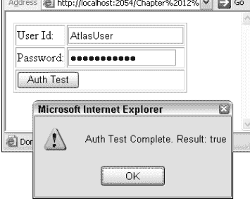

# 图 12-1

# 第 12 章

## 授权/角色

一旦完成用户对应用程序的身份验证问题，下一步就是处理分配给用户的角色。虽然没有可供开发人员使用的预构建 Web 服务，但仍然可以使用 Web 服务来提供此集成。基本步骤是：

1. 创建一个返回用户被分配角色的 Web 服务。
2. 根据需要调用该 Web 服务。
3. 处理返回的结果，并在客户端执行任何必要的设置。

### 尝试一下：处理角色

在示例代码中，设置了两个角色——管理员（admin）和用户（users）。假设应用程序有两类用户——具有应用程序级管理职责的管理员用户，以及仅作为应用程序普通用户的用户。以下 Web 服务代码返回角色列表：

```
[WebMethod]
public string[] GetRoles()
{
    return ((RolePrincipal)HttpContext.Current.User).GetRoles();
}
```

此代码返回一个字符串数组。数组中的每个元素都由一个表示分配给登录用户的各个角色之一的字符串组成。

> 虽然此示例展示了返回与用户关联的所有角色，但 `RolePrincipal` 或任何其他对象的其他方法也可以轻松调用。唯一要求是返回一个字符串数组。

查看 `.aspx` 页面上的代码以调用此 Web 服务：

```
<form id="form1" runat="server">
  <div>
    <input type="button" value="Get Role Information" id="btnGetRoles" onclick="GetRoleInfo()" />
  </div>
</form>
<script language="javascript">
  function GetRoleInfo() {
    var authObj = Sys.Services.AuthenticationService;
    var UserId = ".....";
    var PassWord = ".....";
    authObj.validateUser(UserId, PassWord, OnValidateUser);
  }
  function OnValidateUser(result) {
    if (null !== result) {
      if (result === true) {
        RoleService.GetRoles(OnGetRolesComplete, OnGetRolesTimeOut, OnGetRolesException);
      }
    }
  }
  function OnGetRolesComplete(result) {
    var i = 0;
    var bAdmin = false;
    var bUser = false;
    if (null != result) {
      for (i = 0; i < result.length; i++) {
        bAdmin = bAdmin || (result[i] == "admin");
        bUser = bUser || (result[i] == "users");
      }
      alert("User is an Admin: " + bAdmin);
      alert("User is a user: " + bUser);
    }
  }
  function OnGetRolesTimeOut(result) {
    alert("Auth Test TimeOut. Result: " + result);
  }
  function OnGetRolesException(result) {
    if (null == result) {
      alert("Auth Test Error.  Null Result");
    } else {
      alert("Auth Test Error. Result: " + result.get_message());
    }
  }
</script>
```

### 工作原理

逐步查看此代码的作用：

1. 有一个按钮，单击时将调用 `GetRoleInfo()` JavaScript 方法。`GetRoleInfo()` JavaScript 方法将首先验证用户是否有效。这不是严格要求的；但是，在不能保证用户已登录的情况下，这样做是一种良好的实践。

2. 在验证用户回调中，如果用户是有效用户，则调用 `RoleService.GetRoles` Web 服务方法。

3. 在 `OnGetRolesComplete` 回调中，搜索返回的数组以查找角色。此搜索通过遍历返回的结果数组来完成。如果任何返回的角色是 `admin` 或 `users`，则设置相应的布尔型 JavaScript 变量。

4. 最后，向用户显示一个警报，显示该用户在其角色中的状态。

# 第 12 章


## 通过 Atlas 访问配置文件

正如本章前面提到的，配置文件是一种机制，可以在用户使用 Web 应用程序时轻松地为其提供个性化的体验。在此示例中，你将使用一个相当简单的示例，包括用户的姓名、地址、城市、州和邮政编码。

Microsoft 的 Atlas 框架提供了 `Sys.Profile` 类，用于直接访问配置文件信息。该类是“静态/共享的”——调用其方法和属性不需要实例。

对于本章中的 ASP.NET 配置文件，你的配置文件将在 `Web.Config` 中定义如下：

```
<profile>
    <properties>
        <add name="Name" defaultValue="" />
        <add name="Address" defaultValue="" />
        <add name="City" defaultValue="" />
        <add name="AddressState" defaultValue="" />
        <add name="ZipCode" defaultValue="" />
        <add name="DragNDropLocation" />
    </properties>
</profile>
```

在此示例设置中，属性分为两组。`Name`、`Address`、`City`、`AddressState` 和 `ZipCode` 属于用户地址相关的属性。`DragNDropLocation` 属性供本章后面将介绍的拖放属性示例使用。

### 配置文件属性名称

Atlas 提供了通过标准异步请求获取配置文件名称列表的能力；然而，进行调用的语义与进行标准请求的语义略有不同。

### 尝试一下：检索配置文件属性名称

查看一些从配置文件获取属性名称的代码：

```
function GetProfile()
{
    var profObj = Sys.Profile;
    profObj.loaded.add(OnGetProfile);
    profObj.load();
}
function OnGetProfile()
{
    var propArray = Array();
    propArray = Sys.Profile.properties;
    if (null != propArray)
    {
        for(m in propArray)
            alert(m);
    }
}
```

### 工作原理

考虑代码中发生了什么：

1. 创建了 `Sys.Profile` 类的别名。

2. 将完成时的回调赋值给 `OnGetProfiles` 方法。

3. 通过 `.load()` 方法调用进行异步调用。

4. 当回调发生时，代码获取 `.properties` 属性。该属性包含用户和应用程序的配置文件信息。

5. 代码遍历返回的属性并向用户显示它们。

图 12-3 显示了获取配置文件属性的输出。


# 第 12 章

## 加载个人资料数据

既然您已经了解了如何获取资料属性的名称，现在需要获取已登录用户配置文件中的实际数据。要获取这些数据，您需要遵循一系列步骤，类似于之前用于获取资料名称的步骤。

### 试一试：检索个人资料数据

以下运行在 Web 浏览器中的 JavaScript 代码将检索您在上一部分中获取的属性对应的资料值：

```javascript
function GetProfileData()
{
    var profObj = Sys.Profile;
    profObj.loaded.add(OnGetProfileData);
    profObj.load();
}
function OnGetProfileData()
{
    document.getElementById("txtName").value = Sys.Profile.properties.Name;
    document.getElementById("txtAddress").value = Sys.Profile.properties.Address;
    document.getElementById("txtCity").value = Sys.Profile.properties.City;
    document.getElementById("txtAddressState").value = Sys.Profile.properties.AddressState;
    document.getElementById("txtZipCode").value = Sys.Profile.properties.ZipCode;
}
```

### 工作原理

此代码执行以下步骤：

1. 为 `Sys.Profile` 类创建一个别名。

2. 创建一个回调方法，在数据填充完成后调用。此回调名为 `OnGetProfileData`，通过调用 `loaded.add(OnGetProfileData)` 创建。

3. 执行异步加载。这是通过调用 `profObj.load()`（即 `Sys.Profile.load()`）完成的。


4. 一旦回调`OnGetProfileData()`被调用，各种文本框将填充资料值。这是通过将文本字段的值设置为资料属性值完成的。

看起来个人资料属性是“提前绑定”的。这可能会在未来的 Visual Studio .NET 版本中支持 IntelliSense 智能感知支持。

图 12-4 显示了上一节“试一试”部分代码的输出。


## 保存个人资料数据

既然您已经查看了从 ASP.NET 配置文件服务加载数据，现在可以查看如何在代码中保存数据。

```javascript
function SaveProfileData()
{
    var profObj = Sys.Profile;
    profObj.properties.Name = document.getElementById("txtName").value;
    profObj.properties.Address = document.getElementById("txtAddress").value;
    profObj.properties.City = document.getElementById("txtCity").value;
    profObj.properties.AddressState = document.getElementById("txtAddressState").value;
    profObj.properties.ZipCode = document.getElementById("txtZipCode").value;
    profObj.save();
}
```

代码中的步骤相当简单：

1. 为`Sys.Profile`类创建了一个别名。
2. 从表单数据中设置资料的属性。
3. 异步保存数据。

此代码将异步保存资料的属性。有可能收到数据保存的通知。为了做到这一点，您可以指定一个异步回调并设置用户通知，代码如下：

```javascript
profObj.saved.add(OnSaveProfileData);
profObj.save();
// ...
function OnSaveProfileData()
{
    alert("Profile Data has been saved.");
}
```

## 避免配置文件服务中的陷阱

每当您在 Atlas 中使用 ASP.NET 配置文件服务时，您应记住几个重要的“陷阱”。这些是：

- **Web.config 文件** — 该文件需要正确设置，有几个设置需要注意：
  - `<configSections>`标签必须配置。这可能意味着需要添加`authenticationService`和`profileService`的节。一组条目应该类似于以下示例：

```xml
<configSections>
  <sectionGroup name="microsoft.web"
    type="Microsoft.Web.Configuration.MicrosoftWebSectionGroup">
    <section name="converters"
      type="Microsoft.Web.Configuration.ConvertersSection" requirePermission="false"/>
    <section name="webServices"
      type="Microsoft.Web.Configuration.WebServicesSection" requirePermission="false"/>
    <section name="authenticationService"
      type="Microsoft.Web.Configuration.AuthenticationServiceSection"
      requirePermission="false"/>
    <section name="profileService"
      type="Microsoft.Web.Configuration.ProfileServiceSection"
      requirePermission="false"/>
  </sectionGroup>
</configSections>
```

  - 在`<microsoft.web>`标签内，`enableBrowserAccess`必须打开。这可以在`<webServices>`中实现，如下所示：

```xml
<microsoft.web>
  <webServices enableBrowserAccess="true"/>
</microsoft.web>
```

  - `<profileService>`标签必须配置以获取和设置资料的属性。属性可能用`"*"`配置，代表所有资料属性，或者列出每个属性，例如`Name;Address`。注意每个属性之间由分号分隔。

```xml
<microsoft.web>
  <profileService enabled="true" setProperties="*" getProperties="*" />
</microsoft.web>
```

  - 属于组的属性可以通过`profileService`、`setProperties`和`getProperties`属性中的`GroupName.PropertyName`引用。

## Atlas 与 ASP.NET 服务的集成

使用了一个特殊的`connectionString`。此`connectionString`称为`AtlasAppServices`连接字符串。为了使 Atlas 能够正确与 ASP.NET 应用程序服务通信，需要按如下设置它。请记住，您在下面看到的内容只是一个示例，会根据您的服务器环境而变化。

```xml
<connectionStrings>
    <add name="AtlasAppServices" connectionString="Data Source=.\SQLEXPRESS;AttachDbFilename=C:\Work Data\Ajax book\Chapter 12\Chapter 12 Sample Code\App_Data\ASPNETDB.MDF;Integrated Security=True;User Instance=True" />
</connectionStrings>
```

**资料配置** — 资料需要正确配置。如前所述，以下是本章中提供的示例的配置示例。

```xml
<profile>
    <properties>
        <add name="Name" type="String" />
        <add name="City" type="String" />
        <add name="Address" type="String" />
        <add name="ZipCode" type="String" />
        <add name="AddressState" type="String"/>
        <add name="DragNDropLocation" />
    </properties>
</profile>
```

**登录** — 为了让资料属性正常工作，用户必须已登录。虽然您可以与匿名用户一起使用资料属性，但这些示例是专为已登录的用户设计的。

`Sys.Profile.set_autoSave()`方法 — 此方法将控制是否自动保存资料属性，当属性被修改时。如果传入`true`（这是默认值），则资料属性在更改时自动保存。如果传入`false`，则资料属性在更改时不会保存。在这种情况下，由开发人员管理数据的保存。

## 通过 Atlas 实现拖放功能

“拖放”是选择元素并用鼠标在屏幕上移动它的操作的通用术语。虽然拖放不是 ASP.NET 服务的功能，但它与 Atlas 框架对 ASP.NET 配置文件服务的支持集成非常顺利。

### 试一试：实现拖放功能

以下代码示例显示了如何实现拖动屏幕上的文本并将其位置与 ASP.NET 配置文件服务一起保存的功能。

```aspx
<atlas:ScriptManager ID="scriptManager" runat="server"></atlas:ScriptManager>
<form id="form1" runat="server">
<div>
<atlas:ProfileScriptService ID="profile" runat="server" AutoSave="true" />
<div class="dropZone">
<asp:Button ID="btnRefresh" runat="server" Text="Perform a postback" />
<asp:Label ID="lblToDrag" runat="server">This is the text to drag around the screen.</asp:Label>
</div>
<atlas:DragOverlayExtender ID="atlasDNDExtender" runat="server">
    <atlas:DragOverlayProperties TargetControlID="lblToDrag"
        ProfileProperty="DragNDropLocation" Enabled="true" />
</atlas:DragOverlayExtender>
</div>
</form>
```

来看看这段 ASP.NET 代码的作用：

1. 引入一个新控件。这是`atlas:ProfileScriptService`控件。它与 ASP.NET Profile 服务集成，以便更新配置文件服务。`AutoSave`属性设置为`true`。这将自动更新资料属性`DragNDropLocation`，如适当。
2. 引入`atlas:DragOverlayExtender`。此控件是实现拖放功能的辅助控件。在本例中，拖放功能添加到 ID 为`lblToDrag`的标签上，因此控件名称上有“扩展器”一词。通过点击文本，可以将此文本在屏幕上拖动。
3. 通过在页面上放置一个服务器按钮，您可以显示配置文件确实会在回发时更新并在页面加载时重新加载。当页面重新加载时，文本保持在之前定义的位置。
4. `dropZone`div 标签的高度设置为某个相对较大的数字。这是为了演示拖放功能。如果未设置它，将无法在页面的 body 标签之外尝试拖动。

接下来您需要做的是查看创建并发送到 Web 浏览器的源代码：

```html
<script src="../../ScriptLibrary/Atlas/Debug/Atlas.js"
    type="text/javascript"></script>
<div>
    <div class="dropZone">
        <input type="submit" name="btnRefresh" value="Perform a postback"
            id="btnRefresh" />
        <span id="lblToDrag">This is the text to drag around the screen.</span>
    </div>
</div>
<div>
<input type="hidden" name="__EVENTVALIDATION" id="__EVENTVALIDATION"
    value="/wEWAgLoizZW4DwLAN+vmDOPGFKUwps8DZtEoBXsJWcSnsQ0m" />
</div>
<script type="text/xml-script">
<page xmlns:script="http://schemas.microsoft.com/xml-script/2005">
    <references>
        <add src="../../ScriptLibrary/Atlas/Debug/AtlasUIDragDrop.js" />
    </references>
```

```xml
<components>
    <profile id="profile" autoSave="true" />
    <control id="lblToDrag">
        <behaviors>
            <floatingBehavior handle="lblToDrag">
                <bindings>
                    <binding property="location" dataContext="profile"
                    dataPath="DragNDropLocation" direction="InOut" />
                </bindings>
            </floatingBehavior>
        </behaviors>
    </control>
</components>
</page></script>
<script type="text/javascript">
</script>
```

尽管“源”视图中显示的大部分数据相当标准，但有几个值得注意的地方：

- `AtlasUIDragDrop.js`文件已被作为引用添加，尽管开发者并未明确添加它。
- `profile`服务在`components`部分中被添加。
- 在`lblToDrag`控件内，添加了一组行为（`behaviors`）。这包括一个`floatingBehavior`。
- 带有文本的标签与`profile`服务之间发生了数据绑定。这在`floatingBehavior`标签内定义。

图 12-5 展示了此拖放示例在屏幕上显示的样子。


**图 12-5**

# 第 12 章

## 总结

本章涵盖了大量复杂的材料。与 ASP.NET 服务的集成可能非常棘手，但 Microsoft Atlas 框架在抽象许多复杂性并使其变得相当简单方面做得很好。因此，你已经了解了如何：

- 与成员身份服务集成，以支持身份验证和授权
- 与角色服务集成，以支持授权
- 与 profile 服务集成
- 将这些与一个拖放示例联系起来

既然你已经探索了与 ASP.NET 提供的集成，下一章将转向探讨对 Ajax 应用程序的调试支持。

# 13

## 调试

调试是在应用程序中识别和移除有问题代码的艺术。每位开发者在某个时候都被要求在其应用程序中执行一定程度的调试。

ASP.NET 主要是一种服务器端开发技术，对 ASP.NET 中应用程序调试的支持相当广泛。Ajax 应用程序引入了一些新的方面，使得应用程序调试变得更加复杂。大量使用 JavaScript 以及自定义数据可能通过异步回发（asynchronous postbacks）传输的事实，意味着在使用 ASP.NET 调试 Ajax 类型应用程序时会引入新的挑战。

本章将探讨在 ASP.NET 中调试 Ajax 应用程序的各个方面，并涵盖以下主题：

- 服务器端 ASP.NET 调试
- 各种 JavaScript 调试方法（结合文档对象模型（`DOM`）级别调试）
- 调试和检查通过异步回发发送的数据

正如你将看到的，本章涵盖了 Ajax 应用程序开发涉及的全部领域——从客户端（检查`DOM`、HTML 和 JavaScript），到服务器端（ASP.NET 及相关的服务器端语言）。此外，我们还将检查中间环节，即通过异步回发从客户端发送到服务器，然后再返回的网络数据。

## 服务器端调试

ASP.NET 是一个基于服务器的开发环境，ASP.NET 运行时引擎会将几乎所有的网页和代码解析并编译为 .NET 程序集。

当请求一个 ASP.NET 网页（例如，`www.SomeSite.com/SomePage.aspx`）时，ASP.NET 运行时引擎会解析网页以及与该页面关联的代码。此代码通常以代码文件的形式存在于网站的`App_Code`目录中，或者代码也可以嵌入网页（ASPX）本身中。网页和代码被编译成一个 .NET 程序集，并加载到程序集缓存中执行。

.NET 程序集是一个非常丰富的部署单元，因为它可以包含大量信息，使其具有自描述性。这意味着 ASP.NET 运行时可以查询程序集并获取大量关于程序集的信息，例如安全要求和其他操作参数。此外，编译程序集时可以包含特殊的调试信息。因此，在服务器上调试 ASP.NET 应用程序的体验可以非常丰富和交互。

首先，让我们看看如何启用调试支持和信息，以便开发者能够利用服务器上可用的调试功能。

## 启用调试支持

在开始使用调试之前，需要专门启用调试支持。对于 ASP.NET Web 应用程序，这意味着需要在 Web.Config Web 应用程序配置文件中包含以下`<compilation>`设置：

```xml
<configuration>
    <system.web>
        <compilation debug="true">
        </compilation>
    </system.web>
</configuration>
```

如果你尝试使用 Visual Studio .NET 2005 在调试模式下运行 Web 应用程序，并且未设置`<compilation debug="true" />`配置项，你将被提示启用调试支持（见图 13-1）。


对于其他项目类型，如类库，必须在 Visual Studio .NET 2005 中将 Debug 选择为活动配置，如图 13-2 所示。


**图 13-2**

无论哪种情况，当应用程序文件被编译时，都会生成特殊的调试信息和符号，使 Visual Studio .NET 调试器能够跟踪并准确显示正在执行的代码行。你可以通过查看正在编译的相应应用程序的输出目录来查看这一点。如果选择了调试生成，或者通过前面提到的 Web.Config 设置启用了调试，那么会存在调试符号文件，其文件扩展名为`.pdb`。

例如，如果你的项目生成一个`MyApp.exe`程序集，那么将生成一个对应的`MyApp.pdb`文件。

## 设置断点

现在调试已经启用，可以在服务器上跟踪应用程序执行。最简单的方法是设置一个“断点”（breakpoint）。

断点是一行被标记的代码，它告诉调试器当程序执行到达该行时暂停执行。断点由代码行左侧的一个红点表示，整个代码行本身也会突出显示为红色。图 13-3 展示了断点的样子（尽管是黑白而非彩色）。

```csharp
namespace ConsoleApplication1
{
    class Program
    {
        static void Main(string[] args)
        {
            Console.WriteLine("My application is about to start...");
            InitialiseApp();
            Console.WriteLine("Application Initialised successfully.");
            PerformWork();
            Console.WriteLine("Application is terminating.");
        }
    }
}
```

**图 13-3**

所以你可以看到，该图显示已在一个执行`PerformWork()`方法的行上设置了断点。

当应用程序运行时，执行会在断点处暂停。当这种情况发生时，应用程序实际上被挂起，这允许开发者检查程序执行的各个方面，例如变量的值。开发者可以选择逐步继续执行，并在程序执行每一步时检查变量的不断变化的值。这可以通过按下 F10 功能键或选择 Debug 菜单，然后选择 Step Over（单步跳过）菜单选项来实现。在调试过程中遇到方法时，开发者可以选择使用前面提到的 Step Over 选项继续执行越过该方法，或者可以通过按下 F11 功能键或选择 Debug 菜单选项，然后选择 Step Into（单步进入），深入查看方法内每一步的执行。

这个调试环境非常丰富，在检查和评估应用程序状态时提供了巨大的灵活性。图 13-4 显示了调试器在调试操作期间，当鼠标悬停在变量上时显示该变量的值。


**图 13-4**

这是开发者在 Visual Studio .NET 中与服务器端调试器交互的众多方式之一。

> 有关调试应用程序的详尽说明，请访问`http://msdn2.microsoft.com/en-us/library/awtaffxb.aspx`。

这种调试方法对大多数 Visual Studio 开发者来说应该相当熟悉。它之所以如此丰富和强大的原因之一是它存在于 ASP.NET 的领域和执行控制之内。Visual Studio .NET 对 .NET 运行时执行有着深入的了解，因此可以提供更丰富的环境。

## JavaScript 和客户端调试

JavaScript 是一种在浏览器上下文中执行的脚本语言。Visual Studio .NET 提供了创建和使用此语言开发的方法，但仅提供非常有限的交互式调试支持，其方式与之前演示的服务器端调试不同。这是因为浏览器位于 Visual Studio .NET 域之外。由于异步请求的执行和大多数与 Ajax 相关的功能都依赖于 JavaScript，因此了解如何有效调试 Web 应用程序的客户端部分非常重要。

## 工具和实用技巧

鉴于 JavaScript 的执行和处理在 Visual Studio .NET 的直接控制之外，那么开发者如何调试一个利用了丰富 Ajax 功能（因此广泛使用 JavaScript）的 Web 应用程序呢？

答案在于拥有一套工具、技术和实用程序的军火库，以适应任何所需的任务。

332

## 使用 Alert 语句

从最基础、最简单的选项开始，开发者可以在客户端代码中穿插`Alert`语句，这些语句要么显示变量的值，要么简单地指示客户端脚本代码执行到了哪个位置。

### 简单的 Alert 对话框

此示例在代码执行的各个阶段显示警告框，显示传递给相应函数的任何参数的值：

```aspx
<%@ Page Language="C#" AutoEventWireup="true" CodeFile="AlertExample.aspx.cs"
Inherits="Alert_AlertExample" %>
<!DOCTYPE html PUBLIC "-//W3C//DTD XHTML 1.0 Transitional//EN"
"http://www.w3.org/TR/xhtml1/DTD/xhtml1-transitional.dtd">
<html xmlns="http://www.w3.org/1999/xhtml" >
<head runat="server">
    <title>Untitled Page</title>

    <script type="text/javascript">
    function SomeMethod(arg1)
    {
        alert("In SomeMethod: arg = [" + arg1 + "]");
        var counter = 0;
        counter++;
        // ... 进行一些处理
        counter = counter + 2;
        SomeMethod2(counter);
        return true;
    }

    function SomeMethod2(cntr)
    {
        alert("In SomeMethod2: cntr = [" + cntr + "]");
    }
    </script>

</head>
<body>
    <form id="form1" runat="server">
    <div>
        <input id="btnMain" name="btnMain" type="button" value="Test Alert"
onclick="SomeMethod(this.id);" />
    </div>
    </form>
</body>
</html>
```

这种方法显然极其简单，并且要求开发者在页面的不同地方添加额外的代码。在复杂的应用程序中，这可能不容易，甚至不可能实现。

理想的做法是使用一个丰富的调试环境，类似于前面讨论的服务器端环境所提供的环境。

# 第13章

本书中的代码示例可在`http://beginningajax.com`和`www.wrox.com`下载。

## Visual Studio 脚本调试

启用一个类似于服务器端环境的丰富调试环境是可能的。然而，这确实需要浏览器和 Visual Studio .NET 之间的一些交互；因此，需要进行一些快速配置来启用此通常默认未启用的支持。

需要配置 Internet Explorer 以允许进行调试。默认情况下，调试在 Internet Explorer 中未启用。要在 Internet Explorer 中启用此功能，请选择“工具”→“Internet 选项”。

将出现一个带有多个选项卡选项的对话框。选择“高级”选项卡将显示多个选项（参见图 13-5）。


确保“禁用脚本调试(Internet Explorer)”和“禁用脚本调试(其他)”均未被选中。严格来说，只需取消选中“禁用脚本调试(Internet Explorer)”即可使脚本调试工作。取消选中“禁用脚本调试(其他)”意味着调试将对托管在 Internet Explorer 之外的脚本启用，例如 Microsoft Outlook。

> 有关配置和故障排除客户端脚本调试的综合文档，请参阅以下文档：`www.gotdotnet.com/team/csharp/learn/whitepapers/How%20to%20debug%20script%20in%20Visual%20Studio%20.Net.doc`。

这就是启用脚本调试所需的全部配置。

## 调试

### 动手实践：客户端脚本调试

要进行测试，请在 Visual Studio .NET 中创建一个新的网站项目。创建一个新的 Web 窗体/ASPX 页面，或者编辑项目中的`Default.aspx`页面。删除现有的`<html></html>`声明以及这些标签中包含的所有内容，并替换为以下代码：

```html
<html xmlns="http://www.w3.org/1999/xhtml" >
<head runat="server">
    <title>Test Script Debugging</title>

    <script type="text/javascript">
    function DoSomeWork()
    {
        var cntrl = document.getElementById("txtInput");
        var number = cntrl.value;
        number++;

        var newValue = DoSomeMoreWork(number);

        alert("New Value = " + newValue);

    }

    function DoSomeMoreWork(arg)
    {
        // 进行一些计算
        arg = arg * 2 + 32;
        arg = arg + 18 / 2;
    }
    </script>

</head>
<body>
    <form id="form1" runat="server">
    <div>
        <input type="text" id="txtInput" value="test" />
        <input type="button" value="Submit value" onclick="DoSomeWork();" />
    </div>
    </form>
</body>
</html>
```

确保新创建的页面在 Visual Studio 中被设置为起始页，方法是用鼠标右键单击该页面并选择“设为起始页”。

单击“播放”按钮，如图 13-6 所示（确保活动配置设置为“调试”），或按 F5 以调试模式启动应用程序。


**图 13-6**

单击“提交值”按钮应该会产生一个类似于图 13-7 所示的警告框。


**图 13-7**

此行为并非所期望的，通常您会期望看到比简单的“undefined”更多的信息。要解决此问题，您需要调试此应用程序中的客户端脚本。您将在脚本执行的早期设置一个断点，以查看代码内部发生了什么。

1. 让 Internet Explorer 浏览器实例保持运行，如果警告框仍在显示，请单击其“确定”按钮。
2. 切换到 Visual Studio .NET（此时 Internet Explorer 仍在运行），并选择“调试”▸“窗口”▸“脚本资源管理器”，如图 13-8 所示。


**图 13-8**

3. 选择该选项后，Visual Studio 中将显示“脚本资源管理器”窗口。如果您的窗口布局是默认设置，那么“脚本资源管理器”窗口应该出现在屏幕的右侧，如图 13-9 所示。


**图 13-9**

4. 在“脚本资源管理器”窗口中，您会注意到列出了一个 ASPX 页面，即当前正在执行的页面。在“脚本资源管理器”窗口中双击该页面。这将在编辑器窗口中列出该页面，其外观将与设计/开发时的页面非常相似。

最大的区别在于，现在您可以设置断点并在代码执行时检查变量值，其方式几乎与服务器端代码完全相同。

5. 在显示网页的编辑器窗口中，导航到`DoSomeWork` JavaScript 函数的第一行，然后按 F9 或单击左侧的灰色边栏以在该行设置断点。编辑器窗口现在应类似于图 13-10 所示。

6. 现在切换回正在执行网页的浏览器实例。单击“提交值”按钮。Visual Studio 应自动成为活动窗口，并且网页的执行将在断点所在的行暂停。该行将以类似于图 13-11 所示的方式高亮显示。


**图 13-10**


**图 13-11**

7. 按 F10 键将执行推进到下一行。下一行现在将被高亮显示。将鼠标指针置于以下代码行的`cntrl`变量定义上方：

```javascript
var cntrl = document.getElementById("txtInput");
```

将显示一个小对话框，其中显示了`cntrl`变量，并提供了一个通过单击 + 符号展开该变量值的选项（参见图 13-12）。

单击 + 符号允许开发者检查该变量的值，并在程序执行的当前位置深入查看该变量的属性。这种检查变量的方法与服务器端代码的调试体验非常相似。

# 第13章

**图 13-12**

用鼠标右键单击`cntrl`变量会弹出一个上下文菜单，该菜单与用户调试服务器端代码时显示的菜单类似。提供了传统的调试机制，例如“添加监视”，可以将`cntrl`变量的显示添加到屏幕底部的“监视”窗口中。本章稍后将更详细地讨论这些功能。或者，开发者可以打开一个“快速监视”窗口，该窗口允许开发者打开一个对话框，方便地检查变量的内容。这个窗口类似于“监视”窗口，但提供了一种更直接、更普遍的方式来与特定变量交互并检查它。系统会为用户呈现一个模态窗口供其导航；其唯一目的是仅显示所选变量的内容。其他功能几乎与“监视”窗口完全相同。唯一的真正区别在于提供了一个“重新求值”按钮，允许将一个新变量输入到文本输入字段中并进行检查。

8. 再次按 F10 键，将程序的执行推进到下一行。程序执行现在应暂停在以下行：

```javascript
number++
```

9. 将鼠标悬停在`number`变量上。调试器应显示`number`变量的值，如图 13-13 所示。

目前，`number`变量的值如预期的那样，即它等于表单内定义的输入文本框控件的内容。

**图 13-13**

10. 再次按 F10 键，让调试器执行下一行。调试器现在应暂停/定位在以下行：

```javascript
var newValue = DoSomeMoreWork(number);
```

将鼠标悬停在`number`变量上以显示其当前值。显示应如图 13-14 所示。

你现在可以看到变量值变成无效值的确切点。很明显，`number`变量的值实际上是一个文本值`test`。下一个执行点尝试对该字符串值执行数学运算，这当然是无效的。JavaScript 不像传统的强类型服务器端语言（如 VB.NET 和 C#）。这个明显无效的操作不会引发异常，相反，`number`变量的值现在被标记为`undefined`，这正是你在浏览器中看到的输出。

11. 按 F5 键，或单击“播放”按钮，将允许执行正常继续，从而产生之前看到的结果。

你已经成功地调试了脚本代码，并识别了 Web 应用程序为何会这样运行。以这种方式进行调试是检查基于脚本的应用程序执行的一种非常强大且直观的方式。可以对应用程序进行细致入微的检查，从而非常准确地确定代码执行中的任何问题。

## 逐行调试代码——“逐过程”和“逐语句”

上一节讨论的技术效果很好；但是，它假设应用程序启动正常，然后你可以设置断点来调试所需的操作。如果你想立即开始调试代码，或者在代码启动时检查代码呢？

你可以通过使用 F10 键启动应用程序，或使用“调试”->“逐过程”菜单选项来实现。通常，这用于将调试器推进到代码执行的下一步，或“逐过程”执行当前指令。使用这种“逐过程”技术启动应用程序，会像按 F5 在调试模式下启动它一样启动应用程序，但会立即暂停在第一条指令的执行上，而不是仅在断点处停止。

## 调试

到目前为止，你已经使用 F10 来推进调试器的执行。如上一段所述，这会“逐过程”执行下一行代码。如果调试器遇到要执行的函数，按 F10 键将调用该函数，但不会逐行执行该函数内的代码。要执行后者，你必须使用 F11 键或“调试”->“逐语句”菜单选项。在即将执行函数或调用另一个方法时按 F11 键，将产生逐行执行该方法的效果。

### 尝试一下：“逐语句”执行方法

要查看实际操作：

1. 通过按 F5 键再次运行应用程序。如前所述，切换回 Visual Studio 并确保“脚本资源管理器”窗口可见。双击“脚本资源管理器”窗口中的页面，并在以下行设置断点：

   ```javascript
   var newValue = DoSomeMoreWork(number);
   ```

   显示应如图 13-15 所示。

> 如果你发现无法在一行上设置断点，很可能是因为你没有在“脚本资源管理器”窗口中双击该页面，而只是在标准 Visual Studio .NET 显示窗口中查看页面的源代码。


2. 在调用`DoSomeMoreWork()`方法的行上设置断点后，切换到 Internet Explorer（正在运行该网页），然后单击“提交值”按钮。Visual Studio .NET 将切换到前台，执行将暂停在断点所在的行。

3. 按 F10 键。注意执行现在暂停在下一行，该行是：

```javascript
alert("New Value = " + newValue);
```

该方法已经执行完毕，你现在位于代码序列的下一行。在这种情况下，你已经逐过程执行了`DoSomeMoreWork()`方法。假设相反，你想检查该函数内代码的执行。

4. 按 F5 允许代码继续执行，警告框将如图 13-7 之前所示显示。在警告框中单击“确定”，然后再次单击“提交值”按钮。执行应再次暂停在断点所在的行。

5. 这次，按 F11 键。注意调试器现在已经跳转到`DoSomeMoreWork()`方法内的第一行，并暂停在该行。将鼠标悬停在`arg`变量上会显示一个`NaN`值（JavaScript 中表示“非数字”值的方法）。从这里你可以继续逐行执行代码，调试器将返回调用该方法的原始位置并继续执行。

## 调用调试器的其他方式

之前，我们讨论了在代码中设置断点以在代码内的某些位置暂停调试器。虽然这是一种很好且易于使用的技术，但它确实有一些局限性。

当 JavaScript 在客户端生成并注册后，情况会变得稍微复杂一些。JavaScript 可能在启动时执行，并且足够长和复杂，以至于你不想使用前面描述的技术（通过按 F10 键启动应用程序来调用调试器）从头开始逐步执行整个代码段。

### 尝试一下：使用`debugger`关键字

调用调试器的另一种方法是在脚本中使用`debugger`关键字。在下面的示例中，代码隐藏文件正在为立即在网页中执行注册 JavaScript。该网页本身与 Visual Studio .NET 中新添加的 Web 窗体没有任何不同。检查以下示例中的网页和代码隐藏文件。

### 网页/ASPX 页面

```aspx
<%@ Page Language="C#" AutoEventWireup="true" CodeFile="DebuggerKword.aspx.cs" Inherits="ScriptDebuggingSample_DebuggerKword" %>

<!DOCTYPE html PUBLIC "-//W3C//DTD XHTML 1.0 Transitional//EN"
"http://www.w3.org/TR/xhtml1/DTD/xhtml1-transitional.dtd">

<html xmlns="http://www.w3.org/1999/xhtml" >
```

```html
<head runat="server">
    <title>调试器关键字测试页</title>
</head>
<body>
    <form id="form1" runat="server">
        <div>

        </div>
    </form>
</body>
</html>
```

### 代码文件/代码旁置文件

```csharp
using System;
using System.Data;
using System.Configuration;
using System.Collections;
using System.Web;
using System.Web.Security;
using System.Web.UI;
using System.Web.UI.WebControls;
using System.Web.UI.WebControls.WebParts;
using System.Web.UI.HtmlControls;

public partial class ScriptDebuggingSample_DebuggerKeyword : System.Web.UI.Page
{
    protected void Page_Load(object sender, EventArgs e)
    {
        string script = @"
            var val1 = 10;
            var val2 = 20;
            var result1 = AddValues(val1,val2);
            alert('Sum of values 1 & 2 = ' + result1);
            var val3 = 30;
            var result2 = AddValues(result1,val3);
            alert('Sum of previous values and Value 3 = ' + result2);
        ";
        string addFunction = @"
            function AddValues(v1, v2)
            {
                return v1 + v2;
            }";

        Page.ClientScript.RegisterStartupScript(this.GetType(), "startupCode",
            script, true);
        Page.ClientScript.RegisterClientScriptBlock(this.GetType(), "addMethod",
            addFunction, true);
    }
}
```

此示例将从代码文件的`Page_Load`事件注册所有需要执行的 JavaScript。运行此代码（通过按 F5 在调试模式下执行）将产生两个警报框，显示一些值的总和。你可以修改此代码，使其在第一次调用`AddValues`方法之前自动调用调试器。

# 第 13 章

为此，你需要将`debugger`关键字作为生成脚本的一部分插入。检查以下代码，该代码仅显示`Page_Load`方法并突出显示了修改之处：

```csharp
protected void Page_Load(object sender, EventArgs e)
{
    string script = @"
        var val1 = 10;
        var val2 = 20;
        debugger;
        var result1 = AddValues(val1,val2);
        alert('Sum of values 1 & 2 = ' + result1);
        var val3 = 30;
        var result2 = AddValues(result1,val3);
        alert('Sum of previous values and Value 3 = ' + result2);
    ";
    string addFunction = @"
        function AddValues(v1, v2)
        {
            return v1 + v2;
        }";

    Page.ClientScript.RegisterStartupScript(this.GetType(), "startupCode",
        script, true);
    Page.ClientScript.RegisterClientScriptBlock(this.GetType(), "addMethod",
        addFunction, true);
}
```

现在使用 F5 以调试模式启动应用程序来执行此应用。应用程序将正常启动，但随后会跳转到调试器屏幕，并在包含`debugger`关键字的行暂停代码执行，如图 13-16 所示。


**图 13-16**

### 检查变量值的其他方法

如前所述，在调试模式下，开发人员只需将鼠标悬停在变量上即可显示其当前值。然而，对于一系列变量，在每一行代码执行时都这样做可能会很繁琐。但你确实有其他选择。

#### 动手尝试：使用监视窗口

使用前面的代码示例，按 F5 启动应用程序，它应该会自动在`debugger`关键字处暂停。当 Visual Studio .NET 显示调试器窗口时，使用鼠标右键单击`result1`变量。这将弹出一个上下文菜单。选择“添加监视”选项，这会将`result1`变量添加到“监视”窗口。“监视”窗口通常位于 Visual Studio .NET 环境的左下角，如图 13-17 所示。


请注意，`result1`变量在“监视”窗口中显示的值为`undefined`。按两次 F10 将程序执行推进到`AddValues`方法调用之后，这会导致`result1`变量的值在“监视”窗口中根据代码执行中的操作进行更新。

可以向“监视”窗口添加多个项目，以使开发人员能够在执行过程中跟踪变量的值。

### 使用命令窗口

或者，开发人员可能希望在代码执行时评估不属于程序本身的条件。为此，开发人员可以利用“命令”窗口。这允许在应用程序执行暂停时的上下文中，交互式地评估临时语句。

#### 动手尝试：使用命令窗口

为了演示这一点，请再次通过按 F5 键以调试模式启动应用程序来运行前面的应用程序。Visual Studio 将显示调试屏幕，执行暂停在`debugger`语句处。

确保“命令”窗口可见，方法是单击“命令窗口”选项卡（通常位于 Visual Studio .NET 环境的右下角）或选择“视图” → “其他窗口” → “命令窗口”（或按`Ctrl+Alt+A`）。

## 调试

“命令”窗口将有一个`>`符号作为提示符。在“命令”窗口中，键入以下命令并按 Enter：

```text
? val1 + val2
```

应显示值 30。现在尝试键入以下命令：

```text
? AddValues(81, 42)
```

应显示值 123。现在“命令”窗口应如图 13-18 所示。


**图 13-18**

在这里，你正在交互式地评估变量并在应用程序中执行方法。问号（`?`）符号是显示或打印的简写。这种技术是在脚本应用程序执行的各个阶段评估不同条件的极其强大的方法。

### 脚本调试至此

这种调试脚本代码的方法极其强大，并且与我们调试服务器端代码的方式非常相似。这种熟悉感意味着开发人员在调试基于脚本的代码时，不需要学习不同的工具或习惯专门的技术。

掌握了这些信息，你现在可以有效地调试客户端脚本，以及调试服务器端的应用程序执行（使用传统的调试方法）。然而，你仍然需要彻底探索和检查一些领域，以便能够正确地调试 Ajax 风格的应用程序。

### 浏览器调试工具

通常，Ajax 应用程序会希望由于某个后台请求（通常作为异步回发执行）而更新浏览器显示的部分内容。浏览器的 DOM 是开发人员通常根据收集到的信息来修改以构建屏幕的对象。尽管开发人员会尽最大努力理解对浏览器中的样式、元素和显示项进行更改的所有影响，但事情并不总是按计划进行。

Internet Explorer 和 Firefox 浏览器都提供了允许开发人员交互式地检查和操作网页结构内容的工具。这使开发人员能够看到脚本可能执行的任何更改（在它们应用时交互式地看到），并能够在网页显示时对其应用更改。

#### Internet Explorer

Internet Explorer 本身不提供任何工具或支持来交互式地检查网页的内容和结构。但是，Microsoft 提供了一个名为 Internet Explorer Developer Toolbar 的外部下载。在我们编写本书时，此工具目前处于 Beta 状态，这意味着它尚未正式发布，并且在最终发布之前可能会发生变化。然而，它非常有用且功能强大。

可以从以下位置下载此工具：`www.microsoft.com/downloads/details.aspx?familyid=E59C3964-672D-4511-BB3E-2D5E1DB91038&displaylang=en`。

或者，你也可以使用`http://tinyurl.com/bosco`。

安装该工具后，默认情况下不会激活。要激活工具栏，请打开 Internet Explorer，然后选择“查看” → “资源管理器栏” → “IE DOM 资源管理器”。工具栏将在屏幕底部打开，如图 13-19 所示。


## 调试

尽管本章这一部分并非旨在成为工具栏使用的教程，但工具栏的一些功能值得在此处说明。

可以通过使用页面的结构元素，借助工具栏的树状视图显示来导航整个网页的结构。可以选中每个文本、结构或基于样式的元素，并显示其属性以供检查或操作。

复杂的网页可能难以导航，同样，定位开发者关注的特定元素也可能很困难。选择工具栏的“查找 -> 按单击选择元素”菜单选项，可以在相关网页上点击一个元素，该元素本身将在工具栏的树状视图显示中被突出显示。然后可以根据需要操作和检查该元素的属性和样式。

对开发者来说，一个简单但有用的功能是能够根据标准屏幕分辨率调整浏览器窗口大小。通常，开发者需要确保网站/页面在最低屏幕分辨率下能正常显示（例如，网站必须在最低 800 × 600 的屏幕分辨率下正确显示）。从 IE 开发者工具栏菜单中选择“调整大小”菜单选项，会显示一个可选的分辨率列表，这将使浏览器以选定的分辨率重新显示。这是一种让开发者在不同屏幕分辨率下测试网站的简便方法，无需不断更改其系统的显示分辨率。

## Firefox

安装 Firefox 时，会提供一个安装一组开发工具的选项。选择安装这些工具的选项会为用户提供一个菜单选项“工具 -> DOM 查看器”。选择此菜单选项将显示一个窗口，其外观与之前讨论的 IE 开发者工具栏相似（参见图 13-20）。


图 13-20

Firefox 浏览器中可用的 DOM 查看器工具与 IE 开发者工具栏非常相似，因为它允许开发者查看网页的结构和样式元素以及任何相关的属性或上下文项。该工具还允许在一定程度上操作页面内的某些元素。

Firefox 还提供了一个方便的 JavaScript 控制台，它不仅可以显示处理网页内 JavaScript 代码时遇到的任何错误和警告，还可以显示遇到的任何层叠样式表（CSS）错误。

选择“工具 -> JavaScript 控制台”菜单选项会显示一个窗口，显示页面执行过程中遇到的任何 JavaScript 或 CSS 错误，其外观如图 13-21 所示。


图 13-21

## Firefox JavaScript 调试器 — Venkman

Venkman 是一款与 Firefox 集成以提供 JavaScript 调试功能的工具。它并非 Firefox 官方发布的一部分，但却是允许开发者在 Firefox 中调试 JavaScript 代码的一种非常流行且强大的方式。实际上，Venkman 本身并不特定于 Firefox，但它在所有基于 0.9.5 及更高版本的 Mozilla 引擎的浏览器中都能工作。Firefox 本身基于 Mozilla 浏览器引擎。此外，Venkman 也能在 Netscape 6.2 及更高版本上工作。

可以从 Venkman 项目页面`www.mozilla.org/projects/venkman/index.html`下载 Venkman。该站点还包含其他信息，例如常见问题解答以及有关 Venkman 安装和使用的详细信息。

要安装 Venkman，您应该使用 Firefox 浏览器浏览到项目主页（上文已列出），然后点击相应的链接。这将启动安装过程，并在 Firefox 中安装 Venkman 工具。安装后，可以从“工具 ➔ JavaScript 调试器”菜单选项访问该工具。

> 请注意，下载/安装位置的直接链接是`https://addons.mozilla.org/extensions/moreinfo.php?id=216`。

本节不打算详细探讨 Venkman 调试器的功能和特性，因为这超出了本章的范围。相反，这是一个简要概述，旨在让您了解 Venkman 的功能。详细信息和教程可从上述“注意”中显示的链接获取。

Venkman 允许在 Firefox 浏览器中提供完整的 JavaScript 调试体验。Venkman 的界面不像 Visual Studio .NET 中的服务器端调试体验那样直观；然而，它通过支持标准和高级调试功能，提供了一种非常易用且强大的调试 JavaScript 代码的方式，例如：

- 在 JavaScript 代码中设置断点。
- 根据代码中的条件（例如变量的值或抛出异常时）触发断点。
- 添加监视条件以监控当前执行的脚本代码中变量的值。
- 在 Venkman 界面中支持多个视图，提供完全可定制的界面。
- 对 JavaScript 代码进行性能分析，以测量 JavaScript 应用程序的执行速度。

这些功能提供了与 Visual Studio .NET 在服务器端提供的类似的客户端调试体验；然而，即使是像性能分析这样的高级功能，Visual Studio .NET 也不原生支持，尤其是在客户端方面。Venkman 是一款免费下载的工具，不仅提供了卓越的价值，还提供了一系列强大的功能，对于任何进行 JavaScript 开发的开发者来说都是宝贵的资产，尤其是编写 Ajax 应用程序的开发者。

## 中间人

用于 Internet Explorer 的 IE 开发者工具栏、Firefox 中的 DOM 查看器以及 Venkman 调试器是帮助 Web 开发者调试和识别网页或应用程序中任何问题的宝贵工具。这些工具与之前讨论的服务器端和客户端调试功能相结合，为识别、调试和解决 Web 应用程序中的问题提供了一套优秀的工具和技术，尤其是那些包含大量 JavaScript 的应用程序。

然而，此时，有一个领域在很大程度上尚未涉及——即 Web 应用程序本身生成的实际 HTTP 流量。这对于 Ajax 风格的应用程序尤为重要，因为这些应用程序可能启动许多异步回发操作，这些操作仅通过检查用户界面和任何相关交互是无法立即发现的。如果不检查构成 HTTP 通信的实际数据，开发者只能根据发送和接收数据的效应来识别问题，因此，只能基于这些效应进行假设。

为了明确这一点，图 13-22 说明了所指的 Web 应用程序的哪个方面。


图 13-22

显然，Web 应用程序发送和接收的实际流量对其正确运行至关重要，并且您会假设，如果客户端和服务器端的代码都是正确的，那么检查 HTTP 流量的实际内容将是不必要的。

在某些情况下，这可能是正确的；但是，当某些代码不正确时，并非总是显而易见的。此外，对应用程序和相关代码的操作可能存在假设，这些假设导致意外的 HTTP 内容，从而可能对应用程序的操作产生不利影响，并产生错误和/或意外的结果。

在处理 HTTP 头时，这一点变得非常明显。随请求发送的 HTTP 头需要对执行的操作非常明确。对于大多数操作，这些头会隐式地随您从代码发出的任何请求一起发送，或者在某些情况下容易混淆。检查以下示例代码：

```html
<script type="text/javascript">
function MakeXMLHTTPCall() {
  var xmlHttpObj;
  xmlHttpObj = CreateXmlHttpRequestObject();

  if (xmlHttpObj) {
    xmlHttpObj.open("POST", "http://" + location.host + "/Chap14/DataFile.xml", true);

    xmlHttpObj.onreadystatechange = function() {
      if (xmlHttpObj.readyState == READYSTATE_COMPLETE) {
        alert("请求/响应完成");
      }
    };

    xmlHttpObj.send(null);
  }
}
</script>
```

当这段代码执行时，会弹出一个提示框，显示请求/响应已完成，代码似乎成功了。然而，如果你检查此请求生成的网络流量，会发现此请求实际上产生了 405 错误代码，并未成功。问题在于代码在以下行中指定了`POST`操作：

```javascript
xmlHttpObj.open("POST", "http://" + location.host + "/Chap14/DataFile.xml", true);
```

此处应改用`GET`操作，如下所示：

```javascript
xmlHttpObj.open("GET", "http://" + location.host + "/Chap14/DataFile.xml", true);
```

如果不检查网络流量和相关的错误代码，就很难弄清楚发生了什么错误，以及`POST`方法就是问题根源这一事实。因此需要一种工具来让开发者检查和监控客户端与服务器之间协商的流量——即在线路上传输的数据。下一节的主题就是这样一个专用工具。

在某些情况下，可能还需要专门构造发送到服务器的数据，而最终，要真正验证服务器接收到的内容是否与你认为发送的内容一致，唯一的方法就是实际检查所发送的数据。

有许多工具和网络监视器可以让你以各种形式检查网络流量。然而，通过网络发送数据的实际功能（无论是互联网还是本地局域网）依赖于许多网络组件和协议层协同工作。Web 开发者通常只对其 Web 应用程序相关的流量感兴趣。Fiddler 就是一款能有效提供此功能的工具。

### Fiddler

Fiddler 是一款免费工具，安装后可作为组件从 Microsoft Internet Explorer 内部激活，允许轻松查看、检查和操作浏览器与服务器之间的 HTTP 流量，或称“摆弄”（fiddled with）这些流量（因此得名 Fiddler）。

Fiddler 主页（可在此处下载副本）位于`www.fiddlertool.com/fiddler`。

---

# 第 13 章

Fiddler 网站上提供了完整的文档、说明和教程，本文无意成为关于如何使用 Fiddler 的详细教学文本。然而，讨论一下该工具如何协助 Web 应用程序（特别是使用 Ajax 技术）的调试过程是值得的。

下载并安装 Fiddler 后，可以通过选择“工具 → Fiddler”菜单选项来访问它。此外，它会作为新图标出现在 Internet Explorer 工具栏中（参见图 13-23）。


### 动手实践：使用 Fiddler

为了观察 Fiddler 的实际效果，请在 Visual Studio .NET 中创建一个新的网站项目。添加一个新页面（或修改现有的`default.aspx`页面），使网页和相关的代码隐藏文件包含以下代码。

```aspx
TestFiddler.aspx — 网页表单
<%@ Page Language="C#" AutoEventWireup="true" CodeFile="TestFiddler.aspx.cs"
Inherits="FiddlerExamples_TestFiddler" %>

<!DOCTYPE html PUBLIC "-//W3C//DTD XHTML 1.0 Transitional//EN"
"http://www.w3.org/TR/xhtml1/DTD/xhtml1-transitional.dtd">

<html xmlns="http://www.w3.org/1999/xhtml">
<head runat="server">
    <title>测试 Fiddler</title>
    <script type="text/javascript">
        function OnCallComplete(arg, ctx)
        {
            var dataReturned = arg.split(";");
            var cnt = 0;
            for (var i = 0; i < dataReturned.length; i++)
            {
                alert("返回的数据 #" + cnt++ + " 是: " + dataReturned[i]);
            }
        }
    </script>
</head>
<body>
    <form id="form1" runat="server">
        <div>
            <button onclick="DoCallback(null, null);">执行异步回调</button>
        </div>
    </form>
</body>
</html>
```

### TestFiddler.aspx.cs — 代码隐藏文件

```csharp
using System;
using System.Data;
using System.Configuration;
using System.Collections;
using System.Web;
using System.Web.Security;
using System.Web.UI;
using System.Web.UI.WebControls;
using System.Web.UI.WebControls.WebParts;
using System.Web.UI.HtmlControls;
```

## 调试

这将显示一个新的对话窗口。暂时忽略该窗口，但不要关闭它。选择之前的浏览器窗口（即运行前面列出的网页的窗口），然后单击标有“执行异步回调”的按钮。浏览器中应显示相同的结果，即三个结果值。

通过单击窗口或在 Windows 任务栏中选择它，将 Fiddler 窗口置于前台。

你会注意到浏览器发出的所有请求现在都记录在 Fiddler 窗口中。这些请求包括地址栏中指定的页面原始请求，以及页面为实现其功能和显示而加载的图像、脚本库和其他资源的任何附加请求。

Fiddler 屏幕现在应类似于图 13-24。


你会注意到浏览器发出的异步请求已记录在 Fiddler 窗口左侧窗格中（在图中由`localhost:1511`条目指示，尽管端口号在不同系统上可能不同）。通过单击鼠标选择此条目。显示区域的右侧部分现在应显示有关该请求的一些详细信息。

此初始显示展示了一些简单的性能计时信息以及请求和响应本身的总字节数。

单击右侧窗格中的“Session Inspector”选项卡。这将首先在右上窗格中显示作为 HTTP 请求一部分发送的 HTTP 头。右下窗格将自动选中“Transformer”部分。在右下窗格中选择“Headers”选项卡。这将显示作为响应一部分从 Web 服务器发送的 HTTP 头。Fiddler 显示窗口现在应如图 13-25 所示。


图 13-25

这对于以易于查看的树状显示检查请求/响应序列的 HTTP 头以确保设置正确的头非常有用。在制定自己的简单对象访问协议（SOAP）请求时（如本书第 4 章所示），这尤为重要。

然而，Fiddler 最有用的功能之一是能够检查请求/响应序列的原始内容。在 Fiddler 显示仍显示头信息时，在右上和右下窗格中单击“Raw”选项卡。

此显示展示了完整的请求和响应数据，包括头信息，如同客户端发送和服务器接收时的原样。在右上窗格中，显示请求时，你可以看到 HTTP 头以及 HTTP 请求的关联数据负载。内容应类似于以下文本：

```text
__EVENTTARGET=&__EVENTARGUMENT=&__VIEWSTATE=%2FwEPDwUJNzgzNDMwNTMzZGRyE%2BruV%2Bh77fo76pKQAZFknAX7Ag%3D%3D&__CALLBACKID=__Page&__CALLBACKPARAM=null
```

由此，你可以了解异步客户端脚本回调如何通知服务器是哪个控件生成了回调以及调用的参数是什么（分别通过`__CALLBACKID=__Page`和`__CALLBACKPARAM=null`参数）。

查看右下窗格中的请求数据，你同样可以看到构成响应的 HTTP 头，以及作为异步请求结果发回的响应数据。响应数据应类似于：

```text
Data1;DataPart2;SomeData3|...//或根据上下文的类似内容
0|Data1;DataPart2;SomeData3
```

（注意：可视表示或具体上下文可能有所不同）

这使你能够验证通过应用程序代码在浏览器中显示的内容实际上是服务器返回的内容。

### 动手实践：使用 Fiddler 断点直接操作请求/响应数据

Fiddler 最强大的功能之一是其允许通过设置请求/响应点处的断点来修改请求和响应数据的能力。这与客户端或服务器端代码相关的断点完全无关。一旦触发 Fiddler 断点，就可以检查和/或操作请求或响应数据，然后允许其携带修改后的数据继续到达目的地。这为调试和测试应用程序提供了一种极佳的方式。

一个例子可以很好地说明这一点。在 Visual Studio .NET 中创建一个新网页，并将以下代码分别复制到网页（.aspx 文件）和代码隐藏文件（.cs 文件）中：


```aspx
网页表单 — TestFiddlerBreakpoint.aspx
<%@ Page Language="C#" AutoEventWireup="true" 
   CodeFile="TestFiddlerBreakpoint.aspx.cs" Inherits="FiddlerExamples_TestFiddler" %>

<!DOCTYPE html PUBLIC "-//W3C//DTD XHTML 1.0 Transitional//EN" 
"http://www.w3.org/TR/xhtml1/DTD/xhtml1-transitional.dtd"> 

<html xmlns="http://www.w3.org/1999/xhtml">
<head runat="server">    
    <title>测试 Fiddler 断点</title>    
    <script type="text/javascript">   
       function OnCallComplete(arg,ctx)  
        {      
           alert("服务器返回的参数是: " + arg);   
      }     
   </script>
</head>
<body> 
   <form id="form1" runat="server">
     <div>            
         <button onclick"DoCallback('按钮被点击了!',null)">执行异步回调</button>         
       </div>    
    </form>
</body>
</html>
```

### 代码隐藏文件 — TestFiddlerBreakpoint.cs

```csharp
using System;  

using System.Data;   

using System.Configuration;
```

*（注：图片内容已在适当位置作为占位符保留。）*

# 第13章

如前一节所示，使用鼠标在`Visual Studio .NET`中右键单击此页面，然后选择“在浏览器中查看”。通过单击网页上的按钮，验证应用程序是否按预期工作。应显示一个警报框，其中包含与图13-26中所示相似的文本。


服务器端方法简单地接受客户端发送的参数，并返回一个显示该参数以及服务器时间的字符串。在前面的示例中，客户端（浏览器）发送了字符串`button clicked!`作为参数。

单击`Fiddler`图标或选择`Tools➡Fiddler`菜单选项以加载`Fiddler`显示。选择`Rules➡Automatic Breakpoints➡Before Requests`菜单选项，或直接按`F11`键。现在单击Web表单上的按钮以发起异步调用。

在任务栏上，`Fiddler`任务图标应高亮显示，表示它需要一些确认。切换到`Fiddler`应用程序，并用鼠标选择已发起的请求（在`Fiddler`左侧窗格中）。单击`Fiddler`显示右上角窗格中的`Session Inspector`选项卡。显示应类似于图13-27。


**图13-27**

`Fiddler`已拦截此请求，并且由于你已启用请求上的断点，`Fiddler`会阻止请求继续，直到你允许其继续。

选择`Fiddler`显示右上角窗格中的`TextView`选项卡。应显示HTTP请求数据的文本内容，并类似于以下文本：

```
__EVENTTARGET=&__EVENTARGUMENT=&__VIEWSTATE=%2FwEPDwUJNzgzNDMwNTMzZGT4go7HPnnHZvVOIxsR9u48Hce4EA%3D%3D&__CALLBACKID=__Page&__CALLBACKPARAM=button%20clicked!
```

360

## 调试

将文本`button%20clicked!`替换为文本`I_am_a_hacker`（注意：不要使用空格）。请求数据现在应如下所示：

```
__EVENTTARGET=&__EVENTARGUMENT=&__VIEWSTATE=%2FwEPDwUJMzgzNDMwNTMzZGT4go7HPnnHZvVOIxsR9u48Hce4EA%3D%3D&__CALLBACKID=__Page&__CALLBACKPARAM=I_am_a_hacker
```

现在单击`Fiddler`显示中的“Run to Completion”按钮。显示的警报框应类似于图13-28中的那个。


警报框显示的是修改后的文本`I_am_a_hacker`。这是因为你拦截了请求，在客户端发起请求之后但在实际通过网络传输之前修改了数据。原始数据被修改，然后被允许传输到服务器。服务器正常提取数据并返回结果，其中包括修改后的数据。

显然，这是一种非常强大的测试和调试Web应用程序的方法，因为它允许开发人员在数据通过线路发送时检查和修改原始HTTP数据。

## 总结

本章涵盖了调试的所有主要领域，专注于开发的每个独立区域，以提供调试过程和所涉及技术的完整视图。

- 首先，研究了传统的服务器端调试方法。这些无疑是最强大且易于使用的调试方法，整个主题可以专门写一本书。强烈建议在这个领域花费额外时间，以研究所有可能的特性和调试手段。
- 其次，研究了客户端/客户端脚本调试的黑暗艺术，并展示了如何在客户端脚本场景中利用强大的服务器端调试技术。这类代码传统上非常难以调试，而`Visual Studio .NET`使这项任务变得更加简单，允许使用熟悉的调试方法和技术。
- 此外，提供了研究和操作DOM树的技术，以便详细查看网页的表示方式。DOM在浏览器内部用于表示网页及其内容，理解这一点对于在Web应用程序中实现所需行为至关重要。
- 最后，研究了一种调查、测试和修改客户端和服务器之间实际传输数据的方法。使用了免费提供的`Fiddler`工具，提供了一种强大且易于使用的方式来查看、操作和拦截这些数据，无论是以结构化显示形式还是原始形式。

在本章开始时，我们提到拥有一套工具集是实现有效调试的真正答案。`Visual Studio .NET`、`IE Developer Toolbar`、`Firefox`和`Fiddler`只是其中的一部分工具。调试是任何开发人员都必须掌握的关键技能，拥有这一套工具集可以极大地增强这项技能。调试是一项需要随时间积累的技能，作为开发人员，你也将随着时间的推移构建你的调试工具箱。

最后，尽管本章已经触及了调试的各个方面和领域，但强烈建议开发人员对每个领域进行更彻底的研究。实验、学习并扩展你的知识。

为了提供帮助，以下是与本章讨论的工具和信息相关的一些URL列表：

- **关于调试应用程序的详细信息**—<http://msdn2.microsoft.com/en-us/library/awtaffxb.aspx>
- **配置和故障排除客户端调试**—<http://www.gotdotnet.com/team/csharp/learn/whitepapers/How%20to%20debug%20script%20in%20Visual%20Studio%20.Net.doc>
- **Internet Explorer Developer Toolbar**—<http://tinyurl.com/boscb>
- **Venkman Debugger下载**—<https://addons.mozilla.org/extensions/moreinfo.php?id=216>
- **Fiddler工具下载**—<http://www.fiddlertool.com/fiddler>

362

# 附录：XSLT命令


本附录提供了可能对读者有价值的额外XSLT命令。

## XSLT元素

以下是XSLT 1.0规范中包含的额外XSLT元素。

| 元素 | 描述 |
|---|---|
| `apply-imports` | 此元素应用来自导入样式表的模板规则。 |
| `apply-templates` | 此元素将模板规则应用于当前元素或当前元素的子节点。 |
| `attribute` | 此元素向元素添加属性。`<xsl:attribute name="attributename" namespaces="uri"><xsl:value-of select="attributevalues" /></xsl:attribute>` |
| `attribute-set` | 此元素向元素添加属性集。`<xsl:attribute-set name="name" use-attribute-sets="name-list"><xsl:attribute name="attributename">value</xsl:attribute>` |
| `call-template` | 此元素调用命名模板。`<xsl:call-template name="templatename" />` |
| `comment` | `comment`元素在结果树中创建注释节点。`<xsl:comment>Comment.</xsl:comment>` |

*表格续下页*

## 附录 A

| 元素 | 描述 |
|---|---|
| `copy` | 该元素创建一个当前节点的副本，包含命名空间节点但不包含子节点和属性。 |
| `copy-of` | 该元素创建当前节点的副本，以及当前节点的命名空间节点、子节点和属性。`<xsl:copy-of select="expression" />` |
| `decimal-format` | 该元素提供在字符串中转换数字时使用的字符和符号。该元素与`format-number()`函数一起使用。该元素具有大量额外的属性。 |
| `element` | 该元素在输出文档中创建一个元素节点。 |
| `fallback` | 该元素指定当XSL处理器不支持某个XSL元素时要执行的备用代码。 |
| `namespace-alias` | 该元素将样式表中的命名空间替换为输出流中不同的命名空间。 |
| `import` | 该元素用于将一个样式表的内容导入到另一个样式表中。`<xsl:import href="URI" />` |
| `include` | 该元素将一个样式表的内容包含在另一个样式表中。`<xsl:include href="URI" />` |
| `key` | 该元素声明一个命名键，该方法可在使用`<xsl:key>`时使用`key()`函数。 |
| `message` | 该元素向输出写入消息。这通常用于将错误报告回输出流。 |
| `output` | 该元素定义输出文档的格式。 |
| `param` | 该元素定义局部或全局参数。 |
| `number` | 该元素确定当前节点在源中的整数位置。它具有许多属性。 |
| `otherwise` | 该元素指定默认操作以用于`<xsl:choose>`元素，此操作在没有任何`<xsl:when>`条件适用时执行。 |
| `preserve-space` | 该元素用于定义应保留其空白的元素。`<xsl:preserve-space elements="element1 element2" />`将保留`elements`属性中列出的所有元素的空格。 |
| `processing-instruction` | 该元素向输出流写入处理指令。 |
| `stylesheet` | 该元素定义样式表的根元素。 |
| `strip-space` | 该元素删除定义元素的空白。 |
| `text` | 该元素向输出写入字面文本。`<xsl:text disable-output-escaping="yes">文本</xsl:text>` |
|  | `yes`表示按原样输出特殊字符。`no`表示输出特殊字符的编码版本。 |
| `transform` | 该元素与`stylesheet`元素同义。 |
| `variable` | 该元素用于声明局部或全局变量。`<xsl:variable name="$varName" select="表达式值" />` |
|  | 如果未为`select`属性指定值，则可以在`<xsl:variable>`元素内定义值。 |


& \rceil _{\mathrm{i}} \$\backslash ^{h} p m x t r q v a r c e d^{**}\\$$n}$ \\ $\downarrow s i n h w g y c u o k^*$ **\$\\_ {1942053_{s 1}} *$

`when` & 该元素用于指定`<xsl:choose>`元素的操作。当`<xsl:when>`元素返回为真时，执行操作。`^*^{**}$ \$\rfloor y m x t r e u q v a c d$ $*\$\downarrow n_{193285} *`

`with-param` & 此定义传递到参数`a`参数的值`。为了`<xsl:with-param>`元素起作用，名称必须在`xsl:template`元素中匹配名称`<xsl:param>`。`^*$ \\ $$n}$\$$\downarrow 6.649_{\text {e}}$ **$$$& \$\\$ \lfloor n i y o m w q r d e p u^{**}$ $

`replace` & 该元素在输出文档中创建一个元素节点。`$ \leftarrow s t r g c h f v a l \\ ^{a}$$ \\ $\downarrow 1947201_{58703}$ **\$$\\$ n}$

`$\downarrow s i n h w g y c u o k^*$ **\$\\_ {1942053_{s 1}} *$`

`element` & 该元素在输出文档中创建一个元素节点。`$ \leftarrow s t r g c h f v a l \\ ^{a}$$ \\ $\downarrow 1947201_{58703}$ **\$$\\$ n}$

## 附录 A

### 数值函数

数值函数族执行数值运算。

| 名称 | 描述 |
| :--- | :--- |
| `number(arg)` | `number()`方法返回参数的数值。参数可以是布尔值、字符串或节点集。 |
| `abs(num)` | `abs()`方法返回参数的绝对值。 |
| `ceiling(num)` | `ceiling()`方法返回大于指定数字的最小整数。 |
| `floor(num)` | `floor()`方法返回小于指定数字的最大整数。 |
| `round(num)` | `round()`方法返回最接近指定数字的整数。 |
| `round-half-to-even(num)` | `round-half-to-even()`方法返回最接近的整数。½ 向最接近的偶数方向舍入。 |

### 序列函数

序列函数族对数组或列表序列进行操作。

| 名称 | 描述 |
| :--- | :--- |
| `index-of((item1, item2, ...), searchitem)` | 此方法返回序列中与`searchitem`参数匹配项的位置。 |
| `remove((item1, item2, ...), position)` | 此方法返回一个新的项目序列，其中指定位置的项已从列表中移除。如果该位置不存在于项目列表中，则返回原始列表。 |
| `empty(item1, item2, ...)` | 如果参数的值是空序列，则此方法返回`true`；否则返回`false`。 |
| `exists(item1, item2, ...)` | 如果参数的值不是空序列，则此方法返回`true`；否则返回`false`。 |
| `distinct-values((item1, item2, ...), collation)` | 此方法从项目列表中返回不同的值。 |
| `insert-before(item1, item2, ...), position, inserts)` | 此方法返回一个新序列，将`inserts`参数的值插入到指定位置。 |
| `reverse((item1, item2, ...))` | 此方法返回与指定项目列表顺序相反的序列。 |

370

### XSLT 命令

| 名称 | 描述 |
| :--- | :--- |
| `subsequence((item1, item2, ...), start, length)` | 此方法返回一个项目序列，从指定的起始位置开始，长度为指定的长度。 |
| `unordered(item1, item2, ...))` | 此方法以依赖于实现的顺序返回项目列表。 |

### 字符串函数

字符串函数族对字符串执行操作。

| 名称 | 描述 |
| :--- | :--- |
| `string(argument)` | 此方法返回参数的字符串值。该参数可以是数字、布尔值或节点集。 |
| `codepoints-to-string(int1, int2, ...)` | 此方法从码点序列返回字符串。 |
| `string-to-codepoints(string)` | 此方法从字符串返回码点列表。 |
| `codepoint-equal(item1, item2)` | 如果`item1`和`item2`的值根据 Unicode 码点归类的规则相等，则此方法返回`true`。 |
| `compare(item1, item2)` `compare(item1, item2, collation)` | 如果`item1`小于`item2`，此方法返回`-1`；如果`item1`等于`item2`，返回`0`；如果`item1`大于`item2`，返回`1`。此比较基于所使用的归类规则。 |
| `concat(string1, string2, ...)` | 此方法返回所提供字符串的拼接结果。 |
| `string-join(string1, string2, ...), separator)` | 此方法通过拼接字符串参数并使用分隔符参数来创建并返回一个字符串。 |
| `substring(string, start)` `substring(string, start, length)` | 此方法基于提供的字符串返回一个子字符串，从提供的起始点开始，长度为提供的长度。如果未提供长度，则返回从起始位置到字符串末尾的子字符串。 |
| `string-length()` `string-length(string)` | 此方法返回指定字符串的长度。如果没有传递字符串参数，则使用当前节点的字符串值。 |
| `normalize-space()` `normalize-space(string)` | 此方法移除所使用字符串的首尾空格。所有内部连续空白序列都会被替换为一个空格。如果未指定字符串，则使用当前节点的字符串值。 |
| `normalize-unicode()` | 此方法指示序列化是否应将序列化输出转换为 Unicode。 |
| `upper-case(string)` | 此方法将提供的字符串参数转换为大写。 |
| `lower-case(string)` | 此方法将提供的字符串参数转换为小写。 |
| `translate(string1, string2, string3)` | 此方法通过用`string3`的值替换`string1`中的`string2`值来转换`string1`。 |
| `escape-uri(stringurl, escres)` | 此方法返回指定字符串 URI 的转义版本。`escres`参数为布尔值。 |
| `contains(string1, string2)` | 如果`string1`包含`string2`中指定的值，则此方法返回`true`。 |
| `starts-with(string1, string2)` | 如果`string1`以`string2`开头，则此方法返回`true`；否则返回`false`。 |
| `ends-with(string1, string2)` | 如果`string1`以`string2`结尾，则此方法返回`true`；否则返回`false`。 |
| `substring-before(string1, string2)` | 此方法返回`string1`中`string2`出现位置之前的部分。 |
| `substring-after(string1, string2)` | 此方法返回`string1`中`string2`出现位置之后的部分。 |
| `matches(string, pattern)` | 如果字符串参数与指定模式匹配，则此方法返回`true`。 |
| `replace(string, pattern, replacement)` | 此方法返回通过将指定模式替换为替换字符串而创建的字符串。 |
| `tokenize(string, patternstring)` | 此方法基于`patternstring`对指定字符串进行标记化。 |

### URI 函数

URI 函数族提供 URI 解析支持。

| 名称 | 描述 |
| :--- | :--- |
| `resolve-uri(relative, base)` | 给定基础 URI 和相对 URI，此方法将返回 URI。将两者组合后返回结果。 |

## 索引

- `abort()`方法（`XMLHttpRequest`对象），第 92 页
- `abs`（数字）函数（XSLT），370 页
- **激活 Ajax.NET Pro 库**，163 页
- **.NET Active Server Pages (ASP)**，3 页
- **活动服务页面（ASP）**，第 3 页
- **.自适应路径**，8 页

### 添加内容

- `.类`的，274–275 节
- 命名空间，274–275 节
- 将项目添加到解决方案中，180–181 节

- `adjust-date-to-timezone(日期时间, 时区)`函数（XSLT），第 369 页
- `adjust-dateTo-timezone(Datetime, timezone)`函数（XSLT），369
- `adjust-time-to-timezone(datetime, timezone)`函数（XSLT），369

### Ajax

- 优势，7–16
- Atlas 支持，24.5
  - Web 浏览器支持，8
  - 定义，6
  - 开发历史
  - DHTML/DOM 支持
  - `JavaScript`，8
  - JavaScript 对象记号（JSON），8
- 它不能解决的问题，19
- 处理：20
- 用户界面（UI），3
- 上下文背景信息，7
- 用户体验，15
- XML，8 页，124–125
- `XMLHttpRequest`对象
- `AjaxHandlerFactory`
- Ajax.NET Pro 转换程序，第 193–194 页

**Ajax.NET Pro 库**

- 激活，6
- 类：`AjaxSettingsSectionHandler.cs`，80–81
- Ajax Handler Factory
  - `AjaxPro.AjaxMethod()`属性
  - 编译后的程序库
  - 下载
  - HTTP 页面处理程序，25–143
  - JavaScript
  - 源代码，60、8
  - 准备应用程序以使用它，171
  - 引用，第 91 页
  - 注册`page`类，60、8
  - 在应用程序中使用
  - `Web.Config`设置，35

### AjaxPro.AjaxMethod()属性

- `AjaxPro.AjaxMethod()`属性，4–4
- `.alert()`函数（JavaScript），12–4 页
- `alert`语句：89

#### Anthem.NET 服务器端框架

- 客户端功能，第 37–250 节
  - 复杂控件
  - 自定义属性
  - Hello World 示例
  - 调用页面方法
  - 微内容，4–1
  - 服务器异常处理
  - 搭建环境，36

#### 追加节点

- `apply-imports`元素（XSLT）
- `apply-templates`元素（XSLT）

### April CTP（Atlas 项目）：240 页

- 技术架构区别：服务器端框架
- `参`（JavaScript 函数），39
- `Array`类
- 数组在 JavaScript 中，1
- ASP（活动服务页面）
- Asynchronous Client Script Callbacks，参见**回调**
- **异步执行**，7–2
- Atlas 项目，26
- **Asynchronous JavaScript 和 XML**，参看**Ajax**
- **异步操作**
  - Atlas 项目
  - `XMLHttpRequest`对象，8–9

### Atlas 项目

- Ajax 支持
- April CTP

- `classes`（类）
  - 添加，274–275

### `properties`（属性）

- `Boolean`
- `Date`
- `inheritance`，继承：36
- `Number`
- `Object`
- `RegExp`
- `System.Data.DataColumn`
- `System.Data.DataRow`
- `Sys.Data.DataTable`
- `Sys.Net.WebRequest`
- `Web.Enum`
- `System.BindingDirection`，枚举类型：9
- `transformations`（变换），6
- 验证数据输入，2
- `data types`，5–4
- `debugging`
- `documentation`
- `enumerations`
- 集成到 ASP.NET 服务中
  - `authentication`，认证
  - `authorization`，授权：391–60
  - Drag-and-Drop 实现
  - 成员资格服务
  - `profiles`，42
  - `roles`
  - Web Parts
- 客户端组件
  - 客户端脚本，8
  - 控件扩展器
    - AutoComplete，自动完成
    - Drag-and-Drop，拖放
    - 功能
    - `button`，按钮控件：30
    - custom validators，自定义验证器
    - `customValidator`
    - 范围
    - regex validator，正则表达式验证
    - requiredField Validator
    - 必填字段验证
    - `ScriptManager`控件
    - server controls


- `Sys.UI.Data` 命名空间
- `timer`，计时器控件
- `typeValidators`
- `UpdatePanel` 控件
- `validationErrorLabel`，错误信息标签
- `validationGroup`，验证组

## 数据绑定

- 声明式
  - 定义
  - 方向
- 程序化
  - 接口
- JavaScript 扩展
- JavaScript 文件名
- March CTP
- `Microsoft.Web.Atlas.dll` 服务器端程序集
  - 命名空间
    - 添加
    - `registration`
    - `Sys.Data`
    - `Sys.Net`
  - 传递参数
- 资源
- 服务器端支持
  - 同步操作
  - UTC 编码用于日期和时间
  - Web 服务
    - 缓存
    - communicating，沟通
    - exposing，发布到 Web 表单
    - `WebResource.axd` HTTP 处理器

## 安全攻击

- 属性元素（XSLT）
- attributes
  - `AjaxPro.AjaxMethod`
  - `display`
  - language
  - `Serializable()`
  - size
  - src
  - type
- XML
- attribute-set 元素（XSLT）
- authentication，身份验证
- authorization，授权

## A

- `AutoCompleteExtender` 控件
- 浏览器（browsers）
  - Ajax 支持
  - ASP.NET
  - callback support
  - 检查类型
  - 调试工具
  - Document Object Model（DOM），文档对象模型
    - JavaScript support
    - object model standardization
    - `XMLHttpRequest` object support
- `BuildHtmlTable()` 函数（JavaScript）
- `BuildMultiplicationTable()` 函数（JavaScript）
- button 控件

## B

- `base-uri()`，XSLT
- basic 认证
- Bauwer, Wilco（Atlas 项目团队的实习生和博主）
- *Beginning XML* 第三版（Wiley）
- binding data（绑定数据）
  - 声明式
  - defined
  - directions
  - 程序化
  - `Sys.BindingDirection` 枚举
  - transformations
  - 验证输入
- blogs about Microsoft Atlas project
- boolean class 类
- Boolean datatype 类型
- `boolean()` 函数（XSLT）
- break，JavaScript 语句
- breaking loops，循环
- breakpoints，断点
- Browser object，浏览器对象
  - Supports Callback 属性
  - Support XmlHttp
  - Browser Object Model，浏览器对象模型

## C

- caching web services，缓存 Web 服务
- callbacks（回调）
  - browser support
  - `ClientScript` 对象
    - defined
    - DetailsView 控件
    - 允许页面进行回调
    - 错误处理
    - Examples
    - GridView 控件
    - `ICallbackContainer` 接口
    - `ICallbackEventHandler` 接口
    - 从浏览器发起异步过程
    - XML 中返回复杂数据的限制
    - 获取回调引用
    - 接收和处理结果
      - complex data，复杂数据
      - simple data，简单数据
    - TreeView control，TreeView 控件
      - JavaScript 调用函数
- `call-template`，XSLT
- camel case naming convention，驼峰命名规范
- Cascading Style Sheets（CSS），层叠样式表
  - DHTML（动态 HTML）
  - DOM，文档对象模型
- `.case`（JavaScript）关键字
- 大小写敏感性
  - JavaScript
  - XHTML
- `ceiling(num)` 函数（XSLT）
- `ChangeImage()` 方法
- `ChangeMe()` function（JavaScript）
- XML 中的字符引用
- 检查浏览器类型
- `choose`，XSLT
- classes（类）
  - 添加
  - Array
  - Boolean
  - custom classes
  - custom converter classes
  - Date
    - inheritance，继承
  - Number
  - Object
  - proxy，代理类
    - defined
    - generating，生成
  - RegExp
  - String
  - `Sys.bindings()`
  - `Sys.Data.DataColumn`
  - `Sys.Data`
  - Syndata.data table
  - `Sys.Net.WebRequest`
  - `Web.Enum`
- 客户端函数
- Anthem.NET 服务器端框架
- `ClientScript` 对象（ASP.NET）
- client-server development（客户端—服务器开发）
- client-side frameworks（客户端侧框架）
  - defined
  - `XMLHttpRequest`
  - MochiKit
  - Sarissa
- 客户端 JavaScript 调试
  - Alert statements，警告语句
  - breakpoints
  - Command window，命令窗口
  - `debugger` 关键字
  - difficulties
  - step through code，单步执行代码
  - Visual Studio.NET
  - Watch 窗口
- 客户端脚本（Atlas）
- cloning nodes，复制节点
- code（代码）
  - Ajax.NET Pro library
  - JavaScript
- code blocks in JavaScript，JavaScript 中的代码块
- code samples，代码示例
  - 下载
- `Codepoint-equal(item1, item2)` 函数（XSLT）
- `codepoints-to-string(in1, in2, ...)`（XSLT）
- COM（Component Object Model，组件对象模型）
- ComfortASP.NET 服务器端框架
  - 复杂控件
  - 下载
  - Hello World 示例
  - Manager control，管理者控件
  - PanelUpdater control，面板更新器控件
  - setup，搭建

## 命令窗口

`命令窗口`，346–347

*注释* **元素（XSLT）**，363

`比较(item1, item2)` **函数（XSLT）**，371

`比较(item1, item2, collation)` **函数（XSLT）**，371

**已编译库（Ajax.NET Pro 库）**，160

**已编译程序**，11–12

## 复杂控件

- Anthem.NET 服务器端框架，234–235
- ComfortASP.NET 服务器端框架，211–213

**组件对象模型（COM）**，3

**JavaScript 中的复合类型**，37–38

`concat(string1, string2, ...)` **函数（XSLT）**，371

`confirm()` **函数（JavaScript）**，17–18

`constructor` **属性（JavaScript 对象）**，44

**构造函数（JavaScript）**，47–48

`contains(string1, string2)` **函数（XSLT）**，372

**上下文菜单**，26–27

`context` **属性（`response` 对象）**，164–165，171–172

`continue` **语句（JavaScript）**，43

**连续循环**，43

## 控件扩展器（Atlas）

- AutoComplete，294–297
- 拖放，328
- 功能，294

## 控件（ASP.NET）

- DetailsView，132
- GridView，129–131
- TreeView，128–129

## 控件（Atlas）

- 按钮控件，285–286
- 自定义验证器，306–307
- `customValidator` 控件，303
- 功能，285
- `listView` 控件，287
- `rangeValidator` 控件，303，305
- `regexValidator` 控件，303，305–306
- `requiredFieldValidator` 控件，303–305
- `ScriptManager` 控件，252–253
- 服务器控件，288–292
- `Sys.UI.Data` 命名空间，287
- `timer` 控件，292–294
- `typeValidator` 控件，303，305
- `UpdatePanel` 控件，288–292
- `validationErrorLabel` 控件，303
- `validationGroup` 控件，308–310

## 控件（ComfortASP.NET 服务器端框架）

- 复杂控件，211–213
- Manager，213–216
- `PanelUpdater` 控件，216–219

**在 .NET 和 JavaScript 对象表示法（JSON）之间转换对象**，193–194

`copy` **元素（XSLT）**，364

**复制节点**，63

`copy-of` **元素（XSLT）**，364

`CreateCustomObject()` **函数（JavaScript）**，43


`CreateXmlHttpRequestObject()`函数（JavaScript），80

**创建节点**，62

**跨站脚本攻击（XSS）**，18

**CSS（层叠样式表）**

- DHTML（动态 HTML），11
- DOM（文档对象模型），70–74

`current`函数（XSLT），366

`current-date()`函数（XSLT），367

`current-dateTime()`函数（XSLT），367

`current-time()`函数（XSLT），367

**自定义属性（Anthem.NET 服务器端框架）**，235–237

**自定义类**，169–170

**自定义转换器类**，194

**自定义 HTTP 处理程序**，94

**自定义对象**，169–170

**自定义验证器**，306–307

`customValidator`控件，303

## D

**数据绑定**

- 声明性，297–299
- 定义，297
- 方向，302
- 编程式，299–302
- `Sys.BindingDirection`枚举，302
- 转换，302
- 数据输入验证，303–310

`data(item, ...)`函数（XSLT），366

`DataSet`数据类型，168

**数据集**，258–260

`DataTable`数据类型，168–169

**数据类型**

- Ajax.NET Pro，167–169
- Atlas，257–262
- JavaScript，36

`Date`类，267

`DateTime`数据类型，168

`dateTime(date, time)`函数（XSLT），367

`day-from-date(date)`函数（XSLT），368

`day-from-dateTime(datetime)`函数（XSLT），368

`debug.dump`命令，281–282

`debugger`关键字（JavaScript），342–344

**调试**

- ASP.NET（服务器端）
  - 断点，331–332
  - 易用性，329–330
  - Visual Studio .NET 2005，330–332
- Atlas，281–283
- 定义，329
- Fiddler 网络流量监视器，353–361
- JavaScript（客户端）
  - `Alert`语句，333
  - 断点，336–337
  - 命令窗口，346–347
  - `debugger`关键字，342–344
  - 难点，332
  - 逐句调试代码，340–342
  - Visual Studio .NET，334–347
  - 监视窗口，344–346
- 网络流量，351–353
- Web 浏览器工具，347–351

`decimal-format`元素（XSLT），364

**声明性数据绑定**，297–299

`default-collation()`函数（XSLT），367

**防御性编程**，48

`delete`关键字（JavaScript），38, 43–44

`DetailsView`控件（ASP.NET），132

**发展历史**

- Ajax，7
- JavaScript，30
- XML，104–105
- `XMLHttpRequest`对象，78

**发展趋势**

- Ajax，1, 5–7
- ASP.NET，2–5
- 客户端-服务器开发，1
- 智能客户端-服务器开发，1
- 终端式开发，1–2

**DHTML（动态 HTML）**

- CSS（层叠样式表），11
- 定义，11
- HTML（超文本标记语言），11
- JavaScript，11
- 支持情况，8

**直接脚本**

- Anthem.NET 服务器端框架，242–244
- MagicAjax 服务器端框架，226–231

**数据绑定的方向**，302

`display`属性，24

`distinct-values((item1, item2, ...), collation)`函数（XSLT），370

`div`元素，23–24

`document`函数（XSLT），366

**文档对象模型（DOM）。参见 DOM（文档对象模型）**

**文档树**，57–62

**文档类型定义（DTD）**，108–109

**Microsoft Atlas 项目文档**，273

`document.getElementById()`函数（JavaScript），21–22

`document-uri(node)`函数（XSLT），366

`document.write()`函数（JavaScript），14

**DOM（文档对象模型）**

- 浏览器，30–31
- 驼峰命名约定，70
- CSS（层叠样式表），70–74
- 定义，51–53
- 文档树，57–62
- 层级，53–57
- 节点
  - 追加，63
  - 克隆，63–64
  - 复制，63
  - 创建，62
  - 插入，63
  - 属性，64–69
  - 移除，63
  - 替换，63
- 对象集合支持，69
- 解析 XML，111
- 标准化，31

**Double 数据类型**，168

**JavaScript 中的双引号**，16

**do/while 循环（JavaScript）**，41–42

**下载**

- Ajax.NET Pro 库，180
- 代码示例，13, 29, 77, 103
- ComfortASP.NET 服务器端框架，208
- Venkman（Firefox 调试工具），350–351

**拖放扩展器控件**，328

**下拉列表**，21–22

**DTD（文档类型定义）**，108–109

**动态 HTML（DHTML）**

- CSS（层叠样式表），11
- 定义，11
- 超文本标记语言（HTML），11
- JavaScript，11
- 支持情况，8

**JavaScript 中的动态类型**，37

## E

**简易搜索组件（ASP.NET）**，9

**ECMA（欧洲计算机制造商协会）**，30

**ECMAScript**，30

**Eich, Brendan（JavaScript 创造者）**，30

`element`元素（XSLT），364

`element-available`函数（XSLT），366

**元素（HTML）**

- `div`，23–24
- `script`，13–14, 32–33
- `select`，21–22
- `span`，23–24

**元素（XML）**，105

**元素（XSLT）**

- `apply-imports`，363
- `apply-templates`，363
- `attribute`，363
- `attribute-set`，363
- `call-template`，363
- `choose`，115–116
- `comment`，363
- `copy`，364
- `copy-of`，364
- `decimal-format`，364
- `element`，364
- `fallback`，364
- `for-each`，115
- `if`，115
- `import`，364
- `include`，364
- `key`，364
- `message`，364
- `namespace-alias`，364
- `number`，364
- `otherwise`，364
- `output`，364
- `param`，364
- `preserve-space`，365
- `processing-instruction`，365
- `sort`，115
- `strip-space`，365
- `stylesheet`，365
- `template`，114–115
- `text`，365
- `transform`，365
- `value-of`，115
- `variable`，365
- `when`，365
- `with-param`，365

`empty(item1, item2, ...)`函数（XSLT），370

**为回调启用页面**，145–146

**封装**，46

**无限循环**，15

`end-with(string1, string2)`函数（XSLT），372

**XML 中的实体引用**，108

**枚举**，280–281, 302

`error()`函数（XSLT），369

**回调的错误处理**，141–142, 144

`error`属性（`response`对象），164–165, 173–174

`error(error, description, error-object)`函数（XSLT），369

`error(error, description)`函数（XSLT），369

`error(error)`函数（XSLT），369

**转义码**，16, 36–37

`escape-uri(stringurl, escres)`函数（XSLT），372

**欧洲计算机制造商协会（ECMA）**，30

**事件处理程序**

- 定义，34–35
- `onclick`，18–19
- `onload`，16–17
- `onsubmit`，19
- 阻止事件冒泡，19

**事件**

- `onclick`，34–35
- `onError`，172
- `onLoading`，172–173
- `onStateChanged`，172
- `onTimeout`，172

`exists(item1, item2, ...)`函数（XSLT），370

**从 Web 窗体公开 Web 服务**，265–266

**表达式**，39–40

`extend`属性（`response`对象），164–165

**扩展器控件（Atlas）**

- AutoComplete，294–297
- 拖放，328
- 功能，294

**可扩展应用程序标记语言（XAML）**，5

**可扩展标记语言。参见 XML**

**可扩展样式表语言转换。参见 XSLT**

**扩展（XSLT）**，120

## F

`fallback`元素（XSLT），364

`false()`函数（XSLT），367

**Fiddler 网络流量监视器**，353–361

**Firefox**

- DOM 检查器工具，349–350
- Venkman 调试工具，350–351

**Flash**，5

`floor(num)`函数（XSLT），370

**流程控制语句（JavaScript）**，40–41

**for 循环（JavaScript）**，14–15, 41–42, 283

`for-each`元素（XSLT），115

**for/in 循环（JavaScript）**，42

`format-number`函数（XSLT），366

**基于窗体的身份验证**，312–313

## 框架

### Ajax.NET Pro

- 激活，163
- `Ajax/AjaxSettingsSectionHandler.cs`，188–191
- `AjaxHandlerFactory`，191
- `AjaxPro.AjaxMethod()`属性，163–164，191–192
- 编译库，160
- 下载，180
- HTTP 页面处理程序，182–183
- JavaScript，192
- 库源代码，160，180
- 准备应用程序使用它，160–161，174–175，180–182
- 引用，160–161
- 注册页面类，163，183–186
- 在应用程序中使用，161–164
- `Web.Config`设置，182，186–188

### 客户端

- 定义，195–196
- `HTMLHttpRequest`，199–201
- `MochiKit`，201–203
- `Sarissa`，196–199

### 服务器端框架

- Anthem.NET，231–246
- 架构差异，203–207
- ComfortASP.NET，208–219
- MagicAjax，219–231

`confirm()`，17–18

`CreateCustomObject()`，43

`CreateXmlHttpRequestObject()`，80

定义，20–21

`document.getElementById()`，21–22

`document.write()`，14

`HandleClick()`，35

`hasOwnProperty(nameOfProperty)`，45

`isPrototypeOf(obj)`，45

`OnServerCallError`，142

参数，34

`prompt()`，17

`propertyIsEnumerable(nameOfProperty)`，45

`RegisterCommonAjax()`，184–186

`RegisterTypeForAjax()`，183–184

`RenderControl()`，167

返回值，34

`ShowHide()`，25–26

`toLocaleString()`，44

`toString()`，44

`Type.registerNameSpace()`，273

`UpdateText()`，25–26

`valueOf()`，44

## FrontPage（Microsoft），3

`function`关键字（JavaScript），45

函数字面量（JavaScript），45–46

可用函数`function-available`函数（XSLT），366

## 函数（JavaScript）

- `alert()`，13–14
- 参数，34
- `BuildHtmlTable()`，169
- `BuildMultiplicationTable()`，169
- 调用，33
- `ChangeImage()`，162
- `ChangeMe()`，20–21, 165–166, 170–171

## 函数（XML DOM）

- `selectNodes()`，87–88, 91–92
- `selectSingleNode()`，87–88

## 函数（XMLHttpRequest 对象）

- `abort()`，92
- `getAllResponseHeaders()`，92
- `getResponseHeader("headername")`，92
- `open("method", "URL", "async", "uname", "pswd")`，92
- `send(content)`，92
- `setRequestHeader("label", "value")`，92

## 函数（XSLT）

- `abs(num)`，370
- `adjust-dateTime-to-timezone(dateTime, timezone)`，369
- `adjust-date-to-timezone(datetime, timezone)`，369
- `adjust-time-to-timezone(datetime, timezone)`，369
- `base-uri()`，366
- `boolean(blarg)`，367
- `ceiling(num)`，370
- `codepoint-equal(item1, item2)`，371
- `codepoints-to-string(int1, int2, ...)`，371
- `compare(item1, item2)`，371
- `compare(item1, item2, collation)`，371
- `concat(string1, string2, ...)`，371
- `contains(string1, string2)`，372
- `current`，366
- `current-date()`，367
- `current-dateTime()`，367
- `current-time()`，367
- `data(item, ...)`，366
- `dateTime(date, time)`，367
- `day-from-date(date)`，368
- `day-from-dateTime(datetime)`，368
- `default-collation()`，367
- `distinct-values((item1, item2, ...), collation)`，370
- `document`，366
- `document-uri(node)`，366
- `element-available`，366
- `empty(item1, item2, ...)`，370
- `end-with(string1, string2)`，372
- `error()`，369
- `error(error)`，369
- `error(error, description)`，369
- `error(error, description, error-object)`，369
- `escape-uri(stringurl1, escres)`，372
- `exists(item1, item2, ...)`，370
- `false()`，367
- `floor(num)`，370
- `format-number`，366
- `function-available`，366
- `generate-id`，366
- `hours-from-dateTime(datetime)`，368
- `hours-from-duration(datetime duration)`，368


`hours-from-time(time)`, 368

`implicit-timezone()`, 367

`index-of((item1, item2, ...), searchitem)`, 370

`insert-before((item1, item2, ...), position, inserts)`, 370

`key`, 366

`lang(lang)`, 369

`last()`, 367

`local-name()`, 369

`local-name(nodeset)`, 369

`lower-case(string)`, 372

`matches(string, pattern)`, 372

`minutes-from-dateTime(datetime)`, 368

`minutes-from-duration(datetime duration)`, 368

`minutes-from-time(time)`, 368

`month-from-date(date)`, 368

`month-from-dateTime(datetime)`, 368

`months-from-duration(datetime duration)`, 368

`name()`, 369

`name(nodeset)`, 369

`namespace-uri()`, 369

`namespace-uri(nodeset)`, 369

`nilled(node)`, 366

`node-name(node)`, 366

`node-set`, 366

`normalize-space()`, 371

`normalize-space(string)`, 371

`normalize-unicode()`, 372

`not(blarg)`, 367

`number(arg)`, 370

`position()`, 367

`remove((item1, item2, ...), position)`, 370

`replace(string, pattern, replacement)`, 372

`resolve-uri(relative, base)`, 372

`reverse((item1, item2, ...))`, 370

`root()`, 369

`root(node)`, 369

`round-half-to-even(num)`, 370

`round(num)`, 370

`seconds-from-dateTime(datetime)`, 368

`seconds-from-duration(datetime duration)`, 368

`seconds-from-time(time)`, 368

`starts-with(string1, string2)`, 372

`static-base-uri()`, 367

`string(argument)`, 371

`string-join((string1, string2, ...), separator)`, 371

`string-length()`, 371

`string-length(string)`, 371

`string-to-codepoints(string)`, 371

`subsequence((item1, item2, ...), start, length)`, 371

`substring-after(string1, string2)`, 372

`substring-before(string1, string2)`, 372

`substring(string, start)`, 371

`substring(string, start, length)`, 371

`system-property`, 366

`timezone-from-date(date)`, 368

`timezone-from-time(time)`, 368

`tokenize(string, patternstring)`, 372

`trace(value, label)`, 369

`translate(string1, string2, string3)`, 372

`true()`, 367

`unordered((item1, item2, ...))`, 371

`unparsed-entry-uri`, 366

`upper-case(string)`, 372

`year-from-date(date)`, 368

`year-from-dateTime(datetime)`, 368

`years-from-duration(datetime duration)`, 367

## G

Garret, Jesse James, Adaptive Path, 8

`generate-id` 函数（XSLT），366

生成代理类，175–177，191–192

`getAllResponseHeaders()` 方法（`XMLHttpRequest` 对象），92

`getElementById()` 函数（JavaScript），21–22

`getResponseHeader("headername")` 方法（`XMLHttpRequest` 对象），92

## Google

- GMail，9，78
- Google Maps，7，9，78
- Google Suggest，7，9

`GridView` 控件（ASP.NET），129–131

组验证，308–310

Guthrie, Scott（博主），283

## H

`HandleClick()` 函数（JavaScript），35

`hasOwnProperty(nameOfProperty)` 函数（JavaScript），45

## Hello World 示例

- Anthem.NET 服务器端框架，232–233
- ComfortASP.NET 服务器端框架，210–211
- MagicAjax 服务器端框架，221–222

Hotmail Kahuna 更新（Microsoft），9

`hours-from-dateTime(datetime)` 函数（XSLT），368

`hours-from-duration(datetime duration)` 函数（XSLT），368

`hours-from-time(time)` 函数（XSLT），368

## JavaScript

### HTML（超文本标记语言）

DHTML（动态 HTML），11

JavaScript，14

HTML 注入攻击，18

HttpRequest 库，199–201

### HTTP 处理程序

- 自定义，94
- WebResource.axd HTTP 处理程序，250
- XMLHttpRequest 对象，94–97

HTTP 页面处理程序，Ajax.NET Pro 库，182–183

HTTP 状态码，91

HTTP 流量，351–353

HTTP Web 服务，103

超文本标记语言（HTML）

- 动态 HTML（DHTML），11
- JavaScript，14

插入节点，63

整数，168

智能客户端-服务器开发，1

### 接口

- ASP.NET
  - `ICallbackContainer`，133，154–156
  - `ICallbackEventHandler`，133–137
- Atlas，277–280

国际标准化组织（ISO），30

Internet 数据库连接器（IDC），3

Internet Explorer 开发人员工具栏，348–349

解释型程序，11–12

反转（Invert）转换，302

隐形回传，88–91

调用页面方法（Anthem.NET 服务器端框架），239–242

ISO（国际标准化组织），30

`isPrototypeOf(obj)` 函数（JavaScript），45

## I

`ICallbackContainer` 接口，133，154–156

`ICallbackEventHandler` 接口，133–137

id 属性，21

IDC（Internet 数据库连接器），3

if 元素（XSLT），115

if-else 语句（JavaScript），40–41

图像，19–20

`implicit-timezone()` 函数（XSLT），367

import 元素（XSLT），364

include 元素（XSLT），364

`index-of((item1, item2, ...), searchItem)` 函数（XSLT），370

继承，50–51，276–277

从浏览器启动异步回调过程，138

innerHTML 属性，23–26

`insert-before((item1, item2, ...), position, inserts)` 函数（XSLT），370

## J

### Java

JavaScript，12，30

用户体验，5

### JavaScript

- Ajax，8
- Ajax.NET Pro 库，192
- 数组，38
- Atlas
  - 扩展，267–268
  - 包含的文件，250–251
- 浏览器支持，30–31，33
- 大小写敏感性，13，35
- 代码，35–36
- 代码块，12，34
- 复合类型，37–38
- 构造函数，47–48
- 上下文菜单，26–27

## JavaScript（续）

- 数据类型，36
- 调试
  - Alert 语句，333
  - 断点，336–337
  - 命令窗口，346–347
  - `debugger` 关键字，342–344
  - 困难，332
  - 逐行执行代码，340–342
  - Visual Studio .NET，334–347
  - 监视窗口，344–346
- 防御性编程，48
- 定义，12
- 发展历史，30
- DHTML（动态 HTML），11
- 下拉列表，21–22
- 动态类型，37
- ECMAScript，30
- 封装，46
- 转义码，16，36–37
- 事件处理程序
  - 定义，34–35
  - onclick，18–19
  - onload，16–17
  - onsubmit，19
  - 阻止事件冒泡，19
- 表达式，39–40
- 函数字面量，45–46
- 函数
  - `alert()`，13–14
  - 参数，34
  - `BuildHtmlTable()`，169
  - `BuildMultiplicationTable()`，169
  - 调用，33
  - `ChangeMe()`，20–21，165–166，170–171
  - `confirm()`，17–18
  - `CreateCustomObject()`，43
  - `CreateXmlHttpRequestObject()`，80
  - 定义，20–21
  - `document.getElementById()`，21–22
  - `document.write()`，14
  - `HandleClick()`，35
  - `hasOwnProperty(nameOfProperty)`，45
  - `isPrototypeOf(obj)`，45
  - `OnServerCallError`，142
  - 参数，34
  - `prompt()`，17
  - `propertyIsEnumerable(nameOfProperty)`，45
  - `RegisterCommonAjax()`，184–186
  - `RegisterTypeForAjax()`，183–184
  - `RenderControl()`，167
  - 返回值，34
  - `ShowHide()`，25–26
  - `toLocaleString()`，44
  - `toString()`，44
  - `Type.registerNameSpace()`，273
  - `UpdateText()`，25–26
  - `valueOf()`，44
- HTML（超文本标记语言），14
- 图像，19–20
- 继承，50–51
- Java，12，30
- 关键字
  - `case`，41
  - `debugger`，342–344
  - `delete`，38，43–44
  - `function`，45
  - `new`，38
  - `return`，19
  - `this`，19
  - `var`，35，37
- 循环
  - 中断，42–43
  - 连续，43
  - `do/while`，41–42
  - 无限循环，15
  - `for`，14–15，41–42，283
  - `for/in`，42
  - `while`，41–42
- 对象字面量，46
- 对象，38–39，43–44
- 运算符，39–40
- 属性
  - `constructor`，44
  - `prototype`，44，49–50
  - 原型链，50–51
  - 原型，46–49
- 引号，16
- script 元素，13–14，32–33
- 标准化，30
- 语句
  - Alert，333
  - `break`，42–43
  - `continue`，43
  - 流程控制语句，40–41
  - `if-else`，40
  - `switch`，41
  - 语法，12
  - 编写，13–14
- 语法，12，33–34
- 用户输入，17–18
- 变量，35
- 弱类型，37

## K

- 关键元素（XSLT），364
- 关键函数（XSLT），366

### 关键字（JavaScript）

- `case`，41
- `debugger`，342–344
- `delete`，38，43–44
- `function`，45
- `new`，38
- `return`，19
- `this`，19
- `var`，35，37

Kothari, Nikhil（博主），283

### JavaScript 对象表示法（JSON）

- Ajax，8
- 在 .NET 和 JavaScript 对象表示法（JSON）之间转换对象，193–194
- 定义，103，124
- 示例，125
- 布局，124–125
- Web 服务，103

## L

- `lang(lang)` 函数（XSLT），369
- language 属性，32
- `last()` 函数（XSLT），367

### 库

- Ajax.NET Pro 库
  - 激活，163
  - Ajax/AjaxSettingsSection Handler.cs，188–191
  - AjaxHandlerFactory，191
  - AjaxPro.AjaxMethod() 属性，163–164，191–192
  - 编译后的库，160
  - 下载，180
  - HTTP 页面处理程序，182–183
  - JavaScript，192
  - 库源代码，160，180
  - 准备应用程序以使用它，160–161，174–175，180–182
  - 引用，160–161
  - 注册页面类，163，183–186
  - 在应用程序中使用，161–164
  - Web.Config 设置，182，186–188
- `.js` 文件名扩展名，14
- JScript（Microsoft），30
- JSON（JavaScript 对象表示法）
  - Ajax，8
  - 在 .NET 和 JavaScript 对象表示法（JSON）之间转换对象，193–194
  - 定义，103，124
  - 示例，125
  - 布局，124–125
  - Web 服务，103
- Anthem.NET
  - 客户端函数，237–239
  - 复杂控件，234–235
  - 自定义属性，235–237
  - Hello World 示例，232–233
  - 调用页面方法，239–242
  - 微内容，242–244
  - 服务器异常，244–246
  - 设置，231–232
- ComfortASP.NET
  - 复杂控件，211–212
  - 下载，208
  - Hello World 示例，210–211
  - Manager 控件，213–216
  - PanelUpdater 控件，216–219
  - 设置，208–209
- HTMLHttpRequest，199–201
- MagicAjax
  - 调用帮助器，224–226
  - 延迟消息，222–224
  - Hello World 示例，221–222
  - 微内容，226–231
  - 设置，219–220
- MochiKit，201–203
- Sarissa，196–199

库源代码（Ajax.NET Pro 库），160，180

- listView 控件，287

Live.com（Microsoft），9

- `local-name()` 函数（XSLT），369
- `local-name(nodeset)` 函数（XSLT），369

### 循环（JavaScript）

- 中断，42–43
- 连续，43
- `do/while`，41–42
- 无限循环，15
- `for`，14–15，41–42，283


- `for/in`，42
- `while`，41–42
- `lower-case(string)` 函数 (XSLT)，372

## M

### MagicAjax 服务器端框架

- 调用帮助器，224–226
- 延迟消息，222–224
- Hello World 示例，221–222
- 微内容，226–231
- 设置，219–220

### `Manager` 控件 (ComfortASP.NET 服务器端框架)，213–216

### `March CTP` (Atlas 项目)，249

- `matches(string, pattern)` 函数 (XSLT)，372

### 成员资格服务，314

- 菜单，26–27
- `message` 元素 (XSLT)，364

### 方法

- 重载，171
- 签名，171

### 方法 (JavaScript)

- `alert()`，13–14
- 参数，34
- `BuildHtmlTable()`，169
- `BuildMultiplicationTable()`，169
- 调用，33
- `ChangeImage()`，162
- `ChangeMe()`，20–21，165–166，170–171
- `confirm()`，17–18
- `CreateCustomObject()`，43
- `CreateXmlHttpRequestObject()`，80
- 定义，20–21
- `document.getElementById()`，21–22
- `document.write()`，14
- `HandleClick()`，35
- `hasOwnProperty(nameOfProperty)`，45
- `isPrototypeOf(obj)`，45
- `OnServerCallError`，142
- 参数，34
- `prompt()`，17
- `propertyIsEnumerable(nameOfProperty)`，45
- `RegisterCommonAjax()`，184–186
- `RegisterTypeForAjax()`，183–184
- `RenderControl()`，167
- 返回值，34
- `ShowHide()`，25–26
- `toLocaleString()`，44
- `toString()`，44
- `Type.registerNameSpace()`，273
- `UpdateText()`，25–26
- `valueOf()`，44
- `concat(string1, string2, ...)`，371
- `contains(string1, string2)`，372
- `current`，366
- `current-date()`，367
- `current-dateTime()`，367
- `current-time()`，367
- `data(item, ...)`，366
- `dateTime(date, time)`，367
- `day-from-date(date)`，368
- `day-from-dateTime(datetime)`，368
- `default-collation()`，367
- `distinct-values((item1, item2, ...), collation)`，370
- `document`，366
- `document-uri(node)`，366
- `element-available`，366
- `empty(item1, item2, ...)`，370
- `end-with(string1, string2)`，372
- `error()`，369
- `error(error)`，369
- `error(error, description)`，369
- `error(error, description, error-object)`，369
- `escape-uri(stringurl, escres)`，372
- `exists(item1, item2, ...)`，370
- `false()`，367
- `floor(num)`，370
- `format-number`，366
- `function-available`，366
- `generate-id`，366
- `hours-from-dateTime(datetime)`，368
- `hours-from-duration(datetime duration)`，368
- `hours-from-time(time)`，368
- `implicit-timezone()`，367
- `index-of((item1, item2, ...), searchitem)`，370
- `insert-before((item1, item2, ...), position, inserts)`，370
- `key`，366
- `lang(lang)`，369

### 方法 (XML DOM)

- `selectNodes()`，87–88，91–92
- `selectSingleNode()`，87–88

### 方法 (XMLHttpRequest 对象)

- `abort()`，92
- `getAllResponseHeaders()`，92
- `getResponseHeader("headername")`，92
- `open("method", "URL", "async", "uname", "pswd")`，92
- `send(content)`，92
- `setRequestHeader("label", "value")`，92

### 方法 (XSLT)

- `abs(num)`，370
- `adjust-dateTime-to-timezone(date time, timezone)`，369
- `adjust-date-to-timezone(datetime, timezone)`，369
- `adjust-time-to-timezone(datetime, timezone)`，369
- `base-uri()`，366
- `boolean(blarg)`，367
- `ceiling(num)`，370
- `codepoint-equal(item1, item2)`，371
- `codepoints-to-string(int1, int2, ...)`，371
- `compare(item1, item2)`，371
- `compare(item1, item2, collation)`，371
- `last()`，367
- `local-name()`，369
- `local-name(nodeset)`，369
- `lower-case(string)`，372
- `matches(string, pattern)`，372
- `minutes-from-dateTime(datetime)`，368
- `minutes-from-duration(datetime duration)`，368
- `minutes-from-time(time)`，368
- `month-from-date(date)`，368
- `month-from-dateTime(datetime)`，368
- `months-from-duration(datetime duration)`，368
- `name()`，369
- `name(nodeset)`，369
- `namespace-uri()`，369
- `namespace-uri(nodeset)`，369
- `nilled(node)`，366
- `node-name(node)`，366
- `node-set`，366
- `normalize-space()`，371
- `normalize-space(string)`，371
- `normalize-unicode()`，372
- `not(blarg)`，367
- `number(arg)`，370
- `position()`，367
- `remove((item1, item2, ...), position)`，370
- `replace(string, pattern, replacement)`，372
- `resolve-uri(relative, base)`，372
- `reverse((item1, item2, ...))`，370
- `root()`，369
- `root(node)`，369
- `round-half-to-even(num)`，370
- `round(num)`，370
- `seconds-from-dateTime(datetime)`，368
- `seconds-from-duration(datetime duration)`，368
- `seconds-from-time(time)`，368
- `starts-with(string1, string2)`，372
- `static-base-uri()`，367
- `string(argument)`，371
- `string-join((string1, string2, ...), separator)`，371
- `string-length()`，371
- `string-length(string)`，371
- `string-to-codepoints(string)`，371
- `subsequence((item1, item2, ...), start, length)`，371
- `substring-after(string1, string2)`，372
- `substring-before(string1, string2)`，372
- `substring(string, start)`，371
- `substring(string, start, length)`，371
- `system-property`，366
- `timezone-from-date(date)`，368
- `timezone-from-time(time)`，368
- `tokenize(string, patternstring)`，372
- `trace(value, label)`，369
- `translate(string1, string2, string3)`，372
- `true()`，367
- `unordered((item1, item2, ...))`，371
- `unparsed-entry-uri`，366
- `upper-case(string)`，372
- `year-from-date(date)`，368
- `year-from-dateTime(datetime)`，368
- `years-from-duration(datetime duration)`，367

### 微内容

- Anthem.NET 服务器端框架，242–244
- MagicAjax 服务器端框架，226–231

### Microsoft

- Active Server Pages (ASP)，3
- ASP.NET 开发，2–5
- FrontPage，3
- Hotmail Kahuna 更新，9

Microsoft Atlas 项目

Internet Database Connector (IDC), 3

Internet Explorer 开发人员工具栏, 348–349

JScript, 30

Live.com, 9

MSN Virtual Earth, 78

Passport Service, 312–313

VBScript, 30

`requiredFieldValidator` 控件, 303–305

`ScriptManager` 控件, 252–253

服务器控件, 288–292

`Sys.UI.Data` 命名空间, 287

`timer` 控件, 292–294

`typeValidator` 控件, 303, 305

`UpdatePanel` 控件, 288–292

`validationErrorLabel` 控件, 303

`validationGroup` 控件, 308–310

#### 数据绑定

- 声明式, 297–299
- 定义, 297
- 方向, 302
- 编程式, 299–302
- `Sys.BindingDirection` 枚举, 302
- 转换, 302
- 数据输入验证, 303–310

数据类型, 257–262

调试, 281–283

文档, 273

枚举, 280–281, 302

#### 与 ASP.NET 服务集成

- 身份验证, 311–313, 315–319
- 授权, 311, 314, 319–321
- 拖放实现, 328
- 成员资格服务, 314
- 配置文件, 311, 314, 322–328
- 角色, 311, 314, 319–321
- Web 部件, 314

接口, 277–280

JavaScript 扩展, 267–268

JavaScript 文件, 250–251

March CTP, 249

# Microsoft Atlas 项目

Ajax 支持, 249, 251

April CTP, 249

异步操作, 251

博客, 283

## 类

- 添加, 274–275
- `Array`, 267
- `Boolean`, 268
- `Date`, 267
- 继承, 276–277
- `Number`, 268
- `Object`, 267
- `RegExp`, 268
- 注册, 273–274
- `String`, 268
- `Sys.Data.DataColumn`, 269–271
- `Sys.Data.DataRow`, 272
- `Sys.Data.DataTable`, 270–272
- `Sys.Net.WebRequest`, 268–269
- `Web.Enum`, 280

客户端组件, 250

客户端脚本, 283

## 控件扩展器

- `AutoComplete`, 294–297
- 拖放, 328
- 功能, 294

## 控件

- `button` 控件, 285–286
- 自定义验证器, 306–307
- `customValidator` 控件, 303
- 功能, 285
- `listView` 控件, 287
- `rangeValidator` 控件, 303, 305
- `regexValidator` 控件, 303, 305–306
- `requiredFieldValidator` 控件, 303–305
- `ScriptManager` 控件, 252–253
- 服务器控件, 288–292
- `Sys.UI.Data` 命名空间, 287
- `timer` 控件, 292–294
- `typeValidator` 控件, 303, 305
- `UpdatePanel` 控件, 288–292
- `validationErrorLabel` 控件, 303
- `validationGroup` 控件, 308–310

`Microsoft.Web.Atlas.dll` 服务器端程序集, 250

## 命名空间

- 添加, 274–275
- 注册, 273
- `Sys.Data`, 269
- `Sys.Net`, 268

传递参数, 257–258

资源, 283

服务器端支持, 250

同步操作, 251–252

日期和时间的 UTC 编码, 264

## Web 服务

- 缓存, 263–265
- 与之通信, 253–257
- 从 Web 表单公开, 265–266

`WebResource.axd` HTTP 处理程序, 250

`minutes-from-dateTime(datetime)` 函数 (XSLT), 368

`minutes-from-duration(datetime duration)` 函数 (XSLT), 368

`minutes-from-time(time)` 函数 (XSLT), 368

## 不匹配的参数

193

## MochiKit 客户端框架

201–203

`month-from-date(date)` 函数 (XSLT), 368

`month-from-dateTime(datetime)` 函数 (XSLT), 368

`months-from-duration(datetime duration)` 函数 (XSLT), 368

## MSN Virtual Earth

78

# N

`name()` 函数 (XSLT), 369

`name(nodeset)` 函数 (XSLT), 369

`namespace-alias` 元素 (XSLT), 364

## 命名空间

- 添加, 274–275
- 注册, 273
- `Sys.Data`, 269
- `Sys.Net`, 268
- `System.Data`, 258
- `Sys.UI.Data`, 287

`namespace-uri()` 函数 (XSLT), 369

`namespace-uri(nodeset)` 函数 (XSLT), 369

## .NET Framework

- 在 .NET 和 JavaScript 对象表示法 (JSON) 之间转换对象, 193–194
- 反射, 176–177

## 网络流量

351–353

## `new` 关键字 (JavaScript)

38

`nilled(node)` 函数 (XSLT), 366

`node-name(node)` 函数 (XSLT), 366

## 节点

- 追加, 63
- 克隆, 63–64
- 复制, 63
- 创建, 62
- 插入, 63
- 属性, 64–69
- 移除, 63
- 替换, 63

`node-set` 函数 (XSLT), 366

`normalize-space()` 函数 (XSLT), 371

`normalize-space(string)` 函数 (XSLT), 371

`normalize-unicode()` 函数 (XSLT), 372

`not(blarg)` 函数 (XSLT), 367

## Notepad

12


**`Number` 类**，268

**`number` 元素（XSLT）**，364

`number(arg)` 函数（XSLT），370

**XML 中的数字字符引用**，108

**使用 XSLT 进行数字处理**，118–120

# O

**`Object` 类**，267

**对象字面量（JavaScript）**，46

**对象模型标准化**，31、53

## 对象

- `Browser` 对象
  - `SupportsCallback` 属性，132–133
  - `SupportsXmlHttp` 属性，132–133
- `ClientScript` 对象（ASP.NET），134–135
- 自定义对象，169–170
- JavaScript，38–39、43–44

### `request` 对象

- `onError` 事件，172
- `onLoading` 事件，172–173
- `onStateChanged` 事件，172
- `onTimeout` 事件，172

### `response` 对象

- `context` 属性，164–165、171–172
- 定义，164
- `error` 属性，164–165、173–174
- `extend` 属性，164–165
- `request` 属性，164–165、173
- `value` 属性，164–165、167–169
- XML 文档对象模型，87

### `XMLHttpRequest` 对象

- `abort()` 方法，92
- 异步请求，82–84、88–92
- 浏览器支持，78–80
- 发展历史，78
- 功能，8、77–78
- `getAllResponseHeaders()` 方法，92
- `getResponseHeader("headername")` 方法，92
- HTTP 处理程序，94–97
- `onreadystatechange` 属性，93
- `open("method", "URL", "async", "uname", "pswd")` 方法，92
- 传递参数，93–94
- `readyState` 属性，93
- `responseText` 属性，84–87、93
- `responseXML` 属性，84、87、93
- Sarissa 客户端框架，196
- 安全，84
- `send(content)` 方法，92
- `setRequestHeader("label", "value")` 方法，92
- `status` 属性，91–93
- `statusText` 属性，93
- 同步请求，81–82
- Web 服务，97–102

`XMLHTTP` 协议，78、80–81

**获取回调引用**，135–136

**`onclick` 事件**，34–35

**`onclick` 事件处理程序（JavaScript）**，18–19

**`onError` 事件**，172

**`onload` 事件处理程序（JavaScript）**，16–17

**`onLoading` 事件**，172–173

**`onreadystatechange` 属性（`XMLHttpRequest` 对象）**，93

**`OnServerCallError` 函数（JavaScript）**，142

**`onStateChanged` 事件**，172

**`onsubmit` 事件处理程序（JavaScript）**，19

**`onTimeout` 事件**，172

**`open("method", "URL", "async", "uname", "pswd")` 方法（`XMLHttpRequest` 对象）**，92

**JavaScript 中的运算符**，39–40

**`otherwise` 元素（XSLT）**，364

**`output` 元素（XSLT）**，364

**重载**，171

# P

**页面类，注册**，163、183–186

**`PanelUpdater` 控件（ComfortASP.NET 服务器端框架）**，216–219

**`param` 元素（XSLT）**，364

## 参数

- JavaScript 函数，34
- 不匹配的参数，193

## 传递

- Atlas，257–258
- `XMLHttpRequest` 对象，93–94

## 解析 XML

- 文档对象模型（DOM），111
- XML 简单 API（SAX），112

## 传递参数

- Atlas，257–258
- `XMLHttpRequest` 对象，93–94

**Passport 身份验证**，312–313

**Passport Service（Microsoft）**，312–313

## 端口

**端口 80**，103

**代码示例中的端口号**，78

**`position()` 函数（XSLT）**，367

**回发延迟**，77

**准备应用程序使用 Ajax.NET Pro 库**，160–161、174–175、180–182

**`preserve-space` 元素（XSLT）**，365

## 处理

- Ajax，6
- ASP.NET，5
- XSLT，112–114、116–120

**`processing-instruction` 元素（XSLT）**，365

**配置文件**，311、314、322–328

**编程式数据绑定**，299–302

**项目，添加到解决方案**，180–181

**`prompt()` 函数（JavaScript）**，17

## 属性

- `constructor`（JavaScript 对象），44
- `context`（`response` 对象），164–165、171–172
- `error`（`response` 对象），164–165、173–174
- `extend`（`response` 对象），164–165
- `innerHTML`，23–26
- 节点，64–69
- `onreadystatechange`（`XMLHttpRequest` 对象），93
- `prototype`（JavaScript 对象），44、49–50
- `readyState`（`XMLHttpRequest` 对象），93
- `request`（`response` 对象），164–165、173
- `responseText`（`XMLHttpRequest` 对象），84–87、93
- `responseXML`（`XMLHttpRequest` 对象），84、87、93
- `status`（`XMLHttpRequest` 对象），91–93
- `statusText`（`XMLHttpRequest` 对象），93
- `SupportsCallback`（`Browser` 对象），132–133
- `SupportsXmlHttp`（`Browser` 对象），132–133
- `value`（`response` 对象），164–165、167–169

**`propertyIsEnumerable(nameOfProperty)` 函数（JavaScript）**，45

**原型链**，50–51

**`prototype` 属性（JavaScript 对象）**，44、49–50

**原型（JavaScript）**，46–49

## 服务端框架

请求**属性**（响应**对象**），第 164–165、173 页

必填字段验证器**控件**，第 303–305 页

`resolve-uri(relative, base)` **函数**（XSLT），第 372 页

响应**对象**

- 定义见，第 164 页
- 属性
  - `context`，第 164–165、171–172 页
  - `error`，第 164–165、173–174 页
  - `extend`，第 164–165 页
  - `request`，第 164–165、173 页
  - `value`，第 164–165、167–169 页

`responseText` **属性**（`XMLHttpRequest` **对象**），第 84–87、93 页

`responseXML` **属性**（`XMLHttpRequest` **对象**），第 84、87、93 页

`return` **关键字**（JavaScript），第 19 页

返回值**为 JavaScript 函数的结果**，第 34 页

`reverse((item1, item2, ...))` **函数**（XSLT），第 370 页

**角色**，第 311、314、319–321 页

`root()` **函数**（XSLT），第 369 页

`root(node)` **函数**（XSLT），第 369 页

**往返通信**

- ASP.NET，第 4 页
- 定义见，第 2 页

`round-half-to-even(num)` **函数**（XSLT），第 370 页

`round(num)` **函数**（XSLT），第 370 页

# S

**Sarissa 客户端框架**，第 196–199 页

**SAX**（简单 API for XML），第 112 页

`script` **元素**，第 13–14、32–33 页

`ScriptManager` **控件**，第 252–253 秒

`seconds-from-dateTime(datetime)` **函数**（XSLT），第 368 页

`seconds-from-duration(duration, datetime)` **函数**（XSLT），第 368 页（注：原文参数顺序为 datetime duration）

`seconds-from-time(time)` **函数**（XSLT），第 368 页

**安全**

- HTML 注入攻击，第 18 页
- `XMLHttpRequest` 对象，第 84 页

`select` **元素**，第 21–22 页

`selectNodes()` **函数**（XML DOM），第 87–88、91–92 页

`selectSingleNode()` **函数**（XML DOM），第 87–88 页

`send(content)` **方法**（`XMLHttpRequest` **对象**），第 92 页

`Serializable()` **属性**，第 169–170、194 页

**服务器控件**，第 288–292 页

**服务端 ASP.NET 调试**，第 329–332 页

## 服务端框架

- Anthem.NET
  - 客户端函数，第 237–239 页
  - 复杂控件，第 234–235 页
  - 自定义属性，第 235–237 页
  - Hello World 示例，第 232–233 页
  - 调用页面方法，第 239–242 页
  - 微内容，第 242–244 页
  - 服务器端异常，第 244–246 页
  - 设置准备，第 231–232 页
- 架构区别，第 203–207 页
- ComfortASP.NET
  - 复杂控件，第 211–212 页
  - 下载功能，第 208 页
  - Hello World 示例，第 210–211 页
  - Manager 控制单元，第 213–216 页
  - `PanelUpdater` 控件，第 216–219 页
  - 设置准备，第 208–209 页
- MagicAjax
  - 调用助手函数，第 224–226 页
  - 延迟消息，第 222–224 页
  - Hello World 示例，第 221–222 页
  - 微内容，第 226–231 页
  - 设置准备，第 219–220 页

**服务端对 Atlas 的支持**，第 250 页

`setRequestHeader("label", "value")` **方法**（`XMLHttpRequest` 对象），第 92 页

## 断点调试设定

参见 331–332、336–337 页

## 设置准备

- Anthem.NET 服务端框架，第 231–232 页
- ComfortASP.NET 服务端框架，第 208–209 页
- MagicAjax 服务器端框架

展示隐藏 `()` **函数**（JavaScript），第 25–26 页

## 代码签名

见第 171 页

简单 API for XML（SAX），第 112 页

简单对象访问协议（Simple Object Access Protocol，SOAP），第 101–102 页

JavaScript 中的单引号，第 156 页

**`size` 属性**，第 27 页

解决方案，添加至项目

参见 180–181 页

排序元素（XSLT），见第 115 页

源代码用于 Ajax.NET Pro 库

参考文档第 160 及 180 页

## 页面

杂乱代码，329

`span` 元素，第 23–24 页

`src` 属性，第 20–21、32 页

## 标准规范

- JavaScript，见第 30 页
- 对象模型，第 53 页

`starts-with(string1, string2)` **函数**（XSLT），第 372 页

## 语句（JavaScript）

- Alert 语句
- 断言与继续语句
- 流控制语句
- `if-else`
- `switch` 语法编写

静态 `base-uri()` 函数（XSLT），第 1 页

状态码，见第 91 页

**`status` 属性（`XMLHttpRequest` 对象）**

`statusText` **属性**（`XMLHttpRequest` 对象），第 372 页

字符串类，9260

**使用 XSLT 进行字符串处理**，252–1

`string(argument)` 函数（XSLT），第 371 页

`string-join((string1, string2, ...), separator)` **函数**（XSLT），第 371 页

`string-length()` **函数**（XSLT），第 371 页

字符串长度（`xString`）

`string-to-codepoints(string)` **函数**（XSLT），见第 371 页

去除空格元素（XSLT），506

样式表，参见 CSS（级联样式表）

样式表**元素**（XSLT），32

样式树（XSLT），114

子序列（`(item1, item2, ...)`，开始位置，长度）**函数**（XSLT），第 371 页

- `substring-after(string1, string2)`
- `substring-before(string1, string2)`，372
- `substring(string, start)`，371
- `substring(string, start, length)` **函数**（XSLT），第 370 页

Google 建议，见第 20、38 页

`SupportsCallback` 属性（浏览器对象），132

`SupportsXmlHttp` 属性（浏览器对象）

`switch` 语句（JavaScript），41

同步执行，见第 79 页

## 同步操作

- Atlas 项目，251–252
- `XMLHttpRequest` 对象，81–82
- JavaScript 语法：12 页、30–34

`Sys` 绑定方向枚举，502

`Sys.bindings()` **类**，507

- `Data` 命名空间，269
- `Sys.Data.DataCollection` 类
- `Sys.Data.DataRow`，273
- `Sys.Data.DataTable`
- `System.Data` 命名空间，52
- 系统属性函数（XSLT），396
- `Sys.UI.Data` 命名空间，87

# T

`template` 元素（XSLT），14

终端式开发，1–2

`text` 元素（XSLT），2

`this` **关键字**（JavaScript），19

计时器控件，29–32

时区转换函数（date）

- 时间时区变换
- 时间（time），306

`tokenize(string, patternString)` 函数

- `toLocaleString()`
- `toString()`

To String，31

`trace(value, label)` **函数**（XSLT），28


- `transform`元素（XSLT），5
- 数据绑定中的转换，Z0?
- 翻译函数，972
- `TreeView`控件（ASP.NET），I-ZQ
- `true()`函数（XSLT），36
- `_attribute`，3?
- `Type.RegisterNamespace()`方法，Z?J
- `Validator`控件，ZO0、5

## U

- UI（用户界面），见第 Z 页
- 无序元素（`item1 item2...`）函数（XSLT），97I
- 未解析入口 URI 函数（XSLT），36
- `UpdatePanel`控件
  - `UpdateText()`函数（JavaScript），Z-?
- 小写转换（`string`），9?Z
- 用户上下文
  - Ajax，见第 Z 页
- ASP.NET
- 用户体验
  - Ajax，见第 D5 页
- Flash，S
- 隐形回发，8Q-Ql
- Java，见第 D0 页
  - Postback 延迟：7
- XML 基干语言，见第 D 页
- 通过 JavaScript 进行用户输入，ZI-z
- 使用 Ajax.NET Pro 库在应用程序中
- UTC 日期与时间格式编码，Z4

## V

- 有效 HTTP 状态码，9I
- 有效的 XML 文档，16-
- 验证
  - 数据输入，ZO-ZQ
- XML，II0-Ill
- `validationErrorLabel`控件
  - `validationGroup`控制
  - `validators`
    - 内置的，SOZ-QO7
    - 自定义，55-SOI
    - 组，ZO8-zIO
- `value`属性（response object），Z4、39

## `value-of`元素（XSLT）

- `value-of`元素（XSLT），ZI
- `valueOf()`函数（JavaScript），4
- `var`关键字（JavaScript），ZS-Z?
- 变量元素（XSLT），5
- JavaScript 中的变量
- VBScript（Microsoft），30
- Virtual Earth（MSN），7Q
- Visual Studio.NET
  - ASP.NET 调试，SZO-2
  - JavaScript 调试，ZZA

## Web

- `Enum`类
- `WebResource.axd` HTTP 处理器，Z59
- 格式良好的 XML 文档，I6-I
- `when`元素（XSLT），3
- `while`（JavaScript），4I-z
- Windows 身份验证，Z?Z-Z1
- `with-param`（XSLT），ZO
- 封装库，I58
- 编写语句（JavaScript），Z-

## W

## X

- Watch window，96-Q
- 弱类型 JavaScript，3
- Web 浏览器
  - Ajax 支持，Z
  - ASP.NET，I2
  - 回调支持，IZ-I3
  - 检查数据类型，7Q-gO
  - 调试工具，5-Z
  - 文档对象模型（DOM），0-1
  - JavaScript 支持
  - 对象模型标准化，SX
  - XMLHttpRequest 对象，T-Q
- Web 组件
- 网络服务
  - Atlas
  - 与 Web 服务通信，94-26Z
  - 从 Web 表单公开，Q-
  - HTTP，I
  - JSON（JavaScript Object Notation）
  - SOAP（Simple Object Access Protocol），I0
  - XML，IO
- XHTML 请求对象支持，7Q-I
- Web.Config Ajax.NET Pro 库设置
  - *XPath 2.0 Programmer's Reference*（Wiley），IO2
- XPath 语言，87、IIZ-ZZ
- XAML（可扩展应用程序标记语言），5
- XHTML
- 敏感性，3
- 定义，3
- XML
  - XML 开发历史，I04-IQ
  - 文档类型定义（DTD），I9-QO
  - 元素，1
  - 实体引用，IQ
  - 特性，I
    - 数字字符引用，Q
  - 解析
    - Document Object Model（DOM），II
    - Simple API for XML（SAX），Z
  - 验证，IIO-I
  - 网络服务，IO3
  - XML 声明，IS5
  - XML 文档对象模型，8
  - XML 文档，OS-SO

## XSLT 元素

- XML DOM 函数
  - `selectNodes()`，87-88，91-92
  - `selectSingleNode()`，87-88
- XML 路径语言（XPath），87，112，121-122
- XML 架构，106，109-110
- XML 架构定义（XSDs），109-110
- XML 用户界面语言（XUL），5
- 基于 XML 的语言与用户体验，5
- XMLHTTP 协议，78，80-81
- `XMLHttpRequest`对象
  - 异步请求，82-84，88-92
  - 浏览器支持，78-80
  - 发展历史，78
  - 功能，8，77-78
  - HTTP 处理程序，94-97
  - 方法
    - `abort()`，92
    - `getAllResponseHeaders()`，92
    - `getResponseHeader("headername")`，92
    - `open("method", "URL", "async", "uname", "pswd")`，92
    - `send(content)`，92
    - `setRequestHeader("label", "value")`，92
  - 传递参数，93-94
  - 属性
    - `onreadystatechange`，93
    - `readyState`，93
    - `responseText`，84-87，93
    - `responseXML`，84，87，93
    - `status`，91-93
    - `statusText`，93
  - Sarissa 客户端框架，196
  - 安全性，84
  - 同步请求，81-82
  - Web 服务，97-102
  - XMLHTTP 协议，78，80-81
- XSDs（XML 架构定义），109-110
- XSLT
  - 定义，103，112
  - 扩展，120
  - 处理，112-114，116-120
  - 样式表树，114
  - XPath 语言，112，121-122
- *XSLT 2.0 程序员参考，第三版（Wiley）*，103
- XSLT 元素
  - `apply-imports`，363
  - `apply-templates`，363
  - `attribute`，363
  - `attribute-set`，363
  - `call-template`，363
  - `choose`，115-116
  - `comment`，363
  - `copy`，364
  - `copy-of`，364
  - `decimal-format`，364
  - `element`，364
  - `fallback`，364
  - `for-each`，115
  - `if`，115
  - `import`，364
  - `include`，364
  - `key`，364
  - `message`，364
  - `namespace-alias`，364
  - `number`，364
  - `otherwise`，364
  - `output`，364
  - `param`，364
  - `preserve-space`，365
  - `processing-instruction`，365
  - `sort`，115
  - `strip-space`，365
  - `stylesheet`，365
  - `template`，114-115
  - `text`，365
  - `transform`，365
  - `value-of`，115
  - `variable`，365
  - `when`，365
  - `with-param`，365

## XSLT 函数

- `abs(num)`，370
- `adjust-dateTime-to-timezone(date time, timezone)`，369
- `adjust-date-to-timezone(datetime, timezone)`，369
- `adjust-time-to-timezone(datetime, timezone)`，369
- `base-uri()`，366
- `boolean(blarg)`，367
- `ceiling(num)`，370
- `codepoint-equal(item1, item2)`，371
- `codepoints-to-string(int1, int2, ...)`，371
- `compare(item1, item2)`，371
- `compare(item1, item2, collation)`，371
- `concat(string1, string2, ...)`，371
- `contains(string1, string2)`，372
- `current`，366
- `current-date()`，367
- `current-dateTime()`，367
- `current-time()`，367
- `data(item, ...)`，366
- `dateTime(date, time)`，367
- `day-from-date(date)`，368
- `day-from-dateTime(datetime)`，368
- `default-collation()`，367
- `distinct-values((item1, item2, ...), collation)`，370
- `document`，366
- `document-uri(node)`，366
- `element-available`，366
- `empty(item1, item2, ...)`，370
- `end-with(string1, string2)`，372
- `error()`，369
- `error(error)`，369
- `error(error, description)`，369
- `error(error, description, error-object)`，369
- `escape-uri(stringurl, escres)`，372
- `exists(item1, item2, ...)`，370
- `false()`，367
- `floor(num)`，370
- `format-number`，366
- `function-available`，366
- `generate-id`，366
- `hours-from-dateTime(datetime)`，368
- `hours-from-duration(datetime duration)`，368
- `hours-from-time(time)`，368
- `implicit-timezone()`，367
- `index-of((item1, item2, ...), searchitem)`，370
- `insert-before((item1, item2, ...), position, inserts)`，370
- `key`，366
- `lang(lang)`，369
- `last()`，367
- `local-name()`，369
- `local-name(nodeset)`，369
- `lower-case(string)`，372
- `matches(string, pattern)`，372
- `minutes-from-dateTime(datetime)`，368
- `minutes-from-duration(datetime duration)`，368
- `minutes-from-time(time)`，368
- `month-from-date(date)`，368
- `month-from-dateTime(datetime)`，368
- `months-from-duration(datetime duration)`，368
- `name()`，369
- `name(nodeset)`，369
- `namespace-uri()`，369
- `namespace-uri(nodeset)`，369
- `nilled(node)`，366
- `node-name(node)`，366
- `node-set`，366
- `normalize-space()`，371
- `normalize-space(string)`，371
- `normalize-unicode()`，372
- `not(blarg)`，367
- `number(arg)`，370
- `position()`，367
- `remove((item1, item2, ...), position)`，370
- `replace(string, pattern, replacement)`，372
- `resolve-uri(relative, base)`，372
- `reverse((item1, item2, ...))`，370
- `root()`，369
- `root(node)`，369
- `round-half-to-even(num)`，370
- `round(num)`，370
- `seconds-from-dateTime(datetime)`，368
- `seconds-from-duration(datetime duration)`，368
- `seconds-from-time(time)`，368
- `starts-with(string1, string2)`，372
- `static-base-uri()`，367
- `string(argument)`，371
- `string-join((string1, string2, ...), separator)`，371
- `string-length()`，371
- `string-length(string)`，371
- `string-to-codepoints(string)`，371
- `subsequence((item1, item2, ...), start, length)`，371
- `substring-after(string1, string2)`，372
- `substring-before(string1, string2)`，372
- `substring(string, start)`，371
- `substring(string, start, length)`，371
- `system-property`，366
- `timezone-from-date(date)`，368
- `timezone-from-time(time)`，368
- `tokenize(string, patternstring)`，372
- `trace(value, label)`，369
- `translate(string1, string2, string3)`，372
- `true()`，367
- `unordered((item1, item2, ...))`，371
- `unparsed-entry-uri`，366
- `upper-case(string)`，372


- `year-from-date(date)`，368
- `year-from-dateTime(datetime)`，368
- `years-from-duration(datetime duration)`，367

## XSS（跨站脚本攻击），18

- XUL（XML 用户界面语言），5

## Y

- `year-from-date(date)` 函数（XSLT），368
- `year-from-dateTime(datetime)` 函数（XSLT），368
- `years-from-duration(datetime duration)` 函数（XSLT），367

## 程序员专属™


## 随时随地，畅享您的代码库

现在，无论您身在何处，都可以在线访问超过 70 本完整的 Wrox 图书！订阅 **Wrox 参考图书馆**，即可获取所有图表、描述、屏幕截图和代码示例。在您需要之时、需要之地获取答案，请访问 `wrox.books24x7.com` 并立即订阅！

- **查找图书，主题涵盖**
  - ASP.NET
  - C#/C++
  - 数据库
  - 通用
  - Java
  - Mac
  - Microsoft Office
  - .NET
  - 开源
  - PHP/MySQL
  - SQL Server
  - Visual Basic
  - Web
  - XML
