# Amazon.com Mashups 入门指南

## 献词

献给 Karen、Sydney 和 Ethan，没有你们，这一切都毫无意义。

## 关于作者

### Francis Shanahan

Francis Shanahan 是一位拥有超过十年行业经验的高级软件架构师。他 12 岁时用暑期工作攒的钱买了第一台电脑（一台 Atari 130XE）。一个月内，他就编写了他的第一个游戏。

他专注于 Web 服务、用户界面和数字身份领域的新技术和新兴技术。最新的例子包括 Windows Communication Foundation（WCF）、Windows Presentation Foundation（WPF）和 CardSpace。

他曾为多家《财富》50 强企业领导了多个价值数百万美元的项目，负责整个项目生命周期。他在纸质和在线媒体上发表了大量文章，包括 Microsoft 的 MSDN 网站。

当不构建原型或漫无目的地摆弄电脑时，他喜欢切割燕尾榫、弹奏五声音阶、制作晶体振荡器、用 Callaway 球杆打破 100 杆成绩，以及与家人共度时光。您可以通过`http://www.FrancisShanahan.com`联系 Francis 或阅读他的博客。

## 致谢人员

### 执行编辑

- Chris Webb

### 项目协调员

- Erin Smith

### 开发编辑

- Kevin Shafer

### 图形与制作专家

- Carrie A. Foster
- Brooke Graczyk
- Denny Hager
- Barry Offringa
- Alicia B. South

### 技术编辑

- Darrel E. Herbst, Jr.

### 制作编辑

- Felicia Robinson

### 质量控制技术员

- David Faust

### 文字编辑

- Kim Cofer

### 校对与索引

- Richard T. Evans
- Techbooks

### 编辑经理

- Mary Beth Wakefield

### 制作经理

- Tim Tate

### 副总裁兼执行集团出版人

- Richard Swadley

### 副总裁兼执行出版人

- Joseph B. Wikert

## 致谢

乔治·奥威尔曾说过：“写书是一场可怕的、筋疲力尽的挣扎，就像一场漫长而痛苦的疾病。若不是被某种既无法抗拒也无法理解的恶魔驱使，人们绝不会从事这样的事情。”

和奥威尔一样，我被一种无法理解的力量驱使着写了这本书。确实，我被同样的力量驱使着做很多事情。与奥威尔不同，我得到了许多帮助以坚持下去。

首先，我想感谢我的妻子 Karen 的牺牲。感谢你用各种方式支持我，让我能够致力于这本书；感谢你带孩子们去公园，让我能完成那一章；感谢你带他们去玩具店，让我能写完最后一行代码。最重要的是，感谢你理解我这个个人目标，与我分享它，并在当我意识到力不从心时鼓励我。

感谢 Sydney 和 Ethan，他们每天送我去工作时都面带微笑，迎接我回家时给予拥抱和亲吻。我完成了，孩子们！我们来打闹吧！！！

特别感谢 Chris Webb，是他引领我走上了这条道路。谢谢你，Chris，是你在 Wrox 开创了混搭编程。那么，第二版呢？

非常感谢我的编辑 Kevin Shafer，他将我散漫的意识流引导成了清晰可读的文本。

衷心感谢我的技术编辑 Darrel Herbst，他承担了测试本书所有相关代码这一艰巨任务，确保它们都能正常工作，并保证本书中所有技术参考的准确性。我无法更信任另一个人了。

感谢亚马逊的卓越布道者 Jeff Barr，尽管他自身工作负荷巨大，但他总是能支持我提出的各种倡议。真正吸引我使用亚马逊 Web 服务平台的，正是 Jeff 和像他这样的人，甚至超过了服务本身。

最后，感谢 ProgrammableWeb.com 的 John Musser，他为社区提供了一个关于所有混搭相关内容的绝佳参考。

温斯顿·丘吉尔曾说过：“写作是一场冒险。起初，它是一种玩具和娱乐；然后它变成情人，接着变成主人，最后变成暴君。”

我希望你会喜欢阅读这本书。它曾短暂地作为娱乐，然后直接跳变成了暴君。现在终于，用丘吉尔的话说，我正在杀死这个怪物，并将它抛向公众。

## 简介

本书主要讲述如何将网络上 disparate（不同）的数据源中的数据进行整合，从而构建出新颖且创新的应用程序（亲切地被称为`mashups`）。互联网正处在一个关键的转折点，越来越多的网站正在通过 Web 服务和可扩展标记语言（XML）公开其数据。

这是一个好消息，因为它意味着作为开发者的你现在可以构建更复杂的应用程序，而这些应用程序之前要么无法实现，要么需要数百名开发人员才能完成。

本书将教你如何利用这些数据源，并将它们结合起来，创造出前所未有的新颖应用程序。别以为我在开玩笑：以下是一些已经开发完成的示例应用，其中大多数都是由单一开发人员完成的：

- Craig's List + Google Maps = 显示公寓出售位置的交互式地图。
- Google Maps + 911 呼叫信息 = 实时犯罪地点的可视化表示！
- Amazon + RSS = 产品评论信息流，允许你监控喜爱的产品，并在有人提交评论或产品促销时收到通知。

影响`mashups`成为一种可行开发途径的两个因素是：显示能力和 Web 服务提供。

某些技术（例如异步 JavaScript 和 XML（Ajax））重新激发了开发人员对浏览器内可能性的想象力。另一个影响因素是宽带连接。随着更快的互联网连接的出现以及通过 WiFi 无处不在的网络访问，浏览器中可用的可能性景观已大大扩展。

Web 服务及其可用性极大地影响了`mashups`作为开发途径的方向，因为毕竟，没有 Web 服务，就无从 mash（整合）。

在此刻，我会说`mashups`仍处于襁褓之中，但`mashups`的未来光明灿烂。目前只有少数几家公司为渴望的开发者提供 Web 服务。

面向服务架构正逐渐被主要企业所采用，一旦这种情况发生，新服务将开始出现。随着 Web 服务的日益普及，将这些服务以新颖和有趣的方式结合的机会也随之而来。

Microsoft 正在稳步推进增强在线体验的方法。这些包括新的平台和产品，例如 Avalon、可扩展应用程序标记语言（XAML）和 Windows Vista。这将进一步打开用户界面的可能性。

## 关注新动态

如前所述，`mashups`的未来不断演变。`Mashups`既是文化驱动的现象，也是技术驱动的现象。要保持与时俱进，你需要融入“mashup 社区”。互联网上有无数资源，我鼓励你去探索并找到那些吸引你的人资源。

回顾新的`mashups`，并尝试弄清楚它们是如何构建的。如果你想知道某事是如何完成的，查看源代码！每一位优秀的开发人员都是一位优秀的侦探，你不应忽视你的调查才能。

`Mashups`诞生于创造力和对新型信息形式的需求。本书的诞生也是为了解释这些相同的`mashups`。本书应带你踏上与 Web 服务和 XML 的全新且令人兴奋旅途。如果你已处于这条道路上，那么本书应提供一种如何应用这些工具的全新视角。在某些方面，这是互联网的重生时刻。本书应成为这次旅程的有用伴侣。

## 本书面向对象

本书面向程序员。不仅是指服务器端的女性开发者或界面人员，而是在谈论从头到尾的程序员。正如你所见，在消息传递、显示、服务器端脚本等方面，任何给定的`mashups`都有很多组成部分。

需要具备一定的 Web 和服务器技术的基本理解。如果你对 XML、Web 服务、动态超文本标记语言（DHTML）、JavaScript 和 ASP.NET 了然于胸，那你应该不会有任何问题。如果不行，也不要担心。书中的所有知识都将详细解释，并且因为提供了源代码，所以无论你的经验水平如何，你应能利用这本文本。

## 本书结构

我是一名职业软件架构师，却是一名本能的程序员。我真的很不喜欢阅读手册。本书易读，我保证。每个章节建立在前一个章节的基础上，如果你 preferences 这种方式工作。或者，我试图构建本书以便你可以在任何章节打开它并开始编写代码。边栏和备注将提供方便使用的提示和技巧。

本书包含 16 个章节，分为三个部分。

### 第一部分：“一个勇敢的新的 Web”

1. *第 1 章，“Web 2.0”*——本章通过从开发人员的角度向用户介绍当前互联网状态，从而为舞台搭建背景。
2. *第 2 章，“Amazon Web Service Platform”*——本章延续了这一主题，探索 Amazon 作为 Web 2.0 概念所取得的进展。本章不仅涵盖电子商务 API（本书的主要焦点），还涵盖其他 API，如 Mechanical Turk 和 S3 平台。
3. *第 3 章，“其他可被抓取的（Mashable）服务”*——本章拓宽了开发人员视野，描述了一些最常用的 Web 服务，这些服务对开发人员免费可用。The

重点在于免费技术降低入门门槛。（没人愿意仅仅为了能够实验而付费。）

### 第二部分：“准备动手”

- **第 4 章，“开发工具”**——本章通过描述推荐的编程工具和开发环境来奠定基调。重点依然放在免费工具上。
- **第 5 章，“技术”**——本章描述了与 Web 2.0 世界相关的各种技术。本书其余部分将不断提及这些技术及其相关缩写。
- **第 6 章，“混搭技术”**——本章概述了构建基于 Web 的混搭应用可用的各种技术和理论。
- **第 7 章，“创建您的第一个混音”**——本章深入细节，指导您创建第一个“混音”。此处的示例虽然相对简单，但说明了核心概念，如 SOAP API 调用和 XML 消费。

### 第三部分：“混搭应用”

- **第 8 章，“构建您的第一个混搭应用”**——在本章中，您将构建一个搜索应用程序，整合来自 Yahoo 和 Amazon 的结果。结果是在服务器上组合的，而不是在浏览器中。
- **第 9 章，“让浏览器工作起来”**——本章在第 8 章的基础上，将处理任务下推到用户的浏览器。您将学习一些基本的 JavaScript 技术，并构建一个可以使用 REST 风格 API 从 Amazon 或 YouTube 检索数据的应用程序。
- **第 10 章，“Ajax 驱动的愿望清单”**——本章从头到尾地解释 Ajax。本章的示例查询 Amazon 以获取客户愿望清单信息，并将其与 eBay 上的实时拍卖相结合。
- **第 11 章，“让我们用餐吧！”**——本章基于 Yahoo Maps 平台实现一个简单的绘图工具，绘制您所在区域的餐厅。餐厅数据全部由 Amazon 的网络服务提供。
- **第 12 章，“使用 JSON 的客户浏览器”**——本章说明如何使用 JSON 表示法和动态 JavaScript 在不使用代理的情况下从 Amazon 检索数据。
- **第 13 章，“改进性能”**——本章处理重要的性能话题。在本章中，您将学习如何并行执行多个调用以在更短的时间内完成更多工作。
- **第 14 章，“Amazon Mobile”**——本章展示如何将您在桌面环境所学的内容应用到移动设备。您将构建一个可以从手机或 BlackBerry 设备访问 Amazon 的界面。
- **第 15 章，“使用 Amazon S3 的通用存储解决方案”**——本章涵盖 Amazon 相对较新的存储服务。您将学习如何对该服务进行身份验证，并在 Amazon 服务器上存储最大达 5GB 大小的文件。
- **第 16 章，“进一步的想法”**——本章在结束前指导您浏览作者构建的一些现有应用程序。所有这些应用都使用了本书中教授的技术。本章将充满示例，激发您的创造性，展示如何通过一点侧向思维完成各种事情。

本书最后包含以下两个附录：

- 附录 A，“电子商务服务常见问题解答”——在这里您可以找到关于 Amazon Associates 计划和开发者社区常见问题的有用参考资料。
- 附录 B，“练习答案”——在这里您可以找到每章末尾练习的答案。

# 使用本书所需条件

为了限制本书的范围，我对于大多数样本使用了 Microsoft 技术堆栈。然而，此处解释的概念在大多数情况下是通用的，并且可以轻松转换为替代技术，如 J2EE、Python、Ruby 等。

C#、.NET 2.0 和 ASP.NET 2.0 是主流选择。幸运的是，Microsoft 已选择免费提供这些开发工具。

我使用了 Visual Web Developer 2005 Express Edition，您可以从以下位置下载：

```text
http://msdn.microsoft.com/vstudio/express/default.aspx
```

当然，任何支持网络服务的 Visual Studio 版本都可以使用（例如，Visual Studio 2003）。与本书相关的样本代码针对的是 Visual Studio 2005。

示例代码全部以 Visual C# 提供。配套代码在书中进行了全面注释和说明。我特意避免包含全面的错误检查和异常处理，以便尽可能清晰地说明每项技术。配套代码只是一个起点，我鼓励您根据此代码进行构建并加以利用。

Visual Basic .NET（VB .NET）开发者不应感到被冷落，因为现有工具可以将 C# 转换为 VB.NET。请考虑使用免费的开源工具如 Fidalgo，它提供将 C# 自动转换为 VB.NET 的功能。

配套代码不需要巨大的计算能力即可有效执行。典型的开发机具有 512MB RAM 的内存就足够了。然而，互联网连接是必需的，而且总是越快越好。

一些样本依赖于通过公共互联网访问 XML 文件或可扩展样式表语言（XSL）文件的能力。在这种情况下，一个好的托管提供商会很有用。托管是一种商品资源，您应该能够以非常具有竞争力的价格找到全面的 Web 托管提供商。

# 约定

为了帮助您最大程度地从文本中获益并跟踪正在发生的事情，我们在整本书中使用了一些约定。

## 动手试一试

“动手试一试”是您需要根据书中文本进行的工作练习。

1. 它们通常由一组步骤组成。
2. 每一步都有一个编号。
3. 按照您的数据库副本完成这些步骤。

### 工作原理

在大多数“动手试一试”部分之后，您输入的代码将得到详细解释。

> 像这样框住的内容包含重要的、不应当忘记的信息，并且与周围文本直接相关。

提示、技巧、诀窍以及当前讨论的旁注会被偏移并以斜体形式呈现，如下所示。

关于文本中的样式：

- 我们引入重要词语时会加粗强调。
- 我们像这样显示键盘操作：`Ctrl+A`。
- 我们像这样在文本中显示文件名、URL 和代码：`persistence.properties`。
- 我们以两种方式展示代码：

```text
在代码示例中，我们用灰色背景高亮显示新且重要的代码。
```

```text
灰色高亮不用于在当前上下文中不太重要的代码或已经展示过的代码。
```

# 源代码

随着您在本书中通过示例时，您可以选择手动输入所有代码或使用随书附带的源代码文件。本书中使用的所有源代码都可以在 [Wrox 网站](http://www.wrox.com) 下载。

一旦到达该站点，只需定位书的标题（通过使用搜索框或使用其中一个标题列表），然后点击书详情页上的“下载代码”链接以获取书本的所有源代码。

> 由于许多书都有相似的标题，您可能发现通过 ISBN 搜索最容易；对于本书，ISBN 是 978-0-470-09777-9。

下载代码后，使用您喜欢的压缩工具解压即可。或者，您可以访问主要的 Wrox 代码下载页面 [Wrox 代码下载页](http://www.wrox.com/dynamic/books/download.aspx) 查看本书以及所有其他 Wrox 书籍的可用代码。

# 勘误表

我们尽一切努力确保文本和代码中没有错误。然而，没有人是完美的，错误也会发生。如果您在我们的一本书中发现一个错误，比如拼写错误或错误的代码片段，我们将非常感激您的反馈。通过发送勘误信息，您不仅可以为另一位读者节省数小时的挫败感，同时也在帮助我们提供更高质量的信息。

要查找本书的勘误页，请访问`http://www.wrox.com`并使用搜索框或标题列表定位书名。然后，在书详情页上，点击“Book Errata”链接。在此页面上，您可以查看所有已为此书提交的勘误以及 Wrox 编辑发布的内容。完整的书籍清单以及每本书勘误的链接也可在`www.wrox.com/misc-pages/booklist.shtml`获得。

如果您没有在“Book Errata”页面上看到您的错误，请访问`www.wrox.com/contact/techsupport.shtml`并填写该处的表单以向我们发送发现的错误。我们将检查信息，如适当的情况，将在书的勘误页上发布消息并在后续版本中修复问题。

# p2p.wrox.com

为了作者和同行讨论，请加入`p2p.wrox.com`的 P2P 论坛。这些论坛是一个 Web 系统，用于您发布与 Wrox 书及相关技术有关的帖子，并与其他读者和技术用户互动。当在新帖子发布到论坛时，论坛提供订阅功能发送邮件通知您感兴趣的主题。Wrox 作者、编辑、其他行业专家以及您的同路人都在这些论坛上出现。

在`http://p2p.wrox.com`，您会发现不同论坛将不仅帮助您阅读本书，还将帮助开发您自己的应用程序。要加入论坛，只需遵循以下步骤：

1. 访问`p2p.wrox.com`并点击“注册”链接。
2. 阅读使用条款并点击“同意”。
3. 填写加入所需的信息以及您愿意提供的任何可选信息，然后点击“提交”。
4. 您将收到一封包含验证账户和完成加入过程说明的邮件。

*您可以阅读论坛中的消息而不需要加入 P2P，但若要发布自己的消息，则必须加入。*

一旦加入，您就可以发布新消息并响应其他用户发布的消息。您可以在任何时间通过 Web 阅读消息。如果您希望将来自特定论坛的新消息发送给您，请点击论坛列表中论坛名称旁边的“订阅此论坛”图标。

## 第一部分：勇敢的新网络

本部分内容：

- 第 1 章：Web 2.0
- 第 2 章：亚马逊网络服务平台
- 第 3 章：其他可混搭的服务

# 第 1 章：Web 2.0


本书探讨的是 Web 2.0 主题。但话说回来，也许它又不是。你看，问题在于，其实没人真正清楚 Web 2.0 是什么。在本章中，我将就这个问题提出一些思考，然后你可以自行判断 Web 2.0 到底意味着什么。最终，是否属于 Web 2.0 可能并不重要。你将从本书中学到的，是一些能将网络提升到新水平的酷炫技巧。

## 什么是 Web 2.0？

`Web 2.0` 这个术语首次出现于一次关于互联网技术的会议头脑风暴环节。分会场讨论只是开始。而作为一个有形实体，`Web 2.0` 花费了更长的时间才真正显现。

在很久以前，也就是六年前（`Web 1.0` 时代），网站是隔离良好的实体，完全在浏览器内和自身的影响力范围内运行。如果你想建立一个网站，你只考虑自己。用户固然重要，但没人敢冒进到让用户告诉你他们想要什么，更糟糕的是，让他们来写需求。

`Web 2.0` 在几乎所有层面上都挑战了这种思维方式。`Web 2.0` 如同艺术，没有真正的定义，但你看到它时就会认出来。`Web 2.0` 公司几乎在业务的每个方面都采用了不同的方法。

## 传统思维

在大约 2000 年开创一项业务的典型方法会要求你：确定你想进入的行业，进行一系列头脑风暴，记录需求，获得一些资金，建立你的网站，然后坐等钱财滚滚而来。

这种“叉车式”方法在初期需要巨大的投入，风险投资家们当然也很乐意提供支持。在产品推向市场之前，还需要付出大量的努力。

许多公司就是以这种方式起步的，在赚到第一桶金之前就烧掉了大量风险资本。这种情况持续了数年（也就是所谓的“黄金岁月”），然后泡沫破灭了。

一度，投资停止了，普遍的看法是互联网作为商业平台已不再有前途。这种观点正在慢慢改变。

近年来，互联网的创业精神被重新点燃，聪明的公司正在谨慎地、逐步地迈向新的、非传统的商业方向。其结果就是通常所说的 `Web 2.0`。

有许多因素促成了这一现象。本章的剩余部分将描述这些要素，其中许多将在后续章节中详细阐述。

## 众分类法

什么是众分类法？众分类法这个术语指的是这样一种过程：一群人通过使用临时词汇来协作组织信息。这可以发生在任何地方，既可以是隐式的，也可以是显式的。

企业界一个常见的例子是团队建设练习，一群人重新排列地板上的卡片或白板上的便签。通过获取大量人员的输入，你更有可能对相关信息进行恰当的分类。

### 众分类法如何应用于 Web 2.0？

在 `Web 2.0` 世界中，存在着海量的信息，并且在不断更新。如果认为任何一家公司都能如此准确地对这些信息进行分类，以至于该分类对每个人都合理，那就太天真了。相反，在这种情况下，协作方法更有意义。

谁能比最接近数据的人更好地为数据分类呢？你可能已经在不知不觉中参与过众分类法了。

亚马逊现在允许用户用关键词标记产品。这些词由客户选择，可以是完全随意的。随着时间的推移，这将演变成一种自有的众分类法，用户仅仅通过使用亚马逊网站就在为其他用户增加价值。

这本质上是一种自定义分类法，如图 1-1 所示。

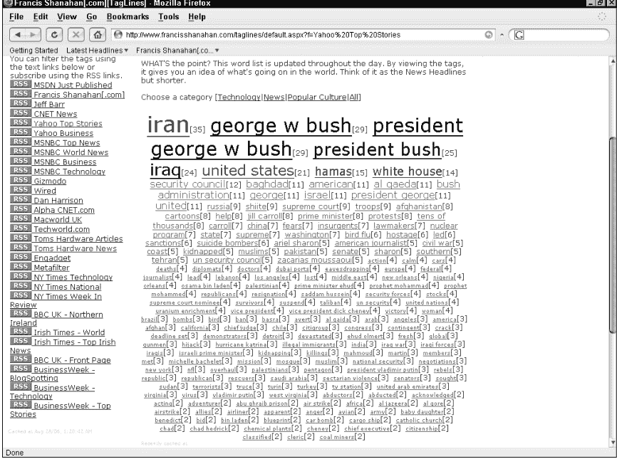

图 1-1：TagLines — 一个自动化的众分类法工具

## 软件即服务

`Web 1.0` 的范式是一个人坐在浏览器后。网站不是为了被机器读取或操作而设计的。`Web 2.0` 则关乎于暴露丰富的功能集和更多的数据。这些数据通常对人类和机器都可访问，从而带来比以往更多的自动化和衍生应用。

在“过去”，一家公司会创建一个服务，然后将其打包成一个网站发布到互联网上。访问该功能的唯一方式是通过该公司预先打包的机制，通常是其网站。

在 `Web 2.0` 世界中，公司发现通过可重用和可互操作的渠道（如 Web 服务）提供功能越来越有价值。然后将这些渠道交给用户，让他们自行使用。本质上，`Web 2.0` 方法比以往任何时候都更信任用户。

## 数据为王

“内容为王”的口号已被改写为“数据为王”。允许用户消费数据，使得定义一个与原始意图完全不同的全新商业模式和功能成为可能。

独立开发者现在能够提供在没有庞大资源团队的情况下不可能实现的应用程序。例如，开发者已经将谷歌地图与众多其他信息源结合起来，构建了新的、有用的应用程序。对于个人开发者来说，收集世界的卫星图像或整个美国的街道地图将非常困难。然而，谷歌免费提供了这些数据。

通过提供数据，如何应用这些数据的创意变得至关重要。本应如此。开发者不再关心基础架构，从而被解放出来，可以从更广泛的角度思考整体应用功能。

## 融合

目前，应用程序正从桌面端分化，并从各种设备访问。下一个合乎逻辑的步骤将是融合，使这些不同的访问渠道变得集成。我个人的猜测是，这种融合将围绕电视展开。

个人媒体中心基本上是一台连接到计算机的电视。你可以在不使用录像带的情况下观看和录制电视节目。你可以查看增强型节目指南，其中包含指向互联网内容的链接。你可以在这台 PC 上以电视的方式查看 RSS 和新闻标题，等等。

通过将额外设备集成到媒体中心，新的使用场景得以实现。例如，想象一下，通过暂停直播电视并通过你的 5.1 立体声系统播放音频来接听电话。电视显示器可能会显示来电显示，并结合来电者的照片。最后，整个通话可以被录制下来供你存档，与你的 MP3 播放器同步，并使用 RSS 发布到个人博客。

这只是一个场景，还会有许多其他场景。在本书中，你将学习实现此类场景所需的技术。

## 迭代开发

`Web 2.0` 公司倾向于采用非常短的设计、开发、发布、获取反馈、重复的循环周期，而不是使用“叉车式”方法将功能推向市场。这意味着上市时间缩短了。公司特意省略一些功能，以实现更短的周期时间。与其猜测用户想要什么，不如发布一个功能的小子集，然后获取真实用户的反馈。然后，反馈被用于驱动后续周期的功能定义。

这种开发和产品发布的持续循环通常被称为永久测试版。应用程序永远无法完成，而不是交付一个最终产品。它不断地被迭代和完善。

通过更早、更频繁地发布功能，公司的预测和估算变得更加准确。用户需求和项目要求之间的差距缩小了。对用户的价值在于，他们得到的应用程序并非试图解决他们所有的问题，而是将其中一些（一两个）问题解决得极其出色。

## 丰富的浏览器体验

浏览器是访问互联网的传统接口。在浏览器中处理应用程序（与安装在桌面端的富客户端相比）通常意味着功能减少和/或生产率降低。页面需要加载时间。数据在浏览器中是静态的，直到刷新才会更新。诸如“可拖拽”网格之类的高级控件不可用，诸如此类。

更快的互联网接入、改进的 `JavaScript` 支持以及 Web 服务的普及，使得丰富的浏览器体验成为可能。

每当有人提到 `Web 2.0` 或丰富的浏览器体验时，异步 `JavaScript` 和 `XML`（`Ajax`）通常是首先想到的。`Ajax` 提供了在页面通过浏览器查看时与 Web 服务器进行异步通信的能力。使用 `Ajax`，你可以执行部分页面更新，使数据保持最新，即使用户没有刷新页面。

你将在第 10 章实现一个由 `Ajax` 驱动的应用程序。然而，在实现浏览器中的丰富体验方面，`Ajax` 并非唯一的选择。

`JavaScript` 对象表示法（`JSON`）结合一些巧妙的 `JavaScript`，也可以用于动态更新页面内容。第 12 章描述了其工作原理，并引导你构建一个由 `JSON` 驱动的应用程序。

无论网站实现了哪种富互联网应用（`RIA`）功能，体验最终比技术更重要。

## 多渠道交付

大多数应用程序最初都是作为 Web 应用程序出现的——通过桌面或笔记本电脑上的标准浏览器访问。随着通过 `WiFi`（在某种程度上还包括 `Bluetooth`）广泛可用的互联网接入的出现，应用程序功能现在越来越多地通过蜂窝电话和无线设备（如 `Pocket PC` 或 `Palm`）来交付。

在第 14 章，你将构建一个移动接口，用于访问亚马逊的数据库，可以从 `BlackBerry` 设备或手机进行访问。

# 第一章：社交网络

我们都参加过那种晚宴，尽管你只记得一个认识的人。通过那个人，你被介绍给其他人，不知不觉中，你离席时已经收获了一系列新的业务联系人。

同样的事情也正在网络上演，只不过在互联网上，你真的不需要认识任何人。`MySpace`、`YouTube` 和 `Flickr`（图 1-2）等网站允许用户免费创建自己的个性化空间，并发布内容。这在 `Web 1.0` 时代也是可能的，但达不到同样的复杂程度。界面变得更加易于访问，拥有个人网站不再是程序员或高级用户的专属。literally everyone 都能享受拥有在线身份的体验。

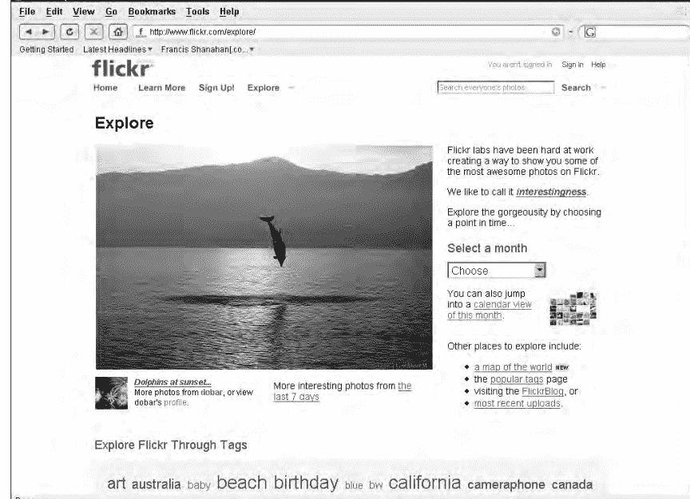

图 1-2：Flickr 提供了一个协作和社交网络的平台

交叉传播也是一个因素。对已发布内容进行评论或批判，有一种根本上的解放感。在博客中发布自己的想法时，读者评论或链接回该博客，会增强这种心理效应。

博主们相互链接，声誉由此诞生。慢慢地，一个围绕特定主题的真实人群社区形成了。通过这种方式，从超文本标记语言（`HTML`）、超文本传输协议（`HTTP`）、可扩展标记语言（`XML`）等一系列技术，跨越到了一个活生生的、有呼吸的社区，它通过归属感提升人们的生活。

# 个人开发者的崛起

传统思维认为，要构建任何重大意义的应用，你需要很多人。`Web 2.0` 的思维揭示了这是错误的。

`Web 2.0` 肯定的是，你可以用少数精干的开发者，更快更好地开发应用。反之，九个母亲不能在一个月内生下婴儿。

例如，在游戏行业，一些有史以来最复杂的三维游戏，从头到尾都是由少数开发者编写的。`Doom` 开创了三维第一人称射击游戏类型，本质上催生了一个产业，然而它的代码是由一小撮开发者完成的。

最流行的混搭和再混编应用也遵循类似的模式。例如，`Google Maps`（它开启了富浏览器应用运动）是由一家非常小的公司在大约两周内开发出来的。生产力和随之而来的商业影响之所以如此之高，是因为开发者手头就有他们需要的工具，而且归根结底，开发者们知道自己在做什么。

本书中的所有示例都是由单个开发者，也就是鄙人，开发的。这些应用被刻意保持简单，以便你可以拿来就用，而不必理解大量代码。

第十六章对一些更复杂的应用进行了解释。这些也是由单个开发者开发的，但这些应用真正试图挑战 `Web 2.0` 思维模式下可能性的边界。

# Amazon 与 Web 2.0

Amazon 公司张开双臂拥抱了 `Web 2.0` 的思维方式。经历 dot-com 泡沫后，它 MIBA-DE 固地瞄准未来，并在定义公司方向以及某种程度上互联网本身的方向方面取得了长足进步。

## Amazon 与消费者

Amazon 消费者网站向客户提供广泛的个性化功能，这些功能结合在一起，提供了高度互动的体验。因此，即使竞争对手网站的价格更便宜，Amazon 的客户往往是回头客。

Amazon 允许客户评论产品、标记和分类、评分产品，甚至对其他客户的产品评论进行评分。

随着时间的推移，客户可以建立作为评论者的声誉。这促进了网站上的主人翁感。客户甚至可以发布他们购买的产品的照片。所有这些都为买家服务，提供了额外的数据点来影响他们的购买决策。

这还没完。Amazon 客户可以构建任意的项目列表，作为一组来推荐。例如，你可以定义一个“Xbox 必备配件”列表，可能包括买家除了核心 `Xbox` 主机之外还需要的所有杂项，如游戏手柄、游戏、线缆等。

这些都是显性的内容贡献。但 Amazon 还会观察客户的行为，并从他们的模式中获取信息。如果客户查看了某个产品但最终购买了另一个，这可能成为影响下一个客户购买决策的数据点。Amazon 收集这些数据并构建产品排名，以及最终随核心产品详情一起发布的辅助信息。

## Amazon 与开发者

对于开发者来说，`Web 2.0` 的思维是不言自明的。Amazon 维护 Web 开发者计划已有数年之久。Amazon 提供对其功能和数据仓库的全面访问。这种访问是免费的，因此开发者的进入门槛非常之低。这种拥抱开发者而非限制访问的态度，是典型的前瞻性 `Web 2.0` 文化。

Amazon 开发者计划成功的最大贡献因素，可能是其围绕服务构建社区的能力。如果没有一个支持社区，无论是 Amazon 内部还是外部的，世界上最好的服务也不会被广泛采用。提供的工具包括在线文档和活跃的开发者论坛，鼓励开发者（无论是新手还是老手 alike）亲自动手。Amazon 已经认识到，围绕任何 Web 服务平台，社区与平台本身同等重要，甚至更为重要（图 1-3）。

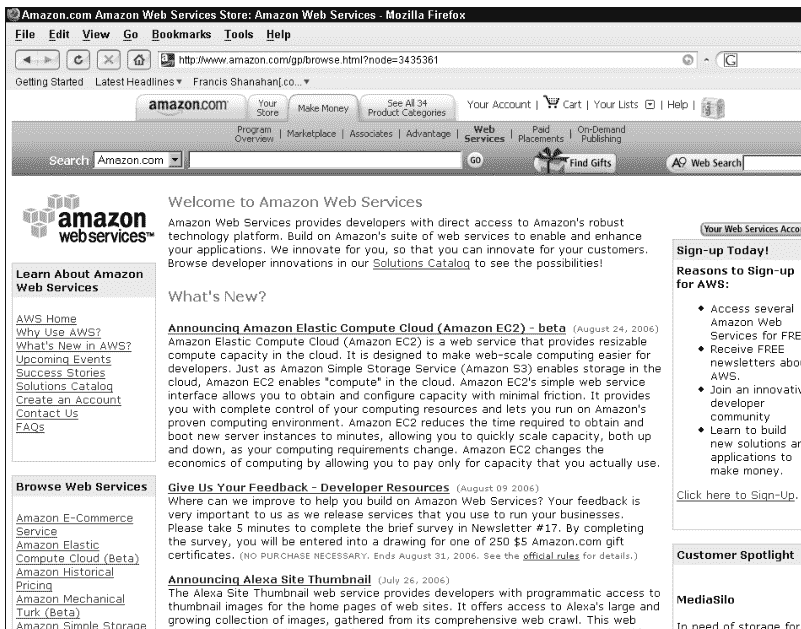

图 1-3：Amazon 开发者社区登陆页面

随着 Amazon Mechanical Turk、Simple Storage Solution 和 Elastic Computing Cloud 的新近加入，Amazon 大大扩展了其产品范围，远远超出了原始产品数据库的范畴。Amazon 没有固守在线零售商的核心商业模式，而是在应对需求的同时，重新定义其商业模式和商业环境。这种适应性再次体现了 Amazon 领导层在多大程度上采纳了 `Web 2.0` 的精神。

# 总结

Web 依然充满活力，比以往任何时候都更具吸引力。我曾经坐在一个会议室里，一位 CEO 将互联网的诞生比作火的发现。现在，即使我戴着最好的螺旋桨帽 firmly in place，我认为火还是要重要一些。尽管如此，Web 上蕴含着丰富的机遇，对开发者和商界人士都是如此。

本书教你开始利用这一机遇所需的一切知识，只需极少的投入。

在接下来的章节中，你将详细了解 Amazon Web 服务平台，以及其他配角公司提供的各种服务。你将学习如何重组这些服务来创建新的应用。

在第二章中，你将学习一些关于如何使用 Amazon 电子商务服务（`ECS`）的基础知识，以及通过 Amazon 开发者平台可用的其他服务。

# Amazon Web Services Store

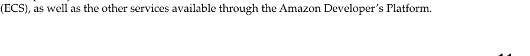

## Francis Shanahan

# Amazon Web 服务平台

Amazon 不再仅仅是互联网上的领先零售商之一。Amazon 推出了全面的 Web Services 平台，这使它跻身当今世界技术提供商的前列。

本章概述了 Amazon Web Services 平台的主要组成部分。你将了解有哪些类型的信息和功能可用，以及如何访问这些服务。后续章节将在示例应用中利用这些信息。

Amazon 网站建立在包含数十万产品的数据库之上。Amazon 作为一家公司，有远见地允许客户通过评论和评分来贡献和丰富这些内容。

在 Web 服务方面，Amazon 是首批向公众开放其数据的公司之一。因此，它拥有最丰富的 Web 接口套件之一。它提供免费和按使用付费的服务供你使用！

## Amazon 开发者计划

要对 Amazon 的 Web Services 平台进行方法调用，有必要参与 Amazon 开发者计划。每个被调用的 API 都会传递多个参数，其中之一就是称为 `AWSAccessKeyId` 的开发者 ID。

示例代码中有一个占位符，你需要用你自己的 `AWSAccessKeyId` 来替换。每当你看到 `[YOUR KEY HERE]` 时，在代码中将其替换为你自己的 `AWSAccessKeyId`。如果不这样做，应用将无法工作。

注册是免费的，你可以在这里注册：

```
https://aws-portal.amazon.com/gp/aws/developer/registration/index.html
```

你会发现几乎所有网络平台（无论是亚马逊、雅虎、谷歌等）都有开发者计划，需要注册后才能使用这些 API。好消息是，几乎所有这些 API 对非商业用户都是免费的。

## 电子商务服务

亚马逊电子商务服务（`ECS`）开放了亚马逊庞大的产品数据库。这包括访问用户贡献的内容以及详细的产品信息。不仅如此，`ECS` 还提供了全面的电子商务功能供你在此基础上构建应用。例如，第 10 章将介绍的远程购物车功能。

`ECS` 开发者网站包含参考文档、示例代码和开发者论坛，可通过亚马逊网络服务主站的以下链接访问：

```
http://aws.amazon.com
```

## 核心数据类型

通过 `ECS` 可获取的主要数据类型详见下表。

| 数据类型 | 描述 |
|---|---|
| 产品数据 | 所有与产品相关的内容。产品数据库本身就是一个世界，甚至包含餐厅信息。 |
| 用户内容 | 用户可能贡献并标记为公开的任何内容都可通过 `ECS` 获取。这包括心愿单、购物清单、婚礼登记册和产品评论。 |
| 卖家信息 | 亚马逊也为第三方销售产品。你可以访问这些卖家的评级和基本信息。 |
| 第三方产品信息 | 非亚马逊直接销售，而是通过第三方卖家销售的产品。 |
| 购物车内容 | 购物车存储在亚马逊服务器上，并可远程访问。第 10 章将说明如何实现远程购物车。 |

## 接口类型

亚马逊 `ECS` 支持简单对象访问协议（`SOAP`）和表述性状态转移（`REST`）两种风格的交互。

## 亚马逊网络服务平台

亚马逊对 `REST` 架构风格的实现使用 `HTTP` 将所有必要信息传输到 `ECS` 以执行查询。方法调用、参数和值都通过简单的 URL 和查询字符串方式指定。这意味着你可以使用简单的网络浏览器测试 `ECS` 交互，然后再将其集成到你的代码中。

尝试将以下 URL 粘贴到浏览器的地址栏中：

```
http://webservices.amazon.com/onca/xml?Service=AWSECommerceService&AWSAccessKeyId=[YOUR KEY HERE]&Operation=ItemSearch&SearchIndex=Books&Keywords=Amazon Mashups
```

结果将是一个 `XML` 文档，在本例中包含搜索结果列表。这就是使用 `REST` 从 `ECS` 获取数据的方式。`SOAP` 使用更复杂的方法，但达到相同的结果。你将在后续章节中了解更多关于 `SOAP` 和 `REST` 的内容。

## 区域设置

亚马逊网站分为不同的区域，以更好地服务世界各地的用户。爱尔兰客户查看美元标价的产品没有太大用处。同样，你可以针对以下特定区域之一查询 `ECS`：

- 美国（`US`）
- 法国（`FR`）
- 加拿大（`CA`）
- 英国（`UK`）
- 日本（`JP`）
- 德国（`DE`）


US 是默认区域。

上一段中的 URL 查询的是 US 区域的商品。例如，要更改为日语，只需按如下方式修改 URL 的根目录：

```text
http://webservices.amazon.co.jp/onca/xml?Service=AWSECommerceService&AWSAccessKeyId=[YOUR KEY HERE]&Operation=ItemSearch&SearchIndex=Books&Keywords=Amazon Mashups
```

请注意从 `.com` 更改为 `.co.jp`。这将返回日本产品。所有区域的根目录 URL 列在第 7 章中。

## ECS 的核心操作

无论你使用 REST 还是 SOAP 接口，对 ECS 发起的操作都是一致的。以下部分将介绍 ECS 中可用的操作，并对每个操作进行高层次的描述。

# 第 2 章

## 产品操作

尽管严格来说，只有三种直接与产品相关的操作，但它们的功能强大得超乎想象：

- `ItemSearch` — 这可能是最常用的操作。它执行对特定商品的搜索，通常使用一组关键词。能够执行高级查询以缩小结果范围并精确进行搜索定位。
- `SimilarityLookup` — 给定一个亚马逊标准商品编号（ASIN），此操作根据产品规格和特性返回一个类似产品列表。
- `ItemLookup` — 提供对特定产品相关各类数据的访问。通常用于构建详情页面。

## 远程购物车操作

以下是与远程购物车管理相关的操作。购物车存储在亚马逊服务器上；因此，相对于你的站点它是远程的。

- `CartCreate` — 创建一个远程购物车。
- `CartAdd` — 向购物车添加一个商品。
- `CartGet` — 获取现有购物车的内容。
- `CartModify` — 从现有购物车中移除一个商品。
- `CartClear` — 从现有购物车中移除所有商品。

## 列表操作

这些方法让你可以访问诸如心愿单、婴儿登记册或其他用户定义的列表：

- `ListLookup` — 允许你查看给定列表的详细内容。此操作需要一个列表 ID。
- `ListSearch` — 提供对用户创建的列表进行关键词搜索。

## 用户内容操作

这些操作可以访问亚马逊活跃用户群贡献的内容。这包括评论、评分和心愿单：

- `CustomerContentLookup` — 与 `CustomerId` 结合使用，用于检索该用户贡献的任何信息。
- `CustomerContentSearch` — 提供对用户内容的关键词搜索，例如评论甚至用户可能标记为公开的“关于你”的信息。

亚马逊网络服务平台

## 第三方列表相关

亚马逊还为第三方商家（亚马逊以外的商家）提供销售商品的途径。在许多情况下，商家或卖家可能拥有亚马逊本身不库存的商品。在其他情况下，卖家可能拥有二手或翻新商品。甚至存在卖家拥有与亚马逊相同但价格不同的商品的情况。这些操作提供对该信息的访问：

- `SellerListingSearch` — 搜索通过亚马逊平台销售商品的第三方商家的产品。
- `SellerListingLookup` — 允许你查看给定卖家的产品详情。
- `SellerLookup` — 检索卖家的详细信息，包括平均客户满意度评分、卖家所在地等。

## 杂项操作

这些操作不一定能完美归入之前的类别。然而，这些操作提供了有用的信息，因此在 ECS 平台中占有一席之地：

- `TransactionLookup` — 提供访问亚马逊客户交易部分信息的途径。出于保密原因，数据仅限于订单总额和杂项信息。
- `BrowseNodeLookup` — 此操作便于在亚马逊产品层次结构中导航。请参阅本章后面的 `BrowseNodes` 概述。
- `Help` — 主要作为开发辅助工具使用。此操作提供补充文档，以补充开发者电子商务服务文档。

## ASIN

亚马逊中的所有产品都由亚马逊标准商品编号（ASIN）标识。每个产品都有一个 ASIN，每个 ASIN 都是唯一的。ASIN 无处不在，一旦分配给产品就很少更改。事实上，你可能已经通过常规使用亚马逊接触过 ASIN。

以下 URI 提供了电影《赌城风云》（Casino）的详情页面（图 2-1）。

```text
http://www.amazon.com/gp/product/B0007VZ9DK
```

本例中的 ASIN 是 `B0007VZ9DK`。ASIN 在不同区域是通用的，因此，虽然前面的 URI 针对 US 区域，但以下 URL 可以在 UK 区域定位到同一产品：

```text
http://www.amazon.co.uk/exec/obidos/ASIN/B0007VZ9DK
```

如果你拥有产品的 ASIN，可以使用 `ItemLookup` 操作查询 ECS 以获取产品详情。

## 第 2 章

## BrowseNodes

亚马逊拥有数不胜数的产品。为了让一切井井有条，这些产品被分门别类地组织成一个层次结构。你可以将这个结构想象成一棵倒置的树。

层次结构中的类别被称为 `BrowseNode`。一个 `BrowseNode` 下面可能包含更多的 `BrowseNode`，也可能只包含实际的产品。例如，`BrowseNode` “Video Games” 可能包含 “PC Games” 和 “Xbox 360 Games” 作为子节点。这些节点中的每一个又可能包含进一步的分类。你越往树的深处走，分类就越具体。

产品可以属于多个 `BrowseNode`，因此可以被划分到多个类别中。

一个 `BrowseNode` 实体通常包含以下属性：

- `BrowseNodeID` — 该 `BrowseNode` 的唯一标识符（对于 “Video Games”，节点 ID 是 468642）。
- `Name` — `BrowseNode` 的友好名称（例如，“Video Games”）。
- `Ancestor nodes`（祖先节点）— 分类中更上层的节点。你可以导航到这些节点以扩大分类范围（例如，从 DVD 或 Video 往上到 “Movies”）。
- `Child nodes`（子节点）— 层次结构中的下一层。

## BrowseNodes 的用途

`BrowseNodes` 是你工具箱中的实用工具。以搜索为例。假设你正在搜索白色条纹乐队（White Stripes）的歌曲 “Screwdriver”。

如果你在所有产品中执行针对 “screwdriver” 一词的 blanket search（blanket 搜索），返回的结果可能包含与工具和器材相关的商品，甚至可能包含如何调制 Screwdriver 鸡尾酒的教程！

然而，如果你知道 CD 的 `BrowseNode`，就可以在搜索参数中指定它。这样就将搜索限定在该产品组或其子类中。以这种方式用 `BrowseNode` 限定搜索，更有可能返回白色条纹乐队的结果，而不是返回手工具的。

通过在操作中指定 `BrowseNode`，你可以更精确地定位该操作的执行。

## 必需参数

你会发现，几乎所有的 Web API（包括亚马逊的）都要求在每个方法调用中传入某些参数。这是为了在服务器端实现无状态化。如果服务器不维护状态，就能更有效地扩展。

每个 REST 调用都需要 `Service` 参数，以告知亚马逊该请求是针对 ECS 服务的。对于 ECS，`Service` 应设为 `AWSECommerceService`。

基本的 ECS 请求参数，如 `AWSAccessKeyId`，是永远不变的，并且存在于所有请求中。如果你同时是联盟成员（Associate），那么你应该传入你的 `AssociateId`，以便启用对你应用中赚取的任何佣金的跟踪和支付。

当然，所有方法都需要所需操作的名称。这是通过 `Operation` 参数传入的。

下面是一个执行 `ItemSearch` 操作、搜索与 Radiohead 相关的音乐的 REST URL 示例：

```text
http://webservices.amazon.com/onca/xml?Service=AWSECommerceService&AWSAccessKeyId=[YOUR KEY HERE]&Operation=ItemSearch&SearchIndex=Music&Keywords=Radiohead
```

通过在指定位置填入你的 `AWSAccessKeyId`，你可以直接将此 URL 粘贴到浏览器中以获取 XML 响应。

清单 2-1 展示了生成的 XML 响应。在后续章节中，你将会非常熟悉这个。

### 清单 2-1：`ItemSearch` XML 响应示例

```xml
<?xml version="1.0" encoding="UTF-8"?>
<ItemSearchResponse
xmlns="http://webservices.amazon.com/AWSECommerceService/2005-10-05">
  <OperationRequest>
    <HTTPHeaders>
      <Header Name="UserAgent" Value="Mozilla/5.0 (Windows; U; Windows NT 5.1; en-US; rv:1.8.0.6) Gecko/20060728 Firefox/1.5.0.6"></Header>
    </HTTPHeaders>
    <RequestId>01DT4VM33K6R7R6R22EW</RequestId>
    <Arguments>
      <Argument Name="Service" Value="AWSECommerceService"></Argument>
      <Argument Name="SearchIndex" Value="Music"></Argument>
      ...
      <Argument Name="Keywords" Value="Radiohead"></Argument>
      <Argument Name="Operation" Value="ItemSearch"></Argument>
    </Arguments>
    <RequestProcessingTime>0.0907800197601318</RequestProcessingTime>
  </OperationRequest>
  <Items>
    <Request>
      <IsValid>True</IsValid>
      <ItemSearchRequest>
        <Keywords>Radiohead</Keywords>
        <SearchIndex>Music</SearchIndex>
      </ItemSearchRequest>
    </Request>
    <TotalResults>340</TotalResults>
    <TotalPages>34</TotalPages>
    <Item>
      <ASIN>B000002UJQ</ASIN>
      <DetailPageURL>http://www.amazon.com/gp/redirect.html%3FASIN=B000002UJQ%26tag=ws%26lcode=xm2%26cID=2025%26ccmID=165953%26location=/o/ASIN/B000002UJQ%253FAWSAccessKeyId=[YOUR KEY HERE]</DetailPageURL>
      <ItemAttributes>
        <Artist>Radiohead</Artist>
        <Manufacturer>Capitol</Manufacturer>
        <ProductGroup>Music</ProductGroup>
        <Title>OK Computer</Title>
      </ItemAttributes>
    </Item>
    ...
... Abridged ...
    ...
    <Item>
      <ASIN>B00000735Z</ASIN>
      <DetailPageURL>http://www.amazon.com/gp/redirect.html%3FASIN=B00000735Z%26tag=ws%26
lcode=xm2%26cID=2025%26ccmID=165953%26location=/o/ASIN/B00000735Z%253FAWSAccessKeyId=[YOUR KEY HERE]</DetailPageURL>
	<ItemAttributes>
		<Artist>Radiohead</Artist>
		<Manufacturer>EMI</Manufacturer>
		<ProductGroup>Music</ProductGroup>
		<Title>Itch</Title>
	</ItemAttributes>
</Item>
</Items>
</ItemSearchResponse>
```

## ResponseGroups

当你构建产品详情页面时，你可能需要获取尽可能多的信息。然而，在你的列表页面中，你可能只需要最低限度的信息。当你向亚马逊的 ECS 发起查询时，你可以通过指定 `ResponseGroup` 来告诉平台返回多少信息。

下表描述了部分可用的 `ResponseGroups`。

*并非所有的 `ResponseGroup` 都适用于所有操作。*

| ResponseGroup | 说明 |
| --- | --- |
| `CartNewReleases` | 显示与购物车中第一个产品相关的五大新品。因此，如果用户购物车中的第一个产品是 DVD，你可能会获得 DVD 品类的五大新品。 |
| `CartSimilarities` | 提供与购物车中商品相似的商品。你可能在亚马逊上看到过这些，标题为“购买此商品的客户还购买了以下商品”。 |
| `CustomerFull` | 显示由客户创建的数据。通常，这包括客户信息，如位置、昵称、电子邮件地址，以及该客户提供的评论或评分。 |
| `EditorialReview` | 提供亚马逊对给定产品的内部评论（如果已撰写）。 |
| `Images` | 将响应限制为特定产品的图片。例如，你可以使用此 `ResponseGroup` 来构建产品缩略图列表页面。 |
| `ListMinimum` | 返回最少的可用于构建轻量级搜索结果列表的产品数据。 |
| `New Releases` | 返回给定产品类别（`BrowseNode`）的新发布产品。 |
| `Request` | 一个特殊的 `ResponseGroup`，提供传入原始请求的所有参数。你可以将其与其他 `ResponseGroups` 结合使用，例如，以实现结果的分页。 |
| `TopSellers` | 提供给定 `BrowseNode` 的畅销产品。 |

当然，实际可用的 `ResponseGroups` 远不止这里列出的这些。欲了解更多信息，请参阅亚马逊 ECS 产品文档或本书后面的附录 A。

## 成为亚马逊联盟成员

要访问 Web 服务平台，你必须注册成为亚马逊开发者并获取 `AWSAccessKeyId`。然而，要真正赚钱，你必须注册成为亚马逊联盟成员并获取联盟 ID。然后，此标识符会包含在对 ECS 的每个操作中。

如果用户从你的网站对亚马逊执行搜索，他们可以获得结果列表。每个结果都指向该产品的详情页面。详情页面链接会包含你的 `AssociateId`。如果用户点击了其中一个链接并最终购买了产品，你将从该销售中赚取佣金。

以下是一个包含我自己的 `AssociateId`（`francshanacom-20`）的链接示例：

```text
http://www.amazon.com/exec/obidos/ASIN/0470097779/francshanacom-20?creative=327641&camp=14573&adid=12ZZ2PAKY4ZY32Q1B7Q2&link_code=as1
```

随着时间的推移，以这种方式赚取的佣金会积少成多。作为联盟成员，你可以选择以现金形式或亚马逊礼品卡的形式获得报酬。

## ECS 支持的场景

ECS 为开发者和非开发者都带来了诸多商业机会。

对开发者来说，显而易见的选择是在 ECS 之上构建一个购物网站。虽然这一选择显而易见，但已被证明非常成功。使用 ECS，你可以创建一个专门的商店，提供围绕特定主题的增强型产品推荐。以下是一些例子：

- *家庭音响* — 为家庭音响新手提供指导。要在客厅里搭建杜比 7.1，你需要哪些产品？
- *迎接宝宝* — 对于准父母来说，该期待什么、哪些产品可以缓解孕期不适，以及带宝宝回家真正需要准备什么？
- *电影爱好者* — 创建一个社区，用于评论、评分和推荐难以找到的 DVD 或 VHS 电影。

通过在特定主题周围建立一个热情的社区，交叉销售和产品植入会变得更加有效。

以下是一些其他创意：

- *新奇商店* — 提供独特的购物体验，配备增强功能，如 Live Search 或 Flash。你可以通过一点想象力，或者与常规不同的购物体验来吸引流量。
- *产品图片汇编* — ECS 公开了几乎涵盖亚马逊所有产品的数百万张产品图片。这些可以作为典型购物体验的一部分使用，或者像第 16 章介绍的 Zollage 项目所展示的那样，被重新用于现代艺术。

## 将 ECS 用作数据挖掘工具

ECS 中包含的数据是一个非常有用的资源。你可以利用它来确定哪些类型的产品在销售以及它们在哪里销售。你可以跟踪产品随时间变化的销售排名。你甚至可以将数据聚合到更大的集合中，以推导产品层面的关键绩效指标（KPI）。这种方法可以产生有用且有趣的结果。例如，你可以分析某些产品的季节性流行度，并确定你的销售模型应重点推广哪些产品。

## 亚马逊开发者网站

ECS 并非亚马逊 Web 服务计划提供的唯一 Web 服务。主要的亚马逊 Web 服务登陆页面（图 2-2）包含了各种创新和有用服务的链接。

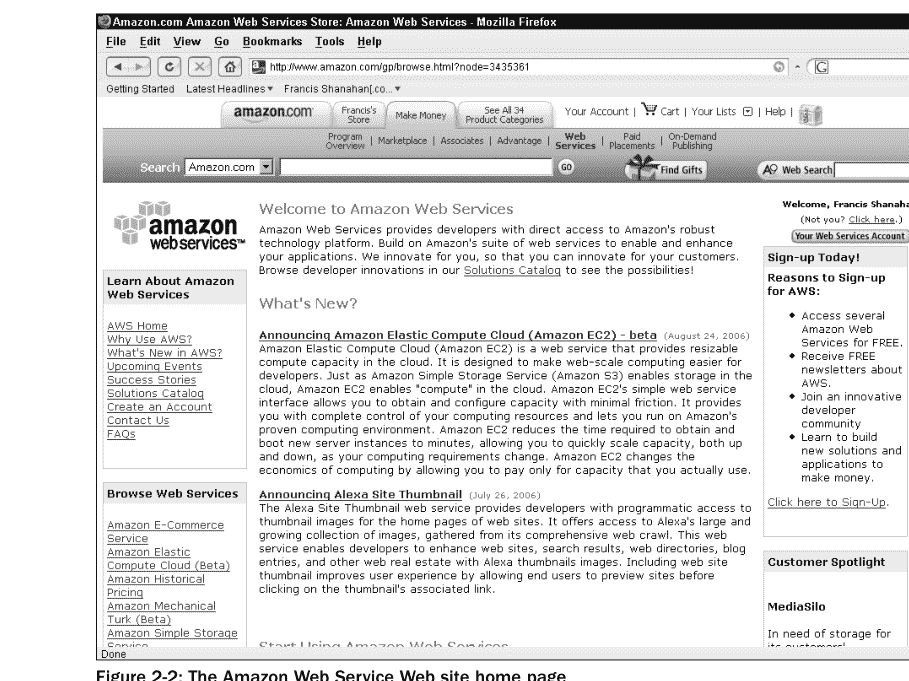

以下各节描述了 Web 平台包含的各种其他服务。

## 亚马逊机械 Turk


亚马逊机械 Turk 是一种 Web 服务，允许你提交一项操作，该操作不由计算机执行，而是由服务背后的成千上万名人类执行。亚马逊称之为“人工人工智能”（artificial artificial intelligence）。这不是错别字。如果“人工智能”是指像人类一样思考的计算机，那么“人工人工智能”就是人类执行任务并将结果提供给计算机。

“机械 Turk”这个名字源自匈牙利人沃尔夫冈·冯·肯佩勒（Wolfgang von Kempelen），他在 1769 年发明了一个可以下棋的人形玩偶。这在 1769 年的技术背景下是一项非凡的成就。这个自动机不仅能下棋，还击败了其大多数对手。然而，这个人形玩偶之所以技艺高超的秘密在于，在它坐着的柜子内部，有一个人类在指挥它的每一个动作。

亚马逊机械 Turk Web 服务以同样的方式取得了显著效果。雇主可以提交一项需要完成的任务，并指定他们愿意支付的金额。该任务通常是人类可以轻松完成的小型原子任务。例如，任务可能涉及识别照片的内容或撰写一段总结视频文件内容的文本段落。

然后，工作者可以审查可用任务，接受它们，完成任务并获得报酬。该 Web 服务允许从应用程序内部以编程方式提交任务。随后，同一应用程序可以在任务完成时检索已完成任务的结果。对于应用程序的用户来说，看起来就像是应用程序编写了完成该任务的逻辑，但实际上是由人类在执行真正的逻辑。

亚马逊称此为“人工人工智能”。

想象一下，编写一个能够可靠地告诉你视频文件内容的应用程序需要多少时间和精力？编写这样值得吗？有许多任务需要如此高等级的智力，以至于让人类来执行更为合理。

机械 Turk 还可以将一项巨大任务分发给许多工作者。随着整体目标的接近，可以跟踪和处理结果。以此方式，机械 Turk 可以为人工智能领域提供分布式计算能力。

## 亚马逊简单队列服务

多年来，队列一直用于提供应用程序之间可靠的消息通信。在此语境下，“可靠”意味着无论消息接收者是否在运行，消息都会保持安全，直到接收者准备好接受它为止。

如果你将消息放入队列，它会一直待在那里，直到有什么东西将其取走。这就是从 50,000 英尺高空俯瞰队列的视角。

队列基础设施通常在公司内部网络中设置，以允许系统和应用程序相互通信。亚马逊简单队列服务（Amazon SQS）将此概念引入 Internet，并以易于使用的 Web 服务形式呈现。

通过使用 Amazon SQS，开发人员可以开发分布式应用程序，并以安全、可扩展和可靠的方式在它们之间进行通信。任何具有 Internet 访问权限的机器都可以读取或发布到 Amazon 队列。预期的接收方可以在不同的位置、不同的时间启动，并读取队列中等待的数据。

队列可以被命名并分配权限，以限制谁有权读取和写入它们。Amazon SQS 还提供内置支持，以避免死锁情况或竞态条件（即两个订阅者尝试同时访问同一消息）。

发布到队列的任何消息都在 Amazon 基础设施内的服务器和数据中心中冗余存储，以确保数据不丢失。公司可能需要数年时间才能实现可靠的冗余数据存储，因此这项功能本身就对独立开发者是一个巨大的福音。

Amazon SQS 是另一种按使用量付费的服务，但增量费用非常小，仅根据平台的使用情况产生。

## 亚马逊弹性计算云

亚马逊弹性计算云（EC2）按需提供可扩展的计算能力给开发人员。这项服务让你能够在亚马逊服务器上构建并运行应用程序。这就像拥有自己的个人网格计算环境。

按需计算能力的概念可以通过一个例子最好地解释。想象你有一个棘手的数学问题或大量数据需要处理。自然，处理这项任务的步骤可能是创建一个应用程序来处理数据。要运行该程序，你需要硬件。这可能意味着获取环境、布线、部署等等。这在时间框架、调度、管理、人员等方面带来了自己的挑战。

亚马逊弹性计算云让你能够在亚马逊的管理环境中构建并运行应用程序。如果你的业务增长，并且需要更多硬件来处理更多数据，计算环境可以在无需重新经历采购周期的情况下扩展。这将你的上市时间从数周或数月减少到实实在在的几个小时。

包含要执行代码的整个操作系统映像可以上传并存储在亚马逊简单存储服务（S3）上，然后由 EC2 执行。

EC2 是一项付费服务，但仅按你实际使用的 CPU 时间收费。总体效果是降低了进入高端计算能力的门槛。

## 亚马逊历史定价

亚马逊历史定价 Web 服务是另一个得益于亚马逊作为零售商历史的数据挖掘服务。

开发人员可以获取过去三年中书籍、DVD 和音乐的销售数据。通过分析特定产品在特定时间段内的价格，你可以更准确地确定何时在你的商店中推广某些产品。例如，拖鞋可能在父亲节前后销售得更好。

## 亚马逊简单存储服务

借助这种可扩展的存储解决方案，独立开发者拥有了许多可能性。这些机会以前需要大量的前期投资（资金和时间）。可能的包括：

- 构建下一个 YouTube 并将视频存储在 S3 上。
- 通过将照片存储在 S3 上来有机地发展下一个 Flickr。
- 与团队成员共享文件。
- 通过链接存储在 S3 上的文件来减少电子邮件内容。
- 通过将数据存储在 S3 上来备份你的数据。

当然，对 S3 的接口使用的是 Web 服务，因此很容易构建将 S3 作为其数据存储存储库的应用程序。

文件对象的大小可达 5GB，并且与其他按使用量付费的服务一样，你只需为你的应用程序使用的存储和带宽付费。

与其他亚马逊服务（如机械 Turk 或 SQS）一样，S3 服务之上覆盖了全面的身份验证。文件可以公开存储，或通过向单个用户或用户组分配权限来限制访问。所有存储的对象都可通过 HTTP 访问，这为高度互操作的平台提供了支持。

第 15 章将引导你了解如何访问 S3 并利用它来构建一个通用的文件存储，然后可以根据你特定的应用程序需求对其进行定制。

## Alexa

Alexa 是一家亚马逊公司，通过其 Alexa 工具栏收集的数据提供网站和流量分析。用户下载并安装 Alexa 浏览器工具栏，数据在用户浏览时反馈给 Alexa。这比传统的 Web 日志分析更能准确反映用户的实际行为。

你可以在以下 URL 找到更多关于 Alexa 的信息：

```text
http://www.Alexa.com
```

## Alexa 网络搜索平台

在过去十年中，Alexa 一直在爬取网络并构建其网站数据存储库。Alexa 网络搜索平台是一套处于测试阶段（beta）的 Web 服务，提供对此存储库的访问权限。开发人员可以直接在庞大的 Alexa 数据存储库上构建自己的搜索引擎，或者抽象并重新聚合数据以应用自己的数据分析算法。

如果你有意构建一个新的搜索引擎，但不想投入前期爬取网络的工作，Alexa 网络搜索平台可以为你实现这一目标提供巨大的起步助力。

你可以在以下 URL 了解更多关于 Alexa 网络搜索平台的信息：

```text
http://websearch.alexa.com
```

## 亚马逊网络服务平台

## Alexa 热门网站

Alexa 热门网站是一项 Web 服务，使开发者能够访问根据人气和流量排名的网站。使用此服务，您可以快速确定某个主题下哪些网站是重要的。数据可以按单个国家进行筛选，以确定（从地理上）流量来自哪里。

## Alexa 网站缩略图

Alexa 不仅以传统的网络爬虫方式抓取和索引互联网网站，还会截取网站在浏览器中实际显示的截图。这些截图随后与收集到的该网站数据一起存储。网站截图会被调整大小，以提供给定网站的便捷缩略图。

Alexa 网站缩略图 Web 服务允许您通过 Web 服务访问这些截图。此信息可与其他 Alexa Web 服务产品结合使用，为一组给定的标准提供增强的搜索结果。能够在点击链接访问网站之前看到该网站，让用户更有把握找到他们正在寻找的站点（图 2-3）。

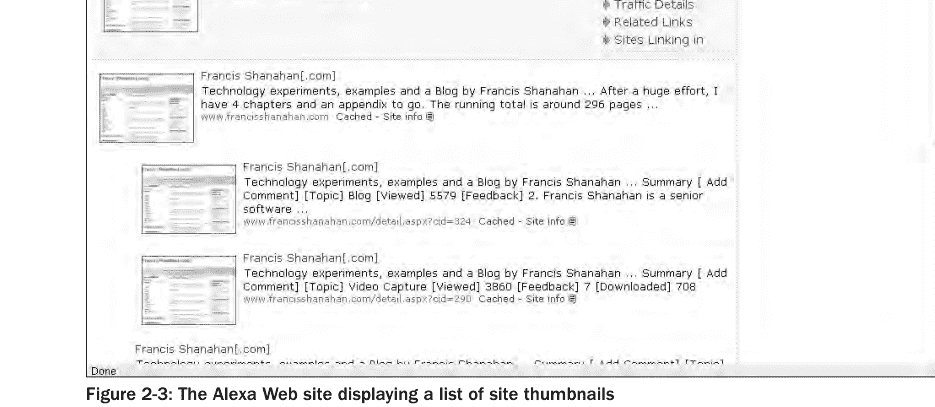

图 2-3：显示网站缩略图列表的 Alexa 网站

该服务正在不断改进，如果您请求的图像不存在，Alexa 承诺在 24 小时内提供该缩略图。

## Alexa Web 信息服务

Alexa Web 信息服务以即用型的形式提供全面的网站信息。Web 信息服务可以为您的应用程序提供您在搜索引擎中期望的一切，例如以下功能：

- **搜索引擎功能** — 根据一组搜索条件获取相关网站的列表。
- **浏览功能** — 导航 Alexa 预先编译的网站分层目录。
- **元数据** — 获取网站元数据，例如联系信息、相关链接等。

Alexa Web 搜索平台提供的访问级别低于 Alexa Web 信息服务。如果您只需要通过编程方式访问 Web 搜索信息，Web 信息服务将更适合您的需求。

## 总结

本章概述了通过亚马逊开发者平台可用的 Web 服务，包括 Alexa 提供的服务。

在本章中，您学到了以下内容：

- ECS 是什么以及如何访问它。
- 通过 ECS 平台可用的主要数据实体有哪些，例如产品详情、搜索结果、客户评论等。
- 亚马逊还提供哪些附加服务。

至此，您已对当前 Web 服务环境中可用的可能性有了广泛的了解。亚马逊已明确确立了其作为网络领先技术提供商的地位。对于一家传统上以书店闻名的公司来说，这代表了一次大胆的举动。

在接下来的章节中，您将了解类似前瞻性公司（如 Yahoo、Google 和 eBay）提供的服务。您将深入了解 ECS，并开始使用它来构建新的有趣的应用程序。在此过程中，您将实现各种混搭技术，并学习如何将这些新兴数据源结合在一起。

第 3 章介绍了一些当前最受欢迎的 Web 服务。这些服务将在后面的章节中用于构建混搭应用。

## 第 3 章

## 其他可混搭的服务

第 2 章让您快速了解了亚马逊的 Web 服务产品。本章延续这一趋势，概述其他一些公司的平台。

您在这里是在为成功铺路。了解的越多越好。您需要这种意识来创建混搭应用。如果您只熟悉少数几个 API，您的想法很快就会用尽。如果您熟悉来自许多不同提供商的众多不同 Web 服务（至少在高级层面），那么您就可以开始想象从中构建新的有趣的应用程序。

目前实际上有数百家公司通过 Web 服务公开其数据和服务，希望开发者能利用这些创建新的业务。本章涵盖了一些更受欢迎的服务，并为您指出正确的方向，以便您自己找到这些服务。

## Yahoo

Yahoo（`http://www.Yahoo.com`）一段时间以来一直在培育围绕混搭应用和 Web 服务的开发者社区。除了其核心的 Web 搜索 API 外，它还推出了一系列有用且创新的产品。

Yahoo 提供广泛的服务，包括问答、财经、搜索和营销。主要的 Yahoo 服务在以下各节中描述。

## Yahoo Maps

Google 率先将交互式地图的概念引入浏览器。Yahoo 随后迅速实现了这一点。现在，由于构建在平台之上的 Web 服务，这个相同的概念变得可以混搭。使用 Yahoo Maps，开发者可以创建交互式的地理地图应用程序。支持基于 Ajax 的用户界面和 Flash 界面，并且可以轻松自定义。

提供卫星照片、基于矢量的地图或混合视图。在第 11 章和第 12 章中，您将实现两个涉及 Yahoo Maps 和 Amazon 的不同混搭应用。每个应用程序都说明了一种不同的数据集成技术（图 3-1）。

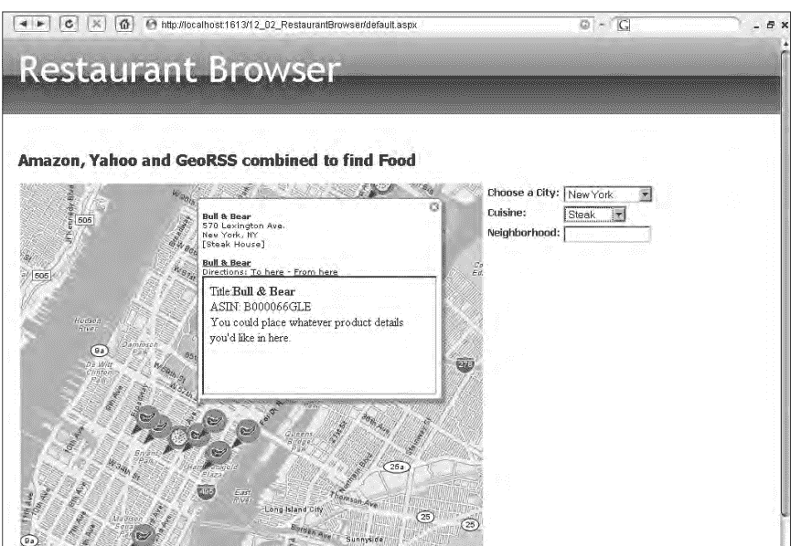

## Yahoo Search

搜索 API 可能是 Yahoo 产品中的核心 Web 服务。Yahoo Search 提供全面的搜索能力，超越了典型的基于文本的搜索结果。

Yahoo Search 包含许多功能，每个功能又提供了大量的功能。接下来的几节列出了一些更突出的可用服务。

## 音频搜索

如果您正在构建在线音乐商店或音频文件聚合器，Yahoo Audio Search 可以帮助您。音频搜索以结构化的方式提供对艺术家、专辑和歌曲信息的访问。一旦找到您感兴趣的歌曲，音频搜索服务还可以提供该媒体的下载位置或在线提供商列表。

## 新闻搜索

新闻与典型的 Web 内容不同，因为新闻项目通常以订阅源格式发布，如真正简单聚合（RSS）或 Atom，并且新闻故事的更新频率远高于标准 Web 内容。Yahoo News 服务搜索注册的新闻出版商，以检索由美联社或英国广播公司（BBC）等提供商发布的实际新闻故事。

## 视频搜索

视频搜索提供的搜索结果包含指向独立托管的视频片段的链接。这些片段就像常规 Web 内容一样被分类和索引。您可以获取视频片段的链接，以及由 Yahoo 服务器生成的视频缩略图。

## 图像搜索

Yahoo 提供了对其图像目录的专用搜索界面。正如您可以在 Yahoo.com 上仅搜索图像结果一样，图像界面提供了对相同数据源的编程访问。

## Web Search

正如您所料，Web 搜索 API 让您能够利用 Yahoo 自己现成的搜索索引。Web 搜索为您提供了与 Yahoo.com 站点本身相同的结果集。通过这种方式，您可以将 Yahoo 搜索结果直接整合到您的应用程序中。为了进一步自定义体验，您可以通过本地搜索 API 获得本地化的搜索结果。

本地搜索提供按地理位置量身定制的搜索结果。这可以为用户带来更高程度的相关性。

## 内容分析

Yahoo 内容分析服务非常有用。它允许您获取一段内容（例如一个段落或一篇博客文章）并提交该内容进行分析。该服务根据内容的上下文返回相关的关键词。这是一个高级的分析功能，实现起来并不简单。通过将其作为一项服务公开，Yahoo 为用户提供了一个复杂的分析工具，可用于构建自己的数据分类算法。

## Yahoo 交通警报

交通警报提供对交通信息的实时访问。如果 66 号公路上发生了连环撞车，或者 44 号公路上有施工，您可以提前得知。这项创新服务以基于 REST 的 API 或 RSS 订阅源的形式提供。提供指向 Yahoo Maps 的链接，其中包含任何相关交通热点的地图标记。

除了基于 REST 和 SOAP 的 Web 协议构建的服务外，Yahoo 还通过各种订阅源格式（如 RSS）提供对广泛数据的访问。第 7 章更详细地介绍了 RSS，并引导您使用 Amazon 数据实现自己的 RSS 订阅源。

## 第 3 章

## Yahoo Shopping

Yahoo 从众多零售商处汇总产品信息，并通过其主站 `www.Yahoo.com` 展示这些结果。相同的信息也可通过 Yahoo Shopping 服务的 Product Web 方法获取。第 8 章将指导你使用 Yahoo Product Search 服务与 Amazon 进行比价购物。

值得注意的是，Yahoo 对其任何网络服务的访问都不收费。你没看错——所有 Yahoo 网络服务都是免费使用的。Yahoo 采用的方法是在特定时间框架内限制你调用其任何服务的次数。此限制称为速率限制，因服务而异，如果超出限制，API 调用将被暂停，直到速率限制刷新。

你可以通过以下 URL 注册访问 Yahoo 开发者网络，并了解更多关于 Yahoo 网络服务的信息：

`http://developer.yahoo.net/`

## Del.icio.us

Del.icio.us（`http://del.icio.us`）是一个社区驱动的网站，允许你在线存储你喜爱网站的链接（书签）。链接可以按需进行分类、标记和归类。因为一切都在网上，你可以从任何计算机访问你的书签。随着时间的推移，你的仓库会不断积累，并逐渐达到针对特定主题的站点临界规模（图 3-2）。

Del.icio.us 的妙处在于你可以与社区其他成员分享你的收藏。就像写博客一样，这是与他人建立联系、进行交流的好方法。这也是发现新事物、紧跟互联网发展动态的好方法。

Del.icio.us API 相对简单直接。它提供以下功能：

- 以编程方式检索其他用户发布的新书签。
- 按标签或类别限制你的搜索。
- 向 Del.icio.us 添加链接。
- 对现有书签进行标记和重新分类。

Del.icio.us 开发者 API 可通过以下 URL 获取：

`http://del.icio.us/help/api/`

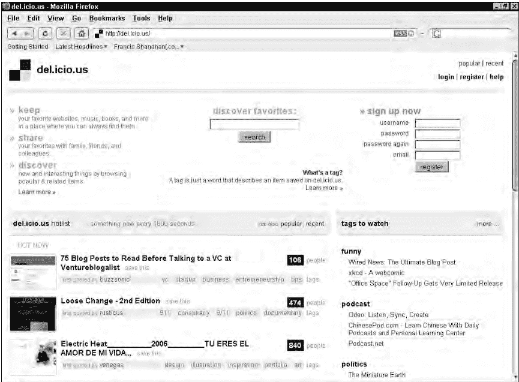

图 3-2：Del.icio.us 主页

## Technorati

Technorati（`http://www.technorati.com`）是一个博客监控和聚合工具。这意味着它跟踪个人博客，并在人们发布的内容之上提供 feed 聚合服务。Technorati 目前跟踪约 5000 万个个人博客。这确实是一个庞大的内容量。

博客的核心在于表达你的观点。因此，博主们经常链接并评论其他人的博客。Technorati 注意到这种相互关系，并利用它来制定博客之间的相对排名。被链接更频繁的博客会获得更高的排名。

Technorati 也可用于聚合和查看来自多个博客的内容。作为 Technorati 用户，你可以创建一个博客列表（通常称为“博客列表”），并在列表中任何内容更新时收到通知。

Technorati API 提供了对这个内容仓库的访问。作为开发者，你可以使用 Technorati API（这是一个典型的 REST 风格 API）来搜索并实时展示在网络上发布的内容。

Technorati 的功能领域细分如下表所示。

| 功能 | 描述 |
|---|---|
| 搜索 | 你可以通过关键词或短语搜索博客。你也可以根据与博客关联的标签进行查询。最后，你可以搜索链接到给定 URL 的博客，以便你为特定网站建立自己的相关性。 |
| 浏览 | 博客可以根据其内容被打上特定词语的标签。例如，我的博客可能会被打上“mashup”、“ajax”、“amazon”等标签。使用 Technorati Browse API，你可以提供一个标签（如“amazon”），并查看有多少博客被打上了该关键词的标签。 |
| 博客信息 | 可以为给定博客获取全面的元数据，包括其排名和链接到它的网站数量。 |
| 用户信息 | 你可以向 Technorati 查询关于特定博主的信息。返回的信息包括该用户创作了哪些博客。 |

你可以从以下 URL 注册访问 Technorati 开发者计划，并获取其 API 的更多信息：

`http://www.technorati.com/developers/`

## Flickr

Flickr（`http://www.flickr.com`）是一个专注于发布和分享照片的社区驱动网站（图 3-3）。Flickr 公司归 Yahoo 所有，因此拥有强大的网络服务能力。

Flickr 网络服务提供对托管在 Flickr 网站上的照片和相关信息的访问。具体来说，你可以做以下事情：


- 基于给定关键词或属性搜索照片
- 通过网络服务调用提交照片
- 搜索 Flickr 用户并获取这些用户发布的照片
- 获取标有特定关键词或标签的照片列表

Flickr 支持基于 REST、XML-RPC 和 SOAP 的方法调用。此外，它还提供许多定期更新的基于 XML 的 feeds。与服务不同，Flickr feeds 不需要注册。Feeds 提供有关最近提交的照片、讨论甚至 Flickr 新闻的信息。

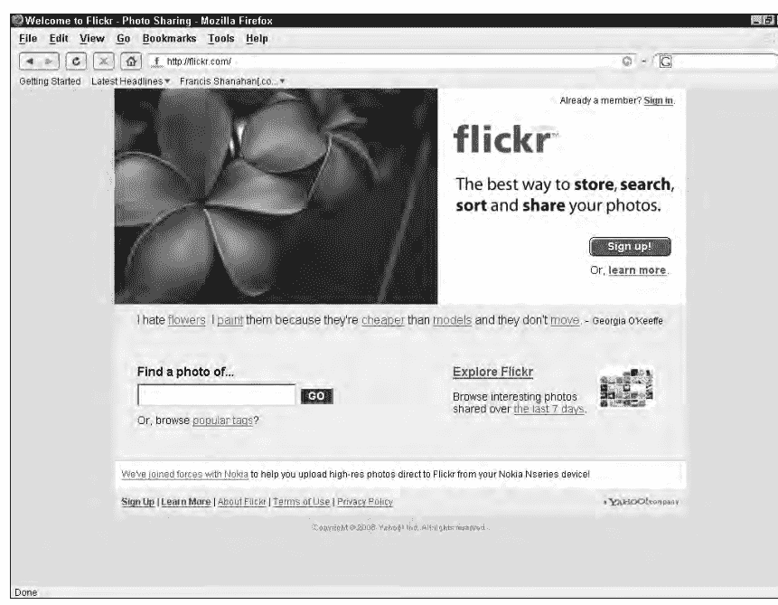

图 3-3：Flickr 主页

这是一个生成标有“red”单词的照片的 RSS 2.0 格式 feed 的示例 URL：

`http://api.flickr.com/services/feeds/photos_public.gne?tags=red&format=rss_200`

Flickr 用户是一个富有才华和热情的社区。将定期更新的照片整合到你的应用程序中的能力，能为内容驱动和媒体驱动的网站带来更丰富的体验。

你可以在以下 URL 了解更多关于 Flickr 网络服务平台的信息：

`http://www.flickr.com/services/`

## Google

Google (`http://www.Google.com`) 是一家具有前瞻性的公司。它已采取行动，将工具交到开发者手中，允许他们在其革命性平台上进行构建。正如 Amazon 从其原始零售根源发展分支一样，Google 也从其核心搜索服务扩展，提供一系列针对性的应用程序，如 Google Maps、AdSense、Google Earth、Google Mail 等。其中许多应用程序现已集成到 Google API 套件中。以下部分详细介绍了通过 Google 提供的一些更有趣的 API。

### AdSense API

AdSense 是 Google 的广告平台，也是其主要收入来源。AdSense 程序的发布商和订阅者现在可以通过 AdSense API 访问许多广告管理功能（例如报告）、修改广告并查看收益。这些数据随后可以集成到第三方应用程序中。

### Blogger API

Google 拥有流行的博客托管平台 Blogger.com。Blogger API 允许你通过网络服务管理你的博客。这意味着你可以创建新文章、更新现有条目等，并将此功能集成到你自己的表示层中，这样用户就不需要直接访问 Blogger.com。

### Google Gadgets API

Google 在其核心产品中提供了一个“可个性化”的主页。该页面可通过登录 Google 并点击 www.Google.com 上的“个性化此页面”来访问（图 3-4）。

Google 个性化主页由根据用户偏好排列的独立小工具（Gadget）组成。一个小工具可能显示体育比分、股票报价、天气等信息。

使用 Google Gadgets API，你可以轻松创建自己的小工具，并将其部署和注册到 Google 主页上。其他用户随后可以在他们的个性化 Google 页面上使用这些工具。

### Google Maps API

Google Maps 在发布后不久就被一位独立开发者破解（hacked）。社区非但没有阻止此类活动，反而欣然接受，于是 mashup 诞生了。至少故事是这样说的。Google Maps API 允许你构建自己的交互式地图应用程序，并在浏览器中显示各种地理信息。

关于 Google Maps API 在 mashup 方面的著作已经汗牛充栋。与其重复现有内容，本书将介绍不太受推崇的 Yahoo Maps API。

### Google Toolbar API

Google Toolbar 是一个厚客户端浏览器插件，用户将其安装在他们的计算机上。Toolbar API 允许你自定义此插件，在工具栏上添加按钮和功能。

## 其他 Mashable 服务

### Google 网页搜索 API

Google 通过其广受欢迎的搜索 API，向第三方开发者开放了全面的搜索功能。该 API 提供了与驱动 Google 主站相同的数据库访问权限，因此你每次都能获得相关结果。

> Google 为其大多数 Web 服务提供了多种技术的示例代码。这些示例实现包括 Perl、Python、Java、PHP 和 C#。
>
> Google API 是实验性的，因此可以免费使用。开发者每天可执行的调用次数有限。
>
> 请通过以下 URL 注册以获取你的 Google 开发者密钥：`http://www.google.com/apis/`

## 第 3 章

## eBay

eBay (`http://www.Ebay.com`) 目前是在线拍卖领域无可争议的领导者。你经常可以在 eBay 上找到与商店中相同的商品，但价格却只是其一小部分。eBay 创建了自己的开发者计划，允许安全地访问当前正在进行的拍卖活动（图 3-5）。

与 Amazon 一样，eBay Web 服务为独立开发者提供了一套全面的操作。开发者可以使用这些 Web 服务执行以下操作：

- 按关键词或短语搜索活跃的拍卖列表
- 在 eBay 上提交新物品进行销售
- 重新列出拍卖未成交的物品
- 获取与给定物品列表相关的交易信息
- 获取关于给定卖家、买家或竞标者的信息

eBay 提供了多种技术开发工具包，以满足你的个人需求，包括 Java、.NET、SOAP、XML 和 REST。

eBay 还提供了一个包含示例数据集的沙盒环境。此沙盒环境可用于在将你的应用程序指向实际在线拍卖之前进行测试。能够以这种方式进行单元测试是极大的便利，并能带来更可预测的上线效果，在生产环境中不会出现意外。

你可以通过以下 URL 注册访问 eBay 开发平台：

`http://developer.ebay.com/DevProgram/developer/api.asp`

第 10 章将向你展示如何将 eBay API 与 Amazon 结合使用，以进行比价购物。

## MSN 搜索

MSN (`http://www.MSN.com`) 可能是较不为人知的 Web 服务之一，它现在通过基于 HTTP 的 SOAP 提供对其搜索目录的访问。该服务免费使用，尽管示例代码主要限于 Microsoft 技术。

与 Google 和 Yahoo 一样，使用该服务是免费的，结果全面且有用。该服务的一个显著特点是其使用率限制很高。MSN 每天提供高达 10,000 次查询，之后才会开始限制访问。

你可以通过以下 URL 访问 MSN 搜索服务、开发者论坛和使用指南：

`http://search.msn.com/developer/`

## 411Sync

411Sync (`http://www.411Sync.com`) 是一家小型公司，提供引人注目的服务。如果你在外出时没有电脑，可以使用手机通过 411Sync 搜索内容。

开发者可以将其搜索应用注册到该公司。411Sync 充当搜索聚合器或管道，用户可以通过它访问这些结果。411Sync 本身提供将搜索结果传送到移动设备的基础设施。

411Sync 也支持无线访问协议（WAP）设备和标准桌面浏览器。

在第 14 章中，你将学习如何使用无线标记语言（WML）、Amazon 和 XML/XSLT 构建自己的移动搜索应用。

你可以通过以下 URL 了解更多关于 411Sync 的信息，并注册你的搜索应用：

`http://411sync.com/`

## BBC

英国广播公司 (`http://www.BBC.co.uk`) 现在通过其 BBC Web API（测试版）提供节目信息。节目和频道信息均可获取，包括节目时间表。

你可以使用该服务来规划每周的观看计划，或者查看当前正在播出的节目。数据以两种 XML 格式之一返回：“简单”格式或 TV-Anytime 格式。

BBC 的 Web 服务可在此处获取：

`http://www0.rdthdo.bbc.co.uk/services/`

TV-Anytime 是一个全球性协会，旨在更好地利用消费电子产品中的本地持久存储。TV-Anytime 论坛围绕与节目相关的媒体传输制定了一项规范。

你可以通过以下 URL 了解更多关于 TV-Anytime 的信息：

`http://www.tv-anytime.org`

## YouTube

YouTube (`http://www.YouTube.com`) 是另一个社区驱动的网站，托管业余电影制作人的短片和片段。这些内容往往极具原创性，并且在许多情况下非常引人入胜（图 3-6）。

YouTube 同时提供基于 REST 和 XML-RPC 的 API 访问。API 主要分为两类：用户相关和视频相关。

通过 YouTube 服务可获取的用户信息包括：

- 用户个人资料信息
- 给定用户的收藏视频
- 给定用户的好友

通过 YouTube 服务可获取的视频相关信息包括：

- 按标签搜索视频
- 列出给定用户的视频
- 获取当前精选视频列表

## 其他 Mashable 服务

第 9 章向你展示如何将 YouTube 视频与 Amazon 数据结合使用。

你可以通过以下 URL 了解更多关于 YouTube 开发者计划的信息，并获取详细文档：

`http://www.YouTube.com/dev`

### TerraServer USA

多年前，微软与美国地质调查局 (`http://www.usgs.gov`) 合作，通过 Web 服务提供免费的美国卫星图像。这是最早期的免费 Web 服务之一，至今仍在运行（图 3-7）。

用户可以请求以图块形式获取在特定经纬度、特定细节级别下拍摄的照片。例如，一个图块可能显示图像中每个像素的分辨率为 1 英里。更详细的图块可能包含每米 1 像素的分辨率。

### MSN Messenger 活动

MSN Messenger (`http://messenger.msn.com`) 是 Microsoft 的即时通讯客户端，估计拥有约 2900 万活跃用户。这是一个庞大的用户群。

MSN Messenger 活动是可从 MSN Messenger 客户端内部访问的第三方应用程序。活动以网页形式编写，可以通过 Messenger Activities API 与通讯客户端进行交互。

一旦你开发了一个 messenger 活动，你就可以注册并部署它供所有 messenger 用户使用。或者，你可以将应用程序的使用权限限制为你通知的人员。

这种通过可扩展架构来增强现有应用程序的方法在 mashup 世界中非常普遍。由于无需担心消息传递基础设施，开发者可以自由地专注于应用程序带来的增强功能。

一种新的交付渠道——即时通讯客户端，现在可用，不再局限于浏览器。你可以通过以下 URL 了解更多关于 MSN Messenger Activity 软件开发平台的信息：

`http://msdn.microsoft.com/live/msnmessenger/default.aspx`

### Rhapsody

Rhapsody (`http://www.rhapsody.com`) 是一个在线音乐提供商。Rhapsody 通过其可下载的浏览器插件将音乐传送到你的桌面。与典型音乐提供商的不同之处在于，Rhapsody 不对其服务收费。整个体验是免费的。没有月费，也无需注册信用卡。

Rhapsody Web 服务平台允许开发者访问 Rhapsody 的内容。这包括艺术家和专辑信息，以及在你的网站上播放音乐的功能。

Rhapsody 方便的链接方案使得链接到你喜爱的专辑变得很容易。专辑链接的构建方式如下：

`http://play.rhapsody.com/<artist name>/<album name>`

因此，指向 Radiohead 的 "Hail to the Thief" 专辑的链接将如下所示：

`http://play.rhapsody.com/radiohead/hailtothethief`

你也可以使用类似的 URL 结构通过 RSS 源获取数据。以下 URL 会生成 Led Zeppelin 第四张专辑的曲目源：

`http://feeds.rhapsody.com/ledzeppelin/236870_ledzeppeliniv/tracks.rss`

你可以通过以下位置了解更多关于可用 Rhapsody Web 服务的信息：

`http://webservices.rhapsody.com/`

### Second Life

Second Life (`http://www.SecondLife.com`) 是一家提供不同类型产品的不同类型的公司。Second Life 为用户提供了一个完整的三维世界供其生活。用户可以在“第二人生”元宇宙中购买一片虚拟土地，并根据自己的喜好进行自定义。你可以像在现实生活中一样在上面进行有效建造。你可以为自己建一栋房子、买一辆车、开车兜风、与他人交谈，并在“第二人生”体验中完成你的日常生活。

这种类型的虚拟现实已经存在了一段时间，但直到现在才达到了足以让参与变得有价值的临界用户规模。你可以改变自己的外观，随心所欲地装扮自己。你可以开设商店、开发虚拟产品并销售你的商品。这个世界拥有自己的经济体系，包括货币以及现实世界美元与“第二人生”美元之间的兑换率。

活动也是这个世界的重要组成部分。现实生活中的音乐会会同步广播到“第二人生”，让世界各地的人们都能参与。现实世界的组织，如美国癌症协会，已经举办了筹款活动。图书作者举办了虚拟签售会，现实世界的名人也开始进行虚拟亮相。

亚马逊也加入了进来，在“第二人生”内提供关于其网络服务平台的现场演示（图 3-8）。


## 其他可混搭的服务

开发者现在可以在“第二人生”平台上进行开发，将第三方网站内容集成到这个世界中。亚马逊的 ECS 已经被混搭到“第二人生”中，创建了一个指向亚马逊商店的虚拟界面。

面对如此投入和活跃的用户群，营销公司开始予以关注。活动吸引了高度多样化的人群，而受关注的受众则带来了绝佳的营销机会。随着越来越多的营销人员注意到这一现象，我预计在“第二人生”内通过混搭实现盈利的机会将会增长。

另一个例子是将 del.icio.us 与“第二人生”结合，允许你标记虚拟世界中的一个位置，并将该书签存储在 del.icio.us 上。Flickr 也被混搭进来，使 Flickr 照片能够出现在虚拟世界中。

“第二人生”仍处于开发的早期阶段，但显然，通过混搭技术创造全新世界的机会是存在的。

你可以在以下网址了解更多关于为“第二人生”进行开发的信息：

`http://www.secondlife.com/developers`

## 地方政府

这些只是众多可用服务中的一小部分。现在有成千上万的网站提供内容，包括地方政府网站。不妨访问你的地方政府网站，看看那里有哪些类型的信息。你可能会发现你所在的城镇正在通过 XML 公开交通信息、梅根法案登记信息或 911 呼叫记录。

## 总结

你已经了解了亚马逊所能提供的，而本章仅展示了可用互补 API 的冰山一角。这些服务涵盖了从音乐到搜索、从地图到消息传递的所有类别。

几乎所有这些服务都是免费使用的，这是我在本书中努力坚持的一个主题。混搭关乎实验，没有人愿意为此付费。

网络上有一个不断壮大的混搭社区，通常找到特定网络服务的提供商不成问题。只需考虑你需要的数据类型，然后找出该领域的领先者。访问他们的网站；他们很可能提供网络服务。

如果你发现某家公司尚未向开发者开放其数据，我建议你发邮件鼓励他们加入。如果你能获得一种易于解析和操作（例如 XML）的良好定义格式的内容，那么你通常可以将该内容包含到你的应用程序中。

> 构建混搭时，请务必注意不要侵犯任何版权或使用限制。

既然你已经了解了有哪些可用资源，接下来的几章将介绍用于构建本书示例的工具、技术和技巧。

其余章节将各专注于一种特定技术，并引导你构建实现这些技术的示例应用程序。

在第四章中，你将设置 Visual Studio 开发环境，并使用 ASP.NET 构建你的第一个应用程序。如果你是 Microsoft 和 ASP.NET 开发新手，这会是很好的一章。

## 第二部分

### 准备开始混搭

本部分包括：

- 第四章. 开发工具
- 第五章. 技术
- 第六章. 混搭技术
- 第七章. 创建你的第一个混搭作品


## 第四章

## 开发工具

在你能创建任何东西之前，你需要一个开发环境。尽管混搭可以采取多种形式（包括可安装的应用程序或网站），但本书侧重于以网站形式构建混搭。对于本书中的示例，你特别需要一个编译器和一个网络服务器。

在本章中，你将安装主要的开发工具，并构建一个包含导航和布局框架的示例网站。在此过程中，你将熟悉 ASP.NET 2.0 的一些高级功能。生成的网站可以用作本书后续其他示例的基础。

## Microsoft Express 版本

Microsoft 在其集成开发环境（IDE）方面一直处于领先地位，现在其开发者工具比以往任何时候都更易获取。Microsoft 首次通过其所谓的“Express 版本”提供了免费版本的 Visual Studio IDE。这些是可供下载的精简版开发环境。我说的“精简”是指，你会发现这些工具功能相当丰富，对于学生、爱好者，尤其是混搭开发者来说绰绰有余。

尽管本书主要侧重于 Microsoft 平台（包括 ASP.NET），但本书中描述的技术可以轻松地适用于非 Microsoft 环境，例如 LAMP（Linux、Apache、MySQL 和 Perl）或 Java 2 企业版（J2EE）。

Express 版本的 Visual Studio 可从以下位置免费获取：

```text
http://msdn.microsoft.com/vstudio/express/default.aspx
```

Express 套件中有许多工具。每个工具都是一个独立的产品，必要时可以单独下载。

## 网页开发


混搭的概念关乎互操作性，它们实际上是技术无关的。你可以使用 Java 或 Python 开发网络服务和 XML，就像使用 .NET 一样。你可以自由使用任何你熟悉的工具。为了简单起见，我将主要侧重于使用 Visual Web Developer 2005 Express Edition 进行 ASP.NET 2.0 开发，并在某些情况下使用 SQL Server 进行数据库存储。就语言而言，本文中的示例以 C# 提供，尽管将它们翻译成 Visual Basic .NET 相对容易。

Visual Web Developer 2005 Express Edition 支持 ASP.NET 2.0、C# 和 Visual Basic .NET，包括一个功能齐全的 Web 开发环境，带有一个 WYSIWYG（所见即所得）编辑器。这是贯穿本书的主要开发工具。

> Visual Web Developer 2005 Express Edition 这个名字实在太长了！为简洁起见，我将称此工具为 Visual Studio 或简称 Studio。

如果你还没有这样做，请下载并安装 Visual Web Developer 2005 Express Edition。

### 数据库开发

不可避免地，构建有意义的应用程序需要数据存储。数据访问不是本书的主要关注点，因为你（大部分时候）处理的是*别人*的数据。对于那些需要数据存储的情况，可以考虑使用 SQL Server 2005 Express Edition。

SQL Server 2005 Express Edition 提供了完美的轻量级数据存储，而无需牺牲功能。所有在 SQL Server Express 中开发的解决方案都与 SQL Server Enterprise 完全兼容。这很棒，因为你可以直接在笔记本电脑上运行数据库，而不需要一台庞大的“大型机”服务器。

### Windows 开发

以下工具专门用于 Windows 应用程序开发。同样，Windows 窗体可以像 Web 窗体一样方便地使用网络服务。

- `Visual Basic 2005 Express Edition` — Visual Basic 可能是最容易上手的语言之一，但又足够强大，可以开发生产级应用程序。如果你熟悉 Visual Basic 6.0，那么这是你的理想工具。对于 Web 应用程序，请使用 Web Express，并将 VB.NET 作为默认语言。
- `Visual C# 2005 Express Edition` — Visual C# 是 Visual Studio 套件中的默认语言。你已经在“网页开发”部分看到了对 C# 的提及。Visual C# 2005 Express Edition 专门用于 Windows 窗体开发。你无法使用此版本的工具集创建 ASP.NET 网站。
- `Visual C++ 2005 Express Edition` — 当需要高性能时，C++ 长期以来一直是首选工具。C# 已经显著缩小了这一差距，但 Visual C++ 仍然受到许多开发者的钟爱。Microsoft 提供了其最受欢迎的编译器的轻量级版本。
- ☐ `Visual J# 2005 Express Edition` — Visual J# 不一定包含典型的 Websphere 或 Weblogic 开发者所习惯的全部 J2EE 功能，但对于那些有先前 Java 语言经验、正在转向 Windows 开发的开发者来说，它可能是一个可行的选择。

## 一个简单的网站

此时，你可以构建一个简单的 ASP.NET 页面（图 4-1），以确保 Visual Studio 已设置并正常工作。接下来的部分将构建一个通用网站，这是熟悉 Visual Studio IDE 的一种简便方式。如果你是经验丰富的开发者，你会发现一切井然有序。如果你是微软开发新手，这将帮助你快速上手。

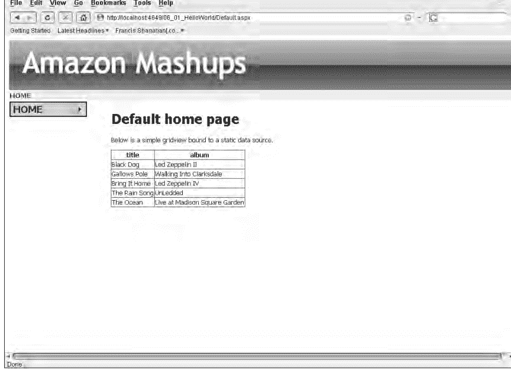

图 4-1：最终目标

> *本章的示例无需互联网连接。整个网站在 Visual Studio 的本地 Web 服务器上运行。*

## 第 4 章：动手实践——一个简单的网站

尝试使用一个项目、仅包含一个页面来创建一个简单的网站。在本章剩余部分，你将在此项目基础上继续构建。

1. 打开 Visual Web Developer Express Edition。选择“文件”→“新建网站”（图 4-2）。

   在“创建网站”对话框中，有两个下拉菜单。第一个下拉菜单控制项目存储的位置。有三个选项：文件系统、Web 服务器（HTTP）或 FTP 服务器（FTP）。目前，你应该将项目存储在本地文件系统上。选择项目的位置以及一种核心源代码语言，然后单击“确定”。

2. 单击“确定”，在指定位置创建一个简单的项目。当然，项目包含一个名为 `Default.aspx` 的单页面，几乎没有其他内容。

3. 打开项目中的默认页面 `Default.aspx`，并切换到“设计”视图（单击主窗口底部的按钮）。

4. 在页面某处输入 `Hello World`，然后按 F5 构建并运行解决方案。系统会提示你将 `web.config` 文件添加到项目中。顾名思义，`web.config` 文件存储特定网站的配置信息，而你确实需要一个！单击“确定”继续。

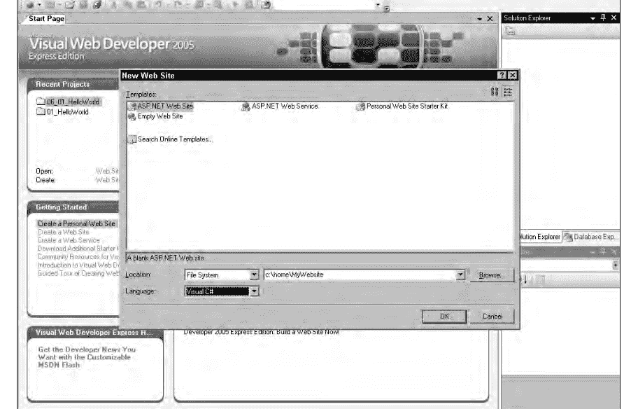

图 4-2：“创建网站”对话框

52

### 语言设置

Web 开发者源代码语言默认为 Visual C#。如果你更喜欢使用 Visual Basic 编码，只需在创建项目时更改设置。这将使添加到项目中的每个新页面默认使用 Visual Basic。你知道吗，在 ASP.NET 2.0 中，你可以混合使用语言，因此一些页面可能使用 Visual Basic，而另一些使用 C#？

内置的 Web 服务器会启动并在你的默认浏览器中运行解决方案，显示 `Default.aspx`。恭喜！！！你刚刚构建了你的第一个网站！

> ASP.NET 1.1 开发者在使用 ASP.NET 2.0（VS Web Developer 的原生平台）时会注意到许多差异。例如，不再需要 Internet Information Server。Visual Studio 安装了自己的轻量级 Web 服务器，该服务器会为给定项目启动。你还会注意到不再有特定的“项目”文件。Visual Studio 直接从文件系统启动网站。这大大降低了开发开销，并使整个 Web 开发环境更易于访问。

## 回顾开发环境

本节回顾 IDE 的一些功能。图 4-3 描绘了 IDE 的初始状态。

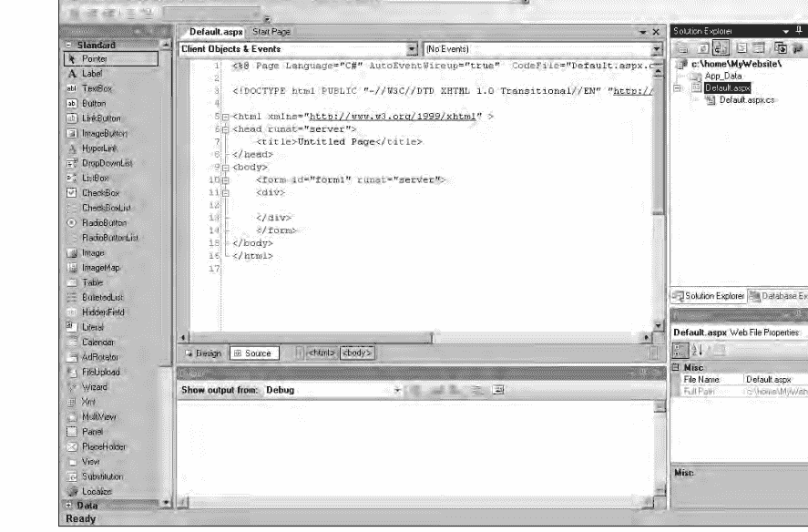

图 4-3：Visual Studio Web Developer Express 集成开发环境

屏幕中央显示正在编辑的特定文件。这可能显示 XML 文件、ASP.NET 页面、给定网页的代码（C# 代码），或者甚至只是一个纯文本文件。

对于 ASP.NET 页面，主区域会以*源代码*或*设计*视图显示，允许“所见即所得”（WYSIWYG）编辑。有时能够编辑页面并立即看到其外观效果很好。在其他情况下，能够直接编辑 HTML 或服务器标签非常重要。Visual Studio 支持这两种模式。经验丰富的开发者会很高兴地了解到，IDE 在从源代码视图切换到设计视图时，不再试图自动格式化 HTML。

屏幕左侧是工具箱窗口。工具箱包含用于给定页面的各种控件。你可以通过简单的拖放操作，将这些控件从工具箱添加到页面的设计区域。

控件按如下表格分组：

| 组名 | 描述 |
| :--- | :--- |
| 标准 | 包含来自所有其他部分的一些更常用控件的默认分组。 |
| 数据 | 包括数据访问（如 `SqlAdapter`）和数据可视化控件（如 `GridView`）。 |
| 验证 | 通常用于表单验证，这些控件允许你将表单中的输入限制为特定值或模式（例如，限制在文本框中输入的文本以确保仅输入有效的电子邮件地址）。 |
| 导航 | 网站导航功能，如面包屑和菜单。ASP.NET 2.0 在此方面具有强大的功能，我稍后会稍作探讨。 |
| 登录 | 专注于身份验证和授权的专用控件集。 |
| WebParts | 门户功能，允许你构建高度动态的页面，供个人用户根据需要进行自定义。 |
| HTML | 严格来说不是控件，而是简单的 HTML 标签。有时最简单的东西就是最好的。 |

IDE 的右侧包含解决方案资源管理器窗口以及属性窗口。

在 Visual Studio 中，一组项目被分组为一个*解决方案*。一个项目可能是一个网站、Windows 窗体应用程序、Windows 服务，或者只是一个控制台应用程序。相互关联的项目可以在逻辑上分组到一个解决方案中。解决方案资源管理器允许访问给定项目的所有元素，包括所有图像、ASMX、RESX、CS 文件等。

ASP.NET 使得能够轻松快速地创建包含大量功能且只需很少代码的有用网站。实际上，每个网站都有一些跨页面通用的功能（例如，布局、导航菜单等）。下一节将展示如何使用 ASP.NET 2.0 中称为“母版页”的新功能为你的网站构建通用布局。后续部分在此基础上添加导航和面包屑。生成的 Web 应用程序可作为后续章节中许多示例的通用起点。

## 母版页

如果你正在构建一个网站，最好在整个网站的页面中保持一致的布局、外观、菜单等。一个每个页面都完全不同、没有共同元素的网站，会让用户感觉每次页面切换都像在访问不同的网站。

ASP.NET 2.0 通过允许每个页面由母版页驱动来解决这个问题。共同元素（包括页面布局）在母版页中定义。这也简化了网站的维护。如果你使用母版页，每个由母版页驱动的页面将在母版页更改后自动更新。

在解决方案资源管理器窗口中右键单击，选择“添加新项...”。从出现的对话框中选择“母版页”，并将其命名为 `main.master` 之类。确保勾选“在单独的文件中添加代码”复选框，然后单击“确定”。这将向项目中添加一个新的母版页。

你会注意到，默认情况下，母版页包含一个 `contentPlaceHolder` 服务器标签。这个区域很重要，因为它代表页面的非通用内容。每当一个页面指定此页面作为其母版页时，`contentPlaceHolder` 将被该页面的实际内容填充。这个概念称为“视觉继承”，这是一个强大的概念，你很快就会看到。

现在你可以向母版页添加一些代码，以帮助定义网站的整体布局。例如，你可以为页面添加一个标题，也许还有一个 3x3 的表格（3 行，3 列）。

你的页面源代码应如下所示：

```aspx
<%@ Master Language="C#" AutoEventWireup="true" CodeFile="Main.master.cs"
 Inherits="Main" %>

<!DOCTYPE html PUBLIC "-//W3C//DTD XHTML 1.0 Transitional//EN"
"http://www.w3.org/TR/xhtml1/DTD/xhtml1-transitional.dtd">

<html xmlns="http://www.w3.org/1999/xhtml"> 
<head runat="server">
	<title>Amazon Mashups</title>
</head>
<body>
```

## 第 4 章

让我们逐步梳理您在此处所学到的内容。文件中的第一行被称为*页指令（page directive）*。这一行简单地通过指定单词 `Master`，声明这是一个母版页面。一个普通页面则会在该页指令的第一个词中使用单词 `Page`。

```aspx
<%@ Master Language="C#" AutoEventWireup="true" CodeFile="Main.master.cs" Inherits="Main" %>
```

接下来是 `<DocType>` 声明。它告诉浏览器，随后的标签将如何严格遵循世界万维网 consortium (W3C) XHTML 规范：

```html
<!DOCTYPE html PUBLIC "-//W3C//DTD XHTML 1.0 Transitional//EN"
"http://www.w3.org/TR/xhtml1/DTD/xhtml1-transitional.dtd">
```

下一节 mostly HTML，它定义了页面的头部、主体以及一个三列表格。请注意我在表格最中间的单元格中放置了 `ContentPlaceHolder` 标签。这意味着任何使用该页面作为其母版的页面都会将其内容渲染到页面的中心位置。

```aspx
<td>
    <asp:contentplaceholder id="ContentPlaceHolder1" runat="server"></asp:contentplaceholder>
</td>
```

现在您已经有了一个母版页面，需要将 `Default.aspx` 页面关联起来以使用它。打开 `Default.aspx`，删除其中的所有内容，仅保留页指令（即文件中的第一行）。

在 `Page` 指令中添加以下属性：

```aspx
MasterPageFile="~/Main.master".
```

这告诉编译器，该页面将使用 `Main.master` 作为本页面的母版页面。您的页指令应如下所示：

```aspx
<%@ Page Language="C#" AutoEventWireup="true" CodeFile="Default.aspx.cs"
Inherits="_Default" MasterPageFile="~/Main.master" %>
```

在正确配置了 `default.aspx` 页面后，您可以向其添加一些内容。右键单击 `default.aspx` 的设计表面（design surface），然后选择“创建自定义内容”。这会在 `default.aspx` 中添加一个新标签：`asp:content`。该内容标签充当存储特定于页面的内容的占位符。尝试在此内容区域输入 `Hello World`，然后按下 F5 键启动应用程序。浏览器窗口将打开并显示类似图 4-4 的页面。

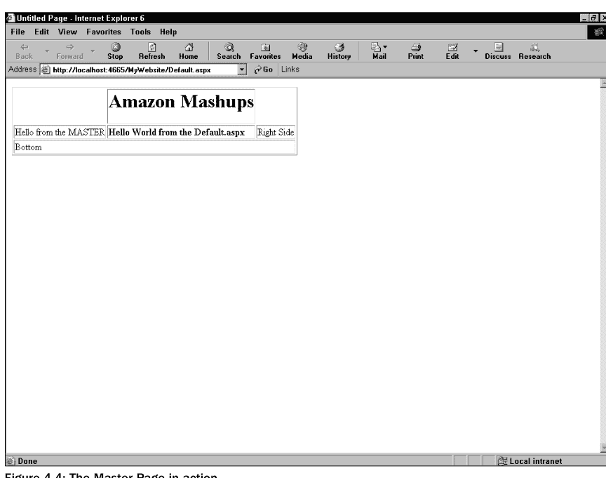

**图 4-4：母版页面的实际应用示例**

在继续之前，请在网站中添加几个更多页面。创建每个页面时，勾选“添加新项目”对话框中的“选择母版页面（Select Master Page）”复选框，将它们的母版页面设为 `main.master`。

> 虽然不是强制要求的，但将所有网页命名为小写是一种最佳实践。这会增加来自对大小写敏感的网站和浏览器的互操作性和可访问性的一层保障。

## 第 4 章：XML 数据的呈现

诚然，到目前为止，“Hello World"示例不过是 Web 编程中的涤纶裤（比喻缺乏实用性）。在本节中，您将在项目中添加一些 XML 数据，并使用 `GridView` 和 ADO.NET 来显示这些数据。

ADO.NET 名称中的“ADO”代表“Active Data Objects”。这是一个已有大量著作的庞大领域，是 ASP.NET 用于数据访问的核心框架。

首先向项目中添加另一个项目项，这次是一个名为 `zeppelin.xml` XML 文件。如果您还没有注意到的话，我特别喜欢 Led Zeppelin（齐柏林飞艇乐队）及其所有相关事物。这个 XML 文件将包含有关他们的一些歌曲的信息：

```xml
<?xml version="1.0" encoding="utf-8" ?>
<siteMap xmlns="http://schemas.microsoft.com/AspNet/SiteMap-File-1.0" >
    <siteMapNode url="" title="" description="">
        <siteMapNode url="" title="" description="" />
        <siteMapNode url="" title="" description="" />
    </siteMapNode>
</siteMap>
```

等等，第 87 页上的那个 XML 片段属于 `zeppelin.xml` 吗？不，上面的代码块看起来像是一个站点地图或结构。让我们检查上下文。“这个 XML 文件将包含有关他们的一些歌曲的信息：”后面紧跟着一个空的代码块？输入文本显示在 `[PAGE 86]` 结束处有“这些内容..."的提示，而第 97 页以“# # Development Tools”开头。实际上，XML 文件 `zeppelin.xml` 的内容可能在 OCR（光学字符识别）过程中丢失或未完全展示，只是展示了前面的文本。如果没有紧接着显示后续内容，我将保持代码块为空或仅保留相关文字。

## 开发工具

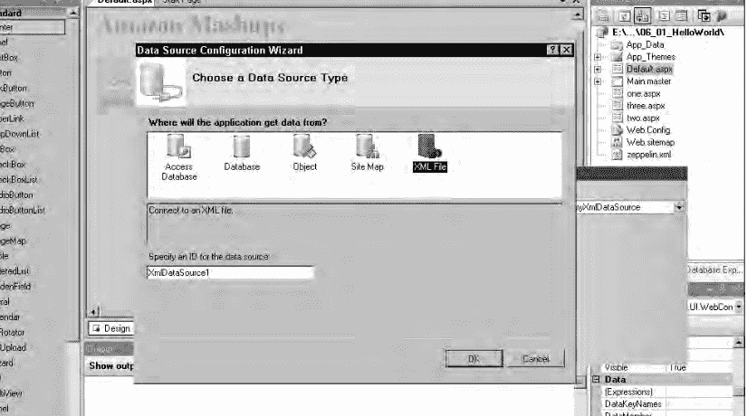

**图 4-5：数据源配置向导（Data Source Configuration Wizard）**

由于您正在使用 XML 文件作为数据源，请在向导中选择“XML File”选项。这将打开一个新对话框，允许您指定 XML 文件的所在位置，以及 XSLT 转换文件或 XPath 表达式。**XSLT**的内容将在后续章节中介绍，因此目前请使用简单的 XPath 表达式。该表达式是一种告诉 `GridView` 要从 XML 数据中提取哪些部分的方法。在这种情况下，您可以输入 `songs/song` 来指示 `GridView` 将 XML 文件中的歌曲节点作为其数据显示为行。

当您在完成向导并启动解决方案时，`default.aspx` 页面将在母版页面的上下文中显示歌曲列表。

`GridView`（确实也是如此，许多控件都支持自动格式化）支持自动格式化功能。在继续之前，值得一试：右键单击文档中的 `GridView` 控件，并在 Visual Studio 中玩弄一下“自动格式”选项。

## 第 4 章

### ASP.NET 站点地图（Sitemap）


网站的导航非常重要，但管理所有这些页面可能会变得棘手。幸运的是，ASP.NET 提供了一堆不错的功能帮助您跟踪网站。其中包括菜单、面包屑控件以及关于站点地图的概念。在本节中，您将学习如何创建站点地图，以及如何将其用于向您刚才创建的网站上添加酷炫的菜单和导航元素。

通过右键单击“解决方案资源管理器”（Solution Explorer）窗口并选择“添加新项”，向项目中添加一个站点地图。在生成的对话框中选择"SiteMap"并将其命名为`Web.sitemap`。这是站点地图的默认名称。

一个新 XML 文件将具有特定的结构或模式添加到项目中，其结果看起来应如下所示：

```xml
<?xml version="1.0" encoding="utf-8" ?>
<siteMap xmlns="http://schemas.microsoft.com/AspNet/SiteMap-File-1.0" >
    <siteMapNode url="" title="" description="">
        <siteMapNode url="" title="" description="" />
        <siteMapNode url="" title="" description="" />
    </siteMapNode>
</siteMap>
```

请注意此代码中的`siteMap节点（siteMapNode）`元素。这些表示站点中的页面，您应为 Web 站点的每个页面添加一个节点。“导航”和“面包屑”控件就是由这些驱动的。在以下表格中显示了该属性：

| Attribute Name | Description |
|---|---|
| `url` | 相对于根路径的 Web 页面的相对路径。 |
| `title` | 应该为该页面显示的名称，常用于菜单和面包屑控件。 |
| `description` | 页面的描述（可选属性）。 |

> XML 是区分大小写的（case-sensitive）。请确保保持这些元素的大小写不变。如果元素的名称存在大小写错误，XML 文件将无法通过预期的结构验证。

修改`Web.sitemap`文件以包含您网页站点的节点列表。当您完成时，它应该看起来像这样：

```xml
<?xml version="1.0" encoding="utf-8" ?>
<siteMap xmlns="http://schemas.microsoft.com/AspNet/SiteMap-File-1.0" >
    <siteMapNode url="Default.aspx" title="HOME" description="Main home page">
        <siteMapNode url="one.aspx" title="One" description="Page #1" />
        <siteMapNode url="two.aspx" title="Two" description="Page #2" >
            <siteMapNode url="three.aspx" title="Three" description="" />
        </siteMapNode>
    </siteMapNode>
</siteMap>
```

显示的页面（`one.aspx`、`two.aspx`和`three.aspx`）是您添加到项目中的虚拟页面。您的项目名称可能与这些不同。

站点地图是分层结构，即一个`siteMap节点`可以包含嵌套在其中的其他`siteMapnodes`。在上面的 XML 示例中可以看到根`root siteMap`节点仅包含对应于默认页面的单个`default.sitemap`的节点。（原文此处逻辑略显模糊，翻译时尽量保留原意。）其下方有两个分别对应“页面一”和“页面二”的站点地图节点。“页面二”在其下包含了“页面三”。这只是一个示例，您可以看到如何为给定网站构建分层导航树。

### 导航控件

由于已经创建了站点地图，您现在可以向网站上添加一些导航元素了。在自然层面上（即最方便的地方）这样做是在网站的母版页面中完成。

### 试一试：添加菜单

1. 回到站点的母版页面`main.master`。从“工具箱”的"Navigation”部分拖放一个 Menu 控件到表格中，替换掉左侧的文本。“左边侧边栏上的导航是我偏爱的放置位置”，但您可以将其放置在您认为合适的任何地方（如顶部、底部或右侧）。这会在`main.master`页面的源代码中添加以下标签：

   ```aspx
   <asp:Menu ID="myMenu" runat="server"></asp:Menu>
   ```

2. 在菜单开始工作之前，必须将其绑定到数据源。显示该菜单控件的智能标记（Smart Tag），并单击“选择数据源”旁边的下拉控件。然后点击>New Data Source （新数据源）以启动**Data Source Configuration Wizard**。此时对话框中只有两个选项：即站点地图或 XML 文件文件（Remember, any XML file can be used as a datasource）。顺便一提，您在上一节刚刚创建的`Web.sitemap`文件实际上就是一个简单的 XML 文件！

3. 单击“SiteMap 图标”，并将此数据源的标识符输入为`mySiteMapDS`。然后点击下方 OK（确定）按钮。IDE（集成开发环境/Visual Studio）将新的`siteMapDataSource`类型的数据源添加到`main.master`页面中，从而将菜单控件绑定到此数据源上。

4. 此时按 F5 键启动应用程序，您将看到一个完全可用的 JavaScript 菜单，还附带鼠标悬停效果！

当然，由于没有样式格式化，该菜单看起来并不那么有趣。您可以从`main.master`页面“源代码（Source view）”视图快速添加一些格式化工具来美化它。右键单击菜单控件并在上下文菜单中选择"Auto-format”。选择您喜欢的配色方案并进行调整，直到满意为止。

> ASPX 页面的大多数仅用于展示的修改不需要停止和重新启动 Web 项目即可生效。在修改菜单格式的尝试过程中，请保持浏览器窗口打开，然后保存结果，按刷新按钮（F5）查看更改前后的效果对比。这个小提示可以节省由于重新编译应用程序而浪费的大量时间。

## 第4章

另一个有用的导航控件是 SiteMapPath 控件。SiteMapPath 控件与 SiteMap 本身协同工作，用于指示用户在给定网站中的导航位置。你可能在其他网站上见过这个功能，它通常被称为面包屑导航，大概源于《糖果屋》中汉赛尔和格莱特的故事。

在母版页表格中，在标题行下方新建一行。从工具箱的“导航”部分将 SiteMapPath 控件拖放到这个新行中，以下标记将被添加到源代码中：

```aspx
<asp:SiteMapPath ID="SiteMapPath1" runat="server"></asp:SiteMapPath>
```

SiteMapPath 控件无需其他配置，尽管你可以设置许多样式来控制面包屑导航的外观。

此时，值得启动应用程序以查看更改的效果。已添加菜单和面包屑控件，它们应该可以完全正常工作，实现页面之间的导航。

## 使用 CSS 添加样式

层叠样式表（CSS）是定义网站样式和外观的常用机制。使用 CSS 文件（与在页面内定义样式相比）是专业开发者的最佳实践。

### 动手实践：添加样式表

1. 右键单击“解决方案”窗口，选择“添加新项”。从对话框中选择“样式表”，并将其命名为`fun.css`。样式表被添加到解决方案的 Web 项目根目录中。此样式表将存储网站的样式定义。

2. 打开样式表。你会注意到它包含一个针对`body`标签的空样式。使用以下代码为`siteHeading`标签添加一个新样式：

   ```css
   .siteheading
   {
       background-image:url('images/banner_grey.png');
       background-repeat:no-repeat;
       height:100px;
   }
   ```

   HTML 和 CSS 并不严格区分大小写，但通常的最佳实践是标签和 CSS 样式都使用小写。

   这段代码只是声明“将`siteHeading`标签的内容格式化为 100 像素高，并使用`banner_grey.png`作为背景”。

3. 打开`main.master`并找到以下行：

   ```html
   <td colspan="2">
       <h1>Amazon Mashups</h1>
   </td>
   ```

   重写代码，使其看起来像这样：

   ```html
   <td colspan="2" class="siteheading">&nbsp;</td>
   ```

   在`<TD>`标签中添加`class`属性意味着标题将由 CSS 文件驱动。你不再需要`<h1>Amazon Mashups</h1>`标签，因为 CSS 文件中指定的背景图片已包含相同的文本。

   *如果你是 CSS 新手，好消息是。Visual Studio 提供了一个类似向导的对话框，可以通过它编辑给定样式规则的所有属性。要启动此对话框，右键单击任何样式并选择“生成样式...”。或者，如果你更喜欢手动编辑 CSS 文件，IntelliSense 在显示可用属性及其各自选项方面表现出色。*

4. 在项目中添加一个名为`images`的新文件夹，并将一张名为`banner_grey.png`的新图像放入其中。此图像包含在本书随附的示例代码中。

5. 样式表现在已准备好在网站中使用。打开`main.master`页面，切换到设计视图，然后直接将`fun.css`文件从“解决方案资源管理器”窗口拖放到页面的设计界面上。编辑器很智能，知道这是一个 CSS 文件，无论你将文件放到哪里，它都会在页面的`<head>`部分添加一个样式表标签。检查源代码，你会在页面的头部找到以下标签：

   ```html
   ...
   <head runat="server">
       <title>Amazon Mashups</title>
       <link href="fun.css" rel="stylesheet" type="text/css" />
   </head>
   ...
   ```

   当浏览器获取页面时，`link`标签会通知浏览器获取名为`fun.css`的 CSS 样式表并将其应用于页面。

当然，链接样式表的最佳位置是在母版页中，这样所有页面都将使用此样式。通过这种方式，到 CSS 的链接在单个位置（母版页）定义，但影响许多页面。

按 F5 运行项目（或单击工具栏上的“播放”按钮）。项目将启动，“Amazon Mashups”背景图片将根据样式表中的规则进行格式化。

## 主题和外观

不幸的是，纯 CSS 方法存在几个问题：

- CSS 样式表是硬编码到母版页中的。例如，如果你想为网站提供两个样式表（一个有趣，一个正式），并让用户在它们之间进行选择，你可能需要构建一些逻辑来修改链接的是哪个样式表。
- 自定义服务器控件的样式有点混乱。自定义这些控件的唯一方法是为控件分配样式，然后为这些样式构建 CSS 规则。这可能会变得很复杂。

ASP.NET 的主题和外观通过使网站使用的样式信息可配置来解决这些问题。

主题是资源文件（CSS、外观和图像文件）的集合，它们共同定义给定网站的外观。在本节中，你将学习如何定义主题并将其关联到网站。

首先向项目中添加一个新文件夹。这是一个特殊文件夹，各种主题将存储在此处，并且必须命名为`App_Themes`。接下来，为你将要创建的每个主题添加一个文件夹。本例中将有两个主题，因此在`App_Themes`下创建两个文件夹，一个命名为`fun`，另一个命名为`serious`。

将你之前创建的`fun.css`文件拖放到`fun`主题文件夹中。为`serious`主题创建一个类似的 CSS 文件，命名为`serious.css`。修改`serious.css`，以便你能够区分`fun`和`serious`主题！你可以在这里找点乐子。例如，为`fun`样式表指定 Comic Sans MS 字体，为`serious`指定无聊的 Times New Roman 字体。

图 4-6 显示了包含本例中`Themes`文件夹层次结构的 IDE。

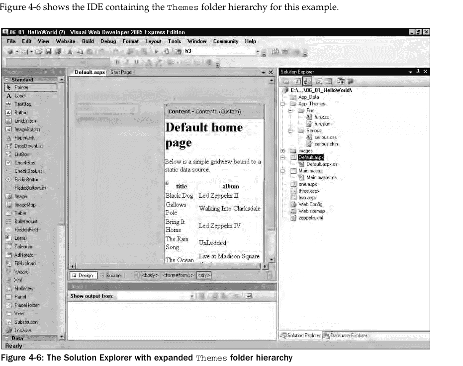

图 4-6：展开`Themes`文件夹层次结构的解决方案资源管理器

## 开发工具

另一件需要记住的事情是从`main.master`页面中删除样式表定义。这一点很重要，因为它可能会覆盖主题并引起各种混乱。

此时，主题仅包含 CSS 文件。现在，你将添加一个外观文件来控制本章前面创建的菜单服务器控件的外观。

向“fun”主题添加一个新项，这次是一个名为`fun.skin`的外观文件。外观文件控制服务器控件的外观，覆盖它们可能包含的任何本地格式。例如，如果你希望所有`asp:button`控件具有相似的外观，你有两种选择：单独格式化每个控件，或使用外观文件。

以下是`fun.skin`的外观文件标记：

```aspx
<asp:Menu runat="server" BackColor="#FFFFBD" DynamicHorizontalOffset="2"
  BorderColor="black" BorderWidth="1" Font-Names="Tahoma" Font-Size="14pt"
  ForeColor="#990000" StaticSubMenuIndent="10px" Font-Bold="True" Width="155px">
  <StaticMenuItemStyle HorizontalPadding="5px" VerticalPadding="2px" />
  <DynamicHoverStyle BackColor="#990000" ForeColor="White" BorderColor="black"
  BorderWidth="1"/>
  <DynamicMenuStyle BackColor="#FFFFBD" BorderColor="black" BorderWidth="1"/>
  <StaticSelectedStyle BackColor="#FFCC66" BorderColor="black" BorderWidth="1"/>
  <DynamicSelectedStyle BackColor="#FFCC66" BorderColor="black" BorderWidth="1"/>
  <DynamicMenuItemStyle HorizontalPadding="5px" VerticalPadding="2px" />
  <StaticHoverStyle BackColor="#990000" ForeColor="White" />
</asp:Menu>
```

此标记将影响网站中的所有菜单控件，无论它们出现在何处。它只是为这些控件指定呈现样式信息。每个控件的样式级别不同（如你所见，对于菜单，有许多样式属性）。

乍一看，这些文件的标记可能看起来令人生畏，但实际上创建起来相当简单。最简单的方法是使用设计器编辑页面上的控件，然后将设计器生成的源标记复制到外观文件中。删除`ID`属性，就完成了。

现在，你拥有一个包含 CSS 和外观文件的主题。在主题生效之前，你必须指定网站应使用哪个主题。打开`web.config`文件并添加以下行：

```xml
<?xml version="1.0"?>
<configuration>
  <appSettings/>
  <connectionStrings/>
  <system.web>
    <compilation debug="true"/>
    <authentication mode="Windows"/>
    <pages theme="fun"/>
  </system.web>
</configuration>
```

这个标签不言自明，只是设置网站将使用的主题。按 F5，你应该会发现主题已正确应用到网站。不停止网站，修改`web.config`文件以使用“serious”主题并刷新浏览器。这次网站呈现出严肃的外观和感觉。主题和外观是一个强大的概念，可以大大减少复杂网站的开发时间。

65

## 第4章总结

本章涵盖了许多内容，如果你一直跟随讨论，现在你已经拥有一个全面的框架，可以将你的混搭应用插入其中。

本章的目标是让开发环境运行起来，并让你熟悉 ASP.NET 2.0 中一些更强大的功能。在此过程中，你创建了一个包含 XML 数据访问、主题、JavaScript 菜单、面包屑导航和母版页的可运行网站。

你构建的几乎所有网站都需要数据访问、导航控件以及管理公共元素的结构化方法。这些是任何网站（包括混搭应用）构建的核心要素，你所能构想的任何新应用程序的成功，都将取决于你对这些核心能力的掌握程度。

在接下来的章节中，你将构建各种比这里创建的页面有趣得多的混搭网站。你可以考虑将本章构建的网站作为其他混搭应用构建的核心平台。为清晰起见，我将为每个混搭应用分配一个单独的项目，但你会发现，如果你愿意，它们可以轻松地集成到一个项目中。

我在这里提供了一个简单的框架，鼓励你进行实验，而实验往往是发现最佳创新的地方。

第 5 章将讨论 Web 2.0 世界中普遍存在的各种技术。这些技术包括 RSS、OPML、XML 和 XSL 等。

## 练习

以下是一些问题，用于检验你所学的内容。本书各章末尾的所有练习答案均在附录 B 中。

1. 如何将样式表添加到 ASP.NET 页面？
2. ASP.NET 2.0 如何支持修改特定网站中使用的样式？
3. ASP.NET 为数据源提供了哪些支持？
4. 如何使用 GridView 访问 XML 数据源？
5. 在 ASP.NET 中，将导航元素构建到网站中有哪些选项？
6. ASP.NET 中主题和外观有什么区别？
7. 什么是母版页，如何使用它们？
8. 开发混搭应用是否需要使用微软的工具？

# 第 5 章

## 技术


有一点是肯定的：计算机行业喜欢使用缩写。在任何一个混搭应用中，都有无数种技术在运作。对于初学者来说，这些行话可能既令人望而生畏又令人困惑。本章将描述我在本书后续部分中使用的主要缩写词，以及你在更广泛地开始探索混搭应用时可能遇到的一些术语。

## 什么是 URI？

统一资源标识符（URI）与你可能更熟悉的 URL 略有不同。URI 指的是 Web 上的一个页面，包括任何特定代码片段的标识符。

URL 可能如下所示：

`http://www.MySite.com/default.aspx`

URI 可能如下所示：

`http://www.MySite.com/default.aspx#mySection`

`#MySection` 是网页的一个命名区域。

## 什么是 HTTP？

超文本传输协议（HTTP）是互联网上使用的主要协议。它运行在传输控制协议（TCP）和互联网协议（IP）之上，这些都是底层网络协议。

HTTP 是无连接的，这意味着如果两方进行通信，它们之间没有专用的连接。想象一下你的兄弟姐妹在后院扔球。球就是消息。你的兄弟姐妹之间没有专用的连接；他们只是在扔球和接球。

HTTP 使用两种主要方法来请求数据：GET 和 POST。在 GET 方法中，请求参数在 URL 的查询字符串中发送。这里有一个例子：

```text
http://www.mySite.com/myPage.aspx?CustomerId=1010
```

这里，`CustomerId` 是一个参数，其值为 `1010`。

在 HTTP POST 方法中，参数被写入 HTTP 请求本身，在 HTTP 头之后。HTTP GET 在可传递的数据量上有限制，通常最多 4KB。另一方面，POST 实际上没有限制，但需要一些 JavaScript 来以编程方式构建。混搭应用开发者通常使用 HTTP GET，因为它稍微更容易访问。你将在后面的章节中看到更多相关内容。

## 什么是 XML？

当你第一次遇到可扩展标记语言（XML）时，需要一些时间才能理解它的好处。XML 是一种以结构化方式表达信息的方法。它本身不是一种真正的语言，而是一种元语言，或是一种用于描述语言的语言，因此非常强大。

## XML 文档示例

XML 以定义明确的结构化方式表达信息。如果数据要由计算机处理，这一点极其重要。XML 文档由元素组成。每个元素都可以有属性，每个元素都可以包含其他元素。考虑以下示例：

```xml
<?xml version="1.0" encoding="utf-8"?>
    <course subject="physics">
        <lesson>Introduction</lesson>
        <lesson>Mass & Weight</lesson>
        <lesson>Energy</lesson>
    </course>
```

XML 文档通常以以下节点开头，以指定后续文档的编码：

```xml
<?xml version="1.0" encoding="utf-8"?>
```

第一个元素（或节点）是 `course`，它被称为文档的根节点。`course` 有子元素，在本例中是 `lesson` 节点。`lesson` 节点有值，Introduction、Mass & Weight 等等。

course 示例文档是格式良好的，因为每个打开的元素都有一个对应的闭合元素，由元素名前的反斜杠表示。最后，course 元素还有一个名为 `subject` 的属性，该属性有一个值“physics”。

所有 XML 文档都是结构良好的。库开发人员已经创建了编程库，使用定义明确的函数和语法（例如 XPath）来访问 XML 数据。一旦你理解了如何使用这些，它们就可以应用于任何 XML 文档，因此学习这些东西是有价值的。

以上是对 XML 的一个非常简要的介绍，但这是你现在需要知道的全部。我将在接下来的章节中介绍更复杂的示例。

## 它的意义是什么？

意义在于以一致的方式描述信息，这样无论你提供什么类型的信息，都可以使用标准机制来使用和操作它。对于任何 XML 文档，我都可以定义一个模式（称为文档类型定义，或 DTD）或规范，该规范定义了该文档的结构。然后，XML 数据可以针对模式进行验证，以确保 XML 文档遵循预期的规范。

## 什么是 XHTML？

众所周知，超文本标记语言（HTML）一直以各种形式用于构建互联网。可扩展超文本标记语言（XHTML）将 XML 的严格性应用于 HTML。

尽管 HTML 使用了类似于 XML 的标签，但它通常结构不佳。例如，以下代码片段有什么问题？

```html
<b>
    <p>
        After the sun
    </p>
</b>
<p>
<br>
a little rain must fall<br>
</p>
```

这个代码片段在典型的浏览器（如 Internet Explorer 或 Firefox）中可能是可以接受的。浏览器通常比 XML 解析器更宽容。前面的代码片段是无效的 XHTML，原因有几个，首先是 `<b>` 和 `<p>` 标签的嵌套无效。第二个原因是 `<br>` 标签不是有效的 XML 标签。`<br>` 标签实际上应该写成 `<br/>` 才能通过验证。

XHTML DTD 包含在每个 HTML 页面的顶部。这为浏览器提供了关于其中所含标记的提示。

XHTML 有几种类型，取决于你的 HTML 编写得有多好。你可以针对 XHTML DTD 验证你的 XHTML。如果你有一个结构特别良好的网站，你可能考虑使用 `xhtml1-strict` DTD：

```html
<!DOCTYPE html
PUBLIC "-//W3C//DTD XHTML 1.0 Strict//EN"
"http://www.w3.org/TR/xhtml1/DTD/xhtml1-strict.dtd">
```

或者，对于偏离 XHTML 规范的页面，你可以使用过渡性文档类型：

### 第 5 章

```html
<!DOCTYPE html
PUBLIC "-//W3C//DTD XHTML 1.0 Transitional//EN"
"http://www.w3.org/TR/xhtml1/DTD/xhtml1-transitional.dtd">
```

XHTML 之所以重要，是因为它能帮助你将文档结构保持得井井有条，而且通过遵循 DTD，你可以确保页面在兼容 XHTML 的浏览器中按预期渲染。

以下是一个基于 Radiohead 音乐的更复杂示例：

```xml
<?xml version="1.0" encoding="utf-8"?>
<artist name="Radiohead">
    <albums>
        <album name="Ok Computer">
            <songs>
                <song>Airbag</song>
                <song>Paranoid Android</song>
                <song>Subterranean Homesick Alien</song>
            </songs>
        </album>
        <album name="Hail To The Thief">
            <songs>
                <song>Sit down. Stand up.</song>
                <song>Scatterbrain</song>
                <song>Myxomatosis</song>
                <song>Wolf At The Door</song>
            </songs>
        </album>
    </albums>
</artist>
```

## XPath 是什么？

除了用 XML 来构建数据结构外，你还需要某种机制来引用 XML 文档中的节点。这就是 XPath 的用武之地。回顾前面的 XML 示例文档：

```xml
<course subject="physics">
    <lesson>Introduction</lesson>
    <lesson>Mass &amp; Weight</lesson>
    <lesson>Energy</lesson>
</course>
```

要获取 lesson 节点列表，你可以使用诸如 `//lesson` 这样的 XPath 表达式。双斜杠 `//` 表示无论 lesson 节点在文档中的什么位置出现，该节点都应包含在结果集中。

另一个例子可能是精确获取 Mass & Weight 对应的 lesson 节点。可以使用以下语法来检索：

```text
/course[lesson='Mass & Weight']
```

正如你所见，XPath 拥有丰富的语法，这里就不一一赘述了。相反，你将在本书的示例中循序渐进地学习所需的知识。

## XSL 和 XSLT 是什么？

可扩展样式表语言（eXtensible Stylesheet Language，简称 XSL）是一种允许你将 XML 文档转换（Transform，即 XSLT）成其他形式的语言。这种其他形式可以是更多的 XML，或者完全不同的东西，比如 XHTML，甚至纯文本。XSL 和 XSLT 这两个术语通常可以互换使用。

从设计上讲，XSL 是用 XML 构建的，因此你可以像验证 XML 一样验证 XSLT 样式表。由于像 Amazon 这样的公司通过 XML 公开数据，而你想将这些数据转换成其他形式，XSL 就是你工具箱中不可或缺的工具。

XSL 采用基于模板或规则的方法。每个 XSL 样式表使用一组模板，这些模板被应用或匹配到底层 XML 文档中的 XML 节点。

XSLT 在本书的几乎每个 mashup 中都有使用，你将在阅读本书的过程中逐渐熟悉它。

### 动手实践：一个 XSLT 文档示例

以下是一个 XSL 样式表示例，用于转换前面提到的 Radiohead XML 文档：

```xml
<?xml version="1.0" encoding="utf-8"?>
<xsl:stylesheet version="1.0" xmlns:xsl="http://www.w3.org/1999/XSL/Transform">

  <xsl:template match="/">
    <html>
      <body>
        <xsl:apply-templates select="artist" />
      </body>
    </html>
  </xsl:template>

  <xsl:template match="artist">
    <h1>
      <xsl:value-of select="@name"></xsl:value-of>
    </h1>
    <table>
      <xsl:apply-templates select="albums" />
    </table>
  </xsl:template>

  <xsl:template match="albums">
    <xsl:apply-templates select="album" />
  </xsl:template>

  <xsl:template match="album">
    <tr>
      <td>
        <h2>
          <xsl:value-of select="@name"></xsl:value-of>
        </h2>
      </td>
    </tr>
    <xsl:apply-templates select="songs" />
  </xsl:template>

  <xsl:template match="songs">
    <xsl:apply-templates select="song" />
  </xsl:template>

  <xsl:template match="song">
    <tr>
      <td>
        <xsl:value-of select="."></xsl:value-of>
      </td>
    </tr>
  </xsl:template>

</xsl:stylesheet>
```

## 它是如何工作的？

这个转换将结果格式化为 HTML。XSL 将每张专辑中的每首歌曲输出为 HTML 表格中的一行。

> 如果你在 Visual Studio Web Developer 中编写 XML，可以通过按 Ctrl+K 紧接着按 Ctrl+D 来轻松格式化你正在处理的文档。

注意 `<xsl:template>` 标签的存在。每个模板代表一个规则或模式，每当在底层文档中发现节点时就会应用。文档从上到下进行处理，因此每个模式只应用于当前正在处理的 XML 节点。

通过在 Radiohead XML 文档中引用此样式表，文档在浏览器中查看时将被转换（图 5-1）：

```xml
<?xml version="1.0" encoding="utf-8"?>
<?xml-stylesheet type="text/xsl" href="radiohead.xslt"?>
<artist name="Radiohead">
  <albums>
    ...
```

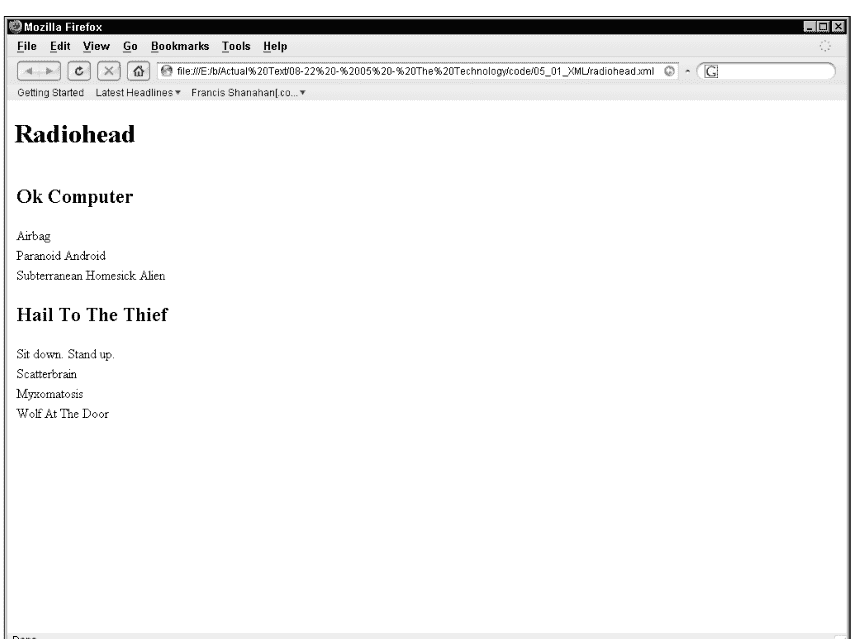

图 5-1：从 Radiohead XML 数据生成的 HTML 结果

## Web 服务是什么？

曾经，定义 Web 服务非常容易，但随着时间的推移，这个定义变得越来越难以确定。服务基本上是指应用程序暴露的任何方法，允许其他应用程序消费该系统的功能。所以，如果你以擦鞋为生，你就是在提供擦鞋服务。Web 服务就是在互联网上以数字方式暴露的相同服务。

## WSDL 是什么？

Web 服务还采用一种称为 Web 服务描述语言（Web Service Description Language，WSDL）的机制，告诉其他系统如何与 Web 服务提供的方法进行交互。这很令人困惑，所以让我们以擦鞋场景为例。

如果你是擦鞋工，你需要一种接收鞋子的方式。如果接收鞋子能标准化就好了，这样你就不用在店里到处找鞋擦了。你告诉顾客：“把你的脏鞋放在我店里的柜台上。”这就是你的接口，它成为你服务描述的一部分。

同样的事情也适用于 Web 服务。Web 服务使用 WSDL 来说类似这样的话：“我可以计算贷款利息”，以及“用这个 XML 结构和这些参数把贷款条款传给我”。

Amazon ECS 的 WSDL 位于此处：

```text
http://webservices.amazon.com/AWSECommerceService/AWSECommerceService.wsdl
```

以下是从 Amazon WSDL 中提取的片段：

```xml
<xs:element name="ItemLookup">
  <xs:complexType>
    <xs:sequence>
      <xs:element name="MarketplaceDomain" type="xs:string" minOccurs="0"/>
      <xs:element name="AWSAccessKeyId" type="xs:string" minOccurs="0"/>
      <xs:element name="SubscriptionId" type="xs:string" minOccurs="0"/>
      <xs:element name="AssociateTag" type="xs:string" minOccurs="0"/>
      <xs:element name="Validate" type="xs:string" minOccurs="0"/>
      <xs:element name="XMLEscaping" type="xs:string" minOccurs="0"/>
      <xs:element name="Shared" type="tns:ItemLookupRequest" minOccurs="0"/>
      <xs:element name="Request" type="tns:ItemLookupRequest" minOccurs="0"
                  maxOccurs="unbounded"/>
    </xs:sequence>
  </xs:complexType>
</xs:element>
```

这个片段描述了 `ItemLookup` 方法。如你所见，这看起来不算多。对人眼来说几乎难以阅读。几乎所有开发平台，如 Eclipse 或 Visual Studio，都能理解 WSDL 并用其为特定 Web 服务生成代理类。

代理类中嵌入了来自 WSDL 的信息，因此代理类上的函数调用透明地通过网络调用 Web 服务。因此，调用 Web 服务就像实例化一个类并调用该类上的函数一样简单。

## SOAP 是什么？

简单对象访问协议（Simple Object Access Protocol，SOAP）是一种规范，帮助 Web 服务在彼此交换数据时构建数据结构。SOAP 是一个冗长而复杂的规范，目前仍在开发中。幸运的是，利用 Web 服务并不需要记住 SOAP 和 WSDL 的所有繁琐细节。

SOAP 规范详细说明了如何将对象转换为 XML（序列化），以及如何使用定义良好的模式或 XSD 来调用这些对象上的方法。

开发工具现在已经足够成熟，消费 SOAP 已成为一项常规操作，可以极大地增强应用程序的功能，而不再需要过去的那些神秘技艺。

通常，Web 服务通过 HTTP 运行，尽管 SOAP 也可以在 TCP 上传输。本书中的大多数应用程序面向互联网，因此将利用 HTTP。

## REST 是什么？

REST 代表“Representational State Transfer”（表述性状态转移），它更像是一种架构风格，而非规范。在 mashup 的语境中，REST 被 loosely 定义为任何不借助 SOAP 等复杂协议进行的通信。

REST 要求当你调用一个方法时，向该方法发送处理所需的所有信息。你调用的方法不会在其处理范围之外保留任何信息。从这个意义上说，它是一种无状态方法，因为从一个调用到下一个调用之间不维护任何状态或会话信息。维护会话状态的工作由调用者负责。

如果说 SOAP 将对象和方法调用转换为定义良好的 XML 文档，那么 REST 则是一种快速而简便（有时更高效）的信息转换，将其变为可访问的形式。这种形式可以是逗号分隔值，或任何满足你需求的格式。


### 动手实践：一个 REST 调用示例

以下是一个针对 Amazon ECS API 的 REST API 调用示例：

```
http://webservices.amazon.com/onca/xml?Service=AWSECommerceService&Operation=CustomContentSearch&Name=Fred&AWSAccessKeyId=[YOUR KEY HERE]
```

图 5-2 展示了该调用的响应。你只需要一个 Web 浏览器就能自己生成这个响应。

# 第五章

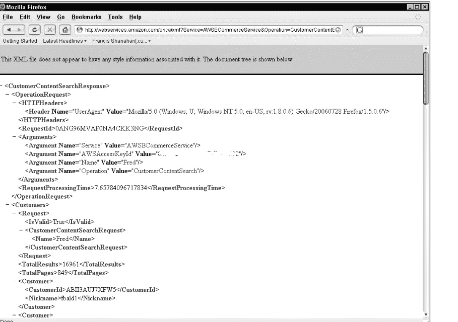

## 什么是混搭（Remix）？

我想，术语“混搭”和“聚合”（“mashup”）源自音乐领域。“混搭”指的是同一首歌曲，配以更新的节拍重新演唱；这同样适用于网络服务。例如，亚马逊公开其产品数据，通常情况下，人们期望这些数据被用于构建购物网站。

你可以利用这些数据，通过杰夫·贝佐斯（亚马逊负责人）个人兴趣相关（太空、物理、科学等）的产品图片，绘制一幅杰夫·贝佐斯的肖像画。这不是亚马逊的初衷，但无论如何，这相当具有艺术性。这就是混搭。

## 什么是聚合（Mashup）？

“聚合”类似于混搭。你可能再次听说过音乐界的例子，比如将齐柏林飞艇乐队（Led Zeppelin）的元素与杰斯（Jay-Z）结合，创作出一首奇异的说唱/摇滚歌曲。这就是聚合。

同样的事情也可以利用来自互联网的数据来完成。在本书中，我将介绍各种将来自不同站点的数据结合起来，形成新的、创新性应用的方法。

## 什么是 RSS？

真正简单聚合（Really Simple Syndication, RSS）是一种 XML 规范，它描述了一种机制，通过该机制，新闻标题等数据可以跨站点聚合。RSS 在博客领域取得了巨大成功，并且正越来越紧密地融入到网络的结构中。

RSS 的成功很大程度上归功于其简单的结构。XML 库的可用性使得加载和处理 XML，进而处理 RSS 文档变得非常容易。应用开发人员无需浪费时间去开发文件格式、传输协议以及实现内容聚合的软件——他们可以专注于开发具有实际功能的内容消费应用。

混搭和聚合现在取得成功，是因为技术已经发展到这样一个阶段：开发人员可以专注于为内容增加更大的价值，或者以有趣的方式使用这些内容，而不必花费时间去实现内容传输的底层管道。

你可以向一个 RSS 聚合器（或阅读器）提供一组订阅源 URL，每个 URL 都公开 RSS。然后，阅读器会将它们聚合在一起，并定期轮询更新，使你能够同时监控来自多个站点的内容。

尽管目前规范有几个不同的版本，但 RSS 结构相对简单。本书专门使用 RSS 2.0 规范。在最基本层面上，一个 RSS 订阅源包含一个 `<channel>` 节点，该节点包含一系列 `<item>` 节点，如下所示：

```xml
<?xml version="1.0" encoding="iso-8859-1"?>
<rss version="2.0">
  <channel>
    <title>News by Shanahan</title>
    <link>http://www.FrancisShanahan.com</link>
    <description>Shanahan delivers up-to-the-minute news and info from the far reaches of the web.</description>
    <language>en-us</language>
    <copyright>(c) 2006 Francis Shanahan</copyright>
    <pubDate>Wed, 10 Jan 2007 21:17:42 EST</pubDate>

    <item>
      <title>Man Bites Dog</title>
      <link>http://www.FrancisShanahan.com/details.aspx?cid=100</link>
      <description>A man bit a pooch today in Johnstown Mall...</description>
      <pubDate>Wed, 9 Jan 2007 21:17:42 EST</pubDate>
    </item>

    <item>
      <title>Potatoes to rule Earth</title>
      <link>http://www.FrancisShanahan.com/details.aspx?cid=101</link>
      <description>Scientists have discovered tiny aliens living in potatoes...</description>
    </item>
  </channel>
</rss>
```

```xml
<pubDate>Wed, 8 Jan 2007 20:12:02 EST</pubDate>
</item>
</channel>
</rss>
```

在本书的后续章节中，你将了解更多关于 RSS 的知识，并构建自己的混搭应用，将亚马逊的产品信息转换为实时订阅源。

## 什么是 OPML？

“大纲处理标记语言”（Outline Processor Markup Language, OPML）只是推动 XML 在互联网上普及的又一种格式。OPML 最初是为了捕获文档大纲（类似于目录）而开发的。自其最初开发以来，它已被广泛应用于 RSS 阅读器。

如前所述，你可以为 RSS 阅读器设置一组 URL，然后阅读器会监控这些 URL 并轮询更新。这组 RSS URL 通常以 OPML 格式存储。

OPML 仅由下表所示的四个必需节点组成；其余为可选节点。

| 节点名称 | 描述 |
| --- | --- |
| `opml` | 根节点。 |
| `head` | 存储关于文档主体的元数据。 |
| `body` | 包含一个或多个大纲节点。 |
| `outline` | 文档的实际内容。 |

这是一个示例 OPML 文档，展示了多个 RSS 订阅源文件：

```xml
<?xml version="1.0" encoding="utf-8" ?>
<opml>
  <head>
    <title>Start.com Subscriptions</title>
  </head>
  <body>
    <outline title="Francis Shanahan[.com]" htmlUrl="http://www.FrancisShanahan.com/" xmlUrl="http://francishanahan.com/rss.aspx" type="rss"/>
    <outline title="Living in a World of Connected Systems" htmlUrl="http://www.marcmercuri.com/" xmlUrl="http://www.marcmercuri.com/syndicationservice.asmx/getrss" type="rss"/>
    <outline title="Amazon Customer Reviews" htmlUrl="http://BaeBo.FrancisShanahan.com" xmlUrl="http://baebo.francishanahan.com/g.aspx?x=acustrss&w=arss&operation=ItemLookup&responsegroup=Large&itemid=b000ff9poc" type="rss"/>
  </body>
</opml>
```

如前所述，OPML 并非特定于 RSS 的规范，尽管它通过以 XML 形式呈现的新闻和新闻聚合器的普及而获得了广泛应用。

## 什么是 Atom？

Atom 是另一种用于内容聚合的格式，类似于 RSS。尽管本书不实现 Atom 接口，但在上下文中提及它，是因为它是你在新闻聚合领域会遇到的另一种技术。

## 什么是 GeoRSS？

GeoRSS 是 RSS 的一种扩展，这次是为了在 RSS 项目之外提供额外的地理信息。地图 API（如 Yahoo 或 Google 地图）使用 GeoRSS，因为它便于在地图上定位标记。你将在第 11 章使用 GeoRSS 在 Yahoo 地图上显示餐厅位置。

## 什么是 Ajax？

“异步 JavaScript 和 XML”（Asynchronous JavaScript and XML, Ajax）可能是聚合世界中被过度炒作的术语。Ajax 允许你从网页与 Web 服务器进行通信，而无需刷新页面。这一基本功能非常强大，并已用于各种应用程序，效果显著。微软是第一家通过为 Microsoft Outlook 的 Web 界面启用 Ajax 而进入该领域的主要公司。几年后，Google 开辟了新天地，利用 Ajax 创建了 Google 地图。

能够平滑访问大量数据（如地图）的概念激发了全球开发者的想象力。不久之后，Google 地图的接口就被剖析，各种聚合应用开始在网络各处涌现。

第 10 章将非常详细地解释 Ajax，并使用它来构建一个由 Ajax 驱动的愿望清单。

## 什么是 JSON？

“JavaScript 对象表示法”（JavaScript Object Notation, JSON）本质上是一种用于指定 JavaScript 对象的格式，以便它们可以轻松传输。你可以将其视为一种序列化 JavaScript 对象的方式。请注意，我说的是 JavaScript 对象，而不是 Java 对象——两者有很大区别。

那么，它是什么样子的？JSON 将对象写成一系列分层的名值对。这里有一个例子。

```json
{
    "Album": {
        "Title": "Are You Experienced?",
        "Artist": "The Jimi Hendrix Experience"
    }
}
```

这个特定的例子可以像这样表示为 XML：

```xml
<Album>
    <Title>Are You Experienced?</Title>
    <Artist>The Jimi Hendrix Experience</Artist>
</Album>
```

尽管 JSON 并不打算取代 XML，但它正在慢慢取代 XML 的地位。作为一种表示法，它明显比 XML 不那么冗长，需要更少的标记来传达相同的数据结构。更少的数据在网络上传输意味着更好的应用性能。

你可以在第 12 章了解更多关于 JSON 的知识，该章解释了如何构建一个由 JSON 驱动的客户浏览器。

## 什么是序列化 PHP？

序列化 PHP 在概念上类似于 JSON。它允许将一段 PHP 脚本转换（序列化）为一个字符串，然后作为一个变量传递。接收方随后可以将生成的字符串反序列化回 PHP 代码。

## 什么是 POX？

Pox 是一种严重的疾病，如果不及时治疗，可能是致命的。但就聚合而言，普通旧 XML（Plain Old XML, POX）是那些“有趣”的首字母缩略词之一，它是由众多代表更复杂事物的缩略词所催生的。普通旧 Java 对象（Plain Old Java Objects, POJO）是另一个例子。

## 什么是 RDF？

“资源描述格式”（Resource Description Format, RDF）是“语义网”概念的基石。RDF 提供了一种基于 XML 的语法，通过它，数据或资源可以被描述。RDF 数据可以被机器读取，并用于推断相关资源的含义或语义描述。

如果你考虑互联网的当前形式，每个网站都是一个孤岛。人类可以与这些站点交互，但计算机处理或理解给定站点的内容和上下文非常困难。

像 Google 这样的公司仅通过构建一种根据标准对页面进行排名的方法就赚了数十亿美元。RDF 将能够实现比简单页面排名更丰富的信息分类。

通过使用 RDF 这类方案，当广泛采用时，就能基于数据创建推理。来看一个场景：

- 站点 A 描述了一个资源，例如吉米·佩奇（Jimmy Page）出生于西伦敦。
- 站点 B 描述吉米·佩奇是齐柏林飞艇（Led Zeppelin）乐队的吉他手。
- 通过结合这两个资源并识别它们之间的关联，你可以推断出齐柏林飞艇乐队的吉他手是英国人。

通过这种方式，使用 RDF 收集的全部信息将**大于**其各部分之和。

## 什么是 FOAF？

**Friend of a Friend**（朋友的朋友，简称 FOAF）是一项新兴规范，专注于在网络上发布机器可读的信息。

以下是一份描述我自己的示例文档：

```xml
<foaf:Person>
    ASCII走查·帕吉斯坦吉布林打击反馈斯坦·</foaf:name>
    <foaf:mbox_sha1sum>1332113b0e6289f92815fc210f9e9137262c252e</foaf:mbox_sha1sum>
    <foaf:homepage rdf:resource="http://www.FrancisShanahan.com" />
</foaf:Person>
```

这段 FOAF 片段仅描述了我的姓名和主页。

其愿景是，未来互联网将布满此类信息。届时可以编写应用程序来解析这些信息并基于它进行推理。你将能够发问：“比利是谁？他认识谁？”

## 什么是 WML？

台式机和笔记本电脑已不再是访问互联网的唯一途径。手持设备和手机也开始加入这一行列。标准浏览器使用 HTML 或 XHTML、JavaScript、层叠样式表（CSS）等来渲染内容。

由于空间和界面限制，移动设备需要一种更小巧、更紧凑的标记语言。于是**无线标记语言**（Wireless Markup Language，简称 WML）应运而生，它基于 XML 构建。WML 采用与 HTML 不同的页面结构模型。“页面”被称为“牌组”（decks），而一个“牌组”可以包含多个“卡片”（cards）。

# 第五章

以下是一个用标记语言描述的 WML 页面示例：

```xml
<?xml version="1.0" ?>
<!DOCTYPE wml PUBLIC "-//PHONE.COM//DTD WML 1.1//EN"
"http://www.phone.com/dtd/wml11.dtd">
  <wml>
    <card id="main" title="BaeBo Amazon Search">
      <p mode="wrap"><b>Enter Keywords to Search Amazon</b></p>
      <p>
        <input name="Keywords" value="iPod"/><br/>
        <do type="accept" label="Search Amazon">
          <go href="http://BaeBo.francisshanahan.com/g.aspx?Keywords=(${Keywords})"
method="get">
            <postfield name="x" value="amazonsearchwml.xml"/>
            <postfield name="w" value="awml"/>
            <postfield name="Operation" value="ItemSearch"/>
            <postfield name="ResponseGroup" value="Medium"/>
            <postfield name="SearchIndex" value="Blended"/>
          </go>
        </do>
        Search: <a
href="g.aspx?x=amazonsearchwml.xml&amp;w=awml&amp;j=&amp;Operation=ItemSearch&amp;ResponseGroup=Medium&amp;SearchIndex=Books&amp;ItemPage=1&amp;Keywords=$(Keywords)">
[Books]</a>
        <a
href="g.aspx?x=amazonsearchwml.xml&amp;w=awml&amp;j=&amp;Operation=ItemSearch&amp;ResponseGroup=Medium&amp;SearchIndex=DVD&amp;Fox&amp;ItemPage=1&amp;Keywords=$(Keywords)">[DVDs]</a>
        <a
href="g.aspx?x=amazonsearchwml.xml&amp;w=awml&amp;j=&amp;Operation=ItemSearch&amp;ResponseGroup=Medium&amp;SearchIndex=Music&amp;ItemPage=1&amp;Keywords=$(Keywords)">
[Music]</a>
        <a
href="g.aspx?x=amazonsearchwml.xml&amp;w=awml&amp;j=&amp;Operation=ItemSearch&amp;ResponseGroup=Medium&amp;SearchIndex=Electronics&amp;ItemPage=1&amp;Keywords=$(Keywords)">[Electronics]</a>
        <br/>
        http://www.FrancisShanahan.com<br/>
      </p>
    </card>
  </wml>
```

图 5-3 展示了同一页面在 BlackBerry 模拟器中的显示效果。

WML 与 HTML 非常相似，但功能集更小，语法更严格。你将在第 14 章中了解更多关于 WML 的内容，该章提供了面向亚马逊的移动接口。

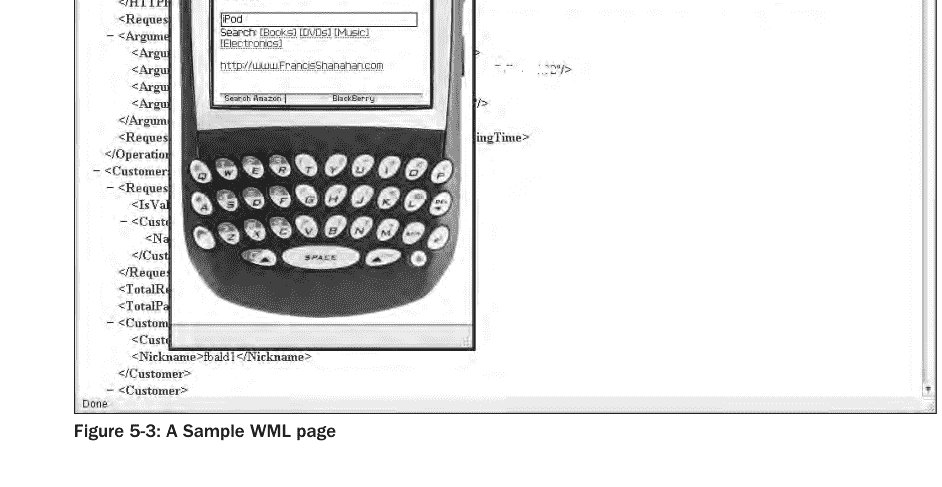

## 什么是微格式？


微格式相对较新，它在 RSS 和 XHTML 等现有标准之上构建了新的简单约定，用于表示各种类型的数据。一个例子可能是 `hCard`，这是一种用于显示个人联系信息的简单约定。

以下是我的 `hCard` 示例：

```html
<div class="vcard">
<a class="url fn" href="http://www.FrancisShanahan.com">Francis Shanahan</a>
<div class="adr">
  <div class="street-address">Main Street</div>
  <span class="locality">Anytown</span>
  <span class="country-name">USA</span>
</div>
</div>
```

# 第五章

如你所见，这不是一个严格的规范，不像 DTD 或 XML-Schema 表示。它只是一组带有相关样式的 HTML 标签。大多数微格式都采用这种简单的方法。

微格式是`极度聚焦的解决方案`，这意味着它们的设计目的不是要无限扩展和延伸。

已经创建了许多微格式，每一个都针对特定问题和特定解决方案而设计。下表列出了一些当前存在的微格式。

| 微格式名称 | 用途 |
|---|---|
| hCard | 描述个人或组织 |
| hCalendar | 描述日历和事件 |
| hReview | 描述意见、评分和评论 |
| rel-tag | 描述标签、关键词或类别 |
| XOXO | 描述列表和大纲 |

这不是一个完整的列表。微格式相对较新，你应该会随着时间的推移在各种地方看到它们出现。考虑在你自己的混搭应用中使用它们。

你可以在以下网址了解更多关于微格式的信息：

```text
http://www.MicroFormats.org
```

## 什么是 XML-RPC？

XML-RPC 是一种在远程系统上执行方法调用的简单机制。它通过将函数名称和参数都作为 XML 结构进行传输来工作。XML-RPC 中的“RPC”代表`远程过程调用`（Remote Procedure Call），可追溯到 SOAP 出现之前的时代。XML-RPC 是一个远比 SOAP 简单的协议，至今仍被许多公司使用。

## 小结

本章中的术语只是你在探索面向服务的架构和混搭应用世界时会遇到的众多常见缩写中的一小部分。总有学不完的东西，但这些术语至少可以作为立足点，帮助你阅读和理解后续章节。

在本章中，我提到了许多后续章节中包含的混搭应用。你现在就可以跳转到那些章节，或者考虑复习以下问题，以确保对本章内容的理解。

接下来，在第六章中，你将揭示混搭应用背后的架构“管道”。你将了解将数据混搭在一起的主要技术，以及每种方法的优缺点。

在继续之前，考虑复习以下问题。

## 练习

1. XHTML 和 HTML 有什么区别？
2. RSS 和 Atom 有什么共同点？
3. 什么是 REST 风格的 API？
4. XML-RPC 和 SOAP 有什么共同点？
5. 什么是 `hCard`？
6. REST 必须使用查询字符串吗？
7. REST 是一种协议吗？
8. 什么是微格式？
9. 哪个更好——SOAP 还是 REST 风格的接口？

# 混搭技术

本书全是关于混搭的——换句话说，就是将来自各种来源的数据和服务组合起来，创建新的应用。当然，解决这个问题有很多方法，每种方法都有其优缺点。在本章中，你将了解将服务混搭在一起的一些较典型的方法，我敢肯定，当你读完时，你已经想到了一些属于自己的技术。

请记住，虽然混搭通常与有趣的应用相关联，但支撑它们的技术实际上相当复杂。这些是将复杂技术结合起来的强大技术，因此具有广泛的企业应用背景。主要厂商（IBM 和微软）已经意识到了这一点，并在该领域取得了进展。

本章涵盖了汇编了这些技术的使用案例，并建议每种案例的适当（和不适当）用法。

## 在 Web 服务器上进行混搭

每个网站都运行在 Web 服务器上。它是提供页面的东西，在微软世界中通常是 Internet Information Server（IIS）。在纯粹的普通用例中，忠实的 Web 服务器完成所有混搭工作，而浏览器只是坐着等待响应。不要小看这种基本方法，因为它有其用武之地，特别是在处理传统桌面浏览器的替代方案时（例如，移动设备）。

## iFrames——抱歉，这不算数

在 Web 服务和 XML 出现之前，人们使用框架和 iFrames 来组合网站。以下 HTML 片段将 `src` 标签的内容（本例中是一个 Google URL）呈现在浏览器中一个 400 像素乘 400 像素的框内：

```html
<iframe width="400px" height="400px" src="http://www.google.com/search?hl=en&q=mashups&btnG=Google Search">
</iframe>
```

说真的，这种技术实际上并不算是一种 Mashup，尽管如果你足够仔细地寻找，仍然可以看到它在使用。它没有重新利用内容，没有重新品牌化，没有修改内容，也没有与其他数据进行聚合。恐怕 iFrame 已经过时了。

### 理解架构

图 6-1 展示了一个典型的 HTTP 页面请求。从架构角度来看，这是最简单的 Mashup 形式。

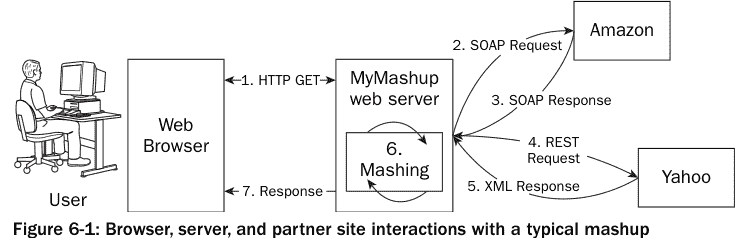

### 工作原理

这个用例绝对是最直接的：

1. Web 浏览器与服务器通信，使用普通的 HTTP 或 HTTPS 请求一个页面。
2. 该页面由 Web 服务器构建，它会访问我称之为`源`或`合作伙伴网站`的地方（例如，Amazon、Yahoo 或 Google 等）。本例中的第一次请求是使用基于 HTTP 的简单对象访问协议（SOAP）向 Amazon 发出。
3. Amazon 返回一个 SOAP 响应。
4. 本例中的第二次请求是使用表述性状态转移（REST）风格的方法向 Yahoo 发出。
5. Yahoo 通过 HTTP 响应纯 XML 数据。
6. 最后，Web 服务器聚合响应，以任何合理的方式组合和整理数据。
7. 生成的数据被绑定到 HTML 并插入到响应中，然后发送回浏览器。

### 优缺点

这种方法的好处是浏览器与提供数据的合作伙伴网站完全解耦。Web 服务器充当响应的代理和聚合器。作为开发人员，你无需担心浏览器是否支持 JavaScript 中的可扩展样式表语言转换（XSLT）的某个方面。

此外，你无需支持多个版本的动态 HTML（DHTML）来弥补浏览器实现之间的差异。

> 在第 10 章，当你开始处理 Ajax 时，你会发现，在某些情况下，要在 JavaScript 中实现某个特定功能，浏览器对该功能的支持并不一致。例如，Firefox 以自己的方式实现 XML 解析，而 Internet Explorer 则使用完全不同的对象集。在这种情况下，你实际上必须用两种不同的方式编写相同的功能，并根据用户使用的浏览器执行正确的那个。

这种方法的缺点是浏览器请求整个页面，这通常是可接受的，但正如你将在下一节中看到的那样，它并不像它本可以做到的那样干净或精致。

其次，Web 服务器承担了所有数据处理的工作。虽然这在维护方面是好的，但在可扩展性方面并不那么好。当你的 Mashup 受到欢迎并开始有成千上万的用户访问时，服务器所做的工作量会增加，而客户端的浏览器则相对空闲。

### 何时使用

当你无法预测请求混合数据的客户端类型时，这是一种很好的方法。例如，大多数人会认为 Mashup 完全从浏览器访问。现在，想象一下泛在计算的世界，用户可能使用 BlackBerry、Pocket PC 甚至手机界面等设备来使用你的 Mashup。真正的强大之处在于能够在服务器上混合数据，并以客户端能够理解的方式输出，无论它是不是浏览器。

> 你将在第 14 章实现此技术，从 Amazon 数据生成无线标记语言（WML）界面，以便你可以从手机上浏览 Amazon！

## 使用 Ajax 实现丰富的用户界面

这种方法近年来被炒作得难以置信，但实际上已经存在多年了。异步 JavaScript XML（Ajax）的第一个广泛使用的例子是 Microsoft Outlook Web Interface，但无论出于何种原因，它直到多年后才被注意到。

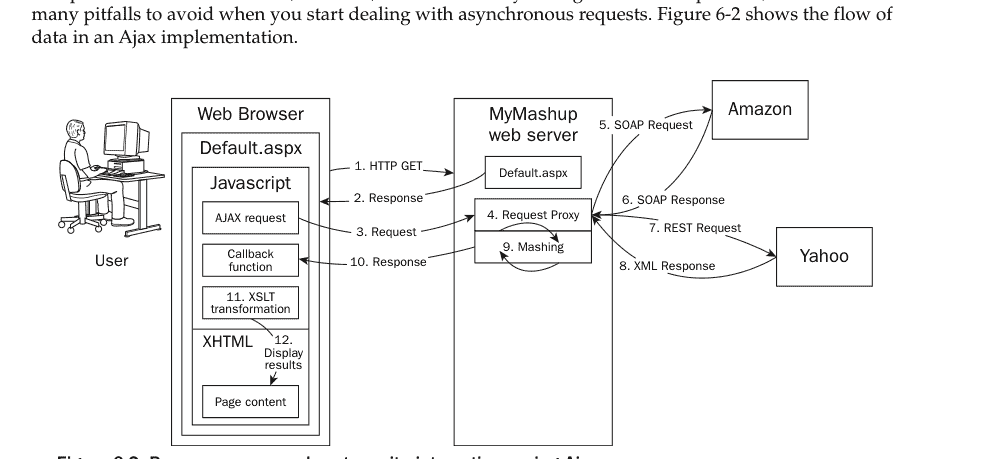

这绝对是所有机制中最时髦的。如果实现得当，这种方法可以为用户提供更丰富的体验。但是要小心，因为在 Mashup 的世界里，可用性是王道，并且在开始处理异步请求时有许多陷阱需要避免。图 6-2 显示了 Ajax 实现中的数据流。

### 工作原理

在这个用例中，浏览器才是真正的主力：

1. 和之前一样，序列从浏览器向 Web 服务器请求页面开始。该页面以标准方式提供。
2. 在浏览器首次加载页面时，页面中没有 Mashup 内容。一些 JavaScript 与页面的 HTML 一起下载到浏览器。
3. 下一步是浏览器向服务器发回请求以获取额外内容。这可能是一个 SOAP 请求，或基于 REST 或 XML-RPC 风格的请求，但基本原理都是相同的。这里真正的细微差别（而且是很大的差别）在于，这个请求是通过 JavaScript 完成的，并且是异步发生的，可以说是在幕后进行的。因为它是异步的，所以浏览器中的页面不会刷新，浏览器也不会在调用处理完成前被阻塞。事实上，整个过程可能在用户完全没有察觉的情况下发生！这个特定主题在第 10 章中有详细介绍。
4. 这里的服务器充当代理。浏览器请求了一些内容，可能是来自 Yahoo 的股票报价。服务器通常只是将该请求转发给预期的接收方。
5. 向 Amazon 发出 SOAP 请求。
6. Amazon 用 SOAP 响应。
7. 向 Yahoo 发出 REST 请求。
8. Yahoo 处理请求并将数据返回给服务器，就像第一种场景中那样。
9. 服务器上可能会进行一些混合。这实际上是一个可选步骤，因为数据可能只是直接发送回浏览器。
10. 一旦数据准备就绪，它就被发送回浏览器。与此同时，在浏览器这边，生活仍在继续。在原始请求中指定的 JavaScript 回调函数在响应最终从服务器到达时处理它。
11. 通常，此时会对 XML 数据进行转换，将其转换为 XHTML，其中包括数据和表现标记。（请记住，XHTML 只是格式良好的 HTML）。
12. 然后将该片段插入页面的结构中，并显示在用户面前！

> 回调函数只是被分配在特定事件触发时执行的函数。在这种情况下，当浏览器收到响应时回调执行。

你可能会问，“那么，为什么浏览器不直接与合作伙伴网站通信呢？”这是设计好的。原因是出于 Web 浏览器安全。由于所有浏览器内置的安全限制，`XmlHttpRequest` 对象只能从提供该页面的站点检索数据。你不能使用 `XmlHttpRequest` 访问其他站点，因此，在 Ajax 场景中需要在 Web 服务器上设置响应处理程序或代理。JSON 解决了这个问题，正如你将在本章后面看到的那样。

### 优缺点

正如你从解释中推断出的，这是一个包含许多活动部件的复杂装置。开发人员将面临 JavaScript 挑战、服务器通信问题以及难以预测的异步方法等。解决方案的维护以及开发过程中的调试可能具有挑战性。

你应该确保在有意义的地方且仅在有意义的地方应用此技术。例如，使用 Ajax 刷新页面的一部分是有意义的；使用此技术刷新整个页面则没有意义。

最后，在“缺点”方面，当你使用 JavaScript 以这种方式修改页面状态时，浏览器的内置导航机制（如“后退”按钮和历史记录）会被绕过。如果用户收藏一个 Ajax 页面，他们收藏的只是 URI，而不是页面的实际内容。这可能会给用户带来困惑。

在积极的一面，当结合一点想象力时，这种技术可以在浏览器内实现极佳的体验。在许多情况下，你可以复制功能丰富的富客户端体验。你获得了无需安装的应用程序（零足迹）的维护优势，同时具备富客户端应用程序的复杂性。

# 第六章

这种方法的另一个好处是结果的呈现方式，即结果在屏幕上显示的方式和相关的 HTML 标记，完全由应用于 XML 数据的 XSLT 样式表驱动。这意味着在驱动应用程序的实际 C# 代码中，没有嵌入任何呈现逻辑。C# 服务器代码保持简洁干净，如果你确实需要修改结果的外观，只需简单地编辑 XSLT 文件即可，无需重新编译。

此外，浏览器承担了大部分工作。这意味着服务器的工作量减少，因此可以有更多时间来提供更多的页面。你的 Web 服务器需要做的工作越少，最终的应用程序就越具有可扩展性。应用程序的可扩展性越强，你在需要购买额外硬件之前能够处理的用户就越多。

最后，因为所有数据（无论来自哪个合作伙伴站点）都通过服务器上的一个公共点进行路由，所以结果的聚合和组合成为可能。正如你将在本章后面看到的，使用 JSON 时，这种数据处理只能在浏览器内部完成。

## 何时使用 Ajax

Ajax 是一种强大的技术，它开启了多种可能性。例如，你可以将 Ajax 应用于帮助你解决以下问题：

- 遍历极其庞大的数据集（例如 Google 地图，显然不可能将每张卫星图像都下载到浏览器）。
- 为动态数据提供实时更新（股票报价是一个完美的例子，用户无需完全刷新页面即可获取准确信息）。
- 将用户交互报告回服务器（例如，用于收集营销信息的点击跟踪）。
- 通过在用户输入时提供结果来丰富搜索界面（通常称为实时搜索）。

## 何时不使用 Ajax

当然，你可以随时自由使用 Ajax，但要小心，以免它最终成为新的“blink”标签。

- 考虑用户体验。添加 Ajax 会让用户困惑吗？用户是否清楚数据正在刷新？
- 不要使用 Ajax 刷新整个页面，因为这有什么意义呢？你可以直接使用浏览器的刷新按钮！
- 请记住，Ajax 会修改页面的状态。如果你将一个启用了 Ajax 的页面加入书签，然后访问该书签，页面可能不包含最初书签的内容。有一些解决方法涉及修改页面的查询字符串以包含状态信息，但我并不推荐这种方法，除非是最简单的情况。

至此，我们完成了 Ajax 作为聚合技术的概述。在第 10 章中，你将使用 Ajax 构建一个聚合应用，并深入了解其内部工作原理。在结束本章之前，还有一个主题需要讨论：JSON。

## 使用 JSON 进行聚合

JavaScript 对象表示法（JSON，读作“Jay-son”）是一种在聚合社区中日益流行的表示法，主要得益于其可读性和简单性。本节将使你熟悉使用 JSON 的聚合通信机制。

### 理解架构

JSON 本身只是一种表示法，一种以人类易于阅读且机器易于处理的方式书写对象的方法。大多数浏览器的内置 JavaScript 功能实际上使 JSON 成为一种可行的聚合技术。图 6-3 展示了 JSON 实现中的架构和交互。

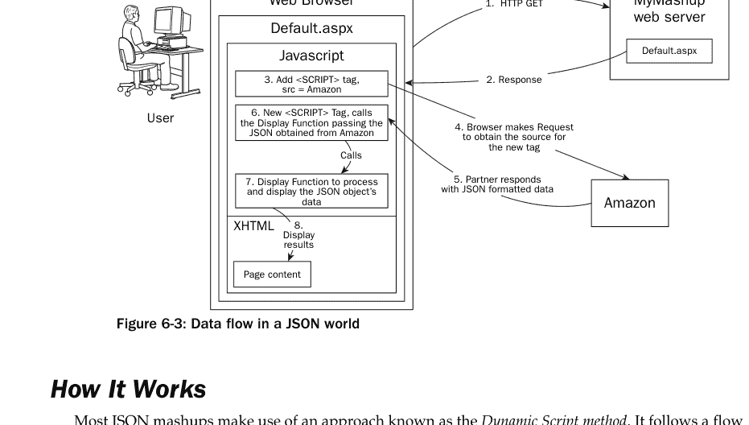

### 工作原理

大多数 JSON 聚合利用了一种称为`动态脚本方法`的方法。它遵循类似于以下流程：

1. 像往常一样，流程从浏览器使用 HTTP GET 请求页面开始。
2. Web 服务器提供一个包含几个关键 JavaScript 函数的页面：
   - 一个解析函数期望一个 JavaScript 对象作为参数。该函数检查传入的对象，并将其中包含的数据插入页面的 HTML 中。
   - 一个“初始化”脚本是动态脚本方法的精妙之处。它向页面添加一个`新的`脚本标签，并将该脚本标签的源指定为某个合作伙伴站点（例如 Amazon.com）的 URL。该 URL 将呈现的不是 HTML 也不是 XML，而是 JSON。
3. 浏览器尝试加载新脚本标签的源代码。
4. 通过加载脚本，会向 Amazon（或任何源）发出一个 HTTP GET 请求。
5. 合作伙伴站点（在本例中是 Amazon）响应一个序列化为 JSON 表示法的 JavaScript 对象。
6. 这个 JSON 脚本被包装在对渲染函数的函数调用中，整个 JavaScript 块成为步骤 2b 中添加的脚本标签的内容。
7. 浏览器现在尝试执行这个新的 JavaScript 片段。这会导致调用步骤 2a 中的渲染方法。
8. 调用渲染方法，评估 JSON 脚本并将其转换为 JavaScript 对象。渲染方法在其执行中使用这个新的 JavaScript 对象，并将其中包含的数据注入页面。

动态脚本方法实际上相当简单，但不幸的是，不容易解释清楚。你将在第 12 章中看到该方法的实际应用。

### 优缺点

JSON 方法的主要好处是通信路径。浏览器直接与合作伙伴站点通信，无需通过服务器。因此，服务器上的负载减少了，因为通信由浏览器负责。

开发人员通常发现使用 JSON 提供的预制对象比在 JavaScript 中使用 XSL 或 XPath 处理 XML 更容易。在许多情况下，跨浏览器兼容性问题也更少。

这是一个相当主观的观察，但有些人觉得 JSON 更容易阅读。我个人并不这么认为，但我会让你来判断。

缺点方面，因为浏览器直接与合作伙伴站点通信，没有机会在服务器上整合数据。使用 Ajax 时，根据你实现代理的方式，你有机会整合数据。JSON 不存在这种可能性。

最后，许多 API 不支持 JSON，Yahoo 是这种表示法的主要支持者。例如，Amazon 本身不会提供 JSON 服务。在第 10 章中，我将介绍一种使用 XSL 将 Amazon 数据转换为 JSON，然后使用动态脚本方法使用此数据的方案。

### 何时使用 JSON

如果你需要快速让某些东西工作，JSON 是一个有用的工具。显然，动态脚本方法比例如 Ajax 中的活动部件更少。没有代理，浏览器无需 Ajax 实现中所有额外的 JavaScript 就能优雅地执行合作伙伴查询。

### 何时不使用 JSON

当你需要处理合作伙伴数据，并且可能需要在显示之前将其与其他合作伙伴站点的数据聚合或组合时，不要使用 JSON。如果你需要对其执行 XML/XSL 转换，Ajax 或服务器端转换选项会更合适。

## 警告提示


使用这些技术时有必要提醒一下。当合作伙伴是像 Amazon 或 Yahoo 这样的公司时，你可以放心他们不会向你返回恶意脚本。如果你不确定合作伙伴，请格外小心，验证返回的数据是否包含任何可能无意中损害页面（或用户浏览器）的值。请记住，要显示的内容直到运行时才确定。你有责任确保不会无意中为你的页面打开一个安全漏洞。如果合作伙伴发送恶意脚本（例如，实现蠕虫型病毒的 JavaScript），而你将其显示在代码中，那么你就意外地传播了病毒，这非常糟糕！事实上，第一个基于 Ajax 的自我传播蠕虫已经出现在互联网上。在创建新颖且引人入胜的网站时，安全应始终是首要考虑的。

## 总结

在本章中，你从架构角度了解了聚合 Web 服务数据的一些主要技术，包括以下内容：

- 在服务器上聚合
- 使用异步 JavaScript 和 XML 在浏览器中聚合
- 使用 JSON 在浏览器中聚合

在深入研究像聚合这样的新技术之前，先获得一个宏观的概述是很有用的。

我并非这些技术的发明者，我的方法也不是唯一的方法。要意识到做事总会有新的方法。这些技术绝不是做事的最终方式。变体不断涌现，像你这样有创造力的人正在继续推动数据应用的可能性。本章及其图表应能成为你超越本书创建自己动态网站时的宝贵资源。

在接下来的几章中，你将超越理论，学习如何在现实世界中应用这些技术。

第 7 章将指导你构建你的第一个混搭应用，一个使用 SOAP 将 Amazon 搜索结果自动转换为 RSS feed 数据的机制。

在继续之前，请复习以下练习，测试你对本章内容的熟悉程度。

## 练习

1. 创建聚合应用的三种可能方法是什么？
2. 什么是 Ajax？
3. Ajax 的优缺点是什么？
4. 列出使用 JSON/动态脚本方法进行数据聚合的优缺点。

# 第 7 章：创建您的第一个 Remix（改编作品）

有人曾说我是个十足的吝啬鬼。我更喜欢用“节俭”这个词来称呼自己。当我进行购买时，我喜欢确保买到的是最佳价格的商品。在做决定之前，我会大量利用来自亚马逊的客户评论进行研究。Amazon 的价格和客户评价通常会随时间波动，RSS 是很好的监控数据的方式，因此将两者结合起来对我来说顺理成章。

在本章中，您将构建第一个 Remix：这是一个使用简单对象访问协议（SOAP）自动生成的亚马逊产品信息的真正简单的分发（RSS）馈送。该 Remix 将以 RSS 的形式产生 XML 格式的馈送。您随后可以像监控博客一样监控这个 RSS 馈送，从而在价格下降时及时得知这一信息。您将创建一个类似于“亚马逊博客”的东西。

任何符合 RSS 2.0 标准的新闻阅读器都可以订阅此馈送。这是一个非常有趣的小巧 Remix，甚至可能帮您节省一些钱。

## 行动计划

本章展示了两个独立的示例，每个示例本身都是一个独立的应用程序。每个示例都建立在上一个示例的基础之上。第一个示例是一个单页应用，完全自包含。计划是创建一个简单的搜索表单。该表单提交后将以 HTML 形式显示结果。这没什么大不了的事，但这个示例说明了向亚马逊发起的 SOAP 调用过程。

下一个示例基于第一个示例构建，并修改了搜索表单以提供选项来生成 RSS 馈送（而不是在 HTML 中显示搜索结果）。这样允许用户使用 RSS 阅读器订阅结果。在这个示例中，您将建立一个通用的 RSS 生成器。

### 理解架构

在下手之前，对最终结果的构思非常重要。图 7-1 展示了该解决方案的架构图。

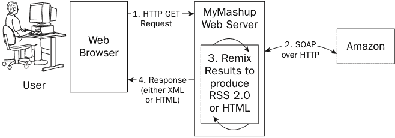

**图 7-1：亚马逊 RSS Remix 架构**

## 工作原理

由于这是一个 Remix，其涉及的部分比典型的 Mashup（混合内容）少得多：

1. 用户填写简单的搜索屏幕并选择“提交”按钮。请求（通常是 HTTP `GET` 或 `POST`）将被发送回托管该 Remix 的服务器。
2. 服务器处理该请求并向亚马逊网络服务（AWS）平台发出 `ItemSearch` 查询。AWS 返回结果数据。
3. 根据用户的需求（HTML 还是 RSS），响应内容将在服务器上被解析并转换为符合 RSS 2.0 规范的 XML。
4. Remixed（改编后的）响应随后发送到浏览器。

> 针对分发内容的 Schema 或规范有好几种。其中一种更流行的是 RSS 版本 2.0，但您可以轻松修改此示例以生成 Atom、RSS 1.0 或其他任何您喜欢的格式。

RSS 的格式非常简洁，因此得名（真正简单的分发），但其效果如您将看到的彻底且高效。

### 用户界面

在这种情况下，用户界面相当简单，只是一个简单的表单。请使用 Visual Studio Web Developer 创建新项目（或重用上章的项目）并向项目添加一个名为 `default.aspx` 的新网页。

> 如果您希望将此功能连接到第 4 章中创建的网站项目中，只需将本章开发的代码添加到该项目中，并将新页面添加到站点地图（sitemap）文件中。该页面会自动显示在导航菜单中。您可以更进一步，同时也将应用为当前页面的 `main.master` 母版页。

用户界面如图 7-2 所示。它包含一个用于控制布局的表格。表中有一个文本框（Text Box），用于搜索关键词；还有一个下拉选择控件（drop-down control），允许用户指定要查询的搜索索引。

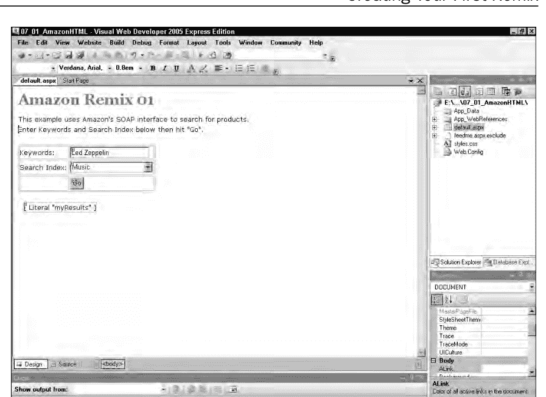

**图 7-2：设计时的亚马逊 RSS 界面**

### 构建表单

该 HTML 和布局完全由您自行决定。我将在下面提出一些准则，供您起步使用。一旦应用程序运行正常，我会鼓励您偏离这个脚本，以根据您的意愿在项目中融入尽可能多的复杂功能。

1. 要添加表单字段，请切换到页面的设计视图（Design view），并将一个 TextBox（文本框）拖放到页面上。通过在其属性窗口中设置 ID，将此控件命名为 `Keywords`。
2. 将 DropDownList（下拉列表）拖放到页面之上，并将其命名为 `SearchIndex`。
3. 要添加下拉选项项目，您可以切换到源代码视图并手动输入它们；或者右键单击下拉选择控件并使用属性对话框，如下所示：

```html
<option value="DVD">DVD</option>
<option value="Books">书籍</option>
```

正如第 4 章所述，亚马逊产品目录中搜索索引种类繁多。我已经列出了所有这些选项，但您可能考虑将选择范围限制在最受欢迎的类别（例如，“书籍”、“音乐唱片”和“影音碟片”）。

4. 最后要添加的是提交按钮（Submit button）。拖放一个 HTML `Input`（`Submit`）控件到表单上并将其 ID 更改为 `cmdSubmit`。在接下来的部分中，您将构建该按钮后面的代码逻辑。
5. 添加一个名为 `myResults`、用于打印结果的 Literal（字面量）控件。

出于清晰的目的，我特意将这一页面保持得较为简单；但您可以发挥创意，增加更多字段（例如本地化 Locale 和排序 Sorting），以使结果集得到进一步细化。

在此有一个重要说明：虽然您可以使用传统的 HTML 控件如 `<input>` 来构建此表单，或者使用 ASP.NET 控件如 `<asp:TextBox>`，但该示例使用的是服务端 HTML 控件（server-side HTML controls）。

要创建服务端上的 HTML 控件，首先请基于标准 HTML 控件构建设计视图下的表单。这将产生如下标记：

```html
<input id="Text1" type="text" />
```

然后右键单击该控件，并在上下文菜单中选择“作为服务器端运行”选项（Run As Server Control）。这将对上述标记进行修改如下：

```html
<input id="Text1" type="text" runat="server" />
```

请确保使用的是服务端上的 HTML 控件，而不是它们的纯 HTML 等效项；否则示例将无法理解。完成之后，ASPX 页面源代码应类似于以下第 7 节（或原文中的 Listing 7-2，此处对应 Listing 7-1）：

### 列表框 7-1：搜索入口屏幕源码

```aspx
<%@ Page Language="C#" AutoEventWireup="true" CodeFile="default.aspx.cs"
Inherits="_Default" %>

<!DOCTYPE html PUBLIC "-//W3C//DTD XHTML 1.0 Transitional//EN"
"http://www.w3.org/TR/xhtml1/DTD/xhtml1-transitional.dtd">

<html xmlns="http://www.w3.org/1999/xhtml">
<head runat="server">
    <title>使用 SOAP 进行亚马逊搜索</title>
    <link href="styles.css" rel="stylesheet" type="text/css" />
</head>
<body>

    <form id="forml" method="post" runat="server">
        <h1>亚马逊 Remix 01</h1>
        This example uses Amazon's SOAP interface to search for products.
        Enter Keywords
        and Search Index below then hit "Go".<br />
        <br />
        <table>
        <tr><td>Kewwords: </td><td><input type="text" value="Led Zeppelin"
        name="Keywords" id="Keywords" runat="server" /></td></tr>
        <tr><td style="height: 27px">Search Index:</td><td style="height: 27px"><select name="SearchIndex" id="SearchIndex" runat="server">
        <option value="Blended">All</option>
        <option value="Electronics">电子商品</option>
        <option selected value="Music">音乐产品</option>
        <option value="DVD">影音碟片</option>
        <option value="Books">书籍</option>
        </select></td>
        </tr>
        </table>
        <br />
        &nbsp;
        <asp:Literal id="myResults" runat="server"></asp:Literal>
    </form>
</body>
</html>
```

## 第 7 章

正如清单所示，亚马逊目录中有大量的 `SearchIndex`（搜索索引）。您可以随意根据需要自定义这些设置。（例如，并非每个人都希望搜索“宠物用品”。）

# 服务端代码

定义了用户界面后，可以将注意力转移到其背后的逻辑。双击您刚刚添加到表单上的按钮。Studio 会自动为该按钮的单击事件添加一个事件处理程序，并将焦点切换到页面的后台代码文件（code-behind）。

## 试一试：ASP.NET 的事件模型

ASP.NET 采用事件驱动模型，就像您在 Windows rich client 编程环境中看到的那样。事件（如按钮点击）在客户端（浏览器）触发，但在服务器端执行。这是一种有趣的编程模型，您应该充分理解后才能继续。您可以尝试一个简单的实验来利用此功能。在您刚刚创建的事件处理程序中输入以下代码：

```csharp
protected void cmdSubmit_ServerClick(object sender, EventArgs e)
{
    this.Keywords.Value = "Hello Event Driven World";
}
```

这段代码简单地设置 `TextBox` 控件的文本。此时运行项目并单击按钮。服务器设置该文本并将新页面发送回浏览器。

## 存储配置数据

在此示例中，有两个数据字段（即您的 Amazon Associate ID 和 Developer Network Subscriber ID）将用于每次对亚马逊电子商务服务（ECS）平台调用。与其在每次调用中包含这些键，不如将它们放置在配置文件中并将其作为配置设置进行引用。在旧系统中，这通常意味着将这些键放在注册表中，并编写一些访问类以在运行时获取它们。

ASP.NET 使用位于每个 ASP.NET 项目根目录下的 `web.config` 文件作为此类配置数据的主要存储位置。此类数据被称为应用程序设置。.NET Framework 中包含一组类，当提供键名时，将自动从 `web.config` 文件中检索应用程序设置值。

要将此（或任何其他设置）存储在 `web.config` 中，请向 `web.config` 文件的 `appSettings` 部分添加以下行：

```xml
<add key="AWSAccessKeyId" value="your_aws_key" />
<add key="AssociateTag" value="your_associate_tag" />
```

您也可以使用 ASP.NET 配置向导来添加这些设置。单击 Solution Explorer 窗口顶部的 ASP.NET Configuration 图标以启动向导。单击“应用程序”选项卡并选择创建应用程序设置。输入适当的字段（名称和值），向导将为您在 `web.config` 中添加相应的字段。个人发现，编辑 `web.config` 比使用向导更快。

当配置数据存储在 `web.config` 文件中后，您可以使用 `ConfigurationManager` 对象引用这些设置。请将代码中所有对配置数据的引用替换为以下函数：

```csharp
ConfigurationManager.AppSettings["AWSAccessKeyId"];
```

例如，这行代码将获取 `AWSAccessKeyId` 键的 `web.config` 文件中的值。

当拥有特定于应用程序且可能会更改的数据时，您应该考虑使用这种方法。

## 使用 SOAP 检索亚马逊数据

现在是时候编写查询亚马逊平台的代码了。在下个“试一试”部分中，您将向 AWS 添加 Web 引用。该代码通过自动生成的 Web 服务代理类与 Amazon 进行通信。

### 试一试：生成 SOAP 代理

有两种选项可以生成代理类。以下步骤显示第一种选项：

1. 使用 IDE，右键单击 Solution Explorer 并选择“添加 Web 引用”。出现“添加 Web 参考”对话框。
2. 在 Web 服务对话框中输入以下 URI，然后单击 OK：`http://webservices.amazon.com/AWSECommerceService/2005-03-23/US/AWSECommerceService.wsdl`

   Visual Studio 将此 URI 识别为 Web Services Description Language（WSDL）端点，因此“添加引用”按钮将变为可用。

3. 单击添加参考并生成代理代码。

第二种选项是调用名为 `wsdl.exe` 的命令行实用程序手动生成此代理类。该工具是 .NET 软件开发工具包（注意：这与 .NET Framework 不同）的一部分。`wsdl.exe` 的默认安装路径为 `C:\Program Files\Microsoft Visual Studio 8\SDK\v2.0\Bin`。

使用以下命令查询 Amazon WSDL 端点并在默认语言 C# 中创建客户端代理类：

```bash
wsdl http://webservices.amazon.com/AWSECommerceService/2005-03-23/US/AWSECommerceService.wsdl
```

Visual Basic 用户可以使用的如下：

```bash
wsdl /language:VB /out:AWSECommerceService.vb http://webservices.amazon.com/AWSECommerceService/2005-03-23/US/AWSECommerceService.wsdl
```


当然，您不必以这种方式创建代理，但我发现查看 IDE 为您执行的操作的内部原理总是很有用的。

您将使用此引用或代理类来调用 Web 服务上可用的方法。该类使用每个可以调用服务的操作的功能对服务进行建模。

## UDDI 说明

当您拥有一个庞大的 Web 服务数组时，管理服务并实际了解它们是什么以及它们位于何处将是一项挑战。Universal Description, Discovery and Integration (UDDI) 是一项促进 Web 服务目录管理的计划。您可以将其视为 Web 服务的黄页。在这种情况下，不需要 UDDI，因为您已经拥有了 Amazon 的 Web 服务描述 URI（根据 Amazon 文档）。

## 在不同的区域搜索

Amazon 数据按区域和本地化组织。在此书中，我主要实施了美国本地化，但我认识到需要能够利用各种全球区域的 Amazon 数据实施 mashups。通常，Amazon ECS 平台的实现遵循类似的方法，无论使用哪个本地化版本。

如果您想搜索其他区域的数据，只需将正确的 WSDL 端点替换为美国本地化端点即可。下表记录了 Amazon 当前可用的本地化版本。

| 区域 | WSDL 端点 URI |
| :--- | --- |
| US | `http://webservices.amazon.com/AWSECommerceService/###CommerceService.wsdl` |
| UK | `http://webservices.amazon.com/AWSECommerceService/#UK#/AWSECommerceService.wsdl` |
| DE | `http://webservices.amazon.com/AWSECommerceService/DE/AWSECommerceService.wsdl` |
| JP | `http://webservices.amazn.com/AWSECommerceService/JpAWECommerceService.wsdl` |
| FR | `http://webservices.amazon.com/AWSECommerceService/FrAWSCommerceServices.wsdl` |
| CA | `http://webservices.amazon.com/AWSECommerceService/#C#/AWSECommerceService.wsdl` |

> 这些 URL 是区分大小写的。输入 `uk` 而不是 `UK` 将导致服务器 404 错误（页面缺失），您寻求的端点将不会出现。

## 使用代理

现在，您可以使用此代理来调用 AWS。第一步是为 `default.aspx` 页面的代码后台类添加一个 `using` 语句：

```csharp
using com.amazon.webservices;
```

该 `using` 语句允许您在每个实例中无需完全限定名称即可引用该命名空间的类。

AWS 提供请求和响应类，具体取决于您执行的操作。在此情况下，您将发出一个 `ItemSearch` 请求，因此实例化 `ItemSearchRequest` 对象。在代码后台类中添加一个新函数。此函数的代码显示在列清单 ##-## 中：

**列表清单 ##-#：搜索亚马逊函数**

```csharp
string SearchAmazon(string strKeywords, string strSearchIndex)
{
    // Create a new instance of the proxy class
    AWSECommerceService myProxy = new AWSECommerceService();

    // Create a new instance of the ItemSearch class
    ItemSearch mySearch = new ItemSearch();

    // ItemSearchRequest stores the actual request parameters
```

### 代码清单 7-2：（续）

```csharp
ItemSearchRequest mySearchRequest = new ItemSearchRequest();

// 设置一些参数，关键词和搜索索引
mySearchRequest.Keywords = strKeywords;
mySearchRequest.SearchIndex = strSearchIndex;

// 只需要部分结果，而非全部数据
mySearchRequest.ResponseGroup = new string[] { "Medium", "Request" };

// 设置订阅和关联标签
mySearch.AWSAccessKeyId =
    ConfigurationManager.AppSettings["AWSAccessKeyId"];
mySearch.AssociateTag =
    ConfigurationManager.AppSettings["AssociateTag"];

// 准备请求
mySearch.Request = new ItemSearchRequest[] { mySearchRequest };

// 执行请求并获取响应
ItemSearchResponse myResponse = myProxy.ItemSearch(mySearch);

// 解析响应并以 HTML 格式返回结果
string strHTML = "";
foreach (Items myItems in myResponse.Items)
{
    foreach (Item myItem in myItems.Item)
    {
        // 以 HTML 格式获取结果
        strHTML += FormatAsHTML(myItem);
    }
}
return strHTML;
}
```

## 工作原理

`SearchAmazon` 函数首先创建一个 Amazon 服务代理实例。

接下来，它使用 `ItemSearch` 和 `ItemSearchRequest` 对象开始构建请求。`ItemSearchRequest` 用于指定查询的 `Keywords`（关键词）和 `SearchIndex`（搜索索引）。你可以根据搜索对象，使用 `Actor`（演员）、`Brand`（品牌）、`Composer`（作曲家）等额外参数进一步缩小搜索范围。

下一步是指定 `ResponseGroup`（响应组）。在此示例中，我们只关注 `Medium` 响应组，但如果你希望响应包含原始请求，可以将其作为额外的 `ResponseGroup` 指定，如下所示：

```csharp
mySearchRequest.ResponseGroup = new string[] { "Medium", "Request" };
```

如示所示，`AWSAccessKeyId` 和 `AssociateTag`（可选）被指定。`AWSAccessKeyId` 在所有请求中都是必需的。

请求随后通过服务代理准备并执行。

最后，遍历结果，并使用前面定义的 Literal 控件将其写入页面。找到的每个结果项都通过 `FormatAsHTML` 函数（代码清单 7-3）转换为 HTML。

> 为清晰起见，我在此代码中省略了错误检查。你应该添加对空对象引用的检查，并在尝试解析前确保存在结果，以确保代码基础的稳健性。

### 代码清单 7-3：`FormatAsHTML` 函数

```csharp
string FormatAsHTML(Item myItem)
{
    // 将包含结果
    string strHTML = "";

    // 检查是否为 null
    if (myItem != null)
    {
        // 开始该项的 HTML
        strHTML += "<div class=\"item\">";

        // 添加标题
        strHTML += "<h2>" + myItem.ItemAttributes.Title + "</h2>";

        // 如果存在，添加商品图片
        if (myItem.SmallImage != null)
        {
            strHTML += "";
        }

        // 添加 ASIN
        strHTML += "<b>ASIN:</b> " + myItem.ASIN + "<br/>";

        // 如果存在，添加价格
        if (myItem.OfferSummary != null)
        {
            if (myItem.OfferSummary.LowestNewPrice != null)
            {
                strHTML += "<b>最低价格：</b> " +
                    myItem.OfferSummary.LowestNewPrice.FormattedPrice +
                    "<br/>";
            }
        }

        // 添加详情链接
        strHTML += "<a href=\"" + myItem.DetailPageURL +
            "\">查看详情</a><br/>";

        // 结束输出
        strHTML += "</div>";
    }

    return strHTML;
}
```

`FormatAsHTML` 函数接受一个 `Item` 作为参数，并返回一个字符串作为结果。它简单地查询单个 Amazon 项的各个相关属性，并依次将每个属性作为新的 HTML 标签添加到输出中。

你可以随意尝试使用各种属性，如 `SalesRank`（销售排名）、`EditorialReviews`（编辑评论）等。请注意，不同的属性会根据搜索条件和响应组组合而填充。例如，园艺工具不会有 `Author`（作者），但肯定会有 `Manufacturer`（制造商）。

此时，你已准备好执行应用程序。按 F5 并执行搜索。结果将添加到你放置 LITERAL 控件的页面位置。如果一切正常，你的屏幕将类似于图 7-4。

***图 7-4：搜索应用程序运行中***

如果这就是你想要实现的全部，你可以到此为止，拥有一个功能性的亚马逊搜索应用程序。下一节将展示如何将此应用程序转换为生成 RSS。

## 构建 RSS 生成器

在亚马逊搜索取得成功后，现在是时候进行此混搭的 RSS 部分了。你可以重用目前的代码。

## 添加 `AmazonUtility` 类

目前，该页面使用 HTTP POST 提交自身并打印出 HTML。RSS 阅读器通常使用 HTTP GET 来获取更新的订阅源数据（当然是 XML 格式），因此需要进行一些更改。

> HTTP GET 与 HTTP POST 的不同之处在于，所有参数和表单信息都通过 URI 的查询字符串发送。查询字符串是指给定 URI 中第一个问号右侧的所有内容。

将在查询字符串中添加一个参数，以控制应用程序是响应 HTML 还是 RSS。如果存在该参数，则生成 RSS。否则，应用程序照常生成 HTML。这个“动手试试”示例将引导你添加这个新页面，以及对 `default.aspx` 页面的修改：

1. 向项目添加一个新类，并将其命名为 `AmazonUtility.cs`。你将使用此类来存储不一定与单个页面相关的通用功能。

2. 从 `default.aspx.cs` 中剪切（Ctrl+X）`SearchAmazon` 函数，并将其粘贴到你刚创建的 `AmazonUtility` 类中。

3. 移动（剪切并粘贴）`FormatAsHTML` 函数到 `AmazonUtility` 类中。

4. `SearchAmazon` 中最后几行涉及解析结果并将其格式化为 HTML。因为这些与函数的核心功能没有直接关系，所以将它们移入一个名为 `GetResultsFromResponse` 的独立函数中（代码清单 7-4）。

### 代码清单 7-4：`GetResultsFromResponse` 函数

```csharp
public static string GetResultsFromResponse(ItemSearchResponse myResponse)
{
    // 解析响应并以 HTML 格式返回结果
    string strResults = "";

    foreach (Items myItems in myResponse.Items)
    {
        if (myItems.Item != null)
        {
            foreach (Item myItem in myItems.Item)
            {
                // 以 HTML 格式获取结果
                strResults += FormatAsHTML(myItem);
            }
        }
    }

    return strResults;
}
```

`GetResultsFromResponse` 简单地遍历结果集，并对在 `ItemSearchResponse` 中找到的每个项调用 `FormatAsHTML`。

5. 更改 `SearchAmazon` 的签名，使其返回 `ItemSearchResponse` 对象 `myResponse`。为此，找到以下定义：

```csharp
public string SearchAmazon(string strKeywords, string strSearchIndex)
```

现在，将该定义更改为以下定义：

```csharp
public static ItemSearchResponse SearchAmazon(
    string strKeywords,
    string strSearchIndex)
```

这里的想法是，你将有一个用于获取结果的函数，以及一个单独的用于解析它们的函数。

6. 修改 `SearchAmazon()` 中的 `return` 语句以返回 `ItemSearchResponse` 对象：

```csharp
// 执行请求并获取响应
ItemSearchResponse myResponse = myProxy.ItemSearch(mySearch);

return myResponse;
}
```

7. 将 `AmazonUtility` 中的所有方法设为静态。为此，只需在每个方法的 `public` 访问修饰符后放置 `static` 关键字即可。

8. 将 `AmazonUtility` 类本身更改为静态，通过在类定义中包含 `static` 关键字，如下所示：

```csharp
public static class AmazonUtility
```

9. 你现在可以修改 `default.aspx.cs` 页面以使用这个新类，方法是更改 Submit 按钮的事件处理程序中的代码。以下是初始代码：

```csharp
protected void cmdSubmit_ServerClick(object sender, EventArgs e)
{
    string strKeywords = Request.Params["keywords"];
    string strSearchIndex = Request.Params["searchIndex"];
    myResults.Text = SearchAmazon(strKeywords, strSearchIndex);
}
```

以下是使用新类的修订代码：

```csharp
protected void cmdSubmit_ServerClick(object sender, EventArgs e)
{
    string strKeywords = Request.Params["keywords"];
    string strSearchIndex = Request.Params["searchIndex"];

    ItemSearchResponse myResponse =
        AmazonUtility.SearchAmazon(
            strKeywords,
            strSearchIndex);

    myResults.Text =
        AmazonUtility.GetResultsFromResponse(myResponse);
}
```

定期编译、运行和测试代码是个好习惯。这有助于确保你在编码时采取更小的步骤，而不会迷失在细节中。现在尝试再次运行应用程序。它应该与上一节一样工作，没有任何新功能。

## 创建你的第一个 Remix

## 工作原理

经过这些改动，你得到了一个包含三个静态公共方法的新的静态类：`SearchAmazon`、`GetResultsFromResponse` 和 `FormatAsHTML`。如果你想从另一个页面搜索亚马逊，只需重用 `AmazonUtility` 类即可。


你还有一个纯粹用于搜索亚马逊并返回结果的函数。这些结果可以通过`GetResultsFromResponse`来处理以创建 HTML。此函数遍历`ItemSearchResponse`，并使用`FormatAsHTML`获取 HTML 片段，这些片段共同构成了响应。你现在应该能看到这样组织结构的好处了。

解决方案资源管理器显示了项目的文件和资源。ASP.NET 中的每个页面代表一个类。要查看一个类的方法和属性，你可以使用一个名为“类视图”的不同窗口。此窗口将项目表示为一组类，而非文件。每个类显示一组方法和一组属性，正如你在对象模型中所期望的那样。点击“视图”→“类视图”以打开这个有用的工具窗口。

在接下来的几节中，你将添加一个名为`FormatAsRSS`的新函数，以获取 RSS 格式的 XML。在创建此函数之前，你必须对`default.aspx`页面进行一些小的修改。

### 试一试：修改表单

1. 打开你在本章第一部分创建的表单的代码隐藏文件（`default.cs`）。

2. 创建一个新函数`GetResults()`：

```csharp
void GetResults()
{
    string strKeywords = Request.Params["keywords"];
    string strSearchIndex = Request.Params["searchIndex"];

    // Check for null and set the default (music)
    if (strSearchIndex == null) strSearchIndex = "Music";
    ItemSearchResponse myResponse = AmazonUtility.SearchAmazon(strKeywords, strSearchIndex);

    if (Request.Params["type"] == "rss")
    {
        Response.Clear();
        Response.Write("RSS Goes Here");
        Response.End();
    }
    else
    {
        myResults.Text = AmazonUtility.GetHTMLFromResponse(myResponse);
    }
}
```

这个函数的目的是在查询亚马逊的功能和事件处理器之间提供一个抽象层。通过将这段代码放入一个函数中，你现在可以从其他事件中调用它。

## 第 7 章

这个函数在之前的代码基础上增加了一些额外功能。注意使用`Request.Params`集合来获取`keywords`和`searchIndex`参数。`Request.Params`集合是表单 POST 参数和查询字符串的组合。通过使用此集合，无论页面是从表单提交的还是由 RSS 阅读器获取的，都能获得正确的参数。

此函数还会在未提供`SearchIndex`时默认使用`Music`。

3. 更改提交按钮的事件处理器以使用新函数：

```csharp
protected void cmdSubmit_ServerClick(object sender, EventArgs e)
{
    GetResults();
}
```

4. 在`Page_Load`事件中添加代码，如果页面传递了任何`keywords`，则调用`GetResults`：

```csharp
protected void Page_Load(object sender, EventArgs e)
{
    // If this page was passed any keywords, then GetResults
    if (Request.Params["keywords"] != null)
    {
        GetResults();
    }
}
```

此代码检查请求中的`keywords`参数。如果存在`keywords`，页面将尝试查找一些结果。

## 工作原理

在第一个例子中，只能在浏览器中查看`default.aspx`，选择提交，然后获取搜索结果。无法在不选择提交按钮的情况下直接进入此页面并获取结果。本例中最后几次更改的目标是提供一种替代方式进入此页面。

此时，代码可以在查询字符串或通过表单 POST 中接受关键词和搜索索引参数。代码的结构设置为生成 RSS XML，尽管目前这只是一个占位符。

现在，如果你输入 URL，你将得到一个只包含占位符消息“RSS goes here”的空页面。

```text
http://yourPathHere/default.aspx?keywords=Radiohead&SearchIndex=Music&Type=rss
```

如果你将`Results`参数更改为`normal`，你将得到一个类似于图 7-5 的页面：

```text
http://yourPathHere/default.aspx?keywords=Radiohead&SearchIndex=Music&Type=normal
```

函数`GetResults`从查询字符串中获取关键词和搜索索引，并使用`AmazonUtility`类自动对亚马逊执行搜索。

## 创建你的第一个 Remix

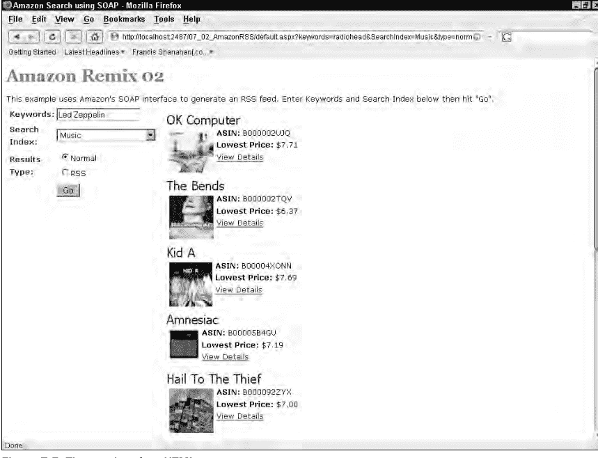

### RSS 2.0 的结构

一个给定的 RSS 2.0 文档或订阅源由两个主要部分组成：一个 channel 和一个或多个 item。channel 定义了订阅源的内容、标题、发布日期等。它类似于你电视上的一个频道。item 代表实际内容。每个 item 可能包含特定新闻项目的详细信息，或者在本例中，是一些产品信息。

> RSS 文档通常被称为“RSS 订阅源”。

清单 7-5 展示了一个示例 RSS 文档。

### 清单 7-5：示例 RSS 文档

```xml
<?xml version="1.0" encoding="utf-8"?>
<rss version="2.0">
  <channel>
    <title>Francis Shanahan[.com]</title>
    <link>http://www.FrancisShanahan.com/</link>
    <description>Blog feed of Francis Shanahan[.com]</description>
    <copyright>Copyright 1999-2007 Francis A. Shanahan</copyright>

    <item>
        <title>Man Bites Dog!</title>
        <link>http://www.FrancisShanahan.com/detail.aspx?cid=1003</link>
        <description>
            In today's news a hungry man grabbed a passing dachshund. Horror ensued.
        </description>
        <pubDate>Wed, 3 Jun 2006 12:00:00 GMT</pubDate>
    </item>

    <item>
        <title>Weird Dream</title>
        <link>http://www.FrancisShanahan.com/detail.aspx?cid=1002</link>
        <description>
            Last night I had a weird dream about a man biting a dog.
        </description>
        <pubDate>Tue, 2 Jun 2006 11:00:00 GMT</pubDate>
    </item>

    <item>
        <title>Really Hungry</title>
        <link>http://www.FrancisShanahan.com/detail.aspx?cid=1001</link>
        <description>
            God I'm so hungry. I could really go for some food.
        </description>
        <pubDate>Mon, 1 Jun 2006 10:00:00 GMT</pubDate>
    </item>
  </channel>
</rss>
```

清单 7-5 显示了一个典型的 RSS 订阅源，包含一个 channel 元素和多个 item 元素。该 channel 有一个标题、链接、描述和版权声明。此文档中有三个 item 元素；每个都包含一个`pubDate`或发布日期、一个描述、一个指向单独故事的链接和一个标题。

> 请记住，RSS 代表“Really Simple Syndication”（真正简单的联合发布）。它源于对内容（通常是新闻标题或故事）进行联合发布的需求。因此，有效 RSS 中的元素围绕讲故事和新闻标题展开。

下表描述了 RSS channel 的必需 XML 元素。

| 元素名称 | 描述 |
| --- | --- |
| `title` | RSS 订阅源的名称。 |
| `link` | 提供订阅源的网站的链接。 |
| `description` | 订阅源内容的描述。 |

这些是必填字段。没有它们，你的 RSS 订阅源就是无效的。当然，你可能还想考虑添加其他元素，以确保订阅源能被用户轻松理解；例如，订阅源的母语、发布日期或联系电子邮件地址。

item 元素也有许多必填和可选字段。下表描述了 item 元素的必需和可选元素。

| 元素名称 | 描述 |
| --- | --- |
| `title` | 项目的名称。 |
| `link` | 提供该项目的网站的链接。 |
| `description` | 项目内容的摘要。 |
| `author` | （可选）通常是作者的电子邮件地址。 |
| `category` | （可选）每个项目可以分配给一个或多个类别。 |
| `comments` | （可选）指向包含该项目评论的页面的链接。 |
| `enclosure` | 指向与该项目相关的富媒体文件（如 MP3 文件）的链接。 |
| `guid` | （可选）该项目的唯一标识符。 |
| `pubDate` | （可选）项目发布日期。 |
| `source` | （可选）该项目来源的 RSS channel。 |

事实证明，描述 channel 所需的元素与描述 item 所需的元素完全相同。换句话说，title、link 和 description 是全部所需。唯一的区别是元素的内容，在这里是特定于项目的。当然，额外的字段如 author 和 publication date 可以帮助读者理解数据。

有关 RSS 2.0 的完整概述，你可以参考以下 URL。

### 试一试：从头开始创建 XML 文档

.NET Framework 在`System.Xml`命名空间中提供了许多用于创建和操作 XML 的类和设施。示例代码中包含一个名为`sample_xml.aspx`的附加页面，它创建了一个简单的 XML 结构。

以下步骤将引导你了解`sample_xml.aspx`网页背后的代码。

1. 创建一个名为`sample_xml.aspx`的新页面。

在`Page_Load`事件中添加以下代码，该代码会清除响应流并告知浏览器预期内容类型为 XML。

## 第 7 章

3. 创建一个新的 XML 文档，如下所示：

`XmlDocument myXml = new XmlDocument();`

4. 使用新创建的 XML 文档创建专辑节点：

`XmlNode myAlbum = myXml.CreateNode(XmlNodeType.Element, "album", "");`

5. 为该节点创建一个新属性，同样使用 XML 文档：

`XmlAttribute albumName = myXml.CreateAttribute("title");`

`albumName.Value = "BBC Sessions";`

6. 将此属性赋值给专辑节点：

`myAlbum.Attributes.Append(albumName);`

7. 将专辑节点赋值给文档：

`myXml.AppendChild(myAlbum);`

8. 使用与之前相同的方法创建一些歌曲节点：

`XmlNode mySongA = myXml.CreateNode(XmlNodeType.Element, "song", "");`

`XmlNode mySongB = myXml.CreateNode(XmlNodeType.Element, "song", "");`

`XmlNode mySongC = myXml.CreateNode(XmlNodeType.Element, "song", "");`

`mySongA.InnerText = "Out on the Tiles";`

`mySongC.InnerText = "Achilles Last Stand";`

9. 将这些歌曲节点作为子节点添加到专辑节点：

`myAlbum.AppendChild(mySongA);`

`myAlbum.AppendChild(mySongB);`

`myAlbum.AppendChild(mySongC);`

10. 向`AmazonUtility`类添加一个新函数，用于将 XML 文档格式化为字符串：

`public static string GetStringFromXml(XmlDocument myDoc)`

```csharp
{
    StringWriter myStringWriter = new StringWriter();
    XmlTextWriter myXmlTextWriter = new XmlTextWriter(myStringWriter);

    // 将Xml文档写入字符串
    myDoc.WriteTo(myXmlTextWriter);

    string strResults = myStringWriter.ToString();
    return strResults;
}
```

此函数使用与`StringWriter`关联的`XmlTextWriter`将 XML 文档转换为字符串并返回结果。

11. 最后，写出 XML 文档：

`Response.Write(AmazonUtility.GetStringFromXml(myXml));`

`Response.End();`

## 工作原理

当你运行`sample_xml`页面时，会产生以下 XML 结构：

```xml
<album title="BBC Sessions">
    <song>Out on the Tiles</song>
    <song />
    <song>Achilles Last Stand</song>
</album>
```

这是一个包含四个节点的文档，第一个（或根）节点是一个专辑元素，具有单个属性（一个值为“BBC Sessions”的标题）。专辑节点本身包含三个其他的歌曲节点。第一首和第三首歌曲的内部文本已被赋值。

然而，第二首歌曲节点未被赋值，因此它是一个自闭合元素。此优化是由框架完成的，这是使用`System.Xml`类相对于使用字符串拼接创建此 XML 的一个优势。

还要注意，节点添加的顺序无关紧要。歌曲节点是在专辑节点被添加到 XML 文档之后才添加到专辑节点中的。然而，所有节点都出现在了输出中。

### 动手试试：输出 RSS

在这个“动手试试”示例中，你将构建 RSS 输出。你将创建一个包含 RSS 数据的 XML 文档，将其转换为字符串，然后使用`Response`对象将其流式传输到浏览器。

1. 首先，向`AmazonUtility`类添加一个名为`FormatAsRSS`的新函数。此函数将从`GetResultsFromResponse`内部调用，以将 Amazon 响应格式化为 RSS。此函数首先创建频道信息，然后遍历结果集以创建新的 RSS item 节点。

清单 7-6 显示了`FormatAsRSS`的代码。

### 清单 7-6：FormatAsRSS 函数


```csharp
...
using System.Xml;
...
public static class AmazonUtility
{
    /// <summary>
    /// 返回特定 Amazon Item 的 RSS XML
    /// </summary>
    /// <param name="myItems">Items 实例</param>
    /// <returns>一个 XML 字符串</returns>
    public static string FormatAsRSS(Items myItems)
    {
        XmlDocument myDoc = new XmlDocument();

        // 创建根 RSS 节点
        XmlNode myRSS = myDoc.CreateNode(XmlNodeType.Element, "rss", "");

        // 添加版本属性
        XmlAttribute rssVersion = myDoc.CreateAttribute("version");
        rssVersion.Value = "2.0";
        myRSS.Attributes.Append(rssVersion);

        // 创建一个名为 "channel" 的新元素节点
        XmlNode channel = myDoc.CreateNode(XmlNodeType.Element, "channel", "");

        // 创建一个名为 "title" 的新元素节点
        XmlNode title = myDoc.CreateNode(XmlNodeType.Element, "title", "");
        title.InnerText = "First Amazon Remix";

        // 创建一个名为 "link" 的新元素节点
        XmlNode link = myDoc.CreateNode(XmlNodeType.Element, "link", "");
        link.InnerText = "http://www.FrancisShanahan.com/";

        // 创建一个名为 "description" 的新元素节点
        XmlNode description = myDoc.CreateNode(XmlNodeType.Element, "description", "");
        description.InnerText = "Amazon results through RSS 2.0";

        // 添加频道特定的元素
        channel.AppendChild(title);
        channel.AppendChild(link);
        channel.AppendChild(description);

        // 遍历
        foreach (Item myItem in myItems.Item)
        {
            // 为每个 item 创建一个新的 item 节点
            XmlNode myNode = CreateRSSItem(myDoc, myItem);

            // 将结果 item 追加到 channel
            channel.AppendChild(myNode);
        }

        // 最后将 channel 和 RSS 节点追加
        myRSS.AppendChild(channel);
        myDoc.AppendChild(myRSS);

        return GetStringFromXml(myDoc);
    }
}
```

## 2. 添加 `CreateRSSItem` 函数

接下来，添加另一个新函数 `CreateRSSItem`，以依次解析每个 item。此函数接受一个 Amazon `Item`，并创建一个新的 RSS item 节点以添加到文档。新节点包含所有相关的 Amazon 产品信息，例如描述、价格等。`CreateRSSItem` 简化显示如下：

```csharp
private static XmlNode CreateRSSItem(XmlDocument myDoc, Item myItem)
{
    // 创建一个名为 "item" 的新元素节点
    XmlNode rssItem = myDoc.CreateNode(XmlNodeType.Element, "item", "");

    // 创建一个名为 "title" 的新元素节点
    XmlNode title = myDoc.CreateNode(XmlNodeType.Element, "title", "");
    title.InnerText = myItem.ItemAttributes.Title;

    // 创建一个名为 "link" 的新元素节点
    XmlNode link = myDoc.CreateNode(XmlNodeType.Element, "link", "");
    link.InnerText = myItem.DetailPageURL;

    // 创建一个名为 "description" 的新元素节点
    XmlNode description = myDoc.CreateNode(XmlNodeType.Element, "description", "");

    ...为简洁起见省略了其他详细信息...

    // 将新元素追加到此 RSS item
    rssItem.AppendChild(title);
    rssItem.AppendChild(link);
    rssItem.AppendChild(description);

    return rssItem;
}
```

## 3. 添加 `System.Xml` 命名空间

向 `AmazonUtility` 类添加一条新的 `using` 语句，以利用 `System.Xml` 命名空间。此命名空间包含 `XmlDocument` 及相关对象：

```csharp
using System.Xml;
```

## 4. 修改 `GetResultsFromResponse` 函数

你将需要修改 `GetResultsFromResponse` 函数，以允许调用者指定结果是否应以 RSS 格式提供。这可以通过一个额外的参数和一个 `if` 语句轻松实现：

```csharp
public static string GetResultsFromResponse(
    ItemSearchResponse myResponse,
    bool doRss)
{
    // 解析响应并返回结果
    if (doRss)
    { // 以 RSS 格式获取结果
        strResults += FormatAsRSS(myItems);
    }
    else
}
```

当你运行应用程序时，现在可以通过默认表单指定你是希望结果以 RSS 格式还是普通格式呈现。RSS 输出将如清单 7-7 所示。

### 清单 7-7：给定搜索的 RSS 输出示例

```xml
<rss version="2.0">
  <channel>
    <title>First Amazon Remix</title>
    <link>http://www.FrancisShanahan.com/</link>
    <description>Amazon results through RSS 2.0</description>
    <item>
      <title>Led Zeppelin IV (aka ZOSO)</title>
      <link>http://www.amazon.com/exec/obidos/redirect?...</link>
      <description>最低价格:$6.55
      ...也被称为“符文”专辑或 Zoso，因为内衬上装饰着中世纪符号，...</description>
      <pubDate>6/24/2006</pubDate>
    </item>
    <item>
      <title>Led Zeppelin II</title>
      <link>http://www.amazon.com/exec/obidos/redirect?...</link>
      <description>最低价格:$6.79...Riff 摇滚曾是 Jimmy Page 的前乐队，即...</description>
      <pubDate>6/24/2006</pubDate>
    </item>
    <item>
      <title>Houses Of The Holy</title>
      <link>http://www.amazon.com/exec/obidos/redirect...</link>
      <description>最低价格:$5.65...在...的惊人商业成功推动下</description>
      <pubDate>6/24/2006</pubDate>
    </item>
  </channel>
</rss>
```

## 使用 RSS 数据

应用程序完成后，现在是测试的时候了。首先从浏览器测试输出。运行应用程序并输入以下 URL：

`http://YourPathHere/default.aspx?Keywords=radiohead&SearchIndex=Music&type=rss`

浏览器将显示 RSS 数据，如图 7-6 所示。

有多种方法可以使用 RSS 数据，最典型的方式当然是通过 RSS 阅读器，例如 SharpReader。你可以通过以下 URL 获取 SharpReader：

`http://www.SharpReader.net`

在你的本地机器上运行应用程序后，启动 SharpReader 并输入与之前相同的 URL。SharpReader 将获取你的 XML 数据，并将其显示为类似图 7-7 的标题列表。

## 创建你的第一个 Remix

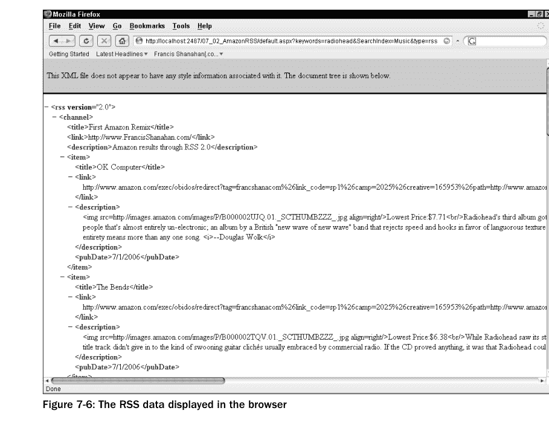

图 7-6：浏览器中显示的 RSS 数据

## 其他尝试

如果你已将应用程序部署到公共网站（例如，`http://www.FrancisShanahan.com`），并且它不再在你的本地 Web 服务器上运行，你可以使用任何支持 RSS 2.0 的 RSS 阅读器来订阅此源。这包括像 Google Reader、Start.com 或 Live.com 这样的网站。

要将源添加到 Start.com，请在浏览器中打开 Start.com 网站，并确保左侧菜单已显示。点击“Add Feeds and Gadgets”，然后在文本区域中输入你的应用程序 URL。提交表单后，Start.com 网站会将其作为新源添加到你的配置文件中。结果会定期自动刷新。

## 验证 RSS

如前所述，RSS 是一种规范，因此，格式良好的 RSS 文档应遵循特定的 XML 架构。为了确保你的应用程序生成符合 RSS 架构规则的 XML，你可以使用许多免费的 RSS 验证器来验证你的源。尝试访问 `http://www.feedvalidator.org`，输入你的源，然后点击“OK”。该网站会检查你的 RSS 文档格式，以确保你准确地实现了规范。任何错误或与官方 RSS 架构的偏差都会被该网站高亮显示，并提供如何纠正这些错误的建议。

## 在不同区域搜索

如前所述（在构建 Amazon SOAP 代理时），根据你希望搜索的区域，有多种 WSDL 端点可用。这里还有一点需要说明，你可以在不修改代码的情况下，重用你创建的代码来搜索不同的区域。换句话说，你本示例是针对美国区域编写的，但只需进行简单的配置更改，就可以将应用程序代码指向英国（UK）、法国（FR）或日本（JP）（图 7-8）的数据库。

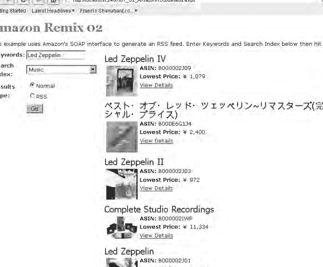

图 7-8：显示日本数据的 Amazon Remix

当你向项目添加 Web 引用时，Visual Studio 生成了 Web 代理类。此外，一个应用程序设置被添加到 `web.config` 文件中。该设置如下所示：

```xml
<appSettings>
    <add key="com.amazon.webservices.AWSECommerceService"
        value="http://soap.amazon.com/onca/soap?Service=AWSECommerceService"/>
</appSettings>
```

通过修改 Web 服务键的值，你可以将整个代理类指向一个新的区域。将值更改为以下内容：

```xml
<appSettings>
    <add key="com.amazon.webservices.AWSECommerceService"
        value="http://soap.amazon.co.uk/onca/soap?Service=AWSECommerceService"/>
</appSettings>
```

此更改将代理指向英国区域。当运行应用程序时，产品和价格将从英国数据库中显示，并使用英镑。

因为这是一个配置设置，你可以在不停止应用程序和不重新编译应用程序的情况下更改此设置。尝试运行应用程序，然后在保持浏览器打开的同时更改值。在浏览器中选择“刷新”将带回一组相应格式的新结果。

下表详细列出了按区域划分的有效端点。请注意，这与之前详细说明 WSDL 端点的表格不同。

| 区域 | WSDL 端点 URI |
| --- | --- |
| US | `http://soap.amazon.com/onca/soap?Service=AWSECommerceService` |
| UK | `http://soap.amazon.co.uk/onca/soap?Service=AWSECommerceService` |
| DE | `http://soap.amazon.de/onca/soap?Service=AWSECommerceService` |
| JP | `http://soap.amazon.co.jp/onca/soap?Service=AWSECommerceService` |
| FR | `http://soap.amazon.fr/onca/soap?Service=AWSECommerceService` |
| CA | `http://soap.amazon.ca/onca/soap?Service=AWSECommerceService` |

> 日本区域（图 7-8）使用特殊字符集来显示日元货币符号。这在现有代码中不会显示，你可能需要将页面的字符集设置为与默认值不同。

## 其他尝试想法

如前所述，RSS 无处不在。你可以考虑进一步扩展此示例，提供一种排序数据的方法，或者在简单指定关键词和搜索索引之外进一步细化搜索条件。

我还建议探索 Internet Explorer 7 版本和即将发布的 Windows Vista 中可用的 RSS 功能。Vista 包含对 RSS 和源管理的广泛支持，包括一个新的边栏小工具，可以常规地获取和显示 RSS 并导航到桌面。

## 总结

在本章中，你构建了你的第一个 Amazon remix。你构建了两个完整的应用程序，每个都利用 Amazon 的数据使用 SOAP。在此过程中，你学习了许多 Web 服务技术的方面，包括以下内容：

- 如何为给定的 WSDL 端点创建 SOAP 代理
- 如何在 `web.config` 文件中存储配置数据
- 如何遍历 Amazon 搜索结果集
- RSS 的结构
- 如何从头构建 XML 文档

在第 8 章中，你将运用所学知识构建你的第一个真正的混搭应用。第 8 章将雅虎搜索结果集成到 Amazon 示例中，并演示如何使用 .NET Framework 进行 REST API 调用。

在继续之前，请尝试以下练习，以测试你对本章内容的理解。你可以在附录 B 中找到这些练习的解答。

## 练习

以下问题将测试你对本章内容的掌握程度。

1. 你如何轻松更改 Amazon `SOAP` 代理使用的区域（例如，搜索英国产品列表而不是美国列表）？
2. 如何使用 C# 创建 `XMLDocument`？
3. 如何使用 Amazon SOAP 接口构建针对 Amazon 的搜索查询？
4. 在 ASP.NET 网站中，你可以将配置信息存储在哪里？

## 第三部分：混搭应用

本部分包括：

- 第 8 章：构建你的第一个混搭应用
- 第 9 章：让浏览器发挥作用
- 第 10 章：一个由 Ajax 驱动的愿望清单
- 第 11 章：我们开始吧！
- 第 12 章：一个使用 JSON 的客户浏览器
- 第 13 章：提升性能
- 第 14 章：Amazon 移动版
- 第 15 章：使用 Amazon S3 的通用存储解决方案
- 第 16 章：更多创意

# 构建你的第一个混搭应用

既然你已经征服了你的第一个 remix，工具已经就绪，可以着手构建你真正的混搭应用了。在本章中，你将首次同时使用 Amazon 和 Yahoo 的 REST API。

你将学习两种将结果数据绑定到表示层的独立技术。第一种使用 ASP.NET Repeater；第二种使用标准 HTML。你将学习如何使用两者，并在此过程中创建一个出色的混搭应用。

本章的技术将教你如何执行以下操作：

- 使用 C# 调用 REST 风格的 API
- 将 ASP.NET 服务器控件转换为传统 HTML


- 将数据绑定到 `Repeater` 控件
- 使用 `HTTP GET` 在浏览器中构建一个迷你浏览器
- 将 Amazon 和 Yahoo 的 XML 数据合并到单个文档中

## 战略规划：雅虎加上亚马逊

在这个混搭应用中，你将构建一个搜索界面，可以在同一屏幕上搜索雅虎和亚马逊。源数据将被整合成单个 XML 文档，并转换为 XHTML。结果将以标准的搜索结果类型表格呈现给用户。

### 理解架构

在第 7 章中，你使用 SOAP 从 Amazon 请求和检索数据。在本章中，你将使用 REST 风格的接口。图示显示了各方之间数据流中涉及的各种元素。

## 第 8 章：工作原理

如图 8-1 所示，此混搭应用涉及不少步骤。所幸，每一步都相对简单，不应带来任何问题：

1. 浏览器以常规方式，即 `HTTP GET`，请求页面。
2. 服务器处理此请求，并按要求构建 `default.aspx` 页面。
3. 构建好的页面（完全是 HTML，本例中不含 JavaScript）被流式传输到浏览器。
4. 用户输入几个搜索关键词，然后点击提交。
5. 页面表单被提交到服务器。
6. Web 服务器处理这个新请求，并意识到还有更多工作需要完成。
7. 步骤 4 中输入的关键词被用作向 Amazon API 发起 REST 风格请求的一部分。
8. Amazon 以 XML 格式返回结果。
9. 服务器现在向 Yahoo 发起一个 REST 风格的调用。
10. Yahoo 也返回其自己的 XML 数据。
11. Web 服务器现在将这两个结果合并到一个 XML 文档中，并使用可扩展样式表语言转换（XSLT）将该文档转换为一段 XHTML。这段 XHTML 被插入到页面中。
12. 页面再次被加载，这次带有结果内容。页面显示时包含了搜索结果。

在第 7 章中，你使用 SOAP 从 Amazon 检索了一些数据。在本章中，你将从 Yahoo 接口开始，它使用 REST 风格的 API。

## 实现方法

由于此混搭应用有两个数据源（Amazon 和 Yahoo），最简单的方法是为每个数据源独立构建一个接口。这种分步方法使开发变得容易得多。一旦你让每个接口独立工作，你就可以将它们合并在一起。

在本章的第一个练习中，你将构建 Yahoo 接口。理解从互联网检索混搭数据并呈现的多种方式非常重要。本章将探讨两种方法。

第一种技术将使用 REST 检索 Yahoo 数据，然后将该数据绑定到 ASP.NET 的 `Repeater` 控件，类似于第 4 章的 `GridView` 示例。不同之处在于，数据来自远程源，而不是本地 XML 文件。

第二种技术将使用一种非 ASP.NET 特定的机制来检索 Amazon 数据，该机制使用标准 HTML 控件和通用的 REST 接口。

最后，这两个示例将被合并在一起，生成一组整合的结果，从而完成你的第一个混搭应用。

## Yahoo 搜索的用户界面

客户端界面的复杂程度取决于你希望它如何设计。为了清晰起见，我将保持简单，使用图 8-2 中的表单。

界面很简单，包含一个用于输入搜索关键词的 `TextBox` 和一个用于执行搜索的 `Button` 控件。你应该使用 ASP.NET 服务器控件来构建此界面，而不是 HTML 控件。

你将在本章后面构建的 Amazon 接口将使用纯 HTML 控件，因此可能被视为更具“技术无关性”。实际上，混搭应用并没有必要必须使用 ASP.NET，我的任务只是展示各种可能性。作为开发者，你需要根据具体情况选择正确的方法。

## `Repeater` 控件

在第一个示例中，你将在 ASP.NET 的 `Repeater` 控件中显示来自 Yahoo 的结果。`Repeater` 是比你在第 4 章使用的 `GridView` 轻量得多的控件。确保页面在设计视图中打开，然后将一个 `Repeater` 拖放到页面上：

```aspx
<asp:Repeater ID="Repeater1" runat="server" DataSourceID="">
</asp:Repeater>
```

此标记被添加到页面中，只是实例化一个基本的 `Repeater`。通常，你会将此控件绑定到页面上的数据源，就像你在第 4 章所做的那样。然而，在这种情况下，数据源将是 Yahoo 的 XML 响应，在运行时之前并不存在。在之前的标记中，`DataSourceID` 被设置为空。因此，在设计时没有可以绑定的内容，从而没有设计时绑定支持。

图 8-2：设计时的 Yahoo 客户端界面

`Repeater` 控件通过允许你按照下表定义各种模板来工作。

| 模板名称 | 描述 |
|---|---|
| `HeaderTemplate` | 渲染的 `Repeater` 中的第一行。用于定义标题或打开 HTML `table` 标签。 |
| `ItemTemplate` | 主模板，用于将数据绑定到控件。 |
| `AlternatingItemTemplate` | 类似于 `ItemTemplate`，提供了一种为提高清晰度而格式化交替行的机制。 |
| `FooterTemplate` | 与 `Header` 相反。 |
| `SeparatorTemplate` | 出现在各项之间，同样便于格式化。 |

每个模板都可以绑定到底层数据源中的数据元素。模板结构在数据绑定方式上提供了极大的灵活性，生成的标记比使用 `GridView` 渲染的等效内容轻量得多。

你可以尝试使用 `GridView` 创建相同的屏幕进行比较。

定义一个 `HeaderTemplate` 如下：

```aspx
<HeaderTemplate>Yahoo Web Search Results</HeaderTemplate>
```

接下来是主 `ItemTemplate`，如下所示：

```aspx
<ItemTemplate>
    <b><%# DataBinder.Eval ( Container.DataItem, "Title" ) %></b><br />
    <a href="<%# DataBinder.Eval ( Container.DataItem, "ClickUrl" ) %>"><%# DataBinder.Eval ( Container.DataItem, "Url" ) %></a><br />
    <%# DataBinder.Eval ( Container.DataItem, "Summary" ) %>
</ItemTemplate>
```

查看这段代码，你会看到 `ItemTemplate` 声明。在 `ItemTemplate` 内部有几个 `DataBinder` 语句。每个 `DataBinder` 表达式采用以下形式：

```aspx
<%# DataBinder.Eval( Container.DataItem, "COLUMN_NAME" ) %>
```

`COLUMN_NAME` 是要显示的数据项的名称。当你执行此操作并成功绑定到数据源时，`DataBinder` 表达式将被该数据源中的相关数据替换。根据 Yahoo API 文档，列名 `"Title"`、`"ClickUrl"`、`"Url"` 和 `"Summary"` 在 Yahoo API 的 XML 响应中已指定。

你还可以定义一个 `AlternatingItemTemplate`，它应该使用与 `ItemTemplate` 相同的标记。你应该修改此标记，例如使用不同的背景色，以便 `Repeater` 中的每一行都将以高亮显示。这为用户提供了有用的视觉提示，极大地增强了可读性。

`SeparatorTemplate` 在此处省略了，但它通常只是一个简单的 HTML 水平行，如下所示：

```aspx
<SeparatorTemplate><hr /></SeparatorTemplate>
```

`separator` 插入在每个 `item` 和 `alternatingItemTemplate` 之间。

这就完成了客户端页面的标记。接下来是页面背后的逻辑。

## 通过 REST 查询 Yahoo

在下一节中，你将把注意力转向此网页的代码隐藏文件。你将实现到 Yahoo 的 REST 接口，并学习如何将生成的 XML 转换为可绑定到 `Repeater` 的数据集。

## Yahoo REST URI 示例

这里有一个简单的实验。将你的 Yahoo 开发者应用 ID 插入以下 URL，然后尝试将结果粘贴到浏览器中：

```text
http://api.search.yahoo.com/WebSearchService/V1/webSearch?appid=<INSERT YOUR APP ID HERE>&query=cream&results=10&start=1
```

> 这一点很重要。你需要插入自己的应用 ID 才能使此 URI 正常工作。我不能分发我的个人应用 ID，因为这违反了 Yahoo 开发者网络的政策。这也适用于本书中使用的所有 API。

当你将此或*任何 URL*粘贴到 Web 浏览器中时，浏览器会向该 URI 发出称为 `HTTP GET` 的请求。结果是从 Yahoo 网络直接提供的 XML 文件。你可以尝试修改查询关键词，但响应将类似于清单 8-1。

## 清单 8-1：Yahoo 结果示例

```xml
<ResultSet xsi:schemaLocation="urn:yahoo:srch http://api.search.yahoo.com/WebSearchService/V1/WebSearchResponse.xsd" totalResultsAvailable="93100000" totalResultsReturned="2" firstResultPosition="1">
  <Result>
    <Title>...</Title>
    <Summary>...</Summary>
    <Url>...</Url>
    <ClickUrl>...</ClickUrl>
    <ModificationDate>...</ModificationDate>
    <MimeType>...</MimeType>
    <Cache>
      <Url>...</Url>
      <Size>...</Size>
    </Cache>
  </Result>
</ResultSet>
```

文档节点本身当然会包含实际数据，但为了清晰起见，我已省略了这些数据。

请注意 `"Title"`、`"ClickUrl"`、`"Url"` 和 `"Summary"` 节点的存在。它们将成为列，并且已经在 `Repeater` 控件中指定了用于数据绑定。

> 这是来自 Web 搜索 API 的预期数据示例。从中，你可以清楚地读取 XML 模式的结构。这种在浏览器中发出 URI 调用以获取测试数据的方法，在调试混搭应用时是一项有用的技术，并且适用于所有支持 `HTTP GET` 的 REST 风格接口。

Yahoo 为其每个 API 都有特定的 URI。此示例使用 Web 界面，但你可以搜索图片、音频、电影等。有关 Yahoo 可用数据的更多详细信息，请参阅第 5 章。

## 构建你的第一个混搭应用

在继续之前，你应该先回顾一下请求的结构：

- 首先是 Yahoo 服务器的路径：`http://api.search.yahoo.com/`
- 然后是你需要的 API（本例中为 `webSearch`）：`WebSearchService/V1/webSearch`
- 最后是 `Querystring`，它出现在给定 URI 中问号之后的部分：`?appid=<INSERT YOUR APP ID HERE>&query=cream&results=10&start=1`

其分解说明如下表所示。

| Querystring 键名 | 说明 |
|---|---|
| `Appid` | 应用程序 ID，所有 Yahoo API 调用均需此项。 |
| `query` | 搜索关键词。 |
| `results` | 要检索的结果数量。 |
| `start` | 开始返回结果的位置。如果你要实现结果集的分页，此项非常有用。 |

## 动手实践：用 C# 构建一个迷你浏览器

如果浏览器能做到，你也可以。即使要构建最基本的混搭应用，你也必须能够在 C# 代码中发出 GET 请求。幸运的是，.NET Framework 提供了一套全面的类来完成这项任务。在本示例中，你将构建一个简单的页面，它可以检索你指定的任何 URI 并显示结果。这个简单的代码将在本章稍后用于从 Yahoo 检索 XML 时被复用。

1. 创建一个包含单个页面 `default.aspx` 的新网站。
2. 打开 `default.aspx`，将一个文本框拖到页面上。将其重命名为 `txtUri`。
3. 将一个按钮拖到页面上，并将其重命名为 `cmdGo`。
4. 将一个 `Literal` 控件拖到页面上，并将其命名为 `myLiteral`。
5. 双击该按钮以打开控件的代码隐藏文件。
6. 在 C# 文件的顶部添加以下两个 `using` 语句：

```csharp
using System.Net;
using System.IO;
```

这些语句是必需的，因为 `HttpWebRequest` 和 `HttpWebResponse` 类都包含在 `System.Net` 命名空间中。`Stream` 类位于 `System.IO` 命名空间中。

7. 在 `cmdGo_Click` 事件处理程序中输入以下代码：

```csharp
protected void cmdGo_Click(object sender, EventArgs e)
{
    HttpWebRequest myRequest = (HttpWebRequest)WebRequest.Create(this.txtUri.Text);
    HttpWebResponse myResponse = (HttpWebResponse)myRequest.GetResponse();
    Stream myResponseStream = myResponse.GetResponseStream();
    StreamReader myReader = new StreamReader(myResponseStream);

    this.myLiteral.Text = ((StreamReader)myReader).ReadToEnd();
}
```

8. 按 F5 或点击“播放”来运行项目。如果提示要向项目中添加 `web.config`，请选择“是”来添加一个。
9. 应用程序启动后，在文本框中输入一个 URI（例如，`www.amazon.com`），然后点击 Go。页面会将你请求的页面加载到 `Literal` 控件中，然后刷新，应该如图 8-3 所示。

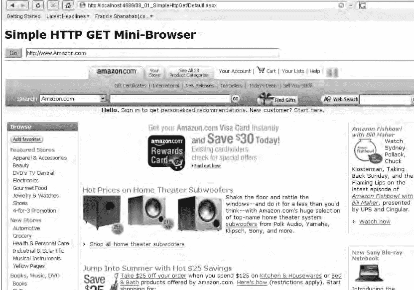

图 8-3：运行中的迷你浏览器

## 工作原理

本示例的代码非常简单。当用户点击 Go 时，页面返回到服务器，`cmdGo` 按钮的 `Click` 事件触发。使用用户在表单中输入的 URI 创建一个新的 `HttpWebRequest` 对象：

```csharp
HttpWebRequest myRequest = (HttpWebRequest)WebRequest.Create(this.txtUri.Text);
```

接下来，请求实际被执行，这意味着应用程序出去检索请求中指定的 URI：

```csharp
HttpWebResponse myResponse = (HttpWebResponse)myRequest.GetResponse();
```

此时，你已经获得了一个有效的 `HttpWebResponse`。响应本身还不包含请求的内容，这需要使用 `GetResponseStream()` 方法来检索。`GetResponseStream` 返回一个 `Stream`，然后可以用来从服务器读取响应的主体：

```csharp
Stream myResponseStream = myResponse.GetResponseStream();
```

使用 `StreamReader` 读取响应流：

```csharp
StreamReader myReader = new StreamReader(myResponseStream);
```

最后要做的事就是简单地从响应流中读取 HTML：

```csharp
this.myLiteral.Text = ((StreamReader)myReader).ReadToEnd();
```

### Yahoo 的代码隐藏文件

现在你已经成功检索到了 HTML，可以使用相同的代码从 Yahoo 检索 XML 了！如果你构建了迷你浏览器示例，现在是时候切换回 Yahoo 代码库了。

> 在 ASP.NET 1.1 中，页面背后的代码完全是一个独立的类，因此得名“代码隐藏”。页面的 ASPX 部分在运行时将 C# 代码隐藏类作为子类来创建一个新类。在 ASP.NET 2.0 中，与页面关联的代码文件实际上是一个分部类，由 ASPX 文件和 C# 外部文件共享。因此，ASP.NET 2.0 的代码文件被称为“代码旁置”，但我仍然沿用原来的术语。

### 添加通用帮助类

之前，你写了一个小代码来获取任意 Web URI 并将其转换为字符串。这非常有用，所以你应该将其放入自己的类中以供复用。

右键单击项目并添加一个新项，一个名为 `WebUtility.cs` 的类。Visual Studio 会提示将此类存储在名为 `App_Code` 的特殊子文件夹中。这很合理，因为该类本身与任何特定页面都没有关联。这种方法有助于保持项目的条理性，使代码组织有序（清单 8-2）。

## 清单 8-2：新的 `WebUtility` 类


```csharp
using System;
using System.Xml;
using System.Net;
using System.IO;
using System.Text;
using System.Configuration;
using System.Xml.Xsl;
using System.Collections.Specialized;

/// <summary>
/// 简单的帮助类，包含许多有用的混搭功能
/// </summary>
public static class webUtility
{
    static webUtility()
    {
    }

    /// <summary>
    /// 使用 HTTP GET 检索 Uri 并将结果作为 XML 返回
    /// </summary>
    /// <param name="strURL">要检索的 Uri</param>
    /// <returns>Xml 文档结果</returns>
    public static XmlDocument GetUri(string strURI){

        // 创建请求对象
        HttpWebRequest myRequest = 
        (HttpWebRequest)WebRequest.Create(strURI);

        // 从服务器获取响应
        HttpWebResponse myResponse = (HttpWebResponse)myRequest.GetResponse();
        Stream myResponseStream = myResponse.GetResponseStream();

        // 将结果加载到 XML 文档中
        XmlDocument myDoc = new XmlDocument();
        myDoc.Load(myResponseStream);

        // 返回 XML 文档
        return myDoc;
    }
}
```

由于这是一个帮助类，不会存储自己的数据，因此将其设为静态是个好主意。静态类不需要实例化。这是一种很好的编码便利，并且符合该类所提供的功能的性质。

> 当你有静态类时，在运行时就只会有一个该类的实例可用。这种模式被称为*单例设计模式*。在高性能环境中使用静态类时要小心，因为如果多个线程试图访问同一个实例，它们可能会相互竞争。

你可以通过在类定义中添加`static`关键字来使类变为静态：

```csharp
public static class webUtility
```

注意`GetUri`函数底部以下两行额外的代码：

```csharp
// 将结果加载到 XML 文档中
XmlDocument myDoc = new XmlDocument();
myDoc.Load(myResponseStream);
```

这些代码在返回之前将响应流转换为`XmlDocument`。这对于转换数据来说更有用（正如你将看到的）。当然，在实验中，你可能会考虑制作一个此函数的副本，让它直接返回字符串。字符串更容易处理，但更难以转换。XML 则非常适合转换。

现在你有了一个非常有用的小帮助函数。这个`WebUtility`类将在随后的许多章节中被复用。

## 将 XML 文档转换为 DataSet

`DataSet`是 ADO.NET 中数据访问所涉及的主要类。与 ADO `Recordset`不同，ADO.NET `DataSet`是**断开连接**的，这意味着它们不会与数据源保持实时连接。`DataSet`将其数据序列化为 XML，这使得序列化和反序列化数据变得非常容易和有用。

> "*序列化*"是指获取一个对象并将其所有数据转换为字符串。为什么要这样做？对象存在于内存中。要存储该对象，你需要某种方式来检查其状态（即所有数据元素）并保存它们。这就是序列化。"*反序列化*"则正好相反，是将字符串实例化为对象。此处的字符串通常是 XML 数据，尽管你会在后面的章节中发现它可能采用其他形式（例如，JSON）。

如果你有一个 XML 文档，可以很容易地从 XML 填充`DataSet`，如下所示：

```csharp
XmlNodeReader myReader = new XmlNodeReader(myDoc);
DataSet ds = new DataSet();
ds.ReadXml(myReader);
```

此代码基于`XmlDocument`（即`myDoc`）创建一个`XmlNodeReader`。然后实例化一个新的`DataSet`，它一开始是空的，但在最后一行代码中使用原始 XML 文档进行填充。

在`Submit`按钮的背后，你需要执行以下操作：

1. 获取 Yahoo REST API 响应。
2. 将其转换为 XML 文档。
3. 使用该 XML 文档作为数据源填充`DataSet`。
4. 将`DataSet`绑定到`Repeater`控件以显示结果。

清单 8-3 展示了`Submit`按钮背后的代码，实现了这些步骤。

## 第 8 章

### 清单 8-3：提交按钮的事件处理器

```csharp
protected void Submit1_ServerClick1(object sender, EventArgs e)
{
    string strKeywords = this.Text1.Value;

    if (strKeywords != "")
    {
        XmlDocument myDoc = 
            webUtility.GetUrl("http://api.search.yahoo.com/WebSearchService/V1/webSearch?appid=<INSERT YOUR APP ID HERE>&query=" + strKeywords + "&results=10&start=1");

        XmlNodeReader reader = new XmlNodeReader(myDoc);
        DataSet ds = new DataSet();
        ds.ReadXml(reader);
        this.Repeater1.DataSource = ds.Tables[1].DefaultView;
        Repeater1.DataBind();
    }
}
```

运行应用程序，在文本框中输入关键词或搜索词，然后点击按钮。如果一切正常，页面将自动刷新，并在`Repeater`控件中显示一组结果，如图 8-4 所示。

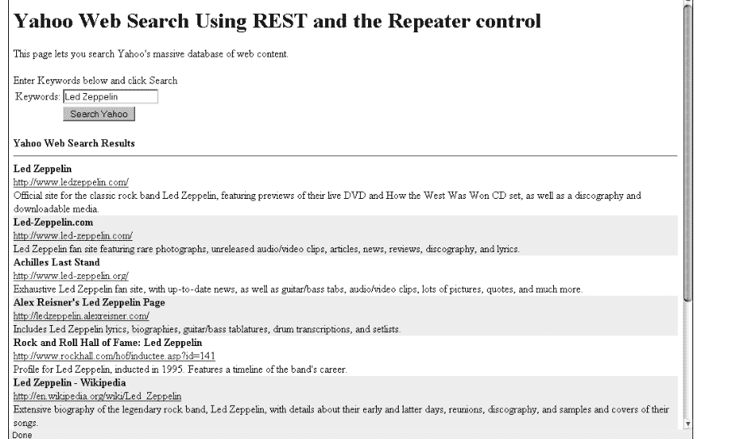

图 8-4：运行中的 Yahoo Repeater 示例

## 构建你的第一个 Mashup

请反复尝试此部分，直到你对这里的操作了然于胸。本质上，你已经实现了与第 7 章相同的结果，只是这次采用了不同的方法。

这种 REST/XML/`DataSet`方法的优点在于，结果的展示完全基于`Repeater`控件。你无需重新编译应用程序，就可以修改结果的呈现方式或样式。

恭喜！你已经完成了第一个 Mashup 的 50%！Yahoo 部分已完成，现在该将注意力转向亚马逊了。记住，你只是希望同时搜索两个网站，并返回合并的结果列表。在下一节中，你将重用`WebUtility`辅助类来获取亚马逊搜索结果的`XmlDocument`。

## 亚马逊客户端用户界面

在上一节中，你使用 ASP.NET 服务器控件构建了一个完全正常的搜索界面。在本节中，你将构建相同的界面，但使用纯 HTML 控件。如果你希望重用 Yahoo 界面，你可以自由这样做，但我想指出，构建 Mashup 并非必须使用 ASP.NET 服务器控件。

转换 Yahoo 示例的最简单方法是获取页面的 HTML 源代码，并从`form`元素中移除`runat=server`属性：

```html
<body>
    <form id="form1" runat="server"></form>
    <h1>
        Amazon + Yahoo</h1>
    This page lets you search Amazon and Yahoo at the same time!!!<br />
    <br />
    Enter Keywords, Search Index and click Go.
    <form action="default.aspx" method="get" target="_blank">
        <table>
            <tr>
                <td>Keywords: </td>
                <td><input type=text value="Zeppelin" name="Keywords" /></td>
            </tr>
            <tr>
                <td>Search Index: </td>
                <td>
                    <select name=SearchIndex>
                        <option value="Blended">All</option>
                        <option value="Electronics">Electronics</option>
                        <option value="Music" selected>Music</option>
                        <option value="DVD">DVD</option>
                        <option value="Books">Books</option>
                        ...
                    </select>
                </td>
            </tr>
            <tr>
                <td>
                </td>
                <td>
                </td>
            </tr>
        </table>
        <input type=submit name="Go" value="Go" id="Submit1"/>
    </form>
</body>
```

在这个表单的 HTML 代码中，有几点需要注意。首先，ASP.NET 服务器`form`是空的。每个 ASP.NET 页面都需要一个服务器`form`，因此你不能删除这个标签，但没有任何规定阻止你将其留空。

其次需要注意的是添加了驱动此示例的 HTML`form`。此`form`设置为使用`GET`方法提交，其`action`设置为页面的名称。最后，清单底部的 ASP.NET`Literal`控件将存储搜索结果。

## XSL 转换

使用可扩展样式表语言（XSL）样式表转换数据是一种强大的数据操作技术，你将在你的 Mashup 中反复使用它。这是你第一次遇到它，所以我们将在这次首次转换上花一些额外的时间。

## XSL 概念概述

XSL 通过检查源文档、查找模式，然后根据包含在 XSL 样式表中的一组规则提供输出，将 XML 文档从一种形式转换为另一种形式。

XSLT 的核心是模板（template）。一个`template`是一种指定模式并告诉 XSL 处理器“每当你看到这个模式时，执行以下操作”的方式。

如果你检查一个简单的 XSL 模板，它看起来像这样：

```xml
<xsl:template match="/">
  <!-- Do something -->
</xsl:template>
```

此模板在查找底层文档的根节点。匹配值（在这种情况下是斜杠“/”）是一个 XPath 表达式，用于匹配 XML 文档的一部分：

```xml
<xsl:template match="Title">
  <!-- Do something -->
</xsl:template>
```

此模板匹配“Title”节点。

这些元素中的`xsl:`部分仅表示此`template`标签是 XSL 命名空间的一部分。`xsl:`实际上是一个命名空间前缀，如`xsl:stylesheet`标签中所指定的。

用非 XML/XSL 术语重新表述，这意味着“每当在元素中看到`xsl:`时，其后的元素就属于`http://www.w3.org/1999/XSL/Transform`模式”。

## 指定 XSL 输出类型

当你执行转换时，最终会得到另一个文档，通常是 XML 文档，但它可以是 HTML、文本或几乎任何东西。你可以使用`<xsl:output>`节点轻松地将输出指定为 HTML，如下所示：

```xml
<xsl:output method="html"/>
```

## 使用命名空间的精确 XPath

要获取特定 XML 节点的值，请使用`<xsl:value-of>`元素。此元素包含一个属性，用于指定要输出的 XML 节点。以下语句将输出“Title”节点的值：

```xml
<xsl:value-of select="Title" />
```

这与以下内容不同：

```xml
<xsl:value-of select="n:Title" />
```

在第二个示例中，元素名称“Title”带有命名空间前缀`n:`。你必须回溯文档树以找到指定`n:`前缀代表哪个命名空间的`xmlns`命名空间声明。

在这种情况下，你可能会找到以下内容：

```xml
xmlns:n="urn:yahoo:srch"
```

这就是 XML 限定元素范围的方式。如果没有范围限定，如果两个 XML 文档使用相同的节点名（例如“Title”），并且这些文档被合并到一个文档中，则无法指定你想要哪个特定节点。

有了命名空间，你可以准确地指定你正在寻找的节点。请记住，即使你看不到命名空间前缀，该节点仍然属于一个命名空间。这个特殊的命名空间被称为*默认命名空间*。

## 触发模板

为了使模板在给定节点上执行，必须调用该模板。XSL 通过`apply-templates`节点来实现这一点：

```xml
<xsl:apply-templates select="Title"/>
```

这告诉解析器去查找与此节点（“Title”）匹配的任何模板，并执行它们。完成后，这些模板的结果将被放置在结果文档中的`apply-templates`位置。

## XSL 性能提示

最佳实践是让你的 XPath 表达式尽可能小。例如，考虑以下内容：

```xml
<xsl:template match="nodeA/nodeB/nodeC">
    <!-- do something -->
</xsl:template>
```

处理以下内容对解析器来说更高效：

```xml
<xsl:template match="nodeA">
    <xsl:apply-templates select="nodeB"/>
</xsl:template>
```

```xml
<xsl:template match="nodeB">
    <xsl:apply-templates select="nodeC"/>
</xsl:template>
```

```xml
<xsl:template match="nodeC">
    <!-- do something -->
</xsl:template>
```

这起初可能违反直觉，因为第二种方法看起来代码多得多。XML 解析器执行的最昂贵操作是评估每个节点中包含的 XPath 表达式。

`nodeA/nodeB/nodeC`是一个比依次评估`nodeA`、然后`nodeB`、然后`nodeC`更复杂的表达式。考虑到这一点，第二种语法成为更好的方法。

## 亚马逊 XSL 样式表

有了你新获得的 XSL 理解，让我们来逐步讲解清单 8-4 所示的示例样式表。

### 清单 8-4：亚马逊清单结果样式表

```xml
<?xml version="1.0" encoding="UTF-8"?>
<xsl:stylesheet version="1.0" xmlns="http://www.w3.org/1999/xhtml"
xmlns:tns="http://www.w3.org/1999/xhtml"
xmlns:xsl="http://www.w3.org/1999/XSL/Transform"
xmlns:a="http://webservices.amazon.com/AWSECommerceService/2005-10-05">
    <xsl:output method="html"/>
    <xsl:template match="/">
        <table>
            <tr>
                <td>
                    <h2>Results from Amazon</h2>
                </td>
            </tr>
            <tr>
                <td valign="top">
                    <xsl:apply-templates select="a:ItemSearchResponse/a:Items"/>
                </td>
            </tr>
        </table>
    </xsl:template>
</xsl:stylesheet>
```

## 构建你的第一个 Mashup


```xml
</table>
</xsl:template>

<xsl:template match="a:Items">
  <table>
    <xsl:apply-templates select="a:Item"/>
  </table>
</xsl:template>

<xsl:template match="a:Item">
  <tr>
    <td>
      
        <xsl:attribute name="src">
          <xsl:value-of select="a:SmallImage/a:URL" />
        </xsl:attribute>
        <xsl:attribute name="alt">
          <xsl:value-of select="a:ItemAttributes/a:Title" />
        </xsl:attribute>
        <xsl:attribute name="align">left</xsl:attribute>
      </img>
      <a>
        <xsl:attribute name="href">
          <xsl:value-of select="a:DetailPageURL" />
        </xsl:attribute>
        <xsl:value-of select="a:ItemAttributes/a:Title" />
      </a>
      <br/>
      <xsl:apply-templates select="a:OfferSummary"/>
      <br/>
    </td>
  </tr>
</xsl:template>

<xsl:template match="a:OfferSummary">
  <b>最低价格：</b><xsl:value-of select="a:LowestNewPrice/a:FormattedPrice"/><br/>
  <b>全新商品总数：</b><xsl:value-of select="a:TotalNew" /> |
  <b>二手商品总数：</b><xsl:value-of select="a:TotalUsed" />
</xsl:template>
```

这个样式表故意保持得非常简单，几乎没有实际的 HTML 或格式化内容。

文件的第一行简单地标明这是一个 XML 文件：

```xml
<?xml version="1
```

## 构建你的第一个 Mashup

这表示所有以`a:`为前缀的节点都来自 Amazon 架构，而以`y:`为前缀的节点则来自 Yahoo 架构。这避免了样式表规则中的冲突。

1. 为处理 Yahoo 结果添加新的模板：

```xml
<xsl:template match="y:Result">
    <table>
        <xsl:apply-templates select="y:Catalog"/>
    </table>
</xsl:template>

<xsl:template match="y:Catalog">
    <tr>
        <td>
            
                <xsl:attribute name="src">
                    <xsl:value-of select="y:Thumbnail/y:Url" />
                </xsl:attribute>
                <xsl:attribute name="alt">
                    <xsl:value-of select="y:ProductName" />
                </xsl:attribute>
                <xsl:attribute name="align">left</xsl:attribute>
                <xsl:attribute name="width">
                    <xsl:value-of select="y:Thumbnail/y:Width" />
                </xsl:attribute>
                <xsl:attribute name="height">
                    <xsl:value-of select="y:Thumbnail/y:Height" />
                </xsl:attribute>
            </img>
            <a>
                <xsl:attribute name="href">
                    <xsl:value-of select="y:Url" />
                </xsl:attribute>
                <xsl:value-of select="y:ProductName" />
            </a><br/>
            Prices from $<xsl:value-of select="y:PriceFrom"/> to $<xsl:value-of select="y:PriceTo"/><br/>
        </td>
    </tr>
</xsl:template>
```

第一个模板实际上“调用”了另一个模板。这里我没有做什么新东西，只是添加了更多指令来处理底层 XML 中额外的 Yahoo 节点。

2. 最后，从文档的根节点应用新模板：

```xml
<xsl:apply-templates select="MashupRoot/y:ResultSet/y:Result"/>
```

你会注意到，我在这里添加了`MashupRoot`作为文档的根节点。你也必须在此前 Amazon 模板的指令中添加此项：

```xml
<xsl:apply-templates select="MashupRoot/a:ItemSearchResponse/a:Items"/>
```

## 第 8 章

这完成了 mashup 的代码更改。你可以按 F5 运行应用程序。当你搜索某个关键词时，结果将被合并到单个 HTML 表格中，看起来应该就像图 8-6 所示。

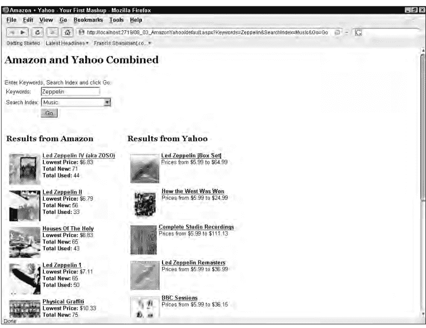

**图 8-6：**你的第一个 Amazon/Yahoo mashup 实际运行效果

## 小结

在本章中，你从零起步，顺利完成了 mashup 的四分之一英里。你学会了如何执行以下操作：

- 使用 REST 从 Amazon 检索数据
- 使用 XSLT 转换 XML 数据（你将在后续章节中了解更多相关内容）
- 合并 XML 数据源
- 使用 ASP.NET 将 XML 绑定到 Repeater 控件

## 构建你的第一个 Mashup

你已经从两个不同的来源获取了数据，并将它们组合成一个有用的应用程序。在此过程中，你学会了处理 XML 和进行 HTTP GET 调用的有用技术，并且已经开始构建一个有用的辅助类，可在后续章节中加以利用。

从本章开始，我相信你会思考基于互联网构建平台的方式已经发生了怎样的变化。在旧的世界中，你拥有集中式数据库，并在其之上构建单一的客户端-服务器或 n 层应用程序。

现在，你正在构建复杂的分布式系统，使用轻量级技术来整合来自许多不同来源的数据。

这是一个相对简单且经典的合并搜索结果的例子。当你将这种技术应用于从未以这种方式思考过的问题时，这种技术的真正威力才会显现出来。凭借这些新获得的技能，我找到一些数据，并将其与其他东西结合起来，为互联网创造出全新而有趣的用途。

本章展示了如何在 Web 服务器上进行数据 mashup。在第 9 章中，你将开始使用 JavaScript 和浏览器，将处理从 Web 服务器推送到用户的桌面。

在继续之前，请考虑以下练习，以检验你对本章所学内容的掌握程度。你可以在附录 B 中找到这些练习以及其他练习的答案。

## 练习题

1. 如何将 XML 文档加载到 DataSet？
2. 如何在 .NET 中执行 XSLT？
3. 如何在 C# 中发起 HTTP GET 请求？

# 让浏览器发挥作用

Mashup 正在真正改变 Web 的工作方式。在其核心，mashup 使浏览器中的体验比以往任何时候都更加丰富。那么“更丰富”究竟意味着什么呢？如果你回想 Web 的早期时代，你有一个内容页面，上面有链接。如果你想链接到另一个网站，你就添加一个链接。用户点击链接，跳转到新页面。这是一种相当平淡无奇的用户体验，一个站点一个站点地缓慢前进。缺点是，当你的用户点击该链接的那一刻，他们就离开了，不再在你的网站上，也不再是你的客户了！

异步 JavaScript 使你能够在网站上构建可点击的链接或按钮，这些链接或按钮可以拉取信息并将其添加到页面中。用户在你的网站上查看这些信息。他们永远不会离开！一个不离开的用户可能会点击广告、阅读更多内容，或者完成购买。

在本章中，你将学习如何动态地将数据拉取到你的网站，并为用户提供真正有趣的体验。

具体来说，你将学习如何执行以下操作：

- 使用 YouTube API 获取电影和短片
- 从 Amazon 的电影数据库拉取数据
- 在不刷新网页的情况下在网页中显示信息

## 作战计划

本章的想法是创建一个简单的机制来增强内容驱动页面。与本章相关的示例代码将实现一个电影评论网站的模拟。网站内容将包含各种带下划线的链接，以表示这些区域是可点击的。

## 第 9 章

点击链接不会将用户导航到单独的页面，而是会触发一系列后台步骤，从 YouTube 和 Amazon 检索额外内容，同时让用户留在同一页面上。通过这种方式，用户将能够通过点击页面内的链接来增强页面内容。然而，用户永远不会离开页面，因为所有内容都是使用异步 JavaScript 拉取的。图 9-1 展示了完成的网站显示来自 Amazon 的内容。

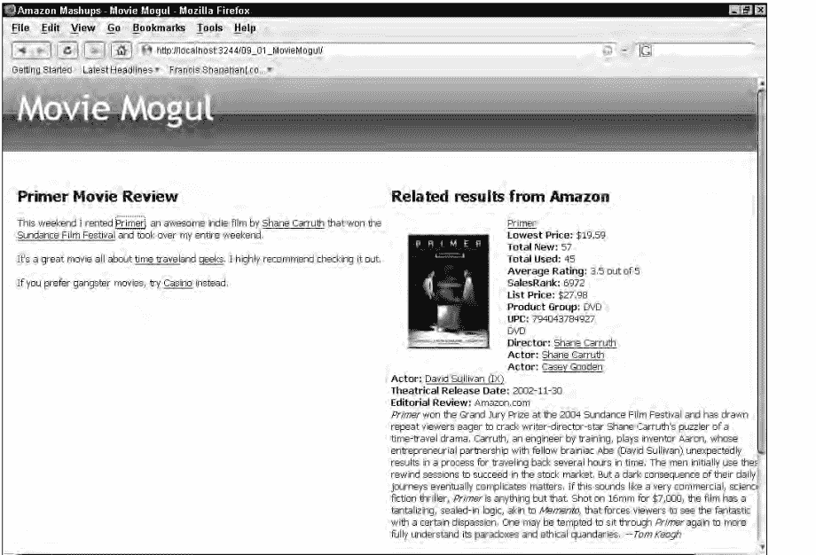

我将在本章的示例中使用 Amazon 和 YouTube，但你应该足够自信，可以根据你具体场景中的内容性质来更改这些内容。例如，新闻网站可能会使用 Technorati 从“博客圈”拉取内容。

### 理解架构

图 9-2 展示了 Movie Mogul 示例中的整体数据流。

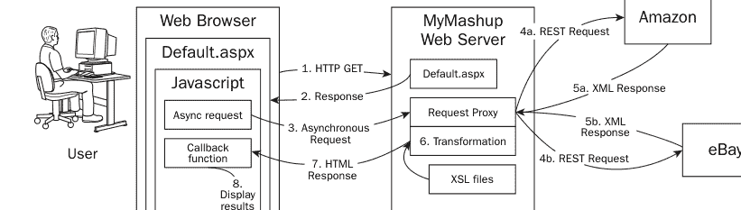

> **让浏览器发挥作用**

| 组件 | 步骤 | 操作 |
| :--- | :--- | :--- |
| **Web 浏览器** |  |  |
| `Default.aspx` | 1. | 用户使用浏览器访问网站。 |
| JavaScript | 2. | 页面由 Web 服务器提供，并包含一个小型 JavaScript 库。 |
| `Default.aspx` | 3. | 当用户点击按钮或链接时，JavaScript 事件触发一个异步调用到服务器，不会阻塞。 |
| **MyMashup Web 服务器** | 4. | 服务器上的代理接收请求，并通过 REST 风格的 HTTP GET 请求访问 Amazon（第 4a 步）或 YouTube（第 4b 步）。 |
| **Amazon / YouTube** | 5. | 合作伙伴网站以 XML（第 5a 步或 5b 步）响应服务器。 |
| **MyMashup Web 服务器** | 6. | XML 数据在服务器上使用本地 XSL 样式表转换为 HTML。 |
| **Web 浏览器** | 7. | 生成的 HTML 被发送回浏览器。 |
| JavaScript | 8. | 浏览器通过 JavaScript 函数处理响应，并将其插入页面（例如，作为`div`标签的`innerHTML`）。 |

## 工作原理

其工作原理如下：

**1.** 首先发生的是用户使用浏览器访问网站。

**2.** 页面由 Web 服务器提供，并包含一个小型 JavaScript 库。

**3.** 当用户浏览网站时，他们可能会点击页面上的按钮或链接，触发 JavaScript 事件。与提交表单和刷新整个页面不同，该 JavaScript 向服务器发出异步调用，不会阻塞用户。

**4.** 该请求由服务器上的代理（一个传递通道）接收，然后向 Amazon（第 4a 步）或 YouTube（第 4b 步）请求数据。这些都是 REST 风格的 HTTP GET 请求。

**5.** 合作伙伴网站以 XML（第 5a 步或第 5b 步）响应，并将其发送回服务器。

**6.** 每个网站都以 XML 数据响应给 mashup 域的 Web 服务器。然后，这些数据在 Web 服务器上使用驻留在 Web 服务器本地的 XSL 样式表转换为 HTML。

**7.** 生成的 HTML 被发送回浏览器。

**8.** 浏览器通过 JavaScript 函数处理此响应，并将其简单地插入页面，也许作为`div`标签的`innerHTML`。

那些提前翻阅的人会问为什么本章不叫“Ajax”。嗯，这种范式并不完全是 Ajax，因为转换发生在 Web 服务器上。在本章中，服务器提供现成的 XHTML 片段。正如你将在第 10 章中看到的，在 Ajax 中，服务器发送普通 XML，转换在浏览器中完成。

## 第 9 章

### 实际示例

尽管没有官方的命名委员会，这项技术已被广泛称为异步 HTML（Just Asynchronous HTML，JAH）。该技术通过 JavaScript 实现与 Web 服务器的异步通信，其核心在于一个特定的 JavaScript 对象——`XmlHttpRequest`。

如果你还没有这样做过，现在是浏览一些网络上实际示例的好时机。Google 建议（http://www.google.com/webhp?complete=1&hl=en）和 Google 地图（http://maps.google.com）是两个绝佳的例子。

Google 地图允许用户通过浏览器交互式地浏览地图。用户输入一个地点或地址，浏览器就会显示该地点的地图。用户随后可以在任意方向拖动和移动地图的可视区域。这通常不是人们对浏览器体验的固有印象。

Google 建议使用了相同的异步通信技术，但方式截然不同。页面显示一个搜索表单，用户可以在其中输入查询内容。随着用户每一次按键，都会出现一个可能的匹配列表（图 9-3）。这些是“建议”，为用户提供了减少输入的便利。如果用户想搜索的术语出现在建议列表中，他们只需点击即可直接跳转到搜索结果。

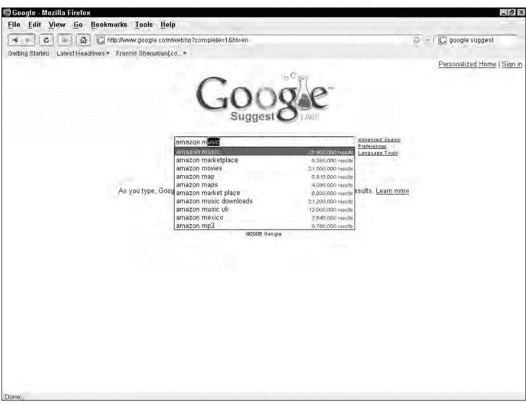

**图 9-3：**Google 建议使用异步通信来呈现搜索选项

### 项目设置

既然你已经完成了一些项目，我将假设你已经对项目设置等常规任务相当熟悉。如果你在此方面需要指导，请参阅第 4 章的开发环境设置部分。

要设置本章的项目，请按照以下步骤操作：

1. 使用 Visual Studio 创建一个新的网站，或者重用你在第 4 章创建的网站。
2. 该网站将依赖 JavaScript，最好将所有相关文件存放在一个统一的位置。添加一个名为`js`的新文件夹，用于存放应用程序使用的 JavaScript 文件。
3. 在`js`文件夹中添加一个名为`request.js`的新文件。该文件将用于存储本示例的 JavaScript 代码。
4. 通过将你在第 8 章创建的`webUtility.cs`文件添加到项目中来重用它。
5. 创建一个简单的网页，包含一些介绍性内容。此页面将作为从 YouTube 和 Amazon 获取的额外数据的容器。在本示例中，该页面命名为`default.aspx`。
6. 在`<head>`部分添加以下内容，将`request.js` JavaScript 文件链接到`default.aspx`页面：

```html
<script type="text/javascript" src="js/request.js"></script>
```

7. 在`default.aspx`中添加一个`<div>`标签：

```html
<div id="results">Results go here</div>
```

8. 通过将你在第 7 章创建的`amazonUtility.cs`类添加到项目中来重用它。

当从服务器返回数据时，该`<div>`标签将用于存放结果数据。

图 9-4 展示了设计模式下的`default.aspx`页面。

> 在最终文案可用之前，印刷业一直使用一段类似拉丁文的通用内容作为填充文本。这段文本以“Lorem ipsum dolor sit amet...”开头，并用后续内容填充若干页面。人们对于这是否是真正的拉丁文，以及它是否能翻译成有意义的内容存在一些困惑。如果你需要一些通用内容来填补空白，可以尝试在谷歌上搜索“Lorem Ipsum”。

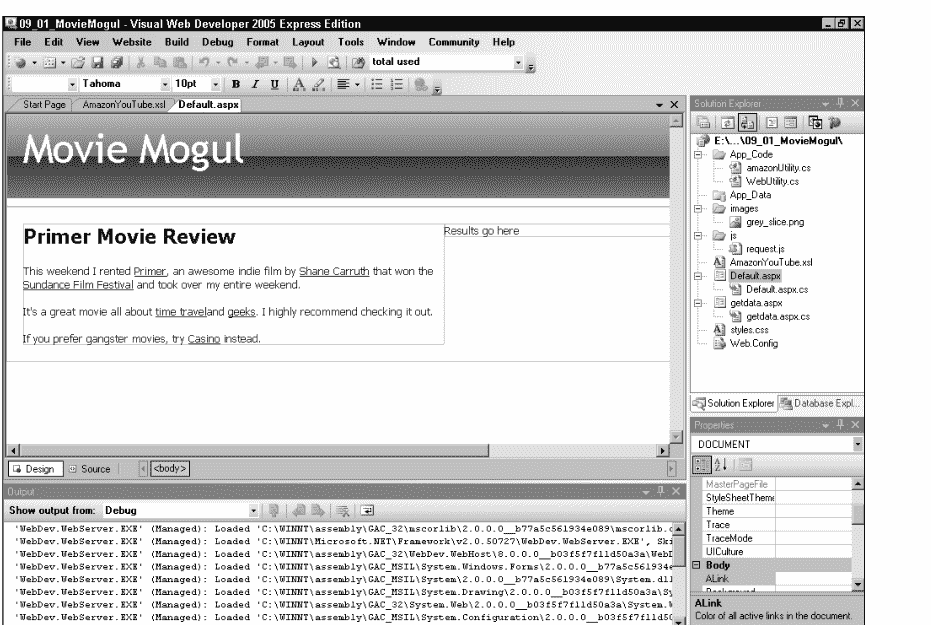

**图 9-4：**展示的项目原型，`default.aspx`

### 数据提供程序

为了从 Amazon 或 YouTube 获取数据，本示例使用了一个名为`getdata.aspx`的专用页面作为数据提供程序/代理。在本节中，你将构建`getdata`页面，并实现与 Amazon 和 YouTube 的接口。

在继续之前，你应该先研究一下 YouTube API。下表描述了通过 YouTube REST 接口可用的方法。

| API 名称 | 描述 |
| :--- | :--- |
| `youtube.users.get_profile` | 显示特定 YouTube 用户的数据。 |


| `youtube.users.list_favorite_videos` | 提供用户的收藏视频。 |
| `youtube.users.list_friends` | 列出用户在 YouTube 上的好友。 |
| `youtube.videos.get_details` | 获取特定视频的详细信息。 |
| `youtube.videos.list_by_tag` | 返回特定标签或关键字的视频列表。 |
| `youtube.videos.list_by_user` | 返回特定用户的视频列表。 |
| `youtube.videos.list_featured` | 返回最近添加到 YouTube 网站的视频列表。 |

我将使用 `list_by_tag` 方法，该方法根据 YouTube 用户对电影的标签来获取电影详情。这是 API 支持的最接近*按关键字搜索*类型的方法。

要使用 YouTube API，你需要注册访问其开发者计划。你可以在 `www.youtube.com` 完成注册。你将被分配一个开发者 ID，该 ID 应包含在所有对 YouTube 的调用中。

### 动手试试：构建 `Getdata.aspx`

要构建数据提供程序，请按照以下步骤操作：

1. 创建一个名为 `getdata.aspx` 的新页面。创建页面时，请确保选中标有“将代码放在单独的文件中”的复选框。

2. 该页面的用户界面（aspx）永远不会被使用，因此你可以完全忽略它。请将注意力转向页面的代码隐藏文件。数据检索代码将放在这里。

3. 页面将在查询字符串中收到一个名为 `api` 的参数。这将指示页面应该查询 Amazon 还是 YouTube。在页面的 `page_load` 事件中，放置以下 `if` 语句：

```csharp
// Is this a YouTube api call or an Amazon call?
if (Request.Params["api"] == "youtube")
{
    // a YouTube URI
    strURI =
"http://www.youtube.com/api2_rest?method=youtube.videos.list_by_tag&dev_id=[YOUR ID]&tag=" + Request.Params["tag"];
}
else
{
    // Build an Amazon URI
    strURI = amazonUtility.BuildAmazonURI(Request.QueryString);
}
```

此代码根据查询字符串中预期的 `api` 参数来决定是从 Amazon 还是 YouTube 获取数据。

4. 对于 YouTube，构建一个简单的 REST URL：

```text
strURI =
"http://www.youtube.com/api2_rest?method=youtube.videos.list_by_tag&dev_id=[YOUR ID HERE]&tag=" + Request.Params["tag"];
```

5. 对于 Amazon，支持多种潜在操作，包括 `ItemLookup`、`ItemSearch` 等。为了处理所有这些排列组合，在 `amazonUtility` 类中创建了一个专用函数：

```csharp
strURI = amazonUtility.BuildAmazonURI(Request.QueryString);
```

6. `getdata.aspx.cs` 的 `page_load` 事件的其余部分代码是使用刚刚构建的 URL 执行 HTTP GET 查询。这与你在前面章节中看到的代码类似，如下所示：

```csharp
// Obtain the data
XmlDocument myDoc = webUtility.GetUri(strURI);

// If the data passed back is ok
if (myDoc != null)
{
    Response.Clear();
    string strResults =
        webUtility.DoXSLTransformation(myDoc, "AmazonYouTube.xsl");
    Response.Write(strResults);
} else {

    Response.Write("No data returned");
}
```

在这段代码中，我尝试发送回 XML 数据之前清除了 `Response`（已高亮）。这是因为 ASP.NET 已经开始向 `Response` 添加头信息和信息。因为我想覆盖默认响应，所以在将 XML 写入 `Response` 流之前，我清除了所有这些内容。

在这种情况下，数据在服务器上使用你在第 8 章创建的 `webUtility` 类和一个名为 `AmazonYouTube.xsl` 的 XSL 文件的组合进行转换。

在你能够测试 `getdata.aspx` 之前，还有一些部分需要构建。

## 工作原理

`getdata.aspx` 页面接受多个参数，这些参数与 Amazon ECS 或 YouTube 开发人员 API 相关。根据发送的 `api` 参数，页面决定是查询 Amazon 还是 YouTube。

对于 Amazon，支持多种查询，包括 `ItemSearch`、`ItemLookup` 等。对于 YouTube，只有一个操作有意义，即查找视频及其相应的 URL。

页面以 XML 文档的形式从任一 API 检索数据。该文档在服务器上使用 XSL 转换为 HTML。生成的 HTML 随后被发送到浏览器。

Web 服务器只发送 HTML，因此得名“JAH”。

## 验证亚马逊 REST URI

面对亚马逊 API 提供的众多参数和操作排列组合，若仅通过简单的字符串拼接来管理所有这些，过程会变得非常繁琐。

安全问题同样不容忽视。在任何公开的应用程序中，你总需要对用户输入实施某种形式的验证。为避免恶意用户向 `getdata.aspx` 查询字符串中注入数据库查询或危险文本，并使其被传递至亚马逊，参数必须作为处理流程的一部分进行验证。

因此，本示例包含一个专用函数，用于创建可用于亚马逊 API 的有效 URI，如代码清单 9-1 所示。

### 代码清单 9-1：`BuildAmazonURI` 函数

```csharp
public static string BuildAmazonURI(NameValueCollection myQueryString)
{
    string strURI = "";
    string strRoot = "http://webservices.amazon.com/onca/xml?Service=AWSECommerceService&";
    string strAccessKeyId = "AWSAccessKeyId=" + ConfigurationManager.AppSettings["AWSAccessKeyId"] + "&";
    string strAssociateTag = "AssociateTag=" + ConfigurationManager.AppSettings["AssociateTag"] + "&";

    string strOperation = CheckNull(myQueryString, "Operation", "ItemSearch");
    string strResponseGroup = CheckNull(myQueryString, "ResponseGroup", "Medium");
    string strItemId = CheckNull(myQueryString, "ItemId", "");
    string strKeywords = CheckNull(myQueryString, "Keywords", "");
    string strSearchIndex = CheckNull(myQueryString, "SearchIndex", "");
    string strDirector = CheckNull(myQueryString, "Director", "");
    string strAuthor = CheckNull(myQueryString, "Author", "");
    string strArtist = CheckNull(myQueryString, "Artist", "");
    string strActor = CheckNull(myQueryString, "Actor", "");

    // 返回拼接后的 URI
    strURI = strRoot + strAccessKeyId + strOperation + strResponseGroup + strItemId + strKeywords + strSearchIndex + strDirector + strAuthor + strArtist + strActor;
    return strURI;
}
```

## 工作原理

`BuildAmazonURI` 的工作原理如下：

1. `BuildAmazonURI` 函数以一种特殊的名称-值集合（属于 `System.Collections.Specialized` 命名空间）的形式接收原始请求 `querystring`。

2. 该函数知道或预期一组特定的参数，如亚马逊文档中所指定（例如 `keywords`、`searchIndex` 或 `operation`）。

3. 对于每个有效参数，代码会检查其是否为 null。如果是，在某些情况下会指定一个默认值。

```csharp
string strResponseGroup = CheckNull(myQueryString, "ResponseGroup", "Medium");
```

在大多数情况下，空或 null 参数会直接从最终字符串中省略。

4. 最后，URI 的各个组成部分——根路径、`AWSAccessKeyId` 和 `AssociateTag` 等——被拼接在一起，形成最终的 URI。

> 你显然可以进一步完善此函数，使其更加复杂。例如，你可能考虑移除尖括号或单引号，以进一步验证输入。为清晰起见，我已省略此部分代码。

## 处理网络代理

一旦创建了适用于亚马逊或 YouTube 的正确 URI，便使用与第 8 章相同的技术获取该 URI：

```csharp
XmlDocument myDoc = webUtility.GetUri(strURI);
```

有时你可能会发现自己处于公司防火墙之后，流量被限制通过网络代理传输。网络代理不过是一个流量必须经过的网关。如果你在公司网络上，你的浏览器可能已经在使用代理与互联网通信。

如果确实处于代理之后，`GetUri` 函数将会失败，因为它不了解代理或如何通过其路由。你在发出 `HttpWebRequests` 以获取 REST URI 时可能会遇到问题。

这里有两个解决方案。第一个方案是向 `GetUri` 内部的 `HttpWebRequest` 对象提供你的代理信息，如下所示：

```csharp
// 创建请求对象
HttpWebRequest myRequest = (HttpWebRequest)WebRequest.Create(strURI);
myRequest.Proxy = new WebProxy("myWeb.Proxy.com", 8080);
```

此代码在 `WebRequest` 上设置代理信息，以便所有调用都通过代理路由，就像你的浏览器路由它们一样。

另一种方案是通过在 `web.config` 文件中指定代理来提供可配置的解决方案。此设置如下所示：

```xml
<system.net>
    <defaultProxy>
        <proxy usesystemdefault="False"
               proxyaddress="http://myWeb.Proxy.com:8080" bypassonlocal="True"/>
    </defaultProxy>
</system.net>
```

如有必要，请考虑将此代码添加到你的具体实现中。

## 更多 XSL 工具

一旦数据以 XML 文档的形式从合作伙伴网站返回，它必须被转换为 HTML。在第 8 章中，你使用 XSL 完成了多项任务。你学习了如何使用模板构建 XSL 文档。你还学习了如何使用 `<xsl:value-of>` 元素以及 `<xsl:output>` 节点生成输出。

在本章中，你将更进一步，介绍 XSL 中等效于 `if-then-else` 的结构，并学习如何使用命名模板在 XSL 中实现递归。

## XSL If-Then-Else

XSL 中的决策与其他语言有些相似，都需要测试一个条件或表达式。根据表达式的结果，代码将遵循特定路径：

```xml
<xsl:choose>
    <xsl:when test="SOME CONDITION">
        <!-- 执行某些操作 -->
    </xsl:when>
    <xsl:otherwise>
        <!-- 执行其他操作 -->
    </xsl:otherwise>
</xsl:choose>
```

## 将模板匹配到多个元素

当你对亚马逊执行 `ItemSearch` 查询时，API 返回一个根节点名为 `ItemSearchResponse` 的 XML 文档。当你对亚马逊执行 `ItemLookup` 查询时，API 返回一个根节点名为 `ItemLookupResponse` 的 XML 文档。

无论根节点是 `ItemLookupResponse` 还是 `ItemSearchResponse`，文档仍然包含结构一致的 `Items` 和 `Item` 节点。在这种情况下，使用一组 XSL 模板处理它们是合理的。

要重用你创建的 XSL，必须定义一个可以匹配 `ItemLookupResponse` 或 `ItemSearchResponse` 节点*任一*的模板：

```xml
<xsl:template match="a:ItemLookupResponse|a:ItemSearchResponse">
    <h2>来自亚马逊的相关结果</h2>
    <xsl:apply-templates select="a:Items"/>
</xsl:template>
```

此模板通过在模板定义的 `match` 属性中组合 `ItemLookupResponse` 和 `ItemSearchResponse`，匹配两种类型的响应。

## 转换 YouTube 响应

弄清楚 XSL 转换模板的最佳方法是查看示例数据。下一节将引导你使用迄今为止构建的代码获取 YouTube 示例数据。

## YouTube 示例响应

你尚未构建用于转换内容的 XSL 模板。你仍然可以使用浏览器测试 `getdata.aspx`。为此，请暂时注释掉对 `DoXslTransformation` 的调用，并添加代码以使用浏览器打印出来自亚马逊或 YouTube 的原始 XML 响应：

```csharp
Response.Clear();
// 如果需要调试转换后的 xml，请取消注释这些行
Response.ContentType = "text/xml";
Response.Write(myDoc.InnerXml);
Response.End();
// string strResults = webUtility.DoXSLTransformation(myDoc, "AmazonYouTube.xsl");
// Response.Write(strResults);
```

要获取 YouTube XML 示例响应，请尝试运行该应用程序并在浏览器中输入以下 URL：

```text
http://localhost:1356/09_01_MovieMogul/getdata.aspx?api=youtube&tag=timetravel
```

> 务必修改端口信息以匹配你自己的应用程序。Visual Studio 会为每个 Web 应用程序动态分配一个端口。此处端口为 1356；你的可能不同，因此请务必修改 URL 以匹配。

要查找端口，请查看 Visual Studio 中 Web 项目的属性。名为“开发服务器”的部分有一个名为端口号的属性。

以下是 `getdata.aspx` 生成的示例响应：

```xml
<?xml version="1.0" encoding="utf-8" ?>
<ut_response status="ok">
  <video_list>
    <video>
      <author/>
      <id>Fat1NH8-VhE</id>
      <title>Many Martys</title>
      <length_seconds>186</length_seconds>
      <rating_avg>5.00</rating_avg>
      <rating_count>1</rating_count>
      <description>I made this as an 'intro video' for school</description>
      <view_count>204</view_count>
      <upload_time>1142107967</upload_time>
      <comment_count>1</comment_count>
      <tags>timetravel</tags>
      <url>http://www.youtube.com/?v=Fat1NH8-VhE</url>
      <thumbnail_url>
        http://sjl-static2.sjl.youtube.com/vi/Fat1NH8-VhE/2.jpg
      </thumbnail_url>
    </video>
  </video_list>
</ut_response>
```


YouTube 会返回大量视频详情，其中大多数不言自明。这里重点介绍的主要是视频的 URL（即指向 YouTube 网站上该视频的链接）以及视频代表性缩略图的链接。这两个元素在构建内容页面的 HTML 输出时非常实用。

## YouTube XSL 模板

如你所见，YouTube 返回的结果处理起来极其简单，包含基于默认命名空间的纯 XML。代码清单 9-2 展示了一个简单模板的代码，该模板将每个视频节点显示在表格行中。

**代码清单 9-2：YouTube XSL 模板**

```xml
<xsl:template match="video">
    <tr><td>
        <a target="_blank">
            <xsl:attribute name="href">
                <xsl:value-of select="url" />
            </xsl:attribute>
            
                <xsl:attribute name="src">
                    <xsl:value-of select="thumbnail_url" />
                </xsl:attribute>
                <xsl:attribute name="alt">
                    <xsl:value-of select="title" />
                </xsl:attribute>
                <xsl:attribute name="title">
                    <xsl:value-of select="title" />
                </xsl:attribute>
            </img>
        </a>
    </td><td>
        <a target="_blank">
            <xsl:attribute name="href">
                <xsl:value-of select="url" />
            </xsl:attribute>
            <xsl:value-of select="title" />
        </a><br/>
        Average Rating: <xsl:value-of select="rating_avg" /> |
        Length: <xsl:value-of select="length_seconds" /> secs<br/>
            <xsl:value-of select="description" />
        </td>
    </tr>
</xsl:template>
```

此模板将匹配所有视频节点。模板包含基本的 XSL 指令，用于显示视频的各种属性（如描述、URL 和缩略图）。

与本章相关的示例代码包含完整的 XSL 转换。图 9-5 展示了在浏览器中呈现的最终 HTML 效果。

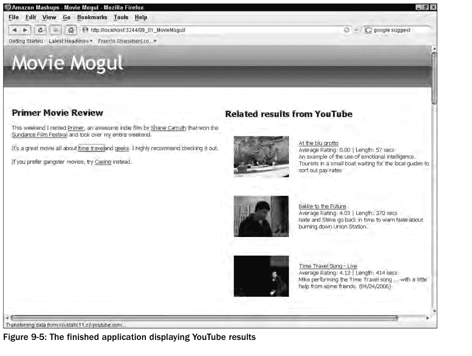

图 9-5：显示 YouTube 搜索结果的完成应用

## XMLHttpRequest 对象

`XMLHttpRequest` 是驱动本示例的主要对象。JavaScript 无需任何额外的安全权限即可使用 `XMLHttpRequest` 对象。下表展示了该对象方法的详细说明。

| 方法名 | 描述 |
|---|---|
| `abort()` | 此方法中止一个正在进行中的请求。 |
| `addEventListener()` | 向对象注册一个事件处理程序。 |
| `dispatchEvent()` | 触发一个事件，该事件进而触发所有监听此事件的处理程序。 |
| `getAllResponseHeaders()` | 返回与响应关联的所有 HTTP 头信息。 |

## 让浏览器工作

| 方法名 | 描述 |
|---|---|
| `getResponseHeader()` | 从响应中获取特定的 HTTP 头。 |
| `open()` | 创建一个新请求，使用目标 URL 和 HTTP 方法（`GET` 或 `POST`）。发起一个新请求。注意，请求在调用 `send` 之前不会发送。 |
| `overrideMimeType()` | 覆盖从服务器返回的 `MimeType`。例如，如果你希望将 XML 流视为纯文本，这将很有用。 |
| `removeEventListener()` | 从事件目标上移除一个事件处理程序。 |
| `send()` | 发送构建好的 HTTP 请求。 |
| `setRequestHeader()` | 允许你在请求中设置一个 HTTP 头。 |

你将需要使用 `open()` 和 `send()` 方法，具体将在下一节详述。

## 发起请求

为了局部更新页面，用户点击一个包含 `javascript` 函数调用的链接：

```html
<a href='javascript:void(0)' onclick='Lookup("B0007N1JC8")'>Primer</a>
```

这是一个指向空处的假链接。`onclick` 事件包含对 `request.js` 脚本文件中定义的 `Lookup()` 函数的调用：

```javascript
function Lookup(ItemId){
    GetData("operation=ItemLookup&ItemId=" + ItemId);
}
```

如你所见，`Lookup()` 只是调用 `GetData()`。它传递一个字符串，该字符串将成为查询字符串。这里的参数直接来自 Amazon ECS。`Lookup()` 向 `GetData` 发送执行 Amazon `ItemLookup` 操作所需的参数，包括 `ItemId`。

还有许多此类“辅助”函数，如下所列：

```javascript
function DirectorSearch(keywords){
    GetData("operation=ItemSearch&Director=" + keywords + "&SearchIndex=DVD");
}

function YouTube(keywords){
    GetData("api=youtube&tag=" + keywords );
}

function ActorSearch(keywords){
    GetData("operation=ItemSearch&Actor=" + keywords + "&SearchIndex=DVD");
}
```

每个函数只是创建一个字符串并将其传递给 `GetData`。`GetData` 是另一个也位于 `request.js` 中的 JavaScript 函数。`GetData` 是实际调用你之前创建的 `getdata.aspx` 页面以获取转换后 HTML 的代码（代码清单 9-3）。

### 代码清单 9-3：创建异步请求

```javascript
function GetData(myOperation) {

    myUrl="getdata.aspx?" + myOperation;

    // Is this a Microsoft browser?
    if (window.ActiveXObject) {
        // Create a new request
        myRequest = new ActiveXObject("Microsoft.XMLHTTP");
        if (myRequest) {
            myRequest.onreadystatechange = HandleResponse;
            myRequest.open("GET", myUrl, true);
            myRequest.send();
        }
    } else if (window.XMLHttpRequest) {
        // This is Firefox or Safari...
        myRequest = new XMLHttpRequest();
        myRequest.onreadystatechange = HandleResponse;
        myRequest.open("GET", myUrl, true);
        myRequest.send(null);
    }
}
```

## 工作原理

1. 首先发生的是创建一个 `XmlHttpRequest` 对象。在本示例中，JavaScript 会分支以支持 Internet Explorer 专用的 `XmlHttpRequest` 实现，或 Mozilla/Firefox/Safari 的实现。
2. `GetData` 被传入了所需 URL 的一部分，它将其作为查询字符串拼接到 `getdata.aspx` 的地址后。结果是一个可能类似这样的 URL：

   `getdata.aspx?api=youtube&tags=Zeppelin`

3. 作为发送请求之前的准备工作，一个 `javascript` 函数被赋值以处理响应。这本质上是一个回调机制，因为 JavaScript 代码在发出请求后将继续执行。它不会等待并阻塞直到收到响应。在这种情况下，回调函数名为 `HandleResponse`。
4. 最后，请求被发送，函数退出。

这一切都在后台发生，用户通常完全不知道发生了任何事情。

## 处理响应

一旦 Web 服务器收到请求并从合作伙伴网站获取数据，它就开始发送回响应。根据数据的大小，这可能需要浏览器和服务器之间的多次交互。同样，这一切在后台发生，无需额外编码。

在访问响应数据之前，你必须检查请求对象的 `readyState` 属性，以查看是否已收到完整的响应。根据下表，有五种可能的 `readyState`；你感兴趣的是“4”或 `complete`。

| readyState | 描述 |
| :--- | :--- |
| 0 | 请求尚未初始化。 |
| 1 | 请求正在加载数据。 |
| 2 | 对象已加载数据。 |
| 3 | 对象仍在解析和扫描数据。 |
| 4 | 对象的解析已完成，数据已准备好可供使用。 |

### 代码清单 9-4：处理 Web 服务器响应

```javascript
function HandleResponse() {

    // Find the results div
    var myDiv = document.getElementById('results');

    // Readystate 4 means we're done
    if (myRequest.readyState == 4) {

        // If the server returned OK
        if (myRequest.status == 200) {

            myDiv.innerHTML = myRequest.responseText;
        } else {
            myDiv.innerHTML = "Oops there was a problem, " + myRequest.statusText;
            myDiv.innerHTML = "<br/>Try again later";
        }
    }
}
```

## 第 9 章

## 工作原理

1. 首先，代码获取页面上结果 `<div>` 元素的引用。成功或失败的输出将在此处呈现。
2. 接下来，代码检查是否已接收到完整的响应，并且状态已设置为“complete”。
3. 然后，代码检查这是否是来自 Web 服务器的成功响应。这里的错误码 200 表示来自 Web 服务器的成功响应（就像 404 表示页面未找到一样）。
4. 最后，访问 `responseText` 属性以显示结果。如果发生错误，则会输出相应的消息来代替结果：

```javascript
var myDiv = document.getElementById('results');

if (myRequest.readyState == 4) {

if (myRequest.status == 200) {

myDiv.innerHTML = myRequest.responseText;
```

#### 动手试试：简单的异步通信

为了熟悉这种 JavaScript 通信的工作方式，请尝试这个简单的实验：

1. 打开 `getData.aspx` 页面。
2. 在 `page_load` 事件的前几行中插入以下代码。
3. 假设您已经实现了前面详细介绍的 `request.js` JavaScript，并将其链接到您的 `default.aspx` 页面中，请向 `default.aspx` 添加一个新的 `href`，如下所示：
4. 编译并运行此示例。导航到 `default.aspx`。单击链接会回调到 `getData.aspx` 并打印出结果。

```csharp
Response.Clear();
Response.Write ("Someone told me to print " + Request.Querystring["args"]);
Response.End();
return;
```

```html
<a href="javascript:void()" onclick="GetData('args=Hello World')">click me</a>
```

请尝试以下操作。在页面上添加一些标记。从代码隐藏中移除 `Response.End()` 语句。运行应用程序。

Web 服务器会写出请求的字符串，但因为您没有结束 HTTP 流，所以服务器会附加 ASPX 页面中包含的任何内容。

在这个示例中，服务器向浏览器发送了一个 HTML 片段。在第 10 章中，我将向您展示如何向浏览器发送 XML 以及如何在本地将该 XML 转换为 HTML。

#### 让浏览器工作起来

##### 处理亚马逊错误

在与 Amazon ECS 交互的过程中，我相信您现在已经遇到过 Amazon 返回错误信息的情况。Amazon 在提供状态、错误代码和任何发生错误的详细描述方面做得非常出色。要处理这些，您只需知道去哪里查找。将以下模板添加到您的 Amazon 转换中，以处理和显示错误信息以及结果（图 9-6）：

```xml
<xsl:template match="a:Items">
    <xsl:apply-templates select="a:Request/a:Errors/a:Error"/>
    <xsl:apply-templates select="a:Item"/>
</xsl:template>

<xsl:template match="a:Error">
    <div class="errors">Errors from Amazon</div>
    <xsl:value-of select="a:Message"/>
</xsl:template>
```

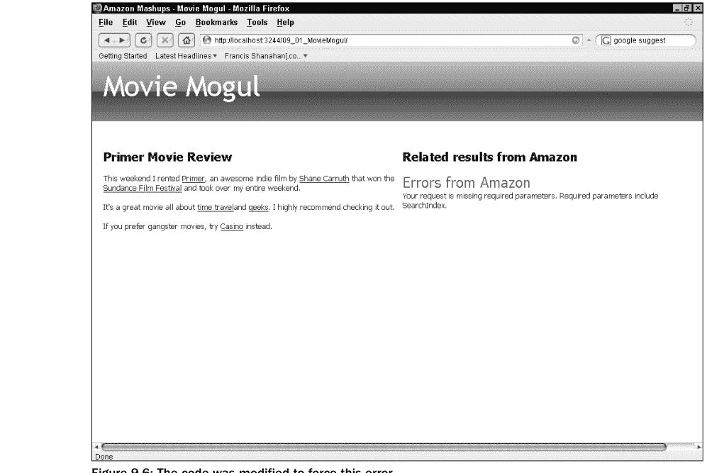

图 9-6：代码被修改以强制显示此错误

#### 解析亚马逊 BrowseNode 结构

正如第 2 章所提到的，亚马逊将数据分为不同的类别。这些类别被称为 `BrowseNodes`。一个产品可以根据多个类别进行分类（例如，一部 DVD 可能按导演、流派等进行分类）。

`BrowseNode` 结构本身是层次化的，这是有道理的。以“赌场”为例。这是一部罗伯特·德尼罗的电影。“罗伯特”以“R”开头，属于演员 `BrowseNode`，而这是 DVD 节点的一部分，依此类推。

`BrowseNodes` 通常在节点结构中越往上越通用。越往下，分类越具体。

通过在典型的 REST 请求中指定 `ResponseGroup=BrowseNode` 参数，您可以随结果一起获取 `BrowseNodes`。

清单 9-5 显示了一个示例 `BrowseNode` 响应。注意，随着节点变得越来越通用，每个节点都包含在其他节点中。

##### 清单 9-5：BrowseNode 响应示例


```xml
<BrowseNodes>
  <BrowseNode>
    <BrowseNodeId>163451</BrowseNodeId>
    <Name>Biography</Name>
    <Ancestors>
      <BrowseNode>
        <BrowseNodeId>508532</BrowseNodeId>
        <Name>Documentary</Name>
        <Ancestors>
          <BrowseNode>
            <BrowseNodeId>404276</BrowseNodeId>
            <Name>Genres</Name>
            <Ancestors>
              <BrowseNode>
                <BrowseNodeId>130</BrowseNodeId>
                <Name>DVD</Name>
                <Ancestors>
                  <BrowseNode>
                    <BrowseNodeId>139452</BrowseNodeId>
                    <Name>Video</Name>
                  </BrowseNode>
                </Ancestors>
              </BrowseNode>
            </Ancestors>
          </BrowseNode>
        </Ancestors>
      </BrowseNode>
    </Ancestors>
  </BrowseNode>
  <BrowseNode>
    <BrowseNodeId>163452</BrowseNodeId>
    <Name>General</Name>
    <Ancestors>
      <BrowseNode>
        <BrowseNodeId>508532</BrowseNodeId>
        <Name>Documentary</Name>
        <Ancestors>
          <BrowseNode>
            <BrowseNodeId>404276</BrowseNodeId>
            <Name>Genres</Name>
            <Ancestors>
              <BrowseNode>
                <BrowseNodeId>130</BrowseNodeId>
                <Name>DVD</Name>
                <Ancestors>
                  <BrowseNode>
                    <BrowseNodeId>139452</BrowseNodeId>
                    <Name>Video</Name>
                  </BrowseNode>
                </Ancestors>
              </BrowseNode>
            </Ancestors>
          </BrowseNode>
        </Ancestors>
      </BrowseNode>
    </Ancestors>
  </BrowseNode>
</BrowseNodes>
```

#### 递归 XSL 模板

从清单 9-5 可以看出，`BrowseNodes` 的结构是一种树状结构。解析树状结构唯一有效的方法是通过递归。在 XSL 中，使用一种称为命名模板的概念可以相对容易地实现这一点。

基本伪代码如下：

1. 获取一个节点并检查该节点是否有父节点（祖先）。
2. 如果存在祖先，则遍历它们。
3. 对于每个祖先，转到步骤 1 并重复该过程。
4. 在最顶层的节点，没有祖先存在，因此打印出该节点的值并返回。

通过这种方式，节点将按从最高到最低的顺序从左到右打印出来。例如，祖父 → 父亲 → 儿子，依此类推。

以下模板为模板`myBranch`分配了一个名称。该模板根据前面描述的伪代码执行。它使用`<xsl:call-template>`语句为找到的所有祖先调用自身：

```xml
<xsl:template match="a:BrowseNode" name="myBranch">
  <xsl:choose>
    <xsl:when test="a:Ancestors/a:BrowseNode">
      <xsl:for-each select="a:Ancestors/a:BrowseNode">
        <xsl:call-template name="myBranch" />
      </xsl:for-each>
    </xsl:when>
    <xsl:otherwise>
      <br/>
    </xsl:otherwise>
  </xsl:choose>
  &gt;&gt; <xsl:value-of select="a:Name" />
</xsl:template>
```

当提供有效的`BrowseNode`响应时，此模板的输出如下：

```text
>> Video >> DVD >> Genres >> Drama >> General
>> Video >> DVD >> Genres >> Mystery & Suspense >> Suspense
>> Video >> DVD >> Genres >> Mystery & Suspense >> Mystery
>> Video >> DVD >> Stores >> Actors & Actresses >> ( D ) >> DeNiro, Robert
>> Video >> DVD >> Stores >> Actors & Actresses >> ( P ) >> Pesci, Joe
>> Video >> DVD >> Stores >> Actors & Actresses >> ( R ) >> Rickles, Don
>> Video >> DVD >> Stores >> Actors & Actresses >> ( S ) >> Stone, Sharon
>> Video >> DVD >> Stores >> Actors & Actresses >> ( W ) >> Woods, James
>> Video >> DVD >> Stores >> Directors >> ( S ) >> Scorsese, Martin
>> Video >> DVD >> Genres >> Mystery & Suspense >> Crime >> Gangsters
>> Video >> DVD >> Features >> Titles >> ( C )
>> Video >> DVD >> Genres >> Mystery & Suspense >> Crime >> General
>> Video >> DVD >> Genres >> Mystery & Suspense >> General
>> Video >> DVD >> Stores >> Studio Specials >> Universal Studios Home Entertainment >> All Universal Studios Titles
>> Video >> DVD >> Stores >> Studio Specials >> Universal Studios Home Entertainment >> Drama
```

#### 运行应用程序

如果您一直跟着做，现在应该已经完成了编码。您应该有一个包含一些内容的`default.aspx`页面。该内容有一组启用了 JavaScript 的链接，每个链接都被编码为调用一个`javascript`函数。JavaScript 将向服务器发出一个`XmlHttpRequest`。服务器将使用`getdata.aspx`处理此请求并检索一些 XML。然后，该 XML 被转换并流式传输回浏览器。浏览器有另一个`javascript`函数准备好处理响应。请继续运行应用程序并尝试使用它。

> **解决 C# 中的命名空间问题**

在使用 .NET Framework 时，有时您可能会发现添加了一段代码，但忽略了为所有正确的命名空间添加`using`语句。在这种情况下，当项目生成时，您会收到一个`Error`，类似于以下内容：

> 找不到类型或命名空间名称 'XmlDocument'（是否缺少`using`指令或程序集引用？）

从 Visual Studio 205 开始，您可以通过右键单击有问题的类型并从菜单中选择“解析”来轻松纠正此问题。此菜单项将自动为正确的命名空间添加`using`语句，在此例中是`System.Xml`。

## 此方法的好处

那么，你可能会问，“为什么要把所有这些额外的工作负担放在浏览器上？”答案有两方面。

第一个原因是可扩展性。当您将工作负载从服务器转移到客户端时，您现在拥有一个可以随着访问网站的用户数量而扩展的应用程序。

第二个原因是，通过增强浏览器上执行的功能，您最终会得到一个比仅仅从 Web 服务器提供静态内容更具交互性的应用程序。在传统的网站中，Web 服务器提供一个页面，用户点击一个链接，然后服务器发送一个新的页面。在新的世界中，浏览器从服务器获取一个页面，根据用户选择的操作，该页面可能会随时间异步地刷新其一小部分。

## 总结

在本章中，您实现了另一个将亚马逊电影和 YouTube 电影结合在一起的混合应用。这是一个使用异步技术的有趣混合应用，应该很容易根据您自己的内容需求进行定制。您还完成了以下工作：

- 实现了一个用于发起异步请求的通用 JavaScript 库。
- 实现了一个用于查询亚马逊和 YouTube 的通用数据检索页面。
- 在 XSL 中使用了递归来转换亚马逊`BrowseNode`结构。

在第 10 章中，您将使用 eBay 和亚马逊实现一个完整的 Ajax 示例。您将实现一个搜索界面来查询亚马逊愿望清单并进行 eBay 比价购物。您还将学习如何在浏览器中翻译 XML，并将此负担从服务器上移除。

在继续之前，请尝试以下练习，以测试您对本章内容的理解。

## 练习

1. 如何使用 XSL 解析分层树结构？
2. 如何使用 JavaScript 发出异步 HTTP 请求？
3. 亚马逊为处理 ECS API 中的错误提供了哪些设施？
4. Visual Studio 通常为 Web 应用程序分配哪个端口？
5. 为什么应该验证亚马逊 REST URL？
6. 为什么在从 ASP.NET 输出 XML 时应该使用`Response.Clear()`和`Response.End()`？

## 由 Ajax 驱动的愿望清单

在大多数技术社区中提及混合应用，话题不可避免地会转向 Ajax（异步 JavaScript 和 XML）。这项技术为当今互联网上一些最受欢迎的混合应用提供了动力，包括许多 Google 和微软自己的网站。

在本章中，您将学习如何使用 Ajax 以极少的代码消费各种数据。具体来说，您将学习如何执行以下操作：

- 从头开始构建一个由 Ajax 驱动的网站。
- 在浏览器内转换 XML 数据。
- 搜索 eBay 拍卖列表以进行比价购物。
- 使用亚马逊列表搜索/查询接口。
- 使用亚马逊远程购物车。

## 作战计划：使用 REST 和 AJAX 的 eBay 加 Amazon

亚马逊除了允许客户购买和评论数千种产品外，还允许客户定义个人产品列表。这些列表可以以婴儿登记、婚礼登记或传统的愿望清单等形式与他人共享。

本章的目标是传达对 Ajax 的理解，并在此过程中创建一个可运行的应用程序。

## 什么是 AJAX？

Ajax 提供了一种方式，让网页能够从浏览器与提供它的 Web 服务器进行通信。更详细的解释请参见第 6 章“混合应用技术”。

## 第 10 章

### 理解架构

在本章中，您将构建一个愿望清单浏览器。这是一个可以用来在亚马逊上搜索愿望清单的网站。一旦用户找到了他们正在寻找的愿望清单，他们就可以查看该列表的详细信息以及每个项目的价格。他们还可以将这些项目添加到存储在亚马逊上的远程购物车中，但该购物车在混合应用的上下文中呈现。然后，该购物车可用于在结账时完成交易并购买物品。

作为额外的奖励，用户能够无缝地在 eBay 上搜索特定产品，以查看其他地方是否有更便宜的购买机会。

图 10-1 显示了此特定 Ajax 解决方案的架构。

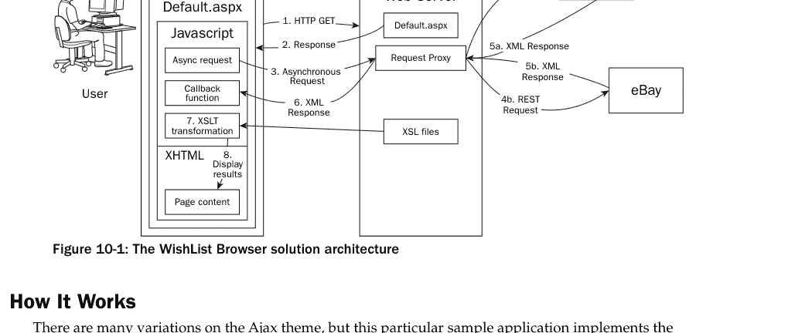

## 工作原理

Ajax 主题有许多变体，但这个特定的示例应用程序实现了最常见的那种：

1. 用户使用典型的 HTTP GET 请求导航到一个页面（`default.aspx`）。
2. 页面被提供。该页面包含一个小型 JavaScript 库。
3. 当用户执行特定操作（例如，执行搜索）时，会调用一个`javascript`函数，该函数使用`XMLHttpRequest`发起一个 HTTP GET 请求。
4. 该请求由服务器上的代理（一个直通）接收，然后该代理向亚马逊（步骤 4a）或 eBay（步骤 4b）请求额外数据。
5. 合作伙伴网站以 XML（步骤 5a 或 5b）形式响应，并将其发送回服务器。
6. 服务器然后将此数据不经转换地传递回浏览器。
7. 浏览器从服务器接收回 XML 数据。然后浏览器使用 JavaScript 和 XSL 处理此响应。
8. 数据被转换为 HTML 或 XHTML，然后通常通过插入到`<div>`标签中显示在页面上。

### 这与上一个示例有何不同？

这是一个非平凡的应用程序，包含许多活动部分。为了降低学习曲线，第 9 章中的许多代码将被重用。但是，有一个细微的差别将此应用程序与上一个区分开来。在第 9 章中，数据转换是在 Web 服务器上完成的。在此应用程序中，数据转换是在浏览器端完成的。服务器数据访问层（`getdata.aspx`）是一个纯粹的直通层。服务器上没有发生任何混合操作。图 10-2 显示了完成的愿望清单浏览器应用程序的截图。

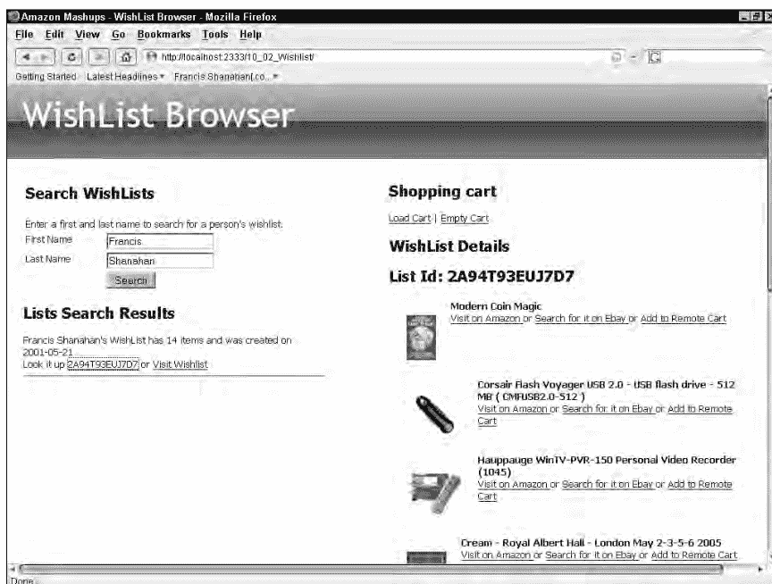

## Ajax 的优缺点

作为一项技术，Ajax 有很多好处，包括以下几点：

- 它提供了感知的性能提升。在可用性方面，眼见为实。从用户的角度来看，页面是在没有完全页面加载的情况下刷新内容。浏览器不会不断刷新，总的来说，这使得应用程序感觉更快。
- 应用程序可以将处理负载转移到浏览器，从而为整个应用程序提供更好的可扩展性和潜在的更高吞吐量。
- 应用程序可以以通常不与浏览器环境相关联或在该环境中不可能的方式运行。通过利用 JavaScript 和不同的数据源，该网站的行为更具交互性，用户感觉他们正在参与一种体验，而不仅仅是点击页面。

然而，有些事情需要注意。如果在设计早期进行思考，这些缺点很容易避免。

尽量不要使用 Ajax 刷新页面的整个区域。这可能会让用户感到意外，并导致体验脱节。相反，应谨慎使用 Ajax 来更新可能不是用户主要关注点的较小区域。诚然，我在示例应用程序中违反了自己的规则，但考虑到目标是传达该技术的工作原理，这是允许的。

因为页面的标记、内容和结构是在 Web 服务器渲染页面后动态修改的，所以浏览器无法使用其内置的历史记录和书签功能。如果用户在使用 Ajax 实现的五步过程中的第四步，而用户本能地选择后退按钮，用户将被带到他或她访问该五步过程之前的页面——实际上，被踢回到了起点。在设计 Ajax 应用程序时要注意这一点，以避免大量沮丧的用户。

### 设置项目

如前所述，许多代码将从第 9 章重用和修改。如果您还没有通读第 9 章，可能值得回顾一下，以确保您跟上解决方案中使用的各种组件。

1. 创建一个新项目或重用第 4 章的应用程序。
2. 添加第 9 章中现有的`getdata.aspx`。
3. 创建一个名为`js`的新文件夹用于 JavaScript。添加第 9 章中的`request.js`脚本。
4. 添加第 9 章中的`amazonUtility.cs`和`webUtility.cs`类。
5. 创建一个名为`xml`的新文件夹。本章中使用的众多 XSL 文件将放置在此处。
6. 在`default.aspx`上创建一个新表单，该表单包含两个标准 HTML 文本输入和一个提交按钮。这些是非 ASP.NET 控件，将用于捕获搜索条件亚马逊列表搜索 API。`default.aspx`的设计视图如图 10-3 所示。请随意创建符合您个人品味的界面外观。
7. 在`default.aspx`页面中添加四个`div`标签。这些标签将用作从合作伙伴网站检索内容的占位区域。第一个`div`被分配了`id = "results"`，与第 9 章相同。第二个标识为`"lists"`，第三个分配 ID 为`"cart"`，第四个将用于存储应用程序生成的任何调试消息。请随意按照您认为合适的方式排列它们：

```html
<div id="results">Results go here</div>
<div id="lists"></div>
<div id="cart"></div>
<div id="debug"></div>
```

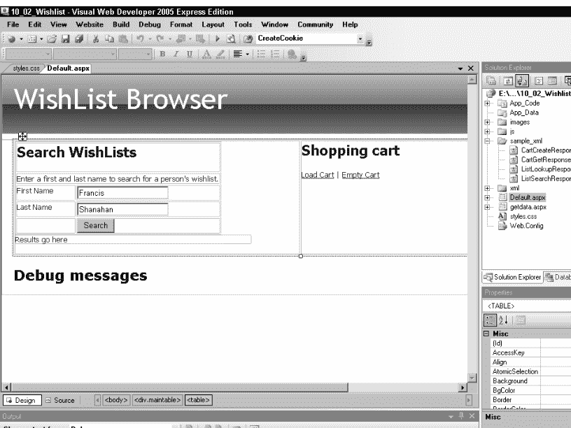

图 10-3：客户端界面的设计时视图

这完成了客户端界面的设计和项目的设置。本章的剩余部分将重点介绍对第 9 章重用代码的修改，以及创建新代码以实现应用程序。

## 在亚马逊上搜索心愿单

亚马逊 ECS 支持三种类型的列表：心愿单、婴儿用品登记表或婚礼登记表。亚马逊客户通常定义列表的目标是分享它。您可以通过下表描述的多个参数搜索亚马逊列表。


| 参数 | 描述 |
|---|---|
| `Operation` | 将操作设置为`ListSearch`表示这是一个列表请求。 |
| `Name` | 指定列表所有者的名称。例如，`Francis Shanahan`将找到我的列表。 |
| `ListType` | 有效值为`WishList`、`BabyRegistry`、`WeddingRegistry`或`ListMania`。前三个不言自明。最后一个`ListMania`是由亚马逊客户创建的随机列表，通常围绕“摄像机配件”或“Xbox必需品”等主题形成。 |
| `ResponseGroup` | 应设置为`ListInfo`，作为专门用于列表的特定响应组。 |

`ListSearch`将提供一组`List`节点。每个列表都有一个`ListId`，该ID可以与`ListLookup`操作一起使用以获取列表详细信息。

下表描述了执行`ListLookup`所需的参数。

| 参数 | 描述 |
|---|---|
| `Operation` | `ListLookup`的值表示对特定列表的请求 |
| `ListId` | 从`ListSearch`操作获得的此列表的标识符。 |
| `ListType` | `ListId`不是唯一的，因此您需要像以前一样指定此参数。 |

以下是亚马逊`ListSearch` API的示例响应。此搜索查找类型为`WishList`的`List`，包括Francis的`FirstName`：

```xml
<Lists>
  <Request>
    <IsValid>True</IsValid>
    <ListSearchRequest>
      <FirstName>Francis</FirstName>
      <ListType>WishList</ListType>
    </ListSearchRequest>
  </Request>
  <TotalResults>7011</TotalResults>
  <TotalPages>702</TotalPages>
  <List>
    <ListId>23NU55551F2</ListId>
    <ListURL>http://www.amazon.com/gp/registry/555RKICR1F2</ListURL>
```

## 由 Ajax 驱动的心愿单

```xml
<ListName>Wish List</ListName>
<ListType>WishList</ListType>
<TotalItems>22</TotalItems>
<TotalPages>3</TotalPages>
<DateCreated>2006-02-07</DateCreated>
<CustomerName>Francis Farmer</CustomerName>
</List>
<List>
<ListId>13S554ODVDG</ListId>
<ListURL>http://www.amazon.com/gp/registry/555HX4ODVDG</ListURL>
<ListName>Wishlist</ListName>
<ListType>WishList</ListType>
<TotalItems>55</TotalItems>
<TotalPages>6</TotalPages>
<DateCreated>2001-05-26</DateCreated>
<CustomerName>Francis Bacon</CustomerName>
</List>
</Lists>
```

只需`ListID`和`ListType`即可查找该列表。这是`ListLookup`查询的响应。单个列表项已突出显示。您必须将`ResponseGroup`指定为`ListInfo`和`ListItems`才能获取完整数据：

```xml
<?xml version="1.0" encoding="utf-8" ?>
<Lists>
  <Request>
    <IsValid>True</IsValid>
    <ListLookupRequest>
      <ListId>2A94T93EUJ7D7</ListId>
      <ListType>WishList</ListType>
      <ResponseGroup>ListItems</ResponseGroup>
      <ResponseGroup>ListInfo</ResponseGroup>
    </ListLookupRequest>
  </Request>
  <List>
    <ListId>2A94T93EUJ7D7</ListId>
    <ListURL>http://www.amazon.com/gp/registry/2A94T93EUJ7D7</ListURL>
    <ListName>Wishlist</ListName>
    <ListType>WishList</ListType>
    <TotalItems>16</TotalItems>
    <TotalPages>2</TotalPages>
    <DateCreated>2001-05-21</DateCreated>
    <CustomerName>Francis Shanahan</CustomerName>
    <ListItem>
      <ListItemId>I28EY4RD7VZ1ND</ListItemId>
      <DateAdded>2005-11-22</DateAdded>
      <QuantityDesired>1</QuantityDesired>
      <QuantityReceived>1</QuantityReceived>
      <Item>
        <ASIN>0486242587</ASIN>
        <ItemAttributes>
          <Title>Modern Coin Magic</Title>
        </ItemAttributes>
      </Item>
    </ListItem>
```

```xml
<ListItem>
    <ListItemId>I1ZKK7M8WZ2GJH</ListItemId>
    <DateAdded>2005-11-13</DateAdded>
    <QuantityDesired>1</QuantityDesired>
    <QuantityReceived>0</QuantityReceived>
    <Item>
        <ASIN>B0007LBNFI</ASIN>
        <ItemAttributes>
            <Title>Corsair Flash Voyager USB 2.0 USB flash drive 512 MB ( CMFUSB2.0-512 )</Title>
        </ItemAttributes>
    </Item>
</ListItem>
<ListItem>
    <ListItemId>IVIH1TNKPVHSX</ListItemId>
    <DateAdded>2005-11-12</DateAdded>
    <QuantityDesired>1</QuantityDesired>
    <QuantityReceived>1</QuantityReceived>
    <Item>
        <ASIN>B000AARKW6</ASIN>
        <ItemAttributes>
            <Title>Carlito's Way</Title>
        </ItemAttributes>
    </Item>
</ListItem>
</List>
</Lists>
```

## 对数据提供程序的修改

在第9章中，您使用了一个名为`getdata.aspx`的页面在Web服务器上检索和转换数据。本章将重用此页面。代码将被重构，以充当其接收到的XML的直通通道。

### 从 `getdata.aspx` 发送 XML

要从`getdata.aspx`页面发送XML（而不是正常的HTML流），请按照以下步骤操作：

1. 一旦您拥有有效的XML文档并准备将其发送到浏览器，请清除Response流：

   ```csharp
   Response.Clear();
   ```

2. 将Response流上的内容类型设置为XML。这是为了确保浏览器不会尝试将此响应作为HTML处理：

   ```csharp
   Response.ContentType = "text/xml";
   ```

3. 写出XML数据：

   ```csharp
   Response.Write(myDoc.InnerXml);
   ```

   您也可以考虑将XML转换为字符串，但这不是必需的。

4. 结束响应。如果不结束响应，网页将附加ASPX表示层中存在的任何标记：

   ```csharp
   Response.End();
   ```

就这样！您的页面现在将仅响应XML，而不是传统的HTML。

## 工作原理

`getdata.aspx`页面现在是一个通用的XML代理。无论要求获取什么数据（无论是亚马逊、YouTube、eBay等），它都会使用REST以`XmlDocument`的形式获取。它的工作原理如下：

1. 该页面当前设置为接受多个参数。该页面检查`querystring`，特别是`api`参数，以确定要调用哪个API。

2. 根据此信息，构建一个URL。然后使用此URL发出HTTP `GET`请求。

3. 这反过来会返回一个XML文档（而不是HTML），然后将其发送到浏览器。

当`getdata.aspx`用于查询亚马逊时，它被纯粹发送亚马逊特定的参数。这是一个例子：

`http://localhost:1129/10_02_Wishlist/getdata.aspx?api=amazon&operation=ItemLookup&itemId=6305168857`

当用于查询YouTube时，如上一个示例所示，参数如下所示：

`http://localhost:1129/10_02_Wishlist/getdata.aspx?api=youtube&tag=Zeppelin`

正如您将在本章后面看到的，eBay API也将被纳入此模型。

> 此模型对发送参数的有效性不作任何假设。在亚马逊的情况下，`BuildAmazonURI`函数中会进行一些验证。

此函数必须按照下一节所述进行修改。

### 修改 `BuildAmazonURI` 函数

在第9章中，您创建了一个特殊函数来从`getdata.aspx`查询字符串中解析亚马逊参数并创建有效的亚马逊URL。

第9章中允许的参数套件仅限于产品搜索和查找。在此示例中，代码包含对亚马逊远程购物车的操作，以及心愿单搜索和查找。因此，`BuildAmazonURI`函数必须修改以包含这些附加参数，如清单10-1所示。

## 第 10 章

### 代码清单 10-1：修改后的 `BuildAmazonURI` 函数

```csharp
public static string BuildAmazonURI(NameValueCollection myQueryString)
{
    string strURI = "";
    string strRoot =
"http://webservices.amazon.com/onca/xml?Service=AWSECommerceService&";
    string strAccessKeyId = "AWSAccessKeyId=" +
ConfigurationManager.AppSettings["AWSAccessKeyId"] + "&";
    string strAssociateTag = "AssociateTag=" +
ConfigurationManager.AppSettings["AssociateTag"] + "&";

    string strOperation = CheckNull(myQueryString, "Operation", "ItemSearch");
    string strResponseGroup = CheckNull(myQueryString, "ResponseGroup", "");
    string strItemId = CheckNull(myQueryString, "ItemId", "");
    string strKeywords = CheckNull(myQueryString, "Keywords", "");
    string strSearchIndex = CheckNull(myQueryString, "SearchIndex", "");
    string strDirector = CheckNull(myQueryString, "Director", "");
    string strAuthor = CheckNull(myQueryString, "Author", "");
    string strArtist = CheckNull(myQueryString, "Artist", "");
    string strActor = CheckNull(myQueryString, "Actor", "");
    string strListType = CheckNull(myQueryString, "ListType", "");
    string strName = CheckNull(myQueryString, "Name", "");
    string strFirstName = CheckNull(myQueryString, "FirstName", "");
    string strLastName = CheckNull(myQueryString, "LastName", "");
    string strEmail = CheckNull(myQueryString, "Email", "");
    string strListId = CheckNull(myQueryString, "ListId", "");
    string strItem1ASIN = CheckNull(myQueryString, "Item.1.ASIN", "");
    string strItem1Quantity = CheckNull(myQueryString, "Item.1.Quantity", "");
    string strMergeCart = CheckNull(myQueryString, "MergeCart", "");
    string strCartID = CheckNull(myQueryString, "CartId", "");
    string strItem1CartItemId = CheckNull(myQueryString, "Item.1.CartItemId",
"");
    string strHMAC = CheckNull(myQueryString, "HMAC", "");

    // Return the concatenated URI
    strURI = strRoot + strAccessKeyId +
        strOperation + strResponseGroup +
        strItemId + strKeywords +
        strSearchIndex + strDirector +
        strAuthor + strArtist +
        strActor + strListType +
        strName + strFirstName +
        strLastName + strEmail + strListId +
        strItem1ASIN + strItem1Quantity +
        strMergeCart + strCartID +
        strHMAC + strItem1CartItemId;

    return strURI;
}
```

不太可能指定函数中包含的所有参数。结果将会是历史上最长的亚马逊 URI。除非有人破解了您的代码，或者您误用了自己的应用程序，否则这种情况只会发生。在任何情况下，Amazon REST 接口都会毫不费力地驳回任何发送的不合法的参数组合。

## eBay API

在此应用程序中，您将亚马逊数据与搜索 eBay 相同商品的能力结合起来。如果 eBay 上存在更便宜的价格，那么当然，您的用户可能会对此感兴趣，跳过去那里出价而不是支付 Amazon 价格。

亚马逊通过社区驱动的开发者计划提供数据和方面的工作非常出色。eBay 也有一组丰富得多的数据，在使此数据对程序员可用方面并不比亚马逊落后太多。

您可以免费注册 eBay 开发者计划的网站以下网址：

`http://developer.ebay.com`

eBay 支持其平台的各种访问方法，包括用于 Java、PHP、.NET 和 SOAP 的软件开发工具包。为了简便起见，我将使用 REST 接口。

## eBay 注册流程

当您注册 eBay 开发者计划时，您将被分配一组*沙盒密钥*。这些密钥使您有权使用 eBay API 的非生产环境实例。这是一个称为*沙盒*的特殊区域，您可以在其中开发和测试应用程序。这比让您针对生产拍卖数据进行测试更安全。

过程的下一步是创建沙盒测试账户，有时也称为*沙盒测试用户账户*。

通过两者（沙盒密钥和沙盒用户账户），您可以使用此 URL 处的工具生成沙盒 REST 令牌：

`http://developer.ebay.com/tokentool`

一旦您对针对沙盒的进行了应用程序测试并对此感到满意，下一步就是移出沙盒进入生产环境。“生产”这里指的是 eBay 数据存储库的现场生产实例。人们在此处进行现场的拍卖和在飞行的交易。

要注册生产访问权限，您的应用程序必须提交认证。您可以在以下位置进行此操作：

`http://developer.ebay.com`


完成此步骤后，您将分配一组*生产密钥*，类似于之前获得的沙盒密钥。您可以像以前一样使用这些生产密钥来获取用于应用程序代码的生产 REST 令牌。

# 第 10 章

## eBay REST 接口

所有 eBay REST API 调用都发送至以下地址：

`http://rest.api.ebay.com/restapi`

以下是 eBay 执行操作所需的所有数据。下表描述了典型 eBay REST 调用的某些必要和可选元素。有关更多信息，请参见 `http://developer.ebay.com` 上可用的 eBay 开发者文档。

| Parameter | Required? | Description |
| :--- | :--- | :--- |
| `CallName` | Required | The method name to invoke. For example, `GetSearchResults`. |
| `RequestToken` | Required | The token you generated as part of the registration process. |
| `SearchInDescription` | Optional | Specifies whether the search item should be matched to strings in the title, description, or subtitles of the item. Defaults to `false`. |
| `Query` | Required | The keywords or expression to search for. |

截至撰写本文时，只有 `GetSearchResults` API 支持通过 eBay 的 REST API 提供。所有其他 eBay 操作都通过 eBay SOAP 接口可用。

## 在浏览器中转换 XML

就像存在用于实施 `XmlHttpRequest` 的 Internet Explorer (IE) 和 Mozilla 标准机制一样，XSL 转换也适用同样的原理。

以下“试一试”使用 Internet Explorer 内置的 XML 对象转换文档。

## 转换文档

1. 创建一个新项目，其中包括一个名为 `default.aspx` 的新页面。

2. 向项目添加一个新的 XML 文件。将此文件命名为 `zeppelin.xml`。这将是转换的示例数据：

```xml
<?xml version="1.0" encoding="utf-8" ?>
<zeppelin>
    <album name="Led Zeppelin II">
        <song title="Black Dog"/>
    </album>
    <album name="Walking Into Clarksdale">
        <song title="Gallows Pole"/>
        <song title="Bring It Home"/>
    </album>
    <album name="UnLedded">
        <song title="The Rain Song"/>
        <song title="The Ocean" />
    </album>
</zeppelin>
```

3. 向项目添加一个新的 XSL 文件。将此文件命名为 `Simple.xsl`。这将提供生成结果的转换模板：

```xml
<?xml version="1.0" encoding="utf-8"?>

<xsl:stylesheet version="1.0"
    xmlns:xsl="http://www.w3.org/1999/XSL/Transform">
    <xsl:output method="html" />
    <xsl:template match="/">
        <xsl:apply-templates select="zeppelin/album" />
    </xsl:template>

    <xsl:template match="album">
        <h2>
            Album Name:<xsl:value-of select="@name" />
        </h2>
        <xsl:apply-templates select="song" />
    </xsl:template>

    <xsl:template match="song">
        Track Name:<b>
            <xsl:value-of select="@title" />
        </b><br/>
    </xsl:template>

</xsl:stylesheet>
```

4. 创建一个新的 JavaScript 脚本块并定义一些全局变量：

```html
<script language="javascript">
    var myXml ;
    var myXsl ;
</script>
```

5. 添加一个初始化全局变量的函数。当页面加载时将调用此函数：

```javascript
function Init(){
    if (window.ActiveXObject){
        // Create an Xml object
        myXml = new ActiveXObject("Msxml2.DomDocument");
        // Create an Xsl object
        myXsl = new ActiveXObject("Msxml2.DomDocument");
    } else {
        myXml = document.implementation.createDocument("","xsl",null);
        myXsl = document.implementation.createDocument("","xsl",null);
    }

    // Set both documents to be synchronous
    myXml.async=false;
    myXsl.async=false;

    // load the sample file
    myXml.load('zeppelin.xml');

    // Load the sample transformation
    myXsl.load('Simple.xsl');
}
```

6. 向 JavaScript 代码块中添加一个额外函数。该函数实际上是使用浏览器内置的 XML/XSL 处理器执行转换：

```javascript
function DoTransform(){
    if (window.ActiveXObject){
        // Transform the data.
        var strTmp = myXml.transformNode(myXsl);

        // Print out the results
        document.getElementById('results').innerHTML = strTmp;
    } else {
        // Create Processor
        var myProcessor = new XSLTProcessor();
        myProcessor.importStylesheet(myXsl);

        var myResults = myProcessor.transformToFragment(myXml, document);
        var target = document.getElementById('results');
        // display the response
        target.appendChild(myResults);
    }
}
```

7. 当页面加载时，必须调用 `Init` 函数。为此请将以下属性添加到 `default.aspx` 的 `body` 标签中：

```html
</head>
<body onload="Init()">
    <form id="form1" runat="server">
```

8. 向页面添加以下 `div` 标签以存储结果：

```html
<div id="results">
    Results go here.
</div>
```

9. 添加以下 `input` 标签以实际触发转换：

```html
<input type="button" onclick="DoTransform()" value="Click Me" />
```

10. 启动应用程序并点击“输入”按钮。

该应用程序应加载 XML 和 XSL 文档，转换数据并显示结果。屏幕外观应与图 10-4 类似。

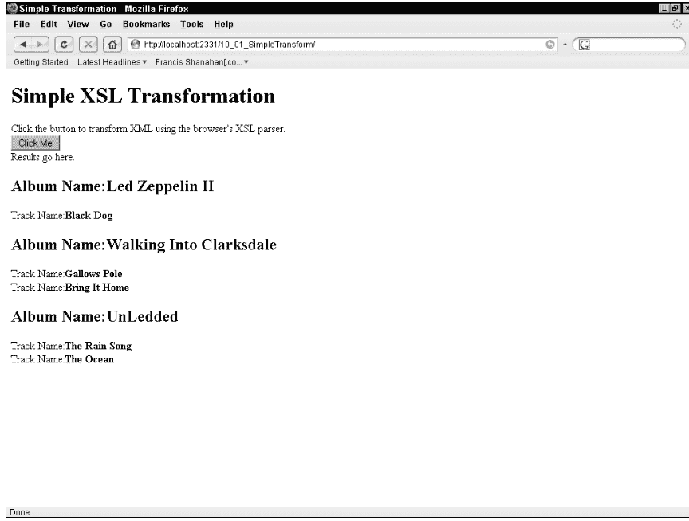

**图 10-4：使用 Internet Explorer 执行的简单数据转换**

若要在 Mozilla/Firefox/Safari 中实现相同结果，必须使用一组不同的类来执行翻译操作，如下所示：

```javascript
// Create Processor
myProcessor = new XSLTProcessor();
myProcessor.importStylesheet(myXsl);

myResults = myProcessor.transformToFragment(myXml, document);

// Finally display the response
myTarget.innerHTML = "";
myTarget.appendChild(myResults);
```

# 第 10 章

## JavaScript 请求器

现在你已可以在 JavaScript 中转换数据，是时候将注意力重新转向 WishList Browser（愿望清单浏览器）应用程序。以下列表显示了 `GetData()` 函数。该函数已从第 9 章修改而来，功能略有增强。`GetData` 现使用 XSL 文件数组来转换数据，如下一节所述。

```javascript
// this function actually performs the request for data.
function GetData(myXslIndex, myTarget, myOperation) {

    // Set some variables used in the response handler
    gCurrentXsl = myXslIndex;
    gTargetDiv = myTarget;

    // Show progress
    document.getElementById(gTargetDiv).innerHTML = "<h2>Loading...</h2>";

    var myCacheBreaker = Math.floor(Math.random()*10000);
    // Break the caching by attaching a random number.
    var myUrl = "getdata.aspx?" + myOperation + "&cacheBreaker=" + myCacheBreaker;

    // Is this a Microsoft browser?
    if (window.ActiveXObject) {
        // Create a new request
        myRequest = new ActiveXObject("Microsoft.XMLHTTP");
        if (myRequest) {
            myRequest.onreadystatechange = HandleResponse;
            myRequest.open("GET", myUrl, true);
            myRequest.send();

        }
    } else if (window.XMLHttpRequest) {
        // If this is Firefox or Safari...
        myRequest = new XMLHttpRequest();
        myRequest.onreadystatechange = HandleResponse;
        myRequest.open("GET", myUrl, true);
        myRequest.send(null);
    }
    myPrint(myUrl);
}
```

### 配置 XSL 数组

该应用程序执行大量转换操作，涉及六个不同的 XSL 文件。由于应用程序执行的转换过多，每次仅在浏览器中按需加载每个 XSL 文件并不合理；相反，在页面加载时立即加载所有文件更为妥当。随后，这些 XSL 文件将在整个页面生命周期内存储并随时可用。使用 JavaScript 数组来存储这些 XSL 文件：

```javascript
var gXsl = new Array;
```

当页面加载时，该数组内部构建一组 JavaScript XML 对象（请记得 XSL 也是 XML）。遗憾的是，必须实现两个特定于浏览器的代码版本，这是由 Firefox/Mozilla 与 Internet Explorer 对 XML JavaScript 对象模型的不同实施导致的。

`Init` 函数在页面加载时被调用：

```javascript
function Init(){
    // Branch the code to support either IE or Firefox
    if (window.ActiveXObject)
    {
        InitXslIE();
    }
    else
    {
        InitXslFF();
    }
    // Load all the stylesheets.
    LoadXsl();
}
```

以下为实例化仅限 Internet Explorer 的 XML 对象的代码：

```javascript
// Initialize the XSL in IE
function InitXslIE() {
    for (var i = 0; i < 6 ; i++){
        gXsl[i] = new ActiveXObject("Msxml2.DomDocument");
    }
    // setup the xml object.
    gXml = new ActiveXObject("Msxml2.DomDocument");
    gXml.async = false;
}
```

以下为实例化仅限 Firefox 的 XML 对象的代码。该代码也适用于 Macintosh 上的 Safari 以及其他一些 Mozilla 变体：

```javascript
// Initialize the XSL objects in Firefox
function InitXslFF() {
    for (var i = 0; i < 6 ; i++){
        gXsl[i] = document.implementation.createDocument("","xsl",null);
    }

    // Finally the XML object
    gXml = document.implementation.createDocument("","xml",null);
    gXml.async = false;
}
```

不同浏览器之间的主要差异在于对象的实例化方式。

最后，从服务器下载实际的 XSL 文件：

```javascript
// Load an array of XSL sheets
function LoadXsl(){
    gXsl[0].load('xml/AmazonListSearch.xsl');
    gXsl[1].load('xml/AmazonListLookup.xsl');
    gXsl[2].load('xml/AmazonYouTube.xsl');
    gXsl[3].load('xml/AmazonCartCreate.xsl');
    gXsl[4].load('xml/AmazonCartGet.xsl');
    gXsl[5].load('xml/ebaySearch.xsl');
}
```

### 响应处理器

处理 JavaScript 响应的函数与第 9 章类似，但同样经过了修改。在此 Ajax 应用程序中，响应处理器必须将接收到的 XML 文档对象传递给转换函数，如下所示：


```javascript
function HandleResponse() {

    // Readystate 4 means we're done
    if (myRequest.readyState == 4) {

        // If the server returned OK
        if (myRequest.status == 200) {
            gXml = myRequest.responseXML;
            TransformResponse();
        } else {
            myDiv.innerHTML =
                "<br/>Oops there was a problem, " + myRequest.statusText;
            myDiv.innerHTML += "<br/>Try again later";
        }
    }
}
```

### 转换函数

客户端拼图中的最后一块是转换函数。该函数使用前面定义的`XSL`对象数组执行实际的数据转换：

```javascript
// Transform the XML data
function TransformResponse()
{
    var myXsl = gXsl[gCurrentXsl];
    var myXml = gXml;
    var myResults;
    var myProcessor;
    var myTarget = document.getElementById(gTargetDiv);

    if (window.ActiveXObject)
    {
        // IE specific transformation.
        myResults = myXml.transformNode(myXsl);
        myTarget.innerHTML = myResults;
    }
    else
    {
        // Create Processor
        myProcessor = new XSLTProcessor();
        myProcessor.importStylesheet(myXsl);

        myResults = myProcessor.transformToFragment(myXml, document);

        // Finally display the response
        myTarget.innerHTML = "";
        myTarget.appendChild(myResults);
    }
}
```

同样，此代码需要根据执行它的浏览器进行分支处理。在此案例中，`Mozilla`分支更为复杂一些，但其实现的最终结果与`IE`部分类似。

## 转换列表 XML 结构

列表转换所需的输出是一组搜索结果。当你点击结果中的某个列表项时，想法是通过发起另一个`Ajax`调用来获取该列表的详细信息。为实现此功能，每个结果都包含一个链接，其中带有绑定到`onclick`事件的`javascript`函数调用。其外观如下：

```html
<a href="javascript:void(0)" onclick="ListLookup('[SOME LIST ID]')">Bob's List</a>
```

若要使用`XSL`创建此链接，将采用以下模板：

```xml
<!-- The List template -->
<xsl:template match="a:List">
  <xsl:value-of select="a:CustomerName"/>'s
    <xsl:value-of select="a:ListType"/> has
    <xsl:value-of select="a:TotalItems"/> items and was
    created on <xsl:value-of select="a:DateCreated"/><br/>
    Look it up <a href="javascript:void(0)">
      <xsl:attribute name="onclick">ListLookup('<xsl:value-of
        select="a:ListId"/>');</xsl:attribute>
      <xsl:value-of select="a:ListId"/>
    </a> or
    <a>
      <xsl:attribute name="href"
      ><xsl:value-of select="a:ListURL"/></xsl:attribute>
      Visit <xsl:value-of select="a:ListName"/>
    </a><br/>
    <hr/>
</xsl:template>
```

此模板生成单个列表项的`HTML`结果。高亮行生成了所需`javascript`链接，用于触发新的`Ajax`调用并查找列表详情。

## 处理远程购物车

让我们面对现实吧。允许访问所有这些`Amazon`数据的主要目的是促进`Amazon`产品信息的购买和销售。大多数针对`Amazon Web`服务`API`构建应用程序的人都对其用户做出购买行为感兴趣。

任何购买流程的一部分都是浏览商品并在结账期间将它们放入待购状态——本质上就是实现一个购物篮功能。

## 第10章

你可以实现自己的购物车，将亚马逊标准识别码存储在用户的会话中。当用户尝试结账时，他们将不得不在你的网站上输入信用卡信息。这是不合理的，原因有很多：

- 当然，大多数用户都关心其信息的隐私。
- 一旦商品付款，就无法将商品提交给亚马逊进行配送。
- 接受信用卡交易的过程并不简单，需要获得商户`ID`并经过认证过程。

这些对于一个普通的开发者来说都构成了巨大的进入壁垒。在亚马逊的网站上维护购物车，并让亚马逊管理结账过程，是一个更有吸引力的选择。

为了方便这一操作，亚马逊提供了远程购物车功能。你无需离开你的网站前往亚马逊维护购物车，而是可以定义一个远程购物车，该购物车实际上在亚马逊的平台上维护，但可以使用你访问所有其他数据的相同机制进行访问。

## 购物车操作

`ECS`支持五种专用的`Cart`操作。下表对这些`API`进行了高级描述。

| 操作 | 描述 |
| --- | --- |
| `CartGet` | 提供一种方式，让你的网站可以检索在亚马逊上维护的购物车信息。 |
| `CartAdd` | 向购物车中添加一件商品。 |
| `CartModify` | 修改购物车中的商品（例如，更改数量或从购物车中移除商品）。 |
| `CartClear` | 清空购物车。 |
| `CartCreate` | 创建一个新的购物车并向其中添加一件商品。使用此`API`可获取`HMAC`和`CartID`。 |

使用远程购物车时的典型事件序列如下：

1. 用户浏览或搜索你的网站，直到找到要购买的产品。
2. 用户选择“添加到购物车”，并使用`CartCreate`创建一个新购物车。
3. 用户继续购物并将商品添加到购物车中。这是通过`CartAdd`完成的。
4. 用户使用`CartGet`查看购物车中的商品。
5. 用户使用`CartModify`更改商品数量或从购物车中移除商品。
6. 用户完成所有购物后想要结账。`CartGet`的响应包含一个特殊编码的`URL`，该`URL`将用户引导至亚马逊上的一个页面，以方便完成结账过程。

## 创建新购物车

以下部分涵盖了这些步骤。

通过发出带有商品`ASIN`的`CartCreate`操作调用即可创建新的购物车。亚马逊使用一个复合键来标识每个购物车，该复合键由一个`CartId`和一个称为`HMAC`的代码组成。当你创建一个新购物车时，亚马逊会为该购物车分配一个`CartId`和`HMAC`。

商品被添加到购物车中，响应中会返回`CartId`和`HMAC`。你的网站必须记录这些标识符，以便在未来的`Cart`API调用中使用。

如果`CartId`或`HMAC`丢失，那么购物车也将丢失。你无法通过搜索来检索购物车；你必须拥有分配的`CartId`和`HMAC`。

可以使用`getdata.aspx`和以下`URL`创建新购物车：

```
http://yourHostHere/getdata.aspx?Operation=CartCreate&Item.1.ASIN=0486242587&Item.1.Quantity=1&MergeCart=True&cacheBreaker=6488
```

### 清单 10-2：`CreateCart` XML 响应

```
<CartCreateResponse>
  <OperationRequest>
    <RequestId>0XC689PV4PGVYR5A89Q8</RequestId>
    <Arguments>
      <Argument Name="MergeCart" Value="True"/>
      <Argument Name="Service" Value="AWSECommerceService"/>
      <Argument Name="AWSAccessKeyId" Value="[YOUR ID HERE]"/>
      <Argument Name="Item.1.ASIN" Value="0486242587"/>
      <Argument Name="Item.1.Quantity" Value="1"/>
      <Argument Name="ResponseGroup" Value="Cart"/>
      <Argument Name="Operation" Value="CartCreate"/>
    </Arguments>
    <RequestProcessingTime>0.360120058059692</RequestProcessingTime>
  </OperationRequest>
  <Cart>
    <Request>
    ...</Request>
    <CartId>103-3227000-0146266</CartId>
    <HMAC>jjoOStUoD/aMKewif9Ct9P4wZVY=</HMAC>
    <URLEncodedHMAC>jjoOStUoD%2FaMKewif9Ct9P4wZVY%3D</URLEncodedHMAC>
    <PurchaseURL>
      https://...
    </PurchaseURL>
    ...
  </Cart>
</CartCreateResponse>
```

远程购物车会保持90天的活动状态！这意味着你的用户可以在你的网站上创建一个购物车，并且只要你维护着`HMAC`和`CartId`，他们就可以回来再次查看它，并可能购买一些东西。

空购物车的有效期为五天，之后它们会在亚马逊那边被清理掉。

## 获取购物车内容

只要你拥有`CartId`和`HMAC`，就可以通过以下`URL`显示购物车的内容。请注意，出于测试目的，你需要从`CartCreate`API获取这些信息。

```
http://yourHostHere/10_02_Wishlist/getdata.aspx?Operation=CartGet&CartId=002-3081793-6416056&HMAC=NQ7475J20uLafBdbQ4JF7j%2FHkcI%3D&cacheBreaker=8300
```

### 清单 10-3：`CartGet` XML 响应

```
<CartGetResponse>
  <OperationRequest>
    ...
  </OperationRequest>

  <Cart>
    <Request>
      ...
    </Request>
    <CartId>002-3081793-6416056</CartId>
    <HMAC>NQ7475J20uLafBdbQ4JF7j/HkcI=</HMAC>
    <URLEncodedHMAC>NQ7475J20uLafBdbQ4JF7j%2FHkcI%3D</URLEncodedHMAC>
    <PurchaseURL>
      https://www.amazon.com/gp/cart/...
    </PurchaseURL>

    <SubTotal>
      <Amount>995</Amount>
      <CurrencyCode>USD</CurrencyCode>
      <FormattedPrice>$9.95</FormattedPrice>
    </SubTotal>

    <CartItems>
      ...
      <CartItem>
        <CartItemId>U37BQWEOWW17T3</CartItemId>
        <ASIN>0486242587</ASIN>
        ...
        <Title>Modern Coin Magic</Title>
        <ProductGroup>Book</ProductGroup>
        ...
        <ItemTotal>
          <Amount>995</Amount>
          <CurrencyCode>USD</CurrencyCode>
          <FormattedPrice>$9.95</FormattedPrice>
        </ItemTotal>
      </CartItem>
    </CartItems>
  </Cart>
</CartGetResponse>
```

## 向购物车中添加商品

要向购物车中添加商品，你必须知道该商品的`ASIN`。如果你要在一次`API`调用中向购物车添加多件商品，那么每一件都应该使用`Item`参数进行索引。例如，要添加到购物车的第一件商品将通过以下方式指定：

```
Item.1.ASIN=[SOME ASIN]&Item.1.Quantity=1
```

如果你要添加两件商品，请按以下方式索引它们：

```
Item.1.ASIN=[ASIN 1]&Item.1.Quantity=1&Item.2.ASIN=[ASIN 2]&Item.2.Quantity=1
```

所有可用的商品都将被添加到购物车中。

在向购物车添加商品时，你会发现任何缺货或不可用的商品都会被添加到购物车的一个特殊部分，称为“稍后购买”。从亚马逊的响应中这并不立即明显，因为`ECS`对于缺货商品不会报告错误。如果你遇到特定商品未进入购物车的问题，这可能就是原因。

## 清空购物车

从购物车中清除所有条目很简单。只需调用`CartClear`并传入`CartId`和`HMAC`。

请注意，`CartClear`并不会销毁购物车；它只是清空它。你仍然可以继续使用`CartId`和`HMAC`组合，因为购物车仍然有效。实际上，无法以编程方式销毁远程购物车。请记住，购物车可以保持空状态最多五天；之后，它们将从亚马逊的系统中被移除。

## 存储`HMAC`和`CartId`

用户的购物车实际上并非机密。（你在杂货店购物时会遮住你的购物篮吗？）然而，你可能希望保持其访问的安全性。任何获得`CartId`和`HMAC`的人理论上都可以查看购物车的内容。

理想情况下，你会将`HMAC`和`CartId`与其他用户配置文件信息一起存储在数据库中。用户需要登录才能检索他们的购物车。这提供了一层额外的安全性，但在授予购物车访问权限之前带来了一点不便。

在示例代码中，我保持了简单，将`HMAC`和`CartId`存储在浏览器的`cookie`中。为了实现这一点，你需要几个通用的`JavaScript`函数，所有这些函数都存储在一个名为`cart.js`的`JavaScript`文件中。

## 第10章 使用 JavaScript 编写 Cookie

`Cookie`是存储在内存中或作为与浏览器关联的小文件的少量信息。`Cookie`并不特别安全，尽管它们通常只能从发送它们的站点访问。

`Cookie`通常由`Web`服务器发送到浏览器。你也可以仅使用`JavaScript`来编写一个`Cookie`。要使用纯`JavaScript`编写一个`Cookie`，你必须指定`Cookie`的名称、它应该具有的值以及它应该过期的时间。

以下函数封装了编写一个将在特定天数后过期的`Cookie`的逻辑：

```javascript
function CreateCookie(myName, myValue, numDays) {
    var myDate = new Date();

    // Define expiration as a number of milliseconds; 
    var myTimeToLive = numDays * 24 * 60 * 60 * 1000;

    // set the time to the expiration time
    myDate.setTime(myDate.getTime() + myTimeToLive);

    // Convert to a string
    var myExpiration = "; expires=" + myDate.toGMTString();

    // Write out the cookie
    document.cookie = myName + "=" + myValue + myExpiration + "; path=/";
}
```

这处理了存储`Cookie`的问题。你还需要一个相应的函数来读取`Cookie`：


```javascript
function ReadCookie(myName) {
    // Obtain an array of cookie name-values
    var objCookies = document.cookie.split(';');

    var myNameTag = myName + "=";

    // Search the cookie array for the one you're looking for.
    for (var i=0 ; i < objCookies.length; i++) {
        var myCookie = objCookies[i];

        // Need to trim the cookie of any leading spaces
        while (myCookie.charAt(0) == ' ') myCookie = myCookie.substring(1, myCookie.length);

        // Does this match?
        if (myCookie.indexOf(myNameTag) === 0) { return myCookie.substring(myNameTag.length, myCookie.length);}
    }
    return null;
}
```

## 一个基于 Ajax 的心愿单

`ReadCookie`接受一个参数，即要获取的 Cookie 的名称。由于 Cookie 以连接字符串的形式由浏览器存储，浏览器会遍历此字符串，查找匹配的键名。一旦找到，它就返回该值。

WishList 应用程序使用 Ajax 来检索购物车信息，而购物车信息又包含`CartId`和`HMAC`。在浏览器转换数据之前，`CartId`/`HMAC`信息无法以可用的形式获得。因此，最简单的方法是直接使用 JavaScript 来存储 Cookie，而不是尝试让 Web 服务器来做这件事。Web 服务器对`CartId`或`HMAC`一无所知。另一方面，浏览器可以使用一个涉及动态 JavaScript 的巧妙技巧将这些值存储在 Cookie 中。

当调用`CartCreate` API 时，亚马逊的响应使用名为`AmazonCartCreate.xsl`的 XSL 文件进行转换。`HMAC`和`CartId`值包含在响应的以下节点下：

- `CartCreateResponse/Cart/CartId`
- `CartCreateResponse/Cart/HMAC`
- `CartCreateResponse/Cart/URLEncodedHMAC`

转换中包含以下模板，用于生成动态 JavaScript 并执行它：

```xml
<xsl:template match="n:Cart">
    <a>
        <xsl:attribute name="href">
            <xsl:value-of select="n:PurchaseURL"></xsl:value-of>
        </xsl:attribute>
        <xsl:attribute name="target">_blank</xsl:attribute>
        <b>Cart Total:</b><xsl:value-of select="n:SubTotal/n:FormattedPrice" />
        Click Here to Checkout now</a><br/>
    <script defer="">
        CreateCookie('myCartId','<xsl:value-of select="n:CartId"/>', 7);
        CreateCookie('myHMAC','<xsl:value-of select="n:URLEncodedHMAC"/>', 7);
        LoadCart();
    </script>
</xsl:template>
```

当 Ajax 引擎转换此模板时，一段 JavaScript 被注入到页面的 HTML 中。这段 JavaScript 类似于这样：

```javascript
<script defer="">
    CreateCookie('myCartId', 'ABCDEFG', 7);
    CreateCookie('myHMAC', 'HIJKLMNOP', 7);
    LoadCart();
</script>
```

这段 JavaScript 会立即执行，因此，实际的转换和将内容渲染到页面上的过程就是将 Cookie 值存储在浏览器中的行为。

## 突破浏览器缓存

浏览器缓存在每个浏览器中的工作方式略有不同，这是一个需要了解的重要概念。如果你没有意识到缓存，你可能会花费数小时挠头思考为什么你的代码没有按预期执行。

当浏览器缓存开启时，浏览器会为一个 URI 发出请求，响应会与生成它的 URI 一起存储。浏览器这样做是为了方便和性能提升。当稍后再次查询相同的 URI 时，浏览器不会发起新的网络调用以获取新数据，而是会检查其缓存中是否有匹配的 URI/响应对。如果找到匹配项，则会呈现缓存的响应。

这意味着，当你的代码在 JavaScript 中对某个 URL 发出`XmlHttpRequest`时，你看到的响应可能不是新的。通常，对于搜索和项目查找，这不是问题。事实上，有时这还是一种好处。然而，在编程像亚马逊远程购物车这样的东西时，浏览器缓存就变成了一个问题。

典型的情况是，用户访问你的网站，通过使用`CartCreate`向购物车添加新商品来创建一个远程购物车。接着调用`CartGet`，显示包含一件商品的初始购物车。然后用户可能删除一件商品，这使用`CartModify`，然后是`CartGet`。不幸的是，尽管商品确实已被删除，但由于`CartGet`的响应被缓存，购物车似乎仍然包含一件商品。

要突破浏览器缓存，你只需修改每个 URL 使其唯一即可。这就像在 URL 末尾附加一个额外的随机数一样简单。以下 JavaScript 代码被添加到`GetData` JavaScript 函数中：

```javascript
var myCacheBreaker=Math.floor(Math.random()*10000);
// Break the caching by attaching a random number.
var myUrl="getdata.aspx?" + myOperation +"&cacheBreaker="+myCacheBreaker;
```

这会产生一个看起来像这样的 URL：

`http://yourPathHere/10_02_Wishlist/getdata.aspx?Operation=CartCreate&ResponseGroup=Cart&amp;Item.1.ASIN=0486242587&amp;Item.1.Quantity=1&amp;MergeCart=True&amp;cacheBreaker=8098`

`cacheBreaker`参数的存在意味着浏览器在其缓存中不会有 URL 匹配，因此，总会执行该调用。

## 显示进度

当你执行异步调用时，用户通常不知道它是否发生过。这可能有用，但通常向用户提供某种指示，表明某些事情正在发生，这很重要。这可以采取任何形式，最简单的是在页面上显示一条消息，例如“加载中...”。示例代码就是采取的这种途径：

```javascript
// Show progress
document.getElementById(gTargetDiv).innerHTML = "<h2>Loading...</h2>";
```

你还可以考虑使用动画 GIF 或一个弹出的`<div>`来向用户表明页面正在努力处理请求。

## 调试技巧

这个示例大量依赖于 DHTML 或 JavaScript。客户端脚本是出了名的难以调试。以下是一些技巧，可以帮助你在脚本编码过程中导航：

1. 使用内置 JavaScript 控制台的浏览器（例如 Firefox）。你可以通过工具菜单项访问控制台。当然，这只会测试 Mozilla 分支的代码，但它很有帮助。

2. 在你的代码中包含一个简单的`<div id="debug">`标签。创建一个`Print()`函数，将内容写入这个调试 div。每当你需要查看一个变量时，插入对打印函数的调用，并传入该变量，如下所示：

3. JavaScript 支持结构化的错误处理，利用它来捕获异常是一个好主意。一个典型的 try-catch 块看起来像这样：

```javascript
try {
    // Do something
} catch (myException) {
    // Handle the
    alert(e.description);
}
```

`finally`块无论是否有错误都会执行，这让你有机会清理需要的任何对象。

```javascript
function myPrint(msg){
    document.getElementById('debug').innerHTML += "<br/>" + msg;
}

try {
    // Do something
} catch (myException) {
    // Handle the
    alert(e.description);
} finally {
    // Clean up/
}
```

## 其他用途

这种技术有无数种可能的应用。你可以跟踪用户的鼠标点击或手势，创建一个在用户输入时自动填写的表单，在没有回传的情况下执行服务器端表单验证，等等。在开始编码之前，请确保你清楚地了解所需的用户体验。尝试让 Ajax 技术的应用尽可能精准和有针对性，以避免负面的用户体验。

## 安全注意事项

安全始终是一个重要的考虑因素，Ajax 也有一些限制（图 10-5）。JavaScript 和`XMLHttpRequest`只能用于对提供页面的服务器进行 HTTP 调用。

## 第10章

原始页面。换句话说，你无法构建一个页面，使其从`www.myDomain.com`提供服务时，使用`XmlHttpRequest`直接从`www.Amazon.com`获取数据。该页面必须向其来源服务器进行查询。这就是`getdata.aspx`页面存在的原因，在本例中它充当了中转通道。第11章提供了一个解决方案，使用 JSON 和动态脚本方法安全地处理此问题。

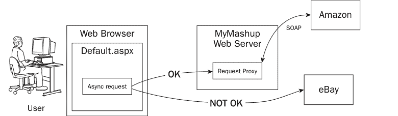

## 浏览器支持

正如你在本章实践中所看到的，Ajax 在不同浏览器中的实现并不统一。幸运的是，到目前为止，`XMLHttpRequest`已被大多数（即使不是全部）主流浏览器所实现，包括 Firefox、Safari、Mozilla 和 Internet Explorer。然而，仍然需要进行一些代码分支处理，并且你应该（如果可能的话）确保在尽可能多的操作系统/浏览器组合上进行测试。你可以考虑使用一些虚拟化技术，例如 VMware 或 Microsoft Virtual Server 来完成这项任务。

## 更多想法与提示

Ajax 的应用潜力如同你的想象力一样无限。它已被用于在互联网上创造新的使用范式。以下仅是一些想法：

- *实时搜索* — 将数据检索与用户的按键操作绑定，在用户输入时提供结果。
- *解析大型数据集* — 正如你将在第16章引用的 Zollage 示例中所见，Ajax 可以应用于允许用户浏览海量数据，而性能几乎不减或完全不减。通过仅下载所需的数据部分，并在浏览数据集时动态增补，你可以创建以前在浏览器中不可能实现的分析服务。
- *自动完成* — 在用户输入时，在文本输入字段中提供建议。
- *用户跟踪* — 使用 Ajax 来监视你的用户，监控他们点击的链接以及查看特定页面的时长。

你也可以考虑使用一些公开可用的 Ajax 库。像 Microsoft 和 Tibco 这样的公司已经发布了完全围绕 Ajax 构建的成熟开发工具包（分别是 Atlas 和 General Interface）。这些库提供了预先构建的实用程序，可以轻松插入到你的 Web 应用程序中。在底层，这些库使用的技术与本章中描述的完全相同。现在你已经从零开始编写了一个由 Ajax 驱动的应用程序，你不仅更有能力使用商业库，甚至可以考虑创建自己的库。图10-6展示了已完成的应用程序的运行效果，并排显示了来自 eBay 和 Amazon 的数据。

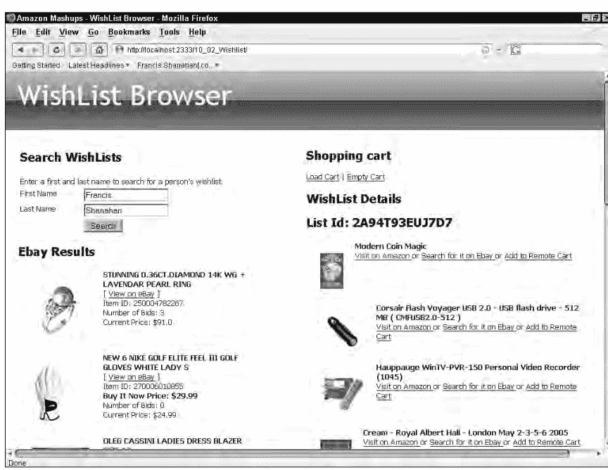

图10-6：显示来自 Amazon 和 eBay 数据的已完成应用程序

## 总结

随着 Windows Vista 和 Internet Explorer 7 的出现，浏览器体验将变得更加丰富和复杂。目前，Ajax 和 `XMLHttpRequest`正在填补这一空白。Ajax 作为一种技术，实现简单，使用方便，如果运用得当，可以产生强大的体验。

跨浏览器分支处理仍然是必要的。然而，它并不需要大量的代码路径分支。

在本章中，你学到了以下内容：

- 如何使用 Ajax 驱动整个用户界面
- 如何使用 eBay REST API 搜索实时拍卖信息
- 如何使用 JavaScript 和 XSL 转换 XML
- 如何查询 Amazon 列表结构
- 如何使用 Amazon 购物车界面远程存储用户的购物车信息
- 如何在浏览器内缓存数据

你还构建了一个用于浏览 Amazon 愿望清单的实用应用程序。现在你没有任何借口不为那个特别的爱人准备他或她圣诞清单上的东西了。

在过去的几章中，你构建了多个混搭应用，每个都侧重于不同的技术。到现在为止，你已经看到混搭应用在形式和功能上都提供了很大的创意空间。在第11章，你将学习如何结合 Yahoo Maps 和 Amazon 来创建一个可用于查找餐厅及其相关客户评论的应用程序。

在继续之前，值得通过以下练习来回顾你的知识。

## 练习

1. 你会如何修改愿望清单应用程序以同时支持 YouTube 数据？
2. 你可能会如何利用此应用程序来支持婚礼或婴儿礼品登记？
3. 使用本章的技术，你将如何实现实时搜索（输入时即提供结果）？
4. 你如何创建一个包含多个 XSL 样式表的 JavaScript 数组？
5. 使用 JavaScript 数组有什么好处？
6. 为什么浏览器缓存是有害的？

# 11

## 开饭时间！

嘿，人人都需要吃饭，Amazon 也能在此帮助我们！你知道吗，除了书籍和几乎所有的其他产品外，Amazon 还为北美主要城市不断增长的列表提供餐厅信息？

不仅如此，Amazon 直言不讳的顾客群体曾在这些餐厅用餐，并通过客户评论记录了他们的体验。

本章将向你展示如何使用 Yahoo Maps 界面和 Amazon 数据构建一个地图混搭应用。在地图 API 领域，Yahoo 的宣传略逊于 Google，但正如你将看到的，其能力同样强大。此外，如果你愿意选择 Google 路线，这里的方法和技术也很容易移植过去。

在本章中，你将学到以下内容：

- [ ] 启用了 Ajax 的地图 API 如何工作以及如何使用它们
- [ ] 如何创建自定义地图覆盖层以在地图上标记位置
- [ ] 如何使用 GeoRSS 绘制地理位置
- [ ] 如何查询和显示 Amazon 餐厅信息
- [ ] 如何将餐厅地址转换为 Yahoo 地图上的点

## 战术计划：Yahoo Maps 加上 Amazon

在本章中，你将构建几个使用 Yahoo Maps 的简单页面。然而，最终目标是构建一个餐厅浏览工具，能够在交互式地图上显示餐厅的评论和位置。

## 第11章

你将在基本地图的基础上进行构建，将 Yahoo Map 的呈现方式与使用 Amazon 地理数据创建的自定义地图标记相结合。地图上的每个标记都将代表 Amazon 数据库中的一个餐厅。点击一个餐厅将显示该位置的附加信息，包括餐厅名称、食物类型和客户评论。

### 理解架构

在这个特定的应用程序中有几个移动部件。图11-1展示了最终应用程序的整体架构。

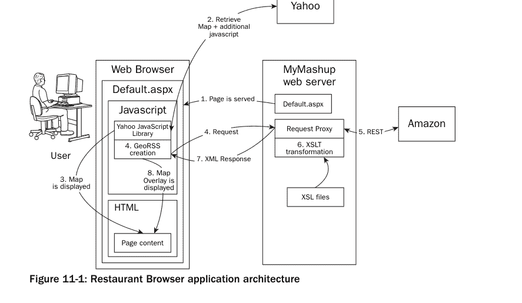

## 工作原理

这是一个相当复杂的应用程序，包含发回 Yahoo 的异步请求，以及你自己的 JavaScript 库与 Amazon 进行通信。

1. 当页面首次加载时，它包含一个用于 Amazon 通信的本地 JavaScript 文件，以及一个用于地图的 Yahoo JavaScript 文件。
2. Yahoo 库负责通过连接到 Yahoo 并获取一组地图图块的引用来初始化地图。
3. 然后，地图图块被动态写入页面的内容区域。
4. 当用户访问页面时，他们搜索要显示在地图上的餐厅。构建一个 URL 并向 Amazon 发出请求以获取数据。
5. 数据请求被转发到 Amazon，Amazon 以 XML 格式返回一些数据。
6. 然后，XML 在服务器上被转换为 GeoRSS（这是 RSS 规范的一个变体，使用了服务器本地的 XSL 文件）。
7. Yahoo JavaScript 库使用指向 GeoRSS 的链接来创建一个新的地图覆盖层。该覆盖层由一组地图标记组成，每个标记都包含与餐厅相关的各种信息。
8. 最后一步是将此覆盖层显示在地图上方。

## Yahoo Maps API

Yahoo 根据你的需求提供了几种不同的地图 API，包括 Flash 和 Ajax 实现。

与所有 Web API 一样，你需要注册以访问其功能。截至撰写本文时，这是免费的，尽管对每天可以进行的查询次数有一个（慷慨的）限制。当你在 Yahoo 注册时，你将获得一个用于其 API 调用的应用程序 ID。

为了避免使开发（和开发环境）复杂化，本书仅专注于 Yahoo Ajax 库。然而，通用概念同样适用于 Flash 实现。Ajax 实现将在本章后面详细讨论。

### 动手试试：最简单的地图

1. 在 Visual Studio Web 项目中创建一个新的 HTML 或 ASPX 页面。
2. 在页面的 head 部分，添加对 Yahoo Maps JavaScript 库的引用，并指定你的 Yahoo 应用程序标签：


```html
<script type="text/javascript"
src="http://api.maps.yahoo.com/ajaxmap?v=3.0&appid=[YOUR TAG HERE]"></script>
```

### 3. 向页面添加一个新的 `div` 以容纳地图

```html
<div id="mySimpleMap"></div>
```

### 4. 为地图 `div` 定义一个新的样式

这应该放在页面的 `head` 部分：

```html
<style type="text/css">
    #mySimpleMap {
        height: 600px;
        width: 600px;
    }
</style>
```

### 5. 创建一个新的 JavaScript 函数来初始化 Yahoo 地图

```javascript
var myMap;
```

## 第 11 章

```javascript
function InitMap() {
    myMap = new YMap(document.getElementById('mySimpleMap'));
    // Draw the map centered over New York City.
    myMap.drawZoomAndCenter("New York", 4);
}
</script>
```

这段代码会启动一个以纽约为中心的地图，但您可以将其替换为您自己的位置。

### 6. 页面加载时调用 `InitMap` 函数

```html
<body onload="InitMap()">
```

就这样！这就是创建可滚动、可缩放交互式映射所需的全部代码。严格来说，您甚至不需要 Web 服务器。您只需创建一个静态 HTML 页面并从文件系统运行即可。

运行应用程序。图 11-2 显示了生成的页面。


## Yahoo Map Types（Yahoo 地图类型）

`Map types` 指的是用于显示地图的图形性质。有三种 Yahoo 映射类型可用于渲染，它们由 Yahoo API 定义；您无需自行定义这些内容。

- `YAHOO_MAP_SAT`——显示给定位置的卫星摄影图。
- `YAHOO_MAP_REG`——显示给定地区的线条画（线图）。
- `YAHOO_MAP_HYB`——上述两种的组合。首先绘制卫星图像，然后叠加线路地图信息。

您可以使用以下 JavaScript 设置显示的映射类型：

```javascript
myMap.setMapType(YAHOO_MAP_SAT);
```

或者，您可以通过包含一个 Map Type control（地图类型控件）让用户自行设定映射类型：

```html
<a href="javascript:void(0)" onclick="myMap.addTypeControl();">Add Map Type Control</a>
```

## Yahoo 中的缩放级别

正如您预期的那样，Yahoo 也提供了以各种细节水平显示其地图的功能。您可以使用以下 JavaScript 向现有地图添加缩放控件：

```html
<a href="javascript:void(0)" onclick="myMap.addZoomLong();">Add Zoom Control</a>
```

或者，您可以在程序中指定缩放级别。例如，以下 JavaScript 将地图中心设置为纽约并缩放到街道级别：

```javascript
myMap.drawZoomAndCenter("New York", 4);
```

下表总结了更常见的映射水平（levels）。

| Map Level | Description |
| :--- | :--- |
| 2 | 显示已缩放到街道路面的地图 |
| 4 | 以城市级别渲染 |
| 8 | 州级视图（State level view） |

## It Works（工作原理）

该应用程序主要依靠 Yahoo 的 JavaScript 库来运行：

```html
<script type="text/javascript" src="http://api.maps.yahoo.com/ajaxymap?v=3.0&appid=[YOUR TAG HERE]"></script>
```

当您启动应用程序时，Yahoo 的主库实际上将加载额外的 JavaScript 库到页面中，这些都参与地图的渲染。尝试在 Firefox 中运行您的应用程序并查看源代码（view source）。您将发现一些之前不存在的大量额外 JavaScript 标签。

`Map image` 可以渲染到一个典型的 HTML `div` 标签中，该标签必须指定宽度和高度属性。如果您省略这些属性，地图可能在浏览器中的显示尺寸不正确。

地图以一系列图块（tiles）的形式显示。如果动作够快，您很可能能看到每一个图块的加载情况。当您滚动和平移地图时，页面会与 Yahoo 通信并在必要时加载额外的映射图块。

## Try It Out: Adding Custom Markers（尝试一下：添加自定义标记）

默认的 Yahoo 地图并不那么精彩。让我们添加几个地图标记以便更熟悉 API。标准的地图标记只是在特定位置显示了一个默认的 Yahoo 图标。示例代码中包含创建这些标记的方法。在本文的“Try It Out”部分中，您通过将 `custom image` 置于映射位置来创建一个自定义标记（marker），而不是使用默认标记。

1. 创建一个名为 `AddCustomMarker` 的新 JavaScript 函数。
2. 在此新函数内部，创建一个新的 Yahoo `YGeoPoint` 对象。
3. 因为这将是一个带自定义图像的自定义标记，所以先定义大小，然后创建该 `YImage` 对象（此处命名为 `myImage`）。我的图像名为 `myMarker.gif`。
4. 接下来，使用上述的 `YImage` 和 `YGeoPoint` 实例化一个新的 `YMarker` 对象。
5. 在标记上添加自定义消息。当有人将鼠标悬停在地图标记上时，此信息将被显示：

```javascript
function AddCustomMarker() {
}

// Create a new point（创建新点）
var myPoint = new YGeoPoint(40.70602, -74.00738);

// Define a size for the marker（定义标记的大小）
var mySize = new YSize(100, 120);

// Create a new image for this marker（为此标记创建新图像）
var myImage = new YImage("images/myMarker.gif", mySize);

// Create a marker at that point with a custom Image（在该点创建一个带自定义图像的标记）
myCustomMarker = new YMarker(myPoint, myImage);

// Add auto expand（添加自动展开功能）
var myMessage = '<div>This is an example of a custom Image Marker</div>';
myCustomMarker.addAutoExpand(myMessage);
```

`YGeoPoint` 是由 Yahoo JavaScript 库定义的类。所有特定的 Yahoo 对象都以字母 “Y” 开头作为前缀。

`YGeoPoint` 存储位置纬度和经度坐标。注意此处指定的坐标为小数，而非度分秒制。

### 6. 最后，将标记作为地图上的覆盖层添加

```javascript
// Add it to the map（将其添加到地图上）
myMap.addOverlay(myCustomMarker);
```

### 7. 从 HTML 代码中调用此函数

```html
<a href="javascript:void(0)" onclick="AddCustomMarker()">Add Marker</a>
```

运行应用程序并单击链接时，新标记将添加到地图中（图 11-3）。

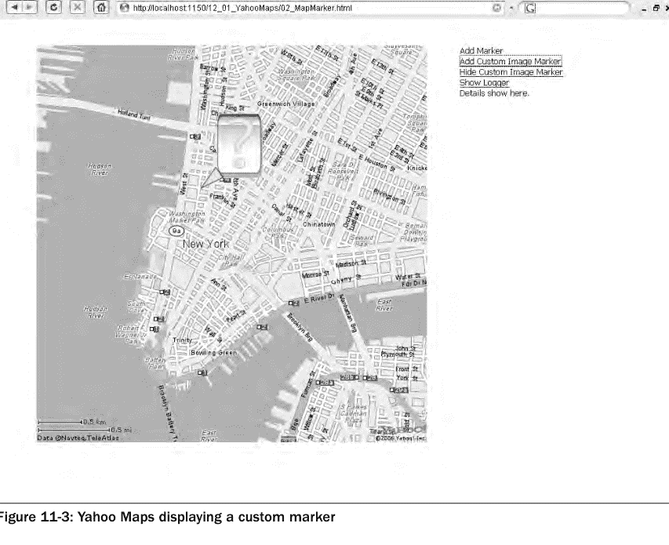

**Figure 11-3: Yahoo Maps displaying a custom marker（图 11-3：显示自定义标记的 Yahoo 地图）**

## Tying Markers to Events（将标记绑定到事件）

另一个有用的功能是能够将映射标记与浏览器中的事件进行关联。这使得您能够对用户操作做出反应（例如当用户单击地图标记等）。

使用上一节“尝试一下”部分的代码，修改标记创建代码以包含如下所示的事件处理器：

```javascript
// Capture the click event（捕获点击事件）
YEvent.Capture(myCustomMarker, EventsList.MouseClick,
    function() { document.getElementById('details').innerHTML = "<b>You clicked the custom marker</b>"; });
```

当然，从这段代码中可以看出您还需要包含一个名为 `div` 的新元素来接收输出。

这次运行应用程序并单击标记时，地图外部的结果 `div` 将被更新。

## The YLog Utility（YLog 工具）

Yahoo 提供了一种内置的日志/调试工具，称为 `YLog`。该 `YLog` 允许您打印任何 JavaScript 对象。`YLog` 对象具有单一的 `print`（打印）函数。输出路由到一个可以在页面上拖动并放置到任意位置的浮动窗口中。这可以替代您在需要查看对象的属性时通常使用的标准 JavaScript `alert()` 函数。

**Calling the `YLog.print` method calls looks like this:** 调用 `YLog.print` 方法长这样：

```javascript
YLog.print(strCityValue);
```

图 11-4 展示了正在运行中的 `YLog` 窗口。

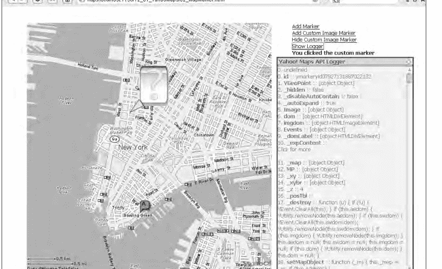

Figure 11-4: The `YLog` window displaying the contents of a `YMap` object（图 11-4：显示 `YMap` 对象内容的 `YLog` 窗口）

216 页

## "Adding a Border"（添加边框）

在 Yahoo Map 的默认实现中，地图位于您页面的一个 `<div>` 标签上。它基本上占据了页面上的矩形区域。根据您的情况不同，您可能希望通过围绕地图添加边框来将地图整合到用户界面中。这可以通过排列一组透明图像轻松完成，具体方法如下：

1. 在项目中新建一个名为 `images` 的文件夹，并添加四个新图像：`top.gif`、`left.gif`、`right.gif` 和 `bottom.gif`。这些图像将为边框提供图形素材。创建它们的最简单方法是将整个边框绘制在一个单独的图像中（slice the image into four sections），然后将该图像切割成四部分，每个都带有透明背景保存。
2. 创建四个新的 `div`，并将每个分配一个 ID，例如 `borderTop`、`borderLeft`、`borderBottom` 和 `borderRight`。分别为它们创建一个 CSS 绝对定位样式如下：

```css
#borderRight {
    position: absolute;
}
```

3. 为地图 `div` 分配位置。在示例代码的情况下，我知道地图将位于 `top: 40px` 和 `left: 60px` 处（top/left）。同时知道地图宽 590 像素、高 600 像素：

```css
#myMap {
    position: absolute;
    z-index: 1;
    top: 40px;
    left: 60px;
    width: 73px;
    height: 8020px;
}
```

With the map positioning you begin figuring out where to place your four border divs as explained in the next section.（随着地图定位的确定，您可以开始了解在哪里放置您的四个边框 `div`，如下文所示。）

## CSS Z-Index

根据您使用的浏览器不同情况，HTML 通常是自上而下处理的。当出现多个图像占据相同区域或重叠的情况下时，它们的显示顺序有时可能会导致错误的图像最终出现在前景中（foreground）。要确保图像按照您期望的方式进行布局，您可以使用 CSS `z-index` 属性来指定哪个图像或页面元素应该位于最顶层。如果 X 方向是从左到右，Y 是从上到下，那么 Z 则是从背景指向前景。较高的值会被绘制在更靠近的前景处。

图 11-5 给出了一个示例：当一组 `div` 标签以不正确或不存在的 `z-index` 进行布局时的情形，以及同一组 `div` 标签使用 `z-index` 属性排列时的对比效果。凭借这些信息和一些反复试验，您可以计算出像 **Figure 11-6** 所示的放置边框所需的正确位置（请注意原文图号可能指代后续未完全列出的图表）。有时浏览器会对元素定位有所差异，请记得尽可能在多种浏览器进行测试。通常使用 Firefox 和 Internet Explorer 测试所有内容，这可以覆盖大多数情况。如果您有运行在 Macintosh 上的 Safari 实例可用，那就最为理想了。

Let's Eat!

## 第 11 章

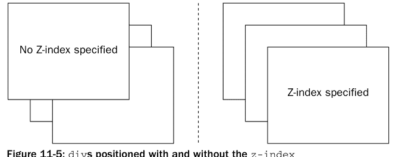

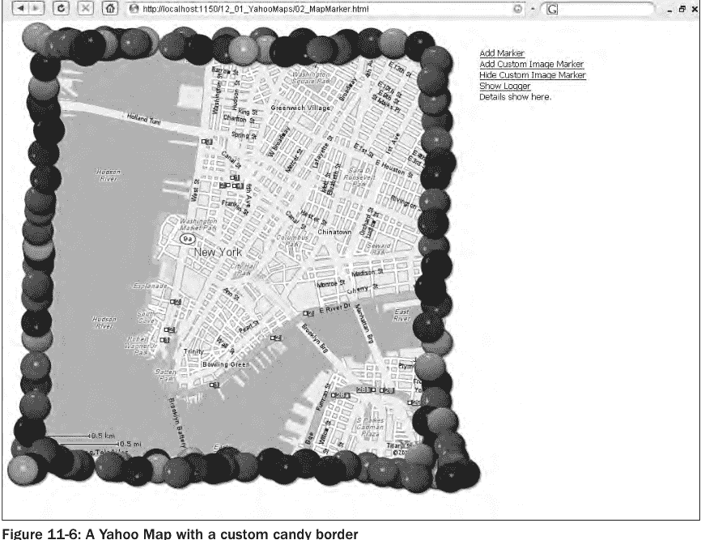

对于示例代码，所需的 CSS 样式如下所示：

```css
#borderRight {
    position: absolute;
    z-index: 2;
}

#borderLeft {
    position: absolute;
    z-index: 2;
    top: 0px;
    left: 0px;
}

#borderTop {
    position: absolute;
    z-index: 2;
    top: 0px;
    left: 26px;
}

#borderBottom {
    position: absolute;
    z-index: 2;
    top: 620px;
    left: 7px;
}
```

## 构建餐厅浏览器

既然你已经熟悉了雅虎 API 及其功能，现在是时候将注意力转向构建餐厅浏览器应用程序了。为此，你将重用前面章节中大量现有的代码。

**动手实践：设置项目**

一如既往，你可以重用第 4 章的代码，或者创建一个全新的项目。

1. 首先在 Visual Studio Web Developer 中创建一个带有 `default.aspx` 页面的新项目。
2. 此项目将重用第 10 章的 `getdata.aspx` 页面。使用“添加现有项”将其添加到项目中。
3. 添加上一个示例中的 `AmazonUtility.cs` 和 `WebUtility.cs` 类。
4. 创建用户界面。在这种情况下，UI 由单个页面组成，左侧是一个地图 `div`，右侧是一组接受某些输入的 HTML 控件。这些控件将接受菜系和城市作为搜索条件。图 11-7 显示了设计模式下的客户端界面。

```html
<strong>选择城市：</strong>
<select id="ddCity" language="javascript" onchange="FindFood()">
    <option value="Boston">Boston</option>
    <option selected="selected" value="New%20York">New York</option>
    <option value="Chicago">Chicago</option>
    <option value="San%20Diego">San Diego</option>
    <option value="San%20Francisco">San Francisco</option>
</select>

<strong>菜系：</strong>
<select id="ddCuisine" language="javascript" onchange="FindFood()">
    <option selected="selected" value="Steak">Steak</option>
    <option value="Pizza">Pizza</option>
    <option value="French">French</option>
    <option value="Seafood">Seafood</option>
</select>
```

5. 像之前一样，将 `InitMap` JavaScript 函数添加到页面：


```javascript
function InitMap(){
    myMap= new YMap(document.getElementById('myMap'));
    FindFood();
}
```

此函数包含对名为`FindFood`的新函数的调用，你稍后将定义它。

### 添加地图`div`并从页面`onload`事件调用`InitMap`

```html
<body onload="InitMap(); ">
```

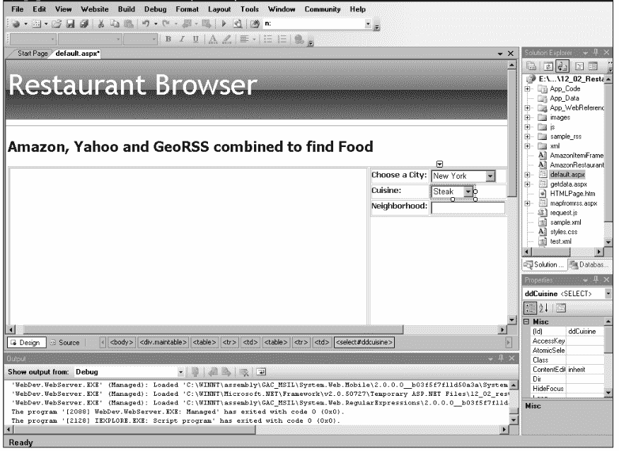

所有这些都相当简单，基于你在本章开头已经完成的内容。

## 数据访问选择

你可以通过两种主要机制获取用于雅虎地图 API 的 GeoRSS 数据。

第一种是重用`getdata.aspx`，让它直接从亚马逊检索数据，然后在返回给调用者之前使用 XSLT 将其转换为 GeoRSS。这是一种不错的自包含方法，但它需要将包含`getdata.aspx`的 ASP.NET 应用程序部署到公共 Web 服务器上。你将为示例应用程序实现这种方法。

第二种机制涉及将 XSLT 样式表传递给亚马逊，以便 ECS 可以在其服务器上执行转换并返回 GeoRSS 结果。从处理角度来看，这是一种更清晰的实现，因为你不需要进行任何转换。不幸的是，它还要求 XSLT 文件放置在可公开访问的站点中。为了完整性，我将说明这种方法，但不会在示例代码中实现它。

在开始动手处理转换之前，让我们回顾一下如何在亚马逊中查找餐厅信息。

## 使用亚马逊查找餐厅

除了书籍、电影和其他产品外，亚马逊还在美国一些主要城市提供现实世界的餐厅信息。不幸的是，截至撰写本文时，城市列表相当少，但数据库在不断增长。

当然，餐厅不是商品，但你可以获得关于特定场所的大量信息。ECS 包括客户评论，在某些情况下还包括菜单信息，以及位置地址和提供的食物类型。

> 亚马逊会经常更新菜单，尽管它不能保证给定菜单项目的准确性。

你使用前面章节中使用的标准`ItemSearch`操作来查找亚马逊餐厅。你可以通过在查询中指定正确的`BrowseNode`来将搜索限制在特定地理区域或特定菜系。

餐厅可以通过以下搜索参数进行搜索：

- `City` — 截至撰写本文时，支持的城市有西雅图、波士顿、纽约、圣地亚哥、旧金山和芝加哥。
- `Neighborhood` — 文档很少，但这似乎是城市内区域的自由文本匹配；例如，小意大利（纽约）或农贸市场（西雅图）。它也接受非城市特定的标准（例如，市中心、东区等）。
- `Cuisine` — 可用的食物类型。同样，这是一个定义松散的标准，但例如意大利菜、希腊菜、法国菜、中国菜等。`Cuisine`参数也可以设置为一种食物类型（例如，牛排）。

这是一个查询亚马逊纽约西区法国餐厅的示例 REST URL：

```text
http://webservices.amazon.com/onca/xml?Service=AWSECommerceService&AWSAccessKeyId=[YOUR KEY HERE]&Operation=ItemSearch&ResponseGroup=Large&City=New%20York&SearchIndex=Restaurants
```

你可以考虑使用其他参数（如菜系或邻里）来细化搜索结果。

此查询响应的一部分将包括餐厅的地址：

```text
...
```

你现在知道如何通过亚马逊获取餐厅信息。鉴于你现在有了餐厅地址信息，你会认为下一步逻辑是将其转换为经纬度以在地图上显示。幸运的是，雅虎的 API 会为你做到这一点。

## 雅虎地理编码 API

当你想在地图的特定位置显示标记时，你会怎么做？你有街道地址，但不知道该位置的经纬度坐标。将地址转换为经纬度坐标的过程称为地理编码。

雅虎 API 提供了一个设施，可以执行将地址信息地理编码为经纬度坐标的额外步骤。在过去，这需要额外调用专用的地理编码 API：

```text
http://developer.yahoo.com/maps/rest/V1/geocode.html
```

雅虎提供了一个简单的 API。地理编码 API 接受地址作为输入，并输出经纬度坐标，以便在地图 API 中使用。

本特定章节中的示例代码不需要使用此 API，但我在此提到它，以便你了解。当你提前知道地址，或者有一两个位置需要查找时，地理编码 API 非常有用。正如你将看到的，当你有一整套位置（例如餐厅的结果集）时，为每个位置调用地理编码 API 以将其放置在地图上变得不切实际。

你可以像在前面章节中为 YouTube 或 eBay 所做的那样，轻松地修改`getData.aspx`以支持地理编码 API。

预期的雅虎 URL 结构如下。首先是 REST API 的根：

```text
http://api.local.yahoo.com/MapsService/V1/geocode
```

随后是一系列参数，如`appid`、`street`、`city`、`state`和`zip`。这些代表用于跟踪请求的应用程序 ID 和地址参数。这是一个示例 URL：

```text
http://api.local.yahoo.com/MapsService/V1/geocode?appid=[YOUR APP ID HERE]&city=New%20York&street=10%20Church%20Street
```

此 URL 生成以下响应：

```xml
<?xml version="1.0" ?>
<ResultSet
  xmlns:xsi="http://www.w3.org/2001/XMLSchema-instance"
  xmlns="urn:yahoo:maps"
  xsi:schemaLocation=
  "urn:yahoo:maps
  http://api.local.yahoo.com/MapsService/V1/GeocodeResponse.xsd">
  <Result precision="address">
    <Latitude>40.710129</Latitude>
    <Longitude>-74.011599</Longitude>
    <Address>10 CHURCH ST</Address>
    <City>NEW YORK</City>
    <State>NY</State>
    <Zip>10006</Zip>
    <Country>US</Country>
  </Result>
</ResultSet>
```

通过这种方式，你可以轻松地提取美国任何地址的经纬度。

> 遗憾的是，目前不支持美国以外的位置。

## 使用 GeoRSS 创建自定义覆盖层

逐个将每个单独的标记添加到地图中是完全没问题的。你可以通过在浏览器中解析亚马逊 XML 并为每个标记调用一个 JavaScript 来实现。然而，这可能会导致大量的编码。雅虎支持一种更清晰的方式，称为 GeoRSS 和覆盖层。在下面的示例中，你将使用一种称为 GeoRSS 的新 feed 格式向雅虎地图添加一个自定义覆盖层。

## 什么是覆盖层？

典型的地图应用程序由特定位置的地图和一个或多个覆盖层组成。你可以将覆盖层想象成现实世界中的塑料透明度。

覆盖层由额外的信息组成，这些信息通过突出显示单个位置或在地点之间绘制路线来丰富地图。

你将使用 GeoRSS 来创建一个覆盖层。

# 第11章

## 什么是 GeoRSS？

GeoRSS 是标准 RSS 的另一种变体。GeoRSS 扩展了 RSS，使其包含地理数据，如经纬度。GeoRSS 包含了 RSS 的所有基本元素。关于 RSS 的更多信息，请参阅第7章。

通过向标准 RSS XML 添加新的命名空间，可以在每个订阅源条目中包含额外的地理标签。以下是一个包含一些特定地理标签的 GeoRSS 文件示例：

```xml
<?xml version="1.0"?>
<rss version="2.0" xmlns:geo="http://www.w3.org/2003/01/geo/wgs84_pos#">
<channel>
...
<item>
    <title>Some Title</title>
    <link>http://MyDomain.com/ </link>
    <description>...</description>
    <geo:lat>22.12</geo:lat>
    <geo:long>-31.14</geo:long>
</item>
...
</channel>
</rss>
```

雅虎地图通过添加一些自己的标签扩展了 GeoRSS。这些标签属于雅虎地图命名空间，其前缀如下：

```text
xmlns:ymaps="http://api.maps.yahoo.com/Maps/V1/AnnotatedMaps.xsd
```

这是与之前相同的示例，但包含了一些特定于`ymaps`的标签：

```xml
<?xml version="1.0"?>
<rss version="2.0" xmlns:geo="http://www.w3.org/2003/01/geo/wgs84_pos#"
    xmlns:ymaps="http://api.maps.yahoo.com/Maps/V1/AnnotatedMaps.xsd">
<channel>
...
<item>
    <title>Some Title</title>
    <link>http://MyDomain.com/ </link>
    <description>...</description>
    <geo:lat>22.12</geo:lat>
    <geo:long>-31.14</geo:long>
    <ymaps:Address>10 Main Street</ymaps:Address>
    <ymaps:CityState>Anytown, CA</ymaps:CityState>
    <ymaps:Zip>12345</ymaps:Zip>
</item>
...
</channel>
</rss>
```

通过这种方式，基础的 RSS 订阅源格式被扩展以包含地理数据。由于每个新元素都绑定到其自己的命名空间，因此原始 RSS 订阅源文件的完整性得以保持。GeoRSS 订阅源仍然可以符合 RSS 2.0 规范进行验证。存在各种风格的“geo”订阅源，包括 Atom 和 RSS 1.0。本书侧重于 RSS 2.0 的实现。

<http://developer.yahoo.com/maps/georss/index.html>

## GeoRSS 转换

要将典型的亚马逊`ItemSearch`响应转换为 GeoRSS，需使用以下 XSL 文件。在示例代码中，此文件名为`AmazonRestaurants.xsl`：

```xml
<?xml version="1.0" encoding="utf-8"?>

<xsl:stylesheet version="1.0"
    xmlns:xsl="http://www.w3.org/1999/XSL/Transform"
    xmlns:ymaps="http://api.maps.yahoo.com/Maps/V1/AnnotatedMaps.xsd"
    xmlns:a="http://webservices.amazon.com/AWSECommerceService/2005-10-05"
    xmlns:geo="http://www.w3.org/2003/01/geo/wgs84_pos#">
  <xsl:output method="xml"/>
  <xsl:template match="/">
    <rss version="2.0">
      <channel>
        <title>Amazon GeoRSS</title>
        <link>http://www.Amazon.com</link>
        <description>Sample GeoRSS file listing restaurants from Amazon</description>
        <image>
          <url>images/food.gif</url>
        </image>
        <ymaps:Groups>
          <Group>
            <Title>Steak Restaurants</Title>
            <Id>Steak House</Id>
            <BaseIcon width="40px" height="40px"><![CDATA[images/steak.gif]]></BaseIcon>
          </Group>
          <Group>
            <Title>French Restaurants</Title>
            <Id>French</Id>
            <BaseIcon width="40px" height="40px"><![CDATA[images/french.gif]]></BaseIcon>
          </Group>
          <Group>
            <Title>Seafood Restaurants</Title>
            <Id>Seafood</Id>
            <BaseIcon width="40px" height="40px"><![CDATA[images/seafood.gif]]></BaseIcon>
          </Group>
          <Group>
            <Title>Pizza</Title>
            <Id>Pizza</Id>
            <BaseIcon width="40px" height="40px"><![CDATA[images/pizza.gif]]></BaseIcon>
          </Group>
        </ymaps:Groups>
        <xsl:apply-templates select="a:ItemSearchResponse/a:Items/a:Item" />
      </channel>
    </rss>
  </xsl:template>

  <xsl:template match="a:Item">
    <item>
      <title>
        <xsl:value-of select="a:ItemAttributes/a:Title"/>
      </title>
      <link>
        <xsl:value-of disable-output-escaping="yes" select="concat('&lt;','![CDATA[')" />
        <xsl:value-of select="a:DetailPageURL" />
        <xsl:value-of disable-output-escaping="yes" select="concat(']]', '&gt;')"/>
      </link>
      <description>
        [<xsl:value-of select="a:ItemAttributes/a:Cuisine"/>]
        <xsl:value-of select="a:CustomerReviews/a:Review/a:Content"/>
      </description>
      <ymaps:Address>
        <xsl:value-of select="a:ItemAttributes/a:Address/a:Address1" />
      </ymaps:Address>
      <ymaps:CityState>
        <xsl:value-of select="a:ItemAttributes/a:Address/a:City" />, <xsl:value-of select="a:ItemAttributes/a:Address/a:State" />
      </ymaps:CityState>
      <ymaps:Zip>
        <xsl:value-of select="a:ItemAttributes/a:Address/a:PostalCode" />
      </ymaps:Zip>
      <ymaps:Country>US</ymaps:Country>
      <ymaps:GroupId><xsl:value-of select="a:ItemAttributes/a:Cuisine"/></ymaps:GroupId>
      <ymaps:ItemUrl>http://mashups.FrancisShanahan.com/getdata.aspx?operation=ItemLookup&amp;ResponseGroup=Large&amp;ItemId=<xsl:value-of select="a:ASIN"/>&amp;xsl=amazonItemIframe.xsl&amp;contentType=text/html</ymaps:ItemUrl>
    </item>
  </xsl:template>
</xsl:stylesheet>
```

这个 XSL 有几处有趣的地方。第一点是使用了雅虎的`BaseIcon`元素。地图标记（RSS 条目）可以被分配一个`ymaps:GroupId`，从而将它们进行逻辑分组。`BaseIcon`元素为该组中的所有地图标记分配一个图标。请注意我是如何将组 ID 与亚马逊的`ItemAttributes/Cuisine`元素绑定的。这样，所有的法式餐厅最终都会归入一个名为“French”的新组，并且它们也会被分配一个预定义的图标`French.gif`。


第二点值得注意的是你可能已经预料到的——直接在`ymaps`地址元素中使用了亚马逊的地址元素（例如`ItemAttributes/Address/City`）。

### 将亚马逊数据转换为 GeoRSS

当你构建软件时，解决特定问题通常不止一种方法。在前面的章节中，你已经分别在 Web 服务器上使用 .NET 和在浏览器上使用 JavaScript 转换了数据。对于既没有时间也没有兴趣实现转换的开发者，亚马逊可以为你执行转换。

当你使用 REST API 调用亚马逊时，响应以 XML 形式返回。到目前为止，所有对亚马逊的调用都是通过以下 URI（或根据你使用的区域略有不同）进行的：

```text
http://webservice.amazon.com/onca/xml
```

通过指定一个额外的参数，该参数是公开可访问的 XSL 文件的路径，亚马逊将在其服务器上执行转换并传回转换后的结果：

```text
http://webservice.amazon.com/onca/xml?
Service=AWSCommerceService&AWSAccessKeyId=[YOUR KEY HERE]
&Operation=ItemSearch&ResponseGroup=Large&City=New%20York%20&SearchIndex=Restaurants
&Cuisine=French
&Style=http%3A%2F%2Fmashups.francishanahan.com%2FAmazonRestaurants.xsl
```

此 URL 包含一个`Style`参数，该参数指定了一个公开可用的 XSL 表的位置。请注意，亚马逊使用不同的域来处理此 XSL 转换。当你指定`Style`参数时，你将被重定向到以下 URL：

```text
http://xml-us.amznxslt.com/onca/xml
```

此 URL 用于美国区域。当然，转换也适用于其他区域，包括以下区域：

- 加拿大—`http://xml-ca.amznxslt.com/onca/xml`
- 英国—`http://xml-uk.amznxslt.com/onca/xml`
- 法国—`http://xml-fr.amznxslt.com/onca/xml`
- 日本—`http://xml-jp.amznxslt.com/onca/xml`
- 德国—`http://xml-de.amznxslt.com/onca/xml`

> **试一试**

### 将亚马逊数据转换为 GeoRSS

1. 创建`AmazonRestaurants.xsl`样式表并将其上传到公开可访问的 Internet 站点。记下 XSL 文件的路径。
2. 在以下 URL 中插入你的`AWSAccessKey`，然后通过将其粘贴到浏览器中来测试 URL 是否有效：

   ```text
   http://webservices.amazon.com/onca/xml?
   Service=AWSECommerceService&AWSAccessKeyId=[YOUR KEY HERE]
   &Operation=ItemSearch&ResponseGroup=Large&City=New%20York%20&SearchIndex=Restaurants&Cuisine=French
   &Style=http://[YOUR PATH HERE]/AmazonRestaurants.xsl
   ```

你的浏览器应显示一个有效的 GeoRSS 数据订阅源。在下一节中，你将使用它在地图上绘制标记。

## 工作原理

当你使用标准 URL 发出原始 API 调用时，会生成一个典型的`ItemSearch`响应。通过使用`Style`参数指定一个 XSL 文件，亚马逊会加载该 XSL 文件并使用你的 XSL 文件转换其自身的响应。结果就是 GeoRSS。

## 使`getdata.aspx`更通用

如前所述，我已向你展示了如何使用亚马逊执行到 GeoRSS 的转换。然而，示例代码实际上通过使用`getdata`来执行转换，模仿了这一技术。本节描述如何修改`getdata`以实现这一点。

到目前为止，方法是将`getdata.aspx`执行的任何转换硬编码到代码本身中。这意味着需要更改代码以支持新的转换。

如果`getdata`能够使用你告诉它的任何 XSL 文件执行转换，这将对你有利。可以通过以下代码更改来实现：

```csharp
// 如果指定了 XSL 表，则使用它。
if (Request.Item["xsl"] != null)
{
    string strResults = webUtility.DoXSLTransformation(myDoc,
        Request.Item["xsl"].ToString());
    Response.Write(strResults);
}
else
{
    Response.Write(myDoc.InnerXml);
}
Response.End();
```

有了这个更改，代码现在将使用`xsl`参数指定的任何 XSL 文件。当然，如果不存在，代码将会失败。

> 进行此类更改时，确实需要小心，以避免恶意用户伪造 XSL 文件名，从而可能在你的应用程序中创建安全漏洞。

现在对`getdata`的典型调用将如下所示：

```text
http://[YourPathHere]/getdata.aspx?operation=ItemLookup&ResponseGroup=Large&ItemId=
0393320928&xsl=amazonItemIframe.xsl
```

## 修改`BuildAmazonURI`

修改`BuildAmazonURI`以包含额外的参数。由于你将按城市、社区和美食类型搜索亚马逊网站，所有这些参数都需要从查询字符串中解析出来。请按如下方式修改`BuildAmazonURI`函数：

```text
...
string strCuisine = CheckNull(myQueryString, "Cuisine", "");
string strNeighborhood = CheckNull(myQueryString, "Neighborhood", "");
string strCity = CheckNull(myQueryString, "City", "");
...
strURI = strRoot + strAccessKeyId +
         ... + strCuisine + strNeighborhood + strCity;
return strURI;
```

## 部署解决方案

为了使`getdata`生成的 XML 可供 Yahoo! Maps API 访问，它必须托管在一个公共互联网网站点上。为此，你必须实际将 ASP.NET 2.0 应用程序编译为一组二进制文件，并将它们上传到运行 .NET 2.0 的网站。假设你有可用的托管服务提供商，你可以使用 .NET Framework 中随附的 ASP.NET 编译器来编译 Web 项目。

### 动手实践：部署解决方案

1. 导航到“开始”->“运行”，并输入`cmd`以启动命令提示符。
2. 更改目录至 Microsoft .NET Framework 2.0 版本：

   ```text
   cd \
   cd windows\microsoft.net\Framework\v2.0.50727
   ```

3. 使用`aspnet_compiler.exe`编译应用程序。命令格式如下：`-p <项目路径> -v / <输出路径>`

   ```text
   aspnet_compiler.exe -p "C:\YOUR\PATH\HERE" -v / c:\temp\output
   ```

`-v /`指令告诉编译器项目将在提供的物理路径的根目录下查找。

为了方便起见，请确保将这些指令放入批处理文件中。创建一个文本文件并将其扩展名重命名为`BAT`。

> 这些指令可能会因你使用的操作系统而略有不同。例如，如果使用 Windows 2000，.NET Framework 将位于`c:\winnt\Microsoft.NET`下。

执行这些指令后，编译后的项目输出将位于`c:\temp\output`下，或者你指定的任何路径。然后，你可以通过 FTP 将这些文件上传到你的主机进行部署。应用程序部署完成后，应对其执行测试，以确保其正在生成所需的 GeoRSS 输出。

测试可以通过一个简单的浏览器来完成。这是针对我所在服务器的一个示例 URL：

```text
http://mashups.francishanahan.com/getdata.aspx?operation=ItemSearch&ResponseGroup=Large&SearchIndex=Restaurants&x=amazonRestaurants.xsl&City=New%20York
```

现在，花点时间更新你的 JavaScript 代码，确保它指向适当的外部站点。以下是实例化有效`YGeoRSS`对象的 JavaScript 代码：

```javascript
// 创建覆盖层
myGeoRSS = new YGeoRSS(strGeoRSSSource);

// 添加覆盖层
myMap.addOverlay(myGeoRSS);
```

## GeoRSS 的问题

将 GeoRSS 馈送作为覆盖层应用是一种很好的方法，可以在不需要其他地理编码的情况下向地图添加大量位置。如果你不使用这种方法，就必须单独手动添加每个标记。不仅如此，你还必须使用 Yahoo 地理编码 API 进行单独的地址查找，以获取每个位置经度和纬度信息。

将每个位置作为单独标记添加的一个优点是你可以为每个标记生成的事件注册处理程序。如果希望用户在点击标记时发生某些操作，最好的方法是捕获标记的点击事件。

GeoRSS 覆盖层的问题是，没有简单的方法将事件连接到在每个位置生成的标记。

期望的功能是用户可以点击标记并获取额外的项目信息。幸运的是，有一种解决方案。Yahoo 对 GeoRSS 规范的扩展允许在给定 RSS 项中包含特定的 URL 元素。

该 URL 是一个将在地图标记弹出窗口内的`iFrame`中显示的内容的位置。下一节将详细描述如何实现这一点。

## 使用`iFrame`

你也可以结合使用 GeoRSS 和`getdata.aspx`来向每个地图标记添加一个内容`iFrame`。

1. 创建一个新的样式表，将 Amazon `ItemLookup` 响应转换为 HTML：

   ```xml
   <?xml version="1.0" encoding="utf-8" ?>
   <xsl:stylesheet version="1.0"
       xmlns:xsl="http://www.w3.org/1999/XSL/Transform"
       xmlns:a="http://webservices.amazon.com/AWSECommerceService/2005-10-05">
       <xsl:output method="html" omit-xml-declaration="yes"/>
       <xsl:template match="/">
   <html><body>
       <xsl:apply-templates select="a:ItemLookupResponse/a:Items/a:Item" />
   </body></html>
   </xsl:template>

   <xsl:template match="a:Item">
       标题：<b><xsl:value-of select="a:ItemAttributes/a:Title"/></b><br/>
       ASIN: <xsl:value-of select="a:ASIN"/><br/>
       你可以在这里放置任何你想要的产品详细信息。
   </xsl:template>
   </xsl:stylesheet>
   ```

2. 修改`getdata.aspx`以接受`contentType`参数。此代码将使用`contentType`参数设置 HTTP 响应的`Response.ContentType`：

   ```csharp
   Response.Clear();
   // 如果指定了内容类型，例如 text/html，则使用它。
   if (Request.Params["contentType"] != null)
   {
       Response.ContentType = Request.Params["contentType"].ToString();
   }
   else
   {
       // 默认为 xml 响应
       Response.ContentType = "text/xml";
   }
   ```

对`getdata`的新调用如下所示：

```text
http://[yourPathHere]/getdata.aspx?operation=ItemLookup&ResponseGroup=Large&ItemId=
0393320928&xsl=amazonItemIframe.xsl&contentType=text/html
```

由此生成的 HTML 如下：

```html
<html xmlns:a="http://webservices.amazon.com/AWSECommerceService/2005-10-05">
    <body>
        标题：<b>你在乎别人怎么想吗？一个古怪角色的更多冒险</b><br>
        ASIN: 0393320928<br>
        你可以在这里放置任何你想要的产品详细信息。
    </body>
</html>
```

现在你有一个产生 HTML 的链接。这可以与 GeoRSS `ymaps`扩展字段`ymaps:ItemUrl`一起使用，如下所示：

```xml
<ymaps:GroupId><xsl:value-of select="a:ItemAttributes/a:Cuisine"/></ymaps:GroupId>
<ymaps:ItemUrl>http://[yourPathHere]/getdata.aspx?operation=ItemLookup&Response
Group=Large&amp;ItemId=<xsl:value-of
select="a:ASIN"/>&amp;xsl=amazonItemIframe.xsl&amp;contentType=text/html</ymaps:ItemUrl>
</item>
```

## 工作原理

1. 当你启动应用程序时，会显示地图。
2. 用户随后选择一个城市（或输入一种美食类型）以查看餐厅的精选列表。
3. 应用程序调用`getdata`，后者进而向 Amazon ECS 发出餐厅的`ItemSearch`请求。
4. 亚马逊返回响应给`getdata`，后者随后使用查询字符串中指定的 XSL 样式表将数据转换为 GeoRSS。
5. GeoRSS 包含一组项目，这些项目反过来包含返回`getdata`的链接。每个链接为亚马逊提供正确的参数组合以执行`ItemLookup`查询。
6. 当用户点击地图上的某个标记时，再次调用`getdata`，这次它执行`ItemLookup`以检索关于餐厅的详细信息。
7. `ItemLookupResponse` XML 随后被转换，这次转换为 HTML，并以`iFrame`的形式显示在页面上。

最终应用程序如图 11-8 所示。

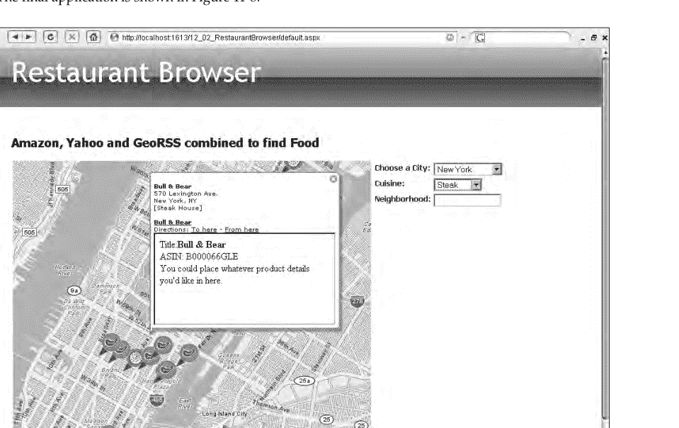

图 11-8：最终应用程序显示纽约市中心的餐厅

## 其他想法

示例代码使用 Yahoo Maps，它具有许多功能。不过，你也可以考虑使用现有的其他地图 API。

### 替代地图 API

Google Maps 可能是第一个交互式的 Ajax 驱动地图，并为该公司赢得了大量关注。Yahoo 紧随其后，由于网络上充斥着如何使用 Google Maps 的示例，本章我走了少有人走的路。你可以在这里找到更多关于 Google Maps 的信息：

```text
http://www.google.com/apis/maps
```

Microsoft 从不在旁边观望，它也提供了一个全面的地图平台，其中包括丰富的开发者编程接口。Microsoft 的产品称为“Virtual Earth”，可以在这里找到：

```text
http://www.virtualearth.net
```

### 添加动画

你可以添加到标准地图体验中的另一个创新是动画的概念。例如，你可以创建一个实际在屏幕上移动的单个标记。为此，你需要一些动态的位置或地址数据。这可能来自全球定位系统（GPS）网站，例如。

使其工作的关键是在页面中添加一个计时器事件。每当计时器触发时，页面就会更新标记的位置。你可以通过 GeoRSS 或第 10 章中描述的 Ajax 调用来实现这一点。

每当将 API 调用绑定到计时器时，请注意该 API 所有者施加的 API 调用限制。Yahoo 通常允许大量的调用，但某些 API 有更低的限制，你必须确保由于用户长时间打开浏览器窗口而未意外超出限制。跟踪你的使用情况，并考虑每 5 秒更新一次而不是每 1 秒更新一次。

## 总结

在本章中，你学习了以下内容：

- 如何构建 GeoRSS 馈送
- 如何使用亚马逊自己的平台转换亚马逊数据
- 如何使用 Yahoo 界面构建地图并显示地图标记
- 如何编译和部署 ASP.NET 2.0 网站

## 第 11 章

在前几章中，你应该已经见识到`getdata.aspx`作为获取数据的通用方式是何等多变。它可以根据场景需求生成 XML 或 XHTML，同时也是抽象 API 许可证密钥和其他敏感信息的共同访问点。

第 12 章将向你展示如何结合使用 Yahoo API 与 Amazon，但这次使用的是 JSON 表示法而非 GeoRSS。最终的应用程序将直接从 Amazon 加载数据，而无需经过代理类。

在继续之前，值得通过以下练习来复习你的知识。

## 练习题

1. 你将如何修改此内容以在地图标记内嵌入 YouTube 视频？
2. 如何使用 Amazon 的 API 执行 XSL 转换？
3. 在 ASP.NET 中，如何动态更改页面提供的内容的`contentType`，例如从 XML 改为 HTML？这将对浏览器产生什么影响？


### 4. 如何使用 Yahoo 特有的标签来增强标准 GeoRSS 订阅源？

### 5. 有哪些替代的地图 API 可以替代 Yahoo 使用？


## 使用 JSON 的客户浏览器

Ajax 近期获得了大量关注，因为它与实现混搭（mashup）和 Web 2.0 应用程序密切相关。然而，Ajax 并非唯一的选择。JavaScript 对象表示法（JSON）是一种有效的替代方法，它本身就提供了令人信服的强大功能。而且，JSON（发音为 "Jason"）解决方案的代码，在许多情况下，比等效的 Ajax 实现更为简洁。

在本章中，你将学习以下内容：

- JSON 表示法及其结构
- 如何在运行时动态地向页面中添加 JavaScript
- 如何将 JSON 与动态 JavaScript 结合，以从 Amazon 获取客户数据
- 如何使用 Yahoo 地图 API 创建地图应用程序

本章中的客户地图混搭应用程序是一个有趣的应用，它应该能够清晰地展示 JSON 方法的潜力。

## 作战计划：使用 JSON 和 REST 整合 Yahoo 与 Amazon

在本章中，你将创建一款地图应用程序，用于在美国地图上标注 Amazon 客户的位置。Amazon 提供了对其客户选择公开的数据的访问权限，包括大致的地址信息。通过 Amazon API，本章的混搭应用程序将搜索客户数据库，然后将获取的数据转换为 Yahoo 地图上的点。

## 第 12 章

该工具的目标是可视化展示 Amazon 数据。本章中的混搭应用程序可以进一步扩展，以展示更多细节，例如美国的哪些地区在购买哪些产品，或者哪些客户对哪些产品感兴趣。

### 理解架构

图 12-1 展示了这款特定客户浏览器架构的构成。

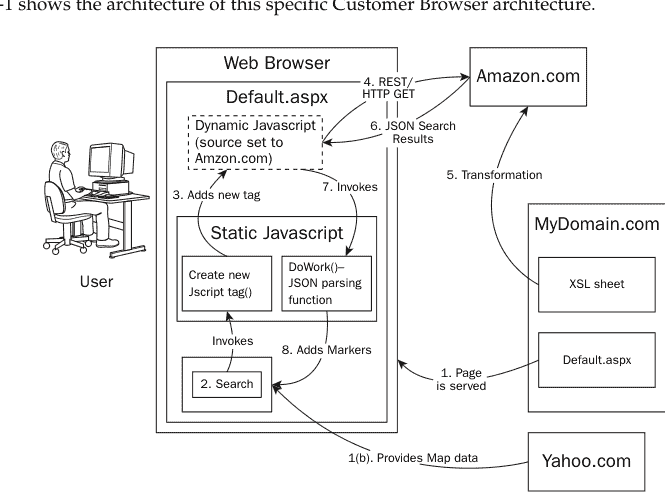

**图 12-1：客户浏览器架构**

## 工作原理

客户浏览器应用程序搜索 Amazon 的客户信息数据库，并将客户位置标注在 Yahoo 地图上。处理流程如下：

1. 当应用程序的主页面加载时，它会包含一组 JavaScript，其中包括若干静态函数。它还会使用 Yahoo 的 API 绘制一幅美国地图。
2. 用户输入一些搜索条件，在本例中为客户名称，然后点击搜索。
3. 点击搜索按钮会触发页面上的一个静态 JavaScript 函数。该函数不会将页面提交回服务器，而是修改页面结构以包含一个新的 `<script>` 标签，从而创建一段动态 JavaScript。
4. 这段新 JavaScript 的源被指定为指向 Amazon.com 的 URL。浏览器解析此 URL 并自动发起 HTTP GET 请求，在本例中即为 REST 请求以获取 `<script>` 内容。
5. Amazon 收到 REST 请求并作出响应。在此之前，它会使用来自站点域的 XSL 样式表对结果执行转换。
6. 转换的结果是将 XML 响应转换为 JSON 格式的 `text/JavaScript`。JSON 通过在第 3 步中添加的 `script` 标签反馈回页面。此时 `script` 标签的内容包含如下形式的函数调用：

```text
DoWork( <some object> )
```

`DoWork` 是页面上已有的函数。`DoWork` 函数期望接收一个 JavaScript 对象。Amazon 以 JSON 的形式提供此对象。

7. 在 `DoWork` 函数内部，检查 JSON 对象并遍历其中包含的数据。
8. 为结果集中的每位客户创建地图标记。然后将每个标记添加到地图上。

图 12-2 展示了最终的应用程序，显示横跨美国的一系列客户。

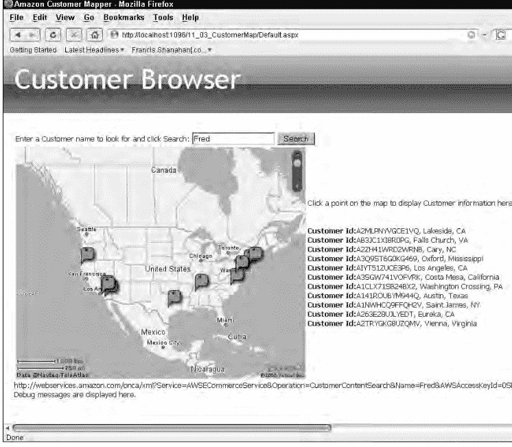

这并不一定是一种复杂的技术，但它确实代表了一种略显非常规的方法。解决方案的各个要素在后续章节中有详细描述。

在深入构建客户浏览器混搭应用程序之前，有必要先了解 JSON 以及该应用程序所使用的动态脚本技术。

## 动态脚本方法

当你在浏览器中查看页面时，浏览器会执行页面包含的所有 JavaScript。然而，你可以使用 JavaScript 本身在运行时以编程方式创建一段 JavaScript，然后将创建的脚本包含到页面的文档对象模型（DOM）中。通过这种方式修改页面的 DOM，使得在页面被查看时能够创建新的 JavaScript 片段，这些片段会立即执行或在用户交互时执行。这非正式地被称为动态脚本方法。

### 动手实践：简单的动态脚本示例

以下示例演示如何在运行时向页面中添加一段 JavaScript（图 12-3）。这是最终 JSON 混搭的关键组成部分。


## 使用 JSON 的客户浏览器

1. 在 Visual Studio 中新建一个名为 `default.aspx` 的 ASPX 页面。注意，对于这个示例，你无需编写任何 C# 代码。
2. 创建一个名为 `alert.js` 的新文件。这将存储插入到页面中的 JavaScript 代码。目前，该文件应仅包含一条弹出消息框的指令，如下所示：

   ```javascript
   alert("Hello world");
   ```

3. 在 `default.aspx` 页面的 `head` 部分添加一个 JavaScript `<script>` 标签，并创建一个名为 `CreateScriptTag` 的新 JavaScript 函数：

   ```javascript
   function CreateScriptTag() {
       var myScript = document.createElement("script");
       myScript.setAttribute("type", "text/javascript");
       myScript.setAttribute("src", "alert.js");
       return myScript;
   }
   ```

   `CreateScript` 函数创建一个新的 JavaScript `<script>` 标签。此标签的源被指定为第 2 步中创建的 `alert.js` 文件。

4. 为 `<head>` 元素分配一个 ID。这是为了便于从 JavaScript 中引用它：

   ```html
   <head id="myHead">
   ```

5. 向 `default.aspx` 页面添加另一个 JavaScript 函数。该函数应命名为 `AddScript`，如下所示：

   ```javascript
   function AddScript() {
       var myTag = CreateScriptTag();
       document.getElementById("myHead").appendChild(myTag);
   }
   ```

   该函数调用 `CreateScriptTag` 来创建 JavaScript 页面元素，然后将其添加到页面中。JavaScript 元素的效果是，一旦标签被添加，`alert.js` 文件中的脚本就会被执行。

6. 最后，向页面添加一个可点击的链接来触发 `AddScript` 函数：

   ```html
   <a href="javascript:void(0)" id="myTrigger" onclick="javascript:AddScript()">Click to Add JavaScript</a>
   ```

## 工作原理

当你运行页面并点击链接时，会创建一个新的 JavaScript 标签。此脚本的源被指定为 `alert.js`。这段动态 JavaScript 的静态等效形式如下：

```html
<script language="javascript" src="alert.js"/>
```

当此 `script` 标签被包含在页面头部时，标签内的脚本会立即执行。在本例中，这意味着会弹出一个提示框向你问候 "Hello World"。

## 第 12 章

动态脚本是一项实用的功能，可以与 JSON 协同工作，促进混搭（mashup）的创建。在混搭的场景中，你不仅可以动态插入 JavaScript `code`，还可以插入以 JavaScript 对象形式的 `data`。这使你能够从外部来源获取数据，并在运行时将该数据插入到页面中。如果你想构建一个混搭，这绝对非常有用。

## JSON 是什么？

JSON 是一种记录对象成员及其值的方法，其格式可以将字符串转换为实际的 JavaScript 对象。本质上，这意味着获取按照 JSON 结构格式化的字符串，并将其转换为可以解析和处理的对象，类似于你处理 XML 文档的方式。简单地说，JSON 让你能够将数据反序列化为对象。

你可以在以下网址了解更多关于 JSON 规范的信息：

`http://www.json.org`

### 试一试：使用 JSON 的 Hello World

在本示例中，你将创建一个使用单个 JSON 对象的 Web 页面。这仅仅是为了让你熟悉其标记法。

创建一个 HTML 页面（你甚至不需要 Visual Studio），并将以下代码粘贴到该页面中：

```html
<html>
<head>
<script language="javascript">
    // The JSON object
    var myJSON = {"MyJSON" : { "name" : "HelloWorld" } }
    function HelloJSONWorld( myObject) {
        document.getElementById('myResults').innerHTML = myObject.MyJSON.name;
    }
</script>
</head>
<body>
    <a href="javascript:void(0)" id="myTrigger" onclick="javascript:HelloJSONWorld(myJSON)">Click me</a>
    <div id="myResults">Results Go Here</div>
</body>
</html>
```

保存文件，然后在浏览器中打开这个新创建的页面。点击名为 "Click me" 的链接，你应该会看到 "Hello World" 出现在原先 "Results Go Here" 的位置。图 12-4 展示了这一点，以及一个稍复杂一些的 JSON 对象。

## 使用 JSON 的客户浏览器


图 12-4：一个 JSON 应用示例

## 工作原理

总的来说，这与其他任何 HTML 页面一样。页面被划分为典型的 `head` 和 `body` 部分——这没什么新奇的。`body` 中包含一个链接，其唯一目的是捕获用户的点击事件并触发一个 JavaScript 函数。稍后会详细介绍这一点。页面 `body` 中还包含一个 `div` 标签，函数的结果将放置于此。

`head` 中包含页面上唯一的 JavaScript。第一行声明了一个名为 `myJSON` 的变量。该变量的值被设置为一个看起来古怪的字符串类型对象。这就是 JSON！

本节中唯一其他的内容是一个名为 `HelloJSONWorld` 的函数。该函数接受一个名为 `myObject` 的参数。该参数将包含由 JavaScript 引擎计算先前定义的 JSON 变量所创建的 JSON 对象实例。

## JSON 标记法

与许多 Web 2.0 技术一样，JSON 出奇地简单。对象的标记法如下：

```text
{ Name : Value }
```

例如，以下标记法描述了一个具有单个名为 `myName`、值为 `Walter` 的属性的对象：

```text
{ "myName" : "Walter" }
```

名称始终是一个用引号括起来的字符串。值可以是另一个对象、一个字面量（例如，`true/false`），或者在本例中是一个字符串（`"Walter"`）。

这将计算为一个包含单个属性且其值为 `"Walter"` 的单一对象。

一个更复杂的例子可能是这样的：

```text
{"Album": { "Title": "Are You Experienced?", "Artist" : "The Jimi Hendrix Experience" } }
```

这种标记法将计算为一个类定义如下所示的对象：

```text
class Album {
    string Title;
    string Artist;
}
```

此处的成员变量是简单类型，因为每个都有字符串值。要包含一个值为数组的成员变量，你可以使用方括号将值括起来，如下所示：

```javascript
var myAlbum = { "Album": { "Title": "Are You Experienced?", "Artist" : "The Jimi Hendrix Experience", "Songs" : [ "Hear My Train a Coming", "Red House", "Manic Depression" ] } } ;
```

这种标记法等价于以下类定义：

```text
class Album {
    string Title;
    string Artist;
    string Songs[3];
}
```

现在，要访问 JSON 对象的值，你可以使用与任何类型的 JavaScript 对象相同的标记法：

```javascript
document.getElementById('myResults').innerHTML = strObj.Album.Songs[2];
```

此代码从 `Songs` 数组中访问 "Manic Depression" 这首歌（假设 `strObj` 是 JSON 对象）。

## 公开可用的 JSON API

到现在，你可能想知道是否有网站在其服务中提供 JSON。遗憾的是，只有极少数迈出了这一步。Yahoo 就是这样的一家公司，它欣然接受了 JSON 标记法。要从 Yahoo 网络搜索获取 JSON 而非默认的 XML，你需要将 `output` 参数指定如下：

Yahoo 提供了另一个参数，即 `callback` 参数，该参数仅在 `output=json` 时适用。`callback` 参数用于将 JSON 结果包装在函数调用中。例如，如果你有一个名为 `MyFunction` 的函数，该函数期望一个对象，你可以将该函数名称作为 `callback` 参数。Yahoo 返回的 JavaScript 字符串如下所示：

```text
MyFunction({myJSONObject: ....<omitted> }});
```

通过这种方式，Yahoo API 调用的结果可以插入到 HTML 页面中，然后触发对 `MyFunction` 的调用以进一步处理返回的数据。在 `MyFunction` 内部，你可以编写代码来检查 Yahoo 返回的 JavaScript 对象，并相应地采取行动。

## JSON 的优势

如你所见，与基于 Ajax 的方法相比，动态脚本方法具有一些明显的优势。在 Ajax 实现中，你通常需要此类代理来避免浏览器的安全限制。

JSON 的另一个优点是，平均而言它比 XML 更简洁。你可以用比同等 XML 更小的负载来表达相同的信息。

最后，许多开发人员转向 JSON 是因为它更易于阅读。我个人并不认同这种观点，但开发人员各有不同。

下一节将介绍如何将 Amazon 的 XML 响应转换为 JSON。

## 如何从 Amazon 获取 JSON

遗憾的是，与 Yahoo 不同，Amazon（目前）并不直接从其 API 提供 JSON。好消息是这并不重要。Amazon 提供了使用你指定的任何公开可访问的 XSL 表来转换数据的功能。该 API 在 Amazon 服务器上执行转换，然后返回转换的结果。要从 Amazon 获取 JSON，你只需要编写一个将 `ItemSearchResponse` 文档或 `CustomerSearchResponse` 转换为 JSON 标记法的 XSL 表。

下一节将介绍设置客户浏览器混搭应用程序。后续各节将详细描述混搭的组件。

## 构建客户浏览器

要构建本章的混搭应用程序，请按以下步骤开始：

1. 在 Visual Studio 中创建一个新项目，并打开 `default.aspx` 页面。此示例不需要代码隐藏文件。
2. 创建一个名为 `txtName` 的文本输入框，用于存储搜索条件。
3. 创建多个 `<div>` 标签，如下所示：

   ```html
   <div id="myMap"></div>
   <div id="info">Click a point on the map to display Customer information here.
   </div>
   <div id="results"></div>
   <div id="debug">Debug messages are displayed here. </div>
   ```

   `myMap` `div` 将显示 Yahoo 地图。`info` `div` 将在用户点击地图标记时显示客户信息。`results` `div` 将显示处理 Amazon 返回的 JSON 后的输出。最后，`debug` `div` 是可选的，但有助于在开发期间捕获和显示任何调试信息。你可以根据需要自由排列这些元素。图 12-5 显示了设计视图中的 `default.aspx` 页面。

   

### 4. 在页面的 `<head>` 部分创建指向 Yahoo 地图 JavaScript 文件的链接，如下所示：

```html
<script type="text/javascript"
src="http://api.maps.yahoo.com/ajaxymap?v=3.0&appid=[YOUR APP ID HERE]">
</script>
```


## 5. 创建 `mashup.js` 文件

创建一个名为 `mashup.js` 的新 JavaScript 文件，并将其放在名为 `js` 的新子文件夹中。按如下方式将该文件链接到页面：

```html
<script type="text/javascript" src="js/mashup.js">
</script>
```

`mashup.js` 将存储应用程序中使用的所有 JavaScript。

## 6. 创建 `Init` 函数

在 `mashup.js` 中创建一个名为 `Init` 的新 JavaScript 函数：

```javascript
function Init(){

    // Create a map object
    myMap = new YMap(document.getElementById('myMap'));
    // Display the map centered on given address
    myMap.drawZoomAndCenter("Nebraska", 15);
    // Add a zoom control
    myMap.addZoomLong();
}
```

此函数负责在页面上初始化地图。

## 7. 创建 `myPrint` 函数

再创建一个名为 `myPrint` 的 JavaScript 函数。该函数仅封装对调试 div 的访问，纯粹是一个工具型函数：

```javascript
function myPrint(strText){
    document.getElementById('debug').innerHTML = strText + "<br/>" + 
    document.getElementById('debug').innerHTML;
}
```

这完成了主应用程序的设置。本章接下来的部分将介绍其余功能及其实现方法。

## 在 Amazon 上搜索客户

Amazon REST API 提供了 `CustomerContentSearch` 操作，您可以通过姓名搜索客户。这可以像其他任何使用 REST 的 AWS 操作一样执行。URL 的根目录如下所示：

```text
http://webservices.amazon.com/onca/xml?Service=AWSECommerceService&AWSAccessKeyId=[YOUR KEY HERE]&Operation=CustomerContentSearch
```

目前，客户搜索仅在美国区域支持。要搜索客户，您可以指定以下任一参数，但不能同时指定两者：

- `Name` — 客户姓名的自由文本输入。不区分为名字或姓氏。
- `Email` — 客户的电子邮件地址。

# 第 12 章

客户搜索操作的 REST URI 如下所示：

`http://webservices.amazon.com/onca/xml?Service=AWSECommerceService&AWSAccessKeyId=[YOUR KEY HERE]&Operation=CustomerContentSearch&Name=Jeff`

典型的客户搜索响应如清单 12-1 所示。

**清单 12-1：来自 Amazon 的 `CustomerContentSearchResponse`**

```xml
<?xml version="1.0" encoding="UTF-8"?>
<CustomerContentSearchResponse
 xmlns="http://webservices.amazon.com/AWSECommerceService/2005-10-05">
 <OperationRequest>
 ...
 <Arguments>
 <Argument Name="Name" Value="Jeff"/></Argument>
 <Argument Name="Operation" Value="CustomerContentSearch"</Argument>
 <Argument Name="Service" Value="AWSECommerceService"</Argument>
 ...
 </Arguments>
 ...
 </OperationRequest>
 <Customers>
 <Request>
 ...
 </Request>
 <TotalResults>54799</TotalResults>
 <TotalPages>2740</TotalPages>
 <Customer>
 <CustomerId>AZN85XLJ651W9</CustomerId>
 <Location>
 <City>Webster</City>
 <State>MA</State>
 <Country>United States</Country>
 </Location>
 </Customer>
 <Customer>
 <CustomerId>A3HH6F1V7Z1AM5</CustomerId>
 <Nickname>jexx18288</Nickname>
 </Customer>
 <Customer>
 <CustomerId>A1Q23A9WY74A1E</CustomerId>
 <Location>
 <City>Hickory</City>
 <State>NC</State>
 <Country>United States</Country>
 </Location>
 </Customer>
 <Customer>
 <CustomerId>A3N6YYLZ9Y6LZY</CustomerId>
 </Customer>
 <Customer>
 <CustomerId>A17KNQ1H1CTXMK</CustomerId>
 </Customer>
 </Customers>
```

## 使用 JSON 的客户浏览器

```xml
<Customer>
  <CustomerId>A12X406Y7R9W4X</CustomerId>
</Customer>
<Customer>
  <CustomerId>A1STAQK3JSR8YG</CustomerId>
  <Location>
    <City>Camas</City>
    <State>WA</State>
    <Country>United States</Country>
  </Location>
</Customer>
<Customer>
  <CustomerId>A1LVX1CRGVJ2TD</CustomerId>
  <Location>
    <City>Hayward</City>
    <State>CA</State>
    <Country>United States</Country>
  </Location>
</Customer>
<Customer>
  <CustomerId>AZ1A53FPFZM4Q</CustomerId>
  <Location>
    <City>Warren</City>
    <State>NJ</State>
    <Country>United States</Country>
  </Location>
</Customer>
...
</Customers>
</CustomerContentSearchResponse>
```

如您所见，它在细节方面相当简略，但幸运的是，地址和客户 ID 正是您在地图上标注客户所需的所有信息。

响应主要由客户节点组成，这些节点始终至少包含 `CustomerId` 节点。Amazon 客户还可以将昵称和位置设置为公开信息。在这些情况下，这些详细信息也会包含在 `CustomerContentSearch` 响应中。

### JSON XSL 文件

示例应用程序使用 XSL 文件将 Amazon 客户响应转换为有效的 JSON 表示法。每当编写转换时，重要的是要可视化所需的输出。在这种情况下，我最终希望得到一个如下所示的 JavaScript 对象：

```text
Customer {
    CustomerId;
    City;
    State;
}

Customers {
    Customer[];
}
```

本质上，我想要一个名为 `Customers` 的单一对象，其中包含一个 `Customer` 对象数组。这相当于一个如下所示的 JSON 结构：

```json
{ "Customers" : [
  {
    "CustomerId" : "ABI2343247XFW5"
  },
  {
    "CustomerId" : "A2ML234VGCE1VQ",
    "City" : "Lakeside",
    "State" : "CA",
    "Country" : "United States"
  },
  {
    "CustomerId" : "AB123123I8R0PG",
    "City" : "Falls Church",
    "State" : "VA",
    "Country" : "USA"
  },
  {
    "CustomerId" : "123H41WRD2WRNB",
    "City" : "Cary",
    "State" : "NC",
    "Country" : "USA"
  } ]
} );
```

该 JSON 结构包含一个客户节点数组。请注意使用方括号来表示数组。要生成这种形式的响应，我需要一个 XSL 转换来逐个解析出每个 `<Customer>` 节点。考虑到这一点，创建 XSL 相当简单。清单 12-2 包含了 XSL 样式表。请记住，您完全可以重复使用此转换，将 `ItemSearchResponse` 替换为 `CustomerContentSearchResponse`，以生成产品列表而非客户的 JSON。

**清单 12-2：`CustomerContentSearchResponse` 到 JSON 的转换**

```xml
<xsl:stylesheet version="1.0"
  xmlns:xsl="http://www.w3.org/1999/XSL/Transform"
  xmlns:a="http://webservices.amazon.com/AWSECommerceService/2005-10-05"
>

<xsl:output method="html" omit-xml-declaration="yes"/>
<xsl:template match="/">
  MyFunction( {"Customers" : [
    <xsl:apply-templates select="a:CustomerContentSearchResponse"/> ]
  });

</xsl:template>

<xsl:template match="a:CustomerContentSearchResponse">
  <xsl:apply-templates select="a:Customers"/>
</xsl:template>

<xsl:template match="a:Customers">
    <xsl:apply-templates select="a:Customer"/>
</xsl:template>

<xsl:template match="a:Customer">
    {
    "CustomerId" : "<xsl:value-of select="a:CustomerId"/>"
    <xsl:apply-templates select="a:Location" />
    }
</xsl:template>

<xsl:template match="a:Location">
    , "City" : "<xsl:value-of select="a:City"/>",
    "State" : "<xsl:value-of select="a:State"/>",
    "Country" : "<xsl:value packground-color="transparent">}</xsl:value-of select="a:Country"/>"
</xsl:template>

</xsl:stylesheet>
```

为了继续开发客户浏览器混搭，创建一个名为 `AmazonJSON.xsl` 的新 XSL 文件，并将其添加到项目中。然后，您应该将此 XSL 文件放置在互联网上的可公开访问位置（例如您的个人网站）。

通过将 XSL 样式表放在可公开访问的服务器上，您可以使用类似于以下的单个 Amazon URL 测试整个转换：

```text
http://webservices.amazon.com/onca/xml?Service=AWSECommerceService&Operation=CustomerContentSearch&Name=Fred&AWSAccessKeyId=[YOUR KEY HERE]&Style=http://mashups.FrancisShanahan.com/11_03_CustomerMap/AmazonJSON.xsl&contentType=text/javascript
```

请注意，指定的 XSL 样式表的位置通过以下参数设置：

```text
Style=http://mashups.FrancisShanahan.com/11_03_CustomerMap/AmazonJSON.xsl
```

这是一个可公开访问的服务器，您可以利用它进行自己的测试。

> 您将**无法**修改或在此站点上放置文件。它是只读的，此处包含它是为了方便您使用。

**试试看：执行搜索**

要执行客户搜索，您需要实现一些代码来驱动客户混搭中的搜索按钮。此代码基本上获取用户的搜索条件，并向页面添加一个新的 `<script>` 标签（动态脚本方法）：

1. 打开 `default.aspx` 文件并添加一个类型为 `button` 的新输入控件。
2. 在 `mashup.js` 中添加一个名为 `FindCustomers` 的新函数。该函数的代码如下所示。

```javascript
function FindCustomers() {
    // Build a customer search URL
    var strAWSAccessKey = "[YOUR KEY HERE]";
    var strOperation = "Operation=CustomerContentSearch&";
    var strName="Name=" + document.getElementById("txtName").value + "&"

    var strRoot =
"http://webservices.amazon.com/onca/xml?Service=AWSECommerceService&";
    var strUrl = strRoot +  strOperation
        + strName + strAWSAccessKey +

"Style=http://mashups.FrancisShanahan.com/11_03_CustomerMap/AmazonJSON.xsl&contentType=text/javascript";

    // Write out the URL for debugging purposes
    myPrint(strUrl);

    var myTag = CreateScriptTag(strUrl);
    document.getElementById("myHead").appendChild(myTag);
}
```

## 工作原理

当用户点击“搜索”时，`FindCustomers` 函数被调用。随后，`FindCustomers` 使用在姓名输入框中键入的搜索条件构建一个新的 URL。这个 URL 与上一节中显示的类似。然后，该 URL 被用作新 JavaScript `<script>` 标签的来源。

该 URL 解析为一段 JavaScript，其中包含一个函数调用（调用 `MyFunction`），并以 JSON 的形式传入一个新的 JavaScript 对象。

下一节将介绍如何处理这个新标签添加到页面时创建响应。

## 处理 JSON 对象

当应用程序接收到来自 Amazon 的响应时，会调用一个名为 `MyFunction` 的 JavaScript 函数，并将 JSON 对象传递给该函数。如果你想知道这个函数的名称在哪里指定，请回顾用于转换的 XSL 文件。

`MyFunction` 遍历 Amazon 返回的 JSON 对象，如果存在地址信息，则将其用于向 Yahoo 地图添加该客户的标记。`MyFunction` 应该添加到 `Mashup.js` 中，代码如下所示：


```
// Parses out the JSON object Properties
function MyFunction (myJSON){

    var strResults = "";

    if (myJSON.Customers) {
        var i;
        // Loop through all the customers.
        for (i = 0; i < myJSON.Customers.length ; i ++ ) {
            var myCustomer = myJSON.Customers[i];

            // Check the customer
            if (myCustomer) {

                // Check the address
                if ((myCustomer.City) && (myCustomer.State)) {

                    // Write out the Customer details
                    strResults += "<b>Customer Id:</b>" + myCustomer.CustomerId
                    + ", ";
                    strResults += myCustomer.City + ", " + myCustomer.State;
                    strResults += "<br/>";

                    // Create a new marker for the map
                    var myMarker = CreateMapMarker(myCustomer.CustomerId,
                    myCustomer.City, myCustomer.State,
                    myCustomer.City + ", " + myCustomer.State);

                    // Add the marker to the map
                    myMap.addOverlay(myMarker);
                }
            }
        }
    }

    // Print out the customer list
    document.getElementById("results").innerHTML = strResults;
}
```

你在第 11 章中看到，在 Yahoo 地图上绘制的点被称为`YMarker`。上述代码处理客户，并依次为每个客户调用`CreateMapMarker`。

在过去，要在地图上绘制一个点（无论是 Yahoo 还是 Google），都需要将位置的地址转换为经度和纬度坐标。供应商提供所谓的地理编码 API 来完成此操作。你将地址传递给地理编码 API，它会返回代表该位置的经度和纬度。

幸运的是，这已不再必要。Yahoo 现在提供了一个 API，可以接受实际地址作为参数，并将其绘制在地图上，而无需获取其经度和纬度。

打开`mashup.js`文件，添加以下专用函数来创建地图标记：

```
function CreateMapMarker(strCustomerId, strCity, strState) {
    // Create a new marker
    var myMarker = new YMarker(strCity + ", " + strState);

    // Add a label
    var label= "*";
    myMarker.addLabel(label);

    // Add some descriptive text
    var strText = "You Clicked: <b>Customer Id:</b>" + strCustomerId + " in " +
    strCity + ", " + strState;

    // Add event listener
    YEvent.addListener(myMarker, "click", function () {
        myMarker.openInfoWindow(strText);
    });

    // Capture the click event
    YEvent.Capture(myMarker,EventsList.MouseClick,
        function() { myMarker.openSmartWindow(strText);
        document.getElementById('info').innerHTML = strText;});

    // Return the completed marker ready for the map
    return myMarker;
}
```

这段代码接受客户 ID、城市和州作为参数，并将这些作为输入来在该位置创建一个新的 Yahoo 地图标记。

由于你希望每个地图标记都是可点击的，因此必须为每个地图标记分配一个事件处理程序。这在上面的代码中以高亮方式显示，使用了`YEvent.Capture`方法。

## 测试完成的应用程序

当你首次运行应用程序时，会看到一个空白的美国地图，中心位于内布拉斯加州。输入姓名或部分姓名，然后点击“搜索”。应用程序会出去检索与搜索条件匹配的数据，并开始解析它。随着结果不断解析，你会看到标记开始出现在美国各地的不同位置（图 12-6）。


**图 12-6：** 完成的客户浏览器应用程序

## 使用 JSON 的客户浏览器

由于你在地图标记中处理了点击事件，如果你点击一个客户，该客户的额外信息会显示在地图上。点击事件还会将客户信息输出到地图外的`<div>`标签中。

## 其他建议

为了清晰起见，本章应用程序的功能保持得相当有限。该应用程序为进一步实验提供了有用的基础。

Amazon 提供了访问各种客户相关信息的功能——例如，Listmania 列表、产品评论、餐厅评论和愿望清单。`CustomerContentSearch`操作返回`CustomerId`，可用于随后的`CustomerContentLookup`操作来获取这些额外信息。以下是一个示例：

```
http://webservices.amazon.com/onca/xml?Service=AWSECommerceService&Operation=CustomerContentLookup&CustomerId=ABBJC1XI8R0PG&AWSAccessKeyId=[YOUR KEY HERE]&ResponseGroup=CustomerFull
```

请注意，操作设置为`CustomerContentLookup`，`CustomerId`在查询字符串中指定。

要从`CustomerContentLookup`操作获取超过默认内容响应的更多信息，你需要指定`ResponseGroup`为`CustomerFull`。通过指定`CustomerFull`响应组，Amazon 提供典型的信息，如`CustomerId`、`Name`、`Nickname`等，以及客户设置的任何列表和他们撰写的任何评论。

## 小结

JSON 和动态脚本方法乍一看可能会让人感到困惑。本章清楚地阐述了各种组成部分，以便你可以将它们用于自己的混搭应用。

你可能已经注意到，本章完全没有涉及任何 C# 编码。该解决方案完全基于 JavaScript，具有极强的可移植性。这是使用 JSON 方法进行混搭的主要优势之一。

第二个优势是，该解决方案使用户的浏览器直接从源获取数据；无需在网站服务器上设置代理。结果是比 Ajax 替代方案更紧凑、性能更好的解决方案。

最后，由于用户的浏览器直接检索数据，它不会在你的网站中进出传输。因此，你不会产生传输数据所需的网络带宽成本。

许多开发者更喜欢使用 JSON 而不是 XML，因为它可以被浏览器轻松解析，而无需编写特定于浏览器的 XML 解析代码。JSON 也比 XML 更简洁，导致更小的负载和数据传输量，最终实现更高效的解决方案。

# 第十二章

在本章中，你完成了以下工作：

- 在 ASPX 页面上实现了动态 JavaScript
- 无需使用代理，创建了 Amazon 数据的 JSON 表示形式
- 使用 JSON 和 Amazon XSL 转换构建了一个可正常运行的应用程序

本章作为前面介绍的 Ajax 解决方案的替代方案，应该是有用且信息丰富的。但这并不是说 Ajax 和 JSON 是相互对立的。恰恰相反，JSON 在 Ajax 解决方案中正越来越多地取代 XML 的位置。

第十三章将讨论性能主题，并向你展示如何利用 ASP.NET 和 Web 服务中的一些高级功能来优化 Web 服务器上的处理。

在继续阅读之前，我建议你复习以下问题，以确保对材料有准确的理解。

## 练习

1. JSON 是一种技术、平台还是方法？
2. JSON 可以与 Ajax 结合使用吗？
3. JSON/动态脚本方法是否存在任何安全问题？
4. 当 JSON 传递到浏览器时，实际上是什么触发了该对象的处理？
5. 什么是动态脚本方法？

# 提升性能

性能是任何应用程序的关键组成部分，mashup 也不例外。我所说的“性能”是指应用程序逻辑的高效和响应式执行。换句话说，应用程序应该最高效地利用可用资源来执行所需的任何应用程序逻辑。目标始终是让你的应用程序（在本例中是一个网站）尽可能快地工作。

在本章中，你将学习一些高级主题来加速你的应用程序。具体来说，你将学习如何完成以下工作：

- 使用委托和异步 Web 服务并行执行两个（或更多）操作
- 使用 Google Web 搜索 API
- 创建一个可与 OpenSearch 一起使用的搜索应用程序

## 作战计划：Google 加 Amazon

想象一下，你刚刚在你杀手级的新 mashup 上敲下了最后一个分号。这是一款击败所有其他的杀手级应用程序。你启动它，果然，它正常工作了，将来自 Web 各处的数据融合在一起。唯一的问题是它非常慢。一个慢速应用程序会让用户感到沮丧，其程度不亚于（甚至超过）功能有限的应用程序。拥有一个简单的响应式应用程序总比拥有一个复杂的慢速应用程序要好。

到目前为止，我讨论的是同步调用 Web 服务（换句话说，一个接一个地调用）。你的数据源越多，你必须进行的 Web 服务调用就越多。如果链中的某个服务恰好很慢，那么所有后续的调用都会排队等待这个慢速服务完成。更糟糕的是，请求可能会超时。

多线程在这里可以提供帮助。有多种管理应用程序和执行同步处理线程的方法。这些水域很快就会变得浑浊。本章重点介绍两种主要的多线程处理方法。第一种是特定于 Web 服务的方法。第二种是一种通用机制，可用于并行执行任何任务，不仅仅是 Web 服务调用，与页面的处理路径并行。

# 第十三章

## 理解架构

本章附带的示例应用程序是一个搜索应用程序，它将 Google 和 Amazon 的结果合并到单个结果集中。这个 mashup 涉及 Amazon 的搜索公司 A9.com，以及 Google 和 Amazon。搜索结果使用 OpenSearch 规范和 A9.com 作为搜索聚合器进行联合。

你将在本章后面了解更多关于 OpenSearch 的内容。

图 13-1 说明了本章示例应用程序的架构。


## 工作原理

1. 用户访问网站并查看由`default.aspx`呈现的搜索输入屏幕。用户输入一些关键词并点击提交。
2. 请求到达服务器，由`default.aspx`的代码后置处理。该页面启动两个并行执行的任务。第一个是来使用其 REST 风格 API 搜索 Amazon。
3. 第二个任务是使用通过 HTTP 的 SOAP 搜索 Google。
4. 这些异步任务在页面的`PreRenderComplete`事件中与主页面呈现线程汇合。在这里，结果被整合到单个 XML 文档中。
5. 整合后的结果发送回浏览器。
6. 存在一个替代流程，即 A9.com 的访问者搜索该 mashup。这是可能的，因为该 mashup 已经通过带外方式注册到 A9。
7. A9 站点使用该 mashup 的`opensearch.xml`定义生成搜索界面。你将在本章学习如何创建此文件。搜索被提交，请求由 A9 转发到 mashup 站点。
8. 该站点像往常一样执行，结果流式传输回 A9。
9. A9 将 XML 结果以 HTML 形式呈现给用户。

图 13-2 展示了最终应用程序的实际运行情况，并排显示 Amazon 和 Google 的搜索结果，以及来自 Windows Live 的 A9 搜索结果集。


图 13-2：通过 A9.com 呈现的 Google/Amazon 搜索结果

本章建立在第七章的一些技术基础之上，当时你将 Amazon 数据重新混合为 RSS 源。在深入探讨`PageAsyncTasks`之前，接下来的几节将先对 ASP.NET 中的异步编程进行概述，以此奠定基础。

## 异步技术

在本章中，你将学习两种独立的异步处理技术。第一种是特定于 .NET Web 服务的`MethodAsync`/`MethodCompleted`方法。你将构建一个简单的测试应用程序来演示这种技术。

第二种使用非 Web 服务特定的方法，利用一个名为`PageAsyncTask`的 .NET Framework 类。你将使用这种技术构建一个联邦搜索应用程序，并将其部署到 A9.com 中。

本章涉及特定于 .NET 的技术，尽管这些概念通常可以转移到其他领域。

每种方法都使用委托。在继续之前，值得快速回顾一下委托及其含义。

## 理解委托

委托的概念是一种编程概念，它使你能够像引用和传递数据一样引用和传递函数。正如你可以创建对特定类型对象的引用，委托是对特定类型函数的引用。

那么，你可能会问，委托不就是函数指针吗？不，与函数指针不同，委托是强类型的。强类型使编译时能够验证代码的正确性，从而比弱类型的函数指针产生更高的质量。

### 动手实践：简单命名委托示例

从创建一个创建委托并调用它的简单网页开始：

1. 要创建委托，你首先要定义委托类型。这是函数的签名：

```
delegate string myDelegateType(string strMsg);
```

2. 创建函数本身。这是将通过委托调用的函数：

```
static string DoSomething(string strMsg)
{
    string strFuncName = System.Reflection.MethodBase.GetCurrentMethod().Name;
    return "My function name is this: " + strFuncName + " and you told me to do this: " + strMsg;
}
```

3. 创建委托的实例：

```
myDelegateType myDelegate = new myDelegateType(DoSomething);
```

4. 最后，你可以通过调用委托上的`Invoke`方法来调用委托函数：

```
this.lblResults.Text = myDelegate.Invoke("Say Hello!");
```

## 工作原理

这个“动手实践”是*命名委托*的一个示例，因为委托函数有一个名称`DoSomething`。当你运行应用程序时，委托调用其方法并打印出以下语句：

My function name is this: DoSomething and you told me to do this: Say Hello!

第二种委托类型是*匿名委托*，它没有名称。下一节将说明匿名委托。

## 简单匿名委托

匿名委托的工作方式与其命名对应物相同，但定义方式略有不同。以下是一个示例：

```
// Declare an anonymous delegate
myDelegateType myDelegate = delegate(string strMsg) {
    return "You told me to say this: " + strMsg;
};
```

大括号内的代码实际上是函数代码。没有为委托分配名称，因此它是匿名的。

## 另一个匿名委托示例

当你声明匿名委托时，委托函数会被赋予一个机器生成的名称。你可以使用反射来查询函数名称，从而证明这一点。

> *反射是一种概念，允许你查询一组代码的运行时属性，例如当前正在执行的方法或类上可用的公共方法。*

要在运行时获取当前函数的名称，请执行以下操作：


```csharp
string strMyMessage = "Say Howdy!";

// Declare an anonymous delegate
myDelegateType myDelegate = delegate(string strMsg) {
    string strFuncName =
        System.Reflection.MethodBase.GetCurrentMethod().Name;
    return "My function name is this: " +
           strFuncName +
           " and you told me to do this: " + strMsg;
};

// Fire the delegate
lblResults.Text = myDelegate.Invoke(strMyMessage);
```

突出显示的代码使用反射来获取函数的名称。试试看你会得到什么！

## 第13章

与本章相关的示例代码实现了这些委托示例，并应提供关于其工作原理的清晰示例。下一节将讨论如何在异步 Web 服务中使用委托与 `MethodAsync`。

### 使用 `MethodAsync`

`MethodAsync` 是本章讨论的两种支持并行处理的方法中的第一种。它仅适用于 Web 服务，这意味着它只适用于 SOAP Web 服务，而不能用于诸如 REST 风格的方法等。

在本节中，你将构建一个示例应用程序，该应用程序执行一个 Web 服务的时间与执行一次的时间相同。这是一种特定于 Web 服务的技术。本章稍后，你将使用 `PageAsyncTask` 来实现相同的结果，而无需 Web 服务。

当你针对 Web 服务 WSDL 生成代理类时，.NET 2.0 会为服务中的每个方法生成一个 `Async` 方法和相应的 `Completed` 事件。这种模式被称为 `MethodAsync`。

例如，对于名为 `HelloWorld` 的 Web 方法，.NET 会生成一个名为 `HelloWorldAsync()` 的方法和一个名为 `HelloWorldCompleted` 的事件。`Async` 方法调用服务并负责分派一个线程。

为了帮助判断方法何时完成处理，.NET 2.0 为每个方法生成一个 `Completed` 事件。此事件与 `Async` 方法结合使用。你通过调用 `Async` 方法来调用 Web 方法，并通过针对 `completion` 事件注册事件处理程序来处理其结果。

在下一个“动手实践”中，你将使用委托和 `Async` 方法来构建一个概念验证，以说明这项技术。

### 构建测试 Web 服务

与使用第三方的 Web 服务相比，使用本地运行的 Web 服务来测试异步 Web 服务调用要容易得多。因此，我创建了自己的虚拟 Web 服务，该服务返回一个简单的时间戳字符串格式。这里的重点只是测试管道。

1. 在 Visual Studio Web Developer Express Edition 中创建一个新的 Web 服务。

2. 将项目属性“使用动态端口”设置为 false。与使用 Internet 信息服务器（IIS）作为其 Web 服务器的 Visual Studio 2003 不同，VS Express 使用其自己的轻量级 Web 服务器。为避免与同一台机器上运行的 IIS 冲突，VS Express Web 服务器使用除端口 80 以外的端口。此端口在每次启动 Web 服务器时动态选择。更改项目属性将锁定该项目的端口，并允许你从其他项目一致地绑定到 Web 服务。

3. 创建一个名为 `DoWork` 的新 Web 方法。此方法只是在当前线程上阻塞几秒钟，然后以字符串形式返回当前时间。通过这种方式，你可以模拟调用外部 Web 服务（如 Google 或 MSN 的搜索 API）可能花费的时间。代码如下所示：

```csharp
[WebMethod]
public string DoWork()
{
    //This is just a simple web service to demonstrate asynchronous calls.
    // You could replace this logic with code that calls out to a third party.
    string strStart = DateTime.Now.ToString() + ", " + DateTime.Now.Millisecond.ToString() + " milliseconds ";

    // Sleep for a full second
    System.Threading.Thread.Sleep(1000);
    return "Web Service: DoWork started on thread " + System.Threading.Thread.CurrentThread.ManagedThreadId + " at " + strStart + " and ended at " + DateTime.Now.ToString() + ", " + DateTime.Now.Millisecond.ToString() + " milliseconds ";
}
```

此 Web 方法做两件事。首先它休眠整整一秒，然后打印出一条消息，其中包含它正在执行的线程的 ID。

运行应用程序。你应该能够从浏览器中调用 `DoWork` 方法，类似于图 13-3。


应用程序将暂停 1 秒，然后打印出结果。输出应类似于以下内容：

```text
<string>
DoWork started on thread 12 at 5/16/2006 2:33:40 PM, 286 milliseconds and ended
at 5/16/2006 2:33:40 PM, 786 milliseconds
</string>
```

### 构建异步客户端

示例 Web 服务完成后，就该构建客户端了。客户端将使用三种不同的方式调用此测试 Web 服务，产生三种不同的结果。

1. 创建一个新的 Web 项目，其中包含一个名为 `default.aspx` 的页面。在 ASPX 页面中设置 Async 页面指令：

```aspx
<%@ Page Language="C#" AutoEventWireup="true"
 CodeFile="Default.aspx.cs" Inherits="_Default"
 Async="true" %>
```

这告诉 ASP.NET 此页面将执行异步任务。该页面不仅限于使用单个线程进行渲染和任务执行。

2. 在另一个 Visual Studio 实例中，打开 Web 服务项目并启动它。在当前客户端项目中添加对示例 Web 服务的引用。

3. 在 `default.aspx` 页面上添加三个按钮和一个标签。按钮分别命名为 `cmdOneService`、`cmdTwoSync` 和 `cmdTwoAsync`。为标签分配 ID `lblResults`。

4. 在页面的代码隐藏中，添加以下页面级变量：

```csharp
// Two instances of the same service
localhost.myService serviceOne;
localhost.myService serviceTwo;

// Some vars to keep track of things
string strResults;
DateTime myStartTime;
DateTime myEndTime;
```

前两个变量存储 Web 服务代理的实例。第二组变量简单地存储页面执行的开始和结束时间，以及服务方法的结果。

5. 创建一个新函数来设置页面的开始时间：

```csharp
void SetStartTime()
{
    // Get the current time
    myStartTime = DateTime.Now;
    strResults = "Page Started: " + myStartTime.ToString() + ", " + myStartTime.Millisecond.ToString() + " milliseconds<br/><br/>";
}
```

6. 第一个按钮 `cmdOneService` 执行一次 Web 服务。以下是该按钮的代码：

```csharp
protected void cmdOneService_Click(object sender, EventArgs e)
{
    SetStartTime();
    serviceOne = new localhost.myService();
    strResults += "One Service: " + serviceOne.DoWork() + "<br/><br/>";
}
```

7. 第二个按钮顺序调用服务两次，代码如下：

```csharp
protected void cmdTwoSync_Click(object sender, EventArgs e)
{
    SetStartTime();

    // Create two instances of the proxy
    serviceOne = new localhost.myService();
    serviceTwo = new localhost.myService();

    // Do some work
    strResults += serviceOne.DoWork() + "<br/><br/>";
    strResults += serviceTwo.DoWork() + "<br/><br/>";
}
```

在每种情况下，方法的结果都会写入页面上的标签。

8. 最后一个按钮是最有趣的。它调用 Web 服务两次，但方法并行执行。这是异步按钮的代码：

```csharp
protected void cmdTwoAsync_Click(object sender, EventArgs e)
{
    SetStartTime();

    // Create two instances of the proxy
    serviceOne = new localhost.myService();
    serviceTwo = new localhost.myService();

    // Assign a new anonymous delegate to the
    // completed event of the first service
    serviceOne.DoWorkCompleted += delegate(object source,
        DoWorkCompletedEventArgs args)
    {
        // Make sure no other thread is accessing the results.
        lock (strResults)
        {
            strResults += "Anonymous Delegate:" + args.Result + "<br/><br/>";
        }
    };

    // Register a named delegate to the completed event
    serviceTwo.DoWorkCompleted += new
        localhost.DoWorkCompletedEventHandler(MyFunction);

    // Do some work
    serviceOne.DoWorkAsync();
    serviceTwo.DoWorkAsync();
}
```

请注意此事件处理程序中命名委托和匿名委托的使用。

9. 在 `Page_Load` 事件中，设置页面的开始时间。这有助于跟踪工作耗时：

```csharp
protected void Page_Load(object sender, EventArgs e)
{
    if (!IsPostBack)
    {
        SetStartTime();
    }
}
```

10. 添加一个新函数来处理 `DoWork` 服务方法的完成事件。此函数在 `cmdTwoAsync_Click` 代码中连接到服务：

```csharp
void MyFunction(Object source, localhost.DoWorkCompletedEventArgs e)
{
    // Make sure no other thread is accessing the results.
    lock (strResults)
    {
        strResults += "Named Delegate: " + e.Result + "<br/><br/>";
    }
}
```

11. 在 `Page_PreRenderComplete` 事件中，添加一些代码来捕获结束时间、计算总耗时，然后显示结果：

```csharp
protected void Page_PreRenderComplete(object sender, EventArgs e)
{
    // Finally print out some details so you know how long stuff took
    myEndTime = DateTime.Now;
    strResults += "Page Rendering Finished: " +
        myEndTime.ToString() + ", " +
        myEndTime.Millisecond.ToString() + " milliseconds<br/><br/>";
    strResults += "Page rendering took: " +
        (myEndTime - myStartTime).ToString();
    lblResults.Text = strResults;
}
```

至此完成了这个示例的编码。此时你应该能够运行该项目并依次单击每个按钮。

图 13-4 显示了完成后的应用程序工作情况。

# 提升性能

**图13-4：使用 `MethodAsync/MethodCompleted` 的 Web 服务示例**

## 工作原理

该页面通过三种不同方式执行同一方法：

1. 当点击第一个按钮时，服务会执行一次并显示结果。根据 Web 方法中内置的延迟，执行调用大约需要 1 秒。输出如下：

```text
Page Started: 7/21/2006 11:04:21 AM, 195 milliseconds

One Service: Web Service: DoWork started on thread 4 at 7/21/2006 11:04:21 AM, 195
milliseconds and ended at 7/21/2006 11:04:22 AM, 195 milliseconds

Page Rendering Finished: 7/21/2006 11:04:22 AM, 195 milliseconds
```

```text
Page rendering took: 00:00:01.0000192
```

## 第13章

2. 第二个按钮会连续调用同一服务两次。自然，这需要双倍的时间，如下输出所示：

```text
Page Started: 7/21/2006 10:59:38 AM, 893 milliseconds
Web Service: DoWork started on thread 4 at 7/21/2006 10:59:38 AM, 893 milliseconds and ended at 7/21/2006 10:59:39 AM, 893 milliseconds
Web Service: DoWork started on thread 4 at 7/21/2006 10:59:39 AM, 908 milliseconds and ended at 7/21/2006 10:59:40 AM, 908 milliseconds
Page Rendering Finished: 7/21/2006 10:59:40 AM, 908 milliseconds
Page rendering took: 00:00:02.0156637
```

3. 从输出可以看出，第三个按钮绝对是最有趣的。服务被执行两次，结果被合并：

```text
Page Started: 7/21/2006 11:04:08 AM, 7 milliseconds
Anonymous Delegate: Web Service: DoWork started on thread 10 at 7/21/2006 11:04:08 AM, 54 milliseconds and ended at 7/21/2006 11:04:09 AM, 54 milliseconds
Named Delegate: Web Service: DoWork started on thread 4 at 7/21/2006 11:04:08 AM, 85 milliseconds and ended at 7/21/2006 11:04:09 AM, 85 milliseconds
Page Rendering Finished: 7/21/2006 11:04:09 AM, 85 milliseconds
Page rendering took: 00:00:01.0781457
```

两个方法调用都使用 `MethodAsync` 操作 `DoWorkAsync()` 发起。完成处理略有不同。`serviceOne` 使用匿名委托处理完成。`serviceTwo` 使用命名委托函数 `MyFunction()`。


页面在`Page_PreRenderComplete`事件中会阻塞（等待），直到所有异步方法完成才继续。这使得`PreRenderComplete`事件成为输出Web方法结果的理想位置。

在每个完成事件处理器中，都会访问共享变量`strResults`。为了避免线程同时访问此变量的情况，使用了`lock`语句：

```csharp
// Make sure no other thread is accessing the results.
lock (strResults)
{
    strResults += "Named Delegate: " + e.Result + "<br/><br/>";
}
```

`lock`提供了一种同步访问资源的方式，在此例中是`strResults`字符串。在任何给定时间，只有当前线程可以访问该资源。其他线程将被阻塞，直到锁被释放。

如你所见，这是在不降低性能的情况下执行多个Web服务的一种方式。此示例中使用的服务是一个虚拟服务，但可以轻松替换为第三方服务，例如亚马逊的ECS。

现在，是时候将注意力转向Google API了。

## Google API

Google通过其Web服务平台公开了其大部分搜索目录和功能。当然，要访问它，你需要注册为开发者并获取密钥。存在常见的使用限制，限制每天可以调用服务的次数，但对于普通用户来说这些限制并不构成障碍。

Google的SOAP API Web服务定义位于此处：

`http://api.google.com/GoogleSearch.wsdl`

Google搜索界面支持三个主要API，如下表所述。

| 函数名称 | 描述 |
| :--- | :--- |
| `DoGoogleSearch` | 提供对Google搜索目录的访问。 |
| `DoGetCachedPage` | 让你访问Google对特定页面的副本。 |
| `DoSpellingSuggestion` | 提供替代拼写，类似于可用的内容 |

典型的Google查询由一组搜索条件或关键字以及一组指示你正在寻找的结果类型的指令组成。

下表详细描述了搜索参数。

| 参数 | 描述 |
| :--- | :--- |
| `key` | Google API开发者密钥，在注册时分配给你。 |
| `q` | 搜索关键字。可以使用特殊指令（如`link:`、`related:`、`info:`等）进行细化。 |
| `start` | 指示从哪个结果开始。这用于实现分页。例如，可以通过将`10`指定为`start`值来获取第二页结果。 |
| `maxResults` | 要检索的结果数量，通常为`10`。 |
| `filter` | 指示Google是否应自动过滤相似结果。 |
| `restricts` | 你可以按国家、主题或语言限制结果。 |
| `SafeSearch` | `SafeSearch`指示Google不应在结果集中返回成人内容。 |
| `lr` | 语言限制——将结果限制为特定语言集。 |
| `ie` | 输入编码——不再使用。 |
| `oe` | 输出编码——不再使用。 |

下一个“动手试试”使用`DoGoogleSearch`方法实现一个简单的搜索应用程序。

### 动手试试：简单的Google搜索应用程序

1. 创建一个新的网站项目，并添加对Google API的Web引用：

   `http://api.google.com/GoogleSearch.wsdl`

   会生成一个Web服务代理类。

2. 创建一个简单的客户端页面（`default.aspx`），其中包含一个用于接受关键字的文本框和一个用于触发搜索的按钮。添加一个标签控件来显示搜索结果。

3. 在页面的代码隐藏中，添加对Google Web服务的using语句：

   ```csharp
   using com.google.api;
   ```

4. 在命令按钮的事件处理器中，插入以下代码：

   ```csharp
   // Create a Google Search object
   GoogleSearchService myService = new GoogleSearchService();

   // Invoke the search method
   GoogleSearchResult myResults ;

   myResults = myService.doGoogleSearch(
       "[YOUR API KEY HERE]",
       this.txtKeywords.Text,
       0, 10,
       true,
       "",
       true,
       "",
       "",
       "");

   // Prep the results area
   lblResults.Text = "<ol>";
   ```

   ```csharp
   // Loop through each result and display it
   foreach (ResultElement myResult in myResults.resultElements)
   {
      lblResults.Text += "<li><a href=\"" + myResult.URL + "\">" ;
      lblResults.Text += myResult.title ;
      lblResults.Text += "</a><br/>";
      lblResults.Text += myResult.snippet + "<br/><br/></li>";
   }
   lblResults.Text += "</ol>";
   ```

此代码执行搜索，然后以HTML格式打印结果。

5. 运行应用程序，输入一些关键字，然后点击“开始”。

恭喜！你刚刚构建了你的第一个Google应用程序（图13-5）。

**图13-5：Google搜索API的简单应用**

你可以通过在搜索查询中添加指令来定制结果。例如，要搜索类似项目，请输入`related:www.mySite.com`，其中`mySite`是你的网站。

现在你已经了解了委托的工作原理，实现了异步Web服务调用，并使用SOAP构建了与Google的接口。是时候通过构建示例应用程序来结束本章了。

# 第13章

## 构建亚马逊Google订阅源

本章的示例应用程序使用亚马逊和Google构建一个利用OpenSearch规范的综合搜索应用程序。它使用一种名为`PageAsyncTasks`的新技术来并行执行亚马逊和Google API调用。正如你将看到的，与`MethodAsync`不同，`PageAsyncTasks`不需要使用Web服务。

## 什么是OpenSearch？

OpenSearch是一种机制，可以通过简单的基于XML的格式来联合和聚合搜索结果。OpenSearch作为一种规范，已被`A9.com`采用，这是一家亚马逊旗下的公司。`A9.com`提供了一个平台，你可以构建自己的搜索引擎，然后通过符合OpenSearch标准将其集成到他们的平台中。这正是你将在本示例应用程序中所做的。结果将是亚马逊和Google搜索结果的组合，并且还将支持分页。

你可以在以下URL了解更多关于OpenSearch的信息：

`http://opensearch.a9.com/`

## 使用PageAsyncTasks

`PageAsyncTasks`是一种在ASP.NET执行过程中并行执行某些处理的方式。它们是本章前面展示的`MethodAsync`/`MethodCompleted`机制的补充替代方案。与`MethodAsync`不同，`PageAsyncTasks`不需要Web服务代理。因此，它们可用于发出`HttpWebRequests`，正如你将在下一个示例中所做的那样。

### 动手试试：构建RSS生成器

1. 在Visual Studio中创建一个新的Web应用程序项目，并添加对Google SOAP API的引用：

   `http://api.google.com/GoogleSearch.wsdl`

2. 设计一个输入表单（`default.aspx`），其中包含两个文本输入框。第一个接受关键字，第二个接受一个数值，该数值指示要获取的结果页码。将`default.aspx`的`Async`页面指令设置为`true`：

   ```aspx
   <%@ Page Async="true" %>
   ```

3. 在`default.aspx`的代码隐藏中，实现以下代码，该代码设置`PageAsyncTasks`：

   ```csharp
   void GetResults()
   {
       strKeywords = Request["Keywords"]; // Keywords
       strSearchIndex = Request["SearchIndex"];
       iResultsPage = Convert.ToInt32(Request["ResultsPage"]);

       if ((strKeywords != "") & (strKeywords != null))
   ```

   ```csharp
   {
       参数不足标志 = false;

       PageAsyncTask amazonTask = new PageAsyncTask(
           new BeginEventHandler(BeginAmazonSearch),
           new EndEventHandler(EndAmazonSearch),
           new EndEventHandler(TimeoutAmazonSearch),
           null);

       RegisterAsyncTask(amazonTask);

       PageAsyncTask googleTask = new PageAsyncTask(
           new BeginEventHandler(BeginGoogleSearch),
           new EndEventHandler(EndGoogleSearch),
           new EndEventHandler(TimeoutGoogleSearch),
           null);

       RegisterAsyncTask(googleTask);
   }
   else
   {
       参数不足标志 = true;
   }
   ```

   ```csharp
   IAsyncResult BeginGoogleSearch(object sender, EventArgs e, AsyncCallback cb, object state)
   {
       myGoogleService = new GoogleSearchService();
       string strKeywords = Request["keywords"];

       ...

       // 获取 Google 搜索结果
       // 调用搜索方法
       return myGoogleService.BegindoGoogleSearch(
           "[YOUR KEY HERE]",
           strKeywords,
           iStartFrom, 10,
           true,
           "",
           true,
           "",
           "",
           "",
           cb, state
           );
   }
   ```

## 注册PageAsyncTask

`PageAsyncTask`必须向页面注册。这是一个三步过程。第一步是通过向`PageAsyncTask`构造函数提供三个委托来创建`PageAsyncTask`的实例。

`PageAsyncTask`的默认超时值为45秒，可以在`web.config`文件中覆盖，或者通过向页面添加以下页面指令来覆盖：

* 注册PageAsyncTask

```aspx
<%@ Page AsyncTimeout="30" %>
```

第二步是注册新创建的任务：

```csharp
RegisterAsyncTask(amazonTask);
```

这些委托负责启动任务、结束任务以及处理超时情况下的任何清理工作。第三步是实际实现任务构造函数中引用的三个函数。接下来的部分将详细展示如何实现每个函数。

# 第13章

## SOAP代理Begin和End

Web服务通常通过根据WSDL编写的Web服务定义生成的代理类来调用。`.NET`框架通过为Web服务中的每个Web方法生成`Begin`和`End`任务来提供异步处理。Web服务中的任何方法（例如`HelloWorld`）都将在代理中创建；此外，还会创建相应的`BeginHelloWorld`和`EndHelloWorld`方法。这些方法可用于以异步方式调用Web服务，本质上是分叉处理页面的线程。

## Google Begin任务

在`PageAsyncTasks`中使用的事件处理程序必须返回`IAsyncResult`。`Begin`任务方法将调用`DoGoogleSearch`Web方法的`Begin`版本。所有`Begin`方法都返回`IAsyncResult`，因此你的函数可以简单地返回此对象：

* Google Begin任务

```csharp
void EndgoogleSearch(IAsyncResult ar)
{
    GoogleSearchResult myGoogleResults;
    // 获取结果
    myGoogleResults = myGoogleService.EnddoGoogleSearch(ar);

    myGoogleDoc = new XmlDocument();
    string googleNS = "urn:google:search";
    XmlNode myRoot = myGoogleDoc.CreateNode(XmlNodeType.Element,
            "MyGoogle", googleNS);

    foreach (ResultElement googleItem in myGoogleResults.resultElements)
    {
        XmlNode myItem = myGoogleDoc.CreateNode(XmlNodeType.Element,
                "item", googleNS);

        // 创建一个名为 "title" 的新元素节点
        XmlNode myTitle = myGoogleDoc.CreateNode(XmlNodeType.Element,
                "title", googleNS);
        myTitle.InnerText = googleItem.title;
        myItem.AppendChild(myTitle);

        // 为链接创建另一个
        XmlNode myLink = myGoogleDoc.CreateNode(XmlNodeType.Element,
                "link", googleNS);
        myLinkInnerText = googleItem.URL;
        myItem.AppendChild(myLink);

        // 再为描述创建一个
        XmlNode myDescription = myGoogleDoc.CreateNode(XmlNodeType.Element,
                "description", googleNS);
        myDescription.InnerText = googleItem.snippet;
        myItem.AppendChild(myDescription);

        // 添加到父节点
        myRoot.AppendChild(myItem);
    }

    // 将根节点添加到 Google 搜索结果中。
    myGoogleDoc.AppendChild(myRoot);
}
```

## Google End任务

结束Google页面任务稍微复杂一些。该代码创建一个`GoogleSearchResult`，该对象是通过调用Google Web服务的`End`函数来填充的。

剩余代码专门用于将搜索结果转换为`XmlDocument`以便于处理：

* Amazon Begin和End任务

```xml
<MyGoogle>
    <item>
        <title>...</title>
        <link>...</link>
        <description>...</description>
    </item>
    <item>
        ...
    </item>
</MyGoogle>
```

## 临时XML文档

End任务方法将Google搜索结果转换为如下所示格式的XML文档。这将在最后的转换中使用：

* 在PreRenderComplete事件中组合结果

# 第13章

## Amazon Begin和End任务

Google使用SOAP来检索其结果，而Amazon使用通过`HttpWebRequests`发出的REST请求。`Begin`任务看起来会很熟悉。

`PageAsyncTasks`还允许你定义在操作超时时的处理流程。这对于清理或中止事务很有用。在这种情况下，代码只是输出一条错误消息来通知用户。

# 第13章

## 工作原理

`PreRenderComplete`事件的工作方式如下：

1. 首先，创建一个新的XML文档，它有一个名为`MyMashup`的根节点。该文档将容纳来自两个搜索的合并XML响应。

2. 接下来，检查亚马逊的XML文档，然后将其附加到新的根节点。

3. 谷歌结果是通过SOAP传递的，如果你还记得，它们在`GoogleEndSearch`事件处理程序中被重新组合成一个临时的XML文档。该文档现在被添加到合并的结果中。合并后的文档具有以下结构：


```xml
<MyMashup>
    <ItemSearchResult>
        <!-- Amazon results here -->
    </ItemSearchResult>
    <MyGoogle>
        <item>
            <title>...</title>
            <link>...</link>
            <description>...</description>
        </item>
        <item>
            ...
        </item>
    </MyGoogle>
</MyMashup>
```

4. 然后使用`DoXSLTransformation`和一个新的XSL文件对结果进行转换。其结果是一个基于RSS规范的XML文档。

OpenSearch使用RSS作为其传输结果的基础格式。RSS文档使用OpenSearch命名空间扩展，如下所示：

```xml
<rss version="2.0" xmlns:openSearch="http://a9.com/-/spec/opensearch/1.1/" >
    <channel>
        ...
```

XSL样式表在RSS输出中添加了三个OpenSearch命名空间下的新节点。这些是当前页（或`startIndex`）、每页的项目数（本例中为20）以及`Total`结果数。我假设总结果数等于亚马逊的结果集，而不是谷歌的值：

```xml
<openSearch:startIndex>
    <xsl:value-of select="$resultPage"/>
</openSearch:startIndex>
<openSearch:itemsPerPage>20</openSearch:itemsPerPage>
<openSearch:totalResults>
    <xsl:value-of select="MyMashup/a:ItemSearchResponse/a:Items/a:TotalResults"/>
</openSearch:totalResults>
```

这里高亮的代码告诉OpenSearch用户这些结果来自哪一页。分页将在下一节讨论。

## 谷歌和亚马逊结果的分页

这不是强制要求，但OpenSearch支持搜索结果的分页。要实现分页，应用程序需要一个传入的名为`ResultsPage`的参数。这代表要检索的结果的页码。它在`GetResults`函数中与`Keywords`和`SearchIndex`一起被解析出来：

```csharp
void GetResults()
{
    strKeywords = Request["Keywords"]; // Keywords
    strSearchIndex = Request["SearchIndex"];
    iResultsPage = Convert.ToInt32(Request["ResultsPage"]);
}
```

然后，页面级变量在谷歌的`Begin`任务中使用，如下所示：

```csharp
// Google uses the result to start from
// not the page number to start from
int iStartFrom = iResultsPage * 10;

// Invoke the search method
return myGoogleService.BegindoGoogleSearch(
    "[YOUR KEY HERE]",
    strKeywords,
    iStartFrom, 10,
    true,
);
```

它再次在REST请求中使用，以告诉亚马逊返回哪一页：

```csharp
myAmazonRequest =
    (HttpWebRequest)WebRequest.Create("http://webservices.amazon.com..."
        + strSearchIndex +
        "&Keywords=" + strKeywords +
        "&ItemPage=" + iResultsPage);
```

`iResultsPage`变量最后一次用于格式化结果并指示正在返回的是哪一页结果。这是通过将`iResultsPage`传递给XSL转换来实现的。

## 向XSL样式表传递参数

到目前为止，使用XSL进行转换应该相当熟悉了。在转换中唯一需要注意的新内容是存在一个表示`startIndex`的XSL参数。这是一个在XSL样式表头部定义的参数，如下所示：

```xml
<!-- Define a parameter -->
<xsl:param name="resultPage"></xsl:param>
```

该值稍后用于表示`startIndex`：

```xml
<openSearch:startIndex>
    <xsl:value-of select="$resultPage"/>
</openSearch:startIndex>
```

这个值实际上是使用`XSLArgumentList`对象从C#代码传递到转换中的。以下是来自`Page_PreRenderComplete`事件的相关代码：

```csharp
XsltArgumentList xslArg = new XsltArgumentList();

//Create a parameter
XsltArgumentList myArgs = new XsltArgumentList();
myArgs.AddParam("resultPage", "", iResultsPage);
Response.Write(webUtility.DoXSLTransformation(resultsDoc, "AmazonGoogle.xsl",
 myArgs));
```

这使C#代码能够告知转换结果来自哪一页。

## 测试应用程序

当你输入一些搜索条件并测试应用程序时，你应该会看到类似于第7章的RSS输出，如下所示：

```xml
<rss version="2.0" xmlns:openSearch="http://a9.com/-/spec/opensearch/1.1/">
    <channel>
        <title>AMZN + GOOGLE Search Results</title>
        <link>http://Mashups.FrancisShanahan.com</link>
        <description>Syndicated Amazon and Google Results</description>
        <language>en-us</language>
        <item>
            <title>
                Amazon: Led Zeppelin IV (aka ZOSO)
            </title>
            <description>
                ...
            </description>
            <link>http://www.amazon.com/...</link>
        </item>
        <item>
            <title>
                Google: Fred's Led Zeppelin Page
            </title>
            <description>...</description>
            <link>http://www..../</link>
        </item>

        <openSearch:startIndex>1</openSearch:startIndex>
        <openSearch:itemsPerPage>20</openSearch:itemsPerPage>
        <openSearch:totalResults>293</openSearch:totalResults>
    </channel>
</rss>
```

输出包含来自亚马逊的一块结果，然后是来自谷歌的一块结果。最后一部分包含OpenSearch特定的项目。下一步是将这个搜索应用程序注册到OpenSearch聚合器，即A9.com。

## 注册到A9.com

将浏览器指向`http://opensearch.a9.com/`并点击“Submit your search to a9.com”。你将看到一个屏幕，可以在其中“Enter OpenSearch Description”，滑动到描述任何给定搜索各个方面的清单。此元数据告诉搜索聚合器如何与搜索应用程序交互。此应用程序的OpenSearch文件如下所示：

```xml
<?xml version="1.0" encoding="UTF-8"?>
<OpenSearchDescription xmlns="http://a9.com/-/spec/opensearch/1.1/">
  <ShortName>Mashups Search</ShortName>
  <LongName>Amazon and Google combined search</LongName>
  <Description>Search Amazon and Google in a single shot</Description>
  <Tags>amazon mashup google content rss</Tags>
  <Contact>email@address.com</Contact>
  <Url type="application/rss+xml"
       template="http://[YOUR SITE HERE]/default.aspx?Keywords={searchTerms}&amp;SearchIndex=Music&amp;ResultsPage={startPage}" />
</OpenSearchDescription>
```

这称为OpenSearch清单文件。你应该创建一个名为`opensearch.xml`的新文件，并输入前面的内容。将此文件与解决方案的其余部分一起上传到你的服务器。

此XML文件中最重要的元素是URL元素（已高亮）。它描述了搜索应用程序的基本接口。你所做的是为你的搜索结果创建了一个REST风格的接口。URL包含两个语句，`{startPage}`和`{searchTerms}`。这些是API消费者用来放置值的占位符。`{startPage}`将被替换为结果应开始的页码，`{searchTerms}`将被替换为搜索关键词。

你需要创建自己的OpenSearch文件并将其上传到你的站点。将OpenSearch文件的位置提供给A9搜索注册页面，将显示一个预览页面，如图13-6所示。

查看图13-6，你会注意到屏幕右侧为此应用程序生成的用户界面。这是由A9自动生成的。

通过将你的搜索应用程序注册到A9或任何符合OpenSearch标准的搜索聚合器，你可以将你的结果联邦化给比你自己托管时更广泛的受众。

## 第13章


图13-6：向A9提交新的搜索

## 总结

本章涵盖的内容很多。通过完成本章中的示例，你已经：

- 使用了匿名和命名委托。
- 使用了.NET Web服务代理的`MethodAsync`和`MethodCompleted`特性。
- 学习了如何使用`PageAsyncTask`在ASP.NET中进行多线程处理。
- 使用了RSS扩展来实现符合OpenSearch标准的搜索应用程序。
- 将谷歌和亚马逊的搜索结果整合到了一个单一的聚合应用中。

本章非常有趣，希望它为你打开了通往.NET平台所提供性能优化的大门。ASP.NET实现了一些创新的线程模式，极大地简化了多线程编程。通过实践本章概述的技术，你不仅将把聚合应用的可能性扩展到传统的Ajax和JSON之外，还将为你的用户提供增强的性能。

第14章将向你展示如何为亚马逊构建一个移动接口，该接口可以通过黑莓手机或普通手机访问。

在继续学习之前，值得回顾以下问题，以确保对材料的准确理解。

## 练习

1. 你如何在C#中创建委托？
2. 与函数指针相比，委托有哪些优势？
3. ASP.NET和SOAP在异步执行方面提供了哪些能力？
4. 什么是OpenSearch？
5. 什么是OpenSearch清单文件？
6. 你会如何将eBay或其他搜索结果集整合到OpenSearch应用中？


## 亚马逊移动版

有多少次你在书店里，正要买一本书时，突然想到“也许网上能买到更便宜的”？你可能不像我这样吝啬（我更喜欢用“节俭”这个词），但显然，有一种方法能让你在不离开书店的情况下在线查看价格，这会很有益。

在本章中，你将构建的正是这样一个东西：一个面向亚马逊的在线接口，它可以通过所有能上网的无线设备访问，包括手机、黑莓设备、Palm设备和Pocket PC。

在本章中，你将执行以下操作：

- 学习无线标记语言的基础。
- 仅使用XML和XSL实现与亚马逊的接口。
- 学习如何使用移动设备模拟器开发应用程序。

## 行动计划：使用REST在黑莓上访问亚马逊

本章的计划是创建一个可供移动设备使用的接口。为了限制讨论的范围，我选择黑莓设备作为目标。如今黑莓设备相当普及，其用户对他们心爱的设备有一种奇怪的（几乎是狂热般的）偏爱。

黑莓还有一个相当严格的WML浏览器，因此，这使其成为完美的目标平台。如果一个应用程序可以从黑莓设备访问，那么它很可能也能从其他更宽松的设备（如Pocket PC）上访问。

## 第14章

### 理解架构

该示例的架构相当简单，如图14-1所示。


## 工作原理

应用程序的工作方式如下：

1. 用户使用无线设备访问一个特定的URL。
2. 该URL被提供服务，但在这里，Web服务器提供的不是HTML，而是WML。
3. 用户输入一些搜索条件，然后点击“搜索”。
4. 搜索实际上会定向到亚马逊服务器，并提供一个XSL样式表，将XML格式的结果转换为WML格式。
5. 亚马逊响应一组搜索结果，这些结果被转换成WML格式的列表屏幕。
6. 用户选择一个搜索结果并请求更多详情。
7. 执行亚马逊的`ItemLookup`查询，结果使用网站服务器（myDomain.com）上的另一个XSL样式表进行转换。
8. 转换后的结果（现在是纯WML）被发送回浏览器。

概述到此结束。下一节将描述一些初步的开发环境设置，在开始编写代码之前这是必需的。

### 安装模拟器

在这种情况下，模拟器是一种看起来和行为都像真实硬件设备的软件应用程序。为每个你想要开发的应用程序购买物理设备成本很高。在商业软件公司，采购的后勤工作也可能令人望而却步。当然，如果你能接触到物理设备，你完全可以使用它进行测试。物理设备是确保你的应用程序能够工作的最高保证。在这种情况下，我将使用软件模拟器。

大多数设备制造商都为开发者提供免费的软件模拟器。这样做符合制造商的最大利益，因为为特定设备开发和可用的软件越多，人们购买它的可能性就越大。

你可以从以下URL下载黑莓模拟器：

`http://www.BlackBerry.com/developers`

> 除了黑莓模拟器，你还需要下载黑莓移动数据服务。这是一个单独的下载，并且特定于黑莓设备。你可以在前面提到的URL上找到MDS。

### 动手试试：从模拟器访问互联网

一旦你下载并安装了模拟器，你就可以从桌面测试其互联网连接。以下说明特定于黑莓模拟器：

1. 单击“开始”→“程序”→“Research In Motion”并启动模拟器。
2. 单击“开始”→“程序”→“Research In Motion”并启动一个名为MDS的程序。
3. 在黑莓设备上，导航到浏览器图标并启动浏览器。
4. 输入以下URL：`http://wap.yahoo.com`

这将打开雅虎的无线访问页面，如图14-2所示。

> **什么是WAP？**
>
> 无线应用协议是无线设备通信的协议。它是HTTP的无线等效协议，它的工作方式类似于通过HTTP和传输控制协议/互联网协议传输WML。


**图14-2：黑莓模拟器显示雅虎网站**

移动数据服务应用程序是黑莓用于与互联网通信的。黑莓使用MDS作为网关，互联网流量通过该网关路由。

### WML概述

移动设备面临着台式机所没有的某些限制。以下是在移动设备上工作时面临的一些挑战列表：

- 功率较低的CPU。
- 可用内存较少。
- 可用存储空间减少。
- 屏幕更小。
- 可能支持的颜色较少或为单色屏幕。
- 网络连接较慢。
- 有限的用户输入机制（例如，没有“拖放”）。
- 并非总是连接到互联网。虽然某些黑莓设备通常是连接的，但其他设备（如PocketPC）并不总是连接到网络。

为了充分利用手头的资源，HTML标准过于臃肿。WML基于XML和IP，它将功能精简到最低限度。

### WML中的页面

WML将页面表示为牌组中的卡片。与HTML（一个页面只能包含一个`body`）不同，WML文档可以包含多个卡片，每个卡片代表一个单独的页面：


```xml
<wml>
  <card id="main" title="WML HelloWorld">
    <p mode="wrap">
      <b>Hello World from Page 1</b>
      <a href="#card2" >Show Card2</a>
    </p>
  </card>
  <card id="card2" title="Page 2">
    <p>
      Hello world from Page 2
    </p>
  </card>
</wml>
```

通过这样做，WML应用程序可以一次下载多个卡片，从而在卡片之间导航时节省一次网络往返。

### WML中的表单

WML像HTML一样使用输入字段。输入字段的指定方式类似于HTML，使用`<input>`标签：

```
<input name="Keywords" value="My Value"/>
```

输入字段的`name`属性用于在页面的其余部分使用特殊的WML语法引用该字段：

```
($Keywords)
```

WML不使用HTML中的表单元素，而是使用“执行并跳转”的概念来代替。要构建一个表单，你需要创建一个`<do>`标签。在`<do>`标签内，你添加一个`<go>`标签。`<go>`标签实际指定了表单应执行的操作。以下是一个示例：

## 第14章

在这段代码中，表单的标签是“My Form”。请注意对之前定义的（`$Keywords`）变量的引用。提交时，表单会获取该变量的值并将其插入表单中。

你可以定义其他参数以包含在表单提交中。这些参数类似于HTML中的隐藏字段，使用`<postfield>`标签来显示。

### 动手实践：简单的WML页面

1. 在Visual Studio中创建一个新的空白项目。
2. 向项目中添加一个名为`HelloWorld.wml`的新文件。这将是你的第一个WML页面。
3. 向页面添加以下XML代码：
4. 启动项目并记下页面的地址。
5. 使用移动设备模拟器导航到该位置。

```xml
<?xml version="1.0" ?>
<!DOCTYPE wml PUBLIC "-//PHONE.COM//DTD WML 1.1//EN"
"http://www.phone.com/dtd/wml11.dtd">
<wml>
  <card id="main" title="WML HelloWorld">
    <p mode="wrap">
      <b>Hello World from Page 1.</b>
    </p>
    <p>
      <a href="http://wap.yahoo.com">Here's a link to Yahoo</a>
      <br/>
      <br/>
      <a href="#card2" >Show Card2</a>
    </p>
  </card>
  <card id="card2" title="Page 2">
    <p mode="wrap">
      <b>Hello World from WML</b>
    </p>
    <p>
      Hello world from Page 2.
    </p>
  </card>
</wml>
```

根据你使用的设备模拟器，本地Web服务器可能无法访问。在这种情况下，你可能需要将页面托管在公共URL上，以便从设备访问。

图14-3展示了正在运行的HelloWorld应用程序。你可以点击名为“Show Card 2”的链接来显示卡片组中的第二张卡片。

既然你已经掌握了HelloWorld，在下一节中，你将开始构建亚马逊接口。

## 亚马逊移动版


## 将亚马逊数据转换为WML

要将数据转换为WML，你将再次利用亚马逊网站来执行转换。当然，根据你的需求，你也可以在像之前开发的`getdata.aspx`这样的代理中实现转换。

最简洁的解决方案是通过一个公共可访问的URL向亚马逊提供XSL表单。然后亚马逊可以获取此表单并执行转换。

WML有其自己的特定内容类型，你需要从亚马逊服务器请求该类型。要在亚马逊结果中请求给定的内容类型，你必须在REST URL中指定`contentType`参数。

WML的内容类型是`text/vnd.wap.wml`。

如果你不指定内容类型，你的设备可能无法理解来自亚马逊的响应。即使响应是有效的WML，设备也可能尝试下载响应，而不是将其作为实际的WML页面显示。

## 搜索列表详情范式

示例应用程序实现了标准的搜索、列表和详情模式。用户在第一页输入搜索关键字，显示结果列表，从结果列表中选择一项，然后进入该产品的详情页。

每个页面都需要与服务器进行一次往返，因此是一个新的WML页面。

## 构建搜索页面

搜索页面是一个简单的静态WML页面，驻留在Web服务器上。需要注意的一点是，提供此页面的Web服务器已针对扩展名为WML的页面配置了特定的MIME类型。

要在Internet Information Services (IIS)中配置MIME类型，请执行以下步骤：

1. 单击“开始” → “管理工具”，然后选择“Internet Information Server”。
2. 右键单击控制台根节点下的本地计算机名称。从菜单中选择“属性”。
3. 单击“属性”对话框底部的“MIME类型”按钮（图14-4）。这将启动“MIME类型”窗口。
4. 确保有文件扩展名为`.wml`的条目。此扩展名的正确内容类型是`text/vnd.wap.wml`。

**图14-4：** 在IIS中设置WML内容类型

在Web服务器上创建一个新页面，并将其命名为`default.wml`。此页面的代码如代码清单14-1所示。

### 代码清单14-1：WML主页

```xml
<?xml version="1.0" ?>
<!DOCTYPE wml PUBLIC "-//PHONE.COM//DTD WML 1.1//EN"
"http://www.phone.com/dtd/wml11.dtd">
<wml>
<card id="main" title="Amazon Mobile Search">
<p mode="wrap">
<b>Enter the product you're looking for and click "Search Amazon"</b>
</p>
 <input name="Keywords" value="Creative Zen"/>
<br/><br/> 
<do type="accept" label="Search Amazon">
   <go href="http://xml-us.amznxs1t.com/onca/xml?Service=AWSECommerceService&amp;SubscriptionId=[YOUR KEY HERE]&amp;Operation=ItemSearch&amp;ResponseGroup=Medium&amp;SearchIndex=Books&amp;ItemPage=1&amp;Keywords=$(Keywords)&amp;Style=http://www.FrancisShanahan.com/mashups/14_02_AmazonMobile/AmazonSearchWml.xml&amp;ContentType=text/vnd.wap.wml" method="get">
      <postfield name="Service" value="AWSECommerceService"/>
      <postfield name="SubscriptionId" value="[YOUR KEY HERE]"/>
      <postfield name="Operation" value="ItemSearch"/>
      <postfield name="ResponseGroup" value="Medium"/>
      <postfield name="SearchIndex" value="Blended"/>
      <postfield name="Style" value="http://www.FrancisShanahan.com/mashups/14_02_AmazonMobile/AmazonSearchWml.xml" />
      <postfield name="ContentType" value="text/vnd.wap.wml" />
    </go>
  </do>
  Search:
  <a href="http://xml-us.amznxs1t.com/onca/xml?Service=AWSECommerceService&amp;SubscriptionId=[YOUR KEY HERE]&amp;Operation=ItemSearch&amp;ResponseGroup=Medium&amp;SearchIndex=Books&amp;ItemPage=1&amp;Keywords=$(Keywords)&amp;Style=http://www.FrancisShanahan.com/mashups/14_02_AmazonMobile/AmazonSearchWml.xml&amp;ContentType=text/vnd.wap.wml">[Books]</a>
  <a href="http://xml-us.amznxs1t.com/onca/xml?Service=AWSECommerceService&amp;SubscriptionId=[YOUR KEY HERE]&amp;Operation=ItemSearch&amp;ResponseGroup=Medium&amp;SearchIndex=DVD&amp;ItemPage=1&amp;Keywords=$(Keywords)&amp;Style=http://www.FrancisShanahan.com/mashups/14_02_AmazonMobile/AmazonSearchWml.xml&amp;ContentType=text/vnd.wap.wml">[DVDs]</a>
  <a href="http://xml-us.amznxs1t.com/onca/xml?Service=AWSECommerceService&amp;SubscriptionId=[YOUR KEY HERE]&amp;Operation=ItemSearch&amp;ResponseGroup=Medium&amp;SearchIndex=Music&amp;ItemPage=1&amp;Keywords=$(Keywords)&amp;Style=http://www.FrancisShanahan.com/mashups/14_02_AmazonMobile/AmazonSearchWml.xml&amp;ContentType=text/vnd.wap.wml">[Music]</a>
</p>
</card>
</wml>
```

## 工作原理

搜索页面接受一个参数，即要搜索的关键字。然后将其插入指向亚马逊服务器的URL中。生成的URL如下所示：

```
http://xml-us.amznxs1t.com/onca/xml?Service=AWSECommerceService&SubscriptionId=[YOUR KEY HERE]&Operation=ItemSearch&ResponseGroup=Medium&SearchIndex=Books&ItemPage=1&Keywords=Mashups&Style=http://www.FrancisShanahan.com/mashups/14_02_AmazonMobile/AmazonSearchWml.xml&ContentType=text/vnd.wap.wml
```

这个URL是让亚马逊提供WML的关键，因此URL的各个组成部分在下表中单独描述。

| URL组成部分 | 描述 |
| :--- | :--- |
| `http://xml-us.amznxs1t.com/onca/xml?` | 亚马逊服务根URL。问号后的所有内容都是查询字符串的一部分。 |
| `Service=AWSECommerceService` | 所讨论的API，在这种情况下是ECS服务。 |
| `SubscriptionId=[YOUR KEY HERE]` | 标准API参数。在`SubscriptionId`中插入你自己的密钥。 |
| `Operation=ItemSearch` | 它正在执行搜索。 |
| `ResponseGroup=Medium` | 中等响应大小。 |
| `SearchIndex=Books` | 搜索书籍。 |
| `ItemPage=1` | 仅提供结果的第一页。 |
| `Keywords=Mashups` | 要搜索的项目。 |
| `Style=http://www.FrancisShanahan.com/mashups/14_02_AmazonMobile/AmazonSearchWml.xml` | 用于转换结果的XSL样式表。我在这里引用了自己的服务器，但你应该将此值设置为你服务器上文件的位置。 |
| `ContentType=text/vnd.wap.wml` | 要在响应头中设置的内容类型。 |

一个可以用来测试你的应用程序的便捷技巧是简单地从调用中移除`ContentType`参数。这将提示亚马逊在响应中使用默认的内容类型（即XML）。因此，你可以从标准浏览器测试响应。

图14-5显示了从设备模拟器看到的搜索界面。注意在这个截图中，我使用的是BlackBerry 7520模拟器，而不是之前使用的7290。这完全是我个人的随意选择。这种XSL驱动的架构允许支持大量设备。如果你需要为特定设备自定义某些内容，只需稍微修改XSLT即可。

## 第14章


图14-5：WML首页

## 构建列表页面

搜索页面向Amazon发起请求以获取搜索结果。Amazon使用请求中引用的样式表将其响应转换为WML列表页面。在本例中，该样式表为`amazonSearchWml.xml`。

在您的Web服务器上创建一个新页面，命名为`amazonSearchWml.xml`。确保在`default.wml`（代码清单14-2）中引用了该页面的路径。

### 代码清单14-2：WML XSLT样式表

```xml
<?xml version="1.0" encoding="UTF-8"?>
<xsl:stylesheet version="1.0" xmlns:xsl="http://www.w3.org/1999/XSL/Transform"
xmlns:n="http://webservices.amazon.com/AWSECommerceService/2005-10-05" exclude-result-prefixes="n">
<xsl:output method="xml" omit-xml-declaration="yes"/>
<xsl:template match="/" >
  <xsl:text disable-output-escaping="yes"><![CDATA[<!DOCTYPE wml PUBLIC "-//WAPFORUM//DTD WML 1.1//EN"
"http://www.wapforum.org/DTT/wml_1.1.xml">]]></xsl:text>
  <wml>
    <card id="main1" title="Amazon Search Results">
      <p>
        Search Results from Amazon
      </p>
      <xsl:apply-templates select="n:ItemSearchResponse/n:Items/n:Item"/>
      <p>
        <a href="default.wml">[Go Back]</a>
      </p>
    </card>
  </wml>
</xsl:template>

<xsl:template match="n:ItemSearchResponse/n:Items/n:Item">
  <p>
    <a>
      <xsl:attribute name="href">
        http://xml-us.amznxslt.com/onca/xml?Service=AWSECommerceService&amp;SubscriptionId=[YOUR KEY HERE]&amp;Operation=ItemLookup&amp;ResponseGroup=Large&amp;ItemId=<xsl:value-of select="n:ASIN"/>&amp;Style=http://www.FrancisShanahan.com/mashups/14_02_AmazonMobile/AmazonItemWml.xml&amp;ContentType=text/vnd.wap.wml
      </xsl:attribute>
      <xsl:value-of select="n:ItemAttributes/n:Title" />
    </a><br/>
    ASIN: <xsl:value-of select="n:ASIN" />, Price $$<xsl:value-of select="n:ItemAttributes/n:ListPrice/n:Amount div 100" />
  </p>
</xsl:template>

</xsl:stylesheet>
```

## 工作原理


列表页面采用了与之前相同的方法。它渲染一个搜索结果列表。每个列表项都包含一个指向详情页面的`URL`。这个`URL`再次指向Amazon的服务器。这次，`URL`代表一个`ItemLookup`操作，并提供一个新的样式表用于转换结果。

当用户点击一个列表项时，Amazon会为给定的项目渲染一个详情页面。请记住，将指向`AmazonItemWml.xml`文件的路径替换为您自己服务器的路径。


图14-6：WML列表页面

从代码清单14-2转换输出的WML以典型的XML标签开头。它还包含一个新标签，即`DOCTYPE`：

```xml
<?xml version="1.0" encoding="UTF-8"?>
<!DOCTYPE wml PUBLIC "-//WAPFORUM//DTD WML 1.1//EN"
"http://www.wapforum.org/DTD/wml_1.1.xml">
<wml>
  <card id="main1" title="Amazon Search Results">
    <p>
      Search Results from Amazon
    </p>
    <p>
      <a href="http://xml-us.amznxslt.com/onca/xml?Service=AWSECommerceService&amp;SubscriptionId=[YOUR KEY HERE]&amp;Operation=ItemLookup&amp;ResponseGroup=Large&amp;ItemId=0470097779&amp;Style=http://www.FrancisShanahan.com/mashups/14_02_AmazonMobile/AmazonItemWml.xml&amp;ContentType=text/vnd.wap.wml">Amazon Mashups (Wrox)</a><br/>
      ASIN: 0470097779, Price $$29.99
    </p>
  </card>
</wml>
```

```xml
</p>
...已省略...
<p>
    <a href="http://xml-us.amznxslt.com/onca/xml?Service=AWSECommerceService&amp;SubscriptionId=[YOUR KEY HERE]&amp;Operation=ItemLookup&amp;ItemId=B000H9I312&amp;...">Visionary Markets with Mashup: An article from: Northwest Arkansas Business Journal</a><br/>
    ASIN: B000H9I312, Price $$3
</p>
<p>
    <a href="default.wml">[Go Back]</a>
</p>
</card>
</wml><?xml version="1.0" encoding="utf-8"?>
```

这是一个精简的结果，但您可以清楚地看到响应的结构。每个项目都包含在自己的`<p>`标签中。每个项目都显示一个指向该项目详情页面的链接。

详情页面链接本身是对Amazon的另一次调用。请注意，详情链接已被“转义”。`&`符号被替换为XML兼容的`&amp;`元素。如果未能执行此操作，将导致渲染时出现错误。

另一个需要注意的项目是双美元符号（`$$`）。WML保留美元符号用于其标记语言（以引用变量）。要实际显示美元符号，示例代码连续渲染了两个美元符号。

## 构建详情页面

一旦用户从列表页面中选择了一个搜索结果，将再次查询Amazon以提供该项目的详细信息。这次，它使用一个名为`AmazonItemWml.xml`的XSL转换文件。

创建一个名为`AmazonItemWml.xml`的新页面，并将其放置在您的Web服务器上。该转换的代码如代码清单14-3所示。

### 代码清单14-3：WML XSLT样式表

```xml
<?xml version="1.0" encoding="UTF-8"?>
<xsl:stylesheet version="1.0" xmlns:xsl="http://www.w3.org/1999/XSL/Transform"
    xmlns:n="http://webservices.amazon.com/AWSECommerceService/2005-10-05" exclude-result-prefixes="n">
    <xsl:output method="xml" omit-xml-declaration="yes"/>
    
    <xsl:template match="/" >
        <xsl:text disable-output-escaping="yes"><![CDATA[<!DOCTYPE wml PUBLIC "-//OPENWAVE.COM//DTD WML 1.3//EN" "http://www.openwave.com/dtd/wml13.dtd">]]></xsl:text>
        <wml>
            <card id="main1" title="Amazon Item Details">
                <p>Amazon Item Details</p>
                <xsl:apply-templates select="n:ItemLookupResponse/n:Items/n:Item"/>
                <p>
                    <a href="default.wml">[Home]</a>
                </p>
            </card>
        </wml>
    </xsl:template>

    <xsl:template match="n:Item">
        <p mode="wrap">
            <b>
                <xsl:value-of select="n:ItemAttributes/n:Title" />
            </b><br/>List Price $$<xsl:value-of select="n:ItemAttributes/n:ListPrice/n:Amount div 100" /><br/>
            ASIN: <xsl:value-of select="n:ASIN" /><br/>
            <xsl:apply-templates select="n:CustomerReviews/n:AverageRating"/><br/>
            <xsl:apply-templates select="n:ItemAttributes"/><br/>
        </p>
    </xsl:template>

    <xsl:template match="n:ItemAttributes">
        <xsl:apply-templates select="n:Feature"/>
        <xsl:apply-templates select="n:Director"/>
        <xsl:apply-templates select="n:Actor"/>
        <xsl:apply-templates select="n:Artist"/>
        <xsl:apply-templates select="n:Author"/>
        <xsl:apply-templates select="n:ISBN"/>
        <xsl:apply-templates select="n:PublicationDate"/>
        <xsl:apply-templates select="n:Publisher"/>
    </xsl:template>

    <xsl:template match="n:Author">
        Author: <xsl:value-of select="."/><br/>
    </xsl:template>
    <xsl:template match="n:ISBN">
        ISBN: <xsl:value-of select="."/><br/>
    </xsl:template>
    <xsl:template match="n:PublicationDate">
        Publication Date: <xsl:value-of select="."/><br/>
    </xsl:template>
    <xsl:template match="n:Publisher">
        Publisher: <xsl:value-of select="."/><br/>
    </xsl:template>
    <xsl:template match="n:Binding">
        Binding: <xsl:value-of select="."/><br/>
    </xsl:template>
    <xsl:template match="n:CustomerReviews/n:AverageRating">
        Average Rating: <xsl:value-of select="."/> out of 5<br/>
    </xsl:template>
    <xsl:template match="n:Feature">
        * <xsl:value-of select="."/><br/>
    </xsl:template>
    <xsl:template match="n:Director">
        Director: <xsl:value-of select="." /><br/>
    </xsl:template>
    <xsl:template match="n:Actor">
        Actor: <xsl:value-of select="." />
        <br/>
    </xsl:template>
    <xsl:template match="n:Artist">
        Artist: <xsl:value-of select="." />
        <br/>
    </xsl:template>
</xsl:stylesheet>
```

代码清单14-3与您过去见过的`ItemLookup`转换类似。主要区别在于输出仅限于符合WML规范的XML。第二个区别是包含了WML特定的`DOCTYPE`元素。


图14-7：WML详情页面

## 第14章

## 额外说明

如前所述，WML接口可从多种设备访问。通过保持表单设计简洁，功能集可在具有不同功能的物理设备上复用。例如，图14-8展示了示例应用在手机模拟器中运行的效果。


## 总结

本章介绍了访问亚马逊数据的另一种方法。当然，此处实现的技术也适用于其他数据源，不限于亚马逊。令我惊讶的是，截至本文撰写时，亚马逊尚未提供可支持WML访问的站点实现。

具体而言，本章展示了以下内容：

- 如何通过标准Web服务器提供WML服务
- 如何利用亚马逊自有服务器动态生成WML
- 如何为并非必须拥有的硬件设备开发解决方案

第15章将讨论基于亚马逊简单存储服务的另一个示例。在继续之前，建议回顾以下问题以检验您对本章内容的掌握程度。

## 练习

1. 什么是WAP？它在WML访问中扮演什么角色？
2. 为什么不能直接创建HTML页面并通过手机访问？
3. 对于不提供亚马逊式转换功能的网站，可以采用什么方法提供WML访问？
4. WML中与HTML页面等效的概念是什么？
5. 如何通过单一呈现方式支持多种设备？
6. 美元符号在WML中是保留字符。如何显示美元金额？


## 使用Amazon S3的通用存储解决方案

假设您是2000年初的创业者，刚刚在当地餐馆的餐巾纸上完成了最新商业计划的撰写。该计划需要一个以照片为核心的网站，允许用户支付少量费用上传珍贵的家庭照片到您的服务器。

当然，在上线之前，您需要制定包含预期使用量的容量规划，并将其映射到逐年增长预测。然后需要向心仪的硬件供应商采购硬件和机架空间。完成这些后，您将开始搭建环境并构建硬件机柜。别忘了为灾难恢复站点预留空间，以及那些可能永远不会使用的业务应急容量。

这是互联网鼎盛时期许多公司的做法。我之所以了解，是因为我曾为许多此类项目设计架构并提供支持。无数耗资数百万美元的环境被采购和搭建，最终却发现底层商业模式摇摇欲坠。问题在于进入门槛过高，只有最幸运的公司才能获得构建基础设施并实现梦想所需的风投资金。

亚马逊通过推出按使用量付费的简单存储服务（S3）改变了这一切。Amazon S3是一项存储服务，允许任何人根据需要购买工业级存储空间。您只需为实际使用的部分付费。

这对其支持的商业模式产生了重大影响。在宿舍工作的学生无需从风险资本家那里获得数百万美元前期资金，就能构建专业级的照片存储网站。新兴媒体创业者无需高度可用的冗余灾难恢复站点即可共享内容。可能性无限。

本章将构建一个简单的通用网站，利用Amazon S3安全地存储您认为合适的任何类型文件。最终的应用程序可作为构建商业帝国的基础，或至少比餐巾纸更体面地保存您的商业计划。

## 第15章

具体而言，本章展示以下内容：

- S3服务的组织结构
- 如何安全地对Amazon S3平台进行身份验证
- 如何向S3服务器上传和存储文件及媒体
- 如何显示S3空间中的存储内容及其访问方式
- 如何从S3中删除项目
- 如何访问S3计费信息

## 实施方案：使用S3和SOAP的通用在线存储

本章使用Amazon S3在互联网上存储文件。您无需知晓这些文件的存储位置或方式，只需确信它们能安全存储且不会丢失。

### 理解架构

示例应用程序使用基于HTTP的SOAP与S3服务通信。示例应用程序的架构如图15-1所示。


## 工作原理

1. 向用户呈现`default.aspx`页面，其中包含一个具有多项功能的表单。
2. 用户使用示例页面上的第一组控件创建存储桶，该桶可用于存储称为对象的文件。
3. 用户请求作为SOAP请求转发至Amazon S3服务器，在Amazon上创建存储桶。
4. 用户在本地计算机定位文件并点击提交，文件转换为流并上传至示例应用的Web服务器。
5. Web服务器获取该流，通过基于HTTP的SOAP传递至Amazon S3服务器，后者将其作为文件存储在安全存储中。此时文件与步骤1创建的存储桶关联。

通过此示例应用，用户还可删除文件或存储桶、列出可用存储桶，或列出特定存储桶的内容。

图15-2展示了完成后的应用程序。可见这是通用工具类应用。代码编写方式清晰阐明了处理流程。您可自由使用此代码构建自己的应用程序。


图15-2：完成的应用程序

下一节将从注册要求和关键概念角度介绍S3。

## 注册S3访问

由于S3是按使用量付费的服务，您需要明确注册才能使用。如果您已是Amazon客户，可使用其已有的账单和信用卡信息，使注册过程仅需1分钟。

计费仅基于实际使用的存储空间和时长。作为此领域的从业者，我可以告诉您，Amazon的定价极具竞争力，将比任何专业硬件供应商的报价低数个数量级。

## 关键概念

Amazon S3使用若干关键概念组织服务器上的数据存储。

### 存储桶

存储在S3上的每个对象都置于存储桶中。*存储桶*仅用于将对象分组聚合，以便跟踪使用情况。

存储桶名称具有全局唯一性。若用户创建名为`mybucket`的桶，其他人将无法创建同名桶。

### 对象

*对象*代表实际存储在平台上的文件。这些可以是任何类型的文件，通常关联一组元数据。对象由元数据和文件本身组成。

对象可创建或删除，并关联定义的权限集。只有具有相应权限级别或组的用户才能访问特定对象。

S3中的每个对象都被分配一个*密钥*，类似于文件名，用于在存储桶内唯一标识对象。

### 动手实践：项目设置

要构建通用S3应用，请按以下步骤操作：

1. 创建新项目并向项目添加名为`S3Helper.cs`的类，该类应位于`App_Code`目录中。
2. 向此类添加名为`GetTimeStamp`的函数，具体实现将在下一节说明。
3. 添加指向S3 SOAP服务的Web引用，该服务的WSDL端点为：`http://s3.amazonaws.com/doc/2006-03-01/AmazonS3.wsdl`
4. 创建名为`default.aspx`的页面，并按图15-3进行设计。本章后续将详解每个页面元素的具体实现。

# 使用 Amazon S3 实现通用存储解决方案


图 15-3：设计时的客户端应用程序

## 必需参数

要对 S3 发起任何调用，必须提供一系列标准项：

1. 第一项是你的`AWSAccessKeyId`。这是在你注册成为Amazon AWS服务开发者时分配的。
2. 第二项是格林威治标准时间 (GMT) 的当前时间戳。如果你指定的时间与Amazon服务器上的时间相差超过15分钟，操作将被拒绝。这是出于安全原因，确保没有人能拦截你的请求并试图稍后重放。


### 3. 签名

你需要指定的第三项可能也是最有趣的。这是一个充当签名的字符串。签名是计算一段数据的加密哈希值，该数据由你调用的操作、一个特殊的密钥以及作为第 2 项发送的时间戳组成。

这些是每次调用都会包含的标准项。密钥类似于`AWSAccessKeyId`，是在你明确注册 S3 访问权限时提供的。

> 你绝不能向任何人透露密钥。Amazon 绝不会索要密钥，因此，如果有人要求你透露，你就知道对方是骗子。

## 与 S3 进行身份验证

Amazon 的团队在身份验证方面确实做足了功课。Amazon S3 对每一个方法调用都进行身份验证。在使用 S3 时，没有会话的概念。因此，无论 API 还需要任何其他信息，每次调用都需要包含一组参数。

## 时间戳

在两种主要情况下需要时间戳：

- 第一种是在典型的方法调用中包含，此时时间戳作为`DateTime`对象包含。
- 第二种是在计算签名摘要时。

要创建一个有效的`TimeStamp`值作为`DateTime`对象，你必须将当前时间转换为协调世界时（UTC），也称为格林威治标准时间。下一节将展示如何操作。

## 计算时间戳

要计算用于 S3 调用的时间戳，第一步是获取当前时间。然后将其用于后续调用。存储此值非常重要，因为时间在流逝，如果你丢弃了正在使用的时间戳，将无法重新计算。

我在示例代码中提供了一个名为`S3Helper`的静态辅助类，它返回正确格式化的时间戳。代码如下：

```csharp
/// <summary>
/// Returns a new DateTime object set to the provided time
/// but with precision limited to milliseconds.
/// </summary>
/// <param name="myTime"></param>
/// <returns></returns>
public static DateTime GetTimeStamp(DateTime myTime)
{
    DateTime myUniversalTime = myTime.ToUniversalTime();
    DateTime myNewTime = new DateTime(myUniversalTime.Year,
        myUniversalTime.Month, myUniversalTime.Day,
        myUniversalTime.Hour, myUniversalTime.Minute,
        myUniversalTime.Second, myUniversalTime.Millisecond);

    return myNewTime;
}
```

此代码接受一个`DateTime`作为参数。这就是时间戳。然后将该时间戳值转换为 UTC，这实际上映射到 GMT。

`DateTime`的精度被限制在毫秒级别，以符合预期的格式。过高的精度会破坏 Amazon API。

第二个时间辅助函数将相同的`TimeStamp`值格式化为字符串。这用于稍后计算消息签名。代码如下：

```csharp
/// <summary>
/// Formats the provided time as a string limited to millisecond precision
/// </summary>
/// <param name="myTime"></param>
/// <returns></returns>
public static string FormatTimeStamp(DateTime myTime)
{
    DateTime myUniversalTime = myTime.ToUniversalTime();
    return myUniversalTime.ToString("yyyy-MM-dd\\THH:mm:ss.fff\\Z",
        System.Globalization.CultureInfo.InvariantCulture);
}
```

你应该将这两个函数都添加到`S3Helper`类中。

## 计算签名

签名是 Amazon 身份验证方案中的第三个组成部分。签名证明用户知道密钥（不是`AWSAccessKeyId`）。这是一个只有注册开发者知道的特殊密钥，绝不应透露给任何人。通过创建一个以该密钥作为输入的摘要，Amazon 可以验证操作请求来自有效来源，且未被篡改。

### 什么是摘要？

摘要（或消息摘要）是通过将数学算法应用于一段内容而产生的字符串值。该算法使得即使内容中的单个字符被修改或更改，产生的摘要值也会受到影响，从而产生一个全新的摘要值。消息摘要有时也称为哈希值。

有许多算法可用于计算消息摘要。Amazon 使用 HMACSHA1 算法，在 .NET 中使用`System.Security.Cryptography`命名空间实现。

在`S3Helper.cs`中为你的代码添加一个`using`语句，如下所示：

```csharp
using System.Security.Cryptography;
```

Amazon 期望摘要基于以下数据元素的连接字符串创建：

- 字符串 `"AmazonS3"`
- 你调用的操作（例如`"PutObjectInline"`）
- 调用中包含的`TimeStamp`的字符串表示

HMACSHA1 使用一段数据和一个密钥输入来构建基于哈希的消息认证码（HMAC）。该算法将密钥与数据混合。然后应用哈希函数以获得摘要。结果再次与密钥输入混合，然后结果再次进行哈希。结果是一个安全的哈希码，可用于确定数据在传输过程中是否被篡改。

添加以下代码，该代码为给定的数据元素创建 HMACSHA1 哈希或摘要：

```csharp
public static string GetSignature(string mySecretAccessKeyId, string strOperation, DateTime myTime)
{
    Encoding myEncoding = new UTF8Encoding();

    // Create the source string which is used to create the digest
    string mySource = "AmazonS3" + strOperation + FormatTimeStamp(myTime);

    // Create a new Cryptography class using the
    // Secret Access Key as the key
    HMACSHA1 myCrypto = new HMACSHA1(myEncoding.GetBytes(mySecretAccessKeyId));

    // Convert the source string to an array of bytes
    char[] mySourceArray = mySource.ToCharArray();

    // Convert the source to a UTF8 encoded array of bytes
    byte[] myUTF8Bytes = myEncoding.GetBytes(mySourceArray);

    // Calculate the digest
    byte[] strDigest = myCrypto.ComputeHash(myUTF8Bytes);

    return Convert.ToBase64String(strDigest);
}
```

现在，你拥有了通用的`Signature`和`TimeStamp`函数，可以在所有后续的 S3 操作中使用。

## 处理存储桶

如你所料，存储桶支持多种操作，如创建、删除等。下一节将介绍这些操作以及如何调用它们。

### 创建存储桶

顾名思义，`CreateBucket`操作会创建一个具有特定名称的新存储桶。

关于存储桶的关键点是，存储桶名称不是按用户范围限定的。如果我创建一个名为`MyBucket`的存储桶，其他用户将无法创建同名的存储桶。

如果名为 Fred 的用户创建了一个名为`MyBucket`的存储桶，那么 Fred 使用`MyBucket`作为存储桶名称对`CreateBucket`进行的任何后续调用都将成功。然而，所有其他用户都会遇到一个错误，提示 `"Bucket name already exists."`（存储桶名称已存在）。

如果成功，`CreateBucket`操作返回 null。

#### 试试看：添加一个存储桶

要使用 Amazon S3 SOAP API 创建存储桶，请按照以下步骤操作：

1. 向`default.aspx`添加一个新的文本框，命名为`txtBucketName`。
2. 添加一个名为`cmdCreateBucket`的新按钮。将其 click 事件添加以下代码：

```csharp
protected void cmdCreateBucket_Click(object sender, EventArgs e)
{
    AmazonS3 myS3 = new AmazonS3();
    DateTime myTime = DateTime.Now;
    try
    {
        CreateBucketResult myCreateResult = myS3.CreateBucket(txtBucketName.Text, null, myAWSAccessKeyId, S3Helper.GetTimeStamp(myTime), true, S3Helper.GetSignature(mySecretAccessKeyId, "CreateBucket", myTime));
        MyPrint("Bucket successfully created.");
    }
    catch (Exception ex)
    {
        MyPrint("CreateBucket Error: " + ex.Message);
    }
}
```

创建存储桶很容易，但返回的信息很少能表明实际发生了什么。你会想快速进入下一节，该节将向你如何显示你的存储桶列表。

### 列出你的存储桶

创建了一些存储桶后，下一步就是列出它们。将以下代码添加到一个名为`cmdListBuckets`的新按钮的事件处理程序中：

```csharp
protected void cmdListBuckets_Click(object sender, EventArgs e)
{
    AmazonS3 myS3 = new AmazonS3();
    DateTime myTime = DateTime.Now;

    /// Lists all buckets under this user
    ListAllMyBucketsResult myBuckets = myS3.ListAllMyBuckets(myAWSAccessKeyId, S3Helper.GetTimeStamp(myTime), true, S3Helper.GetSignature(mySecretAccessKeyId, "ListAllMyBuckets", myTime));
```

## 第15章

```csharp
lblBuckets.Text = "<b>My Buckets</b><br/>";
foreach (ListAllMyBucketsEntry b in myBuckets.Buckets)
{
    lblBuckets.Text += (b.Name + ", created " + b.CreationDate + "<br/>");
}
```

此代码调用`ListAllMyBuckets`并遍历结果。每个结果都作为一个`ListAllMyBucketsEntry`对象返回。

现在，你可以创建和列出你的存储桶了。下一步是能够删除与你账户关联的存储桶。

## 删除存储桶

`DeleteBucket`操作用于删除一个存储桶。你只能删除自己的存储桶，并且每个存储桶必须为空才能删除。这意味着你必须先删除存储桶内的所有文件，才能移除它。

`DeleteBucket`需要传入要删除的存储桶名称。下面是放入“删除”按钮事件处理程序中的代码：

```csharp
protected void cmdDeleteBucket_Click(object sender, EventArgs e)
{
    AmazonS3 myS3 = new AmazonS3();
    DateTime myTime = DateTime.Now;
    try
    {
        Status myDeleteResult = myS3.DeleteBucket(txtBucketName.Text,
                                                 myAWSAccessKeyId,
                                                 S3Helper.GetTimeStamp(myTime),
                                                 true,
                                                 S3Helper.GetSignature(mySecretAccessKeyId,
                                                                       "DeleteBucket", myTime),
                                                 null);

        MyPrint("Bucket successfully deleted.");
    }
    catch (Exception ex)
    {
        MyPrint("DeleteBucket Error: " + ex.Message);
    }
}
```

这段代码只是删除`txtBucketName`中指定的存储桶。你可以根据需要修改它（例如，删除由`ListAllMyBuckets`返回的某个特定存储桶）。

删除存储桶是最终操作，一旦删除，就无法恢复。没有取消删除的操作。当然，如果需要，你可以重新创建一个同名的存储桶。

## 上传对象

随着基本的存储桶管理功能实现完毕，现在终于可以上传一些文件了。示例应用程序使用一个 ASP.NET FileUpload 控件从浏览器获取文件。

向页面添加一个 FileUpload 控件，并将其命名为`myFileUpload`：

```aspx
<asp:FileUpload ID="myFileUpload" runat="server" />
```

添加一个名为`cmdSubmit`的新按钮。它将处理实际的文件上传到你的 Web 服务器。清单 15-1 显示了“提交”按钮事件处理程序的代码。

### 清单 15-1：将文件上传到 S3


```csharp
protected void cmdSubmit_Click(object sender, EventArgs e)
{
    if (myFileUpload.HasFile)
    {
        MyPrint("Server received " + myFileUpload.FileName);
        MyPrint("Attempting to save to S3");

        AmazonS3 myS3 = new AmazonS3();
        DateTime myTime = DateTime.Now;

        // Create a signature for this operation
        string strMySignature = S3Helper.GetSignature(
            mySecretAccessKeyId,
            "PutObjectInline",
            myTime);

        // Create a new Access grant for anonymous users.
        Grant myGrant = new Grant();
        Grant[] myGrants = new Grant[1];

        // Setup Access control, allow Read access to all
        Group myGroup = new Group();
        myGroup.URI = "http://acs.amazonaws.com/groups/global/AllUsers";
        myGrant.Grantee = myGroup;
        myGrant.Permission = Permission.READ;
        myGrants[0] = myGrant;

        // Setup some metadata to indicate the content type
        MetadataEntry myContentType = new MetadataEntry();
        myContentType.Name = "ContentType";
        myContentType.Value = myFileUpload.PostedFile.ContentType;

        MetadataEntry[] myMetaData = new MetadataEntry[1];
        myMetaData[0] = myContentType;

        // Finally upload the object
        PutObjectResult myResult = myS3.PutObjectInline(
            txtBucketName.Text,
            txtKey.Text,
            myMetaData,
            myFileUpload.FileBytes,
            myFileUpload.FileBytes.Length,
            myGrants,
            StorageClass.STANDARD,
            true,
            myAWSAccessKeyId,
            S3Helper.GetTimeStamp(myTime),
            true,
            strMySignature, null
        );

        // Print out the results.
        if (myResult != null) MyPrint("ETag: " + myResult.ETag);
    }
}
```

> 我通过一个 `MetaData` 条目来指定内容类型。这允许我存储文件（本质上是一个字节流）以及这些字节所代表的实际 MIME 内容类型。

当你上传文件时，你会为其分配一个键名。这类似于文件名。如果一个给定的键名对应的文件已存在，那么该文件将被覆盖。

成功的文件上传会返回文件的 `eTag`。`eTag` 是 Amazon 对接收到的文件内容进行哈希计算得到的值。使用的哈希算法是 MD5（消息摘要 5）。

为了增加一层保证，你可以自己计算文件内容的哈希值，并将其与 `eTag` 进行比较。如果哈希值匹配（理应如此），你就可以确信文件内容在传输过程中没有被篡改或损坏。

如果哈希值不匹配，则意味着在传输过程中发生了某些情况。你可以得出结论：文件未被准确存储，应该重新传输。

## 权限

存储在 S3 服务器上的每个对象或存储桶都需要一组授权或权限。只有具有所需权限的用户才能访问给定的存储桶或对象。

示例代码说明了如何为对象分配权限，但对于存储桶，其过程类似。要为对象创建权限，你首先需要创建一个新的 S3 `Grant` 对象：

```csharp
// Create a new Access grant for anonymous users.
Grant myGrant = new Grant();
Grant[] myGrants = new Grant[1];
```

接下来，指定 `Grant` 对象的属性。一个授权可以应用于一组用户或单个用户。在此示例中，你希望授权应用于所有匿名用户，因此必须创建一个新的 `Group`：

```csharp
// Setup Access control, allow Read access to all
Group myGroup = new Group();
myGroup.URI = "http://acs.amazonaws.com/groups/global/AllUsers";
```

然后，将此组分配给 `Grant`：

```csharp
myGrant.Grantee = myGroup;
```

接下来，指定权限级别（在此例中为 `READ` 访问权限）：

```csharp
myGrant.Permission = Permission.READ;
```

最后，将此 `Grant` 分配给 `Grants` 数组：

```csharp
myGrants[0] = myGrant;
```

`Grants` 数组被提供给 `PutObjectInline` 调用，其中包含的授权会被分配给该方法调用中上传的对象。

此示例使用了一个组，但你也可以将权限绑定到单个用户。通过指定用户的 Amazon 电子邮件地址，只有该用户会被授予相关的权限。

Amazon S3 使用一组预定义的组进行授权。以下 URL 指的是包括匿名用户在内的所有用户组：

```
http://acs.amazonaws.com/groups/global/AllUsers
```

目前你必须只使用预定义的组，目前无法定义自己的组。下表列出了可用的预定义组。

| 组 URL | 描述 |
| --- | --- |
| `http://acs.amazonaws.com/groups/global/allUsers` | 所有用户，无论是否已认证。 |
| `http://acs.amazonaws.com/groups/global/AuthenticatedUsers` | 只有已在 S3 服务注册并认证的用户才属于此组。 |

通过将 `READ` 权限授予未经验证的用户，任何上传的文件都可通过以下 URL 访问：

```
https://s3.amazonaws.com/<Bucket Name>/<Key Name>
```

## 列出存储桶的内容

文件上传后，下一步你想做的就是列出存储桶的内容，以确保文件已成功上传：

```csharp
protected void cmdShowContents_Click(object sender, EventArgs e)
{
    AmazonS3 myS3 = new AmazonS3();
    DateTime myTime = DateTime.Now;
    string strMySignature = S3Helper.GetSignature(
        mySecretAccessKeyId,
        "ListBucket",
        myTime);

    ListBucketResult myResults = myS3.ListBucket(
        this.txtBucketName.Text,
        "",
        "",
        0,
        false,
        "|",
        myAWSAccessKeyId,
        S3Helper.GetTimeStamp(myTime),
        true,
        strMySignature,
        null);

    // Iterate through the bucket contents
    if (myResults.Contents != null)
    {
        lblResults.Text = "<table>";
        foreach (ListEntry myEntry in myResults.Contents)
        {
            lblResults.Text += "<tr><td>";
            lblResults.Text += "<br/>";
            lblResults.Text += "<a href=https://s3.amazonaws.com/" +
                txtBucketName.Text + "/" + myEntry.Key + " target=_blank>" +
                myEntry.Key + "</a>";
            lblResults.Text += "</td></tr>";
        }
        lblResults.Text += "</table>";
    }
    else
    {
        MyPrint("Bucket is Empty");
    }
}
```

在此示例代码中，结果被遍历，并为每个项目提供了一个链接。因为我假设内容是图像，所以我构建了一个引用每个存储桶项目的 `img` 标签。图 15-4 显示了输出。

## 删除对象

要删除一个文件，你需要指定该对象所在的存储桶以及要删除的对象名称。此信息与 S3 要求的标准参数一起提供。

## 使用 Amazon S3 的通用存储解决方案


以下代码清单展示了 `DeleteFile` 按钮的代码：

```csharp
protected void cmdDeleteFile_Click(object sender, EventArgs e)
{
    AmazonS3 myS3 = new AmazonS3();
    DateTime myTime = DateTime.Now;
    string strMySignature = S3Helper.GetSignature(
        mySecretAccessKeyId,
        "DeleteObject",
        myTime);

    Status myResults = myS3.DeleteObject(
        this.txtBucketName.Text,
        this.txtKey.Text,
        myAWSAccessKeyId,
        S3Helper.GetTimeStamp(myTime),
        true,
        strMySignature,
        null);
}
```

```csharp
MyPrint("Delete successful: " + myResults.Code + ", " +
myResults.Description);

}
```

删除操作是不可撤销的。一旦文件被删除，就无法恢复。操作不会提示你“确定要删除吗？”。我个人更喜欢这种方式，但使用时需谨慎，因为一旦项目从存储中删除，就无法找回。

## 跟踪使用情况

S3 是一项按使用量付费的服务。你只需为实际使用的内容付费。为了帮助你理解账单，Amazon 提供了全面的使用报告，告诉你使用了多少空间、使用了多长时间，以及消耗了多少网络带宽。

所有这些项目都会影响产生的费用。要查看你的使用报告，请登录 Amazon Web Service 门户 `aws.amazon.com` 并点击“使用报告”（图 15-5）。


在撰写本文时，还无法通过 Web 服务获取账单或使用信息。开发人员也要求提供一种限制每月账单金额的方法。这两个功能都在考虑在未来版本中实现。

## 其他思路

S3 只是 Amazon 目前提供的一系列演进服务中的一项。其他服务包括 Mechanical Turk，以及最近推出的 Elastic Computing Cloud 环境。

### Mechanical Turk

Mechanical Turk 允许开发人员提交需要人工干预来完成的任务。这些任务对于人类来说可能很简单，但自动化起来却很复杂。Amazon 采取了独特的方法，在人力工作之上提供一个技术平台。工作提交时附带相应的支付金额。工人完成这些工作并领取报酬。

以下是一些示例：

- 判断一张图片是女孩还是男孩。
- 输入这张照片中的车牌号。
- 画一只猫的图片。

如你所见，这些任务对人类来说微不足道，但自动化则需要大量的工作。

Mechanical Turk 使用与 S3 类似的身份验证方案来验证操作。本文提供的代码可以轻松地重新用于这些平台（如果你愿意的话）。

### Elastic Computing Cloud

Elastic Computing Cloud (`EC2`) 提供了一个按使用量付费的计算平台，你可以通过它提交任意应用程序，并使用 Amazon 的 CPU 资源来执行。

如果你的业务计划需要一个可扩展的计算基础设施，那么你现在可以选择从小规模开始，随着时间的推移逐步扩展业务，而不是在第一天就投资于“大型机”。

要使用 `EC2`，你需要创建一个机器映像，包括操作系统以及应用程序所需的任何文件或可执行文件。`EC2` 使用 S3 来存储这些机器映像。示例代码可以用来管理此类存储。

## 总结

Amazon 正在从传统的互联网零售商商业模式中拓展出来。S3、Mechanical Turk 和 `EC2` 是演进的平台，能够实现完全不同的业务开发方式。

## 第 15 章

在本章中，你完成了以下内容：

- 实现了 `HMACSHA1` 消息签名
- 构建了一个通用的 S3 应用程序
- 创建了一个可与其他 Amazon 服务（如 Mechanical Turk 或 `EC2`）重用的实用工具类

本章的示例代码可以轻松增强，以支持广泛的存储场景，包括文件共享、大电子邮件附件存储、协作编辑等。

本章的应用程序是本书包含的最后一个示例应用程序。希望你觉得这些示例写得清晰、易于理解且实现简单。

第 16 章重点介绍了一些使用已提及技术构建的真实应用程序。在继续之前，我建议回顾以下练习。

## 练习

1. 什么是 S3，它的目的是什么？
2. 什么是 `SHA1`？
3. 哪些类型的文件可以存储在 S3 平台上？
4. 是否可以通过 S3 Web 服务本身获取账单或使用信息？
5. 像 S3 这样的服务有什么优缺点？

## 进一步的思路

本书记录了许多技术和示例代码，助你开启 Mashup 开发之旅。然而，仅仅到此为止并不合适。本章重点介绍了一些使用本书技术开发的额外应用程序。在本章中，你将了解更多思路，你可以考虑将它们应用于你自己的具体开发场景。

你不会在本章中构建这些应用程序，因为那样会重复。相反，我将解释这些应用程序的工作原理、结构以及它们是如何构建的。有了这些信息，你就可以用来构建自己的新作品。

### TagLines

`TagLines` 是一个使用 RSS 形式新闻源的自动标签实验。图 16-1 展示了 `TagLines` 的运行情况。`TagLines` 存储了一个 RSS 源仓库，它会定期分析新内容。目标是提供当前新闻头条的可视化，类似于热图。

热门话题以较大的字体显示，而提及较少的项目则显示较小。通过浏览 `TagLines` 可视化，你可以大致了解人们在博客和信息源中讨论的内容。较大的项目被提及得更多（并且可能更重要），而提及较少的项目则相反。

## 第 16 章


### 理解架构

`TagLines` 使用 Ajax 和许多其他工具来提供其功能。该应用程序的架构如图 16-2 所示。

`TagLines` 使用 Yahoo Content Term Extraction API 从内容中提取关键词。这些关键词随后成为与该特定新闻项目相关的标签。

## Yahoo Term Extraction API

Yahoo Term Extraction API 接受一大段内容作为输入，并返回一组标签或关键词，格式为 XML。返回的标签基于 Yahoo 的数据库并且在语境上相关，因此对于理解内容的本质非常有用。


这是一个内容示例：

> “意大利文艺复兴时期的雕塑家和画家喜欢以圣母玛利亚为灵感。”

以下是从此 Yahoo API 获得的响应：

```xml
<?xml version="1.0" ?>
<ResultSet xmlns:xsi="http://www.w3.org/2001/XMLSchema-instance"
          xmlns="urn:yahoo:cate"
          xsi:schemaLocation="urn:yahoo:cate
          http://api.search.yahoo.com/ContentAnalysisService/V1/TermExtractionResponse.xsd">
    <Result>italian sculptors</Result>
    <Result>virgin mary</Result>
    <Result>painters</Result>
    <Result>renaissance</Result>
    <Result>inspiration</Result>
</ResultSet>
```

与此内容相关的标签包括 `italian sculptors`、`virgin mary`、`painters`、`renaissance` 和 `inspiration`。

## 工作原理

TagLines 的工作流程如下：

1. 用户可以提交一个源进行标签化。该源 URL 会存储在 TagLines 数据库中。TagLines 使用 SQL Server 数据库存储。
2. TagLines 的源引擎会定期唤醒并开始轮询新内容。该源引擎被编写为一个 Windows 窗体应用程序，在我桌面机器上运行。
3. 为了轮询新内容，源引擎首先从 TagLines 数据库中检索所有源 URL 的列表。
4. 然后，源引擎遍历源列表，并为每个源发出 HTTP `GET` 请求。
5. 每个 HTTP `GET` 的结果是一个有效的 RSS 文档。每个 RSS 文档包含新闻项目。
6. 每个新闻项目包括标题、日期和描述。为方便起见，这些信息也存储在 TagLines 数据库中。

此时，内容已被检索。过程的下一步是为这些内容打标签。你可以手动完成，但谁有时间阅读每篇新闻故事并根据其内容打标签呢？

构建 TagLines 的目标之一是了解内容是否可以轻松地自动打标签。为此，我选择使用 Yahoo Content Term Extraction API。

1. 使用 Yahoo Term Extraction API 根据 RSS 源中的故事描述获取关键词列表。
2. 然后解析出这个单词或标签列表，并依次将每个存储在 TagLines 数据库中。
3. 此时，你拥有一个数据库，存储了一组源 URL、这些 URL 的最新内容以及每个故事的相关关键词或标签。
4. 到目前为止的所有处理都在 TagLines 源引擎中离线进行。
5. 最后一步是在数据之上构建内容可视化。随着系统索引了足够多的故事，某些标签可能会出现不止一次。例如，如果有大量关于最新 iPod 发布的新闻故事，那么标签 `apple` 很可能会在 TagLines 数据库中多次出现。
6. 可视化获取最新的标签集（通常约 1000 个左右），并计算数据库中每个不同标签出现的次数。
7. 每个标签的呈现基于该标签出现的频率和所属类别。出现次数较多的标签显示得比其他标签更大。出现次数较少的标签显示得更小。标签展示给访问者，每个标签都可以点击以获取更多信息。我已使用 `XmlHttpRequest`、SOAP、REST 和 Yahoo Web Services 实现了这一点。

## 附加增强功能

当 TagLines 最初被创建时，已经存在一些标签可视化工具。TagLines 通过为每个标签启用 Ajax 功能，将标签可视化的概念更进一步。用户点击一个标签，即可从 Flickr 和 Yahoo 等网站加载相关内容（例如电影、照片或 RSS 标题）（图 16-3）。


你可以在以下网址体验 TagLines：

`http://www.FrancisShanahan.com/taglines`

## Zollage

我觉得递归很有趣，它如何应用于现实生活更令我着迷。如果构成你生活中兴趣的图像 somehow 被用来描绘你，那会是什么感觉？如果能用与你生活中喜爱事物相关的图像来勾勒出你自己，那会是什么样子？

Zollage 是一个应用程序，它将这个想法与 Amazon Web Services、XML/XSLT、SOAP、JavaScript、Ajax、C#.NET、Windows 窗体、SQL Server 以及最后的 GDI+ 结合起来。结果是一个由 Amazon 产品图像组成的交互式拼贴画。我称它为 Zollage！

Zollage 是一系列较小应用程序的组合，允许你基于源图像创建图片。每张图片由微小的产品图像组成。这些微小的图片是可点击的，因此你可以点击每张图像，然后查看放大后的产品视图。你甚至可以在不刷新页面的情况下阅读该产品的客户评论。

图 16-4 中展示的 Zollage 是一幅我的画像。我是用数千张 Amazon 产品的图像绘制而成的。这些产品都与我自身的兴趣——科学和音乐——相关。


### 理解架构

与 TagLines 类似，创建 Zollage 涉及许多离线步骤。该解决方案的主要组件如图 16-5 所示。

| 桌面端 | 互联网 |  |
|:---|:---|:---|
| 浏览器 |  |  |
|  | MyDomain.com |  |
| 提供 `Zollage.aspx` 服务 |  |  |
|  | `MyZollage.aspx` |  |
|  | 包含 Amazon ASIN 的 Javascript 库 |  |
|  | Ajax 请求获取更多详情 | 代理 |
|  | 输出 | 输出 |
|  | 检索数据 |  |
|  |  |  |
| 此行以下的一切操作均为“离线”进行 |  |  |
|  | `Zollage 引擎.exe` | `Zollage 数据库` |
|  | 保存数据 |  |
|  | 产品数据 |  |
| 1 | 多 |  |
|  | 包含颜色信息的图像元数据 |  |
| 作为输入的主题领域（物理学、Elmo、Xbox 等） |  |  |
| 输入 |  |  |
|  | 输入 |  |
|  | 检索产品信息 |  |
|  | 保存图像元数据 |  |
|  | 获取图像 |  |
|  |  | 分析并调整大小 |
|  | Amazon.com |  |
|  | Amazon 图像 |  |
|  | 存储在桌面端的产品图像 |  |
| 作为输入的源图像 |  |  |

图 16-5：Zollage 架构

## 工作原理

创建一个 Zollage 需要几个小时，但整个过程已经自动化。以下是其工作原理：

1. **收集图像**
   1. 流程从 Zollage 引擎开始。该工具接受一系列关键词，并针对每个关键词在 Amazon 数据库中执行一系列搜索。
   2. 每次搜索执行都会返回一组结果。这些结果被解析并存储在本地的 SQL Server 数据库中。
   3. 下一步是下载与每个产品相关的产品图像。这些图像也存储在本地的文件系统上。

2. **分析图像**
   1. 当有几百张图像可用时，下一步是根据整体平均颜色内容评估这些图像。
   2. 依次检查每张图像。第一步是将图像从原始大小调整为适合在拼贴画中使用的缩减大小。
   3. 图像调整大小后，会检查其颜色内容。每个像素都会检查其红色、绿色和蓝色分量。例如，一个完全红色的像素，其红色分量为 100%，绿色和蓝色分量为 0%。
   4. 通过计算每个像素的聚合值的平均值，获得图像整体的红、绿、蓝内容。此信息随后与相关图像的引用一起持久化到 Zollage 数据库中。

3. **创建 Zollage 图像**
   1. Zollage 引擎接受一个源图像作为输入。这通常是一个较小的图像，尺寸约为 75 x 60 像素或类似大小。
   2. 检查源图像中的每个像素，并将其红、绿、蓝（R、G、B）内容与 Zollage 数据库中的值进行匹配。选择最佳匹配的缩略图图像并将其放置在目标图像中。通过这种方式，每张缩略图产品都成为目标拼贴画中的一个图块。
   3. 与 Zollage 图像同时创建的，还有一个第二个文件。该文件是一个包含 JavaScript 数组的文本文件。这是创建应用程序交互部分的关键。
   4. JavaScript 数组是 Amazon ASIN 的集合。请记住，ASIN 是 Amazon 为其每个产品分配的唯一标识符。数组中的第一个条目指的是 Zollage 图像中左上角的图块（第一个图块）。数组中的第二个 ASIN 指的是紧邻其后的下一个图块，依此类推。ASIN 是在 Amazon 上查找此图块对应产品所需的全部信息。

4. **发布 Zollage**
   有了 Zollage 图像和 JavaScript 数组，最后一步是将其推送到 Web 服务器。
   1. 图像和 JavaScript 文件都通过 FTP 上传到 Web 服务器。
   2. 这些文件托管在 HTML 模板中。该模板使用了类似第 10 章提供的通用 Ajax 库。

## 进一步思考

1. Zollage 图像上的 `mousedown` 事件由通用 JavaScript 库处理。当你点击图像中的某个像素时，JavaScript 会确定点击了哪个像素，并将其解析为 ASIN 数组中的一个条目。
2. 然后，该 ASIN 被用作 Ajax 驱动的 `ItemLookup` 请求的参数，向 Amazon 发起请求。
3. Amazon 返回产品详细信息，并显示在用户点击位置的 `<div>` 标签中（图 16-6）。通过这种方式，每个 Zollage 不仅仅是一个静态的拼贴图像。从某种意义上说，它们是交互式艺术。它虽然算不上安迪·沃霍尔，但也足够接近了。


图 16-6：Zollage 显示的 Francis Shanahan，使用物理书籍绘制

Zollage 的架构意义在于，它能够在浏览器中表示大量数据，而无需巨大的数据负载，也无需为此类功能通常关联的繁重客户端小程序。

# 第 16 章

## Amazon Zuggest

Amazon Zuggest 是一个用于 Amazon 的搜索接口。该应用程序本质上是一个使用 SOAP 的混搭应用，但进行了许多增强。

图 16-7 展示了 Amazon Zuggest 的用户界面。


### 理解架构

Zuggest 的架构与你已经见过的类似。它确实包含一些值得探讨的性能和缓存增强功能。该架构如图 16-8 所示。


图 16-8：Amazon Zuggest 技术架构

## 工作原理

用户看到的是一个典型的搜索界面，但没有实际的搜索按钮。用户可以选择要查询的 Amazon 搜索索引，并输入搜索项。

随着用户输入，浏览器页面开始从 Amazon 获取结果。每个搜索结果都包含 Amazon 产品的缩略图。

用户可以随时停止输入，并点击一个产品以跳转到该产品在 Amazon 上的页面。

### Zuggest 功能

促成 Zuggest 成功的因素之一是其整体速度。我收到了许多好奇用户的询问，想知道应用程序如何能如此快速地提供结果。为了实现这种性能水平，Zuggest 在底层使用了许多策略。

第一个是客户端的抢占式策略。应用程序不对每一次键盘点击都进行搜索，而是使用 JavaScript 中的计时器来检测用户何时停止输入。

这里有一个假设，即大多数用户会快速连续输入一系列按键。实践证明，这是正确的。大多数用户会在 1 或 2 秒内输入大约三个字符。

Zuggest 界面会等待直到键盘输入暂停约 700 毫秒。当这种情况发生时，就假定用户已停止输入。

对服务器数据代理进行了第二次优化。Web 服务器上的代理类在应用程序缓存中维护了一个滚动缓存，用于存储搜索条件。在发起 Web 服务调用之前，应用程序会检查是否最近已经进行过相同的调用。如果是，它会直接获取搜索结果并将其返回给浏览器。这不仅提高了性能，还减少了 Amazon ECS 服务器的负载，并有助于将应用程序控制在每日允许的请求限制之内。

最终的优化是另一个 JavaScript 策略。页面从服务器获得的所有结果都存储在一个本地 JavaScript 数组中。这样，如果用户想要重新查看之前浏览过的一组搜索结果，他们只需点击历史记录，结果就会立即显示，无需产生额外的服务器流量。

您可以在以下 URL 查看 Zuggest：

`http://www.FrancisShanahan.com/zuggest.aspx`

## Robocast

Robocast 展示了混合应用（mashups）如何获取一项服务并重新打包以提高数据可访问性。Robocast 是世界上第一个（也是唯一的）机器人订阅源播客生成器。

## 什么是播客？

播客是音频博客。您说那是什么？如果您撰写博客，每个 RSS 条目都包含文本。有些人选择将他们的博客录制为音频文件（通常是 MP3 文件），并将其附加在 RSS 订阅项目中。订阅者可以收听这些博客而不是阅读它们。相关的音频 MP3 文件通常会下载到 MP3 播放器并进行更新，就像传统的 RSS 内容更新一样。

## 工作原理

Robocast 的工作原理是直接读取 RSS 订阅源并录制结果。通过使用微软的语音 API（SAPI 5.1），我能够轻松地将 RSS 订阅源中的文本转换为 MP3 文件。

生成的 MP3 文件通过 FTP 发布到我的个人网站，同时附带一个新的 RSS 订阅源，其中包含 `<enclosure>` 标签。

使用 Robocast，您可以将任何 RSS 2.0 订阅源转换为播客。如果您想监控一个博客，但又无法坐在电脑前阅读它，这非常有用。对于视力有障碍、不想费力看屏幕的人来说，这也非常有用。对于盲人来说，它开辟了一条探索博客和 RSS 世界的新途径。

您可以在此处试用 Robocast：

`http://www.FrancisShanahan.com/robocast`

## BaeBo

BaeBo 是一家在线商店，它结合了本书中几乎所有的技术。BaeBo 整合了广泛的 API，并试图在购物体验的背景下交叉融合内容（图 16-9）。


- **BaeBo**：一家通过整合 API 在购物体验中交叉融合内容的在线商店。
- 图 16-9 展示了 BaeBo 如何显示产品详情和类似商品。

## 更多想法

### BaeBo 的功能与优势

- **交叉融合**：结合了本书中的多种技术。
- **API 整合**：整合 API 以增强购物体验。
- **内容交叉融合**：试图在购物体验的背景下交叉融合内容。
- 在 BaeBo 中，您可以浏览、搜索和购买来自 Amazon 整个产品目录的商品。
- 当您通过 BaeBo 在 Amazon 上搜索时：**BaeBo** 会在后台加载来自 eBay 的结果！点击“浏览”允许用户查看下面列出的各种类别（例如，音乐）中的畅销商品或新发布商品。
- 通过 RSS 创建的产品订阅源帮助您及时了解任何一组商品的信息。
- 这样，就不太可能错过任何优惠了！
- 当您通过 BaeBo 在 Amazon 上搜索时：
  - 输入的搜索查询不仅会返回同一类别内的相关结果，还可能返回在其他在线网站销售的潜在相关商品。
- 当您通过 BaeBo 查看由 Amazon 直接销售的商品详情时：
  - 一旦选择了特定属性，类似的商品会自动以类似方式显示。


当您购物时，您可以在 Google 上搜索引用了您感兴趣产品的网站，或者任何相关网页结果。您可以查询 Flickr 获取特定产品的照片，或查询 Technorati 实时了解人们在博客上讨论的产品！BaeBo 还允许您找到给定类别中的畅销产品和新发布产品。

BaeBo 支持 Amazon 的远程购物车，因此您可以在 BaeBo 上添加和购买商品，而不会影响您在 Amazon 上现有的购物车。该网站不保存任何个人信息；它完全是保密的。

您可以在此处试用 BaeBo：

`http://baebro.FrancisShanahan.com`

## 一些额外的想法

以下是一些我尚未实现，但您可能会觉得有用并值得探索的想法。

## 使用 Amazon 图片的图灵测试

这里有一个想法，说明了 Web 服务与一点点横向思维结合时所展现出的力量。垃圾信息（Spam）是当今网站的一个大问题。一种形式的垃圾信息是自动机器人创建在线服务的虚假注册。如今的注册页面通常会采用某种方式来判断注册者是人类还是自动网络机器人。这算是一种图灵测试。

## 什么是图灵测试？

艾伦·图灵是一位英国数学家，他发明了一种用于区分计算机和人类的测试概念。人和机器被隐藏起来，只能通过一个公共通信通道（通常是键盘）进行交互。

提出问题并给出回答。目标是根据回答来判断哪一个是计算机，哪一个是人类。

这种机制可以阻止虚假注册。通常，这是通过生成一个机器人无法识别的单词图像来实现的。该图像会被以某种方式模糊处理，例如扭曲单词中的字母。这本质上可以击败光学字符识别软件。

一个替代方案是对 Amazon 数据库执行两次 `ItemSearch`——一次针对已知元素，另一次针对未知元素。例如，尝试同时搜索鸡蛋（Eggs）和肉类（Meat）。这将产生两组产品。

接下来，将结果中的图像以网格形式呈现——假设是 `9 × 9`——其中六张来自肉类结果，三张来自鸡蛋结果。


然后会提示用户点击与鸡蛋相关的图像。三个正确结果可以在一定程度上确认候选人确实是人类。因为每次结果都不同，所以不可能创建一个自动化的网络机器人来破解代码。

## 利用 Microsoft Atlas

在本书中，您已经学习了如何从零开始实现 Ajax。然而，也有可用的商业库，可以帮助您避免 `XmlHttpRequest` 的种种麻烦。Atlas 是微软的 Ajax 库，在撰写本文时，它仍处于测试阶段。

您可以在以下 URL 了解更多关于 Atlas 的信息：

```text
http://atlas.asp.net/Default.aspx
```

## 什么是 Atlas？

Atlas 是一组 .NET 程序集和 ASP.NET 服务器端控件，为现有的 ASP.NET 网站提供异步处理功能。

Atlas 使用声明式编程模型。通过在页面上添加标签，您可以轻松地在应用程序中启用异步通信和丰富的客户端行为。

例如，Atlas 提供了一个名为 `UpdatePanel` 的新控件。这个控件允许您标识页面的一个区域，使其独立于页面的其余部分进行更新。传统的 ASP.NET 服务器端控件可以放置在 `UpdatePanel` 上，而 `UpdatePanel` 将负责生成适当的 JavaScript 来异步更新这些控件。

如果您有现有的 ASP.NET 应用程序，请考虑将 Atlas 作为实现丰富浏览器功能的最简途径。

## 与 Microsoft 门户的集成

微软目前在互联网上有两个受欢迎的门户产品：`Live.com` 门户和 `Start.com` 门户。如果您查看这些网站，您会立即注意到它们遵循非常相似的视觉隐喻。哇，“视觉隐喻”听起来很复杂。这只是意味着它们在诸如导航、布局等方面以相似的方式处理事物。

每个屏幕由各种显示各种新闻标题和杂项数据的小窗口（portlet）组成。这些屏幕小窗口被称为小工具（gadgets），它们遵循特定的开发范式。

您可以利用本书前面章节中的开发技术和代码来构建一个小工具，并将其部署和安装到 Microsoft Live 中。

## Microsoft Gadget

一个小工具由小工具本身的源代码以及一个描述该小工具及其资源的特定文件组成。这就是小工具清单（gadget manifest），每个小工具都必须有一个。清单文件是一个 XML 文档，遵循 RSS 格式。清单定义了小工具的各种属性（例如标题、指向发布者站点的链接、描述等）。它还定义了在哪里可以获取小工具的源代码。

## 第 16 章

以下是一个小工具清单示例。如你所见，小工具一点也不复杂：

```xml
<?xml version="1.0" ?>
<rss version="2.0" xmlns:binding="http://www.start.com">
  <channel>
    <title>Baebo Search</title>
    <link>http://baebo.francisshanahan.com</link>
    <description>Search Amazon products through Baebo from within Live.com or Start.com and get RSS feeds of the search results. </description>
    <language>en-us</language>
    <pubDate>Tue, 15 Mar 2006 16:30:00 GMT</pubDate>
    <binding:type>Gadget.BaeboSearch</binding:type>
    <item>
      <link>http://www.francisshanahan.com/baebogadget/BaeboSearch.js</link>
    </item>
    <item>
      <link binding:type="css">http://www.francisshanahan.com/baebogadget/BaeboSearch.css</link>
    </item>
  </channel>
</rss>
```

通过实现一个小工具并将其部署到像 Live.com 这样的网站上，你的应用所能触及的潜在受众，可能比自己编写一个混搭应用并部署在自有站点上要广泛得多。

## 小工具设计指南

小工具是页面上很小的区域，因此在创建用户界面时，你应该考虑一些通用的设计指南：

- 保持用户界面简洁 — 不要试图用复杂的背景等来充斥该区域。白色背景上的中性文本是经典外观，不会让用户感到困惑。
- 明确小工具的用途 — 通常，一个小工具应该只提供一项服务或功能。不要试图打造成为包罗万象的“万能瑞士军刀”式小工具。

## 使用 S3 的电子邮件附件管理器

你有多少次试图将一个大文件附加到电子邮件中，结果却被收件人的邮箱退回？Amazon 的简单存储服务可以用来解决这个问题。

一个示例实现可能如下所示：

1. 为你的邮件客户端（例如 Microsoft Outlook）创建一个插件。
2. 当向电子邮件附加大文件时，文件会被上传到 Amazon S3 服务器。
3. 一个指向 Amazon S3 对象的链接被插入到电子邮件中。
4. 收件人随后可以使用此链接来访问附件。

## 通过 Windows Media Center 访问 Amazon

Windows Media Center 是 Microsoft 对个人视频录像机的实现。它本质上是一台由 PC 驱动的电视。通过 Windows Media Center，你可以观看和录制电视节目、暂停直播电视、查看增强型节目指南，并轻松设置定期录制计划，即使广播的时间和日期发生变化，这些计划也能更新。

能够从 Media Center 体验中浏览 Amazon 数据库会很不错。初步研究显示，Windows Media Center 环境使用基于 HTML 的界面。运用本书中的技术并进行一些试验，构建一个可让 Media Center 用户访问的 Amazon 接口，应该是一项相对简单的任务。

这个渠道仍在发展中，用户群处于起步阶段。一个聪明的 Amazon 联盟会员可以迅速占领 Media Center 市场，且竞争很少。

## 总结

在本章中，我描述了一些基于本书所述技术构建的应用程序。该列表包括以下应用程序：

- `TagLines` — 一个实时的新闻标签可视化工具
- `Zollage` — 一种非正统的艺术与熵的结合
- `Zuggest` — 一个几乎实时提供 Amazon 搜索结果的搜索接口
- `Robocast` — 一个将 RSS 源转换为 MP3 音频播客源的自动化工具
- `BaeBo` — 一个结合了十多种不同 Web API 的在线购物体验

如你所见，前面的章节本质上是构建模块，你可以根据需要使用它们来创造你自己的非凡作品。

我还提供了一些尚未实现的想法。同样，这些只是为了激发想象力并引发一些横向思维。

希望你喜欢这本书。我当然很享受写作的过程。我鼓励你将本书中学到的教训，与一顿晚餐中的一瓶好红酒结合起来，走出去发明你自己的 Web 2.0。

## 电子商务服务常见问题解答

本附录以常见问题和答案的形式提供了关于 ECS 的有价值信息。

- 问：什么是 FAQ？
- 答：FAQ 是常见问题列表。

### 访问 ECS

- 问：如果我注册并获得了一个 `AWSAccessKeyId`，我必须使用它吗？
- 答：不，一旦注册，你没有义务实际使用该服务。
- 问：注册需要付费吗？
- 答：不需要。在 Amazon Web Services Platform 上注册是免费的。
- 问：Amazon ECS 的 WSDL 位于何处？
- 答：ECS WSDL 位于此处：

```text
http://webservices.amazon.com/AWSECommerceService/AWSECommerceService.wsdl
```

## 附录 A

### ECS 常见问题

**问：** 我在哪里可以找到示例代码？

**答：** Amazon 提供多种语言的示例代码。请访问以下 URL 获取：

```text
http://aws.amazon.com
```

**问：** 我能通过 ECS 向 Amazon 提交内容吗？

**答：** Amazon ECS 是一个只读服务。你只能从 Amazon 提取信息。但是，你可以创建和管理购物车，这是为在线购物目的而设的临时存储。

**问：** 用户可以通过我的网站设置 Amazon 客户账户吗？

**答：** 很遗憾，不能。账户只能直接通过 Amazon.com 网站设置。

**问：** 我必须处理在我网站上销售的订单吗？

**答：** 不需要。产品交付由 Amazon 负责处理。

**问：** 当 Amazon API 发生变化时，我如何能得到通知？

**答：** Amazon 通过开发者连接为特定主题提供电子邮件通知。登录你的开发者账户 `http://developer.amazonwebservices.com`。导航到发行说明列表页面。屏幕右侧有一个“监视类别”。点击此链接，每当有新的发行说明发布时，你都会收到通知。

**问：** 如果 Amazon 更改其 API，我的代码会中断吗？

**答：** Amazon 在更新 API 时倾向于保持向后兼容性。在大多数情况下，你的代码不会中断。然而，审阅发生了什么变化以减轻任何潜在的停机风险，这一点很重要。使用前面提到的电子邮件和 RSS 源，以了解最新的更改。

**问：** 我能向我的用户保证他们的信息是保密的吗？

**答：** 可以。Amazon 购物车存储在 Amazon 的 Web 服务器上。结账流程涉及将用户重定向到 Amazon 网站，并在 Amazon.com 内完成订单。用户的信用卡信息永远不会暴露给第三方网站。

### ECS 详细使用

**问：** 如何查找某个特定类别的畅销商品？

**答：** Amazon.com 网站通常有链接来显示特定类别中的畅销商品。要从 ECS 获得相同的结果，你需要执行一个 `BrowseNodeLookup` 操作，指定你感兴趣类别的 `BrowseNodeId`，最后，指定要包含在响应中的 `TopSellers` 响应组。

以下示例展示了如何获取图书类别的畅销商品：

```text
http://ecs.amazonaws.com/onca/xml?Service=AWSECommerceService&AWSAccessKeyId=[YOUR ID HERE]&Operation=BrowseNodeLookup&BrowseNodeId=283155&ResponseGroup=TopSellers
```

**问：** 如何查找某个特定类别的新品发布？

**答：** 要获取给定类别的新品发布，请使用 `BrowseNodeLookup` 操作，指定你感兴趣类别的 `BrowseNodeId`，并请求返回 `NewReleases` 响应组。

你可以在单个请求中组合多个 `ResponseGroups`，用逗号分隔。以下 URL 将在单个请求/响应中检索畅销商品和新品发布：

```text
http://ecs.amazonaws.com/onca/xml?Service=AWSECommerceService&AWSAccessKeyId=[YOUR ID HERE]&Operation=BrowseNodeLookup&BrowseNodeId=283155&ResponseGroup=TopSellers,NewReleases
```

**问：** 我能获得超过十个畅销商品或新品发布查询结果吗？

**答：** 目前不能。单次请求只能获取十个畅销商品或新品发布。你也可以组合畅销商品和新品发布，在单次请求中总共获取 20 个结果。

**问：** 顾客可以通过我的网站创建心愿单吗？

**答：** 目前不能。目前，心愿单只能通过 Amazon 网站创建。没有可用的 API 来创建心愿单。

**问：** 我必须管理退货商品吗？

**答：** 不需要。通过 ECS 销售的商品如果最终被退货，将按照 Amazon.com 定义的正常流程进行管理。

**问：** 所有商品都有图片吗？

**答：** 不是。有些商品根本没有图片；另一些商品只包含一个 `SmallImage`，而没有 `Medium` 或 `Large`。在使用这些属性之前，请务必测试值是否存在。

**问：** 我每天可以向 ECS 发送多少请求？

**答：** 只要不超过每个 IP 地址每秒一个请求，你可以根据需要发送任意数量的请求。

**问：** 我如何确定某个商品是否可供销售？

**答：** ECS 可能在搜索结果中返回并非总是可供销售的商品。这可能有多种原因（例如，商品缺货或尚未发布）。要检查可用性，你可以参考 `ItemLookupResponse` 中的 `Availability` 节点。该节点包含在 `ItemLookupResponse/Items/Item/Offers/Offer/OfferListing/Availability` 节点中。

## 附录 A

此外，如果您知道某个商家的 `MerchantId`，您可以针对该商家执行 `ItemSearch` 并指定 `Availability` 参数。将 `Availability` 设置为 `"Available"` 并在 `ItemSearch` 中指定商品状态，将仅返回当前可供购买的商品。

**Q:** Amazon REST API 是否区分大小写？

**A:** 是的，大小写很重要。例如，`ItemSearch` 是有效的操作，而 `itemsearch` 则无效。

**Q:** 如何确保显示的货币金额是正确的？

**A:** 您可以在查询中使用正确的区域设置（locale）来获取特定地区的货币信息。要在 REST 中指定区域设置，只需将请求发送到正确的基址 URL 即可。

**Q:** 可用的区域设置有哪些？

**A:** 共有六种可用的区域设置。要针对特定区域进行搜索，您必须更改请求的基址 URL。下表列出了每个区域设置的 URL。

| 区域设置 | 代码 | URL |
| --- | --- | --- |
| 美国 | US | `http://webservices.amazon.com/onca/xml` |
| 法国 | FR | `http://webservices.amazon.fr/onca/xml` |
| 英国 | UK | `http://webservices.amazon.co.uk/onca/xml` |
| 加拿大 | CA | `http://webservices.amazon.ca/onca/xml` |
| 日本 | JP | `http://webservices.amazon.co.jp/onca/xml` |
| 德国 | DE | `http://webservices.amazon.de/onca/xml` |

## 访问密钥和标识符

**Q:** 什么是 `SubscriptionId`？

**A:** `SubscriptionId` 是一个遗留标识符，过去用于在 ECS 中识别开发人员。该标识符已被 `AWSAccessKeyId` 取代，不再使用，尽管您可能会在文档中偶尔看到它被引用。从现在开始，您应使用 `AWSAccessKeyId`。

**Q:** 我是否需要 `Secret Access Key Id` 来使用 ECS？

**A:** 不需要。ECS 不需要 `Secret Access Key Id`。它用于其他 Amazon 服务，例如 S3。

## 电子商务服务常见问题解答

**Q:** `AssociateID` 和 `AWSAccessKeyID` 之间有什么区别？

**A:** `AWSAccessKeyId` 是开发人员访问代码。`AssociateId` 用于追踪来自第三方网站的使用情况和推荐来源。您可以拥有 `AWSAccessKeyId` 而没有 `AssociateId`，反之亦然。您必须在发送到 Amazon ECS 的每个请求中包含 `AWSAccessKeyId`。`AssociateId` 是可选的，仅在需要赚取销售佣金时才需要。

**Q:** 我如何确保使用的是特定版本的 ECS？

**A:** 在您的 REST 请求中指定 `Version` 参数，以将执行限制为该版本的 API。以下请求从 ECS 2005-03-23 版本获取数据：

```text
http://ecs.amazonaws.com/onca/xml?Service=AWSECommerceService&AWSAccessKeyId=[YOUR ID HERE]&Operation=ItemLookup&ItemId=0470097779&Version=2005-03-23
```

请注意，这执行的是 ECS 的 `March` 版本，而不是 Amazon 数据库的 `March` 版本。

要使用最新版本的 API，只需省略 `Version` 参数即可。

## Amazon 联盟会员

**Q:** 我怎么知道我在赚钱？

**A:** 您可以从位于 `http://associates.amazon.com` 的 Amazon Associates 网站获取报告或任何收入信息。

**Q:** Amazon 联盟会员计划支付多少费用？

**A:** Amazon 使用分层推荐费率结构来计算收入。层级结构如下表所示。

| 总发货商品数量 | 推荐费（消费电子产品） | 推荐费（其他所有类别） |
| --- | --- | --- |
| 1-20 | 4.00% | 4.00% |
| 21-90 | 4.00% | 6.00% |
| 91-330 | 4.00% | 6.50% |
| 331-940 | 4.00% | 7.00% |
| 941-1880 | 4.00% | 8.00% |
| 1881-4700 | 4.00% | 8.00% |
| 4701-9400 | 4.00% | 8.25% |
| 9401+ | 4.00% | 8.50% |

**Q:** 推荐费是根据商品的销售价还是零售价计算的？

**A:** 推荐费是根据发货商品的销售价计算的。

**Q:** 什么时候付款？

**A:** 联盟会员按季度付款，在日历季度结束后的短时间内支付。

**Q:** 我必须注册为信用卡商户吗？

**A:** 不需要。您不需要商户 ID，也不需要处理信用卡交易。结账过程完全由 Amazon 管理。

**Q:** 我不是开发人员；我还能成为 Amazon 联盟会员吗？

**A:** 是的，完全可以。实际上，建立 Amazon Associates 商店几乎不需要或根本不需要编程。

**Q:** 为非程序员提供哪些类型的资源？

**A:** Amazon Associates 网站提供了工具，用于协助构建包含您的 Associate ID 的产品 HTML 片段和链接。这些元素的 HTML 可以直接复制并粘贴到您自己的网站中。

**Q:** 我想为了税务目的推迟通过联盟会员计划应付的款项。有什么办法吗？

**A:** 您需要直接与 Amazon 讨论此事。请联系 Amazon Associates 组，网址如下：

```text
http://associates.amazon.com
```


Q：我是否可以在我的网站以外的页面上包含指向 Amazon 产品的链接？如果购买此商品，我会赚取佣金吗？

A：是的。只要链接构建正确并包含您的 Associate ID，点击量将被追踪，并且在发生销售时赚取佣金。

Q：我可以成为联盟会员，然后从自己那里购买商品以赚取佣金吗？

A：不可以。Amazon 不鼓励这种做法，并会过滤掉以此方式购买的商品，从而不支付佣金。

## 远程购物车

Q：我如何将多个商品添加到 Amazon 购物车中？

A：您可以通过在 REST URL 中指定额外的 `Item` 参数，在单个 `CartAdd` 操作中添加多个商品，如下所示：

```
http://ecs.amazonaws.com/onca/xml?Service=AWSECommerceService&AWSAccessKeyId=[YOUR ID HERE]&Operation=CartAdd&Item.1.ASIN=[FIRST ITEM ASIN HERE]&Item.2.ASIN=[SECOND ITEM ASIN HERE]
```

## 搜索和浏览

Q：我如何测试 Amazon 响应中是否存在某个节点？

A：要检查 XML 响应中是否存在某个节点，请使用 XSL `exists` 方法，如下所示：

```xml
<xsl:if test="exists(/MyNode) ">
  <!-- 在此处执行某些操作 -->
</xsl:if>
```

Q：我可以一次对多个商品执行 `ItemLookup` 吗？

A：可以。执行 `ItemLookup` 并将 `ItemIds` 指定为逗号分隔的列表，以便在单个请求中请求多个商品的详细信息。

Q：我需要排序结果。我可以根据什么进行排序？

A：有效的排序值因 `SearchIndex` 而异。例如，您可以按价格或销售等级对所有产品进行排序，但只有书籍可以按出版日期排序。有关按 `SearchIndex` 划分的完整有效排序值列表，请参阅 ECS 文档。

Q：我如何在搜索关键词中包含连字符？

A：您需要使用标准 URL 编码来编码连字符。例如，`%26` 是 URL 中等同于 `&` 的字符。

要搜索 Coldplay 专辑 "X&Y"，REST URL 将如下所示：

```
http://ecs.amazonaws.com/onca/xml?Service=AWSECommerceService&AWSAccessKeyId=[YOUR KEY HERE]&Operation=ItemSearch&SearchIndex=Music&Keywords=X%26Y
```

Q：我有一本书的 ISBN，但没有 ASIN。我如何查找它？

A：您可以将 ISBN 号指定为 `ItemId` 以代替 ASIN。以下示例在 Amazon 上查找此书。在大多数情况下，书的 ISBN 也是其 ASIN。

```
http://ecs.amazonaws.com/onca/xml?Service=AWSECommerceService&AWSAccessKeyId=[YOUR KEY HERE]&Operation=ItemLookup&ItemId=0470097779
```

Q：`BrowseNodeId` 值会更改吗？

A：会。`BrowseNodeIds` 有时会更改。更改不频繁，但不能保证 `BrowseNodeIds` 是静态的。

Q：所有可用的 `SearchIndexes` 列表是什么？

A：截至本文撰写之时，`SearchIndex` 参数可能的值如下：`Blended`、`Apparel`、`Baby`、`Beauty`、`Books`、`Classical`、`DigitalMusic`、`DVD`、`Electronics`、`GourmetFood`、`HealthPersonalCare`、`Jewelry`、`Kitchen`、`Magazines`、`Merchants`、`Miscellaneous`、`Music`、`MusicalInstruments`、`MusicTracks`、`OfficeProducts`、`OutdoorLiving`、`PCHardware`、`PetSupplies`、`Photo`、`Restaurants`、`Software`、`SportingGoods`、`Tools`、`Toys`、`VHS`、`Video`、`VideoGames`、`Wireless`、`WirelessAccessories`。

始终参考文档以获取最新的值列表。

Q：`SearchBins` `ResponseGroup` 是什么，我可以用它做什么？

A：指定 `SearchBins` `ResponseGroup` 会将 `ItemSearch` 返回的商品分类到组或分类中。分类是预定义的，可以通过名为 `NarrowBy` 的附加参数指定。有效的 `NarrowBy` 值因 `SearchIndex` 而异，但主要值是 `PriceRange`、`SpecialSize`、`Merchant`、`Subject` 或 `BrandName`。

Q：主要产品类别的 `BrowseNodeIds` 是什么？

A：主要产品类别及其关联的 `BrowseNodeIds` 如下表所示。

| SearchIndex | BrowseNodeId |
| --- | --- |
| Books | 283155 |
| Music | 5174 |
| DVD | 130 |
| Unbox Video Downloads | 16261631 |
| VHS | 404272 |
| Magazines & Newspapers | 599858 |
| Computer & Video Games | 468642 |
| Software | 229534 |
| Amazon Shorts | 13993911 |
| Electronics | 172282 |
| Audio & Video | 1065836 |
| Camera & Photo | 502394 |
| Cell Phones & Service | 301185 |
| Computers & PC Hardware | 541966 |
| Office Products | 1064954 |
| Musical Instruments | 11091801 |

## 电子商务服务常见问题解答

| SearchIndex | BrowseNodeId |
| --- | --- |
| Home & Garden | 1055398 |
| Bed & Bath | 1057792 |
| Furniture & Décor | 1057794 |
| Gourmet Food | 3370831 |
| Kitchen & Housewares | 284507 |
| Outdoor Living | 286168 |
| Pet Supplies | 12923371 |
| Automotive | 15684181 |
| Tools & Hardware | 228013 |
| Industrial & Scientific | 16310091 |
| Apparel & Accessories | 1036592 |
| Shoes | 1040068 |
| Jewelry & Watches | 3367581 |
| Grocery | 16310101 |
| Beauty | 3760911 |
| Health & Personal Care | 3760901 |
| Sports & Outdoors | 3375251 |
| Toys & Games | 165793011 |
| Baby | 165796011 |

问：所有 `SearchIndex` 值在所有区域都有效吗？

答：不是。某些 `SearchIndex` 值在某些区域无效。例如，针对英国区域搜索 `GourmetFood` 将无法工作。ECS 文档包含一个有效区域与 `SearchIndex` 值的对照矩阵。

## 资源

问：开发者论坛在哪里？

答：Amazon 开发者论坛可通过 AWS 开发者连接站点访问，地址如下：

`http://developer.amazonwebservices.com/connect/forumindex.jspa`

## 附录 A

问：我刚刚创建了一个很棒的新应用程序。如何向全世界宣传它？

答：您可以将您的应用程序提交到 Amazon Web Services 博客，地址如下：

`http://aws.typepad.com`

他们将很乐意为您发布公告。

问：在哪里可以找到更多关于作者的信息？

答：您可以在以下地址阅读我的博客、访问源代码，并尝试我的各种实验：

`http://www.FrancisShanahan.com`

问：在哪里可以找到所有可用的 Web 2.0 API 的好列表？

答：关于混搭和 API 信息的最佳资源之一如下：

`http://www.ProgrammableWeb.com`

## 练习答案

### 第四章答案

1. 在 ASP.NET 中，向页面添加样式表有三种方式：

   a. 从解决方案资源管理器中将样式表拖放到页面的设计表面。

   b. 在页面的 `<head>` 部分手动添加 `<link href="myStyles.css" type="text/css" rel="stylesheet" />` 标签。

   c. 使用主题（Theme）添加样式表。

2. ASP.NET 支持通过主题（Themes）和外观（Skins）动态地重新设置网站样式。

3. ASP.NET 支持使用 Microsoft Access、任何符合 ADO.NET 规范的数据源（如 SQL Server 2005 或 SQL Server Express）、任何 .NET 类（如业务类）、ASP.NET 站点地图或普通的 XML 文件作为有效的数据源。

4. 要将 `GridView` 绑定到 XML 文件，只需使用数据配置向导创建一个数据源，并使用 XSLT 文件或 XPath 表达式指定要在 `GridView` 中显示的节点集。

5. ASP.NET 支持以 XML 格式存储站点地图。ASP.NET 提供了一组导航控件，其内容可以由此站点地图文件驱动。主要的导航控件有 `SiteMapPath`、`Menu` 和 `TreeView`。

6. ASP.NET 中的**主题（theme）**是应用于站点的资源集合。主题构成了站点的整体视觉外观。**外观（Skins）**是与给定控件类型（例如，日历控件或网格控件）相关联的特定样式。外观可以特定于控件的某个实例，也可以应用于给定类型的所有控件。主题**包括**外观，以及 CSS 样式表、图像和其他资源。

## 附录 B

以下是 `GridView` 控件的一个外观示例：

```aspx
<asp:GridView runat="server" CellPadding="4" ForeColor="#333333"
    GridLines="None">
    <FooterStyle BackColor="#507CD1" Font-Bold="True" ForeColor="White" />
    <RowStyle BackColor="#EFF3FB" />
    <EditRowStyle BackColor="#2461BF" />
    <SelectedRowStyle BackColor="#D1DDF1" Font-Bold="True" ForeColor="#333333"
    />
    <PagerStyle BackColor="#2461BF" ForeColor="White" HorizontalAlign="Center"
    />
    <HeaderStyle BackColor="#507CD1" Font-Bold="True" ForeColor="White" />
    <AlternatingRowStyle BackColor="White" />
</asp:GridView>
```

7. 母版页（Master Pages）是 ASP.NET 的一项功能，允许开发人员创建通用的页面模板，包括布局和内容区域。然后，该模板可以以声明性方式被站点内的其他页面重用。

8. 不是。您可以使用任何您熟悉的工具。本书使用 Microsoft Visual Studio 工具集，因为它可以说是目前可用的最高效的开发环境之一——而且它是免费的。

### 第五章答案

1. HTML 不一定是格式良好的 XML，而 XHTML 是。XHTML 遵循 XML DTD。

2. RSS 和 Atom 都是基于 XML 的结构，用于联合（syndicate）内容。

3. 任何依赖调用者提供所有必要状态信息的服务都可以称为 REST 风格的 API。REST API 是无状态的，不假设服务提供商进行任何状态管理。

4. XML-RPC 和 SOAP 都是使用 XML 和 HTTP 调用 Web 方法的方法。

5. hCard 是一种微格式（microformat），旨在描述网站上的个人联系信息。

6. 不是。REST 可以使用任何将状态传输到方法中的机制。

7. 不是。严格来说，REST 是一种架构风格。它是一种编程方式，而不是规范或严格的机制。

8. 微格式是针对特定问题的场景化解决方案。同样，它们不是旨在可扩展和无限伸缩的严格规范。它们是结合了表示和结构以显示信息的简单格式或方法。为什么不发明你自己的呢？

9. 这是一个陷阱题。事实是它们各有其位。每种都有其自身的优点和缺点。SOAP 是一种严格的规范，因此在网络上传输的数据量方面可能是重量级的。REST 往往更自由形式，这有助于快速启动和运行应用程序。另一方面，它的结构较差，可能不像 SOAP 那样对长时间运行的事务、安全会话和可寻址性有同样好的支持。所以，你看，这没有真正的答案。最好了解每种风格，然后为给定情况选择合适的方式。

## 练习答案

### 第六章答案

1. 混搭数据的三种主要方法包括：

   - 在服务器上混搭
   - Ajax
   - JSON/动态脚本

2. "Ajax" 是 "Asynchronous JavaScript and XML"（异步 JavaScript 和 XML）的首字母缩写。Ajax 是这种通过 JavaScript 向 Web 服务器请求数据，而 Web 服务器以 XML 响应的方法的名称。

3. 以下是 Ajax 的优点：

   - 更好的感知性能
   - 表示层与业务逻辑的良好分离
   - 良好的可伸缩性（将处理卸载到浏览器）

   以下是 Ajax 的缺点：

   - 许多活动部件，可能难以开发和调试
   - 使用 Ajax 模型会实质上禁用浏览器的“后退”按钮和历史功能

4. 以下是 JSON 的优点：

   - 与合作伙伴站点简单直接的通信
   - 比 XML 更易于阅读

   以下是 JSON/动态脚本方法的缺点：

   - 使用动态脚本方法无法在服务器上混搭数据
   - JSON 的解析器不如 XML 的多

### 第七章答案

1. 您可以通过将 SOAP 客户端指向新的 Amazon SOAP 端点来轻松切换区域。此设置存储在 `web.config` 文件中。

   ```xml
   <appSettings>
     <add key="com.amazon.webservices.AWSECommerceService"
          value="http://soap.amazon.co.uk/onca/soap?Service=AWSECommerceService"/>
   </appSettings>
   ```

   根据所需区域，将其更改为下表中的值之一。

## 附录 B

| 区域 | WSDL 端点 URI |
| --- | --- |
| US | `http://soap.amazon.com/onca/soap?Service=AWSECommerceService` |
| UK | `http://soap.amazon.co.uk/onca/soap?Service=AWSECommerceService` |
| DE | `http://soap.amazon.de/onca/soap?Service=AWSECommerceService` |
| JP | `http://soap.amazon.co.jp/onca/soap?Service=AWSECommerceService` |
| FR | `http://soap.amazon.fr/onca/soap?Service=AWSECommerceService` |
| CA | `http://soap.amazon.ca/onca/soap?Service=AWSECommerceService` |

2. 要从头创建 `XmlDocument`，请利用 `System.Xml` 命名空间中的 `XmlDocument`、`XmlNode` 和 `XmlAttribute` 类。以下是一些示例代码，用于构建以下输出：

```xml
<album title="BBC Sessions">
    <song>Out on the Tiles</song>
    <song />
    <song>Achilles Last Stand</song>
</album>
```


```csharp
// Create a new document
XmlDocument myXml = new XmlDocument();

// Create a new element node named "album"
XmlNode myAlbum = myXml.CreateNode(XmlNodeType.Element, "album", "");

// Create an attribute for this node, called "title" with a value of "BBC Sessions"
XmlAttribute albumName = myXml.CreateAttribute("title");
albumName.Value = "BBC Sessions";

// Add the attribute to the node
myAlbum.Attributes.Append(albumName);

// Add the album node to the document
myXml.AppendChild(myAlbum);

// Create some "song" nodes
XmlNode mySongA = myXml.CreateNode(XmlNodeType.Element, "song", "");
XmlNode mySongB = myXml.CreateNode(XmlNodeType.Element, "song", "");
XmlNode mySongC = myXml.CreateNode(XmlNodeType.Element, "song", "");
mySongA.InnerText = "Out on the Tiles";
mySongC.InnerText = "Achilles Last Stand";

// Add the child nodes this node
myAlbum.AppendChild(mySongA);
myAlbum.AppendChild(mySongB);
myAlbum.AppendChild(mySongC);
```

## 练习答案

### 3. SOAP 接口搜索亚马逊

要使用 SOAP 接口搜索亚马逊，你必须按如下方式构建一个 `ItemSearch` 查询：

```csharp
// 创建代理类的新实例
AWSECommerceService myProxy = new AWSECommerceService();

// 创建 ItemSearch 类的新实例
ItemSearch mySearch = new ItemSearch();

// ItemSearchRequest 存储实际的请求参数
ItemSearchRequest mySearchRequest = new ItemSearchRequest();

// 设置一些参数，关键词和搜索索引
mySearchRequest.Keywords = strKeywords;
mySearchRequest.SearchIndex = strSearchIndex;

// 只需要小结果，而不是全部内容
mySearchRequest.ResponseGroup = new string[] { "Medium", "Request" };

// 在这里设置订阅和关联标签
mySearch.AWSAccessKeyId = ConfigurationManager.AppSettings["AWSAccessKeyId"];
mySearch.AssociateTag = ConfigurationManager.AppSettings["AssociateTag"];

// 设置请求
mySearch.Request = new ItemSearchRequest[] { mySearchRequest };

// 执行请求并获取响应
ItemSearchResponse myResponse = myProxy.ItemSearch(mySearch);
```

### 4. 访问 `web.config` 中的配置值

`web.config` 文件的 `appSettings` 部分是在 ASP.NET 网站中存储配置信息的绝佳位置。你可以使用以下代码访问这些值：

```csharp
string myVar = ConfigurationManager.AppSettings["AWSAccessKeyId"];
```

## 第 8 章答案

### 1. 使用 `XmlNodeReader` 填充 `DataSet`

假设你有一个有效的 XML 文档，可以使用 `XmlNodeReader` 来填充 `DataSet`。

```csharp
XmlNodeReader myReader = new XmlNodeReader(myDoc);
DataSet ds = new DataSet();
ds.ReadXml(myReader);
```

### 2. 使用 XSL 转换 XML 文档

XSL 可以使用以下代码片段来转换 XML 文档：

```csharp
/// <summary>
/// 使用 XSL 样式表转换 XML 文档
/// </summary>
/// <param name="myDoc">要转换的 XML</param>
/// <param name="strXsl">要使用的 XSL 文件的文件名</param>
/// <returns>转换后的文档作为字符串</returns>
public static string DoXSLTransformation(XmlDocument myDoc, string strXsl)
{
    // 创建 XSL 转换
    XslCompiledTransform myProcessor = new XslCompiledTransform();

    // 加载 XSL 文档
    myProcessor.Load(
        System.Web.HttpContext.Current.Server.MapPath(strXsl));

    // 创建用于转换的文本编写器
    StringWriter myWriter = new StringWriter();

    // 转换源 XML 文档
    myProcessor.Transform(myDoc, (XsltArgumentList)null, myWriter);

    // 将结果作为字符串返回
    return myWriter.ToString();
}
```

### 3. 发起 HTTP GET 请求

可以使用以下函数发起 HTTP GET 请求：

```csharp
/// <summary>
/// 使用 HTTP GET 检索 Uri 并将结果作为 XML 返回
/// </summary>
/// <param name="strURL">要检索的 Uri</param>
/// <returns>XML 文档结果</returns>
public static XmlDocument GetUri(string strURI)
{
    // 创建请求对象
    HttpWebRequest myRequest = (HttpWebRequest)WebRequest.Create(strURI);

    // 从服务器获取响应
    HttpWebResponse myResponse = (HttpWebResponse)myRequest.GetResponse();
    Stream myResponseStream = myResponse.GetResponseStream();

    // 将结果加载到 XML 文档中
    XmlDocument myDoc = new XmlDocument();
    myDoc.Load(myResponseStream);

    // 返回 XML 文档
    return myDoc;
}
```

## 附录 B

### 第 9 章答案

#### 1. 使用命名模板和递归解析分层树结构

XSL 可以使用命名模板和递归解析分层树结构。以下模板将递归解析 BrowseNode 结构，在子节点之前打印祖先节点：

```xml
<xsl:template match="a:BrowseNode" name="myBranch">
    <xsl:choose>
        <xsl:when test="a:Ancestors/a:BrowseNode">
            <xsl:for-each select="a:Ancestors/a:BrowseNode">
                <xsl:call-template name="myBranch" />
            </xsl:for-each>
        </xsl:when>
        <xsl:otherwise>
            <br/>
        </xsl:otherwise>
    </xsl:choose>
    &gt;&gt; &lt;xsl:value-of select="a:Name" /&gt;
&lt;/xsl:template&gt;
```

#### 2. 使用 `XmlHttpRequest` 实现回调

`XmlHttpRequest` 可以在 JavaScript 中使用，以从提供页面的服务器进行回调。以下 JavaScript 代码以这种方式实现了一个回调：

```javascript
...
myRequest = new ActiveXObject("Microsoft.XMLHTTP");
if (myRequest) {
    myRequest.onreadystatechange = HandleResponse;
    myRequest.open("GET", myUrl, true);
    myRequest.send();
}
...

function HandleResponse() {
    ...
    // 就绪状态 4 表示我们完成了
    if (myRequest.readyState == 4) {

        // 如果服务器返回了 OK
        if (myRequest.status == 200) {

                ... 使用 myRequest.responseText 访问结果...
                myDiv.innerHTML = myRequest.responseText;
        }
    }
}
```

#### 3. XML 响应中的错误信息

亚马逊通过 XML 响应中包含的一组特定元素提供全面的错误信息。这些元素位于 XML 响应的 `Items/Request/Errors/Error` 分支中。

#### 4. Visual Studio 2005 中的动态端口

这是一个有陷阱的问题。在 Visual Studio 2005 和 Express 版本中，端口默认是动态的。Visual Studio 不再需要 Internet Explorer 作为其 Web 服务器，因此，为避免端口 80 上的冲突，会为 IDE 的 Web 服务器分配一个动态端口。

#### 5. 验证浏览器发送的 URL

你永远不知道恶意用户会对你的网站做什么。可以想象，一个恶意访问者可能会入侵你的代码，并试图代表你向亚马逊发送恶意内容。更糟糕的是，恶意用户可能会将你的网站用作钓鱼工具来欺骗其他用户。在转发之前验证从浏览器发送的 URL 是一种好做法，你应该尽可能执行此操作。

#### 6. 清理和结束 `Response` 流

在写入 `Response` 流之前使用 `Response.Clear`，在完成后使用 `Response.End`，可以确保你清楚写入 `Response` 流的内容。省略这些可能导致 ASP.NET 从 ASPX 表示文件中附加内容。

## 附录 B

### 第 10 章答案

#### 1. 支持 YouTube 或其他数据源

要支持 YouTube 或其他数据源，你只需增强 `getdata.aspx` 中的代码以支持调用这些服务。

#### 2. 支持其他形式的亚马逊查询

要支持其他形式的亚马逊查询（例如婴儿用品登记表查询或婚礼登记表查询），你只需修改发送到 `getdata.aspx` 的查询。就像你要添加对 YouTube 的支持一样，你需要修改 `getdata` 逻辑以对亚马逊执行额外的查询类型。`BuildAmazonURL` 函数需要被修改以支持额外的亚马逊参数。这是一个相对简单的过程。

#### 3. 实时搜索

实时搜索是一种范式，用户在输入搜索条件时进行搜索，结果会实时呈现给他们。用户不必点击搜索按钮来触发查询。要使用 Ajax 实现实时搜索，有几个选择。

第一种方法是简单地捕获 HTML 文本输入字段的 `keypress` 事件。每当按下键，就意味着该输入字段中的文本发生了更改。编写一个 JavaScript 函数来获取文本输入的当前值，并使用该值构建对你的 Web 服务器的查询。

另一种方法是使用 JavaScript `timer` 对象和 `keypress` 事件处理程序的组合。要启动一个 JavaScript 定时器，请使用以下代码：

```javascript
setTimeout("TimeUp()", 5000);
```

这将在 5 秒（5000 毫秒）后触发 `TimeUp` 函数。每当检测到 `keypress` 时，你不是发起 Ajax 调用，而是设置一个全局变量（表示用户仍在输入）和一个定时器。该定时器将在，比如说，2 秒后到期。当 2 秒过去后，你可以选择是否发起 Ajax 调用，这取决于用户是否仍在输入。通过这种方式，你可以给用户一个完成输入搜索条件的机会，然后再调用实际的搜索。这是一个非常细微的差别，但对实时搜索的有效性有巨大影响。

#### 4. 创建 JavaScript 数组

你可以使用一个简单的语句创建一个 JavaScript 数组：

```javascript
var gXsl = new Array;
```

无需指定数组维度。只需创建一个新项，并将一个对象或变量分配给该数组中的该位置。通过这种方式，你可以将一组 XSL 文档缓存在数组中以提高性能。

#### 5. 缓存 XSL 表

如果你有各种各样的 XSL 表，值得考虑使用 JavaScript 数组在浏览器中加载一次后缓存这些表。你可以在应用程序在浏览器中加载后轻松加载这些 XSL 表，并在会话期间维持此缓存。

#### 6. 浏览器缓存

根据你使用的浏览器，浏览器可能会拦截你的 HTTP 调用并将其与其内置缓存匹配。浏览器这样做是为了减少不必要的网络流量并提高性能。在测试期间意识到这一点可以为你节省数小时的侦探工作。

## 练习答案

# 第 11 章答案

1. 你可以修改 iFrame XSL 样式表，以生成 YouTube 影片的缩略图预览。第 9 章中 Movie Mogul 示例的 XSL 代码可以复用并加以调整，以生成所需的布局。

2. 你可以通过在 URL 中指定 `Style` 参数并提供该文件的完整限定 URL，让 Amazon 使用公开可用的 XSL 样式表执行转换。

3. 在 ASP.NET 中，你可以通过设置 `Response.ContentType` 来指定给定页面提供的内容类型。内容将根据内容类型被浏览器不同地解释。例如，`text/html` 内容将被渲染，而 `application/zip` 可能会被下载。

4. 要使用 Yahoo 专有元素扩展 GeoRSS，需要在文档中包含 YMaps 命名空间：

5. 有许多映射 API 提供各种样式和不同级别的地理数据。两个例子是 Google 和 TerraServer。

```xml
<?xml version="1.0"?>
<rss version="2.0" xmlns:geo="http://www.w3.org/2003/01/geo/wgs84_pos#"
     xmlns:ymaps="http://api.maps.yahoo.com/Maps/V1/AnnotatedMaps.xsd">
<channel>
...
```

通过包含此命名空间，你可以自由包含 YMaps 专有元素，如 `<ymaps:ItemUrl>` 等。

## 第 12 章答案

1. JSON 只是一种表示法，一种写下对象属性和数据的方式。

2. 当然！Ajax 和 JSON 绝不互相排斥。Ajax 指的是“异步 JavaScript 和 XML”，但这并不阻止你在数据路径上用 JSON 替代 XML 进行流式传输。

3. 是的，安全在每个应用程序中都是至关重要的。当你引用第三方域名作为 JavaScript 的来源时，无法阻止该第三方发送恶意代码代替有效响应。最好只使用 Amazon 等可信合作伙伴站点，并尽可能验证结果。

4. JSON 以字符串形式返回到浏览器，该字符串成为 `script` 标签的内容。该内容实际上被包装在一个函数调用中。该函数才是真正遍历内容并处理数据的。

5. 动态脚本涉及在运行时向页面结构写入 JavaScript。然后该脚本会像它原本就是包含页面的一部分那样执行。

# 第 13 章答案

### 1. 创建委托

要创建委托，首先定义一个委托类型，它遵循函数签名：

```csharp
delegate string myDelegateType(string strMsg);
```

接下来，创建函数本身。这是将通过委托调用的函数：

```csharp
static string DoSomething(string strMsg)
{
    ...
}
```

最后，创建委托的实例：

```csharp
myDelegateType myDelegate = new myDelegateType(DoSomething);
```

### 2. 委托与函数指针

委托是类型安全的，而函数指针不是。这意味着编译器可以在编译时检查你的代码是否正确。这比函数指针更具面向对象的方法。

### 3. 异步执行选项

ASP.NET 和 SOAP 提供了页面生成期间异步执行的两种主要选项。两种方法是 `MethodAsync` 和 `PageAsyncTasks`。

### 4. OpenSearch

OpenSearch 是一个基于 XML 的规范，构建在 RSS 之上。OpenSearch 让你可以将搜索结果作为 RSS XML 公开，并将这些结果联合发布到 A9.com 等其他应用程序。

### 5. OpenSearch Manifest 文件

OpenSearch 使用 OpenSearch Manifest 文件来查询实际的搜索应用程序。该文件可公开访问，并与搜索应用程序存储在一起。典型的 OpenSearch 清单如下所示：


```xml
<?xml version="1.0" encoding="UTF-8"?>
<OpenSearchDescription xmlns="http://a9.com/-/spec/opensearch/1.1/">
    <ShortName>Mashups Search</ShortName>
    <LongName>Amazon and Google combined search</LongName>
    <Description>Search Amazon and Google in a single shot</Description>
    <Tags>amazon mashup google content rss</Tags>
    <Contact>email@address.com</Contact>
    <Url type="application/rss+xml"
         template="http://[YOUR SITE HERE]/default.aspx?Keywords={searchTerms}&amp;SearchIndex=Music&amp;ResultsPage={startPage}"/>
</OpenSearchDescription>
```

6. 要将 eBay 或其他来源添加到结果中，只需添加一个新的 `PageAsyncTask`，如下所示：

```csharp
PageAsyncTask ebayTask = new PageAsyncTask(
    new BeginEventHandler(BeginEbaySearch),
    new EndEventHandler(EndEbaySearch),
    new EndEventHandler(TimeoutEbaySearch),
    null);
RegisterAsyncTask(ebayTask);
```

按照你为 Amazon 实现的方式实现 `Begin`、`End` 和 `Timeout` 函数。最后，在 `Page_PreRenderComplete` 事件中整合结果，并通过修改 XSLT 样式表将其转换为 RSS。

## 练习答案

### 第14章答案

- **WAP 是 HTTP 的无线等价物。** WAP 代表“无线访问协议”，构建在 TCP/IP 之上。
- 移动设备通常在可用资源方面极其有限。HTML 随着时间演变，带来了一些使其不适合移动设备消费的低效性。WML 是一种更严格的标记实现，能更好地利用设备资源；当相关设备是手机时，这一点尤其重要。
- 在这种情况下，可以使用 Web 服务器上的数据代理。前几章中提供的 `getdata.aspx` 代码就足够了。唯一必要的是代理能够执行 XSL 转换，并在返回结果之前设置响应流的 `ContentType`。

  尽管这对于不为你执行 XSL 转换的网站来说，确实会引入数据路径上的轻微低效，但这是唯一的选择。

- WML 使用卡片和牌组的概念，而不是页面。卡片类似于页面，一个牌组可以包含多张卡片。

  根据你的需求，通过设计 XSL 样式表为每个设备生成适当的标记，可能可以支持多种设备。例如，你可能有一个生成 WML 的 XSL 样式表；另一个为 Palm 或 Pocket PC 设备生成精简 HTML 集等等。

- 双美元符号（`$$`）在 WML 中将产生单个美元符号。

### 第15章答案

- **S3 是 Amazon 的简单存储服务。** 目的是通过 Web 服务平台以低成本提供安全且易于扩展的存储需求。
- SHA-1（安全哈希算法）为给定内容计算唯一代码或哈希。如果原始内容中甚至有一个字节被修改，该算法将生成完全不同的哈希值，这被用作 Amazon S3 下认证方案的一部分。

## 附录 B

*缺点如下：*

☐ 需要花钱（换句话说，它不是免费的）。

☐ 需要互联网连接，因此你需要接入互联网才能访问你的数据。这将比数据存储在本地网络上提供更慢的性能。

## 索引

### 数字

411Sync, 39–40

### A

- A9.com, 注册, 279–280
- `abort()` 方法, 168
- **中止浏览器请求**, 168
- **访问密钥**, ECS 常见问题, 340–342
- `addListenerEvent()` 方法, 168
- **AdSense API**, 36
- **广告平台**, Google, 36
- **聚合博客**, 33–34
- **Ajax**。*另见* 愿望清单
  - 定义, 179
  - 库, 206–207
  - 与……混搭
    - 架构, 90
    - 功能描述, 90–91
    - 优缺点, 91–92
    - 何时使用, 92
  - 优缺点, 91–92, 182
- **Alexa**, 26–28
- `AlternatingItemTemplate`, 132
- **Amazon**
  - *另见* 浏览器
  - *另见* JSON Amazon 客户浏览器
  - *另见* 混搭, 创建
  - *另见* 愿望清单
  - 合作伙伴, 22, 343–344
  - `Begin` 任务, 274
  - 分类数据, 174–175。*另见* `BrowseNodes`
  - 消费者网站, 10
  - 数据, 检索, 103–105
  - 开发者计划, 10–11。*另见* 开发者网站; 开发者计划
  - `End` 任务, 274
  - 错误处理, 158
  - 查找餐厅, 221–222。*另见* 餐厅查找器
  - 在线商店, 333–334
  - 产品数据库, 访问。*见* ECS（电子商务服务）
  - REST URI, 验证, 163–164
  - 搜索接口
    - 准确的 XPath, 143
    - 转换 Yahoo 查询, 141–142
    - 默认命名空间, 143
    - 命名空间, 143
    - 性能, 144
    - 实时结果, 330–332
    - 模板, 触发, 143
  - XSL 输出类型, 指定, 143
  - XSL 样式表, 应用, 147–149
  - XSL 样式表, 描述, 144–147
  - XSL 转换, 142–144
  - Zuggest, 330–332
- **图灵测试**, 334
- **与 Web 2.0**, 9–11
- **Web 服务**。*见* 开发者网站; ECS（电子商务服务）

### 亚马逊移动端

- 亚马逊移动端
- 架构，284
- 安装 Blackberry 模拟器，285–286
- 功能描述，284–285
- 配置 MIME 类型，290–294
- 创建搜索页面，290–294
- WAP（无线应用协议），285
- WML（无线标记语言）
  - 创建详情页面，297–299
  - 表单，287–289
  - 主页，290–294
  - 创建列表页面，294–297
  - 页面，287–289
  - 将亚马逊数据转换为，289–290
- 添加 `AmazonUtility` 类，109–113
- 分析，网站，26–28
- 祖先节点，19
- 应用程序开发。参见开发计划
- 应用程序设置，102–103
- 人工智能，24
- ASIN（亚马逊标准识别号），17–18
- 亚马逊联盟，22
- 创建异步客户端，262–267
- 浏览器异步通信，158，172
- 异步技术，258–260
- Atlas，335
- Atom，79
- 音频搜索，雅虎，30
- 身份验证，S3，308
- RSS 元素，作者，115
- 自动完成，心愿单，206
- AWS（亚马逊网络服务），105–108
- `AWSAccessKeyId` 参数，307–310

### 创建，混搭

- 餐厅查找器，219–220
- 丰富的浏览器体验，7
- 安全问题，163–164
- Web 服务器响应，171–172
- 心愿单支持，206

### XSL 工具

- `if-then-else` 语句，165
- 模板，匹配多个元素，165
- `XmlHttpRequest` 对象，168–169
- 转换 YouTube 响应，165–168

## 索引

### B

- Baby Registries。参见心愿单
- BaeBo，333–334
- BBC 服务，40
- Begin 任务
  - 亚马逊，274
  - 谷歌，272–274
- 将数据绑定到控件，132–133
- 黑莓手机。参见亚马逊移动端
- Blogger API，谷歌，36
- 博客列表，33–34
- 博客
  - 聚合，33–34
  - 托管，谷歌，36
  - 监控，33–34
- 书签。参见链接
- 边框，地图，217–219
- `BrowseNodeID` 属性，19
- `BrowseNodeLookup` 操作，17
- `BrowseNodes`
  - 祖先节点，19
  - `BrowseNodeID` 属性，19
  - 子节点，19
  - 定义，18
  - `Name` 属性，19
  - 属性，19
  - 搜索，17
  - 用途，19
- 浏览器缓存，打破，204
- 浏览器请求
  - 中止，168
  - 创建，169
  - 事件处理程序，168–169
  - HTTP 头，168–169
  - 覆盖 `MimeType`，169
  - 发送，169–170
  - 触发事件，168
  - `XmlHttpRequest` 对象，168–169
- 浏览器
  - 亚马逊错误，158
  - 亚马逊 REST URI，验证，163–164
  - 架构，156–157
  - 异步通信，158，172
  - 对数据进行分类，174–175。另见 `BrowseNodes`
  - 数据提供者，160–162
  - ECS 常见问题，345–347
  - 功能描述，157
  - `getdata.aspx`，161–162，172
  - JAH（Just Asynchronous HTML），158
  - 命名模板，175–176
  - 命名空间问题，176
  - 网络代理，164
  - 解析树结构，175–176
  - 占位符，159
  - 端口分配，166
  - `readyState` 属性，171–172
  - 递归，175–176
  - 递归 XSL 模板，175–176
- **浏览器，亚马逊客户**
  - 架构，236
  - 动态脚本方法，238–240
  - 功能描述，236–238
  - Hello World 示例，240–241
  - 注释，242
  - 公共 API
    - 优势，243
    - 与 Ajax 对比，243
  - 创建浏览器，244–245
  - 从亚马逊获取，243–245
  - 处理 JSON 对象，250–252
  - 搜索客户，245–247
  - 测试，252–253
  - XSL 文件，247–250

### C

- `BuildAmazonURI`
  - 修改，187–188
- 餐厅查找器示例，229
- **商业机会**，22–23
- **CSS（层叠样式表）。另见母版页；皮肤；主题**
  - 大小写敏感，62
  - 问题，63–64
  - 添加样式表，62–63
  - `z-index` 属性，217–219
- **客户内容**，搜索，16
- 客户内容数据类型，14
- 客户内容操作，16
- 搜索客户交易，17
- `CustomerContentLookup` 操作，16
- `CustomerContentSearch` 操作，16
- `CustomerFull`，`ResponseGroup`，21
- **CSS（层叠样式表）。另见母版页；皮肤；主题**
  - 大小写敏感，62
  - 问题，63–64
  - 添加样式表，62–63
  - `z-index` 属性，217–219
- **客户内容**，搜索，16
- 客户内容数据类型，14
- 客户内容操作，16
- 搜索客户交易，17
- `CustomerContentLookup` 操作，16
- `CustomerContentSearch` 操作，16
- `CustomerFull`，`ResponseGroup`，21

### D

- “数据为王”，6
- 数据挖掘，23
- 数据类型，ECS，14
- 亚马逊产品数据库。参见 ECS（电子商务服务）
- 调试
  - 餐厅查找器示例，216
  - 心愿单，205
- `decks`，81–82
- 委托，258–260
- `DeleteBucket` 操作，312
- 删除
  - S3 存储桶，312
  - S3 对象，316–318
- del.icio.us 网站，32–33
- 多配送渠道，7
- 描述，RSS 元素，115
- 设计周期，6–7
- 开发者 ID。参见 `AWSAccessKeyId`
- 开发者网站。另见 ECS（电子商务服务）
  - Alexa，26–28
  - 人工智能，24
  - EC2（弹性计算云），25
  - 文件存储，25–26
  - 历史定价，25
  - 人工干预，24。另见 Mechanical Turk；图灵测试
  - 主页，23
  - Mechanical Turk，24
  - 队列服务，24–25
  - S3（简单存储服务），25–26
  - 可扩展的计算能力，25
  - 流量分析，26–28
  - 网站分析，26–28
- 开发者，个人，9
- 开发计划，6–7
- 开发工具。参见 Microsoft Express Editions
- 摘要，309–310
- `dispatchEvent()` 方法，168
- 文档，ECS，17
- 文档
  - 大纲捕获，78–79
  - RSS，示例，113–114
  - 目录，78–79
  - XML，创建，115–120
- 文档，XML
  - 转换为 `DataSet`，139–141
- 转换
  - 亚马逊搜索界面，142–144
  - 描述，71–73
  - GeoRSS 覆盖层，225–227
  - 餐厅查找器示例，225–227
  - YouTube 响应，165–168
- `DoGetCachedPage` API，267–269
- `DoGoogleSearch` API，267–269
- `DoSpellingSuggestion` API，267–269
- DTD（文档类型定义），69
- 动态脚本方法，238–240

### E

- eBay。另见心愿单
  - API，189
  - 描述，38–39
  - REST 接口，190
- EC2（弹性计算云），25，319
- ECS（电子商务服务）。另见开发者网站；开发者计划
  - 亚马逊联盟，22
  - ASIN（亚马逊标准识别号），17–18
  - `BrowseNodeLookup` 操作，17
  - `BrowseNodes`，18–19
  - 商业机会，22–23
  - `CartAdd` 操作，16
  - `CartClear` 操作，16
  - `CartCreate` 操作，16
  - `CartGet` 操作，16
  - `CartModify` 操作，16
  - `CartNewReleases`，`ResponseGroup`，21
  - `CartSimilarities`，`ResponseGroup`，21
  - 核心操作，15–17
  - 客户内容数据类型，14
  - 客户内容操作，16
  - `CustomerContentLookup` 操作，16
  - `CustomerContentSearch` 操作，16
  - `CustomerFull`，`ResponseGroup`，21
  - 数据类型，14
  - 开发者网站，14
  - 文档，17
  - `EditorialReview`，`ResponseGroup`，21

## ECS（电子商务服务）（续）

- 常见问题解答（FAQs）
  - 访问密钥，340–342
  - 访问 ECS，339
  - 亚马逊联盟，343–344
  - 浏览，345–347
  - 详细用法，340–342
  - 一般问题，340
  - 标识符，340–342
  - 远程购物车，344–345
  - 资源，347–348
  - 搜索，345–347
- 帮助操作，17
- 图片，`ResponseGroup`，21
- 接口类型，14–15
- `ItemLookup` 操作，16
- `ItemSearch` 操作
  - 定义，16
  - XML 响应，示例，20–21
- 列表操作，16
- `ListLookup` 操作，16
- `ListMinimum`，`ResponseGroup`，21
- `ListSearch` 操作，16
- 区域设置，15
- 新品上架，`ResponseGroup`，21
- 操作参数，19–21
- 商品数据数据类型，14
- 商品 ID 号，17–18。另参见 ASIN（亚马逊标准识别号码）
- 商品操作，16
- 查询响应，范围，21–22
- 远程购物车操作，16
- 请求，`ResponseGroup`，21
- 必需参数，19–21
- `ResponseGroups`，21–22
- REST 支持，14–15
- 场景，22–23
- 搜索
  - `BrowseNodes`，17
  - 客户内容，16
  - 客户交易，17
  - 列表，16
  - 商品，16
  - 第三方商家，17
- 卖家信息数据类型，14
- `SellerListingLookup` 操作，17
- `SellerListingSearch` 操作，17
- `SellerLookup` 操作，17
- 服务参数，19–21
- 购物车内容数据类型，14
- `SimilarityLookup` 操作，16
- SOAP 支持，14–15
- 第三方商品信息数据类型，14
- 畅销商品，`ResponseGroup`，21
- `TransactionLookup` 操作，17
- 编辑评论，`ResponseGroup`，21
- **弹性计算云（EC2）**，25, 319
- **元素，XML 文档**，68–69
- **清空远程购物车**，198, 201
- **封送处理，RSS 元素**，115
- **结束任务**
  - 亚马逊，274
  - 谷歌，272–274
- **事件处理程序，浏览器请求**，168–169
- **事件**
  - 触发，168
  - 绑定到地图标记，215–216
- **Express Editions（速成版）**
  - 数据库开发，50
  - SQL Server 2005 Express Edition，50
  - URL，49
  - Visual Basic 2005 Express Edition，50–51
  - Visual C++ 2005 Express Edition，50–51
  - Visual C# 2005 Express Edition，50–51


- `Visual J# 2005 Express Edition`，51

- `Visual Web Developer 2005 Express edition`，50

- Web 开发，50

- Windows 开发，50–51

- **可扩展标记语言（XHTML）**，69–70

- **eXtensible Markup Language (XML)**。参见 XML（eXtensible Markup Language）

- **eXtensible Stylesheet Language (XSL)**，71–73

# F

- **常见问题解答（FAQs），关于 ECS**

  - 访问密钥，340–342

  - 访问 ECS，339

  - 亚马逊联盟，343–344

  - 浏览，345–347

  - 详细用法，340–342

  - 一般问题，340

  - 标识符，340–342

  - 远程购物车，344–345

  - 资源，347–348

  - 搜索，345–347

- `feeds`，RSS

  - 添加，121–122

  - 转换为播客，332

- 文件存储。另参见 S3（简单存储服务）

  - 架构，304

  - 身份验证，308

  - `AWSAccessKeyId` 参数，307–310

  - 存储桶

    - 创建，310–311

    - 定义，306

    - 删除，312

    - 列出，311–312

    - 列出其内容，315–316

  - 摘要，309–310

  - `EC2`（弹性计算云），319

  - 功能描述，304–305

  - `HMAC`（基于哈希的消息身份验证代码），310

  - `HMACSHA1` 算法，309–310

  - 消息摘要，309–310

  - 对象

    - 定义，306–307

    - 删除，316–318

    - 上传，313–314

  - 权限，314–315

  - 注册，306

  - 必需参数，307–310

  - 密钥，307–308

  - 签名，307–308, 309

  - 时间戳，308–309

  - 使用情况，跟踪，318–319

- `FileUpload` 控件，313–314

- `Flickr`，34–35

- `FOAF`（朋友的朋友），81

- 大众分类法，4–5

- `FooterTemplate`，132

- `FormatAsHTML` 函数，107–108

- `FormatAsRSS` 函数，117–118

- 格式化，覆盖

  - 参见 CSS（层叠样式表）

  - 参见母版页

  - 参见皮肤

  - 参见主题

- 窗体

  - 创建，99–101

  - 修改，111–112

  - `WML`（无线标记语言），287–289

- `411Sync`，39–40

- 函数指针。参见委托

# G

- `gadget` 清单，335–336

- 小部件，335–336

- `Google Gadgets API`，36

- 通用辅助类，137–39

- 地理编码，222–223。另参见 GeoRSS；地图

- 地理信息。参见地理编码；区域设置；地图

- GeoRSS。另参见地理编码

  - 定义，79, 224–225

  - `iFrames`，230–232

  - 问题，230

  - 叠加层

    - 创建 `BuildAmazonURI`，229

    - 转换亚马逊数据，227–228

    - 定义，223

    - 通用 `getdata.aspx`，228–229

    - XSL 转换，225–227

- `GET` 方法，68, 134

- `getAllResponseHeaders()` 方法，168

- `getdata.aspx`，161–162, 172, 228–229

- `getResponseHeader()` 方法，168

- 获取内容，200–201

- Google

  - `AdSense API`，36

  - 广告平台，36

  - `API`，267–269

  - `Begin` 和 `End` 任务方法，272–274

  - 博客托管，36

  - `Blogger API`，36

  - `DoGetCachedPage API`，267–269

  - `DoGoogleSearch API`，267–269

  - `DoSpellingSuggestion API`，267–269

  - `Gadgets API`，36

  - 中间 XML 文档，273

  - `Maps API`，36

  - 性能 API，267–269

  - 个人主页，36

  - 示例代码，37

  - 搜索应用程序，示例，268–269

  - 搜索结果，转换为 XML，273

  - `TimeOut` 函数，274

  - `Toolbar API`，36–37

  - `URL`，35

  - `Web Search API`，37

# 授权

- **授权**。参见权限

- **图形**。参见图片；照片；YouTube

- **GUI（图形用户界面），混合应用**

  - 亚马逊搜索界面

    - 精确 XPath，143

    - 转换 Yahoo 查询，141–142

    - 默认命名空间，143

    - 命名空间，143

    - 性能，144

    - 模板，触发，143

    - 指定 XSL 输出类型，143

    - 应用 XSL 样式表，147–149

    - XSL 样式表，描述，144–147

    - XSL 转换，142–144

  - 页脚，定义，132–133

  - 格式化交替行，132–133

  - 标题，定义，132–133

  - 项目分隔符，132–133

  - 搜索结果，显示，131–133

  - 模板，132–133

  - Yahoo 搜索界面

    - 通用辅助类，137–139

    - 检索 HTML，134–137

    - `HTTP GET` 请求，134

    - 迷你浏览器，`C#`，135–137

    - 结果，示例，134

    - 序列化，139–141

    - 检索 XML，137–139

    - 转换 XML 文档为 `DataSet`，139–141

    - Yahoo `REST URI` 示例，134–137

- GUI（图形用户界面），重新混合示例，98–102

- `guid`，RSS 元素，115

# H

- **手持设备**。参见特定设备

- **hCards**，83–84

- `HeaderTemplate`，132

- `Help` 操作，17

- **产品层级**。参见 `BrowseNodes`

- **历史定价**，25

- **HMAC**（基于哈希的消息身份验证代码），310

- `HMAC`，存储，201–203

- **HMACSHA1 算法**，309–310

- **主页，Google**，36

# HTTP（超文本传输协议）

- 无连接，68

- 定义，67–68

- `GET` 方法，68, 134

- 标头，浏览器请求，168–169

- `POST` 方法，68

- 查询字符串，68

- 请求数据，68

- **检索 HTML**，134–137

- **人工干预**，24, 319

# I

- **标识符，ECS 常见问题解答**，340–342

- **iFrames**，88, 230–232

- `if-then-else` 语句，165

- **插图**。参见图片；照片

- **图片搜索，Yahoo**，31

- **图片**。另参见照片；YouTube

  - 拼贴画，325–329

  - 显示顺序，217–219

  - 图片搜索，Yahoo，31

  - `ResponseGroups`，21

- **独立开发者**，9

- **即时通讯**，42–43

- **接口类型，ECS**，14–15

- `ItemLookup` 操作，16

- **项目，RSS**，113

- `ItemSearch` 操作，16, 20–21

- `ItemSearch` 请求，105–108

- `ItemTemplate`，132

- **遍历搜索结果**，107–108

- **迭代开发**，6–7

# J

- **JAH（即时异步 HTML）**，158

- **JavaScript**

  - 数组，194–195

  - 指定对象，79–80。另参见 JSON（JavaScript 对象表示法）

  - 请求者，194

- **JSON（JavaScript 对象表示法）**

  - 定义，79–80

  - 混合

    - 架构，93

    - 功能描述，93–94

    - 优缺点，94

    - 何时使用，94

  - 优缺点，94

# K

- **肯佩伦，沃尔夫冈·冯**，24

# L

- **线条绘制**，地图，213

- **链接**，RSS 元素，115

- **链接**

  - 分类，32–33

  - 存储，32–33

  - 标记，32–33

- **列表 ID**，184

- **列表操作**，16

- **创建列表页**，294–297

- `ListId` 参数，184

- **列出**

  - 存储桶内容，315–316

  - 存储桶，311–312

  - `ListLookup` 操作，16

  - `ListMinimum`，`ResponseGroup`，21

- **列表**

  - 指定所有者名称，184

  - 搜索，16。另见愿望清单

  - 指定类型，184

  - `ListSearch` 操作，16

  - `ListType` 参数，184

- **Live Search**，206

- **地方政府网站**，45

- **区域设置**。另见地理编码；地图

  - 默认，15

  - 定义，15

# M

- **机器可读信息**，发布，81

- **必填字段，RSS**，115

- **地图**。另见地理编码；区域设置

  - 标注。见覆盖层

  - Google Maps API，36

  - 线条绘制，213

  - 标记，214–216

  - 餐厅查找器，233。另见餐厅查找器，雅虎地图 API

  - 示例，211–212

  - 卫星图像，41–42

  - 卫星摄影，213

  - TerraServer USA，41–42

  - 类型，213

  - 雅虎地图，29–30。另见雅虎地图 API

  - 缩放级别，213–215

- **地图，雅虎**，29–30

- **地图 API，谷歌**，36

- **标记**，地图，214–216

- **聚合**

  - 使用 Ajax

    - 架构，90

    - 功能描述，90–91

    - 优缺点，91–92

    - 何时使用，92

  - 使用 JSON

    - 架构，93

    - 功能描述，93–94

    - 优缺点，94

    - 何时使用，94

  - 在 Web 服务器上

    - 架构，88

    - 功能描述，88–89

    - `iFrames`，88

    - 优缺点，89

    - 何时使用，89

## 混搭

- **混搭，76–77。** 另见再创作

- **创建混搭**

  - 亚马逊搜索界面

    - 精确的 XPath，143

    - 转换雅虎查询，141–142

    - 默认命名空间，143

    - 命名空间，143

    - 性能，144

    - 触发模板，143

    - 指定 XSL 输出类型，143

    - 应用 XSL 样式表，147–149

    - XSL 样式表，描述，144–147

    - XSL 转换，142–144

  - 方法，131

  - 架构，129–130

  - 将数据绑定到控件，132–133

  - 功能描述，130

  - 聚合搜索结果，149–152

  - `Repeater` 控件，131–133

  - 用户界面

    - 定义页脚，132–133

    - 格式化交替行，132–133

    - 定义标题，132–133

    - 项目分隔符，132–133

    - 显示搜索结果，131–133

    - 模板，132–133

  - 雅虎搜索界面

    - 通用辅助类，137–139

    - 检索 HTML，134–137

    - `HTTP GET` 请求，134

    - 迷你浏览器，`C#`，135–137

    - 结果，示例，134

    - 序列化，139–141

    - 检索 XML，137–139

    - 将 XML 文档转换为 `DataSet`，139–141

    - 雅虎 `REST URI` 示例，134–137

- **混搭，性能。** 另见 `PageAsyncTasks`

  - 在 `A9.com` 注册，279–280

  - 亚马逊，`Begin` 和 `End` 任务，274

  - 架构，256

  - 创建 Async 客户端，262–267

  - 异步技术，258–260

  - 委托，258–260

  - 功能描述，256–258

  - Google API，267–269

  - Google 搜索应用程序，示例，268–269

  - `MethodAsync` 方法，260–267

  - `OpenSearch`，270

  - `OpenSearch Manifest` 文件，279–280

- 并行处理，260–267。另见 `PageAsyncTasks`

- `PreRenderComplete` 事件，275–276

- 搜索结果

  - 合并，275–276

  - 分页，277–278

- 创建测试 Web 服务，260–267

- 测试应用程序，278–279

- **母版页**，55–57。另见 CSS（层叠样式表）；皮肤；主题

- **土耳其机器人**，24，319

- 菜单控件，61–62

- **消息摘要**，309–310

- `MethodAsync` 方法，260–267

- **微格式**，83–84

- **Microsoft Express 版**

  - 数据库开发，50

  - `SQL Server 2005 Express` 版，50

  - 网址，49

  - `Visual Basic 2005 Express` 版，50–51

  - `Visual C++ 2005 Express` 版，50–51

  - `Visual C# 2005 Express` 版，50–51

  - `Visual J# 2005 Express` 版，51

  - `Visual Web Developer 2005 Express` 版，50

  - Web 开发，50

  - Windows 开发，50–51

- **Microsoft 小工具**，335–336

- **Microsoft 门户**，335–336

- **MIME 类型**，配置，290–294

- `overrideMimeType`，169

- **迷你浏览器，C#**，135–137

- **移动设备。** 见具体设备

- **监控博客**，33–34

- **电影。** 见 YouTube

- **MSN Messenger Activities**，42–43

- **MSN Search**，39

- **多渠道分发**，7

- **音乐**

  - 播客，332

  - 提供商，Rhapsody，43

  - 雅虎音频搜索，30

# N

- **Name 参数**，184

- **Name 属性**，19

- **命名模板**，175–176

# O

- **命名空间**

  - 默认，143

  - 问题，176

  - `Xpath`，143

- **网络代理**，164

- `New Releases`，`ResponseGroup`，21

- **新闻标题**，可视化，321–324

- **新闻搜索**，雅虎，31

- `Operation` 参数，19–21，184

- `OPML`（大纲处理标记语言），78–79

- **覆盖层**

  - 创建 `BuildAmazonURI`，229

  - 转换亚马逊数据，227–228

  - 定义，223

  - 通用 `getdata.aspx`，228–229

  - XSL 转换，225–227

- `overrideMimeType()` 方法，168

- 覆盖 `MimeType`，169

- **对象**

  - S3

    - 定义，306–307


- 删除，316–318
- 上传，313–314
- 序列化，75。另见 REST（表述性状态转移）；SOAP（简单对象访问协议）

- **在线存储。** 另见 S3（简单存储服务）
  - 架构，304
  - 身份验证，308
  - `AWSAccessKeyId` 参数，307–310
  - 存储桶
    - 创建，310–311
    - 定义，306
    - 删除，312
    - 列出，311–312
    - 列出内容，315–316
  - 摘要，309–310
  - EC2（弹性计算云），319
  - 功能描述，304–305
  - HMAC（基于哈希的消息认证码），310
  - `HMACSHA1` 算法，309–310
  - 消息摘要，309–310
  - 对象
    - 定义，306–307
    - 删除，316–318
    - 上传，313–314
  - 权限，314–315
  - 注册，306
  - 必需参数，307–310
  - 密钥，307–308
  - 签名，307–308，309
  - 时间戳，308–309
  - 用法跟踪，318–319

- `open()` 方法，168
- OpenSearch，270
- OpenSearch Manifest 文件，279–280

### P

- `PageAsyncTasks`。另见混搭，性能
  - 定义，270

- **谷歌**
  - `Begin` 和 `End` 任务方法，272–274
  - 中间 XML 文档，273
  - 转换搜索结果为 XML，273
  - `TimeOut` 函数，274
  - 注册，271
  - 创建 RSS 生成器，270–271
  - SOAP 代理，begin 和 end，272

- **页面，WML**
  - 描述，287–289
  - 创建详细页面，297–299
  - 主页，290–294
  - 创建列表页，294–297
  - 概述，81–82
  - 示例，82–83

- **并行处理**，260–267
- **解析树结构**，175–176
- **解析大型数据集**，206
- **性能，混搭。** 另见 `PageAsyncTasks`
  - 在 A9.com 注册，279–280
  - 亚马逊，`Begin` 和 `End` 任务，274
  - 架构，256
  - 创建 `Async` 客户端，262–267
  - 异步技术，258–260
  - 委托，258–260
  - 功能描述，256–258
  - Google API，267–269
  - Google 搜索应用程序，示例，268–269
  - `MethodAsync` 方法，260–267
  - OpenSearch，270
  - OpenSearch Manifest 文件，279–280
  - 并行处理，260–267。另见 `PageAsyncTasks`
  - `PreRenderComplete` 事件，275–276

### 性能，混搭（续）

- **性能，混搭（续）**
  - 搜索结果
    - 合并，275–276
    - 分页，277–278
  - 创建测试 Web 服务，260–267
  - 测试应用程序，278–279

- **性能**，XSL，144
- **权限**，S3，314–315
- **个人媒体中心**，6
- **照片。** 另见图像；YouTube
  - 发布，34–35
  - 卫星图像，41–42
  - 分享，34–35
- **PHP 脚本**，序列化，80
- **图片。** 见图像；照片
- **占位符**，159
- **播客**，332
- **端口分配**，浏览器，166
- **门户**，335–336
- `POST` 方法，68
- **POX**（纯老 XML），80
- `PreRenderComplete` 事件，275–276
- **权限。** 见权限
- **产品类别。** 见 `BrowseNodes`
- **产品数据数据类型**，14
- **产品数据库**，访问。见 ECS（电子商务服务）
- **产品 ID 号**，17–18
- **产品操作**，16
- **进度指示器**，愿望清单，204–205
- **代理**，网络，164
- `pubdate`，RSS 元素，115

- **发布**
  - 机器可读信息，81
  - 照片，34–35

### Q

- **查询响应**，范围，21–22。另见响应组
- **查询字符串**，68
- **队列服务**，24–25

### R

- **RDF**（资源描述格式），80–81
- `readyState` 属性，171–172
- **简易信息聚合**（RSS）。见 RSS（简易信息聚合）
- **递归**，175–176
- **递归 XSL 模板**，175–176

- **注册**
  - 在 A9.com，271
  - 注册 S3，306

- **再创作**，76。另见混搭

- **创建再创作**
  - 添加 `AmazonUtility` 类，109–113
  - 应用程序设置，102–103
  - 架构，97–98
  - 存储配置数据，102–103
  - `FormatAsHTML` 函数，107–108
  - 表单
    - 创建，99–101
    - 修改，111–112
  - 功能描述，98
  - 调用 AWS（亚马逊 Web 服务），105–108
  - `ItemSearch` 请求，105–108
  - 检索亚马逊数据，103–105

- **RSS 2.0**
  - 添加订阅源，121–122
  - 频道，113
  - 使用 RSS 数据，120–121
  - 文档，示例，113–114
  - `FormatAsRSS` 函数，117–118
  - 项目，113
  - 必填字段，115
  - 可选字段，115
  - 输出 RSS，117–120
  - 搜索输出，示例，119–120
  - 切换区域设置，122–124
  - 验证 RSS，122
  - 创建 XML 文档，115–120
  - XML 元素，114
  - 创建 RSS 生成器，109–113
  - 搜索入口屏幕，代码，100–101
  - 搜索结果
    - 转换为 HTML，107–108
    - 迭代，107–108
  - `SearchAmazon` 函数，105–106，105–108
  - 搜索亚马逊，105–108
  - 服务器端代码，102–103
  - SOAP 代理类，103–104，105–108
  - 切换区域设置，104–105
  - UDDI（通用描述、发现和集成），104
  - 用户界面，98–102
  - `web.config` 文件，102–103

# RSS（简易信息聚合）

- **远程购物车**
  - 添加商品至购物车，198, 201
  - `CartAdd` 操作，198, 201
  - `CartClear` 操作，198, 201
  - `CartCreate` 操作，198, 199–200
  - `CartGet` 操作，198, 200–201
  - `CartId` 的存储，201–203
  - `CartModify` 操作，198
  - cookies，202–203
  - 创建购物车，198, 199–200
  - ECS 常见问题，344–345
  - 清空购物车，198, 201
  - 获取购物车内容，198, 200–201
  - HMAC 的存储，201–203
  - 修改购物车，198
  - 购物车操作，198–201
  - 购物车内容，14
  - 典型事件序列，198

- **远程购物车操作**，16
- **远程过程调用（RPC）**，84
- `removeEventListener()` 方法，168
- `Repeater` 控件，131–133
- `Request`、`ResponseGroup`，**21**
- **指定请求操作**，184
- **请求数据**，心愿单，194
- **请求**，浏览器
  - 中止请求，168
  - 创建请求，169
  - 事件处理程序，168–169
  - HTTP 头，168–169
  - 覆盖 `MimeType`，169
  - 发送请求，169–170
  - 触发事件，168
  - `XmlHttpRequest` 对象，168–169

- **资源描述框架（RDF）**，80–81
- **资源**
  - 描述资源，80–81
  - ECS 常见问题，347–348
- **响应处理程序**，心愿单，196
- `ResponseGroup` 参数，184
- `ResponseGroups`，21–22

- **REST（表征状态转移）。另见** **心愿单**
  - 描述，77–76
  - Yahoo 查询
    - 通用辅助类，137–139
    - 检索 HTML，134–137
    - 迷你浏览器，C#，135–137
    - 结果示例，134
    - 序列化，139–141
    - 检索 XML，137–139
    - 将 XML 文档转换为 `DataSet`，139–141
    - Yahoo REST URI 示例，134–137

- **REST 支持**，14–15

- **餐厅查找器**
  - 动画效果，233
  - 架构，210
  - 创建浏览器界面，219–220
  - 数据访问，221
  - 部署，229–232
  - 功能描述，210–211
  - 地图显示，233。另见餐厅查找器，Yahoo 地图 API
  - Yahoo 地理编码 API，222–223

- Yahoo 地图 API
  - 边界线，217–219
  - CSS `z-index` 属性，217–219
  - 调试，216
  - 图像显示顺序，217–219
  - 线条绘制，213
  - 日志记录，216
  - 地图类型，213
  - 标记点，214–216
  - 地图示例，211–212
  - 卫星照片，213
  - `YLog` 工具，216
  - 缩放级别，213–215

- **餐厅查找器**，GeoRSS
  - 定义，224–225
  - iFrames，230–232
  - 相关问题，230

- 叠加层
  - 创建 `BuildAmazonURI`，229
  - 转换 Amazon 数据，227–228
  - 定义，223
  - 通用 `getdata.aspx`，228–229
  - XSL 转换，225–227

- `Results` 函数，277–278
- Rhapsody，43
- 丰富的浏览器体验，7
- Robocast，332
- 根节点，XML 文档，68–69
- **RPC（远程过程调用）**，84

- **RSS（简易信息聚合）**
  - 聚合器，77–78
  - 订阅源 URL，77–78
  - 将订阅源转换为播客，332
  - 概述，77–78
  - 阅读器，77–78
    - 添加订阅源，121–122
    - 频道，113
    - 使用 RSS 数据，120–121
    - 文档示例，113–114
    - `FormatAsRSS` 函数，117–118
    - 项目，113
    - 必需字段，115
    - 可选字段，115
    - 输出 RSS，117–120
    - 搜索输出示例，119–120
    - 切换区域设置，122–124
    - 验证 RSS，122
    - 创建 XML 文档，115–120
    - XML 元素，114
  - **RSS 生成器，创建，109–113, 270–271**

## S

- **S3（简单存储服务）**
  - 架构，304
  - 身份验证，308
  - `AWSAccessKeyId` 参数，307–310
  - 存储桶
    - 创建存储桶，310–311
    - 定义，306
    - 删除存储桶，312
    - 列出存储桶，311–312
    - 列出存储桶内容，315–316
  - 定义，25–26, 303
  - 摘要，309–310
  - EC2（弹性计算云），319
  - 电子邮件附件管理器，336–337
  - 功能描述，304–305
  - HMAC（基于哈希的消息认证码），310
  - `HMACSHA1` 算法，309–310
  - 人工干预，319
  - Mechanical Turk，319
  - 消息摘要，309–310
  - 对象
    - 定义，306–307
    - 删除对象，316–318
    - 上传对象，313–314
  - 权限，314–315
  - 注册，306
  - 必需参数，307–310
  - 密钥，307–308
  - 签名，307–308, 309
  - 时间戳，308–309
  - 使用情况跟踪，318–319

- **沙盒，189**
- **沙盒密钥，189**
- **沙盒测试用户账户，189**
- **卫星照片，地图，213**
- **可扩展计算能力，25**
- **模式，XML，69**
- **搜索，Yahoo，30–31**
- **搜索入口页面，代码，100–101**
- **创建搜索页面，290–294**
- **搜索平台。另见 Google**
  - 411Sync，39–40
  - Alexa，26–28
  - Amazon 搜索接口
    - 精确 XPath，143
    - 转换 Yahoo 查询，141–142
    - 默认命名空间，143
    - 命名空间，143
    - 性能，144
    - 实时结果，330–332
    - 触发模板，143
    - 指定 XSL 输出类型，143
    - 应用 XSL 样式表，147–149
    - XSL 样式表描述，144–147
    - XSL 转换，142–144
    - Zuggest，330–332
  - MSN Search，39
  - Yahoo Search
    - 描述，30–31
    - 通用辅助类，137–139
    - 检索 HTML，134–137
    - HTTP GET 请求，134
    - 迷你浏览器，C#，135–137
    - 结果示例，134
    - 序列化，139–141
    - 检索 XML，137–139
    - 将 XML 文档转换为 `DataSet`，139–141
    - Yahoo REST URI 示例，134–137

- **`SearchAmazon` 函数，105–106, 105–108**

# 搜索

- Amazon
  - `FormatAsHTML` 函数，107–108
  - `SearchAmazon` 函数，105–106, 105–108
  - SOAP 代理，105–108
  - 搜索心愿单，184–186, 187–188
- `BrowseNodes`，17
- 通过手机搜索，39–40
- 组合结果。另见混搭应用
- 客户内容，16
- 客户交易，17
- ECS 常见问题，345–347
- 列表，16
- OpenSearch，270
- OpenSearch 清单文件，279–280
- 输出，RSS 示例，119–120
- 产品，16
- 查询响应范围，21–22。另见响应组
- 结果
  - 组合结果，275–276
  - 转换为 HTML，107–108
  - 遍历结果，107–108
  - 分页，277–278
- 第三方商家，17

- **Second Life**，43–45
- **密钥**，307–308

# 安全

- 浏览器，163–164
- 恶意脚本，95
- 验证返回数据，95
- 心愿单，205–206

- **卖家信息数据类型**，14
- `SellerListingLookup` 操作，17
- `SellerListingSearch` 操作，17
- `SellerLookup` 操作，17
- **语义网**，80–81
- `send()` 方法，168
- **向浏览器发送请求**，169–170
- `SeparatorTemplate`，132

# 序列化

- 对象，75
- PHP 脚本，80

- **序列化的 PHP**，80
- **`Service` 参数**，19–21
- **`setRequestHeader()` 方法**，YS106815168
- **购物，Yahoo**，32
- **热门网站功能**
- **购物车**。另见远程购物车
- **购物车内容数据类型**，14
- **签名**，S3，307–308, 309
- **`SimilarityLookup` 操作**，16
- **简单存储服务 (S3)**。另见 S3（简单存储服务）
- **皮肤文件**，65
- **皮肤**，63–65。另见 CSS（层叠样式表）；母版页；主题
- **SOAP（简单对象访问协议）**，75
  - 代理，开始与结束，272
  - 代理类，103–104, 105–108
  - 检索 Amazon 数据，103–105
  - 支持，14–15
- **社交网络**，8–9
- **软件即服务**，5–6
- **`source`，RSS 元素**，115
- **无状态方法**，75


**存储数据**，32–33。另见 S3（简单存储服务）

**添加样式表**，62–63

**样式**。另见 CSS（层叠样式表）；母版页；皮肤；主题

**分发数据**。另见数据，分发

# T

## 标签

- 链接，32–33
- 新闻订阅源，321–324

**TagLines**，321–324

**Technorati**，33–34

## 模板

- 匹配多个元素，165
- 命名模板，175–176
- 触发模板，143
- XSL 递归模板，175–176

**主题**，63–65。另见 CSS（层叠样式表）；母版页；皮肤

**第三方商家**，17

**第三方产品信息数据类型**，14

**网站缩略图**，27–28

`TimeOut()`函数，274

**时间戳**，308–309

`title`，RSS 元素，115

**工具栏 API，Google**，36–37

**热门网站功能**，27

**TopSellers，ResponseGroup**，21

**交通警报，Yahoo，31**

**流量分析**，26–28

`TransactionLookup`操作，17

**转换函数**，196–197

## 转换 XML 文档

- Amazon 搜索接口，142–144
- 描述，71–73
- GeoRSS 叠加层，225–227
- 餐厅查找器示例，225–227
- YouTube 响应，165–168

**解析树结构**，175–176

**图灵，艾伦**，334

**图灵测试**，334

# U

**UDDI（通用描述、发现与集成）**，104

**URIs（统一资源标识符）**，67

## 用户界面，混搭应用

- Amazon 搜索接口
  - 精确 XPath，143
  - 转换 Yahoo 查询，141–142
  - 默认命名空间，143
  - 命名空间，143
  - 性能，144
  - 触发模板，143
  - 指定 XSL 输出类型，143
  - 应用 XSL 样式表，147–149
  - XSL 样式表描述，144–147
  - XSL 转换，142–144
- 定义页脚，132–133
- 设置隔行样式，132–133
- 定义标题，132–133
- 项目分隔符，132–133
- 显示搜索结果，131–133
- 模板，132–133
- Yahoo 搜索接口
  - 通用辅助类，137–139
  - 检索 HTML，134–137
  - HTTP GET 请求，134
  - 迷你浏览器，C#，135–137
  - 结果示例，134
  - 序列化，139–141
  - 检索 XML，137–139
  - 将 XML 文档转换为 DataSet，139–141
  - Yahoo REST URI 示例，134–137

**用户界面，混搭示例**，98–102

**用户跟踪，心愿单**，206

# V

## 验证

- 返回数据，95
- RSS，122

**视频搜索，Yahoo**，31

**视频。**另见 YouTube

**虚拟现实**，43–45

# W

**WAP（无线应用协议）**，285

## Web 2.0

- 与 Amazon，9–11
- 作为业务平台，4
- 融合，6
- “数据为王”，6
- 定义，3
- 设计周期，6–7
- 大众分类法，4–5
- 个人开发者，9
- 迭代开发，6–7
- 多重交付渠道，7
- 个人媒体中心，6
- 丰富的浏览器体验，7
- 社交网络，8–9
- 软件即服务，5–6

**Web 浏览器。**另见浏览器

## 网页

- 分析，26–28
- 外观
  - 另见 CSS（层叠样式表）
  - 另见母版页
  - 另见皮肤
  - 另见主题
- 获取信息，28
- 导航
  - ASP.NET 站点地图，60–61
  - 控件，61–62
  - 添加菜单，61–62
  - `SiteMapPath`控件，61–62
- 排名，27
- 示例，51–53
- 网页截图，27–28
- 网站缩略图，27–28
- 热门网站功能，27

## Web 搜索，Yahoo

31

## Web 搜索 API，Google

37

## Web 服务器

- 架构，88
- 功能描述，88–89
- iFrames，88
- 优缺点，89
- 使用场景，89
- 与……混合

## Web 服务

另请参见 WSDL（Web 服务描述语言）

- 定义，73

## Web 服务描述语言（WSDL）

74

## 网站

- 分析，26–28
- 外观
  - 请参阅 CSS（层叠样式表）
  - 请参阅母版页
  - 请参阅皮肤
  - 请参阅主题
- 获取信息，28
- 导航
  - ASP.NET 站点地图，60–61
  - 控件，61–62
  - 添加菜单，61–62
  - `SiteMapPath`控件，61–62
- 排名，27
- 示例，51–53
- 截图，27–28
- 缩略图，27–28
- Top Sites 功能，27

## `web.config`文件

102–103

## 格式正确的 XML 文档

68–69

## 无线应用协议（WAP）

285

## 无线标记语言（WML）

请参阅 WML（无线标记语言）

## 愿望清单

- Ajax
  - 定义，179
  - 库，206–207
  - 优缺点，182
- 架构，180
- 自动完成，206
- 突破浏览器缓存，204
- 浏览器支持，206
- `BuildAmazonURI`函数，修改，187–188
- 数据提供程序，修改，186
- 调试，205
- eBay API，189
- eBay REST 接口，190
- 功能描述，180–181
- JavaScript 数组，194–195
- JavaScript 请求者，194
- 列表 ID，184
- 列表操作，16
- 指定列表所有者名称，184
- 指定列表类型，184
- `ListId`参数，184
- `ListType`参数，184
- Live Search，206
- `Name`参数，184
- `Operation`参数，184
- 解析大型数据集，206
- 进度指示器，204–205
- 项目设置，182–183
- 远程购物车
  - 向其中添加项目，198, 201
  - `CartAdd`操作，198, 201
  - `CartClear`操作，198, 201
  - `CartCreate`操作，198, 199–200
  - `CartGet`操作，198, 200–201
  - 存储 `CartId`，201–203
  - `CartModify`操作，198
  - Cookie，202–203
  - 创建，198, 199–200
  - 清空，198, 201
  - 获取其内容，198, 200–201
  - 存储 HMAC，201–203
  - 修改，198
  - 操作，198–201
  - 典型事件序列，198
- 指定请求操作，184
- 请求数据，194
- 响应处理程序，196
- `ResponseGroup`参数，184
- 沙盒，189
- 沙盒密钥，189
- 沙盒测试用户账户，189
- 搜索 Amazon，184–186, 187–188
- 安全注意事项，205–206
- 转换函数，196–197
- 转换列表 XML 结构，197
- 转换 XML 文档，190–193
- 用户跟踪，206
- 从`getdata.aspx`发送 XML，186–187
- 设置 XSL 数组，194–195

377

## WML（无线标记语言）

- 卡片，81–82
- 卡组，81–82
- 定义，81
- 创建详情页，297–299
- 表单，287–289
- 主页，290–294
- 创建列表页，294–297
- 页面示例，82–83
- 页面，81–82, 287–289
- 将 Amazon 数据转换为，289–290

## WSDL（Web 服务描述语言）

74

## XHTML（可扩展超文本标记语言）

69–70

## XML（可扩展标记语言）

- 区分大小写，60
- 数据检索，137–139
- 数据呈现，57–59
- 定义，68
- DTD（文档类型定义），69
- RSS 中的元素，114
- 根节点，68–69
- 模式，69
- 从`getData.aspx`发送，186–187
- 格式正确，68–69

## XML 文档

- 转换为 DataSet，139–141
- 元素，68–69
- 根节点，68–69
- 示例，68–69
- 转换
  - Amazon 搜索接口，142–144
  - 描述，71–73
  - GeoRSS 覆盖层，225–227
  - 餐厅查找器示例，225–227
  - YouTube 响应，165–168
- 格式正确，68–69

## XML-RPC

84

## XPath（XML 路径语言）

70–71, 143

## XSL（可扩展样式表语言）

- 设置数组，194–195
- 描述，71–73
- 指定输出类型，143
- 样式表，144–149
- 工具
  - if-then-else 语句，165
  - 与多个元素匹配的模板，165
- `XmlHttpRequest`对象，168–169
- 转换 YouTube 响应，165–168
- `XSLS`（XSL 转换），71–73

# Y

## Yahoo

- Amazon 搜索。请参阅创建 mashups；餐厅查找器
- 音频搜索，30
- 内容分析，31
- 地理编码 API，222–223
- 图片搜索，31
- 地图，29–30。另请参阅餐厅查找器，Yahoo 地图 API
- 新闻搜索，31
- 搜索，30–31
- 购物，32
- 交通警报，31
- 视频搜索，31
- Web 搜索，31

## Yahoo 地图 API

- 边界，217–219
- CSS `z-index`属性，217–219
- 调试，216
- 图片显示顺序，217–219
- 线条绘制，213
- 日志记录，216
- 地图类型，213
- 标记
  - 自定义，214–215
  - 与事件绑定，215–216
- 示例地图，211–212
- 卫星照片，213
- `YLog`工具，216
- 缩放级别，213–215

## Yahoo REST URI 示例

134–137

## Yahoo 搜索

30–31

## Yahoo 搜索接口

- 通用辅助类，137–139
- 检索 HTML，134–137
- HTTP GET 请求，134
- 迷你浏览器，C#，135–137
- 结果示例，134
- 序列化，139–141
- 检索 XML，137–139
- 将 XML 文档转换为 `DataSet`，139–141
- Yahoo REST URI 示例，134–137

## Yahoo 术语提取 API

322–324

`YAHOO_MAP_HYB`地图，213

`YAHOO_MAP_REG`地图，213

`YAHOO_MAP_SAT`地图，213

`YLog`工具，216

## YouTube

另请参阅浏览器；图片；照片

- API，160–162
- 描述，40–41
- 响应
  - 示例，166–167
  - 转换，165–168
- 转换响应，165–168
- XSL 模板，167–168

# Z

`z-index`属性，217–219

## Zollage

325–329

## 缩放级别，地图

213–215

## Zuggest

330–332

## 在 Wrox.com 上获取更多资源！

### 特别优惠

每月享受特别优惠。

### 无限访问……

访问我们 Wrox 参考库中的 70 多本书（在线查看更多详情）。

### 会见 Wrox 作者！

阅读作者关于他们编程经验以及任何其他他们想谈论的话题的实时评论。

### 免费章节摘录

率先预览最新 Wrox 出版物的章节。

### 论坛，论坛，论坛

与其他程序员一起积极参与在线讨论。

### 浏览书籍

- .NET
- SQL Server
- Java
- XML
- Visual Basic
- C# / C++

## 加入社区！

在`newsletter.wrox.com`注册我们的免费月度通讯。


程序员对程序员™


## 随身携带您的图书馆

现在，无论您身在何处，都可以在线访问 70 多本完整的 Wrox 图书！每个图表、描述、屏幕截图和代码示例，只要您订阅了`Wrox 参考库`，即可获取。无论何时何地需要答案，都请访问`wrox.books24x7.com`并立即订阅！

| 查找书籍主题 | |
| :--- | :--- |
| • ASP.NET | • .NET |
| • C#/C++ | • 开源 |
| • 数据库 | • PHP/MySQL |
| • 通用 | • SQL Server |
| • Java | • Visual Basic |
| • Mac | • Web |
| • Microsoft Office | • XML |


`www.wrox.com`
