# HTML、XHTML、CSS 和 JavaScript 入门指南

广告

## 关于作者

Jon Duckett 在过去十多年中帮助众多公司实施创新的网络策略。他采用亲力亲为的方式，设计并协助编码他所参与的许多项目。在此期间，Jon 撰写了多本关于网页设计、编程、可访问性和可用性的书籍。

## 关于技术编辑

Chris Ullman 是一名自由网页开发者和技术编辑/作者，多年来一直从事网络技术工作。他拥有计算机科学背景，在 ASP 的夏天（1997 年）期间转向微软技术。他最初参与 Wrox Press 的 ASP 指南，此后编辑或参与撰写了超过 30 本书，最著名的是作为 Wrox 畅销书《Beginning ASP/ASP.NET 1.x/2》系列的主要作者。他住在康沃尔，非计算机时间用于跑步、创作音乐，并试图与妻子 Kate 一起约束三个非常活泼的幼儿的热情。

## 致谢

- 执行编辑：Carol Long
- 项目编辑：William Bridges
- 技术编辑：Chris Ullman
- 制作编辑：Daniel Scribner
- 文字编辑：Nancy Rapoport
- 编辑总监：Robyn B. Siesky
- 编辑经理：Mary Beth Wakefield
- 营销经理：David Mayhew
- 生产经理：Tim Tate
- 副总裁兼执行集团出版人：Richard Swadley
- 副总裁兼执行出版人：Barry Pruett
- 副出版人：Jim Minatel
- 封面项目协调员：Lynsey Stanford
- 校对员：Nancy Hanger
- 索引编制者：Robert Swanson
- 封面设计师：Michael E. Trent
- 封面图片：© istockphoto.com/ Daft_Lion_Studio

## 引言

关于设计和构建网页的书籍有很多，所以感谢您选择这本。在网络相对短暂的生命周期中，许多技术被引入以帮助您创建网页，其中一些得以延续，另一些则已消失。如今尘埃逐渐落定，普遍认可的最佳实践正在形成；因此，本书旨在教您如何为当今以及未来几年的网络创建页面。

本书与许多书籍不同，因为它不仅教您编写网页所需的代码，我还希望分享我在过去 12 年设计和构建网站过程中积累的一些实践经验。因此，除了常规的技术信息外，您还会看到关于如何着手创建新网站等主题的建议，以及揭示设计师用来使页面更具吸引力的技巧的章节。您还将找到关于可访问性和可用性等重要主题的信息，这些是任何专业网页程序员都需要理解的。而且，在您通读本书后，它应能继续作为一本有用的参考书，放在手边，随时查阅。

正如本书标题所示，您将学习几种不同的语言，以创建有效且吸引人的网页：

- **HTML 和 XHTML** 用于解释任何网页的结构。如果您看这一页，它由许多文字组成。在网页上，HTML 和 XHTML 的工作是解释文字的结构——哪些文字构成标题，段落从哪里开始和结束，以及哪些文本应带有项目符号。这些语言还指定不同网页之间的链接以及图像应出现的位置。

  本书主要侧重于教您 XHTML，但您会很高兴地知道，通过学习 XHTML，您将自动能够编写 HTML（因为您可以将 XHTML 视为与 HTML 完全相同，只是添加了一些额外规则——使其更加严格）。本书末尾还预览了 HTML 5，即 HTML 的下一个版本。

- **CSS** 用于控制页面的外观。例如，您可以使用 CSS 指定字体应为大号、粗体的 Arial 字体，或页面背景应为浅绿色。您还可以使用 CSS 控制页面上不同项目的位置，例如将三列文本并排放置。

- **JavaScript** 可以为您的网页添加交互性。JavaScript 本身是一个庞大的主题，因此其深度不及 XHTML 和 CSS，但我会教您足够的 JavaScript 知识，以便您编写自己的基本脚本，并能够整合网络上免费提供的数千个 JavaScript 脚本。

## 关于本书

正如您已经看到的，您将学习如何使用 XHTML 控制网页的结构，如何使用 CSS 设置样式，以及如何使用 JavaScript 添加交互性。了解这些代码的工作原理将为构建网站奠定坚实的基础，同时您还会看到大量实用建议，帮助您了解开始构建网站时可能遇到的问题。

在学习编程的过程中，你会看到大量关于可用性的建议——如何构建易于使用、能让访客达成目标的网站。在本书的多个部分中，我还会讨论可访问性问题——让网站尽可能多的用户（尤其是视力受损或难以使用鼠标的残障人士）能够访问。正如许多国家有法律要求建筑师设计无障碍建筑一样，构建网站也有严格的可访问性指南，以确保网站不会排斥访客。在构建网站之前稍加思考，就意味着视力障碍者可以放大文字查看你的网站，或者通过一种叫做屏幕阅读器的软件来听网站内容。整本书都致力于可用性和可访问性主题，面向需要学习如何让代码更易访问和可用的网页开发者。我的目标是教你从一开始就带着这些原则来编程。

除了学习如何编写可用且可访问的网站，我还会分享许多专业网页设计师在创建新网站时使用的技巧和技术。这些技术让任何人都能更容易地以更吸引人的方式布局页面。

你甚至将学习如何创建能在手机和游戏机等设备上运行的网站，这些设备正越来越多地被用来访问网络。你可能会松一口气，因为这类设备上的许多浏览器使用的正是你将在本书中学到的同一种语言——通过学习使用 XHTML 和 CSS，你将能够创建在各种平台上都能运行的网站，因此它们会比用旧版 HTML 编写的网站更持久。

虽然学习使用这些语言创建网页的最新实践很重要，但如果你打算创建任何人都能访问的网站，你还必须学习这些语言的一些较旧特性。这一点很重要，因为并非每个人的电脑上都安装了最新的网页浏览器；因此，最新的功能可能无法对所有人生效，在这种情况下，你需要学习一些在当今仍然流行的旧浏览器中也能正常工作的技术。为了确保页面在旧浏览器中也能正常工作，你会在本书中多次看到某些语言特性被标记为“已弃用”；这意味着虽然该特性在现代浏览器中仍应能工作，但这是在提醒你，软件可能很快就不再支持它了。

到本书结束时，你将能够编写不仅使用最新技术，而且仍能被旧浏览器查看的网页——这些页面看起来很棒，并且视力或身体有障碍的人也能访问。这些页面不仅满足当今受众的需求，还能在新兴技术上运行——因此你学到的技能应该会更长久地保持相关性。

## 本书面向的读者

本书是为任何想学习如何创建网页的人编写的，也适合那些可能尝试过编写网页（也许使用过某种网页制作工具），但想真正理解网络语言，从而对自己创建的页面拥有更多控制权的人。

经验更丰富的网页开发者也能从本书中受益，因为它教授了一些最新技术，并鼓励你拥抱网络标准，这些标准不仅满足访问网络的新设备的需求，还有助于让你的网站被更多访客访问。

阅读本书不需要任何编程经验。这是编程阶梯上的第一步。无论你只是业余爱好者，还是想以网页编程为职业，本书都将教你网络编程的基础知识。当然，“程序员”这个词可能让人联想到极客，但正如你将在本书结尾看到的，即使你更愿意被称为网页设计师，你也需要知道如何编码才能创建出优秀的网站。

## 本书涵盖的内容

到本书结束时，你将能够创建外观专业且编码规范的网页。

你不仅将学习构成 HTML 和 XHTML 等标记语言的代码，还将看到如何应用这些代码来创建复杂的页面布局，将文本和图像放置在你希望它们出现的位置，并得到你想要的色彩和字体。在此过程中，你将看到如何让你的页面易于使用，并尽可能覆盖最广泛的受众。你还将学习实用技巧，例如如何让你的网站上线，以及如何让搜索引擎识别你的网站。

本书涵盖的主要技术是 HTML、XHTML 和 CSS。你还将学习 JavaScript 的基础知识——足以完成一些为页面添加交互性的示例，并让你能够处理基本脚本。在此过程中，我会介绍并引导你了解未来可能想学习的其他技术。

我鼓励你编写的代码基于所谓的网络标准；HTML、XHTML 和 CSS 均由万维网联盟（W3C，[`www.w3.org/`](http://www.w3.org/)）创建和维护，该组织致力于网络的发展。你还将了解一些不属于这些标准的特性；了解其中一些特性是有帮助的，以防你遇到这类标记并需要知道它的作用。在介绍这些特性时，我会明确说明它们不属于标准。

## 使用本书所需的工具

阅读本书所需的全部工具就是一台装有网页浏览器（最好是 Firefox 2 或更高版本、Safari 2 或更高版本，或 Internet Explorer 6 或更高版本）的电脑，以及一个简单的文本编辑器，例如 Windows 上的记事本或 Mac 上的 TextEdit。

如果你有网页编辑器程序，例如 Macromedia Dreamweaver 或 Microsoft FrontPage，也可以使用。我不会教你如何使用这些程序；相反，我会教你如何手工编写这些程序生成的代码。即使你使用这些工具之一，当你理解它生成的代码后，你就可以进入并编辑它，这意味着你对网站的外观有更大的控制权，并且有能力让它们更具吸引力。

## 本书的组织结构

本书的第一章将向你展示，创建网站的主要任务就是使用元素和属性来标记你希望出现在网站上的文本。正如你将看到的，这些元素和属性描述了文档的结构（什么是标题，什么是文本段落，什么是链接，等等）。

本书的前六章描述了构成 HTML 和 XHTML 的不同元素和属性，以及如何使用它们来编写网页。这些章节按任务相关领域组织，例如将文档结构化为标题和段落；在页面之间创建链接；添加图像、音频和视频；以及显示表格。每介绍一个任务或主题时，你会先看到一个示例，让你了解可能实现的效果；然后你可以详细查看所使用的元素和属性。

当你第一次阅读本书时，不需要仔细阅读每个元素的详细解释。只要你理解了标记的大意，就可以继续往下读，然后在需要时再回来查看更细致的细节。

每章末尾都配有练习，旨在帮助你巩固刚学到的概念。如果为了完成练习而需要回顾章节内容，不必担心：本书的初衷是成为未来几年内有用的参考书，所以不必强求全部记住。在阅读过程中，你会了解哪些浏览器支持每个元素，并学到大量创建专业网页的实用技巧、窍门和技术。

当你学会如何使用 HTML 和 XHTML 创建和构建文档后，接下来将学习如何利用 CSS 让页面更美观。例如，你将学会如何更改字体样式和大小、文本背景颜色以及元素周围的边框。此外，你还会学习如何控制元素在页面上的位置，从而创建出吸引人的布局。

在完成关于 CSS 的两章学习并参考书中的示例后，你应该能够编写相当复杂的网页。此前的章节可以作为随时查阅的实用参考，而示例则将成为构建自己网站的“工具箱”。

第 9 章和第 10 章开始基于本书前半部分的理论进行拓展，提供关于如何着手创建新网站、确定目标受众以及确保网站满足目标用户需求的实用建议。

这两章还介绍了网页设计中的许多关键问题以及如何让页面更具吸引力。设计部分既涵盖宏观层面——如何布局页面，也涉及更细致的方面，例如如何创建有效的导航，让用户能轻松找到网站中的目标页面，以及如何设计有效的表单来收集访问者的信息。

第 11 章和第 12 章向你介绍 JavaScript，这是一种能为页面添加交互性的编程语言。虽然仅用两章无法涵盖整个 JavaScript 语言，但你会学到如何编写自己的基本脚本，以及如何将他人编写的脚本集成到你的页面中。网络上已有成千上万个免费的 JavaScript 脚本，掌握 JavaScript 基础后，你会发现只需几行代码就能为网站添加非常复杂的功能。

第 13 章为你将网站发布到互联网做准备，涵盖网站托管、FTP 以及代码验证。最后，我会给你一些读完本书后继续深入的方向建议；你可能还想为网站添加许多其他功能，或学习更多技能来提升自己的网页技术，本章将让你了解还有哪些可能性。

最后一章，即第 14 章，包含一些检查清单。这些清单汇总了本书中分散讨论的主题，例如可访问性以及 HTML 与 XHTML 之间的差异。

我还附上了几个有用的附录，包括 XHTML 元素和 CSS 属性的参考。有一个附录解释了 XHTML 和 CSS 如何指定颜色。其他附录展示了可用的字符编码、语言代码以及可用于 HTML、XHTML、CSS 和 JavaScript 的转义字符。最后，还有一个关于旧标记的附录，这些标记实际上已不再推荐使用——但在维护网站时仍可能遇到。

## 约定

为了帮助你充分利用本书内容并跟踪进度，我在全书使用了若干约定。

### 动手试试

“动手试试”是一个需要你按照书中步骤完成的练习。

1. 它们通常由一系列步骤组成。
2. 每个步骤都有编号。
3. 请在你的数据库副本中按步骤操作。

像这样的框体包含重要且不容遗忘的信息，这些信息与周围文本直接相关。

*注释、提示、建议、技巧以及与当前讨论相关的补充内容会以斜体形式单独列出，如下所示。*

至于文本中的样式：

- 在引入新术语和重要词汇时，我会对它们进行突出显示。
- 键盘快捷键会这样表示：`Ctrl+A`。
- 文件名、URL 和代码在文本中会这样表示：`persistence.properties`。
- 代码会以等宽字体显示，如下所示：

```text
In a monospaced font.
```

## 源代码

在阅读本书示例时，你可以选择手动输入所有代码，也可以使用随书附带的源代码文件。本书使用的所有源代码均可从 [`www.wrox.com`](http://www.wrox.com) 下载。访问该网站后，只需找到本书的标题（可通过搜索框或标题列表查找），然后在图书详情页点击“Download Code”链接，即可获取本书的全部源代码。

由于许多书籍标题相似，通过 ISBN 搜索最为便捷；本书的 ISBN 为 978-0-470-54070-1。

下载代码后，使用你喜欢的解压工具解压即可。或者，你也可以访问 Wrox 主代码下载页面 [`www.wrox.com/dynamic/books/download.aspx`](http://www.wrox.com/dynamic/books/download.aspx)，查看本书及所有其他 Wrox 图书的可用代码。

## 勘误

我已尽最大努力确保文本和代码中没有任何错误。然而，人非圣贤，错误在所难免。如果你在本书中发现任何错误，例如拼写错误或代码缺陷，我将非常感谢你的反馈。提交勘误可以帮助其他读者节省数小时的困扰，同时也有助于提供更高质量的信息。

要找到本书的勘误页面，请访问 [`www.wrox.com`](http://www.wrox.com)，使用搜索框或标题列表找到本书。然后在图书详情页点击“Book Errata”链接。在此页面上，你可以查看所有已提交并由 Wrox 编辑发布的本书勘误。

包含勘误链接的完整图书列表也可在 [`www.wrox.com/misc-pages/booklist.shtml`](http://www.wrox.com/misc-pages/booklist.shtml) 找到。

如果你在勘误页面上没有找到“你的”错误，请点击“Errata Form”链接并填写表格，将你发现的错误发送给我们。我们会核实信息，并在适当的情况下将消息发布到本书的勘误页面，并在后续版本中修正问题。

## `p2p.wrox.com`

如需与作者和同行讨论，请加入 P2P 论坛 [`p2p.wrox.com`](http://p2p.wrox.com)。该论坛是一个基于 Web 的系统，你可以在此发布与 Wrox 图书及相关技术相关的消息，并与其他读者和技术用户互动。论坛提供订阅功能，当有新帖子发布时，会通过电子邮件向你发送你感兴趣的主题。Wrox 的作者、编辑、其他行业专家以及你的读者同行都会出现在这些论坛中。

在 [`p2p.wrox.com`](http://p2p.wrox.com) 上，你会发现许多不同的论坛，这些论坛不仅在你阅读本书时提供帮助，还能在你开发自己的应用程序时提供支持。要加入论坛，只需按照以下步骤操作：

1. 访问 [`p2p.wrox.com`](http://p2p.wrox.com) 并点击“Register”链接。
2. 阅读使用条款并点击“Agree”。
3. 填写加入所需的必填信息以及你希望提供的可选信息，然后点击“Submit”。
4. 你将收到一封电子邮件，其中包含如何验证账户并完成加入流程的说明。

你可以在不加入 P2P 的情况下阅读论坛中的消息，但若要发布自己的消息，则必须加入。

一旦加入，您就可以发布新消息并回复其他用户发布的消息。您可以随时在网页上阅读消息。如果您希望将特定论坛的新消息通过电子邮件发送给您，请在论坛列表中点击论坛名称旁的“订阅此论坛”图标。

有关如何使用 Wrox P2P 的更多信息，请务必阅读 P2P 常见问题解答，以了解论坛软件的工作原理以及许多与 P2P 和 Wrox 书籍相关的常见问题。要阅读常见问题解答，请点击任何 P2P 页面上的 FAQ 链接。

# 第 1 章：为 Web 构建文档结构

在本章中，您将学习创建任何网页的关键概念：如何为其赋予结构。您需要为文档添加结构，以便 Web 浏览器能够以访问者理解的方式呈现页面。例如，想象一篇包含标题（或题目）和若干段落的新闻文章；如果您想将此文章发布到 Web 上，就需要为文档中的文字添加结构，以便浏览器知道哪些文字是标题，以及每个段落的起始和结束位置。要为文档赋予结构，您需要学习如何使用 HTML 创建网页。或者更准确地说，本书重点介绍一种称为 XHTML 的 HTML 类型。

在本章中，您将：

- 使用 XHTML 创建几个示例网页。
- 了解网页如何向 Web 浏览器描述其结构。
- 发现 Web 设计师使用的一些关键术语的含义，例如元素、属性、标签和标记。

到本章结束时，您将学习构建网页所需的基本构建块，并通过几个示例将其付诸实践。

## 结构化文档的 Web

在创建第一个网页之前，让我们花点时间看看我们每天看到的印刷信息，以及它与我们在 Web 上看到的信息的比较。每天，您都会遇到各种印刷文档——报纸、火车时刻表、保险表格。您可以将 Web 视为一个由相互链接的文档组成的海洋，这些文档与您日常生活中遇到的印刷文档有着很强的相似性。

过去我每天早上都读报纸。一份报纸由几个故事或文章组成（可能还有相当多的广告）。每个故事都有一个标题，然后是几个段落，也许还有一个副标题，然后是更多的段落；它可能还包括一两张图片。


我现在不再买日报了，因为我倾向于在网上看新闻，但新闻网站上文章的结构与报纸上文章的结构非常相似。每篇文章都由标题、文本段落和一些图片组成（有时图片可能被视频取代）。这种相似性非常明显；唯一的真正区别在于，在报纸上，一页上可能有多个故事，而在 Web 上，每个故事往往有自己的页面。新闻网站也经常使用主页来显示标题和故事的简短摘要。

再考虑另一个例子：假设我要坐火车去看朋友，所以我查看时刻表或时间表，看看火车什么时候开往那个方向。时刻表的主要部分是一个表格，告诉我火车到达和离开不同车站的时间。您可能能想到几种使用表格的文档类型。从报纸财经副刊的列表到电视节目表，您每天都会遇到信息表格——而且当这些信息被放到 Web 上时，这些表格通常会被重新创建。

另一种常见的印刷文档类型是表单。例如，此刻我的桌子上有一张保险公司的表格（我真的必须寄出去）。这张表格包含一些字段，让我填写姓名、地址以及我想要的保险金额，还有复选框来指示房屋的房间数量以及前门锁的类型。Web 上有许多表单，从询问您要查找什么的简单搜索框，到在您在线订购书籍或 CD 之前必须填写的注册表单。

正如您所见，您每天遇到的印刷文档的结构与您在 Web 上看到的页面之间有许多相似之处。在编写网页时，正是您在本章开始学习的 XHTML 代码告诉 Web 浏览器您想要显示的信息是如何结构的——哪些文本放在标题中、段落中或表格中，等等——以便浏览器能够正确地呈现给用户。

## 介绍 HTML 和 XHTML

即使您从未见过任何 HTML（超文本标记语言）代码，您可能也知道它用于创建大多数网页。自 Web 诞生以来，HTML 有多个版本，该语言的发展由一个名为 W3C（万维网联盟）的组织监督。

HTML 的最后一个主要版本是 1999 年 12 月的 HTML 4.01。2000 年 1 月，一些更严格的规则被添加到 HTML 4.01 中，创建了所谓的 XHTML（可扩展超文本标记语言），而本书将重点介绍该语言的这个版本。通常，您会在本书的其余部分看到术语 XHTML。除非另有说明，相同的规则也适用于 HTML。

我使用这种更严格的 XHTML 语法，因为它可以被比 HTML 4.01 更多的应用程序处理。如果您感兴趣，第 14 章中有一个关于 HTML 4 和 XHTML 1.0 之间差异的总结。第 14 章的另一节还简要展望了下一个版本的 HTML，即 HTML 5。

顾名思义，XHTML 是一种标记语言，这听起来可能很复杂，直到您意识到您每天都会遇到标记。在文字处理器中创建文档时，您可以向文本添加样式来解释文档的结构。例如，您可以使用标题样式（通常使用更大的字体）将标题与正文区分开来。您可以使用回车键开始新段落。您可以在文档中插入表格来保存数据，或者为一系列相关点创建项目符号列表，等等。虽然这确实会影响文档的呈现，但这种标记的关键目的是提供一种使文档更易于理解的结构。

在为 Web 标记文档时，您执行的是非常相似的过程，只不过您是通过向文本添加称为标签的东西来完成的。使用 XHTML，需要记住的关键点是，您添加标签是为了指示文档的结构（而不是您希望它如何呈现）；例如，文档的哪部分是标题，哪些部分是段落，哪些内容属于表格，等等。像 Internet Explorer、Firefox 和 Safari 这样的浏览器都使用这种标记来帮助以熟悉的方式呈现文本，类似于文字处理器——主标题比段落中的文本大，每个段落上下有间距，项目符号列表前面有一个圆点。但 XHTML 规范并没有指定应该使用哪种字体或字体大小。

虽然早期版本的 HTML 允许您控制文档的呈现——例如文档应使用哪种字体和颜色——但 XHTML 标记不应被用于样式化文档；那是 CSS 的工作，您将在第 7 章中了解 CSS。

让我们来看一个非常简单的网页。正如我在引言中提到的，你不需要任何特殊程序来编写网页——只需使用文本编辑器，比如 Windows 上的记事本或 Mac 上的 TextEdit，然后将文件保存为`.html`扩展名即可。你可以从 Wrox 网站`www.wrox.com`下载这个示例以及本书的所有代码；该示例位于第 1 章文件夹中（与本章的其他示例一起），文件名为`ch01_eg01.html`。

```html
<html>

  <head>

    <title>Popular Websites: Google</title>

  </head>

  <body>

    <h1>About Google</h1>

    <p>Google is best known for its search engine, although

       Google now offers a number of other services.</p>

    <p>Google's mission is to organize the world's

       information and make it universally accessible and

       useful.</p>

    <p>Its founders Larry Page and Sergey Brin started

       Google at Stanford University.</p>

  </body>

</html>
```

乍一看可能有点令人困惑，但很快你就会明白。如你所见，有几组尖括号，里面包含单词或字母，例如`<html>`、`<head>`、`</title>`和`</body>`。这些尖括号及其内部的单词被称为标签，这就是我一直在说的标记。图 1-1 展示了这个页面在网页浏览器中的样子。

图 1-1

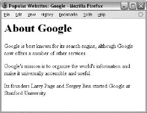

如你所见，这份文档包含标题“About Google”和一段介绍该公司的文字。另请注意，浏览器窗口最左上角显示的是“Popular Websites: Google”；这被称为页面的标题（右侧显示的是 Mozilla Firefox，即打开此页面的浏览器）。

要理解第一个示例中的标记，你需要查看尖括号之间的内容，并将其与图中看到的内容进行比较，接下来你将进行这一步。

## 标签与元素

如果你查看上一个示例代码的第一行和最后一行，你会看到成对的尖括号，里面包含字母“html”。从第一行开始，第一个尖括号看起来像小于号，然后是字母“html”，接着是第二个尖括号，看起来像大于号。这两个括号及其之间的所有字符被称为一个标签。

在这个示例中，有很多标签，它们都是成对出现的：有开始标签和结束标签。结束标签总是与开始标签略有不同，它在第一个尖括号后面有一个正斜杠：`</html>`。

一对标签及其包含的内容被称为一个元素。在图 1-2 中，你可以看到上一个示例页面的标题。

图 1-2

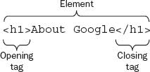

开始标签表示“这是标题的开始”，结束标签表示“这是标题的结束”。与 XHTML 中的大多数标签一样，尖括号内的文本说明了标签的用途——这里的`h1`表示这是一个一级标题（或顶级标题）。稍后你会看到，还有用于子标题的标签（`<h2>`、`<h3>`、`<h4>`、`<h5>`和`<h6>`）。如果我们没有在“About Google”周围加上标签，它就会只是另一段文本；无法明确这些文字构成了标题。

现在来看关于该公司的三个段落；每个段落都放在开始`<p>`标签和结束`</p>`标签之间。你猜对了，`p`代表段落。

标签和元素之间的基本区别非常重要，需要理解：标签由左尖括号、右尖括号以及括号之间的字母和数字组成，而元素则是开始标签、结束标签以及两者之间的所有内容。

如你所见，这个示例中的标签实际上描述了它们之间的内容，从而构建了文档的结构。`<h1>`和`</h1>`标签之间的文本是标题，而开始`<p>`和结束`</p>`标签之间的内容构成了段落。实际上，整个文档都包含在开始`<html>`和结束`</html>`标签之间。

你经常会发现用家族树中的术语来描述元素之间的关系。例如，包含另一个元素的元素被称为父元素，而位于父元素开始和结束标签之间的元素被称为该元素的子元素。因此，`<title>`元素是`<head>`元素的子元素，`<head>`元素是`<title>`元素的父元素，依此类推。此外，`<title>`元素可以被视为`<html>`元素的孙元素。

值得注意的是，这个示例中的标签都是小写字母；你有时会看到用 HTML 编写的网页中标签是大写的（或大小写混合）。当 XHTML 引入时，它规定了更严格的规则，要求所有标签都使用小写字母。

需要强调的是，XHTML 标签应始终使用小写字母书写。

## 区分头部与主体

每当你用 XHTML 编写网页时，整个页面都包含在开始`<html>`和结束`</html>`标签之间，就像上一个示例一样。在`<html>`元素内部，页面有两个主要部分：

- `<head>`元素：通常被称为页面的头部，包含关于页面的信息（这不是页面的主要内容）。例如，它可能包含页面的标题和描述，或者关于浏览器在哪里可以找到解释文档外观的 CSS 规则的说明。它由开始`<head>`标签、结束`</head>`标签以及两者之间的所有内容组成。
- `<body>`元素：通常被称为页面的主体，包含你在主浏览器窗口中实际看到的信息。它由开始`<body>`标签、结束`</body>`标签以及两者之间的所有内容组成。

`<html>`、`<head>`和`<body>`元素共同构成了 XHTML 文档的骨架——它们是每个网页构建的基础。

在第一个示例页面的`<head>`元素内部，你可以看到一个`<title>`元素：

```html
<head>

  <title>Popular Websites: Google</title>

</head>
```

在开始`<title>`标签和结束`</title>`标签之间是文字“Popular Websites: Google”，这是该网页的标题。当我介绍图 1-1（展示了该页面的截图）时，我提醒你注意浏览器窗口最顶部的文字。这就是 Internet Explorer、Firefox 和 Safari 等浏览器显示文档标题的位置；也是当你将页面保存到收藏夹时使用的名称，并且它有助于搜索引擎理解你的页面内容。

页面的实际内容保存在`<body>`元素中，这是你希望用户阅读的内容，并显示在主浏览器窗口中。

`<head>`元素包含关于文档的信息，这些信息不会显示在主页面中。`<body>`元素保存了在浏览器中查看的页面实际内容。

你可能已经注意到，这个示例中的标签以对称的顺序出现。如果你希望将一个元素放在另一个元素内部，那么该元素的开始和结束标签都必须位于包含它的元素内部。例如，以下写法是允许的：

`<p> 这个段落包含一些 <em>强调文本。</em></p>`

而以下写法是错误的，因为结束`</em>`标签不在段落元素内部：

`<p> 这个段落包含一些 <em>强调文本。 </p></em>`

换句话说，如果一个元素要包含另一个元素，它必须完全包含该元素。这被称为正确嵌套元素。

## 属性告诉我们关于元素的信息

真正将网页文档与标准文档区分开来的是链接（或超链接），它能带你从一个网页跳转到另一个网页。让我们通过在你刚才看到的示例中添加一个链接来了解它。链接使用`<a>`元素创建（`a`代表锚点）。

这里，我们将在文档末尾的新段落中添加一个从本页到谷歌的链接。这个示例（代码示例`ch01_eg02.html`）中只有一行新代码，并且该行已被高亮显示：

```html
<html>
  <head>
    <title>Popular Websites: Google</title>
  </head>
  <body>
    <h1>About Google</h1>
    <p>Google is best known for its search engine, although Google now offers a
       number of other services.</p>
    <p>Google's mission is to organize the world's information and make it
       universally accessible and useful.</p>
    <p>Its founders Larry Page and Sergey Brin started Google at Stanford
University.</p>
    <p><a href="http://www.Google.com/">Click here to visit Google's Web
    site.</a></p>
  </body>
</html>
```

在这个新段落中，有一个`<a>`元素用于创建链接。在开标签`<a>`和闭标签`</a>`之间，是你可以点击的文本，内容为“点击此处访问谷歌网站。”图 1-3 展示了该页面在浏览器中的显示效果。

图 1-3

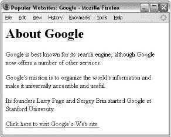

如果你仔细观察链接的开标签，会发现它带有一个称为属性的东西。在这个例子中，它是`href`属性；后面跟着一个等号，然后是一对引号，其中包含谷歌网站的 URL。在这种情况下，`href`属性告诉你要将链接指向何处。你将在下一章更详细地了解链接，但此刻这已经说明了属性的用途。

属性用于描述携带它们的元素，并且它们总是出现在该元素的开标签上。所有属性都由两部分组成：名称和值：

- **名称**是你想要设置的元素的属性。在这个例子中，`<a>`元素携带了一个名为`href`的属性，你可以用它来指示链接应该指向哪里。
- **值**是你希望该属性具有的值。在这个例子中，值是链接应该指向的网站的 URL，因此`href`属性的值是`www.Google.com`。

属性的值应始终放在双引号中，并通过等号与名称分隔。如果你希望链接在新窗口中打开，还可以在开标签`<a>`中添加一个`target`属性，并将其值设为`_blank`：

```html
<a href="http://www.Google.com" target="_blank">
```

这表明元素可以携带多个属性，但一个元素永远不应有两个同名的属性。

所有属性都由两部分组成：属性名称及其值，用等号分隔。值应放在双引号内。所有 XHTML 属性名称都应使用小写字母书写。

## 通过查看他人源代码来学习

当 HTML 刚出现时，许多人通过利用大多数常见浏览器中一个非常方便的功能来学习如何创建页面——查看构成页面的源代码。

如果你在浏览器中进入“查看”菜单，然后寻找“查看源代码”或“页面源代码”选项，你应该能够看到创建该页面的代码。

如果你想了解页面作者是如何实现某个效果的，这可能是一个非常实用的技巧。图 1-4 展示了如何查看谷歌首页的源代码（右侧窗口包含该页面的源代码）。

图 1-4

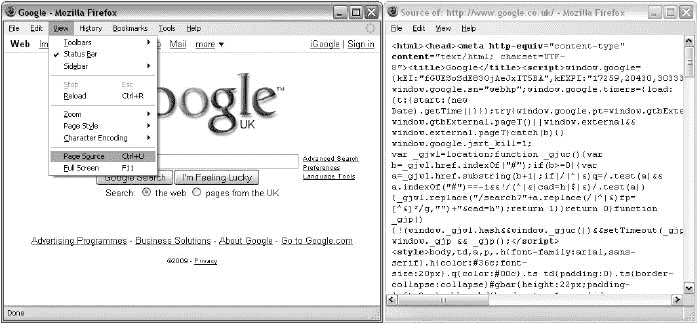

## 用于标记文本的元素

你现在知道，一个 XHTML 页面（有时也称为 XHTML 文档）由描述其内容如何结构的元素组成。每个元素描述了在其开标签和闭标签之间你会找到什么。开标签还可以携带属性，这些属性告诉你关于该特定元素的更多信息。

掌握了这些知识，你会发现学习 XHTML 很大程度上就是学习你可以使用哪些元素、每个元素的作用以及每个元素可以携带哪些属性。

你已经看到每个 XHTML 文档都以`<html>`、`<head>`和`<body>`元素开始。我们将在本章末尾更详细地回顾这些元素，届时你还会遇到一些称为通用属性的属性（之所以这样称呼，是因为它们可以出现在每个元素上）。但我希望尽快让你开始构建页面，因此本章剩余的大部分时间你将学习用于描述文本结构的不同元素：

- 六级标题：`<h1>`、`<h2>`、`<h3>`、`<h4>`、`<h5>`和`<h6>`
- 段落`<p>`、预格式化部分`<pre>`、换行`<br />`和地址`<address>`
- 呈现元素：`<b>`、`<i>`、`<u>`、`<s>`、`<tt>`、`<sup>`、`<sub>`、`<strike>`、`<big>`、`<small>`和`<hr />`
- 短语元素，如`<em>`、`<strong>`、`<abbr>`、`<acronym>`、`<dfn>`、`<blockquote>`、`<q>`、`<cite>`、`<code>`、`<kbd>`、`<var>`、`<samp>`和`<address>`
- 列表，如使用`<ul>`和`<li>`的无序列表、使用`<ol>`和`<li>`的有序列表，以及使用`<dl>`、`<dt>`和`<dd>`的定义列表
- 编辑元素，如`<ins>`和`<del>`
- 分组元素：`<div>`和`<span>`

这听起来可能有很多元素，但我希望你会惊讶于我们能够如此快速地掌握它们。

## 基本文本格式

由于你创建的几乎每个文档都会包含某种形式的文本，因此你即将遇到的元素很可能在你构建的大多数页面中出现。在本节中，你将学习如何使用所谓的基本文本格式化元素：

- `<h1>`、`<h2>`、`<h3>`、`<h4>`、`<h5>`、`<h6>`
- `<p>`、`<br />`、`<pre>`

在阅读本节时，值得注意的一点是，虽然一个浏览器可能以某种方式显示这些元素，但另一个浏览器可能以略有不同的方式显示同一页面；例如，使用的字体、字号以及这些元素周围的间距可能因浏览器而异（因此文本部分所占用的空间量也可能不同）。

在查看元素本身之前，了解文本在没有任何元素的情况下默认如何显示会有所帮助。这将有助于说明使用标记来告诉浏览器你希望它以不同方式处理文本的重要性。

### 空白与流

在开始标记文本之前，最好先了解 XHTML 在遇到空格时如何处理，以及浏览器如何处理长句子和文本段落。


你可能认为如果在两个单词之间放置多个连续空格，这些空格会出现在屏幕上的这些单词之间，但事实并非如此；默认情况下，只会显示一个空格。这被称为空白折叠。类似地，如果你在源文档中开始新的一行，或者有连续的空行，这些都会被忽略，并被视为一个空格，制表符也是如此。例如，考虑以下段落（取自代码示例中的`ch01_eg03.html`）：

```
<p>This   paragraph shows how   multiple spaces     between     words are
treated as a single space. This is known as white space collapsing, and
the big spaces between    some of the    words will not appear   in the
browser.

It also demonstrates how the browser will treat multiple carriage returns
(new lines) as a single space, too.</p>
```

如图 1-5 所示，浏览器会将多个空格和多个回车（即文本换行处）视为仅有一个空格。同时，它允许文本行占据浏览器窗口的完整宽度。

图 1-5

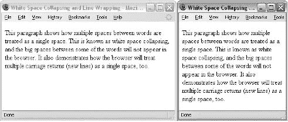

现在再次查看此示例的代码，比较代码中每一新行的起始位置与屏幕上每一新行的起始位置。如图 1-5 所示，除非另有指示，否则浏览器在显示文本时会自动占据屏幕的完整宽度，并在空间不足时将文本换行到新行。如果你自己在浏览器中打开此示例并尝试调整浏览器窗口大小（使其变小或变大），观察文本如何在屏幕上的新位置换行，就能更清楚地看到这种效果（此示例可与本书的其他下载代码一起在[www.wrox.com](http://www.wrox.com)获取）。

空白折叠特别有用，因为它允许你在 XHTML 中添加额外的空格，而这些空格在浏览器中查看时不会显示。这些空格可用于缩进代码，使其更易于阅读。本章的前两个示例演示了缩进代码，其中子元素相对于父元素向左缩进以区分它们。我在本书中一直这样做，以使代码更具可读性。（如果你想保留文档中的空格，则需要使用`<pre>`元素（本章后面会介绍）或实体引用（如`&nbsp;`，附录 F 中会介绍）。）

现在你已经了解了多个空格和换行是如何被折叠的，就能明白为什么学习如何使用本章剩余部分中的元素来分割和控制文本的呈现非常重要。

## 使用`hn`元素创建标题

无论你创建什么类型的文档，大多数文档都有某种形式的标题。报纸使用标题，表单上的标题告诉你表单的用途，体育成绩表的标题告诉你球队所在的联赛或分区，等等。

在较长的文本中，标题还可以帮助构建文档结构。如果你查看本书的目录，可以看到不同级别的标题是如何排列以增加书籍结构的，主标题下有子标题。

XHTML 提供了六级标题，分别使用元素`<h1>`、`<h2>`、`<h3>`、`<h4>`、`<h5>`和`<h6>`。浏览器将`<h1>`元素显示为六级中最大的，`<h6>`显示为最小的（不过你将在第 7 章中看到，CSS 可用于覆盖任何元素的大小和样式）。标题级别大致如图 1-6 所示（`ch01_eg04.html`）。

图 1-6

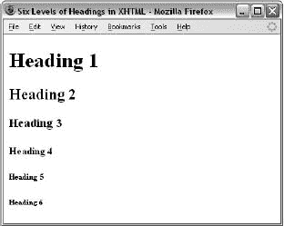

大多数浏览器将`<h1>`、`<h2>`和`<h3>`元素的内容显示得比文档中的默认文本大小更大。`<h4>`元素的内容与默认文本大小相同，而`<h5>`和`<h6>`元素的内容则更小，除非你使用 CSS 另行指定。

以下是另一个如何使用标题来构建文档结构的示例（`ch01_eg05.html`），其中`<h2>`元素是`<h1>`元素的子标题（这实际上模拟了本章这一部分的结构）：

```
<h1>基本文本格式化</h1>

<p> 本节将讨论如何标记文本。你创建的几乎每个文档都会包含某种形式的文本，因此这将是一个非常重要的部分。 </p>

<h2>空白与流</h2>

<p> 在开始标记文本之前，最好先了解 XHTML 在遇到空格时如何处理，以及浏览器如何处理长句和段落文本。</p>

<h2>使用 hn 元素创建标题</h2>

<p> 无论你创建什么类型的文档，大多数文档都有某种形式的标题...</p>
```

图 1-7

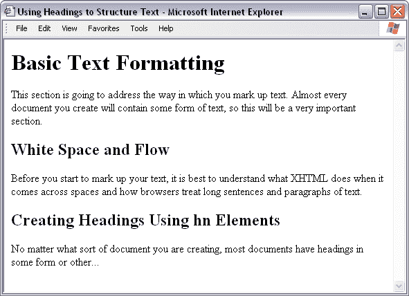

对于每个 XHTML 元素，我将列出它可以携带的属性，这对将来参考会很有帮助。

六个标题元素都可以携带你将在本章末尾遇到的通用属性，以及一个名为`align`的属性：

`align` `class` `id` `style` `title` `dir` `lang` `xml:lang`

### `align`属性（已弃用）

`align`属性指示标题出现在页面的左侧、中间还是右侧（默认值为`left`）。它可以取下表中讨论的三个值。

你可能已经注意到，本节标题的括号中出现了“已弃用”一词。这表明`align`属性已被标记为将从未来版本的 HTML 和 XHTML 规范中移除。你将在本书中看到几个已被弃用的元素和属性，最好避免使用它们。

尽管已被弃用，我在此提及`align`属性是因为你可能仍然会在各种元素上看到它。它被标记为已弃用，是因为它无助于描述文档的结构——而是用于影响页面的呈现。`align`属性已被两个 CSS 属性取代：用于对齐文本的`text-align`属性，以及用于在页面上定位较大项目的`float`属性（你将在第 7 章中看到）。

| 值 | 含义 |
| --- | --- |
| `left` | 标题显示在浏览器窗口（或如果嵌套在其他元素中，则为其他包含元素）的左侧。如果未使用`align`属性，这是默认值。 |
| `center` | 标题显示在浏览器窗口（或如果嵌套在其他元素中，则为其他包含元素）的中间。 |
| `right` | 标题显示在浏览器窗口（或如果嵌套在其他元素中，则为其他包含元素）的右侧。 |

以下是使用已弃用的`align`属性的示例（`ch01_eg06.html`）：

```
<h1 align="left">左对齐标题</h1>
  <p>此标题使用 align 属性，值为 left。</p>

<h1 align="center">居中对齐标题</h1>
  <p>此标题使用 align 属性，值为 center。</p>

<h1 align="right">右对齐标题</h1>
  <p>此标题使用 align 属性，值为 right。</p>
```

图 1-8 显示了`align`属性在浏览器中的效果。

图 1-8

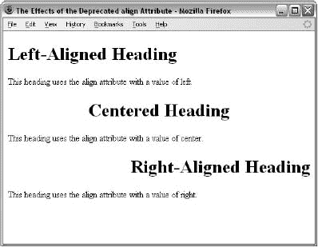

## 使用`<p>`元素创建段落

`<p>`元素提供了另一种结构化文本的方式。每个段落文本应放在开头的`<p>`和结尾的`</p>`标签之间，如下例所示（`ch01_eg07.html`）：

```
<p>这是一个段落文本。</p>

<p>这是第二个段落文本。</p>

<p>这是第三个段落文本。</p>
```

当浏览器显示段落时，它通常会在下一个段落之前插入一个新行，并添加一点额外的垂直空间，如图 1-9 所示。

图 1-9

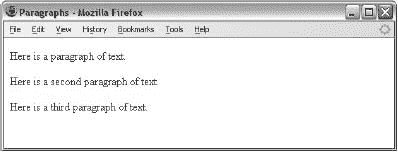

`<p>`元素可以携带所有通用属性和已弃用的`align`属性：

`align` `class` `id` `style` `title` `dir` `lang` `xml:lang`

## 使用`<br />`元素创建换行

每当你使用`<br />`元素时，它后面的任何内容都会从下一行开始。`<br />`元素是一个空元素的示例；你不需要开闭标签，因为中间没有任何内容。

请注意，`<br />`元素在字符`br`和正斜杠之间有一个空格。

你经常会看到这样的写法：`<br>`，这是早期 HTML 版本中的写法，但在 XHTML 中，`<br`后面会跟一个空格和一个斜杠，然后才是右尖括号。

你可以使用多个`<br />`元素将文本向下推几行，许多设计师在段落之间使用两个换行符，而不是使用`<p>`元素来组织文本，如下所示：

```
Paragraph one<br /><br />

Paragraph two<br /><br />

Paragraph three<br /><br />
```

虽然两个`<br />`元素看起来与使用`<p>`元素非常相似，但请记住，XHTML 标记应该描述内容的结构。因此，如果在段落之间使用两个`<br />`元素，你并没有描述文档的结构。

严格来说，`<br />`元素不应被用于定位文本，而应仅用于所谓的块级元素内部。`<p>`元素是一个块级元素；你将在本章末尾了解更多相关内容。

下面是一个在段落中使用`<br />`元素的示例（`ch01_eg08.html`）：

```
<p>When you want to start a new line you can use the line break element.

So, the next<br />word will appear on a new line.</p>
```

图 1-10 展示了在单词“next”和“do”之后换行符的效果。

图 1-10

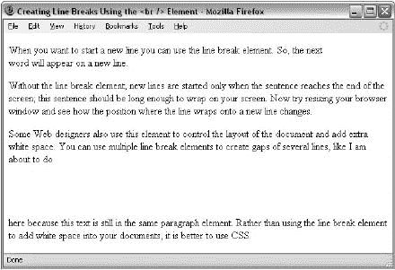

`<br />`元素可以携带以下属性（`clear`属性已被弃用，并在附录 I 中介绍）。

`clear` `class` `id` `style` `title`

## 使用`<pre>`元素创建预格式化文本

有时你希望文本完全按照在 XHTML 文档中编写时的格式显示——你不希望文本到达浏览器边缘时自动换行；你不希望它忽略多个空格；并且你希望换行符出现在你放置的位置。

位于开始`<pre>`标签和结束`</pre>`标签之间的任何文本都将保留源文档的格式。但需要注意的是，大多数浏览器默认会以等宽字体显示这些文本。（Courier 是等宽字体的一个例子，因为字母表中的每个字母都占据相同的宽度。在非等宽字体中，`i`通常比`m`窄。）

`<pre>`元素最常见的用途是表示计算机源代码。例如，下面展示了`<pre>`元素中的一些 JavaScript 代码（`ch01_eg09.html`）：

```
<pre>

function testFunction(strText){

   alert (strText)

}

</pre>
```

你可以在图 1-11 中看到`<pre>`元素的内容如何以等宽字体显示；更重要的是，你可以看到它如何遵循`<pre>`元素内部的格式——空白被保留。

图 1-11

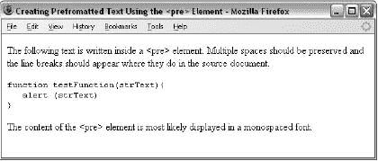

虽然制表符在`<pre>`元素内可能产生影响，并且一个制表符应该代表八个空格，但不同浏览器对制表符的实现各不相同，因此建议使用空格代替。

你将在本章后面的“短语元素”部分遇到更多可用于表示代码的元素，其中包括`<code>`、`<kbd>`和`<var>`元素。

Firefox、IE 和 Safari 支持 XHTML 推荐标准的一个扩展，用于防止换行：`<nobr>`元素。（该元素保留其包含元素的正常样式，并且不会导致文本以等宽字体显示。）由于它是一个扩展，因此不属于 XHTML 规范的一部分。`<nobr>`元素在附录 I 中介绍。

## 动手实践：基本文本格式化

现在你已经了解了用于格式化文本的基本元素——标题和段落——是时候尝试将这些知识付诸实践了。

在本例中，你将为一个名为 Example Café 的虚构咖啡馆创建一个页面。我们将在整本书中继续使用这个示例来构建一个完整的网站。这个页面将是该网站的主页，向人们介绍这家咖啡馆：

1. 添加文档的基本骨架：`<html>`、`<head>`、`<title>`和`<body>`元素。

   ```html
   <html>

     <head>

       <title>Example Cafe - community cafe in Newquay, Cornwall, UK </title>

     </head>

     <body>

     </body>

   </html>
   ```

   整个页面包含在`<html>`元素中。`<html>`元素只能包含两个子元素：`<head>`元素和`<body>`元素。`<head>`元素包含页面的标题，你应该能从页面标题中判断出页面将包含什么类型的信息。

   同时，`<body>`元素包含网页的主要部分——即浏览者将在网页浏览器主区域中实际看到的部分。

2. 你的页面将有一个主标题和一些二级标题；这些标题为页面上的信息增加了结构：

   ```html
   <body>

     <h1>EXAMPLE CAFE</h1>

     <h2>A community cafe serving home cooked, locally sourced, organic food</h2>

     <h2>This weekend's special brunch</h2>

   </body>
   ```

3. 现在你可以用一些跟在标题后面的段落来填充页面：

   ```html
   <body>

     <h1>EXAMPLE CAFE</h1>

       <p>Welcome to example cafe. We will be developing this site throughout the book.</p>

     <h2>A community cafe serving home cooked, locally sourced, organic food</h2>

       <p>With stunning views of the ocean, Example Cafe offers the perfect

   environment to unwind and recharge the batteries.</p>

       <p>Our menu offers a wide range of breakfasts, brunches and lunches, including a range of vegetarian options.</p>

       <p>Whether you sip on a fresh, hot coffee or a cooling smoothie, you never need to feel rushed - relax with friends or just watch the world go by.</p>

       <h2>This weekend's special brunch</h2>

       <p>This weekend, our season of special brunches continues with scrambled egg

   on an English muffin. Not for the faint-hearted, the secret to these eggs is that they are made with half cream and cooked in butter, with no more than four eggs in the pan at a time.</p>

   </body>

   </html>
   ```

4. 将文件保存为`index.html`，然后在网页浏览器中打开它。结果应该类似于图 1-12。`index.html`这个名称通常用于 XHTML 构建的网站的主页。

图 1-12

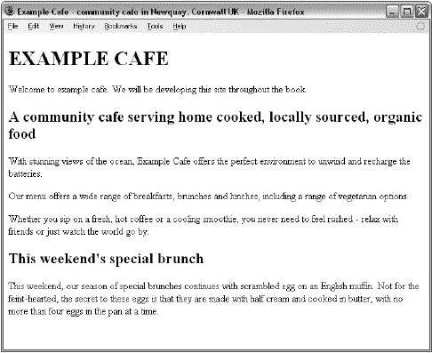

## 表现性元素

如果你使用过文字处理器，你会熟悉将文本设置为粗体、斜体或下划线的功能；这只是 XHTML 中用于指示文本外观的十种选项中的三种。完整列表包括：粗体、斜体、等宽字体、下划线、删除线、电传打字、放大、缩小、上标和下标文本。

从技术上讲，这些元素只影响文档的呈现，标记本身没有其他用途。你也可以使用 CSS 实现类似的外观。然而，它们仍然被广泛使用。

以下所有表现性元素都可以携带本章末尾介绍的通用属性和 UI 事件属性。

让我们从认识`<b>`、`<i>`、`<u>`、`<s>`和`<tt>`元素开始。它们都在`ch01_eg10.html`中进行了演示，你可以在图 1-13 中看到它们的外观。

图 1-13

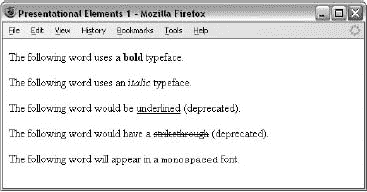

### `<b>`元素

出现在`<b>`元素中的任何内容都会以粗体显示，就像这里的单词“bold”一样：

The following word uses a `<b>bold</b>` typeface.

对于那些对排版非常感兴趣的人来说，值得注意的是，这并不一定意味着浏览器会使用字体的粗体版本；有些浏览器会使用算法对字体的正常版本进行处理，使线条变粗（使其看起来像粗体）。

`<b>`元素的内容将以与`<strong>`元素内容相同的方式显示。你将在后面遇到`<strong>`元素；它用于表示其内容具有强烈的强调。

### `<i>`元素

`<i>`元素的内容以斜体文本显示，就像这里的“italic”一词：

以下单词使用了`<i>italic</i>`字体。

这并不一定意味着浏览器会寻找字体的倾斜或斜体版本。大多数浏览器会使用算法将线条倾斜以模拟斜体字体。

`<i>`元素的内容将以与`<em>`元素内容相同的方式显示。稍后你会遇到`<em>`元素；它用于表示其内容具有强调作用。

### `<u>`元素（已弃用）

`<u>`元素的内容以一条简单的下划线显示：

以下单词将被`<u>underlined</u>`

`<u>`元素已弃用，尽管当前浏览器仍然支持它。

### `<s>`和`<strike>`元素（已弃用）

`<s>`或`<strike>`元素的内容以删除线显示，即穿过文本的一条细线（`<s>`只是`<strike>`的缩写形式）。

以下单词将带有`<s>strikethrough</s>`。

`<s>`和`<strike>`元素均已弃用，尽管当前浏览器仍然支持它们。

### `<tt>`元素


`<tt>` 元素的内容以等宽字体（类似于电传打字机的字体）书写。

以下单词将以`<tt>monospaced</tt>`字体显示。

现在让我们看看`<sup>`、`<sub>`、`<big>`、`<small>`和`<hr />`元素。它们都在`ch01_eg11.html`中进行了演示，你可以在图 1-14 中看到它们在浏览器中的显示效果。

图 1-14

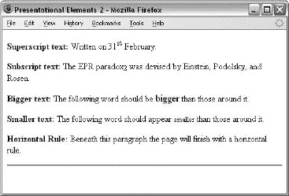

### `<sup>`元素

`<sup>`元素的内容以上标形式书写；它显示在其他字符上方半个字符的高度，并且通常比周围的文本略小。

写于 31`<sup>st</sup>` February。

`<sup>`元素在向方程中添加指数值，以及向数字（如日期）添加 st、nd、rd 和 th 后缀时特别有用。然而，在某些浏览器中，你需要注意它可能会在上标文本所在行与其上方行之间产生更大的间距。

### `<sub>`元素

`<sub>`元素的内容以下标形式书写；它显示在其他字符下方半个字符的高度，并且通常比周围的文本略小。

EPR 悖论`<sub>2</sub>`由爱因斯坦、波多尔斯基和罗森提出。

`<sub>`元素在创建脚注时特别有用。

### `<big>`元素

在早期版本的 HTML 中，文本有 7 种标准大小，`<big>`元素被引入以使该元素的内容比周围文本大一个字体大小（直到最大尺寸——7 号）。如今你应该避免使用这个元素，因为它只影响文档的外观；它无助于描述文档的结构或含义。相反，你应该使用 CSS 来改变文本大小。

以下单词应比其周围的单词`<big>bigger</big>`。

使用此元素时，可以将多个`<big>`元素嵌套在一起，每个元素的内容都会比前一个元素大一个尺寸。

### `<small>`元素

`<small>`元素与`<big>`元素相反，其内容显示为比周围文本小一个字体大小。如果字体已经是最小，则没有效果。你可以将多个`<small>`元素嵌套在一起，每个元素的内容都会比前一个元素小一个尺寸。

以下单词应比其周围的单词`<small>smaller</small>`。

不推荐使用此元素，你应该使用 CSS 来改变文本大小，而不是`<small>`元素。

### `<hr />`元素

`<hr />`元素在页面上创建一条水平线。它是一个空元素，类似于`<br />`元素。

`<hr />`

这通常用于分隔页面中不适合使用新标题的不同部分。

## 短语元素

本节中的一些元素以类似于你刚刚读到的呈现元素`<b>`、`<i>`、`<pre>`和`<tt>`的方式显示，但以下元素不仅仅用于呈现目的；它们还描述了其内容的某些含义。例如，写在`<em>`元素中的单词看起来与`<i>`元素中的单词相同，但`<em>`元素旨在表示添加了强调。

本节涵盖以下元素：

- `<em>`和`<strong>`用于强调
- `<blockquote>`、`<cite>`和`<q>`用于引用和引文
- `<abbr>`、`<acronym>`和`<dfn>`用于缩写、首字母缩略词和关键术语
- `<code>`、`<kbd>`、`<var>`和`<samp>`用于计算机代码和信息
- `<address>`用于地址

其中几个短语元素是在你刚刚遇到的呈现元素之后引入的。一些在引入这些元素之前学习 HTML 的开发人员会忽略它们，而只使用呈现元素，因为结果看起来相同。但你应该了解它们，并最好养成在适当情况下使用这些短语元素的习惯。例如，当你想在句子中强调某个单词时，你应该使用`<em>`和`<strong>`元素，而不是你刚刚遇到的呈现元素；这样做有几个很好的理由，例如：

- 诸如屏幕阅读器（可以为有视觉障碍的网页用户朗读页面）之类的应用程序可以为朗读声音添加适当的语调，以便有视觉障碍的用户能够听到强调的位置。
- 可以编写自动化程序来查找带有强调的单词，并将其作为文档中的关键词提取出来，或者专门对这些单词进行索引，以便用户能够找到文档中的重要术语。

如你所见，适当使用这些元素会为文档添加更多信息（例如哪些单词应该强调，哪些是编程代码的一部分，哪些部分是地址等），而不仅仅是说明它应该如何视觉呈现。

以下所有短语元素都可以携带本章末尾介绍的通用属性和 UI 事件属性。

### `<em>`元素添加强调

`<em>`元素的内容旨在成为文档中的强调点，通常以斜体文本显示。这种强调意图体现在诸如以下句子中的“必须”一词：

```html
<p>You <em>must</em> remember to close elements in XHTML.</p>
```

你只应在试图强调某个单词时使用此元素，而不是仅仅因为你想让文本显示为斜体。如果你只是出于风格原因想要斜体文本——而不添加强调——你可以使用`<i>`元素，或者最好使用 CSS。

### `<strong>`元素添加强烈强调

`<strong>`元素旨在显示其内容的强烈强调——比`<em>`元素更强的强调。与`<em>`元素一样，`<strong>`元素只应在你想对文档的某部分添加强烈强调时使用。大多数可视化浏览器以粗体字体显示强烈强调。

```html
<p><em>Always</em> look at burning magnesium through protective colored glass as it <strong>can cause blindness</strong>.</p>
```

图 1-15 展示了`<em>`和`<strong>`元素在 Firefox 中的渲染效果（`ch01_eg12.html`）。

图 1-15

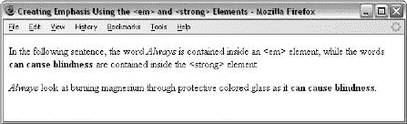

你需要记住，元素的呈现方式（斜体或粗体）在很大程度上是无关紧要的。你应该使用这些元素来强调短语，从而赋予文档更丰富的含义，而不是控制它们的外观。正如你将在第 7 章中看到的，使用 CSS 来改变这些元素的视觉呈现非常简单——例如，将`<em>`元素内的任何单词以黄色背景高亮显示，并使其变为粗体而非斜体。

### `<address>`元素用于表示地址

许多文档需要包含邮寄地址，有一个专门的`<address>`元素用于包含地址。例如，下面是 Wrox 的地址，放在`<address>`元素内（`ch01_eg13.html`）：

```html
<address>Wrox Press, 10475 Crosspoint Blvd, Indianapolis, IN 46256</address>
```

浏览器可能会以与周围文档不同的方式显示地址——IE、Firefox 和 Safari 会以斜体显示，如图 1-16 所示（不过你可以通过 CSS 覆盖这一样式）。

图 1-16

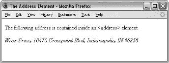

### `<abbr>`元素用于表示缩写

你可以将缩写放在开始`<abbr>`和结束`</abbr>`标签之间，以表明你正在使用缩写形式。

如果可能，请考虑使用`title`属性，其值为缩写的完整版本。例如，如果你想表明 Bev 是 Beverly 的缩写，可以像这样使用`<abbr>`元素：

```html
我有一个朋友叫<abbr title="Beverly">Bev</abbr>。
```

如果你在缩写一个外来词，还可以使用`xml:lang`属性来指明所使用的语言。

### `<acronym>`元素用于表示首字母缩略词

`<acronym>`元素允许你表明开始`<acronym>`和结束`</acronym>`标签之间的文本是一个首字母缩略词。

如果可能，请在开始`<acronym>`标签上使用`title`属性，其值为缩略词的完整版本。例如，如果你想表明 XHTML 是一个首字母缩略词，可以像这样使用`<acronym>`元素（`ch01_eg14.html`）：

```html
本章涵盖如何使用<acronym title="可扩展超文本标记语言">XHTML</acronym>标记文本。
```

从图 1-17 可以看出，Firefox 为`<abbr>`和`<acronym>`元素添加了虚线下划线，当鼠标悬停在单词上时，`title`属性的值会以工具提示形式显示。Internet Explorer 不会改变元素的外观，但也会将`title`显示为工具提示。

图 1-17

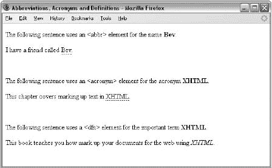

如果首字母缩略词是另一种语言，你可以添加一个`xml:lang`属性来指明其语言。

### `<dfn>`元素用于表示特殊术语

`<dfn>`元素允许你指定正在引入一个特殊术语。它的用法类似于本书中用于介绍重要新概念的斜体注释。

通常，你会在首次引入关键术语时使用`<dfn>`元素，并且仅在该实例中使用。大多数现代浏览器会以斜体字体渲染`<dfn>`元素的内容。

例如，你可以表明下面句子中的术语“XHTML”很重要，并应如此标记：

```html
本书教你如何使用<dfn>XHTML</dfn>为 Web 标记文档。
```

图 1-17 展示了`<dfn>`元素的使用（`ch01_eg14.html`）。

### `<blockquote>`元素用于引用文本

当你想要引用其他来源的一段文字时，应使用`<blockquote>`元素。注意，有一个单独的`<q>`元素用于较短的引用，将在下一节讨论。以下是`ch01_eg15.html`：

```html
<p>以下对 XHTML 的描述摘自 W3C 网站：</p>

<blockquote>XHTML 1.0 是 W3C 关于 XHTML 的第一个推荐标准，它基于之前对 HTML 4.01、HTML 4.0、HTML 3.2 和 HTML 2.0 的工作。</blockquote>
```

`<blockquote>`元素内的文本通常会在左右边缘相对于周围文本缩进，有些浏览器会使用斜体字体。（它应仅用于引用——如果你只是想要一个缩进的文本段落，应使用 CSS。你可以在图 1-18 中看到其效果。）

图 1-18

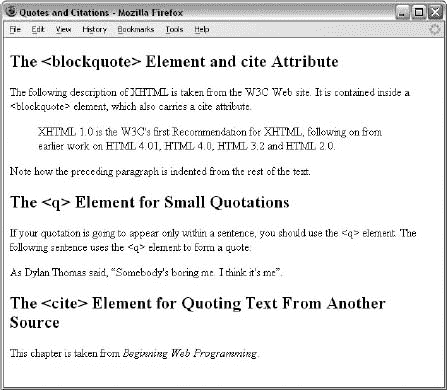

#### 在`<blockquote>`元素中使用`cite`属性

你可以在`<blockquote>`元素上使用`cite`属性来指明引用的来源。该属性的值应是一个指向在线文档的 URL，如果可能，最好指向文档中的确切位置。浏览器目前不会对该属性做任何处理，但这意味着引用的来源信息会保留，以备将来需要（`ch01_eg15.html`）。

```html
<blockquote cite="http://www.w3.org/markup/">XHTML 1.0 是 W3C 关于 XHTML 的第一个推荐标准，它基于之前对 HTML 4.01、HTML 4.0、HTML 3.2 和 HTML 2.0 的工作。</blockquote>
```

### `<q>`元素用于短引用

`<q>`元素用于在句子中添加引用，而不是作为独立的缩进块（`ch01_eg15.html`）：

```html
<p>正如 Dylan Thomas 所说，<q>有人让我感到无聊。我想是我自己。</q></p>
```

XHTML 推荐标准规定，`<q>`元素内包含的文本应以双引号开头和结尾。Firefox 会自动插入这些引号，但 IE8 是第一个支持`<q>`元素的 Internet Explorer 版本。因此，如果你希望引用被引号包围，请注意 IE7 及更早版本的 IE 不会显示它们。

`<q>`元素也可以带有`cite`属性。其值应是一个指向引用来源的 URL。

### `<cite>`元素用于引用来源

如果你在引用一段文本，可以通过将来源放在开始`<cite>`和结束`</cite>`标签之间来指明它。正如你在印刷出版物中所期望的那样，`<cite>`元素的内容默认以斜体文本渲染（`ch01_eg15.html`）。

```html
本章摘自<cite>《Web 开发入门》</cite>。
```

如果你在引用一个在线资源，应将`<cite>`元素放在`<a>`元素内，正如你将在第 2 章中看到的，这会创建一个指向相关文档的链接。

有几个应用程序可能会利用`<cite>`元素。例如，搜索应用程序可以使用`<cite>`标签来查找引用特定作品的文档，或者浏览器可以收集`<cite>`元素的内容来为任何给定文档生成参考文献列表，尽管目前它还没有被广泛使用到足以支持这些功能。

你可以在图 1-18 中看到`<blockquote>`、`<q>`和`<cite>`元素。

### `<code>`元素用于表示代码

如果你的页面包含任何编程代码（这在 Web 上并不罕见），以下四个元素将对你特别有用。任何要在网页上显示的代码都应放在`<code>`元素内。通常，`<code>`元素的内容会以等宽字体呈现，就像大多数编程书籍（包括本书）中的代码一样。

请注意，当尝试在网页上显示代码时（例如，如果你正在创建一个关于 Web 编程的页面），并且你想要包含尖括号，你不能直接在这些元素中使用左尖括号和右尖括号，因为浏览器可能会将这些字符误认为是实际的标记。相反，你应该使用`&lt;`代替左尖括号（<），使用`&gt;`代替右尖括号（>）。这些替换字符集被称为转义码或字符实体，完整列表见附录 F。

下面是一个使用`<code>`元素表示 XHTML 中的`<h1>`元素及其内容的示例（`ch01_eg16.html`）：

```html
<p><code>&lt;h1&gt;这是一个一级标题&lt;/h1&gt;</code></p>
```

图 1-19 展示了它在浏览器中的显示效果。

图 1-19

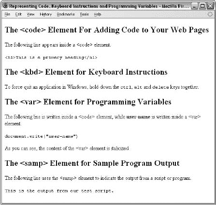

`<code>`元素常与`<pre>`元素结合使用，以保留代码的格式。

### `<kbd>`元素用于表示键盘输入文本

在讨论计算机时，如果你想告诉读者输入一些文本，可以使用`<kbd>`元素来指示应输入的内容，如下例所示（`ch01_eg16.html`）：

```html
<p>要在 Windows 中强制退出应用程序，请同时按住<kbd>ctrl</kbd>、<kbd>alt</kbd>和<kbd>delete</kbd>键。</p>
```

`<kbd>`元素的内容通常以等宽字体显示，类似于`<code>`元素的内容。图 1-19 展示了它在浏览器中的显示效果。

### `<var>`元素用于表示编程变量

`<var>`元素是另一个为帮助程序员而添加的元素。它通常与`<pre>`和`<code>`元素结合使用，以指示该元素的内容是一个可由用户提供的变量（`ch01_eg16.html`）。

```html
<p><code>document.write("<var>user-name</var>")</code></p>
```

通常，`<var>`元素的内容会以斜体显示，如图 1-19 所示。如果你不熟悉变量的概念，第 11 章会介绍它们。

### `<samp>`元素用于表示程序输出

`<samp>`元素表示程序、脚本等的示例输出。同样，它主要用于记录编程概念。例如（`ch01_eg16.html`）：

```html
<p>以下行使用&lt;samp&gt;元素表示脚本或程序的输出。</p>
<p><samp>这是我们的测试脚本的输出。</samp></p>
```

这通常以等宽字体显示，如图 1-19 所示。

至此，短语元素部分结束，但文本元素部分尚未完全结束。

## 列表

你可能有很多理由在页面中添加列表，从在主页上列出你最喜欢的五张专辑，到包含一组编号的说明供访问者遵循（就像本书“试一试”示例中的步骤一样）。

在 XHTML 中，你可以创建三种类型的列表：

- 无序列表，类似于项目符号列表
- 有序列表，使用数字或字母序列代替项目符号
- 定义列表，允许你指定术语及其定义

我相信你在接触并开始使用这些列表后，会想到更多的用途。

### 使用`<ul>`元素创建无序列表

如果你想制作一个项目符号列表，可以将列表写在`<ul>`元素内（`ul`代表无序列表）。每个项目符号点或你想写的行都应包含在开头的`<li>`标签和结尾的`</li>`标签之间（`li`代表列表项）。

你应该始终闭合`<li>`元素。尽管你可能会看到一些 HTML 页面省略了结束标签，但这是一个应该避免的坏习惯。

如果你想创建一个项目符号列表，可以这样做（`ch01_eg17.html`）：

```html
<ul>
  <li>项目符号点一</li>
  <li>项目符号点二</li>
  <li>项目符号点三</li>
</ul>
```

在浏览器中，这个列表看起来会像图 1-20 所示。

图 1-20

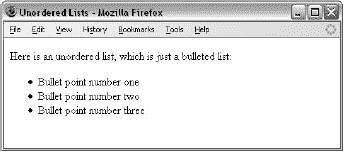

`<ul>`和`<li>`元素可以携带所有通用属性和 UI 事件属性。

### 有序列表

有时，你希望列表是有序的。在有序列表中，不是用项目符号作为每个点的前缀，而是可以使用数字（1, 2, 3）、字母（A, B, C）或罗马数字（i, ii, iii）作为列表项的前缀。

有序列表包含在`<ol>`元素内。列表中的每个项都应嵌套在`<ol>`元素内，并包含在开头的`<li>`和结尾的`</li>`标签之间（`ch01_eg18.html`）。

```html
<ol>
  <li>点一</li>
  <li>点二</li>
  <li>点三</li>
</ol>
```

结果应类似于你在图 1-21 中看到的效果。

图 1-21

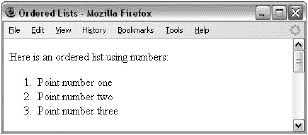

如果你希望使用字母或罗马数字而不是阿拉伯数字，可以在`<ol>`元素上使用现已弃用的`type`属性。

#### 使用`type`属性选择有序列表中的数字、字母或罗马数字（已弃用）

`<ol>`元素上的`type`属性允许你将列表项的排序从默认的数字更改为下表中列出的选项，只需为`type`属性赋予相应的字符即可。

| `type`属性的值 | 描述 | 示例 |
| --- | --- | --- |
| `1` | 阿拉伯数字（默认） | 1, 2, 3, 4, 5 |
| `A` | 大写字母 | A, B, C, D, E |
| `a` | 小写字母 | a, b, c, d, e |
| `I` | 大写罗马数字 | I, II, III, IV, V |


| i | 小写罗马数字 | i, ii, iii, iv, v |

例如，以下是一个使用小写罗马数字的有序列表（`ch01_eg18.html`）：

```html
<ol type="i">
  <li>点一</li>
  <li>点二</li>
  <li>点三</li>
</ol>
```

你可以在图 1-22 中看到它的效果。

图 1-22

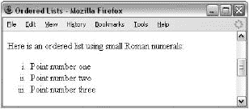

`type` 属性已被弃用，转而使用 CSS 的 `list-style-type` 属性。

过去，你也可以在 `<li>` 元素上使用 `type` 属性，这会覆盖 `<ol>` 元素中的值，但该属性已被弃用，应避免使用。所有通用属性和 UI 事件属性都可以用于 `<ol>` 元素，此外还有一个特殊属性 `start`，用于控制列表的起始编号。

#### 使用 `start` 属性更改有序列表的起始编号（已弃用）

如果你想指定编号列表的起始数字，可以在 `<ol>` 元素上使用 `start` 属性。该属性的值应为该点在列表中的数字表示，因此，如果列表使用大写字母排序，D 对应的值应为 4（`ch01_eg18.html`）。

```html
<ol type="A" start="4">
  <li>点一</li>
  <li>点二</li>
  <li>点三</li>
</ol>
```

你可以在图 1-23 中看到结果。

图 1-23

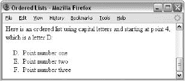

### 定义列表

定义列表是一种特殊的列表，用于提供术语及其简短的定义或描述。定义列表包含在 `<dl>` 元素内。`<dl>` 元素随后包含交替的 `<dt>` 和 `<dd>` 元素。`<dt>` 元素的内容是你将要定义的术语。`<dd>` 元素包含前一个 `<dt>` 元素的定义。例如，以下是一个定义列表，描述了 XHTML 中不同类型的列表（`ch01_eg19.html`）：

```html
<dl>
  <dt>无序列表</dt>
  <dd>项目符号列表。</dd>
  <dt>有序列表</dt>
  <dd>有序的点列表，例如一组编号的步骤。</dd>
  <dt>定义列表</dt>
  <dd>术语和定义的列表。</dd>
</dl>
```

在浏览器中，这看起来会像图 1-24 所示（`ch01_eg19.html`）。

图 1-24

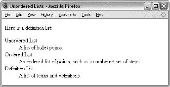

这些元素都可以携带本章末尾介绍的通用属性和 UI 事件属性。

### 嵌套列表

你可以将列表嵌套在其他列表中。例如，你可能想要一个编号列表，其中某个列表项对应单独的点。每个嵌套列表将单独编号，除非你使用 `start` 属性另行指定。每个新列表应放在 `<li>` 元素内（`ch01_eg20.html`）：

```html
<ol type="I">
  <li>项目一</li>
  <li>项目二</li>
  <li>第三项</li>
  <li>第四项
    <ol type="i">
      <li>第 4.1 项</li>
      <li>第 4.2 项</li>
      <li>第 4.3 项</li>
    </ol>
  </li>
  <li>第五项</li>
</ol>
```

在浏览器中，效果类似于图 1-25。

图 1-25

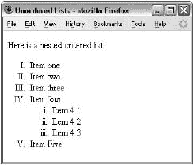

### 动手实践：使用文本标记

现在你已经了解了可用于标记文本的不同元素和属性，是时候将它们付诸实践了。在本例中，你将使用一系列标记为我们的咖啡馆网站创建一个页面，展示一份“世界最佳炒蛋”的食谱。那么，打开你的文本编辑器或网页制作工具，按照以下步骤操作：

1. 添加文档的基本骨架元素：`<html>`、`<head>`、`<title>` 和 `<body>`：

   ```html
   <html>
     <head>
       <title>Wrox 食谱 - 世界最佳炒蛋</title>
     </head>
     <body>
     </body>
   </html>
   ```

   你已经多次见过这个骨架，现在让我们继续添加一些内容。

2. 在文档的 `<body>` 中添加适当的标题元素；这些有助于为页面增加结构：

   ```html
   <body>
     <h1>Wrox 食谱 - 世界最佳炒蛋</h1>
     <h2>食材</h2>
     <h2>步骤</h2>
   </body>
   ```

3. 在 `<h1>` 元素（说明食谱是炒蛋）之后，会有一段关于食谱的解释（以及为什么它是世界最佳）。你可以看到，到目前为止你遇到的几个元素都用在了这两个段落中。

   ```html
   <h1>Wrox 食谱 - 世界最佳炒蛋</h1>

   <p>我从比尔·格兰杰（Bill Grainger）的《悉尼美食》（<cite cite="http://www.amazon.com/exec/obidos/tg/detail/-/0864119917/">Sydney Food</cite>）一书中改编了这个食谱。自从我第一次在悉尼国王十字区比尔餐厅品尝到这些鸡蛋后，我就一直在寻找这个食谱。后来我将其改良，成为我真正认为是我尝过的<em>最好</em>的炒蛋。</p>

   <p>我把这个食谱称为<q>非常特别的早餐</q>；看看食材你就知道为什么了。它必须亲口品尝才能相信。</p>
   ```

   在第一句中，`<cite>` 元素用于表示对食谱来源书籍的引用。下一句使用了 `<sup>` 元素，以便写出“1<sup>st</sup>”并使用上标文本——不过你可能注意到，这会使第一行和第二行文本之间的间距大于第二行和第三行之间的间距（因为上标字母突出于行上方）。在第一段的最后一句中，单词“best”被强调，因为这确实是我尝过的最好的炒蛋。

   在第二段中，另一个元素在起作用：`<q>` 元素用于引用。

4. 在第一个 `<h2>` 元素之后，你将用无序列表列出食材：

   ```html
   <h2>食材</h2>

   <p>以下食材为一人份：</p>

   <ul>
     <li>2 个鸡蛋</li>
     <li>1 汤匙黄油（10 克）</li>
     <li>1/3 杯奶油<i>（2 3/4 液盎司）</i></li>
     <li>一小撮盐</li>
     <li>现磨黑胡椒</li>
     <li>3 根新鲜细香葱（切碎）</li>
   </ul>
   ```

   在描述所需奶油量的那一行中，提供了用斜体表示的替代计量单位。

5. 在第二个 `<h2>` 元素之后添加步骤；这些将放在有序列表中：

   ```html
   <h2>步骤</h2>

   <ol>
     <li>在碗中搅拌鸡蛋、奶油和盐。</li>
     <li>在不粘锅中用大火融化黄油<i>（注意不要烧焦黄油）</i></li>
     <li>将蛋液倒入锅中，等待它开始在锅边凝固（大约 20 秒）。</li>
     <li>用木铲将蛋液向中心聚拢，就像做煎蛋卷一样，再煮 20 秒。</li>
     <li>再次折叠内容，静置 20 秒，重复直到鸡蛋刚好熟透。</li>
     <li>在鸡蛋上撒上少许现磨黑胡椒，并拌入一些切碎的新鲜细香葱。</li>
   </ol>

   <p>每只煎锅最多只能做<strong>两份</strong>。</p>
   ```

   你可能注意到，有序列表中包含一条关于不要烧焦黄油的斜体注释，最后一段则强烈强调每只锅最多只能做两份这样的鸡蛋。

6. 将此示例保存为 `recipes.html`。在浏览器中打开时，你应该会看到类似图 1-26 的效果。

图 1-26

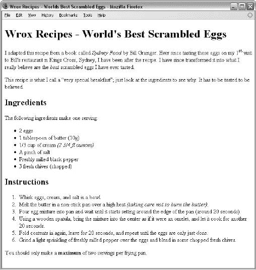

希望你喜欢这些鸡蛋——来吧，你知道你现在就想尝尝了。

## 编辑文本

当与他人共同处理文档时，能够看到其他人所做的更改会很有帮助。即使是在处理自己的文档时，跟踪自己所做的更改也可能很有用。有两个专门用于修订和编辑文本的元素：

- `<ins>` 元素用于添加文本（在浏览器中通常显示为下划线）。
- `<del>` 元素用于删除文本（在浏览器中通常显示为删除线）。

下面你可以看到对以下 XHTML（`ch01_eg21.html`）所做的一些更改：

```html
<h1>如何识别 Wrox 图书</h1>

<p>在书店里识别 Wrox 图书是一种流行的消遣。程序员喜欢找到独特的<del>蓝色</del><ins>红色</ins>书脊，因为他们知道 Wrox 图书是由<del>1000 只猴子</del><ins>程序员</ins>为程序员编写的。</p>

<ins><p>然而，读者和作者都对封面使用照片持保留态度。</p></ins>
```

在浏览器中，这个示例看起来类似于图 1-27。

图 1-27

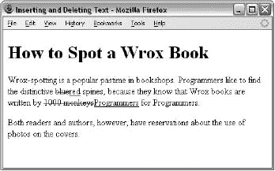

这些功能作为编辑工具也特别有用，可以记录不同作者所做的更改和修改。

如果你熟悉 Microsoft Word，`<ins>` 和 `<del>` 元素与“修订”（Track Changes）功能非常相似（你可以在“工具”菜单下找到它）。修订功能会为新增的文本添加下划线，并为删除的文本添加删除线。

使用 `<ins>` 和 `<del>` 时必须小心，确保不会在所谓的行内元素（如 `<b>` 或 `<i>` 元素）内部出现块级元素（如 `<p>` 或 `<h2>` 元素）。你将在本章末尾了解更多关于块级元素和行内元素的内容。

你可以使用 `title` 属性来提供关于谁添加了 `<ins>` 或 `<del>` 元素以及添加或删除原因的信息；主流浏览器会以工具提示的形式向用户提供这些信息。

你也可以在 `<ins>` 和 `<del>` 元素上使用 `cite` 属性来指示更改的来源或原因，不过这个属性相当有限，因为其值必须是 URI。

`<ins>` 和 `<del>` 元素还可以携带一个 `datetime` 属性，其值为以下格式的日期和时间：

`YYYY-MM-DDThh:mm:ssTZD`

该格式分解如下：

- `YYYY` 表示年份。
- `MM` 表示月份。
- `DD` 表示月份中的日期。
- `T` 只是日期和时间之间的分隔符。
- `hh` 表示小时。
- `mm` 表示分钟数。
- `ss` 表示秒数。
- `TZD` 表示时区标识符。

例如，`2009-04-16T20:30-05:00` 表示美国东部标准时间 2009 年 4 月 16 日晚上 8 点 30 分。

如你所见，`datetime` 属性手动输入相当长，因此更可能由允许用户编辑网页的程序输入。

当你学习如何使用 CSS 时，你将看到如何根据需要显示和隐藏插入和删除的内容。

## 使用字符实体表示特殊字符

你可以在文档中使用大多数字母数字字符，它们会正常显示。然而，有些字符在 XHTML 中具有特殊含义，还有一些字符没有对应的键盘输入方式。例如，你不能使用表示标签开始和结束的尖括号，因为浏览器可能会将它们误认为是标记。不过，你可以使用一组称为字符实体的不同字符来表示这些特殊字符。有时你也会看到字符实体被称为转义字符。

所有特殊字符都可以通过该字符的数字实体添加到文档中，有些字符还有命名实体，如下表所示。

| 字符 | 数字实体 | 命名实体 |
| --- | --- | --- |
| `"` | `&#034;` | `&quot;` |
| `&` | `&#038;` | `&amp;` |
| `<` | `&#060;` | `&lt;` |
| `>` | `&#062;` | `&gt;` |

字符实体（或特殊字符）的完整列表见附录 F。

## 注释

你可以在 XHTML 文档的任何标签之间添加注释。注释使用以下语法：

```html
<!-- 注释内容 -->
```

`<!--` 之后直到 `-->` 之间的任何内容都不会显示。它们仍然可以在文档的源代码中看到，但不会在屏幕上显示。

为代码添加注释是一种良好的实践，尤其是在复杂文档中，用于指示文档的各个部分，以及为查看代码的人提供任何其他说明。

你甚至可以注释掉整段代码。例如，在下面的代码片段中，你不会看到 `<h2>` 元素的内容。你还可以看到注释指示了文档的部分、添加者以及添加时间。

```html
<!-- 脚注部分开始，由 Bob Stewart 于 04-24-04 添加 -->

<!-- <h2>字符实体</h2> -->

<p><strong>字符实体</strong>可用于转义那些浏览器可能误认为具有特殊含义的特殊字符。</p>

<!-- 脚注部分结束 -->
```

## `<font>` 元素（已废弃）

`<font>` 元素允许你控制文本的呈现方式——包括大小、字体和颜色。它已被废弃，因此应避免使用，但你可能会遇到它。如果你想了解更多关于如何使用 `<font>` 元素的信息，请参阅附录 I。你可能会看到 `<font>` 元素像这样使用：

```html
<h3>使用 &lt;font&gt; 元素</h3>

<font face="arial, verdana, sans-serif" size="2" color="#666666">&lt;font&gt; 元素自 HTML 4.0 起已被废弃。现在应使用 CSS 来指示文本的样式。</font>
```

## 理解块级元素和内联元素

现在你已经看到了许多可用于标记文本的元素，有必要对 `<body>` 元素内的所有元素进行一个观察，因为每个元素都可以归为以下两类之一：

- 块级元素
- 内联元素

这是一个概念上的区分，但它将对 XHTML 的其他特性产生重要影响。

块级元素在屏幕上显示时，仿佛前后都有回车或换行。例如，`<p>`、`<h1>`、`<h2>`、`<h3>`、`<h4>`、`<h5>`、`<h6>`、`<ul>`、`<ol>`、`<dl>`、`<pre>`、`<hr />`、`<blockquote>` 和 `<address>` 元素都是块级元素。它们都从新的一行开始，并且它们后面的内容也会另起一行。

另一方面，内联元素可以出现在句子中，不必单独成行。`<b>`、`<i>`、`<u>`、`<em>`、`<strong>`、`<sup>`、`<sub>`、`<big>`、`<small>`、`<ins>`、`<del>`、`<code>`、`<cite>`、`<dfn>`、`<kbd>` 和 `<var>` 元素都是内联元素。

例如，看下面的标题和段落；这两个元素都从新行开始，它们后面的内容也会另起一行。同时，段落中的内联元素不会单独成行。以下是代码（`ch01_eg22.html`）：

```html
<h1>块级元素</h1>

<p><strong>块级元素</strong>总是从新行开始。<code>&lt;h1&gt;</code> 和 <code>&lt;p&gt;</code> 元素不会在同一行上，而内联元素则与其余文本一起流动。</p>
```

你可以在图 1-28 中看到效果。

图 1-28

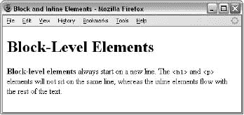

严格来说，内联元素不能包含块级元素，并且只能出现在块级元素内部（因此你不应该将 `<b>` 元素放在块级元素之外）。而块级元素可以包含其他块级元素和内联元素。

## 使用 `<div>` 和 `<span>` 对元素进行分组

`<div>` 和 `<span>` 元素允许你将多个元素分组，以创建页面的部分或子部分。它们本身不会影响页面的外观，但通常与 CSS 一起使用，以便为页面的某个部分附加样式（你将在第 7 章中看到）。例如，你可能希望将页面上的所有脚注放在一个 `<div>` 元素中，以表明该 `<div>` 元素内的所有元素都与脚注相关。然后你可以为这个 `<div>` 元素附加一个样式，使脚注使用一组特殊的样式规则显示。

`<div>` 元素用于分组块级元素：

```html
<div class="footnotes">
  <h2>脚注</h2>
  <p><b>1</b> 万维网由蒂姆·伯纳斯-李发明</p>
  <p><b>2</b> W3C 是万维网联盟，负责维护许多 Web 标准</p>
</div>
```

在使用 `<div>` 时，使用 `class` 属性并赋予一个描述该元素组内容的值是一种良好的实践。如你所见，值 `footnotes` 有助于描述 `<div>` 的内容。

另一方面，`<span>` 元素只能用于分组内联元素。因此，如果你想要分组句子或段落的一部分，可以使用 `<span>` 元素。在这里，你可以看到我添加了一个 `<span>` 元素来指示哪些内容与发明者相关。它包含一个加粗元素和一些文本：

```html
<div class="footnotes">
  <h2>脚注</h2>
  <p><span class="inventor"><b>1</b> 万维网由蒂姆·伯纳斯-李发明</span></p>
  <p><b>2</b> W3C 是万维网联盟，负责维护许多 Web 标准</p>
</div>
```

单独来看，这对文档的视觉效果没有任何影响，但它为标记增加了额外的含义，现在将相关元素分组，并且特别有助于使用 CSS 规则为这些元素附加特殊样式。

`<div>` 和 `<span>` 元素可以携带所有通用属性和 UI 事件属性，以及已废弃的 `align` 属性。

## XML 声明

在本章中，你已经学到了许多用于描述页面文本结构的标记，包括标题和段落、呈现元素和短语元素，以及列表。为了结束本章，让我们花几页篇幅来看一下 XHTML 的一些方面，老实说，这些方面既有点枯燥，又对页面的外观影响不大。然而，它们对于按照规则编写页面（尤其是如果你想商业性地创建页面）非常重要，并且有一些属性适用于你已经遇到的大多数元素，以及你在接下来的几章中可能会遇到的元素。


首先，你有时会在 XHTML 文档的开头看到一行，称为 XML 声明。XHTML 语言实际上是用另一种称为可扩展标记语言（XML）的语言编写的。XML 用于创建标记语言，任何 XML 文档都可以以这个可选的 XML 声明开头：

```xml
<?xml version="1.0" encoding="UTF-8" ?>
```

由于它是可选的，有些作者不会在文档开头使用它。如果你包含 XML 声明，它必须位于文档的最开始；在此之前不能有任何内容，甚至不能有空格。`encoding` 属性指明了文档中使用的编码。

编码（字符编码的简称）属性表示程序或操作系统如何存储你可能想要显示的字符。由于不同语言有不同的字符，而且有些程序支持的字符比其他程序更多，因此存在多种不同的编码。

## 文档类型声明

如前所述，XHTML 采用了比之前版本的 HTML 更严格的语法。例如，XHTML 中的元素和属性名称必须全部小写（而早期版本的 HTML 不区分大小写），每个包含内容的元素都必须有对应的结束元素，并且某些元素和属性可能被标记为已弃用——这意味着它们很可能在未来的 HTML 或 XHTML 版本中被淘汰。

虽然 Web 浏览器通常可以在没有文档类型声明的情况下显示页面（事实上，本章到目前为止的示例都没有包含文档类型声明），但每个 XHTML 页面实际上都应该以 DOCTYPE 声明开头，以向浏览器（或任何其他程序）指示该页面所使用的 HTML 或 XHTML 版本。因此，在本书的其余示例中，我们都会包含一个 DOCTYPE 声明。

虽然我一直将 XHTML 视为一种语言，但在它创建时，实际上发布了三个版本或风格的 XHTML——这样做是为了帮助现有的 Web 开发者从 HTML 过渡到 XHTML：

- **过渡型 XHTML 1.0**，仍然允许开发者使用 HTML 4.1 中已弃用的标记（尽管它很可能被淘汰）。不过，它要求作者使用新的更严格的语法。
- **严格型 XHTML 1.0**，旨在指明 XHTML 的前进方向，不包含已弃用的样式标记。它也遵循新的更严格的语法。
- **框架型 XHTML 1.0**，用于创建使用所谓框架的网页（你将在第 6 章中了解框架）。

如果到目前为止，你对 HTML 和 XHTML 的各种版本感到有些不知所措，别担心！在本书中，你将主要学习过渡型 XHTML 1.0。在此过程中，你将了解哪些元素和属性已被标记为已弃用，以及它们的替代方案是什么。如果你避免使用已弃用的元素和属性，那么你实际上就是在编写严格型 XHTML 1.0。

DOCTYPE 声明位于文档中开头的 `<html>` 标签之前，并且（如果你使用了可选的 XML 声明）位于它之后。

如果你正在编写过渡型 XHTML 1.0（并在文档中包含样式标记），那么你的 DOCTYPE 声明应该如下所示：

```html
<!DOCTYPE html PUBLIC "-//W3C//DTD XHTML 1.0 Transitional//EN"
  "http://www.w3.org/TR/xhtml1/DTD/xhtml1-transitional.dtd">
```

如果你正在编写严格型 XHTML 1.0，你的 DOCTYPE 声明将如下所示：

```html
<!DOCTYPE html PUBLIC "-//W3C//DTD XHTML 1.0 Strict//EN"
  "http://www.w3.org/TR/xhtml1/DTD/xhtml1-strict.dtd">
```

对于框架型文档（在第 6 章中讨论），你的 DOCTYPE 声明将如下所示：

```html
<!DOCTYPE html PUBLIC "-//W3C//DTD XHTML 1.0 Frameset//EN"
  "http://www.w3.org/TR/xhtml1/DTD/xhtml1-frameset.dtd">
```

严格型 XHTML 文档必须在根元素之前包含 DOCTYPE 声明；但是，如果你创建的是过渡型或框架型文档，则不需要包含 DOCTYPE 声明。

学习了过渡型 XHTML 1.0 之后，你将能够理解旧版本的 HTML，并且可以放心（除非特别警告）你的 XHTML 代码将在当今 Web 上使用的大多数浏览器中正常工作。

## 核心元素和属性

现在让我们更仔细地看一下构成每个文档基本结构的四个主要元素：`<html>`、`<head>`、`<title>` 和 `<body>`。这四个元素应该出现在你编写的每个 XHTML 文档中，并且你会在本书中看到它们被称为文档的骨架。

### `<html>` 元素

`<html>` 元素是整个 XHTML 文档的容器元素。在可选的 XML 声明和必需的 DOCTYPE 声明之后，每个 XHTML 文档都应该有一个开头的 `<html>` 标签，并且每个文档都应该以结束的 `</html>` 标签结尾。

如果你正在编写严格型 XHTML 1.0，那么开头的标签还必须包含一个称为命名空间标识符的东西。命名空间的概念起初可能有点奇怪，直到你意识到任何人都可以创建一种标记语言（例如，有几种特定行业的标记语言，允许该行业的不同人员以标准格式共享数据）。由于任何人都可以创建标记语言，不同的标记语言最终会使用相同的标签名称，因此命名空间有助于澄清哪个元素属于哪种语言。例如，你在本章中已经看到了 `<big>` 和 `<small>` XHTML 元素；现在想象一家服装公司有一种用于描述其产品的标记语言，其中包含用于尺寸的 `<big>`、`<medium>` 和 `<small>` 元素。命名空间的目的是指定元素属于哪种标记语言。

XHTML 的命名空间标识符的目的是表明文档中的标记属于 XHTML 1.0 命名空间。因此，开头的标签应该如下所示：

```html
<html xmlns="http://www.w3.org/1999/xhtml">
```

虽然在过渡型 XHTML 文档中并非严格要求，但最好在所有 XHTML 文档中都使用它。

`<html>` 元素还可以携带以下属性，你将在本章后面的“属性组”部分中了解它们：

`id` `dir` `lang` `xml:lang`

在早期版本的 HTML 中，可以使用 `version` 属性来指示文档编写的 HTML 版本，但通常省略它。XHTML 文档应使用 DOCTYPE 声明以及 `xmlns` 属性来指示它们使用的 XHTML 版本。

### `<head>` 元素

`<head>` 元素只是所有其他头部元素的容器。它是出现在开头的 `<html>` 标签之后的第一个内容。

每个 `<head>` 元素都应包含一个 `<title>` 元素，用于指示文档的标题，但它也可以包含以下元素的任意组合，顺序不限：

- `<base>`，你将在第 2 章中了解。
- `<object>`，用于在页面中包含图像、JavaScript 对象、Flash 动画、MP3 文件、QuickTime 电影和其他类型的文件。它将在第 3 章中介绍。
- `<link>`，用于链接到外部文件，例如样式表或 JavaScript 文件，你将在第 7 章中看到。
- `<style>`，用于在文档中包含 CSS 规则；它将在第 7 章中介绍。
- `<script>`，用于在文档中包含脚本，你将在第 11 章中看到。
- `<meta>`，包含关于文档的信息，例如关键字和描述，这对搜索应用程序特别有帮助；这将在第 13 章中介绍。

开头的 `<head>` 标签可以携带以下属性：

`id` `dir` `lang` `xml:lang` `profile`

`profile` 属性实际上尚未使用；其他属性将在本章后面的“属性组”部分中介绍。

### `<title>` 元素

你应该为你编写的每个页面使用 `<title>` 元素指定一个标题（正如你在本章前面看到的，它是 `<head>` 元素的子元素）。它以多种方式呈现和使用：

- 在浏览器窗口的最顶部（如你在第一个示例和图 1-1 中看到的）
- 作为 IE、Firefox 和 Safari 等浏览器中书签的默认名称
- 搜索引擎使用其内容来帮助索引页面

因此，使用一个真正描述网站内容的标题非常重要。例如，本书的主页不应仅仅显示“HomePage”，而应描述网站的内容。与其只写“Wrox 主页”，不如这样写：

```html
<title>Wrox: Programming Books, Learn XHTML, CSS, ASP.Net, PHP</title>
```

判断标题好坏的标准是：访问者仅通过阅读标题，无需查看页面实际内容，就能知道该页面上会找到什么；以及标题是否使用了人们搜索此类信息时可能会用的词语。

`<title>` 元素应仅包含标题文本，不能包含任何其他元素。`<title>` 元素可以携带以下属性，这些属性将在接下来的“属性组”部分中介绍：

`id` `dir` `lang` `xml:lang`

### `<body>` 元素

`<body>` 元素出现在 `<head>` 元素之后，正如你已经看到的，它包含了你在主浏览器窗口中实际看到的网页部分，有时被称为主体内容。`<body>` 元素可以携带下一节将要介绍的属性组中的所有属性。在较旧的 HTML 文档中，你可能还会看到以下已废弃的属性用于 `<body>` 元素（这些属性在附录 I 中介绍）：

`background` `bgcolor` `alink` `link` `vlink` `text`

你可能还会看到一些浏览器特定的属性用于 `<body>` 元素，这些也在附录 I 中介绍：

`language`、`topmargin`、`bottommargin`、`leftmargin`、`rightmargin`、`scroll`、`bgproperties`、`marginheight`、`marginwidth`

## 属性组

正如你所见，属性位于元素的开始标签中，并提供关于该元素的额外信息。所有属性都由名称和值组成：名称反映了属性所描述的元素特性，而值则是该特性的具体取值。例如，`xml:lang` 属性描述了该元素内使用的语言；像 `EN-US` 这样的值表示元素内使用的语言是美国英语。XHTML 中的许多元素都可以携带本节中你将遇到的部分或全部属性；起初有些属性可能听起来有点抽象，但随着你在本书中看到它们的使用，会变得更有意义。所以，如果一开始它们不太容易理解，不必担心。

许多 XHTML 元素可以携带三组属性：

- 核心属性：`class`、`id` 和 `title` 属性
- 国际化属性：`dir`、`lang` 和 `xml:lang` 属性
- UI 事件：与事件相关的属性，如 `onclick`、`ondoubleclick`、`onmousedown`、`onmouseup`、`onmouseover`、`onmousemove`、`onmouseout`、`onkeypress`、`onkeydown` 和 `onkeyup`（这些将在第 11 章中更详细地介绍）

核心属性和国际化属性统称为通用属性。

### 核心属性

可用于大多数（尽管并非全部）XHTML 元素的四个核心属性是：

`id` `title` `class` `style`

在本书的其余部分，当这些属性对某个元素具有与这里描述不同的特殊含义时，我会再次提及；否则，它们的使用通常可以按照以下小节中的描述来理解。

#### `id` 属性

`id` 属性可用于唯一标识页面中的任何元素。你可能希望唯一标识一个元素，以便链接到文档中的特定部分，或者指定某个 CSS 样式或 JavaScript 代码仅应用于文档中该元素的内容。

`id` 属性的语法如下（其中 `string` 是你为该属性选择的值）：

```html
id="string"
```

例如，`id` 属性可用于区分两个段落元素，如下所示：

```html
<p id="accounts">本段解释了会计部门的职责。</p>
<p id="sales">本段解释了销售部门的职责。</p>
```

请注意，`id` 属性的值有一些特殊规则。它必须：

- 以字母（A–Z 或 a–z）开头，后面可以跟任意数量的字母、数字（0–9）、连字符、下划线、冒号和句点（不能以数字、连字符、下划线、冒号或句点开头）。
- 在文档中保持唯一；在一个 XHTML 页面中，不能有两个 `id` 属性具有相同的值。

在引入 `id` 属性之前，`name` 属性在 HTML 文档中起到了类似的作用，但它在 HTML 4.01 中已被废弃，现在你通常应该在 XHTML 文档中使用 `id` 属性。如果你需要使用 `name` 属性，它在过渡型 XHTML 中可用，但在严格型 XHTML 中不可用（除非针对特定元素有特别说明）。

#### `class` 属性

`class` 属性用于指定某个元素属于某一类元素。例如，你可能有一个包含许多段落的文档，其中一些段落可能包含关键点的摘要，在这种情况下，你可以向相关的 `<p>` 元素添加一个值为 `summary` 的 `class` 属性，以将这些段落与文档中的其他段落区分开来。

```html
<p class="summary">摘要内容在此</p>
```

它通常与 CSS 一起使用，因此你将在介绍 CSS 的第 7 章中了解更多关于 `class` 属性的用法。`class` 属性的语法如下：

```html
class="className"
```

该属性的值也可以是一个由空格分隔的类名列表。例如：

```html
class="className1 className2 className3"
```

#### `title` 属性

`title` 属性为元素提供了一个建议标题。`title` 属性的语法如下：

```html
title="string"
```

该属性的行为取决于携带它的元素，但通常显示为工具提示或在元素加载时显示。

并非每个可以携带 `title` 属性的元素都需要它，因此当我们遇到特别受益于使用该属性的元素时，我会向你展示它与该元素一起使用时的行为。

#### `style` 属性（已废弃）

`style` 属性允许你在元素内指定 CSS 规则。你将在第 7 章中了解 CSS，但这里先给出一个使用示例：

```html
<p style="font-family:arial; color:#FF0000;">一些文本。</p>
```

然而，作为一般规则，最好避免使用此属性。该属性在 XHTML 1.0 中被标记为已废弃（这意味着它将在未来的 HTML 和 XHTML 版本中被移除）。如果你想使用 CSS 规则来控制元素的外观，最好使用单独的样式表。你将在介绍 CSS 的第 7 章中看到这两种技术。

### 国际化

有三个国际化属性可以帮助用户为不同语言和字符集编写页面，它们可用于大多数（尽管并非全部）XHTML 元素（这在多语言文档中很重要）。

`dir` `lang` `xml:lang`

接下来我们将逐一介绍它们，但值得注意的是，即使在当前的浏览器中，对这些属性的支持仍然很不完善，因此尽可能指定一个能按所需方向生成文本的字符集。

以下是 W3C 一份有用文档的网址，其中更详细地描述了国际化问题，不过我们接下来会简要介绍每个属性：

`http://www.w3.org/TR/i18n-html-tech-char/`

国际化属性有时被称为 i18n 属性，这个奇怪的名称来源于首次定义它们的 `draft-ietf-html-i18n` 规范。

#### `dir` 属性

`dir` 属性允许你向浏览器指示文本的流向：从左到右或从右到左。当你想要指示整个文档（或文档的大部分）的方向性时，应将其用于 `<html>` 元素而非 `<body>` 元素，原因有二：在 `<html>` 元素上使用该属性在浏览器中支持更好，并且它将同时应用于头部元素和正文中的元素。如果你想要改变文档中一小部分的方向，也可以在文档正文内的元素上使用 `dir` 属性。

`dir` 属性可以取以下两个值之一，如下表所示。

| 值 | 含义 |
| --- | --- |
| `ltr` | 从左到右（默认值） |
| `rtl` | 从右到左（用于希伯来语或阿拉伯语等从右向左阅读的语言） |

#### `lang` 属性

`lang` 属性允许你指示文档中使用的主要语言。它在 XHTML 中保留仅为了与早期版本的 HTML 向后兼容，并在新的 XHTML 文档中已被 `xml:lang` 属性取代（下一节将介绍）。然而，XHTML 建议在 XHTML 1.0 文档的 `<html>` 元素上同时使用 `lang` 和 `xml:lang` 属性（以实现跨不同浏览器的最大兼容性）。

`lang` 属性旨在为用户提供特定语言的显示，尽管它在主流浏览器中效果甚微。使用 `lang` 属性的真正好处在于搜索引擎（可以告知用户文档使用哪种语言编写）、屏幕阅读器（可能需要以不同方式发音不同语言）以及应用程序（可以在不支持该语言或该语言与用户默认语言不同时提醒用户）。当与 `<html>` 元素一起使用时，该属性适用于整个文档，尽管它也可以用于其他元素，此时仅适用于这些元素的内容。

`lang` 属性的值是 ISO-639 标准的两个字符的语言代码。如果你想指定语言的方言，可以在语言代码后跟一个连字符和子代码名称。下表提供了一些示例。

| 值 | 含义 |
| --- | --- |
| `ar` | 阿拉伯语 |
| `en` | 英语 |
| `en-us` | 美国英语 |
| `zh` | 中文 |

当今使用的大多数主要语言的语言代码列表可在附录 G 中找到。

#### `xml:lang` 属性

`xml:lang` 属性是 XHTML 中替代 `lang` 属性的属性。它是一个在所有用 XML 编写的语言中都可用的属性（你可能还记得本章前面提到过 XHTML 是用 XML 编写的），这就是为什么它带有前缀 `xml:`。`xml:lang` 属性的值应为 ISO-639 国家代码，如上一节所列；完整列表见附录 G。

虽然它在主流浏览器中没有效果，但其他支持 XML 的应用程序和搜索引擎可能会使用此信息，因此在文档中包含 `xml:lang` 属性是一种良好的实践。当与 `<html>` 元素一起使用时，它适用于整个文档，尽管它也可以用于其他元素，此时仅适用于这些元素的内容。


## UI 事件

UI 事件属性允许你将事件（例如按键或鼠标移动到元素上）与脚本（事件发生时运行的一段程序代码）关联起来。例如，当有人将鼠标移动到某个元素的内容上时，你可以使用脚本使其改变颜色。

你将在第 12 章中更详细地了解 UI 事件，尽管它们的名称已经相当清楚地表明了它们与哪个事件相关联；例如，`onclick` 在用户点击该元素内容时触发，`onmousemove` 在鼠标移动时触发，`onmouseout` 在用户将鼠标移出特定元素的内容时触发。

共有十个事件，统称为常见事件：

`onclick` `ondoubleclick` `onmousedown` `onmouseup` `onmouseover` `onmousemove` `onmouseout` `onkeypress` `onkeydown` `onkeyup`

`<body>` 和 `<frameset>` 元素还具有以下用于页面打开或关闭的事件：

`onload` `onunload`

最后，还有一些仅适用于表单的事件（在第 5 章和第 12 章中提及）：

`onfocus` `onblur` `onsubmit` `onreset` `onselect` `onchange`

## 总结

在本章中，你已经看到网页和印刷文档之间常常存在相似之处；例如，印刷版或网络上的新闻报道都由标题、一些段落文本、可能还有一些子标题以及一张或多张图片组成。在网络上，你需要解释这些文档的结构，而你可以使用 XHTML 来实现这一点。

你已经了解到，网页的内容是通过描述文档结构的元素进行标记的。这些元素由一个开始标签、一个结束标签以及开始和结束标签之间的内容组成。为了改变元素的某些属性，开始标签可以携带属性，并且属性总是以名称/值对的形式书写。你知道 XHTML 可以被视为 HTML 的最新版本，并且 XHTML 有三种不同的风格——为了告诉浏览器你使用的是哪一种，你可以使用 DOCTYPE 声明。

你还遇到了许多新元素，并学习了它们可以携带的属性。你已经看到每个 XHTML 文档至少应包含 `<html>`、`<head>`、`<title>` 和 `<body>` 元素，以及 `<html>` 元素应携带一个命名空间标识符。

本章的其余部分介绍了描述文本结构的元素：

- 六级标题：`<h1>`、`<h2>`、`<h3>`、`<h4>`、`<h5>` 和 `<h6>`
- 段落 `<p>`、预格式化部分 `<pre>`、换行 `<br />` 和地址 `<address>`
- 表现性元素 `<b>`、`<i>`、`<u>`、`<s>`、`<tt>`、`<sup>`、`<sub>`、`<strike>`、`<big>`、`<small>` 和 `<hr />`
- 短语元素，如 `<em>`、`<strong>`、`<abbr>`、`<acronym>`、`<dfn>`、`<blockquote>`、`<q>`、`<cite>`、`<code>`、`<kbd>`、`<var>`、`<samp>` 和 `<address>`
- 列表，如使用 `<ul>` 和 `<li>` 的无序列表、使用 `<ol>` 和 `<li>` 的有序列表，以及使用 `<dl>`、`<dt>` 和 `<dd>` 的定义列表
- 编辑元素，如 `<ins>` 和 `<del>`
- 分组元素 `<div>` 和 `<span>`

显然，你会比其他元素更频繁地使用其中一些元素，但当一个元素适合你试图标记的内容（从段落到地址）时，你应该尝试使用它，因为正确结构化文本将有助于其比仅使用换行和表现性元素进行格式化更持久。

## 练习

所有练习的答案都在附录 A 中。

1. 使用相关的表现性元素标记以下句子。

   The 1st time the bold man wrote in italics, he underlined several key words.

2. 标记以下列表，包含插入和删除的内容：

   Ricotta pancake ingredients:

   - 1 1/2 3/4 cups ricotta
   - 3/4 cup milk
   - 4 eggs
   - 1 cup plain white flour
   - 1 teaspoon baking powder
   - 75g 50g butter
   - pinch of salt

3. 你已经为本书中将要构建的示例咖啡馆网站创建了主页。你还创建了一个食谱页面。现在你需要再创建三个页面，以便我们可以在接下来的章节中继续构建该网站。每个页面应像主页一样开始，包含一个一级标题“Example Café”，后跟段落：“Welcome to Example Café. We will be developing this site throughout the book.” 在此之后：

   a. 对于菜单页面，添加一个二级标题“Menu”。其后应跟一个段落，内容为“The menu will go here.”。更新 `<title>` 元素的内容以反映此页面将展示咖啡馆的菜单。将文件保存为 `menu.html`。

# 第 2 章：链接与导航

网页与其他媒介的真正区别在于，网页可以包含链接（或称超链接），点击后可从当前页面跳转到另一个页面。链接可以是单词、短语或图片。

当链接到同一网站内的其他页面时，该链接称为内部链接。当链接到不同网站时，则称为外部链接。在本章中，你将学习如何创建这两种类型的链接。你还将了解如何链接到页面内的特定位置。

虽然你很快就能掌握从一个网页链接到另一个网页的基本方法，但学习一些其他概念也很有帮助，例如如何通过将不同文件存储到单独的文件夹或目录中来良好地组织网站结构。一旦理解了目录结构，你就可以使用更短的链接（称为相对 URL）来链接自己网站内的页面。

在本章中，你将学习以下内容：

- 如何链接网站内的页面
- 如何链接到其他网站
- 如何组织网站文件夹结构
- 如何链接到网站内页面的特定部分

## 基本链接

链接使用 `<a>` 元素指定。位于开始标签 `<a>` 和结束标签 `</a>` 之间的任何内容都会成为用户可在浏览器中点击的链接部分。

### 链接到其他网页

要链接到另一个网页，开始标签 `<a>` 必须包含一个名为 `href` 的属性；`href` 属性的值就是你要链接到的文件名。

例如，以下是页面 `ch02_eg01.html` 的 `<body>` 部分，该页面位于本章代码下载中（[www.wrox.com](http://www.wrox.com)）。此页面包含一个指向第二个页面 `index.html` 的链接：

```html
<body>
   <p>返回<a href="index.html">首页</a>。</p>
</body>
```

只要 `index.html` 与 `ch02_eg01.html` 位于同一文件夹中，当你点击“首页”字样时，`index.html` 页面就会加载到同一窗口中，替换当前的 `ch02_eg01.html` 页面。如图 2-1 所示，`<a>` 元素的内容构成了链接。

图 2-1

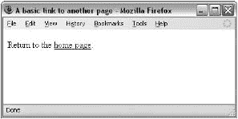

这就是本章下载代码中链接的工作方式。请记住，你可以随时点击浏览器中的“查看”菜单，然后选择“查看源代码”或“页面源代码”选项，以了解 XHTML 页面中的内容。现在不妨在下载代码中试试看？

如果你想链接到不同的网站，可以再次使用 `<a>` 元素，但这次需要指定要链接页面的完整网址，而不仅仅是文件名。以下是一个链接到外部网站的示例，本例中为 Wrox 网站（`ch02_eg02.html`）：

```html
<body>
  <p>为何不访问<a href="http://www.wrox.com/">Wrox 网站</a>呢？</p>
</body>
```

如你所见，`href` 属性的值正是你在浏览器中访问 Wrox 网站时输入的地址；这个完整网址通常被称为 URL（统一资源定位符）。

在创建任何链接时，应尽量使其简洁，并使用能让用户知道点击后会看到什么内容的词语。原因之一是，链接通常以与周围文本不同的颜色显示，使其更加突出。因此，许多人在想要进入下一页时，会扫描页面上的链接，而不会真正阅读整个页面。所以，如果链接易于阅读，并且比单纯的“点击这里”提供更好的说明，用户就更有可能继续浏览你的网站。

许多网页设计师还会在 `<a>` 元素中使用图片，这将在下一章中看到。使用图片时，应确保图片能清晰指示链接将带你前往何处。

你还可以在链接上使用 `title` 属性；`title` 属性的值应是对链接目标的描述，当鼠标悬停在链接上时，该描述会以工具提示形式显示。如果你确实使用图片作为链接，这一点尤其有用。

以下是一个指向 Google 首页的链接（`ch02_eg03.html`）：

```html
<p><a href="http://www.Google.com/" title="使用 Google 搜索网络">Google</a>
是一个非常流行的搜索引擎。</p>
```

图 2-2 展示了 `title` 属性，当鼠标悬停在链接上时，它会向用户提供关于链接的更多信息。

图 2-2

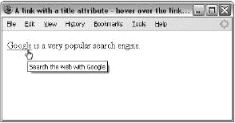

你应该注意，`<a>` 元素内的所有内容都会被渲染为链接，包括文本或图片周围的空白。因此，最好避免在开始标签 `<a>` 之后或结束标签 `</a>` 之前直接出现空格。例如，考虑以下链接，其中 `<a>` 元素内部有空格（`ch02_eg04.html`）：

```html
为何不访问<a href="http://www.wrox.com/"> Wrox 网站 </a>？
```

如图 2-3 所示，链接中的这些空格会被加下划线。

图 2-3

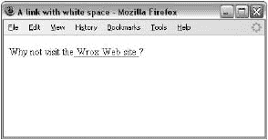

更好的做法是将空白放在这些标签之外，如下所示：

```html
为何不访问 <a href="http://www.wrox.com/">Wrox 网站</a>？
```

当然，`<a>` 元素内的单词之间仍然需要有空格；只是最好不要将它们放在链接的开头或结尾。

### 链接到电子邮件地址

你可能见过显示电子邮件地址的链接，点击后会在你的电子邮件程序中打开一封新邮件，准备向该地址发送邮件。

要创建指向电子邮件地址的链接，你需要使用以下语法与 `<a>` 元素：

```html
<a href="mailto:name@example.com">name@example.com</a>
```

这里，`href` 属性的值以关键字 `mailto` 开头，后跟冒号，然后是你要发送邮件的电子邮件地址。与其他任何链接一样，`<a>` 元素的内容是浏览器中显示的链接可见部分，因此以下写法同样有效：

```html
<a href="mailto:name@example.com">给我们发邮件</a>。
```

将电子邮件地址放在网页上有一个缺点：一些不道德的网民会使用小程序自动搜索网站上的电子邮件地址。一旦他们找到网站上的电子邮件地址，就会开始向这些地址发送垃圾邮件。

除了创建指向电子邮件地址的链接外，还有其他替代方案：

- 使用访客填写的电子邮件表单，因为自动程序无法通过联系表单收集电子邮件地址。缺点是电子邮件表单需要在 Web 服务器上运行脚本（使用 ASP.NET 或 PHP 等语言编写）。第 5 章提供了一个电子邮件表单的示例。
- 使用 JavaScript（第 13 章介绍）将电子邮件地址写入页面。这种技术的思路是，那些在网络上搜索电子邮件地址的程序无法读取 JavaScript 版本的地址。

## 动手试一试：创建简单链接

现在轮到你来创建一个包含三种类型链接的页面：内部链接、外部链接和电子邮件链接。我们将继续开发上一章开始的 Example Café 网站，因此请打开第 1 章示例应用程序文件夹中的 `contact.html` 页面：

1. 确认页面如下所示：

```xml
<?xml version="1.0" encoding="iso-8859-1"?>

<!DOCTYPE html PUBLIC "-//W3C//DTD XHTML 1.0 Transitional//EN"

"http://www.w3.org/TR/xhtml1/DTD/xhtml1-transitional.dtd">

<html xmlns="http://www.w3.org/1999/xhtml">

<head>

  <title>Example Cafe - community cafe in Newquay, Cornwal, UK</title>

  <meta http-equiv="Content-Type" content="text/html; charset=iso-8859-1" />

</head>

<body>

  <h1>EXAMPLE CAFE</h1>

  <p>Welcome to Example Cafe. We will be developing this site throughout

     the book.</p>

  <h2>Contact</h2>

  <p><address>12 Sea View, Newquay, Cornwall, UK</address></p>

</body>

</html>
```

2. 我们将开始为网站页面之间添加导航。首先，将第一个段落（在 `<h1>` 元素之后）替换为指向网站其他三个页面的链接。每个 `<a>` 元素应包含其链接到的页面名称，如下所示。我们将这些链接分组在一个 `<div>` 元素内：

```html
<h1>EXAMPLE CAFE</h1>

  <div>

    <a href="">HOME</a>

    <a href="">MENU</a>

    <a href="">RECIPES</a>

  </div>
```

3. 添加联系页面的名称，但不要将其设为链接（因为这是用户当前所在的页面，他们不需要指向它的链接）：

```html
<h1>EXAMPLE CAFE</h1>

  <div>

    <a href="">HOME</a>

    <a href="">MENU</a>

    <a href="">RECIPES</a>

    CONTACT

  </div>
```

4. 将这些页面的文件名作为 `href` 属性的值添加：

```html
<h1>EXAMPLE CAFE</h1>

  <div>

    <a href="index.html">HOME</a>

    <a href="menu.html">MENU</a>

    <a href="recipes.html">RECIPES</a>

    CONTACT

</div>
```

由于这些页面都在同一个文件夹中，你只需指定文件名；不需要完整的 URL。

5. 在地址下方，添加一个指向 Google Maps 上以下页面的链接，如下所示：info@examplecafe.com：

```html
<p><a href="http://maps.google.com/maps?q=newquay">Find us on Google Maps</a></p>
```

这次 `href` 属性的值是你需要在浏览器中输入的网址，以便在 Google Maps 中找到 Newquay 的地图。

6. 在地址下方，添加一个发送电子邮件至 info@examplecafe.com 的链接：

```html
<p><a href="mailto:info@examplecafe.com">Mail Example Cafe</a></p>
```

这次 `href` 属性的值以 `mailto:` 开头，后面跟着电子邮件地址。

7. 将此文件保存为 `contact.html`，放在本章示例应用程序所在的同一文件夹中。然后在浏览器中打开并查看。最终结果应类似于图 2-4。

图 2-4

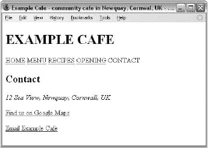

现在你已经了解了如何创建基本类型的链接，可以准备深入探讨更深入的主题了。但首先，你需要阅读几页内容，这些内容进一步解释了如何将网站中的文件组织到文件夹中，并理解 URL（标识网站页面和其他资源的地址）的构成。

## 理解目录与目录结构

目录只是网站上文件夹的另一种称呼；就像你的硬盘包含不同的文件夹一样，可以说一个网站包含多个目录。通常你会发现一个网站包含多个目录，每个目录包含网站的不同部分。例如，一个拥有多个子部分的大型网站会为每个部分设置单独的目录，并为不同类型的文件设置不同的目录（例如，图片可能放在一个目录中，样式表放在另一个目录中）。

就像你可能将硬盘上的文件组织到不同的文件夹中一样，将网站上的文件组织到目录中也很重要，这样你可以更轻松地找到所需内容并控制所有文件。可以想象，如果网站中使用的所有文件都位于同一个目录中，该目录很快就会变得非常庞大和复杂。

图 2-5 展示了一个新闻网站的示例目录结构，每个部分都有单独的文件夹。还要注意，音乐部分有自己的子文件夹，用于专题、MP3 和评论等子部分。此外，主文件夹为网站中使用的不同类型的文件（图片、脚本和样式表）设置了单独的文件夹。

图 2-5

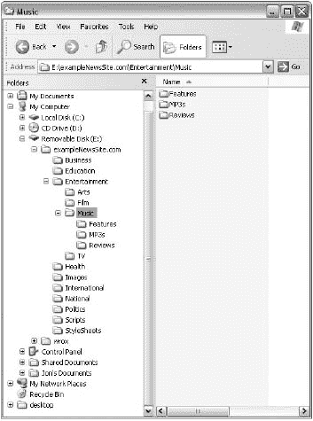

当你开始构建任何网站时，应该创建一个能够承受增长的良好目录结构；一个小型网站可能会迅速增长，包含比你最初想象的更多的文件，这令人惊讶。

在学习链接时，了解一些用于描述目录结构和目录之间关系的术语会很有帮助，所以回顾一下图 2-5 查看示例目录结构：

- 根目录（或根文件夹）是容纳整个网站的主目录；在此例中，它被称为 [exampleNewsSite.com](http://exampleNewsSite.com)。
- 子目录是位于另一个目录内的目录。这里，Film 是 Entertainment 的子目录。
- 父目录是包含另一个目录的目录。这里，Entertainment 是 Arts、Film、Music 和 TV 的父目录。

## 理解 URL

URL（统一资源定位符）指定了你在网络上可以找到资源的位置；你可能最习惯将它们视为网址。当你在网络上浏览时，你会在浏览器的地址栏中看到每个网页的 URL。


如果你查看图 2-6 中的示例 URL，URL 有三个关键部分：方案（scheme）、主机地址（host address）和文件路径（filepath）。

图 2-6

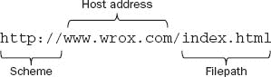

让我们逐一查看这些部分。

方案标识了文件传输的方式。大多数网页使用所谓的超文本传输协议（HTTP）向你传递信息，这就是为什么大多数网页以`http://`开头，尽管你可能在在线银行时注意到其他前缀如`https://`（这是 http 的更安全形式），或者在下载大文件时看到`ftp://`。

主机地址通常是网站的域名，例如[wrox.com](http://wrox.com)。你经常会在域名前看到`www`，尽管它实际上不是域名本身的一部分。主机地址也可以是一个称为 IP 地址的数字。

所有连接到互联网的计算机都可以通过 IP 地址找到。IP 地址是一组最多 12 位数字，用句点（`.`）分隔。当你在浏览器中输入域名时，后台会将域名转换为存储网站的计算机的 IP 地址。这是通过查询域名服务器（DNS）完成的，该服务器保存了域名和相应 IP 地址的目录。

文件路径始终以正斜杠字符开头，并且可能包含一个或多个目录名（记住，目录只是网络服务器上文件夹的另一种称呼）。文件路径可能以文件名结尾。这里，`BeginningXHTML.html`是文件名：

`/books/BeginningXHTML.html`

文件路径通常与网站的目录结构相对应，因此在这种情况下，`BeginningXHTML.html`页面将位于名为`books`的目录中。

事实上，不仅仅是网页有自己的 URL；网络上的每个文件，包括每张图片，都有自己的 URL。因此，文件名可以是图片而不是 XHTML 页面。

如果没有给出文件名，网络服务器通常会执行以下三种操作之一（取决于其配置方式）：

- 查找默认文件并返回该文件。对于用 XHTML 编写的网站，默认文件通常是`index.html`；如果未指定文件路径，服务器将在根文件夹中查找名为`index.html`的文件，或者如果指定了目录，则会在该目录中查找`index.html`文件。
- 提供该目录中的文件列表。
- 显示一条消息，说明找不到页面，或者无法浏览文件夹中的文件。

在链接到自己网站上的页面时，你不需要使用 URL 的所有三个部分——只需使用文件路径和文件名即可，你将在下一节中看到这一点。

## 绝对 URL 与相对 URL

绝对 URL 包含唯一标识互联网上特定文件所需的所有信息。这就是你在浏览器地址栏中输入以查找页面时所用的内容。例如，要访问本章前面提到的虚构新闻网站上的电影页面，你可能会输入以下 URL（你可能会发现参考图 2-5 有助于理解文件路径与目录结构的对应关系）：

```
http://www.exampleNewsSite.com/Entertainment/Film/index.html
```

如你所见，绝对 URL 可能会很快变得很长，而网站的每个页面都可能包含许多链接。然而，在链接到自己网站上的页面时，你可以使用一种简写形式：相对 URL。

相对 URL 指示资源相对于当前页面的位置。本章前面的示例（链接到同一目录中的另一个页面）就是相对 URL 的例子。你也可以使用相对 URL 来指定不同目录中的文件。例如，假设你正在查看以下虚构新闻网站娱乐版块的主页：

```
http://www.exampleNewsSite.com/Entertainment/index.html
```

你想为每个子版块（电影、电视、艺术和音乐）的索引页面添加链接。与其为每个页面包含完整的 URL，不如使用相对 URL。例如：

```
Film/index.html
TV/index.html
Arts/index.html
Music/index.html
```

我相信你会同意，这比写出以下内容要快得多：

```
http://www.exampleNewsSite.com/Entertainment/Film/index.html
http://www.exampleNewsSite.com/Entertainment/TV/index.html
http://www.exampleNewsSite.com/Entertainment/Arts/index.html
http://www.exampleNewsSite.com/Entertainment/Music/index.html
```

你可能会感兴趣的是，你的网络浏览器实际上请求的是完整的 URL，而不是缩短后的相对 URL，但将相对 URL 转换为完整绝对 URL 的工作是由浏览器完成的。

在你的网站内使用相对 URL 的另一个好处是，你可以在没有购买域名的情况下，在台式机或笔记本电脑上开发网站。你还可以更改域名，或将一个网站的子部分复制到新域名，而无需更改所有链接，因为每个链接都相对于同一网站内的其他页面。

相对 URL 仅适用于同一网站内的链接；你不能用它们来链接到其他域名下的页面。

以下小节总结了你可以使用的不同类型的相对 URL。

### 同一目录

当你想链接到或包含同一目录中的资源时，只需使用该文件的名称即可。例如，要从主页（`index.html`）链接到“联系我们”页面（`contactUs.html`），你可以使用以下内容：

```
contactUs.html
```

因为文件位于同一文件夹中，所以你无需指定其他任何内容。

### 子目录

图 2-5 中的电影、电视、艺术和音乐目录都是娱乐目录的子目录。如果你在娱乐目录中编写页面，可以像这样创建指向子目录索引页面的链接：

```
Film/index.html
TV/index.html
Arts/index.html
Music/index.html
```

你必须包含子目录的名称，后跟一个正斜杠字符，以及要链接到的页面名称。

对于每个额外的子目录，只需添加目录名称后跟一个正斜杠字符。因此，如果你从网站根文件夹中的页面（例如网站的主页）创建链接，请使用如下相对 URL 来访问相同的页面：

```
Entertainment/Film/index.html
Entertainment/TV/index.html
Entertainment/Arts/index.html
Entertainment/Music/index.html
```

### 父目录

如果你想从一个目录创建指向其父目录（即它所在的目录）的链接，可以使用`../`表示法，即两个句点或点后跟一个正斜杠字符。例如，从音乐目录中的页面到娱乐目录中的页面，你的相对 URL 如下所示：

```
../index.html
```

如果你想从音乐目录链接到根目录，可以重复该表示法：

```
../../index.html
```

每次重复`../`表示法，你就向上移动一个目录。

### 从根目录开始

也可以指示相对于网站根文件夹的文件。因此，如果你想从网站内的任何页面链接到`contactUs.html`页面，可以使用其路径，前面加上一个正斜杠。例如，如果“联系我们”页面位于根文件夹中，你只需输入：

```
/contactUs.html
```

或者，你可以使用以下内容从网站内的任何位置链接到音乐版块的索引页面：

```
/Entertainment/Music/index.html
```

开头的正斜杠表示根目录，然后指定从那里开始的路径。

### `<base>` 元素

正如我之前提到的，当浏览器遇到相对 URL 时，它实际上会将相对 URL 转换为完整的绝对 URL。`<base>` 元素允许你为页面指定一个基础 URL，当浏览器遇到相对 URL 时，所有相对 URL 都将附加到该基础 URL 上。

你可以在`<base>`元素的`href`属性值中指定基础 URL。例如，你可以为[`www.exampleSite2.com/`](http://www.exampleSite2.com/)指定一个基础 URL，如下所示：

```
<base href="http://www.exampleSite2.com/" />
```

在这种情况下，像这样的相对 URL：

```
Entertainment/Arts/index.html
```

最终浏览器会请求这个页面：

```
http://www.exampleSite2.com/Entertainment/Arts/index.html
```

除了`href`属性之外，`<base>`元素可以携带的唯一其他属性是`id`属性。

## 使用 `<a>` 元素创建链接

你已经看到了使用`<a>`元素创建链接的示例。在本章的剩余部分，我们将更仔细地研究`<a>`元素，你将看到如何使用它来链接到页面的特定部分。

与所有旅程一样，链接有一个起点（称为源）和一个终点（称为目标）；在 XHTML 中，这两个点都称为锚点。你在页面上看到的每个可点击的链接都是一个源锚点，使用`<a>`元素创建。你也可以使用`<a>`元素在页面的某些部分创建标记，从而允许你直接链接到页面的该部分。这些标记称为目标锚点。

### 使用 `href` 属性创建源锚点

源锚点是大多数人在谈论网络链接时所想到的——无论链接包含文本还是图像。它是一个你可以点击并期望被带到其他地方的东西。

正如你已经看到的，位于开始`<a>`标签和结束`</a>`标签之间的任何文本都构成了用户可以点击的链接的一部分。用户应该被带到的 URL 被指定为`href`属性的值。

例如，当你点击“Wrox 网站”这几个字（你可以看到它们位于`<a>`元素内部）时，链接会将你带到[`www.wrox.com/`](http://www.wrox.com/)：

```
为什么不访问 <a href="http://www.wrox.com/">Wrox 网站</a> 来了解我们的一些其他书籍呢？
```

如果以下链接被放置在我们一直在讨论的虚构新闻网站的主页上，它会带你到该网站的主要电影页面：

你可以在`<a href="Entertainment/Film/index.html">电影板块</a>`中查看更多影片。

默认情况下，链接看起来像图 2-7 中所示的那样，带有下划线且为蓝色文本。

图 2-7

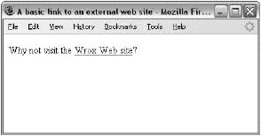

只有当你想链接到页面的特定部分时，才需要指定目标锚点，如下一节所述。

### 使用 `name` 和 `id` 属性创建目标锚点（链接到页面的特定部分）

如果你有一个很长的网页，你可能希望链接到该页面的特定部分，以避免用户上下滚动页面来查找相关内容。目标锚点允许页面作者标记页面中的特定点，源锚点可以指向这些点。

你在网页上可能见过的链接到页面特定部分的常见示例包括：

- 长页面底部的“返回顶部”链接
- 页面上的目录列表，将用户带到该页面的相关部分
- 文本中指向脚注或定义的链接

你再次使用`<a>`元素创建目标锚点，但当它作为目标锚点时，不使用`href`属性，而是使用`id`属性。

如果你查看一些较旧网页的源代码，你可能会看到也使用了`name`属性，甚至用它替代了`id`属性。你可能还记得第 1 章中提到，`name`和`id`属性是大多数元素都可以携带的两个通用属性。现在，`id`属性是创建目标锚点的首选方式，但它是在 HTML 4 版本中才引入的，而在之前的版本中，`name`属性用于执行相同的功能。

举例来说，假设你有一个长页面，包含一个主标题和几个子标题。整个页面无法一次性显示在屏幕上，迫使用户滚动，因此你希望在页面顶部添加链接，让读者直接跳转到该页面的各个章节标题。

在创建指向页面各部分的链接（使用源锚点）之前，你必须先添加目标锚点。在这里，你可以看到在`<h2>`子标题元素内部，有一个带有`id`属性的`<a>`元素，其值标识了每个部分（请记住，一个页面不应包含两个具有相同值的`id`属性）：

```
<h1>链接与导航</h1>

<h2><a id="URL">URL</a></h2>

<h2><a id="SourceAnchors">源锚点</a></h2>

<h2><a id="DestinationAnchors">目标锚点</a></h2>

<h2><a id="Examples">示例</a></h2>
```

有了目标锚点之后，现在可以添加源锚点来链接到这些部分。要链接到特定部分，源锚点中`href`属性的值应与对应目标元素的`id`属性值相同，并在前面加上井号（`#`）。

```
<p>本页面涵盖以下主题：
  <ul>
   <li><a href="#URL">URL</a></li>
   <li><a href="#SourceAnchors">源锚点</a></li>
   <li><a href="#DestinationAnchors">目标锚点</a></li>
   <li><a href="#Examples">示例</a></li>
  </ul>
</p>
```

如果你查看图 2-8，可以看到页面中有多个指向各部分内容的链接；而在图 2-9 中，你可以看到当用户点击第二个链接时，会直接跳转到页面的该部分。你可以在本章的下载代码中查看此示例的完整代码，该代码可从 Wrox 网站获取；文件名为`ch02_eg06.html`。

图 2-8

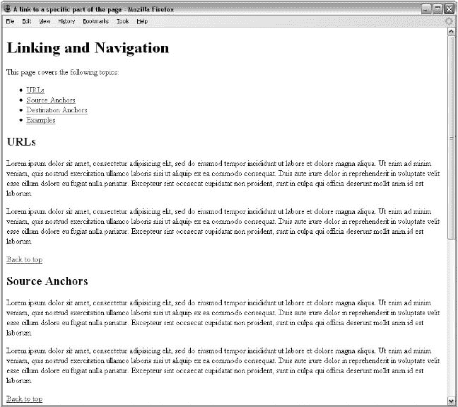

图 2-9

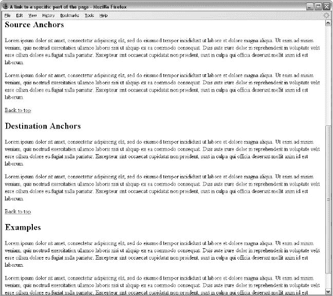

目标锚点必须始终包含一些内容，这一点很重要；否则某些浏览器将无法找到目标。例如，你不应该使用以下内容来表示页面顶部：

```
<a id="top"></a>
```

相反，你应该将其放在主标题或其他内容周围，如下所示：

```
<h1><a id="top">链接与导航</a></h1>
```

如果有人想从其他网站链接到此网页的特定部分（例如关于源锚点的部分），他需要添加页面的完整 URL，后跟井号以及`id`属性的值，如下所示：

`http://www.example.com/HTML/links.html#SourceAnchors`

`name`或`id`属性的值在页面内应该是唯一的，并且源锚点应使用与目标锚点相同的大小写组合。

### `<a>` 元素的其他属性

`<a>`元素可以携带几个我们尚未遇到的属性。虽然这些属性不如前面介绍的属性使用频繁，但为了完整性，还是值得快速了解一下。

`<a>`元素支持所有通用属性、UI 事件属性以及以下属性：

`accesskey` `charset` `coords` `href` `hreflang` `rel` `rev` `shape` `style` `tabindex` `target` `type`

#### `accesskey` 属性

`accesskey`属性创建一个可用于激活链接的键盘快捷键。例如，如果你将`accesskey`属性的值设置为`t`，当用户按下`T`键以及`Alt`或`Ctrl`键（取决于操作系统）时，该链接就会被激活。

在某些浏览器中，当链接被激活时，浏览器会立即跳转到该链接。在其他一些浏览器中，链接只是被高亮显示，用户需要按下`Enter`（或`Return`）键才能跳转。

`accesskey`属性应在源锚点上指定。例如，如果你希望当用户按下键盘上的`T`键（同时按下`Alt`或`Ctrl`）时跳转到页面顶部的链接，你可以这样使用`accesskey`属性：

```
<a id="bottom" accesskey="t">返回顶部</a>
```

请注意，该键不区分大小写。你将在第 5 章学习表单时看到更多关于`accesskey`属性的内容（以及一些示例）。

#### `charset` 属性

`charset`属性指示 URL 指向的文档的字符编码。它通常仅在你链接到使用不同字符集的其他语言页面时使用。

该值必须是一个标识字符集的字符串，例如`UTF-8`或`ISO-8859-1`。（字符集列表请参见附录 E。）以下示例链接到一个使用日文字符集的文档：

```
<a href="http://www.amazon.co.jp/" charset="ISO-2022-JP">亚马逊日本</a>
```

这在链接到使用某些用户可能无法理解（甚至可能无法查看——例如，并非所有美国计算机都安装了查看日文文本所需的字符）的字符编码的外语网站时特别有用。

#### `coords` 属性

`coords`属性设计用于包含图像的源锚点。它允许你创建所谓的图像映射，即同一图像的不同部分链接到不同的位置。`coords`属性的值将是一组`x`和`y`坐标，指示图像的哪一部分应跟随链接。你将在第 3 章中了解更多关于使用图像作为链接的内容。

#### `hreflang` 属性

`hreflang`属性指示你链接到的页面是用哪种语言编写的。它设计用于链接到与当前文档语言不同的页面，该属性的值是一个两个字母的语言代码。例如：

```
<a href="http://www.amazon.co.jp/" hreflang="JA">亚马逊日本</a>
```

附录 G 列出了该属性可能取值的语言代码。

#### `rel` 属性

`rel`属性用于源锚点，以指示当前文档与`href`属性所指定资源之间的关系。主流浏览器目前并未使用此属性，但可以编写自动化应用程序来利用这些信息。例如，以下链接使用`rel`属性来指示其目标文档是本文档中使用的术语表：

更多信息，请阅读`<a href="#glossary" rel="glossary">术语表</a>`。

下表列出了`rel`属性的可能取值。

| 值 | 描述 |
| --- | --- |
| `toc`（或`contents`） | 当前文档的目录文档 |
| `index` | 当前文档的索引文档 |
| `glossary` | 包含与当前文档相关的术语表的文档 |
| `copyright` | 包含当前文档版权声明的文档 |
| `start` | 一系列有序文档中的第一个文档，当前文档属于该系列 |
| `next` | 一系列有序文档中的下一个文档，当前文档属于该系列 |


| 属性 | 用途 |
| --- | --- |
| `prev`（或 `previous`） | 一系列有序文档中的上一个文档，当前文档属于该系列 |
| `help` | 帮助用户理解或浏览页面和/或网站的文档 |
| `chapter` | 在文档集合中充当章节的文档 |
| `section` | 在文档集合中充当节的文档 |
| `subsection` | 在文档集合中充当子节的文档 |
| `appendix` | 在文档集合中充当附录的文档 |

#### `rev` 属性

`rev` 属性与 `rel` 属性作用相同，但用于目标锚点，以描述目标与源之间的关系。目前主流浏览器不支持此属性。

#### `shape` 属性

如果要创建图像映射，可以使用 `shape` 属性来指示某个区域的形状，该区域将成为可点击的热点。`shape` 属性将在第 3 章中详细介绍，届时你将学习如何创建图像映射。

### `tabindex` 属性

要理解 `tabindex` 属性，你需要知道元素获得焦点意味着什么。任何用户可以与之交互的元素都可以获得焦点。当页面加载后，如果用户按下键盘上的 Tab 键，浏览器会在页面中用户可交互的部分之间移动焦点。可以获得焦点的页面部分包括链接和表单的某些部分（例如允许输入文本的框）。当链接获得焦点且用户按下键盘上的 Enter 键时，该链接会被激活。

你可以在 Google 网站上看到焦点的作用；如果你反复按 Tab 键，应该会看到焦点在页面上的链接之间移动。在依次经过每个链接后，焦点会进入输入搜索词的框，然后经过网站按钮，最后通常会回到你输入 URL 的位置。然后，当你继续按 Tab 键时，它会再次循环经过相同的元素。

`tabindex` 属性允许你指定按下 Tab 键时链接（或表单控件）获得焦点的顺序。因此，当用户按下 Tab 键时，你可能希望焦点落在页面上用户可能想要交互的关键项目上（跳过一些不太常用的功能）。

`tabindex` 属性的值是一个介于 0 到 32767 之间的数字。`tabindex` 属性值为 1 的链接比值为 20 的链接先获得焦点（如果使用值 0，则链接按照它们在文档中出现的顺序获得焦点）。第 5 章将展示一些在表单中使用 `tabindex` 的示例。

#### `target` 属性

默认情况下，当你使用 `<a>` 元素创建链接时，所链接的文档将在同一浏览器窗口中打开。如果你希望链接在新浏览器窗口中打开，可以使用 `target` 属性，并将其值设置为 `_blank`。

```html
<a href="Page2.html" target="_blank">第 2 页</a>
```

#### `title` 属性

如本章开头所述，在包含图像的链接上使用 `title` 属性是一个好习惯。它还可以在大多数浏览器中以可视文本工具提示的形式，或在语音浏览器中为视障人士提供听觉线索，从而为访问者提供额外信息。本章开头附近的图 2-2 展示了当用户将鼠标悬停在链接上时，`title` 属性在 Firefox 中的显示效果。

#### `type` 属性

`type` 属性指定链接的 MIME 类型。MIME 类型可以与文件扩展名相比较，但在不同操作系统中更通用。例如，HTML 页面的 MIME 类型为 `text/html`，而 JPEG 图像的 MIME 类型为 `img/jpeg`。（附录 H 列出了常见的 MIME 类型。）

以下是使用 `type` 属性指示链接指向的文档是 HTML 文档的示例：

```html
<a href="index.html" type="text/html">索引</a>
```

理论上，浏览器可以使用 `type` 属性中的信息以不同方式显示链接，或向用户指示目标文档的格式，但目前没有浏览器使用它。

## 动手试一试：在页面内创建链接

现在轮到你尝试制作一个包含页面不同部分之间链接的长页面了。在此示例中，你将为我们示例咖啡馆创建菜单。因此，请在文本编辑器或创作工具中打开示例应用程序中的 `menu.html` 页面：

1. 开始时，页面应如下所示：

```xml
<?xml version="1.0" ?>
<!DOCTYPE html PUBLIC "-//W3C//DTD XHTML 1.0 Strict//EN"
    "http://www.w3.org/TR/xhtml1/DTD/xhtml1-strict.dtd">
<html xmlns="http://www.w3.org/1999/xhtml" lang="en">
<head>
  <title>Example Cafe - community cafe in Newquay, Cornwal, UK</title>
</head>
<body>
  <h1>EXAMPLE CAFE</h1>
  <p>Welcome to Example cafe. We will be developing this site throughout
     the book.</p>
  <h2>Menu</h2>
  <p>The menu will go here.</p>
</body>
</html>
```

2. 在标题之后，将第一个段落替换为导航链接，就像你在上一个“动手试一试”中为 `contact.html` 页面创建的那样。唯一的区别是，这次 CONTACT 选项将是一个链接，而 MENU 选项将不是链接。

```html
<a href="index.html">HOME</a>
MENU
<a href="recipes.html">RECIPES</a>
<a href="opening.html">OPENING</a>
<a href="contact.html">CONTACT</a>
```

3. 在此之下，添加不同菜品的标题。每个标题都应有一个目标锚点，以便你可以直接链接到页面的该部分，并且 `id` 属性的值将描述该部分。主标题也需要一个目标锚点，因为它将用于“返回顶部”链接。请记住，目标锚点需要一些内容，因此这些锚点包含标题文本：

```html
<h1><a id="top">Example Cafe Menu</a></h1>
<h2><a id="starters">Starters</a></h2>
<h2><a id="mains">Main Courses</a></h2>
<h2><a id="desserts">Desserts</a></h2>
```

4. 在 Example Café Menu 标题下方，添加指向每个菜品目标锚点的链接。这些链接应放在 `<p>` 元素内：

```html
<p><a href="#">Starters</a> |  <a href="#mains">Main Courses</a> | <a
href="#desserts">Desserts</a></p>
```

5. 在页面底部，你将添加一条注释，说明任何标有字母 v 的项目都适合素食者。素食项目旁边的链接将指向此注释，因此它需要有一个目标锚点：

```html
<p><a id="vege">Items marked with a (v) are suitable for vegetarians.</a></p>
```

6. 你可以直接用项目符号列表添加菜单项。注意素食菜品下方有一个指向素食描述部分的链接。别忘了在每个列表下方添加“返回顶部”链接。

### 开胃菜

- 栗子蘑菇炸条（(素)）
- 山羊奶酪沙拉（(素)）
- 蜂蜜酱油鸡肉串
- 海鲜沙拉

返回顶部

### 主菜

- 菠菜乳酪卷（(素)）
- 芥末莳萝酱牛肉卷
- 烤鸡沙拉
- 欧芹酱冰岛鳕鱼
- 蘑菇威灵顿（(素)）

返回顶部

### 甜点

- 柠檬雪葩（(素)）
- 巧克力泥派（(素)）
- 山核桃派（(素)）
- 精选世界各地奶酪

返回顶部

7. 将示例保存为 `menu.html`，并在浏览器中查看。最终效果应类似于图 2-10。

图 2-10

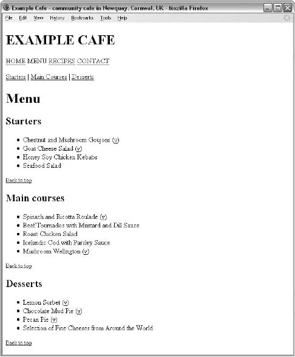

## 高级电子邮件链接

正如本章开头所见，你可以创建一个链接，打开用户的默认电子邮件编辑器，并自动将邮件地址填写为你（或你指定的任何其他电子邮件地址）。操作如下：

```html
<a href="mailto:info@example.org">info@example.org</a>
```

你还可以指定邮件的其他部分，例如主题、正文以及需要抄送（CC）或密送（BCC）的电子邮件地址。

要控制邮件的其他属性，请在电子邮件地址后放置一个问号，然后使用名称/值对来指定附加属性。名称和值之间用等号分隔。

例如，要将邮件的主题行设置为“咨询”，你可以添加 `subject` 属性名称，后跟等号，然后是术语“咨询”，如下所示：

```html
<a href="mailto:info@example.org?subject=Inquiry">
```

你可以通过用与号（`&`）分隔名称/值对来指定多个属性。下面展示了如何添加主题和抄送地址：

```html
<a href="mailto:info@example.org?subject=XHTML&cc=sales@example.org"></a>
```

下表列出了你可以添加的所有属性。

| 属性 | 用途 |
| --- | --- |
| `subject` | 为邮件添加主题行；你可以通过此属性鼓励用户使用便于识别邮件来源的主题行。 |
| `body` | 在邮件正文中添加一条消息，但请注意用户能够修改此消息。 |
| `cc` | 将邮件的副本发送到抄送地址；该值必须是有效的电子邮件地址。如果要提供多个地址，只需重复该属性，并用与号与前一个属性分隔。 |
| `bcc` | 将邮件的副本秘密发送到密送地址，且任何收件人都看不到其他收件人；该值必须是有效的电子邮件地址。如果要提供多个地址，只需重复该属性，并用与号与前一个属性分隔。 |

如果要在主题行的单词之间添加空格，应在单词之间添加 `%20` 而不是空格。如果要在邮件正文中创建换行，应添加 `%0D%0A`（其中 0 是数字零，不是大写字母 O）。

虽然电子邮件链接可以创建包含所有这些属性的邮件，但它并不能阻止用户在电子邮件程序中编辑这些值。

通常的做法是仅在电子邮件链接中添加电子邮件地址。如果你想添加主题行或消息正文，可以考虑改用电子邮件表单，就像你将在第 5 章中看到的那样（尽管这些表单需要服务器上有一个能够处理表单并发送电子邮件的脚本）。

## 总结

在本章中，你学习了关于链接的知识。链接使用户能够在页面之间跳转，甚至可以在单个页面的不同部分之间跳转（这样他们就不必滚动查找所需位置）。

你已经看到可以使用 `<a>` 元素创建源锚点，这是大多数人在提到网页链接时首先想到的。源锚点的内容是用户可以点击的部分——这通常应该是对用户点击链接后将看到的内容的信息性、简洁的描述（而不是像“点击这里”这样的文本），或者它可以是一张图片（如第 3 章所示）。

你还可以使用 `<a>` 元素创建目标锚点。目标锚点有点像索引点或特殊标记，因为它们允许你创建直接指向页面该部分的链接。目标锚点应始终包含一些内容。

在此过程中，你进一步了解了 URL，特别是绝对 URL（如浏览器地址栏中显示的 URL）与相对 URL（描述资源相对于包含它的文档的位置）之间的区别。学习相对 URL 的不同使用方式也将有助于你进入下一章，学习如何将图像和其他对象添加到文档中。

## 练习

所有练习的答案可在附录 A 中找到。

1. 回顾你创建菜单的“试一试”示例，创建一个新页面，直接链接到菜单上的每道菜品。然后添加一个指向 Wrox 主网站（[www.wrox.com](http://www.wrox.com)）的链接。页面应类似于图 2-11。

   图 2-11

   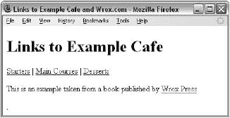

2. 返回示例应用程序中的页面，确保已更新每个页面的导航。

# 第 3 章：图像、音频和视频

在本章中，你将学习如何向网站添加图像、动画、音频和视频。这将为我们迄今为止创建的页面注入一些活力。

你将首先学习如何使用 `` 元素向文档添加图像。你还将学习如何将图像设置为链接，甚至如何将图像分割成多个区域，使图像的不同部分链接到不同页面——这被称为图像映射。

然后，我们将介绍一些在网络上使用的主要图像格式（JPEG、GIF 和 PNG），并学习针对不同类型的图像应使用哪种图像格式。这一点非常重要，因为它会极大地影响网页加载的速度（众所周知，缓慢的网站会让用户感到沮丧）。

完成图像部分后，我们将继续学习如何以 Flash、视频和音频的形式向网站添加更多多媒体内容。在此过程中，我们将遇到 `<object>`、`<param>` 和 `<embed>` 元素。正如你将看到的，Flash 在网页中嵌入视频和音频方面比其他任何技术都更常用。

到本章结束时，你的页面应该看起来更加生动有趣。

## 使用 `` 元素添加图像

图像通过 `` 元素添加到网站中，该元素必须至少包含两个属性：`src` 属性（指示图像的来源）和 `alt` 属性（提供图像的描述）。

例如，以下代码行会将名为 `logo.gif` 的图像添加到页面中（在此例中，图像位于名为 `images` 的目录中）。你可以在 `ch03_eg01.html` 中找到此代码。

```html

```

图 3-1 显示了该图像在浏览器中的显示效果。

图 3-1

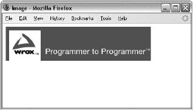

除了携带所有通用属性和 UI 事件属性（你在第 1 章中已了解），`` 元素还可以携带以下属性：

`src`、`alt`、`align`、`border`、`height`、`width`、`hspace`、`vspace`、`ismap`、`usemap`、`longdesc`、`name`

### `src` 属性

`src` 属性告诉浏览器在哪里找到图片。其值是一个 URL，就像你在上一章中遇到的链接一样，这个 URL 可以是绝对 URL 或相对 URL。

```html

```

一般来说，你网站上的图片应该始终存放在你自己的服务器上。链接到其他网站上的图片并不是好做法，因为如果其他网站的所有者决定移动那张图片，你的用户将无法再看到它。由于图片存放在你的服务器上，因此其值更可能是相对 URL，而不是绝对 URL，并且会使用你在上一章介绍相对 URL 时遇到的相同简写符号。

大多数网页作者会在网站中为图片创建一个单独的目录（或文件夹）。如果你的网站非常大，你甚至可以为不同类型的图片创建不同的文件夹。例如，你可以将界面设计中使用的图片（如徽标或按钮）与网站内容中使用的图片分开存放。

#### `alt` 属性

`alt` 属性必须出现在每个 `` 元素上，其值应为图片的文本描述。

```html

```

通常被称为替代文本，该属性的值真正描述图片非常重要，因为：

- 如果浏览器无法显示图片，则会显示此替代文本。
- 有视觉障碍的网页用户通常会使用称为屏幕阅读器的软件来为他们朗读页面，此时替代文本会描述他们无法看到的图片。
- 尽管搜索引擎非常智能，但它们目前还无法描述或索引图片的内容；因此，提供替代文本有助于搜索引擎索引你的页面，并帮助访问者找到你的网站。

有时图片不传达任何信息，仅用于增强页面布局。（例如，你可能有一张图片只是装饰性元素，但并未向页面添加任何信息。）在这种情况下，仍然应该使用 `alt` 属性，但将其值留空，如下所示：

```html

```

### `height` 和 `width` 属性

`height` 和 `width` 属性指定图片的高度和宽度，这些属性的值几乎总是以像素为单位（如果你不熟悉像素的概念，我们将在本章后面的“选择正确的图片格式”一节中介绍）。

```html

```

从技术上讲，这些属性的值可以是浏览器屏幕的百分比。或者，如果图片位于一个仅占据页面部分区域的元素（称为包含元素）内，那么它将是该包含元素的百分比。如果使用百分比，数字后面会跟一个百分号，但这非常罕见，并且以非原始尺寸显示图片可能会导致图片变形或模糊。

指定图片的尺寸被认为是一种好习惯，因此你应该尽量在你页面上的任何图片中使用这些属性。它还有助于页面加载得更快、更流畅，因为浏览器知道要为图片分配多少空间，并且可以在图片仍在加载时正确渲染页面的其余部分。

虽然你可以告诉浏览器将图片显示得比实际更小或更大（通过告诉浏览器宽度和高度与实际值不同），但你应该避免这样做，因为你的图片会变得不清晰。相反，你应该力求创建与你在网页上使用尺寸相同的图片版本。诸如 Photoshop、Photoshop Elements、Paint Shop Pro 或 GIMP 等程序可以帮助你做到这一点。

同样重要的是，不要使用比屏幕上显示尺寸更大的图片（例如，如果你只在屏幕上以 100 像素 × 100 像素显示，就不应该使用 800 像素 × 800 像素的图片），因为图片越小，文件大小（以千字节计）就越小。而文件大小越小，图片在浏览器中加载得就越快。此外，当你要将网站放到网上供他人查看时，这还可能为你节省费用，因为通常收费与你发送给访问你网站的用户的所有文件的总大小相关。

同样，也不要将图片显示得比实际尺寸更大。如果你有一张小图片（比如 100 像素 × 100 像素）并试图将其显示得更大（比如 300 像素 × 300 像素），它会出现颗粒感。

虽然这不是一个好主意，但如果你只指定了 `height` 或 `width` 属性而省略了另一个，浏览器会按比例显示图片。假设你有一张宽 200 像素、高 100 像素的图片。如果你只指定宽度为 200 像素，它会尝试以正确尺寸显示图片：宽 200 像素、高 100 像素。然而，如果你说图片宽 100 像素且未指定高度，浏览器会尝试将高度设为 50 像素。因为宽度是原始图片的 50%，所以它会以原始高度的 50% 显示图片。换句话说，它保持了图片的宽高比（宽度除以高度）。

你甚至可以通过提供与高度不成比例的宽度来扭曲图片。


图 3-2 展示了图片的实际尺寸（顶部：130 像素 × 130 像素）、放大后的图片（中间：`width` 属性赋值为 160 像素）以及扭曲后的图片（底部：`width` 属性赋值为 80 像素，`height` 属性赋值为 150 像素）。

图 3-2

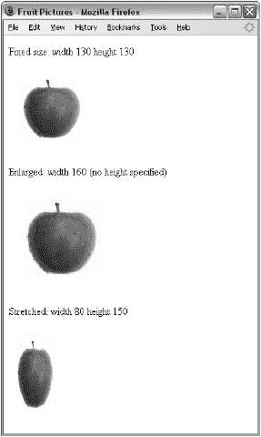

以下是此示例的代码（`ch03_eg02.html`）：

```html
<p>固定尺寸：宽 130 高 130</p>

<p>放大：宽 160（未指定高度）</p>

<p>拉伸：宽 80 高 150</p>

```

本节中的其余属性要么已弃用（正在逐步淘汰），要么很少使用，但在此提及是因为你可能会在较旧的页面中遇到它们。

### `align` 属性（已弃用）

`align` 属性用于在页面中对齐图片（如果图片位于一个小于整个页面的元素内，则在该元素内对齐图片）。

```html

```

`align` 属性特别被那些希望文本环绕图片的作者使用；如果你查看图 3-3，可以看到同一张图片周围文本的三个示例。

图 3-3

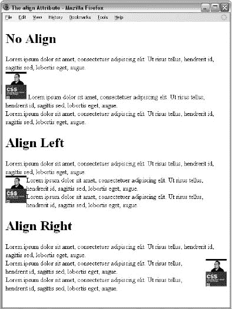

`align` 属性可以取下表中的一个值。你可能还会遇到 `absbottom`、`texttop`、`absmiddle` 和 `baseline` 这些值，它们不属于 XHTML 规范，而是由浏览器厂商添加的，因此可能产生不一致的结果。

| 值 | 用途 |
| --- | --- |
| `top` | 图片顶部与当前文本行的顶部对齐。 |
| `middle` | 图片中间与当前文本基线对齐。 |
| `bottom` | 图片底部与当前文本行的基线对齐（默认值），这通常会导致图片高于文本。 |
| `left` | 图像对齐到包含窗口或元素的左侧，文本环绕其周围。 |
| `right` | 图像对齐到包含窗口或元素的右侧，文本环绕其周围。 |

### `border` 属性（已废弃）

边框是出现在图像或其他元素周围的一条线。默认情况下，图像没有边框，因此只有在你想为图像创建边框时才会使用此属性。`border` 属性用于指定边框的像素宽度：

```html

```

虽然图像本身没有边框，但你应该注意，当图像用作链接时，Internet Explorer 会为其添加边框；因此，你经常会看到在链接内使用的图像上设置 `border="0"` 的代码。此属性已被 CSS 的 `border` 属性取代。

### `hspace` 和 `vspace` 属性（已废弃）

`hspace` 和 `vspace` 属性可用于控制图像周围的空白区域。

```html

```

该值表示图像边缘应保留的空白像素数。这类似于图像周围有一个与页面背景颜色相同的边框。在 CSS 出现之前，`hspace` 和 `vspace` 属性特别有用；它们可以在图像和环绕文本之间创建间隙。如果没有这样的间隙，文本会变得难以阅读，且看起来不够专业。图 3-4 展示了这一概念（`ch03_eg04.html`）。

图 3-4

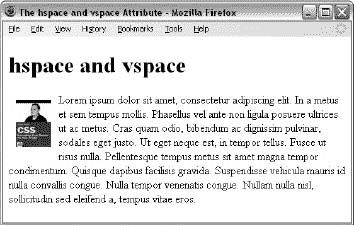

这些属性已被废弃，你可以通过 CSS 中的 `border` 或 `margin` 属性达到相同效果。

### `ismap` 和 `usemap` 属性

`ismap` 和 `usemap` 属性用于图像映射。图像映射将在本章后面的“图像映射”部分介绍。

### `longdesc` 属性

`longdesc` 属性用于指示包含图像更详细描述的文档（或文档的一部分）的 URL。

```html
longdesc="../accessibility/profit_graphs.html"
```

有时图像可能包含大量信息——尤其是图表和图形。通过提供图像的详细描述，不仅可以帮助搜索引擎理解它们原本无法处理的信息，还可以帮助那些因视力障碍而无法看到图像的用户。

不幸的是，`longdesc` 属性不受任何主流浏览器的支持，因此目前可以在图像旁边放置一个链接，指向图像的详细描述。该链接仅在开始 `<a>` 标签和结束 `</a>` 标签之间包含一个字母 D（代表描述）。你可以在图 3-5（`ch03_eg05.html`）中看到这样的示例，其中链接指向同一页面底部的描述。这类似于上一章中遇到的内部链接；如果整个页面适合浏览器窗口，你将看不到任何变化，但如果页面比浏览器窗口长，当用户点击链接时，浏览器将滚动到页面底部。

图 3-5

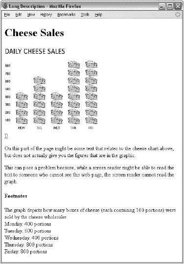

### `name` 属性（已废弃）

`name` 属性允许你为图像指定一个名称，以便可以从脚本代码中引用它。它是 `id` 属性的前身，并已被 `id` 属性取代。

```html
name="image_name"
```

## 动手实践：向文档添加图像

在本示例中，你将向我们的咖啡馆示例添加一些图像。我们将添加咖啡馆的徽标，以及特色早午餐的图片。因此，在文本编辑器或网页创作工具中打开主页，并按照以下步骤操作：

1. 将 `<h1>` 标题替换为示例应用程序 `images` 文件夹中的 `logo.gif`。

   ```html
   
   ```

   `src` 属性指示图像的 URL。此示例中的 URL 都是相对 URL，指向示例页面所在文件夹内的 `images` 目录。

   `alt` 属性应在你编写的每个 `` 元素上使用。如果浏览器无法加载图像，将显示 `alt` 属性的内容，并向视力障碍且无法看到图像的用户描述图像。它还有助于搜索引擎理解你网站的内容。

2. 在导航之后、`<h2>` 元素之前添加以下内容：

   ```html
   
   ```

   `width` 和 `height` 属性告诉浏览器图像应显示的大小。通过包含这些属性，浏览器可以更流畅地布局页面，因为它可以在不等待图像下载的情况下，继续在正确位置显示页面上的其他项目。虽然你可以使用这些属性来拉伸或放大图像，但最好让图像保持你希望使用的大小。如果你想缩小图像，应保存一个新版本，而不是仅使用这些属性。这将节省查看者的时间和带宽。

3. 保存文件并在浏览器中打开。你应该会得到类似于图 3-6 的结果。

图 3-6

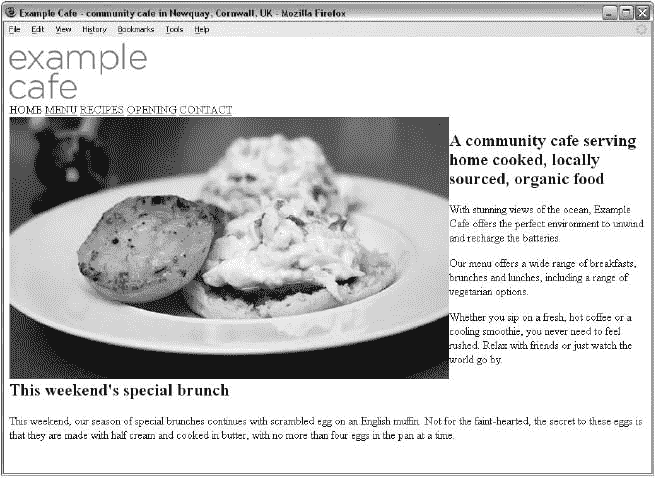

## 使用图像作为链接

将图像转换为链接很容易；你只需在开始 `<a>` 标签和结束 `</a>` 标签之间放置一个图像，而不是像上一章那样放置文本。图像通常用于创建图形按钮或指向其他页面的链接，如下所示（`ch03_eg06.html`）：

```html
<a href="../index.html" title="Click here to return to the home page">
  
</a>
```

你可以在图 3-7 中看到它的效果。此截图特意在 IE 中拍摄，以展示 IE 如何为 `<a>` 元素内的任何图像绘制蓝色边框。XHTML 规范中并未规定应为作为链接的图像绘制边框，其他浏览器也不会这样做。

图 3-7

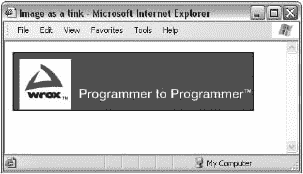

这个边框看起来不太美观，因此你可以在 `` 元素上使用 `border` 属性，值为 0 像素，或者最好使用 CSS 来指示任何位于 `<a>` 元素内的 `` 元素不应有边框（你将在第 7 章学习如何做到这一点）。

## 图像映射

图像映射允许你在同一图像上添加多个链接，每个链接指向不同的页面。当图像需要被分割成不规则形状（例如地图）时，它们特别有用。这些可点击区域中的每一个都称为热点。

在实践中，你需要使用图像映射的情况相对较少，但这里介绍它们是因为它们是一种可以作为链接的图像类型。你可以随意浏览本节内容，了解文件类型，并在需要学习如何创建图像映射时再回到这个主题。

图 3-8 显示了一个 GIF，你将看到它被转换为图像映射。当用户点击圆形时，他们会看到关于咖啡馆的页面；当点击花园时，他们会看到关于雕塑花园的页面；当点击工作室时，他们会看到关于工作室的页面。

图 3-8

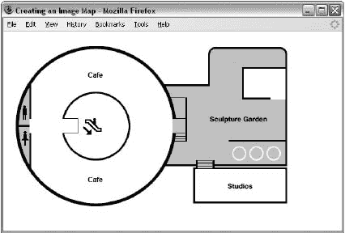

显然，你不希望把热点区域做得太小，否则用户很难选中他们想要的部分。如果发生这种情况，用户很快就会感到沮丧并离开你的网站。图像地图对于有视觉障碍或运动控制困难的人来说也难以导航，因此如果图像地图是你网站访客的重要工具，你还应该提供文本链接作为备选方案（并在 `alt` 文本中注明这些链接的存在）。

图像地图的工作方式基于 x 和 y 坐标，这些坐标从图像的左上角开始测量。这些坐标有两种用途：

- 指定热点区域的位置
- 确定用户点击了图像的哪个位置

通过比较热点区域的坐标与用户点击的坐标，用户可以被引导至该热点对应的链接。

实际上有两种类型的图像地图，它们的功能相同。区别在于它们如何判断你点击了哪个热点。

- **客户端图像地图**：Web 浏览器自行判断用户点击了图像的哪个部分，并将用户引导至相应的页面。
- **服务器端图像地图**：浏览器将坐标发送给服务器，告知用户点击了图像的哪个部分，然后由服务器上的脚本文件处理这些坐标，确定用户应被引导至哪个页面。

## 客户端图像地图

客户端图像地图使用 XHTML 代码告诉浏览器如何划分图像；然后浏览器就能判断用户点击了图像的哪个部分，并将用户引导至相应的链接。创建客户端图像地图有两种方法：

- 在 `` 元素内部使用 `<map>` 和 `<area>` 元素
- 在 `<object>` 元素内部使用 `<map>` 元素

下面我们逐一介绍。

### 使用 `<map>` 和 `<area>` 的客户端图像地图

这是创建客户端图像地图的两种方法中较早的一种，自 Netscape 4 和 IE4 起就得到了浏览器的支持。构成地图的图像像其他图像一样通过 `` 元素插入页面。然后在 `` 元素中添加一个名为 `usemap` 的属性，指示该图像需要使用对应 `<map>` 元素中的信息来将其转换为图像地图。`<map>` 元素则包含用于告诉浏览器如何分割图像的信息，以便将用户引导至正确的页面。

`usemap` 属性的值以井号（#）开头，后跟它所使用的 `<map>` 元素上 `name` 属性的值。

`<map>` 元素通常紧跟在 `` 元素之后。它只需要携带 `name` 属性来标识自身。`<map>` 元素内部包含两个或更多 `<area>` 元素，正是这些 `<area>` 元素定义了可点击的热点区域。

`<area>` 元素通过指定 `shape` 和定义每个可点击热点边界的坐标来实现这一点。以下是一个示例，来自用于图 3-8 中图像的图像地图（该示例的代码位于 `ch03_eg07.html` 中）。

```html

<map name="cafe">
  <area shape="circle" coords="154,150,59" href="cafe.html" target="_self"
    alt="Cafe" >
  <area shape="poly" coords="272,79,351,79,351,15,486,15,486,218,272,218,292,
    166,292,136x,270,76" href="courtyard.html" target="_self"
    alt="Courtyard" />
  <area shape="rect" coords="325,224,488,286" href="kitchens.html"
    target="_self" alt="Kitchens" />
</map>
```

如果你查看 `` 元素，`usemap` 属性的值是 `#gallery`；这对应于后续 `<map>` 元素上 `name` 属性的值。在这个 `<map>` 元素内部，`<area>` 元素实际定义了图像中可点击的部分。

如果你查看 `<area>` 元素，`shape` 属性指示热点区域的形状类型，而 `coords` 属性则指定该形状的位置和大小。例如，这里的形状是一个矩形，`coords` 属性指示了矩形的左上角和右下角：

```html
<area shape="rect" coords="325,224,488,286" href="workshop.html"
    target="_self" alt="Artists workshops" />
```

`href` 和 `target` 属性的功能与它们在 `<a>` 元素上的用法完全相同。`<area>` 元素用于创建图像地图的属性将在后续内容中介绍。

`accesskey` `alt` `shape` `coords` `href` `nohref` `target` `tabindex` `taborder` `notab`

#### `shape` 属性

`shape` 属性的值实际上会影响浏览器如何使用 `coords` 属性中指定的坐标，因此它是必需的。如果你没有指定 `shape` 属性，默认值为矩形。

下表显示了 `shape` 属性的可能取值。

| 值 | 创建的形状 |
| --- | --- |
| `default` | 图像中未被区域定义的部分（应最后指定） |
| `rectangle` 或 `rect` | 矩形 |
| `polygon` 或 `poly` | 多边形 |
| `circle` 或 `circ` | 圆形 |

最好使用这些值的缩写形式，因为它们在旧版浏览器中支持更好。如果你希望表示图像中未被任何已定义区域的 `<area>` 元素覆盖的部分，应在最后一个 `<area>` 元素上使用 `default` 值——它类似于图像其余部分的“兜底”选项。

#### `coords` 属性

`coords` 属性指定了可点击热点的区域。你指定的坐标数量取决于你正在创建（并在 `shape` 属性中指定）的形状。

- 矩形包含四个坐标。前两个坐标代表矩形的左上角，后两个坐标代表右下角。
- 圆形包含三个坐标；前两个是圆心，第三个是以像素为单位的半径。
- 多边形为每个点包含两个坐标。因此三角形包含六个坐标，五边形包含十个，以此类推。你不需要在末尾再次指定第一个坐标，因为形状会自动闭合。

一些网页制作和图像编辑程序可以帮助你计算图像地图的坐标；它们提供了一种工具，允许你选择要转换为地图的区域，并使用这些形状为你生成坐标。图 3-9 展示了 Dreamweaver 的图像地图工具——由于每个程序不同，你应该查看该程序的帮助文件，了解如何创建图像地图。

图 3-9

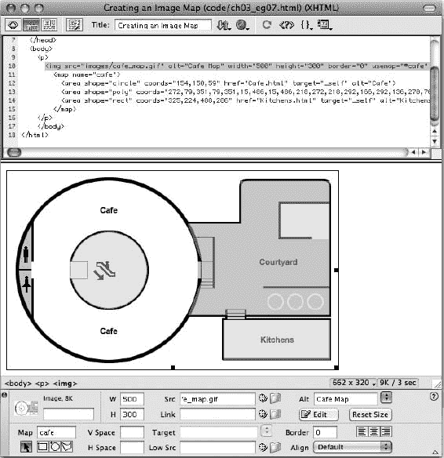

如果有两个区域相互重叠，代码中先出现的区域将具有优先权。

#### `href` 和 `nohref` 属性

`href` 属性的工作方式与 `<a>` 元素的 `href` 属性相同；其值是用户点击图像该部分时要加载的页面的 URL。

如果你不希望图像的某部分链接到任何地方，应该在该区域上使用 `nohref` 属性，以指示该区域不会跳转到任何页面。如果使用此属性，应将其值设置为 `nohref`。例如，如果你希望确保地图中的“厨房”区域不链接到任何地方，表示该区域的 `<area>` 元素应如下所示：

```html
<area shape="rect" coords="325,224,488,286" nohref="nohref" />
```

#### `alt` 属性

`alt` 属性为图像的该部分指定了文本替代内容，其工作方式与 `` 元素上的 `alt` 属性相同。当用户将鼠标悬停在该区域上时，它实际上会覆盖为图像指定的 `alt` 文本。

#### `target` 属性

`target` 属性指定页面应加载到哪个框架或窗口中。其可能取值与 `<a>` 元素的 `target` 属性相同。

### `tabindex` 属性

`tabindex` 属性允许你指定用户通过 Tab 键在页面各项目间切换的顺序。其值为 1 到 32,767 之间的数字。该属性在第 5 章中有完整讨论。

### 使用 `<object>` 元素的客户端图像映射

HTML 4 开始提倡使用 `<object>` 元素而非 `` 元素来为文档添加图像映射（尽管在 Strict XHTML 1.0 中你仍可使用 `` 元素）。遗憾的是，IE8、Firefox 3 和 Safari 3 是首批支持使用此方法创建图像映射的主流浏览器版本，因此目前你最好还是沿用上一节介绍的方法，但我仍会描述这项新技术，以便你了解其工作原理。


该技术与刚才介绍的方法非常相似，但这次是由 `<object>` 元素携带 `usemap` 属性（其值为 `<map>` 元素的 `name` 属性值前加井号 `#`）。在 `<object>` 元素内部，你使用熟悉的带有 `name` 属性的 `<map>` 元素。然后在 `<map>` 元素内部，使用的是标准的 `<a>` 元素而非 `<area>` 元素。

```html
<object data="cafe_map.gif" type="image/gif" alt="Cafe Map" width="500"
   height="300" border="0" usemap="#cafe" />
<map name="cafe">
  <a shape="circle" coords="154,150,59" href="cafe.html" target="_self">Cafe</a>
  <a shape="poly"
coords="272,79,351,79,351,15,486,15,486,218,272,218,292,166,292,136,270,76"
    href="courtyard.html" target="_self">Courtyard</a>
  <a shape="rect" coords="325,224,488,286" href="kitchens.html" target="_self">
    Kitchens</a>
</map>
```

### 服务器端图像映射

在服务器端图像中，`` 元素位于 `<a>` 元素内部，就像任何作为链接的图像一样。但 `` 元素带有一个特殊的 `ismap` 属性，该属性告诉浏览器：当用户点击图像映射时，将用户鼠标所在图像位置的 x、y 坐标发送给服务器。然后服务器上的脚本会根据接收到的坐标决定应将用户发送到哪个页面。

例如，请看以下链接，其中 `` 元素携带了值为 `ismap` 的 `ismap` 属性：

```html
<a href="../location/map.aspx"></a>
```

现在，如果用户点击图像，位置在图像左上角向右 50 像素、向下 75 像素处，浏览器会将该信息与 URL 一起发送，如下所示：

`http://www.example.org/location/map.aspx?50,75`

你可以看到坐标附加在 `<a>` 元素指定的 URL 末尾。

如果你查看其他人的图像映射代码，可能会发现某些图像映射的 `ismap` 属性没有值。这是因为在早期版本的 HTML 中，该属性不需要值。然而，在 XHTML 中每个属性都需要一个值，因此 `ismap` 属性的值变成了 `ismap`。服务器端图像映射需要服务器上存在某种东西（脚本、映射文件或应用程序）来处理坐标并确定应将用户发送到哪个页面。由于服务器端图像映射是在服务器上处理的，其实现方式不受 HTML 或 XHTML 建议的约束，遗憾的是，这里没有足够的篇幅来介绍每种不同平台的可能实现方式。

## 选择正确的图像格式

图像和图形确实能让你的网站生动起来，但学会如何为 Web 准备图像非常重要。否则，它们会显著增加页面加载所需的时间。

在台式机或笔记本电脑上编写网站时，你可能不会意识到页面加载需要多长时间；存放在你电脑上的文件加载速度会比在互联网上快得多。因此，选择正确的图像格式并正确保存图像，可以确保当你将网站放到 Web 上供人们查看时，不会不必要地变慢——这会让访问者更满意。这就是为什么我们要用几页篇幅来学习图像格式以及如何选择合适的格式，以此结束本节关于图像的内容。

为了练习，你可以通过右键单击图像（或 Ctrl+单击）并选择“将图像下载到磁盘”或“图像另存为”选项，从其他网站下载图像。但请记住，图像受版权保护，如果你在网站上使用他人的图像，可能会陷入法律纠纷。

Web 上的大多数静态图像都属于位图图像。位图图像将图片划分为像素网格，并单独指定每个像素的颜色。如果你非常靠近地观察电脑屏幕，可能会看到构成屏幕的像素。有几种不同的位图格式；常见的包括 JPEG、GIF、TIFF、PNG 以及容易混淆的位图（BMP）。

如果你查看图 3-10，可以看到一个位图图像的示例，其中一部分已被修改，以便你能看到像素如何构成图像。

图 3-10

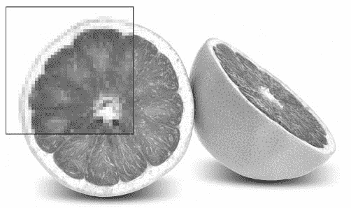

每平方英寸图像中的像素数称为图像的分辨率。通常，用于 Web 的图像以每英寸 72 像素的分辨率保存，因为这与你电脑屏幕上每平方英寸的像素数相对应。相比之下，用于印刷的图像通常以每英寸 300 点提供给打印机。

图像包含的每英寸像素或点数越多，文件大小（以 KB 计）就越大，文件越大，在 Web 上传输所需的时间就越长。因此，你在 Web 上使用的任何图像都应保存为每英寸 72 点的分辨率。如果保存得更大，就会产生不必要的大文件，下载时间也会更长。

请注意，虽然你可以轻松地将每英寸 300 点的图像保存为 Web 上使用的每英寸 72 像素，但不能简单地将图像从每英寸 72 像素增加到每英寸 300 点，因为你不知道每平方英寸缺失的 228 个像素应该是什么颜色。如果只是尝试提高图像分辨率，图像通常会显得颗粒感十足。因此，当你有一张高分辨率（每英寸 300 点）的图片时，应复制一份用于 Web，并单独保留原始版本。

浏览器通常支持三种常见的位图图形格式，大多数图形程序都可以将这些格式保存图像：

- GIF：图形交换格式（发音为“gif”或“jif”）
- JPEG：联合图像专家组格式（发音为“jay peg”）
- PNG：便携式网络图形（发音为“pee en gee”或“ping”）

让我们快速了解一下每种格式，因为理解格式的工作原理有助于你选择如何保存图像。

### GIF 图像

GIF（图形交换格式）图像使用最多 256 种颜色的调色板创建，图像中的每个像素都是这 256 种颜色之一。每张不同的 GIF 图像都可以从超过 1600 万种颜色中选出一个包含 256 种颜色的不同调色板。保存图像的程序也会选择最能代表该图像的调色板。

GIF 文件将颜色调色板存储在一个称为查找表的结构中，每个像素引用查找表中的颜色信息，而不是每个像素必须指定自己的颜色信息。这种技术的优势在于，如果许多像素使用相同的颜色，图像就不必重复相同的颜色信息，从而得到更小的文件大小。这使得 GIF 图像更适合图形（通常存在大面积相同颜色区域，称为纯色），而不太适合照片（通常包含更多不同的颜色）。

这种图像存储方式被称为索引颜色格式。图 3-11 展示了在 Adobe Photoshop 中创建 GIF 文件的过程。你可以看到该图像使用的颜色调色板，显示在右侧图像中间偏下的一组方块中。

图 3-11

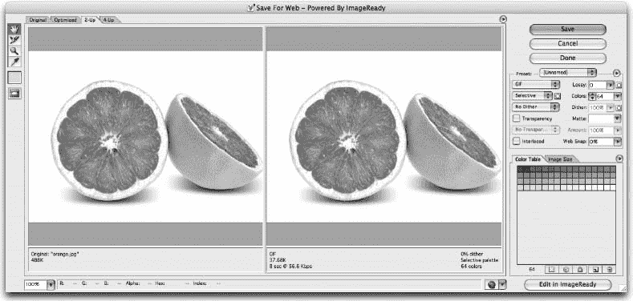

如果 GIF 包含少于 16 种颜色（此时可称为 4 位 GIF），其文件大小将不到使用 256 种颜色（称为 8 位 GIF）的 GIF 的一半。因此，如果你创建的图像使用少于 16 种颜色，值得检查你的程序是否自动将其保存为 4 位 GIF，因为这样生成的文件更小，下载速度比 8 位 GIF 更快。

即使你的图像看起来只包含两种颜色，比如黑白线条图，它也可能使用更多颜色。例如，如果线条图的边缘被图形程序平滑处理（称为抗锯齿的过程），你的图像将包含两种以上的颜色，因为边缘使用了多种其他颜色使其看起来平滑。

如果 GIF 需要使用超过 256 种颜色，大多数图形程序在保存 GIF 时会采用一种称为抖动的技术来更好地表示额外的颜色。这意味着它们会在相邻像素中使用两种或更多颜色来产生第三种颜色的效果。抖动有以下两个缺点：

- 如果将纯色放在抖动颜色旁边，你会看到变化发生的位置（因为抖动颜色实际上由多种颜色组成）。
- 它可能导致颜色出现条带。例如，当一种颜色平滑过渡到另一种颜色（称为渐变）时，可能需要超过 256 种色调来显示渐变；因此会使用抖动，但结果可能是平滑的渐变现在看起来像一系列条纹。

图 3-12 说明了即使是一个简单的渐变，当保存为 GIF 时，也可能因为图像包含超过 256 种颜色而产生条带。该图像的底部放大了渐变的一个区域，你可以看到渐变出现了垂直线条，而不是从黑色到白色的平滑过渡。

图 3-12


由于 GIF 仅支持 256 种颜色，并且必须使用抖动来实现更多颜色，因此它们不太适合细节丰富的照片，因为照片通常包含远超过 256 种颜色。如果你有照片、渐变或任何相邻区域具有相似色调的图像，通常最好使用支持无限颜色的 JPEG，或者有时使用 PNG——这两种格式你很快就会学到。

GIF 还有另一个方便的特性：你可以在 GIF 中指定一种或多种颜色来表示透明背景——在图像中指定颜色的部分，背景将透出来。

这种技术最适合边缘完全笔直的图像，因为当你有弯曲边缘时，图像编辑程序通常会进行抗锯齿处理（使用多种色调）以使图像看起来平滑，如图 3-13 所示。

图 3-13


然而，在透明 GIF 中，每个像素要么开要么关，要么不透明要么透明——没有透明度级别。因此，如果你尝试将其用于圆角，角落可能会出现像素化。为了帮助解决这个问题，你应该尽量使透明色接近背景色（或者如果你使用 Photoshop，可以使用蒙版功能）。

图 3-14 展示了当 GIF 不是在合适的背景上创建时，如何产生像素化效果（特别注意角落周围的较亮像素）。

图 3-14


为了减小 GIF 文件的大小，它们使用一种称为 LZW 压缩的技术进行压缩，该技术扫描图像的行，寻找连续且颜色相同的像素。当遇到相同颜色的像素时，它会指示从该点开始，x 个像素应使用相同的颜色写入。

LZW 压缩被称为无损压缩技术，因为没有数据丢失，因此质量不会下降。这与有损压缩技术形成对比，后者在压缩过程中丢弃部分数据，因此无法从压缩文件中恢复。

### 动画 GIF

GIF 图像可以在一个文件中存储多个帧（或图像的副本），允许 GIF 在不同版本/帧之间切换，从而创建简单的动画。它的工作原理类似于翻页书动画，其中书每页的绘图与前一张略有不同，因此当用户翻页时，图像看起来像是在移动。

如果你的动画图像包含大面积纯色，这种方法效果很好，因为在记录初始帧后，后续帧只需存储发生变化的像素。然而，它不太适合摄影图像，因为更多像素会发生变化，导致图像非常大。

另外值得一提的是，吸引眼球的动画 GIF 通常不受专业网页设计师的青睐，他们往往只谨慎使用。

图 3-15 展示了在 Adobe Image Ready 中创建动画 GIF 的过程。右侧窗口显示图像的不同图层上有三个点。底部窗口显示，在动画的第 1 帧中，只显示底部点；第 2 帧中，显示底部和中间点；第 3 帧中，三个点都显示。在动画的每一帧下方，你可以看到该帧应显示多长时间（本例中均为 1 秒）。

图 3-15


### JPEG 图像

JPEG 图像格式是作为存储和压缩使用广泛颜色范围的图像（如照片）的标准而开发的。保存 JPEG 时，通常可以指定压缩程度（如果有的话），这取决于你想要的图像质量。压缩 JPEG 的过程涉及丢弃人们通常不会感知的颜色数据，例如微小的颜色变化。然而，由于图像格式在压缩时丢弃了这些数据，部分数据会丢失，并且无法从压缩版本中重建原始图像——因此它被称为有损压缩。

你应用的压缩量会因图像而异，只能通过观察来判断 JPEG 需要压缩多少。因此，文件大小取决于你对图像的压缩程度。保存图像时，通常会要求你选择质量百分比；100% 表示完全不压缩图片，而对于照片，通常可以压缩到 60–70%（但一般不会更低）。有些程序使用“极佳”、“很好”、“好”等词语代替百分比来描述图像质量。

一个好的图像编辑程序能让你在调整压缩量时，将原始图像与压缩版本并排对比。图 3-16 展示了 Adobe Photoshop 如何在准备将 JPEG 保存为网页格式时，让你并排比较两个版本的图像。左侧是原始图像，右侧是即将用于网页的版本。

图 3-16


由于 JPEG 格式是为处理逼真图像而设计的，因此对于大面积纯色或高对比度硬边缘（如文字和线条图）的图像，效果并不理想。随着 JPEG 压缩程度的增加，你可能会在非常相似的颜色中看到条带现象开始显现。

### PNG 图像

便携式网络图形（PNG）格式是这一领域最新的格式。它诞生于 20 世纪 90 年代末，因为拥有 GIF 专利的公司（Unisys）决定向开发创建和查看 GIF 软件的厂商收取使用该技术的许可费。虽然网页设计师和网民不会直接受到这项收费的影响，但制作他们所用软件的厂商却会受到影响。

PNG 格式的设计初衷与 GIF 图像相同，但在创建过程中，设计者决定解决他们认为 GIF 格式存在的一些缺点。结果产生了两种类型的 PNG。8 位 PNG 与 8 位 GIF 具有相同的限制——只有 256 种颜色，并且使用透明度时每个像素要么完全透明要么完全不透明。此外还有增强型的 PNG-24，一种 24 位版本，具有两大优势：

- 图像中可使用的颜色数量不受限制，因此可以包含任何颜色而不会丢失数据。
- 使用一个映射（类似于 GIF 中指示每个像素颜色的查找表）为每个像素提供不同级别的透明度，从而实现更柔和、抗锯齿的边缘。

此外，所有 PNG 的压缩效果通常都优于同等质量的 GIF。然而，PNG 格式的真正缺点是，一些至今仍在使用的旧版浏览器并未完全支持该格式。虽然早期版本的浏览器提供了基本支持，但一些更高级的功能需要更长时间才能实现。例如，Internet Explorer 直到版本 7 才能正确处理透明度。

### 保持文件大小较小

你通常希望以最能压缩图像、从而获得更小文件大小的格式来保存网站图像。这样不仅页面加载更快，还能节省网站托管费用。

通常，某种格式会是你的明显选择。经验法则是：

- 对于细节丰富、或需要保留微妙阴影差异的逼真图片，使用 JPEG。
- 对于纯色（而非纹理颜色）和硬边缘的图像，如图表、文字或徽标，使用 GIF 或 PNG。

请看以下图像（参见图 3-17）——一张是秋叶的照片，另一张是名为 Wheels 的虚构公司的徽标，仅使用两种颜色。

图 3-17


下表显示了每张图像分别保存为 GIF 和 JPEG（JPEG 以 60% 质量保存）时的文件大小。

| 图像 | JPEG | GIF |
| --- | --- | --- |
| 树叶 | 54.81k | 116.3k |
| Wheels | 8.26k | 6.063k |

如你所见，Wheels 徽标具有大面积平坦的纯色，而森林照片则使用了大量不同的色调。因此，徽标更适合 GIF 或 PNG 格式，而带有各种阴影的森林照片则更适合 JPEG 格式。

如果你的网站使用大量图像，好的图像编辑软件会非常有帮助。Adobe Photoshop 是专业人士最常用的软件，尽管价格非常昂贵。不过，有一款功能有限的版本叫 Photoshop Elements，它包含许多常用功能——包括“存储为 Web 所用格式”选项。另外两款流行的图像编辑程序是 Paint Shop Pro（可从 Corel 网站 [www.corel.com](http://www.corel.com) 获取）和一款免费的图像编辑程序 Gimp（可从 [www.gimp.org](http://www.gimp.org) 下载）。

如果你的网站必须包含许多大型、复杂的摄影图像，那么好的做法是在页面首次加载时向用户提供较小的图像版本，然后添加指向较大版本的链接。这些较小的图像通常被称为缩略图，你通常会在图片库或包含信息摘要的页面（如新闻网站的主页和列出多个产品的页面，从这些页面可以链接到包含更多细节和更大图像的页面）中看到它们。图 3-18 展示了在图片库中使用缩略图的示例（底部的小图像在物理尺寸和文件大小上都小于将在顶部显示的大图像）。

图 3-18


在创建较小版本时，请在图像编辑程序中按比例缩小图像。不要仅仅修改 `` 或 `<object>` 元素的宽度和高度属性，因为用户仍然需要下载完整尺寸的图像，尽管他们看到的只是较小的版本。（完整尺寸的图像下载时间更长。）通过为你使用的任何较小图像创建专门的缩略图，你的页面加载速度会快得多。

你可能会听说一种称为矢量格式的格式，它在插图和动画软件中更为流行。Flash、SVG 和 Silverlight 都采用矢量图形。矢量格式以坐标形式存储信息，坐标之间绘制线条，线条内部可以指定填充颜色。由于基于坐标，通过增加坐标点之间的间距，可以轻松增大图像的物理尺寸。默认情况下，浏览器在不使用插件的情况下不支持矢量格式。在本章后面讨论 Flash 时，你将了解更多关于插件的内容。

## 向网页添加 Flash、视频和音频

在本章的前半部分，我们讨论了向网页添加图像；在后半部分，我们将讨论向页面添加 Flash 动画、视频和音频。这些统称为富媒体。

在网站上展示 Flash 动画、视频和音频时，事情会变得稍微复杂一些，原因有二：

- 首先，需要了解多种不同的格式。Flash 相对简单，因为 Flash 动画只有一种格式，但视频有多种格式，包括 AVI、Flash 视频、MPEG、QuickTime 和 Windows Media，音频也有多种格式，如 MP3 和 WAV。
- 其次，虽然浏览器天生就能显示文本和图像，但它们并不会自动展示不同格式的富媒体。相反，浏览器依赖于被称为播放器或插件的附加程序，而这些播放器并不能播放所有格式（就像 DVD 播放器无法播放 VHS 录像带或黑胶唱片一样）。因此，你选择使用哪种格式可能会受到安装该播放器的人数限制。

有些插件在你购买新电脑时就已经默认安装，如果未安装，用户可以（通常免费）从制作它们的公司网站下载。例如，Flash 插件通常预装在新电脑上，但也可以从 Adobe 网站免费下载。

在考虑为你的富媒体选择哪种格式时，你需要考虑有多少人可能已经在他们的电脑上安装了所需的插件。这一点很重要，因为你不能假设人们会仅仅为了访问你网站上的某些内容而下载一个插件。


在下一版本的 HTML（HTML 5）中，你可能会看到两个新元素：用于向网页添加音频文件的`<audio>`和用于添加视频文件的`<video>`。`<audio>`元素将用于更轻松地向页面添加 MP3 和 WAVE 文件；然而，在撰写本文时，浏览器制造商在就使用`<video>`元素指定的视频格式达成一致方面遇到了困难。无论哪种情况，这两个元素都可能需要数年时间才能被广泛使用，因为网络用户需要很长时间才能采用支持这些元素的新浏览器。（HTML 5 在第 14 章中有更详细的讨论。）

为了在页面上显示富媒体，你需要学习一个新元素——`<object>`元素。在本章末尾，当我们了解了如何使用一些不同格式的富媒体后，我们将详细查看`<object>`元素。但现在，你只需要知道`<object>`元素可以告诉浏览器几件事，包括：

- 文件的名称及其位置
- 文件的格式
- 用于播放文件的插件类型

在`<object>`元素内部，你可以使用`<param>`元素向播放器传递额外信息（例如，你可能想告诉播放器在页面加载时自动开始播放，而不是等待用户按下播放按钮）。

`<param>`元素并不是你在`<object>`元素内部唯一可能看到的标记。但你在`<object>`元素内部看到的任何其他标记，只有在浏览器无法渲染该对象时才会显示（而无法渲染对象的最常见原因是所需的播放器未安装）。例如，你经常会看到`<embed>`元素被用在`<object>`元素内部。

严格来说，`<embed>`元素从未成为 HTML 或 XHTML 规范的一部分，但多年前微软将`<object>`元素用于一项名为 ActiveX 的技术（该技术仅在 IE 中有效），因此，其他浏览器制造商转而使用`<embed>`元素来在页面中嵌入音频和视频等项目。因此，你经常会在`<object>`元素内部看到`<embed>`元素，以确保如果旧版浏览器不理解`<object>`元素，它可以尝试使用`<embed>`元素来显示内容。

当`<embed>`元素需要向插件传递额外信息时，它不使用`<param>`元素，而是使用属性；你很快就会看到相关示例。

因此，在本章的剩余部分，我们将讨论：

- 如何将 Flash 动画添加到你的网页中
- 如何在你的网页中显示视频（以及你应该使用哪种格式）
- 如何向你的页面添加音频（以及你应该使用哪种格式）
- `<object>`元素的语法

在讨论视频和音频时，我们将讨论你可以使用的不同格式，以及播放这些不同格式所需的播放器。

## 向你的网站添加 Flash 影片

Flash 最初是作为一种向网页添加动画的方式出现的，但很快发展出高度的交互性以及处理图像、音频和视频的能力。现在，Flash 不仅被广泛用于向网页添加动画和交互性，它也是在网页中显示音频和视频的最流行方式（例如，YouTube 和 MySpace 的大部分视频和音频都是以 Flash 格式提供的）。

大多数 Flash 文件是使用 Flash 创作环境创建的，Adobe 对此收费，尽管有很多网站提供用 Flash 编写的工具，如 MP3 播放器、视频播放器、幻灯片等，你可以在不购买该程序副本的情况下在你的网站上使用它们。虽然从头开始创建你自己的 Flash 文件超出了本书的范围，但我将向你展示如何将已经编写好的 Flash 文件包含到你的 XHTML 页面中。

如果你确实使用 Flash 创作工具进行项目，你的项目将以`.fla`文件扩展名保存（通常称为 FLA 文件）。但在 Web 上使用此类文件之前，你必须将其导出为`.swf`格式。当文件被导出为`.swf`格式时，它们有两个名称：SWF 文件或 Flash 影片（令人困惑的是，即使它们不包含任何视频，也可以被称为 Flash 影片）。

主流浏览器本身无法播放 SWF 文件；相反，它们依赖于一个名为 Flash Player 的免费插件。Flash Player 通常预装在计算机上，但也可以从 [Adobe.com](http://Adobe.com) 网站下载。据估计，超过 98% 的网络用户已安装 Flash Player。

让我们简要回顾一下你学到的关于 Flash 的知识，因为内容相当多：

- 你需要付费购买 Flash 创作环境，它允许你创建和编辑 FLA 文件。这些文件以`.fla`文件扩展名保存。
- 当你想在 Web 上使用 Flash 文件时，你需要将它们导出为 SWF 文件或 Flash 影片。这些文件具有`.swf`文件扩展名。
- 需要安装免费的 Flash Player 插件，浏览器才能播放 SWF 文件。据估计，超过 98% 的人已安装 Flash Player。

那么，让我们通过三个不同的示例来查看用于向页面添加 Flash 的代码。我们将首先研究如何将 YouTube 播放器嵌入到你编写的页面中。

## 向页面添加 YouTube Flash 视频播放器

正如我所提到的，YouTube 播放器是用 Flash 编写的，YouTube 让用户非常容易地将 YouTube 播放器嵌入到他们自己的页面中。这只需从 YouTube 网站复制并粘贴一行代码到任何网页中即可完成；图 3-19 显示了在哪里可以找到这行代码。

图 3-19


如果你在家里的台式机或笔记本电脑上尝试此示例，你可能会收到一条警告消息，因为 Flash Player 正在尝试与 Web 上的服务器通信（这有时可能被视为安全风险）。如果你按下“确定”，示例可能会正常工作；否则，你可能需要按照说明更改设置。如果你在 Web 服务器上运行此示例，则不会看到此错误消息。

那么，让我们更仔细地看看 YouTube 提供的用于嵌入 YouTube 视频的代码（`ch03_eg08.html`）：

```
<object width="425" height="344">

  <param name="movie"

    value="http://www.youtube.com/v/dMH0bHeiRNg&hl=en&fs=1"></param>

  <param name="allowFullScreen" value="true"></param>

  <param name="allowscriptaccess" value="always"></param>

    <embed src="http://www.youtube.com/v/dMH0bHeiRNg&hl=en&fs=1"

    type="application/x-shockwave-flash" allowscriptaccess="always"

    allowfullscreen="true" width="425" height="344"></embed>
```

在开头的`<object>`标签上，你可以看到`width`和`height`属性指定了 Flash 影片的大小；它们的作用与``元素上的`width`和`height`属性类似，用于指示该元素需要占据多少空间。

在本节末尾，我们将查看`<object>`元素可以携带的所有属性，但这里值得提一下，YouTube 对`<object>`元素的使用有点不寻常，因为它没有携带`classid`或`type`属性。

在`<object>`元素内部，你可以看到三个`<param>`元素，每个元素都有`name`和`value`属性：

- 第一个表示要加载一个影片，并附带了影片的 URL。
- 第二个表示播放器是否允许用户以全屏模式观看影片。
- 第三个是一个特殊属性，在此处用于确保 Flash 影片可以从不同的网站（不仅仅是 YouTube 服务器）播放。

请注意，这些参数是此视频播放器特有的，并不一定适用于所有 Flash 影片。其他参数可能特定于某个 Flash 版本；例如，显示全屏 Flash 影片的功能是在 2006 年发布的 Flash 9 中才引入的。

正如本节开头提到的，`<object>`元素通常包含一个`<embed>`元素，这里也不例外。你可能已经注意到，`<embed>`元素不包含任何`<param>`元素；相反，它使用开始标签上的属性来提供相同的信息。第一个属性是`src`属性——与``元素上使用的属性类似，用于指示 Flash 文件的位置。接着是`type`属性，指示该文件是一个 Flash 影片。接下来的两个属性与你刚才看到的`<param>`元素相匹配。最后两个属性`width`和`height`指定了 Flash 影片的大小。

通过在页面中添加这一行代码，你将看到 YouTube 播放器嵌入到你的页面中。结果应该类似于图 3-20 中的截图。

图 3-20


有很多网站允许你将 Flash 工具嵌入到自己的页面中，例如：

- ActiveDen.net 展示了众多 Flash 程序员的作品，包括音乐播放器、视频播放器、图片画廊以及其他动画。
- [Flickr.com](http://Flickr.com) 和 [Slide.com](http://Slide.com) 都允许你将图片上传到它们的网站，然后将这些图片的 Flash 幻灯片添加到自己的页面中。
- Last.fm 允许你向页面添加音乐播放器，播放其服务器上已上传的歌曲。

所有这些网站都会为你提供将 Flash 影片添加到页面所需的代码，但为了帮助你理解这些代码，我将向你展示如何将我创建的一个基本 Flash 动画添加到你的页面中。

## 使用`<object>`和`<embed>`元素将 Flash 添加到页面

从 YouTube 网站复制代码是将视频添加到网站的一种简单方法，但正如我提到的，你在 YouTube 网站上看到的代码与你可能在其他 Flash 影片中添加的代码略有不同。因此，在本节中，你将看到如何使用一种略有不同的技术将基本的 Flash 动画添加到网页中。这个简单的动画是使用 Flash 8 创建的，当 FLA 文件导出为 SWF 文件时，Flash 还生成了将 SWF 文件添加到网页的代码。

Flash 8 并不是 Flash 的最新版本，但我使用这个版本是因为它演示了另一种使用`<object>`和`<embed>`元素将 Flash 影片添加到页面的方法，如果你使用 Flash 工作，你很可能会遇到这种方法（`ch03_eg09.html`）：

```
<object classid="clsid:D27CDB6E-AE6D-11cf-96B8-444553540000"
    width="300" height="200"
    codebase="http://download.macromedia.com/pub/shockwave/cabs/flash/swflash.cab">
    <param name="movie" value="motion/flash_sample.swf" />
    <param name="play" value="true" />
    <param name="loop" value="false" />
    <embed src="motion/flash_sample.swf" width="300" height="200" play="true"
    loop="false" quality="best" type="application/x-shockwave-flash"
    pluginspage="http://www.macromedia.com/shockwave/download/index.cgi?
    P1_Prod_Version=ShockwaveFlash"></embed>
</object>
```

关于这个示例，有一点值得注意：`<object>`元素指定了`classid`和`codebase`属性，这两个属性在`<object>`元素中很常见（YouTube 示例是此规则的例外）。

`classid`属性用于指定哪个应用程序应该播放该文件（在此例中，`classid`属性标识了 Flash Player，但如果你想使用 Windows Media 插件播放文件，则需要使用不同的值 `6BF52A52-394A-11D3-B153-00C04F79FAA6`）。

`codebase`属性指定了如果用户没有安装播放该文件所需的插件或程序，可以到哪里找到它。

内部有三个`<param>`元素：

- 第一个指定要播放的 Flash 影片。
- 第二个指定影片应自动播放。
- 第三个指示影片应循环播放（播放到末尾时重新开始）。

`<embed>`元素提供了类似的信息，但它是通过属性来实现的：

- `src`属性指示 Flash 影片的位置。
- `width`和`height`属性指示播放器应占用的空间大小。
- `play`属性指示页面加载时影片应自动开始播放。
- `loop`属性指示影片播放完毕后应回到开头重新播放。
- `quality`属性指示 Flash 影片的质量（现在已不常用）。
- `pluginspage`属性指示如果用户没有安装 Flash Player 插件，可以从哪里下载。

你可以在图 3-21 中看到效果。

图 3-21


## 使用 SWFObject 将 Flash 添加到页面

最近，使用 JavaScript 将 Flash 影片嵌入页面的趋势日益增长，而不是使用`<object>`和`<embed>`元素。

采用这种技术时，你使用一个`<div>`元素来容纳 Flash 影片，并且应该使用 CSS 确保该`<div>`元素与你想要包含的 SWF 文件具有相同的宽度和高度（你将在第 7 章学习如何设置`<div>`元素的大小）。这个`<div>`元素还应该有一个`id`属性来唯一标识该元素。

在该`<div>`元素内部，你可以使用文本和图像，这些内容将显示给没有安装 Flash 的用户。

然后向页面添加一段 JavaScript 脚本；该脚本检查浏览器是否安装了 Flash 播放器。如果已安装，JavaScript 会将指定`<div>`元素的内容替换为 SWF 文件。

实际上，JavaScript 不仅检查用户是否安装了 Flash 播放器，还会检查它是否是所需的版本。你可能已经猜到，多年来 Flash 有多个版本，最新版本具有新的和改进的功能。但并非所有人都拥有最新版本的插件，如果浏览器没有播放 SWF 文件所需的最低版本，那么 JavaScript 将不会尝试加载 Flash，而是保留`<div>`元素中的内容。

最流行的脚本叫做`SWFObject`，可以从 [`code.google.com/p/swfobject/`](http://code.google.com/p/swfobject/) 下载。使用这种技术并不需要任何 JavaScript 经验。让我们看一个示例；我们将加载与上一个示例完全相同的 Flash 影片，但这次我们将使用`SWFObject`（版本 2.1）将其包含到页面中（`ch03_eg10.html`）：

```xml
<?xml version="1.0" ?>

<!DOCTYPE html PUBLIC "-//W3C//DTD XHTML 1.0 Strict//EN"

    "http://www.w3.org/TR/xhtml1/DTD/xhtml1-strict.dtd">

  <html xmlns="http://www.w3.org/1999/xhtml" lang="en" xml:lang="en">

  <head>

    <title>使用 SWF Object 添加 Flash 影片</title>

    <script type="text/javascript" src="swfobject.js"></script>

    <script type="text/javascript">

        swfobject.embedSWF("flash/flash_sample.swf", "flash_movie", "300",

        "200", "8.0.0");

    </script>

</head>

<body>

    <div id="flash_movie">此元素可以包含搜索引擎能够索引的内容，并且对未安装 Flash 的用户也有帮助。</div>

  </body>

</html>
```

虽然代码差异很大，但在浏览器中这个示例看起来与上一个完全相同；唯一的区别是页面标题表明它是使用 SWFObject 编写的。

在这个示例中，`<div>`元素带有一个`id`属性，其值为`"flash_movie"`（`id`属性用于唯一标识网页中的某个元素）。如果用户安装了合适版本的 Flash Player，这个元素将被 Flash 影片替换。

在页面顶部，你可以看到两个`<script>`元素。第一个包含一个独立的 JavaScript 文件，其位置通过`src`属性指定（就像图片的`src`属性指定图片位置一样）：

```html
<script type="text/javascript" src="swfobject.js"></script>
```

如你所见，它加载了一个名为`swfobject.js`的文件，而正是这个文件完成了大部分工作。你不需要理解这个文件的内容或它的工作原理，但如果你好奇，可以在文本编辑器或任何 XHTML 编辑工具中查看它。第二个`<script>`元素调用了上一行包含的脚本，并告诉它四件事以便其执行任务：


```html
<script type="text/javascript">
  swfobject.embedSWF(
    "flash/flash_sample.swf",
    "flash_movie",
    "300",
    "200",
    "8.0.0"
  );
</script>
```

传入的五个参数分别表示：

*   `"flash/flash_sample.swf"` 是要播放的 Flash 影片的位置。
*   `"flash_movie"` 是要被替换的元素的 `id` 属性值。
*   `"300"` 表示影片的宽度（像素）。
*   `"200"` 表示影片的高度（像素）。
*   `"8.0.0"` 是播放影片所需的最低 Flash Player 版本。

这种方法还有两个尚未提及的额外优势：

*   它被认为对搜索引擎更友好。因为搜索引擎无法很好地索引 Flash 内容，它们会看到原本会被替换的 XHTML 内容。
*   它也被认为有利于无障碍访问，因为如果用户禁用了 Flash，他们可以看到替代内容。

正如我之前提到的，有几个地方可以下载 Flash 影片，供你在自己的网站上使用（不一定需要使用 Flash 创作工具）。一个不错的起点是 [`ActiveDen.net/`](http://ActiveDen.net/)，该网站展示了众多作者的作品。

你可能还听说过一种名为 Silverlight 的技术，它由微软开发。Silverlight 与 Flash 非常相似；然而，第一个版本直到 2006 年才发布，因此安装 Silverlight 插件的人数远少于安装 Flash Player 的人数。在拥有足够多的用户之前，它不太可能挑战 Flash 在主流网站上的地位。

现在你已经了解了如何在网页中嵌入 Flash 影片，接下来我们看看如何将电影和音频添加到页面中。这开始变得稍微复杂一些，因为 Flash 影片只有一种格式（`.swf`）和一个播放器（Adobe 的 Flash Player），而音频和视频格式却有多种，其中许多需要不同的插件。

### 向网站添加视频

在网站上展示视频的最简单方法之一是将视频上传到 YouTube 等网站，然后使用 YouTube 提供的代码将 YouTube 播放器嵌入到你的页面中。然而，你可能决定不想将视频放在 YouTube 上，或者不想在网站上使用带有 YouTube 品牌的播放器，那么让我们看看一些替代方案。

当你想在网页上播放视频时，需要考虑两件事：

*   **文件格式**：你需要选择视频的格式，有很多不同的格式可供选择，包括 AVI、Flash Video、MPEG、QuickTime 和 Windows Media。你选择的格式会影响用户需要下载的文件大小以及他们观看的画质（因为不同格式使用不同的压缩技术来生成更小的文件）。
*   **播放该类型文件所需的插件**：不同的格式需要不同的插件来播放影片。有些插件比其他插件更流行（并且安装在更高比例的计算机上）。例如 Flash Player、QuickTime Player、RealPlayer 和 Windows Media Player。

要告诉浏览器你将播放哪种视频，可以在 `<object>` 元素上使用 `type` 属性。它的值是一种称为 MIME 类型的东西（例如，QuickTime 影片的 MIME 类型是 `video/x-mov`）。你可以将 MIME 类型视为类似于文件扩展名，它们描述了内容的格式。然后浏览器可以检查自己是否有播放该文件格式所需的程序——如果有，则使用该程序播放文件。

要告诉浏览器使用哪种插件，可以使用 `classid` 属性。它的值是一串相当长的数字/字母，用于标识该插件。例如，QuickTime Player 插件的 `classid` 是 `02BF25D5-8C17-4B23-BC80-D3488ABDDC6B`。

下表列出了网络上最常见的视频格式、它们使用的文件扩展名、MIME 类型以及 PC 和 Mac 上的默认播放器。


在选择以哪种格式展示视频时，对大多数人来说，决定因素是会有多少人拥有观看该格式所需的插件（因为你不能指望人们为了观看你网站上的视频而专门下载一个插件）。例如，Windows 机器通常预装了 Windows Media Player，但最新版本的 Windows Media Player 并未针对 Mac 开发。同样，Mac 预装了 QuickTime，但在 Windows 机器上播放 QuickTime 文件可能需要下载插件。以下是这些格式的简要介绍（按估计流行度排序）。

*   **FLV 或 Flash 视频** 是目前网络上最流行的视频展示格式，主要是因为 Flash Player 插件安装在更多计算机上，超过其他任何视频播放所需的插件。熟悉 Flash 创作环境的人可以轻松创建自己的视频播放器（这些播放器随后在 Flash Player 插件中显示），从而控制播放器的外观和感觉。该格式在网络上压缩效果也很好。
*   **MPEG** 是一种以其开发组织——运动图像专家组（Motion Picture Experts Group）命名的格式。大多数计算机都有能够播放 MPEG 影片的播放器，因为它们可以在 Windows Media Player 或 QuickTime Player 中播放。MPEG 格式的缺点是，尽管可以通过多种方式压缩，但文件大小通常比 FLV 格式大得多（最多可达两倍）。
*   **WMV 或 Windows Media Video** 是 Microsoft Windows Media 套件的一部分，需要 Windows Media 来播放——新 PC 自带该播放器，但其他平台的用户需要下载插件。
*   **MOV 文件** 基于 QuickTime，最初为 Mac 开发。它可以在大多数其他操作系统上播放，但同样需要用户下载插件。

MP4 格式生成的文件体积非常小，但用户需要安装 QuickTime 才能播放。

AVI（音频/视频交错格式）最初是作为 QuickTime 在 Windows 上的竞争对手而开发的。它被称为容器格式，因为它包含使用另一种编解码器压缩的视频。这意味着你的计算机可能可以播放某些 AVI 文件，而无法播放其他文件。

RealVideo 是最早用于在线播放视频的格式之一。它需要在计算机上安装一个名为 RealPlayer 的插件。该插件是免费的，但安装过程可能比较麻烦。这种格式的受欢迎程度正在迅速下降，通常已被 FLV 取代。

由于 Flash 视频是目前网络上播放视频的主要形式，因此本章将重点介绍这种格式。

### 使用 Flash 视频添加视频

Flash 视频之所以成为向网站添加视频最流行的方法，有以下几个原因：

*   与播放其他视频格式的播放器相比，Flash 播放器安装在更多联网计算机上，这意味着更多人能够观看 FLV 文件。
*   你可以使用 Flash 轻松控制播放器的外观（例如“播放”和“停止”等控件以及视频周围的窗口），这意味着人们可以创建品牌化的播放器。
*   FLV 文件压缩效果好，这意味着相同视频的 FLV 格式文件可以比 MPEG-1 格式小得多，且质量损失极小。这反过来意味着：
    *   视频加载和播放速度更快。
    *   运行使用 FLV 的网站比使用更大格式的网站成本更低，因为当你拥有一个网站时，通常需要按带宽（即从你的网站发送给观看者的数据量）付费。

另一个促使 FLV 成为网络上最流行视频格式的因素是它在 YouTube 和 MySpace 等网站上的使用，这些网站的所有视频都以 Flash 格式播放。当你向这些网站上传视频时，可以使用多种格式（如 AVI、MPEG 和 QuickTime），然后网站会将视频转换为 FLV 格式，并在它们自己的播放器中播放。

如果你不想将视频上传到这些网站，那么你需要做两件事：

*   将视频从其他格式（如 AVI、MPEG 或 QuickTime）转换为 FLV 格式。
*   编写或下载一个 FLV 播放器。请记住，这些播放器只是用于播放 FLV 文件的 Flash 影片（就像任何其他 SWF 文件一样）。

将视频从其他格式转换为 FLV 格式有两种常见方法：

*   使用 Adobe 软件：自 Flash 8 版本以来，制作 Flash 创作环境的 Adobe 公司提供了另一款专门用于将视频格式转换为 FLV 的软件。
*   第三方软件：有几家公司开发了将不同视频格式转换为 FLV 文件的软件。一个例子是 Riva FLV 编码器，可从以下网址获取：[`rivavx.de/?encoder`](http://rivavx.de/?encoder)。

你可以下载一个 FLV 播放器，而无需自己编写。即使你没有 Flash 创作工具，也可以使用以下几种播放器，例如：

*   OS FLV Player：[www.osflv.com/](http://www.osflv.com/)
*   JW FLV Player：[www.longtailvideo.com/players/jw-flv-player/](http://www.longtailvideo.com/players/jw-flv-player/)
*   Flow Player：[`flowplayer.org`](http://flowplayer.org)
*   SlideShowPro：[`slideshowpro.net/`](http://slideshowpro.net/)

这些播放器各有各的方式来指定 FLV 文件的位置（有些还允许你设置多个视频的播放列表），因此务必查看播放器附带的文档，以了解如何集成 FLV 文件。此外，还有一系列其他视频播放器，你可以在 ActiveDen.net 上购买。

下面是一个使用你在上一节（`ch03_eg11.html`）中刚学到的 SWF Object 技术将 OS FLV 播放器嵌入页面的示例。

```html
<head>
  <script type="text/javascript" src="swfobject.js"></script>
  <script type="text/javascript">
    swfobject.embedSWF(
      "flash/os_flv_player.swf?movie=video.flv",
      "flash_video",
      "400",
      "340",
      "8.0.0"
    );
  </script>
</head>
<body>
  <div id="flash_video">
    如果用户未安装 Flash，则会显示此元素的内容。因此，它应该是一张图片和对视频内容的简短描述。
  </div>
</body>
```

你可以在图 3-22 中看到它的效果：

图 3-22


#### 视频尺寸

在播放任何视频时，你都需要注意视频的物理尺寸。将视频显示得尽可能大固然好，但视频越大，文件体积也越大，而大文件可能会带来几个问题：

*   文件越小，下载速度越快。用户不太可能观看需要长时间下载或播放时频繁缓冲的视频。
*   文件越大，你使用的“带宽”就越多（带宽是发送给网站访问者的文件总大小）。由于托管网站的公司通常按带宽收费，如果你的视频很受欢迎，你可能会面临高额账单。（这也是许多人将视频托管在 YouTube 等网站上的原因之一——不仅上传视频内容并将其放到页面上很容易，而且成本也更低。）

因此，始终需要在视频足够大以展示你想让用户看到的内容，但又不能太大以至于在普通宽带连接上无法流畅播放之间取得平衡。

另外值得注意的是，Flash 9 版本引入了一个选项，可以让 Flash 影片以全屏模式播放，这意味着播放器将占据整个屏幕。在这种模式下，Flash Player 可以获取相对较小的 FLV 视频，并使用巧妙的技术平滑画面，从而以更大的尺寸观看。虽然靠近电脑显示器观看时画面可能略显颗粒感，但从远处观看效果会更好。大多数较新的播放器都提供了允许用户以全屏模式观看视频的选项。

如果你的视频较长，你可能还需要考虑将其分成多个片段。这样做可以避免为观看者下载可能不会看完的整个视频而付费。

### 为你的网站添加音频

与视频一样，当你想要为网站添加音频时，需要考虑：

*   文件格式：不同类型的音频文件使用不同的压缩技术保存，这会影响录音质量和文件大小。
*   播放该类型文件所需的插件：与视频一样，你的网站访问者需要安装正确的播放器才能播放你选择的格式。幸运的是，有一些文件格式可以在大多数计算机上播放，因此这不像视频那样是个大问题。

最流行的文件类型包括：

*   MP3：这类似于 MPEG 视频格式中的音频部分。MP3 是最流行的音乐录音格式之一，兼具良好的压缩比和相当不错的音质。文件以 `.mp3` 扩展名存储，并可在大多数浏览器中播放。MP3 的 MIME 类型是 `audio/mpeg`。
*   WAVE：这种格式由 IBM 和微软开发，同样可以在大多数网络浏览器中播放。WAVE 文件以 `.wav` 扩展名存储。通常，WAVE 文件未经压缩，因此其音质远优于 MP3（但用户需要高质量的扬声器才能听出差异）。WAVE 文件未压缩的缺点是文件体积往往比 MP3 大得多。WAVE 文件的 MIME 类型是 `audio/x-wav`。

另外三种在网络上使用的格式都需要各自的插件，它们是：

*   Windows Media Audio，需要 Windows Media 插件
*   QuickTime，需要 QuickTime 插件
*   Real Audio，需要 Real Media 插件

在大多数情况下，你应该使用 MP3 格式，因为它得到最广泛的支持，并且已成为在网络上播放音乐的默认标准，因为 MP3 文件在保持良好音质的同时，压缩后的文件体积相对较小。有两种主要例外情况，你可能需要考虑其他格式：

*   如果你需要高品质音频，并且知道你的网站访客中有很多人拥有非常好的电脑音箱（使他们能够从更高品质的音频中受益），那么你可能需要考虑 WAVE 文件。
*   如果你需要控制用户播放文件的次数，或者阻止用户将音频文件传给其他用户，那么你可能需要考虑支持数字版权管理（DRM）的音频格式（例如 Windows Media Audio 或 Real Audio）。DRM 是一个复杂的话题，超出了本书的范围，但网上有很多相关信息。

如果你想要播放的音频还不是 MP3 格式，有多种工具可以帮助你从其他音频格式创建 MP3。你只需在你喜欢的搜索引擎中搜索“MP3 转换器”即可。

你可能还会遇到 MIDI 文件。MIDI 文件并不存储音频，而是更像乐谱的数字版本，用于告诉你的声卡（或其他合成器）如何演奏一段音乐的信息。它可以指示不同乐器演奏的不同部分，提供速度信息，并建议每种乐器演奏每个音符的力度。产生的声音质量取决于声卡的质量。

### 使用默认媒体播放器添加音频

在某些浏览器中，你无需下载任何额外的插件即可播放 MP3 或 WAVE 文件。例如，你可以直接使用 `<object>` 元素将音频文件包含在页面中，浏览器会根据你为 `type` 属性（用于指定要播放文件的 MIME 类型）提供的值，自动判断播放文件所需的插件类型。

不幸的是，这种技术非常不可靠，因为不同版本的浏览器对 `<object>` 元素的使用方式略有不同，而且用户可以在自己的电脑上设置多种偏好和设置，这些都会影响音轨是否能够播放。因此，即使你能让 `<object>` 元素在你电脑上运行的页面中播放音频文件，也不能指望它在其他机器上同样有效。

要获得一致的结果可能非常困难。为了覆盖更大比例的浏览器，你可能会看到在 `<object>` 元素内部使用了 `<embed>` 元素。你甚至可能遇到一些示例，其中 `<embed>` 元素在没有 `<object>` 元素的情况下使用，但这也不太可能在很多浏览器上正常工作。

以下是一个将 MP3 添加到网页的示例；请注意 `<object>` 元素上的 `type` 属性的值为 `audio/mpeg`（`ch03_eg12.html`）：

```html
<object width="300" height="42" type="audio/mpeg" data="audio/my_music.mp3">
  <param name="src" value="audio/my_music.mp3" />
  <param name="autoplay" value="true" />
  <param name="autostart" value="1" />
  <embed src="audio/my_music.mp3" width="300" height="42"></embed>
</object>
```

正如你从图 3-23 中看到的，在不同浏览器中你会得到不同的结果。某些浏览器会显示播放器，而其他浏览器则不会，并且当播放器出现时，它的外观（以及占用的空间大小）也可能各不相同。

图 3-23


这个示例还表明，可以使用 `width` 和 `height` 属性控制播放器显示的大小，但重要的是要记住，不同播放器的控件大小可能不同，因此最好不要把它们设置得太小。你可能还注意到了 `<param>` 元素，它们告诉播放器在音频文件加载时自动开始播放。第一个 `autoplay` 由 QuickTime Player 使用，而 `autoStart` 则被 Windows Media 和 RealPlayer 识别。（`<embed>` 元素使用等效的属性。）

有些人试图通过在 `<object>` 元素上添加 `classid` 属性来指定使用哪个播放器，从而解决这个问题。你可能还记得，这个属性的值是一长串数字/字母，用于标识特定的播放器。然而，如果你指定了一个播放器，而用户没有安装该播放器，那么他们必须下载所需的插件才能听到音频：

*   Windows Media 7+ 的 `classid`：`clsid:6BF52A52-394A-11D3-B153-00C04F79FAA6`
*   QuickTime 的 `classid`：`clsid:02BF25D5-8C17-4B23-BC80-D3488ABDDC6B`


- Real Player 的 `classid`：`clsid:CFCDAA03-8BE4-11cf-B84B-0020AFBBCCFA`

虽然可以隐藏播放器（你可以使用 CSS 隐藏 `<object>` 元素，而 `<embed>` 元素可以有一个值为 `hidden` 的 `type` 属性），但这通常是不被提倡的，因为用户应该有权选择停止页面上播放的任何音频。

你可能还遇到过一些网站，它们只是简单地链接到 MP3 或 WAV 文件。有些网站这样做是因为，如果浏览器直接链接到文件（而不是使用 `<object>` 和 `<embed>` 元素），它更有可能播放该文件。当你点击链接时，浏览器会在浏览器的默认媒体播放器中播放 MP3 或 WAVE 文件；例如，以下链接会打开 `href` 属性中指定的文件：

```html
<a href="test.mp3">test mp3</a>
<a href="test.wav">test wav</a>
```

这两种技术的缺点是你无法控制播放器界面的外观。因此，当人们想要为音频文件创建播放器时，很多人再次转向 Flash。

## 使用 Flash 将 MP3 添加到页面

正如 Flash 已成为在网络上显示视频最流行的方式（因为安装 Flash Player 的人比任何其他媒体播放器都多），它也成为将 MP3 播放器添加到网页最流行的方式。你不仅拥有更有可能在访客浏览器中正常工作的优势，还可以控制播放器界面的外观，而且一些 Flash MP3 播放器允许你创建包含多个曲目的播放列表。

虽然你可以使用 Flash 创作工具从头编写一个 MP3 播放器，但已经有一些现成的播放器可以直接用于你的页面，例如：

- [`musicplayer.sourceforge.net/`](http://musicplayer.sourceforge.net/)
- [`www.wimpyplayer.com/`](http://www.wimpyplayer.com/)
- [`code.google.com/p/mp3player/`](http://code.google.com/p/mp3player/)
- [`developer.yahoo.com/mediaplayer/`](http://developer.yahoo.com/mediaplayer/)

此外，你还可以从 ActiveDen.net 购买各种可定制的播放器。

以下是一个使用 SourceForge.net 的免费 Music Player 的示例（`ch03_eg13.html`）：

```html
<object type="application/x-shockwave-flash" width="400" height="170"
    data=" mp3_player.swf?playlist_url=playlist.xspf">
    <param name="movie" value="mp3_player.swf?playlist_url=playlist.xspf" />
</object>
```

在这个示例中，你可以看到 `<object>` 元素带有四个属性：

- 一个 `type` 属性，指示播放器是一个 Flash 影片。
- `height` 和 `width` 属性，指示这个播放器将占用多少空间。
- 一个 `data` 属性，告诉浏览器在哪里找到播放 MP3 文件的 Flash 影片（`mp3_player.swf`）。它还告诉 Flash 影片在哪里找到它应该播放的 MP3 播放列表，名为 `playlist.xspf`（如果你从 SourceForge 下载播放器，可以了解更多关于播放列表格式的信息）。

在 `<object>` 元素内部有一个 `<param>` 元素。这个 `<param>` 元素再次传递 Flash 影片和播放列表的位置。图 3-24 展示了它在浏览器中的显示效果。

图 3-24


当你下载一个 Flash MP3 播放器时，它通常会附带播放器作者推荐你用来将播放器嵌入页面的代码。不同的播放器通常要求你设置不同的参数来控制播放器的外观和设置，因此最好查看你下载播放器的网站上的使用说明。例如，一些 Flash MP3 播放器允许你控制以下内容：

- 播放器的颜色
- 设置要播放的曲目列表（而不是仅播放一首曲目）
- 页面加载时是否自动开始播放 MP3

在选择播放器时，值得查看不同播放器提供的功能，以确定哪个最适合你。

如果你选择的播放器没有附带使用 SWF Object 的说明，并且你想使用这种技术将 Flash 包含到页面中，通常你可以调整代码使其与 SWF Object 配合使用。例如，下面是一个如何使用 SWF Object 将你刚才遇到的同一个 Flash MP3 播放器包含到页面中的示例（`ch03_eg14.html`）：

```html
<head>
  <title>Adding an MP3 player using Flash</title>
  <script type="text/javascript" src="swfobject.js"></script>
  <script type="text/javascript">
swfobject.embedSWF("flash/xspf_player.swf?playlist_url=flash/playlist.xspf",
   "flash_mp3_player", "400", "170", "8.0.0");
  </script>
</head>
<body>
  <div id="flash_mp3_player">Here is where the Flash MP3 Player goes.</div>
</body>
```

## 页面加载时自动播放音频和视频

在了解了多种将音频和视频添加到页面的技术后，考虑音频或视频是否应在页面加载时自动播放的问题非常重要。

- 如果文件自动开始播放，比起强迫用户与播放器交互，更多人可能会观看或收听。然而，如果浏览器在用户未预料到的情况下开始播放音频（尤其是当他们在工作时浏览你的网站），一些访问者可能会很快离开页面。如果访问者预期会在你的网站上听到音频，这个问题就不太可能出现。（唱片公司或视频制作公司拥有的网站比会计师或建筑商拥有的网站更有可能包含音频。）因此，在决定是否在页面加载时播放音频或视频时，要考虑用户期望看到什么。
- 如果你确实在页面加载时自动播放音频或视频，请始终提供一个清晰的暂停或静音按钮，让用户能够关闭声音。
- 人们可能会厌倦反复听到同一首曲目，因此如果你期望用户定期访问你的网站或长时间停留，请尽量避免重复使用相同的曲目，并为用户提供清晰的关闭音乐的选项。
- 如果音频和视频文件托管在你的服务器上，你将需要为播放这些文件所消耗的带宽付费。因此，如果文件在页面加载时自动开始播放，你可能会为那些不感兴趣的用户观看和收听文件而付费。

由于 `<embed>` 元素已被弃用，相关内容将在附录 I 中介绍。

## 深入了解 `<object>` 和 `<param>` 元素

现在你已经看到了多个如何向网页添加富媒体的示例，我们将以与前几章介绍其他元素语法相同的方式，通过深入了解 `<object>` 和 `<param>` 元素来结束本章。由于 `<embed>` 元素已被弃用，相关内容将在附录 I 中介绍。

`<object>` 元素可以携带所有通用属性、UI 事件属性以及以下属性：

`archive`、`border`、`classid`、`codebase`、`codetype`、`data`、`declare`、`height`、`width`、`hspace`、`vspace`、`name`、`standby`、`tabindex`、`usemap`

我们将逐一介绍这些属性，尽管你最常用的是 `classid` 属性、`type` 属性和 `id` 属性（在第 1 章中讨论过）。

### `archive` 属性

`archive` 属性特别适用于基于 Java 的应用程序。其值应为对象运行所需资源（如 Java 类）的 URL 列表，以空格分隔。

### `border` 属性（已弃用）

`border` 属性指定对象周围边框的宽度，值以像素为单位。但该属性已弃用，应改用 CSS 中的 `border` 属性。

### `classid` 属性

`classid` 属性用于指定浏览器处理文件所需的应用程序类型（例如媒体播放器的类型）。

例如，当你想包含一个 Flash 影片时，`classid` 属性会使用一个特殊值，指示加载的对象应为 Flash 播放器。如果你想播放 QuickTime 影片，可以指示应加载 QuickTime 插件。当使用 Java 时，该属性的值可能是你想要包含的 Java 类。

以下是一个用于嵌入播放器以显示 QuickTime 影片的 `classid` 示例：

`classid="clsid:02BF25D5-8C17-4B23-BC80-D3488ABDDC6B"`

### `codebase` 属性

如果浏览器没有显示 `<object>` 元素中指定文件所需的插件（或其他代码），则 `codebase` 属性指定可下载插件的基 URL。其思路是，如果浏览器无法显示文件，它将为用户提供下载必要文件的选项。例如，如果你使用 Java，它可能如下所示：

`codebase="http://www.example.org/javaclasses/"`

### `codetype` 属性

`codetype` 属性指定播放文件所需的应用程序或代码的 MIME 类型（不要与文件本身的 MIME 类型混淆）。例如，如果你想将 Excel 电子表格嵌入网页，你会有一个如下的 `codetype` 属性：

`<object data="sales.xls" codetype="application/vnd.ms-excel">`

浏览器可以使用 `codetype` 属性跳过不支持的媒体类型，而无需下载不必要的对象。附录 H 介绍了 MIME 类型。

### `declare` 属性

`declare` 属性用于声明对象而不实例化它。它使你不必在真正需要之前下载对象。

它是一个布尔属性，虽然在 HTML 中不需要值，但 XHTML 中的所有属性都需要值，因此你会使用以下形式：

`declare="declare"`

### `data` 属性

如果对象有要处理或播放的文件，则 `data` 属性指定该文件的 URL。例如，这里有一个 MP3 的 URL：

`data="http://www.example.com/mp3s/newsong.mp3"`

这与 `` 元素上使用的 `src` 属性类似，其值可以是相对 URL。

### `height` 和 `width` 属性

`height` 和 `width` 属性指定对象的高度和宽度。值应以像素或包含元素的百分比表示。它们与 `` 元素的 `height` 和 `width` 属性处理方式相同。使用这些属性应能使页面加载更快，因为浏览器可以在不完全加载对象的情况下布局页面的其余部分。

### `hspace` 和 `vspace` 属性（已弃用）

`hspace` 和 `vspace` 属性指定对象周围应出现的空白量，与它们在 `` 元素中的用法相同。它们已被 CSS 的 `margin` 和 `border` 属性取代。

### `name` 属性（已弃用）

`name` 属性提供了一个名称，可用于引用该对象，特别是在脚本中使用。在 XHTML 中，它已被 `id` 属性取代。

### `standby` 属性

`standby` 属性指定一个文本字符串，该字符串将在对象加载时使用：

`standby="正在加载《哈利·波特 27》预告片"`

该值应为对正在加载的对象的含义描述。

### `tabindex` 属性

`tabindex` 属性指示对象在页面中的 Tab 键索引顺序。Tab 键顺序将在第 5 章中讨论。

### `usemap` 属性

`usemap` 属性指示该对象是一个图像映射，包含定义为超链接的区域。其值是与该对象一起使用的映射文件。它可以是一个指向外部文件的完整 URL，也可以是对内联 `<map>` 元素的 `name` 属性值的引用。请参阅本章前面的“图像映射”部分。

### `<param>` 元素

`<param>` 元素用于向对象传递参数。对象所需的参数类型取决于对象的功能；例如，如果某个对象需要将 Flash MP3 播放器加载到页面中，你可能需要指定 MP3 文件的存放位置。或者，如果你正在向页面添加视频，你的对象可能允许你指定是否在页面加载时自动播放视频，或者等待用户按下播放按钮才开始播放。

除了通用属性和基本事件外，`<param>` 元素还可以携带以下属性：

`name`、`type`、`value`、`valuetype`

#### `name` 和 `value` 属性

`name` 和 `value` 属性充当名称/值对（类似于属性本身）。`name` 属性为传递给应用程序的参数提供名称，而 `value` 则提供参数的值。

以下是来自 QuickTime 影片的几个示例。第一个参数指示要加载播放的文件的来源，第二个参数指示影片应在加载时自动开始播放（无需用户启动）：

```html
<param name="src" value="movieTrailer.mov" />
<param name="autoplay" value="true" />
```

如果你正在处理 Java 小程序，可以使用 `name` 和 `value` 属性将值传递给方法。

#### `valuetype` 属性

如果你的对象接受参数，那么 `valuetype` 属性指示该参数是文件、URL 还是另一个对象。下表显示了可能的值。

| 值 | 用途 |
| --- | --- |
| `data` | 参数值是一个简单字符串——这是默认值。 |
| `ref` | 参数值是一个 URL。 |
| `object` | 参数值是另一个对象。 |

#### `type` 属性

该属性指定对象中使用的内容的 MIME 类型。例如，你可能希望指定正在传递一个 MP3 文件，在这种情况下，你可以像这样使用 `value` 属性：

`value="audio/mpeg"`

## 总结

在本章中，你学习了如何通过添加图像和其他多媒体对象来使页面看起来更加生动。

图像确实能为页面增添活力，但它们也会增加页面加载的时间。因此，最好将要在 Web 上显示的任何图像保存为 JPEG、GIF 或 PNG 格式，这些格式在保持质量的同时具有良好的压缩效果（生成更小的文件）。

GIF 和 PNG 格式是纯色图像的首选格式，而 JPEG 更适合照片图像和具有相同颜色渐变的图形。

在讨论图像时，你还学习了如何制作图像链接，以及如何创建图像映射，将图像划分为可点击的独立部分。

接着，你了解了如何向网站添加 Flash 影片、视频和音频。你了解到，向网站添加视频和音频有两个重要因素：首先是你添加内容的格式（文件类型），其次是用于播放文件的技术类型。

对于向网页添加视频，你发现 FLV 是最流行的格式，并且 FLV 在 Flash 影片中播放（这反过来要求你的机器上安装了 Flash Player 插件）。

对于音频，MP3 是最常见的格式，许多 Web 程序员更喜欢使用 Flash 来播放他们的 MP3 文件，因为它在不同浏览器中具有更一致的结果，并且还允许他们控制播放器界面的外观。

现在，你应该已经具备了向页面添加图像和富媒体的能力，这将使页面更具吸引力，并吸引更多访问者。

## 练习

所有练习的答案都在附录 A 中。

1. 将代表日记、相机和报纸的图标图像添加到以下示例中。所有图像都位于第 3 章下载代码的 images 文件夹中。

   ```html
   <h1>图标</h1>
   <p>这是一个用于表示日记的图标。</p>
   <br />
   <p>这是一个用于表示图片的图标。</p>
   在此处放置相机图像<br />
   <p>这是一个用于表示新闻项目的图标。</p>
   在此处放置报纸图像<br />
   ```

   完成的页面应类似于图 3-25。

   图 3-25

   

2. 查看图 3-26 和图 3-27 中显示的图像，并判断如果将它们保存为 GIF 或 JPEG 格式，是否更有可能获得更小的文件大小和更好的图像质量。

   图 3-26

   

   图 3-27

   

3. 浏览示例应用程序的文件，并将每个页面上的主标题替换为徽标。在除主页之外的每个页面上，确保图像链接回 `index.html` 页面。

# 第 4 章

## 表格

表格以行和列的形式显示信息；它们通常用于显示适合网格的各种数据，例如火车时刻表、电视节目表、财务报告和体育比赛结果。在本章中，你将学习何时使用表格，以及创建表格所需的标记。

在本章开始时，我们将看一些表格的示例，然后快速进入用于创建表格的基本元素。在学习了基础知识之后，你可以继续学习表格的一些更高级的功能，例如添加标题和表头，以及如何实现更复杂的表格布局。在此过程中，你还会学到一些已弃用的标记，这些标记原本用于控制表格的外观，因为尽管最好使用 CSS 来控制页面的外观，但有时你可能会遇到使用旧标记的页面。

本章最后讨论了与表格相关的可访问性问题，因为了解屏幕阅读器如何向视障用户读取表格内容非常重要。

## 表格介绍

为了处理表格，你需要开始以网格的方式思考，所以让我们先看一些流行网站如何使用表格的示例。

在图 4-1 中，你可以看到 NFL 网站。该页面以表格形式显示了每支球队的排名。左侧是球队列表，每支球队都有不同的统计列，包括胜、负、平局的数量。

图 4-1


图 4-2 展示了彭博网站。该页面显示了主要股票市场。在此案例中，有不同地区的表格（在此截图中，你可以看到第一个区域是北美和拉丁美洲，随后是欧洲、非洲和中东）。每个表格左侧列出了该地区交易的主要指数，右侧则是当前值、数值波动以及统计数据的日期/时间列。

图 4-2


在图 4-3 中，你可以看到希思罗快线的网站，这是一条连接伦敦市中心与伦敦希思罗机场的列车。该页面上的表格显示了列车的运行时间。

图 4-3


在图 4-4 中，你可以看到《纽约时报》网站。该页面上的表格提供了电视节目列表。

图 4-4


我希望这些例子能让你更清楚地了解什么是表格以及何时可能使用表格。我并不是建议每个显示股票市场数据或电视节目列表的网站都应该使用表格——而是说，当你需要展示适合行和列网格的信息时，应该考虑使用表格。如果你正在查看一个网页，并想知道该页面是否使用了表格来控制数据的布局，你总是可以查看该页面的源代码，并寻找你即将在本章中了解的元素。

你可以把表格想象成与电子表格非常相似，因为它由行和列组成，如图 4-5 所示。

图 4-5


这里你可以看到一个矩形网格。每个矩形称为一个单元格。一行由同一行从左到右的一组单元格组成，一列则由从上到下的一列单元格组成。

让我们看一个非常基础的 XHTML 表格示例，以便了解它们是如何创建的（见图 4-6）。

图 4-6


在 XHTML 中，你使用`<table>`元素创建表格。在`<table>`元素内部，表格逐行编写。一行包含在`<tr>`元素中——代表表格行。然后，每个单元格使用`<td>`元素写在行元素内部——代表表格数据。

以下是用于创建这个基础表格的代码（`ch04_eg01.html`）：

```
<table border="1">
  <tr>
    <td>Row 1, Column 1</td>
    <td>Row 1, Column 2</td>
  </tr>
  <tr>
    <td>Row 2, Column 1</td>
    <td>Row 2, Column 2</td>
  </tr>
</table>
```

在文本编辑器中编写表格代码时，我总是格外小心地将每一行和每个单元格另起一行，并像所示那样缩进表格行内的表格单元格。如果你使用诸如 Dreamweaver 之类的网页制作工具，它可能会自动为你缩进代码。

许多网页作者发现缩进表格代码特别有用，因为表格中遗漏一个标签就可能导致整个表格无法正确显示。缩进代码可以更容易地跟踪每个元素的开始和结束。

再看一遍同样的代码。这次，它没有分成单独的行或缩进，我相信你会同意它更难阅读。

```
<table border="1"><tr><td>Row 1, Column 1</td><td>Row 1, Column 2</td></tr><tr>
<td>Row 2, Column 1</td><td>Row 2, Column 2</td></tr></table>
```

所有表格都将遵循这种基本结构，尽管还有一些额外的元素和属性允许你控制表格的呈现。如果某行或某列应包含标题，则对于包含标题的单元格，应使用`<th>`元素代替`<td>`元素。默认情况下，大多数浏览器会以粗体文本渲染`<th>`元素的内容。

每个单元格必须由`<td>`或`<th>`元素表示，表格才能正确显示，即使该单元格中没有数据。

让我们看一个稍微复杂一点的表格（见图 4-7）。这次表格包含了标题。在这个例子中，表格显示了一家小公司的财务摘要。

图 4-7


以下是用于创建这个表格的代码（`ch04_eg02.html`）：

```
<table border="1">
  <tr>
    <td></td>
    <th>Outgoings ($)</th>
    <th>Receipts ($)</th>
    <th>Profit ($)</th>
  </tr>
  <tr>
    <th>Quarter 1 (Jan-Mar)</th>
    <td>11200.00</td>
    <td>21800.00</td>
    <td><b>10600.00</b></td>
  </tr>
  <tr>
    <th>Quarter 2 (Apr-Jun)</th>
    <td>11700.00</td>
    <td>22500.00</td>
    <td><b>10800.00</b></td>
  </tr>
  <tr>
    <th>Quarter 3 (Jul - Sep)</th>
    <td>11650.00</td>
    <td>22100.00</td>
    <td><b>10450.00</b></td>
  </tr>
  <tr>
    <th>Quarter 4 (Oct - Dec)</th>
    <td>11850.00</td>
    <td>22900.00</td>
    <td><b>11050.00</b></td>
  </tr>
</table>
```

第一行完全由支出、收入和利润的标题组成。注意图 4-7 中左上角的单元格是空的；在表格代码中，我们仍然需要一个空的`<td>`元素来告诉浏览器这个单元格是空的（否则它无法知道这里有一个空单元格）。

在每一行中，第一个单元格也是一个表格标题单元格（使用`<th>`表示），它说明了该行结果对应的季度。然后，每行剩下的三个单元格包含表格数据，并包含在`<td>`元素内。

显示利润的数字（在右侧列中）包含在`<b>`元素内，该元素以粗体字体显示利润数字。这展示了任何单元格实际上都可以包含各种标记。在表格内放置标记的唯一限制是它必须嵌套在表格单元格元素内（无论是`<td>`还是`<th>`元素）。你不能在表格单元格内有一个元素的开始标签，而在该单元格外有结束标签——反之亦然。

在创建表格时，许多人实际上并不使用`<th>`元素，而是对每个单元格（包括标题）都使用`<td>`元素。然而，你应该尽量在遇到表格标题时使用`<th>`元素。

正如你从本章到目前为止的例子中所看到的，表格可能会占用大量空间并使文档变长，但清晰的表格格式可以让你更容易看清代码中的内容。无论你在编写代码时看起来多么熟悉，如果你一年后需要回头再看，你会庆幸自己充分利用了结构。

## 基本表格元素和属性

现在你已经了解了基本表格的工作原理，本节将更详细地描述这些元素，介绍它们可以携带的属性。其中一些属性允许你创建更复杂的表格布局。你可以快速浏览本节；一旦你了解了标记可以实现什么，你随时可以回来更仔细地研究标记，以了解如何实现你想要的效果。

### `<table>`元素创建表格

`<table>`元素是所有表格的容器元素。它可以携带以下属性：

- 所有通用属性
- 用于脚本的基本事件属性

`<table>`元素可以携带以下已弃用的属性。尽管它们已被弃用，但今天你仍然会看到许多在使用：

`align` `bgcolor` `border` `cellpadding` `cellspacing` `dir` `frame` `rules` `summary` `width`

#### `align`属性（已弃用）

尽管已弃用，但`align`属性仍经常与表格一起使用。当用于`<table>`元素时，它指示表格应相对于页面左对齐（默认）、右对齐还是居中对齐。（当用于单元格时，正如你稍后将看到的，它会对齐该单元格的内容。）使用该属性的方式如下：

`<table align="center">`

你可以将整个表格放入另一个表格的单个单元格中（或放入其他块级元素内），如果表格包含在另一个元素中，则`align`属性将指示表格应相对于该元素左对齐、右对齐还是居中对齐。

当`align`属性用于表格时，文本应围绕表格流动（类似于文本可以围绕图像流动）。例如，下面是一个左对齐的表格，其后跟随一些文本（`ch04_eg03.html`）：

```
<table border="1" align="left">
  <tr>
    <td>第 1 行，第 1 列</td>
    <td>第 1 行，第 2 列</td>
  </tr>
  <tr>
    <td>第 2 行，第 1 列</td>
    <td>第 2 行，第 2 列</td>
  </tr>
</table>
```

Lorem ipsum dolor sit amet, consectetuer adipiscing elit... 文本应围绕表格流动，如图 4-8 中的第一个表格所示。

图 4-8


如果你不希望文本围绕表格流动，可以在其后的元素上使用 CSS `clear`属性（你将在第 8 章中了解这一点）。或者，你可以在表格后放置一个换行并添加`clear`属性，该属性也已弃用`<br clear="left" />`（尽管 CSS `clear`属性是首选方法）。这在图 4-8 的第二个表格中进行了演示。

`</table>`

`<br clear="left" />`

Lorem ipsum dolor sit amet, consectetuer adipiscing elit... `clear`属性指示浏览器在换行后如何显示下一行。值为`left`时，文本只能在浏览器窗口（或包含元素）的左边缘没有内容时才开始显示。`clear`属性在附录 I 中有更详细的介绍。

#### `bgcolor`属性（已弃用）

`bgcolor`属性设置表格的背景颜色。该属性的值应为颜色名称或称为十六进制代码的六位数字代码。XHTML 和 CSS 中指定颜色的方式在附录 D 中介绍。（`bgcolor`属性已被 CSS 中的`background-color`属性取代。）

语法如下：

`bgcolor="red"`

#### `border`属性（已弃用）

如果使用`border`属性，则会在表格和每个单元格周围创建边框。该属性的值是表格外部边框的宽度，以像素为单位。如果将该属性设置为`0`，或者不使用该属性，则表格或任何单元格都不应有边框。（这已被 CSS 中的`border`属性取代。）

`border="0"`

虽然此属性已弃用，但本章的几个示例中使用了它，以便你可以清楚地看到每个表格单元格的边缘位置。

#### `cellpadding`属性（已弃用）

`cellpadding`属性用于在单元格边缘与其内容之间创建间隙。该属性的值决定了单元格每边内部的空间或内边距量，可以以像素或百分比值指定（百分比是每个单元格宽度的百分比）。

`cellpadding="5"` 或 `cellpadding="2%"`

可以想象，如果两个表格单元格相邻且都包含文字，可能会出现问题。如果单元格边缘与文字之间没有间隙，单词会相互紧贴，难以阅读。同样，如果每个单元格都有边框且文本接触边框，也可能难以阅读。因此，为单元格添加内边距使其内容更易读。

此属性已被 CSS 中的`padding`属性取代。

#### `cellspacing`属性（已弃用）

`cellspacing`属性用于在每个单元格的边框之间创建间距。该属性的值可以是像素值，表示要在单元格之间创建的间距量，也可以是百分比值。

`cellspacing="6"` 或 `cellspacing="2%"`

此属性已被 CSS 中的`margin`属性取代。

#### `dir`属性

`dir`属性用于指示表格中文本的方向。可能的值有`ltr`（从左到右）和`rtl`（从右到左，适用于希伯来语和阿拉伯语等语言）：

`dir="rtl"`

如果在`<table>`元素上使用值为`rtl`的`dir`属性，则单元格从右侧开始出现，每个后续单元格放置在前一个单元格的左侧。

#### `frame`属性（已弃用）

`frame`属性用于控制整个表格最外层边框（此处称为框架）的外观，比`border`属性提供更精细的控制。如果同时使用`frame`和`border`属性，则`frame`属性优先。语法为：

`frame="frameType"`

下表显示了`frame`属性的可能值。

| 值 | 用途 |
| --- | --- |
| `void` | 无外边框（默认） |
| `above` | 仅顶部有边框 |
| `below` | 仅底部有边框 |
| `hsides` | 顶部和底部有边框 |
| `lhs` | 表格左侧有边框 |
| `rhs` | 表格右侧有边框 |
| `vsides` | 表格左侧和右侧有边框 |
| `box` | 所有边都有边框 |
| `border` | 所有边都有边框 |

浏览器对`frame`属性的支持并不完美，其作用已被 CSS `border`属性取代，后者能获得更好的效果。

#### `rules`属性（已弃用）

`rules`属性用于指示应显示表格的哪些内部边框。例如，你可以仅指定行或列之间应有线条。以下是语法；默认值为`none`。

`rules="ruleType"`

下表显示了`rules`属性的可能值：

| 值 | 用途 |
| --- | --- |
| `none` | 无内部边框（默认） |
| `groups` | 在所有表格组之间显示内部边框（组由`<thead>`、`<tbody>`、`<tfoot>`和`<colgroup>`元素创建） |
| `rows` | 在每行之间显示水平边框 |
| `cols` | 在每列之间显示垂直边框 |
| `all` | 在每行和每列之间显示水平和垂直边框 |

同样，对此属性的支持并不完美，它已被弃用，转而使用 CSS `border`属性，后者能获得更好的效果。

#### `summary`属性

`summary`属性用于为非可视化浏览器（如语音浏览器或盲文浏览器）提供表格用途和结构的摘要。该属性的值在 IE 或 Firefox 中不会渲染，但如果表格前的文本没有清楚说明表格中的内容，你应在页面中使用它：

`summary="表格显示了过去四个季度的营业利润。第一列表示季度，第二列表示支出，第三列表示收入，第四列表示利润。"`

#### `width`属性（已弃用）

`width`属性用于指定表格的宽度，其值通常以像素为单位。

`width="500"`

也可以使用可用空间的百分比，可用空间通常指浏览器的宽度，除非表格位于页面主体内的另一个元素中，此时它是包含元素大小的百分比。

`width="90%"`

### `<tr>`元素包含表格行

`<tr>`元素用于包含表格中的每一行。出现在`<tr>`元素内的任何内容都应显示在同一行上。它可以携带五个属性，其中三个已被弃用，建议使用 CSS 替代。

`align` `bgcolor` `char` `charoff` `valign`

#### `align`属性（已弃用）

`align`属性指定该行中所有单元格内容的水平对齐方式。

`align="alignment"`

下表列出了`align`属性的可能取值：

| 值 | 用途 |
| --- | --- |
| `left` | 内容左对齐。 |
| `right` | 内容右对齐。 |
| `center` | 内容在单元格内水平居中。 |
| `justify` | 单元格内的文本两端对齐以填满单元格。 |
| `char` | 单元格内容围绕特定字符的第一个实例水平对齐（例如，数字可以围绕小数点的第一个实例对齐）。 |

默认情况下，任何`<td>`单元格通常左对齐，而任何`<th>`单元格通常居中。虽然 Firefox 2+ 支持两端对齐文本，但 IE 不支持，且 IE 和 Firefox 都不支持`char`值。

#### `bgcolor`属性（已弃用）

`bgcolor`属性设置行的背景颜色。该属性的值应为颜色名称、十六进制代码或颜色值，如附录 D 所述。

`bgcolor="red"`

`bgcolor`属性常用于`<tr>`元素，为表格的交替行设置不同颜色，从而更易于横向阅读每一行。

#### `char`属性

如果`align`属性的值为`char`，则使用`char`属性指定该行中每个单元格的内容将围绕特定字符（称为轴字符）的第一个实例对齐。该属性的默认字符是小数点，其理念是十进制数字将按小数点对齐，如下所示：

```
13412.22
  232.147
 2449.6331
    2.12
```

语法如下：

`char="."`

遗憾的是，这个可能非常有用的属性在撰写本文时尚未得到支持，并且浏览器也没有支持它的要求。

#### `charoff`属性

`charoff`属性与`char`属性配合使用，表示`char`属性的偏移量。例如，如果其值为 2，则元素与`char`属性指定字符之后两个字符处的字符对齐。它也可以取负值。

如果省略此属性，默认行为是将偏移量设置为`char`属性指定字符之前出现的最长文本内容的等效长度。

`charoff="2"`

遗憾的是，此属性在撰写本文时尚未得到支持，并且浏览器也没有支持它的要求。

#### `valign`属性（已弃用）

`valign`属性指定行中每个单元格内容的垂直对齐方式。语法如下：

`valign="verticalPosition"`

下表显示了`valign`属性的可能取值：

| 值 | 用途 |
| --- | --- |
| `top` | 内容与单元格顶部对齐 |
| `middle` | （垂直）将内容在单元格中居中对齐 |
| `bottom` | 内容与单元格底部对齐 |
| `baseline` | 对齐内容，使每个单元格中的第一行文本从同一水平线开始 |

### `<td>`和`<th>`元素表示表格单元格

表格中的每个单元格将由`<td>`元素（用于包含表格数据的单元格）或`<th>`元素（用于包含表格标题的单元格）表示。


默认情况下，`<th>` 元素的内容通常以粗体字体显示，并在单元格中水平居中。而 `<td>` 元素的内容通常左对齐且不显示为粗体（除非通过 CSS 或其他元素另有指定）。

`<td>` 和 `<th>` 元素都可以携带相同的属性集，且该属性仅适用于携带它的那个单元格。这些属性的任何效果都将覆盖整个表格或任何包含元素（如行）的设置。

除了通用属性和基本事件属性外，`<td>` 和 `<th>` 元素还可以携带以下属性：

`abbr` `align` `axis` `bgcolor` `char` `charoff` `colspan` `headers` `height` `nowrap` `rowspan` `scope` `valign` `width`

### `abbr` 属性

`abbr` 属性用于提供单元格内容的缩写版本。

`abbr="description of services"`

虽然主流浏览器目前不支持此属性，但越来越多的具有小屏幕的设备访问互联网，这些设备可能会使用它。例如，如果使用小屏幕浏览器查看页面，则可以显示此属性的内容，而不是单元格的完整内容。

### `align` 属性（已弃用）

`align` 属性设置单元格内容的水平对齐方式。

`align="alignment"`

`align` 属性的可能取值为 `left`、`right`、`center`、`justify` 和 `char`，每个值在前文“`<tr>` 元素包含表格行”部分中已有描述。

### `axis` 属性

`axis` 属性允许您向单元格添加概念类别，从而表示 n 维数据。该属性的值是一个逗号分隔的列表，包含该单元格所属的每个类别的名称。

`axis="heavy, old, valuable"`

此属性没有视觉格式化效果，但允许您保留数据，然后可以通过编程方式使用这些数据，例如查询属于某个特定类别的所有单元格。

### `bgcolor` 属性（已弃用）

`bgcolor` 属性设置单元格的背景颜色。该属性的值应为颜色名称或十六进制代码——两者均在附录 D 中介绍。

`bgcolor="red"`

它已被 CSS 中的 `background-color` 属性取代。

### `char` 属性

`char` 属性指定一个字符，单元格内容将围绕该字符的第一个实例进行水平对齐。（请参阅本章前文“`<tr>` 元素包含表格行”部分中的“`char` 属性”小节中的完整描述。）

### `charoff` 属性

`charoff` 属性指定在 `char` 属性指定的字符之前可以显示的偏移字符数。（请参阅本章前文“`<tr>` 元素包含表格行”部分中的“`charoff` 属性”小节中的完整描述。）

### `colspan` 属性

当单元格需要跨越多列时，使用 `colspan` 属性。该属性的值指定单元格将跨越表格的多少列。（请参阅本章后面的“使用 `colspan` 属性跨列”部分。）

`colspan="2"`

### `headers` 属性

`headers` 属性用于指示哪些标题与该单元格对应。该属性的值是一个以空格分隔的列表，包含标题单元格的 `id` 属性值：

`headers="income q1"`

此属性的主要目的是支持语音浏览器。当表格被朗读时，很难跟踪当前所在的行和列；因此，使用 header 属性提醒用户当前单元格的数据属于哪一行和哪一列。

### `height` 属性（已弃用）

`height` 属性允许您以像素或可用空间的百分比指定单元格的高度：

`height="20"` 或 `height="10%"`

它已被 CSS 的 `height` 属性取代。

### `nowrap` 属性（已弃用）

`nowrap` 属性用于阻止单元格内的文本换行到新行。只有当文本如果允许换行到下一行会失去意义时（例如，一行代码如果跨两行就无法正常工作），才应使用 `nowrap`。在 HTML 最初引入该属性时，它不带属性值使用，但在 XHTML 中不允许这样做。相反，你必须使用以下形式：

`nowrap="nowrap"`

### `rowspan` 属性

`rowspan` 属性指定单元格跨越的表格行数，其值为单元格所跨越的行数。（参见本章后面“使用 `rowspan` 属性跨行”一节中的示例。）

`rowspan="2"`

### `scope` 属性

`scope` 属性可用于指示当前表头为哪些单元格提供标签或表头信息。在基本表格中，它可以替代 `headers` 属性，但支持度不高。

`scope="range"`

下表显示了该属性的可能取值：

| 值 | 用途 |
| --- | --- |
| `row` | 单元格包含该行的表头信息。 |
| `col` | 单元格包含该列的表头信息。 |
| `rowgroup` | 单元格包含该行组（使用 `<thead>`、`<tbody>` 或 `<tfoot>` 元素创建的行中的一组单元格）的表头信息。 |
| `colgroup` | 单元格包含该列组（使用 `<col>` 或 `<colgroup>` 元素创建的列组，两者均在本章后面讨论）的表头信息。 |

### `valign` 属性（已弃用）

`valign` 属性允许你指定单元格内容的垂直对齐方式。可能的取值有 `top`、`middle`、`bottom` 和 `baseline`，每个值均在本章前面“`<tr>` 元素包含表格行”一节中的“`valign` 属性”小节中讨论过。

### `width` 属性（已弃用）

`width` 属性允许你以像素或表格宽度的百分比指定单元格的宽度：

`width="150"` 或 `width="30%"`

你只需为表格第一行中的单元格指定 `width` 属性，其余行将遵循第一行的单元格宽度。

如果你已经为 `<table>` 元素指定了 `width` 属性，并且各个单元格的宽度之和超过了该宽度，大多数浏览器会压缩这些单元格以使其适应表格的宽度。

你还可以添加一个特殊值 `*`，表示该单元格将占据表格中剩余的可用空间。因此，如果你有一个 300 像素宽的表格，并且一行中的前两个单元格指定为 50 像素宽，那么如果第三个单元格的值为 `*`，它将占据 200 像素——表格的剩余宽度。如果未指定表格宽度，则第三列将占据浏览器窗口的剩余宽度。

值得注意的是，你不能为同一列中不同的 `<td>` 元素指定不同的宽度。因此，如果表格的第一行有三个宽度为 100 像素的 `<td>` 元素，那么第二行不能有一个宽度为 200 像素的 `<td>` 元素和两个宽度为 50 像素的 `<td>` 元素。

## 动手实践：营业时间表

在本例中，你将创建一个表格，显示本书一直在构建的 Example Café 网站的营业时间。该表格将如图 4-9 所示。

图 4-9


1. 首先，在文本或 XHTML 编辑器中打开 `contact.html` 文件；我们将在电子邮件链接下方添加一个表格来显示服务时间。
2. 表格包含在 `<table>` 元素内，其内容逐行写出。该表格有三行八列。
   - 从第一行开始，有八个表头元素。第一个 `<th>` 元素为空，因为表格左上角的单元格是空的。接下来的七个元素包含一周中的各天。
   - 在表格的第二行中，第一个单元格作为该行的表头，表示餐点（早餐）。其余单元格显示这些餐点的供应时间。第三行与第二行格式相同，但显示午餐时间。

```html
<table>
  <tr>
    <th></th>
    <th>Monday</th>
    <th>Tuesday</th>
    <th>Wednesday</th>
    <th>Thursday</th>
    <th>Friday</th>
    <th>Saturday</th>
    <th>Sunday</th>
  </tr>
  <tr>
    <th>Breakfast</th>
    <td>7:00am - 10:00am</td>
    <td>7:00am - 10:00am</td>
    <td>7:00am - 10:00am</td>
    <td>7:00am - 10:00am</td>
    <td>7:00am - 11:00am</td>
    <td>8:00am - 11:30pm</td>
    <td>8:00am - 11:30pm</td>
  </tr>
  <tr>
    <th>Lunch</th>
    <td>11:30am - 2:30pm</td>
    <td>11:30am - 2:30pm</td>
    <td>11:30am - 2:30pm</td>
    <td>11:30am - 2:30pm</td>
    <td>11:30am - 2:30pm</td>
    <td>11:30am - 3:30pm</td>
    <td>11:30am - 3:30pm</td>
  </tr>
</table>
```

只要你接受逐行写出每一行，创建相当复杂的表格就不会有问题。

3. 将文件保存为 `contact.html`。

## 为表格添加 `<caption>`

无论你的表格显示的是科学实验结果、特定市场的股票价值，还是今晚的电视节目，每个表格都应该有一个标题，以便网站访问者知道表格的用途。

即使周围的文本描述了表格的内容，使用 `<caption>` 元素为表格提供正式标题也是一种良好的实践。默认情况下，大多数浏览器会将该元素的内容显示在表格上方居中位置，如下一节中的图 4-10 所示。

图 4-10


`<caption>` 元素紧跟在 `<table>` 开始标签之后；它应出现在第一行之前：

```html
<table>
  <caption>Opening hours for the Example Cafe</caption>
  <tr>
```

通过使用 `<caption>` 元素，而不是仅仅在前一段或后一段中描述表格的用途，你可以将表格的内容与此描述直接关联——屏幕阅读器和处理网页的应用程序（如搜索引擎）可以利用这种关联。

## 对表格部分进行分组

在本节中，你将学习一些技术，这些技术允许你对表格的单元格、行和列进行分组，并了解这样做带来的好处。具体来说，你将看到如何执行以下操作：

- 使用 `rowspan` 和 `colspan` 属性使单元格跨越多个行或列
- 将表格拆分为三个部分：表头、表体和表尾
- 使用 `<colgroup>` 元素对列进行分组
- 使用 `<col>` 元素在不相关的列之间共享属性

### 使用 `colspan` 属性跨列

正如你在查看 `<td>` 和 `<th>` 元素时所看到的，两者都可以携带一个名为 `colspan` 的属性，该属性允许表格单元格跨越（或延伸）多个列。

如果你查看图 4-10，可以看到一个有三行的表格；表格的单元格被着色以说明 `colspan` 属性的作用：

- 第一行有三列等宽，每列有一个单元格。
- 在第二行中，第一个单元格占一列宽度，但第二个单元格跨越两列宽度。
- 第三行只有一个单元格，跨越所有三列。

让我们看一下这个示例的代码，了解如何使用 `colspan` 属性。该示例还使用了已弃用的 `border`、`width`、`height` 和 `bgcolor` 属性，以便直观地说明问题（`ch04_eg04.html`）：

```html
<table border="1">
  <caption>Spanning columns using the colspan attribute</caption>
  <tr>
```

```html
    <td bgcolor="#efefef" width="100" height="100">&nbsp;</td>
    <td bgcolor="#999999" width="100" height="100">&nbsp;</td>
    <td bgcolor="#000000" width="100" height="100">&nbsp;</td>
  </tr>
  <tr>
    <td bgcolor="#efefef" width="100" height="100">&nbsp;</td>
    <td colspan="2" bgcolor="#999999">&nbsp;</td>
  </tr>
  <tr>
    <td colspan="3" bgcolor="#efefef" height="100">&nbsp;</td>
  </tr>
</table>
```

在第一行中，你可以看到有三个 `<td>` 元素，每个对应一个单元格。在第二行中，只有两个 `<td>` 元素，其中第二个元素带有一个 `colspan` 属性。`colspan` 属性的值表示该单元格应跨越多少列。在这个例子中，第二个单元格跨越两列，因此其值为 2。在最后一行中，只有一个 `<td>` 元素，这次 `colspan` 属性的值为 3，表示它应占据三列。

正如我在本章开头提到的，处理表格时，你必须以网格的思维来思考。这个网格宽三列、高三行，因此中间行不能有两个等宽的单元格（因为它们无法适应网格——你不能让一个单元格跨越 1.5 列）。

`colspan` 属性可能很有用的一个例子是创建时间表或日程表，其中一天被划分为小时——有些时段持续一小时，其他时段持续两到三小时。

你可能还注意到单元格中使用了不换行空格字符（`&nbsp;`），这是为了让单元格有内容；如果表格单元格没有内容，某些浏览器将不会显示背景颜色（无论该颜色是使用 CSS 还是已弃用的 `bgcolor` 属性指定的）。

### 使用 `rowspan` 属性跨行

`rowspan` 属性的作用与 `colspan` 属性基本相同，但方向相反：它允许单元格垂直跨越多个单元格。你可以在图 4-11 中看到 `rowspan` 属性的效果。

图 4-11


当你使用 `rowspan` 属性时，其下方行中对应的单元格必须省略（`ch04_eg05.html`）：

```html
<table border="1">
  <caption>使用 colspan 属性跨行</caption>
  <tr>
    <td bgcolor="#efefef" width="100" height="100">&nbsp;</td>
    <td bgcolor="#999999" width="100" height="100">&nbsp;</td>
    <td rowspan="3" bgcolor="#000000" width="100" height="100">&nbsp;</td>
  </tr>
  <tr>
    <td bgcolor="#efefef" height="100"> </td>
    <td rowspan="2" bgcolor="#999999"> </td>
  </tr>
  <tr>
    <td bgcolor="#efefef" height="100"> </td>
  </tr>
</table>
```

`rowspan` 和 `colspan` 属性曾深受使用表格控制页面布局的设计师欢迎，但如今表格很少用于页面布局，这种技术已基本被使用 CSS 控制布局所取代。

### 使用表头、表体和表脚拆分表格

有时你可能希望区分表格的表体（存放大部分数据）、表头甚至表脚。例如，考虑一份银行对账单：你可能有一个表格，表头包含列标题，表体包含交易列表，表脚包含账户余额。

如果表格太长无法在屏幕上完全显示，那么表头和表脚可能会始终保持可见，而表体部分则出现滚动条。同样，当打印一个跨越多页的长表格时，你可能希望浏览器在每一页上都打印表格的表头和表脚。不幸的是，主流浏览器尚未支持这些功能。

不过，如果你将这些元素添加到表格中，就可以使用 CSS 为 `<thead>`、`<tbody>` 和 `<tfoot>` 元素的内容附加不同的样式。这也有助于使用语音浏览器（为用户朗读页面）的用户。

用于分隔表格表头、表体和表脚的三个元素是：

- `<thead>` 用于创建独立的表格表头
- `<tbody>` 用于表示表格的主要表体
- `<tfoot>` 用于创建独立的表格表脚

一个表格也可以包含多个 `<tbody>` 元素，以表示不同的“页面”或数据组。

请注意，在源文档中，`<tfoot>` 元素必须出现在 `<tbody>` 元素之前。

下面是一个使用了这些元素的表格示例（`ch04_eg06.html`）：


```html
<table>
  <thead>
    <tr>
      <th>交易日期</th>
      <th>支付类型及详情</th>
      <th>支出</th>
      <th>存入</th>
      <th>余额</th>
    </tr>
  </thead>
  <tfoot>
    <tr>
      <td></td>
      <td></td>
      <td>$1970.27</td>
      <td>$2450.00</td>
      <td>$8940.88</td>
    </tr>
  </tfoot>
  <tbody>
    <tr>
      <td>2009 年 6 月 12 日</td>
      <td>Amazon.com</td>
      <td>$49.99</td>
      <td></td>
      <td>$8411.16</td>
    </tr>
    <tr>
      <td>2009 年 6 月 13 日</td>
      <td>Total</td>
      <td>$60.00</td>
      <td></td>
      <td>$8351.16</td>
    </tr>
    <tr>
      <td>2009 年 6 月 14 日</td>
      <td>Whole Foods</td>
      <td>$75.28</td>
      <td></td>
      <td>$8275.88</td>
    </tr>
    <tr>
      <td>2009 年 6 月 14 日</td>
      <td>Visa 付款</td>
      <td>$350.00</td>
      <td></td>
      <td>$7925.88</td>
    </tr>
    <tr>
      <td>2009 年 6 月 15 日</td>
      <td>支票 122501</td>
      <td></td>
      <td>$1450.00</td>
      <td>$9375.88</td>
    </tr>
  </tbody>
  <tbody>
    <tr>
      <td>2009 年 6 月 17 日</td>
      <td>Murco</td>
      <td>$60.00</td>
      <td></td>
      <td>$9315.88</td>
    </tr>
    <tr>
      <td>2009 年 6 月 18 日</td>
      <td>Wrox Press</td>
      <td></td>
      <td>$1000.00</td>
      <td>$10315.88</td>
    </tr>
    <tr>
      <td>2009 年 6 月 18 日</td>
      <td>McLellans 面包店</td>
      <td>$25.00</td>
      <td></td>
      <td>$10290.88</td>
    </tr>
    <tr>
      <td>2009 年 6 月 18 日</td>
      <td>Apple Store</td>
      <td>$1350.00</td>
      <td></td>
      <td>$8940.88</td>
    </tr>
  </tbody>
</table>
```

图 4-12 展示了该示例在 Firefox 中的显示效果，Firefox 支持 `thead`、`tbody` 和 `tfoot` 元素。请注意，该示例使用了 CSS 为表格的表头和表脚添加了背景色。

图 4-12


这三个元素都带有相同的属性。除了通用属性外，它们还可以携带以下属性（每个属性都在前面的“基本表格元素和属性”部分中介绍过）：

`align` `char` `charoff` `valign`

### 使用 `<colgroup>` 元素分组列

如果两列或多列相关，你可以使用 `<colgroup>` 元素来说明这些列被分组在一起。

例如，在下面的表格中，将有六列。前四列属于第一个列组，接下来的两列属于第二个列组（`ch04_eg07.html`）：

```html
<table>
  <colgroup span="4" class="mainColumns" />
  <colgroup span="2" class="subTotalColumns" />
  <tr>
    <td>1</td>
    <td>2</td>
    <td>3</td>
    <td>4</td>
    <td>5</td>
    <td>6</td>
  </tr>
</table>
```

当使用 `<colgroup>` 元素时，它直接位于开头的 `<table>` 标签之后，并带有一个 `span` 属性，用于指示该组包含多少列。

在这个例子中，`class` 属性用于附加 CSS 规则，告诉浏览器该组中每列的宽度以及每个单元格的背景颜色。你将在第 7 章中了解更多关于 CSS 的内容，但值得注意的是，某些浏览器只支持该元素 CSS 规则的一个子集。

你可以在图 4-13 中看到这个示例的效果。

图 4-13


除了通用属性外，`<colgroup>` 元素还可以携带以下属性：

`align` `char` `charoff` `span` `valign` `width`

### 使用 `<col>` 元素共享列样式

`<col>` 元素的引入是为了指定 `<colgroup>` 中列的属性（例如该列内单元格的宽度或对齐方式）。与 `<colgroup>` 元素不同，`<col>` 元素不表示结构分组，因此更常用于呈现目的。

`<col>` 元素始终是空元素，这意味着它们没有任何内容，尽管它们确实携带属性。

例如，下面的表格将有六列，前五列虽然本身不是一个分组，但可以与最后一列采用不同的格式，因为它属于一个单独的集合（`ch04_eg08.html`）：

```html
<table>
  <colgroup span="6">
    <col span="5" class="mainColumns" />
    <col span="1" class="totalColumn" />
  </colgroup>
  <tr>
    <td></td>
    ...
    <td></td>
  </tr>
</table>
```

你可以在图 4-14 中看到它的效果。

图 4-14


`<col>` 元素可以携带的属性与 `<colgroup>` 元素相同。

### 嵌套表格

正如本章前面提到的，你可以在表格单元格内包含标记，只要整个元素都包含在该单元格内。这意味着你甚至可以在一个表格单元格内放置另一个完整的表格，创建所谓的嵌套表格。图 4-15 展示了一个周末活动日程表的示例。

图 4-15


在这个表格的右下角单元格中，有一个将参与者分成两组的第二个表格（`ch04_eg09.html`）：

```html
<table>
  <tr>
    <th></th>
    <th>上午</th>
    <th>下午</th>
  </tr>
  <tr>
    <th>周六</th>
    <td>骑行</td>
    <td>钓鱼</td>
  </tr>
  <tr>
    <th>周日</th>
    <td>划船</td>
    <td>
      <table>
        <tr>
          <th>第一组</th>
          <th>第二组</th>
        </tr>
        <tr>
          <td>滑水</td>
          <td>尾波滑水</td>
        </tr>
      </table>
    </td>
  </tr>
</table>
```

既然你已经了解了如何创建嵌套表格，值得注意的是，应该非常谨慎地使用它们，因为对于依赖屏幕阅读器的用户来说，它们很难跟上。你将在下一节中看到这一点。

### 无障碍表格

就其本质而言，表格可以包含大量数据，并提供非常有帮助的视觉信息呈现。查看表格时，可以轻松地跨行扫描以及上下浏览列，以查找特定值或比较一系列值。回想一下本章开头看到的示例（NFL 体育成绩或火车时刻表），你不需要阅读表格的所有内容，只需找出你的球队本赛季的表现或火车何时出发即可。

然而，对于那些通过语音浏览器或屏幕阅读器收听页面的人来说，表格可能更难理解。例如，想象一下有人为你朗读表格，那么跨行或跨列比较条目就会困难得多，因为你必须记住到目前为止听到的内容（来回扫描并不容易）。

但是，只要稍加思考或规划，你就可以让表格更容易被所有人理解。以下是一些确保表格易于理解的方法：

- 为表格添加标题。`<caption>` 元素将标题与表格明确关联，屏幕阅读器会在用户看到表格之前向他们朗读标题，以便他们知道将要看到什么。如果听众知道将要看到什么，就更容易理解信息。
- 始终尝试使用 `<th>` 元素来表示表格标题。
- 始终将标题放在第一行和第一列。
- 避免使用嵌套表格（就像你在上一节中看到的那样），因为这会使屏幕阅读器用户更难跟上。
- 避免使用 `rowspan` 和 `colspan` 属性，这同样会使屏幕阅读器用户更难跟上。如果确实使用了它们，请确保使用 `scope` 和 `headers` 属性，稍后将讨论这些属性。
- 了解语音浏览器或屏幕阅读器如何读取表格，以及单元格的读取顺序；这将帮助你理解如何构建表格以实现最大易用性（我们将在下一节中看到示例）。
- 如果你使用 `scope` 和 `headers` 属性来明确指示哪些标题适用于哪些行和列，那么屏幕阅读器可以帮助用户检索特定单元格的标题。想象一下有人为他或她朗读表格，屏幕阅读器通常会为用户提供一个选项，让他们再次听到与该单元格相关的标题（而无需向上移动到第一行或返回到该列的第一个单元格来听到与该单元格对应的标题）。

你已经了解了如何为表格添加标题，所以让我们继续看看表格是如何被朗读给用户的，或者它们是如何被线性化的。

### 如何线性化表格

当使用屏幕阅读器读取表格时，它往往会执行所谓的线性化，这意味着阅读器从第一行开始，从左到右逐个读取该行中的单元格，然后移动到下一行，依此类推，直到阅读器读取完表格中的每一行。考虑以下简单表格（`ch04_eg10.html`）：

```html
<table border="1">
  <tr>
    <td>第 1 列，第 1 行</td>
    <td>第 2 列，第 1 行</td>
  </tr>
  <tr>
    <td>第 1 列，第 2 行</td>
    <td>第 2 列，第 2 行</td>
  </tr>
</table>
```

图 4-16 显示了该简单表格在浏览器中的样子。

图 4-16


因此，图 4-16 中单元格的读取顺序是：

- 第 1 列，第 1 行
- 第 2 列，第 1 行
- 第 1 列，第 2 行
- 第 2 列，第 2 行

这个小例子相当容易理解。但想象一个更大的表格：标题会先被读取，然后是一行数据。如果表格有更多列，就很难记住你当前在哪一列。（更糟糕的是，如果你使用嵌套表格，用户就更难跟上他们所在的位置，因为一个表格单元格可以包含一个全新的表格，而该表格通常具有不同数量的行或列。）

幸运的是，大多数屏幕阅读器能够提醒用户他们当前所在的行和列，但当表格使用 `<th>` 元素作为标题时，效果会更好。如果你正在构建一个复杂的表格，还可以使用 `id`、`scope` 和 `headers` 属性来增强这些信息，这些属性将在下一节中介绍。

### 使用 `id`、`scope` 和 `headers` 属性

`id`、`scope` 和 `headers` 属性在本章中已经提到过，当时我们查看了 `<td>` 和 `<th>` 元素可以携带的属性。这里我们将看看如何使用它们来更好地记录表格的结构并使其更易于访问。

当你将一个单元格设为标题时，向 `<th>` 元素添加 `scope` 属性有助于指示该元素是哪些单元格的标题。如果给它赋值为 `row`，则表示该元素是该行的标题；赋值为 `column`，则表示它是该列的标题。你还可以使用 `rowgroup` 或 `columngroup` 的值。

| 值 | 用途 |
| --- | --- |
| `row` | 单元格包含该行的标题信息。 |
| `col` | 单元格包含该列的标题信息。 |
| `rowgroup` | 单元格包含该行组的标题信息——即使用 `<thead>`、`<tbody>` 或 `<tfoot>` 元素创建的行中的一组单元格。（没有像 `<colgroup>` 元素那样对应列的类似元素。） |
| `colgroup` | 单元格包含该列组的标题信息（即使用 `<col>` 或 `<colgroup>` 元素创建的列组，这两个元素都将在本章后面讨论）。 |

`headers` 属性与 `scope` 属性作用相反，因为它用于 `<td>` 元素，以指明哪些标题与该单元格对应。该属性的值是一个以空格分隔的列表，包含标题单元格的 `id` 属性值，因此在这里你可以知道，该单元格的标题对应的 `id` 属性值分别是 `income` 和 `q1`。

```html
headers="income q1"
```

该属性的主要目的是支持语音浏览器。当表格被朗读时，很难记住当前所在的行和列；因此，`headers` 属性用于提醒用户当前单元格的数据属于哪一行和哪一列。

#### 动手实践：无障碍课程表

在本动手实践中，你将为例行咖啡馆网站创建一个新页面，展示周末烹饪课程的时间表，课程分为上午和下午两个时段，共两天。页面效果应如图 4-17 所示。

图 4-17


虽然从截图中看不出来，但该表格专门设计为对视力障碍者无障碍。

1. 由于此示例包含已弃用的属性，你需要设置页面骨架以处理 Transitional XHTML 1.0 文档：

```html
<?xml version="1.0" encoding="UTF-8"?>

<!DOCTYPE html PUBLIC "-//W3C//DTD XHTML 1.0 Transitional//EN"
  "http://www.w3.org/TR/xhtml1/DTD/xhtml1-transitional.dtd">

<html xmlns="http://www.w3.org/1999/xhtml" lang="en">
<head>
  <title>终极早午餐课程</title>
</head>
<body>
</body>
</html>
```

2. 表格有三行三列；第一行和第一列包含标题，因此使用 `<th>` 元素。其余表格单元格使用 `<td>` 元素。在添加这些元素的同时，你还需要为表格添加一些内容：

```html
<body>
  <table>
    <tr>
      <th></th>
      <th>星期二</th>
      <th>星期三</th>
    </tr>
    <tr>
      <th>上午</th>
      <td>烘焙面包：面包、牛角包和松饼。</td>
      <td>甜点：煎饼和华夫饼。</td>
    </tr>
    <tr>
      <th>下午</th>
      <td>鸡蛋四种做法：水煮蛋、炒蛋、水波蛋、煎蛋。</td>
      <td>煎锅特制：油炸馅饼和土豆饼。</td>
    </tr>
  </table>
</body>
```

3. 下一步是为包含内容的 `<th>` 元素添加 `id` 属性，并为 `<td>` 元素添加 `headers` 属性，以指明哪些标题适用于这些元素；这种方法提高了使用屏幕阅读器的访问者的无障碍性。`headers` 属性的值应与 `id` 属性的值对应，指明每个单元格对应的标题：

```html
<table>
  <tr>
    <th></th>
    <th id="Saturday">星期六</th>
    <th id="Sunday">星期日</th>
  </tr>
  <tr>
    <th id="Morning">上午</th>
    <td headers="Saturday Morning" abbr="面包">烘焙面包：面包、牛角包和松饼。</td>
    <td headers="Sunday Morning" abbr="鸡蛋">鸡蛋四种做法：水煮蛋、炒蛋、水波蛋、煎蛋。</td>
  </tr>
  <tr>
    <th id="Afternoon">下午</th>
    <td headers="Saturday Afternoon" abbr="甜早餐">甜点：煎饼和华夫饼。</td>
    <td headers="Sunday Afternoon" abbr="油炸食品">煎锅特制：油炸馅饼和土豆饼。</td>
  </tr>
</table>
```

4. 将文件保存为 `course.html`。说实话，这个示例比你遇到的大多数表格都要复杂得多。目前还没有多少人养成在 `<table>` 元素上使用 `id` 和 `headers` 属性的习惯，但这使得表格对视力障碍者更易用，尤其是在包含大量列和行的大型表格中。你也很少会在表格单元格中看到 `abbr` 属性的使用。事实上，如果你查看其他人网站的代码，你更可能看到大量已弃用的属性，而不是这些属性。

包含这些属性将有助于你与其他尚未学会使表格更无障碍的编码者区分开来。此外，越来越多的职位要求了解无障碍性问题，因此你应该学会如何使用这些属性。

## 总结


在本章中，你了解了表格在创建页面时如何成为强大的工具。你看到了所有表格都基于网格模式，并使用四个基本元素：`<table>`（包含每个表格）、`<tr>`（包含表格的行）、`<td>`（包含表格数据的单元格）和`<th>`（表示包含标题的单元格）。

你还了解了如何为表格添加表头、表尾和标题。对于可能超过浏览器窗口或打印纸张长度的表格，添加`<thead>`和`<tfoot>`元素尤其有帮助，因为这可以帮助读者将内容与表头或表尾中的信息联系起来。

现在你可以让单元格跨列和跨行，但应避免在包含数据的表格中这样做，因为这会使听觉浏览器更难为用户朗读。你还了解了如何对列进行分组以保持结构，并使它们能够共享样式和属性。

最后，你了解了一些与表格使用相关的无障碍性问题。了解线性化过程非常重要，屏幕阅读器在向用户朗读表格之前会执行此过程，这样你的网站才能对视力障碍者无障碍。你还需要知道如何提供额外信息来指示每个单元格的标题。

在下一章中，你将学习如何使用表单收集访问者的信息。

## 练习题

所有练习题的答案都在附录 A 中。

1. 表格的`<caption>`元素应放置在文档中的什么位置？默认情况下，它显示在哪里？

2. 屏幕阅读器会按什么顺序读出图 4-18 中的单元格？

图 4-18


3. 创建一个表格来保存图 4-19 所示的数据。给你几个提示：文档必须是 Transitional XHTML 1.0，因为表格第一行的单元格使用了`width`属性。你还在本章中看到了如何生成边框的示例，使用了另一个已弃用的属性，但该属性用于`<table>`元素而不是单元格。

图 4-19


# 第 5 章：表单

几乎每次你想从网站访问者那里收集信息时，都需要使用表单。有些表单相当复杂，例如允许你在线预订机票或购买保险的表单。其他表单则非常简单，例如谷歌主页上的搜索框。

你在网上填写的许多表单与必须填写的纸质表单非常相似。在纸质表单上，表单由输入文本的区域、复选框（或勾选框）、可供选择的选项等组成。同样，在 Web 上，你可以通过组合所谓的表单控件来创建表单，例如文本框（用于输入文本）、复选框（用于打叉）、选择框和单选按钮（用于从不同选项中选择）等。在本章中，你将学习如何将这些不同类型的控件组合成一个表单。

在本章中，你将学习以下内容：

- 如何使用`<form>`元素创建表单
- 你可以用来创建表单的不同类型的表单控件——例如文本输入框、单选按钮、选择框和提交按钮
- 用户输入的数据会发生什么
- 如何让你的表单具有可访问性
- 如何组织表单的内容

在本章结束时，你将能够创建各种类型的表单，用于收集网站访问者的信息。

XHTML 仅用于向用户呈现表单；它并不允许你指定数据被收集后如何处理。为了更好地理解从表单收集数据后会发生什么，你需要查阅关于服务器端语言的书籍，例如 ASP.NET 或 PHP（你可以在[www.wrox.com](http://www.wrox.com)上看到一系列相关书籍）。

## 表单简介

让我们先看几个表单的例子。首先，图 5-1 展示了谷歌首页。它包含两种表单控件：

图 5-1


- 一个文本输入框，用于输入搜索词。
- 提交按钮，用于将表单发送到服务器。此表单上有两个提交按钮：第一个按钮上写着“Google 搜索”，第二个按钮上写着“手气不错”。

现在来看一个更复杂的例子。图 5-2 展示了一份保险表单的一部分，该表单实际上跨越了多个页面。它展示了更多类型的表单控件：

图 5-2


- 选择框，有时也称为下拉列表，例如图 5-2 左上角用于选择驾驶年限的控件。
- 单选按钮，例如右上角带有“是”或“否”选项的按钮。当有一组单选按钮时，你只能选择一个选项。
- 复选框，例如截图底部用于选择联系方式（通过电子邮件、邮寄或电话）的控件。当有一组复选框时，你可以选择多个选项。
- 文本输入框，用于输入出生日期和注册号。

这些示例中没有展示另外两种表单控件：文本区域（多行文本输入）和文件选择框（允许上传文件），你将在本章后面遇到它们。

你创建的任何表单都将位于一个名为`<form>`的元素内，而表单控件（文本输入框、下拉框、复选框、提交按钮等）则位于开始标签`<form>`和结束标签`</form>`之间。`<form>`元素也可以包含其他 XHTML 标记，就像页面其他部分一样。

用户将信息输入表单后，通常需要点击所谓的提交按钮（尽管按钮上的实际文字可能不同，例如“搜索”、“发送”或“继续”——通常按下键盘上的回车键与点击此按钮效果相同）。这表明用户已填写完表单，通常会将表单数据发送到 Web 服务器。

表单数据到达服务器后，脚本或其他程序会处理这些数据，并向你返回一个新的网页。返回的页面将响应你提出的请求，或确认你执行的操作。

例如，你可能希望将图 5-3 中显示的搜索表单添加到你的页面中（`ch05_eg01.html`）。

图 5-3


你可以看到，此表单包含一个文本框，供用户输入搜索关键词，以及一个提交按钮，按钮上设置为“搜索”字样。当用户点击“搜索”按钮时，信息被发送到服务器。然后服务器处理数据，并为该用户生成一个新页面，告知哪些页面符合搜索条件（图 5-4）。

图 5-4


当浏览器将数据发送到服务器时，数据以名称/值对的形式传输。名称对应表单控件的名称，值是用户输入的内容（如果用户可以输入答案）或所选选项的值（如果有选项列表可供选择）。

每个项目都需要名称和值，因为如果表单上有五个文本框，你需要知道哪个数据对应哪个文本框。然后处理应用程序可以单独处理每个表单控件的信息。

以下是图 5-3 中简单搜索表单的代码：

```html
<form action="http://www.example.org/search.aspx" method="get">

   <h3>搜索站点</h3>

   <input type="text" name="txtSearchItem" />

   <input type="submit" value="搜索" />

</form>
```

`<form>`元素带有一个名为`action`的属性，其值是处理搜索请求的 Web 服务器上页面的 URL。同时，`method`属性指示将表单数据发送到服务器时将使用两种 HTTP 方法中的哪一种。（你将在本章后面了解`get`和`post`方法之间的区别。）

为了开始创建表单，你首先需要更详细地了解`<form>`元素，然后逐一介绍不同类型的表单控件，并了解它们如何位于`<form>`元素内部。

## 使用`<form>`元素创建表单

正如你已经看到的，表单位于一个名为`<form>`的元素内。`<form>`元素也可以包含其他标记，例如段落、标题等，但它不能包含另一个`<form>`元素。

只要保持`<form>`元素彼此分离（并且没有`<form>`元素包含另一个`<form>`元素），你的页面可以包含任意数量的表单。例如，你可以在同一页面上放置登录表单、搜索表单和订阅新闻通讯的表单。如果页面上有多个表单，用户一次只能将其中一个表单的数据发送到服务器。

每个`<form>`元素应至少携带两个属性：

`action` `method`

`<form>`元素还可以携带所有通用属性、UI 事件属性以及以下属性：

`enctype` `accept` `accept-charset` `onsubmit` `onreset`

### `action`属性

`action`属性指示表单提交时数据如何处理。通常，`action`属性的值是 Web 服务器上接收信息的页面或程序。

例如，如果你有一个包含用户名和密码的登录表单，用户输入的详细信息可能会传递给 Web 服务器上一个名为`login.aspx`的 ASP.NET 页面，此时`action`属性可以如下所示：

```html
<form action="http://www.example.org/membership/login.aspx">
```

### `method`属性

表单数据可以通过两种方式发送到服务器，每种方式对应一种 HTTP 方法：

- `get`方法，将数据作为 URL 的一部分发送。
- `post`方法，将数据隐藏在称为 HTTP 头的东西中。

你将在本章后面详细了解这两种方法，包括它们的含义以及何时使用每种方法。

### `id`属性

`id`属性允许你在页面中唯一标识`<form>`元素，就像你可以用它唯一标识页面上的任何元素一样。

为每个`<form>`元素提供`id`属性是一个好习惯，因为许多表单会使用样式表和脚本，这些可能需要使用`id`属性来标识表单。

`id`属性的值在文档中应该是唯一的，并且还应遵循第 1 章中提到的`id`属性值的其他规则。有些人会以字符`frm`开头来命名表单的`id`和`name`属性值，然后用剩余部分描述表单收集的数据类型——例如`frmLogin`或`frmSearch`。

### `name`属性（已弃用）

正如你在其他元素上已经看到的那样，`name`属性是`id`属性的前身，与`id`属性一样，其值在文档中应该是唯一的。

通常，你不需要使用这个属性，但当你使用它时，可以赋予它与`id`属性相同的值。你经常会看到该属性的值以字符`frm`开头，后跟表单的用途（例如`frmLogin`或`frmSearch`）。

### `onsubmit`属性

在某些时候，你可能曾在网站上填写过表单，然后，当你点击发送表单数据的按钮时（甚至在页面发送到服务器之前），就会看到一条消息，告诉你遗漏了某些数据或输入了错误的数据。发生这种情况时，你很可能遇到了一个使用`onsubmit`属性的表单，该属性会在表单发送到服务器之前，在浏览器中运行一个脚本来检查你输入的数据。

当用户点击提交按钮时，会触发一个称为事件的东西。这有点像浏览器举手说：“嘿，我正在将这些表单数据发送到服务器。”这些事件背后的想法是，在数据发送到服务器之前，可以运行一个脚本（通常用 JavaScript 编写）来检查用户是否以服务器期望的格式填写了表单的必要部分。`onsubmit`属性的值应该是一个脚本函数，当此事件触发时会被使用。

因此，`<form>`元素上的`onsubmit`属性可能如下所示：

```html
onsubmit="validateFormDetails();"
```

我们将在第 11 章和第 12 章中讨论脚本，但目前你只需要知道，在上面的代码行中，`onsubmit`属性告诉浏览器，当用户按下提交按钮时，浏览器应该运行名为`validateFormDetails()`的脚本，并且该脚本可能位于`<head>`元素中。

在表单发送到服务器之前对其进行一些检查有两个关键优势：

- 如果用户遗漏了信息，他们不必等待页面发送到服务器再返回错误详情所花费的额外时间。先在浏览器中检查要快得多。
- 服务器不必接收那么多带有错误的表单，因为浏览器在接收数据之前已经进行了一些检查（因此减轻了服务器的负载）。

### `onreset`属性

某些表单包含一个重置按钮，用于清空表单中的所有详细信息，尽管该按钮可能显示为“清除表单”之类的文字；当按下此按钮时，会触发一个`onreset`事件，并且可以运行一个脚本。

当使用`onreset`属性时，其值是一个脚本（与`onsubmit`属性类似），当用户点击调用它的按钮时执行该脚本。

`onreset`事件和属性的使用频率远低于`onsubmit`。然而，如果你提供了一个“清除表单”按钮，最好在执行操作前向用户确认他们确实想要清除表单（以防他们误按）。

### `enctype`属性

如果你使用 HTTP `post`方法将数据发送到服务器，可以使用`enctype`属性来指定浏览器在将数据发送到服务器之前如何对数据进行编码。浏览器通常支持两种编码类型：

- `application/x-www-form-urlencoded`，这是大多数表单使用的标准方法。浏览器使用这种方法是因为某些字符（如空格、加号（`+`）以及其他一些非字母数字字符）无法直接发送到 Web 服务器。相反，它们会被替换为其他用于表示它们的字符。
- `multipart/form-data`，允许数据分部分发送，每个连续部分对应一个表单控件，顺序与它们在表单中出现的顺序一致。当访问者需要上传文件（如照片）到服务器时，通常使用这种类型。每个部分可以有自己的可选`content-type`标头，指示该表单控件的数据类型。

如果未使用此属性，浏览器将使用第一个值。因此，只有当你的表单允许用户上传文件（如图像）到服务器，或者用户将使用非 ASCII 字符时，才可能使用此属性，此时`enctype`属性应赋予第二个值：

```html
enctype="multipart/form-data"
```

### `accept-charset`属性

不同的语言使用不同的字符集或字符组来书写。然而，在创建网站时，开发人员并不总是让它们能够理解所有不同的语言。`accept-charset`属性的作用是指定一个字符编码列表，用户可能输入这些编码，并且服务器可以处理它们。值应该是一个以空格分隔或逗号分隔的字符集列表（如附录 E 所示）。

例如，以下内容表示服务器接受 UTF-8 编码：

```html
accept-charset="utf-8"
```

### `accept`属性

`accept`属性与`accept-charset`属性类似，不同之处在于它接受一个逗号分隔的内容类型（或文件类型）列表，这些类型是处理表单的服务器可以处理的。不幸的是，主流浏览器都不支持此功能。

其理念是用户无法上传列表中未包含的其他内容类型的文件。在这里，你可以看到唯一允许上传的类型是 GIF 或 JPEG 图像：

```html
accept="image/gif, image/jpg"
```

由于目前主流浏览器忽略此属性，如果你使用它，访问者仍然可以上传任何文件。MIME 类型列表见附录 H。

### `target`属性

`target`属性通常与`<a>`元素一起使用，用于指示链接应加载到哪个框架或浏览器窗口中。它也可以与表单一起使用，用于指示当用户提交表单后，表单结果在哪个框架或窗口中打开（框架将在下一章中介绍）。

### 空白与`<form>`元素

你还应该注意，当浏览器遇到`<form>`元素时，它通常会在该元素周围创建额外的空白。如果你希望表单适合一个小区域（例如在菜单栏中放置搜索表单），这可能会特别影响你的设计。如果 CSS 无法在你针对的浏览器中解决此问题，那么避免该问题的唯一方法是仔细放置`<form>`元素。

为了避免产生的额外空间，你可以尝试将`<form>`元素放置在文档的开头或结尾附近，或者，如果你在 Transitional XHTML 1.0 文档中使用表格进行布局，则将其放置在`<table>`和`<tr>`元素之间。（你应该知道后一种方法是一种取巧手段，因此如果你尝试验证页面，可能会导致错误。然而，大多数浏览器仍会按你的意图显示表格和表单。）

## 表单控件

你已经了解了`<form>`元素，因此本节将继续介绍位于`<form>`元素内部的不同类型的表单控件，用于从网站访问者那里收集数据。你将看到：

- 文本输入控件
- 按钮
- 复选框和单选按钮
- 选择框（有时称为下拉菜单和列表框）
- 文件选择框
- 隐藏控件

### 文本输入

文本输入框在许多网页上都有使用。最著名的文本输入框可能是 Google 主页正中间的那个，它允许你输入要搜索的内容。

在纸质表单上，文本输入的对应物是一个框或一条线，你可以在其中或上面书写回答。

表单中实际使用了三种文本输入类型：

- **单行文本输入控件**：用于只需一行用户输入的项目，例如搜索框或电子邮件地址。它们通过`<input>`元素创建，有时简称为“文本框”。
- **密码输入控件**：与单行文本输入类似，但会屏蔽用户输入的字符，使其无法在屏幕上显示。它们通常用星号或圆点代替用户输入的每个字符，这样旁人无法直接看到用户输入的内容。密码输入控件主要用于登录表单中输入密码，或输入信用卡号等敏感信息。它们也通过`<input>`元素创建。
- **多行文本输入控件**：当用户需要提供超过一句话的详细信息时使用。多行输入控件通过`<textarea>`元素创建。

下面我们逐一介绍这些文本输入类型。

### 单行文本输入控件

单行文本输入控件通过`<input>`元素创建，其`type`属性值为`text`。以下是一个用于搜索框的单行文本输入基本示例（`ch05_eg02.html`）：

```html
<form action="http://www.example.com/search.aspx" method="get"
  name="frmSearch">
  搜索：
  <input type="text" name="txtSearch" value="搜索内容" size="20"
         maxlength="64" />
  <input type="submit" value="提交" />
</form>
```

图 5-5 展示了该表单在浏览器中的显示效果。

图 5-5


正如有些人尝试以`frm`开头命名表单，文本输入名称也常以`txt`开头，以表明该表单控件是一个文本框。这在服务器端处理数据时尤其方便，能提醒你该数据来自哪种表单控件。不过，有些程序员不喜欢这种命名方式，因此如果你与他人合作项目，最好在开始工作时讨论对方的偏好。

下表列出了创建文本输入控件时`<input>`元素可以携带的属性。请注意，`name`属性在此元素上的用途非常具体，与你之前遇到的其他元素上的用法不同。

| 属性 | 用途 |
| --- | --- |


| 属性 | 用途 |
| --- | --- |
| `type` | 此属性为必需，表示要创建的输入控件类型。当你要创建单行文本输入控件时，该属性的值应为`text`。该属性是必需的，因为`<input>`元素也用于创建其他表单控件，如单选按钮和复选框。 |
| `name` | 此属性也为必需，用于提供发送到服务器的名称/值对中的名称部分（请记住，表单上的每个控件都表示为一个名称/值对，其中名称标识表单控件，值是用户输入的内容）。 |
| `value` | 提供文本输入控件的初始值，用户加载表单时会看到该值。仅当希望在页面加载时文本输入中已写入某些内容（例如提示用户应输入什么）时，才使用此属性。 |
| `size` | 允许你以字符为单位指定文本输入控件的宽度；前面示例中的搜索框宽度为 20 个字符。`size`属性不影响用户可输入的字符数（在这种情况下，即使`size`属性值为 20，用户也可以输入 40 个字符）；它仅表示输入框的宽度字符数。如果用户输入的字符数超过输入框的宽度，他们可以使用箭头键左右滚动查看已输入的内容。 |
| `maxlength` | 允许你指定用户可在文本框中输入的最大字符数。通常，当达到最大字符数后，即使继续按键，也不会再添加新字符。 |

当`<input>`元素的`type`属性值为`text`时，它还可以携带以下属性：

- 所有通用属性
- `disabled`、`readonly`、`tabindex`和`accesskey`，这些将在本章后面介绍

### 密码输入控件

如果要收集密码和信用卡信息等敏感数据，可以使用密码输入。密码输入通过用圆点或星号替换用户在屏幕上输入的字符来屏蔽这些字符，这样旁人无法从用户背后看到输入内容。

密码输入控件的创建方式与单行文本输入控件几乎相同，只是`<input>`元素的`type`属性值设为`password`。

以下是一个登录表单的示例，它结合了单行文本输入控件和密码输入控件（`ch05_eg03.html`）：

```html
<form action="http://www.example.com/login.aspx" method="post">
  用户名：
  <input type="text" name="txtUsername" value="" size="20" maxlength="20" />
  <br />
  密码：
  <input type="password" name="pwdPassword" value="" size="20" maxlength="20" />
  <input type="submit" value="提交" />
</form>
```

如你所见，密码名称通常以`pwd`开头，这样在服务器端处理数据时，你就知道关联的值来自密码输入框。

图 5-6 展示了当用户开始输入详细信息时，该登录表单在浏览器中的显示效果。

图 5-6


虽然密码在屏幕上被隐藏，但它们仍然以明文形式在互联网上传输，这并不安全。为了确保安全，你应该在客户端和服务器之间使用 SSL 连接，并对任何敏感数据（如密码和信用卡详细信息）进行加密。SSL 连接和加密应在关于服务器端语言（如 ASP.NET 和 PHP）的书籍中介绍。

### 多行文本输入控件

如果你希望允许网站访问者输入多行文本，则应使用`<textarea>`元素创建多行文本输入控件。

以下是一个用于收集网站访问者反馈的多行文本输入示例（`ch05_eg04.html`）：

```html
<form action="http://www.example.org/feedback.aspx" method="post">
 请告诉我们您对网站的看法，然后点击提交：<br />
  <textarea name="txtFeedback" rows="20" cols="50">
在此输入您的反馈。
  </textarea>
 <br />
 <input type="submit" value="提交" />
</form>
```

请注意，`<textarea>`元素内的文本没有缩进（不像本书中其他代码那样缩进）。写在`<textarea>`开始和结束标签之间的任何内容都会被当作写在`<pre>`元素内处理，并且源文档的格式会被保留。如果代码中“在此输入您的反馈。”有缩进，那么在浏览器中生成的多行文本输入中也会出现缩进。

图 5-7 展示了该表单的显示效果。

图 5-7


在图中，你可以看到位于开始标签`<textarea>`和结束标签`</textarea>`之间的文本，这些文本会在页面加载时显示在文本区域中。用户可以在添加自己的文本之前删除这些内容，如果他们没有从文本框中删除这些文本，则在提交表单时它们会被发送到服务器。用户通常会在`<textarea>`元素中已有的文本后面直接输入，因此你可以选择避免在元素之间添加任何内容，但仍应同时使用开始和结束`<textarea>`标签；否则，较旧的浏览器可能无法正确渲染该元素。

`<textarea>`元素可以接受下表中所示的属性。

| 属性 | 用途 |
| --- | --- |
| `name` | 控件的名称。用于发送到服务器的`name`/`value`对中。 |
| `rows` | 用于指定`<textarea>`的大小；表示`<textarea>`元素应具有的文本行数，因此对应文本区域的高度。 |
| `cols` | 用于指定`<textarea>`的大小；表示文本的列数，因此对应文本框的宽度。一列相当于一个字符的平均宽度。 |

`<textarea>`元素还可以接受以下属性：

- 所有通用属性
- `disabled`、`readonly`、`tabindex`和`accesskey`，这些将在本章后面介绍
- UI 事件属性

默认情况下，当用户在`<textarea>`中输入的文本超出列数时，文本会自动换行到下一行（就像文字处理软件中的文本一样），但服务器接收时仍会将其视为一行。由于有些用户希望句子在屏幕上看到换行的地方断开，主流浏览器还支持一个额外的属性`wrap`，允许你指定文本应如何换行。可能的取值如下：

- `off`（默认值），表示如果用户输入的文本超出允许的宽度，则会在框中添加滚动条，用户需要滚动才能看到输入的内容
- `virtual`，表示无论文本在哪里换行，用户都会在新行上看到，但传输到服务器时仍被视为同一行，除非用户按下了回车键，此时会被视为换行
- `physical`，表示用户看到文本在新行开始的位置，服务器也会同样处理

然而，`wrap`属性并非 XHTML 规范的一部分。

### 按钮

按钮最常用于提交表单，尽管有时也用于清除或重置表单，甚至触发客户端脚本。（例如，在页面内的基本贷款计算器表单中，按钮可能用于触发计算还款额的脚本，而无需将数据发送到服务器。）你可以通过三种方式创建按钮：

- 使用`<input>`元素，其`type`属性值为`submit`、`reset`或`button`
- 使用`<input>`元素，其`type`属性值为`image`
- 使用`<button>`元素

每种方法创建的按钮外观略有不同。

#### 使用`<input>`元素创建按钮

当你使用`<input>`元素创建按钮时，通过`type`属性指定创建的按钮类型。`type`属性可以取以下值来创建按钮：

- `submit`，创建一个按下时提交表单的按钮
- `reset`，创建一个自动将表单控件重置为页面加载时初始值的按钮
- `button`，创建一个用于在用户点击时触发客户端脚本的按钮

以下是三种按钮类型的示例（`ch05_eg05.html`）：

```html
<input type="submit" name="btnVoteRed" value="Vote for reds" />
<input type="submit" name="btnVoteBlue" value="Vote for blues" />
<br /><br />
<input type="reset" value="Clear form" /> <br /><br />
<input type="button" value="calculate" onclick="calculate()" />
```

图 5-8 展示了这些按钮在 PC 版 Firefox 中的外观（Mac 版会以标准的 Mac 按钮样式显示）。

图 5-8


下表展示了按钮使用的属性。

| 属性 | 用途 |
| --- | --- |
| `type` | 指定你想要的按钮类型，可取以下值之一：`submit`、`reset`或`button`。 |
| `name` | 为按钮提供名称。仅当同一表单中有多个按钮时，才需要为按钮添加`name`属性（此时有助于指示哪个按钮被点击）。不过，通常建议为按钮命名，以表明其功能。 |
| `value` | 允许你指定按钮上显示的文本。如果提供了`name`属性，则`value`属性的值会作为该表单控件的`name`/`value`对的一部分发送到服务器。如果未提供值，则不会为该按钮发送`name`/`value`对。 |
| `onclick` | 用于在用户点击按钮时触发脚本；该属性的值是要运行的脚本。 |

与用户点击按钮时触发脚本类似，你也可以通过`onfocus`和`onblur`事件属性在按钮获得或失去焦点时触发脚本。

当`<input>`元素的`type`属性值为`submit`、`reset`或`button`时，它还可以接受以下属性：

- 所有通用属性
- `disabled`、`readonly`、`tabindex`和`accesskey`，这些将在本章后面讨论
- UI 事件属性

如果你没有在提交按钮上使用`value`属性，可能会发现浏览器显示与表单用途不符的文本——例如，IE 会显示“Send Query”，这对于登录按钮表单来说并不理想。

#### 使用图像作为按钮

你可以使用图像作为按钮，而不是使用浏览器渲染的标准按钮。创建图像按钮与创建其他按钮非常相似，但`type`属性的值为`image`：

```html
<input type="image" src="submit.jpg" alt="Submit" name="btnImage" />
```

注意，你可以为按钮的`name`属性值以字符`btn`开头，这与之前提到的命名约定一致。（当你在其他代码中引用该表单控件的名称时，使用此前缀有助于提醒你该信息来自哪种类型的表单控件。）

由于你创建的是带有图像的按钮，因此需要两个额外的属性，如下表所示。

| 属性 | 用途 |
| --- | --- |
| `src` | 指定图像文件的来源。 |
| `alt` | 为图像提供替代文本。当图像无法找到时会显示该文本，并且语音浏览器也会读取它。（该属性最初仅在 IE5 和 Netscape 6 中支持。） |

如果图像按钮具有`name`属性，当你点击它时，浏览器会向服务器发送一个`name`/`value`对。名称是你为`name`属性提供的值，而值则是一对 x 和 y 坐标，表示用户在按钮上点击的位置（正如你在第 3 章处理服务器端图像映射时所见）。

在图 5-9 中，你可以看到一个图形化的提交按钮。Firefox 和 IE 都会在用户悬停在这些按钮上时改变光标，以帮助用户知道可以点击。

图 5-9


#### 使用`<button>`元素创建按钮

`<button>`元素是一个较新的引入，允许你在开始标签`<button>`和结束标签`</button>`之间指定按钮上显示的内容。因此，你可以在这些标签之间包含文本标记或图像元素。

该元素最早在 IE4 和 Netscape 6 中得到支持，但支持该元素的浏览器还会在按钮上提供一种浮雕（或 3D）效果，点击按钮时会产生上下按动的感觉。

以下是使用`<button>`元素的一些示例（`ch06_eg06.html`）：

```html
<button type="submit">Submit</button>

<br /><br />

<button type="reset"><b>Clear this form,</b> I want to start again</button>

<br /><br />

<button type="button"></button>
```

如你所见，第一个提交按钮只包含文本，第二个重置按钮包含文本和其他标记（以`<b>`元素的形式），第三个提交按钮包含一个``元素。

图 5-10 展示了这些按钮的外观。

图 5-10


## 复选框

复选框就像纸质表单上的小方框，你可以在里面打叉或打勾。就像电灯开关一样，它们可以处于开或关的状态。当被选中时，它们处于开启状态——用户只需点击复选框即可在开和关之间切换。

复选框可以单独出现，每个都有自己的名称，也可以作为一组复选框出现，共享一个控件名称，允许用户为同一属性选择多个值。

当你需要允许用户执行以下操作时，复选框是理想的表单控件：

- 通过一个控件提供简单的“是”或“否”响应（例如接受条款和条件）
- 从可能的选项列表中选择多个项目（例如，当你希望用户从给定列表中指明他们拥有的所有技能时）

复选框通过`<input>`元素创建，其`type`属性值为`checkbox`。以下是一些使用相同控件名称的复选框示例（`ch05_eg07.html`）：

```html
<form action="http://www.example.com/cv.aspx" method="get" name="frmCV">

Which of the following skills do you possess? Select all that apply.

   <input type="checkbox" name="chkSkills" value="xhtml" />XHTML <br />

   <input type="checkbox" name="chkSkills" value="CSS" />CSS<br />

   <input type="checkbox" name="chkSkills" value="JavaScript" />JavaScript<br />

   <input type="checkbox" name="chkSkills" value="aspnet" />ASP.Net<br />

   <input type="checkbox" name="chkSkills" value="php" />PHP

</form>
```

为了与本章中表单元素的命名约定保持一致，你可以用字母`chk`开头来命名复选框。

图 5-11 展示了该表单在浏览器中的可能外观。注意每个复选框后都有一个换行，以便清晰地显示在每一行上（如果复选框并排放置，用户可能会混淆哪个标签对应哪个复选框）。

图 5-11


因为所有选中的技能都会以名称/值对的形式发送给处理应用程序，如果有人选择了多个技能，就会向服务器发送多个共享相同名称的名称/值对。

相比之下，这里有一个单独的复选框，充当简单的“是”或“否”选项：

```html
<form action="http://www.example.org/accept.aspx" name="frmTandC" method="get">

  <input type="checkbox" name="chkAcceptTerms" checked="checked" />

   I accept the <a href="terms.htm">terms and conditions</a>.<br />

  <input type="submit" />

</form>
```

注意，创建此复选框的`<input>`元素没有携带`value`属性。在没有`value`属性的情况下，其值为`on`。在此示例中，你还可以看到一个名为`checked`的属性，其值为`checked`，表示页面加载时该复选框已被选中。

下表显示了`type`属性值为`checkbox`的`<input>`元素可以携带的属性。

| 属性 | 用途 |
| --- | --- |
| `type` | 表示你要创建一个复选框。 |
| `name` | 指定控件的名称。多个复选框可以共享同一个名称，但这仅在你希望用户能够从同一列表中选择多个项目时发生——在这种情况下，它们应在表单上彼此相邻放置。 |
| `value` | 如果复选框被选中，将发送到服务器的值。 |
| `checked` | 表示页面加载时复选框应被选中。 |

复选框还可以携带以下属性：

- 所有通用属性
- `disabled`、`readonly`、`tabindex`和`accesskey`，这些将在本章后面讨论
- UI 事件属性

## 单选按钮

单选按钮与复选框类似，它们可以处于开或关状态，但有两个关键区别：

- 当一组共享相同名称的单选按钮中，只能选中其中一个。一旦选中一个单选按钮，如果用户点击另一个选项，新选项会被选中，旧选项会被取消选中。
- 你不应该将单选按钮用于表示开或关的单个表单控件，因为一旦选中一个孤立的单选按钮，就无法再次取消选中（除非编写脚本来实现）。

因此，当你希望向用户提供多个选项，且他们只能从中选择一个时，一组单选按钮是理想的选择。在这种情况下，另一种选择是使用允许用户从多个选项中仅选择一个的下拉选择框。你决定使用选择框还是一组单选按钮，取决于三个因素：

- 用户期望：如果你的表单模拟了纸质表单，用户会看到多个复选框但只能选择一个，那么你应该使用一组单选按钮。
- 查看所有选项：如果用户在选择之前能够看到所有选项会更好，那么你应该使用一组单选按钮。


- 空间：如果你担心空间问题，下拉选择框占用的空间远小于一组单选按钮。

“单选按钮”这个术语来源于老式收音机。在一些老式收音机上，你一次只能按下一个按钮来选择你想听的预设电台。你不能同时按下收音机上的两个按钮，按下一个按钮会弹出另一个。

再次使用`<input>`元素来创建单选按钮，这次`type`属性的值应为`radio`。例如，这里使用单选按钮让用户选择他们想要乘坐的舱位等级（`ch05_eg08.html`）：

```html
<form action="http://www.example.com/flights.aspx" name="frmFlightBooking"
      method="get">

   Please select which class of travel you wish to fly: <br />

  <input type="radio" name="radClass" value="First" />First class <br />

  <input type="radio" name="radClass" value="Business" />Business class <br />

  <input type="radio" name="radClass" value="Economy" />Economy class <br />

</form>
```

如你所见，用户只能从三个选项中选择一个，因此单选按钮是理想的选择。你也可以用字母`rad`开头来命名单选按钮。图 5-12 展示了它在浏览器中的可能外观。

图 5-12


下表列出了`type`属性值为`radio`的`<input>`元素的属性。

| 属性 | 用途 |
| --- | --- |
| `type` | 表示你需要一个单选按钮表单控件。 |
| `name` | 表单控件的名称。 |
| `value` | 用于指定如果此选项被选中，将发送到服务器的值。 |
| `checked` | 表示页面加载时默认应选中此选项。请记住，对于单个单选按钮来说，使用此属性没有意义，因为用户无法取消选择该选项。如果使用此属性，为了符合 XHTML 规范，该值也应为`checked`。 |
| `size` | 此属性表示单选按钮的像素大小，但此属性在 IE8 或 Firefox 3 中不起作用。 |

单选按钮还可以使用以下属性：

- 所有通用属性
- 所有 UI 事件属性
- `disabled`、`tabindex`和`accesskey`，这些将在本章后面介绍

当有一组共享相同名称的单选按钮时，某些浏览器会在页面加载时自动选中第一个选项，尽管 HTML 规范并未要求这样做。因此，如果您的单选按钮代表一组值（例如在投票应用中），您可能希望默认选中一个中间选项，这样即使某些用户忘记选择某个选项，结果也不会因浏览器的选择而过度偏差。为此，您应使用`checked`属性。

### 选择框

下拉选择框允许用户从下拉菜单中选择一个项目。下拉选择框占用的空间远小于一组单选按钮。

下拉选择框还可以作为单行文本输入控件的替代方案，适用于您希望限制用户输入选项的情况。例如，假设您询问用户来自哪个国家。如果使用文本框，来自美国的访客可能会输入不同的选项，如 U.S.A.、U.S.、United States、America 或 North America，而使用选择框，您可以控制他们可以输入的选项。

下拉选择框由`<select>`元素包含，而列表中的每个单独选项则由`<option>`元素包含。例如，以下表单创建了一个下拉选择框，供用户选择颜色（`ch05_eg09.html`）：

```html
<select name="selColor">
   <option selected="selected" value="">选择颜色</option>
   <option value="red">红色</option>
   <option value="green">绿色</option>
   <option value="blue">蓝色</option>
</select>
```

如您所见，`<option>`开始标签和`</option>`结束标签之间的文本用于向用户显示选项，而如果选中该选项，则发送到服务器的值由`value`属性给出。您还可以看到第一个`<option>`元素没有值，其内容为“选择颜色”；这是为了提示用户必须选择一种颜色。最后，再次注意选择框名称开头使用了字母`sel`。

Figure 5-13 显示了它在浏览器中的效果。

Figure 5-13


请注意，选择框的宽度将等于显示给用户的最长选项的宽度；在本例中，它将等于文本“选择颜色”的宽度。

#### `<select>`元素

`<select>`元素是下拉列表框的容器元素；它可以接受下表中所示的属性：

| 属性 | 用途 |
| --- | --- |
| `name` | 控件的名称。 |
| `size` | 可用于呈现滚动列表框，稍后您将看到。其值应为列表中同时可见的行数。 |
| `multiple` | 允许用户从菜单中选择多个项目。如果未使用此属性，则用户只能选择一个项目。在早期版本的 HTML 中，此属性没有值。但是，为了符合 XHTML 规范，应将其值设为`multiple`（即`<select multiple="multiple">`）。请注意，使用此属性会改变选择框的呈现方式，您将在本章后面的“使用`multiple`属性选择多个选项”一节中看到。 |

根据 XHTML 规范，`<select>`元素必须至少包含一个`<option>`元素，尽管在实践中它应包含多个`<option>`元素。毕竟，只有一个选项的下拉列表框可能会让用户感到困惑。

#### `<option>`元素

在任何`<select>`元素内部，您都会找到至少一个`<option>`元素。`<option>`开始标签和`</option>`结束标签之间的文本会作为该选项的标签显示给用户。`<option>`元素可以接受下表中所示的属性。

| 属性 | 用途 |
| --- | --- |
| `value` | 如果选中此选项，则发送到服务器的值。 |
| `selected` | 指定页面加载时此选项应为初始选中的值。即使`<select>`元素没有`multiple`属性，也可以在多个`<option>`元素上使用此属性。尽管早期版本的 XHTML 不要求此属性有值，但为了符合 XHTML 规范，您应将其值设为`selected`。 |
| `label` | 另一种标记选项的方式，使用属性而非元素内容。此属性在使用`<optgroup>`元素时特别有用，稍后将在本章中介绍。 |

#### 创建滚动选择框

如前所述，可以创建滚动菜单，让用户一次看到选择框中的几个选项。为此，只需在`<select>`元素中添加`size`属性。`size`属性的值是您希望同时可见的选项数量。

虽然滚动选择框菜单很少使用，但它们可以向用户提示有多个可能的选项，并允许他们同时看到几个选项。例如，以下是一个滚动选择框的代码，允许用户选择一周中的某一天（`ch05_eg10.html`）：

```html
<form action="http://www.example.org/days.aspx" name="frmDays" method="get">
  <select size="4" name="selDay">
    <option value="Mon">星期一</option>
    <option value="Tue">星期二</option>
    <option value="Wed">星期三</option>
    <option value="Thu">星期四</option>
    <option value="Fri">星期五</option>
    <option value="Sat">星期六</option>
    <option value="Sun">星期日</option>
  </select>
<br /><br /><input type="submit" value="提交" />
</form>
```

如 Figure 5-14 所示，用户可以清楚地看到有多个选项；为了节省空间，只显示了部分可用选项。

Figure 5-14


请注意，此元素未使用下一节中介绍的`multiple`属性。

#### 使用`multiple`属性选择多个选项

`multiple`属性允许用户从选择框中选择多个项目。为了符合 XHTML 规范，`multiple`属性的值应为单词`multiple`（尽管早期版本的 HTML 允许此属性不带值）。使用此属性时，最好告知用户如何选择多个项目：按住控制键并单击要选择的项目。

添加此属性会自动使选择框看起来像滚动选择框。以下是一个多项目选择框的示例，允许用户选择一周中的多天（`ch05_eg11.html`）：

```html
<form action="http://www.example.org/days.aspx" method="get" name="frmDays">
  请选择一周中的多天（要选择多天，请按住控制键并单击您选择的天数）：<br />
  <select name="selDays" multiple="multiple">
    <option value="Mon">星期一</option>
    <option value="Tue">星期二</option>
    <option value="Wed">星期三</option>
    <option value="Thu">星期四</option>
```

```html
<option value="Fri">Friday</option>

<option value="Sat">Saturday</option>

<option value="Sun">Sunday</option>

</select>

<br /><br /><input type="submit" value="Submit">

</form>
```

结果如图图 5-15 所示，你可以看到即使没有添加`size`属性，选择框仍然以与滚动框相同的方式呈现。

图 5-15


### 使用`<optgroup>`元素对选项进行分组

如果选择框中的项目列表非常长，你可以使用`<optgroup>`元素将它们分组，该元素就像一个容器元素，用于容纳组内所有你想要的元素。

`<optgroup>`元素可以携带一个`label`属性，其值为该选项组的标签。在下面的示例中，你可以看到选项如何按设备类型分组（`ch05_eg12.html`）：

```html
<form action="http://www.example.org/info.aspx" method="get" name="frmInfo">

  Please select the product you are interested in:<br />

  <select name="selInformation">

    <optgroup label="Hardware">

      <option value="Desktop">Desktop computers</option>

      <option value="Laptop">Laptop computers</option>

    </optgroup>

    <optgroup label="Software">

      <option value="OfficeSoftware">Office software</option>

      <option value="Games">Games</option>

    </optgroup>

    <optgroup label="Peripherals">

      <option value="Monitors">Monitors</option>

      <option value="InputDevices">Input Devices</option>

      <option value="Storage">Storage</option>

   </optgroup>

</select>

<br /><br /><input type="submit" value="Submit" />

</form>
```

你会发现不同的浏览器以不同的方式显示`<optgroup>`元素。图 5-16 展示了 Mac 上的 Safari 如何显示`<optgroup>`元素中的选项，而图 5-17 展示了 PC 上 Firefox 的结果。

图 5-16


图 5-17


另一种分组元素的方法是添加一个带有`disabled`属性的`<option>`元素，你将在稍后了解这一点（`ch05_eg13.html`）：

```html
<form action="http://www.example.org/info.aspx" method="get" name="frmInfo">

  Please select the product you are interested in:<br />

  <select name="selInformation">

    <option disabled="disabled" value=""> — Hardware — </option>

      <option value="Desktop">Desktop computers</option>

      <option value="Laptop">Laptop computers</option>

    <option disabled="disabled" value=""> — Software — </option>

      <option value="OfficeSoftware">Office software</option>

      <option value="Games">Games</option>

    <option disabled="disabled" value=""> — Peripherals — </option>

      <option value="Monitors">Monitors</option>

      <option value="InputDevices">Input Devices</option>

      <option value="Storage">Storage</option>

  </select>

<br /><br /><input type="submit" value="Submit" />

</form>
```

正如你将在本章后面看到的，使用`disabled`属性可以防止用户选择带有该属性的选项。通过谨慎使用几个破折号，选项组变得更加清晰，如图图 5-18 所示。

图 5-18


你可能会偶尔看到下拉列表框用于导航，有时它们使用 JavaScript 直接将你带到该页面。使用 JavaScript 在不按提交按钮的情况下将你带到页面被认为是不良的用户体验。其中一个主要原因是用户可能会意外选择错误的选项；例如，如果用户尝试使用上下箭头键选择选项，脚本可能会在他或她遇到第一个选项时立即触发。

### 选择框的属性

为完整起见，以下是`<select>`元素可以携带的完整属性列表：

- `name`、`size`和`multiple`，这些你都已见过
- `disabled`和`tabindex`，将在本章后面介绍
- 所有通用属性
- UI 事件属性

同时，`<option>`元素可以携带以下属性：

- `label`，你已经见过
- `disabled`，你将在本章后面了解更多
- 所有通用属性
- UI 事件属性

### 文件选择框

如果你希望允许用户从其计算机上传文件到你的网站，你需要使用文件上传框，也称为文件选择框。这是通过使用`<input>`元素（再次）创建的，但这次你将`type`属性设置为`file`（`ch05_eg14.html`）：

```html
<form action="http://www.example.com/imageUpload.aspx" method="post"

      name="fromImageUpload" enctype="multipart/form-data">

  <input type="file" name="fileUpload" accept="image/*" />

<br /><br /><input type="submit" value="Submit" />

</form>
```

当你使用文件上传框时，`<form>`元素的`method`属性必须为`post`。

这个示例中有一些你在本章开头学过的属性。

- `enctype`属性已添加到`<form>`元素，其值为`multipart/form-data`，以便每个表单控件单独发送到服务器。这是使用文件上传框的表单所必需的。
- `accept`属性已添加到`<input>`元素，用于指示可以选择上传的文件的 MIME 类型。在此示例中，`accept`属性指示可以上传任何图像格式，因为在 MIME 类型的`image/`部分之后使用了通配符（星号）。不幸的是，Firefox 3 或 IE8 不支持此属性，这意味着任何文件（不仅仅是图像）都可以上传。


在图 5-19 中，你可以看到当你在 Firefox 中点击“浏览”按钮时，会打开一个文件对话框，让你浏览并选择要上传的文件。值得注意的是，不同的浏览器有时会以略有不同的方式显示此控件（例如，Safari 有一个显示“选择文件”的按钮，而不是“浏览”）。

图 5-19


一个 `type` 属性值为 `file` 的 `<input>` 元素可以接受以下属性：

- `name`、`value` 和 `accept`，你已经见过。
- `tabindex`、`accesskey`、`disabled` 和 `readonly`，将在本章后面介绍。
- 所有通用属性。
- UI 事件属性。

### 隐藏控件

有时你希望在页面之间传递信息而不让用户看到；为此，你可以使用 `hidden` 表单控件。然而，需要注意的是，虽然用户在网页上看不到它们，但如果他们查看页面的源代码，他们就能看到代码中的值。因此，`hidden` 控件不应用于任何你不希望用户看到的敏感信息。

你可能遇到过跨多个页面的 Web 表单。长表单可能会让人困惑，将其拆分可以帮助用户。在这种情况下，通常需要将用户在第一个表单（在一个页面上）中输入的值传递到第二个页面的表单，然后再传递到另一个页面。`hidden` 元素是程序员在页面之间传递值的一种方式。

你可以使用 `type` 属性值为 `hidden` 的 `<input>` 元素创建一个 `hidden` 控件。例如，以下表单包含一个 `hidden` 表单控件，指示用户填写表单时所在的网站部分（`ch05_eg15.html`）：

```html
<form action="http://www.example.com/vote.aspx" method="get" name="fromVote">
  <input type="hidden" name="hidPageSentFrom" value="home page" />
  <input type="submit" value="如果这是我们网站中您最喜欢的页面，请点击。" />
</form>
```

隐藏的表单控件需要同时具备 `name` 和 `value` 属性，才能与表单的其余部分一起发送。

图 5-20 展示了隐藏的表单控件不会在页面上显示，但可以在页面源代码中找到。

图 5-20


正如你将在第 8 章中看到的，你也可以使用 CSS 的 `display` 和 `visibility` 属性来隐藏表单控件。

### 对象控件

HTML 4.0 规范引入了在 `<form>` 元素内部使用对象（嵌入在 `<object>` 元素中）的能力。例如，你可能希望使用一个支持某种图形交互的对象，然后将其值与对象名称一起存储。然而，在撰写本文时，主流浏览器尚未实现此功能。

## 动手实践：创建联系表单

在本例中，你将组合多种表单控件，为我们的示例咖啡馆制作一个联系表单。

1. 创建一个新的 Transitional XHTML 1.0 文档，并搭建好基本框架。然后添加一个标题：

```xml
<?xml version="1.0" ?>
<!DOCTYPE html PUBLIC "-//W3C//DTD XHTML 1.0 Transitional//EN"
"http://www.w3.org/TR/xhtml1/DTD/xhtml1-transitional.dtd">
<html xmlns="http://www.w3.org/1999/xhtml" lang="en" xml:lang="en">
<head>
  <title>联系我们</title>
</head>
<body>
<h1>联系我们</h1>
<p>请使用以下表单向示例咖啡馆发送消息</p>
</body>
</html>
```

2. 表单将放置在一个两列的表格中，这样说明位于左列，表单控件对齐在右列。（如果不这样做，表单控件在页面上会显得参差不齐。）这是编写表单时相当常见的技术。

在前两行中，你可以使用 `<input>` 元素为访客的电子邮件地址添加一个文本输入框，其 `type` 属性值为 `text`。你还可以设置表单控件的大小以及用户可输入的最大字符数。

在告知用户使用表单发送消息的段落下方，添加以下表格：

```html
<table>
  <tr>
    <td>您的电子邮件</td>
    <td>
      <input type="text" name="txtFrom" id="emailFrom"
        size="20" maxlength="250" />
    </td>
  </tr>
```

3. 表格的第一行之后是第二行，其中包含一个用于输入消息的文本区域。文本区域的大小通过 `rows` 和 `cols` 属性指定：

```html
  <tr>
    <td>消息</td>
    <td>
      <textarea name="txtBody" id="emailBody" cols="50"
        rows="10"></textarea>
    </td>
  </tr>
```

4. 在下一行中，你可以添加一个选择框，以便用户告知你是如何得知这家咖啡馆的：

```html
  <tr>
    <td>您是如何得知我们的？</td>
    <td>
      <select name="selReferrer">
        <option value="google">谷歌</option>
        <option value="ad">本地报纸广告</option>
        <option value="friend">朋友推荐</option>
        <option value="other">其他</option>
      </select>
    </td>
  </tr>
```

5. 在最后一行，添加一个复选框，用于指示访客是否希望订阅电子邮件更新。这是通过 `<input>` 元素创建的，其 `type` 属性值为 `checkbox`。该复选框默认应处于选中状态，通过 `checked` 属性来指示：

```html
  <tr>
    <td>新闻通讯</td>
    <td>
      <input type="checkbox" name="chkBody" id="newsletterSignup"
        checked="checked" />
      如果您希望接收电子邮件更新，请确保此框已勾选
    </td>
  </tr>
</table>
```

6. 最后，你需要添加一个提交按钮，同样使用 `<input>` 元素，以便访客将消息发送给咖啡馆：

```html
<input type="submit" value="发送消息" />
```

7. 将文件保存为 `emailForm.html`，并在浏览器中打开；它应该看起来像图 5-21 所示。

图 5-21


现在你已经了解了表单的基础知识，接下来可以看看一些更高级的功能，用于增强你的表单。

## 为控件创建标签与 `<label>` 元素

即使在最好的情况下，表单也可能令人困惑。我收到过许多让我挠头的保险和税务表格，我相信我不是唯一一个。

如果你正在为你的网站创建表单，花时间提供良好的标签是值得的，这样用户就知道应该在何处输入什么数据。如果访客难以理解你的表单，他们完成表单的可能性就会降低（尤其是在购买东西时），或者在填写时更容易出错。

某些表单控件（如按钮）已经自带标签。然而，对于大多数表单控件，你需要自己提供标签。

对于没有标签的控件，你应该使用 `<label>` 元素。该元素除了告知用户应输入什么信息外，不会对表单产生任何其他影响（`ch05_eg16.html`）。

```html
<form action="http://www.example.org/login.aspx" method="post" name="frmLogin">
  <table>
    <tr>
      <td><label for="Uname">用户名</label></td>
      <td><input type="text" id="Uname" name="txtUserName" /></td>
    </tr>
    <tr>
      <td><label for="Pwd">密码</label></td>
      <td><input type="password" id="Pwd" name="pwdPassword" /></td>
    </tr>
  </table>
</form>
```

你可以看到，这个表单被放置在一个表格内；这确保了即使标签长度不同，文本输入框也能在其自己的列中对齐。如果文本输入框列表没有对齐，使用起来会更困难。

正如你在这里看到的，`<label>` 元素带有一个名为 `for` 的属性，用于指示与该标签关联的表单控件。`for` 属性的值应与对应表单控件的 `id` 属性值相同。例如，用户输入用户名的文本框表单控件，其 `id` 属性值为 `Uname`，而该文本框的标签的 `for` 属性值也是 `Uname`。

图 5-22 展示了这个登录界面的样子。

图 5-22


标签可以放置在控件之前或之后。对于文本框和下拉选择框，通常最好将标签放在表单控件的左侧或上方；而对于复选框和单选按钮，将标签放在右侧通常更容易与正确的表单控件关联。

每个表单控件都应该有一个新的 `<label>` 元素。

另一种使用 `<label>` 元素的方式是将其作为包含元素。当你以这种方式使用 `<label>` 元素时，不需要使用 `for` 属性，因为它适用于其内部的表单元素。这种标签有时被称为隐式标签。例如：

```html
<form action="http://www.example.org/login.aspx" method="post" name="frmLogin">
  <label>用户名 <input type="text" id="Uname" name="txtUserName" /></label>
  <label>密码 <input type="password" id="Pwd" name="pwdPassword" /></label>
</form>
```

这种方法的缺点是你无法控制标签相对于表单控件的位置，而且你当然不能将标签放在与表单控件不同的表格单元格中，因为标记无法正确嵌套。

## 使用 `<fieldset>` 和 `<legend>` 元素构建表单结构

大型表单可能会让用户感到困惑，因此将相关的表单控件分组是一个好习惯。`<fieldset>` 和 `<legend>` 元素正是为此而设计的——它们帮助你分组控件。

- `<fieldset>` 元素会在表单控件组周围创建一个边框，以表明它们是相关的。
- `<legend>` 元素允许你为 `<fieldset>` 元素指定一个标题，作为表单控件组的标题。使用时，`<legend>` 元素应始终是 `<fieldset>` 元素的第一个子元素。

图 5-23 展示了这些元素的实际效果。你可以看到表单被分成了四个部分：联系信息、竞赛问题、决胜局问题和进入竞赛。

图 5-23


让我们看看这个示例的代码。你可以看到 `<fieldset>` 元素如何在表单控件组周围创建边框，以及 `<legend>` 元素如何用于为控件组添加标题。请记住，当你使用 `<legend>` 元素时，它必须是 `<fieldset>` 元素的第一个子元素（`ch05_eg17.html`）。

```html
<form action="http://www.example.org/competition.aspx" method="post"
  name="frmComp">
  <fieldset>
    <legend><em>联系信息</em></legend>
    <label>
      名字：<input type="text" name="txtFName" size="20" />
    </label><br />
    <label>
      姓氏：<input type="text" name="txtLName" size="20" />
    </label><br />
    <label>
      电子邮件：<input type="text" name="txtEmail" size="20" />
    </label><br />
  </fieldset>

  <fieldset>
    <legend><em>竞赛问题</em></legend>
    法国巴黎的埃菲尔铁塔有多高？<br />
    <label>
      <input type="radio" name="radAnswer" value="584" />
      584 英尺
    </label><br />
    <label>
      <input type="radio" name="radAnswer" value="784" />
      784 英尺
    </label><br />
    <label>
      <input type="radio" name="radAnswer" value="984" />
      984 英尺
    </label><br />
    <label>
      <input type="radio" name="radAnswer" value="1184" />
      1184 英尺
    </label><br />
  </fieldset>

  <fieldset>
    <legend><em>决胜局问题</em></legend>
    <label>
      用不超过 25 个词说明你为什么想赢得 10,000 美元：
      <textarea name="txtTiebreaker" rows="10" cols="40"></textarea>
    </label>
  </fieldset>

  <fieldset>
    <legend><em>进入竞赛</em></legend>
    <input type="submit" value="进入竞赛" />
  </fieldset>
</form>
```

`<fieldset>` 元素可以接受以下属性：

- 所有通用属性。
- 基本事件属性。

如果你使用表格来格式化表单，整个 `<table>` 元素必须出现在 `<fieldset>` 元素内部。如果 `<fieldset>` 位于用于格式化页面的表格内，那么整个 `fieldset` 必须位于同一个单元格内。

`<legend>` 元素可以接受以下属性：

- `accesskey`，你将在下一节中了解它。
- `align`，你已经见过，它已被弃用——你应该改用 CSS 定位。
- 所有通用属性。
- UI 事件属性。

## 焦点

当加载一个包含多个链接或多个表单控件的网页时，你可能注意到你可以使用 Tab 键在这些元素之间移动（或使用 Shift+Tab 向后移动）。当你在它们之间移动时，浏览器通常会给该元素添加某种边框或高亮（无论是链接还是表单控件）。这被称为焦点。

只有用户可以与之交互的元素（如链接和表单控件）才能获得焦点。实际上，如果用户需要与某个元素交互，该元素必须能够获得焦点。

元素可以通过三种方式获得焦点：

- 可以使用鼠标或轨迹球等指点设备选择元素。
- 可以通过键盘在能够获得焦点的元素之间导航——通常使用 Tab 键（或 Shift+Tab 向后移动）。正如你即将看到的，某些文档中的元素可以具有固定的 Tab 顺序，指示用户按下 Tab 键时元素获得焦点的顺序。
- 网页作者可以指示当用户按下称为访问键的键盘快捷键时，某个元素应获得焦点。例如，如果页面作者将搜索框的访问键设置为字母 `s` 键，那么在 PC 上你可能会按 Alt 键加访问键（Alt+S），而在 Mac 上你会按 Control 键加访问键（Control+S），相应的表单控件将获得焦点。

## Tab 顺序

如果你想控制元素获得焦点的顺序，可以使用 `tabindex` 属性为该元素指定一个介于 0 到 32767 之间的数字，该数字成为 Tab 顺序的一部分。每次用户按下 Tab 键时，焦点会移动到具有下一个最高 Tab 顺序的元素（同样，Shift+Tab 会反向移动焦点）。

以下元素可以带有 `tabindex` 属性：

`<a>` `<area>` `<button>` `<input>` `<object>` `<select>` `<textarea>`

当用户遍历完文档中所有可以获得焦点的元素后，焦点可能会转移到其他浏览器功能（最常见的是地址栏）。

为了演示 Tab 顺序的工作原理，以下示例以你可能意想不到的顺序将焦点赋予复选框（`ch05_eg18.html`）：


```html
<form action="http://www.example.com/tabbing.aspx" method="get"
  name="frmTabExample">
  <input type="checkbox" name="chkNumber" value="1" tabindex="3" /> 一<br/>
  <input type="checkbox" name="chkNumber" value="2" tabindex="7" /> 二<br/>
  <input type="checkbox" name="chkNumber" value="3" tabindex="4" /> 三<br />
  <input type="checkbox" name="chkNumber" value="4" tabindex="1" /> 四<br/>
  <input type="checkbox" name="chkNumber" value="5" tabindex="9" /> 五<br/>
  <input type="checkbox" name="chkNumber" value="6" tabindex="6" /> 六<br/>
  <input type="checkbox" name="chkNumber" value="7" tabindex="10" />七<br />
  <input type="checkbox" name="chkNumber" value="8" tabindex="2" />八<br />
  <input type="checkbox" name="chkNumber" value="9" tabindex="8" /> 九<br/>
  <input type="checkbox" name="chkNumber" value="10" tabindex="5" /> 十<br/>
  <input type="submit" value="提交" />
</form>
```

在这个示例中，复选框按以下顺序获得焦点：

4, 8, 1, 3, 10, 6, 2, 9, 5, 7

图 5-24 展示了 PC 上的 Firefox 2 默认情况下如何为获得焦点的表单元素添加黄色轮廓（其他浏览器会添加不同的轮廓——Internet Explorer 使用蓝色线条）。我已放大焦点所在的元素，以便你更详细地查看。

图 5-24


能够获得焦点但没有 `tabindex` 属性的元素会自动获得值 0；因此，当你指定 `tabindex` 值时，它应为 1 或更高，而不是 0。

如果两个元素的 `tabindex` 属性值相同，它们将按照在文档中出现的顺序进行导航。因此，一旦遍历完 `tabindex` 为 1 或更高的元素，浏览器将按照页面中出现的顺序遍历剩余元素（值为 0 的元素）。

请注意，如果某个元素被禁用，它无法获得焦点，也不会参与 Tab 顺序。此外，如果你使用 Mac，可能需要检查系统偏好设置中的键盘快捷键设置；在窗口底部“全键盘控制”处，需要选择“所有控件”选项。

## 访问键

访问键的作用类似于键盘快捷键。访问键是文档字符集中的一个字符，应出现在用户的键盘上。当此键与另一个或多个键（例如 Windows 上的 IE 使用 Alt，Windows 上的 Firefox 使用 Alt 和 Shift，Apple 上使用 Control）结合使用时，浏览器会自动跳转到该部分。（具体必须与访问键结合使用的键取决于操作系统和浏览器。）

访问键通过 `accesskey` 属性定义。该属性的值是用户希望按下（结合依赖于操作系统和浏览器的其他按键）的字符（以及键盘上的按键）。

以下元素可以携带 `accesskey` 属性：

`<a>`、`<area>`、`<button>`、`<input>`、`<label>`、`<legend>`、`<textarea>`

要了解访问键如何工作，你可以回顾本章前面“使用 `<fieldset>` 和 `<legend>` 元素构建表单结构”一节中介绍的竞赛表单示例（`ch05_eg17.html`）。现在可以将 `accesskey` 属性添加到 `<legend>` 元素中：

```html
<legend accesskey="c"><u>C</u>ontact Information</legend>
<legend>Competition Question</legend>
<legend accesskey="t"><u>T</u>iebreaker Question</legend>
<legend>Enter competition</legend>
```

该文件的新版本是下载代码中的 `ch05_eg19.html`。（添加了额外的 `<br />` 元素，以展示当使用访问键时屏幕如何滚动到相应部分。）作为提示用户可以使用访问键作为快捷方式的信息，还通过在 `<legend>` 元素中为访问键添加下划线的方式，将信息添加到了 `<legend>` 元素的内容中。图 5-25 展示了这个更新后的示例在浏览器中的显示效果。

图 5-25


访问键的效果取决于它所使用的元素。对于 `<legend>` 元素（如前面所示），浏览器会自动滚动到页面的该部分，并将焦点设置到该部分的第一个表单控件上。当与表单控件一起使用时，这些控件会获得焦点。一旦元素获得焦点，用户就应该能够与之交互（通过在文本控件中键入，或与其他表单控件一起按下 Enter 或 Return 键）。

当使用字母 a–z 时，指定大写或小写的访问键都没有关系，尽管严格来说，应该使用小写。

## 禁用和只读控件

在本章中，你已经看到多个元素可以携带名为 `disabled` 和 `readonly` 的属性：

- `readonly` 属性阻止用户自行更改表单控件的值，但可以通过脚本修改。任何 `readonly` 控件的名称和值都会被发送到服务器。该属性的值应为 `readonly`。
- `disabled` 属性禁用表单控件，使用户无法更改它。可以使用脚本重新启用该控件，但除非控件被重新启用，否则其名称和值不会发送到服务器。该属性的值应为 `disabled`。

当你希望阻止访问者更改表单的某一部分时（例如，因为该部分不能更改，比如在文本区域中放置条款和条件），`readonly` 控件特别有用。

`disabled` 属性在阻止用户与控件交互直到他们完成其他操作时特别有用。例如，你可以使用脚本禁用提交按钮，直到所有表单字段都包含值。

下表说明了哪些表单控件支持 `readonly` 和 `disabled` 属性。

| 元素 | `readonly` | `disabled` |
| --- | --- | --- |
| `<textarea>` | 是 | 是 |
| `<input type="text" />` | 是 | 是 |
| `<input type="checkbox" />` | 否 | 是 |
| `<input type="radio" />` | 否 | 是 |
| `<input type="submit" />` | 否 | 是 |
| `<input type="reset" />` | 否 | 是 |
| `<input type="button" />` | 否 | 是 |
| `<select>` | 否 | 是 |
| `<option>` | 否 | 是 |
| `<button>` | 否 | 是 |

下表说明了 `readonly` 和 `disabled` 属性的主要区别。

| 属性 | `readonly` | `disabled` |
| --- | --- | --- |
| 可被修改 | 可通过脚本修改，用户不可修改 | 禁用时不可修改 |
| 会发送到服务器 | 是 | 禁用时不发送 |
| 会获得焦点 | 是 | 否 |
| 包含在 Tab 键顺序中 | 是 | 否 |

## 将表单数据发送到服务器

当你的浏览器请求一个网页，并且服务器将页面发送回浏览器时，使用的是超文本传输协议（HTTP）。

浏览器可以使用两种方法将表单数据发送到服务器——HTTP get 和 HTTP post——你可以通过在 `<form>` 元素上添加 `method` 属性来指定使用哪种方法。

如果 `<form>` 元素没有携带 `method` 属性，则默认使用 `get` 方法。如果你使用文件上传表单控件，则必须选择 `post` 方法（并且必须将 `enctype` 属性设置为 `multipart/form-data`）。让我们仔细看看这两种方法。

### HTTP get

当你使用 HTTP get 方法将表单数据发送到服务器时，表单数据会附加到 `<form>` 元素的 `action` 属性指定的 URL 后面。

表单数据通过问号与 URL 分隔。问号后面是每个表单控件的名称/值对。每个名称/值对之间用 & 符号（`&`）分隔。

例如，以下登录表单（在介绍密码表单控件时你见过）：

```html
<form action="http://www.example.com/login.aspx" method="get">
  Username:
  <input type="text" name="txtUsername" value="" size="20" maxlength="20"><br />
  Password:
  <input type="password" name="pwdPassword" value="" size="20" maxlength="20">
  <input type="submit" />
</form>
```

当你点击提交按钮时，你的用户名和密码会附加到 URL `http://www.example.com/login.aspx` 后面，形成所谓的查询字符串。它看起来像这样：

```text
http://www.example.com/login.aspx?txtUsername=Bob&pwdPassword=LetMeIn
```

请注意，当浏览器请求一个包含空格或不安全字符（如 `/`、`\`、`=`、`&` 和 `+`，这些字符在 URL 中有特殊含义）的 URL 时，它们会被替换为表示该字符的十六进制代码。这是由浏览器自动完成的，称为 URL 编码。当数据到达服务器时，服务器通常会自动解码这些特殊字符。

在 URL 中传递表单数据的一个优点是它可以被收藏。如果你查看 Google 等主要搜索引擎执行的搜索，它们倾向于使用 `get` 方法，以便页面可以被收藏。

然而，`get` 方法也有一些缺点。实际上，当发送敏感数据（如这里显示的密码或信用卡详细信息）时，你不应该使用 `get` 方法，因为敏感数据会成为 URL 的一部分，并且完全暴露给所有人（并且可能被收藏）。

在以下情况下，你不应该使用 HTTP get 方法：

- 你正在处理敏感信息，如密码或信用卡详细信息（因为敏感的表单数据会作为 URL 的一部分可见）。
- 你正在更新数据源，如数据库或电子表格（因为有人可能构造出会更改你数据源的 URL）。
- 你的表单包含文件上传控件（因为上传的文件无法在 URL 中传递）。
- 你的用户可能输入非 ASCII 字符，如希伯来语或西里尔字符。

在这些情况下，你应该使用 HTTP post 方法。

### HTTP post

当你使用 HTTP post 方法将表单数据发送到服务器时，表单数据会以透明的方式在所谓的 HTTP 标头中发送。虽然你看不到这些标头，但严格来说，它们本身并不安全。如果你要发送敏感信息（如信用卡详细信息），数据应在安全套接层（SSL）下发送，并且应该加密。

如果你刚才看到的登录表单使用 `post` 方法发送，它在 HTTP 标头中可能如下所示：

```text
User-agent: MSIE 7
Content-Type: application/x-www-form-urlencoded
Content-length: 35
...其他标头在此...
txtUserName=Bob&pwdPassword=LetMeIn
```

请注意，最后一行是表单数据，其格式与 `get` 方法中问号后的数据完全相同——它也会进行 URL 编码，因此任何空格或不安全字符（如 `/`、`\`、`=`、`&` 和 `+`，这些字符在 URL 中具有特殊含义）都会被替换为十六进制代码，以表示该字符，就像在 HTTP `get` 请求中一样。

你完全可以同时使用 `post` 方法向包含查询字符串的页面发送表单数据。例如，你可能有一个页面用于处理希望订阅或退订新闻通讯的用户，并且你可能会选择在查询字符串中指明用户是想要订阅还是退订。与此同时，你可能希望在一个使用 `post` 方法的表单中发送他们的实际联系信息，因为你正在更新数据源。在这种情况下，你可以使用以下 `<form>` 元素：

```html
<form action="http://www.example.com/newsletter.asp?action=subscribe"
      method="post">
```

使用 HTTP `post` 方法的唯一问题是，用户输入表单的信息无法像包含在 URL 中那样被收藏为书签。因此，你无法像收藏大多数搜索引擎生成的页面那样，用它来检索使用特定表单数据生成的页面，但出于安全原因，这很有好处。

## 动手实践：重新审视联系表单

是时候重新审视本章前面“动手实践”部分中的联系表单了。这次，你将使用本章后面学到的技巧来添加一个新字段，并使其更易用。

1. 打开本章前面创建的 `emailForm.html` 文件，并将其另存为 `emailForm2.html`，以便有一个不同的副本进行操作。

2. 你应在描述表单控件用途的说明文字周围放置 `<label>` 元素。这个 `<label>` 元素应带有 `for` 属性，其值是对应表单控件上 `id` 属性的值，如下所示：

   ```html
   <tr>
     <td><label for="emailFrom">Your email</label></td>
     <td><input type="text" name="txtFrom" id="emailFrom"
       size="20" tabindex="1" maxlength="250" /></td>
   </tr>
   ```

3. 在表单开头添加一个新的单行文本输入框，指明消息发送给谁。此输入框应为只读：

   ```html
   <tr>
     <td><label for="emailTo">To</label></td>
     <td><input type="text" name="txtTo" readonly="readonly"
       id="emailTo" size="20" value="Example Cafe" /></td>
   </tr>
   ```

4. 设置 tab 索引，使访客输入电子邮件地址的输入框首先获得焦点，然后是访客输入消息的文本区域：

   ```html
   <tr>
     <td><label for="emailFrom">Your email</label></td>
     <td><input type="text" name="txtFrom" id="emailFrom" size="20"
       tabindex="1" maxlength="250" /></td>
   </tr>
   <tr>
     <td><label for="emailBody">Message</label></td>
     <td><textarea name="txtBody" id="emailBody" cols="50" rows="10"
       tabindex="2"></textarea></td>
   </tr>
   ```

5. 现在，使用 `<fieldset>` 元素将表单分成两个部分。为了确保元素正确嵌套，每个 fieldset 都需要自己的表格。第一部分将表明这是关于访客消息的信息。

   ```html
   <fieldset>
     <legend>Your message:</legend>
     <table>
       <tr>
         <td><label for="emailTo">To</label></td>
         <td><input type="text" name="txtTo" readonly="readonly" id="emailTo"
           size="20" value="Example Cafe" /></td>
       </tr>
       <tr>
         <td><label for="emailFrom">Your email</label></td>
         <td><input type="text" name="txtFrom" id="emailFrom" size="20"
           tabindex="1" maxlength="250" /></td>
       </tr>
       <tr>
         <td><label for="emailBody">Message</label></td>
         <td><textarea name="txtBody" id="emailBody" cols="50" rows="10"
           tabindex="2"></textarea></td>
       </tr>
     </table>
   </fieldset>
   ```

   第二部分是关于公司的信息（用户如何找到网站以及用户是否希望加入邮件列表）：


```html
<fieldset>
    <legend>How you found us:</legend>
    <table>
      <tr>
        <td><label for="emailBody">How did you hear of us</label></td>
        <td>
          <select name="selReferrer">
            <option value="google">Google</option>
            <option value="ad">Local newspaper ad</option>
            <option value="friend">Friend</option>
            <option value="other">Other</option>
          </select>
        </td>
      </tr>
      <tr>
        <td><label for="newsletterSignup">Newsletter</label></td>
        <td>
          <input type="checkbox" name="chkBody" id="newsletterSignup" checked="checked" />
          Ensure this box is checked if you would like to receive email updates
        </td>
      </tr>
    </table>
</fieldset>
```

这个扩展后的注册表单现在好用多了。如果你再次保存文件并在浏览器中打开，应该会看到类似图 5-26 的内容。

图 5-26


## 总结

本章向你介绍了创建在线表单的世界，这是许多网站的重要组成部分。在大多数情况下，当你希望或需要直接从网站访客那里收集信息时，你会使用表单，并且你在本章中看到了几个不同的表单示例。

你已经了解了表单如何存在于`<form>`元素内部，以及表单内部有一个或多个表单控件。你看到了如何使用`<input>`元素创建多种表单控件，即单行文本输入控件、复选框、单选按钮、文件上传框、按钮和隐藏表单控件。还有用于创建多行文本输入的`<textarea>`元素，以及用于创建选择框的`<select>`和`<option>`元素。

创建了带有表单控件的表单后，你需要确保每个元素都正确标记，以便用户知道他们应该输入什么信息或进行什么选择。你还可以使用`<fieldset>`和`<label>`元素组织较大的表单，并使用`tabindex`和`accesskey`属性辅助导航。

最后，你学习了何时应使用 HTTP`get`或`post`方法将表单数据发送到服务器。

接下来，我们将学习核心 XHTML 章节的最后一章，该章涵盖框架集。你将在第 12 章中看到更多关于表单设计的内容，该章涵盖了一些设计问题，将使你的表单更易于理解。

## 练习

所有练习的答案都在附录 A 中。

1. 创建一个电子邮件反馈表单，外观如图 5-27 所示。

   图 5-27

   

   请注意，第一个文本框是`readonly`文本框，因此用户无法更改邮件收件人的姓名。

2. 创建一个投票或排名表单，外观如图 5-28 所示。

   图 5-28

   

   请注意，以下`<style>`元素已添加到文档的`<head>`中，以使表格的每一列具有相同的固定宽度，并且文本居中对齐（你将在第 7 章中了解更多相关内容）。

   ```html
   <head>
     <title>Voting</title>
     <style type="text/css">td {width:100; text-align:center;}</style>
   </head>
   ```

# 第 6 章：框架

框架将浏览器窗口分成两个或多个独立的区域或窗格，每个窗格包含一个独立的网页。框架提供的一个关键优势是，你可以加载和重新加载单个窗格，而无需重新加载浏览器窗口的全部内容。浏览器窗口中的一组框架称为框架集。

框架集将窗口划分为行和列（类似于表格）。最简单的框架集可能只将屏幕分成两行，而复杂的框架集则可能使用多行和多列。

还有一种特殊的框架称为内联框架（iframe），它是一个可以放置在页面任意位置的独立窗口。

在本章中，你将学习以下内容：

- 如何创建包含多个框架的框架集文档
- 如何创建内联框架（或 iframe），即位于另一个页面内的独立窗口
- 如何处理浏览器无法使用框架的用户

我应当提前提醒你，实际上很少有开发者认为使用框架是合适的。我将在本章第二节中解释主要原因，在此之前先展示一个简单的示例，帮助你理解什么是框架。你更可能使用 iframe，这将在本章末尾介绍。

## 框架集简介

为了帮助你理解框架，让我们看一个示例。图 6-1 展示了浏览器中的框架集文档。该框架集将页面分为三部分，每个独立部分都是一个单独的 XHTML 文档。

图 6-1


你可能还记得第 1 章中，你可以通过 DOCTYPE 声明来指定所使用的 XHTML 版本：过渡型、严格型或框架型。在创建使用框架的页面时，应使用框架型 DOCTYPE 声明，因为你会以不同于其他 XHTML 文档的方式使用一些元素。

首先，你使用`<frameset>`元素代替`<body>`元素，因为它定义了页面被划分的行和列。每个框架则由`<frame>`元素表示。

你还需要学习`<noframes>`元素，它为不支持框架的浏览器用户提供一条消息。

为了更好地理解框架的工作原理，以下是前面图 6-1 中框架集的代码（`ch06_eg01.html`）：

```html
<?xml version="1.0" encoding="iso-8859-1"?>
<!DOCTYPE html PUBLIC "-//W3C//DTD XHTML 1.0 Frameset//EN"
  "http://www.w3.org/TR/xhtml1/DTD/xhtml1-frameset.dtd">
<html>
<head>
  <title>框架示例</title>
</head>
<frameset rows="150, *, 100">
    <frame src="top_frame.html" />
    <frame src="main_frame.html" />
    <frame src="bottom_frame.html" />
    <noframes><body>
      本网站使用了一种称为框架的技术。很遗憾，您的浏览器不支持此技术。请升级您的浏览器后再次访问！
    </body></noframes>
</frameset>
</html>
```

如果你查看代码的开头，可以看到使用了框架型 DOCTYPE 声明，这允许你在页面其余部分使用这些与框架相关的元素。`<body>`元素已被`<frameset>`元素替代；此外，在结束的`</head>`标签和开始的`<frameset>`标签之间不应有任何标记，除非你想添加注释。

稍后你会看到，`<frameset>`元素必须携带`rows`和`cols`两个属性，它们指定了构成框架集的行数和列数。在我们的示例中只有三行，第一行高 150 像素，第三行高 100 像素，第二行占据页面的剩余部分（星号表示该位置应使用页面的剩余部分）。

`<frameset rows="150, *, 100">`

在`<frameset>`元素内部是空的`<frame>`元素。`<frame>`元素指示将加载到该框架中的文档的 URL；URL 通过`src`属性指定（这与``元素中指定图像文件的方式非常相似）。还有一个`<noframes>`元素，如果用户的浏览器不支持框架，则会显示其内容。

在此示例中，加载到顶部框架、中间框架和底部框架的页面分别是：

- `top_frame.html`
- `main_frame.html`
- `bottom_frame.html`

要查看一个稍微复杂的示例，请看图 6-2，它在中间框架中使用了另一个包含垂直框架的框架集。

图 6-2


在更详细地查看语法之前，我们先看看什么时候可能需要使用框架。

## 何时使用框架

如今，使用框架的情况相当罕见。就我个人而言，我几乎不会（如果有的话）建议你在页面中使用框架。以下是使用框架时需要注意的一些缺点：

- 万维网创建时的基本概念之一是每个页面应对应一个唯一的 URL——而使用框架集，一个页面由多个 URL 组成。
- 搜索引擎可能难以索引单个框架的内容；有些搜索引擎只索引框架集文档。这意味着它们看到的唯一内容是`<noframes>`元素的内容，因此你应将希望被索引的任何内容或关键词都包含在`<noframes>`元素中（而不仅仅是警告用户该网站使用框架的消息）。
- 假设你将网站的徽标和页面之间的链接放在一个框架中，而网站内容放在另一个框架中；这些只是两个普通的网页。如果搜索引擎找到了其中一个页面的 URL（也许有人直接链接到了其中一个页面），搜索引擎将只显示该单个框架的内容——而不是框架集文档——因此用户可能只看到导航或只看到内容。
- 浏览器的“后退”按钮可能无法按用户预期工作（可能会跳转到其他页面）。
- 一些小型设备无法处理框架。
- 如果有一个包含导航的框架，则很难指示哪个页面处于“激活”状态（因为内容可能在一个框架中加载，而导航框架并不知道它正在显示哪个页面）。
- 浏览器窗口中的每个框架都需要一个单独的网页，这意味着你的网站将由更多页面组成，从而增加维护难度。
- 使用屏幕阅读器的用户更难导航使用框架的页面。

你可能需要考虑使用框架的情况包括：

- 如果你想在一个页面中显示大量内容，并且无法将文档拆分为单独的页面，那么框架可能有助于创建一个导航栏，链接到长文档的子章节。
- 当页面的一部分包含大量数据，你不想让用户在另一部分变化时重新加载这些数据。例如，一个摄影网站，一个框架中有许多缩略图，另一个框架中有主图。每次访问者想要查看新的主图时，浏览器只需重新加载主图，而无需重新加载缩略图。

在这两种情况下，你都可以使用 JavaScript 实现相同的效果。

虽然你知道我对框架的看法，但你可能有一个需要框架的项目，所以让我们更详细地了解一下使用框架的语法。

## `<frameset>`元素

`<frameset>`元素在框架集文档中替代了`<body>`元素。正是`<frameset>`元素的属性指定了浏览器窗口如何被划分为行和列。这些属性如下：

- `cols`指定框架集中的列数。
- `rows`指定框架集中的行数。

`<frameset>`元素为文档中的每个框架（由`<frameset>`元素构建的网格中的每个单元格）包含一个`<frame>`元素，以及一个`<noframes>`元素，用于指示如果用户的浏览器无法加载框架时应显示的内容。

除了`rows`和`cols`属性外，`<frameset>`元素还可以使用以下属性：

`class` `id` `onload` `onunload` `rows` `style` `title`

大多数浏览器也支持以下属性（因其流行性而在此介绍），尽管它们不属于 XHTML 规范。

`onblur` `onfocus` `border` `bordercolor` `frameborder` `framespacing`

### `cols`属性

`cols`属性指定框架集中的列数以及每列的宽度。由于必须指定每一列的宽度（用逗号分隔），你提供的值的数量会自动告诉浏览器框架集中有多少列。例如，以下三个值表示有三列：

`cols="20%, 60%, 20%"`

这里，第一列占浏览器窗口宽度的 20%，第二列占 60%，第三列占剩余的 20%。

你可以通过四种方式指定列的宽度：

- 像素，为每列指定固定大小
- 浏览器窗口的百分比
- 相对宽度，这是表示浏览器窗口百分比的另一种方式
- 通配符，用于表示未通过其他方法指定的页面剩余部分

你可以混合使用这些不同的列宽指定方式，但如果混合使用，应注意它们的优先级（将在四种方法之后讨论）。

如果不指定`cols`属性，默认值为 100%，因此如果不添加`cols`属性，则只有一列占据浏览器宽度的 100%。

#### 以像素为单位的绝对值

要以像素为单位指定列的宽度，只需使用一个数字（数字后无需使用`px`或任何其他字符）。例如，以下有三列：第一列 100 像素，第二列 500 像素，第三列占据页面剩余部分（使用通配符`*`）。

`cols="100, 500, *"`

如果仅对每列使用像素，且窗口宽度小于或大于指定值，浏览器将按比例调整每列的宽度以适应浏览器窗口。因此，如果你想要三个 100 像素的列，可能会这样指定：

`cols="100, 100, 100"`

然而，如果浏览器窗口宽 600 像素，最终你会得到三个 200 像素的列。因此，如果你确实想要固定宽度且不希望它们增长，请在第三列后使用通配符，并将第四个框架的内容留空（或者不为它包含`<frame>`元素）：

`cols="100, 100, 100, *"`

有趣的是，如果你有四个 200 像素宽的列，而浏览器窗口只有 600 像素宽，你的列将按比例压缩到 150 像素宽；窗口不会使用滚动条使页面达到 800 像素宽。

#### 浏览器窗口或父框架的百分比

要将列的宽度指定为窗口的百分比，请使用数字后跟百分号。例如，以下属性值指定了两列，一列占浏览器窗口的 40%，另一列占 60%：

`cols="40%, 60%"`

如果指定的宽度百分比加起来超过或不足 100%，浏览器将按比例调整宽度。

#### 列之间的相对宽度

作为百分比的替代方案，你可以使用浏览器窗口的相对宽度，以下示例最能说明这一点。这里，窗口被分成六份：第一列占窗口的一半，第二列占三分之一，第三列占六分之一：

`cols="3*, 2*, 1*"`

通过将相对宽度的值相加，可以得知窗口被分成了六份。

#### 通配符

星号（即通配符）表示“窗口的剩余部分”。这里，第一列宽 400 像素，第二列占据浏览器窗口的剩余部分：

`cols="400, *"`

如果两行或两列都使用了通配符，则剩余宽度由这两列平分。

#### 混合度量与调整窗口大小

如果混合使用度量，应注意以像素指定的宽度始终优先于百分比、相对宽度和通配符。考虑以下三列的例子：

`cols="250, *, 250"`

如果浏览器窗口只有 510 像素宽，那么中间框架将只有 10 像素宽。这表明在设计框架集时必须小心，否则可能没有足够的空间让用户看到你想让他们看到的内容。

此外，如果用户将窗口调整到小于 500 像素宽，浏览器将尽可能多地显示使用绝对宽度定义的列，而忽略使用相对宽度定义的列。

每当用户调整窗口大小时，百分比和相对宽度会重新计算，但绝对宽度保持不变。

请记住，每列都应对应一个`<frame>`元素。如果你指定的列数过多而`<frame>`元素不足，最右侧的列将变成空白；反之，如果指定的`<frame>`元素过多，多余的元素将被忽略。

### `rows`属性

`rows`属性的工作方式与`cols`属性类似，可以接受相同的值，但用于指定框架集中的行。例如，以下`rows`属性将指定三行：第一行高 100 像素，第二行占屏幕的 80%，第三行占据剩余的屏幕空间（如果有的话）：

`rows="100, 80%, *"`

`rows`属性的默认值为 100%，因此如果不指定`rows`属性，则一行将占据浏览器高度的 100%。

### `<frameset>`元素的浏览器特定扩展

大多数常见浏览器（如 IE、Firefox 和 Safari）都支持`<frameset>`元素的一些非常重要的扩展，这些扩展在此值得提及。正如你在第一个示例中可能注意到的，默认情况下，框架会创建边框，你可能希望控制此边框的外观。虽然现在可以使用 CSS 来控制这些属性，但如果你查看使用框架的旧代码，可能会遇到其中一些属性。

#### `border`属性

`border`属性以像素为单位指定每个框架边框的宽度。

`border="10"`

图 6-3 展示了第一个示例在边框为 10 像素时的效果。如果将其与图 6-2 进行比较，你会看到每个框架之间有一条更高的灰色线（`ch06_eg02.html`）：

图 6-3


如果你不想要边框，可以将此属性设置为 0。

在首次创建框架集文档时，即使你不想要边框，将此属性设置为 1 也是一个好主意，因为它可以让你更容易看到框架的位置；你可以通过修改`<frameset>`元素上的这一个属性来轻松移除它们。

#### `frameborder`属性

`frameborder`属性指定是否应在框架之间显示边框。以下表示不应有任何边框（与`border`属性设置为 0 的效果相同）：

`frameborder="0"`

下表列出了`frameborder`属性的可能值。

| 值 | 用途 |
| --- | --- |
| 1 或 yes | 表示应显示边框，默认值（yes 不属于 HTML 4，但常见浏览器仍支持） |
| 0 或 no | 表示不应显示边框（no 不属于 HTML 4，但常见浏览器仍支持） |

图 6-4 展示了没有边框时的框架外观——除非框架中的页面使用了不同的背景颜色或背景图片，否则你无法分辨一个框架的结束和另一个框架的开始（`ch06_eg04.html`）。


图 6-4


### `framespacing` 属性

`framespacing` 属性仅在 Internet Explorer 中有效；它指定了框架集中框架之间的间距。该值应以像素为单位给出，如果未指定，默认值为 2。

`framespacing="25"`

图 6-5 展示了本章第一个示例（如图 6-1 所示）在使用 `framespacing` 属性指定框架之间 25 像素间距时的效果（`ch06_eg05.html`）。

图 6-5


附录 I 中还介绍了其他几个特定于浏览器的属性。

## `<frame>` 元素

`<frame>` 元素指示框架集中每个框架的内容。它始终是一个空元素，因此不应包含任何内容，尽管每个 `<frame>` 元素都应携带一个属性 `src`，用于指示该框架应显示的页面。

`<frame>` 元素可以携带任何通用属性以及以下属性：

`frameborder` `marginwidth` `marginheight` `noresize` `scrolling` `longdesc` `src` `name`

没有与 `<frame>` 元素相关的 CSS 样式。

### `src` 属性

`src` 属性指示应在框架中使用的文件。

`src="main_frame.html"`

`src` 属性的值是一个普通的网页，因此每个 `<frame>` 元素都必须有一个对应的页面。

虽然该属性的值通常是您服务器上的文件，但其值可以是任何 URL，因此您可以使用 `src` 属性指定其他站点。

您可能会发现互联网上的某些搜索引擎（例如 Google 的图片搜索）会创建一个框架集，其中页面顶部保留搜索站点，底部则是展示图片的站点页面。

如果您使用这样的框架，最好提供一个链接来关闭顶部框架，让浏览者仅查看主框架的内容（就像 Google 所做的那样）。

### `name` 属性

`name` 属性允许您为框架指定名称。当您在一个框架中创建链接，将页面加载到第二个框架时，会使用该名称，此时第二个框架需要一个名称来标识自己作为链接的目标。您将在本章后面看到更多关于在框架之间创建链接的内容。

`name="main_frame"`

您应该注意，`name` 属性并未被 `id` 属性取代（与某些其他 HTML 元素上的 `name` 属性在 XHTML 作为 HTML 的继任者引入时被 `id` 属性取代的方式不同）。

### `frameborder` 属性

`frameborder` 属性指定是否显示该框架的边框；它会覆盖 `<frameset>` 元素上 `frameborder` 属性给出的值（如果已给出），并且可能的值相同。下表显示了 `frameborder` 属性的可能值。

| 值 | 用途 |
| --- | --- |
| 1 或 yes | 指示应显示边框，默认值。（yes 不是 HTML 4 的一部分，但 IE 和 Netscape 仍支持。） |
| 0 或 no | 指示不应显示边框。（no 不是 HTML 4 的一部分，但 IE 和 Netscape 仍支持。） |

### `marginwidth` 和 `marginheight` 属性

边距是框架的三维边框与其内容之间的空间。

`marginwidth` 属性允许您指定框架左右边框与框架内容之间的空间宽度。该值以像素为单位给出。

`marginheight` 属性允许您指定框架上下边框与其内容之间的空间高度。该值以像素为单位给出。

`marginheight="10" marginwidth="10"`

### `noresize` 属性

通常，通过单击并拖动框架的边框，您可以调整该框架的大小。如果用户无法读取框架中的所有内容，这很有帮助，但确实使设计者更难控制页面布局。

`noresize` 属性可防止用户调整框架大小。它应取值为 `noresize`：

`noresize="noresize"`

请记住，如果您使用 `noresize` 属性，无法看到框架全部内容的用户将无法调整框架大小以查看缺失的内容。

### `scrolling` 属性

如果框架的内容无法容纳在其分配的空间中，浏览器可能会为用户提供滚动条，以便他们阅读该框架的其余内容。

您可以使用 `scrolling` 属性控制框架上滚动条的外观：

`scrolling="yes"`

该属性可以取三个可能值之一，如下表所示。

| 值 | 用途 |
| --- | --- |
| yes | 指示框架必须始终包含一组滚动条，无论是否需要，尽管 IE 只显示垂直滚动条，而 Firefox 的行为就像设置为 auto 一样。 |
| no | 指示框架不得包含一组滚动条，即使内容无法容纳在框架中。 |
| auto | 指示当内容无法容纳在框架中时，浏览器应包含滚动条，否则不应显示它们。 |

### `longdesc` 属性

`longdesc` 属性允许您提供指向另一个页面的链接，该页面包含对框架内容的详细描述。该属性的值应是指向该描述所在位置的 URL。

`longdesc="framedescription.html"`

W3C 指出，此 URL 的值不能是同一页面内的锚点。

## `<noframes>` 元素

如果用户的浏览器不支持框架（这在当今非常罕见），则应向用户显示 `<noframes>` 元素的内容。

您应该在 `<noframes>` 元素内放置一个 `<body>` 元素，因为如果浏览器不理解 `<frameset>` 元素，它应该忽略 `<frameset>` 元素和 `<noframes>` 元素，然后显示 `<noframes>` 元素中包含的 `<body>` 元素内的内容。

您应该仔细考虑如何表述此元素的内容。您不应该只写类似这样的内容：

```
<noframes><body>此站点需要框架。</body></noframes>
```

首先，这对普通用户来说意义不大，因为他们不太可能学习过 XHTML 并知道什么是框架。相反，您应该提供更具描述性的示例内容，如下所示：

```
<noframes><body>此站点使用了称为框架的技术。
遗憾的是，您使用的浏览器不支持此技术。
我们建议您更新浏览器。对于由此造成的不便，我们深表歉意。</body></noframes>
```

其次，由于搜索引擎难以索引各个框架的内容，您可以在 `<noframes>` 元素内添加它们能理解的信息，以帮助它们记录您的站点内容。

如果您想以美观的方式呈现信息，可以在 `<body>` 元素内使用其他 XHTML 标记。

在理想情况下，如果您使用了框架，您还应该有一个非框架版本的站点。实际上，这需要大量工作，因此一个有用的替代方案是提供组成框架的页面的链接，以便用户仍然可以查看站点的内容。

## 在框架之间创建链接

框架最流行的用途之一是将导航栏放在一个框架中，然后将包含内容的页面加载到另一个单独的框架中。这在以下三种情况下尤其有用：

*   当主文档非常长，且导航栏提供指向主文档各部分的快捷方式（如同始终可见的目录）时。

*   当导航栏包含需要较长时间加载的文件（例如图库中的照片缩略图）时。通过使用框架，用户无需在每次查看新页面时重新加载导航栏。

*   当您不希望重新加载整个页面时。

如您所见，每个 `<frame>` 元素都可以携带 `name` 属性来为每个框架命名。该名称用于链接中，以指示新页面应加载到哪个框架中。请看这个非常简单的示例：

```
<frameset cols="200, *">
  <frame src="frames/linksNav.html" />
  <frame src="frames/linksMain.html" name="main_page" />
</frameset>
```

此示例有两列，只有一行。左侧包含导航栏的框架宽度为 200 像素。右侧显示内容的框架占据页面的剩余部分。当您点击左侧框架中的链接时，内容会在右侧框架中打开，如图 6-6 所示：

图 6-6


为了指定链接应在右侧框架中打开，第二个 `<frame>` 元素（创建右侧框架）携带了一个 `name` 属性，其值为 `main_page`。导航中的链接携带 `target` 属性，其值设置为 `main_page`，以指示链接应在 `name` 属性值为 `main_page` 的 `<frame>` 元素中打开。以下是 `linksNav.html` 文件中的链接：

```
<a href="http://www.wrox.com" target="main_page">Wrox Press</a><br /><br />
<a href="http://www.google.com" target="main_page">Google</a><br /><br />
<a href="http://www.microsoft.com" target="main_page">Microsoft</a><br /><br />
<a href="http://news.bbc.co.uk/" target="main_page">BBC News</a><br /><br />
```

`target` 属性还可以采用下表中列出的属性值。

| 值 | 用途 |
| --- | --- |
| `_self` | 将页面加载到当前框架中。 |
| `_blank` | 将页面加载到新的浏览器窗口中，打开一个新窗口（与使用不存在的目标相同）。 |
| `_parent` | 将页面加载到父窗口中，对于单个框架集而言，父窗口是主浏览器窗口（该页面将替换所有框架），或者在嵌套框架中，它替换框架集所在的框架。 |
| `_top` | 将页面加载到浏览器窗口中，替换任何当前框架。 |

如果您正在创建指向外部页面的链接，通常应为 `target` 属性使用 `_top` 值，以便外部网站替换您的整个网站；毕竟，您的用户可能不希望在其他网站的框架中查看您的网站。或者，如果您不希望用户离开您的网站，则应在新窗口中打开外部网站。

忘记为 `<frame>` 元素添加 `name` 属性或为 `<a>` 元素添加 `target` 属性，是初学者在创建使用框架的网站时遇到问题的最常见原因。如果缺少任何一个，浏览器就会在该框架中加载链接。

## 使用 `<base>` 元素设置默认目标框架

您可以在任何包含应在新框架中打开的链接的页面中使用 `<base>` 元素来设置默认目标框架（`<base>` 元素位于 `<head>` 元素内）。`<base>` 元素应携带一个名为 `target` 的属性，其值为您希望内容加载到的框架的名称。因此，您可以将以下内容添加到 `linksNav.html` 中，以指定默认框架目标：

```
<head>
  <base target="main_page" />
</head>
```

## 嵌套框架集

您已经看到，单个框架集会提供一个类似表格的固定网格结构，包含行和列。如果您想创建更复杂的设计，可以选择使用嵌套框架集。

通过使用第二个 `<frameset>` 元素替换其中一个 `<frame>` 元素来创建嵌套框架集。请看以下示例（`ch06_eg07.html`）：

```
<frameset rows="*, 300, *">
  <frame src="frames/top_frame.html" />
  <frameset cols="*, 400, *">
    <frame src="frames/blank.html" />
    <frame src="frames/main_frame.html" />
    <frame src="frames/blank.html" />
  </frameset>
  <frame src="frames/bottom_frame.html" />
</frameset>
```

此示例创建了三行。中间行是一个包含三列的嵌套框架集。您可以看到，两侧的列实际上共享同一个文件。图 6-7 显示了此示例在浏览器中的效果。

图 6-7


## 动手实践：基于框架的剧本查看器

我们的咖啡馆网站不需要框架，因此在本动手实践中，您将创建一个基于框架的查看器，用于查找莎士比亚《错误的喜剧》的不同幕次。

该查看器的思路是：有一个包含整部剧本的长页面，右侧有一个框架，允许您在剧本的各场次之间导航。

在开始构建示例之前，最好先看看您将要创建的内容。您可以在图 6-8 中看到该页面。

图 6-8


实际上，此示例由三个文件组成：

*   `viewer.html`，包含剧本和导航的框架集

*   `navigation.html`，右侧框架

*   `comedyoferrors.html`，包含剧本的页面

您将按以下顺序处理这些页面：

1. 启动文本编辑器或网页编辑器，创建一个框架集文档的骨架，记住这将与您之前创建的文档略有不同。以下是 `viewer.html` 的代码：

```
?xml version="1.0" encoding="iso-8859-1"?>
<!DOCTYPE html PUBLIC "-//W3C//DTD XHTML 1.0 Frameset//EN"
"http://www.w3.org/TR/xhtml1/DTD/xhtml1-frameset.dtd">
<html xmlns="http://www.w3.org/1999/xhtml">
  <head>
    <title>错误的喜剧</title>
  </head>
</html>
```

2. 将页面分成两个框架。右侧框架固定为 200 像素宽，左侧框架占据屏幕的剩余部分。

如您所见，这需要使用 `<frameset>` 元素代替 `<body>` 元素，将页面分成两列。

`<frameset>` 元素包含两个 `<frame>` 元素，每列一个。

```
<frameset cols="*,250">
  <frame src="comedyoferrors.html" name="main_page" />
  <frame src="navigation.html" scrolling="no" />
</frameset>
<noframes><body>
      本网站使用一种称为框架的技术。很遗憾，您的浏览器不支持此技术。请升级您的浏览器并再次访问我们！<a href="comedyoferrors.html">点击此处查看《错误的喜剧》（无场次链接）。</a>
<body></noframes>
```

3. 《错误的喜剧》文件已为您创建（您可能没有时间全部输入），但值得注意的是，它包含指示每个部分开始的 `id` 属性。下一步是创建一个名为 `navigation.html` 的新文件，以形成右侧窗格中导航框架的内容。

这只是一个普通的 XHTML 文档，因此请像往常一样开始创建骨架。

```
<?xml version="1.0" encoding="iso-8859-1"?>
<!DOCTYPE html PUBLIC "-//W3C//DTD XHTML 1.0 Transitional//EN"
"http://www.w3.org/TR/xhtml1/DTD/xhtml1-transitional.dtd">
<html xmlns="http://www.w3.org/1999/xhtml">
<head>
  <title>导航</title>
</head>
<body>
</body>
</html>
```

4. 在 `navigation.html` 页面中，有指向剧本每一幕中每一场的链接。请注意 `target` 属性的值是如何设置为 `main_frame` 的，以确保链接在左侧窗格中打开：

```
第一幕
<ul>
  <li><a href="comedyoferrors.html#act1_scene1" target="main_frame">第一幕，
```

- 场景 1：公爵索利纳斯宫殿内的大厅。

- 第一幕，第二场：市场。

尝试通过打开 `viewer.html` 文件来运行；结果应看起来像你在章节开头看到的屏幕截图。

## 使用 `<iframe>` 的内联或浮动框架

还有另一种框架称为 iframe（有时也称为内联框架或浮动框架），它可以出现在标准 XHTML 页面中的任何位置；它既不需要出现在 `<frameset>` 元素中，甚至也不需要出现在使用框架集文档类型声明的文档中。

iframe 就像是在 XHTML 页面上开了一个窗口，通过这个窗口你可以看到另一个网页。你可以指定窗口中显示的页面的 URL、窗口的宽度和高度，以及是否应有边框。任何围绕框架的文本都会像文本围绕图片一样流动。你可以使用 `<iframe>` 元素创建 iframe，并使用 `src` 属性指定要在 iframe 中显示的页面的 URL（就像处理图片一样）。

以下是一个浮动框架的简单示例。如果你查看 `src` 属性，可以知道 iframe 将 Google 地图嵌入到页面中，而 `width` 和 `height` 属性则指示 iframe 的大小（`ch06_eg08.html`）：

```
<body>
<h1>浮动框架</h1>
<p>这里你可以看到一张地图。
  <iframe src="http://maps.google.co.uk/maps?q=Newquay,+Cornwall,+United+
Kingdom&
    output=embed"
    width="425" height="350">
    看不到地图？
    <a href=" http://maps.google.co.uk/maps?q=Newquay,+Cornwall,+United+
Kingdom">
    点击此处查看我们在 Google 地图上的位置</a>。
  </iframe>
它应该能显示在哪里可以找到我们。</p>
</body>
```


创建 `iframe` 时，你应该同时使用开始标签 `<iframe>` 和结束标签 `</iframe>`（它不应是一个空元素）。这两个标签之间的任何内容仅会显示给那些浏览器不支持 `iframe` 的用户（在这个例子中，你可以看到为看不到 `iframe` 的用户提供了一个地图链接）。如果你的 `iframe` 包含了你希望搜索引擎索引的信息，你可以在此处包含你想要索引的文本。

你可以在图 6-9 中看到这个页面的样子。

图 6-9


让我们更仔细地看看 `<iframe>` 元素的语法。

## `<iframe>` 元素

`<iframe>` 元素位于普通 XHTML 页面的中间，用于创建内联框架。它必须携带的唯一属性是 `src` 属性，其值是要包含的页面的 URL（无论 `<iframe>` 元素在文档中的什么位置），不过最好也添加 `height` 和 `width` 属性来控制其大小。请记住，这个元素不必是框架集文档类型的一部分。

除了通用属性外，`<iframe>` 元素还可以携带以下属性：

`align` `height` `width` `frameborder` `longdesc` `marginwidth` `marginheight` `name` `scrolling` `src`

没有特定于 `<iframe>` 元素的事件或 CSS 样式。

### `src` 属性

`<iframe>` 元素上的 `src` 属性是必需的，因为它指示浏览器在哪里可以找到要在 `iframe` 中显示的页面，就像它在 `<frame>` 元素上一样。

### `align` 属性（已弃用）

`align` 属性指示浮动框架外部的文本将如何显示。它可以取下表中列出的值之一。

| 值 | 用途 |
| --- | --- |
| `left` | 框架将与页面的左边缘对齐，允许文本在其右侧流动。 |
| `right` | 框架将与页面的右边缘对齐，允许文本在其左侧流动。 |
| `top` | 框架的顶部将与周围的文本对齐。 |
| `middle` | 框架的中间将与周围的文本对齐。 |
| `bottom` | 框架的底部将与周围的文本对齐（默认设置，如图 6-9 所示）。 |

### `height` 和 `width` 属性

`height` 和 `width` 属性允许你像处理图片一样指定框架的高度和宽度。

```html
height="250" width="500"
```

`height` 和 `width` 属性的值可以以像素为单位（如上一行代码所示），也可以以浏览器或父元素（如果它被另一个元素包含）的百分比为单位（如下一行代码所示）。

```html
height="20%" width="40%"
```

但请记住，不同屏幕分辨率的用户会看到不同大小的屏幕。如果你没有指定高度或宽度，浏览器会根据屏幕的完整大小计算出一个尺寸。

### `frameborder` 属性

`frameborder` 属性指定是否显示框架的边框；其值应为边框的像素数。值为 0 表示没有边框。

```html
frameborder="0"
```

### `longdesc` 属性

`longdesc` 属性允许你指定一个链接，指向另一个页面，该页面包含对框架中内容的文本描述。如果你在框架中放置图片、图表或图形，这尤其有用，因为它使你的网站对视障用户可访问。如果用户加载框架遇到困难，也可以使用它。

```html
longdesc="../textDescriptions/iframe1.html"
```

### `marginheight` 和 `marginwidth` 属性

`marginheight` 和 `marginwidth` 属性允许你指定框架边框与框架内容之间的距离（以像素为单位）。

```html
marginewidth="8" marginheight="8"
```

`marginwidth` 属性允许你指定左右边框与内容之间的距离，而 `marginheight` 属性则指定上下边框与内容之间的距离。

### `scrolling` 属性

如果 `iframe` 不够大，无法显示所有内容，那么 `scrolling` 属性指定框架是否应有滚动条（就像 `<frame>` 元素一样）。

## 动手实践：为咖啡馆添加地图

在这个例子中，你将使用 `iframe` 为示例咖啡馆的联系页面添加一个 Google 地图。

1. 打开示例咖啡馆的联系页面。地图将放在 Google 地图网站链接之前：

```html
<h2>联系方式</h2>
  <p><address>英国康沃尔郡纽基市海景路 12 号</address></p>
  <p><a href="http://maps.google.com/maps?q=newquay">在 Google 地图上找到我们</a></p>
  <p><a href="mailto:info@examplecafe.com">给示例咖啡馆发邮件</a></p>
```

2. 前往 [maps.google.com](http://maps.google.com) 并输入你的咖啡馆位置。当地图加载完成后，点击地图右上角附近的“链接”链接。你应该会看到一个包含 `iframe` 的文本框，如图 6-10 所示。

图 6-10


3. 在第一段之后，粘贴来自 Google 地图网站的代码。你可能会发现代码比本章前面使用的版本多得多。

```html
<iframe width="425" height="350" frameborder="0" scrolling="no" marginheight="0" marginwidth="0" src="http://maps.google.co.uk/maps?source=ig&amp;hl=en&amp; q=Newquay,+Cornwall,+United+Kingdom&amp;ie=UTF8&amp;cd=1&amp; geocode=FShAAQMdHG-y_w&amp;split=0&amp; sll=53.800651,-4.064941&amp; sspn=6.881357,14.941406&amp; ll=50.420058,-5.079117&amp; spn=0.018513,0.038624&amp;t=h&amp; z=14&amp;iwloc=A&amp; output=embed">
</iframe><br />
<small>
    <a href="http://maps.google.co.uk/maps?source=embed&amp; hl=en&amp; q=Newquay,+Cornwall,+United+Kingdom&amp;ie=UTF8&amp; cd=1&amp; geocode=FShAAQMdHG-y_w&amp;split=0&amp; sll=53.800651,-4.064941&amp; sspn=6.881357,14.941406&amp; ll=50.420058,-5.079117&amp;spn=0.018513, 0.038624&amp;t=h&amp; z=14&amp; iwloc=A" style="color:#0000FF; text- align:left"> 查看更大的地图</a></small>
```

4. 请注意这段代码如何使用我们已见过的属性：

- `width` 和 `height` 指定了框架的尺寸。
- `frameborder` 属性的值为 0，这样 `iframe` 就不会有默认边框。
- `scrolling` 属性设置为 `no`，因为地图比窗口大，你不希望在这个框架上出现滚动条。
- `marginheight` 和 `marginwidth` 的值为 0，以防止框架内部出现间隙。
- 接下来是一个很长的 URL，其中包含大量关于位置的信息，尽管以下内容就足够了：[`maps.google.co.uk/maps?q=newquay,+Cornwall,+United+Kingdom&output=embed`](http://maps.google.co.uk/maps?q=newquay,+Cornwall,+United+Kingdom&output=embed)

你的新联系页面应该看起来像图 6-11。

图 6-11


## 总结

在本章中，你学习了框架，它允许你将浏览器窗口分割成独立的窗格。每个窗格包含一个独立的 XHTML 文档，可以与其他框架分别加载和重新加载。

如果页面内容的一部分保持不变而主体部分发生变化，框架尤其有用；例如，当主体内容很长（你希望导航保持可见）或导航加载时间很长（你不希望为每个页面重新加载它）时。

本章涵盖了两种类型的框架：

- 更传统的框架集文档，它使用 `<frameset>` 元素将屏幕分割成行和列。`<frameset>` 元素随后包含与窗口每个部分对应的 `<frame>` 元素。这些框架属于框架集文档类型，并且需要与其他 XHTML 文档不同的 DOCTYPE 声明，因为 `<frameset>` 元素取代了 `<body>` 元素。
- 较新的内联或浮动框架，它存在于普通的 XHTML 页面中，并且只允许重新加载框架的内容。内联框架可以出现在文档中的任何位置。

正如我已经提到的，框架通常被使用 JavaScript（或 AJAX）重新加载页面部分的方式所取代。

## 练习

所有练习的答案都在附录 A 中。

1. 创建一个如图 6-12 所示的框架集，点击一种水果会在主窗口中加载一个新页面。当页面在主窗口中加载时，它会显示相应水果的详细信息（为了节省时间，你可以使用代码下载中的图片和水果描述页面，但尝试自己创建框架集和导航）。

   图 6-12

   

2. 创建一个如图 6-12 所示的 `<iframe>`，你可以在当前页面的 `iframe` 窗口中加载两个不同的文档。

   图 6-13

   

# 第 7 章

## 层叠样式表

在学习了如何使用 XHTML 的各种元素和属性来结构化文档内容之后，你现在将开始让你的页面看起来更加精彩。

你将学习如何使用层叠样式表（简称 CSS）来控制页面的样式，包括字体的颜色和大小、线条的宽度和颜色，以及页面项目之间的间距。层叠样式表规范允许你指定规则，说明文档中元素的内容应如何显示。例如，你可以指定页面背景为奶油色，所有 `<p>` 元素的内容应使用 Arial 字体以灰色显示，所有 `<h1>` 元素应使用 Times New Roman 字体以红色显示。

在本章中，你将学习以下内容：

- CSS 规则的构成
- 如何在文档中放置 CSS 规则，以及如何链接到外部 CSS 文档
- 属性和值如何控制文档中不同元素的呈现
- 如何使用 CSS 控制文本的呈现
- CSS 如何基于盒模型，以及如何为这些盒子设置不同的属性（例如边框的宽度和样式）

到本章结束时，你应该能够自信地编写 CSS 样式表，并学会许多可以用来影响任何文档呈现的属性。

在下一章中，你将继续学习更多 CSS 属性，以及如何使用 CSS 定位页面中元素的内容。

### 介绍 CSS

CSS 允许你将规则与网页中出现的元素关联起来。这些规则规定了这些元素的内容应如何渲染。图 7-1 展示了一个 CSS 规则的示例，它由两部分组成：

图 7-1


- 选择器，它指示声明应用于哪个或哪些元素（如果应用于多个元素，你可以使用逗号分隔的多个元素列表）
- 声明，它规定了选择器中引用的元素应如何设置样式

图 7-1 中的规则适用于所有 `<td>` 元素，并指示它们应为 36 像素宽。

声明也分为两部分，用冒号分隔：

- 属性，它是你想要影响的选定元素的属性，在本例中是 `width` 属性。
- 值，它是该属性的规范；在本例中，表格单元格应为 36 像素宽。

这与 HTML/XHTML 元素可以携带属性以及属性控制元素属性的方式非常相似；属性的值就是该属性的设置。例如，`<td>` 元素可以有一个 `width` 属性，其值是你希望表格的宽度：`<td width="36"></td>`。

然而，使用 CSS，你不需要在每个 `<td>` 元素实例上指定属性，选择器指示这一条规则适用于文档中的所有 `<td>` 元素。

以下是一个 CSS 规则的示例，它适用于多个不同的元素（在此示例中，是 `<h1>`、`<h2>` 和 `<h3>` 元素）。逗号分隔了此规则将应用的每个元素的名称。该规则还为这些元素指定了几个属性，每个属性-值对由分号分隔。注意所有属性都放在花括号内：

```css
h1, h2, h3 {
  font-weight:bold;
  font-family:arial;
  color:#000000;
  background-color:#FFFFFF;}
```

即使你以前从未见过 CSS 规则，现在也应该对这条规则的作用有了很好的了解。选择器中列出了三个标题元素（`<h1>`、`<h2>` 和 `<h3>`），这条规则规定，在使用这些标题的地方，它们将以粗体 Arial 字体、黑色文字、白色背景显示。

如果声明中只有一个属性-值对，则不需要以分号结尾。然而，由于声明可以由多个属性-值对组成，并且规则中的每个属性-值对必须用分号分隔，因此最好在每次编写规则时都开始添加分号，以防以后要添加另一个规则。如果你忘记添加分号，任何后续的属性-值对都将被忽略。

### 一个基本示例

让我们看一个示例，展示一组 CSS 规则如何改变 XHTML 页面的外观。CSS 规则可以存在于 XHTML 文档内部，尽管在此示例中，我们将创建一个单独的文件来保存 CSS 规则，而 XHTML 页面将包含一个指向该文件的链接，该文件被称为样式表。

在我们见到 CSS 样式表之前，先看一下图 7-2，它展示了我们将要设置样式的 XHTML 页面在附加 CSS 规则之前的样子。

图 7-2


以下是你之前在图 7-2 中看到的页面代码（`ch07_eg01.html`）。它包含一个标题、一个段落和一个表格。在 `<head>` 元素内部，有一个 `<link>` 元素，用于告诉浏览器在哪里找到用于设置该页面样式的样式表；样式表的位置由 `href` 属性的值给出。另外，请注意一些 `<td>` 元素带有 `class` 属性，其值为 `code`；这用于区分包含代码的表格单元格与文档中的其他 `<td>` 元素。

```xml
<?xml version="1.0" encoding="iso-8859-1"?>
<!DOCTYPE html PUBLIC "-//W3C//DTD XHTML 1.0 Strict//EN"
    "http://www.w3.org/TR/xhtml1/DTD/xhtml1-strict.dtd">
<html xmlns="http://www.w3.org/1999/xhtml" lang="en">
<head>
  <title>CSS Example</title>
  <link rel="stylesheet" type="text/css" href="ch07_eg01.css" />
</head>
<body>
<h1>Basic CSS Font Properties</h1>
<p>The following table shows you the basic CSS font properties that allow
you to change the appearance of text in your documents.</p>
<table>
  <tr>
    <th>Property</th>
    <th>Purpose</th>
  </tr>
  <tr>
    <td class="code">font-family</td>
    <td>Specifies the font used.</td>
  </tr>
  <tr>
    <td class="code">font-size</td>
    <td>Specifies the size of the font used.</td>
  </tr>
  <tr>
    <td class="code">font-style</td>
    <td>Specifies whether the font should be normal, italic or oblique.</td>
  </tr>
  <tr>
    <td class="code">font-weight</td>
    <td>Specifies whether the font should be normal, bold, bolder,
    or lighter</td>
  </tr>
  </table>
</body>
</html>
```

现在，让我们看看如何为这个页面设置样式。图 7-3 展示了应用样式表后页面的效果。

图 7-3


你可以在创建 XHTML 页面的同一编辑器中创建 CSS 样式表；创建 CSS 文件后，它以文件扩展名 `.css` 保存。

本例的样式表 `ch07_eg01.css` 使用了多条 CSS 规则；我们将逐一讲解，以便你了解每条规则的作用。

不过，在第一条规则之前，有一条注释告诉我们这个样式表是为哪个文件编写的。浏览器会忽略 `/*` 和 `*/` 之间的任何内容，因此它们不会影响页面的外观：

```css
/* Style sheet for ch07_eg01.html */
```

注释之后，第一条规则应用于 `<body>` 元素。它指定页面上所有文本和线条的默认颜色为黑色，页面背景为白色。这里的颜色使用十六进制代码表示（附录 D 详细介绍了指定颜色的不同方法）。它还规定整个文档使用的字体应为 Arial。如果 Arial 不可用，则使用 Verdana；如果仍不可用，则使用与该通用字体组对应的默认字体组。


```css
body {
   color: #000000;
   background-color: #ffffff;
   font-family: arial, verdana, sans-serif;
}
```

我总是为文档的`body`指定`background-color`属性，因为有些人会更改计算机窗口的默认背景颜色（使其不再是刺眼的白色）；如果不设置此属性，这些用户的浏览器背景颜色将显示为他们选择的颜色。

接下来的两条规则分别指定了`<h1>`和`<p>`元素内容的字号（稍后你会在本章中看到`pt`代表磅值——一种指定字体大小的方法）：

```css
h1 {
   font-size: 18pt;
}
```

```css
p {
   font-size: 12pt;
}
```

接下来，添加一些设置来控制表格的外观。首先，我们为表格设置浅灰色背景。然后，在表格边缘绘制边框。描述边框使用了三个属性——第一个表示边框为实线（而非虚线或点线），第二个表示边框宽度为 1 像素，第三个指定边框颜色为浅灰色：

```css
table {
   background-color: #efefef;
   border-style: solid;
   border-width: 1px;
   border-color: #999999;
}
```

在表格内部，表头应具有中灰色背景（比表格主体稍深），文本以粗体显示，并且单元格边缘与文本之间应有 5 像素的`padding`。（稍后你会在本章中更详细地看到，`padding`是指盒子边缘与内部内容之间的空间。）

```css
th {
   background-color: #cccccc;
   font-weight: bold;
   padding: 5px;
}
```

各个表格数据单元格也有 5 像素的`padding`（与表头相同）。添加此空间使文本更易于阅读，否则一列中的文本可能会紧挨着相邻列的文本：

```css
td {
   padding: 5px;
}
```

最后，你可能已经注意到在图 7-3 中，包含 CSS 属性名称的表格单元格使用了 Courier 字体。如果你查看 XHTML 文档中对应的表格单元格，会发现它们带有`class`属性，其值为`code`。单独使用`class`属性不会改变文档的显示效果（如图 7-2 所示），但`class`属性允许你将 CSS 规则与具有特定`class`属性值的元素关联起来。因此，以下规则仅适用于带有`class`属性且值为`code`的`<td>`元素，而非所有`<td>`元素：

```css
td.code {
   font-family: courier, courier-new, serif;
   font-weight: bold;
}
```

当你想指定一个`class`属性具有特定值的元素时，需要在该`class`属性值前面加上一个句点（或英文句号）符号。

以上就是第一个示例；你可以从本书其余部分的下载代码中找到该示例的代码。这个示例为你提供了 CSS 工作原理的概述。因此，在本章剩余部分以及下一章中，我们需要了解：

- 可用于控制各种元素外观的属性及其可接受的值。不同的属性在本章和下一章中分组介绍。例如，影响字体外观的属性放在一起，影响边框的属性放在一起，以此类推。
- 不同的选择器，它们允许你指定这些属性应用于哪些元素；基本示例仅展示了众多方法中的一小部分，这些方法用于指示哪些元素受哪些样式规则控制。
- CSS 如何将网页中的每个元素视为位于其自己的盒子中，以及这如何影响网页布局的方式。

在此过程中，你还会看到可以在文档中使用 CSS 规则的位置、CSS 中使用的度量单位（如像素和百分比），以及一个非常强大的概念——继承。

如果你曾在浏览器中使用“查看源代码”选项来了解他人如何构建网页，那么你可能会很高兴听到，你也可以查看他人的样式表。为此，你需要查看网页的源代码，找到样式表的 URL（注意，它可能是相对 URL）；然后，你可以在浏览器的地址栏中输入样式表的完整 URL，规则将显示在窗口中，或者浏览器会询问你是否要下载该样式表。

### 继承

CSS 的强大特性之一在于，当某个属性应用于一个元素时，它通常会被子元素（即规则所声明元素内部包含的元素）继承。例如，在前面的示例中，一旦为`<body>`元素声明了`font-family`属性，它就会应用于`<body>`元素内部的所有元素。这让你无需为构成网页的每个元素重复相同的规则。

如果另一条规则对它所应用的元素指定得更加具体，那么它将覆盖与`<body>`元素或任何其他包含元素相关的任何属性。在前面的示例中，大部分文本使用了 Arial 字体，这是与`<body>`元素关联的规则所指定的，不过也有一些表格单元格使用了 Courier 字体。这些不同的表格单元格带有一个值为`code`的`class`属性：

`<td class="code">font-size</td>`

下面是与这些元素关联的规则：

```css
td.code {
   font-family: courier, courier-new, serif;
   font-weight: bold;
}
```

这条规则的优先级高于与`<body>`元素关联的规则，因为它的选择器对所应用的元素指定得更加具体。

某些属性的继承方式让你无需为每个元素编写规则和所有属性-值对，从而生成更紧凑的样式表。附录 C 提供了 CSS 属性的便捷参考，并说明了哪些属性会继承，哪些不会。

## 在哪里添加 CSS 规则

你在本章开头看到的示例将 CSS 规则放在一个单独的文件中，称为外部样式表。CSS 规则也可以出现在 XHTML 文档中的两个位置：

- 在`<style>`元素内部，该元素位于文档的`<head>`元素中。
- 作为任何可以携带`style`属性的元素的`style`属性的值。

当样式表规则位于文档 head 中的`<style>`元素内部时，它们被称为内部样式表。

```html
<head>
  <title>内部样式表</title>
  <style type="text/css">
  body {
    color: #000000;
    background-color: #ffffff;
    font-family: arial, verdana, sans-serif;
  }
  h1 {
    font-size: 18pt;
  }
  p {
    font-size: 12pt;
  }
  </style>
</head>
```

当样式属性用于 XHTML 元素时，它们被称为内联样式规则。例如：

```html
<td style="font-family: courier; padding: 5px; border-style: solid;
border-width: 1px; border-color: #000000;">
```

这里可以看到，属性作为`style`属性的值添加。你仍然需要用冒号分隔每个属性与其值，并用分号分隔每个属性-值对。不过，这里不需要选择器（因为样式会自动应用于携带`style`属性的元素），也没有花括号。

`style`属性在过渡型 XHTML 中已被弃用，并且在严格型 XHTML 1.0 中不允许使用，因为它将样式标记引入网页，而网页应仅包含解释文档语义和结构的标记。

### `<link>`元素

`<link>`元素用于网页中描述两个文档之间的关系；例如，它可以在 XHTML 页面中用于指定应用于页面样式的样式表。你也可能看到`<link>`元素用于 XHTML 页面的其他目的，例如指定与页面对应的 RSS 源。

它与`<a>`元素是非常不同类型的链接，因为这两个文档是自动关联的——用户无需点击任何内容即可激活链接。

`<link>`元素始终是一个空元素，当与样式表一起使用时，它必须携带三个属性：`type`、`rel`和`href`。以下是一个在 XHTML 页面中使用`<link>`元素的示例，指示该页面应由名为`interface.css`的 CSS 文件设置样式，该文件位于名为`CSS`的子目录中：

`<link rel="stylesheet" type="text/css" href="../CSS/interface.css" />`

除了核心属性外，`<link>`元素还可以使用以下属性：

`charset` `dir` `href` `hreflang` `media` `rel` `rev` `style` `target` `type`

你已经见过其中许多属性，因此下面将讨论更重要的属性以及一些不太常见的属性。

#### `rel`属性

`rel`属性是必需的，它指定包含链接的文档与被链接文档之间的关系。用于样式表的关键值是`stylesheet`。

`rel="stylesheet"`

该元素的其他可能值将在第 1 章中讨论。

#### `type`属性

`type`属性指定被链接文档的 MIME 类型；在本例中，我们处理的是 CSS 样式表，因此 MIME 类型是`text/css`：

`type="text/css"`

其他 MIME 类型列在附录 H 中。

#### `href`属性

`href`属性指定被链接文档的 URL。

`href="../stylesheets/interface.css"`

该属性的值可以是绝对 URL 或相对 URL（在第 2 章中介绍过），但通常是相对 URL，因为样式表是网站的一部分。

#### `hreflang`属性

`hreflang`属性指定所引用资源使用的语言。使用时，其值应为附录 G 中指定的语言代码之一。

`hreflang="en-US"`

#### `media`属性

`media`属性指定文档预期使用的输出设备：

`media="screen"`

虽然这个属性并不总是使用，但随着人们通过不同设备以不同方式访问互联网，它变得越来越重要。可能的值见下表。

| 值 | 用途 |
| --- | --- |
| `screen` | 非分页计算机屏幕（如台式机和笔记本电脑） |
| `tty` | 具有固定间距字符网格的媒体，如电传打字机、终端或显示能力有限的便携设备 |
| `tv` | 低分辨率、彩色屏幕且滚动页面能力有限的电视设备 |
| `print` | 打印文档，有时称为分页媒体（以及在打印预览模式下屏幕上显示的文档） |
| `projection` | 投影仪 |
| `handheld` | 手持设备，通常屏幕较小，依赖位图图形，带宽有限 |
| `braille` | 盲文触觉反馈设备 |
| `embossed` | 盲文分页打印机 |
| `aural` | 语音合成器 |
| `all` | 适用于所有设备 |

### `<style>`元素

`<style>`元素用于`<head>`元素内部，在网页中包含样式表规则，而不是链接到外部文档。当单个页面需要包含一些不适用于网站其他页面（这些页面共享同一样式表）的额外规则时，也会使用它。

例如，下面是一个使用你刚学过的`<link>`元素附加到 XHTML 文档的样式表，以及一个包含`<h1>`元素额外规则的`<style>`元素：

```html
<head>
  <title>
  <link rel="stylesheet" type="text/css" href="../styles/mySite.css" />
  <style type="text/css">
    h1 {
      color: #FF0000;
    }
  </style>
</head>
```

使用`<style>`元素时，它应始终携带`type`属性。以下是它可以携带的完整属性列表：

`dir` `lang` `media` `title` `type`

某些浏览器也支持`id`和`src`属性，尽管它们不属于任何 W3C 推荐标准。

### 外部 CSS 样式表的优势

如果两个或更多文档将使用同一个样式表，则应使用外部样式表。原因包括以下几点：

- 它避免了在每个页面中重复相同的样式规则。
- 你可以通过仅修改样式表来改变多个页面的外观，而无需逐个修改每个页面。这意味着，如果你想更新网站，例如更改所有标题中使用的字体样式或更改所有链接的颜色，操作会更加简便。
- 一旦访问者使用你网站的第一个页面下载了 CSS 样式，后续页面的加载速度会更快（因为浏览器会保留 CSS 样式表的副本，无需为每个页面重新下载规则）。这也会减轻服务器（即向浏览者发送网页的计算机）的负担，因为发送的页面体积更小。
- 样式表可以作为样式模板，帮助不同的作者在不学习所有单独样式设置的情况下，实现相同的文档样式。
- 由于网页本身不包含样式规则，因此可以将不同的样式表附加到同一文档上。这样，你可以使用同一个 XHTML 文档，当浏览者使用桌面电脑时应用一种样式表，使用手持设备时应用另一种样式表，打印页面时再应用另一种样式表，在电视上查看页面时又应用另一种样式表，以此类推。你可以根据不同的访问者需求，用不同的样式表重复使用同一文档。
- 样式表可以导入并使用其他样式表中的样式，从而实现模块化开发和良好的复用性。（例如，我有一个样式表，每当我想在网页中包含编程代码示例时，就会将其导入其他样式表——这样我就不需要反复编写样式规则了。）
- 如果移除样式表，你可以让网站对视障人士更易访问，因为你不再控制字体和配色方案。

因此，可以公平地说，无论何时编写整个网站，你都应该使用外部样式表来控制其呈现（而不是将 CSS 规则放在单个网页中），尽管正如你将在下一章中看到的，你可能会针对网站的不同方面使用多个外部样式表。

## CSS 属性

现在你已经知道，使用 CSS 为网页设置样式涉及创建规则，这些规则包含两部分：首先是一个选择器，用于指示规则应用于哪些元素；其次是一个或多个属性，用于控制这些元素的呈现。

因此，如果页面中有一部分你想要设置成某种颜色或大小，那么你需要找到相应的属性来控制这些元素。

这些属性按相关功能分组；例如，有一些属性允许你控制表格、列表和背景的呈现。下表列出了你可以使用的主要属性，所有这些属性都会在本章或第 8 章中介绍。


有些属性我不会在本书中介绍，要么是因为它们很少使用，要么是因为对它们的支持很少。（例如，我避免介绍听觉样式表，因为支持它们的听觉浏览器并不多。）你可以在以下网站上了解更多关于这些属性的信息，或者找一本专门介绍 CSS 的书：

- [www.w3.org/style/css/](http://www.w3.org/style/css/)
- [www.devguru.com/Technologies/css/quickref/css_index.html](http://www.devguru.com/Technologies/css/quickref/css_index.html)
- [www.w3schools.com/css/css_reference.asp](http://www.w3schools.com/css/css_reference.asp)

## 控制文本

有几个属性允许你控制文档中文本的外观。这些属性可以分为两组：

- 直接影响字体及其外观的属性（包括使用的字体、是常规、粗体还是斜体，以及文本的大小）。
- 无论使用何种字体，对文本产生相同效果的属性（包括文本颜色以及单词或字母之间的间距）。

下表列出了直接影响字体的属性（即第一组）：

| 属性 | 用途 |
| --- | --- |
| `font` | 允许你将以下多个属性合并为一个 |
| `font-family` | 指定应使用的字体或字体系列 |
| `font-size` | 指定字体的大小 |
| `font-weight` | 指定字体应为正常还是粗体 |
| `font-style` | 指定字体应为正常、斜体还是倾斜 |
| `font-stretch` | 允许你控制字体中实际字符的宽度 |
| `font-variant` | 指定字体应为正常还是小型大写字母 |
| `font-size-adjust` | 允许你更改字体字符大小的宽高比 |

在详细查看这些属性之前，了解排版中使用的一些关键术语会有所帮助。也许最重要的是，字体（font）与字型（typeface）不是一回事：

- 字型是一个字体家族，例如 Arial 家族。
- 字体是该家族中的一个特定成员，例如 Arial 12 磅粗体。

你经常会看到这两个术语互换使用，但了解它们的区别是有帮助的。

字型通常属于两组之一：衬线字体和无衬线字体。衬线字体在字母上有额外的卷曲。例如，如果你查看图 7-4，第一个 l 在字母顶部和底部都有衬线，而无衬线字体的字母末端是直的，如第二个示例所示。第三种常见的字型是等宽衬线字体。等宽字体中的每个字母宽度相同，而非等宽字体中不同字母的宽度不同。（例如，在衬线字体和无衬线字体中，l 通常比 m 窄。）

图 7-4


通常认为衬线字体在长时间阅读印刷文本时更容易阅读。但在互联网上，许多人发现衬线字体在长时间阅读时更难辨认，这主要是因为计算机屏幕的分辨率不如印刷文档，这使得细节较少的无衬线字体更容易阅读。

为了研究影响字体的属性，下一节中的大多数示例将使用类似的结构；重复的文本段落，每个`<p>`元素将携带一个具有不同值的`class`属性——例如：

```html
<p class="one">Here is some text in a sans-serif font.</p>
<p class="two">Here is some text in a serif font.</p>
<p class="three">Here is some text in a monospaced font.</p>
```

然后，你可以通过为每个段落编写单独的规则，来查看不同属性如何影响每个`<p>`元素。你可以在 CSS 选择器中使用`class`属性的值来创建仅适用于一个`<p>`元素的规则。

### `font-family`属性

`font-family`属性允许你指定 CSS 规则所应用的元素内任何文本应使用的字型。


在选择字体时，重要的是要知道，浏览器只能在你指定的字体已安装在该计算机上时，才能以该字体显示 XHTML 文本。因此，如果你指定了像 Futura 或 Garamond 这样的字体，而我的电脑上没有安装它们，那么我将看到的是另一种字体的文本——而不是你指定的那种。

这就是为什么，如果你查看一些网站，你会注意到大多数网站严重依赖于访问 Web 的计算机上安装的少数几种字体，特别是 Arial、Courier/Courier New、Georgia、Times/Times New Roman 和 Verdana。（在这个列表中，Arial 和 Verdana 特别受欢迎，因为它们被认为在屏幕上易于阅读。）

为了帮助解决这个问题，你可以指定一个字体列表。这样，如果用户的电脑上没有安装你首选的字体，浏览器可以尝试使用你第二或第三选择的字体来显示文本。列表中的每个字体用逗号分隔，如果字体名称包含空格（例如 times new roman 或 courier new），你应该将字体名称放在双引号中（`ch07_eg02.css`），如下所示：

```css
p.one {font-family:arial, verdana, sans-serif;}

p.two {font-family:times, "times new roman", serif;}

p.three {font-family:courier, "courier new", monospace;}
```

图 7-5 展示了这个示例在浏览器中的效果；你可以看到每个段落使用了不同类型的字体（`ch07_eg02.html`）。

图 7-5


你可能注意到，上一个示例中的每个字体列表都以所谓的通用字体名称结尾（`sans-serif`、`serif` 和 `monospace`）。这样做的思路是，每台电脑都会有一个对应于五种通用字体组（`sans-serif`、`serif`、`monospace`、`cursive` 和 `fantasy`）之一的字体。如果它找不到你指定的字体，就可以使用它自己选择的、对应于该通用字体组的字体：

| 通用字体名称 | 字体类型 | 示例 |
| --- | --- | --- |
| `serif` | 带衬线的字体 | Times |
| `sans-serif` | 不带衬线的字体 | Arial |
| `monospace` | 等宽字体 | Courier |
| `cursive` | 模仿手写体的字体 | Comic Sans |
| `fantasy` | 用于标题等的装饰性字体 | Impact |

在选择字体列表时需要注意的一点是，每种字体的高度或宽度可能不同，因此你很可能希望选择一组大小相近的字体，否则布局可能会与预期大相径庭。例如，Courier New 相当矮胖，如果它是你的首选，那么将 Impact 作为第二选择就不太好，因为 Impact 又高又窄。

当设计师想要使用一种大多数用户电脑上不太可能安装的特定字体时，他们通常会为该文本使用 GIF 图像。对于大段文本使用图像通常是不被认可的，但对于徽标、标题以及其他少量文本来说，这是一个不错的解决方案。如果这样做，请记住，你必须将图像中可见的文本作为 `alt` 属性的值提供。

目前有几种努力让网页设计师能够使用公众电脑上不太可能安装的字体。除了使用图像，你可能需要考虑两种方法：SIFR，它结合了 Flash 和 JavaScript（[`novemberborn.net/sifr`](http://novemberborn.net/sifr)），以及 Typekit（[`typekit.com/`](http://typekit.com/)）。

### `font-size` 属性

`font-size` 属性允许你指定字体的大小。你经常会看到该属性的值以像素为单位指定，如下所示：

```css
p.twelve {font-size:12px;}
```

然而，还有很多其他方式可以提供值：

- 长度（除了像素，还有几种其他长度单位，你将在本章后面的“长度”部分了解到）

  `px` `em` `ex` `pt` `in` `cm` `pc` `mm`

- 绝对大小（这些值中的每一个都对应一个固定大小）

  `xx-small` `x-small` `small` `medium` `large` `x-large` `xx-large`

- 相对大小（该值相对于周围文本）

  `smaller` `larger`

- 百分比（百分比是根据包含文本的元素的比例计算的）

  `2%` `10%` `25%` `50%` `100%`

使用百分比而不是像素的做法越来越普遍，因为它允许用户在阅读困难时增大或减小字体大小。

以下是每种为 `font-size` 属性指定值的方式的示例：

```css
p.one {font-size:xx-small;}

p.twelve {font-size:12px;}

p.thirteen {font-size:3pc;}

p.fourteen {font-size:10%;}
```

图 7-6 展示了这些字体大小在浏览器中的效果。（`ch07_eg03.html` 和 `ch07_eg03.css` 包含了多种指定大小的不同方式示例，并比较了它们的外观。）

图 7-6


### `font-weight` 属性

大多数字体都有不同的变体，例如粗体和斜体。当字体设计师创建一种新字体时，他们通常会为粗体变体单独制作每个字符的更粗版本。

尽管有这些精细的工作，但浏览器往往不是去寻找字体的粗体版本，而是使用一种算法，将字体的常规版本加粗。由于它使用算法，这意味着你也可以创建字体的更轻版本。这就是 `font-weight` 属性的用途。

`font-weight` 的可能值有：

`normal` `bold` `bolder` `lighter` `100` `200` `300` `400` `500` `600` `700` `800` `900`

以下示例使用了其中几个值（`ch07_eg04.css`）：

```css
p.one {font-weight:normal;}

p.two {font-weight:bold;}

p.three {font-weight:normal;}

p.three span {font-weight:bolder;}

p.four {font-weight:bold;}

p.four span {font-weight:lighter;}

p.five {font-weight:100;}

p.six {font-weight:200;}
```

图 7-7 展示了这些值在浏览器中的效果（`ch07_eg04.html`）。

图 7-7


在这些值中，`bold` 最常用，不过你也可能会遇到 `normal` 的使用，特别是当一大段文本已经是粗体，而需要为其中几个非粗体单词创建例外时。

### `font-style` 属性

`font-style` 属性允许你指定字体应为 `normal`、`italic` 或 `oblique`，这些就是 `font-style` 属性的值；例如：

```css
p.one {font-style:normal;}

p.two {font-style:italic;}

p.three {font-style:oblique;}
```

图 7-8 展示了这些值在浏览器中的效果（来自 `ch07_eg05.css`）。

图 7-8


在排版中，字体的斜体版本通常是基于书法风格专门设计的样式化版本，而字体的倾斜版本则是将常规版本倾斜放置。在 CSS 中，当你指定 `font-style` 属性为 `italic` 时，浏览器通常会取字体的常规版本，然后简单地将其倾斜渲染（就像你对字体的倾斜版本所期望的那样）。

### `font-variant` 属性

`font-variant` 属性有两个可能的值：`normal` 和 `small-caps`。小型大写字母字体看起来像是大写字母集的小型版本。

例如，看下面这个段落，其中包含一个带有 `class` 属性的 `<span>`（`ch07_eg06.html`）：

```html
<p>This is a normal font, but then <span class="smallcaps">there
are some small caps</span> in the middle.</p>
```

现在看样式表（`ch07_eg06.css`）：

```css
p {font-variant:normal;}
span.smallcaps {font-variant:small-caps;}
```

正如你从图 7-9 中看到的，与 `<span>` 元素关联的规则表明其内容应以小型大写字母显示。

图 7-9


### `font-stretch` 属性

在撰写本文时，主流浏览器（IE8 和 Firefox 3）尚不支持此属性，但我还是提一下，供对字体感兴趣的人参考。就像某些字体有更细或更粗的压缩和扩展版本一样，`font-stretch` 属性设置字体中字符的宽度。它可以采用以下固定值：

`ultra-condensed` `extra-condensed` `condensed` `semi-condensed` `semi-expanded` `expanded` `extra-expanded` `ultra-expanded`

或者它可以采用相对值，其中该值相对于包含元素的值：

`normal` `wider` `narrower`

例如，如果支持该属性，你可以使用以下语法来创建压缩的 Arial 字体：

```css
p {font-family:arial; font-stretch:condensed;}
```

### `font-size-adjust` 属性

在撰写本文时，`font-size-adjust` 属性尚未得到主流浏览器（IE8 和 Firefox 3）的支持，但其目的是允许你更改字体的纵横比（aspect value），即字体中小写字母 `x` 的高度与字体高度之间的比值。

例如，Verdana 的纵横比为 0.58，这意味着当字体大小为 100 px 时，其 x 高度为 58 像素。Times New Roman 的纵横比为 0.46，这意味着当字体大小为 100 px 时，其 x 高度为 46 像素。这使得 Verdana 在较小字号下比 Times New Roman 更易读。因此，通过改变字体的纵横比，你可以改变其高度。

## 文本格式化

除了影响字体的属性外，还有几个属性会影响文本的外观或格式，与显示文本的字体无关。它们列在下面的表格中。

| 属性 | 用途 |
| --- | --- |
| `color` | 指定文本的颜色 |
| `text-align` | 指定文本在其包含元素内的水平对齐方式 |
| `vertical-align` | 指定文本在其包含元素内的垂直对齐方式 |
| `text-decoration` | 指定文本是否应为下划线、上划线、删除线或闪烁文本 |
| `text-indent` | 指定文本从左边界开始的缩进 |
| `text-transform` | 指定元素内容应全部大写、全部小写或首字母大写 |
| `text-shadow` | 指定文本应具有投影阴影 |
| `letter-spacing` | 控制字母之间的宽度，印刷设计师称之为字距 |
| `word-spacing` | 控制每个单词之间的间距 |
| `white-space` | 指定空白是否应被折叠、保留或防止换行 |
| `direction` | 指定文本的方向，类似于 `dir` 属性 |

### `color` 属性

`color` 属性允许你指定文本的颜色。该属性的值可以是颜色的十六进制代码或颜色名称。（关于 Web 上颜色指定的方式，将在附录 D 中进一步讨论。）

例如，以下规则将使段落元素的内容变为红色（`ch07_eg07.html`）：

```css
p {color:#ff0000;}
```

### `text-align` 属性

`text-align` 属性的作用类似于已废弃的 `align` 属性对文本的作用。它将文本在其包含元素或浏览器窗口内对齐。下表显示了可能的值。

| 值 | 用途 |
| --- | --- |
| `left` | 将文本与包含元素的左边框对齐 |
| `right` | 将文本与包含元素的右边框对齐 |
| `center` | 将内容居中于包含元素的中间 |
| `justify` | 将宽度均匀分布到包含元素的整个宽度 |

图 7-10 展示了这些值在一个 500 像素宽的表格中的效果。

图 7-10


以下是此示例中每一行的规则（`ch07_eg08.css`）：

```css
.leftAlign {text-align:left;}

.rightAlign {text-align:right;}

.center {text-align:center;}

.justify {text-align:justify;}
```

### `vertical-align` 属性

`vertical-align` 属性在处理内联元素，尤其是图像和文本片段时非常有用。它允许你控制它们在其包含元素内的垂直定位，例如：

```css
span.footnote {vertical-align:sub;}
```

它可以取多个值，如下表所示。

| 值 | 用途 |
| --- | --- |
| `baseline` | 所有内容应与父元素的基线对齐，这是默认设置。 |
| `sub` | 使元素成为下标。对于图像，图像的顶部应在基线上。对于文本，字体主体的顶部应在基线上。 |
| `super` | 使元素成为上标。对于图像，图像的底部应与字体顶部齐平。对于文本，下降部分（如字母 `g` 和 `p` 中位于文本行下方的部分）的底部应与字体主体的顶部对齐。 |
| `top` | 文本顶部和图像顶部应与行中最高的元素顶部对齐。 |
| `text-top` | 文本顶部和图像顶部应与行中最高的文本顶部对齐。 |
| `middle` | 元素的垂直中点应与父元素的垂直中点对齐。 |
| `bottom` | 文本底部和图像底部应与行中最低的元素底部对齐。 |
| `text-bottom` | 文本底部和图像底部应与行中最低的文本底部对齐。 |

该属性也可以接受长度值和百分比值。

你可以使用 `ch07_eg09.html` 在浏览器中尝试所有这些值。

图 7-11 展示了其中一些值。

图 7-11


### `text-decoration` 属性

`text-decoration` 属性允许你指定下表中显示的值。

| 值 | 用途 |
| --- | --- |
| `underline` | 在内容下方添加一条线。 |
| `overline` | 在内容上方添加一条线。 |
| `line-through` | 在内容中间添加一条线，例如删除线文本。通常，这仅用于指示标记为删除的文本。 |
| `blink` | 创建闪烁文本，通常被认为是不受欢迎且令人厌烦的。 |

以下是这些属性应用于不同段落的效果（`ch07_eg10.css`）：

```css
p.underline {text-decoration:underline;}

p.overline {text-decoration:overline;}

p.line-through {text-decoration:line-through;}

p.blink {text-decoration:blink;}
```

图 7-12 展示了它们在 Firefox 中的效果。请注意，`blink` 属性在 Firefox 中有效，但在 Internet Explorer 中无效。

图 7-12


### `text-indent` 属性

`text-indent` 属性允许你缩进元素内的第一行文本。在以下示例中，它应用于第二个段落：

```html
<p>此段落应与浏览器的左侧对齐。</p>

<p class="indent">仅此段落的第一行应缩进 3 em，同一段落中的后续行不应缩进。</p>
```

现在，这是缩进第二个段落的规则（`ch07_eg11.css`）：

```css
.indent {text-indent:3em;}
```

你可以在图 7-13 中看到效果。

图 7-13


### `text-shadow` 属性

`text-shadow` 属性用于创建投影阴影，即文字背后稍暗且略微偏移的版本。这在印刷媒体中经常使用，其流行性使其拥有了自己的 CSS 属性。该属性的值相当复杂，因为它可以接受一个颜色后跟三个长度值：

```css
.dropShadow {text-shadow: #999999 10px 10px 3px;}
```


在指定颜色之后，前两个长度值指定投影阴影应偏离原始文本的距离（使用 X 和 Y 坐标），第三个长度值指定投影阴影的模糊程度。

在撰写本文时，该属性在 IE8 或 Firefox 3 中不起作用（尽管未来版本可能会添加支持）。该属性在最新版本的 Safari（Mac 上）、Opera 和 Konqueror 中有效。图 7-14 展示了此示例（`ch07_eg12.css`）在 Mac 上的 Safari 中的效果。

图 7-14


#### `text-transform` 属性

`text-transform` 属性允许你指定元素内容的大小写。可能的取值如下表所示。

| 值 | 用途 |
| --- | --- |
| 无 | 不进行任何改变。 |
| 首字母大写 | 每个单词的首字母大写。 |
| 全部大写 | 元素的所有内容变为大写。 |
| 全部小写 | 元素的所有内容变为小写。 |

为了演示该属性，下面的示例中有四个段落：

```html
<p class="none">This text has not been transformed</p>

<p class="capitalize">The first letter of each word will be capiltalized</p>

<p class="uppercase">All of this text will be uppercase</p>

<p class="lowercase">ALL OF THIS TEXT WILL BE LOWERCASE</p>
```

下面你可以看到 `text-transform` 属性使用的四种不同取值（`ch07_eg13.css`）：

```css
p.none {text-transform:none;}

p.capitalize {text-transform:capitalize;}

p.uppercase {text-transform:uppercase;}

p.lowercase {text-transform:lowercase;}
```

图 7-15 展示了应用这些样式后段落如何在浏览器中显示。

图 7-15


#### `letter-spacing` 属性

`letter-spacing` 属性控制印刷设计师所说的字距（tracking）：字母之间的间距。宽松字距表示字母之间有很大的空间，而紧凑字距则表示字母被挤压在一起。无字距指的是该字体正常的字母间距。

如果你想增加或减少字母之间的间距，通常你会以像素或称为 em 的单位来指定（尽管它可以是 CSS 支持的任何长度单位——我们将在本章后面介绍 CSS 的长度单位）。

如果你有一段文本的字母间距被修改过，那么你可以使用关键字 `normal` 指定元素应使用无字距。

下面示例的第一段显示了正常的字距。第二段显示了每个字母之间使用 3 像素的间距。第三段显示了每个字母之间 0.5 em 的间距。最后一段显示了比正常字距减少 1 像素的间距（`ch07_eg14.css`）：

```css
.two {letter-spacing:3px;}

.three {letter-spacing:0.5em;}

.four {letter-spacing:-1px;}
```

图 7-16 展示了这在浏览器中的效果。

图 7-16


#### `word-spacing` 属性

`word-spacing` 属性设置单词之间的间距，其值应为长度单位。在下面的示例（`ch07_eg15.css`）中，第一段每个单词之间是标准间距。第二段每个单词之间的间距为 10 像素。最后一段的间距比正常间距减少了 1 像素：

```css
.two {word-spacing:20px;}

.three {word-spacing:-1px;}
```

图 7-17 展示了效果。

图 7-17


#### `white-space` 属性

正如你在第 1 章中看到的，浏览器会将相邻的两个或多个空格转换为一个空格，也会将任何回车转换为一个空格。`white-space` 属性控制是否保留空白，其效果与 XHTML 的 `<pre>` 元素（保留空白）和 `nowrap` 属性（仅在明确指示时才换行）相同。下表列出了该属性的可能取值。

| 值 | 含义 |
| --- | --- |
| 正常 | 遵循正常的空白折叠规则。 |
| 保留 | 空白被保留，就像 XHTML 的 `<pre>` 元素一样，但格式由该元素指定（默认不是像 `<pre>` 元素那样的等宽字体）。 |
| 不换行 | 仅当使用 `<br />` 元素明确指示时才换行；否则文本不会换行。 |

例如，你可以像这样使用 `white-space` 属性（`ch07_eg16.css`）：

```css
.pre {white-space:pre;}

.nowrap {white-space:nowrap;}
```

你可以在图 7-18 中看到这两个属性的效果。

图 7-18


#### `direction` 属性

`direction` 属性类似于 `dir` 属性，指定文本的流动方向。下表显示了可能的取值。

| 值 | 含义 |
| --- | --- |
| 从左到右 | 文本从左向右流动。 |
| 从右到左 | 文本从右向左流动。 |
| 继承 | 文本与其父元素同向流动。 |

例如，下面是两个段落的规则，指示不同的文本方向（`ch07_eg17.css` 与 `ch07_eg17.html` 配合使用）：

```css
p.ltr {direction:ltr;}

p.rtl {direction:rtl;}
```

在实践中，IE 和 Firefox 都像使用 `align` 属性一样使用该属性。值 `rtl` 只会将文本右对齐，如图 7-19 所示。但请注意，在应该从右向左的段落中，句点（或句号）位于句子的左侧。

图 7-19


## 文本伪类

在学习文本时，有两个伪类可以帮助你处理文本。这些伪类允许你以与元素其余部分不同的方式渲染元素的第一个字母或第一行。

### `first-letter` 伪类

`first-letter` 伪类允许你仅为元素的第一个字母指定规则。这最常用于新页面的第一个字符，无论是在一些杂志文章还是书籍中。

下面是一个 `first-letter` 伪类的示例，应用于一个 `class` 属性值为 `introduction` 的 `<p>` 元素。注意元素选择器和 `first-letter` 伪类之间用冒号分隔（`ch07_eg18.css` 与 `ch07_eg18.html` 配合使用）：

```css
p.introduction:first-letter {font-size:42px;}
```

你可以在图 7-20 中看到 `first-letter` 伪类的效果（该图也展示了我们将要介绍的下一个伪类）。

图 7-20


### `first-line` 伪类

`first-line` 伪类允许你以与段落其余部分不同的方式渲染任何段落的第一行。通常这可能是粗体字体，以便读者能清楚地看到引言（对于文章）或第一行（对于诗歌）。

伪类的名称与元素选择器之间用冒号分隔：

```css
p.introduction:first-line {font-weight:bold;}
```

值得在浏览器中尝试这个示例，因为如果你调整窗口大小使第一行文本变少，你会看到只有浏览器中第一行的文本会被赋予这种新样式。你可以在图 7-20 中看到 `first-line` 伪类的效果，该图也展示了 `first-letter` 伪类。

## 动手试一试：为示例咖啡馆文本设置样式

现在你已经学习了如何使用 CSS 格式化文本，是时候通过开始为示例咖啡馆网站添加样式来实践所学内容了。

1. 我们将创建一个外部样式表，因此打开你的文本编辑器，创建一个名为 `interface.css` 的文件，并将其与示例咖啡馆的其他文件一起保存在名为 `css` 的文件夹中。在样式表的开头添加一条注释，说明该样式表的用途：

```css
/* style sheet for Example Cafe */
```

2. 我们希望默认字体族为 Arial。如果用户未安装 Arial，则建议使用 Verdana，若仍不可用，则使用计算机默认的无衬线字体。

```css
body {font-family:arial, verdana, sans-serif;}
```

3. 让标题以不同的字体突出显示会更好，因此我们将 Georgia 作为标题的首选字体，其次是 Times，最后是默认的衬线字体。我还希望标题显示为灰色而非黑色，因此我们可以使用 `color` 属性为标题指定颜色（该属性将在下一章中详细讨论）。由于所有标题样式相同，我们应在一个规则中指定样式，如下所示：

```css
h2 {georgia, times, serif;

    color:#666666;}
```

4. 段落文本如果比默认字号稍小一些，看起来可能会更好，我们将其设为默认大小的 90%。同时将文本颜色设为深灰色而非黑色。

```css
p {font-size:90%;

   color:#333333;}
```

5. 现在来看导航部分。我们特别希望控制导航中链接的外观。为此，我们需要打开 XHTML 页面，并在包含导航的 `<div>` 元素中添加一个 `id` 属性。

```html
<div id="navigation">

  HOME

  <a href="menu.html">MENU</a>

  <a href="recipes.html">RECIPES</a>

  <a href="opening.html">OPENING</a>

  <a href="contact.html">CONTACT</a>

</div>
```

6. 现在我们需要添加一个选择器，指定只选择位于 `id` 属性值为 `navigation` 的元素内部的 `<a>` 元素；我们使用井号（`#`）后跟 `id` 属性的值来实现。我们将这些链接的颜色设为浅蓝色，以匹配徽标：

```css
#navigation a {color:#3399cc;}
```

7. 默认情况下，链接带有下划线；我们可以使用 `text-decoration` 属性并将其值设为 `none` 来移除下划线：

```css
#navigation a {color:#3399cc;

    text-decoration:none;}
```

8. 最后，在 XHTML 页面中，我们需要添加 `<link>` 元素，将样式表与页面关联起来；该元素应添加到每个页面中：

```html
<link rel="stylesheet" type="text/css" href="css/interface.css" />
```

现在，示例中的所有页面都应使用同一张样式表，你的主页应该看起来更像图 7-21 中的示例。

图 7-21


## 选择器

到目前为止，你已经看到了许多影响文本呈现的属性示例，并且了解了如何通过样式规则将这些属性应用于元素。在继续学习更多属性之前，我们需要先了解一些更基础的问题。我们将从如何使用不同类型的选择器来指定样式表规则应用于哪些元素开始，然后再介绍 CSS 中使用的不同度量单位。

你可以通过多种方式指定样式表规则应用于哪些元素，而不仅仅是像本章前面那样使用元素名称（顺便提一下，这被称为简单选择器），或者使用 `class` 属性或 `id` 属性的值。让我们来看看可用于指定 CSS 规则应用于哪些元素的不同类型的选择器。

### 通用选择器

通用选择器是一个星号；它类似于通配符，匹配文档中的所有元素类型。

```css
*{}
```

如果你希望一条规则应用于所有元素，可以使用此选择器。有时它用于默认值，这些默认值将应用于整个文档（例如 `font-family` 和 `font-size`），除非有其他更具体的选择器指示某个元素应使用不同的值。

它与将默认样式应用于 `<body>` 元素略有不同，因为通用选择器应用于每个元素，并且不依赖于从应用于 `<body>` 元素的规则继承属性。

### 类型选择器

类型选择器匹配逗号分隔列表中指定的所有元素。它允许你将相同的规则应用于多个元素。例如，如果你希望将相同的规则应用于不同大小的标题元素，以下选择器将匹配所有 `h1`、`h2` 和 `h3` 元素：

```css
h1, h2, h3 {}
```

### 类选择器

类选择器允许你将规则与带有 `class` 属性且属性值与你在类选择器中指定的值相匹配的元素（或多个元素）进行匹配。例如，假设你有一个 `<p>` 元素，其 `class` 属性的值为 `BackgroundNote`，如下所示：

```html
<p class="BackgroundNote">This paragraph contains an aside.</p>
```

你可以通过两种方式使用类选择器。一种方式是简单地分配一条规则，该规则适用于任何 `class` 属性值为 `BackgroundNote` 的元素，如下所示，在 `class` 属性值前加一个句点：

```css
.BackgroundNote {}
```

或者，你可以创建一个选择器，仅选择那些带有 `class` 属性且值为 `BackgroundNote` 的 `<p>` 元素（而不选择其他元素），如下所示：

```css
p.BackgroundNote {}
```

如果有多个元素都可以带有相同值的 `class` 属性（例如，`<p>` 元素和 `<div>` 元素都可以使用相同值的 `class` 属性），并且你希望这些元素的内容以相同方式显示，则应使用前一种表示法。如果你定义的样式仅适用于 `class` 属性值为 `BackgroundNote` 的 `<p>` 元素，则应使用后一种表示法。

`class` 属性还可以包含多个由空格分隔的值——例如：

```html
<p class="important code">
```

你可以使用以下语法来表示一个元素，其 `class` 属性值同时包含 `important` 和 `code`（尽管 IE7 是第一个支持此语法的 Internet Explorer 版本）。

```css
p.important.code {}
```

### ID 选择器

`id` 选择器的工作方式与类选择器类似，但作用于 `id` 属性的值。与在 `id` 属性值前加句点不同，这里使用井号（`#`）。因此，一个 `id` 属性值为 `abstract` 的元素可以通过此选择器识别。

```css
#abstract
```

由于 `id` 属性的值在文档中应是唯一的，因此此选择器应仅应用于一个元素的内容（并且你不必指定元素名称）。

### 子选择器

子选择器匹配另一个元素的直接子元素。在此例中，它匹配任何是 `<td>` 元素直接子元素的 `<b>` 元素。两个元素的名称之间用大于号分隔，表示 `b` 是 `td` 的子元素（`>`），这被称为组合器：

```css
td>b {}
```

这使你能够为作为 `<td>` 元素直接子元素的 `<b>` 元素指定与文档中其他位置的 `<b>` 元素不同的样式。

作为 `<td>` 元素的直接子元素，在开头的 `<td>` 标签和 `<b>` 元素之间不应有其他标签。例如，以下选择器没有意义，因为 `<b>` 元素不应是 `<table>` 元素的直接子元素（相反，`<tr>` 元素更可能是 `<table>` 元素的直接子元素）：

```css
table>b {}
```

IE7 是第一个支持子选择器的 Internet Explorer 版本。

### 后代选择器

后代选择器匹配作为另一个指定元素的后代（或嵌套在另一个指定元素内部）的元素类型，而不仅仅是直接子元素。子选择器的组合器是大于号，而后代选择器的组合器是空格。请看以下示例：

```css
table b {}
```


在此例中，选择器匹配任何是`<table>`元素后代的`<b>`元素，这意味着它将应用于`<td>`和`<th>`元素中的`<b>`元素。

这与子选择器形成对比，因为它应用于`<table>`元素的所有子元素，而不仅仅是直接子元素。

### 相邻兄弟选择器

相邻兄弟选择器匹配作为另一个元素的下一个兄弟元素的元素类型。例如，如果你想让任何一级标题后的第一个段落与其他`<p>`元素样式不同，你可以像这样使用相邻兄弟选择器来为任何`<h1>`元素之后的第一个`<p>`元素指定规则：

`h1+p {}`

IE7 是第一个支持相邻兄弟选择器的 Internet Explorer 版本。

### 通用兄弟选择器

通用兄弟选择器匹配作为另一个元素的兄弟元素的元素类型，但它不必是直接前一个元素。因此，如果你有两个`<p>`元素是`<h1>`元素的兄弟元素，它们都会应用此选择器的规则。

`h1~p {}`

通用兄弟选择器是 CSS3 的一部分；IE7 是第一个支持通用兄弟选择器的 Internet Explorer 版本，Firefox 2 是第一个支持它的 Firefox 版本。

### 使用子选择器和兄弟选择器减少对标记中类的依赖

子选择器和相邻兄弟选择器都非常重要，因为它们可以减少需要在 XHTML 文档中添加的类属性的数量。

为各种情况添加类非常容易。例如，如果你想让`<h1>`元素后的第一个段落以粗体显示，你可能会倾向于在每个`<h1>`元素后的第一个`<p>`元素上添加一个类属性。虽然这样可行，但你的标记中可能会充斥着各种仅用于控制页面呈现的类。

如果你后来决定让每个`<h1>`元素后的前两个`<p>`元素都变为粗体，你可能需要返回并在每个`<h1>`元素后的第二个`<p>`元素中添加新的类属性。因此，子选择器和相邻兄弟选择器为文档的样式设计增加了很大的灵活性，并能使标记更加简洁。

请看以下 XHTML 内容（`ch07_eg19.html`）：

```html
<p>段落一：不在 div 元素内。</p>

<div>
  <p>段落一：在 div 元素内</p>
  <p>段落二：在 div 元素内</p>
  <p>段落三：在 div 元素内</p>
  <p>段落四：在 div 元素内</p>
  <p>段落五：在 div 元素内</p>
</div>
```

仅使用相邻兄弟选择器和子选择器，你将创建一个如图 7-22 所示的页面。

图 7-22


三种不同的段落样式如下：

* 第一个段落没有边框或背景色。
* `<div>`元素内的段落都有边框。
* 最后三个段落除了边框外还有灰色背景。

我没有使用三个不同的类来指定不同的段落样式；而是使用一条规则控制所有段落的字体：

`p {font-family:arial, verdana, sans-serif;}`

以下是针对`<div>`元素子元素的任何段落的第二条规则（因为第一个段落不在`<div>`元素内，所以该规则不适用于第一个段落）：

`div>p {border:1px solid #000000;}`

第三条规则匹配任何同时也是第三个连续`<p>`元素的段落（因为第四个和第五个`<p>`元素前面有两个`<p>`元素，所以该规则适用于它们以及`<div>`内的第三个`<p>`元素）：

`p+p+p {background-color:#999999;}`

请记住，此示例在 IE6 或更早版本的 Internet Explorer 中无效，因为这些选择器是在 IE7 中首次引入的。

### 属性选择器

属性选择器允许你在选择器中使用元素携带的属性及其值。有几种类型的属性选择器，它们提供了更复杂的方式来选择文档中的元素。

属性选择器的使用相当有限，因为它们仅在最新版本的浏览器中得到支持。下表中的一些属性选择器来自尚未完成的 CSS3。

| 名称 | 示例 | 匹配 |
| --- | --- | --- |
| 存在选择器 | `p[id]` | 任何带有名为`id`的属性的`<p>`元素。 |
| 相等选择器 | `p[id="summary"]` | 任何带有名为`id`且值为`summary`的属性的`<p>`元素。 |
| 空格选择器 | `p[class~="XHTML"]` | 任何带有名为`class`的属性，其值为空格分隔的单词列表，且其中一个单词与`XHTML`完全相同的`<p>`元素。 |
| 连字符选择器 | `p[language|="en"]` | 任何带有名为`language`的属性，其值以`en`开头并后跟连字符的`<p>`元素（此选择器专为语言属性设计）。 |
| 前缀选择器 (CSS3) | `p[attr^"b"]` | 任何带有任意属性且属性值以`b`开头的`<p>`元素。(CSS3) |
| 子串选择器 (CSS3) | `p[attr*"on"]` | 任何带有任意属性且属性值包含字母`on`的`<p>`元素。(CSS3) |
| 后缀选择器 (CSS3) | `p[attr$"x"]` | 任何带有任意属性且属性值以字母`x`结尾的`<p>`元素。(CSS3) |

Internet Explorer 在 IE7 中实现了这些属性选择器，并且为了使它们正常工作，XHTML 文档必须具有严格的`!DOCTYPE`声明。Firefox 从 Firefox 2 开始支持它们。

让我们看一个使用这些属性选择器的示例；这里有七个不同的段落元素，每个都带有不同的属性/属性值（`ch07_eg20.html`）：

```html
<p id="introduction">这是段落一；每个段落都有不同的属性。</p>

<p id="summary">这是段落二；每个段落都有不同的属性。</p>

<p class="important XHTML">这是段落三；每个段落都有不同的属性。</p>

<p language="en-us">这是段落四；每个段落都有不同的属性。</p>

<p class="begins">这是段落五；每个段落都有不同的属性。</p>

<p class="contains">这是段落六；每个段落都有不同的属性。</p>

<p class="suffix">这是段落七；每个段落都有不同的属性。</p>
```

现在来看一个使用属性选择器为每个元素关联不同样式规则的 CSS 样式表（`ch07_eg20.css`）：

```css
p[id] {border:1px solid #000000;}

p[id="summary"] {background-color:#999999;}

p[class~="XHTML"] {border:3px solid #000000;}

p[language|="en"] {color:#ffffff; background-color:#000000;}

p[class^="b"]{border:3px solid #333333;}

p[class*="on"] {color:#ffffff; background-color:#333333;}

p[class$="x"] {border:1px solid #333333;}
```

你可以在 Firefox 3.0 中看到结果，如图 7-23 所示。

图 7-23


由于 XHTML 区分大小写，所有选择器都应与其要匹配的元素名称的大小写一致。

## 长度

你已经看到某些 CSS 属性的值以长度形式给出（例如字体大小、文本行高、单词和字母之间的间距），本章后面你还会遇到更多属性值以长度表示的情况。因此，让我们花点时间看看 CSS 中指定长度的三种方式：

* 相对单位
* 绝对单位
* 百分比

### 相对单位

有三种类型的相对单位：像素（与屏幕分辨率相关），以及`em`和`ex`（两者都与字体大小相关）。

`px`

像素，在代码中表示为`px`，是 CSS 中最常用的长度单位。像素是屏幕分辨率的最小单位，如果你非常仔细地观察屏幕，你可能会看到构成像素的方形点。

从技术上讲，使用像素作为测量单位的布局尺寸可能取决于显示介质（继续阅读以了解我为什么说“可能”），因此它被视为相对单位。

大多数计算机屏幕的分辨率为每英寸 72 点（dpi），但你会发现激光打印机和喷墨打印机通常设置为更高的分辨率——我当前的打印机运行在 300 dpi。相比之下，移动设备的分辨率可能低于计算机屏幕，或者（如 iPhone 等某些智能手机）分辨率更高。

因此，一个 500 像素宽的表格，在 72 dpi 的屏幕上可能是 9.9444 英寸宽，在 300 dpi 下是 1.666 英寸宽，而在 32 dpi 的屏幕上则是 13.888 英寸宽（而只有 32 dpi 的屏幕不太可能超过 13 英寸宽）。

实际上，当你从浏览器打印网页时，它会调整像素以呈现可读的文档版本。事实上，CSS 建议在这种情况下，用户代理应重新缩放像素单位，使得在手臂长度阅读时，1 像素大约对应 0.28 毫米或英寸。

#### em

`em`相当于当前字体的高度，由于文档中字体大小可能变化，`em`单位的高度在文档的不同部分可能不同。此外，由于用户可以在浏览器中更改文本大小，`em`单位能够根据用户选择的文本大小而变化。

这意味着`em`单位最常用于包含文本的元素测量以及控制文本间距（例如，它可以在`line-height`属性中用于设置文本行之间的间距，相对于其高度）。

虽然`em`单位相当于字体的高度，但通常认为它源自小写字母 m 的宽度；你可能还听说过 en 这个术语，它相当于半个`em`。

#### ex

`ex`应该是小写字母 x 的高度。由于不同字体的比例不同，`ex`与字体大小和字体类型相关。在图 7-24 中，你可以看到 Courier 字体中的 x 比 Impact 字体中的 x 小。

图 7-24


### 绝对单位

一般来说，绝对单位的使用频率远低于相对单位（你很少会遇到使用这些测量单位的设计）。下表显示了某些 CSS 属性中使用的绝对单位。

| 单位 | 全称 |
| --- | --- |
| `pt` | 点 |
| `pc` | 派卡 |
| `in` | 英寸 |
| `cm` | 厘米 |
| `mm` | 毫米 |

我其实不需要解释英寸、毫米或厘米，但另外两个更有趣。一个点是英寸（与大多数计算机屏幕分辨率下的像素相同），一个派卡是英寸（12 点）。排版人员倾向于使用点来测量字体大小和行距（行间间隙），而派卡用于测量行长。

### 百分比

百分比给出相对于另一个值的值。例如，如果你的页面只包含两个段落，并且希望每个段落占据浏览器宽度的一半，那么这些段落可以设置`width`属性值为 50%。但是，如果`<p>`元素位于另一个你知道宽度为 500 像素的元素内部，那么它们将各自占据该包含元素宽度的 50%（即 250 像素）。

## 盒模型介绍

盒模型是 CSS 中一个非常重要的概念，因为它决定了元素在浏览器窗口中的定位方式。它之所以得名，是因为 CSS 将每个元素都视为位于一个盒子中。

如下表所示，每个盒子都有三个你必须了解的属性。

| 属性 | 描述 |
| --- | --- |
| `border` | 即使你看不到，每个盒子都有一个边框。它将一个盒子的边缘与其他周围的盒子分隔开。 |
| `margin` | 外边距是一个盒子的边框与其相邻盒子之间的距离。 |
| `padding` | 内边距是盒子内容与其边框之间的空间。 |

你可以在图 7-25 中更好地理解这些属性，该图展示了盒子的各个部分（黑线是边框）。

图 7-25


你可以使用 CSS 单独控制盒子每一边的边框、外边距和内边距；你可以为盒子边框的每一边指定不同的宽度、线条样式和颜色。

内边距和外边距属性在创建设计师所说的空白区域时尤为重要；这是页面各个部分之间的空间。例如，如果你有一个带黑色边框的盒子，并且盒子中包含黑色文本，你肯定不希望文本紧贴边框，因为那样会使文本难以阅读。给盒子添加内边距有助于将文本与边缘线条分开。

同时，假设你有两个相邻的盒子，都有边框。如果它们之间没有外边距，盒子就会相互接触，盒子相遇的线条可能看起来比其他线条更粗。

然而，外边距有一个有趣的问题：当一个元素的底部外边距与另一个元素的顶部外边距相遇时，只会显示较大的那个外边距。（如果它们大小相同，则外边距相当于其中一个外边距的大小。）图 7-26 显示了两个相邻盒子的垂直外边距折叠（注意，这仅适用于垂直外边距；左右外边距则不然）。

图 7-26


要真正理解盒模型如何与元素一起工作，请查看下一节的示例。

## 一个说明盒模型的示例

为了说明盒模型，我们将为网页中的每个元素添加边框。`<body>`元素创建一个包含整个页面的盒子，在该盒子内部，每个标题、段落、图像或链接都会创建另一个盒子。首先，这是页面的 XHTML 代码（`ch09_eg21.html`）：

```html
<?xml version="1.0" ?>

<!DOCTYPE html PUBLIC "-//W3C//DTD XHTML 1.0 Transitional//EN"
    "http://www.w3.org/TR/xhtml1/DTD/xhtml1-transitional.dtd">

<html xmlns="http://www.w3.org/1999/xhtml" lang="en" xml:lang="en">

<head>
  <title>理解盒模型</title>
  <link rel="stylesheet" type="text/css" href="ch07_eg19.css" />
</head>

<body>
  <h1>在盒子内部思考</h1>
  <p class="description">当你使用 CSS 设计网页样式时，你必须开始以<b>盒子</b>的思维来思考。</p>
  <p>每个元素都被视为生成一个新盒子。每个盒子都可以关联新的规则。</p>
  
  <p>从上图可以看出，每个盒子都有一个<b>边框</b>。在内容与边框之间可以有<b>内边距</b>，而在边框之外可以有<b>外边距</b>，用于将此盒子与相邻盒子分隔开。</p>
</body>

</html>
```

仅使用一条 CSS 规则，你就可以看到文档主体中的每个元素——`<body>`、`<h2>`、`<p>`、``和`<b>`——都被视为位于单独的盒子中。你可以通过添加一条 CSS 规则来为这些元素添加边框，稍后你将了解更多关于这些属性的内容（`ch07_eg19.css`）。

```css
body, h1, p, img, b {
   border-style:solid;
   border-width:2px;
   border-color:#000000;
   padding:2px;
}
```

每个盒子可以有不同的呈现方式，例如，我们可以为`<h1>`和`<bold>`元素添加灰色背景，以帮助将它们与其他元素区分开。

```css
h1, b {background-color:#cccccc;}
```

图 7-27 展示了该页面在浏览器中的显示效果。虽然看起来不太美观，但这些线条显示了盒子的边框（并演示了如何为每个元素创建盒子）。

图 7-27


你可能还记得第 1 章中提到过块级元素和内联元素之间的区别；在使用 CSS 时，这种区别变得非常重要，因为它决定了每个盒子的显示方式。

* `<h1>`和`<p>`元素是块级元素的例子。每个块级元素都从新的一行开始，并且块级元素周围的盒子占据浏览器的整个宽度（或者它所在元素的整个宽度）。
* `<b>`元素是内联元素的例子。它的盒子位于段落中间，并且不占据整行的宽度（它在包含它的元素内部流动）。

``元素看起来可能像块级元素，因为它单独占一行，但实际上它是一个内联元素。你可以通过它周围的边框只占据图片的宽度来判断这一点；如果它是块级元素，边框会横跨浏览器的整个宽度。图片单独占一行只是因为它两侧的元素是块级元素（因此周围的元素各自单独成行）。

在严格 XHTML 中，这个图片元素应该放在块级元素内部，因为只有块级元素才能作为`<body>`元素的子元素。虽然在过渡 XHTML 中这并不重要，但你可以通过将该元素放入`<div>`元素（你可能还记得它是一个块级分组元素）中轻松解决这个问题。

现在你已经了解了每个元素如何被视为拥有自己的盒子，接下来让我们看看控制每个盒子边框、外边距和内边距的属性。

### 边框属性

边框属性允许你指定表示元素的盒子的边框外观。你可以更改边框的三个属性：

* `border-color`用于指示边框的颜色
* `border-style`用于指示边框应为`solid`、`dashed`或`double`线，或其他可能的值
* `border-width`用于指示边框的宽度

### `border-color`属性

`border-color`属性允许你更改盒子周围边框的颜色。例如：

```css
p {border-color:#ff0000;}
```


该值可以是颜色名称或颜色的十六进制代码（颜色在附录 D 中有更详细的讨论）。它也可以表示为红色、绿色和蓝色的值，范围在 0 到 255 之间，或红色、绿色和蓝色的百分比。请参见下表示例。


你可以使用以下属性单独更改盒子边框底部、左侧、顶部和右侧的颜色：

- `border-bottom-color`
- `border-right-color`
- `border-top-color`
- `border-left-color`

### `border-style` 属性

`border-style` 属性允许你指定边框的线条样式：

```css
p {border-style:solid;}
```

该属性的默认值是 `none`，因此默认情况下不会显示边框。下表显示了可能的值。

| 值 | 描述 |
| --- | --- |
| `none` | 无边框。（等同于 `border-width:0;`） |
| `solid` | 边框为单实线。 |
| `dotted` | 边框为一系列点。 |
| `dashed` | 边框为一系列短划线。 |
| `double` | 边框为两条实线；`border-width` 属性的值创建两条线及其间距的总和。 |
| `groove` | 边框看起来像是刻入页面。 |
| `ridge` | 边框看起来与 `groove` 相反。 |
| `inset` | 边框使盒子看起来像是嵌入页面。 |
| `outset` | 边框使盒子看起来像是从画布中凸出。 |
| `hidden` | 与 `none` 相同，但在表格元素的边框冲突解决方面除外。 |

图 7-28 展示了每种样式的示例（取自 `ch07_eg22.html`）。请注意，尽管图 7-27 中的最后四个示例看起来非常相似，但它们实际上是不同的，你可以使用本示例的下载代码亲自尝试。

图 7-28


你可以使用以下属性单独更改盒子底部、左侧、顶部和右侧边框的样式：

- `border-bottom-style`
- `border-right-style`
- `border-top-style`
- `border-left-style`

### `border-width` 属性

`border-width` 属性允许你设置边框的宽度；通常宽度以像素为单位指定。

```css
p {border-style:solid;
   border-width:4px;}
```

`border-width` 属性的值不能以百分比形式给出，但你可以使用任何绝对单位或相对单位，或以下值之一：

- `thin`
- `medium`
- `thick`

`thin`、`medium` 和 `thick` 值的实际宽度在 CSS 推荐标准中没有以像素为单位指定；因此这些关键字对应的实际宽度取决于浏览器。

你可以使用以下属性单独更改盒子底部、顶部、左侧和右侧边框的宽度：

- `border-bottom-width`
- `border-right-width`
- `border-top-width`
- `border-left-width`

### 使用简写属性表达边框属性

`border` 属性允许你在一个属性中指定颜色、样式和线条宽度：

```css
p {border: 4px solid red;}
```

如果使用此简写，值之间不应有任何内容（空格除外）。你也可以使用以下属性以相同方式单独指定盒子每一边的颜色、样式和线条宽度：

- `border-bottom`
- `border-top`
- `border-left`
- `border-right`

### `padding` 属性

`padding` 属性允许你指定元素内容与其边框之间应出现多少空间：

```css
td {padding:5px;}
```

该属性的值通常以像素为单位指定，但也可以使用我们之前遇到的任何长度单位、百分比或 `inherit` 关键字。

元素的 padding 默认不会继承，因此如果 `<body>` 元素具有值为 50 像素的 `padding` 属性，这不会自动应用于其内部的所有其他元素。只有当任何元素应用了 `inherit` 值时，它们才会具有与其父元素相同的 padding。

如果使用百分比，则百分比是相对于包含盒子的，如果指定了 10%的值，则盒子每边将有 5% 作为 padding。

你可以使用以下属性指定盒子每边不同的 padding 量：

- `padding-bottom`
- `padding-top`
- `padding-left`
- `padding-right`

`padding` 属性在创建元素内容与其任何边框之间的空白区域时特别有用。请看图 7-29 中的以下两个段落。

图 7-29


如果你查看这两个段落元素的 CSS 规则，可以看到默认情况下第一个段落没有 padding；如果你想要像第二个段落中那样的间隙，则必须明确指定（`ch07_eg23.css`）。

```css
.a, .b {border-style:solid;
  border-color:#000000;
  border-width:2px;
  width:100px;}

.b {padding:5px;}
```

有时元素可能没有可见的边框，但会有背景颜色或图案；在这种情况下，给盒子一些 padding 将有助于使你的设计更具吸引力。

### `margin` 属性

`margin` 属性控制盒子之间的间隙，其值可以是长度、百分比或 `inherit`，每个值的含义与你刚刚看到的 `padding` 属性完全相同。

```css
p {margin:20px;}
```

与 `padding` 属性一样，除非使用 `inherit` 值，否则 `margin` 属性的值不会被子元素继承。

另外，请记住，当一个盒子位于另一个盒子之上时，只会显示两个外边距中较大的那个（如果两者相等，则显示其中一个外边距的大小）。

你还可以使用以下属性为盒子的每一侧设置不同的 `margin` 值：

- `margin-bottom`
- `margin-top`
- `margin-left`
- `margin-right`

如果你查看以下示例（参见图 7-30，显示的是 `ch07_eg24.html`），可以看到三个段落，它们看起来间距相等。然而，它们顶部的外边距比底部大，因此当两个盒子相遇时，底部外边距被忽略：外边距会折叠（注意，这只发生在垂直外边距上，左右外边距不会折叠）。

图 7-30


该示例还展示了如何在内联元素的侧面设置左右外边距——即你看到高亮单词的地方。同样，这不是最吸引人的示例，但它说明了块级盒子和内联盒子如何使用外边距。

段落中使用 `<em>` 元素强调的单词设置了 `margin-left` 和 `margin-right` 属性。由于这些 `<em>` 元素还设置了背景颜色，你可以在图 7-30 中清楚地看到左右外边距如何将这些单词与周围的单词分隔开。

以下是 `ch07_eg24.css` 中的规则：

```css
body {
   color:#000000;
   background-color:#ffffff;
   font-family:arial, verdana, sans-serif;
   font-size:12px;}

p {
   margin-top:40px;
   margin-bottom:30px;
   margin-left:20px;
   margin-right:20px;
   border-style:solid;
   border-width:1px;
   border-color:#000000;}

em {
   background-color:#cccccc;
   margin-left:20px;
   margin-right:20px;}
```

## 盒子的尺寸

现在你已经了解了每个盒子周围的 `border`、每个盒子 `border` 内部可以出现的 `padding` 以及 `border` 外部的 `margin`，是时候看看那些允许你控制盒子尺寸的属性了。

| 属性 | 用途 |
| --- | --- |
| `height` | 设置盒子的高度 |
| `width` | 设置盒子的宽度 |
| `line-height` | 设置一行文本的高度（类似于排版程序中的行距） |
| `max-height` | 设置盒子的最大高度 |
| `min-height` | 设置盒子的最小高度 |
| `max-width` | 设置盒子的最大宽度 |
| `min-width` | 设置盒子的最小宽度 |

### `height` 和 `width` 属性

`height` 和 `width` 属性允许你设置盒子的高度和宽度。它们可以取长度、百分比或关键字 `auto` 作为值（默认值为 `auto`，表示盒子刚好能容纳其内容）。

这里你可以看到两个段落元素的 CSS 规则，第一个的 class 属性值为 `one`，第二个的 class 属性值为 `two`（`ch07_eg25.css`）：

```css
p.one {
  width:200px; height:100px;
  padding:5px; margin:10px;
  border-style:solid; border-color:#000000; border-width:2px;}

p.two {
  width:300px; height:100px;
  padding:5px; margin:10px;
  border-style:solid; border-color:#000000; border-width:2px;}
```

如图 7-31 所示，第一个段落宽 200 像素、高 100 像素，而第二个段落宽 300 像素、高 100 像素。

图 7-31


盒子最常用的度量单位是像素，不过在需要伸缩以适应浏览器窗口大小的布局中，也经常使用百分比和 em。

### `line-height` 属性

`line-height` 属性是文本布局中最重要的属性之一。它允许你增加文本行之间的间距（印刷设计师称之为行距）。

`line-height` 属性的值可以是长度或百分比。建议使用与文本大小相同的度量单位来指定此属性。

这里有两个规则设置了不同的 `line-height` 属性（`ch07_eg26.css`）：

```css
p.two {
  line-height:16px;}

p.three {
  line-height:28px;}
```

如图 7-32 所示，第一个段落没有 `line-height` 属性，而第二和第三个段落对应上述规则。在每行文本之间增加一些额外高度通常可以提高可读性，尤其是在较长的文章中。

图 7-32


在长段落中，我倾向于使用大约字体高度 1.5 倍的行距。当需要在单行文本周围添加间距时，这个属性也很有用。

### `max-width` 和 `min-width` 属性

`max-width` 和 `min-width` 属性允许你指定盒子的最大和最小宽度。如果你想创建能够伸缩以适应用户屏幕大小的页面部分，这将特别有用。`max-width` 属性可以防止盒子过宽导致难以阅读（屏幕上过长的行更难阅读），而 `min-width` 有助于防止盒子过窄导致无法阅读。不过需要注意的是，IE7 和 FF2 是首批支持这些属性的主流浏览器。

这些属性的值可以是数字、长度或百分比，不允许使用负值。例如，查看以下规则，它指定了一个 `<div>` 元素的宽度不能小于 200 像素，也不能大于 500 像素（`ch07_eg27.css`）：

```css
div {min-width:200px;
   max-width:500px;
   padding:5px;
   border:1px solid #000000;}
```

你可以在图 7-33 中看到它的效果，图中显示了两个浏览器窗口，你也可以在代码下载中使用 `ch07_eg27.html` 亲自尝试。第一个窗口打开宽度超过 500 像素，盒子不会拉伸超过 500 像素；第二个窗口缩小到小于 200 像素，此时浏览器开始显示水平滚动条，因为你无法看到盒子的完整宽度。

图 7-33


### `min-height` 和 `max-height` 属性

`min-height` 和 `max-height` 属性与 `min-width` 和 `max-width` 属性对应，但指定盒子的最小高度和最大高度。同样需要注意的是，IE7 和 Firefox 2 是首批支持这些属性的主流浏览器。

这些属性的值可以是数字、长度或百分比，不允许使用负值。查看以下示例（`ch07_eg28.css`）：

```css
div {min-height:50px;
   max-height:200px;
   padding:5px;
   border:1px solid #000000;}
```

同样，这些属性在创建可根据用户浏览器窗口大小调整的布局时非常有用。不过，你可以在图 7-34 中看到一个有趣的现象：如果盒子的内容占用的空间超过了这些规则允许的范围，内容可能会溢出盒子（你将在下一节学习如何处理这种情况）。

图 7-34


### `overflow` 属性

正如你在图 7-34 中看到的，当你控制一个盒子的大小时，想要放入盒子的内容可能需要比你所允许的更多空间。这不仅发生在 `min-height` 和 `max-height` 或 `min-width` 和 `max-width` 属性上，还由于许多其他原因。

`overflow` 属性就是为处理这些情况而设计的，它可以取下表所示的值之一。

| 值 | 用途 |
| --- | --- |
| `hidden` | 溢出的内容被隐藏。 |
| `scroll` | 盒子被赋予滚动条，允许用户滚动查看内容。 |

请看下面的示例，其中两个 `<div>` 元素的宽度由 `max-height` 和 `max-width` 属性控制，导致 `<div>` 元素的内容无法放入盒子中。对于第一个元素，我将 `overflow` 属性设置为 `hidden`，第二个设置为 `scroll`（`ch07_eg29.css`）。

```css
div {max-height:75px;
   max-width:250px;
   padding:5px;
   margin:10px;
   border:1px solid #000000;}

div.one {overflow:hidden;}

div.two {overflow:scroll;}
```

现在请看图 7-35，它展示了 `ch07_eg29.html`。你可以看到这两个属性的效果——在第一个盒子中，文本在空间耗尽时被直接截断；而在第二个盒子中，创建了一个滚动条，允许用户滚动到合适的内容。

图 7-35


### Internet Explorer 盒子模型 Bug

当你开始使用 CSS 构建网站时，你很可能会遇到一个被广泛记录的 Internet Explorer 盒子模型 Bug，它会影响盒子的宽度。

IE 将盒子的 `width` 视为包含了它所拥有的任何 `border` 的宽度以及 `padding` 的宽度。然而，CSS 规范规定盒子的 `width` 应该只是内容的宽度（不包括 `border` 或 `padding`）。你可以在图 7-36 中看到这一点：

图 7-36


IE6 解决了这个问题，因为它能够以两种“模式”运行：

- **标准兼容模式**遵循 CSS 规范。你可以通过包含你在第 1 章中遇到的某个 `!DOCTYPE` 声明来确保 IE6 或更高版本以标准兼容模式运行。
- **怪异模式**保留了该 Bug，当没有 `!DOCTYPE` 声明时，IE6 或更高版本将以怪异模式运行。

## 动手试一试：代码的样式表

我经常需要在线显示代码。因此，我编写了以下样式表，以便能够定义与你在本书中看到的非常相似的样式，用于在 Web 上展示代码。正如你将在下一章中看到的，这段代码可以在需要时包含在其他样式表中，这意味着它是一个可复用的样式表。

该样式表包含多个用于块级元素和内联元素的样式。下表显示了你将要创建的样式。

| 样式名称 | 内联或块级 | 用途 |
| --- | --- | --- |
| `codeInText` | `Inline` | 用于句子中间出现的一段代码，以等宽字体显示 |
| `codeForeground` | `Block` | 以等宽字体高亮显示的代码，用于展示示例 |
| `codeBackground` | `Block` | 类似于 `codeForeground`，但未高亮显示，因为之前已经见过，或者不是示例的关键点 |
| `keystroke` | `Inline` | 用户应在键盘上输入的按键，通过斜体区分 |
| `importantWords` | `Inline` | 关键术语的首次使用；以粗体显示，帮助用户快速浏览文档 |
| `boxText` | `Block` | 创建一个重要或关键注释的块，带有边框和背景阴影 |
| `background` | `Block` | 创建一个斜体文本块，用于旁注或有趣的注释 |

1. 首先要为这些样式中的每一个创建类选择器。这里没有为多个样式使用元素名称，因为这些样式可能适用于不同的元素（例如，框内文本可以放在 `<p>` 元素或分组其他元素的 `<div>` 中）。使用元素的选择器是那些代表代码的选择器。


`code.codeInText{}`

`code.codeForeground {}`

`code.codeBackground {}`

`.keystroke {}`

`.importantWords {}`

`.boxText {}`

`.background {}`

## 2. 为选择器添加声明

现在开始为每个选择器在大括号内添加声明。首先是`codeInText`样式，用于出现在句子或段落中间的代表代码的单词。与大多数编程相关书面材料一样，代码将以等宽字体显示。首选字体（通过`font-family`属性指定）是 Courier，如果找不到，浏览器应尝试查找 Courier New，如果仍然找不到，则使用其默认的等宽字体（尽管大多数计算机都安装了 Courier 或 Courier New）。

为了使代码更易读，该字体将以粗体显示，如`font-weight`属性所示。

```css
.codeInText {font-family:courier, "courier new", monospace;

  font-weight:bold;}
```

## 3. `codeForeground`样式

第二种样式是`codeForeground`样式。此样式使用与`codeInText`样式相同的字体类型。

以下几点需要注意：

- `codeForeground`样式应始终显示为块级元素，但为了防止该类被错误地用于内联元素，使用`display`属性并设置值为`block`以确保其显示为块（你将在第 8 章中看到更多关于此属性的内容）。
- 你还会看到`letter-spacing`属性被用于负值，因为等宽字体往往在页面上占用较多宽度。因此，为了尽可能在一行中容纳更多字符，将其值设置为−0.1 em（或字体高度的 10%）。
- 样式表中的所有长度都以 em 为单位指定，以便它们与文档中文本的默认大小相关联。如果其中一些元素使用绝对大小，它们可能会突然显得比周围文本小得多或大得多。
- `codeForeground`样式的背景颜色为灰色。这有助于代码突出显示并使其更易读。在盒子内部添加了 1.5 em 的内边距，使文本不会紧贴背景颜色的边缘——这也使代码更易读。
- 外边距确保盒子不会与其他盒子或段落接触。此样式表中所有使用`margin`属性的样式，其底部外边距都比顶部小。

```css
.codeForeground {

  font-family:courier, "courier new", monosapce; font-weight:bold;

  letter-spacing:-0.1em;

  display:block;

  background-color:#cccccc;

  padding:0.5em;

  margin-bottom:1em; margin-top:1.5em;}
```

## 4. `codeBackground`样式

`codeBackground`样式与`codeForeground`样式相同，只是`background-color`为白色。

```css
.codeBackground {

  font-family:courier, "courier new", monosapce; font-weight:bold;

  letter-spacing:-0.1em;

  display:block;

  background-color:#ffffff;

  padding:0.5em;

  margin-bottom:1em; margin-top:1em;}
```

## 5. `keystroke`样式

`keystroke`样式使用 Times 字体，如果 Times 不可用则使用 Times New Roman；否则使用浏览器的默认衬线字体。`keystroke`样式还应设置为斜体，如下所示：

```css
.keyStroke {

  font-family:times, "Times New Roman", serif;

  font-style:italic;}
```

## 6. `importantWords`样式

`importantWords`样式只是加粗：

```css
.importantWords {font-weight:bold; }
```

## 7. `boxText`样式

`boxText`样式使用粗体字体和非常浅的灰色背景；其真正与众不同之处在于它带有边框。与`codeForeground`样式一样，`boxText`也设置了内边距，使文本不会触及边框——从而更易于阅读——并且还设置了外边距，使其从左右两侧缩进，同时在垂直方向上与其他元素分隔开。请注意，底部外边距略小于顶部外边距。

```css
.boxText {

  font-weight:bold;

  background-color:#efefef;

  width:90%;

  padding:1em;

  margin-left:3em; margin-right:3em; margin-bottom:1em; margin-top:1.5em;

  border-style:solid; border-width:1px; border-color:#000000;}
```

## 8. `background`样式

最后一个样式是`background`样式。该样式为斜体，并且具有与`boxText`样式相同的内边距和外边距。

```css
.background {

  font-style:italic;

  width:90%;

  padding:1em;

  margin-left:3em; margin-right:3em; margin-bottom:1em; margin-top:1em;}
```

## 9. 为`<p>`和`<body>`元素添加规则

在本例中，我还为`<p>`元素和`<body>`元素添加了规则（尽管它们不是我用于代码样式的标准 CSS 的一部分）：

```css
body {

   color:#000000;

   background-color:#ffffff;

   font-family:arial, verdana, sans-serif;

   font-size:12px;}

p {margin-bottom:1em; margin-top:1.5em;}
```

## 10. 保存并使用样式表

将此文件保存为`codeStyles.css`。然后查看以下使用了此样式表的 XHTML 文件。如你所见，`<link />`元素指示这是本例要使用的样式表。接着你可以看到带有与这些样式相关的`class`属性的元素：

```html
<?xml version="1.0" ?>

<!DOCTYPE html PUBLIC "-//W3C//DTD XHTML 1.0 Transitional//EN"

    "http://www.w3.org/TR/xhtml1/DTD/xhtml1-transitional.dtd">

<html xmlns="http://www.w3.org/1999/xhtml" lang="en">

<head>

  <title>CSS Example</title>

  <link rel="stylesheet" type="text/css" href="codeStyles.css" />

</head>

<body>

<p>You are about to see some <code class="codeInText">codeInText</code>

followed by some <span class="importantWords">importantWords</span>, and the

font for a <span class="keystroke">keystroke</span>.</p>

<p>Next you will see some foreground code:</p>

<code class="codeForeground">p {font-family:arial, sans-serif;

font-weight:bold;}</code>

<p>Next you will see some background code:</p>

<code class="codeBackground">p {font-family:arial, sans-serif;

font-weight:bold;}</code>

<p class="boxText">This is some boxed text for important statements.</p>

<p class="background">Here is a background comment or aside.</p>

</body>

</html>
```

如果在浏览器中查看此示例，它应该看起来像图 7-37 中的截图。

图 7-37


## 总结

在本章中，你学习了如何编写 CSS 样式表。你已经看到，CSS 样式表由规则组成，这些规则首先选择要应用规则的一个或多个元素，然后包含属性-值对，用于指定元素内容应如何显示。

你学习了如何更改字体和文本的外观。

你现在知道 CSS 通过将每个元素视为一个独立的盒子，然后使用属性控制每个盒子的外观来渲染文档，并且你学习了如何设置每个盒子的尺寸、边框、内边距和外边距。

在下一章中，你不仅会学习更多属性，还会看到如何使用 CSS 在页面上定位元素，这将使你能够创建有吸引力的页面布局。你甚至将看到如何将样式表中的内容插入到文档中，处理项目符号列表，创建计数器等。

## 练习

1. 在本章的练习中，你将继续在示例咖啡馆网站上进行操作：
   - a. 首先，打开`index.html`页面，在开头的`<body>`标签和结尾的`</body>`标签内添加一个`<div>`元素，并为该元素赋予一个值为`page`的`id`属性。对网站的每个页面重复此操作。
   - b. 现在，在样式表中添加一条规则，为该元素设置外边距、边框和内边距，使其看起来像图 7-38 中的边框。

   图 7-38

   

2. 创建一个 CSS 规则，对导航进行以下更改：
   - a. 在顶部和底部添加一个像素宽的灰色边框。
   - b. 在灰色线条的上方和下方设置 20 像素的外边距。
   - c. 在盒子的顶部和底部设置 10 像素的内边距。
   - d. 为导航中的每个链接右侧添加外边距。

3. 为首页上的主图像赋予一个值为`main_image`的`class`属性，然后创建一条规则，为图像添加一个像素宽的黑色边框，并在图像的右侧和底部设置 10 像素的外边距。

4. 将每行文本之间的间距增加到 1.3 em。

5. 查看以下 XHTML 页面：

```html
<?xml version="1.0" encoding="iso-8859-1"?>

<!DOCTYPE html PUBLIC "-//W3C//DTD XHTML 1.0 Transitional//EN"

    "http://www.w3.org/TR/xhtml1/DTD/xhtml1-transitional.dtd">

<html xmlns="http://www.w3.org/1999/xhtml" lang="en">

<head>

  <title>Font test</title>

        <link rel="stylesheet" type="text/css" href="tableStyles.css" />

</head>

<body>

<table>

  <tr>

    <th>Quantity</th>

    <th>Ingredient</th>

  </tr>

  <tr class="odd">

    <td>3</td>

    <td>Eggs</td>

  </tr>

  <tr>

    <td>100ml</td>

    <td>Milk</td>

  </tr>

  <tr class="odd">

    <td>200g</td>

    <td>Spinach</td>

   </tr>

   <tr>

     <td>1 pinch</td>

     <td>Cinnamon</td>

   </tr>

 </table>

</body>

</html>
```

现在创建`tableStyles.css`样式表，使此示例看起来像图 7-39 中的样子。

图 7-39


不必担心尺寸与截图完全一致，但务必确保单元格中有内边距，并且外部有边框。白色边框是 IE 默认创建的；你将在第 8 章中了解如何移除它。

# 第 8 章：更多层叠样式表

在本章中，你将继续学习如何使用 CSS 控制 XHTML 网页的呈现，首先介绍一些 CSS 属性，这些属性使你能够控制链接、背景、列表样式、表格样式以及盒子周围轮廓的呈现。然后你将学习一种使用`:before`和`:after`伪类向页面添加内容（即使该内容不在 XHTML 文档中）的技术。最后，你将看到如何使用 CSS 在页面上定位盒子，这将使你能够为页面创建有吸引力的布局。

到本章结束时，你将了解如何使用 CSS 控制以下内容：

- 链接的呈现
- 文档的背景
- 项目符号和编号列表的样式
- 表格的外观
- 盒子周围的轮廓
- 可以获得焦点或处于活动状态的元素
- 在 XHTML 文档中元素之前或之后添加内容
- 三种定位方案，它们允许你确定盒子在页面上的位置——这为你使用 CSS 创建布局做好了准备

在本章中，你偶尔会遇到主流浏览器尚未实现的功能，但现在学习这些功能是值得的，因为它们很可能在不久的将来成为标准。

## 链接

大多数浏览器默认将链接显示为蓝色并带有下划线，并且会更改你已访问过的链接的颜色，除非你另行指定。以下是与链接一起使用的常用属性：

- `color`：更改链接的颜色
- `background-color`：突出显示链接，就像用荧光笔标记过一样
- `text-decoration`：通常用于控制链接是否带有下划线，尽管它也可以指定文本应带有删除线、闪烁或上划线

虽然你可以直接创建应用于`<a>`元素的规则来设置颜色和文本装饰等属性，但还有四个伪类可以让你更精细地控制链接的呈现方式。

| 伪类 | 用途 |
| --- | --- |
| `link` | 一般链接的样式 |
| `visited` | 已访问链接的样式 |
| `hover` | 鼠标悬停在链接上时的样式 |
| `active` | 当前活动（正在点击）链接的样式 |

使用这些伪类，你可以在用户悬停链接时更改其属性（例如，让颜色略微不同，可能添加高亮和下划线），也可以更改已访问链接的属性（例如，让颜色略微不同——这有助于用户知道他们去过哪里）。

使用时，这些属性应按照上表列出的顺序指定。下面是一个示例，当用户与链接交互时，它会改变链接的样式（`ch08_eg01.css`）：

```css
body {background-color:#ffffff;}

a {

  font-family: arial, verdana, sans-serif;

  font-size:12px;

  font-weight:bold;}

a:link {

  color:#0000ff;

  text-decoration:none;}

a:visited {

  color:#333399;

  text-decoration:none;}

a:link:hover {

  background-color:#e9e9e9;

  text-decoration:underline;}

a:active {

  color:#0033ff;

  text-decoration:underline;}
```


图 8-1 让你了解使用此样式表（`ch08_eg01.html`）时链接的外观。不过，由于链接会随着用户鼠标悬停和访问站点而变化，在打印中很难看到完整效果，因此请尝试使用本章的下载代码来体验。

图 8-1


### 背景

正如上一章所见，CSS 将每个元素视为独立的盒子。你可以使用以下属性控制这些盒子的背景（当应用于`<body>`元素时，它们会影响整个浏览器窗口）。

| 属性 | 用途 |
| --- | --- |
| `background-color` | 指定背景颜色 |
| `background-image` | 指定用作背景的图像 |
| `background-repeat` | 指示背景图像是否应重复 |
| `background-attachment` | 指示背景图像是否应固定在页面上的某个位置，以及当用户向下滚动页面时是否应保持在该位置 |
| `background-position` | 指示图像应放置的位置 |
| `background` | 一种简写形式，允许你指定所有这些属性 |

### background-color 属性

`background-color`属性允许你为任何元素的背景指定一种纯色。

当为`<body>`元素设置`background-color`属性时，它会影响整个文档；当用于任何其他元素时，它将在该元素创建的盒子边框内使用指定的颜色。

该属性的值可以是颜色名称、十六进制代码或 RGB 值（颜色在附录 D 中有更深入的介绍）。例如（`ch08_eg02.css`）：

```css
body {background-color:#cccccc; color:#000000;}

b {background-color:#FF0000; color:#FFFFFF;}

p {background-color: rgb(255,255,255);}
```

图 8-2 `ch08_eg02.html` 与上述来自 `ch08_eg02.css` 的样式一起使用：

图 8-2


我为我编写的每个样式表都添加了一条针对`<body>`元素的规则来设置`background-color`属性，因为有些人会将计算机的背景设置为非纯白色（通常是因为这样可以减轻眼睛疲劳）。当操作系统的背景颜色更改时，浏览器通常也会使用该颜色（以及文字处理器等应用程序）。如果你不指定此属性，则无法保证网站访问者的背景颜色与你期望的一致。

### background-image 属性

顾名思义，`background-image`属性允许你向 CSS 中任何盒子的背景添加图像。这在许多情况下非常有用，从添加微妙的纹理或阴影，到为元素或整个页面的背面添加独特的设计。

该属性的值应以字母`url`开头，后跟括号和引号中的图像 URL，如下所示：

```css
body {background-image: url("images/background.gif");}
```

如果同时使用了`background-image`属性和`background-color`属性，则`background-image`属性优先。最佳实践是同时提供`background-color`属性和背景图像，并将其值设置为与背景图像主色相近的颜色，因为页面在加载背景图像时或由于任何原因无法显示图像时，将使用此颜色。

以下是使用单个背景图像的示例，该图像宽 200 像素，高 150 像素。默认情况下，此图像会重复铺满整个页面（`ch08_eg03.css`）。`background-color`属性设置为与图像背景相同的颜色（以防图像无法加载）：

```css
body {
  background-image: url("images/background.gif");
  background-color: #cccccc;
}
```

图 8-3 显示了在浏览器（`ch08_eg03.html`）中的效果。

图 8-3


这不是一个很好的背景图像使用示例，因为背景图像中使用的颜色与其上方的文本之间没有足够的对比度，这使得文本更难阅读。但这确实说明了一个要点：你必须确保任何背景图像与其上方的文字之间有足够的对比度；否则，用户将难以阅读文本。

如果你确实在文本后面使用图像，请记住，低对比度图像（由相似颜色组成的图像）通常更适合作为背景，因为很难找到一种颜色能在高对比度图像上清晰可读。

图 8-4 显示了一个改进的背景图像示例，其中文本位于纯色背景上，使其更易于阅读。这次我还使用了一个更大的图像（`ch08_eg04.html`）。

图 8-4


关于背景图像的工作原理，有几点需要注意：

- 无法表达背景图像的预期宽度和高度，因此你需要将其保存为你希望它显示的大小。
- 没有与`alt`属性（为因任何原因无法看到图像的用户提供的替代文本）等效的属性；因此，背景图像不应用于传达任何页面上未通过文本描述的重要信息。
- 背景图像通常在其他项目渲染后显示在页面上，因此看起来可能需要很长时间才能加载。
- `background-image`属性在大多数块级元素上都能很好地工作，尽管一些较旧的浏览器在表格中显示背景图像时可能会出现问题。

### background-repeat 属性

当你指定背景图像，并且盒子比图像大时，图像会重复以填满整个盒子，形成俗称的“壁纸”效果。

如果你不希望图像在盒子的背景上重复，则应使用`background-repeat`属性，该属性有四个有用的值，如下表所示：

| 值 | 用途 |
| --- | --- |
| `repeat` | 使图像重复以覆盖整个页面（这是默认值，因此很少使用）。 |
| `repeat-x` | 图像将在页面上水平重复（不垂直向下重复）。 |
| `repeat-y` | 图像将在页面上垂直重复（不水平重复）。 |
| `no-repeat` | 图像仅显示一次。 |

这些不同的属性可以产生有趣的效果。值得逐一审视。你已经看到了`repeat`值的效果（这是未使用该属性时的默认行为）。`repeat-x`值会沿着浏览器的 x 轴创建一条水平条带（`ch08_eg05.css`）：

```css
body {
  background-image: url("images/background_small.gif");
  background-repeat: repeat-x;
}
```

你可以在图 8-5 中看到使用该属性的结果。

图 8-5


`repeat-y`值的工作原理与`repeat-x`类似，但方向相反，沿着浏览器的 y 轴垂直重复（`ch08_eg06.css`）：

```css
body {
  background-image: url("images/background_small.gif");
  background-repeat: repeat-y;
}
```

在图 8-6 中，你可以看到侧边栏出现在左侧的效果。

图 8-6


最后一个值是`no-repeat`，只保留图像的一个实例，默认情况下它会出现在浏览器窗口的左上角（`ch08_eg07.css`）：

```css
body {
  background-image: url("images/background_small.gif");
  background-repeat: no-repeat;
  background-color: #eaeaea;
}
```

你可以在图 8-7 中看到结果；注意页面的背景色已被设置为与我们一直使用的图像相同的颜色——这使图像与页面更好地融合。

图 8-7


### background-position 属性（用于固定背景位置）

你可能想要改变图像的位置，可以通过`background-position`属性来实现，该属性接受下表中显示的值：

| 值 | 含义 |
| --- | --- |
| `x% y%` | 沿 x（水平）和 y（垂直）轴的百分比 |
| `x y` | 沿 x（水平）和 y（垂直）轴的绝对长度（以像素为单位） |
| `left` | 显示在页面或包含元素的左侧 |
| `center` | 显示在页面或包含元素的中心 |
| `right` | 显示在页面或包含元素的右侧 |
| `top` | 显示在页面或包含元素的顶部 |
| `center` | 显示在页面或包含元素的中心 |
| `bottom` | 显示在页面或包含元素的底部 |

以下是一个固定图像位置的示例，如图 8-8 所示（`ch08_eg08.css`）：

图 8-8


```css
body {
  background-image: url("images/background_small.gif");
  background-position: 50% 20%;
  background-repeat: no-repeat;
  background-color: #eaeaea;
}
```

该图像将水平居中（因为它应位于页面左侧屏幕宽度的 50% 处），并位于屏幕顶部向下五分之一的位置（因为它位于屏幕顶部窗口高度的 20% 处）。值得在代码下载中尝试此示例，并更改浏览器窗口的大小，以查看当您更改窗口大小时，背景图像如何保持水平居中，垂直方向位于窗口向下五分之一的位置。

### background-attachment 属性（用于水印）

当指定背景图像时，可以使用`background-attachment`属性来指定图像是固定在其位置，还是随着用户上下滚动页面而移动。

| 值 | 用途 |
| --- | --- |
| `fixed` | 如果用户上下滚动页面，图像不会移动。 |
| `scroll` | 图像保持在页面背景的同一位置。如果用户上下滚动页面，图像也会随之移动。 |

以下是一个示例，即使当用户进一步向下滚动时，图像也会保持在页面中间（`ch08_eg09.css`）：

```css
body {
  background-image: url("images/background_small.gif");
  background-attachment: fixed;
  background-position: center;
  background-repeat: no-repeat;
  background-color: #eaeaea;
}
```

图 8-9 显示用户已向下滚动到页面的一半，图像位于浏览器窗口的中心（背景看起来与用户位于页面顶部时完全相同）。

图 8-9


### background 属性（简写形式）

`background`属性允许你同时指定多个背景属性。这些值可以按任意顺序给出，如果你没有提供某个值，将使用默认值。

- `background-color`
- `background-image`
- `background-repeat`
- `background-attachment`
- `background-position`

例如，你可以这样写：

```css
body {background: #cc66ff; url("images/background_small.gif") fixed
no-repeat center;}
```

这将产生与图 8-9 所示示例完全相同的效果。

### 列表

在第 1 章中，你学习了如何使用`<ul>`和`<li>`元素创建带有项目符号的列表（也称为无序列表），以及使用`<ol>`和`<li>`元素创建编号（或有序）列表。在本节中，你将学习可用于控制列表的 CSS 属性。

| 属性 | 用途 |
| --- | --- |
| `list-style-type` | 允许你控制标记（标记是项目符号或编号的另一种说法）的形状或外观。 |
| `list-style-position` | 当列表项占用多行时，此属性指定标记应相对于文本出现的位置。 |
| `list-style-image` | 为标记指定图像，而不是项目符号或编号。 |
| `list-style` | 作为上述属性的简写形式。 |
| `marker-offset` | 指定标记与列表中文本之间的距离。 |

### list-style-type 属性

`list-style-type`属性允许你控制无序列表中项目符号（也称为标记）的形状或样式，以及有序列表中编号字符的样式。

下表显示了无序列表的标准样式。

| 值 | 标记 |
| --- | --- |
| `none` | 无 |
| `disc`（默认） | 实心圆 |
| `circle` | 空心圆 |
| `square` | 实心方块 |

下表显示了大多数浏览器支持的有序列表的值。

| 值 | 含义 | 示例 |
| --- | --- | --- |
| `decimal` | 数字 | `1, 2, 3, 4, 5` |
| `decimal-leading-zero` | 数字前加 0 | `01, 02, 03, 04, 05` |
| `lower-alpha` | 小写字母字符 | `a, b, c, d, e` |
| `upper-alpha` | 大写字母字符 | `A, B, C, D, E` |
| `lower-roman` | 小写罗马数字 | `i, ii, iii, iv, v` |
| `upper-roman` | 大写罗马数字 | `I, II, III, IV, V` |

`list-style-type`属性可以用于`<ul>`和`<ol>`元素（此时适用于整个列表），也可以用于单个`<li>`元素。以下示例演示了所有这些样式（`ch08_eg10.html`）：

```css
li.a {list-style-type:none;}

li.b {list-style-type:disc;}

li.c {list-style-type:circle;}

li.d {list-style-type:square;}

li.e {list-style-type:decimal;}

li.f {list-style-type:lower-alpha;}

li.g {list-style-type:upper-alpha;}

li.h {list-style-type:lower-roman;}

li.i {list-style-type:upper-roman;}
```

你可以在图 8-10 中看到每种项目符号示例的结果。

图 8-10


### list-style-position 属性

列表在页面中缩进，`list-style-position`属性指示标记应出现在包含主要内容的框的内部还是外部。该属性有两个值，如下表所示：

| 值 | 用途 |
| --- | --- |
| `inside` | 标记位于文本块内部（文本块有缩进）。 |
| `outside` | 标记位于文本块的左侧（如果未指定，此为默认值）。 |

下面展示了该属性的写法；此处它被应用于`<ul>`或`<ol>`元素（`ch08_eg11.css`）：

```css
ul {list-style-position:outside;}

ol {list-style-position:inside;}
```

图 8-11 展示了它在浏览器中的效果。

图 8-11


如你所见，两种情况下文本都有缩进，而该属性的值决定了标记位于这个框的内部还是外部。

### list-style-image 属性

`list-style-image`属性允许你指定一张图片，从而使用自定义的项目符号样式。其语法与`background-image`属性类似；值以字母`url`开头，后跟括号和引号中的图片 URL（`ch08_eg12.css`）：

```css
li {list-style-image: url("images/bulletpoint.gif");}
```

你可以在图 8-12 中看到一些三角形项目符号的示例。

图 8-12


如果图片无法显示，浏览器应显示一个圆点，而不是一个破损的图片符号。

如果你使用了嵌套列表，该值会从父元素继承。要防止这种情况，可以在嵌套列表上使用`list-style-image`属性，并将其值设为`none`。

### list-style 属性（简写形式）

`list-style`属性是一种同时表达多个属性的方式。这些属性可以按任意顺序出现。例如：

```css
ul {list-style: inside circle;}
```


请记住，你还可以为 `<ul>`、`<ol>`、`<li>`、`<dl>`、`<dt>` 和 `<dd>` 元素设置边框、内边距和外边距属性，因为每个元素在 CSS 中都有自己的框。

### 表格

在上一章中，你看到了一些将 CSS 与表格结合使用的示例。常用于 `<table>`、`<td>` 和 `<th>` 元素的属性包括：

* `border`：设置表格边框的属性。
* `padding`：设置表格单元格边框与其内容之间的间距——该属性对于提高表格的可读性非常重要。
* 用于更改文本和字体的属性。
* `text-align`：将文本对齐到单元格的左侧、右侧或中间。
* `vertical-align`：将文本对齐到单元格的顶部、中间或底部。
* `width`：设置表格或单元格的宽度。
* `height`：设置单元格的高度（也常用于行）。
* `background-color`：更改表格或单元格的背景颜色。
* `background-image`：为表格或单元格的背景添加图片。

你应该注意，除了 `background-color` 和 `height` 属性外，最好避免在 `<tr>` 元素上使用这些属性，因为浏览器对这些属性在行上的支持不如在单个单元格上那么好。

为了演示其中一些属性如何与表格一起使用，请看图 8-13 中显示的表格；它可能看起来很眼熟，因为你在上一章开头见过它，但这次它增加了一个 `<caption>` 元素（`ch08_13.html`）。

图 8-13


现在来看这个表格的样式表（`ch08_eg13.css`）：

```css
body {color:#000000; background-color:#ffffff;}

h1 {font-size:18pt;}

p {font-size:12pt;}

table {
   background-color:#efefef;
   width:350px;
   border-style:solid;
   border-width:1px;
   border-color:#999999;
   font-family:arial, verdana, sans-serif;}

caption {
  font-weight:bold;
  text-align:left;
  border-style:solid; border-width:1px; border-color:#666666;
  color:#666666;}

th {
  height:50px;
  font-weight:bold;
  text-align:left;
  background-color:#cccccc;}

td, th {padding:5px;}

td.code {
   width:150px;
   font-family:courier, courier-new, serif;
   font-weight:bold;
   text-align:right;
   vertical-align:top;}
```

以下是关于此示例的一些要点。你将使用本节中遇到的新属性来修改其中一些属性的设置。

* `<table>` 元素的规则使用了 `width` 属性将表格宽度固定为 350 像素；否则，表格会占用尽可能多的屏幕空间，以便在一行中显示尽可能多的文本。
* `<table>` 元素的规则还设置了 `border` 属性，该属性在表格周围创建了一个单像素边框。但请注意，表格中的其他单元格不会继承此属性。
* 应用于 `<caption>` 元素的规则设置了其 `font-weight`、`border` 和 `text-align` 属性。默认情况下，文本是常规（非粗体）、居中对齐且没有边框的。
* 应用于 `<th>` 元素的规则将标题的高度设置为 50 像素，并且文本左对齐（而不是默认的居中对齐）。
* 有一条规则同时应用于 `<th>` 和 `<td>` 元素，它指示两者都应设置 `padding` 属性为 5px，以便单元格内容不接触其边框。在单元格周围创建空间非常重要，可以使表格更易读。
* 最后一条规则规定，`class` 属性值为 `code` 的 `<td>` 元素被赋予 `width` 属性，其值为 150px（150 像素）。这确保了整个列的内容保持在一行内。不幸的是，没有方法为列分配样式，但对于 `width` 属性，一旦在一个元素上设置，就不需要再为同一列中的其他元素设置。

你可能还注意到图 8-13 中两列之间有一条白线（在表格标题单元格周围尤其明显）。浏览器会自动添加这条线来分隔相邻的单元格。不过，你可以使用一个名为 `border-spacing` 的属性来移除这个间隙，你将在下一节中了解它。

### 表格专用属性

在接下来的部分中，你将遇到五个只能用于表格的属性，以及一些仅适用于表格的 `border-style` 属性值。这些属性大多在 IE7 和 FF2 中首次得到支持。

| 属性 | 用途 |
| --- | --- |
| `border-collapse` | 当两个表格单元格的边框接触时，该属性指示是显示两个边框，还是让浏览器只选择其中一个边框来显示。 |
| `border-spacing` | 指定表格单元格之间应出现的间距宽度。 |
| `caption-side` | 指定标题应出现在表格的哪一侧。 |
| `empty-cells` | 指定如果单元格为空，是否显示边框。 |
| `table-layout` | 如果你为表格分配的空间不足以容纳内容，浏览器通常会增大表格尺寸以容纳内容——此属性可以强制表格使用你指定的尺寸。 |

#### `border-collapse` 属性

在两个表格单元格相遇的地方，你可以告诉浏览器只显示其中一个边框（而不是默认的两个都显示）。你可以使用 `border-collapse` 属性来实现，该属性可以取两个值：

| 值 | 用途 |
| --- | --- |
| `collapse` | 水平边框将合并，垂直边框将相互紧贴。 |
| `separate` | 遵循独立的规则。此值会打开额外的属性，让你有更多控制。 |

如果两个相邻的表格单元格具有不同的边框样式，并且你指定了边框应合并，则有一套复杂的规则来决定显示哪个边框——与其尝试学习这些规则，不如直接在浏览器中测试你的表格来得更快。

为了说明 `border-collapse` 属性的工作原理，以下样式规则应用于两个表格：第一个表格的 `border-collapse` 属性值为 `collapse`，第二个表格的值为 `separate`，并且两个表格都包含相邻的单元格，分别带有虚线和实线边框（`ch08_eg14.css`）：

```css
table.one {border-collapse:collapse;}

table.two {border-collapse:separate;}

td.a {border-style:dotted; border-width:3px; border-color:#000000; padding:10px;}

td.b {border-style:solid; border-width:3px; border-color:#333333; padding:10px;}
```

图 8-14 展示了当值为 `collapse` 时，浏览器如何将边框相互折叠，使得实线边框优先于虚线边框。如果两个边框都是实线，看起来不会那么奇怪，但这确实很好地说明了这一点。

图 8-14


如果你没有指定边框应该折叠，那么还有两个属性控制边框的呈现：

* `border-spacing`
* `empty-cells`

以下各节将讨论这些属性。

#### `border-spacing` 属性

`border-spacing` 属性指定相邻单元格边框之间的距离。如果提供一个值，它将同时应用于垂直和水平边框：

```css
table.one {border-spacing:15px;}
```

或者你可以指定两个值，第一个值表示水平间距，第二个值表示垂直间距：

```css
table.two {border-spacing:2px 4px;}
```

你可以在图 8-15 中看到效果（`ch08_eg15.html` 使用 `ch08_eg15.css` 样式）：

图 8-15


#### `empty-cells` 属性

`empty-cells` 属性指示是否应为没有任何内容的单元格显示边框。它可以取三个值之一，如下表所示。

| 值 | 用途 |
| --- | --- |
| `show` | 即使单元格为空，也会显示边框（这是默认值）。 |
| `hide` | 如果单元格为空，则隐藏边框。 |
| `inherit` | 遵循包含表格的规则（仅用于嵌套表格）。 |

如果你想显式隐藏或显示空单元格的边框，应使用此属性，因为某些版本的 IE 和 Firefox 对空单元格的处理方式不同。

下面是一个包含两个空单元格的表格：一个空的 `<th>` 元素和一个空的 `<td>` 元素（`ch08_eg16.html`）：

```html
<table>
  <tr>
    <th></th>
    <th>标题一</th>
    <th>标题二</th>
  </tr>
  <tr>
    <th>行标题</th>
    <td>值</td>
    <td>值</td>
  </tr>
  <tr>
    <th>行标题</th>
    <td>值</td>
    <td></td>
  </tr>
</table>
```

以下代码展示了如何使用 `empty-cells` 属性隐藏 `<table>` 元素中空单元格的边框（`ch08_eg16.css`）：

```css
table {
   width:350px;
   border-collapse:separate;
   empty-cells:hide;}

td {padding:5px;
   border-style:solid;
   border-width:1px;
   border-color:#999999;}
```

图 8-16 显示了空单元格没有边框时的表格外观。

图 8-16


#### `caption-side` 属性

`caption-side` 属性与 `<caption>` 元素一起使用，指示标题应位于表格的哪一侧。下表列出了可能的值。

| 值 | 用途 |
| --- | --- |
| `top` | 标题将出现在表格上方（默认）。 |
| `right` | 标题将出现在表格右侧。 |
| `bottom` | 标题将出现在表格下方。 |
| `left` | 标题将出现在表格左侧。 |

例如，下面将标题设置为表格底部（`ch08_eg17.css`）：

```css
caption {caption-side:bottom}
```

图 8-17 展示了 `caption-side` 属性的效果；可以看到该表格的标题已移至表格底部（而不是顶部）。

图 8-17


#### `table-layout` 属性

当你为表格或表格单元格指定宽度，但内容无法放入你允许的空间时，浏览器可能会给表格更多空间以适应内容。`table-layout` 属性允许你强制浏览器坚持你指定的宽度，即使这会使内容不可读。

下表列出了该属性可能的三个值。

| 值 | 用途 |
| --- | --- |
| `auto` | 浏览器会扫描整个表格，查找单元格中最宽且不可换行的内容。这会使渲染速度变慢，但如果你不知道每列的确切大小，则更有用。这是默认值。 |
| `fixed` | 表格单元格的宽度仅取决于你为表格及其单元格指定的宽度。这加快了渲染速度。 |
| `inherit` | 遵循包含表格的规则（仅用于嵌套表格）。 |

在以下示例中，有两个表格，每个表格只有一个单元格。这些单元格包含字母表中的字母，最后三个字母前有一个空格。通常，每个表格单元格的宽度等于单元格中最长且不可换行的字符序列的宽度——在本例中，是字母 A 到 W（`ch08_eg18.html`）。

```html
<table class="one">
  <tr>
    <td>ABCDEFGHIJKLMNOPQRSTUVW XYZ</td>
  </tr>
</table>

<table class="two">
  <tr>
    <td>ABCDEFGHIJKLMNOPQRSTUVW XYZ</td>
  </tr>
</table>
```

现在，如果你查看此示例的 CSS，可以看到表格的宽度设置为 75 像素——不足以容纳字母 A 到 W。一个表格的 `table-layout` 属性设置为 `auto`，另一个设置为 `fixed`（`ch08_eg18.css`）。

```css
table {width:75px;}

table.one {table-layout:auto;}

table.two {table-layout:fixed;}

td {
   padding:5px;
   border-style:solid;
   border-width:1px;
   border-color:#999999;}
```

你可以在图 8-18 中看到此示例的结果；默认情况下，表格会为字母 A 到 W 留出足够的空间。然而，当第二个表格被强制坚持 CSS 中指定的宽度时，字母会溢出表格边缘。

图 8-18


为了防止字母溢出边缘，你可以使用 `overflow` 属性，本章后面会介绍。

还有其他一些 CSS 属性允许你在一条规则中控制单元格组。本书未涵盖这些属性，因为对它们的支持仍然不完善。如果你想在网上查找它们，它们如下所示：

* IE 5 及更高版本支持 `table-header-group` 和 `table-footer-group`。
* Firefox 支持 `inline-table`、`table-row`、`table-column-group`、`table-column`、`table-row` 和 `table-cell`。

## 轮廓

轮廓类似于上一章中介绍的边框，但有两个关键区别：

* 轮廓不占用空间。
* 轮廓不必是矩形。

轮廓属性的理念是，你可能希望为用户突出显示页面的某些方面；此属性允许你做到这一点，而不会像物理边框那样占用空间，从而影响页面的流动（元素定位）。轮廓样式几乎就像悬浮在页面之上。

不幸的是，Internet Explorer 8（或更早版本）不支持轮廓属性。它们在其他主流浏览器中确实有效（尽管不同浏览器在外观上可能略有差异）。

下表列出了四个轮廓属性。

| 属性 | 用途 |
| --- | --- |
| `outline-width` | 指定轮廓的宽度 |
| `outline-style` | 指定轮廓的线条样式 |
| `outline-color` | 指定轮廓的颜色 |
| `outline` | 上述属性的简写 |

请注意，轮廓在所有边始终相同；你不能为元素的不同边指定不同的值。

### `outline-width` 属性

`outline-width` 属性指定要添加到盒子的轮廓宽度。其值应为长度或 `thin`、`medium`、`thick` 之一——就像 `border-width` 属性一样。

```css
input {border-width:2px;}
```

### `outline-style` 属性

`outline-style` 属性指定环绕盒子的线条样式（`solid`、`dotted` 或 `dashed`）。其值应为你在第 7 章学到的 `border-style` 属性所使用的值之一。例如：

```css
input {outline-style:solid;}
```

### `outline-color` 属性

`outline-color` 属性允许你指定轮廓的颜色。其值应为颜色名称、十六进制颜色或 RGB 值，就像你在第 7 章学到的 `color` 和 `border-color` 属性一样。例如：

```css
input {outline-color:#ffoooo;}
```

### `outline` 属性（简写形式）

`outline` 属性是简写属性，允许你按任意顺序为前面讨论的三个属性中的任意一个指定值。以下示例展示了一个段落文本：

```html
<p>Inside this paragraph the word in <b>bold</b> is going to have an outline.</p>
```

有一条规则规定 `<b>` 元素的内容应具有 8 像素虚线红色边框（`ch08_eg19.css`）：

```css
b {outline: #ff0000 8px dashed;}
```

图 8-19 展示了此示例的效果，不过这里的边框是黑色而非红色。请注意，轮廓不会影响页面上其他项目的位置（而边框属性会）；它只是覆盖在页面其余内容之上。

图 8-19


## `:focus` 和 `:active` 伪类

你可能还记得在第 5 章中提到了焦点（focus）的概念。如果用户要与元素交互，该元素需要能够获得焦点；例如，链接和表单控件可以获得焦点。

当元素获得焦点时，浏览器通常会赋予它略微不同的外观。`:focus` 伪类允许你在元素获得焦点时为其关联额外的规则，使其更加突出。同时，`:active` 伪类允许你在元素被激活时（例如用户点击链接时）为其关联更多样式。

以下是一个规则示例，当 `<input>` 元素获得焦点时，会改变其 `background-color` 属性（`ch08_eg20.css`）：

```css
input {
```


```css
border: none;

background-color: #dddddd;
}

input:focus {
  background-color: #c4c4c4;
}
```

可以想象，这可以帮助用户在填写表单时知道当前应该填写哪个项目；在图 8-20 中，你可以看到获得焦点的表单输入框背景色比其他输入元素更深。

图 8-20


IE8 是第一个支持`:focus`伪类的 IE 版本。

## 生成内容

CSS2 引入了一种强大的方式，可以在指定元素之前或之后添加内容，即使该内容不在 XHTML 文档中。为此，将`:before`和`:after`伪元素添加到选择器中，然后使用`content`属性指定要插入到文档中的内容。

`:before`和`:after`伪元素在 IE7 及以上版本中有限度地工作，并在 Firefox 中得到良好支持。

### `:before`和`:after`伪元素

`:before`和`:after`伪元素允许你在选择器中定义的每个元素实例之前或之后添加文本。例如，以下 CSS 规则在每个带有`class`属性值为`abstract`的`<p>`元素实例之后添加文字“你需要注册才能阅读全文”（`ch08_eg21.css`）：

```css
p.abstract:after {
  content: "You need to register to read the full article.";
  color: #ff0000;
}
```

这里可以看到，伪元素`:after`用于选择器的末尾。然后，在声明内部，可以看到`content`属性；引号内的文本将被添加到元素的末尾。`content`属性可以向文档添加多种类型的内容，不仅仅是文本，你将在下一节中看到这些内容。

如果没有向规则添加其他声明，则会采用父元素的默认样式，不过在此示例中添加了一个属性，指示内容应以红色显示。你可以在图 8-21 中看到此伪元素的使用。

图 8-21


默认情况下，使用这些伪类创建的元素将是内联元素，除非你使用值为`block`的`display`属性。如果选择器中标识的元素是内联元素，则不应使用`display`属性将其转换为块级元素。

### `content`属性

`content`属性与`:before`和`:after`伪元素一起使用，以指示应向文档添加什么内容。下表列出了它可以采用的值；每个值将不同类型的内容插入到它应该样式化的 XHTML 文档中。

| 值 | 用途 |
| --- | --- |
| `一个字符串` | 插入纯文本。（术语“字符串”是编程术语，指一组字母数字字符，不是 CSS 属性。）文本不能包含引号（这反过来意味着它不能包含带有属性的 XHTML 标记）。 |
| `一个 URL` | URL 可以指向要在此处包含的图像、文本文件或 HTML 文件。 |
| `一个计数器` | 用于对页面上的元素进行编号的计数器（在下一节中讨论）。 |
| `attr(x)` | 该元素上名为`x`的属性的值（这对 XHTML 以外的语言更有用）。 |
| `open-quote` | 插入适当的开引号符号（请参阅本章后面的“引号”部分）。 |
| `close-quote` | 插入适当的闭引号符号（请参阅本章后面的“引号”部分）。 |
| `no-open-quote` | 不使用任何开引号。 |
| `no-close-quote` | 不使用闭引号（特别适用于一个人长时间说话的散文，样式规定仅在最后一段关闭引号）。 |

### 计数器

你已经看到如何使用`<ol>`元素创建编号列表，因此自动编号的概念并不新鲜。`counter()`函数与编号列表不同，因为你可以创建一个计数器，每当浏览器遇到任何指定元素（不仅仅是`<li>`元素）时，该计数器就会递增。

如果你想自动对文档的章节进行编号而不使其成为列表，这个想法特别有用。这也意味着如果添加或删除了额外元素，项目将自动重新编号（无需进入文档并手动重新编号每个项目）。

为了了解其工作原理，我们将创建一个示例，其中文档的章节将使用`counter()`函数进行编号。以下是 XHTML（`ch08_eg22.html`）：

```html
<body>
  <h1>Introducing Web Technologies</h1>

  <h2>Introducing HTML</h2>
  <h2>Introducing CSS</h2>
  <h2>Introducing XHTML</h2>

  <h1>Structure of Documents</h1>

  <h2>Text</h2>
  <h2>Lists</h2>
  <h2>Tables</h2>
  <h2>Forms</h2>
</body>
```

该示例将包含两个计数器，一个名为`chapter`，另一个名为`section`。每次遇到`<h1>`元素时，`chapter`计数器将递增 1；每次遇到`<h2>`元素时，`section`计数器将递增 1。

此外，每当浏览器遇到`<h1>`元素时，它会在该元素内容之前插入单词“Chapter”和计数器中的数字。同时，每当浏览器遇到`<h2>`元素时，它会显示章节计数器的数字，然后是一个句点或句号，接着是节计数器的值。

结果应如图图 8-22 所示。

图 8-22


让我们看看这是如何工作的。首先，值得注意的是，你在`<body>`元素上使用了`counter-reset`属性来创建章节和节计数器，并将它们设置为零。

```css
body {
  counter-reset: chapter;
  counter-reset: section;
}
```

然后是使用`:before`伪类插入节自动编号的 CSS 规则。首先看这条规则，它在每个`<h1>`元素之前添加单词 Chapter 和章节编号；如果你查看`content`属性，其值包含一组引号，里面是单词 Chapter，后面跟着`counter()`函数（括号内可以看到计数器的名称）。之后，你可以看到另一组引号，里面是冒号符号，后面跟着一个空格：

```css
h1:before {
  content: "Chapter " counter(chapter) ": ";
}
```

在`<h2>`元素之前添加节编号的`content`属性以`counter()`函数开始，调用章节计数器，然后跟一个句点（或句号）在引号中，接着再次调用`counter()`函数，这次使用节编号：

```css
h2:before {
  content: counter(chapter) "." counter(section) " ";
}
```

每当浏览器遇到`<h2>`元素时，它应该使用`counter-increment`属性递增节计数器：

```css
h2 {
  counter-increment: section;
}
```

每当浏览器遇到`<h1>`元素时，它应该使用`counter-increment`属性递增章节计数器，并重置节计数器：

```css
h1 {
  counter-increment: chapter;
  counter-reset: section;
}
```

当你将这些规则组合在一起时，它们应该如下所示（`ch08_eg22.css`）：

```css
body {
  counter-reset: chapter;
  counter-reset: section;
}

h1:before {
  content: "Chapter " counter(chapter) ": ";
}

h2:before {
  content: counter(chapter) "." counter(section) " ";
}

h1 {
  counter-increment: chapter;
  counter-reset: section;
}

h2 {
  counter-increment: section;
}
```

第一个支持计数器功能的 IE 版本是 IE8，尽管 Firefox 和 Safari 更早地支持了这一特性。

### 引号

`content`属性可以使用`open-quote`和`close-quote`值在指定元素的前后添加引号。

IE8 是第一个支持这些属性的 Internet Explorer 版本（并且只有在 XHTML 页面包含 DOCTYPE 声明时才有效），尽管 Firefox 更早地支持了它。以下是此示例的 XHTML（`ch08_eg23.html`）：

```html
<h1>生成的引号</h1>

<p>以下是奥斯卡·王尔德的一些名言：</p>

<blockquote>一致性是缺乏想象力的最后避难所。</blockquote>

<blockquote>如果你想告诉人们真相，就让他们笑，否则他们会杀了你。</blockquote>

<blockquote>很可悲的是，如今毫无用处的信息太少了。</blockquote>
```

现在，要在`<blockquote>`元素前后添加引号，请使用以下 CSS（`ch08_eg23.css`）：

```css
blockquote:before {
  content: open-quote;
}

blockquote:after {
  content: close-quote;
}
```

你可以在图 8-23 中看到结果。

图 8-23


### 杂项属性

还有一些非常有用的属性尚未介绍，接下来你将了解它们：

- `cursor`属性
- `display`属性
- `visibility`属性

### `cursor`属性

`cursor`属性允许你指定应向用户显示的鼠标光标类型。例如，当图像用于表单的提交按钮时，此属性通常用于将光标从箭头更改为手形，为用户提供可点击的视觉提示。图 8-24 显示了一些可供你使用的光标类型（不过如果你尝试示例，一次只会看到一个）。

图 8-24


一般来说，你应该只在用户期望看到该光标的地方使用这些值来提供有用的信息——例如，在链接上使用十字准线可能会让用户感到困惑。

下表显示了`cursor`属性的可能值。

| 值 | 描述 |
| --- | --- |
| `auto` | 光标的形状取决于它所处的上下文区域（文本上方为文本光标，链接上方为手形，等等）。 |
| `crosshair` | 十字准线或加号。 |
| `default` | 通常为箭头。 |
| `pointer` | 指向的手形。 |
| `move` | 抓取的手形（如果你正在执行拖放脚本，则非常理想）。 |
| `e-resize ne-resize nw-resize n-resize se-resize sw-resize s-resize w-resize` | 表示边缘可以移动。例如，如果你用鼠标拉伸一个框，`se-resize`光标用于指示从框的东南角开始的移动。 |
| `text` | 类似于竖线 I。 |
| `wait` | 沙漏。 |
| `help` | 问号或气泡，非常适合用于帮助按钮上。 |
| `<url>` | 光标图像文件的来源。 |

### `display`属性

`display`属性可用于强制元素成为块级框或内联框。例如，要使内联元素（如链接）成为块级框，你可以使用以下代码：

```css
a {
  display: block;
}
```

或者，你可以使块级框（如段落）成为内联框，如下所示：

```css
p {
  display: inline;
}
```

你可能还想使用值`none`来表示不应显示该框。使用此值时，它不会在页面上占据任何空间——它被视为根本不在标记中。

```css
p {
  display: none;
}
```

此属性可以接受其他值，但它们主要用于 XHTML 以外的语言。

### `visibility`属性

`visibility`属性允许你隐藏一个框使其不可见。当你将`visibility`属性设置为`hidden`时，你看不到元素的内容，但它仍然会影响页面的布局（它占据的空间与你在页面上看到该元素时相同——如果你想让某物消失而不占用空间，你应该使用上一节中刚刚介绍的`display`属性）。`visibility`属性的一个常见用途是隐藏错误消息，这些消息仅在用户需要查看时才显示。`visibility`属性还可以接受值`visible`来显示元素（这是所有元素的默认状态）。

| 值 | 用途 |
| --- | --- |
| `visible` | 框及其内容对用户可见（所有元素的默认状态）。 |
| `hidden` | 框及其内容不可见，但它们仍然影响页面的布局。 |

例如，这里有四个文本段落（`ch08_eg25.html`）：

```html
<body>
  <p>这是一个文本段落。</p>

  <p>这是一个文本段落。</p>

  <p class="invisible">这个文本段落应该是不可见的。</p>

  <p>这是一个文本段落。</p>
</body>
```

注意，第三个段落有一个`class`属性，其值表示它属于`invisible`类。现在看看这个类的规则（`ch08_eg25.css`）：

```css
p.invisible {
  visibility: hidden;
}
```

从图 8-25 中可以看到，不可见的段落仍然占据空间，但对用户不可见。

图 8-25


请记住，源代码中仍然会包含不可见段落中的任何内容，因此你不应使用此功能来隐藏信用卡详细信息或密码等敏感信息。

## 附加规则

在继续学习如何使用 CSS 在页面上定位元素之前，让我们先了解三条规则：

- `@import`将另一个样式表导入当前样式表。
- `!important`表示某些规则应优先于其他规则。
- `@charset`指示样式表使用的字符集。

### `@import`规则：模块化样式表

`@import`规则允许你从另一个样式表导入样式。它应出现在样式表的最开头，位于任何规则之前，其值是一个 URL。它可以通过以下两种方式之一编写：

```css
@import "mystyle.css";
```

```css
@import url("mystyle.css");
```

两种方式都有效。`@import`规则的重要性在于它允许你以模块化的方式开发样式表。你可以为网站的不同方面创建单独的样式表。这正是我在上一章中开始介绍的概念，当时你为代码样式创建了一个样式表。现在，如果你想将这些样式包含在你编写的任何其他样式表中，无需重复编写，只需使用`@import`规则将这些规则引入你正在编写的样式表中。

以下是一个样式表示例，它导入了上一章中的`codeStyles.css`样式表（为方便起见，该文件已复制到本章代码下载的文件夹中）。此示例为`ch08_eg26.css`：

```css
@import "codeStyles.css";

body {
  background-color: #ffffff;
  font-family: arial, verdana, helvetica, sans-serif;
}

h1 {
  font-size: 24pt;
}
```

如你所见，它本身包含的规则并不多；代码样式全部来自导入的样式表。图 8-26 显示了一个使用此样式表的页面，该样式表已导入代码样式（`ch08_eg26.html`）。

图 8-26


你还可以考虑开发模块化样式表，用于控制表单外观、不同布局等。如果一个样式表包含针对某个元素的规则（例如，`<body>`元素被设置为黑色背景色），则该规则将优先于应用于导入样式表的任何冲突规则（例如，如果导入的样式表中有一条规则指示`<body>`元素应为红色背景色）。

### `!important`规则

当两个样式表规则可能相互冲突时，你可以使用`!important`规则来指示此特定规则应优先于其他规则。

如果你正在开发模块化样式表，并且希望确保包含的样式表中的规则优先于包含`@import`规则的样式表中的任何冲突规则（否则后者将优先），这将非常有用。

当用户设置了自己的样式表时，这也很有帮助。使用 CSS 为网页设置样式，将样式与内容分离的部分目的，是为了让视觉障碍者更容易访问。因此，在你花费宝贵时间学习 CSS 以及如何编写样式表以使网站更具吸引力之后，我必须告诉你，用户可以创建自己的样式表，从而覆盖你的设置！

实际上，很少有人会创建自己的 CSS 样式表来按照自己的方式查看页面，但这种能力是存在的，并且是为残障人士设计的。默认情况下，应该显示你的样式表而不是他们的；然而，用户的样式表可以包含`!important`规则，该规则表示“覆盖该属性的网站样式表”。例如，用户可能会像这样使用该规则：

```css
p {
  font-size: 18pt !important;
  font-weight: bold !important;
}
```


你无法强制用户使用你的样式表，但实际上，只有极少数（如果有的话）访问者会创建自己的样式表，因此你不必担心——这里提到它只是为了让你理解该规则是什么以及为什么可能会遇到它。

请注意，在 CSS1 中，`!important` 规则允许作者覆盖用户的样式表，但在第二个版本中这一点被改变了。

### `@charset` 规则

如果你使用的字符集包含除基本拉丁字符（ASCII 或 ISO-8859-1 字符集）以外的字符，你可能希望在样式表顶部设置 `@charset` 规则，以指示样式表使用的字符集。

`@charset` 规则必须写在样式表的最开头，前面不能有空格。其值用引号括起来，应为附录 G 中指定的语言代码之一。

```css
@charset "iso-8859-1"
```

## 使用 CSS 进行定位和布局

到目前为止，你已经了解了每个元素的内容如何在 CSS 中使用盒子来表示，并且你已经看到了许多可以用来影响盒子及其内容外观的属性。现在是时候看看如何控制盒子在页面中的位置了。

在 CSS 中，有三种定位方案可以让你控制页面布局：普通流、浮动和绝对定位。在接下来的部分中，你将看到如何使用每种方案来指示元素的内容应出现在页面的哪个位置。

虽然 CSS 定位方案最初并非旨在作为控制页面布局的机制，但它们已成为在 Web 上布局页面的标准方式。在本章的剩余部分，我们将研究如何使用 CSS 控制盒子在页面上的位置；然后在下一章中，我们将研究如何应用这些知识来创建有吸引力的布局。

在 CSS 出现之前，Web 设计师通常使用表格来控制网页布局。虽然你偶尔仍会看到表格用于此目的，但它们是为包含表格数据而设计的，你应该尽量使用 CSS 来控制新页面的布局。如果你使用 CSS 而不是表格来控制布局，你的页面将更小（就代码行数而言），更容易适应不同设备，更容易重新设计，加载速度更快，并且对搜索引擎更可见。

### 普通流

默认情况下，元素使用所谓的普通流在页面上布局。在普通流中，页面中的块级元素将从上到下流动（请记住，每个块级元素看起来都像是位于新的一行），而内联元素将从左到右流动（因为它们不会在新行开始）。

例如，每个标题和段落应出现在不同的行上，而 `<b>`、`<em>` 和 `<span>` 等元素的内容则位于段落或其他块级元素内部；它们不会在新行开始。

图 8-27


如果你希望元素的内容出现在普通流之外的其他位置，你有两个属性可以帮助你：`position` 和 `float`。

### `position` 属性

`position` 属性允许你指定如何控制盒子的位置（通常用于将元素移出普通流）。它可以采用下表中列出的四个值：

| 值 | 含义 |
| --- | --- |
| `static` | 这与普通流相同，是默认值，因此你很少（如果有的话）会看到它被指定。 |
| `relative` | 盒子的位置可以从其在普通流中的位置偏移。 |
| `absolute` | 盒子使用相对于包含元素左上角的 x 和 y 坐标进行精确定位。 |
| `fixed` | 位置从浏览器窗口的左上角计算，如果用户滚动窗口，位置不会改变。 |

你将在接下来的章节中看到这些属性的用法。

### 盒子偏移属性

正如你将在后续章节中看到的，当盒子的 `position` 属性值为 `relative`、`absolute` 或 `fixed` 时，它们还会使用盒子偏移属性来指示这些盒子应放置的位置。下表列出了盒子偏移属性。

| 属性 | 含义 |
| --- | --- |
| `top` | 相对于包含元素顶部的偏移位置 |
| `left` | 相对于包含元素左侧的偏移位置 |
| `bottom` | 相对于包含元素底部的偏移位置 |
| `right` | 相对于包含元素右侧的偏移位置 |

每个属性都可以取长度值、百分比或 `auto`。相对单位（包括百分比）是根据包含盒子的尺寸或属性计算的。

### 相对定位

相对定位允许你相对于盒子在正常流中的位置进行移动。例如，你可以将盒子从正常流中的位置向下移动 30 像素，或向右移动 100 像素。它通过盒子偏移属性从正常流中的位置发生位移。

让我们回到上一节中我们查看正常流时遇到的最后一个示例，并使用相对定位移动第二个段落，如图 图 8-28 所示。

图 8-28


此示例中的第二个段落相对于它在正常流中的位置（即上一个示例中的位置）向左偏移 40 像素，向上偏移 40 像素——注意负号，它将其提升到正常流位置的上方（`ch08_eg28.css`）。

```css
p {
  border-style: solid;
  border-color: #000000;
  border-width: 2px;
  padding: 5px;
  background-color: #FFFFFF;
}

p.two {
  position: relative;
  left: 40px;
  top: -40px;
}
```

盒子偏移的值通常以像素或百分比给出。

你应仅指定 `left` 或 `right` 偏移以及 `top` 或 `bottom` 偏移。如果同时指定了 `left` 和 `right` 或 `top` 和 `bottom`，则 `right` 或 `bottom` 偏移将被忽略。

使用相对定位时，某些盒子可能会重叠，如上一个示例所示。由于你是相对于正常流偏移盒子，如果偏移量足够大，一个盒子最终会位于另一个盒子之上。这可能会产生你想要的效果；但有几个陷阱需要注意：

- 除非你为盒子设置了背景（背景颜色或图像），否则盒子默认是透明的，这会使任何重叠的文本变得难以阅读。在前面的示例中，我使用了 `background-color` 属性将段落的背景设为白色，从而避免了这种情况。
- CSS 规范没有说明当相对定位的元素相互重叠时哪个元素应显示在最上面，因此不同浏览器之间可能存在差异（不过你可以使用 `z-index` 属性来控制，稍后你会学到）。

### 绝对定位

绝对定位将元素从正常流中移除，从而可以固定其位置。你可以通过将元素的 `position` 属性设置为 `absolute` 来指定其内容应绝对定位；然后使用盒子偏移属性将其放置在你想要的位置。

盒子偏移将盒子的位置固定相对于包含块——这与包含元素略有不同，因为包含块是一个其 `position` 属性设置为 `relative` 或 `fixed` 的包含元素。

请看以下样式表。这个样式表同样用于三个段落，但这次段落被包含在一个也使用了绝对定位的 `<div>` 元素中（`ch20_eg29.css`）：

```css
div.page {
  position: absolute;
  left: 50px;
  top: 100px;
  border-style: solid;
  border-width: 2px;
  border-color: #000000;
}

p {
  background-color: #FFFFFF;
  width: 200px;
  padding: 5px;
  border-style: solid;
  border-color: #000000;
  border-width: 2px;
}

p.two {
  position: absolute;
  left: 50px;
  top: -25px;
}
```

图 8-29 展示了它在浏览器中的效果；你可以清楚地看到，第二个段落不再位于页面中间。第二个段落元素已被移出正常流，因为第三个段落现在占据了第二个段落如果参与正常流本应占据的位置。此外，它甚至出现在第一个段落之前并向右偏移！

图 8-29


这里的 `<div class="page">` 元素用于说明段落是根据包含块（即绝对定位的 `<div>` 元素）进行定位的。

绝对定位的元素总是出现在相对定位的元素之上，正如你在这里看到的，除非你使用了 `z-index` 属性（你将在本章后面学到）。

同样值得注意的是，由于绝对定位的盒子被移出了正常流，即使两个垂直外边距相遇，它们的外边距也不会折叠。

### 固定定位

你需要了解的 `position` 属性的最后一个值是 `fixed`。该值指定元素的内容不仅完全脱离正常流，而且当用户上下滚动页面时，盒子不会移动。

虽然 Firefox 和 Safari 已经支持固定定位一段时间了，但 IE7 是第一个支持它的 Internet Explorer 版本。

我们将使用 `ch08_eg30.html` 中的以下 XHTML 示例来演示固定定位。此示例继续包含几个段落，以便你可以看到页面滚动时 `<div>` 元素的内容保持在页面顶部：

```html
<div class="header">Beginning Web Development</div>

<p class="one">This page has to contain several paragraphs so you can see
the effect of fixed positioning. Fixed positioning has been used on the
header so it does not move even when the rest of the page scrolls.</p>
```

以下是此示例的样式表（`ch08_eg30.css`）。标题的 `position` 属性值为 `fixed`，并定位到浏览器窗口的左上角：

```css
div.header {
  position: fixed;
  top: 0px;
  left: 0px;
  width: 100%;
  padding: 20px;
  font-size: 28px;
  color: #ffffff;
  background-color: #666666;
  border-style: solid;
  border-width: 2px;
  border-color: #000000;
}

p {
  width: 300px;
  padding: 5px;
  color: #000000;
  background-color: #FFFFFF;
  border-style: solid;
  border-color: #000000;
  border-width: 2px;
}

p.one {
  margin-top: 100px;
}
```

图 8-30 展示了即使页面滚动到一半时，这个固定标题元素的效果。

图 8-30


### `z-index` 属性

使用 `absolute` 和 `relative` 定位的元素通常会重叠其他元素。此时，默认行为是较早的元素位于较晚的元素之下。这被称为层叠上下文。你可以使用 `z-index` 属性指定哪个盒子显示在最上面。如果你熟悉图形设计软件，层叠上下文类似于使用“置于顶层”和“置于底层”功能。

`z-index` 属性的值是一个数字，数字越大，元素显示得越靠上（例如，`z-index` 为 10 的元素将显示在 `z-index` 为 5 的元素之上）。

为了更好地理解 `z-index`，我们来看另一个绝对定位的例子——这次只有三个段落（`ch08_eg31.css`）：

```html
<p class="one">这里是段落 <b>一</b>。它将位于页面顶部。</p>

<p class="two">这里是段落 <b>二</b>。它将位于其他元素下方。</p>

<p class="three">这里是段落 <b>三</b>。它将位于页面底部。</p>
```

每个段落共享相同的 `width`、`background-color`、`padding` 和 `border` 属性，这些属性在第一条规则中指定（这样我们就不必为每个 `<p>` 元素重复相同的属性）。然后每个段落使用绝对定位单独定位。由于这些段落现在全部重叠，因此添加了 `z-index` 属性来控制哪个显示在最上面；值越大，它就越靠近顶部（`ch08_eg31.css`）：

```css
p {
  width: 200px;
  background-color: #ffffff;
  padding: 5px;
  margin: 10px;
  border-style: solid;
  border-color: #000000;
  border-width: 2px;
}

p.one {
  z-index: 3;
  position: absolute;
  left: 0px;
  top: 0px;
}

p.two {
  z-index: 1;
  position: absolute;
  left: 150px;
  top: 25px;
}

p.three {
  z-index: 2;
  position: absolute;
  left: 40px;
  top: 35px;
}
```

图 8-31 展示了第二个段落现在如何出现在第一个和第三个段落下方，而第一个段落仍然保持在最上面。

图 8-31


### 使用 `float` 属性浮动

`float` 属性允许你将一个元素从正常流中取出，并尽可能将其放置在包含框的左侧或右侧。

包含元素中的任何其他内容都会围绕与 `float` 属性关联的元素流动（就像文本和其他元素可以围绕图像流动一样）。

每当你在元素上指定 `float` 属性时，还必须设置一个 `width` 属性，指示该框应占用的宽度；否则，它会自动占用包含框宽度的 100%，没有空间让内容围绕它流动，因此它看起来就像一个普通的块级元素。

要指示你希望一个框浮动到包含框的左侧或右侧，可以设置 `float` 属性，该属性可以取下表列出的值之一。

| 值 | 用途 |
| --- | --- |
| `left` | 框浮动到包含元素的左侧，包含元素的内容将流向其右侧。 |
| `right` | 框浮动到包含元素的右侧，包含元素的内容将流向其左侧。 |
| `none` | 框不浮动，保持在正常流中原本的位置。 |
| `inherit` | 框采用与其包含元素相同的属性。 |

当一个框使用 `float` 属性时，其上方或下方的垂直边距不会像正常流中的块框那样折叠（因为它已从正常流中取出）。浮动框将与包含框的顶部对齐。

查看以下 XHTML（`ch08_eg32.html`），注意第一个 `<p>` 元素有一个类属性，其值为 `pullQuote`：

```html
<body>
  <h1>标题</h1>

  <p class="pullQuote">这里是拉引。它将从正常流中移除，并出现在页面右侧。</p>

  <p>故事从这里开始，它将出现在标题下方的页面顶部。你可以将其视为文章或故事的第一段。在此示例中，拉引被移到页面右侧。下面还有另一个段落。</p>

  <p>这里是另一个段落。它将位于页面底部。</p>
</body>
```

如本例所示，第一个 `<p>` 元素被从正常流中取出，并使用 `float` 属性（值为 `right`）放置到包含 `<body>` 元素的右侧（`ch08_eg32.css`）：

```css
body {
  color: #000000;
  background-color: #ffffff;
  font-size: 12px;
  margin: 10px;
  width: 514px;
  border: 1px solid #000000;
}

p {
  background-color: #FFFFFF;
  border: 2px solid #000000;
  padding: 5px;
  margin: 5px;
  width: 500px;
}

.pullQuote {
  float: right;
  width: 150px;
}
```

你可以看到，类属性值为 `pullQuote` 的第一个 `<p>` 元素的内容最终出现在页面右侧，第二个段落的内容则流向其左侧，然后在其下方，如图 8-32 所示。

图 8-32


在下一章讨论页面布局时，你将看到更多关于 `float` 属性如何工作的示例。

### `clear` 属性

`clear` 属性在处理浮动框时特别有用。正如你在图 8-33 中看到的，内容可以围绕浮动元素流动；然而，你可能不希望这样——你可能更希望浮动元素旁边没有任何内容，并且周围的内容被推到浮动元素下方。这就是 `clear` 属性的作用，下表显示了该属性可以取的值。

图 8-33


| 值 | 用途 |
| --- | --- |
| `left` | 具有 `clear` 属性的元素左侧不能有内容。 |
| `right` | 具有 `clear` 属性的元素右侧不能有内容。 |
| `both` | 具有 `clear` 属性的元素左侧和右侧都不能有内容。 |
| `none` | 允许两侧浮动。 |

让我们看一个例子。我们的 XHTML 页面将使用与上一个示例完全相同的结构，但这次样式表将确保拉引旁边没有任何内容。

为了确保第二个段落不会环绕拉引，我们在 `<p>` 元素的规则上使用 `clear` 属性，指示其左侧不应出现任何内容；你可以在以下代码中看到这个新属性被突出显示（`ch08_eg33.css`）：

```css
p {
  background-color: #FFFFFF;
  border: 2px solid #000000;
  padding: 5px;
  margin: 5px;
  width: 500px;
  clear: right;
}
```

图 8-33 展示了 `clear` 属性在此示例中的工作方式，确保第二个和第三个段落位于拉引下方。

## 动手实践：示例布局

在这个动手实践中，你将创建一个示例页面布局，该布局结合了本章学到的技术，使用 CSS 控制页面布局。

你要处理的页面如图 8-34 所示，未附加样式表。

图 8-34


以下是此示例的 XHTML 代码主体（`samplePage.html`）：

```html
<body>
  <h1>层叠样式表</h1>
```


<div class="nav"><a href="../index.htm">示例索引</a> <a href="download.html">第 8 章代码</a></div>

## CSS 定位

<p class="abstract">本文介绍了使用 CSS 结合定位方案来布局网页的主题。</p>

CSS 允许你使用三种不同的定位方案来创建复杂的布局：

- 正常流
- 绝对定位
- 浮动

通过结合使用这些方案，你无需借助表格来布局页面。

</body>

这个示例说明了在使用 CSS 时需要注意的一些问题——尤其重要的是，要展示出虽然你已经看到了一些非常有用的属性，但其中一些仅在最新的浏览器中才被支持。虽然你可以设计一个在大多数浏览器中都能正常运行的网站，但你可能无法让某些技术在你希望支持的所有浏览器中都能工作——因此你需要彻底测试你的网站。

在 Firefox 中，这个“试一试”示例看起来像图 8-35；在 IE7+ 中你会得到类似的结果。

图 8-35


然而，图 8-36 展示了这个页面在 IE6 中的样子。特别要注意的是，左侧链接前不再有“导航”字样，并且标题“CSS 定位”在页面中位置更靠下——因此，如果你的网站仍有使用 IE6 的访客，你需要考虑哪些功能可以工作、哪些不能，并在发布网站前在 IE6 中检查页面。

图 8-36


要开始处理这个页面的 CSS 文件，请启动你的网页编辑器并按照以下步骤操作：

1. 创建一个名为 `samplePage.css` 的文件，添加 XHTML 页面中的元素，并在适当的地方使用类选择器来标识每种类型的元素。最终你应该得到一个类似下面的列表；然后你就可以依次查看每个元素的规则。

```css
body {}

h1 {}

div.nav {}

h2 {}

p {}

p.abstract {}

img {}

ul {}
```

2. 首先是 `<body>` 元素的规则，它只是为页面设置一些默认值。

```css
body {
   color:#000000;
   background-color:#ffffff;
   font-family:arial, verdana, sans-serif;
   font-size:12px;
}
```

3. 接下来是网站的标题，它使用固定定位将其从正常流中移除，并锚定到页面顶部，即使用户滚动也不会移动。它还有一个 `z-index` 属性，以确保这个标题始终位于导航之上。

```css
h1 {
  position:fixed;
  top:0px; left:0px;
  width:100%;
  color:#ffffff; background-color:#666666;
  padding:10px;
  height:60px;
  z-index:2;
}
```

4. 导航也被从正常流中移除，因为它使用了绝对定位。它距离顶部 80 像素，这样页面首次加载时链接就不会消失在页面标题下方。导航被放置在一个宽 100 像素、高 300 像素、浅灰色背景的盒子中。当访问者向下滚动页面时，导航会移动到页面标题下方，因为我们没有指定 `z-index` 属性，而标题的 `z-index` 属性值为 2。

```css
div.nav {
  position:absolute;
  top:80px; left:0px;
  width:100px;
  height:300px;
  padding:10px;
  background-color:#efefef;
}
```

5. 你可能已经注意到导航栏中包含“Navigation”一词，而原始 HTML 文件中并没有这个词。这个样式表使用了 CSS 的 `:before` 伪类来添加这个词。你可以在这里看到它还有其他相关的样式。

```css
div.nav:before {
  content: "Navigation ";
  font-size:18px;
  font-weight:bold;
}
```

6. 接下来是 `<h2>` 元素的规则，它需要从左侧缩进，因为导航占据了它左侧的前 120 像素。它还在顶部添加了内边距，以使文本位于标题下方。

```css
h2 {
  padding:80px 0px 0px 130px;
}
```

7. 接下来是段落的两个规则。第一个规则适用于所有段落，第二个规则确保文章的摘要部分为粗体。与 `<h2>` 元素一样，所有段落都需要从左侧缩进。

```css
p {padding-left:115px;}

p.abstract {font-weight:bold;}
```

8. 位于第一段中的图片向左浮动。如你所见，段落中的文本环绕在图片周围。它右侧还有 5 像素的外边距。

```css
img {
  float:left;
  width:60px;
  margin-right:5px;
}
```

9. 最后，是无序列表元素的规则，它需要比段落或二级标题缩进更多。它还使用 `list-style` 属性指定了项目符号的样式。

```css
ul {
  clear:left;
  list-style:circle;
  padding-left:145px;
}
```


```


10. 将你的样式表保存为 `samplePage.css`，然后尝试加载将要使用它的 `samplePage.html` 文件。

## 小结

在本章中，你学习了允许你使用 CSS 控制列表、链接、表格、轮廓和背景的 CSS 属性。然后你看到了 CSS 如何允许你从样式表中向文档添加内容。`:before` 和 `:after` 伪类允许你在选择器中指定的元素之前或之后添加内容。这包括文本、图像或来自文件的内容。你甚至可以使用 `counter()` 函数为任何元素添加自动编号或计数，并管理复杂的引号集（尽管并非所有浏览器都支持所有这些功能）。

你还学习了如何使用 `@import` 规则将其他样式表中的规则包含到当前样式表中，并创建模块化的样式表，从而允许你在不同网站上重用相同的规则，而 `@charset` 规则则指示样式表中使用的字符集。

最后，本章介绍了 CSS 中的三种主要定位方案：正常流（及其衍生相对定位）、绝对定位（及其衍生固定定位）和浮动。这些是控制文档内容显示位置的强大工具；它们完善了将样式与内容分离的图景。

## 练习

所有练习的答案都在附录 A 中。

1. 在这个练习中，你将创建一个链接的目录，该目录将位于长文档顶部的有序列表中，并链接到文档主体部分的标题。

本书的下载代码中提供了 XHTML 文件 `exercise1.html`，供你创建样式表。你的样式表应完成以下操作：

- 设置所有链接的样式，包括活动链接和已访问链接
- 使列表内容变为粗体
- 使列表背景为浅灰色，并使用内边距确保项目符号显示
- 使链接框的宽度为 250 像素
- 将标题项目符号的样式改为空心圆
- 将链接项目符号的样式改为方块

你的页面应类似于图 8-37。

图 8-37


2. 在这个练习中，你将测试你的 CSS 定位技能。你应该创建一个页面，以非常不同的方式展示本章各部分的链接。每个部分将显示在不同的块中，每个块将绝对定位，从左上角到右下角呈对角线排列。中间的框应显示在最上面，如图 8-38 所示。

图 8-38


你可以在本章的下载代码中找到源 XHTML 文件（`exercise2.html`）。

# 第 9 章

## 页面布局

本章是引导你完成从开始到结束设计整个网站过程的两章中的第一章。

有很多人拥有网站仅仅是因为他们认为自己应该有一个——他们不一定知道网站上应该放什么，对他们来说，第一反应往往是复制其他网站。因此，在勾勒出你对网站外观的初步想法之前，我将引导你完成我在创建新网站时使用的一个过程。它有助于网站所有者理解网站上应该包含哪些信息。

确定网站内容后，你可以将信息分组为相关模块并创建站点地图。站点地图展示了网站的每个页面、它们之间的关联以及每个页面上需要呈现的内容。

一旦知道每个页面需要呈现什么，就可以开始考虑页面布局，这涉及页面上信息的排列方式。

确定页面外观后，你需要将设计转化为代码。这需要学习如何使用 CSS 来控制页面上内容的位置。

作为本章的收尾，我们将探讨为手机开发网站的相关问题。即使你认为无需担心手机用户，但当你发现某些国家有五分之一的互联网用户通过移动设备访问网络时，或许会重新考虑。

本章大致分为六个部分来反映这些主题：

- 正确理解网站目标，并获取实现这些目标所需的信息
- 将信息分组为“元素”（如标志、导航、产品信息、联系信息等）
- 创建站点地图，展示需要多少页面以及它们之间的关系
- 决定如何在页面内定位各种元素
- 如何使用 CSS 在页面上定位元素
- 为手机进行开发

在本章中，你了解了页面的整体布局后，第 10 章将继续探讨设计每个页面部分时更具体的问题，例如排版、菜单设计以及创建可用的表单。

## 了解网站受众

无论你是为自己创建网站，还是希望为客户创建网站，要使设计有效，你需要能够回答关于网站受众的四个问题：谁、为什么、什么以及多久一次？

- 谁？谁会访问网站？
- 为什么？他们为什么来到你的网站？他们可能想达成某个目标……
- 什么？你认为他们会期望找到什么样的信息来满足他们访问网站的原因？
- 多久一次？你实际期望他们多久访问一次？

以下部分将帮助你找到回答这些问题的方法，但首先值得在此指出，这些问题关乎你的访问者以及他们想从你的网站获得什么，而不是你（或你的客户）想从访问者那里获得什么。

### 谁会访问网站？

在整个设计过程中，你必须牢记一件事：你需要为网站的目标受众设计页面——而不仅仅是为你自己或网站所有者。

如果你问一个新客户他们希望吸引谁访问他们的网站，答案往往是“全世界”。虽然各个国家各个年龄段的人访问网站可能比他们走进商店或参观展览更容易，但很少有网站能吸引所有人。

以下一些问题将帮助你定义目标受众（有些问题可能比其他的更适用于你的网站）：

- 目标受众的年龄范围是多少？
- 你的网站会更吸引男性还是女性？
- 你的访问者居住在哪个国家？
- 他们居住在城市还是农村？
- 访问者的收入水平如何？
- 他们受教育程度如何？
- 他们的婚姻或家庭状况如何？
- 他们的职业是什么？
- 他们每周工作多少小时？
- 他们多久使用一次网络？

如果你的网站面向企业：

- 公司规模多大？
- 部门规模多大？
- 公司内使用网站的个人职位是什么？
- 这些个人会自己使用该物品或信息吗？
- 他们控制的预算有多大？

一旦你对谁将访问你的网站有了更清晰的认识，你可以虚构五个访问者，有时称为角色或人物，代表你的目标受众范围。例如，如果你认为你的受众由受过良好教育、年龄在 20 到 40 岁之间、收入潜力高、经常使用网络的男性和女性组成，你可能会得到这样一个列表：

- 凯蒂，女，32 岁，来自圣地亚哥，会计师，年薪 > 15 万美元，每周使用网络两到三次。
- 阿约，男，28 岁，来自丹佛，律师，年薪 > 10 万美元，每天使用网络。
- 蒂姆，男，24 岁，来自纽约，政治学学生，每天使用网络。
- 典子，女，38 岁，来自旧金山，家庭主妇，受过会计培训，家庭年收入 > 15 万美元，每周使用网络两到三次。
- 安德鲁，男，35 岁，来自芝加哥，律师，年薪 > 12 万美元，每天使用网络。

这些虚构的人物、角色或人物应该成为你的朋友。他们可以影响设计决策，从简单的配色方案到更复杂的问题，比如你在描述如何使用网站时提供的详细程度。如果有疑问，你总是可以回过头来想：“在这种情况下，凯蒂或阿约会想要什么？”

### 他们为什么访问你的网站？

虽然有些人可能因为浏览时看到一个他们认为有趣的链接而偶然访问你的网站，但大多数访问者是有原因地来到你的网站。你的设计应该受到用户目标的影响，因此你应该尝试列出人们访问网站时可能想到的所有目标。

不可能列出人们访问你网站的所有原因，但你要抓住关键点，例如：

- 一位旅行者想查看酒店网站，因为他正在筛选可能想在某城市入住的酒店候选名单。
- 一位购物者想知道当地商店的营业时间。
- 一位业余吉他手想查看吉他网站，以了解最新款吉他的动态。
- 一位投资者想查看一家科研公司是否出售过之前的研究成果，从而显示出作为投资的前景。
- 一位图片编辑想查看摄影师的作品网站，以决定是否雇佣该摄影师。

为了帮助确定人们为什么访问你的网站，你应该考察两类基本问题。第一类试图发现访问者访问你网站的潜在动机。第二类考察访问者的具体目标。为了识别访问者访问你网站的潜在动机，你可以问这样的问题：

- 是为了娱乐还是为了实现特定目标？
- 目标是出于个人原因还是职业原因？
- 他们会认为这是必需品还是奢侈品？

为了找出访问者的具体目标，你可以问这样的问题：

- 他们想要一般信息/研究（例如某个主题/公司的背景），还是想要具体的东西（例如某个特定事实或产品信息）？
- 他们是在寻找关于某个特定主题的最新新闻或更新吗？
- 他们想了解某个特定产品/服务的信息以帮助决定是否购买吗？
- 他们想购买他们已经熟悉的产品或服务吗？
- 他们想要关于如何联系你的信息吗？如果是，他们能否亲自拜访你（这可能需要你公布营业时间和位置地图）？

当然，这些问题会因网站而异，但无论问题是什么，考虑访问者来访的触发因素——是什么促使他们现在来——也是有益的。

一旦你列出了用户访问网站时可能想要完成的任务列表，就需要优先处理该网站应解决的最重要任务。将最受欢迎的任务分配给虚构的目标受众成员，例如：

- 凯蒂几年前购买了产品 Y；现在她想为朋友的生日从你的网站购买一件。
- 蒂姆在新闻中读到了你的新产品 X，想了解它何时在加拿大上市。
- 阿约五年前购买了产品 Z，但上周它坏了。由于已过保修期，他想获取一个电话号码，以便找到可能能修理它的人。

目标受众的典型人物画像与每个人想要完成的任务的组合，有时被称为用例。

## 访客需要什么来实现目标？

既然你已经列出了人们可能访问你网站的原因，就需要确定你需要提供什么，以帮助他们快速有效地实现目标。然后，你应该按照从最重要的“必须知道”到“也希望他们知道”的顺序对信息进行优先级排序，即使这些信息对实现目标并非必需。

以下问题可能有助于你确定他们需要哪些信息：

- 他们是否熟悉你的品牌/主题领域，还是你需要介绍自己？
- 人们是否熟悉你推广的产品或服务，还是他们需要背景信息？
- 你所提供内容的最重要特点是什么？
- 你的产品或服务与竞争对手相比有何独特之处？

设想一下，当访客将你的产品或服务与竞争对手进行比较时，你需要快速、轻松地提供他们进行比较的关键事实（否则你可能无法进入候选名单）。然后，你可以突出你与竞争对手的区别，以及其他背景信息。

例如，如果一位旅行者正在考虑是否将某家酒店列入候选住宿地点，他可能想知道酒店的外观、价格、位置、所需日期的空房情况以及电话号码（因为有些人希望直接联系，而不在网上输入信用卡号）。如果找不到这些信息，潜在的旅行者就不太可能将你列入候选名单。一旦你提供了这些信息，你还可以添加一些让你与众不同的内容，例如酒店的设施以及周边活动。

你应该尽可能深入地挖掘答案；例如，关于产品或服务，你会包含哪些信息？一件产品不仅要有标题，还可能有照片（或多张照片）、描述、尺寸、制造方式和地点信息、典型用途等。一项服务可能需要描述所涉及的工作、完成所需时间、执行服务所需的条件、谁将执行服务、他们如何有资格执行服务、已付费客户的评价、已完成工作的图片。

有些类型的目标所需的信息要少得多。例如，想了解你商店营业时间的人，只需要知道每天开门和关门的时间，他们不想为了知道能否在关门前赶到而搜索产品和优惠信息。

这项任务的结果会因网站不同而差异巨大，但过程始终应包括：集思广益，列出访客需要知道的一切，然后对这些信息进行合理的排序和优先级划分。

## 人们会多久访问一次？

关于受众的最后一个重要问题是，他们可能多久回来一次。

提出这个问题的原因很简单：有些网站需要比其他网站更频繁地更新。如果你的网站内容不需要人们反复访问，那为什么要花费大量时间和金钱定期添加新内容呢？例如，如果你提供的是人们很少使用的服务（从婚礼服务到双层玻璃安装），我希望同一个人不需要反复访问你的网站。

相反，如果访客有可能定期返回网站，你就需要考虑定期更新内容，以便他们愿意持续访问。

## 你希望网站实现什么

到目前为止，你应该已经清楚谁会访问你的网站、他们为什么访问、他们需要什么来满足访问目的，以及他们可能何时回来。这很可能已经是一个相当长的列表，但还有一件事需要添加：网站所有者希望在网站上展示的信息，但这些信息可能尚未包含在列表中。

这可能包括用户访问网站时可能觉得有用的内容（即使他们并非为此而来），例如注册电子邮件更新、订阅 RSS 源、搜索网站、参与竞赛或了解即将推出的新产品。也可能包括并非真正面向用户的信息（例如广告）。

最后，如果你的列表尚未包含这些内容，别忘了你希望在大多数页面上包含你的徽标或品牌标识。你还应该记住一些枯燥但必要的功能，例如版权声明、条款和条件以及隐私政策（如果你收集用户信息或使用称为 Cookie 的技术在用户计算机上存储信息，后者尤为重要）。

## 信息优先级排序

现在你已经列出了访客想要实现的目标以及网站所有者想要实现的目标，你应该开始对这些信息进行优先级排序。你可以借助虚构的朋友来帮助确定哪些任务最重要。如果其中一位朋友尚未询问某条信息，或者该信息无法帮助他实现目标，那么它的优先级可能较低。

我遇到过很多网站所有者，他们希望推送与大多数访客想要了解的内容不一致的信息。由于网上有如此多的网站，如果你的网站不能快速、轻松地满足访客的需求，他们就会去别处。我并不是说你应该忽略网站所有者希望突出的信息，只是说访客的需求通常应被视为最重要的。

此时，你也可以查看其他涉及类似主题的网站——竞争对手——看看他们做得好和不好的地方，以及这些网站是否满足了你预期访问你网站的用户的需求。这里需要考虑的关键点之一是，你能做哪些不同或更好的事情——让你看起来比竞争对手更出色（而不是简单地模仿他们）。

一旦你的列表包含了所有可能的信息，并且你已经对其进行了优先级排序，你就可以将想法精简到实际用于该网站的内容。请记住，未使用的想法总可以在未来的网站更新中使用。（你不需要在网站首次上线时使用所有想法。）

如果你正在为客户开发网站，那么在确定网站目标后，最好让客户同意这些目标。许多客户可能会在网站开发过程中决定添加额外功能，因此从一开始就确定目标非常重要。如果客户随后希望扩展这些目标，你可以就这些额外功能重新协商条款（例如额外的开发时间和额外费用）。

## 分组与分类

现在你已经知道网站上会出现什么内容以及这些信息的优先级，接下来应该开始将相关信息分组。如果网站要推广多种产品或服务，可以将它们放在相关的产品或服务组中，这些组还可以进一步细分为子组。例如：

- 你可以将公司成立及历史的信息，连同公司现状的信息，归入一个通用的“关于我们”板块。在这个板块中，你还可以包含公司管理人员的简介。
- 人们联系你的各种方式（电话、电子邮件、传真、营业时间，可能还有地图等），以及理想情况下的联系表单，都可以放在一个“联系我们”组中。
- 如果公司有外部投资者并在股票市场上市，你可能想为投资者创建一个板块，包含公司报告、董事会信息等。

对于大多数网站，你应该尽量创建不超过六到七个板块。这些板块将构成你网站的主要或全局导航项。除了这些项之外，你还会有一个首页。这种分组方法将使网站更易于导航和理解。

其中一些板块可能包含自己的子板块，每个子板块有多个页面，每个类别下可能有超过七个子板块。例如，出版商可能在图书板块中有超过七种图书类型（如小说、传记、参考书、旅游等），或者烹饪网站可能按食材类别或餐食类型来组织食谱板块。这些子板块构成二级或分类导航。在某些情况下，还可以进一步细分为三级导航。

请记住，你的分组应该反映你期望网站访问者想要做的事情，以及客户对你产品、服务或主题的理解。例如，如果客户在你的网站上寻找某种类型的产品，他们会在制造商列表中查找，还是在产品类型列表中查找？

这些类别和子类别就像目录一样，将构成你网站导航的基础——每个板块都需要参与主菜单，而子板块通常会形成自己的子菜单。这种组织在网站上非常重要，因为网站没有书籍那样的线性顺序；用户更可能通过不同的路径浏览网站。你的网站组织得越好，用户找到所需内容的可能性就越大。

## 创建站点地图

到现在为止，你应该对构成网站的板块和页面有了清晰的概念，因此可以开始绘制站点地图了。你可以用铅笔和纸来完成，最终结果应该类似于 Windows 资源管理器中的树状结构或文件夹列表。你应该从网站的首页和所有主要类别开始，放在树的顶部。

如果任何类别包含子类别或多个页面，这些页面应作为第一个页面的子页面出现。例如，如果你的主要类别之一是“产品”，那么你可能需要将其分成几个子板块，每个子板块中有一个关于每个产品的页面。

你可以在图 9-1 中看到一个站点地图的示例；你可以像这里一样垂直绘制，也可以水平绘制（更像一个家谱）。

图 9-1


一旦创建了站点地图，你就会知道以下内容：

- 你的网站上有多少页面
- 每个页面上会出现什么信息
- 每个页面上会出现什么链接（以及这些链接指向哪里）

创建站点地图后，最好尝试回顾一下你最初期望吸引用户访问网站的内容。你还应该逐步查看用户如何通过站点地图导航，以获取你认为他们需要的信息。

## 识别每个页面的关键元素

现在你知道哪些页面将构成网站，回到信息分组，并将这些信息添加到相关页面上。

每个页面上应该出现一些关键项或元素，例如徽标/品牌标识、主导航、页面标题和搜索框。其他信息更可能只出现在一个页面上，例如单个产品详情或条款与条件。

当你识别每个页面的关键元素时，多个页面可能包含相似类型的信息。这些页面的结构应该非常相似——例如，如果你的网站上列出了很多产品，每个产品页面应该使用相同的模板，以便访问者知道在哪里查找特定类型的信息。

你应该在开始考虑如何放置这些元素之前，就创建每个页面关键元素的列表，尽管如果你对每个元素将占用多少空间有概念会非常有帮助。

这些元素将反映网站的目标。但请注意：许多客户希望在每个页面上都放上所有内容。你必须向他们展示，你所做的组织和规划将带来良好的设计和简单的导航，从而避免在每个页面上放置所有内容的必要性。（你将在第 10 章中了解更多关于导航的内容。）一个不那么杂乱但易于导航的网站，比一个在每个页面上都放满所有内容的网站更好，因为在一个信息过多的页面上，你更难找到想要的内容。

## 页面大小（和屏幕分辨率）

现在你有了显示网站页面的站点地图，以及每个页面上应该出现的内容列表，就可以开始考虑设计页面了。

当平面设计师创建要打印的页面时，他们知道设计将要打印的纸张的确切尺寸。然而，在网络上，不同访问者使用不同尺寸的显示器，这些显示器以不同的分辨率工作，这意味着你的网页需要适应不同尺寸的屏幕。

### 了解屏幕尺寸

在考虑屏幕尺寸时，你需要查看屏幕的分辨率：屏幕宽度和高度上显示的像素数量。例如，分辨率为 1024 × 768 的屏幕宽 1024 像素，高 768 像素。

大多数操作系统允许你更改屏幕运行的分辨率，随着过去十年技术的进步，显示器上可用的像素数量也在增加。

2000 年 1 月，超过 65% 的网络用户使用 800 × 600 像素或更低分辨率的显示器，因此大多数网站设计为在宽度不超过 800 像素的屏幕上工作。大约十年后，约 95% 的网络用户拥有 1024 × 768 或更高的屏幕分辨率，因此网站变得越来越宽，通常设计为适应 1024 像素宽的屏幕。

有几个网站提供关于屏幕分辨率的统计数据，例如 [www.thecounter.com/stats/](http://www.thecounter.com/stats/) 和 [www.w3schools.com/browsers/](http://www.w3schools.com/browsers/)。这些网站还提供其他有用的信息，例如使用不同浏览器或操作系统的人数。

（你可能已经猜到，移动设备的屏幕要小得多，我们将在本章后面单独讨论移动设备。）

### 决定页面的宽度

一般来说，你不希望用户水平滚动（从左到右）来查看网页上的信息，因此你应该让页面的宽度适应 1024 像素宽的屏幕。

即使屏幕宽度为 1024 像素，你也不应假设设计时拥有这么多可用空间，因为许多浏览器都有“窗口”占据页面边缘的空间，而在长页面上还会有滚动条占用更多页面空间。在长页面上，滚动条还会在窗口右侧占用额外的像素。因此，即使屏幕宽度为 1024 像素，你的设计也应预留窗口和滚动条的空间；通常更常见的宽度在 960 到 980 像素之间。

### 确定页面高度

虽然你应该避免让访问者水平滚动，但可以放心地期望访问者垂直上下滚动页面以查找所需信息。然而，当页面加载时，访问者无需滚动就能大致了解页面上会有什么信息，这一点非常重要。

术语“首屏”通常指访问者在页面加载后、向下滚动前看到的部分。该术语源于报纸设计——报纸通常对折，因此将关键新闻或照片放在头版上半部分被认为很重要。

在垂直方向上，你需要考虑到许多用户会有菜单或任务栏（例如 Windows 的任务栏或 Mac OS X 的 Dock）占据屏幕的部分垂直高度。你还必须考虑浏览器窗口中可能出现的各种工具栏。因此，你应该确保页面的关键点出现在顶部 570–600 像素范围内。图 9-2 展示了我在 PC 上安装的 Firefox 中占用的垂直空间。

图 9-2


### 固定宽度与液态设计

现在你知道，你的设计需要适应 960–980 像素宽的页面，并且访问者应该能从顶部 570–600 像素范围内理解页面内容。但你可能注意到，有些设计会随着浏览器窗口的增大而拉伸以填满整个页面，当窗口缩小时又会收缩。这被称为液态设计。相比之下，强制页面具有特定宽度或高度的设计被称为固定宽度设计。

固定宽度设计（如图 9-3 和图 9-4）在浏览器窗口放大或缩小时保持不变，而液态布局（如图 9-5 和图 9-6）则会拉伸以填满浏览器窗口的整个宽度。

图 9-3


图 9-4


图 9-5


图 9-6


固定宽度设计通常用于设计师希望精确控制页面外观的情况。当网站高度依赖设计（即页面上信息的呈现特别重要）或包含大量文本时（因为文本段落有最佳宽度），这一点尤为重要。好的例子包括新闻网站，如图 9-3 中显示的[`news.bbc.co.uk`](http://news.bbc.co.uk)和图 9-4 中显示的[www.nytimes.com](http://www.nytimes.com)。

液态设计更常见于在线工具或应用程序的网站，如图 9-5 中显示的 `maps.google.com`，以及包含大量列表的网站，如图 9-6 中显示的[www.amazon.com](http://www.amazon.com)。对于这些页面，设计师控制页面宽度的重要性较低；相反，用户可以更改页面大小。

让我们花点时间看看如何控制页面是固定宽度还是液态布局。

#### 液态（可伸缩）页面

为了创建可拉伸以适应页面的液态布局，你需要使用百分比值指定页面的比例。例如，你可能决定页面占据浏览器宽度的 80%，如图 9-7 中的示例所示。如果用户增大浏览器窗口，页面尺寸也会增大，但会保留外边框。

图 9-7


以下（`ch09_eg01.html`）展示了如何使用一个作为页面容器的 `<div>` 元素创建这种效果：

```html
```


```html
<body>

  <div id="page">

    <!-- 页面内容放在这里 -->

  </div>

</body>
```

样式表中包含一条针对`<div>`元素的规则，其`id`属性值为`page`，将`width`属性设置为屏幕宽度的 80%。边缘绘制了边框，以便你能看到`<div>`元素创建的盒子。为了更美观，在盒子内部添加了 5%的内边距，使内容与边框保持距离（`ch09_eg01.css`）：

```css
div#page {
  width: 80%;
  padding: 5%;
  border: 1px solid #666666;
  font-family: arial, verdana, sans-serif;
  font-size: 12px;
}
```

液态布局方法有优点也有缺点。优点如下：

- 页面会扩展以填满浏览器窗口，因此当窗口较大时，页面周围不会留下大片空白。
- 如果用户在浏览器中打开了一个小窗口，页面可以收缩以适应窗口，用户无需左右滚动即可查看页面内容。
- 该设计对用户设置比设计师预期更大的字体大小具有容忍性，因为页面布局可以拉伸。

缺点是：

- 如果不控制页面各部分的宽度，页面可能会看起来与预期不同，最终可能出现某些元素周围难看的间隙或元素被挤压在一起的情况。
- 如果用户窗口非常宽，文本行会变得很长，难以阅读。
- 如果用户窗口非常窄，单词可能被挤压得太小，每行可能只剩一两个单词。
- 如果固定宽度的项目（如图片）位于一个无法容纳它的盒子中（可能是用户将窗口缩小了），它可能会溢出到文本上方。

## 固定宽度页面

固定宽度设计最常使用像素来指定页面宽度。固定宽度布局允许设计师对页面外观有更大的控制，因为设计师知道画布的大小；它不会随着用户调整窗口大小而拉伸或收缩。即使设计在不同分辨率的显示器上看起来尺寸略有不同，页面上元素的比例仍可保持不变。你可以在图 9-8 中看到一个固定宽度页面的示例。该页面的代码（`ch09_eg02.html`）如下所示。

### 图 9-8


虽然图 9-8 看起来与图 9-7 相似，但如果你尝试相应的代码，你会发现这个示例不会像之前的液态布局示例那样拉伸以占据更多浏览器窗口空间。

这里你可以看到我们再次使用了一个`<div>`元素来容纳页面，该元素带有一个`id`属性，其值为`page`（`ch09_eg02.html`）；它与上一个示例中的 XHTML 完全相同：

```html
<body>

  <div id="page">

    <!-- 页面内容放在这里 -->

  </div>

</body>
```

现在看看与该元素对应的 CSS 规则（`ch09_eg02.css`）：

```css
div#page {
  width: 880px;
  padding: 20px;
  margin-left: auto;
  margin-right: auto;
  background-color: #ffffff;
  border: 1px solid #666666;
  font-size: 12px;
  text-align: left;
}
```


如你所见，`width`属性用于固定页面大小，其值以像素为单位指定。无论访客的浏览器窗口是大是小，该元素始终保持相同尺寸。如果用户的浏览器宽度小于布局指定的宽度，则会出现水平滚动条；反之，如果窗口宽度大于布局指定的宽度，页面两侧就会出现空白区域。

你可能还注意到`margin-left`和`margin-right`属性的值为`auto`，这能确保页面在大多数浏览器中居中显示。遗憾的是，这在 Internet Explorer 5-7 中无效，因此你还需要在应用于`<body>`元素的规则中添加`text-align`属性，并将其值设为`center`。这样就能确保页面在 IE 中居中显示。然而，由于`text-align`属性的值会被页面继承，如果我们没有再次为页面添加`text-align`属性（参见该规则的最后一行），页面中的其余文本也会居中，因此我们需要将页面内的文本左对齐。

与流式布局一样，固定宽度页面设计也有其优缺点。

优点如下：

* 像素值能精确控制元素的宽度和定位。
* 设计者对页面上元素的外观和位置拥有更强的控制力。
* 图片的大小相对于页面其他部分始终保持不变。
* 无论用户窗口大小如何，你都可以控制文本行的长度。

缺点如下：

* 页面可能位于窗口中央，周围出现大片空白。
* 如果用户以高于页面设计的分辨率浏览，页面在屏幕上会显得较小，从而难以阅读。
* 如果用户将字体大小设置为较大值，文本可能无法按预期在分配的空间内显示。
* 这种设计最适合屏幕尺寸和分辨率与台式机相似的设备。

现在你已经了解了如何控制页面大小，接下来应该考虑设计内容了。

## 设计页面

到目前为止，你应该已经知道有多少个页面，以及每个页面上需要放置的主要元素，并且可能已经决定是使用固定宽度布局还是流式布局。现在是时候规划内容如何适应页面了。所有这些工作都应在开始构建页面之前完成。

区分“元素”一词在页面设计中的用法（指页面上的项目，如导航、品牌标识、文章/产品等）与其更技术性的用法（因为元素也可以指一对标签及其内容，例如`<b>bold</b>`元素）非常重要。本节大部分内容将涉及页面设计中的元素。

### 构图与网格

在任何视觉艺术（如设计、绘画或摄影）中，构图是指视觉元素的放置或排列——即它们在页面上的组织方式。为了排列网页上需要出现的各种项目，许多设计师会使用网格（一组线条，有时会填充颜色），并根据网格来排列页面上的项目。

图 9-9 展示了一家英国主流报纸网站的主页。

图 9-9


图 9-10 在设计中叠加了一组垂直线条，以展示该网站是如何根据网格系统设计的（在此网格中，列已被着色）。

图 9-10


虽然好的设计总是主观的，但艺术与数学之间的联系已经存在了多个世纪。例如，黄金比例（也称为黄金分割或神圣比例）自文艺复兴以来就被许多艺术家使用，因为其比例被认为具有美学上的愉悦感。它也在自然界和建筑中广泛存在，早在毕达哥拉斯和欧几里得时代就受到数学家的研究。黄金比例约为 1.618，它表示`a+b`与`a`的比值等于`a`与`b`的比值。多年来，设计师们基于这一比例创建了复杂的网格（图 9-11）。

图 9-11


基于黄金比例绘制网格可能会变得相当复杂，但一种常见且结果非常相似的替代方案是三分法，它使用起来要简单得多。根据这一规则，你应该将工作区分为三等份，并将关键点对齐在线的交叉处（例如，人像摄影师通常将拍摄对象的眼睛放在人像的三分之一处，或者将风景照的地平线放在画面的三分之一处）。

如果将其应用于一个 960 像素宽的网页，你将得到三个 320 像素宽的列（如果设计是流式布局，则每列占 33%）。垂直线也会每隔 320 像素绘制一条，以创建一个由方框组成的网格。然后，每个方框再被分成三等份。图 9-12 展示了一个基于三分法的网格；该网格仅由线条构成（未着色）。

图 9-12


当设计中包含列时，通常需要在列之间留出间距，以免一列中的文本或图像与相邻列的内容重叠（导致内容无法阅读）。列之间的间隙称为栏间距。

就个人而言，我更喜欢使用带有栏间距的网格进行设计，例如图 9-13 所示。

图 9-13


在设计初期，仅使用垂直线条开始设计（在考虑水平线条之前）也会有所帮助。假设我们决定将页面宽度设为 960 像素，让我们来看几个垂直网格的例子。图 9-13 展示了一个 12 列网格，每列宽 80 像素，列与列之间有 20 像素的间距（加上主页面左右各 10 像素）。

这个网格可以轻松用于创建单列布局或两个等宽列的布局，如图 9-14 所示。

图 9-14


它还可以用于规划各种其他列宽的组合，如图 9-15 所示。

图 9-15


你也可以决定创建一个列数更多的网格。下面图 9-16 所示的网格有 16 列，而不是 12 列。与之前的网格一样，页面宽度为 960 像素，但每列仅宽 40 像素，列之间的间距（或栏间距）为 20 像素。

图 9-16


对于 12 列和 18 列网格，选择这些列数是因为它们能整除页面宽度，并且这样的列数提供了灵活的布局。（12 列网格可被 2、3、4 和 6 整除，而 18 列网格可被 2、3、4、6 和 9 整除。）

如果你能确保网站上的所有方框都对齐到这样的网格，那么你的设计自然会比那些包含大小不一、彼此无直接关联、元素间间距不等的块状设计要好得多。

让我们把注意力转向垂直线——许多设计师会尝试为垂直空间使用相同的度量单位。虽然这并不总是可行（尤其是在页面靠下的位置），但使用与单列宽度成整除关系的垂直度量，有助于让你的设计更具吸引力。图 9-17 展示了 12 列网格在采用相同间距设置垂直线后的效果。

图 9-17


你也可以通过将宽度除以 1.618（黄金比例）来选择页面上盒子的高度，因为我们已知这个比例能带来视觉上的愉悦感。

在设置网格时，应确保该网格能应用于整个网站：首页、栏目页以及单个项目/文章页。让我们再看一下《卫报》网站的其他几个页面——图 9-18 展示了文化栏目的首页，它同样基于三列布局。在页面靠下的位置，你可以看到这些列又被一分为二，形成了六列：

图 9-18


图 9-19 展示了一篇单独的文章页面；这次主文本列获得了更多空间（主列是包含标题和人物照片的那一列）。

图 9-19


### 草绘元素布局

你已经了解了设计师在创建布局时使用的网格，现在是时候开始感受元素如何在网格上排列了。

此时，你应该只使用文字、线条和阴影来草绘每个元素（如标志、主导航、标题和正文主体）在页面上的位置以及所占空间。你还不应该考虑颜色、字体、背景、图片或其他设计问题；相反，你应该专注于信息的放置，并创建视觉层次来指示每个页面上最重要的部分。

虽然在这个阶段不添加视觉呈现可能看起来很奇怪（而且一开始会很难），但重要的是你只需专注于确保包含访问者所需的所有信息，以及用户能够交互的每个项目，以便为其分配必要的空间。这个过程被称为创建线框图。图 9-20 展示了一个网站基本线框图的示例（该图同样基于《卫报》网站）：

图 9-20


图 9-20 的线框图非常高层；它尚未显示用户可交互的页面部分（如导航、按钮和表单控件），也没有给出每个项目可能显示多少文字或图片大小的指引。

当你对信息的总体布局满意后，应开始向线框图中添加一些此类细节，如图 9-21 所示。

图 9-21


当你拥有包含额外细节的第二版线框图时，应执行两项非常重要的检查：

* 回到你之前确定的目标受众，确保他们能够完成你为每个识别出的角色分配的任务。如果你需要移动页面上的某些元素，或者需要添加一两个最初列表中遗漏的元素，不必感到惊讶。

* 查看每个页面，并判断首次访问该页面的用户能否从首屏可见的部分判断出该页面的用途。如果不能，你应该重新排列页面上的项目，使用户无需滚动就能确定页面内容。

从图 9-21 的简单模型中，你可以看到链接的位置以及如何在网站中导航；然而，你不会被页面的设计或外观分散注意力。这一点尤为重要，原因有二：

* 当你向用户和客户展示网站的完整设计时，他们往往会关注视觉元素（如字体、图片选择和颜色），而不是提议的功能。骨架模型能确保客户关注内容的功能和结构，而非呈现方式。

* 如果你确实需要做出更改，可以在设计或编程开始之前进行，这可以避免日后重写和/或重新设计网站的大部分内容。

页面上元素的大小和定位是设计过程中的有效部分（不仅包括视觉外观，还包括界面或交互设计——网站的处理方式）。然而，对设计进行线框图化的过程将帮助用户或客户关注网站实际的功能，并帮助你在开始设计页面之前最终确定功能。你可以选择告诉客户，线框图中元素的确切位置可能会改变，但它表明了这些页面上将出现的内容。

### 常见页面元素与模板

品牌理论指出，品牌呈现的一致性有助于强化品牌。对于网站而言，任何出现在多个页面上的信息都应以一致的方式呈现，因为这有助于访问者：

* 通过外观识别网站
* 学习如何使用网站并更快地找到所需内容

你应该在设计早期就确定网站的一致部分（因为它们会在多个页面上使用）。例如，标志和主导航应位于每个页面的相同位置。如果你决定将主导航放在标志下方并横向延伸，那么它在每个页面上都应位于标志下方并横向延伸。同样，如果网站的各个栏目需要子导航，那么子导航在网站的每个栏目中都应位于相同位置（尽管子导航中的项目会因栏目而异）。

以下是一些常用于描述页面部分的术语：

* 页眉：任何网站页面的顶部部分。在许多情况下，页眉会包含标志和主导航，这些应在整个网站中保持一致。
* 页脚：出现在每个页面的底部。它们通常包含版权声明、隐私政策以及条款与条件等内容。同样，它们通常应在整个网站中保持一致。
* 主体和内容：描述页眉和页脚之间的主要部分，内容位于其中。
* 模板：描述多个外观相同但包含不同信息的页面的布局。例如，电子商务网站通常使用相同的模板来展示其每个产品，这有助于用户知道在哪里找到每个产品的价格、尺寸和描述等信息。

### 元素分组

对大多数人来说，页面上同时可见的零散信息越多，页面就越难理解。然而，有几种技术可以用来将元素分组，使人们更容易理解页面。将项目分组或分块有助于减少用户在页面上看到的元素数量。

例如，请看图 9-22，它展示了 BBC 首页（我已对其进行个性化设置）。该页面上有超过 65 个链接，但通过将项目分组到相关的内容区域（如新闻、娱乐和天气），消化页面上的信息就变得容易得多。

图 9-22


以下方法有助于让用户清楚页面上的多个元素是相关的：

* **位置**：确保设计中相似的元素彼此靠近
* **颜色**：使用背景色块来明确哪些项目相互关联
* **边框和内边距**：在页面上一组元素与其他项目之间创建间隙，以表明哪些被分组在一起
* **标题**：为相关项目添加标题，这样人们无需阅读块中的每个项目就能知道信息块的内容
* **样式**：为导航项使用相似的按钮

### 创建视觉层次并确定页面信息的优先级

在任何设计中创建视觉层次都很重要，这样页面上最重要的项目就会最突出。有几种方法可以实现这一点；例如，你可以让更重要的项目：

* 占据更多空间
* 与其他项目之间有更大的间距
* 使用更大的标题

页面上最重要的项目应该让用户一目了然。再次查看《卫报》新闻首页，你可以看到主要报道比次要报道占据更多空间，而次要报道又比右侧的特写和内部版块更突出（图 9-23）。

图 9-23


虽然很容易在每个页面上放置大量信息，但如果屏幕过于杂乱，用户将更难实现他们访问网站时的目标。因此，确定每个页面上信息的优先级非常重要。

一般来说，以下项目应在每个页面上可见，并且应位于首屏之上：

* **品牌/标志**：公司名称或标志应出现在每个页面的相同位置；通常放在左上角或顶部居中。
* **主导航**：指向首页和网站主要版块的链接——注意，首页几乎总是导航的第一个项目。
* **任何次级导航**：如果网站版块进一步划分为子版块，当你处于这些版块中时，应该能够看到足够的导航信息，以表明子版块的存在（尽管你不需要看到所有选项）。
* **页面标题**：除首页外，每个页面都应有一个标题或标题，让用户快速了解该页面的内容。
* **内容**：理想情况下，你希望页面的足够内容位于首屏之上，这样用户就能知道这个页面是否与他们相关，并且希望他们在开始滚动之前就能参与到页面内容中。
* **搜索**：如果用户没有立即看到所需信息，应提供一种搜索方式。

以下项目则不需要出现在页面加载时可见的部分：

* 页面其余部分的详细信息（例如，如果你有一篇新闻文章，只需能够看到标题和理想情况下的摘要即可；整篇文章不需要放在页面顶部）
* 指向相关信息或其他网站的链接（这些并非本页讨论重点所必需）
* 经常需要但很少使用的项目，如版权、条款和条件或隐私政策（这些通常可以放在页面底部）

确定页面项目优先级的主要因素应该是让访问者实现他们前来的目的。在本章开头部分，我们讨论了如何确定网站的目标受众并创建代表典型访问者的角色。接着我们研究了这些人想要完成的任务。你应该利用这些工作来帮助确定网站内容的优先级，因为人们最常想要完成的任务通常应优先于不常见的任务。这一点很重要，因为许多访问者不会扫描整个页面然后选择最相关的部分；相反，他们会选择第一个看起来相关的选项，并在查看页面其余部分之前就点击它——这被称为“满意决策”（满足与足够的结合）。请记住，你可以使用视觉层次（使某些项目比其他项目更突出）来帮助人们注意到你认为他们首先想要完成的项目。

### 访问者如何浏览页面

重要的是要承认，无论你多么希望访问者阅读你网站上的每个页面，也无论页面写得多么好，他们都不会这样做。访问者会扫描网页以判断该页面是否与他们相关。

在用户初步扫描页面以确定其是否相关时，他们也会选择页面上将要关注的部分。他们很可能将大部分注意力放在这些区域，而不是四处寻找其他可能相关的信息。

著名网络可用性研究员兼作家雅各布·尼尔森的研究表明，人们通常以“F”形扫描页面——先有两条水平条纹，然后是一条垂直条纹（F 的形状和大小取决于你的设计、页面类型以及页面上的信息量）。因此，将主导航放在页面右侧可能不是一个好主意；放在标志下方，从左到右，可能会更好。

既然你知道人们会扫描页面，你可以使用一些技巧来使你的网站更易于扫描：

* **文本应简洁，尤其是标题**。在可能的情况下，标题或段落的前几个词应描述用户继续阅读后会看到的内容。另一位著名的可用性专家史蒂夫·克鲁格建议，在设计网页时，用户应查看他们最初编写的文案并将其一分为二。然后他们应该再减半，因为大多数网站的文字都过于冗长。他自己也承认，第二个建议有些夸张，但他的观点是，大多数网站如果真正努力，可以用更少的文字传达信息。
* **使用副标题来分割文本**。如果你有大量文本，应该用描述性的副标题将其分割。同样，确保标题的前几个词能向读者提供后续文本内容的信息。
* **使用加粗和其他样式**。突出关键词，帮助用户扫描页面以查找关键术语，从而判断页面是否与他们相关。
* **使链接具有描述性**。如果有文本链接，确保文本描述了点击链接后用户会看到的内容。链接还应与周围文本区分开来（因为许多人会扫描链接）。
* **用视觉元素刺激用户**。许多网络用户会被图片吸引（并通过图片导航）。因此，如果你的网站上有文章或产品列表，缩略图将有助于将列表变成更具视觉性和刺激性的内容，从而鼓励用户点击这些链接。

如果你正在为一家可能希望定期更改网站主要功能的公司设计网站，你应该考虑分配页面的一部分供公司控制。你可以将首页（或子分类的首页）的一部分交给他们，用于定期更改功能。例如，一家商店可能会在每次有即将到来的营销节点时更改页面的主要部分，比如宗教节日、新年、情人节、母亲节、父亲节、开学季等等。通常，最好给公司一个（或多个）可以编辑的页面区域，而不是让他们完全掌控整个页面（否则他们很可能会试图改变页面的整体结构，即使访问者已经习惯了这种结构，这样做可能会破坏你的网格布局）。负责公司网站的人往往比必要频率更频繁地想要更改网站——这通常是因为这个人比普通访问者花更多时间浏览网站（而过于频繁地更改网站可能会让习惯了特定导航方式的访问者感到沮丧）。

### 首页

第一印象确实很重要，所以你的首页非常关键。除非你正在为一个家喻户晓的公司或主题设计网站，否则访问者必须能够从首页轻松了解网站的主要目的。因此，在首页上突出显示一行描述网站的文字是个好主意（不超过十个词——三到五个词更佳）。

然后，你需要强调用户最可能想要在网站上完成的任务——以便帮助最多的人尽快找到他们想要的信息。

你还记得本章开头我们讨论过为目标受众确定用户画像吗？——明确每个用户想要实现的目标，并确定每个目标的优先级——帮助用户画像实现他们的目标应该是首页的主要关注点。你还可以考虑其他可能促使这些用户访问网站的因素。

由于访问者倾向于浏览页面而不是阅读所有内容，所有标题和链接名称应以重要的关键词开头，帮助用户理解该部分或链接的内容。

此外，因为有些人是非常视觉化的浏览者，对图片的反应比对文字更强烈，你应该考虑使用相关的照片来帮助描述网站部分内容，并鼓励访问者点击链接（同时，对于无法看到图片的用户，应在任何``标签的`alt`属性中使用描述性文字）。

务必记住，你的首页不应仅仅覆盖公司市场部当周或当月想要宣传的内容。它不仅仅是他们可以随意使用的广告牌——它必须满足大多数网站访问者的需求。例如，市场部可能想推广一款新产品，而大多数访问网站的用户却想了解一款更老、更成熟的产品。如果这些用户找不到他们来网站寻找的信息，市场部想要推广的东西就不会有那么多受众。平衡用户的需求和公司的需求极其重要——用户不应受到损害。

### 内容页面

内容页面是大多数网站的核心；例如，在新闻网站上，它们可以包含文章；在电商网站上，它们可以包含每个产品的详细信息。内容页面应以便于用户阅读信息的方式展示内容。

如前所述，如果你有多个产品或服务，你提供的信息应适合用于每个内容页面的模板，并且这些页面上信息的呈现方式应对每个项目保持一致。例如，如果你处理的是服装，访问者应该能够快速轻松地在每个页面的相同位置找到服装的颜色和尺码信息。

你不应该让页面过于拥挤，因为简洁的呈现能让用户专注于内容。即使你有大量信息要放在一个页面上，也要将相关信息分组或分块，并确保不同元素之间有足够的间距。

图片应与所讨论的产品、服务或主题相关，并且通常左对齐或右对齐，文字环绕在图片周围会看起来更好。图片与环绕文字之间也应有间隙（通过 CSS 中的`margin`属性设置）。

如果你的网站推广产品或服务，这些页面需要以行动为导向，突出显示一个明显的“行动号召”。例如，如果客户可以购买该商品，应通过清晰可点击的按钮鼓励他们这样做，按钮标题要明确，如“加入购物车”。如果他们必须先咨询产品或服务才能购买，那么应该有一个明确的行动号召，让他们“咨询此商品”。咨询可以是一个按钮，也可以是一个供访问者在页面上填写的表单。

### 分类首页

在首页和内容页面之间，通常还有分类首页，尤其是在较大的网站上。这些页面通常是必要的，因为：

* 该分类包含的信息太多，无法放在一个页面上。
* 该分类的首页没有足够的空间来解释用户将在该分类中找到的所有内容。

分类首页通常需要完成两个主要任务：

* 让用户知道网站的这一分类包含什么内容。与首页一样，一行描述通常有助于用户理解该分类。
* 提供链接，让用户查看他们将在该分类中找到的各个页面。

你可能听说过一个叫做“三次点击规则”的规则，它规定用户应该能够在不超过三次点击内找到他们来网站寻找的信息（如果用户无法在三次点击内找到他们想要的内容，他们就会离开你的网站）。由于这个规则，一些较大的网站会在分类首页上提供大量选项供用户选择（否则他们将无法遵守三次点击规则）。最近的研究表明，如果用户难以选择需要点击的链接，他们会感到沮丧，与其设定一个武断的三次点击限制，不如让他们的浏览路径（以及点击选择）变得简单。如果他们需要点击五次链接才能找到想要的内容，如果三次点击需要做出更艰难的决定，那么五次点击可能反而没那么令人沮丧。

### 选择图片

图片的使用对访问者对网站的印象有巨大影响。吸引人的照片和插图可以区分一个低于平均水平的网站和一个有吸引力的网站（而首页上的一张糟糕图片可能会造成不良印象，从而阻止用户深入浏览网站）。

网站创建者专门为网站委托拍摄高质量照片和视频的情况并不少见（就像他们为广告和宣传册所做的那样）。这些通常不仅仅是产品的照片，而是代表一种生活方式或描绘公司试图与品牌关联的形象。但并非总是需要专门为网络拍摄——有时公司已经有用于其他营销材料的摄影作品，你应该考虑使用这些素材。

你还应该熟悉图库网站（即销售用于营销和公关的图片的网站）。市场低端有诸如[www.istockphoto.com](http://www.istockphoto.com)和[www.sxc.hu](http://www.sxc.hu)之类的网站，而高端则有[www.gettyimages.com](http://www.gettyimages.com)和[www.corbis.com](http://www.corbis.com)等网站。

我强烈建议不要在网站上使用剪贴画，因为它通常看起来相当业余。对于个人爱好网站来说还行，但对于公司网站就不理想了。

无论使用什么图片，你都应确保拥有必要的版权许可。如果没有，你可能会面临诉讼、高额罚款，或者至少会收到一封要求你删除图片的信函（这意味着你必须重新设计网站，并向客户解释你的错误）。

过去我曾与一些客户合作过，他们的标志非常糟糕，严重拉低了网站的整体外观，但他们却无意更换。如果你不幸遇到这样的标志，最好将标志的实际尺寸保持得相对较小；然后你可以依靠公司的配色来维持品牌识别，如果标志是图形化的，有时你甚至可以在标志附近用较大的普通字体添加公司名称。

### 你可能需要从客户那里获取的东西

在为客户制作网站时，你应在开始设计之前要求以下内容：

* 公司标志的电子版
* 品牌指南（如果客户有的话），其中包含公司配色方案、字体选择以及其他规则，以确保代表品牌的信息具有统一的外观
* 他们已有的宣传册或传单的副本（特别是当他们没有品牌指南时）
* 客户应提供的材料，例如照片
* 客户想要撰写的任何文本（最好采用电子格式，这样你可以直接复制粘贴，而无需重新输入）

我通常会在客户提供了大部分这些材料之后才开始着手网站工作（否则你可能会在项目上花费大量时间，结果却要长时间等待客户完成文案或拍摄照片）。

### 编写你的设计代码

现在你已经对页面的结构有了清晰的概念，是时候将其转化为代码了。

在第 8 章中，你了解了 XHTML 页面的内容如何按照你在 XHTML 文件中编写的顺序呈现；块级元素（如标题和段落）会上下堆叠，而内联元素（如图片和强调文本）则会与文本及其他内联元素并排显示。这被称为**正常流**。

为了在页面上定位元素，我们将把它们从正常流中移出。具体来说，我们将使用：

* XHTML 的`<div>`元素，将 XHTML 页面的元素分组为块或区块
* CSS 的`float`属性，将这些`<div>`元素定位到页面的左侧或右侧
* CSS 的`width`属性，设置盒子的宽度（如果不为浮动元素设置`width`属性，它将占据页面的全部宽度——就像在正常流中一样）
* CSS 的`margin`属性，将各个区块彼此分隔开

在本节中，我们将进一步扩展这些知识，学习如何创建更复杂的布局。在深入探讨一些示例布局之前，有几点需要注意。

#### IE 盒模型缺陷

你应该始终在 XHTML 页面中包含 DOCTYPE 声明。如果不这样做，Internet Explorer 将使用与其他浏览器不同的盒模型版本，你的页面在 Internet Explorer 中可能会显示异常或看起来更大（参见图 9-24）。

图 9-24


包含以下任一 DOCTYPE 声明可确保 Internet Explorer 6 及更高版本正确渲染页面。

以下是过渡型 XHTML DOCTYPE：

```
<!DOCTYPE html PUBLIC "-//W3C//DTD XHTML 1.0 Transitional//EN"
    "http://www.w3.org/TR/xhtml1/DTD/xhtml1-transitional.dtd">
```

以下是严格型 XHTML DOCTYPE：

```
<!DOCTYPE html PUBLIC "-//W3C//DTD XHTML 1.0 Strict//EN"
    "http://www.w3.org/TR/xhtml1/DTD/xhtml1-strict.dtd">
```


<!DOCTYPE html PUBLIC "-//W3C//DTD XHTML 1.0 Transitional//EN"
  "http://www.w3.org/TR/xhtml1/DTD/xhtml1-transitional.dtd">

## 以下是严格型 XHTML DOCTYPE：

```html
<!DOCTYPE html PUBLIC "-//W3C//DTD XHTML 1.0 Transitional//EN"
  "http://www.w3.org/TR/xhtml1/DTD/xhtml1-transitional.dtd">
```

## 使用网格

如果你使用固定宽度的网格设计页面，可以在构建页面时通过 CSS 的`background-image`属性将网格添加到页面背景中。这将帮助你确保元素与网格对齐。为此，你需要一张高度为 1 像素的网格图像，然后可以垂直重复。

遗憾的是，对于流式布局，你无法做到这一点，因为当布局扩展和收缩时，你无法改变背景图像的大小。

作为示例，我们将本章前面讨论过的 12 列网格添加到页面背景中，如图 9-25 所示。

图 9-25


此示例使用了两个`<div>`元素：

- 第一个元素的`id`属性值为`frame`；它将与网格同宽。
- 第二个元素的`id`属性值为`page`；它的宽度是页面宽度减去左右边距。

以下是`ch09_eg03.html`的代码：

```html
<body>
  <div id="frame">
    <div id="page">
      <h1>测试背景网格</h1>
      <p>Lorem ipsum dolor sit amet...</p>
    </div>
  </div>
</body>
```

以下是此页面的 CSS（`ch09_eg03.css`）。首先要注意的是，我们将`<body>`元素的`margin`属性设置为`0px`。否则，某些浏览器会在浏览器窗口内添加空间，导致网站无法到达页面顶部。我们还需要将`text-align`属性设置为`center`，以便在 IE 5 和 6 中页面框架居中显示。

```css
body {
  background-color:#000000;
  margin:0px;
  text-align:center;
}
```

对于第一个`<div>`元素，我们需要：

- 使用`width`属性使其与网格同宽。
- 使用`background-image`属性将网格添加到元素背景中，然后使用`background-repeat`属性确保网格在页面中垂直重复。
- 使用`margin-left`和`margin-right`属性（值为`auto`）使元素居中；并将`text-align`重新设置为`left`（因为我们在`<body>`元素上将其设置为`center`）。

```css
#frame {
  width:960px;
  background-image:url("images/960px_12_col_grid.gif");
  background-repeat:repeat-y;
  margin-left:auto;
  margin-right:auto;
  text-align:left;
}
```

第二个`<div>`元素没有框架那么宽，因为网格左右各有 10 像素的边距。我们还将使用 CSS 的`margin`属性在底部添加 10 像素。

```css
#page {
  margin:0px 10px 10px 10px;
  background-color:#ffffff;
}
```

为了使页面看起来与截图一致，你还需要将`<h1>`元素的`margin`设置为`0px`——否则浏览器会在元素上方设置空间，将网格向下推。

有时你可能更倾向于保存整个页面设计的图像，并将其用作背景图像（实际上，这就像用代码在设计中的盒子上描边一样）。

## 多列布局

现在让我们来看看如何编写一些更复杂的布局。我们将从三列布局开始，然后看两列布局，最后再添加四列和六列的组合。

### 三列布局

我们来看的第一个示例包含三列，以及一个页眉、页眉下方的导航栏和页面底部的页脚。

如果你查看图 9-26，就能看到我们将要创建的页面的大致布局：顶部是一个占据页面全宽的页眉，接着是一个同样占据全宽的导航栏；导航栏下方是三个并排的列，最后在页面底部是一个占据全宽的页脚。

图 9-26


图 9-26 仅用于展示页面的结构，以及你即将接触到的 XHTML 元素如何映射到布局上（例如，你可以将图中`<div id="header">header</div>`的代码与创建该区块的代码进行对比）。要查看我们正在构建的最终示例的截图，请往后翻几页，查看图 9-27。

图 9-27


下面你可以看到生成一个具有三列且结构类似的页面的代码（`ch09_eg04.html`）。请注意，列上`class`属性的值如何表示页面被分成了几列，以及哪一列是哪一列。例如，第一列的值为`column1of3`：

```html
<body>
  <div id="frame">
    <div id="page">
      <div id="header">header</div>
      <div id="navigation">navigation</div>
      <div class="column1of3">column 1 of 3</div>
      <div class="column2of3">column 2 of 3</div>
      <div class="column3of3">column 3 of 3</div>
      <div id="footer">footer</div>
    </div>
  </div>
</body>
```

你可以在这些`<div>`元素内部添加其他元素——例如，页眉中通常会包含一个带有网站名称的`<h1>`元素，或者一个包含网站徽标的图片。导航栏中会包含链接到网站各页面的`<a>`元素，以此类推。

现在让我们来看看这个页面的 CSS（`ch09_eg04.css`）。我们可以从`<body>`元素和两个`<div>`元素的规则开始。这些规则与上一个示例中包含网格的规则几乎完全相同。

```css
body {
  margin:0px;
  background-color:#000000;
  font-family:arial, verdana, sans-serif;
  text-align:center;
}

#frame {
  margin-left:auto;
  margin-right:auto;
  text-align:left;
  width:960px;
  background-image:url("images/960px_12_col_grid.gif");
  background-repeat:repeat-y;
}

#page {
  padding:0px 10px 10px 10px;
  background-color:#ffffff;
}
```

页眉、导航栏和页脚都占据页面的全宽，因此我们不需要为它们指定宽度。我为它们提供了相同的属性：

- `background-color`属性，以便你能看到盒子所占的空间；这也起到了对页眉中任何内容进行分组或分块的作用。
- `padding`属性，使这些元素的内容远离盒子边缘，从而提高可读性。
- `height`属性，帮助盒子在网格中整齐排列。

页脚还包含一个`clear`属性，以确保它位于列的下方，以及一个`border`属性（位于元素顶部），用于在列和页脚之间创建间距（你不应该在同一元素上同时使用`margin`属性和`clear`属性，因为不同的浏览器对它们的处理方式不同）。

```css
#header {
  background-color:#cccccc;
  height:120px;
  padding:10px;
}

#navigation {
  background-color:#efefef;
  height:40px;
  padding:10px;
}

#footer {
  background-color:#cccccc;
  height:40px;
  padding:10px;
  clear:both;
  border-top:20px solid #ffffff;
}
```

最后，我们来看这三列。为了让它们并排整齐排列，需要使用以下两个属性：

- `float`将元素脱离正常文档流。
- `width`指定被浮动元素的宽度（如果不指定宽度，元素将占据容器的全宽——就像页眉、导航栏和页脚那样）。

与页眉、导航栏和页脚类似，`background-color`属性用于创建区块或分组，`padding`将内容与盒子边缘分开以提高可读性，盒子顶部的`margin`确保盒子不会接触到上方的导航栏或其他列。`height`属性仅用于视觉效果。

```css
.column1of3,
.column2of3,
.column3of3 {
  float:left;
  width:280px;
  background-color:#cccccc;
  padding:10px;
  margin-top:20px;
  height:173px;
}
```

请记住，`padding`会增加到盒子的宽度上。因为我们希望列宽为 300 像素，并且有 10 像素的内边距，所以盒子的`width`属性应设置为`280px`。

还有一个属性需要设置——`margin`属性——它用于添加分隔各盒子的间距。我们只需要在第一列和第二列之间，以及第二列和第三列之间应用间距（因为页面左右两侧已经有间距了）。为此，我们只需设置第一列和第二列的`margin-right`属性。

```css
.column1of3,
.column2of3 {
  margin-right:20px;
}
```

你可以在图 9-27 中看到结果，也可以使用本书的下载代码亲自尝试。请注意，你仍然可以隐约看到导航栏和列之间设计中的网格线。

### 两列布局

你已经看到了三列布局，现在让我们看看如何合并两列来创建一个两列网格。如图 9-28 所示，你可以合并第 1 列和第 2 列，或者合并第 2 列和第 3 列。

图 9-28


这个示例与上一个非常相似。我们不需要对代码做太多改动就能实现这些变化。查看 XHTML，当我们只需要两列时，我们只有两个`<div>`元素来表示这两列。当这些`<div>`元素占据两倍宽度时，我们为`class`属性设置了两个新值：`columns1and2of3`和`columns2and3of3`（`ch09_eg05.html`）。

```html
<body>
  <div id="frame">
    <div id="page">
      <div id="header">header</div>
      <div id="navigation">navigation</div>
      <div class="columns1and2of3">column 1 and 2 of 3</div>
      <div class="column3of3">column 3 of 3</div>
      <div class="column1of3">column 1 of 3</div>
      <div class="columns2and3of3">columns 2 and 3 of 3</div>
      <div id="footer">footer</div>
    </div>
  </div>
</body>
```

现在来看 CSS。首先，我们需要为这些更宽的盒子添加一条规则；它与单列规则唯一的区别在于`width`属性的值为`600px`（`ch09_eg05.css`）：

```css
.columns1and2of3,
.columns2and3of3 {
  float:left;
  width:600px;
  background-color:#cccccc;
  padding:10px;
  margin-top:20px;
}
```

我们还需要确保表示跨越第 1 列和第 2 列的区块的新类具有右边距，因此我们将该类选择器添加到这一行：

```css
.column1of3,
.column2of3,
.columns1and2of3 {
  margin-right:20px;
}
```

结果如图 9-29 所示。

图 9-29


### 四列布局

当我介绍 960 像素、12 列的网格时，我指出 12 可以被 2、3、4 和 6 整除。因此，我们可以轻松地采用这个模型并将其调整为四列布局。在这种情况下，创建四列的 XHTML 可能如下所示（`ch09_eg06.html`）：

```html
<div class="column1of4">column 1 of 4</div>
<div class="column2of4">column 2 of 4</div>
<div class="column3of4">column 3 of 4</div>
<div class="column4of4">column 4 of 4</div>
```

你也可以有一个表示前两列的类，以及分别表示第 3 列和第 4 列的独立盒子，如下所示：

```html
<div class="columns1and2of4">columns 1 and 2 of 4</div>
<div class="column3of4">column 3 of 4</div>
<div class="column4of4">第 4 列，共 4 列</div>
```

或者，你可以创建一个类，生成一个跨越第 2、3、4 列的盒子，如下所示：

```html
<div class="column1of4">第 1 列，共 4 列</div>
<div class="columns2and3and4of4">第 2、3、4 列，共 4 列</div>
```

以下是各列的 CSS——我们只需让它们比三列布局更窄（`ch09_eg06.css`）：

```css
.column1of4,
.column2of4,
.column3of4,
.column4of4 {
  float:left;
  width:200px;
  background-color:#cccccc;
  padding:10px;
  margin-top:20px;
}
```

跨越多个列的盒子遵循同样的原理：

```css
.columns1and2of4 {
  float:left;
  width:440px;
  background-color:#cccccc;
  padding:10px;
  margin-top:20px;
}
```

```css
.columns2and3and4of4 {
  float:left;
  width:680px;
  background-color:#cccccc;
  padding:10px;
  margin-top:20px;
}
```

同样，我们为所有元素添加右边距，但填充最右侧列的元素除外：

```css
.column1of4,
.column2of4,
.column3of4,
.columns1and2of4 {
  margin-right:20px;
}
```

你可以在图 9-30 中看到结果。

图 9-30


### 六列布局

你可以再次使用同样的原理来创建六列布局。图 9-31 展示了如何让两列、三列和六列布局都在同一个网格中工作。如果你想查看这个示例的代码，它随本章其余代码一起提供；文件是`ch09_eg07.html`和`ch09_eg07.css`。

图 9-31


### 流式布局

到目前为止，我们研究了多列固定宽度布局。流式布局也可以遵循同样的原理。在这种情况下，你只需确保宽度使用百分比而非像素来指定。

从你的布局网格开始，计算出每列的百分比。在下表中，你可以看到固定宽度设计中每列的像素宽度，以及我们在流式布局中使用的百分比宽度。由于此页面上的边距延伸到浏览器窗口边缘，我们将使它们与列之间的边距大小相同。

| 列 | 固定宽度设计中的像素大小 | 流式布局中的百分比大小 |
| --- | --- | --- |
| 边距 1 | `10px` | `2%` |
| 第 1 列 | `300px` | `30%` |
| 边距 2 | `20px` | `2%` |
| 第 2 列 | `300px` | `30%` |
| 边距 3 | `20px` | `2%` |
| 第 3 列 | `300px` | `30%` |
| 边距 4 | `10px` | `2%` |
| 总计 | `960px` | `98%` |

如果你还没注意到，请查看表格底部的最后一行，显示总计。它表明整个设计的宽度只占屏幕的 98%。你必须在页面右侧留出 2%的额外空间，因为当浏览器计算百分比时，会将大小四舍五入到最近的像素，因此如果设计试图占据浏览器窗口的 100%，总宽度可能会超出可用宽度（这可能导致整个布局错乱）。

那么，让我们看一个示例；这次代码不需要两个包含的`<div>`元素，因此它看起来像这样（`ch09_eg08.html`）：

```html
<body>
  <div id="header">页眉</div>
  <div id="navigation">导航</div>
```


```html
<div class="column1of3">第 1 列，共 3 列</div>

<div class="column2of3">第 2 列，共 3 列</div>

<div class="column3of3">第 3 列，共 3 列</div>

<div id="footer">页脚</div>

</div>

</div>

</body>
```

现在让我们看看这个示例对应的 CSS。如果你没有为块级元素指定宽度，它将占据页面的全部宽度。因此我们不需要设置页眉、导航或页脚的宽度（`ch09_eg08.css`）。

```css
#header {
  background-color: #cccccc;
  padding: 10px;
  height: 120px;
}

#navigation {
  background-color: #efefef;
  padding: 10px;
  height: 40px;
}

#footer {
  background-color: #cccccc;
  padding: 10px;
  height: 40px;
  clear: both;
  border-top: 20px solid #ffffff;
}
```

回顾表格，我们仍然需要为第 1、2、3 列添加边距 1、2、3，使用`margin-left`属性，值为 2%。实际上我们不需要在设计里添加边距 4，因为我们已经为设计右侧留出了一些额外空间。

我们还将通过给`padding`属性赋值为 1%来在盒子中创建内边距。由于内边距会增加到盒子的宽度上，为了创建一个占据屏幕 30%的盒子，每列的`width`属性值应为 28%。

```css
/* 3 columns */

.column1of3,
.column2of3,
.column3of3 {
  float: left;
  width: 28%;
  margin-left: 2%;
  background-color: #cccccc;
  padding: 1%;
  margin-top: 20px;
  height: 175px;
}
```

你可以在图 9-32 中看到结果。

图 9-32


流式布局的一个问题是，由于用户可以缩小和增大布局中盒子的宽度，文本可能变得过短或过长而难以阅读，并且任何固定宽度的元素（如图片）如果盒子太小，可能会突出盒子之外。

在这种情况下，你可以利用第 7 章中介绍的`min-width`和`max-width`属性。不幸的是，IE7 是第一个支持这些属性的 Internet Explorer 版本。幸运的是，IE6 用户数量在不断减少，而且其他浏览器支持这些属性的时间更长，因此你应该使用它们来帮助那些浏览器支持这些属性的用户（`ch09_eg09.css`）。

```css
.column1of3,
.column2of3,
.column3of3 {
  float: left;
  width: 28%;
  margin-left: 2%;
  background-color: #cccccc;
  padding: 1%;
  margin-top: 20px;
  height: 175px;
  min-width: 210px;
  max-width: 400px;
}
```

一旦你指定了`min-width`属性，如果用户将窗口缩小到很小，你可能会发现内容溢出盒子。你可以使用`overflow`属性来控制在这种情况下内容的行为。或者，你可以将三列放在一个容器元素中，并为该容器元素设置一个最小宽度——足够容纳所有三列的最小宽度（`ch09_eg09.html`）。

```html
<div class="columns123">
  <div class="column1of3">
    
    第 1 列，共 3 列
  </div>

  <div class="column2of3">第 2 列，共 3 列</div>

  <div class="column3of3">第 3 列，共 3 列</div>
</div>
```

以下是将样式附加到新容器元素的规则：

```css
.columns123 {
  min-width: 750px;
}
```

你还应该为其他占据页面全宽的元素添加相同的最小宽度，因为它们的宽度是在页面加载时根据浏览器窗口宽度计算的，这意味着这些元素可能不会像新容器元素那样宽。

### 背景延伸至页面底部

当你使用 CSS `float`属性创建列时，一个问题是当你为列指定可见的背景色或边框时，每列的高度可能看起来不同。让我们向之前遇到的三列布局中添加一些内容，以便你看到会发生什么：

```html
<div class="column1of3">
  Lorem ipsum dolor sit amet, consectetur adipiscing elit.
</div>

<div class="column2of3">
  Lorem ipsum dolor sit amet, consectetur adipiscing elit.
  Quisque vel sem odio, et tincidunt magna. Nam malesuada justo non risus
  ullamcorper eget dignissim erat viverra.
</div>

<div class="column3of3">
  Lorem ipsum dolor sit amet, consectetur adipiscing elit.
  Quisque vel sem odio, et tincidunt magna. Nam malesuada justo non risus
  ullamcorper eget dignissim erat viverra. Mauris viverra massa ac libero
  feugiat tempor. Cras scelerisque fermentum dui et feugiat. Class aptent taciti
  sociosqu ad litora torquent per conubia nostra, per inceptos himenaeos.
</div>
```

图 9-33 展示了盒子的背景仅延伸到文本（加上内边距）的位置，这并不会形成非常美观的设计。

图 9-33


实际上，你已经看到了一种解决此问题的方法：当我们使用网格作为背景图像，应用于一个`<div>`元素（该元素的 class 属性值为`page`）时。通过在包含元素上使用背景图像，可以确保背景应用于所有列，无论它们有多高（`ch09_eg10.css`）。

```css
#frame {
  margin-left: auto;
  margin-right: auto;
  width: 960px;
  background-color: #ffffff;
  background-image: url("images/960px_3column_background.gif");
  background-repeat: repeat-y;
}
```


你可以在图 9-34 中看到结果。

图 9-34


现在你已经具备了创建深思熟虑的网站和页面布局的能力。如果你对页面布局有更多兴趣，以下是一些不错的资源：

* `960.gs`：[`960.gs/`](http://960.gs/)
* Blueprint：[`www.blueprintcss.org/`](http://www.blueprintcss.org/)
* YUI Grids：[`developer.yahoo.com/yui/grids/`](http://developer.yahoo.com/yui/grids/)

在结束页面布局的讨论之前，我们需要考虑用于访问网页的手机设备。

## 为移动设备开发

许多人认为在手机上使用网页与他们或他们的公司关系不大，尤其是如果他们（或他们同龄群体中的人）不在手机上使用网络服务的话。但有两件事正在改变这种看法：

* 黑莓和 iPhone 等高端设备的成功
* 显示有多少人在手机上访问网络服务的统计数据

2009 年，英国政府发布的统计数据显示，11%的英国手机用户使用手机浏览互联网，考虑到拥有手机的人数多于拥有网络访问权限的人数，这相当于超过五分之一的网络用户通过移动设备访问网络。考虑到 2008 年手机销量超过了 PC 的整个用户基数，这一趋势只会继续增长。

尽管人们对移动网络的兴趣日益增长，但许多人仍认为移动设备上的网络体验不如桌面电脑，或者“落后”于桌面体验。然而，移动设备与桌面电脑的网络体验之间的比较并不像乍看起来那么简单。

### 理解媒介及其使用方式

在思考人们如何通过手机访问网络时，需要考虑以下几个非常重要的方面：

* **情境**：用户在使用手机时正在做什么
* **关系**：人们如何看待自己的手机
* **能力**：手机与桌面电脑相比的功能和特性

#### 情境：移动用户正在做什么？

移动设备是在移动中使用的，通常很匆忙，有时甚至单手操作。因此，当手机用于访问网络时，用户往往想要完成与在桌面电脑前截然不同的任务。

当人们坐在桌面电脑前花数小时浏览网页时，当用户外出时，他们不太可能只是随意浏览——相反，他们更可能想要做某件具体的事情（无论是查看当地天气预报、最新新闻头条和体育赛事结果，还是查找附近商店的营业时间）。

这里需要注意的是，笔记本电脑即使便携，其使用方式也常常与桌面电脑类似，即使是在咖啡店、停车场或机场也是如此。

当你开始考虑你的网站在移动设备上呈现时，明智的做法是回到本章开头，创建一组新的角色或人物画像，以反映通过手机访问你网站的典型访客。

同时，你应该创建一组他们可能想要完成的新任务，因为移动用户通常希望完成与桌面用户不同的事情。例如，访问超市网站的移动用户更可能查找最近的商店及其营业时间，而不是在手机上完成每周的杂货采购。

即使移动用户想要与桌面电脑上相同的信息（例如查看最新的体育赛事结果或当地天气预报），你也应该始终考虑他们是否可能从以截然不同的方式显示的信息中受益。

#### 关系：用户如何看待自己的手机？

比较人们与手机和桌面电脑的关系也很有价值。人们拥有自己的手机远比桌面电脑常见，而桌面电脑通常在家庭成员之间共享，或在工作和学校中使用。这意味着人们与手机的关系更为个人化。这也意味着可以更准确地唯一标识用户，并为他们提供个性化服务。

这些设备通常每天 24 小时随身携带，无论主人在哪里（它们可能被调成静音，但很少关机）。

#### 能力：手机的功能与桌面电脑相比如何？

最后，我们应该比较手机和桌面电脑的能力。以下是手机的一些积极方面，这些在桌面设备上不那么明显：

* **支持基于位置的服务**：因为它们可以使用三角定位或（如果安装了）GPS 来识别用户的位置。
* **内置支付系统**：无论是合约机还是预付费方案，支付集成度都比桌面电脑更高，桌面电脑用户必须输入信用卡信息或通过 PayPal 等服务建立账户。支付系统也适用于那些年龄不足以拥有借记卡和信用卡的用户。还有观点认为，手机用户更习惯（也更愿意）为通过手机访问的服务付费，而不是为通过桌面电脑访问的服务付费。
* **内置摄像头**：只有少数桌面电脑内置摄像头，而且即使有，也仍然在桌面环境中使用（而不是一直随身携带）。
* **与语音数据集成**：因为它们也是电话，尽管 Skype 等服务允许通过电脑拨打电话，但这并非平台固有功能。
* **其他功能**：如短信和彩信，一些用户（尤其是在欧洲）经常使用。

话虽如此，移动设备也存在一些固有的局限性：

* **连接速度较慢**：手机连接速度始终落后于宽带连接提供的速度。
* **连接可能不稳定**：当用户移动时，例如在更偏远的农村地区旅行，或穿过城市隧道时，连接可能会中断。
* **屏幕通常较小**：由于屏幕小，用户无法扫描大量信息来找到他们想要的内容。
* **输入设备更难使用**：尽管许多移动用户熟练使用手机，但他们不太可能达到键盘和鼠标那样的数据输入速度和准确性。
* **对外观的控制较少**：一些手机会移除你选择的字体、文本大小和背景图像，以他们认为适合设备的方式显示。

掌握了这些信息，你就可以开始考虑移动开发了。

### 如何进行移动开发

决定移动策略的关键因素通常取决于公司为其网络用户所拥有的资源，以及是否有足够多的用户来证明开发成本的合理性。总的来说，你可以将移动开发的方法分为以下三类：

* 只保留一个主网站（不单独开发移动网站）
* 为手机用户提供网站内容的不同视图
* 为移动用户创建一个全新的网站

接下来，我们逐一分析这些选项。

### 不开发移动网站

最便宜且耗时最少的移动开发策略就是什么都不做。许多手机能够很好地让用户访问网站内容。一些较大的触摸屏手机（如 iPhone）能够巧妙地将网页重新调整大小以适应屏幕，然后允许用户放大页面的某些部分。其他手机可能会改变页面的呈现方式，以适应其屏幕尺寸（通常会覆盖字体大小和图片大小）。

这种方法的明显缺点是，你的内容没有满足移动网站访问者可能有的目标。

### 提供网站的替代视图

一种折中方案是重复使用已有的内容，但以更便于移动用户使用的方式呈现。在这种折中方案中，有两种常见的选择。

第一种方法是在同一页面中添加第二个样式表，以便移动设备可以使用一套独立的 CSS 规则来控制页面如何显示：

```html
<link href="mobile.css" rel="stylesheet" type="text/css" media="handheld" />
```

这可以帮助你使用不同的布局、改变页面尺寸，并尝试控制字体的颜色和大小。

不幸的是，并非所有手机都能识别这个版本的样式表，而那些能识别的手机仍然需要下载与为桌面电脑创建的页面相同文件大小的页面（这意味着它们可能需要很长时间才能下载完成）。

我曾见过为手持设备设计的样式表试图隐藏页面的某些部分（将这些元素的 CSS `display` 属性设置为 `none`），这样做的好处是使界面更简洁，尽管它并没有减小文件大小。

第二种方法是当有人通过移动设备访问你的网站时，使用一套不同的模板。一些公司不会仅仅使用新的样式表，而是使用相同的内容，但设计新的页面来承载信息。

这种方法提供了更大的灵活性，因为你可以改变项目出现的顺序。你还可以完全移除页面的某些部分（例如广告和次要导航），从而减少加载页面所需的带宽。

不过，这两种方法仍然没有解决手机使用场景的问题。

### 创建独立的、内容自有的移动优化网站

如果你有足够的资源，用户通常会从专门为手机设计的网站中受益。这使你能够满足移动用户的需求（这些需求通常与桌面电脑用户不同），并理解访问者使用这些设备的场景。

两个很好的例子是 [`m.flickr.com/`](http://m.flickr.com/)（如下面的图 9-35 所示）和 [`m.ebay.com/`](http://m.ebay.com/)（如下面的图 9-36 所示）。这两个网站都是专门为移动用户开发的（你也可以从桌面浏览器访问它们，以了解它们的工作方式）。你可能还会注意到，Flickr 的移动版本在主导航中还有一个基于位置的选项。

图 9-35


图 9-36


如果你有机会专门为移动用户开发一个网站，那么在考虑网站外观之前，先考虑这些网站的功能非常重要。（实际上，移动版网站的外观很可能比桌面版网站要基础得多。）同时，还要考虑用户是否会从移动设备特有的功能中受益，例如位置感知（比如，商店可能会自动显示最近的位置），或者发送图片的能力。

第一步是查看你已确定的、用户最可能在移动设备上完成的任务，并将这些任务作为首要且最突出的功能。在这样做时，务必保持对主要任务的关注，不要试图将桌面电脑网站上的所有功能都提供给移动用户。那些不太可能在移动场景中使用的内容或功能应该被移除（或改编成有助于移动用户的形式）。

一旦你弄清楚了用户想要实现什么，以及如何满足他们的需求，你就可以开始考虑移动网站的实际方面了。

### 构建移动网站

虽然本书没有足够的篇幅来详细讨论这个主题，而且已经有整本书专门介绍如何构建移动网站，但如果你决定专门为手机创建一个网站，我可以就关键问题给你一些指导。

#### 域名

关于移动开发最常见的问题之一是，是否要为网站使用独立的顶级域名，因为 `.mobi` 顶级域名是专门为移动设备创建的。

实际上，许多公司选择使用其现有地址的变体——例如 `m.domainname.com`、`mobile.domainname.com` 和 `domainname.com/mobile`。在我看来，用户在移动设备上输入域名所需的点击次数越少越好，这就是为什么我倾向于选择第一个选项。

#### 设备检测

设备检测是一种方法，网站通过它尝试判断用户是在桌面电脑还是手机上，然后将用户引导到相应的网站。

如何实现这一点超出了本书的范围，但以下两个 URL 应该能帮助你有一个好的开始：[`wurfl.sourceforge.net`](http://wurfl.sourceforge.net) 或 [`www.andymoore.info`](http://www.andymoore.info)。

如果你能够提供设备检测并将访问者引导到移动版网站，那么最好在首页上提供一个指向完整网站的链接。如果他们选择使用完整网站，你应该在将来（当从该手机访问时）将他们引导到同一个网站。

同样，在你的主网站上，告诉人们你有一个移动网站是有帮助的，这样他们就能更了解它的存在。你也可以提供一个指向移动版网站的链接。

#### 创建移动网站的语言

大多数较新的、带有网页浏览器的手机都能够显示 XHTML 和基本 CSS。但这并不意味着它们会按你期望的方式显示。有些手机会以相同大小显示所有文本，有些会去掉不必要的样式（如背景图片或颜色），而另一些则会显示更复杂的设计。

从技术上讲，它们通常支持 XHTML 的两个子集之一：XHTML-Mobile Profile 和 XHTML Basic。不过，一个好的经验法则是只使用最常见的 XHTML 特性，这样大多数手机就能处理。以下是 XHTML-Mobile Profile 的 DOCTYPE 声明：

```html
<!DOCTYPE html PUBLIC "-//WAPFORUM//DTD XHTML Mobile 1.0//EN"
 "http://www.wapforum.org/DTD/xhtml-mobile10.dtd">
```

由于本书篇幅有限，无法涵盖 XHTML-MP 与 XHTML 之间的所有差异，但网上有一些资源可以帮助你了解这些内容，例如 Openwave 开发者参考文档：

[`http://developer.openwave.com/documentation/xhtml_mp_css_reference/`](http://developer.openwave.com/documentation/xhtml_mp_css_reference/)

### 设计技巧

目前大多数为移动设备创建的新网站，其目标浏览器宽度在 240 到 320 像素之间。这些页面的布局通常应为纵向滚动页面。

设计中仍需保留空白区域，以便于阅读。然而，如果空白区域过多，用户将不得不进行不必要的滚动。

除了像 iPhone（以及其他大屏幕手机）这样的触屏手机外，许多手机浏览器不支持 CSS 的 `float` 属性，因此即使你试图将盒子定位到两侧，它们也很可能一个接一个地垂直排列。由于块级元素（默认情况下）占据页面的全部宽度，它们的行为类似于流式布局。

那么，让我们来看看移动设备设计中的一些具体问题。

#### 内容

正如我们已经讨论过的，用户不太可能仅仅在手机上浏览网页；他们更可能想要完成任务，并且要快速完成。因此：

* 使用清晰简洁的语言。内容应以易于消化的小块形式呈现。
* 使用语义化标记，例如标题用 `<hn>` 元素，段落用 `<p>` 元素等。
* 减少图片和图形数量，以节省下载速度。
* 考虑使用页面标题来指示用户应采取的操作。

图 9-37 展示了 iPhone 上的 BBC 新闻网站；与桌面电脑用户的网站相比，它使用的文字和图片更少。标题简短且具有描述性，而页面设计为长而窄（以便用户向下滚动查看更多新闻）。

图 9-37


## 颜色

请记住，许多手机在户外使用，屏幕可能更难阅读，而且通常没有简便的方法来调整对比度。因此：

* 确保设计中有足够的对比度。
* 避免使用背景。

图 9-38 展示了简化的亚马逊移动端主页，其主要特点是提供了一个搜索框，供用户查找他们想要的书籍或其他产品。在这个例子中，还值得注意左上角指向“PC 版网站”的链接。

图 9-38


## 导航

由于通过移动设备访问网页的用户通常希望快速完成任务，导航至关重要——不仅是为了帮助他们尽快完成任务，还因为屏幕上显示导航选项的空间有限。

* 考虑仅在主页上放置主导航（并在其他每个页面上放置返回主页的链接），或者如果你在每个页面顶部都有导航栏，则尽量减少选项数量。
* 在每个页面底部放置“主页”和“返回”链接，但不要重复桌面版网站底部出现的链接（如“关于”、“帮助”和“常见问题”）。
* 考虑为链接使用访问键（我们在第 5 章讨论表单时已经介绍过访问键）。

图 9-39 展示了在亚马逊移动网站上进行搜索的结果。如你所见，页面顶部有一个返回主页的链接（而不是导航栏），随后是另一个小型搜索框，然后才显示结果。

图 9-39


## 链接

虽然 CSS 允许你对链接的呈现方式进行大量控制，但在移动设备上，保持链接简单明了被认为是一种良好实践：

* 坚持使用黑色文本和蓝色链接，避免为链接使用其他颜色。请记住，许多手机在户外使用，屏幕可能更难阅读。
* 明确哪个链接处于活动状态，因为点击正确的链接更加困难。
* 对于手机，虽然 iPhone 和 Opera Mobile 浏览器会自动识别电话号码，但你可以将电话号码放在 `<a>` 标签中，`href` 属性以 `tel:` 开头：

```html
<a href="tel:+44 (0) 208 208 2080">+44 (0) 208 208 2080</a>
```


## 表单

对大多数人来说，在手机上填写表单比在台式电脑上更难；用户不仅可能处于移动状态，单手操作，而且还要应对更小的按钮或输入设备。因此，应尽可能避免使用表单控件：

- 考虑使用链接代替表单控件。
- 不要屏蔽密码。密码输入中使用圆点或星号是为了防止他人从用户背后窥视输入的密码；这在移动设备上不是大问题（而且在移动设备上输入时更容易出错）。
- 如果某些字段只允许输入数字（如数量字段），则只允许用户在这些表单字段中输入数字（这种技术有时称为输入掩码）。
- 除非绝对必要，否则避免登录。

### 测试

鉴于当今移动设备的数量众多，没有人会期望你在每一款手机上测试移动网站。一些开发者会选择运行几款不同功能的手机（在其中切换一张 SIM 卡），但你也可以请朋友帮忙，看看他们能否访问你的网站，并向你展示在他们手机上的显示效果。

你还可以使用以下模拟器，它们可以模拟手机的功能：

- dotMobi 模拟器——模拟索尼爱立信 K750 和诺基亚 N70（[`mtld.mobi/emulator.php`](http://mtld.mobi/emulator.php)）
- Opera Mini 模拟器（[www.operamini.com/](http://www.operamini.com/)）
- 诺基亚手机浏览器模拟器（[www.forum.nokia.com/](http://www.forum.nokia.com/)）
- Openwave 手机模拟器（[`developer.openwave.com/dvl/tools_and_sdk/phone_simulator/`](http://developer.openwave.com/dvl/tools_and_sdk/phone_simulator/)）
- iPhoney（[www.marketcircle.com/iphoney/](http://www.marketcircle.com/iphoney/)）
- 黑莓（[`na.blackberry.com/eng/developers/resources/simulators.jsp`](http://na.blackberry.com/eng/developers/resources/simulators.jsp)）

另一个有用的工具是 Firefox Web Developer 工具栏，它允许你在小屏幕上测试页面（[https://addons.mozilla.org/en-US/firefox/addon/60](https://addons.mozilla.org/en-US/firefox/addon/60)）。该功能可从“杂项”菜单下的“小屏幕渲染”选项中找到，如图 9-40 所示。

图 9-40


一旦你确认网站运行正常，不要忘记用真实用户进行测试（这是我们在第 13 章讨论的内容）。验证你的标记也是一个好主意（也在第 13 章讨论），因为手机对标记错误的容忍度比桌面电脑上的 IE、Firefox 和 Safari 等浏览器要低。W3C 提供了一个用于验证移动设备标记的工具，网址如下：[`validator.w3.org/mobile/`](http://validator.w3.org/mobile/)。

## 总结

本章向你介绍了设计既美观又能满足访问者需求的页面的技巧。你学习了一个流程，该流程有助于确定访问者可能希望在网站上找到的信息。你了解到，这个流程包括创建代表典型受众的虚构角色或人物，确定这些人想要完成的任务，以及确定实现这些目标所需的信息。

访问者可能期望找到的信息随后被添加到网站所有者希望传达的信息中（请记住，这两者可能不同）。然后对生成的列表进行优先级排序，以确定网站上最重要的信息。据此，制定站点地图，并将信息分配到相关页面。

下一步是理解屏幕设计相关的问题——特别是固定宽度布局与流式布局之间的区别，以及你的页面是应该始终保持相同大小，还是根据浏览器窗口的大小进行扩展和收缩。

最终，设计或布局开始，你会看到使用布局网格如何帮助创建出比随机选择页面各部分尺寸更专业的布局。

随后，一些流行的布局网格被转换为 XHTML 和 CSS 代码，使用浮动来定位页面上的内容。本章演示了二栏、三栏、四栏和六栏布局。

希望本章中的实用建议能让你更轻松地设计网站，并帮助你与那些你可能为其创建网站的人或组织打交道。在下一章中，我们将探讨每个页面中更具体的方面，例如排版、导航、链接和表单。

## 练习

所有练习的答案都在附录 A 中。

1. 再次查看《卫报》网站的文章页面；该页面再次显示在图 9-41 中。列出页面上所有在设计阶段会被列出的不同元素，并将它们归入相关的分组或类别。例如，页面的主要文章部分可能需要如下列表：

   - 标题
   - 摘要
   - 作者
   - 日期

2. 尝试重新创建你在图 9-41 中看到的页面结构。它位于本章使用的 12 列 960 像素网格中，因此你已经看到了所需的大部分代码——只需正确组装即可。

图 9-41


# 第 10 章

## 设计问题

本章探讨影响页面特定方面的设计问题——排版、导航、表格和表单。每个问题都有其独立的章节，每个章节都包含有用的提示，使你的页面更具吸引力且更易于使用。

首先是排版；你将看到如何精心编排页面上的文本，使人们更容易阅读你写下的文字，并提高信息的清晰度。

接下来，你将了解三种主要的导航形式：菜单、搜索和页面内的链接。正如你将看到的，菜单不仅为用户提供浏览网站的方式，还在帮助访问者理解网站内容及信息组织方式方面发挥着重要作用。

如果你需要在网站上添加表格数据，本节将提供有用的指导，使你的表格更易于阅读。

最后，你将了解表单。我还没遇到过喜欢填写表单的人（尤其是在网络上），因此这些技巧将提高你的表单被填写（并正确填写）的可能性。

虽然本章无法教你如何成为一名出色的网页设计师——这需要创造力、良好的审美和天赋——但它将向你展示一些有助于创建优秀设计的概念，并介绍一些指导原则，帮助你改善网站的外观和可用性。

在本章中，我会提到一种叫做屏幕阅读器的程序。屏幕阅读器是一种向用户朗读页面的程序。虽然屏幕阅读器通常被视力障碍者使用，但它们在其他基于网络的场景中可能会变得更受欢迎，例如那些在开车或做其他事情时无法实际阅读屏幕的人。

### 排版

虽然排版曾经是熟练工匠的领域，但 25 年前开始的桌面出版革命已经让我们走到了任何人都可以在家用标准 PC 上创建文档的地步。随后是互联网革命，它消除了打印许多消息的必要性，因为它们可以在屏幕上看到。

虽然技术允许任何人在家用 PC 上创建文档，但那些知道如何让字体美观且易于阅读的排版师的技能和经验并未融入新技术中。但我们可以从这些工匠的经验中学到很多。即使学习排版的基础知识，也能对你的页面设计以及你的宝贵文字有多少（以及哪些）被阅读产生重大影响。

排版可以定义为一种安排文本的艺术，使其在页面上精心编排，形成一个可读、连贯且视觉上令人满意的整体，并且这种编排是隐形的。这意味着在排版上投入大量的细心和关注，以使你的信息更清晰，并帮助读者轻松地在页面上导航，但要以一种不引起读者注意你正在做什么的方式。

当你考虑到网络用户通常通过扫描页面来查找他们想要的信息时，优秀排版的价值就更加明显了。

在本节中，我们将探讨以下问题：

- 行长
- 字母大小之间的关系
- 行间距
- 字母和单词之间的间距
- 精心分组
- 对比度
- 字体选择

在详细探讨这些问题之前，有必要澄清排版师使用的几个术语：

- **可辨识**：如果文本能够被识别，则它是可辨识的；例如，当字体变得太小时，它可能不再可辨识。
- **可读性**：如果文本能够舒适地阅读数分钟（没有疲劳或困难），则它是可读的。

一个可辨识的字体可能因为糟糕的设置和放置而变得不可读，而一个不太可辨识的字体可以通过良好的设计变得更具可读性。

#### 行长——度量

度量是排版师用来指代单行文本中字符数量的术语。

通常认为，对于正文（如新闻文章），行长应在 45 到 75 个字符之间，包括字母、空格和标点符号。如果你的列较窄，则度量应更小——大约 30 到 50 个字符。

在每行文本的末尾，读者需要努力准确地找到下一行的开头，并且必须在阅读的流畅性中断之前完成。如果一行太长，读者可能更难将视线扫回页面左侧。如果字符太少，读者需要更频繁地换行，导致阅读中断过多。

在流式布局中，你无法控制度量，因为用户可以通过改变浏览器窗口的大小来增加或减少书写区域的宽度。这是为什么文本密集型网站（如新闻网站）通常喜欢使用固定宽度布局的关键原因。

使用固定布局，你可以更好地控制度量（尽管如果用户改变字体大小，会影响每行的字符数）。图 10-1 显示了 BBC 新闻网站；如你所见，主栏（图片下方）的度量在 45–75 个单词之间，而图片旁边和右侧栏的度量较小（30–50 个字符）。

图 10-1


#### 字体大小

你可能在各种程序（如 Word、Photoshop 或 InDesign）中见过以下系列字体大小：

`8pt 9pt 10pt 11pt 12pt 14pt 18pt 24pt 36pt 48pt 60pt 72pt`

这些程序使用相同的大小，因为它们是根据 16 世纪欧洲排版师开发的刻度或比例设置的。

正如基于黄金比例的矩形（其斜边的平方等于两边之和）的形状令人赏心悦目一样，这种字体比例也效果良好，并且在过去 400 年中几乎没有变化。

因此，当你开始设计页面时，使用这些字体大小将有助于你的页面看起来更加平衡。

你可以选择遵循这种大小比例的像素设置，如下所示：

```css
body   {font-size: 12px;}

h1     {font-size: 24px;}

h2     {font-size: 18px;}

h3     {font-size: 16px;}

h4     {font-size: 14px;}
```

不幸的是，以像素为单位指定字体大小对可访问性不太友好，因为 Internet Explorer 不允许用户在以像素为单位指定大小时调整文本大小。因此，你应该尝试使用百分比或 `em` 作为度量单位来创建类似的效果，因为它们允许所有用户更改文本的大小。

幸运的是，所有浏览器中文本的默认大小都是 16 像素，因此我们可以以此为基础，使用百分比创建正确的大小，如下所示：

```css
body   {font-size: 75%;}       /* 16 x 0.75  = 12 */

h1     {font-size: 200%;}      /* 12 x 2     = 24 */

h2     {font-size: 150%;}      /* 12 x 1.5   = 18 */

h3     {font-size: 133%;}      /* 12 x 1.333 = 16 */

h4     {font-size: 116%;}      /* 12 x 1.16  = 14 */
```

你也可以使用 `em`。`em` 允许你相对于文本元素的父元素大小来更改文本大小，因此如果网页的 `body` 是 16 像素，要使段落以 12px 渲染，你可以使用 0.75em：

```css
body   {font-size: 100%;}       /* 确保 IE 正确缩放 */

p      {font-size: 0.75em;}     /* 16 x 0.75  = 12 */

h1     {font-size: 1.5em;}      /* 16 x 1.5   = 24 */

h2     {font-size: 1.3em;}      /* 16 x 1.125 = 18 */

h3     {font-size: 0.875em;}    /* 16 x 0.875 = 14 */
```

你可能已经注意到，在这个例子中，有一个针对 `<body>` 元素和 `<p>` 元素的规则。针对 `<body>` 元素的规则是必需的，因为如果没有它，IE6 和 IE7 会夸大调整大小后文本的缩小和放大效果，而针对 `<p>` 元素的规则则将段落中的文本大小设置为 12 像素：

这看起来可能是一种复杂的计算文本大小的方法，但当你记住按比例工作的重要性，并且这种大小比例已经使用了 400 多年时，你暂时不需要自己计算太多字体比例。

如前所述，浏览器中文本的默认大小是 16 像素，传统上大多数网站都使主体文本更小。然而，最近一些网站开始将主体文本保留为默认大小，认为这可以提高可读性（而 11 或 12 像素的字体稍微有点小）。

```css
body {font-size: 100%;}

h1   {font-size: 2em;}           /* 16 x 2     = 32  */

h2   {font-size: 1.5em;}         /* 16 x 1.5   = 24  */

h3   {font-size: 1.125em;}       /* 16 x 1.125 = 18  */
```

起初这可能会显得有点大，但它确实有助于提高可读性。图 10-2 展示了 `ch10_eg01.html` 的截图示例，其中包含使用 `em` 设置的字体，比例从 12 像素开始，而图 10-3 展示了 `ch10_eg02.html` 的截图示例，其比例从 16 像素开始。你可以在自己的浏览器中尝试这些示例，感受文本大小的差异。

图 10-2


图 10-3


### 选择字体

在印刷品中，与无衬线字体相比，衬线字体在长时间阅读时往往更容易辨认。当阅读我们熟悉的语言的书籍和长篇文章时，好的读者不需要仔细查看每个字符的全部，而是关注字符的上半部分，有时甚至只关注熟悉单词的大致形状。

然而，在网页上，文本不如印刷品清晰，字体上的衬线会使字符变得不那么清晰（因为屏幕每英寸的点数比印刷品少）。因此，大多数人发现阅读无衬线字体的长段落文本更容易。

实际上，只要字体足够大以便阅读，使用衬线或无衬线字体都是安全的。

在选择页面上使用的字体（或字型）时，你应该确保考虑到用户计算机上可能安装了哪些字体；如果用户计算机上没有安装你想要的字体，你的设计将不会以该字体显示。

你可以放心地假设大多数用户都安装了以下字体：

- 无衬线字体：Arial, Helvetica, Verdana
- 衬线字体：Times, Times New Roman, Georgia
- 等宽字体：Courier, Courier New

你可以建议其他字体，希望用户已经安装了它们，并且在列表末尾可以放置一个通用字体族，但请记住，不同字体在屏幕上占用的空间可能不同。因此，请确保你的布局在所有字体选择下都能正常工作。

以下是来自 `ch10_eg03.html` 的字体列表：

```css
h1, h2, h3, h4 {
    font-family: "gill sans", arial, sans-serif;
    font-weight: normal;
}
```

图 10-4 展示了在安装了 Gill Sans 的 Mac 上的 Safari 浏览器中的效果，而图 10-5 展示了在未安装 Gill Sans 的 PC 上的 Firefox 浏览器中同一页面的效果。

图 10-4


图 10-5


如果你想为徽标使用特定字体，则应使用图像。你还可以考虑使用 sIFR（一种使用 Flash 的技术）和 Typekit，作为包含访问者机器上可能未安装的字体的一种方式。

### 行高——行距

行距（发音为 ledding）是文本行之间的垂直空间。文本位于基线上，像 a、e、x 这样的字母的高度统称为 x 高度。字母中低于基线的部分称为下伸部分，而高于 x 高度的部分称为上伸部分。行距是从一行的下伸部分底部到下一行的上伸部分顶部来测量的（图 10-6）。

图 10-6


你可以使用 CSS 中的 `line-height` 属性设置文档中的行距（当行高大于字体大小时，每行文本之间产生的间隙充当行距，行高越大，间隙越大）。增加默认行距可以使文本块更易于阅读；如果你查看图 10-7，第一段是默认大小，第二段增加了行距（`ch10_eg04.html`）。

图 10-7


关于行距的一个良好通用指南是：文本行之间的垂直空间应大于每个单词之间的空间，因为这有助于眼睛沿着行移动而不是向下移动。大约 1.5 em 是一个不错的起点。

当你在 CSS 中使用 `line-height` 属性时，应避免以像素为单位指定值，因为访问者可以告诉浏览器增加页面上文本的大小，但这并不一定会同时增加行高（这意味着文本可能会重叠）。最好使用 em 来指定行高，因为它们相对于用户选择的字体大小。以下是来自示例 `ch10_eg04.html` 的增加行距的示例：

```css
p.adjusted {
    font-size: 12pt;
    line-height: 1.5em;
}
```

如果你的行长超过了“行长”部分建议的宽度（建议上限为 75 个字符），你可以增加行距以提高可读性。

### CSS 重置

当你像本章这样试图精确控制设计到像素级别时，很容易遇到麻烦，因为不同浏览器会对不同元素添加不同的外边距和内边距。例如，`<body>` 元素内部的内边距、`<hn>` 元素周围的外边距等，在不同浏览器中可能各不相同。

解决方法是，在样式表开头添加规则，将关键元素的 `padding` 和 `margins` 设置为零，从而完全掌控它们。

一套流行的规则是 Eric Meyer 的 CSS Reset。完整版本可在他的网站 [`meyerweb.com/eric/tools/css/reset/`](http://meyerweb.com/eric/tools/css/reset/) 上找到。对于本章示例而言，以下几行代码就足够了，它们指定了一长串元素并设置了它们的若干属性：

```css
html, body, div, span, applet, object, iframe,
h1, h2, h3, h4, h5, h6, p, blockquote, pre,
a, abbr, acronym, address, big, cite, code,
```


```css
del, dfn, em, font, img, ins, kbd, q, s, samp,
small, strike, strong, sub, sup, tt, var,
b, u, i, center,
dl, dt, dd, ol, ul, li,
fieldset, form, label, legend,
table, caption, tbody, tfoot, thead, tr, th, td {
    margin: 0;
    padding: 0;
    border: 0;
    outline: 0;
    font-size: 100%;
    vertical-align: baseline;
    background: transparent;
}

body {
    line-height: 1;
}
```

你可以将这些代码行放在样式表顶部，也可以使用`@import`或`@include`命令。在下一节中，你将看到这为何如此重要。

### 行高——基线网格

上一章你已经见过垂直网格。许多排版师还会使用水平网格，即基线网格，并将正文底部对齐到网格上。图 10-8 展示了一个页面示例，其中文本位于基线网格上（`ch10_eg05.html`）。

图 10-8


要实现这一点，需要几个步骤。首先，你需要使用一些 CSS 重置规则来重置浏览器可能默认添加到某些元素的外边距和内边距大小（如上一节所述）。接下来，你需要决定网格中行之间的距离；这通常对应于正文的行高。这里的行间距是 18 像素（文本为 12 像素），为了确保文本对齐，我创建了一个 1 像素宽、18 像素高的 GIF，底部像素为灰色线条，如图 10-9 所示。

图 10-9


然后，你可以让这张图片在浏览器背景中平铺，作为构建页面时的参考线。为此，你需要创建一个应用于`<body>`元素的规则，使用`background-image`属性。你可能还需要在文档顶部添加一点内边距，以使第一行从网格开始。

```css
body {
    font-size: 100%; /* ensure IE scales correctly */
    background-image: url(images/baseline_grid.gif);
    padding-top: 0.25em;
}
```

#### 在网格上设置标题

当涉及在网格上设置标题时，最简单的方法就是将 CSS 中的`line-height`属性设置为一个能整除网格高度的数值（如图 10-8 所示）。

```css
p {
    font-size: 0.75em; /* 16 x 0.75  = 12 */
    line-height: 1.5em; /* 12 * 1.5   = 18 */
}

h1 {
    font-size: 1.5em; /* 16 x 1.5   = 24 */
    line-height: 1.5em; /* 24 x 1.5   = 36 */
}

h2 {
    font-size: 1.125em; /* 16 x 1.125 = 18 */
    line-height: 2em; /* 18 x 2     = 36 */
}

h3 {
    font-size: 0.875em; /* 16 x 0.875 = 14 */
    line-height: 2.6em; /* 14 * 2.6   = 36 */
}
```

在实践中，通常希望标题上方的高度略大于下方；这可以通过以下计算实现。

首先，将基线网格大小除以字体大小：

- 对于`<h1>` 18 ÷ 24 = 0.75
- 对于`<h2>` 18 ÷ 18 = 1
- 对于`<h3>` 18 ÷ 14 = 1.286

然后将`line-height`、`margin-top`和`margin-bottom`属性设置为所得值。

要创建上方外边距大于下方外边距的效果，可以调整`margin-top`和`margin-bottom`属性的值，但要确保它们的总和保持不变。例如（`ch10_eg06.css`）：

```css
p {
    font-size: 0.75em; /* 16 x 0.75  = 12 */
    line-height: 1.5em; /* 12 x 1.5   = 18 */
}

h1 {
    font-size: 1.5em; /* 16 x 1.5   = 24 */
    line-height: 0.75em; /* 24 x 0.75 = 18 */
    margin-top: 1.2em;
    margin-bottom: 0.3em;
}

h2 {
    font-size: 1.125em; /* 16 x 1.125 = 18 */
    line-height: 1em; /* 18 x 1     = 18 */
    margin-top: 1.7em;
    margin-bottom: 0.3em;
}

h3 {
    font-size: 0.875em; /* 16 x 0.875 = 14 */
    line-height: 1.286em; /* 14 x 1.286 = 18 */
    margin-top: 2.172em;
    margin-bottom: 0.4em;
}
```

执行此操作时，需要注意浏览器会四舍五入到最近的像素，因此你需要对照背景网格检查测量值，并根据需要进行调整。

#### 将其他元素对齐到网格

你可能希望将较小的文本（如侧栏或图片下方的说明文字）也放在网格上，原因有很多。有两种方法可以使这些文本保持在网格上：

- 使其行高与正文行高相同。
- 将行距设置为网格高度的分数（例如三分之二），以便在若干行后重新对齐（本例中每四行对齐一次）；这称为增量行距。

下面你可以看到这两种技术：第一种将行高设置为与周围文本相同，第二种将行高设置为基线网格高度的四分之三，这样每五行就会对齐一次。使用第二种技术时，还需要在元素顶部添加外边距，以确保第一行位于网格上（`ch10_eg07.html`）。

```css
.pull_quote {
    font-size: 0.92em; /* 12 x 0.92 = 11 */
    line-height: 1.64em; /* 11 x 1.64 = 18 */
    float: right;
    width: 100px;
}

.pull_quote2 {
    font-size: 0.92em; /* 12 x 0.92 = 11 */
    line-height: 1.2em; /* 13 x 1.2 = 13.5 */
    margin-top: 0.2em;
    float: right;
    width: 100px;
}
```

你可以在图 10-10 中看到结果。

图 10-10


就在我们开始讨论网格之前，我们重置了 CSS 中的默认内边距和外边距；这意味着两个段落会紧挨在一起。在图 10-10 中，每个段落底部都添加了外边距，以便它们在相邻时分开。

外边距只添加在段落底部，因为标题底部的外边距已经很小；如果段落顶部有更大的外边距，它会覆盖标题底部的外边距，导致所有内容偏离网格（因为垂直外边距会折叠，只显示两者中较大的那个）。

为了帮助元素保持在网格上，还需要记住以下几点：

- 盒子的边框和内边距可能会使元素偏离网格；如果需要使用它们，请调整盒子内元素周围的外边距，以确保文本位于网格上。
- 边框和内边距应使用与文本相同的单位进行测量，这样当用户调整文本大小时，它仍能保持在网格上。

#### 字母间距——字距

字距是排版师用来描述字母之间间距的术语。你可以使用 CSS 中的`letter-spacing`属性来控制字母之间的间距。

对于句子大小写（即大写方式与普通句子相同）的段落文本，您通常不需要调整字母间距。（实际上，这样做可能会损害可读性。）

然而，在处理标题或全部大写的文本时，此功能可能特别有用。这是因为大写字母的文本比句子大小写的文本更难阅读；在这种情况下，给`letter-spacing`属性设置`0.1em`的值有助于提高可读性（`ch10_eg08.html`）。

```css
h1.header_spacing {
    letter-spacing: 0.1em;
}
```


您可以在图 10-11 中看到区别。

图 10-11


### 空白空间

由于屏幕上的空间有限，人们很容易想尽可能多地在每个页面上放置信息。然而，页面上元素之间的空间与信息本身同样重要；它会改变页面的外观、特性、可读性以及被解读的方式。

空白空间（或负空间）是指页面上元素之间的空间，但它不一定是白色的；它仅仅表示页面上项目之间的间隙。空白空间有两种类型，注意两者都很重要：

- 宏观空白空间是页面上大元素之间的空间。
- 微观空白空间是文本、标题和列表项等内容之间的空间量。

图 10-12 展示了宏观空白空间，以及页面上大元素之间使用空白空间如何使页面更轻盈，并给它更多呼吸的空间。这两个示例都包含在下载代码 `ch10_eg09.html` 中。

图 10-12


与此同时，图 10-13（显示 `ch10_eg10.html`）展示了设置文本之间正确间距的重要性；这是微观空白空间的一个好例子：

图 10-13


- 左侧，任何元素都没有外边距或内边距。
- 中间，有正常的默认外边距，但间距过于均匀。
- 右侧，标题被拉近到与其相关的文本附近。

重要的是要记住，如果页面过于拥挤，就更难找到你要找的内容，所以不要害怕在设计中留出空间。如果有人要求你把所有内容都挤在一起（以便塞进其他东西），评估这是否会影响访问者浏览设计以获取所需信息的能力是很重要的。

### 分组

分组（或将项目归类在一起）是设计中非常有用的工具。这在图 10-12 中得到了很好的展示，其中空白空间将相关项目放在一起（标题及其对应的文本）。其他常见的分组信息方法包括使用边框或为框添加背景颜色。BBC 主页的图 10-14 展示了一些分组的好例子——将相关信息放在框中。

图 10-14


RadioTimes 网站（参见图 10-15）提供了一个使用背景颜色对节目进行分组的好例子。Architecture Association（参见图 10-16）使用线条来指示信息组的位置。

图 10-15


图 10-16


### 对比度

任何文字与其背景之间具有足够的对比度非常重要。缺乏对比度不仅会影响色盲和其他视觉障碍人士。那些显示器质量差或屏幕上有阳光的人，阅读内容时可能会更加困难。

有一个非常好的对比度检查工具，位于 [www.snook.ca/technical/colour_contrast/colour.html](http://www.snook.ca/technical/colour_contrast/colour.html)。您可以在左侧看到前景（或文本）颜色，中间是背景颜色，右侧显示是否有足够的对比度（图 10-17）。

图 10-17


虽然在设计中保持足够的对比度很重要，但值得注意的是，如果对比度过高，可读性也会受到影响。例如，黑色背景上的白色文字长时间阅读会很困难，因为其对比度高于白色背景上的黑色文字。如果您确实要反转文字，可以增加行距和字距，并减小字体粗细，使其更易于阅读。图 10-18 显示了白色背景上的黑色文字与反转后的区别。

图 10-18


您可以降低这两个示例中的对比度，以帮助提高文本的可读性。与其使用白色背景上的黑色，不如使用白色背景上的深灰色更容易阅读，或者更好的是，使用米白色（奶油色）背景上的深灰色。同样，黑色背景上的浅灰色比黑色背景上的白色更容易阅读。

如果您使用背景图像，则需要确保图像具有低对比度；否则，您将很难找到一种在其上可读的颜色。

## 导航

用户通常通过以下三种方式之一浏览您的网站：

- 使用您提供的菜单
- 浏览文本中间以及页面其他部分（而非菜单）提供的链接
- 搜索相关信息

在本节中，您将学习如何通过这三种方法让用户更轻松地在您的网站上导航。

### 菜单

菜单是任何包含多个页面的网站的关键部分。它不仅能让访问者到达他们想去的地方；一个好的菜单还能帮助他们理解您的网站是关于什么的以及它是如何组织的。

正如您在第九章中看到的，一个网站可能有多个菜单；它可能有主导航、次级导航，甚至三级导航。

通常，主菜单要么出现在网站顶部从左到右，要么出现在页面左侧。

当您有主导航和次级导航时，有时两者都位于网站顶部，或者都位于左侧。其他时候，您可能会发现主导航在顶部，次级导航在左侧。

菜单通常是用户在网站各部分之间导航的主要方式，良好的菜单设计对他们将在网站上停留多长时间以及他们是否实现了访问目的有很大影响。

在本节中，我将介绍八条指导原则：

- 菜单应简洁。
- 菜单应有清晰的标签。
- 菜单应关注访问者想要实现的目标。
- 菜单不需要包含每个链接。
- 菜单应提供上下文。
- 菜单应具有交互性。
- 菜单应保持一致。
- 如果使用图标，也要添加文字。

#### 菜单应简洁

菜单应快速且易于阅读，因此您需要：

- 将菜单上的选项数量限制在不超过八个。
- 为每个链接选择单个描述性词语。

看看图 10-19 中的三个菜单；没有一个超过八个选项。即使是谷歌，其服务远多于此处显示的，也为较少使用的选项提供了一个“更多”链接（优先考虑大多数用户希望从此页面执行的操作）。

图 10-19


长期以来，许多网页设计师认为，用户应该能在三次点击内到达任何页面。但近期的研究表明，情况未必如此；更重要的是让每次点击都变得简单——这样用户就不必过多思考他们想要做什么。

如果你需要提供大量选项，可以将其中一些分组，并在用户选定第一个选项后，使用二级或三级导航来拆分选项。

#### 菜单应有清晰的标签

主导航应能让访问者预判页面上的信息类型。因此，任何导航上的标签都应使用访问者能理解的语言（而非行话）。

如果人们可能不清楚某个部分的内容，你可以提供额外的描述，例如 Stop Design 网站（见图 10-20），或者提供该部分可能包含的内容示例，如 Architectural Association 网站（同样见图 10-20）。

图 10-20


值得注意的是，在这两个例子中，主导航依然清晰突出，而额外信息则以更微妙的方式呈现。

一旦你点击了某个导航项，应尽量在后续页面的标题中突出使用相同的词语；这能向用户强化他们已到达正确位置的感觉。

#### 菜单应聚焦于访问者的目标

正如上一章所讨论的，任何网站聚焦于访问者的目标都至关重要。

在图 10-21 中，你可以看到红十字会提供了清晰的选项，让用户加入、献血、捐款或成为志愿者；而 National Trust（一个保护并开放历史建筑和花园的慈善机构）则优先展示参观地点和活动，然后才是筹款。

图 10-21


为了帮助聚焦于访问者可能想做的事情，你可以调用上一章中定义的代表目标受众的角色或参与者。通过审视你确定的这些人想要达成的目标，你可以测试你的导航是否能让用户实现这些目标。

有时，为不同类型的用户提供不同选项会很有帮助。在图 10-22 中，你可以看到戴尔和 AT&T 都为不同类型的客户（家庭、小型企业和企业）创建了选项，以便提供适合他们的产品和服务。你还可以在 NASA 网站上看到类似的想法，该网站为公众、教育工作者、学生等提供了不同选项。

图 10-22


#### 菜单无需包含所有链接

网站的主菜单应仅反映网站的各个部分或内容。像下面这些功能的链接可以单独放置：

- 登录和注册
- 购物车和结账
- 搜索选项
- 隐私政策、条款与条件、新闻资料、公司信息
- 工具，如书签或打印页面

如果你查看图 10-23 中的 British Gas 菜单，不属于网站部分的项目（如登录、搜索和联系）并未出现在主导航中。Magento 网站也做了类似处理，尽管它打破了导航中应显示多少选项的规则，但其主导航通过将社区区域放在不同的背景色上，很好地进行了区分。

图 10-23


如前所述，如果主导航无法容纳所有内容，你可能需要使用二级和三级导航。图 10-24 展示了两个例子：来自《每日电讯报》的二级导航位于页面顶部的主导航下方；以及来自 Martha Stewart 的网站，其主导航横跨页面顶部，二级导航则沿页面左侧向下排列。

图 10-24


#### 菜单应提供上下文信息

菜单让用户知道他们当前所处的位置非常重要。常用的方法包括使用以下方式高亮当前页面：

- **颜色**：通过改变文字或背景颜色来显示当前页面，如《泰晤士报》网站所示（见图 10-25）
- **标签页**：如 FedEx 网站所示（见图 10-25）（这是亚马逊大力推广但现已不再使用的技术）
- **下划线**：用于当前选项，如 Adaptive Path 网站所示（见图 10-25）

图 10-25


值得注意的是，你不应仅依赖颜色，因为色盲人士可能无法受益。

你可能还注意到，《泰晤士报》网站在导航下方添加了“面包屑”导航路径，以告知用户当前所在位置。这是许多大型网站常用的工具。

#### 菜单项应具有交互性

菜单项与其他内容清晰区分，并且访问者知道它们可以被点击，这一点非常重要。

同时，确保链接足够大以便点击，并且当鼠标悬停时链接的外观略有变化也很重要。

在图 10-26 中，你可以看到三个例子——戴森网站在悬停时改变文字颜色，苹果网站改变背景色，而 B&Q 网站不仅改变背景色，还显示该部分的一系列选项。

图 10-26


#### 菜单应在所有页面保持一致

网站包含的页面越多，所需的导航项就越多。一旦需要引入子菜单，导航就会变得更加复杂，并且会因页面而异。确保主导航在所有页面上保持一致至关重要。

网站每个部分的子菜单应在每个页面上处于相同位置，并具有相似的外观和感觉，这样用户就能确切知道在哪里进行导航。

#### 如果使用图标，请同时提供文字说明

在导航中使用图标可能很诱人，但请记住，对你来说显而易见的图标，对其他人可能并不明显。代表“首页”的房子图标、代表“搜索”的放大镜、代表“下载”的向下箭头、或代表“联系”的信封图标可能都很常用，但始终明智的做法是同时提供文字描述。

图 10-27 展示了来自 Panic 公司的软件 Coda 的菜单；其图标的使用附有清晰的文字说明。下方是苹果菜单——即使是其搜索功能，苹果也在放大镜图标旁添加了“搜索”一词。

图 10-27


#### 菜单的编码

你经常会看到菜单被编码为无序列表，因为从语义上讲，它们是一个链接列表（`ch10_eg11.html`）。

```html
<ul id="navigation">
  <li><a href="/">首页</a></li>
  <li><a href="/products/">产品</a></li>
  <li><a href="/services/">服务</a></li>
  <li><a href="/about/">关于我们</a></li>
  <li><a href="/contact/">联系我们</a></li>
</ul>
```

稍后我们将把它变成一个导航菜单，就像我们在示例中看到的一些菜单一样。但首先，请查看图 10-28，了解在开始设置样式之前它的样子。

图 10-28


第一步是移除列表的项目符号标记和内边距，并将所有列表项设置为内联元素，使它们并排显示而不是上下堆叠（`ch10_eg11.html`）：

```css
ul#navigation {
  list-style: none;
  margin: 0;
}

ul#navigation li {
  display: inline;
}
```

图 10-29 展示了链接现在并排显示的效果。

图 10-29


接下来，我们将默认链接样式改为不同背景色上的新颜色文本，移除下划线，并使用不同的字体将文本字号调大：

```css
ul#navigation a {
  color: #ffffff;
  background-color: #000000;
  text-decoration: none;
  font-family: georgia, times, serif;
  font-size: 1.126em;
}
```

你可以在图 10-30 中看到结果。

图 10-30


我们可以通过为 `<a>` 元素添加内边距来使其更易用、更美观——这会增加可点击区域。还可以在盒子底部添加边框：

```css
ul#navigation a {
  color: #ffffff;
  background-color: #000000;
  text-decoration: none;
  font-family: georgia, times, serif;
  font-size: 1.126em;
  padding: 10px;
  border-bottom: 3px solid #ff6600;
}
```

转换列表的最后一步是为链接创建不同的悬停状态：

```css
ul#navigation a:hover {
  color: #000000;
  background-color: #ff6600;
  padding: 10px;
  border-bottom: 3px solid #000000;
}
```

你可以在图 10-31 中看到结果。

图 10-31


## 链接

除了访客用于导航网站的菜单外，许多网页的正文文本中还包含其他超链接。本小节将讨论两个与主菜单无关的链接主题：

- 文本链接
- 图片作为链接

### 文本链接

默认情况下，文本链接通常是蓝色并带有下划线。一些可用性专家建议所有链接都应保持默认外观。然而，根据你的网络经验，你可能知道使用与正文明显不同的颜色足以让用户轻松识别哪些文本构成了链接。

你刚刚看到了一个如何更改链接颜色和外观，以及如何更改鼠标悬停时链接状态的示例。

当你使用 CSS 指定链接颜色时，浏览器将不再更改已访问链接的颜色。为此，你需要使用 `:visited` 伪类（`ch10_eg12.html`）：

```css
a {
  font-weight: bold;
  color: #ff0000;
  text-decoration: none;
}

a:hover {
  color: #FF9900;
  text-decoration: underline;
  background-color: #f9f0f0;
}

a:visited {
  color: #990000;
}
```

当用户悬停在链接上时，这些链接会添加下划线、改变颜色并出现背景色。已访问的链接将呈现不同的色调，提醒用户他们曾经访问过。如果你运行本章下载代码中的示例，可以最好地看到这一点（图 10-32）。

图 10-32


通常不建议在用户悬停链接时改变文本的粗细，因为这会改变字体的宽度，进而改变周围文字的位置，使阅读更加困难。

### 图片作为链接

图片常被用作菜单、广告、可点击照片、图形图标等中的链接。当你将图片用作链接时，应在图片上使用两个属性：

- `alt="图片描述或图片上的文字"`：用于告知无法看到图片的用户图片内容或文字。
- `title="链接将带用户前往的位置"`：用于向用户显示工具提示，说明链接将带他们去哪里；屏幕阅读器也会使用此属性。
- 如果你没有使用 CSS 控制作为链接的图片边框（并将其设置为“无边框”），还应添加边框属性：`border="0"`。如果你不使用 CSS 控制边框或此属性，在许多浏览器中图片周围会出现边框，这可能看起来不美观。

如果你使用图片作为链接，设计时应使其明显指示用户可点击的位置。图 10-33 展示了一些来自热门网站的图片链接，它们具有良好的按钮样式。

图 10-33


### CSS 精灵

在创建图形按钮时，你通常希望当用户悬停时使用图片的第二个版本（称为翻转状态），以明确指示有人正在悬停于可点击的图片上。

图片翻转最初是使用 JavaScript 在用户悬停时交换图片来实现的。现在，更好的技术是使用 CSS 精灵。CSS 精灵使用一张图片来表示按钮的不同状态。当页面加载时，向用户显示图片的一部分（正常按钮样式），然后当用户悬停在图片上时，显示图片的另一部分（翻转样式）。

一些 CSS 精灵更进一步，使用一张图片来表示网站上所有按钮可能的不同状态。我们稍后会看一个自己的示例，但首先，图 10-34 展示了 Google 和 Amazon 的精灵示例：单张图片代表其界面的多个部分。

图 10-34


使用精灵的另一个优点是浏览器只向服务器请求一张图片，而不是多张，从而减少了 Web 服务器的开销。

要了解其工作原理，请看图 10-35。我们将使用这张图片创建三个独立的按钮，当用户悬停时显示不同的状态。

图 10-35


以下是此示例的 HTML（`ch10_eg13.html`）：

```html
<ul id="navigation">
  <li><a class="buy" href="/buy/" title="Buy now">Buy now</a></li>
  <li><a class="more" href="/more/" title="View more">View more</a>
```


```html
</li>

<li><a class="login" href="/login/" title="Login">Login</a></li>

</ul>
```

这不一定非得是无序列表，可以是任何类型的元素。关键点在于我们将每个元素设置为与要显示的按钮一样大。然后，我们将 CSS 精灵作为这些元素的背景图片。

通过精确定位背景图片，我们可以确保显示正确的图片。当用户悬停在链接上时，我们改变背景图片的位置，使其显示同一按钮的翻转状态。

```css
#navigation li {
  list-style-type: none;
  font-size: 2em;
}

#navigation li a {
  background-image: url("images/buttons.jpg");
  background-repeat: no-repeat;
  display: block;
  width: 200px;
  height: 70px;
  text-indent: -900%;
}

#navigation li a.buy {
  background-position: 0px 0px;
}

#navigation li a:hover.buy {
  background-position: 0px -70px;
}

#navigation li a.more {
  background-position: 0px -140px;
}

#navigation li a:hover.more {
  background-position: 0px -210px;
}

#navigation li a.login {
  background-position: 0px -280px;
}

#navigation li a:hover.login {
  background-position: 0px -350px;
}
```

请注意，所有这些按钮的背景都设置为同一张图片。但每个单独链接的规则使用不同的 `background-position` 坐标来显示图片中包含相应按钮的部分。这些图片的悬停状态会移动背景位置，以显示该按钮悬停状态的图片部分。你可以在图 10-36 中看到效果。

图 10-36


## 站点搜索功能

用户浏览你网站的第三种方式是使用搜索功能。搜索功能允许用户立即查找与他们试图从你的网站中找到的信息相关的关键词（或多个关键词）。搜索可以避免用户必须学习你的网站导航方案，并在他们难以找到所需信息时提供另一种查找方式。

### 搜索功能让网站更易用

如果你只有几个页面，那么菜单应该很容易理解，但随着网站的增长，搜索功能变得越来越重要。

大型商业网站通常将网页存储在数据库中，因此可以使用称为查询的编程命令来询问数据库哪些页面包含用户搜索的术语。

对于不使用数据库的网站，为网站添加搜索功能的最简单方法是使用第三方搜索工具为你索引网站。

### 为你的网站添加 Google 搜索

当你在 Google 上搜索时，可以通过在搜索框中添加 `site: sitename.com` 来仅请求一个域的结果。利用此功能，你可以创建一个表单，让 Google 搜索你的网站，查找访问者想要找到的任何内容。

这里是一个搜索 [Wrox.com](http://Wrox.com) 网站的表单示例（`ch10_eg14.html`）：

```html
<form method="get" action="http://www.google.com/search">
  <input type="text" name="q" size="31" maxlength="255" value="" />
  <input type="submit" value="Search" />
  <input type="radio" name="sitesearch" value="wrox.com" />
</form>
```

图 10-37 显示了如果有人在这个简单表单的搜索框中输入 `asp.net` 会发生什么。

图 10-37


Google 还提供了两种允许你格式化结果的服务：

- 一个名为 Google 自定义搜索的免费服务（[www.google.com/coop/cse/](http://www.google.com/coop/cse/)）
- 一个名为 Google 站点搜索的付费服务（[www.google.com/sitesearch/](http://www.google.com/sitesearch/)），不显示广告

另一个提供搜索服务的网站是 [www.atomz.com](http://www.atomz.com)。

## 表格

表格本质上通常显示的信息比单个用户感兴趣的要多。单个访问者可能希望过滤掉一部分可用信息。例如，如果你在查找火车时刻，你想知道从你当地车站出发的时间（而不是你与目的地之间的每个车站）。通过精心设计表格，你可以让人们更容易快速找到这些信息。

有一些技巧可以让你的表格更易于用户阅读：

- 内边距
- 标题
- 列着色

为了研究表格，我们将使用图 10-38 中显示的示例（我们正在努力创建你可以在 `ch10_eg15.html` 中看到的表格版本）。

图 10-38


### 内边距

在每个项目周围留出内边距很重要，这样表格的每个单元格之间就有空间（以及单元格内容与任何边框之间，如果使用了边框的话）。当表格单元格的内容接触到单元格边缘或相邻单元格时，阅读起来会困难得多。我倾向于在列的左右两侧留出比上下两侧更多的空间。这里是一个为每个 `<td>` 和 `<th>` 元素添加内边距的规则：

```css
th,
td {
  padding: 10px 20px 8px 10px;
}
```

### 标题

所有表格标题都应加粗，这是 `<th>` 元素的默认样式。我还倾向于将标题大写，并用深色线条在标题下方加下划线，以将标题与内容分开：

```css
th {
  border-bottom: 2px solid #000000;
  text-transform: uppercase;
  background-color: #d6d6d6;
  text-align: left;
}
```

你可以在图 10-39 中看到表格的差异。

图 10-39


### 交替行着色

交替行着色有助于用户沿着行浏览。你应该只对每隔一行进行着色，最好使用比标题稍浅的色调，如图 10-40 所示。

图 10-40


你可能还会发现将数字数据右对齐、文字左对齐会有所帮助。

请记住，无论你使用什么背景颜色，背景和文本之间必须有良好的对比度，以便用户能够轻松阅读。本例中非常浅的灰色是一个很好的例子，它不会显著影响表格本身的可读性。

如果我们将所有这些放在一起，以下是你一直在看的表格的 CSS：

```css
th,
td {
  padding: 8px 20px 8px 10px;
  margin: 0px;
}

th {
  border-bottom: 2px solid #000000;
  text-transform: uppercase;
  background-color: #d6d6d6;
  text-align: left;
}

.even {
  background-color: #efefef;
}

.number {
  text-align: right;
}
```

## 表单

我还没见过有人喜欢填写表单——尤其是在网络上。因此，如果你的网站必须包含表单，良好的设计至关重要，否则人们不会填写它。

在本节中，你将了解以下内容：

- 在设计表单之前要做什么
- 如何设计表单，选择合适的表单控件，正确分组并添加标签
- 如何最好地布局表单

为了说明本节中的要点，你将看到一个基本表单的示例，用户必须先填写该表单才能注册在线服务。

### 在设计表单之前

在你考虑表单的外观之前，你需要做一些准备工作——这就像你在开始设计网站之前需要做的准备工作一样，尽管花费的时间应该更少。

### 首先列出所需信息

在设计表单时，你应该首先创建一份你需要从用户那里获取的完整信息列表。你可能从一个包含登录详细信息、姓名、邮寄地址和电子邮件地址等项目的通用列表开始，但随后你需要确保你知道每个项目包含什么。例如，你是否需要分别获取用户的名和姓？如果是这样，这些必须在表单中作为单独的项目。地址由什么组成：门牌号/名称、街道名称、郊区、邮政编码等？哪些需要与其他分开？

以下是我们的注册表单所需的信息列表：

- 登录信息
- 用户名
- 用户地址
- 用户联系方式

当分解后，所需的确切信息如下：

- 登录信息：用户名和密码
- 姓名：名、姓
- 地址：街道地址、城市、邮政编码
- 联系方式：电子邮件地址、区号、电话号码

在创建表单时，你应该只询问完成工作真正需要的信息。在收集访问者信息时，很容易尽可能多地提问；但表单越长，用户完成它的可能性就越小。

如果你想收集大量非必要信息（例如，想更好地了解网站访客的人口统计数据），可以考虑为用户提供激励措施，让他们在注册/购买商品后参与并回答问题。例如，如果你想了解他们的兴趣爱好，可以让他们通过回答一份简短调查来参与抽奖，而不是强迫他们在首次注册使用网站时提供这些信息。请看图 10-41，它展示了一个名为 Tumblr 的博客服务的主页；你只需输入这些信息即可在其平台上开始写博客。

图 10-41


请注意，在收集和存储客户信息时，你还必须确保遵守所在国家的数据保护法律。

### 对相关信息进行分组

一旦你确定了要从网站访客那里收集哪些信息，就需要检查这些信息是否存在逻辑分组，以帮助访客理解表单。

如果你在相关信息中发现了这样的分组，应确保这些项目在表单中放在一起。在本节的示例中，你可以这样对信息进行分组：

- 姓名和电子邮件地址
- 登录详情
- 其他联系方式

在这个示例中，分组与最初未细分时的所需信息列表相同，但有时分组可能完全不同。

### 以用户熟悉的表单为模型

如果你正在创建一个在线应用程序，该程序代表一种以前需要在纸上填写且用户熟悉的表单，那么你应该确保在线表单能反映纸质表单。（如果用户不熟悉该表单，则无需如此。）如果你的应用程序的目标是将现有软件在线化，那么也可以以该软件界面为模型。

以用户熟悉的事物为模型来设计表单的原因显而易见：它能让用户更容易填写。这并不是说表单的布局应该完全相同（纸质表单往往会在狭小空间内塞入过多问题），而是你应该以相似的顺序和分组提出相似的问题。

### 用户每次都会提供相同的信息吗？

用户每次访问网站时都需要提供相同的信息吗？还是某些数据会存储在数据库（或其他应用程序）中，并在他们再次登录时被检索出来？例如，如果你正在开发一个在线商店，用户登录后，应用程序是否会记住用户的姓名、地址和联系方式？

你还应该考虑表单将如何处理。如果由人工处理，人工可以解释用户输入的数据；而如果数据直接进入数据库，用户输入的信息就必须更加精确。这可能会影响你选择用于收集信息的表单控件类型。

### 表单上还需要出现哪些内容？

许多表单包含额外信息，例如配送信息、价目表、法律声明等。在开始设计表单之前，你应该了解所有可能出现在表单上的信息，而不仅仅是表单控件本身。

## 设计表单

现在你已经知道表单必须捕获哪些信息，就可以开始设计了。你可以先选择合适的控件类型，然后将控件分组并添加标签。最后，对表单布局进行最终调整以控制其呈现效果。

### 选择合适的表单控件类型

你在第 5 章中了解了可以使用的不同类型的表单控件。为你要收集的信息选择正确的表单控件类型非常重要。一旦你决定了每个信息项使用哪种表单控件，你就能大致了解表单的可能长度和布局。

以下是当你想让用户输入文本时可以选择的表单控件类型：

- 如果只有一行文本，使用 `<input>` 元素，其 `type` 属性值为 `text`。
- 如果想让用户输入多行文本，使用 `<textarea>` 元素。
- 如果信息是敏感的（如信用卡号或密码），使用 `<input>` 元素，其 `type` 属性值为 `password`。

如果想让用户从有限数量的选项中选择一个或多个，可以使用以下表单控件之一：

- 如果用户只能选择一个选项（从多个中），使用一组单选按钮（具有相同的 `name`）或下拉选择框。
- 如果用户可以选择多个选项，使用复选框或多选选择框。

同时还要考虑访客通常如何提供这类信息。例如，对于地址的每一行，使用一组文本输入框，而不是在地址第一行中，用文本输入框输入街道名称，再用选择框指示街道是街、路还是大道。

请记住，每个表单控件应使用描述其内容的名称。而不是像 `input1` 和 `input2` 这样随意的名称，你还会经常看到表单控件名称带有前缀，用于描述它们所属的控件类型：

- `txtName` 用于文本框和文本区域
- `radName` 用于单选按钮
- `chkName` 用于复选框
- `selName` 用于选择框

#### 文本框

如果你没有预设的选项列表供访客选择，文本框通常是用户提供信息最自然的方式。

在可能的情况下，你应该允许用户输入文本而无需滚动查看已输入的内容。当你只需要用户提供简短回答时，可以使用单行文本输入；但当你需要更多信息时，应使用多行文本区域。

用户通常会将文本框的大小视为应提供文本长度的提示。在图 10-42 中，你可以看到一个示例，用户被问及他们最喜欢的颜色以及为什么喜欢这种颜色。当你希望用户提供更多信息时，给他们一个更大的区域。

图 10-42


#### 单选按钮、复选框或选择框

如果你希望用户从一个较短的列表中选择一个选项，应考虑使用单选按钮而不是下拉列表，因为这样用户可以轻松地同时看到所有选项。

当你希望用户从选项列表中选择多个选项时，复选框通常是更好的方法。

如果你要求用户同意某事（例如条款和条件），应始终使用复选框而不是单选按钮，因为一旦点击了单选按钮，如果改变主意，无法再次点击取消选择（而复选框可以再次点击取消选择）。

与下拉列表或选择框相比，单选按钮和复选框还能为用户提供更多信息。单选按钮或复选框旁边可以有较长的描述，而如果在下拉列表或选择框中使用长描述，整个框会变宽。你可以在图 10-43（`ch10_eg16.html`）中看到一个长下拉列表（占据屏幕全宽）和一组单选按钮的示例。

图 10-43


#### 选择框

选择框（也称为下拉列表框）可以节省屏幕空间，尤其是在选项很多的情况下。然而，如图 10-43 所示，当每个选项的描述较长时，它们的效果并不理想，因为选择框的宽度取决于其中最宽选项的宽度。

在提供选择框时，应确保包含所有用户的选项。例如，如果你为美国各州使用下拉列表，并且有来自美国以外的访客，那么至少应该为那些不住在美国各州的人提供一个选项，即使该选项只是“美国以外”。

选择框中项目的顺序应反映用户的体验；例如，如果你使用月份名称，请按时间顺序排列；而如果你使用州或国家，则按字母顺序排列更易于使用。

如果长列表中的某个（或少数几个）选项比其他选项更受欢迎或更可能被选中，那么你应该将这些选项放在选择框的顶部，以便用户首先看到它们。

### 分组控件

一旦决定了要使用哪些表单控件，就可以开始将它们放到页面上。正如我之前提到的，控件应该按相关信息项分组——并且这些分组应反映用户对该主题的理解。

你可以通过使用空白（如本章前面所述）、使用 `<fieldset>` 元素或将表单拆分为多个页面来对表单元素进行分组。

#### 使用 `<fieldset>` 元素

你已经在第 5 章中了解了 `<fieldset>` 元素。它允许你将表单的各个部分分组在开头的 `<fieldset>` 和结尾的 `</fieldset>` 标签之间。字段集还可以在开头的 `<fieldset>` 标签之后直接带有一个 `<legend>` 元素，用于指示该框的标题。

例如，下面是一个供用户输入登录详细信息的表单（`ch10_eg17.html`）：

```html
<form name="frmLogin" action="login.aspx" method="post">
  <fieldset>
    <legend>登录</legend>

    用户名: <input type="text" size="12" name="txtUserName" /><br />
    密码: <input type="password" size="12" name="txtPassword" /><br />
    确认密码: <input
      type="password"
      size="12"
      name="txtPasswordConfirmed"
    /><br />

    <input type="submit" value="登录" />
  </fieldset>
</form>
```

字段集在 IE4、Netscape 6 和 Firefox 1 中引入。较旧的浏览器如果不理解 `<fieldset>` 和 `<legend>` 标签，则会忽略它们，因此你可以安全地将这些元素添加到所有表单中。你可以在图 10-44 中看到这个示例的效果。

图 10-44


你可以将样式与 `<fieldset>` 元素关联，如下例所示（`ch10_eg17.css`）：

```css
fieldset {
  width: 250px;
  padding: 10px;
  font-size: 12px;
  text-align: right;
}
```


请注意这里如何在样式表中设置了`width`属性。这对`<fieldset>`元素特别有用，因为否则它们会拉伸到浏览器窗口（或包含元素）的宽度。

### 将表单拆分为多个页面

在某些情况下，长表单不仅会让用户望而却步，还会使用户更难填写。因此，如果你有一个长表单，可以将其拆分为多个页面，以降低其压迫感，并将相关信息分组到单个页面上。

作为一般指导，你的表单不应超过一个“屏幕”（在 1024×768 分辨率下），这样用户就不需要滚动太多。

如果你将表单拆分为多个页面，应明确向用户指示他们当前处于表单的哪个阶段。在图 10-45 中，你可以看到一个被拆分为四个页面和一个确认页面的表单。

图 10-45


将表单拆分为多个页面可能会给编程带来新的复杂性，因为程序必须记住用户在每次表单之间输入的内容；不过，有几种方法可以通过额外的工作来实现这一点。你通常希望用户按顺序完成这些步骤，而不是允许他们随意跳转页面，因此应避免允许他们跳转到任何页面的链接。当你将表单拆分为多个页面时，应提供让用户前进和后退的链接。图 10-45 展示了一个被拆分为多个页面的表单示例；它清楚地显示了当前处于哪一步，以及整个流程共有多少步。

### 为问题编号

如果你有很多问题，例如在申请表或在线测试中，你应该为问题编号，以便用户知道问题的开始和结束位置。如果你希望指示用户跳转到表单的其他部分，这也会有所帮助，因为你可以明确指示他们应该前往哪个编号的问题。

### 表单布局

理想情况下，表单的布局应反映用户在处理此类数据时的预期。他们的经验可能来自现实生活（例如他们如何书写地址）或其他网站的常见做法。

### 标签控件

与表单布局相关的第一个问题是控件的标签。每个控件都应有清晰的标签，以便用户知道他们应该添加什么信息以及在哪里添加，这一点非常重要。有两种类型的标签：

- 隐式标签：控件旁边的普通文本和标记
- 显式标签：使用`<label>`元素

关于元素标签通常应出现的位置，你应该考虑以下指导原则：

- 文本输入字段：输入框的左侧或正上方
- 复选框和单选按钮：复选框或单选按钮的右侧
- 按钮：按钮本身——即其值

隐式控件是标记控件的最简单方法。要添加隐式标签，你只需在相关标签旁边直接添加文本。例如（`ch10_eg18.html`）：

```html
名字: <input type="text" name="txtFirstName" size="12" /> <br />

姓氏: <input type="text" name="txtLastName" size="12" /> <br />

电子邮件地址: <input type="text" name="txtEmail" size="12" /> <br />

<input type="submit" value="订阅" />
```

你可以在图 10-46 中看到结果。这种方法的缺点是：

图 10-46


- 表单控件没有对齐。
- 你没有使用`<label>`元素，而该元素有助于提高可访问性，使屏幕阅读器能够将控件与其标签关联起来。

虽然`<label>`元素确实需要一些额外的编程工作，但养成使用它们的习惯通常是个好主意。你可能还记得第 5 章中，`<label>`元素必须包含表单控件，或者使用`for`属性，其值为表单控件上`id`属性的值。

看看我们如何通过添加`<label>`元素并为相应的表单控件添加包含的`<div>`来改进这个表单（`ch10_eg19.html`）：

```html
<label for="firstName">名字: </label>

<div class="control">
  <input type="text" name="txtFirstName" size="12" id="firstName" />
</div>

<label for="lastName">姓氏: </label>

<div class="control">
  <input type="text" name="txtLastName" size="12" id="lastName" />
</div>

<label for="email">电子邮件地址: </label>

<div class="control">
  <input type="text" name="txtEmail" size="12" id="email" />
</div>
```

现在，使用 CSS，我们可以为`<label>`元素和`<div>`元素设置`width`属性和`float`，使它们彼此相邻。

```css
fieldset {
  font-size: 12px;
  padding: 10px;
  width: 280px;
  line-height: 2.4;
}

label {
  float: left;
  width: 100px;
}

.control {
  float: left;
  width: 150px;
}
```

您可以在图 10-47 中看到结果。

图 10-47


现在，让我们看一个表单示例，该表单允许用户说明他们是如何了解到一家公司的。在单选按钮和复选框上，您应该始终使用`<label>`元素，因为这样做时，用户可以点击标签（以及单选按钮或复选框）来选择该项，通过增加可点击区域，您可以让用户更轻松地使用表单（`ch10_eg20.html`）：

```html
<form name="frmExample" action="" method="post">
  <fieldset>
    <legend>您是如何了解到我们的？</legend>

    <input type="radio" id="referrer1" name="radReferrer" value="Mouth" />
    <label for="referrer1">口碑相传</label><br />

    <input type="radio" id="referrer2" name="radReferrer" value="Google" />
    <label for="referrer2">谷歌搜索</label><br />

    <input type="radio" id="referrer3" name="radReferrer" value="Magazine Ad" />
    <label for="referrer3">杂志广告</label><br />

    <input type="radio" id="referrer4" name="radReferrer" value="Other" />
    <label for="referrer4">其他</label>

    <input type="text" value="txtOther" size="12" /><br />
    <input type="submit" value="提交" />
  </fieldset>
</form>
```

您可以在图 10-48 中看到此表单。

图 10-48


请记住，在为表单选择提示或标签时，必须选择对用户真正有意义的词语。对您来说显而易见的内容，对于不熟悉该主题的访客来说可能并不清楚——例如，`productId`编号可能是产品的唯一标识号，但不能指望客户知道这一点或知道在哪里找到它。

### 将相关信息放在表单控件旁边或上方

到目前为止，您已经了解到良好的标签对于用户理解至关重要，因此这里有几个示例，其中标签的位置需要格外注意。请看图 10-49 中的示例，这是一个电话号码输入框。

图 10-49


如您所见，这里没有说明各个框的用途。虽然您或我可能猜测一个框用于区号，另一个用于号码的主要部分，但使用屏幕阅读器的用户可能会因为第二个框的存在而感到困惑，因为他们只能听到表单，而看不到它。有些用户，尤其是那些匆忙的用户，可能会尝试将整个号码输入到一个文本框中。

对于这个示例，更好的做法是标明区号和号码的标签，如图 10-50 所示。

图 10-50


这对所有人来说都清晰得多，您可以在以下代码中看到（`ch10_eg21.html`）：

```html
<table>
  <tr>
    <td class="label">电话号码 <span class="important">*</span></td>
    <td>
      区号<input type="text" name="txtTelAreaCode" size="5" />
      号码<input type="text" name="txtTelNo" size="10" />
    </td>
  </tr>
</table>
```

当您有表达选项或评分的单选按钮或多选按钮时，正确的标签也非常重要。您可以在图 10-51 中看到一个有问题的示例。

图 10-51


此示例的代码将单选按钮和标签放在一个表格中。这个示例的问题不在于标签没有关联到正确的单选按钮——正如您在以下代码中看到的，`<label>`元素被使用并与正确的表格单元格关联。问题在于，使用屏幕阅读器的用户只会听到三个选项的标签，而实际上有五个选项可供选择；您应该为每个选项提供标签。

```html
<table>
  <tr>
    <td><label for="VeryGood">非常好</label></td>
    <td></td>
    <td><label for="Average">一般</label></td>
    <td></td>
    <td><label for="VeryPoor">非常差</label></td>
  </tr>
  <tr>
    <td><input type="radio" name="radRating" value="5" id="VeryGood"></td>
    <td><input type="radio" name="radRating" value="4" id="Good" /></td>
    <td><input type="radio" name="radRating" value="3" id="Average" /></td>
    <td><input type="radio" name="radRating" value="2" id="Poor" /></td>
    <td><input type="radio" name="radRating" value="1" id="VeryPoor" /></td>
  </tr>
</table>
```

如果您确实不想为每个项目提供文本替代方案，一个比较极端的替代方案是为尚未标记的项目添加标签，并在`<label>`元素中放置一个带有 alt 文本的单像素透明 GIF。单像素图像在浏览器中不会显示，但 alt 文本可用于向依赖屏幕阅读器的访客描述相应表单控件的用途，如下所示（`ch10_eg22.html`）：

```html
<table>
  <tr>
    <td><label for="VeryGood">非常好</label></td>
    <td>
      <label for="Good">
        
      </label>
    </td>
    <td><label for="Average">一般</label></td>
    <td>
      <label for="Poor">
        
      </label>
    </td>
    <td><label for="VeryPoor">非常差</label></td>
  </tr>
  <tr>
    <td><input type="radio" name="radRating" value="5" id="VeryGood" /></td>
    <td><input type="radio" name="radRating" value="4" id="Good" /></td>
    <td><input type="radio" name="radRating" value="3" id="Average" /></td>
    <td><input type="radio" name="radRating" value="2" id="Poor" /></td>
    <td><input type="radio" name="radRating" value="1" id="VeryPoor" /></td>
  </tr>
</table>
```

实际上，您无法看到此示例与前一个示例之间的区别，但如果您依赖屏幕阅读器，您将能够听到区别。

### 必填信息

表单中通常包含用户必须回答的问题，以便正确处理表单。如果某个表单控件必须填写，您应该告知用户这一点。常见的做法是使用以下技术之一：

- 使用星号（*）表示必填字段（通常使用不同的颜色），当然，还要在页面上包含一个注释，作为说明星号含义的图例。
- 在字段旁边写上“必填”（以文本形式或使用图像）。

您可以在图 10-52 中看到一些示例。

图 10-52


### 按钮的谨慎放置

您应该非常注意按钮在页面上的放置位置。它们应该靠近表单的相关部分；例如，在在线商店中，购买按钮应该非常清晰，并且靠近产品，如 Etsy 上的图 10-53 所示。

图 10-53


如果您给用户提供了多个选项，那么您认为用户想要执行的操作应该比其他可能的操作更突出。例如，如果表单上有“返回”或“上一步”按钮，它应该比“下一步”按钮更不显眼。

在多页表单上，我倾向于将“上一步”按钮放在左侧，将“下一步”按钮放在右侧（这反映了用户在浏览器窗口中使用“后退”和“前进”按钮的体验）。

您可以在图 10-54 中看到一个示例。

图 10-54


### 在表单控件上使用`title`属性

为用户添加额外信息的一种方法是在表单控件中添加`title`属性。当用户将光标悬停在表单控件上时，`title`属性的值会以工具提示的形式显示。这对于明确用户需要输入的信息类型特别有帮助。

例如，下面是一个要求用户输入授权码的文本输入框。`title`属性说明了授权码的来源（`ch10_eg23.html`）：

```html
<form name="frmExample" action="" method="post">
  <fieldset>
    <legend>输入您的授权码</legend>
    授权码：
    <input
      type="text"
      name="txtAuthCode"
      title="请输入您注册时通过电子邮件收到的授权码。"
    />
  </fieldset>
</form>
```

您可以在图 10-55 中看到结果，当用户悬停在文本输入框上时，工具提示会显示出来。

图 10-55


### 标签索引

创建表单后，您应该检查表单元素的 Tab 键顺序。用户应该能够使用键盘上的 Tab 键在表单控件之间移动。如果表单控件获得焦点的顺序与您期望的填写顺序不一致，则应使用`tabindex`属性，该属性的值可以是 0 到 32,767。（第 5 章对此属性有更详细的介绍。）

`tabindex`属性可用于以下元素：

`<a>` `<area>` `<button>` `<input>` `<object>` `<select>` `<textarea>`

在第 12 章中，您将看到一个示例，说明如何在页面加载时自动将焦点赋予某个表单元素。您还将了解如何影响当前获得焦点的表单控件的外观。

### 不要仅依赖颜色来传达信息

虽然颜色可以成为帮助理解表单的强大工具，但您绝不应仅依赖颜色来传达信息，并且必须确保颜色之间有足够的对比度，以便清晰区分。

图 10-56 展示了一个使用颜色来指示哪些项目是必填项的表单示例，但由于本书以黑白印刷，您无法分辨哪些项目必须填写。

图 10-56


这个问题很容易解决，如图 10-57 所示，通过添加“必填”字样或带图例的星号符号来指示哪些项目是必填项（除了使用颜色之外）。

图 10-57


### 在表单元素中使用 CSS

使用 CSS 控制表单元素越来越流行，特别是控制文本输入框、文本区域和提交按钮的边框和背景颜色，以创建更具风格化的表单。图 10-58 展示了一个搜索表单，其中的文本输入框与默认文本输入框相比发生了巨大变化。

图 10-58


以下是与`<input>`元素关联的 CSS 样式（`ch10_eg24.html`）：

```css
input.search {
  width: 335px;
  height: 37px;
  padding: 10px 10px 10px 55px;
  font-size: 30px;
  background-image: url(images/background_search.gif);
  border: none;
  background-color: #cccccc;
}

input:focus {
  outline: 0;
}
```


如果在表单元素中使用样式，只需确保不要通过添加不必要的样式使表单更难填写。与任何文本一样，如果文本控件的对比度不佳，将难以阅读，用户可能会输入错误的信息。

### 大型表单输入

当基本表单是页面的主要部分时，增大表单控件尺寸的趋势日益增长。登录屏幕和搜索框就是使用较大输入框的典型例子。图 10-59 展示了来自 WordPress 和 [Dictionary.com](http://Dictionary.com) 的示例。

图 10-59


### 测试表单

一旦设计好表单，您就需要对其进行测试。您将在第 13 章中了解更多关于测试网站的内容。但简而言之，在设计好表单后，观察用户如何使用它，了解他们如何与之交互，是非常有帮助的。

在此过程中最重要的一点是，如果您发现用户即将犯错，请不要打断；观察这个人的操作，因为这将让您更深入地了解用户期望表单如何工作。

### 懒注册

确保访问者与您的网站互动的最佳方法之一是让他们能够直接完成他们想要做的事情。网页设计中一个日益增长的趋势是“懒注册”，即允许用户以尽可能少的障碍参与您的网站。虽然您可能还没有准备好实现这样的网站，但了解这一趋势是很有趣的。例如，Doodle（[www.doodle.com](http://www.doodle.com)）允许您在注册之前就开始安排活动，而 Posterous（[www.posterous.com](http://www.posterous.com)）允许您只需发送电子邮件即可开始写博客（图 10-60）。

图 10-60


## 动手实践：网站注册表单

在本例中，您将为一个网站创建一个简单的注册表单。您需要使用下面列出的表单控件收集下表中提供的信息。

| 信息 | 表单控件 | 必填 |
| --- | --- | --- |
| 名字 | 文本输入框 | 是 |
| 姓氏 | 文本输入框 | 是 |
| 电子邮件地址 | 文本输入框 | 是 |
| 访问网站的密码 | 密码文本输入框 | 是 |
| 确认密码 | 密码文本输入框 | 是 |
| 注册 | 提交按钮 | 不适用 |

图 10-61 展示了完成后的表单外观。

图 10-61


1. 首先设置文档的基本结构，就像您现在可能已经习惯做的那样。不要忘记链接到名为 `registration.css` 的 CSS 样式表。您还可以添加一个 `<form>` 元素：

```html
<html>

  <head>

    <title>动手实践</title>

    <link rel="stylesheet" type="text/css" href="registration.css" />

  </head>

  <body>

  <form name="frmExample" action="register.aspx" method="post">

  </form>

  </body>

</html>
```

2. 表单只包含五个文本输入框，因此不需要分成单独的分组，但将整个内容放在一个带有 `<legend>` 的 `<fieldset>` 元素中是个好主意：

```html
<form name="frmExample" action="" method="post">

<fieldset>

  <legend>注册我们：</legend>

</fieldset>

</form>
```

3. 为了控制表单的呈现，将输入框放在标签旁边，方法是将表单控件放入一个 `class` 属性值为 `input` 的 `<div>` 元素中。

第一行将包含用户名字的文本输入框。您可以在 `<legend>` 元素之后像这样添加它：

```html
<label for="fname">名字：<span class="required">*</span></label>

<div class="input">

      <input type="text" name="txtFirstName" id="fname" size="12" />

</div>
```

4. 在名字的表单控件之后，添加姓氏和电子邮件地址的文本输入框。您可以将电子邮件地址文本输入框的尺寸设置得比其他文本输入框稍大一些，因为电子邮件地址可能更长（通过将 `size` 属性设置为比其他示例更高的值）：

```html
<label for="lname">姓氏：<span class="required">*</span></label>

<div class="input">

    <input type="text" name="txtLastName" id="lname" size="12" />

</div>

<label for="email">电子邮件地址：<span class="required">*</span></label>

<div class="input">

    <input type="password" name="txtEmail" id="email" size="20" />

</div>
```

5. 在这些表单控件之后，用户需要填写的最后两个控件用于提供网站密码并确认密码。两个 `<input>` 元素的 `type` 属性值均为 `password`。为了说明密码长度应在 6 到 12 个字符之间，在右侧列的第一个密码框后添加了一条提示信息。之所以将提示放在密码输入框的右侧，是因为如果放在同一侧，会打乱左侧标签的对齐。

```html
<label for="pwd">密码：<span class="required">*</span></label>

<div class="input">

    <input type="password" name="txtPassword" id="pwd" size="12" />

    <span class="small"> 必须为 6 到 12 个字符</span>

</div>

<label for="pwdConf">确认密码：<span class="required">*</span>
</label>

<div class="input">

    <input type="password" name="txtPasswordConf" id="pwdConf" size="12" />

</div>
```

6. 需要在表单末尾添加一个提交按钮。将其放入 `<div>` 中，以便可以定位到表单的右侧。随后添加说明星号用途的图例。

```html
<div class="submit"><input type="submit" value="注册" /></div>

<span class="required">*</span> = 必填项
```

7. 将此表单保存为 `registration.html`。现在来看一下配套的 CSS 文件 `registration.css`。以下是开头部分：

```css
body{

    color:#000000;

    background-color:#ffffff;

    font-family:arial, verdana, sans-serif;

    font-weight:bold;

    font-size:100%;}
```

8. 使用 `padding` 属性为 `fieldset` 添加一些空白，并将其 `width` 设置为 550px。

```css
fieldset {

    padding:10px;

    width:550px;}
```

9. 要确保每个 `<label>` 元素位于其对应表单控件的左侧，因此添加 `width` 和 `float` 属性，然后将文本右对齐。`clear` 属性可用于确保每个项目从新行开始，`margin-bottom` 属性将在元素之间提供额外的空白。

```css
label {

    width:170px;

    float:left;

    text-align:right;

    clear:both;

    margin-bottom:10px;}
```

10. 包含表单控件的 `<div>` 元素具有 `class` 属性，其值为 `input`。让我们添加 `width` 和 `float` 属性，以确保它们位于标签旁边。

```css
.input {

    width:350px;

    float:left;}
```

11. 要设置输入框本身的样式，可以添加 `border` 和 `background` 样式。由于表单控件不会从 `<body>` 元素继承大小，因此需要在此处再次指定，以确保表单控件比正常稍大。

```css
input {

    border-style:solid;

    border-color:#666666;

    border-width:1px;

    background-color:#f2f2f2;

    font-size:100%;}
```

12. 为了使表单更具交互性，当表单控件获得焦点时，可以使用 `border` 和 `background` 属性更改边框和背景的颜色。

```css
input:focus {

    border-style:solid;

    border-color:#333333;

    border-width:1px;

    background-color:#ffffcc;}
```

13. 要将提交按钮推到新行，将使用 `clear` 属性，然后为了确保它与其他表单控件对齐，可以使用 `margin-left` 属性。

```css
.submit {

    clear:both;

    margin-left:170px;}
```

14. 当用户悬停在提交按钮上时，可以使用 `cursor` 属性更改光标样式；这使用户更清楚地知道可以点击该按钮。

```css
.submit input{

    cursor:pointer;}
```

15. 最后一步是设置必填星号的样式。

```css
.small {font-size:10px;}

.required {

    font-weight:bold;

    font-size:20px;

    color:#ff0000;}
```


如果在浏览器中打开该示例，它应该看起来像图 10-61（本章开头）中显示的截图。

## 本章小结

在本章中，你学到了更多关于网页布局的知识。在第 9 章中，你了解了页面的总体布局或结构。在本章中，你学习了关于页面特定部分的问题：排版、导航、表格和表单——这些是填充该结构的内容。从在页面元素（如文本和图像）之间添加空白，到在表格内对齐表单的各个部分，你看到了许多有用的提示，这些提示将帮助你设计更好的页面。

然而，你必须记住，没有固定的规则能让你成为优秀的设计师——这需要练习。在练习时，最好看看一些你最喜欢的网站，并尝试判断它们哪些地方做得特别好。

在设计网页时，你唯一应该强加给自己的限制是：你的受众会觉得什么有吸引力且易于使用。请记住，如果你希望网站吸引大量访客，不要只为自己设计，也不要只为客户设计；要为预期的网站访客设计。

## 练习

所有练习的答案都在附录 A 中。

1. 在本练习中，你应该为本章末尾的“试一试”表单（`registration.html`）添加第二个页面。下表显示了必须添加到表单中的新项目。

你还应添加以下内容：

- 页面顶部显示用户已完成表单进度的指示
- 底部的“返回”按钮和“继续”按钮（代替“提交”按钮）

| 信息 | 表单控件 | 是否必填 |
| --- | --- | --- |
| 地址 1 | 文本输入 | 是 |
| 地址 2 | 文本输入 | 否 |
| 城镇/郊区 | 文本输入 | 否 |
| 城市/州 | 文本输入 | 是 |
| 邮政编码 | 文本输入 | 是 |

完成后，页面应类似于图 10-62（`registration2.html`）。

图 10-62


# 第 11 章：学习 JavaScript

当今存在许多编程语言，在本章中，你将开始学习一种名为 JavaScript 的编程语言的基础知识，它目前是网页中最常用的编程语言。

虽然不可能在一两章内教会你关于 JavaScript 的所有知识，但网上有成千上万的免费脚本可供使用。因此，本章的目标是教你足够的知识，以便你能够在网页中使用这些脚本并理解它们的工作原理。你甚至应该能够根据本章和下一章所学的内容自定义这些脚本，并编写一些自己的基本脚本。此外，本章还将作为通用编程概念的入门介绍。

在本章中学习了 JavaScript 的基础知识后，第 12 章将向你展示大量示例，这些示例既可以作为你可以在自己页面中使用的有用脚本库，也可以阐明你在本章中学到的基本概念在实践中是如何工作的。

正如你将看到的，JavaScript 为网页开发者提供了一种在网页中使用的编程语言，使他们能够执行以下任务：

- 从文档中读取元素，并向文档中写入新元素和文本
- 操作或移动文本
- 对数据执行数学计算
- 响应事件，例如用户点击按钮
- 从用户计算机检索当前日期和时间，或文档上次修改的时间
- 确定用户的屏幕尺寸、浏览器版本或屏幕分辨率
- 根据条件执行操作，例如在用户向表单中输入错误信息时发出警报

你可能需要不止一次地通读本章，才能充分掌握 JavaScript 能做什么。然后，当你看到下一章的示例后，你会对其强大之处有更清晰的认识。虽然要学的内容很多，但这两章应该能让你顺利入门。

JavaScript 与 Java 不同，后者是一种不同的编程语言（尽管有一些相似之处）。

## 编程是什么？

正如你将在本章中看到的，编程主要涉及对各种类型的数据（包括数字、文本和图形）执行不同类型的计算。在所有编程语言中，你可以执行以下任务：

- 对数字进行数学计算，如加法、减法、乘法和除法。
- 处理文本，找出一个句子的长度，或者指定字母在文本中首次出现的位置。
- 检查一个值（数字或字母）是否与另一个值匹配。
- 检查一个值是否比另一个值更短或更长、更低或更高。
- 根据某个条件（或几个条件之一）是否满足来执行不同的操作。例如，如果用户输入的数字小于 10，脚本或程序可以执行一个操作；否则执行另一个操作。
- 重复执行某个操作一定次数，或者直到某个条件满足（例如用户按下按钮）。

这些操作听起来可能相当简单，但它们可以组合起来，变得复杂而强大。正如你将看到的，不同的操作集可以在不同的情况下以不同的次数执行，从而产生各种各样的结果。

但在学习如何执行这些计算之前，首先你需要一些数据供编程语言处理，并且要知道该语言如何处理这些数据。就我们而言，我们要处理的数据就是当时浏览器中加载的网页。当浏览器加载页面时，它会以电子形式存储页面，程序员随后可以通过一种称为接口（interface）的东西来访问它。接口有点像一组预定义的问题和命令。例如，你可以提出如下问题：

- 页面的标题是什么？
- `id` 属性值为 `ToDoList` 的无序列表中的第三项是什么？
- 页面上第一个链接的 URL 是什么？

你还可以使用命令告诉浏览器更改其中一些值，甚至向页面中添加新元素。用于处理网页的接口称为文档对象模型（Document Object Model）。那么，让我们更仔细地看看什么是接口，什么是对象模型。

在所谓的面向对象编程语言中，现实生活中的对象通过一组对象来表示（或建模），这些对象构成了一个对象模型。例如，汽车对象可以表示一辆汽车，购物篮对象可以表示一个购物篮，文档对象可以表示一个文档（如网页）。

每个对象可以有一组描述对象某方面特征的属性。汽车对象可能有描述其颜色或发动机排量的属性。购物篮对象可能有描述其包含的物品数量或这些物品价值的属性。文档对象有描述网页背景颜色或页面标题的属性。

然后是方法（methods）；每个方法描述了一个可以对对象执行（或与对象一起执行）的动作。例如，表示汽车的对象的方法可能是加速或换挡。购物篮的方法可能是添加物品或重新计算篮中物品的价值。文档的方法可能是向网页中写入一行新文本。

最后是事件（events）；在编程语言中，事件是对象举手说“某件事刚刚发生了”，通常是因为程序可能想要根据该事件执行某些操作。例如，汽车对象可能触发一个事件表示点火启动，或者表示燃油耗尽。购物篮可能在添加物品时或装满时触发事件。文档可能在用户提交表单或点击链接时触发事件。此外，事件也可以触发动作；例如，如果汽车燃油耗尽，那么汽车将停止。

因此，对象模型描述了程序如何通过一组对象来表示现实世界中的实体，并且还指定了对象可能具有的一组方法、属性和事件。

所有主流浏览器都实现了一个称为文档对象模型（Document Object Model）的对象模型，该模型旨在表示网页。在这个文档对象模型中，整个页面用一个文档对象表示；页面中的链接用一个链接对象表示，表单用一个表单对象表示，图像用一个图像对象表示，以此类推。

因此，文档对象模型描述了如何：

- 获取和设置网页的属性，例如背景颜色。
- 调用执行操作的方法，例如向页面中写入新的一行。
- 对事件做出反应，例如用户按下表单上的提交按钮。

Web 浏览器实现文档对象模型，作为编程语言访问（和处理）网页内容的一种方式。一旦你了解了文档对象模型如何允许你访问和更改网页，你就可以看到编程语言如何向文档对象模型询问网页信息，对接收到的数据进行计算，然后根据这些计算结果告诉浏览器更改某些内容。

如果你将文档对象模型视为浏览器和编程语言之间的接口，你可以将其比作遥控器，它是电视和你之间的接口。你知道按下遥控器上的 1 键会将电视切换到频道 1，或者音量增大按钮会增加音量。如果你调出电视节目表，你可以看到接下来播放什么，然后你可能会选择换频道（或关掉电视）。类似地，文档对象模型就像遥控器，允许编程语言（如 JavaScript）与浏览器（以及该浏览器中的网页）进行交互。

进一步延伸这个遥控器的类比：你说什么语言并不重要；只要有人按下遥控器上正确的按钮，电视就会以相同的方式响应。如果你换了一台新电视，遥控器的核心功能会非常相似。在使用文档对象模型时，你使用什么编程语言并不重要。只要你使用正确的属性和方法，效果就会相同。

此外，在底层，你的遥控器如何告诉电视调高音量并不重要，只要效果相同（音量增大）即可。同样，当你请求页面标题时，浏览器如何检索它，或者当你请求页面背景颜色时，浏览器如何检索它，只要它以你期望的方式（在文档对象模型中指定）返回给你，就无关紧要。

这个类比的重点是，你的脚本在任何实现了文档对象模型的浏览器中都能达到相同的目的。浏览器如何实现文档对象模型并不重要，只要你能按照文档对象模型中规定的标准方式请求属性或执行方法，然后以预期的格式获得结果即可。浏览器在底层实际如何工作并不重要。

在本章中，你首先会看到文档对象模型如何允许你处理网页；然后你会学习 JavaScript，了解你可以用这些数据做什么，以及如何用它来获取和设置文档的值、调用方法和响应事件。

## 如何向页面添加脚本

JavaScript 可以嵌入到页面中，也可以放在外部脚本文件中（类似于 CSS）。但要在浏览器中运行，浏览器必须启用 JavaScript。（主流浏览器允许用户禁用 JavaScript，尽管很少有人这么做。）

你可以通过 `<script>` 元素将脚本添加到页面中。开始 `<script>` 标签上的 `type` 属性指明了该元素内包含的脚本语言，因此对于 JavaScript，你需要使用值 `text/JavaScript`。

还有其他几种脚本语言与 JavaScript 的功能非常相似（例如 VBScript 或 Perl），但 JavaScript 是 Web 浏览器中使用的主要编程语言。

下面是一个非常简单的脚本，它会在页面中写入“My first JavaScript”这些文字（`ch11_eg01.html`）：

```html
<html>
<body>
  <p>
    <script type="text/javascript">
      document.write("My first JavaScript")
    </script>
  </p>
</body>
</html>
```

在这个例子中，我们使用 `write()` 方法向网页中添加一行新文本（网页通过 `document` 对象表示）。文本被添加到页面中脚本所在的位置。图 11-1 展示了这个简单页面的效果。

图 11-1


JavaScript 在页面中的放置位置非常重要。如果将其放在页面正文中（如本例所示），它会在页面加载时运行（或执行）。然而，有时你可能希望脚本在页面加载完成后立即准备就绪，或者你可能想在页面的多个部分使用同一个脚本，在这种情况下，脚本通常放在页面的 `<head>` 元素中（因为页面头部中的脚本会在页面显示之前加载）。位于页面头部的脚本由事件触发（或调用），例如页面加载完成时，或者访问者按下表单上的提交按钮时。

你也可以将 JavaScript 写在扩展名为 `.js` 的外部文档中（就像编写外部样式表一样）。这是一个特别好的选择，因为：

- 如果脚本被多个页面使用，你无需在每个使用它的页面中重复编写脚本。
- 如果你想更新脚本，只需在一个地方修改即可。
- 它使 XHTML 页面更简洁、更易读。

当你将 JavaScript 放在外部文件中时，需要在 `<script>` 元素上使用 `src` 属性；`src` 属性的值应该是一个绝对或相对 URL，指向包含 JavaScript 的文件。例如：

```html
<script type="JavaScript" src="scripts/validation.js"></script>
```

因此，你有三个地方可以放置 JavaScript，并且一个 XHTML 文档可以同时使用这三种方式，因为一个文档可以包含的脚本数量没有限制：

- 在页面的 `<head>` 中：这些脚本会在事件触发时被调用。
- 在页面的 `<body>` 中：这些脚本会在页面加载时运行。
- 在外部文件中：如果链接放在 `<head>` 元素中，脚本的处理方式与位于文档头部等待事件触发的脚本相同；而如果放在 `<body>` 元素中，它就会像正文部分的脚本一样，在页面加载时执行。

有时你会看到 JavaScript 写在 XHTML 注释中的示例。

```html
<script type="text/javascript">
  <!--
    document.write("My first JavaScript")
  //-->
</script>
```

这样做是因为一些旧浏览器不支持 JavaScript，因此注释可以将脚本隐藏起来。所有支持 JavaScript 的浏览器都会忽略 `<script>` 元素中的这些注释。注意，XHTML 注释的结束字符前有两个正斜杠字符（`//`）。这实际上是一个 JavaScript 注释，用于防止 JavaScript 尝试处理 `-->` 字符。

在 XHTML 中，除了标签之外，你不应该使用尖括号等字符。如果使用了，它们应该放在所谓的 CDATA 部分中（这告诉浏览器内容不是标记，不应作为标记处理）。由于 JavaScript 使用了尖括号，尽管在主流浏览器中不会造成问题，但为了技术准确性（并确保页面通过验证），你可以将脚本放在 CDATA 部分中，如下所示：

```html
<script type="text/javascript">
//<![CDATA[
...
]]>
</script>
```

如果你要编写一个必须在非常旧的浏览器上运行的网站，那么与其担心不支持脚本的浏览器，一个很好的替代方案是使用外部脚本，因为如果浏览器无法处理 `<script>` 元素，它甚至不会尝试加载包含脚本的文档。

## JavaScript 中的注释

你可以通过两种方式向 JavaScript 代码添加注释。第一种方式你已经见过，它允许你注释掉注释标记之后该行的任何内容。在这里，两个正斜杠字符之后同一行的所有内容都被视为注释：

```html
<script type="text/javascript">
  document.write("My first JavaScript") // 注释写在这里
</script>
```

你也可以使用以下语法注释多行，将注释放在开始字符 `/*` 和结束字符 `*/` 之间，如下所示：

```javascript
/* 整个部分都被注释掉了，

因此不会被视为脚本的一部分。 */
```

这与 CSS 中的注释类似。

与所有代码一样，良好的做法是清晰地注释你的代码，即使你可能是唯一使用它的人，因为编写脚本时看似清晰的内容，日后回头再看时可能就不那么明显了。

## `<noscript>` 元素

`<noscript>` 元素为禁用了 JavaScript 的用户提供替代内容。它可以包含作者希望用户在未启用 JavaScript 时在浏览器中看到的任何 XHTML 内容。

严格来说，W3C 的建议指出，只有当浏览器不支持所需的脚本语言时，才应显示该元素的内容；然而，浏览器厂商决定，当脚本被禁用时，它也应该起作用。

## 动手试一试：创建外部 JavaScript

你已经见过一个将内容写入页面的基本 JavaScript 示例。在这个例子中，你将把该代码移到外部文件中。这个外部文件将用于向页面写入一些文本。

1. 打开编辑器并输入以下代码：

   ```javascript
   document.write("这里是一些来自外部文件的文本。");
   ```

2. 将此文件保存为 `external.js`。

3. 在编辑器中打开一个新页面并添加以下内容。注意，这次 `<script>` 元素是空的，但带有 `src` 属性，其值为 JavaScript 文件（就像 `` 元素一样）。这可以是相对 URL 或完整 URL。

   ```html
   <html>
   <body>
     <script src="external.js" type="text/JavaScript">
     </script>

     <noscript>只有在浏览器关闭了 JavaScript 时才会显示此内容。</noscript>
   </body>
   </html>
   ```


将此示例保存为 `ch11_eg02.html` 并在浏览器中打开。你应该会看到类似图 11-2 的内容。

图 11-2


你可以使用这种方法将外部 JavaScript 包含在文档的 `<head>` 或 `<body>` 中。如果像本例这样将它们放在文档的正文中，它们会在页面加载时执行——就像脚本实际位于页面中一样。如果放在头部，它们会在页面加载时加载，并由事件触发。

我经常使用外部 JavaScript 文件来存放函数，并将 `<script>` 元素放在文档的 `<head>` 中，因为这样可以在我开发的不同网站上复用脚本，同时确保 XHTML 文档专注于内容，而不是被脚本充斥。你将在本章后面看到更多这种方法的示例。

## 文档对象模型

正如我在本章开头提到的，JavaScript 本身除了允许你执行计算或处理基本字符串之外，并没有太多功能。为了让文档更具交互性，脚本需要能够访问文档的内容，并知道用户何时与文档交互。脚本通过使用文档对象模型（Document Object Model）接口中定义的属性、方法和事件来与浏览器交互。

文档对象模型（DOM）使用一系列对象来表示加载到浏览器中的网页。主要对象是 `document` 对象，它本身又包含多个子对象。

DOM 解释了脚本可以检索文档的哪些属性以及可以修改哪些属性；它还定义了一些方法，可以调用这些方法对文档执行操作。

图 11-3 展示了第 0 级 HTML 文档对象模型的示意图（稍后你会看到，DOM 有不同的级别）。

图 11-3


从图 11-3 可以看出，`document` 对象代表整个文档，而每个子对象代表文档中一组相似的标签：

* `anchors` 集合代表文档中所有可以链接到的锚点（带有 `name` 属性的 `<a>` 元素）。
* `applets` 集合代表文档中的所有小程序。
* `areas` 集合代表文档中使用 `<area>` 元素的图像映射。
* `forms` 集合包含文档中的所有 `<form>` 标签。
* `images` 集合代表文档中的所有图像。
* `links` 集合代表页面中的所有超链接。

`forms` 集合还有子对象，用于表示表单中可能出现的各种类型的表单控件：`Button`、`CheckBox`、`FileUpload`、`Hidden`、`Option`、`Password`、`Radio`、`Reset`、`Select`、`Submit`、`Text` 和 `TextArea`。

为了更好地理解如何使用 DOM 访问文档，请看下面这个简单的文档，它包含一个表单和两个链接：

```html
<h1>用户注册</h1>

<form name="frmLogin" action="login.aspx" method="post">

  用户名 <input type="text" name="txtUsername" size="12" /> <br />

  密码 <input type="password" name="pwdPassword" size="12" /> <br />

  <input type="submit" value="登录" />

</form>

<p>新用户？<a href="register.aspx">在此注册</a> |

 <a href="lostPassword.aspx">找回密码</a>.</p>
```

你可以在图 11-4 中看到这个页面。

图 11-4


DOM 允许脚本访问：

* 作为 `forms` 集合一部分的表单内容
* 作为 `links` 集合一部分的两个链接

## 使用点号表示法访问值

为了访问 DOM 中的不同对象，你需要列出图 11-3 所示树形结构中的对象，从 `document` 对象开始，向下直到包含所需数据的对象。每个对象之间用句点或点号分隔；因此，这被称为点号表示法。

例如，要访问文档中的第一个链接，你需要使用 `links` 对象，它是 `document` 对象的子对象，因此可以这样写：

```javascript
document.links[0].href
```

这条语句有四个部分，其中三个由句点分隔，以获取第一个链接：

* 单词 `document` 表示我正在访问 `document` 对象。
* 单词 `links` 对应 `links` 集合（毕竟，这个示例是为了检索文档中第一个链接的值）。
* `[0]` 表示我想要文档中的第一个链接。有点令人困惑的是，集合中的项目从 0 开始编号，而不是从 1 开始，这意味着 `links` 集合中的第二个链接用 `[1]` 表示，第三个用 `[2]` 表示，以此类推。
* 我表示想要检索这个链接的 `href` 属性。

每个对象都有与该元素类型相对应的不同属性；例如，链接具有诸如 `href` 之类的属性，用于访问该 `<a>` 元素上 `href` 属性的值。类似地，`<textarea>` 对象具有诸如 `cols`、`disabled`、`readOnly` 和 `rows` 等属性，这些属性对应于该元素上的属性。

除了使用对象类型的名称（如 `forms` 和 `links`），你还可以使用元素上 `name` 属性的值来导航文档。例如，以下代码请求密码框的值：

```javascript
document.frmLogin.pwdPassword.value
```

同样，这条语句有四个部分：

* 首先是 `document` 对象，因为它代表整个页面（它是顶级对象）。
* 表单的名称 `frmLogin`。
* 接着是表单控件的名称 `pwdPassword`。
* 最后，我感兴趣的属性是密码框的值，这个属性叫做 `value`。

这两种方法都允许你导航文档，选择你感兴趣的元素及其属性。然后你可以检索这些值，对它们进行计算，并提供替代值。

为了学习 JavaScript 的目的，我们在本章中处理的是通常称为 DOM Level 0 的内容，因为它在大多数浏览器中都能工作。它的语法是在 W3C 创建 DOM Level 1、2 和 3 推荐标准之前创建的（这些标准更复杂，并且在不同浏览器中的支持程度不同）。一旦你熟悉了基础知识，如果你愿意，可以进一步详细了解这些内容。

还有第二种对象模型，即浏览器对象模型（Browser Object Model），它使浏览器的功能对程序员可用，例如 `window` 对象，可用于创建新的弹出窗口。浏览器对象模型可能因浏览器而异，尽管大多数浏览器对核心功能有共同的支持。你将在本章后面了解 `window` 对象。

## 文档对象

在本节中，我们将更详细地了解 `document` 对象——它是 DOM 中的主要对象，代表整个文档（因此允许你访问其他子元素）。

正如你已经知道的，对象可以具有描述该对象的属性，以及对该对象执行操作的方法。

一旦你理解了如何处理一个对象，处理所有类型的对象就会容易得多——当你开始编程时，你会遇到许多不同类型的对象。

### 文档对象的属性

在下表中，你可以看到 `document` 对象的属性。其中几个属性对应于 `<body>` 元素（包含文档）所携带的属性。

许多属性既可以设置也可以读取。如果可以设置属性，则称为读/写属性（因为你可以读取或写入它），而只能读取的属性称为只读属性。你可以在下表的最后一列中看到哪些属性可以读取，哪些可以写入。

| 属性名称 | 用途 | 读/写 |
| --- | --- | --- |
| `alinkColor` | 指定链接颜色（类似于 `<body>` 元素上已弃用的 `alink` 属性）。 | 读/写 |
| `bgcolor` | 指定背景颜色（类似于 `<body>` 元素上已弃用的 `bgcolor` 属性）。 | 读/写 |
| `fgcolor` | 前景/文本颜色（类似于已弃用的 `<body>` 元素的 `text` 属性）。 | 可读/写 |
| `lastModified` | 文档最后修改的日期。（通常由 Web 服务器通过你不可见的 HTTP 头部信息发送）。 | 只读 |
| `linkColor` | 指定链接颜色（类似于已弃用的 `<body>` 元素的 `link` 属性）。 | 可读/写 |
| `referrer` | 用户点击链接来源页面的 URL。如果没有来源，则为空。 | 只读 |
| `title` | 页面在 `<title>` 元素中的标题。 | 只读（直到 IE 5 和 Netscape 6 及更高版本） |
| `vlinkColor` | 已被点击过的链接的颜色（类似于已弃用的 `<body>` 元素的 `vlink` 属性）。 | 可读/写 |

通常应避免使用与 `<body>` 元素已弃用属性相对应的属性，因为应使用 CSS 来设置文本、链接和背景的样式。

要访问任何属性，同样使用点表示法，因此你可以像这样访问文档的标题：

```javascript
document.title
```

或者你可以像这样找出文档最后修改的日期：

```javascript
document.lastModified
```

请注意，如果服务器不支持 `lastModified` 属性，IE 将显示当前日期，而其他浏览器通常会显示 1970 年 1 月 1 日（这是大多数计算机计算所有日期的起始日期）。

### 文档对象的方法

方法执行操作，并且总是写在一对括号后面。在某些方法的括号内，你可以看到称为参数或实参的内容，它们可以影响方法执行的操作。

例如，在下表中，你可以看到两种向网页写入新内容的方法。这两种方法都需要知道应该向页面写入什么内容，因此它们接受一个字符串作为参数（字符串是一系列字符，可能包括字母、数字、空格和标点符号），而该字符串就是写入页面的内容。

| 方法 | 用途 |
| --- | --- |
| `write(string)` | 允许你向文档中添加文本或元素 |
| `writeln(string)` | 与 `write()` 相同，但在输出末尾添加一个新行（就像写完内容后按了回车键） |

你已经在 `ch11_eg01.html` 中看到了文档对象的 `write()` 方法，它展示了如何将内容写入文档：

```javascript
document.write('This is a document');
```

你还可以将称为表达式的内容作为 `write()` 方法的参数。例如，以下代码将写入文本字符串 `Page last modified on`，后跟文档的最后修改日期。

```javascript
document.write('Page last modified on ' + document.lastModified);
```

你将在本章后面看到更多关于表达式的内容，但在此例中，表达式求值（或结果）为一个字符串。例如，你可能会看到类似 `Page last modified on 12th December 2009` 的内容。

现在你已经了解了文档对象的属性和方法，接下来我们看看其他一些对象的属性和方法。

## 表单集合

表单集合包含与页面中每个 `<form>` 元素相对应的引用。这听起来可能有点复杂，但你可以想象一个包含多个表单的网页——登录表单、新用户注册表单以及同一页面上的搜索框——DOM 通过为每个单独的表单提供一个独立的表单对象来处理这种情况。

假设你想使用一个脚本，该脚本可以访问登录表单发送数据的目标页面地址。在 XHTML 文档中，你会查看开始 `<form>` 标签上的 `action` 属性。表单对象上有一个对应的 `action` 属性，它保存了该属性的值。因此，你需要访问代表登录表单的表单对象，然后检索名为 `action` 的属性的值。

如果登录表单是文档中的第一个表单，你可以使用以下索引号来选择相应的表单并访问其 `action` 属性的值（请记住，索引号从 0 开始，第一个表单为 0，第二个表单为 1，第三个表单为 2，依此类推）：

```javascript
document.forms[0].action
```

或者，你可以直接使用其名称访问该表单对象（这通常被认为是首选方式，因为如果在页面中添加另一个表单，可能会破坏脚本）：

```javascript
document.frmLogin.action
```

你选择的表单拥有自己的对象，该对象具有属性和方法（每个属性通常对应于 `<form>` 元素的属性）。在了解了表单的属性和方法之后，你将看到与不同类型表单控件相对应的对象、属性和方法。

### 表单对象的属性

下表列出了表单对象的属性；正如你将看到的，它们中的大多数对应于 `<form>` 元素的属性。

| 属性 | 用途 | 读/写 |
| --- | --- | --- |
| `action` | 指定 `<form>` 元素上 `action` 属性的值 | 可读/写 |
| `length` | 给出此表单中表单控件的总数 | 只读 |
| `method` | `<form>` 元素的 `method` 属性的值（`get` 或 `post`） | 可读/写 |
| `name` | `<form>` 元素的 `name` 属性的值 | 只读 |
| `target` | `<form>` 元素的 `target` 属性的值 | 可读/写 |

### 表单对象的方法

下表列出了表单对象的方法。

| 方法 | 用途 |
| --- | --- |
| `reset()` | 将所有表单元素重置为其默认值 |
| `submit()` | 提交表单 |

`<form>` 元素可以有一个名为 `onsubmit` 的属性，其值是一个脚本，当用户手动按下提交按钮时运行。如果使用 JavaScript 提交表单，则忽略此属性。

## 表单元素

当你访问一个表单时，通常希望访问它的一个或多个元素。每个 `<form>` 元素都有一个 `elements` 集合对象作为属性，它表示该表单中的所有元素。其工作方式与 `forms` 集合类似；它允许你通过索引（索引是一个数字，对应于元素在文档中的顺序，从 0 开始）访问所需的元素。或者，你也可以使用它们的名称。

以下是你可能希望对表单中的元素执行的一些操作：

* 文本字段：读取用户输入的数据或向这些元素写入新文本。
* 复选框和单选按钮：测试它们是否被选中，并选中或取消选中它们。
* 按钮：在用户选择某个选项之前禁用它们。
* 选择框：选择一个选项或查看用户选择了哪个选项。

### 表单元素的属性

下表列出了与表单中可能出现的元素相对应的属性。


如果你希望某个表单控件在用户执行某个操作之前处于禁用状态——例如，在用户同意条款和条件之前禁用提交按钮——你应该在页面加载时通过脚本禁用该表单控件，而不是在表单控件本身中使用 XHTML 禁用，以防用户关闭了 JavaScript（如果用户关闭了 JavaScript，他们将无法启用提交按钮）。你将在第 12 章中看到更多关于此主题的内容。

### 表单元素的方法

下表列出了表单元素的方法。

| 属性名称 | 应用于 | 读/写 |
| --- | --- | --- |
| `blur()` | 除隐藏外的所有元素 | 将焦点从当前活动元素移开，转到 Tab 键顺序中的下一个元素 |
| `click()` | 除文本外的所有元素 | 模拟在元素上单击鼠标 |
| `focus()` | 除隐藏外的所有元素 | 将焦点赋予该元素 |
| `select()` | 除隐藏外的文本元素 | 选择元素中的文本 |

## 试一试：收集表单数据

在本示例中，你将获取文本框的值并将其写入所谓的 JavaScript 警告框中。该示例的主要目的是向你展示如何获取表单的值，同时也会介绍事件和 JavaScript 警告框。

警告框是通过 JavaScript 语言（而非 DOM）中的 `alert()` 方法创建的。警告框过去在网站上非常常见，但现在你看到的已经不多了。不过，在类似这样的示例中，它们有助于演示 JavaScript 如何访问文档。

这个简单的表单将只包含一个文本输入框和一个提交按钮。当你在文本框中输入内容并点击提交按钮时，你在文本框中输入的值将显示在警告框中。用户点击提交按钮后的页面效果见图 11-5。

图 11-5


当你点击“确定”时，警告框消失。

1. 创建一个过渡型 XHTML 页面的骨架文档，并添加一个标题来说明该示例演示的内容：

   ```xml
   <?xml version="1.0" encoding="UTF-8"?>

   <!DOCTYPE html PUBLIC "-//W3C//DTD XHTML 1.0 Transitional//EN"
       "http://www.w3.org/TR/xhtml1/DTD/xhtml1-transitional.dtd">

   <html xmlns="http://www.w3.org/1999/xhtml" lang="en">

   <head>
     <title>访问表单数据</title>
   </head>

   <body>
     <h1>访问表单数据</h1>
   </body>

   </html>
   ```

2. 在文档的 `body` 中添加一个 `<form>` 元素。该表单应包含一个用于输入用户名的文本输入框和一个提交按钮，如下所示：

   ```html
   <body>
   <h1>访问表单数据</h1>
   <form name="frmLogin">
     用户名 <input type="text" name="txtUsername" size="12" /><br /><br />
     <input type="submit" value="点击这里" />
   </form>
   </body>
   ```

3. 为 `<form>` 元素添加 `onsubmit` 属性，并赋予以下值：

   ```html
   <form name="frmLogin" onsubmit="alert(document.frmLogin.txtUsername.value)">
   ```


```html
  用户名 <input type="text" name="txtUsername" size="12" /> <br />

  <input type="submit" value="点击这里" />

</form>
```

将文件保存为`ch11_eg03.html`，并在浏览器中打开。当你在文本输入框中输入内容并点击“提交”时，你应该会看到一个类似图 11-5 的警告框，其中显示了你输入到文本框中的值。

当`onsubmit`事件触发时（即用户点击提交按钮时），会执行这一行简单的脚本。这里调用了`alert()`方法：

`alert(document.frmLogin.txtUsername.value)`

`alert(string)`方法允许你将一个字符串写入弹出的警告框中。与之前看到的`document`对象的`write()`方法类似，该字符串不必是你想要显示的实际文本。在这个示例中，无论用户输入了什么内容，都会写入警告框，而不是每次运行脚本时都写入相同的字符串。

你可以看到，在`alert()`内部，使用`document.frmLogin.txtUsername`以及该表单控件的`value`属性选择了文本输入框。因此，文本输入框的值被写入了警告框。

正如你所见，`alert()`框接受一个字符串作为参数（就像之前看到的`write()`方法一样），但我们并没有指定要写出的确切文字（而是告诉该方法去查找用户输入的内容）。当你确切地告诉一个方法（如`alert()`方法或`write()`方法）要写什么时，你需要将值放在双引号中；但当你希望脚本收集要显示的信息时，则不需要使用双引号。

当用户点击提交按钮时，`onsubmit`事件触发，从而创建包含文本输入框值的警告框。

## 图像集合

`images`集合提供了对图像对象的引用，每个对象代表文档中的一张图像。这些图像同样可以通过名称或它们在集合中的索引号来引用。因此，第一张图像的`src`属性可以通过索引号找到，如下所示：

`document.images[0].src`

或者使用其名称；例如，如果图像有一个`name`属性，其值为`imgHome`，你可以通过以下方式访问它：

`document.imgHome.src`

在 Level 0 DOM 中，图像对象没有方法，但有几个属性。

### 图像对象的属性

下表列出了图像对象的属性。

| 属性 | 用途 | 读/写 |
| --- | --- | --- |
| `border` | ``元素的`border`属性，指定边框宽度（像素） | 读/写 |
| `complete` | 指示图像是否已成功加载 | 只读 |
| `height` | ``元素的`height`属性，指定图像高度（像素） | 读/写 |
| `hspace` | ``元素的`hspace`属性，指定图像上方和下方的间距，以将其与周围元素分开 | 读/写 |
| `lowsrc` | ``元素的`lowsrc`属性（指示图像的低分辨率版本） | 读/写 |
| `name` | ``元素的`name`属性 | 读/写 |
| `src` | ``元素的`src`属性，指示文件所在位置 | 读/写 |
| `vspace` | ``元素的`vspace`属性，指定图像左侧和右侧的间距，以将其与周围元素分开 | 读/写 |
| `width` | ``元素的`width`属性，指定图像宽度（像素） | 读/写 |

## 动手试一试：简单的图像翻转

在本示例中，你将看到当用户用鼠标悬停在图像上时，如何将一张图像替换为另一张图像。现在大多数开发者使用 CSS 在代码中创建图像翻转效果，但这是一个演示如何访问图像属性的好方法。

在本示例中，你将看到两张简单的图像，上面都写着“点击这里”。当页面加载时，图像是绿色背景白色文字，但一旦用户将鼠标悬停在图像上，脚本将访问并更改图像的`src`属性，将其更改为红色背景白色文字的图像。

1. 创建一个过渡型 XHTML 文档的骨架：

```xml
<?xml version="1.0" encoding="UTF-8"?>

<!DOCTYPE html PUBLIC "-//W3C//DTD XHTML 1.0 Transitional//EN"
    "http://www.w3.org/TR/xhtml1/DTD/xhtml1-transitional.dtd">

<html xmlns="http://www.w3.org/1999/xhtml" lang="en">
<head>
  <title>图像翻转</title>
</head>
<body>
</body>
</html>
```

2. 在文档的`body`中添加以下链接和图像：

```html
<p>将鼠标悬停在图像上，即可看到简单的翻转效果。<br/>
<a href=""
  
</a>
</p>
```

3. 现在，为`<a>`元素添加以下`onmouseover`和`onmouseout`事件处理属性，并赋予指定的值：

```html
<a href=""
   onmouseover="document.images.button.src='images/ click_red.gif';"
   onmouseout="document.images.button.src='images/ click_green.gif'">
```

当用户将鼠标悬停在图像上时，`onmouseover`事件触发；当用户将鼠标移开时，`onmouseout`事件触发。这就是为什么有分别对应这两个事件的属性，当这两个事件之一触发时，作为相应属性值保存的脚本将被执行。

`onmouseover`和`onmouseout`事件处理属性中的脚本告诉浏览器更改图像的`src`属性，因此会向用户显示不同的图像。

第一个（`onmouseover`）指示鼠标放在图像上时应发生什么；第二个（`onmouseout`）指示鼠标移开图像时应做什么。

当用户将鼠标悬停在图像上时，链接内图像的`src`属性（使用`document.images.button`表示法命名）会发生改变。

4. 将此示例保存为`ch11_eg4.html`并在浏览器中打开。然后将鼠标悬停在图像上（不要点击）。你应该会看到类似图 11-6 的效果，鼠标悬停在图像上。

图 11-6


``元素必须有一个`name`属性，以便在链接中以这种方式引用图像（否则你必须使用它在`images`集合中的索引）。在这种情况下，通常最好使用`name`而不是该图像在`images`集合中的索引，因为如果你在此图像之前向文档中添加另一张图像，整个脚本都需要修改。

请注意，如果没有事件指示当用户将鼠标移开图像时应发生什么，图像将保持红色而不是变回绿色。图像翻转脚本是更改或设置该属性而不仅仅是读取它的一个好例子。

## 不同类型的对象

你会在 JavaScript 中遇到几种类型的对象，每种对象负责一组相关的功能。例如，`document`对象具有与文档相关的方法和属性；`forms`集合是`document`对象的一部分，处理与表单相关的信息；等等。正如你即将看到的，可能会有许多不同的对象，每个对象处理不同的功能和属性集。

因此，以下是你可能会遇到的一些对象类型：

* **W3C DOM 对象**：这些对象类似于本章已经介绍过的对象，不过在较新的浏览器中，提供了更多对象，使你能对文档进行更多控制。
* **内置对象**：有几个对象是 JavaScript 语言本身的一部分。其中包括处理日期和时间的`date`对象，以及提供数学函数的`math`对象。你将在本章后面学习更多关于这些内置对象的知识。
* **自定义对象**：如果你开始编写高级 JavaScript，你甚至可能开始创建自己的包含相关功能的 JavaScript 对象；例如，你可能有一个专门用于验证表单的验证对象。

虽然本章无法涵盖自定义对象的创建，但你将在本章后面了解内置对象。

## 开始用 JavaScript 编程

既然你已经了解了 JavaScript 如何使用 DOM 访问 Web 浏览器中的文档，现在是时候看看如何在脚本中使用这些属性和方法了。

正如我之前提到的，编程语言主要执行计算。因此，以下是执行不同类型计算所需学习的关键概念：

* **变量**用于存储信息；它就像是计算机内存中的一小块，你可以存储数字、字符串（一系列字符）或对象的引用。然后你可以执行计算来更改代码中变量保存的数据。
* **运算符**对变量执行操作。有不同类型的运算符——例如：
  * **算术运算符**允许你执行诸如将数字相加（`+`）或从一个数字中减去（`-`）另一个数字（前提是它们都是数字）等操作。
  * **比较运算符**允许你比较两个字符串，看它们是否相同或不同（例如，`x`是否等于`y`，或者`a`是否大于`b`）。
* **函数**是脚本中组合在一起执行特定任务的部分。例如，你可以有一个计算贷款还款额的函数，当你告诉贷款计算器函数所需的信息（借款金额、贷款年限和利率）时，该函数将返回每月还款额。函数本身就是对象，与称为方法的东西非常相似；其中一个关键区别是方法通常已经属于某个对象，而函数则是自定义的。
* **条件语句**允许你根据条件执行不同的操作。例如，条件可能是保存当前时间的变量是否大于 12。如果条件为真，则可能运行显示“下午好”的代码。而如果小于 12，则可能显示另一段显示“早上好”的代码。
* **循环**可以设置成让一段代码运行指定次数，或者直到满足某个条件。例如，你可以使用循环让文档将你的名字写 100 次。
* 还有一些内置的 JavaScript 对象，它们具有实用的方法。例如，就像 DOM 的`document`对象有允许你写入文档的方法一样，内置的 JavaScript `date`对象可以告诉你日期、时间或星期几。

以下部分将更详细地介绍这些关键概念。

## 变量

变量用于存储数据。要将信息存储在变量中，你可以给变量起一个名字，并在它和你想赋予的值之间放一个等号。以下是一个示例：

```javascript
userName = "Bob Stewart"
```

变量名为`userName`，值为 Bob Stewart。如果没有给定值，则其值为`undefined`。

脚本可以使用变量的名称（本例中为`userName`）访问变量的值。它也可以更改该值。

你可以使用`var`关键字创建一个变量，但不存储任何内容；这被称为声明变量（与其他一些语言不同，你不必在使用变量之前声明它，尽管通常认为这样做是好的实践）。

```javascript
var userName
```

关于 JavaScript 中的变量，你必须记住几条规则：

* 变量必须以字母或下划线字符开头。
* 变量名区分大小写。
* 避免在同一文档中给两个变量起相同的名称，因为一个变量可能会覆盖另一个变量的值，从而产生错误。
* 不要给两个变量起相同的名称，但使用不同的大小写来区分它们（例如，`username`和`UserName`），因为这以后会经常引起混淆。
* 尽量为变量使用描述性名称。这会使你的代码更易于理解（并且如果代码出现问题，将有助于你调试代码）。

### 给变量赋值

当你想要给变量赋值时，先写变量名，然后写等号，再在右边写上要赋给变量的值。你刚才已经看到了变量在声明时被赋值的例子。以下是一个变量被赋值然后值被更改的示例：

```javascript
userName = "Bob Stewart"

userName = "Robert Stewart"
```

现在`userName`相当于 Robert Stewart。

### 变量的生命周期

当你在函数中声明一个变量时，它只能在该函数中访问（你很快就会学到函数）。函数运行完毕后，你就不能再调用该变量了。函数中的变量称为局部变量。

因为局部变量只在函数内有效，所以你可以有包含同名变量的不同函数（因为每个变量只被该函数识别）。

如果你在函数内部使用`var`关键字声明一个变量，它只会在函数运行时占用内存，一旦函数执行完毕，它就不会再占用任何内存。

如果你在函数外部声明一个变量，页面上的所有函数都可以访问它。这些变量的生命周期从它们被声明时开始，到页面关闭时结束。

局部变量比页面级变量占用更少的内存和资源，因为它们仅在函数运行期间需要内存，而不必在整个页面的生命周期内创建并保留。

## 运算符

运算符本身是一个关键字或符号，在表达式中使用时会对值执行某种操作。例如，算术运算符`+`将两个值相加。

该符号在表达式中与一个或两个值一起使用，并对这些值执行计算以生成结果。例如，下面是一个使用乘法运算符的表达式：

`area = (width * height)`

表达式就像数学表达式一样。这些值被称为操作数。只需要一个操作数（或值）的运算符有时被称为一元运算符，而需要两个值的运算符有时被称为二元运算符。

在本节中，你将看到不同类型的运算符：

* 算术运算符
* 赋值运算符
* 比较运算符
* 逻辑运算符
* 字符串运算符

你将在本章后面以及下一章中看到许多运算符实际应用的示例。不过，首先，我们来了解每种类型的运算符。

### 算术运算符

算术运算符对操作数执行算术运算。（注意，在下表的示例中，`x = 10`。）


### 赋值运算符

基本的赋值运算符是等号，但不要将其理解为检查两个值是否相等。相反，它用于将值赋给等号左侧的变量，正如你在上一节介绍变量时所看到的那样。

基本赋值运算符可以与其他几个运算符结合使用，从而允许你在一步内为变量赋值并执行操作。例如，请看下面的语句，其中包含一个赋值运算符和一个算术运算符：

`total = total - profit`

这可以简化为以下语句：

`total -= profit`

虽然看起来没什么大不了的，但如果你有大量类似的计算（见下表），这种简写形式可以节省大量代码。

| 符号 | 使用简写的示例 | 不使用简写的等效形式 |
| --- | --- | --- |
| `+=` | `x+=y` | `x=x+y` |
| `-=` | `x-=y` | `x=x-y` |
| `*=` | `x*=y` | `x=x*y` |
| `/=` | `x/=y` | `x=x/y` |
| `%=` | `x%=y` | `x=x%y` |

### 比较运算符

如下表所示，比较运算符比较两个操作数，然后根据比较结果是否为真返回`true`或`false`。

注意，检查两个操作数是否相等的比较运算符是两个等号（单个等号是赋值运算符）。

| 运算符 | 描述 | 示例 |
| --- | --- | --- |
| `==` | 等于 | `1==2`返回`false`；`3==3`返回`true` |
| `!=` | 不等于 | `1!=2`返回`true`；`3!=3`返回`false` |
| `>` | 大于 | `1>2`返回`false`；`3>3`返回`false`；`3>2`返回`true` |
| `<` | 小于 | `1<2`返回`true`；`3<3`返回`false`；`3<1`返回`false` |
| `>=` | 大于或等于 | `1>=2`返回`false`；`3>=2`返回`true`；`3>=3`返回`true` |
| `<=` | 小于或等于 | `1<=2`返回`true`；`3<=3`返回`true`；`3<=2`返回`false` |

### 逻辑或布尔运算符

逻辑或布尔运算符返回两个值之一：`true`或`false`。当你需要同时评估多个表达式时，它们特别有用。


逻辑或布尔运算符中的两个操作数计算结果为`true`或`false`。例如，如果`x=1`且`y=2`，那么`x<2`为`true`，`y>1`为`true`。因此，以下表达式：

`(x<2 && y>1)`

返回`true`，因为两个操作数都计算为`true`（你可以在本表的右列中看到更多示例）。

### 字符串运算符（将`+`用于字符串）

你也可以使用`+`运算符将文本添加到字符串中。例如，这里`+`运算符用于将两个字符串变量相加：

```javascript
firstName = "Bob"

lastName = "Stewart"

name = firstName + lastName
```

现在，`name`变量的值将是 Bob Stewart。将两个字符串相加的过程称为拼接。

你也可以使用刚刚学到的比较运算符来比较字符串。例如，你可以检查用户是否在文本框中输入了特定值。（在稍后学习“条件语句”部分时，你将看到更多相关内容。）

## 函数

函数由执行特定任务的相关代码组成。例如，可以编写一个函数来计算给定宽度和高度的面积。然后可以在脚本的其他位置调用该函数，或者在事件触发时调用。

函数要么写在`<head>`元素中，要么写在从`<head>`元素内部链接的外部文件中，这意味着它们可以在页面中的多个位置重复使用。

### 如何定义函数

创建或定义函数包含三个部分：

* 为其定义一个名称。
* 指明可能需要的任何值；这些值称为参数。
* 在函数体中添加语句。

例如，如果你想创建一个计算矩形面积的函数，可以将函数命名为`calculateArea()`（注意，函数名后面应跟括号）。为了计算面积，你需要知道矩形的`width`和`height`，因此这些值将作为参数传入（参数是函数完成工作所需的信息）。在函数体内部（花括号之间的部分）是语句，这些语句表明`area`等于`width`乘以`height`（两者都已传入函数）。然后返回面积。

```javascript
```


```javascript
function calculateArea(width, height) {

  area = width * height

  return area

}
```

如果函数没有参数，其名称后面仍应有括号——例如，你可能有一个不需要传入任何额外信息即可运行的函数，如`logOut()`。

### 如何调用函数

`calculateArea()`函数单独放在文档的头部中不会执行任何操作；它必须被调用。在此示例中，你可以使用`onclick`事件从一个简单的表单中调用该函数，这样当用户单击“提交”按钮时，面积将被计算并显示在警告框中。

在这里，你可以看到表单包含两个用于输入宽度和高度的文本框，它们作为参数传递给函数，如下所示（`ch11_eg05.html`）：

```html
<form name="frmArea" action="">

输入矩形的宽度和高度以计算面积：<br />

宽度：<input type="text" name="txtWidth" size="5" /><br />

高度：<input type="text" name="txtHeight" size="5" /><br />

<input type="button" value="计算面积"

  onclick="alert(calculateArea(document.frmArea.txtWidth.value,

  document.frmArea.txtHeight.value))" />

</form>
```

仔细看看当`onclick`事件触发时发生了什么。首先，调用了一个 JavaScript`alert`，然后在`alert`内部调用了`calculateArea()`函数，这样面积就是写入警告框的值。在调用`calculateArea()`函数的括号内，传入的两个参数是宽度文本框的值（`document.frmArea.txtWidth.value`）和高度文本框的值（`document.frmArea.txtHeight.value`），使用的是你在前面关于 DOM 的部分中学到的点表示法。

### 返回语句

返回结果的函数必须使用`return`语句。该语句指定将返回给函数调用位置的值。例如，`calculateArea()`函数返回了矩形的面积：

```javascript
function calculateArea(width, height) {

  area = width * height

  return area

}
```

函数返回的内容取决于函数内部的代码；例如，我们的面积函数会返回矩形的面积。相比之下，如果你有一个表单，用户可以在其中输入电子邮件地址来订阅新闻简报，你可能会使用一个函数来检查该用户是否在提交表单前输入了有效的电子邮件地址。在这种情况下，该函数可能只返回`true`或`false`值。

返回值发生什么取决于函数的调用方式。以我们计算面积的函数为例，我们可以通过更多的 JavaScript 代码向用户显示面积。如果我们在订阅新闻简报之前检查电子邮件地址的格式是否有效，返回值将决定表单是否被提交。

## 条件语句

条件语句允许你根据不同的条件采取不同的操作。你将在这里学习三种条件语句：

* `if`语句，用于在条件为真时执行脚本
* `if...else`语句，用于在条件为真时执行一组代码，条件为假时执行另一组代码
* `switch`语句，用于根据情况从多个代码块中选择一个执行

### `if`语句

`if`语句允许在满足指定条件时执行代码；如果条件为真，则执行花括号中的代码。以下是`if`语句的语法：

```javascript
if (condition)

{

  code to be executed if condition is true

}
```

例如，你可能希望在早上时，主页以文本“Good Morning”开头。你可以使用以下脚本实现这一点（`ch11_eg06.html`）：

```html
<script type="text/JavaScript">

  date = new Date();

  time = date.getHours();

  if (time < 12) {

    document.write('Good Morning');

  }

</script>
```

如果你只执行一条语句（就像这里一样），花括号并不是严格必需的，因此以下代码也能完成同样的工作（不过，像我们之前那样包含花括号是一种良好的实践）。

```html
<script type="text/JavaScript">

  date = new Date();

  time = date.getHours();

  if (time < 12)

    document.write('Good Morning');

</script>
```

这个示例首先创建了一个日期对象（你将在本章后面学习到），然后调用日期对象的`getHours()`方法来获取当前的小时数（使用 24 小时制）。如果小时数小于 12，则脚本会在页面上写入“Good Morning”（如果时间在 12 点之后，你将看到一个空白页面，因为没有任何内容被写入）。

### `if...else`语句

当你有两种可能的情况，并且希望对每种情况做出不同的反应时，可以使用`if...else`语句。这意味着：“如果满足指定条件，则运行第一个代码块；否则运行第二个代码块。”语法如下：

```javascript
if (condition)

{

  code to be executed if condition is true

}

else

{

  code to be executed if condition is false

}
```

回到之前的示例，你可以在中午之前写入“Good Morning”，在中午之后写入“Good Afternoon”（`ch11_eg07.html`）。

```html
<script type="text/JavaScript">

  date = new Date();

  time = date.getHours();

  if (time < 12) {

    document.write('Good Morning');

  }

  else {

    document.write('Good Afternoon');

  }

</script>
```

可以想象，条件语句有很多应用的可能性。

### `switch`语句

`switch`语句允许你处理一个条件的多种可能结果。你有一个单一的表达式，通常是一个变量。这个表达式会被立即求值。然后，表达式的值与结构中每个`case`的值进行比较。如果匹配，则执行相应的代码块。

以下是`switch`语句的语法：

```javascript
switch (expression)

{

case option1:

  code to be executed if expression is what is written in option1

  break;

case option2:

  code to be executed if expression is what is written in option2

  break;

case option3:

  code to be executed if expression is what is written in option3

  break;

default:

  code to be executed if expression is different from option1, option2,

  and option3

}
```

你使用`break`来防止代码自动进入下一个`case`。例如，你可能正在检查用户在文本框中输入了哪种动物，并且希望根据文本输入中的动物类型在屏幕上写出不同的内容。以下是页面上的一个表单。当用户输入动物并点击按钮时，会调用文档头部包含的`checkAnimal()`函数（`ch11_eg08.html`）：

```html
<p>Enter the name of your favorite type of animal that stars in a cartoon:</p>

<form name="frmAnimal">

  <input type="text" name="txtAnimal" /><br />

  <input type="button" value="Check animal" onclick="checkAnimal()" />

</form>
```

以下是包含`switch`语句的函数：

```javascript
function checkAnimal() {

  switch (document.frmAnimal.txtAnimal.value){

    case "rabbit":

      alert("Watch out, it's Elmer Fudd!")

      break;

    case "coyote":

      alert("No match for the road runner - meep meep!")

      break;

    case "mouse":

      alert("Watch out Jerry, here comes Tom!")

      break;

    default : alert("Are you sure you picked an animal from a cartoon?");

  }

}
```

最后一个选项——`default`——在没有匹配任何`case`时显示。你可以在图 11-7 中看到当用户在文本框中输入“rabbit”时的效果。

图 11-7


请注意，如果用户输入了不同大小写的文本，它将不会匹配`switch`语句中的选项。因为 JavaScript 是区分大小写的，如果字母的大小写与`switch`语句中`case`的值不匹配，则不会匹配。你可以通过在使用内置 JavaScript 字符串对象的`toLowerCase()`方法检查之前，先将文本全部转换为小写来解决这个问题，你将在本章后面学习到该方法。

## 循环

循环语句用于指定次数地执行同一代码块（这非常方便，因为重复性任务是计算机特别擅长的）：

* `while`循环在条件为真时或直到条件为真时重复执行同一代码块。
* `do while`循环在条件检查之前执行一次。如果条件为真，它将持续运行直到条件为假。（`do`和`do while`循环的区别在于，`do while`无论条件是否满足都会执行一次。）
* `for`循环指定次数地执行同一代码块（例如，五次）。

### `while`

在`while`循环中，只要条件为真，代码块就会执行。语法如下：

```javascript
while (condition)

{

  code to be executed

}
```

在以下示例中，你可以看到一个显示数字 3 的乘法表的`while`循环。它基于一个名为`i`的计数器；每次`while`脚本循环时，计数器增加 1（这使用了`++`算术运算符，正如你在`i++`这一行所看到的）。因此，脚本第一次运行时计数器为 1，循环写出 1 × 3 = 3；下一次循环时计数器为 2，循环写出 2 × 3 = 6。这一过程持续到条件——即`i`不再小于 11——为真时停止（`ch11_eg09.html`）：

```html
<script type="text/JavaScript">

i = 1

while (i < 11) {

 document.write(i + " x 3 = " + (i * 3) + "<br />" );

  i ++

}

</script>
```

你可以在图 11-8 中看到这个示例的结果。

图 11-8


在继续介绍下一种循环（`do...while`循环）之前，值得注意的是，`while`循环可能永远不会执行（因为条件在调用时可能不成立）。

### `do...while`

`do...while`循环会先执行一次代码块，然后检查条件。只要条件为真，它就会继续循环。因此，无论条件如何，循环至少会执行一次（如你所见，条件位于指令之后）。语法如下：

```javascript
do

{

  要执行的代码

}

while (条件)
```

例如，下面再次以 3 的乘法表为例。计数器初始值设为 12，高于条件要求的值，因此你会看到一次输出`12 × 3 = 36`，但之后不会再输出，因为当检查条件时，条件已满足（`ch11_eg10.html`）：

```html
<script type="text/JavaScript">

i = 12

do {

  document.write(i + " x 3 = " + (i * 3) + "<br />" );

  i ++

}

while (i < 11)

</script>
```

现在，如果将初始计数器的值改为 1，你会看到脚本像上一个示例一样循环遍历乘法表，直到达到 11。

### `for`

`for`语句会执行指定次数的代码块。当你希望明确指定代码执行次数（而不是在特定条件为真/假时运行）时，可以使用它。值得注意的是，`for`循环的执行次数可以由代码的其他部分指定。首先，语法如下（它始终接受三个参数）：

```javascript
for (a; b; c)

{

  要执行的代码

}
```

现在需要了解`a`、`b`和`c`分别代表什么：

* `a`在循环运行前被求值，且只求值一次。它非常适合为变量赋值；例如，你可以使用`i=0`将计数器设为 0。
* `b`应是一个条件，用于指示是否应再次运行循环；如果返回`true`，则循环再次运行。例如，你可以用它检查计数器是否小于 11。
* `c`在循环运行后被求值，可以包含多个用逗号分隔的表达式（例如`i++, j++;`）。例如，你可以用它递增计数器。

因此，回到 3 的乘法表示例，它可以写成这样（`ch11_eg11.html`）：

```javascript
for (i=0; i<11; i++) {

  document.write(i + " x 3 = " + (i * 3) + "<br />" );

}
```

让我们逐段分析`for`语句：

* `i=0` – 计数器被赋值为 0。
* `i<11` – 如果计数器的值小于 11，则循环应继续运行。
* `i++` – 每次循环运行时，计数器递增 1。

计数器的赋值、条件以及计数器的递增都出现在关键字`for`后的括号中。

你还可以在对应`a`的部分同时赋值多个变量，只需用逗号分隔即可，例如`i = 0, j = 5;`。另外值得注意的是，你可以让循环向下计数，也可以向上计数。

### 无限循环与`break`语句

请注意，如果在任何循环中有一个始终求值为`true`的表达式，就会导致所谓的无限循环。这可能会占用系统资源，甚至导致计算机崩溃，不过有些浏览器会尝试检测无限循环并停止它。

不过，你可以添加`break`语句来停止无限循环；下面将其设置为 100（`ch11_eg12.html`）：

```javascript
for (i=0; /* 此处无条件 */ ; i++) {

  document.write(i + " x 3 = " + (i * 3) + "<br />" );

  if (i == 100) {

    break;

  }

}
```

当脚本执行到`break`语句时，它会立即停止运行。这可以有效防止循环运行次数过多。

## 事件

所有浏览器都应支持一组称为固有事件的事件，例如页面加载完成时发生的`onload`事件、用户点击元素时发生的`onclick`事件，以及表单提交时发生的`onsubmit`事件。这些事件可用于触发脚本。

你已经见过事件处理程序作为 XHTML 元素的属性使用——例如`<a>`元素上的`onclick`属性和`<form>`元素上的`onsubmit`属性。属性的值是在该元素上发生事件时应执行的脚本（有时是文档`<head>`中的一个函数）。

有两种类型的事件可用于触发脚本：

* **窗口事件**，当窗口发生某些事情时触发。例如，页面加载或卸载（被另一个页面替换或关闭），或者焦点移入或移出窗口或框架。
* **用户事件**，当用户使用鼠标（或其他指点设备）或键盘与页面中的元素交互时触发，例如将鼠标悬停在元素上、点击元素，或将鼠标移出元素。

例如，`onmouseover`和`onmouseout`事件可用于更改图像的`src`属性，从而创建简单的图像翻转效果，正如本章前面所见：

```html
<a href=""

  onmouseover="document.images.link.src='images/click_red.gif';"

  onmouseout="document.images.link.src='images/click_green.gif'">

  

</a>
```


下表总结了你可能遇到的最常见事件。

| 事件 | 用途 | 适用元素 |
| --- | --- | --- |
| `onload` | 文档加载完成（如果在框架集中使用，则所有框架加载完成）。 | `<body>` `<frameset>` |
| `onunload` | 文档从窗口或框架集中卸载或移除。 | `<body>` `<frameset>` |
| `onclick` | 鼠标（或其他指点设备）按钮在元素上被单击。 | 大多数元素 |
| `ondblclick` | 鼠标（或其他指点设备）按钮在元素上被双击。 | 大多数元素 |
| `onmousedown` | 鼠标（或其他指点设备）按钮在元素上被按下（但未释放）。 | 大多数元素 |
| `onmouseup` | 鼠标（或其他指点设备）按钮在元素上被释放。 | 大多数元素 |
| `onmouseover` | 鼠标（或其他指点设备）光标移动到元素上。 | 大多数元素 |
| `onmousemove` | 鼠标（或其他指点设备）光标在元素上移动。 | 大多数元素 |
| `onmouseout` | 鼠标（或其他指点设备）光标移出元素。 | 大多数元素 |
| `onkeypress` | 按键被按下并释放。 | 大多数元素 |
| `onkeydown` | 按键被按住。 | 大多数元素 |
| `onkeyup` | 按键被释放。 | 大多数元素 |
| `onfocus` | 元素获得焦点，通过鼠标（或其他指点设备）点击、Tab 键顺序将焦点赋予该元素，或代码赋予焦点。 | `<a>` `<area>` `<button>` `<input>` `<label>` `<select>` `<textarea>` |
| `onblur` | 元素失去焦点。 | `<a>` `<area>` `<button>` `<input>` `<label>` `<select>` `<textarea>` |
| `onsubmit` | 表单被提交。 | `<form>` |
| `onreset` | 表单被重置。 | `<form>` |
| `onselect` | 用户在文本字段中选择了一些文本。 | `<input>` `<textarea>` |
| `onchange` | 控件失去输入焦点，且自获得焦点后其值已更改。 | `<input>` `<select>` `<textarea>` |

你将在本章及下一章中看到这些事件的使用示例。你还可以在第 1 章到第 6 章中查看哪些元素支持哪些方法，因为那些章节讨论了这些元素；几乎每个元素都可以与至少一个事件关联。

## 内置对象

你在本章开头已经了解了`document`对象，现在是时候看看 JavaScript 语言内置的一些对象了。你将看到允许你对数据执行操作的方法，以及告诉你数据相关信息的属性。

## String

`string`对象允许你处理文本字符串。在使用内置对象之前，你需要创建该对象的一个实例。通过将`string`对象赋值给一个变量来创建其实例，如下所示：

```javascript
myString = new String('Here is some bold text')
```

现在，`string`对象包含了单词“Here is some bold text”，并存储在名为`myString`的变量中。一旦你在变量中拥有了这个对象，就可以将字符串写入文档或对其执行操作。例如，以下方法将字符串写入，就好像它位于`<b>`元素中一样：

```javascript
document.write(myString.bold())
```

请注意，如果你查看此元素的源代码，它实际上并不会包含`<b>`元素；相反，你会看到 JavaScript，因此未启用 JavaScript 的用户将完全看不到这些单词。

你可以像这样检查此字符串的长度；结果将是字符数，包括空格和标点符号（本例中为 41）：

```javascript
myString = new String("How many characters are in this sentence?")

alert(myString.length)
```

在使用`string`对象之前，请记住必须先创建它，然后为其赋值。

### 属性

下表显示了`string`对象的主要属性及其用途。

| 属性 | 用途 |
| --- | --- |
| `length` | 返回字符串中的字符数。 |

### 方法

下表列出了`string`对象的方法及其用途。

| 方法 | 用途 |
| --- | --- |
| `anchor(name)` | 创建一个锚点元素（一个带有`name`或`id`属性而非`href`属性的`<a>`元素）。 |
| `big()` | 将文本显示为好像在`<big>`元素中。 |
| `bold()` | 将文本显示为好像在`<bold>`元素中。 |
| `charAt(index)` | 返回指定位置的字符（例如，如果你有一个字符串“banana”，并且你的方法读取`charAt(2)`，那么你将得到字母`n`——请记住索引从 0 开始）。 |
| `fixed()` | 将文本显示为好像在`<tt>`元素中。 |
| `fontcolor(color)` | 将文本显示为好像在一个带有`color`属性的`<font>`元素中。 |
| `fontsize(fontsize)` | 将文本显示为好像在一个带有`size`属性的`<font>`元素中。 |
| `indexOf(searchValue, [fromIndex])` | 返回另一个字符串中第一次出现指定字符（或字符集）的位置。例如，如果你的字符串是“banana”，并且你想找到字母`n`在“banana”中第一次出现的位置，你可以使用`indexOf(n)`。如果你为`fromIndex`参数提供了一个值，搜索将从该位置开始。例如，你可能想从第四个字符之后开始，这时可以使用`indexOf(n,3)`。如果从未出现被搜索的字符串，该方法返回`-1`。 |
| `italics()` | 将文本显示为好像在`<i>`元素中。 |
| `lastIndexOf(searchValue, [fromIndex])` | 与`indexOf()`方法相同，但从右向左运行。 |
| `link(targetURL)` | 在文档中创建一个链接。 |
| `small()` | 将文本显示为好像在`<small>`元素中。 |
| `strike()` | 将文本显示为好像在`<strike>`元素中。 |
| `sub()` | 将文本显示为好像在`<sub>`元素中。 |
| `substr(start, [length])` | 返回指定的字符。`14,7`从第 14 个字符（从 0 开始）开始返回 7 个字符。 |
| `substring(startPosition, endPosition)` | 返回起始和结束索引点之间的指定字符。`7,14`返回从第 7 个字符到第 14 个字符（不包括第 14 个）的所有字符（从 0 开始）。 |
| `sup()` | 将文本显示为好像在`<sup>`元素中。 |
| `toLowerCase()` | 将字符串转换为小写。 |
| `toUpperCase()` | 将字符串转换为大写。 |

## 动手试一试：使用 String 对象

在本例中，你将看到字符串的一个子部分被提取并转换为全部大写字母。完整的字符串（在示例开头）将包含单词“Learning about Built-in Objects is easy”；然后代码仅从字符串中提取单词“Built-in Objects”，最后将字符串的选定部分转换为大写字符。

1. 创建一个骨架 XHTML 文档，如下所示：

```xml
<?xml version="1.0" ?>

<!DOCTYPE html PUBLIC "-//W3C//DTD XHTML 1.0 Transitional//EN"
    "http://www.w3.org/TR/xhtml1/DTD/xhtml1-transitional.dtd">

<html xmlns="http://www.w3.org/1999/xhtml" lang="en" xml:land="en">

<head>
  <title>String Object</title>
</head>

<body>
</body>

</html>
```

2. 由于本例中的代码只在一个地方运行，因此可以将脚本添加到文档的 body 内部，所以添加`<script>`元素并在其中编写以下代码：

```javascript
<script type="text/JavaScript">
  myString = new String('Learning about Built-in Objects is easy')
  myString = myString.substring(15, 31)
  myString = myString.toUpperCase()
  document.write(myString)
</script>
```

让我们更仔细地看一下。首先，你必须创建一个`string`对象的实例，并将其赋值给变量`myString`：

```javascript
myString = new String('Learning about Built-in Objects is easy')
```

创建后，`string`对象被设置为包含单词“Learning about Built-in Objects is easy”。但是，本练习的目的是仅选择单词“Built-in Objects”，因此你使用`substring()`方法来提取这些单词。语法如下：

```javascript
substring(startPosition, endPosition)
```

因此，你选择`string`对象（位于变量`myString`中）并将其值设置为你想要的新子字符串（这是用你想要的子字符串重新赋值给变量）：

```javascript
myString = myString.substring(15, 32)
```

这将从第 16 个字符到第 33 个字符选择字符串——因为它是从位置 0 开始的。

接下来，你必须使用`toUpperCase()`方法将字符串转换为大写：

```javascript
myString = myString.toUpperCase()
```

最后，你可以像这样将其写入文档：

```javascript
document.write(myString)
```

3. 将此文件保存为`ch11_eg14.html`，当你在浏览器中打开它时，应该会看到图 11-9 中显示的文本。

图 11-9


结果看起来相当简单，但考虑到原始字符串是“Learning about Built-in Objects is easy”，现在它看起来大不相同。

## Date

`Date`对象帮助你处理日期和时间。你可以使用`Date`构造函数创建一个新的`Date`对象，如下所示：

```javascript
new Date()
```

你可以创建一个设置为特定日期或时间的`Date`对象，在这种情况下，你需要向其传递四个参数之一：

- `milliseconds`：该值应为自 1970 年 1 月 1 日以来的毫秒数。
- `dateString`：可以是`parse()`方法识别的任何格式的日期。
- `yr_num, mo_num, day_num`：表示年、月、日。
- `yr_num, mo_num, day_num, hr_num, min_num, seconds_num, ms_num`：表示年、日、时、分、秒和毫秒。

以下是一些示例；第一个使用毫秒，将显示`Thu Nov 27 05:33:20 UTC 1975`：

```javascript
var birthDate = new Date(8298400000)

document.write(birthDate)
```

第二个使用`dateString`，将显示`Wed Apr 16 00:00:00 UTC+0100 1975`：

```javascript
var birthDate = new Date("April 16, 1975")

document.write(birthDate)
```

第三个使用`yr_num`、`mo_num`和`day_num`，将显示`Mon May 12 00:00:00 UTC+0100 1975`：

```javascript
var birthDate = new Date(1975, 4, 28)

document.write(birthDate)
```

有几点需要注意：

- 你可能注意到的第一个令人困惑的事情是，数字 4 对应的是五月！这意味着一月是 0。同样，在处理天数时，星期日被视为 0。
- 你可能会发现你得到的时区与我不同。我位于伦敦，因此我使用格林威治标准时间（GMT）或协调世界时（UTC）。所有`Date`对象的操作都是使用 UTC 执行的，即使你的计算机可能显示与你所在时区一致的时间。

虽然你可以对日期进行加减运算，但结果会以毫秒为单位。例如，如果我想知道距离年底还有多少天，可能会这样写：

```javascript
var today = new Date()

var newYear = new Date(2010,11,31)

var daysRemaining = (newYear - today)

document.write(daysRemaining)
```

这样做的问题在于，你会得到一个非常长的结果（如果你在 2010 年阅读这段代码，结果为正；如果在 2010 年之后阅读，结果为负）。由于每天有 86,400,000 毫秒，你可能会看到一个非常大的数字。

因此，你需要将`daysRemaining`除以一天的毫秒数（86400000）来得到天数（`ch11_eg15.html`）：

```javascript
var today = new Date()

var newYear = new Date(2010,11,31)

var daysRemaining = (newYear - today)

daysRemaining = daysRemaining/86400000

document.write(daysRemaining)
```


使用日期对象时，需要记住用户的计算机时钟可能不准确，而且不同用户可能处于不同的时区。

下表列出了日期对象的一些常用方法。

| 方法 | 用途 |
| --- | --- |
| `date()` | 返回一个 `Date` 对象 |
| `getDate()` | 返回 `Date` 对象的日期（1 到 31） |
| `getDay()` | 返回 `Date` 对象的星期几（0 到 6；0=星期日，1=星期一，依此类推） |
| `getMonth()` | 返回 `Date` 对象的月份（0 到 11；0=一月，1=二月，依此类推） |
| `getFullYear()` | 返回 `Date` 对象的年份（四位数字） |
| `getYear()` | 返回 `Date` 对象的年份，仅用两位数字（0 到 99） |
| `getHours()` | 返回 `Date` 对象的小时（0 到 23） |
| `getMinutes()` | 返回 `Date` 对象的分钟（0 到 59） |
| `getSeconds()` | 返回 `Date` 对象的秒数（0 到 59） |
| `getTime()` | 返回自 1970 年 1 月 1 日午夜以来的毫秒数 |
| `getTimezoneOffset()` | 返回用户计算机与 GMT 之间的时间差 |
| `parse()` | 返回一个字符串日期值，表示自 1970 年 1 月 1 日 00:00:00 以来的毫秒数 |
| `setDate()` | 设置 `Date` 对象中的月份日期（1 到 31） |
| `setFullYear()` | 设置 `Date` 对象中的年份（四位数字） |
| `setHours()` | 设置 `Date` 对象中的小时（0 到 23） |
| `setMinutes()` | 设置 `Date` 对象中的分钟（0 到 59） |
| `setMonth()` | 设置 `Date` 对象中的月份（0 到 11；0=一月，1=二月） |
| `setSeconds()` | 设置 `Date` 对象中的秒数（0 到 59） |
| `setTime()` | 设置自 1970 年 1 月 1 日以来的毫秒数 |
| `setYear()` | 设置 `Date` 对象中的年份（00 到 99） |
| `toGMTString()` | 将 `Date` 对象转换为字符串，设置为 GMT 时区 |
| `toLocaleString()` | 将 `Date` 对象转换为字符串，设置为用户的当前时区 |
| `toString()` | 将 `Date` 对象转换为字符串 |

随后又添加了下表中的许多方法，以支持世界协调时（UTC），其格式为：星期 月 日, 时:分:秒 UTC 年。

| 方法 | 用途 |
| --- | --- |
| `getUTCDate()` | 以世界协调时（UTC）返回 `Date` 对象的日期 |
| `getUTCDay()` | 以世界协调时返回 `Date` 对象的星期几 |
| `getUTCMonth()` | 以世界协调时返回 `Date` 对象的月份 |
| `getUTCFullYear()` | 以世界协调时返回 `Date` 对象的四位年份 |
| `getUTCHours()` | 以世界协调时返回 `Date` 对象的小时 |
| `getUTCMinutes()` | 以世界协调时返回 `Date` 对象的分钟 |
| `getUTCSeconds()` | 以世界协调时返回 `Date` 对象的秒数 |
| `getUTCMilliseconds()` | 以世界协调时返回 `Date` 对象的毫秒数 |
| `setUTCDate()` | 以世界协调时设置 `Date` 对象中的日期（1 到 31） |
| `setUTCDay()` | 以世界协调时设置 `Date` 对象中的星期几（0 到 6；星期日=0，星期一=1，依此类推） |
| `setUTCMonth()` | 以世界协调时设置 `Date` 对象中的月份（0 到 11；0=一月，1=二月） |
| `setUTCFullYear()` | 以世界协调时设置 `Date` 对象中的年份（四位数字） |
| `setUTCHour()` | 以世界协调时设置 `Date` 对象中的小时（0 到 23） |
| `setUTCMinutes()` | 以世界协调时设置 `Date` 对象中的分钟（0 到 59） |
| `setUTCSeconds()` | 以世界协调时设置 `Date` 对象中的秒数（0 到 59） |
| `setUTCMilliseconds()` | 以世界协调时设置 `Date` 对象中的毫秒数（0 到 999） |

## Math

`Math` 对象有助于处理数字。它包含数学常量的属性和表示数学函数（如正切和正弦函数）的方法。

例如，以下代码将一个名为 `numberPI` 的变量设置为圆周率常量，并将其写入屏幕（`ch11_eg16.html`）：

```javascript
numberPI = Math.PI

document.write(numberPI)
```

以下示例将圆周率四舍五入到最接近的整数，并写入屏幕（同样在 `ch11_eg16.html` 中展示）：

```javascript
numberPI = Math.PI

numberPI = Math.round(numberPI)

document.write(numberPI)
```

### 属性

下表列出了 `Math` 对象的属性。

| 属性 | 用途 |
| --- | --- |
| `E` | 返回自然对数的底数 |
| `LN2` | 返回 2 的自然对数 |
| `LN10` | 返回 10 的自然对数 |
| `LOG2E` | 返回以 2 为底的 E 的对数 |
| `LOG10E` | 返回以 10 为底的 E 的对数 |
| `PI` | 返回圆周率 |
| `SQRT1_2` | 返回 1 除以 2 的平方根 |
| `SQRT2` | 返回 2 的平方根 |

### 方法

下表列出了 `Math` 对象的方法。

| 方法 | 用途 |
| --- | --- |
| `abs(x)` | 返回 x 的绝对值 |
| `acos(x)` | 返回 x 的反余弦值 |
| `asin(x)` | 返回 x 的反正弦值 |
| `atan(x)` | 返回 x 的反正切值 |
| `atan2(y,x)` | 返回从 x 轴到点 (y,x) 的角度 |
| `ceil(x)` | 返回大于或等于 x 的最小整数 |
| `cos(x)` | 返回 x 的余弦值 |
| `exp(x)` | 返回 E 的 x 次幂 |
| `floor(x)` | 返回小于或等于 x 的最大整数 |
| `log(x)` | 返回 x 的自然对数 |
| `max(x,y)` | 返回 x 和 y 中较大的数 |
| `min(x,y)` | 返回 x 和 y 中较小的数 |
| `pow(x,y)` | 返回 x 的 y 次幂 |
| `random()` | 返回 0 到 1 之间的随机数 |
| `round(x)` | 将 x 四舍五入为最接近的整数 |
| `sin(x)` | 返回 x 的正弦值 |
| `sqrt(x)` | 返回 x 的平方根 |
| `tan(x)` | 返回 x 的正切值 |

## Array

数组就像一个特殊的变量。它之所以特殊，是因为它可以容纳多个值，并且这些值可以单独访问。当你希望将一组值存储在同一个变量中，而不是为每个值使用单独的变量时，数组特别有用。你可能想这样做，因为所有值都对应同一个特定项，或者只是为了方便将多个值放在同一个变量中，而不是放在不同名称的变量中；也可能是因为你不知道将要存储多少项信息（例如，你可以将购物车中的商品存储在数组中）。你经常看到数组与循环一起使用，循环用于向数组中添加信息或从数组中读取信息。

你需要使用数组对象的构造函数，因此可以通过指定数组名称及其将容纳的值的数量，或者直接将所有数据放入数组中来创建数组。例如，下面是一个包含三个项的数组，它保存了乐器的名称：

```javascript
instruments = new Array("guitar", "drums", "piano")
```

数组中的项可以通过一个反映它们在数组中存储顺序的数字来引用。这个数字就是索引，因此从 0 开始。例如，你可以将吉他引用为 `instruments[0]`，鼓引用为 `instruments[1]`，以此类推。

数组确实需要知道你要在其中存储多少项，但创建数组时不必为每一项提供值；你只需指明希望能够存储多少项（容易混淆的是，这个值不从 0 开始，因此它会创建三个元素，而不是四个）：

```javascript
instruments = new Array(3)
```

这个数字存储在数组对象的 `length` 属性中，而内容实际上尚未赋值。如果你想增加数组的大小，只需给 `length` 属性赋一个比当前长度更大的新值即可。

下面是一个示例，它创建一个包含五个项的数组，然后使用 `length` 属性检查数组中有多少项：

```javascript
fruit = new Array("apple", "banana", "orange", "mango", "lemon")

document.write(fruit.length)
```

下面是 `toString()` 方法的示例，它将数组转换为字符串：

```javascript
document.write('These are ' + fruit.toString())
```

将相关信息保存在一个变量中往往比使用五个变量（如 `fruit1`、`fruit2`、`fruit3`、`fruit4` 和 `fruit5`）更容易。像这样使用一个数组也比存储五个单独的变量占用更少的内存，并且在水果数量可能变化的情况下，它允许变量根据你的需求增长和收缩（而不是创建十个变量，其中一半可能是空的）。

### 方法

下表列出了数组的方法：

| 方法 | 用途 |
| --- | --- |
| `concat()` | 连接（或拼接）两个或多个数组以创建一个新数组 |
| `join(separator)` | 将数组的所有元素连接在一起，用指定为分隔符的字符分隔（默认为逗号） |
| `reverse()` | 返回项顺序反转后的数组 |
| `slice()` | 返回数组的选定部分（如果你不需要全部） |
| `sort()` | 返回排序后的数组，按字母或数字顺序排序 |

## 窗口

每个浏览器窗口和框架都有一个对应的 `window` 对象，该对象随每个 `<body>` 或 `<frameset>` 元素的实例创建。

例如，你可以使用 `window` 对象的 `status` 属性更改浏览器状态栏中显示的文本。为此，首先需要在 head 中添加一个函数，该函数将在页面加载时触发，然后使用此函数指示状态栏中应显示的内容：

```html
<script type="text/javascript">
  function statusBarText()
  {
    window.status = "Did you see me down here?"
  }
</script>
```

然后，你从 `<body>` 元素的 `onload` 事件中调用此函数，如下所示：

```html
<body onload="statusBarText()">
```

### 属性

下表列出了 `window` 对象的属性。

| 属性 | 用途 |
| --- | --- |
| `closed` | 一个布尔值，用于确定窗口是否已关闭。如果已关闭，则返回值为 `true`。 |
| `defaultStatus` | 定义浏览器窗口状态栏中显示的默认消息（通常位于页面左下角）。 |
| `document` | 该窗口中包含的 `document` 对象。 |
| `frames` | 一个数组，包含对当前窗口中所有已命名子框架的引用。 |
| `history` | 一个 `history` 对象，包含从该窗口访问的详细信息和 URL（主要用于创建类似浏览器中的后退和前进按钮）。 |
| `location` | `location` 对象；当前窗口的 URL。 |
| `name` | 窗口的名称。 |
| `status` | 可随时设置，用于定义状态栏中显示的临时消息；例如，你可以通过将它与链接上的 `onmouseover` 事件一起使用，在用户悬停链接时更改状态栏中的消息。 |
| `statusbar` | 状态栏有一个属性，指示状态栏是否可见。该值为布尔值 `true` 或 `false`——例如，`window.statusbar[.visible=false]`。 |
| `toolbar` | 工具栏有一个属性，指示滚动条是否可见。其值为布尔值 `true` 或 `false`——例如，`window.toolbar[.visible=false]`。此属性只能在创建新窗口时设置。 |
| `top` | 如果桌面上打开了多个窗口，则引用最顶层的浏览器窗口。 |
| `window` | 当前窗口或框架。 |

### 方法

下表列出了 `window` 对象的方法。

| 方法 | 用途 |
| --- | --- |
| `alert()` | 显示一个包含消息和“确定”按钮的警告框。 |
| `back()` | 效果与浏览器的“后退”按钮相同。 |
| `blur()` | 从当前窗口移除焦点。 |
| `close()` | 关闭当前窗口，或者如果提供了对另一个窗口的引用，则关闭该窗口。 |
| `confirm()` | 弹出一个对话框，要求用户确认是否要执行某个操作，选项为“确定”或“取消”。它们分别返回 `true` 和 `false`。 |
| `focus()` | 将焦点赋予指定窗口，并将其置于其他窗口之上。 |
| `forward()` | 相当于单击浏览器的“前进”按钮。 |
| `home()` | 将用户带到其浏览器指定的主页。 |
| `moveBy(horizontalPixels, verticalPixels)` | 相对于当前坐标，将窗口移动指定的像素数。 |
| `moveTo(Xpostion, Yposition)` | 将窗口的左上角移动到指定的 x-y 坐标。 |
| `open(URL, name [,features])` | 打开一个新的浏览器窗口（此方法将在下一章中更详细地介绍）。 |
| `print()` | 打印当前窗口的内容（或弹出浏览器的打印对话框）。 |
| `prompt()` | 创建一个对话框，供用户输入内容。 |
| `stop()` | 效果与单击浏览器中的“停止”按钮相同。 |

## 编写 JavaScript

当你开始编写 JavaScript 时，需要注意以下几点：

- JavaScript 区分大小写，因此名为 `myVariable` 的变量与名为 `MYVARIABLE` 的变量不同，两者也与名为 `myvariable` 的变量不同。
- 当你遇到诸如 `(`、`{`、`[`、`` ` `` 和 `'` 等符号时，它们必须有匹配的闭合符号：`'`、`"`、`]`、`}` 和 `)`。（注意，第一个打开的括号是最后一个关闭的，这就是为什么这里的闭合符号顺序是相反的。）
- 与 XHTML 一样，JavaScript 会忽略多余的空格，因此你可以在脚本中添加空白以提高可读性。以下两行是等效的，尽管第二行中有更多空格：

```javascript
myVariable="some value"

myVariable = "some value"
```

- 如果你有一个很长的字符串，可以用反斜杠将其断开，如下所示：

```javascript
document.write("My first \
  JavaScript example")
```

- 但你不能断开字符串以外的任何内容，因此以下写法是错误的：

```javascript
document.write \
  ("My first JavaScript example")
```

- 你可以通过在前面加上反斜杠来插入特殊字符，例如 `"`、`'`、`;` 和 `&`，这些字符原本是保留的（因为它们在 JavaScript 中有特殊含义），如下所示：

```javascript
document.write("I want to use a \"quote\" mark \& an ampersand.")
```

这会在浏览器中输出以下行：

```text
I want to use a "quote" mark & an ampersand.
```


* 如果你曾经使用过像 C++ 或 Java 这样的完整编程语言，你会知道它们需要在每行末尾加上分号。在 JavaScript 中，这是可选的，除非你想在一行中放置多条语句。

## 关于数据类型的一点说明

到目前为止，你应该已经明白，你可以对不同类型的数据执行不同的操作。例如，你可以将数字相加，但不能将字母 A 与字母 B 进行数学加法。某些形式的数据要求你能够处理带有小数位的数字（浮点数）；货币就是一个常见的例子。其他类型的数据具有固有的限制；例如，如果处理日期和时间，我希望能够向某些类型的数据添加小时，而不会得到 25:30 这样的时间（尽管我常常希望一天能多几个小时）。

不同类型的数据（字母、整数、小数、日期）被称为具有不同的数据类型；这些数据类型允许程序以不同的方式管理不同类型的数据。例如，如果你对字符串使用 `+` 运算符，它会连接两个字符串；而如果对数字使用，它会把两个数字相加。某些编程语言要求你明确指定变量将要保存的数据类型，并要求你能够在类型之间进行转换。虽然 JavaScript 支持不同的数据类型，但正如你即将看到的，它会自行处理类型转换，因此你无需担心告诉 JavaScript 某个数据类型是日期还是字符串（字符串是一组字符，可能包含字母和数字）。

JavaScript 中有三种简单的数据类型：

* **数字（Number）**：用于执行算术运算（加、减、乘、除）。任何未出现在引号内的整数或小数都被视为数字。
* **字符串（String）**：用于处理文本。它是由引号括起来的一组字符（包括数字、空格和标点符号）。
* **布尔值（Boolean）**：布尔值只有两个可能的值：`true` 和 `false`。这种数据类型允许你执行逻辑运算，并检查某事物是真还是假。

你可能还会遇到另外两种数据类型：

* **空值（Null）**：表示一个值不存在。使用关键字 `null` 表示。这是一个重要的值，因为它明确表示没有给出任何值。这与仅包含一个空格或零的字符串含义截然不同。
* **未定义（Undefined）**：表示在代码中尚未定义该值的情况，使用 JavaScript 关键字 `undefined`。你可能还记得，如果你声明了一个变量但没有给它赋值，那么这个变量就是 `undefined`（当代码出现问题时，你尤其可能看到这种情况）。

## 关键字

你可能已经注意到，JavaScript 中有几个关键字执行特定功能，例如 `break`、`for`、`if` 和 `while`，它们都有特殊含义；因此，这些词不应在变量、函数、方法或对象名称中使用。以下是应避免使用的关键字列表（其中一些实际上尚未使用，但保留供将来使用）：

`abstract` `boolean` `break` `byte` `case` `catch` `char` `class` `const` `continue` `default` `do` `double` `else` `extends` `false` `final` `finally` `float` `for` `function` `goto` `if` `implements` `import` `in` `instanceof` `int` `interface` `long` `native` `new` `null` `package` `private` `protected` `public` `return` `short` `static` `super` `switch` `synchronized` `this` `throw` `throws` `transient` `true` `try` `var` `void` `while` `with`

## 总结

本章向你介绍了许多新概念：对象、方法、属性、事件、数组、函数、接口、对象模型、数据类型和关键字。虽然一下子接受这么多内容有点多，但当你阅读下一章中的一些示例后，一切都会变得更加清晰。读完那一章后，你可以再读一遍本章，应该能够理解更多关于 JavaScript 能实现什么的示例。

你首先了解了如何使用文档对象模型（本章重点介绍 Level 0 DOM）从文档中访问信息。

一旦你掌握了如何从文档中获取信息，就可以使用 JavaScript 对文档中的数据进行计算。JavaScript 主要通过以下功能进行计算：

* 变量（在内存中存储信息）
* 运算符（例如算术运算符和比较运算符）
* 函数（位于文档的 `<head>` 中，包含由事件调用的代码）
* 条件语句（根据不同的情况处理操作选择）
* 循环（重复执行语句直到满足条件）

正如你将在第 12 章中看到的，这些简单的概念可以组合在一起产生相当强大的结果。特别是，当你看到一些验证脚本（用于检查用户输入的表单数据）时，你会看到一些相当高级的 JavaScript，并且你会清楚地了解基本构建块如何创建复杂的结构。

最后，你了解了 JavaScript 提供的许多其他对象；你遇到了字符串、日期、数学、数组和窗口对象。每个对象都包含相关的功能；每个对象都有属性，用于告诉你关于该对象的信息（例如日期、时间、窗口大小或字符串长度），以及方法，允许你对存储在对象中的数据进行操作。

我希望你开始掌握 JavaScript 如何帮助你为页面添加交互性，但在下一章中，当你深入研究 JavaScript 库的示例并查看真正帮助你利用 JavaScript 的示例时，你将真正看到它是如何做到的。

## 练习

1. 创建一个脚本，使用 `while` 循环输出数字 5 从 1 到 20 的乘法表。
2. 修改 `ch11_eg06.html`，使其能够说出以下三种情况之一：
   * 在中午 12 点之前访问页面的访客说“早上好”（使用 `if` 语句）。
   * 在中午 12 点到下午 6 点之间访问页面的访客说“下午好”——同样使用 `if` 语句。（提示：你可能需要使用逻辑运算符。）
   * 在下午 6 点之后到午夜之前访问页面的访客说“晚上好”（同样使用 `if` 语句）。

# 第 12 章

## 使用 JavaScript

你在第 11 章中学习了 JavaScript 语言背后的关键概念；在本章中，你将看到这些概念如何在实际脚本中结合在一起。通过查看几个示例，你将了解 JavaScript 与网页交互的不同方式、编写自己的 JavaScript 时的一些有用编码实践，以及创建交互式页面的一些捷径。本章大致分为两个部分：

* **创建自己的基本脚本**：第一部分重点介绍如何编写自己的基本脚本。这些示例大多涉及表单元素。
* **使用预编写的 JavaScript 库**：第二部分重点介绍一些已经编写好的脚本，并向你展示如何仅用几行代码为你的网站添加强大而复杂的功能。

到本章结束时，你不仅会学到很多关于在页面中使用 JavaScript 的知识，还会看到许多可以在自己的页面中使用的有用工具和技术。

### 编写脚本的实用技巧

在开始查看示例之前，我想分享一些关于开发 JavaScript 的实用提示，这些提示应该能为你节省时间。

#### 是否已经有人编写过这个脚本？

网络上已经有成千上万个免费的 JavaScript 脚本，因此在从头开始编写脚本之前，值得搜索一下是否已经有人为你完成了所有艰苦的工作。以下是一些可以帮助你入门的网站（别忘了你也可以使用像 Google 这样的搜索引擎进行搜索）：

* [www.HotScripts.com](http://www.HotScripts.com)
* [www.JavaScriptKit.com](http://www.JavaScriptKit.com)
* [www.webreference.com/programming/javascript/](http://www.webreference.com/programming/javascript/)
* [`JavaScript.Internet.com`](http://JavaScript.Internet.com)

当然，对于某些任务，你需要自己编写脚本，但你可能会发现有人已经编写了功能类似的脚本（通过查看他们解决问题的方式，你也能学到一些东西）。

在本章接近结尾处，当你学习使用现有的 JavaScript 库时，你会更深入地了解这个主题。

## 可复用的函数

除了复用他人的脚本和文件夹，你也可以编写自己能够复用的代码。例如，你可能会构建多个使用类似表单的网站，这些表单允许用户联系网站所有者。每个联系表单上可能都有几个必填字段，你可能会决定编写一个脚本来确保用户填写了这些必填字段。与其为每个网站编写新脚本，不如创建一个可以在你编写的任何联系表单上使用的脚本。

因此，你应该尽量让你的代码具有可复用性，而不是编写一个只适用于单个页面的脚本。稍后你将看到相关示例。

## 使用外部 JavaScript 文件

当你打算在多个页面中使用同一个脚本时，最好将其放在一个外部 JavaScript 文件中（这是你在第 11 章开头学到的技巧）。例如，如果你想在网站的每个页面上创建一个新闻通讯注册表单，那么你可以使用一个脚本来检查电子邮件地址框中输入的文本是否为有效的电子邮件格式。与其在每个页面中都包含这个脚本，不如将脚本放在外部 JavaScript 文件中：

* 你无需将相同的代码复制粘贴到多个文件中。
* 页面的文件大小会更小，因为 JavaScript 集中在一个文件中，每个页面只需引用该文件，而不是在多个页面中重复。
* 如果你需要修改脚本，只需修改这一个文件，而无需修改每个使用它的页面。

## 将脚本放在脚本文件夹中

当你使用外部脚本时，应该创建一个专门的脚本文件夹——就像你创建图片文件夹一样。这有助于改善网站和目录结构的组织性。当你需要查看或修改脚本时，你就能确切知道它在哪里。

你还应该为脚本文件使用直观的名称，以便快速轻松地找到它们。

## 表单验证

表单验证是使用 JavaScript 执行的最常见任务之一。你可能遇到过这样的网页表单：当你没有在必填字段中输入值，或者输入了错误类型的值时，它会提示你；这是因为表单经过了验证。也就是说，脚本会检查你输入的文本或做出的选择是否符合程序员在页面中编写的某些规则。例如，如果你需要输入电子邮件地址，这些验证规则可能会检查你输入的内容，确保它包含 `@` 符号和至少一个句点或句号。这类规则有助于确保用户提供的数据在提交之前满足应用程序的要求。

### 何时进行验证

验证可以在两个地方进行：在浏览器中使用 JavaScript，以及在服务器上使用 ASP.NET 或 PHP 等语言。实际上，使用表单收集重要信息（如电子商务订单）的应用程序通常会在浏览器和服务器上都进行验证。你可能会想，既然表单在到达服务器后还会再次检查，为什么还要在浏览器中验证呢？原因在于，这有助于用户输入正确的数据，而无需将表单发送到服务器、处理，然后再因错误而返回。这有两个关键优势：

* 对用户来说更快，因为表单无需发送到服务器、处理后再返回并附带错误信息。
* 减轻服务器负载，因为一些错误会在表单提交之前被捕获。

在服务器端进行验证非常重要，因为你无法保证用户的浏览器启用了 JavaScript，而且如果用户向数据库或其他程序输入了错误的值，可能会导致整个应用程序无法正常运行。（如果黑客意图发送错误信息，他们也有可能绕过 JavaScript。）

### 可以检查的内容

在验证表单时，你无法总是检查用户是否提供了正确的信息，但你可以检查他们是否以正确的格式提供了某些信息。例如，你无法确保用户输入了正确的电话号码；用户可能输入的是别人的号码，但你可以检查它是否是一个数字而不是字母或其他字符，并且可以检查号码是否包含最少位数。再比如，你无法确保某人输入的是真实的电子邮件地址而不是虚假地址，但你可以检查输入的内容是否符合电子邮件地址的一般结构（包含 `@` 符号和句点，并且长度至少为 7 个字符）。因此，JavaScript 表单验证就是通过验证表单控件来最大限度地减少用户出错的可能性。

对于允许用户从选项中选择的表单控件（如复选框、下拉选择框和单选按钮），你可以使用 JavaScript 来检查用户是否选择了其中一个选项（例如，检查用户是否勾选了条款和条件）。

### 如何检查表单

有几种方法可以检查表单。通常，当用户按下表单上的提交按钮时，它会触发 `<form>` 元素上的 `onsubmit` 事件处理程序，该处理程序进而调用一个验证函数，该函数可以放在单独的脚本中或文档的 head 部分。该函数必须返回 `true` 才能发送表单，或者如果遇到错误，函数返回 `false`，用户的表单将不会被发送——此时表单应向用户指出其输入信息存在的问题。

如果你使用由 `onsubmit` 事件处理程序调用的验证函数，但用户的浏览器不支持 JavaScript，那么表单仍会在没有进行验证检查的情况下提交。

在本章中你将遇到的验证函数中，第一个任务是设置一个变量，该变量可以返回以指示脚本是否发现了错误。最初，该变量设置为 `true`（表示表单可以发送，因为未发现问题）；然后，当脚本检查用户输入的值时，如果函数发现错误，该值将变为 `false`，以防止表单提交。

有些表单还会在用户在不同表单字段之间移动时检查值——在这种情况下，用户输入的值会被传递给一个函数，该函数使用 `onblur` 事件（当表单控件失去焦点时触发）来检查特定的表单控件。

### 检查文本字段

你可能见过一些网站上的表单要求你提供用户名和密码，然后重新输入密码以确保你没有输错。它可能类似于图 12-1。

图 12-1


让我们看看这个表单的代码，以及它如何调用 JavaScript 来验证用户输入的内容（`ch12_eg01.html`）。

```html
<form name="frmRegister" method="post" action="register.aspx"
  onsubmit="return validate(this);">

  <div>
    <label for="txtUserName">用户名：</label>
    <input type="text" name="txtUserName" id="txtUserName" size="12" />
  </div>

  <div>
    <label for="txtPassword">密码：</label>
```

```html
    <input type="password" name="txtPassword" id="txtPassword" size="12" />
  </div>

  <div>
    <label for="txtPassword2">Confirm your password:</label>
    <input type="password" name="txtPassword2" id="txtPassword2" size="12"/>
  </div>

  <div>
    <input type="submit" value="Log in" />
  </div>
</form>
```

开头的 `<form>` 标签有一个 `onsubmit` 属性；当用户按下表单上的提交按钮时，将运行此属性中指定的脚本。

```html
<form name="frmRegister" method="post" action="register.aspx"
  onsubmit="return validate(this);">
```

在这种情况下，当用户按下提交按钮时，一个名为 `validate()` 的函数将运行。在函数名称之前是关键字 `return`；这表明 `validate()` 函数将返回 `true` 或 `false`（为了提交表单，函数必须返回 `true`；如果返回 `false`，则表单不会被提交）。

我们正在编写的 `validate()` 函数将接受一个参数；它告诉函数你想要处理的表单。因此，在 `validate()` 函数的括号内，你可以看到单词 `this`，它表示这是你想要验证的表单（而不是页面上可能出现的任何其他表单）。

对于这样的登录表单，你可能想要检查几件事：

* 用户名是否达到最小长度
* 密码是否达到最小长度
* 两个密码是否匹配

在本节中，你将看到两种不同的方式来实现 `validate()` 函数：

* 创建一个单一函数来检查表单
* 创建可重用的函数，由该函数调用

在这两种情况下，`validate()` 函数将位于 `<head>` 元素中，并首先将一个名为 `returnValue` 的变量设置为 `true`；如果没有发现错误，这将是函数返回的值，从而允许表单被发送。如果遇到错误，该变量将被设置为 `false`，并且表单将不会发送。

## 单一函数方法

我们将要查看的第一种验证此表单的方法是专门为此表单编写一个验证脚本，其中所有规则都位于一个函数内（`ch12_eg01.html`）。

该函数将被命名为 `validate()`，并且它期望通过函数参数告知它正在处理哪个表单：

```javascript
function validate(form) {
```

这就是为什么 `<form>` 元素的 `onsubmit` 属性在调用函数时使用了关键字 `this`，表明这是它想要处理的表单。

在脚本中，你想要收集用户输入到文本控件中的值，并将它们存储在变量中。你使用上一章中遇到的点表示法逐一识别页面中的表单控件。然后使用 `value` 属性收集用户在该控件中键入的值：

```javascript
function validate(form) {
  var returnValue = true;
  var username = form.txtUserName.value;
  var password1 = form.txtPassword.value;
  var password2 = form.txtPassword2.value;
```

因为我们告诉了函数我们正在处理哪个表单，所以点表示法可以从 `form` 开始，而不是 `document.frmRegister`；以下两行将执行完全相同的操作：

```javascript
var username = document.frmRegister.txtUserName.value;
```


```javascript
var username = form.txtUserName.value;
```

现在你可以开始检查用户输入的数据是否满足表单提交所需的条件。首先，你可以检查用户名是否至少为六个字符长。用户输入到用户名表单控件中的值已经存储在一个名为`username`的变量中。由于它是一个字符串（一组字母或数字），你可以使用`length`属性来知道它的长度。

如果用户名不够长，你需要采取行动，因此你将验证测试放在一个`if`语句中。以下内容说明如果变量的长度小于六个字符，将运行花括号中的代码：

```javascript
if (username.length < 6) {
  username is less than 6 characters so do something
}
```

在这种情况下，如果它少于六个字符，你将做三件事：

* 将变量`returnValue`设置为`false`，这样表单将不会被提交。
* 告诉用户发生了什么，以便他或她可以纠正错误。对于这个例子，我们将使用 JavaScript 的`alert()`函数创建一个包含用户消息的警告框（就像你在上一章中遇到的那些）。
* 将焦点传递回表单上的这个项目（使用 JavaScript 的`focus()`方法），以便用户可以更改他或她在此表单中输入的内容。

这里你可以看到包含所有这些操作的`if`语句：

```javascript
if(username.length < 6) {
  returnValue = false;
  alert("Your username must be at least\n6 characters long.\n
  Please try again.");
  frmRegister.txtUserName.focus();
}
```

警告框曾经是一种非常流行的向用户显示表单错误的方式（因为它是一种非常简单的提供反馈的技术）。如今，更流行的是将错误消息写入页面本身；然而，这更复杂，因此你将在本章后面看到如何做到这一点。

你可能已经注意到错误消息中间的`\n`；这会在 JavaScript 中创建一个换行符。

接下来你要检查第一个密码的长度。为此，你可以使用相同的方法。但如果密码不够长，你将清空两个密码控件，并将焦点给予第一个密码框：

```javascript
if (password1.length < 6) {
  returnValue = false;
  alert("Your password must be at least\n6 characters long.\n
    Please try again.");
  frmRegister.txtPassword.value = "";
  frmRegister.txtPassword2.value = "";
  frmRegister.txtPassword.focus();
}
```

如果代码执行到这里，用户名和第一个密码都已足够长。现在，你只需要检查第一个密码框的值是否与第二个相同，如下所示。请记住，此条件中使用的`!=`运算符表示“不等于”，因此如果`password1`的值不等于`password2`的值，`if`语句将采取行动。

```javascript
if (password1.value != password2.value) {
  returnValue = false;
  alter("Your password entries did not match.\nPlease try again.");
  frmRegister.txtPassword.value = "";
  frmRegister.txtPassword2.value = "";
  frmRegister.txtPassword.focus();
}
```

你可以在这里看到，当用户输入的密码不匹配时，会向用户显示一个带有错误消息的警告框，报告密码输入不匹配。此外，两个密码输入的内容都被清除，焦点被传递回第一个密码框。

因为密码输入会显示点或星号而不是字符，所以当用户在密码输入中出错时，他或她将无法看到错误在哪里。这就是为什么当用户在密码框中出错时，我会清空密码框。

这个函数中唯一剩下的事情就是返回`returnValue`变量的值——如果所有条件都满足，则为`true`，否则为`false`。

```javascript
return returnValue;
}
```

以下是完整的函数（`ch12_eg01.html`）：

```javascript
function validate(form) {
  var returnValue = true;
  var username = form.txtUserName.value;
  var password1 = form.txtPassword.value;
  var password2 = form.txtPassword2.value;

  if(username.length < 6) {
    returnValue = false;
    alert("Your username must be at least\n6 characters long.\n
    Please try again.");
    document.frmRegister.txtUserName.focus();
  }

  if (password1.length < 6) {
    returnValue = false;
    alert("Your password must be at least\n6 characters long.\n
    Please try again.");
    document.frmRegister.txtPassword.value = "";
    document.frmRegister.txtPassword2.value = "";
    document.frmRegister.txtPassword.focus();
  }

  if (password1 != password2) {
    returnValue = false;
    alert("Your password entries did not match.\nPlease try again.");
    document.frmRegister.txtPassword.value = "";
    document.frmRegister.txtPassword2.value = "";
    document.frmRegister.txtPassword.focus();
  }

  return returnValue;
}
```

在图 12-2 中，你可以看到当用户密码长度不足时的结果。

**图 12-2**


这个示例应该让你很好地了解了如何根据一组规则检查用户在表单中输入的内容。

## 可重用函数方法

虽然你刚刚看到的示例运行良好，但通过编写可重用的代码可以节省时间和精力。例如，许多程序员会创建一个包含一组表单验证函数的 JavaScript 文件，这些函数可以在他们编写的任何表单中使用。这些函数可以检查以下内容：

* 用户输入的文本是否超过最小所需长度，如上一个示例中用户名和密码所示。
* 用户输入的文本是否仅由数字组成（无其他字符）——这对于电话号码或询问客户在电子商务商店中所需商品数量非常有用。
* 当要求输入电子邮件地址时，用户是否以正确的格式输入了该地址。

包含可重用函数的 JavaScript 文件通常被称为 JavaScript 库。让我们再次查看同一个表单，但开发一种利用这种方法的验证方式。

使用第二种方法，我们仍然需要为每个表单编写一个`validate()`函数，但这个函数比你之前看到的要短得多。它的任务是将表单中的值传递给 JavaScript 验证库中执行实际验证工作的函数。因此，这次我们的`validate()`函数将调用 JavaScript 库中的另外两个函数：

* `validateConfirmPassword()`将检查两个密码字段是否匹配。
* `validateMinimumLength()`将确保用户为表单字段输入了最少字符数。

稍后你将看到这些函数，但首先让我们看看调用它们的`validate()`函数（它与表单位于同一页面中）；它的任务是将表单中的值传递给库函数。如果出现错误，它将阻止表单提交，并告知用户错误消息。在逐行查看该函数之前，这里是整个函数：

```javascript
function validate(form) {
  var returnValue = "";

  returnValue += validateConfirmPassword(form.txtPassword,
      form.txtPassword2,
      'Your passwords did not match');

  returnValue += validateMinimumLength(form.txtPassword, 6,
      'Your password must be at least 6 characters long');

  returnValue += validateMinimumLength(form.txtUserName, 6,
      'Your username must be at least 6 characters long');

  if (returnValue != "") {
    return false;
  }

  return true;
}
```

让我们仔细看看；它以函数名开头。该函数接受一个参数，即它要验证的表单，该参数放在括号中。

```javascript
function validate(form) {
```

然后声明了一个名为`returnValue`的变量；这次，它没有被设置为`true`，而是使用空引号设置为空字符串。

```javascript
var returnValue = "";
```

然后你进行了三次函数调用，每个函数检查表单的不同方面。我们稍后将逐一查看这些函数。如果这些函数发现问题（因为用户没有输入你想要的内容），它们将返回一个错误。你可能还记得上一章中，`+=`将值添加到现有变量中，因此如果函数返回错误，错误消息将附加到变量`returnValue`中；如果没有错误，则不会向该变量添加任何内容。

首先，你可以看到我们调用了`validateConfirmPassword()`函数。我们使用点表示法告诉它要检查的两个密码控件，以及如果字段不匹配时要显示的错误消息。

```javascript
returnValue += validateConfirmPassword(form.txtPassword, form.txtPassword2,
      'Your passwords did not match');
```

因为如果密码不匹配，`validateConfirmPassword()`函数将返回错误消息，所以如果`returnValue`属性包含此错误消息，我们就知道存在问题；它将不再是空字符串。

然后我们调用`validateMinimumLength()`函数来检查第一个密码控件的长度。这里我们传入要检查的表单控件、用户可以为该表单控件输入的最小字符数，以及如果表单控件长度不足时要显示的错误消息。

```javascript
returnValue += validateMinimumLength(form.txtPassword, 6,
      'Your password must be at least 6 characters long');
```

然后我们检查输入的用户名是否超过六个字符。为此，我们第二次调用`validateMinimumLength()`函数。在这里你已经可以看到代码重用的好处；我们不是重复整个函数，而是再次使用刚刚用过的同一个函数，但这次我们告诉它检查不同的表单控件，并在出现问题时显示不同的错误消息。

```javascript
returnValue += validateMinimumLength(form.txtUserName, 6,
      'Your username must be at least 6 characters long');
```

检查完表单的这三个方面后，如果存在问题，`returnValue`将不再是空字符串。下面的`if`语句表示，如果`returnValue`不为空，则`validate()`函数应返回`false`，表示不应提交表单。否则，如果为空，我们可以返回`true`，允许提交表单。

```javascript
if (returnValue != "") {
  return false;
}
return true;
```

你可能注意到，我们从适用于表单最后一项的规则开始，然后反向处理到适用于第一个表单控件的规则。我们这样做是因为，当出现错误时，我们希望将焦点返回到有错误的表单字段（就像我们在第一个示例中所做的那样）。如果存在多个错误，我们希望用户从表单顶部开始，逐一纠正所有错误，因此我们希望脚本处理的最后一个错误是用户将看到的第一个错误。

稍后你将看到，当这些函数发现错误时，它们不仅会将焦点赋予该表单元素，还会将错误消息写入页面，这意味着我们需要稍微修改 XHTML 页面中的表单。让我们再次查看表单；这次表单控件后面有空的`<span>`元素。这些元素将容纳返回的任何错误消息。在设计表单时，务必在页面中为这些错误消息留出足够的空间。同样重要的是，`<input />`标签的结束和`<span>`标签的开始之间不能有空格；否则表单将无法正常工作。

```html
<form name="frmRegister" method="post" action="register.aspx"
  onsubmit="return validate(this);">

  <div>
    <label for="txtUserName">Username:</label>
    <input type="text" id="txtUserName" size="12" /><span
       class="message"></span>
  </div>

  <div>
    <label for="txtPassword">Password: </label>
    <input type="password" id="txtPassword" size="12" /><span
       class="message"></span>
  </div>

  <div>
    <label for="txtPassword2">Confirm your password:</label>
    <input type="password" id="txtPassword2" size="12" /><span
       class="message"></span>
  </div>

  <div>
    <input type="submit" value="Log in" />
  </div>
</form>
```

那么，现在让我们看看检查用户是否在指定表单字段中输入了最少字符数的函数。

```javascript
function validateMinimumLength (control, length, errormessage) {
  var error="";
  document.getElementById(control.id).nextSibling.innerHTML="";

  if (control.value.length < length) {
    error = errormessage;
    document.getElementById(control.id).nextSibling.innerHTML=errormessage;
    document.getElementById(control.id).focus();
  }

  return error;
}
```

我们向函数传递三个参数，以便它能够执行计算：

* 我们要检查的表单控件。
* 期望用户输入的文本长度。
* 如果控件长度不足，将向用户显示的错误消息。

```javascript
function validateMinimumLength (control, length, errormessage) {
```

在括号中可以看到`control`、`length`和`errormessage`这些词。在函数内部，我们可以使用这些词来引用调用函数时传入的值。例如，看这一行：

```javascript
if (control.value.length < length) {
```

我们有一个`if`语句，检查传入的控件（`control`）的长度是否小于允许的最小字符数（`length`）。

如果用户输入的字符数不足，我们将一个名为`error`的变量（在函数的第二行声明）的值设置为包含错误消息。

```javascript
error = errormessage;
```

然后，我们将错误消息写入每个表单控件之后添加的额外`<span>`元素中，以显示问题。

```javascript
document.getElementById(control.id).nextSibling.innerHTML=errormessage;
```


这一行代码包含了很多内容，让我们来分解一下：

- `control.id` 返回当前处理的表单控件的 `id` 属性值。
- `document.getElementById(control.id)` 返回当前处理的表单控件（`getElementById()` 方法根据给定的 `id` 属性返回一个元素，而您刚刚看到了如何使用 `control.id` 获取当前处理的表单控件的 `id` 属性值）。
- `nextSibling` 返回该表单控件之后的下一个元素，即紧随其后的 `<span>` 元素，该元素将容纳错误消息。
- `innerHTML=errormessage` 将错误消息添加到该 `<span>` 元素内部。

如果出现问题，我们还会将焦点赋予有问题的表单控件：

```javascript
document.getElementById(control.id).focus();
```

然后，我们将错误返回给页面中带有表单的 `validate()` 函数（以便它可以阻止表单提交）。在查看如何返回错误之前，您可能已经注意到了这一行代码，它出现在检查表单控件输入值长度的 `if` 语句之前：

```javascript
document.getElementById(control.id).nextSibling.innerHTML="";
```

其目的是确保表单控件旁边的 `<span>` 元素为空。我们需要这样做，因为一旦表单提交并发现错误，用户可能会再次提交表单——在这种情况下，我们需要清除所有错误消息，然后再次检查表单控件，只有在仍然存在问题时才再次显示错误消息。

正如您可能想象的那样，如果您创建了大量包含许多表单的网站，能够重用验证函数可以避免反复为每个表单编写代码。

图 12-3 显示了当用户未输入用户名时生成的错误消息。

图 12-3


## `replace()` 方法

现在您已经看到了如何使用单个函数和可重用函数验证文本字段的示例，接下来我们将介绍一些处理文本输入的其他方法。

JavaScript 的 `replace()` 方法在处理文本输入时经常派上用场，因为它允许您将某些字符替换为其他字符。使用 `replace()` 方法的最简单方式是使用以下语法：

```javascript
string.replace(oldSubString, newSubString);
```

例如，假设您有一个名为 `message` 的变量。下面这一行将查看该变量，并将字母 "bad" 替换为字母 "good"：

```javascript
message.replace('bad', 'good');
```

让我们将其添加到表单中，以便您看到它的运行效果；我们有一个 `<textarea>`，其中包含句子 "I think it would be a bad idea to make a badge."。当用户单击按钮时，我们将把字母 bad 替换为单词 good。为了演示这一点，我们不需要创建函数，只需将我们想要运行的脚本放在按钮的 `onclick` 事件中即可（`ch12_eg03.html`）。

```html
<form name="myForm">

  Message: <textarea name="myTextArea" id="myTextArea" cols="40" rows="10">

  I think it would be a bad idea to make a badge.</textarea>

  <input type="button" value="Replace characters bad"
         onclick="document.myForm.myTextArea.value =
         document.myForm.myTextArea.value.replace('bad', 'good');" />

</form>
```

如果您查看 `onclick` 属性的值，它会获取文本区域中的内容，并将任何出现的字母 bad 替换为字母 good。图 12-4 显示了用户按下按钮一次后的效果。

图 12-4


这里有一个有趣的现象需要注意。`replace()` 函数会替换字符串 bad 的第一个实例。如果再次按下按钮，您会看到另一个问题：单词 "badge" 会变成 "goodge"。我们可以通过在 `replace()` 函数中使用一种称为正则表达式的东西来解决这两个问题。

## 正则表达式

正则表达式提供了一种非常强大的方式来查找特定字符串，尽管这种强大功能的缺点是它们可能变得相当复杂。例如，看看我们刚才讨论的 `replace()` 方法的这个修改示例（`ch12_eg04.html`）：

```javascript
replace(/\bbad\b/gi, 'good');
```

这个正则表达式中有四个要点；让我们逐步构建这个表达式，从我们要替换的字母 bad 开始：

- `/bad/` 字符串 bad 两边的斜杠表示它正在查找该字符串的匹配项。
- `/bad/g` 第二个斜杠后面的 `g`（称为标志）表示文档正在查找整个字符串中的全局匹配（如果没有 `g` 标志，则只替换字符串中的第一个匹配项）。
- `/bad/gi` `i` 标志表示它应该是不区分大小写的匹配（因此字符串 bad 应该以任何大小写字符组合的形式被替换）。
- `/\bbad\b/gi` 字符串 bad 两侧的 `\b` 表示单词边界——每个边界指定您只想查找完整的单词——因此只有当字符串 bad 本身是一个单词时才会被替换。单词 badge 中的字母 bad 不会被替换，因为正则表达式要求在字母 bad 的两侧都有单词边界。（您不能仅仅检查字母 bad 两侧是否有空格，因为其中一个字母旁边可能有标点符号。）

使用正则表达式，您还可以使用管道符匹配多个字符串；以下示例查找与 bad、terrible 或 awful 的匹配：

```javascript
/bad|terrible|awful/
```

请注意，如果您想搜索以下任何字符，则必须对它们进行转义，因为它们在正则表达式中具有特殊含义：

```text
\ | ( ) [ { ^ $ * + ? .
```

如果要转义这些字符，它们前面必须加上反斜杠（例如 `/\ \ /` 匹配一个反斜杠，`/\$/` 匹配一个美元符号）。

下表列出了正则表达式中使用的一些其他有趣字符。

| 表达式 | 含义 |
| --- | --- |
| `\n` | 换行符 |
| `\r` | 回车符 |
| `\t` | 制表符 |
| `\v` | 垂直制表符 |
| `\f` | 换页符 |
| `\d` | 一个数字（等同于 `[0-9]`，表示 0 到 9 之间的任意数字） |
| `\D` | 一个非数字（等同于 `[⁰-9]`，其中 `^` 表示“非”） |
| `\w` | 一个单词（字母数字）字符（等同于 `[a-zA-Z_0-9]`） |
| `\W` | 一个非单词字符（等同于 `[^a-zA-Z_0-9]`） |
| `\s` | 一个空白字符（等同于 `[\t\v\n\r\f]`） |
| `\S` | 一个非空白字符（等同于 `[^\t\v\n\r\f]`） |

以一个稍微复杂的例子来说，如果你想将所有回车或换行符替换为 `<br />` 标签，可以使用以下代码（`ch12_eg05.html`）：

```javascript
replace(/\r|\n|\r\n|\n\r|/g),'<br />');
```

在这个例子中，`replace()` 方法会查找使用 `\n` 表示的换行符或使用 `\r` 表示的回车符，然后将它们替换为 `<br />`。图 12-5 展示了将回车和换行符替换为 `<br />` 标签后的效果。如果你需要将回车或换行符替换为 `<br />` 元素，更常见的做法是在表单提交时在后台完成，而不是给用户一个按钮来替换这些字符。但这确实说明了如何将 `replace()` 函数与正则表达式结合使用。

图 12-5


## 使用 `test()` 和正则表达式测试字符

当你需要测试用户输入的字符串是否符合某种模式时，正则表达式就真正派上用场了。例如，正则表达式可用于测试字符串是否符合电子邮件地址、货币金额或电话号码的模式。

要检查用户输入的值是否与正则表达式匹配，可以使用 `test()` 方法，它接受两个参数：正则表达式和用户输入的值。如果用户输入的值与正则表达式匹配，`test()` 方法返回 `true`，否则返回 `false`。

下面是一个检查用户是否输入了货币金额的函数示例（`ch12_eg06.html`）。我们稍后将逐行分析它：

```javascript
function validate(form) {

  var returnValue = true;

  var amountEntered = form.txtAmount.value;

  if (!/^\d+(\.\d{1,2})?$/.test(amountEntered))

  {

    alert("You did not enter an amount of money");

    document.frmCurrency.txtAmount.focus();

    returnValue = false;

  }

return returnValue;

}
```

首先，一个名为 `returnValue` 的变量被设置为 `true`；除非发现错误，否则这就是函数将返回的值。然后设置一个变量来保存用户在表单中输入的值：

```javascript
  var returnValue = true;

  var amountEntered = form.txtAmount.value;
```

接下来，我们需要测试用户输入的值是否为货币金额。我们将使用以下正则表达式与 `test()` 方法：

```javascript
/^\d+(\.\d{1,2})?$/
```

`test()` 方法在 `if` 语句中使用；注意前面的感叹号表示“如果测试失败，则执行操作”：

```javascript
if (!/^\d+(\.\d{1,2})?$/.test(amountEntered)){
```

如果测试失败，我们需要告知用户，将焦点移回该表单控件，并将变量 `returnValue` 设置为 `false`。

```javascript
    alert("You did not enter an amount of money");

    document.frmCurrency.txtAmount.focus();

    returnValue = false;
```

以下是测试此示例的简单表单：

```html
<form name="myForm" onsubmit="return validate(this);"
      action="money.aspx" method="get">

  Enter an amount of money here $

  <input type="text" name="txtAmount" id="txtAmount" size="7" />

  <input type="submit" value="Check format" />

</form>
```

图 12-6 展示了此表单的运行效果。

图 12-6


正则表达式并不是最容易学习编写的东西，甚至有整本书专门介绍如何编写复杂的表达式。不过，下表列出了一些有用的正则表达式，可以帮助你入门。

| 测试内容 | 描述 | 正则表达式 |
| --- | --- | --- |
| 空白字符 | 无空白字符。 | `\S/;` |
| 字母字符 | 字符串中不能出现字母、连字符、句点或逗号。 | `/[^a-z \-\.']/gi;` |
| 字母数字字符 | 字符串中不能出现字母或数字。 | `/[^a-z0-9]/gi;` |
| 信用卡信息 | 符合 XXXX XXXX XXXX XXXX 模式的 16 位信用卡号。 | `/^\d{4}([-]?\d{4}){3}$/;` |
| 十进制数 | 带小数位的数字。 | `/^\d+(\.\d+)?$/;` |
| 货币金额 | 一个或多个数字，后跟可选的由小数点加一或两位数字组成的组。 | `/^\d+(\.\d\{1,2})?$/;` |
| 电子邮件地址 | 一个电子邮件地址。 | `/^\w(\.?[\w-])*@\w(\.? [\w-])*\.[a-z]{2,6}(\. [a-z]{2})?$/i;` |

## 选择框选项

当你想操作下拉选择框时，表示选择框的 `select` 对象有一个非常有用的属性叫做 `selectedIndex`，它告诉你用户选择了哪个选项。

由于这是一个索引，它从 0 开始，所以如果用户选择了第一个选项，`selectedIndex` 属性的值为 0。如果用户选择了第二个选项，`selectedIndex` 属性的值为 1，第三个为 2，依此类推。

默认情况下，如果用户没有更改页面加载时控件的值，那么对于标准选择框，该值将为 0（因为表单加载时第一个选项会自动被选中）。在多选选择框（允许用户从列表中选择多个选项）中，如果没有选中任何选项，默认值将为 1（表示用户未选择任何选项）。

请看以下简单的选择框；该选择框的第一个选项要求用户选择一张牌的花色（`ch12_eg07.html`）：

```html
<form name="frmCards" action="cards.aspx" method="get"
      onsubmit="return validate(this)">

  <select name="selCards" id="selCards">

    <option>Select a suit of cards</option>

    <option value="hearts">Hearts</option>

    <option value="diamonds">Diamonds</option>

    <option value="spades">Spades</option>

    <option value="clubs">Clubs</option>

  </select>

  <input type="submit" value="Send selection" />

</form>
```

现在，要检查是否已选择了一种牌的花色，可以使用 `validate()` 函数，该函数会将表单对象作为参数传递。在此示例中，如果表示选择框的对象的 `selectedIndex` 属性值为 0，则需要提醒用户尚未选择选项，并要求他们进行选择。

```javascript
function validate(form) {

  var returnValue = true;

  var selectedOption = form.selCards.selectedIndex;

  if (selectedOption==0)

  {

    returnValue = false

    alert("Please select a suit of cards.");

  }

  return returnValue;

}
```

在图 12-7 中，你可以看到当用户未选择牌的花色时出现的警告。

图 12-7


如果你想访问所选选项的 `value` 属性（而不是其索引号），可以使用以下语法：

`form.selCards.options[selected].value`

这是因为你需要查看哪个 `[option]` 元素被选中以获取其值，而不仅仅是所选元素的索引号。

## 单选按钮

一组单选按钮与其他表单控件不同，因为同一组中一次只能选择一个选项，并且组中的所有成员共享相同的 `name` 属性值。与单选按钮交互的脚本通常要么检查是否已选择其中一个选项，要么找出选择了哪个选项。

一组单选按钮在 JavaScript 中表示为一个数组，要找出哪个被选中，你需要遍历该数组，检查每个单选按钮的 `checked` 属性。如果被选中，该值为 `true`，否则为 `false`。例如，以下是一个包含四个单选按钮的表单（`ch12_eg08.html`）：

```html
<form name="frmCards" action="cards.aspx" method="post"
      onsubmit="return validateForm(this)" >

  <p>Please select a suit of cards.</p>

  <p><input type="radio" name="radSuit" value="hearts" /> Hearts</p>
```

```html
<p><input type="radio" name="radSuit" value="diamonds" /> 方块</p>

<p><input type="radio" name="radSuit" value="spades" /> 黑桃</p>

<p><input type="radio" name="radSuit" value="clubs" /> 梅花</p>

<p><input type="submit" value="提交选择" /></p>

</form>
```

为了遍历集合中的每个单选按钮并查看哪个具有 `checked` 属性，你将使用一个 `for` 循环。

下面的函数使用一个我将称为 `radioChosen` 的变量来指示是否已选中某个单选按钮。其初始值为 `false`，如果某个按钮被选中，则值设为 `true`。循环遍历完所有单选按钮后，通过 `if` 语句检查该变量的值来判断是否已选择某个选项：

```javascript
function validate(form) {

   var radioButtons = form.radSuit;

   var radioChosen = false;

   for (var i=0; i<radioButtons.length; i++) {
```


```javascript
if (radioButtons[i].checked) {
  radioChosen = true;
  returnValue = true;
}
}

if (radioChosen == false) {
  returnValue = false;
  alert("您没有选择任何花色");
}

return returnValue;
}
```

虽然在 XHTML 中元素属性的顺序无关紧要，但 Netscape 6 和某些版本的 Mozilla 存在一个 bug，这意味着只有当 `type` 属性是 `<input />` 元素上给出的第一个属性时，才会显示单选按钮的 `checked` 属性。

你可以在图 12-8 中看到结果。

图 12-8


确保选中某个选项的另一种方法是在页面加载时预选一个选项。

## 复选框

复选框允许用户从一组选项中选择零个、一个或多个项目（它们不像单选按钮那样互斥）。与单选按钮一样，当一组复选框共享相同的名称时，它们在 JavaScript 中作为数组可用。

以下是对上一个示例的轻微修改，使用复选框代替单选按钮，用户可以选择多张花色（`ch12_eg09.html`）：

```html
<form name="frmCards" action="cards.aspx" method="post">
  <p>请选择一种或多种花色。</p>

  <p><input type="checkbox" name="chkSuit" value="hearts" /> 红心</p>
  <p><input type="checkbox" name="chkSuit" value="diamonds" /> 方块</p>
  <p><input type="checkbox" name="chkSuit" value="spades" /> 黑桃</p>
  <p><input type="checkbox" name="chkSuit" value="clubs" /> 梅花</p>

  <p>
    <input
      type="button"
      value="统计复选框"
      onclick="countCheckboxes(frmCards.chkSuit)"
    />
  </p>
</form>
```

以下函数用于统计已选中的复选框数量，并将该数字显示给用户。与上一个示例类似，如果没有选中任何复选框，你可以提醒用户必须选择一个选项。

```javascript
function countCheckboxes(field) {
  var intCount = 0;

  for (var i = 0; i < field.length; i++) {
    if (field[i].checked) {
      intCount++;
    }
  }

  alert("您选择了 " + intCount + " 个复选框");
}
```

你可以在图 12-9 中看到该表单，用户已选中两个复选框。

图 12-9


## 在选中复选框之前阻止表单提交

如果你想确保某个复选框已被选中——例如，希望用户同意某些条款和条件——可以通过向 `onsubmit` 事件处理程序添加一个类似于你已经见过的函数来实现。该函数检查复选框是否已被勾选，如果函数返回 `true`，则表单将被提交。如果函数返回 `false`，则会提示用户勾选该框。函数可能如下所示（`ch12_eg10.html`）：

```javascript
function checkCheckBox(myForm) {
  if (myForm.agree.checked == false) {
    alert("您必须同意条款和条件才能继续");
    return false;
  } else {
    return true;
  }
}
```

你有时可能会看到的另一种技术是使用脚本在用户点击同意条款和条件的复选框之前禁用“提交”按钮。

如果你使用脚本在用户点击某个选项之前禁用表单控件，则应在页面加载时通过脚本禁用该控件，而不是在元素本身上使用 `disabled` 属性。这对于那些浏览器中未启用 JavaScript 的用户来说很重要。如果你在 `<form>` 元素上使用了 `disabled` 属性，而用户没有启用 JavaScript，他们将永远无法使用该表单控件。但是，如果你在页面加载时使用脚本禁用了它，那么你知道当用户点击相应的框时，脚本将能够重新启用该表单控件。这是一个很好的提醒：JavaScript 应用于增强页面的可用性，而不应成为使用页面的必要条件。

以下是一个非常简单的包含表单的页面。当页面加载时，`onload` 事件会禁用“提交”按钮。如果用户点击 `chkAgree` 复选框，则“提交”按钮将被重新启用（`ch12_eg10.html`）：

```html
<body onload="document.frmAgree.btnSubmit.disabled=true">
  <form name="frmAgree" action="test.aspx" method="post">
    我理解本软件不承担任何责任：

    <input
      type="checkbox"
      value="0"
      name="chkAgree"
      id="chkAgree"
      onclick="document.frmAgree.btnSubmit.disabled=false"
    />

    <input type="submit" name="btnSubmit" value="前往下载" /><br />

    <p>
      除非您同意<a href="terms.html">条款和条件</a>并勾选条款和条件框，否则您将无法提交此表单。
    </p>
  </form>
</body>
```

你可以在图 12-10 中看到此示例。注意其中解释了为什么“提交”按钮可能被禁用。这有助于用户理解为什么他们无法点击“提交”按钮。

图 12-10


此技术也可用于其他表单控件——你将在本章后面看到一个启用文本输入框的示例。

## 表单增强

本节中你将遇到的示例实际上并不帮助验证表单；它们只是增强了表单的可用性。

### 聚焦第一个表单项

如果很多用户可能通过表单与你的页面交互，你可以在页面加载时将焦点赋予该文本框，这样用户无需移动鼠标、点击文本输入框，然后再将手移回键盘即可输入文本。你可能会在具有突出登录框或搜索站点选项的页面上选择这样做。

要将焦点赋予表单的第一个文本输入框，只需在文档的 `<body>` 元素上添加一个 `onload` 事件处理程序。该处理程序选择你想要高亮的表单控件，并使用该控件的 `focus()` 方法赋予焦点，如下所示（`ch12_eg11.html`）：

```html
<body onload="document.myForm.myTextBox.focus();">
```

当页面加载时，光标应在你选择的表单控件中闪烁，准备让用户输入文本，如图 12-11 所示（某些浏览器可能还有其他指示活动文本框的方式，例如高亮边框或阴影背景）。

图 12-11


请注意，`onload` 事件在页面完全加载后触发（而不是在浏览器加载该单个元素时立即触发）。这一点值得注意，因为如果你的页面非常复杂，加载时间很长，这对用户来说可能不是一个好选择；焦点可能直到用户已经有机会在该字段中开始输入之后才会传递到表单。

### 字段之间的自动跳转

`focus()` 方法也可用于将焦点从一个控件传递到另一个控件。例如，如果表单上的某个控件需要以 MM/DD/YYYY 格式提供出生日期，那么当用户输入月份后，焦点可以立即移动到三个输入框中的下一个，当用户输入日期后，焦点再次移动（`ch12_eg12.html`）：

```html
<form name="frmDOB">
  Enter your date of birth:<br />

  <input
    name="txtMonth"
    id="txtMonth"
    size="3"
    maxlength="2"
    onkeyup="if(this.value.length>=2) this.form.txtDay.focus();"
  />

  <input
    name="txtDay"
    id="txtDay"
    size="3"
    maxlength="2"
    onkeyup="if(this.value.length>=2) this.form.txtYear.focus();"
  />

  <input
    name="txtYear"
    id="txtYear"
    size="5"
    maxlength="4"
    onkeyup="if(this.value.length>=4) this.form.submit.focus();"
  />

  <input type="submit" name="submit" value="Send" />
</form>
```

此示例使用 `onkeyup` 事件处理程序检查用户输入的文本长度是否等于或大于该字段所需的字符数。如果用户输入了所需数量的字符，焦点将移动到下一个输入框。

请注意，文本输入的长度是通过 `this.value.length` 发现的。`this` 关键字表示当前表单控件，而 `value` 属性表示为该控件输入的值。然后 `length` 属性返回为该控件输入的值的长度。这是一种比完整路径更快的确定当前表单控件值长度的方法，完整路径如下所示：

`document.fromDOB.txtMonth.value.length`

使用 `this` 关键字而不是完整路径的另一个优点是，如果你将这些控件复制并粘贴到另一个表单中，代码仍然可以工作，因为你没有硬编码表单的名称。

你可以在图 12-12 中看到这个示例；用户在一个字段中输入了适当数量的数字，因此焦点移动到下一个字段。

图 12-12


你可能已经注意到，`size` 属性的值也比字段的最大长度大一位，以确保有足够的空间容纳所有字符（否则控件的宽度有时可能略小，无法同时看到所有字符）。

如果你使用这种技术，最好在几个用户身上测试表单，以检查它是否起到了增强作用。这一点很重要，因为一些网络用户已经习惯于在输入短数字（例如出生日期的各个组成部分）后非常快速地按下 Tab 键，以跳转到下一个表单控件。

我还见过这种技术被用于允许用户通过四个四位代码块输入信用卡详细信息。虽然 16 位是信用卡号最常见的长度，并且它们通常以四位一组的形式打印，但例如某些 Visa 卡包含 13 位，而某些美国运通卡使用 15 位。所以这不是一个好主意。

## 禁用文本输入

有时你会希望禁用文本输入，直到满足某个条件——就像在图 12-10 中，提交按钮被禁用，直到用户点击复选框同意条款和条件。

这个示例展示了一个表单，询问用户是如何了解到该网站的；使用单选按钮提供几个选项，如朋友、电视广告、杂志广告和其他。如果用户选择了“其他”选项，则该选项旁边的文本输入允许用户说明他们是如何了解到该网站的。你可以在图 12-13 中看到这个表单。

图 12-13


在这个示例中，不仅仅是当用户选择“其他”单选按钮时启用文本框；你实际上需要检查每个被选中的单选按钮的值——毕竟，如果用户首先选择了“其他”，但随后改变主意选择了“电视”或其他选项，你将需要禁用文本输入并再次更改其值。因此，每次用户选择一个单选按钮时，都会调用文档头部的一个函数，该函数负责启用和禁用控件以及设置值。

首先，这是为用户提供选项的表单（`ch12_eg13.html`）。请注意，文本输入是通过 `<body>` 元素的 `onload` 事件处理程序禁用的，并且文本输入没有使用 `disabled` 属性（这与前面提交按钮的示例相同）。

```html
<body
  onload="document.frmReferrer.txtOther.disabled=true;
           document.frmReferrer.txtOther.value='not applicable'"
>
  <h2>How did you hear about us?</h2>

  <form name="frmReferrer">
    <input
      type="radio"
      name="radHear"
      value="1"
      onclick="handleOther(this.value);"
    />From a friend<br />

    <input
      type="radio"
      name="radHear"
      value="2"
      onclick="handleOther(this.value);"
    />TV Ad<br />

    <input
      type="radio"
      name="radHear"
      value="3"
      onclick="handleOther(this.value);"
    />Magazine Ad<br />

    <input
      type="radio"
      name="radHear"
      value="4"
      onclick="handleOther(this.value);"
    />Newspaper Ad<br />

    <input
      type="radio"
      name="radHear"
      value="5"
      onclick="handleOther(this.value);"
    />Internet<br />

    <input
      type="radio"
      name="radHear"
      value="other"
      onclick="handleOther(this.value);"
    />Other... Please specify:

    <input type="text" name="txtOther" />
  </form>
</body>
```

从这个表单可以看出，每次用户选择其中一个选项时，`onclick` 事件都会调用一个名为 `handleOther()` 的函数。该函数将表单控件的值作为参数传递。

查看该函数，你可以看到一个简单的 `if...else` 语句，它检查所选表单控件的值是否等于文本 `other`（请记住，检查一个值是否等于另一个值使用两个等号，因为单个等号用于设置变量）。如果所选单选按钮的值是“other”，则文本框的 `disabled` 属性设置为 `false`，并且值被清空。对于所有其他选项，文本框被禁用，其值设置为 `not applicable`。

```javascript
function handleOther(strRadio) {
  if (strRadio == "other") {
    document.frmReferrer.txtOther.disabled = false;
    document.frmReferrer.txtOther.value = "";
  } else {
    document.frmReferrer.txtOther.disabled = true;
    document.frmReferrer.txtOther.value = "not applicable";
  }
}
```

## 大小写转换

有时，将用户输入的文本转换为全大写或全小写会很有帮助——特别是因为 JavaScript 是区分大小写的。要更改文本的大小写，JavaScript 的字符串对象有两个内置方法：

- `toLowerCase()`
- `toUpperCase()`

为了演示，这里有一个文本输入的示例，当焦点离开文本输入时，它会改变大小写（`ch12_eg14.html`）：

```html
<form>
  <input
    type="text"
    name="case"
    size="20"
    onblur="this.value=this.value.toLowerCase();"
  />
</form>
```

如果你的表单数据要发送到服务器，通常认为在服务器端进行这些更改是更好的做法，因为它们对用户的干扰较小——一个在你使用时更改字母大小写的表单可能会让用户感到有点奇怪。

## 修剪字段开头和结尾的空格

你可能希望出于多种原因移除表单字段开头或结尾的空格（空白），甚至仅仅是因为用户无意中输入了空格。我将演示的技术使用了 `String` 对象的 `substring()` 方法，其语法为：

`substring(startPosition, endPosition)`

该方法返回由起始点和结束点指定的字符串部分——如果未指定结束位置，则默认为字符串的末尾。起始和结束位置从零开始计数，因此第一个字符是 0。例如，如果有一个字符串为 Welcome，那么方法 `substring(0, 1)` 将返回字母 W。

首先，我们将学习如何移除字符串开头的空白字符。为此，需要两次调用 `substring()` 方法。首先使用 `substring()` 方法获取用户在文本控件中输入的第一个字符。如果该字符是空格，则可以第二次调用 `substring()` 方法来移除该空格。

因此，第一次调用 `substring()` 是在一个 `while` 循环中，如下所示：

```javascript
while (this.value.substring(0, 1) == " ")
```

第二次调用 `substring()` 方法时，它会从第二个字符开始到字符串末尾（忽略第一个字符）选取控件的值。这被设置为表单控件的新值；这样你就移除了第一个字符（即空格）：

```javascript
this.value = this.value.substring(1, this.value.length);
```


检查第一个字符是否为空格，如果是则将其移除的整个过程将通过`onblur`事件处理程序调用；因此，当焦点离开表单控件时，该过程开始。下面你可以看到整个过程，使用`while`循环表示只要第一个字符是空格，就应通过第二次调用`substring()`方法将其移除（`ch12_eg15.html`）。

```html
<form>
  <input
    type="text"
    name="txtName"
    size="100"
    value=" Enter text leaving whitespace at start. Then change focus."
    onblur="while (this.value.substring(0,1) == ' ') this.value = this.value.substring(1, this.value.length);"
  /><br />
</form>
```

要移除尾随空格，过程类似但方向相反。第一次调用`substring()`方法获取字符串的最后一个字符，如果是空格则将其移除，如下所示：

```html
<form>
  <input
    type="text"
    name="txtName"
    size="100"
    value="Enter text leaving whitespace at end. Then change focus. "
    onblur="while (this.value.substring(this.value.length-1,this.value.length) == ' ') this.value = this.value.substring(0, this.value.length-1);"
  /><br />
</form>
```

只要你的目标浏览器不是像 Netscape 4 和 IE4 那样古老的版本，你也可以使用正则表达式来修剪空格，如下所示：

```html
<form>
  <input
    type="text"
    name="removeLeadingAndTrailingSpace"
    size="100"
    value=" Enter text with white space, then change focus. "
    onblur="this.value=this.value.replace(/^\ \s+/, '').replace(/\s+$/, '');"
  /><br />
</form>
```

这会同时移除前导和尾随空格。

正则表达式本身是一个相当大的主题，本章前面已经介绍过。如果你想了解更多，请参考 Paul Wilton 所著的《Beginning JavaScript》第二版（Wrox, 2000）。

## 选择文本区域的全部内容

如果你希望允许用户选择文本区域的全部内容（这样他们就不必手动用鼠标选择所有文本），可以使用`focus()`和`select()`方法。

在本例中，`selectAll()`函数接受一个参数——你想要选择其内容的表单控件（`ch12_eg16.html`）：

```html
<html>
<head>
  <title>Select whole text area</title>
  <script language="JavaScript">
    function selectAll(strControl) {
      strControl.focus();
      strControl.select();
    }
  </script>
</head>
<body>
  <form name="myForm">
    <textarea name="myTextArea" rows="5" cols="20">This is some
text</textarea>
    <input
      type="button"
      name="btnSelectAll"
      value="Select all"
      onclick="selectAll(document.myForm.myTextArea);"
    />
  </form>
</body>
</html>
```

允许用户选择全部的按钮有一个`onclick`事件处理程序，用于调用`selectAll()`函数并告知它应选择哪个控件的内容。

`selectAll()`函数首先使用`focus()`方法使该表单控件获得焦点，然后使用`select()`方法选择其内容，因为表单控件必须先获得焦点才能选择其内容。同样的方法也适用于单行文本输入框和密码字段。

## 全选和取消全选所有复选框

如果一组复选框中有多个复选框，允许用户一次性选择或清除整组复选框会很有帮助。以下是两个实现此功能的函数：

```javascript
function check(field) {
  for (var i = 0; i < field.length; i++) {
    field[i].checked = true;
  }
}

function uncheck(field) {
  for (var i = 0; i < field.length; i++) {
    field[i].checked = false;
  }
}
```

要使这些函数生效，组中必须包含多个复选框。然后添加两个按钮，分别调用`check`或`uncheck`函数，并传入共享相同名称的复选框元素数组，如下所示（`ch12_eg17.html`）：

```html
<form name="frmSnacks" action="">
  Your basket order<br />

  <input type="checkbox" name="basketItem" value="1" />
  Chocolate cookies<br />

  <input type="checkbox" name="basketItem" value="2" />
  Potato chips<br />

  <input type="checkbox" name="basketItem" value="3" />
  Cola<br />

  <input type="checkbox" name="basketItem" value="4" />
  Cheese<br />

  <input type="checkbox" name="basketItem" value="5" />
  Candy bar<br /><br />

  <input
    type="button"
    value="Select All"
    onclick="check(document.frmSnacks.basketItem);"
  />

  <input
    type="button"
    value="Deselect All"
    onclick="uncheck(document.frmSnacks.basketItem);"
  />
</form>
```

你可以看到该表单在图 12-14 中的显示效果。

图 12-14


这也可以合并为一个函数，并从同一个按钮调用，如下所示：

```javascript
function checkUncheckAll(field) {
  var theForm = field.form, i = 0;

  for (i = 0; i < theForm.length; i++) {
    if (
      theForm[i].type == 'checkbox' &&
      theForm[i].name != 'checkall'
    ) {
      theForm[i].checked = field.checked;
    }
  }
}
```

## 动手实践：电子邮件表单

在看了许多关于如何使用表单的示例之后，是时候尝试将这些技术结合起来使用了。在本练习中，你将创建一个具有一些有趣功能的电子邮件表单。它会检查所有字段是否都有某种输入，并使用正则表达式检查电子邮件地址的结构。该表单还包含一个快速地址簿，其中包含电子邮件潜在收件人的地址。图 12-15 展示了表单的外观。

图 12-15


1. 创建一个包含`<head>`、`<title>`和`<body>`元素的 XHTML 骨架文档。

```html
<?xml version="1.0" encoding="UTF-8"?>

<!DOCTYPE html PUBLIC "-//W3C//DTD XHTML 1.0 Transitional//EN"
  "http://www.w3.org/TR/xhtml1/DTD/xhtml1-transitional.dtd">

<html xmlns="http://www.w3.org/1999/xhtml" lang="en">
<head>
  <title>E-mail form</title>
</head>

<body>
</body>
</html>
```

2. 在文档的 body 中，添加`<form>`元素和两个`<div>`元素。第一个`<div>`包含“收件人”、“抄送”和“主题”字段，而第二个`<div>`包含快速地址簿。注意，表单控件旁边有一个空的`<span>`元素；它将用于显示任何错误消息。

```html
<form
  name="frmEmail"
  onsubmit="return validate(this)"
  action="success.html"
  method="post"
>
  <div id="toCCsubject">
    <label>Send to:</label>
    <input type="text" size="50" name="txtTo" id="txtTo" />
    <span class="error"></span>

    <label>CC:</label>
    <input type="text" size="50" name="txtCC" id="txtCC" />
    <span class="error"></span>

    <label>Subject:</label>
    <input type="text" size="50" name="txtSubject" id="txtSubject" />
    <span class="error"></span>
  </div>

  <div id="addressBook">
    <!-- 快速通讯录将放在这里 -->
  </div>
</form>
```

### 3. 添加快速通讯录

接下来，你需要将快速通讯录添加到第二个`<div>`元素中。

通讯录使用一个多行选择框。其下方有两个按钮：一个用于将地址添加到`txtTo`字段，另一个用于将地址添加到`txtCC`字段。这两个按钮在被点击时都会调用`add()`函数：

```html
快速通讯录：<br />

<select size="4" name="selectList1" style="width:150px">
  <option value="sales@example.org">销售部</option>
  <option value="marketing@example.org">市场部</option>
  <option value="research@example.org">研发部</option>
  <option value="support@example.org">客户支持</option>
  <option value="it@example.org">信息技术部</option>
</select><br />

<input
  type="button"
  onclick="add(txtTo, document.frmEmail.selectList1);"
  value="发送至"
/>

<input
  type="button"
  onclick="add(txtCC, document.frmEmail.selectList1);"
  value="抄送"
/>
```

### 4. 添加消息文本区域和发送按钮

添加消息`<textarea>`元素和一个“发送邮件”按钮，并关闭`</form>`元素：

```html
<div class="message">
  消息：<br />

  <textarea name="txtMessage" rows="20" cols="115"></textarea><br />

  <input type="submit" value="发送邮件" />
</div>
</form>
```

### 5. 添加`add()`函数

现在表单本身已经完成，我们可以开始查看脚本了。

`add()`函数将通讯录中的电子邮件地址添加到“收件人”或“抄送”字段中（如果字段中已有地址，则会添加分号以分隔多个地址）。

`add()`函数接受两个参数：

- `objInput`：所选地址要发送到的字段
- `objList`：包含电子邮件地址的选择框列表

该函数首先使用选择框的`selectedIndex`属性收集所选项目的值，并将其放入名为`strGroup`的变量中。接下来，它检查要添加地址的表单字段是否为空；如果为空，则将存储在`strGroup`属性中的电子邮件地址添加到该字段。如果“收件人”或“抄送”字段不为空，则会在电子邮件地址之前添加一个分号和一个空格，因为这是多个电子邮件地址的常用分隔符：

```javascript
function add(objInput, objList) {
  var strGroup = objList.options[objList.selectedIndex].value;

  if (objInput.value == "") {
    objInput.value = strGroup;
  } else {
    objInput.value += '; ' + strGroup;
  }
}
```

### 6. 添加`validate()`函数

现在，让我们添加第二个函数——`validate()`函数，你可以看到它相当长：

```javascript
function validate(form) {
  var returnValue = true;

  var sendTo = form.txtTo.value;
  var cc = form.txtCC.value;
  var subject = form.txtSubject.value;
  var message = form.txtMessage.value;

  var rxEmail =
    /^\w(\.?[\w-])*@\w(\.?[\w-])*\.[a-z]{2,6}(\.[a-z]{2})?$/i;

  document.getElementById("txtTo").nextSibling.innerHTML = "";

  if (sendTo == "") {
    returnValue = false;

    document.getElementById("txtTo").nextSibling.innerHTML =
      "“收件人”字段中没有电子邮件地址";

    document.getElementById("txtTo").focus();
  } else {
    var arrTo = sendTo.split("; ");

    for (var i = 0; i < arrTo.length; i++) {
      if (!rxEmail.test(arrTo[i])) {
        returnValue = false;

        document.getElementById("txtTo").nextSibling.innerHTML =
          "提供的电子邮件地址似乎无效";

        document.getElementById("txtTo").focus();
      }
    }
  }

  document.getElementById("txtCC").nextSibling.innerHTML = "";

  if (sendTo != "") {
    var arrCC = cc.split("; ");

    document.getElementById("txtCC").nextSibling.innerHTML = "";

    for (var i = 0; i < arrCC.length; i++) {
      if (!rxEmail.test(arrCC[i])) {
        returnValue = false;

        document.getElementById("txtCC").nextSibling.innerHTML =
          "提供的电子邮件地址似乎无效";

        document.getElementById("txtCC").focus();
      }
    }
  }

  document.getElementById("txtSubject").nextSibling.innerHTML = "";

  if (subject == "") {
    returnValue = false;

    document.getElementById("txtSubject").nextSibling.innerHTML =
      "此邮件没有主题行";

    document.getElementById("txtSubject").focus();
  }
}
```


```javascript
document.getElementById("txtMessage").nextSibling.innerHTML="";

if (message=="")
{
  returnValue = false;

  document.getElementById("txtMessage").nextSibling.innerHTML =
    "此邮件没有消息内容";

  document.getElementById("txtMessage").focus();
}

return returnValue;
}
```

`validate()`函数要复杂得多，所以让我们逐步分解并查看它。它首先将`returnValue`变量设置为`true`，并将表单的值收集到变量中：

```javascript
function validate(form) {
  var returnValue = true;

  var sendTo = form.txtTo.value;
  var cc = form.txtCC.value;
  var subject = form.txtSubject.value;
  var message = form.txtMessage.value;

  var rxEmail=/^\w(\.?[\w-])*@\w(\.?[\w-])*\.[a-z]{2,6}(\.[a-z]{2})?$/i;
```

验证表单的第一个任务是检查用户是否在“收件人”字段中输入了电子邮件，如果是，则检查该电子邮件地址是否有效。由于我们将把任何错误写入表单字段后面的`<span>`元素中，因此我们需要清空“收件人”字段后面的`<span>`元素中的任何内容（因为我们将重新检查用户输入的值，如果用户纠正了之前的错误，我们不想在那里留下错误消息）。

真正的检查出现在一个`if ... else`语句中；然后它检查用户是否在“收件人”字段中输入了值。如果没有值，它将`returnValue`属性设置为`false`，在字段后面的`<span>`元素中添加一个错误，并将焦点传递给“收件人”字段。

```javascript
if (sendTo == "")  {
  returnValue = false;

  document.getElementById("txtTo").nextSibling.innerHTML =
    "“收件人”字段中没有电子邮件地址";

  document.getElementById("txtTo").focus();
}
```

当检查表单中输入了有效的电子邮件地址时，验证函数变得更加有趣。用于检查电子邮件地址的正则表达式存储在页面顶部的变量中——这次称为`rxEmail`：

```javascript
var rxEmail=/^\w(\.?[\w-])*@\w(\.?[\w-])*\.[a-z]{2,6}(\.[a-z]{2})?$/i;
```

为了检查输入的电子邮件地址是否有效，“收件人”字段使用`String`对象的`split()`方法拆分为一个数组。此函数将获取一个字符串，并在遇到指定字符或字符集时将其拆分为单独的值。在这种情况下，该方法查找任何分号后跟空格的实例，并在找到这些实例时在数组中创建一个新项。

```javascript
var arrTo = sendTo.split("; ");
```

假设有以下电子邮件地址（请注意，这仅用于说明`split()`方法；它不是代码的一部分）：

```text
sales@example.com; accounts@example.com; marketing@example.com
```

这些将被拆分为以下数组（同样，这不是示例代码的一部分）：

```javascript
arrTo[0] = "sales@example.com";
arrTo[1] = "accounts@example.com";
arrTo[2] = "marketing@example.com";
```

因此，现在代码中必须有一个`for`循环，该循环将遍历数组中的每个电子邮件地址，并检查它是否符合正则表达式描述的模式。`for`循环有三个参数；第一个将名为`i`的计数器设置为`0`，检查计数器是否小于数组中的项数，最后递增计数器。循环内部是一个`if`语句，它使用`test()`方法检查电子邮件地址是否与正则表达式匹配；如果不匹配，它将`returnValue`设置为`false`，并向页面添加一条消息，指示该值似乎不是有效的电子邮件地址：

```javascript
for (var i=0; i<(arrTo.length); i++) {
  if (!rxEmail.test(arrTo[i])) {
    returnValue = false;

    document.getElementById("txtTo").nextSibling.innerHTML =
      "The e-mail address(es) provided does not appear to be valid";

    document.getElementById("txtTo").focus();
  }
}
```

在此之后，你可以看到针对“抄送”字段的类似设置：

```javascript
document.getElementById("txtCC").nextSibling.innerHTML="";

if (sendTo != "") {
  var arrCC = cc.split("; ");

  document.getElementById("txtCC").nextSibling.innerHTML="";

  for (var i=0; i<(arrCC.length); i++) {
    if (!rxEmail.test(arrCC[i])) {
      returnValue = false;

      document.getElementById("txtCC").nextSibling.innerHTML =
        "The e-mail address(es) provided does not appear to be valid";

      document.getElementById("txtCC").focus();
    }
  }
}
```

最后的检查确保主题和消息输入框中已填写内容：

```javascript
document.getElementById("txtSubject").nextSibling.innerHTML="";

if (subject == "") {
  returnValue = false;

  document.getElementById("txtSubject").nextSibling.innerHTML =
    "There is no subject line for this e-mail";

  document.getElementById("txtSubject").focus();
}

document.getElementById("txtMessage").nextSibling.innerHTML="";

if (message=="") {
  returnValue = false;

  document.getElementById("txtMessage").nextSibling.innerHTML =
    "There is no message for this e-mail";

  document.getElementById("txtMessage").focus();
}
```

最后，我们返回`returnValue`属性，以指示表单是否可以提交。

```javascript
return returnValue;
}
```

7. 将文件保存为`emailform.html`，当你在浏览器窗口中打开它时，它应该类似于你在图 12-15 中看到的示例。

现在你有了一个包含多个函数的表单示例。它使用 JavaScript 创建了一个快速地址簿，并验证输入内容，以防止用户尝试发送无效的电子邮件地址。

## JavaScript 库

到目前为止，你在本章中看到的示例旨在让你更好地理解如何将 JavaScript 集成到 XHTML 文档中——即如何使用事件（例如用户悬停或点击某个元素）来触发 JavaScript 函数。

在表单验证脚本的例子中，你看到了如何用一行代码将外部 JavaScript 包含到页面中，以及该脚本的功能如何在多个网页中使用。这表明，如果你仔细编写脚本，一旦完成工作，就可以在其他页面中反复使用它，几乎不需要额外的工作。

包含你希望在多个页面中使用的函数的 JavaScript 文件通常被称为 JavaScript 库（因为一旦你将文件包含到页面中，就可以借用它的功能）。

在本节中，你将遇到几个提供你可能希望在多个网页中使用的功能的脚本。例如，你将看到如何创建：

- 动画效果和拖放列表
- 灯箱和模态窗口
- 可排序表格
- 日历控件
- 自动补全文本输入

这些示例脚本中的每一个都构建在一个主要的 JavaScript 库之上，如果你在网上探索其他示例，你会反复看到这些库。因此，你在本章中遇到的示例基于：

- Scriptaculous（实际上构建在另一个名为 Prototype 的 JavaScript 库之上）
- JQuery
- MochiKit
- Yahoo 用户界面（YUI）

虽然在本章结束前你会遇到几个有用的脚本，但本节的真正目的是说明如何轻松地将这种由他人编写的 JavaScript 代码集成到你的页面中，以最小的努力提供复杂的功能。

我在本章的代码下载中包含了每个库的版本。如果你查看第 12 章的代码文件夹，你会在`scripts`文件夹内看到名为`scriptaculous`、`mochikit`和`yui`的文件夹（每个文件夹对应你将使用的三个库）。不过，建议你查看每个库的网站，因为自本书编写以来它们可能已经更新。

### 使用 Scriptaculous 实现动画效果

首先，我将向你展示一些基本的动画效果，这些效果可以使用名为 Scriptaculous 的 JavaScript 库创建，该库构建在另一个名为 Prototype 的 JavaScript 库之上。我在本章的代码下载中包含了 Scriptaculous 1.8.2 和 Prototype 1.6.0 的副本；不过，你可以从[`script.aculo.us/`](http://script.aculo.us/)查看更新的版本并下载自己的副本。

Scriptaculous 可以帮助你完成多种任务：动画、添加拖放功能、构建编辑工具以及创建自动补全文本输入。它还包含用于帮助创建 DOM 片段的实用程序。但在本节中，你将只关注一些动画效果。（你将在本章后面看到拖放和自动补全文本输入的示例。）

Scriptaculous 包含许多帮助你创建不同类型动画的函数。第一个示例将展示其中四种动画效果，并演示如何用很少的代码轻松地为页面添加强大的功能。你可以在图 12-16 中看到这个页面的样子，不过你确实需要尝试这个示例，通过在浏览器中打开`ch12_eg18.html`来查看实际的动画。

图 12-16


正如你在上一章中可能记得的，JavaScript 程序员使用对象来表示现实生活中的对象或概念。在 Scriptaculous 库中，动画效果由一个名为`Effect`的对象处理。有不同类型的特效，每种特效通过不同的方法调用。例如，要创建抖动效果，你需要调用`Effect`对象的`Shake()`方法。要创建淡出效果，你使用`Effect`对象的`Fade()`方法。其中一些方法可以接受不同的参数，允许你改变效果的工作方式。

为了使用 Scriptaculous 库的动画效果和其他功能，你需要同时添加`prototype.js`库和`scriptaculous.js`库，我将它们放在一个名为`scriptaculous`的文件夹中：

```html
<script src="scripts/scriptaculous/prototype.js"
  type="text/javascript"></script>

<script src="scripts/scriptaculous/scriptaculous.js"
  type="text/javascript"></script>
```

在页面的主体中，有一个用于演示每种效果的盒子；当你点击盒子时，效果被触发。每个盒子使用`<div>`元素创建，内部写有该盒子将演示的`Effect`对象和方法名称。让我们先看看第一个盒子，它演示了抖动效果：

```html
<div id="effect-shake" onclick="Effect.Shake(this)">
  Effect.Shake()
</div>
```

正如你已经知道的，事件属性允许事件触发 JavaScript。在这个例子中，`onclick`事件导致调用`Effect`对象的`Shake()`方法。与你之前看到的表单一样，关键字`this`（你可以在`Shake()`方法的括号内看到）表示我们想要为此元素创建抖动动画。

如果你希望效果由用户与不同元素交互触发，你可以将想要抖动的盒子的`id`传递给`Shake()`方法。例如，这是一个简单的链接；当用户点击“抖动上方盒子”的文字时，第一个盒子将抖动。

```html
<a onclick="Effect.Shake('effect-shake')">
  shake the above box
</a>
```

让我们来看第二个例子，点击盒子时它会缩小直至消失。这个例子与上一个非常相似，但这次我们调用的是`Effect`对象的`Shrink()`方法。

```html
<div id="demo-effect-shrink" onclick="Effect.Shrink(this);">
  Effect.Shrink
</div>
```

由于盒子缩小后会消失，你可以调用`Effect`对象的`Appear()`方法让它重新出现。但不能立即调用该方法，否则你将看不到效果；因此，你可以使用`window`对象的`setTimeout()`方法（这是一个 JavaScript 对象，并非由某个 JavaScript 库创建）在一段时间后调用该方法。在本例中，`Appear()`方法在 2500 毫秒后被调用。

```html
<div id="demo-effect-shrink" onclick="Effect.Shrink(this);
window.setTimeout('Effect.Appear(\'effect-shrink\')',2500);">

以下是另外两种效果：

<div id="effect-fade" onclick="Effect.Fade(this);
window.setTimeout('Effect.Appear(\'effect-fade\')',2500);">
  Effect.Fade()
</div>

<div id="effect-puff" onclick="Effect.Puff(this);
window.setTimeout('Effect.Appear(\'effect-puff\')',2500);">
  Effect.Puff()
</div>
```

你不需要了解 Script 如何创建这些效果，只需知道调用每种效果的方法语法即可。

如你所见，这是一种使用 JavaScript 创建动画效果的非常简单的方法，许多其他脚本也采用了这种方式。

## 使用 Scriptaculous 实现拖放排序列表

了解了使用 Scriptaculous 创建动画的简便性后，让我们来看一个你可能在用户界面中想要实现的例子：创建拖放列表。你可能见过一些网站，只需拖放元素即可重新排序列表（例如“待办事项”列表或前十名列表）。

你可以在图 12-17 中看到即将构建的示例；页面加载时，盒子按数字顺序排列。然而，现在它们已被拖放到不同的顺序。

图 12-17


在这个示例（`ch12_eg19.html`）中，你需要再次引入 Scriptaculous 和 Prototype 库。然后，你有一个简单的无序列表（文档头部有一些 CSS 规则控制列表的呈现，使每个列表项显示在自己的盒子中）。

```html
<script src="scripts/prototype.js" type="text/javascript"></script>
<script src="scripts/scriptaculous.js" type="text/javascript"></script>

<style type="text/css">
  li {
    border: 1px solid #000000;
    padding: 10px;
    margin-top: 10px;
    font-family: arial, verdana, sans-serif;
    background-color: #d6d6d6;
    list-style-type: none;
    width: 150px;
  }
</style>
</head>

<body>
<ul id="items_list">
  <li id="item_1">Item 1</li>
  <li id="item_2">Item 2</li>
  <li id="item_3">Item 3</li>
  <li id="item_4">Item 4</li>
</ul>
```


为了使这个列表可排序，你只需在列表后添加一个 `<script>` 元素：

```html
<script type="text/javascript" language="javascript">
   Sortable.create("items_list", {dropOnEmpty: true, constraint: false});
</script>
```

这里你使用了 Scriptaculous 库中的 `Sortable` 对象，并调用其 `create()` 方法将列表变为可排序列表。`create()` 方法接受两个参数：

- 第一个参数是无序列表元素的 `id` 属性值，此处为 `items_list`。
- 第二个参数是描述可排序列表工作方式的选项。此处指定的第一个选项是 `dropOnEmpty`，值为 `true`，表示元素只能放在其他元素之间，而不能放在另一个元素之上；`constraint` 属性设置为 `false`。（如果省略该属性或将其设为 `true`，则只允许沿垂直轴移动项目；而设为 `false` 时，你可以在拖动时将列表项向左或向右移动。）

这种拖放列表通常与某种更新数据库的功能相关联（例如允许用户重新排序“待办事项”或偏好列表），这需要服务器端用 ASP.NET 或 PHP 等语言编写的脚本。不过，这个示例确实展示了借助 Scriptaculous 库，仅用几行代码就能轻松实现的功能。

## 创建 Lightbox

Lightbox 是指在前台打开一个（或一组）图像而无需重新加载页面的术语。图像出现在浏览器窗口中央，页面其余部分通常会变暗。图 12-18 显示了一个在页面上激活的 Lightbox 示例（`ch12_eg20.html`）。

图 12-18


本节将要介绍的脚本名为 Lightbox2，由 Lokesh Dhakar 编写。它基于 Prototype 和 Scriptaculous 库，因此我们将同时引入这些库以及 Lightbox 脚本。

因此，要创建一个 Lightbox，首先添加以下三个脚本（`ch12_eg20.html`）：

```html
<script type="text/javascript" src="scripts/scriptaculous/prototype.js"></script>
<script type="text/javascript" src="scripts/scriptaculous/scriptaculous.js?load=effects,builder"></script>
<script type="text/javascript" src="scripts/lightbox.js"></script>
```

Lightbox 还使用了一些 CSS 样式，因此你可以链接到该样式表，或者将其中的规则包含到自己的样式表中：

```html
<link rel="stylesheet" href="css/lightbox.css" type="text/css" media="screen" />
```

最后，为 Lightbox 中的每张图像创建一个链接；这里是一个包含三张图像的 Lightbox：

```html
<a href="images/image-1.jpg" rel="lightbox[Japan]">Picture 1</a>
<a href="images/image-2.jpg" rel="lightbox[Japan]">Picture 2</a>
<a href="images/image-3.jpg" rel="lightbox[Japan]">Picture 3</a>
```

注意链接中 `rel` 属性的用法；它使用了关键字 `lightbox`，后跟方括号中的 Lightbox 名称。这个 Lightbox 名为 Japan。

在链接内部，你可以放置任何内容。本例中只是简单的文本，但你也可以包含缩略图来代表每张较大的图像。

你无需指定图像尺寸，因为脚本会自动确定并调整 Lightbox 大小以适应图像。

只要给每个 Lightbox 赋予不同的名称，你可以在同一页面上拥有多个 Lightbox；这里可以看到添加了第二个包含巴黎照片的 Lightbox：

```html
<h1>Images from Japan</h1>

<a href="images/Japan1.jpg" rel="lightbox[Japan]">Picture 1</a>
<a href="images/Japan2.jpg" rel="lightbox[Japan]">Picture 2</a>
<a href="images/Japan3.jpg" rel="lightbox[Japan]">Picture 3</a>

<h1>Images from Paris</h1>

<a href="images/Paris1.jpg" rel="lightbox[Paris]">Picture 1</a>
<a href="images/Paris2.jpg" rel="lightbox[Paris]">Picture 2</a>
<a href="images/Paris3.jpg" rel="lightbox[Paris]">Picture 3</a>
```

这只是搜索 Lightbox 脚本时能找到的众多示例之一（其他流行的示例包括 Thickbox、Fancybox 和 JQuery Lightbox）。

这是一种你可能见过的用于创建模态对话框的类似技术。

## 创建模态窗口

模态窗口是一个“子”窗口，你必须先与其交互才能返回主窗口。你可能在访问过的网站上见过模态窗口；它们通常用于登录或联系表单，外观与你刚才看到的 Lightbox 类似（页面变灰）。你可以在图 12-19 中看到我们将要创建的示例。

图 12-19


我们将要查看的模态窗口示例使用了由 Cody Lindley 编写的名为 `Thickbox` 的脚本；该示例构建在另一个主要的 JavaScript 库 `JQuery` 之上。

要重现此示例，首先需要在文档的头部引入 `JQuery` 库以及 `Thickbox` 脚本和样式表，如下所示（`ch12_eg21.html`）：

```html
<script type="text/javascript" src="scripts/jquery/jquery-1.3.2.js"></script>
<script type="text/javascript" src="scripts/thickbox/thickbox.js"></script>
<link rel="stylesheet" href="scripts/thickbox/thickbox.css" type="text/css" media="screen" />
```

接下来，编写你希望在模态窗口中显示的内容：

```html
<div id="myOnPageContent">
  <p>Here is a message that will appear when the user opens the modal window.</p>
</div>
```

你不希望页面加载时显示此内容，因此请在页面头部（或你的样式表中）添加以下样式规则：

```html
<style type="text/css">
  #myOnPageContent {
    display: none;
  }
</style>
```

最后，添加一个用于打开模态窗口的链接。为此，我们将使用一个 `<a>` 元素，尽管你也可以通过文档的 `onload` 事件（在页面首次加载时弹出窗口）或使用表单元素来触发它。

关于这个 `<a>` 元素，有几点需要注意，首先是 `class` 属性，其值为 `thickbox`：

```html
<a class="thickbox"
  href="#TB_inline?height=300&width=500&inlineId=myOnPageContent"
  title="add a caption to title attribute / or leave blank">link</a>
```

如你所见，`href` 属性的值相当长。我们来分解一下：

- `#TB_inline?` 用于触发灯箱效果。
- `height` 和 `width` 指定框的高度和宽度（以像素为单位）。你可以根据消息的大小进行调整。
- `inlineID` 用于指定包含要显示在模态窗口中的消息的元素的 `id` 属性值。在我们的例子中，包含模态窗口消息的 `<div>` 元素的 `id` 是 `myOnPageContent`。

你可能还注意到，该链接使用了 `title` 属性，其值会作为标题显示在模态窗口的顶部。

这再次展示了如何用极少的代码为页面添加强大的功能。

## 使用 MochiKit 实现可排序表格

在此示例中，你将创建一个可排序表格，这意味着你可以通过单击每列的标题来重新排列表格内容。当处理长表格且不同用户可能希望按不同方式（根据不同的列标题）对数据进行排序时，这种功能特别有用。

图 12-20 展示了一个员工表格；“开始日期”表头旁边的向上箭头表示表格内容正在按员工开始日期（升序）排序。如果你单击“姓名”标题，就可以按员工姓名的字母顺序对表格进行排序。

图 12-20


此示例使用了另一个 JavaScript 库——`MochiKit`。通过查看使用不同库的示例，你可以看到使用各种库（它们提供不同的功能）是多么容易。你可以从 [www.mochikit.com/](http://www.mochikit.com/) 下载最新版本的 `MochiKit`，不过我在本章的下载代码中包含了 1.3.1 版本。

为了创建可排序表格，你同样需要引入两个脚本：第一个是 `MochiKit.js` JavaScript 库，第二个是 `sortable_tables.js` 文件（`ch12_eg22.html`）。

```html
<script type="text/javascript" src="scripts/MochiKit/MochiKit.js"></script>
<script type="text/javascript" src="scripts/MochiKit/examples/sortable_tables/sortable_tables.js"></script>
```

接下来，我添加了一些 CSS 样式，用于区分表头和列，并设置使用的字体：

```html
<style type="text/css">
  th, td {
    font-family: arial, verdana, sans-serif;
  }

  th {
    background-color: #000000;
    width: 200px;
    color: #ffffff;
  }
</style>
```

现在让我们看看实际的表格；你只需要在表格中添加三样东西，就可以通过单击标题对内容进行排序：

- `<table>` 元素需要一个 `id` 属性，其值为 `sortable_table`。
- 对于每一列，`<th>`（表头）元素需要有一个名为 `mochi:sortcolumn` 的属性（我们将在查看代码后讨论该属性取什么值）。
- 第一行 `<td>` 元素需要具有 `mochi:content` 属性（同样，我们将在查看代码后讨论该属性的值）。

以下是添加了这些内容的表格：

```html
<table id="sortable_table" class="datagrid">
  <thead>
    <tr>
      <th mochi:sortcolumn="name str">Name</th>
      <th mochi:sortcolumn="department str">Department</th>
      <th mochi:sortcolumn="datestarted isoDate">Date started</th>
      <th mochi:sortcolumn="extension str">Employee ID</th>
    </tr>
  </thead>
  <tbody>
    <tr mochi:repeat="item domains">
      <td mochi:content="item.name">Tim Smith</td>
      <td mochi:content="item.department">IT</td>
      <td mochi:content="item.datestarted">2007-02-10</td>
      <td mochi:content="item.extension">12</td>
    </tr>
    <tr>
      <td>Claire Waters</td>
      <td>Finance</td>
      <td>2006-09-24</td>
      <td>24</td>
    </tr>
    <tr>
      <td>Hetal Patel</td>
      <td>HR</td>
      <td>2006-01-10</td>
      <td>05</td>
    </tr>
    <tr>
      <td>Mark Whitehouse</td>
      <td>Sales</td>
      <td>2007-03-28</td>
      <td>09</td>
    </tr>
  </tbody>
</table>
```

`<th>` 元素带有 `mochi:sortcolumn` 属性，该属性包含两项信息，用空格分隔：

- 该列的唯一 ID。
- 该列数据的格式。如果数据是字符串，则可以是 `str`；如果是所示格式的日期，则可以是 `isoDate`。

现在来看第一行数据，因为该行中的 `<td>` 元素带有 `mochi:content` 属性。同样，这些属性由两项组成，这次用句点或点号分隔：

- 关键字 `item`
- 在相应表头的 `mochi:sortcolumn` 属性中指定的列的唯一 ID

与本节的其他示例一样，最好使用下载代码进行尝试，这样你就能看到它是如何工作的，并理解为表格添加相当复杂的功能是多么容易——创建类似于 Excel 中“排序数据”选项的效果，这在处理大量数据时非常有用。

## 使用 YUI 创建日历

你将看到的第四个也是最后一个 JavaScript 库是 Yahoo User Interface 库；它是三个库中最大的一个，各种功能分散在许多单独的脚本中。我在本章的下载代码中只包含了 `YUI` 库 2.7.0 版本的一个子集（完整版本超过 11MB）；不过，你可以从 [`developer.yahoo.com/yui/`](http://developer.yahoo.com/yui/) 下载完整的最新版本。总的来说，`YUI` 分为四个部分：

- `YUI` 的核心有三个脚本：`Yahoo Global Object`、`DOM Collection` 和 `Event Utility`。使用该库时，有时你只需要包含其中一两个脚本，有时则需要全部三个。
- 然后是库实用程序，它们提供你可能在许多任务中使用的功能，例如帮助创建动画效果、拖放功能和图像加载的库。当其中一个脚本需要核心脚本中的功能时，随附的文档会告知你。
- 在另一个极端，该库包含用于创建各种用户界面控件的脚本，例如日历、颜色选择器、图片轮播和文本编辑器。还有一些有用的“速查表”，向你展示如何快速创建这些用户界面组件。
- 最后，还有一组 CSS 样式表，你可能需要与某些 UI 控件一起使用，以使它们按你想要的方式显示。

在本节中，我们将了解如何使用 YUI 仅用几行代码向网页添加日历。图 12-21 展示了日历的外观。

图 12-21


首先，你需要从 YUI 库中包含三个核心 JavaScript 文件：

```html
<script type="text/javascript" src="scripts/yui/yahoo/yahoo.js"></script>
<script type="text/javascript" src="scripts/yui/event/event.js"></script>
<script type="text/javascript" src="scripts/yui/dom/dom.js"></script>
```

接下来，你需要添加 `calendar.js` 脚本，该脚本用于创建日历（`ch12_eg23.html`）。

```html
<script type="text/javascript" src="scripts/yui/build/calendar/calendar.js"></script>
```

对于此示例，你还需要包含 YUI 下载包中的一个 CSS 文件：

```html
<link type="text/css" rel="stylesheet" href="scripts/YUI/skins/sam/calendar.css">
```

在页面主体中，你需要添加一个 `<div>` 元素，该元素将由日历填充。

```html
<div id="cal1Container"></div>
```

最后，添加调用 YUI 库并用日历填充 `<div>` 元素的脚本。

```html
<script>
  YAHOO.namespace("example.calendar");

  YAHOO.example.calendar.init = function() {
    YAHOO.example.calendar.cal1 =
```


`new YAHOO.widget.Calendar("cal1","cal1Container");`

`YAHOO.example.calendar.cal1.render();`

}

`YAHOO.util.Event.onDOMReady(YAHOO.example.calendar.init);`

</script>

```

与本节中的其他一些示例类似，这可能会与其他功能结合使用，例如用于指定旅行日期的假期预订表单，或者用于查看特定日期事件的活动列表。但这确实展示了如何轻松地使用库为页面添加重要功能。

## 使用 YUI 实现文本输入的自动补全

本节中你将看到的最后一个示例允许你创建一个文本输入框，用户输入时系统会提供他们可能正在尝试输入的选项建议。该示例允许你输入美国州名，当你开始输入时，会出现关于你正在尝试输入哪个州的建议。

你可以在图 12-22 中看到输入框的外观。

图 12-22


首先，在此示例（`ch12_eg24.html`）中，你需要包含三个核心 JavaScript 文件：

```html
<script type="text/javascript" src="scripts/yui/yahoo/yahoo.js"></script>
<script type="text/javascript" src="scripts/yui/event/event.js"></script>
<script type="text/javascript" src="scripts/yui/dom/dom.js"></script>
```

然后添加动画和数据源库工具。

```html
<script type="text/javascript"
    src="scripts/yui/animation/animation.js"></script>
<script type="text/javascript"
    src="scripts/yui/datasource/datasource.js"></script>
```

最后，添加 `autocomplete.js` JavaScript 文件：

```html
<script type="text/javascript"
    src="scripts/yui/automcomplete/automcomplete.js"></script>
```

然后，在页面主体中，添加文本输入框和一个 `<div>`，该 `<div>` 将包含你正在尝试输入的内容的建议。

```html
Select a US state:

<input id="myInput" type="text">

<div id="myContainer"></div>
```

接下来，创建一个包含所有可能输入的 JavaScript 数组。

```html
<script type="text/javascript">

YAHOO.example.arrayStates = [

    "Alabama",

    "Alaska",

    "Arizona",

    "Arkansas",

    "California",

    "Colorado",

    // other states go here

];

</script>
```

最后，将 JavaScript 添加到页面中，将文本输入表单控件与数组关联起来，并调用自动补全函数，以便用户在输入框中输入时提供建议。

```html
<script type="text/javascript">

YAHOO.example.ACJSArray = new function() {

    // Instantiate first JS Array DataSource

    this.oACDS = new YAHOO.widget.DS_JSArray(YAHOO.example.statesArray);

    // Instantiate first AutoComplete

    this.oAutoComp =
      new YAHOO.widget.AutoComplete('statesinput','myContainer',

        this.oACDS);

    this.oAutoComp.prehighlightClassName = "yui-ac-prehighlight";

    this.oAutoComp.typeAhead = true;

    this.oAutoComp.useShadow = true;

    this.oAutoComp.minQueryLength = 0;

    this.oAutoComp.textboxFocusEvent.subscribe(function(){

        var sInputValue = YAHOO.util.Dom.get('statesinput').value;

        if(sInputValue.length === 0) {

            var oSelf = this;

            setTimeout(function(){oSelf.sendQuery(sInputValue);},0);

        }

    });

};

</script>
```

再次，你可以看到，通过遵循 JavaScript 工具包提供的简单示例，你可以显著增强页面的可用性或功能（而无需从头编写所有代码）。

网络上还有许多其他 JavaScript 库，每个库都有不同的功能，并且都在不断开发和改进，因此花些时间研究可用的不同库，并定期查看你最喜欢的库的更新情况是值得的。

## 总结

在本章中，你已经看到了 JavaScript 的许多用途，现在应该对其应用有了更好的理解。借助这些脚本，你现在应该能够在页面中使用这些脚本以及其他脚本。你还应该了解如何定制甚至编写自己的脚本。

你已经了解了如何通过提供验证来帮助用户正确填写表单。例如，你可以检查必填字段是否已填写，或者电子邮件地址是否符合预期格式。这可以节省用户的时间，因为在页面发送到服务器、处理并返回错误之前，就能告诉他们需要做什么。验证示例突出了 DOM 对文档内容的访问能力，以便你可以对用户提供的值执行操作。

你还看到了 DOM 如何通过将焦点放在表单的适当部分以及通过删除或替换某些字符来操作用户输入的文本，从而使表单更易于使用。

最后，你了解了一些流行的 JavaScript 库：Scriptaculous、JQuery、MochiKit 和 Yahoo 用户界面库。JavaScript 库提供了复杂的功能，你可以轻松地通过几行代码将其嵌入到页面中，并且它们是网络上许多脚本的基础，这些脚本允许你以最小的努力为网站添加复杂的功能。

## 练习

本章只有一个练习，因为它相当长。所有练习的答案都在附录 A 中。

1. 你的任务是为图 12-23 中的竞赛表单创建一个验证函数。

   该函数应检查用户是否完成了以下操作：

   * 输入了姓名
   * 提供了有效的电子邮件地址
   * 选择了其中一个单选按钮作为问题的答案
   * 为决胜题提供了答案，且答案不超过 20 个单词

   图 12-23

   

   这些检查应按表单上控件出现的顺序进行。

   以下是表单的代码：

   ```html
   <form name="frmCompetition" action="competition.aspx" method="post"
   onsubmit="return validate(this);">

   <h2>一个示例竞赛表单 <br />（抱歉，没有真正的奖品！）</h2>

   <p> 要参与抽奖赢取一箱 Jenny's Jam，请先回答这个问题：“草莓是什么颜色的？”然后为决胜题提供答案：“我想赢取一箱 Jenny's Jam，因为……”（不超过 20 个词）。</p>

   <table>

     <tr>
       <td class="formTitle">姓名：</td>
       <td><input type="text" name="txtName" size="18" /></td>
     </tr>

     <tr>
       <td class="formTitle">电子邮件：</td>
       <td><input type="text" name="txtEmail" size="18" /></td>
     </tr>

     <tr>
       <td class="formTitle">答案：</td>
       <td><input type="radio" name="radAnswer" value="Red" /> 红色<br />
             <input type="radio" name="radAnswer" value="Gray" /> 灰色<br />
             <input type="radio" name="radAnswer" value="Blue" /> 蓝色
       </td>
     </tr>

     <tr>
       <td class="formTitle">决胜题 <br/ ><small>（不超过 20 个词）</small>：</td>
       <td><textarea name="txtTieBreaker" cols="30" rows="3"/></textarea>
       </td>
     </tr>

     <tr>
       <td class="formTitle"></td>
       <td><input type="submit" value="立即参与" /></td>
     </tr>

   </table>

   </form>
   ```

# 第 13 章：将你的网站发布到互联网上

一旦你创建了网站，你就会希望让所有人都能看到它。在本章中，你将学习如何为网站上线做准备，如何将其发布到互联网上，以及如何在网站上线后告知他人。

你将学习在上线前需要执行的一些检查和测试，包括验证文档、检查链接以及确保网站在不同浏览器中正常工作。

当你准备与公众分享网站时，你需要安排托管服务。为了帮助你选择合适的托管公司以及合适的套餐，你需要了解这些公司使用的关键术语。因此，我将解释诸如共享托管和专用托管等术语的含义，你需要多少空间或带宽等。

一旦你的网站准备好供公众查看，你还需要确保他们知道它的存在！你需要确保它被主要的搜索引擎（如 Google 和 Yahoo）收录。你还可以考虑其他一些策略来让人们知道你的网站，例如按点击付费广告（来自 Google AdWords 或 Yahoo! Search Marketing 等）。在投入大量精力创建网站后，你希望它能取得成功。

当访问者访问你的网站时，你可以了解到很多信息，例如有多少人浏览了网站、哪些页面最受欢迎、访问者是如何找到你的网站的。网络分析可以帮助你跟踪和解读这些信息，我将向你介绍一个来自 Google 的免费网络分析工具——Google Analytics。

最后，我们将介绍一些其他技术，当你对本书内容掌握得心应手后，可能会考虑学习它们。

但在开始这一切之前，你需要学习最后一个元素，它提供关于文档及其内容的信息——`<meta>`元素。

在本章中，你将学习如何执行以下操作：

* 使用`<meta>`元素
* 执行测试以确保网站按预期工作
* 寻找托管服务，确保你的网站能被互联网上的所有人访问
* 使用 FTP 将网站从你的计算机上传到托管服务器的 Web 服务器
* 向搜索引擎提交你的网站
* 增加访问者数量
* 使用按点击付费广告
* 探索你可能想接下来学习的其他技术
* 控制网站的不同版本，以便在不犯错的情况下进行更改

## 元标签

在开始学习如何测试网站之前，你需要了解最后一个标签——`<meta>`标签。元标签位于文档的`<head>`中，而不是`<body>`中，它们包含关于文档的信息（而不是你在浏览器窗口中看到的文档内容）。这些信息可用于多种目的，包括帮助搜索引擎索引你的网站、指定文档的作者，以及如果文档具有时效性，则指定页面何时过期。

`<meta>`元素是一个空元素，因此没有结束标签。相反，`<meta>`元素通过属性携带信息，因此你需要在元素末尾添加一个斜杠字符。例如，下面是一个提供计算机书店网站描述的`<meta>`元素：

```html
<meta name="description" content="购买计算机编程书籍，学习 HTML、XHTML、JavaScript、ASP.Net、PHP" />
```

`<meta>`元素可以包含八个属性，其中四个是通用属性——`dir`、`lang`、`xml:lang`和`title`。然而，另外四个是`<meta>`元素特有的：

* `schema`
* `name`
* `content`
* `http-equiv`

`name`和`content`属性通常一起使用，`http-equiv`和`content`属性也是如此。接下来将介绍这些配对。

### name 和 content 属性

`name`和`content`属性用于指定整个页面的属性。`name`属性的值是你正在设置的属性，`content`属性的值是你希望赋予该属性的设置。

下面是一个`<meta>`元素，其中`name`属性表示你要为页面指定描述，而`content`属性则是该页面的描述内容：

```html
<meta name="description" content="购买计算机编程书籍，学习 HTML、XHTML、JavaScript、ASP.Net、PHP" />
```

`name`属性的值可以是任何内容；任何标准中都没有发布限制。因此，如果你需要添加关于文档及其内容的自定义信息，可以使用此元素。该属性的一些常用预定义值包括：

* `description`：指定页面的描述
* `keywords`：包含一个逗号分隔的关键词列表，用户可能通过这些关键词搜索到该页面
* `robots`：指示搜索引擎应如何索引该页面

`description`和`keywords`属性可以被称为爬虫、机器人或蜘蛛的程序使用，大多数搜索引擎都使用这些程序来帮助索引网站。因此，它们值得添加到任何网页中。这些程序会遍历网站，将信息添加到搜索引擎使用的数据库中，并在遇到链接时跟踪它们，索引这些页面等——这就是搜索引擎能够索引如此多网站的方式。

#### 将 name 的值设为 description

你已经看到了一个将`name`属性值设为`description`的例子，并使用`content`属性指定描述网站的句子。一些搜索引擎会在搜索结果中显示`description`属性的值。

描述最多应为 200 个字符，尽管一些搜索引擎（如 Google）只显示前 100 个字符。因此，你应该尽量在前 100 个字符中传达主要内容。

例如，以下是 Wrox Press 主页的`<meta>`标签（在本书编写时）：

```html
<meta name="description" content="Wrox.com 拥有您所需的所有编码和编程资源。查找书籍、文章和其他 IT 内容、程序员对程序员（p2p）论坛以及免费代码下载！" />
```

如果你在 Google 中输入 Wrox，你会看到以下描述：

“[Wrox.com](http://Wrox.com)拥有您所需的所有编码和编程资源。查找书籍、文章和其他 IT 内容、程序员对程序员（p2p）论坛……。”

#### 将 name 的值设为 keywords

## 元标签

### keywords 属性

`keywords` 属性最初是为了提供一组关键词，供搜索引擎索引网站时使用。实际上，如今搜索引擎对此已很少（甚至完全不）关注，不过许多网站仍会以这种方式提供关键词。例如，一家在线计算机书店可能会使用如下关键词：

```html
<meta name="keywords" content="computer, programming, books, web, asp,
asp.net, C#, vb, visual basic, c++, Java, Linux, XML, professional,
developer, html, html, css, xslt, access, sql, php, mysql" />
```

文本长度的大致限制约为 200 个字符。切勿使用与网站内容无直接关联的词语。理想情况下，相同的关键词也应出现在该页面的正文中。

你还可以将 `lang` 属性与 `description` 和 `keywords` 结合使用，以指明它们所使用的语言，或提供多语言版本的关键词。例如，以下是美式英语的关键词：

```html
<meta name="keywords" content="computer, programming, books"
lang="en-us" />
```

再如法语版本：

```html
<meta name="keywords" content="livres, ordinatteur, programmation"
lang="fr" />
```

最后是德语版本：

```html
<meta name="keywords" content="programmieren, bucher, computers"
lang="de" />
```

### 使用值为 robots 的 name 属性

如前所述，许多搜索引擎会使用程序来代表它们索引网页。你可以将 `name` 属性设置为 `robots`，以防止这些程序索引某个页面或跟踪该页面上的链接（因为许多此类程序会跟踪它们在你网站上找到的链接并同样进行索引）。例如，你可能不希望搜索引擎索引你仍在开发中的页面，或用于管理网站的页面。

下面可以看到 `<meta>` 元素告诉搜索引擎不要索引当前页面，也不要跟踪其上的任何链接进行索引。

```html
<meta name="robots" content="noindex, nofollow" />
```


`content`属性可以取下表所示的值。

| 值 | 含义 |
| --- | --- |
| `all` | 索引所有页面。 |
| `none` | 不索引任何页面。 |
| `index` | 索引此页面。 |
| `noindex` | 不索引此页面。 |
| `follow` | 跟踪此页面上的链接。 |
| `nofollow` | 不跟踪此页面上的链接。 |

默认情况下，值为`all`、`index`和`follow`，允许网络爬虫跟踪任何链接并索引所有页面。

如果你希望阻止页面被索引，应将此技术与名为`robots.txt`的文件结合使用，该文件将在本章后面的`robots.txt`部分讨论。

### `http-equiv`和`content`

`http-equiv`和`content`属性成对使用，用于设置 HTTP 头部值。每当网页浏览器请求一个页面时，HTTP 头部会随请求一起发送；而每次服务器响应并向客户端返回页面时，也会添加 HTTP 头部返回给客户端：

- 浏览器在请求页面时发送给服务器的头部包含诸如浏览器类型、操作系统、屏幕分辨率、日期、浏览器可接受的格式以及其他关于用户配置的信息。
- 服务器返回给浏览器的头部包含诸如 Web 服务器类型、页面发送的日期和时间、页面最后修改的日期和时间等信息。

当然，头部可以包含更多信息，而使用`<meta>`标签是向文档中添加新头部的一种方式。例如，你可能希望添加一个头部来指示页面何时过期（不再有效）——这在文档包含诸如特价优惠等已知会在特定日期过期的情况下尤其有用——或者在一段时间后刷新页面。

#### 页面过期

使页面过期可能很重要，因为浏览器有一个称为缓存的东西，即硬盘上用于存储已访问网站页面的空间。如果你返回一个已访问过的网站，浏览器可以从缓存中加载部分（或全部）页面，而无需重新获取整个页面。这样做是因为它可以使页面加载更快（因为浏览器不必收集那么多数据）。

下面是一个`<meta>`标签，它会使页面在 2011 年 4 月 16 日星期五晚上 11:59（59 秒）过期。请注意日期必须遵循所示的格式。

```html
<meta http-equiv="expires" content="Fri, 16 April 2011 23:59:59 GMT" />
```

如果文档中包含此标签，并且用户在过期日期之后尝试加载页面，则浏览器不会使用缓存版本，而是尝试从服务器获取新副本。这有助于确保用户获得文档的最新版本，从而防止人们使用过时的信息。

#### 阻止浏览器缓存页面

你可以使用`http-equiv`属性的值`pragma`和`content`属性的值`no-cache`来阻止某些浏览器缓存页面，如下所示：

```html
<meta http-equiv="pragma" content="no-cache" />
```

#### 刷新和重定向页面

你可以使用以下`<meta>`标签设置页面在若干秒后刷新，该标签将`http-equiv`属性设置为`refresh`：

```html
<meta http-equiv="refresh"
      content="10;URL=http://www.wrox.com/latest.aspx" />
```

这将使页面在 10 秒后自行刷新。你可以看到`content`属性值的第一部分给出了秒数，后面跟着分号、关键字`URL`、等号以及要刷新的页面地址。

你甚至可以刷新到不同的页面。例如，如果你的网站从一个域名迁移到另一个域名，你可以保留一个页面给访问旧域名的访客，告知他们网站已迁移，并且用户将在 5 秒后自动重定向。

当使用此技术重新加载同一页面时，称为刷新页面；而将用户发送到新页面或新网站时，则称为重定向用户。

通常认为刷新整个页面是一种不良实践，尤其是当用户正在阅读页面时突然刷新。需要牢记的是，有些人阅读页面的速度与其他人不同（特别是如果他们使用屏幕阅读器来朗读页面，那么页面自动刷新会非常令人沮丧）。此规则的一个例外是体育比赛结果、在线聊天应用或拍卖网站等站点，这些站点的部分页面会刷新，以便用户获得最新信息——尽管这种刷新是通过非常不同的技术实现的。

#### 指定作者姓名

你可以使用`http-equiv`属性的值`author`来设置文档的作者姓名，然后将作者姓名作为`content`属性的值，如下所示：

```html
<meta http-equiv="author" content="Jon Duckett" />
```

#### 设置字符编码

字符编码指明了文件中存储字符所使用的编码方式。你可以使用`<meta>`标签指定文档中使用的编码，该标签的`http-equiv`属性值为`Content-Type`。然后`content`属性的值应为保存文档时使用的字符编码，例如：

```html
<meta http-equiv="Content-Type" content="ISO-8859-1" />
```


这里可以看到文档是使用`ISO-8859-1`编码编写的。你将在附录 E 中了解更多关于字符编码的内容。

### scheme 属性

`scheme`属性尚未得到广泛支持，尽管它最初是为了让网页作者能够指定属性值的方案或格式而创建的。例如，在处理日期时，你可以用多种方式书写。在美国，日期格式通常写作`mm-dd-yyyy`，而在欧洲则写作`dd-mm-yyyy`。因此，你可以使用`scheme`属性来指明日期格式。在美国，你可以这样写：

`<meta scheme="usa" name="date" content="04-16-1975" />`

在欧洲，你可以这样写：

`<meta scheme="Europe" name="date" content="16-04-75" />`

使用`scheme`属性确实假设处理应用程序能够理解`scheme`属性和`name`属性的值——鉴于主流浏览器无法理解这一点，就需要由脚本或自定义应用程序来解释该元素的用途。

在了解了`<meta>`元素之后，是时候开始准备你的网站，迎接公众访问了。

## 测试你的网站

大多数网页作者最初都是在自己的台式机或笔记本电脑上构建第一个网站。该网站通常在那台机器上运行良好，但不同的访问者会使用不同的操作系统和浏览器，在不同尺寸的显示器上查看页面，并以不同的网速连接互联网。考虑到这些因素，在将网站公之于众之前，对其进行一些测试是明智之举。

因此，测试的两个阶段如下：

* 发布前测试：在邀请其他人查看网站之前，在你的计算机上执行这些测试。
* 预发布测试：在网站即将以发布形式（在 Web 服务器上）呈现时，对其进行测试。

这些测试有助于确保尽可能多的人能够按照你的预期浏览你的网站。

## 验证 HTML、XHTML 和 CSS

确保网站在大多数浏览器上正常工作的最佳方法之一，就是验证你的代码，并确保你严格遵守了语言的规则。验证器会检查诸如是否正确关闭了所有标签、使用的属性是否确实允许用于该元素等事项。你只需遗漏一个像`</td>`这样简单的闭合标签，页面在你的浏览器上可能看起来正常，但在其他人的电脑上就不一定了。

尝试验证你为每个网站构建的第一个页面是很有帮助的，因为人们很容易将代码的一部分从一个文件复制粘贴到另一个文件，并将第一个页面作为网站其他页面的模板。如果你的模板页面存在错误，并且在测试之前就用它创建了所有其他页面，那么你可能需要修改每一个页面。

如第 1 章所述，每个版本的 HTML 和 XHTML 都有一套管理该版本语言的规则，称为`DTD`或`schema`。验证器可以检查网页是否遵守了该`DTD`或`schema`的规则。因此，通过验证你的页面，你就能知道是否遗漏了某个标签或其他重要的标记部分。正是页面开头的`DOCTYPE`声明告诉验证工具，你的页面应该匹配哪个`DTD`或`schema`的规则。

W3C（负责监督 HTML、XHTML 和 CSS 发展的组织）提供了一个免费的在线验证工具，网址为[`validator.w3.org/`](http://validator.w3.org/)。它允许你输入网站的 URL，或从你的计算机上传一个页面，如图 Figure 13-1 所示。

Figure 13-1


然后它会告诉你文档中是否存在错误；你可以在 Figure 13-2 中看到示例。

Figure 13-2


虽然 W3C 验证工具非常有用且免费，但逐个验证每个页面可能需要一些时间。

许多网页制作工具，如 Dreamweaver，都包含允许你验证整个网站的工具。

Dreamweaver（似乎是网络专业人士中最流行的制作工具）在其 Dreamweaver MX 版本中引入了针对 XHTML 页面的良好验证功能（远优于早期 Dreamweaver 版本提供的验证）。验证页面只需保存页面，然后按`Shift+F6`；你应该会在结果面板中看到错误出现，如图 Figure 13-3 所示。

Figure 13-3


要使其正常工作，你必须在 Dreamweaver 中进行正确的设置。要获取设置，你可以在结果面板中右键单击，然后选择设置对话框（或在 Mac 上按 Option 键单击）。然后你会看到一系列文档标准出现在新的“首选项”对话框中。你需要确保除了要检查的版本之外，其他所有选项都未被选中。因此，如果你要验证 Transitional XHTML 1.0，则必须只选中该框，如图 Figure 13-4 所示。

Figure 13-4


## 链接检查

在网站上线之前以及发布到 Web 之后，检查链接非常重要。有几种在线工具可以帮助你检查链接；其中一些是收费的，但也有一些免费的链接检查服务，例如：

* W3C 的链接检查器：[`validator.w3.org/checklink/`](http://validator.w3.org/checklink/)
* HTMLHELP 的 Link Valet：[`www.htmlhelp.com/tools/valet/`](http://www.htmlhelp.com/tools/valet/)

你还可以使用 Link Valet 工具检查你链接到的任何网站自指定日期以来是否发生了变化。这非常有用，因为外部网站可能会重新组织其页面，导致旧 URL 失效，或者它可能开始发布你不再希望链接的内容。

在 Figure 13-5 中，你可以看到使用 W3C 链接验证器验证单个页面的结果。

Figure 13-5


这些服务的结果可能看起来相当冗长，但你应该能够通过查找某种高亮显示来判断哪些链接是坏的——对于损坏或有问题的链接，通常会用红色标记。

Dreamweaver 也包含自己的链接检查工具。你可以从“结果”菜单中访问它，或按`Control+Shift+F9`。

有选项可以检查页面、文件夹或整个网站。一旦 Dreamweaver 找到损坏的链接，你可以在“结果”窗口或“属性”窗口中修复它们，如图 Figure 13-6 所示（或进入相关页面的代码中）。

Figure 13-6


## 检查颜色深度

理想情况下，你应该已经检查过调色板是否有足够的对比度，以确保色盲用户仍然可以浏览网站。但如果你还没有这样做，这里有一些方便的工具：

* [`graybit.com/main.php`](http://graybit.com/main.php)
* [`www.snook.ca/technical/colour_contrast/colour.html`](http://www.snook.ca/technical/colour_contrast/colour.html)
* [`www.vischeck.com/vischeck/vischeckURL.php`](http://www.vischeck.com/vischeck/vischeckURL.php)

## 可访问性检查器

第 14 章包含一系列技术，可帮助确保你的网站满足可访问性要求。这不仅有助于确保你覆盖到可能患有视觉或身体残疾的潜在受众，而且还有一个好处，即你的网站很可能在日益多样化的上网设备上运行得更好。

有一些在线工具可以帮助检查你的网站是否满足某些无障碍要求，尽管它们无法检查所有无障碍方面。例如，这些工具可以检查你是否在每个图片上使用了`alt`属性，但无法判断替代文本对于无法看到图片的人来说是否有意义。以下是两个可用于帮助检查网站无障碍性的在线工具：

* [`www.webaim.org/resources/wave/`](http://www.webaim.org/resources/wave/)
* [`www.section508.info/`](http://www.section508.info/)

关于无障碍主题的一个很好的参考书是 Jim Thatcher 等人所著的《Web 无障碍：Web 标准与法规合规》（Friends of Ed，2006 年）。

## 在不同浏览器版本中检查

即使你严格按照建议编写页面，并且页面完全通过验证，不同操作系统上的不同浏览器版本的行为也会有所不同。在你的显示器上看起来完美的页面，在朋友或同事的显示器上可能看起来完全不同。因此，你应该始终尽可能多地在不同的浏览器和平台上测试你的网页。至少，你的电脑上应该安装最新版本的 Internet Explorer 和 Firefox，理想情况下还应有 Opera 和 Safari。

我还建议在 Internet Explorer 6 中检查你的网站。（在撰写本文时，我正在为一个流行的网站工作，该网站仍有 16% 的访问者使用 IE6，而它并不总是按你期望的方式显示你的网站。）不幸的是，你只能在一台电脑上安装一个版本的 Internet Explorer（除非你有一个运行第二个 Windows 版本的分区或运行 Windows 模拟器），而且你可能希望日常使用最新版本。如果你有一台闲置的旧电脑，你可以在上面保留旧版本的浏览器，并在构建好页面后用它来测试。如果你需要下载旧版本的浏览器，请尝试[`browsers.evolt.org/`](http://browsers.evolt.org/)。

一些网站和服务提供为你截取网站在多种浏览器不同版本下的每个页面截图的功能，这样你就可以检查页面在不同浏览器中的显示效果。然而，这可能相当昂贵且耗时。例如：

* [`browsershots.org/`](http://browsershots.org/)
* [`www.browsercam.com/`](http://www.browsercam.com/)
* [`browserlab.adobe.com/`](http://browserlab.adobe.com/)

另一种检查网站是否正常工作的好方法是，在网站上线前请所有朋友帮忙检查。如果幸运的话，至少有一两个朋友会使用不同的浏览器或操作系统。请他们检查网站的外观，并发送他们浏览器中几个页面的截图。如果你愿意，你甚至可以给一位幸运的测试者提供一个小奖品，作为他们测试你网站的激励。

## 试点测试

如果可能的话，让未参与项目的人在网站公开发布之前对其进行测试。这一点很重要，因为对你来说显而易见的东西，对于第一次访问网站的人来说并不总是那么清晰。当你构建完网站时，你已经对设计和运作非常熟悉，以至于很难像从未见过它的人那样保持客观。

你应该让参与者坐在网站前，并要求他们执行任务。理想情况下，对网站进行此类测试的人应该是你的目标受众。

你可能还记得，在第 9 章中，我们讨论了创建反映目标受众的用户画像的想法，并且这些角色在访问你的网站时应该有一些想要实现的目标。你可以在测试网站时再次使用这些角色。例如，你可能有一个销售自行车的网站，你可以要求用户完成以下任务：

* 找到一辆他们认为适合 8 岁女儿的自行车
* 计算某款自行车的价格
* 了解如何前往商店以及营业时间
* 检查头盔是否符合特定的安全标准

你只应要求每位测试者执行大约五个任务；超过这个数量，他们就会开始熟悉网站的布局和操作。

你只需观察用户的操作。你必须抵制在任何时候进行干预的诱惑，即使你想询问某人在尝试做什么，或者想告诉他们如何找到你认为他们正在寻找的东西。（一旦你开始与他们交谈，就会影响他们的正常行为——你也就学不到那么多东西了。）

观察人们如何完成这些任务、在每个页面上花费的时间以及他们的导航方式，可以让你对网站有深入的了解。

有些人喜欢在参与者执行任务时默默观察。另一些人则要求参与者边做边说出自己的想法。在第二种情况（有时称为“出声思考法”）中，你需要确保用户说出每一个思考过程。你通常会得到不完整的句子，但你可以先自己在另一个网站上执行任务，从而了解你对他们的期望。以下是你可能得到的一段记录示例：

1. “我应该为 Julia 找一辆自行车。”
2. “看看……首页，商店……”
3. “点击商店……”
4. “左边出现品牌列表，很多都没听说过。”
5. “右边有图片，写着男士自行车、女士自行车、男孩自行车、女孩自行车……？”
6. “点击女孩自行车的图片……”
7. “显示年龄，所以点击‘第一辆自行车’……”
8. “看图片……”
9. “这辆看起来不错；点击那张图片……”
10. “没反应……我以为会显示更多信息……”
11. “点击 Raleigh Butterfly。”
12. “好了，那辆看起来不错。”

你可以考虑在用户身后架设摄像机，以便看到屏幕并录制他们的声音，只要这不会让用户过于分心。同样，如果用户正在做的事情与你认为他们应该做的不同，你必须抵制打断的诱惑——毕竟，在这个例子中，你了解到用户期望能够点击自行车图片以查看更多细节，但实际却不行。

如果你有时间和预算，那么在测试方面你还可以做更多事情。但许多 Web 开发者因为觉得没有时间和预算而避免进行任何测试，如果你也处于这种情况，那么仅仅通过观察一小群人执行基本任务，你就能了解到很多关于你的网站以及它将被如何使用的情况。

## 校对

如果你正在开发商业网站，聘请一位校对员来检查所有文本通常会很有帮助。愚蠢的拼写错误会影响人们对你所建网站的印象，并使你（以及客户，如果你是为他人开发网站）看起来不够专业。

如果你的客户在网站上发现多处错误，你会显得粗心大意——即使这些错误百出的文案是由客户提供的。

## 上线

现在你的网站应该已经准备好供公众查看了，因此在本节中，我们将讨论如何将其发布到 Web 上。为此，你需要获取一个域名和托管空间，并使用 FTP 程序将网站传输到新服务器。

### 获取域名

域名是网址中通常在字母 www 之后看到的部分。例如，Wrox Press 使用域名[`wrox.com`](http://wrox.com)，而 Amazon 在美国使用域名[`amazon.com`](http://amazon.com)，在英国使用[`amazon.co.uk`](http://amazon.co.uk)，在德国使用[`amazon.de`](http://amazon.de)，以此类推。

你可以通过域名注册公司注册域名，这样的公司有数百家；只需在你常用的搜索引擎上搜索，就能找到很多。大多数公司倾向于使用后缀`.com`，但也有其他多种后缀可用。例如，有国家特定的域名后缀（也称为顶级域名），如英国的`.co.uk`、德国的`.de`、澳大利亚的`.com.au`和俄罗斯的`.ru`。只有当你所在的国家与该后缀对应时，才应选择国家特定域名。事实上，有些域名只能由在该国注册公司的个人购买。此外，还有像`.me.uk`（用于个人网站）、`.info`（用于信息类网站）和`.org`（用于注册组织）等后缀。（除非你为大型跨国公司工作，否则无需为你的域名购买所有可用的后缀。）

在注册域名之前，你需要检查它是否可用；所有域名注册公司都应提供一个表单，让你搜索域名是否可用。你可能会发现这个过程令人沮丧，因为你能想到的`.com`域名中，有极高比例已被注册，大多数常用词汇（甚至常用词汇的组合）也是如此。

你还应该检查你的网站名称是否与某个你不希望关联的人的名称非常相似，以防用户输错 URL。例如，你不希望一个儿童网站与成人内容网站的 URL 非常相似。

你可以在网站尚未准备好时订购域名，这被称为域名停放。一旦你知道要创建网站，就可以订购域名（毕竟，你可能希望在网站设计中使用该 URL，因此在开始设计之前就需要订购），但在网站建成之前，你不会在上面放置任何内容。

许多域名注册公司也提供托管服务（托管将在下一节介绍），但通常你不必从托管你网站的公司订购域名。你可以让域名注册公司将域名指向你的托管公司的服务器（通常，在你注册域名的网站上有一个控制面板，你可以在其中指定域名的实际指向）。

你的域名应该易于记忆。避免使用过长、让用户难以记住或输入太麻烦的名称。例如，如果你叫“悉尼石板屋顶服务有限公司”，你可能会选择像[`www.SydneySlate.com`](http://www.SydneySlate.com)这样的域名，而不是[`www.SydneySlateRoofingServicesLimited.com`](http://www.SydneySlateRoofingServicesLimited.com)。

注册域名后，你还可以将其用于电子邮件地址。例如，如果你选择了域名[`www.example.com`](http://www.example.com)，那么未经你的许可，其他人就无法使用`bob@example.com`这个电子邮件地址。（不幸的是，垃圾邮件发送者可以通过更改其电子邮件程序中的“发件人”地址，使邮件看起来像是来自你的域名，而你对此无能为力。）

## 托管

你已经知道，要查看网页，浏览器会向 Web 服务器请求页面。Web 服务器是一种特殊的计算机，它始终连接到互联网。

当你使用域名（如[`www.example.com/`](http://www.example.com/)）访问页面时，一种称为名称服务器的设备会将名称转换为数字。这个数字（称为 IP 地址）唯一标识 Web 上的一台机器，而该机器托管着你的网站。

因此，当你准备将网站发布到互联网上时，你需要在 Web 服务器上获得一些空间。数百家公司会允许你将网站放在他们的服务器上，当然，他们会为此服务收费。这项服务称为 Web 托管，因为该公司为你托管网站。

一些 ISP 在你选择他们接入互联网时，会免费提供少量 Web 空间。还有其他网站提供免费托管（这些网站通常通过页面加载时出现的弹出广告来盈利）。对于个人网站，你可能只需要少量 Web 空间，并且可能愿意忍受免费服务带来的弹出广告。然而，对于商业网站，最好选择付费托管——这仍然可以非常便宜，而且不会显示广告。

### 选择托管服务商的关键考虑因素

正如我所说，实际上有数百家公司提供 Web 托管服务，决定选择哪一家可能像雷区一样令人困惑。以下是你需要理解和考虑的关键点（这些点按字母顺序列出，而非按重要性排序）：

* **备份**：你应该检查你的托管商是否对你的网站进行备份，如果是，备份频率如何。备份只是网站的副本，以防托管它的计算机出现问题。

  有些公司只会在服务器故障时创建备份，以便恢复你的网站。其他公司则允许你访问备份（如果你意外破坏了网站，这可能会很方便，因为你可以从备份中获取一个已知可用的旧版本）。

  如果你的网站经常更新，你应该寻找频繁的备份（至少每天一次），并且希望托管商自动执行此操作。但如果网站不经常更新，你可能愿意自己创建备份，并且频率较低。

* **带宽**：这是你的网站允许使用的数据量。如果你的一个网页平均大小为 75KB（包括图片），并且每月有 100 位访客，每位访客查看 10 个页面，那么你每月至少需要 75000KB（即 75MB）的带宽。实际上，你会发现托管商通常允许的带宽远高于此，但这让你了解如何计算带宽。

  决定你需要多少带宽的棘手之处在于判断你的网站会有多成功。你永远无法预测你的网站会有多受欢迎，如果它被某家知名报纸或杂志提及，流量可能会突然激增。大多数托管公司会在你超出账户分配的带宽时收取额外费用，他们的网站通常会告诉你每月使用了多少带宽。

* **国家**：你可能需要考虑你的网站托管在哪个国家。最好将网站托管在你预期大多数访客所在的国家，因为数据传输距离更短，这应该能让你的网站对这些用户加载更快。例如，如果你为澳大利亚市场建立网站，理想情况下应将网站托管在澳大利亚，因为对于澳大利亚访客来说，加载页面的速度会比托管在欧洲更快。然而，在实践中，你很少会看到明显的性能差异。

* **数据中心**：数据中心是托管公司放置其服务器的地方（可能与公司办公室不在同一栋楼）。很多公司声称拥有价值数百万美元的数据中心，但这并不一定意味着你的托管公司规模很大，因为大多数托管公司是在一个由许多公司共享的大型数据中心租用空间。

* **磁盘空间**：这是你在托管网站的服务器上用于存储文件的空间大小。通常以 MB（兆字节）或 GB（吉字节）为单位给出。磁盘空间决定了你的网站能有多大；你必须拥有比构成网站的所有 XHTML、CSS、脚本文件和图片总大小更大的磁盘空间。你可以通过查看网站所在文件夹的大小来检查网站有多大（只要该文件夹中没有其他文件）。

* **电子邮件账户**：主机托管公司通常会在网页托管服务中提供电子邮件服务。你需要考虑两个因素：允许使用的邮箱大小，以及提供的邮箱数量。有些主机商提供无限数量的邮箱，但会为所有邮箱设置一个最大存储空间总量，因此如果你有五个邮箱，但只有 100 MB 的共享空间，那么每个邮箱最多只能容纳 20 MB。有些主机商只允许你使用少量邮箱，但每个邮箱有固定容量（例如每个 100 MB）。最后，还有一些主机商允许你将分配给域名的空间用于邮件，因此唯一的限制就是你的存储上限。

* **共享主机与专用主机**：较便宜的网页托管几乎总是采用所谓的共享主机。这意味着你的网站与许多其他网站位于同一台物理计算机上。由于小型网站的访问者较少，计算机可以轻松处理多个网站的托管。然而，每天接收成千上万访问者或提供大文件（如音乐下载或大量高分辨率图片）的大型网站需要额外的带宽，并会占用该服务器上更多的资源。当你的网站访问者开始请求大量大文件时，你向他们发送的数据量可能会超过账户设置的带宽限制，这很可能导致费用增加。因此，如果你的网站变得非常受欢迎，那么拥有自己的服务器（即专用服务器，因为它专供你使用）可能更划算。

网络上一些非常受欢迎的网站实际上托管在多个服务器上——网站可能过于繁忙，单台计算机无法处理流量，或者一台机器可能需要维护，因此需要其他服务器来分担压力。银行、大型在线商店和跨国公司就是使用这种配置的网站例子——这种配置有多种名称，包括负载均衡服务器或服务器集群、网络农场或云平台。

有些公司会提供在集群或云上托管你的网站的服务，这意味着它们在同一组服务器上托管多个网站（通常这比在单台服务器上托管多个网站更可靠）。

不要被这些关于专用或负载均衡服务器的讨论吓到。通常，如果你的网站受欢迎到需要自己的专用服务器，那么你应该能从中赚到足够的钱来承担额外成本。

* **统计软件包**：每当用户从你的网站请求文件时，网络服务器可以存储关于该用户的某些详细信息——例如 IP 地址、浏览器版本、操作系统语言等。这些信息来自浏览器的 HTTP 标头，并存储在所谓的日志文件中。统计软件包可以查看包含这些信息的日志文件，并从中解读出一些非常有用的信息。例如，你可以看到你向访问者提供了多少页面，用户通过搜索引擎输入了什么关键词找到你，以及用户最常从哪个页面离开你的网站。所有这些信息都有助于你了解用户在网站上的行为，并帮助你改进网站以及增加访问量。你将在本章后面了解更多关于统计软件包的内容。

* **正常运行时间**：正常运行时间指的是你的网络服务器正常工作且可供人们访问你网站的时间百分比。你通常会看到 99% 正常运行时间这样的数字，这意味着平均每 100 分钟中有 99 分钟你的网站是可用的。但这也意味着你的网站可能有 1% 的时间无法访问，这相当于每年 87.6 小时，或大约四天。如果你的网站是你的主要收入来源，你应该寻找一个正常运行时间更长的替代方案。

除非你经营一家非常大的公司，否则自己运行服务器通常不值得投资，因为你很可能需要有人能够管理这些机器并定期维护它们。如果你决定确实需要自己的专用服务器，许多托管公司会代表你管理服务器，在需要时更新操作系统的新补丁以修复安全漏洞——这被称为托管专用服务器。虽然这仍然很昂贵，但通常你会发现这比亲自雇人管理服务器更便宜。

## 使用 FTP 将网站放到服务器上

一旦你为网络服务器上的空间付费，你就需要能够将构成你网站的文件传输到这台计算机上——这台计算机可能位于世界的另一端。最有效的方法是使用 FTP。

FTP 代表文件传输协议。互联网使用多种不同的协议来发送不同类型的信息。例如，HTTP（超文本传输协议）用于传输超文本文件，也就是我们熟知的网页（这就是为什么大多数网址以`http://`开头）。FTP 是一种用于在互联网上传输二进制文件的协议，在将整个网站发送到服务器方面比 HTTP 快得多。

大多数托管提供商实际上要求你使用 FTP 将页面传输到他们的服务器上，这意味着你需要一个 FTP 程序（有时称为 FTP 客户端）来将文件放到服务器上。

FTP 程序通常有两个窗口，每个窗口都有一个文件浏览器。一个代表你计算机上的文件和文件夹；另一个代表网络服务器上的文件夹。在图 13-7 中，你可以看到我计算机上的文件夹，右侧是网络服务器上的文件夹。

图 13-7


下表列出了一些最流行的 FTP 程序。

| 产品名称 | 网址 | 操作系统 |
| --- | --- | --- |
| FireFTP | [`fireftp.mozdev.org/`](http://fireftp.mozdev.org/) | Windows 和 Mac OS X |
| Cute FTP | [`www.cuteftp.com/`](http://www.cuteftp.com/) | Windows 和 Mac OS X |
| FTPX | [`www.ftpx.com/`](http://www.ftpx.com/) | Windows |
| Fetch | [`www.fetchsoftworks.com/`](http://www.fetchsoftworks.com/) | Mac |
| Transmit | [`www.panic.com/transmit/`](http://www.panic.com/transmit/) | Mac |

每个程序略有不同，但它们都遵循相似的原则。

当你向主机商注册时，该主机商会向你发送如何通过 FTP 将网站上传到其服务器的详细信息。这包括：

* 一个 FTP 地址（例如`ftp.example.com`）
* 一个 FTP 用户名（通常与你的域名用户名相同）
* 一个 FTP 密码（通常与你的域名密码相同）

图 13-8 展示了如何在 Mac 上的 FTP 程序 Transmit 中输入这些信息。

图 13-8


有些托管公司允许你使用 FTP 的变体，称为 SFTP 或安全 FTP。这被认为比标准 FTP 更安全，因为用户名和密码在发送到服务器时会被加密。如果你的主机商支持此选项，建议使用它。

### 目录结构和相对 URL 的重要性

由于很多人是在台式机或笔记本电脑上开发他们的第一个网站，他们通常会在所有链接、图片、样式表和脚本中使用相对 URL，而不是绝对 URL（因为他们还没有网站的完整 URL）。这样做非常有用，因为这意味着这些链接在托管公司的网络服务器上无需任何修改就能正常工作。

当你在自己的台式机上开发网站时，浏览器的地址栏可能会显示类似这样的内容：

`C:\Documents and Settings\administrator\websites\examplesite\index.html`

但当你准备将网站迁移到新站点时，你希望它出现在这里：

[`www.example.com/index.html`](http://www.example.com/index.html)

如果你使用相对 URL 来链接所有其他页面、图片、脚本文件等，那么将网站移动到新文件夹甚至新 URL 都不会有问题。然而，如果你硬编码了路径，你可能会发现链接、图片和其他文件无法加载。例如，假设你为网站 logo 使用了一张图片，并在`src`属性中使用了完整文件路径，如下所示：

```


```html

```

当你将网站移动到服务器时，这张图片将无法加载。更好的做法是使用类似这样的代码：

```html

```


现在，只要`images`文件夹位于该页面所在的目录内，无论网站被移动到何处，图片都能正常加载。

现在你的网站已经部署到公众可见的服务器上，你应该再次彻底检查所有页面，确保它们按预期显示。记得检查所有链接是否有效，以及图片和其他文件是否正常加载。你应该考虑再次运行链接检查工具（比如本章前面讨论过的那些），以帮助检查链接是否正常工作。一旦你对网站运行正常感到满意，就可以开始向全世界宣传它了。

## 向世界宣传你的网站

现在你已经建好了网站并将其发布到网上，你希望人们能够发现它。在创建网站时，很多人采取“建好它，人们就会来”的态度，期望人们（也许通过谷歌等搜索引擎）自己找到他们的网站。然而，你可以做很多事情来帮助推广你的网站，并显著增加看到它的人数。

关于网络营销（以及许多网站）有整本书的论述，但这里有一些关于如何让更多人了解你网站的要点。

### 始终提及你的 URL

首先要做的是尽可能在任何地方提及你的 URL。首先，如果你有任何印刷材料，从名片、信纸到宣传册、海报和广告，都要在上面包含你的 URL。同样，确保你的电子邮件签名中也包含它。

### 内容为王

有趣或信息丰富的内容是人们访问你网站的最佳理由之一。如果可能的话，定期创建内容不仅能给人们更多访问你网站的理由（因为你定期添加可能对新用户感兴趣的新材料），还能让已经找到你网站的人有理由定期回访。

如果你希望人们定期回访，重要的是让人们了解网站更新的频率。这可以通过一些相当简单的方式实现，比如在文章标题下添加发布日期（就像你在许多博客上看到的那样），或者明确说明网站更新的频率。

如果你有任何特别有趣或值得注意的新闻，认为可以通过新闻稿获益，那么你可以考虑撰写一篇新闻稿，并提交给 PR Web（[www.PRweb.com](http://www.PRweb.com)）这样的新闻稿服务。其他记者和博主可能会注意到你的文章并提及它。

一些网站所有者允许其他网站转载他们撰写的内容，以换取指向他们网站的链接。如果你想这样做，可以在文章底部告诉访问者这是一个选项，并主动向其他网站提供你的内容。

### 论坛、社区和社交网络

许多行业和爱好都有自己的论坛和在线社区。你还可以在 Facebook 和 LinkedIn 等社交网络上找到对同一话题感兴趣的人群。

如果你加入任何与你的网站相关的在线社区，你可以在社区中建立自己的形象。通过在你发帖的网站签名和资料页上，或者在你的社交网络个人资料页上放置你的 URL，更多人会了解你的网站，并且可能会定期被提醒。

在加入在线社区时，非常重要的一点是，不要只在你有关于自己网站的内容要说或添加了新内容时才发帖。与任何社区一样，你应该参与对话，回复他人的帖子，并在可能的情况下提供建议（回馈社区，而不仅仅是利用它来推广你的网站）。

### 查找行业网站和目录

许多行业和爱好至少有一个网站会列出该领域的所有其他网站。尝试找出是否有与你的网站主题相关的网站，并请求这些网站链接到你。

一些行业目录会收取列表费用；如果是这种情况，在付款之前，先询问他们的月流量以及你的列表预计每月能带来的平均访问次数。然后你可能想建议一个试用期，然后再支付一整年的订阅费用（稍后你将看到如何追踪来自这些网站的访问人数）。

### 互惠链接

许多小型网站提供互惠链接；也就是说，他们会链接到你，作为你链接到他们的回报。这是每个人增加流量的方式。如果你这样做，请确保你没有把对方放在你网站首页，而对方却把链接藏在一个很少有人会看到的页面上——毕竟，这叫做互惠链接。

虽然尽可能多的人链接到你的网站是好事，但通常从涵盖与你网站主题相关的网站获得的流量会更好。

### 关注你的竞争对手

使用几个搜索引擎搜索竞争对手的网站或公司名称，看看谁在链接到他们并谈论他们——如果你提出请求，那些链接到你竞争对手的网站很可能也会链接到你。

### 让人们轻松链接到你

你可能在许多网页上看到过类似图 13-9 中显示的链接，鼓励用户在 Delicious 或 Stumble Upon 等服务上收藏页面，或者在 Digg 等网站上为页面投票。

图 13-9


虽然图 13-9 中这个按钮显示的大多数网站都有页面描述如何单独链接到它们，但将这些选项添加到你的网站更简单快捷的方法是使用一个名为[www.addthis.com/](http://www.addthis.com/)的网站（该网站提供了非常简单的工具来创建这样的链接，鼓励访问者与他人分享网站）。

你还可以提供一个包含按钮或横幅的页面，方便其他网站链接到你。这在爱好网站中比在商业项目中更常见，但那些在业余时间创建网站的人通常会链接到其他特殊兴趣网站。如果你为他们提供有吸引力的图片，并展示如何将图片和链接添加到他们网站的代码，他们更有可能包含这些广告。图 13-10 展示了乐施会网站的一些示例。

图 13-10


### 按点击付费广告

当你在谷歌上搜索时，可能会注意到页面右侧的链接，就像图 13-11 中显示的那样。

图 13-11


这些就是所谓的按点击付费广告的示例，之所以这样称呼，是因为广告商只在有人点击广告时才付费。

谷歌的按点击付费广告系统称为`AdWords`，要进行广告投放，你需要指定一组与你的网站相关的关键词（并创建广告文案）。只有当有人搜索这些关键词之一时，广告才会显示。

决定你的广告展示顺序有两个主要因素：

* 你愿意为每次点击广告支付的金额。
* 实际点击你广告的人数。如果用户不点击广告，那么无论你支付多少钱，广告的位置都会下降，因为如果十个人点击一个更便宜的链接，谷歌赚的钱比一个人点击一个稍贵的链接更多。此外，谷歌希望尽可能保持对访问者的相关性，因此它会优先展示最受欢迎的链接。

这是一种非常经济高效的方式，可以为你的网站带来流量。雅虎提供类似的服务，称为`Yahoo! Search Marketing`，微软也有一个名为`adCenter`的系统。

## 展示广告

展示广告是一个术语，用于描述你为广告在特定网站上展示而付费的广告形式。它通常与横幅广告相关联。

公司通常通过两种方式为展示广告付费。首先，是按千次展示成本，令人困惑地称为 CPM（即每千次成本）。其次，你可能按月或按年支付费用，以占据页面上的某个位置。

如果你确实投放展示广告，值得注意的是，展示广告的点击率非常低。

请记住，许多网络用户对广告免疫，他们只是扫描页面以找到真正想要的内容。如果你要制作横幅广告，请确保它在视觉上具有吸引力，并给人们明确的点击动机。你希望人们愿意点击你的广告，这样你为在其他网站上展示广告所花费的钱才值得。

目前的一些观点认为，在线展示广告更适合提升品牌知名度，而不是实现特定行动（例如让人们访问你的网站），因为点击率非常低。展示广告的点击率通常低于 1%，即观看广告的人中只有不到 1% 会访问网站。

## 创建电子邮件通讯

如果你的内容经常更新，可以考虑为你的网站添加电子邮件通讯功能。通过鼓励人们注册电子邮件更新，你可以定期提醒他们你的网站，并告知他们哪些内容发生了变化。

一些用于创建和管理电子邮件列表的好工具包括：

* [www.CampaignMonitor.com](http://www.CampaignMonitor.com)
* [www.MailChimp.com](http://www.MailChimp.com)

这两个工具不仅可以帮助你向访问者发送电子邮件，还可以帮助你创建订阅表单，以便访问者轻松注册你的通讯。

在人们可以订阅你的通讯的表单附近，最好向访问者解释注册的激励措施，并告诉他们提供电子邮件地址的好处。

你还可以考虑联系其他互补的公司，看看他们是否愿意在他们的通讯中提及你，作为交换，你也在你的通讯中提及他们。

现在，人们（希望如此）开始访问你的网站，你可以了解很多关于他们在网站上的行为以及他们如何找到你的信息。

## 了解你的访问者

一旦有人访问你的网站，你就应该开始关注他们是如何找到你的、他们在看什么、他们使用的操作系统和浏览器，以及他们何时离开。

了解网站访问者主要有两种方法：

* 日志文件分析，研究服务器上的日志文件
* 分析软件，需要你在网站的每个页面中添加几行脚本，以便将信息记录到数据库中

当从服务器请求任何文件时，服务器可以创建日志文件来记录请求该页面的浏览器的信息。许多托管公司随后会提供工具，让你分析这些日志文件，并获取有关访问者的信息（他们提供的工具因托管公司而异，但功能类似）。

分析软件使用脚本将类似于日志文件中的信息记录到数据库中。它还提供分析这些信息的工具。

就我个人而言，我为我开发的所有网站都安装了分析软件。对于大多数中小型网站，我使用`Google Analytics`，这是谷歌提供的免费服务（[www.Google.com/analytics](http://www.Google.com/analytics)）。网站分析中使用的术语可能令人困惑；例如，你可能听说过某个网站获得了 10,000 次点击。这可能会产生误导。“点击”一词指的是从网站下载的文件数量——每个图像都计入这个总数，XHTML 页面也是如此。因此，一个包含九张图片的单个网页相当于十次点击（而一些图形密集的页面每页可能有超过 30 张图片）。因此，查看页面浏览量通常比查看点击量更有帮助，因为它代表了你网站上被查看的页面数量。

你可能还会遇到“访问次数”这个术语。但你应该注意，不同的统计软件包计算访问次数的方式不同。有些将使用相同 IP 地址的每个访问者视为同一个人——因此，如果有十个人都在同一栋楼里工作，同时查看同一个网站，那么可能看起来只有一个用户，而不是十个。不同的软件包也倾向于将访问次数计算为不同的时间段；有些软件包会记住一个 IP 地址一整天，因此如果同一个人早上访问网站，晚上再次访问，则只算作一次访问。其他软件包则只记住 IP 地址 15 分钟。

你还会发现，一些广告商会询问你每月获得的独立访客数量——同样，不同的统计软件包计算独立用户的方式可能不同，因此这个数字可能有点误导性。

图 13-12

图 13-12


## 在 Google Analytics 中需要检查的十件事

有大量信息可用，但以下是我在研究某个网站的 Google Analytics 报告时首先查看的十件事：

1. 页面浏览量：显示所有访问者在你网站上查看的页面总数。
2. 访问次数：显示在给定时间段内人们访问你网站的次数。
3. 独立访问次数：统计在给定时间段内访问网站的访客总数，每个访客只计算一次。这一点很重要，因为与总访问次数相比，你可以很好地了解有多少人定期返回你的网站。
4. 引荐来源：这些是向你的网站输送访问者的网站，包括链接到你的网站和搜索引擎的混合来源。如果一个网站为你带来了大量流量，你可能希望与他们联系，看看是否可以合作以确保流量持续。
5. 搜索词：这些是人们在访问你的网站之前在谷歌等搜索引擎中输入的关键词。这特别有助于让你了解访问者如何描述他们正在寻找的东西（因为访问者通常使用与网站所有者截然不同的术语）。
6. 用户的浏览器、操作系统和屏幕分辨率：这很重要，因为它能显示你应该在哪些浏览器和操作系统上检查你的网站。
7. 热门内容：这显示了你网站中最受欢迎的页面和版块。
8. 热门入口页面：这显示了用户首次访问你的网站时最常看到的页面（你常常会发现，引荐来源和搜索引擎会将访问者引导到你网站上的特定页面，而非首页）。
9. 热门退出页面：这显示了用户离开的页面（如果很多人都在同一个页面离开，那么很可能需要考虑修改该页面）。
10. 跳出率：这是指在到达的同一页面离开的人数（如果很多人从他们到达的同一页面离开，说明内容不是用户想要的，或者该页面没有充分鼓励用户在到达后继续浏览和探索）。

Google Analytics 允许你指定查看这些数据的时间范围。我发现查看月度报告能让我对网站流量有一个良好的概览和起点。

你还可以指示它每天、每周或每月通过电子邮件向你发送报告，这样你就不必每天登录查看统计数据了。

## 衡量一切

使用`Google Analytics`等工具追踪访问者来源的能力，意味着除了发现用户来自哪里，你还可以衡量营销活动的成功程度，从而确定投资回报率（ROI）。

除了确定你的营销投资在经济成本上是否有所回报，你还应该考虑启动营销活动所花费的时间。例如，你可能在一个月内花费 100 美元在`Google AdWords`上，并且可能需要半天时间来设置、撰写广告，并在广告运行期间检查几次。在这种情况下，花 10 分钟给几位博主写信可能更具成本效益，因为他们可能会为你带来大量免费流量。

因此，只要可能，请尽量确保你能够衡量所进行的每种营销和推广活动的效果。除了查看引荐来源，`Google Analytics`还允许你在 URL 中添加以下额外信息，以便衡量链接的有效性。

| 术语 | 描述 | 查询字符串属性 |
| --- | --- | --- |
| 广告系列来源 | 引荐网站 | `utm_source` |
| 广告系列媒介 | 例如博客、电子邮件、PPC、展示广告 | `utm_medium` |
| 广告系列字词 | 广告系列的关键词 | `utm_term` |
| 广告系列内容 | 用于区分相似广告系列中的多个链接 | `utm_content` |
| 广告系列名称 | 可用于确定来源的可读术语 | `utm_campaign` |

Google 提供了一个便捷工具来将这些链接添加到你的 URL 中——只需搜索“Google Analytics URL Builder”。以下是一个添加了参数的 URL 示例，用于说明一个关于切达奶酪的广告系列中，在 [www.referrer.com](http://www.referrer.com) 上添加了展示广告：

`http://www.example.com/?utm_source=referrer.org&utm_medium=display&utm_term=cheese&utm_content=cheddar&utm_campaign=taste%2Bthe%20cheese`

## 接下来做什么？

你已经学习了 XHTML 和 CSS，在 JavaScript 学习上有了良好开端，并学会了如何将网站上线。目前这些可能已经足够了，所以你可能会好奇为什么还有一节名为“接下来做什么？”的内容。本节涵盖两个主题：

* 你可以利用已有知识，使用一些工具为网站添加强大功能
* 接下来适合学习哪些技术

因此，这最后一节的第一部分将介绍网络上提供的、可用于增强网站的服务。你将了解博客、讨论组或论坛、搜索以及电子邮件通讯。虽然这些听起来可能很复杂——而且它们确实是高级功能——但它们实现起来却异常简单，你将看到它们如何成为任何网站上的强大而令人印象深刻的功能。

第二部分将介绍一些你可能想考虑学习的其他技术。

### 工具

有许多公司和个人创建了可用于你网站的软件：博客、留言板、内容管理系统、电子邮件通讯——这个列表（几乎）是无穷无尽的。它们允许你为网站添加复杂的功能，而这些功能如果自己开发需要大量时间和经验。许多网页设计公司使用现成的软件，并为其客户进行定制（而不是从头开始构建应用程序）。

你可能会发现其中一些工具能帮助你创建更高级的网站，而你在本书中学到的知识将帮助你控制这些工具的外观，并使它们与你设计的网站融为一体。

通常，本节讨论的工具以以下两种方式之一提供（有时两者兼有）：

* 服务：软件运行在由销售该服务的公司托管和管理的平台上。你将获得该服务的唯一登录权限。
* 代码：提供代码供你在自己的网站上运行。

有些公司会收取许可费，允许你在网站上使用其软件，但也有许多免费选项。

许多托管公司允许你使用所谓的“一键安装”将本节讨论的一些软件添加到你的网站，你只需在控制面板上按一个按钮，他们就会为你安装这些工具。

### 博客

“博客”一词是网络日志的简称。博客最初被设计为一种在个人网站上添加在线日志或日记的方式。博客背后的理念是让用户能够轻松地向网站添加新条目或帖子，而无需手动编写页面代码（有时称为一键发布）。

这些帖子按时间顺序添加到网站上，虽然它们通常用于在线日记或日志，但也已被用于各种其他目的，例如人们向网站添加新闻、关于共同感兴趣话题的帖子、链接等。

一些博客平台使用起来非常简单。例如，要设置一个`Posterous`博客，你只需通过电子邮件发送你的第一篇帖子，他们就会在为你设置好服务后回复你，并提供如何使用该平台的详细信息。以下是一些托管博客服务的示例：

* [www.posterous.com](http://www.posterous.com)
* [www.tumblr.com](http://www.tumblr.com)
* [www.blogger.com](http://www.blogger.com)

其他一些博客平台提供了更多功能，但额外的功能也意味着学习起来更复杂。以下两者都是作为软件提供的（不过 [Wordpress.com](http://Wordpress.com) 也提供了 WordPress 的托管版本）：

* [www.wordpress.org](http://www.wordpress.org)
* [www.movabletype.org](http://www.movabletype.org)

这两个博客平台实际上提供了更多功能，使它们成为完整的内容管理系统（使非程序员能够更轻松地上传和编辑网站内容的应用程序）。个人开发者还通过更多特性和功能（如活动日历、广告工具、邮件列表等）扩展了这些平台。

### 讨论板或论坛

讨论板或论坛允许用户发布问题或评论，然后其他用户回复他们。这是为网站增添社区氛围的好方法，同时也无需自己动手就能为网站提供新内容。它们还能吸引访问者定期回访你的网站。

你可以选择将你的学科领域拆分为不同的子主题。例如，如果你运营一个关于特定车型的网站，你可以设立一个讨论组专门用于该车型的技术问题和维修解答，另一个论坛让用户发布买卖该车型配件的需求，第三个区域则用于关于该车型的闲聊。

讨论板的一大优点是，如果你的网站因解答问题而闻名，人们一遇到问题就会来访问。你可能需要亲自回答所有问题来启动社区，但幸运的是，其他成员很快也会开始分享他们的想法。

可供安装在自己服务器上的论坛软件比论坛服务本身还要多。下表展示了一些示例：

| 产品 | 网站 | 格式 |
| --- | --- | --- |
| PHPBB | [www.phpBB.com](http://www.phpBB.com) | PHP 代码 |
| VBulletin | [www.vbulletin.com/](http://www.vbulletin.com/) | PHP 代码 |
| AspNetForum | [www.jitbit.com/asp-net-forum.aspx](http://www.jitbit.com/asp-net-forum.aspx) | ASP.NET 代码 |
| Active Forums | [www.activemodules.com/products/activeforums.aspx](http://www.activemodules.com/products/activeforums.aspx) | ASP.NET 代码 |
| Zeta Boards | [www.zetaboards.com/](http://www.zetaboards.com/) | 托管服务 |
| Pro Boards | [www.proboards.com/](http://www.proboards.com/) | 托管服务 |

你应该意识到，对于用户在讨论板上发布的内容，你可能需要承担法律责任。如果有人因你网站上某个板块或论坛的帖子而感到冒犯，作为网络内容的发布者，你可能会被追究责任——即使你并不认同发帖人的观点。

有些讨论板通过允许版主审核每篇帖子（在允许发布前先阅读）来规避这一问题；另一些则定期检查网站上的冒犯性内容，并尽快删除他们认为不妥的帖子。

## 添加搜索工具

如第 10 章所述，你可能希望为网站添加一个搜索工具。在第 10 章中，你了解到可以在网站上添加谷歌搜索工具，甚至可以通过访问[www.google.com/coop/cse/](http://www.google.com/coop/cse/)来自定义搜索。另一个提供免费可定制搜索服务的网站是`Atomz`，网址为[www.Atomz.com/](http://www.Atomz.com/)。

为网站添加搜索功能，可能决定了用户是能找到他们想要的内容，还是直接放弃离开。无论是谷歌还是`Atomz`服务，你都会获得一个表单代码，用户可以通过该表单向相应公司的网站发送查询。然后，该公司的服务器会向你的用户返回一个包含搜索结果的页面。这两项服务都允许你为结果页面创建自定义页眉，使其包含你的品牌标识，尽管结果是由公司服务器生成的。

## 创建电子邮件通讯

让访客注册电子邮件通讯是提醒人们你的网站并带来稳定流量的好方法。电子邮件通讯的难点在于向注册用户发送吸引人的邮件。

你在台式机或笔记本电脑上运行的电子邮件程序无法创建许多公司发送的那种吸引人的邮件（这些邮件是用 HTML 创建的）。要发送 HTML 邮件，你可以考虑使用第三方服务。

我也倾向于推荐使用电子邮件服务，而不是在服务器上安装电子邮件软件，因为电子邮件服务的送达率要高得多。如果你从共享托管服务器发送大量邮件，你的邮件很可能无法送达目标收件人。

这类服务根据你的邮件列表大小收费，有些还会对每封发送的通讯额外收费。两个流行的服务（在之前推广网站的部分已经介绍过）是：

* [www.CampaignMonitor.com/](http://www.CampaignMonitor.com/)
* [www.MailChimp.com/](http://www.MailChimp.com/)

重要的是要记住，人们必须主动订阅才能收到你的通讯。你不能直接将通讯录中的所有联系人上传到这些服务。为了增加订阅者，大多数电子邮件服务会提供表单，你可以将其嵌入网站，让访问者订阅你的通讯。

你还应该注意，电子邮件客户端的先进程度不如网页浏览器。因此，你不应使用外部 CSS 样式表，而应使用内联 CSS 规则（在元素的`style`属性中）或旧式 HTML 标记（这些标记可以控制元素的呈现，在关于已弃用标记的附录中有介绍）。最后，切勿在邮件中使用脚本或视频，尽管你可以链接到包含这些内容的网页。

## 介绍其他技术

本节将介绍一些其他技术、它们的功能以及如何在网站上使用它们。我希望这能帮助你决定，在掌握了本书所学内容之后，接下来想学习哪种技术。

### 服务器端 Web 编程：ASP.NET 和 PHP

你已经看到了像`JavaScript`这样的编程语言在浏览器中能做的基本事情，但当编程语言在 Web 服务器上使用时，它会变得更加强大。

任何时候，当你需要从网站访客那里收集信息，并返回一个为该访客定制的页面时，你都需要考虑服务器端编程。以下是一些不同用户需要不同页面的应用示例：

* **在线购物**：用户浏览产品目录并选择他们想要的商品。他们的选择通常会反映在每个页面显示的购物车中。选定商品后，他们提供支付信息以及联系/配送信息。同时，商店运营者可能拥有一个基于浏览器的界面，允许他们向网站添加新产品（而不必逐个创建新页面并链接）。
* **查询火车时刻**：用户输入出发地、目的地以及偏好的出行时间。然后应用程序会生成一个包含所请求行程时间的页面。
* **讨论板和论坛**：本章前面提到的讨论板和论坛示例，都依赖于其他公司的服务器端编程和代码来处理所有帖子。
* **搜索网站内容**：用户在一个表单中输入要搜索的术语，然后该术语被发送到服务器上的应用程序。应用程序生成一个包含用户查询结果的页面。

所有这些类型的应用都有一个共同点：服务器上的脚本用于将信息存储到数据库中，并从数据库中读取信息。（你可以把数据库想象成一组电子表格，其中存储的信息可供多种应用使用。）你将在接下来的“内容管理”部分了解更多相关内容。

### 选择服务器端语言

你可以使用多种不同的服务器端语言和环境进行开发，例如`ASP.NET`和`PHP`，两者都提供非常相似的功能。一般来说（尽管也有例外）：

* `ASP.NET`运行在`Microsoft IIS`和 Windows 服务器上。
* `PHP`运行在 UNIX 服务器上。

你可以在安装了相应软件的台式电脑上编写这些页面，但最终完成的网站需要托管在 Web 服务器上。

最早使用服务器端脚本创建的应用程序被称为`CGI`脚本。你可能仍然会在某些应用的 URL 中看到`CGI`或`CGI-bin`。然而，这里讨论的语言需求要高得多。

对于选择哪种语言，不同的开发者会有不同的看法。大多数人会学习一种语言和环境并坚持使用（尽管在一定程度上，当你已经理解一种语言并知道服务器端脚本语言能做什么时，学习第二种语言和环境会简单得多）。

如果你是为了找工作而学习某项技术，那么关注招聘广告是个好主意。你可以追踪雇主要求的技术，并且（如果你定期查看）你还能及早发现新兴技术——起初这些技术只会被提及一两次，然后提及的频率会越来越高。因此，招聘广告可以成为你考虑学习哪些技术的良好晴雨表。（如果你的老板发现你在看招聘广告，你有一个绝佳的借口——你只是在研究哪些技术会在不久的将来更受欢迎。）

## 内容管理

许多网站的关键特性之一是内容管理系统。这实际上是一个花哨的名称，用于描述一种能让你轻松更新网站内容，而无需为每篇新文章、帖子或待售产品创建新页面的系统。

内容管理系统通常基于关系数据库。关系数据库包含一个或多个表，每个表都类似于电子表格。图 13-13 展示了一个用于音乐相关网站的数据库。（这个“示例”网站改编自一个真实网站。）

图 13-13


你可以看到这个表中有多行，每行包含不同广告的详细信息。各列包含该行文章的不同信息：

* `articleid`是一个用于在系统中唯一标识每篇文章的数字。
* `posted`是文章发布的日期。
* `lastupdate`是文章最后更新的日期。
* `headline`是文章的标题。
* `headlinedate`是文章声称的撰写日期。
* `startdate`是文章应发布的日期。
* `enddate`是文章应在网站上停止显示的日期（其中几篇文章的日期设置为 9999 年 12 月 31 日——因此如果网站那时还存在，管理员必须处理这些日期，但在此之前文章将继续保持发布状态）。

这个表实际上包含更多字段，但这让你了解了信息是如何存储的。当用户访问使用该数据库的网站时，他们会通过分类导航找到感兴趣的项目。该网站并没有为每篇文章单独创建页面，而是只有一个显示所有新闻文章的页面，名为`article.aspx`。这就像所有文章的模板，每篇文章的标题、标题日期和文章内容都被添加到页面中的相同位置。你可以在图 13-14 中看到一篇文章的示例。

图 13-14


这篇文章的 URL 结构是这个基于模板的系统工作的关键：

[`www.example.com/news/features/article.aspx?a=1496`](http://www.example.com/news/features/article.aspx?a=1496)

请求`article.aspx`页面时，同时也会请求文章标识符 1496。这与图 13-13 中表格第一列的数字相对应。然后，这篇文章的所有详细信息都会被放入模板中。因此，文本中显示“Thursday December 6, 2007”的地方就是数据库中的标题日期字段。

有些网站在 URL 中使用标题而不是文章 ID，例如：

`http://www.example.com/news/features/Interview-Duffy-(no-not-the-bass-player-in-GnR)`

这里你可以看到，URL 中使用了文章标题而不是 ID，这被称为 URL 重写。在后台，URL 会与数据库进行比对，系统会知道返回标题与 URL 末尾部分匹配的文章。

这种方法也使得多位作者能够更新同一个网站，而无需知道如何编写每个单独的页面。他们只需登录一个管理工具，通过一个简单的表单提交文章。图 13-15 展示了允许用户输入新文章的页面之一。

图 13-15


这种将内容存储在数据库中的方法被应用于许多不同类型的网站。例如，eBay 等拍卖网站将每件待售商品存储在数据库的一行中；同样，电子商务商店通常将产品详细信息存储在数据库中，每个产品存储在某个表的一行中。当这些网站为每篇文章或每个产品使用表的一行时，可以通过 XHTML 表单将新文章或新产品添加到数据库中（而无需手动编写页面或手动更新数据库）。

## Flash

`Flash`用于网站上的动画内容、音频和视频。为了查看 Flash 文件，用户需要在计算机上安装免费的 Flash 插件——即`Flash Player`。多个来源的统计数据表明，超过 90%的联网计算机都安装了该插件。

要创建 Flash 文件，你需要购买 Adobe 公司出品的特殊创作工具。如果你正在考虑学习 Flash，可以从 Adobe 网站下载免费试用版开始练习。这是一个非常强大的工具，你可以在以下网站找到许多使用 Flash 的示例：

* [www.adobe.com/products/flash/](http://www.adobe.com/products/flash/)
* [www.flashkit.com/gallery/](http://www.flashkit.com/gallery/)

很少有网站需要完全用 Flash 设计。更常见的是看到页面的一部分用 Flash 创建（如横幅广告和动画）。部分原因是使用 XHTML 开发网站要快得多，另一部分原因是具备将 Flash 与数据库集成能力的人比具备 XHTML 能力的人少。

## 学习图形软件包

如果你不仅要编写代码，还要参与网页设计，那么学习如何正确处理文本、插图、照片和图像就非常重要。你可能想学习两种关键类型的图形软件包：

* 照片编辑和处理软件包，如`Adobe Photoshop`或其精简版`Photoshop Elements`。
* 矢量艺术软件包，如`Adobe Illustrator`或`Macromedia Freehand`。这些软件处理矢量图形（使用坐标创建的线条图），然后填充颜色。

`Adobe Photoshop`是目前用于开发网页图形最流行的图形程序，许多人使用该程序设计整个网站。你只需看看网页设计师的招聘广告，就会发现掌握 Photoshop 通常是先决条件。

Photoshop 不仅允许你处理照片，还可以用于创建文本和徽标（尽管经验丰富的设计师在从头创建徽标和图表时通常更倾向于使用矢量图形程序）。然后，它会将这些图像优化为适合网页的版本，文件更小，下载更快。

在 Photoshop 中工作时，你可以创建由多个图层构成的图像——每个图层就像覆盖在初始图像上的一张透明胶片，允许你在图像之上进行修改。

当你对照片处理软件有了一定经验后，可能会想学习矢量图像软件，尤其是当你需要制作大量徽标或图表时。矢量软件在处理照片方面用处不大，但非常适合处理线条类工作。矢量图形天生具有很好的缩放性，徽标通常以矢量格式创建，因为这样可以将徽标放大到海报尺寸，或缩小为网页小图标。相比之下，如果你将位图图像（Photoshop 中使用的类型）放大到非常大的尺寸，它就会显得颗粒感十足——你会看到构成图像的所有像素。

当然，还有许多其他技术可以学习，但本节讨论的这些技术为你提供了网页开发职业生涯中合乎逻辑的下一步。如果你想更多地处理图形，Photoshop 或 Flash 是不错的起点。如果你想更多地从事编程工作，可以考虑转向服务器端编程语言。

## 总结

在本章中，你了解了如何为你的网站做好迎接世界的准备。你首先学习了如何使用`<meta>`标签为文档添加内容信息（例如作者、过期日期或默认脚本语言）——因此得名`<meta>`标签；它们包含的是关于网页的信息，而不是页面内容的一部分。

接着，你学习了应该对页面进行的各种测试。这些测试包括验证页面（确保你的标记按照相关规范编写，并且遵守应遵循的规则）、检查链接以确保所有链接都有效且没有指向错误的位置，以及检查你的网站是否符合可访问性指南。

然后，你了解了选择托管网站服务器的潜在雷区。这个不断变化的市场很难跟上，但多考察几家主机商，而不是选择你找到的第一家，是非常值得的。新的套餐不断推出，提供更多存储空间、更大带宽、更大邮箱以及更新的功能，因此货比三家是值得的。

一旦你的网站上线，你会希望人们来访问它。你应该尝试通过多种技术手段吸引新访客，这是一个需要持续关注的长期过程。

你还可以通过使用分析日志文件的统计软件包来获取关于访客的有价值信息，了解人们是如何找到你的网站的，他们浏览了多少页面，他们在搜索引擎中使用了哪些搜索词来到达你的网站，等等。

本章的最后部分探讨了你的网站下一步可以走向何方。你了解到有一些服务，如博客、讨论板和搜索功能，已经由公司开发出来，你可以将这些服务集成到你的网站中。如果你对编程感兴趣，应该考虑学习一门服务器端语言，如`ASP.NET`或`PHP`。或者，如果你对网站的视觉外观和设计更感兴趣，应该考虑学习图形处理软件，如`Adobe Photoshop`，以及可能的动画软件，如`Flash`。

本书涵盖了很多内容，确保你正确理解的最好方法就是动手去构建一些网站。也许你可以创建一个关于你爱好或兴趣的网站，或者为经营小生意的朋友创建一个网站。

请记住，如果你喜欢某个网站上某人的做法（比如你喜欢它的布局，或者所用字体的大小和类型），你可以直接进入浏览器的“查看”菜单，选择显示页面源代码的选项。虽然你不应该抄袭别人的设计或布局，但通过观察别人如何构建网站，你可以学到很多东西。但请记住，他们可能没有使用 XHTML；很多页面是用早期版本的 HTML 构建的。HTML 对页面编写方式的要求不那么严格，而且有很多编码人员并不清楚哪些元素需要闭合括号、何时为属性使用引号，或者如何很好地使用 CSS。

虽然这种更宽松的编码方式看起来更容易，但通过严格使用标记、尽可能将标记与样式分离、以及仅使用`JavaScript`来增强页面，你最终得到的页面将能够在更长的时间内被更多的浏览器和更多的人访问。

# 第 14 章

## 检查清单

这最后一章包含了一些有用主题的检查清单。这些检查清单并非旨在详尽无遗，让你成为每个主题的专家（因为每个主题都有整本书专门论述）。相反，其目的是展示关键点，并汇总你在本书中学到的一些内容。共有四个检查清单，涵盖：

* 搜索引擎优化
* 可访问性
* HTML 与 XHTML 的区别
* HTML 5

### 搜索引擎优化检查清单

在任何成功的网站上，很大一部分流量都来自搜索引擎。为了让人们能在搜索引擎上找到你，你需要尽可能接近搜索结果的前列。

你可以用来提高在搜索引擎中可见度的技术被称为搜索引擎优化，简称 SEO，可以分为两类：

* 你可以在网站上做的事情（页面内）
* 出现在别人网站上的事情（页面外）

我们将主要关注前者，因为你对自家网站页面上出现的内容有更多的控制权（不过也会提及页面外技术）。

#### 页面内技术

在开始为搜索引擎优化你的网站之前，你需要确定用户会在搜索引擎中输入哪些词来找到你的网站；这些词被称为关键词和关键短语。

然后，你需要将这些关键词和短语包含在你的网站文案中。有四个地方对这些词和短语的出现至关重要：

* 页面标题：由`<title>`元素指定，你在第 1 章中见过。它出现在浏览器窗口的顶部（所有工具栏之上）。
* 页面描述：使用`<meta>`标签添加，你在第 13 章中见过。虽然它在页面中不可见，但经常显示在搜索引擎的结果页面中。
* 标题：你在第 1 章中见过`<h1>`到`<h6>`标签；它们用于帮助构建页面结构，提供描述后续部分内容的标题。
* 正文文本：这是出现在页面`<body>`中的文案，例如段落、列表和链接中。

重要的是要记住，搜索引擎依赖文本；它们无法看到图像中的内容（除了你在图像上提供的`alt`文本和文件名）。因此，如果你能将已确定的关键词和短语融入页面的这四个部分，你的网站就更有可能被搜索引擎收录。

你可以通过精心构建文档并使用语义标记来进一步帮助搜索引擎。为页面添加结构的一个好方法是使用标题来组织页面各部分，这些标题描述后续段落、列表、图像和表单中的内容。此外，诸如`<address>`、`<cite>`、`<code>`和`<em>`等元素有助于描述这些元素内部的信息。

在使用搜索引擎时，务必记住不要试图欺骗它们（例如，不要尝试通过将额外关键词写成与页面背景相同的颜色来塞入页面）。搜索引擎了解许多人们试图欺骗它们的方式，并且会对这种行为进行惩罚。你还应避免使用那些承诺将你的网站提交到数百个搜索引擎的免费（或付费）工具。

我希望以上所有信息看起来都直白易懂且易于实施。对许多人来说，关于 SEO 的最大问题在于首先确定应该使用哪些关键词和短语，而这正是我们将在本清单中重点关注的内容。

## 确定关键词和短语

在选择关键词和短语时，非常重要的一点是记住：在大多数情况下，不仅要关注吸引大量用户，还要关注吸引正确的访客类型。例如，如果你正在为一项本地化服务（如石板屋顶）创建网站，那么你可能对以下人群不感兴趣：

* 不在你工作所在的地理区域内居住的人
* 拥有瓦片或木瓦屋顶的人
* 住在公寓楼里（且没有自己的屋顶）的人

因此，通过搜索“新屋顶”吸引 10,000 人访问你，可能不如吸引 100 个正在寻找“芝加哥石板屋顶”的人有价值。

同样重要的是，人们在搜索引擎中找到的页面，其标题和描述应与他们搜索时使用的关键词相关，因为标题和描述通常显示在搜索引擎结果中。如果用户（通过查看搜索引擎返回的信息）认为页面看起来不相关，他们就不太可能点击链接进入你的页面。

因此，为了确定你将在网站上使用的搜索词，请按照以下各节中的步骤操作。

### 头脑风暴：人们可能搜索的词

列出你认为人们在寻找你的网站时可能搜索的每一个单独的词。

### 选择五到十个主要关键词

从你的头脑风暴列表中，选择 5–10 个主要关键词，其中大部分将是单个词（尽管你可能会有一些短语，例如“石板屋顶”）。

将这些 5–10 个主要关键词写在列中，因为你将在它们下面创建列表。

### 列出与主要关键词对应的其他关键词和短语

现在你已经有了主要关键词列表，可以回到头脑风暴环节，对你选择的 5–10 个主要关键词进行扩展。列出与这些主要关键词密切对应的关键词和短语。

你可能会发现查找列表中词语的同义词以及词根（例如，你可能会在涵盖“照明”的列表中添加“光”）会有所帮助。

如果你认为潜在访客可能希望找到诸如“购买”、“下载”、“免费”、“信息”或“技巧”等更通用的词，考虑这些词也很重要。

你应该寻找总共大约 20–30 个你认为目标受众会搜索的热门短语。

如果你有一个包含“the”或“and”等词的短语，不要跳过该词。例如，“chicken and mushroom pie”不应变成“chicken mushroom pie”。

### 查找相关词（非精确匹配）

有时人们会搜索与你网站提供的内容不完全匹配的术语，但这些术语足够接近，使你的网站对该访客具有相关性。例如，回想一下我们的咖啡馆例子，我们可能会在列表中添加“餐厅”和“咖啡店”。

如果有一些术语不是精确匹配，但与你的网站内容相关且有关联，将它们添加到主要关键词下方。

### 确定术语的热度

使用以下基于网络的工具之一来查找你列表中的词语和短语。

* `Keyword Discovery`：[www.keyworddiscovery.com/](http://www.keyworddiscovery.com/)
* `Wordtracker`：[www.wordtracker.com/](http://www.wordtracker.com/)

这些工具都显示搜索词的替代选项。它们还显示人们搜索这些词的次数。

当你查看这些网站上搜索词的替代选项时，你应该查看前 10 个变体，并看看有多少是相关的——如果该术语的前 10 个变体中有几个适用于你的网站，那么这应该是一个核心术语（并且你应该列出其前 10 个变体）。

### 确定核心术语的优先级

为了确定你找到的核心术语的优先级，你需要查看每个核心术语获得的搜索次数，并将这个数字与你认为该搜索符合目标受众的程度进行比较。起初，这需要你判断哪些术语可能对你的受众最相关，但随着你的网站发展，你将能够使用分析软件来发现人们实际上是如何找到你的网站的。

如果一个搜索词带来 10,000 名访客，但只有 10%会对你的网站内容感兴趣，那么这个术语的价值就不如一个仅吸引 5,000 名访客但其中 50%会对你的内容感兴趣的术语。

### 地理位置

如果你的网站提供的信息、服务或产品依赖于地理位置，那么该地理位置应添加到你的核心术语中。

你选择包含的位置可能不仅仅是你业务所在城镇的名称。如果你有遍布你所在州、县或地区的客户，你可能也喜欢使用这些名称（毕竟，搜索地区名称的人可能比搜索你特定城镇的人更多）。

### 将核心术语映射到页面

现在你需要将每个核心术语（及其变体）映射到最相关的页面。

大多数核心术语将匹配到内部页面。你可能会有多个页面聚焦于一个核心术语，但你不应试图让一个页面包含多个核心术语（或一个核心术语加一个地理位置）。

### 首页

最通用（而非具体）且最受欢迎的两到三个核心术语应成为首页的主要目标。

每当你审视页面上的搜索引擎优化技术时，衡量你的努力成果非常重要。这不仅包括查看诸如你在 Google 中的页面排名等内容，还包括使用分析软件来查看人们最常搜索哪些词来找到你的网站（这个话题在第 13 章中介绍过）。

## 页外技术

当搜索引擎计算你的网站在搜索结果列表中的位置时，主要搜索引擎会考虑链接到你的网站数量。

搜索引擎不仅寻找任何链接到你的网站，而是寻找那些包含与人们输入搜索引擎以找到你网站相似的术语的网站。例如，搜索引擎不会认为从一个针灸网站到石板屋顶网站的链接，与一个建筑项目网站到石板屋顶网站的链接具有同等重要性。

搜索引擎还会查看出现在开头的`<a>`标签和结尾的`</a>`标签之间的文字。如果链接中的文字包含关键词，搜索引擎会认为该链接比仅仅写着“点击这里”的链接更相关。

如果你在网站上使用分析软件，那么你将能够看到哪些网站链接到你。然后你可以利用这些信息找到更多涵盖类似主题的网站，并看看它们是否也愿意链接到你。

## 可访问性清单

可访问性是指确保尽可能多的人能够访问你的网页。传统上，关于可访问性的写作主要关注那些可能有视力障碍（因此使用屏幕阅读器来朗读网站内容）的人。其他人可能运动控制能力较差，难以使用鼠标。然而，越来越明显的是，可访问性技术也适用于那些只是不使用标准台式电脑访问网页的人——例如，使用移动设备的人可能无法使用鼠标或同时查看大量图片。

关于网页可访问性设计的书籍已经有很多，但这份清单将帮助你确保你的网站满足基本的可访问性要求，并指引你到书中讨论每个主题的相关部分。

## 设置文档

在创建任何新文档时，你应该：

* 使用`DOCTYPE`声明来指明你使用的是哪个版本的 HTML 或 XHTML。
* 在`<body>`元素上指定文档的语言。如果文本中间语言发生变化，请使用`lang`或`xml:lang`属性进行指定。

## 结构化和语义化标记

在第 1 章中，你遇到了许多用于标记文本的元素。你应该始终尝试使用这些元素为页面上的文字添加结构和语义信息。在可能的情况下：

* 使用不同级别的标题`<h1>`到`<h6>`来组织页面并增加结构。
* 使用元素时遵循其创建目的，而不仅仅是为了视觉效果（使用 CSS 控制文档的呈现）。
* 使用任何可用的元素来描述页面中文字的目的或含义；例如，当页面中有首字母缩略词时使用`<acronym>`元素，当有邮件地址需要写出时使用`<address>`元素，当编写代码时使用`<code>`元素。
* 尽量为文本使用相对度量单位（而不是绝对大小），以便用户可以轻松地在浏览器中增大或减小文本大小。

## 链接与导航

正如你在第 2 章中看到的，链接是区分网页与其他媒体的关键要素之一。你的链接需要尽可能可访问，以便人们能够浏览你的网站。在创建链接时：

* 确保链接在页面上突出显示，以便访问者能轻松看到他们应该点击的位置，从而快速浏览页面寻找链接。
* 在链接中使用文本或图像来描述访问者点击链接后会看到什么（不要只使用“点击这里”这样的术语）。如果在链接中使用图像，务必确保`alt`文本描述了用户点击链接后会看到的内容。
* 你可以在`<a>`元素上使用`title`属性为访问者提供额外信息。
* 在第 5 章中，你看到了表单如何利用键盘快捷键帮助访问者导航表单。键盘快捷键也可用于链接到页面的其他部分。
* 避免在新窗口中打开链接，因为这常常会让用户感到困惑——他们要么看不到新窗口打开，要么最终打开的窗口比他们想要的更多。
* 避免需要用户对鼠标（或其他指点设备）进行精细控制的链接和交互元素。

## 图像与多媒体

图像、音频和视频（如你在第 3 章中看到的）确实能让页面生动起来。但视力障碍者使用的辅助技术无法描述图像、音频文件或视频的内容。因此，对于所有类型的多媒体内容，有一条关键规则：始终为非文本内容提供文本描述。为此：

* 为每个图像提供`alt`属性，并确保你指定的`alt`属性值向访问者描述了该图像的内容。这条规则的唯一例外是当图像不传达任何含义时（可能只是一个装饰元素）。在这种情况下，你仍然使用`alt`属性，但不给它赋值。
* 如果图像相当复杂，且描述无法很好地放入`alt`属性中（例如，如果你有一个信息图表），你可以使用`longdesc`属性来指定更长的描述所在位置，或者在一个普通链接中使用字母 D 指向更长的描述。
* 如果你有视频或音频轨道，请提供基于文本的转录（在同一页面上或链接到它）。
* 如果你使用图像地图，请提供基于文本的替代方案来替代图像链接。
* 如果你提供任何动画内容，请确保访问者可以轻松暂停或停止该内容。
* 你还应避免使用可能诱发癫痫的动画内容（例如，频闪内容）。如果你确实想包含此类内容，应在该内容之前给出明确警告，并且用户必须阅读并同意该警告。

## 颜色

颜色是任何网站的重要组成部分，但色盲的普遍程度远超大多数网页设计师的认知。在创建页面时，颜色可以帮助添加信息并组织页面。然而：

* 页面上的任何信息都不应仅通过颜色来传达。
* 背景和文本之间必须有足够的对比度，以便用户能够阅读内容。（你在第 13 章中看到了检查对比度的工具。）

### 表格

我们在第 4 章中学习了创建表格。在创建表格时，你应该：

* 对所有标题使用`<th>`元素。
* 使用`<caption>`元素描述表格的内容。
* 在复杂表格中，使用`scope`和`headers`属性来描述每个标题对应哪些单元格。
* 不要使用表格来控制整个页面的布局。

## 表单

第 5 章介绍了表单，如果你希望从网站访问者那里收集信息，就需要使用表单。之后在涉及 JavaScript 的章节中我又再次讨论了它们。以下是一些使用说明：

* 使用`<label>`元素为每种表单元素类型指示标签。
* 如果用户出错，尽可能将错误信息写在相应的表单字段旁边，并让该表单元素获得焦点，以便用户更正。
* 利用`<fieldset>`和`<legend>`元素将表单控件按相关功能分组。
* 访问键可以帮助用户导航长表单。

## 样式表

你在第 7 章和第 8 章中学习了 CSS。使用 CSS 控制文档的呈现会自动帮助提高页面的可访问性（因为必要时用户可以覆盖样式表）。但你仍然应该：

* 尽可能使用相对度量单位而不是绝对度量单位（或像素）（特别是对于文本）。
* 组织页面，使其在没有样式表的情况下仍然可读。
* 确保颜色有足够的对比度，以便任何文本都能轻松阅读。
* 力求设计为设备无关，或使用 CSS 为多种设备提供替代样式表。

## JavaScript

JavaScript 在第 11 章和第 12 章中介绍。即使禁用了 JavaScript，你的页面也能正常工作，这一点很重要。以下是一些说明，有助于确保你的脚本不会损害页面的可访问性：

* 如果你需要在页面上使用 JavaScript（并且没有它页面就无法工作），那么你应该使用`<noscript>`元素来解释：如果访问者没有启用 JavaScript，页面将无法工作。
* 不要自动刷新页面（如果你提供此功能，请允许访问者选择关闭它）。
* 不要使用 JavaScript 将用户从一个页面重定向到另一个页面。
* 确保你的脚本可以通过可访问/辅助技术（如屏幕阅读器）进行控制。

## 跳过链接

本书主体部分未涉及的一个主题是创建跳转链接。这类链接允许使用屏幕阅读器（而非视觉浏览器）的用户跳过每个页面上都会出现的常见内容，例如页眉和主导航。想象一下，你正在使用一种能为你朗读每个页面的技术浏览网页；你会发现，在那些你浏览过许多页面的网站上，每次移动到新页面时都要反复听到相同的页眉，很快就会感到厌烦。

解决这个问题的方法通常被称为跳转链接或跳转导航。它只需创建指向页面特定部分（如主内容）的链接，然后使用 CSS 将这些链接对视觉浏览用户隐藏。例如，请看`body`元素开头后的以下链接：

```html
<a href="#content">Skip to content</a>
```


<body>

  <div class="skip-links">
    <a href="#content">跳转到主内容</a>
    <a href="#search">跳转到搜索</a>
    <a href="#footer">跳转到页脚</a>
  </div>

```
这些链接对应页面相关部分中 `<a>` 元素的 `id` 属性。例如，第一个 `<h1>` 元素可能如下所示：
```

```html
<h1><a id="#content">无障碍访问简介</h1>
```

页面顶部的链接通过如下 CSS 规则隐藏，以便使用普通视觉浏览器的访问者看不到跳转链接：

```css
.skip-links {display:none;}
```

这使得那些通过朗读方式浏览网站的用户体验更加愉快。

## HTML 与 XHTML 的区别

本书大部分内容涵盖 XHTML。但学完 XHTML 后，你现在也能编写 HTML 了，因为 XHTML 是使用更严格规则编写的 HTML 4。以下部分总结了 HTML 与 XHTML 的区别。

### 所有标签名和属性名必须小写

在 HTML 中，你可以混合使用大写和小写字符：

```html
<P>这是一个段落中的<b>粗体</b>词</P>。
```

在 XHTML 中，所有标签名和属性名必须小写：

```html
<p>这是一个段落中的<b>粗体</b>词</p>。
```

### 所有属性必须用双引号给出值

在 HTML 中，你可以有未赋值的属性，且值不需要用引号括起来：

```html
<form method=post>
```

在 XHTML 中，所有属性必须有值（如果未指定其他值，值可以是属性名本身），并且必须用双引号给出：

```html
<form method="post">
```

### 元素必须嵌套，不能重叠

在 HTML 中，你可能会发现某些元素并未完全位于另一个元素内部；开始标签可能位于一个元素内部，而结束标签却在该元素外部：

```html
<p>这是一个段落，后半部分<b>将显示为粗体。</b></p>
```

在 XHTML 中，如果开始标签位于另一个元素内部，则结束标签也必须位于同一元素内部：

```html
<p>这是一个段落，后半部分<b>将显示为粗体。</b></p>
```

### 空元素必须包含结束斜杠

在 HTML 中，你可能会看到空元素这样写：

```html

```

在 XHTML 中，应在结束尖括号前添加一个斜杠字符，以表示该元素为空：

```html

```

### 脚本应位于 CDATA 部分

在 HTML 中，脚本和样式元素可以包含在文档中，即使它们包含 `&` 或 `<` 等字符：

```html
<script type="text/javascript">
test(value1, value2) {
  if ((value1 < value2) && (value1.length > 5)) {
    x = true;
  }
}
</script>
```

在 XHTML 中，脚本应位于 CDATA 部分，如下所示：

```html
<script type="text/javascript">
<![CDATA[
test(value1, value2) {
  if ((value1 < value2) && (value1.length > 5)) {
    x = true;
  }
}
]]>
</script>
```

## HTML 5

在读完一本关于 HTML 4.01 和 XHTML 的书后，你可能没想到还会看到介绍 HTML 5 的附加部分。但 HTML 5 将是 HTML 的下一个主要版本，旨在取代 HTML 4.01 和 XHTML。

实际上，预计 HTML 5 的工作还需要几年时间才能完成并发布；然而，一些浏览器已经在实现 HTML 5 的某些功能（例如新的浏览器端数据库和缓存机制、帮助向页面添加音频和视频或实现拖放功能的 API，以及一些有助于向页面添加语义信息的新元素）。

因此，本节的目的只是让你对 HTML 未来的发展方向有所了解。

### HTML 5 的语言兼容性

为了向后兼容早期版本的 HTML，HTML 5 的标记不会像 XHTML 那样严格。

作者可以在标签和属性中使用混合大小写（而非全部小写），可以省略结束元素，并非所有属性都需要有值或用引号括起来。

将有一个新的文档类型声明：

```html
<!DOCTYPE html>
```

### 样式标记将被移除

某些已弃用的元素正在被移除，包括 `<big>`、`<center>`、`<font>`、`<s>`、`<strike>`、`<tt>` 和 `<u>`，因为这些效果应由 CSS 实现。框架及其相关标记也将被移除（尽管 `<iframe>` 元素可能仍保留在规范中）。

诸如 `align`、`background`、`bgcolor`、`border`、`cellpadding`、`cellspacing`、`char`、`compact`、`height`、`marginheight`、`nowrap`、`size`、`type` 和 `width` 等表现属性都将被移除。

话虽如此，实际上浏览器仍可能支持这些旧元素，以便渲染旧页面，这意味着这些元素可能仍然有效。

### 新的语义元素

有几个新元素和属性反映了现代网站的典型用法。其中一些是用于替代通用的 `<div>` 和 `<span>` 元素的语义元素，这些元素用于对页面部分进行分组。以下是一些示例：

- `<nav>` 用于显示导航的页面部分
- `<header>` 用于包含介绍性或导航内容的页面页眉
- `<footer>` 用于页脚信息，如版权和作者信息
- `<article>` 用于表示文档的独立部分，如博客文章或报纸文章
- `<section>` 用作文档或应用程序的通用部分（必须是逻辑部分；该元素不应仅用于为一组元素添加样式，这仍然是 `<div>` 元素的工作）
- `<hgroup>` 用于包含单个部分的标题
- `<aside>` 用于表示与其余内容仅略微相关的内容
- `<figure>` 用于将标题与图形或视频关联（例如）

```html
<figure>
  <video src="BobsFirstBirthday.ogv"></video>
  <legend>鲍勃一岁生日的视频</legend>
</figure>
```

- `<progress>` 用于表示任务的完成进度
- `<command>` 用于表示用户可以调用的命令
- `<time>` 用于表示日期或时间

为了了解这些新标记在实际中如何使用，让我们看一个示例：今天如何使用 `<div>` 元素对页面各部分进行分组，然后看看如何使用 HTML 5 中的这些新元素重新创建相同的页面：

```html
<div id="header">
  <div id="navigation"></div>
</div>

<div class="article">
  <div class="section"</div>
  <div class="section"</div>
  <div class="section"</div>
</div>

<div class="side_widget"></div>
<div id="footer"></div>
```

现在，如果我们看看相同的结构在 HTML 5 中如何表示，你会发现新元素添加了语义信息，解释了标记中该部分的内容，而不仅仅是使用通用的 `<div>` 元素对元素进行分组：

```html
<header>
  <nav></nav>
</header>

<article>
  <section></section>
  <section></section>
  <section></section>
</article>

<footer></footer>
```

### `<input>` 元素的 `type` 属性的新值

`<input>` 元素的 `type` 属性可以接受新的值，包括：

- `tel` 用于电话号码（单行文本框，无换行）
- `search` 用于搜索输入（单行文本框，无换行）
- `url` 用于网页上页面或其他资源的路径
- `email` 用于电子邮件地址或电子邮件地址列表
- `datetime` 用于日期和时间（年、月、日、时、分、秒、秒的小数部分，时区设为 UTC）
- `date` 用于日期（年、月、日，无时区）
- `month` 用于包含年和月的日期（无时区）
- `week` 用于由周数和年份组成的日期（无时区）
- `datetime-local` 用于包含年、月、日、时、分、秒、秒的小数部分以及时区的日期
- `number` 用于数值
- `range` 用于带有额外范围信息的数值（添加 `min` 和 `max` 属性来描述范围）
- `color` 用于通过十六进制代码或三个 0 到 255 之间的数字指定的颜色

## 新的多媒体元素

其他新元素提供了集成特定类型内容的方式，例如 `<audio>` 和 `<video>` 元素，无需依赖插件。`<audio>` 元素允许将 MP3 嵌入页面；`<video>` 元素在撰写本文时更具争议性，因为浏览器厂商正在努力就所有浏览器都支持的通用格式达成一致。

HTML 5 还将能够内联使用 SVG 和 MathML。

## 新的 API

除了文档对象模型（你在第 11 章中学习过，该章介绍了 JavaScript）之外，还正在开发新的接口，涵盖以下内容：

- 离线数据存储：允许浏览器在本地存储信息；这已经用于诸如在未连接时管理电子邮件等场景。
- 地理定位：允许浏览器识别你的位置，从而实现搜索本地化等功能。
- Canvas：允许你使用 JavaScript 创建二维图形，这可以有许多应用，从创建图表和信息图形到制作交互式动画。
- 定时媒体播放：允许浏览器访问和播放基于时间的媒体，如音频和视频，并显示文件的状态（例如是否准备好播放，以及是否正在加载）。
- 拖放：提供基于事件的系统，用于拖放页面元素。
- 跨文档消息传递：允许页面的一部分与页面的另一部分甚至另一个窗口通信，而无需刷新整个页面。例如，你可能在页面的一部分有一个用于创建新博客文章的文本编辑器，在另一部分有一个该页面的实时预览（更新实时显示，无需刷新页面）。

本节中的所有信息在未来几年内仍可能发生变化，直到 HTML 5 规范制定完成。一旦规范最终确定，你开发的网站的许多访问者可能仍在使用旧版浏览器，因此你可能还需要几年才能使用这些新功能。话虽如此，许多浏览器已经开始实现本节讨论的一些功能，你应该能够在未来几年内随着它们的发展进行尝试。

# 附录 A

## 练习答案

本附录涵盖了每章末尾每个练习的答案。

### 第 1 章

#### 练习 1

使用相关的表示元素标记以下句子。

The 1st time the bold man wrote in italics, he underlined several key words.

答案：

```html
<p>The 1<sup>st</sup> time the bold man wrote in <i>italics</i>, he
<u>underlined</u> several key words.</p>
```

#### 练习 2

使用插入和删除内容标记以下列表：

Ricotta pancake ingredients:

- 1 1/2 3/4 cups ricotta
- 3/4 cup milk
- 4 eggs
- 1 cup plain white flour
- 1 teaspoon baking powder
- 75g 50g butter
- pinch of salt

答案：

以下是带有显示哪些内容被插入和删除的元素的项目符号列表：

```html
<h1>Ricotta pancake ingredients:</h1>

<ul>
  <li>1 <del>1/2</del><ins>3/4</ins> cups ricotta</li>
  <li>3/4 cup milk</li>
  <li>4 eggs</li>
  <li>1 cup plain <ins>white</ins> flour</li>
  <li>1 teaspoon baking powder</li>
  <li><del>75g</del><ins>50g</ins> butter</li>
  <li>pinch of salt</li>
</ul>
```

### 第 2 章

#### 练习 1

回顾你创建菜单的“试一试”示例，创建一个新页面，直接链接到菜单上的每道菜。然后添加一个指向 Wrox 主网站的链接（[`www.wrox.com`](http://www.wrox.com)）。页面应类似于图 A-1。

图 A-1


答案：

以下是页面，首先包含菜单链接，然后是指向 Wrox Press 网站的链接：

```html
<?xml version="1.0" encoding="iso-8859-1"?>
<!DOCTYPE html PUBLIC "-//W3C//DTD XHTML 1.0 Transitional//EN"
  "http://www.w3.org/TR/xhtml1/DTD/xhtml1-transitional.dtd">
<html xmlns="http://www.w3.org/1999/xhtml">
<head>
  <title>Links to Example Cafe and Wrox.com</title>
  <meta http-equiv="Content-Type" content="text/html; charset=iso-8859-1"/>
</head>
<body>
  <h1>Links to Example Cafe</h1>
  <p>
    <a href="http://www.examplecafe.com/menu.html#starters">Starters</a> |
    <a href="http://www.examplecafe.com/menu.html#mains">Main Courses</a> |
    <a href="http://www.examplecafe.com/menu.html#desserts">Desserts</a>
  </p>
  <p>This is an example taken from a book published by
    <a href="http://www.wrox.com">Wrox Press</a>
  </p>.
</body>
</html>
```

#### 练习 2

返回示例应用程序中的页面，确保已更新每个页面的导航。

答案：

首页的导航：

```html
<div>
  HOME
  <a href="menu.html">MENU</a>
  <a href="recipes.html">RECIPES</a>
  <a href="contact.html">CONTACT</a>
</div>
```

菜单页的导航：

```html
<div>
  <a href="index.html">HOME</a>
  MENU
  <a href="recipes.html">RECIPES</a>
  <a href="contact.html">CONTACT</a>
</div>
```

食谱页的导航：

```html
<div>
  <a href="index.html">HOME</a>
  <a href="menu.html">MENU</a>
  RECIPES
  <a href="contact.html">CONTACT</a>
</div>
```

联系页的导航：

```html
<div>
  <a href="index.html">HOME</a>
  <a href="menu.html">MENU</a>
  <a href="recipes.html">RECIPES</a>
  CONTACT
</div>
```

### 第 3 章

#### 练习 1

将代表日记、相机和报纸的图标图像添加到以下示例中。所有图像均位于第 3 章下载代码的 `images` 文件夹中。

```html
<h1>Icons</h1>

<p>Here is an icon used to represent a diary.</p>

<br />

<p>Here is an icon used to represent a picture.</p>

Camera image goes here<br />

<p>Here is an icon used to represent a news item.</p>

Newspaper image goes here<br />
```

完成的页面应类似于图 A-2。

图 A-2


答案：

以下是此页面的代码：

```html
<?xml version="1.0" ?>
<!DOCTYPE html PUBLIC "-//W3C//DTD XHTML 1.0 Strict//EN"
  "http://www.w3.org/TR/xhtml1/DTD/xhtml1-strict.dtd">
<html xmlns="http://www.w3.org/1999/xhtml" lang="en" xml:lang="en">
<head>
  <title>Exercise 1</title>
</head>
```


# Icons

Here is an icon used to represent a diary.


Here is an icon used to represent a picture.


以下是一个用于表示新闻项目的图标。


## 练习 2

查看图 A-3 和图 A-4 中显示的图像，并判断如果将它们保存为 JPEG 或 GIF 格式，哪种格式更可能获得更小的文件大小和更好的图像质量。

### 图 A-3


### 图 A-4


### 答案

如第 3 章所述，对于具有大面积平坦色块的图像（例如图像 1 中我们只看到人物的剪影），GIF 格式比 JPEG 格式压缩效果更好，而 JPEG 格式更适合保存颜色变化更多、不同颜色深浅差异更大的摄影图像。

- 图像 1（图 A-3）：GIF 或 PNG（你可能还记得 PNG 是 GIF 的替代格式）
- 图像 2（图 A-4）：JPEG

## 练习 3

浏览示例应用程序的文件，并将每个页面上的主标题替换为徽标。除首页外，确保图像链接回`index.html`页面。

### 答案

新的标题应如下所示：

```html
<a id="top" href="index.html">
  
</a>
```

# 第 4 章

## 练习 1

表格的`<caption>`元素应放置在文档中的什么位置？默认情况下，它显示在何处？

### 答案

`<caption>`元素应出现在`<table>`开始标签之后，但在第一个`<tr>`元素之前。

## 练习 2

屏幕阅读器会按什么顺序读出图 A-5 中的单元格？

### 图 A-5


### 答案

名字将按以下顺序读出：Emily、Jack、Frank、Mary、Dominic、Amy、Thomas、Angela 和 David。

## 练习 3

创建一个表格来存放图 A-6 中显示的数据。给你几个提示：文档必须是过渡型 XHTML 1.0，因为表格第一行的单元格使用了`width`属性。在本章中，你还看到了如何使用另一个已弃用的属性（但在`<table>`元素上，而非单元格上）生成`border`的示例。

### 图 A-6


### 答案

以下是电影院时刻表的代码（`ch04_exercise3.html`）：

```html
<?xml version="1.0" encoding="UTF-8"?>

<!DOCTYPE html PUBLIC "-//W3C//DTD XHTML 1.0 Transitional//EN"
 "http://www.w3.org/TR/xhtml1/DTD/xhtml1-transitional.dtd">

<html xmlns="http://www.w3.org/1999/xhtml" lang="en">

<head>
  <title>经典电影时刻表</title>
</head>

<body>

<table border="1" width="500">
  <caption>经典电影日</caption>
  <tr>
    <th></th>
    <th width="200">下午 5 点</th>
    <th width="200">下午 7 点</th>
    <th width="200">下午 9 点</th>
    <th width="200">下午 11 点</th>
  </tr>
  <tr>
    <th>屏幕一</th>
    <td>星球大战</td>
    <td>帝国反击战</td>
    <td>绝地归来</td>
    <td>驱魔人</td>
  </tr>
  <tr>
    <th>屏幕二</th>
    <td colspan="2">与狼共舞</td>
    <td colspan="2">乱世佳人</td>
  </tr>
  <tr>
    <th>屏幕三</th>
    <td colspan="2">2001：太空漫游</td>
    <td>对话</td>
    <td>五支歌</td>
  </tr>
</table>

</body>
</html>
```

# 第 5 章

## 练习 1

创建一个如图 A-7 所示的电子邮件反馈表单。

### 图 A-7


请注意，第一个文本框是`readonly`文本框，因此用户无法更改邮件收件人的姓名，并且`readonly`文本框在不同浏览器中的显示方式不同（在此示例中，您可以看到文本输入呈灰色，而在其他一些浏览器上，您可能只看到文本输入周围有较浅的边框）。

### 答案

以下是反馈表单的代码：

```html
<?xml version="1.0" encoding="UTF-8"?>

<!DOCTYPE html PUBLIC "-//W3C//DTD XHTML 1.0 Transitional//EN"
 "http://www.w3.org/TR/xhtml1/DTD/xhtml1-transitional.dtd">

<html xmlns="http://www.w3.org/1999/xhtml" lang="en">

<head>
  <title>回复广告</title>
</head>

<body>

<h2>回复广告</h2>

<p>使用以下表单回复广告：</p>

<form action="http://www.example.com/ads/respond.aspx" method="post"
      name="frmRespondToAd">

<table>
  <tr>
    <td><label for="emailTo">收件人</label></td>
    <td>
      <input type="text" name="txtTo" readonly="readonly" id="emailTo"
             size="20" value="明星卖家" />
    </td>
  </tr>
  <tr>
    <td><label for="emailFrom">发件人</label></td>
    <td><input type="text" name="txtFrom" id="emailFrom" size="20" /></td>
  </tr>
  <tr>
    <td><label for="emailSubject">主题</label></td>
    <td>
      <input type="text" name="txtSubject" id="emailSubject" size="50" />
    </td>
  </tr>
  <tr>
    <td><label for="emailBody">正文</label></td>
    <td>
      <textarea name="txtBody" id="emailBody" cols="50" rows="10"></textarea>
    </td>
  </tr>
</table>

<input type="submit" value="发送邮件" />

</form>
</body>
</html>
```

## 练习 2

创建一个如图 A-8 所示的投票或评分表单。

### 图 A-8


请注意，以下`<style>`元素已添加到文档的`<head>`中，以使表格的每一列具有相同的固定宽度，并且文本居中对齐。

```html
<head>
  <title>投票</title>
  <style type="text/css">td {width:100; text-align:center;}</style>
</head>
```

### 答案

以下是投票表单的代码。请注意，此表单的中间值使用了`checked`属性，以便加载时显示平均分数（以防表单在未选择值的情况下提交）：

```html
<?xml version="1.0" ?>

<!DOCTYPE html PUBLIC "-//W3C//DTD XHTML 1.0 Transitional//EN"
 "http://www.w3.org/TR/xhtml1/DTD/xhtml1-transitional.dtd">

<html xmlns="http://www.w3.org/1999/xhtml" lang="en">

<head>
  <title>投票</title>
  <style type="text/css">td {width:100; text-align:center;}</style>
</head>

<body>

<h2>发表您的意见</h2>

<p>您如何评价本网站上的信息（1 表示非常差，5 表示非常好）？</p>

<form action="http://www.example.com/ads/respond.aspx" method="get"
      name="frmRespondToAd">

<table>
  <tr>
    <td><input type="radio" name="radVote" value="1" id="vpoor" /></td>
    <td><input type="radio" name="radVote" value="2" id="poor" /></td>
    <td>
      <input type="radio" name="radVote" value="3" id="average"
             checked="checked" />
    </td>
    <td><input type="radio" name="radVote" value="4" id="good" /></td>
    <td><input type="radio" name="radVote" value="5" id="vgood" /></td>
  </tr>
  <tr>
    <td><label for="vpoor">1 <br />非常差</label></td>
    <td><label for="poor">2 <br />差</label></td>
    <td><label for="average">3 <br />一般</label></td>
    <td><label for="good">4 <br />好</label></td>
    <td><label for="vgood">5 <br />非常好</label></td>
  </tr>
</table>

<input type="submit" value="立即投票" />

</form>
</body>
</html>
```

# 第 6 章

## 练习 1

创建一个如图 A-9 所示的框架集，点击水果会在主窗口中加载一个新页面。当页面在主窗口中加载时，它将显示相应水果的详细信息（为节省时间，你可以使用代码下载中的图像和水果描述页面，但尝试自己创建框架集和导航）。

### 图 A-9


### 答案

第一个示例需要五个文件：

- 一个框架集文档
- 一个导航文档
- 苹果页面
- 橙子页面
- 香蕉页面

以下是框架集文档（`ch06_exercise1.html`）：

```html
<?xml version="1.0" encoding="iso-8859-1"?>

<!DOCTYPE html PUBLIC "-//W3C//DTD XHTML 1.0 Frameset//EN"
 "http://www.w3.org/TR/xhtml1/DTD/xhtml1-frameset.dtd">

<html>

<head>
  <title>Fruit example</title>
</head>

<frameset cols="200, 450, *">
  <frame src="frames/fruitNav.html" />
  <frame name="main_frame" src="frames/apple.html" />
  <noframes>
    <body>
      This site makes use of a technology called frames.
      Unfortunately the browser you are using does not support this technology.
      We recommend that you update your browser. We apologize for any
      inconvenience this causes.
    </body>
  </noframes>
</frameset>

</html>
```

这是一个框架集文档类型，包含两个固定大小的列，窗口的其余部分留空（因此前两列只有`<frame>`元素）。注意第二个`<frame>`元素带有`name`属性，以便导航框架中的链接可以在页面的该部分加载。

以下是导航窗格（`fruitNav.html`）：

```html
<?xml version="1.0" encoding="iso-8859-1"?>

<!DOCTYPE html PUBLIC "-//W3C//DTD XHTML 1.0 Transitional//EN"
"http://www.w3.org/TR/xhtml1/DTD/xhtml1-transitional.dtd">

<html xmlns="http://www.w3.org/1999/xhtml">

<head>
  <title>Navigation</title>
  <style type="text/css">img {border-style:none; border-width:0px;}</style>
</head>

<body>

<h1>Navigation</h1>

<p>Click on the fruit to find out more about it.</p>

<a href="../frames/apple.html" target="main_frame">
  
</a>

<a href="../frames/orange.html" target="main_frame">
  
</a>

<a href="../frames/banana.html" target="main_frame">
  
</a>

</body>
</html>
```

这是一个普通的 XHTML 文档；该文档中唯一值得注意的是链接上的`target`属性，用于指示链接应在另一个框架中打开，以及`<head>`中的`<style>`元素。

关于水果的页面（`apple.html`、`orange.html`和`banana.html`）除了文本内容外都相同。以下是`apple.html`：

```html
<?xml version="1.0" encoding="iso-8859-1"?>

<!DOCTYPE html PUBLIC "-//W3C//DTD XHTML 1.0 Transitional//EN"
"http://www.w3.org/TR/xhtml1/DTD/xhtml1-transitional.dtd">

<html xmlns="http://www.w3.org/1999/xhtml">

<head>
  <title>Apple</title>
</head>

<body>

<h1>Apples</h1>

<p>Apples come in different colors, and there are over 7500 varieties
of apples.</p>

<p>An apple contains about 5g of fiber (1/5 recommended daily
average).</p>

</body>
</html>
```


### 练习 2

重新创建图 A-10 中显示的 `<iframe>` 元素（你可以在当前页面的 iframe 窗口中加载两个不同的文档）。

图 A-10


### 答案

内联框架示例需要四个文件：

- `ch06_exercise2.html` 包含你加载的页面。
- `teamA.html` 包含 A 队球员的姓名。
- `teamB.html` 包含 B 队球员的姓名。
- `clickForTeam.html` 是用户点击任一队伍之前在 iframe 中加载的页面。

首先是 `ch06_exercise2.html`，它包含 `<iframe>` 元素。这是一个普通的 XHTML 文档，带有两个链接，这些链接带有 `target` 属性，以便指示它们链接到的文档应进入哪个框架。

```html
<?xml version="1.0" encoding="iso-8859-1"?>
<!DOCTYPE html PUBLIC "-//W3C//DTD XHTML 1.0 Transitional//EN"
  "http://www.w3.org/TR/xhtml1/DTD/xhtml1-transitional.dtd">
<html xmlns="http://www.w3.org/1999/xhtml">
<head>
  <title>Football focus</title>
</head>
<body>
  <h1>Quarter Final - Wintertons Cup</h1>
  <h3>
    <a href="frames/teamA.html" target="iframe">Manchester Rangers</a>
    vs
    <a href="frames/teamB.html" target="iframe">Birmingham United</a>
  </h3>
  <p>
    <iframe name="iframe" width="300" height="150"
      src="frames/clickForTeams.html" align="left"></iframe>
    Today's big soccer game is between Manchester Rangers and Birmingham
    United. The match will be played at Highgate Fields stadium, and is
    Sure to be the big game of the week, with all eyes on the underdogs
    Birmingham United who did not expect to get this far in the
    competition.
  </p>
</body>
</html>
```

从 `<iframe>` 元素可以看出，它带有一个 `src` 属性，指示页面加载时应在 iframe 中加载一个名为 `clickForTeams.html` 的页面。这只是一个普通的 XHTML 页面：

```html
<?xml version="1.0" encoding="iso-8859-1"?>
<!DOCTYPE html PUBLIC "-//W3C//DTD XHTML 1.0 Transitional//EN"
  "http://www.w3.org/TR/xhtml1/DTD/xhtml1-transitional.dtd">
<html xmlns="http://www.w3.org/1999/xhtml">
<head>
  <title>Teams</title>
</head>
<body>
  <h3>Click on a team name to load their players here</h3>
</body>
</html>
```

现在来看 `teamB.html` 页面，它包含一个表格，列出了该队首发阵容的球员。`teamA.html` 页面完全相同，只是球员不同。

```html
<?xml version="1.0" encoding="iso-8859-1"?>
<!DOCTYPE html PUBLIC "-//W3C//DTD XHTML 1.0 Transitional//EN"
  "http://www.w3.org/TR/xhtml1/DTD/xhtml1-transitional.dtd">
<html xmlns="http://www.w3.org/1999/xhtml">
<head>
  <title>Team B</title>
</head>
<body>
  <h3>Birmingham United</h3>
  <p>The players of Birmingham United are</p>:
  <table>
    <tr><th>Number</th><th>Name</th></tr>
    <tr><td>1</td><td>Chris Warner</td></tr>
    <tr><td>2</td><td>Felix Thomlinson</td></tr>
    <tr><td>3</td><td>Barry Carr</td></tr>
    <tr><td>4</td><td>Mike Patterson</td></tr>
    <tr><td>5</td><td>Richard Neilson</td></tr>
    <tr><td>6</td><td>Brian Childer</td></tr>
    <tr><td>7</td><td>Micky Stephens</td></tr>
    <tr><td>8</td><td>Richard Brooks</td></tr>
    <tr><td>9</td><td>Nick Evans</td></tr>
    <tr><td>10</td><td>Joseph Barton</td></tr>
    <tr><td>11</td><td>Rob Bishop</td></tr>
  </table>
</body>
</html>
```

# 第 7 章

### 练习 1

在本章的练习中，你将继续处理示例咖啡馆网站：

a. 首先，打开 `index.html` 页面，在 `<body>` 开始标签和 `</body>` 结束标签内添加一个 `<div>` 元素，并为该元素赋予一个值为 `page` 的 `id` 属性。对网站的每个页面重复此操作。

b. 现在，在样式表中添加一条规则，为该元素设置外边距、边框和内边距，使其看起来像图 A-11 中的边框。

图 A-11


### 答案

首先，这是首页的 XHTML；你可以看到新的 `<div>` 元素已被突出显示：

```html
<?xml version="1.0" encoding="iso-8859-1"?>
<!DOCTYPE html PUBLIC "-//W3C//DTD XHTML 1.0 Transitional//EN"
  "http://www.w3.org/TR/xhtml1/DTD/xhtml1-transitional.dtd">
<html xmlns="http://www.w3.org/1999/xhtml">
<head>
  <title>Example Cafe - community cafe in Newquay, Cornwall, UK</title>
  <link rel="stylesheet" type="text/css" href="css/interface.css" />
  <meta http-equiv="Content-Type" content="text/html; charset=iso-8859-1"/>
</head>
<body>
  <div id="page">
    <a id="top">

    <div id="navigation">
      HOME
      <a href="menu.html">MENU</a>
      <a href="recipes.html">RECIPES</a>
      <a href="opening.html">OPENING</a>
      <a href="contact.html">CONTACT</a>
    </div>

    

    <h2>A community cafe serving home cooked, locally sourced,
      organic food</h2>

    <p>With stunning views of the ocean, Example Cafe offers the perfect
      environment to unwind and recharge the batteries.</p>

    <p>Our menu offers a wide range of breakfasts, brunches and lunches,
      including a range of vegetarian options.</p>
  </div>
</body>
</html>
```

无论你是啜饮一杯新鲜的热咖啡，还是清凉的冰沙，都无需感到匆忙——与朋友一起放松，或者只是静静地看着世界流转。

## 本周末的特色早午餐

本周末，我们的特色早午餐系列继续推出英式松饼炒蛋。这道菜不适合胆小的人，其秘诀在于鸡蛋是用一半奶油混合，并在黄油中烹制，每次锅中不超过四个鸡蛋。

以下是创建蓝色边框的 CSS 规则：

```css
#page {
  width: 960px;
  border: 10px solid #3399cc;
  padding: 40px;
  margin: 20px;
}
```

### 练习 2

创建一个 CSS 规则，对导航进行以下更改：

- a. 在顶部和底部添加 1 像素的灰色边框。
- b. 在灰色线条的上方和下方各留出 20 像素的外边距。
- c. 在盒子的顶部和底部各留出 10 像素的内边距。
- d. 为导航中的每个链接右侧添加外边距。

### 答案

前三个更改（针对 a、b 和 c 点）可以使用一个 CSS 规则来处理。该规则需要控制四个属性：

- `border-top` 和 `border-bottom` 属性在导航上方和下方添加 1 像素的灰色线条。
- `padding` 属性在线条与导航项之间添加空间。
- `margin` 属性在灰色线条的上方和下方添加一些空间。

然后，可以使用 `margin-right` 属性为每个单独链接的右侧添加空间。

```css
#navigation {
  border-top: 1px solid #d6d6d6;
  border-bottom: 1px solid #d6d6d6;
  padding: 10px 0px 10px 0px;
  margin: 20px 0px 20px 0px;
}

#navigation a {
  color: #3399cc;
  text-decoration: none;
  margin-right: 20px;
}
```

## 练习 3

为首页上的主图像添加一个类属性，其值为 `main_image`，然后创建一个规则，为图像添加 1 像素的黑色边框，并在图像的右侧和底部添加 10 像素的外边距。

### 答案

以下是控制图像外观的新 CSS 规则：

```css
.main_image {
  border: 1px solid #000000;
  margin: 0px 10px 10px 0px;
}
```

## 练习 4

将每行文本之间的间距增加到 1.3 em。

### 答案

你可以将 `line-height` 属性添加到控制 `<p>` 元素的规则中，以更改文本之间的间距，排版人员称之为行距。

```css
p {
  color: #333333;
  font-size: 90%;
  line-height: 1.3em;
}
```

## 练习 5

查看以下 XHTML 页面：

```html
<?xml version="1.0" encoding="iso-8859-1"?>
<!DOCTYPE html PUBLIC "-//W3C//DTD XHTML 1.0 Transitional//EN"
  "http://www.w3.org/TR/xhtml1/DTD/xhtml1-transitional.dtd">
<html xmlns="http://www.w3.org/1999/xhtml" lang="en">
<head>
  <title>Font test</title>
  <link rel="stylesheet" type="text/css" href="ch07_exercise5.css" />
</head>
<body>
  <table>
    <tr>
      <th>Quantity</th>
      <th>Ingredient</th>
    </tr>
    <tr class="odd">
      <td>3</td>
      <td>Eggs</td>
    </tr>
    <tr>
      <td>100ml</td>
      <td>Milk</td>
    </tr>
    <tr class="odd">
      <td>200g</td>
      <td>Spinach</td>
    </tr>
    <tr>
      <td>1 pinch</td>
      <td>Cinnamon</td>
    </tr>
  </table>
</body>
</html>
```

现在创建 `ch07_exercise5.css` 样式表，使此示例看起来像图 A-12 所示。

图 A-12


不必担心尺寸与截图完全一致，但务必确保单元格中有内边距，并且外部有边框。白色边框在 IE 中默认创建，你将在第 8 章中了解如何移除它。

### 答案

首先，你需要为 `<body>` 元素或所有元素添加一个样式规则，使用通用选择器 `*`，表示该规则适用于所有元素。正如我在本章中提到的，我总是设置网站中 `<body>` 元素的 `background-color` 属性，以防用户将其设置为其他值。你还可以设置 `font-family` 和 `font-size` 属性来控制文本的显示方式。

```css
body {
  background-color: #ffffff;
  font-family: arial, verdana, sans-serif;
  font-size: 14px;
}
```

为了给整个表格添加 1 像素的深灰色边框，你可以使用以下样式规则（或者你也可以直接使用 `border` 属性的简写形式）：

```css
table {
  border-style: solid;
  border-width: 1px;
  border-color: #666666;
}
```

表格标题具有深色背景和浅色文字；字体也是粗体。此外，标题没有边框（注意这次使用了 `border` 属性的简写形式），并且单元格有内边距：

```css
th {
  color: #ffffff;
  background-color: #999999;
  font-weight: bold;
  border: none;
  padding: 4px;
}
```

默认情况下，表格行将具有浅色背景：

```css
tr {
  background-color: #cccccc;
}
```

为了使行的颜色交替，具有类属性值为 `odd` 的 `<tr>` 元素将具有不同的背景颜色：

```css
tr.odd {
  background-color: #efefef;
}
```

最后，我们应该为每个表格单元格设置 2 像素的内边距，并确保单元格中文本的颜色为黑色。

```css
td {
  color: #000000;
  padding: 2px;
}
```

# 第 8 章

### 练习 1

在本练习中，你将创建一个链接的目录，该目录将位于长文档的顶部，以有序列表的形式呈现，并链接到文档主体中的标题。

本书的下载代码中提供了 XHTML 文件 `ch08_exercise1.html`，供你创建样式表。你的样式表应执行以下操作：

- 设置所有链接的样式，包括活动链接和已访问链接。
- 使列表内容加粗。
- 将列表背景设置为浅灰色，并使用内边距确保项目符号显示出来。
- 将链接框的宽度设置为 250 像素。
- 将标题项目符号的样式更改为空心圆圈。
- 将链接项目符号的样式更改为方块。

你的页面应类似于图 A-13 所示。

图 A-13


### 答案

首先，你可以创建一个适用于 `<body>` 元素的规则，以控制页面的背景颜色和使用的字体。

```css
body {
  background-color: #ffffff;
  font-family: arial, verdana, sans-serif;
  font-size: 12px;
}
```


有几个任务与构成目录的项目符号列表相关。如果你查看以下规则，可以看到它首先将列表的背景颜色设置为浅灰色。接着是一个属性，将项目符号的默认样式设置为空心圆圈。然后所有文本加粗。第四个属性设置列表左侧的内边距。最后，列表的宽度设置为 250 像素。

```css
ul {
  background-color:#d6d6d6;
  list-style:circle;
  font-weight:bold;
  padding-left:30px;
  width:250px;
}
```

指向各部分的链接位于嵌套的无序列表中，你需要为这些列表设置几个属性。首先，你必须将项目符号设置为方块。其次，由于所有无序列表都有灰色背景且宽度为 250 像素，如果你不使嵌套列表变窄，它们会向右突出。

```css
ul ul {
  list-style:square;
  width:220px;
}
```

列表中的最后一项是设置所有链接的样式，包括活动链接和已访问链接，这需要另外四个规则：

```css
a:link {
  color:#0033ff;;
  text-decoration:none;
}

a:visited {
  color:#0066ff;
  text-decoration:none;
}

a:active {
  text-decoration:underline;
}

a:link:hover {
  color:#003399;
  background-color:#e9e9e9;
  text-decoration:underline;
}
```

### 练习 2

在本练习中，你将测试自己的 CSS 定位技能。你需要创建一个页面，以非常不同的方式展示章节中各部分的链接。每个部分将显示在不同的区块中，每个区块将采用绝对定位，沿对角线从左上到右下方向排列。中间的框应显示在最上层，如图 A-14 所示。

图 A-14


你可以在本章的下载代码中找到源 XHTML 文件（`ch08_exercise2.html`）。

### 答案

首先，在应用于 `<body>` 元素的规则中，为整个页面设置背景颜色和默认字体。

```css
body {
  background-color:#ffffff;
  font-family:arial, verdana, sans-serif;
  font-size:12px;
}
```

接下来，设置一条适用于所有 `<div>` 元素的规则。尽管你将更改其中两个框的背景颜色，但一旦框脱离正常流，它们就有可能重叠，因此你应该为它们设置背景颜色（因为默认情况下框没有背景）。

你还可以设置一些通用属性，为每个框添加内边距、边框和宽度。

```css
div {
  background-color:#ffffff;
  padding:10px;
  border-style:groove;
  border-width:4px;
  border-color:#999999;
  width:300px;
}
```

最后，只需定位每个框。由于包含元素是 `<body>` 元素，因此你从浏览器窗口的左上角定位每个框。

```css
div.page1 {
  position:absolute;
  top:70px;
  z-index:2;
  background-color:#d6d6d6;
}

div.page2 {
  position:absolute;
  top:170px;
  left:100px;
  z-index:3;
}

div.page3 {
  position:absolute;
  top:270px;
  left:200px;
  z-index:1;
  background-color:#efefef;
}
```

# 第 9 章

### 练习 1

再看一下《卫报》网站上的文章页面；它再次显示在图 A-15 中。列出页面上所有在设计阶段应列出的不同元素，并将它们归入相关的分组或类别。例如，页面的主要文章部分可能需要如下列表：

图 A-15


标题

摘要

作者

日期

### 答案

它应该类似于以下列表（尽管根据你深入的程度和选择的名称，可能会有些细微差异）。

- 页眉
  - 登录 / 注册
  - 移动版链接
  - 文字大小
  - 网站其他部分链接的下拉选择框
- 广告
- 网站名称 / 首页链接
- 搜索
- 导航
  - 新闻、体育、评论、文化、商业、财经、生活与风格、旅行、环境、博客、视频、社区、工作
- 面包屑导航
- 文章
  - 标题
  - 摘要
  - 作者
  - 日期
  - 文章历史
  - 主图
  - 图片说明
  - 文章正文
- 社交媒体链接
  - Buzz Up、Digg
- 工具
  - 打印、发送给朋友、分享、剪藏、联系
- 更改文字大小
- 相关文章链接
- 最多浏览的文章
  - 过去 24 小时、过去 7 天、最多讨论
- 商店畅销商品

### 练习 2

尝试重新创建你在图 A-15 中看到的页面结构。它位于本章使用的 12 列 960 像素网格中，因此你已经看到了所需的大部分代码——只需正确组合即可。

### 答案

`ch09_eg07.html` 和 `ch09_eg07.css` 中的代码展示了网格上列的几种配置，并涵盖了示例所需的大部分内容。

该示例缺少的是一个将页面分成两列的 CSS 类，因为主要文章只占页面的一半。你还需要在第一列的右侧添加外边距。新规则应如下所示：

```css
.column1of2, .column2of2 {
  float:left;
  width:440px;
  background-color:#cccccc;
  padding:10px;
  margin-top:20px;
}

.column1of2 {
  margin-right:20px;
}
```

现在，你拥有了所需的所有列组合；你可以开始构建图 A-15 中所示的结构。

如果你查看占据页面一半的主要文章，我们将使用我们为此创建的新类。旁边是一列占据页面六分之一的列，因此我们将使用相应的列——`column4of6`。最后一列占据页面的三分之一，因此我们使用类`column3of3`来表示它。请记住，在所有此类中，右侧的列与其他列不同，因为它没有右侧外边距。为了清晰起见，使用表示元素位置的类会有所帮助。

在页面顶部，所有元素要么占据页面的全部宽度，要么适合页面的三分之一。

```html
<?xml version="1.0" ?>

<!DOCTYPE html PUBLIC "-//W3C//DTD XHTML 1.0 Transitionalt//EN"
  "http://www.w3.org/TR/xhtml1/DTD/xhtml1-transitional.dtd">

<html xmlns="http://www.w3.org/1999/xhtml" lang="en" xml:lang="en">
  <head>
    <title>布局示例</title>
    <link rel="stylesheet" type="text/css" href="ch09_exercise2.css" />
  </head>
  <body>
    <div id="frame">
      <div id="page">
        <div class="columns1and2of3 clear">
          登录 / 注册 / 文字大小
        </div>
        <div class="column3of3">转到... 网站版块</div>
        <div id="header clear">广告</div>
        <div class="column1of3 clear">网站名称</div>
        <div class="column2of3">空</div>
        <div class="column3of3">搜索</div>
        <div id="navigation clear">导航和面包屑</div>
        <div class="column1of2 clear">文章</div>
        <div class="column4of6">社交媒体链接、工具和其他链接</div>
        <div class="column3of3">最多浏览的文章和商店畅销商品</div>
        <div class="clear"></div>
      </div>
    </div>
  </body>
</html>
```

# 第 10 章

### 练习 1

在本练习中，你应该在章末的“试一试”表单（`registration.html`）中添加第二个页面。下表显示了必须添加到表单中的新项目。

你还应添加以下内容：

- 页面顶部显示用户已完成表单进度的指示
- 底部的“返回”按钮和“继续”按钮（而不是“提交”按钮）

| 信息 | 表单控件 | 必填 |
| --- | --- | --- |
| 地址 1 | 文本输入 | 是 |
| 地址 2 | 文本输入 | 否 |
| 城镇/郊区 | 文本输入 | 否 |
| 城市/州 | 文本输入 | 是 |
| 邮政编码 | 文本输入 | 是 |

完成后，页面应类似于图 A-16。

图 A-16


### 答案

首先，你需要添加指示器来显示用户已完成表单的进度。你指示他们处于第 2 步（共 3 步）。因此，你需要创建一个元素来包含每个步骤。

如果你采用与上一章相同的方法，你可以为每个步骤使用一个 `<div>` 元素，并将其命名为`column1of3`、`column2of3`和`column3of3`，或者你可以创建一个代表所有步骤的类，名为`step`。

不过，在这种情况下，你将使用无序列表来表示每个步骤，而不是 `<div>` 元素，因为它们属于相关点。

```html
<ul class="steps">
  <li>第 1 步（共 3 步）</li>
  <li class="on">第 2 步（共 3 步）</li>
  <li>第 3 步（共 3 步）</li>
</ul>
```

因为你将使用 CSS 的`float`属性让这些列表项并排显示，并且表单处于正常流中，所以除非你使用 CSS 的`clear`属性，否则表单可能会与三个步骤并排。在编写 CSS 时，你将创建一个使用`clear`属性的 CSS 规则，并将其附加到任何具有`class`属性且值为`clear`的元素上。

```html
<br class="clear" />
```

接下来是表单的主要部分，用于收集地址详细信息。你将在添加地址字段的同时，更改 `<fieldset>` 的 `<legend>`：

```html
<form name="frmExample" action="" method="post">
  <fieldset>
    <legend>您的地址：</legend>

    <label for="address1">地址 1：<span class="required">*</span></label>
    <div class="input">
      <input type="text" name="txtAddress1" id="address1" size="12" />
    </div>

    <label for="address2">地址 2：</label>
    <div class="input">
      <input type="text" name="txtAddress2" id="address2" size="12" />
    </div>

    <label for="town">城镇/郊区：</label>
    <div class="input">
      <input type="text" name="txtTown" id="town" size="12" />
    </div>

    <label for="city">城市：<span class="required">*</span></label>
    <div class="input">
      <input type="text" name="txtCity" id="city" size="12" />
    </div>

    <label for="zip">邮政编码：</label>
    <div class="input">
      <input type="text" name="txtZIP" id="zip" size="5" />
    </div>
```

最后，你需要添加用于页面间跳转的“返回”和“继续”按钮。

```html
    <br class="clear" />

    <span class="back"><input type="submit" value="Back" /></span>
    <span class="next"><input type="submit" value="Proceed" /></span>

    <div class="clear"><span class="required">*</span> = 必填项</div>
  </fieldset>
</form>
```

在 CSS 中，你需要向样式表添加五个新规则。首先，为表示步骤的无序列表设置样式。

```css
.steps {
  list-style-type:none;
}

.steps li {
  display:inline;
  float:left;
  width:100px;
  margin:20px;
  padding:5px;
  color:#ffffff;
  background-color:#000000;
  border:1px solid #000000;
}

.steps .on {
  border:1px solid #666666;
  background-color:#efefef;
  color:#000000;
  background-color:#ffffff;
}
```

你还需要添加一个类，用于描述如何清除浮动元素之后的内容：

```css
.clear {
  clear:both;
  margin:20px;
}
```

最后，为了让“继续”按钮位于表单右侧，你需要将该元素浮动到`fieldset`的右侧：

```css
.next {
  float:right;
}
```

## 第 11 章

### 练习 1

编写一个脚本，使用`while`循环输出数字 5 从 1 到 20 的乘法表。

**答案**

该练习基于一个计数器（用于确定当前在乘法表中的位置）；每次代码运行时，计数器递增 1。因此，你需要确保计数器可以增加到 20，而不是 10。这放在`while`循环的条件中：

```javascript
while (i < 21) {
```

然后你需要更改乘数，该乘数既被写出也用于计算：

```javascript
document.write(i + " x 5 = " + (i * 5) + "<br />" );
```

最终代码应如下所示：

```html
<script type="text/JavaScript">
i = 1

while (i < 21) {
  document.write(i + " x 5 = " + (i * 5) + "<br />" );
  i ++
}
</script>
```

如你所见，这段代码并不比`ch11_eg09.html`中的循环长，但它输出了两倍的数字，这充分展示了在代码中使用循环的强大之处。

### 练习 2

修改`ch11_eg06.html`，使其能够说出以下三种情况之一：

- 对在中午 12 点之前访问页面的访客说“早上好”（使用`if`语句）。
- 对在中午 12 点到下午 6 点之间访问页面的访客说“下午好”，同样使用`if`语句。（提示：你可能需要使用逻辑运算符。）
- 对在下午 6 点之后到午夜之前访问页面的访客说“晚上好”（同样使用`if`语句）。

**答案**

该脚本需要使用`Date`对象的`getHours()`方法来确定时间，然后使用`if`语句检查每个问候语对应的合适时间。

注意，下午的问候语使用了逻辑运算符来检查时间是否在 12 点之后且 6 点之前。

```html
<script type="text/JavaScript">
  date = new Date();
  time = date.getHours();

  if (time < 12)
    document.write('Good Morning');

  if (time >= 12 && time < 18)
    document.write('Good Afternoon')

  if (time >= 18)
    document.write('Good Evening');
</script>
```

## 第 12 章

### 练习 1

你的任务是为图 A-17 中的竞赛表单创建一个验证函数。

图 A-17


该函数应检查用户是否完成了以下操作：

- 输入了姓名
- 提供了有效的电子邮件地址
- 选择了其中一个单选按钮作为问题的答案
- 给出了决胜局问题的答案，且不超过 20 个单词

这些检查应按控件在表单中出现的顺序进行。

以下是表单的代码：

```html
<form name="frmCompetition" action="competition.aspx" method="post"
  onsubmit="return validate(this);">

  <h2>一个示例竞赛表单 <br />（抱歉，没有真正的奖品！）</h2>
```


要参与抽奖赢取一箱 Jenny's Jam，请先回答这个问题：“草莓是什么颜色的？”然后回答决胜局问题：“我想赢一箱 Jenny's Jam 因为……”不超过 20 个单词。

```html
<p>要参与抽奖赢取一箱 Jenny's Jam，请先回答这个问题：“草莓是什么颜色的？”然后回答决胜局问题：“我想赢一箱 Jenny's Jam 因为……”不超过 20 个单词。</p>

<table>
  <tr>
    <td class="formTitle">姓名：</td>
    <td><input type="text" name="txtName" size="18" /></td>
  </tr>
  <tr>
    <td class="formTitle">电子邮件：</td>
    <td><input type="text" name="txtEmail" size="18" /></td>
  </tr>
  <tr>
    <td class="formTitle">答案：</td>
    <td>
      <input type="radio" name="radAnswer" value="Red" /> 红色<br />
      <input type="radio" name="radAnswer" value="Gray" /> 灰色<br />
      <input type="radio" name="radAnswer" value="Blue" /> 蓝色
    </td>
  </tr>
  <tr>
    <td class="formTitle">决胜局<br /><small>（不超过 20 个单词）</small>：</td>
    <td><textarea name="txtTieBreaker" cols="30" rows="3"></textarea></td>
  </tr>
  <tr>
    <td class="formTitle"></td>
    <td><input type="submit" value="立即参与" /></td>
  </tr>
</table>
```

## 答案

此示例的 `validate()` 函数使用了你在第 12 章中学到的技术。它首先设置一个名为 `returnValue` 的变量，该变量在函数运行结束时将为 `true` 或 `false`——初始值为 `true`，如果任何表单字段未满足要求，则切换为 `false`。

```javascript
<script type="text/JavaScript">
  function validate(form) {
    var returnValue = true;
```

首先，你需要检查 `txtName` 字段的值是否非空：

```javascript
var name = form.txtName.value;

if (name == "") {
  returnValue = false;
  alert("你必须输入姓名");
  document.frmCompetition.txtName.focus();
}
```

接下来，你需要检查电子邮件地址是否符合预期格式。如果地址为空，它将无法匹配正则表达式；因此你不需要先检查控件是否为空：

```javascript
var email = form.txtEmail.value;

var rxEmail = /^\w(\.?[\w-])*@\w(\.?[\w-])*\.[a-z]{2,6}(\.[a-z]{2})?$/i;

if (!rxEmail.test(email)) {
  returnValue = false;
  alert("你必须输入有效的电子邮件地址");
  document.frmCompetition.txtEmail.focus();
}
```

接下来，你必须遍历单选按钮，检查是否提供了答案。这涉及遍历按钮并测试每个按钮的 `checked` 属性。如果某个单选按钮被选中，则一个变量（此处为 `radioChosen`）的值将变为 `true`。遍历完所有单选按钮后，使用条件 `if` 语句检查该属性的值是 `true` 还是 `false`。

```javascript
var radioChosen = false;
var radioButtons = form.radAnswer;
```

```javascript
for (var i = 0; i < radioButtons.length; i++) {
  if (radioButtons[i].checked) {
    radioChosen = true;
  }
}

if (radioChosen == false) {
  returnValue = false;
  alert("You did not answer the question");
}
```

最后，你来到了 `<textarea>` 元素和决胜题。这道题需要填写一个值，但长度不能超过 20 个单词。首先，检查它是否有任何值：

```javascript
var tieBreaker = form.txtTieBreaker.value;

if (tieBreaker == "") {
  returnValue = false;
  alert("You must enter an answer for the tie breaker");
  document.frmCompetition.txtTieBreaker.focus();
}
```

然后，使用 `string` 对象的 `split()` 函数和正则表达式将输入的值拆分为单独的单词。由于 `split()` 函数在空格处拆分字符串，你可以通过查找 `split()` 函数创建的数组长度来检查输入了多少个单词。因为数组是从零开始的，你需要判断数组中的元素数量是否小于或等于 20。如果单词太多，会警告用户并告诉她输入了多少个单词，以帮助她缩短回答。

```javascript
var tieBreakerWords = tieBreaker.split(/\s+/g);

wordCount = tieBreakerWords.length;

if (wordCount > 20) {
  returnValue = false;
  alert(
    "Your tie breaker answer must be no more than 20 words. You entered" +
      wordCount +
      "words."
  );
  document.frmCompetition.txtTieBreaker.focus();
}
```

这是最后的测试，`returnValue`（值为 `true` 或 `false`）指示表单是否会被提交。

```javascript
return returnValue;
}
```

```html
</script>
```


第 13 章和第 14 章没有练习题。

## 附录 B

### XHTML 元素参考

本附录是 HTML 和 XHTML 推荐标准中元素的快速参考。列表包含每个元素可以携带的属性以及对其用途的简要描述。

请注意，本附录包含已弃用的元素，这些元素旁边标有“deprecated”字样；应尽可能避免使用这些元素，因为它们已被标记为从未来规范中移除。

还有一些元素仅用于控制文档的呈现，而不描述其内容或文档中信息的结构。应避免使用这些元素，并尽量使用 CSS 来控制文档的呈现。

当某个元素是最近才引入时，我会在元素名称旁边注明最早支持该元素的 Internet Explorer（IE）和 Firefox（FF）版本，从 IE6 和 FF2 开始。

最后，所有属性值都应放在双引号内，任何没有值的属性应将其属性名称重复作为其值，以符合 XHTML 规范——例如，`disabled = "disabled"`。

#### 核心属性

除非另有说明，核心属性可用于本附录中的所有元素。

| 属性 | 描述 |
|------|------|
| `class = name` | 为元素指定一个类，以便与样式表中的规则关联 |
| `dir = ltr &#124; rtl` | 指定文本的渲染方向（从左到右或从右到左） |
| `id = name` | 为文档中的该元素定义一个唯一的标识值 |
| `lang = language` | 指定元素内容的（人类）语言 |
| `onclick = script` | 指定当用户在该元素上单击鼠标时要调用的脚本 |
| `ondblclick = script` | 指定当用户在该元素上双击鼠标时要调用的脚本 |
| `onkeydown = script` | 指定当该元素获得焦点时用户按下某个键时要调用的脚本 |
| `onkeypress = script` | 指定当该元素获得焦点时用户按下并释放某个键时要调用的脚本 |
| `onkeyup = script` | 指定当该元素获得焦点时用户释放某个键时要调用的脚本 |
| `onmousedown = script` | 指定当光标位于该元素内容上时用户按下鼠标按钮时要调用的脚本 |
| `onmousemove = script` | 指定当光标位于该元素内容上时用户移动鼠标时要调用的脚本 |
| `onmouseout = script` | 指定当鼠标曾经位于某个元素上，然后移出其边界不再位于该元素上时要调用的脚本 |
| `onmouseover = script` | 指定当鼠标移动到该元素内容上时要调用的脚本 |
| `onmouseup = script` | 指定当光标位于该元素内容上时用户释放鼠标按钮时要调用的脚本 |
| `style = style` | 为元素指定内联 CSS 样式规则 |
| `title = string` | 为元素指定标题 |
| `xml:lang` | 指定元素内容的（人类）语言 |

#### `<a>`

定义一个链接。必须指定 `href` 或 `name` 属性。

| 属性 | 描述 |
|------|------|
| `accesskey = key_character` | 定义此锚点的热键/键盘快捷键 |
| `charset = encoding` | 指定用于编码目标文档的字符集 |
| `coords = x_y coordinates` | 指定一组坐标，指示图像映射中链接的形状 |
| `href = url` | 指定超链接目标的 URL |
| `hreflang = language_code` | 指定链接目标的语言编码 |
| `rel = relationship (same &#124; next &#124; parent &#124; previous &#124; string)` | 指示当前文档与目标文档的关系 |
| `rev = relationship` | 指示目标文档与当前文档的逆向关系 |
| `shape = circ &#124; circle &#124; poly &#124; polygon &#124; rect &#124; rectangle` | 定义图像映射中区域的形状 |
| `tabindex = number` | 定义此元素在 Tab 键顺序中的位置 |
| `target = <window_name> &#124; _parent &#124; _blank &#124; _top &#124; _self` | 定义加载链接文档的框架或窗口的名称 |
| `type = MIME_type` | 定义目标的 MIME 类型 |

#### `<abbr>`

表示元素的内容是一个缩写。

#### `<acronym>`

表示元素的内容是一个首字母缩略词。

#### `<address>`

表示元素的内容是一个地址。

#### `<applet>`（已弃用）

用于在页面中放置 Java 小程序或可执行代码。

仅接受下表中列出的属性。

| 属性 | 描述 |
|------|------|
| `align = top &#124; middle &#124; bottom &#124; left &#124; right &#124; absmiddle &#124; baseline &#124; absbottom &#124; texttop` | 在包含元素中对齐小程序 |
| `alt = text` | 为支持 `<applet>` 元素但无法执行它的浏览器指定替代文本 |
| `archive = url` | 指定必须下载到浏览器并搜索的类归档文件 |
| `class = name` | 为元素指定一个类，以便与样式表中的规则关联 |
| `code = classname` | 指定代码的类名（必需） |
| `codebase = url` | 指定可以下载代码的 URL |
| `height = number` | 以像素为单位指定 `<applet>` 的高度 |
| `hspace = number` | 以像素为单位指定 `<applet>` 左右两侧的空白宽度 |
| `id = name` | 为元素指定唯一的 ID |
| `name = name` | 指定此小程序实例的名称 |
| `object = data` | 指定要运行的编译代码的文件名 |
| `vspace = number` | 以像素为单位指定 `<applet>` 上下两侧的空白高度 |
| `width = number` | 指定 `<applet>` 的宽度 |

#### `<area>`

用于指定图像映射中可点击区域或热点的坐标。

| 属性 | 描述 |
|------|------|
| `accesskey = key_character` | 定义此区域的热键/键盘快捷键 |
| `alt = text` | 如果图像无法加载，则为该区域指定替代文本 |
| `coords = string` | 指定该区域的一组坐标 |
| `href = url` | 指定超链接目标的 URL |
| `name = string` | 为元素指定一个名称，用于标识该元素 |
| `nohref` | 指定该区域没有关联的文档 |
| `shape = circ &#124; circle &#124; poly &#124; polygon &#124; rect &#124; rectangle` | 定义区域的形状 |
| `tabindex = number` | 定义该元素在 Tab 键导航顺序中的位置 |
| `target = <window_name> &#124; _parent &#124; _blank &#124; _top &#124; _self` | 定义加载链接文档的框架或窗口的名称 |

#### `<b>`

该元素的内容应以粗体字体显示。

#### `<base>`

为文档中的链接指定一个基础 URL。

仅支持下表中列出的属性。

| 属性 | 描述 |
| --- | --- |
| `href = url` | 指定文档中链接的基础 URL |
| `id = id` | 为元素指定唯一标识符 |
| `target = <window_name> &#124; _parent &#124; _blank &#124; _top &#124; _self` | 定义加载链接文档的框架或窗口的名称 |

#### `<basefont>`（已弃用）

指定渲染文档时作为默认字体的基础字体。

仅支持下表中列出的属性。

| 属性 | 描述 |
| --- | --- |
| `color = color` | 指定该元素中文本的颜色 |
| `face = font_family_name` | 指定该元素中的字体族 |
| `size = value` | 指定字体大小（必填） |

#### `<bdo>`

关闭选定文本片段的双向渲染算法。

| 属性 | 描述 |
| --- | --- |
| `dir = ltr &#124; rtl` | 指定该元素中的字体族 |

#### `<big>`

以比其包含元素更大的字体大小渲染文本。

#### `<blockquote>`

该元素的内容是一个引用。通常用于段落引用或较长的引用（否则使用 `<q>` 元素）。

| 属性 | 描述 |
| --- | --- |
| `cite = url` | 指定引用来源的 URL |

#### `<body>`

指定页面正文部分的开始和结束。

| 属性 | 描述 |
| --- | --- |
| `alink = color` | 指定活动链接的颜色 |
| `background = url` | 指定用作整个文档背景壁纸的背景图像的 URL |
| `bgcolor = color` | 指定文档的背景颜色 |
| `bgproperties = fixed` | 图像不随文档内容滚动 |
| `link = color` | 指定未访问链接的颜色 |
| `onload = script event handler` | 指定页面加载时运行的脚本 |
| `onunload = script event handler` | 指定页面卸载时运行的脚本 |
| `text = color` | 指定文档中文本的颜色 |
| `vlink = color` | 指定已访问链接的颜色 |

#### `<br />`

插入一个换行符。

仅支持下表中列出的属性。

| 属性 | 描述 |
| --- | --- |
| `class = name` | 为元素指定一个类，以将其与样式表中的规则关联 |
| `clear = left &#124; right &#124; none &#124; all` | 中断页面流，并将换行向下移动，直到指定的边距清除 |
| `id = id` | 为该元素指定唯一标识符 |
| `style = style` | 为该元素指定内联 CSS 样式规则 |
| `title = string` | 为该元素指定标题 |

#### `<button>`

创建一个 HTML 按钮。任何包含的标记都用作按钮的标题。

| 属性 | 描述 |
| --- | --- |
| `accesskey = key_character` | 为该元素定义热键/键盘快捷键 |
| `disabled = disabled` | 禁用按钮，阻止用户交互 |
| `name = name` | 为表单控件指定一个名称，作为名称/值对的一部分传递给表单的处理程序（必填） |
| `onblur = script` | 指定鼠标移出按钮时运行的脚本 |
| `onfocus = script` | 指定元素获得焦点时运行的脚本 |
| `tabindex = number` | 定义该元素在 Tab 键导航顺序中的位置 |
| `type = button &#124; submit &#124; reset` | 指定按钮的类型 |
| `value = string` | 指定作为名称/值对的一部分发送给处理程序的参数值（必填） |

#### `<caption>`

该元素的内容指定要放置在表格旁边的标题。

| 属性 | 描述 |
| --- | --- |
| `align = top &#124; bottom &#124; right &#124; left` | 对于 IE，指定标题的水平对齐方式；在 Netscape 中，设置垂直位置 |
| `valign = bottom &#124; top` | 指定标题的垂直位置 |

#### `<center>`（已弃用）

该元素（及其子元素）的内容应在页面上居中显示。

#### `<cite>`

该元素的内容是一个引用，通常以斜体渲染。

#### `<code>`

该元素的内容是代码，应以等宽字体渲染。

#### `<col>`

为表格指定基于列的默认值。

| 属性 | 描述 |
| --- | --- |
| `align = center &#124; left &#124; right &#124; justify &#124; char` | 指定列的对齐方式 |
| `bgcolor = color` | 指定列的背景颜色 |
| `char = string` | 指定单元格内文本的对齐字符 |
| `charoff = string` | 指定对齐字符设置的偏移字符 |
| `span = number` | 受 `<col>` 标签影响的列数 |
| `valign = bottom &#124; top` | 指定元素内内容的垂直对齐方式 |
| `width = number` | 指定列的宽度（像素） |

#### `<colgroup>`

用于包含一组列。

| 属性 | 描述 |
| --- | --- |
| `align = center &#124; left &#124; right &#124; justify &#124; char` | 指定列内内容的水平对齐方式 |
| `bgcolor = color` | 指定列组的背景颜色 |
| `char = string` | 指定单元格内文本的对齐字符 |
| `charoff = string` | 指定对齐字符设置的偏移字符 |
| `valign = bottom &#124; top` | 指定元素内内容的垂直对齐方式 |
| `width = number` | 指定列组的宽度（像素） |

#### `<dd>`

定义列表中项目的定义。通常相对于其他文本缩进。

#### `<del>`

该元素的内容已被标记为从文档的早期版本中删除。

| 属性 | 描述 |
| --- | --- |
| `cite = url` | 指定删除理由的 URL |
| `datetime = date` | 指定删除的日期和时间 |

#### `<dfn>`

定义一个术语的实例。

#### `<dir>`（已弃用）

该元素的内容以目录样式的文件列表渲染。

| 属性 | 描述 |
| --- | --- |
| `type = bullet` | 指定用于显示列表的项目符号类型 |

#### `<div>`

一个包含元素，用于容纳其他元素，定义页面的一部分。这是一个块级容器。

| 属性 | 描述 |
| --- | --- |
| `align = center &#124; left &#124; right` | 指定 `<div>` 元素内文本的对齐方式 |
| `nowrap = nowrap` | 防止在该 `<div>` 元素内自动换行 |

#### `<dl>`

表示一个定义列表。

| 属性 | 描述 |
| --- | --- |
| `compact = compact` | 使列表在垂直方向上更紧凑 |

#### `<dt>`

表示定义列表中的定义术语。

#### `<em>`

元素内容是强调的文本，通常以斜体字体渲染。

#### `<embed>`

在页面中嵌入需要其他支持应用程序的文件。

| 属性 | 描述 |
| --- | --- |
| `align = absbottom &#124; absmiddle &#124; baseline &#124; bottom &#124; left &#124; middle &#124; right &#124; texttop &#124; top` | 指定在包含元素内的对齐方式 |
| `border = number` | 指定嵌入对象周围边框的宽度（像素） |
| `height = number` | 指定嵌入对象的高度（像素） |
| `hidden = hidden` | 指定嵌入对象应被隐藏 |
| `hspace = number` | 指定在嵌入对象左右两侧添加的额外空间量 |
| `name = name` | 为嵌入对象指定名称 |
| `palette = foreground &#124; background` | 设置嵌入对象的前景色和背景色 |
| `pluginspage = url` | 指定可下载与该对象关联的插件的页面 URL |
| `src = url` | 指定对象要使用的数据的 URL |
| `type = MIME_type` | 指定对象所用数据的 MIME 类型 |
| `units = en &#124; ems &#124; pixels` | 设置高度和宽度属性的单位 |
| `vpsace = number` | 指定在嵌入对象上方和下方添加的额外空间量 |
| `width = number` | 指定嵌入对象的宽度（以像素为单位） |

#### `<fieldset>`

在包含的元素周围创建一个框，表示它们是表单中的相关项。

| 属性定义 | 描述 |
| --- | --- |
| `align = center &#124; left &#124; right` | 指定元素组的对齐方式 |
| `tabindex = number` | 定义此 `<fieldset>` 在 Tab 键顺序中的位置 |

#### `<font>`（已弃用）

指定元素内文本使用的字体、大小和颜色。

| 属性定义 | 描述 |
| --- | --- |
| `color = color` | 指定此元素中文本的颜色 |
| `face = font_family_list` | 指定此元素中文本使用的字体族 |
| `size = value` | 指定此元素中文本的大小 |

#### `<form>`

表单控件和元素的容器元素。

| 属性定义 | 描述 |
| --- | --- |
| `accept-charset = list` | 指定处理应用程序可以接受的字符集列表 |
| `action = url` | 指定处理表单的处理应用程序的 URL |
| `enctype = encoding` | 指定表单值的编码方法 |
| `method = get &#124; post` | 指定数据从浏览器发送到处理应用程序的方式 |
| `onreset = script` | 指定重置表单值时运行的脚本 |
| `onsubmit = script` | 指定提交表单之前运行的脚本 |
| `target = <window_name> &#124; _parent &#124; _blank &#124; _top &#124; _self` | 定义应加载表单结果的框架或窗口的名称 |

#### `<frame>`

在框架集中指定一个框架。

仅支持下表中列出的属性。

| 属性定义 | 描述 |
| --- | --- |
| `[event_name] = script` | 大多数元素支持的内置事件 |
| `bordercolor = color` | 指定框架边框的颜色 |
| `class = name` | 指定一个类名，用于将样式与元素关联 |
| `frameborder = no &#124; yes &#124; 0 &#124; 1` | 指定框架边框是否存在 |
| `id = string` | 指定元素的唯一值 |
| `lang = language_type` | 指定框架内容使用的语言 |
| `longdesc = url` | 指定框架内容描述的 URL |
| `marginheight = number` | 指定框架边距的高度（以像素为单位） |
| `marginwidth = number` | 指定图像边距的宽度（以像素为单位） |
| `noresize = noresize` | 指定框架无法调整大小 |
| `scrolling = auto &#124; yes &#124; no` | 指定当内容超出浏览器空间时，框架是否可以显示滚动条 |
| `style = style` | 指定内联 CSS 样式规则 |
| `src = url` | 指定该框架内容的 URL |
| `title = title` | 指定框架的标题 |

#### `<noframes>`

如果浏览器不支持框架，则应显示此元素的内容。

#### `<frameset>`

指定包含多个框架（以及可能嵌套的其他框架集）的框架集。此元素替换文档中的 `<body>` 元素。

| 属性定义 | 描述 |
| --- | --- |
| `border = number` | 指定框架集中每个框架边框的宽度 |
| `bordercolor = color` | 指定框架集中框架边框的颜色 |
| `cols = list` | 指定框架集中的列数，允许控制框架集的布局 |
| `frameborder = no &#124; yes &#124; 0 &#124; 1` | 指定此框架集中的框架是否显示边框 |
| `framespacing = number` | 指定每个框架之间的间距（以像素为单位） |
| `onblur = script` | 指定鼠标移出框架集时运行的脚本 |
| `onload = script` | 指定框架集加载时运行的脚本 |
| `onunload = script` | 指定框架集卸载时运行的脚本 |
| `rows = number` | 指定框架集中的行数，允许控制框架集的布局 |

#### `<head>`

文档标题信息的容器元素；其内容不会在浏览器中显示。

仅支持下表中列出的属性。

| 属性定义 | 描述 |
| --- | --- |
| `class = classname` | 指定一个类，用于将样式规则与此元素关联 |
| `dir = ltr &#124; rtl` | 指定此元素中文本的方向 |
| `Id = string` | 指定此元素的唯一标识符 |
| `lang = language_type` | 指定此元素中使用的语言 |
| `profile = url` | 指定文档配置文件的 URL |
| `xml:lang = language_type` | 指定此元素中使用的语言 |

#### `<hn>`

从 `<h1>`（最大）到 `<h6>`（最小）的标题。

| 属性定义 | 描述 |
| --- | --- |
| `align = left &#124; center &#124; right` | 指定标题在其包含元素内的水平对齐方式 |

#### `<hr />`

在页面（或包含元素）中创建一条水平分隔线。

仅支持下表中列出的属性。

| 属性定义 | 描述 |
| --- | --- |
| `[event_name] = script` | 大多数元素支持的内置事件 |
| `align = center &#124; left &#124; right` | 指定分隔线的水平对齐方式 |
| `class = classname` | 指定元素的类，用于将其与样式表中的规则关联 |
| `color = color` | 指定水平分隔线的颜色 |
| `dir = ltr &#124; rtl` | 指定文本的方向 |
| `id = string` | 指定此元素的唯一标识符 |
| `noshade = noshade` | 指定分隔线不应有 3D 阴影效果 |
| `style = string` | 指定元素的内联 CSS 样式规则 |
| `title = string` | 指定元素的标题 |
| `width = number` | 指定分隔线的宽度（以像素或包含元素的百分比表示） |

#### `<html>`

HTML 或 XHTML 页面的容器元素。

| 属性定义 | 描述 |
| --- | --- |
| `class = classname` | 指定元素的类，用于将其与样式表中的规则关联 |
| `dir = ltr &#124; rtl` | 指定元素内文本的方向 |
| `id = string` | 指定此元素的唯一标识符 |
| `lang = language_type` | 指定此元素中使用的语言 |
| `version = url` | 指定文档中使用的 HTML 版本——在 XHTML 中由 DOCTYPE 声明替代 |
| `xmlns = uri` | 指定 XHTML 文档中使用的命名空间 |
| `xml:lang = language_type` | 指定此元素中使用的语言 |

#### `<i>`

此元素的内容应以斜体字体呈现。

#### `<iframe>`

在页面内创建一个内联浮动框架。

| 属性定义 | 描述 |
| --- | --- |
| `align = absbottom &#124; absmiddle &#124; baseline &#124; bottom &#124; top &#124; left &#124; middle &#124; right &#124; texttop &#124; top` | 指定框架相对于周围内容或边距的对齐方式 |
| `frameborder = no &#124; yes &#124; 0 &#124; 1` | 指定边框是否存在：1 启用边框，0 禁用边框 |
| `height = number` | 指定框架的高度（以像素为单位） |
| `longdesc = url` | 指定框架内容描述的 URL |
| `Marginheight = number` | 指定框架上下与周围内容之间的空间（以像素为单位） |
| `marginwidth = number` | 指定框架左右与周围内容之间的空间（以像素为单位） |
| `scrolling = auto &#124; yes &#124; no` | 指定当内容超出框架大小时是否允许显示滚动条 |
| `src = url` | 指定要在框架中显示的文件的 URL |
| `width = number` | 指定框架的宽度（以像素为单位） |

#### ``

在文档中嵌入图像。

| 属性定义 | 描述 |
| --- | --- |
| `align = absbottom &#124; absmiddle &#124; baseline &#124; bottom &#124; top &#124; left &#124; middle &#124; right &#124; texttop &#124; top` | 指定图像相对于周围内容的对齐方式 |

#### `<input type="button">`

创建一个表单输入控件，它是一个用户可以点击的按钮。

| 属性 | 描述 |
|------|------|
| `accesskey = key_character` | 定义按钮的热键/键盘快捷键 |
| `disabled = disabled` | 禁用按钮，阻止用户操作 |
| `name = name` | 为表单控件指定一个名称，作为名称/值对的一部分传递给表单处理程序（必需） |
| `tabindex = number` | 定义该元素在 Tab 键导航顺序中的位置 |
| `value = string` | 指定作为名称/值对的一部分发送给处理程序的参数值 |

#### `<input type="checkbox">`

创建一个表单输入控件，它是一个用户可以勾选的复选框。

| 属性 | 描述 |
|------|------|
| `accesskey = key_character` | 定义复选框的热键/键盘快捷键 |
| `checked = checked` | 指定复选框被选中（可用于使复选框默认选中） |
| `disabled = disabled` | 禁用复选框，阻止用户操作 |
| `name = name` | 为表单控件指定一个名称，作为名称/值对的一部分传递给表单处理程序（必需） |
| `readonly = readonly` | 阻止用户修改内容 |
| `tabindex = number` | 定义该元素在 Tab 键导航顺序中的位置 |
| `value = string` | 指定作为名称/值对的一部分发送给处理程序的控件值 |

#### `<input type="file">`

创建一个表单输入控件，允许用户选择文件。

| 属性 | 描述 |
|------|------|
| `accesskey = key_character` | 定义此文件输入控件的热键/键盘快捷键 |
| `disabled = disabled` | 禁用文件上传控件，阻止用户操作 |
| `maxlength = number` | 用户可输入的最大字符数 |
| `name = name` | 为表单控件指定一个名称，作为名称/值对的一部分传递给表单处理程序（必需） |
| `onblur = script` | 指定鼠标离开控件时要运行的脚本 |
| `onchange = script` | 指定元素值发生变化时要运行的脚本 |
| `onfocus = script` | 指定元素获得焦点时要运行的脚本 |
| `readonly = readonly` | 阻止用户修改内容 |
| `size = number` | 指定元素显示的字符数 |
| `tabindex = number` | 定义该元素在 Tab 键导航顺序中的位置 |
| `value = string` | 指定作为名称/值对的一部分发送给处理程序的控件值 |

#### `<input type="hidden">`

创建一个表单输入控件，类似于文本输入，但对用户隐藏（尽管如果用户查看页面源代码，仍能看到该值）。

| 属性 | 描述 |
|------|------|
| `name = name` | 为表单控件指定一个名称，作为名称/值对的一部分传递给表单处理程序（必需） |
| `value = string` | 指定作为名称/值对的一部分发送给处理程序的控件值 |

#### `<input type="image">`

创建一个表单输入控件，类似于按钮或提交控件，但使用图像代替按钮。

| 属性 | 描述 |
|------|------|
| `accesskey = key_character` | 定义此图像按钮的热键/键盘快捷键 |
| `align = center &#124; left &#124; right` | 指定图像的对齐方式 |
| `alt = string` | 为图像提供替代文本 |
| `border = number` | 指定边框宽度（以像素为单位） |
| `disabled = disabled` | 禁用图像按钮，阻止用户操作 |
| `name = name` | 为表单控件指定一个名称，作为名称/值对的一部分传递给表单处理程序（必需） |
| `src = url` | 指定图像的来源 |
| `readonly = readonly` | 阻止用户修改内容 |
| `tabindex = number` | 定义该元素在 Tab 键导航顺序中的位置 |
| `value = string` | 指定作为名称/值对的一部分发送给处理程序的控件值 |

#### `<input type="password">`

创建一个表单输入控件，类似于单行文本输入控件，但显示星号或圆点标记而非实际字符，以防止旁观者看到用户输入的值。这应用于敏感信息——但请注意，这些值会以明文形式传递到服务器。（如果涉及敏感信息，仍应考虑使用 SSL 等技术确保提交安全。）

| 属性 | 描述 |
|------|------|
| `accesskey = key_character` | 定义此元素的热键/键盘快捷键 |
| `disabled = disabled` | 禁用文本输入，阻止用户操作 |
| `maxlength = number` | 用户可输入的最大字符数 |
| `name = name` | 为表单控件指定一个名称，作为名称/值对的一部分传递给表单处理程序（必需） |
| `onblur = script` | 指定鼠标离开元素时要运行的脚本 |
| `onchange = script` | 指定元素值发生变化时要运行的脚本 |
| `onfocus = script` | 指定元素获得焦点时要运行的脚本 |
| `onselect = script` | 指定用户选择此元素时要运行的脚本 |
| `readonly = readonly` | 阻止用户修改内容 |
| `size = number` | 指定输入框的宽度（以字符数为单位） |
| `tabindex = number` | 定义该元素在 Tab 键导航顺序中的位置 |
| `value = string` | 指定作为名称/值对的一部分发送给处理程序的控件值 |

#### `<input type="radio">`

创建一个表单输入控件，即单选按钮。这些按钮以组的形式出现，共享相同的 `name` 属性值，并创建互斥的值组（组中只能选中一个单选按钮）。

| 属性 | 描述 |
|------|------|
| `accesskey = key_character` | 定义此单选按钮的热键/键盘快捷键 |
| `checked = checked` | 指定此单选按钮的默认状态为选中 |
| `disabled = disabled` | 禁用单选按钮，阻止用户操作 |
| `name = name` | 为表单控件指定一个名称，作为名称/值对的一部分传递给表单处理程序（必需） |
| `readonly = readonly` | 阻止用户修改内容 |
| `tabindex = number` | 定义该元素在 Tab 键导航顺序中的位置 |
| `value = string` | 指定作为名称/值对的一部分发送给处理程序的控件值 |

#### `<input type="reset">`

创建一个表单输入控件，它是一个按钮，用于将表单的值重置为页面加载时的值。

| 属性 | 描述 |
|------|------|
| `accesskey = key_character` | 定义此按钮的热键/键盘快捷键 |
| `disabled = disabled` | 禁用按钮，阻止用户操作 |
| `tabindex = number` | 定义此元素在 Tab 键顺序中的位置 |
| `value = string` | 指定控件的值，作为名称/值对的一部分发送给处理应用程序 |

#### `<input type=“submit”>`

创建一个表单输入控件，它是一个提交按钮，用于将表单值发送到服务器。

| 属性 | 描述 |
|------|------|
| `accesskey = key_character` | 定义此元素的热键/键盘快捷键 |
| `disabled = disabled` | 禁用按钮，阻止用户操作 |
| `name = name` | 为表单控件指定一个名称，作为名称/值对的一部分传递给表单的处理应用程序 |
| `tabindex = number` | 定义此元素在 Tab 键顺序中的位置 |
| `value = string` | 指定控件的值，作为名称/值对的一部分发送给处理应用程序 |

#### `<input type=“text”>`

创建一个表单输入控件，它是一个单行文本输入框。

| 属性 | 描述 |
|------|------|
| `accesskey = key_character` | 定义此元素的热键/键盘快捷键 |
| `disabled = disabled` | 禁用文本输入，阻止用户操作 |
| `maxlength = number` | 用户可输入的最大字符数 |
| `name = name` | 为表单控件指定一个名称，作为名称/值对的一部分传递给表单的处理应用程序（必需） |
| `onblur = script` | 指定当鼠标移出元素时运行的脚本 |
| `onchange = script` | 指定当元素的值发生变化时运行的脚本 |
| `onfocus = script` | 指定当元素获得焦点时运行的脚本 |
| `onselect = script` | 指定当元素被选中时运行的脚本 |
| `readonly = readonly` | 阻止用户修改内容 |
| `size = number` | 指定控件的宽度（以字符数计） |
| `tabindex = number` | 定义此元素在 Tab 键顺序中的位置 |
| `value = string` | 指定控件的值，作为名称/值对的一部分发送给处理应用程序 |

#### `<ins>`

该元素的内容自文档的早期版本以来已被添加。

| 属性 | 描述 |
| --- | --- |
| `cite = url` | 指定一个 URL，说明添加内容的原因 |
| `datetime = date` | 指定添加内容的日期和时间 |

#### `<isindex>`（已弃用）

创建一个单行文本输入；应改用 `<input>` 元素。仅支持下表中列出的属性。

| 属性 | 描述 |
| --- | --- |
| `accesskey = key_character` | 定义此元素的热键/键盘快捷键 |
| `action = url` | IE 仅指定搜索应用程序的 URL |
| `class = classname` | 为元素指定一个类，以便将其与样式表中的规则关联 |
| `dir = ltr &#124; rtl` | 指定元素内文本的方向 |
| `id = string` | 指定此元素的唯一标识符 |
| `lang = language_type` | 指定此元素中使用的语言 |
| `prompt = string` | 为字段输入指定替代提示 |
| `style = string` | 指定元素的内联 CSS 样式规则 |
| `tabindex = number` | 定义此元素在 Tab 键顺序中的位置 |
| `title = string` | 指定元素的标题 |
| `xml:lang = language_type` | 指定此元素中使用的语言 |

#### `<kbd>`

该元素的内容是应在键盘上输入的内容，并以等宽字体呈现。

#### `<label>`

该元素的内容用作表单元素的标签。

| 属性 | 描述 |
| --- | --- |
| `accesskey = key_character` | 定义此元素的热键/键盘快捷键 |
| `for = name` | 指定其所标签元素的 `id` 属性值 |
| `onblur = script` | 指定当鼠标移出标签时运行的脚本 |
| `onfocus = string` | 指定当标签获得焦点时运行的脚本 |

#### `<legend>`

该元素的内容是放置在 `<fieldset>` 中的标题文本。在 HTML 5 中，它可用于为 `<figure>` 和 `<details>` 元素提供标题。

| 属性 | 描述 |
| --- | --- |
| `accesskey = key_character` | 定义此元素的热键/键盘快捷键 |
| `align = top &#124; left &#124; bottom &#124; right` | 指定图例相对于 fieldset 的位置 |

#### `<li>`

该元素的内容是列表中的一个项目。该元素被称为列表项。有关适当的属性，请参见该类型列表的父元素（`<ul>`、`<ol>`、`<menu>`）。

| 属性 | 描述 |
| --- | --- |
| `type = bullet_type` | 指定用于显示列表项的项目符号类型 |
| `value = number` | 指定列表的起始编号 |

#### `<link>`

定义文档与另一个资源之间的链接。通常用于在文档中包含样式表。仅支持下表中列出的属性。

| 属性 | 描述 |
| --- | --- |
| `charset = character_set` | 指定用于编码链接文件的字符集 |
| `href = url` | 指定链接文档的 URL |
| `hreflang = language_type` | 指定链接目标的语言编码 |
| `media = list` | 文档所针对的媒体类型 |
| `rel = same &#124; next &#124; parent &#124; previous &#124; string` | 指示文档与目标文档的关系 |
| `rev = relation` | 指示目标文档与此文档的逆向关系 |
| `type = type` | 指定所链接文档的 MIME 类型 |

#### `<map>`

创建客户端图像映射，并指定一组可点击区域或热点。

| 属性 | 描述 |
| --- | --- |
| `name = string` | 映射的名称（必需） |

#### `<menu>`（已弃用）

创建菜单列表，并将子元素呈现为单独的项目。已被列表（`<ol>` 和 `<ul>`）取代。在 HTML 4.01 中已弃用。

#### `<meta>`

允许提供关于文档的信息或浏览器的指令；这些内容不会显示给用户。仅支持下表中列出的属性。

| 属性 | 描述 |
| --- | --- |
| `charset = character_set` | 指定用于编码文档的字符集 |
| `content = meta_content` | 指定元信息的值 |
| `dir = ltr &#124; rtl` | 指定元素内文本的方向 |
| `http-equiv = string` | 指定元信息的 HTTP 等效名称；使服务器在 HTTP 标头中包含该名称和内容 |
| `lang = language_type` | 指定此元素中使用的语言 |
| `name = string` | 指定元信息的名称 |
| `scheme = scheme` | 指定用于解释属性的概要方案 |
| `xml:lang = language_type` | 指定此元素中使用的语言 |

#### `<noframes>`

该元素的内容显示给不支持框架的浏览器。

#### `<noscript>`

该元素的内容显示给不支持脚本的浏览器。如果脚本被禁用，大多数浏览器也会显示此内容。

#### `<object>`

向页面添加一个对象或非 HTML 控件。将来将成为包含图像的标准方式。

| 属性 | 描述 |
| --- | --- |
| `align = absbottom &#124; absmiddle &#124; baseline &#124; bottom &#124; left &#124; middle &#124; right &#124; texttop &#124; top` | 指定对象相对于周围文本的位置 |
| `archive = url` | 指定对象使用的存档或资源的 URL 列表 |
| `border = number` | 指定边框的宽度（以像素为单位） |
| `classid = url` | 指定对象的 URL |
| `codebase = url` | 指定运行对象所需代码的 URL |
| `codetype = MIME-type` | 指定代码库的 MIME 类型 |
| `data = url` | 指定对象的数据 |
| `declare` | 声明一个对象而不实例化它 |
| `height = number` | 指定对象的高度（以像素为单位） |
| `hspace = number` | 指定在嵌入对象的左侧和右侧添加的额外空间量 |
| `name = name` | 为对象指定名称 |
| `shapes = shapes` | 指定对象具有形状超链接 |
| `standby = string` | 定义对象加载时显示的消息 |
| `tabindex = number` | 定义此元素在 Tab 键顺序中的位置 |
| `type = MIME type` | 指定对象数据的 MIME 类型 |
| `usemap = url` | 定义用于对象的图像映射 |
| `vspace = number` | 指定在嵌入对象上方和下方添加的额外空间量 |
| `width = number` | 指定对象的宽度（以像素为单位） |

#### `<ol>`

创建有序或编号列表。

| 属性 | 描述 |
|------|------|
| `compact = compact` | 尝试使列表在垂直方向上更紧凑 |
| `start = number` | 指定列表应从哪个数字开始 |
| `type = bullet_type` | 指定用于显示列表项的符号类型 |

#### `<optgroup>`

用于在选择框中分组 `<option>` 元素。

| 属性 | 描述 |
|------|------|
| `disabled = disabled` | 禁用该组，阻止用户干预 |
| `label = string` | 为选项组指定标签 |

#### `<option>`

包含下拉列表或选择框中的一个选项。

| 属性 | 描述 |
|------|------|
| `disabled = disabled` | 禁用该选项，阻止用户干预 |
| `label = string` | 为选项指定标签 |
| `selected = selected` | 指示页面加载时默认选中该选项 |
| `value = string` | 指定此选项在表单控件中的值，作为名称/值对的一部分发送给处理程序 |

#### `<p>`

该元素的内容是一个段落。

| 属性 | 描述 |
|------|------|
| `align = center &#124; left &#124; right` | 指定段落内文本的对齐方式 |

#### `<param>`

用作 `<object>` 或 `<applet>` 元素的子元素，用于设置对象的属性。详情请参见 `<object>` 或 `<applet>` 元素。

#### `<pre>`

该元素的内容以固定宽度字体呈现，并保留代码中的格式（如空格和换行符）。

| 属性 | 描述 |
|------|------|
| `width = number` | 指定预格式化区域的宽度（以像素为单位） |

#### `<q>`

该元素的内容是一个短引用。

| 属性 | 描述 |
|------|------|
| `cite = url` | 指定所引用内容的 URL |

#### `<s>`（已弃用）

该元素的内容应以删除线呈现。

#### `<samp>`

该元素的内容是一个示例代码清单。通常以较小的固定宽度字体呈现。

#### `<script>`

该元素的内容是浏览器应执行的脚本代码。

| 属性 | 描述 |
|------|------|
| `charset = encoding` | 指定用于编码脚本的字符集 |
| `defer = defer` | 延迟脚本的执行 |
| `language = name` | 指定此元素中使用的语言 |
| `src = url` | 脚本文件位置的 URL |
| `type = encoding` | 指定脚本的 MIME 类型 |

#### `<select>`

创建选择框或下拉列表框。

| 属性 | 描述 |
|------|------|
| `disabled = disabled` | 禁用选择框，阻止用户干预 |
| `multiple = multiple` | 允许从列表中选择多个项目 |
| `name = name` | 为表单控件指定名称，作为名称/值对的一部分传递给表单的处理程序（必需） |
| `onblur = script` | 指定鼠标移出控件时要运行的脚本 |
| `onchange = script` | 指定元素值发生变化时要运行的脚本 |
| `onfocus = script` | 指定元素获得焦点时要运行的脚本 |
| `size = number` | 指定一次可显示的项目数 |
| `tabindex = number` | 定义此元素在 Tab 键顺序中的位置 |

#### `<small>`

该元素的内容应以比其包含元素更小的字体显示。

#### `<span>`

用作内联元素的分组元素（与块级元素相对）；也允许为页面上的文本定义非标准属性。

#### `<strike>`（已弃用）

该元素的内容应以删除线呈现。

#### `<strong>`

该元素的内容具有强烈强调，应以粗体字呈现。

#### `<style>`

包含应用于该页面的 CSS 样式规则。

#### `<sub>`

该元素的内容显示为下标。

#### `<sup>`

该元素的内容显示为上标。

#### `<table>`

创建表格。

| 属性 | 描述 |
|------|------|
| `align = center &#124; left &#124; right` | 指定表格在其内容中的对齐方式 |
| `background = url` | 指定背景图像的 URL |
| `bgcolor = color` | 指定表格的背景颜色 |
| `border = number` | 指定边框宽度（以像素为单位） |
| `bordercolor = color` | 指定边框颜色 |
| `bordercolordark = color` | 指定较深的边框颜色 |
| `bordercolorlight = color` | 指定较浅的边框颜色 |
| `cellpadding = number` | 指定边框与其内容之间的距离（以像素为单位） |
| `cellspacing = number` | 指定单元格之间的距离（以像素为单位） |
| `cols = number` | 指定表格中的列数 |
| `frame = above &#124; below &#124; border &#124; box &#124; hsides &#124; lhs &#124; rhs &#124; void &#124; vsides` | 定义边框显示的位置 |
| `height = number` | 指定表格的高度（以像素为单位） |
| `hspace = number` | 指定在表格左侧和右侧添加的额外空间量 |
| `nowrap = nowrap` | 防止表格内容换行 |
| `rules = all &#124; cols &#124; groups &#124; none &#124; rows` | 指定内部分隔线的绘制位置 |
| `summary = string` | 提供表格的摘要描述 |
| `valign = bottom &#124; top` | 指定表格中内容的垂直对齐方式 |
| `vspace = number` | 指定在表格上方和下方添加的额外空间量 |
| `width = number` | 指定表格的宽度（以像素为单位） |

#### `<tbody>`

表示表格的主体部分。

| 属性 | 描述 |
|------|------|
| `align = center &#124; left &#124; right` | 指定表格主体内容的对齐方式 |
| `char = string` | 指定用于对齐的偏移字符 |
| `charoff = string` | 指定单元格内相对于偏移字符的偏移量 |
| `valign = bottom &#124; top` | 指定表格主体内容的垂直对齐方式 |
| `width = number` | 指定表格主体的宽度（以像素为单位） |

#### `<td>`

创建表格的一个单元格。

| 属性 | 描述 |
|------|------|
| `abbr = string` | 指定单元格内容的缩写 |
| `align = center &#124; left &#124; right` | 指定单元格内容的对齐方式 |
| `axis = string` | 为相关单元格组指定名称 |
| `background = url` | 指定单元格背景图像的 URL |
| `bgcolor = color` | 指定单元格的背景颜色 |
| `border = number` | 指定单元格的边框宽度（以像素为单位） |
| `bordercolor = color` | 指定单元格的边框颜色 |
| `bordercolordark = color` | 指定单元格的深色边框颜色 |
| `bordercolorlight = color` | 指定单元格的浅色边框颜色 |
| `char = string` | 指定单元格对齐字符 |
| `charoff = string` | 指定相对于单元格对齐字符的偏移量 |
| `colspan = number` | 指定此单元格跨越的列数 |
| `headers = string` | 指定与此单元格关联的标题单元格的名称 |
| `height = number` | 指定单元格的高度（以像素为单位） |
| `nowrap = nowrap` | 防止单元格内容换行 |
| `rowspan = number` | 指定单元格跨越的行数 |
| `scope = row &#124; col &#124; rowgroup &#124; colgroup` | 指定标题单元格的范围 |
| `valign = bottom &#124; top` | 指定单元格内容的垂直对齐方式 |
| `width = number` | 指定单元格的宽度（以像素为单位） |

#### `<textarea>`

在表单中创建多行文本输入控件。

| 属性 | 描述 |
|------|------|
| `accesskey = key_character` | 定义此表单控件的热键/键盘快捷键 |
| `cols = number` | 指定文本区域应显示的字符列数（以字符宽度计） |
| `disabled = disabled` | 禁用文本区域，阻止用户干预 |
| `name = string` | 为表单控件指定一个名称，该名称作为名称/值对的一部分传递给表单处理应用程序（必填） |
| `onblur = script` | 指定当鼠标移出文本区域时要运行的脚本 |
| `onchange = script` | 指定当元素的值发生变化时要运行的脚本 |
| `onfocus = script` | 指定当元素获得焦点时要运行的脚本 |
| `onselect = script` | 指定当文本区域被选中时要运行的脚本 |
| `readonly = readonly` | 阻止用户修改内容 |
| `rows = number` | 指定文本区域中应显示的行数，而不出现滚动条 |
| `tabindex = number` | 定义此元素在 Tab 键顺序中的位置 |
| `wrap = physical _ vertical _ off` | 指定当文本区域宽度达到时，文本是换行还是继续在同一行显示 |

#### `<tfoot>`

表示表格中用作表尾的一行或多行。

| 属性 | 描述 |
|---|---|
| `align = center &#124; left &#124; right` | 指定表格表尾内容的对齐方式 |
| `char = string` | 指定用于对齐的偏移字符 |
| `charoff = string` | 指定单元格内相对于偏移字符的偏移量 |
| `valign = bottom &#124; top` | 指定表格表尾内容的垂直对齐方式 |
| `width = number` | 指定表格主体的宽度（以像素为单位） |

#### `<thead>`

表示表格中用作表头的一行或多行。

| 属性 | 描述 |
|---|---|
| `align = center &#124; left &#124; right` | 指定表格表头内容的对齐方式 |
| `char = string` | 指定用于对齐的偏移字符 |
| `charoff = string` | 指定单元格内对齐位置的偏移量 |
| `valign = bottom &#124; top` | 指定表格表头内容的垂直对齐方式 |
| `width = number` | 指定表格主体的宽度（以像素为单位） |

#### `<th>`

表示表格的一个表头单元格。默认情况下，内容通常以粗体显示。

| 属性 | 描述 |
|---|---|
| `abbr = string` | 指定单元格内容的缩写 |
| `align = center &#124; left &#124; right` | 指定单元格内容的对齐方式 |
| `axis = string` | 为相关单元格组指定一个名称 |
| `background = url` | 指定单元格背景图像的 URL |
| `bgcolor = color` | 指定单元格的背景颜色 |
| `border = number` | 指定单元格的边框宽度（以像素为单位） |
| `bordercolor = color` | 指定单元格的边框颜色 |
| `bordercolordark = color` | 指定单元格的深色边框颜色 |
| `bordercolorlight = color` | 指定单元格的浅色边框颜色 |
| `char = string` | 指定单元格对齐字符 |
| `charoff = number` | 指定相对于单元格对齐字符的偏移量 |
| `colspan = number` | 指定此单元格跨越的列数 |
| `headers = string` | 指定与此单元格关联的表头单元格的名称 |
| `height = number` | 指定单元格的高度（以像素为单位） |
| `nowrap` | 阻止单元格内容换行 |
| `rowspan = number` | 指定单元格跨越的行数 |
| `scope = row &#124; col &#124; rowgroup &#124; colgroup` | 指定表头单元格的作用域 |
| `valign = bottom &#124; top` | 指定单元格内容的垂直对齐方式 |
| `width = number` | 指定单元格的宽度（以像素为单位） |

#### `<title>`

此元素的内容是文档的标题，通常显示在浏览器的顶部标题栏中；它只能位于页面的 head 部分。仅支持下表中列出的属性。

| 属性 | 描述 |
|---|---|
| `dir = ltr &#124; rtl` | 指定元素内文本的方向 |
| `id = string` | 指定此元素的唯一标识符 |
| `lang = language_type` | 指定此元素中使用的语言 |
| `xml:lang = language_type` | 指定此元素中使用的语言 |

#### `<tr>`

表示表格的一行。

| 属性 | 描述 |
|---|---|
| `align = center &#124; left &#124; right` | 指定行内容的对齐方式 |
| `background = url` | 指定行背景图像的 URL |
| `bgcolor = color` | 指定行的背景颜色 |
| `border = number` | 指定行的边框宽度（以像素为单位） |
| `bordercolor = color` | 指定行的边框颜色 |
| `bordercolordark = color` | 指定行的深色边框颜色 |
| `bordercolorlight = color` | 指定行的浅色边框颜色 |
| `char = string` | 指定行对齐字符 |
| `charoff = string` | 指定相对于行对齐字符的偏移量 |
| `nowrap = nowrap` | 阻止单元格内容换行 |
| `valign = bottom &#124; top` | 指定单元格内容的垂直对齐方式 |

#### `<tt>`

此元素的内容以等宽字体呈现，如同在电传打字设备上一样。

#### `<u>`（已弃用）

此元素的内容以下划线文本呈现。

#### `<ul>`

创建一个无序列表。

| 属性 | 描述 |
|---|---|
| `compact = compact` | 尝试使列表在垂直方向上更紧凑 |
| `type = bullet_type` | 指定用于显示列表项的项目符号类型 |

#### `<var>`

此元素的内容是一个编程变量，通常以较小的等宽字体呈现。

## 附录 C

### CSS 属性

本附录是主要 CSS 属性的参考，你将使用这些属性来控制文档的外观。

对于每个介绍的属性，你首先会看到该属性的简要描述，然后是一个使用示例。接着是两个表格：左侧表格显示该属性可以取的可能值，以及支持这些值的 Internet Explorer 和 Firefox 的初始版本；右侧表格指示该属性是否可继承、属性的默认值是什么，以及它适用于哪些元素。

虽然浏览器可能支持许多属性的 `inherit` 值，但如果浏览器一开始无法将属性设置为其他值（可能是因为不支持该值），那么 `inherit` 值就没什么用了。

附录末尾是度量单位。

#### 字体属性

字体属性允许你更改字体的外观。

##### `font`

允许你同时设置多个字体属性，用空格分隔。你可以在此属性中指定 `font-size`、`line-height`、`font-family`、`font-style`、`font-variant` 和 `font-weight`。


```css
font {color:#ff0000; arial, verdana, sans-serif; 12pt;}
```


#### `font-family`

允许你指定要使用的字体。可以接受多个用逗号分隔的值，从你的首选开始，然后是第二选择，最后以通用字体系列（`serif`、`sans-serif`、`cursive`、`fantasy` 或 `monospace`）结束。

```css
p {font-family:arial, verdana, sans-serif;}
```


#### `font-size`

允许你指定字体的大小。`font-size` 属性有其特定的值：

- 绝对大小：`xx-small`、`x-small`、`small`、`medium`、`large`、`x-large`、`xx-large`
- 相对大小：`larger`、`smaller`
- 百分比：父字体大小的百分比
- 长度：度量单位（如附录末尾所述）


#### `font-size-adjust`

允许你调整字体的纵横比，即字体中小写字母 `x` 的高度与字体高度之间的比率。

```css
{font-size-adjust:0.5;}
```


#### `font-stretch`

允许你指定字体中字母的宽度（而不是它们之间的间距）。

- 相对值：`normal`、`wider`、`narrower`
- 固定值：`ultra-condensed`、`extra-condensed`、`condensed`、`semi-condensed`、`semi-expanded`、`expanded`、`extra-expanded`、`ultra-expanded`

```css
p {font-family:courier; font-stretch:semi-condensed;}
```


#### `font-style`

对字体应用样式。如果指定版本的字体可用，则使用该字体；否则，浏览器会自行渲染。

```css
p {font-style:italic;}
```


#### `font-variant`

创建与普通小写字母大小相同的大写字母。


#### `font-weight`

指定文本的粗细程度，即“粗体”。

- 绝对值：`normal`、`bold`
- 相对值：`bolder`、`lighter`
- 数值：0 到 100 之间的值

```css
p {font-weight:bold;}
```


### 文本属性

文本属性用于改变文本的整体外观和布局（与字体属性相对）。

#### `letter-spacing`

以长度单位指定字母之间的距离。

```css
p {letter-spacing:1em;}
```


#### `text-align`

指定文本是左对齐、右对齐、居中对齐还是两端对齐。

```css
p {text-align:center}
```


#### `text-decoration`

指定文本是否应具有下划线、上划线、删除线或闪烁效果。

```css
p {text-decoration:underline;}
```


#### `text-indent`

以长度或父元素宽度的百分比指定缩进量。

```css
p {text-indent:3em;}
```


#### `text-shadow`

为文本创建投影。它应包含三个长度值：前两个指定投影偏移的 X 和 Y 坐标，第三个指定模糊效果。随后是一个颜色值，可以是颜色名称或十六进制值。

```css
.dropShadow {text-shadow: 0.3em 0.3em 0.5em black}
```


（也支持 Safari 3、Chrome 2 和 Opera 9.6 及以上版本。）

#### `text-transform`

指定元素中文本的大小写：

- `none`：移除继承的设置。
- `uppercase`：所有字符大写。
- `lowercase`：所有字符小写。
- `capitalize`：每个单词的首字母大写。

```css
p {text-transform:uppercase;}
```


#### `white-space`

指示如何处理空白：

- `normal`：空白被折叠。
- `pre`：空白被保留。
- `nowrap`：文本不会换行，除非使用 `<br />` 元素。

```css
p {white-space:pre;}
```


#### `word-spacing`

指定单词之间的间距：

```css
p {word-spacing:2em;}
```


### 颜色与背景属性

以下属性允许您更改页面及其他盒子的颜色和背景。

#### `background`

这是用于指定背景属性（`color`、`url`、`repeat`、`scroll` 和 `position`）的简写形式，属性之间用空格分隔。默认情况下，背景是透明的。

```css
body {background: #efefef url("images/background.gif"); }
```


#### `background-attachment`

指定背景图像是固定在一个位置还是随页面滚动：

```css
body {background-attachment:fixed;
       background-image: url("images/background.gif");}
```


#### `background-color`

设置背景颜色。可以是单一颜色或两种颜色的混合。颜色可以指定为颜色名称、十六进制值或 RGB 值。默认情况下，盒子是透明的。

```css
body {background-color:#efefef;}
```


#### `background-image`

指定用作背景的图像，默认情况下会平铺。值为图像的 URL。

```css
body {background-image: url("images/background.gif");}
```


#### `background-position`

指定背景图像在页面中的位置，从左上角开始计算。值可以是绝对距离、百分比或关键字之一。如果只给出一个值，则假定为水平位置。

- 可用的关键字有：`top`、`bottom`、`left`、`right`、`center`

```css
body {background-position:center;
      background-image: url("images/background.gif");}
```


#### `background-repeat`

指定背景图像是否重复，以及重复的方向。值为 `repeat`（水平和垂直重复）、`repeat-x`（仅水平重复）、`repeat-y`（仅垂直重复）和 `no-repeat`（不重复）。


#### `background-positionX`

背景图像在页面上水平方向的位置。值与 `background-position` 相同（默认值：`top`）。

#### `background-positionY`

背景图像在页面上垂直方向的位置。值与 `background-position` 相同（默认值：`left`）。

### 边框属性

边框属性允许您控制任何盒子周围边框的外观和大小。

#### `border`（`border-bottom`、`border-left`、`border-top`、`border-right`）

这是用于指定 `border-style`、`border-width` 和 `border-color` 属性的简写形式。


#### `border-style`（`border-bottom-style`、`border-left-style`、`border-top-style`、`border-right-style`）

指定围绕块级盒子的线条样式。

```css
div.page {border-style:solid;}
```


#### `border-width`（`border-bottom-width`、`border-left-width`、`border-top-width`、`border-right-width`）

指定边框线的宽度；可以是宽度值或关键字。

```css
div.page {border-width:2px;}
```


#### `border-color`（`border-bottom-color`、`border-left-color`、`border-top-color`、`border-right-color`）

指定边框的颜色；值可以是颜色名称、十六进制代码或 RGB 值。

```css
table {border-color:#000000;}
```


### 尺寸属性

尺寸属性允许您指定盒子的大小。

#### `height`

指定块级元素的垂直高度。

```css
table {height:400px;}
```


#### `width`

指定元素的水平宽度。

```css
td {width:150px;}
```


#### `line-height`

指定一行文本的高度。这是控制行距（多行文本之间的间距）的一种方式，因为行高可以大于或小于字体大小。

```css
p {line-height:18px;}
```


#### `max-height`

指定块级元素的最大高度（值与 `height` 相同）。

```css
td {max-height:200px;}
```


#### `max-width`

指定块级元素的最大宽度（值与 `width` 相同）。

```css
td {max-width:400px;}
```


#### `min-height`

指定块级元素的最小高度（值与 `height` 相同）。

```css
td {min-height:100px;}
```


#### `min-width`

指定块级元素的最小宽度（值与 `width` 相同）。

```css
td {min-width:200px;}
```


### 外边距属性

外边距属性允许您指定盒子周围的外边距，从而在元素边框之间创建间隙。

#### `margin`（`margin-bottom`、`margin-left`、`margin-top`、`margin-right`）

指定盒子周围的外边距宽度。

```css
p {margin:15px;}
```


### 内边距属性

内边距属性设置元素边框与其内容之间的距离。它们对于在文档（尤其是表格单元格）中添加空白区域非常重要。

#### `padding`（`padding-bottom`、`padding-left`、`padding-right`、`padding-top`）

指定元素边框与其内容之间的距离。

```css
td {padding:20px;}
```


### 列表属性

列表属性影响项目符号列表、编号列表和定义列表的呈现方式。

#### `list-style`

这是用于指定 `list-style-position` 和 `list-style-type` 的简写形式。

```css
ul {list-style: inside disc}
```


#### `list-style-position`

指定标记应放置在列表项的内部还是左侧。

```css
ul {list-style-position:inside;}
```


#### `list-style-type`

指示项目符号或编号应使用的类型。

```css
ul {list-style-type:circle;}
```


CSS 中提供了额外的编号列表样式，但遗憾的是，IE7、Netscape 7 或 Firefox 2 不支持这些样式。

| `hebrew` | 传统希伯来语编号 |
| --- | --- |
| `georgian` | 传统格鲁吉亚语编号（an, ban, gan, . . . , he, tan, in, in-an, . . .） |
| `armenian` | 传统亚美尼亚语编号 |
| `cjk-ideographic` | 普通表意数字 |
| `hiragana` | （a, i, u, e, o, ka, ki, . . .） |
| `katakana` | （A, I, U, E, O, KA, KI, . . .） |
| `hiragana-iroha` | （i, ro, ha, ni, ho, he, to, . . .） |
| `katakana-iroha` | （I, RO, HA, NI, HO, HE, TO, . . .） |

#### `marker-offset`

指定列表项与其标记之间的间距。

```css
ol {marker-offset:2em;}
```


### 定位属性

定位属性允许你使用 CSS 在页面上定位盒子。

#### `position`

指定应用于元素的定位方案。当元素被定位时，你还需要使用接下来介绍的盒子偏移属性（`top`、`left`、`bottom` 和 `right`）。注意，不应同时使用 `top` 和 `bottom` 或 `left` 和 `right`（如果同时使用，`top` 和 `left` 优先）。

- `absolute` 可以将元素固定在画布上相对于其包含元素（另一个绝对定位元素）的特定位置；当用户滚动页面时，它也会移动。
- `static` 将元素固定在页面上的同一位置，即使滚动也保持不变。
- `relative` 将元素相对于其正常位置进行偏移放置。
- `fixed` 将元素固定在页面背景上，滚动时不会移动。

```css
p.article{position:absolute; top:10px; left:20px;}
```


#### `top`

设置元素相对于窗口或包含元素顶部的垂直位置。


#### `left`

设置元素相对于窗口或包含元素左侧的水平位置。


#### `bottom`

设置元素相对于窗口或包含元素底部的垂直位置。


#### `right`

设置元素相对于窗口或包含元素右侧的水平位置。


#### `vertical-align`

设置内联元素的垂直对齐方式：

- `baseline` 将元素与父元素的基线对齐。
- `middle` 将元素的中点与父元素高度的一半对齐。
- `sub` 使元素成为下标。
- `super` 使元素成为上标。
- `text-top` 将元素与父元素字体的顶部对齐。
- `text-bottom` 将元素与父元素字体的底部对齐。
- `top` 将元素顶部与当前行最高元素的顶部对齐。
- `bottom` 将元素底部与当前行最低元素的底部对齐。

```css
span.superscript {vertical-align:super;}
```


#### `z-index`

控制哪个重叠元素显示在最上面。允许使用正数和负数。

```css
p {position:absolute; top:10px; left:20px; z-index:3;}
```


#### `clip`

控制元素的可见部分。裁剪区域外的部分不可见。如果值为 `rect()`，则采用以下形式：

- `rect([top] [right] [bottom] [left])`

```css
rect(25 100 100 25)
```


#### `overflow`

指定容器元素如何显示超出其包含元素大小的内容。

```css
p {width:200px; height:200px; overflow:scroll;}
```


#### `overflow-x`

与 `overflow` 相同，但仅针对水平 x 轴。首次在 IE5 中支持。

#### `overflow-y`

与 `overflow` 相同，但仅针对垂直 y 轴。首次在 IE5 中支持。

### 轮廓属性

轮廓类似于边框，但不占用任何空间——它们位于画布之上。

#### `Outline`（`outline-color`、`outline-style`、`outline-width`）

`outline-color`、`outline-style` 和 `outline-width` 属性的简写：

```css
outline {solid #ff0000 2px}
```

注意，`outline-color`、`outline-style` 和 `outline-width` 与 `border-color`、`border-style` 和 `border-width` 取值相同。


### 表格属性

表格属性允许你影响表格、行和单元格的样式。

#### `border-collapse`

指定表格应使用的边框模型（相邻边框是合并为一个值还是保持分离）。

```css
table {border-collapse:separate;}
```


#### `border-spacing`

指定相邻单元格边框之间的距离。

```css
table {border-spacing:2px;}
```


#### `caption-side`

指示表格标题应放置在表格的哪一侧。

```css
caption {caption-side:bottom;}
```


#### `empty-cells`

指定如果单元格为空，是否显示边框。

```css
td, th {empty-cells:hide;}
```


#### `table-layout`

指定浏览器应如何计算表格的布局；可能影响大型或图形密集型表格的渲染速度。


### 分类属性

分类属性影响盒子模型中盒子的渲染方式。

#### `clear`

强制通常环绕对齐元素的元素显示在其下方。值指示哪一侧不能接触对齐元素。

```css
p {clear:left;}
```


#### `display`

指定元素的渲染方式（如果渲染的话）。如果设置为 `none`，元素不渲染且不占用任何空间。此属性还可以强制内联元素显示为块级元素，反之亦然。

```css
span.important {display:block;}
```


虽然此属性的默认值为 `inline`，但浏览器倾向于根据元素固有的显示类型来处理它。块级元素（如标题和段落）被视为默认值为 `block`，而内联元素（如 `<i>`、`<b>` 或 `<span>`）则被视为 `inline`。

#### `float`

后续元素应环绕到元素的左侧或右侧，而不是下方。

```css
img.featuredItem {float:left;}
```


#### `visibility`

指定元素是显示还是隐藏。即使隐藏，元素仍占用页面空间，但透明不可见。


### 国际化属性

国际化属性影响文本在不同语言中的渲染方式。

#### `direction`

指定文本的方向是从左到右还是从右到左。此属性应与 `unicode-bidi` 属性结合使用。

```css
td.word{direction:rtl; unicode-bidi:bidi-override;}
```


#### `unicode-bidi`

`unicode-bidi` 属性允许你覆盖 Unicode 内置的语言方向设置。

```css
td.word{unicode-bidi:bidi-override; direction:rtl; }
```


### 长度单位

以下是 CSS 中可用于长度的度量单位。

#### 绝对长度

| 单位 | IE | FF |
| --- | --- | --- |
| `cm` | 3 | 1 |
| `in` | 3 | 1 |
| `mm` | 3 | 1 |
| `pc` | 3 | 1 |
| `pt` | 3 | 1 |

#### 相对长度

| 单位 | IE | FF |
| --- | --- | --- |
| `em` | 4 | 1 |
| `ex` | 4 | 1 |
| `px` | 3 | 1 |

# 附录 D

## 颜色名称与值

关于颜色，你首先需要学习的是如何精确指定你想要的颜色；毕竟，有大量不同的色调、浓淡和深浅，选择合适的颜色非常重要。

在 XHTML 中，有两种主要指定颜色的方式：

- **十六进制代码**：表示颜色中红、绿、蓝成分的六位数字代码，前面带有井号 `#`（例如 `#333333`）。
- **颜色名称**：一组代表超过 200 种颜色的名称，例如 `red`、`lightslategray` 和 `fuchsia`。

此外，在编写 CSS 样式表时，你还可以使用 RGB 颜色值来指定颜色。这里，0 到 255 之间的数字分别代表构成每种颜色的红色、绿色和蓝色的量。

### 使用十六进制代码指定颜色

当你开始使用十六进制代码（简称 hex 代码）时，它们可能会让你有点望而生畏，因为它们用数字和字母的组合来表示颜色。虽然我们习惯使用 10 个数字（0-9）来表示数值，但十六进制代码却使用 16 个数字（0-9 和 A-F）。下表提供了一些颜色及其十六进制值的示例；一旦你了解了它们所表示的内容，我们稍后会回过头来学习理解十六进制代码。

| 颜色 | 十六进制代码 |
| --- | --- |
| 黑色 | `#000000` |
| 白色 | `#FFFFFF` |
| 红色 | `#FF0000` |
| 绿色 | `#00FF00` |
| 蓝色 | `#0000FF` |
| 紫色 | `#800080` |

颜色由数字和字母混合表示的想法可能看起来有点奇怪，但 `#` 号后面的内容实际上就是构成该颜色的红色、绿色和蓝色的量。十六进制代码的格式如下：

`#rrggbb`

你可能已经知道，电脑显示器的屏幕由成千上万个称为像素的小方块组成（如果你非常仔细地观察显示器，应该能看到它们）。当显示器未开启时，屏幕是黑色的，因为它不发出任何光。当它开启时，每个像素可以显示不同的颜色，从而形成图像。每一种颜色都由红色、绿色和蓝色的混合比例来表示（就像电视屏幕一样）。

因此，你用构成某种颜色所需的红色、绿色和蓝色的量来指定颜色，这一点也不奇怪。构成颜色所需的红色、绿色和蓝色的值用 0 到 255 之间的数字表示，所以当红色、绿色和蓝色都为 0 时，得到黑色；而如果每个值都为 255，则得到白色。如果红色为 255，绿色和蓝色为 0，则得到红色。你也可以通过混合不同量的红色、绿色和蓝色来得到其他颜色——例如，如果红色和蓝色为 255，绿色为 0，则得到粉色。

你可能见过某些软件使用三组 0 到 255 之间的数字来表示颜色。图 D-1 展示了 Adobe Photoshop 中的颜色窗口。

图 D-1


网络上用于颜色的十六进制代码是这些 0 到 255 之间数值的直接转换，只不过它们用两个字符而不是三个字符来表示 0 到 255 之间的数字。例如，`FF` 代表 255，`00` 代表 0。

在设计网站时，你可以使用 Photoshop 等工具或网络上的许多免费资源来查找颜色的十六进制代码：

- [www.colorschemer.com/](http://www.colorschemer.com/)
- [www.colourlovers.com/colors/add](http://www.colourlovers.com/colors/add)

然而，如果你真的想理解十六进制代码的工作原理，你需要了解计算机如何存储信息，所以请继续阅读下一节。

### 理解十六进制代码

你可能听人说过，计算机将所有信息存储为 0 和 1，虽然这听起来难以置信，但这是真的！计算机存储信息的最小单位称为比特（bit），一个比特只能有两个值之一：

- 0，表示关（或假）
- 1，表示开（或真）

这两个值本身存储不了多少信息，但如果将 4 个比特组合在一起，就可以得到 16 个不同的值。例如，使用四个 0 和 1 的组合，可以表示数字 0 到 9（并且还有剩余的值）：


四个比特可以用一个十六进制数字代替。十六进制数字中有 16 个数字，用来表示四个 0 和 1 的 16 种可能值：


0 是最小的；F 是最大的。

不过，计算机需要处理超过 16 个可能的值，因此它们倾向于将信息存储在更大的段中。一组 8 个比特称为一个字节（byte）。因此，一个字节可以用两个十六进制数字表示。例如：

| 二进制 | 十六进制 |
| --- | --- |
| `0100 1111` | `4 F` |

这样可以得到 256 种 0 和 1 的组合（16 × 16），足以表示英语中的字符，这就是为什么颜色用 0 到 255 之间的数字表示。

因此，虽然网页颜色的十六进制代码看起来可能有点复杂，但我想你会同意，`#4F4F4F` 比 `010011110100111101001111` 容易读得多。下表展示了一些十六进制代码及其对应的十进制数字。

| 十六进制 | 十进制 |
| --- | --- |
| `00` | 0 |
| `33` | 51 |
| `66` | 102 |
| `99` | 153 |
| `AA` | 170 |
| `BB` | 187 |
| `CC` | 204 |
| `DD` | 221 |
| `EE` | 238 |
| `FF` | 255 |

### 使用颜色名称指定颜色

除了使用十六进制值指定颜色，你还可以使用许多颜色的名称（例如 `red`、`green`、`white`）来指定你想要的颜色。IE、Firefox 和 Safari 支持超过 200 种不同的颜色名称，所有这些名称都列在本附录的末尾。

虽然名称听起来可能比十六进制代码容易理解得多，但有些颜色比其他颜色更容易记住，而要记住 200 个名称中每个名称对应哪种颜色是非常困难的。以下是一些颜色名称的示例：

`aqua`, `beige`, `coral`, `darkcyan`, `firebrick`, `green`, `honeydew`, `indianred`, `lavenderblush`, `maroon`, `navy`, `oldlace`, `palegreen`, `red`, `saddlebrown`, `tan`, `white`, `yellow`

此外，如果你为较大的公司工作，这些公司通常希望指定非常精确的颜色来代表其品牌，而他们的颜色可能没有 HTML 名称。事实上，当客户指定他们想要的颜色时，他们通常会给出一个十六进制代码。

鉴于十六进制代码在颜色的明暗、色调和色度方面提供了比颜色名称多得多的选择，并且考虑到许多公司要求使用特定颜色来代表其公司，十六进制代码往往是网页专业人士的选择。

### 颜色名称与数值参考

下表展示了主流浏览器支持的颜色名称及其对应的十六进制值。但值得注意的是，这些是浏览器扩展，并非 HTML 或 XHTML 推荐标准的一部分。


# 附录 E

## 字符编码

在附录 D 中，我讨论了计算机如何存储信息，字符编码方案是如何在字符与计算机存储方式之间进行转换的表格。

计算机上最常用的字符集（或字符编码）是 ASCII（美国信息交换标准代码），它可能是电子文本编码中使用最广泛的字符集。你可以期望所有浏览网页的计算机都能理解 ASCII。

| 字符集 | 描述 |
| --- | --- |
| ASCII | 美国信息交换标准代码，用于大多数计算机 |

ASCII 的问题在于它只支持大小写拉丁字母、数字 0-9 以及一些额外字符：总共 128 个字符。以下是 ASCII 的可打印字符（其他字符是诸如换行和回车之类的字符）。


然而，许多语言使用带重音的拉丁字符或完全不同的字母表。ASCII 不包含这些字符，因此如果你想使用任何非 ASCII 字符，就需要了解字符编码。

字符编码在使用符号时也特别重要，因为不同编码之间无法保证符号能正确传输（从某些破折号到某些引号字符）。如果你不指明文档所用的字符编码，某些特殊字符可能无法正常显示。

国际标准化组织创建了一系列字符集来处理不同国家的字符。ISO-8859-1 常用于西方版本的创作工具（如 Macromedia Dreamweaver）以及 Windows 记事本等应用程序。

| 字符集 | 描述 |
| --- | --- |
| `ISO-8859-1` | 拉丁字母表第 1 部分，涵盖北美、西欧、拉丁美洲、加勒比地区、加拿大、非洲 |
| `ISO-8859-2` | 拉丁字母表第 2 部分，涵盖东欧，包括波斯尼亚语、克罗地亚语、捷克语、匈牙利语、波兰语、罗马尼亚语、塞尔维亚语（拉丁转写）、塞尔维亚-克罗地亚语、斯洛伐克语、斯洛文尼亚语、上索布语和下索布语 |
| `ISO-8859-3` | 拉丁字母表第 3 部分，涵盖东南欧、世界语、马耳他语、土耳其语及其他杂项语言 |
| `ISO-8859-4` | 拉丁字母表第 4 部分，涵盖斯堪的纳维亚/波罗的海地区（以及不在 `ISO-8859-1` 中的其他语言） |
| `ISO-8859-5` | 拉丁/西里尔字母表第 5 部分 |
| `ISO-8859-6` | 拉丁/阿拉伯字母表第 6 部分 |
| `ISO-8859-7` | 拉丁/希腊字母表第 7 部分 |
| `ISO-8859-8` | 拉丁/希伯来字母表第 8 部分 |
| `ISO-8859-9` | 拉丁 5 字母表第 9 部分（与 `ISO-8859-1` 相同，但用土耳其字符替换了冰岛字符） |
| `ISO-8859-10` | 拉丁 6 字母表，拉普兰语、北欧语和爱斯基摩语 |
| `ISO-8859-15` | 与 `ISO-8859-1` 相同，但增加了更多字符 |
| `ISO-8859-16` | 拉丁 10 字母表，涵盖东南欧的阿尔巴尼亚语、克罗地亚语、匈牙利语、波兰语、罗马尼亚语和斯洛文尼亚语，也可用于法语、德语、意大利语和爱尔兰盖尔语 |
| `ISO-2022-JP` | 拉丁/日文字母表第 1 部分 |
| `ISO-2022-JP-2` | 拉丁/日文字母表第 2 部分 |
| `ISO-2022-KR` | 拉丁/韩文字母表第 1 部分 |

值得注意的是，ISO-8859-1 的前 128 个字符与 ASCII 匹配，因此你可以像使用 ASCII 一样安全地使用这些字符。

随后成立了 Unicode 联盟，旨在设计一种能够显示所有不同语言字符的方法，而不是为不同语言保留这些互不兼容的字符代码。

因此，如果你希望创建使用多种字符集字符的文档，可以使用单一的 Unicode 字符编码来实现。此外，只要用户的处理器（和字体）支持 Unicode 标准，无论他们使用什么平台或身处哪个国家，都应该能够查看用不同字符集编写的文档。通过使用单一的字符编码，可以降低软件开发成本，因为程序无需设计成支持多种字符编码。

Unicode 的一个问题是，许多较旧的程序仅支持 8 位字符集（限制为 256 个字符），这远未达到所有语言所需的字符数量。

因此，Unicode 指定了能够以特殊方式处理字符串的编码，从而为其所包含的庞大字符集腾出足够的空间。这些编码被称为 `UTF-8`、`UTF-16` 和 `UTF-32`。

| 字符集 | 描述 |
| --- | --- |
| `UTF-8` | 一种以 8 位为单位的 Unicode 转换格式，即以字节为单位。UTF-8 中的一个字符长度可以是 1 到 4 个字节，因此 UTF-8 是可变宽度的。 |
| `UTF-16` | 一种以 16 位为单位的 Unicode 转换格式，即以短整型为单位。它可以是一个或两个短整型长度，因此 UTF-16 是可变宽度的。 |
| `UTF-32` | 一种以 32 位为单位的 Unicode 转换格式，即以长整型为单位。它是一种固定宽度格式，长度始终为 1 个“长整型”。 |

Unicode 字符集的前 256 个字符与 ISO-8859-1 的 256 个字符相对应。

默认情况下，HTML 4 处理器应支持 UTF-8，而 XML 处理器应支持 UTF-8 和 UTF-16；因此，所有符合 XHTML 的处理器也应支持 UTF-16（因为 XHTML 是 XML 的一种应用）。

有关国际化以及不同字符集和编码的更多信息，请参阅 [www.i18nguy.com/](http://www.i18nguy.com/)。

# 附录 F

## 特殊字符

XHTML 中保留了一些字符；例如，你不能在文本中使用大于号和小于号或尖括号，因为浏览器可能会将它们误认为是标记。XHTML 处理器必须支持下表中列出的五个特殊字符。


要在页面中写入元素和属性，以便向用户显示代码而不是被浏览器处理（例如，作为 `<div id="character">`），你应该这样写：

```html
```


```html
<div id="character">
```

还有一长串 HTML 4.0 兼容处理器应支持的特殊字符。要使这些字符出现在文档中，你可以使用数字代码或实体名称。例如，要插入版权符号，可以使用以下任意一种：

```html
&copy; 2008

&#169; 2008
```

特殊字符分为以下几节：

- ISO 8859-1 字符的字符实体引用
- 符号、数学符号和希腊字母的字符实体引用
- 标记重要字符和国际化字符的字符实体引用

它们取自 W3C 网站 [www.w3.org/TR/REC-html40/sgml/entities.html](http://www.w3.org/TR/REC-html40/sgml/entities.html)。

### ISO 8859-1 字符的字符实体引用


### 符号、数学符号和希腊字母的字符实体引用


### 标记重要字符和国际化字符


# 附录 G

## 语言代码

下表显示了用于在 `lang` 和 `xml:lang` 属性中声明文档语言的两位字母 ISO 639 语言代码。它涵盖了世界上许多主要语言。


# 附录 H

## MIME 媒体类型

你在本书中多次看到 `type` 属性用于许多元素，其值为 MIME 媒体类型。

MIME（多用途互联网邮件扩展）媒体类型最初是为了让电子邮件能够包含纯文本以外的信息而设计的。MIME 媒体类型指示以下内容：

- 消息的各个部分（如文本和附件）如何组合到消息中
- 消息的每个部分如何指定
- 项目如何编码以便传输，从而使即使仅设计用于处理 ASCII 文本的软件也能处理该消息

然而，正如你所见，MIME 类型不仅用于电子邮件；它们被 Web 服务器采用，作为一种告诉 Web 浏览器正在发送何种类型材料的方式，以便浏览器能够正确处理该类型的文件。

MIME 内容类型由两部分组成：

- 主类型
- 子类型

主类型和子类型之间用正斜杠字符分隔——例如，HTML 的 `text/html`。

本附录按主类型组织：

- `text`
- `image`
- `multipart`
- `audio`
- `video`
- `message`
- `model`
- `application`

例如，`text` 主类型包含纯文本文件的类型，例如：

- `text/plain` 用于纯文本文件
- `text/html` 用于 HTML 文件
- `text/rtf` 用于使用富文本格式的文本文件

MIME 类型官方应由互联网号码分配局（IANA）分配和列出。

本列表中的许多流行 MIME 类型（所有以“x-”开头的）并非由 IANA 分配，也不具有官方地位。（话虽如此，我应该提到其中一些非常流行且浏览器支持它们，例如 `audio/x-mp3`。你可以在 [www.iana.org/assignments/media-types/](http://www.iana.org/assignments/media-types/) 查看官方 MIME 类型列表。）

那些以 `.vnd` 开头的是供应商特定的。

本附录中以粗体列出的 MIME 类型是最流行的，以便你查找。

## 文本

请注意，在指定 `content-type` 字段（例如在 `<meta>` 元素中）的 MIME 类型时，你还可以指明所用文本的字符集。例如：

`content-type:text/plain; charset=iso-8859-1`

如果你不指定字符集，默认值为 US-ASCII。


## 图像


## 多部分


## 音频


## 视频


## 消息


## 模型


## 应用程序


# 附录 I

## 已弃用和浏览器特定的标记

随着 HTML 和 XHTML 版本的发展，相当多的标记已被弃用，这是 W3C 提醒 Web 开发人员的方式，表明这些标记很可能从未来的 HTML 和 XHTML 版本中移除，并且网页作者应停止使用它们（尽管承认有些人可能仍需要暂时使用它们）。当标记被弃用时，通常有可接受的替代方法来实现相同目标（在许多情况下使用 CSS）。

在使用过渡型 XHTML DOCTYPE 时，你仍然可以使用本章中遇到的许多已弃用标记，但严格型 XHTML 已经移除了大多数影响元素呈现的元素和属性。

尽管这些标记已被弃用或过时，我仍然在本书中包含了这些元素和属性的详细信息，因为你很可能在别人的代码中遇到它们，并且在极少数情况下，你可能需要借助其中一些标记来完成特定任务。

除了已弃用的标记，我还将介绍一些你可能遇到的浏览器特定标记。这些标记是浏览器制造商添加到其浏览器中的，以允许用户执行比竞争浏览器更多的操作——但这些浏览器特定的元素和属性从未进入 HTML 推荐标准，因此被称为浏览器特定标记。

本附录涵盖以下内容：

- 在 HTML 和 XHTML 的近期版本中已被弃用的元素和属性
- 不使用 CSS 指定字体外观
- 不使用 CSS 控制背景
- 不使用 CSS 控制链接、列表和表格的呈现
- 控制文档格式的元素和属性
- Microsoft 添加到 IE 中的元素、属性和样式（但其他浏览器制造商不支持）

然而，在查看这些标记之前，先简要说明为什么本附录的大部分内容是已弃用的标记。

### 为何存在已弃用的标记

在本书的引言中，我解释了 XHTML 1.0 是在 HTML 达到 4.01 版本之后创建的。元素和属性几乎相同，但 XHTML 的语法要严格得多（例如，标签名称必须使用小写字母，属性必须用双引号括起来，等等）。

在此之前，随着每个 HTML 版本的出现，新的元素和属性被添加，旧的被移除。这些变化是必要的，因为网页作者希望创建越来越复杂的页面，也因为越来越强调将网页内容与描述页面显示方式的规则分离开来。

在引入 CSS 之前的旧版 HTML 中，HTML 包含可用于控制网页呈现的标记（例如 `<font>` 元素用于控制文档中使用的字体，或 `bgcolor` 属性用于设置页面的背景颜色）。

当 CSS 被引入用于样式化网页时，所有以前控制页面外观的 HTML 标记都可以被移除。（这是已弃用标记的一大来源。）

当你的网页只关注内容（文字本身）、结构（标题和段落）和含义（使用指示其内容为地址或引用的元素）时，你最终会得到更简单的文档。你还可以以不同方式呈现同一文档，考虑到访问 Web 的设备越来越多（从手机到游戏机），它们都有不同大小的屏幕和能力，可能需要以不同方式设置样式，这一点尤其有用。

### 旧页面违反了许多规则

你应该知道，你在 Web 上看到的许多页面可能违反了你到目前为止在本书中学到的许多规则。你会看到大写和小写的元素和属性名称，会看到属性值缺少引号，甚至没有值的属性，还会看到没有结束标签的元素。你会看到没有 DOCTYPE 声明的页面，以及充斥着已弃用标记的页面。但请记住，许多违反你所学规则的页面可能是在规则不那么严格时编写的，并且在编写代码时可能是完全可以接受的。事实上，Web 浏览器即使标记包含错误也会尝试显示页面（并且会跳过它们不理解的标签），这极大地促进了 HTML 的采用，因为它帮助那些不编程的人比那些遇到不理解内容时显示复杂错误信息的语言更容易地开发网页。

不仅仅是人类编写的代码在今天可能不被认可。早期版本的创作工具，如 Microsoft FrontPage 和 Macromedia Dreamweaver，有时会生成具有奇怪大小写或缺少引号的代码，并包含没有值的属性。但这并不意味着跟随它们的做法是可以接受的；这些程序的第一个版本是在 XHTML 及其更严格规则出现之前编写的。

说了这么多，也值得注意，当 HTML 5 发布时（不太可能在 2011 年之前），它可能会放宽 XHTML 施加的一些规则（例如，它可能允许作者再次混合大小写，并且可能不需要关闭所有元素）。话虽如此，我认为使用更严格的 XHTML 语法学习代码仍然有优势。例如，许多为处理 XML 而编写的工具也可以用于 XHTML。如果你编写的 HTML 5 页面不遵守更严格的 XHTML 语法，这些工具可能无法工作。

即使一个带有错误或已弃用标记的页面在你的浏览器中渲染良好，仍然明智的做法是避免使用这些标记，因为你的页面在越来越多的 Web 设备上可能不会按你预期的方式显示。

### 字体

在本节中，你将学习几个影响文本和字体外观的元素（及其属性），所有这些都已被弃用。

#### `<font>` 元素

`<font>` 元素在 HTML 3.2 中引入，在 HTML 4.0 中废弃。它允许你指定浏览器在开标签 `<font>` 和闭标签 `</font>` 之间显示的字体、字号和颜色。你可能会发现许多网站仍然充斥着 `<font>` 标签，每次页面文本样式变化时都会出现一个。

下表显示了 `<font>` 元素依赖的三个属性：

| 属性名称 | 用途 | 值 |
| --- | --- | --- |
| `face` | 指定应使用的字体 | 要使用的字体名称（可以按优先顺序包含多个名称） |
| `size` | 指定字体大小 | 1 到 7 之间的数字，其中 1 是最小字号，7 是最大字号 |
| `color` | 指定字体颜色 | 颜色名称或十六进制值（参见附录 D） |

以下是 `<font>` 元素的使用示例（`ai_eg01.html`）。可以看到 `<font>` 元素出现了三次：

```html
<html>
  <head>
    <title>Example of &lt;font&gt; Element</title>
  </head>
  <body>
    <p>This is the browser's default font.</p>
    <font face="arial, verdana, sans-serif" size="2">
      <h1>Example of the &lt;font&gt; Element</h1>
        <p><font size="4" color="darkgray">Here is some size 3 writing
        in the color called darkgray. The typeface is determined by the
        previous &lt;font&gt; element that contains this paragraph.</font></p>
        <p><font face="courier" size="2" color="#000000">Now here is a courier
        font, size 2, in black</font></p>
    </font>
  </body>
</html>
```

该示例的结果如 Figure I-1 所示。

Figure I-1


从 Figure I-1 可以看出，`<font>` 元素内的所有文本都遵循开标签 `<font>` 中属性设定的规则。第一段使用浏览器的默认字体（可能是黑色、3 号 Times 系列字体）。第一个 `<font>` 元素直接出现在该段之后，并包含页面其余部分，因此充当页面其余部分的默认设置，这些部分应以 Arial 字体显示。

如你所见，Arial 字体名称后面跟着 Verdana 字体；如果 Arial 不可用，这应该是第二选择。如果 Verdana 也不可用，则使用浏览器的默认无衬线字体：

```html
<font face="arial, verdana, sans-serif" size="2">
```

这个 `<font>` 元素还指示文档其余部分的默认字号应为 2。注意，这个 `<font>` 元素不会覆盖 `<h1>` 元素的大小，但会影响使用的字体——标题以 Arial 书写。

当这个 `<font>` 元素充当页面大部分内容的默认设置时，如果你希望页面的某个特定部分具有其他字体属性，可以在另一个 `<font>` 元素中指定。

在第二段中，字体颜色和大小分别改为深灰色和 4 号。

```html
<p><font size="4" color="darkgray">Here is some size 4 darkgray
      writing</font></p>
```

第三段则使用了不同的字体、更小的字号和黑色：

```html
<p><font face="courier" size="2" color="#000000">Now here is a courier
      font, size 2, in back</font></p>
```

注意，你可能需要在 `<td>` 和 `<th>` 元素内部使用 `<font>` 元素，因为表格外部指定的样式不会被单元格内的文本继承。Figure I-2 展示了从 1 到 7 的不同字体大小（`ai_eg02.html`）。

Figure I-2


不同浏览器之间的字体大小可能略有变化，因此不能依赖它们在布局中具有完全相同的像素宽度或高度。

使用 CSS 的首选方法是在包含要设置样式的文本的元素上使用 `font-family`、`font-size` 和 `color` 属性。你在第 7 章中学习了这些 CSS 属性。

#### `text` 属性

`text` 属性用于 `<body>` 元素，指示文档中文本的默认颜色；它在 HTML 4 中已废弃。其值应为颜色名称或十六进制颜色。例如（`ai_eg03.html`）：

```html
<body text="#999999">
  This text should be in a different color than the next bit
    <font color="#000000">which is black</font>, and now back to gray.
</body>
```

你可以在 Figure I-3 中看到结果。

Figure I-3


#### `<basefont>` 元素

`<basefont>` 元素用于设置页面的默认字体大小、颜色和字体。然后你可以使用 `<font>` 元素覆盖 `<basefont>` 的设置。然而，Firefox 或 Safari 不支持此元素，其他浏览器也不总是遵循表格或标题中的设置。

`<basefont>` 元素接受的属性与 `<font>` 元素完全相同，你刚刚已经看到。同样，标题元素等会保留自己的大小。

你还可以相对于 `<basefont>` 的大小设置字体大小，例如 `+1` 表示大一号，`-2` 表示小两号（在同一 1 到 7 的尺度上）。

通过重新审视上一个示例并进行一些更改，你可以看到这些效果——更改部分已突出显示（`ai_eg04.html`）：

```html
<html>
  <head>
    <title>Example of &lt;basefont&gt; Element</title>
  </head>
  <body>
    <basefont face="arial, verdana, sans-serif" size="2" color="#999999">
    <p>This is the page's default font.</p>
      <h2>Example of the &lt;basefont&gt; Element</h2>
      <p><font size="+4" color="333333">Here is some dark gray text
            four sizes larger</font></p>
      <p><font face="courier" size="-1" color="#000000">Here is a courier
            font, a size smaller, in black</font></p>
  </body>
</html>
```


你可以在 Figure I-4 中看到结果，该图显示在 Internet Explorer 中（因为该示例在 Firefox 或 Safari 中无效）。

Figure I-4


如你所见，默认字体现在采用了`<basefont>`元素中指定的属性：灰色、2 号、Arial 字体。

`<h2>`元素之后的段落使用了比默认大小大四号的字体，并且是灰色文本，而接下来的段落使用了比默认字体小一号的字体——你还可以看到该字体的颜色是黑色（覆盖了默认值）。

由于此元素在 HTML 4 中已废弃，首选方法是使用附加到`<body>`元素的 CSS 样式来设置文档的默认字体属性。

#### `<s>`和`<strike>`元素

`<s>`和`<strike>`元素都在 HTML 3.2 中添加，并在 HTML 4 中废弃。它们表示其内容应具有删除线样式。例如（`ai_eg05.html`）：

```html
<s>This text will have a line through it</s><br/>

<strike>This text will also have a line through it.</strike>
```

你可以在 Figure I-5 中看到结果。

Figure I-5


现在应使用 CSS 的`text-decoration`属性，值为`line-through`，除非你试图指示已删除的内容，在这种情况下应使用`<del>`元素。

#### `<u>`元素

`<u>`元素将其内容渲染为下划线。它在 HTML 3.2 中引入，并在 HTML 4 中废弃。

```html
<u>This text should be underlined.</u>
```

你可以在 Figure I-6 中看到效果。

Figure I-6


现在，你应该在 CSS 中使用`text-decoration`属性，并设置值为`underline`，除非你试图表示新增内容（当文档被修订时），在这种情况下，你应该使用`<ins>`元素。

#### `<listing>`、`<plaintext>` 和 `<xmp>` 元素

这三个元素均已废弃；它们是在 HTML 2 中引入的，并在 HTML 4 中被移除。此处仅提及它们，是因为你可能会在旧示例中遇到它们。

这三个元素都像`<pre>`元素一样，以等宽字体显示文本。

`<xmp>`元素设计用于短小的示例代码片段，且不能包含任何其他标记；元素名称中的任何字符（如尖括号）都会像文本一样显示，因此你无需为它们使用转义字符。HTML 2 规范建议作者在每一行最多使用 80 个字符。

与此同时，`<listing>`元素建议每行最多 132 个字符，并且倾向于以小字体显示文本。

`<plaintext>`标签表示其后的所有内容都应显示为纯文本，即使是标记也是如此。由于`<plaintext>`元素之后的所有内容（包括标签）都显示为普通文本，因此没有结束标签（如果你尝试使用`</plaintext>`标签，它也会被显示为普通文本）。

以下是这三个元素的示例（`ai_eg07.html`）：

```html
<body>
  <h2>Example of the &lt;listing&gt;, &lt;plaintext&gt;, and &lt;xmp&gt;
      Elements</h2>

  <listing>These words are written inside a &lt;listing&gt; element.</listing>

  <xmp>These words are written inside an <xmp> element.</xmp>

  <plaintext>These words are written inside a <plaintext>
      element.
</body>
```

你可以在图 I-7 中看到结果。注意`<xmp>`元素中的转义字符被忽略且未被转义（它也可以包含尖括号，并且会正常显示）。你还会看到结束的`</body>`和`</html>`标签，因为`<plaintext>`开始标签之后的任何内容都被视为纯文本。

图 I-7


在 XHTML 中，替代元素是`<pre>`和`<samp>`。

### 背景

HTML 中有两个属性允许你更改整个页面或部分页面的背景：

- `bgcolor`，允许你在`<body>`和各种表格元素上指定背景颜色
- `background`，允许你在`<body>`元素上指定背景图像

#### `bgcolor` 属性

`bgcolor`属性允许你为整个文档或部分文档指定背景颜色。它可用于以下元素：

`<body>` `<table>` `<tr>` `<th>` `<td>`

该属性的值应为颜色名称或十六进制颜色，如附录 D 所述。

以下是一个使用不同背景颜色的文档示例（`ai_eg08.html`）：

```html
<html>
  <head>
    <title>Example of bgcolor Attribute</title>
  </head>

  <body bgcolor="#efefef">
    <h2>Example of the bgcolor Attribute</h2>

    <table bgcolor="#999999">
      <tr>
        <th bgcolor="#cccccc">Heading One</th>
        <th bgcolor="#cccccc">Heading Two</th>
      </tr>
      <tr bgcolor="#f2f2f2">
        <td>Cell One</td>
        <td>Cell Two</td>
      </tr>
      <tr>
        <td>Cell Three</td>
        <td>Cell Four</td>
      </tr>
    </table>
  </body>
</html>
```

你可以在图 I-8 中看到此页面。

图 I-8


该页面在`<body>`元素上指定了非常浅的灰色背景。然后表格有一个背景颜色，你可以在底部行和表格的所有边缘看到它。这是表格的默认颜色。然后你可以看到`bgcolor`属性同时用于`<th>`元素（表格标题）和包含第一行的`<tr>`元素。

现在更改背景颜色的首选方法是使用 CSS 中的`background-color`属性。

#### `background` 属性

`background`属性允许你为整个页面指定背景图像，其值应为背景图像的 URL（可以是绝对或相对 URL）。Netscape 和 Microsoft 也允许将此属性用于表格，以为表格创建背景图像。

以下是一个使用`background`属性的示例（`ai_eg09.html`）：

```html
<html>
  <head>
    <title>Example of background Attribute</title>
  </head>

  <body background="images/background_large.gif" bgcolor="#f2f2f2">
    <h2>Example of the background Attribute</h2>
  </body>
</html>
```

注意，`bgcolor`属性也用于`<body>`元素，如果图像无法找到，则会使用该颜色。你可以在图 I-9 中看到此示例的结果。

图 I-9


### 格式化

接下来的一组元素和属性帮助你格式化并定位页面上的元素及其内容。

#### `<center>`元素

`<center>`元素由 Netscape 引入，允许作者在页面上居中内容。开始和结束`<center>`标签之间的任何内容都将在页面或包含元素的水平方向上居中。它被添加到 HTML 3.2 规范中，并在 HTML 4 中被废弃。

以下是`<center>`元素的使用示例。该示例还包含一个表格，因为表格在`<center>`元素内部的处理方式很有趣（`ai_eg10.html`）。

```html
<body>
  <h2>Example of the &lt;center&gt; Element</h2>

  <center>
    Anything inside a &lt;center&gt; element is centered on the page, or within
    its containing element.<br /><br />

    <table width="600" border="1">
      <tr>
        <td>Cells whose content is written inside a &lt;center&gt; will be
            centered within the cell, like the one to the right.</td>
        <td><center>This cell's content should be centered.</center></td>
      </tr>
      <tr>
        <td><center>This cell's content should be centered.</center></td>
        <td>Cells whose content is written inside a &lt;center&gt; will
            be centered within the cell, like the one to the left.</td>
      </tr>
    </table>
  </center>
</body>
```

在此示例中（参见图 I-10），你可以看到`<center>`标签（紧接在`<h1>`元素之后）如何使页面其余内容居中。有趣的是，它使页面上的任何文本以及表格本身居中，但不会使单元格中的文本居中，除非这些单元格内部包含`<center>`元素（本例中的表格使用了`border`属性添加边框，以显示其边缘位置）。

图 I-10


现在对齐文本内容的首选方法是使用 CSS 属性，例如`text-align`。

#### `align`属性

`align`属性与许多元素一起使用，以指示元素在浏览器或其包含元素中的位置。它在 HTML 4.01 中被废弃。

`align`属性的可能值如下表所示。注意，值`justify`仅适用于文本，而`top`、`middle`和`bottom`的支持程度不如`left`、`right`和`center`。

| 值 | 用途 |
| --- | --- |
| `left` | 将元素与页面或包含元素的左侧对齐 |
| `right` | 将元素与页面或包含元素的右侧对齐 |
| `center` | 将元素在页面或包含元素中居中 |
| `justify` | 将单词在页面或包含元素中两端对齐，使文本的左右两侧触及容器 |
| `top` | 将元素与浏览器窗口或包含元素的顶部对齐 |
| `middle` | 将元素在浏览器窗口或包含元素中垂直居中 |
| `bottom` | 将元素与浏览器窗口或包含元素的底部对齐 |

以下是可能带有`align`属性的元素：

`<caption>` `<applet>` `<iframe>` `` `<input>` `<object>` `<legend>` `<table>` `<hr>`

`<div>` `<h1>` `<h2>` `<h3>` `<h4>` `<h5>` `<h6>` `<p>`

以下代码展示了`align`属性的几个使用示例（`ai_eg11.html`）：

```html
<body>
  <h2 align="center">Example of the align Attribute</h2>

  <table width="600" align="center" border="1">
    <tr>
      <td align="left">This cell's content should be left-aligned.</td>
      <td align="right">This cell's content should be right-aligned.</td>
    </tr>
    <tr>
      <td align="center">This cell's content should be centered.</td>
      <td width="300" align="justify">This cell's content should be
          justified, but it needs to spread across more than one line to
          show it working.</td>
    </tr>
  </table>
</body>
```

你可以看到，`<h1>`和`<table>`元素都居中对齐，而表格中的每个单元格使用了不同的对齐方式。

要使文本两端对齐，它需要换行到多行（这就是为什么在这个示例中`<td>`元素带有`width`属性）。两端对齐段落的最后一行不必像其他行那样拉伸到浏览器或其包含元素的左右边界。

图 I-11 展示了该页面的效果。

图 I-11


在 CSS 中，对齐文本和内联元素的首选方法是使用`text-align`和`vertical-align`属性，而对于块级元素，则使用`float`属性。

#### `width`属性

`width`属性以像素为单位设置元素的宽度。虽然我们仍然在``和`<object>`元素上使用该属性，但它也曾出现在许多其他元素上，尤其是表格和`<div>`元素。

下面是一个在表格和`<hr />`元素上使用`width`属性的示例（`ai_eg12.html`）：

```html
<body>
  <h2>Example of the width Attribute</h2>

  <table width="600" border="1">
    <tr>
      <td width="200">This cell should be 200 pixels wide.</td>
      <td width="400">This cell should be 400 pixels wide.</td>
    </tr>
    <tr>
      <td width="200">This cell should be 200 pixels wide.</td>
      <td width="400">This cell should be 400 pixels wide.</td>
    </tr>
  </table>

  <br /><br />
  <hr width="300" />
</body>
```

图 I-12 展示了它在浏览器中的效果。

图 I-12


为这些元素设置宽度的首选方法是使用 CSS 中的`width`属性。

#### `height`属性

`height`属性以像素为单位设置元素的高度。虽然我们仍然在``和`<object>`元素上使用该属性，但它也曾出现在许多其他元素上，例如`<th>`、`<td>`和`<applet>`元素。下面是在`<td>`元素上使用`height`属性的示例（`ai_eg13.html`）：

```html
<body>
  <h2>Example of the height Attribute</h2>

  <table width="600" border="1">
    <tr>
      <td width="300" height="300">This cell should be 300 pixels
          high.</td>
      <td width="300" height="300">This cell should be 300 pixels
          high.</td>
    </tr>
  </table>
</body>
```

正如你在图 I-13 中所见，这些表格单元格是正方形的。

图 I-13


为这些元素设置高度的首选方法是使用 CSS 中的`height`属性。

#### `vspace`属性

`vspace`属性指定 HTML 元素上方或下方应出现的空白或内边距的像素值。

以下示例展示了``元素上的`vspace`属性如何确保图像上方和下方各有 20 像素的间距，使其与文本分离（`ai_eg14.html`）：

```html
<body>
  <h2>Example of the vspace Attribute</h2>
```


```html
<p>
  Lorem ipsum dolor sit amet, consectetur adipisicing elit, sed do eiusmod tempor incididunt ut labore et dolore magna aliqua. Ut enim ad minim veniam, quis nostrud exercitation ullamco laboris nisi ut aliquip ex ea commodo consequat. Duis aute irure dolor in reprehenderit in voluptate velit esse cillum dolore eu fugiat nulla pariatur. Excepteur sint occaecat cupidatat non proident, sunt in culpa qui officia deserunt mollit anim id est laborum.
</p>


<p>
  Lorem ipsum dolor sit amet, consectetur adipisicing elit, sed do eiusmod tempor incididunt ut labore et dolore magna aliqua. Ut enim ad minim veniam, quis nostrud exercitation ullamco laboris nisi ut aliquip ex ea commodo consequat. Duis aute irure dolor in reprehenderit in voluptate velit esse cillum dolore eu fugiat nulla pariatur. Excepteur sint occaecat cupidatat non proident, sunt in culpa qui officia deserunt mollit anim id est laborum.
</p>

</body>
```

你可以在图 I-14 中看到结果。

图 I-14


该属性已被 CSS 盒模型中的 `padding` 和 `margin` 属性取代，也可以通过 CSS 中的 `border` 属性实现。

#### `hspace` 属性

`hspace` 属性是 `vspace` 属性的水平对应项，用于确保元素左侧和右侧有内边距或空白。

下面可以看到 `hspace` 属性用于在图像左侧和右侧创建 40 像素的内边距（`ai_eg15.html`）：

```html
<body>
  <h2>Example of the hspace Attribute</h2>

  <p>
    
    There should be 40 pixels between the image and the edge of the window, and another 40 pixels between the edge of the image and this text.
  </p>
</body>
```

你可以在图 I-15 中看到结果。

图 I-15


该属性已被 CSS 盒模型中的 `padding` 和 `margin` 属性取代。

#### `clear` 属性（用于 `<br />` 元素）

用于换行元素 `<br />` 的 `clear` 属性指示浏览器应如何显示 `<br />` 元素之后的行。`clear` 属性可以取 `left`、`right`、`all` 和 `none` 值。其用法最好通过示例来说明（`ai_eg16.html`）：

```html
<body>
  <h2>Example of the clear Attribute</h2>

  

  The text after this image will be displayed next to the image and wrap to the next line until you see the line break element.<br clear="left" />

  Now it should be on a new line underneath (not next to) the image.
</body>
```

如果在 `<br />` 元素上使用了 `clear` 属性，那么其后的文本或元素将不会显示，直到 `clear` 属性值所指示的边界旁边没有其他内容为止。在此例中，由于 `<br />` 元素的 `clear` 属性值为 `left`，因此 `<br />` 元素之后的文本将不会显示，直到其左侧（在包含元素或盒子内）没有其他内容为止。在这个示例中，文本直到图像（位于文本左侧）之后才继续显示。

你可以在图 I-16 中看到结果——注意文本是如何在图像下方继续显示的。如果没有 `clear` 属性，这段文本只会出现在下一行。

图 I-16


如果值为 `all`，则文本或元素的左侧和右侧都不能有任何内容。

CSS 有自己的 `clear` 属性来取代该属性。

### 链接

你可能已经注意到，在某些网站上，当你访问过某个页面或点击链接时，链接的颜色会发生变化。如下表所示，有三个属性可以让你更改链接的颜色：`alink`、`link` 和 `vlink`。每个属性都应在 `<body>` 元素上指定。

| 属性 | 用途 | 值 |
| --- | --- | --- |
| `alink` | 指定活动链接或选中链接的颜色。 | 十六进制代码或颜色名称 |
| `link` | 指定文档中所有链接的默认颜色。 | 十六进制代码或颜色名称 |
| `vlink` | 指定已访问链接的颜色。 | 十六进制代码或颜色名称 |

以下是一个示例，展示了这些属性如何影响链接的颜色（`ai_eg17.html`）：

```html
<body alink="333399" link="#ccffff" vlink="#669999">
  <h2>链接属性示例</h2>

  <p>本示例包含一些链接，你可以通过点击它们来观察其行为：</p>

  <ul>
    <li>
      <a href="http://www.wrox.com/">Wrox 网站</a>会告诉你关于现有和即将出版的 Wrox 书籍的信息。
    </li>
    <li>
      <a href="http://www.w3.org/">W3C 网站</a>是 XHTML 和 CSS 推荐标准的大本营。
    </li>
    <li>
      <a href="http://www.google.com/">Google 网站</a>是一个流行的搜索引擎。
    </li>
  </ul>
</body>
```

在此示例中，未访问过的链接和用户已访问过的链接使用了不同深浅的蓝色。这有助于用户在网站中导航，因为他们可以识别出已经访问过的链接（从而帮助他们再次找到某个页面）。

通常，已访问和未访问链接的颜色非常相似。你在图 I-17 中看到的链接就是这种情况（在本书的灰度印刷中可能难以区分）。为了更好地理解这个示例的工作原理，请亲自尝试一下（该示例可与本附录的其他代码一起下载）。

图 I-17


### 列表

与列表相关的几个元素和属性已被弃用或不再允许使用，这些包括用于帮助排序和样式化列表的属性，以及创建类似列表视觉效果的其他元素。

#### `start` 属性

`start` 属性用于有序列表的 `<ol>` 元素，指示浏览器应从哪个数字开始编号列表。默认值当然是 1。以下示例显示了一个从数字 4 开始的列表（`ai_eg18.html`）：

```html
<body>
  <ol start="4">
    <li>此列表应从四开始</li>
    <li>因此此项应为五</li>
    <li>此项应为六</li>
  </ol>
</body>
```

你可以在图 I-18 中看到结果。

图 I-18


这已被 CSS 计数器和 `counter-reset` 属性所取代。然而，浏览器对 CSS 计数器的支持较慢，因此如果你希望列表从 1 以外的数字开始，并且能在多种浏览器中正常工作，你可能仍需使用此属性。

#### `value` 属性

`value` 属性设计用于 `<li>` 元素，以指示该列表项在编号列表中的数字。因此，它允许你创建跳过某些数字或顺序错乱的编号列表。以下是一个示例（`ai_eg19.html`）：

```html
<body>
  <ol>
    <li value="3">一</li>
    <li value="7">二</li>
    <li value="1">三</li>
    <li value="9">四</li>
    <li value="4">五</li>
  </ol>
</body>
```

你可以在图 I-19 中看到结果以及这些项目如何以乱序编号。

图 I-19


#### `type` 属性

`type` 属性控制列表使用的项目符号或编号类型（也称为标记）。此属性可用于 `<li>`、`<ol>` 和 `<ul>` 元素。

下表显示了项目符号和编号系统的不同类型：

| 值 | 描述 |
| --- | --- |
| `disc` | 实心圆 |
| `square` | 实心方块 |
| `circle` | 空心圆 |
| `1` | 数字 1, 2, 3, 4 |
| `a` | 小写字母 a, b, c, d |
| `A` | 大写字母 A, B, C, D |
| `i` | 小写罗马数字 i, ii, iii, iv |
| `I` | 大写罗马数字 I, II, III, IV |

无序列表的默认值是 `disc`，有序列表的默认值是 `1`、`2`、`3` 等。以下展示了这些 `type` 属性值的使用示例（`ai_eg20.html`）：

```html
<body>
  <ul>
    <li type="disc">实心圆项目符号</li>
    <li type="square">实心方块项目符号</li>
    <li type="circle">空心圆项目符号</li>
  </ul>

  <ol>
    <li type="1">数字</li>
    <li type="a">小写字母</li>
    <li type="A">大写字母</li>
    <li type="i">小写罗马数字</li>
    <li type="I">大写罗马数字</li>
  </ol>
</body>
```

你可以在图 I-20 中看到每种样式。

图 I-20


#### `<dir>` 和 `<menu>` 元素

`<dir>` 和 `<menu>` 元素是在 HTML 2.0 规范中添加的，用于创建无序项目符号列表和嵌套列表。它们彼此之间以及与 `<ul>` 元素几乎完全相同（`ai_eg21.html`）。

```html
<dir>
  <li>项目 1</li>
  <li>项目 2</li>
  <li>项目 3</li>
  <li>项目 4</li>

  <dir>
    <li>项目 4.1</li>
    <li>项目 4.2</li>
    <li>项目 4.3</li>
    <li>项目 4.4</li>
  </dir>
</dir>

<menu>
  <li>项目 1</li>
  <li>项目 2</li>
  <li>项目 3</li>
  <li>项目 4</li>

  <menu>
    <li>项目 4.1</li>
    <li>项目 4.2</li>
    <li>项目 4.3</li>
    <li>项目 4.4</li>
  </menu>
</menu>
```

你可以在图 I-21 中看到每个元素的结果。

图 I-21


`<dir>` 元素最初用于列出目录中的文件，而 `<menu>` 元素则用于链接菜单，因此在某些浏览器中，其显示可能比 `<ul>` 和 `<dir>` 元素的内容更紧凑。你应该直接使用 `<ul>` 元素，而不是这些已弃用的元素。

### 表格

有几个属性已被弃用，它们之前允许用于 `<table>` 元素——特别是你已经见过的 `align`、`bgcolor` 和 `width` 属性，以及接下来要介绍的 `nowrap` 属性。

#### `nowrap` 属性

`nowrap` 属性曾可用于 `<td>` 和 `<th>` 元素，用于防止文本在该表格单元格内换行。例如（`ai_eg22.html`）：

```html
<table width="200">
  <tr>
    <td nowrap>这段文本不应该换行，即使表格宽度只有 200 像素。</td>
  </tr>
</table>
```

如图 I-22 所示，尽管表格宽度只有 200 像素，但它实际上会随着文本行拉伸——文本不会换行。

图 I-22


`nowrap` 属性的替代方案是 CSS 中的 `white-space` 属性，其值为 `nowrap`。

### 杂项属性

本节描述了一些已被弃用但不易归入前面类别的其他元素和属性。

#### `border` 属性

`border` 属性以像素为单位指定元素周围边框的厚度。例如，以下是一个带有 `border` 属性的 `` 元素（`ai_eg23.html`）：

```html
<body>
  
</body>
```

你可以在图 I-23 中看到结果。

图 I-23


此属性已被 CSS 的 `border-width` 属性所取代。

你很可能在作为链接的图片上看到这个属性被赋值为 `0`。这是因为 IE 默认会在作为链接的图片周围绘制一个单像素的蓝色边框。因此，通过将 `border` 属性值设为 `0`，可以移除这条多余的线。也可以使用 CSS 中的 `border` 属性来移除它。

#### `compact` 属性

`compact` 属性告诉浏览器以比正常行间距更小的方式显示文本。它不需要取值（尽管如果用于 Transitional XHTML 1.0，它需要取值为 `compact`）。默认值为 `false`。该属性已被 CSS 中的 `line-height` 属性取代。

#### `language` 属性

`language` 属性最常用于 `<script>` 元素，以指示所使用的脚本语言。例如：

```html
<script language="JavaScript">
```


`language` 属性已被 `type` 属性取代，其值为 MIME 类型（例如 `type="text/JavaScript"`）。

#### `version` 属性

`version` 属性指定文档所依据的 HTML DTD 版本。该属性已被废弃，因为它重复了应由 `DOCTYPE` 声明提供的信息。

#### `<applet>` 元素

`<applet>` 元素用于将 Java 小程序嵌入到 HTML 页面中。该元素及其属性在 HTML 3.2 中引入，并已被第 3 章讨论过的 `<object>` 元素取代。下表列出了 `<applet>` 可以携带的属性。

| 属性 | 用途 |
| --- | --- |
| `code` | Java 小程序编译代码的文件名。`code` 指定的小程序文件路径是相对于小程序的 `codebase` 的（不是 URL 或绝对路径）。 |
| `codebase` | 指定 Java 小程序代码的目录。如果未指定 `codebase` 属性，则假定小程序文件与 HTML 文件位于同一目录。 |
| `object` | 指定存储小程序状态序列化表示的 Java 小程序编译代码的文件名。文件路径应仅相对于小程序的 `codebase`（不是 URL 或绝对路径）。 |
| `name` | 指定元素的名称，以便脚本可以与其通信（仅在与 `<applet>` 元素一起使用时已废弃）。 |
| `archive` | 一组以空格分隔的 URL，包含多个 Java 类或其他资源，这些资源将被加载到浏览器中以提升小程序性能（仅在与 `<applet>` 元素一起使用时已废弃）。 |
| `width` | 小程序的宽度（以像素为单位）。 |
| `height` | 小程序的高度（以像素为单位）。 |

#### `<embed>` 元素

`<embed>` 元素在 `<object>` 元素被引入 HTML 之前使用，用于包含需要特殊插件应用程序的文件。例如，它曾用于在页面中包含 Flash 动画。

一旦 `<object>` 元素被引入 HTML，它仍然被用作确保插件在不同浏览器中实现的方式，因为 IE 对 `<embed>` 元素的支持较差；今天你仍然经常看到它被使用（你可以参考第 3 章，了解如何在 `<object>` 元素内部使用 `<embed>` 元素的示例）。

要包含的对象将使用 `src` 属性来标识——就像图片一样。你可以使用 `type` 属性指示要包含的内容类型，其值为该资源的 MIME 类型（或者让浏览器自行处理）。

下表列出了 `<embed>` 元素可以携带的属性：

| 属性 | 用途 |
| --- | --- |
| `align` | 指定对象在页面或其包含元素中的对齐方式。 |
| `border` | 指定对象的边框宽度（以像素为单位）。 |
| `height` | 指定对象的高度（以像素为单位）。 |
| `hidden` | 对用户隐藏对象（使其宽度和高度均为 0 像素）。有时用于音频。 |
| `hspace` | 指定对象左侧和右侧应保留的水平空间（以像素为单位）。 |
| `name` | 与其他元素上的 `name` 属性一样，用于标识该元素。 |
| `palette` | 在 IE 中，该值是一对由竖线分隔的十六进制颜色值。第一个是前景色，第二个是背景色。在 Netscape 中，`palette` 属性为 `foreground` 或 `background`，指示插件应使用哪个窗口系统颜色调色板。 |
| `pluginspage` | 指定一个网页的 URL，你可以从中下载使用该文件所需的插件（仅限 Netscape）。 |
| `src` | 要嵌入的对象的 URL。 |
| `type` | 指示要包含在页面中的对象的 MIME 类型（这决定了用于查看对象的插件）。 |
| `units` | 允许你将指示嵌入对象高度和宽度的度量单位从默认的像素更改为相对 en 单位（文本点大小的一半）。 |
| `vspace` | 指定对象顶部和底部应保留的垂直空间量（以像素为单位）。 |
| `width` | 指定对象的宽度（以像素为单位）。 |

`<embed>` 元素还可以携带特定于查看它们所需插件的属性。你应该参考所需特定插件的文档来了解这些属性，因为这里列出的太多。

如果你使用 Flash 在页面中包含图形，你会发现某些版本的发布工具会为你提供将 Flash 动画包含在页面中的 HTML 代码，这不仅使用 `<object>` 元素来包含动画，还为那些较旧且不理解 `<object>` 元素的浏览器提供了 `<embed>` 元素。

#### `<isindex>` 元素

`<isindex>` 元素在 HTML 2.0 中引入，用于创建单行文本字段，而无需 `<form>` 元素（用户的输入将通过 HTTP get 方法发送回包含 `<isindex>` 元素的同一页面）。当用户按下 Enter（或 Return）键时，表单被提交，空格被替换为 `+` 字符。（然后服务器上的程序或页面必须对发送的数据做出响应或执行操作。）

显示时，文本框上方和下方会有一条水平线。

虽然你可以使用多个 `<isindex>` 标签，但只有最后一个包含内容的标签会被发送到服务器。它还可以携带 `prompt` 属性，允许你向用户提示他们应在框中输入什么。例如，下面是一个用于创建搜索框的 `<isindex>` 元素（`ai_eg24.html`）：

```html
<body>
    <isindex prompt="search">
</body>
```

你可以在图 I-24 中看到带有水平线的结果，尽管你不能在 HTML 页面中使用它，因为 HTML 无法处理用户输入的值（它需要转到包含服务器端脚本或程序的页面来解释内容）。

图 I-24


#### `<nobr>` 元素

Firefox、Netscape 和 IE 都支持 XHTML 推荐标准的一个扩展，用于防止换行：`<nobr>` 元素。（它保留其包含元素的正常样式，不会像 `<pre>` 元素那样导致文本以等宽字体显示。）如果你选择使用 `<nobr>` 元素，它可以包含另一个名为 `<wbr>` 的子元素，用于指示在 `<nobr>` 元素内可以换行的位置，尽管这也是一个扩展。

#### IE 特有元素

下表列出了 IE 支持的五个元素，它们不属于 HTML 推荐标准，但你可能会遇到。通常应避免使用这些元素，除非你为不同浏览器提供不同页面，或者你知道所有访问者都将使用 IE。

| 元素 | IE 版本 | 用途 |
| --- | --- | --- |
| `<bgsound>` | 2 | 在后台播放声音文件（已被 `<object>` 元素取代） |
| `<marquee>` | 2 | 以滚动方式呈现文本 |
| `<ruby>` | 5 | 提供发音支持 |
| `<rt>` | 5 | 提供发音支持 |
| `<xml>` | 5 | 创建 XML 数据岛，将 XML 记录集嵌入页面 |

#### IE 专用属性

下表列出了 IE 专用属性：

| 属性 | 用途 |
| --- | --- |
| `atomicselection` | 指定分组元素（如 `<div>` 和 `<span>`）及其内容是否必须作为一个整体被选中。 |
| `balance` | 左右扬声器之间的音频平衡（与 `<bgsound>` 一起使用）。 |
| `behavior` | 指定 `<marquee>` 元素的内容如何滚动。 |
| `bgproperties` | 为页面设置固定背景图像，也称为水印。 |
| `bordercolordark` | 当表格中的单元格以 3D 边框呈现时，此属性指定所用颜色中较暗的一种。用于 `<table>` 元素。 |
| `bordercolorlight` | 当表格中的单元格以 3D 边框呈现时，此属性指定所用颜色中较亮的一种。用于 `<table>` 元素。 |
| `bottommargin` | 指定页面底部边距（以像素为单位）。用于 `<body>` 元素。 |
| `contenteditable` | 确定分组元素的内容是否可由用户编辑。 |
| `dataformatas` | 设置或检索分组元素包含的数据应显示为文本还是 HTML。 |
| `datafld` | 在浏览器连接到服务器端数据库时用于数据绑定（更多信息请参阅 ASP/ASP.NET 参考）。 |
| `datasrc` | 在浏览器连接到服务器端数据库时用于数据绑定（更多信息请参阅 ASP/ASP.NET 参考）。 |
| `datapagesize` | 在浏览器连接到服务器端数据库时用于数据绑定（更多信息请参阅 ASP/ASP.NET 参考）。 |
| `direction` | 指示 `<marquee>` 元素内滚动文本的方向。 |
| `dynsrc` | 用于将影片嵌入客户端缓存。 |
| `framespacing` | 指定框架集中框架之间的间距（以像素为单位）。 |
| `hidefocus` | 用于防止元素获得焦点时显示可见的轮廓线。 |
| `leftmargin` | 指定页面左边距（以像素为单位）。用于 `<body>` 元素。 |
| `rightmargin` | 指定页面右边距（以像素为单位）。用于 `<body>` 元素。 |
| `loop` | 指定 `<marquee>` 元素的内容应滚动的次数。 |
| `lowsrc` | 允许你在 `` 元素上指定一个应首先加载的低分辨率图像版本。 |
| `scrolldelay` | 指定 `<marquee>` 元素每次绘制之间的时间延迟（以毫秒为单位）。默认情况下每 60 毫秒重绘一次。 |
| `topmargin` | 指定页面顶部边距（以像素为单位）。用于 `<body>` 元素。 |
| `truespeed` | 一个布尔属性，指示是否应使用 `scrolldelay` 值。默认值为 false；如果为 true，则 `<marquee>` 元素将使用 `scrollamount` 和 `scrolldelay` 属性中指示的值（任何小于 60 毫秒的值都会被忽略）。 |
| `unselectable` | 指示元素不可被选中。 |
| `volume` | 指示 `<bgsound>` 元素内容的播放音量，取值范围为 −10000 到 0（默认值为 0，即最大音量）。 |

此表中特别值得注意的是 `topmargin` 和 `leftmargin` 属性，你可能会在某些页面的 `<body>` 元素上看到它们；这可以防止 IE 在浏览器窗口边缘和内容之间添加间隙。

```html
<body topmargin="0" leftmargin="0" border="0">
```


你可以安全地在过渡型 XHTML 中使用`topmargin`和`leftmargin`属性，因为 Netscape 和其他浏览器会直接忽略它们不理解的属性，尽管这些属性无效，因为它们不是标记的一部分。（验证将在第 13 章讨论。）最好使用 CSS 中的`margin`属性来代替这些属性。

## IE 专用 CSS 样式

下表列出了仅 IE 支持的 CSS 样式（以及引入它们的版本）。`layout-grid`属性用于亚洲语言，这些语言通常采用字符页面布局，以便使用一维或二维网格格式化文本。

| 属性 | IE 版本 | 用途 |
| --- | --- | --- |
| `behavior` | 5 | 用于指定行为文件的 URL，用于一种短暂存在的技术 DHTML 行为。 |
| `ime-mode` | 5 | 与输入法指示器一起使用时，允许输入中文、日文和韩文字符。 |
| `layout-grid` | 5 | 其他`layout-grid`属性的简写。 |
| `layout-grid-char` | 5 | 指定用于呈现文本的字符网格大小（类似于`line-height`属性）。 |
| `layout-grid-charspacing` | 5 | 指定字符之间的间距（效果类似于`line-height`）。 |
| `layout-grid-line` | 5 | 指定用于呈现文本的网格线值（类似于`line-height`）。 |
| `layout-grid-mode` | 5 | 指定网格使用一维还是二维。 |
| `layout-grid-type` | 5 | 指定呈现元素内容时要使用的页面布局网格类型（如果有）。 |
| `line-break` | 5 | 指定日文中换行的规则。 |
| `text-autospace` | 5 | 控制文本的自动间距和窄空格宽度调整行为，特别适用于亚洲语言中使用的表意文字。 |
| `text-justify` | 5 | 对元素中的文本进行两端对齐。 |
| `text-kashida-space` | 5.5 | 控制元素中文本两端对齐时 kashida 扩展与空白扩展的比例。kashida 是一种排版效果，通过在某些特定点拉长字符来对齐文本行，常用于阿拉伯语。 |
| `text-underline-position` | 5.5 | 指定使用`text-decoration`属性时下划线应出现在文本下方的距离。 |
| `word-break` | 5 | 控制单词内的换行，特别适用于包含多种语言的文档。 |
| `word-wrap` | 5.5 | 控制长单词在其包含元素中过大时的换行位置。 |
| `writing-mode` | 5.5 | 控制对象中内容的水平和垂直流动方向。 |
| `zoom` | 5.5 | 指定对象的缩放比例。 |

还有一些 CSS 样式专门用于滚动条的呈现。将这些属性添加到任何 CSS 样式表中都没有坏处，因为不理解这些属性的浏览器会直接忽略它们。所有颜色都可以指定为颜色名称、十六进制代码或 RGB 值（与 CSS 中的所有颜色一样）。

| 属性 | IE 版本 | 用途 |
| --- | --- | --- |
| `scrollbar-3dlight-color` | 5.5 | 滚动条上滚动框和滚动箭头的顶部和左侧边缘的颜色 |
| `scrollbar-arrow-color` | 5.5 | 滚动箭头上箭头的颜色 |
| `scrollbar-base-color` | 5.5 | 滚动条主要元素的颜色，包括滚动框、轨道和滚动箭头 |
| `scrollbar-darkshadow-color` | 5.5 | 滚动条凹槽的颜色 |
| `scrollbar-face-color` | 5.5 | 滚动条上滚动框和滚动箭头的颜色 |
| `scrollbar-highlight-color` | 5.5 | 滚动条上滚动框和滚动箭头的顶部和左侧边缘的颜色 |
| `scrollbar-shadow-color` | 5.5 | 滚动条上滚动框和滚动箭头的底部和右侧边缘的颜色 |

# 索引

## 符号

`"`

`&`

`*`

必需信息

通配符

`../`

`<`

`<!--`

`>`

## A

`<a>`

`attributes`

`href`

`keywords`

`links`

`abbr`

`<td>`

`<th>`

`<abbr>`

`<acronym>`

无障碍性

`action`，`<form>`

`:active`

`activemodules.com`

ActiveX

actors

`<address>`

无障碍性

相邻兄弟选择器，类

Adobe。另请参阅 Flash

Illustrator

Image Ready

Photoshop

Adwords，Google

`:after`

`align`

bottom

center

`clear`

`<iframe>`

justify

left

middle

right

tables

`<td>`

`<th>`

top

`<tr>`

`alink`

`alinkColor`

`all`

content

`rules`

字母字符，正则表达式

字母数字字符，正则表达式

`alt`

无障碍性

`background-image`

buttons

text

`alt ="图片或图片上文字的说明"`

美国信息交换标准代码（ASCII）

分析软件

锚点。另请参阅目标锚点；源锚点

DOM

动画

Flash

GIF

API，HTML 5

`applet`，DOM

`<applet>`

应用程序，MIME

`application/x-www-form-urlencoded`

`archive`

`area`，DOM

`<area>`

参数

算术运算符

数组

`<article>`

上升笔画，行距

ASCII。参见美国信息交换标准代码

`<aside>`

宽高比，字体

ASP.NET

电子邮件地址

表单

赋值运算符

`atomicselection`

`atomz.com`

`atrr(xx)`，内容

属性

`<a>`

元素

组

HTML

国际化

`name`

`<option>`

`<select>`

选择器

`value`

XHTML

`audio`

`classid`

MIME

`<object>`

`<audio>`

HTML 5

听觉

`author`

`auto`，`table-layout`

自动完成

文本

YUI

自动跳格

AVI

`axis`

`<td>`

`<th>`

轴字符

## B

`<b>`

返回按钮，框架

`background`

`background(s)`

CSS

HTML

页面布局

`background-attachment`

`background-color`

`<body>`

链接

表格

三列布局

`background-image`

`alt`

表格

`background-position`

`background-positionX`

`background-positionY`

`background-repeat`

备份

`/bad/`

`/bad/g`

`/bad/gi`

平衡

带宽

`<base>`

`<basefont>`

基线

`valign`

`vertical-align`

基线网格

边框

`line-height`

`margin-bottom`

`margin-top`

`padding`

排版

基本文本格式化

购物篮

`/\bbad\b/gi`

密送，电子邮件

`<bdo>`

`:before`

行为

下方，框架

`bgcolor`

表格

`<td>`

`<th>`

`<tr>`

`bgproperties`

`<bgsound>`

`<big>`

二元运算符

黑色，十六进制代码

Blackberry

`_blank`

`target`

闪烁，`text-decoration`

块

块级元素

`<del>`

`<ins>`

严格 XHTML 1.0

过渡 XHTML

`<blockquote>`

`cite`

`blogger.com`

博客

蓝色，十六进制代码

`blueprintcss.org`

正文，电子邮件

`<body>`

无障碍性

`background-color`

CSS

DOM

字体大小

`<frameset>`

网格

`<head>`

JavaScript

关键词

`<meta>`

`<noframes>`

`padding`

通用选择器

正文和内容，网页

粗体

页面布局

粗体，`font-weight`

更粗，`font-weight`

布尔运算符

`border`

盒模型

`<caption>`

`frame`

图片

`<table>`

表格

三列布局

`border(s)`

基线网格

CSS

图片

`border-collapse`

`border-color`

`bordercolordark`

`bordercolorlight`

`border-spacing`

`border-style`

`border-width`

百分比

两者，`clear`

底部

`align`

`background-position`

盒偏移

`caption-side`

`<iframe>`

百分比

`valign`

`vertical-align`

`bottommargin`

盒子，框架

盒模型

CSS

Internet Explorer 盒模型 bug

盒偏移

百分比

`boxText`

`<br/>`

`clear`

段落

盲文

品牌

面包屑导航，菜单

中断

浏览器对象模型

浏览器版本，测试

`browsercam.com`

`browserlab.adobe.com`

`browsershots.org`

浏览器特定标记

内置对象，JavaScript

项目符号列表

`<button>`

按钮。另请参阅单选按钮；提交按钮

表单

图片

## C

`c`

缓存

日历，YUI

摄像头，移动设备

`CampaignMonitor.com`

画布，HTML 5

大写，`text-transform`

`<caption>`

无障碍性

`border`

`font-weight`

表格

`text-align`

`caption-side`

层叠样式表（CSS）

绝对大小

无障碍性

优点

背景

`border`

盒模型

分类

尺寸

Flash 影片

字体

表单

IE

国际化

长度

链接

列表

边距

MIME

正常流

轮廓

轮廓

`padding`

段落

百分比

定位

定位方案

属性

伪类

`px`

相对大小

重置

选择器

精灵

表格

测试

文本

文本控制

文本格式化

字体

XHTML

大小写转换

抄送，电子邮件

CDATA

HTML

章节

XHTML

`cellpadding`

百分比

像素

表格

`cellspacing`

百分比

`px`

表格

居中

`align`

`background-position`

`text-align`

`<center>`

`char`

`align`

`<td>`

`<th>`

`<tr>`

字符编码

字符实体，特殊字符

`charoff`

`<td>`

`<th>`

`<tr>`

`charset`

`@charset`

复选框

选中和取消选中

表单

JavaScript

`onsubmit`

`checked`

复选框

表单元素

单选按钮

子元素

文档

元素

边距

窗口

子选择器

类

`chk`

分块，排版

圆形

`shape`

`cite`，`<blockquote>`

`<cite>`

斜体

类

相邻兄弟选择器

子选择器

类选择器

代码

CSS

`font-variant`

`<p>`

选择器

`<td>`

类选择器

`classid`

音频

分类，CSS

`clear`

`align`

`<br/>`

三列布局

清除表单

客户端图像映射

`clip`

`close-quote`

内容

闭合标签

云平台

集群服务器

代码

类

CSS

宽度

`<code>`

无障碍性

`codeBackground`

`codebase`

`codeForeground`

`codeInText`

`codetype`

`col`，作用域

`<col>`

`<colgroup>`

表格

`colgroup`，作用域

`<colgroup>`

`<col>`

表格

折叠

颜色

无障碍性

表单

间隔

链接

菜单

移动设备

名称和值

颜色

链接

文本

`cols`

`<frameset>`

百分比

`px`

规则

`<textarea>`

`colspan`

表格

`<td>`

`<th>`

列

四列布局

间隔

`<head>`

六列布局

`<style>`

表格

三列布局

两列布局

列分组，表格

组合器

逗号分隔

`<command>`

注释

JavaScript

常见事件

社区

紧凑

比较运算符

完成，图片

构成，页面布局

压缩

`concat()`

连接

条件语句

约束

包含元素

内容

`http-equiv`

`<meta>`

`name`

内容管理系统

内容页面

`contenteditable`

对比度，排版

控制

`control.id`

`coords`

核心属性

XHTML

计数器

国家代码

`create()`

信用卡详情，正则表达式

跨文档消息传递，HTML 5

CSS。参见层叠样式表

货币，正则表达式

草书

`cursor`

自定义对象

`cuteftp.com`

## D

`\D`

`\d`

虚线，`border-style`

数据

数据中心

数据类型

`datafld`

`dataformaatas`

`datapagesize`

`datasrc`

`date`

`datetime`

`datetime-local`

`<dd>`

十进制数字，正则表达式

声明

CSS

变量

`declare`

专用服务器

默认，`shape`

定义列表

`<del>`

已弃用属性

`align`

`<applet>`

`background`

`<basefont>`

`bgcolor`

`border`

`<br/>`

`<center>`

`clear`

`color`

紧凑

CSS

`<dir>`

`<embed>`

`<font>`

`height`

`hspace`

HTML

IE

`<isindex>`

`language`

链接

`<listing>`

列表

`<menu>`

`<nobr>`

`nowrap`

`<plaintext>`

`<s>`

`start`

`<strike>`

`<table>`

表格

文本

`type`

`<u>`

`value`

`version`

`vspace`

`width`

`<xmp>`

后代选择器

下降笔画，行距

描述，`name`

设计

表单

移动设备

导航

表格

排版

目标锚点

`id`

`name`

`rev`

源锚点

设备检测，移动设备

`<dfn>`

数字版权管理（DRM）

尺寸，CSS

`dir`

方向

`<meta>`

表格

`<dir>`

方向

目录

链接

`disabled`

按钮

复选框

表单元素

JavaScript

`<option>`

单选按钮

`<select>`

文本输入

`<textarea>`

圆盘

讨论板

磁盘空间

`display`

隐藏控件

展示广告

抖动

`<div>`

元素分组

网格

JavaScript

`<label>`

页面布局

`<dl>`

DOCTYPE

无障碍性

XHTML

`!DOCTYPE`

文档

文档对象模型（DOM）

方法

属性

文档类型声明

文档，互联网

DOM。参见文档对象模型

域名

移动设备

域名服务器（DNS）

`doodle.com`

点号表示法

`dotMobi` 模拟器

点状，`border-style`

双线，`border-style`

`do...while`

拖放

HTML 5

列表

Dreamweaver

图像映射

DRM。参见数字版权管理

投影

`<dt>`

DTD

`dynsrc`

## E

编辑元素

元素

属性

块级

子元素

包含

`<del>`

编辑

空

`<form>`

分组

HTML

内联

嵌套

父元素

短语元素

- 演示
- 标签
- XHTML
- 元素分组
- IE
- `<span>`
- em
- `<em>`
- 斜体
- 外边距
- 电子邮件
- 电子邮件
- 密送
- 正文
- 抄送
- 表单
- 托管
- 新闻通讯
- 主题
- 电子邮件地址
- 表单验证
- 链接
- 正则表达式
- `<embed>`
- Flash
- `<object>`
- src
- type
- 浮雕
- 强调
- 空单元格，表格
- 空元素
- HTML
- XHTML
- `empty-cells`
- 编码
- `enctype`
- `post`
- 相等选择器
- 错误消息
- 转义字符
- 事件。另请参阅 UI 事件
- 常见
- 固有
- 提交按钮
- `ex`
- 存在选择器
- 过期页面
- 可扩展超文本标记语言 (XHTML)
- 属性
- CDATA
- CSS
- DOCTYPE
- 元素
- 空元素
- 表单
- 框架集
- HTML
- `<iframe>`
- JavaScript
- `<link>`
- 移动设备
- 样式
- 标签
- 测试
- 外部链接
- 外部样式表
- F
- `\f`
- 字体外观
- fantasy
- `fetchsoftworks.com`
- `fgcolor`
- `<fieldset>`
- 可访问性
- 表单
- 表单空白
- `<figure>`
- 文件选择框
- 文件传输协议 (FTP)
- `filepath`
- Firefox Web Developer Toolbar
- `fireftp.mozdev.org`
- `first-letter`
- `first-line`
- `fixed`
- `background-attachment`
- `position`
- `table-layout`
- 固定宽度设计
- `margin-left`
- `margin-right`
- `text-align`
- `width`
- `.fla`
- 标志
- Flash
- Adobe
- 动画
- `<embed>`
- 字体
- MP3
- `<object>`
- YouTube Player
- Flash 音频，SWFObject
- Flash 影片
- CSS
- JavaScript
- SWFObject
- Flash Player
- Flash 视频 (FLV)
- `FlashDen.net`
- 纯色
- `Flickr.com`
- `float`
- 页面布局
- 三列布局
- 浮动框架。参见 `<iframe>`
- 流
- Flow Player
- FLV。参见 Flash 视频
- 焦点，`tabindex`
- `focus()`
- `:focus`
- 跟随，内容
- `font`
- `<font>`
- 字体
- 宽高比
- CSS
- 通用
- 等宽
- 无衬线
- 衬线
- 排版
- 字号
- `<body>`
- `<p>`
- 排版
- `font-family`
- 通用字体系列
- 特定字体系列
- `font-size`
- 绝对大小
- `inherit`
- 长度
- 百分比
- 相对大小
- `font-size-adjust`
- `font-stretch`
- `font-style`
- `font-variant`
- `font-weight`
- `<caption>`
- `<footer>`
- 页脚
- 表格
- 网页
- `for`
- `<label>`
- 表单
- 表单元素
- 方法
- `<form>`
- `action`
- 元素
- 文件选择框
- 表单验证
- `id`
- `name`
- `<object>`
- `onsubmit`
- 属性
- 空白
- 表单
- 可访问性
- ASP .NET
- 按钮
- 复选框
- 颜色
- 控件
- CSS
- 设计
- 电子邮件
- `<fieldset>`
- 布局
- `<legend>`
- 移动设备
- `name`
- PHP
- 单选按钮
- 必填信息
- 选择框
- 独立页面
- `tab`
- 测试
- 文本
- `value`
- XHTML
- 表单控件
- `<label>`
- `title`
- 表单验证，JavaScript
- 表单，DOM
- 表单增强，JavaScript
- 表单空白，`<fieldset>`
- 论坛
- 四列布局
- 框架，表格
- `<frame>`
- `name`
- `frameborder`
- `<iframe>`
- 框架
- `<base>`
- 缺点
- 链接
- `<frameset>`
- `<body>`
- `cols`
- `rows`
- Frameset XHTML 1.0
- 框架集
- 嵌套
- XHTML
- `framespacing`
- `frm`
- FTP。参见文件传输协议
- `ftpx.com`
- 函数
- 变量
- G
- 通用兄弟选择器
- 通用字体系列，`font-family`
- 通用字体
- 地理位置，HTML 5
- `get`
- HTTP
- GIF。参见图形交换格式
- Gimp
- 黄金比例
- Google
- Adwords
- Google Analytics
- Google Custom Search
- Google Site Search
- GPS，移动设备
- 图形交换格式 (GIF)
- 动画
- 字体样式
- 图形软件包
- `graybit.com`
- 希腊字母
- 绿色，十六进制代码
- 网格。另请参阅基线网格
- `<body>`
- `<div>`
- `margin-left`
- `margin-right`
- 页面布局
- `groove`，`border-style`
- 分组元素
- 组，规则
- `&gt`
- 间距
- 颜色
- 列
- 液态设计
- `margin`
- H
- `handheld`
- `handleOther()`
- `<head>`
- `base>`
- `<body>`
- 列
- CSS
- JavaScript
- `<meta>`
- `<style>`
- `<title>`
- `<header>`
- 页眉
- 可访问性
- `scope`
- 表格
- `<td>`
- `<th>`
- 语音浏览器
- 网页
- 标题
- 页面布局
- 表格
- 标签
- `height`
- 盒模型
- `<iframe>`
- 图像
- `<object>`
- 表格
- `<td>`
- `<th>`
- 三列布局
- 十六进制代码
- `<hgroup>`
- `hidden`
- `border-style`
- `<input>`
- `overflow`
- 隐藏控件
- `hide`，`empty-cells`
- `hidefocus`
- `<hn>`
- 可访问性
- CSS
- `<style>`
- 主页
- 水平线
- 主机地址
- 托管
- `HotScripts.com`
- 热点
- `coords`
- 悬停，菜单
- `<hr>`
- `href`
- `<a>`
- CSS
- `<link>`
- `rel`
- 源锚点
- URL
- `hreflang`
- `hsides`，框架
- `hspace`
- 图像
- HTML。参见超文本标记语言
- `<html>`
- `</html>`
- `</html>`
- `<html>`
- HTML 5
- `htmlhelp.com/tools/valet/`
- HTTP。参见超文本传输协议
- `http://`
- HTTP 头
- `http-equiv`
- `lastModified`
- `http-equiv`
- `content`
- HTTP 头
- `<meta>`
- 超文本标记语言 (HTML)
- 属性
- 背景
- CDATA
- 元素
- 空元素
- 标签
- 测试
- XHTML
- 超文本传输协议 (HTTP)
- `get`
- 方法
- 方法
- `post`
- 连字符选择器
- I
- `<i>`
- 斜体
- 图标，菜单
- `id`
- 目标锚点
- `<form>`
- id 选择器
- `<label>`
- 段落
- 选择器
- `<style>`
- 表格
- id 选择器
- IE。参见 Internet Explorer
- `if`
- 密码
- `if...else`
- `<iframe>`
- `ii8nguy.com`
- `@iimport`
- 图像，DOM
- 图像
- 可访问性
- `border`
- 按钮
- 文件大小
- 格式
- 画廊
- JavaScript
- 链接
- 地图
- MIME
- 页面布局
- 分辨率
- `title`
- 图像地图，Dreamweaver
- Image Ready，Adobe
- `ime-mode`
- ``
- `@import`
- 重要，类
- `!important`
- `importantWords`
- `@include`
- 增量行距
- 索引，内容
- 索引颜色格式
- `index.html`
- 无限循环
- `inherit`
- `direction`
- `empty-cells`
- `float`
- `font-size`
- `margin`
- `padding`
- `table-layout`
- 继承
- 内联元素
- 内联框架。参见 `<iframe>`
- `<input>`
- 按钮
- 复选框
- 文件选择框
- `hidden`
- 单选按钮
- 文本
- `type`
- `<input/>`，`<span>`
- `<input type="button">`
- `<input type="checkbox">`
- `<input type="file">`
- `<input type="hidden">`
- `<input type="image">`
- `<input type="password">`
- `<input type="radio">`
- `<input type="reset">`
- `<input type="submit">`
- `<input type="text">`
- `<ins>`
- `inset`，`border-style`
- 界面
- `interface.css`
- 内部链接
- 内部样式表
- 国际标准化组织 (ISO)
- 国际化
- 属性
- 字符
- CSS
- 互联网
- 文档
- 字体样式
- Internet Explorer (IE)
- CSS
- 元素分组
- Internet Explorer 盒模型，bug
- 固有事件
- IP 地址
- iPhoney
- `<isindex>`
- `ismap`
- ISO。参见国际标准化组织
- ISO 8859-1 字符
- 斜体
- `<cite>`
- `<em>`
- `<i>`
- J
- JavaScript
- 可访问性
- 内置对象
- 复选框
- 注释
- `disabled`
- `<div>`
- 电子邮件地址
- Flash 影片
- 字体
- 表单验证
- 表单增强
- 图像
- 库
- 单选按钮
- `<script>`
- 选择框
- `src`
- 启动程序
- 提交按钮
- 编写
- XHTML
- `JavaScript.Internet.com`
- `JavaScriptKit.com`
- `jit.bit.com`
- `join(separator)`
- 联合图像专家组格式 (JPEG)
- JPEG。参见联合图像专家组格式
- `.js`
- `justify`
- `align`
- `text-align`
- JW FLV Player
- K
- `<kbd>`
- 键盘
- 按键
- `keyworddiscovery.com`
- 关键词
- `<a>`
- `<body>`
- SEO
- `<title>`
- 关键词，名称
- L
- 标签，`<option>`
- `<label>`
- `for`
- 可访问性
- `<div>`
- 表单控件
- `id`
- `lang`
- `<meta>`
- 语言
- 语言代码
- `Last.fm`
- `lastModified`，HTTP 头
- 布局，表单
- `layout-grid`
- `layout-grid-char`
- `layout-grid-charspacing`
- `layout-grid-line`
- `layout-grid-mode`
- 延迟注册
- 行距
- 上升部
- 下降部
- 增量
- `line-height`
- 排版
- x 高度
- `left`
- `align`
- `background-position`
- 盒偏移
- `caption-side`
- `clear`
- `float`
- `<iframe>`
- 百分比
- `text-align`
- `leftmargin`
- `<legend>`
- 可访问性
- 表单
- 长度
- CSS
- `font-size`
- 长度
- `font-size`
- `<form>`
- 表单元素
- `letter-spacing`
- `lhs`，框架
- `<li>`
- 灯箱
- `lighter`，`font-weight`
- 换行
- 线性化，表格
- `line-break`
- `line-height`
- 基线网格
- 盒模型
- 行距
- 百分比
- `line-through`，`text-decoration`
- 链接
- DOM
- `<link>`
- CSS
- `<style>`
- XHTML
- 链接
- `<a>`
- 可访问性
- `background-color`
- `color`
- `color`
- CSS
- 目录
- 电子邮件地址
- 外部
- 框架
- 图像
- 内部
- 移动设备
- 导航
- 页面布局
- 父目录
- 互惠
- 子目录
- 测试
- `text-decoration`
- `title`
- 网页
- Link Valet
- `linkColor`
- 链接
- 可访问性
- 互惠
- 跳过
- 文本
- `linksNav.html`
- 液态设计
- 间距
- `min-width`
- `overflow`
- 列表
- 项目符号
- CSS
- 定义
- 已弃用
- 拖放
- 嵌套
- 有序
- 无序
- 列表项
- 菜单
- `<listing>`
- `list-style`
- `list-style-image`
- `list-style-position`
- `list-style-type`
- 负载均衡服务器
- 局部变量
- 日志文件分析
- 逻辑运算符
- `login.aspx`
- 标志
- `longdesc`

`accessibility`

`<iframe>`

`loop`

`loops`

`lossless compression`. 参见 `LZW compression`

`lossy compression`

`lowercase`, `text-transform`

`lowsrc`

`images`

`ltr`, `direction`

`LZW compression`

## M

`macro white space`

`Macromedia Freehand`

`MailChimp.com`

`main_page`

`<map>`

`margin`

`box model`

`gutter`

`inherit`

`percentage`

`three-column layouts`

`margin(s)`, CSS

`margin-bottom`, 基线网格

`marginheight`

`<iframe>`

`margin-left`

固定宽度设计

网格

`margin-right`

固定宽度设计

网格

`margin-top`, 基线网格

`marginwidth`

`<iframe>`

`marker-offset`

`marketing`

`markup-significant characters`

`<marquee>`

`math`

`mathematical symbols`

`MathML`

`max-height`

盒模型

百分比

`maxlength`, 单行文本输入控件

`max-width`

盒模型

百分比

`measure`, 排版

`media`

`medium`, `border-width`

`<menu>`

`menus`

`breadcrumbs`

`color`

`hover`

`icons`

`list item`

`navigation`

`padding`

`tabs`

`underline`

`message`, MIME

`<meta>`

`<body>`

`<head>`

网页

`method`

`<form>`

`HTTP`

`methods`

`DOM`

`form`

`HTTP`

`Meyer`, Eric

`micro white space`

`middle`

`align`

`<iframe>`

`valign`

`vertical-align`

`MIDI`

`MIME`. 参见 Multipurpose Internet Mail Extension

`min-height`

盒模型

百分比

`min-width`

盒模型

液态设计

百分比

`MMS`

`mobile devices`

`cameras`

`color`

`design`

`device detection`

`domain name`

`forms`

`GPS`

`links`

`navigation`

`payment systems`

`testing`

`voice data`

`XHTML`

`MochiKit`, 可排序表格

`modal window`

`model`, MIME

`monospace`

`monospace fonts`

`month`

`MOV`

`movabletype.org`

`MP3`

`Flash`

`HTML 5`

`MP4`

`multi-line text input controls`

`multimedia`

`accessibility`

`HTML 5`

`multipart`, MIME

`multipart/form-data`

`multiple`

`<select>`

`select boxes`

`Multipurpose Internet Mail Extension (MIME)`

`application`

`audio`

`CSS`

`file select boxes`

`images`

`media types`

`message`

`model`

`multipart`

`text`

`type`

`video`

`wildcards`

## N

`\n`

`name`

`attributes`

`forms`

`name`

`buttons`

`checkboxes`

`content`

`description`

`destination anchors`

`<form>`

`form elements`

`<frame>`

`frames`

`images`

`keywords`

`<map>`

`<meta>`

`<object>`

`<param>`

`radio buttons`

`robots`

`<select>`

`single-line text input controls`

`<textarea>`

`name server`

`namespace identifier`

`<nav>`

`navigation`

`accessibility`

`design`

`frames`

`links`

`menus`

`mobile devices`

`page layout`

`page sections`

`search`

`negative space`. 参见 white space

`nesting`

`elements`

`framesets`

`lists`

`tables`

`newsletter`, 电子邮件

`nextSibling`

`960.gs`

`<nobr>`

`no-close-quote`, content

`nofollow`, content

`<noframes>`

`nohref`

`noindex`, content

`Nokia Mobile Browser Simulator`

`none`

`border-style`

`clear`

`content`

`float`

`rules`

`text-transform`

`no-open-quote`, content

`no-repeat`

`noresize`

`normal`

`font-variant`

`font-weight`

`letter-spacing`

`white-space`

`normal flow`, CSS

`<noscript>`

`accessibility`

`Notepad`

`nowrap`

`<td>`

`<th>`

`white-space`

`null`

`number`

`numbers`

## O

`object`

`<object>`

`audio`

`client-side image maps`

`<embed>`

`Flash`

`height`

`name`

`<param>`

`rich media`

`value`

`width`

`object controls`

`object model`

`object-oriented programming`

`off`, `<textarea>`

`<ol>`

`onblur`

`onchange`

`onclick`

`buttons`

`ondblclick`

`onfocus`

`onkeydown`

`onkeypress`

`onkeyup`

`onload`

`onmousedown`

`onmousemove`

`onmouseout`

`onmouseover`

`onmouseup`

`onreset`

`onselect`

`onsubmit`

`checkboxes`

`<form>`

`form validation`

`onunload`

`opening tags`

`open-quote`

`content`

`Openwave phone simulator`

`Opera Mini Simulator`

`operands`

`operators`

`<optgroup>`

`<option>`

`ordered lists`

`OS FLV Player`

`other`

`outline`

`outline(s)`, CSS

`outline-color`

`outline-style`

`outline-width`

`outset`, `border-style`

`overflow`

盒模型

液态设计

`overflow-x`

`overflow-y`

`overline`, `text-decoration`

## P

`<p>`

`class`

`CSS`

`font size`

`paragraphs`

`padding`

基线网格

CSS

菜单

表格

`padding`

盒模型

表格

三列布局

`page layout`

背景

粗体

排版

`<div>`

固定宽度设计

`float`

四列

网格

标题

图片

关键元素

链接

液态设计

导航

页面尺寸

屏幕分辨率

搜索

站点地图

六列

目标受众

模板

文本

三列

两列

`Paint Shop Pro`

`palette`

`panic.com/transmit/`

`paragraphs`

`<br/>`

`CSS`

`id`

`<p>`

`<param>`

`parameters`

`parent`, 元素

`_parent`

`parent directory`

`links`

`password`

`if`

`security`

`validation`

`password input controls`

`payment systems`, 移动设备

`pay-per-click advertising`

`percentage`

`border-width`

`bottom`

`box offset`

`cellpadding`

`cellspacing`

`cols`

`CSS`

`font-size`

`left`

`line-height`

`margin`

`max-height`

`max-width`

`min-height`

`min-width`

`px`

`right`

`top`

`width`

`personae`

`Photoshop`

`PHP`

`e-mail addresses`

`forms`

`phpBB.com`

`phrase elements`

`physical`, `<textarea>`

`pilot testing`

`pixels (px)`

`cellpadding`

`cellspacing`

`cols`

`CSS`

`font-size`

`percentages`

`<plaintext>`

`play`

`players`

`plug-ins`

`HTML 5`

`video`

`pluginspage`

`PNG`. 参见 Portable Network Graphics

`polygon`, `shape`

`Portable Network Graphics (PNG)`

`position`, CSS

`position`

`absolute`

`fixed`

`relative`

`static`

`post`

`enctype`

`file select boxes`

`HTTP`

`HTTP headers`

`posterous.com`

`pre`, `white-space`

`<pre>`

`<code>`

`white-space`

`prefix selector`

`preformatted text`

`pre-publishing tests`

`pre-release tests`

`presentation elements`

`press releases`

`print`

`proboards.com`

`profile`

`<progress>`

`projection`

`proofreading`

`properties`

`CSS`

`DOM`

`<form>`

`tables`

`pseudo-classes`, CSS

`pt`, CSS

`purple`, hexcode

`pwd`

`px`. 参见 pixels

## Q

`<q>`

`quality`

`Quick Time`

`Quick Time Movie`

`quotation marks`

`quotes`

## R

`\r`

`radio buttons`

`forms`

`JavaScript`

`range`

`readonly`

`buttons`

`checkboxes`

`<textarea>`

`Real Audio`

`Real Media`

`Real Video`

`reciprocal links`

`rect`, `shape`

`rectangle`, `shape`

`red`, hexcode

`ref`

`referrer`

`refresh`

`Regular Expressions`

`test()`

`rel`

`<link>`

`stylesheet`

`relative`, `position`

`relative lengths`

`relative size`

`box offset`

`CSS`

`font-size`

`relative URLs`

`JavaScript`

`repeat`

`repeat-x`

`repeat-y`

`replace()`

`required information`, forms

`reset`

`reset()`

`resets`, CSS

`resolution`, images

`return`

`returnValue`

`rev`, destination anchors

`reverse()`

`rhs`, frame

`rich media`

`<object>`

`ridge`, `border-style`

`right`

`align`

`background-position`

`box offset`

`caption-side`

`clear`

`float`

`<iframe>`

`percentage`

`text-align`

`rightmargin`

`Riva FLV`

`robots`, `name`

`root directory`

`root folder`

`row`, `scope`

`rowgroup`, `scope`

`rows`

`shading alternate`

`tables`

`rows`

`<frameset>`

`rules`

`<textarea>`

`rowspan`

`tables`

`<td>`

`<th>`

`<rt>`

`rtl`, `direction`

`<ruby>`

`rule of thirds`

`rules`, tables

## S

`<s>`

`\S`

`\s`

`<samp>`

`sans-serif`

`sans-serif fonts`

`schema`, `<meta>`

`scheme`, `<meta>`

`scope`

`accessibility`

`col`

`colgroup`

`headers`

`row`

`rowgroup`

`tables`

`<td>`

`<th>`

`screen`

`screen reader`, tables

`screen resolution`, page layout

`<script>`

`JavaScript`

`Scriptaculous`

`scripts`, folder

`scroll`

`background-attachment`

`overflow`

`scrollbar`

`scrollbar-3dlight-color`

`scrollbar-arrow-color`

`scrollbar-base-color`

`scrollbar-darkshadow-color`

`scrollbar-face-color`

`scrollbar-highlight-color`

`scrollbar-shadow-color`

`scrolldelay`

`scrolling`

`<iframe>`

`scrolling select boxes`

`search`

`navigation`

`page layout`

`utilities`

`search`

`search engine(s)`, frames

`search engine optimization (SEO)`

`keywords`

`on-page techniques`

`<section>`

`section homepages`

`section508.info`

`security`, passwords

`sel`

`select`

`select()`

`<select>`

`attributes`

`select boxes`

`forms`

`JavaScript`

`scrolling`

`Select color`

`selectAll()`

`selected`, `<option>`

`selectedIndex`

`form elements`

`selectors`, CSS

`_self`

`Send Query`

`SEO`. 参见 search engine optimization

`separate`

`serif`

`serif fonts`

`server-side image maps`

`server-side web programming`

`shape`

`shared hosting`

`show`, `empty-cells`

`SIFR`

`Silverlight`

`simple selector`

`single-line text input controls`

`site map`, page layout

`site:sitename.com`

`six-column layouts`

`size`

`radio buttons`

`<select>`

`select boxes`

`single-line text input controls`

`skip links`, accessibility

`Skype`

`slice()`

`Slide.com`

`SlideShowPro`

`<small>`

`small-caps`, `font-variant`

`SMS`

`snook.ca/technical/colour_contrast/colour.html`

`social networks`

`solid`, `border-style`

`sort()`

`Sortable`

`sortable tables`, MochiKit

`source anchors`

`destination anchors`

`href`

`rel`

`source code`

`CSS`

`space selector`

`<span>`

`element grouping`

`font-variant`

`<input />`

特殊字符

字符实体

特殊术语

特定字体系列，`font-family`

正方形

src

按钮

`<embed>`

框架

`<iframe>`

图像

JavaScript

`<style>`

URL

SSL

层叠上下文

待机

开始

静态，`position`

统计

库存照片

严格 XHTML 1.0

块级元素

样式

`<strike>`

字符串

字符串

内容

运算符

`<strong>`

样式

CSS

XHTML

`<style>`

列

CSS

样式表

样式表，`rel`

下标，`vertical-align`

`<sub>`

子目录

链接

子标题

页面布局

标签

主题，电子邮件

`submit()`

提交按钮

事件

JavaScript

下标

`substring()`

子字符串选择器

后缀选择器

摘要，表格

`<sup>`

上标，`vertical-align`

上标

SVG

`.swf`

SWFObject

Flash 音频

Flash 影片

开关

符号

T

`\t`

制表符

表单

菜单

tabindex

按钮

复选框

焦点

单选按钮

`<select>`

`<textarea>`

`<table>`

边框

已弃用的属性

宽度

表格

可访问性

对齐

背景颜色

边框

`<caption>`

单元格内边距

单元格间距

`<col>`

`<colgroup>`

跨列

列

列分组

CSS

已弃用

设计

方向

空单元格

页脚

框架

表头

标题

id

线性化

嵌套

内边距

属性

行

跨行

规则

作用域

屏幕阅读器

交替行着色

可排序

摘要

`<tbody>`

`<tfoot>`

`<thead>`

语音浏览器

宽度

表格数据

表格行

`table-layout`

标签

闭合

元素

标题

HTML

开始

子标题

XHTML

目标

`<base>`

`<form>`

框架

目标受众，页面布局

`<tbody>`

表格

`<td>`

类

表头

电话

模板，页面布局

`test()`，正则表达式

测试

可访问性

浏览器版本

CSS

表单

HTML

链接

移动设备

试点

发布前

预发布

网页

XHTML

文本

替代文本

自动完成

控制

CSS

编辑

格式化

表单

链接

MIME

页面布局

文本

`<input>`

文本输入

禁用

`text-align`

`<caption>`

固定宽度设计

表格

`<textarea>`

`text-autospace`

`text-bottom`，`vertical-align`

`text/css`

`text-decoration`

链接

`text-indent`

`text/JavaScript`

`text-justify`

`text-kashida-space`

`text-shadow`

文本顶部

`text-top`，`vertical-align`

`text-transform`

`text-underline-position`

`<tfoot>`

表格

`<th>`

可访问性

表头

高度

`<thead>`

表格

粗，`border-width`

细，`border-width`

this

三列布局

缩略图

框架

`<time>`

定时媒体播放，HTML 5

标题

`<del>`

DOM

表单控件

图像

`<ins>`

链接

`<meta>`

`<title>`

`<head>`

关键词

`title="链接将带用户去往何处"`

`toLowerCase()`

顶部

对齐

`background-position`

盒子偏移

`caption-side`

`<iframe>`

百分比

垂直对齐

`vertical-align`

`_top`

上边距

`toUpperCase()`

`<tr>`

修订，Word

字间距

排版

过渡型 XHTML

块级元素

样式

透明背景

触发器

真实速度

`<tt>`

电传打字机

tumblr.com

电视

两列布局

txt

类型

按钮

复选框

`<embed>`

表单元素

`<input>`

`<link>`

MIME

`<ol>`

单选按钮

单行文本输入控件

类型选择器

字体。另见字体

CSS

GIF

互联网

Typekit

排版

基线网格

分块

对比度

设计

字号

字体

行距

度量

字间距

空白

U

`<u>`

UI 事件

按钮

复选框

`<option>`

单选按钮

`<select>`

`<textarea>`

`<ul>`

一元运算符

未定义

下划线

菜单

下划线，`text-decoration`

Unicode 联盟

`unicode-bidi`

统一资源定位符（URL）。另见绝对 URL；相对 URL

内容

框架

href

`<iframe>`

src

单位

通用属性

`<option>`

单选按钮

`<select>`

通用选择器。见通配符

无序列表

不可选中

大写，`text-transform`

正常运行时间

url

URL。见统一资源定位符

usemap

V

`\v`

`validate()`

`validateConfirmPassword()`

`validateMinimumLength`

`validator.w3.org`

`validator.w3.org/checklink/`

垂直对齐

`<td>`

`<th>`

`<tr>`

值

属性

CSS

表单

ismap

变量

值

按钮

复选框

表单元素

`<object>`

`<option>`

`<param>`

单选按钮

形状

单行文本输入控件

valuetype

`<var>`

变量

函数

vbulletin.com

矢量格式

版本

`vertical-align`

表格

视频

格式

MIME

插件

大小

网页

`<video>`

HTML 5

查看源代码

虚拟，`<textarea>`

vischeck.com

可见性

隐藏控件

视觉层次

已访问链接颜色

vlinkColor，DOM

语音浏览器

表头

表格

语音数据，移动设备

空，框架

音量

垂直边，框架

vspace

图像

W

`\W`

`\w`

W3C DOM 对象

壁纸

WAVE

网络农场

网络营销

网页

背景

主体和内容

粗体

构成

`<div>`

固定宽度设计

浮动

页脚

四列

框架

网格

页眉

标题

图像

关键元素

布局

链接

液态设计

`<meta>`

导航

页面大小

发布

屏幕分辨率

搜索

站点地图

六列

目标受众

模板

测试

文本

三列

两列

视频

webaim.org

webreference.com/programming/javascript

周

while

白色，十六进制代码

空白

折叠

`<form>`

正则表达式

修剪

排版

`white-space`

宽度

盒子模型

代码

固定宽度设计

`<iframe>`

图像

`<object>`

百分比

`<table>`

表格

`<td>`

`<th>`

三列布局

通配符

`*`

列

MIME

窗口

Windows Media Audio

Windows Media Video (WMV)

线框

WMV。见 Windows Media Video

Word，修订

`word-break`

wordpress.org

`word-spacing`

wordtracker.com

换行

换行，`<textarea>`

`write()`

`write(string)`

`writeln(string)`

`writing-mode`

X

x 高度，行距

x y

x% y%

XHTML。见可扩展超文本标记语言

`<xml>`

XML 声明

`xml:lang`

可访问性

`<meta>`

xmlns

`<xmp>`

Y

Yahoo! 搜索营销

Yahoo 用户界面 (YUI)

自动完成

日历

yahoo.com/yui/grids/

YouTube 播放器，Flash

YUI。见 Yahoo 用户界面

YUI 网格

Z

zetaboards.com

`z-index`

缩放


