# HTML 和 JavaScript iOS 应用开发入门指南

## 引言

## 广告

## 第一部分：入门指南

### 第 1 章：使用 Web 技术介绍 iOS 开发

### 第 2 章：使用核心技术

### 第 3 章：文档对象模型

### 第 4 章：编写你的第一个 Hello World 应用

### 第 5 章：为 iPhone 和 iPad 启用并优化网站

# 第 1 章：使用 Web 技术介绍 iOS 开发

## 本章学习内容

- 在 iOS 上使用 Safari 作为开发环境
- 开发触控导向的应用
- 搭建你的开发环境

iPhone 的推出，以及随后 iPod touch 和 iPad 的亮相，彻底改变了人们与手持设备的交互方式。用户不再需要使用键盘进行屏幕导航，也不再需要通过“简化版”页面浏览网页。这些移动设备将触摸屏输入、革命性的界面设计以及功能完备的网页浏览器直接带到了人们的手掌之中。

看到这个平台的潜力，开发者社区纷纷加入。尽管原生应用可能获得了大部分关注，但你仍然可以在不写一行 `Objective-C` 代码的情况下为 iOS 设备创建应用。事实上，iOS 版 Safari 浏览器为那些希望使用熟悉的 Web 技术为 iOS 创建自定义应用的 Web 开发者提供了一个极具吸引力的应用开发平台。

## 探索 iOS 版 Safari 平台

iOS Web 应用运行在基于 Web 标准的内置 Safari 浏览器中，包括以下内容：

- `HTML/XHTML`（`HTML 4.01` 和 `XHTML 1.9`、XHTML 移动版配置文件文档类型）
- `CSS`（`CSS 2.1` 和部分 `CSS3`）
- `JavaScript`（`ECMAScript 3`（`ECMA 262`）、`JavaScript 1.4`）
- `AJAX`（例如 `XMLHTTPRequest`）
- `SVG`（可缩放矢量图形）`1.1`
- `HTML5` 媒体标签
- 辅助技术（视频和音频媒体、`PDF` 等）

iOS 版 Safari（在本书中我交替使用 Safari 或 iOS 版 Safari 来指代）成为你开发应用的平台，也成为你的应用必须运行的外壳（参见图 1-1）。

图 1-1

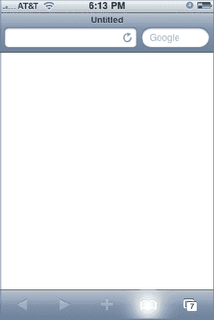

Safari 与 OS X 版 Safari 和 Windows 版 Safari 一样，都基于相同的开源 WebKit 浏览器引擎。然而，尽管 Safari 浏览器系列基于共同的框架，但将 iOS 版 Safari 视为其 Mac 和 Windows 对应版本的近亲而非完全相同的双胞胎会更有帮助。例如，iOS 版 Safari 并不提供其桌面版所具备的全部 `CSS` 或 `JavaScript` 功能。

此外，iOS 版 Safari 只提供有限数量的用户可配置设置。如图 1-2 所示，用户可以开启或关闭对 `JavaScript`、插件和弹出窗口拦截器的支持。用户还可以选择始终接受 `Cookie`、仅接受来自访问网站的 `Cookie` 或从不接受 `Cookie`。用户也可以手动清除此屏幕上的历史记录、`Cookie` 和缓存。

图 1-2

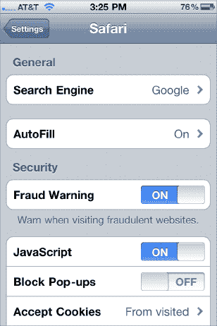

显然，原生应用和 Web 应用并不完全相同——无论从开发者还是最终用户的角度来看都是如此。从开发者的角度来看，主要区别在于编程语言——使用 Web 技术而非 `Objective-C`。然而，也存在一些关键的最终用户影响，包括以下内容：

- **性能**：基于 Safari 的 Web 应用的响应速度不如原生编译应用，这既是因为编程语言的解释性本质，也是因为应用运行在 Wi-Fi 和 3G 网络上。（请记住，某些 iPad 型号和所有 iPod touch 型号仅支持 Wi-Fi 访问。）然而，尽管存在技术限制，你仍可以进行许多优化以达到可接受的性能。

表 1-1 显示了 Wi-Fi、3G 和较旧的 EDGE 网络的带宽性能。

表 1-1：网络性能

| 网络 | 带宽 |
| --- | --- |
| Wi-Fi | 54 Mbps |
| 3G | 最高 7.2 Mbps |
| EDGE | 70–135 Kbps，突发 200 Kbps |

- **启动**：原生应用均从 iOS 设备的主屏幕启动（参见图 1-3）。在最初的 iPhone OS 版本中，苹果没有提供从主屏幕启动 Web 应用的方式，这意味着 Web 应用只能从 Safari 书签列表中访问。幸运的是，最新的 iOS 使用户能够为其 Web 应用添加“Web Clip”图标（例如图 1-4 中显示的 Color Mail Web 应用），使其也能出现在主屏幕上。

图 1-3

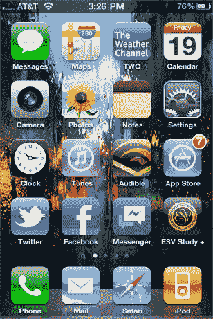

图 1-4

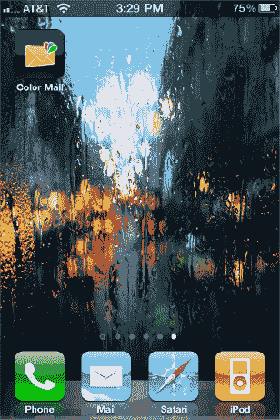

- **用户界面（UI）**：原生 iOS 应用通常遵循苹果的 UI 设计指南。当你设计 Web 应用时，不应感到必须完美复刻原生外观的 UI。同时，你应该创建一个非常适合移动触摸设备的 UI。幸运的是，使用开源框架和标准 Web 技术，你可以通过结合 `HTML`、`CSS` 和 `JavaScript` 来实现这一点。图 1-5 和 1-6 比较了原生应用和基于 Safari 的 Web 应用的 UI 设计。

图 1-5

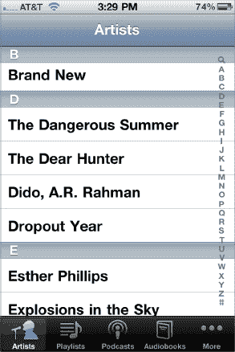

图 1-6

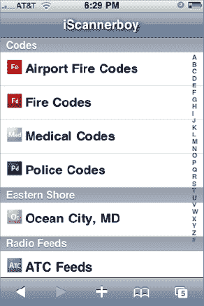

此外，iOS 的最新升级使你能够通过 `meta` 标签隐藏所有 Safari 浏览器 UI 元素，从而基本上模拟原生应用的外观和感觉。（参见图 1-7。）

图 1-7

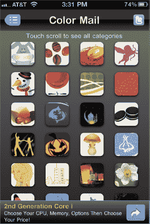

## 面向 Web 开发者的关键 Safari 功能

随着 iOS 的最新版本发布，Web 应用开发者可以获得若干功能。以下列表突出显示了这些功能。

- **地理定位**：iOS 版 Safari 支持 `HTML5` 地理定位功能，使 `JavaScript` 能够与 iPhone 或 iPad 的 GPS 服务交互，以检索设备的当前位置（参见图 1-8 和 1-9）。因此，你可以创建能够广播支持 GPS 的 iOS 设备位置的应用。

  例如，谷歌在其基于 Web 的 Latitude 服务中使用了这一功能，用于与朋友分享你的位置。

- **HTML5 媒体标签**：iOS 版 Safari 支持 `HTML5` 视频和音频元素，用于在网页中嵌入视频和音频内容。这些新元素消除了使用复杂的 `embed` 和 `object` 标签嵌入多媒体元素的需要，并使你能够利用强大的 `JavaScript API`。此外，由于 iOS 设备不支持 Flash，你可以使用 `video` 标签嵌入 QuickTime `.mov` 文件。由于 Safari 是第一个完全支持 `HTML5` 媒体标签的主流浏览器，你在标准网站上使用这些标签时需要小心，因为其他浏览器可能尚不支持。然而，由于你专门为 iOS 创建应用，你可以充分利用这些标签。

- **CSS 动画和效果**：新版本的 Safari 支持 `CSS` 动画，使你能够以多种方式操作元素，例如缩放、旋转、淡入淡出和倾斜。iOS 版 Safari 还支持 `CSS` 效果，使你能够完全通过 `CSS` 创建渐变、遮罩和反射。

- **SVG**：`SVG`（可缩放矢量图形）是一种基于 `XML` 的格式，用于创建静态和动画矢量图形。通过支持 `SVG`，iOS 版 Safari 不仅提供了一种处理可缩放图形的方法，还提供了一种可以替代 Flash 创建动画媒体的技术。

图 1-8

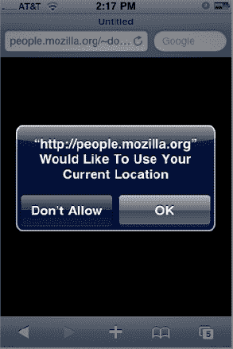

图 1-9

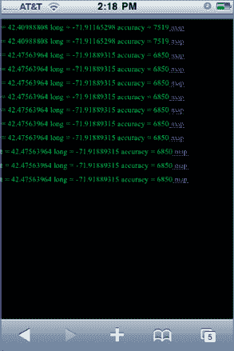

## 为 iOS 开发 Web 应用的四种方法

一个可以在任何浏览器中运行的 Web 应用和一个 iOS Web 应用，虽然都使用了相同的基本元素——`HTML`、`CSS`、`JavaScript` 和 `AJAX`——但它们并不完全相同。实际上，在为 iOS 设备开发时，有四种方法需要考虑：

- **第一级——完全兼容的网站或应用**：基础级别的方法是开发一个“iOS 友好”且与 Apple 移动设备完全兼容的网站或应用（参见图 1-10）。这些网站避免使用 Apple 移动设备不支持的技术，包括 Flash、Java 及其他插件。展示层的基本结构也最大限度地利用了区块和列，方便用户在网站内导航和缩放。这种基本方法并没有为 iOS 用户做任何特殊处理，但确保不会对令人满意的浏览体验造成障碍。

- **第二级——针对 iOS 上的 Safari 优化的网站或应用**：对 iOS 的第二级支持不仅为 iOS 上的 Safari 用户提供基本体验，还为使用 Safari 浏览器的用户提供优化的用户体验，例如利用 Safari 支持的一些增强的 WebKit `CSS` 属性。

- **第三级——专用移动网站或应用**：第三级支持是提供针对 iPhone 和/或 iPad 视口尺寸定制的网站或应用，并为所有移动设备用户提供强大的网页浏览体验（参见图 1-11 和 1-12）。然而，尽管这些网站是为移动浏览而定制的，但它们并未设计为充分利用 iOS 的功能。而且，在很多情况下，它们往往是更完整网站或应用的简化版本。

- **第四级——iOS Web 应用**：最后一种方法是提供专为 iPhone 和/或 iPad 设计的 Web 应用，其 UI 设计类似于原生应用，或者充分利用 iOS 设备的功能（参见图 1-13）。设计目标之一是尽量减少用户意识到自己处于浏览器环境中的感觉。此外，一个完整的 iOS 应用会根据需要与 iOS 特有的服务集成，包括电话、邮件和地图应用。

图 1-10

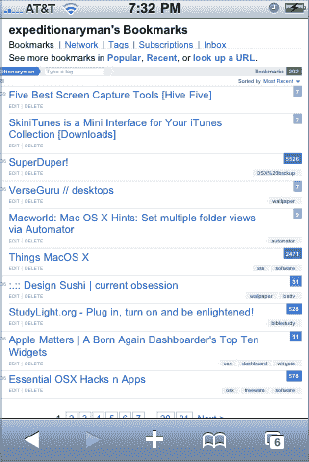

图 1-11


图 1-12

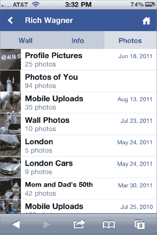

图 1-13

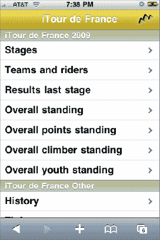

因此，在考虑应用规格时，请务必确定你希望为 iOS 用户提供哪个级别的用户体验，并据此设计你的应用。在本书中，我主要关注开发针对 iOS 优化的 Web 应用。

## 手指不是鼠标

在为 iOS 开发应用时，你需要牢记的一个关键设计考虑因素是：手指不是鼠标。在桌面上，用户可以使用多种输入设备——例如 Apple Magic Mouse、罗技轨迹球或笔记本电脑触摸板。但在屏幕上，这些硬件对应的鼠标指针在形状、大小和行为上始终是相同的。然而，在 iOS 上，指点设备始终是独一无二的。例如，芭蕾舞演员可能用纤细的手指输入，而 NFL 球员则使用又大又粗的输入设备。我们大多数人则介于两者之间。此外，手指远不如鼠标指针精确，这使得界面尺寸和定位问题变得非常重要，无论你是在创建 iOS 友好的网站，还是完整的 iPhone 或 iPad Web 应用。

此外，手指输入并不总是与鼠标输入对应。鼠标有左键点击、右键点击、滚动和鼠标移动。相比之下，手指有轻点、轻扫、拖拽和捏合。然而，作为应用开发者，你需要管理你的应用支持哪些手势。一些用于浏览网站的手势（例如双击缩放）实际上通常不是你希望在 iOS Web 应用内支持的。表 1-2 列出了 iOS 支持的手势，并指出了这种手势是否应在网站或完整 Web 应用中支持。

表 1-2：手指手势

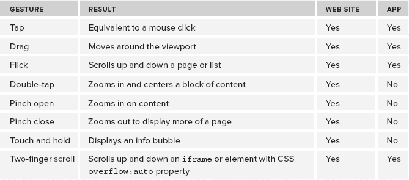

## 限制与约束

由于 iPhone、iPad 和 iPod touch 是移动设备，它们显然会有资源限制，你在开发应用时需要充分了解这些限制。表 1-3 列出了资源限制和技术约束。此外，某些技术（列于表 1-4）不受支持，在为 iOS 设备开发时需要避开它们。

表 1-3：资源约束

| 资源 | 限制 |
| --- | --- |
| 下载的文本资源（`HTML`、`CSS`、`JavaScript` 文件） | 10MB |
| `JPEG` 图像 | 128MB（所有超过 2MB 的 JPEG 图像会被二次采样——解码为像素数减少 16 倍的图像） |
| `PNG`、`GIF` 和 `TIFF` 图像 | 8MB（即 `width*height*4<8MB`） |
| 动画 `GIF` | 小于 2MB 可保证帧率维持（超过 2MB 仅显示第一帧） |
| 非流媒体文件 | 10MB |
| `PDF`、Word、Excel 文档 | 30MB 及以上（非常慢） |
| `JavaScript` 栈和对象分配 | 10MB |
| `JavaScript` 执行限制 | 每个顶级入口点 5 秒（在 `try/catch` 块中 5 秒后调用 `catch`） |
| Mobile Safari 中打开的页面 | 8 页 |

表 1-4：iPhone 和 iPod touch 不支持的技术

| 领域 | 不支持的技术 |
| --- | --- |
| Web 技术 | Flash 媒体（`SWF` 和 `FLV`）、Java applet、`SOAP`、`XSLT` 以及插件安装 |
| 移动技术 | `WML` |
| 文件访问 | 本地文件系统访问 |
| 安全 | Diffie-Hellman 协议、DSA 密钥、自签名证书以及自定义 `x.509` 证书 |
| JavaScript 事件 | 若干与鼠标相关的事件 |
| JavaScript 命令 | `showModalDialog()` |
| 书签图标 | `.ico` 文件 |
| HTML | `Input type="file"`、工具提示 |
| CSS | 悬停样式、`position:fixed` |

## 在本地网络上设置开发环境

由于 iOS 不允许你访问本地文件系统，因此无法直接将应用放置到设备上。因此，你需要通过另一台计算机访问你的 Web 应用。对于正式应用，你显然希望将应用部署到可公开访问的 Web 服务器上。但测试则是另一回事。如果你在办公室或家里有 Wi-Fi 网络，我建议在主桌面计算机上运行一个 Web 服务器，作为部署期间的测试服务器。

如果你运行的是 Mac OS X，系统上已经安装了 Apache Web 服务器。要启用 iOS 访问，请前往“系统偏好设置”>“共享服务”，然后打开“Web 共享”选项（参见图 1-14）。启用此功能后，网站的 URL 会显示在窗口底部。你可以使用这个基础 URL 从 iOS 设备访问你的 Web 文件。

图 1-14

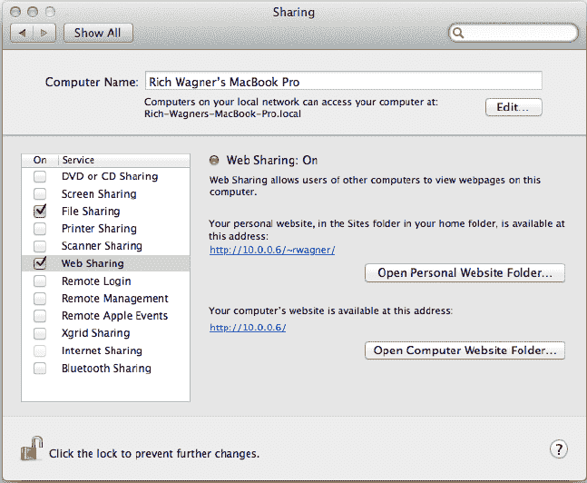

你可以将文件添加到计算机的网站目录（`/Library/WebServer/Documents`）或个人网站目录（`/Users/YourName/Sites`），然后通过 iPhone 或 iPad 上的 URL 栏访问它们（参见图 1-15）。

图 1-15

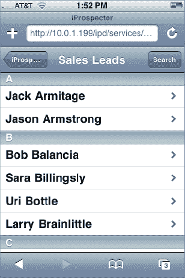

## 练习

1. 原生 iOS 应用与 Web 应用之间有什么区别？
2. Web 应用能否像原生应用一样放置在主屏幕上？
3. 手指输入是否始终对应鼠标输入？

练习答案见附录 A。

## 本章学习要点

| 主题 | 关键概念 |
| --- | --- |
| Safari 面向开发者的关键特性 | 地理定位支持、`HTML5` 媒体标签、`CSS` 动画与特效、`SVG` |
| 在网站上支持移动设备 | 级别 1：完全兼容的网站/应用<br>级别 2：针对 iOS 版 Safari 优化的网站/应用<br>级别 3：专用移动网站/应用<br>级别 4：iOS Web 应用 |

# 第 2 章：核心技术的运用

## 本章学习内容

- 为应用添加视频
- 掌握基础 `JavaScript` 编码技巧
- 使用函数与数组

尽管原生 iPhone 应用完全由 `Objective-C` 构建，但 iPhone Web 应用则由多种核心技术组成，这些技术如同相互咬合的积木块。`HTML` 为用户界面和应用数据提供结构；`CSS` 负责样式与呈现；`JavaScript` 和 `Ajax` 提供驱动应用的编程逻辑；此外，根据应用需求，可能还需要后端应用服务器（如 Java 或 PHP）。

关于原生 iPhone 应用编程的书籍通常会有一章入门内容，介绍 `Objective-C` 的基础知识，以确保大家“说同一种语言”。虽然本书无法完整涵盖开发 iPhone Web 应用所需的核心 Web 技术入门知识，但我确实希望探讨一些关键的技术，确保你掌握它们以取得成功。

本章内容基于一个假设：你至少具备 `HTML` 基础知识，并对 `CSS` 有基本了解。这里涉及的大部分内容是关于脚本逻辑层的。不过，首先我想重点介绍 iOS 版 Safari 支持的用于在 Web 应用中嵌入媒体的 `HTML5` 标签。

## 探索 HTML5 媒体元素

在 iPhone 早期，在 iPhone Web 应用中处理视频通常只是简单地链接到 YouTube 片段，然后启动 YouTube 应用。由于 iOS 版 Safari 不支持 Flash 视频（`.flv`），处理视频时除了普通链接外几乎没有其他选择。然而，iOS 版 Safari 现在支持的关键 `HTML5` 技术之一就是 `video` 元素。

你可以使用 `video` 元素来定义视频片段或流，就像 `img` 标签定义页面上的图片一样。`video` 标签的承诺是：它消除了开发者在处理嵌入式媒体内容时必须经历的复杂环节。你不再需要混合复杂的对象定义和脚本，只需一个简单的标签定义即可嵌入媒体。

遗憾的是，对于普通网站来说，`video` 元素仍然有些“吊胃口”，因为许多桌面浏览器尚未支持 `HTML5`。因此，开发者要么为不支持的浏览器添加额外代码，要么完全避免使用它。

然而，如果你正在创建 iOS Web 应用，就不会面临同样的困境。iOS 版 Safari 完全支持 `HTML5`。因此，如果你需要在应用中使用视频，请务必利用 `video` 标签。

请注意，视频不会作为嵌入式视频在网页内播放；相反，它会启动内置的 iOS 媒体播放器，占据设备的全屏。用户点击“完成”按钮后返回你的应用。

该元素的基本语法如下所示：

```html
<video src="../video/trailer.mov" controls="true" poster="picture.jpg"
  width="300" height="200"/>
```

表 2-1：`video` 元素的属性

| 属性 | 描述 |
| --- | --- |


| autoplay | 设为 `true` 时，视频准备就绪后立即播放。 |
| --- | --- |
| controls | 若为 `true`，则向用户显示播放控件。 |
| end | 指定停止播放视频的结束点。若未定义，则视频播放至结尾。 |
| height | 定义视频播放器的高度。 |
| loopend | 定义循环的结束点。 |
| loopstart | 定义循环的起始点。 |
| playcount | 指定视频片段播放的次数。默认为 1。 |
| poster | 指定视频开始播放前显示的“海报图片”的 URL。 |
| src | 定义视频的 URL。 |
| start | 设置视频开始播放的时间点。若未定义，则视频从头开始播放。 |
| width | 定义视频播放器的宽度。 |

支持的视频格式包括 QuickTime（`.mov`）和 MPEG（`.mp4`）。请注意，iPhone 版 Safari 不支持 Flash 媒体（`.flv`）和 OggTheora（`.ogg`）。

#### 动手实践：添加视频

现在，为你的应用添加视频变得非常简单，只需在页面中添加 `video` 标签即可。

1. 在文本编辑器中创建以下 HTML 文档，并将其保存为 `BIDHJ-Ch02-Ex1.html`。


```html
<!DOCTYPE html PUBLIC "-//W3C//DTD XHTML 1.0 Strict//EN"
         "http://www.w3.org/TR/xhtml1/DTD/xhtml1-strict.dtd">
<html xmlns="http://www.w3.org/1999/xhtml">
<head>
<title>Video</title>
<meta name="viewport" content="width=320; initial-scale=1.0;
  maximum-scale=1.0; user-scalable=0;"/>
<style type="text/css">
body
{
  background-color: #080808;
  margin: 10;
  color: #ffffff;
  font-family: Helvetica, sans-serif;
font-size:10px; 
}
</style>
</head>
<body>
</body>
</html>
```

代码片段 `BIDHJ-Ch02-Ex1.html`

2. 在 `body` 中添加以下 `div` 元素，并保存文件：


```html
<div style="text-align:center">
<p>Check out the new trailer for our upcoming video game release.</p>
<video src="../videos/tlr2_h.640.mov" controls="true" width="300"/>
</div>
```

代码片段 `BIDHJ-Ch02-Ex1.html`

#### 工作原理

当此文档加载时，视频的海报图片会显示在 `video` 元素的矩形区域内（见图 2-1）。当用户触摸视频播放器时，Safari 会在内置媒体播放器中显示视频，如图 2-2 所示。

图 2-1

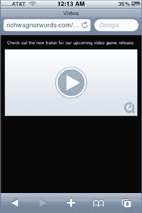

图 2-2

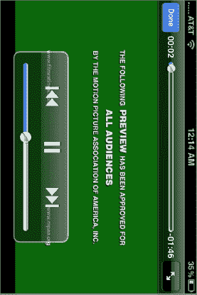

`audio` 元素的工作方式与此类似，但其属性是 `video` 标签属性的子集。这些属性包括 `src`、`autobuffer`、`autoplay`、`loop` 和 `controls`。图 2-3 显示了音频文件在媒体播放器中播放的情况。

图 2-3

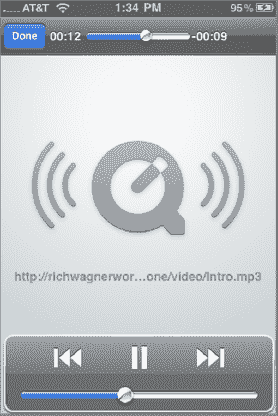

### JavaScript 脚本编写

iOS Web 应用的脚本层通常是“操作的大脑”——在客户端添加编程逻辑的地方。因此，当你开始为 iOS 平台开发越来越复杂的 Web 应用时，你会发现越来越依赖 JavaScript 技术。所以，在继续阅读本书之前，你需要扎实掌握如何用 JavaScript 编写脚本。请将本节作为 JavaScript 编程核心要点的入门指南。

#### 语法与基本规则

与其他编程语言一样，JavaScript 也有自己的语法规则和约定。请考虑以下脚本：

```html
<script>

// 定义变量
var message = "Hello";

// 创建函数，即代码模块
function showGreeting(allow)
{
  // 如果 allow 为 true，则显示 message 变量
  if (allow == true)
  {
    alert(message);
  }
  // 否则，显示此消息
  else
    alert("I withhold all greetings.");
}

// 调用函数
showGreeting(true)

</script>
```

注意 JavaScript 语法的几个方面：

- **区分大小写**：JavaScript 是一种区分大小写的语言。核心语言词汇（例如示例中的 `var`、`function` 和 `if`）均为小写。JavaScript 对象均采用小驼峰命名法，本章后续的“JavaScript 命名规范”部分将对此进行说明。你自定义的变量名可以按你选择的字母大小写来命名，但请注意以下术语并不等价：

  ```javascript
  var message = "Hello";
  var MESSAGE = "Hello";
  var Message = "Hello";
  ```

- **空白字符**：与 HTML 类似，JavaScript 会忽略代码语句中的空格、制表符和换行符。以下每行代码都是等价的：

  ```javascript
  var message="Hello";
  var message = "Hello";
  ```

  以下代码也是等价的：

  ```javascript
  if (allow==true)
  if ( allow == true )
  ```

- **分号**：每条 JavaScript 语句都以分号结尾（描述性注释行除外）。

- **花括号**：某些 JavaScript 控制结构（例如函数和 `if` 语句）使用花括号（`{}`）来包含多条语句。你可以将这些花括号放在单独的行上，也可以放在与其他代码相同的行上。例如：

  ```javascript
  if (allow == true) {
    alert(message) }
  ```

  与以下代码相同：

  ```javascript
  if (allow == true)
  {
    alert(message)
  }
  ```

## 变量

变量是存储另一段数据（文本字符串、数字、布尔值或其他任何数据）的别名。变量是编程的核心，因为它们消除了在开发脚本或应用程序时需要事先知道所有内容的需求。

例如，假设你想获取用户的名字，并将其添加到用户返回你的 iOSWeb 应用时显示的欢迎消息中。如果没有变量，你就必须事先知道该人的名字——这当然是不可能的——或者你必须为每个人使用一个通用名称。

通过使用变量，你可以消除这个问题。你可以获取用户的名字，然后将其作为变量（例如 `firstName`）存储在代码中。在我的脚本中，任何时候需要处理用户的名字时，我都会调用 `firstName`。

## 声明和赋值变量

当你想使用变量时，首先要使用关键字 `var` 声明它，然后为其赋值。以下是这个两步过程的样子：

```javascript
var firstName;
firstName = "Jonah";
```

关键字 `var` 指示 JavaScript 解释器将后面的单词（此处为 `firstName`）视为变量。下一行则将字面字符串 `Jonah` 赋值给 `firstName` 变量。

虽然声明和赋值变量可以是两个独立的操作，但你通常希望将它们合并为一步。例如，以下代码在功能上等同于前面的两行代码：

```javascript
var firstName = "Jonah";
```

说实话，你甚至可以在不使用关键字 `var` 的情况下赋值变量。例如，以下代码仍然有效：

```javascript
firstName = "Jonah";
```

不过，我强烈建议你在首次定义变量时始终使用 `var`，以确保你的代码对你和其他开发者来说都是可读且可管理的。

## 变量类型的宽松性

你可以为变量赋值多种数据类型。以下是一些示例：

```javascript
// 字符串值
var state = "CO";
// 布尔值
var showForm = true;
// 数值
var maxWidth = 300;
// HTML 文档“节点”
var element = document.getElementById("container"); 
// 数组项
var item = myArray[0];
```

如果你来自 Java、ActionScript 或其他强类型语言，你可能会疑惑在哪里声明变量可以存储的数据类型。简单来说，你不需要这样做。因为 JavaScript 是一种松散类型的语言，你无需声明变量类型。

## 命名变量

在命名变量时，请记住以下通用规则：

- 变量名必须以字母或下划线开头，不能以数字或其他特殊字符开头。例如：

  ```javascript
  // 有效
  var helper;
  var _helper;

  // 无效
  var 2helper;
  var ^helper;
  ```

- 虽然数字不能作为变量名的开头，但你可以将其放在单词的其他位置，例如：

  ```javascript
  var doc1;
  var doc2;
  ```

- 与 JavaScript 的其他方面一样，变量名是区分大小写的。因此，以下每个变量名都是唯一的：

  ```javascript
  var counter;
  var Counter;
  var COUNTER;
  var counTer;
  ```

- 变量名不能包含空格。例如：

  ```javascript
  // 有效
  var streetAddress;
  var street_address;

  // 无效
  var street address;
  ```

- 你不能使用任何保留字（参见本章后面的“保留字”部分）作为变量名。例如：

  ```javascript
  // 有效
  var isDone;
  var defaultValue;
  var mainWindow;

  // 无效
  var is;
  var default;
  var window;
  ```

## 访问变量

定义变量并为其赋值后，每次在代码中引用它时，该变量都代表最后赋给它的值。在以下代码片段中，`company` 变量被赋值为一个字符串，并显示在警告框中：

```javascript
var company = "Cyberg Coffee";
alert( "Our company is proudly named " + company);
```

警告框显示以下内容：

```text
Our company is proudly named Cyberg Coffee.
```

你也可以在源代码中更改变量的值。毕竟，它们被称为变量，不是吗？一个典型的例子是计数器变量，其值在循环过程中递增。考虑以下示例：

```javascript
for (var i=1;i<=5;i++)
{
  document.write( "The value of the variable is: " + i + ".<br/>" );
}
```

我将在本章后面解释 `for` 循环的作用。现在，只需关注名为 `i` 的变量。在第一次执行 `for` 块内的代码时，该变量的初始值为 1。在下一次执行时，其值递增为 2。第三次执行时，其值递增为 3。这个过程一直持续到 `i` 为 5。总共，`document.write()` 方法被调用了五次，并输出以下内容：

```text
The value of the variable is 1.
The value of the variable is 2.
The value of the variable is 3.
The value of the variable is 4.
The value of the variable is 5.
```

## 作用域

变量的作用域可以是有限的，也可以是广泛的。如果你在函数内部定义了一个变量，那么该变量（称为局部变量）仅对该函数本身可用，并在函数处理完成后失效。例如，查看以下代码中的 `markup` 变量：

```javascript
function boldText(textToDisplay)
{
  var markup = "<strong>" + textToDisplay + "</strong>";
  return markup;
}
```

该变量在 `boldText()` 函数运行时创建，但在函数结束后不再存在。

然而，如果你在脚本块的顶层（即函数外部）定义变量，那么该变量（称为全局变量）可以从文档中的任何位置访问。此外，全局变量的生命周期会持续到文档本身关闭为止。

表 2-2 总结了局部变量和全局变量之间的区别。

**表 2-2**：局部变量与全局变量

| 类型 | 作用域 | 生命周期 |
| --- | --- | --- |
| 局部 | 仅在函数内部可访问 | 持续到函数结束 |
| 全局 | 从文档中的任何位置可访问 | 持续到文档本身关闭 |

作用域涉及变量在脚本层级中的上下文。然而，变量定义的位置也很重要。简单来说，变量在声明之后才能被访问。因此，通常你会将全局变量定义在脚本顶部或靠近顶部的位置，而局部变量则定义在函数顶部或靠近顶部的位置。

我整理了一个示例脚本，演示了变量的作用域。首先，我在脚本顶部定义了一个全局变量：

```html
<script type="text/javascript">
var msg = "I am a global variable";
var msgEnd = ", and you cannot stop me."
```

接着，我添加一个警告框来显示该变量：

```javascript
alert(msg + msgEnd);
```

当这段代码运行时，显示的警告消息文本是：

```text
I am a global variable, and you cannot stop me.
```

现在，看看我做了什么。我创建了一个函数，其中定义了一个同名的局部变量（`msg`），然后直接引用了之前定义的全局变量 `msgEnd`。代码如下：

```javascript
function displayAltMessage()
{
  var msg = "Don't hassle me, I'm a local variable';
  alert(msg + msgEnd);
}
```

我在脚本中用以下代码调用这个函数：

```javascript
displayAltMessage();
```

当这个函数执行时，警告框显示以下文本：

```text
Don't hassle me, I'm a local variable, and you cannot stop me.
```

注意，局部变量 `msg` 优先于全局变量 `msg`。然而，当该函数执行完毕后，局部变量 `msg` 被销毁，而全局变量 `msg` 仍然存在。

现在假设我在脚本后面重新赋值了全局变量 `msg`，然后再次显示警告框：

```javascript
msg = "Reassigning now!";
alert(msg);
```

是的，你猜对了，显示的是以下文本：

```text
Reassigning now!
```

注意，当我重新赋值变量时，不需要再次添加 `var` 关键字。

以下是完整的脚本：

```html
<script type="text/javascript">
  // 全局变量
  var msg = "I am a global variable";
  var msgEnd = ", and you cannot stop me."

  // 显示 "I am a global variable, and you cannot stop me."
  alert(msg + msgEnd);
function displayAltMessage()
  {
    // 局部变量
    var msg = "Don't hassle me, I'm a local variable';
    // 显示 "Don't hassle me, I'm a local variable, and you cannot stop me."
    alert(msg + msgEnd);
  }
  // 调用函数
  displayAltMessage();

  // 重新赋值 msg
  msg = "Reassigning now!";

  // 显示 "Reassigning now!"
  alert(msg);
</script>
```

## JavaScript 命名约定

与 Java 或 ActionScript 等其他语言类似，JavaScript 使用驼峰命名法来命名语言中的各个部分。变量、属性和方法采用小驼峰命名法。使用小驼峰命名法时，名称以小写字母开头，复合词中每个后续新单词的首字母大写，其余字母小写。你会发现 JavaScript 和 DOM 都遵循这一约定。例如：

```javascript
var divElements = document.getElementsByTagName('div');
```

在这个例子中，`document` 是 HTML 文档的 DOM 对象名称，全部小写。方法 `getElementsByTagName()` 是一个复合词，因此方法中附加单词的首字母大写。我的变量 `divElements` 使用小驼峰风格，以明确该术语由两个单词组合而成。


一些 JavaScript 开发者遵循的另一种编码约定称为匈牙利命名法。按照这种编码风格，变量会加上一个前缀字母，表示该变量的数据类型。表 2-3 展示了这种命名法的几个示例。

表 2-3：在变量中使用匈牙利命名法

| 数据类型/对象类型 | 前缀 | 示例 |
| --- | --- | --- |
| 字符串 | `s` | `sFirstName` |
| 数字 | `n` | `nRating` |
| 布尔值 | `b` | `bFlag` |
| 数组 | `a` | `aMembers` |
| 对象（DOM 元素、用户对象等） | `o` | `oCustomer` |
| 日期 | `d` | `dTransactionDate` |

## 使用常量

在使用变量时，它们通常会在脚本执行过程中改变值。然而，有时你需要使用一个引用不变值的变量，这些被称为常量。

ActionScript、Java 和许多其他编程语言实际上在语言中内置了与变量不同的常量。JavaScript 没有。但从实际角度来看，你可以在代码中定义一个变量并将其视为常量。

如果这样做，我建议遵循常量的标准命名约定：

- 使用大写字母
- 用下划线分隔单词

例如：

```javascript
var APP_TITLE = "iOSWebApp";
var VERSION_NUM = "2.01";
var MAX_WIDTH = 320;
```

然后，你可以在整个脚本中像使用变量一样使用这些看起来像常量的变量。

## 运算符

运算符是一种简单的符号，用于赋值、比较值、操作表达式或连接代码片段。

等号可能是最常见的运算符，用于给表达式赋值。例如：

```javascript
var i = 10;
```

注意，用于赋值的运算符（`=`）与用于比较两个值是否相等的运算符不同。`==` 运算符用于比较两个项，如果条件为真则返回 `true`。例如：

```javascript
alert(n == 100);
```

正如你所料，你可以使用 `+` 运算符将两个数字值相加。但也可以用它来组合两个字符串字面量或变量。所以，看看这段代码：

```javascript
var s = "Welcome ";
var t = " to the world of operators.";
alert(s + t);
```

文本 `Welcome to the world of operators.` 会显示在 JavaScript 警告框中。

表 2-4 到 2-7 列出了主要运算符。在大多数实际情况下，有些运算符相当深奥，因此你通常使用的运算符以粗体显示。

表 2-4：赋值运算符

| 运算符 | 示例 | 描述 |
| --- | --- | --- |
| `=` | `x=y` | 将 `y` 的值赋给 `x` |
| `+=` | `x+=y` | 等同于 `x=x+y` |
| `-=` | `x-=y` | 等同于 `x=x-y` |
| `*=` | `x*=y` | 等同于 `x=x*y` |
| `/=` | `x/=y` | 等同于 `x=x/y` |
| `%=` | `x%=y` | 等同于 `x=x%y`（取模，除法余数） |

表 2-5：比较运算符

| 运算符 | 示例 | 描述 |
| --- | --- | --- |
| `==` | `x==y` | `x` 等于 `y` |
| `!=` | `x!=y` | `x` 不等于 `y` |
| `===` | `x===y` | 同时比较值和数据类型（例如，如果 `x = "5"` 且 `y = 5`，则 `x==y` 为 `true`，但 `x===y` 为 `false`） |
| `<` | `x<y` | `x` 小于 `y` |
| `<=` | `x<=y` | `x` 小于或等于 `y` |
| `>` | `x>y` | `x` 大于 `y` |
| `>=` | `x>=y` | `x` 大于或等于 `y` |
| `?:` | `x=(y<5) ? -5: y` | 如果 `y` 小于 5，则将 `-5` 赋给 `x`；否则将 `y` 赋给 `x`（称为条件运算符） |

表 2-6：逻辑运算符

| 运算符 | 示例 | 描述 |
| --- | --- | --- |
| `&&` | `if ( x > 3 && y=0 )` | 逻辑与 |
| `||` | `if ( x>3 || y=0 )` | 逻辑或 |
| `!` | `if !( x=y)` | 非 |

表 2-7：数学运算符

| 运算符 | 示例 | 描述 |
| --- | --- | --- |
| `+` | `x+2` | 加法 |
| `-` | `x-3` | 减法 |
| `*` | `x*2` | 乘法 |
| `/` | `x/2` | 除法 |
| `%` | `x%2` | 取模（除法余数） |
| `++` | `x++` | 自增（等同于 `x=x+1`） |
| `--` | `x--` | 自减（等同于 `x=x-1`） |

## 保留字

JavaScript 有一组保留字（参见表 2-8），这些单词被保留用于语言本身。因此，在命名变量、函数或对象时，应避免使用这些单词。

表 2-8：JavaScript 保留字

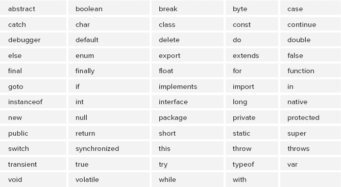

## 基本条件表达式

JavaScript 有三种条件语句可用于评估代码：

- `if`
- `if/else`
- `switch`

以下各节将介绍这三种语句。

## `if` 语句

当你想评估一个变量或表达式，然后根据评估结果执行相应操作时，可以使用 `if` 语句。其基本结构如下：

```javascript
if (condition)
{
// 如果条件为真，则执行的代码
}
```

例如：

```javascript
response = prompt("请输入客户姓名。", "");
if (response == "Jerry Monroe")
{
alert("是的！");
}
```

此时会向用户显示一个提示框。用户输入的内容被赋值给 `response` 变量。然后 `if` 语句评估 `response` 是否等于 `"Jerry Monroe"`。如果是，则显示警告框；否则，`if` 块被忽略。

我在本章前面的运算符部分提到过这一点，但值得重申：双等号并非笔误。单等号（`=`）用于给变量赋值，而双等号（`==`）用于比较表达式两侧的值是否相等。

如果你要评估一个布尔变量，可以按两种方式编写 `if` 语句：

```javascript
if (isValid == true)
{
  alert("是的，它是有效的！");
}
```

或者，作为简写：

```javascript
if (isValid)
{
  alert("是的，它是有效的！");
}
```

如果 `if` 块中只有一行代码，实际上可以省略花括号。因此，以下语法同样有效：

```javascript
if (isValid == true) alert("是的，它是有效的！");
```

你也可以对否定表达式使用 `if`。例如，假设你想在名为 `isValid` 的布尔变量为 false 时执行某个操作，代码可能如下：

```javascript
if (isValid == false)
{
  // 执行某些操作以获取验证
}
```

请注意，即使使用 false 值来评估变量，`if` 块也仅在表达式（`isValid == false`）为 true 时执行。

另一种通常更推荐的写法是使用非运算符（`!`）：

```javascript
if (!isValid)
{
  // 执行某些操作以获取验证
}
```

这个表达式实际上表示：如果 `isValid` 不为 true，则执行某些操作……

## `if/else` 语句

`if/else` 语句扩展了 `if` 语句，使你可以根据表达式评估为 true 或 false 分别执行不同的代码块。其基本结构如下：

```javascript
if (condition)
{
// 如果条件为真，则执行的代码
}
else
{
// 如果条件为假，则执行的代码
}
```

以下是 `if/else` 语句的示例：

```javascript
if (showName)
{
  document.write("我的名字是 Sonny Madison。")
}
else
{
  document.write("我不能透露我的名字。");
}
```

### 链式 `if` 和 `if/else`

你还可以将 `if` 和 `if/else` 语句链式组合。考虑以下场景：

```javascript
if (state = "MA")
{
  document.write("你住在马萨诸塞州。");
}
else if (state="CA")
{
  document.write("你住在加利福尼亚州。");
}
else
{
  document.write("我不知道你住在哪里。");
}
```

## `switch` 语句

除了链式组合 `if` 和 `if/else` 语句外，你还可以使用 `switch` 语句来评估多个值。其基本结构如下：

```javascript
switch (expression)
{
case label1:
  // 如果表达式等于 label1，则执行的代码
  break;   
case label2:
  // 如果表达式等于 label2，则执行的代码
  break;
case label3:
  // 如果表达式等于 label3，则执行的代码
  break;
default:
  // 如果表达式与 label1、label2、label3 都不相等，则执行的代码
}
```

`switch` 语句评估表达式，看结果是否匹配第一个 `case` 的值。如果匹配，则执行第一个 `case` 语句内的代码。注意每个 `case` 语句末尾的 `break`，它阻止 `switch` 语句继续评估后续的 `case` 语句。如果没有找到匹配项，则执行 `default` 语句。

请注意，`case` 块内部不使用花括号。

以下示例使用 `switch` 语句，通过内置的 `Date()` 对象评估当前时间：

```javascript
var d = new Date()
var hrs = d.getHours()

switch (hrs)
{
case 7 :
  document.write( "早上好。" );
  break;
case 12 :
  document.write( "该吃午饭了。" );
  break;
case 15 :
  document.write( "午睡时间。Zzzzz。" );
  break;
case 23 :
  document.write( "睡觉时间。Boo！" );
  break;
default
  document.write( "稍后再来查看。" );
}
```

`hrs` 变量通过 `Date.getHours()` 方法获取当前小时数。`switch` 语句评估 `hrs`，依次检查该值是否与 `case` 语句匹配。如果找到匹配项，则执行该 `case` 内的代码；否则，执行 `default` 语句。

## 循环

在开发 iOS Web 应用的脚本时，一个常见需求是能够多次执行某个任务，或对一系列对象执行操作。或者你可能需要一直执行代码直到某个条件发生变化。JavaScript 为此提供了两种编程结构：`for` 和 `while` 块。`for` 循环会重复执行代码块指定的次数。`while` 循环则在特定条件为真时持续执行代码块。

### `for` 循环

与 `if` 语句一样，`for` 循环可能是你最常用的结构。以下代码片段展示了一个 `for` 循环，它调用 `document.write()` 五次：

```javascript
for (var i=1;i<=5;i++)
{
  document.write("数字：" i + "<br/>");
}
```

运行时，输出如下：

```text
数字 1
数字 2
数字 3
数字 4
数字 5
```

回到代码，注意括号内 `for` 语句的三个部分：

- 初始化变量：`var i=1` 初始化用于计数的变量。（变量 `i` 是大多数循环计数器中常见的名称。）
- 循环条件：`i<=10` 表示每次循环迭代时评估的条件。只要 `i` 值小于或等于 10，条件就返回 true。
- 更新：`i++` 语句在每次循环迭代完成后执行。`++` 是用于将 `i` 的值增加 1 的运算符。

### `while` 和 `do/while` 循环

`while` 循环也会重复执行代码块一次或多次。然而，它会在表达式评估为 true 时持续执行。其基本形式如下：

```javascript
while(expression)
{
  // 语句
}
```

以下是一个示例：

```javascript
var max = 100;
while(num>max)
{
document.write("当前计数：" + num);
num++;
}
```

在此示例中，只要 `num` 小于 100，代码块就会循环。但是，假设 `num` 的值为 101，则 `while` 代码块永远不会执行。

`do/while` 循环与之类似，区别在于条件在循环结束时评估，而不是在开始时。其基本结构如下：

```javascript
do
{
   // 语句
} while (expression)
```

在实际应用中，`while` 循环比 `do/while` 循环更常用。

## 注释

与 HTML 或其他语言一样，你可以在 JavaScript 代码中添加自己的注释。注释对你个人很有用，当你几周或几个月后重新查看代码时，需要理解代码及其背后的思路。你也可以使用注释来标记代码中需要稍后重做的特定位置。

你可以添加单行注释或多行注释。

### 单行注释

要添加单行注释，请在行中添加两个斜杠（`//`）。同一行中斜杠右侧的任何文本都被视为注释，解释器会忽略它们。例如：

```javascript
// 定义两个字符串变量
var s = "欢迎 ";
var t = "来到运算符的世界。";
// 在警告框中显示拼接后的值
alert(s + t);
```

### 多行注释

你也可以定义跨越多行的注释。为此，请将注释内容包含在 `/*` 和 `*/` 标记之间。多行注释的示例如下：

```javascript
/*
 * 目的：将互联网字符串日期转换为 Date 对象
 * RICH TO DO: 确认此方法在所有情况下均能正常工作
*/ 
function getDateFromString(s)
{
  s = s.replace(/-/g, "/");
  s = s.replace("T", " ");
  s = s.replace("Z", " GMT-0000");
  return new Date(Date.parse(s));
}
```

## 使用 JSDoc 注释

Java 世界有一个名为 Javadoc 的文档生成器，它可以根据开发者在源代码中添加的注释生成基于 HTML 的文档。JSDocToolkit 是一个用 Perl 编写的开源工具，提供了类似的功能。

你可以从 [`code.google.com/p/jsdoc-toolkit/`](http://code.google.com/p/jsdoc-toolkit/) 下载 JSDoc。

要让脚本支持 JSDoc Toolkit，只需使用多行注释来标记你想要包含的注释，但需使用以下特殊语法：以斜杠和两个星号（`/**`）开头，以正常方式（`*/`）结束注释。示例如下：

```javascript
/**
 * 将互联网字符串日期转换为 Date 对象
*/ 
function getDateFromString(s)
{
  s = s.replace(/-/g, "/");
  s = s.replace("T", " ");
  s = s.replace("Z", " GMT-0000");
  return new Date(Date.parse(s));
}
```

你还可以添加多个属性来更好地描述代码。这些属性以 `@` 符号开头。你甚至可以添加 HTML 标签以提高可读性。请看：

```javascript
/**
 * 将互联网字符串日期转换为 Date 对象。
 * <p>
 * 当用户在 doohing 左侧模块中选择 Cyborg 选项时，会调用此函数。
 *
 * @param  s 包含日期的字符串
 * @returns  返回 Date 对象形式的日期
*/ 
function getDateFromString(s)
{
  s = s.replace(/-/g, "/");
  s = s.replace("T", " ");
  s = s.replace("Z", " GMT-0000");
  return new Date(Date.parse(s));
}
```

有关可用属性、格式化命令和语法规则的完整详细信息，请查看 [`code.google.com/p/jsdoc-toolkit/`](http://code.google.com/p/jsdoc-toolkit/) 以及 Javadoc 约定页面 [`java.sun.com/j2se/javadoc/writingdoccomments`](http://java.sun.com/j2se/javadoc/writingdoccomments)。

即使你不打算使用 JSDocToolkit 来生成源代码文档，JSDocToolkit 的约定对于编写文档完善的代码仍然非常有用。此外，将来如果你希望使用 JSDocToolkit，你也会发现一切准备就绪。

## 函数

函数是 JavaScript 的基本构建块或组织单元。房子的地基由许多构建块组成。同样，一个 JavaScript 脚本通常由一组函数组成。

这些构建块可能很容易被忽视。但正如一座装饰精美的房子离开地基便毫无意义一样，一个炫酷的 JavaScript 动画例程如果没有这些构建块作为支撑，也毫无意义。

### 创建函数

函数是一组共同执行特定操作的 JavaScript 语句模块。

#### 动手试一试：创建函数

按照以下说明创建一个 JavaScript 函数。

1. 在文本编辑器中创建以下 HTML 文档，并将其保存为 `BIDHJ-Ch02-Ex2.html`。


```html
<!DOCTYPE html PUBLIC "-//W3C//DTD XHTML 1.0 Strict//EN"
         "http://www.w3.org/TR/xhtml1/DTD/xhtml1-strict.dtd">

<html xmlns="http://www.w3.org/1999/xhtml">
<head>
<title>视频</title>
<meta name="viewport" content="width=320; initial-scale=1.0;
  maximum-scale=1.0; user-scalable=0;"/>
<style type="text/css">

body
{
  background-color: #080808;
  margin: 10;
  color: #ffffff;
  font-family: Helvetica, sans-serif;
font-size:10px; 
}

</style>
<script type="text/javascript">

</script>
</head>
<body>
</body>
</html>
```

代码片段`BIDHJ-Ch02-Ex2.html`

2. 在`script`元素内添加`addAndDisplay()`函数：


```javascript
function addAndDisplay(a,b)
{
  var total = a + b;
  alert(total);
}
```

代码片段`BIDHJ-Ch02-Ex2.html`

3. 在`script`元素内，紧接刚刚定义的函数之后添加以下代码：


```javascript
addAndDisplay(3, 2);
```

代码片段`BIDHJ-Ch02-Ex2.html`

4. 保存文件。

#### 工作原理

当页面加载脚本时，它会执行`addAndDisplay(3, 2)`来显示一个 Alert 消息框，其中显示计算出的总和。如你所见，你创建的函数名为`addAndDisplay()`，它接受两个参数：`a`和`b`。参数（也称为形参）是你希望传递给函数处理的变量或字面值。在此例中，调用函数将整数 3 和 2 发送给函数进行相加。在花括号内，第一行将参数相加并将结果赋值给`total`变量。第二行在警告框中显示`total`。当警告框关闭时，函数结束并将控制权返回给调用它的代码。

从上面的动手试一试可以看出，函数：

- 被代码的其他部分调用来执行某个过程、返回结果，或两者兼有
- 将其编程逻辑的细节隐藏起来，不让代码的其他部分看到

函数可以向调用代码返回一个值。例如，请看以下函数：

```javascript
function getTotal(subtotal)
{
  var t = subtotal * .05;
  return t;
}
```

`getTotal()`函数接收`subtotal`作为参数，将其乘以州税率，然后使用`return`命令将总值返回给调用该函数的语句。

当`return`执行时，函数在该行停止执行并返回到调用函数。例如：

```javascript
function createProfile(el)
{
  if (el == null)
  {
    alert("未定义的 DOM 元素。无法继续。:(");
    return;
  }
  else
  {
     // 对 el 执行一些非常重要的操作
  }
}
```

在此例中，函数检查`el`参数是否为 null。如果是，则函数在显示警告框后结束处理。如果不是，则函数继续执行。

### 创建内联函数

JavaScript 也支持内联函数，它允许你在特定上下文中定义一个未命名的函数。例如，假设你想在窗口加载时显示一条警告消息。使用普通函数，你可以这样组织脚本：

```html
<script>
  function init()
  {
    alert("我正在说一些重要的事情。");
  }

  window.onload = init;

</script>
```

`onload`事件被分配了`init()`函数作为其事件处理程序。然而，你也可以使用内联函数并省略具体的函数定义：

```html
<script>
  window.onload = function(){alert("我正在说一些重要的事情。")}
</script>
```

另一个优点是，你可以在特定作用域内引用变量，而无需将它们作为参数传递给函数。

### 函数重载

函数重载是指能够向函数传递不同数量的参数。如果你利用函数的`arguments`属性，就可以在 JavaScript 中重载函数。例如，假设你想创建一个将两个数字相加并返回结果的函数。你可以这样编码：

```javascript
function add(a, b)
{
  return a+b;
}
```

然而，假设你的需求随时间变化。现在你需要一次加三个、四个或五个数字，而不是两个。你可以重载`add()`函数来完成所有这些求和任务，而不必为每种情况编写单独的函数：

```javascript
function add()
{
  var t = 0;
  for (var i=0, l=arguments.length; i<l; i++)
  {
    t += arguments[i];
  }
  return t;
}
```

`add()`函数创建一个`for`循环来遍历所有提供的参数。在遍历过程中，它将当前参数加到`t`变量上。然后将这个总和返回给调用该函数的语句。现在以下所有调用都能正常工作：

```javascript
var t = add(2,2);
var t1 = add(2,4,5);
var t2 = add(392,1230,3020202,1,2033);
```

你也可以使用`typeof()`命令在同一函数内重载不同的数据类型。例如，如果我想扩展`add()`的功能，使其能够“相加”字符串值，可以按如下方式修改函数：

```javascript
function add()
{
  var argType = typeof(arguments[0]);

  if (argType == "number")
  {
    var t = 0;
    for (var i=0, l=arguments.length; i<l; i++)
    {
      t += arguments[i];
    }
    return t;
  }
  else if (argType == "string")
  {
    for (var i=0, l=arguments.length; i<l; i++)
    {
      if (i == 0)
      {
        var s = arguments[i];
      }
      else
      {
        s += ", " + arguments[i];
      }
     return s;
    }
    else
      return "Unsupported data type";
  }
}
```

`add()`函数检查第一个参数的类型，并将结果赋给`argType`。如果类型是数字，则例程继续执行，与之前的示例相同。但如果类型是字符串，则函数会将所有参数合并成一个以逗号分隔的字符串。如果类型既不是数字也不是字符串，则返回一条错误消息。

# 数据类型

JavaScript 允许你使用特定的数据类型：

- `String`（字符串）
- `Number`（数字）
- `Boolean`（布尔值）
- `Null`（空值）
- `Undefined`（未定义）
- `Array`（数组）
- `Object`（对象）

字符串、数字和布尔值通常被称为原始数据类型，`null`和`undefined`被称为特殊数据类型，而对象和数组则被称为复合数据类型。

## 字符串

字符串是用单引号或双引号括起来的字符集合。字符串也称为字符串字面量。以下几行是字符串的示例：

```javascript
var wd = 'Kitchen sink';
var el = "<p>This is HTML.</p>";
var n = "3.14";
var char = 'z';
var special = "@#(*&^%$#@!~<>S"}{+=";
var blank = "";
```

如你所见，字符串中可以包含几乎任何内容——普通文本、HTML 标签、数值、特殊字符，甚至“厨房水槽”。

注意，你可以有空字符串（`""`），这与`null`或`undefined`值不同。

由于字符串可以用单引号或双引号括起来，你可以通过使用相反类型的引号对来轻松嵌入引号和撇号。例如：

```javascript
var str =
'"I like living dangerously", said Jack. "I am enclosing a quote in this string."';
var str2 = "I'm happy, aren't I?";
```

或者，如果字符串由相同类型的引号括起来，你可以使用反斜杠字符（`\`）来“转义”撇号或引号。以下是几个例子：

```javascript
var str2 = 'I\'m happy, aren\'t I';
var el = "<div id=\"container\"></div>";
```

反斜杠字符告诉解释器将后面的引号视为字符串的一部分，而不是结束分隔符。

对于许多任务，你可以像我描述的那样将字符串值作为字符串字面量来处理。但是，如果你要解析、操作、转换或以其他方式处理字符串，你也可以将其视为`String`对象。

## 数字

数字数据类型表示任何类型的数值——整数、实数浮点数、八进制数，甚至十六进制数。

表 2-9 列出了 JavaScript 中有效的各种数字值。

表 2-9：数字示例

| 数字 | 描述 |
| --- | --- |
| 32 | 整数 |
| .00223 | 浮点数 |
| 1.42e5 | 浮点数 |
| 0377 | 八进制值 |
| 0x32CF | 十六进制整数 |

除了这些常规数字类型，JavaScript 还包含一个特殊值`NaN`，代表“非数字”。正如你所料，如果执行无效的数学运算，你会得到`NaN`作为结果。

## 布尔值

布尔类型表示`true`或`false`值。通常用于判断代码中的条件是否为`true`或`false`。例如，假设你将`false`赋给`flagUser`变量：

```javascript
var flagUser = false;
```

然后你可以在`if`控制结构中（参见本章前面的“if/else 语句”部分）评估`flagUser`变量以确定其布尔状态。例如：

```javascript
if (flagUser == true)
{
  alert("Hey User! You are hereby flagged.");
}
```

如果`flagUser`评估为`true`，则`if`语句会显示警告框。

注意，布尔值不用引号括起来。所以请注意区别：

```javascript
// 布尔值
var isABoolean = true;
var isAString = "true";
```

## 空值

当变量或对象不包含任何值时，其值表示为`null`。（不是字面字符串`"null"`，只是`null`。）你可以测试变量或对象是否为`null`，以确定它是否在代码中较早被定义。例如：

```javascript
if (myArray != null)
{
  doSomethingReallyImportant();
}
```

这段代码评估变量`myArray`。如果其值不等于`null`，则条件评估为`true`，并执行一些非常重要的操作。

`null`值不同于空字符串、数字`0`或`NaN`，也不同于我将在下一节解释的`undefined`数据类型。

如果你想清除变量的内容，可以将其设置为`null`来赋予一个非值：

```javascript
if (loggedOut == true)
{
  userName = null;
}
```

因此，在这个例子中，如果`loggedOut`变量为`true`，则`userName`变量被重置。

## 未定义值

乍一看，`undefined`值听起来像是`null`的另一个名称。但实际上，`undefined`值是一种不同的数据类型。当你访问一个已声明但从未赋值的变量时，解释器会返回`undefined`值。例如，以下代码片段会显示一个消息为`undefined`的警告框。

```javascript
var isSmiling;
alert (isSmiling);
```

如果你尝试调用一个不存在的属性，也会得到`undefined`。例如：

```javascript
alert(document.theStreetThatHasNoName);
```

## 数组

到目前为止，我一直在讨论作为个体的变量。相比之下，数组是值的集合。它们被分组并索引，以便你可以访问组中存储的特定项。

JavaScript 将数组存储为`Array`对象，这意味着它具有多种属性和方法，你可以用它们来执行各种任务。

### 创建数组

你可以通过将变量赋值为空括号来创建一个新数组：

```javascript
var castMembers = [];
```

你也可以使用`new Array()`来创建新数组。如下所示：

```javascript
var myArray = new Array();
```

然而，使用`new`运算符创建数组被认为是过时的方法，并且不被视为良好实践。

在某些编程语言中，你需要在定义数组时指定数组中的项数。JavaScript 则不然。每次向数组添加新项时，数组的大小都会增加。

### 向数组添加项

要向数组添加项，只需将值赋给数组中的特定索引。索引由括号内的值指定，例如：

```javascript
var castMembers = [];
castMembers[0] = "Jerry";
castMembers[1] = "George";
castMembers[2] = "Elaine";
castMembers[3] = "Kramer";
```

注意，由于数组是从零开始的，所以从 0 开始计数，而不是 1。

你也可以通过将值作为参数传递来定义数组项：

```javascript
var primeNumbers = [1,3,5,7,11];
```

### 在数组中存储多种类型

你可以在数组中存储几乎任何类型的数据，包括字符串、数字、布尔值、`undefined`和`null`值、对象和函数。如果你愿意，甚至可以在数组中存储数组。更重要的是，你可以在同一个数组中存储多种类型的数据。例如，考虑以下包含字符串、数字、函数、DOM 对象和布尔值的数组：

```javascript
var el = document.getDocumentById("easy_bake_oven");
var pieLove = ["pie", 3.14, function(){alert("Apple Pie")}, el, true];
```

### 获取和设置数组的大小

你可以通过访问数组的`length`属性来获取数组中元素的数量。（没错，数组是一个对象，因此它拥有自己的一组属性和方法。）例如：

```javascript
var primeNumbers = [1,3,5,7,11];
alert(primeNumbers.length));
```

警告框会显示 5。

在大多数情况下，你不需要显式设置数组的大小，因为当你添加或删除元素时，它会自动动态调整大小。然而，在需要指定数组大小的情况下，你可以为`length`属性赋值。例如，下面这行代码将数组的大小增加到 10：

```javascript
primeNumbers.length = 10;
```

请注意，这样做并不会创建新的数据项。

如果你指定的`length`小于数组当前的大小，那么超出该`length`值的元素将被删除。

请记住，数组中最后一个元素的索引值比元素总数少 1。

## 访问数组中的元素

你可以根据索引访问数组中的任何值。例如，要将`states`数组中的第三个元素写入文档，可以使用以下代码：

```javascript
function showHomeState(idx)
{
  document.write("<p>Your home state is " + states[idx] + "</p>";
}
```

如果你想处理数组中的每个元素，还可以使用`for`循环遍历数组：

```javascript
var castMembers = [];
castMembers[0] = "Jerry";
castMembers[1] = "Jan";
castMembers[2] = "Elias";
castMembers[3] = "Bob";
document.writeln("<ul>");
for(i=0, l=castMembers.length; i<l; i++)
{
  document.writeln("<li>" + castMembers[i] + "</p>");
}
document.writeln("</ul>");
```

在这个例子中，`castMembers`数组定义了四个字符串元素。`length`属性用于确定数组的大小，这样我就知道了`for`循环需要执行的次数。

请注意，这里将`length`属性赋值给了一个变量，而不是像下面这样直接放在`for`循环内部：

```javascript
// 有效，但效率较低
for(i=0; i<castMembers.length; i++)
{
}
```

虽然这个循环完全有效，但效率不高，尤其是对于大型数组。原因是解释器每次循环都需要计算`length`属性，而不是只计算一次。因此，在循环中将数组的`length`赋值给一个变量是一个好习惯。

该脚本的 HTML 输出如下：

```html
<ul>
<li>Jerry</li>
<li>Jan</li>
<li>Elias</li>
<li>Bob</li>
</ul>
```

## 按引用传递或按值传递


当原始变量（字符串、数字或布尔值）被传入数组时，数组会创建该变量值的副本，而不是存储对该变量的引用。用编程术语来说，这称为按值传递。下面是一个演示区别的例子：

```javascript
var n = 100;
var b = true;
var s = "string";
ar = [n, b, s];

document.write("<p>[First pass]</p>");
for (i=0; i<=2; i++)
  document.write("<p>"+ar[i]+"</p>");

n = 200;
b = false;
s = "new and improved string";

document.write("<p>[Second pass]</p>");
for (i=0; i<=2; i++)
  document.write("<p>"+ar[i]+"</p>");
```

请注意，变量 `n`、`b` 和 `s` 作为参数传递给了 `ar` 数组。然后 `for` 循环将数组元素的值作为 HTML 内容输出到文档中。之后变量被更新并赋予了新值。然而，当再次运行相同的 `for` 循环时，输出的仍然是原始值。查看输出的 HTML 内容：

```text
[First pass]
100
true
string
[Second pass]
100
true
string
```

然而，当你将对象或函数传入数组时，数组存储的是对这些高级数据类型的引用，而不是副本。因此，你在数组外部对对象或函数所做的任何更改，都会在访问数组中对应的元素时反映出来。这称为按引用传递。

## 练习

1. 在 JavaScript 中，用于声明变量的关键字是什么？
2. 局部变量和全局变量有什么区别？
3. `=` 和 `==` 运算符的用法有何不同？
4. 用于比较两个值是否不相等的运算符是什么？
5. 写出一个循环 10 次的 `for` 循环的基本结构。
6. 在函数内部，如何检查传递给函数的参数总数？
7. 空字符串 `""` 和 `null` 值相同吗？

练习答案见附录。

## 本章所学内容

| 主题 | 关键概念 |
| --- | --- |
| 在应用中嵌入视频或音频 | 在 HTML 文件中添加 `video` 或 `audio` 元素。 |
| 变量 | 变量是存储另一段数据的别名。 |
| 变量的作用域 | 变量作用域指变量的上下文，可以是局部的（特定于某段代码）或全局的（在整个文档中可访问）。 |
| 条件表达式 | 使用 `if`、`if/else` 或 `switch` 为 JavaScript 添加条件逻辑。 |
| 循环 | `for` 循环重复执行一段代码指定次数。`while` 循环在特定条件为真时重复执行一段代码。 |
| 函数 | 函数是 JavaScript 的基本组织单元，使用 `function` 关键字定义。 |

# 第 3 章：文档对象模型

## 本章你将学到

- 将文档视为一棵树
- 从代码中访问 DOM
- 通过 DOM 编辑文档

网页是一个包含标记标签和内容的 HTML 文档。但是，在开发 Web 应用时，你会发现将文档视为一个充满分支、枝干和叶节点的树状结构会更有帮助。这种“文档即层次结构”的概念正是你听到“文档对象模型”（DOM）这个术语时所表达的意思。

在本章中，我将向你介绍 DOM，并带你了解从应用程序代码中访问和操作 DOM 所需的基础知识。

## 什么是 DOM？

文档对象模型为 HTML 文档提供了一个脚本接口，使你能够在层次结构中处理其所有元素。因此，你可以使用 JavaScript 遍历文档结构，访问和操作其中的任何内容。

DOM 是由 Web 标准组织 W3C 制定的标准。DOM 有三个级别：

- 第 1 级：第 1 级包含对 HTML 或 XML 文档进行 DOM 脚本编程的核心功能。所有现代浏览器都支持第 1 级版本的 DOM。
- 第 2 级：第 2 级支持扩展了 DOM 支持，包括新的核心功能、事件监听器和 CSS DOM。Safari 和其他浏览器对 DOM2 的大部分方面提供了普遍强大的支持。
- 第 3 级：第 3 级增加了对较新的属性和方法、键盘事件以及 XPath 的支持。Safari 对第 3 级提供了强大的支持。

## DOM 作为一棵树

正如我在本章开头提到的，将 DOM 视为一棵包含 HTML 文档所有部分（元素、属性、文本、注释等）的层次树会很有帮助。用 DOM 术语来说，这些独立的片段被称为节点。

在处理 HTML 标记时，文档的主要构建块是元素。然而，在处理 DOM 时，你将使用的基本单元是节点。请记住，并非所有节点都是相同的。虽然 DOM 树主要由元素节点组成，但还有其他几种类型你需要了解。

就像现实生活中的家谱一样，每个节点都是相互连接的。一个节点可以有父节点、兄弟节点、子节点，偶尔还有一个没人谈论的“半疯的祖父母”节点。`document` 对象是家族的族长，充当 HTML 文件中所有节点（后代）的容器。`document` 对象没有对应的 HTML 元素。`html`、`head` 和 `body` 元素都包含在 `document` 中。

我要强调的一点是，DOM 层级结构与你通常在 HTML 文档中看到的自然元素层级结构并不相同。以以下这个简单的文件为例：

```html
<html>
<head>
<title>Really Awesome Web Page</title>
</head>
<body>
<div id="container">
<h1>Pretty awesome heading</h1>
<p id="para1">Pretty lame paragraph</p>
</div>
</body>
</html>
```

缩进层级展示了文档中的自然元素层级结构。或者，我可以用可视化的树形图来表示相同的层级结构，如图 3-1 所示。

图 3-1

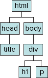

DOM 中的每个 HTML 元素都有与元素属性相对应的属性。例如，`img` 元素具有 `src` 和 `alt` 属性。然而，DOM 元素也有一组通用的属性和方法。

在 DOM 中，元素只是节点的一种类型。因此，你还需要在树中表达文档的其他节点，例如属性和文本内容。元素内部的文本内容是父元素的子节点。例如，`Pretty lame paragraph` 被视为包含它的 `p` 元素的子节点。

属性也被视为节点，但属于特殊情况。它们不参与其他节点之间的父子关系。相反，它们作为包含它们的元素节点的属性来访问。图 3-2 展示了同一个文档在 DOM 树中的表示。

图 3-2

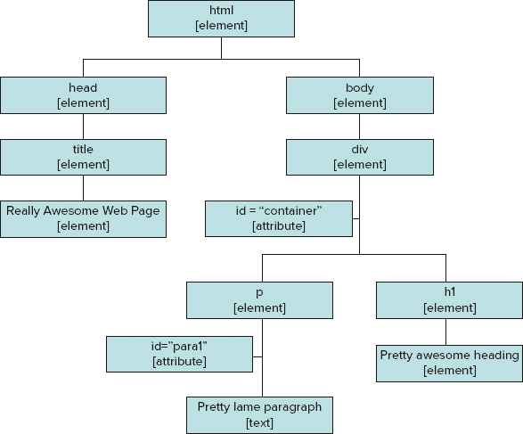

在 JavaScript 中操作 DOM 时，你通常使用 `document` 对象和 DOM 元素对象。每个 DOM 元素对象都有 `childNodes` 和 `attributes` 属性用于访问这些节点，如图 3-3 所示。如图 3-3 所示，每个节点都有一个 `nodeType` 属性，你可以用它来确定正在操作的节点类型。

图 3-3

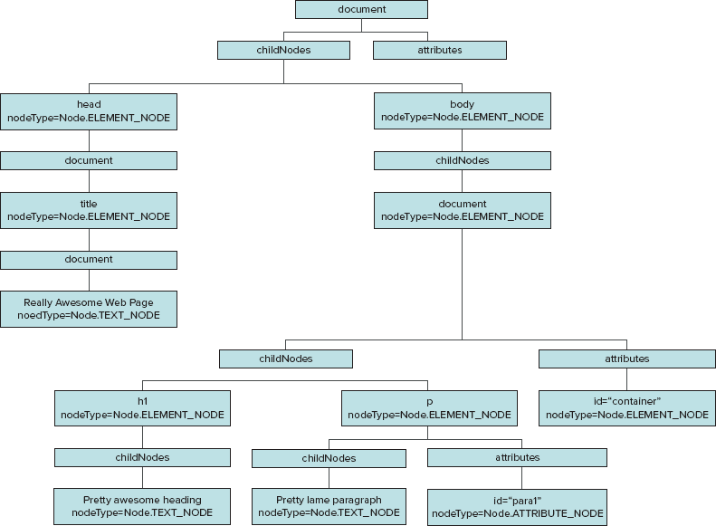

在开始访问 DOM 之前，花点时间识别 DOM 中包含的、你将使用的节点类型是很重要的。每个 DOM 节点的 `nodeType` 属性会从 `Node` 对象返回一个常量，该常量代表节点类型。这些常量包括：

- `Node.ELEMENT_NODE`
- `Node.ATTRIBUTE_NODE`
- `Node.TEXT_NODE`
- `Node.CDATA_SECTION_NODE`
- `Node.ENTITY_REFERENCE_NODE`
- `Node.ENTITY_NODE`
- `Node.PROCESSING_INSTRUCTION_NODE`
- `Node.COMMENT_NODE`
- `Node.DOCUMENT_NODE`
- `Node.DOCUMENT_TYPE_NODE`
- `Node.DOCUMENT_FRAGMENT_NODE`
- `Node.NOTATION_NODE`

每个 `Node` 常量都代表一个无符号短整数。`ELEMENT_NODE` 代表 1，`ATTRIBUTE_NODE` 等于 2，以此类推。

## 从 JavaScript 访问 DOM

你可以通过一个名为 `document` 的命名对象来访问 `document` 对象，这个命名很贴切。因此，如果你想访问 `document` 对象的属性或方法，可以直接操作。例如：

```javascript
document.open();
```

对于 DOM 中的其他元素和节点，有多种访问方式，如下所述。

### 访问特定元素

当你知道某个元素的 `id` 时，最常用的访问元素节点的方法是使用 `getElementById()`。该方法会在 DOM 中搜索，查找与指定字符串匹配的 `id` 值的节点。例如，考虑以下代码：

```html
<html>
<body>
<div id="header">
<p>Rawhide!</p>
</div>
</body>
</html>
```

如果你想访问这个 `div`，可以使用以下代码行：

```javascript
var d = document.getElementById("header");
```

现在变量 `d` 引用了 `div id="header"` 元素。你可以使用变量 `d` 来访问其属性并对其执行方法。例如，要设置其文本颜色，可以使用以下代码：

```javascript
d.style.color = #cccccc;
```

### 访问一组元素

除了访问特定元素，你有时还需要访问所有特定类型的元素节点。你也可以使用 `document` 对象的 `getElementsByTagName()` 方法来访问一组元素。该方法接受一个 HTML 元素作为参数：

```javascript
var e  = document.getElementsByTagName(elementName);
```

该方法返回所有具有指定标签名的元素，作为一个 `NodeList`，即按文档中出现顺序排列的节点集合。

例如，要获取文档中所有的 `p` 元素并以 `NodeList` 形式返回，可以输入以下代码：

```javascript
var cPara = document.getElementsByTagName("p");
```

通过这两种方法之一获取元素集合后，你可以使用索引号访问 `NodeList` 中的特定节点。例如，要访问文档中的第一个 `p` 元素，可以这样写：

```javascript
var p1 = cPara[0];
```

如果你要访问特定的 `p` 元素（例如第一个），可以将两行代码合并为一次调用：

```javascript
var p1 =  document.getElementByTagName("p")[0];
```

这将返回第一个 `p` 元素并将其赋值给变量 `p1`。

更常见的是，你可以在 `for` 循环中使用它来对每个元素执行操作：

```javascript
for (var i=0; i<cPara.length; i++)
{
    var para = cPara[i];
    para.style.color = #000000;
}
```

这段代码遍历文档中的每个 `p` 元素，并将其文本颜色改为黑色。注意，由于 `cPara` 变量是一个 `nodeList`，你可以访问其 `length` 属性来确定返回的元素数量。

此外，你可以使用 `getElementsByTagName()` 并传入 `*` 作为参数，来返回调用元素内的所有元素节点：

```javascript
var cElements = document.getElementsByTagName("*");
```

此调用返回文档中所有后代元素，无论它们处于层级结构的哪一层。

### 访问家族成员

你可以通过几个节点属性，以更“家族式”的方式访问与其他节点相关的节点：

- `parentNode` 返回当前元素的父节点。
- `firstChild` 获取节点的第一个子节点。
- `lastChild` 获取节点的最后一个子节点。
- `previousSibling` 获取父节点的 `NodeList` 中当前节点之前的节点。
- `nextSibling` 获取父节点的 `NodeList` 中当前节点之后的节点。
- `childNodes` 获取节点的所有子节点。

例如，你可以使用 `parentNode` 属性获取给定元素的父节点。考虑以下 HTML 片段：

```html
<div id="container">
<p id="p1"></p>
</div>
```

以下 JavaScript 代码返回对 `div` 元素的引用：

```javascript
iParent = document.getElementById("p1").parentNode;
```

父节点必须是 `document`、元素节点或文档片段。

此外，假设你想返回某个元素下所有直接子节点，你可以使用 `childNodes` 属性来获取其子节点作为 `NodeList` 并存储到变量中。代码如下：

```javascript
var c = document.getElementById("container");
var cChildren = c.childNodes;
```

在这段代码中，`id` 为 `container` 的元素被赋值给变量 `c`。其子节点随后被赋值给变量 `cChildren`，准备进行操作。

你还可以使用 `hasChildNodes()` 方法来检查元素是否有子节点。例如：

```javascript
var c = document.getElementById("container");
if (c.hasChildNodes() == true)
{
    var cChildren = c.childNodes;
}
```

### 检索属性

属性在技术上是 DOM 中的节点，但不要将它们视为与元素节点等同。例如，你无法通过某种 `GetAttributeByName()` 方法获取 `id` 属性节点的列表。实际上，除了极少数情况外，这样做没有实际意义，因为属性与元素密不可分。毫不意外，你可以通过访问 DOM 元素的 `attributes` 属性或使用三种方法之一来访问属性。

## 访问所有属性

该属性返回的对象称为 `NamedNodeMap` 对象，它与 `NodeList` 类似，不同之处在于其项按任意顺序列出，而非特定的定义顺序。

如果我想获取某个给定元素的属性列表，可以编写如下代码：

```javascript
var atts = document.getElementById("container").attributes;
```

然后，你可以通过访问属性的 `name` 和 `value` 属性来操作它们。例如：

```javascript
var atts = document.getElementById("container").attributes;
var str = "";

for(var i=0; i<atts.length; i++)
{
str += "Name:" + atts[i].name + " Value:" + atts[i].value + "<br/>";
}
```

这段代码获取一个元素的属性，然后将每个属性的 `name` 和 `value` 输出到 `str` 变量中。

你可以使用 `hasAttributes()` 方法检查一个元素是否拥有任何属性：

```javascript
var ctr = document.getElementById("container");
if (ctr.hasAttributes() == true)
{
    var atts = ctr.attributes;
}
```

## 访问特定属性

你也可以使用元素的 `getAttribute()` 方法访问特定属性。只需将属性名称作为参数传入。例如，假设我想从链接中获取 `href` 属性：

```javascript
var att = document.getElementById("book").getAttribute("href");
```

你还可以使用 `hasAttribute()` 方法检查属性的存在性。要检查一个元素是否具有 `style` 属性，请使用以下代码：

```javascript
var cntMajor = document.getElementById("contentMajor");
if ( cntMajor.hasAttribute("style))
{
   var att = c.getAttribute("style");
}
```

# 操作 DOM

你不仅可以利用 DOM 查看文档，实际上还可以操作它——创建节点、将节点添加到 DOM 树、编辑节点以及移除文档中不再需要的部分。

在接下来的章节中，我将向你展示如何向 DOM 添加和移除文档的各个部分。

## 创建元素及其他节点

`document` 对象提供了几种用于创建节点的方法。这里我先介绍元素节点的创建；关于其他节点的创建，请阅读本章后面的“创建其他类型节点”一节。

要创建一个元素，请使用 `document.createElement()` 方法。该方法会创建一个由参数指定的元素实例。例如，要创建一个 `p` 元素，可以这样写：

```javascript
var para = document.createElement("p");
```

`createElement()` 方法创建 `p` 元素并返回该节点，该节点被赋值给 `para` 变量。

请注意，创建元素的操作并不会自动将其添加到 DOM 树中。该实例仅存在于你的脚本中，直到你显式地添加它。它处于一种“悬空”状态，可以说是一个“无国籍”的节点。相反，你需要将其插入到文档层次结构中，才能成为 DOM 的正式节点。

## 将节点添加到 DOM

DOM 元素提供了两种方法用于将节点添加到树中：


`appendChild(node)` 将节点作为当前元素的`childNodes`列表末尾的子节点添加。

`insertBefore(newNode, targetNode)` 将新元素作为当前节点的子节点添加，但将其插入到`targetNode`参数指定的节点之前。

### 动手试一试：添加一个 DOM 节点

为了演示如何添加节点，请按照以下步骤操作。

1. 在文本编辑器中创建以下 HTML 文档，并将其保存为`BIDHJ-Ch03-Ex1.html`。


```html
<html>
<head>
<title>FavFilms</title>
</head>
<body>
<div id="content">
<h1 id="header1">Welcome to the World of Cinema</p>
<p id="p1">Favorite films are shown below:</p>
<ol id="movieList">
<li id="film_30329">The Shawshank Redemption</li>
<li id="film_30202">Casablanca</li>
<li id="film_20216">Braveheart</li>
<li id="film_28337">Groundhog Day</li>
<ol>
</div>
</body>
</html>
```

代码片段`BIDHJ-Ch03-Ex1.html`

2. 在文档头部添加以下脚本代码，并保存文件：


```javascript
<script type="application/x-javascript">
var fa = document.createElement("li");
document.getElementById("movieList").appendChild(fa);
var fb = document.createElement("li");
var casa = document.getElementById("film_30202");
document.getElementById("movieList.).insertBefore(fb, casa);

var fb = document.createElement("li");
var br = document.getElementById("film_20216");
document.getElementById("movieList.).insertBefore(fb, br.nextSibling);
</script>
```

代码片段`BIDHJ-Ch03-Ex1.html`

#### 工作原理

当文档加载时，脚本被执行。前两行代码将一个空的`li`元素追加到列表末尾。接下来的三行使用`insertBefore()`在 Casablanca 之前的位置添加了一个空白的`li`项。

虽然不存在`insertAfter()`方法，但你可以通过将`insertBefore()`与`targetNode`的`nextSibling`属性结合使用来实现相同的功能。这正是我在脚本最后部分所做的，用于在 Braveheart 之后添加一个节点。

现在来看看结果。有序列表已更新，包含了新添加的元素：

```html
<ol id="movieList">
<li id="film_30329">The Shawshank Redemption</li>
<li/>
<li id="film_30202">Casablanca</li>
<li id="film_20216">Braveheart</li>
<li/>
<li id="film_28337">Groundhog Day</li>
<li/>
<ol>
```

## 创建其他元素

`document`对象包含用于创建其余常见节点类型的方法：属性节点、文本节点、注释节点和文档片段。这些方法各自返回一个节点，你可以使用`appendChild()`或`insertBefore()`将其添加到文档中。

属性节点表示元素的属性。要创建属性，请使用`createAttribute()`。例如：

```javascript
var a = document.createAttribute("alt");
a.nodeValue = "Welcome to DOM and DOMMER."
document.getElementById("logo").appendChild(a);
```

文本节点是文本的容器。当你初次接触 DOM 时，很可能会认为文本是元素的一个属性。但实际上，元素内部的文本是由一个子文本节点包含的。要创建文本节点，请使用`createTextNode()`。例如，以下代码片段创建一个文本节点，并将其添加到`id`为`para`的`p`元素的末尾：

```javascript
var t = document.createTextNode("I scream for ice cream.");
document.getElementById("para").appendChild(t);
```

注释节点表示 HTML 注释。要创建注释节点，请使用`createComment()`：

```javascript
var c = document.createComment("Insert new toolbar here.");
document.getElementById("toolbar_container").appendChild(c);
```

最后，文档片段是一个临时的“离线”文档，你可以用它来创建和修改树的一部分，然后再将片段添加到实际的 DOM 树中。在操作 DOM 时，处理子树的过程中使用文档片段比直接操作实际 DOM 要高效得多（开销更小）。要创建文档片段，请使用`createDocumentFragment()`。例如，以下脚本创建一个文档片段，向其中添加节点，最后将其添加到文档中：

```javascript
var df = document.createDocumentFragment();

for(var i=0; i<30; i++)
{
var e = document.createElement("p");
var t = document.createTextNode("Line " + i);
e.appendChild(t);
df.appendChild(e);
}

document.getElementById("content").appendChild(df);
```

### 动手试一试：添加一个完整节点

现在你已经知道如何创建其他节点类型，我想重新回顾一下电影列表示例。这次不是添加空的`li`元素，而是添加所需的属性和文本节点来正确填充有序列表。请按照以下步骤操作。

1. 在你的文本编辑器中创建以下 HTML 文档，然后将文档保存为`BIDHJ-Ch03-Ex2.html`。


```html
<html>
<head>
<title>FavFilms</title>
</head>
<body>
<div id="content">
<h1 id="header1">Welcome to the World of Cinema</p>
<p id="p1">Favorite films are shown below:</p>
<ol id="movieList">
<li id="film_30329">The Shawshank Redemption</li>
<li id="film_30202">Casablanca</li>
<li id="film_20216">Braveheart</li>
<li id="film_28337">Groundhog Day</li>
<ol>
</div>
</body>
</html>
```

代码片段`BIDHJ-Ch03-Ex2.html`

2. 在文档头部添加以下脚本代码并保存文件：


```javascript
<script type="application/x-javascript">
    var e; // Element
    var a; // Attribute
    var t; // Text
    var nd; // Target/Parent

    e = document.createElement("li");
    a = document.createAttribute("id", "film_29299");
    t = document.createTextNode("Babette's Feast");
    e.appendChild(a);
    e.appendChild(t);
    document.getElementById("movieList").appendChild(e);

    e = document.createElement("li");
    a = document.createAttribute("id", "film_29323");
    t = document.createTextNode("Amélie (Le Fabuleux destin d'Amélie Poulain)");
    e.appendChild(a);
    e.appendChild(t);
    nd = document.getElementById("film_30202");
    document.getElementById("movieList.).insertBefore(e, nd);
    e = document.createElement("li");
    a = document.createAttribute("id", "film_30276");
    t = document.createTextNode("Vertigo");
    e.appendChild(a);
    e.appendChild(t);
    nd = document.getElementById("film_20216");
    document.getElementById("movieList.).insertBefore(f, nd.nextSibling);
</script>
```

代码片段`BIDHJ-Ch03-Ex2.html`

#### 工作原理

在本例中，JavaScript 在文档加载时执行。脚本使用`document`的`createElement()`、`createAttribute()`和`createTextNode()`方法创建一个完整、完备的`li`元素以添加到列表中。然后使用`appendChild()`和`insertBefore()`按所需顺序将元素添加到列表中。脚本执行后，有序列表如下所示：

```html
<ol id="movieList">
<li id="film_30329">The Shawshank Redemption</li>
<li id="film_29323">Amélie (Le Fabuleux destin d'Amélie Poulain)</li>
<li id="film_30202">Casablanca</li>
<li id="film_20216">Braveheart</li>
<li id="film_30276">Vertigo</li>
<li id="film_28337">Groundhog Day</li>
<li id="film_29299">Babette's Feast</li>
<ol>
```

## 为属性设置值

`setAttribute()`方法是创建属性并将其添加到元素的一种快捷方式。该方法为元素设置属性值，但如果属性不存在，该方法会直接创建它。它接受属性名称和值作为参数：

```javascript
setAttribute("name", "value")
```

例如，如果你想更改链接的`href`，可以使用以下代码：

```javascript
document.getElementById("myblog").setAttribute("href",
   "http://richwagnerwords.com");
```

下面是一个更详细的示例，演示如何使用`setAtttribute()`来清理文档。假设你有一个 HTML 文档，其中包含大写字母命名的属性。如果你想将它们全部转换为小写，可以使用以下脚本：

```javascript
var all = document.getElementsByTagName("*");
for(var i=0; i<all.length; i++)
{
    var e = all[i];   

    for(var j=0; j<all.length; j++)
    {
        e.attibutes[j].setAttribute(all.attibutes[j].nodeName.toLowerCase());
    }
}
```

该脚本查找文档中的所有元素，并将它们作为`NodeList`返回。第一个`for`循环遍历所有元素，并将变量`e`赋值为循环中的当前元素。第二个`for`循环遍历`e`的所有属性，并使用`setAttribute()`结合`toLowerCase()`。

## 移动节点

虽然 JavaScript 中没有定义`moveNode()`方法，但`appendChild()`和`insertBefore()`可以实现相同的功能。除了添加你创建的新节点外，这两个方法还允许你将节点从树中的一个位置移动到另一个位置。例如，考虑以下文档：

```html
<html>
<head>
</head>
<body>
<div id="header">

</div>
<div id="footer">
</div>
</body>
</html>
```

如果你想将图片从头部移动到页脚，可以编写：

```javascript
var i = document.getElementById("logoImg");
document.getElementById("footer").appendChild(i);
```

当这段代码执行时，`appendChild()`方法会将`logoImg`从任何位置移动并作为子节点添加到页脚的`div`中。

## 克隆节点

你可以使用 DOM 元素的`cloneNode()`方法克隆一个节点并将其添加到文档树的其他位置。该方法复制指定的节点并返回一个不属于 DOM 的新实例。然后你可以使用熟悉的`appendChild()`和`insertBefore()`方法将其添加到任何位置。

该方法接受一个布尔参数：

```javascript
cloneNode(deepBoolean)
```

如果参数设置为`true`，则当前节点的所有子节点也会被一起复制。

克隆节点时实际上存在一个危险因素。使用`cloneNode()`时，节点的每个部分都会随之复制，包括其`id`。因此，在将其添加到文档树之前，你需要确保更新`id`。

为了演示，我从以下文档开始：

```html
<html>
<head>
</head>
<body>
<div id="right_box">
<p id="main">All content should begin with this sentence.</p>
</div>
<div id="left_box">
</div>
</body>
</html>
```

假设我想将段落复制到`left_box`div 中。为此，我可以编写以下代码：

```javascript
var cn = document.getElementById("right_box").cloneNode(true);
cn.setAtttribute("id", "main_left");
document.getElementById("left_box").appendChild(cn);
```

## 从 DOM 中移除节点

要移除节点，你需要调用其父节点的`removeChild()`方法，并将该节点作为参数指定。例如，要移除一个`id="p1"`的段落，可以使用以下代码片段：

```javascript
var cp = document.getElementById("p1");
cp.parentNode.removeChild(cp);
```

在这段代码中，变量`cp`被赋值为指定段落元素返回的节点。通过`parentNode`引用其父节点，然后调用`removeChild()`方法，并将`cp`指定为要删除的节点。该段落将从 DOM 中移除。

或者，假设你想移除一个元素中的所有子节点。为此，你可以遍历所有子节点并逐个删除。以下是你可以使用的代码：

```javascript
while ( bodyContent.childNodes[0] )
{
bodyContent.removeChild( bodyContent.childNodes[0];
}
```

在这个例程中，`while`循环检查当前节点是否存在子节点。如果存在，则使用`removeChild()`移除该子节点。此过程重复进行，直到没有`childNodes[0]`为止。

## 移除属性

假设你受够了某个属性，只想摆脱痛苦和烦恼。或者你只是不再需要它了。如果是这样，你可以使用`removeAttribute()`方法从 DOM 中删除一个属性。下面这个相当严厉的脚本会删除文档中所有的`alt`属性——纯粹出于恶意！代码如下：

```javascript
var kitAndKaboodle = document.getElementsByTagName("*");
for(var i=0; i<kitAndKaboodle.length; i++)
{
    kitAndKaboodle[i].removeAttribute("alt");
}
```

## 练习

1. DOM 的主要“构建块”是什么？


2. 判断对错？DOM 层次结构必须始终与 HTML 文档的自然元素层次结构完全一致。

3. 什么是 `NodeList`？

4. 什么是文档片段？

练习答案见附录 A。

## 本章所学内容

| 主题 | 关键概念 |
| --- | --- |
| 从 DOM 中访问元素 | 使用 `document.getElementById()` 或 `document.getElementsByTagName()`。 |
| 访问属性 | 使用节点的 `attributes` 属性获取属性列表；使用 `getAttribute()` 获取特定属性值。 |
| 添加或编辑 DOM | 使用 `document.createElement()` 在 DOM 中创建元素。使用 `appendChild()` 或 `insertBefore()` 添加到 DOM。 |

## 第 4 章：编写你的第一个 Hello World 应用

### 本章你将学到

- 创建你的索引页面
- 添加样式
- 用 JavaScript 编写 UI
- 部署你的应用

好了，准备工作已经足够。是时候开始开发你的第一个应用了。在本章中，我将带你完整地走一遍从开始到结束开发第一个 Hello World 应用的全过程，该应用可在所有 iOS 平台（iPhone、iPad 和 iPod touch）上运行。

每当你创建一个 Web 应用时，你可以决定是完全从头开始自己创建所有内容，还是利用一个框架来获得基本的应用外观和感觉。自己创建所有内容的好处是你可以完全控制应用的各个部分。当然，缺点是你必须自己创建所有内容。

在本书中，我会多次讨论如何自己创建应用的不同部分。不过，为了快速上手，我建议你使用一个移动框架来快速启动。因此，在本章中，我将利用一个流行的 Web 应用移动框架——jQueryMobile——来创建一个 iPhone Web 应用。使用 jQueryMobile，你可以只关注应用本身的内容和核心，而让框架为你处理大部分样式和交互。

## 设置

在开始开发应用之前，你需要在远程 Web 服务器或开发机器上的服务器上为你的应用设置一个位置。确保该服务器可以通过 Wi-Fi 从 iOS 设备访问。

### 动手实践：为你的 Web 应用创建位置

按照以下步骤为你的 Hello World 应用设置一个位置。

1. 确定你希望在哪里设置开发服务器——是在远程服务器上，还是在开发机器上运行的服务器上。

2. 如果服务器是远程的，通过 FTP 连接到你的服务器。如果你使用的是开发机器，找到服务器的主文档目录。（如果你使用的是 Mac，这通常是用户目录下的 `Sites` 文件夹。）

3. 创建一个名为 `webapp` 的文件夹。

4. 在 `webapp` 内部，再创建一个名为 `topfilmz` 的文件夹。

#### 工作原理

你的第一个任务是准备一个存放应用文件的基础位置。它可以位于你的开发机器上，或者如果你有可用的远程服务器，也可以放在那里。在这个例子中，你不会使用应用服务器，所以实际上没有区别。

如果你在开发机器上使用 Web 服务器，你需要知道访问 Web 应用的地址。如果你使用的是 Mac，一个简单的方法是执行以下操作：

1. 前往系统偏好设置。
2. 点击共享图标。
3. 记下你的个人网站地址，即你的 `Sites` 文件夹。在我的例子中，它是 [`10.0.0.6/~rwagner`](http://10.0.0.6/~rwagner)。

## 创建你的索引页面

你要创建的应用展示了一种流行的移动应用风格——基于导航列表的应用。这个应用我称之为 Top Filmz，目的是显示一个顶级电影列表。用户可以点击列表中的一部电影，查看该电影的详情页面。详情页面显示电影的海报图片和两个按钮——一个将用户带到 IMDB 上的电影页面，另一个将用户返回到主电影列表。

尽管应用看起来有多个不同的页面（一个主列表，以及每部电影的单独页面），但实际上我将把所有代码放在一个 HTML 文件中。

### 动手实践：创建索引页面

要创建应用的基本框架，请按照以下步骤操作：

1. 在你的 `topfilmz` 文件夹中创建一个新的文本文件，并将其保存为 `index.html`。

2. 输入以下 HTML 文本：

```html
<!DOCTYPE html>
<html>
<head>
<title>Top Filmz</title>
</head>
<body>
</body>
</html>
```

3. 在文档头部添加视口 meta 标签：

```html
<meta name="viewport" content="width=device-width, initial-scale=1">
```

4. 在文档头部添加对核心 jQuery Mobile 样式表和 JavaScript 文件的引用：

```html
<link rel="stylesheet"
      href="http://code.jquery.com/mobile/1.0b3/jquery.mobile-1.0b3.min.css" />
<script
    type="text/javascript" src="http://code.jquery.com/jquery-1.6.3.min.js">
</script>
<script
    type="text/javascript"
    src="http://code.jquery.com/mobile/1.0b3/jquery.mobile-1.0b3.min.js">
</script>
```

5. 保存你的文件。

#### 工作原理

通过这五个步骤，你创建了任何 jQuery Mobile 应用的基本框架。jQuery Mobile 框架要求页面以 HTML5 的 `<!DOCTYPE html>` 开头，以确保框架的所有功能对你可用。

视口 meta 标签确保浏览器将页面宽度设置为设备屏幕的像素宽度，而不是像 Safari 默认那样缩小到 900 像素的页面宽度。

出于性能考虑，对 jQuery Mobile 框架的链接直接指向 jQuery 托管的文件，而不是放在你自己的服务器上。

## 创建主屏幕

在 `index.html` 的 body 元素内部，你可以为 Web 应用的主屏幕（或页面）添加内容。在 jQuery Mobile 中，你可以在一个 div 元素内指定一个页面，并添加自定义的 `data-role="page"` 属性。

在应用中，你可以在页面上放置任何你想要的内容。然而，许多应用使用的典型模板是标准的头部-内容-底部划分。你可以通过以下代码在 jQuery Mobile 中实现这一点：

```html
<div data-role="page">
    <div data-role="header">
    </div>

    <div data-role="content">
    </div>

    <div data-role="footer">
    </div>
</div>
```

注意，div 元素的角色是通过 `data-role` 属性声明的。

页面的内容部分显示一个可滚动的电影名称导航列表。你可以通过使用无序列表并为其添加 `data-role="listview"` 属性来非常简单地创建列表。各个 li 项代表滚动列表的行。a 链接指向用户点击列表项时要跳转的目标。

```html
<ul data-role="listview">
    <li><a href=""></a></li>
    <li><a href=""></a></li>
    <li><a href=""></a></li>
    <li><a href=""></a></li>
</ul>
```

这里有一个使用 jQuery Mobile 这样的框架的优势。当你的页面被 jQuery Mobile 框架处理时，这个列表会被转换成一个样式化的滚动列表，跨越设备屏幕的整个宽度。

### 动手实践：创建应用的主屏幕

按照以下说明设置 Top Filmz 应用的主屏幕：

1. 在你的 `index.html` 文件的 body 标签内，添加以下 div 结构：


```html
<div data-role="page" id="home">
    <div data-role="header">
    </div>

    <div data-role="content">
    </div>

    <div data-role="footer">
    </div>
</div>
```

代码片段 `index.html`

2. 在头部 div 内，添加应用标题：


```html
<div data-role="header">
    <h1>Top Filmz</h1>
</div>
```

代码片段 `index.html`

3. 在底部 div 内，添加版权信息：


```html
<div data-role="footer">
    <h5>Hello World Apps</h5>
</div>
```

代码片段 `index.html`

4. 在内容 div 内，添加将被转换为滚动列表的标记：


```html
<div data-role="content">
    <ul data-role="listview" data-theme="b">
        <li><a href="#theShawshankRemption">肖申克的救赎</a></li>
        <li><a href="#casablanca">卡萨布兰卡</a></li>
        <li><a href="#larsAndTheRealGirl">拉斯和真正的女孩</a></li>
        <li><a href="#babettesFeast">芭贝特的盛宴</a></li>
        <li><a href="#groundhogDay">土拨鼠之日</a></li>
        <li><a href="#lesMiserables">悲惨世界</a></li>
        <li><a href="#thePrincessBride">公主新娘</a></li>
        <li><a href="#chariotsOfFire">烈火战车</a></li>
        <li><a href="#signs">天兆</a></li>
        <li><a href="#vertigo">迷魂记</a></li>
    </ul>
</div>
```

代码片段 `index.html`

5. 保存你的文件。

#### 工作原理

在本练习中，你通过创建这个 `div` 结构来构建应用的首个页面。应用标题使用 `<h1>` 标签添加到页眉中，而页脚则使用 `<h5>` 标签显示一条虚拟的版权信息。电影滚动列表显示在无序列表中。注意，每个链接的 `href` 属性指定了一个内部锚点式链接。下一节我将展示这些链接如何连接到其他电影详情页面。

注意列表元素的 `data-theme` 属性。jQuery Mobile 提供了五种颜色主题可供选择。在本例中，我选择了 `b`，它会使列表项显示为深色。

虽然应用尚未具备完整功能，但你可以先在 iPhone 或其他 iOS 设备上打开页面，一睹主屏幕的风采。只需在开发服务器上输入应用的 URL 即可。以我为例，我会输入 [`10.0.0.6/~rwagner/webapp/topfilmz.`](http://10.0.0.6/~rwagner/webapp/topfilmz.)

## 添加详情页面

如前所述，一个 HTML 文件可以包含 jQuery Mobile 网页应用的多个“虚拟页面”。与图 4-1 所示的主屏幕类似，每个附加页面都表示为一个带有唯一 ID 的 div。然后，要从另一个页面的链接显示该页面，只需将页面 ID 作为 `href` 值，并以 `#` 号开头（`href="#mypage"`）。当用户点击 `#link` 时，jQuery Mobile 会查找“虚拟”页面并将其显示在视口中。

图 4-1

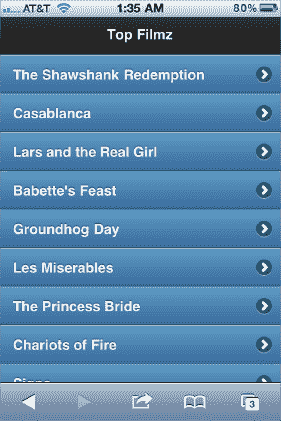

以下是详情页面的基本结构：

```html
<div data-role="page" id="uniqueID">
    <div data-role="header">
        <h1>电影标题</h1>
    </div>
    <div data-role="content" style="background-color:#ffffff">
        
        <a href="" data-role="button">前往 IMDB 页面</a>
        <a href="#home" data-role="button" data-icon="home">返回列表</a>
    </div>
    <div data-role="footer">
        <h5>Hello World 应用</h5>
    </div>
</div>
```

页眉和页脚与主屏幕上的样式相同，因此无需赘述。不过，在页面的内容区域中，有一张图片和两个链接。注意，这些链接带有 `data-role="button"` 属性。当页面显示时，jQuery Mobile 会将链接转换为按钮。

以该页面模板为模型，你可以为列表中的所有电影添加详情页面。详情页面的代码显示在清单 4-1 的 body 部分的子页面（Subpages）下。


```text
LISTING 4-1: Full source of index.html
```


```html
<!DOCTYPE html>
<html>
    <head>
    <title>Top Filmz</title>

    <meta name="viewport" content="width=device-width, initial-scale=1">

    <link rel="stylesheet"
     href="http://code.jquery.com/mobile/1.0b3/jquery.mobile-1.0b3.min.css" />
    <script
     type="text/javascript" src="http://code.jquery.com/jquery-1.6.3.min.js">
     </script>
    <script type="text/javascript"
      src="http://code.jquery.com/mobile/1.0b3/jquery.mobile-1.0b3.min.js">
     </script>

<style>
    img.poster
    {
        display: block;
        margin-left: auto;
        margin-right: auto
    }  
</style>

</head>

<body>

<!-- Page -->
<div data-role="page" id="home">
    <div data-role="header">
    <h1>Top Filmz</h1>
    </div>

    <div data-role="content">
    <ul data-role="listview" data-theme="b">
        <li><a href="#theShawshankRemption">The Shawshank Redemption</a></li>
        <li><a href="#casablanca">Casablanca</a></li>
        <li><a href="#larsAndTheRealGirl">Lars and the Real Girl</a></li>
        <li><a href="#babettesFeast">Babette's Feast</a></li>
        <li><a href="#groundhogDay">Groundhog Day</a></li>
        <li><a href="#lesMiserables">Les Miserables</a></li>
        <li><a href="#thePrincessBride">The Princess Bride</a></li>
        <li><a href="#chariotsOfFire">Chariots of Fire</a></li>
        <li><a href="#signs">Signs</a></li>
        <li><a href="#vertigo">Vertigo</a></li>
    </ul>
    </div>

    <div data-role="footer">
    <h5>Hello World Apps</h5>
    </div>
</div>

<!-- Subpages -->

<div data-role="page" id="theShawshankRemption">
    <div data-role="header">
    <h1>The Shawshank Redemption</h1>
    </div>
    <div data-role="content" style="background-color:#ffffff">
    
    <a href="http://www.imdb.com/title/tt0111161/"
     data-role="button">Go to IMDB Page</a>
    <a href="#home" data-role="button" data-icon="home">Return to List</a>
    </div>
    <div data-role="footer">
    <h5>Hello World Apps</h5>
    </div>
</div>

<div data-role="page" id="casablanca">
    <div data-role="header">
    <h1>Casablanca</h1>
    </div>
    <div data-role="content" style="background-color:#ffffff">
    
    <a href="http://www.imdb.com/title/tt0034583/"
     data-role="button">Go to IMDB Page</a>
    <a href="#home" data-role="button" data-icon="home">Return to List</a>
    </div>
    <div data-role="footer">
    <h5>Hello World Apps</h5>
    </div>
</div>

<div data-role="page" id="larsAndTheRealGirl">
    <div data-role="header">
    <h1>Lars and the Real Girl</h1>
    </div>
    <div data-role="content" style="background-color:#ffffff">
    
    <a href="http://www.imdb.com/title/tt0805564/"
     data-role="button">Go to IMDB Page</a>
    <a href="#home" data-role="button" data-icon="home">Return to List</a>
    </div>
    <div data-role="footer">
    <h5>Hello World Apps</h5>
    </div>
</div>

<div data-role="page" id="babettesFeast">
    <div data-role="header">
    <h1>Babette's Feast</h1>
    </div>
    <div data-role="content" style="background-color:#ffffff">
    
    <a href="http://www.imdb.com/title/tt0092603/"
     data-role="button">Go to IMDB Page</a>
    <a href="#home" data-role="button" data-icon="home">Return to List</a>
    </div>
    <div data-role="footer">
    <h5>Hello World Apps</h5>
    </div>
</div>

<div data-role="page" id="groundhogDay">
    <div data-role="header">
    <h1>Groundhog Day</h1>
    </div>
    <div data-role="content" style="background-color:#ffffff">
    
    <a href="http://www.imdb.com/title/tt0107048/"
      data-role="button">Go to IMDB Page</a>
    <a href="#home" data-role="button" data-icon="home">Return to List</a>
    </div>
    <div data-role="footer">
    <h5>Hello World Apps</h5>
    </div>
</div>

<div data-role="page" id="lesMiserables">
    <div data-role="header">
    <h1>Les Miserables</h1>
    </div>
    <div data-role="content" style="background-color:#ffffff">
    
    <a href="http://www.imdb.com/title/tt0119683/"
     data-role="button">Go to IMDB Page</a>
    <a href="#home" data-role="button" data-icon="home">Return to List</a>
    </div>
    <div data-role="footer">
    <h5>Hello World Apps</h5>
    </div>
</div>

<div data-role="page" id="thePrincessBride">
    <div data-role="header">
    <h1>The Princess Bride</h1>
    </div>
    <div data-role="content" style="background-color:#ffffff">
    
    <a href="http://www.imdb.com/title/tt0093779/"
     data-role="button">Go to IMDB Page</a>
    <a href="#home" data-role="button" data-icon="home">Return to List</a>
    </div>
    <div data-role="footer">
    <h5>Hello World Apps</h5>
    </div>
</div>

<div data-role="page" id="chariotsOfFire">
    <div data-role="header">
    <h1>Chariots of Fire</h1>
    </div>
    <div data-role="content" style="background-color:#ffffff">
    
    <a href="http://www.imdb.com/title/tt0082158/"
     data-role="button">Go to IMDB Page</a>
    <a href="#home" data-role="button" data-icon="home">Return to List</a>
    </div>
    <div data-role="footer">
    <h5>Hello World Apps</h5>
    </div>
</div>

<div data-role="page" id="signs">
    <div data-role="header">
    <h1>Signs</h1>
    </div>
    <div data-role="content" style="background-color:#ffffff">
    
    <a href="http://www.imdb.com/title/tt0286106/"
     data-role="button">Go to IMDB Page</a>
    <a href="#home" data-role="button" data-icon="home">Return to List</a>
    </div>
    <div data-role="footer">
    <h5>Hello World Apps</h5>
    </div>
</div>

<div data-role="page" id="vertigo">
    <div data-role="header">
    <h1>Vertigo</h1>
    </div>
    <div data-role="content" style="background-color:#ffffff">
    
    <a href="http://www.imdb.com/title/tt0052357/"
     data-role="button">Go to IMDB Page</a>
    <a href="#home" data-role="button" data-icon="home">Return to List</a>
    </div>
    <div data-role="footer">
    <h5>Hello World Apps</h5>
    </div>
</div>

</body>
</html>
```

当你保存文件并在 iOS 设备中刷新后，你可以从主屏幕点击任意电影，跳转到其详情页面。注意，当你点击列表项时，jQuery Mobile 会自动添加滑动过渡效果，同时显示对应的详情页面。

图 4-2 和图 4-3 展示了卡萨布兰卡页面的内容。

图 4-2

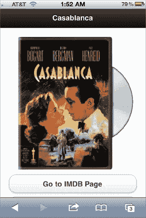

图 4-3

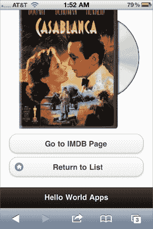

就是这样！你已经创建了你的第一个 iPhone 应用。不过，这里还有一个彩蛋奖励给你。如果你有一台 iPad，请用 iPad 版 Safari 打开这个网页应用。惊喜吧！jQuery Mobile 会自动以适合 iPad 的定制方式显示该应用，如图 4-4 和图 4-5 所示。在结束这个 Hello World 章节时，你可以看到使用像 jQuery Mobile 这样的移动框架的一个实际好处——你甚至在不经意间就创建了一个 iPad 应用。

图 4-4

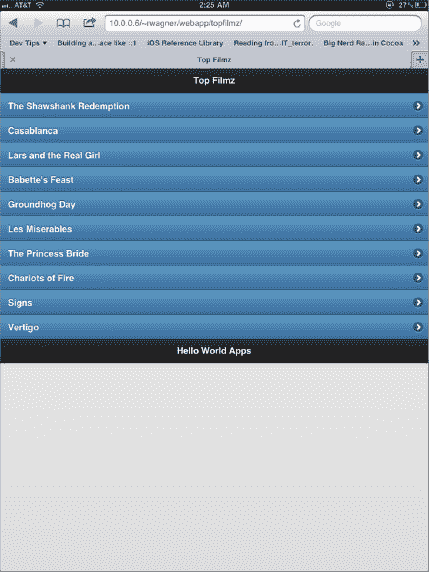

图 4-5

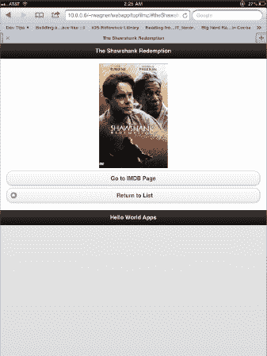

## 练习

1. 使用像 jQuery Mobile 这样的移动框架有什么好处？
2. 对于基于 jQuery Mobile 的应用，所有应用页面都需要存储在单独的文件中吗？
3. 如何链接到同一 HTML 文件中的另一个页面？

练习答案见附录。

## 本章所学内容

| 主题 | 关键概念 |
| --- | --- |
| 为你的网页应用找到位置 | 确定你希望在哪里搭建开发者服务器——要么在远程服务器上，要么在你的开发机器上运行的服务器上。 |
| 使用 jQuery Mobile 作为移动应用框架 | 使用 `<!DOCTYPE html>` 并添加指向 jQuery 样式表和 JavaScript 文件的链接 |
| 在 jQuery Mobile 应用中添加页面 | 使用带有 `data-role="page"` 属性的 `div` 元素 |

# 第 5 章：为 iPhone 和 iPad 启用并优化网站

#### 本章你将学到：

- 让你的网站兼容 iOS 设备
- 让你的网站易于从 iPhone 和 iPad 导航
- 为 iOS 设备添加自定义样式表

尽管本书专注于为 iOS 设备开发网页应用，但现实是，你可能还需要处理设计一个兼容 iPhone 和 iPad 的网站。


我记得 2007 年 iPhone 刚发布时，我在上面浏览网页遇到了麻烦。记得有一天晚上，我和孩子们正在观看周一橄榄球之夜第三节比赛。突然全镇停电了。因为我儿子最喜欢的球队正在比赛，他急得不行。比赛怎么样了？泰坦队还在赢吗？我立刻掏出 iPhone，自信地打开 Safari 寻找答案。但当我访问 [NFL.com](http://NFL.com) 时，发现它的实时更新记分牌是 Adobe Flash 媒体。我只能看到一个灰色框，里面有一个乐高积木似的东西。然后我把浏览器指向田纳西泰坦队的官方网站，结果发现首页上也散落着更多无用的空白框。停电剩下的时间里，我们只能用 iPhone 在网上搜索，寻找一个能帮到我们的体育网站。

快进到今天。iPhone 和 iPad 用户的期望与 2007 年时大不相同。那时，我只会接受缺乏移动支持是走在技术前沿的必然代价。然而，今天，如果你设计或运营一个网站，你的访客可不会那么宽容。

过去，你可以为移动用户设计一个极简的纯文本样式表，并期望你的普通网站只被桌面浏览器访问。但 iOS 用户的期望可没那么低。他们希望在手掌中浏览完整的网页。因此，当你设计和开发网站时，你需要考虑为这些苹果设备提供何种程度的支持。你是仅仅提供兼容性和设备友好性，还是甚至专门为 iOS 用户创建设计？本章将介绍为 iOS 上的 Safari 启用网站的四个层级：

- 第一层：iOS 兼容性
- 第二层：导航友好性
- 第三层：设备特定样式表
- 第四层：专用替代网站

## 第一层：iOS 兼容性

对 iOS 的第一层支持仅仅是让你的网站在 iOS 上的 Safari 中正常工作。幸运的是，由于 Safari 是一个成熟的浏览器，其能力远比典型的移动浏览器更接近桌面，这通常不成问题。但也有一些“陷阱”，包括：

- 不支持 Adobe Flash 媒体、Java 小程序和插件。
- 不能使用 CSS 属性 `position:fixed`。
- JavaScript 函数 `showModalDialog()` 和 `print()` 在 iOS 上的 Safari 中无法运行。
- 不支持下载和上传（包括 HTML 元素 `input type="file"`）。

鉴于 Flash 的广泛流行和桌面安装基础，它是许多网页设计师和开发者面临的最棘手的兼容性问题。在初代 iPhone 发布之前，Flash 支持通常被认为是理所当然的，除非用户比例相对较小。事实上，许多设计师可以理所当然地认为，如果一个用户在没有 Flash 支持的情况下访问网站，那么他很可能也不是目标访客，因此设计师可以忽略该用户，或者直接让他去 Adobe 下载页面。然而，随着 iOS 设备的普及，这些假设已经不再成立。过去三年里，网页设计师被迫重新思考他们网站对一种他们曾经依赖的技术的依赖。图 5-1 和 5-2 展示了一个残酷的现实：一个在 Mac OS X 版 Safari 中看起来非常出色的尖端网站，却从未考虑过 iPhone 用户。

图 5-1

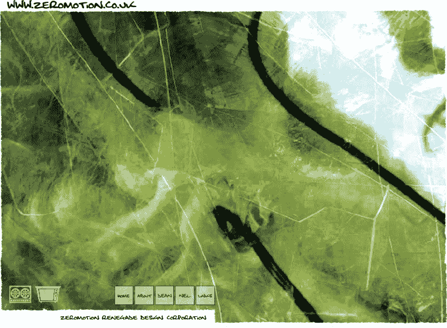

图 5-2

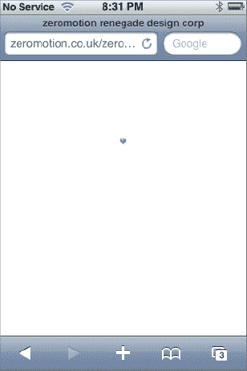

因此，如果你计划在页面的交互部分使用 Flash，那么你也应该计划优雅地降级为静态图形或替代内容。至少，你应该在 Flash 内容上放置一个免责声明。这并不理想，但总比空白框好。或者，如果你有一个 Flash 驱动的网站（如图 5-1 所示），那么你应该考虑一个替代的 HTML 网站，或者如果有必要，甚至是一个 iOS 或移动专用网站。

为了检测 Flash 支持，一种解决方案是使用 SWFObject，这是一个用于检测和嵌入 Flash 内容的开源 JavaScript 库（可在 [`code.google.com/p/swfobject/`](http://code.google.com/p/swfobject/) 获取）。SWFObject 并非 iOS 专用，但它封装了 Flash Player 检测逻辑，使你能够轻松地为 iOS 上的 Safari 优雅降级。例如，以下代码为支持 Flash 的桌面浏览器显示一个 Flash 文件，而为非 Flash 访客（包括 iOS 用户）显示一个启动画面 `.png` 图形：

```html
<!DOCTYPE html PUBLIC "-//W3C//DTD XHTML 1.0 Strict//EN"
            "http://www.w3.org/TR/xhtml1/DTD/xhtml1-strict.dtd">
<html xmlns="http://www.w3.org/1999/xhtml">
<head>
<title>公司 XY 首页</title>
<meta name="viewport" content="width=780">
<script type="text/javascript" src="swfobject.js"></script>
</head>
<body>
<div id="splashintro">
<a href="more.html"></a>
</div>
<script type="text/javascript">
   var so = new SWFObject("csplash.swf", "company_intro", "300", "240", "8",
    "#338899");
   so.write("splashintro");
</script>
</body>
</html>
```

如你所见，`swfobject.js` 库文件被添加到首页。当 Flash 可用时，脚本会将 `splashintro` div 的内容替换为 Flash 媒体。当不支持 Flash 时，则在 `splashintro` div 内替换为适当的内容。

因此，至少你应该努力让你的网站完全感知并兼容 iPhone 用户的 Safari。

## 第二层：导航友好的网站

当你的网站在 iOS 用户面前优雅降级时，你就已经实现了对苹果移动设备的基本支持。然而，尽管用户可能能够看到网站的所有内容，但对于使用 Safari 的 iOS 用户来说，导航和阅读可能仍然不太方便。例如，一大段文本在 iPad 上可能完全没问题，但对于 iPhone 和 iPod touch 用户来说，却可能成为阅读障碍，因为当用户放大阅读时，需要水平滚动。考虑到这一点，第二层支持就是以易于 Safari 缩放和导航的方式构建网站结构。

## 使用视口

视口是一个矩形屏幕空间区域，网页在其中显示。它决定了内容如何显示以及如何缩放以适应 iPhone 或 iPad。使用视口类似于通过相机变焦镜头观看山脉的全景风光。如果你想看到整个山腰，就使用广角变焦拉远。这样你就能看到一切，但每座山的细节会变小且难以辨认。相反，如果你想看到其中一座山峰的特写，就用长焦镜头拉近。在相机的取景器中，你再也看不到整个山脉，但单独的山峰却显示得极其清晰。Safari 中的视口元标签的工作方式与此类似，它让你能够决定显示页面的多少、缩放比例，以及是否允许用户放大缩小，或者是否需要用户使用单一比例浏览。

Safari 渲染页面的方式很大程度上取决于视口元标签的 `width`（和/或 `initial-scale`）属性。如果没有视口标签，Safari 会将其加载的网页宽度视为 980 像素，然后缩小页面缩放比例，使整个页面宽度能够适应 320 像素的视口（参见图 5-3）。以下是默认声明：

图 5-3

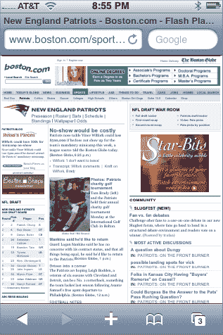

```html
<meta name="viewport" content="width=980;user-scalable=1;"/>
```

假设你的网站只有 880 像素宽。如果你让 Safari 保持默认的 980 像素设置，那么页面缩放的程度就会超出必要。因此，为了调整视口放大倍数，你可以指定一个针对你的网站优化的宽度：

```html
<meta name="viewport" content="width=880"/>
```

图 5-4 和 5-5 展示了一个 880 像素宽的网站在 980 像素和 880 像素视口下的显著差异。

图 5-4


图 5-5

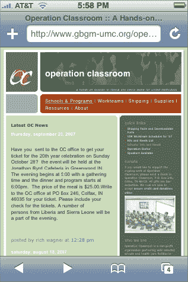

使用这个声明后，Safari 不再试图将 980 像素塞进 320 像素的宽度，而只需缩小 880 像素。内容所需的缩放更少（缩放比例为 .363 而非 .326），使得网站对 iPhone 和 iPod touch 用户更易用。请注意，视口元标签不会影响普通桌面浏览器中页面的渲染。

除了 `width` 属性，你还可以通过 `initial-scale` 参数以编程方式控制页面初始加载时的视口缩放比例。例如，如果你想将初始缩放比例设置为 .90，声明如下：

```html
<meta name="viewport" content="initial-scale=.9;user-scalable=1;"/>
```

然而，页面加载后，只要 `user-scalable` 属性设置为 true（默认值），用户就可以通过捏合和双击手势随意更改缩放比例。如果你想限制缩放范围，可以使用 `minimum-scale` 和 `maximum-scale` 属性：

```html
<meta name="viewport"
  content="initial-scale=.9;maximum-scale=1.0;minimum-scale=.8;user-scalable=1;"/>
```

这样，用户虽然可以捏合和缩放，但只能在你允许的范围内进行。

如果你专门为 iPhone 或 iPad 开发网站或应用，则需要通过设置 `width=device-width`（`device-width` 是一个常量）和 `initial-scale=1.0` 来使页面适应视口。由于缩放比例为 1.0，你不希望用户能够重新缩放应用界面，因此应禁用 `user-scalable` 属性。声明如下：

```html
<meta name="viewport" content="width=device-width;
  initial-scale=1.0; maximum-scale=1.0; user-scalable=0;">
```

`device-width` 常量在 iPhone 上被视为 320px，在 iPad 上被视为 1024px。通常，你需要避免对视口硬编码特定的宽度和高度，而应使用 `device-width` 和 `device-height`。这一点对于 iPad 尤其重要，因为使用宽度小于 1024 的视口会影响内容的渲染质量。

表 5-1 列出了视口属性。你不需要设置每个属性。Safari 会根据你设置的属性推断出其他值。

表 5-1：视口元标签属性

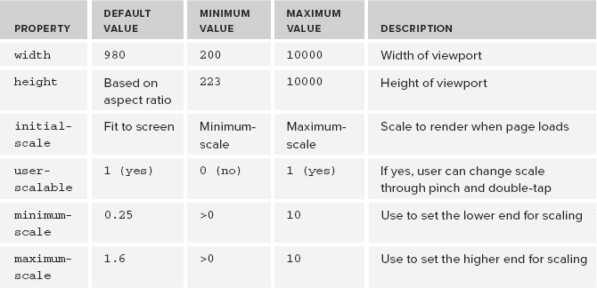

请记住，`width` 属性并非指 Safari 浏览器窗口的大小。它指的是页面感知的大小，Safari 会将其缩小以在移动设备上正确显示。

虽然通常不推荐，但你可以将内容的宽度指定为大于视口宽度，但这需要用户水平滚动。

## 将页面划分为区块

让你的网站对 iOS 用户友好的最重要方法之一，就是将网页划分为一系列列和区块。列可以使你的页面像报纸一样易于阅读，并帮助你避免大段文本导致用户左右水平滚动阅读。

当用户双击某个元素时，iPhone 或 iPad 会查看被双击的元素，并找到其最近的区块（`div`、`ol`、`ul`、`table` 等）或图像祖先。如果找到区块，Safari 会根据视口标签的 `width` 属性值缩放内容以适应区块内容，然后将其居中。如果用户点击图像，Safari 会缩放以适应图像并居中。如果图像已经放大，则会缩小。

图 5-6 展示了一个结构相对简单的示例页面，但这样的结构使得 iPhone 难以放大。表格被定义为固定宽度 1000px，其中第一列占用了 875px。表格上方的文本跨越了整个文档宽度，但由于它不在任何区块内，当用户双击时，Safari 无法进行缩放。用户被迫切换到横屏模式并捏合才能获得可读的文本，但文本仍然会从屏幕右侧滚出（参见图 5-7）。

图 5-6

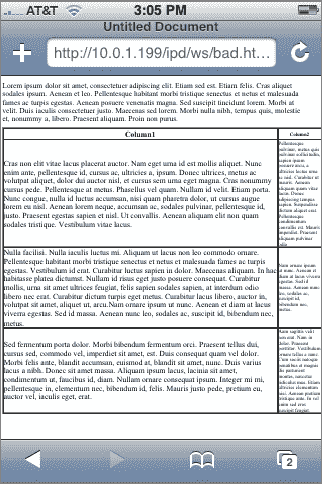

图 5-7

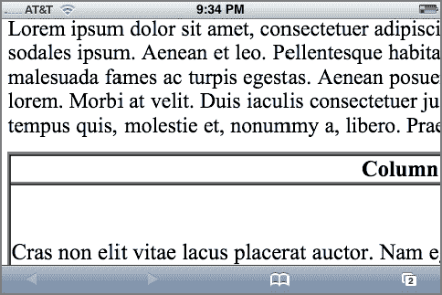

### 动手实践：让网页易于 iOS 用户导航

只需进行一些简单的调整，你就可以将页面改造成更适合小型设备（iPhone 和 iPod touch）使用的形式。请在你想要处理的页面上按照以下说明操作。

1. 在文本编辑器中打开你网站的所需页面。
2. 添加一个视口元标签，以更好地控制宽度：

   ```html
   <meta name="viewport" content="width=780"/>
   ```

3. 如果你的正文内容没有包含在任何类型的区块容器中，请添加一个 `div` 区块元素，并且如果符合页面设计，将其转换为列（例如页面宽度的 50%）：

   ```html
   <div style="width:50%">
   </div>
   ```

4. 找到所有固定宽度的表格，并将其改为按百分比设置宽度（宽度的 90%）。例如：

   ```html
   <table width="90%" border="1" cellspacing="1" cellpadding="1">
   <tr>
   <th width="75%" valign="top" scope="col"><div align="center">列 1</div></th>
   <th width="25%" valign="top" scope="col">列 2</th>
   </tr>
   <tr>
   </table>
   ```

5. 保存页面。

#### 工作原理

在本练习中，我们仅执行了一些简单的通用任务，这些任务可以让您的网站更便于 iOS 访客浏览。您添加了一个视口 meta 标签，为内容添加了块容器，并将固定宽度的表格转换为基于百分比的表格。即使只做了这些基础改动，当您双击页面时，页面也会变得更易于浏览，如图 5-8 所示。

图 5-8

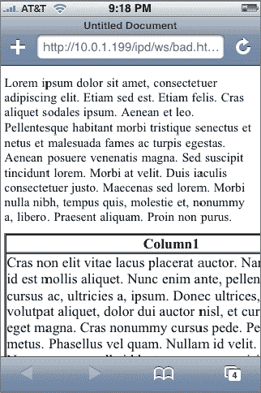

图 5-9 展示了基于块的模型网页，通过 iPhone 的双击和捏合手势可以轻松导航。

图 5-9

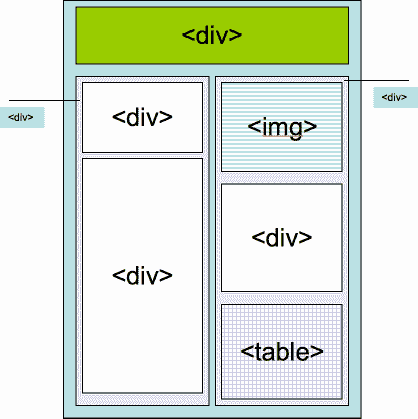

## 定义多列（未来使用）

最新版本的 WebKit（Safari）和基于 Mozilla 的浏览器支持新的 CSS3 属性，使您能够创建类似报纸的多列布局。对于内容块，您可以指定列数、列宽以及列之间的间距。由于目前并非所有浏览器都支持多列，这些样式属性带有 `-webkit` 和 `-moz` 前缀：

```css
-webkit-column-count: 2;
-moz-column-count: 2;
-webkit-column-width: 200px;
-moz-column-width: 200px;
-webkit-column-gap: 13px;
-moz-column-gap: 13px;
```

遗憾的是，当前版本的 Safari 不支持这些属性。不过，请关注它们未来的支持情况。当 Safari 支持多列时，它可以提供一种简单的方法，将现有内容转换为 iPhone 用户喜爱的列式结构。

## 第三层：自定义样式

iPhone 用户可以通过双击、捏合和轻扫手势浏览第二层网站，但这并不意味着浏览过程轻松愉快。在屏幕上平移和滚动很快就会让人感到疲惫。用户很快就会转向那些为 iOS 上的 Safari 提供更丰富、更定制化体验的网站。最简单的方法就是专门为 iPhone 和 iPad 创建自定义样式。

### 媒体查询

如果您想为 iOS 使用指定样式表，可以使用 CSS3 屏幕媒体查询。然后，通过查找仅支持屏幕显示且具有适当宽度的设备，使用 `link` 元素为 iPhone 和 iPad 设置特定样式：

```html
<!-[if !IE]>->
<link media="only screen and (max-device-width: 480px)" type="text/css"
   rel="stylesheet" href="iPhone.css" />
<link
  media="only screen and (min-device-width: 768px) and (max-device-width: 1024px)"
  type="text/css" rel="stylesheet" href="iPad.css" />
<!-<![endif]->
<link
   media="screen and (min-device-width: 1025px)" href="default.css"
  type="text/css" rel="stylesheet"/>
```

第一个媒体查询针对 iPhone，第二个针对 iPad。`only` 关键字可防止不兼容的浏览器选择其中一个移动样式表。但问题是，在某些情况下，早期版本的 Internet Explorer（版本 6 和 7）无法忽略此规则，反而会使用 iPhone 特定的样式表渲染页面。因此，您需要使用 IE 的条件注释来防范这种可能性。这样做之后，Internet Explorer 会忽略此 `link` 元素，因为 `[if !IE]` 表示仅当不在 IE 中时才执行包含的代码。

您也可以使用 `@media` 查询在单个 CSS 样式表中设置 iOS 特定样式：

```css
@media only screen and (max-device-width: 480px)
{
  /* 在此处添加 iPhone 样式 */
}

@media only screen and (min-device-width: 768px) and (max-device-width: 1024px)
{
  /* 在此处添加 iPad 样式 */
}
```

### 文本大小调整

通常，当视口调整时，网页的字体大小会自动调整。例如，在双击手势后，Safari 会查看内容块的缩放宽度，并按比例调整文本。这种行为使文本在典型使用场景下更易阅读，但可能会影响绝对定位和固定布局。如果您希望阻止文本重新调整大小，请使用以下 CSS 规则：

```css
-webkit-text-size-adjust: none;
```


一般来说，对于大多数网站浏览，您会希望保持此属性启用。在需要更精细控制缩放和尺寸的 iPhone 特定场景中，您需要禁用此选项。

# 案例研究：改造现有网站

以一个案例研究为例：Operation Classroom 网站，这是一个在非洲从事教育工作的非营利组织。请记住，每个网站的样式表都需要以独特的方式进行优化，但本案例研究展示了一些常见的共性问题。

该网站在 iPad 上显示良好，但在较小的 iOS 设备上效果欠佳。图 5-10 显示了该网站的一个页面，其基本视口 meta 标签设置为`width=780`，这为现有页面结构提供了最佳缩放比例。然而，即使视口设置已优化，用户仍然需要双击才能阅读页面上的任何文本。此外，顶部的链接很难点击，除非先捏合缩放。

图 5-10

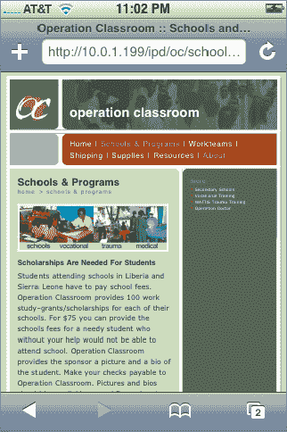

不过，通过创建 iPhone 和 iPod touch 特定的样式表，您可以在不影响任何 HTML 代码的情况下，为 iOS 上的 Safari 用户改造网站的可用性。

每个网站都有各自的需求和定制，才能与 iPhone 用户良好配合，因此我对此网站所做的具体改造可能适用于您，也可能不适用。但总体而言，这些改造为您应该考虑的修改类型提供了很好的示例。

查看页面（参见图 5-10），注意需要进行以下几项改造：

- 缩小页面宽度。
- 缩小页面顶部的 Operation Classroom 标志。
- 增大菜单链接、页面标题、面包屑导航链接和正文文本的字体大小。
- 将侧边栏移至正文文本下方。

## 更新 HTML 文件

作为第一步，我在网站每个页面的文档头部添加了一个媒体查询：

```
<!-[if !IE]>->
<link media="only screen and (max-device-width: 480px)" type="text/css"
  rel="stylesheet" href="iPhone.css" />
<!-<![endif]->
<link media="screen and (min-device-width: 1025px)" href="default.css"
  type="text/css" rel="stylesheet"/>
```

接下来，在 HTML 文件中，我将视口 meta 标签改为更小的宽度：

```
<meta name="viewport" content="width=490"/>
```

490px 的宽度足够宽，能与现有网站结构兼容，同时又足够小，以最小化缩放。

这就是我对 HTML 文件需要做的全部工作。

## 创建 iPhone.css

为了创建新的自定义样式表，我首先打开已使用的默认样式表，然后另存为新名称——`iphone.css`。我的第一个任务是将文档宽度从 744px 改为 490px。以下是更新后的样式：

```
@media all {
  #wrap {
    position:relative;
    top:4px;
    left:4px;
    background:#ab8;
    width:490px;
    margin:0 auto;
    text-align:left;
   }
```

接下来，我将 body 中定义的原始`font-size:small`属性改为更具体的像素大小：

```
body {
  background:#cdb;
  margin:0;
  padding:10px 0 14px;
  font-family: Verdana,Sans-serif;
  text-align:center;
  color:#333;
  font-size: 15px;
  }
```

虽然这个字号没有 iPhone 网页应用那么大，但它是在“操作教室”网站当前结构下能正常工作的最大字号。幸运的是，面包屑导航（路径）和页面标题的字号是相对于正文字号的，如下面的样式所示：

```
#pathway {
  margin-top:3px;
  margin-bottom: 25px;
  letter-spacing: .18em;
  color: #666666;
  font-size: .8em;
}
#pageheader {
  font-family:Helvetica,Arial,Verdana,Sans-serif;
  font-weight: bold;
  font-size: 2.2em;
  margin-bottom: 1px;
  margin-top: 3px;
}
```

下一个问题是缩小页面顶部横幅的尺寸。以下是 iPhone 适配前横幅文本的样式：

```
#banner-text{
  background:url("./images/bg_header.jpg") no-repeat left top;
  margin:0;
  padding:40px 0 0;
  font:bold 275%/97px Helvetica,Arial,Verdana,Sans-serif;
  text-transform:lowercase;
  }
```

你需要尝试缩小的两个属性是`padding`和字号。以下是一个可行的解决方案：

```
#banner-title {
  background:url("./images/bg_header.jpg") no-repeat left top;
  margin:0;
  padding:10px 0 10px;
  font: Bold 35px Helvetica,Arial,Verdana,Sans-serif;
  text-transform:lowercase;
  }
```

最后，也许是最重要的改动，是让侧边栏跟随正文，而不是浮动在正文旁边。以下是 iPhone 适配前的原始定义：

```
 #sidebar {
    background:#565 url(".images/corner_sidebar.gif") no-repeat left top;
    width: 254px;
    float: right;
    padding:0;
    color:#cdb;
    }
```

为了将侧边栏内容移到正文下方，我移除了`float`属性，并添加了`clear: both`声明，以防止侧边栏产生任何侧边环绕。同时，我将`254px`的窄宽度改为`100%`，使其能够占据内容`div`的全部空间。代码如下：

```
 #sidebar {
    background:#565 url("./images/corner_sidebar.gif") no-repeat left top;
    width:100%;
    clear: both;
    padding:0;
    color:#cdb;
}
```

图 5-11、5-12 和 5-13 展示了转换后的效果。

图 5-11

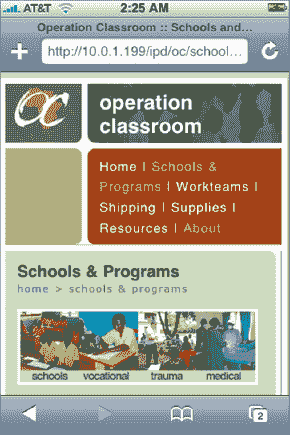

图 5-12


图 5-13

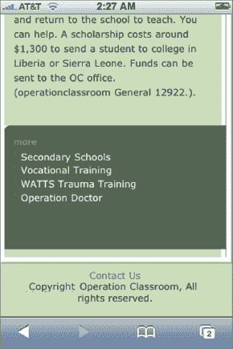

如你所见，通过少量精心设计的样式改动，你通常可以将现有网站转换为适合 iPhone 的网站。

## 第 4 层：并行网站

除非你正在开发 iPhone 或 iPod touch 应用，否则针对第 2 层或第 3 层支持进行开发已能满足大多数网站的需求。不过，你可能会发现确实有必要专门为 iPhone 或 iPad 开发一个网站。内容可能相同，但需要按照本书讨论的方式重新组织结构。

如果你打算提供网站的移动版本，你需要让用户能够自由选择移动版网站或常规完整版网站。不要基于`user agent`自动重定向。因为 iOS 上的 Safari 可以正常浏览普通网站，你应该始终让用户自己决定。因此，标准做法是在页面底部添加一个指向完整版网站的链接，供通过 iPhone 访问首页的用户使用。

另一种替代方案是反过来做：当 iOS 设备加载页面时，网站询问用户是否更愿意跳转到专用移动版网站。

### 动手实践：提示 iOS 用户跳转到专用网站

按照以下说明为你的网站添加此功能。

1. 在文本编辑器中打开网站首页。
2. 在内容顶部添加一个空的`div`元素，如果页面上有顶部导航菜单，则将其放在菜单下方：

   ```
   <div id="ios-notify"></div>
   ```

3. 在文档头部添加以下脚本：

   ```
   <script type="application/x-javascript">
   function isiPhone()
   {
     result ((navigator.platform.indexOf("iPhone") != -1) ||
             (navigator.userAgent.indexOf('iPod') != -1))
   }
   function isiPad()
   {
     result ((navigator.platform.indexOf("iPad") != -1)
   }

   function init()
   {
     if (isiPhone())
   {
      var o = document.getElementById( 'ios-notify' );
      o.innerHTML = "<h1 style='text-align:center;border: 1px solid #a23e14;" +
      " -webkit-border-radius: 10px;'><a href='iphone-index.html'>" +
      "点击此处前往我们的<br/>iPhone 网站。</a></h1>";
   }
   else if (isiPad())
   {
   if (isiPad)
   {
      var o = document.getElementById( 'ios-notify' );
      o.innerHTML = "<h1 style='text-align:center;border: 1px solid #a23e14;" +
      " -webkit-border-radius: 10px;'><a href='ipad-index.html'>" +
      "点击此处前往我们的<br/>iPad 网站。</a></h1>";
   }

   }
   }
   </script>
   ```

4. 保存文件。

#### 工作原理

这个示例向你展示了一种简单的方法，让 iPhone 和 iPad 访问者可以选择查看针对各自设备设计的网站。空的`div`元素充当占位符，用于显示向 iOS 访问者展示的消息。

`init()`函数调用`isiPhone()`函数来判断`user agent`是否为 iPhone 或 iPod touch。如果是 iPhone 或 iPod touch，则向占位符`div`元素添加 HTML 内容。如果不是，则调用`isiPad()`函数检查用户是否使用 iPad 访问网站。然后，`init()`函数通过`body`的`onload`处理程序被调用。图 5-14 展示了在 iPhone 上查看时的效果。

图 5-14

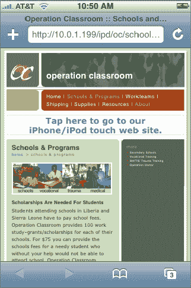

## 练习

1. iOS 设备是否支持 Flash？
2. viewport meta 标签的作用是什么？
3. 应该使用哪个常量来将页面大小设置为设备视口的宽度？
4. 为什么在网页结构中频繁使用列是一个好主意？
5. 定义 iPad 媒体查询的链接语法是什么？

练习答案见附录。

## 本章所学内容

| 主题 | 关键概念 |
| --- | --- |
| 使网站兼容 iOS 设备 | 避免使用 Adobe Flash 媒体、Java 小程序和插件。同时，避免使用 CSS 属性`position:fixed`。 |
| 使网站易于在 iOS 设备上导航 | 添加 viewport meta 标签，该标签决定内容如何显示和缩放以适应 iPhone 或 iPad。将网页转换为一系列列和块，这样 iPhone 更容易缩放和导航。 |
| 为网站添加自定义 iOS 样式 | 使用 CSS3 屏幕媒体查询为 iPhone 和 iPad 设置特定样式。 |
| 维护移动设备的并行网站 | 允许移动用户选择使用移动版网站或完整版网站。 |

# 第二部分：应用设计

- 第 6 章：设计 iPhone 用户界面
- 第 7 章：为 iPad 设计
- 第 8 章：使用 CSS 进行样式设计

## 第 6 章：设计 iPhone 用户界面

### 本章你将学到：

- 理解 iPhone 视口
- 探索 iOS 设计模式
- 为触控设计

iPhone 和 iPad 最出名的是其易用性、直观性和整体积极的用户体验。原生 iOS 用户界面（UI）无论是新手还是极客都认为易于使用，无需使用说明书。

iOS 网页应用不需要复制或完美模拟原生 iOS UI 设计和控件。事实上，有些开发者甚至认为开发者不应该尝试创建专注于 iOS 的网页应用。无论你对此持何种立场，在创建 iOS 网页应用时，有一件事是你需要做的——创建一个可用且可导航的 UI。

因此，在本章中，你将探索苹果在其 UI 中使用的许多常见设计模式，以及在移动设备上呈现数据的关键设计模式。本章主要关注 iPhone；第 7 章将关注 iPad。

## 不断演进的用户界面设计

过去十年间，用户界面设计的发展更多是渐进式的，而非革命性的。大多数人会认为，Mac OS X Lion 和 Windows 7 的用户界面都比其前代产品精致得多。尽管确实如此，但这些变化只是对现有理念的改进，而非提供与计算机交互的突破性新方式。网页设计也不例外。所有已发生的创新——例如 HTML5 和 Ajax——都彻底改变了网站的结构和组成，但并未改变用户与网站的交互方式。此外，移动和手持设备提供了多种新平台供设计，但这些平台要么是桌面操作系统的轻量版，要么是基于字符的简单菜单。

iOS 应运而生。

iOS 界面并非传统的桌面界面，尽管其代码库与 Mac OS X 紧密相关。它也不是传统的移动界面，尽管 iPhone 和 iPad 显然是移动设备。尽管你使用 Web 技术构建 Web 应用，但 iOS 界面并非普通的 Web 应用界面。

由于 iOS Web 应用的底层核心基于久经考验的 Web 技术，许多人倾向于进入 iOS 平台，并自然希望做他们一直做的事情——只是针对新设备进行定制。这就是开发者需要做出的最大思维转变：他们正在创建的是 iOS Web 应用，而非恰好运行在 iOS 上的 Web 应用。这一区别至关重要。在许多方面，iOS Web 应用更像 Mac 或 Windows 桌面应用——用户期望在其中看到特定的外观、感觉和核心功能。

在 Web 上，用户期望每个界面设计都是独一无二的。导航、控件和其他功能通常每个网站都各不相同。然而，当在某个平台（无论是 Windows、Mac OS X 还是 iOS）上工作时，用户的期望则大不相同。用户期望在应用之间有一致的操作方式。操作系统提供应用程序编程接口（API），供应用调用以显示通用的图形用户界面（GUI）。由于 iOS Web 应用没有这样的概念，因此作为应用开发者，你需要自行实现一致性。

## iPhone 视口

视口是一个矩形屏幕空间区域，应用在其中显示。传统的 Windows 和 Mac 桌面应用包含在它们自己的窗口中。Web 应用显示在浏览器窗口中。用户可以通过调整窗口大小、滚动内容以及（在许多情况下）更改缩放级别来操控视口中显示的内容。视口的实际大小完全取决于用户，不过桌面浏览器的平均尺寸大约为 1000 × 700 像素。

整个 iPhone 显示屏在竖屏模式下为 320 × 480 像素，横屏模式下为 480 × 320 像素。然而，应用开发者并不能使用所有这些空间。相反，iPhone 开发者可以自由使用的视口是一个较小的矩形：竖屏模式下（不显示 URL 栏）为 320 × 416 像素（显示 URL 栏时为 320 × 356），横屏模式下为 480 × 268 像素（显示 URL 栏时为 480 × 208）。图 6-1 和图 6-2 显示了两种方向下 iPhone 视口的尺寸。

图 6-1

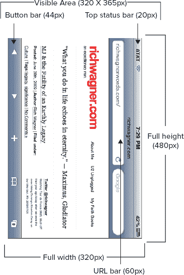

图 6-2

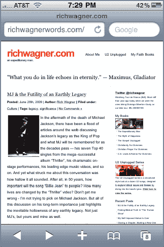

用户可以用手指在视口中滚动。但他们无法调整视口大小。用桌面术语来说，iOS 应用始终是“全屏”的，占据所有可用空间。

如果屏幕键盘显示，视口的可见区域会进一步受到键盘覆盖的限制，如图 6-3 和图 6-4 所示。

图 6-3

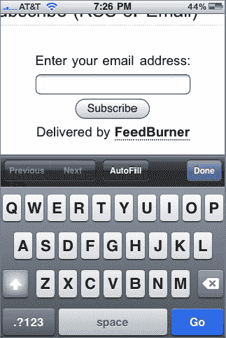

图 6-4

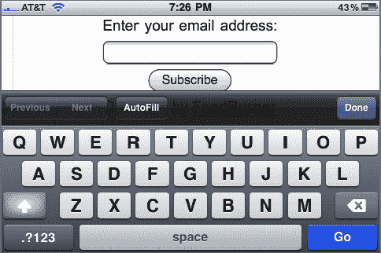

由于用户的视口比他们在桌面上习惯使用的要小得多，iPhone 视口具有一个你可以操控的缩放属性。当 iOS 上的 Safari 加载网页时，它会自动将页面宽度定义为 980 像素（大多数固定宽度页面的常见尺寸）。然后它会缩放页面以适配 320 或 480 像素宽的视口。虽然 980 像素对于浏览网站的缩小版来说可能可以接受，但 iPhone 应用通过自定义视口 meta 标签来避免缩放。

正如我在第 5 章中讨论的，你可以使用视口 meta 标签来设置视口的宽度和缩放比例。如果你正在创建针对 iPhone 的 Web 应用，则需要将视口设置为设备的精确宽度——竖屏模式下为 320px，横屏模式下为 480px。（对于 iPad，竖屏模式下使用 640px，横屏模式下使用 1024px。）为了简化操作，iOS 上的 Safari 支持常量，因此你可以避免使用具体的数值。因此，要为普通的 iPhone Web 应用设置视口，你应该在 HTML 文档的 head 中添加以下 meta 标签：

```
<meta name="viewport" content="width=device-width; initial-scale=1.0;
   maximum-scale=1.0; user-scalable=no;"/>
```


`width=device-width` 属性将宽度设置为固定大小，并确保当用户旋转到横屏模式时视口不会调整大小。`initial-scale=1.0` 将缩放比例设置为 1.0，而 `maximum-scale` 和 `user-scalable` 设置则禁用用户对网页的缩放。

## 探索 iOS 设计模式

在开始设计你的 iOS Web 应用之前，一个有价值的练习是探索设备上或 App Store 中的原生 iOS 应用。在此过程中，你可以思考其他设计师如何处理小视口，以及如何为触摸屏输入设计直观的界面。

### 动手实践：探索用户界面模式

为了了解其他应用的用户界面是如何设计的，请按照以下步骤操作。

1. 打开三种不同类型的应用：邮件、相机和计算器。
2. 注意每个应用的目的，并审视每个应用所采用的设计决策。
3. 挑选一些你从 App Store 下载的第三方应用，并记录你喜欢和不喜欢它们的地方。
4. 基于你对原生应用的回顾，列出一系列在 Web 上下文中可行且合适的 UI 设计思路。

#### 工作原理

此活动的目的仅仅是让你以不同的方式思考你日常使用的应用。开发者为什么做出他们所做的设计决策？他们为什么采用他们所用的 UI 设计元素和方案？你会做出哪些不同的选择？这些正是你在开始设计自己的应用 UI 时应该提出的问题。

### 对应用进行分类

为了充分理解这些应用背后的设计决策，你需要了解用户使用 iOS 应用与桌面应用的方式差异。毕竟，想想你桌面上安装的那些应用类型。一个过于简单的分类如下：

* 基于任务的应用：典型的桌面应用，无论是在 Mac、Windows 还是 Linux 上，都旨在解决特定问题或执行特定任务。这些应用（如 Word、Excel、PowerPoint、Photoshop 或 iCal）通常一次处理一个或几个文件。这些应用的 UI 通常非常相似，包括顶层菜单、工具栏、用于打开/保存的通用对话框、主目标窗口和侧面板。
* **聚合器**：桌面应用的第二类是聚合器——这类应用管理大量数据，用户通常需要同时处理多条数据，而非仅一两条。iTunes 管理你的歌曲和视频，iPhoto 和 Picasa 管理你的照片，Outlook 和 Apple Mail 存储你的电子邮件。聚合器应用的 UI 通常基于导航，左侧面板显示顶层可导航类别（iTunes 中的播放列表、Mail 中的文件夹、iPhoto 中的相册），主窗口则显示可滚动的列表。
* **小部件**：第三类是小部件式应用，它们是显示系统或其他信息（电池状态、天气、世界时钟）或执行特定任务（歌词抓取、收音机调谐器）的迷你应用。小部件 UI 通常由单个屏幕和一个设置面板组成。

在桌面端，基于任务的应用传统上一直占据主导地位，但过去十年间，随着管理数字媒体的需求日益增长，聚合器变得越来越重要。尽管小部件如今相当流行（苹果和微软已将此功能直接集成到操作系统中），但它们的重要性仍然远低于前两者。

当你查看 iOS 内置应用时，会发现它们通常也属于这三类。然而，由于设备的视口和文件存储限制，基于任务的应用退居次要地位，聚合器成为主角（参见表 6-1）。

表 6-1：苹果 iOS 内置应用分类

| 聚合器 | 基于任务 | 小部件 |
| --- | --- | --- |
| 邮件 | Safari | 股票 |
| 信息 | 电话 | 天气 |
| 照片 | 相机 | 时钟 |
| YouTube | 日历 | 计算器 |
| 备忘录 | 地图 |  |
| 通讯录（地址簿） | 指南针 |  |
| iPod | 语音备忘录 |  |
| iTunes |  |  |
| App Store |  |  |

在传统桌面应用中，文档是主要关注点，但在 iOS 设备上，文档往往是可消费且临时的，这并不奇怪。iOS 上有 Pages、Numbers 和 Keynote 应用，但用户处理的许多文档都是可消费的：网页、短信、YouTube 视频、快速笔记和谷歌地图。

## 基于导航列表的 UI 设计

由于许多 iOS 应用的重点是消费各种信息，基于导航列表的设计成为在 iPhone 上向用户呈现大量信息的重要方式。如前所述，桌面应用通常将导航列表放在主窗口左侧的面板中，但许多 iPhone 应用使用“边缘到边缘”导航作为 UI 的主要驱动。

并非所有导航列表设计都相同。事实上，iPhone 至少有八种不同的导航列表样式。例如，通讯录列表使用单行以粗体显示联系人姓名（参见图 6-5），而邮件使用四行列表样式显示邮件标题信息和可选文本预览（参见图 6-6）。最后，YouTube 在其四行项目中展示了丰富的信息（参见图 6-7）。表 6-2 列出了各种导航列表样式。

表 6-2：不同类型的导航列表

| 应用 | 样式 | 显示内容 |
| --- | --- | --- |
| 通讯录 | 1 行 | 联系人姓名（姓氏加粗） |
| 邮件 | 2.7 行（默认 4 行） | 邮件标题和可选文本预览 |
| 地图列表 | 2 行 | 地点名称、地址 |
| 短信 | 3 行 | 消息标题和文本预览 |
| 照片 | 1 行 | 相册标题和缩略图 |
| YouTube | 3 行 | 缩略图、标题、评分、时长、观看次数和上传者 |
| 备忘录 | 1 行 | 笔记文本的第一行 |
| iPod 播放列表 | 1 行 | 播放列表名称 |
| 设置 | 1 行 | 带图标的分类项目 |

图 6-5

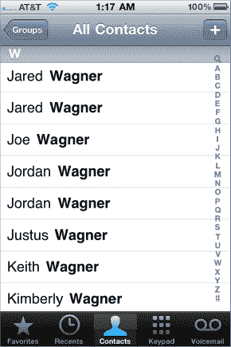

图 6-6

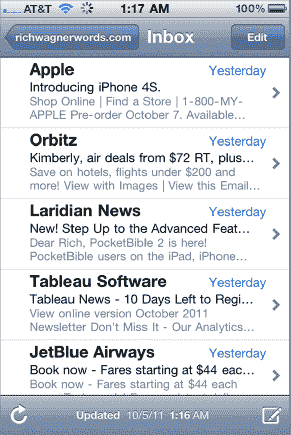

图 6-7

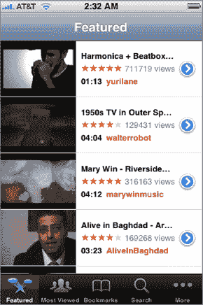

然而，无论导航列表采用何种样式，它们的设计目的都是让你以尽可能少的交互快速到达目标页面。

此外，应用的顶部标题栏通常提供上下文信息，帮助用户了解他们在应用层级中的位置。左侧通常有一个返回按钮，使用户能够返回上一屏幕。更多内容请参见本章后面的“标题栏”部分。

## 应用模式

原生 iPhone 应用通常还具有信息或功能的不同模式或视图，供用户操作。这些模式以图标或按钮的形式显示在底部工具栏上（参见图 6-8）。有趣的是，在 iCal 的初始版本中，按钮位于顶部。但在后续版本中，苹果将按钮移到了底部，以遵循“导航在上，模式在下”的惯例（参见图 6-9）。

图 6-8

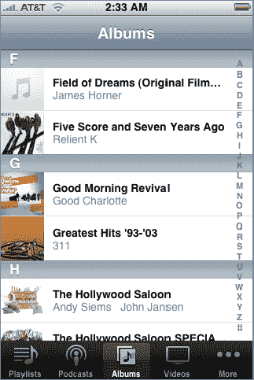

图 6-9

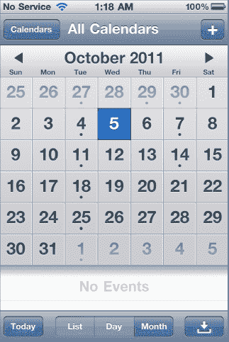

表 6-3 详细说明了这些模式。

表 6-3：应用模式与 UI 访问

| 应用 | 模式 | UI 控件 |
| --- | --- | --- |
| iCal | 列表、日、月 | 底部按钮栏 |
| 电话 | 收藏、最近通话、通讯录、拨号键盘、语音留言 | 底部工具栏 |
| iPod | 播放列表、播客、专辑、视频等 | 底部工具栏 |
| YouTube | 精选、最多观看、书签、搜索 | 底部工具栏 |
| 时钟 | 世界时钟、闹钟、秒表、计时器 | 底部工具栏 |

因此，当你开始考虑如何设计应用的 UI 时，请观察它与 iPhone 内置应用设计之间的相似之处。即使你不模仿其外观和感觉，也可能希望采用一致的方法。

## 探索屏幕布局

当你研究并评估了内置应用的 UI 设计后，就可以开始确定你所构建的应用类型可能存在哪些相似之处。

对于需要使用导航列表设计的应用，你需要下载我在第 15 章中讨论的框架之一。每个框架都能让你轻松实现基于边缘到边缘导航列表的应用。

典型移动应用的四个常见组件是：标题栏、导航列表、目标页面和按钮栏。

### 标题栏

大多数 iOS Web 应用应包含一个标题栏，以模拟几乎所有原生 iOS 应用中标准标题栏的外观。当 URL 栏隐藏时（如本章后面所述），自定义标题栏会显示在视口顶部的状态栏下方（参见图 6-10）。标题栏包含以下元素：

图 6-10

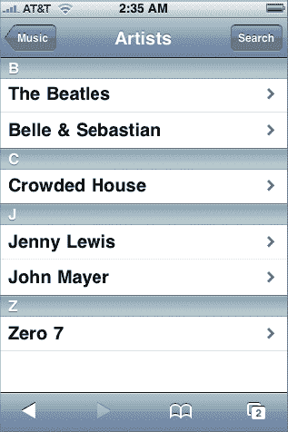

* **返回按钮**：返回按钮应放置在工具栏左侧，允许用户返回上一页面。按钮的名称应与上一屏幕的标题相同。这种“面包屑”技术让用户知道他是如何到达当前页面以及如何返回的。如果页面位于应用的顶层，则没有返回按钮。
* 屏幕标题：每个屏幕应在工具栏中央显示一个标题。页面标题应为一个单词，并恰当描述当前屏幕的内容。与标准网页应用不同，你不应在应用的每个屏幕标题中包含应用名称。
* 命令按钮：对于某些屏幕，你可能需要使用通用命令，如“取消”、“编辑”、“搜索”或“完成”。如果需要此功能，请在标题栏右上角放置一个命令按钮。

### 边缘到边缘导航列表

如果你正在为 iPhone 设计一款专门用于聚合或组织信息列表的应用，通常应遵循 iPhone 的边缘到边缘导航列表设计模式，如图 6-11 所示。每个单元格或子分区都特别大，以便于触摸输入。此外，为确保用户不会迷失上下文，标题显示当前页面，返回按钮指示用户可以返回的屏幕。当列表项展开到目标页面或另一个列表时，右侧会显示一个箭头，表示有下一页可用。

图 6-11


当选中某个列表项时，导航列表应模拟 Apple 的滑入动画，看起来就像新页面从屏幕右侧滑入替换旧页面。

表 6-4 列出了在边缘到边缘导航列表中模拟 Apple 设计外观和感觉的具体度量值。

表 6-4：Apple 边缘到边缘设计的度量值

| 项目 | 值 |
| --- | --- |
| 单元格高度（含底部线条） | `44px` |
| 单元格宽度 | `320px`（竖屏），`480px`（横屏） |
| 字体 | Helvetica，`20pt` 粗体（次要文本可使用常规字体） |
| 字体颜色 | 黑色 |
| 水平线（单元格之间） | `#d9d9d9`（RGB=`217, 217, 217`） |
| 左侧内边距 | `10px` |
| 底部内边距 | `14px` |
| 控件高度 | `29px` |
| 控件对齐方式 | 右对齐，`10px` |
| 控件形状 | 圆角矩形，半径 `7` 度 |
| 控件文本 | Helvetica，`12pt` |
| 背景颜色 | 白色 |

### 圆角矩形设计目标页面

在导航列表 UI 设计中，用户最终会到达一个目标页面，该页面完整列出其正在查找的特定信息。Apple 采用圆角矩形设计，如图 6-12 所示。标签显示在蓝色背景上，项目按逻辑分组，并包围在圆角矩形框中。表 6-5 描述了实现此 Apple 设计应遵循的规范。

表 6-5：Apple 圆角矩形设计的度量值

| 项目 | 值 |
| --- | --- |
| 单元格高度 | `44px` |
| 圆角矩形角半径 | `10px × 10px` 半径（`-webkit-border-radius:10px`） |
| 圆角矩形左右边距 | `10px` |
| 圆角矩形上下边距 | `17px` |
| 水平线（单元格之间） | `#d9d9d9`（RGB=`217, 217, 217`） |
| 标签字体 | Helvetica `17pt`，粗体 |
| 标签字体颜色 | `#4c566c`（RGB=`76, 86, 108`） |
| 单元格字体 | Helvetica `17pt`，粗体 |
| 单元格字体颜色 | 黑色 |
| 单元格文本位置 | 距左边缘 `10px`，距底边缘 `14px` |
| 背景颜色 | `#c5ccd3`（RGB=`197, 204, 211`） |

图 6-12


### 为触摸而设计

针对 iPhone 界面，你需要考虑的最关键设计因素之一是：你正在设计一个与手指交互的界面，而非鼠标或其他机械指点设备。鼠标指针的点击点很小，只有几个像素高，但手指在典型点击操作中可能触及屏幕 `40` 像素或更多。因此，在应用中布局控件时，请确保控件的高度和控件之间的间距即使对于手指较大的人也能轻松使用。


注意：由于 iPhone 是移动设备，请记住用户可能在移动中与你的应用交互。也许他们正在街上行走、在咖啡店排队，甚至可能在慢跑。因此，你应在 UI 中留出足够空间，以应对手指抖动的情况。

标准导航列表单元格的高度应为 `44px`。按钮的大小应大致相当于手指大小，通常高度为 `40px` 或以上，并且周围有足够的空间以防止意外点击。如果周围没有其他按钮，按钮高度为 `29` 到 `30` 像素也可以，但需谨慎。表 6-6 列出了常见元素的推荐尺寸。

表 6-6：触摸输入屏幕的度量值

| 元素度量 | 推荐尺寸 |
| --- | --- |
| 元素高度 | `40px`（最小 `29px`） |
| 元素宽度 | 最小 `30px` |
| 选择、输入高度 | `30px` |
| 导航列表单元格高度 | `44px` |
| 元素间距 | `20px` |

除了尺寸和间距问题外，另一个重要的设计决策是尽量减少文本输入的需求。尽可能使用选择列表而非输入字段。此外，使用 cookie 记住上次输入的值，以避免重复输入数据。

### 字体处理

凭借其 Retina 显示屏和抗锯齿支持，iPhone 是处理字体的理想平台。优质字体在 iPhone 显示屏上呈现效果极佳，增强了应用 UI 的整体吸引力。

Apple 为 iOS 选择的字体 Helvetica 通常应作为应用的默认字体。然而，iOS 确实为开发者提供了几种字体选择。与必须使用字体系列的典型 Web 环境不同，iOS 允许你对用户运行应用时拥有的确切字体做出一些假设。表 6-7 列出了 iOS 支持的字体。

表 6-7：iOS 字体

| 名称 |
| --- |
| American Typewriter（无斜体） |
| Arial |
| Arial Rounded MT Bold（无斜体） |
| Courier New |
| Georgia |
| Helvetica |
| Marker Felt |
| Times New Roman |
| Trebuchet MS |
| Verdana |
| Zapfino |

iOS 上的 Safari 会自动用内置字体替换三种不支持的字体。当指定 Courier 时，会替换为 Courier New。Helvetica Neue 被替换为 Helvetica，Times 被替换为 Times New Roman。

### iOS UI 设计最佳实践

在设计 iOS 时，需牢记以下几条最佳实践：

* 记住触摸！在 iPhone UI 设计中，或许没有比始终用触摸输入的现实来反复检查每个设计决策更重要的技巧了。
* 确保你的应用 UI 在竖屏和横屏模式下都能同样良好地工作。某些原生应用（如 Mail）会针对竖屏模式优化其 UI，并忽略用户对方向的任何更改。第三方 iOS Web 应用开发者没有同样的控制级别。因此，你创建的任何 UI 设计都需要在两种方向模式下都能工作。
* 避免需要水平滚动的 UI 设计。如果你的界面设计要求用户在单个显示屏幕内左右滚动，请更改它。水平滚动会让用户感到困惑，并在你的应用中迷失方向。
* 保持设计简洁。尽管 iOS 界面很有吸引力，但其最讨人喜欢的品质或许是易用性和简洁性。你的 UI 设计也应如此。避免在不需要的地方增加复杂性——无论是功能还是设计（见图 6-13）。
* 使用熟悉的术语。俗话说“入乡随俗”。在为 iOS 设计时，请务必不要带入你在其他平台（Windows、Mac 甚至 Web）上习惯的 UI 包袱。
* 使用 UI 框架，但要明智地使用。移动 Web 应用框架（参见第 16 章）是 iOS Web 应用开发者社区的重要资产，能为开发应用提供巨大的先发优势。然而，不要自动认为它们的预建设计就是你的应用的最佳选择。你可能会发现其他方法更适合你的特定需求。
* 限制使用黑色按钮栏。半透明的黑色按钮栏（例如 iPod 应用在图 6-8 中使用的那个）只应在你的应用中用于显示模式或视图，而不是用于命令。其他按钮类型用于命令。
* 尽量减少路径深度。由于 iOS 用户主要关注数据消费，你应该让他们尽快到达目标页面。因此，请确保以最优方式组织信息，使用户只需轻点几下就能获取所需数据。
* 将文本输入字段放在页面顶部。当你的应用需要数据输入字段时，尽量将这些输入字段放在尽可能靠近页面顶部的位置。将文本输入字段放在顶部有助于减少屏幕键盘突然出现在屏幕底部时用户失去上下文的可能性。
* 传达状态。由于你的应用可能通过 `3G` 连接运行，其响应可能相对较慢。因此，在执行需要服务器处理的功能时，请务必向用户提供状态信息。这种视觉提示有助于用户确信你的应用正在按预期工作，而不是处于挂起状态。
* 适当标记标题栏。确保每个屏幕或页面都有自己的标题。返回按钮应始终使用上一个屏幕的标题来命名。
* 取消选中之前选中的项目。当用户在导航列表 UI 中点击返回按钮时，请确保之前选中的项目被取消选中。
* 打破规则——但要胜任。尽管通常最明智的做法是让你的应用与本章讨论的设计模式保持一致，但并非每个 iOS 应用 UI 都需要严格遵循苹果已经实现的设计。你可能有一个应用，其不同的外观和感觉对其目标用户最有效。然而，如果你决定采用独特的设计，请确保它与 iOS 整体设计相辅相成，而不是冲突。

图 6-13


## 添加收尾润色

为了将你的 Web 应用转变为看起来和感觉上都像原生 iOS 应用，你需要对其进行一些收尾润色。在本节中，我将向你展示如何以全屏模式启动应用、自定义状态栏以及创建 WebClip 图标。

### 动手实践：为你的应用添加收尾润色

要使你的 Web 应用看起来更像原生 iOS 应用，请按照以下步骤操作。

1. 创建或获取要用作应用图标的 PNG 图像，该图标将显示在 iOS 设备的主屏幕上。对于 iPhone 4 及以上版本，你需要 `114 x 114` 像素。对于 iPad，你需要 `72 x 72` 像素。对于 iPod touch 和旧款 iPhone 型号，你需要默认尺寸 `57 x 57` 像素。按如下方式命名图像：`touch-icon-iphone.png`（`57 x 57`）、`touch-icon-ipad.png`（`72 x 72`）和 `touch-icon-iphone4.png`（`114 x 114`）。
2. 将图像保存到 Web 应用的根目录中。
3. 在文本编辑器中打开 Web 应用的主页面。


4. 在文档头部添加一个`apple-mobile-web-app-capable` meta 标签，并将其值设置为`yes`：

```
<meta name="apple-mobile-web-app-capable" content="yes" />
```

5. 在文档头部添加一个`status-bar-style` meta 标签，并将其值设置为`black`：

```
<meta name="apple-mobile-web-app-status-bar-style" content="black" />
```

6. 在文档头部添加以下 link 标签：

```
<link rel="apple-touch-icon" href="icon.png"/>
<link rel="apple-touch-icon" sizes="72x72" href="icon-ipad.png" />
<link rel="apple-touch-icon" sizes="114x114" href=" icon-iphone4.png" />
```

7. 保存你的文件。

## 工作原理

默认情况下，当你在 iOS 上的 Safari 中运行 Web 应用时，Safari 仍然会占用视口的大部分空间，包括其 URL 栏和底部栏。然而，为了收回这些浪费的空间，并使你的应用看起来更像原生应用，你应该以全屏模式启动应用。当文档中提供了`apple-mobile-web-app-capable` meta 标签时，你的应用就会以全屏模式运行。但是，全屏模式仅在你通过 WebClip 图标从主屏幕启动应用时才生效。当你从 URL 栏访问页面时，Safari 会保留其 URL 栏和按钮栏。

当你使用`apple-mobile-web-app-capable` meta 标签进入全屏模式时，Safari 仍然会显示顶部状态栏。这种行为并不意外，因为大多数原生应用也以相同方式显示状态栏。然而，如果你希望标记状态栏，你可以使用`status-bar-style` meta 标签并将其值设置为`black`，将其外观自定义为透明黑色。但此 meta 标签仅在你同时使用`apple-mobile-web-app-capable` meta 标签开启全屏模式时才生效。

最后，`<link rel="apple-touch-icon"/>` 标签使你能够像原生应用一样将你的应用添加到主屏幕。你指向的图形文件需要遵循以下约定：

- 必须是`.png`格式。
- 位于根目录中。
- 如前所述，iPhone 4 及以上版本使用 114 x 114 像素，iPad 使用 72 x 72 像素，iPod touch 和旧款 iPhone 型号使用默认尺寸 57 x 57 像素。
- 必须是矩形——iOS 会自动添加圆角。
- 必须命名为`apple-touch-icon.png`或`apple-touch-icon-precomposed.png`。如果你使用`apple-touch-icon.png`，iPhone OS 会为图形添加圆角、投影和“光泽涂层”。如果你使用`apple-touch-icon-precomposed.png`，则操作系统不会添加这些效果。

用户可以通过在导航到 URL 时点击按钮栏上的 + 按钮来添加你的应用的 WebClip 图标。在弹出的对话框中，用户点击“添加到主屏幕”按钮（参见图 6-14）。

图 6-14


不幸的是，由于 Web 应用没有正式的安装过程，因此没有编程方式可以自动将 WebClip 图标添加到主屏幕。该过程必须由用户手动完成。

## 练习

1. 什么时候会使用边缘到边缘的导航列表设计模式？
2. 按钮或其他 UI 元素通常应具有的最小像素尺寸是多少（针对触摸）？
3. 判断正误？Comic Sans 是 iOS 上可用的字体。
4. 判断正误？iOS 上的 Safari 允许你通过 JavaScript 控制屏幕方向。

练习答案可在附录中找到。

## 本章所学内容

| 主题 | 关键概念 |
| --- | --- |
| 视口 | 视口是屏幕空间中的一个矩形区域，应用在其中显示。用户可以通过调整窗口大小、滚动其内容以及在许多情况下更改缩放级别来操纵视口内显示的内容。 |
| iOS UI 设计模式 | 基于导航列表的设计成为呈现大量层级或列表信息的重要方式。导航在上，模式在下。 |
| 最佳实践 | 记住触摸。避免水平滚动。保持设计简洁。使用熟悉的术语。向用户传达状态。 |

# 第 7 章：为 iPad 设计

## 本章你将学到：

- 了解 iPad 的特殊设计考虑。
- 理解 iPad 上 Safari 的局限性。
- 创建 Split View 应用。

iPad 是移动设备，但它不是手机。这句话显然是个“不假思索”的结论，但在为 iPad 设计时，很容易陷入将其视为“巨型 iPhone”的陷阱。相反，iPad 几乎完美融合了 iPhone 的移动触控特性和台式电脑的大屏视觉体验与交互能力。因此，在为 iPad 设计 Web 应用时，你需要给予它应有的独立关注，而不是仅仅把它当作一个更大的 iPhone 视口。

在本章中，我将重点介绍为 iPad 设计应用时应考虑的一些特殊事项，然后专注于创建模仿原生 iPad 应用外观的分屏视图 UI（用户界面）设计。

## 针对 iPad 的特殊考虑

- 在文档头部添加 viewport 元标签：

    ```
    <meta name="viewport" content="width=device-width; initial-scale=1.0;
       maximum-scale=1.0; user-scalable=no;"/>
    ```

- 添加针对 iPad 的媒体查询：

    ```
    <link media="only screen and (min-device-width: 768px)
       and (max-device-width: 1024px)" type="text/css"
       rel="stylesheet" href="iPad.css" />
    ```

- 添加针对 iPad 的样式：

    ```
    @media only screen and (min-device-width: 768px) and (max-device-width: 1024px)
    {
      /* 在此处添加 iPad 样式 */
    }
    ```

- 启用 iPad 应用从主屏幕启动时以全屏模式运行：

    ```
    <meta name="apple-mobile-web-app-capable" content="yes">
    ```

## 设计要点

- 同时为竖屏和横屏模式进行设计。你需要以 1024 × 768（横屏）和 768 × 1024（竖屏）来设计应用。
- 确保你的设计足够灵活，能同时适应竖屏和横屏模式。如有需要，添加`orientationchange`事件监听器并动态调整设计。本章后面的练习将演示一种实现方法。
- 尽量减少模态窗口的使用。这能让用户以更灵活、非线性的方式使用你的应用。当你确实需要使用模态视图让用户执行某项任务时，我建议使用类似弹出框的窗口，本章后面会演示。
- 对于编辑元素，不要使用`contenteditable`属性，因为 iOS 上的 Safari 不支持它。相反，对于多行编辑，请使用`textarea`。
- 除非你使用流行的移动框架或 iScroll（下一节讨论），否则避免使用`position:fixed` CSS 属性。它不会按你预期的方式显示。具体来说，如果用户在页面上缩放或平移，固定元素可能会滚动到屏幕之外。

## 处理滚动

iPad 上 Safari 内部的滚动行为与桌面浏览器世界中的预期不同。单指或双指滑动会触发`window.scroll()`。因此，无法在固定大小的块内滚动溢出的内容，因为 Safari 会将元素内部的滑动解释为窗口滚动操作。此外，iOS 上的 Safari 不支持`div`元素的单指滚动。

为了克服这些限制，已经开发了一些开源解决方案。其中最流行的当属 iScroll 4，这是一个最初由 Matteo Spinelli 开发的项目。你可以将这个 JavaScript 库添加到你的项目中，以获得用户期望的、针对 iPad 设备的滚动体验。你可以从[`cubiq.org/iscroll-4`](http://cubiq.org/iscroll-4)下载它。

除了更接近原生的滚动能力外，iScroll 4 还提供了多种额外的触摸事件功能，包括内容的捏合/缩放、下拉刷新、吸附到元素以及自定义滚动条。

## 分屏视图设计模式

在原生 iPad 应用中，一个关键的设计模式是主从视图，即分屏视图，你应该在适当的时候尝试模仿它。分屏视图设计模式由两个并排的面板组成：左侧显示项目列表，右侧显示当前选中项目的详细信息。

在桌面上，你经常看到这种模式被使用。它出现在大多数电子邮件应用中，例如 Outlook 或 Apple Mail，其中消息列表与消息查看器并排显示。

iPhone 也使用了主从概念，但由于空间限制，无法以分屏方式同时显示主视图和从视图。然而，iPad——介于手机和桌面世界之间的设备——会根据上下文表现得像桌面或手机。在横屏模式下，主视图和从视图都会显示（参见图 7-1）。但在竖屏模式下，主视图会显示在弹出框中（图 7-2）。

图 7-1


图 7-2


## 为 iPad 设计用户界面

当你阅读第 16 章时，你会发现可以使用流行的移动框架（如 jQuery Mobile）为 iPad 创建 Web 应用，并使其在 iOS 上的 Safari 中表现良好。然而，由于这些框架大多是跨平台的，它们并不试图模仿 iOS 的设计标准，而是提供更中性、无特定风格的 UI。我在第 5 章中创建的 Hello World 应用就是这种技术的完美示例。但是，假设你希望你的 Web 应用严格遵循原生 iOS UI 指南，使其具有与用户熟悉的原生应用相似的基本“外观和感觉”。你可以使用 CSS 和 JavaScript 从头开始创建这种“外观和感觉”，也可以探索网络上可用的开源选项。其中一个选项是 Slablet，这是一个开源框架，你可以将其添加到 Web 应用中，以重新创建原生外观的 iPad UI。你可以从[`github.com/fellowshiptech/slablet`](https://github.com/fellowshiptech/slablet)下载它。

尽管 Slablet 和其他类似模板并非像 jQuery Mobile、Sensa Touch 或 iWebKit 那样全面完整的解决方案，但 Slablet 是一个轻量级、易于使用的附加组件的绝佳示例，你可以快速用它将你的应用转变为给 iPad 用户留下深刻印象的应用。下面的练习将引导你完成创建基于 Slablet 的应用所需的步骤。

### 动手实践：创建分屏视图应用外壳

通过以下步骤了解如何创建 iPad 应用。

1. 从[`github.com/fellowshiptech/slablet`](https://github.com/fellowshiptech/slablet)下载 Slablet 库。
2. 将 zip 文件的内容解压到你的应用文件夹中。确保 Slablet 的 assets 文件夹直接位于你的根应用文件夹内。
3. 在文本编辑器中创建以下 HTML 文档，并将其保存为`BIDHJ-Ch07-Ex1.html`。


```
<!DOCTYPE html>
<html lang="en">
<head>
<!--
        致谢：本示例使用了 Slablet 模板
        网址：https://github.com/fellowshiptech/slablet
-->
<meta http-equiv="content-type" content="text/html; charset=utf-8" />
<meta http-equiv="x-ua-compatible" content="ie=edge" />
<title>iOS WebAppster 大会</title>
<meta name="apple-mobile-web-app-capable" content="yes" />
<meta name="viewport" content="width=device-width, initial-scale=1,
   maximum-scale=1, user-scalable=no" />
<link rel="stylesheet" href="assets/stylesheets/master.css" />
<!--[if IE 8]>
<link rel="stylesheet" href="assets/stylesheets/ie8.css" />
<![endif]-->
<!--[if !IE]><!-->
<script src="assets/javascripts/iscroll.js"></script>
<!--<![endif]-->
<script src="assets/javascripts/jquery.js"></script>
<script src="assets/javascripts/master.js"></script>
</head>
<body>

</body>
</html>
```

代码片段`BIDHJ-Ch07-Ex1.html`

4. 在文档主体中添加主页面内容：


```
<!-- 开始页面（横屏和竖屏均显示） -->
<div id="main" class="abs">

    <!-- 开始页面页眉 -->
    <div class="abs header_upper chrome_light">
        <!-- 主菜单按钮 -
                仅在竖屏模式下显示
                按下时显示弹出菜单
        -->
        <span class="float_left button" id="button_navigation">
            菜单
        </span>
        <!-- 左侧工具栏按钮 -->
        <!--a href="#" class="float_left button">
            返回
        </a-->
        <!-- 右侧工具栏按钮 -->
        <!--a href="#" class="float_right button">
            命令
        </a-->
        我的标题
    </div>
    <!-- 工具栏 -->
    <!--div class="abs header_lower chrome_light">

    </div-->
    <!-- 结束页面页眉 -->
    <!-- 开始页面内容 -->
    <div id="main_content" class="abs">
        <div id="main_content_inner">
            <!-- 在此添加内容 -->
        </div>
    </div>
    <!-- 结束页面内容 -->

    <!-- 开始页面页脚 -->
    <div class="abs footer_lower chrome_light">
        <!--a href="#" class="float_left button">
        </a-->
        <a href="#">查看完整网站</a>
    </div>
    <!-- 结束页面页脚 -->

</div>
<!-- 结束页面 -->
```

代码片段`BIDHJ-Ch07-Ex1.html`

5. 在文档主体中上一个内容块之后添加以下侧边栏相关代码：


```
<!-- 开始侧边栏（横屏时显示为侧边栏，竖屏时显示为弹出框） -->
<div id="sidebar" class="abs">
    <span id="nav_arrow"></span>
    <!-- 应用名称 -->
    <div class="abs header_upper chrome_light">
    我的应用名称
    </div>
    <!-- 开始侧边栏菜单 -->
    <div id="sidebar_content" class="abs">
        <div id="sidebar_content_inner">
            <ul id="sidebar_menu">
            </ul>
        </div>
    </div>
    <!-- 结束侧边栏菜单 -->
    <!-- 开始侧边栏页脚 -->
    <div class="abs footer_lower chrome_light">
        <a href="#" class="icon icon_gear2 float_left"></a>
        <span class="float_right gutter_right">标语</span>
    </div>
    <!-- 结束侧边栏页脚-->
</div>
<!-- 结束侧边栏 -->
```

代码片段`BIDHJ-Ch07-Ex1.html`

## 工作原理


在本练习中，你创建了一个基本的分屏视图 UI 外壳，虽然它没有内容，但你可以在此基础上构建一个完整的应用。首先，添加创建应用结构所需的基本 meta 标签和链接。`app-mobile-web-app-capable` 和 `viewport` meta 标签在第 6 章中讨论过。`head` 中的其余代码添加了 Slablet 模板使用的所有必要 CSS 样式表和 JavaScript 库（包括 `jquery.js`）。

Slablet 样式表和 JavaScript 库大量使用元素的 `id` 和 `class` 属性来定义其外观和行为，因此 UI 的每个核心部分都被赋予了特定的 `id` 和/或 `class` 属性值。

图 7-3 和 7-4 显示了空应用外壳在横屏和竖屏模式下的样子。与原生 iPad 应用一样，侧边栏在横屏模式下显示，在竖屏模式下隐藏。另请注意，菜单按钮在竖屏模式下出现，但在横屏模式下不可见。

图 7-3


图 7-4


从这个简单的示例可以看出，当你在 HTML 文件中正确定义了相应元素后，Slablet 为你提供了相当多的功能。深入 Slablet 内部，有几个关键部分值得一看。首先，`master.js` 文件用于定义模板的所有行为。特别值得注意的是 Slablet 如何适应屏幕方向并切换侧边栏的可见性。相关代码如下：

```javascript
function adjust_angle() {
        var angle = window.orientation;
        var body = $('body');
        var body_width = body.outerWidth();
        var sidebar = $('#sidebar');

        if (angle === 0 || angle === 180 || body_width < 1024) {
            body.addClass('is_portrait');
            $('#button_navigation').removeClass('button_active');
            sidebar.hide();
        }
        else {
            body.removeClass('is_portrait');
            sidebar.show();
        }
    }

    adjust_angle();

    $(window).bind('resize orientationchange', function() {
        adjust_angle();
    });
```

从这段代码可以看出，`adjust_angle()` 函数被指定为浏览器 `orientationchange` 事件的事件处理程序。因此，当 iPad 方向改变时，会评估 `window.orientation` 属性。当确定 iPad 处于竖屏模式时，使用 `sidebar.hide()` 隐藏侧边栏；但如果 iPad 处于横屏模式，则显示侧边栏。

尽管目前应用只是一个没有内容或工作部件的外壳，但将这个 UI 外壳转变为一个可用的应用并不需要太多工作。下面的练习将引导你完成所需的步骤。

### 动手实践：创建分屏视图大会应用

按照以下步骤将空的 UI 外壳转变为一个大会应用。

1. 打开你在上一个练习中创建的 `BIDHJ-Ch07-Ex1.html` 文件，并将其另存为 `index.html`。

2. 替换空白页面内容，使其如下所示：


```html
<!-- Begin Page (shown in both landscape and portrait -->
<div id="main" class="abs">

    <!-- Begin Page Header -->
    <div class="abs header_upper chrome_light">
        <!-- Main menu button -
                shown only in Portait mode
                displays popover menu when pressed
        -->
        <span class="float_left button" id="button_navigation">
            Menu
        </span>
        <!-- Left toolbar button -->
        <!--a href="#" class="float_left button">
            Back
        </a-->
        <!-- Right toolbar button -->
        <!--a href="#" class="float_right button">
            Command
        </a-->
        IOS WebAppster Conference
    </div>
    <!-- Toolbar -->
    <!--div class="abs header_lower chrome_light">

    </div-->
    <!-- End Page Header -->
    <!-- Begin Page content -->
    <div id="main_content" class="abs">
        <div id="main_content_inner">
            <h1>Welcome to IOS WebAppster Conference 2013</h1>
            <p>You are now at the most amazing conference in the
              history of the Web. Ok, maybe
            that's hyperbole. But we think you are going to like it.</p>
        </div>
    </div>
    <!-- End Page content -->

    <!-- Begin Page Footer -->
    <div class="abs footer_lower chrome_light">
        <a href="#" class="float_left button">
            About the Salsa Conference Center
        </a>
        <!--a href="#" class="float_left button">
            Bar
        </a-->
        <!--a href="#" class="icon icon_bird float_right"></a-->
        <a href="#">View full site</a>
    </div>
    <!-- End Page Footer -->

</div>
<!-- End Page -->
```

代码片段 `index.html`

3. 替换空的侧边栏内容，使其包含以下代码：


```html
<!-- Begin Sidebar (shown as sidebar in landscape, shown as popover in portrait -->
<div id="sidebar" class="abs">
    <span id="nav_arrow"></span>
    <!-- App Name -->
    <div class="abs header_upper chrome_light">
    ConfApp
    </div>
    <!-- Begin Sidebar Menu -->
    <div id="sidebar_content" class="abs">
        <div id="sidebar_content_inner">
            <ul id="sidebar_menu">
                <li id="sidebar_menu_home" class="active">
                    <a href="#"><span class="abs"></span>Home</a>
                </li>
                <li>
                    <a href="#">Welcome to IOS WebAppster</a>
                </li>
                <li>
                    <a href="#">Sessions</a>
                    <ul>
                        <li>
                            <a href="#">Session 100: Hello World</a>
                        </li>
                        <li>
                            <a href="#">Session 110: Designing for Mobile</a>
                        </li>
                        <li>
                            <a href="#">Session 210: Styling with CSS</a>
                        </li>
                        <li>
                            <a href="#">Session 220: Advanced JavaScript</a>
                        </li>
                        <li>
                            <a href="#">Session 225: Designing for iPad</a>
                        </li>
                        <li>
                            <a href="#">Session 300: Touch Events</a>
                        </li>
                        <li>
                            <a href="431.html">Session 431: Distributing Your
                              App</a>
                        </li>
                    </ul>
                </li>
                <li>
                    <a href="#">Speakers</a>
                    <ul>
                        <li>
                            <a href="#">Doug Majoring</a>
                        </li>
                        <li>
                            <a href="#">Kyle Exwhi</a>
                        </li>
                        <li>
                            <a href="#">Jason Masters</a>
                        </li>
                        <li>
                            <a href="#">Samantha Goodface</a>
                        </li>
                        <li>
                            <a href="#">Jess Gentleman</a>
                        </li>
                        <li>
                            <a href="#">Lex Landry</a>
                        </li>
                        <li>
                            <a href="#">Rachel Furgeson</a>
                        </li>
                    </ul>
                </li>
            </ul>
        </div>
    </div>
    <!-- End Sidebar Menu -->
    <!-- Begin Sidebar Footer -->
    <div class="abs footer_lower chrome_light">
        <a href="#" class="icon icon_gear2 float_left"></a>
        <span class="float_right gutter_right">Bringing Conferences to Life</span>
    </div>
    <!-- End Sidebar Footer-->
</div>
```

代码片段 `index.html`

4. 保存文件。

5. 以此文件为起点，将文件分别保存为 `welcome.html` 和 `431.html`。

6. 在编辑器中打开 `welcome.html`。

7. 将 `main_content_inner` `div` 中的代码替换为以下代码：


```html
<div id="main_content_inner">
    <h1>Welcome to the Conference</h1>
    <p>We're going to have a great time!</p>
</div>
```

代码片段 `welcome.html`

8. 保存文件。

9. 在编辑器中打开 `431.html`。

10. 将 `main_content_inner` `div` 中的代码替换为以下代码：


# 第 431 场会议：分发你的应用

在这场引人入胜的会议中，Doug Majoring 将带你了解如何在 App Store 中分发你的 Web 应用。

查看幻灯片

## 会议详情

Lorem ipsum dolor sit amet, consectetur adipiscing elit. Fusce suscipit diam id ipsum sagittis ac rhoncus enim dignissim. Phasellus venenatis risus in eros sollicitudin vel posuere magna convallis. Aenean malesuada luctus arcu ac tincidunt. Ut ultricies mattis metus, vel tempus elit cursus ut. Pellentesque dui orci, rutrum id facilisis vitae, porta sed tellus. Morbi venenatis ornare eros a varius. Integer convallis euismod urna, sed imperdiet purus tempor elementum. Pellentesque metus tortor, fringilla a ullamcorper eu, semper ut nulla. Phasellus ullamcorper leo in lectus vestibulum lobortis. Lorem ipsum dolor sit amet, consectetur adipiscing elit. Sed at est ut turpis venenatis lacinia consectetur et ante. Maecenas feugiat pulvinar sagittis.


In eu velit magna. Phasellus felis lectus, rhoncus ut ultricies nec, porttitor sed nunc. Nulla sit amet purus metus, sed molestie diam. Nam pellentesque dui vitae mauris tincidunt venenatis. Cras a adipiscing risus. Morbi lorem turpis, suscipit iaculis hendrerit non, auctor ut augue. Phasellus at urna a nisl tempor sodales. In hac habitasse platea dictumst. Cras at augue massa, non suscipit nulla. Morbi bibendum ultricies luctus. Phasellus rutrum blandit dui ac facilisis. Mauris vitae augue eros. Suspendisse fermentum ultricies risus quis viverra. Donec ut ante id nisi fringilla mollis sed nec velit. Phasellus ornare, nulla ut rutrum hendrerit, felis diam cursus purus, quis fermentum erat lacus posuere odio. Fusce ac odio tortor.

Nullam tempor, est in ultrices luctus, diam lectus tincidunt sem, nec ornare dolor lectus a magna. Vestibulum accumsan suscipit aliquet. Mauris at lorem quam. Aenean ac augue quis sem commodo accumsan a vitae nunc. Maecenas luctus velit et erat dignissim ut commodo arcu malesuada. Vestibulum ante ipsum primis in faucibus orci luctus et ultrices posuere cubilia Curae; Nulla viverra, enim sit amet placerat venenatis, tortor odio feugiat mauris, sit amet vehicula purus tellus pulvinar libero. Phasellus id feugiat turpis. Donec aliquam luctus iaculis. In faucibus neque in lorem tincidunt pellentesque. Vestibulum condimentum augue vel ante euismod euismod sed ac urna. Phasellus scelerisque, quam id dapibus sagittis, nulla nibh hendrerit est, vel aliquam tellus augue vitae sem. Aenean commodo, urna a sagittis varius, nulla metus tempor nunc, ac suscipit elit odio sed leo. Vivamus ut lobortis velit. Nam pretium vestibulum tellus non vehicula.

Proin dolor diam, laoreet vel faucibus nec, malesuada sit amet purus. Proin turpis orci, ultrices at laoreet quis, vulputate ac mi. Sed nec tristique justo. Maecenas cursus sem et tellus gravida nec semper neque suscipit. Curabitur vitae convallis metus. Fusce porta elementum molestie. Quisque neque eros, vehicula nec cursus ac, tincidunt accumsan lacus. Nulla facilisi. Donec id nisl ligula, eget cursus quam. Donec euismod iaculis rhoncus. Aliquam malesuada dignissim libero nec scelerisque. Donec mauris sapien, dignissim ac blandit a, consequat bibendum felis.

In dignissim varius eros, eu mattis metus fringilla ut. In ultrices orci nec libero sollicitudin a dapibus mi tempor. Donec neque justo, condimentum ac vehicula quis, iaculis eget lacus. In at elit nisl. Donec vel aliquam dolor. Phasellus hendrerit justo in elit ultrices ac pulvinar turpis viverra. Nullam ornare nisi vitae risus vulputate malesuada. Nam vulputate lobortis velit, sed iaculis arcu fermentum pharetra. Aliquam dolor massa, pretium sit amet ultrices sed, pellentesque ut lectus. Sed aliquet pharetra dolor eget pharetra. Mauris sit amet purus odio. Vestibulum ante ipsum primis in faucibus orci luctus et ultrices posuere cubilia Curae; Quisque lobortis, dui pulvinar dapibus facilisis, lectus enim pretium odio, ut imperdiet sem sem nec augue. Nulla facilisi. Integer et risus eget purus posuere varius. Donec ac nibh quis mi lobortis sagittis quis ut est.

代码片段 `431.html`

11. 将页面底部 `float_left` 链接中的代码替换为以下代码：


```html
<a href="#" class="float_left button">
View Doug's Bio
</a>
```

代码片段 `431.html`

12. 保存文件。

## 工作原理

在本练习中，你将 UI 外壳转换成了一个示例应用，该应用可以进一步填充，作为会议演示者使用的应用。为了演示，你创建了主索引页面、欢迎页面和一个示例会议页面。主应用页面如图 7-5 所示。这些页面可通过侧边栏中定义的链接列表访问，如图 7-6 所示。如前所述，当应用在竖屏模式下运行时，侧边栏会被隐藏，并在用户点击菜单按钮时以弹出窗口形式显示（参见图 7-7）。

图 7-5


图 7-6


图 7-7


图 7-8 显示了示例会议页面。但关于此页面，需要注意的一点是，内容通过流行的 `iScroll.js` 库在页面 `div` 内滚动。

图 7-8


## 练习

1. 判断对错？虽然 iPhone 的 Web 应用应使用 viewport meta 标签，但 iPad 的 Web 应用不需要 viewport 标签。
2. 设计时更适合横屏模式还是竖屏模式？
3. 如何克服在固定大小的 `div` 内无法滚动溢出内容的限制？

练习答案见附录。

## 本章所学内容

| 主题 | 关键概念 |
| --- | --- |
| 大多数 iPad Web 应用需要添加的关键 meta 标签 | Viewport meta 标签、apple-mobile-web-app-capable meta 标签 |
| 为竖屏和横屏设计 | 设计你的应用，使其在横屏模式下以 1024×768 工作，在竖屏模式下以 768×1024 工作 |
| 分屏视图设计模式 | 一种核心的 iPad 设计模式，常用于原生 iPad 应用 |

# 第 8 章：使用 CSS 进行样式设计

## 本章你将学到：

- 处理文本样式和阴影
- 样式化块级元素
- 创建 CSS 按钮

与 Mac 和 Windows 上的同类浏览器一样，iOS 上的 Safari 移动版提供了所有 Web 浏览器中最好的 CSS 支持之一。在开发 iOS Web 应用时，你可以利用 CSS 来构建强大的用户界面。

Safari 支持大部分 CSS 2.1 以及部分 CSS3。然而，Safari 还支持一些技术上称为“实验性 CSS3”的属性，这些属性目前不属于 W3C CSS 标准；苹果将在未来继续支持这些属性。（提示：这些属性的名称前会添加 `-webkit-` 前缀。）对于普通的 Web 应用，大多数开发者通常会避开这些实验性属性，或者至少不会依赖它们来设计应用。但是，由于你知道你的应用将仅由 iOS 设备访问，因此你可以安全地使用这些更高级的样式来创建你的 UI。

在这本书中，你已经了解了如何使用 CSS 创建 iOS 界面。本章我将继续这一讨论，并深入探讨各种 CSS 技术。

## Safari 支持的 CSS 选择器

许多人认为 CSS 的真正威力并不在于你可以应用的属性，而在于 CSS 能够精确选择 DOM 中你想要操作的元素。如果你之前使用过 CSS，你可能已经熟悉标准的类型、类和 ID 选择器。然而，Safari 提供的选择器支持包括许多属于 CSS3 规范的新选择器。表 8-1 列出了 Safari 支持的一组 CSS 选择器，表 8-2 列出了 Safari 支持的伪类和伪元素集合。

### 表 8-1：Safari CSS 选择器

| 选择器 | 定义 |
| --- | --- |
| `E` | 类型选择器 |
| `.class` | 类选择器 |
| `#id` | ID 选择器 |
| `*` | 通用选择器（所有元素） |
| `E F` | 后代选择器 |
| `E > F` | 子选择器 |
| `E + F` | 相邻兄弟选择器 |
| `E ~ F` | 间接相邻选择器 a |
| `E[attr]` | `attr` 已定义 |
| `E[attr=val]` | `attr` 值匹配 `val` |
| `E[attr~=val]` | 多属性值选择器之一 b |
| `E[attr&#124;=val]` | `attr` 值是一个连字符分隔的列表，并以 `val` 开头 b |
| `E[attr^=val]` | `attr` 值以 `val` 开头 a,b |
| `E[attr$=val]` | `attr` 值以 `val` 结尾 a,b |
| `E[attr*=val]` | `attr` 值至少包含一个 `val` 实例 a,b |

a CSS3 新增

b 区分大小写，即使不必要

### 表 8-2：Safari 伪类和伪元素

| 伪类/伪元素 | 定义 |
| --- | --- |
| `E:link` | 未访问的链接 |
| `E:visited` | 已访问的链接 |
| `E:lang([Code])` | 选择器内容使用指定的语言代码 |
| `E:before` | 元素之前的内容 |
| `E::before` | 元素之前的内容（CSS3 中新的双冒号表示法）a |
| `E:after` | 元素之后的内容 |
| `E::after` | 元素之后的内容（CSS3 中新的双冒号表示法）a |
| `E:first-letter` | 元素的第一个字母 |
| `E::first-letter` | 元素的第一个字母（CSS3 中新的双冒号表示法）a |
| `E:first-line` | 元素的第一行 |
| `E::first-line` | 元素的第一行（CSS3 中新的双冒号表示法）a |
| `E:first-child` | 第一个子元素 b |
| `E:first-of-type` | 第一个指定类型的子元素 a,b |
| `E:root` | 根元素 a |
| `E:not()` | 否定 a |
| `E:target` | 目标 a |
| `E:enabled` | 启用状态 a |
| `E:disabled` | 禁用状态 a |
| `E:checked` | 选中状态 a |

a CSS3 新增

b 当使用 JavaScript 以编程方式创建新的第一个子元素/指定类型的子元素时，之前的元素仍保留 `:first-child` 或 `:first-of-type` 属性。

请注意，Safari 不支持以下 CSS3 选择器：

- `:last-child`
- `:only-child`
- `nth-child()`
- `nth-last-child()`
- `last-of-type`
- `only-of-type`
- `:nth-of-type()`
- `:nth-last-of-type()`
- `Empty`

## 文本样式

在 iOS 网络应用中设置文本样式时，请记住三个对有效 UI 设计至关重要的文本相关样式：`-webkit-text-size-adjust`、`text-overflow` 和 `text-shadow`。本节将解释这些属性。

### 使用 `-webkit-text-size-adjust` 控制文本大小

当页面渲染时，iOS 上的 Safari 会根据文本块的宽度自动调整页面文本的大小。但是，通过使用 `-webkit-text-size-adjust` 属性，你可以覆盖此设置。`none` 选项关闭文本的自动调整大小：

```css
body { -webkit-text-size-adjust: none; }
```

或者，你可以指定一个倍数：

```css
body { -webkit-text-size-adjust: 140%; }
```

图 8-1 和 8-2 显示了这两个选项在同一页面上的结果。

图 8-1


图 8-2


最后，你可以将其设置为默认值 `auto`：

```css
body { -webkit-text-size-adjust: auto; }
```

对于普通网站，建议使用 `-webkit-text-size-adjust: auto` 以提高文本的可读性。但是，如果你正在开发应用程序，几乎总是希望使用 `-webkit-text-size-adjust: none` 来精确控制文本大小，尤其是在纵向和横向模式之间切换时。

### 使用 `text-overflow` 处理溢出文本

由于 iPhone 上 Safari 的视口宽度为 320（纵向）或 480（横向）像素（iPad 上 Safari 为 768（纵向）或 1024（横向）），有效管理 UI 元素上动态文本的物理长度可能很棘手。这对于标题或按钮文本尤其重要，因为这些地方有固定的可用空间。处理文本溢出的最佳示例是顶部工具栏，它是 iPhone 应用程序界面的标准部分。默认情况下，任何不适合元素容器框的内容都会被裁剪，这可能导致混淆，例如图 8-3 中显示的后退按钮示例。由于没有足够的空间显示文本 iProspector，只显示了 iProspect。

图 8-3


因此，为了防止这种情况发生，你应该提供一个视觉提示，表明文本已被裁剪。幸运的是，`text-overflow` 属性使开发人员能够指定当文本溢出时他们希望如何处理。两个值是 `ellipsis` 和 `clip`。`ellipsis` 值会裁剪内容并在末尾添加省略号（. . .）。假设你将以下属性分配给工具栏的按钮和标题元素：

```css
text-overflow: ellipsis;
```

现在，当文本溢出时，会添加一个省略号，如图 8-4 所示。

图 8-4


`text-overflow` 属性对于针对 iPhone 的网络应用特别有用，因为在横向模式下完全显示的标题可能需要在更窄的纵向模式下进行裁剪。iPad 应用可能不会遇到此问题，除非你的标题非常非常长。

### 动手实践：创建省略号文本

为了演示如何处理文本中的省略号，请按照以下步骤操作。

1. 在文本编辑器中创建以下 HTML 文档，然后将文档保存为 `BIDHJ-Ch8-Ex1.html`。


```
<html>
<meta name="viewport" content="width=320; initial-scale=1.0; maximum-scale=1.0;">
<body>
<div> this is a test this is a test this is a test
this is a test this is a test this is a testthis is a test </div>
<br><br>
<div> this is a test this is a test this is a test
this is a test this is a test this is a testthis is a test </div>
<br><br>
<div> this is a test this is a test this is a test
this is a test this is a test this is a testthis is a test </div>
</body>
</html>
```

代码片段 `BIDHJ-Ch8-Ex1.html`

2. 将以下样式部分添加到文档头部：


```
<style>
.ellipsis
{
    text-overflow: ellipsis;
    width: 200px;
    white-space: nowrap;
    overflow: hidden;
}

.ellipsisBroken1
{
    text-overflow: ellipsis;
    width: 200px;
    /* white-space: nowrap; */
    overflow: hidden;
}

.ellipsisBroken2
{
    text-overflow: ellipsis;
    width: 200px;
    white-space: nowrap;
    /* overflow: hidden; */
}
</style>
```

代码片段 `BIDHJ-Ch8-Ex1.html`

3. 为三个 `div` 元素分别添加 `class` 属性，将每个元素与相应的样式关联起来。


```
<div class="ellipsis"> 这是一个测试 这是一个测试 这是一个测试
这是一个测试 这是一个测试 这是一个测试这是一个测试 </div>
<br><br>
<div class="ellipsisBroken1"> 这是一个测试 这是一个测试 这是一个测试
这是一个测试 这是一个测试 这是一个测试这是一个测试 </div>
<br><br>
<div class="ellipsisBroken2"> 这是一个测试 这是一个测试 这是一个测试
这是一个测试 这是一个测试 这是一个测试这是一个测试 </div>
```

`代码片段 BIDHJ-Ch8-Ex1.html`

4. 保存你的文档。

5. 在你的 iPhone 或 iPod touch 上查看，如图 图 8-5 所示。

图 8-5


#### 工作原理

本示例演示了 `text-overflow` 可能需要指定额外的 CSS 属性才能按预期显示。在这种情况下，需要设置 `overflow` 或 `white-space` 属性，以确保 `text-overflow` 属性正常工作。

# 使用 text-shadow 创建微妙的阴影

在 iOS 用户界面中，Apple 巧妙地使用了文本阴影，尤其是在按钮和较大的标题文本上。除了美观之外，文本阴影还有助于通过增加文本与背景的对比度来提高文本的可读性。

你可以通过 `text-shadow` 属性为文本添加投影。基本声明如下：

```
text-shadow: color offsetX offsetY blurRadius;
```

第一个值是阴影的颜色。接下来的两个值给出阴影的偏移位置——第二个值是 x 坐标，第三个值是 y 坐标。（负值将阴影向左和向上移动。）第四个参数表示阴影的高斯模糊半径。因此，在以下示例中，在元素文本上方 1 像素处添加了一个灰色阴影，没有模糊：

```
text-shadow: #666666 0px -1px 0;
```

然而，如果文本阴影过于明显，可能会分散注意力并显得俗气。因此，你可以使用 `rgba`（红、绿、蓝、透明度）颜色值代替纯色值来定义阴影的透明度值。（请参阅本章后面的“设置透明度”部分。）因此，以下声明定义了一个白色阴影，透明度值为 0.7（0.0 为完全透明，1.0 为完全不透明），位于元素文本下方 1 像素处：

```
text-shadow: rgba(255, 255, 255, 0.7) 0 1px 0;
```

# 样式化块级元素

有几种样式可以应用于块级元素以改变其外观，这些样式超越了你在传统网站上可能使用的普通 CSS 样式。其中包括三个所谓的实验性属性（`-webkit-border-image`、`-webkit-border-radius` 和 `-webkit-appearance`）以及 `background` 属性的 CSS3 增强。本节将介绍这些内容。

## 使用 -webkit-border-image 实现基于图像的边框

`-webkit-border-image` 属性允许你使用图像来指定边框，而不是使用 `border-style` 属性。图像显示在元素内容之后，但位于背景之上。例如：

```
-webkit-border-image: url(image.png) 7 7 7 7;
```

图像 URL 后面的四个数字表示图像中应作为边框使用的像素数。第一个数字表示图像顶部（包括角落和边缘）的高度。根据 CSS 惯例，其余三个数字表示右侧、底部和左侧。像素是默认单位，但你可以指定百分比。

如果你提供的图像 URL 无法定位，或者样式设置为 `none`，则使用 `border-style` 属性。

你可以在声明的末尾可选地指定一个或两个关键字。这些关键字决定了侧面和中间图像的缩放和平铺方式。有效关键字是 `stretch` 或 `round`。如果你使用 `stretch` 作为第一个关键字，则图像的顶部、中间和底部部分会缩放为与元素的内边距框相同的宽度。你也可以使用 `round` 作为第一个关键字，这在 iOS 中使用较少。当使用此设置时，顶部、中间和底部图像的宽度会减小，以便整数个图像适合内边距框的宽度。第二个关键字作用于左侧、中间和右侧图像的高度。如果省略两个关键字，则默认为 `stretch`。

渲染时，Safari 会查看 `-webkit-border-image` 属性，并根据指定的四个数字对图像进行分割。

`-webkit-border-image` 属性在创建基于 CSS 的 iOS 按钮中起着重要作用，这将在本章后面解释。

## 使用 -webkit-border-radius 实现圆角

`-webkit-border-radius` 用于指定元素角的半径。使用此属性，你可以轻松地在元素上创建圆角，而无需使用基于图像的角。例如：

```
-webkit-border-radius: 10px;
```

此声明为元素指定了 10 像素的半径，这是目标页面圆角矩形设计的标准半径值。你还可以使用以下属性指定每个单独角的半径：

```
-webkit-border-top-left-radius
-webkit-border-top-right-radius
-webkit-border-bottom-left-radius
-webkit-border-bottom-right-radius
```

例如，如果你想创建一个顶部圆角、底部方角的 `div`，样式代码如下：

```
div.roundedTopBox
{
-webkit-border-top-left-radius: 10px;
-webkit-border-top-right-radius: 10px;
-webkit-border-bottom-left-radius: 0px;
-webkit-border-bottom-right-radius: 0px;
}
```

结果如 图 8-6 中的文本框所示。

图 8-6


## 使用 -webkit-appearance 实现渐变按钮

`-webkit-appearance` 属性旨在将元素的外观转换为各种不同的控件。iOS 上的 Safari 仅支持两个可能的值：`push-button` 和 `button`。但 `push-button` 对 iOS Web 应用开发者来说最有前景。例如，假设你想将一个链接元素转换为渐变按钮。你可以使用图像来实现，但 `-webkit-appearance: push-button` 允许你完全在 CSS 中完成。为了演示，首先将一个链接分配给一个名为 `special` 的类：

```
<a href="tel:202-558-1212" class="special">呼叫总部</a>
```

然后，定义 `a.special` 样式：

```
a.special
{
     display: block;
     width: 246px;
     font-family: Helvetica;
     font-size: 20px;
     font-weight: bold;
     color: #000000;
     text-decoration: none;
     text-shadow: rgba(255, 255, 255, 0.7) 0 1px 0;
     text-align: center;
     line-height: 36px;
     margin: 15px auto;
     -webkit-border-radius:10px;
     -webkit-appearance: push-button;
}
```

`display:block` 和 `width:246px` 属性为链接提供了一个宽矩形块形状。`-webkit-appearance: push-button` 属性将其外观转换为渐变灰色按钮。`-webkit-border-radius` 使用标准的 10px 值使边缘变圆。虽然按钮的形状已经设置，但文本还需要调整，不仅使用标准的文本格式属性，还需要使用 36px 的 `line-height` 属性，使 20px 的文本在按钮中垂直居中。如果你在 `body` 标签中添加一个简单的 `background-color: #999999` 样式，则会得到如 图 8-7 所示的结果。

图 8-7


## 多重背景图像

在早期版本的 CSS 中，元素与背景图片之间始终存在一一对应的关系。虽然这种能力在大多数情况下都能满足需求，但某些页面设计无法通过单个背景图片有效实现。因此，为了突破这种一一对应的限制，设计师们不得不在此处或彼处添加额外的 `div` 标签，以达到预期的视觉效果。

CSS3 通过允许为给定元素定义多个背景图片来解决这一问题。大多数浏览器尚不支持此功能，但幸运的是，对于 iOS 网络应用开发者而言，iOS 上的 Safari 是支持的。

你可以通过在 `background` 属性声明后按顺序列出图片来定义一组背景图片。图片的渲染顺序是：第一个声明的图片在最上层，第二个图片在第一个之后，以此类推。你还可以为每张图片指定 `background-repeat` 和 `background-position` 值。如果定义了 `background-color`，则该颜色会绘制在所有图片的下方。例如：

```
div.banner
{
background: url(header_top.png) top left no-repeat,
     url(banner_main.png) top 6px no-repeat,
     url(header_bottom.png) bottom left no-repeat,
     url(middle.png) left repeat-y;
}
```

在这段代码中，`header_top.png` 作为背景图片，对齐到 `div` 元素的左上角。`banner_main.png` 定位在距顶部 6px 的位置，`header_bottom.png` 定位在 `div` 的底部。最后，`middle.png` 作为重复背景。

## 设置透明度

开发者长期以来一直使用 `rgb` 来为文本和背景指定 RGB 颜色值。CSS3 新增了在使用新的 `rgba` 声明指定 RGB 颜色时设置 alpha 值的能力。通过 `rgba` 声明，你可以在不使用透明 PNG 或 GIF 的情况下添加半透明颜色叠加层。其语法如下：

```
rgba(r, g, b, alpha)
```

其中 `r`、`g`、`b` 是 0 到 255 之间的整数，分别代表红色、绿色和蓝色值；`alpha` 是 0 到 1 之间的值（0.0 表示完全透明，1.0 表示完全不透明）。例如，要设置一个 50% 透明度的红色背景，你可以使用：

```
background: rgba(255, 0, 0, 0.5);
```

请记住，`rgba` 声明中的 `alpha` 值与 `opacity` 属性不同。`rgba` 仅为当前元素设置不透明度值，而 `opacity` 则为元素及其后代元素设置该值。

以下示例展示了五个 `div` 元素，每个元素对黑色背景使用不同的 alpha 值：


```
<!DOCTYPE html PUBLIC "-//W3C//DTD XHTML 1.0 Strict//EN"
 "http://www.w3.org/TR/xhtml1/DTD/xhtml1-strict.dtd">
<html xmlns="http://www.w3.org/1999/xhtml">
<head>
<title>RGBA Declaration</title>
<meta name="viewport" content="width=320; initial-scale=1.0;
     maximum-scale=1.0; user-scalable=0;">
<style type="text/css" media="screen">
div.colorBlock {
     width: 50px;
     height: 50px;
     float: left;
     margin-bottom: 10px;
     font-family: Helvetica;
     font-size: 20px;
     text-align:center;
     color:white;
     text-shadow: rgba(0,0, 0, 0.7) 0 1px 0;
     line-height: 46px;
}
</style>
</head>
<body>
<div style="margin: 10px 0 0 30px;">
<div class="colorBlock" style="background: rgba(0, 0, 0, 0.2);"><span
>20%</span></div>
<div class="colorBlock" style="background: rgba(0, 0, 0,
0.4);"><span>40%</span></div>
<div class="colorBlock" style="background: rgba(0, 0, 0,
0.6);"><span>60%</span></div>
<div class="colorBlock" style="background: rgba(0, 0, 0,
0.8);"><span>80%</span></div>
<div class="colorBlock" style="background: rgba(0, 0, 0,  1.0)
;"><span>100%</span></div>
</div>
</body>
</html>
```

`Code snippet BIDHJ-Ch8-Ex2.html`

图 8-8 展示了该页面。

图 8-8


## 创建基于 CSS 的 iOS 按钮

使用 `-webkit-border-image`，你可以创建紧密模仿苹果标准按钮设计的按钮。这项技术受开发者 Matthew Krivanek 的启发，涉及使用一个药丸形状的按钮图片（可从 [`www.wrox.com`](http://www.wrox.com) 下载），并拉伸按钮图片的中间部分，同时确保按钮的左右两侧在过程中不变形。

### 动手实践：使用 CSS 创建 iOS 按钮

1. 在文本编辑器中创建以下空 HTML 文档，并将其保存为 `BIDHJ-Ch8-Ex3.html`。


```
<!DOCTYPE html PUBLIC "-//W3C//DTD XHTML 1.0 Strict//EN"
         "http://www.w3.org/TR/xhtml1/DTD/xhtml1-strict.dtd">
<html xmlns="http://www.w3.org/1999/xhtml">
<head>
<title>Basic Button/title>
<meta name="viewport" content="width=320; initial-scale=1.0;
     maximum-scale=1.0; user-scalable=0;">
</head>
<body>
<a href="mailto:me@company.net" class="fullSizedButton">Send to Client</a>
</body>
</html>
```

`Code snippet BIDHJ-Ch8-Ex3.html`


## 2. 在文档头部添加以下 `<style>` 元素：


```html
<style type="text/css" media="screen">
a.fullSizedButton
{
     font-family: Helvetica;
     font-size: 20px;
     display: block;
     width: 246px;
     margin: 15px auto;
     text-align:center;
     text-decoration: none;
     line-height: 46px;
     font-weight: bold;
     color: #000000;
     text-shadow: rgba(255, 255, 255, 0.7) 0 1px 0;
     border-width: 0 14px 0 14px;
     -webkit-border-image: url(images/whiteButton.png) 0 14 0 14;
}
body
{
     background-color: black;
}
</style>
```

`Code snippet BIDHJ-Ch8-Ex3.html`

## 3. 添加一个带有 `fullSizedButton` 类的 `<a>` 链接：

```html
<a href="mailto:rich@company.com" class="fullSizedButton">Send to Client</a>
```

## 4. 保存文档

## 5. 在 iPhone 或 iPod touch 上查看

### 工作原理

在此示例中，`display` 属性设置为 `block`，`width` 设置为 `246px`，即苹果使用的按钮宽度。`line-height` 设置为 `46px`，使块元素具有标准高度并垂直居中按钮文本。`border-width` 属性将左右边框设置为 `14px`，并通过将上下边框的值定义为 `0` 来消除它们。

现在其他设置已完成，来看 `-webkit-border-image` 属性定义。在此示例中，`whiteButton.png` 的顶部和底部使用了 0 像素。然而，图片的前 14 个像素用于元素的左边框，而最右边的 14 个像素用于右边框。由于 `whiteButton.png` 图片宽度为 29 像素，因此中间部分使用了 1 像素。这个中间部分随后被重复填充以填满元素的宽度。图 8-9 展示了 `-webkit-border-image` 如何分割图片。

图 8-9


图 8-10 展示了在 iOS 上的 Safari 中渲染后的按钮。

图 8-10


## 识别不兼容性

尽管 iOS 上的 Safari 与 Mac 和 Windows 上的对应版本密切相关，但在 CSS 支持方面并不完全相同。Mac 和 Windows 上的最新版 Safari 支持大多数较新的 CSS3 和实验性属性（以 `-webkit-` 为前缀）。然而，iPhone 上的 Safari 对某些属性的支持有限。

以下 CSS 属性在 iOS 上的 Safari 中不受支持（或支持有限）：

- `box-shadow`
- `-webkit-box-shadow`
- `text-stroke`
- `-webkit-text-stroke`
- `text-fill-color`
- `-webkit-text-fill-color`
- `-website-appearance`（支持 `push-button`，但不支持其他值）

## 练习

1. iOS 上的 Safari 支持哪些实验性 CSS 扩展？
2. 对于一个网站（而非应用），你通常会使用 `-webkit-text-size-adjust: auto` 还是 `-webkit-text-size-adjust: none`？
3. 你会使用哪个 CSS 属性来指定图片边框？

练习答案见附录 A。

## 本章所学内容

| 主题 | 关键概念 |
| --- | --- |
| 使用 CSS 将元素转换为按钮 | `-webkit-appearance` 属性用于将元素的外观转换为按钮。 |
| 在 CSS 中指定透明度 | 使用 `rgba()` 函数，其中最后一个参数指定 alpha 设置。 |
| 创建基于 CSS 的 iOS 按钮 | 使用 `-webkit-border-image` 创建类似 iOS 的按钮。 |

## 第三部分

### 应用开发

- 第 9 章：编程界面
- 第 10 章：处理触摸交互与事件
- 第 11 章：特效与动画
- 第 12 章：与 iOS 服务集成
- 第 13 章：将应用打包为书签：书签小程序与数据 URL

### 第 9 章：编程界面

#### 本章学习内容

- 使用 iUI 编程和样式化你的 iOS 网页应用
- 开发一个与原生 iOS 应用极为相似的网页应用
- 探索 CSS 和 JavaScript 如何协同工作

前两章概述了在设计适用于 iPhone 和 iPad 的网页应用时需要牢记的 UI 标准和指南。掌握了这些设计原则后，你就可以在开发和编程网页应用时应用它们了。

为了演示如何实现 iOS 界面，我将带你了解一个名为 iRealtor 的案例研究应用。iRealtor 的概念是为潜在购房者提供一个移动找房应用。当前基于互联网的找房模式是在线搜索 MLS 房源、打印单个房源地址、获取路线，然后前往这些房屋。然而，使用 iRealtor，所有这些任务都可以通过基于 iOS 的应用在路上完成。iRealtor 的设计目标是让用户能够执行以下操作：

- 浏览和搜索当地房地产经纪人的 MLS 房源
- 直接从房源页面获取单个房源的地图
- 访问房地产经纪人的信息，并使用 iOS 电话或邮件服务轻松联系经纪人
- 浏览其他有用的工具和提示

由于该应用的目标用户使用 iPhone，大多数设计决策需要针对较小的 iPhone UI。然而，由于部分用户可能使用 iPad，我需要确保该应用在较大的 iPad 设备上也能完全正常运行且可用。

当你审视这些总体目标时，考虑到应用的任务导向性质，边缘到边缘的导航设计显然是一个合适的选择。房地产经纪人信息相对静态，但 MLS 房源需要由数据库驱动。因此，该应用利用 Ajax 将房源数据无缝集成到应用中。

以下是 iRealtor 所使用技术的概述：

- XHTML/HTML 和 CSS 用于表示层
- JavaScript 用于客户端逻辑
- PHP 或其他服务器端技术用于提供 MLS 房源数据（案例研究示例中未包含）

在逐步讲解应用的过程中，我将同时检查为 iRealtor 编写的自定义代码以及支撑它的底层样式和代码。我使用 iUI 框架（可从 [`code.google.com/p/iui`](http://code.google.com/p/iui) 获取）来实现原生外观的 iOS UI。不过，无论你在完成本案例研究后选择哪个框架，你都将对需要考虑的关键设计问题有扎实的理解。

#### 应用的顶层

iRealtor 的顶层最好以边缘到边缘的导航样式列表呈现，其中包含指向应用不同部分的链接。组装完成后，iPhone 设计如图 9-1 所示。iPad 设计如图 9-2 所示。

图 9-1


图 9-2


#### 动手实践：创建网页应用的 `index.html`

按照以下步骤为你的网页应用创建基于 iUI 的框架。

1. 在文本编辑器中创建一个新的空白文档。
2. 向文档中添加以下 HTML：


```html
<!DOCTYPE html>
<html>
<head>
<title>iRealtor</title>
<meta content="yes" name="apple-mobile-web-app-capable" />
<meta name="viewport"
   content="width=device-width; initial-scale=1.0;
   maximum-scale=1.0; user-scalable=0;"/>
<link rel="stylesheet" href="iui/iui.css" type="text/css" />
<link rel="stylesheet" href="iui/t/default/default-theme.css" type="text/css"/>
<script type="application/x-javascript" src="iui/iui.js"></script>
<body>
</body>
</html>
```

代码片段 `index.html`

3. 保存文件。

### 工作原理

在这个简短的练习中，你构建了网页应用的初始框架。你从一个基本的 HTML 文档开始，链接了用于此网页应用的 iUI 样式表和脚本库文件。`apple-mobile-web-app-capable` 指令使用户从 iOS 设备主屏幕启动应用时，应用以全屏模式打开。视口 meta 标签告诉 Safari 如何缩放页面，设置 1.0 缩放比例，并且在重新定向时不改变布局。它还指定视口的宽度为设备大小（`device-width` 是一个常量）。这些属性确保 iRealtor 表现得像一个网页应用，而不是一个网页。

#### 检查顶层样式

iUI 框架在 `iui.css` 中使用一组核心基础样式，并允许在辅助样式表中定义更多特定于平台和主题的样式。iOS 的默认样式表是 `default-theme.css`。

iUI 使用的默认样式表设置了几个顶层样式。`default-theme.css` 中的 `body` 样式设置了默认的外边距、字体系列和颜色。

```css
body {
    font-family:     Helvetica, Arial, Sans-serif;
    margin:          0;
    color:           #000000;
    background:      #FFFFFF;
}
```

`iui.css` 添加了额外的样式，使用 `-webkit-user-select` 和 `-webkit-text-size-adjust` 确保 iRealtor 表现得像一个应用而不是网页。以下是 `iui.css` 中的定义：

```css
body {
    overflow-x: hidden;
    -webkit-text-size-adjust: none;
}
```

对于 iOS 网页应用，分配 `-webkit-text-size-adjust: none` 以覆盖默认行为非常重要。

除 `.toolbar` 类之外的所有元素在 `iui.css` 中被分配了以下属性：

```css
body > *:not(.toolbar) {
    box-sizing: border-box;
    -webkit-box-sizing: border-box;
    -moz-box-sizing: border-box;
    -o-box-sizing: border-box;
    display: none;
    position: absolute;
    width: 100%;
    height: auto;
    -webkit-transition-duration: 300ms;
    -webkit-transition-property: -webkit-transform;
    -webkit-transform: translate3D(0%,0,0);
}
```

在横屏模式下，`default-theme.css` 中这些元素的 `padding-top` 会发生变化：

```css
body[orient="landscape"] > *:not(.toolbar) {
    padding-top:    32px;
}
```

当视口方向在竖屏和横屏之间切换时，`orient` 属性会发生变化。你将在本章后面看到其工作原理。

iUI 框架使用 `selected` 属性来表示应用的当前页面。从代码角度来看，页面通常是一个 `div` 或 `ul` 列表。以下是 `iui.css` 中的引用：

```css
body > *[selected="true"] {
    display: block;
}
```

链接也被分配了 `selected` 属性：

```css
ul > li > a[selected],
ul > li > a:active,
.panel > ul > li > a[selected],
.panel > ul > li > a:active {
    color: #fff;
    background-color:#194fdb;
    background-repeat: no-repeat, repeat-x;
    background-position: right center, left top;
    background-image: url(listArrowSel.png), url(selection.png);
}

ul > li > a[selected="progress"] {
    background-image: url(loading.gif), url(selection.png);
}
```

在 `default-theme.css` 中，`ul > li > a[selected="progress"]` 样式用于显示一个展示标准 iOS 加载动画的 GIF 动图。

## 添加顶部工具栏

要添加的第一个 UI 元素是顶部工具栏，它在整个应用程序中作为一个通用 UI 元素。要创建工具栏，请使用一个 `div` 元素，并为其分配 `toolbar` 类：

```html
<!--Top iUI toolbar-->
<div class="toolbar">
    <h1 id="pageTitle"></h1>
    <a id="backButton" class="button" href="#"></a>
    <a class="button" href="#searchForm">Search</a>
</div>
```

`h1` 元素用作显示当前页面标题的占位符。`a` `backbutton` 在应用程序的顶层不显示，但在后续页面中用于返回上一页。搜索按钮允许在应用程序中的任何位置访问搜索表单。以下是每个元素对应的样式定义。

在 `iui.css` 中：

```css
.toolbar {
    box-sizing:         border-box;
    -webkit-box-sizing: border-box;
    -moz-box-sizing:    border-box;
    -o-box-sizing:      border-box;
    -webkit-transform:  translateX(0);
}

.toolbar > h1,
.button {
    overflow:           hidden;
    white-space:        nowrap;
    text-overflow:      ellipsis;
    -o-text-overflow:   ellipsis;
    -ms-text-overflow:  ellipsis;
}

.button {
    text-decoration:             none;
    white-space:                 nowrap;
    -webkit-tap-highlight-color: rgba(0,0,0,0);
}

.leftButton {
    left:               6px;
    right:              none;
}

#backButton {
    display:            none;
}
```

`default-theme.css` 添加了一些 iOS 特有的样式：


```css
.toolbar {
    padding:        0 10px 10px 10px;
    height:         45px;
    background:     url(toolbar.png) #6d84a2 repeat-x;
    background-size:auto 100%;
}
.toolbar > h1 {
    position:       absolute;
    left:           50%;
    width:          150px;
    margin:         1px 0 0 -75px;
    padding:        10px 0;
    height:         auto;
    font-size:      20px;
    color:          #FFFFFF;
    font-weight:    bold;
    text-shadow:    rgba(0,0,0,.6) 0 -1px 0;
    text-align:     center;
}
body[orient="landscape"] .toolbar > h1 {
    width:          300px;
    margin:         1px 0 0 -150px;
    padding:        6px 0;
    font-size:      16px;
}

.button {
    position:       absolute;
    top:            8px;
    right:          6px;
    width:          auto;
    margin:         0;
    padding:        0 3px;
    color:          #FFFFFF;
    line-height:    30px;
    font-family:    inherit;
    font-size:      12px;
    font-weight:    bold;
    text-shadow:    rgba(0,0,0,.6) 0px -1px 0;
    border-width:   0 5px;
    background:     none;
    -webkit-border-image:   url(toolButton.png) 0 5 0 5;
    -moz-border-image:      url(toolButton.png) 0 5 0 5;
    border-image:           url(toolButton.png) 0 5 0 5;
}
body[orient="landscape"] .button {
    top:            3px;
    right:          3px;
    line-height:    26px;
}

#backButton {
    left:           6px;
    right:          auto;
    padding:        0;
    max-width:      55px;
    border-width:   0 8px 0 14px;
    -webkit-border-image:   url(backButton.png) 0 8 0 14;
    -moz-border-image:      url(backButton.png) 0 8 0 14;
    background:             url(backButton.png) repeat-x;
}
#backButton[selected],#backButton:active {
    -webkit-border-image:   url(backButtonSel.png) 0 8 0 14;
    -moz-border-image:      url(backButtonSel.png) 0 8 0 14;
    background:             url(backButtonSel.png) repeat-x;
}
```

`body > .toolbar` 类样式的高度设置为 `45px`。`.toolbar > h1` 标题在竖屏模式下模拟了应用程序标题的标准外观，而 `body[orient="landscape"] > .toolbar > h1` 则更新了横屏模式下的位置。请注意，iPhone 视口的有限宽度决定了需要使用 `overflow:hidden` 和 `text-overflow:ellipsis`。

## 添加顶级导航菜单

创建工具栏后，需要创建顶级导航菜单。在 iUI 框架下，使用一个 `ul` 列表，如下所示：


```html
<ul id="home" title="iRealtor" selected="true">
    <li><a href="#featuredListings">Featured Listings</a></li>
    <li><a href="#">Buying & Tips</a></li>
    <li><a href="#calculator">Mortgage Calculator</a></li>
    <li><a href="#meetOurTeam">Meet Our Team</a></li>
    <li><a href="#">View Our Gallery</a></li> 
    <li><a href="http://www.myirealtor.com" target="_self">Visit Our Web Site</a>
    </li>
</ul>
```

代码片段 `index.html`

`title` 属性被 iUI 用于在工具栏的 `h1` 标题中显示。`selected` 属性表示当应用程序加载时，这个 `ul` 元素是活动块。每个菜单项都被定义为 `li` 项内的一个 `a` 链接。`href` 属性可以指向同一文件中的另一个 `div` 或 `ul` 块（称为面板），使用锚点引用（如 `#meetOurTeam`）。或者，你也可以使用 Ajax 从外部 URL 加载一个块元素。表 9-1 展示了在 iUI 中可以使用的四种链接类型。

### 表 9-1：iUI 链接类型

| 链接类型 | 描述 | 语法 |
| --- | --- | --- |
| 内部 URL | 加载在同一 HTML 页面内定义的面板 | `<a href="#meet_our_team">` |
| Ajax URL | 通过 Ajax 加载文档片段 | `<a href="listings.html">` |
| Ajax | 通过 Ajax 加载文档片段，替换调用链接的内容 | `<a href="listings1.html" target="_replace">` |
| 外部 URL | 加载外部网页链接 | `<a href="index.html" target="_self">` |

列表项和链接的样式在 `default-theme.css` 中如下：

```css
body > ul > li {
    margin:         0;
    border-bottom:  1px solid #E0E0E0;
    padding:        8px 0 8px 10px;
    font-size:      20px;
    font-weight:    bold;
    list-style-type:none;
}
body[orient="landscape"] > ul > li {
    font-size:      18px;
}

body > ul > li > a {
    margin:     -8px 0 -8px -10px;
    padding:    8px 32px 8px 10px;
    color:      inherit;
    background: url(listArrow.png) no-repeat right center;
    text-decoration:    none;
}
```

请注意，`listArrow.png` 显示在列表项的 `a` 链接的右侧。

### 使用内部 URL 显示面板

如果你要链接到同一页面内的另一个块区域，只需添加代码即可。例如，“认识我们的团队”项链接到以下 `div`：


```html
<div id="meetOurTeam" class="panel" title="Meet Our Team">
    <h2>J-Team Reality</h2>
    <fieldset>
        <div class="row">
            <p class="normalText">Lorem ipsum dolor sit amet, consect etuer adipis
cing elit. Suspend isse nisl. Vivamus a ligula vel quam tinci dunt posuere.
Integer venen atis blandit est. Phasel lus ac neque. Quisque at augue.
Phasellus purus. Sed et risus. Suspe ndisse laoreet consequat metus. Nam
nec justo vitae tortor fermentum interdum. Aenean vitae quam eu urna
pharetra ornare.</p>
            <p class="normalText">Pellent esque habitant morbi tristique
senectus et netus et malesuada fames ac turpis egestas. Aliquam congue.
Pel lentesque pretium fringilla quam. Integer libero libero, varius ut,
faucibus et, facilisis vel, odio. Donec quis eros eu erat ullamc orper
euismod. Nam aliquam turpis. Nunc convallis massa non sem. Donec non
odio. Sed non lacus eget lacus hend rerit sodales.</p>
        </div>
    </fieldset>
</div>
```

代码片段 `index.html`

块元素的 `id` 属性值与源链接的 `href` 值（除了 `#` 符号）相同。`div` 元素被分配了 `panel` 类，而 `title` 属性为应用提供了新的页面标题。在 `div` 元素内部，`h2` 元素提供了一个标题，而 `fieldset` 元素（通常用作 iUI 目标页面内的容器）则用于容纳内容。图 9-3 显示了 iPhone 上的结果，图 9-4 展示了同一页面在 iPad 上的效果。

### 图 9-3


### 图 9-4


`panel` 类和 `fieldset` 样式如下代码所示。此外，还提供了默认的 `h2` 样式：

```css
body > .panel {
    padding-left:   10px;
    padding-right:  10px;
    background: #c8c8c8 url(pinstripes.png);
}
body > .panel > *:first-child {
    margin-top: 10px;
}
body > .panel > h2 {
    margin:         0 0 8px 14px;
    font-size:      inherit;
    font-weight:    bold;
    color:          #4d4d70;
    text-shadow:    rgba(255,255,255,.75) 2px 2px 0;
}

body > .panel > ul > li {
    list-style:     none;
    padding:        12px;
}

fieldset > .row {
    min-height:     42px;
}
fieldset > .row > p {
    width:          auto;
    height:         auto;
    padding:        12px;
    margin:         0;
    text-align:     left;
} }
```

`panel` 类属性显示了垂直的细条纹，这是 iOS 应用的标准背景。`fieldset` 主要用于显示行，因为它为页面显示的文本内容提供了一个白色背景框。

## 创建二级导航列表

在 `iRealtor` 中，点击“特色房源”菜单项（`<li><a href="#featuredListings">Featured Listings</a></li>`）应显示一个由这个虚构的本地房地产经纪人推荐的特色房屋列表。代码如下：


```html
<ul id="featuredListings" title="Featured">
    <li><a href="#406509171">30 Bellview Ave, Bolton</a></li>
    <li><a href="#">21 Milford Ave, Brandon</a></li>
    <li><a href="#">10 Main St, Leominster</a></li>
    <li><a href="#">12 Smuggle Lane, Marlboro</a></li>
    <li><a href="#">34 Main Ave, Newbury</a></li>
    <li><a href="#">33 Infinite Loop, Princeton</a></li>
    <li><a href="#">233 Melville Road, Rutland</a></li>
    <li><a href="#">320 Muffly, Sliver</a></li>
    <li><a href="#">1 One Road, Zooly</a></li>
</ul>
```

代码片段 `index.html`

结果是一个基本的导航列表，如图 9-5 所示（iPad 版本见图 9-6）。第一个条目指定了一个本地 URL，当选中该条目时，应用会加载该 URL。MLS 列表目标页面见本章后面的图 9-8。

### 图 9-5


### 图 9-6


### 图 9-8


## 设计长导航列表

在 `iRealtor` 示例应用中，各个屏幕的大小包含有限的数据量，以便我可以使用内部链接将所有屏幕打包到单个 HTML 页面中。

然而，在实际场景中，如果你处理大量数据，这种单页面方法可能会出现问题。因此，你可以使用 Ajax 将应用拆分成多个块，同时仍然保持单页面应用的整体外观和感觉。当你使用 Ajax 时，iUI 和其他框架允许你通过提供外部 URL 按需加载内容到应用中。但是，检索到的文档必须是文档片段，而不是完整的 HTML 页面。

`iUI` 为你完全封装了 `XMLHttpRequest()`。因此，当你在链接中提供一个没有定义 `target="_self"` 的外部 URL 时，`iUI` 会检索文档片段并显示它。

此外，尽管像上一节中所示的文档片段对于少量数据来说效果很好，但长列表的性能会迅速下降。为了解决这个问题，`iUI` 和其他框架允许你通过加载一组初始项，然后提供指向下一组的链接（见图 9-7）来将大列表分解为可管理的块。这种设计模拟了 iOS 邮件应用处理传入消息的方式。

### 图 9-7


要在你的应用中提供此功能，请创建一个链接并添加 `target="_replace"` 作为属性。`iUI` 从 URL 加载项目，替换当前链接。与其他 Ajax 链接一样，URL 需要指向一个文档片段，而不是完整的 HTML 文件。以下是添加到列表 `ul` 底部的链接：

```html
<li><a href="listings1.html" target="_replace">Get 10 More Listings.</a></li>
```

使用 `target="_replace"` 属性时，你需要使用 `ul` 元素的片段，而不是其他结构。例如，以下文档片段可用于 `_replace` 请求：

```html
<li>item 1</li>
<li>item 2</li>
<li>item 3</li>
```

然而，以下文档片段是不正确的，因为它不能在 `ul` 元素内部有效：

```html
<ul>
<li>item 1</li>
<li>item 2</li>
<li>item 3</li>
</ul>
```

## 创建目标页面

`iRealtor` 中的每个 MLS 列表都有自己独立的目标页面，通过本地 URL 访问，例如：

```html
<a class="listing" href="#406509171">20 May Lane</a>
```


页面的设计目标是提供房屋列表的图片和摘要详细信息。但是，利用 iPhone 的服务，假设你还想添加一个用于在地图应用中查找地址的按钮，以及一个指向提供城镇信息网站的外部网页链接。图 9-8 和图 9-9 显示了此目标页面的最终设计。

图 9-9


此页面的文档片段如下：


```html
<div id="406509171" title="20 May Lane" class="panel">
    <div style="text-align: center">
        
    </div>
  <h2>Details</h2>
    <fieldset>
            <div class="row">
                <p>MLS: 406509171</p>
            </div>
            <div class="row">
                <p>Address: 20 May Lane</p>
            </div>
            <div class="row">
                <p>City: Acton</p>
            </div>
            <div class="row">
                <p>Price: $318,000</p>
            </div>
            <div class="row">
                <p>Type: Single Family</p>
            </div>
            <div class="row">
                <p>Acres: 0.27</p>
            </div>
            <div class="row">
                <p>Rooms: 6</p>
            </div>
            <div class="row">
                <p>Bath: 1</p>
            </div>
  </fieldset>
   <br/>
    <a  class="whiteButton" target="_self"
    href="http://maps.google.com/maps?q=20+May+Lane,+Acton,+MA">
    Map To House</a>
   <br/>
    <a  class="whiteButton" target="_self"
    href="http://www.mass.gov/?pageID=mg2localgovccpage&L=3&L0=Home&L1=
    State%20Government&L2=Local%20Government&sid=massgov2&selectCity=Acton">
    View Town Info</a>
   <br/>
</div>
```

代码片段`index.html`

请注意这段代码中的几个要点。首先，`div`元素被赋予了`panel`类，就像本章前面为“Meet Our Team”页面所做的那样。其次，MLS 列表数据的各个条目都包含在带有`row`类的`div`元素中。这些`div row`元素集合被包含在一个`fieldset`中。第三，指向地图和外部网页的按钮链接被赋予了`whiteButton`类。图 9-8 和图 9-9 展示了该页面在 iPhone 上的显示效果。

是的，它在 iPad 上也能正常工作。图 9-10 展示了其外观。

图 9-10


该页面的样式来自`iui.css`以及我添加到`index.html`中的自定义样式。首先，以下是`default-theme.css`中的`row`类和标签样式（如果你还记得，`fieldset`在本章前面已经定义过）：

```css
fieldset > .row {
    min-height:     42px;
}
fieldset > .row > p {
    width:          auto;
    height:         auto;
    padding:        12px;
    margin:         0;
    text-align:     left;
}
fieldset > .row > label {
    margin:         0 0 0 14px;
    line-height:    42px;
    font-weight:    bold;
}

body > .panel > ul > li:first-child > a,
body > .panel > ul > li:first-child,
fieldset > .row:first-child {
    -webkit-border-top-left-radius:     10px;
    -webkit-border-top-right-radius:    10px;
    -moz-border-radius-topleft:         10px;
    -moz-border-radius-topright:        10px;
    border-top-left-radius:             10px;
    border-top-right-radius:            10px;
}
body > .panel > ul > li:last-child > a,
body > .panel > ul > li:last-child,
fieldset > .row:last-child {
    -webkit-border-bottom-left-radius:  10px;
    -webkit-border-bottom-right-radius: 10px;
    -moz-border-radius-bottomleft:      10px;
    -moz-border-radius-bottomright:     10px;
    border-bottom-left-radius:          10px;
    border-bottom-right-radius:         10px;
    border-bottom:  0;
}
```

`row`类模拟了 iOS 列表行的通用外观，类似于原生“设置”和“通讯录”应用中的样式。`.row:first-child`和`.row:last-child`样式为`fieldset`的顶部和底部添加了圆角。`iui.css`中定义的`.row > label`样式则模拟了 iOS 设置的外观。

此外，为了给房屋图片添加样式，我需要在`index.html`中添加一个自定义样式：


```css
.panelImage
{
    border:                 1px solid #888;
    -webkit-border-radius:  6px;
    -moz-border-radius:     6px;
    border-radius:          6px;
}
```

代码片段`index.html`

该样式为图片添加了圆角边框，使其呈现出更美观的 iOS 风格效果。

不过，在离开此页面之前，请注意页面底部的两个按钮：


```html
 <a  class="whiteButton" target="_self"
    href="http://maps.google.com/maps?q=20+May+Lane,
    +Acton,+MA">Map To House</a>
   <br/>
    <a  class="whiteButton" target="_self"
    href="http://www.mass.gov/?pageID=mg2localgovccpage&L=3&L0=Home&L1=
   State%20Government&L2=Local%20Government&sid=massgov2&selectCity=Acton">
   View Town Info</a>
```

代码片段`index.html`

第一个按钮被点击时，会将用户引导至 iOS 设备上的“地图”应用，并显示指定的地址。图 9-11 展示了在 iPhone 上的效果。

图 9-11


## 添加对话框

到目前为止，应用程序页面要么是边缘到边缘的导航列表，要么是用于显示内容的目标面板。不过，你可能还需要创建一个模态对话框。当用户处于对话框中时，他需要执行预期的操作（如搜索或提交）或取消。与任何桌面环境一样，对话框非常适合表单输入。

iRealtor 在应用程序的两个部分需要对话框：搜索和抵押贷款计算器。用户可以通过点击顶部工具栏上的“搜索”按钮来访问搜索对话框。以下是调用链接：

`<a class="button" href="#searchForm">Search</a>`

该链接指向内部链接`#searchForm`，它引用了一个`id`为`searchForm`的表单元素：


```html
<form id="searchForm" title="Search Listings" class="dialog"
   name="searchForm" action="search.php" method="GET">

   <div class="toolbar">
      <h1>Search Listings</h1>
      <a class="button leftButton" type="cancel">Cancel</a>
      <a class="button blueButton" href="javascript:formname.submit()">Search</a>
   </div>

    <fieldset>
        <div class="row">  
        <label for="proptype">Choose</label>
        <select id="proptype" name="proptype" size="1">
            <option value="">Property Type</option>
            <option value="SF">Single-Family</option>
            <option value="CC">Condo</option>
            <option value="MF">Multi-Family</option>
            <option value="LD">Land</option>
            <option value="CI">Commercial</option>
            <option value="MM">Mobile Home</option>
            <option value="RN">Rental</option>
            <option value="BU">Business Opportunity</option>
        </select> 
        </div>
        <div class="row">
        <label>Min $:</label>
        <input type="text" name="minPrice"/>
        </div>
        <div class="row">
        <label>Max $:</label>
        <input type="text" name="maxPrice"/>
        </div>
        <div class="row">      
        <label>MLS #:</label>
        <input type="text" name="mlsNumber"/>
        </div>
     </fieldset>
</form>
```

代码片段`index.html`

`dialog`类表明该表单是一个对话框。表单元素被包裹在`fieldset`中。对话框的操作按钮实际上被定义为链接。具体来说，“取消”和“搜索”链接分别被定义为`button leftButton`和`button blueButton`类。这两个操作按钮显示在表单内部定义的`toolbar div`中。`toolbar div`还将`h1`内容显示为对话框标题。

`select`列表定义了用户想要选择的房产类型。另外还定义了三个`input`字段用于额外的搜索条件。

图 9-12 展示了该表单在 iPhone 视口中的显示效果，图 9-13 展示了同一表单在 iPad 上的显示效果。根据 iOS 设计指南，表单底部被阴影覆盖以模糊背景页面。图 9-14 展示了当用户点击`select`元素时自动显示的 iOS 特定选择列表。最后，图 9-15 展示了当用户点击`input`字段时弹出的键盘。

图 9-12


图 9-13


图 9-14


图 9-15


考虑用于显示此对话框的 CSS 样式。来自`default-theme.css`的几条规则值得注意：

```css
body > .dialog,
body[orient="landscape"] > .dialog {
    top:        0px;
    z-index:    2;
    background: rgba(0, 0, 0, 0.8);
    padding:    0;
}
body > .dialog > div.toolbar {
    float:      left;
    width:      100%;
}

body > .dialog > fieldset {
    margin:         0;
    border:         none;
    padding:        10px 0 0 0;
    border-top:     1px solid #b3becd;
    background:     #7388a5 repeat-x;
}

body > .dialog > fieldset > div.row {
    padding:        0 10px;
    border:         0px;
    background-color:   transparent;
    -webkit-border-radius:  0;
}
body > .dialog > fieldset > div.row > label {
    position:       absolute;
    margin:         0;
    padding:        10px 8px 10px 12px;
    font-weight:    normal;
    line-height:    1em;
    font-size:      12px;
    color:          #666;
}
body > .dialog > fieldset > div.row >
   input:not([type|=radio]):not([type|=checkbox]) {
    font-size:      12px;
    font-weight:    bold;
    padding:        8px 0 6px 120px;
    border:         1px solid #47607c;
    -webkit-border-radius:  0px;
    background-color:       #fff;
}
```

`body > .dialog`规则将表单置于整个应用程序之上，包括顶部工具栏。它还定义了一个透明度为 0.8 的黑色背景。注意`.dialog > fieldset > label`样式的定义方式，使得标签元素看起来像是输入元素的一部分。

当你提交此表单时，它会通过 Ajax 提交，以便结果能够从侧面滑入，提供平滑的过渡效果。

然而，除了表单提交之外，你可能还有其他用途的对话框。例如，假设我想在 iRealtor 中包含一个基于 JavaScript 的简单抵押贷款计算器，并且可以从顶级导航菜单访问。以下是链接：

```html
<li><a href="#calc">Mortgage Calculator</a></li>
```

该链接访问包含在外部 URL 中的文档片段，该片段包含以下表单：


```html
<form id="calculator" class="dialog">
   <div class="toolbar">
      <h1>Mortgage Calculator</h1>
      <a class="button leftButton" type="cancel">Cancel</a>
      <a class="button blueButton" href="javascript:formname.submit()">Search</a>
   </div>

   <fieldset>
        <div class="row">
            <label for="amt">Loan amount</label>
              <input class="calc" type="text" id="amt" name="amtZip"/>
        </div>
        <div class="row">
            <label for="ir">Interest rate</label>
            <input class="calc" type="text" id="ir" name="irZip"/>
        </div>
        <div class="row">
            <label for="term">Years</label>
            <input class="calc"  type="text" id="term"
            onblur="calc()"name="termZip"/>
        </div>
        <div class="row">
            <label for="payment">Monthly payment</label>
            <input class="calc" type="text" readonly="true" id="payment"/>
        </div>
        <div class="row">
            <label for="total">Total payment</label>
            <input class="calc" type="text"  readonly="true" id="total"/>
        </div>
   </fieldset>
</form>
```

代码片段 `index.html`


**注意** 前三个输入元素有一个包含 `Zip` 的虚拟 `name` 属性。`Zip` 字符串会提示显示数字键盘，而不是字母键盘。最后两个输入元素不需要，因为它们是只读的。

该表单的目的是让用户在前三个输入元素中输入信息，然后调用 JavaScript 函数 `calc()`，该函数将结果显示在底部两个输入字段中。由于计算是在客户端 JavaScript 中执行的，因此无需向服务器提交。

JavaScript 函数 `calc()` 位于 `index.html` 文件的文档头部。以下是脚本代码：


```javascript
<script type="application/x-javascript">
function calc() {
   var amt = document.getElementById('amt').value;
   var ir =  document.getElementById('ir').value / 1200;
   var term =  document.getElementById('term').value * 12;
   var total=1;
   for (i=0;i<term;i++) {
      total = total * (1 + ir);
   }
   var mp = amt * ir / ( 1-(1/total));
  document.getElementById('payment').value = Math.round(mp*100)/100;
  document.getElementById('total').value = Math.round(mp * term *100)/100;
}
</script>
```

代码片段 `index.html`

该例程执行标准的抵押贷款计算，并将结果返回到 `payment` 和 `total` 输入字段。图 9-16 和图 9-17 展示了该计算器在 iPhone 上的运行效果。

### 图 9-16


### 图 9-17


清单 9-1 提供了 `index.html` 文件的完整代码视图。


```text
LISTING 9-1: index.html
```


```html
<!DOCTYPE html>
<html>
<head>

<title>iRealtor</title>
<meta content="yes" name="apple-mobile-web-app-capable" />
<meta name="viewport"
   content="width=device-width; initial-scale=1.0;
   maximum-scale=1.0; user-scalable=0;"/>
<link rel="stylesheet" href="iui/iui.css" type="text/css" />
<link rel="stylesheet" href="iui/t/default/default-theme.css" type="text/css"/>
<script type="application/x-javascript" src="iui/iui.js"></script>

<script type="application/x-javascript">
function calc()
{
   var amt = document.getElementById('amt').value;
   var ir =  document.getElementById('ir').value / 1200;
   var term =  document.getElementById('term').value * 12;
   var total=1;
   for (i=0;i<term;i++)
   {
      total = total * (1 + ir);
   }
   var mp = amt * ir / ( 1 - (1/total));
  document.getElementById('payment').value = Math.round(mp*100)/100;
  document.getElementById('total').value = Math.round(mp * term *100)/100 ;
}
</script>

<style>

.panelImage
{
    border:                 1px solid #888;
    -webkit-border-radius:  6px;
    -moz-border-radius:     6px;
    border-radius:          6px;
}

</style>

</head>

<body>

<!-- Top toolbar -->
<div class="toolbar">
    <h1 id="pageTitle"></h1>
    <a id="backButton" class="button" href="#"></a>
    <a class="button" href="#searchForm">Search</a>
</div>

<!-- Home menu -->  
<ul id="home" title="iRealtor" selected="true">
    <li><a href="#featuredListings">Featured Listings</a></li>
    <li><a href="#">Buying & Tips</a></li>
    <li><a href="#calculator">Mortgage Calculator</a></li>
    <li><a href="#meetOurTeam">Meet Our Team</a></li>
    <li><a href="#">View Our Gallery</a></li> 
    <li><a href="http://www.myirealtor.com"
        target="_self">Visit Our Web Site</a></li>
</ul>

<!-- Featured Listings -->
<ul id="featuredListings" title="Featured">
    <li><a href="#406509171">30 Bellview Ave, Bolton</a></li>
    <li><a href="#">21 Milford Ave, Brandon</a></li>
    <li><a href="#">10 Main St, Leominster</a></li>
    <li><a href="#">12 Smuggle Lane, Marlboro</a></li>
    <li><a href="#">34 Main Ave, Newbury</a></li>
    <li><a href="#">33 Infinite Loop, Princeton</a></li>
    <li><a href="#">233 Melville Road, Rutland</a></li>
    <li><a href="#">320 Muffly, Sliver</a></li>
    <li><a href="#">1 One Road, Zooly</a></li>
</ul>

<!-- Calculator -->   
<form id="calculator" class="dialog">
    <div class="toolbar">
      <h1>Mortgage Calculator</h1>
      <a class="button leftButton" type="cancel">Cancel</a>
      <a class="button blueButton" href="javascript:formname.submit()">Search</a>
    </div>

    <fieldset>
        <div class="row">
            <label for="amt">Loan amount</label>
            <input class="calc" type="text" id="amt"/>
        </div>
        <div class="row">
            <label for="ir">Interest rate</label>
            <input class="calc" type="text" id="ir"/>
        </div>
        <div class="row">
            <label for="term">Years</label>
            <input class="calc"  type="text" id="term"
            onblur="calc()"/>
        </div>
        <div class="row">
            <label for="payment">Monthly payment</label>
            <input class="calc" type="text" readonly="true"
            id="payment"/>
        </div>
        <div class="row">
            <label for="total">Total payment</label>
            <input class="calc" type="text"  readonly="true"
            id="total"/>
        </div>
    </fieldset>
</form>  

<!-- Meet Our Team -->   
<div id="meetOurTeam" class="panel" title="Meet Our Team">
    <h2>J-Team Reality</h2>
    <fieldset>
        <div class="row">
            <p class="normalText">Lorem ipsum dolor sit amet,
consect etuer adipis cing elit. Suspend isse nisl. Vivamus
a ligula vel quam tinci dunt posuere. Integer venen atis
blandit est. Phasel lus ac neque. Quisque at augue. Phasellus
purus. Sed et risus. Suspe ndisse laoreet consequat metus.
Nam nec justo vitae tortor fermentum interdum. Aenean vitae
quam eu urna pharetra ornare.</p>
            <p class="normalText">Pellent esque habitant morbi
tristique senectus et netus et malesuada fames ac turpis egestas.
Aliquam congue. Pel lentesque pretium fringilla quam. Integer
libero libero, varius ut, faucibus et, facilisis vel, odio.
Donec quis eros eu erat ullamc orper euismod. Nam aliquam
turpis. Nunc convallis massa non sem. Donec non odio. Sed
non lacus eget lacus hend rerit sodales.</p>
        </div>
    </fieldset>
</div>   

<!-- House Listing -->
<div id="406509171" title="20 May Lane" class="panel">
    <div style="text-align: center">
        
    </div>
  <h2>Details</h2>
    <fieldset>
            <div class="row">
                <p>MLS: 406509171</p>
            </div>
            <div class="row">
                <p>Address: 20 May Lane</p>
            </div>
            <div class="row">
                <p>City: Acton</p>
            </div>
            <div class="row">
                <p>Price: $318,000</p>
            </div>
            <div class="row">
                <p>Type: Single Family</p>
            </div>
            <div class="row">
                <p>Acres: 0.27</p>
            </div>
            <div class="row">
                <p>Rooms: 6</p>
            </div>
            <div class="row">
                <p>Bath: 1</p>
            </div>
  </fieldset>
   <br/>
    <a  class="whiteButton" target="_self"
        href="http://maps.google.com/maps?q=
        20+May+Lane,+Acton,+MA">Map To House</a>
   <br/>
    <a  class="whiteButton" target="_self"
   href="http://www.mass.gov/?pageID=
    mg2localgovccpage&L=3&L0=Home&L1=State%20
    Government&L2=Local%20Government&sid=massgov2
    &selectCity=Acton">View Town Info</a>
   <br/>
</div>

<!-- Search Form -->  
<form id="searchForm" title="Search Listings"
   class="dialog" name="searchForm" action="search.php"
   method="GET">

   <div class="toolbar">
      <h1>Search Listings</h1>
      <a class="button leftButton" type="cancel">Cancel</a>
      <a class="button blueButton" href="javascript:formname.submit()">Search</a>
   </div>

    <fieldset>
        <div class="row">  
        <label for="proptype">Choose</label>
        <select id="proptype" name="proptype" size="1">
            <option value="">Property Type</option>
            <option value="SF">Single-Family</option>
            <option value="CC">Condo</option>
            <option value="MF">Multi-Family</option>
            <option value="LD">Land</option>
            <option value="CI">Commercial</option>
            <option value="MM">Mobile Home</option>
            <option value="RN">Rental</option>
            <option value="BU">Business Opportunity</option>
        </select> 
        </div>
        <div class="row">
        <label>Min $:</label>
        <input type="text" name="minPrice"/>
        </div>
        <div class="row">
        <label>Max $:</label>
        <input type="text" name="maxPrice"/>
        </div>
        <div class="row">      
        <label>MLS #:</label>
        <input type="text" name="mlsNumber"/>
        </div>
     </fieldset>
</form>

</body>
</html>
```

## 脚本化 UI 行为

当你使用像 iUI 这样的框架时，你会在文档头部引入一个主 JavaScript 文件（例如 `iui.js`），它会为你驱动所有的 UI 行为。然而，由于该框架控制着环境的许多方面，深入了解该库的内部机制对你来说可能非常有价值。


### 注意

请注意，本节内容较为高级，但你可能会发现它是对 iOS 网络应用脚本基础的有益指导。

以下示例是 `iui.js`。`iui.js` 包含对象 `window.iui`、三个用于 `load` 和 `click` 事件的监听器，以及几个支持例程。所有 JavaScript 代码都封装在一个匿名函数中，其中定义了几个常量和变量：

```javascript
(function() {

var slideSpeed = 20;

var slideInterval = 0;

var currentPage = null;

var currentDialog = null;

var currentWidth = 0;

var currentHash = location.hash;

var hashPrefix = "#_";

var pageHistory = [];

var newPageCount = 0;

var checkTimer;

// **** REST OF IUI CODE HERE ****

})();
```

匿名函数创建了一个局部作用域，以允许私有的半全局变量，并避免与使用 `iui.js` 的应用程序发生名称冲突。

### 文档加载时

当 HTML 文档加载时，会触发以下监听器函数：

```javascript
addEventListener("load", function(event)

{

    var page = iui.getSelectedPage();
```


```javascript
var locPage = getPageFromLoc();

if (page)
    iui.showPage(page);

if (locPage && (locPage != page))
    iui.showPage(locPage);

setTimeout(preloadImages, 0);

if (typeof window.onorientationchange == "object")
{
    window.onorientationchange = orientChangeHandler;
    hasOrientationEvent = true;
    setTimeout(orientChangeHandler, 0);
}

setTimeout(checkOrientAndLocation, 0);
checkTimer = setInterval(checkOrientAndLocation, 300);
```

调用 JSON 对象`iui`的`getSelectedPage()`方法来获取选中的页面——即包含`selected="true"`属性的块元素节点。然后将该节点传递给`iui.showPage()`，这是显示内容的核心例程。

在调用某些 JavaScript 例程时，经常使用`setTimeout()`来防止时序不一致。通过`setTimeout()`，iUI 调用一个图像预加载函数来加载应用程序图像。

回到`iui.showPage()`，其代码如下：

```javascript
showPage: function(page, backwards)
{
    if (page)
    {
        if (page == currentPage)
        {
            console.log("page = currentPage = " + page.id);
            iui.busy = false;
            return;
        }

        if (currentDialog)
        {
            currentDialog.removeAttribute("selected");
            sendEvent("blur", currentDialog);
            currentDialog = null;
        }

        if (hasClass(page, "dialog"))
        {
            iui.busy = false;
            sendEvent("focus", page);
            showDialog(page);
        }
        else
        {
            sendEvent("load", page);
            var fromPage = currentPage;
            sendEvent("blur", currentPage);
            currentPage = page;
            sendEvent("focus", page);

            if (fromPage)
            {
                if (backwards)
                    sendEvent("unload", fromPage);

                setTimeout(slidePages, 0, fromPage, page, backwards);
            }
            else
            {
                updatePage(page, fromPage);
            }
        }
    }
}
```

评估`currentDialog`半全局变量以确定是否已显示对话框。（`currentDialog`在`showDialog()`函数中设置。）由于`iui.js`中前面有`var currentDialog = null;`这一行，该变量在文档初始加载时为`null`，该行在每次文档加载时都会执行。

然后评估该节点，以确定它是一个对话框（包含`class="dialog"`属性）还是一个普通页面。虽然起始页面通常被视为普通页面，但您可能希望有一个登录或初始搜索对话框。

### 加载标准 iUI 页面

对于普通页面，iUI 将`currentPage`的值赋给变量`fromPage`，然后将`currentPage`重新赋值为`page`参数。如果`fromPage`不为`null`（即初始页面之后的每个页面），则 iUI 通过名为`slidePages()`的函数执行滑入动画。`fromPage`、`page`和`backwards`变量被传递给`slidePages()`。

然而，由于这是第一次运行此例程（且`fromPage`等于`null`），因此会调用`updatePage()`函数：

```javascript
function updatePage(page, fromPage)
{
    if (!page.id)
        page.id = "__" + (++newPageCount) + "__";

    location.hash = currentHash = hashPrefix + page.id;
    pageHistory.push(page.id);

    if (hasTitle)
    {
        var pageTitle = $("pageTitle");

        if (page.title)
            pageTitle.innerHTML = page.title;

        var ttlClass = page.getAttribute("ttlclass");
        pageTitle.className = ttlClass ? ttlClass : "";
    }

    if (page.localName.toLowerCase() == "form" && !page.target)
        showForm(page);

    var backButton = $("backButton");

    if (backButton)
    {
        var prevPage = $(pageHistory[pageHistory.length - 2]);

        if (prevPage && !page.getAttribute("hideBackButton"))
        {
            backButton.style.display = "inline";
            backButton.innerHTML = prevPage.title ? prevPage.title : "Back";

            var bbClass = prevPage.getAttribute("bbclass");
            backButton.className = (bbClass) ? "button " + bbClass : "button";
        }
        else
        {
            backButton.style.display = "none";
        }
    }

    iui.busy = false;
}
```

`updatePage()`函数负责更新`pageHistory`数组，该数组用于使 Safari 的“返回”按钮即使在单页 Web 应用程序（如 iRealtor）中也能正常工作。然后将节点`title`属性的值赋给顶部工具栏的`h1`元素`pageTitle`的`innerHTML`。

如果页面名称中包含字符串`form`，则调用`showForm()`函数。否则，例程继续执行，检查工具栏中是否定义了`backButton`元素。如果定义了，则更新页面历史记录并更新按钮标题。

后续页面总是绕过对`updatePage()`的直接调用，而使用`slidePages()`函数。代码如下：

```javascript
function slidePages(fromPage, toPage, backwards)
{
    var axis = (backwards ? fromPage : toPage).getAttribute("axis");

    clearInterval(checkTimer);

    sendEvent("beforetransition", fromPage, {out: true});
    sendEvent("beforetransition", toPage, {out: false});

    if (canDoSlideAnim() && axis != "y")
    {
        slide2(fromPage, toPage, backwards, slideDone);
    }
    else
    {
        slide1(fromPage, toPage, backwards, axis, slideDone);
    }

    function slideDone()
    {
        if (!hasClass(toPage, "dialog"))
            fromPage.removeAttribute("selected");

        checkTimer = setInterval(checkOrientAndLocation, 300);
        setTimeout(updatePage, 0, toPage, fromPage);

        fromPage.removeEventListener("webkitTransitionEnd", slideDone, false);

        sendEvent("aftertransition", fromPage, {out: true});
        sendEvent("aftertransition", toPage, {out: false});

        var linkObj = document.getElementsByTagName("a");

        for (var i = 0; i <= (linkObj.length - 1); i++)
        {
            linkObj[i].removeAttribute("selected");
        }
    }
}
```

`slidePages()`的主要目的是模拟在页面之间移动时标准的 iOS 滑动动画效果。它通过使用 JavaScript 定时器例程逐步更新`fromPage`和`toPage`的`style.left`属性来实现这一点。`updatePage()`函数（前面讨论过）在`setTimeout`例程内部被调用。

### 处理链接点击

由于用户与 iOS Web 应用程序的大部分交互是通过点击界面来导航应用程序，因此链接点击的事件监听器在许多方面是`iui.js`的“任务控制中心”。查看代码：

```javascript
addEventListener("click", function(event)
{
    var link = findParent(event.target, "a");

    if (link)
    {
        link.setAttribute("selected", "true");
        setTimeout(function()
        {
            link.removeAttribute("selected");
        }, 100);

        if (link.href && link.hash && link.hash != "#" && !link.target)
        {
            followAnchor(link);
        }
        else if (link == $("backButton"))
        {
            if (window.history)
                history.go(-1);
            else
                iui.goBack();
        }
        else if (link.getAttribute("type") == "submit")
        {
            var form = findParent(link, "form");

            if (form.target == "_self")
            {
                // 注意：这不会调用任何 onsubmit 处理程序！
                form.submit();
                return;  // 允许默认行为
            }

            submitForm(form);
        }
        else if (link.getAttribute("type") == "cancel")
        {
            cancelDialog(findParent(link, "form"));
        }
        else if (link.target == "_replace")
        {
            followAjax(link, link);
        }
        else if (iui.isNativeUrl(link.href))
        {
            return;
        }
        else if (link.target == "_webapp")
        {
            location.href = link.href;
        }
        else if (!link.target)
        {
            followAjax(link, null);
        }
        else
        {
            return;
        }

        event.preventDefault();
    }

    var div = findParent(event.target, "div");

    if (div && hasClass(div, "toggle"))
    {
        div.setAttribute("toggled", div.getAttribute("toggled") != "true");
        event.preventDefault();
    }
}, true);
```

该例程评估链接的类型：

- 如果是内部 URL，则将页面传递给`followAnchor()`，该函数除其他外会调用`iui.showPage()`。
- 如果点击了返回按钮，则触发`history.back()`。
- 对话框表单通常包含提交和取消按钮。如果点击提交按钮，则调用`submitForm()`。如果点击取消按钮，则调用`cancelDialog()`。
- 具有`target="_replace"`或未定义`target`的外部 URL 是 Ajax 链接。两者都会调用`followAjax()`方法。
- 如果以上都不是，则它是一个定义了`target="_self"`属性的外部链接，此时暂停默认的 iUI 行为，并将该链接视为普通链接。

### 加载对话框

如果传递给主`showPage()`函数的节点是一个对话框（`class="dialog"`），则会调用`showDialog()`函数，该函数进而调用`showForm()`。这两个函数如下所示：

```javascript
function showDialog(page)
{
    currentDialog = page;

    iui.addClass(page, "show");

    if (hasClass(page, "dialog"))
        showForm(page);
}

function showForm(form)
{
    form.onsubmit = function(event)
    {
        event.preventDefault();
        submitForm(form);
    };

    form.onclick = function(event)
    {
        if (event.target == form && hasClass(form, "dialog"))
            cancelDialog(form);
    };
}
```


`showForm()` 函数为表单的 `onsubmit` 和 `onclick` 事件分配事件处理程序。当表单提交时，`submitForm()` 函数通过 Ajax 提交表单数据。当点击表单上的某个元素时，对话框关闭。以下代码显示了典型对话框调用的例程：

```javascript
function submitForm(form)
{
    if (!iui.busy)
    {
        iui.busy = true;
        iui.addClass(form, "progress");
        iui.showPageByHref(
            form.action,
            encodeForm(form),
            form.method || "GET",
            null,
            clear
        );
    }

    function clear()
    {
        iui.removeClass(form, "progress");
    }
}

function encodeForm(form)
{
    function encode(inputs)
    {
        for (var i = 0; i < inputs.length; ++i)
        {
            if (inputs[i].name)
                args[inputs[i].name] = inputs[i].value;
        }
    }

    var args = {};
    encode(form.getElementsByTagName("input"));
    encode(form.getElementsByTagName("textarea"));
    encode(form.getElementsByTagName("select"));
    encode(form.getElementsByTagName("button"));

    return args;
}

function cancelDialog(form)
{
    return iui.removeClass(form, "show");
}
```

## 练习

1. 使用 `iUI`，如何在同一个 HTML 页面中定义多个屏幕？
2. 如何定义一个导航列表，使其被来自 Ajax 源的新数据替换？
3. 在评估诸如 `iUI` 之类的框架时，考虑对 iPad 以及其他移动平台的支持有多重要？

练习答案见附录。

## 本章所学内容

| 主题 | 关键概念 |
| --- | --- |
| 定义多屏幕单页 Web 应用 | 像 `iUI` 和 `jQuery Mobile` 这样的框架允许你在单个 HTML 文件中定义完整的应用 |
| 使用 `iUI` 框架 | 在 HTML 中创建 UI 和逻辑，并链接框架的 CSS 和 JS 文件以实现样式和功能 |

# 第 10 章：处理触摸交互与事件

## 本章你将学到：

- 如何响应基本的触摸事件
- 如何响应方向变化事件
- 如何自定义按键事件

任何 Web 应用的关键部分都是能够响应用户触发或客户端条件触发的事件：点击按钮、按下按键、滚动窗口。尽管用户与 HTML 元素、整个文档或浏览器窗口交互，但 JavaScript 在幕后充当警惕的眼睛，监视所有发生的活动，并在事件发生时触发它们。

凭借其触摸界面，iPhone 和 iPad 设备完全专注于与用户的直接交互。因此，你创建的任何 iOS Web 应用都能处理用户在与移动设备上的应用交互时自然执行的各种手势——手指轻点、轻扫、滑动和捏合——这并不令人惊讶。

## 三种触摸事件

在开发 iOS Web 应用时，需要考虑三种主要的触摸相关事件：

- **鼠标模拟事件**：用一根或两根手指模拟鼠标操作的事件。
- **触摸事件**：当一根或多根手指触摸屏幕时触发的事件。你可以捕获触摸事件，并处理同时发生在屏幕上不同位置的多点触摸。
- **手势事件**：手势事件是触摸事件的组合，还支持缩放和旋转信息。

鼠标模拟事件很可能是你在 Web 应用中最常见的交互类型。我将首先探讨鼠标模拟事件，然后继续讨论多点触摸和手势事件。

### 鼠标模拟事件

在处理 iOS 设备的触摸交互和事件时，请记住，用户执行的几种手势旨在模拟鼠标事件。同时，我需要明确一点：手指与鼠标不同。因此，Web 开发者在桌面计算机上习惯使用的传统事件模型在这种新上下文中并不总是如你所预期的那样适用。以下各节将描述新的基本规则。

#### 许多事件默认已处理

默认情况下，iOS 和 iOS 上的 Safari 会自动处理许多事件。因此，你无需编写任何代码来处理用户的基本触摸交互。轻扫滚动、捏合缩放和单指平移（或滚动）这类用户输入可以说是免费提供的。不过，你可以通过触摸事件或手势事件捕获其中的许多事件。

#### 条件事件

Safari 事件的处理方式取决于两个关键变量：

- 手指数量：根据执行的是单指还是双指手势，会触发不同的事件。表 10-1 和表 10-2 列出了常见的 iOS 单指和双指手势以及捕获这些事件的能力。

  **表 10-1：单指手势**

  | 手势 | 触发的事件 | 描述 |
  | --- | --- | --- |
  | 平移 | 手势结束时触发 `onscroll` | 用户停止平移动作前不触发任何事件。 |
  | 触摸并按住 | 无 | 部分原生 iPhone 应用支持此手势。例如，在图片上触摸并按住会显示“保存”对话框。 |
  | 双击 | 无 |  |
  | 轻点 | 可点击元素：`mouseover`、`mousemove`、`mousedown`、`mouseup`、`click`；不可点击元素：无 | 如果 `mouseover` 或 `mousemove` 改变了页面内容，则序列中的其余事件会被取消。 |

  **表 10-2：双指手势**

  | 手势 | 触发的事件 | 描述 |
  | --- | --- | --- |
  | 捏合/张开缩放 | 无 | 用于在网页或图片上缩放和取消缩放的手势。 |
  | 双指平移 | 可滚动元素：`mouseevent`；不可滚动元素：无 | 如果是不可滚动元素，则事件被视为页面级滚动（手势停止时触发 `onscroll`）。 |

- 事件目标：事件的处理方式也取决于所选中的 HTML 元素。具体来说，事件流根据目标元素是可点击还是可滚动而有所不同。可点击目标是指支持标准鼠标事件（例如 `mousemove`、`mousedown`、`mouseup`、`click`）的元素，而可滚动目标是指能够处理溢出、滚动条等的元素。（不过，正如本章后面将要讨论的，你可以通过为任何元素注册事件处理程序来使其可点击。）

## 鼠标事件：思考“点击”，而非“移动”

iPhone 事件处理的一般经验法则是：在用户手指离开触摸屏之前，不会触发任何事件。因此，鼠标事件的正常流程与传统浏览器事件模型相比发生了根本性改变，因为鼠标事件现在取决于元素的实际选择（或点击），而不仅仅是手指经过它。换句话说，重要的是元素的焦点或选择，而不是鼠标的移动。

以一个包含两个链接（链接 A 和链接 B）的页面为例。假设用户将手指从链接 A 滑过，经过链接 B 上方，然后点击链接 B。事件处理方式如下：

- 只有在 `mouseup` 事件发生后（但在 `mouseup` 触发之前），B 的 `mouseover`、`mousemove`、`mousedown` 事件处理程序才会被触发。因此，从实际角度来看，这些初步的鼠标事件变得毫无用处。
- 由于没有点击就无法执行 `mousedown` 和 `mouseup`，因此它们都指向同一个事件。
- 只有当用户点击 B 时，A 的 `mouseout` 事件才会被触发，而不是在手指离开 A 本身时。
- 只有当用户选中 B 时，CSS 伪样式 `:hover` 才会应用于 B，并且只有当 B 实际被选中时，它才会从 A 上移除，在此之前不会。

因此，在大多数情况下，你应该设计应用来响应 `click` 事件，而不是其他鼠标事件。

### 使元素可点击

如果你正在处理的元素在 iOS 上的 Safari 中不被视为“可点击”，那么所有与其相关的鼠标事件都会被忽略。然而，在某些情况下这可能会带来问题，例如，如果你在级联菜单中使用 `span` 或 `div` 元素，并希望根据用户的上下文更改菜单显示。

要覆盖 Safari 的默认行为，你需要强制该元素在 iOS 上的 Safari 中被视为“可点击”。为此，你可以为该元素分配一个空的点击处理程序（`click="void(0)"`）。例如：

```html
<span mousemove="displayMenu(event)" click="void(0)">罗拉快跑</span>
```

添加空的点击处理程序后，其他与鼠标相关的事件就会开始触发。

### 事件流

除了 `mousedown` 事件的时间异常外，其余受支持的鼠标和键盘事件在 iOS 上的 Safari 中触发的顺序与标准 Web 浏览器相同。表 10-3 显示了当点击块级元素和表单元素时发生的事件序列。表单元素列还显示了如果用户在屏幕键盘上输入时键盘事件的顺序。

**表 10-3：事件序列**

| 可点击的块级元素（例如链接） | 表单元素（例如 `textarea`、`input`） |
| --- | --- |
| `mouseover` | `mouseover` |
| `mousedown` | `mousedown` |
| `mouseup` | `focus` |
| `click` | `mouseup` |
| `mouseout`（仅在下个元素获得焦点后） | `click`<br>`keydown`<br>`keypress`<br>`keyup`<br>`change` |
|  | `blur`（仅在下个元素获得焦点后） |
|  | `mouseout`（仅在下个元素获得焦点后） |

### 不支持的事件

你无法在 iOS 上的 Safari 中捕获所有事件。例如，你无法捕获与用户在 Safari 中切换页面相关的事件。当焦点离开或进入页面时，`window` 对象的 `focus` 和 `blur` 事件不会被触发。此外，当另一个页面成为活动页面时，JavaScript 事件（包括使用 `setInterval()` 创建的轮询事件）也不会被触发。但是，当用户在当前窗口中加载新页面时，`window` 对象的 `unload` 事件会被触发。

表 10-4 列出了完全支持和不支持的事件。

**表 10-4：事件兼容性**

| 支持的事件 | 不支持的事件 |
| --- | --- |
| `click` | `cut` |
| `mouseout`* | `copy` |
| `mouseover`* | `paste` |
| `mouseup`* | `drag` |
| `mousedown`* | `drop` |
| `mouseout`* | `dblclick` |
| `blur` | `selection` |
| `change` | `formfield.onmouseenter` |
| `focus` | `formfield.onmouseleave` |
| `load` | `formfield.onmousemove` |
| `unload` | `formfield.onselect` |
| `reset` | `contextmenu` |
| `mousewheel` | `error` |
| `submit` | `resize` |
| `abort` | `scroll` |
| `orientationchange` |  |
| `touchstart` |  |
| `touchmove` |  |
| `touchend` |  |
| `touchcancel` |  |
| `gesturestart` |  |
| `gesturechange` |  |
| `gestureend` |  |

\* 行为与桌面浏览器不同。（请参阅本章前面的“鼠标事件：思考‘点击’，而非‘移动’”部分。）

## 触摸事件

除了鼠标模拟事件外，iOS 上的 Safari 还会为每个接触屏幕表面的手指捕获额外的触摸相关事件序列。触摸事件始于手指接触屏幕表面，持续于手指移动，结束于手指离开屏幕。四个触摸事件如表 10-5 所示。

**表 10-5：触摸事件**

| 事件 | 描述 |
| --- | --- |
| `touchstart` | 手指接触屏幕表面时触发 |
| `touchmove` | 同一手指在表面移动时触发 |
| `touchend` | 手指离开屏幕表面时触发 |
| `touchcancel` | 操作系统取消触摸时触发 |

每个触摸事件都有属性，使你能够获取有关触摸的信息：

- `event.touches` 返回页面上所有触摸点的数组。例如，如果屏幕上有四根手指，则 `touches` 属性将返回四个 `Touch` 对象。
- `event.targetTouches` 仅返回从页面上同一元素开始的触摸点。
- `event.changedTouches` 返回事件中涉及的所有触摸点。

这些属性中包含的信息根据执行的多点触摸事件而有所不同。表 10-6 显示了几个示例场景。

**表 10-6：触摸场景**


这些数组中的项目是 `Touch` 对象（如表 10-7 所示），它们提供与触摸事件相关的信息。

**表 10-7：触摸对象属性**

| 属性 | 描述 |
| --- | --- |
| `clientX` | 对象相对于完整视口的 x 坐标（不包括滚动偏移） |
| `clientY` | 相对于完整视口的 y 坐标（不包括滚动偏移） |
| `identifier` | 触摸事件的唯一整数标识符 |
| `pageX` | 相对于页面的 x 坐标 |
| `pageY` | 相对于页面的 y 坐标 |
| `screenX` | 相对于屏幕的 x 坐标 |
| `screenY` | 相对于屏幕的 y 坐标 |
| `target` | 触发触摸事件的原始元素（节点） |

与鼠标模拟事件不同，你可以捕获屏幕上同时发生的多次触摸，并让应用响应它们。

例如，如果你想测试这些事件是如何触发的，可以添加事件处理程序，并在这些事件发生时执行不同的操作。以下是 JavaScript 代码：

```javascript
function init()
{
    document.addEventListener("touchstart", touchEventHandler, false);
    document.addEventListener("touchmove", touchEventHandler, false);
    document.addEventListener("touchcancel", touchEventHandler, false);
    document.addEventListener("touchend", touchEventHandler, false);
}

function touchEventHandler(event)
{
    // Gather basic touch info
    var numTouch = event.touches.length;
    var numTargetTouches = event.targetTouches.length;
    var numChangedTouches = event.changedTouches.length;

    // Get first touch object
    if (numTouch > 0)
    {
        var touchObj = event.touches[0];
        var x = touchObj.screenX;
        var y = touchObj.screenY;
    }

    if (event.type == "touchstart")
    {
        // do something to begin
    }
    else if (event.type == "touchmove")
    {
        // do something on move
    }
    else if (event.type == "touchend")
    {
        // do something to end
    }
    else
    {
        // do something when cancelled
    }
}
```

## 手势事件

在多指触摸序列中，触摸事件通过 `touchstart`、`touchmove`、`touchend` 和 `touchcancel` 分发。然而，iOS 上的 Safari 在多个手指触摸屏幕表面时也会分发手势事件。三种手势事件如表 10-8 所示。

**表 10-8：手势事件**

| 事件 | 描述 |
| --- | --- |
| `gesturestart` | 当两个或更多手指触摸屏幕表面时触发 |
| `gesturechange` | 当这些手指在表面上移动或执行其他变化时触发 |
| `gestureend` | 当参与手势的其中一个手指离开屏幕表面时触发 |

与手势事件相关的两个关键属性如下：

- `scale` 返回自手势开始以来的捏合或推开的倍数。（1.0 是基准值。）
- `rotation` 返回自手势开始以来的旋转值。

## 检测方向变化

iPhone 网页应用开发者需要能够捕获的独特事件之一是垂直和水平方向之间的变化。iOS 上的 Safari 支持 `window` 对象的 `orientationchange` 事件处理程序。每当用户旋转设备时，就会触发此事件。

### 动手实践：检测方向变化

为了演示如何在应用中检测方向变化，请按照以下步骤操作。

1. 在文本编辑器中创建以下 HTML 文档，并将其保存为 `BIDHJ-Ch10-Ex2.html`。


```html
<!DOCTYPE html PUBLIC "-//W3C//DTD XHTML 1.0 Strict//EN"
         "http://www.w3.org/TR/xhtml1/DTD/xhtml1-strict.dtd">
```


```html
<html xmlns="http://www.w3.org/1999/xhtml">

<head>
    <title>Orientation Change Example</title>
    <meta name="viewport" content="width=320; initial-scale=1.0; maximum-scale=1.0; user-scalable=0;">
</head>

<body onload="orientationChangeHandler();" onorientationchange="orientationChangeHandler();">
    <h4 id="mode">Ras sed nibh.</h4>

    <p>
        Donec semper lorem ac dolor ornare interdum. Praesent condimentum.
        Suspendisse lacinia interdum augue. Nunc venenatis ipsum sed ligula.
        Aenean vitae lacus. Sed sit amet neque. Vestibulum ante ipsum primis
        in faucibus orci luctus et ultrices posuere cubilia Curae; Duis
        laoreet lorem quis nulla. Curabitur enim erat, gravida ac,
        posuere sed, nonummy in, tortor. Donec id orci id lectus
        convallis egestas. Duis ut dui. Aliquam dignissim dictum metus.
    </p>
</body>

</html>
```

代码片段`BIDHJ-Ch10-Ex2.html`

## 2. 在文档头部添加以下脚本代码，然后保存文件


```javascript
<script type="application/x-javascript">
    function orientationChangeHandler()
    {
      var str = "Orientation: ";
      switch(window.orientation)
      {
          case 0:
              str += "Portrait";
          break;
          case -90:
              str += "Landscape (right, screen turned clockwise)";
          break;
          case 90:
              str += "Landscape (left, screen turned counterclockwise)";
          break;
          case 180:
            str += "Portrait (upside-down portrait)";
          break;
      }
      document.getElementById("mode").innerHTML = str;
     }
</script>
```

代码片段`BIDHJ-Ch10-Ex2.html`

### 工作原理

在`body`元素上添加了`onorientationchange`属性，并赋值为 JavaScript 函数`orientationChangeHandler()`。`orientationChangeHandler()`函数评估`window.orientation`属性以确定当前状态：0（竖屏）、-90（横屏，顺时针）、90（横屏，逆时针）或 180（竖屏，倒置）。然后将当前状态字符串输出到文档。图 10-1 显示了竖屏模式下的结果，图 10-2 显示了横屏模式下的页面。

图 10-1


图 10-2


但请注意，`onorientationchange`事件在文档加载时不会触发。因此，为了在此时评估文档方向，请将`orientationChangeHandler()`函数赋值给`onload`事件。

## 在方向变化时更改样式表

使用`onorientationchange`事件最常见的做法是根据当前视口方向指定样式表。为此，你可以扩展之前的`orientationChangeHandler()`函数，根据当前方向更新`body`元素的`orient`属性，然后基于该属性值更新活动的 CSS 样式。

### 动手实践：在方向变化时更改样式表

为了演示如何在应用中方向变化时更改样式表，请使用以下步骤。

1. 在文本编辑器中创建以下 HTML 文档，并将其保存为`BIDHJ-Ch10-Ex3.html`。


```html
<!DOCTYPE html PUBLIC "-//W3C//DTD XHTML 1.0 Strict//EN"
         "http://www.w3.org/TR/xhtml1/DTD/xhtml1-strict.dtd">

<html xmlns="http://www.w3.org/1999/xhtml">

<head>
    <title>orientationChange: Change CSS Stylesheet</title>
    <meta name="viewport" content="width=320; initial-scale=1.0; maximum-scale=1.0; user-scalable=0;">
</head>

<body>
    <div id="canvasMain" class="container">
        <div class="toolbar anchorTop">
            <div class="main">
                <div class="header">AppTop</div>
            </div>
        </div>

        <div class="center">
            <p>Orientation mode:<span id="iMode"></span></p>
            <p>Width:<span id="iWidth"></span></p>
            <p>Height:<span id="iHeight"></span></p>
            <p>Bottom toolbar height:<span id="iToolbarHeight"></span></p>
            <p>Bottom toolbar top:<span id="iToolbarTop"></span></p>
        </div>

        <div id="bottomToolbar" class="toolbar anchorBottom">
            <div class="main">
                <div class="header">
                    AppBottom
                </div>
            </div>
        </div>
    </div>
</body>

</html>
```

代码片段`BIDHJ-Ch10-Ex3.html`

2. 在文档头部添加以下样式代码：


```css
Insert IconMargin  [download]

<!-- Portions based on iUI -->

<style type="text/css" media="screen">
    body {
        margin: 0;
        padding: 0;
        width: 320px;
        height: 416px;
        font-family: Helvetica;
        -webkit-user-select: none;
        cursor: default;
        -webkit-text-size-adjust: none;
        background: #000000;
        color: #FFFFFF;
    }

    .container {
        position: absolute;
        width: 100%;
    }

    .toolbar {
        position: absolute;
        width: 100%;
        height: 60px;
        font-size: 28pt;
    }

    .anchorTop {
        top: 0;
    }

    .anchorBottom {
        bottom: 0;
    }

    .center {
        position: absolute;
        top: 60px;
        bottom: 60px;
    }

    .main {
        overflow: hidden;
        position: relative;
    }

    .header {
        position: relative;
        height: 44px;
        -webkit-box-sizing: border-box;
        box-sizing: border-box;
        background-color: rgb(111, 135, 168);
        border-top: 1px solid rgb(179, 186, 201);
        border-bottom: 1px solid rgb(73, 95, 144);
        color: white;
        font-size: 20px;
        text-shadow: rgba(0, 0, 0, 0.6) 0 -1px 0;
        font-weight: bold;
        text-align: center;
        line-height: 42px;
    }

    /* Styles adjusted based on orientation */

    body[orient='portrait'] .container {
        height: 436px;
    }

    body[orient='landscape'] .container {
        height: 258px;
    }

    body[orient='landscape'] .toolbar {
        height: 30px;
        font-size: 16pt;
    }

    body[orient='landscape'] .center {
        top: 50px;
        bottom: 30px;
    }
</style>
```

代码片段`BIDHJ-Ch10-Ex3.html`

3. 在文档头部添加以下脚本代码，然后保存文件：


```javascript
<script type="application/x-javascript">
    addEventListener('load', function() {
        setTimeout(orientationChange, 0);
    }, false);

    var currentWidth = 0;

    function orientationChange() {
        if (window.innerWidth != currentWidth) {
            currentWidth = window.innerWidth;

            var orient = currentWidth == 320 ? 'portrait' : 'landscape';
            document.body.setAttribute('orient', orient);

            setTimeout(function() {
                document.getElementById('iMode').innerHTML = orient;
                document.getElementById('iWidth').innerHTML = currentWidth
                    + 'px';
                document.getElementById('iHeight').innerHTML =
                    document.getElementById('canvasMain').offsetHeight
                    + 'px';
                document.getElementById('iToolbarHeight').innerHTML =
                    document.getElementById('bottomToolbar').offsetHeight
                    + 'px';
                document.getElementById('iToolbarTop').innerHTML =
                    document.getElementById('bottomToolbar').offsetTop
                    + 'px';
            }, 100);

            setTimeout(function() {
                window.scrollTo(0, 1);
            }, 100);
        }
    }

    setInterval(orientationChange, 400);
</script>
```

代码片段`BIDHJ-Ch10-Ex3.html`

### 工作原理

在本例中，使用了一系列`div`元素来模拟基本的 iPhone 界面，包括顶部工具栏、内容区域和底部工具栏。

在 CSS 样式中，注意最后四条规则的选择器依赖于`body`元素的`orient`属性状态。根据`body`元素的`orient`值，`container` CSS 类会改变其高度，顶部和底部工具栏会调整其高度和字体大小，主内容区域（`center`类）会重新定位以适应其周围尺寸的变化。

在 JavaScript 代码中，当`window`加载或方向改变时，会调用`orientationChangeHandler()`函数。它会将`body`元素的`orient`属性更新为`portrait`或`landscape`。

图 10-3 和图 10-4 分别展示了文档在竖屏和横屏模式下的加载效果。

图 10-3


图 10-4


### 根据方向变化改变元素定位

当你开始理解`orientationChangeHandler()`函数与方向相关样式之间的基本交互时，你就可以根据当前视口是竖屏还是横屏模式来动态定位 UI 元素。例如，假设你想将一个箭头图像对齐到页面的左下角。以下是`img`声明：

```html

```

要在竖屏模式下对齐图形，你可以指定如下 CSS 规则：

```css
#pushbtn
{
    position: absolute;
    left: 10px;
    top: 360px;
}
```

然而，如果保持定位不变，当用户将视口倾斜到横屏模式时，按钮会移出屏幕。因此，需要为按钮图像添加第二条针对横屏的规则，并调整`top`值：

```css
body[orient="landscape"] #pushBtn
{
    left: 10px;
    top: 212px;
}
```

`orientationChangeHandler()`函数如下：


```javascript
function orientationChangeHandler()
{
    if (window.orientation == 0 || window.orientation == 180)
        document.body.setAttribute('orient', 'portrait')
    else
        document.body.setAttribute('orient', 'landscape');
}
```


`Code snippet BIDHJ-Ch10-Ex4.html`

如图 10-5 和图 10-6 所示，按钮图像分别在竖屏和横屏模式下对齐到页面文档的左下角。

图 10-5


图 10-6


### 使用屏幕键盘捕获按键事件

与普通网页一样，你可以通过捕获 `keydown` 事件来验证键盘输入。例如，假设你有一个输入字段，希望阻止用户输入数字。要捕获此事件，首先在输入元素上添加一个 `keydown` 处理程序：

```html
<input onkeydown="return validate(event)" />
```

在文档头部，添加一个包含以下代码的 `script` 元素：

```javascript
function validate(e) {
    var keynum = e.which;
    var keychar = String.fromCharCode(keynum);
    var chk = /\d/;
    return !chk.test(keychar);
}
```

作为一个标准的 JavaScript 验证例程，该函数会检测当前字符的编码值，以判断它是否为数字。如果发现非数字字符，则向输入字段返回 `true`。否则，返回 `false` 并禁止该字符输入。

## 练习

1. 触摸事件的三种主要类型是什么？
2. 在你的 Web 应用中是否需要编写所有触摸事件？
3. 你需要捕获哪个事件来处理屏幕方向变化？

练习答案见附录。

## 本章所学内容

| 主题 | 关键概念 |
| --- | --- |
| 处理类似鼠标的事件 | 在用户手指离开触摸屏之前，不会触发任何事件。设计应用时，应响应 `click` 事件，而非其他鼠标事件。 |
| 响应多点触摸事件 | 捕获屏幕上同时发生的多次触摸，然后让应用做出响应。 |
| 处理屏幕方向变化 | 为 `body` 元素的 `onorientationchange` 事件添加处理程序。 |
| 捕获键盘事件 | 为相应的可写入元素添加 `keydown` 处理程序。 |

# 第 11 章：特效与动画

## 本章学习内容

- 使用 CSS 和 JavaScript 创建渐变
- 添加阴影和倒影
- 使用 JavaScript 创建动画

当你开始探索高级图形、动画及其他特效的能力时，iOS 上的 Safari 作为开发平台的优势便显而易见。你可以利用 JavaScript、HTML 5 和 CSS 的一些更高级功能，在 Web 应用中创建炫酷的效果。本章将介绍如何处理特效和动画。

## 渐变

渐变是一种可以添加到网页中的着色效果，颜色在画布或其他元素的表面上逐渐过渡到另一种颜色。线性渐变应用于矩形块状表面，而径向渐变则以圆形显示。你可以指定起始颜色、结束颜色以及中间的颜色值（称为色标）。你可以在 CSS 和 JavaScript 中创建渐变。继续阅读以了解具体方法。

### 创建 CSS 渐变

你可以使用 Safari 支持的函数 `-webkit-gradient()` 来创建“虚拟”渐变图像，并将其定义为图像 URL 参数。以下是线性渐变的语法：

```css
-webkit-gradient(
    linear,
    startPoint,
    endPoint,
    from(color),
    color-stop(percent, color),
    to(color)
)
```

`linear` 参数定义渐变类型。`startPoint` 和 `endPoint` 参数定义渐变的起点和终点，通常用常量表示：`left top`、`left bottom`、`right top`、`right bottom`。

`from()` 和 `to()` 函数表示起始颜色和结束颜色，`color-stop()` 函数定义渐变中特定位置的颜色。

例如，以下样式可以添加到 `div` 或其他块级元素中，创建一个从左上角浅绿色渐变到左下角黑色的渐变。在 50% 位置添加了一个深绿色色标。样式如下：

```css
.simpleLinear {
    width: 100px;
    height: 100px;
    border: 1px solid black;
    background: -webkit-gradient(
        linear,
        left top,
        left bottom,
        from(#a1f436),
        color-stop(0.5, #668241),
        to(rgb(0, 0, 0))
    );
}
```

如你所见，颜色可以使用十六进制值或 `rgb()` 函数定义。

结果如图 11-1 所示。

图 11-1


你可以向渐变中添加多个 `color-stop()` 函数以实现更复杂的效果。以下样式以栗色开始，以白色结束，同时在渐变的 30% 和 80% 位置定义了绿色和蓝色色标（见图 11-2）：

图 11-2


```css
.complexLinear {
    width: 100px;
    height: 100px;
    border: 1px solid black;
    background: -webkit-gradient(
        linear,
        left top,
        left bottom,
        from(#a21c47),
        to(#f9f9f9),
        color-stop(0.3, #564fb5),
        color-stop(0.8, #66cc00)
    );
}
```

要创建径向渐变，请使用以下语法：

```css
-webkit-gradient(
    radial,
    innerCenter,
    innerRadius,
    outerCenter,
    outerRadius,
    from(color),
    color-stop(percent, color),
    to(color)
);
```

`innerCenter` 定义渐变起始内圆的中心 x、y 坐标。`innerRadius` 定义内圆的半径宽度。`outerCenter` 和 `outerRadius` 定义渐变结束外圆的相同属性。`from()`、`to()` 和 `color-stop()` 函数的工作方式与线性渐变相同。

以下样式示例定义了一个小型的 10 像素半径径向渐变圆，起始于坐标 (30, 30)，结束于坐标 (50, 50) 的 30 像素半径圆。它在渐变中间位置有一个色标（见图 11-3）：

图 11-3


```css
.radial {
    width: 100px;
    height: 100px;
    border: 1px solid black;
    background: -webkit-gradient(
        radial,
        30 30,
        10,
        50 50,
        30,
        from(#a1f436),
        to(rgba(1, 0, 0, 0)),
        color-stop(50%, #668241)
    );
}
```

你也可以通过简单地将多个渐变依次列出，将它们组合到同一个表面上。以下样式示例为一个 200×200 大小的 `div` 定义了两个径向渐变：

```css
.radial2 {
    width: 200px;
    height: 200px;
    border: 1px solid black;
    background:
        -webkit-gradient(
            radial,
            20 20,
            10,
            25 25,
            40,
            from(#a1f436),
            to(rgba(1, 0, 0, 0)),
            color-stop(50%, #668241)
        ),
        -webkit-gradient(
            radial,
            100 100,
            20,
            20 20,
            40,
            from(#a21c47),
            to(#f9f9f9),
            color-stop(50%, #66cc00)
        );
}
```

结果是一个类似圆锥的对象，如图 11-4 所示。

图 11-4


### 使用 JavaScript 创建渐变

如果你更喜欢脚本方式，也可以使用上下文对象的以下方法创建线性渐变和径向渐变：

- `createLinearGradient(x1, y1, x2, y2)` 从起点 `(x1, y1)` 到终点 `(x2, y2)` 创建渐变。
- `createRadialGradient(x1, y1, r1, x2, y2, r2)` 创建渐变圆。第一个圆基于 `x1`、`y1` 和 `r1` 值，第二个圆基于 `x2`、`y2` 和 `r2` 值。

这两个方法都返回一个 `canvasGradient` 对象，可以使用 `addColorStop(position, color)` 方法为其分配颜色。`position` 参数是一个介于 0.0 和 1.0 之间的浮点数，表示颜色在渐变中的位置。`color` 参数是任何 CSS 颜色。

#### 动手试一试：创建 JavaScript 渐变

以下是一个使用 JavaScript 创建渐变的示例。

1. 在文本编辑器中创建以下 HTML 文档，并将其保存为 `BIDHJ-Ch11-Ex1.html`。


```html
<!DOCTYPE html PUBLIC "-//W3C//DTD XHTML 1.0 Strict//EN"
    "http://www.w3.org/TR/xhtml1/DTD/xhtml1-strict.dtd">

<html xmlns="http://www.w3.org/1999/xhtml">
<head>
    <title>Draw Gradient</title>
    <meta
        name="viewport"
        content="width=320; initial-scale=1.0;
        maximum-scale=1.0; user-scalable=0;"
    >
</head>
<body>
    <canvas
        id="myCanvas"
        width="300"
        height="300"
        style="position:absolute; left:0px; top:0px; z-index:1"
    />
</body>
</html>
```

代码片段 `BIDHJ-Ch11-Ex1.html`

2. 在文档头部添加以下 JavaScript 代码：


```html
<script type="application/x-javascript">
function drawGradient()
{
    var canvas = document.getElementById('myCanvas');
    var context = canvas.getContext('2d');
    var lg = context.createLinearGradient(0, 125, 250, 125);
    context.globalAlpha = "0.8";
    lg.addColorStop(0, 'white');
    lg.addColorStop(0.75, 'blue');
    lg.addColorStop(1, 'red');
    context.fillStyle = lg;
    context.strokeStyle = "#666666";
    context.lineWidth = ".5";
    context.fillRect(10, 10, 250, 250);
    context.strokeRect(10, 10, 250, 250);
}
</script>
```

代码片段 `BIDHJ-Ch11-Ex1.html`

3. 向 `<body>` 标签添加一个 `onload` 事件处理程序，并保存文件：


```html
<body onload="drawGradient ()">
```

代码片段 `BIDHJ-Ch11-Ex1.html`

#### 工作原理

在画布上的一个方形盒子中添加了线性渐变。渐变从左侧开始，过渡到蓝色，最后在右侧以红色结束。第一个颜色停止点设置为白色，第二个为蓝色，第三个为红色。使用 `addColorStop()` 方法分配颜色停止点后，将 `lg` 线性渐变对象指定为上下文的 `fillStyle`。然后调用 `fillRect()` 方法绘制色块，并使用 `strokeRect()` 方法添加灰色边框。图 11-5 显示了结果。

图 11-5


现在你已经掌握了线性渐变，可以使用类似的方法创建径向渐变。通过使用 `createRadialGradient()` 方法创建径向渐变，然后在适当位置添加颜色停止点。例如：

```javascript
function drawRadialGradient() {
    var canvas = document.getElementById('myCanvas');
    var context = canvas.getContext('2d');
    var rg = context.createRadialGradient(45, 45, 10, 52, 50, 35);
    rg.addColorStop(0, '#95b800');
    rg.addColorStop(0.9, '#428800');
    rg.addColorStop(1, 'rgba(220,246,196,0)');
    context.fillStyle = rg;
    context.fillRect(0, 0, 250, 250);
}
```

`createRadialGradient()` 方法定义了两个圆，一个半径为 10 像素，另一个半径为 35 像素。使用 `addColorStop()` 添加三个颜色停止点，然后将 `rg` 径向渐变对象赋值给 `fillStyle` 属性。参见图 11-6。

图 11-6


## 添加阴影

阴影效果是一种常见的视觉技术，可用于增强页面元素的外观。使用 JavaScript，上下文对象提供了四个属性，可用于在画布上定义阴影：

- `shadowColor` 定义阴影的 CSS 颜色。
- `shadowBlur` 指定阴影模糊的宽度。
- `shadowOffsetX` 定义阴影的水平偏移量。
- `shadowOffsetY` 指定阴影的垂直偏移量。

让我展示如何使用它们。以下代码使用这些属性为图像定义模糊阴影：

```javascript
function drawImg() {
    var canvas = document.getElementById('myCanvas');
    var context = canvas.getContext('2d');

    context.shadowColor = "black";
    context.shadowBlur = "10";
    context.shadowOffsetX = "5";
    context.shadowOffsetY = "5";

    var img3 = new Image();
    img3.src = 'images/nola.jpg';

    img3.onload = function() {
        context.drawImage(img3, 20, 30);
    };
}
```

加粗的四行代码定义了一个模糊的黑色阴影，偏移画布 5 像素。图 11-7 显示了结果。

图 11-7


## 添加倒影

如果你使用过音乐应用中的 CoverFlow 视图，可能已经注意到倒影的使用。事实上，图像倒影是一种越来越流行的图像效果。使用 CSS 技术，你可以为图像或块级元素添加倒影。

要创建倒影，请使用 `-webkit-box-reflect` 属性：

```css
-webkit-box-reflect: direction offset maskImage | -webkit-gradient;
```

`direction` 参数指定倒影相对于对象的方向：上方、下方、左侧或右侧。`offset` 参数定义倒影与块之间的偏移距离（以像素或百分比为单位）。`maskImage` 参数指定一个遮罩图像。或者，如所示，你也可以使用 `-webkit-gradient()` 函数代替。例如，假设你想为图像添加一个使用渐变的下方倒影，可以使用以下样式规则：

```html
<style>
.reflectedImage {
    border: 1px solid black;
    -webkit-box-reflect: below 3px -webkit-gradient(
        linear,
        left top,
        left bottom,
        from(transparent),
        color-stop(0.5, transparent),
        to(white)
    );
}
</style>
</head>

<body>
    
</body>
```


注意，`-webkit-gradient()`函数定义了一个线性渐变作为倒影。它从完全透明开始，到完全白色结束，以便与背景融合。图 11-8 显示了结果。

图 11-8


在黑色背景上的倒影在 iOS 视口中尤其具有视觉冲击力。以下示例展示了黑色背景上的倒影（参见图 11-9）：

图 11-9


```html
<!DOCTYPE html PUBLIC "-//W3C//DTD XHTML 1.0 Strict//EN"
         "http://www.w3.org/TR/xhtml1/DTD/xhtml1-strict.dtd">
<html xmlns="http://www.w3.org/1999/xhtml">
<head>
<title>CSS Reflections</title>
<meta name="viewport" content="width=320; initial-scale=1.0;
   maximum-scale=1.0; user-scalable=0;">
<style>
  .reflectedImage
  {
    -webkit-box-reflect:below 3px -webkit-gradient(linear, left top,
     left bottom, from(transparent), color-stop(0.5, transparent), to(black));
  }

  body
  {
    background-color:#000000;
  }
</style>
</head>
<body>

</body>
</html>
```

如果你想使用 JavaScript 添加倒影，我建议查看几个开源库，它们利用画布编程创建复杂的图表和图像效果，例如倒影。两个特别值得注意的库是 PlotKit 和 Reflection.js。PlotKit 是一个 JavaScript 图表绘制库（可在 [www.liquidx.net/plotkit](http://www.liquidx.net/plotkit) 获取），而 Reflection.js（可在 [`cow.neondragon.net/stuff/reflection`](http://cow.neondragon.net/stuff/reflection) 获取）允许你为图像添加倒影。Reflection.js 库使用画布渲染倒影，但你只需为图像添加一个`reflect`类即可使用。

## 使用遮罩

遮罩是一种常见的设计技术，用于隐藏图像的部分区域。通常使用遮罩在图像周围创建模糊边框。你可以使用 CSS 属性`-webkit-mask-image`为图像添加遮罩。其语法如下所示：

```css
-webkit-mask-box-image: uritop right bottom left xRepeat yRepeat;
```

`uri`用于指定遮罩图像，例如图 11-10 中所示。`top`、`right`、`bottom`和`left`参数用于定义遮罩距离图像边缘的距离。`repeat`参数指定 x、y 方向的重复样式。你也可以使用常量：`repeat`（平铺）、`stretch`（拉伸）或`round`（轻微拉伸图像的所有部分，使两端没有部分平铺）。

图 11-10


例如，要为图像创建一个使用图 11-10 中所示遮罩图像的晕影遮罩，可以使用以下样式定义：

```css
.vignetteMask
{
  -webkit-mask-box-image: url(images/mask.png) 25 stretch;
}
```

`25`参数指定了完整图像周围 25 像素的距离，而`stretch`会将遮罩（它比应用到的图像小）拉伸，以均匀匹配应用到的图像的大小。图 11-11 展示了结果。

图 11-11


不过，你并不局限于使用遮罩图像。你也可以使用`-webkit-gradient()`函数来实现淡出遮罩效果。例如，考虑以下样式：

```css
.fadeToWhite
{
  -webkit-mask-image:-webkit-gradient(linear, left top,
    left bottom, from(rgba(0,0,0,1)), to(rgba(0,0,0,0)));
}
```

线性渐变为使用此样式的图像提供了遮罩效果。注意图 11-12 中图像的底部是如何淡入背景的。

图 11-12


或者，要实现圆角遮罩效果，你可以将`-webkit-border-radius`声明与`-webkit-mask-image`属性结合使用。考虑以下代码：

```css
.roundedImage
{
  -webkit-border-radius: 12px;
  -webkit-mask-image:-webkit-gradient(linear, left top,
    left bottom, from(rgba(0,0,0,1)), to(rgba(0,0,0,0)));
}
```

遮罩应用于带有圆角的图像。

## 创建变换效果

你可以使用 canvas 上下文对象的三种方法来变换 canvas 的状态：

* `translate(x, y)`改变 canvas 的原点坐标 (0, 0)。
* `rotate(angle)`围绕当前原点旋转 canvas，角度以弧度为单位。
* `scale(x, y)`调整 canvas 的缩放比例。`x`参数是水平缩放的正数，`y`参数是垂直缩放。

以下示例在 canvas 上连续绘制圆形时使用了`translate()`和`scale()`。每次调用这些方法时，它们的参数都会调整：

```javascript
function transform()
{
  var canvas = document.getElementById('myCanvas');
  var context = canvas.getContext('2d');
  var s=1;

  for (i=1;i<6;i++)
  {
    var t=i*8;
    context.translate(t,t);
    context.scale(s,s);
    context.fillStyle = "rgba(" + t*4 + ","+ t*6 + "," + t*8 + ", 0.3)";
    context.beginPath();
    context.arc(50,50,40,0,2*pi, false);
    context.fill();
    s=s-0.05;
  }
}
```

变量`t`是`for`循环当前迭代次数的八倍，然后用作`translate()`的参数。`scale()`方法使用变量`s`，每次循环后递减 0.05。`fillStyle()`方法也使用变量`t`来调整每个绘制圆形的 rgb 颜色值。图 11-13 展示了变换的结果。

图 11-13


`rotate()`方法根据指定的角度旋转 canvas。例如，在以下代码中，图像在 canvas 上绘制了三次，每次都会改变`translate()`和`rotate()`参数的值以及`globalAlpha`属性：

```javascript
function rotateImg(){
  var canvas = document.getElementById('myCanvas');
  var context = canvas.getContext('2d');
  context.globalAlpha="0.5";
  var r=1;
  var img = new Image();
  img.src = 'images/jared.jpg';

  img.onload = function() {
    for (i=1;i<4;i++) {
      context.translate(50,-15);
      context.rotate(.15*r);
      context.globalAlpha=i*.33;
      context.drawImage(img, 20, 20);
      r+=1;
    }
  }
}
```

图 11-14 展示了分层结果。注意最底部图像与最顶部图像在透明度上的差异。

图 11-14


请注意，当你开始在 canvas 上进行更高级的绘图时，你需要管理绘图状态。绘图状态包括当前路径、主要上下文属性（如`fillStyle`和`globalAlpha`）的值，以及已应用的任何变换（如旋转）。为此，你可以使用`save()`和`restore()`方法。`save()`方法保存 canvas 的快照，之后可以使用`restore()`方法恢复。`save()`和`restore()`方法使你能够以最少的额外代码返回到默认绘图状态，而无需费力地重新创建每个设置。

## 创建动画

你可以将前面讨论的上下文绘制能力与 JavaScript 定时器例程结合使用，在 canvas 上创建动画。乍一看，创建基于 canvas 的动画的潜力听起来像是 Flash 动画的完美轻量级替代品。对于某些用途，它可能是理想的。然而，这种兴奋需要加以控制。也许在 JavaScript 中进行 canvas 绘制的主要缺点是，你需要为动画的每一帧重新绘制整个 canvas。因此，复杂的动画在移动设备上可能会出现卡顿。尽管如此，canvas 动画可以成为你开发工具箱中的一个强大工具。

就像电影或视频剪辑一样，动画是一系列帧，当一帧接一帧地观看时，会产生运动的感觉。因此，在编码时，你的工作是显示一个图形，清除它，绘制系列中的下一帧，清除它，依此类推，直到动画完成或循环回到起点。如果你正在更改任何上下文设置，并且需要为每个新帧重置它们，则需要使用`save()`和`restore()`方法。

### 动手试一试：创建基于 JavaScript 的动画

以下示例展示了如何使用 JavaScript 为对象制作动画。

1. 在文本编辑器中创建以下 HTML 文档，然后将其保存为`BIDHJ-Ch11-Ex2.html`。


```html
<!DOCTYPE html PUBLIC "-//W3C//DTD XHTML 1.0 Strict//EN"
         "http://www.w3.org/TR/xhtml1/DTD/xhtml1-strict.dtd">
<html xmlns="http://www.w3.org/1999/xhtml">
<head>
<title>Animate</title>
<meta name="viewport" content="width=320; initial-scale=1.0;
    maximum-scale=1.0; user-scalable=0;">
</head>
<body bgcolor="black">
<canvas id="myCanvas" width="300" height="300"
   style="position:absolute; left:0px; top:0px"/>
</body>
</html>
```

代码片段`BIDHJ-Ch11-Ex2.html`

2. 在文档头部添加以下脚本代码：


```javascript
<script type="application/x-javascript">
function init() {
  setInterval( animate, 1 );
}

var p = 0;

function animate(){
  var canvas = document.getElementById('myCanvas');
  var context = canvas.getContext('2d');
  context.globalCompositeOperation = "copy";
  context.fillStyle = "rgba(0,0,255, 0.3)";
  context.beginPath();
  context.arc(50+p,50+p,30,0, 360, false);
  context.fill();
  p+=1;
}
</script>
```

代码片段`BIDHJ-Ch11-Ex2.html`

3. 在 body 标签中添加`onload`事件处理程序并保存文件：


```html
onload="init()"
```

代码片段`BIDHJ-Ch11-Ex2.html`

#### 工作原理

HTML 页面展示了一个简单的动画程序，其中圆形从 canvas 的左上角沿对角线移动到右下角。当文档加载时，调用`init()`函数，该函数启动一个定时器，每 100 毫秒调用一次`animate()`。`animate()`函数清除 canvas，移动定位点，并绘制一个填充圆形。然后变量`p`递增 1，重复此过程。

图 11-15 和 11-16 展示了动画效果的开始和结束。

图 11-15


图 11-16


## 练习

1. 在 canvas 上绘图时，你操作的关键对象是什么？
2. 你使用哪个 CSS 属性来创建倒影？
3. 上下文对象的`save()`和`restore()`方法有什么作用？

练习答案见附录。

### 本章学习内容

| 主题 | 关键概念 |
| --- | --- |
| 创建渐变 | 使用 CSS 时，使用`-webkit-gradient()`函数 |
|  | 使用 JavaScript 时，使用`createLinearGradient()`或`createRadialGradient()` |
| 添加阴影 | 使用以下上下文对象属性：`shadowColor`、`shadowBlur`、`shadowOffsetX`、`shadowOffsetY` |
| 创建反射 | 使用 CSS 属性`-webkit-box-reflect` |
| 为图像添加遮罩 | 使用 CSS 属性`-webkit-mask-image` |

## 第 12 章：与 iOS 服务集成

### 本章学习内容

* 在应用中调用 iOS 服务及内置应用
* 发送电子邮件和短信
* 将 href 链接映射到 iOS 服务

为 iOS 创建 Web 应用时，最吸引人的想法之一就是将应用与核心移动服务（如拨打电话或发送电子邮件）集成。毕竟，当你突破浏览器内部的限制时，应用就不仅仅是 Web 应用，而是将其功能扩展到整个移动设备上。

然而，iOS 服务集成是一个混合体；这是一个“好消息，坏消息”的情况。好的一面是，开发者可以访问四个最重要的移动功能（电话、邮件、短信和谷歌地图）。坏的一面是，没有方法调用其他核心服务，如日历、通讯录、相机、时钟、音乐和设置。

此外，可用的服务类型也因 iOS 设备而异。iPhone 包含所有这些功能，而 iPad 和 iPod touch 则受限于其设备硬件能力（即两者都不提供电话或短信功能）。

## 从应用中拨打电话

下面是一个基本示例，让你初步了解 iOS 服务集成。你可以通过一个特殊的电话链接从应用中拨打电话。电话链接通过`tel:`协议指定。基本语法如下：

```html
<a href="tel:1-507-555-5555">1-507-555-5555</a>
```

当用户点击该链接时，手机不会自动拨号。相反，iPhone 会显示一个确认框（见图 12-1），让用户点击“呼叫”或“取消”。

图 12-1


### 电话号码

电话链接可以超越普通号码。iPhone 部分支持 RFC 2086 协议（[www.ietf.org/rfc/rfc2806.txt](http://www.ietf.org/rfc/rfc2806.txt)），这使你能够开发一些复杂的基于电话的 URL。例如，以下链接呼叫美国邮政服务，暂停两秒，然后按 2 获取西班牙语版本：

```html
<a href="tel:+1-800-ASK-USPS;pp2">USPS（西班牙语）</a>
```

注意，`p`表示暂停 1 秒，因此`pp`表示在继续之前暂停 2 秒。Safari 还会自动在你的页面中创建电话链接。任何看起来像电话号码的数字都会显示为链接。因此，如果你遇到不希望链接电话号码（或可能被解释为电话号码的数字）的情况，请在文档头部添加格式检测 meta 标签：

```html
<meta name = "format-detection" content = "telephone=no">
```

为了向后兼容，你也可以使用 span 元素打断数字序列。例如：

```html
<p>您的 ID 是 5083212202。</p>
```

将变为：

```html
<p>您的 ID 是<span>5083</span>212202。</p>
```


### 动手实践：创建呼叫链接

为了演示如何从 Web 应用内部拨打电话，请按照以下步骤操作。

1. 在文本编辑器中创建以下 HTML 文档，并将其保存为`BIDHJ-Ch12-Ex1.html`。


```html
<!DOCTYPE html PUBLIC "-//W3C//DTD XHTML 1.0 Strict//EN"
    "http://www.w3.org/TR/xhtml1/DTD/xhtml1-strict.dtd">

<html xmlns='http://www.w3.org/1999/xhtml' xml:lang='en'>
  <head>
    <meta http-equiv='content-type' content='text/html; charset=utf-8' />
    <meta http-equiv='content-language' content='en-us' />
    <title>BIDHJ 示例</title>
  </head>
  <body>
    <h2>
      让我们打个电话。
    </h2>
  </body>
</html>
```

代码片段`Elements.xml`

2. 在文档 body 中添加以下 HTML 代码，然后保存文件：


```html
<p>
  苹果：<a target="_self" href="tel:800-692-7753"
    onclick="return (navigator.userAgent.indexOf('iPhone') != -1)">1-800-MY-APPLE</a>
</p>

<p>
  随便某人：<a target="_self" href="tel:(765) 555-1212"
    onclick="return (navigator.userAgent.indexOf('iPhone') != -1)">(765) 555-1212</a>
</p>
```

代码片段`Elements.xml`

图 12-2 显示了显示的页面。

图 12-2


#### 工作原理

a 链接在`href`值中使用了`tel:`协议。为了在 iPod touch 或 iPad 上优雅降级，`onclick`处理程序通过评估浏览器的用户代理字符串并检查是否包含`"iPhone"`字符串，确保链接仅在 iPhone 上运行。

然后，当用户按下链接时，支持电话的设备会启动设备的电话应用，如图 12-3 所示。

图 12-3


## 发送电子邮件

也可以通过链接从应用中发送电子邮件，使用熟悉的`mailto:`协议，如下例所示：

```html
<a href="mailto:jack@ibmcorp.com">杰克·阿米蒂奇</a>
```

如果你之前接触过 HTML 页面，可能对邮件链接非常熟悉。然而，在 iOS 设备上点击电子邮件链接时会发生以下情况。

当用户按下此链接时，邮件应用会打开并显示一个新邮件窗口，如图 12-4 所示。然后用户可以填写主题和正文并发送。正如你所料，无法使用`mailto:`协议在无需用户干预的情况下自动发送电子邮件。`mailto:`协议始终将用户带到新邮件窗口。

图 12-4


在`mailto:`协议之后，你还可以包含参数来指定主题、抄送地址、密送地址和邮件正文。表 12-1 列出了这些选项。

### 表 12-1：可选的`mailto:`属性

| 选项 | 语法 |
| --- | --- |
| 多个收件人 | `,`（逗号分隔电子邮件地址） |
| 邮件主题 | `subject=主题文本` |
| 抄送收件人 | `cc=name@address.com` |
| 密送收件人 | `bcc=name@address.com` |
| 邮件正文 | `body=邮件正文` |


**注意** 根据 HTTP 约定，在第一个参数前加`?`（如`?subject=`），并在任何附加参数前加`&`。

`mailto:`协议通常允许在`body`属性值中使用换行符，使用`%0A`表示换行，`%0A%0A`表示换行后跟一个空行。然而，iOS 设备会忽略`%0A`代码，将所有文本放在一行。不过 iOS 有一个变通方法，实际上是一个很酷的替代方案。请阅读以下活动中的变通方法。

### 动手实践：创建预格式化电子邮件

为了演示如何在 Web 应用中创建自己的预定义电子邮件，请按照以下步骤操作。

1. 在文本编辑器中创建以下 HTML 文档，并将其保存为`BIDHJ-Ch12-Ex2.html`。


```html
<!DOCTYPE html PUBLIC "-//W3C//DTD XHTML 1.0 Strict//EN"
    "http://www.w3.org/TR/xhtml1/DTD/xhtml1-strict.dtd">

<html xmlns='http://www.w3.org/1999/xhtml' xml:lang='en'>
  <head>
    <meta http-equiv='content-type' content='text/html; charset=utf-8' />
    <meta http-equiv='content-language' content='en-us' />
    <title>BIDHJ Example</title>
  </head>
  <body>
    <h2>
      I am shy. I'd rather send an email than call anyone.
    </h2>
  </body>
</html>
```

代码片段`Elements.xml`

2. 在文档主体内添加以下 HTML 代码，然后保存文件：


```html
<p><a href="mailto:jack@ibmcorp.com">Blank Email to Jack</a></p>

<p>
  <a href="mailto:jack@ibmcorp.com?subject=Meeting&body=Dear Jack,<br/>
  I look forward to our upcoming meeting together
  <strong>this Friday at  8am.</strong><br/>
  Sincerely,<br/>Jason Malone&cc=jason@iphogcorp.com">Reminder Email</a>
</p>
```

代码片段`Elements.xml`

#### 工作原理

iOS 允许你在消息正文中嵌入 HTML，因此你可以添加`br`标签进行换行，甚至使用其他标签（如`strong`）进行格式化。通过组合多个参数，你实际上可以在代码中直接创建自己的预设邮件。

当页面显示且用户点击“提醒邮件”链接时，会显示一个包含所有文本和消息设置的邮件页面。用户只需按下“发送”按钮即可。（参见图 12-5。）

图 12-5


## 发送短信

你可以使用`sms`协议发送短信，其方式与集成电子邮件非常相似。例如，以下代码启动短信应用，并向`765-545-1212`发送一条文本消息：

```html
<a href="sms:765-545-1212" onclick="return
  (navigator.userAgent.indexOf('iPhone') != -1)">(765) 545-1212</a>
```

如图 12-6 所示，用户可以使用键盘输入消息，完成后发送。

图 12-6


请注意，与电话拨号链接一样，我在`onclick`处理程序中添加了一个检查，仅当运行设备是 iPhone（而非 iPod touch 或 iPad）时才跳转到短信`href`链接。

或者，如果你只想启动短信应用而不指定特定号码，只需使用空白的`sms:`。

```html
<a href="sms:">Send SMS Message</a>
```

如你所见，通过电话、电子邮件和短信支持，你的 iOS 网页应用可以支持联系人管理应用的常规功能。例如，假设你将所有这些链接合并到一个页面中（`BIDHJ-Ch12-Ex3.html`）：


```html
<!DOCTYPE html PUBLIC "-//W3C//DTD XHTML 1.0 Strict//EN"
    "http://www.w3.org/TR/xhtml1/DTD/xhtml1-strict.dtd">

<html xmlns='http://www.w3.org/1999/xhtml' xml:lang='en'>
  <head>
    <meta http-equiv='content-type' content='text/html; charset=utf-8' />
    <meta http-equiv='content-language' content='en-us' />
    <title>BIDHJ Example</title>
  </head>
  <body>
    <h2>
      James Armitage.
    </h2>

    <p>
      <a href="tel:(765) 555-1212"
        onclick="return (navigator.userAgent.indexOf('iPhone') != -1)">Call on phone</a>
    </p>

    <p><a href="mailto:jack@ibmcorp.com">Email message</a></p>

    <p>
      <a href="sms:765-555-1212" onclick="return
        (navigator.userAgent.indexOf('iPhone') != -1)">SMS text</a>
    </p>
  </body>
</html>
```

代码片段`Elements.xml`

## 指向谷歌地图

尽管谷歌地图没有自己的自定义`href`协议，但 iPhone 和 iPad 设备上的 Safari 足够智能，会将任何对`maps.google.com`的请求重定向到内置的地图应用，而不是访问公共的谷歌网站。（在 iPod touch 上，Safari 会直接链接到公共谷歌网站。）因此，你可以创建一个链接来指定特定位置或两个地理点之间的行车路线。


**注意** 你无法指定地图是以地图视图还是卫星视图显示。你指定的位置将显示在用户上次选择的视图中。

在编写谷歌地图 URL 时，请记住基本语法约定：

- 对于常规目的地，以`q=`参数开头，然后像输入普通地址一样输入位置，用`+`号代替空格。
- 为清晰起见，地址字段之间请包含逗号。

以下是一个根据城市和州查找位置的基本 URL：

```html
<a href="http://maps.google.com/maps?q=Boston,+MA">Boston</a>
```

以下是完整街道地址的语法：

```html
<a href="http://maps.google.com/maps?q=1000+Massachusetts+Ave,+Boston,+MA">
  Jack Armitage's Office
</a>
```

## 动手实践：链接到地图应用

何不挽起袖子，进一步深入地图集成？请按照以下步骤操作。

1. 在文本编辑器中创建以下 HTML 文档，然后将其保存为`BIDHJ-Ch12-Ex4.html`。


```html
<!DOCTYPE html PUBLIC "-//W3C//DTD XHTML 1.0 Strict//EN"
    "http://www.w3.org/TR/xhtml1/DTD/xhtml1-strict.dtd">

<html xmlns='http://www.w3.org/1999/xhtml' xml:lang='en'>
  <head>
    <meta http-equiv='content-type' content='text/html; charset=utf-8' />
    <meta http-equiv='content-language' content='en-us' />
    <title>BIDHJ Example</title>
  </head>
  <body>
    <h2>
      Route trip anyone? Let's go!
    </h2>
  </body>
</html>
```

代码片段`Elements.xml`

2. 在文档主体内添加以下与地图相关的 HTML 代码，然后保存文件：


```html
<p>
  <a href="http://maps.google.com/maps?q=1000+Massachusetts+Ave,+Boston,+MA+
    (Jack+Armitage's+Office)">
    Jack Armitage's Office
  </a>
</p>

<p>
  <a href="http://maps.google.com/maps?q=52.123N,2.456W">
    Jack's Summer Retreat
  </a>
</p>

<p>
  <a href="http://maps.google.com/maps?saddr=
    Holden+MA&daddr=1000+Massachusetts+Ave,+Boston,+MA">
    Directions To Office
  </a>
</p>
```


## 代码片段：`Elements.xml`

### 工作原理

如你所见，该示例展示了在网页应用中使用谷歌地图链接的三种不同方式。

当上述地址在谷歌地图中定位时，标记会默认显示为“1000 Massachusetts Ave Boston MA”。然而，如第一个地图链接所示，你可以通过在 URL 后附加 `+(Label+Text)` 来指定自定义标签。图 12-7 显示了地图应用中更新后的标签。

图 12-7


此外，除了提供街道地址，你还可以使用 GPS 坐标，通过纬度和经度来指定位置，如第二个链接所示。

最后，如果你想获取路线而不是指向地图上的某个点，可以使用 `saddr=` 参数指定起始地址，`daddr=` 参数指定目的地地址，如第三个链接所示。

图 12-8 显示了点击该链接后地图应用中的路线。

图 12-8


**注意** 谷歌地图在其公共网站上有一组丰富的参数。然而，除前面提到的之外，目前这些参数均不受支持。例如，你不能使用 `t=` 参数指定卫星地图，`z=` 参数指定地图缩放级别，甚至不能使用 `layer=t` 开启交通显示。用户需要手动执行这些操作。

## 练习

1. 在创建访问 iOS 服务的网页应用时，为什么需要识别运行应用的 iOS 设备类型？
2. 对于以下链接，应使用哪些 URL 协议：电话号码、电子邮件消息和短信消息？
3. 当在 Safari 中点击 `maps.google.com` 链接时，iPhone 和 iPod touch 的反应是否不同？请解释。

练习答案见附录 A。

### 本章学习内容

| 主题 | 关键概念 |
| --- | --- |
| 从应用中拨打电话 | 使用 `tel:` 协议拨打电话。 |
| 发送电子邮件 | 使用 `mailto:` 协议创建电子邮件并显示邮件应用。可在调用中添加可选属性，以添加邮件主题、其他收件人（收件人、抄送或密送）以及邮件正文。 |
| 发送短信 | 使用 `sms:` 协议创建短信并显示短信应用。在 iPad 和 iPod touch 上优雅降级。 |
| 在 Google 地图上定位 | 在地图上绘制地址或 GPS 位置，并在 Google 地图中显示。 |

## 第 13 章：将应用打包为书签：书签小程序与数据 URL

### 本章学习要点

- 了解什么是书签小程序
- 使用书签小程序创建离线应用
- 对图片和源代码进行编码

由于 iOS 网页应用在 Safari 环境中运行，网页开发者面临两个看似明显的限制：必须接受 iOS 版 Safari 浏览器的内置功能；并且需要持续的 Wi-Fi（或 iPhone/iPad 的 3G）连接才能运行任何应用。

正如你将在第 15 章中了解到的，你可以使用 HTML5 离线存储功能来绕过对实时连接的依赖。然而，还有两种不太为人所知的技术——书签小程序和数据 URL——也能提供类似的效果。这些技术实际上已经存在多年，但一直处于主流网页开发的边缘。开发者现在重新审视这两种技术，以最大化 iOS 网页应用平台的潜力。

书签小程序（bookmark applets 的简称）是迷你 JavaScript“小程序”，可以存储为 Safari 中的书签。数据 URL 是一种将整个网页或应用（页面、样式、图片、数据和脚本）存储在一个 URL 中的技术，然后可以将其保存为 Safari 中的书签。这个“书签中的应用”可以在离线模式下访问。你可能不会想将重量级的企业级应用打包成书签小程序，但对于较小的应用，这值得考虑。

## 使用书签小程序

书签小程序是存储为 URL 并保存为浏览器书签的 JavaScript。它通常用作一键式小程序，执行非常特定的任务或对当前网页执行操作。书签小程序使用 `javascript:` 协议后跟脚本代码。例如，下面是最简单的示例：

```javascript
javascript:alert('iPhone')
```

由于书签小程序的脚本代码位于 URL 内，脚本必须压缩成一长串代码。因此，要输入多条语句，请用分号分隔每一行：

```javascript
javascript:alert('Bookmarklet 1');alert('Bookmarklet 2')
```

在这个例子中，我在每个字符串中添加了空格。你可以用 `%20` 代替空格，或者让 Safari 为你进行转换。

如果脚本返回一个值，请确保将其包含在 `void()` 中，以确保 JavaScript 代码按预期运行。例如，以下 WikiSearch 书签小程序会显示一个 JavaScript 提示对话框（见图 13-1），然后使用用户输入的值作为搜索词调用 Wikipedia 搜索 URL：

图 13-1


```javascript
javascript:t=prompt('Search Wikipedia:',getSelection());

if(t)void(location.href=
'http://en.wikipedia.org/w/wiki.phtml?search='+escape(t))
```

下面是第二个示例，它为 Google 的 define 服务提供了一个前端：

```javascript
javascript:d=
prompt('Define:',getSelection());

if(d)void(location.href='http://www.google.com/search?q=define:'+
escape(d))
```

### 在 iOS 版 Safari 中添加书签小程序

书签小程序通常通过拖放操作在标准浏览器中添加。然而，由于 iOS 设备上无法进行这种用户输入，一种添加书签小程序的方法是通过以下步骤：

1. 在主电脑上，创建书签小程序脚本，并通过将其粘贴到 Safari 的地址栏中进行测试。
2. 当功能按预期运行时，将 `javascript:` URL 从地址栏拖到 Safari 的书签栏上。如果你要使用一组书签小程序，你可能希望创建一个特殊的书签小程序文件夹来存储这些脚本。或者，如果你的书签小程序包含在 `a` 链接的 `href` 中，则将该链接拖到书签栏上。
3. 通过 iTunes 或 iCloud 同步 iOS 设备和主电脑的书签。
4. 在 Safari 的书签中访问该书签小程序。

虽然这个过程在你开发书签小程序应用时足够方便，但如果你打算将应用分发给他人，你可能希望直接在设备上提供解决方案。以下是一种方法：

1. 创建一个网页，并将书签小程序代码放在页面的 Textarea 元素中，使其易于选择并复制到设备的剪贴板。
2. 点击 + 按钮添加新书签。
3. 转到刚刚保存在 Safari 书签列表中的书签，点击编辑。
4. 删除书签对话框中显示的默认 URL。
5. 将 JavaScript 书签小程序代码粘贴到 URL 框中。
6. 根据需要编辑名称。
7. 点击完成。

### 探索书签小程序的用途

虽然你可以将书签小程序用于这些通用目的，但它们对 iOS 网页应用开发者的真正用处在于将 JavaScript 变成 Safari 的宏语言，以扩展浏览器的功能。例如，Safari 总是在现有窗口中打开普通链接，替换当前页面。来自 [doctyper.com](http://doctyper.com) 的 Richard Herrera 编写了一个书签小程序，它可以转换页面上的链接，强制它们在新标签页中打开。以下是该脚本，由于它包含在一行编码的 URL 中，因此阅读起来比较困难：

```javascript
javascript:(function(){var%20a=document.getElementsByTagName('a');for(var%20i=0,
j=a.length;i%3Cj;i++){a[i].setAttribute('target','_blank');var%20img=document.
createElement('img');img.setAttribute('class',%20'new-window');img.setAttribute
('src','data:image/gif;base64,'+'R0lGODlhEAAMALMLAL66tBISEjExMdTQyBoaGjs7OyUlJ
WZmZgAAAMzMzP///////wAAAAAAAAAAAAAA'+'ACH5BAEAAAsALAAAAAAQAAwAAAQ/cMlZqr2Tps13
yVJBjOT4gYairqohCTDMsu4iHHgwr7UA/LqdopZS'+'DBBIpGG5lBQH0GgtU9xNJ9XZ1cnsNicRADs
=');img.setAttribute('style','width:16px!important;height:12px!important;
border:none!important;');a[i].appendChild(img);}})();
```

执行时，该脚本会为页面上的所有链接添加 `target="_blank"` 属性，并在链接后添加一个小“新窗口”图标（见图 13-2）。

图 13-2


iOS 用户随后可以在任何希望转换链接的页面上使用这个自包含的“小程序”。请注意，脚本中使用的图标图像被编码在数据 URL 中，因此脚本不依赖于任何外部文件。

虽然整个脚本需要压缩成单个命令字符串，但 Safari 实际上足够智能，当多行脚本粘贴到 URL 框中时，它会自动为你转换硬换行。只需确保每条语句用分号分隔即可。因此，以下代码（更易于处理与调试）在直接粘贴到 URL 框中时仍能正确执行：


```javascript
javascript:(
function(){
       var a=document.getElementsByTagName('a');
       for(var i=0,j=a.length;i%3Cj;i++) {
              a[i].setAttribute('target','_blank');
              var img=document.createElement('img');
              img.setAttribute('class','new-window');
              img.setAttribute('src','data:image/gif;base64,'+'R0lGODlhEAAMALMLAL66tBISEjExMdTQ
yBoaGjs7OyUlJWZmZgAAAMzMzP///////wAAAAAAAAAAAAAA'+'ACH5BAEAAAsALAAAAAAQAAwAAAQ/cMl
Zqr2Tps13yVJBjOT4gYairqohCTDMsu4iHHgwr7UA/LqdopZS'+'DBBIpGG5lBQH0GgtU9xNJ9XZ1cnsNi
cRADs=');
              img.setAttribute('style','width:16px!important;
              height:12px!important;
              border:none!important;');
              a[i].appendChild(img);
       }
})();
```

**代码片段：`BookmarkletSample.js`**

书签工具（Bookmarklets）可以成为在 iOS 上辅助测试和调试的便捷开发工具。例如，以下基于 [iPhoneWebDev.com](http://iPhoneWebDev.com) 创建的脚本的书签工具，可在设备本身上提供“查看源代码”功能（参见图 13-3）：

图 13-3


```javascript
javascript:

var sourceWindow = window.open("about:blank");

var newDoc = sourceWindow.document;

newDoc.open();

newDoc.write(
"<html><head><title>Source of " + document.location.href +
"</title><meta name=\"viewport\" id=\"viewport\" content=\"initial-scale=1.0;" +
"user-scalable=0;maximum-scale=0.6667;width=480\"/><script>function do_onload()"
+ "{setTimeout(function(){window.scrollTo(0,1);},100);}if(navigator.userAgent.
indexOf" + "(\"iPhone\")!=-1)window.onload=do_onload;</script></head><body>
</body></html>");

newDoc.close();

var pre = newDoc.body.appendChild(newDoc.createElement("pre"));

pre.appendChild(newDoc.createTextNode(document.documentElement.innerHTML));
```

**代码片段：`ViewSource.js`**

## 将应用程序存储在数据 URL 中

除了 JavaScript 功能之外，您还可以将网页甚至完整的应用程序存储在书签中。`data:` 协议允许您将整个页面的内容（HTML、CSS、JavaScript 和图像）编码到单个 URL 中。需要明确的是，数据 URL 存储的是页面本身的实际内容，而不仅仅是指向远程页面的简单链接。您可以将此数据 URL 保存为书签。当用户在 Safari 中访问此书签时，无论他们是否有互联网连接，都可以与页面进行交互。其意义重大——您可以使用数据 URL 打包某些类型的 Web 应用程序，从而绕过实时互联网连接的要求。

### 使用数据 URL 的限制和问题

尽管数据 URL 的潜力令开发者兴奋，但在使用它们之前，请务必牢记以下限制和问题：

- 您可以将客户端技术（如 HTML、CSS、JavaScript 和 XML）存储在数据 URL 中。但是，您不能将 PHP、MySQL 或任何服务器端应用程序打包到书签中。
- 任何需要服务器访问数据或应用程序功能的 Web 应用程序都需要一种打包和运行的方式：(1) 使用客户端 JavaScript 实现应用程序功能，(2) 打包数据快照并将其放入客户端脚本可访问的形式。然而，在大多数需要使用缓存数据的情况下，您应该改用 HTML5 离线存储（参见第 15 章）。
- Web 应用程序必须完全自包含。因此，应用程序所需的每个外部资源（如图像、样式表和 `.js` 库）都必须编码到主 HTML 文件中。
- 被多次引用的外部资源无法缓存。因此，每个单独的引用都必须编码并嵌入到文件中。
- 图像必须编码为 Base64，尽管这种转换会使它们的大小增加约 33%。（Base64 是一种对二进制数据进行编码的过程，使其可以用普通字符集字符表示。编码后的 Base64 数据在使用前必须解码。）
- 在 iOS 版 Safari 中，数据 URL 的最大大小在技术上是 128KB，但在实际使用中，您可以处理更大的 URL——至少可达几兆字节。然而，当书签中存储大量数据时，Safari 书签管理器的性能会显著下降。因此，对于基于数据 URL 的应用程序，请保持精简。
- Safari 在处理嵌入在数据 URL 应用程序中的复杂 JavaScript 例程时存在问题。
- 如果您的开发计算机是 Mac，那么使用数据 URL 应该没问题。但是，如果您使用的是 Windows 版 Safari 并尝试将书签与 iOS 版 Safari 同步，请注意 Windows 版 Safari 在书签中可存储的数据大小方面存在限制。

## 开发数据 URL 应用程序

在检查了这些限制之后，很明显，数据 URL 应用程序的最佳候选者是那些在范围和整体代码库上都相对较小的应用程序。例如，小费计算器就是一个很好的示例小程序，因为它的 UI 简单，编程逻辑直接，并且不需要访问复杂的 JavaScript 库。在本节中，我将引导您完成创建数据 URL 应用程序所需的步骤。

在审查了限制并确保您的应用程序可能在离线模式下工作后，开始像设计普通 iOS Web 应用程序一样进行设计和编程。对于这个示例小程序，小费计算器的界面基于 iUI 框架旧版本的一个子集。（为了限制应用程序的大小，我没有包含对框架本身的任何引用。）

以下“试一试”展示了如何创建数据 URL 应用程序。

### 试一试：创建数据 URL 应用程序

为了演示如何创建自己的数据 URL 应用程序，请按照以下步骤操作。

1. 在文本编辑器中创建以下 HTML 文档，然后将文档保存为 `BIDHJ-Ch13-Ex1.html`。


```html
<!DOCTYPE html PUBLIC "-//W3C//DTD XHTML 1.0 Strict//EN"
         "http://www.w3.org/TR/xhtml1/DTD/xhtml1-strict.dtd">
<html xmlns="http://www.w3.org/1999/xhtml">
<head>
<head>
<title>Tipster</title>
<meta name="viewport" content="width=320; initial-scale=1.0;
   maximum-scale=1.0; user-scalable=0;"/>
</head>
<body>
<div class="toolbar">
<h1 id="pageTitle">The Tipster</h1>
```


<a id="backButton" class="button" href="#"></a>

</div>

<div id="main" title="Tipster" class="panel" selected="true">

<h2 class="tip">Let the Tipster ease your pain and calculate the tip for you.</h2>

<fieldset>

<div class="row">

<label>Bill amount:</label>

<input type="text" id="fldBillTotal" value="20.00" tabindex="1"

   onfocus="clearTotal(this)" onchange="checkTotal(this)"/>

</div>

<div class="row">

<label>Rating:</label>

<select id="fldTipPercent" onchange="getRec()"

tabindex="2">

<option value="0">(Rate service)</option>

<option value="10">Very poor</option>

<option value="12.5">Poor</option>

<option value="15">

   Just as expected</option>

<option value="17.5">

   Above average</option>

<option value="20">Exceptional</option>

<option value="25">Wow!</option>

</select>

</div>

</fieldset>

<fieldset>

<div class="row">

<label>Tip: </label>

<input type="text" id="fldTipRec" value="0.00" readonly="true" disabled="true"/>

</div>

<div class="row">

<label>Final total:</label>

<input type="text" id="fldFinalTotal" value="0.00" readonly="true"

   disabled="true"/>

</div>

</fieldset>

</div>

</body>

</html>

</html>

```

代码片段 `BIDHJ-Ch13-Ex1.html`

2. 在页面头部添加以下 JavaScript 代码：


```javascript
<script type="application/x-javascript">

addEventListener('load', function()

{

  setTimeout(function() {

       window.scrollTo(0, 1);

  }, 100);

 }, false);

function checkTotal(fld)

{

     var x=fld.value;

     var n=/(^\d+$)|(^\d+.\d+$)/;

     if (n.test(x))

     {

          if (fldTipPercent.selectedIndex != 0) getRec();

     }

     else

     {

          alert('Please enter a valid total')

          clearTotal(fld);

     }

}

function clearTotal(fld)

{

  fld.value = '';

}

function getRec()

{

    if (fldTipPercent.selectedIndex == 0)

    {

        alert('Please rate the service first.'); return;

    }

    var selPercent = Number( eval( fldTipPercent.

    var billAmount = Number( eval( fldBillTotal.value));

    var tipAmount = (selPercent*billAmount);

    var finalP = tipAmount + billAmount;

    fldTipRec.value = '$' + tipAmount.toFixed(2);

    fldFinalTotal.value = '$' + finalP.toFixed(2);

}

</script>
```

代码片段 `BIDHJ-Ch13-Ex1.html`

3. 在文档头部添加以下 `<style>` 元素：


```css
<style>

body > .toolbar

{

    box-sizing: border-box;

    -moz-box-sizing: border-box;

    border-bottom: 1px solid #2d3642;

    border-top: 1px solid #6d84a2;

    padding: 10px;

    height: 45px;

    background: url(

"data:image/png;base64,iVBORw0KGgoAAAANSUhEUgAAAAEAAAArCAIAAAA2QHWOAAAAGXRFWHRTb2Z0

d2FyZQBBZG9iZSBJbWFnZVJlYWR5ccllPAAAAE1JREFUCNddjDEOgEAQAgn//5qltYWFnb1GB4vdSy4WBAY

StKyb9+O0FJMYyjMyMWCC35lJM71r6vF1P07/lFSfPx6ZxNLcy1HtihzpA/RWcOj0zlDhAAAAAElFTkSuQm

CC"

    ) #6d84a2 repeat-x;

}

body > .panel

{

    box-sizing: border-box;

    padding: 10px;

    background: #c8c8c8

url('data:image/png;base64,iVBORw0KGgoAAAANSUhEUgAAAAcAAAABCAIAAACdaSOZAAAAGXRFWHRT

b2Z0d2FyZQBBZG9iZSBJbWFnZVJlYWR5ccllPAAAABdJREFUeNpiPHrmCgMC/GNjYwNSAAEGADdNA3dnzPl

QAAAAAElFTkSuQmCC');

}

</style>
```

代码片段 `BIDHJ-Ch13-Ex1.html`

4. 保存你的 HTML 文件。

5. 前往 data: URI 厨房（参见图 13-4），网址为 [`software.hixie.ch/utilities/cgi/data/data`](http://software.hixie.ch/utilities/cgi/data/data)。

图 13-4


6. 上传 `BIDHJ-Ch13-Ex1.html`，然后点击“生成”以创建编码后的 URL，该 URL 会显示在 Safari 的 URL 框中（参见图 13-5）。

图 13-5


7. 将该 URL 拖拽到你的书签栏上。

8. 与你的 iOS 设备同步，你的应用现在即可在离线模式下运行。

#### 工作原理

当你查看应用本身时，`fldBillTotal` 输入字段用于捕获小费前的总金额。`fldTipPercent` 选择列表显示一组服务评级，每个评级对应一个百分比值。这两个因素经过计算后，在 `fldTipRec` 和 `fldFinalTotal` 输入字段中生成输出值。

其中两个样式引用了外部图像作为背景。因此，要使用它们，你需要先对这些图像进行编码。最简单的方法是使用在线转换工具，例如 data: URI 图像编码器（参见图 13-6），网址为 [www.scalora.org/projects/uriencoder](http://www.scalora.org/projects/uriencoder)。该服务可以对本地文件或 URL 进行 Base64 编码。然后，你可以用附加的编码字符串替换图像文件引用。现在所有外部资源都已嵌入，应用完全独立。

图 13-6


最后一步是将自包含的应用转换为浏览器离线时可访问的形式。在示例中，我使用了 data: URI 厨房进行转换，但还有几种方法可以为你自动化此过程：

*   URL 转 iPhone 工具（[www.somewhere.com/url2iphone.html](http://www.somewhere.com/url2iphone.html)）：该工具可以将 URL 转换为书签。其最强大的功能在于它会查找引用的图像、样式表及其他文件，并对它们进行编码。

*   data: URI 图像编码器（[www.scalora.org/projects/uriencoder](http://www.scalora.org/projects/uriencoder)）：该工具非常适合将图像编码为 Base64 格式。你可以指定一个 URL 或上传本地文件。

*   文件标记制作器（[`mac.softpedia.com/get/Utilities/Filemark-Maker.shtml`](http://mac.softpedia.com/get/Utilities/Filemark-Maker.shtml)）：这是一个免费的 Mac 实用工具，主要用于将 Word、Excel 和 PDF 文档存储为 data URL。但它也可用于 HTML 页面。

*   编码书签小工具：开发者 David Lindquist 开发了一个便捷的书签小工具，它可以抓取当前页面的源代码，生成一个 data: URL，并加载该 URL。然后你可以将生成的 URL 拖拽到书签栏上。以下是 JavaScript 代码：

    ```javascript
    javascript:x=new XMLHttpRequest();x.onreadystatechange=function()
      {if(x.readyState==4)location='data:text/html;charset=utf-
    8;base64,'+btoa(x.responseText)};x.open('GET',location);x.send('');
    ```

*   以下 Perl 语法可将 HTML 转换为 data URL：

    ```perl
    perl -0777 -e 'use MIME::Base64; $text = <>; $text = encode_base64($text);
      $text =~ s/\s+//g; print "data:text/html;charset=utf-8;base64,$text\n";'
    ```

*   在 PHP 中，你可以创建一个函数来实现相同的功能：

    ```php
    <?php
    function data_url($file)
    {
      $contents = file_get_contents($file);
      $base64   = base64_encode($contents);
      return ('data:text/html;charset=utf-8;base64,' . $base64);
    }
    ?>
    ```

图 13-7 展示了一个功能完整的小费计算器，名为“The Tipster”。

图 13-7


## 练习

1. 执行书签小工具时使用的是什么协议？

2. data: 协议有什么用途？

3. 如何在 data URL 中引用图像？

练习的答案可在附录中找到。

### 本章学习内容

| 主题 | 关键概念 |
| --- | --- |
| 什么是书签小工具？ | 书签小工具是存储为 URL 的 JavaScript，并作为书签保存在浏览器中。 |
| 将应用存储在 data URL 中 | 你可以将页面内容及其资源存储在编码后的 data URL 中。 |

## 第四部分

高级编程技术

*   第 14 章：Canvas 编程
*   第 15 章：离线应用
*   第 16 章：使用 Web 应用框架构建
*   第 17 章：带宽与性能优化
*   第 18 章：调试与部署

### 第 14 章：Canvas 编程

#### 本章学习内容：

*   识别 iOS 用户代理
*   绘制矩形及其他形状
*   在 canvas 上绘制图像

iOS 独特的平台能力使开发者能够在 Safari 中创建超越普通“Web 应用”的创新应用。Safari 对 canvas 元素的支持，使得在普通 HTML 页面中实现绘图和动画功能成为可能，而这些功能以前只能通过 Flash 或 Java 实现。canvas 元素是 Web 超文本应用技术工作组（WHATWG）为 HTML 5.0（或 HTML5）制定的规范的一部分。

然而，当你开始启用这些功能时，需要确保你正在处理的是 iOS 设备，而不是可能不支持 HTML5 的标准桌面浏览器。因此，你需要能够识别 iOS 设备的用户代理。

#### 识别用户代理

当你试图识别请求你网站或应用的浏览器的功能时，通常应避免检测用户代理，而应使用对象检测。但是，如果你正在开发专门为 iPhone 设计的应用，或者需要确定所使用的浏览器，那么用户代理检测是一个有效的选择。因此，本章假设你正在创建一个 Safari 专用的应用。

iPhone 的 Safari 用户代理字符串与其他平台上的 Safari 用户代理非常相似。不过，它包含了 iPhone 平台名称和移动版本号。根据 iOS 上 Safari 的版本，其格式大致如下：

```
Mozilla/5.0 (iPhone; U; CPU OS 3_2 like Mac OS X; en-us)
   AppleWebKit/531.21.10 (KHTML, like Gecko)
   Version/4.0.4 Mobile/7B334b Safari/531.21.10
```

以下是用户代理各组成部分的详细说明：

*   平台字符串（`iPhone; U; CPU like Mac OS X; en-us`）：注意其中的 `like Mac OS X` 部分，它揭示了 iPhone 的一些底层机制。
*   WebKit 引擎构建号：`AppleWebKit/420+`。此 Safari 版本号在所有平台（包括 Mac 和 Windows）上都会提供。
*   市场版本号：（`Version/4.0.4`）。此 Safari 版本号在所有平台（包括 Mac 和 Windows）上都会提供。
*   OS X 构建号：`Mobile/7B334b`。
*   Safari 构建号：`Safari/531.21.10`。

iPad 和 iPod touch 的用户代理类似，但平台名称分别为 iPad 或 iPod。例如：

```
Mozilla/5.0 (iPad; U; CPU OS 3_2 like Mac OS X; en-us)
  AppleWebKit/531.21.10 (KHTML, like Gecko) Version/4.0.4 Mobile/7B334b
   Safari/531.21.10

Mozila/5.0 (iPod; U; CPU like Mac OS X; en)
   AppleWebKit/420.1 (KHTML, like Geckto)
   Version/3.0 Mobile/3A101a Safari/419.3
```

显然，当 Apple 更新 Safari 时，版本号会发生变化，但字符串结构保持不变。

要检测设备是否为 iPhone 或 iPod touch，你需要对 iPad、iPhone 和 iPod 执行字符串搜索。如果用户代理是 iOS 设备，以下函数将返回 true：

```javascript
function isAppleMobile() {
  result ((navigator.platform.indexOf("iPhone") != -1) ||
          (navigator.userAgent.indexOf("iPod") != -1)  ||
          ((navigator.userAgent.indexOf("iPad") != -1))
}
```

请务必不要测试用户代理中的 `Mobile` 字符串，因为非 Apple 移动设备（例如诺基亚）可能基于 WebKit 浏览器。

然而，如果你需要执行超出基本用户代理检测之外的操作，并测试特定设备或浏览器版本，请考虑使用 WebKit 自己的用户代理检测脚本，该脚本可从 [trac.webkit.org/projects/webkit/wiki/DetectingWebKit](http://trac.webkit.org/projects/webkit/wiki/DetectingWebKit) 下载。通过将 `WebKitDetect.js` 链接到你的页面，你可以测试特定设备（iPhone 和 iPod touch）以及软件版本。以下是一个示例检测脚本：

```html
<!DOCTYPE html PUBLIC "-//W3C//DTD XHTML 1.0 Strict//EN"
```


```html
<!DOCTYPE html PUBLIC "-//W3C//DTD XHTML 1.0 Strict//EN"
  "http://www.w3.org/TR/xhtml1/DTD/xhtml1-strict.dtd">

<html xmlns="http://www.w3.org/1999/xhtml">
<head>
  <title>User Agent Detection via WebKit Script</title>
  <meta name="viewport" content="width=320; initial-scale=1.0;
    maximum-scale=1.0; user-scalable=0;">
  <script type="application/x-javascript" src="WebKitDetect.js"></script>
</head>

<body>
  <p id="log"></p>
</body>

<script type="application/x-javascript">
function addTextNode(str) {
  var t = document.createTextNode(str);
  var p = document.getElementById("log");
  p.appendChild(t);
}

if (WebKitDetect.isMobile()) {
  var device = WebKitDetect.mobileDevice();

  // String found in Settings/General/About/Version
  var minSupport = WebKitDetect.mobileVersionIsAtLeast("1C28");

  switch (device) {
    case 'iPhone':
      if (minSupport) {
        addTextNode('If this were a real app, I launch its URL right now.');
        break;
      } else {
        addTextNode('Please upgrade your iPhone to the latest update before
running this application.');
        break;
      }

    case 'iPod':
      addTextNode('If this were a real app, I would launch its iPod touch version.');

    default:
      addTextNode('This mobile device is not supported by this application.
Go to your nearest Apple store and get an iPhone.');

    case 'iPad':
      addTextNode('If this were a real app, I would launch its iPad version.');

    default:
      addTextNode('This mobile device is not supported by this application.
Go to your nearest Apple store and get an iPad.');
  }
} else {
  addTextNode('Desktop computers are so 1990s. Go get an IOS device.');
}
</script>
</html>
```

包含`WebKitDetect.js`脚本后，即可访问`WebKitDetect`对象。首先调用其`isMobile()`方法来确定设备是否为移动设备。接下来，检查移动版本是否为最新版本，并将结果保存在`minSupport`变量中。然后`switch`语句对移动设备进行评估。如果是 iPhone，则检查`minSupport`是否为 true。如果为 true，则真正的应用程序将在此处启动。如果`minSupport`为 false，则通知用户将其 iPhone 更新到最新软件版本。剩下的两个`case`语句分别评估 iPhone 或未知移动设备。如果设备不是移动计算机，则调用最后的`else`语句。

## 编程 iOS 画布

C++ 和其他传统软件程序员长期以来一直使用画布来绘制图形。相比之下，Web 开发人员通常使用 HTML 和 CSS 来编程表示层。除非他们使用 Flash 或 Java，否则开发人员实际上无法在网页上绘制图形内容。然而，桌面版和移动版 Safari 都支持`canvas`元素，以提供分辨率相关的位图区域，用于绘制任意内容。`canvas`元素在你的网页上定义一个绘图区域，然后你可以使用相应的 JavaScript 画布对象在该区域上绘图。

画布使你作为应用程序开发人员不仅可以绘制任何你想要的内容，还可以将画布用作渲染图形、编程游戏或添加特效的方式。在 Mac OS X 上，画布通常用于创建 Dashboard 小部件。在 iOS 上，Apple 在时钟和股票内置应用程序中都使用了画布。

对于习惯于操作现有图形而不是从头创建图形的 Web 开发人员来说，画布编程可能是一种思维方式的差异。这大致相当于一位 Photoshop 专家开始使用类似 Adobe Illustrator 的程序以非可视化方式创建所有图形。

## 定义画布元素

将画布视为页面上的一个矩形块区域，你可以完全控制其上绘制的内容。画布使用`canvas`元素定义：

```html
<canvas id="theCanvas" width="300" height="300"/>
```

除了`src`和`alt`属性外，`canvas`元素支持与`img`标签相同的所有属性。虽然`id`、`width`和`height`属性不是必需的，但作为良好的编程实践，应该定义它们。`width`和`height`通常以像素为单位定义，但也可以定义为视口的百分比。

你可以在一个页面上放置多个`canvas`元素，只要每个元素都有自己唯一的 ID。

## 获取上下文

在网页上定义了画布区域后，你可以使用 JavaScript 在平坦的二维表面内进行绘制。与网页一样，画布的左上角为原点`(0,0)`。默认情况下，你指定的所有`x,y`坐标都相对于此位置。

作为使用画布的第一步，你首先需要获取一个 2d 上下文对象。该对象负责管理画布的图形状态，通过调用画布对象的`getContext()`方法获得：

```javascript
var canvas = document.GetElementById("theCanvas");

var context = canvas.getContext("2d");
```

或者，由于你通常不直接操作画布对象，你也可以将两行合并：

```javascript
var context = document.GetElementById("theCanvas").getContext("2d");
```

您所使用的所有绘图属性和方法都通过`context`对象调用。`context`对象拥有许多属性（参见表 14-1），这些属性决定了绘图在页面上的显示效果。

### 表 14-1：上下文属性

| 属性 | 描述 |
| --- | --- |
| `fillStyle` | 提供路径填充的 CSS 颜色或样式（渐变、图案）。 |
| `font` | 指定所使用的字体。 |
| `globalAlpha` | 指定画布上绘制内容的透明度级别。浮点值介于 0.0（完全透明）和 1.0（完全不透明）之间。 |
| `globalCompositeOperation` | 指定合成模式，用于确定画布相对于背景内容的显示方式。值包括`copy`、`darker`、`destination-atop`、`destination-in`、`destination-out`、`destination-over`、`lighten`、`source-atop`、`source-in`、`source-out`、`source-over`和`xor`。 |
| `lineCap` | 定义线条的端点样式。字符串值包括`butt`（平端）、`round`（圆端）、`square`（方端）。（默认为`butt`。） |
| `lineJoin` | 指定线条的连接方式。字符串值包括`round`、`bevel`、`miter`。（默认为`miter`。） |
| `lineWidth` | 指定线条宽度。浮点值大于 0。 |
| `miterLimit` | 指定绘制线段连接处时的斜接限制。 |
| `shadowBlur` | 定义阴影的覆盖宽度。 |
| `shadowColor` | 提供阴影的 CSS 颜色。 |
| `shadowOffsetX` | 指定阴影相对于源对象的水平距离。 |
| `shadowOffsetY` | 指定阴影相对于源对象的垂直距离。 |
| `strokeStyle` | 定义描边路径时的 CSS 颜色或样式（渐变、图案）。 |
| `textAlign` | 确定文本的对齐方式。 |
| `textBaseline` | 指定文本的基线（`top`、`hanging`、`middle`、`alphabetic`、`ideographic`或`bottom`）。 |

## 绘制简单矩形

在画布上绘图有几种技术。最直接的方法之一就是绘制矩形。为此，您需要使用三个上下文方法：

- `context.fillRect(x,y,w,h)`绘制一个填充矩形。
- `context.strokeRect(x,y,w,h)`绘制一个矩形轮廓。
- `context.clearRect(x,y,w,h)`清除指定的矩形区域并使其透明。

例如，假设您想绘制一个矩形框，内部包含一组小方块，外部有一个矩形轮廓。以下是一个绘制该形状的 JavaScript 函数：

```javascript
function draw() {
  var context = document.getElementById('myCanvas').getContext('2d');

  context.strokeRect(10,10,150,140);
  context.fillRect(15,15,140,130);
  context.clearRect(30,30,30,30);
  context.clearRect(70,30,30,30);
  context.clearRect(110,30,30,30);
  context.clearRect(30,100,30,30);
  context.clearRect(70,100,30,30);
  context.clearRect(110,100,30,30);
}
```

获取上下文后，`strokeRect()`从坐标`(10,10)`开始创建一个大小为 150×140 像素的矩形轮廓。`fillRect()`方法从坐标`(15,15)`开始绘制一个 140×130 的填充矩形。六个`clearRect()`调用清除了之前由`fillRect()`绘制的区域。图 14-1 显示了结果。

### 图 14-1


完整的页面源代码如下所示：


```html
<!DOCTYPE html PUBLIC "-//W3C//DTD XHTML 1.0 Strict//EN"
  "http://www.w3.org/TR/xhtml1/DTD/xhtml1-strict.dtd">

<html xmlns="http://www.w3.org/1999/xhtml">
<head>
  <title>Draw Box</title>
  <meta name="viewport" content="width=320; initial-scale=1.0;
    maximum-scale=1.0; user-scalable=0;">

  <script type="application/x-javascript">
  function draw() {
    var context = document.getElementById('myCanvas').getContext('2d');

    context.strokeRect(10,10,150,140);
    context.fillRect(15,15,140,130);
    context.clearRect(30,30,30,30);
    context.clearRect(70,30,30,30);
    context.clearRect(110,30,30,30);
    context.clearRect(30,100,30,30);
    context.clearRect(70,100,30,30);
    context.clearRect(110,100,30,30);
  }
  </script>
</head>

<body onload="draw()">
  <canvas id="myCanvas" width="300" height="300"
    style="position:absolute; left:0px; top:0px; z-index:1"/>
</body>
</html>
```

代码片段`BIDHJ-Ch14-Ex1.html`

## 绘制其他形状

要绘制非矩形形状，您需要为该形状创建一条路径，然后沿着指定路径描边（绘制）线条，或者填充（涂色）路径内部的区域。就像 Etch A Sketch 绘图一样，路径由一系列子路径组成，例如直线或弧线，它们共同构成一个形状。

在处理路径时，以下方法用于绘制基本形状：

- `beginPath()`在画布上创建一条新路径，并将起点设置为坐标`(0,0)`。
- `closePath()`关闭一条开放路径，并尝试从当前点绘制一条直线到路径的起点。`closePath()`的使用是可选的。
- `stroke()`沿当前路径绘制线条。
- `fill()`关闭当前路径并填充其内部区域。（由于`fill()`会自动关闭路径，因此使用它时无需调用`closePath()`。）
- `lineTo(x,y)`从当前点添加一条线段到指定坐标。
- `moveTo(x,y)`将起点移动到由`x,y`值指定的新坐标。

使用这些方法，您可以创建一系列子路径来构成一个形状。例如，以下代码创建了两个相邻的三角形：一个是空心的，一个是实心的。一个外部矩形包围着这两个三角形。代码如下：

```javascript
function drawTriangles() {
  var context = document.getElementById('myCanvas').getContext('2d');

  // 空心三角形
  context.beginPath();
  context.moveTo(10,10);
  context.lineTo(10,75);
  context.lineTo(100,40);
  context.lineTo(10,10);
  context.stroke();
  context.closePath();

  // 实心三角形
  context.beginPath();
  context.moveTo(110,10);
  context.lineTo(110,75);
  context.lineTo(200,40);
  context.lineTo(110,10);
  context.fill();

  // 外部矩形
  context.strokeRect(3,3,205,80);
}
```

### 图 14-2


> 注意：如果您是画布编程新手，在画布上绘制复杂形状可能需要一些时间来适应。最初，您可能会发现使用低技术方法，比如用一张方格纸勾勒出您要绘制的形状，并利用网格计算`x,y`坐标，会很有帮助。

然而，JavaScript 画布使您能够超越直线绘制。您可以使用以下方法创建更高级的曲线和形状：

- `arc(x, y, radius, startAngle, endAngle, clockwise)`使用半径和指定角度（以弧度为单位）向当前子路径添加一条弧线。
- `arcTo(x1, y1, x2, y2, radius)`使用半径和切点向当前子路径添加一条圆弧。
- `quadratricCurveTo(cpx, cpy, x, y)`向当前子路径添加一条二次贝塞尔曲线。它有一个控制点（线条弯曲方向所指向的圆外点），由`cpx, cpy`表示。`x,y`值表示新的终点。
- `bezierCurveTo(cp1x, cp1y, cp2x, cp2y, x, y)`使用两个控制点向当前子路径添加一条三次贝塞尔曲线。

使用`arc()`，我可以通过以下代码在空心圆内部创建一个实心圆：

```javascript
function drawCircles() {
  var context = document.getElementById('myCanvas').getContext('2d');

  // 创建实心圆
  context.beginPath();
  context.arc(125,65,30,0, 2*pi, 0);
  context.fill();

  // 创建空心圆
  context.beginPath();
  context.arc(125,65,35,0, 2*pi, 0);
  context.stroke();
  context.endPath();
}
```


`arc()`方法从坐标`(125,65)`开始绘制弧形，以逆时针方向绘制一个半径为`30px`、起始角度为`0`度、结束角度为`360`度的圆弧。

图 14-3 显示了运行此脚本时创建的圆形。

图 14-3


## 绘制图像

除了线条和其他形状，你还可以使用`drawImage()`方法在画布上绘制图像。该图像可以引用外部图像或页面上的另一个`canvas`元素。实际上，有三种方式可以调用此方法。第一种变体直接使用图像的原始尺寸在指定坐标处绘制图像：

```javascript
context.drawImage(image, x, y)
```

第二种方法允许你通过`w`和`h`参数指定图像的尺寸：

```javascript
context.drawImage(image, x, y, width, height)
```

### 动手试一试：在画布上绘制图像

要在画布上绘制图像，请按照以下步骤操作。

1. 在文本编辑器中创建以下 HTML 文档，并将其保存为`BIDHJ-Ch14-Ex2.html`。


```html
<!DOCTYPE html PUBLIC "-//W3C//DTD XHTML 1.0 Strict//EN"

         "http://www.w3.org/TR/xhtml1/DTD/xhtml1-strict.dtd">

<html xmlns="http://www.w3.org/1999/xhtml">

<head>

<title>Draw Image</title>

<meta name="viewport" content="width=320; initial-scale=1.0;

   maximum-scale=1.0; user-scalable=0;">

</head>

<body>

<canvas id="myCanvas" width="300" height="300"

   style="position:absolute; left:0px; top:0px; z-index:1"/>

</body>

</html>
```

代码片段`BIDHJ-Ch14-Ex2.html`

2. 在文档中添加以下 JavaScript 代码：


```javascript
<script type="application/x-javascript">

function drawImg()

{

var context = document.getElementById('myCanvas').getContext('2d');

var img = new Image();

img.src = 'images/beach.jpg';

img.onload = function()

{

context.drawImage( img, 0, 0 );

}

}

</script>
```

代码片段`BIDHJ-Ch14-Ex2.html`

3. 在`body`元素中添加一个`onload`事件处理程序，然后保存文件：


```html
<body onload="drawImg()">
```

代码片段`BIDHJ-Ch14-Ex2.html`

#### 工作原理

当文档加载时，它会调用`drawImg()`函数。在该函数中，创建了`context`和`img`对象。但是，直到图像加载完成后，才会调用`context`对象的`drawImage()`方法。

图 14-4 显示了画布内显示的图像。请注意，这不是 HTML 的`img`元素，而是绘制到画布上下文中的外部图像文件。

图 14-4


## 高级绘图

`drawImage()`方法有一个稍微复杂的变体。其语法如下：

```javascript
context.drawImage(image, sourcex, sourcey, sourceWidth, sourceHeight,

   destx, desty, destWidth, destHeight)
```

在此变体中，该方法将源矩形（`sourcex`、`sourcey`、`sourceWidth`、`sourceHeight`）指定的图像子区域绘制到由最后几个参数（`destx`、`desty`、`destWidth`、`destHeight`）指定的目标矩形上。例如，假设你只想显示图 14-4 中的投石者，而不是整个图片。使用`drawImage()`的这种扩展语法，你可以从原始图片中坐标`(151, 63)`处提取一个`79 × 131px`的矩形。然后在画布上的坐标`(10, 10)`处绘制相同大小的矩形。以下是更新后的代码：

```javascript
function drawImg(){

  var canvas = document.getElementById('myCanvas');

  var context = canvas.getContext('2d');

  var img = new Image();

  img.src = 'images/beach.jpg';

  img.onload = function() {

    context.drawImage( img, 151, 63, 79, 131, 10, 10, 79, 131 );

  }

}
```

图 14-5 显示了结果。

图 14-5


## 使用编码图像绘制

你还可以使用`data:`URI编码的图像，从而无需为画布绘制提供外部图像文件。例如，从一个在线图像编码器开始，例如[www.scalora.org/projects/uriencoder](http://www.scalora.org/projects/uriencoder)上提供的那个。使用此工具，你可以对图像进行编码，如图 14-6 所示。

图 14-6


然后，你可以将输出的编码字符串作为图像对象的源集成到脚本代码中（出于空间原因，此示例的大部分编码文本已被删除）：

```javascript
function drawImg(){

var img_src = 'data:image/jpeg;base64/'+

'/9j/4AAQSkZJRgABAgAAZABkAAD/7AARRHVja3kAAQAEAAAAMAAA/+4ADkFkb2JlAGTAAAAAAf/bAIQA'+

'CQYGBgcGCQcHCQ0IBwgNDwsJCQsPEQ4ODw4OERENDg4ODg0RERQUFhQUERoaHBwaGiYmJiYmKysrKysr'+

'KysrKwEJCAgJCgkMCgoMDwwODA8TDg4ODhMVDg4PDg4VGhMRERERExoXGhYWFhoXHR0aGh0dJCQjJCQr'+

'KysrKysrKysr/8AAEQgA4AEsAwEiAAIRAQMRAf/EAJ8AAAEFAQEBAAAAAAAAAAAAAAIBAwQFBgAHCAEA'+

'AwEBAQAAAAAAAAAAAAAAAAECAwQFABAAAgEDAwMCBQMEAgMAAAAAAAECAxESBCExBUFREyJhFDJxI4GR'+

'BkKhM1JicrEV/8AAAgMBAQEAAAAAAAAAAAAAAAECAwQFABAh/9oADAMBAAIRAxEAPwD/Z'

  var canvas = document.getElementById('myCanvas');

  var context = canvas.getContext('2d');

  var img = new Image();

  img.src = img_src;

  img.onload = function() {

    context.drawImage( img, 10, 10 );

  }

}
```

图 14-7 显示了渲染后的图像。

图 14-7


## 添加颜色与透明度

上下文对象的`fillStyle`和`strokeStyle`属性提供了一种设置所绘制形状或线条的颜色、透明度值或样式的方法。（所有上下文属性列表请参考表 14-1。）如果要设置颜色值，可以使用任何 CSS 颜色，例如：

```javascript
context.fillStyle="#666666";

context.strokeStyle=rgb(125,125,125);
```

设置`fillStyle`或`strokeStyle`后，它将成为画布中所有新形状的默认值，直到你重新赋值。

你也可以使用`rgba(r,g,b,a)`为正在填充的形状指定透明度值。参数`r`、`g`、`b`取`0–255`之间的整数值，而`a`是`0.0`到`1.0`之间的浮点值（`0.0`表示完全透明，`1.0`表示完全不透明）。例如，以下代码在画布上绘制两个圆。大圆的透明度值为 90%，小圆的透明度值为 30%：

```javascript
function drawTransCircles()

{

var context = document.getElementById('myCanvas').getContext('2d');

// 大圆 - 90% 透明度

context.fillStyle = "rgba(13,44,50, 0.9)";

context.beginPath();

context.arc(95,90,60,0, 2*pi, 0);

context.fill();

// 小圆 - 30% 透明度

context.fillStyle = "rgba(0,0,255, 0.3)";

context.beginPath();

context.arc(135,120,40,0, 2*pi, 0);

context.fill();

}
```

或者，你可以设置`context.globalAlpha`属性来为所有描边或填充样式设置默认透明度值。请记住，该值应为`0.0`到`1.0`之间的浮点数。

## 创建图像图案

你可以使用外部图像，通过`createPattern()`方法在画布元素背景上创建图像图案。语法如下：

```javascript
patternObject = context.createPattern(image, type)
```

`image`参数引用一个`Image`对象或另一个画布元素。`type`参数是常见的 CSS 图案类型之一：`repeat`、`repeat-x`、`repeat-y`和`no-repeat`。该方法返回一个`Pattern`对象。

### 动手实践：绘制图像图案

按照以下步骤在画布上创建图像图案。

1. 在文本编辑器中创建以下 HTML 文档，然后将其保存为`BIDHJ-Ch14-Ex2.html`。


```html
<!DOCTYPE html PUBLIC "-//W3C//DTD XHTML 1.0 Strict//EN"

         "http://www.w3.org/TR/xhtml1/DTD/xhtml1-strict.dtd">

<html xmlns="http://www.w3.org/1999/xhtml">

<head>

<title>Draw Image</title>

<meta name="viewport" content="width=320; initial-scale=1.0;

   maximum-scale=1.0; user-scalable=0;">

</head>

<body>

<canvas id="myCanvas" width="300" height="300"

   style="position:absolute; left:0px; top:0px; z-index:1"/>

</body>

</html>
```

代码片段`BIDHJ-Ch14-Ex3.html`

2. 在文档中添加以下 JavaScript 代码：


```javascript
<script type="application/x-javascript">

function drawPattern()

{

    var context = document.getElementById('myCanvas').getContext('2d');

    var pImg = new Image();

    pImg.src = 'images/tech.jpg';

    // 图像完全加载后调用

    pImg.onload = function() {

      var pat = context.createPattern(pImg,'repeat');

      context.fillStyle = pat;

      context.fillRect(0,0,300,300)

    }

}

</script>
```

代码片段`BIDHJ-Ch14-Ex3.html`

3. 在`body`元素中添加`onload`事件处理程序，然后保存文件：


```html
<body onload="drawPattern()">
```

代码片段`BIDHJ-Ch14-Ex3.html`

#### 工作原理

文档加载时，会调用`drawPattern()`函数。在该函数中，创建了一个`Image`对象并指定了源。但是，在将此图像用于图案之前，需要确保它已加载完成。因此，将剩余的绘制代码放在`Image`对象的`onload`事件处理程序中。与前面展示的渐变示例类似，使用`createPattern()`创建的`Pattern`对象随后被赋值给`fillStyle`。图 14-8 显示了结果。

图 14-8


## 练习

1. 如何识别 iPad 的用户代理？
2. 描边和填充有什么区别？
3. 绘制路径由什么组成？
4. 为什么考虑在画布上绘制编码图像？

练习答案见附录。

## 本章所学内容

| 主题 | 关键概念 |
| --- | --- |
| 在用户代理中识别 iOS 设备 | iOS 设备具有相似的用户代理字符串，但能明确区分是 iPhone、iPad 还是 iPod touch。 |
| 在 HTML 页面上创建画布 | `canvas`元素在页面上定义一个矩形块区域，通过 JavaScript 可以完全控制其绘制内容。 |
| 绘制形状 | 矩形形状使用上下文对象的`fillRect()`、`strokeRect()`和`clearRect()`方法绘制。非矩形形状通过为该形状创建路径，然后沿指定路径描边（绘制）线条或填充（涂色）路径内部区域来绘制。 |
| 绘制图像 | 使用上下文对象的`drawImage()`方法绘制图像。图像可以引用外部图像或页面上的另一个画布元素。 |

# 第 15 章：离线应用

#### 本章学习内容：

- 在离线缓存中本地存储文件
- 使用键值存储在客户端存储数据
- 使用 JavaScript 访问本地 SQL 数据库

过去，原生 iOS 应用与 Web 应用之间的一个关键区别在于，原生应用能够处理本地和远程数据，而 Web 应用只能在有实时连接时工作。然而，iOS 上的 Safari 已支持 HTML 5 的离线功能，使你能够创建即使在用户无法访问互联网时也能工作的 Web 应用。

在本章中，我将带你了解这些离线功能。

## HTML 5 离线应用缓存

iOS 上的 Safari 利用 HTML 5 的离线应用缓存，使你能够从 Web 服务器下载远程文件并将其存储在本地缓存中。因此，当设备未通过`3G`或`Wi-Fi`连接到互联网时，用户仍可以离线模式继续使用你的 Web 应用。

你可以在清单中包含任何无需服务器端处理即可在本地显示的文件——图像（`.jpg`、`.png`和`.gif`）、HTML 文件、CSS 样式表和 JavaScript 脚本。

然后 Safari 会尝试下载清单中的文件。如果成功，iOS 上的 Safari 会先在缓存中查找这些文件，然后再访问服务器。但是，如果文件缺失、URL 错误或出现其他错误，更新过程将失败，并且不会下载更多文件。然后，下次加载清单时，Safari 会再次尝试下载所有文件。

Safari 下载清单文件中的文件后，只有当清单文件发生变化时，缓存才会在将来更新。（请注意，评估是否更新缓存的是清单文件的内容，而不是其最后保存日期或其他文件属性。）但是，如果你想强制更新，可以通过 JavaScript 以编程方式实现。

### 创建清单文件

要启用离线缓存，你需要创建一个清单文件，列出所有希望离线可用的文件。清单文件是一个普通文本文件，不包含任何 HTML 或 XML 标记，包含两部分：

- 声明：在文件的第一行输入以下内容来声明清单：

  ```text
  CACHE MANIFEST
  ```

- URL 列表：后续行列出要缓存的每个文件的 URL。路径必须相对于清单文件的路径。

你也可以通过在每行开头添加`#`来为文件添加注释。

以下是一个用于小型 Web 应用的示例清单文件。


```text
CACHE MANIFEST

# images

jackarmitage.png

# in-use assets

../assets/global.css

../assets/cui.css

../assets/assets.js

../assets/whiteButton.png

../assets/toolButton.png

../assets/toolbar.png

../assets/toggleOn.png

../assets/toggle.png

../assets/thumb.png
```


`../assets/selection.png`

`../assets/prev.png`

`../assets/pinstripes.png`

`../assets/next.png`

`../assets/loading.gif`

`../assets/listGroup.png`

`../assets/listArrowSel.png`

`../assets/listArrow.png`

`../assets/grayrow.png`

`../assets/grayButton.png`

`../assets/cancel.png`

`../assets/blueButton.png`

`../assets/blackToolButton.png`

`../assets/blackToolbar.png`

`../assets/blackButton.png`

`../assets/backButton.png`

代码片段`example.manifest`

创建清单文件后，你需要将其保存为`.manifest`扩展名。

为了使离线缓存正常工作，你需要确保你的 Web 服务器能正确提供清单文件。由于 HTML 5 离线缓存仍是一项“新兴”技术，许多 ISP 并未提供内置支持。因此，请检查你的服务器是否为清单扩展名分配了 MIME 类型`text/cache-manifest`。就我而言，我必须将其添加为自定义 MIME 类型。

## 引用清单文件

创建清单文件并将其上传到服务器后，你需要通过向 Web 文件的根`html`标签添加`manifest`属性，将其链接到你的 Web 应用中：

```html
<html manifest="prospector.manifest" xmlns="http://www.w3.org/1999/xhtml">
```

在此例中，`prosector.manifest`文件与`index.html`文件位于同一目录。

## 以编程方式控制缓存

你可以在 Web 应用内部通过 JavaScript 的`window.applicationCache`对象访问缓存。要强制更新缓存，可以使用`update()`方法。更新完成后，可以使用`swapCache()`方法将旧缓存替换为新缓存。

然而，在开始此更新过程之前，你需要先检查`applicationCache`对象的`status`属性，以确保应用缓存已准备好进行更新。该属性返回的值如表 15-1 所示。

表 15-1：`applicationCache.status`值

| 常量 | 数字 | 描述 |
| --- | --- | --- |
| `window.applicationCache.UNCACHED` | 0 | 无可用缓存 |
| `window.applicationCache.IDLE` | 1 | 本地缓存是最新的 |
| `window.applicationCache.CHECKING` | 2 | 正在检查清单文件是否有更改 |
| `window.applicationCache.DOWNLOADING` | 3 | Safari 正在下载已更改的文件并将其添加到缓存 |
| `window.applicationCache.UPDATEREADY` | 4 | 新缓存已准备好进行更新，并将覆盖现有缓存 |
| `window.applicationCache.OBSOLETE` | 5 | 缓存已过时，因此正在被删除 |

例如：

```javascript
if (window.applicationCache.status == window.applicationCache.UNCACHED)
{
    alert("Houston, we have a cache problem");
}
else if (window.applicationCache.status == window.applicationCache.IDLE)
{
    alert("No changes are necessary.");
}
else
{
    alert("Let's do something with the cache.");
}
```

你可以根据更新过程的结果为`applicationCache`对象分配事件处理程序。例如：

```javascript
var localCache = window.applicationCache;

localCache.addEventListener("updateready", cacheUpdateReadyHandler, false);

localCache.addEventListener("error", cacheErrorHandler, false);
```

支持的`applicationCache`事件包括：

* `checking`
* `error`
* `noupdate`
* `downloading`
* `updateready`
* `cached`
* `obsolete`

由于我专注于以编程方式执行更新，因此我只监听`updateready`和`error`事件：

```javascript
// Handler when local cache is ready for updates

function cacheUpdateReadyHandler()
{
}

// Handler for cache update errors

function cacheErrorHandler()
{
    alert("Houston, we have a cache problem");
}
```

定义这些事件处理程序后，你就可以开始更新和交换过程了。

```javascript
// Handler when local cache is ready for updates

function cacheUpdateReadyHandler()
{
    localeCache.update();

    localeCache.swapUpdate();
}
```

`update()`方法更新缓存，然后`swapUpdate()`将成功下载的新缓存替换旧缓存。

## 检查连接状态

使用应用缓存时，你可能希望在离线模式下禁用某些在线处理功能。你可以通过检查`navigator`对象的`onLine`属性来检查 Web 应用中的连接状态：

```javascript
if (navigator.onLine)
    alert("Online. All services available.")
else
    alert("Offline. Disabling currency rate updates.");
```

## 动手实践：创建应用缓存

以下示例展示了应用缓存的实际应用。

1. 在文本编辑器中创建以下 HTML 文档，然后将文档保存为`BIDHJ-Ch15-Ex1.html`。

   

   ```html
   <!DOCTYPE html PUBLIC "-//W3C//DTD XHTML 1.0 Strict//EN"
      "http://www.w3.org/TR/xhtml1/DTD/xhtml1-strict.dtd">

   <html xmlns="http://www.w3.org/1999/xhtml">

   <head>

   <meta http-equiv="Content-Type" content="text/html; charset=utf-8" />

   <meta name="viewport" content="width=device-width,
      minimum-scale=1.0, maximum-scale=1.0">

   <title>Cache Me If You Can</title>

   </head>

   <body>

   <div id="progressSpinner" style="display:none;">

   <p>Loading...</p>

   </div>

   <div id="content">

   <div id="onlineIndicator">online|offline</div>

   <p>This is a test of the Safari on IOS applicationCache.</p>

   

   </div>

   </body>

   </html>
   ```

   代码片段`BIDHJ-Ch15-Ex1.html`

2. 在文档头部添加以下脚本代码：

   

   ```javascript
   <script type="text/javascript">

       // Assign var to applicationCache

       var localCache = window.applicationCache;

       // Show progress indicator

       localeCache.addEventListener("progress", cacheProgressHandler, false);

       // Swap cache

       localeCache.addEventListener("updateready", cacheUpdateReadyHandler, false);

       // Hide progress indicator

       localeCache.addEventListener("cached", cacheNoUpdateHandler, false);

       localeCache.addEventListener("noupdate", cacheNoUpdateHandler, false);

       // Show error msg

       localeCache.addEventListener("error", cacheErrorHandler, false);  

       // Called on load

       function init()

       {

         if (navigator.onLine)

             document.getElementById("onlineIndicator").textContent = "online"

         else

             document.getElementById("onlineIndicator").textContent = "offline";

         localeCache.update();   

       }

       // Called when no updates are needed            

       function cacheNoUpdateHandler()

       {

           document.getElementById("progressSpinner").style.display = "none";

       }

       // Called when a cache upate is in progress

       function cacheProgressHandler()

       {

         document.getElementById("progressSpinner").style.display = "table";

       }

       // Called when cache is ready to be updated

       function cacheUpdateReadyHandler()

       {

         localCache.swapCache();

         document.getElementById("progressSpinner").style.display = "none";

       }

       // Error handler

       function cacheErrorHandler()

       {

         document.getElementById("progressSpinner").style.display = "none";

         alert("A problem occurred trying to load the cache.");

       }          

   </script>
   ```

   代码片段`BIDHJ-Ch15-Ex1.html`

3. 在`body`标签中添加`onload`事件处理程序：

   

   ```html
   <body onload="init()">
   ```

   代码片段`BIDHJ-Ch15-Ex1.html`

4. 在 HTML 标签中添加清单声明，然后保存文档：

   ```html
   <html manifest="BIDHJ-Ch15-Ex1.manifest" xmlns="http://www.w3.org/1999/xhtml">
   ```

5. 创建以下文本文件，然后将文档保存为`BIDHJ-Ch15-Ex1.manifest`。

   

   ```text
   CACHE MANIFEST

   # images

   boy.png

   spinner.gif
   ```

   代码片段`BIDHJ-Ch15-Ex1.manifest`

### 工作原理

* 在 HTML 文档中，`localeCache`变量被赋值为`window.applicationCache`。然后为`applicationCache`事件分配处理程序，这些事件决定是否显示缓存更新过程的进度指示器。如果触发了`updateready`事件，则调用`swapUpdate()`方法来更新缓存。图 15-1 和图 15-2 展示了此示例在在线和离线模式下的运行情况。

图 15-1


图 15-2


## 使用键值存储

除了本地缓存外，iOS 上的 Safari 还支持 HTML 5 键值存储，作为一种在客户端提供持久化存储的方式，可以是永久性的，也可以在给定的浏览器会话内。键值存储与客户端存储中的 cookie 有几个明显的相似之处。然而，尽管 cookie 会被发送回服务器，但保存的键值数据不会发送回服务器，除非你通过 JavaScript 显式地这样做。使用键值存储，你还可以更好地控制数据的持久性以及窗口对该数据的访问。

你可以通过使用两个不同的 JavaScript 对象：`localStorage`和`sessionStorage`，来指定你保存的键值是长期还是短期的。

* 当你希望跨浏览器会话和窗口永久存储键值对时，使用`localStorage`。
* 在给定的浏览器窗口和会话内存储临时数据时，使用`sessionStorage`。

### 保存键值

你可以通过两种方式之一保存键值。首先，你可以在`localStorage`或`sessionStorage`对象上调用`setItem()`方法。

```javascript
localStorage.setItem(keyName, keyValue);
```

例如，要将用户输入的值保存为`firstName`键以进行长期存储，请使用以下代码：

```javascript
localStorage.setItem("firstName", document.getElementById("first_name").value);
```

其次，保存值的快捷方式是将键值名称视为`localStorage`或`sessionStorage`对象的实际属性。例如，你也可以将前面的示例写成如下形式：

```javascript
localStorage.firstName = document.getElementById("first_name").value);
```

然而，如果你使用这种快捷方式，需要确保你的键值名称是一个有效的 JavaScript 标识符。

任何本地数据库都有最大容量，因此最好捕获可能出现的异常，以防容量已满。为此，你需要捕获`QUOTA_EXCEEDED_ERR`。例如：

```javascript
try
{
    localStorage.firstName = document.getElementById("first_name").value);
}
catch (error)
{
    if (e == QUOTA_EXCEEDED_ERR)
        alert("Unable to save first name to the database.");
}
```

每当你与本地存储数据库交互时，`body`对象会派发一个`storage`事件。因此，要处理此事件，你可以为`body`附加一个监听器：

```javascript
document.body.addEventListener("storage", storageHandler, false);
```

传递给处理程序的事件对象使你能够获取事务的各个部分（参见表 15-2）。例如，以下处理程序将存储事件详细信息输出到警告框：

表 15-2：`storageevent`属性

| 属性 | 描述 |
| --- | --- |
| `url` | 调用存储对象的页面的 URL。如果请求页面不在同一窗口中，则返回`null`。如果从本地页面调用，则返回`undefined`。 |
| `key` | 指定已添加、更改或删除的键。 |
| `newValue` | 提供该键的新值。 |
| `oldValue` | 提供该键的旧值。如果之前未定义键，则返回`null`。 |
| `window` | 对调用存储对象的`window`对象的引用。如果请求页面不在同一窗口中，则返回`null`。 |

``` 


```javascript
function storageHandler(event) {
    var info = "A storage event occurred [" +
               "url=" + event.url + ", " +
               "key=" + event.key + ", " +
               "new value=" + event.newValue + ", " +
               "old value=" + event.oldValue + ", " +
               "window=" + event.window + "]";
    alert(info);
}
```

### 加载键值数据

你可以通过调用 `getItem()` 方法从 `localStorage` 和 `sessionStorage` 对象加载数据：

```javascript
var keyValue = sessionStorage.getItem(keyName);
```

例如：

```javascript
var accessCode = sessionStorage.getItem("accessCode");
```

或者，如你所料，你也可以通过将其作为相应对象的直接属性来访问键值：

```javascript
var accessCode = sessionStorage.accessCode;
```

如果你请求的键值未找到，则返回 `null` 值：

```javascript
if (sessionStorage.accessCode != null) {
    var valid = processCode(sessionStorage.accessCode);
}
```

### 删除键值数据

你可以从本地键值数据库中删除特定的键值对，或清除所有键。

要删除特定的键值对，请使用 `removeItem()`：

```javascript
localStorage.removeItem(keyName);
```

要删除所有键，请使用以下一种或两种方法：

```javascript
// Remove all permanent keys
localStorage.clear();

// Remove all session keys
sessionStorage.clear();
```

## 动手实践：使用键值存储

为了演示，本示例将引导你完成使用 HTML 5 的键值存储机制保存永久值和临时值所需的步骤。

1. 在你的文本编辑器中创建以下 HTML 文档，然后将文档保存为 `BIDHJ-Ch10-Ex2.html`。


```html
<!DOCTYPE html PUBLIC "-//W3C//DTD XHTML 1.0 Strict//EN"
   "http://www.w3.org/TR/xhtml1/DTD/xhtml1-strict.dtd">

<html xmlns="http://www.w3.org/1999/xhtml">
<head>
    <meta http-equiv="Content-Type" content="text/html; charset=utf-8" />
    <meta name="viewport" content="width=device-width,
     minimum-scale=1.0, maximum-scale=1.0">
    <title>Value Keys</title>
</head>
<body onload="init()">
<div>
<p>Define a key value in which you want to save permanently:</p>
<input id="localValue" onchange="setLocalKeyValue("localValue")"/>

<p>Define a key value in which you want to save for this session only:<p>
<select id="sessionValue" onchange="setSessionKeyValue("sessionValue")">
<option value="UN">(Select State)</option>
<option value="MA">Massachusetts</option>
<option value="ME">Maine</option>
<option value="RI">Rhode Island</option>
<option value="VT">Vermont</option>
</select>
</div>

<p>
<button onclick="clearAll()">Clear All</button><br />
</p>

<div id="statusDiv">Start session</div>
</body>
```

代码片段 `BIDHJ-Ch15-Ex2.html`

2. 在文档头部添加以下 JavaScript 代码并保存文件：


```javascript
<script language="JavaScript" type="text/javascript">
    // Check to see whether or not key-value storage is available
    var localStorageAvail = typeof(localStorage) != "undefined";
    var sessionStorageAvail = typeof(sessionStorage) != "undefined";

    // Assign event listeners
    window.addEventListener("onload", init, false);
    window.addEventListener("onbeforeunload", beforeUnloadHandler, false);

    // Called on load
    function init() {
        // If no storage is available
        if (!localStorageAvail || !sessionStorageAvail)
            setStatus("Key value storage is not supported.");

        // Otherwise, assign handler and retrieve any previously stored values
        else {
            document.body.addEventListener("storage", storageHandler, false);
            loadValues();
        }
    }

    // Save local key
    // value = id of the element whose value is being saved
    function setLocalKeyValue(value) {
        if (localStorage) {
            localStorage.setItem(value, document.getElementById(value).value);
            setStatus(document.getElementById(value).id +
                " saved as a local key.");
        }
    }

    // Save session key
    // value = id of the element whose value is being saved
    function setSessionKeyValue(value) {
        if (sessionStorage) {
            sessionStorage.setItem(value,
                document.getElementById(value).selectedIndex);
            setStatus(document.getElementById(value).id
                + " saved as a session key.");
        }
    }

    // Loads key-value pairs from local storage
    function loadValues() {
        // Is localValue defined? If so, then assign its value to the text box.
        if (localStorage.localValue)
            document.getElementById("localValue").value =
                localStorage.localValue;

        // Is sessionValue defined? If so, then assign
        // its value as the index to the sessionValue select.
        if (sessionStorage.sessionValue)
            document.getElementById("sessionValue").selectedIndex =
                sessionStorage.sessionValue;
    }

    // Clear all key-value pairs
    function clearStorage() {
        // Clear local database
        sessionStorage.clear();
        localStorage.clear();

        // Clear UI as well
        document.getElementById("localValue").value = "";
        document.getElementById("sessionValue").selectedIndex = 0;
    }

    // Save current state
    function saveChanges() {
        setLocalValue("localValue");
        setSessionKeyValue("sessionValue");

        // Used to return to the window
        return null;
    }

    // Be sure and save changed before a window is closed
    function beforeUnloadHandler() {
        return saveChanges();
    }

    // Listener for all storage events. Outputs to the status div.
    function storageHandler(event) {
        var info = "A storage event occurred [" +
                   "url=" + event.url + ", " +
                   "key=" + event.key + ", " +
                   "new value=" + event.newValue + ", " +
                   "old value=" + event.oldValue + ", " +
                   "window=" + event.window + "]";
        setStatus(info);
    }

    // Utility function that outputs specified text to the status div
    function setStatus(statusText) {
        var para = document.createElement("p");
        para.appendChild(document.createTextNode(statusText));
        document.getElementById("statusDiv").appendChild(para);
    }
</script>
```

代码片段 `BIDHJ-Ch15-Ex2.html`

#### 工作原理

在本例中，一个输入元素的值被保存为永久键值对，而选择列表中的选项仅针对当前会话保存。我希望每次这些元素的值发生变化时都保存它们，因此为这两个元素都分配了 `onchange` 处理程序。

我还想添加一个按钮，用于按需清除键值，以及一个状态框，作为控制台输出正在发生的存储事件。图 15-3 展示了该页面。

图 15-3


准备好 HTML 标记后，我可以查看驱动此示例所需的 JavaScript 代码。首先，我想确认键值存储是否可用，因此我对 `localStorage` 和 `sessionStorage` 对象进行了测试。

然后，在尝试保存或加载存储数据之前，我可以检查其中一个或两个值。

为了永久保存输入元素的值，我添加了 `setLocalKeyValue()` 函数。接下来，为了将选择元素的 `selectedIndex` 保存为仅会话的键值对，我使用了 `setSessionKeyValue()` 函数。

为了检索这些键值对的值，我使用了名为 `loadValues()` 的加载函数。然后，为了清除所有本地值，我定义了一个 `clearStorage()` 函数，用于从 `sessionStorage` 和 `localStorage` 对象以及 UI 字段中移除键值对。

以下图示展示了此示例运行时的效果。图 15-4 显示了在屏幕上输入数据的情况。图 15-5 是在当前会话中按下“刷新”按钮后显示的内容。如您所见，两个值都被保留。然而，在关闭该窗口并再次调用 URL 后，会话值被清除，如图 15-6 所示。

图 15-4


图 15-5


图 15-6


当您使用键值存储时，我建议使用 Safari 的 Windows 和 Mac 版本提供的 Web 检查器（您可以在“开发”菜单中找到它）。数据库面板（参见图 15-7）使您能够查看当前页面的键值对状态。

图 15-7


## 使用 JavaScript 数据库进行 SQL 操作

当你开始开发更复杂的 Web 应用程序时，你可能很容易遇到超出简单缓存和键值对持久化的本地存储需求。也许你的应用在本地存储应用数据，并定期与后端服务器上的数据库同步。或者你的 Web 应用将本地数据库作为唯一的数据存储库。利用 HTML 5 的数据库功能，你可以直接从 JavaScript 访问本地 SQLite 关系数据库，以创建表、添加和删除记录以及执行查询。

### 打开数据库

第一步是通过调用 `window` 对象的 `openDatabase()` 方法来打开一个数据库：

```javascript
var db = window.openDatabase(dbName, versionNum, displayName, maxSize);
```

`dbName` 参数是本地存储的数据库名称；`versionNum` 是其版本号；`displayName` 是浏览器使用的数据库显示名称（如果需要）；`maxSize` 是数据库的最大字节数（超出大小需要用户确认）。例如：

```javascript
var db = window.openDatabase("customers", "1.0", "Customer database", 65536);
```

数据库打开后，你可以对其执行各种任务。

每个任务都必须作为事务的一部分。一个数据库事务可以包含一个或多个 SQL 语句，设置如下：

```javascript
db.transaction(transactionFunction, successCallbackFunction,
    errorCallbackFunction,);
```


### 查询表

假设您想对数据库中的客户表执行一个简单查询。您可以在事务中设置查询，例如：

```javascript
var db = window.openDatabase("customers", "1.0", "Customer database", 65536);

if (db) {
    var updateSqlStr = "SELECT * FROM customers";

    db.transaction(function(transaction) {
        transaction.executeSql(updateSqlStr);
    }, successHandler, errorHandler);
}

function successHandler(result) {
    if (result.rows.length > 0) {
        for (var i = 0; i < result.rows.length; i++) {
            var r = results.rows.item(i);
            alert(r["first_name"] + " was retrieved from the database.");
        }
    }
}

function errorHandler(error) {
    alert("An error occurred when trying to perform a query.");
}
```

在这个示例中，`db.transaction` 调用了一条 SQL 执行语句，从数据库中返回所有客户。当数据库操作成功时，会调用 `successHandler()` 函数。如果操作失败，则会调用 `errorHandler()` 函数。

返回的结果对象包含一个 `rows` 数组，其中包含返回集中的每条记录。你可以通过在方括号内指定字段名称来访问每个字段。

## 练习

1. 清单文件的作用是什么？
2. 要在 Web 服务器上使用清单文件，是否需要做任何特殊处理？
3. HTML 5 键值存储与 Cookie 有什么区别？

练习的答案见附录 A。

## 本章所学内容

| 主题 | 关键概念 |
| --- | --- |
| 启用离线缓存 | 创建一个清单文件，列出要离线存储的文件。 |
| 加载本地资源 | 使用 `window.applicationCache` 对象访问离线缓存。 |
| 保存和加载键值 | 使用 `localStorage` 或 `sessionObject` 的 `setItem()` 和 `getItem()` 方法。 |

# 第 16 章：使用 Web 应用框架构建

## 本章你将学到：

- 探索 jQuery Mobile 框架
- 使用 iWebKit 创建 Web 应用

当 iPhone 首次推出时，为苹果移动设备创建 Web 应用的选择非常有限。你可以使用最初的 iUI.js 库，或者从头开始创建一切。用 S.E. Hinton 的话来说，那是过去，这是现在。如今，你有大量的选择——不仅能为 iPhone 和 iPad 创建应用，还能为 Android 创建应用。

在本章中，我将重点介绍两个框架——jQuery Mobile 和 iWebKit——它们都为 Web 开发者提供了极好的替代方案。我选择这两个框架是因为它们易于使用、与标准 Web 约定一致，并且提供了两种不同的 iOS 支持方式。jQuery Mobile 专注于提供跨平台移动解决方案，因此它不会试图通过主题选项来模拟原生 iOS 的外观和感觉。（不过，我也会向你介绍一个开源模板，它正是这样做的。）

另一方面，iWebKit 采取了相反的方法。与第 9 章中介绍的更新版 iUI 框架类似，iWebKit 专注于为 Web 应用提供原生 iOS 体验。根据你的应用需求，你可以决定哪种方式最适合你。

作为对比的一部分，我将使用每个框架创建一个基本的导航型应用，以帮助说明如何利用每个框架实现一个通用解决方案。

## 使用 jQuery Mobile

如果你已经完成了第 5 章中的 Hello World 示例，那么你已经对 jQuery Mobile 有了初步了解。jQuery Mobile 构建在流行的 jQuery 框架之上，并大量使用了结合 CSS 和 JavaScript 的标准 HTML。虽然本书重点介绍了 jQuery Mobile 对 iOS 的支持，但它也支持 Android、BlackBerry、Windows Phone 7、Kindle、Nook 以及其他移动平台。

使用像 jQuery Mobile 这样的平台的一个优势是，它让你能够更多地关注应用的业务逻辑，而较少关注 UI 和通用应用功能。例如，jQuery Mobile 支持触摸事件、动画页面过渡、返回按钮历史记录支持以及主题化。

一个 jQuery Mobile 应用从 `index.html` 页面开始。典型的基本结构由 head 和 page 中的核心元素组成。

### Head

- viewport meta 标签以及移动应用开发所需的其他标签。
- 指向 jQuery Mobile CSS 样式表的链接。这个文件可以是你自己维护的样式表版本，也可以直接链接到 [code.jquery.com](http://code.jquery.com) 上的主库。
- 指向 jQuery 和 jQuery Mobile JavaScript 库的链接。与样式表一样，这些可以是你自己的文件，也可以直接链接到 [code.jquery.com](http://code.jquery.com) 上的主库。

### Body

- 一个或多个带有 `data-role="page"` 属性的 div 元素，用于指示应用的移动“页面”。
- 在每个页面 div 中，通常有三个嵌套的 div 元素：
  - `<div data-role="header">` 定义页眉。
  - `<div data-role="content">` 定义内容区域。
  - `<div data-role="footer">` 定义页脚。

以下是基本模板：

```html
<!DOCTYPE html>
<html>
<head>
    <title>Page Title</title>
    <meta name="viewport" content="width=device-width, initial-scale=1">

    <link rel="stylesheet"
          href="http://code.jquery.com/mobile/1.0rc2/jquery.mobile-1.0rc2.min.css" />

    <script type="text/javascript"
            src="http://code.jquery.com/jquery-1.6.4.min.js"></script>

    <script type="text/javascript"
            src="http://code.jquery.com/mobile/1.0rc2/jquery.mobile-1.0rc2.min.js">
    </script>
</head>

<body>
<div data-role="page">
    <div data-role="header">
        <h1>Page Title</h1>
    </div><!-- /header -->

    <div data-role="content">
        <p>Page content goes here.</p>
    </div><!-- /content -->

    <div data-role="footer">
        <h4>Page Footer</h4>
    </div><!-- /footer -->
</div><!-- /page -->
</body>
</html>
```

上述模板是大多数应用的起点，下面的练习将向你展示如何将该模板转换为一个基本应用。

### 动手实践：创建一个基本的 jQuery Mobile 应用

按照以下步骤，使用 jQuery Mobile 框架创建一个基本应用。

1. 在文本编辑器中创建一个新的空白 HTML 文件，并将其保存为 `BIDHJ-Ch16-Ex1.html`。
2. 将以下代码添加到文件中：


```html
<!DOCTYPE html>
<html>
<head>
    <title>SL Schools</title>
    <meta name="viewport" content="width=device-width, initial-scale=1">

    <link rel="stylesheet"
          href="http://code.jquery.com/mobile/1.0rc2/jquery.mobile-1.0rc2.min.css" />

    <script type="text/javascript"
            src="http://code.jquery.com/jquery-1.6.4.min.js"></script>

    <script type="text/javascript"
            src="http://code.jquery.com/mobile/1.0rc2/jquery.mobile-1.0rc2.min.js">
    </script>
</head>

<body>
<div data-role="page">
    <div data-role="header">
        <h1>SL Schools</h1>
    </div><!-- /header -->

    <div data-role="content">
    </div><!-- /content -->

    <div data-role="footer">
        <h4>Operation Classroom</h4>
    </div><!-- /footer -->
</div><!-- /page -->
</body>
</html>
```

代码片段 `BIDHJ-Ch16-Ex1.html`

3. 在内容 div 中添加以下无序列表：


```html
<ul data-role="listview" data-theme="g">
    <li><a href="#albert">Albert Academy</a></li>
    <li><a href="#baoma">Baoma Secondary School</a></li>
    <li><a href="#bo">Bo Centenary</a></li>
    <li><a href="#fergusson">Fergusson Memorial Secondary School</a></li>
    <li><a href="#koidu">Koidu Secondary School</a></li>
    <li><a href="#taiama">Taiama Secondary School</a></li>
    <li><a href="#makeni">Makeni Secondary School</a></li>
</ul>
```

代码片段 `BIDHJ-Ch16-Ex1.html`

4. 在第一个页面 div 之后、结束 body 标签之前，添加以下页面 div 代码：


```html
<div data-role="page" id="albert">
    <div data-role="header">
        <h1>阿尔伯特学院</h1>
    </div><!-- /header -->

    <div data-role="content">
        <h2>关于学校</h2>

        <p>阿尔伯特学院位于弗里敦的贝里街。学校于 1904 年 10 月 4 日成立，以美国传教士艾拉·E·阿尔伯特牧师命名，他在一次划船事故中遇难。阿尔伯特牧师来自宾夕法尼亚州。学校从 6 名学生发展到 2000 名，目前有 126 名教职员工。阿尔伯特学院是塞拉利昂最成功的教育机构之一。计划将宿舍改建为初中教室。</p>

        <p>
            
        </p>

        <h2>优先事项</h2>

        <ul>
            <li>为初中改建寄宿学校。宿舍将容纳 24 间教室。这将使学校从双班制改为单班制，并提供更多的课堂时间。每间房间的翻新费用为 2500 美元。</li>
            <li>需要 100 个奖学金名额。</li>
        </ul>
    </div><!-- /content -->

    <div data-role="footer">
        <h4>课堂行动</h4>
    </div><!-- /footer -->
</div><!-- /page -->
```

代码片段 `BIDHJ-Ch16-Ex1.html`

5. 向页面 div 添加 `data-add-back-btn="true"` 属性：


```html
<div data-role="page" id="albert" data-add-back-btn="true">
```

代码片段 `BIDHJ-Ch16-Ex1.html`

6. 保存文件。

### 工作原理

在本练习中，您学习了如何使用 jQuery Mobile 创建基本的导航风格应用。在创建主应用文件的基本结构后，您使用项目符号列表向应用的主页添加了内容。由于 `ul` 列表定义了 `data-role="listview"`，jQuery Mobile 将该元素样式化为全宽导航列表。每个 `li` 项表示列表中的一行，并链接到一个内部链接，该链接将该项与同一文件中的另一个 `div` 页面关联。`div` 页面的 `id` 属性就是 `href` 值，前面加上 `#`。例如，`albert` div 页面使用 `#albert` 值进行链接。本例中未定义其余链接，但可根据需要填充。

阿尔伯特学院页面提供了学校的详细信息。请注意，您只需在页面的内容部分使用基本的 HTML 样式即可，无需复杂操作。

为了返回应用的主页，我需要在顶部工具栏上添加一个“返回”按钮，这是大多数 iOS 应用的基本功能。jQuery Mobile 支持返回按钮，但默认未启用。因此，要在工具栏上启用返回按钮，您需要向页面 `div` 添加 `data-add-back-btn="true"` 属性。

图 16-1 和 16-2 显示了结果。

### 图 16-1


### 图 16-2


虽然应用的外观完全可以接受，但假设您希望 jQuery Mobile 网页应用模拟 iOS 的原生外观和感觉。幸运的是，有一个基于 Github 的 jQuery Mobile 主题，名为 iOS-Inspired-jQuery-Mobile-Theme，您可以将其添加到应用中，使其更像 iOS。

### 动手实践：为 jQuery Mobile 应用设置主题

按照以下步骤将您的 jQuery Mobile 应用转换为类似 iOS 的主题。

1. 访问以下 URL：

```text
https://github.com/taitems/iOS-Inspired-jQuery-Mobile-Theme
```

2. 点击“下载”按钮，将主题的 zip 文件下载到您的硬盘。
3. 解压 zip 文件的内容。
4. 将 `ios_inspired` 文件夹复制到您的主应用文件夹中。
5. 打开您在上一个练习中创建的 `BIDHJ-Ch16-Ex1.html` 文件。将其另存为 `BIDHJ-Ch16-Ex2.html`。
6. 在 jQuery Mobile 样式表链接下方添加以下样式表链接：


```html
<link rel="stylesheet" href="ios_inspired/styles.css" />
```


代码片段 `BIDHJ-Ch16-Ex2.html`

7. 保存文件。

### 工作原理

在本练习中，您添加了一个指向 iOS 灵感样式表的链接，该样式表将您的 jQuery Mobile 应用转换为 iOS 风格的应用。为此，您下载了基于 Github 的样式表，然后将其链接到您的应用中使用，并在主 jQuery Mobile 样式表引用之后添加了该条目。图 16-3 和 16-4 显示了更新后的外观。

图 16-3


图 16-4


## 使用 iWebKit

虽然 jQuery Mobile 旨在为多种移动平台提供支持，但 iWebKit 是一个针对 iOS 平台优化的网页应用框架。jQuery Mobile 提供了跨移动平台运行良好的基本 UI 概念和控件，而 iWebKit 则支持 iOS 特定的视觉元素，例如框架演示应用中展示的不同列表类型（参见图 16-5、16-6 和 16-7）。

图 16-5


图 16-6


图 16-7


iWebKit 网页应用以以下结构开始。

**头部：**

- 视口 meta 标签以及移动应用开发所需的任何其他标签
- 指向文件夹结构中 iWebKit CSS 样式表的链接
- 同样位于文件夹结构中的 iWebKit JavaScript 库的链接

**主体：**

- `topbar` div 用于定义顶部工具栏
- `content` div 用于定义内容区域
- `footer` div 用于定义页面页脚

以下是基本的 iWebKit 模板：

```html
<!DOCTYPE html PUBLIC "-//W3C//DTD XHTML 1.0 Strict//EN"
     "http://www.w3.org/TR/xhtml1/DTD/xhtml1-strict.dtd">

<html xmlns="http://www.w3.org/1999/xhtml">

<head>

<meta content="yes" name="apple-mobile-web-app-capable" />

<meta content="text/html; charset=utf-8" http-equiv="Content-Type" />

<meta
     content="minimum-scale=1.0,width=device-width, maximum-scale=0.6667,
     user-scalable=no"
     name="viewport" />

<link href="css/style.css" rel="stylesheet" media="screen" type="text/css" />

<script src="javascript/functions.js" type="text/javascript"></script>

<title>您页面的标题</title>

</head>

<body>

<div id="topbar">

</div>

<div id="content">

</div>

<div id="footer">

    <!-- 支持 iWebKit，请为我们带来流量；请保留此页脚，
     将其视为对我工作的感谢 :-) -->

    <a class="noeffect"
     href="http://snippetspace.com">由 iWebKit 驱动的 iPhone 网站</a>

      </div>

</body>

</html>
```

## 动手实践：创建基本的 iWebKit 应用

使用前面提供的 iWebKit 模板作为起点，按照以下步骤使用 iWebKit 框架创建基本应用。

1. 从 [`snippetspace.com/projects/iwebkit`](http://snippetspace.com/projects/iwebkit) 下载 iWebKit 框架。
2. 解压 zip 文件的内容。
3. 将 `Framework` 文件夹复制到您的根应用文件夹中。
4. 将 `Framework` 文件夹重命名为 `iwebkit`。
5. 在文本编辑器中创建一个新的空白 HTML 文件，并将文档保存为 `BIDHJ-Ch16-Ex3.html`。
6. 向文件添加以下代码：


```html
<!DOCTYPE html PUBLIC "-//W3C//DTD XHTML 1.0 Strict//EN"
   "http://www.w3.org/TR/xhtml1/DTD/xhtml1-strict.dtd">

<html xmlns="http://www.w3.org/1999/xhtml">

<head>

<meta content="yes" name="apple-mobile-web-app-capable" />

<meta content="text/html; charset=utf-8" http-equiv="Content-Type" />

<meta
    content="minimum-scale=1.0, width=device-width, maximum-scale=0.6667,
    user-scalable=no" name="viewport" />

<link href="iwebkit/css/style.css" rel="stylesheet" media="screen"
   type="text/css" />

<script src="iwebkit/javascript/functions.js" type="text/javascript"></script>

<title>Operation Classroom</title>

</head>

<body>

<div id="topbar">

</div-->

   </div>

<div id="content">

</div>

<div id="footer">

    <!-- Support iWebKit by sending us traffic; please keep this footer
     on your page, consider it a thank you for my work :-) -->

    <a class="noeffect" href="http://snippetspace.com">iPhone site
     powered by iWebKit</a></div>

</body>

</html>
```

代码片段 `BIDHJ-Ch16-Ex3.html`

7. 在 `topbar` div 中添加以下代码：


```html
<div id="title">SL Schools</div>

<div id="rightnav"><a href="search.html">Search</a></div>
```

代码片段 `BIDHJ-Ch16-Ex3.html`

8. 在 `content` div 中添加以下 `ul` 列表：


```html
<ul class="pageitem">

    <li class="menu"><a href="albert.html"><span class="name">Albert Academy</span>
       <span class="arrow"></span></a></li>

    <li class="menu"><a href="baoma.html">
    <span class="name">Baoma Secondary School</span>
       <span class="arrow"></span></a></li>

    <li class="menu"><a href="bo.html">
     <span class="name">Bo Centenary</span><span class="arrow"></span></a></li>

    <li class="menu"><a href="fergusson.html">
      <span class="name">Fergusson Memorial Secondary School</span>
      <span class="arrow"></span></a></li>

    <li class="menu"><a href="koidu.html">
     <span class="name">Koidu Secondary School</span>
     <span class="arrow"></span></a></li>

    <li class="menu"><a href="taiama.html">
     <span class="name">Taiama Secondary School</span>
     <span class="arrow"></span></a></li>

    <li class="menu"><a href="makeni.html">
     <span class="name">Makeni Secondary School</span>
     <span class="arrow"></span></a></li>

</ul>
```

代码片段 `BIDHJ-Ch16-Ex3.html`

9. 保存主应用文件。
10. 创建一个新的 HTML 文件，命名为 `albert.html`，并将其放置在与应用相同的目录中。
11. 在文件中添加以下代码：


```html
<!DOCTYPE html PUBLIC "-//W3C//DTD XHTML 1.0 Strict//EN"
    "http://www.w3.org/TR/xhtml1/DTD/xhtml1-strict.dtd">

<html xmlns="http://www.w3.org/1999/xhtml">

<head>

<meta content="yes" name="apple-mobile-web-app-capable" />

<meta content="index,follow" name="robots" />

<meta content="text/html; charset=utf-8" http-equiv="Content-Type" />

<meta
   content="minimum-scale=1.0, width=device-width, maximum-scale=0.6667,
     user-scalable=no" name="viewport" />

<link href="iwebkit/css/style.css" rel="stylesheet"
    media="screen" type="text/css" />

<script src="iwebkit/javascript/functions.js" type="text/javascript"></script>

<title>Albert Academy</title>

</head>

<body>

<div id="topbar">

</div>

<div id="content">

</div>

<div id="footer">

    <!-- Support iWebKit by sending us traffic; please keep this footer
     on your page, consider it a thank you for my work :-) -->

    <a class="noeffect" href="http://snippetspace.com">iPhone site
     powered by iWebKit</a></div>

</body>

</html>
```

代码片段 `albert.html`

12. 在 `topbar` div 中添加以下代码：


```html
<div id="title">Albert Academy</div>

<div id="leftnav">
    <a href="BIDHJ-Ch16-Ex3.html">
        
    </a>
</div>
```

代码片段 `albert.html`

13. 在 `content` div 中添加以下代码：


```html
<span class="graytitle">About the School</span>

<ul class="pageitem">

    <li class="textbox"><span class="header">Development</span>

    <p>Albert Academy is located on Berry Street in Freetown. The school began
    on October 4, 1904, and was named after American missionary, Rev. Ira E.
    Albert who was killed in a boating accident.  Rev. Albert was from
    Pennsylvania. The school has grown from 6 students to 2000, and currently
    has a staff of 126\. Albert Academy is one of the most successful
    institutions of learning in Sierra Leone. Plans are to renovate
    the boarding house into classrooms for the Junior Secondary School.</p>

    <p>
     
    </p>

    <li class="textbox"><span class="header">Priorities</span>

        <ul>

            <li>Renovate the boarding school for the Junior Secondary School.
             The boarding home will container 24 classrooms. This will enable

             the school to move to a single shift instead of a double shift
             and will provide more classroom time.  The renvoation cost is
             $2500 per room.</li>

            <li>100 scholarships are needed.</li>

        </ul>

    </li>

</ul>
```


### 代码片段：`albert.html`

14. 保存文件。

### 工作原理

在本练习中，你将使用 iWebKit 创建一个基本导航风格应用的起点。首先下载 iWebKit 框架并将其安装到应用文件夹中。在创建任何 iWebKit 应用的基本模板文件后，你会在顶部栏中添加一个标题和一个名为“搜索”的右侧按钮。

你添加的 `ul` 列表作为主页的导航列表。注意，`class="pageitem"` 属性用于指示这是一个你将填充内容的主要内容区域。页面中的 `pageitem` 元素被认为是 iWebKit 页面中最重要的元素。

项目符号列表中的 `li` 项被定义为带有 `class="menu"` 属性的列表项。在链接内部，一个 `span` 元素定义了要显示的文本，以及一个可选的右对齐箭头 `span` 元素。

注意，这些链接指向不同的 HTML 文件，而不是像使用 jQuery Mobile 时定义的那种内部链接。因此，对于真实的应用，每个被引用的页面都需要单独定义，就像你对 `albert.html` 所做的那样。

`albert.html` 文件使用与主应用文件相同的基本结构。你使用 `<div id="leftnav"/>` 元素在 topbar div 中添加了一个返回按钮，该按钮将用户带回主页。

在 content div 内部，标题使用 `span` 元素定义。`<ul class="pageitem"/>` 元素包含文本内容，这些内容被包裹在两个 `<li class="text">` 元素中。

图 16-8、16-9 和 16-10 显示了在 iPhone 上运行的应用，图 16-11 显示了在 iPad 上的应用。

图 16-8


图 16-9


图 16-10


图 16-11


## 练习

1. 为什么跨平台支持是选择框架时的一个重要决策点？
2. 哪个框架允许你在同一个 HTML 文件中包含多个页面？

练习答案见附录。

## 本章所学内容

| 主题 | 关键概念 |
| --- | --- |
| jQuery Mobile 的特性 | 跨平台支持 IOS、Android、BlackBerry、Windows Phone 7 等<br>内置支持触摸事件、页面过渡、返回按钮支持和主题化 |
| iWebKit 的特性 | 专为 iOS 外观和体验设计，支持原生风格的 UI 元素，例如类似 App Store 和 iTunes 的列表 |

# 第 17 章：带宽与性能优化

## 本章你将学到：

- 缩减应用资源文件的大小
- 优化 JavaScript 性能
- 编写高效的代码

在宽带已成为常态的十年里，许多 Web 开发者允许他们的网站和应用由格式不良的 HTML、庞大的 JavaScript 库以及多个 CSS 样式表组成。

然而，当你为 iPhone、iPad 和 iPod touch 开发应用时，需要将编程和开发的重点重新聚焦到优化和效率上。开发 iOS 应用与普通 Web 应用的不同之处在于，开发者不能再依赖用户通过宽带连接访问应用这一事实。iPhone 和 iPad 用户可能通过 Wi-Fi 或较慢的 3G 网络访问你的应用。

因此，在开发应用时，你应该制定一个最适合你场景的优化策略。你需要同时考虑带宽和代码性能的优化。

## 优化策略

如果你花时间研究优化策略和技术，很快就会发现主要有两种思想流派。我将第一类称为“过度优化者”。他们几乎不惜一切代价来节省一个字节或一次不必要的 Web 服务器调用。他们更关心节省毫秒，而不是他们所优化代码的可读性。第二类，或许最好称为“宽松优化者”，他们有兴趣优化应用，但不愿意为了节省一纳秒而牺牲代码的可读性和可维护性。

决定你属于哪一类。请注意，除非你能证明你的步骤会对应用的可用性产生实质性影响，否则不要进行复杂的优化折腾。许多人们推崇的优化技术只带来名义上的性能提升，却最终使你的代码更难使用和维护。

## 最小化带宽的最佳实践

可以说，任何 iOS Web 应用最大的瓶颈是将数据从 Web 服务器传输到 Safari 所需的时间，尤其是当你的应用运行在 3G 网络上时。你当然可以选择本地离线缓存。但在构建 Web 应用时，还应该考虑以下技术。

### 通用建议

在为 iOS 以及移动友好型网站开发 Web 应用时，请考虑以下通用提示。

- 将页面内容分离到单独的 `.css`、`.js` 和 `.html` 文件中，以便 iOS 上的 Safari 可以缓存每个文件。
- 研究表明，加载额外文件占网页总加载时间的 60% 到 90%。因此，务必尽量减少页面中包含的外部样式表、JavaScript 库文件和图片的总数。由于浏览器通常同时发出两到四个请求，浏览器必须等待每个额外文件完成请求，这会产生延迟。
- 尽可能减少空白（制表符和空格）。虽然这看起来是个小问题，但多余的空白会累积起来，尤其是在包含数十个文件的大型 Web 应用中。
- 删除 HTML、CSS 样式表和 JavaScript 库文件中的无用标签、未使用的样式和 JavaScript 函数。
- 删除不必要的注释。但请注意以下警告：删除注释可以减小文件大小，但可能使未来管理代码变得更加困难。
- 使用更短的文件名。例如，引用 `tb2.png` 比引用 `TopBannerAlternate2_980.png` 高效得多。
- 编写格式良好且符合 XML 规范的 XHTML 代码。虽然这不是带宽问题，但格式良好的 XHTML 在 Safari 渲染页面之前需要更少的解析次数。因此，通过这种编码实践，你可以缩短从初始请求到最终显示的时间。
- 考虑在提供应用时使用 `gzip` 压缩。（有关压缩选项的更多信息，请参见下一节。）
- 考虑对 JavaScript 库使用 JavaScript 压缩器。你可以使用普通的、未优化的 JavaScript 库进行开发（`mylibrary.js`），然后输出压缩版本用于运行时（`mylibrary-c.js`）。（有关压缩选项的更多信息，请参见“压缩你的应用”一节。）

### 图片

图片通常是许多 Web 应用中性能的最大瓶颈。请注意以下提示，以优化你在应用中使用图片的方式。

- 大图片尺寸是传统瓶颈，你应该针对应用进行优化。精心优化图片的文件大小。从应用中的几张图片中每张减少 5KB 左右，就能带来显著的性能提升。
- 确保图片尺寸适合在 iPhone、iPad 和 iPod touch 的视口中显示。永远不要依赖浏览器缩放。相反，让图片尺寸与图片展示尺寸匹配。
- 图片数据比文本数据更昂贵。因此，在某些情况下考虑使用 Canvas 绘图。
- 考虑使用 CSS 边框代替图片边框，特别是利用增强的 `-webkit-border-radius` 属性。
- 考虑使用小图片并平铺，而不是使用一张大背景图。
- 使用 CSS Sprites 将多个图片文件合并成一个较大的图片。由于对服务器的请求次数减少，整体延迟影响会降低。

### CSS 和 JavaScript

CSS 样式表和 JavaScript 代码的结构方式会影响性能。请考虑以下提示，以优化代码中这个常被忽视的领域。

- 合并规则以创建更高效的样式声明。例如，第二个声明比第一个声明节省更多空间：

```css
// 效率较低

div #content {
    font-family: Helvetica, Arial, sans-serif;
    font-size: 12px; /* Randy: do we want this as px or pt? */
    line-height: 1.2em; /* Let's try this for now.*/
    font-weight: bold;
}

// 效率较高

div #content {font: bold 12px/1.2em Helvetica, Arial, sans-serif};
```

- 考虑使用更短的 CSS 样式名称以及 JavaScript 变量和函数名称。毕竟，标识符越长，文件占用的空间就越大。同时，不要将标识符缩短到难以使用的程度。例如，考虑以下三个声明的权衡：

```css
/* 效率低 */

#homepage-blog-subtitle-alternate-version{letter-spacing:.1em;}

/* 效率高，但难以理解 */

#hbsa{letter-spacing:.1em;}

/* 折中方案 */

#blog-subtitle-alt{letter-spacing:.1em;}
```

在尝试这些不同策略并测试结果时，检查总页面大小的一个好方法是在桌面版 Safari 中将页面保存为 Web 归档。归档文件的大小表示 HTML 页面及其所有关联外部资源（图片、样式表和脚本库）的大小。

## 压缩你的应用

通常情况下，当用户在 Safari 浏览器中输入 URL（或点击主屏幕上的快捷图标）时，iOS 网页应用便会启动。Web 服务器响应 HTTP 请求，提供 HTML 文件以及用于显示和执行网页应用的众多支持文件。尽管你可能已尽可能优化图片文件以最小化带宽，但每个未压缩的 HTML 文件、CSS 样式表和 JavaScript 库文件请求所占用的空间仍然远大于压缩后的体积。因此，有几种选项可以在服务器端动态压缩文件或 JavaScript 代码。

## Gzip 文件压缩

iOS 上的 Safari 支持 gzip 压缩，这是许多 Web 服务器提供的一种压缩选项。使用 gzip 压缩，你可以将 HTML、CSS 和 JavaScript 文件的大小减少至原来的四分之一到五分之一。然而，由于 Safari 在接收资源时必须解压缩，请务必进行测试，以确保这一开销不会抵消压缩带来的好处。

例如，如果你想在 PHP 中启用 gzip 压缩，可以使用以下代码：

```php
<?php
ob_start("ob_gzhandler");
?>

<html>
<body>
<p>此页面已被压缩。</p>
</body>
</html>
```

## JavaScript 代码压缩

除了减小网站的总文件大小外，另一种技术是专注于 JavaScript 代码。这些压缩策略远远超出了本章所述的手动编码技术，旨在压缩和精简（即删除所有不必要的字符）你的 JavaScript 代码。事实上，使用这些自动化解决方案，你有可能将脚本的大小减少 30% 到 40%。

有多种开源解决方案可用于压缩 JavaScript 代码，它们通常采用两种方法之一。安全优化器会删除代码中的空白和注释，但不会尝试更改源代码中的命名。激进优化器则更进一步，会压缩变量和函数名。尽管激进优化器能实现更高的压缩比，但在某些情况下使用起来并不安全。例如，如果你的代码中包含 `eval()` 或 `with`（即使不推荐使用），这些例程在压缩过程中会被破坏。此外，某些优化器（如 Packer）使用基于 eval 的方法进行压缩和解压缩。然而，解压缩过程会带来性能损失，并且在某些条件下你的脚本可能会变慢。

以下是一些可用的选项（按算法保守程度排序）：

- JSMin（JavaScript Minifier — [www.crockford.com/javascript/jsmin.html](http://www.crockford.com/javascript/jsmin.html)）可能是最著名的 JavaScript 优化器。它是最保守的优化器，专注于仅删除 JavaScript 代码中的空白和注释。
- YUI Compressor（[www.julienlecomte.net/blog/2007/08/13/introducing-the-yui-compressor](http://www.julienlecomte.net/blog/2007/08/13/introducing-the-yui-compressor)）是最近推出的一款优化器，声称在保守的 JSMin 和更激进的 ShrinkSafe 与 Packer 之间取得了良好的平衡。
- Dojo ShrinkSafe（[www.dojotoolkit.org/docs/shrinksafe](http://www.dojotoolkit.org/docs/shrinksafe)）通过优化和压缩局部变量名来实现更高的压缩比。
- Dean Edwards 的 Packer（`dean.edwards.name/packer`）是一款激进优化器，可实现高压缩比。

决定使用哪种选项取决于你的具体需求和源代码的性质。我建议从安全的一侧开始，然后根据需要逐步升级。

如果你决定使用其中一种优化器，请确保在源代码中使用分号结束每一行。除了是良好的编程实践外，大多数优化器需要分号来准确删除多余的空白。

尽管 Packer 需要分号，但 Dojo ShrinkSafe 不需要，并且实际上会为你插入缺失的分号。因此，你可以在使用需要分号的压缩器（如 Packer）之前，先通过 ShrinkSafe 预处理 JavaScript 文件。

为了演示可以达到的压缩比，我通过几个优化工具运行了一个示例 JavaScript 库文件。表 17-1 包含了结果。

表 17-1：JavaScript 库压缩基准测试

| 压缩器 | JavaScript 压缩（字节） | 配合 Gzip 压缩（字节） |
| --- | --- | --- |
| 未压缩 | 100% (11284) | 26% (2879) |
| JSMin | 65% (7326) | 21% (2403) |
| Dojo ShrinkSafe | 58% (6594) | 21% (2349) |
| YUI Compressor | 64% (7211) | 21% (2377) |
| YUI Compressor（启用 Munged） | 46% (5199) | 18% (2012) |
| YUI Compressor（保留所有分号） | 64% (7277) | 21% (2389) |
| YUI Compressor（启用 Munged 并保留所有分号） | 47% (5265) | 18% (2020) |

最后一个值得考虑的选项是一个名为 Minify 的基于 PHP 的开源项目。Minify 可以合并、压缩并缓存 JavaScript 和 CSS 文件，从而减少页面需要发出的请求数量。为此，它将多个样式表和脚本库合并为一次下载（`code.google.com/p/minify`）。

## JavaScript 性能优化

尽管 iOS 的最新改进已显著缩小了差距，但 iOS 上 JavaScript 的性能仍比桌面版 Safari 慢。例如，考虑以下简单的 DOM 访问性能测试：

```html
<!DOCTYPE html PUBLIC "-//W3C//DTD XHTML 1.0 Strict//EN"
         "http://www.w3.org/TR/xhtml1/DTD/xhtml1-strict.dtd">

<html xmlns="http://www.w3.org/1999/xhtml">
<head>
<title>性能测试</title>
</head>
<body>
<form id="form1">
<input id="i1" value="zero" type="text">
</form>
<div id="output"></div>
</body>
<script type="application/x-javascript">
var i = 0;
var start1 = new Date().getTime();
divs = document.getElementsByTagName('div');
for(i = 0; i < 80000; i++)
{
    var d = divs[0];
}
var start2 = new Date().getTime();
var delta1 = start2 - start1;
document.getElementById("output").innerHTML = "Time: " + delta1;
</script>
</html>
```

Mac OS X 上的 Safari 执行此脚本需要 529 毫秒，而 iOS 上的 Safari 则需要 13,922 毫秒。这慢了 26 倍以上！因此，除了通过缩小应用程序整体文件大小进行优化外，你还应优先考虑基于编码技术来提升执行性能。以下部分涵盖了你应考虑的一些最佳实践。

### 智能 DOM 访问

在使用客户端 JavaScript 时，访问 DOM 几乎是你所做一切的核心。然而，尽管这些 DOM 调用至关重要，但请记住，从性能角度来看，DOM 访问代价高昂，因此应事先深思熟虑。

#### 缓存 DOM 引用

缓存你进行的引用，以避免对同一对象或属性进行多次查找。例如，比较以下低效和高效的例程：

```javascript
// 低效

var str = document.createTextNode('更远更高，更深进入');

document.getElementById('para1').appendChild(str);

document.getElementById('para1').className="special";

// 更高效

var str = document.createTextNode('更远更高，更深进入');

var p = document.getElementById("para1");

p.appendChild(str);

p.className="special";
```


此外，如果你对文档或其他常见 DOM 对象进行了大量引用，也请缓存它们。例如，比较以下代码：

```javascript
// 效率较低
var l1 = document.createTextNode("第 1 行");
var l2 = document.createTextNode("第 2 行");

// 效率更高
var d = document;
var l1 = d.createTextNode("第 1 行");
var l2 = d.createTextNode("第 2 行");
```

如果你只是偶尔引用`document`几次，那么费这番周折可能不太实际。然而，如果你发现自己在代码中写了上千次`document`，那么效率提升就值得考虑这种做法了。

## 离线 DOM 操作

当你要写入 DOM 时，先在实际 DOM 之外组装好你的节点子树，然后在过程结束时一次性插入该子树。例如，考虑以下代码：

```javascript
var comments = customBlog.getComments('index');
var c = comments.count;
var entry;
var commentDiv = document.createElement('div');

document.body.appendChild(commentDiv);

for (var i = 0; i < c; i++) {
  entry = document.createElement("p");
  entry.appendChild(document.createTextNode(comments[i]));
  commentDiv.appendChild(entry);
}
```

注意代码中`document.body.appendChild()`方法的位置。因为你在向新`div`元素添加子节点之前就将其加入了 DOM，所以每次添加新段落时文档都必须更新。然而，你可以通过将有问题的行移到末尾来显著加快例程：

```javascript
var comments = customBlog.getComments('index');
var c = comments.count;
var entry;
var commentDiv = document.createElement('div');

for (var i = 0; i < c; i++) {
  entry = document.createElement("p");
  entry.appendChild(document.createTextNode(comments[i]));
  commentDiv.appendChild(entry);
}

document.body.appendChild(commentDiv);
```

通过重构代码，文档显示只需更新一次，而不是多次。

## 合并`document.write()`调用

同理，你应该避免过多的`document.write()`调用。每次调用都会影响性能。因此，更好的做法是先拼接一个字符串变量。例如，比较以下代码：

```javascript
// 低效
document.write("<div class=\"row\">");
document.write("<label class=\"cui\">office</label>");
document.write("<a class=\"cuiServiceLink\" target=\"_self\" href=\"tel:(765) 555\"1212\">(765) 555\"1212</a>");
document.write("</div>");

// 更高效
var s = '<div class="row">' +
  '<label class="cui">office</label>' +
  '<a class="cuiServiceLink" target="_self" href="tel:(765) 555"1212">(765) 555"1212</a>' +
  '</div>';

document.write(s);
```

## 使用 Window 对象

使用`window`对象更快，因为 Safari 无需遍历 DOM 来响应你的调用。以下示例中最后一个`window`引用比前三个更高效：

```javascript
// 低效
var h = document.location.href;
var h = document.URL;
var h = location.href;

// 更高效
var h = window.location.href;
```

## 局部变量与全局变量

JavaScript 开发者应在代码中实施的最重要实践之一就是使用局部变量并避免全局变量。当 Safari 处理脚本时，局部变量总是在局部作用域中首先被查找。如果找不到匹配项，则向上移动到下一级，再下一级，直到全局作用域。因此，全局变量在查找中最慢。例如，在以下代码中，将变量`a`定义在全局级别比在`for`例程内部定义为局部变量要昂贵得多：

```javascript
// 低效
var a = 1;

function myFunction() {
  for (var i = 0; i < 10; i++) {
    var t = a + i;
    // 对 t 进行操作
  }
}

// 更高效
function myFunction() {
  for (var i = 0, a = 1; i < 10; i++) {
    var t = a + i;
    // 对 t 进行操作
  }
}
```

## 点符号与属性查找

通过点符号访问对象和属性从来都不是高效的。因此，考虑一些替代方案。

### 避免嵌套属性

尽量保持点层级数量较小。嵌套属性，例如`document.property.property.property`，会导致最大的性能问题，你应该避免它们或尽可能少地访问它们。

```javascript
// 低效
m.n.o.p.doThis();
m.n.o.p.doThat();

// 更高效
var d = m.n.o.p;
d.doThis();
d.doThat();
```

### 访问命名对象

如果你要访问一个命名对象，使用`getElementById()`比通过点符号访问更高效。例如，比较以下代码：

```javascript
// 低效
document.form1.addressLine1.value;

// 更高效
document.getElementById('addressLine1').value;
```

### 循环内的属性查找

在循环内访问属性时，更好的做法是先缓存属性引用，然后在循环内访问该变量。例如，比较以下代码：

```javascript
// 低效
for (i = 0; i < 10; i++) {
  var v = document.object.property(i);
  var y = myCustonObject.property(i);
  // 进行操作
}

// 更高效
var p = document.object.property;
var cp = myCustonObject.property(i);

for (i = 0; i < 10; i++) {
  var v = p(i);
  var y = cp(i);
  // 进行操作
}
```

另一个例子是在`for`循环的条件中使用对象的`length`属性：

```javascript
// 低效
for (i = 0; i < myObject.length; i++) {
  // 进行操作
}

// 更高效
for (i = 0, var j = myObject.length; i < j; i++) {
  // 进行操作
}
```

类似地，如果你在循环中使用数组并将数组的`length`作为条件，你应该将其长度赋值给一个变量，而不是在每次迭代中重新计算。看看这个：

```javascript
// 低效
myArray = new Array();

for (i = 0; i < myArray.length; i++) {
  // 进行操作
}

// 更高效
myArray = new Array();
len = myArray.length;

for (i = 0; i < len; i++) {
  // 进行操作
}
```

## 字符串拼接

JavaScript 中另一个传统问题领域是字符串拼接。通常，你应该尽量避免过多的拼接操作以及不断追加的过大字符串。例如，假设你试图在代码中构建一个表格，然后在完成后将代码写入文档。以下代码中的`stringTable()`函数比第二个函数`intermStringTable()`效率低，因为后者在`for`循环中使用了中间字符串变量`row`作为缓冲区。

```html
<html>
<script type="text/javascript" language="javascript">
function stringTable() {
  var start = new Date().getTime();
  var buf = "<table>";

  for (var i = 0; i < 10000; i++) {
    buf += "<tr>";

    for (var j = 0; j < 40; j++) {
      buf += "<td><i>" + "content" + "</i></td>";
    }

    buf += "</tr>";
  }

  buf += "</table>";
  var duration = new Date().getTime() - start;
  document.write('String concat method: ' + duration + '</br>');
}

function intermStringTable() {
  var start = new Date().getTime();
  var buf = "<table>";

  for (var i = 0; i < 10000; i++) {
    var row = "<tr>";

    for (var j = 0; j < 40; j++) {
      row += "<td><i>" + "content" + "</i></td>";
    }

    row += "</tr>";
    buf += row;
  }

  buf += "</table>";
  var duration = new Date().getTime() - start;
  document.write("Intermediate concat method: " + duration + '</br>');
}
</script>

<body>
</body>

<script type="text/javascript" language="javascript">
stringTable();
intermStringTable();
</script>
</html>
```

## 该做与不该做

你一定要避免使用`with`语句，它会减慢相关代码块的处理速度。除了效率低下之外，`with`在 JavaScript 标准中已被弃用。其次，避免在脚本中使用`eval()`。从性能角度来看，它非常昂贵。此外，你应该能够开发出更高效的解决方案，而不是求助于`eval()`。

注释有助于提高可读性和可维护性，但要明智地使用它们。例如，在循环例程、函数和数组内部尽量少用注释。相反，将注释放在循环结构之前或之后，以确保更高的效率。

```javascript
// 低效
var a = 0, c = 100;

for (var i = 0; i < c; i++) {
  // 将 d 赋值为当前文档中的下一个 div
  var d = document.getElementByTagName('div')[i];

  // 对 a 进行一些数学运算
  a = i * 1.2;

  // 对 b 进行一些数学运算
  b = (a + i) / 3;
}

// 更高效
// 将 d 的值赋给 100 个 div，并根据 a 和 b 的值对它们执行 y 操作
var a = 0, c = 100;

for (var i = 0; i < c; i++) {
  var d = document.getElementByTagName('div')[i];
  a = i * 1.2;
  b = (a + i) / 3;
}
```


## 练习

1. 尽量减少 Web 应用中引用的外部文件数量是否重要？
2. CSS 样式名称和 JavaScript 变量的长度是否会产生很大影响？
3. 在 JavaScript 代码中使用点符号或 `getElementById()` 来引用元素，哪种方式更高效？

练习答案见附录 A。

## 本章所学内容

| 主题 | 关键概念 |
| --- | --- |
| 最小化带宽 | 尽量减少外部文件数量；移除文件中不需要的内容（注释、多余空白、未使用的代码/样式）；在不降低图像质量的前提下尽可能压缩图像 |
| 压缩应用程序 | 使用压缩库压缩 JavaScript 代码 |
| 优化 JavaScript 代码 | 避免嵌套对象；使用 `getElementById()` 代替点符号；限制字符串拼接的数量 |

# 第 18 章：调试与部署

## 本章学习内容

- 在 Mac 电脑上使用 iOS 模拟器
- 在 Mac 或 Windows 上使用 Safari 进行调试
- iOS 设备上的调试选项

速战速决。这是大多数开发者在测试和调试应用程序时的心态。很少有开发者期待在开发周期中执行这些任务，因此他们希望高效地进入代码，找出哪些部分正常、哪些不正常，修复问题，然后继续前进。

鉴于 Web 应用的异构性，调试一直具有挑战性，尤其是在处理客户端 JavaScript 时。为了解决这一需求，过去几年中开发者社区涌现了相当成熟的调试工具，最著名的是 Firebug 和其他 Firefox 插件。然而，问题在于，Web 开发者依赖的许多桌面浏览器测试工具并不适合测试 iOS Web 应用。

许多 iOS Web 应用开发者由于不知道其他方法，可能会倾向于使用 `alert()` 调试——你知道的，在脚本代码中到处添加 `alert()` 来确定程序流程和变量值。然而，这种调试方式不仅痛苦，还可能打乱脚本的时间顺序，使得模拟真实结果变得困难甚至不可能。因此，在本章中，我将向你介绍各种调试选项，这些选项可以在你的桌面上使用，也可以直接在 iOS 设备上使用。你可能希望将两者的某些方面纳入常规的调试和测试流程中。

## 在开发电脑上模拟 iPhone 或 iPad

由于你是在桌面电脑上编写 iOS Web 应用代码，因此能够在桌面上进行初步测试也会很有帮助。为此，你需要创建一个尽可能接近 iPhone 或 iPad 的测试浏览器环境。iOS 设备模拟使你能够更轻松地设计和调整 UI（用户界面），并测试你的 Web 应用或网站在识别到浏览器为 iOS 版 Safari 时的响应情况。

如果你使用的是 Mac OS X，那么你很幸运，因为你拥有最佳选择——Xcode 的 iOS 模拟器和 Safari。但是，如果你在 Windows 上进行开发，那么唯一可用的桌面选项就是 Safari。

### Xcode 的 iOS 模拟器

在桌面上模拟 iPhone 或 iPad 的最佳选择是使用 Xcode 附带的 iOS 模拟器，Xcode 是用于创建原生 iOS 应用的开发环境。（有关下载 Xcode 的详细信息，请参见第 19 章。）iOS 模拟器不仅可以模拟 iPhone 或 iPad 来测试原生应用，还内置了 Safari 浏览器（参见图 18-1），该浏览器模拟了 iOS 版 Safari 的功能。

图 18-1


你可以从 Xcode 内部启动 iOS 模拟器，但如果你不是 Objective-C 开发者，你可能不想每次调试应用时都启动 Xcode IDE。由于在“应用程序”文件夹中找不到 iOS 模拟器的图标，以下是快速访问它的方法：

1. 在 Finder 窗口中，从菜单中选择“前往”，然后选择“前往文件夹”。
2. 在“前往文件夹”对话框中，导航到以下路径：`/Developer/Platforms/iPhoneSimulator.platform/Developer/Applications/IOS Simulator`
3. 单击 iPhone 模拟器图标。
4. iOS 模拟器启动后，我建议将其 Dock 图标拖到左侧，以便保留在 Dock 上并易于访问。

要使用 iOS 模拟器查看 Web 应用，只需用鼠标单击 Safari 图标。你可以从书签加载应用，或在地址栏中输入 URL。图 18-2 显示了在 iOS 模拟器中显示的 Web 应用。

图 18-2


iOS 模拟器实际上非常强大。Safari 浏览器内的控件不仅按预期工作，你还可以选择要模拟的设备，以及通过“硬件”菜单中的“向左旋转”和“向右旋转”项来模拟旋转（参见图 18-3）。然后你可以在横屏模式下测试应用（参见图 18-4）。

图 18-3


图 18-4


### 在 Mac 或 Windows 上使用 Safari

由于 iOS 版 Safari 与其 Mac 和 Windows 桌面版本密切相关，你也可以直接在桌面上进行初步测试和调试。但在此之前，你需要通过执行两个操作将 Safari 变成 iOS 模拟器——更改用户代理字符串和调整浏览器窗口大小。

#### 更改 Safari 的用户代理字符串

Mac 和 Windows 上的 Safari 允许你通过“用户代理”列表设置浏览器提供的用户代理，该列表可从“开发”菜单访问。

如果顶部菜单栏中没有“开发”菜单，请转到“偏好设置”对话框并单击“高级”按钮。你会看到一个复选框，用于启用“开发”菜单（参见图 18-5）。

图 18-5


启用“开发”菜单后，从“用户代理”菜单中选择要模拟的 iOS 用户代理字符串，如图 18-6 所示。

图 18-6


选择 iPhone、iPad 或 iPod touch 用户代理后，桌面版 Safari 会以 iPhone 版 Safari 的身份呈现给您的 Web 应用。

#### 更改窗口大小

要在 Safari 中获得相同的视口尺寸，你需要创建一个书签工具（参见第 15 章），然后将其添加到书签栏。书签工具的代码如下（适用于 iPhone）：

```javascript
javascript:window.resizeTo(320,480) // 适用于 iPhone/iPod touch
```

对于 iPad，请使用以下代码：

```javascript
javascript:window.resizeTo(480,640) // 适用于 iPad
```

## 使用桌面版 Safari 调试工具

多年来，Firefox 因其对 Firebug 等第三方工具和插件的支持，一直被视为 Web 应用开发者的首选浏览器。然而，当专门为 iOS 创建应用时，你通常希望使用 Safari 特有的工具。幸运的是，由于 iOS 上的 Safari 与较新的桌面版 Safari 关系密切，你可以利用 Mac 和 Windows 上 Safari 提供的调试工具。由于你处理的是与 iOS 上 Safari 相近的版本，你仍然需要在 iOS 设备上进行第二轮测试和调试，但这些工具能帮助你在代码的初步测试阶段开展工作。

## 使用“开发”菜单

Safari 调试工具可通过“开发”菜单访问，该菜单在安装 Safari 时默认隐藏。（如上一节所述，你可以从“偏好设置”对话框的“高级”部分启用它。）

“开发”菜单中的许多菜单项与 iPhone 网页应用开发无关，但有几个值得一提（参见表 18-1）。

表 18-1：适用于 iPhone 网页应用开发者的实用 Safari 开发命令

| 名称 | 描述 |
| --- | --- |
| 用户代理 | 让你的浏览器以 iPhone、iPod touch 或 iPad 上的 Safari 身份向应用呈现 |
| 显示 Web 检查器 | 查看和搜索 DOM 及样式 |
| 显示错误控制台 | 在 Web 检查器中查看错误和状态信息 |
| 显示代码片段编辑器 | 即时渲染 HTML 代码片段 |
| 记录 JavaScript 异常 | 开启以记录异常 |
| 显示 JavaScript 控制台 | 查看页面上发生的 JavaScript 错误 |
| 启用失控 JavaScript 定时器 | 切换用于停止长时间运行脚本的定时器 |

对于你的需求，有两个 Safari 开发者功能值得特别关注：Web 检查器和 JavaScript 控制台。

## 使用 Safari 的 Web 检查器

Safari 中最好的调试功能无疑是 Web 检查器。如图 18-7 所示的 Web 检查器，允许你浏览和检查当前网页的 DOM。你可以通过“开发”菜单访问此功能。然而，最便捷的方式是右键单击文档中的某个元素，然后选择“检查元素”菜单项。Web 检查器将显示，并展示你在浏览器窗口中选择的上下文中的元素。

图 18-7


以下是 Web 检查器的基本功能：

- **选择节点查看**：当你在检查器窗格中单击一个节点时，会发生两件事。首先，底部窗格会显示节点和属性详情、样式层级、样式度量以及属性值。其次，如果所选节点是浏览器窗口中的可见元素，则所选块会在 Safari 中以红色边框高亮显示。
- **更改根节点**：为了避免处理庞大的嵌套 DOM 层级，你可以更改 Web 检查器的上下文。双击一个节点可使其成为检查器窗格中的层级“根节点”。之后，如果你想在文档层级中向上移动，请使用向上箭头或下拉组合框。
- **搜索 DOM**：你可以使用搜索框查找 DOM 中的任何节点——元素名称、节点属性，甚至内容。搜索结果会显示在检查器窗格中，并显示匹配所在的行。如果你想更清楚地了解正在处理的节点，请选中它，然后在 Safari 窗口中查找红色轮廓框。
- **查看节点详情**：“节点”窗格提供基本的节点信息，包括类型、名称、命名空间和属性详情。
- **查看 CSS 属性**：“样式”窗格显示应用于所选节点的 CSS 规则。它会通过显示用于确定最终样式渲染的所有声明，来展示所选元素的计算样式。规则按级联顺序列出。任何被覆盖的属性都会以删除线文本显示。
- **查看样式度量**：“度量”窗格将当前元素显示为一个矩形块，显示宽度×高度尺寸，以及内边距和外边距设置（参见图 18-8）。
- **查看所有属性**：“属性”窗格显示所选节点的所有 DOM 属性（如 `id` 和 `innerHTML`）。由于无法深入查看对象类型，该窗格不如其他窗格有用。

图 18-8


## 使用脚本检查器

Web 检查器还配备了一个强大的脚本检查器，如图 18-9 所示。你可以用它来在执行点检查变量、设置断点、单步执行代码以及查看调用堆栈。

图 18-9


在脚本检查器中可以执行以下任务：

- **设置断点和单步执行代码**：你可以通过单击代码窗口左侧边距上的行号来在代码中设置断点。如图 18-10 所示，断点行上会显示一个箭头。当该行代码被执行时，断点就会被触发。然后，你可以根据需要单击“单步进入”、“单步跳出”和“单步跳过”按钮来单步执行脚本。在单步执行代码时，脚本检查器会为每一行执行的代码更新其状态。
- **检查变量**：脚本检查器窗口顶部的“作用域变量”框显示作用域内的变量（局部、闭包、全局）。你可以通过右键单击这些变量并选择“检查元素”来检查它们。一个新的 Web 检查器窗口会显示在现有窗口之上，展示该节点在其层级中的位置以及样式、度量和属性详情。关闭 Web 检查器窗口即可返回当前调试会话。

图 18-10


尽管脚本检查器不能直接与 iOS 上的 Safari 配合使用，但它确实是 iOS 网页应用开发者工具包中最强大的调试选项。

## 在 iOS 设备上进行调试

到目前为止，你已经了解了如何使用基于桌面的解决方案在桌面上测试和调试 iOS 网页应用。虽然这些工具适用于一般测试或特定问题解决，但你还需要直接在 iOS 设备上进行一些调试。遗憾的是，没有像 Web 检查器这样强大的调试工具可用，但有一些基本的调试工具应该成为你 iOS 上 Safari 开发工具包的标准组成部分。

### 调试控制台

iOS 上的 Safari 包含一个集成的调试控制台。如果启用，当遇到错误或有推荐提示时，调试控制台会显示在 URL 栏下方（参见图 18-11）。你可以单击右箭头显示控制台消息列表（参见图 18-12）。你可以按 JavaScript、HTML 或 CSS 过滤错误。

图 18-11


图 18-12


你可以通过“设置”⇒“Safari”⇒“开发者”启用调试控制台。在此菜单屏幕中，你可以打开调试控制台（参见图 18-13）。

图 18-13


### DOM 查看器

DOM Viewer 来自 brainjar.com，是一款基于 Web 的 DOM 查看器，可直接在 iOS 上的 Safari 中使用。DOM Viewer 提供可展开的树形结构，列出给定节点的所有属性。当某个节点的属性是另一个节点时，你可以通过点击其名称来查看该节点的属性。树形结构会展开以显示这些详细信息。DOM Viewer 位于一个独立的 HTML 页面中，该页面从原始页面以独立窗口的形式启动。

虽然 DOM Viewer 不具备桌面版 Safari 的 Web Inspector 那样强大的功能，但它能确保你看到的所有信息都直接来自 iOS 上的 Safari，而非其桌面版本。

## 动手实践：使用 DOM Viewer

要使用 DOM Viewer，请按照以下步骤操作：

1. 从 [`brainjar.com/dhtml/domviewer/domviewer.html`](http://brainjar.com/dhtml/domviewer/domviewer.html) 下载源文件。
2. 将文件保存到与你的应用程序相同的目录中。
3. 在你的应用中打开一个页面，并在你想要检查的 HTML 页面末尾添加以下脚本：

```html
<script type="application/x-javascript">
window.open("domviewer.html");
</script>
```

4. 保存文件。
5. 在 Safari 中打开该页面。如果需要，请点击“在 DOM Viewer 中查看”链接。

### 工作原理

DOM Viewer 会分析当前文档的 DOM，并在 Safari 的新标签页中显示完整的文档树，如图 18-14 所示。你可以查看 DOM 节点信息，并根据需要与之交互，以查找运行时细节，从而追踪错误或缺失的功能。

图 18-14


## 指定根节点

在 iPhone 或 iPad 的小视口中使用 DOM Viewer 时，你立刻会注意到一个问题：你需要滚动大量信息才能找到所需内容。为了解决这个问题，DOM Viewer 允许你指定一个特定节点（通过 id 标识）作为文档根节点。以下是添加该代码的示例，用于将所需元素指定为 `getElementById()` 的参数：

```javascript
<script type="application/x-javascript">
  var DOMViewerObj = document.getElementById("Jack_Armitage")
  var DOMViewerName = null;
</script>
```


由于它会通过 `getElementById()` 直接引用所需元素，你可以将此代码添加到 HTML 页面中，位于你想要检查的元素之后（在 `body` 中），但不能放在它之前。

有关 DOM Viewer 的完整详细信息，请访问 [`brainjar.com/dhtml/domviewer`](http://brainjar.com/dhtml/domviewer)。

## 练习

1. 什么是 `alert()` 调试？它有哪些缺点？
2. 求助！我想在 Mac 或 Windows 电脑上使用 Safari 的开发者工具，但没有“开发”菜单。我该怎么办？
3. 如何在 iOS 设备上获取调试信息？

练习的答案见附录 A。

## 本章要点

| 主题 | 关键概念 |
| --- | --- |
| 在 Mac 电脑上预览和交互 iOS Web 应用 | 使用 Xcode 的 iOS 模拟器中运行的 Safari 应用 |
| 检查页面的 DOM 和样式 | 使用 Mac 或 Windows 上 Safari 内置的 Web Inspector |
| 在 iOS 设备上调试 | 在“设置” ⇒ “Safari” ⇒ “开发者”中启用调试控制台 |

## 第五部分：后续步骤：使用 HTML 和 JavaScript 开发原生 iOS 应用

- 第 19 章：为原生 iOS 开发做准备
- 第 20 章：PhoneGap：从你的 HTML、CSS 和 JavaScript 构建原生应用
- 第 21 章：将你的应用提交到 App Store

### 第 19 章：为原生 iOS 开发做准备

#### 本章学习内容

- 加入 iOS 开发者计划
- 获取必要的凭证
- 安装配置文件

尽管 iOS Web 应用在性能甚至外观上可以与原生应用相似，但许多移动 Web 开发者仍然希望将他们的 Web 应用打包到原生 iOS 应用外壳中，原因只有一个：在 App Store 中占据一席之地，以及在设备主屏幕上占据一个位置。

在第 20 章中，我将向你展示如何在不学习一行 Objective-C 代码的情况下，将你的 Web 应用转换为原生应用。不过，在此之前，你需要先完成一些准备工作。为了开发原生 iOS 应用，你需要加入 iOS 开发者计划，并获取用于在 iOS 设备上安装应用的凭证。在本章中，我将带你了解所有这些初始细节。


> **注意**：虽然你可以在 Mac、Windows 或 Linux 机器上开发 Web 应用，但原生 iOS 开发并非如此平台无关。你必须拥有一台 Mac 电脑才能构建 iOS 应用。

#### 下载 Xcode

Xcode 是用于创建用 Objective-C 编写的原生 iOS 和 Mac 应用的集成开发环境（IDE）。现在，如果你一想到要学习 Objective-C 编程就感到不安，别担心。虽然你需要使用 Xcode 将你的 Web 应用包装在原生外壳中，但你不需要学习 Objective-C。我保证！

Xcode 可以从 Mac App Store 免费下载。如果你找不到它，只需搜索 Xcode，它就会出现在搜索结果列表的第一个。

图 19-1 显示了下载并安装到你的机器后的 Xcode。

图 19-1


#### 加入 iOS 开发者计划

原生 iOS 开发的门槛始于加入 Apple 开发者计划。该计划分为两个级别：标准计划（每年 99 美元）和企业计划（适用于员工超过 500 人的公司，每年 299 美元）。

该计划的好处是允许你在 App Store 上发布应用。缺点是 Apple 开发者计划的许多好处都是专门针对 Objective-C 开发者的，因此作为 Web 开发者，这些好处与你关系不大。

要加入 Apple 开发者计划，请访问 [`developer.apple.com/programs/ios`](http://developer.apple.com/programs/ios)。该页面是你注册和购买计划的起点。点击“立即注册”按钮开始。

完成注册步骤以购买你选择的开发者计划。一旦你购买了开发者计划的会员资格，你需要获得 Apple 的批准才能获得开发者证书。如果你是个人开发者，响应时间可能只需几个小时。如果你是公司，则可能需要几天时间才能完成流程。

#### 获取 iOS 开发者证书

在你被接受加入 iOS 开发者计划后，你可以登录 iOS 开发者中心并下载你的开发者证书，这是在 iOS 设备上安装原生应用之前所必需的。该证书将你的身份与你注册时提供给 Apple 的已验证联系地址关联起来。在测试和调试期间，你使用开发者证书；在将应用提交到 App Store 时，你使用单独的分发证书。

##### 动手实践：获取开发者证书

为了获取开发者证书，你需要生成一个证书签名请求（CSR）。要生成 CSR，请在 Mac 上执行以下操作：

1. 启动“钥匙串访问”实用工具。
2. 选择“钥匙串访问” ⇒ “偏好设置”。
3. 在“证书”窗格中，将“在线证书状态协议”和“证书吊销列表”设置为“关闭”。
4. 关闭“偏好设置”对话框。
5. 选择“钥匙串访问” ⇒ “证书助理” ⇒ “从证书颁发机构请求证书”。证书助理将打开（参见图 19-2）。

图 19-2


6. 在“用户电子邮件地址”框中，输入你注册 iOS 开发者计划时使用的电子邮件地址。
7. 在“通用名称”（Common Name）字段中输入你的姓名。你的姓名将作为钥匙串访问（Keychain Access）工具中的私钥使用。
8. 选择“存储到磁盘”（Saved to Disk）选项。
9. 勾选“让我指定密钥对信息”（Let Me Specify Key Pair Information）复选框。
10. 点击“继续”（Continue）。
11. 将你的 `.certSigningRequest` 文件保存到桌面。
12. 在“密钥对信息”（Key Pair Information）面板中，从“密钥大小”（Key Size）下拉框中选择 2048 位。
13. 在“算法”（Algorithm）中选择 RSA。
14. 点击“继续”（Continue）以生成证书请求。
15. 在网页浏览器中，前往 iOS 开发者中心（IOS Dev Center）的 iOS 预配门户（IOS Provisioning Portal）部分：[`developer.apple.com/ios/manage/overview/index.action`](https://developer.apple.com/ios/manage/overview/index.action)。

图 19-3 展示了 iOS 预配门户的主页。

图 19-3


16. 点击左侧的“证书”（Certificates）链接。
17. 点击“请求证书”（Request Certificate）按钮。
18. 在“创建 iOS 开发证书”（Create IOS Development Certificate）页面上，点击“选择文件”（Choose File）按钮，然后选择你刚刚在桌面上创建的 `.certSigningRequest` 文件。
19. 点击“提交”（Submit）按钮。

#### 工作原理

此过程引导你完成生成证书请求，然后通过在线 iOS 预配门户将其提交给 Apple。你将返回的 iOS 预配门户位置用于获取必要的凭据，以认证你的应用以便在 iOS 设备上安装。在此处，你还可以管理开发团队成员、注册用于测试的设备，以及创建用于对应用进行代码签名的预配配置文件（Provisioning Profiles）。

将证书请求提交给 Apple 后，你将收到一封电子邮件，通知你请求已批准或拒绝。当请求获得批准后，你就可以下载开发者证书。

## 获取开发者证书

收到批准邮件后，你可以前往程序门户（Program Portal）下载证书。你从 Apple 的 iOS 预配门户（[`developer.apple.com/ios/manage/overview/index.action`](https://developer.apple.com/ios/manage/overview/index.action)）下载开发者证书文件（名为 `developer_identity.cer`）。

点击“证书”（Certificates）链接以显示“当前开发证书”（Current Development Certificates）列表。列表中会显示一个证书（参见图 19-4）。点击“下载”（Download）按钮以获取 `developer_identity.cer` 文件。

图 19-4


下载证书后，你只需双击 `developer_identity.cer` 文件，即可将其添加到钥匙串访问工具中。

## 添加设备用于测试

在测试过程中，你应该在 iOS 预配门户中注册你的 iOS 设备，以便能够将你创建的应用安装到设备上进行测试。完成以下步骤以注册设备：

1. 使用 USB 线将 iOS 设备连接到 Mac。
2. 启动 iTunes。
3. 显示 iOS 设备的“摘要”（Summary）页面。
4. 点击顶部显示的“序列号”（Serial Number），以显示唯一设备标识符（UDID）。
5. 将 UDID 号码复制到剪贴板。
6. 前往 iOS 预配门户：[`developer.apple.com/ios/manage/overview/index.action`](https://developer.apple.com/ios/manage/overview/index.action)。
7. 点击“设备”（Devices）链接，然后点击“添加设备”（Add Device）按钮。
8. 在提供的空间中为设备输入一个描述性名称。根据经验，我建议确保名称包含人员姓名和设备类型。这比诸如“神奇手机”之类的名称更容易管理。
9. 将设备的 UDID 粘贴到“设备 ID”（Device ID）框中。
10. 点击“提交”（Submit）以添加设备。该设备将显示在列表中，如图 19-5 所示。

图 19-5


每年你最多可以输入 100 台设备用于开发和测试目的。

## 创建 App ID

App ID 用于在预配和身份验证过程中唯一标识你的应用。它包含两部分：

- **捆绑种子 ID（Bundle Seed ID）**：由 Apple 生成的 10 字符前缀。
- **捆绑标识符（Bundle Identifier）**：由你决定的反向域名风格字符串。它可以包含标准字母数字字符（A–Z、a–z、0–9）、句点和连字符。

例如，一个典型的 App ID 可能类似于以下内容：

```
2MDCRUBLFG.com.richwagner.myamazingwebapp
```


要为你的应用创建 App ID：

1. 前往 iOS 预配门户：[`developer.apple.com/ios/manage/overview/index.action`](https://developer.apple.com/ios/manage/overview/index.action)。
2. 点击“App ID”链接。
3. 点击“新建 App ID”（New App ID）按钮以显示“创建 App ID”（Create App ID）页面（参见图 19-6）。

图 19-6


4. 在“描述”（Description）输入框中，输入应用的名称或描述。
5. 在“捆绑种子 ID”（Bundle Seed ID）下拉框中，选择“使用团队 ID”（Use Team ID）（默认项）。
6. 在“捆绑标识符”（Bundle Identifier）框中，输入一个反向域名风格字符串。
7. 点击“提交”（Submit）以添加 App ID。

## 创建预配配置文件

如果你已按章节顺序进行，那么你已经提交并获得了开发者证书，注册了用于测试的 iOS 设备，并创建了 App ID。现在，你可以创建在 iOS 设备上安装、运行和测试应用所需的最后也是最重要的凭据——开发预配配置文件（Development Provisioning Profile）。

### 动手试一试：获取开发预配配置文件

要创建开发预配配置文件，请按照以下步骤操作：

1. 前往 iOS 预配门户：[`developer.apple.com/ios/manage/overview/index.action`](https://developer.apple.com/ios/manage/overview/index.action)。
2. 点击“预配”（Provisioning）链接。
3. 点击“新建配置文件”（New Profile）按钮以显示图 19-7 所示的页面。

图 19-7


4. 在“配置文件名称”（Profile Name）框中输入配置文件的名称。
5. 你的开发者证书名称（你在本章前面创建的）会显示在“证书”（Certificates）标签旁边。勾选复选框以将你的开发者证书分配给此配置文件。
6. 在“App ID”下拉框中选择你之前创建的 App ID。
7. 勾选所有你希望能够安装应用以进行开发和测试的设备。
8. 点击“提交”（Submit）按钮以创建开发预配配置文件。
9. 点击你刚刚创建的预配配置文件旁边的“下载”（Download）按钮，将 `.mobileprovision` 文件下载到桌面。（你可能需要等待几秒钟并刷新页面才能看到“下载”按钮。）

#### 工作原理

本练习引导你完成创建开发预配配置文件的过程。开发预配配置文件用于将开发者证书、特定应用和一组设备绑定在一起。你需要在每个运行你的应用的 iOS 设备上安装一个开发预配配置文件。并且你需要为你创建的每个应用都拥有一个唯一的开发预配配置文件。

## 安装开发预配配置文件

正如我之前所说，开发预配配置文件是一组数字凭据，它将应用和测试设备与已注册的 iOS 开发者关联起来。将 `.mobileprovision` 文件下载到桌面后，你需要将其安装到 Xcode 中，以便在需要时随时可用。

安装过程快速，只需四个步骤，无需你了解指针是什么或理解 Objective-C 奇怪的编程语法。

1. 启动 Xcode。如果是第一次启动，你会看到一个“欢迎使用 Xcode”（Welcome to Xcode）窗口。
2. 从“窗口”（Window）菜单中选择“管理器”（Organizer）。
3. 点击“设备”（Devices）按钮。
4. 将 `.mobileprovision` 文件拖入窗口左上角的库的配置描述文件（Provisioning Profiles）中（参见图 19-8）。

图 19-8


就这样！现在你已经完成了所有繁琐的工作，因此当你继续阅读第 20 章时，就可以回到将你的 Web 应用封装到原生 iOS 外壳中的任务了。

## 练习

1. 创建原生 iOS 应用需要哪些软件？
2. 对于将应用安装到自己的 iOS 设备上进行测试，哪一项最重要：开发者证书、App ID、设备注册，还是开发配置描述文件（Development Provisioning Profile）？
3. 能否使用 Windows 电脑创建原生 iOS 应用？

练习答案见附录 A。

## 本章所学内容

| 主题 | 关键概念 |
| --- | --- |
| 加入 iOS 开发者计划 | 安装、测试和分发原生 iOS 应用需要加入 iOS 开发者计划。 |
| 获取开发者证书 | 开发者证书将你的身份与注册时提供给 Apple 的已验证联系地址绑定。 |
| 创建开发配置描述文件 | 开发配置描述文件用于将开发者证书、应用和 iOS 设备（或多个设备）绑定在一起。测试期间，每个运行你应用的 iOS 设备上都需要安装开发配置描述文件。 |

# 第 20 章

## PhoneGap：从你的 HTML、CSS 和 JavaScript 创建原生应用

### 本章你将学到：

- 在 Xcode 中创建 PhoneGap 项目
- 将你的 Web 应用代码添加到 PhoneGap 中
- 调整项目以满足你的需求

世界碰撞了。至少当你使用像 PhoneGap 这样的工具或其竞争工具来结合原生和 Web 技术时，情况就是这样。这个解决方案对于 Web 开发者来说其实非常巧妙：通过将 iOS Web 应用封装在原生外壳中，绕过其最大的限制。原生封装使你能够将应用发布到 App Store，让用户将其安装到 iOS 设备的主屏幕上，同时仍然允许你使用自己想要的技术（HTML、CSS 和 JavaScript）来维护应用界面和逻辑。

在本章中，我将引导你完成使用 PhoneGap 将 iOS Web 应用转换为原生应用的步骤。你不需要了解任何 Objective-C 就能完成，但你需要深入 Xcode IDE 来完成你想做的所有事情。

## 安装 PhoneGap

如果你已经完成了第 19 章，那么你的开发计算机上已经安装了 Xcode。如果没有，请务必在继续之前安装，因为 PhoneGap 安装程序会向 Xcode 添加一个应用模板。请按照以下步骤操作：

1. 访问 [www.phonegap.com](http://www.phonegap.com) 并下载最新版本的 PhoneGap。
2. 解压 zip 文件的内容，然后导航到 iOS 子目录，找到 iOS 安装程序 `.dmg` 文件。
3. 解压 `.dmg` 文件，然后双击 PhoneGap `.pkg` 文件启动安装程序。
4. 按照安装程序中的步骤将工具安装到你的计算机上。

## 在 Xcode 中创建新的 PhoneGap 项目

安装好 PhoneGap 后，你就可以在 Xcode 中创建新项目了。

### 动手尝试：创建 PhoneGap 项目

我将引导你如何将第 4 章中创建的 Top Filmz 应用打包为原生 iPhone 应用。请按照以下步骤操作：

1. 启动 Xcode。
2. 从菜单中选择“文件”⇒“新建项目”。
3. 在模板选择对话框中，点击“基于 PhoneGap 的应用”（参见图 20-1）。

图 20-1


4. 点击“下一步”。
5. 在下一个对话框中（参见图 20-2），在“产品名称”字段中输入你的项目名称。我将我的项目命名为 Top Filmz。

图 20-2


6. 以“反向域名”语法输入唯一的公司 ID。我使用的是 `com.richwagner.app`。
7. 取消选中“使用自动引用计数”复选框。对于当前版本的 PhoneGap，这是一个重要步骤。
8. 点击“下一步”。
9. 为你的项目选择一个目录。
10. Xcode 会创建你的 PhoneGap 项目，并带你进入 IDE。

#### 工作原理

使用 PhoneGap 创建 iOS 项目时，你需要使用 PhoneGap 模板来创建所有必要的 Objective-C“管道”，以便在原生外壳中运行你的 Web 应用。在这些步骤中，我向你展示了如何在 Xcode 中完成此操作。

## 运行基础项目

在继续之前，你需要通过在 iOS 模拟器中运行应用来确认 Xcode 部分编译和功能正常。查看“方案”组合框，它列出了你的项目名称（例如 Top Filmz）以及运行应用的目标。点击“方案”组合框的右侧，显示部署目标列表，包括 iPhone 模拟器、iPad 模拟器和 iOS 设备。选择 iPhone 5.0 模拟器或列表中显示的最新 iPhone 版本。点击“运行”按钮，应用将在 iOS 模拟器中启动（参见图 20-3）。

图 20-3


你会在浏览器中收到一条错误消息，提示“未找到起始页面 `www/index.html`”。这是意料之中的，因为你还没有将 Web 文件添加到核心应用中。

## 向 Xcode 项目添加 Web 文件

在基础 Xcode 项目成功运行后，你可以通过执行以下步骤将 Web 应用添加到其中：

1. 前往 Finder，找到项目目录中的 `www` 文件夹。该文件夹及其内容是创建 Xcode 项目时使用的 PhoneGap 模板的一部分。
2. 将 `www` 文件夹从 Finder 窗口拖到 Xcode 的“项目导航器”窗格中的 TopFilmz 项目上。
3. 在显示的对话框中（参见图 20-4），选择“为添加的文件夹创建文件夹引用”选项。

图 20-4


4. 确保“将项目复制到目标组的文件夹中”复选框未选中。
5. 点击“完成”。

如图 20-5 所示，Xcode 项目现在与 `www` 文件夹建立了直接链接。

图 20-5


再次点击“运行”按钮，在 iOS 模拟器中运行应用。现在，由于应用与 `www` 文件夹建立了连接，Top Filmz 应用会加载该目录中的虚拟 `index.html` 文件，并显示一个表示成功的提示框（参见图 20-6）。

图 20-6


## 合并你的 Web 应用代码

现在你已经让 Xcode 部分正常工作，可能会想直接用自己的文件覆盖 `www` 文件夹中的默认 `index.html` 文件并重新编译。但请不要这样做。PhoneGap 模板的 `index.html` 文件包含了 PhoneGap 应用的基本 HTML/JavaScript 部分，例如对 PhoneGap JavaScript 库文件的引用、用于让应用在 PhoneGap 环境中工作的默认事件处理程序，以及如果你希望在应用中使用它们可以取消注释的高级事件处理程序。模板的 `index.html` 文件如下所示：

```html
<!DOCTYPE html>

<html>

  <head>

  <title></title>

    <meta name="viewport" content="width=device-width,

      initial-scale=1.0, maximum-scale=1.0, user-scalable=no;" />

    <meta charset="utf-8">

    <!-- iPad/iPhone specific css below, add after your main css >

    <link rel="stylesheet"

      media="only screen and (max-device-width: 1024px)"

      href="ipad.css" type="text/css" />

    <link rel="stylesheet"

      media="only screen and (max-device-width: 480px)"

      href="iphone.css" type="text/css" />

    -->

    <!-- 如果你的应用针对 IOS 4.0 之前的版本，你必须将 json2.js

     从 http://www.JSON.org/json2.js 放入你的 www 目录并在此处引用 -->

    <script type="text/javascript" charset="utf-8" src="phonegap-1.1.0.js">

    </script>

    <script type="text/javascript">

    // 如果你想禁止拖动，请取消注释此部分

    /*

    function preventBehavior(e)

    {

      e.preventDefault();

    };

    document.addEventListener("touchmove", preventBehavior, false);

    */

        /* 如果你支持自定义协议，变量 invokeString 将包含启动应用的参数。详情请参见

           http://iphonedevelopertips.com/cocoa/launching-your-own-

           application-via-a-custom-url-scheme.html

           -jm */

    /*

    function handleOpenURL(url)

    {

        // TODO: 对传入的 url 进行处理

    }

    */

    function onBodyLoad()

    {

        document.addEventListener("deviceready", onDeviceReady, false);

    }

    /* 当此函数被调用时，PhoneGap 已初始化并准备就绪 */

    /* 如果你支持自定义协议，变量 invokeString 将包含启动应用的参数。

    详情请参见

    http://iphonedevelopertips.com/cocoa/launching-your-own-application-

    via-a-custom-url-scheme.html

    -jm */

    function onDeviceReady()

    {

        // 执行你的操作！

        navigator.notification.alert("PhoneGap is working")

    }

    </script>

  </head>

  <body onload="onBodyLoad()">

    <h1>嘿，这是 PhoneGap！</h1>

    <p>不知道如何开始？请查看 <em><a target="_blank"

       href="http://www.phonegap.com/start#ios-x4">PhoneGap 入门指南</a></em>

    <br />

    <ol>

        <li>检查控制台日志中是否有白名单拒绝错误。</li>

        <li>在 PhoneGap.plist/ExternalHosts 中添加允许的主机（支持通配符）</li>

    </ol>

  </body>

</html>
```

## 动手实践：将你的 Web 应用迁移到 PhoneGap

按照本节中的步骤，将 Top Filmz 的 `index.html` 中的关键部分插入到现有的 PhoneGap `index.html` 文件中。

1. 在 Xcode（或你喜欢的编辑器）中，打开 `www` 文件夹中的 `index.html` 文件。
2. 将 Top Filmz 文件中的头部声明插入到 `index.html` 文件中：


```html
<!DOCTYPE html>

    <link rel="stylesheet"

      href="http://code.jquery.com/mobile/1.0b3/jquery.mobile-1.0b3.min.css" />

    <script type="text/javascript"

      src="http://code.jquery.com/jquery-1.6.3.min.js"></script>

    <script type="text/javascript"

      src="http://code.jquery.com/mobile/1.0b3/jquery.mobile-1.0b3.min.js"/>

    <style>

    img.poster

    {

        display: block;

        margin-left: auto;

        margin-right: auto

    }  

    </style>
```

代码片段 `BIDHJ-Ch20-Ex1.html`

3. 将 body 中的现有样板文本替换为 Top Filmz 文件中的 body 代码。
4. 保存更新后的文件。
5. Top Filmz 应用没有任何配套的 CSS、JS 或图片文件，但如果你的应用有这些文件，现在可以将它们复制到 `www` 文件夹中。

#### 工作原理

在本练习中，你将 Web 应用代码添加到了 PhoneGap 模板中。虽然你需要替换 PhoneGap 模板中的 body 内容，但应保持头部代码不变，以确保应用在 PhoneGap 项目中正常运行。完整源代码如下所示。


# 顶级电影


<!DOCTYPE html>

<html>

  <head>

  <title>顶级电影</title>

    <meta name="viewport"

    content="width=device-width, initial-scale=1.0, maximum-scale=1.0,

    user-scalable=no;" />

    <!--meta charset="utf-8"-->

    <link href="http://code.jquery.com/mobile/latest/jquery.mobile.min.css"

       rel="stylesheet" type="text/css" />

    <script src="http://code.jquery.com/jquery-1.6.2.min.js"></script>

    <script src="http://code.jquery.com/mobile/latest/jquery.mobile.min.js">

     </script>

    <style>

    img.poster

    {

        display: block;

        margin-left: auto;

        margin-right: auto

    }  

    </style>

    <!-- iPad/iPhone specific css below, add after your main css >

    <link rel="stylesheet" media="only screen and (max-device-width: 1024px)"

     href="ipad.css" type="text/css" />

    <link rel="stylesheet" media="only screen and (max-device-width: 480px)"

     href="iphone.css" type="text/css" />

    -->

    <!-- If your application is targeting IOS BEFORE 4.0 you MUST put json2.js

     from http://www.JSON.org/json2.js into your www directory and include it

     here -->

    <script type="text/javascript" charset="utf-8" src="phonegap-1.1.0.js">

    </script>

    <script type="text/javascript">

    // If you want to prevent dragging, uncomment this section

    /*

    function preventBehavior(e)

    {

      e.preventDefault();

    };

    document.addEventListener("touchmove", preventBehavior, false);

    */

    /* If you are supporting your own protocol, the var invokeString will

    contain any arguments to the app launch.

    see http://iphonedevelopertips.com/cocoa/launching-your-own-application-via-a-

    custom-url-scheme.html for more details -jm */

    /*

    function handleOpenURL(url)

    {

        // TODO: do something with the url passed in.

    }

    */

    function onBodyLoad()

    {      

        document.addEventListener("deviceready", onDeviceReady, false);

    }

    /* When this function is called, PhoneGap has been initialized and is ready

       to roll */

    /* If you are supporting your own protocol, the var invokeString will

       contain any arguments to the app launch.

       see http://iphonedevelopertips.com/cocoa/launching-your-own-application-via-a-

       custom-url-scheme.html for more details -jm */

    function onDeviceReady()

    {

        // do your thing!

        //navigator.notification.alert("PhoneGap is working")

    }

    </script>

  </head>

  <body onload="onBodyLoad()">

<!-- 页面 -->

<div data-role="page" id="home">

    <div data-role="header">

        <h1>顶级电影</h1>

    </div>

    <div data-role="content">

        <ul data-role="listview" data-theme="b">

            <li><a href="#theShawshankRemption">肖申克的救赎</a></li>

            <li><a href="#casablanca">卡萨布兰卡</a></li>

            <li><a href="#larsAndTheRealGirl">拉尔斯和真实女孩</a></li>

            <li><a href="#babettesFeast">芭贝特的盛宴</a></li>

            <li><a href="#groundhogDay">土拨鼠之日</a></li>

            <li><a href="#lesMiserables">悲惨世界</a></li>

            <li><a href="#thePrincessBride">公主新娘</a></li>

            <li><a href="#chariotsOfFire">烈火战车</a></li>

            <li><a href="#signs">天兆</a></li>

            <li><a href="#vertigo">迷魂记</a></li>

        </ul>  

    </div>

    <div data-role="footer">

        <h5>Hello World 应用</h5>

    </div>

</div>

<!-- 子页面 -->

<div data-role="page" id="theShawshankRemption">

    <div data-role="header">

        <h1>肖申克的救赎</h1>

    </div>

    <div data-role="content" style="background-color:#ffffff">

        

        <a href="http://www.imdb.com/title/tt0111161/"

          data-role="button">前往 IMDB 页面</a>

        <a href="#home" data-role="button" data-icon="home">返回列表</a>

    </div>

    <div data-role="footer">

        <h5>Hello World 应用</h5>

    </div>

</div>

<div data-role="page" id="casablanca">

    <div data-role="header">

        <h1>卡萨布兰卡</h1>

    </div>

    <div data-role="content" style="background-color:#ffffff">

        

        <a href="http://www.imdb.com/title/tt0034583/"

           data-role="button">前往 IMDB 页面</a>

        <a href="#home" data-role="button" data-icon="home">返回列表</a>

    </div>

    <div data-role="footer">

        <h5>Hello World 应用</h5>

    </div>

</div>

<div data-role="page" id="larsAndTheRealGirl">

    <div data-role="header">

        <h1>拉尔斯和真实女孩</h1>

    </div>

    <div data-role="content" style="background-color:#ffffff">

        

        <a href="http://www.imdb.com/title/tt0805564/"

           data-role="button">前往 IMDB 页面</a>

        <a href="#home" data-role="button" data-icon="home">返回列表</a>

    </div>

    <div data-role="footer">

        <h5>Hello World 应用</h5>

    </div>

</div>

<div data-role="page" id="babettesFeast">

    <div data-role="header">

        <h1>芭贝特的盛宴</h1>

    </div>

    <div data-role="content" style="background-color:#ffffff">

        

        <a href="http://www.imdb.com/title/tt0092603/"

         data-role="button">前往 IMDB 页面</a>

        <a href="#home" data-role="button" data-icon="home">返回列表</a>

    </div>

    <div data-role="footer">

        <h5>Hello World 应用</h5>

    </div>

</div>

<div data-role="page" id="groundhogDay">

    <div data-role="header">

        <h1>土拨鼠之日</h1>

    </div>

    <div data-role="content" style="background-color:#ffffff">

        

        <a href="http://www.imdb.com/title/tt0107048/"

          data-role="button">前往 IMDB 页面</a>

        <a href="#home" data-role="button" data-icon="home">返回列表</a>

    </div>

    <div data-role="footer">

        <h5>Hello World 应用</h5>

    </div>

</div>

<div data-role="page" id="lesMiserables">

    <div data-role="header">

        <h1>悲惨世界</h1>

    </div>

    <div data-role="content" style="background-color:#ffffff">

        

        <a href="http://www.imdb.com/title/tt0119683/"

           data-role="button">前往 IMDB 页面</a>

        <a href="#home" data-role="button" data-icon="home">返回列表</a>

    </div>

    <div data-role="footer">

        <h5>Hello World 应用</h5>

    </div>

</div>

<div data-role="page" id="thePrincessBride">

    <div data-role="header">

        <h1>公主新娘</h1>

    </div>

    <div data-role="content" style="background-color:#ffffff">

        

        <a href="http://www.imdb.com/title/tt0093779/"

         data-role="button">前往 IMDB 页面</a>

        <a href="#home" data-role="button" data-icon="home">返回列表</a>

    </div>

    <div data-role="footer">

        <h5>Hello World 应用</h5>

    </div>

</div>

<div data-role="page" id="chariotsOfFire">

    <div data-role="header">

        <h1>烈火战车</h1>

    </div>

    <div data-role="content" style="background-color:#ffffff">

        

        <a href="http://www.imdb.com/title/tt0082158/"

          data-role="button">前往 IMDB 页面</a>

        <a href="#home" data-role="button" data-icon="home">返回列表</a>

    </div>

    <div data-role="footer">

        <h5>Hello World 应用</h5>

    </div>

</div>


```html
<div data-role="page" id="signs">
    <div data-role="header">
        <h1>天兆</h1>
    </div>

    <div data-role="content" style="background-color:#ffffff">
        

        <a href="http://www.imdb.com/title/tt0286106/"
         data-role="button">前往 IMDB 页面</a>

        <a href="#home" data-role="button" data-icon="home">返回列表</a>
    </div>

    <div data-role="footer">
        <h5>Hello World 应用</h5>
    </div>
</div>

<div data-role="page" id="vertigo">
    <div data-role="header">
        <h1>迷魂记</h1>
    </div>

    <div data-role="content" style="background-color:#ffffff">
        

        <a href="http://www.imdb.com/title/tt0052357/"
          data-role="button">前往 IMDB 页面</a>

        <a href="#home" data-role="button" data-icon="home">返回列表</a>
    </div>

    <div data-role="footer">
        <h5>Hello World 应用</h5>
    </div>
</div>
```

`Code snippet BIDHJ-Ch20-Ex1.html`

## 调整 Xcode 项目

虽然你可以编译 Xcode 项目并在 iOS 模拟器中运行，但你会发现应用既无法按预期运行，也无法呈现应有的外观。这是因为你需要在 Xcode 的 PhoneGap 项目中做一些额外的调整和修改。

### 允许外部引用

回顾第 4 章，Top Filmz 使用 jQuery Mobile 作为其 UI 框架，该框架通过三个外部链接（一个 CSS 样式表和两个 JS 文件）集成到应用中。它还引用了位于外部服务器上的电影海报图片。然而，为了让 PhoneGap 允许访问外部域名，你需要通过以下步骤将其显式添加到 PhoneGap 白名单中：

1. 在 Xcode 项目导航器中，找到 `TopFilmz ⇒ Supporting Files` 文件夹中的 `PhoneGap.plist` 文件。
2. 在 Xcode 显示的键值对中，找到 `External Hosts` 键。
3. 点击 `External Hosts` 键旁边的 `+` 按钮，并在值字段中输入 `*.[jquery.com](http://jquery.com)`。
4. 再次点击 `External Hosts` 键旁边的 `+` 按钮，并在值字段中输入 `*.[images-amazon.com](http://images-amazon.com)`。
5. 选择 `File ⇒ Save` 保存结果。

图 20-7 显示了添加的域名。

### 图 20-7


### 在 Safari 中打开外部链接

Top Filmz 应用的每个电影详情页面都包含一个跳转到该电影 IMDb 页面的按钮。然而，在应用环境中，假设我更希望这些外部链接跳转到 iOS 的 Safari 浏览器，而不是在应用内部打开。我可以进行第二次调整，检查被点击的网页链接，并将其路由到相应的应用。对于内部应用链接，我将其保留在 PhoneGap 应用内；对于外部链接，我调用 Safari 来显示它们。

为此，你需要修改一个 Objective-C 方法。不过，你只需要复制并粘贴代码即可。具体操作如下：

1. 在 Xcode 项目导航器中，找到 `TopFilmz ⇒ Classes` 文件夹中的 `AppDelegate.m` 文件。
2. 找到 `shouldStartLoadWithRequest` 方法：

```objective-c
(BOOL)webView:(UIWebView *)theWebView
    shouldStartLoadWithRequest:(NSURLRequest *)request
                navigationType:(UIWebViewNavigationType)navigationType
```

3. 将现有方法代码替换为以下更新后的源代码：

```objective-c
(BOOL)webView:(UIWebView *)theWebView
    shouldStartLoadWithRequest:(NSURLRequest *)request
                navigationType:(UIWebViewNavigationType)navigationType
{
  NSURL *url = [request URL];

  // 如果是外部 URL，则使用 Safari
  if ([[url scheme] isEqualToString:@"http"] ||
   [[url scheme] isEqualToString:@"https"])
  {
    [[UIApplication sharedApplication] openURL:url];
    return NO;
  }

  // 否则，视为内部链接
  else
  {
    return [ super webView:theWebView
    shouldStartLoadWithRequest:request navigationType:navigationType ];
  }
}
```


## 4. 保存文件

## 添加图标和启动图像

最后一步是创建应用图标和启动图像。图标显然用于主屏幕，而启动图像则在应用加载时显示。由于你需要同时支持 Retina 显示屏（4 代及更高版本）和标准显示屏（3GS 及更低版本），文件应符合以下规格：

- 标准图标 57 × 57，命名为 `Icon.png`
- Retina 显示屏图标 114 × 114，命名为 `Icon@2x.png`
- 标准启动图像 320 × 480，命名为 `Default.png`
- Retina 显示屏启动图像 640 × 960，命名为 `Default@2x.png`

按照这些标准尺寸和命名规范创建好文件后，通过覆盖项目文件夹中的现有文件来替换 PhoneGap 已添加的预设文件。图 20-8 显示了包含更新图像的摘要页面。

图 20-8


## 运行完成的应用

当你完成所有最终调整后，就可以测试完成的应用了。点击 Xcode 中的 Run 按钮，在 iOS 模拟器中运行应用。图 20-9 显示了应用加载时的状态，图 20-10 显示了应用运行时的状态。

图 20-9


图 20-10


## 练习

1. 判断正误。将你的 Web 应用代码添加到 PhoneGap 项目时，应覆盖 PhoneGap 提供的现有 `index.html` 文件。
2. 为什么 PhoneGap Web 应用默认无法访问外部资源？
3. 你的应用使用的图标和启动图像的命名规范及尺寸是什么？

练习答案见附录 A。

## 本章所学内容

| 主题 | 关键概念 |
| --- | --- |
| 安装 PhoneGap | 安装 Xcode 后，下载并安装 PhoneGap |
| 创建 PhoneGap 项目 | 创建新 Xcode 项目时，使用基于 PhoneGap 的应用模板 |
| 合并 Web 应用代码 | 将你的代码插入到 PhoneGap 的样板文件 `index.html` 中 |

# 第 21 章：将应用提交到 App Store

本章你将学到：

- 获取分发证书
- 获取分发配置文件
- 将应用发布到 App Store

如果你已经走到这一步，那么你已经设计、编码并测试了你的 Web 应用，并且已将其封装在 PhoneGap 或 Titanium 中以进行原生分发。作为最后一步，你准备通过将应用发布到 App Store 来分发给其他人。在本章中，我将向你展示如何做到这一点。

然而，在将应用提交到 App Store 之前，你需要查看 App Store 审核指南，该指南说明了苹果在决定是否批准应用时会考虑哪些因素。使用你的 Apple ID 登录，然后在 [`developer.apple.com/appstore/resources/approval/guidelines.html`](https://developer.apple.com/appstore/resources/approval/guidelines.html) 找到该指南。当你确信你的应用符合指南要求后，就可以开始本章中描述的四步提交流程了。


> **注意**：在阅读本章之前，请务必先阅读第 19 章和第 20 章。

## 第 1 步：获取分发证书

iOS 应用必须由有效证书签名后才能运行在 iPhone、iPad 或 iPod touch 上。与你之前获取开发者证书以在自己的设备上开发和安装应用进行测试类似，你需要获取一个分发证书，用于构建发布版本的应用。

### 动手实践：获取分发证书

以下步骤概述了如何从 iOS 开发者中心获取分发证书。

1. 登录 iOS 开发者中心：[`developer.apple.com`](http://developer.apple.com)。
2. 点击 iOS 配置门户链接。将显示 iOS 配置门户页面，如图 21-1 所示。

   图 21-1

   

3. 点击左侧边栏中的 Certificates 链接。
4. 点击 Distribution 选项卡。将显示现有证书列表（参见图 21-2）。

   图 21-2

   

5. 如果你已有准备好的证书，请点击 Download 按钮。如果没有，请按照说明创建一个。创建完成后，你可以下载 `developer_identity.cer` 文件并继续。
6. 下载后，双击 `developer_identity.cer` 文件，将其添加到你的 Mac OS X 钥匙串中。

### 工作原理

你直接从 iOS 开发者中心通过其配置门户获取分发证书。下载后，你需要将其添加到 Mac OS X 钥匙串中，使其可用。完成此操作后，你就可以在发布应用时使用该分发证书进行代码签名。

## 第二步：创建分发配置文件

将证书添加到钥匙串后，你就可以获取分发配置文件了。分发配置文件是一组数字实体，用于将应用程序唯一地绑定到已注册的 iOS 开发者。虽然开发者配置文件包含用于测试的实际设备 GUID，但分发配置文件不包含设备信息。

### 动手实践：获取分发配置文件

分发配置文件就像你应用的护照，是进入 App Store 的必备条件。以下是从 iOS 开发者中心下载你自己的分发配置文件的方法。

1. 登录 iOS 开发者中心：[`developer.apple.com`](http://developer.apple.com)。
2. 点击 iOS 配置门户链接。将显示 iOS 配置门户页面（参见图 21-1）。
3. 点击左侧边栏中的“配置”链接。
4. 点击“分发”选项卡，显示分发配置文件列表。如果你是第一次选择此选项卡，会发现该区域为空。
5. 点击“新建配置文件”按钮。将显示“创建 iOS 分发配置文件”页面（参见图 21-3）。

   图 21-3

   

6. 为你想要提交的应用填写配置文件表单，完成后点击“提交”按钮。该配置文件将添加到你的列表中，状态为“待处理”。
7. 给 Apple 一些时间处理你的请求，然后刷新浏览器，查看配置文件状态是否变为“活跃”。
8. 点击“下载”按钮，下载 `.mobileprovision` 文件。
9. 将此文件保存到你的硬盘。
10. 启动 Xcode，并显示 Organizer 窗口。
11. 将 `.mobileprovision` 文件拖放到库的配置文件中（参见图 21-4）。

    图 21-4

    

### 工作原理

当你构建应用进行代码签名时，Xcode 会使用该配置文件。为了发布到 App Store，你构建的 `.ipa` 文件需要包含一个分发配置文件，该文件从 iOS 开发者中心获取。下载并将文件拖放到 Xcode 后，你就可以用它来对你的应用的 `.ipa` 文件进行代码签名。

## 第三步：构建应用的分发版本

现在你已经完成了所有准备工作，并且凭证齐全，可以发布原生 iOS 应用的最终分发版本了。

### 动手实践：发布分发版本

按照以下步骤构建一个将提交到 App Store 的归档文件。

1. 在 Xcode 中打开你的应用项目（你在第 20 章中创建了它）。
2. 在项目导航器中点击该项目。
3. 点击列表中的“项目”项，显示项目设置（参见图 21-5）。

   图 21-5

   

4. 在“代码签名”部分，点击“发布”下拉框，然后从列表中选择你的分发配置文件。
5. 从“产品”菜单中选择“归档”菜单项（如果“归档”不可用，请确保你的配置设置为 iOS 设备，而不是模拟器）。
6. 将显示 Organizer，并显示“归档”部分（参见图 21-6）。

   图 21-6

   

### 工作原理

执行这些操作时，你将构建一个归档文件。在下一节中，你将使用这个归档文件并将其提交到 App Store。

## 第四步：将应用提交到 App Store

当你的应用编译完成并准备就绪后，就到了最后一步：将应用提交到 App Store。一旦经过 Apple 的审核和批准，任何人都可以通过 App Store 下载你的应用。

### 动手实践：提交到 App Store

按照以下步骤将你的应用提交到 Apple App Store。

1. 登录 iOS 开发者中心：[`developer.apple.com`](http://developer.apple.com)。
2. 点击 iTunes Connect 链接。你将进入 iTunes Connect 网站，如图 21-7 所示。这是你用来管理商店内容的网站。

   图 21-7

   

   你也可以直接访问 [`itunesconnect.apple.com`](https://itunesconnect.apple.com)。

3. 点击“管理你的应用”链接。
4. 点击“添加新应用”链接。
5. 在“应用信息”页面上添加关于你的应用的信息。

   图 21-8

   

6. 在“应用名称”框中输入你的应用名称。
7. 输入一个唯一编号来标识你的应用。此值不是版本号，而是用于区分你提交的多个应用。
8. 从列表中选择你的配置文件，然后点击“继续”。
9. 输入关于应用的更多详细信息，包括可用日期、价格等。点击“继续”。
10. 在下一页输入应用的元数据。在此过程中，你需要为应用分配内容评级。
11. 在“上传”部分，提供 512 × 512 的图标和至少一张截图。
12. 点击“保存”。
13. 返回 Xcode，进入 Organizer 窗口。
14. 选择你的归档，然后点击“验证”按钮。此功能相当于提交前的检查，确保你的应用能通过 Apple 的基本测试。
15. 按照对话框中的步骤验证你的应用。如果不成功，则根据测试结果修改你的应用。如果成功，则继续。
16. 点击“提交”按钮，将你的应用提交到 App Store。
17. 按照说明上传并提交你的应用到 App Store。

### 工作原理

你刚刚完成了将应用提交到 App Store 的最后关键阶段。就是这样！现在你只需等待 Apple 在接下来的一周或几周内审核你的应用，然后它就会正式上线。

## 练习

1. 如果你已经有了用于测试的证书和配置文件，是否需要不同的证书和配置文件用于分发？
2. 在 Xcode 中，你的项目的发布版本称为什么？
3. 当你将应用提交到 App Store 后，它是否立即对公众可用？

练习答案见附录 A。

## 本章所学内容

| 主题 | 关键概念 |
| --- | --- |
| 分发证书 | iOS 应用必须由有效证书签名后才能运行在 Apple 设备上。 |
| 分发配置文件 | 配置文件是一组数字实体，用于将应用程序唯一地绑定到已注册的 iOS 开发者。 |

# 附录

## 练习答案

### 第 1 章

1. 原生应用在设备上运行可执行代码，并可通过 App Store 安装。Web 应用在 iOS 上的 Safari 中运行，无需安装到设备上。原生应用使用 Objective-C 编写，而 Web 应用使用 HTML、CSS、JavaScript 和 AJAX 编写。
2. 是的。用户可以通过 Safari 菜单将 Web 应用添加到主屏幕。
3. 手指可以模拟正常的鼠标操作——点击、滚动和鼠标移动。但它还具有额外的触摸相关操作，这些操作没有鼠标等效项，包括轻点、轻扫、拖拽和捏合。

### 第 2 章

1. 使用 `var` 声明关键字，例如 `var index = 0;`。
2. 局部变量只能在 JavaScript 函数内部访问，而全局变量可以在文档中的任何位置访问。
3. `=` 用于赋值，而 `==` 运算符用于比较两个值是否相等。
4. `!=`
5. for 循环的基本结构如下：

```javascript
for (var i=0;i<10;i++) 
{ 
   // 在此处执行某些操作
}
```

6. 使用 `arguments.length` 来确定传递给函数的参数总数。
7. 不是。JavaScript 将空字符串视为与 `null` 不同的值。

### 第 3 章

1. 节点是 DOM 的基本组成部分。
2. 错误。DOM 层次结构与 HTML 文档中显示的元素层次结构并不完全相同。例如，元素的属性和文本内容是该元素的子节点，而不是其描述符。
3. `NodeList` 是一个节点集合。
4. 文档片段是一个临时的“离线”文档，你可以用它来创建和修改树的一部分，然后将该片段添加到实际的 DOM 树中。

### 第 4 章

1. 使用像 jQuery Mobile 这样的移动框架的优势在于，它自动完成了移动应用的许多样式和脚本部分。你甚至可以针对 iPhone 和 iPad 设备进行优化，而无需自己进行任何更改。
2. 不，你可以将它们存储在同一个页面的不同 `div` 元素中，并使用 `data-role="page"` 属性进行标记。
3. 你可以通过在 `href` 属性中引用目标页面的唯一 ID，并加上 `#` 符号前缀（`href="#mypage"`）来链接到另一个虚拟页面。

### 第 5 章

1. 不，iOS 设备不支持 Adobe Flash。
2. 视口是屏幕空间中的一个矩形区域，网页在其中显示。它决定了内容如何显示以及如何缩放以适应 iPhone 或 iPad。
3. `device-width` 常量在 iPhone 上被视为 320px，在 iPad 上被视为 1024px。
4. 列使你的页面像报纸一样可读，并帮助你避免大段文本导致用户需要水平滚动才能阅读。
5. 建议你的 iPad 媒体查询如下所示：

```html
<link 
  media="only screen and (min-device-width: 768px) and (max-device-width: 1024px)"
  type="text/css" rel="stylesheet" href="iPad.css" />
```


### 第 6 章

1. 边缘到边缘的导航列表是呈现列表或层次信息的标准方式。
2. 通常建议将 UI 元素的大小设置为 40 像素或更大，以便于触摸。
3. 错误。你在 iOS 设备上找不到它。
4. 错误。Web 应用无法控制屏幕方向。因此，你的设计必须同时适应竖屏和横屏方向。

### 第 7 章

1. 错误。你的 iPad Web 应用应包含视口 meta 标签。
2. 这是个陷阱问题。在几乎所有情况下，它们同等重要，因此你的设计应兼顾两者。
3. 你可以使用 `iScroll` 库或其他类似的开源解决方案来克服 Safari on iOS 的这一限制。

### 第 8 章

1. Safari on iOS 支持大多数名称前带有 `-webkit-` 前缀的属性。
2. 对于普通网站，建议使用 `-webkit-text-size-adjust: auto` 来提高文本的可读性。但是，如果你正在开发应用程序，几乎总是希望使用 `-webkit-text-size-adjust: none`。
3. 使用 `-webkit-border-image` 属性。

### 第 9 章

1. 你可以通过将容器 ID 作为锚点（例如 `#mylist`）来链接到同一页面中的 `div`、`ul` 或 `form` 容器。
2. 你可以创建一个链接并添加 `target="_replace"` 作为属性。`iUI` 从 URL 加载项目并替换当前链接。
3. 答案最终取决于你的目标受众，但一般来说，你需要使用兼容 iPhone 和 iPad 的框架来设计你的应用——并且，根据你的受众，可能还需要兼容 Android。

### 第 10 章

1. 鼠标模拟、触摸和手势事件。
2. 不，Safari on iOS 默认会为你处理几种触摸交互。这些包括轻拂滚动、捏合缩放和展开缩放，以及单指平移（或滚动）。
3. `body` 元素的 `onorientationchange` 事件。

### 第 11 章

1. 上下文对象，通过 `canvas` 对象的 `getContext()` 方法获得。
2. 要创建倒影，请使用 `-webkit-box-reflect` 属性。
3. `save()` 方法保存画布的快照，之后可以使用 `restore()` 方法恢复。`save()` 和 `restore()` 方法使你能够以最少的额外代码返回到默认绘图状态，而无需费力地重新创建每个设置。

### 第 12 章

1. 由于不同的 iOS 设备具有不同的硬件能力（例如，电话、GPS、摄像头），在尝试访问 iOS 服务时，你应该识别设备类型，以确保设备能够支持该请求。
2. 你应该使用以下 URL 协议：
   - 电话号码：`tel:`
   - 电子邮件：`mailto:`
   - 短信：`sms:`
3. 是的。在 iPhone 上，`maps.google.com` 链接会打开原生地图应用。在 iPod touch 上，同样的链接会在 Safari 中打开基于 Web 的 Google 网站。

### 第 13 章

1. 书签小程序使用 `javascript:` 协议，后跟脚本代码。
2. `data:` 协议使你能够将整个页面的内容（HTML、CSS、JavaScript 和图像）编码到单个 URL 中。
3. 如果你要在数据 URL 中使用图像，则需要先对它们进行编码。

### 第 14 章

1. iPad 的用户代理字符串在其平台字符串部分中包含文本 iPad。
2. 描边是指在路径上绘制线条，而填充是指绘制路径内部的区域。
3. 路径由一系列子路径组成，例如直线或弧线，它们共同构成一个形状。
4. 你可以绘制编码后的图像，从而消除画布绘制对外部图像文件的需求。

### 第 15 章

1. 清单文件是一个文本文件，用于列出要存储在离线缓存中的文件。
2. 是的，确保你的服务器为清单扩展名分配 MIME 类型 `text/cache-manifest`。
3. 虽然 cookie 会发送回服务器，但保存的键值数据不会，除非你通过 JavaScript 显式发送。使用键值存储，你还可以更好地控制数据持久性和对该数据的窗口访问。

### 第 16 章

1. 跨平台对你越重要，你通常就越难提供原生的 iOS 体验。`jQuery Mobile` 是跨平台的，而 `iWebKit` 专注于 iOS 特定的外观和感觉。
2. `jQuery Mobile`。

### 第 17 章

1. 是的。加载额外文件占 HTML 页面总加载时间的 60% 到 90%。
2. 标识符越长，文件占用的空间就越大。不过，不要走极端，让它们变得太短以至于难以使用。
3. `getElementById()` 比使用点表示法更高效。

### 第 18 章

1. `alert()` 调试是使用 `alert()` 对话框来显示代码的当前状态。问题在于它不仅效率低下，而且可能打乱脚本的时序，使得模拟真实世界的结果变得困难或不可能。
2. 你可以在 Safari 的偏好设置对话框中启用“开发”菜单。
3. 通过“设置”⇒“Safari”⇒“开发者”启用调试控制台。启用后，当发生错误时，调试控制台会显示在 URL 栏下方。

### 第 19 章

1. `Xcode`，可从 Mac App Store 免费获取。
2. 以上所有选项。开发配置文件安装在 iOS 设备本身上，但它需要其他每个组件。
3. 抱歉，Windows 粉丝们。无论好坏，`Xcode` 只能在 Mac OS X 上运行。

### 第 20 章

1. 错误。将你现有的代码添加到 `PhoneGap` 附带的 `index.html` 中。
2. 如果你想访问外部资源，需要将其添加到项目 `PhoneGap.plist` 中的“外部主机”白名单中。
3. 图标：`Icon.png`（57 × 57）、`Icon@2x.png`（114 × 114）

   启动画面：`Default.png`（320 × 480）、`Default@2x.png`（640 × 960）

### 第 21 章

1. 是的，你需要创建一个新的证书和配置文件用于分发。
2. 一个归档文件。
3. 不需要。苹果的审核过程可能需要数天甚至数周。


## 使用 HTML 和 JavaScript® 开始 iOS 应用程序开发

### 出版信息

出版方：John Wiley & Sons, Inc.

10475 Crosspoint Boulevard

Indianapolis, IN 46256

[`www.wiley.com`](http://www.wiley.com)

版权所有 © 2012 John Wiley & Sons, Inc., Indianapolis, Indiana

同时在加拿大出版

ISBN: 978-1-118-15900-2

ISBN: 978-1-118-22607-0（电子书）

ISBN: 978-1-118-23751-9（电子书）

ISBN: 978-1-118-26405-8（电子书）

未经出版者事先书面许可，或通过向版权清算中心支付相应复制费获得授权，不得以任何形式或任何方式（电子、机械、影印、录制、扫描等）复制、存储于检索系统或传播本出版物的任何部分，除非符合 1976 年美国版权法第 107 条或第 108 条的规定。版权清算中心地址：222 Rosewood Drive, Danvers, MA 01923，电话：(978) 750-8400，传真：(978) 646-8600。向出版者请求许可应联系权限部门，John Wiley & Sons, Inc., 111 River Street, Hoboken, NJ 07030，电话：(201) 748-6011，传真：(201) 748-6008，或在线访问 [`www.wiley.com/go/permissions`](http://www.wiley.com/go/permissions)。

责任限制/免责声明：出版者和作者对本作品内容的准确性或完整性不作任何陈述或保证，并明确否认所有保证，包括但不限于对特定用途的适用性保证。不得通过销售或促销材料创建或扩展任何保证。本文所包含的建议和策略可能不适用于所有情况。本作品销售时已明确出版者不提供法律、会计或其他专业服务。如需专业协助，应寻求合格专业人士的服务。出版者和作者均不对由此产生的损害承担责任。本作品中提及某个组织或网站作为引用和/或进一步信息的潜在来源，并不意味着作者或出版者认可该组织或网站可能提供的信息或可能提出的建议。此外，读者应注意，本作品中列出的互联网网站在本作品编写时和阅读时可能已更改或消失。

有关我们其他产品和服务的通用信息，请在美国境内联系我们的客户服务部门，电话：(877) 762-2974，美国境外请拨打 (317) 572-3993 或传真 (317) 572-4002。

Wiley 以多种印刷和电子格式出版，并提供按需印刷服务。本书标准印刷版本中包含的某些材料可能不包含在电子书或按需印刷版本中。如果本书提及 CD 或 DVD 等媒体但未包含在您购买的版本中，您可以从 [`booksupport.wiley.com`](http://booksupport.wiley.com) 下载该材料。有关 Wiley 产品的更多信息，请访问 [`www.wiley.com`](http://www.wiley.com)。

国会图书馆控制号：2011945668

商标：Wiley、Wiley 徽标、Wrox、Wrox 徽标、Wrox Programmer to Programmer 及相关商业外观是 John Wiley & Sons, Inc. 和/或其关联公司在美国和其他国家的商标或注册商标，未经书面许可不得使用。JavaScript 是 Oracle America, Inc. 的注册商标。所有其他商标均为其各自所有者的财产。John Wiley & Sons, Inc. 与本书中提及的任何产品或供应商均无关联。

献给 KimmyWags 和 J-Team

### 关于作者

RICHARD WAGNER 是 Maark, LLC 的移动/网络首席产品架构师。此前，他曾担任网络脚本公司 Nombas 的工程主管，以及 NetObjects 的产品开发副总裁，在那里他是获得 CNET 奖项的 JavaScript 工具 NetObjects ScriptBuilder 的首席架构师。他是一位经验丰富的网页设计师和开发者，并撰写了多本关于 iOS 应用平台底层技术的网络相关书籍。

### 致谢

#### 编辑与制作团队

- 执行编辑：Carol Long
- 项目编辑：Kelly Talbot
- 技术编辑：Michael Gilbert
- 制作编辑：Kathleen Wisor
- 文字编辑：Charlotte Kughen
- 编辑经理：Mary Beth Wakefield
- 自由编辑经理：Rosemarie Graham
- 营销副总监：David Mayhew
- 营销经理：Ashley Zurcher
- 业务经理：Amy Knies
- 制作经理：Tim Tate
- 副总裁兼执行集团出版人：Richard Swadley
- 副总裁兼执行出版人：Neil Edde
- 副出版人：Jim Minatel
- 封面项目协调员：Katie Crocker
- 校对员：Sheilah Ledwidge, Word One
- 索引编制：Robert Swanson
- 封面设计师：Ryan Sneed
- 封面图片：© Sam Burt Photography / iStockPhoto

### 致谢

IPHONE 和 IPAD 已成为我拥有过的最喜爱的科技产品。因此，撰写关于 iOS 应用程序开发的主题是一件乐事。然而，这本书的乐趣也来自于与我合作的出色团队。首先，我要感谢 Kelly Talbot 作为项目编辑的出色工作。他使项目从头到尾保持正轨并顺利运行。我还要感谢 Michael Gilbert 的见解和始终如一的关注，确保了本书的技术准确性。此外，也感谢 Charlotte Kughen 的编辑才能。

### 引言

过去四年中 iPhone 和 iPad 的巨大成功证明，应用程序开发者如今正深陷于一个复杂、多功能移动应用程序的勇敢新世界。应用程序和各种媒体不再需要各自为政。相反，基于网络的移动应用程序可以将网络应用、原生应用、多媒体视频和音频以及移动设备的各种元素融合在一起。

本书涵盖了为 iOS 开发基于网络的应用程序的各个方面。具体来说，你将了解如何从头开始创建移动应用程序，利用现有的开源框架加快开发速度，模仿内置苹果应用程序的外观和感觉，捕捉手指触摸交互，以及优化应用程序以适应 Wi-Fi 和无线网络。

### 本书读者对象

本书主要面向希望为 iOS 构建新应用程序或将现有网络应用迁移到该平台的初级和中级网络开发者。总体而言，读者如果具备以下技术的工作知识将会有所帮助：

- HTML/XHTML
- CSS
- JavaScript
- Ajax

然而，如果你对这些技术的经验较少，请务必利用本书开头的早期章节。

### 本书内容

本书向读者介绍 iOS 的网络应用程序平台。它引导读者完成从头开始构建新应用程序以及将现有网络应用迁移到这一新移动平台的过程。在此过程中，它帮助读者设计针对 iOS 触摸屏显示优化的用户界面，并将其应用程序与 iPhone 服务（包括电话、邮件、谷歌地图和 GPS）集成。

### 本书结构

章节划分如下：

#### 1. 使用网络技术介绍 iOS 开发

探索 Safari 开发平台，并引导你了解为 iOS 开发应用程序的不同方式。

#### 2. 使用核心技术

概述你在开发 iOS 网络应用时将使用的一些关键技术。

#### 3. 文档对象模型

探讨如何将 HTML 页面作为树结构进行操作，以便在应用中导航和控制各个部分。

#### 4. 编写你的第一个 Hello World 应用

指导你创建第一个 iOS 应用所需的步骤。

#### 5. 为 iPhone 和 iPad 启用并优化网站

介绍如何使现有网站兼容移动版 Safari，以及如何将网站优化为功能完备的 Web 应用。

#### 6. 设计 iPhone 用户界面

概述在为 iPhone 和 iPod touch 设备上的 Safari 开发高度可用的界面时，需要使用的关键设计概念和原则。

#### 7. 为 iPad 设计

探讨如何为 iPad 设计用户界面，以及它们与 iPhone 设计的不同之处。

#### 8. 使用 CSS 进行样式设计

讨论针对 Safari 特有的样式，这些样式对于开发 iOS 的 Web 应用非常有用。

#### 9. 编程界面

从代码层面介绍如何开发 iPhone 和 iPad 的 Web 应用界面。

#### 10. 处理触摸交互与事件

iOS 设备的核心是其触摸屏界面。本章探讨如何处理触摸交互并捕获 JavaScript 事件。

#### 11. 特效与动画

Safari 的画布为高级图形技术（包括渐变和遮罩）提供了理想环境。

#### 12. 与 iOS 服务集成

讨论 Web 应用如何与核心服务集成，包括电话、邮件、Google 地图和 GPS。

#### 13. 将应用打包为书签：书签小工具与数据 URL

本章解释如何使用两种较少使用的 Web 技术来支持有限的离线功能。

#### 14. 画布编程

移动版 Safari 完全支持画布绘制和涂鸦，为开发者提供了更多机会。本章深入探讨这些高级技术。

#### 15. 离线应用

介绍如何使用 HTML 5 离线缓存创建无需实时服务器连接的本地 Web 应用。

#### 16. 使用 Web 应用框架构建

重点介绍主要的开源 iPhone Web 应用框架，并展示如何快速高效地使用它们。

#### 17. 带宽与性能优化

处理基于 Web 的应用性能这一至关重要的问题，并介绍开发者可以采取哪些技术来最小化限制、最大化带宽和应用执行性能。

#### 18. 调试与部署

讨论调试 Safari Web 应用的各种方法。

#### 19. 为原生 iOS 开发做准备

引导你完成加入 Apple 开发者计划以及获取在 App Store 发布所需凭证的所有步骤。

#### 20. PhoneGap：从你的 HTML、CSS 和 JavaScript 构建原生应用

如何判断何时需要将 Web 应用迁移到原生 iPhone？本章探讨迁移策略，并展示如何将 Web 应用封装到原生 iOS 外壳中。

#### 21. 将应用提交到 App Store

最后一章总结全书，展示如何将应用提交到 App Store 进行公开发布。

### 使用本书所需条件

为了使用本书中的示例，你需要：

- iPhone、iPad 或 iPod touch
- Mac 或 Windows 上的 Safari

示例的完整源代码可从我们的网站 [`www.wrox.com`](http://www.wrox.com) 下载。

### 约定

为了帮助你更好地理解文本并跟踪内容，我们在全书中使用了一些约定。

#### 动手试一试

“动手试一试”是一个你应该按照书中文本完成的练习。

1. 它们通常由一组步骤组成。
2. 每个步骤都有一个编号。
3. 按照步骤，在你的数据库副本中操作。

#### 工作原理

在每个“动手试一试”之后，你输入的代码将被详细解释。


#### 警告

带有警告图标的方框（如本框）包含重要的、不可遗忘的信息，这些信息与周围文本直接相关。


### 注意

铅笔图标表示对当前讨论的注释、提示、技巧、诀窍或补充说明。

至于文本中的样式：

- 我们在引入新术语和重要词汇时会对它们进行高亮。
- 我们以如下方式显示键盘快捷键：`Ctrl+A`。
- 我们以如下方式显示文件名、URL 和代码：`persistence.properties`。
- 我们以两种方式呈现代码：

```text
对于大多数代码示例，我们使用无高亮的等宽字体。

我们使用粗体来强调在当前上下文中特别重要的代码，或显示与之前代码片段相比的变化。
```


## 源代码

在阅读本书中的示例时，你可以选择手动输入所有代码，或者使用随书附带的源代码文件。本书中使用的所有源代码均可从[`www.wrox.com`](http://www.wrox.com)下载。访问该网站后，只需找到本书的标题（使用搜索框或标题列表之一），然后点击图书详情页上的“Download Code”链接，即可获取本书的所有源代码。网站上包含的代码会通过以下图标进行高亮：


列表在标题中包含文件名。如果只是代码片段，你会在类似这样的代码注释中找到文件名：

代码片段文件名


### 注意

由于许多书籍标题相似，按 ISBN 搜索最为方便；本书的 ISBN 是 978-1-118-15900-2。

下载代码后，只需使用你喜欢的解压工具解压即可。或者，你也可以访问主 Wrox 代码下载页面[`www.wrox.com/dynamic/books/download.aspx`](http://www.wrox.com/dynamic/books/download.aspx)，查看本书以及所有其他 Wrox 书籍的可用代码。

## 勘误

编辑和我努力确保本书内容准确无误，文本和代码示例中均无错误。然而，如果未来 iOS 版本对本书内容产生影响，我建议你访问[www.wrox.com](http://www.wrox.com)并查看本书的“Errata”链接。你将进入一个页面，其中列出了所有已提交并由 Wrox 编辑发布的勘误。

如果你发现勘误页面上未列出的问题，我们将非常感谢你告知我们。请访问[www.wrox.com/contact/techsupport.shtml](http://www.wrox.com/contact/techsupport.shtml)并在在线表单中提供此信息。Wrox 团队将核实你的信息，并在适当情况下将其发布到勘误页面，同时在本书的未来版本中修正该问题。

## P2P.WROX.COM

如需与作者和同行讨论，请加入[p2p.wrox.com](http://p2p.wrox.com)的 P2P 论坛。这些论坛是一个基于 Web 的系统，你可以在此发布与 Wrox 书籍及相关技术相关的消息，并与其他读者和技术用户互动。论坛提供订阅功能，当论坛有新帖子时，会通过电子邮件向你发送你感兴趣的主题。Wrox 的作者、编辑、其他行业专家以及你的读者同行都会出现在这些论坛上。

在[`p2p.wrox.com`](http://p2p.wrox.com)，你会发现许多不同的论坛，这些论坛不仅在你阅读本书时，而且在你开发自己的应用时都会对你有所帮助。要加入论坛，只需按照以下步骤操作：

1. 访问[p2p.wrox.com](http://p2p.wrox.com)并点击“Register”链接。
2. 阅读使用条款并点击“Agree”。
3. 填写加入所需的必填信息，以及你希望提供的任何可选信息，然后点击“Submit”。
4. 你将收到一封电子邮件，其中包含如何验证账户并完成加入过程的说明。


注意：你可以在不加入 P2P 的情况下阅读论坛中的消息，但若要发布自己的消息，则必须加入。

加入后，你可以发布新消息并回复其他用户发布的消息。你可以随时在网页上阅读消息。如果你希望将某个特定论坛的新消息通过电子邮件发送给你，请点击论坛列表中该论坛名称旁的“订阅此论坛”图标。

有关如何使用 Wrox P2P 的更多信息，请务必阅读 P2P 常见问题解答，以了解论坛软件的工作原理以及许多与 P2P 和 Wrox 书籍相关的常见问题。要阅读常见问题解答，请点击任何 P2P 页面上的 FAQ 链接。


访问[www.safaribooksonline.com/wrox29](http://www.safaribooksonline.com/wrox29)开始使用


## 相关 Wrox 书籍

### iOS 5 应用开发入门

ISBN: 978-1-118-14425-1

 这本全彩指南将带你了解 iPhone 和 iPad 应用开发的核心构建模块，包括 iCloud 编程、Twitter 集成、在 iOS 应用中导入和导出文档、新的 Xcode 4、多任务功能、基于位置的服务、通知系统等新特性。实践方法帮助你从构建第一个应用快速进阶到使用动画、识别手势等更复杂的程序。

### iOS 游戏开发入门

ISBN: 978-1-118-10732-4

 这本易于理解的指南非常适合开始为 iPhone 和 iPad 开发游戏。它介绍了 iOS 系统架构，逐步讲解游戏开发过程，并介绍了用于开发游戏的语言。从基本构建模块到包括绘图、响应用户交互、动画和声音，本书为让你的游戏运行起来提供了一站式服务。

### iPhone 和 iPad 应用开发专业指南

ISBN: 978-0-470-87819-4

 本书包含二十多个完整的独立应用程序，专为专业开发者设计，可重新创建、重建和重用。它提供了为 iPhone 和 iPad 创建卓越应用的逐步指导。你将探索众多开发者工具并学习如何使用它们，还将发现如何将所学技术应用于实际场景。

### iPhone 和 iPad 数据库应用编程专业指南

ISBN: 978-0-470-63617-6

 获奖开发者 Patrick Alessi 带你了解企业应用中的数据流。这包括深入介绍数据的显示和操作、使用 Core Data 创建和管理数据，以及使用 Web 服务集成你的应用程序。涵盖从 Oracle、MySQL 或 SQL Server 等数据库中提取数据。
