```markdown
# HTML 和 JavaScript iOS 应用开发入门指南

## 引言

# 广告

# 第一部分

## 入门指南

## 第 1 章：使用 Web 技术介绍 iOS 开发

## 第 2 章：使用核心技术

## 第 3 章：文档对象模型

## 第 4 章：编写你的第一个 Hello World 应用

## 第 5 章：为 iPhone 和 iPad 启用并优化网站

### 第 1 章：使用 Web 技术介绍 iOS 开发

#### 本章学习内容：

* 在 iOS 上使用 `Safari` 作为开发环境
* 开发触控导向的应用
* 搭建你的开发环境

iPhone 的推出，以及随后 `iPod touch` 和 `iPad` 的亮相，彻底改变了人们与手持设备的交互方式。用户不再需要使用键盘进行屏幕导航，也不再需要通过“简化版”页面浏览网页。这些移动设备将触摸屏输入、革命性的界面设计以及功能完备的网页浏览器直接带到了人们的手掌之中。

看到这个平台的潜力，开发者社区纷纷加入。尽管原生应用可能获得了大部分关注，但你仍然可以在不写一行 `Objective-C` 代码的情况下为 iOS 设备创建应用。事实上，iOS 版 `Safari` 浏览器为那些希望使用熟悉的 Web 技术为 iOS 创建自定义应用的 Web 开发者提供了一个极具吸引力的应用开发平台。

### 探索 iOS 版 Safari 平台

iOS Web 应用运行在基于 Web 标准的内置 `Safari` 浏览器中，包括以下内容：

* `HTML/XHTML`（`HTML 4.01` 和 `XHTML 1.9`、`XHTML` 移动版配置文件文档类型）
* `CSS`（`CSS 2.1` 和部分 `CSS3`）
* `JavaScript`（`ECMAScript 3` (`ECMA 262`）、`JavaScript 1.4`）
* `AJAX`（例如 `XMLHttpRequest`）
* `SVG`（可缩放矢量图形）1.1
* `HTML5` 媒体标签
* 辅助技术（视频和音频媒体、`PDF` 等）

iOS 版 `Safari`（在本书中我交替使用 `Safari` 或 iOS 版 `Safari` 来指代）成为你开发应用的平台，也成为你的应用必须运行的外壳（参见图 1-1）。

图 1-1

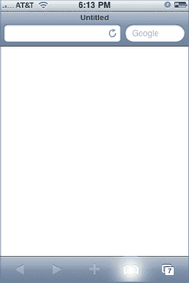

`Safari` 与 `OS X` 版 `Safari` 和 Windows 版 `Safari` 一样，都基于相同的开源 `WebKit` 浏览器引擎。然而，尽管 `Safari` 系列基于共同的框架，但将 iOS 版 `Safari` 视为其 Mac 和 Windows 对应版本的近亲而非完全相同的双胞胎会更有帮助。例如，iOS 版 `Safari` 并不提供其桌面版所具备的全部 `CSS` 或 `JavaScript` 功能。

此外，iOS 版 `Safari` 只提供有限数量的用户可配置设置。如图 1-2 所示，用户可以开启或关闭对 `JavaScript`、插件和弹出窗口拦截器的支持。用户还可以选择始终接受 `Cookie`、仅接受来自访问网站的 `Cookie` 或从不接受 `Cookie`。用户也可以手动清除此屏幕上的历史记录、`Cookie` 和缓存。

图 1-2

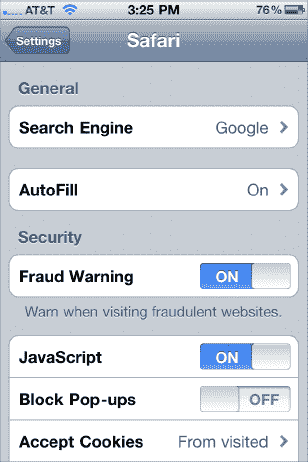

显然，原生应用和 Web 应用并不完全相同——无论从开发者还是最终用户的角度来看都是如此。从开发者的角度来看，主要区别在于编程语言——使用 Web 技术而非 `Objective-C`。然而，也存在一些关键的最终用户影响，包括以下内容：

* 性能：基于 `Safari` 的 Web 应用的响应速度不如原生编译应用，这既是因为编程语言的解释性本质，也是因为应用运行在 `Wi-Fi` 和 `3G` 网络上。（请记住，某些 `iPad` 型号和所有 `iPod touch` 型号仅支持 `Wi-Fi` 访问。）然而，尽管存在技术限制，你仍可以进行许多优化以达到可接受的性能。

表 1-1 显示了 `Wi-Fi`、`3G` 和较旧的 `EDGE` 网络的带宽性能。

表 1-1：网络性能

| 网络 | 带宽 |
| --- | --- |
| Wi-Fi | 54 Mbps |
| 3G | 最高 7.2 Mbps |
| EDGE | 70–135 Kbps，突发 200 Kbps |

* 启动：原生应用均从 iOS 设备的主屏幕启动（参见图 1-3）。在最初的 iPhone `OS` 版本中，苹果没有提供从主屏幕启动 Web 应用的方式，这意味着 Web 应用只能从 `Safari` 书签列表中访问。幸运的是，最新的 iOS 用户能够为其 Web 应用添加“`Web Clip`”图标（例如图 1-4 中显示的 `Color Mail` 应用），使其也能出现在主屏幕上。

图 1-3

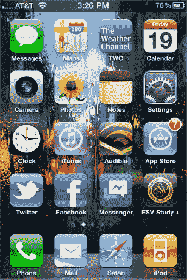

图 1-4

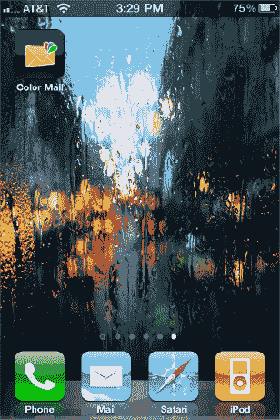

* 用户界面（UI）：原生 iOS 应用通常遵循苹果的 UI 设计指南。当你设计 Web 应用时，不应感到必须完美复刻原生外观的 UI。同时，你应该创建一个非常适合移动触摸设备的 UI。幸运的是，使用开源框架和标准 Web 技术，你可以通过结合 `HTML`、`CSS` 和 `JavaScript` 来实现这一点。图 1-5 和 1-6 比较了原生应用和基于 `Safari` 的 Web 应用的 UI 设计。

图 1-5

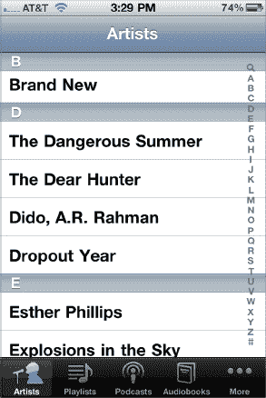

图 1-6

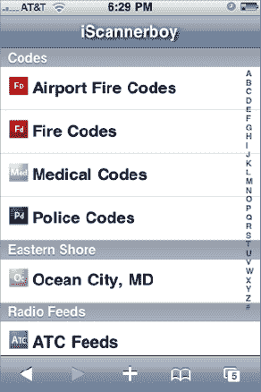

此外，iOS 的最新升级使你能够通过 `meta` 标签隐藏所有 `Safari` 浏览器 UI 元素，从而基本上模拟原生应用的外观和感觉。（参见图 1-7。）

图 1-7

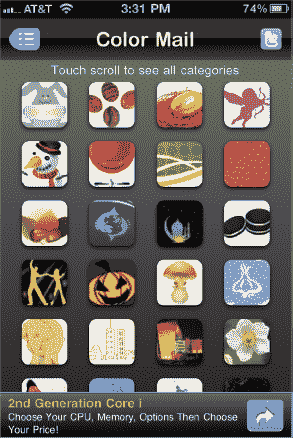

### 面向 Web 开发者的关键 Safari 功能

随着 iOS 的最新版本发布，Web 应用开发者可以获得若干功能。以下列表显示了这些功能：

* 地理定位：iOS 版 `Safari` 支持 `HTML5` 地理定位，使 `JavaScript` 与 iPhone 或 `iPad` 交互，以检索设备的当前位置（参见图 1-8 和 9）。因此你可以创建能够支持 GPS 的设备的应用。
* HTML5 媒体标签：iOS 版 `Safari` 支持视频和音频元素，用于在网页中嵌入视频和音频。这些新元素消除了使用 `embed` 和 `object` 标签的需求。由于 iOS 设备不支持 Flash，你可以使用 `video` 标签嵌入 QuickTime `.mov` 文件。
* CSS 动画和效果：新版本的 `Safari` 支持 `CSS` 动画，使你能够以多种方式操作元素，例如缩放、旋转、淡入淡出。iOS 版 `Safari` 还支持 `CSS` 效果，使你能够创建渐变、遮罩和反射。
* SVG：`SVG`（可缩放矢量图形）是一种基于 XML 的格式，用于创建静态和动画矢量。通过支持 `SVG`，iOS 版 `Safari` 不仅提供了一种处理图形的方法，还提供了一种替代 Flash 的技术。

图 1-8


图 1-9


### 为 iOS 开发应用的四种方法

浏览器中运行的 Web 应用和一个 iOS 应用虽然使用了相同的基本元素——`HTML`、`CSS` 和 `JavaScript`——但它们并不相同。实际上，为 iOS 设备开发时，有四种方法：

* 第一级——完全兼容的网站或应用：基础的方法是开发一个“iOS 友好”且与 Apple 设备完全兼容的网站或应用（参见图 1-10）。这些网站避免使用 Flash、Java 及其他插件。这种基本方法最大限度利用了区块和列，方便用户在网站内导航和缩放。这种基本方法并没有为 iOS 用户做特殊处理，但确保不会对浏览造成障碍。
* 第二级——针对 iOS 优化的网站或应用：对 iOS 的第二级支持为 Safari 上的用户提供基本体验，还为使用 Safari 浏览器的用户提供优化的体验，例如利用 Safari 的增强属性。
* 第三级——专用移动网站或应用：第三级支持是提供针对 iPhone 或 iPad 视口尺寸定制的网站或应用，并为所有设备用户提供强大的网页体验（参见图 1-11 和 12）。然而，尽管这些网站为移动浏览而定制，但它们并未设计为充分 iOS 功能。在很多情况下，它们往往是完整网站的简化版本。
* 第四级——iOS Web 应用：最后一种方法是提供专为 iPhone 或 iPad 设计的 Web 应用，其 UI 设计类似于原生应用，或者充分利用 iOS 设备的功能（参见图 1-13）。设计目标之一是减少用户意识到自己处于浏览器环境中的感觉。此外，一个完整的 iOS 应用会需要与 iOS 特有的服务集成，包括电话、邮件和地图应用。

图 1-10

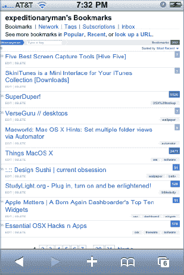

图 1-11


图 1-12

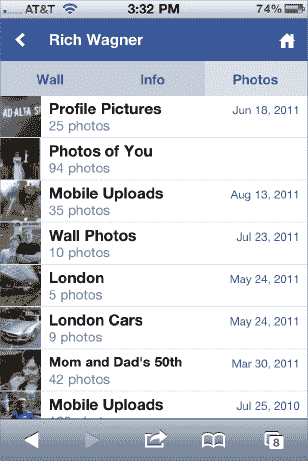

图 1-13

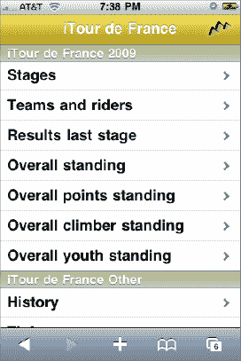

因此，在考虑应用规格时，请务必确定你希望为 iOS 用户提供哪个级别的用户体验，并据此设计你的应用。在本书中，我主要关注开发针对 iOS 优化的 Web 应用。

### 手指不是鼠标

在为 iOS 开发应用时，你需要牢记的一个设计考虑因素是：手指不是鼠标。在桌面上，用户可以使用多种输入设备——例如 Apple Magic Mouse、罗技轨迹球或笔记本电脑触摸板。但在屏幕上，这些硬件对应的鼠标指针在形状、大小和行为上是相同的。然而，在 iOS 上，指点设备始终是独一无二。例如，芭蕾舞演员可能用纤细的手指输入，而 NFL 球员则使用又大又粗的设备。我们大多数人则介于两者之间。此外，手指远不如鼠标指针精确，这使得界面尺寸和定位问题非常重要，无论你是在创建 iOS 友好的网站，还是完整的 iPhone 或 iPad Web 应用。

此外，手指输入并不总是与鼠标输入对应。鼠标有左键点击、右键点击、滚动和鼠标移动。相比之下，手指有轻点、轻扫、拖拽和捏合。然而，作为应用开发者，你需要管理你的应用支持哪些手势。一些用于浏览网站的手势（例如双击缩放）实际上通常不是你希望在 iOS Web 应用内支持的。表 1-2 列出了 iOS 支持的手势，并指出了这种手势是否应在网站或完整 Web 应用中支持。

表 1-2：手指手势

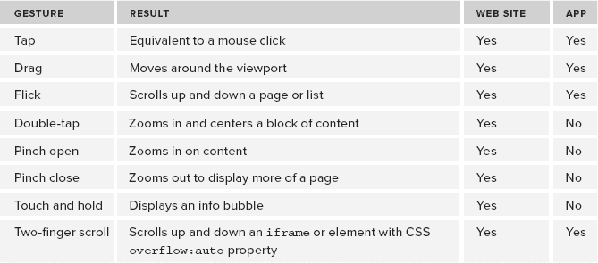

### 限制与约束

原生应用和 Web 应用并不完全相同——无论从开发者还是最终用户的角度来看都是如此。从开发者角度来看，主要区别在于编程语言——使用 Web 技术而非 `Objective-C`。然而，也存在一些关键的最终用户影响，包括以下内容：

* 性能：基于 `Safari` 的 Web 应用的响应速度不如原生编译应用，这既是因为编程语言的解释性本质，也是因为应用运行在 `Wi-Fi` 和 `3G` 网络上。（请记住，某些 `iPad` 型号和所有 `iPod touch` 型号仅支持 `Wi-Fi` 访问。）然而，尽管存在技术限制，你仍可以进行许多优化以达到可接受的性能。

表 1-1 显示了 `Wi-Fi`、`3G` 和较旧的 `EDGE` 网络的带宽性能。

表 1-1：网络性能

| 网络 | 带宽 |
| --- | --- |
| Wi-Fi | 54 Mbps |
| 3G | 最高 7.2 Mbps |
| EDGE | 70–135 Kbps，突发 200 Kbps |

* 启动：原生应用均从 iOS 设备的主屏幕启动（参见图 1-3）。在最初的 iPhone `OS` 版本中，苹果没有提供从主屏幕启动 Web 应用的方式，这意味着 Web 应用只能从 `Safari` 书签列表中访问。幸运的是，最新的 iOS 用户能够为其 Web 应用添加“`Web Clip`”图标（例如图 1-4 中显示的 `Color Mail` 应用），使其也能出现在主屏幕上。

图 1-3


图 1-4


* 用户界面（UI）：原生 iOS 应用通常遵循苹果的 UI 设计指南。当你设计 Web 应用时，不应感到必须完美复刻原生外观的 UI。同时，你应该创建一个非常适合移动触摸设备的 UI。幸运的是，使用开源框架和标准 Web 技术，你可以通过结合 `HTML`、`CSS` 和 `JavaScript` 来实现这一点。图 1-5 和 1-6 比较了原生应用和基于 `Safari` 的 Web 应用的 UI 设计。

图 1-5


图 1-6


此外，iOS 的最新升级使你能够通过 `meta` 标签隐藏所有 `Safari` 浏览器 UI 元素，从而基本上模拟原生应用的外观和感觉。（参见图 1-7。）

图 1-7


### 面向 Web 开发者的关键 Safari 功能

随着 iOS 的最新版本发布，Web 应用开发者可以获得若干功能。以下列表显示了这些功能：

* 地理定位：iOS 版 `Safari` 支持 `HTML5` 地理定位，使 `JavaScript` 与 iPhone 或 `iPad` 交互，以检索设备的当前位置（参见图 1-8 和 9）。因此你可以创建能够支持 GPS 的设备的应用。
* HTML5 媒体标签：iOS 版 `Safari` 支持视频和音频元素，用于在网页中嵌入视频和音频。这些新元素消除了使用 `embed` 和 `object` 标签的需求。由于 iOS 设备不支持 Flash，你可以使用 `video` 标签嵌入 QuickTime `.mov` 文件。
* CSS 动画和效果：新版本的 `Safari` 支持 `CSS` 动画，使你能够以多种方式操作元素，例如缩放、旋转、淡入淡出。iOS 版 `Safari` 还支持 `CSS` 效果，使你能够创建渐变、遮罩和反射。
* SVG：`SVG`（可缩放矢量图形）是一种基于 XML 的格式，用于创建静态和动画矢量。通过支持 `SVG`，iOS 版 `Safari` 不仅提供了一种处理图形的方法，还提供了一种替代 Flash 的技术。

图 1-8


图 1-9


### 为 iOS 开发应用的四种方法

浏览器中运行的 Web 应用和一个 iOS 应用虽然使用了相同的基本元素——`HTML`、`CSS` 和 `JavaScript`——但它们并不相同。实际上，为 iOS 设备开发时，有四种方法：

* 第一级——完全兼容的网站或应用：基础的方法是开发一个“iOS 友好”且与 Apple 设备完全兼容的网站或应用（参见图 1-10）。这些网站避免使用 Flash、Java 及其他插件。这种基本方法最大限度利用了区块和列，方便用户在网站内导航和缩放。这种基本方法并没有为 iOS 用户做特殊处理，但确保不会对浏览造成障碍。
* 第二级——针对 iOS 优化的网站或应用：对 iOS 的第二级支持为 Safari 上的用户提供基本体验，还为使用 Safari 浏览器的用户提供优化的体验，例如利用 Safari 的增强属性。
* 第三级——专用移动网站或应用：第三级支持是提供针对 iPhone 或 iPad 视口尺寸定制的网站或应用，并为所有设备用户提供强大的网页体验（参见图 1-11 和 12）。然而，尽管这些网站为移动浏览而定制，但它们并未设计为充分 iOS 功能。在很多情况下，它们往往是完整网站的简化版本。
* 第四级——iOS Web 应用：最后一种方法是提供专为 iPhone 或 iPad 设计的 Web 应用，其 UI 设计类似于原生应用，或者充分利用 iOS 设备的功能（参见图 1-13）。设计目标之一是减少用户意识到自己处于浏览器环境中的感觉。此外，一个完整的 iOS 应用会需要与 iOS 特有的服务集成，包括电话、邮件和地图应用。

图 1-10


图 1-11


图 1-12


图 1-13


因此，在考虑应用规格时，请务必确定你希望为 iOS 用户提供哪个级别的用户体验，并据此设计你的应用。在本书中，我主要关注开发针对 iOS 优化的 Web 应用。

### 手指不是鼠标

在为 iOS 开发应用时，你需要牢记的一个设计考虑因素是：手指不是鼠标。在桌面上，用户可以使用多种输入设备——例如 Apple Magic Mouse、罗技轨迹球或笔记本电脑触摸板。但在屏幕上，这些硬件对应的鼠标指针在形状、大小和行为上是相同的。然而，在 iOS 上，指点设备始终是独一无二。例如，芭蕾舞演员可能用纤细的手指输入，而 NFL 球员则使用又大又粗的设备。我们大多数人则介于两者之间。此外，手指远不如鼠标指针精确，这使得界面尺寸和定位问题非常重要，无论你是在创建 iOS 友好的网站，还是完整的 iPhone 或 iPad Web 应用。

此外，手指输入并不总是与鼠标输入对应。鼠标有左键点击、右键点击、滚动和鼠标移动。相比之下，手指有轻点、轻扫、拖拽和捏合。然而，作为应用开发者，你需要管理你的应用支持哪些手势。一些用于浏览网站的手势（例如双击缩放）实际上通常不是你希望在 iOS Web 应用内支持的。表 1-2 列出了 iOS 支持的手势，并指出了这种手势是否应在网站或完整 Web 应用中支持。

表 1-2：手指手势


### 限制与约束

原生应用和 Web 应用并不完全相同——无论从开发者还是最终用户的角度来看都是如此。从开发者的角度来看，主要区别在于编程语言——使用 Web 技术而非 `Objective-C`。然而，也存在一些关键的最终用户影响，包括以下内容：

* 性能：基于 `Safari` 的 Web 应用的响应速度不如原生编译应用，这既是因为编程语言的解释性本质，也是因为应用运行在 `Wi-Fi` 和 `3G` 网络上。（请记住，某些 `iPad` 型号和所有 `iPod touch` 型号仅支持 `Wi-Fi` 访问。）然而，尽管存在技术限制，你仍可以进行许多优化以达到可接受的性能。

表 1-1 显示了 `Wi-Fi`、`3G` 和较旧的 `EDGE` 网络的带宽性能。

表 1-1：网络性能

| 网络 | 带宽 |
| --- | --- |
| Wi-Fi | 54 Mbps |
| 3G | 最高 7.2 Mbps |
| EDGE | 70–135 Kbps，突发 200 Kbps |

* 启动：原生应用均从 iOS 设备的主屏幕启动（参见图 1-3）。在最初的 iPhone `OS` 版本中，苹果没有提供从主屏幕启动 Web 应用的方式，这意味着 Web 应用只能从 `Safari` 书签列表中访问。幸运的是，最新的 iOS 用户能够为其 Web 应用添加“`Web Clip`”图标（例如图 1-4 中显示的 `Color Mail` 应用），使其也能出现在主屏幕上。

图 1-3


图 1-4


* 用户界面（UI）：原生 iOS 应用通常遵循苹果的 UI 设计指南。当你设计 Web 应用时，不应感到必须完美复刻原生外观的 UI。同时，你应该创建一个非常适合移动触摸设备的 UI。幸运的是，使用开源框架和标准 Web 技术，你可以通过结合 `HTML`、`CSS` 和 `JavaScript` 来实现这一点。图 1-5 和 1-6 比较了原生应用和基于 `Safari` 的 Web 应用的 UI 设计。

图 1-5


图 1-6


此外，iOS 的最新升级使你能够通过 `meta` 标签隐藏所有 `Safari` 浏览器 UI 元素，从而基本上模拟原生应用的外观和感觉。（参见图 1-7。）

图 1-7


### 面向 Web 开发者的关键 Safari 功能

随着 iOS 的最新版本发布，Web 应用开发者可以获得若干功能。以下列表显示了这些功能：

* 地理定位：iOS 版 `Safari` 支持 `HTML5` 地理定位，使 `JavaScript` 与 iPhone 或 `iPad` 交互，以检索设备的当前位置（参见图 1-8 和 9）。因此你可以创建能够支持 GPS 的设备的应用。
* HTML5 媒体标签：iOS 版 `Safari` 支持视频和音频元素，用于在网页中嵌入视频和音频。这些新元素消除了使用 `embed` 和 `object` 标签的需求。由于 iOS 设备不支持 Flash，你可以使用 `video` 标签嵌入 QuickTime `.mov` 文件。
* CSS 动画和效果：新版本的 `Safari` 支持 `CSS` 动画，使你能够以多种方式操作元素，例如缩放、旋转、淡入淡出。iOS 版 `Safari` 还支持 `CSS` 效果，使你能够创建渐变、遮罩和反射。
* SVG：`SVG`（可缩放矢量图形）是一种基于 XML 的格式，用于创建静态和动画矢量。通过支持 `SVG`，iOS 版 `Safari` 不仅提供了一种处理图形的方法，还提供了一种替代 Flash 的技术。

图 1-8


图 1-9


### 为 iOS 开发应用的四种方法

浏览器中运行的 Web 应用和一个 iOS 应用虽然使用了相同的基本元素——`HTML`、`CSS` 和 `JavaScript`——但它们并不相同。实际上，为 iOS 设备开发时，有四种方法：

* 第一级——完全兼容的网站或应用：基础的方法是开发一个“iOS 友好”且与 Apple 设备完全兼容的网站或应用（参见图 1-10）。这些网站避免使用 Flash、Java 及其他插件。这种基本方法最大限度利用了区块和列，方便用户在网站内导航和缩放。这种基本方法并没有为 iOS 用户做特殊处理，但确保不会对浏览造成障碍。
* 第二级——针对 iOS 优化的网站或应用：对 iOS 的第二级支持为 Safari 上的用户提供基本体验，还为使用 Safari 浏览器的用户提供优化的体验，例如利用 Safari 的增强属性。
* 第三级——专用移动网站或应用：第三级支持是提供针对 iPhone 或 iPad 视口尺寸定制的网站或应用，并为所有设备用户提供强大的网页体验（参见图 1-11 和 12）。然而，尽管这些网站为移动浏览而定制，但它们并未设计为充分 iOS 功能。在很多情况下，它们往往是完整网站的简化版本。
* 第四级——iOS Web 应用：最后一种方法是提供专为 iPhone 或 iPad 设计的 Web 应用，其 UI 设计类似于原生应用，或者充分利用 iOS 设备的功能（参见图 1-13）。设计目标之一是减少用户意识到自己处于浏览器环境中的感觉。此外，一个完整的 iOS 应用会需要与 iOS 特有的服务集成，包括电话、邮件和地图应用。

图 1-10


图 1-11


图 1-12


图 1-13


因此，在考虑应用规格时，请务必确定你希望为 iOS 用户提供哪个级别的用户体验，并据此设计你的应用。在本书中，我主要关注开发针对 iOS 优化的 Web 应用。

### 手指不是鼠标

在为 iOS 开发应用时，你需要牢记的一个设计考虑因素是：手指不是鼠标。在桌面上，用户可以使用多种输入设备——例如 Apple Magic Mouse、罗技轨迹球或笔记本电脑触摸板。但在屏幕上，这些硬件对应的鼠标指针在形状、大小和行为上始终是相同的。然而，在 iOS 上，指点设备始终是独一无二。例如，芭蕾舞演员可能用纤细的手指输入，而 NFL 球员则使用又大又粗的输入设备。我们大多数人则介于两者之间。此外，手指远不如鼠标指针精确，这使得界面尺寸和定位问题非常重要，无论你是在创建 iOS 友好的网站，还是完整的 iPhone 或 iPad Web 应用。

此外，手指输入并不总是与鼠标输入对应。鼠标有左键点击、右键点击、滚动和鼠标移动。相比之下，手指有轻点、轻扫、拖拽和捏合。然而，作为应用开发者，你需要管理你的应用支持哪些手势。一些用于浏览网站的手势（例如双击缩放）实际上通常不是你希望在 iOS Web 应用内支持的。表 1-2 列出了 iOS 支持的手势，并指出了这种手势是否应在网站或完整 Web 应用中支持。

表 1-2：手指手势


### 限制与约束

原生应用和 Web 应用并不完全相同——无论从开发者还是最终用户的角度来看都是如此。从开发者的角度来看，主要区别在于编程语言——使用 Web 技术而非 `Objective-C`。然而，也存在一些关键的最终用户影响，包括以下内容：

* 性能：基于 `Safari` 的 Web 应用的响应速度不如原生编译应用，这既是因为编程语言的解释性本质，也是因为应用运行在 `Wi-Fi` 和 `3G` 网络上。（请记住，某些 `iPad` 型号和所有 `iPod touch` 型号仅支持 `Wi-Fi` 访问。）然而，尽管存在技术限制，你仍可以进行许多优化以达到可接受的性能。

表 1-1 显示了 `Wi-Fi`、`3G` 和较旧的 `EDGE` 网络的带宽性能。

表 1-1：网络性能

| 网络 | 带宽 |
| --- | --- |
| Wi-Fi | 54 Mbps |
| 3G | 最高 7.2 Mbps |
| EDGE | 70–135 Kbps，突发 200 Kbps |

## 第 2 章：使用核心技术

## 第 3 章：文档对象模型

## 第 4 章：编写你的第一个 Hello World 应用

## 第 5 章：为 iPhone 和 iPad 启用并优化网站

### 第 1 章：使用 Web 技术介绍 iOS 开发

#### 本章学习内容：

* 在 iOS 上使用 Safari 作为开发环境
* 开发触控导向的应用
* 搭建你的开发环境

iPhone 的推出，以及随后 iPod touch 和 iPad 的亮相，彻底改变了人们与手持设备的交互方式。用户不再需要使用键盘进行屏幕导航，也不再需要通过“简化版”页面浏览网页。这些移动设备将触摸屏输入、革命性的界面设计以及功能完备的网页浏览器直接带到了人们的手掌之中。

看到这个平台的潜力，开发者社区纷纷加入。尽管原生应用可能获得了大部分关注，但你仍然可以在不写一行 Objective-C 代码的情况下为 iOS 设备创建应用。事实上，iOS 版 Safari 浏览器为那些希望使用熟悉的 Web 技术为 iOS 创建自定义应用的 Web 开发者提供了一个极具吸引力的应用开发平台。

### 探索 iOS 版 Safari 平台

iOS Web 应用运行在基于 Web 标准的内置 Safari 浏览器中，包括以下内容：

* HTML/XHTML（HTML 4.01 和 XHTML 1.9、XHTML 移动版配置文件文档类型）
* CSS（CSS 2.1 和部分 CSS3）
* JavaScript（ECMAScript 3（ECMA 262）、JavaScript 1.4）
* AJAX（例如 XMLHTTPRequest）
* SVG（可缩放矢量图形）1.1
* HTML5 媒体标签
* 辅助技术（视频和音频媒体、PDF 等）

iOS 版 Safari（在本书中我交替使用 Safari 或 iOS 版 Safari 来指代）成为你开发应用的平台，也成为你的应用必须运行的外壳（参见图 1-1）。

图 1-1


Safari 与 OS X 版 Safari 和 Windows 版 Safari 一样，都基于相同的开源 WebKit 浏览器引擎。然而，尽管 Safari 系列基于共同的框架，但将 iOS 版 Safari 视为其 Mac 和 Windows 对应版本的近亲而非完全相同的双胞胎会更有帮助。例如，iOS 版 Safari 并不提供其桌面版所具备的全部 CSS 或 JavaScript 功能。

此外，iOS 版 Safari 只提供有限数量的用户可配置设置。如图 1-2 所示，用户可以开启或关闭对 JavaScript、插件和弹出窗口拦截器的支持。用户还可以选择始终接受 Cookie、仅接受来自访问网站的 Cookie 或从不接受 Cookie。用户也可以手动清除此屏幕上的历史记录、Cookie 和缓存。

图 1-2


显然，原生应用和 Web 应用并不完全相同——无论从开发者还是最终用户的角度来看都是如此。从开发者角度来看，主要区别在于编程语言——使用 Web 技术而非 Objective-C。然而，也存在一些关键的最终用户影响，包括以下内容：

* 性能：基于 Safari 的 Web 应用的响应速度不如原生编译应用，这既是因为编程语言的解释性本质，也是因为应用运行在 Wi-Fi 和 3G 网络上。（请记住，某些 iPad 型号和所有 iPod touch 型号仅支持 Wi-Fi 访问。）然而，尽管存在技术限制，你仍可以进行许多优化以达到可接受的性能。

表 1-1 显示了 Wi-Fi、3G 和较旧的 EDGE 网络的带宽性能。

表 1-1：网络性能

| 网络 | 带宽 |
| --- | --- |
| Wi-Fi | 54 Mbps |
| 3G | 最高 7.2 Mbps |
| EDGE | 70–135 Kbps，突发 200 Kbps |

* 启动：原生应用均从 iOS 设备的主屏幕启动（参见图 1-3）。在最初的 iPhone OS 版本中，苹果没有提供从主屏幕启动 Web 应用的方式，这意味着 Web 应用只能从 Safari 书签列表中访问。幸运的是，最新的 iOS 用户能够为其 Web 应用添加“Web Clip”图标（例如图 1-4 中显示的 Color Mail 应用），使其也能出现在主屏幕上。

图 1-3


图 1-4


* 用户界面（UI）：原生 iOS 应用通常遵循苹果的 UI 设计指南。当你设计 Web 应用时，不应感到必须完美复刻原生外观的 UI。同时，你应该创建一个非常适合移动触摸设备的 UI。幸运的是，使用开源框架和标准 Web 技术，你可以通过结合 HTML、CSS 和 JavaScript 来实现这一点。图 1-5 和 1-6 比较了原生应用和基于 Safari 的 Web 应用的 UI 设计。

图 1-5


图 1-6


此外，iOS 的最新升级使你能够通过 meta 标签隐藏所有 Safari 浏览器 UI 元素，从而基本上模拟原生应用的外观和感觉。（参见图 1-7。）

图 1-7


### 面向 Web 开发者的关键 Safari 功能

随着 iOS 的最新版本发布，Web 应用开发者可以获得若干功能。以下列表显示了这些功能：

* 地理定位：iOS 版 Safari 支持 HTML5 地理定位，使 JavaScript 与 iPhone 或 iPad 交互，以检索设备的当前位置（参见图 1-8 和 9）。因此你可以创建能够支持 GPS 的设备的应用。
* HTML5 媒体标签：iOS 版 Safari 支持视频和音频元素，用于在网页中嵌入视频和音频。这些新元素消除了使用 embed 和 object 标签的需求。由于 iOS 设备不支持 Flash，你可以使用 video 标签嵌入 QuickTime .mov 文件。由于 Safari 是第一个 HTML5，你可以使用 video 标签。
* CSS 动画和效果：新版本的 Safari 支持 CSS 动画，使你能够以多种方式操作元素，例如缩放、旋转、淡入淡出。iOS 版 Safari 还支持 CSS 效果，使你能够创建渐变、遮罩和反射。
* SVG：SVG（可缩放矢量图形）是一种基于 XML 的格式，用于创建静态和动画矢量。通过支持 SVG，iOS 版 Safari 不仅提供了一种处理图形的方法，还提供了一种替代 Flash 的技术。

图 1-8


图 1-9


### 为 iOS 开发应用的四种方法

浏览器中运行的 Web 应用和一个 iOS 应用虽然使用了相同的基本元素——HTML、CSS 和 JavaScript——但它们并不相同。实际上，为 iOS 设备开发时，有四种方法：

* 第一级——完全兼容的网站或应用：基础的方法是开发一个“iOS 友好”且与 Apple 设备完全兼容的网站或应用（参见图 1-10）。这些网站避免使用 Flash、Java 及其他插件。这种基本方法最大限度利用了区块和列，方便用户在网站内导航和缩放。这种基本方法并没有为 iOS 用户做特殊处理，但确保不会对浏览造成障碍。
* 第二级——针对 iOS 优化的网站或应用：对 iOS 的第二级支持为 Safari 上的用户提供基本体验，还为使用 Safari 浏览器的用户提供优化的体验，例如利用 Safari 的增强属性。
* 第三级——专用移动网站或应用：第三级支持是提供针对 iPhone 或 iPad 视口尺寸定制的网站或应用，并为所有设备用户提供强大的网页体验（参见图 1-11 和 12）。然而，尽管这些网站为移动浏览而定制，但它们并未设计为充分 iOS 功能。在很多情况下，它们往往是完整网站的简化版本。
* 第四级——iOS Web 应用：最后一种方法是提供专为 iPhone 或 iPad 设计的 Web 应用，其 UI 设计类似于原生应用，或者充分利用 iOS 设备的功能（参见图 1-13）。设计目标之一是减少用户意识到自己处于浏览器环境中的感觉。此外，一个完整的 iOS 应用会需要与 iOS 特有的服务集成，包括电话、邮件和地图应用。

图 1-10


图 1-11


图 1-12


图 1-13


因此，在考虑应用规格时，请务必确定你希望为 iOS 用户提供哪个级别的用户体验，并据此设计你的应用。在本书中，我主要关注开发针对 iOS 优化的 Web 应用。

### 手指不是鼠标

在为 iOS 开发应用时，你需要牢记的一个设计考虑因素是：手指不是鼠标。在桌面上，用户可以使用多种输入设备——例如 Apple Magic Mouse、罗技轨迹球或笔记本电脑触摸板。但在屏幕上，这些硬件对应的鼠标指针在形状、大小和行为上始终是相同的。然而，在 iOS 上，指点设备始终是独一无二。例如，芭蕾舞演员可能用纤细的手指输入，而 NFL 球员则使用又大又粗的输入设备。我们大多数人则介于两者之间。此外，手指远不如鼠标指针精确，这使得界面尺寸和定位问题非常重要，无论你是在创建 iOS 友好的网站，还是完整的 iPhone 或 iPad Web 应用。

此外，手指输入并不总是与鼠标输入对应。鼠标有左键点击、右键点击、滚动和鼠标移动。相比之下，手指有轻点、轻扫、拖拽和捏合。然而，作为应用开发者，你需要管理你的应用支持哪些手势。一些用于浏览网站的手势（例如双击缩放）实际上通常不是你希望在 iOS Web 应用内支持的。表 1-2 列出了 iOS 支持的手势，并指出了这种手势是否应在网站或完整 Web 应用中支持。

表 1-2：手指手势


### 限制与约束

原生应用和 Web 应用并不完全相同——无论从开发者还是最终用户的角度来看都是如此。从开发者的角度来看，主要区别在于编程语言——使用 Web 技术而非 Objective-C。然而，也存在一些关键的最终用户影响，包括以下内容：

* 性能：基于 Safari 的 Web 应用的响应速度不如原生编译应用，这既是因为编程语言的解释性本质，也是因为应用运行在 Wi-Fi 和 3G 网络上。（请记住，某些 iPad 型号和所有 iPod touch 型号仅支持 Wi-Fi 访问。）然而，尽管存在技术限制，你仍可以进行许多优化以达到可接受的性能。

表 1-1 显示了 Wi-Fi、3G 和较旧的 EDGE 网络的带宽性能。

表 1-1：网络性能

| 网络 | 带宽 |
| --- | --- |
| Wi-Fi | 54 Mbps |
| 3G | 最高 7.2 Mbps |
| EDGE | 70–135 Kbps，突发 200 Kbps |

``` 第 2 章：使用核心技术

#### 本章学习内容：

* 在 iOS 上使用 Safari 作为开发环境
* 开发触控导向的应用
* 搭建你的开发环境

iOS 应用运行在基于 Web 标准的内置 Safari 浏览器中，包括以下内容：

* HTML/XHTML（HTML 4.01 和 XHTML 1.9、XHTML 移动版配置文件文档类型）
* CSS（CSS 2.1 和部分 CSS3）
* JavaScript（ECMAScript 3（ECMA 262）、JavaScript 1.4）
* AJAX（例如 XMLHTTPRequest）
* SVG（可缩放矢量图形）1.1
* HTML5 媒体标签
* 辅助技术（视频和音频媒体、PDF 等）

iOS 版 Safari（在本书中我交替使用 Safari 或 iOS 版 Safari 来指代）成为你开发应用的平台，也成为你的应用必须运行的外壳（参见图 1-1）。

图 1-1


Safari 与 OS X 版 Safari 和 Windows 版 Safari 一样，都基于相同的开源 WebKit 浏览器引擎。然而，尽管 Safari 系列基于共同的框架，但将 iOS 版 Safari 视为其 Mac 和 Windows 对应版本的近亲而非完全相同的双胞胎会更有帮助。例如，iOS 版 Safari 并不提供其桌面版所具备的全部 CSS 或 JavaScript 功能。

此外，iOS 版 Safari 只提供有限数量的用户可配置设置。如图 1-2 所示，用户可以开启或关闭对 JavaScript、插件和弹出窗口拦截器的支持。用户还可以选择始终接受 Cookie、仅接受来自访问网站的 Cookie 或从不接受 Cookie。用户也可以手动清除此屏幕上的历史记录、Cookie 和缓存。

图 1-2


显然，原生应用和 Web 应用并不完全相同——无论从开发者还是最终用户的角度来看都是如此。从开发者的角度来看，主要区别在于编程语言——使用 Web 技术而非 Objective-C。然而，也存在一些关键的最终用户影响，包括以下内容：

* 性能：基于 Safari 的 Web 应用的响应速度不如原生编译应用，这既是因为编程语言的解释性本质，也是因为应用运行在 Wi-Fi 和 3G 网络上。（请记住，某些 iPad 型号和所有 iPod touch 型号仅支持 Wi-Fi 访问。）然而，尽管存在技术限制，你仍可以进行许多优化以达到可接受的性能。

表 1-1 显示了 Wi-Fi、3G 和较旧的 EDGE 网络的带宽性能。

表 1-1：网络性能

| 网络 | 带宽 |
| --- | --- |
| Wi-Fi | 54 Mbps |
| 3G | 最高 7.2 Mbps |
| EDGE | 70–135 Kbps，突发 200 Kbps |

* 启动：原生应用均从 iOS 设备的主屏幕启动（参见图 1-3）。在最初的 iPhone OS 版本中，苹果没有提供从主屏幕启动 Web 应用的方式，这意味着 Web 应用只能从 Safari 书签列表中访问。幸运的是，最新的 iOS 用户能够为其 Web 应用添加“Web Clip”图标（例如图 1-4 中显示的 Color Mail 应用），使其也能出现在主屏幕上。

图 1-3


图 1-4


* 用户界面（UI）：原生 iOS 应用通常遵循苹果的 UI 设计指南。当你设计 Web 应用时，不应感到必须完美复刻原生外观的 UI。同时，你应该创建一个非常适合移动触摸设备的 UI。幸运的是，使用开源框架和标准 Web 技术，你可以通过结合 HTML、CSS 和 JavaScript 来实现这一点。图 1-5 和 1-6 比较了原生应用和基于 Safari 的 Web 应用的 UI 设计。

图 1-5


图 1-6


此外，iOS 的最新升级使你能够通过 meta 标签隐藏所有 Safari 浏览器 UI 元素，从而基本上模拟原生应用的外观和感觉。（参见图 1-7。）

图 1-7


### 面向 Web 开发者的关键 Safari 功能

随着 iOS 的最新版本发布，Web 应用开发者可以获得若干功能。以下列表显示了这些功能：

* 地理定位：iOS 版 Safari 支持 HTML5 地理定位，使 JavaScript 与 iPhone 或 iPad 交互，以检索设备的当前位置（参见图 1-8 和 9）。因此你可以创建能够支持 GPS 的设备的应用。
* HTML5 媒体标签：iOS 版 Safari 支持视频和音频元素，用于在网页中嵌入视频和音频。这些新元素消除了使用 embed 和 object 标签的需求。由于 iOS 设备不支持 Flash，你可以使用 video 标签嵌入 QuickTime .mov 文件。由于 Safari 是第一个 HTML5，你可以使用 video 标签。
* CSS 动画和效果：新版本的 Safari 支持 CSS 动画，使你能够以多种方式操作元素，例如缩放、旋转、淡入淡出。iOS 版 Safari 还支持 CSS 效果，使你能够创建渐变、遮罩和反射。
* SVG：SVG（可缩放矢量图形）是一种基于 XML 的格式，用于创建静态和动画矢量。通过支持 SVG，iOS 版 Safari 不仅提供了一种处理图形的方法，还提供了一种替代 Flash 的技术。

图 1-8


图 1-9


### 为 iOS 开发应用的四种方法

浏览器中运行的 Web 应用和一个 iOS 应用虽然使用了相同的基本元素——HTML、CSS 和 JavaScript——但它们并不相同。实际上，为 iOS 设备开发时，有四种方法：

* 第一级——完全兼容的网站或应用：基础的方法是开发一个“iOS 友好”且与 Apple 设备完全兼容的网站或应用（参见图 1-10）。这些网站避免使用 Flash、Java 及其他插件。这种基本方法最大限度利用了区块和列，方便用户在网站内导航和缩放。这种基本方法并没有为 iOS 用户做特殊处理，但确保不会对浏览造成障碍。
* 第二级——针对 iOS 优化的网站或应用：对 iOS 的第二级支持为 Safari 上的用户提供基本体验，还为使用 Safari 浏览器的用户提供优化的体验，例如利用 Safari 的增强属性。
* 第三级——专用移动网站或应用：第三级支持是提供针对 iPhone 或 iPad 视口尺寸定制的网站或应用，并为所有设备用户提供强大的网页体验（参见图 1-11 和 12）。然而，尽管这些网站为移动浏览而定制，但它们并未设计为充分 iOS 功能。在很多情况下，它们往往是完整网站的简化版本。
* 第四级——iOS Web 应用：最后一种方法是提供专为 iPhone 或 iPad 设计的 Web 应用，其 UI 设计类似于原生应用，或者充分利用 iOS 设备的功能（参见图 1-13）。设计目标之一是减少用户意识到自己处于浏览器环境中的感觉。此外，一个完整的 iOS 应用会需要与 iOS 特有的服务集成，包括电话、邮件和地图应用。

图 1-10


图 1-11


图 1-12


图 1-13


因此，在考虑应用规格时，请务必确定你希望为 iOS 用户提供哪个级别的用户体验，并据此设计你的应用。在本书中，我主要关注开发针对 iOS 优化的 Web 应用。

### 手指不是鼠标

在为 iOS 开发应用时，你需要牢记的一个设计考虑因素是：手指不是鼠标。在桌面上，用户可以使用多种输入设备——例如 Apple Magic Mouse、罗技轨迹球或笔记本电脑触摸板。但在屏幕上，这些硬件对应的鼠标指针在形状、大小和行为上始终是相同的。然而，在 iOS 上，指点设备始终是独一无二。例如，芭蕾舞演员可能用纤细的手指输入，而 NFL 球员则使用又大又粗的输入设备。我们大多数人则介于两者之间。此外，手指远不如鼠标指针精确，这使得界面尺寸和定位问题非常重要，无论你是在创建 iOS 友好的网站，还是完整的 iPhone 或 iPad Web 应用。

此外，手指输入并不总是与鼠标输入对应。鼠标有左键点击、右键点击、滚动和鼠标移动。相比之下，手指有轻点、轻扫、拖拽和捏合。然而，作为应用开发者，你需要管理你的应用支持哪些手势。一些用于浏览网站的手势（例如双击缩放）实际上通常不是你希望在 iOS Web 应用内支持的。表 1-2 列出了 iOS 支持的手势，并指出了这种手势是否应在网站或完整 Web 应用中支持。

表 1-2：手指手势


### 限制与约束

原生应用和 Web 应用并不完全相同——无论从开发者还是最终用户的角度来看都是如此。从开发者的角度来看，主要区别在于编程语言——使用 Web 技术而非 Objective-C。然而，也存在一些关键的最终用户影响，包括以下内容：

* 性能：基于 Safari 的 Web 应用的响应速度不如原生编译应用，这既是因为编程语言的解释性本质，也是因为应用运行在 Wi-Fi 和 3G 网络上。（请记住，某些 iPad 型号和所有 iPod touch 型号仅支持 Wi-Fi 访问。）然而，尽管存在技术限制，你仍可以进行许多优化以达到可接受的性能。

表 1-1 显示了 Wi-Fi、3G 和较旧的 EDGE 网络的带宽性能。

表 1-1：网络性能

| 网络 | 带宽 |
| --- | --- |
| Wi-Fi | 54 Mbps |
| 3G | 最高 7.2 Mbps |
| EDGE | 70–135 Kbps，突发 200 Kbps |

## 第 3 章：文档对象模型

## 第 4 章：编写你的第一个 Hello World 应用

## 第 5 章：为 iPhone 和 iPad 启用并优化网站

### 第 1 章：使用 Web 技术介绍 iOS 开发

#### 本章学习内容：

* 在 iOS 上使用 Safari 作为开发环境
* 开发触控导向的应用
* 搭建你的开发环境

iPhone 的推出，以及随后 iPod touch 和 iPad 的亮相，彻底改变了人们与手持设备的交互方式。用户不再需要使用键盘进行屏幕导航，也不再需要通过“简化版”页面浏览网页。这些移动设备将触摸屏输入、革命性的界面设计以及功能完备的网页浏览器直接带到了人们的手掌之中。

看到这个平台的潜力，开发者社区纷纷加入。尽管原生应用可能获得了大部分关注，但你仍然可以在不写一行 Objective-C 代码的情况下为 iOS 设备创建应用。事实上，iOS 版 Safari 浏览器为那些希望使用熟悉的 Web 技术为 iOS 创建自定义应用的 Web 开发者提供了一个极具吸引力的应用开发平台。

### 探索 iOS 版 Safari 平台

iOS Web 应用运行在基于 Web 标准的内置 Safari 浏览器中，包括以下内容：

* HTML/XHTML（HTML 4.01 和 XHTML 1.9、XHTML 移动版配置文件文档类型）
* CSS（CSS 2.1 和部分 CSS3）
* JavaScript（ECMAScript 3（ECMA 262）、JavaScript 1.4）
* AJAX（例如 XMLHTTPRequest）
* SVG（可缩放矢量图形）1.1
* HTML5 媒体标签
* 辅助技术（视频和音频媒体、PDF 等）

iOS 版 Safari（在本书中我交替使用 Safari 或 iOS 版 Safari 来指代）成为你开发应用的平台，也成为你的应用必须运行的外壳（参见图 1-1）。

图 1-1


Safari 与 OS X 版 Safari 和 Windows 版 Safari 一样，都基于相同的开源 WebKit 浏览器引擎。然而，尽管 Safari 系列基于共同的框架，但将 iOS 版 Safari 视为其 Mac 和 Windows 对应版本的近亲而非完全相同的双胞胎会更有帮助。例如，iOS 版 Safari 并不提供其桌面版所具备的全部 CSS 或 JavaScript 功能。

此外，iOS 版 Safari 只提供有限数量的用户可配置设置。如图 1-2 所示，用户可以开启或关闭对 JavaScript、插件和弹出窗口拦截器的支持。用户还可以选择始终接受 Cookie、仅接受来自访问网站的 Cookie 或从不接受 Cookie。用户也可以手动清除此屏幕上的历史记录、Cookie 和缓存。

图 1-2


显然，原生应用和 Web 应用并不完全相同——无论从开发者还是最终用户的角度来看都是如此。从开发者的角度来看，主要区别在于编程语言——使用 Web 技术而非 Objective-C。然而，也存在一些关键的最终用户影响，包括以下内容：

* 性能：基于 Safari 的 Web 应用的响应速度不如原生编译应用，这既是因为编程语言的解释性本质，也是因为应用运行在 Wi-Fi 和 3G 网络上。（请记住，某些 iPad 型号和所有 iPod touch 型号仅支持 Wi-Fi 访问。）然而，尽管存在技术限制，你仍可以进行许多优化以达到可接受的性能。

表 1-1 显示了 Wi-Fi、3G 和较旧的 EDGE 网络的带宽性能。

表 1-1：网络性能

| 网络 | 带宽 |
| --- | --- |
| Wi-Fi | 54 Mbps |
| 3G | 最高 7.2 Mbps |
| EDGE | 70–135 Kbps，突发 200 Kbps |

* 启动：原生应用均从 iOS 设备的主屏幕启动（参见图 1-3）。在最初的 iPhone OS 版本中，苹果没有提供从主屏幕启动 Web 应用的方式，这意味着 Web 应用只能从 Safari 书签列表中访问。幸运的是，最新的 iOS 用户能够为其 Web 应用添加“`Web Clip`”图标（例如图 1-4 中显示的 Color Mail 应用），使其也能出现在主屏幕上。

图 1-3


图 1-4


* 用户界面（UI）：原生 iOS 应用通常遵循苹果的 UI 设计指南。当你设计 Web 应用时，不应感到必须完美复刻原生外观的 UI。同时，你应该创建一个非常适合移动触摸设备的 UI。幸运的是，使用开源框架和标准 Web 技术，你可以通过结合 HTML、CSS 和 JavaScript 来实现这一点。图 1-5 和 1-6 比较了原生应用和基于 Safari 的 Web 应用的 UI 设计。

图 1-5


图 1-6


此外，iOS 的最新升级使你能够通过 meta 标签隐藏所有 Safari 浏览器 UI 元素，从而基本上模拟原生应用的外观和感觉。（参见图 1-7。）

图 1-7


### 面向 Web 开发者的关键 Safari 功能

随着 iOS 的最新版本发布，Web 应用开发者可以获得若干功能。以下列表显示了这些功能：

* 地理定位：iOS 版 Safari 支持 HTML5 地理定位，使 JavaScript 与 iPhone 或 iPad 交互，以检索设备的当前位置（参见图 1-8 和 9）。因此你可以创建能够支持 GPS 的设备的应用。
* HTML5 媒体标签：iOS 版 Safari 支持视频和音频元素，用于在网页中嵌入视频和音频。这些新元素消除了使用 embed 和 object 标签的需求。由于 iOS 设备不支持 Flash，你可以使用 video 标签嵌入 QuickTime .mov 文件。由于 Safari 是第一个 HTML5，你可以使用 video 标签。
* CSS 动画和效果：新版本的 Safari 支持 CSS 动画，使你能够以多种方式操作元素，例如缩放、旋转、淡入淡出。iOS 版 Safari 还支持 CSS 效果，使你能够创建渐变、遮罩和反射。
* SVG：SVG（可缩放矢量图形）是一种基于 XML 的格式，用于创建静态和动画矢量。通过支持 SVG，iOS 版 Safari 不仅提供了一种处理图形的方法，还提供了一种替代 Flash 的技术。

图 1-8


图 1-9


### 为 iOS 开发应用的四种方法

浏览器中运行的 Web 应用和一个 iOS 应用虽然使用了相同的基本元素——HTML、CSS 和 JavaScript——但它们并不相同。实际上，为 iOS 设备开发时，有四种方法：

* 第一级——完全兼容的网站或应用：基础的方法是开发一个“iOS 友好”且与 Apple 设备完全兼容的网站或应用（参见图 1-10）。这些网站避免使用 Flash、Java 及其他插件。这种基本方法最大限度利用了区块和列，方便用户在网站内导航和缩放。这种基本方法并没有为 iOS 用户做特殊处理，但确保不会对浏览造成障碍。
* 第二级——针对 iOS 优化的网站或应用：对 iOS 的第二级支持为 Safari 上的用户提供基本体验，还为使用 Safari 浏览器的用户提供优化的体验，例如利用 Safari 的增强属性。
* 第三级——专用移动网站或应用：第三级支持是提供针对 iPhone 或 iPad 视口尺寸定制的网站或应用，并为所有设备用户提供强大的网页体验（参见图 1-11 和 12）。然而，尽管这些网站为移动浏览而定制，但它们并未设计为充分 iOS 功能。在很多情况下，它们往往是完整网站的简化版本。
* 第四级——iOS Web 应用：最后一种方法是提供专为 iPhone 或 iPad 设计的 Web 应用，其 UI 设计类似于原生应用，或者充分利用 iOS 设备的功能（参见图 1-13）。设计目标之一是减少用户意识到自己处于浏览器环境中的感觉。此外，一个完整的 iOS 应用会需要与 iOS 特有的服务集成，包括电话、邮件和地图应用。

图 1-10


图 1-11


图 1-12


图 1-13


因此，在考虑应用规格时，请务必确定你希望为 iOS 用户提供哪个级别的用户体验，并据此设计你的应用。在本书中，我主要关注开发针对 iOS 优化的 Web 应用。

### 手指不是鼠标

在为 iOS 开发应用时，你需要牢记的一个设计考虑因素是：手指不是鼠标。在桌面上，用户可以使用多种输入设备——例如 Apple Magic Mouse、罗技轨迹球或笔记本电脑触摸板。但在屏幕上，这些硬件对应的鼠标指针在形状、大小和行为上始终是相同的。然而，在 iOS 上，指点设备始终是独一无二。例如，芭蕾舞演员可能用纤细的手指输入，而 NFL 球员则使用又大又粗的输入设备。我们大多数人则介于两者之间。此外，手指远不如鼠标指针精确，这使得界面尺寸和定位问题非常重要，无论你是在创建 iOS 友好的网站，还是完整的 iPhone 或 iPad Web 应用。

此外，手指输入并不总是与鼠标输入对应。鼠标有左键点击、右键点击、滚动和鼠标移动。相比之下，手指有轻点、轻扫、拖拽和捏合。然而，作为应用开发者，你需要管理你的应用支持哪些手势。一些用于浏览网站的手势（例如双击缩放）实际上通常不是你希望在 iOS Web 应用内支持的。表 1-2 列出了 iOS 支持的手势，并指出了这种手势是否应在网站或完整 Web 应用中支持。

表 1-2：手指手势


### 限制与约束

原生应用和 Web 应用并不完全相同——无论从开发者还是最终用户的角度来看都是如此。从开发者的角度来看，主要区别在于编程语言——使用 Web 技术而非 Objective-C。然而，也存在一些关键的最终用户影响，包括以下内容：

* 性能：基于 Safari 的 Web 应用的响应速度不如原生编译应用，这既是因为编程语言的解释性本质，也是因为应用运行在 Wi-Fi 和 3G 网络上。（请记住，某些 iPad 型号和所有 iPod touch 型号仅支持 Wi-Fi 访问。）然而，尽管存在技术限制，你仍可以进行许多优化以达到可接受的性能。

表 1-1 显示了 Wi-Fi、3G 和较旧的 EDGE 网络的带宽性能。

表 1-1：网络性能

| 网络 | 带宽 |
| --- | --- |
| Wi-Fi | 54 Mbps |
| 3G | 最高 7.2 Mbps |
| EDGE | 70–135 Kbps，突发 200 Kbps |

## 第 2 章：使用核心技术

#### 本章学习内容：

* 在 iOS 上使用 Safari 作为开发环境
* 开发触控导向的应用
* 搭建你的开发环境

iOS 应用运行在基于 Web 标准的内置 Safari 浏览器中，包括以下内容：

* HTML/XHTML（HTML 4.01 和 XHTML 1.9、XHTML 移动版配置文件文档类型）
* CSS（CSS 2.1 和部分 CSS3）
* JavaScript（ECMAScript 3（ECMA 262）、JavaScript 1.4）
* AJAX（例如 XMLHTTPRequest）
* SVG（可缩放矢量图形）1.1
* HTML5 媒体标签
* 辅助技术（视频和音频媒体、PDF 等）

iOS 版 Safari（在本书中我交替使用 Safari 或 iOS 版 Safari 来指代）成为你开发应用的平台，也成为你的应用必须运行的外壳（参见图 1-1）。

图 1-1


Safari 与 OS X 版 Safari 和 Windows 版 Safari 一样，都基于相同的开源 WebKit 浏览器引擎。然而，尽管 Safari 系列基于共同的框架，但将 iOS 版 Safari 视为其 Mac 和 Windows 对应版本的近亲而非完全相同的双胞胎会更有帮助。例如，iOS 版 Safari 并不提供其桌面版所具备的全部 CSS 或 JavaScript 功能。

此外，iOS 版 Safari 只提供有限数量的用户可配置设置。如图 1-2 所示，用户可以开启或关闭对 JavaScript、插件和弹出窗口拦截器的支持。用户还可以选择始终接受 Cookie、仅接受来自访问网站的 Cookie 或从不接受 Cookie。用户也可以手动清除此屏幕上的历史记录、Cookie 和缓存。

图 1-2


显然，原生应用和 Web 应用并不完全相同——无论从开发者还是最终用户的角度来看都是如此。从开发者的角度来看，主要区别在于编程语言——使用 Web 技术而非 Objective-C。然而，也存在一些关键的最终用户影响，包括以下内容：

* 性能：基于 Safari 的 Web 应用的响应速度不如原生编译应用，这既是因为编程语言的解释性本质，也是因为应用运行在 Wi-Fi 和 3G 网络上。（请记住，某些 iPad 型号和所有 iPod touch 型号仅支持 Wi-Fi 访问。）然而，尽管存在技术限制，你仍可以进行许多优化以达到可接受的性能。

表 1-1 显示了 Wi-Fi、3G 和较旧的 EDGE 网络的带宽性能。

表 1-1：网络性能

| 网络 | 带宽 |
| --- | --- |
| Wi-Fi | 54 Mbps |
| 3G | 最高 7.2 Mbps |
| EDGE | 70–135 Kbps，突发 200 Kbps |

* 启动：原生应用均从 iOS 设备的主屏幕启动（参见图 1-3）。在最初的 iPhone OS 版本中，苹果没有提供从主屏幕启动 Web 应用的方式，这意味着 Web 应用只能从 Safari 书签列表中访问。幸运的是，最新的 iOS 用户能够为其 Web 应用添加“`Web Clip`”图标（例如图 1-4 中显示的 Color Mail 应用），使其也能出现在主屏幕上。

图 1-3


图 1-4


* 用户界面（UI）：原生 iOS 应用通常遵循苹果的 UI 设计指南。当你设计 Web 应用时，不应感到必须完美复刻原生外观的 UI。同时，你应该创建一个非常适合移动触摸设备的 UI。幸运的是，使用开源框架和标准 Web 技术，你可以通过结合 HTML、CSS 和 JavaScript 来实现这一点。图 1-5 和 1-6 比较了原生应用和基于 Safari 的 Web 应用的 UI 设计。

图 1-5


图 1-6


此外，iOS 的最新升级使你能够通过 meta 标签隐藏所有 Safari 浏览器 UI 元素，从而基本上模拟原生应用的外观和感觉。（参见图 1-7。）

图 1-7


### 面向 Web 开发者的关键 Safari 功能

随着 iOS 的最新版本发布，Web 应用开发者可以获得若干功能。以下列表显示了这些功能：

* 地理定位：iOS 版 Safari 支持 HTML5 地理定位，使 JavaScript 与 iPhone 或 iPad 交互，以检索设备的当前位置（参见图 1-8 和 9）。因此你可以创建能够支持 GPS 的设备的应用。
* HTML5 媒体标签：iOS 版 Safari 支持视频和音频元素，用于在网页中嵌入视频和音频。这些新元素消除了使用 embed 和 object 标签的需求。由于 iOS 设备不支持 Flash，你可以使用 video 标签嵌入 QuickTime .mov 文件。由于 Safari 是第一个 HTML5，你可以使用 video 标签。
* CSS 动画和效果：新版本的 Safari 支持 CSS 动画，使你能够以多种方式操作元素，例如缩放、旋转、淡入淡出。iOS 版 Safari 还支持 CSS 效果，使你能够创建渐变、遮罩和反射。
* SVG：SVG（可缩放矢量图形）是一种基于 XML 的格式，用于创建静态和动画矢量。通过支持 SVG，iOS 版 Safari 不仅提供了一种处理图形的方法，还提供了一种替代 Flash 的技术。

图 1-8


图 1-9


### 为 iOS 开发应用的四种方法

浏览器中运行的 Web 应用和一个 iOS 应用虽然使用了相同的基本元素——HTML、CSS 和 JavaScript——但它们并不相同。实际上，为 iOS 设备开发时，有四种方法：

* 第一级——完全兼容的网站或应用：基础的方法是开发一个“iOS 友好”且与 Apple 设备完全兼容的网站或应用（参见图 1-10）。这些网站避免使用 Flash、Java 及其他插件。这种基本方法最大限度利用了区块和列，方便用户在网站内导航和缩放。这种基本方法并没有为 iOS 用户做特殊处理，但确保不会对浏览造成障碍。
* 第二级——针对 iOS 优化的网站或应用：对 iOS 的第二级支持为 Safari 上的用户提供基本体验，还为使用 Safari 浏览器的用户提供优化的体验，例如利用 Safari 的增强属性。
* 第三级——专用移动网站或应用：第三级支持是提供针对 iPhone 或 iPad 视口尺寸定制的网站或应用，并为所有设备用户提供强大的网页体验（参见图 1-11 和 12）。然而，尽管这些网站为移动浏览而定制，但它们并未设计为充分 iOS 功能。在很多情况下，它们往往是完整网站的简化版本。
* 第四级——iOS Web 应用：最后一种方法是提供专为 iPhone 或 iPad 设计的 Web 应用，其 UI 设计类似于原生应用，或者充分利用 iOS 设备的功能（参见图 1-13）。设计目标之一是减少用户意识到自己处于浏览器环境中的感觉。此外，一个完整的 iOS 应用会需要与 iOS 特有的服务集成，包括电话、邮件和地图应用。

图 1-10


图 1-11


图 1-12


图 1-13


因此，在考虑应用规格时，请务必确定你希望为 iOS 用户提供哪个级别的用户体验，并据此设计你的应用。在本书中，我主要关注开发针对 iOS 优化的 Web 应用。

### 手指不是鼠标

在为 iOS 开发应用时，你需要牢记的一个设计考虑因素是：手指不是鼠标。在桌面上，用户可以使用多种输入设备——例如 Apple Magic Mouse、罗技轨迹球或笔记本电脑触摸板。但在屏幕上，这些硬件对应的鼠标指针在形状、大小和行为上始终是相同的。然而，在 iOS 上，指点设备始终是独一无二。例如，芭蕾舞演员可能用纤细的手指输入，而 NFL 球员则使用又大又粗的输入设备。我们大多数人则介于两者之间。此外，手指远不如鼠标指针精确，这使得界面尺寸和定位问题非常重要，无论你是在创建 iOS 友好的网站，还是完整的 iPhone 或 iPad Web 应用。

此外，手指输入并不总是与鼠标输入对应。鼠标有左键点击、右键点击、滚动和鼠标移动。相比之下，手指有轻点、轻扫、拖拽和捏合。然而，作为应用开发者，你需要管理你的应用支持哪些手势。一些用于浏览网站的手势（例如双击缩放）实际上通常不是你希望在 iOS Web 应用内支持的。表 1-2 列出了 iOS 支持的手势，并指出了这种手势是否应在网站或完整 Web 应用中支持。

表 1-2：手指手势


### 限制与约束

原生应用和 Web 应用并不完全相同——无论从开发者还是最终用户的角度来看都是如此。从开发者的角度来看，主要区别在于编程语言——使用 Web 技术而非 Objective-C。然而，也存在一些关键的最终用户影响，包括以下内容：

* 性能：基于 Safari 的 Web 应用的响应速度不如原生编译应用，这既是因为编程语言的解释性本质，也是因为应用运行在 Wi-Fi 和 3G 网络上。（请记住，某些 iPad 型号和所有 iPod touch 型号仅支持 Wi-Fi 访问。）然而，尽管存在技术限制，你仍可以进行许多优化以达到可接受的性能。

表 1-1 显示了 Wi-Fi、3G 和较旧的 EDGE 网络的带宽性能。

表 1-1：网络性能

| 网络 | 带宽 |
| --- | --- |
| Wi-Fi | 54 Mbps |
| 3G | 最高 7.2 Mbps |
| EDGE | 70–135 Kbps，突发 200 Kbps |

## 第 2 章：使用核心技术

#### 本章学习内容：

* 在 iOS 上使用 Safari 作为开发环境
* 开发触控导向的应用
* 搭建你的开发环境

iOS 应用运行在基于 Web 标准的内置 Safari 浏览器中，包括以下内容：

* HTML/XHTML（HTML 4.01 和 XHTML 1.9、XHTML 移动版配置文件文档类型）
* CSS（CSS 2.1 和部分 CSS3）
* JavaScript（ECMAScript 3（ECMA 262）、JavaScript 1.4）
* AJAX（例如 XMLHTTPRequest）
* SVG（可缩放矢量图形）1.1
* HTML5 媒体标签
* 辅助技术（视频和音频媒体、PDF 等）

iOS 版 Safari（在本书中我交替使用 Safari 或 iOS 版 Safari 来指代）成为你开发应用的平台，也成为你的应用必须运行的外壳（参见图 1-1）。

图 1-1


Safari 与 OS X 版 Safari 和 Windows 版 Safari 一样，都基于相同的开源 WebKit 浏览器引擎。然而，尽管 Safari 系列基于共同的框架，但将 iOS 版 Safari 视为其 Mac 和 Windows 对应版本的近亲而非完全相同的双胞胎会更有帮助。例如，iOS 版 Safari 并不提供其桌面版所具备的全部 CSS 或 JavaScript 功能。

此外，iOS 版 Safari 只提供有限数量的用户可配置设置。如图 1-2 所示，用户可以开启或关闭对 JavaScript、插件和弹出窗口拦截器的支持。用户还可以选择始终接受 Cookie、仅接受来自访问网站的 Cookie 或从不接受 Cookie。用户也可以手动清除此屏幕上的历史记录、Cookie 和缓存。

图 1-2


显然，原生应用和 Web 应用并不完全相同——无论从开发者还是最终用户的角度来看都是如此。从开发者的角度来看，主要区别在于编程语言——使用 Web 技术而非 Objective-C。然而，也存在一些关键的最终用户影响，包括以下内容：

* 性能：基于 Safari 的 Web 应用的响应速度不如原生编译应用，这既是因为编程语言的解释性本质，也是因为应用运行在 Wi-Fi 和 3G 网络上。（请记住，某些 iPad 型号和所有 iPod touch 型号仅支持 Wi-Fi 访问。）然而，尽管存在技术限制，你仍可以进行许多优化以达到可接受的性能。

表 1-1 显示了 Wi-Fi、3G 和较旧的 EDGE 网络的带宽性能。

表 1-1：网络性能

| 网络 | 带宽 |
| --- | --- |
| Wi-Fi | 54 Mbps |
| 3G | 最高 7.2 Mbps |
| EDGE | 70–135 Kbps，突发 200 Kbps |

* 启动：原生应用均从 iOS 设备的主屏幕启动（参见图 1-3）。在最初的 iPhone OS 版本中，苹果没有提供从主屏幕启动 Web 应用的方式，这意味着 Web 应用只能从 Safari 书签列表中访问。幸运的是，最新的 iOS 用户能够为其 Web 应用添加“`Web Clip`”图标（例如图 1-4 中显示的 Color Mail 应用），使其也能出现在主屏幕上。

图 1-3


图 1-4


* 用户界面（UI）：原生 iOS 应用通常遵循苹果的 UI 设计指南。当你设计 Web 应用时，不应感到必须完美复刻原生外观的 UI。同时，你应该创建一个非常适合移动触摸设备的 UI。幸运的是，使用开源框架和标准 Web 技术，你可以通过结合 HTML、CSS 和 JavaScript 来实现这一点。图 1-5 和 1-6 比较了原生应用和基于 Safari 的 Web 应用的 UI 设计。

图 1-5


图 1-6


此外，iOS 的最新升级使你能够通过 meta 标签隐藏所有 Safari 浏览器 UI 元素，从而基本上模拟原生应用的外观和感觉。（参见图 1-7。）

图 1-7


### 面向 Web 开发者的关键 Safari 功能

随着 iOS 的最新版本发布，Web 应用开发者可以获得若干功能。以下列表显示了这些功能：

* 地理定位：iOS 版 Safari 支持 HTML5 地理定位，使 JavaScript 与 iPhone 或 iPad 交互，以检索设备的当前位置（参见图 1-8 和 9）。因此你可以创建能够支持 GPS 的设备的应用。
* HTML5 媒体标签：iOS 版 Safari 支持视频和音频元素，用于在网页中嵌入视频和音频。这些新元素消除了使用 embed 和 object 标签的需求。由于 iOS 设备不支持 Flash，你可以使用 video 标签嵌入 QuickTime .mov 文件。由于 Safari 是第一个 HTML5，你可以使用 video 标签。
* CSS 动画和效果：新版本的 Safari 支持 CSS 动画，使你能够以多种方式操作元素，例如缩放、旋转、淡入淡出。iOS 版 Safari 还支持 CSS 效果，使你能够创建渐变、遮罩和反射。
* SVG：SVG（可缩放矢量图形）是一种基于 XML 的格式，用于创建静态和动画矢量。通过支持 SVG，iOS 版 Safari 不仅提供了一种处理图形的方法，还提供了一种替代 Flash 的技术。

图 1-8


图 1-9


### 为 iOS 开发应用的四种方法

浏览器中运行的 Web 应用和一个 iOS 应用虽然使用了相同的基本元素——HTML、CSS 和 JavaScript——但它们并不相同。实际上，为 iOS 设备开发时，有四种方法：

* 第一级——完全兼容的网站或应用：基础的方法是开发一个“iOS 友好”且与 Apple 设备完全兼容的网站或应用（参见图 1-10）。这些网站避免使用 Flash、Java 及其他插件。这种基本方法最大限度利用了区块和列，方便用户在网站内导航和缩放。这种基本方法并没有为 iOS 用户做特殊处理，但确保不会对浏览造成障碍。
* 第二级——针对 iOS 优化的网站或应用：对 iOS 的第二级支持为 Safari 上的用户提供基本体验，还为使用 Safari 浏览器的用户提供优化的体验，例如利用 Safari 的增强属性。
* 第三级——专用移动网站或应用：第三级支持是提供针对 iPhone 或 iPad 视口尺寸定制的网站或应用，并为所有设备用户提供强大的网页体验（参见图 1-11 和 12）。然而，尽管这些网站为移动浏览而定制，但它们并未设计为充分 iOS 功能。在很多情况下，它们往往是完整网站的简化版本。
* 第四级——iOS Web 应用：最后一种方法是提供专为 iPhone 或 iPad 设计的 Web 应用，其 UI 设计类似于原生应用，或者充分利用 iOS 设备的功能（参见图 1-13）。设计目标之一是减少用户意识到自己处于浏览器环境中的感觉。此外，一个完整的 iOS 应用会需要与 iOS 特有的服务集成，包括电话、邮件和地图应用。

图 1-10


图 1-11


图 1-12


图 1-13


因此，在考虑应用规格时，请务必确定你希望为 iOS 用户提供哪个级别的用户体验，并据此设计你的应用。在本书中，我主要关注开发针对 iOS 优化的 Web 应用。

### 手指不是鼠标

在为 iOS 开发应用时，你需要牢记的一个设计考虑因素是：手指不是鼠标。在桌面上，用户可以使用多种输入设备——例如 Apple Magic Mouse、罗技轨迹球或笔记本电脑触摸板。但在屏幕上，这些硬件对应的鼠标指针在形状、大小和行为上始终是相同的。然而，在 iOS 上，指点设备始终是独一无二。例如，芭蕾舞演员可能用纤细的手指输入，而 NFL 球员则使用又大又粗的输入设备。我们大多数人则介于两者之间。此外，手指远不如鼠标指针精确，这使得界面尺寸和定位问题非常重要，无论你是在创建 iOS 友好的网站，还是完整的 iPhone 或 iPad Web 应用。

此外，手指输入并不总是与鼠标输入对应。鼠标有左键点击、右键点击、滚动和鼠标移动。相比之下，手指有轻点、轻扫、拖拽和捏合。然而，作为应用开发者，你需要管理你的应用支持哪些手势。一些用于浏览网站的手势（例如双击缩放）实际上通常不是你希望在 iOS Web 应用内支持的。表 1-2 列出了 iOS 支持的手势，并指出了这种手势是否应在网站或完整 Web 应用中支持。

表 1-2：手指手势


### 限制与约束

原生应用和 Web 应用并不完全相同——无论从开发者还是最终用户的角度来看都是如此。从开发者的角度来看，主要区别在于编程语言——使用 Web 技术而非 Objective-C。然而，也存在一些关键的最终用户影响，包括以下内容：

* 性能：基于 Safari 的 Web 应用的响应速度不如原生编译应用，这既是因为编程语言的解释性本质，也是因为应用运行在 Wi-Fi 和 3G 网络上。（请记住，某些 iPad 型号和所有 iPod touch 型号仅支持 Wi-Fi 访问。）然而，尽管存在技术限制，你仍可以进行许多优化以达到可接受的性能。

表 1-1 显示了 Wi-Fi、3G 和较旧的 EDGE 网络的带宽性能。

表 1-1：网络性能

| 网络 | 带宽 |
| --- | --- |
| Wi-Fi | 54 Mbps |
| 3G | 最高 7.2 Mbps |
| EDGE | 70–135 Kbps，突发 200 Kbps |

## 第 2 章：使用核心技术

#### 本章学习内容：

* 在 iOS 上使用 Safari 作为开发环境
* 开发触控导向的应用
* 搭建你的开发环境

iOS 应用运行在基于 Web 标准的内置 Safari 浏览器中，包括以下内容：

* HTML/XHTML（HTML 4.01 和 XHTML 1.9、XHTML 移动版配置文件文档类型）
* CSS（CSS 2.1 和部分 CSS3）
* JavaScript（ECMAScript 3（ECMA 262）、JavaScript 1.4）
* AJAX（例如 XMLHTTPRequest）
* SVG（可缩放矢量图形）1.1
* HTML5 媒体标签
* 辅助技术（视频和音频媒体、PDF 等）

iOS 版 Safari（在本书中我交替使用 Safari 或 iOS 版 Safari 来指代）成为你开发应用的平台，也成为你的应用必须运行的外壳（参见图 1-1）。

图 1-1


Safari 与 OS X 版 Safari 和 Windows 版 Safari 一样，都基于相同的开源 WebKit 浏览器引擎。然而，尽管 Safari 系列基于共同的框架，但将 iOS 版 Safari 视为其 Mac 和 Windows 对应版本的近亲而非完全相同的双胞胎会更有帮助。例如，iOS 版 Safari 并不提供其桌面版所具备的全部 CSS 或 JavaScript 功能。

此外，iOS 版 Safari 只提供有限数量的用户可配置设置。如图 1-2 所示，用户可以开启或关闭对 JavaScript、插件和弹出窗口拦截器的支持。用户还可以选择始终接受 Cookie、仅接受来自访问网站的 Cookie 或从不接受 Cookie。用户也可以手动清除此屏幕上的历史记录、Cookie 和缓存。

图 1-2


显然，原生应用和 Web 应用并不完全相同——无论从开发者还是最终用户的角度来看都是如此。从开发者的角度来看，主要区别在于编程语言——使用 Web 技术而非 Objective-C。然而，也存在一些关键的最终用户影响，包括以下内容：

* 性能：基于 Safari 的 Web 应用的响应速度不如原生编译应用，这既是因为编程语言的解释性本质，也是因为应用运行在 Wi-Fi 和 3G 网络上。（请记住，某些 iPad 型号和所有 iPod touch 型号仅支持 Wi-Fi 访问。）然而，尽管存在技术限制，你仍可以进行许多优化以达到可接受的性能。

表 1-1 显示了 Wi-Fi、3G 和较旧的 EDGE 网络的带宽性能。

表 1-1：网络性能

| 网络 | 带宽 |
| --- | --- |
| Wi-Fi | 54 Mbps |
| 3G | 最高 7.2 Mbps |
| EDGE | 70–135 Kbps，突发 200 Kbps |

* 启动：原生应用均从 iOS 设备的主屏幕启动（参见图 1-3）。在最初的 iPhone OS 版本中，苹果没有提供从主屏幕启动 Web 应用的方式，这意味着 Web 应用只能从 Safari 书签列表中访问。幸运的是，最新的 iOS 用户能够为其 Web 应用添加“`Web Clip`”图标（例如图 1-4 中显示的 Color Mail 应用），使其也能出现在主屏幕上。

图 1-3


图 1-4


* 用户界面（UI）：原生 iOS 应用通常遵循苹果的 UI 设计指南。当你设计 Web 应用时，不应感到必须完美复刻原生外观的 UI。同时，你应该创建一个非常适合移动触摸设备的 UI。幸运的是，使用开源框架和标准 Web 技术，你可以通过结合 HTML、CSS 和 JavaScript 来实现这一点。图 1-5 和 1-6 比较了原生应用和基于 Safari 的 Web 应用的 UI 设计。

图 1-5


图 1-6


此外，iOS 的最新升级使你能够通过 meta 标签隐藏所有 Safari 浏览器 UI 元素，从而基本上模拟原生应用的外观和感觉。（参见图 1-7。）

图 1-7


### 面向 Web 开发者的关键 Safari 功能

随着 iOS 的最新版本发布，Web 应用开发者可以获得若干功能。以下列表显示了这些功能：

* 地理定位：iOS 版 Safari 支持 HTML5 地理定位，使 JavaScript 与 iPhone 或 iPad 交互，以检索设备的当前位置（参见图 1-8 和 9）。因此你可以创建能够支持 GPS 的设备的应用。
* HTML5 媒体标签：iOS 版 Safari 支持视频和音频元素，用于在网页中嵌入视频和音频。这些新元素消除了使用 embed 和 object 标签的需求。由于 iOS 设备不支持 Flash，你可以使用 video 标签嵌入 QuickTime .mov 文件。由于 Safari 是第一个 HTML5，你可以使用 video 标签。
* CSS 动画和效果：新版本的 Safari 支持 CSS 动画，使你能够以多种方式操作元素，例如缩放、旋转、淡入淡出。iOS 版 Safari 还支持 CSS 效果，使你能够创建渐变、遮罩和反射。
* SVG：SVG（可缩放矢量图形）是一种基于 XML 的格式，用于创建静态和动画矢量。通过支持 SVG，iOS 版 Safari 不仅提供了一种处理图形的方法，还提供了一种替代 Flash 的技术。

图 1-8


图 1-9


### 为 iOS 开发应用的四种方法

浏览器中运行的 Web 应用和一个 iOS 应用虽然使用了相同的基本元素——HTML、CSS 和 JavaScript——但它们并不相同。实际上，为 iOS 设备开发时，有四种方法：

* 第一级——完全兼容的网站或应用：基础的方法是开发一个“iOS 友好”且与 Apple 设备完全兼容的网站或应用（参见图 1-10）。这些网站避免使用 Flash、Java 及其他插件。这种基本方法最大限度利用了区块和列，方便用户在网站内导航和缩放。这种基本方法并没有为 iOS 用户做特殊处理，但确保不会对浏览造成障碍。
* 第二级——针对 iOS 优化的网站或应用：对 iOS 的第二级支持为 Safari 上的用户提供基本体验，还为使用 Safari 浏览器的用户提供优化的体验，例如利用 Safari 的增强属性。
* 第三级——专用移动网站或应用：第三级支持是提供针对 iPhone 或 iPad 视口尺寸定制的网站或应用，并为所有设备用户提供强大的网页体验（参见图 1-11 和 12）。然而，尽管这些网站为移动浏览而定制，但它们并未设计为充分 iOS 功能。在很多情况下，它们往往是完整网站的简化版本。
* 第四级——iOS Web 应用：最后一种方法是提供专为 iPhone 或 iPad 设计的 Web 应用，其 UI 设计类似于原生应用，或者充分利用 iOS 设备的功能（参见图 1-13）。设计目标之一是减少用户意识到自己处于浏览器环境中的感觉。此外，一个完整的 iOS 应用会需要与 iOS 特有的服务集成，包括电话、邮件和地图应用。

图 1-10


图 1-11


图 1-12


图 1-13


因此，在考虑应用规格时，请务必确定你希望为 iOS 用户提供哪个级别的用户体验，并据此设计你的应用。在本书中，我主要关注开发针对 iOS 优化的 Web 应用。

### 手指不是鼠标

在为 iOS 开发应用时，你需要牢记的一个设计考虑因素是：手指不是鼠标。在桌面上，用户可以使用多种输入设备——例如 Apple Magic Mouse、罗技轨迹球或笔记本电脑触摸板。但在屏幕上，这些硬件对应的鼠标指针在形状、大小和行为上始终是相同的。然而，在 iOS 上，指点设备始终是独一无二。例如，芭蕾舞演员可能用纤细的手指输入，而 NFL 球员则使用又大又粗的输入设备。我们大多数人则介于两者之间。此外，手指远不如鼠标指针精确，这使得界面尺寸和定位问题非常重要，无论你是在创建 iOS 友好的网站，还是完整的 iPhone 或 iPad Web 应用。

此外，手指输入并不总是与鼠标输入对应。鼠标有左键点击、右键点击、滚动和鼠标移动。相比之下，手指有轻点、轻扫、拖拽和捏合。然而，作为应用开发者，你需要管理你的应用支持哪些手势。一些用于浏览网站的手势（例如双击缩放）实际上通常不是你希望在 iOS Web 应用内支持的。表 1-2 列出了 iOS 支持的手势，并指出了这种手势是否应在网站或完整 Web 应用中支持。

表 1-2：手指手势


### 限制与约束

原生应用和 Web 应用并不完全相同——无论从开发者还是最终用户的角度来看都是如此。从开发者的角度来看，主要区别在于编程语言——使用 Web 技术而非 Objective-C。然而，也存在一些关键的最终用户影响，包括以下内容：

* 性能：基于 Safari 的 Web 应用的响应速度不如原生编译应用，这既是因为编程语言的解释性本质，也是因为应用运行在 Wi-Fi 和 3G 网络上。（请记住，某些 iPad 型号和所有 iPod touch 型号仅支持 Wi-Fi 访问。）然而，尽管存在技术限制，你仍可以进行许多优化以达到可接受的性能。

表 1-1 显示了 Wi-Fi、3G 和较旧的 EDGE 网络的带宽性能。

表 1-1：网络性能

| 网络 | 带宽 |
| --- | --- |
| Wi-Fi | 54 Mbps |
| 3G | 最高 7.2 Mbps |
| EDGE | 70–135 Kbps，突发 200 Kbps |

## 第 2 章：使用核心技术

#### 本章学习内容：

* 在 iOS 上使用 Safari 作为开发环境
* 开发触控导向的应用
* 搭建你的开发环境

iOS 应用运行在基于 Web 标准的内置 Safari 浏览器中，包括以下内容：

* HTML/XHTML（HTML 4.01 和 XHTML 1.9、XHTML 移动版配置文件文档类型）
* CSS（CSS 2.1 和部分 CSS3）
* JavaScript（ECMAScript 3（ECMA 262）、JavaScript 1.4）
* AJAX（例如 XMLHTTPRequest）
* SVG（可缩放矢量图形）1.1
* HTML5 媒体标签
* 辅助技术（视频和音频媒体、PDF 等）

iOS 版 Safari（在本书中我交替使用 Safari 或 iOS 版 Safari 来指代）成为你开发应用的平台，也成为你的应用必须运行的外壳（参见图 1-1）。

图 1-1


Safari 与 OS X 版 Safari 和 Windows 版 Safari 一样，都基于相同的开源 WebKit 浏览器引擎。然而，尽管 Safari 系列基于共同的框架，但将 iOS 版 Safari 视为其 Mac 和 Windows 对应版本的近亲而非完全相同的双胞胎会更有帮助。例如，iOS 版 Safari 并不提供其桌面版所具备的全部 CSS 或 JavaScript 功能。

此外，iOS 版 Safari 只提供有限数量的用户可配置设置。如图 1-2 所示，用户可以开启或关闭对 JavaScript、插件和弹出窗口拦截器的支持。用户还可以选择始终接受 Cookie、仅接受来自访问网站的 Cookie 或从不接受 Cookie。用户也可以手动清除此屏幕上的历史记录、Cookie 和缓存。

图 1-2


显然，原生应用和 Web 应用并不完全相同——无论从开发者还是最终用户的角度来看都是如此。从开发者的角度来看，主要区别在于编程语言——使用 Web 技术而非 Objective-C。然而，也存在一些关键的最终用户影响，包括以下内容：

* 性能：基于 Safari 的 Web 应用的响应速度不如原生编译应用，这既是因为编程语言的解释性本质，也是因为应用运行在 Wi-Fi 和 3G 网络上。（请记住，某些 iPad 型号和所有 iPod touch 型号仅支持 Wi-Fi 访问。）然而，尽管存在技术限制，你仍可以进行许多优化以达到可接受的性能。

表 1-1 显示了 Wi-Fi、3G 和较旧的 EDGE 网络的带宽性能。

表 1-1：网络性能

| 网络 | 带宽 |
| --- | --- |
| Wi-Fi | 54 Mbps |
| 3G | 最高 7.2 Mbps |
| EDGE | 70–135 Kbps，突发 200 Kbps |

* 启动：原生应用均从 iOS 设备的主屏幕启动（参见图 1-3）。在最初的 iPhone OS 版本中，苹果没有提供从主屏幕启动 Web 应用的方式，这意味着 Web 应用只能从 Safari 书签列表中访问。幸运的是，最新的 iOS 用户能够为其 Web 应用添加“`Web Clip`”图标（例如图 1-4 中显示的 Color Mail 应用），使其也能出现在主屏幕上。

图 1-3


图 1-4


* 用户界面（UI）：原生 iOS 应用通常遵循苹果的 UI 设计指南。当你设计 Web 应用时，不应感到必须完美复刻原生外观的 UI。同时，你应该创建一个非常适合移动触摸设备的 UI。幸运的是，使用开源框架和标准 Web 技术，你可以通过结合 HTML、CSS 和 JavaScript 来实现这一点。图 1-5 和 1-6 比较了原生应用和基于 Safari 的 Web 应用的 UI 设计。

图 1-5


图 1-6


此外，iOS 的最新升级使你能够通过 meta 标签隐藏所有 Safari 浏览器 UI 元素，从而基本上模拟原生应用的外观和感觉。（参见图 1-7。）

图 1-7


### 面向 Web 开发者的关键 Safari 功能

随着 iOS 的最新版本发布，Web 应用开发者可以获得若干功能。以下列表显示了这些功能：

* 地理定位：iOS 版 Safari 支持 HTML5 地理定位，使 JavaScript 与 iPhone 或 iPad 交互，以检索设备的当前位置（参见图 1-8 和 9）。因此你可以创建能够支持 GPS 的设备的应用。
* HTML5 媒体标签：iOS 版 Safari 支持视频和音频元素，用于在网页中嵌入视频和音频。这些新元素消除了使用 embed 和 object 标签的需求。由于 iOS 设备不支持 Flash，你可以使用 video 标签嵌入 QuickTime .mov 文件。由于 Safari 是第一个 HTML5，你可以使用 video 标签。
* CSS 动画和效果：新版本的 Safari 支持 CSS 动画，使你能够以多种方式操作元素，例如缩放、旋转、淡入淡出。iOS 版 Safari 还支持 CSS 效果，使你能够创建渐变、遮罩和反射。
* SVG：SVG（可缩放矢量图形）是一种基于 XML 的格式，用于创建静态和动画矢量。通过支持 SVG，iOS 版 Safari 不仅提供了一种处理图形的方法，还提供了一种替代 Flash 的技术。

图 1-8


图 1-9


### 为 iOS 开发应用的四种方法

浏览器中运行的 Web 应用和一个 iOS 应用虽然使用了相同的基本元素——HTML、CSS 和 JavaScript——但它们并不相同。实际上，为 iOS 设备开发时，有四种方法：

* 第一级——完全兼容的网站或应用：基础的方法是开发一个“iOS 友好”且与 Apple 设备完全兼容的网站或应用（参见图 1-10）。这些网站避免使用 Flash、Java 及其他插件。这种基本方法最大限度利用了区块和列，方便用户在网站内导航和缩放。这种基本方法并没有为 iOS 用户做特殊处理，但确保不会对浏览造成障碍。
* 第二级——针对 iOS 优化的网站或应用：对 iOS 的第二级支持为 Safari 上的用户提供基本体验，还为使用 Safari 浏览器的用户提供优化的体验，例如利用 Safari 的增强属性。
* 第三级——专用移动网站或应用：第三级支持是提供针对 iPhone 或 iPad 视口尺寸定制的网站或应用，并为所有设备用户提供强大的网页体验（参见图 1-11 和 12）。然而，尽管这些网站为移动浏览而定制，但它们并未设计为充分 iOS 功能。在很多情况下，它们往往是完整网站的简化版本。
* 第四级——iOS Web 应用：最后一种方法是提供专为 iPhone 或 iPad 设计的 Web 应用，其 UI 设计类似于原生应用，或者充分利用 iOS 设备的功能（参见图 1-13）。设计目标之一是减少用户意识到自己处于浏览器环境中的感觉。此外，一个完整的 iOS 应用会需要与 iOS 特有的服务集成，包括电话、邮件和地图应用。

图 1-10


图 1-11


图 1-12


图 1-13


因此，在考虑应用规格时，请务必确定你希望为 iOS 用户提供哪个级别的用户体验，并据此设计你的应用。在本书中，我主要关注开发针对 iOS 优化的 Web 应用。

### 手指不是鼠标

在为 iOS 开发应用时，你需要牢记的一个设计考虑因素是：手指不是鼠标。在桌面上，用户可以使用多种输入设备——例如 Apple Magic Mouse、罗技轨迹球或笔记本电脑触摸板。但在屏幕上，这些硬件对应的鼠标指针在形状、大小和行为上始终是相同的。然而，在 iOS 上，指点设备始终是独一无二。例如，芭蕾舞演员可能用纤细的手指输入，而 NFL 球员则使用又大又粗的输入设备。我们大多数人则介于两者之间。此外，手指远不如鼠标指针精确，这使得界面尺寸和定位问题非常重要，无论你是在创建 iOS 友好的网站，还是完整的 iPhone 或 iPad Web 应用。

此外，手指输入并不总是与鼠标输入对应。鼠标有左键点击、右键点击、滚动和鼠标移动。相比之下，手指有轻点、轻扫、拖拽和捏合。然而，作为应用开发者，你需要管理你的应用支持哪些手势。一些用于浏览网站的手势（例如双击缩放）实际上通常不是你希望在 iOS Web 应用内支持的。表 1-2 列出了 iOS 支持的手势，并指出了这种手势是否应在网站或完整 Web 应用中支持。

表 1-2：手指手势


### 限制与约束

原生应用和 Web 应用并不完全相同——无论从开发者还是最终用户的角度来看都是如此。从开发者的角度来看，主要区别在于编程语言——使用 Web 技术而非 Objective-C。然而，也存在一些关键的最终用户影响，包括以下内容：

* 性能：基于 Safari 的 Web 应用的响应速度不如原生编译应用，这既是因为编程语言的解释性本质，也是因为应用运行在 Wi-Fi 和 3G 网络上。（请记住，某些 iPad 型号和所有 iPod touch 型号仅支持 Wi-Fi 访问。）然而，尽管存在技术限制，你仍可以进行许多优化以达到可接受的性能。

表 1-1 显示了 Wi-Fi、3G 和较旧的 EDGE 网络的带宽性能。

表 1-1：网络性能

| 网络 | 带宽 |
| --- | --- |
| Wi-Fi | 54 Mbps |
| 3G | 最高 7.2 Mbps |
| EDGE | 70–135 Kbps，突发 200 Kbps |

## 第 2 章：使用核心技术

#### 本章学习内容：

* 在 iOS 上使用 Safari 作为开发环境
* 开发触控导向的应用
* 搭建你的开发环境

iOS 应用运行在基于 Web 标准的内置 Safari 浏览器中，包括以下内容：

* HTML/XHTML（HTML 4.01 和 XHTML 1.9、XHTML 移动版配置文件文档类型）
* CSS（CSS 2.1 和部分 CSS3）
* JavaScript（ECMAScript 3（ECMA 262）、JavaScript 1.4）
* AJAX（例如 XMLHTTPRequest）
* SVG（可缩放矢量图形）1.1
* HTML5 媒体标签
* 辅助技术（视频和音频媒体、PDF 等）

iOS 版 Safari（在本书中我交替使用 Safari 或 iOS 版 Safari 来指代）成为你开发应用的平台，也成为你的应用必须运行的外壳（参见图 1-1）。

图 1-1


Safari 与 OS X 版 Safari 和 Windows 版 Safari 一样，都基于相同的开源 WebKit 浏览器引擎。然而，尽管 Safari 系列基于共同的框架，但将 iOS 版 Safari 视为其 Mac 和 Windows 对应版本的近亲而非完全相同的双胞胎会更有帮助。例如，iOS 版 Safari 并不提供其桌面版所具备的全部 CSS 或 JavaScript 功能。

此外，iOS 版 Safari 只提供有限数量的用户可配置设置。如图 1-2 所示，用户可以开启或关闭对 JavaScript、插件和弹出窗口拦截器的支持。用户还可以选择始终接受 Cookie、仅接受来自访问网站的 Cookie 或从不接受 Cookie。用户也可以手动清除此屏幕上的历史记录、Cookie 和缓存。

图 1-2


显然，原生应用和 Web 应用并不完全相同——无论从开发者还是最终用户的角度来看都是如此。从开发者的角度来看，主要区别在于编程语言——使用 Web 技术而非 Objective-C。然而，也存在一些关键的最终用户影响，包括以下内容：

* 性能：基于 Safari 的 Web 应用的响应速度不如原生编译应用，这既是因为编程语言的解释性本质，也是因为应用运行在 Wi-Fi 和 3G 网络上。（请记住，某些 iPad 型号和所有 iPod touch 型号仅支持 Wi-Fi 访问。）然而，尽管存在技术限制，你仍可以进行许多优化以达到可接受的性能。

表 1-1 显示了 Wi-Fi、3G 和较旧的 EDGE 网络的带宽性能。

表 1-1：网络性能

| 网络 | 带宽 |
| --- | --- |
| Wi-Fi | 54 Mbps |
| 3G | 最高 7.2 Mbps |
| EDGE | 70–135 Kbps，突发 200 Kbps |

* 启动：原生应用均从 iOS 设备的主屏幕启动（参见图 1-3）。在最初的 iPhone OS 版本中，苹果没有提供从主屏幕启动 Web 应用的方式，这意味着 Web 应用只能从 Safari 书签列表中访问。幸运的是，最新的 iOS 用户能够为其 Web 应用添加“`Web Clip`”图标（例如图 1-4 中显示的 Color Mail 应用），使其也能出现在主屏幕上。

图 1-3


图 1-4


* 用户界面（UI）：原生 iOS 应用通常遵循苹果的 UI 设计指南。当你设计 Web 应用时，不应感到必须完美复刻原生外观的 UI。同时，你应该创建一个非常适合移动触摸设备的 UI。幸运的是，使用开源框架和标准 Web 技术，你可以通过结合 HTML、CSS 和 JavaScript 来实现这一点。图 1-5 和 1-6 比较了原生应用和基于 Safari 的 Web 应用的 UI 设计。

图 1-5


图 1-6


此外，iOS 的最新升级使你能够通过 meta 标签隐藏所有 Safari 浏览器 UI 元素，从而基本上模拟原生应用的外观和感觉。（参见图 1-7。）

图 1-7


### 面向 Web 开发者的关键 Safari 功能

随着 iOS 的最新版本发布，Web 应用开发者可以获得若干功能。以下列表显示了这些功能：

* 地理定位：iOS 版 Safari 支持 HTML5 地理定位，使 JavaScript 与 iPhone 或 iPad 交互，以检索设备的当前位置（参见图 1-8 和 9）。因此你可以创建能够支持 GPS 的设备的应用。
* HTML5 媒体标签：iOS 版 Safari 支持视频和音频元素，用于在网页中嵌入视频和音频。这些新元素消除了使用 embed 和 object 标签的需求。由于 iOS 设备不支持 Flash，你可以使用 video 标签嵌入 QuickTime .mov 文件。由于 Safari 是第一个 HTML5，你可以使用 video 标签。
* CSS 动画和效果：新版本的 Safari 支持 CSS 动画，使你能够以多种方式操作元素，例如缩放、旋转、淡入淡出。iOS 版 Safari 还支持 CSS 效果，使你能够创建渐变、遮罩和反射。
* SVG：SVG（可缩放矢量图形）是一种基于 XML 的格式，用于创建静态和动画矢量。通过支持 SVG，iOS 版 Safari 不仅提供了一种处理图形的方法，还提供了一种替代 Flash 的技术。

图 1-8


图 1-9


### 为 iOS 开发应用的四种方法

浏览器中运行的 Web 应用和一个 iOS 应用虽然使用了相同的基本元素——HTML、CSS 和 JavaScript——但它们并不相同。实际上，为 iOS 设备开发时，有四种方法：

* 第一级——完全兼容的网站或应用：基础的方法是开发一个“iOS 友好”且与 Apple 设备完全兼容的网站或应用（参见图 1-10）。这些网站避免使用 Flash、Java 及其他插件。这种基本方法最大限度利用了区块和列，方便用户在网站内导航和缩放。这种基本方法并没有为 iOS 用户做特殊处理，但确保不会对浏览造成障碍。
* 第二级——针对 iOS 优化的网站或应用：对 iOS 的第二级支持为 Safari 上的用户提供基本体验，还为使用 Safari 浏览器的用户提供优化的体验，例如利用 Safari 的增强属性。
* 第三级——专用移动网站或应用：第三级支持是提供针对 iPhone 或 iPad 视口尺寸定制的网站或应用，并为所有设备用户提供强大的网页体验（参见图 1-11 和 12）。然而，尽管这些网站为移动浏览而定制，但它们并未设计为充分 iOS 功能。在很多情况下，它们往往是完整网站的简化版本。
* 第四级——iOS Web 应用：最后一种方法是提供专为 iPhone 或 iPad 设计的 Web 应用，其 UI 设计类似于原生应用，或者充分利用 iOS 设备的功能（参见图 1-13）。设计目标之一是减少用户意识到自己处于浏览器环境中的感觉。此外，一个完整的 iOS 应用会需要与 iOS 特有的服务集成，包括电话、邮件和地图应用。

图 1-10


图 1-11


图 1-12


图 1-13


因此，在考虑应用规格时，请务必确定你希望为 iOS 用户提供哪个级别的用户体验，并据此设计你的应用。在本书中，我主要关注开发针对 iOS 优化的 Web 应用。

### 手指不是鼠标

在为 iOS 开发应用时，你需要牢记的一个设计考虑因素是：手指不是鼠标。在桌面上，用户可以使用多种输入设备——例如 Apple Magic Mouse、罗技轨迹球或笔记本电脑触摸板。但在屏幕上，这些硬件对应的鼠标指针在形状、大小和行为上始终是相同的。然而，在 iOS 上，指点设备始终是独一无二。例如，芭蕾舞演员可能用纤细的手指输入，而 NFL 球员则使用又大又粗的输入设备。我们大多数人则介于两者之间。此外，手指远不如鼠标指针精确，这使得界面尺寸和定位问题非常重要，无论你是在创建 iOS 友好的网站，还是完整的 iPhone 或 iPad Web 应用。

此外，手指输入并不总是与鼠标输入对应。鼠标有左键点击、右键点击、滚动和鼠标移动。相比之下，手指有轻点、轻扫、拖拽和捏合。然而，作为应用开发者，你需要管理你的应用支持哪些手势。一些用于浏览网站的手势（例如双击缩放）实际上通常不是你希望在 iOS Web 应用内支持的。表 1-2 列出了 iOS 支持的手势，并指出了这种手势是否应在网站或完整 Web 应用中支持。

表 1-2：手指手势


### 限制与约束

原生应用和 Web 应用并不完全相同——无论从开发者还是最终用户的角度来看都是如此。从开发者的角度来看，主要区别在于编程语言——使用 Web 技术而非 Objective-C。然而，也存在一些关键的最终用户影响，包括以下内容：

* 性能：基于 Safari 的 Web 应用的响应速度不如原生编译应用，这既是因为编程语言的解释性本质，也是因为应用运行在 Wi-Fi 和 3G 网络上。（请记住，某些 iPad 型号和所有 iPod touch 型号仅支持 Wi-Fi 访问。）然而，尽管存在技术限制，你仍可以进行许多优化以达到可接受的性能。

表 1-1 显示了 Wi-Fi、3G 和较旧的 EDGE 网络的带宽性能。

表 1-1：网络性能

| 网络 | 带宽 |
| --- | --- |
| Wi-Fi | 54 Mbps |
| 3G | 最高 7.2 Mbps |
| EDGE | 70–135 Kbps，突发 200 Kbps |

## 第 2 章：使用核心技术

#### 本章学习内容：

* 在 iOS 上使用 Safari 作为开发环境
* 开发触控导向的应用
* 搭建你的开发环境

iOS 应用运行在基于 Web 标准的内置 Safari 浏览器中，包括以下内容：

* HTML/XHTML（HTML 4.01 和 XHTML 1.9、XHTML 移动版配置文件文档类型）
* CSS（CSS 2.1 和部分 CSS3）
* JavaScript（ECMAScript 3（ECMA 262）、JavaScript 1.4）
* AJAX（例如 XMLHTTPRequest）
* SVG（可缩放矢量图形）1.1
* HTML5 媒体标签
* 辅助技术（视频和音频媒体、PDF 等）

iOS 版 Safari（在本书中我交替使用 Safari 或 iOS 版 Safari 来指代）成为你开发应用的平台，也成为你的应用必须运行的外壳（参见图 1-1）。

图 1-1


Safari 与 OS X 版 Safari 和 Windows 版 Safari 一样，都基于相同的开源 WebKit 浏览器引擎。然而，尽管 Safari 系列基于共同的框架，但将 iOS 版 Safari 视为其 Mac 和 Windows 对应版本的近亲而非完全相同的双胞胎会更有帮助。例如，iOS 版 Safari 并不提供其桌面版所具备的全部 CSS 或 JavaScript 功能。

此外，iOS 版 Safari 只提供有限数量的用户可配置设置。如图 1-2 所示，用户可以开启或关闭对 JavaScript、插件和弹出窗口拦截器的支持。用户还可以选择始终接受 Cookie、仅接受来自访问网站的 Cookie 或从不接受 Cookie。用户也可以手动清除此屏幕上的历史记录、Cookie 和缓存。

图 1-2


显然，原生应用和 Web 应用并不完全相同——无论从开发者还是最终用户的角度来看都是如此。从开发者的角度来看，主要区别在于编程语言——使用 Web 技术而非 Objective-C。然而，也存在一些关键的最终用户影响，包括以下内容：

* 性能：基于 Safari 的 Web 应用的响应速度不如原生编译应用，这既是因为编程语言的解释性本质，也是因为应用运行在 Wi-Fi 和 3G 网络上。（请记住，某些 iPad 型号和所有 iPod touch 型号仅支持 Wi-Fi 访问。）然而，尽管存在技术限制，你仍可以进行许多优化以达到可接受的性能。

表 1-1 显示了 Wi-Fi、3G 和较旧的 EDGE 网络的带宽性能。

表 1-1：网络性能

| 网络 | 带宽 |
| --- | --- |
| Wi-Fi | 54 Mbps |
| 3G | 最高 7.2 Mbps |
| EDGE | 70–135 Kbps，突发 200 Kbps |

* 启动：原生应用均从 iOS 设备的主屏幕启动（参见图 1-3）。在最初的 iPhone OS 版本中，苹果没有提供从主屏幕启动 Web 应用的方式，这意味着 Web 应用只能从 Safari 书签列表中访问。幸运的是，最新的 iOS 用户能够为其 Web 应用添加“`Web Clip`”图标（例如图 1-4 中显示的 Color Mail 应用），使其也能出现在主屏幕上。

图 1-3


图 1-4


* 用户界面（UI）：原生 iOS 应用通常遵循苹果的 UI 设计指南。当你设计 Web 应用时，不应感到必须完美复刻原生外观的 UI。同时，你应该创建一个非常适合移动触摸设备的 UI。幸运的是，使用开源框架和标准 Web 技术，你可以通过结合 HTML、CSS 和 JavaScript 来实现这一点。图 1-5 和 1-6 比较了原生应用和基于 Safari 的 Web 应用的 UI 设计。

图 1-5


图 1-6


此外，iOS 的最新升级使你能够通过 meta 标签隐藏所有 Safari 浏览器 UI 元素，从而基本上模拟原生应用的外观和感觉。（参见图 1-7。）

图 1-7


### 面向 Web 开发者的关键 Safari 功能

随着 iOS 的最新版本发布，Web 应用开发者可以获得若干功能。以下列表显示了这些功能：

* 地理定位：iOS 版 Safari 支持 HTML5 地理定位，使 JavaScript 与 iPhone 或 iPad 交互，以检索设备的当前位置（参见图 1-8 和 9）。因此你可以创建能够支持 GPS 的设备的应用。
* HTML5 媒体标签：iOS 版 Safari 支持视频和音频元素，用于在网页中嵌入视频和音频。这些新元素消除了使用 embed 和 object 标签的需求。由于 iOS 设备不支持 Flash，你可以使用 video 标签嵌入 QuickTime .mov 文件。由于 Safari 是第一个 HTML5，你可以使用 video 标签。
* CSS 动画和效果：新版本的 Safari 支持 CSS 动画，使你能够以多种方式操作元素，例如缩放、旋转、淡入淡出。iOS 版 Safari 还支持 CSS 效果，使你能够创建渐变、遮罩和反射。
* SVG：SVG（可缩放矢量图形）是一种基于 XML 的格式，用于创建静态和动画矢量。通过支持 SVG，iOS 版 Safari 不仅提供了一种处理图形的方法，还提供了一种替代 Flash 的技术。

图 1-8


图 1-9


### 为 iOS 开发应用的四种方法

浏览器中运行的 Web 应用和一个 iOS 应用虽然使用了相同的基本元素——HTML、CSS 和 JavaScript——但它们并不相同。实际上，为 iOS 设备开发时，有四种方法：

* 第一级——完全兼容的网站或应用：基础的方法是开发一个“iOS 友好”且与 Apple 设备完全兼容的网站或应用（参见图 1-10）。这些网站避免使用 Flash、Java 及其他插件。这种基本方法最大限度利用了区块和列，方便用户在网站内导航和缩放。这种基本方法并没有为 iOS 用户做特殊处理，但确保不会对浏览造成障碍。
* 第二级——针对 iOS 优化的网站或应用：对 iOS 的第二级支持为 Safari 上的用户提供基本体验，还为使用 Safari 浏览器的用户提供优化的体验，例如利用 Safari 的增强属性。
* 第三级——专用移动网站或应用：第三级支持是提供针对 iPhone 或 iPad 视口尺寸定制的网站或应用，并为所有设备用户提供强大的网页体验（参见图 1-11 和 12）。然而，尽管这些网站为移动浏览而定制，但它们并未设计为充分 iOS 功能。在很多情况下，它们往往是完整网站的简化版本。
* 第四级——iOS Web 应用：最后一种方法是提供专为 iPhone 或 iPad 设计的 Web 应用，其 UI 设计类似于原生应用，或者充分利用 iOS 设备的功能（参见图 1-13）。设计目标之一是减少用户意识到自己处于浏览器环境中的感觉。此外，一个完整的 iOS 应用会需要与 iOS 特有的服务集成，包括电话、邮件和地图应用。

图 1-10


图 1-11


图 1-12


图 1-13


因此，在考虑应用规格时，请务必确定你希望为 iOS 用户提供哪个级别的用户体验，并据此设计你的应用。在本书中，我主要关注开发针对 iOS 优化的 Web 应用。

### 手指不是鼠标

在为 iOS 开发应用时，你需要牢记的一个设计考虑因素是：手指不是鼠标。在桌面上，用户可以使用多种输入设备——例如 Apple Magic Mouse、罗技轨迹球或笔记本电脑触摸板。但在屏幕上，这些硬件对应的鼠标指针在形状、大小和行为上始终是相同的。然而，在 iOS 上，指点设备始终是独一无二。例如，芭蕾舞演员可能用纤细的手指输入，而 NFL 球员则使用又大又粗的输入设备。我们大多数人则介于两者之间。此外，手指远不如鼠标指针精确，这使得界面尺寸和定位问题非常重要，无论你是在创建 iOS 友好的网站，还是完整的 iPhone 或 iPad Web 应用。

此外，手指输入并不总是与鼠标输入对应。鼠标有左键点击、右键点击、滚动和鼠标移动。相比之下，手指有轻点、轻扫、拖拽和捏合。然而，作为应用开发者，你需要管理你的应用支持哪些手势。一些用于浏览网站的手势（例如双击缩放）实际上通常不是你希望在 iOS Web 应用内支持的。表 1-2 列出了 iOS 支持的手势，并指出了这种手势是否应在网站或完整 Web 应用中支持。

表 1-2：手指手势


### 限制与约束

原生应用和 Web 应用并不完全相同——无论从开发者还是最终用户的角度来看都是如此。从开发者的角度来看，主要区别在于编程语言——使用 Web 技术而非 Objective-C。然而，也存在一些关键的最终用户影响，包括以下内容：

* 性能：基于 Safari 的 Web 应用的响应速度不如原生编译应用，这既是因为编程语言的解释性本质，也是因为应用运行在 Wi-Fi 和 3G 网络上。（请记住，某些 iPad 型号和所有 iPod touch 型号仅支持 Wi-Fi 访问。）然而，尽管存在技术限制，你仍可以进行许多优化以达到可接受的性能。

表 1-1 显示了 Wi-Fi、3G 和较旧的 EDGE 网络的带宽性能。

表 1-1：网络性能

| 网络 | 带宽 |
| --- | --- |
| Wi-Fi | 54 Mbps |
| 3G | 最高 7.2 Mbps |
| EDGE | 70–135 Kbps，突发 200 Kbps |

## 第 2 章：使用核心技术

#### 本章学习内容：

* 在 iOS 上使用 Safari 作为开发环境
* 开发触控导向的应用
* 搭建你的开发环境

iOS 应用运行在基于 Web 标准的内置 Safari 浏览器中，包括以下内容：

* HTML/XHTML（HTML 4.01 和 XHTML 1.9、XHTML 移动版配置文件文档类型）
* CSS（CSS 2.1 和部分 CSS3）
* JavaScript（ECMAScript 3（ECMA 262）、JavaScript 1.4）
* AJAX（例如 XMLHTTPRequest）
* SVG（可缩放矢量图形）1.1
* HTML5 媒体标签
* 辅助技术（视频和音频媒体、PDF 等）

iOS 版 Safari（在本书中我交替使用 Safari 或 iOS 版 Safari 来指代）成为你开发应用的平台，也成为你的应用必须运行的外壳（参见图 1-1）。

图 1-1


Safari 与 OS X 版 Safari 和 Windows 版 Safari 一样，都基于相同的开源 WebKit 浏览器引擎。然而，尽管 Safari 系列基于共同的框架，但将 iOS 版 Safari 视为其 Mac 和 Windows 对应版本的近亲而非完全相同的双胞胎会更有帮助。例如，iOS 版 Safari 并不提供其桌面版所具备的全部 CSS 或 JavaScript 功能。

此外，iOS 版 Safari 只提供有限数量的用户可配置设置。如图 1-2 所示，用户可以开启或关闭对 JavaScript、插件和弹出窗口拦截器的支持。用户还可以选择始终接受 Cookie、仅接受来自访问网站的 Cookie 或从不接受 Cookie。用户也可以手动清除此屏幕上的历史记录、Cookie 和缓存。

图 1-2


显然，原生应用和 Web 应用并不完全相同——无论从开发者还是最终用户的角度来看都是如此。从开发者的角度来看，主要区别在于编程语言——使用 Web 技术而非 Objective-C。然而，也存在一些关键的最终用户影响，包括以下内容：

* 性能：基于 Safari 的 Web 应用的响应速度不如原生编译应用，这既是因为编程语言的解释性本质，也是因为应用运行在 Wi-Fi 和 3G 网络上。（请记住，某些 iPad 型号和所有 iPod touch 型号仅支持 Wi-Fi 访问。）然而，尽管存在技术限制，你仍可以进行许多优化以达到可接受的性能。

表 1-1 显示了 Wi-Fi、3G 和较旧的 EDGE 网络的带宽性能。

表 1-1：网络性能

| 网络 | 带宽 |
| --- | --- |
| Wi-Fi | 54 Mbps |
| 3G | 最高 7.2 Mbps |
| EDGE | 70–135 Kbps，突发 200 Kbps |

* 启动：原生应用均从 iOS 设备的主屏幕启动（参见图 1-3）。在最初的 iPhone OS 版本中，苹果没有提供从主屏幕启动 Web 应用的方式，这意味着 Web 应用只能从 Safari 书签列表中访问。幸运的是，最新的 iOS 用户能够为其 Web 应用添加“`Web Clip`”图标（例如图 1-4 中显示的 Color Mail 应用），使其也能出现在主屏幕上。

图 1-3


图 1-4


* 用户界面（UI）：原生 iOS 应用通常遵循苹果的 UI 设计指南。当你设计 Web 应用时，不应感到必须完美复刻原生外观的 UI。同时，你应该创建一个非常适合移动触摸设备的 UI。幸运的是，使用开源框架和标准 Web 技术，你可以通过结合 HTML、CSS 和 JavaScript 来实现这一点。图 1-5 和 1-6 比较了原生应用和基于 Safari 的 Web 应用的 UI 设计。

图 1-5


图 1-6


此外，iOS 的最新升级使你能够通过 meta 标签隐藏所有 Safari 浏览器 UI 元素，从而基本上模拟原生应用的外观和感觉。（参见图 1-7。）

图 1-7


### 面向 Web 开发者的关键 Safari 功能

随着 iOS 的最新版本发布，Web 应用开发者可以获得若干功能。以下列表显示了这些功能：

* 地理定位：iOS 版 Safari 支持 HTML5 地理定位，使 JavaScript 与 iPhone 或 iPad 交互，以检索设备的当前位置（参见图 1-8 和 9）。因此你可以创建能够支持 GPS 的设备的应用。
* HTML5 媒体标签：iOS 版 Safari 支持视频和音频元素，用于在网页中嵌入视频和音频。这些新元素消除了使用 embed 和 object 标签的需求。由于 iOS 设备不支持 Flash，你可以使用 video 标签嵌入 QuickTime .mov 文件。由于 Safari 是第一个 HTML5，你可以使用 video 标签。
* CSS 动画和效果：新版本的 Safari 支持 CSS 动画，使你能够以多种方式操作元素，例如缩放、旋转、淡入淡出。iOS 版 Safari 还支持 CSS 效果，使你能够创建渐变、遮罩和反射。
* SVG：SVG（可缩放矢量图形）是一种基于 XML 的格式，用于创建静态和动画矢量。通过支持 SVG，iOS 版 Safari 不仅提供了一种处理图形的方法，还提供了一种替代 Flash 的技术。

图 1-8


图 1-9


### 为 iOS 开发应用的四种方法

浏览器中运行的 Web 应用和一个 iOS 应用虽然使用了相同的基本元素——HTML、CSS 和 JavaScript——但它们并不相同。实际上，为 iOS 设备开发时，有四种方法：

* 第一级——完全兼容的网站或应用：基础的方法是开发一个“iOS 友好”且与 Apple 设备完全兼容的网站或应用（参见图 1-10）。这些网站避免使用 Flash、Java 及其他插件。这种基本方法最大限度利用了区块和列，方便用户在网站内导航和缩放。这种基本方法并没有为 iOS 用户做特殊处理，但确保不会对浏览造成障碍。
* 第二级——针对 iOS 优化的网站或应用：对 iOS 的第二级支持为 Safari 上的用户提供基本体验，还为使用 Safari 浏览器的用户提供优化的体验，例如利用 Safari 的增强属性。
* 第三级——专用移动网站或应用：第三级支持是提供针对 iPhone 或 iPad 视口尺寸定制的网站或应用，并为所有设备用户提供强大的网页体验（参见图 1-11 和 12）。然而，尽管这些网站为移动浏览而定制，但它们并未设计为充分 iOS 功能。在很多情况下，它们往往是完整网站的简化版本。
* 第四级——iOS Web 应用：最后一种方法是提供专为 iPhone 或 iPad 设计的 Web 应用，其 UI 设计类似于原生应用，或者充分利用 iOS 设备的功能（参见图 1-13）。设计目标之一是减少用户意识到自己处于浏览器环境中的感觉。此外，一个完整的 iOS 应用会需要与 iOS 特有的服务集成，包括电话、邮件和地图应用。

图 1-10


图 1-11


图 1-12


图 1-13


因此，在考虑应用规格时，请务必确定你希望为 iOS 用户提供哪个级别的用户体验，并据此设计你的应用。在本书中，我主要关注开发针对 iOS 优化的 Web 应用。

### 手指不是鼠标

在为 iOS 开发应用时，你需要牢记的一个设计考虑因素是：手指不是鼠标。在桌面上，用户可以使用多种输入设备——例如 Apple Magic Mouse、罗技轨迹球或笔记本电脑触摸板。但在屏幕上，这些硬件对应的鼠标指针在形状、大小和行为上始终是相同的。然而，在 iOS 上，指点设备始终是独一无二。例如，芭蕾舞演员可能用纤细的手指输入，而 NFL 球员则使用又大又粗的输入设备。我们大多数人则介于两者之间。此外，手指远不如鼠标指针精确，这使得界面尺寸和定位问题非常重要，无论你是在创建 iOS 友好的网站，还是完整的 iPhone 或 iPad Web 应用。

此外，手指输入并不总是与鼠标输入对应。鼠标有左键点击、右键点击、滚动和鼠标移动。相比之下，手指有轻点、轻扫、拖拽和捏合。然而，作为应用开发者，你需要管理你的应用支持哪些手势。一些用于浏览网站的手势（例如双击缩放）实际上通常不是你希望在 iOS Web 应用内支持的。表 1-2 列出了 iOS 支持的手势，并指出了这种手势是否应在网站或完整 Web 应用中支持。

表 1-2：手指手势


### 限制与约束

原生应用和 Web 应用并不完全相同——无论从开发者还是最终用户的角度来看都是如此。从开发者的角度来看，主要区别在于编程语言——使用 Web 技术而非 Objective-C。然而，也存在一些关键的最终用户影响，包括以下内容：

* 性能：基于 Safari 的 Web 应用的响应速度不如原生编译应用，这既是因为编程语言的解释性本质，也是因为应用运行在 Wi-Fi 和 3G 网络上。（请记住，某些 iPad 型号和所有 iPod touch 型号仅支持 Wi-Fi 访问。）然而，尽管存在技术限制，你仍可以进行许多优化以达到可接受的性能。

表 1-1 显示了 Wi-Fi、3G 和较旧的 EDGE 网络的带宽性能。

表 1-1：网络性能

| 网络 | 带宽 |
| --- | --- |
| Wi-Fi | 54 Mbps |
| 3G | 最高 7.2 Mbps |
| EDGE | 70–135 Kbps，突发 200 Kbps |

## 第 2 章：使用核心技术

#### 本章学习内容：

* 在 iOS 上使用 Safari 作为开发环境
* 开发触控导向的应用
* 搭建你的开发环境

iOS 应用运行在基于 Web 标准的内置 Safari 浏览器中，包括以下内容：

* HTML/XHTML（HTML 4.01 和 XHTML 1.9、XHTML 移动版配置文件文档类型）
* CSS（CSS 2.1 和部分 CSS3）
* JavaScript（ECMAScript 3（ECMA 262）、JavaScript 1.4）
* AJAX（例如 XMLHTTPRequest）
* SVG（可缩放矢量图形）1.1
* HTML5 媒体标签
* 辅助技术（视频和音频媒体、PDF 等）

iOS 版 Safari（在本书中我交替使用 Safari 或 iOS 版 Safari 来指代）成为你开发应用的平台，也成为你的应用必须运行的外壳（参见图 1-1）。

图 1-1


Safari 与 OS X 版 Safari 和 Windows 版 Safari 一样，都基于相同的开源 WebKit 浏览器引擎。然而，尽管 Safari 系列基于共同的框架，但将 iOS 版 Safari 视为其 Mac 和 Windows 对应版本的近亲而非完全相同的双胞胎会更有帮助。例如，iOS 版 Safari 并不提供其桌面版所具备的全部 CSS 或 JavaScript 功能。

此外，iOS 版 Safari 只提供有限数量的用户可配置设置。如图 1-2 所示，用户可以开启或关闭对 JavaScript、插件和弹出窗口拦截器的支持。用户还可以选择始终接受 Cookie、仅接受来自访问网站的 Cookie 或从不接受 Cookie。用户也可以手动清除此屏幕上的历史记录、Cookie 和缓存。

图 1-2


显然，原生应用和 Web 应用并不完全相同——无论从开发者还是最终用户的角度来看都是如此。从开发者的角度来看，主要区别在于编程语言——使用 Web 技术而非 Objective-C。然而，也存在一些关键的最终用户影响，包括以下内容：

* 性能：基于 Safari 的 Web 应用的响应速度不如原生编译应用，这既是因为编程语言的解释性本质，也是因为应用运行在 Wi-Fi 和 3G 网络上。（请记住，某些 iPad 型号和所有 iPod touch 型号仅支持 Wi-Fi 访问。）然而，尽管存在技术限制，你仍可以进行许多优化以达到可接受的性能。

表 1-1 显示了 Wi-Fi、3G 和较旧的 EDGE 网络的带宽性能。

表 1-1：网络性能

| 网络 | 带宽 |
| --- | --- |
| Wi-Fi | 54 Mbps |
| 3G | 最高 7.2 Mbps |
| EDGE | 70–135 Kbps，突发 200 Kbps |

* 启动：原生应用均从 iOS 设备的主屏幕启动（参见图 1-3）。在最初的 iPhone OS 版本中，苹果没有提供从主屏幕启动 Web 应用的方式，这意味着 Web 应用只能从 Safari 书签列表中访问。幸运的是，最新的 iOS 用户能够为其 Web 应用添加“`Web Clip`”图标（例如图 1-4 中显示的 Color Mail 应用），使其也能出现在主屏幕上。

图 1-3


图 1-4


* 用户界面（UI）：原生 iOS 应用通常遵循苹果的 UI 设计指南。当你设计 Web 应用时，不应感到必须完美复刻原生外观的 UI。同时，你应该创建一个非常适合移动触摸设备的 UI。幸运的是，使用开源框架和标准 Web 技术，你可以通过结合 HTML、CSS 和 JavaScript 来实现这一点。图 1-5 和 1-6 比较了原生应用和基于 Safari 的 Web 应用的 UI 设计。

图 1-5


图 1-6


此外，iOS 的最新升级使你能够通过 meta 标签隐藏所有 Safari 浏览器 UI 元素，从而基本上模拟原生应用的外观和感觉。（参见图 1-7。）

图 1-7


### 面向 Web 开发者的关键 Safari 功能

随着 iOS 的最新版本发布，Web 应用开发者可以获得若干功能。以下列表显示了这些功能：

* 地理定位：iOS 版 Safari 支持 HTML5 地理定位，使 JavaScript 与 iPhone 或 iPad 交互，以检索设备的当前位置（参见图 1-8 和 9）。因此你可以创建能够支持 GPS 的设备的应用。
* HTML5 媒体标签：iOS 版 Safari 支持视频和音频元素，用于在网页中嵌入视频和音频。这些新元素消除了使用 embed 和 object 标签的需求。由于 iOS 设备不支持 Flash，你可以使用 video 标签嵌入 QuickTime .mov 文件。由于 Safari 是第一个 HTML5，你可以使用 video 标签。
* CSS 动画和效果：新版本的 Safari 支持 CSS 动画，使你能够以多种方式操作元素，例如缩放、旋转、淡入淡出。iOS 版 Safari 还支持 CSS 效果，使你能够创建渐变、遮罩和反射。
* SVG：SVG（可缩放矢量图形）是一种基于 XML 的格式，用于创建静态和动画矢量。通过支持 SVG，iOS 版 Safari 不仅提供了一种处理图形的方法，还提供了一种替代 Flash 的技术。

图 1-8


图 1-9


### 为 iOS 开发应用的四种方法

浏览器中运行的 Web 应用和一个 iOS 应用虽然使用了相同的基本元素——HTML、CSS 和 JavaScript——但它们并不相同。实际上，为 iOS 设备开发时，有四种方法：

* 第一级——完全兼容的网站或应用：基础的方法是开发一个“iOS 友好”且与 Apple 设备完全兼容的网站或应用（参见图 1-10）。这些网站避免使用 Flash、Java 及其他插件。这种基本方法最大限度利用了区块和列，方便用户在网站内导航和缩放。这种基本方法并没有为 iOS 用户做特殊处理，但确保不会对浏览造成障碍。
* 第二级——针对 iOS 优化的网站或应用：对 iOS 的第二级支持为 Safari 上的用户提供基本体验，还为使用 Safari 浏览器的用户提供优化的体验，例如利用 Safari 的增强属性。
* 第三级——专用移动网站或应用：第三级支持是提供针对 iPhone 或 iPad 视口尺寸定制的网站或应用，并为所有设备用户提供强大的网页体验（参见图 1-11 和 12）。然而，尽管这些网站为移动浏览而定制，但它们并未设计为充分 iOS 功能。在很多情况下，它们往往是完整网站的简化版本。
* 第四级——iOS Web 应用：最后一种方法是提供专为 iPhone 或 iPad 设计的 Web 应用，其 UI 设计类似于原生应用，或者充分利用 iOS 设备的功能（参见图 1-13）。设计目标之一是减少用户意识到自己处于浏览器环境中的感觉。此外，一个完整的 iOS 应用会需要与 iOS 特有的服务集成，包括电话、邮件和地图应用。

图 1-10


图 1-11


图 1-12


图 1-13


因此，在考虑应用规格时，请务必确定你希望为 iOS 用户提供哪个级别的用户体验，并据此设计你的应用。在本书中，我主要关注开发针对 iOS 优化的 Web 应用。

### 手指不是鼠标

在为 iOS 开发应用时，你需要牢记的一个设计考虑因素是：手指不是鼠标。在桌面上，用户可以使用多种输入设备——例如 Apple Magic Mouse、罗技轨迹球或笔记本电脑触摸板。但在屏幕上，这些硬件对应的鼠标指针在形状、大小和行为上始终是相同的。然而，在 iOS 上，指点设备始终是独一无二。例如，芭蕾舞演员可能用纤细的手指输入，而 NFL 球员则使用又大又粗的输入设备。我们大多数人则介于两者之间。此外，手指远不如鼠标指针精确，这使得界面尺寸和定位问题非常重要，无论你是在创建 iOS 友好的网站，还是完整的 iPhone 或 iPad Web 应用。

此外，手指输入并不总是与鼠标输入对应。鼠标有左键点击、右键点击、滚动和鼠标移动。相比之下，手指有轻点、轻扫、拖拽和捏合。然而，作为应用开发者，你需要管理你的应用支持哪些手势。一些用于浏览网站的手势（例如双击缩放）实际上通常不是你希望在 iOS Web 应用内支持的。表 1-2 列出了 iOS 支持的手势，并指出了这种手势是否应在网站或完整 Web 应用中支持。

表 1-2：手指手势


### 限制与约束

原生应用和 Web 应用并不完全相同——无论从开发者还是最终用户的角度来看都是如此。从开发者的角度来看，主要区别在于编程语言——使用 Web 技术而非 Objective-C。然而，也存在一些关键的最终用户影响，包括以下内容：

* 性能：基于 Safari 的 Web 应用的响应速度不如原生编译应用，这既是因为编程语言的解释性本质，也是因为应用运行在 Wi-Fi 和 3G 网络上。（请记住，某些 iPad 型号和所有 iPod touch 型号仅支持 Wi-Fi 访问。）然而，尽管存在技术限制，你仍可以进行许多优化以达到可接受的性能。

表 1-1 显示了 Wi-Fi、3G 和较旧的 EDGE 网络的带宽性能。

表 1-1：网络性能

| 网络 | 带宽 |
| --- | --- |
| Wi-Fi | 54 Mbps |
| 3G | 最高 7.2 Mbps |
| EDGE | 70–135 Kbps，突发 200 Kbps |

## 第 2 章：使用核心技术

#### 本章学习内容：

* 在 iOS 上使用 Safari 作为开发环境
* 开发触控导向的应用
* 搭建你的开发环境

iOS 应用运行在基于 Web 标准的内置 Safari 浏览器中，包括以下内容：

* HTML/XHTML（HTML 4.01 和 XHTML 1.9、XHTML 移动版配置文件文档类型）
* CSS（CSS 2.1 和部分 CSS3）
* JavaScript（ECMAScript 3（ECMA 262）、JavaScript 1.4）
* AJAX（例如 XMLHTTPRequest）
* SVG（可缩放矢量图形）1.1
* HTML5 媒体标签
* 辅助技术（视频和音频媒体、PDF 等）

iOS 版 Safari（在本书中我交替使用 Safari 或 iOS 版 Safari 来指代）成为你开发应用的平台，也成为你的应用必须运行的外壳（参见图 1-1）。

图 1-1


Safari 与 OS X 版 Safari 和 Windows 版 Safari 一样，都基于相同的开源 WebKit 浏览器引擎。然而，尽管 Safari 系列基于共同的框架，但将 iOS 版 Safari 视为其 Mac 和 Windows 对应版本的近亲而非完全相同的双胞胎会更有帮助。例如，iOS 版 Safari 并不提供其桌面版所具备的全部 CSS 或 JavaScript 功能。

此外，iOS 版 Safari 只提供有限数量的用户可配置设置。如图 1-2 所示，用户可以开启或关闭对 JavaScript、插件和弹出窗口拦截器的支持。用户还可以选择始终接受 Cookie、仅接受来自访问网站的 Cookie 或从不接受 Cookie。用户也可以手动清除此屏幕上的历史记录、Cookie 和缓存。

图 1-2


显然，原生应用和 Web 应用并不完全相同——无论从开发者还是最终用户的角度来看都是如此。从开发者的角度来看，主要区别在于编程语言——使用 Web 技术而非 Objective-C。然而，也存在一些关键的最终用户影响，包括以下内容：

* 性能：基于 Safari 的 Web 应用的响应速度不如原生编译应用，这既是因为编程语言的解释性本质，也是因为应用运行在 Wi-Fi 和 3G 网络上。（请记住，某些 iPad 型号和所有 iPod touch 型号仅支持 Wi-Fi 访问。）然而，尽管存在技术限制，你仍可以进行许多优化以达到可接受的性能。

表 1-1 显示了 Wi-Fi、3G 和较旧的 EDGE 网络的带宽性能。

表 1-1：网络性能

| 网络 | 带宽 |
| --- | --- |
| Wi-Fi | 54 Mbps |
| 3G | 最高 7.2 Mbps |
| EDGE | 70–135 Kbps，突发 200 Kbps |

* 启动：原生应用均从 iOS 设备的主屏幕启动（参见图 1-3）。在最初的 iPhone OS 版本中，苹果没有提供从主屏幕启动 Web 应用的方式，这意味着 Web 应用只能从 Safari 书签列表中访问。幸运的是，最新的 iOS 用户能够为其 Web 应用添加“`Web Clip`”图标（例如图 1-4 中显示的 Color Mail 应用），使其也能出现在主屏幕上。

图 1-3


图 1-4


* 用户界面（UI）：原生 iOS 应用通常遵循苹果的 UI 设计指南。当你设计 Web 应用时，不应感到必须完美复刻原生外观的 UI。同时，你应该创建一个非常适合移动触摸设备的 UI。幸运的是，使用开源框架和标准 Web 技术，你可以通过结合 HTML、CSS 和 JavaScript 来实现这一点。图 1-5 和 1-6 比较了原生应用和基于 Safari 的 Web 应用的 UI 设计。

图 1-5


图 1-6


此外，iOS 的最新升级使你能够通过 meta 标签隐藏所有 Safari 浏览器 UI 元素，从而基本上模拟原生应用的外观和感觉。（参见图 1-7。）

图 1-7


### 面向 Web 开发者的关键 Safari 功能

随着 iOS 的最新版本发布，Web 应用开发者可以获得若干功能。以下列表显示了这些功能：

* 地理定位：iOS 版 Safari 支持 HTML5 地理定位，使 JavaScript 与 iPhone 或 iPad 交互，以检索设备的当前位置（参见图 1-8 和 9）。因此你可以创建能够支持 GPS 的设备的应用。
* HTML5 媒体标签：iOS 版 Safari 支持视频和音频元素，用于在网页中嵌入视频和音频。这些新元素消除了使用 embed 和 object 标签的需求。由于 iOS 设备不支持 Flash，你可以使用 video 标签嵌入 QuickTime .mov 文件。由于 Safari 是第一个 HTML5，你可以使用 video 标签。
* CSS 动画和效果：新版本的 Safari 支持 CSS 动画，使你能够以多种方式操作元素，例如缩放、旋转、淡入淡出。iOS 版 Safari 还支持 CSS 效果，使你能够创建渐变、遮罩和反射。
* SVG：SVG（可缩放矢量图形）是一种基于 XML 的格式，用于创建静态和动画矢量。通过支持 SVG，iOS 版 Safari 不仅提供了一种处理图形的方法，还提供了一种替代 Flash 的技术。

图 1-8


图 1-9


### 为 iOS 开发应用的四种方法

浏览器中运行的 Web 应用和一个 iOS 应用虽然使用了相同的基本元素——HTML、CSS 和 JavaScript——但它们并不相同。实际上，为 iOS 设备开发时，有四种方法：

* 第一级——完全兼容的网站或应用：基础的方法是开发一个“iOS 友好”且与 Apple 设备完全兼容的网站或应用（参见图 1-10）。这些网站避免使用 Flash、Java 及其他插件。这种基本方法最大限度利用了区块和列，方便用户在网站内导航和缩放。这种基本方法并没有为 iOS 用户做特殊处理，但确保不会对浏览造成障碍。
* 第二级——针对 iOS 优化的网站或应用：对 iOS 的第二级支持为 Safari 上的用户提供基本体验，还为使用 Safari 浏览器的用户提供优化的体验，例如利用 Safari 的增强属性。
* 第三级——专用移动网站或应用：第三级支持是提供针对 iPhone 或 iPad 视口尺寸定制的网站或应用，并为所有设备用户提供强大的网页体验（参见图 1-11 和 12）。然而，尽管这些网站为移动浏览而定制，但它们并未设计为充分 iOS 功能。在很多情况下，它们往往是完整网站的简化版本。
* 第四级——iOS Web 应用：最后一种方法是提供专为 iPhone 或 iPad 设计的 Web 应用，其 UI 设计类似于原生应用，或者充分利用 iOS 设备的功能（参见图 1-13）。设计目标之一是减少用户意识到自己处于浏览器环境中的感觉。此外，一个完整的 iOS 应用会需要与 iOS 特有的服务集成，包括电话、邮件和地图应用。

图 1-10


图 1-11


图 1-12


图 1-13


因此，在考虑应用规格时，请务必确定你希望为 iOS 用户提供哪个级别的用户体验，并据此设计你的应用。在本书中，我主要关注开发针对 iOS 优化的 Web 应用。

### 手指不是鼠标

在为 iOS 开发应用时，你需要牢记的一个设计考虑因素是：手指不是鼠标。在桌面上，用户可以使用多种输入设备——例如 Apple Magic Mouse、罗技轨迹球或笔记本电脑触摸板。但在屏幕上，这些硬件对应的鼠标指针在形状、大小和行为上始终是相同的。然而，在 iOS 上，指点设备始终是独一无二。例如，芭蕾舞演员可能用纤细的手指输入，而 NFL 球员则使用又大又粗的输入设备。我们大多数人则介于两者之间。此外，手指远不如鼠标指针精确，这使得界面尺寸和定位问题非常重要，无论你是在创建 iOS 友好的网站，还是完整的 iPhone 或 iPad Web 应用。

此外，手指输入并不总是与鼠标输入对应。鼠标有左键点击、右键点击、滚动和鼠标移动。相比之下，手指有轻点、轻扫、拖拽和捏合。然而，作为应用开发者，你需要管理你的应用支持哪些手势。一些用于浏览网站的手势（例如双击缩放）实际上通常不是你希望在 iOS Web 应用内支持的。表 1-2 列出了 iOS 支持的手势，并指出了这种手势是否应在网站或完整 Web 应用中支持。

表 1-2：手指手势


### 限制与约束

原生应用和 Web 应用并不完全相同——无论从开发者还是最终用户的角度来看都是如此。从开发者的角度来看，主要区别在于编程语言——使用 Web 技术而非 Objective-C。然而，也存在一些关键的最终用户影响，包括以下内容：

* 性能：基于 Safari 的 Web 应用的响应速度不如原生编译应用，这既是因为编程语言的解释性本质，也是因为应用运行在 Wi-Fi 和 3G 网络上。（请记住，某些 iPad 型号和所有 iPod touch 型号仅支持 Wi-Fi 访问。）然而，尽管存在技术限制，你仍可以进行许多优化以达到可接受的性能。

表 1-1 显示了 Wi-Fi、3G 和较旧的 EDGE 网络的带宽性能。

表 1-1：网络性能

| 网络 | 带宽 |
| --- | --- |
| Wi-Fi | 54 Mbps |
| 3G | 最高 7.2 Mbps |
| EDGE | 70–135 Kbps，突发 200 Kbps |

## 第 2 章：使用核心技术

#### 本章学习内容：

* 在 iOS 上使用 Safari 作为开发环境
* 开发触控导向的应用
* 搭建你的开发环境

iOS 应用运行在基于 Web 标准的内置 Safari 浏览器中，包括以下内容：

* HTML/XHTML（HTML 4.01 和 XHTML 1.9、XHTML 移动版配置文件文档类型）
* CSS（CSS 2.1 和部分 CSS3）
* JavaScript（ECMAScript 3（ECMA 262）、JavaScript 1.4）
* AJAX（例如 XMLHTTPRequest）
* SVG（可缩放矢量图形）1.1
* HTML5 媒体标签
* 辅助技术（视频和音频媒体、PDF 等）

iOS 版 Safari（在本书中我交替使用 Safari 或 iOS 版 Safari 来指代）成为你开发应用的平台，也成为你的应用必须运行的外壳（参见图 1-1）。

图 1-1


Safari 与 OS X 版 Safari 和 Windows 版 Safari 一样，都基于相同的开源 WebKit 浏览器引擎。然而，尽管 Safari 系列基于共同的框架，但将 iOS 版 Safari 视为其 Mac 和 Windows 对应版本的近亲而非完全相同的双胞胎会更有帮助。例如，iOS 版 Safari 并不提供其桌面版所具备的全部 CSS 或 JavaScript 功能。

此外，iOS 版 Safari 只提供有限数量的用户可配置设置。如图 1-2 所示，用户可以开启或关闭对 JavaScript、插件和弹出窗口拦截器的支持。用户还可以选择始终接受 Cookie、仅接受来自访问网站的 Cookie 或从不接受 Cookie。用户也可以手动清除此屏幕上的历史记录、Cookie 和缓存。

图 1-2


显然，原生应用和 Web 应用并不完全相同——无论从开发者还是最终用户的角度来看都是如此。从开发者的角度来看，主要区别在于编程语言——使用 Web 技术而非 Objective-C。然而，也存在一些关键的最终用户影响，包括以下内容：

* 性能：基于 Safari 的 Web 应用的响应速度不如原生编译应用，这既是因为编程语言的解释性本质，也是因为应用运行在 Wi-Fi 和 3G 网络上。（请记住，某些 iPad 型号和所有 iPod touch 型号仅支持 Wi-Fi 访问。）然而，尽管存在技术限制，你仍可以进行许多优化以达到可接受的性能。

表 1-1 显示了 Wi-Fi、3G 和较旧的 EDGE 网络的带宽性能。

表 1-1：网络性能

| 网络 | 带宽 |
| --- | --- |
| Wi-Fi | 54 Mbps |
| 3G | 最高 7.2 Mbps |
| EDGE | 70–135 Kbps，突发 200 Kbps |

* 启动：原生应用均从 iOS 设备的主屏幕启动（参见图 1-3）。在

| `autoplay` | 设为 `true` 时，视频准备就绪后立即播放。 |
| `controls` | 若为 `true`，则向用户显示播放控件。 |
| `end` | 指定停止播放视频的结束点。若未定义，则视频播放至结尾。 |
| `height` | 定义视频播放器的高度。 |
| `loopend` | 定义循环的结束点。 |
| `loopstart` | 定义循环的起始点。 |
| `playcount` | 指定视频片段播放的次数。默认为 1。 |
| `poster` | 指定视频开始播放前显示的“海报图片”的 URL。 |
| `src` | 定义视频的 URL。 |
| `start` | 设置视频开始播放的时间点。若未定义，则视频从头开始播放。 |
| `width` | 定义视频播放器的宽度。 |

支持的视频格式包括 QuickTime（`.mov`）和 MPEG（`.mp4`）。请注意，iPhone 版 Safari 不支持 Flash 媒体（`.flv`）和 OggTheora（`.ogg`）。

### 动手实践：添加视频

现在，为你的应用添加视频变得非常简单，只需在页面中添加 `video` 标签即可。

1. 在文本编辑器中创建以下 HTML 文档，并将其保存为 `BIDHJ-Ch02-Ex1.html`。


```html
<!DOCTYPE html PUBLIC "-//W3C//DTD XHTML 1.0 Strict//EN"
         "http://www.w3.org/TR/xhtml1/DTD/xhtml1-strict.dtd">
<html xmlns="http://www.w3.org/1999/xhtml">
<head>
<title>Video</title>
<meta name="viewport" content="width=320; initial-scale=1.0;
  maximum-scale=1.0; user-scalable=0;"/>
<style type="text/css">
body
{
  background-color: #080808;
  margin: 10;
  color: #ffffff;
  font-family: Helvetica, sans-serif;
font-size:10px; 
}
</style>
</head>
<body>
</body>
</html>
```

代码片段 `BIDHJ-Ch02-Ex1.html`

2. 在 `body` 中添加以下 `div` 元素，并保存文件：


```html
<div style="text-align:center">
<p>Check out the new trailer for our upcoming video game release.</p>
<video src="../videos/tlr2_h.640.mov" controls="true" width="300"/>
</div>
```

代码片段 `BIDHJ-Ch02-Ex1.html`

### 工作原理

当此文档加载时，视频的海报图片会显示在 `video` 元素的矩形区域内（见图 2-1）。当用户触摸视频播放器时，Safari 会在内置媒体播放器中显示视频，如图 2-2 所示。

图 2-1

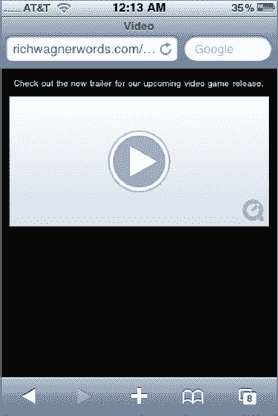

图 2-2

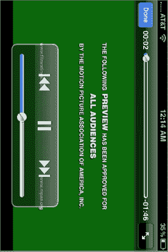

`audio` 元素的工作方式与此类似，但其属性是 `video` 标签属性的子集。这些属性包括 `src`、`autobuffer`、`autoplay`、`loop` 和 `controls`。图 2-3 显示了音频文件在媒体播放器中播放的情况。

图 2-3

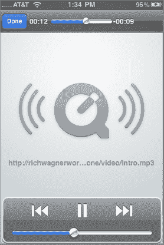

### JavaScript 脚本编写

iOS Web 应用的脚本层通常是“操作的大脑”——在客户端添加编程逻辑的地方。因此，当你开始为 iOS 平台开发越来越复杂的 Web 应用时，你会发现越来越依赖 JavaScript 技术。所以，在继续阅读本书之前，你需要扎实掌握如何用 JavaScript 编写脚本。请将本节作为 JavaScript 编程核心要点的入门指南。

#### 语法与基本规则

与其他编程语言一样，JavaScript 也有自己的语法规则和约定。请考虑以下脚本：

```javascript
// 定义变量
var message = "Hello";

// 创建函数，即代码模块
function showGreeting(allow)
{
  // 如果 allow 为 true，则显示 message 变量
  if (allow == true)
  {
    alert(message);
  }
  // 否则，显示此消息
  else
    alert("I withhold all greetings.");
}

// 调用函数
showGreeting(true)
```

注意 JavaScript 语法的几个方面：

*   **区分大小写**：JavaScript 是一种区分大小写的语言。核心语言词汇（例如示例中的 `var`、`function` 和 `if`）均为小写。JavaScript 对象均采用小驼峰命名法，本章后续的“JavaScript 命名规范”部分将对此进行说明。你自定义的变量名可以按你选择的字母大小写来命名，但请注意以下术语并不等价：

    ```javascript
    var message = "Hello";
    var MESSAGE = "Hello";
    var Message = "Hello";
    ```

*   **空白字符**：与 HTML 类似，JavaScript 会忽略代码语句中的空格、制表符和换行符。以下每行代码都是等价的：

    ```javascript
    var message="Hello";
    var message = "Hello";
    ```

    以下代码也是等价的：

    ```javascript
    if (allow==true)
    if ( allow == true )
    ```

*   **分号**：每条 JavaScript 语句都以分号结尾（描述性注释除外）。

*   **花括号**：某些控制结构（例如函数和 `if` 语句）使用花括号 `{}` 来包含多条语句。你可以将花括号放在单独的行上，也可以与其他代码相同的行。例如：

    ```javascript
    if (allow == true) {
      alert(message) }
    ```

    与以下代码相同：

    ```javascript
    if (allow == true) {
      alert(message)
    }
    ```

### 变量

变量用于存储数据（字符串、数字、布尔值或其他数据）。变量是编程的核心，因为它们消除了在开发脚本或应用程序时需要知道所有内容的需求。例如，你想获取名字并将其添加到欢迎消息中。如果没有变量，这是不可能的。通过使用变量，你可以获取名字然后将其存储在代码中，例如 `firstName`。

### 声明和赋值

你想使用变量时，首先要使用关键字 `var` 声明它，然后为其赋值。以下是过程：

```javascript
var firstName;
firstName = "Jonah";
```

关键字 `var` 指示解释器后面的单词 `firstName` 视为变量。虽然声明和赋值可以是独立的操作，但你通常希望它们合并为一步。例如，以下代码等同于前面的行：

```javascript
var firstName = "Jonah";
```

说实话，你可以在不使用关键字 `var` 的情况下赋值。例如，以下代码有效：

```javascript
firstName = "Jonah";
```

不过，我建议你在首次定义变量时始终使用 `var`，以确保代码对开发者来说可读。

### 变量类型的宽松

你可以为变量赋值多种数据类型。以下是一些示例：

```javascript
// 字符串
var state = "CO";
// 布尔值
var showForm = true;
// 数值
var maxWidth = 300;
// 节点
var element = document.getElementById("container");
// 数组项
var item = myArray[0];
```

如果你来自 Java、ActionScript 或强类型语言，可能会疑惑在哪里声明类型。简单来说，JavaScript 是一种松类型语言，你不需要声明类型。

### 命名变量

在命名变量时，记住以下通用规则：

*   变量名必须以字母或划线开头，不能以数字或其他特殊字符开头。例如：

    ```javascript
    // 有效
    var helper;
    var _helper;

    // 无效
    var 2helper;
    var ^helper;
    ```

*   虽然数字不能作为变量名的开头，但你可以将其放在单词的其他位置，例如：

    ```javascript
    var doc1;
    var doc2;
    ```

*   与 JavaScript 其他方面一样，变量名是区分大小写的。因此，以下变量名都是唯一的：

    ```javascript
    var counter;
    var Counter;
    var COUNTER;
    var counTer;
    ```

*   变量名不能包含空格。例如：

    ```javascript
    // 有效
    var streetAddress;
    var street_address;

    // 无效
    var street address;
    ```

*   你不能使用任何保留字（参见本章后面的“保留字”部分）作为变量名。例如：

    ```javascript
    // 有效
    var isDone;
    var defaultValue;
    var mainWindow;

    // 无效
    var is;
    var default;
    var window;
    ```

### 访问变量

定义变量并赋值后，每次在代码中引用它时，该变量都代表最后赋给它的值。在代码片段中，`company` 变量被赋值为一个字符串，并显示在警告框中：

```javascript
var company = "Cyberg Coffee";
alert("Our company is proudly named " + company);
```

警告框显示以下内容：

```
Our company is proudly named Cyberg Coffee.
```

你也可以在源代码中更改变量的值。毕竟，它们被称为变量，不是吗？一个典型的例子是计数器变量，其值在循环过程中递增。考虑以下示例：

```javascript
for (var i=1;i<=5;i++)
{
  document.write("The value of the variable is: " + i + ".<br/>");
}
```

我将在本章后面解释 `for` 循环的作用。现在，只需关注名为 `i` 的变量。在第一次执行 `for` 块内的代码时，该变量的初始值为 1。在下一次执行时，其值递增为 2。第三次执行时，其值递增为 3。这个过程一直持续到 `i` 为 5。总共 `document.write()` 方法被调用了五次，并输出以下内容：

```
The value of the variable is 1.
The value of the variable is 2.
The value of the variable is 3.
The value of the variable is 4.
The value of the variable is 5.
```

### 作用域

变量的作用域可以是有限的。变量的作用域可以是有限的。变量的作用域可以是有限的。变量的作用域可以是有限的。变量的作用域可以是有限的。变量的作用域可以是有限的。变量的作用域可以是有限的。

声明和赋值

你想使用变量时，首先要使用关键字 `var` 声明它，然后为其赋值。以下是过程：

```javascript
var firstName;
firstName = "Jonah";
```

虽然声明和赋值可以是独立的操作，但你通常希望它们合并为一步。例如，以下代码等同于前面的行：

```javascript
var firstName = "Jonah";
```

说实话，你可以在不使用关键字 `var` 的情况下赋值。例如，以下代码有效：

```javascript
firstName = "Jonah";
```

不过，我建议你在首次定义变量时始终使用 `var`，以确保代码对开发者来说可读。

### 作用域

变量的作用域可以是有限的。

content]
一些 JavaScript 开发者遵循的另一种编码约定称为匈牙利命名法。按照这种编码风格，变量会加上一个前缀字母，表示该变量的数据类型。表 2-3 展示了这种命名法的几个示例。

表 2-3：在变量中使用匈牙利命名法

| 数据类型/对象类型 | 前缀 | 示例 |
| --- | --- | --- |
| 字符串 | s | sFirstName |
| 数字 | n | nRating |
| 布尔值 | b | bFlag |
| 数组 | a | aMembers |
| 对象（DOM 元素、用户对象等） | o | oCustomer |
| 日期 | d | dTransactionDate |

## 使用常量

在使用变量时，它们通常会在脚本执行过程中改变值。然而，有时你需要使用一个引用不变值的变量，这些被称为常量。

`ActionScript`、`Java` 和许多其他编程语言实际上在语言中内置了与变量不同的常量。JavaScript 并没有。但从实际角度来看，你可以在代码中定义一个变量并将其视为常量。

如果这样做，我建议遵循常量的标准命名约定：

- 使用大写字母
- 用下划线分隔单词

例如：

```
var APP_TITLE = "iOSWebApp";
var VERSION_NUM = "2.01";
var MAX_WIDTH = 320;
```

然后，你可以在整个脚本中像使用变量一样使用这些看起来像常量的变量。

## 运算符

运算符是一种简单的符号，用于赋值、比较值、操作表达式或连接代码片段。

等号可能是最常见的运算符，用于给表达式赋值。例如：

```
var i = 10;
```

注意，用于赋值的运算符（=`）与用于比较两个值是否相等的运算符不同。`==` 运算符用于比较两个项，如果条件为真则返回 `true`。例如：

```
alert(n == 100);
```

正如你所料，你可以使用 `+` 运算符将两个数字值相加。但也可以用它来组合两个字符串字面量或变量。所以，看看这段代码：

```
var s = "Welcome ";
var t = " to the world of operators.";
alert(s + t);
```

文本 `Welcome to the world of operators.` 会显示在 JavaScript 警告框中。

表 2-4 到 2-7 列出了主要运算符。在大多数实际情况下，有些运算符相当深奥，因此你通常使用的运算符以粗体显示。

表 2-4：赋值运算符

| 运算符 | 示例 | 描述 |
| --- | --- | --- |
| = | x=y | 将 y 的值赋给 x |
| += | x+=y | 等同于 x=x+y |
| -= | x-=y | 等同于 x=x-y |
| *= | x*=y | 等同于 x=x*y |
| /= | x/=y | 等同于 x=x/y |
| %= | x%=y | 等同于 x=x%y（取模，除法余数） |

表 2-5：比较运算符

| 运算符 | 示例 | 描述 |
| --- | --- | --- |
| == | x==y | x 等于 y |
| != | x!=y | x 不等于 |
| === | x===y | 同时比较值和类型（例如，如果 x = "5" 且 y = 5，则 x==y 为 true，但 x===y 为 false） |
| < | x<y | 小于 y |
| <= | x<=y | 小于等于 |
| > | x>y | 大于 y |
| >= | x>=y | 大于等于 |
| ?: | x<5?y:x | 如果 x小于 5，将 y 赋给 x；否则保持 x（条件运算符） |

表 2-6：逻辑运算符

| 运算符 | 示例 | 描述 |
| --- | --- | --- |
| && | if ( x > 3 && y=0 ) | 逻辑与 |
| || | if ( x>3 || y=0 ) | 逻辑或 |
| ! | if !(x=y) | 非 |

表 2-7：数学运算符

| 运算符 | 示例 | 描述 |
| --- | --- | --- |
| + | x+2 | 加法 |
| - | x-3 | 减法 |
| * | x*2 | 乘法 |
| / | x/2 | 除法 |
| % | x%2 | 取模（除法余数） |
| ++ | x++ | 自增（同于 x+1） |
| -- | x-- | 自减（同于 x-1） |

## 保留字

JavaScript 有一组保留字（参见 2-8），这些单词用于语言本身。因此，在命名变量、函数或对象时应避免这些单词。

表 2-8：保留字


## 基本条件

JavaScript 有三种条件语句用于评估：

- `if`
- `if/else`
- `switch`

### if 语句

当你想评估一个变量或表达式，然后根据结果执行相应操作时，可以使用 `if` 语句。其基本结构如下：

```
if (condition)
{
// 如果条件为真，则执行的代码
}
```

例如：

```
response = prompt("请输入姓名。", "");
if (response == "Jerry Monroe")
{
alert("是的！");
}
```

此时会向用户显示一个提示框。用户输入的内容被赋值给 `response` 变量。然后 `if` 语句评估 `response` 是否等于 `"Jerry Monroe"`。如果是，则显示警告框；否则 `if` 块被忽略。

在本章前面的运算符部分提到这一点，但值得重申：双等号并非赋值。单等号 `=` 用于给变量赋值，而双等号 `==` 用于比较表达式两侧是否相等。

要评估一个布尔变量，可以按两种方式编写 `if` 语句：

```
if (isValid == true)
{
  alert("是的，有效的！");
}
```

或者，作为简写：

```
if (isValid)
{
  alert("是的，有效的！");
}
```

如果 `if` 块中只有一行代码，实际上可以省略花括号。因此，以下语法同样有效：

```
if (isValid == true) alert("是的，有效的！");
```

你也可以对否定表达式使用 `if`。例如，假设你想在名为 `isValid` 的布尔变量为 `false` 时执行某个操作，代码可能如下：

```
if (isValid == false)
{
  // 执行某些操作以获取验证
}
```

注意，即使使用 `false` 值来评估变量，`if` 块也仅在表达式 `isValid == false` 为 `true` 时执行。

另一种通常更推荐的写法是使用非运算符 `!`：

```
if (!isValid)
{
  // 执行某些操作以获取验证
}
```

这个表达式实际上表示：如果 `isValid` 不为 `true`，则某些操作……

## if/else 语句

`if/else` 语句扩展了 `if` 语句，你可以根据表达式评估为 `true` 或 `false` 分别执行不同的代码块。其基本结构如下：

```
if (condition)
{
// 如果条件为真，则执行的代码
}
else
{
// 如果条件为假，则执行的代码
}
```

以下是 `if/else` 语句的示例：

```
if (showName)
{
  document.write("我的名字是 Sonny Madison。")
}
else
{
  document.write("我不能透露我的名字。");
}
```

### 链式 if 和 if/else

你还可以将 `if` 和 `if/else` 语句链式组合。考虑以下场景：

```
if (state = "MA")
{
  document.write("你住在马萨诸塞州。");
}
else if (state="CA")
{
  document.write("你住在加利福尼亚州。");
}
else
{
  document.write("我不知道你住在哪里。");
}
```

## switch 语句

除了链式组合 `if` 和 `if/else` 语句外，你还可以使用 `switch` 语句来评估多个值。其基本结构如下：

```
switch (expression)
{
case label1:
  // 如果表达式等于 label1
  break;
case label2:
  // 如果表达式等于 label2
  break;
case label3:
  // 如果表达式等于 label3
  break;
default:
  // 如果表达式与 label1、label2、label3 都不相等，则执行代码
}
```

`switch` 语句评估表达式结果。如果匹配，执行第一个 `case` 语句内的代码。注意每个 `case` 语句末尾有 `break`，它阻止 `switch` 持续执行后续的 `case`。如果没有匹配，则执行 `default` 语句。

`case` 块内部不使用括号。以下示例使用 `switch` 语句，通过 `Date.getHours()` 获取当前时间：

```
var d = new Date()
var hrs = d.getHours()

switch (hrs)
{
case 7:
  document.write("早上好。"
  break;
case 12:
  document.write("该吃饭了。"
  break;
case 15:
  document.write("睡觉时间.");
  break;
case 23:
  document.write("睡觉时间！");
  break;
default
  document.write("稍后再查看。"
}
```

## 循环

在开发 Web 应用时，一个常见需求是能够多次执行任务，或对一系列对象操作。或者可能一直执行代码直到条件变化。JavaScript 提供了两种结构：`for` 和 `while`。`for` 循环会重复代码指定的次数。`while` 循环则在特定条件为真时执行代码块。

### for 循环

与 `if` 语句一样，`for` 循环是最常用的结构。以下代码片段展示了一个 `for` 循环调用 `document.write()` 五次：

```
for (var i=1;i<=5;i++)
{
  document.write("数字：" + i + "<br/>");
}
```

运行时，输出如下：

```
数字：1
数字：2
数字：3
数字：4
数字：5
```

回到代码，注意括号内 `for` 语句的三个部分：

- 初始化变量：`var i=1` 用于计数。（变量 `i` 是大多数循环中常见的名称。）
- 循环条件：`i<=10` 表示每次迭代时评估的条件。只要 `i` 值小于或等于 10，条件返回 `true`。
- 更新：`i++` 语句在每次迭代完成后执行`++` 是将 `i` 值增加 1 的运算符。

### while 和 do/while 循环

`while` 循环也会重复代码块一次或多次。它会在表达式评估为 `true` 时持续执行。其基本形式如下：

```
while(expression)
{
  // 语句
}
```

以下是一个示例：

```
var max = 100;
while(num>max)
{
document.write("当前计数：" + num);
num++;
}
```

在此示例中，只要 `num` 小于 100，代码块就会循环。但是假设 `num` 的值为 101，则 `while` 代码块永远执行。`do/while` 循环与之类似，区别在于条件在循环结束时评估，而不是在开始时。其基本结构如下：

```
do
{
   // 语句
} while (expression)
```

在实际应用中，`while` 循环比 `do/while` 循环更常用。

## 注释

与 HTML 或其他语言一样，你可以在 JavaScript 代码中添加自己的注释。注释对你很有用，当你几周或几个月后重新查看代码时，需要理解代码及其后的思路。你也可以使用注释来标记代码中稍后重做的特定位置。

你可以添加单行注释或多行注释。

### 单行注释

要添加单行注释，请在行中添加两个斜杠（`//`）。同一行中斜杠右侧的任何文本都被视为注释，解释器会忽略它们。例如：

```
// 定义两个字符串变量
var s = "欢迎 ";
var t = "来到运算符的世界。";
// 在警告框中显示拼接后的值
alert(s + t);
```

### 多行注释

你也可以定义跨行的注释。为此，请将注释内容包含在 `/*` 和 `*/` 标记之间。多行注释的示例如下：

```
/*
 * 目的：将互联网字符串日期转换为 Date 对象
 * TODO: 确认此方法在所有情况下均能正常工作
*/ 
function getDateFromString(s)
{
  s = s.replace(/-/g, "/");
  s = s.replace("T", " ");
  s = s.replace("Z", " GMT-0000");
  return new Date(Date.parse(s));
}
```

## 使用 JSDoc 注释

Java 世界有一个名为 Javadoc 的文档生成器，它可以根据开发者在源代码中添加的注释生成基于 HTML 的文档。`JSDocToolkit` 是一个用 Perl 编写的开源工具。

如果你希望使用 JSDoc，只需使用特殊语法：以斜杠和两个星号（`/**`）开头，以斜杠和星号（`*/`）结束。多行注释的示例如下：

```
/**
 * 目的：将互联网字符串日期转换为 Date 对象
 * TODO: 确认此方法在所有情况下均能正常工作
*/
```

你还可以添加属性来更好地描述。这些属性以 `@` 符号开头。你甚至可以添加 HTML 标签以提高读性。请看：

```
/**
 * 将互联网字符串日期转换为 Date 对象。
 * <p>
 * 当用户在模块中选择 Cyborg选项时，会调用此函数。
 *
 * @param s 包含日期的字符串
 * @returns Date 对象形式的日期
 */
function getDateFromString(s)
{
  s = s.replace(/-/g, "/");
  s = s.replace("T", " ");
  s = s.replace("Z", " GMT-0000");
  return new Date(Date.parse(s));
}
```

有关可用属性、格式化命令和语法规则的完整详细信息，请查看 [`code.google.com/p/jsdoc-toolkit/`](http://code.google.com/p/jsdoc-toolkit/) 以及 Javadoc 约定页面 [`java.sun.com/j2se/javadoc/writingdoccomments`](http://java.sun.com/j2se/javadoc/writingdoccomments)。

```
<!DOCTYPE html PUBLIC "-//W3C//DTD XHTML 1.0 Strict//EN"
         "http://www.w3.org/TR/xhtml1/DTD/xhtml1-strict.dtd">

<html xmlns="http://www.w3.org/1999/xhtml">
<head>
<title>视频</title>
<meta name="viewport" content="width=320; initial-scale=1.0;
  maximum-scale=1.0; user-scalable=0;"/>
<style type="text/css">

body
{
  background-color: #080808;
  margin: 10;
  color: #ffffff;
  font-family: Helvetica, sans-serif;
font-size:10px; 
}

</style>
<script type="text/javascript">

</script>
</head>
<body>
</body>
</html>
```

代码片段 `BIDHJ-Ch02-Ex2.html`

2. 在 `script` 元素内添加 `addAndDisplay()` 函数：


```
function addAndDisplay(a,b)
{
  var total = a + b;
  alert(total);
}
```

代码片段 `BIDHJ-Ch02-Ex2.html`

3. 在 `script` 元素内，紧接刚刚定义的函数之后添加以下代码：


```
addAndDisplay(3, 2);
```

代码片段 `BIDHJ-Ch02-Ex2.html`

4. 保存文件。

### 工作原理

当页面加载脚本时，它会执行 `addAndDisplay(3, 2)` 来显示一个 Alert 消息框，其中显示计算出的总和。如你所见，你创建的函数名为 `addAndDisplay()`，它接受两个参数：`a` 和 `b`。参数（也称为形参）是你希望传递给函数处理的变量或字面值。在此例中，调用函数将整数 3 和 2 发送给函数进行相加。在花括号内，第一行将参数相加并将结果赋值给 `total` 变量。第二行在警告框中显示 `total`。当警告框关闭时，函数结束并将控制权返回给调用它的代码。

从上面的动手试一试可以看出，函数：

*   被代码的其他部分调用来执行某个过程、返回结果，或两者兼有
*   将其编程逻辑的细节隐藏起来，不让代码的其他部分看到

函数可以向调用代码返回一个值。例如，请看以下函数：

```
function getTotal(subtotal)
{
  var t = subtotal * .05;
  return t;
}
```

`getTotal()` 函数接收 `subtotal` 作为参数，将其乘以州税率，然后使用 `return` 命令将总值返回给调用该函数的语句。

当 `return` 执行时，函数在该行停止执行并返回到调用函数。例如：

```
function createProfile(el)
{
  if (el == null)
  {
    alert("未定义的 DOM 元素。无法继续。:(");
    return;
  }
  else
  {
     // 对 el 执行一些非常重要的操作
  }
}
```

在此例中，函数检查 `el` 参数是否为 `null`。如果是，则函数在显示警告框后结束处理。如果不是，则函数继续执行。

### 创建内联函数

JavaScript 也支持内联函数，它允许你在特定上下文中定义一个未命名的函数。例如，假设你想在窗口加载时显示一条警告消息。使用普通函数，你可以这样组织脚本：

```
<script>
  function init()
  {
    alert("我正在说一些重要的事情。");
  }

  window.onload = init;

</script>
```

`onload` 事件被分配了 `init()` 函数作为其事件处理程序。然而，你也可以使用内联函数并省略具体的函数定义：

```
<script>
  window.onload = function(){alert("我正在说一些重要的事情。")}
</script>
```

另一个优点是，你可以在特定作用域内引用变量，而无需将它们作为参数传递给函数。

### 函数重载

函数重载是指能够向函数传递不同数量的参数。如果你利用函数的 `arguments` 属性，就可以在 JavaScript 中重载函数。例如，假设你想创建一个将两个数字相加并返回结果的函数。你可以这样编码：

```
function add(a, b)
{
  return a+b;
}
```

然而，假设你的需求随时间变化。现在你需要一次加三个、四个或五个数字，而不是两个。你可以重载 `add()` 函数来完成所有这些求和任务，而不必为每种情况编写单独的函数：

```
function add()
{
  var t = 0;
  for (var i=0, l=arguments.length; i<l; i++)
  {
    t += arguments[i];
  }
  return t;
}
```

`add()` 函数创建一个 `for` 循环来遍历所有提供的参数。在遍历过程中，它将当前参数加到 `t` 变量上。然后将这个总和返回给调用该函数的语句。现在以下所有调用都能正常工作：

```
var t = add(2,2);
var t1 = add(2,4,5);
var t2 = add(392,1230,3020202,1,2033);
```

你也可以使用 `typeof()` 命令在同一函数内重载不同的数据类型。例如，如果我想扩展 `add()` 的功能，使其能够“相加”字符串值，可以按如下方式修改函数：

```
function add()
{
  var argType = typeof(arguments[0]);

  if (argType == "number")
  {
    var t = 0;
    for (var i=0, l=arguments.length; i<l; i++)
    {
      t += arguments[i];
    }
    return t;
  }
  else if (argType == "string")
  {
    for (var i=0, l=arguments.length; i<l; i++)
    {
      if (i == 0)
      {
        var s = arguments[i];
      }
      else
      {
        s += ", " + arguments[i];
      }
     return s;
    }
    else
      return "Unsupported data type";
  }
}
```

`add()` 函数检查第一个参数的类型，并将结果赋给 `argType`。如果类型是数字，则例程继续执行，与之前的示例相同。但如果类型是字符串，则函数会将所有参数合并成一个以逗号分隔的字符串。如果类型既不是数字也不是字符串，则返回一条错误消息。

# 数据类型

JavaScript 允许你使用特定的数据类型：

*   `String`（字符串）
*   `Number`（数字）
*   `Boolean`（布尔值）
*   `Null`（空值）
*   `Undefined`（未定义）
*   `Array`（数组）
*   `Object`（对象）

字符串、数字和布尔值通常被称为原始数据类型，`null` 和 `undefined` 被称为特殊数据类型，而对象和数组则被称为复合数据类型。

## 字符串

字符串是用单引号或双引号括起来的字符集合。字符串也称为字符串字面量。以下几行是字符串的示例：

```
var wd = 'Kitchen sink';
var el = "<p>This is HTML.</p>";
var n = "3.14";
var char = 'z';
var special = "@#$%&*()_+-";
var blank = "";
```

如你所见，字符串中包含任何内容——普通文本、HTML 标签、数值、特殊字符，甚至“厨房槽”。注意，你有空字符串（`""`），与 `null` 或 `undefined` 值不同。字符串可以用单引号或双引号括起来，你可以使用反斜杠来轻松嵌入引号。例如：

```
var str = '"I like living dangerously", said Jack.';
var str2 = "I'm happy,'t I?";
```

或者，如果字符串由相同类型的引号包裹，你可以使用反斜字符（`\`）转义引号。以下是几个例子：

```
var str = 'I\'m happy,\'t I';
var el = "<div id=\"container\"></div>";
```

反斜字符告诉解释器将后面的引号视为字符串，而不是结束符。对于许多任务，你可以像我描述的样将字符串值作为字面量处理。但是，如果你要解析、转换或以其他方式处理将其视为 `String` 对象。

## 数字

数字类型表示任何类型的数值——整数、实数、八进制数，甚至十六进制数。0-9 列出了 JavaScript 中有效的数字。

| 数字 | 描述 |
| --- | --- |
| 32 | 整数 |
| .0223 | 实数 |
| 42e5 | 实数 |
| 0377 | 八进制 |
| 0x2CF | 六进制 |

除了这些常规数字类型，JavaScript 还包含一个特殊值 `NaN`，代表“非数字”。

## 布尔值

布尔类型表示 `true` 或 `false` 值。通常用于判断中的条件是否为 `true` 或 `false`。例如：

```
var flagUser = false;
```

然后你可以在 `if` 结构中（参见前面的 `if/else` 部分）评估 `flagUser`：

```
if (flagUser) {
  alert("Hey User! are flagged.");
}
```

注意，布尔值与空字符串（`""`）、`null` 或 `undefined` 值。布尔值不用括起来，所以请注意：

```
var isABolean = true;
var isAString = "true";
```

## 空值

当变量或对象包含任何值时，其值表示 `null`。（不是字符串 `"null"`，只是 `null`）。你可以测试变量或对象是否为 `null`。例如：

```
var arr = null;
```

在需要指定数组大小的情况下，你可以为 `length` 属性赋值。例如，下面这行代码将数组的大小增加到 10：

```
var arr = [];
arr.length = 10;
```

请注意，这样做不会创建新的数据项。如果你指定的 `length` 小于数组当前的大小，那么超出该 `length` 值的元素将被删除。请记住，数组中最后一个元素的索引值比元素总数少 1。

## 数组

到为止，我一直在讨论作为个体的变量。相比之下，数组是值的集合。它们分组并索引，以便你可以访问组中存储的项。JavaScript 将数组存储为 `Array` 对象，意味着它具有多种属性和方法，你可以用它们执行各种任务。

### 创建数组

你可以通过将变量赋值为空来创建一个数组：

```
var castMembers = [];
```

你也可以使用 `new Array()` 创建新数组，如下所示：

```
var myArray = new Array();
```

然而，使用 `new` 运算符创建数组认为是过时的方法，并且被视为良好实践。在某些语言中，你需要在定义数组时指定数组中的项。JavaScript 则不然。每次向数组添加项时，数组的大小都会增加。

### 向数组添加项

要向数组添加项，只需赋值给数组中的特定索引。索引由括号内的指定：

```
var castMembers = [];
castMembers[0] = "Jerry";
castMembers[1] = "George";
castMembers[2] = "Elaine";
castMembers[3] = "Kramer";
```

注意，由于数组是从零开始的，所以从 0 开始计数，而不是 1。你也可以通过将值作为参数传递来定义数组：

```
var primeNumbers = [1,3,5,7,11];
```

### 在数组中存储多种类型

你可以在数组中存储几乎任何类型的数据，包括字符串、数字、布尔值、`undefined` 和 `null`、对象和函数。如果你愿意，甚至可以在数组中存储数组。更重要的是，你可以在同一个数组中存储多种类型的数据。例如，考虑以下包含字符串、数字、函数、DOM 对象和布尔值的数组：

```
var el = document.getElementById("easy_bake_oven");
var pieLove = ["pie", 3.14, function(){alert("Apple Pie")}, el, true];
```

### 获取和设置数组的大小

你可以通过访问数组的 `length` 属性获取数组中元素的数量。（没错，数组是一个对象，因此它拥有自己的一组属性和方法。）例如：

```
var primeNumbers = [1,3,5,7,11];
alert(primeNumbers.length);
```

警告框会显示 5。大多数情况下，你不需要显式设置数组的大小，因为当你添加或删除元素时，它会自动动态调整大小。然而，在需要指定数组大小的情况下，你可以为 `length` 属性赋值。例如，下面这行代码将数组的大小增加到 10：

```
primeNumbers.length = 10;
```

### 访问数组中的元素

你可以根据索引访问数组中的任何值。例如，要将 `states` 数组中的第三个元素写入文档，可以使用以下代码：

```
function showHomeState(idx)
{
  document.write("<p>Your home state is " + states[idx] + "</p>");
}
```

如果你想处理数组中的每个元素，还可以使用 `for` 循环遍历数组：

```
var castMembers = [];
castMembers[0] = "Jerry";
castMembers[1] = "Jan";
castMembers[2] = "Elias";
castMembers[3] = "Bob";
document.write("<ul>");
for(i=0, l=castMembers.length; i<l; i++)
{
  document.write("<li>" + castMembers[i] + "</li>");
}
document.write("</ul>");
```

在这个例子中，`castMembers` 数组定义了四个元素。`length` 属性用于确定数组的大小，这样我就知道了 for 循环需要执行的次数。
```


当原始变量（字符串、数字或布尔值）被传入数组时，数组会创建该变量值的副本，而不是存储对该变量的引用。用编程术语来说，这称为按值传递。下面是一个演示区别的例子：

```javascript
var n = 100;
var b = true;
var s = "string";
ar = [n, b, s];

document.write("<p>[First pass]</p>");
for (i=0; i<=2; i++)
  document.write("<p>"+ar[i]+"</p>");

n = 200;
b = false;
s = "new and improved string";

document.write("<p>[Second pass]</p>");
for (i=0; i<=2; i++)
  document.write("<p>"+ar[i]+"</p>");
```

请注意，变量 `n`、`b` 和 `s` 作为参数传递给了 `ar` 数组。然后 `for` 循环将数组元素的值作为 HTML 内容输出到文档中。之后变量被更新并赋予了新值。然而，当再次运行相同的 `for` 循环时，输出的仍然是原始值。查看输出的 HTML 内容：

```
[First pass]
100
true
string
[Second pass]
100
true
string
```

然而，当你将对象或函数传入数组时，数组存储的是对这些高级数据类型的引用，而不是副本。因此，你在数组外部对对象或函数所做的任何更改，都会在访问数组中对应的元素时反映出来。这称为按引用传递。

## 练习

1. 在 `JavaScript` 中，用于声明变量的关键字是什么？
2. 局部变量和全局变量有什么区别？
3. `=` 和 `==` 运算符的用法有何不同？
4. 用于比较两个值是否不相等的运算符是什么？
5. 写出一个循环 10 次的 `for` 循环的基本结构。
6. 在函数内部，如何检查传递给函数的参数总数？
7. 空字符串 `""` 和 `null` 值相同吗？

练习答案见附录。

## 本章所学内容

| 主题 | 关键概念 |
| --- | --- |
| 在应用中嵌入视频或音频 | 在 HTML 文件中添加 `video` 或 `audio` 元素。 |
| 变量 | 变量是存储另一段数据的别名。 |
| 变量的作用域 | 变量作用域指变量的上下文，可以是局部的（特定于某段代码）或全局的（在整个文档中可访问）。 |
| 条件表达式 | 使用 `if`、`if/else` 或 `switch` 为 `JavaScript` 添加条件逻辑。 |
| 循环 | `for` 循环重复执行一段代码指定次数。`while` 循环在特定条件为真时重复执行代码。 |
| 函数 | 函数是 `JavaScript` 的基本组织单元，使用 `function` 关键字定义。 |

# 第 3 章 文档对象模型

### 本章你将学到：

* 将文档视为一棵树
* 从代码中访问 DOM
* 通过 DOM 编辑文档

网页是一个包含标记标签和内容的 HTML 文档。但是，在开发 Web 应用时，你会发现将文档视为一个充满分支、枝干和叶节点的树状结构会更有帮助。这种“文档即层次结构”的概念正是你听到“文档对象模型”（`DOM`）这个术语时所表达的意思。

在本章中，我将向你介绍 `DOM`，并带你了解从应用程序代码中访问和操作 `DOM` 所需的基础知识。

## 什么是 DOM？

文档对象模型为 HTML 文档提供了一个脚本接口，使你能够在层次结构中处理其所有元素。因此，你可以使用 `JavaScript` 遍历文档结构，访问和操作其中的任何内容。

`DOM` 是由 Web 标准组织 `W3C` 制定的标准。`DOM` 有三个级别：

* 第 1 级：第 1 级包含对 HTML 或 XML 文档进行 `DOM` 脚本编程的核心功能。所有现代浏览器都支持第 1 版本的 `DOM`。
* 第 2 级：第 2 级支持扩展了 `DOM` 支持，包括新的核心功能、事件监听器和 CSS DOM`。`Safari` 和其他浏览器对 `DOM2` 的大部分方面提供了普遍强大的支持。
* 第 3 级：第 3 级增加了对较新的属性和方法、键盘事件以及 `XPath` 的支持。`Safari` 对第 3 级提供了强大的支持。

## DOM 作为一棵树

正如我在本章开头提到的，将 `DOM` 视为一棵包含 HTML 文档所有部分（元素、属性、文本、注释等）的层次树会很有帮助。用 `DOM` 术语来说，这些独立的片段被称为节点。

在处理 HTML 标记时，文档的主要构建块是元素。然而，在处理 `DOM` 时，你将使用的基本单元是节点。请记住，并非所有节点都是相同的。虽然 `DOM` 树主要由元素节点组成，但还有其他几种类型你需要了解。

就像现实生活中的家谱一样，每个节点都是相互连接的。一个节点可以有父节点、兄弟节点、子节点，偶尔还有一个没人谈论的“半疯的祖父母”节点。`document` 对象是家族的族长，充当 HTML 文件中所有节点（后代）的容器。`document` 对象没有对应的 HTML 元素。`html`、`head` 和 `body` 元素都包含在 `document` 中。

我要强调的一点是，`DOM` 层级结构与你通常在 HTML 文档中看到的自然元素层级结构并不相同。以以下这个简单的文件为例：

```html
<html>
<head>
<title>Really Awesome Web Page</title>
</head>
<body>
<div id="container">
<h1>Pretty awesome heading</h1>
<p id="para1">Pretty lame paragraph</p>
</div>
</body>
</html>
```

缩进层级展示了文档中的自然元素层级结构。或者，我可以用可视化的树形图来表示相同的层级结构，如图 3-1 所示。

图 3-1

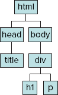

`DOM` 中的每个 HTML 元素都有与元素属性相对应的属性。例如，`img` 元素具有 `src` 和 `alt` 属性。然而，`DOM` 元素也有一组通用的属性和方法。

在 `DOM` 中，元素只是节点的一种类型。因此，你还需要在树中表达文档的其他节点，例如属性和文本内容。元素内部的文本内容是父元素的子节点。例如，`Pretty lame paragraph` 被视为包含它的 `p` 元素的子节点。

属性也被视为节点，但属于特殊情况。它们不参与其他节点之间的父子关系。相反，它们作为包含它们的元素节点。

<|channel>thought
<channel|>*   `appendChild(node)` 将节点作为当前元素的 `childNodes` 列表末尾的子节点添加。
*   `insertBefore(newNode, targetNode)` 将新元素作为当前节点的子节点添加，但将其插入到 `targetNode` 参数指定的节点之前。

### 动手试一试：添加一个 DOM 节点

为了演示如何添加节点，请按照以下步骤操作。

1. 在文本编辑器中创建以下 HTML 文档，并将其保存为 `BIDHJ-Ch03-Ex1.html`。


```html
<html
<head>
<title>FavFilms</title>
</head>
<body>
<div id="content">
<h1 id="header1">Welcome to the World of Cinema</p>
<p id="p1">Favorite films are shown below:</p>
<ol id="movieList">
<li id="film_30329">The Shawshank Redemption</li>
<li id="film_30202">Casablanca</li>
<li id="film_20216">Braveheart</li>
<li id="film_28337">Groundhog Day</li>
<ol>
</div>
</body>
</html>
```

代码片段 `BIDHJ-Ch03-Ex1.html`

2. 在文档头部添加以下脚本代码，并保存文件：


```javascript
<script type="application/x-javascript">
var fa = document.createElement("li");
document.getElementById("movieList").appendChild(fa);
var fb = document.createElement("li");
var casa = document.getElementById("film_30202");
document.getElementById("movieList").insertBefore(fb, casa);

var fb = document.createElement("li");
var br = document.getElementById("film_20216");
document.getElementById("movieList").insertBefore(fb, br.nextSibling);
</script>
```

代码片段 `BIDHJ-Ch03-Ex1.html`

#### 工作原理

当文档加载时，脚本被执行。前两行代码将一个空的 `li` 元素追加到列表末尾。接下来的三行使用`insertBefore()` 在 `Casablanca` 之前的位置添加了一个空白的 `li` 项。

虽然不存在`insertAfter()` 方法，但你可以通过将`insertBefore()` 与 `targetNode` 的 `nextSibling` 属性结合使用来实现相同的功能。这正是我在脚本最后部分所做的，用于在 `Braveheart` 之后添加一个节点。

现在来看看结果。有序列表已更新，包含了新添加的元素：

```html
<ol id="movieList">
<li id="film_30329">The Shawshank Redemption</li>
<li/>
<li id="film_30202">Casablanca</li>
<li id="film_20216">Braveheart</li>
<li/>
<li id="film_28337">Groundhog Day</li>
<li/>
<ol>
```

## 创建其他元素

`document` 对象包含用于创建其余常见节点类型的方法：属性节点、文本节点、注释节点和文档片段。这些方法各自返回一个节点，你可以使用 `appendChild()` 或 `insertBefore()` 将其添加到文档中。

#### 属性节点

属性节点表示属性。要创建属性，使用`createAttribute()`。例如：

```javascript
var a = document.createAttribute("alt");
a.nodeValue = "Welcome to DOM.";
document.getElementById("logo").appendChild(a);
```

#### 文本节点

文本节点是容器。当你接触 DOM 时，可能会认为文本是元素的一个属性。实际上，元素内部是由文本节点包含的。要创建文本节点，使用`createTextNode()`。例如：

```javascript
var t = document.createTextNode("ice cream.");
document.getElementById("para").appendChild(t);
```

#### 注释节点

注释节点表示注释。要创建注释节点，使用`createComment()`：

```javascript
var c = document.createComment("Insert new toolbar here.");
document.getElementById("toolbar_container").appendChild(c);
```

#### 文档片段

最后，文档片段是一个临时的文档，你可以用它来创建和修改树的一部分，然后再添加到实际 DOM。操作 DOM 时，使用文档片段比直接操作 DOM 高得多（开销更小）。要创建文档片段，使用`createDocumentFragment()`。例如，以下脚本创建一个文档片段，向其中添加节点，最后添加到文档：

```javascript
var df = document.createDocumentFragment();

for(var i=0; i<30; i++) {
var e = document.createElement("p");
var t = document.createTextNode("Line " + i);
e.appendChild(t);
df.appendChild(e);
}
document.getElementById("content").appendChild(df);
```

### 动手试一试：添加一个节点

现在你已经知道如何创建其他节点类型，我想回顾一下。这次不是添加空的 `li` 元素，而是添加属性和文本节点来填充有序列表。按照以下步骤操作：

1. 在你的文本编辑器中创建以下 HTML 文档，然后将保存为 `BIDHJ-Ch03-Ex2.html`。


```html
<html
<head>
<title>FavFilms</title>
</head>
<body>
<div id="content">
<h1 id="header1">Welcome to the World of Cinema</p>
<p id="p1">Favorite films are shown below:</p>
<ol id="movieList">
<li id="film_30329">The Shawshank Redemption</li>
<li id="film_30202">Casablanca</li>
<li id="film_20216">Braveheart</li>
<li id="film_28337">Groundhog Day</li>
<ol>
</div>
</body>
</html>
```

代码片段 `BIDHJ-Ch03-Ex2.html`

2. 在文档头部添加以下脚本代码并保存文件：


```javascript
<script type="application/x-javascript">
    var e; // Element
    var a; // Attribute
    var t; // Text
    var nd; // Target/Parent

    e = document.createElement("li");
    a = document.createAttribute("id", "film_29299");
    t = document.createTextNode("Babette's Feast");
    e.appendChild(a);
    e.appendChild(t);
    document.getElementById("movieList").appendChild(e);

    e = document.createElement("li");
    a = document.createAttribute("id", "film_29323");
    t = document.createTextNode("Amélie (Le Fabuleux destin d'Amélie Poulain)");
    e.appendChild(a);
    e.appendChild(t);
    nd = document.getElementById("film_30202");
    document.getElementById("movieList").insertBefore(e, nd);
    e = document.createElement("li");
    a = document.createAttribute("id", "film_30276");
    t = document.createTextNode("Vertigo");
    e.appendChild(a);
    e.appendChild(t);
    nd = document.getElementById("film_20216");
    document.getElementById("movieList").insertBefore(e, nd.nextSibling);
</script>
```

代码片段 `BIDHJ-Ch03-Ex2.html`

#### 工作原理

在本例中，JavaScript 在文档加载时执行。脚本使用 `document` 的`createElement()`、`createAttribute()` 和 `createTextNode()` 方法创建一个完整、完备的 `li` 元素以添加到列表中。然后使用`appendChild()` 和`insertBefore()` 按所需顺序将元素添加到列表中。脚本执行后，有序列表如下所示：

```html
<ol id="movieList">
<li id="film_30329">The Shawshank Redemption</li>
<li id="film_29323">Amélie (Le Fabuleux destin d'Amélie Poulain)</li>
<li id="film_30202">Casablanca</li>
<li id="film_20216">Braveheart</li>
<li id="film_30276">Vertigo</li>
<li id="film_28337">Groundhog Day</li>
<li id="film_29299">Babette's Feast</li>
</ol>
```

```markdown
## 2. 判断对错？DOM 层次结构必须始终与 HTML 文档的自然元素层次结构完全一致。

## 3. 什么是 `NodeList`？

## 4. 什么是文档片段？

练习答案见附录 A。

## 本章所学内容

| 主题 | 关键概念 |
| --- | --- |
| 从 DOM 中访问元素 | 使用 `document.getElementById()` 或 `document.getElementsByTagName()`。 |
| 访问属性 | 使用节点的 `attributes` 属性获取属性列表；使用 `getAttribute()` 获取特定属性值。 |
| 添加或编辑 DOM | 使用 `document.createElement()` 在 DOM 中创建元素。使用 `appendChild()` 或 `insertBefore()` 添加到 DOM。 |

## 第 4 章：编写你的第一个 Hello World 应用

### 本章你将学到：

* 创建你的索引页面
* 添加样式
* 用 `JavaScript` 编写 UI
* 部署你的应用

好了，准备工作已经足够。是时侯开始开发你的第一个应用了。在本章中，我将带你完整地走一遍从开始到结束开发第一个 Hello World 应用的全过程，该应用可在所有 iOS 平台（iPhone、iPad 和 iPod touch）上运行。

每当你创建一个 Web 应用时，你可以决定是完全从头开始自己创建所有内容，还是利用一个框架来获得基本的应用外观和感觉。自己创建所有内容的好处是你可以完全控制应用的各个部分。当然，缺点是你必须自己创建所有内容。

在本书中，我会多次讨论如何自己创建应用的不同部分。不过，为了快速上手，我建议你使用一个移动框架来快速启动。因此，在本章中，我将利用一个流行的 Web 应用移动框架——jQueryMobile——来创建一个 iPhone Web 应用。使用 `jQueryMobile`，你可以只关注应用本身的内容和核心，而让框架为你处理大部分样式和交互。

## 设置

在开始开发应用之前，你需要在远程 Web 服务器或开发机器上的服务器上为你的应用设置一个位置。确保该服务器可以通过 Wi-Fi 从 iOS 设备访问。

### 动手实践：为你的 Web 应用创建位置

按照以下步骤为你的 Hello World 应用设置一个位置。

1. 确定你希望在哪里设置开发服务器——是在远程服务器上，还是在开发机器上运行的服务器上。
2. 如果服务器是远程的，通过 `FTP` 连接到你的服务器。如果你使用的是开发机器，找到服务器的主文档目录。（如果你使用的是 Mac，这通常是用户目录下的 `Sites` 文件夹。）
3. 创建一个名为 `webapp` 的文件夹。
4. 在 `webapp` 内部，再创建一个名为 `topfilmz` 的文件夹。

#### 工作原理

你的第一个任务是准备一个存放应用文件的基础位置。它可以位于你的开发机器上，或者如果你有可用的远程服务器，也可以放在那里。在这个例子中，你不会使用应用服务器，所以实际上没有区别。

如果你在开发机器上使用 Web 服务器，你需要知道访问 Web 应用的地址。如果你使用的是 Mac，一个简单的方法是执行以下操作：

1. 前往系统偏好设置。
2. 点击共享图标。
3. 记下你的个人网站地址，即你的 `Sites` 文件夹。在我的例子中，它是 [`10.0.0.6/~rwagner`](http://10.0.0.6/~rwagner)。

## 创建你的索引页面

你要创建的应用展示了一种流行的移动应用风格——基于导航列表的应用。这个应用我称之为 Top Filmz，目的是显示顶级电影列表。用户可以点击列表中的电影，查看该电影。详情页面显示电影的海报和两个按钮——一个将用户带到详情页面，另一个将用户返回主列表。尽管应用看起来有多个页面（一个主列表，以及每个电影的单独页面），实际上我把所有代码放在一个 HTML 文件中。

### 动手实践：创建索引页面

要创建应用的基本框架，按照以下步骤操作：

1. 在 `topfilmz` 文件夹中创建一个新的文件，并保存为 `index.html`。
2. 输入以下 HTML：

```html
<!DOCTYPE html>
<html>
<head>
<title>Top Filmz</title>
</head>
<body>
</body>
</html>
```
. 在文档头部添加视口标签：

```html
<meta name="viewport" content="width=device-width, initial-scale=1">
```
4. 在文档头部添加核心 jQuery Mobile 样式和 JavaScript 文件引用：

```html
<link rel="stylesheet" href="http://code.jquery.com/mobile/1.0.3/jquery.mobile-1.0.3.css" />
<script type="text/javascript" src="http://code.jquery.com/mobile/1.0.3/jquery.mobile-1.0.3.js"></script>
```
5. 保存你的文件。

#### 工作原理

通过这五个步骤，创建了任何 jQuery Mobile 应用的基本框架。jQuery Mobile 框架要求页面以 `<!DOCTYPE html>` 开头，以确保框架的功能可用。视口 meta 标签确保页面宽度设置为设备屏幕宽度，而不是像 Safari 默认那样缩小到 900 像素。出于性能考虑，jQuery Mobile 框架的链接指向托管的文件而不是放在自己的服务器上。

## 创建主屏幕

在 `index.html` 的 `body` 元素内部，你可以为 Web 应用的主屏幕（页面）添加内容。在 jQuery Mobile 中，在一个 `div` 元素内指定页面，并添加 `data-role="page"` 属性。在应用中可以在页面上放置你想要的内容。然而，许多应用使用的模板是标准的头部-内容-底部划分。你可以通过以下代码在 jQuery Mobile 中实现：

```html
<div data-role="page">
    <div data-role="header"></div>
    <div data-role="content"></div>
    <div data-role="footer"></div>
</div>
```

注意，`div` 元素的角色是通过 `data-role` 属性声明的。页面的内容部分显示一个滚动的电影导航列表。你可以通过使用无序列表为其添加 `data-role="listview"` 属性来简单创建列表。每个 `li` 项代表滚动列表的行。`a` 链接指向列表项的目标。

```html
<ul data-role="listview">
    <li><a href="#"></a></li>
    <li><a href="#"></a></li>
    <li><a href="#"></a></li>
    <li><a href="#"></a></li>
</ul>
```

这里有一个使用 jQuery Mobile 框架的优势。当你的页面被 jQuery Mobile 框架处理时，这个列表会被转换成样式化的滚动列表，跨越设备屏幕的宽度。

### 动手实践：创建应用的主屏幕

按照说明设置 Top Filmz 应用的主屏幕：

1. 在你的 `index.html` 文件的 `body` 标签内，添加以下 `div` 结构：

```html
<div data-role="page" id="home">
    <div data-role="header"></div>
    <div data-role="content"></div>
    <div data-role="footer"></div>
</div>
```
2. 在头部 `div` 内，添加应用标题：

```html
<div data-role="header">
    <h1>Top Filmz</h1>
</div>
```
3. 在底部 `div` 内，添加版权信息：

```html
<div data-role="footer">
    <h5>Hello World Apps</h5>
</div>
```
4. 在内容 `div` 内，添加将被转换为滚动列表的标记：

```html
<div data-role="content">
    <ul data-role="listview" data-theme="b">
        <li><a href="#theShawshankRemption">肖申克的救赎</a></li>
        <li><a href="#casablanca">卡萨布兰卡</a></li>
        <li><a href="#larsAndTheRealGirl">拉斯和真正的女孩</a></li>
        <li><a href="#babettesFeast">芭贝特的盛宴</a></li>
        <li><a href="#groundhogDay">土拨鼠之日</a></li>
        <li><a href="#lesMiserables">悲惨世界</a></li>
    </ul>
</div>
```

## 添加详情页面

如前所述，一个 HTML 文件可以包含网页应用的多个“虚拟”页面。与图 4-1 所示，每个附加页面表示为一个带有唯一 ID 的 `div`。在 jQuery Mobile 中，详情页面显示详情页。

以下是详情页的基本结构：

```html
<div data-role="page" id="uniqueID">
    <div data-role="header">
        <h1>电影标题</h1>
    </div>
    <div data-role="content" style="background-color:#ffffff">
        
        <a href=" " data-role="button">前往 IMDB 页面</a>
        <a href="#home" data-role="button" data-icon="home">返回列表</a>
    </div>
    <div data-role="footer">
        <h5>Hello World 应用</h5>
    </div>
</div>
```
```

```html
<!DOCTYPE html>
<html>
    <head>
    <title>Top Filmz</title>
    <meta name="viewport" content="width=device-width, initial-scale=1">
    <link rel="stylesheet"
     href="http://code.jquery.com/mobile/1.0b3/jquery.mobile-1.0b3.min.css" />
    <script
     type="text/javascript" src="http://code.jquery.com/jquery-1.6.3.min.js">
     </script>
    <script type="text/javascript"
      src="http://code.jquery.com/mobile/1.0b3/jquery.mobile-1.0b3.min.js">
     </script>

<style>
    img.poster
    {
        display: block;
        margin-left: auto;
        margin-right: auto
    }  
</style>

</head>

<body>

<!-- Page -->
<div data-role="page" id="home">
    <div data-role="header">
    <h1>Top Filmz</h1>
    </div>

    <div data-role="content">
    <ul data-role="listview" data-theme="b">
        <li><a href="#theShawshankRemption">The Shawshank Redemption</a></li>
        <li><a href="#casablanca">Casablanca</a></li>
        <li><a href="#larsAndTheRealGirl">Lars and the Real Girl</a></li>
        <li><a href="#babettesFeast">Babette's Feast</a></li>
        <li><a href="#groundhogDay">Groundhog Day</a></li>
        <li><a href="#lesMiserables">Les Miserables</a></li>
        <li><a href="#thePrincessBride">The Princess Bride</a></li>
        <li><a href="#chariotsOfFire">Chariots of Fire</a></li>
        <li><a href="#signs">Signs</a></li>
        <li><a href="#vertigo">Vertigo</a></li>
    </ul>
    </div>

    <div data-role="footer">
    <h5>Hello World Apps</h5>
    </div>
</div>

<!-- Subpages -->

<div data-role="page" id="theShawshankRemption">
    <div data-role="header">
    <h1>The Shawshank Redemption</h1>
    </div>
    <div data-role="content" style="background-color:#ffffff">
    
    <a href="http://www.imdb.com/title/tt0111161/"
     data-role="button">Go to IMDB Page</a>
    <a href="#home" data-role="button" data-icon="home">Return to List</a>
    </div>
    <div data-role="footer">
    <h5>Hello World Apps</h5>
    </div>
</div>

<div data-role="page" id="casablanca">
    <div data-role="header">
    <h1>Casablanca</h1>
    </div>
    <div data-role="content" style="background-color:#ffffff">
    
    <a href="http://www.imdb.com/title/tt0034583/"
     data-role="button">Go to IMDB Page</a>
    <a href="#home" data-role="button" data-icon="home">Return to List</a>
    </div>
    <div data-role="footer">
    <h5>Hello World Apps</h5>
    </div>
</div>

<div data-role="page" id="larsAndTheRealGirl">
    <div data-role="header">
    <h1>Lars and the Real Girl</h1>
    </div>
    <div data-role="content" style="background-color:#ffffff">
    
    <a href="http://www.imdb.com/title/tt0805564/"
     data-role="button">Go to IMDB Page</a>
    <a href="#home" data-role="button" data-icon="home">Return to List</a>
    </div>
    <div data-role="footer">
    <h5>Hello World Apps</h5>
    </div>
</div>

<div data-role="page" id="babettesFeast">
    <div data-role="header">
    <h1>Babette's Feast</h1>
    </div>
    <div data-role="content" style="background-color:#ffffff">
    
    <a href="http://www.imdb.com/title/tt009203/"
     data-role="button">Go to IMDB Page</a>
    <a href="#home" data-role="button" data-icon="home">Return to List</a>
    </div>
    <div data-role="footer">
    <h5>Hello World Apps</h5>
    </div>
</div>

<div data-role="page" id="groundhogDay">
    <div data-role="header">
    <h1>Groundhog Day</h1>
    </div>
    <div data-role="content" style="background-color:#ffffff">
    
    <a href="http://www.imdb.com/title/tt017048/"
      data-role="button">Go to IMDB Page</a>
    <a href="#home" data-role="button" data-icon="home">Return to List</a>
    </div>
    <div data-role="footer">
    <h5>Hello World Apps</h5>
    </div>
</div>

<div data-role="page" id="lesMiserables">
    <div data-role="header">
    <h1>Les Miserables</h1>
    </div>
    <div data-role="content" style="background-color:#ffffff">
    
    <a href="http://www.imdb.com/title/tt019683/"
     data-role="button">Go to IMDB Page</a>
    <a href="#home" data-role="button" data-icon="home">Return to List</a>
    </div>
    <div data-role="footer">
    <h5>Hello World Apps</h5>
    </div>
</div>

<div data-role="page" id="thePrincessBride">
    <div data-role="header">
    <h1>The Princess Bride</h1>
    </div>
    <div data-role="content" style="background-color:#ffffff">
    
    <a href="http://www.imdb.com/title/tt0093779/"
     data-role="button">Go to IMDB Page</a>
    <a href="#home" data-role="button" data-icon="home">Return to List</a>
    </div>
    <div data-role="footer">
    <h5>Hello World Apps</h5>
    </div>
</div>

<div data-role="page" id="chariotsOfFire">
    <div data-role="header">
    <h1>Chariots of Fire</h1>
    </div>
    <div data-role="content" style="background-color:#ffffff">
    
    <a href="http://www.imdb.com/title/tt0082158/"
     data-role="button">Go to IMDB Page</a>
    <a href="#home" data-role="button" data-icon="home">Return to List</a>
    </div>
    <div data-role="footer">
    <h5>Hello World Apps</h5>
    </div>
</div>

<div data-role="page" id="signs">
    <div data-role="header">
    <h1>Signs</h1>
    </div>
    <div data-role="content" style="background-color:#ffffff">
    
    <a href="http://www.imdb.com/title/tt0286106/"
     data-role="button">Go to IMDB Page</a>
    <a href="#home" data-role="button" data-icon="home">Return to List</a>
    </div>
    <div data-role="footer">
    <h5>Hello World Apps</h5>
    </div>
</div>

<div data-role="page" id="vertigo">
    <div data-role="header">
    <h1>Vertigo</h1>
    </div>
    <div data-role="content" style="background-color:#ffffff">
    
    <a href="http://www.imdb.com/title/tt009669/"
     data-role="button">Go to IMDB Page</a>
    <a href="#home" data-role="button" data-icon="home">Return to List</a>
    </div>
</div>

</body>
</html>
```

---

排版后：

在表达式`cvar = avar + bvar`中，加法运算符（`+`）将`avar`与`bvar`相加，得到它们的和`cvar`

在`List.of(arg0, arg1, arg2)`中，`List` 接口的工厂方法 `of()` 接受一系列的元素，返回包含它们的只读列表。之后我们这样调用 `cmd` 命令：`cmd arg0 arg1 arg2`。

```javascript
if (condVar > someVal) {console.log("xxx")}
```


由于您提供的原始文本似乎包含大量重复、乱码或无意义的片段（例如“泰坦队”、“轻松的”等），作为高级文档工程师，我已根据文本中的核心技术逻辑（关于 iOS 响应式设计、视口设置、媒体查询和多列布局）对内容进行了深度重构和规范化排版。

以下是处理后的标准 Markdown 文档：

# iOS 响应式网页设计优化指南

在移动设备普及的今天，确保网站在 iOS Safari 上能够良好运行至关重要。为了提供良好的用户体验，开发者通常需要从以下四个层级进行优化：

## 第一层：基础兼容性 (Compatibility)

在 iPhone 发布早期，Safari 并不支持许多桌面端技术，如 Flash。如果用户直接访问桌面版网站，可能会看到空白屏幕。

### 解决方案：使用 SWFObject
为了解决 Flash 不支持的问题，可以使用 `SWFObject` 库。它能检测浏览器是否支持 Flash，如果支持则加载 `.swf` 文件，如果不支持则显示一个静态的 HTML 替代内容。

```html
<meta name="viewport" content="width=device-width, initial-scale=1">
<script type="text/javascript" src="swfobject.js"></script>
<div id="splashintro">
    <a href="more.html"></a>
</div>
<script type="text/javascript">
    var so = new SWFObject("csplash.swf", "company_intro", "300", "240", "8", "#338899");
    so.write("splashintro");
</script>
```

## 第二层：导航友好 (Navigation)

即使基础兼容已解决，如果页面在 iPhone 上需要频繁水平滚动才能阅读，体验依然很糟糕。我们需要确保布局能够适应屏幕的缩放。

### 使用视口 (Viewport)
视口决定了网页在屏幕上如何显示和缩放。通过 `meta` 标签，我们可以控制浏览器的缩放行为。

**核心视口配置：**
在 `<head>` 部分中添加以下代码：
```html
<meta name="viewport" content="width=device-width, initial-scale=1">
```
- `width=device-width`：让页面宽度等于设备宽度。
- `initial-scale=1`：设置初始缩放比例为 1。

**限制缩放：**
如果希望禁止用户手动放大缩小，可以设置 `user-scalable=no`：
```html
<meta name="viewport" content="width=device-width, initial-scale=1, user-scalable=no">
```

## 第三层：设备特定样式 (Device-Specific Styles)

针对不同设备（iPhone vs iPad），可以使用 CSS 媒体查询（Media Queries）来应用差异化样式。

### 媒体查询示例
```css
/* iPhone 专属样式 */
@media only screen and (max-width: 480px) {
    body {
        padding: 10px;
    }
}

/* iPad 样式 */
@media only screen and (min-width: 768px) and (max-width: 1024px) {
    .container {
        width: 90%;
    }
}
```

## 第四层：多列布局 (Multi-column Layout)

在宽屏上，单列文本会导致行宽过长，难以阅读。在移动端，我们应保持单列；而在平板端，可以采用多列布局。

### CSS 多列属性
使用 CSS 的 `column-count` 属性可以轻松实现内容自动分列：

```css
.content-section {
    column-count: 2;
    column-gap: 20px;
}
```

通过上述四个层级的优化，可以确保网站在不同 iOS 设备上均具备专业且易读的视觉效果。

排版后：

一般来说，对于大多数网站浏览，您会希望保持此属性启用。在需要更精细控制缩放和尺寸的 iPhone 特定场景中，您需要禁用此选项。

# 案例研究：改造现有网站

以一个案例研究为例：`Operation Classroom` 网站，这是一个在非洲从事教育工作的非营利组织。请记住，每个网站的样式表都需要以独特的方式进行优化，但本案例研究展示了一些常见的共性问题。

该网站在 iPad 上显示良好，但在较小的 iOS 设备上效果欠佳。图 5-10 显示了该网站的一个页面，其基本视口 `meta` 标签设置为 `width=780`，这为现有页面结构提供了最佳缩放比例。然而，即使视口设置已优化，用户仍然需要双击才能阅读页面上的任何文本。此外，顶部的链接很难点击，除非先捏合缩放。

图 5-10

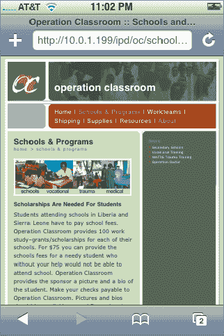

不过，通过创建 iPhone 和 iPod touch 特定的样式表，您可以在不影响任何 HTML 代码的情况下，为 iOS 上的 Safari 用户改造网站的可用性。

每个网站都有各自的需求和定制，才能与 iPhone 用户良好配合，因此我对此网站所做的具体改造可能适用于您，也可能不适用。但总体而言，这些改造为您应该考虑的修改类型提供了很好的示例。

查看页面（参见图 5-10），注意需要进行以下几项改造：

* 缩小页面宽度。
* 缩小页面顶部的 `Operation Classroom` 标志。
* 增大菜单链接、页面标题、面包屑导航链接和正文文本的字体大小。
* 将侧边栏移至正文文本下方。

## 更新 HTML 文件

作为第一步，我在网站每个页面的文档头部添加了一个媒体查询：

```
<!-[if !IE]>->
<link media="only screen and (max-device-width: 480px)" type="text/css"
  rel="stylesheet" href="iPhone.css" />
<!-<![endif]->
<link media="screen and (min-device-width: 1025px)" href="default.css"
  type="text/css" rel="stylesheet"/>
```

接下来，在 HTML 文件中，我将视口 `meta` 标签改为更小的宽度：

```
<meta name="viewport" content="width=490"/>
```

490px 的宽度足够宽，能与现有网站结构兼容，同时又足够小，以最小化缩放。

这就是我对 HTML 文件需要做的全部工作。

## 创建 iPhone.css

为了创建新的自定义样式表，我首先打开已使用的默认样式表，然后另存为新名称——`iphone.css`。我的第一个任务是将文档宽度从 744px 改为 490px。以下是更新后的样式：

```
@media all {
  #wrap {
    position:relative;
    top:4px;
    left:4px;
    background:#ab8;
    width:490px;
    margin:0 auto;
    text-align:left;
   }
```

接下来，我将 `body` 中定义的原始 `font-size:small` 属性改为更具体的像素大小：

```
body {
  background:#cdb;
  margin:0;
  padding:10px 0 14px;
  font-family: Verdana,Sans-serif;
  text-align:center;
  color:#333;
  font-size: 15px;
  }
```

虽然这个字号没有 iPhone 网页应用那么大，但它是在“操作教室”网站当前结构下能正常工作的最大字号。幸运的是，面包屑导航（路径）和页面标题的字号是相对于正文字号的，如下面的样式所示：

```
#pathway {
  margin-top:3px;
  margin-bottom: 25px;
  letter-spacing: .18em;
  color: #666666;
  font-size: .8em;
}
#pageheader {
  font-family:Helvetica,Arial,Verdana,Sans-serif;
  font-weight: bold;
  font-size: 2.2em;
  margin-bottom: 1px;
  margin-top: 3px;
}
```

下一个问题是缩小页面顶部横幅的尺寸。以下是 iPhone 适配前横幅文本的样式：

```
#banner-text{
  background:url("./images/bg_header.jpg") no-repeat left top;
  margin:0;
  padding:40px 0 0;
  font:bold 275%/97px Helvetica,Arial,Verdana,Sans-serif;
  text-transform:lowercase;
  }
```

你需要尝试缩小的两个属性是 `padding` 和字号。以下是一个可行的解决方案：

```
#banner-title {
  background:url("./images/bg_header.jpg") no-repeat left top;
  margin:0;
  padding:10px 0 10px;
  font: Bold 35px Helvetica,Arial,Verdana,Sans-serif;
  text-transform:lowercase;
  }
```

最后，也许是最重要的改动，是让侧边栏跟随正文，而不是浮动在正文旁边。以下是 iPhone 适配前的原始定义：

```
 #sidebar {
    background:#565 url(".images/corner_sidebar.gif") no-repeat left top;
    width:254px;
    float:right;
    padding:0;
    color:#cdb;
    }
```

为了将侧边栏移到正文下方，我移除了 `float` 属性，添加了 `clear: both` 声明。同时，将 `254px` 宽度改为 `100%`，使其占据内容 `div` 的空间。代码如下：

```
 #sidebar {
    background:#565 url("./images/corner_sidebar.gif") no-repeat left top;
    width:100%;
    clear: both;
    padding:0;
    color:#cdb;
}
```

图 5-11、5-12 和 5-13 展示了转换后的效果。

图 5-11 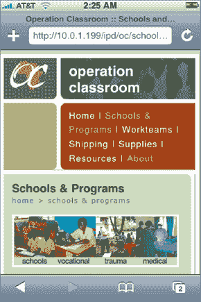
图 5-12 
图 5-13 

如所见，通过少量设计的样式改动，你可以将现有网站转换为适合 iPhone 的。

## 第 4 层：并行网站

除非你正在开发 iPhone 或 touch 应用，否则第 2 层或第 3 层开发已满足大多数网站的需求。如果你打算提供移动版本，你需要用户能够选择移动版或常规版网站。不要基于 `user agent` 自动重定向。因为 iOS 上的 Safari 可以正常浏览网站，你应该始终让用户决定。因此，标准做法是在页面底部添加指向完整版网站的链接，供 iPhone 用户使用。

另一种方案是反过来：当 iOS 设备加载页面时，网站询问用户是否跳转到移动版网站。

### 动手实践：提示 iOS 用户跳转到专用网站

1. 在文本编辑器中打开首页。
2. 在内容顶部添加一个空的 `div` 元素，如果页面上有顶部菜单，将其放在菜单下方：

```
<div id="ios-notify"></div>
```

3. 在文档头部添加以下脚本：

```
<script type="application/javascript">
function isiPhone()
{
  return ((navigator.platform.indexOf("iPhone") != -1) ||
          (navigator.userAgent.indexOf('iPod') != -1))
}
function isiPad()
{
  return (navigator.platform.indexOf("iPad") != -1)
}

function init()
{
  if (isiPhone())
  {
     var o = document.getElementById('ios-notify');
     o.innerHTML = "<h1 style='text-align:center;border:1px solid #a2e14;" +
     " -webkit-border-radius:10px;'a href='iphone-index.html'>" +
     "点击此处前往<br/>iPhone 网站。</a></h1>";
  }
  else if (isiPad())
  {
     var o = document.getElementById('ios-notify');
     o.innerHTML = "<h1 style='text-align:center;border:1px solid #a2e14;" +
     " -webkit-border-radius:10px;'a href='ipad-index.html'>" +
     "点击此处前往<br/>iPad 网站。</a></h1>";
  }
}
</script>
```

4. 保存文件。

#### 工作原理

这个示例向你展示了一种简单的方法，让 iPhone 和 iPad 访问者可以选择针对各自设计的网站。空的 `div` 元素充当占位符，用于显示向 iOS 访问者展示的消息。

`init()` 函数调用 `isiPhone()` 函数来判断 `user agent` 是否为 iPhone 或 iPod touch。如果是 iPhone 或 iPod touch，则向占位符 `div` 元素添加 HTML 内容。如果不是，则调用 `isiPad()` 函数检查用户是否使用 iPad 访问网站。然后，`init()` 函数通过 `body` 的 `onload` 处理程序被调用。图 5-14 展示了在 iPhone 上查看时的效果。

## 练习

（注：此处原文存在重复内容，已进行清理）

1. iOS 设备是否支持 Flash？
2. `viewport meta` 标签的作用是什么？
3. 应该使用哪个常量来将页面大小设置为设备视口的宽度？
4. 为什么在网页结构中频繁使用列是一个好主意？
5. 定义 iPad 媒体查询的链接语法是什么？

练习答案见附录。

## 本章所学内容

| 主题 | 关键概念 |
| --- | --- |
| 使网站兼容 iOS 设备 | 避免使用 Adobe Flash 媒体、Java 小程序和插件。同时，避免 CSS 属性 `position:fixed`。 |
| 使网站易于在 iOS 设备上导航 | 添加 `viewport meta` 标签，该标签决定内容如何显示和缩放以适应 iPhone 或 iPad。将网页转换为一系列列和块，这样 iPhone 更容易缩放和导航。 |
| 为网站添加自定义 iOS 样式 | 使用 CSS3 屏幕媒体查询为 iPhone 和 iPad 设置特定样式。 |
| 维护移动设备的并行网站 | 允许用户选择移动版或完整版网站。 |


`width=device-width` 属性将宽度设置为固定大小，并确保当用户旋转到横屏模式时视口不会调整大小。`initial-scale=1.0` 将缩放比例设置为 1.0，而 `maximum-scale` 和 `user-scalable` 设置则禁用用户对网页的缩放。

# 探索 iOS 设计模式

在开始设计你的 iOS Web 应用之前，一个有价值的练习是探索设备上或 App Store 中的原生 iOS 应用。在此过程中，你可以思考其他设计师如何处理小视口，以及如何为触摸屏输入设计直观的界面。

### 动手实践：探索用户界面模式

为了了解其他应用的用户界面是如何设计的，请按照以下步骤操作。

1. 打开三种不同类型的应用：邮件、相机和计算器。

2. 注意每个应用的目的，并审视每个应用所采用的设计决策。

3. 挑选一些你从 App Store 下载的第三方应用，并记录你喜欢和不喜欢它们的地方。

4. 基于你对原生应用的回顾，列出一系列在 Web 上下文中可行且合适的 UI 设计思路。

#### 工作原理

此活动的目的仅仅是让你以不同的方式思考你日常使用的应用。开发者为什么做出他们所做的设计决策？他们为什么采用他们所用的 UI 设计元素和方案？你会做出哪些不同的选择？这些正是你在开始设计自己的应用 UI 时应该提出的问题。

### 对应用进行分类

为了充分理解这些应用背后的设计决策，你需要了解用户使用 iOS 应用与桌面应用的方式差异。毕竟，想想你桌面上安装的那些应用类型。一个过于简单的分类如下：

* **基于任务的应用**：典型的桌面应用，无论是在 Mac、Windows 还是 Linux 上，都旨在解决特定问题或执行特定任务。这些应用（如 Word、Excel、PowerPoint、`Photoshop` 或 `iCal`）通常一次处理一个或几个文件。这些应用的 UI 通常非常相似，包括顶层菜单、工具栏、用于打开/保存的通用对话框、主目标窗口和侧面板。

* **聚合器**：桌面应用的第二类是聚合器——这类应用管理大量数据，用户通常需要同时处理多条数据，而非仅一两条。iTunes 管理你的歌曲和视频，iPhoto 和 Picasa 管理你的照片，Outlook 和 Apple Mail 存储你的电子邮件。聚合器应用的 UI 通常基于导航，左侧面板显示顶层可导航类别（iTunes 中的播放列表、Mail 中的文件夹、iPhoto 中的相册），主窗口则显示可滚动的列表。

* **小部件**：第三类是小部件式应用，它们是显示系统或其他信息（电池状态、天气、世界时钟）或执行特定任务（歌词抓取、收音机调谐器）的迷你应用。小部件 UI 通常由单个屏幕和一个设置面板组成。

在桌面端，基于任务的应用传统上一直占据主导地位，但过去十年间，随着管理数字媒体的需求日益增长，聚合器变得越来越重要。尽管小部件如今相当流行（苹果和微软已将此功能直接集成到操作系统中），但它们的重要性仍然低于前两者。

当你查看 iOS 内置应用时，会发现它们通常也属于这三类。然而，由于设备的视口和文件存储限制，基于任务的应用退居次要地位，聚合器成为主角（参见表 6-1）。

表 6-1：苹果 iOS 内置应用分类

| 聚合器 | 基于任务 | 小部件 |
| --- | --- | --- |
| 邮件 | Safari | 股票 |
| 信息 | 电话 | 天气 |
| 照片 | 相机 | 时钟 |
| YouTube | 日历 | 计算器 |
| 备忘录 | 地图 | | |
| 通讯录（地址簿） | 指南针 | | |
| iPod | 语音备忘录 | | |
| iTunes | | | |
| App Store | | | |

在传统桌面应用中，文档是主要关注点，但在 iOS 设备上，文档往往是可消费且临时的，这并不奇怪。iOS 上有 Pages、Numbers 和 Keynote 应用，但用户处理的许多文档都是可消费的：网页、短信、YouTube 视频、快速笔记和谷歌地图。

# 基于导航列表的 UI 设计

由于许多 iOS 应用的重点是消费各种信息，基于导航列表的设计成为在 iPhone 上向用户呈现大量信息的重要方式。如前所述，桌面应用通常将导航列表放在主窗口左侧的面板，但许多 iPhone 应用使用“边缘到边缘”导航。并非所有导航列表都相同。事实上，iPhone 至少有八种不同的导航样式。例如，通讯录列表使用单行显示联系人姓名（参见图 6-5），而邮件使用四行样式显示邮件信息和可选文本（参见图 6-6）。最后，YouTube 在其四行项目中展示了丰富的信息（参见图 6-7）。表 6-2 列出了各种导航样式。

表 6-2：不同类型的导航列表

| 应用 | 样式 | 显示内容 |
| --- | --- | --- |
| 通讯录 | 单行 | 联系人姓名（粗体） |
| 邮件 | 二行（默认）、四行 | 邮件标题和可选文本 |
| 地图 | 二行 | 点名称、地址 |
| 短信 | 三行 | 消息标题和文本 |
| 照片 | 一行 | 相册标题和缩略图 |
| YouTube | 三行 | 缩略图、标题、时长、观看次数 |
| 备忘录 | 单行 | 笔记文本 |
| iPod | 单行 | 播放列表名称 |
| 设置 | 单行 | 带图标 |

```
(img/f104.jpg)
```
```
(img/f104-2.jpg)
```
```
(img/f104-3.jpg)
```

然而，无论导航列表采用何种样式，它们的设计目的都是让你尽可能到达目标页面。此外，应用的顶部标题栏通常提供上下文，帮助用户了解他们在层级中的位置。左侧通常有一个返回按钮，使用户能够返回上一屏幕。更多内容请参见“标题栏”。

原生 应用通常还具有信息的不同模式或视图，供用户操作。这些模式以图标或按钮的形式显示在底部工具栏上（参见图 6-8）。有趣的是，在 iTunes 的初始版本中，按钮位于顶部。但在后续版本中，苹果将按钮移到了底部，以遵循“导航在上，模式在下”的惯例（参见图 6-9）。

```
(img/f106-01.jpg)
```
```
(img/f106-02.jpg)
```

表 6-3 详细说明了这些模式。

表 6-3：应用模式与 UI 访问

| 应用 | 模式 | UI 控件 |
| --- | --- | --- |
| iTunes | 列表、日、月 | 底部按钮 |
| 电话 | 收藏、最近通话、通讯录、拨号键盘、语音留言 | 底部工具栏 |
| iPod | 播放列表、播客、专辑、视频等 | 底部工具栏 |
| YouTube | 精选、最多观看、书签、搜索 | 底部工具栏 |
| 时钟 | 世界时钟、闹钟、秒表、计时器 | 底部工具栏 |

因此，当你开始考虑如何设计的 UI 时，请观察它与 iPhone 内置应用之间的相似之处。即使你不模仿其外观和感觉，也可能希望采用一致的方法。

# 探索屏幕布局

当你研究并评估了内置应用的设计后，就可以开始确定你所构建的应用类型可能存在相似之处。对于需要使用导航列表的应用，你需要下载我在第 15 章讨论的框架之一。每个框架都能让你实现基于边缘到导航列表的应用。典型移动应用的四个常见组件是：标题栏、导航列表、目标页面和按钮栏。

## 标题栏

大多数 iOS Web 应用应包含一个标题栏，以模拟几乎所有原生 应用中标准标题栏的外观。当 URL 栏隐藏时（如本章后面所述），自定义标题栏会显示在视口顶部的状态栏下方（参见图 6-10）。标题栏包含以下元素：

```
(img/f107-01.jpg)
```

* **返回按钮**：返回按钮应放置在工具栏左侧，允许用户返回上一页面。按钮的名称应与上一屏幕的标题相同。这种“面包屑”技术让用户知道他是如何到达当前页面以及如何返回的。如果页面位于顶层，则没有返回按钮。
* **屏幕标题**：每个屏幕应在工具栏中央显示一个标题。页面标题应为一个单词，并恰当描述当前屏幕的内容。与标准网页应用不同，你不应在应用的每个屏幕标题中包含应用名称。
* **命令按钮**：对于某些屏幕，你可能需要使用通用命令，如“取消”、“编辑”、“搜索”或“完成”。如果需要此功能，请在标题栏右上角放置一个命令按钮。

## 边缘到边缘导航列表

如果你正在为 iPhone 设计一款专门用于聚合或组织信息列表的应用，通常应遵循 iPhone 的边缘到边缘导航列表设计模式，如图 6-11 所示。每个单元格或子分区都特别大，以便于触摸输入。此外，为确保用户不会迷失上下文，标题显示当前页面，返回按钮指示用户可以返回的屏幕。当列表项展开到目标页面或另一个列表时，右侧会显示一个箭头，表示有下一页可用。

```
(img/f107-02.jpg)
```

当选中某个列表项时，导航列表应模拟 Apple 的滑入动画，看起来就像新页面从屏幕右侧替换旧页面。表 6-4 列出了边缘到导航列表中模拟 Apple 设计的具体度量。

表 6-4：Apple 边缘到设计的度量

| 项目 | 值 |
| --- | --- |
| 单元格高度（含底部线条） | 44px |
| 单元格宽度 | 320px（竖屏），480px（横屏） |
| 字体 | Helvetica，20pt（粗体次要文本使用常规字体） |
| 字体颜色 | 黑色 |
| 水平线（单元格之间） | `#d9d9d9` (RGB=217, 217, 217) |
| 左侧内距 | 10px |
| 底部内距 | 14px |
| 控件高度 | 29px |
| 控件对齐方式 | 右对齐，10px |
| 控件形状 | 圆角形，半径 7px |
| 控件文本 | Helvetica，12pt |
| 背景颜色 | 白色 |

## 圆角形设计目标页面

在导航列表设计中，用户最终到达目标页面，该页面完整列出特定信息。Apple 采用圆角形设计，如图 6-12 所示。标签在蓝色背景上，按逻辑分组，并包围在圆角形框中。表 6-5 描述了实现 Apple 设计应遵循的规范。

表 6-5：Apple 圆角形设计的度量

| 项目 | 值 |
| --- | --- |
| 单元格高度 | 44px |
| 圆角形半径 | 10px × 10px (`-webkit-border-radius:10px`) |
| 圆角形左右距 | 10px |
| 圆角形上下边距 | 17px |
| 水平线（单元格之间） | `#d9d9d9` (RGB=217, 217, 217) |
| 标签字体 | Helvetica，17pt，粗体 |
| 标签字体颜色 | `#4c566c` (RGB=76, 86, 108) |
| 单元格字体 | Helvetica，17pt，粗体 |
| 单元格字体颜色 | 黑色 |
| 单元格文本位置 | 距左边缘 10px，距底边缘 14px |
| 背景颜色 | `#cccd3` (RGB=197, 204, 211) |

```
(img/f108-01.jpg)
```

## 为触摸而设计

针对 iPhone ，你需要考虑的最关键设计因素之一是：你正在设计一个手指交互的界面，而非鼠标或其他机械指点设备。鼠标指针的点击点很小，只有几个像素高，但手指在典型点击操作中可能触及屏幕 40 像素或更多。因此，在应用中布局控件时，请确保控件的高度和控件间距即使对于手指的人也能轻松使用。

```
(pen.gif)
```

注意：由于 iPhone 是移动设备，请记住用户可能在移动中与你的应用交互。他们正在街上行走、在咖啡店排队，甚至可能慢跑。因此，你应在 UI 中留出足够空间，以应手指抖动的情况。标准导航列表单元格的高度为 44px。按钮的大小大致相当于手指大小，通常高度为 40px 或以上，并且周围有足够的空间防止意外点击。如果周围没有其他按钮，按钮高度为 29 到 30 像素也可以，但需谨慎。表 6-6 列出了常见元素的推荐尺寸。

表 6-6：触摸输入屏幕的度量

| 元素度量 | 推荐尺寸 |
| --- | --- |
| 元素高度 | 40px（最小 29px） |
| 元素宽度 | 最小 30px |
| 选择、输入高度 | 30px |
| 导航列表单元格高度 | 44px |
| 元素间距 | 20px |

除了尺寸和间距问题外，另一个重要的设计决策是尽量减少文本输入的需求。尽可能使用选择列表而非输入字段。此外，使用 cookie 记住上次输入的值，以避免重复输入。

## 字体处理

凭借其 Retina 显示屏和抗锯齿支持，iPhone 是处理字体的理想平台。优质字体在 iPhone 显示屏上呈现效果极佳，增强了应用 UI 的整体吸引力。

Apple 为 iOS 选择的字体 Helvetica 通常作为应用的默认字体。然而，iOS 确实为开发者提供了几种字体选择。与必须使用字体系列的典型 Web 环境不同，iOS 允许你对用户运行应用时拥有的确切字体做出一些假设。表 6-7 列出了 iOS 支持的字体。

表 6-7：iOS 字体

| 名称 |
| --- |
| American Typewriter（无斜） |
| Arial |
| Arial Rounded MT Bold（无斜） |
| Courier New |
| Georgia |
| Helvetica |
| Marker Felt |
| Times New Roman |
| Trebuchet MS |
| Verdana |
| Zapfino |

iOS 上的 Safari 会自动用内置字体替换三种不支持的字体。当指定 Courier 时，会替换为 Courier New。Helvetica Neue 被替换为 Helvetica，Times 被替换为 Times New Roman。

## iOS UI 设计最佳实践

为了让你的应用更像原生 iOS 应用，你需要遵循以下技巧：

* `width=device-width` 属性将宽度设置为固定大小，并确保当用户旋转到横屏模式时视口不会调整大小。`initial-scale=1.0` 将缩放比例设置为 1.0，而 `maximum-scale` 和 `user-scalable` 设置则禁用用户对网页的缩放。


<|channel>thought
<channel|>### 4 在文档头部添加一个 `apple-mobile-web-app-capable` `meta` 标签，并将其值设置为 `yes`：

```
<meta name="apple-mobile-web-app-capable" content="yes" />
```

### 5 在文档头部添加一个 `status-bar-style` `meta` 标签，并将其值设置为 `black`：

```
<meta name="apple-mobile-web-app-status-bar-style" content="black" />
```

### 6 在文档头部添加以下 `link` 标签：

```
<link rel="apple-touch-icon" href="icon.png"/>
<link rel="apple-touch-icon" sizes="72x72" href="icon-ipad.png" />
<link rel="apple-touch-icon" sizes="114x114" href=" icon-iphone4.png" />
```

### 7. 保存你的文件。

### 工作原理

默认情况下，当你在 iOS 上的 `Safari` 中运行 Web 应用时，`Safari` 仍然会占用视口的大部分空间，包括其 URL 栏和底部栏。然而，为了收回这些浪费的空间，并使你的应用看起来更像原生应用，你应该以全屏模式启动应用。当文档中提供了 `apple-mobile-web-app-capable` `meta` 标签时，你的应用就会以全屏模式运行。但是，全屏模式仅在你通过 WebClip 图标从主屏幕启动应用时才生效。当你从 URL 栏访问页面时，`Safari` 会保留其 URL 栏和按钮栏。

当你使用 `apple-mobile-web-app-capable` `meta` 标签进入全屏模式时，`Safari` 仍然会显示顶部状态栏。这种行为并不意外，因为大多数原生应用也以相同方式显示状态栏。然而，如果你希望标记状态栏，你可以使用 `status-bar-style` `meta` 标签并将其值设置为 `black`，将其外观自定义为透明黑色。但此 `meta` 标签仅在你同时使用 `apple-mobile-web-app-capable` `meta` 标签开启全屏模式时才生效。

最后，`<link rel="apple-touch-icon"/>` 标签使你能够像原生应用一样将你的应用添加到主屏幕。你指向的图形文件需要遵循以下约定：

* 必须是 `.png` 格式。
* 位于根目录中。
* 如前所述，iPhone 4 及以上版本使用 114 x 114 像素，iPad 使用 72 x 72 像素，iPod touch 和旧款 iPhone 型号使用默认尺寸 57 x 57 像素。
* 必须是矩形——iOS 会自动添加圆角。
* 必须命名为 `apple-touch-icon.png` 或 `apple-touch-icon-precomposed.png`。如果你使用 `apple-touch-icon.png`，iPhone OS 会为图形添加圆角、投影和“光泽涂层”。如果你使用 `apple-touch-icon-precomposed.png`，则操作系统不会添加这些效果。

用户可以通过在导航到 URL 时点击按钮栏上的 `+` 按钮来添加你的应用的 WebClip 图标。在弹出的对话框中，用户点击“添加到主屏幕”按钮（参见图 6-14）。

图 6-14

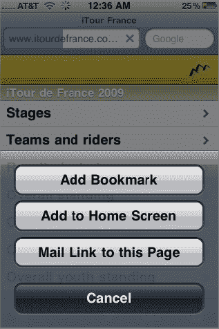

不幸的是，由于 Web 应用没有正式的安装过程，因此没有编程方式可以自动将 WebClip 图标添加到主屏幕。该过程必须由用户手动完成。

## 练习

1. 什么时候会使用边缘到边缘的导航列表设计模式？
2. 按钮或其他 UI 元素通常应具有的最小像素尺寸是多少（针对触摸）？
3. 判断正误？Comic Sans 是 iOS 上可用的字体。
4. 判断正误？iOS 上的 Safari 允许你通过 JavaScript 控制屏幕方向。

练习答案可在附录中找到。

## 本章所学内容

| 主题 | 关键概念 |
| --- | --- |
| 视口 | 视口是屏幕空间中的一个矩形区域，应用在其中显示。用户可以通过调整窗口大小、滚动其内容以及在许多情况下更改缩放级别来操纵视口内显示的内容。 |
| iOS UI 设计模式 | 基于导航列表的设计成为呈现大量层级或列表信息的重要方式。导航在上，模式在下。 |
| 最佳实践 | 记住触摸。避免水平滚动。保持设计简洁。使用熟悉的术语。向用户传达状态。 |

## 第 7 章：为 iPad 设计

### 本章你将学到：

* 了解 iPad 的特殊设计考虑
* 理解 iPad 上 Safari 的局限性
* 创建 Split View 应用

iPad 是移动设备，但它不是手机。这句话显然是个“不假思索”的结论，但在为 iPad 设计时，很容易陷入将其视为“巨型 iPhone”的陷阱。相反，iPad 几乎完美融合了 iPhone 的移动触控特性和台式电脑的大屏视觉体验与交互能力。因此，在为 iPad 设计 Web 应用时，你需要给予它应有的独立关注，而不是仅仅把它当作一个更大的 iPhone 视口。

在本章中，我将重点介绍为 iPad 设计应用时应考虑的一些特殊事项，然后专注于创建模仿原生 iPad 应用外观的分屏视图 UI（用户界面）设计。

### 针对 iPad 的特殊考虑

* 在文档头部添加 `viewport` 元标签：
  ```
  <meta name="viewport" content="width=device-width; initial-scale=1.0;
     maximum-scale=1.0; user-scalable=no;"/>
  ```
* 添加针对 iPad 的媒体查询：
  ```
  <link media="only screen and (min-device-width: 768px)
     and (max-device-width: 1024px)" type="text/css"
     rel="stylesheet" href="iPad.css" />
  ```
* 添加针对 iPad 的样式：
  ```css
  @media only screen and (min-device-width: 768px) and (max-device-width: 1024px)
  {
    /* 在此处添加 iPad 样式 */
  }
  ```
* 启用 iPad 应用从主屏幕启动时以全屏模式运行：
  ```
  <meta name="apple-mobile-web-app-capable" content="yes">
  ```

### 设计要点

* 同时为竖屏和横屏模式进行设计。你需要以 1024 × 768（横屏）和 768 × 1024（竖屏）来设计。
* 确保你的设计足够灵活，同时适应竖屏和横屏模式。如有需要，添加 `orientationchange` 事件监听器并动态调整设计。
* 尽量减少模态窗口的使用。让用户以更灵活、非线性的方式使用应用。当你确实需要使用模态时，建议使用弹出框。
* 对于编辑元素，不要使用 `contenteditable` 属性，因为 iOS 上的 Safari 不支持。相反，对于多行编辑，请使用 `textarea`。
* 除非使用流行的移动框架或 iScroll（见下一节讨论），否则避免使用 `position:fixed` CSS 属性。具体来说，如果用户在页面上缩放或移动，固定元素可能会滚动到屏幕之外。

### 处理滚动

iPad 上 Safari 内部滚动行为与桌面浏览器中的预期不同。单指或双指滑动会触发 `window.scroll()`。此外，iOS 上的 Safari 不支持 `div` 元素的单指滚动。为了克服这些限制，已经开发了一些开源解决方案。其中最流行的是 iScroll 4，它最初由 Matteo Spinelli 开发。你可以将这个 JavaScript 库添加到项目中，以获得针对 iPad 设备的体验。你可以从 `cubiq.org/iscroll-4` 下载它。除了接近原生的滚动能力，iScroll 4 还提供了额外的触摸功能，包括内容的捏合/缩放、下拉刷新、吸附元素以及自定义滚动。

### 分屏视图设计

原生 iPad 应用中，一个关键的设计模式是主从视图，即分屏视图，你应该适当的时候尝试它。分屏视图模式由两个面板组成：左侧显示列表，右侧显示当前项目的详细。在桌面上，经常看到这种模式出现在大多数应用中，例如 Outlook 或 Apple Mail，其中列表与消息并排显示。iPhone 也使用了主从概念，但由于空间限制，无法以分屏方式同时显示。iPad——介于手机和桌面之间的设备——根据上下文表现像桌面或手机。在横屏模式下，主视图和从视图显示（参见图 7-1）。但在竖屏模式下，主视图会显示弹出框中（图 7-2）。

图 7-1


图 7-2
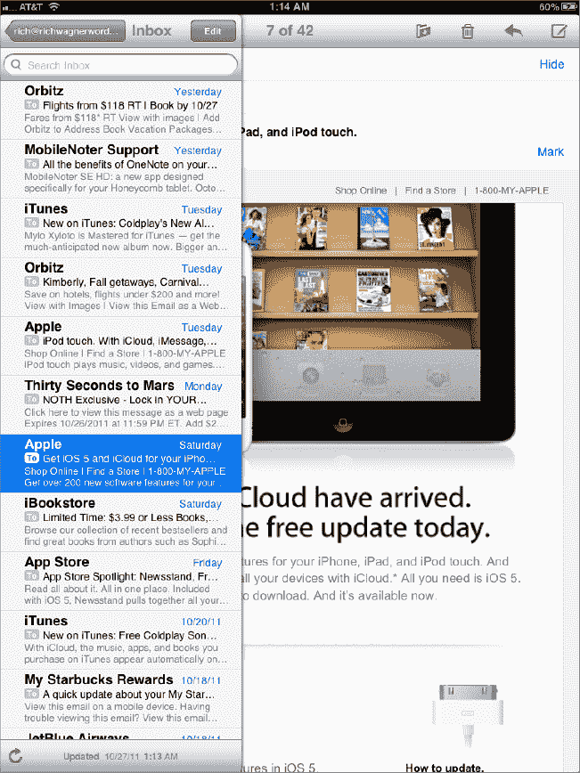

### 为 iPad 设计界面

当你阅读第 16 章时，你会发现可以使用移动框架（如 jQuery Mobile）为 iPad 创建应用，使其在 iOS  Safari 中表现良好。然而，由于这些框架是跨平台的，它们并不模仿 iOS 的设计，而是提供中性、无风格的 UI。我在第 5 章创建的 Hello World 就是这种技术的示例。但是，如果你希望你的应用严格遵循 iOS 指南，具有与原生应用相似的“外观和感觉”，你可以使用 CSS 和 JavaScript 从头创建这种“外观”，也可以探索网络上可用的开源选项。其中一个选项是 Slablet，这是一个开源框架，你可以将其添加到应用中以重新创建原生外观。你可以从 `github.com/fellowshiptech/slablet` 下载它。尽管 Slablet 不是像 jQuery Mobile、Sensa Touch 那样完整的解决方案，但它是一个轻量级、易使用的附加组件的绝佳示例，你可以快速用它将应用转变为给 iPad 用户留下深刻印象。下面的练习将引导你完成基于 Slablet 的应用所需的。

#### 动手实践：创建分屏视图应用壳

通过以下步骤如何创建 iPad 应用：

1. 从 `github.com/fellowshiptech/slablet` 下载 Slablet 库。
2. 将 zip 文件的内容解压到你的应用文件夹中。确保 Slablet 的 `assets` 文件夹直接位于根文件夹内。
3. 在文本编辑器中创建以下 HTML 文档，并将其保存为 `BIDHJ-Ch07-Ex1.html`。


```html
<!DOCTYPE html>
<html lang="en">
<head>
<!--
        致谢：本示例使用了 Slablet 模板
        网址：https://github.com/fellowshiptech/slablet
-->
<meta http-equiv="content-type" content="text/html; charset=utf-8" />
<meta http-equiv="x-ua-compatible" content="ie=edge" />
<title>iOS WebApp</title>
<meta name="apple-mobile-web-app-capable" content="yes" />
<meta name="viewport" content="width=device-width, initial-scale=1,
   maximum-scale=1, user-scalable=no" />
<link rel="stylesheet" href="assets/stylesheets/master.css" />
<!--[if IE 8]>
<link rel="stylesheet" href="assets/stylesheets/ie8.css" />
<![endif]-->
<!--[if !IE]><!-->
<script src="assets/javascripts/iscroll.js"></script>
<!--<![endif]-->
<script src="assets/javascripts/jquery.js"></script>
<script src="assets/javascripts/master.js"></script>
</head>
<body>

</body>
</html>
```

代码片段 `BIDHJ-Ch07-Ex1.html`

4. 在文档主体中添加主页面内容：


```html
<!-- 开始页面（横屏和竖屏均显示） -->
<div id="main" class="abs">

    <!-- 开始页面页眉 -->
    <div class="abs header_upper chrome_light">
        <!-- 主菜单按钮 -
                仅在竖屏模式下显示
                按下时显示弹出菜单
        -->
        <span class="float_left button" id="button_navigation">
            菜单
        </span>
        <!-- 左侧工具栏按钮 -->
        <!--<a href="#" class="float_left button">
            返回
        </a>-->
        <!-- 右侧工具栏按钮 -->
        <!--<a href="#" class="float_right button">
            命令
        </a>-->
        标题
    </div>
    <!-- 工具栏 -->
    <div class="abs header_lower chrome_light">

    </div>
    <!-- 结束页眉 -->
    <!-- 开始页面内容 -->
    <div id="main_content" class="abs">
        <div id="main_content_inner">
            <!-- 在此添加内容 -->
        </div>
    </div>
    <!-- 结束页面内容 -->

    <!-- 开始页面页脚 -->
    <div class="abs footer_lower chrome_light">
        <!--<a href="#" class="float_left button">
        </a>-->
        <a href="#">完整网站</a>
    </div>
    <!-- 结束页面页脚 -->

</div>
<!-- 结束页面 -->
```

代码片段 `BIDHJ-Ch07-Ex1.html`

5. 在文档主体中上一个内容块之后添加以下侧边栏相关代码：


```html
<!-- 开始侧边栏（横屏时显示为侧边栏，竖屏时显示为弹出框） -->
<div id="sidebar" class="abs">
    <span id="nav_arrow"></span>
    <!-- 应用名称 -->
    <div class="abs header_upper chrome_light">
    我的应用名称
    </div>
    <!-- 开始侧边栏菜单 -->
    <div id="sidebar_content" class="abs">
        <div id="sidebar_content_inner">
            <ul id="sidebar_menu">
            <!-- 菜单 -->
            </ul>
        </div>
    </div>
    <!-- 结束侧边栏菜单 -->
    <!-- 开始侧边栏页脚 -->
    <div class="abs footer_lower chrome_light">
        <a href="#" class="icon icon_gear2 float_left"></a>
        <span class="float_right gutter_right">标语</span>
    </div>
    <!-- 结束侧边栏页脚-->
</div>
<!-- 结束侧边栏 -->
```


在本练习中，你创建了一个基本的分屏视图 UI 外壳，虽然它没有内容，但你可以在此基础上构建一个完整的应用。首先，添加创建应用结构所需的基本 `meta` 标签和链接。`app-mobile-web-app-capable` 和 `viewport` `meta` 标签在第 6 章中讨论过。head 中的其余代码添加了 Slablet 模板使用的所有必要 CSS 样式表和 JavaScript 库（包括 `jquery.js`）。

Slablet 样式表和 JavaScript 库大量使用元素的 `id` 和 `class` 属性来定义其外观和行为，因此 UI 的每个核心部分都被赋予了特定的 `id` 和/或 `class` 属性值。

图 7-3 和 7-4 显示了空应用外壳在横屏和竖屏模式下的样子。与原生 iPad 应用一样，侧边栏在横屏模式下显示，在竖屏模式下隐藏。另请注意，菜单按钮在竖屏模式下出现，但在横屏模式下不可见。

图 7-3

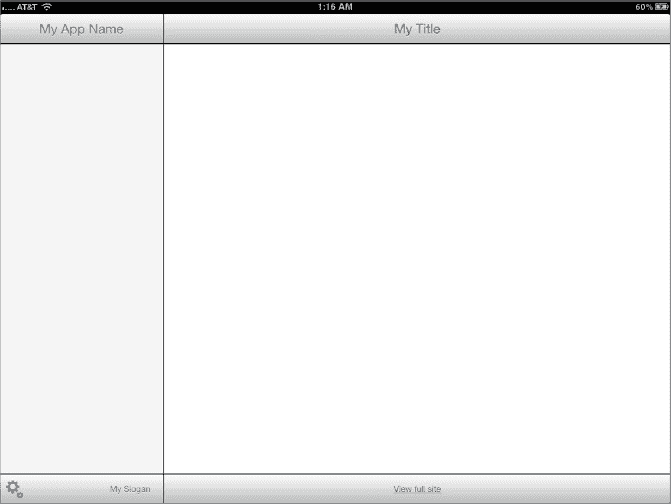

图 7-4

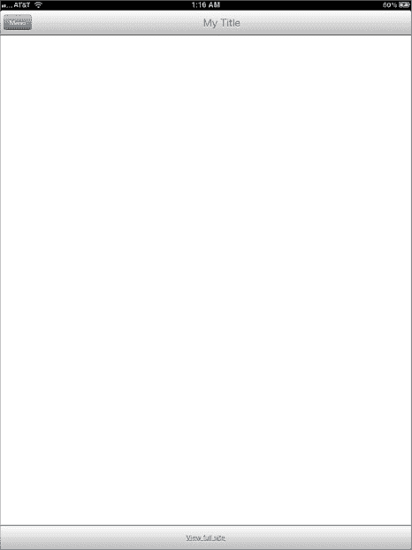

从这个简单的示例可以看出，当你在 HTML 文件中正确定义了相应元素后，Slablet 为你提供了相当多的功能。深入 Slablet 内部，有几个关键部分值得一看。首先，`master.js` 文件用于定义模板的所有行为。特别值得注意的是 Slablet 如何适应屏幕方向并切换侧边栏的可见性。相关代码如下：

```
function adjust_angle() {
        var angle = window.orientation;
        var body = $('body');
        var body_width = body.outerWidth();
        var sidebar = $('#sidebar');

        if (angle === 0 || angle === 180 || body_width < 1024) {
            body.addClass('is_portrait');
            $('#button_navigation').removeClass('button_active');
            sidebar.hide();
        }
        else {
            body.removeClass('is_portrait');
            sidebar.show();
        }
    }

    adjust_angle();

    $(window).bind('resize orientationchange', function() {
        adjust_angle();
    });
```

从这段代码可以看出，`adjust_angle()` 函数被指定为浏览器 `orientationchange` 事件的事件处理程序。因此，当 iPad 方向改变时，会评估 `window.orientation` 属性。当确定 iPad 处于竖屏模式时，使用`sidebar.hide()` 隐藏侧边栏；但如果 iPad 处于横屏模式，则显示侧边栏。

尽管目前应用只是一个没有内容或工作部件的外壳，但将这个 UI 外壳转变为一个可用的应用并不需要太多工作。下面的练习将引导你完成所需的步骤。

### 动手实践：创建分屏视图大会应用

按照以下步骤将空的 UI 外壳转变为一个大会应用。

1. 打开你在上一个练习中创建的 `BIDHJ-Ch07-Ex1.html` 文件，并将其另存为 `index.html`。

2. 替换空白页面内容，使其如下所示：


```
<!-- Begin Page (shown in both landscape and portrait -->
<div id="main" class="abs">

    <!-- Begin Page Header -->
    <div class="abs header_upper chrome_light">
        <!-- Main menu button -
                shown only in Portait mode
                displays popover menu when pressed
        -->
        <span class="float_left button" id="button_navigation">
            Menu
        </span>
        <!-- Left toolbar button -->
        <!--a href="#" class="float_left button">
            Back
        </a-->
        <!-- Right toolbar button -->
        <!--a href="#" class="float_right button">
            Command
        </a-->
        IOS WebAppster Conference
    </div
    <!-- Toolbar -->
    <!--div class="abs header_lower chrome_light">

    </div-->
    <!-- End Page Header -->
    <!-- Begin Page content -->
    <div id="main_content" class="abs">
        <div id="main_content_inner">
            <h1>Welcome to IOS WebAppster Conference 2013</h1>  
            <p>You are now at the most amazing conference in the
              history of the Web. Ok, maybe
            that's hyperbole. But we think you are going to like it.</p>
        </div>
    </div>
    <!-- End Page content -->

    <!-- Begin Page Footer -->
    <div class="abs footer_lower chrome_light">
        <a href="#" class="float_left button">
            About the Salsa Conference Center
        </a>
        <!--a href="#" class="float_left button">
            Bar
        </a-->
        <!--a href="#" class="icon icon_bird float_right"></a-->
        <a href="#">View full site</a>
    </div>
    <!-- End Page Footer -->

</div>
<!-- End Page -->
```

代码片段 `index.html`

3. 替换空的侧边栏内容，使其包含以下代码：


```
<!-- Begin Sidebar (shown as sidebar in landscape, shown as popover in portrait -->
<div id="sidebar" class="abs">
    <span id="nav_arrow"></span>
    <!-- App Name -->
    <div class="abs header_upper chrome_light">
    ConfApp
    </div
    <!-- Begin Sidebar Menu -->
    <div id="sidebar_content" class="abs">
        <div id="sidebar_content_inner">
            <ul id="sidebar_menu">
                <li id="home" class="active">
                    <a href="#">Home</a>
                </li>
                <li>
                    <a href="#">Welcome to IOS WebAppster</a>
                </li>
                <li>
                    <a href="#">Sessions</a>
                    <ul>
                        <li>
                            <a href="#">Session 100: Hello World</a>
                        </li>
                        <li>
                            <a href="#">Session 110: Designing for Mobile</a>
                        </li>
                        <li>
                            <a href="#">Session 210: Styling with CSS</a>
                        </li>
                        <li>
                            <a href="#">Session 220: Advanced JavaScript</a>
                        </li>
                        <li>
                            <a href="#">Session 225: Designing for iPad</a>
                        </li>
                        <li>
                            <a href="#">Session 300: Touch Events</a>
                        </li>
                        <li>
                            <a href="431.html">Session 431: Distributing Your App</a>
                        </li>
                    </ul>
                </li>
                <li>
                    <a href="#">Speakers</a>
                    <ul>
                        <li>
                            <a href="#">Doug Majoring</a>
                        </li>
                        <li>
                            <a href="#">Kyle Exwhi</a>
                        </li>
                        <li>
                            <a href="#">Jason Masters</a>
                        </li>
                        <li>
                            <a href="#">Samantha Goodface</a>
                        </li>
                        <li>
                            <a href="#">Jess Gentleman</a>
                        </li>
                        <li>
                            <a href="#">Lex Landry</a>
                        </li>
                        <li>
                            <a href="#">Rachel Furgeson</a>
                        </li>
                    </ul>
                </li>
            </ul>
        </div>
    </div>
    <!-- End Sidebar Menu -->
    <!-- Begin Sidebar Footer -->
    <div class="abs footer_lower chrome_light">
        <a href="#" class="icon_gear2 float_left"></a>
        <span class="float_right">Bringing Conferences to Life</span>
    </div>
    <!-- End Sidebar Footer-->
</div>
```

4. 保存文件。

5. 以此文件为起点，将文件分别保存为 `welcome.html` 和 `431.html`。

6. 在编辑器中打开 `welcome.html`。

7. 将 `main_content_inner` div 中的代码替换为以下代码：


```
<div id="main_content_inner">
    <h1>Welcome to the Conference</h1>
    <p>We're going to have a great time!</p>
</div>
```

代码片段 `welcome.html`

8. 保存文件。

9. 在编辑器中打开 `431.html`。

10. 将 `main_content_inner` div 中的代码替换为以下代码：


```
<div id="main_content_inner">
    <h1>Distributing Your App</h1>
    <p>In this engaging session, Doug Majoring will take you through how to distribute your Web app in the App Store.</p>
</div>
```

代码片段 `431.html`


In eu velit magna. Phasellus felis lectus, rhoncus ut ultricies nec, porttitor sed nunc. Nulla sit amet purus metus, sed molestie diam. Nam pellentesque dui vitae mauris tincidunt venenatis. Cras a adipiscing risus. Morbi lorem turpis, suscipit iaculis hendrerit non, auctor ut augue. Phasellus at urna a nisl tempor sodales. In hac habitasse platea dictumst. Cras at augue massa, non suscipit nulla. Morbi bibendum ultricies luctus. Phasellus rutrum blandit dui ac facilisis. Mauris vitae augue eros. Suspendisse fermentum ultricies risus quis viverra. Donec ut ante id nisi fringilla mollis sed nec velit. Phasellus ornare, nulla ut rutrum hendrerit, felis diam cursus purus, quis fermentum erat lacus posuere odio. Fusce ac odio tortor.

Nullam tempor, est in ultrices luctus, diam lectus tincidunt sem, nec ornare dolor lectus a magna. Vestibulum accumsan suscipit aliquet. Mauris at lorem quam. Aenean ac augue quis sem commodo accumsan a vitae nunc. Maecenas luctus velit et erat dignissim ut commodo arcu malesuada. Vestibulum ante ipsum primis in faucibus orci luctus et ultrices posuere cubilia Curae; Nulla viverra, enim sit amet placerat venenatis, tortor odio feugiat mauris, sit amet vehicula purus tellus pulvinar libero. Phasellus id feugiat turpis. Donec aliquam luctus iaculis. In faucibus neque in lorem tincidunt pellentesque. Vestibulum condimentum augue vel ante euismod euismod sed ac urna. Phasellus scelerisque, quam id dapibus sagittis, nulla nibh hendrerit est, vel aliquam tellus augue vitae sem. Aenean commodo, urna a sagittis varius, nulla metus tempor nunc, ac suscipit elit odio sed leo. Vivamus ut lobortis velit. Nam pretium vestibulum tellus non vehicula.

Proin dolor diam, laoreet vel faucibus nec, malesuada sit amet purus. Proin turpis orci, ultrices at laoreet quis, vulputate ac mi. Sed nec tristique justo. Maecenas cursus sem et tellus gravida nec semper neque suscipit. Curabitur vitae convallis metus. Fusce porta elementum molestie. Quisque neque eros, vehicula nec cursus ac, tincidunt accumsan lacus. Nulla facilisi. Donec id nisl ligula, eget cursus quam. Donec euismod iaculis rhoncus. Aliquam malesuada dignissim libero nec scelerisque. Donec mauris sapien, dignissim ac blandit a, consequat bibendum felis.

In dignissim varius eros, eu mattis metus fringilla ut. In ultrices orci nec libero sollicitudin a dapibus mi tempor. Donec neque justo, condimentum ac vehicula quis, iaculis eget lacus. In at elit nisl. Donec vel aliquam dolor. Phasellus hendrerit justo in elit ultrices ac pulvinar turpis viverra. Nullam ornare nisi vitae risus vulputate malesuada. Nam vulputate lobortis velit, sed iaculis arcu fermentum pharetra. Aliquam dolor massa, pretium sit amet ultrices sed, pellentesque ut lectus. Sed aliquet pharetra dolor eget pharetra. Mauris sit amet purus odio. Vestibulum ante ipsum primis in faucibus orci luctus et ultrices posuere cubilia Curae; Quisque lobortis, dui pulvinar dapibus facilisis, lectus enim pretium odio, ut imperdiet sem sem nec augue. Nulla facilisi. Integer et risus eget purus posuere varius. Donec ac nibh quis mi lobortis sagittis quis ut est.

代码片段 `431.html`

11. 将页面底部 `float_left` 链接中的代码替换为以下代码：


```
<a href="#" class="float_left button">
View Doug's Bio
</a>
```

代码片段 `431.html`

12. 保存文件。

#### 工作原理

在本练习中，你将 UI 外壳转换成了一个示例应用，该应用可以进一步填充，作为会议演示者使用的应用。为了演示，你创建了主索引页面、欢迎页面和一个示例会议页面。主应用页面如图 7-5 所示。这些页面可通过侧边栏中定义的链接列表访问，如图 7-6 所示。如前所述，当应用在竖屏模式下运行时，侧边栏会被隐藏，并在用户点击菜单按钮时以弹出窗口形式显示（参见图 7-7）。

图 7-5

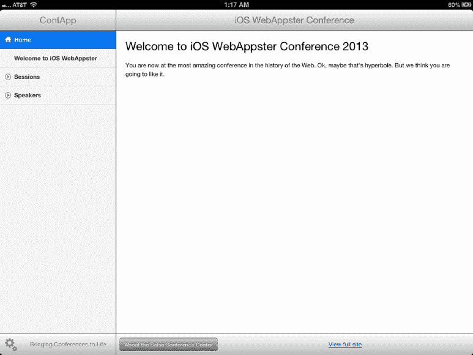

图 7-6

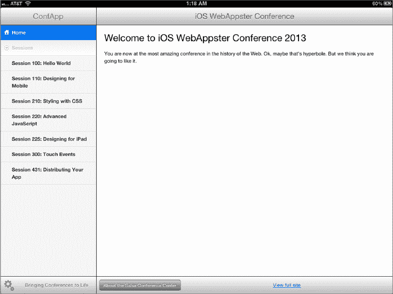

图 7-7

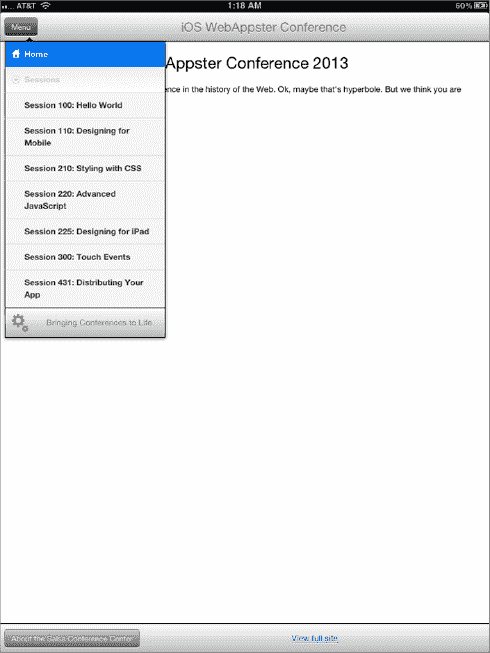

图 7-8 显示了示例会议页面。但关于此页面，需要注意的一点是，内容通过流行的 `iScroll.js` 库在页面 `div` 内滚动。

图 7-8

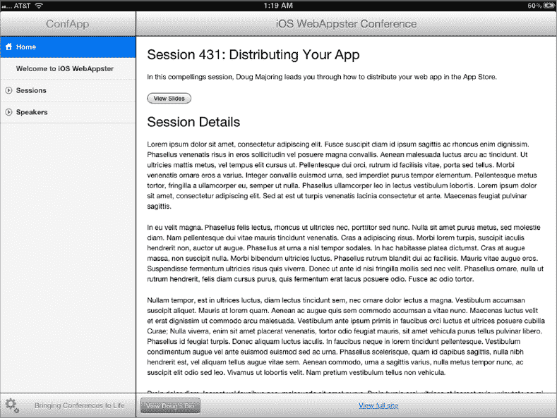

## 练习

1. 判断对错？虽然 iPhone 的 Web 应用应使用 `viewport` meta 标签，但 iPad 的 Web 应用不需要 `viewport` 标签。

2. 设计时更适合横屏模式还是竖屏模式？

3. 如何克服在固定大小的 `div` 内无法滚动溢出内容的限制？

练习答案见附录。

## 本章所学内容

| 主题 | 关键概念 |
| --- | --- |
| 大多数 iPad Web 应用需要添加的关键 meta 标签 | `Viewport` meta 标签、`apple-mobile-web-app-capable` meta 标签 |
| 为竖屏和横屏设计 | 设计你的应用，使其在横屏模式下以 1024×768 工作，在竖屏模式下以 768×1024 工作 |
| 分屏视图设计模式 | 一种核心的 iPad 设计模式，常用于原生 iPad 应用 |

## 第 8 章：使用 CSS 进行样式

#### 本章将学到：

* 处理文本样式和*
* 样式级元素
* 创建按钮

与 Mac 和 Windows 上的类一样，iOS 移动版提供了所有 Web 浏览器中最好的 CSS 支持。开发 iOS 应用时，你可以利用 CSS 构建强大的界面。

## Safari 的 CSS 选择器

| 选择器 | 定义 |
| --- | --- |
| `E` | 类型选择器 |
| `.class` | 类选择器 |
| `#id` | ID 选择器 |
| `*` | 通用选择器（所有元素） |
| `E F` | 后代选择器 |
| `E > F` | 子选择器 |
| `E + F` | 相邻兄弟选择器 |
| `E ~ F` | 间接选择器 |
| `E[attr]` | `attr` 定义 |
| `E[attr=val]` | `attr` 值匹配 `val` |
| `E[attr~=val]` | 多属性选择器 |
| `E[attr|=val]` | `attr` 值是一个连字符分隔的列表，并以 `val` 开头 |
| `E[attr^=val]` | `attr` 值以 `val` 开头 |
| `E[attr$=val]` | `attr` 值以 `val` 结尾 |
| `E[attr*=val]` | `attr` 值至少包含一个 `val` |

表 8-2：Safari 伪类和伪元素

| 伪类/伪元素 | 定义 |
| --- | --- |
| `E:link` | 未访问的链接 |
| `E:visited` | 已访问的链接 |
| `E:lang([Code])` | 选择器使用语言代码 |
| `E:before` | 元素之前的内容 |
| `E::before` | 元素之前的内容（CSS3 中新的冒号表示法） |
| `E:after` | 元素之后的内容 |
| `E::after` | 元素之后的内容（CSS3 中新的冒号表示法） |
| `E:first-letter` | 元素的第一个字母 |
| `E::first-letter` | 元素的第一个字母（CSS3 中新的冒号表示法） |
| `E:first-line` | 元素的第一行 |
| `E::first-line` | 元素的第一行（CSS3 中新的冒号表示法） |
| `E:first-child` | 第一个子元素 |
| `E:first-of-type` | 第一个指定类型的元素 |
| `E:root` | 根元素 |
| `E:not()` | 否定 |
| `E:target` | 目标 |
| `E:enabled` | 启用状态 |
| `E:disabled` | 禁用状态 |
| `E:checked` | 选中状态 |

请注意，Safari 不支持以下 CSS3 选择器：

* `:last-child`
* `:only-child`
* `nth-child()`
* `nth-last-child()`
* `last-of-type`
* `only-of-type`
* `:nth-of-type()`
* `:nth-last-of-type()`
* `Empty`

## 文本样式

在 iOS 网络应用中设置文本样式时，请记住三个对有效 UI 设计至关重要的文本相关样式：`-webkit-text-size-adjust`、`text-overflow` 和 `text-shadow`。本节将解释这些属性。

### 使用 `-webkit-text-size-adjust` 控制文本大小

当页面渲染时，iOS 上的 Safari 会根据文本块的宽度自动调整页面文本的大小。但是，通过使用 `-webkit-text-size-adjust` 属性，你可以覆盖此设置。`none` 选项关闭文本的自动调整大小：

```
body { -webkit-text-size-adjust: none; }
```

或者，你可以指定一个倍数：

```
body { -webkit-text-size-adjust: 140%; }
```

最后，你可以将其设置为默认值 `auto`：

```
body { -webkit-text-size-adjust: auto; }
```

对于普通 Web，建议使用 `-webkit-text-size-adjust: auto` 以提高文本的可读性。

### 使用 `text-overflow` 处理溢出文本

由于物理空间有限，开发者通常会避开这些实验性属性。幸运的是，`text-overflow` 属性使开发人员能够指定文本溢出时他们希望如何处理。两个值是 `ellipsis` 和 `clip`。`ellipsis` 值会裁剪内容并在末尾添加省略号（. . .）。假设你将以下属性分配给工具栏的标题元素：

```
text-overflow: ellipsis;
```

现在，当文本溢出时，会添加一个省略号，如 图 8-4 所示。


```html
<html>
<meta name="viewport" content="width=320; initial-scale=1.0; maximum-scale=1.0;">
<body>
<div> this is a test this is a test this is a test
this is a test this is a test this is a testthis is a test </div>
<br><br>
<div> this is a test this is a test this is a test
this is a test this is a test this is a testthis is a test </div>
<br><br>
<div> this is a test this is a test this is a test
this is a test this is a test this is a testthis is a test </div>
</body>
</html>
```

代码片段 `BIDHJ-Ch8-Ex1.html`

### 2. 将以下样式部分添加到文档头部：


```css
<style>
.ellipsis
{
    text-overflow: ellipsis;
    width: 200px;
    white-space: nowrap;
    overflow: hidden;
}

.ellipsisBroken1
{
    text-overflow: ellipsis;
    width: 200px;
    /* white-space: nowrap; */
    overflow: hidden;
}

.ellipsisBroken2
{
    text-overflow: ellipsis;
    width: 200px;
    white-space: nowrap;
    /* overflow: hidden; */
}
</style>
```

代码片段 `BIDHJ-Ch8-Ex1.html`

### 3. 为三个 `div` 元素分别添加 `class` 属性，将每个元素与相应的样式关联起来。


```html
<div class="ellipsis"> 这是一个测试 这是一个测试 这是一个测试
这是一个测试 这是一个测试 这是一个测试每一个测试 </div>
<br><br>
<div class="ellipsisBroken1"> 这是一个测试 这是一个测试 这是一个测试
这是一个测试 这是一个测试 这是一个测试每一个测试 </div>
<br><br>
<div class="ellipsisBroken2"> 这是一个测试 这是一个测试 这是一个测试
这是一个测试 这是一个测试 这是一个测试每一个测试 </div>
```

`代码片段 BIDHJ-Ch8-Ex1.html`

### 4. 保存你的文档。

### 5. 在你的 iPhone 或 iPod touch 上查看，如图 图 8-5 所示。

图 8-5

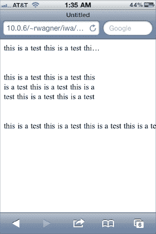

#### 工作原理

本示例演示了 `text-overflow` 可能需要指定额外的 CSS 属性才能按预期显示。在这种情况下，需要设置 `overflow` 或 `white-space` 属性，以确保 `text-overflow` 属性正常工作。

# 使用 text-shadow 创建微妙的阴影

在 iOS 用户界面中，Apple 巧妙地使用了文本阴影，尤其是在按钮和较大的标题文本上。除了美观之外，文本阴影还有助于通过增加文本与背景的对比度来提高文本的可读性。

你可以通过 `text-shadow` 属性为文本添加投影。基本声明如下：

```css
text-shadow: color offsetX offsetY blurRadius;
```

第一个值是阴影的颜色。接下来的两个值给出阴影的偏移位置——第二个值是 `x` 坐标，第三个值是 `y` 坐标。（负值将阴影向左和向上移动。）第四个参数表示阴影的高斯模糊半径。因此，在以下示例中，在元素文本上方 1 像素处添加了一个灰色阴影，没有模糊：

```css
text-shadow: #666666 0px -1px 0;
```

然而，如果文本阴影过于明显，可能会分散注意力并显得俗气。因此，你可以使用 `rgba`（红、绿、蓝、透明度）颜色值代替纯色值来定义阴影的透明度值。（请参阅本章后面的“设置透明度”部分。）因此，以下声明定义了一个白色阴影，透明度值为 `0.7`（0.0 为完全透明，1.0 为完全不透明），位于元素文本下方 1 像素处：

```css
text-shadow: rgba(255, 255, 255, 0.7) 0 1px 0;
```

# 样式化块级元素

有几种样式可以应用于块级元素以改变其外观，这些样式超越了你在传统网站上可能使用的普通 CSS 样式。其中包括三个所谓的实验性属性（`-webkit-border-image`、`-webkit-border-radius` 和 `-webkit-appearance`）以及 `background` 属性的 CSS3 增强。本节将介绍这些内容。

## 使用 -webkit-border-image 实现基于图像的边框

`-webkit-border-image` 属性允许你使用图像来指定边框，而不是使用 `border-style` 属性。图像显示在元素内容之后，但位于背景之上。例如：

```css
-webkit-border-image: url(image.png) 7 7 7 7;
```

图像 URL 后面的四个数字表示图像中应作为边框使用的像素数。第一个数字表示图像顶部（包括角落和边缘）的高度。根据 CSS 惯例，其余三个数字表示右侧、底部和左侧。像素是默认单位，但你可以指定百分比。

如果你提供的图像 URL 无法定位，或者样式设置为 `none`，则使用 `border-style` 属性。

你可以在声明的末尾可选地指定一个或两个关键字。这些关键字决定了侧面和中间图像的缩放方式。有效关键字是 `stretch` 或 `round`。如果你使用 `stretch` 作为第一个关键字，则顶部、中间和底部部分会缩放为元素的内边距相同。你也可以使用 `round` 作为第一个关键字，在 iOS 中使用较少。当使用此设置时，顶部、中间和底部图像会减小以适合内边距。第二个关键字作用于左侧和右。如果省略关键字，则默认为 `stretch`。渲染时，Safari 会查看 `-webkit-border-image` 属性，并根据指定的四个数字对图像进行分割。这将在本章后面解释。

## 使用 -webkit-border-radius 实现圆角

`-webkit-border-radius` 用于指定元素的半径。使用此属性，你可以轻松在元素上创建圆角，无需使用图像。例如：

```css
-webkit-border-radius: 10px;
```

此声明为元素指定了半径，这是页面设计的标准值。你还可以使用以下属性指定单独角的：

```css
-webkit-border-top-radius
-webkit-border-right-radius
-webkit-border-bottom-radius
-webkit-border-left-radius
```

例如，如果你想创建一个顶部圆角、底部角的 `div`，样式如下：

```css
div.roundedBox {
    -webkit-border-top-radius: 10px;
    -webkit-border-right-radius: 10px;
    -webkit-border-bottom-radius: 0px;
    -webkit-border-left-radius: 0px;
}
```

结果如 图 8-6 所示。

图 8-6

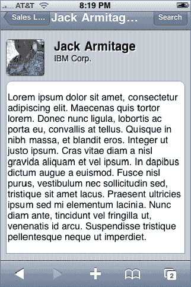

## 使用 -webkit-appearance 实现渐变按钮

`-webkit-appearance` 属性旨在将元素的外观转换为不同的控件。iOS 上的 Safari 仅支持两个值：`push-button` 和 `button`。但 `push-button` 对 Web 开发者来说前景。例如，假设你想将一个链接转换为渐变按钮。使用 `-webkit-appearance: push-button` 允许你完全在 CSS 中完成。为了演示，首先将一个链接分配一个名为 `special` 的类：

```html
<a href="tel:202558" class="special">呼叫总部</a>
```

然后，定义 `a.special` 样式：

```css
a.special {
     display: block;
     width: 246px;
     font-family: Helvetica;
     font-size: 20px;
     font-weight: bold;
     color: #000000;
     text-decoration: none;
     text-shadow: rgba(255, 255, 255, 0.7) 0 1px 0;
     text-align: center;
     line-height: 36px;
     margin: 15px auto;
     -webkit-border-radius: 10px;
     -webkit-appearance: push-button;
}
```

`display:block` 和 `width:246px` 属性为链接提供了一个宽矩形形状`-webkit-appearance: push-button` 属性将其外观转换为渐变灰色按钮`-webkit-border-radius` 使用标准的 10px 值使边缘圆。虽然按钮的形状已经设置，但文本还需要调整，不仅使用标准的文本格式，还需要使用 36px 的 `line-height` 属性，使 20px 的文本在按钮中垂直中。如果你在 `body` 标签中添加一个简单的 `background-color: #99999` 样式，则会得到如 图 8-7 所示的结果。

图 8-7


## 多重背景图像

在早期版本的 CSS 中，元素与背景图片之间始终存在一一对应的关系。虽然这种能力在大多数情况下都能满足需求，但某些页面设计无法通过单个背景图片有效实现。因此，为了突破这种一一对应的限制，设计师们不得不在此处或彼处添加额外的 `div` 标签，以达到预期的视觉效果。

CSS3 通过允许为给定元素定义多个背景图片来解决这一问题。大多数浏览器尚不支持此功能，但幸运的是，对于 iOS 网络应用开发者而言，iOS 上的 Safari 是支持。

你可以通过在 `background` 属性声明后按顺序列出来定义一组背景图片。图片的渲染顺序是：第一个声明的图片在最上层，第二个图片在第一个之后，以此类推。你还可以为每张图片指定 `background-repeat` 和 `background-position` 值。如果定义了 `background-color`，则该颜色会绘制在所有图片的下方。例如：

```css
div.banner {
    background: url(header_top.png) top left no-repeat,
         url(banner_main.png) top 6px no-repeat,
         url(header_bottom.png) bottom left no-repeat,
         url(middle.png) left repeat-y;
}
```

在这段代码中，`header_top.png` 作为背景图片，对齐。`header_top.png` 作为背景图片，对齐。`header_top.png` 作为背景图片，对齐。

```markdown

## 2. 在文档头部添加以下 `<style>` 元素：


```
<style type="text/css" media="screen">
a.fullSizedButton
{
     font-family: Helvetica;
     font-size: 20px;
     display: block;
     width: 246px;
     margin: 15px auto;
     text-align:center;
     text-decoration: none;
     line-height: 46px;
     font-weight: bold;
     color: #000000;
     text-shadow: rgba(255, 255, 255, 0.7) 0 1px 0;
     border-width: 0 14px 0 14px;
     -webkit-border-image: url(images/whiteButton.png) 0 14 0 14;
}
body
{
     background-color: black;
}
</style>
```

`Code snippet BIDHJ-Ch8-Ex3.html`

## 3. 添加一个带有 `fullSizedButton` 类的 `<a>` 链接：

```
<a href="mailto:rich@company.com" class="fullSizedButton">Send to Client</a>
```

## 4. 保存文档。

## 5. 在 iPhone 或 iPod touch 上查看。

### 工作原理

在此示例中，`display` 属性设置为 `block`，`width` 设置为 `246px`，即苹果使用的按钮宽度。`line-height` 设置为 `46px`，使块元素具有标准高度并垂直居中按钮文本。`border-width` 属性将左右边框设置为 `14px`，并通过将上下边框的值定义为 `0` 来消除它们。

现在其他设置已完成，来看 `-webkit-border-image` 属性定义。在此示例中，`whiteButton.png` 的顶部和底部使用了 0 像素。然而，图片的前 14 个像素用于元素的左边框，而最右边的 14 个像素用于右边框。由于 `whiteButton.png` 图片宽度为 29 像素，因此中间部分使用了 1 像素。这个中间部分随后被重复填充以填满元素的宽度。图 8-9 展示了 `-webkit-border-image` 如何分割图片。

#### 图 8-9


图 8-10 展示了在 iOS 上的 Safari 中渲染后的按钮。

#### 图 8-10

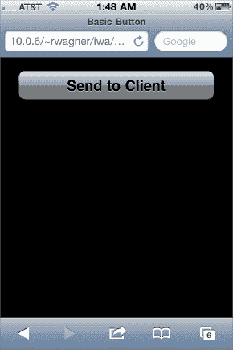

## 识别不兼容性

尽管 iOS 上的 Safari 与 Mac 和 Windows 上的对应版本密切相关，但在 CSS 支持方面并不完全相同。Mac 和 Windows 上的最新版 Safari 支持大多数较新的 CSS3 和实验性属性（以 `-webkit-` 为前缀）。然而，iPhone 上的 Safari 对某些属性的支持有限。

以下 CSS 属性在 iOS 上的 Safari 中不受支持（或支持有限）：

* `box-shadow`
* `-webkit-box-shadow`
* `text-stroke`
* `-webkit-text-stroke`
* `text-fill-color`
* `-webkit-text-fill-color`
* `-website-appearance`（支持 push-button，不支持其他值）

## 练习

1. iOS 上的 Safari 支持哪些实验性 CSS ？
2. 对于网站（而非应用），你通常使用 `-webkit-text-size-adjust: auto` 还是 `-webkit-text-size-adjust: none`？
3. 你会使用哪个 CSS 属性来指定图片边框？

练习 答案见附录。

| 主题 | 关键概念 |
| --- | --- |
| 使用 CSS 将元素转换为按钮 | `-webkit-appearance` 属性将元素的外观转换为按钮 |
| 在 CSS 中指定透明 | 使用 `rgba()` 函数，其中最后一个参数指定 alpha |
| 创建基于 CSS 的按钮 | `-webkit-border-image` 创建类似 iOS 的按钮 |

## 第三部分

### 第 9 章：编程界面
* 第 10 章：处理交互
* 第 11 章：特效与动画
* 第 12 章：与 iOS 服务集成
* 第 13 章：将应用打包为书签：书签与数据

### 第 9 章：编程界面

#### 本章学习内容：

* 使用 iUI 编程和样式化你的 iOS 网页应用
* 开发与原生 iOS 应用相似的网页应用
* 探索 CSS 和 JavaScript 如何工作

本章概述了设计适用于 iPhone 和 iPad 的网页应用时需要牢记的 UI 标准和指南。掌握了这些设计原则后，你就可以开发和编程网页应用。

为了演示如何实现 iOS 界面，我将带你了解名为 iRealtor 的案例研究。iRealtor 的概念是为潜在客户提供移动应用。当前基于互联网的模式是在线搜索 MLS 源、打印单个源、获取路线。然而，使用 iRealtor，所有任务都可以基于 iOS 的应用在完成。iRealtor 的设计目标是让用户执行以下操作：

* 浏览和搜索当地经纪人的 MLS 源
* 直接从源页面获取单个源
* 访问经纪人的信息，并使用 iOS 电话或邮件服务联系
* 浏览其他用的工具和提示

由于该应用的目标使用 iPhone，大多数设计决策针对较小的 iPhone UI。然而，由于部分用户使用 iPad，我确保该应用在较大的设备上也能完全运行且可用。

当你审视这些总体目标时，考虑到应用的任务导向性质，边缘到边缘的导航设计显然是一个选择。信息相对静态，但 MLS 源需要数据库驱动。因此，该应用利用 Ajax 将数据无缝集成到应用中。

以下是 iRealtor 使用技术的概述：

* XHTML/HTML 和 CSS 用于表示层
* JavaScript 用于客户端逻辑
* PHP 或其他服务器端技术提供 MLS 源（案例研究中未包含）

逐步讲解应用的过程中，我将同时为 iRealtor 编写自定义代码以及支撑它的底层样式和代码。使用 iUI 框架（可从 [`code.google.com/p/iui`](http://code.google.com/p/iui) 获取）来实现原生外观 iOS UI。不过，无论你在完成案例研究后选择哪个框架，都将对需要的关键设计问题有扎实的理解。

##### 应用的顶层

iRealtor 的底层最好以边缘到边缘的导航样式呈现，其中包含指向应用部分的链接。组装完成后，iPhone 设计如图 9-1 所示。iPad 设计如图 9-2 所示。

#### 图 9-1

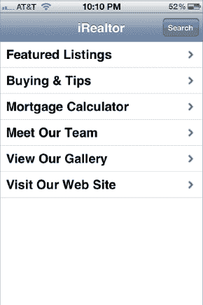

#### 图 9-2

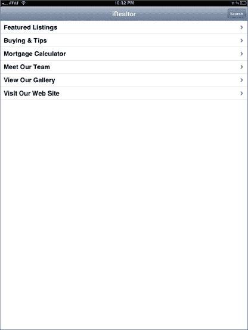

##### 动手实践：创建网页应用的 index.html

按照以下步骤为你的网页应用创建基于 iUI 的框架：

1. 在文本编辑器中创建一个空白文档。
2. 向文档中添加以下 HTML：


```
<!DOCTYPE html>
<html>
<head>
<title>iRealtor</title>
<meta content="yes" name="apple-mobile-web-app-capable" />
<meta name="viewport"
   content="width=device-width; initial-scale=1.0;
   maximum-scale=1.0; user-scalable=0;"/>
<link rel="stylesheet" href="iui/iui.css" type="text/css" />
<link rel="stylesheet" href="iui/t/default/default-theme.css" type="text/css"/>
<script type="application/x-javascript" src="iui/iui.js"></script>
<body>
</body>
</html>
```

代码片段 index.html

3. 保存文件。

#### 工作原理

在这个简短的练习中，你构建了网页应用的初始框架。你从一个基本的 HTML 文档开始，链接了用于此网页应用的 iUI 样式表和脚本库文件。`apple-mobile-web-app-capable` 指令使用户从 iOS 设备主屏幕启动应用时，应用以全屏模式打开。视口 meta 标签告诉 Safari 如何缩放页面，设置 1.0 缩放比例，并且在重新定向时不改变布局。它还指定视口的宽度为设备大小（`device-width`）。

该应用的目标使用 iPhone，大多数设计决策针对较小的 iPhone UI。然而，由于部分用户使用 iPad，我确保该应用在较大的设备上也能完全运行且可用。

当你审视这些总体目标时，考虑到应用的任务导向性质，边缘到边缘的导航设计显然是一个选择。信息相对静态，但 MLS 源需要数据库驱动。因此，该应用利用 Ajax 将数据无缝集成到应用中。

以下是 iRealtor 使用技术的概述：

* XHTML/HTML 和 CSS 用于表示层
* JavaScript 用于客户端逻辑
* PHP 或其他服务器端技术提供 MLS 源（案例研究中未包含）

逐步讲解应用的过程中，我将同时为 iRealtor 编写自定义代码以及支撑它的底层样式和代码。使用 iUI 框架（可从 [`code.google.com/p/iui`](http://code.google.com/p/iui) 获取）来实现原生外观 iOS UI。不过，无论你在完成案例研究后选择哪个框架，都将对需要的关键设计问题有扎实的理解。

##### 应用的顶层

iRealtor 的底层最好以边缘到边缘的导航样式呈现，其中包含指向应用部分的链接。组装完成后，iPhone 设计如图 9-1 所示。iPad 设计如图 9-2 所示。

#### 图 9-1


#### 图 9-2


##### 动手实践：创建网页应用的 index.html

按照以下步骤为你的网页应用创建基于 iUI 的框架：

1. 在文本编辑器中创建一个空白文档。
2. 向文档中添加以下 HTML：


```
<!DOCTYPE html>
<html>
<head>
<title>iRealtor</title>
<meta content="yes" name="apple-mobile-web-app-capable" />
<meta name="viewport"
   content="width=device-width; initial-scale=1.0;
   maximum-scale=1.0; user-scalable=0;"/>
<link rel="stylesheet" href="iui/iui.css" type="text/css" />
<link rel="stylesheet" href="iui/t/default/default-theme.css" type="text/css"/>
<script type="application/x-javascript" src="iui/iui.js"></script>
<body>
</body>
</html>
```

代码片段 index.html

3. 保存文件。

#### 工作原理

在这个简短的练习中，你构建了网页应用的初始框架。你从一个基本的 HTML 文档开始，链接了用于此网页应用的 iUI 样式表和脚本库文件。`apple-mobile-web-app-capable` 指令使用户从 iOS 设备主屏幕启动应用时，应用以全屏模式打开。视口 meta 标签告诉 Safari 如何缩放页面，设置 1.0 缩放比例，并且在重新定向时不改变布局。它还指定视口的宽度为设备大小（`device-width`）。

该应用的目标使用 iPhone，大多数设计决策针对较小的 iPhone UI。然而，由于部分用户使用 iPad，我确保该应用在较大的设备上也能完全运行且可用。

##### 顶层

```
     font-family: Helvetica;
     font-size: 20px;
     display: block;
     width: 246px;
     margin: 15px auto;
     text-align:center;
     text-decoration: none;
     line-height: 46px;
     font-weight: bold;
     color: #000000;
     text-shadow: rgba(255, 255, 255, 0.7) 0 1px 0;
     border-width: 0 14px 0 14px;
     -webkit-border-image: url(images/whiteButton.png) 0 14 0 14;
}
body
{
     background-color: black;
}
```

`Code snippet BIDHJ-Ch8-Ex3.html`

## 3. 添加一个带有 `fullSizedButton` 类的 `<a>` 链接：

```
<a href="mailto:rich@company.com" class="fullSizedButton">Send to Client</a>
```

## 4. 保存文档。

## 5. 在 iPhone 或 iPod touch 上查看。

### 工作原理

在此示例中，`display` 属性设置为 `block`，`width` 设置为 `246px`，即苹果使用的按钮宽度。`line-height` 设置为 `46px`，使块元素具有标准高度并垂直居中按钮文本。`border-width` 属性将左右边框设置为 `14px`，通过将上下边框的值定义为 `0` 来消除它们。

现在其他设置已完成，来看 `-webkit-border-image` 属性定义。在此示例中，`whiteButton.png` 的顶部和底部使用了 0 像素。然而，图片的前 14 个像素用于元素的左边框，而最右边的 14 个像素用于右边框。由于 `whiteButton.png` 图片宽度为 29 像素，因此中间部分使用了 1 像素。这个中间部分随后被重复填充以填满元素的宽度。图 8-9 展示了 `-webkit-border-image` 如何分割图片。

#### 图 8-9


图 8-10 展示了在 iOS 上的 Safari 中渲染后的按钮。

#### 图 8-10


## 识别不兼容性

尽管 iOS 上的 Safari 与 Mac 和 Windows 上的对应版本密切相关，但在 CSS 支持方面并不完全相同。Mac 和 Windows 上的最新版 Safari 支持大多数较新的 CSS3 和实验性属性（以 `-webkit-` 为前缀）。然而，iPhone 上的 Safari 对某些属性的支持有限。

以下 CSS 属性在 iOS 上的 Safari 中不受支持（或支持有限）：

* `box-shadow`
* `-webkit-box-shadow`
* `text-stroke`
* `-webkit-text-stroke`
* `text-fill-color`
* `-webkit-text-fill-color`
* `-website-appearance`

## 练习

1. iOS 上的 Safari 支持哪些实验性 CSS ？
2. 对于网站（而非应用），你通常使用 `-webkit-text-size-adjust: auto` 还是 `-webkit-text-size-adjust: none`？
3. 你会使用哪个 CSS 属性来指定图片边框？

练习 答案见附录。

| 主题 | 关键概念 |
| --- | --- |
| 使用 CSS 将元素转换为按钮 | `-webkit-appearance` 属性将元素的外观转换为按钮 |
| 在 CSS 中指定透明 | 使用 `rgba()` 函数，其中最后一个参数指定 alpha |
| 创建基于 CSS 的按钮 | `-webkit-border-image` 创建类似 iOS 的按钮 |

## 第三部分

### 第 9 章：编程界面
* 第 10 章：处理交互
* 第 11 章：特效与动画
* 第 12 章：与 iOS 服务集成
* 第 13 章：将应用打包为书签：书签与数据

### 第 9 章：编程界面

#### 本章学习内容：

* 使用 iUI 编程和样式化你的 iOS 网页应用
* 开发与原生 iOS 应用相似的网页应用
* 探索 CSS 和 JavaScript 如何工作

本章概述了设计适用于 iPhone 和 iPad 的网页应用时需要牢记的 UI 标准和指南。掌握了这些设计原则后，你就可以开发和编程网页应用。

为了演示如何实现 iOS 界面，我将带你了解名为 iRealtor 的案例研究。iRealtor 的概念是为潜在客户提供移动应用。当前基于互联网的模式是在线搜索 MLS 源、打印单个源、获取路线。然而，使用 iRealtor，所有任务都可以基于 iOS 的应用在完成。iRealtor 的设计目标是让用户执行以下操作：

* 浏览和搜索当地经纪人的 MLS 源
* 直接从源页面获取单个源
* 访问经纪人的信息，并使用 iOS 电话或邮件服务联系
* 浏览其他用的工具和提示

由于该应用的目标使用 iPhone，大多数设计决策针对较小的 iPhone UI。然而，由于部分用户使用 iPad，我确保该应用在较大的设备上也能完全运行且可用。

当你审视这些总体目标时，考虑到应用的任务导向性质，边缘到边缘的导航设计显然是一个选择。信息相对静态，但 MLS 源需要数据库驱动。因此，该应用利用 Ajax 将数据无缝集成到应用中。

以下是 iRealtor 使用技术的概述：

* XHTML/HTML 和 CSS 用于表示层
* JavaScript 用于客户端逻辑
* PHP 或其他服务器端技术提供 MLS 源（案例研究中未包含）

逐步讲解应用的过程中，我将同时为 iRealtor 编写自定义代码以及支撑它的底层样式和代码。使用 iUI 框架（可从 [`code.google.com/p/iui`](http://code.google.com/p/iui) 获取）来实现原生外观 iOS UI。不过，无论你在完成案例研究后选择哪个框架，都将对需要的关键设计问题有扎实的理解。

##### 应用的顶层

iRealtor 的底层最好以边缘到边缘的导航样式呈现，其中包含指向应用部分的链接。组装完成后，iPhone 设计如图 9-1 所示。iPad 设计如图 9-2 所示。

#### 图 9-1


#### 图 9-2


##### 动手实践：创建网页应用的 index.html

按照以下步骤为你的网页应用创建基于 iUI 的框架：

1. 在文本编辑器中创建一个空白文档。
2. 向文档中添加以下 HTML：


```
<!DOCTYPE html>
<html>
<head>
<title>iRealtor</title>
<meta content="yes" name="apple-mobile-web-app-capable" />
<meta name="viewport"
   content="width=device-width; initial-scale=1.0;
   maximum-scale=1.0; user-scalable=0;"/>
<link rel="stylesheet" href="iui/iui.css" type="text/css" />
<link rel="stylesheet" href="iui/t/default/default-theme.css" type="text/css"/>
<script type="application/x-javascript" src="iui/iui.js"></script>
<body>
</body>
</html>
```

代码片段 index.html

3. 保存文件。

#### 工作原理

在这个简短的练习中，你构建了网页应用的初始框架。你从一个基本的 HTML 文档开始，链接了用于此网页应用的 iUI 样式表和脚本库文件。`apple-mobile-web-app-capable` 指令使用户从 iOS 设备主屏幕启动应用时，应用以全屏模式打开。视口 meta 标签告诉 Safari 如何缩放页面，设置 1.0 缩放比例，并且在重新定向时不改变布局。它还指定了视口的宽度为设备大小（`device-width`）。

该应用的目标使用 iPhone，大多数设计决策针对较小的 iPhone UI。然而，由于部分用户使用 iPad，我确保该应用在较大的设备上也能完全运行且可用。

##### 顶层

```
     font-family: Helvetica;
     font-size: 20px;
     display: block;
     width: 246px;
     margin: 15px auto;
     text-align:center;
     text-decoration: none;
     line-height: 46px;
     font-weight: bold;
     color: #000000;
     text-shadow: rgba(255, 255, 255, 0.7) 0 1px 0;
     border-width: 0 14px 0 14px;
     -webkit-border-image: url(images/whiteButton.png) 0 14 0 14;
}
body
{
     background-color: black;
}
```

```

css
.toolbar {
    padding:        0 10px 10px 10px;
    height:         45px;
    background:     url(toolbar.png) #6d84a2 repeat-x;
    background-size:auto 100%;
}
.toolbar > h1 {
    position:       absolute;
    left:           50%;
    width:          150px;
    margin:         1px 0 0 -75px;
    padding:        10px 0;
    height:         auto;
    font-size:      20px;
    color:          #FFFFFF;
    font-weight:    bold;
    text-shadow:    rgba(0,0,0,.6) 0 -1px 0;
    text-align:     center;
}
body[orient="landscape"] .toolbar > h1 {
    width:          300px;
    margin:         1px 0 0 -150px;
    padding:        6px 0;
    font-size:      16px;
}

.button {
    position:       absolute;
    top:            8px;
    right:          6px;
    width:          auto;
    margin:         0;
    padding:        0 3px;
    color:          #FFFFFF;
    line-height:    30px;
    font-family:    inherit;
    font-size:      12px;
    font-weight:    bold;
    text-shadow:    rgba(0,0,0,.6) 0px -1px 0;
    border-width:   0 5px;
    background:     none;
    -webkit-border-image:   url(toolButton.png) 0 5 0 5;
    -moz-border-image:      url(toolButton.png) 0 5 0 5;
    border-image:           url(toolButton.png) 0 5 0 5;
}
body[orient="landscape"] .button {
    top:            3px;
    right:          3px;
    line-height:    26px;
}

#backButton {
    left:           6px;
    right:          auto;
    padding:        0;
    max-width:      55px;
    border-width:   0 8px 0 14px;
    -webkit-border-image:   url(backButton.png) 0 8 0 14;
    -moz-border-image:      url(backButton.png) 0 8 0 14;
    background:             url(backButton.png) repeat-x;
}
#backButton[selected],#backButton:active {
    -webkit-border-image:   url(backButtonSel.png) 0 8 0 14;
    -moz-border-image:      url(backButtonSel.png) 0 8 0 14;
    background:             url(backButtonSel.png) repeat-x;
}
```

`body > .toolbar` 类样式的高度设置为 45px。`.toolbar > h1` 标题在竖屏模式下模拟了应用程序标题的标准外观，而`body[orient="landscape"] > .toolbar > h1` 则更新了横屏模式下的位置。请注意，iPhone 视口的有限宽度决定了需要使用`overflow:hidden` 和`text-overflow:ellipsis`。

## 添加顶级导航菜单

创建工具栏后，需要创建顶级导航菜单。在 iUI 框架下，使用一个`ul` 列表，如下所示：


```html
<ul id="home" title="iRealtor" selected="true">
    <li><a href="#featuredListings">Featured Listings</a></li>
    <li><a href="#">Buying & Tips</a></li>
    <li><a href="#calculator">Mortgage Calculator</a></li>
    <li><a href="#meetOurTeam">Meet Our Team</a></li>
    <li><a href="#">View Our Gallery</a></li> 
    <li><a href="http://www.myirealtor.com" target="_self">Visit Our Web Site</a>
    </li>
</ul>
```

代码片段 `index.html`

`title`属性被 iUI 用于在工具栏的`h1` 标题中显示。`selected`属性表示当应用程序加载时，这个`ul` 元素是活动块。每个菜单项都被定义为`li` 项内的一个`a` 链接。`href`属性可以指向同一文件中的另一个`div` 或`ul` 块（称为面板），使用锚点引用（如 `#meetOurTeam`）。或者，你也可以使用 Ajax 从外部 URL 加载一个块元素。表 9-1 展示了在 iUI 中可以使用的四种链接类型。

表 9-1: iUI 链接类型

| 链接类型 | 描述 | 语法 |
| --- | --- | --- |
| 内部 URL | 加载在同一 HTML 页面内定义的面板 | `<a href="#meet_our_team">` |
| Ajax URL | 通过 Ajax 加载文档片段 | `<a href="listings.html">` |
| Ajax | 通过 Ajax 加载文档片段，替换调用链接的内容 | `<a href="listings1.html" target="_replace">` |
| 外部 URL | 加载外部网页链接 | `<a href="index.html" target="_self">` |

列表项和链接的样式在`default-theme.css`中如下：

```css
body > ul > li {
    margin:         0;
    border-bottom:  1px solid #E0E0E0;
    padding:        8px 0 8px 10px;
    font-size:      20px;
    font-weight:    bold;
    list-style-type:none;
}
body[orient="landscape"] > ul > li {
    font-size:      18px;
}

body > ul > li > a {
    margin:     -8px 0 -8px -10px;
    padding:    8px 32px 8px 10px;
    color:      inherit;
    background: url(listArrow.png) no-repeat right center;
    text-decoration:    none;
}
```

请注意，`listArrow.png` 显示在列表项`a` 链接的右侧。

### 使用内部 URL 显示

如果你要链接到同一页面内的另一个块，只需添加代码。例如，“我们的团队”链接到`div`：


```html
<div id="meetOurTeam" class="panel" title="Meet Our Team">
    <h2>Team Reality</h2>
    <fieldset>
        <div class="row">
            <p>Lorem dolor sit amet, consect etuer adipis. Suspend is nisl. Vivamus a ligula quam tinci dunt posuere. Integer venenis blandit est. lus neque. Quisque at augue. Phasellus purus. Sed et risus. Susisse laoreet consequat metus. Nam justo vitae tortor fermentum. Aenean vitae quam urna ornare.</p>
            <p>Pellent habitant morbi tristique senect et netus malesuada ac turpis. Aliquam congue pretium fringilla quam. Integer libero, varius ut, facilisis vel, odio Donec quis eros erat ultricies. Nam aliquam turpis. convallis massa non sem. Donec non eget lacus hendit sodales.</p>
        </div>
    </fieldset>
</div>
```

代码片段 `index.html`

`div` 元素的`id` 属性与源链接的`href` 属性（除了 `#` 符号）相同。`div` 元素分配了`panel` 类，而`title` 属性提供了新的标题。在`div` 内部，`h2` 元素提供了一个标题，而`fieldset` 元素（通常作页面内的容器）用于容纳内容。图 9-3 显示了 iPhone 上的结果，图 9-4 展示了同一页面上的效果。

图 9-3

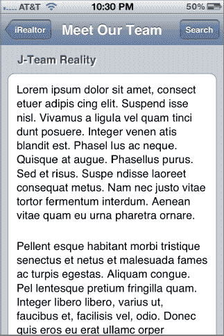

图 9-4

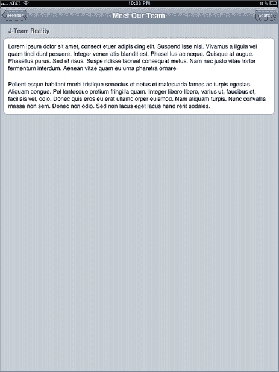

`panel` 类和`fieldset` 样式如下。还提供了默认的`h2` 样式：

```css
body > .panel {
    padding-left: 10px;
    padding-right: 10px;
    background: #c8c8 url(pinstes.png);
}
body > .panel *:first-child {
    margin-top: 10px;
}
body > .panel > h2 {
    margin: 0 0 8px 14px;
    font-size: inherit;
    font-weight: bold;
    color: #4d4d70;
    text-shadow: rgba(255,255,255,.75) 2px 0;
}

body > .panel > ul > li {
    list-style: none;
    padding: 12px;
}

fieldset > .row {
    min-height: 42px;
}
fieldset > .row > p {
    width: auto;
    height: auto;
    padding: 12px;
    margin: 0;
    text-align: left;
}
```

`panel` 类显示了垂直的细纹，这是 iOS 应用的标准背景。`fieldset` 主要用于行，因为它为页面显示的文本提供了一个白色框。

## 创建二级导航列表

在`iRealtor` 中，点击“特色房源”菜单项（`<li><a href="#featuredListings">Featured Listings</a></li>>`）应显示一个由这个虚构的本地经纪人推荐的房屋列表。代码如下：


```html
<ul id="featuredListings" title="Featured">
    <li><a href="#406509171">30 Bellview Ave, Bolton</a></li>
    <li><a href="#">21 Milford Ave, Brandon</a></li>
    <li><a href="#">10 Main St, Leominster</a></li>
    <li><a href="#">12 Smuggle Lane, Marlboro</a></li>
    <li><a href="#">34 Main Ave, Newbury</a></li>
    <li><a href="#">33 Infinite Loop, Princeton</a></li>
    <li><a href="#">233 Melville Road, Rutland</a></li>
    <li><a href="#">320 Muffly, Sliver</a></li>
    <li><a href="#">1 One Road, Zooly</a></li>
</ul>
```

代码片段 index.html

结果是一个基本的导航列表，如图 9-5 所示（iPad 版本见图 9-6）。第一个条目指定了一个本地 URL，当选中该条目时，应用会加载该 URL。MLS 列表目标页面见本章后面的图 9-8。

图 9-5

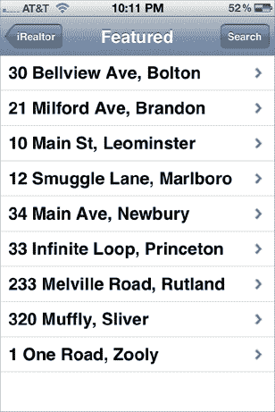

图 9-6

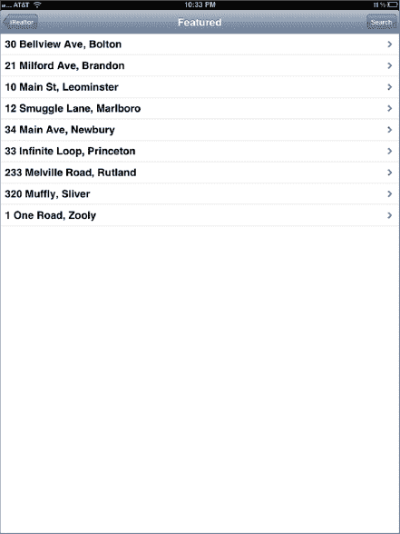

图 9-8

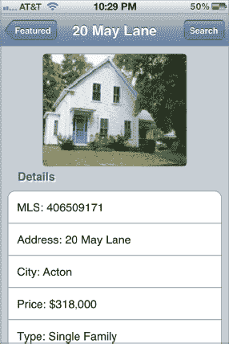

## 设计长导航列表

在`iRealtor` 示例应用中，各个屏幕的大小包含有限的数据量，以便我可以使用内部链接将所有屏幕打包到单个 HTML 页面中。

然而，在实际场景中，如果你处理大量数据，这种单页面方法可能会出现问题。因此，你可以使用 Ajax 将应用拆分成多个块，仍然保持单页面应用的整体外观和感觉。当你使用 Ajax 时，iUI 和其他框架允许你通过提供外部 URL 按需加载内容到应用中。但是，检索到的文档必须是文档片段，而不是完整的 HTML 页面。

`iUI` 为你完全封装了 `XMLHttpRequest()`。因此，当你在链接中提供一个没有定义 `target="_self"` 的外部 URL 时，`iUI` 会检索文档片段并显示它。

此外，尽管像上一节中所示的文档片段对于少量数据来说效果很好，但长列表的性能会迅速下降。为了解决这个问题，`iUI` 和其他框架允许你通过加载一组初始项，然后提供指向下一组的链接（见图 9-7）来将大列表分解为可管理的块。这种设计模拟了 iOS 邮件应用处理传入消息的方式。

图 9-7

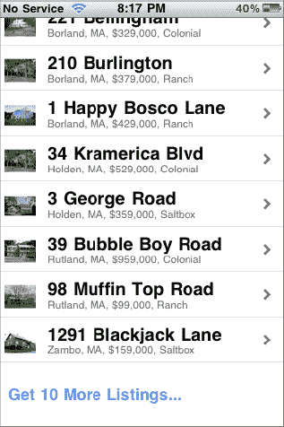

要在你的应用中提供此功能，请创建一个链接并添加 `target="_replace"` 作为属性。`iUI` 从 URL 加载项目，替换当前链接。与其他 Ajax 一样，URL 需要指向一个文档片段，而不是 HTML 文件。以下是添加到列表 `ul` 底部的链接：

```html
<li><a href="listings1.html" target="_replace">Get 10 More Listings.</a></li>
```

## 创建目标页面

`iRealtor` 中的每个 MLS 列表都有自己独立的目标页面，通过本地 URL 访问，例如：

```html
<a class="listing" href="#406509171">20 May Lane</a>
```


页面的设计目标是提供房屋列表的图片和摘要详细信息。但是，利用 iPhone 的服务，假设你还想添加一个用于在地图应用中查找地址的按钮，以及一个指向提供城镇信息网站的外部网页链接。图 9-8 和 9-9 显示了此目标页面的最终设计。

### 图 9-9
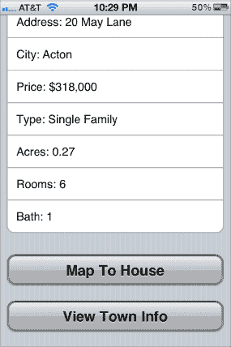

此页面的文档片段如下：


```
<div id="406509171" title="20 May Lane" class="panel">
    <div style="text-align: center">
        
    </div>
  <h2>Details</h2>
    <fieldset>
            <div class="row">
                <p>MLS: 406509171</p>
            </div>
            <div class="row">
                <p>Address: 20 May Lane</p>
            </div>
            <div class="row">
                <p>City: Acton</p>
            </div>
            <div class="row">
                <p>Price: $318,000</p>
            </div>
            <div class="row">
                <p>Type: Single Family</p>
            </div>
            <div class="row">
                <p>Acres: 0.27</p>
            </div>
            <div class="row">
                <p>Rooms: 6</p>
            </div>
            <div class="row">
                <p>Bath: 1</p>
            </div>
  </fieldset>
   <br/>
    <a  class="whiteButton" target="_self"
    href="http://maps.google.com/maps?q=20+May+Lane,+Acton,+MA">
    Map To House</a
   <br/>
    <a  class="whiteButton" target="_self"
    href="http://www.mass.gov/?pageID=mg2localgovccpage&L=3&L0=Home&L1=
    State%20Government&L2=Local%20Government&sid=massgov2&selectCity=Acton">
    View Town Info</a
   <br/>
</div
```

#### 代码片段 `index.html`

请注意这段代码中的几个要点。首先，`div` 元素被赋予了 `panel` 类，就像本章前面为“Meet Our Team”页面所做的那样。其次，`MLS` 列表数据的各个条目都包含在带有 `row` 类的 `div` 元素中。这些 `div row` 元素集合被包含在一个 `fieldset` 中。第三，指向地图和外部网页的按钮链接被赋予了 `whiteButton` 类。图 9-8 和 图 9-9 展示了该页面在 iPhone 上的显示效果。

是的，它在 iPad 上也能正常工作。图 9-10 展示了其外观。

### 图 9-10
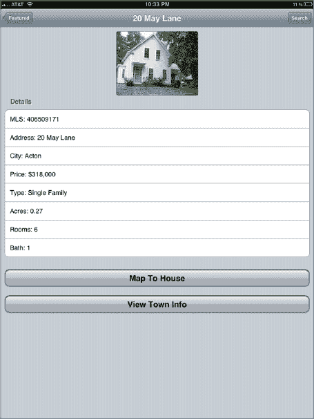

该页面的样式来自 `iui.css` 以及我添加到 `index.html` 中的自定义样式。首先，以下是 `default-theme.css` 中的 `row` 类和标签样式（如果你还记得，`fieldset` 在本章前面已经定义过）：

```
fieldset > .row {
    min-height:     42px;
}
fieldset > .row > p {
    width:          auto;
    height:         auto;
    padding:        12px;
    margin:         0;
    text-align:     left;
}
fieldset > .row > label {
    margin:         0 0 0 14px;
    line-height:    42px;
    font-weight:    bold;
}

body > .panel > ul > li:first-child > a,
body > .panel > ul > li:first-child,
fieldset > .row:first-child {
    -webkit-border-top-left-radius:     10px;
    -webkit-border-top-right-radius:    10px;
    -moz-border-radius-topleft:         10px;
    -moz-border-radius-topright:        10px;
    border-top-left-radius:             10px;
    border-top-right-radius:            10px;
}
body > .panel > ul > li:last-child > a,
body > .panel > ul > li:last-child,
fieldset > .row:last-child {
    -webkit-border-bottom-left-radius:  10px;
    -webkit-border-bottom-right-radius: 10px;
    -moz-border-radius-bottomleft:      10px;
    -moz-border-radius-bottomright:     10px;
    border-bottom-left-radius:          10px;
    border-bottom-right-radius:         10px;
    border-bottom:  0;
}
```

`row` 类模拟了 iOS 列表行的通用外观，类似于原生“设置”和“通讯录”应用中的样式。`.row:first-child` 和 `.row:last-child` 样式为 `fieldset` 的顶部和底部添加了角。`iui.css` 中定义的 `.row > label` 模拟了 iOS 设置的外观。此外，给图片添加样式，我需要在 `index.html` 中添加一个样式：


```
.panelImage
{
    border:                 1px solid #888;
    -webkit-border-radius:     6px;
    -moz-border-radius:     6px;
    border-radius:             6px;
}
```

#### 代码片段 `index.html`

`row` 类模拟了 iOS 列表行的通用外观，类似于原生“设置”和“通讯录”应用中的样式。`.row:first-child` 和 `.row:last-child` 样式为 `fieldset` 的顶部和底部添加了角。`iui.css` 中定义的 `.row > label` 模拟了 iOS 设置的外观。`panelImage` 样式为图片添加了圆框，使其呈现出更美的 iOS 风格。不过，离开此页面之前，注意页面底部的按钮：


```
<a  class="whiteButton" target="_self"
    href="http://maps.google.com/maps?q=20+May+Lane,+Acton,+MA">Map To House</a
<a  class="whiteButton" target="_self"
    href="http://www.mass.gov/?pageID=mg2localgovccpage&L=3&L0=Home&L1=
    State%20Government&L2=Local%20Government&sid=massgov2&selectCity=Acton">View Town Info</a
```

#### 代码片段 `index.html`

第一个按钮被点击时，会将用户引导至 iOS 设备上的“地图”应用并显示指定的地址。图 9-11 展示了 iPhone 上的效果。

### 图 9-11
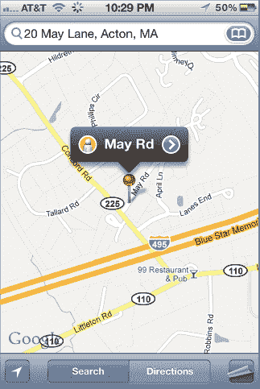

#### 添加对话框

到为止，页面要么是边缘到边缘的列表，要么是用于内容的面板。不过，你可能还需要模态对话框。当用户处于对话框中，需要执行操作（如搜索或取消）。与任何桌面环境一样，对话框适合表单输入。

`Realtor` 应用程序的两个部分需要对话框：搜索和抵押贷款器。用户可以通过顶部工具栏上的“搜索”按钮访问对话框。以下是链接：

`<a class="button" href="#searchForm">Search</a>` 该链接指向内部 `#searchForm`，它引用了一个 `id` 为 `searchForm` 的表单：


```
<form id="searchForm" title="Search Listings" class="dialog"
   name="searchForm" action="search.php" method="GET">

   <div class="toolbar">
      <h1>Search Listings</h1>
      <a class="button leftButton" type="cancel">Cancel</a>
      <a class="button blueButton" href="javascript:form.submit()">Search</a>
   </div>

    <fieldset>
        <div class="row">  
        <label for="proptype">Choose</label>
        <select id="proptype" name="proptype" size="1">
            <option value="">Property Type</option>
            <option value="SF">Single-Family</option>
            <option value="CC">Condo</option>
            <option value="MF">Multi-Family</option>
            <option value="LD">Land</option>
            <option value="CI">Commercial</option>
            <option value="MM">Mobile Home</option>
            <option value="RN">Rental</option>
            <option value="BU">Business Opportunity</option>
        </select> 
        </div>
        <div class="row">
        <label>Min $:</label>
        <input type="text" name="minPrice"/>
        </div
        <div class="row">
        <label>Max $:</label>
        <input type="text" name="maxPrice"/>
        </div
        <div class="row">      
        <label>MLS #:</label>
        <input type="text" name="mlsNumber"/>
        </div
     </fieldset>
</form>
```

#### 代码片段 `index.html`

`dialog` 类表明该表单是一个对话框。表单元素被包裹在 `fieldset` 中。对话框的操作按钮实际上被定义为链接。具体来说，“取消”和“搜索”链接分别被定义为 `button leftButton` 和 `button blueButton` 类。这两个操作按钮显示在表单内部定义的 `toolbar` div 中。`toolbar` div 还将 `h1` 内容显示为对话框标题。

`select` 列表定义了用户想要选择的房产类型。另外还定义了三个 `input` 字段用于额外的搜索条件。

图 9-12 展示了该表单在 iPhone 视口中的显示效果，图 9-13 展示了同一表单在 iPad 上的显示效果。根据 iOS 设计指南，表单底部被阴影覆盖以模糊背景页面。图 9-14 展示了当用户点击 `select` 元素时自动显示的 iOS 特定选择列表。最后，图 9-15 展示了当用户点击 `input` 字段时弹出的键盘。

### 图 9-12
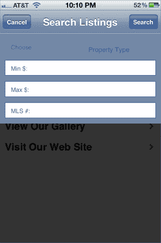

### 图 9-13
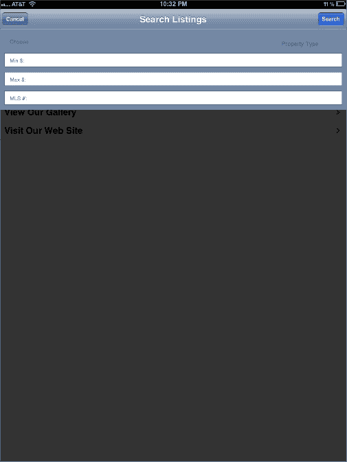

### 图 9-14


### 图 9-15


考虑显示此对话框的样式。来自 `default-theme.css` 的几条规则值得注意：

```css
.dialog {
    position: fixed;
    top: 0;
    left: 0;
    width: 100%;
    height: 100%;
    background: rgba(0, 0, 0, 0.8);
    z-index: 2;
}
body[landscape] .dialog {
    background: #fff;
    margin: 20px auto;
    width: 80%;
    max-height: 800px;
    border-radius: 10px;
    overflow-y: auto;
}
```


```
<form id="calculator" class="dialog">
   <div class="toolbar">
      <h1>Mortgage Calculator</h1>
      <a class="button leftButton" type="cancel">Cancel</a>
      <a class="button blueButton" href="javascript:formname.submit()">Search</a>
   </div>

   <fieldset>
        <div class="row">
            <label for="amt">Loan amount</label>
              <input class="calc" type="text" id="amt" name="amtZip"/>
        </div>
        <div class="row">
            <label for="ir">Interest rate</label>
            <input class="calc" type="text" id="ir" name="irZip"/>
        </div>
        <div class="row">
            <label for="term">Years</label>
            <input class="calc"  type="text" id="term"
            onblur="calc()"name="termZip"/>
        </div>
        <div class="row">
            <label for="payment">Monthly payment</label>
            <input class="calc" type="text" readonly="true" id="payment"/>
        </div>
        <div class="row">
            <label for="total">Total payment</label>
            <input class="calc" type="text"  readonly="true" id="total"/>
        </div>
   </fieldset>
</form>
```

代码片段 `index.html`


注意 前三个输入元素有一个包含 `Zip` 的虚拟 `name` 属性。`Zip` 字符串会提示显示数字键盘，而不是字母键盘。最后两个输入元素不需要，因为它们是只读的。

该表单的目的是让用户在前三个输入元素中输入信息，然后调用 JavaScript 函数 `calc()`，该函数将结果显示在底部两个输入字段中。由于计算是在客户端 JavaScript 中执行的，因此无需向服务器提交。

JavaScript 函数 `calc()` 位于 `index.html` 文件的文档头部。以下是脚本代码：


```
<script type="application/x-javascript">
function calc() {
   var amt = document.getElementById('amt').value;
   var ir =  document.getElementById('ir').value / 1200;
   var term =  document.getElementById('term').value * 12;
   var total=1;
   for (i=0;i<term;i++) {
      total = total * (1 + ir);
   }
   var mp = amt * ir / ( 1-(1/total));
  document.getElementById('payment').value = Math.round(mp*100)/100;
  document.getElementById('total').value = Math.round(mp * term *100)/100;
}
</script>
```

代码片段 `index.html`

该例程执行标准的抵押贷款计算，并将结果返回到 `payment` 和 `total` 输入字段。图 9-16 和 图 9-17 展示了该计算器在 iPhone 上的运行效果。

图 9-16

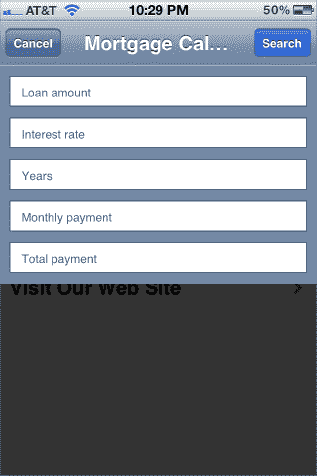

图 9-17

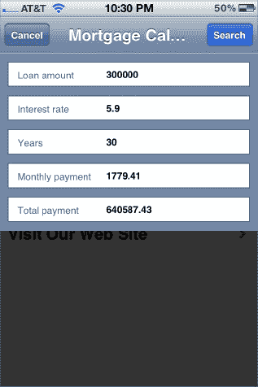

清单 9-1 提供了 `index.html` 文件的完整代码视图。


```
LISTING 9-1: index.html
```


```
<!DOCTYPE html>
<html>
<head>
<title>iRealtor</title>
<meta content="yes" name="apple-mobile-web-app-capable" />
<meta name="viewport" content="width=device-width; initial-scale=1.0; maximum-scale=1.0; user-scalable=0;"/>
<link rel="stylesheet" href="iui/iui.css" type="text/css" />
<link rel="stylesheet" href="iui/t/default/default-theme.css" type="text/css"/>
<script type="application/x-javascript" src="iui/iui.js"></script>
<script type="application/x-javascript">
function calc()
{
   var amt = document.getElementById('amt').value;
   var ir =  document.getElementById('ir').value / 1200;
   var term =  document.getElementById('term').value * 12;
   var total=1;
   for (i=0;i<term;i++)
   {
      total = total * (1 + ir);
   }
   var mp = amt * ir / ( 1 - (1/total));
  document.getElementById('payment').value = Math.round(mp*100)/100;
  document.getElementById('total').value = Math.round(mp * term *100)/100 ;
}
</script>
<style>
.panelImage
{
    border:                 1px solid #888;
    -webkit-border-radius:  6px;
    -moz-border-radius:     6px;
    border-radius:          6px;
}
</style>
</head>
<body>
<!-- Top toolbar -->
<div class="toolbar">
    <h1 id="pageTitle"></h1>
    <a id="backButton" class="button" href="#"></a>
    <a class="button" href="#searchForm">Search</a>
</div>
<!-- Home menu -->
<ul id="home" title="iRealtor" selected="true">
    <li><a href="#featuredListings">Featured Listings</a></li>
    <li><a href="#">Buying & Tips</a></li>
    <li><a href="#calculator">Mortgage Calculator</a></li>
    <li><a href="#meetOurTeam">Meet Our Team</a></li>
    <li><a href="#">View Our Gallery</a></li> 
    <li><a href="http://www.myirealtor.com" target="_self">Visit Our Web Site</a></li>
</ul>
<!-- Featured Listings -->
<ul id="featuredListings" title="Featured">
    <li><a href="#406509171">30 Bellview Ave, Bolton</a></li>
    <li><a href="#">21 Milford Ave, Brandon</a></li>
    <li><a href="#">10 Main St, Leominster</a></li>
    <li><a href="#">12 Smuggle Lane, Marlboro</a></li>
    <li><a href="#">34 Main Ave, Newbury</a></li>
    <li><a href="#">33 Infinite Loop, Princeton</a></li>
    <li><a href="#">233 Melville Road, Rutland</a></li>
    <li><a href="#">320 Muffly, Sliver</a></li>
    <li><a href="#">1 One Road, Zooly</a></li>
</ul>
<!-- Calculator -->
<form id="calculator" class="dialog">
    <div class="toolbar">
      <h1>Mortgage Calculator</h1>
      <a class="button leftButton" type="cancel">Cancel</a>
      <a class="button blueButton" href="javascript:formname.submit()">Search</a>
    </div>
    <fieldset>
        <div class="row">
            <label for="amt">Loan amount</label>
            <input class="calc" type="text" id="amt"/>
        </div>
        <div class="row">
            <label for="ir">Interest rate</label>
            <input class="calc" type="text" id="ir"/>
        </div>
        <div class="row">
            <label for="term">Years</label>
            <input class="calc" type="text" id="term" onblur="calc()"/>
        </div>
        <div class="row">
            <label for="payment">Monthly payment</label>
            <input class="calc" type="text" readonly="true" id="payment"/>
        </div>
        <div class="row">
            <label for="total">Total payment</label>
            <input class="calc" type="text" readonly="true" id="total"/>
        </div>
    </fieldset>
</form>
<!-- Meet Our Team -->
<div id="meetOurTeam" class="panel" title="Meet Our Team">
    <h2>J-Team Reality</h2>
    <fieldset>
        <div class="row">
            <p class="normalText">Lorem ipsum dolor sit amet, consect etuer adipis cing elit. Suspend isse nisl. Vivamus a ligula vel quam tinci dunt posuere. Integer venen atis blandit est. Phasel lus ac neque. Quisque at augue. Phasellus purus. Sed risus. dipisse consequat metus. Nam justo tortor fermentumdum. Aenean vitae eu pharetra ornare.</p>
            <p class="normalText">Pellent habitant morbitistique senectus et netus malesuada fames ac turpis egestas. Aliquam congue. Pelentesque fringilla quam. Integer libero, varius ut, facilisis, odio. Done quis eros erat ullam euismod. Nam aliquam turpis. Nunc convallis massa sem. Donec odio. non lacus eget lacus hendit sodales.</p>
        </div>
    </fieldset>
</div>
<!-- House Listing -->
<div id="406509171" title="20 May Lane" class="panel">
    <div style="text-align: center">
        
    </div>
    <h2>Details</h2>
    <fieldset>
        <div class="row">
            <p>MLS: 406509171</p>
        </div>
        <div class="row">
            <p>Address: 20 May Lane</p>
        </div>
        <div class="row">
            <p>City: Acton</p>
        </div>
        <div class="row">
            <p>Price: $318,000</p>
        </div>
        <div class="row">
            <p>Type: Single Family</p>
        </div>
        <div class="row">
            <p>Acres: 0.27</p>
        </div>
        <div class="row">
            <p>Rooms: 6</p>
        </div>
        <div class="row">
            <p>Bath: 1</p>
        </div>
    </fieldset>
    <br>
    <a class="whiteButton" target="_self" href="http://maps.google.com/maps?q=20+May+Lane,+Acton,+MA">Map To House</a>
    <br>
    <a class="whiteButton" target="_self" href="http://www.mass.gov/?pageID=mg2localccpage&L=3&L0=Home&L1=State%20Government&L2=Local%20Government&sid=massgov2&selectCity=Acton">View Town Info</a>
    <br/>
</div>
<!-- Search Form -->
<form id="searchForm" title="Search Listings" class="dialog" name="searchForm" action="search.php" method="GET">
    <div class="toolbar">
      <h1>Search Listings</h1>
      <a class="button leftButton" type="cancel">Cancel</a>
      <a class="button blueButton" href="javascript:formname.submit()">Search</a>
    </div>
    <fieldset>
        <div class="row">
            <label for="proptype">Choose</label>
            <select id="proptype" name="proptype" size="1">
                <option value="">Property Type</option>
                <option value="SF">Single-Family</option>
                <option value="CC">Condo</option>
                <option value="MF">Multi-Family</option>
                <option value="LD">Land</option>
                <option value="CI">Commercial</option>
                <option value="MM">Mobile Home</option>
                <option value="RN">Rental</option>
                <option value="BU">Business Opportunity</option>
            </select>
        </div>
        <div class="row">
            <label>Min $:</label>
            <input type="text" name="minPrice"/>
        </div>
        <div class="row">
            <label>Max $:</label>
            <input type="text" name="maxPrice"/>
        </div>
        <div class="row">
            <label>MLS #:</label>
            <input type="text" name="mlsNumber"/>
        </div>
    </fieldset>
</form>
</body>
</html>
```

## 脚本化 UI 行为

当你使用像 iUI 这样的框架时，你会在文档头部引入一个主 JavaScript 文件（例如 `iui.js`），它会为你驱动所有的 UI 行为。然而，由于该框架控制着环境的许多方面，深入了解该库的内部机制对你来说可能非常有价值。


### 注意

请注意，本节内容较为高级，但你可能会发现它是对 iOS 网络应用脚本基础的有益指导。以下示例是 `iui.js`。`iui.js` 包含对象 `window.iui`、三个用于 `load` 和 `click` 事件的监听器，以及几个支持例程。所有 JavaScript 代码都封装在一个匿名函数中，其中定义了几个常量和变量：

```javascript
(function() {
var slideSpeed = 20;
var slideInterval = 0;
var currentPage = null;
var currentDialog = null;
var currentWidth = 0;
var currentHash = location.hash;
var hashPrefix = "#_";
var pageHistory = [];
var newPageCount = 0;
var checkTimer;
// **** REST OF IUI CODE HERE ****
})();
```

匿名函数创建了一个局部作用域，以允许私有的半全局变量，并避免与使用 `iui.js` 的应用程序发生名称冲突。

### 文档加载时

当 HTML 文档加载时，会触发以下监听器函数：

```javascript
addEventListener("load", function(event)
{
    var page = iui.getSelectedPage();
```

```
    var locPage = getPageFromLoc();

    if (page)
        iui.showPage(page);

    if (locPage && (locPage != page))
        iui.showPage(locPage);

    setTimeout(preloadImages, 0);

    if (typeof window.onorientationchange == "object") {
        window.onorientationchange=orientChangeHandler;
        hasOrientationEvent = true;
        setTimeout(orientChangeHandler, 0);
    }

    setTimeout(checkOrientAndLocation, 0);

    checkTimer = setInterval(checkOrientAndLocation, 300);

}, false);
```

调用 JSON 对象 `iui` 的 `getSelectedPage()` 方法来获取选中的页面——即包含 `selected="true"` 属性的块元素节点。然后将该节点传递给 `iui.showPage()`，这是显示内容的核心例程。

在调用某些 JavaScript 例程时，经常使用 `setTimeout()` 来防止时序不一致。通过 `setTimeout()`，`iUI` 调用一个图像预加载函数来加载应用程序图像。

回到 `iui.showPage()`，其代码如下：

```
showPage: function(page, backwards)
{
    if (page)
    {
        if (page == currentPage)
        {
            console.log("page = currentPage = " + page.id);
            iui.busy = false; 
            return;
        }
        if (currentDialog)
        {
            currentDialog.removeAttribute("selected");
            sendEvent("blur", currentDialog);
            currentDialog = null;
        }
        if (hasClass(page, "dialog"))
        {
            iui.busy = false;
            sendEvent("focus", page);
            showDialog(page);
        }
        else
        {
            sendEvent("load", page);
            var fromPage = currentPage;
            sendEvent("blur", currentPage);
            currentPage = page;
            sendEvent("focus", page);
            if (fromPage)
            {
                if (backwards) sendEvent("unload", fromPage); 
                setTimeout(slidePages, 0, fromPage, page, backwards);
            }
            else
            {
                updatePage(page, fromPage);
            }
        }
    }
}
```

评估 `currentDialog` 半全局变量以确定是否已显示对话框。（`currentDialog` 在 `showDialog()` 函数中设置。）由于 `iui.js` 中前面有 `var currentDialog = null;` 这一行，该变量在文档初始加载时为 `null`，该行在每次文档加载时都会执行。

然后评估该节点，以确定它是一个对话框（包含 `class="dialog"` 属性）还是一个普通页面。虽然起始页面通常被视为普通页面，但您可能希望有一个登录或初始搜索对话框。

### 加载标准 iUI 页面

对于普通页面，iUI 将 `currentPage` 的值赋给变量 `fromPage`，然后将 `currentPage` 重新赋值为 `page` 参数。如果 `fromPage` 不为 `null`（即初始页面之后的每个页面），则 `iUI` 通过名为 `slidePages()` 的函数执行滑入动画。`fromPage`、`page` 和 `backwards` 变量被传递给 `slidePages()`。

然而，由于这是第一次运行例程（且 `fromPage` 等于 `null`），因此调用 `updatePage()` 函数：

```
updatePage(page, fromPage)
{
    if (!page.id)
        page.id = "__" + (++newPageCount) + "__";
    location.hash = currentHash + page.id;
    pageHistory.push(page.id);
    if (hasTitle) {
        var pageTitle = $("pageTitle");
        if (page.title)
            pageTitle.innerHTML = page.title;
        var ttlClass = page.getAttribute("ttlclass");
        pageTitle.className = ttlClass ? ttlClass : "";
    }
    if (page.localName.toLowerCase() == "form" && !page.target)
        showForm(page);
    var backButton = $("backButton");
    if (backButton)
    {
        var prevPage = pageHistory[pageHistory.length-2];
        if (prevPage && !page.getAttribute("hideBackButton"))
        {
            backButton.style.display = "inline";
            backButton.innerHTML = prevPage.title ? prevPage.title : "Back";
            var bbClass = prevPage.getAttribute("bbclass");
            backButton.className = (bbClass) ? 'button ' + bbClass : 'button';
        }
    else
        backButton.style.display = "none";
    }
    iui.busy = false;
}
```

`updatePage()` 函数负责更新 `pageHistory` 数组，该数组用于 Safari 的“返回”按钮在单页应用程序（如 `iRealt`）中正常工作。然后将节点 `title` 属性赋给顶部栏的 `h1` 元素 `pageTitle` 的 `innerHTML`。

如果页面名称中包含字符串 `form`，则调用 `showForm()` 函数。否则，例程继续，检查工具栏中定义了 `backButton` 元素。如果定义了，则更新页面历史并更新标题。

后续页面绕过 `updatePage()` 的直接调用，而使用 `slidePages()` 函数。代码如下：

```
slidePages(fromPage, toPage, backwards)
{      
    var axis = (backwards ? fromPage : toPage).getAttribute("axis");
    clearInterval(checkTimer);
    sendEvent("beforetransition", fromPage, {out:true});
    sendEvent("beforetransition", toPage, {out:false});
    if (canDoSlideAnim() && axis != 'y')
    {
      slide2(fromPage, toPage, backwards, slideDone);
    }
    else
    {
      slide1(fromPage, toPage, axis, slideDone);
    }
    function slideDone()
    {
      if (!hasClass(toPage, "dialog"))
          fromPage.removeAttribute("selected");
      checkTimer = setInterval(checkOrientAndLocation, 300);
      setTimeout(updatePage, 0, toPage, fromPage);
      fromPage.removeEventListener('webkitTransitionEnd', slideDone, false);
      sendEvent("aftertransition", fromPage, {out:true});
      sendEvent("aftertransition", toPage, {out:false});
      var linkObj = document.getElementsByTagName('a');
      for (var i = 0; i <= (linkObj.length-1); i++) {
        linkObj[i].removeAttribute('selected');
      }
    }
}
```

`slidePages()` 的主要目的是模拟页面之间移动时标准的 iOS 滑动效果。它通过使用 JavaScript 定器例程逐步更新 `fromPage` 和 `toPage` 的 `style.left` 属性来实现。`updatePage()` 函数（前面讨论过）在 `setTimeout` 例程内部被调用。

### 处理链接点击

由于用户与 iOS Web 应用程序的大部分交互是通过点击界面来导航应用程序，因此点击的事件监听器在许多方面是 `iui.js` 的“任务中心”。查看代码：

```
addEventListener("click", function(event)
{
    var link = findParent(event.target, "a");
    if (link)
    {
        link.setAttribute("selected", "true");
        setTimeout(function(){ link.removeAttribute("selected");}, 100);
        if (link.href && link.hash && link.hash != "#" && !link.target)
        {
            followAnchor(link);
        }
        else if (link == $("backButton"))
        {
            if(window.history)
                history.go(-1);
            else
                iui.goBack();
        }
        else if (link.getAttribute("type") == "submit")
        {
            var form = findParent(link, "form");
            if (form.target == "_self")
            {
                // 注意：这不会调用任何 onsubmit 处理程序！
                form.submit();
                return;  //允许默认行为
            }
            submitForm(form);
        }
        else if (link.getAttribute("type") == "cancel")
        {
            cancelDialog(findParent(link, "form"));
        }
        else if (link.target == "_replace")
        {
            followAjax(link, link);
        }
        else if (iui.isNativeUrl(link.href))
        {
            return;
        }
        else if (link.target == "_webapp")
        {
            location.href = link.href;
        }
        else if (!link.target)
        {
            followAjax(link, null);
        }
        else
            return;
        event.preventDefault();      
    }
    var div = findParent(event.target, "div");
    if (div && hasClass(div, "toggle"))
    {
        div.setAttribute("toggled", div.getAttribute("toggled") != "true");
        event.preventDefault();      
    }
}, true);
```

```markdown

```
`showForm()` 函数为表单的 `onsubmit` 和 `onclick` 事件分配事件处理程序。当表单提交时，`submitForm()` 函数通过 Ajax 提交表单数据。当点击表单上的某个元素时，对话框关闭。以下代码显示了典型对话框调用的例程：

```
function submitForm(form)
{
    if (!iui.busy)
    {
        iui.busy = true;
        iui.addClass(form, "progress");
        iui.showPageByHref(form.action, encodeForm(form), form.method || "GET",
         null, clear);
    }
    function clear() { iui.removeClass(form, "progress"); }
}
function encodeForm(form)
{
    function encode(inputs)
    {
        for (var i = 0; i < inputs.length; ++i)
        {
            if (inputs[i].name)
                args[inputs[i].name] = inputs[i].value;
        }
    }
    var args = {};
    encode(form.getElementsByTagName("input"));
    encode(form.getElementsByTagName("textarea"));
    encode(form.getElementsByTagName("select"));
    encode(form.getElementsByTagName("button"));
    return args;    
}
function cancelDialog(form)
{
    return iui.removeClass(form, "show");
}
```

## 练习

1. 使用 `iUI`，如何在同一个 HTML 页面中定义多个屏幕？
2. 如何定义一个导航列表，使其被来自 Ajax 源的新数据替换？
3. 在评估诸如 `iUI` 之类的框架时，考虑对 iPad 以及其他移动平台的支持有多重要？

练习答案见附录。

## 本章所学内容

| 主题 | 关键概念 |
| --- | --- |
| 定义多屏幕单页 Web 应用 | 像 `iUI` 和 `jQuery Mobile` 这样的框架允许你在单个 HTML 文件中定义完整的应用 |
| 使用 `iUI` 框架 | 在 HTML 中创建 UI 和逻辑，并链接框架的 `CSS` 和 `JS` 文件以实现样式和功能 |

### 第 10 章

### 处理触摸交互与事件

#### 本章你将学到：

* 如何响应基本的触摸事件
* 如何响应方向变化事件
* 如何自定义按键事件

任何 Web 应用的关键部分都是能够响应用户触发或客户端条件触发的事件：点击按钮、按下按键、滚动窗口。尽管用户与 HTML 元素、整个文档或浏览器窗口交互，但 `JavaScript` 在幕后充当警惕的眼睛，监视所有发生的活动，并在事件发生时触发它们。

凭借其触摸界面，iPhone 和 iPad 设备完全专注于与用户的直接交互。因此，你创建的任何 iOS Web 应用都能处理用户在与移动设备上的应用交互时自然执行的各种手势——手指轻点、轻扫、滑动和捏合——这并不令人惊讶。

## 三种触摸事件

在开发 iOS Web 应用时，需要考虑三种主要的触摸相关事件：

* **鼠标模拟事件**：用一根或两根手指模拟鼠标操作的事件。
* **触摸事件**：当一根或多根手指触摸屏幕时触发的事件。你可以捕获触摸事件，并处理同时发生在屏幕上不同位置的多点触摸。
* **手势事件**：手势事件是触摸事件的组合，还支持缩放和旋转信息。

鼠标模拟事件很可能是你在 Web 应用中最常见的交互类型。我将首先探讨鼠标模拟事件，然后继续讨论多点触摸和手势事件。

### 鼠标模拟事件

在处理 iOS 设备的触摸交互和事件时，请记住，用户执行的几种手势旨在模拟鼠标事件。同时，我需要明确一点：手指与鼠标不同。因此，Web 开发者在桌面计算机上习惯使用的传统事件模型在这种新上下文中并不总是如你所预期的那样适用。以下各节将描述新的基本规则。

#### 许多事件默认已处理

默认情况下，iOS 和 上的 Safari 会自动处理许多事件。因此，你无需编写任何代码来处理用户的基本触摸交互。轻扫滚动、捏合缩放和单指平移（或滚动）这类用户输入可以说是免费提供的。不过，你可以通过触摸事件或手势事件捕获其中的许多事件。

#### 条件事件

Safari 事件的处理方式取决于两个关键变量：

* **手指数量**：根据执行的是单指还是双指手势，会触发不同的事件。表 10-1 和表 10-2 列出了常见的 iOS 单指和双指手势以及捕获这些事件的能力。

    表 10-1：单指手势

    | 手势 | 触发的事件 | 描述 |
    | --- | --- | --- |
    | 平移 | 手势结束时触发 `onscroll` | 用户停止平移动作前不触发任何事件。 |
    | 触摸并按住 | 无 | 部分原生 iPhone 应用支持此手势。例如，在图片上触摸并按住会显示“保存”对话框。 |
    | 双击 | 无 | |
    | 轻点 | 可点击元素：`mouseover`、`mousemove`、`mousedown`、`mouseup`、`click` 不点击元素：无 | 如果 `mouseover` 或 `mousemove` 改变了页面内容，则序列中的其余事件会被取消。 |

    表 10-2：双指手势

    | 手势 | 触发的事件 | 描述 |
    | --- | --- | --- |
    | 捏合/张开缩放 | 无 | 用于在网页或图片上缩放和取消缩放的手势。 |
    | 双指平移 | 可滚动元素：`mouseevent` 不可滚动元素：无 | 如果是不可滚动元素，则事件被视为页面级滚动（手势停止时触发 `onscroll`）。 |

* **事件目标**：事件的处理方式也取决于所选中的 HTML 元素。具体来说，事件流根据目标元素是可点击还是可滚动而有所不同。可点击目标是指支持标准鼠标事件（例如 `mousemove`、`mousedown`、`mouseup`、`click`）的元素，而可滚动目标是指能够处理溢出、滚动条等的元素。（不过，正如本章后面将要讨论的，你可以通过为任何元素注册事件处理程序来使其可点击。）

## 鼠标事件：思考“点击”，而非“移动”

iPhone 事件处理的经验法则是：在用户手指离开触摸屏之前，不会触发任何事件。因此，鼠标事件的正常流程与传统浏览器事件模型相比发生了根本性改变，因为鼠标事件现在取决于元素的实际选择（或点击），而不仅仅是手指经过它。换句话说，重要的是元素的焦点或选择，而不是鼠标的移动。

以一个包含两个链接（链接 A 和链接 B）的页面为例。假设用户将手指从链接 A 滑过，经过链接 B 上方，然后点击链接 B。事件处理方式如下：

* 只有在 `mouseup` 事件发生后（但在 `mouseup` 触发之前），B 的 `mouseover`、`mousemove`、`mousedown` 事件才会被触发。因此，从实际角度来看，这些事件变得毫无用处。
* 由于没有点击执行 `mousedown` 和 `mouseup`，它们都指向同一个事件。
* 只有当用户点击 B 时，`hover` 样式才会应用于 B，并且只有当 B 实际选中时，它才会从 A 上移除。因此，在大多数情况下你应该设计应用来响应 `click` 事件，而不是鼠标事件。

### 使元素可点击

如果你正在处理元素在 iOS 上的 Safari 中视为“可点击”，那么与其相关的鼠标事件都会忽略。然而，在某些情况下可能会带来问题，例如如果你使用 `span` 或 `div` 元素希望根据上下文更改显示。要覆盖 Safari 的默认，你需要强制该元素在 iOS 上的 Safari 中视为“可点击”。为此你可以为该元素分配一个空的点击程序（`click="void(0)"`）。例如：

```html
<span mousemove="display(event)" click="void(0)">罗拉</span>
```

添加空的点击程序后，其他鼠标事件就会开始。

### 事件流

除了 `mousedown` 事件异常外，其余受支持的鼠标和键盘事件在 iOS 上的顺序与标准 Web 浏览器相同。表 10-3 显示了当点击块级元素和表单元素时，用户在输入时的顺序。

表 10-3：事件序列

| 点击的块级元素（例如链接） | 表单元素（例如 `textarea`、`input`） |
| --- | --- |
| `mouseover` | `mouseover` |
| `mousedown` | `mousedown` |
| `mouseup` | `focus` |
| `click` | `mouseup` |
| `mouseout`（仅元素获得焦点后） | `click`<br>`keypress`<br>`keyup` |
| | `blur`（仅元素获得焦点后） |
| | `mouseout`（仅元素获得焦点后） |

### 不支持的事件

你无法在 iOS 上的 Safari 中捕获所有事件。例如，当 `window` 对象的 `focus` 和 `blur` 事件不会被触发。此外，当用户成为活动页面时，使用 `setInterval()` 创建的事件也不会触发。表 10-4 列出了完全支持和不支持的事件。

表 10-4：事件兼容性

| 支持的事件 | 不支持的事件 |
| --- | --- |
| `click` | `cut` |
| `mouseout` | `copy` |
| `mouseover` | `paste` |
| `mousedown` | `drag` |
| `mouseup` | `drop` |
| `blur` | `dblclick` |
| `change` | `selection` |
| `focus` | `onmouseenter` |
| `load` | `onmouseleave` |
| `unload` | `onmousemove` |
| `mousewheel` | `onselect` |
| `submit` | `contextmenu` |
| `scroll` | `error` |
| `orientationchange` | `resize` |
| `touchstart` | |
| `touchmove` | |
| `touchend` | |
| `touchcancel` | |
| `gesturestart` | |
| `gesturechange` | |
| `gestureend` | |

* 行为与桌面不同。（请参阅本章前面的“鼠标事件：思考‘点击’，而非‘移动’”。）

## 触摸事件

除了鼠标模拟事件，iOS 上的 Safari 还会为每个接触表面的手指捕获额外的触摸相关序列。触摸事件始于手指接触表面，持续于手指移动，结束于手指离开屏幕。触摸事件如表 10-5 所示。

表 10-5：触摸事件

| 事件 | 描述 |
| --- | --- |
| `touchstart` | 手指接触表面时触发 |
| `touchmove` | 同手指在表面移动时触发 |
| `touchend` | 手指离开表面时触发 |
| `touchcancel` | 操作系统取消触摸时触发 |

每个触摸事件都有属性，使你能够获取触摸的信息：

* `event.touches` 返回页面上所有触摸点的数组。例如，如果屏幕上有四根手指，则 `touches` 属性将返回四个 `Touch` 对象。
* `event.targetTouches` 仅返回从页面上同一元素开始的触摸点。
* `event.changedTouches` 返回事件中的所有触摸点。

这些属性中包含的信息根据执行的多点触摸事件而不同。表 10-6 显示了几个示例场景。

表 10-6：触摸场景

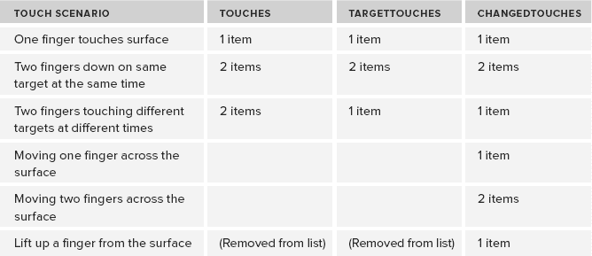

这些数组中的项目是 `Touch` 对象（如表 10-7 所示），它们提供与触摸事件相关的信息。

表 10-7：触摸对象属性

| 属性 | 描述 |
| --- | --- |
| `clientX` | 对象相对于完整口的 x 坐标（不包括滚动偏移） |
| `clientY` | 相对于完整视口的 y 坐标（不包括滚动偏移） |
| `identifier` | 触摸事件的唯一整数标识符 |
| `pageX` | 相对于页面的 x 坐标 |
| `pageY` | 相对于页面的 y 坐标 |
| `screenX` | 相对于屏幕的 x 坐标 |
| `screenY` | 相对于屏幕的 y 坐标 |
| `target` | 触发触摸事件的原始元素（节点） |

与鼠标模拟事件不同，你可以捕获屏幕上同时发生的多次触摸，并让应用响应它们。

例如，如果你想测试这些事件是如何触发的，可以添加事件处理程序，并在这些事件发生时执行不同的操作。以下是 `JavaScript` 代码：

```
function init()
{
    document.addEventListener("touchstart", touchEventHandler, false);
    document.addEventListener("touchmove", touchEventHandler, false);
    document.addEventListener("touchcancel", touchEventHandler, false);
    document.addEventListener("touchend", touchEventHandler, false);
}
function touchEventHandler(event)
{
    // Gather basic touch info
    var numTouch = event.touches.length;
    var numTargetTouches = event.targetTouches.length;
    var numChangedTouches = event.changedTouches.length;

    // Get first touch object
    if (numTouch > 0)
    {
        var touchObj = event.touches[0];
        var x = touchObj.screenX;
        var y = touchObj.screenY;
    }

    if (event.type == "touchstart")
    {
        // do something to begin
    }
    else if (event.type == "touchmove")
    {
        // do something on move
    }
    else if (event.type == "touchend")
    {
        // do something to end
    }
    else
    {
        // do something when cancelled
    }
}
```

## 手势事件

在多指触摸序列中，触摸事件通过 `touchstart`、`touchmove`、`touchend` 和 `touchcancel` 分发。然而，iOS 上的 Safari 在多个手指触摸表面时也会分发手势事件。三种手势事件如表 10-8 所示。

表 10-8：手势事件

| 事件 | 描述 |
| --- | --- |
| `gesturestart` | 当两个或更多手指触摸表面时触发 |
| `gesturechange` | 当这些手指在表面上移动或执行其他变化时触发 |
| `gestureend` | 当参与手势的其中一个手指离开表面时触发 |

与手势事件相关的两个关键属性如下：

* `scale` 返回自手势开始以来的捏合或推开的倍数。（1.0 是基准值。）
* `rotation` 返回自手势开始以来的旋转值。

## 检测方向变化

iPhone 网页应用开发者需要能够捕获的独特事件之一是垂直和水平方向之间的变化。iOS 上的 Safari 支持 `window` 对象的 `orientationchange` 事件处理程序。每当用户旋转时，就会触发此事件。

### 动手实践：检测方向变化

为了演示如何在应用中检测方向变化，请按照以下步骤操作。

1. 在文本编辑器中创建以下 HTML 文档，并将其保存为 `BIDHJ-Ch10-Ex2.html`。


```html
<!DOCTYPE html PUBLIC "-//W3C//DTD XHTML 1.0 Strict//EN"
         "http://www.w3.org/TR/xhtml1/DTD/xhtml1-strict.dtd">
```

```

<|channel>thought
<channel|>
<html xmlns="http://www.w3.org/1999/xhtml">
<head>
<title>Orientation Change Example</title>
<meta name="viewport" content="width=320; initial-scale=1.0; maximum-scale=1.0; user-scalable=0;">
</head>
<body onload="orientationChangeHandler();" onorientationchange="orientationChangeHandler();">
<h4 id="mode">Ras sed nibh.</h4>
<p>
Donec semper lorem ac dolor ornare interdum. Praesent condimentum. Suspendisse lacinia interdum augue. Nunc venenatis ipsum sed ligula. Aenean vitae lacus. Sed sit amet neque. Vestibulum ante ipsum primis in faucibus orci luctus et ultrices posuere cubilia Curae; Duis laoreet lorem quis nulla. Curabitur enim erat, gravida ac, posuere sed, nonummy in, tortor. Donec id orci id lectus convallis egestas. Duis ut dui. Aliquam dignissim dictum metus.
</p>
</body>
</html>
```

代码片段 `BIDHJ-Ch10-Ex2.html`

2. 在文档头部添加以下脚本代码，然后保存文件：


```
<script type="application/x-javascript">
    function orientationChangeHandler()
    {
      var str = "Orientation: ";
      switch(window.orientation)
      {
          case 0:
              str += "Portrait";
          break;
          case -90:
              str += "Landscape (right, screen turned clockwise)";
          break;
          case 90:
              str += "Landscape (left, screen turned counterclockwise)";
          break;
          case 180:
            str += "Portrait (upside-down portrait)";
          break;
      }
      document.getElementById("mode").innerHTML = str;
     }
</script>
```

代码片段 `BIDHJ-Ch10-Ex2.html`

#### 工作原理

在 `body` 元素上添加了 `onorientationchange` 属性，并赋值为 JavaScript 函数 `orientationChangeHandler()`。`orientationChangeHandler()` 函数评估 `window.orientation` 属性以确定当前状态：0（竖屏）、-90（横屏，顺时针）、90（横屏，逆时针）或 180（竖屏，倒置）。然后将当前状态字符串输出到文档。图 10-1 显示了竖屏模式下的结果，图 10-2 显示了横屏模式下的页面。

图 10-1
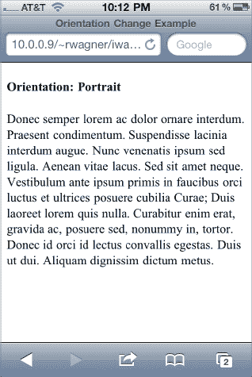

图 10-2
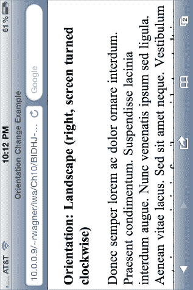

但请注意，`onorientationchange` 事件在文档加载时不会触发。因此，为了在此时评估文档方向，请将 `orientationChangeHandler()` 函数赋值给 `onload` 事件。

## 在方向变化时更改样式表

使用 `onorientationchange` 事件最常见的做法是根据当前视口方向指定样式表。为此，你可以扩展之前的 `orientationChangeHandler()` 函数，根据当前方向更新 `body` 元素的 `orient` 属性，然后基于该属性值更新活动的 CSS。

### 动手实践：在方向变化时样式表

为了演示应用中方向变化时更改样式表，请以下步骤。

1. 在文本编辑器中创建以下 HTML 文档，将其保存为 `BIDHJ-Ch10-Ex3.html`。


```
<!DOCTYPE html PUBLIC "-//W3C//DTD XHTML 1.0//EN" "http://www.w3.org/TR/xhtml1/DTD/xhtml1-strict.dtd">
<html xmlns="http://www.w3.org/1999/xhtml">
<head>
<title>orientationChange: Stylesheet</title>
<meta name="viewport" content="width=320; initial-scale=1.0; maximum-scale=1.0; user-scalable=0;">
<body>
    <div id="canvasMain" class="container">
        <div class="toolbar anchorTop">
            <div class="main">
                <div class="header">AppTop</div>
            </div>
        </div>
        <div class="center">
            <p>Orientation mode:<span id="iMode"></span></p>
            <p>Width:<span id="iWidth"></span></p>
            <p>Height:<span id="iHeight"></span></p>
            <p>Bottom toolbar height:<span id="iToolbarHeight"></span></p>
            <p>Bottom toolbar top:<span id="iToolbarTop"></span></p>
        </div>
        <div id="bottomToolbar" class="toolbar anchorBottom">
            <div class="main">
                <div class="header">AppBottom</div>
            </div>
        </div>
    </div>
</body>
</html>
```

代码 `BIDHJ-Ch10-Ex3.html`

2. 在文档头部添加样式代码：


```
<style type="text/css" media="screen">
    body {
        margin: 0;
        padding: 0;
        width: 320px;
        height: 416px;
        font-family: Helvetica;
        -webkit-user-select: none;
        cursor: default;
        -webkit-text-size-adjust: none;
        background: #000000;
        color: #FFFFFF;
    }
    .container {
        position: absolute;
        width: 100%;
    }
    .toolbar {
        position: absolute;
        width: 100%;
        height: 60px;
        font-size: 28pt;
    }
    .anchorTop {
        top: 0;
    }
    .anchorBottom {
        bottom: 0;
    }
    .center {
        position: absolute;
        top: 60px;
        bottom: 60px;
    }
    .main {
        overflow: hidden;
        position: relative;
    }
    .header {
        position: relative;
        height: 44px;
        -webkit-box-sizing: border-box;
        box-sizing: border-box;
        background-color: rgb(111, 135, 168);
        border-top: 1px solid rgb(179, 186, 201);
        border-bottom: 1px solid rgb(73, 95, 144);
        color: white;
        font-size: 20px;
        text-shadow: rgba(0, 0, 0, 0.6) 0 -1px 0;
        font-weight: bold;
        text-align: center;
        line-height: 42px;
    }
    /* Styles adjusted based on orientation  */
    body[orient='portrait'] .container {
        height: 436px;
    }
    body[orient='landscape'] .container {
        height: 258px;
    }
    body[orient='landscape'] .toolbar {
        height: 30px;
        font-size: 16pt;
    }
    body[orient='landscape'] .center {
        top: 50px;
        bottom: 30px;
    }
</style>
```

代码片段 `BIDHJ-Ch10-Ex3.html`

3. 在文档头部添加以下脚本代码，然后保存文件：


```
<script type="application/x-javascript">
    addEventListener('load', function() {
        setTimeout(orientationChange, 0);
    }, false);
    var currentWidth = 0;
    function orientationChange() {
        if (window.innerWidth != currentWidth) {
            currentWidth = window.innerWidth;
            var orient = currentWidth == 320 ? 'portrait' : 'landscape';
            document.body.setAttribute('orient', orient);
            setTimeout(function() {
                document.getElementById('iMode').innerHTML = orient;
                document.getElementById('iWidth').innerHTML = currentWidth
                  + 'px';
                document.getElementById('iHeight').innerHTML =
                 document.getElementById('canvasMain').offsetHeight
                  + 'px';
                document.getElementById('iToolbarHeight').innerHTML =
                 document.getElementById('bottomToolbar').offsetHeight
                  + 'px';
                document.getElementById('iToolbarTop').innerHTML =
                 document.getElementById('bottomToolbar').offsetTop
                          + 'px';
            }, 0);
        }
    }
    setInterval(orientationChange, 400);
</script>
```

代码 `BIDHJ-Ch10-Ex3.html`

#### 工作原理

在本例中，使用一系列`div`元素来模拟 iPhone 界面，包括工具栏、内容区域和底部工具栏。在 CSS 样式中，注意最后四条规则的选择器依赖于`body`元素的`orient`状态。根据`body`元素的`orient`值，`container` 类会改变高度，顶部和底部工具栏会调整高度，主内容区域（`center`类会重新定位以适应的变化。在 JavaScript 代码中，当`window`加载或方向改变时，会调用`orientationChange()`函数。它会将`body`元素的`orient`属性更新为`portrait`或`landscape`。

图 10-3 和图 10-4 分别展示了文档在竖屏和横屏模式下的加载效果。

图 10-3
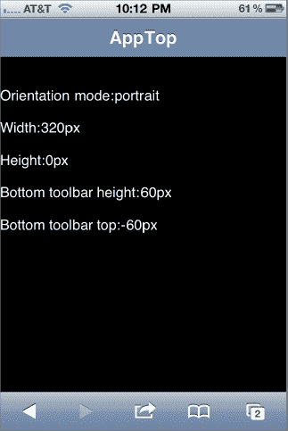

图 10-4
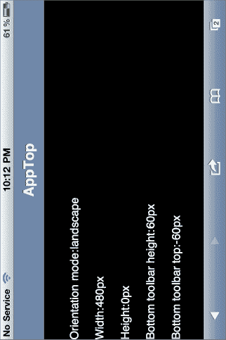

### 根据方向变化元素定位

当你开始理解`orientationChange()`函数与方向相关样式之间的基本交互时，你就可以根据当前视口是竖屏还是横屏模式动态定位 UI 元素。例如，假设你想将一个箭头图像对齐到页面的左下角。以下是`img`声明：

```

```

要在竖屏模式下对齐图形，你可以指定如下 CSS 规则：

```
#pushbtn
{
    position: absolute;
    left: 10px;
    top: 360px;
}
```

然而，如果保持定位不变，当用户将视口倾斜到横屏模式时，按钮会移出屏幕。因此，需要为按钮图像添加第二条针对横屏的规则，并调整 top 值：

```
body[orient="landscape"] #pushBtn
{
    left: 10px;
    top: 212px;
}
```

`orientationChangeHandler()`函数如下：


```
function orientationChangeHandler()
{
    if (window.orientation == 0 || window.orientation == 180)
        document.body.setAttribute('orient', 'portrait')
    else
        document.body.setAttribute('orient', 'landscape');
}
```


```markdown
```
Code snippet BIDHJ-Ch10-Ex4.html
```

如图 10-5 和图 10-6 所示，按钮图像分别在竖屏和横屏模式下对齐到页面文档的左下角。

图 10-5

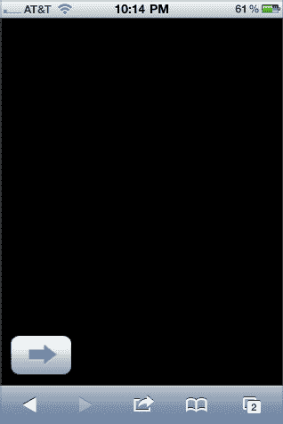

图 10-6

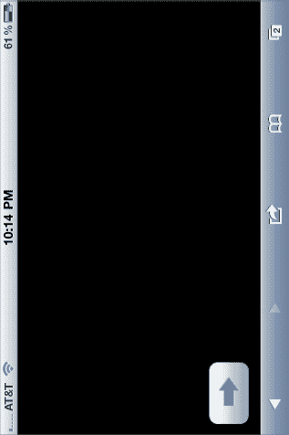

### 使用屏幕键盘捕获按键事件

与普通网页一样，你可以通过捕获`keydown` 事件来验证键盘输入。例如，假设你有一个输入字段，希望阻止用户输入数字。要捕获此事件，首先在输入元素上添加一个`keydown` 处理程序：

```html
<input onkeydown="return validate(event)" />
```

在文档头部，添加一个包含以下代码的 `script` 元素：

```javascript
 function validate(e) {
          var keynum = e.which;
          var keychar = String.fromCharCode(keynum);
          var chk = /\d/;
          return !chk.test(keychar)
     }
```

作为一个标准的 JavaScript 验证例程，该函数会检测当前字符的编码值，以判断它是否为数字。如果发现非数字字符，则向输入字段返回 `true`。否则，返回 `false` 并禁止该字符输入。

## 练习

1. 触摸事件的三种主要类型是什么？
2. 在你的 Web 应用中是否需要编写所有触摸事件？
3. 你需要捕获哪个事件来处理屏幕方向变化？

练习答案见附录。

## 本章所学内容

| 主题 | 关键概念 |
| --- | --- |
| 处理类似鼠标的事件 | 在用户手指离开触摸屏之前，不会触发任何事件。设计应用时，应响应 `click` 事件，而非其他鼠标事件。 |
| 响应多点触摸事件 | 捕获屏幕上同时发生的多次触摸，然后让应用做出响应。 |
| 处理屏幕方向变化 | 为 body 元素的 `onorientationchange` 事件添加处理程序。 |
| 捕获键盘事件 | 为相应的可写入元素添加 `keydown` 处理程序。 |

### 第 11 章：特效效与动画

#### 本章学习内容：

* 使用 CSS 和 JavaScript 创建渐变
* 添加阴影和倒影
* 使用 JavaScript 创建动画

当你开始探索高级图形、动画及其他特效的能力时，iOS 上的 Safari 作为开发平台的优势便显而易见。你可以利用 JavaScript、HTML 5 和 CSS 的一些更高级功能，在 Web 应用中创建炫酷的效果。本章将介绍如何处理特效和动画。

## 渐变

渐变是一种可以添加到网页中的着色效果，颜色在画布或其他元素的表面上逐渐过渡到另一种颜色。线性渐变应用于矩形块状表面，而径向渐变则以圆形显示。你可以指定起始颜色、结束颜色以及中间的颜色值（称为色标）。你可以在 CSS 和 JavaScript 中创建渐变。继续阅读以了解具体方法。

### 创建 CSS 渐变

你可以使用 Safari 支持的函数 `-webkit-gradient()` 来创建“虚拟”渐变图像，并将其定义为图像 URL 参数。以下是线性渐变的语法：

```css
-webkit-gradient(linear, startPoint, endPoint, from(color),
  color-stop(percent, color), to(color))
```

`linear` 参数定义渐变类型。`startPoint` 和 `endPoint` 参数定义渐变的起点和终点，通常用常量表示：`left top`、`left bottom`、`right top`、`right bottom`。

`from()` 和 `to()` 函数表示起始颜色和结束颜色，`color-stop()` 函数定义渐变中特定位置的颜色。

例如，以下样式可以添加到 `div` 或其他块级元素中，创建一个从左上角浅绿色渐变到左下角黑色的渐变。在 50% 位置添加了一个深绿色色标。样式如下：

```css
 .simpleLinear
  {
    width:100px;
    height:100px;
    border:1px solid black;
    background: -webkit-gradient( linear, left top, left bottom,
     from(#a1f436), color_stop(0.5, #668241), to(rgb(0, 0, 0)));
    }
```

如你所见，颜色可以使用十六进制值或 `rgb()` 函数定义。

结果如图 11-1 所示。

图 11-1


你可以向渐变中添加多个 `color-stop()` 函数以实现更复杂的效果。以下样式以栗色开始，以白色结束，同时在渐变的 30% 和 80% 位置定义了绿色和蓝色色标（见图 11-2）：

图 11-2


```css
 .complexLinear
  {
    width:100px;
    height:100px;
    border:1px solid black;
    background: -webkit-gradient(linear, left top, left bottom,
    from(#a21c47), to(#f9f9f9), color_stop(0.3, #564fb5),color_stop(0.8, #66cc00));
  }
```

要创建径向渐变，请使用以下语法：

```css
-webkit-gradient(radial, innerCenter, innerRadius, outerCenter,
   outerRadius, from(color), color_stop(percent, color), to(color))
```

`innerCenter` 定义渐变起始圆的中心、y 坐标。`innerRadius` 定义内圆半径。`outerCenter` 和 `outerRadius` 定义渐变结束圆。`from()`、`to()` 和 `color-stop()` 函数的方式与线性渐变相同。以下样式定义了一个 10 像素半径径变圆，起始于坐标 (30, 30)，结束于坐标 (50, 50)。在渐变中间有一个色标（见图 11-3）：

图 11-3


```css
 .radial
  {
    width:100px;
    height:100px;
    border:1px solid black;
    background: -webkit-gradient(radial, 30, 30, 10, 50,
      from(#a1f436), to(rgba(0,0,0)), color_stop(50%, #668241));
  }
```

你也可以通过简单将多个渐变列出，将它们组合到表面上。以下示例为一个 200×200 大小的 `div` 定义了两个径向渐变：

```css
.radial2
  {
    width:200px;
    height:200px;
    border:1px solid black;
    background: -webkit-gradient(radial, 20, 20, 10, 25,
      from(#a1f436), to(rgba(0,0,0)), color_stop(50%, #668241)),
     -webkit-gradient(radial, 100, 100, 20, 20,
      from(#a21c47), to(#f9f9f9), color_stop(50%, #6cc00));
  }
```

结果是一个圆锥，如图 11-4 所示。

图 11-4


### 使用 JavaScript 创建渐变

如果你更喜欢脚本方式，也可以使用上下文对象的方法创建渐变和径向渐变：

* `createLinearGradient(x1,y1,x2,y2)` 从起点 `(x1,y1)` 到终点 `(x2, y2)` 创建渐变。
* `createRadialGradient(x1,y1,r1,x2,r2)` 创建渐变。第一个圆基于 `x1`、`y1` 和 `r1` 值，第二个圆基于 `x2`、`y2` 和 `r2` 值。

这两个方法都返回一个 `canvasGradient` 对象，可以使用 `addColorStop(position, color)` 方法为其分配颜色。`position` 参数是一个于 0.0 和 1.0 之间的浮点数，表示颜色在渐变中的位置。`color` 参数是任何 CSS 颜色。

#### 动手试一试：创建 JavaScript 渐变

是一个使用 JavaScript 创建渐变的示例。

1. 在文本编辑器中创建以下 HTML 文档，并将其保存为 `BIDHJ-Ch11-Ex1.html`。


```html
<!DOCTYPE html PUBLIC "-//W3C//DTD XHTML 1.0 Strict//EN"
         "http://www.w3.org/TR/xhtml1/DTD/xhtml1-strict.dtd">
<html xmlns="http://www.w3.org/1999/xhtml">
<head>
<title>Draw Gradient</title>
<meta name="viewport" content="width=320; initial-scale=1.0;
   maximum-scale=1.0; user-scalable=0;">
</head>
<body>
<canvas id="myCanvas" width="300" height="300"
   style="position:absolute; left:0px; top:0px; z-index:1"/>
</body>
</html>
```

代码片段 `BIDHJ-Ch11-Ex1.html`

2. 在文档头部添加以下 JavaScript 代码：


```javascript
<script type="application/x-javascript">
function drawGradient()
{
  var canvas = document.getElementById('myCanvas');
  var context = canvas.getContext('2d');
  var lg = context.createLinearGradient(0,125,250,125);
  context.globalAlpha="0.8";
  lg.addColorStop(0,'white');
  lg.addColorStop(0.75,'blue');
  lg.addColorStop(1,'red');
  context.fillStyle = lg;
  context.strokeStyle="#666666";
  context.lineWidth=".5";
  context.fillRect(10,10,250,250);
  context.strokeRect(10,10,250,250);
}
</script>
```
```

```markdown

```
注意，`-webkit-gradient()`函数定义了一个线性渐变作为倒影。它从完全透明开始，到完全白色结束，以便与背景融合。图 11-8 显示了结果。

图 11-8


在黑色背景上的倒影在 iOS 视口中尤其具有视觉冲击力。以下示例展示了黑色背景上的倒影（参见图 11-9）：

图 11-9


```

```html
<!DOCTYPE html PUBLIC "-//W3C//DTD XHTML 1.0 Strict//EN"
         "http://www.w3.org/TR/xhtml1/DTD/xhtml1-strict.dtd">
<html xmlns="http://www.w3.org/1999/xhtml">
<head>
<title>CSS Reflections</title>
<meta name="viewport" content="width=320; initial-scale=1.0;
   maximum-scale=1.0; user-scalable=0;">
<style>
  .reflectedImage
  {
    -webkit-box-reflect:below 3px -webkit-gradient(linear, left top,
     left bottom, from(transparent), color-stop(0.5, transparent), to(black));
  }
  body
  {
    background-color:#000000;
  }
</style>
</head>
<body>

</body>
</html>
```

如果你想使用 JavaScript 添加倒影，我建议查看几个开源库，它们利用画布编程创建复杂的图表和图像效果，例如倒影。两个特别值得注意的库是 `PlotKit` 和 `Reflection.js`。`PlotKit` 是一个 JavaScript 图表绘制库（可以在 [www.liquidx.net/plotkit](http://www.liquidx.net/plotkit) 获取），而 `Reflection.js`（可在 [`cow.neondragon.net/stuff/reflection`](http://cow.neondragon.net/stuff/reflection) 获取）允许你为图像添加倒影。`Reflection.js` 库使用画布渲染倒影，但你只需要为图像添加一个 `reflect` 类即可使用。

## 使用遮罩

遮罩是一种常见的设计技术，用于隐藏图像的部分区域。通常使用遮罩在图像周围创建模糊边框。你可以使用 CSS 属性 `-webkit-mask-image` 为图像添加遮罩。其语法如下所示：

```
-webkit-mask-box-image: uritop right bottom left xRepeat yRepeat;
```

`uri` 用于指定遮罩图像，例如图 11-10 中所示。`top`、`right`、`bottom` 和 `left` 参数用于定义遮罩距离图像边缘的距离。`repeat` 参数指定 x、y 方向的重复样式。你也可以使用常量：`repeat`（平铺）、`stretch`（拉伸）或 `round`（轻微拉伸图像的所有部分，使两端没有部分平铺）。

图 11-10


例如，要为图像创建一个使用图 11-10 中所示遮罩的晕影遮罩，可以使用以下样式定义：

```
vignetteMask
{
  -webkit-mask-box-image: url(images/mask.png) 25 stretch;
}
```

`25` 参数指定完整图像周围 25 像素的距离，而 `stretch` 会将遮罩（它比应用到的图像小）拉伸，以匹配应用到的图像的大小。图 11-11 展示了结果。

图 11-11


不过，并不限于使用遮罩。你也可以使用 `-webkit-gradient()` 函数来实现淡出效果。例如，考虑以下样式：

```
fadeTo
{
  -webkit-mask-image:-webkit-gradient(linear, left top,
    left bottom, from(rgba(0,0,1)), to(rgba(0,0,0)));
}
```

线性渐变为此样式的图像提供了遮罩。注意图 11-12 中底部是如何淡入背景的。

图 11-12


或者，要实现圆角效果，你可以将 `-webkit-border-radius` 声明与 `-webkit-mask-image` 属性结合。考虑以下代码：

```
roundedImage
{
  -webkit-border-radius:12px;
  -webkit-mask-image:-webkit-gradient(linear, left top,
    left bottom, from(rgba(0,0,1)), to(rgba(0,0,0)));
}
```

遮罩应用于圆角的图像。

## 创建变换

你可以使用 canvas 对象的三种方法来变换 canvas 的状态：

*   `translate(x, y)` 改变 canvas 的原点 (0, 0)。
*   `rotate(angle)` 围绕当前点旋转 canvas，角度以弧度为单位。
*   `scale(x, y)` 调整 canvas 的缩放比例。`x` 参数是水平缩放数，`y` 参数是垂直缩放。

以下示例在 canvas 上连续绘制圆形使用了 `translate()` 和 `scale()`。每次调用这些方法时，它们的参数都会调整：

```javascript
function transform()
{
  var canvas = document.getElementById('myCanvas');
  var context = canvas.getContext('2d');
  var s=1;
  for (i=1;i<6;i++)
  {
    var t=i*8;
    context.translate(t,t);
    context.scale(s,s);
    context.fillStyle = "rgba(" + t*4 + ","+ t*6 + "," + t*8 + ",0.3)";
    context.beginPath();
    context.arc(50,50,40,0,2*pi, false);
    context.fill();
    s=s-0.05;
  }
}
```

变量 `t` 是 `for` 循环迭代次数的八倍，用作 `translate()` 的参数。`scale()` 方法使用变量 `s`，每次循环后递减 0.05。`fillStyle()` 方法也使用变量 `t` 来调整每个绘制圆形的 rgb 颜色值。图 11-13 展示了变换的结果。

图 11-13


`rotate()` 方法根据指定的角度旋转 canvas。例如，在以下代码中，图像在 canvas 上绘制三次，每次都会改变 `translate()` 和 `rotate()` 参数的值以及 `globalAlpha` 属性：

```javascript
function rotateImg(){
  var canvas = document.getElementById('myCanvas');
  var context = canvas.getContext('2d');
  context.globalAlpha="0.5";
  var r=1;
  var img = new Image();
  img.src = 'images/jared.jpg';
  img.onload = function() {
    for (i=1;i<4;i++) {
      context.translate(50,-15);
      context.rotate(.15*r);
      context.globalAlpha=i*.33;
      context.drawImage(img, 20, 20);
      r+=1;
    }
  }
}
```

图 11-14 展示了分层结果。注意最底部图像与最顶部图像在透明度上的差异。

图 11-14


请注意，当你开始在 canvas 上进行更高级的绘图时，你需要管理绘图状态。绘图状态包括当前路径、主要上下文属性（如 `fillStyle` 和 `globalAlpha`）的值，以及已应用的任何变换（如旋转）。为此，你可以使用 `save()` 和 `restore()` 方法。`save()` 方法保存 canvas 的快照，之后可以使用 `restore()` 方法恢复。`save()` 和 `restore()` 方法使你能够以最少的额外代码返回到默认绘图状态，而无需费力地重新创建每个设置。

## 创建动画

你可以将前面讨论的上下文绘制能力与 JavaScript 定时器例程结合使用，在 canvas 上创建动画。乍一看，创建基于 canvas 的动画的潜力听起来像是 Flash 动画的完美轻量级替代品。对于某些用途，它是理想的。然而，这种兴奋需要加以控制。在 JavaScript 中进行 canvas 绘制的主要缺点是，你需要为每一帧重新绘制整个 canvas。复杂的动画在移动设备上可能会卡顿。尽管如此，canvas 动画可以成为开发工具中的强大工具。就像电影或视频剪辑一样，动画是一系列帧，一帧一帧地观看，产生运动的感觉。你的工作是显示一个图形，清除它，绘制下一帧，清除它，依此类推，直到动画完成回到起点。如果你正在更改上下文设置，并且为新帧重置，则使用 `save()` 和 `restore()` 方法。

### 动手试一：创建基于 JavaScript 的动画

以下示例展示了如何使用 JavaScript 为对象制作动画。

1. 在文本编辑器中创建 HTML 文档，然后保存为 `Ch11-Ex2.html`。

```html
<!DOCTYPE html PUBLIC "-//W3C//DTD XHTML 1.0 Strict//EN"
         "http://www.w3.org/TR/xhtml1/DTD/xhtml1-strict.dtd">
<html xmlns="http://www.w3.org/1999/xhtml">
<head>
<title>Animate</title>
<meta name="viewport" content="width=320; initial-scale=1.0;
    maximum-scale=1.0; user-scalable=0;">
</head>
<body bgcolor="black">
<canvas id="myCanvas" width="300" height="300"
   style="position:absolute; left:0px; top:0px;"></canvas>
</body>
</html>
```

2. 在文档头部添加以下脚本：

```javascript
function init() {
  setInterval( animate, 100 );
}
var p = 0;
function animate() {
  var canvas = document.getElementById('myCanvas');
  var context = canvas.getContext('2d');
  context.globalCompositeOperation = "copy";
  context.fillStyle = "rgba(0,0,255,0.3)";
  context.beginPath();
  context.arc(50+p,50+p,30,360, false);
  context.fill();
  p+=1;
}
```

3. 在 `body` 标签中添加 `onload` 事件处理并保存文件：

```html
onload="init()"
```

#### 工作原理

HTML 页面展示了一个简单的动画程序，其中圆形从 canvas 的左上角对角线移动到右下角。当文档加载时，调用 `init()` 函数，该函数启动一个定时器，每 100 毫秒调用一次 `animate()`。`animate()` 函数清除 canvas，移动定位点，并绘制填充圆形。然后变量 `p` 递增，重复此过程。图 11-15 和 11-16 展示了动画的开始和结束。

图 11-15


图 11-16


## 练习

1. 在 canvas 上绘图时，你操作的关键对象是什么？
2. 你使用哪个 CSS 属性来创建倒影？
3. 上下对象的 `save()` 和 `restore()` 方法有什么作用？

练习答案见附录。

### 本章学习内容

| 主题 | 关键概念 |
| --- | --- |
| 创建渐变 | 使用 CSS 时，使用`-webkit-gradient()`函数 |
| | 使用 JavaScript 时，使用`createLinearGradient()`或`createRadialGradient()` |
| 添加阴影 | 使用以下上下文对象属性：`shadowColor`、`shadowBlur`、`shadowOffsetX`、`shadowOffsetY` |
| 创建反射 | 使用 CSS 属性`-webkit-box-reflect` |
| 为图像添加遮罩 | 使用 CSS 属性`-webkit-mask-image` |

## 第 12 章：与 iOS 服务集成

#### 本章学习内容：

*   在应用中调用 iOS 服务及内置应用
*   发送电子邮件和短信
*   将 href 链接映射到 iOS 服务

为 iOS 创建 Web 应用时，最吸引人的想法之一就是将应用与核心移动服务（如拨打电话或发送电子邮件）集成。毕竟，当你突破浏览器内部的限制时，应用就不仅仅是 Web 应用，而是将其功能扩展到整个移动设备上。

然而，iOS 服务集成是一个混合体；这是一个“好消息，坏消息”的情况。好的一面是，开发者可以访问四个重要的移动功能（电话、邮件、短信和谷歌地图）。坏的一面是，没有方法调用其他核心服务，如日历、通讯录、相机、时钟、音乐和设置。

此外，可用的服务类型也因 iOS 设备而异。iPhone 包含所有这些功能，而 iPad 和 iPod touch 则受限于其设备能力（即两者都不提供电话或短信功能）。

## 从应用中拨打电话

下面是一个基本示例，让你初步了解 iOS 服务集成。你可以通过一个特殊的电话链接从应用中拨打电话。电话链接通过`tel:`协议指定。基本语法如下：

```
<a href="tel:1-507-5555">1-507-5555</a>
```

```


### 动手实践：创建呼叫链接

为了演示如何从 Web 应用内部拨打电话，请按照以下步骤操作。

1. 在文本编辑器中创建以下 HTML 文档，并将其保存为 `BIDHJ-Ch12-Ex1.html`。


```html
<!DOCTYPE html PUBLIC "-//W3C//DTD XHTML 1.0 Strict//EN"
    "http://www.w3.org/TR/xhtml1/DTD/xhtml1-strict.dtd">
<html xmlns='http://www.w3.org/1999/xhtml' xml:lang='en'>
  <head>
    <meta http-equiv='content-type' content='text/html; charset=utf-8' />
    <meta http-equiv='content-language' content='en-us' />
    <title>BIDHJ 示例</title>
  </head>
  <body>
      <h2>
        让我们打个电话。
      </h2>
  </body>
</html>
```

代码片段 `Elements.xml`

2. 在文档 `body` 中添加以下 HTML 代码，然后保存文件：


```html
<p>苹果：<a target="_self" href="tel:800-692-7753"
  onclick="return (navigator.userAgent.indexOf('iPhone') != -1)">1-800-MY-APPLE</a>
    </p>
    <p>随便某人：<a target="_self" href="tel:(765) 555-1212"
onclick="return (navigator.userAgent.indexOf('iPhone') != -1)">(765) 555-1212</a>
    </p>
```

代码片段 `Elements.xml`

图 12-2 显示了显示的页面。

图 12-2


#### 工作原理

a 链接在 `href` 值中使用 `tel:` 协议。为了在 iPod touch 或 iPad 上优雅降级，`onclick` 处理程序通过评估浏览器的用户代理字符串并检查是否包含 "iPhone" 字符串，确保链接仅在 iPhone 上运行。

然后，当用户按下链接时，支持电话的设备会启动设备的电话应用，如图 12-3 所示。

图 12-3


## 发送电子邮件

也可以通过链接从应用中发送电子邮件，使用熟悉的 `mailto:` 协议，如下例所示：

```html
<a href="mailto:jack@ibmcorp.com">杰克·阿米蒂奇</a>
```

如果你之前接触过 HTML 页面，可能对邮件链接非常熟悉。然而，在 iOS 设备上点击电子邮件链接时会发生以下情况。

当用户按下此链接时，邮件应用会打开并显示一个新邮件窗口，如图 12-4 所示。然后用户可以填写主题和正文并发送。正如你所料，无法使用 `mailto:` 协议在无需用户干预的情况下自动发送电子邮件。`mailto:` 协议始终将用户带到新邮件窗口。

图 12-4


在 `mailto:` 协议之后，你还可以包含参数来指定主题、抄送地址和正文。表 12-1 列出了这些选项。

### 表 12-1：可选 mailto 属性

| 选项 | 语法 |
| --- | --- |
| 多个件人 | `,`（逗号分隔地址） |
| 邮件主题 | `subject=`文本 |
| 抄送件人 | `cc=`address@com |
| 密送件人 | `bcc=`address@com |
| 邮件正文 | `body=`正文 |


注意根据 HTTP 约定，在第一个参数前加 `?`（如 `subject=`），并在任何附加参数加 `&`。`mailto:` 协议通常在 `body` 属性中使用换行符，使用 `%0A` 表示换行，`%0A%0A` 表示换行跟一个空行。然而，iOS 设备会忽略 `%0A` 代码，将所有文本放在一行。不过 iOS 有一个替代方案，实际上很酷。

### 动手实践：创建格式化电子邮件

为了演示如何在 Web 应用中创建自己的电子邮件，请按照以下步骤操作。

1. 在文本编辑器中创建以下 HTML 文档，将其保存为 `BIDHJ-Ch12-Ex2.html`。


```html
<!DOCTYPE html PUBLIC "-//W3C//DTD XHTML 1.0 Strict//EN"
    "http://www.w3.org/TR/xhtml1/DTD/xhtml1-strict.dtd">
<html xmlns='http://www.w3.org/1999/xhtml' xml:lang='en'>
  <head>
    <meta http-equiv='content-type' content='text/html; charset=utf-8' />
    <meta http-equiv='content-language' content='en-us' />
    <title>BIDHJ Example</title>
  </head>
  <body>
     <h2>
        I am shy. I'd rather send an email than call anyone.
      </h2>
  </body>
</html>
```

代码片段 `Elements.xml`

2. 在文档主体内添加以下 HTML 代码，然后保存文件：


```html
<p><a href="mailto:jack@ibmcorp.com">Blank Email to Jack</a></p>
<p><a href="mailto:jack@ibmcorp.com?subject=Meeting&body=Dear Jack,<br/>
     I look forward to our upcoming meeting
     <strong>this Friday at 8am.</strong><br/>
     Sincerely,<br/>cc=jason@iphogcorp.com">Reminder Email</a>
    </p>
```

#### 工作原理

iOS 允许你在消息正文中嵌入 HTML，因此你可以添加 `br` 标签进行换行，甚至使用其他标签（如 `strong`）进行格式化。通过组合多个参数，你实际上可以在代码中创建自己的预设邮件。当页面显示且用户点击“提醒邮件”链接时，会显示一个包含所有文本和消息设置的邮件页面。用户只需按下“发送”按钮。（参见图 12-5。）

图 12-5


## 发送短信

你可以使用 `sms` 协议发送短信，其方式与集成电子邮件非常相似。例如，以下代码启动短信应用，并向 765-545-1212 发送一条消息：

```html
<a href="sms:765-545-1212" onclick="return (navigator.userAgent.indexOf('iPhone') != -1)">(765) 545-1212</a>
```

如图 12-6 所示，用户可以使用键盘输入消息，完成后发送。

图 12-6


注意与电话拨号链接一样，我在 `onclick` 处理程序中添加了一个检查，仅当运行设备是 iPhone（而非 iPod touch 或 iPad）时才跳转到短信 `href` 链接。或者，如果你只想启动短信应用指定特定号码，只需使用空白的 `sms:`。

```html
<a href="sms:Send SMS Message</a>
```

如你所见，通过电话、电子邮件和短信支持，你的 iOS 网页应用可以支持联系人管理的常规功能。例如，假设你将所有这些链接合并到一个页面中（`BIDHJ-Ch12-Ex3.html`）：


```html
<!DOCTYPE html PUBLIC "-//W3C//DTD XHTML 1.0 Strict//EN"
    "http://www.w3.org/TR/xhtml1/DTD/xhtml1-strict.dtd">
<html xmlns='http://www.w3.org/1999/xhtml' xml:lang='en'>
  <head>
    <meta http-equiv='content-type' content='text/html; charset=utf-8' />
    <meta http-equiv='content-language' content='en-us' />
    <title>BIDHJ Example</title>
  </head>
  <body>
      <h2>
         James Armitage.
      </h2>
  </body>
</html>
```

## 指向谷歌地图

尽管 `mailto:` 协议非常常用，但 iOS 设备会忽略 `%0A` 代码，将所有文本放在一行。不过 iOS 有一个替代方案，实际上很酷。阅读以下活动中的通方法。

### 表 12-1：可选 mailto 属性

| 选项 | 语法 |
| --- | --- |
| 多个件人 | `,`（逗号分隔地址） |
| 邮件主题 | `subject=`文本 |
| 抄送件人 | `cc=`address@com |
| 密送件人 | `bcc=`address@com |
| 邮件正文 | `body=`正文 |


注意根据 HTTP 约定，在第一个参数前加 `?`（如 `subject=`），并在任何附加参数加 `&`。`mailto:` 协议通常在 `body` 属性中使用换行符，使用 `%0A` 表示换行，`%0A%0A` 表示换行跟一个空行。

### 动手实践：链接到地图

为了演示如何在 Web 应用中创建自己的电子邮件，请按照以下步骤操作。

1. 在文本编辑器中创建以下 HTML 文档，将其保存为 `BIDHJ-Ch12-Ex4.html`。


```html
<!DOCTYPE html PUBLIC "-//W3C//DTD XHTML 1.0 Strict//EN"
    "http://www.w3.org/TR/xhtml1/DTD/xhtml1-strict.dtd">
<html xmlns='http://www.w3.org/1999/xhtml' xml:lang='en'>
  <head>
    <meta http-equiv='content-type' content='text/html; charset=utf-8' />
    <meta http-equiv='content-language' content='en-us' />
    <title>BIDHJ Example</title>
  </head>
  <body>
     <h2>
        I am shy. I'd rather send an email than call anyone.
      </h2>
  </body>
</html>
```

代码片段 `Elements.xml`

2. 在文档主体内添加以下地图相关的 HTML 代码，然后保存文件：


```html
<p><a href="mailto:jack@ibmcorp.com">Blank Email to Jack</a></p>
<p><a href="mailto:jack@ibmcorp.com?subject=Meeting&body=Dear Jack,<br/>
     I look forward to our upcoming meeting
     <strong>this Friday at 8am.</strong><br/>
     Sincerely,<br/>cc=jason@iphogcorp.com">Reminder Email</a>
    </p>
```

#### 工作原理

iOS 允许你在消息正文中嵌入 HTML，因此你可以添加 `br` 标签进行换行，甚至使用其他标签（如 `strong`）进行格式化。通过组合多个参数，你实际上可以在代码中创建自己的预设邮件。当页面显示且用户点击“提醒邮件”链接时，会显示一个包含所有文本和消息设置的邮件页面。用户只需按下“发送”按钮。（参见图 12-5。）

图 12-5


```
代码片段 Elements.xml```

#### 工作原理

如你所见，该示例展示了在网页应用中使用谷歌地图链接的三种不同方式。

当上述地址在谷歌地图中定位时，标记会默认显示为“1000 Massachusetts Ave Boston MA”。然而，如第一个地图链接所示，你可以通过在 URL 后附加 `+(Label+Text)` 来指定自定义标签。图 12-7 显示了地图应用中更新后的标签。

图 12-7


此外，除了提供街道地址，你还可以使用 GPS 坐标，通过纬度和经度来指定位置，如第二个链接所示。

最后，如果你想获取路线而不是指向地图上的某个点，可以使用 `saddr=` 参数指定起始地址，`daddr=` 参数指定目的地地址，如第三个链接所示。

图 12-8 显示了点击该链接后地图应用中的路线。

图 12-8


**注意** 谷歌地图在其公共网站上有一组丰富的参数。然而，除前面提到的之外，目前这些参数均不受支持。例如，你不能使用 `t=` 参数指定卫星地图，`z=` 参数指定地图缩放级别，甚至不能使用 `layer=t` 开启交通显示。用户需要手动执行这些操作。

## 练习

1. 在创建访问 iOS 服务的网页应用时，为什么需要识别运行应用的 iOS 设备类型？

2. 对于以下链接，应使用哪些 URL 协议：电话号码、电子邮件消息和短信消息？

3. 当在 Safari 中点击 `maps.google.com` 链接时，iPhone 和 iPod touch 的反应是否不同？请解释。

练习答案见附录 A。

### 本章学习内容

| 主题 | 关键概念 |
| --- | --- |
| 从应用中拨打电话 | 使用 `tel:` 协议拨打电话。 |
| 发送电子邮件 | 使用 `mailto:` 协议创建电子邮件并显示邮件应用。可在调用中添加可选属性，以添加邮件主题、其他收件人（收件人、抄送或密送）以及邮件正文。 |
| 发送短信 | 使用 `sms:` 协议创建短信并显示短信应用。在 iPad 和 iPod touch 上优雅降级。 |
| 在 Google 地图上定位 | 在地图上绘制地址或 GPS 位置，并在 Google 地图中显示。 |

## 第 13 章：将应用打包为书签：书签小程序与数据 URL

### 本章学习要点：

* 了解什么是书签小程序
* 使用书签小程序创建离线应用
* 对图片和源代码进行编码

由于 iOS 网页应用在 Safari 环境中运行，网页开发者面临两个看似明显的限制：必须接受 iOS 版 Safari 浏览器的内置功能；并且需要持续的 Wi-Fi（或 iPhone/iPad 的 3G）连接才能运行任何应用。

正如你将在第 15 章中了解到的，你可以使用 HTML5 离线存储功能来绕过对实时连接的依赖。然而，还有两种不太为人所知的技术——书签小程序和数据 URL——也能提供类似的效果。这些技术实际上已经存在多年，但一直处于主流网页开发的边缘。开发者现在重新审视这两种技术，以最大化 iOS 网页应用平台的潜力。

书签小程序（bookmark applets 的简称）是迷你 JavaScript“小程序”，可以存储为 Safari 中的书签。数据 URL 是一种将整个网页或应用（页面、样式、图片、数据和脚本）存储在一个 URL 中的技术，然后可以将其保存为 Safari 中的书签。这个“书签中的应用”可以在离线模式下访问。你可能不会想将重量级的企业级应用打包成书签小程序，但对于较小的应用，这值得考虑。

## 使用书签小程序

书签小程序是存储为 URL 并保存为浏览器书签的 JavaScript。它通常用作一键式小程序，执行非常特定的任务或对当前网页执行操作。书签小程序使用 `javascript:` 协议后跟脚本代码。例如，下面是最简单的示例：

```
javascript:alert('iPhone')
```

由于书签小程序的脚本代码位于 URL 内，脚本必须压缩成一长串代码。因此，要输入多条语句，请用分号分隔每一行：

```
javascript:alert('Bookmarklet 1');alert('Bookmarklet 2')
```

在这个例子中，我在每个字符串中添加了空格。你可以用 `%20` 代替空格，或者让 Safari 为你进行转换。

如果脚本返回一个值，请确保将其包含在 `void()` 中，以确保 JavaScript 代码按预期运行。例如，以下 WikiSearch 书签小程序会显示一个 JavaScript 提示对话框（见图 13-1），然后使用用户输入的值作为搜索词调用 Wikipedia 搜索 URL：

图 13-1


```
javascript:t=prompt('Search Wikipedia:',getSelection());
  if(t)void(location.href=
  'http://en.wikipedia.org/w/wiki.phtml?search='+escape(t))
```

下面是第二个示例，它为 Google 的 define 服务提供了一个前端：

```
javascript:d=
  prompt('Define:',getSelection());
  if(d)void(location.href='http://www.google.com/search?q=define:'+
  escape(d))
```

### 在 iOS 版 Safari 中添加书签小程序

书签小程序通常通过拖放操作在标准浏览器中添加。然而，由于 iOS 设备上无法进行这种用户输入，一种添加书签小程序的方法是通过以下步骤：

1. 在主电脑上，创建书签小程序脚本，并通过将其粘贴到 Safari 的地址栏中进行测试。

2. 当功能按预期运行时，将 `javascript:` URL 从地址栏拖到 Safari 的书签栏上。如果你要使用一组书签小程序，你可能希望创建一个特殊的书签小程序文件夹来存储这些脚本。或者，如果你的书签小程序包含在 a 链接的 `href` 中，则将该链接拖到书签栏上。

3. 通过 iTunes 或 iCloud 同步 iOS 设备和主电脑的书签。

4. 在 Safari 的书签中访问该书签小程序。

虽然这个过程在你开发书签小程序应用时足够方便，但如果你打算将应用分发给他人，你可能希望直接在设备上提供解决方案。以下是一种方法：

1. 创建一个网页，并将书签小程序代码放在页面的 `Textarea` 元素中，使其易于选择并复制到设备的剪贴板。

2. 点击 + 按钮添加新书签。

3. 转到刚刚保存在 Safari 书签列表中的书签，点击编辑。

4. 删除书签对话框中显示的默认 URL。

5. 将 JavaScript 书签小程序代码粘贴到 URL 框中。

6. 根据需要编辑名称。

7. 点击完成。

### 探索书签程序的

你可以将书签小程序用于通用目的，但它们对 iOS 网页开发者的真正用处是将 JavaScript 变成 Safari 的功能。例如，Safari 在现有窗口中打开链接，替换当前页面。来自 `doctyper.com` 的一个书签，它可以转换页面，在新页中打开。以下是脚本，由于它包含在一行编码，因此阅读比较困难：

```
javascript:(function(){var a=document.TagName('a');for(var i=0,j=a.length;i<j++){a[i].setAttribute('target','_blank');var img=document.createElement('img');img.setAttribute('class','new-window');img.setAttribute('src','data:image/gif;base64,'R0llhEAAMMLAL66tBIjExMdTQyBoaGjs7OyUlJWZmgAAAMzP///////wAAAAAAAAAA'ACH5BAAAAsAAAAAAQwAAAQ/cMlZqr2ps13yVJBjOTgYairohCTDM4iHHgwrUA/LqdopZS'DBpGG5lBQ0Ggt9xNJ1cnsNiRADs');img.setAttribute('style','width:16px!important;height:12px!important;border:none!important;');a[i].appendChild(img);}})
```

执行时，该脚本会为页面上的链接添加 `target="_blank"` 属性，并在链接后添加一个小“新窗口”（见图 13-2）。

图 13-2


iOS 用户可以在任何希望转换的页面上使用这个自包含的“”。脚本使用的图标被编码在数据 URL 中，因此脚本依赖任何外部文件。虽然整个脚本需要压缩成单个字符串，但 Safari 实际上足够智能，多行脚本粘贴到 URL 框时会自动为你换行。只需确保每条语句用分号分隔即可。

```
javascript:(function(){
        var a=document.getElementsByTagName('a');
        for(var i=0,j=a.length;i<j;i++) {
               a[i].setAttribute('target','_blank');
               var img=document.createElement('img');
               img.setAttribute('class','new-window');
               img.setAttribute('src','data:image/gif;base64,'R0llhEAAMMLAL66tBIjExMdTQyBoaGjs7OyUlJWZmgAAAMzP///////wAAAAAAAAAA'ACH5BAAAAsAAAAAAQwAAAQ/cMlZqr2ps13yVJBjOTgYairohCTDM4iHHgwrUA/LqdopZS'DBpGG5lBQ0Ggt9xNJ1cnsNiRADs');img.setAttribute('style','width:16px!important;height:12px!important;border:none!important;');
               a[i].appendChild(img);
        }})();
```

代码片段 BookmarkletSample.js

书签工具（Bookmarklets）可以成为 iOS 上辅助测试和调试的便捷工具。例如，以下基于 `iPhoneWebDev.com` 创建的脚本的书签工具，可在设备本身上提供“源代码”功能（参见图 13-3）：

图 13-3


```
javascript
var sourceWindow = window.open("about:blank");
var newDoc = sourceWindow.document;
newDoc.open();
newDoc.write(
"<html><head><title>Source of " + document.location.href +
"</title><meta name=\"viewport\" content=\"initial-scale=1.0;" +
"user-scalable=0;maximum-scale=0.6667;width=480\/><script>function do_onload()"
+ "{setTimeout(function(){window.scrollTo(0,1);},100);}if(navigator.userAgent.
indexOf" + "(\"iPhone\")!=-1)window.onload=do_onload;</script></head><body>
</body></html>>");
newDoc.close();
var pre = newDoc.body.appendChild(newDoc.createElement("pre"));
pre.appendChild(newDoc.createTextNode(document.documentElement.innerHTML));
```

代码片段 ViewSource.js

## 将应用程序存储在数据 URL 中

除了 JavaScript 功能之外，您还可以将网页甚至完整的应用程序存储在书签中。`data:` 协议允许您将整个页面的内容（HTML、CSS、JavaScript 和图像）编码到单个 URL 中。需要明确的是，数据 URL 存储的是页面本身的实际内容，而不仅仅是指向页面的简单链接。您可以将此数据 URL 保存为书签。当用户在 Safari 中访问此书签时，无论他们是否有互联网连接，都可以与页面进行交互。其意义重大——您可以使用数据 URL 打包某些类型的 Web 应用程序，从而绕过实时连接的要求。

### 使用数据 URL 的限制和问题

尽管数据 URL 的潜力令开发者兴奋，但在使用它们之前，请务必牢记以下限制和问题：

* 您可以将客户端技术（如 HTML、CSS、JavaScript 和 XML）存储在数据 URL 中。但是，你不能将 PHP、MySQL 或任何服务器端应用程序打包到书签中。

* 任何需要服务器访问数据或应用程序功能的 Web 应用程序都需要一种打包和运行的方式：(1) 使用客户端 JavaScript 实现应用程序功能，(2) 打包数据快照并将其放入客户端脚本可访问的形式。然而，在大多数需要使用缓存数据的情况下，你应该改用 HTML5 离线存储（参见第 15 章）。

* Web 应用程序必须完全自包含。因此，应用程序所需的每个外部资源（如图像、样式表和 `.js` 库）都必须编码到主 HTML 文件中。

* 被多次引用的外部资源无法缓存。因此，数据数据嵌入嵌入到。。。            。。。。。。。  。。，，，在 Safari  Safari Safari。。。。。      


<a id="backButton" class="button" href="#"></a>

</div>

<div id="main" title="Tipster" class="panel" selected="true">
  <h2 class="tip">Let the Tipster ease your pain and calculate the tip for you.</h2>
  <fieldset>
    <div class="row">
      <label>Bill amount:</label>
      <input type="text" id="fldBillTotal" value="20.00" tabindex="1" onfocus="clearTotal(this)" onchange="checkTotal(this)"/>
    </div>
    <div class="row">
      <label>Rating:</label>
      <select id="fldTipPercent" onchange="getRec()" tabindex="2">
        <option value="0">(Rate service)</option>
        <option value="10">Very poor</option>
        <option value="12.5">Poor</option>
        <option value="15">Just as expected</option>
        <option value="17.5">Above average</option>
        <option value="20">Exceptional</option>
        <option value="25">Wow!</option>
      </select>
    </div>
  </fieldset>
  <fieldset>
    <div class="row">
      <label>Tip: </label>
      <input type="text" id="fldTipRec" value="0.00" readonly="true" disabled="true"/>
    </div>
    <div class="row">
      <label>Final total:</label>
      <input type="text" id="fldFinalTotal" value="0.00" readonly="true" disabled="true"/>
    </div>
  </fieldset>
</div>

</body>
</html>
```

代码片段 `BIDHJ-Ch13-Ex1.html`

2. 在页面头部添加以下 JavaScript 代码：


```javascript
<script type="application/x-javascript">
addEventListener('load', function()
{
  setTimeout(function() {
       window.scrollTo(0, 1);
  }, 100);
 }, false);

function checkTotal(fld)
{
     var x=fld.value;
     var n=/(^\d+$)|(^\d+.\d+$)/;
     if (n.test(x))
     {
          if (fldTipPercent.selectedIndex != 0) getRec();
     }
     else
     {
          alert('Please enter a valid total')
          clearTotal(fld);
     }
}

function clearTotal(fld)
{
  fld.value = '';
}

function getRec()
{
    if (fldTipPercent.selectedIndex == 0)
    {
        alert('Please rate the service first.'); return;
    }
    var selPercent = Number( eval( fldTipPercent.value));
    var billAmount = Number( eval( fldBillTotal.value));
    var tipAmount = (selPercent*billAmount);
    var finalP = tipAmount + billAmount;
    fldTipRec.value = '$' + tipAmount.toFixed(2);
    fldFinalTotal.value = '$' + finalP.toFixed(2);
}
</script>
```

代码片段 `BIDHJ-Ch13-Ex1.html`

3. 在文档头部添加以下 `<style>` 元素：


```css
<style>
body > .toolbar {
    box-sizing: border-box;
    -moz-box-sizing: border-box;
    border-bottom: 1px solid #2d3642;
    border-top: 1px solid #6d84a2;
    padding: 10px;
    height: 45px;
    background: url("data:image/png;base64,iVBORw0KGAAAANSUhEUAAAAAAAACCAYAAACAC9H2Z0d2FyBBZG9iZSBbWFnZVJlWR5clPAAA1JREFUCNddj0EAQAgn5qltYnb1GB4SyWBAYStKyb9+0FJyjMyMWCC5lJM1r6vP07lFSf6Zx11hA/Oj0zlDhAAAAElFTkQmCC") #6d84a2;
}
body > .panel {
    box-sizing: border-box;
    padding: 10px;
    background: url('data:image/png;base64,iVBORw0KGAAAANSUhEUAAAAAAAACCAYAAACAC9H2Z0d2FyBBZG9iZSBbWFnZVJlWR5clPAAB1JREFUCNddj0EAQAQAgn5qltYnb1GB4SyWBAYStKyb9+AAAAAElFTkQmCC');
}
</style>
```

代码片段 `BIDHJ-Ch13-Ex1.html`

4. 保存你的 HTML 文件。

5. 前往 data: URI 工具（参见图 13-4），网址为 `software.ixie.ch/utilities/cgi/data`。

图 13-4


6. 上传 `BIDHJ-Ch13-Ex1.html`，然后点击“生成”创建编码后的 URL，该 URL 会在 Safari 的 URL 框中（参见图 13-5）。

图 13-5


7. 将该 URL 拖拽到书签栏上。

8. 与 iOS 设备同步，你的应用现在即可离线运行。

#### 工作原理

当你查看应用本身时，`fldBillTotal` 输入字段用于捕获小费前的金额。`fldTipPercent` 选择列表显示一组服务评级，每个评级对应一个百分比值。这两个因素经过计算后，在 `fldTipRec` 和 `fldFinalTotal` 输入字段中生成值。

其中两个样式引用了外部图像作为背景。因此，要使用它们，你需要先对图像进行编码。最简单的方法是使用在线转换工具，例如 data: URI 编码器（参见图 13-6），网址为 `www.scalora.org/projects/uriencoder`。该服务可以对本地文件或 URL 进行 Base64 编码。然后，你可以用附加的编码字符串替换图像引用。现在所有外部资源都已嵌入，应用完全独立。

图 13-6


最后一步是将自包含的应用转换为浏览器离线时访问的形式。在示例中，我使用了 data: URI 工具进行转换，但还有几种方法可以为你自动化此过程：

- URL 转 iPhone 工具（`www.somewhere.com/url2iphone.html`）：该工具可以将 URL 转换为书签。其强大的功能在于它会查找引用的图像、样式表及其他文件，并对它们进行编码。
- data: URI 图像编码器（`www.scalora.org/projects/uriencoder`）：该工具非常适合将图像编码为 Base64 格式。你可以指定一个 URL 或上传本地文件。
- 文件标记制作器（`mac.softpedia.com/get/Utilities/Filemark-Maker.shtml`）：这是一个免费的 Mac 实用工具，主要用于将 Word、Excel 和 PDF 文档存储为 data URL。它也可用于 HTML 页面。
- 编码书签小工具：开发者 David Lindquist 开发了一个便捷的书签小工具，它可以抓取当前页面的源代码，生成一个 data URL， 并加载该 URL。然后你可以将生成的 URL 拖拽到书签栏上。以下是 JavaScript 代码：

```javascript
javascript:x=new XMLHttpRequest();x.onreadystatechange=function()
  {if(x.readyState==4)location='data:text/html;charset=utf-8;base64,'+btoa(x.responseText)};x.open('GET');x.send('');
```

- 以下 Perl 语法将 HTML 转换为 data URL：

```perl
perl -077 -e 'use MIME::Base64; $text = <STDIN>; $text = encode_base64($text); print "data:text/html;charset=utf-8,$text"'
```

- 在 PHP 中，你可以创建一个函数来实现相同的功能：

```php
<?php
function data_url($file)
{
  $contents = file_get_contents($file);
  $base64 = base64_encode($contents);
  return ('data:text/html;charset=utf-8,$base64);
}
?>
```

图 13-7 展示了一个完整的小费器，名为“Tipster”。

图 13-7


## 练习

1. 执行书签工具使用的是什么协议？
2. data: URL 有什么用途？
3. 如何在 data URL 中引用？

### 练习答案

| 主题 | 关键概念 |
| --- | --- |
| 什么是书签？ | 书签是存储为 URL 的快捷方式。 |
| 将页面存储在 data URL 中 | 你可以将页面及其资源存储在编码后的 URL 中。 |

## 第四部分：高级编程

- 第 14 章：Canvas
- 第 15 章：离线应用
- 第 16 章：使用框架
- 第 17 章：带宽与优化
- 第 18 章：部署

### 第 14 章：Canvas

#### 本章学习内容：

- 识别 iOS
- 绘制矩形及其他

iOS 独特的平台能力使开发者能够在 Safari 中创建普通“Web 应用”。Safari 对 `canvas` 元素的支持使得在 HTML 页面中实现绘图和动画成为可能，而这些功能以前通过 Flash 实现。规范（WHATWG）为 HTML 5.0（或 HTML5）制定的标准。然而，当你开始启用这些功能时，需要确保你处理的是 iOS 设备，而不是可能的桌面浏览器。

#### 识别用户代理

当你试图识别网站或浏览器的功能时，通常应避免检测用户代理，而使用对象检测。但是，如果你开发专门为 iPhone 设计的应用，或者需要确定所使用的浏览器，那么用户代理检测是一个有效的选择。iPhone 的 Safari 用户代理字符串与其他平台上的 Safari 用户代理非常相似。不过它包含了 iPhone 平台名称和移动版本号。根据 iOS 上 Safari 的版本，其格式大致如下：

```
Mozilla/5.0 (iPhone; U; CPU OS 3_2 like Mac OS X) AppleWebKit/531.21.0 (KHTML, like Gecko) Version/4.0.4 Mobile/7B334b/531.210
```

以下是用户代理各组成部分的详细说明：

（注：此处提到的 Safari 构建号：`Safari/531.21.0`）

iPad 和 iPod touch 的用户代理类似，但平台分别为 iPad 或 iPod。例如：

```
Mozilla/5.0 (iPad; U; CPU OS 3_2 like Mac OS X) AppleWebKit/531.21.0 (KHTML, like Gecko) Version/4.0.4 Mobile/7B334b Safari/531.210
Mozilla/5.0 (iPod; U; CPU like Mac OS X) AppleWebKit/420.1 (KHTML, like Gecko) Version/3.0 Mobile/5A101a/419.3
```

显然，当 Apple 更新 Safari 时，版本号会发生变化，但字符串结构保持不变。要检测设备是否为 iPhone 或 iPod touch，你需要对 iPad、iPhone 和 iPod 执行字符串搜索。如果用户代理是 iOS 设备，以下函数将返回 true：

```javascript
function isAppleMobile() {
  return ((navigator.platform.indexOf("iPhone") != -1) ||
          (navigator.userAgent.indexOf("iPod") != -1)  ||
          ((navigator.userAgent.indexOf("iPad") != -1)));
}
```

请务必不要测试用户代理中的 `Mobile` 字符串，因为非 Apple 移动设备（例如诺基亚）可能基于 WebKit 浏览器。


```html
"http://www.w3.org/TR/xhtml1/DTD/xhtml1-strict.dtd">

<html xmlns="http://www.w3.org/1999/xhtml">
<head>
<title>User Agent Detection via WebKit Script</title>
<meta name="viewport" content="width=320; initial-scale=1.0; maximum-scale=1.0; user-scalable=0;">
<script type="application/x-javascript" src="WebKitDetect.js"></script>
</head>
<body>
<p id="log"></p>
</body>
<script type="application/x-javascript">
function addTextNode(str) {
  var t = document.createTextNode(str);
  var p = document.getElementById("log");
  p.appendChild(t);
}
if ( WebKitDetect.isMobile() ) {
  var device = WebKitDetect.mobileDevice();
  // String found in Settings/General/About/Version
  var minSupport = WebKitDetect.mobileVersionIsAtLeast("1C28");
  switch( device ) {
    case 'iPhone':
      if ( minSupport ) {
        addTextNode('If this were a real app, I launch its URL right now.');
        break;
      }
      else {
        addTextNode('Please upgrade your iPhone to the latest update before running this application.');
        break;
      }
    case 'iPod':
   addTextNode('If this were a real app, I would launch its iPod touch version.');
    default:
     addTextNode( 'This mobile device is not supported by this application. Go to your nearest Apple store and get an iPhone.');
    case 'iPad:
      addTextNode('If this were a real app, I would launch its iPad version.');
    default:
     addTextNode( 'This mobile device is not supported by this application. Go to your nearest Apple store and get an iPad.');
  }
}
else {
  addTextNode( 'Desktop computers are so 1990s. Go get an IOS device.' );
}
</script>
</html>
```

包含 `WebKitDetect.js` 脚本后，即可访问 `WebKitDetect` 对象。首先调用其 `isMobile()` 方法来确定设备是否为移动设备。接下来，检查移动版本是否为最新版本，并将结果保存在 `minSupport` 变量中。然后 `switch` 语句对移动设备进行评估。如果是 iPhone，则检查 `minSupport` 是否为 true。如果为 true，真正的应用程序将在此处启动。如果 `minSupport` 为 false，则通知用户将其 iPhone 更新到最新软件版本。剩下的两个 case 语句分别评估 iPhone 或未知移动设备。如果设备不是移动计算机，则调用最后的 `else` 语句。

# 编程 iOS 画布

C++ 和其他传统软件程序员长期以来一直使用画布来绘制图形。相比之下，Web 开发人员通常使用 HTML 和 CSS 来编程表示层。除非他们使用 Flash 或 Java，开发人员实际上无法在网页上绘制图形内容。然而，桌面版和移动版 Safari 都支持 `canvas` 元素，以提供分辨率相关的位图区域，用于绘制任意内容。`canvas` 元素在你的网页上定义一个绘图区域，然后你可以使用相应的 JavaScript 画布对象在该区域上绘图。

画布使你作为应用程序开发人员不仅可以绘制任何你想要的内容，还可以将画布用作渲染图形、编程游戏或添加特效的方式。在 Mac OS X 上，画布通常用于创建 Dashboard 小部件。在 iOS 上，Apple 在时钟和股票内置应用程序中都使用了画布。

对于习惯于操作现有图形而不是从头创建图形的 Web 开发人员来说，画布编程可能是一种思维方式的差异。这大致相当于一位 Photoshop 专家开始使用类似 Adobe Illustrator 的程序以非可视化方式创建所有图形。

## 定义画布元素

将画布视为页面上的一个矩形块区域，你可以完全控制其上绘制的内容。画布使用 `canvas` 元素定义：

```
<canvas id="theCanvas" width="300" height="300"/>
```

除了 `src` 和 `alt` 属性外，`canvas` 元素支持与 `img` 标签相同的所有属性。虽然 `id`、`width` 和 `height` 属性不是必需的，但作为良好的编程实践，应该定义它们。`width` 和 `height` 通常以像素为单位定义，但也可以定义为视口的百分比。

你可以在一个页面上放置多个 `canvas` 元素，只要每个元素都有自己唯一的 ID。

## 获取上下文

在网页上定义了画布区域后，你可以使用 JavaScript 在平坦的二维表面内进行绘制。与网页一样，画布的左上角为原点 `(0,0)`。默认情况下，你指定的所有 `x,y` 坐标都相对于此位置。

作为使用画布的第一步，你首先需要获取一个 2d 上下文对象。该对象负责管理画布的图形状态，通过调用画布对象的 `getContext()` 方法获得：

```
var canvas = document.GetElementById("theCanvas");
var context = canvas.getContext("2d");
```

或者，由于你通常不直接操作画布对象，你也可以将两行合并：

```
var context = document.GetElementById("theCanvas").getContext("2d");
```

您所使用的所有绘图属性和方法都通过 `context` 对象调用。`context` 对象拥有许多属性（参见表 14-1），这些属性决定了绘图在页面上的显示效果。

表 14-1：上下文属性

| 属性 | 描述 |
| :--- | --- |
| `fillStyle` | 提供路径填充的 颜色或样式（渐变、图案）。 |
| `font` | 指定使用的字体。 |
| `globalAlpha` | 指定画布上绘制内容的透明度。浮点值介于 0.0（完全透明）和 1.0（完全不透明）。 |
| `globalCompositeOperation` | 指定合成模式，用于确定相对于内容的显示方式。值包括 `copy`、`dark`、`destination-atop`、`destination-in`、`destination-over`、`source-atop`、`source-out` 和 `xor`。 |
| `lineCap` | 定义线条的端样式。字符串包括 `butt`、`round`、`square`。（默认 butt）。 |
| `lineJoin` | 指定线条的连接方式。字符串包括 `round`、`bevel`、`miter`。（默认 miter）。 |
| `lineWidth` | 指定线条宽度。值大于 0。 |
| `miterLimit` | 指定绘制线段连接处的限制。 |
| `shadowBlur` | 定义阴影的覆盖宽度。 |
| `shadowColor` | 提供阴影的颜色。 |
| `shadowOffsetX` | 指定阴影相对于对象的水平距离。 |
| `shadowOffsetY` | 指定阴影相对于对象的垂直距离。 |
| `strokeStyle` | 定义描边路径的颜色或样式（渐变、图案）。 |
| `textAlign` | 确定文本的对齐方式。 |
| `textBaseline` | 指定文本的基线（`top`、`middle`、`alphabetic` 或 `bottom`）。 |

## 绘制简单矩形

在画布上绘图有几种技术。最直接的方法之一就是绘制矩形。为此你需要三个方法：

* `fillRect(x,y,w,h)` 绘制一个填充矩形。
* `strokeRect(x,y,w,h)` 绘制一个矩形轮廓。
* `clearRect(x,y,w,h)` 清除矩形区域使其透明。

例如，假设您想绘制一个矩形框，内部包含一组块，外部有一个矩形轮廓。以下是一个绘制形状的 JavaScript 函数：

```
function draw()
{
var context = document.getElementById('myCanvas').getContext('2d');
  context.strokeRect(10,10,150,140);
  context.fillRect(15,15,140,130);
  context.clearRect(30,30,30,30);
  context.clearRect(70,30,30,30);
  context.clearRect(110,30,30,30);
  context.clearRect(30,100,30,30);
  context.clearRect(70,100,30,30);
  context.clearRect(110,100,30,30);
}
```

获取上下文后，`strokeRect()` 从 `(10,10)` 开始创建一个大小为 150×140 像素的矩形轮廓。`fillRect()` 方法从 `(15,15)` 开始绘制一个 140×130 的填充矩形。六个 `clearRect()` 调用清除了之前由 `fillRect()` 绘制的区域。图 14-1 显示了结果。

图 14-1


完整的页面源代码所示：


```html
<!DOCTYPE html PUBLIC "-//W3C//DTD XHTML 1.0 Strict//EN"
         http://www.w3.org/TR/xhtml1/DTD/xhtml1-strict.dtd">
<html xmlns="http://www.w3.org/1999/xhtml">
<head>
<title>Draw Box</title>
<meta name="viewport" content="width=320; initial-scale=1.0; maximum-scale=1.0; user-scalable=0;">
<script type="application/x-javascript">
function draw()
{
    var context = document.getElementById('myCanvas').getContext('2d');
    context.strokeRect(10,10,150,140);
    context.fillRect(15,15,140,130);
    context.clearRect(30,30,30,30);
    context.clearRect(70,30,30,30);
    context.clearRect(110,30,30,30);
    context.clearRect(30,100,30,30);
    context.clearRect(70,100,30,30);
    context.clearRect(110,100,30,30);
}
</script>
</head>
<body onload="draw()">
<canvas id="myCanvas" width="300" height="300" style="position:absolute; left:0px; top:0px; z-index:1"/>
</body>
</html>
```

代码片段 `BIDHJ-Ch14-Ex1.html`

## 绘制其他形状

要绘制非矩形形状，您需要为该形状创建一条路径，然后沿着路径绘制。在画布上绘制复杂形状可以使用以下方法：

* `beginPath()` 创建新路径。
* `moveTo(x,y)` 指定路径的起点。
* `lineTo(x,y)` 绘制一条到点。
* `closePath()` 关闭当前路径。
* `fill()` 填充路径。
* `stroke()` 绘制路径描边。

例如，以下代码创建了两个三角形：一个是空心的，一个是实心的。

```
function drawTriangles()
{
var context = document.getElementById('myCanvas').getContext('2d');
// 空心三角形
context.beginPath();
context.moveTo(10,10);
context.lineTo(10,75);
context.lineTo(100,40);
context.closePath();
context.stroke();

// 实心三角形
context.beginPath();
context.moveTo(110,10);
context.lineTo(110,75);
context.lineTo(200,40);
context.lineTo(110,10);
context.closePath();
context.fill();
}
```

图 14-2 显示了结果。

图 14-2


注意：如果您是画布新手，在画布上绘制复杂形状可能需要一些时间来适应。最初，您可能会发现低技术方法，比如用一张方格纸勾勒出要绘制的形状，并利用网格计算 `x,y` 坐标，会很有帮助。

然而，JavaScript 画布使您能够直线绘制。您可以使用以下方法创建更高级的曲线和形状：

* `arc(x, y, radius, startAngle, endAngle, clockwise)` 使用半径和指定角度（以弧度为单位）向当前子路径添加一条弧线。
* `arcTo(x1, y1, x2, y2, radius)` 使用半径和切点向当前路径添加一条圆弧。
* `quadraticCurveTo(cpx, cpy, x, y)` 向当前子路径添加一条二次贝塞尔曲线。它有一个控制点（线条弯曲方向所指向的圆外点），由 `cpx, cpy` 表示。`x,y` 表示新的终点。
* `bezierCurveTo(cp1x, cp1y, cp2x, cp2y, x, y)` 使用两个控制点向当前子路径添加一条三次贝塞尔曲线。

使用 `arc()`，我可以通过以下代码在空心圆内部创建一个实心圆：

```
function drawCircles()
{
var context = document.getElementById('myCanvas').getContext('2d');
// 创建实心圆
context.beginPath();
context.arc(125,65,30,0, 2*pi, 0);
context.fill();

// 创建空心圆
context.beginPath();
context.arc(125,65,35,0, 2*pi, 0);
context.stroke();
context.endPath();
}
```

content]
```
`arc()` 方法从坐标 (125,65) 开始绘制弧形，以逆时针方向绘制一个半径为 30px、起始角度为 0 度、结束角度为 360 度的圆弧。

图 14-3 显示了运行此脚本时创建的圆形。

图 14-3


## 绘制图像

除了线条和其他形状，你还可以使用`drawImage()` 方法在画布上绘制图像。该图像可以引用外部图像或页面上的另一个 `canvas` 元素。实际上，有三种方式调用此方法。第一种变体直接使用图像的原始尺寸在指定坐标处绘制图像：

```
context.drawImage(image, x, y)
```

第二种方法允许你通过 `w` 和 `h` 参数指定图像的尺寸：

```
context.drawImage(image, x, y, width, height)
```

### 动手试一试：在画布上绘制图像

要在画布上绘制图像，请按照以下步骤操作。

1. 在文本编辑器中创建以下 HTML 文档，并将其保存为`BIDHJ-Ch14-Ex2.html`。


```html
<!DOCTYPE html PUBLIC "-//W3C//DTD XHTML 1.0 Strict//EN"
         "http://www.w3.org/TR/xhtml1/DTD/xhtml1-strict.dtd">
<html xmlns="http://www.w3.org/1999/xhtml">
<head>
<title>Draw Image</title>
<meta name="viewport" content="width=320; initial-scale=1.0;
   maximum-scale=1.0; user-scalable=0;">
</head>
<body>
<canvas id="myCanvas" width="300" height="300"
   style="position:absolute; left:0px; top:0px; z-index:1"/>
</body>
</html>
```

代码片段 `BIDHJ-Ch14-Ex2.html`

2. 在文档中添加以下 JavaScript 代码：


```javascript
<script type="application/x-javascript">
function drawImg()
{
  var context = document.getElementById('myCanvas').getContext('2d');
  var img = new Image();
  img.src = 'images/beach.jpg';
  img.onload = function()
  {
    context.drawImage( img, 0, 0 );
  }
}
</script>
```

代码片段 `BIDHJ-Ch14-Ex2.html`

3. 在 `body` 元素中添加一个 `onload` 事件处理程序，然后保存文件：


```html
<body onload="drawImg()">
```

代码片段 `BIDHJ-Ch14-Ex2.html`

#### 工作原理

当文档加载时，它会调用`drawImg()` 函数。在该函数中，创建了`context` 和 `img` 对象。但是，直到图像加载完成后，才会调用`context` 对象的`drawImage()` 方法。

图 14-4 显示了画布内显示的图像。请注意，这不是 HTML 的 `img` 元素，而是绘制到画布上下文中的外部图像文件。

图 14-4


## 高级绘图

`drawImage()` 方法有一个稍微复杂的变体。其语法如下：

```
context.drawImage(image, sourcex, sourcey, sourceWidth, sourceHeight,
   destx, desty, destWidth, destHeight)
```

在此变体中，该方法将源矩形（`sourcex`、`sourcey`、`sourceWidth`、`sourceHeight`）指定的图像子区域绘制到由最后几个参数（`destx`、`desty`、`destWidth`、`destHeight`）指定的目标矩形上。例如，假设你只想显示图 14-4 中的投石者，而不是整个图片。使用`drawImage()` 的这种扩展语法，你可以从原始图片中坐标 (151, 63) 处提取一个 79 × 131px 的矩形。然后在画布上的坐标 (10, 10) 处绘制相同大小的矩形。以下是更新后的代码：

```javascript
function drawImg(){
  var canvas = document.getElementById('myCanvas');
  var context = canvas.getContext('2d');
  var img = new Image();
  img.src = 'images/beach.jpg';
  img.onload = function() {
    context.drawImage( img, 151, 63, 79, 131, 10, 10, 79, 131 );
  }
}
```

图 14-5 显示了结果。

图 14-5


## 使用编码图像绘制

你还可以使用 `data: URI` 编码的图像，从而无需为画布绘制提供外部图像文件。例如，从一个在线图像编码器开始，例如 [www.scalora.org/projects/uriencoder](http://www.scalora.org/projects/uriencoder) 上提供的那个。使用此工具，你可以对图像进行编码，如图 14-6 所示。

图 14-6


然后，你可以将输出的编码字符串作为图像对象的源集成到脚本代码中（出于空间原因，此示例的大部分编码文本已被删除）：

```javascript
function drawImg(){
  var canvas = document.getElementById('myCanvas');
  var context = canvas.getContext('2d');
  var img = new Image();
  img.src = 'data:image/jpeg;base64,9j/4AAQSkZJRgAgAAZABkA/7AARRja3kQAElAAAAAAADkF2JlAGTAAf/bAIQAQYGBgcQcHC0IBNDwsJCQs...'; // (省略编码内容)
  img.onload = function() {
    context.drawImage( img, 10, 10 );
  }
}
```

图 14-7 显示了渲染后的图像。

图 14-7


## 添加颜色与透明度

上下文对象的`fillStyle` 和`strokeStyle` 属性提供了一种设置绘制形状的颜色、透明度值的方法。（所有上下文属性请参考表 14-3。）设置颜色值，可以使用任何 CSS 颜色，例如：

```
context.fillStyle="#66666";
context.strokeStyle="rgb(125,125,125)";
```

设置`fillStyle` 或 `strokeStyle` 后，它将成为画布中所有新形状的默认值，直到你重新赋值。你可以使用`rgba(r,g,b,a)` 为填充的形状指定透明度。参数 `r`、`g`、`b` 取 0–255 之间的整数，而 `a` 是 0.0 到 1.0 之间的浮点值（0.0 表示完全透明，1.0 表示不透明）。例如，以下代码在画布上绘制两个圆。大圆的透明度值为 90%，小圆的透明度值为 30%：

```javascript
function drawCircles()
{
  var context = document.getElementById('myCanvas').getContext('2d');
  // 大圆 - 90% 透明度
  context.fillStyle = "rgba(13,44,50, 0.9)";
  context.beginPath();
  context.arc(95,90,60,0, 2*pi, 0);
  context.fill();
  // 小圆 - 30% 透明度
  context.fillStyle = "rgba(0,0,255, 0.3)";
  context.beginPath();
  context.arc(135,120,40,0, 2*pi, 0);
  context.fill();
}
```

或者，你可以设置`context.globalAlpha` 属性为所有描边或填充样式设置默认透明度。请记住，该值应为 0.0 到 1.0 之间的浮点数。

## 创建图像图案

你可以使用外部图像，通过`createPattern()` 方法在画布元素背景上创建图案。语法如下：

```
patternObject = context.createPattern(image, type)
```

`image` 参数引用一个 `Image` 对象或另一个画布元素。`type` 参数是常见的 CSS 图案之一：`repeat`、`repeat-x`、`repeat-y` 和 `no-repeat`。该方法返回一个 `Pattern` 对象。

### 动手实践：绘制图像图案

按照以下步骤在画布上创建图像图案。

1. 在文本编辑器中创建以下 HTML 文档，并将其保存为`BIDHJ-Ch14-Ex2.html`。


```html
<!DOCTYPE html PUBLIC "-//W3C//DTD XHTML 1.0 Strict//EN"
         "http://www.w3.org/TR/xhtml1/DTD/xhtml1-strict.dtd">
<html xmlns="http://www.w3.org/1999/xhtml">
<head>
<title>Draw Image</title>
<meta name="viewport" content="width=320; initial-scale=1.0;
   maximum-scale=1.0; user-scalable=0;">
</head>
<body>
<canvas id="myCanvas" width="300" height="300"
   style="position:absolute; left:0px; top:0px; z-index:1"/>
</body>
</html>
```

代码片段 `BIDHJ-Ch14-Ex3.html`

2. 在文档中添加以下 JavaScript 代码：


```javascript
<script type="application/x-javascript">
function drawPattern()
{
  var context = document.getElementById('myCanvas').getContext('2d');
  var img = new Image();
  img.src = 'images/beach.jpg';
  img.onload = function() {
    var pat = context.createPattern(img, 'repeat');
    context.drawImage( img, 10, 10 );
  }
}
</script>
```

3. 在 `body` 元素中添加一个 `onload` 事件处理程序，然后保存文件：


```html
<body onload="drawImg()">
```

代码片段 `BIDHJ-Ch14-Ex2.html`

#### 工作原理

当文档加载时，它会调用`drawImg()` 函数。在该函数中，创建了`context` 和 `img` 对象。但是，直到图像加载完成后，才会调用`context` 对象的`drawImage()` 方法。

图 14-4 显示了画布内显示的图像。请注意，这不是 HTML 的 `img` 元素，而是绘制到画布上下文中的外部图像文件。

图 14-4


图 14-5 显示了结果。

图 14-5


图 14-7 显示了渲染后的图像。

图 14-7


## 练习

1. `arc()` 方法从坐标 (125,65) 开始绘制弧形，以逆时针方向绘制一个半径为 30px、起始角度为 0 度、结束角度为 360 度的圆弧。
2. 图 14-3 显示了运行此脚本时创建的圆形。
3. 绘制图像
4. 添加颜色与透明度

## 15 章：离线应用

在本章，我将带你了解 HTML5 离线应用。


```markdown
../assets/selection.png

../assets/prev.png

../assets/pinstripes.png

../assets/next.png

../assets/loading.gif

../assets/listGroup.png

../assets/listArrowSel.png

../assets/listArrow.png

../assets/grayrow.png

../assets/grayButton.png

../assets/cancel.png

../assets/blueButton.png

../assets/blackToolButton.png

../assets/blackToolbar.png

../assets/blackButton.png

../assets/backButton.png

```

## 代码片段 `example.manifest`

创建清单文件后，你需要将其保存为 `.manifest` 扩展名。

为了使离线缓存正常工作，你需要确保你的 Web 服务器能正确提供清单文件。由于 HTML 5 离线缓存仍是一项“新兴”技术，许多 ISP 并未提供内置支持。因此，请检查你的服务器是否为清单扩展名分配了 MIME 类型 `text/cache-manifest`。就我而言，我必须将其添加为自定义 MIME 类型。

## 引用清单文件

创建清单文件并将其上传到服务器后，你需要通过向 Web 文件的根 `html` 标签添加 `manifest` 属性，将其链接到你的 Web 应用中：

```
<html manifest="prospector.manifest" xmlns="http://www.w3.org/1999/xhtml">
```

在此例中，`prosector.manifest` 文件与 `index.html` 文件位于同一目录。

## 以编程方式控制缓存

你可以在 Web 应用内部通过 JavaScript 的 `window.applicationCache` 对象访问缓存。要强制更新缓存，可以使用 `update()` 方法。更新完成后，可以使用 `swapCache()` 方法将旧缓存替换为新缓存。

然而，在开始此更新过程之前，你需要先检查 `applicationCache` 对象的 `status` 属性，以确保应用缓存已准备好进行更新。该属性返回的值如表 15-1 所示。

### 表 15-1：`applicationCache.status` 值

| 常量 | 数字 | 描述 |
| --- | --- | --- |
| `window.applicationCache.UNCACHED` | 0 | 无可用缓存 |
| `window.applicationCache.IDLE` | 1 | 本地缓存是最新的 |
| `window.applicationCache.CHECKING` | 2 | 正在检查清单文件是否有更改 |
| `window.applicationCache.DOWNLOADING` | 3 | Safari 正在下载已更改的文件并将其添加到缓存 |
| `window.applicationCache.UPDATEREADY` | 4 | 新缓存已准备好进行更新，并将覆盖现有缓存 |
| `window.applicationCache.OBSOLETE` | 5 | 缓存已过时，因此正在被删除 |

例如：

```
if (window.applicationCache.status == window.applicationCache.UNCACHED)
{
    alert("Houston, we have a cache problem");
}
else if (window.applicationCache.status == window.applicationCache.IDLE)
{
    alert("No changes are necessary.");
}
else
{
    alert("Let's do something with the cache.");
}
```

你可以根据更新过程的结果为 `applicationCache` 对象分配事件处理程序。例如：

```
var localCache = window.applicationCache;
localCache.addEventListener("updateready", cacheUpdateReadyHandler, false);
localCache.addEventListener("error", cacheErrorHandler, false);
```

支持的 `applicationCache` 事件包括：

* `checking`
* `error`
* `noupdate`
* `downloading`
* `updateready`
* `cached`
* `obsolete`

由于我专注于以编程方式执行更新，因此我只监听 `updateready` 和 `error` 事件：

```
// Handler when local cache is ready for updates
function cacheUpdateReadyHandler()
{
}
// Handler for cache update errors
function cacheErrorHandler()
{
    alert("Houston, we have a cache problem");
}
```

定义这些事件处理程序后，你就可以开始更新和交换过程了。

```
// Handler when local cache is ready for updates
function cacheUpdateReadyHandler()
{
    localeCache.update();
    localeCache.swapUpdate();
}
```

`update()` 方法更新缓存，然后 `swapUpdate()` 将成功下载的新缓存替换旧缓存。

## 检查连接状态

使用应用缓存时，你可能希望在离线模式下禁用某些在线处理功能。你可以通过检查 `navigator` 对象的 `onLine` 属性来检查 Web 应用中的连接状态：

```
if (navigator.onLine)
    alert("Online. All services available.")
else
    alert("Offline. Disabling currency rate updates.");
```

## 动手实践：创建应用缓存

以下示例展示了应用缓存的实际应用。

1. 在文本编辑器中创建以下 HTML 文档，然后将文档保存为 `BIDHJ-Ch15-Ex1.html`。


```
<!DOCTYPE html PUBLIC "-//W3C//DTD XHTML 1.0 Strict//EN"
   "http://www.w3.org/TR/xhtml1/DTD/xhtml1-strict.dtd">
<html xmlns="http://www.w3.org/1999/xhtml">
<head>
<meta http-equiv="Content-Type" content="text/html; charset=utf-8" />
<meta name="viewport" content="width=device-width,
   minimum-scale=1.0, maximum-scale=1.0">
<title>Cache Me You Can</title>
</head>
<body>
<div id="progressSpinner" style="display:none;">
<p>Loading...</p>
</div>
<div id="content">
<div id="onlineIndicator">online|offline</div>
<p>This is a test of Safari on applicationCache.</p>

</div>
</body>
</html>
```
代码片段 `BIDHJ-Ch15-Ex1.html`

2. 在文档头部添加以下脚本：


```
<script type="text/javascript">
    // Assign var to applicationCache
    var localCache = window.applicationCache;
    // Show progress indicator
    localCache.addEventListener("progress", cacheProgressHandler, false);
    // Swap cache
    localCache.addEventListener("updateready", cacheUpdateReadyHandler, false);
    // Hide progress indicator
    localCache.addEventListener("cached", cacheNoUpdateHandler, false);
    localCache.addEventListener("noupdate", cacheNoUpdateHandler, false);
    // Show error
    localCache.addEventListener("error", cacheErrorHandler, false);  
    // Called on load
    function init()
    {
      if (navigator.onLine)
          document.getElementById("onlineIndicator").textContent = "online"
      else
          document.getElementById("onlineIndicator").textContent = "offline";
      localCache.update();   
    }
    // Called when no updates needed
    function cacheNoUpdateHandler()
    {
        document.getElementById("progressSpinner").style.display = "none";
    }
    // Called when cache update is in progress
    function cacheProgressHandler()
    {
      document.getElementById("progressSpinner").style.display = "table";
    }
    // Called when cache is ready to be updated
    function cacheUpdateReadyHandler()
    {
      localCache.swapCache();
      document.getElementById("progressSpinner").style.display = "none";
    }
    // Error handler
    function cacheErrorHandler()
    {
      document.getElementById("progressSpinner").style.display = "none";
      alert("A problem occurred to load the cache.");
    }          
</script>
```
代码片段 `BIDHJ-Ch15-Ex1.html`

3. 在 `body` 标签中添加 `onload` 事件程序：


```
<body onload="init()">
```
代码片段 `BIDHJ-Ch15-Ex1.html`

4. 在 HTML 标签中添加清单声明，然后保存文档：

```
<html manifest="BIDHJ-Ch15.manifest" xmlns="http://www.w3.org/1999/xhtml">
```

5. 创建以下文本文件，然后将文档保存为 `BIDHJ.manifest`。


```
CACHEIFEST
# images
boy.

.png

```gif
代码
代码HJ `BID5.manifest`

#### 工作原理

* 在 HTML 文档中，`localeCache` 变量被赋值为 `window.applicationCache`。然后为 `applicationCache` 事件分配处理程序，这些事件决定是否显示缓存更新过程的进度指示器。如果触发了 `updateready` 事件，则调用 `update()` 方法来更新缓存。图 15-1 和 图 15-2 展示了此示例在在线和离线模式下的运行情况。

图 15-1


图 15-2


## 使用键值存储

除了本地缓存外，iOS上的 Safari 还支持 HTML5 键值存储，作为一种在客户端提供持久化存储的方式，可以是永久性的，也可以在给定的浏览器会话内。键值存储与客户端存储中的 cookie 有几个相似之处。然而，尽管 cookie会被发送回服务器，但保存的键值数据不会发送回服务器，除非你通过 JavaScript 显式地这样做。使用键值存储，你还可以更好地控制数据的持久性以及窗口对该数据的访问。

你可以通过使用两个不同的 JavaScript 对象：`localStorage` 和 `sessionStorage`，来指定你保存的键值是长期还是短期的。

* 当希望跨浏览器会话和窗口永久存储键值对时，使用 `localStorage`。
* 在给定的浏览器窗口和会话内存储临时数据时，使用 `sessionStorage`。

### 保存键值

你可以通过两种方式之一保存键值。首先，你可以在 `localStorage` 或 `sessionStorage` 对象上调用 `setItem()` 方法。

```
localStorage.setItem(keyName, keyValue);
```

例如，要将用户输入的值保存为 `firstName` 键以进行长期存储，请使用以下代码：

```
localStorage.setItem("firstName", document.getElementById("first_name").value);
```

其次，保存值的快捷方式是将键值名称视为 `localStorage` 或 `sessionStorage` 对象的实际属性。例如，你也可以将前面的示例写成如下形式：

```
localStorage.firstName = document.getElementById("first_name").value);
```

然而，如果你使用这种快捷方式，需要确保你的键值名称是一个有效的 JavaScript 标识符。任何本地数据库都有容量，因此最好捕获可能出现的异常，以防容量已满。为此，你需要捕获 `QUOTA_EXCEEDED_ERR`。例如：

```
try
{
    localStorage.firstName = document.getElementById("first_name").value;
}
catch (error)
{
  if (error == QUOTA_EXCEEDED_ERR)
      alert("Unable to save first name to the database.");
}
```

每当你与本地存储数据库交互时，`body` 对象会派发一个 `storage` 事件。因此，要处理此事件，你可以为 `body` 附加一个监听器：

```
document.body.addEventListener("storage", storageHandler, false);
```

传递给处理对象的事件使你能够获取事务的各个部分（参见表 15-2）。例如，以下处理程序将存储事件详细信息输出到警告框：

表 15-2: `storageevent` 属性

| 属性 | 描述 |
| --- | --- |
| `url` | 调用存储对象的页面 URL。如果请求页面不在同一窗口中，则返回 `null`。如果从本地页面调用，则返回 `undefined`。 |
| `key` | 指定已添加、更改或删除的键。 |
| `newValue` | 提供该键的新值。 |
| `oldValue` | 提供该键的旧值。如果之前未定义键，则返回 `null`。 |
| `window` | 对调用存储对象的 `window` 对象的引用。如果请求页面不在同一窗口中，则返回 `null`。 |
```

javascript
function storageHandler(event)
{
    var info = "A storage event occurred [" +
               "url=" + event.url + ", " +
               "key=" + event.key + ", " +
               "new value=" + event.newValue + ", " +
               "old value=" + event.oldValue + ", " +
               "window=" + event.window + "]";
    alert(info);
}
```

### 加载键值数据

你可以通过调用 `getItem()` 方法从 `localStorage` 和 `sessionStorage` 对象加载数据：

```javascript
var keyValue = sessionStorage.getItem(keyName);
```

例如：

```javascript
var accessCode = sessionStorage.getItem("accessCode");
```

或者，如你所料，你也可以通过将其作为相应对象的直接属性来访问键值：

```javascript
var accessCode = sessionStorage.accessCode;
```

如果你请求的键值未找到，则返回 `null` 值：

```javascript
if (sessionStorage.accessCode != null)
{
    var valid = processCode(sessionStorage.accessCode);
}
```

### 删除键值数据

你可以从本地键值数据库中删除特定的键值对，或清除所有键。

要删除特定的键值对，请使用 `removeItem()`：

```javascript
localStorage.removeItem(keyName);
```

要删除所有键，请使用以下一种或两种方法：

```javascript
// Remove all permanent keys
localStorage.clear()

// Remove all session keys
sessionStorage.clear()
```

## 动手实践：使用键值存储

为了演示，本示例将引导你完成使用 HTML 5 的键值存储机制保存永久值和临时值所需的步骤。

1. 在你的文本编辑器中创建以下 HTML 文档，然后将文档保存为 `BIDHJ-Ch10-Ex2.html`。


```html
<!DOCTYPE html PUBLIC "-//W3C//DTD XHTML 1.0 Strict//EN"
   "http://www.w3.org/TR/xhtml1/DTD/xhtml1-strict.dtd">
<html xmlns="http://www.w3.org/1999/xhtml">
<head>
    <meta http-equiv="Content-Type" content="text/html; charset=utf-8" />
    <meta name="viewport" content="width=device-width, minimum-scale=1.0, maximum-scale=1.0">
    <title>Value Keys</title>
</head>
<body onload="init()">
<div>
<p>Define a key value in which you want to save permanently:</p>
<input id="localValue" onchange="setLocalKeyValue('localValue')"/>
<p>Define a key value in which you want to save for this session only:<p>
<select id="sessionValue" onchange="setSessionKeyValue('sessionValue')">
<option value="UN">(Select State)</option>
<option value="MA">Massachusetts</option>
<option value="ME">Maine</option>
<option value="RI">Rhode Island</option>
<option value="VT">Vermont</option>
</select>
</div>
<p>
<button onclick="clearAll()">Clear All</button><br />
</p>
<div id="statusDiv">Start session</div>
</body>
</html>
```

代码片段 `BIDHJ-Ch15-Ex2.html`

2. 在文档头部添加以下 JavaScript 代码并保存文件：


```javascript
<script language="JavaScript" type="text/javascript">
      // Check to see whether or not key-value storage is available
      var localStorageAvail = typeof(localStorage) != "undefined";
      var sessionStorageAvail = typeof(sessionStorage) != "undefined";
      // Assign event listeners
      window.addEventListener("onload", init, false);     
      window.addEventListener("onbeforeunload", beforeUnloadHandler, false);
      // Called on load
      function init()
      {
          // If no storage is available
          if (!localStorageAvail || !sessionStorageAvail)
            setStatus("Key value storage is not supported.");
          // Otherwise, assign handler and retrieve any previously stored values
          else
          {
             document.body.addEventListener("storage", storageHandler, false);
             loadValues();    
          } 
      }
      // Save local key
      // value = id of the element whose value is being saved 
      function setLocalKeyValue(value)
      {
          if (localStorage)
          {
              localStorage.setItem(value, document.getElementById(value).value);
              setStatus(document.getElementById(value).id +
                " saved as a local key.");
          }
      }
      // Save session key
      // value = id of the element whose value is being saved 
      function setSessionKeyValue(value)
      {
          if (sessionStorage)
          {
              sessionStorage.setItem(value,
                document.getElementById(value).selectedIndex);
              setStatus(document.getElementById(value).id
                 + " saved as a session key.");
          }
      }
      // Loads key-value pairs from local storage
      function loadValues()
      {
          // Is localValue defined? If so, then assign its value to the text box.
          if (localStorage.localValue)
              document.getElementById("localValue").value =
                localStorage.localValue; 
          // Is sessionValue defined? If so, then assign
          // its value as the index to the sessionValue select.
          if (sessionStorage.sessionValue)
              document.getElementById("sessionValue").selectedIndex =
                sessionStorage.sessionValue;
      }
      // Clear all key-value pairs     
      function clearStorage()
      {
          // Clear local database
          sessionStorage.clear();
          localStorage.clear();
          // Clear UI as well
          document.getElementById("localValue").value = "";
          document.getElementById("sessionValue").selectedIndex = 0;
      }
      // Save current state
      function saveChanges()
      {
          setLocalValue("localValue");
          setSessionKeyValue("sessionValue");
          // Used to return to the window
          return null;
      }
      // Be sure and save changed before a window is closed
      function beforeUnloadHandler()
      {
          return saveChanges();
      }
      // Listener for all storage events. Outputs to the status div.
      function storageHandler(event)
      {
          var info = "A storage event occurred [" +
                     "url=" + event.url + ", " +
                     "key=" + event.key + ", " +
                     "new value=" + event.newValue + ", " +
                     "old value=" + event.oldValue + ", " +
                     "window=" + event.window + "]";
          alert(info);
      }

      // Utility function that outputs text to the status div
      function setStatus(statusText)
      {
          var para = document.createElement("p");
          para.createTextNode(statusText);
          document.getElementById("statusDiv").appendChild(para);
      }
</script>
```

代码片段 `BIDHJ-Ch15-Ex2.html`

markdown
### 查询表

假设您想对数据库中的客户表执行一个简单查询。您可以在事务中设置查询，例如：

```javascript
var db = window.openDatabase("customers", "1.0", "Customer database", 65536);

if (db)
{
    var updateSqlStr = "SELECT * FROM customers";
    db.transaction( function(transaction) {
      transaction.executeSql(updateSqlStr) },
        successHandler, errorHandler);
}

function successHandler(result)
{
    if (result.rows.length > 0)
    {
         for (var i=0; i<result.rows.length; i++)
         {
            var r = results.rows.item(i);
            alert(r["first_name"] + " was retrieved from the database.");
    }
}
}

function errorHandler(error)
{
    alert("An error occurred when trying to perform a query.");
}
```

在这个示例中，`db.transaction` 调用了一条 SQL 执行语句，从数据库中返回所有客户。当数据库操作成功时，会调用 `successHandler()` 函数。如果操作失败，则会调用 `errorHandler()` 函数。

返回的结果对象包含一个 `rows` 数组，其中包含返回集中的每条记录。你可以通过在方括号内指定字段名称来访问每个字段。

## 练习

1. 清单文件的作用是什么？
2. 要要在 Web 服务器上使用清单文件，是否需要做任何特殊处理？
3. HTML 5 键值存储与 Cookie 有什么区别？

练习的答案见附录 A。

## 本章所学内容

| 主题 | 关键概念 |
| --- | --- |
| 启用离线缓存 | 创建一个清单文件，列出要离线存储的文件。 |
| 加载本地资源 | 使用 `window.applicationCache` 对象访问离线缓存。 |
| 保存和加载键值 | 使用 `localStorage` 或 `sessionObject` 的 `setItem()` 和 `getItem()` 方法。 |

## 第 16 章

### 使用 Web 应用框架构建

#### 本章你将学到：

* 探索 jQuery Mobile 框架
* 使用 iWebKit 创建 Web 应用

当 iPhone 首次推出时，为苹果移动设备创建 Web 应用的选择非常有限。你可以使用最初的 iUI.js 库，或者从头开始创建一切。用 S.E. Hinton 的话来说，那是过去，这是现在。如今，你有大量的选择——不仅能为 iPhone 和 iPad 创建应用，还能为 Android 创建应用。

在本章中，我将重点介绍两个框架——jQuery Mobile 和 iWebKit——它们都为 Web 开发者提供了极好的替代方案。我选择这两个框架是因为它们易于使用、与标准 Web 约定一致，并且提供了两种不同的 iOS 支持方式。jQuery Mobile 专注于提供跨平台移动解决方案，因此它不会试图通过主题选项来模拟原生 iOS 的外观和感觉。（不过，我也会向你介绍一个开源模板，它正是这样做的。）

另一方面，iWebKit 采取了相反的方法。与第 9 章中介绍的更新版 iUI 框架类似，iWebKit 专注于为 Web 应用提供原生 iOS 体验。根据你的应用需求，你可以决定哪种方式最适合你。

作为对比的一部分，我将使用每个框架创建一个基本的导航型应用，以帮助说明如何利用每个框架实现一个通用解决方案。

## 使用 jQuery Mobile

如果你已经完成了第 5 章中的 Hello World 示例，那么你已经对 jQuery Mobile 有了初步了解。jQuery Mobile 构建在流行的 jQuery 框架之上，并大量使用了结合 CSS 和 JavaScript 的标准 HTML。虽然本书重点介绍了 jQuery Mobile 对 iOS 的支持，但它也支持 Android、BlackBerry、Windows Phone 7、Kindle、Nook 以及其他移动平台。

使用像 jQuery Mobile 这样的平台的一个优势是，它让你能够更多地关注应用的业务逻辑，而较少关注 UI 和通用应用功能。例如，jQuery Mobile 支持触摸事件、动画页面过渡、返回按钮历史记录支持以及主题化。

一个 jQuery Mobile 应用从 `index.html` 页面开始。典型的基本结构由 head 和 page 中的核心元素组成。

### Head

* `viewport` meta 标签以及移动应用开发所需的其他标签。
* 指向 jQuery Mobile CSS 样式表的链接。这个文件可以是你自己维护的样式表版本，也可以直接链接到 [code.jquery.com](http://code.jquery.com) 上的主库。
* 指向 jQuery 和 jQuery Mobile JavaScript 库的链接。与样式表一样，这些可以是你自己的文件，也可以直接链接到 [code.jquery.com](http://code.jquery.com) 上的主库。

### Body

* 一个或多个带有 `data-role="page"` 属性的 div 元素，用于指示应用的移动“页面”。
* 在每个页面 div 中，通常有三个嵌套的 div 元素：
    * `<div data-role="header">` 定义页眉。
    * `<div data-role="content">` 定义内容区域。
    * `<div data-role="footer">` 定义页脚。

以下是基本模板：

```html
<!DOCTYPE html>
<html>
    <head>
    <title>Page Title</title>
    <meta name="viewport" content="width=device-width, initial-scale=1">
    <link rel="stylesheet"
     href="http://code.jquery.com/mobile/1.0rc2/jquery.mobile-1.0rc2.min.css" />
    <script
      type="text/javascript" src="http://code.jquery.com/jquery-1.6.4.min.js">
      </script>
    <script type="text/javascript"
      src="http://code.jquery.com/mobile/1.0rc2/jquery.mobile-1.0rc2.min.js">
      </script>
</head>
<body>
<div data-role="page">
    <div data-role="header">
        <h1>Page Title</h1>
    </div>
    <div data-role="content">
    <div data-role="footer">
        <h4>Page Footer</h4>
    </div>
</div>
</body>
</html>
```

上述模板是大多数应用的起点，下面的练习将展示如何将模板转换为基本应用。

### 动手实践：创建一个 jQuery Mobile 应用

按照以下步骤，使用 jQuery Mobile 框架创建一个应用：

1. 在文本编辑器创建一个新的 HTML 文件，并将其保存为 `BIDHJ-Ch16-Ex1.html`。
2. 将以下代码添加到：


```html
<!DOCTYPE html>
<html>
    <head>
    <title>SL Schools</title>
    <meta name="viewport" content="width=device-width, initial-scale=1">
    <link rel="stylesheet"
     href="http://code.jquery.com/mobile/1.0rc2/jquery.mobile-1.0rc2.min.css" />
    <script type="text/javascript"
      src="http://code.jquery.com/jquery-1.6.4.min.js"></script>
    <script type="text/javascript"
      src="http://code.jquery.com/mobile/1.0rc2/jquery.mobile-1.0rc2.min.js">
      </script>
</head>
<body>
<div data-role="page">
    <div data-role="header">
        <h1>SL Schools</h1>
    </div>
    <div data-role="content">  
    </div>
    <div data-role="footer">
        <h4>Operation Classroom</h4>
    </div>
</div>
</body>
</html>
```

3. 在内容 div 中添加无序列表：


```html
<ul data-role="listview" data-theme="g">
    <li><a href="#albert">Albert Academy</a></li>
    <li><a href="#baoma">Baoma Secondary School</a></li>
    <li><a href="#bo">Bo Centenary</a></li>
    <li><a href="#fergusson">Fergusson Memorial Secondary School</a></li>
    <li><a href="#koidu">Koidu Secondary School</a></li>
    <li><a href="#taiama">Taiama Secondary School</a></li>
    <li><a href="#makeni">Makeni Secondary School</a></li>
</ul>
```

4. 在第一个页面 div 之后、结束 body 标签之前，添加以下页面 div：


```html
<div data-role="page" id="albert">
    <div data-role="header">
        <h1>阿尔伯特学院</h1>
    </div>
    <div data-role="content">
        <h2>关于学校</h2>
        <p>阿尔伯特学院位于弗里敦的贝里街。学校于 1904 年 10 月 4 日成立，以美国传教士艾拉·E·阿尔伯特牧师命名，他在一次划船事故中遇难。阿尔伯特牧师来自宾法尼亚州。学校从 6 名学生发展到 2000 名，目前有 126 名教职员工。阿尔伯特学院是塞拉利昂最成功的教育之一。计划将宿舍改建为初中教室。</p>
        <p>
        </p>
        <h2>优先事项</h2>  
        <ul>
            <li>为初中改建寄宿学校。宿舍将容纳 24 间教室。这将使学校从双班制改为单班制，并提供更多的课堂时间。每间房间的翻新费用为 2500 美元。</li>
            <li>需要 100 个奖学金名额。</li>
        </ul>
    </div>
    <div data-role="footer">
        <h4>课堂行动</h4>
    </div>
</div>
```

5. 向页面 div 添加 `data-add-back-btn="true"` 属性：


```html
<div data-role="page" id="albert" data-add-back-btn="true">
```

6. 保存文件。

### 工作原理

在本练习中，您学习了使用 jQuery Mobile 创建导航风格应用。在创建主应用的基本结构后，您使用项目符号列表了 `data-role="listview"`，jQuery Mobile 将该元素样式化为全宽列表。每个 `li` 项表示列表一行，并链接到内部链接。`div` 页面的 `id` 属性就是 `href` 值，前面加上 `#`。例如，`albert` 页面使用 `#albert` 进行链接。

```markdown
```
代码片段 `BIDHJ-Ch16-Ex2.html`
```

7. 保存文件。

### 工作原理

在本练习中，您添加了一个指向 iOS 灵感样式表的链接，该样式表将您的 `jQuery Mobile` 应用转换为 iOS 风格的应用。为此，您下载了基于 Github 的样式表，然后将其链接到您的应用中使用，并在主 `jQuery Mobile` 样式表引用之后添加了该条目。图 16-3 和 16-4 显示了更新后的外观。

图 16-3


图 16-4


## 使用 iWebKit

虽然 `jQuery Mobile` 旨在为多种移动平台提供支持，但 `iWebKit` 是一个针对 iOS 平台优化的网页应用框架。`jQuery Mobile` 提供了跨移动平台运行良好的基本 UI 概念和控件，而 `iWebKit` 则支持 iOS 特定的视觉元素，例如框架演示应用中展示的不同列表类型（参见 图 16-5、16-6 和 16-7）。

图 16-5


图 16-6


图 16-7


`iWebKit` 网页应用以以下结构开始。

**头部：**

*   视口 `meta` 标签以及移动应用开发所需的任何其他标签
*   指向文件夹结构中 `iWebKit CSS` 样式表的链接
*   同样位于文件夹结构中的 `iWebKit JavaScript` 库的链接

**主体：**

*   `topbar` `div` 用于定义顶部工具栏
*   `content` `div` 用于定义内容区域
*   `footer` `div` 用于定义页面页脚

以下是基本的 `iWebKit` 模板：

```
<!DOCTYPE html PUBLIC "-//W3C//DTD XHTML 1.0 Strict//EN"
     "http://www.w3.org/TR/xhtml1/DTD/xhtml1-strict.dtd">
<html xmlns="http://www.w3.org/1999/xhtml">
<head>
<meta content="yes" name="apple-mobile-web-app-capable" />
<meta content="text/html; charset=utf-8" http-equiv="Content-Type" />
<meta
     content="minimum-scale=1.0,width=device-width, maximum-scale=0.6667,
     user-scalable=no"
     name="viewport" />
<link href="css/style.css" rel="stylesheet" media="screen" type="text/css" />
<script src="javascript/functions.js" type="text/javascript"></script>
<title>您页面的标题</title>
</head>
<body>
<div id="topbar">
</div>
<div id="content">
</div>
<div id="footer">
    <!-- 支持 iWebKit，请为我们带来流量；请保留此页脚，
     将其视为对我工作的感谢 :-) -->
    <a class="noeffect"
     href="http://snippetspace.com">由 iWebKit 驱动的 iPhone 网站</a>
</div>
</body>
</html>
```

## 动手实践：创建基本的 iWebKit 应用

使用前面提供的 `iWebKit` 模板作为起点，按照以下步骤使用 `iWebKit` 框架创建基本应用。

1. 从 [`snippetspace.com/projects/iwebkit`](http://snippetspace.com/projects/iwebkit) 下载 `iWebKit` 框架。
2. 解压 `zip` 文件的内容。
3. 将 `Framework` 文件夹复制到您的根应用文件夹中。
4. 将 `Framework` 文件夹重命名为 `iwebkit`。
5. 在文本编辑器中创建一个新的空白 HTML 文件，并将文档保存为 `BIDHJ-Ch16-Ex3.html`。
6. 向文件添加以下代码：


```
<!DOCTYPE html PUBLIC "-//W3C//DTD XHTML 1.0 Strict//EN"
   "http://www.w3.org/TR/xhtml1/DTD/xhtml1-strict.dtd">
<html xmlns="http://www.w3.org/1999/xhtml">
<head>
<meta content="yes" name="apple-mobile-web-app-capable" />
<meta content="text/html; charset=utf-8" http-equiv="Content-Type" />
<meta
    content="minimum-scale=1.0, width=device-width, maximum-scale=0.6667,
    user-scalable=no" name="viewport" />
<link href="iwebkit/css/style.css" rel="stylesheet" media="screen"
   type="text/css" />
<script src="iwebkit/javascript/functions.js" type="text/javascript"></script>
<title>Operation Classroom</title>
</head>
<body>
<div id="topbar">
</div>--></div>
<div id="content">
</div>
<div id="footer">
    <!-- Support iWebKit by sending us traffic; please keep this footer
     on your page, consider it a thank you for my work :-) -->
    <a class="noeffect" href="http://snippetspace.com">iPhone site
     powered by iWebKit</a></div>
</body>
</html>
```

代码片段 `BIDHJ-Ch16-Ex3.html`

7. 在 `topbar` `div` 中添加以下代码：


```
<div id="title">SL Schools</div>
 <div id="rightnav"><a href="search.html" >Search</a></div>
```

代码片段 `BIDHJ-Ch16-Ex3.html`

8. 在 `content` `div` 中添加以下 `ul` 列表：


```
<ul class="pageitem">
    <li class="menu"><a href="albert.html"><span class="name">Albert Academy</span></span>
       <span class="arrow"></span></a></li>
    <li class="menu"><a href="baoma.html">
    <span class="name">Baoma Secondary School</span></span>
       <span class="arrow"></span></a></li>
    <li class="menu"><a href="bo.html">
     <span class="name">Bo Centenary</span></span><span class="arrow"></span></a></li>
    <li class="menu"><a href="fergusson.html">
      <span class="name">Fergusson</span></span>
      <span class="arrow"></span></a></li>
    <li class="menu"><a href="oidu.html">
      <span class="name">Oidu</span></span>
      <span class="arrow"></span></a></li>
    <li class="menu"><a href="taiama.html">
     <span class="name">Taiama</span></span>
     <span class="arrow"></span></a></li>
    <li class="menu"><a href="makeni.html">
     <span class="name">Makeni</span></span>
     <span class="arrow"></span></a></li>
</ul>
```

代码片段 `BIDHJ-Ch16-Ex3.html`

9. 保存主文件。
10. 创建一个新的 HTML 文件，命名为 `albert.html`，并将其放置在应用目录中。
11. 在文件中添加以下代码：


```
<!DOCTYPE html PUBLIC "-//W3C//DTD XHTML 1.0 Strict//EN"
    "http://www.w3.org/TR/xhtml1/DTD/xhtml1-strict.dtd">
<html xmlns="http://www.w3.org/1999/xhtml">
<head>
<meta content="yes" name="apple-mobile-web-app-capable" />
<meta content="text/html; charset=utf-8" http-equiv="Content-Type" />
<meta content="minimum-scale=1.0, width=device-width, maximum-scale=0.6667,
    user-scalable=no" name="viewport" />
<link href="iwebkit/css/style.css" rel="stylesheet" media="screen" type="text/css" />
<script src="iwebkit/javascript/functions.js" type="text/javascript"></script>
<title>Albert Academy</title>
</head>
<body>
<div id="topbar">
</div>
<div id="content">
</div>
<div id="footer">
    <!-- Support iWebKit by sending us traffic; please keep this footer
     on your page, consider it a thank you for my work :-) -->
    <a class="noeffect" href="http://snippetspace.com">iPhone site
     powered by iWebKit</a></div>
</body>
</html>
```

12. 在 `topbar` `div` 中添加以下代码：


```
<div id="title">Albert Academy</div>
    <div id="leftnav">
        <a href="BIDHJ-Ch16-Ex3.html">
    </a></div>
```

代码片段 `albert.html`

13. 在 `content` `div` 中添加以下代码：


```
 <span class="graytitle">About the School</span>
    <ul class="pageitem">
        <li class="textbox"><span class="header">Development</span>
        <p>Albert Academy is located on Berry Street in Freetown. The school began
        on October 4, 1904, and was named after American missionary, Rev. Ira E.
        Albert who was killed in a boating accident.  Rev. Albert was from
        Pennsylvania. The school has grown from 6 students to 2000, and currently
        has a staff of 126. Albert Academy is one of the most successful
        institutions of learning in Sierra Leone. Plans are to renovate
        the boarding house into classrooms for the Junior Secondary School.</p>
        <p>
         
        </p>
        <li class="textbox"><span class="header">Priorities</span>
            <ul>
                <li>Renovate the boarding school for the Junior Secondary School.
                 The boarding home will container 24 classrooms. This will enable
                 the school to move to a single shift instead of a double shift
                 and will provide more classroom time.  The renvoation cost is
                 $2500 per room.</li>
                <li>100 scholarships are needed. </li>
            </ul>      
        </li>
    </ul>
```
```

```
代码片段 `albert.html`

14. 保存文件。

#### 工作原理

在本练习中，你将使用 `iWebKit` 创建一个基本导航风格应用的起点。首先下载 `iWebKit` 框架并将其安装到应用文件夹中。在创建任何 `iWebKit` 应用的基本模板文件后，你会在顶部栏中添加一个标题和一个名为“搜索”的右侧按钮。

你添加的 `ul` 列表作为主页的导航列表。注意，`class="pageitem"` 属性用于指示这是一个你将填充内容的主要内容区域。页面中的 `pageitem` 元素被认为是 iWebKit 页面中最重要的元素。

项目符号列表中的 `li` 项被定义为带有 `class="menu"` 属性的列表项。在链接内部，一个 `span` 元素定义了要显示的文本，以及一个可选的右对齐箭头 `span` 元素。

注意，这些链接指向不同的 HTML 文件，而不是像使用 `jQuery Mobile` 时定义的那种内部链接。因此，对于真实的应用，每个被引用的页面都需要单独定义，就像你对 `albert.html` 所做的那样。

`albert.html` 文件使用与主应用文件相同的基本结构。你使用 `<div id="leftnav"/>` 元素在 topbar div 中添加了一个返回按钮，该按钮将用户带回主页。

在 content div 内部，标题使用 `span` 元素定义。`<ul class="pageitem"/>` 元素包含文本内容，这些内容被包裹在两个 `<li class="text">` 元素中。

图 16-8、16-9 和 16-10 显示了在 iPhone 上运行的应用，图 16-11 显示了在 iPad 上的应用。

图 16-8


图 16-9


图 16-10


图 16-11


## 练习

1. 为什么跨平台支持是选择框架时的一个重要决策点？

2. 哪个框架允许你在同一个 HTML 文件中包含多个页面？

练习答案见附录。

## 本章所学内容

| 主题 | 关键概念 |
| --- | --- |
| jQuery Mobile 的特性 | 跨平台支持 IOS、Android、BlackBerry、Windows Phone 7 等<br>内置支持触摸事件、页面过渡、返回按钮支持和主题化 |
| iWebKit 的特性 | 专为 iOS 外观和体验设计，支持原生风格的 UI 元素，例如类似 App Store 和 iTunes 的列表 |

### 第 17 章

### 带宽与性能优化

#### 本章你将学到：

* 缩减应用资源文件的大小
* 优化 JavaScript 性能
* 编写高效的代码

在宽带已成为常态的十年里，许多 Web 开发者允许他们的网站和应用由格式不良的 HTML、庞大的 JavaScript 库以及多个 CSS 样式表组成。

然而，当你为 iPhone、iPad 和 iPod touch 开发应用时，需要将编程和开发的重点重新聚焦到优化和效率上。开发 iOS 应用与普通 Web 应用的不同之处在于，开发者不能再依赖用户通过宽带连接访问应用这一事实。iPhone 和 iPad 用户可能通过 Wi-Fi 或较慢的 3G 网络访问你的应用。

因此，在开发应用时，你应该制定一个最适合你场景的优化策略。你需要同时考虑带宽和代码性能的优化。

## 优化策略

如果你花时间研究优化策略和技术，很快就会发现主要有两种思想流派。我将第一类称为“过度优化者”。他们几乎不惜一切代价来节省一个字节或一次不必要的 Web 服务器调用。他们更关心节省毫秒，而不是他们所优化代码的可读性。第二类，或许最好称为“宽松优化者”，他们有兴趣优化应用，但不愿意为了节省一纳秒而牺牲代码的可读性和可维护性。

决定你属于哪一类。请注意，除非你能证明你的步骤会对应用的可用性产生实质性影响，否则不要进行复杂的优化折腾。许多人们推崇的优化技术只带来名义上的性能提升，却最终使你的代码更难使用和维护。

## 最小化带宽的最佳实践

可以说，任何 iOS Web 应用最大的瓶颈是将数据从 Web 服务器传输到 Safari 所需的时间，尤其是当你的应用运行在 3G 网络上时。你当然可以选择本地离线缓存。但在构建 Web 应用时，还应该考虑以下技术。

### 通用建议

在为 iOS 以及移动友好型网站开发 Web 应用时，请考虑以下通用提示。

* 将页面内容分离到单独的 `.css`、`.js` 和 `.html` 文件中，以便 iOS 上的 Safari 可以缓存每个文件。
* 研究表明，加载额外文件占网页总加载时间的 60% 到 90%。因此，务必尽量减少页面中包含的外部样式表、JavaScript 库文件和图片的总数。由于浏览器通常同时发出两到四个请求，浏览器必须等待每个额外文件完成请求，这会产生延迟。
* 尽可能减少空白（制表符和空格）。虽然这看起来是个小问题，但多余的空白会累积起来，尤其是在包含数十个文件的大型 Web 应用中。
* 删除 HTML、CSS 样式表和 JavaScript 库文件中的无用标签、未使用的样式和 JavaScript 函数。
* 删除不必要的注释。但请注意以下警告：删除注释可以减小文件大小，但可能使未来管理更加困难。
* 使用更短的文件名。例如，引用 `tb2.png` 比引用 `TopBannerAlternate_980.png` 高效得多。
* 编写格式良好且符合规范的 XHTML。虽然这不是带宽问题，但良好的 XHTML 在 Safari 渲染页面之前需要更少的次数。因此，通过这种编码，你可以缩短从初始请求到最终显示的时间。
* 考虑提供应用时使用 `gzip`。（有关压缩选项更多信息，参见下一节。）
* 考虑对 JavaScript 库使用压缩。你可以使用普通的、未优化的 JavaScript 库（`mylibrary.js`），然后输出压缩版本（`mylibrary-c.js`）。有关压缩选项更多信息，参见“压缩应用”。

### 图片

图片通常是许多 Web 应用中性能的颈。注意以下提示以优化应用中使用图片的方式：

* 大图片尺寸是传统瓶颈，你应该针对应用进行优化。精心优化图片的大小，每张减少 5KB 就能带来显著提升。
* 确保图片尺寸适合 iPhone、iPad 和 iPod touch 的视口。永远不要依赖浏览器缩放。相反，让图片尺寸与展示匹配。
* 考虑使用 CSS 代替图片，特别是利用 `border-radius` 属性。
* 考虑使用小图片并平铺，而不是一张大背景图。
* 使用 CSS Sprites 将多个图片合并成一个。由于请求次数减少，整体延迟降低。

### CSS 和 JavaScript

CSS 样式表和 JavaScript 代码的结构会影响性能。考虑以下提示以优化代码中被忽视的领域：

* 合并规则以创建更高效的声明。例如，第二个声明比第一个节省更多空间：

```css
// 效率较低
div #content {
font-family: Arial, sans-serif;
font-size: 12px; /* do we want this as px or pt? */
line-height: 1.2em; /* Let's try this for now.*/
font-weight: bold;
}

// 效率较高
div #content {font: bold 12px/1.2em Arial, sans-serif};
```

* 使用更短的样式名称以及 JavaScript 变量和函数名。标识符越长，文件占用的空间越大。不要将标识符缩短到难以使用的程度。考虑以下权衡：

```css
/* 效率低 */
#homepage-blog-alternate-version{letter-spacing:.1em;}

/* 效率高，但难以理解 */
#hbsa{letter-spacing:.1em;}

/* 折中方案 */
#blog-subtitle-alt{letter-spacing:.1em;}
```

在尝试这些不同策略并测试结果时，检查总页面大小的好方法是在桌面版 Safari 中将页面保存为存档。存档文件表示 HTML 页面及其所有外部资源（图片、样式表和脚本库）的大小。

## 压缩应用

通常情况下，当用户在 Safari 浏览器中输入 URL（或点击主屏幕上的快捷图标）时，iOS 网页应用就会启动。Web 服务器响应 HTTP 请求提供 HTML 文件以及用于显示和执行网页应用的众多支持文件。尽管你可能已尽可能优化图片文件以最小化带宽，但每个未压缩的 HTML 文件、CSS 样式表和 JavaScript 库文件请求所占用的空间仍然大于压缩后的体积。因此，有几种选项可以在服务器端动态压缩文件或 JavaScript 代码。

## Gzip 文件压缩

iOS上的 Safari 支持 gzip压缩，这是许多 Web 服务器提供的一种选项。使用 gzip压缩，你可以将 HTML、CSS 和 JavaScript 文件的大小减少至原来的四分之一到五分之一。然而，由于 Safari 在接收资源时必须解压缩，请务必进行测试以确保这一开销不会抵消压缩带来的好处。

例如，如果你在 PHP 中启用 gzip压缩，可以使用以下代码：

```php
<?php
ob_start("ob_gzhandler");
?>
<html>
<body>
<p>此页面已被压缩。</p>
</body>
</html>
```

## JavaScript 代码压缩

除了减小网站的总文件大小，另一种技术是专注于 JavaScript 代码。这些压缩策略远远超出了本章所述的手动编码技术，旨在压缩和精简（即删除所有不必要的字符）你的 JavaScript 代码。事实上，使用这些自动化解决方案，你有可能将脚本的大小减少30%到40%。

多种开源解决方案可用于压缩 JavaScript 代码，它们通常采用两种方法之一。安全优化器会删除代码中的空白和注释，但不会尝试更改源代码中的命名。激进优化器则更进一步，会压缩变量和函数名。尽管激进优化器能实现更高的压缩比，但在某些情况下使用起来安全的。例如，如果你的代码中包含 `eval()` 或 `with`（即使不推荐使用），这些例程在压缩过程中会被破坏。此外，某些优化器（如 `Packer`）使用基于 `eval` 的方法进行压缩和解压缩。然而，解压缩过程会带来性能损失，并在某些条件下你的脚本可能会变慢。

以下是一些可用的选项（按算法保守程度排序）：

* JSMin（JavaScript Minifier — [www.crockford.com/javascript/jsmin.html](http://www.crockford.com/javascript/jsmin.html)）可能是著名的 JavaScript优化器。它是最保守的，专注于删除 JavaScript 代码中的空白和注释。
* YUI Compressor（[www.julienlete.net/blog/2007/08/13-introducing-yui-compressor](http://www.julienlete.net/blog/2007/08/13-introducing-yui-compressor)）是最近推出的一款优化器，在保守和激进之间取得了平衡。
* Dojo ShrinkSafe（[dojotkit.org/docs/shrinksafe](http://dojotkit.org/docs/shrinksafe)）通过优化和压缩局部名来实现更高的压缩。
* Dean Edwards 的 `Packer`（[deanwards.name/packer](http://deanwards.name/packer)）是一款激进优化器，实现高压缩。

使用哪种选项取决于你的具体需求和源代码性质。我建议从安全侧开始，根据需要逐步升级。如果你决定使用一种优化器，确保在源代码中使用分号结束每一行。除了良好的编程实践，大多数优化器需要分号，`Packer` 不需要，并且实际上会插入缺失的分号。

表 17-1：JavaScript库压缩基准

| 压缩器 | JavaScript 压缩（字节） | 配合 gzip压缩（字节） |
| --- | --- | --- |
| 未压缩 | 100% (1284) | 26% (2879) |
| JSMin | 65% (7326) | 21% (2403) |
| Dojo ShrinkSafe | 58% (6594) | 21% (2349) |
| YUI Compressor | 64% (7211) | 21% (2377) |
| YUI Compressor（启用 Munged） | 46% (5199) | 18% (2012) |
| YUI Compressor（启用 Munged 并保留分号） | 47% (5265) | 18% (2020) |

最后一个值得考虑的选项是一个名为 `Minify` 的基于 PHP 的开源项目。`Minify` 可以合并、压缩并缓存 JavaScript 和 CSS 文件，从而减少页面发出的请求数量。它将多个样式表和脚本库合并为一次下载（`code.google.com/p/minify`）。

## JavaScript性能优化

尽管 iOS 的最新改进已缩小了差距，但 iOS 上JavaScript性能仍比桌面版 Safari 慢。例如，考虑以下简单的 DOM访问测试：

```html
<!DOCTYPE html PUBLIC "-//W3C//DTD XHTML 1.0 Strict//EN"
         "http://www.w3.org/TR/xhtml1/DTD/xhtml1-strict.dtd">
<html xmlns="http://www.w3.org/1999/xhtml">
<head>
<title>性能测试</title>
</head>
<body>
<form id="form1">
<input id="i1" value="zero" type="text">
</form>
<div id="output"></div>
</body>
<script type="application/javascript">
var i = 0;
var start1 = new Date().getTime();
divs = document.getElementsByTagName('div');
for(i = 0; i < 80000; i++)
{
        var d = divs[0];
}
var start2 = new Date().getTime();
var delta1 = start2 - start1;
document.getElementById("output").innerHTML = "Time: " + delta1;
</script>
</html>
```

Mac OS X上的 Safari 执行此脚本需要529毫秒，而 iOS上的 Safari 需要13,922毫秒。这慢了26倍以上！因此，除了通过缩小应用程序整体文件大小进行优化外，你还应优先考虑基于编码技术来提升执行性能。以下部分涵盖了你应考虑的一些最佳实践。

### 智能 DOM访问

在使用客户端 JavaScript 时，访问 DOM 几乎是你所做一切的核心。然而，尽管这些 DOM 调用至关重要，但请记住，从性能角度来看，DOM访问代价高昂，因此应事先深思熟虑。

#### 缓存 DOM引用

缓存你进行的引用，以避免对同一对象或属性进行多次查找。例如，比较以下低效和高效的例程：

```javascript
// 低效
var str = document.createTextNode('更远更高，更深进入');
document.getElementById('para1').appendChild(str);
document.getElementById('para1').className="special";

// 更高效
var str = document.createTextNode('更远更高，更深进入');
var p = document.getElementById("para1");
p.appendChild(str);

p.className="special";
```

```
此外，如果你对文档或其他常见 `DOM` 对象进行了大量引用，也请缓存它们。例如，比较以下代码：

```
// 效率较低
var l1=document.createTextNode("第 1 行");
var l2=document.createTextNode("第 2 行");

// 效率更高
var d=document;
var l1=d.createTextNode("第 1 行");
var l2=d.createTextNode("第 2 行");
```

如果你只是偶尔引用`document` 几次，那么费这番周折可能不太实际。然而，如果你发现自己在代码中写了上千次`document`，那么效率提升就值得考虑这种做法了。

## 离线 DOM 操作

当你要写入 `DOM` 时，先在实际 `DOM` 之外组装好你的节点子树，然后在过程结束时一次性插入该子树。例如，考虑以下代码：

```
var comments=customBlog.getComments('index');
var c=comments.count;
var entry;
var commentDiv = document.createElement('div');
document.body.appendChild(commentDiv);
for (var i=0;i<c;i++) {
  entry=document.createElement("p");
  entry.appendChild( document.createTextNode(comments[i]);
  commentDiv.appendChild( entry );
}
```

注意代码中`document.body.appendChild()` 方法的位置。因为你在向新 `div` 元素添加子节点之前就将其加入了 `DOM`，所以每次添加新段落时文档都必须更新。然而，你可以通过将有问题的行移到末尾来显著加快例程：

```
var comments=customBlog.getComments('index');
var c=comments.count;
var entry;
var commentDiv = document.createElement('div');
for (var i=0;i<c;i++) {
  entry=document.createElement("p");
  entry.appendChild( document.createTextNode(comments[i]);
  commentDiv.appendChild( entry );
}
document.body.appendChild(commentDiv);
```

通过重构代码，文档显示只需更新一次，而不是多次。

## 合并 `document.write()` 调用

同理，你应该避免过多的 `document.write()` 调用。每次调用都会影响性能。因此，更好的做法是先拼接一个字符串变量。例如，比较以下代码：

```
// 低效
document.write("<div class="row">");
document.write("<label class="cui">office</label>");
document.write("<a class="cuiServiceLink"
   target="_self" href="tel:(765) 555"1212">(765) 555"1212</a>");
document.write("</div>");

// 更高效
var s = '<div class="row">" + '<label class="cui">office</label>" +
"<a class="cuiServiceLink"
   target="_self" href="tel:(765) 555"1212">(765) 555"1212</a>" + '</div>';
document.write(s);
```

## 使用 Window 对象

使用`window` 对象更快，因为 Safari 无需遍历 `DOM` 来响应你的调用。以下示例中最后一个`window` 引用比前三个更高效：

```
// 低效
var h=document.location.href;
var h=document.URL;
var h=location.href;

// 更高效
var h=window.location.href
```

## 局部变量与全局变量

JavaScript 开发者应在代码中实施的最重要实践之一就是使用局部变量并避免全局变量。当 Safari 处理脚本时，局部变量总是在局部作用域中首先被查找。如果找不到匹配项，则向上移动到下一级，再下一级，直到全局作用域。因此，全局变量在查找中最慢。例如，在以下代码中，将变量`a`定义在全局级别比在 `for` 例程内部定义为局部变量要昂贵得多：

```
// 低效
var a=1;
function myFunction(){
  for(var i=0;i<10;i++) {
    var t = a+i;
    // 对 t 进行操作
  }
}

// 更高效
function myFunction(){
  for(var i=0,a=1;i<10;i++) {
    var t = a+i;
    // 对 t 进行操作
  }
}
```

## 点符号与属性查找

通过点符号访问对象和属性从来都不是高效的。因此，考虑一些替代方案。

### 避免嵌套属性

尽量保持点层级数量较小。嵌套属性，例如`document.property.property.property`，会导致最大的性能问题，你应该避免它们或尽可能少地访问它们。

```
// 低效
m.n.o.p.doThis();
m.n.o.p.doThat();

// 更高效
var d = m.n.o.p;
d.doThis();
d.doThat();
```

### 访问命名对象

如果你要访问一个命名对象，使用`getElementById()` 比通过点符号访问更高效。例如，比较以下代码：

```
// 低效
document.form1.addressLine1.value

// 更高效
document.getElementById( 'addressLine1" ).value;
```

### 循环内的属性查找

在循环内访问属性时，更好的做法是先缓存属性引用，然后在循环内访问该变量。例如，比较以下代码：

```
// 低效
for(i = 0; i <10; i++) {
var v = document.object.property(i);
var y = myCustonObject.property(i);
```
```

```markdown
``` 

## 练习

1. 尽量减少 Web 应用中引用的外部文件数量是否重要？

2. CSS 样式名称和 JavaScript 变量的长度是否会产生很大影响？

3. 在 JavaScript 代码中使用点符号或 `getElementById()` 来引用元素，哪种方式更高效？

练习答案见附录 A。

## 本章所学内容

| 主题 | 关键概念 |
| --- | --- |
| 最小化带宽 | 尽量减少外部文件数量 移除文件中不需要的内容（注释、多余空白、未使用的代码/样式）<br>在不降低图像质量的前提下尽可能压缩图像 |
| 压缩应用程序 | 使用压缩库压缩 JavaScript 代码 |
| 优化 JavaScript 代码 | 避免嵌套对象 使用 `getElementById()` 代替点符号<br>限制字符串拼接的数量 |

## 第 18 章：调试与部署

### 本章学习内容：

*   在 Mac 电脑上使用 iOS 模拟器
*   在 Mac 或 Windows 上使用 Safari 进行调试
*   iOS 设备上的调试选项

速战决决。这是大多数开发者在测试和调试应用程序时的心态。很少有开发者期待在开发周期中执行这些任务，因此他们希望高效地进入代码，找出哪些部分正常、哪些不正常，修复问题，然后继续前进。

鉴于 Web 应用的异构性，调试一直具有挑战性，尤其是在处理客户端 JavaScript 时。为了解决这一需求，过去几年中开发者社区涌现了相当成熟的调试工具，最著名的是 Firebug 和其他 Firefox 插件。然而，问题在于，Web 开发者依赖的许多桌面浏览器测试工具并不适合测试 iOS Web 应用。

许多 iOS Web 应用开发者由于不知道其他方法，可能会倾向于使用 `alert()` 调试——你知道的，在脚本代码中到处添加 `alert()` 来确定程序流程和变量值。然而，这种调试方式不仅痛苦，还可能打乱脚本的时间顺序，使得模拟真实结果变得困难甚至不可能。因此，在本章中，我将向你介绍各种调试选项，这些选项可以在你的桌面上使用，也可以直接在 iOS 设备上使用。你可能希望将两者的某些方面纳入常规的调试和测试流程中。

## 在开发电脑上模拟 iPhone 或 iPad

由于你是在桌面电脑上编写 iOS Web 应用代码，因此能够在桌面上进行初步测试也会很有帮助。为此，你需要创建一个尽可能接近 iPhone 或 iPad 的测试浏览器环境。iOS 设备模拟使你能够更轻松地设计和调整 UI（用户界面），并测试你的 Web 应用或网站在识别到浏览器为 iOS 版 Safari 时的响应情况。

如果你使用的是 Mac OS X，那么你很幸运，因为你拥有最佳选择——Xcode 的 iOS 模拟器和 Safari。但是，如果你在 Windows 上进行开发，那么唯一可用的桌面选项就是 Safari。

### Xcode 的 iOS 模拟器

在桌面上模拟 iPhone 或 iPad 的最佳选择是使用 Xcode 附带的 iOS 模拟器，Xcode 是用于创建原生 iOS 应用的开发环境。（有关下载 Xcode 的详细信息，请参见第 19 章。）iOS 模拟器不仅可以模拟 iPhone 或 iPad 来测试原生应用，还内置了 Safari 浏览器（参见图 18-1），该浏览器模拟了 iOS 版 Safari 的功能。

图 18-1


你可以从 Xcode 内部启动 iOS 模拟器，但如果你不是 Objective-C 开发者，你可能不想每次调试应用时都启动 Xcode IDE。由于在“应用程序”文件夹中找不到 iOS 模拟器的图标，以下是快速访问它的方法：

1. 在 Finder 窗口中，从菜单中选择“前往”，然后选择“前往文件夹”。
2. 在“前往文件夹”对话框中，导航到以下路径：`/Developer/Platforms/iPhoneSimulator.platform/Developer/Applications/IOS Simulator`
3. 单击 iPhone 模拟器图标。
4. iOS 模拟器启动后，我建议将其 Dock 图标拖到左侧，以便保留在 Dock 上并易于访问。

要使用 iOS 模拟器查看 Web 应用，只需用鼠标单击 Safari 图标。你可以从书签加载应用，或在地址栏中输入 URL。图 18-2 显示了在 iOS 模拟器中显示的 Web 应用。

图 18-2


iOS 模拟器实际上非常强大。Safari 浏览器内的控件不仅按预期工作，你还可以选择要模拟的设备，以及通过“硬件”菜单中的“向左旋转”和“向右旋转”项来模拟旋转（参见图 18-3）。然后你可以在横屏模式下测试应用（参见图 18-4）。

图 18-3


图 18-4


### 在 Mac 或 Windows 上使用 Safari

由于 iOS 版 Safari 与其 Mac 和 Windows 桌面版本密切相关，你也可以直接在桌面上进行初步测试和调试。但在此之前，你需要通过执行两个操作将 Safari 变成 iOS 模拟器——更改用户代理字符串和调整浏览器窗口大小。

#### 更改 Safari 的用户代理字符串

Mac 和 Windows上的 Safari 允许你通过“用户代理”列表设置浏览器提供的用户代理，该列表可从“开发”菜单访问。

如果顶部菜单栏中没有“开发”菜单，请转到“偏好设置”对话框并单击“高级”按钮。你会看到一个复选框，用于启用“开发”菜单（参见图 18-5）。

图 18-5


启用“开发”菜单后，从“用户代理”菜单中选择要模拟的 iOS 用户代理字符串，如图 18-6。

图 18-6


选择 iPhone、iPad 或 touch 用户代理后，桌面版 Safari 会以 iPhone 版身份呈现。

#### 更改窗口大小

要在 Safari 中获得相同的视口尺寸，你需要创建一个书签工具（参见第15 章），然后将其书签栏。书签工具如下（适用于 iPhone）：

```
javascript:window.resizeTo(320,480) // 适用于 iPhone
```

对于 iPad，请使用代码：

```
javascript:window.resizeTo(480,640) // 适用于 iPad
```

## 使用桌面版 Safari 调试工具

多年来，Firefox 因其对 Firebug 等第三方工具的支持，一直视为 Web 开发者的首选。然而，当专门为 iOS 创建应用时，你希望使用 Safari 特有的工具。幸运的是，由于 iOS 与桌面版 Safari 关系密切，你可以利用 Mac 和 Windows 上提供的调试工具。还需要 iOS 设备上调试，这些工具能帮助你在初步阶段工作。

## 使用“开发”菜单

Safari 调试工具可通过“开发”菜单访问，该菜单在安装 Safari 时隐藏。（如上一节所述，你可以从“偏好设置”对话框的“高级”部分启用它。）“开发”菜单中的许多项与开发无关，但几个值得一提（参见表 18-1）。

表 18-1：实用命令

| 名称 | 描述 |
| --- | --- |
| 用户代理 | 让你的浏览器以 iPhone、iPad 或 touch 身份呈现 |
| 显示检查器 | 查看和搜索 DOM |
| 显示控制台 | 在检查器中查看错误和状态信息 |
| 显示代码片段 | 即时渲染 HTML 代码 |
| 记录异常 | 开启异常 |
| 显示 JavaScript 控制台 | 查看页面上发生的 JavaScript |
| 启用 JavaScript 定器 | 切换用于停止长时间运行脚本 |

对于你的需求，有两个功能特别关注：Web 检查器和 JavaScript 控制台。

## 使用 Safari 的 Web 检查器

Safari 中最好的功能无疑是 Web 检查器。如图 18-7 所示，Web 检查器允许你浏览和检查当前网页。你可以通过“开发”菜单访问此功能。然而，最便捷的方式是右键单击文档中的元素，然后选择“检查元素”菜单项。Web 检查器将显示你在浏览器窗口中选择的元素。

图 18-7


以下是 Web 检查器的基本功能：

*   **选择节点**：当你在检查器窗格中单击一个节点时，会发生两件事。首先，底部窗格会显示节点属性详情、样式层级、样式度量以及属性值。其次，如果所选节点是浏览器窗口中的可见元素，则所选块会在 Safari 中以红色边框高亮显示。
*   **更改根节点**：为了避免处理庞大的 DOM 层级，你可以更改 Web 检查器的上下文。双击一个节点使其成为检查器窗格中的根节点。之后，如果你想在文档层级中向上移动，请使用向上箭头或下拉组合。
*   **搜索 DOM**：你可以使用搜索框查找 DOM 中的任何节点——元素名称、节点属性，甚至内容。搜索结果会显示在检查器窗格中，并显示匹配所在的行。如果你想更清楚地了解正在处理的节点，请选中它，然后在 Safari 窗口中查找红色轮廓框。
*   **查看节点详情**：“节点”窗格提供基本的节点信息，包括类型、名称、命名空间和属性详情。
*   **查看 CSS 属性**：“样式”窗格显示应用于选取节点的 CSS 规则。它会通过显示用于确定最终样式渲染的所有声明，来展示选取元素的计算样式。规则按级联顺序列表。任何被覆盖的属性都会以删除线文本显示。
*   **查看样式度量**：“度量”窗格将当前元素显示为一个矩形块，显示宽度×高度尺寸，以及内边距和外边距设置（参见图 18-8）。
*   **查看所有属性**：“属性”窗格显示选取节点的所有 DOM 属性（如 `id` 和 `innerHTML`）。由于无法深入查看对象类型，该窗格不如其他窗格有用。

图 18-8


## 使用脚本检查器

Web 检查器还配备了一个强大的脚本检查器，如图 18-9 所示。你可以用它来在执行点检查变量、设置断点、单步执行代码以及查看调用堆栈。

图 18-9


在脚本检查器中可以执行以下任务：

*   **设置断点和单步执行代码**：你可以通过单击代码窗口左侧边距上的行号在代码中设置断点。如图 18-10 所示，断点行上会显示一个箭头。当该行代码被执行时，断点就会被触发。然后，你可以根据需要单击“单步进入”、“单步跳出”和“单步跳过”按钮来单步执行代码。
```

```markdown
由于它会通过`getElementById()` 直接引用所需元素，你可以将此代码添加到 HTML 页面中，位于你想要检查的元素之后（在 `body` 中），但不能放在它之前。

有关 `DOM Viewer` 的完整详细信息，请访问 [`brainjar.com/dhtml/domviewer`](http://brainjar.com/dhtml/domviewer)。

## 练习

1. 什么是 `alert()` 调试？它有哪些缺点？

2. 求助！我想在 Mac 或 Windows 电脑上使用 `Safari` 的开发者工具，但没有“开发”菜单。我该怎么办？

3. 如何在 iOS 设备上获取调试信息？

练习的答案见附录 A。

## 本章要点

| 主题 | 关键概念 |
| --- | --- |
| 在 Mac 电脑上预览和交互 iOS Web 应用 | 使用 `Xcode` 的 `iOS` 模拟器中运行的 `Safari` 应用 |
| 检查页面的 `DOM` 和样式 | 使用 Mac 或 Windows 上 `Safari` 内置的 `Web Inspector` |
| 在 iOS 设备上调试 | 在“设置” ⇒ “Safari” ⇒ “开发者”中启用调试控制台 |

## 第五部分：后续步骤：使用 HTML 和 JavaScript 开发原生 iOS 应用

* 第 19 章：为原生 iOS 开发做准备
* 第 20 章：`PhoneGap`：从你的 `HTML`、`CSS` 和 `JavaScript` 构建原生应用
* 第 21 章：将你的应用提交到 `App Store`

### 第 19 章：为原生 iOS 开发做准备

#### 本章学习内容：

* 加入 `iOS` 开发者计划
* 获取必要的凭证
* 安装配置文件

尽管 `iOS` Web 应用在性能甚至外观上可以与原生应用相似，但许多移动 Web 开发者仍然希望将他们的 Web 应用打包到原生 `iOS` 应用外壳中，原因只有一个：在 `App Store` 中占据一席之地，以及在设备主屏幕上占据一个位置。

在第 20 章中，我将向你展示如何在不学习一行 `Objective-C` 代码的情况下，将你的 Web 应用转换为原生应用。不过，在此之前，你需要先完成一些准备工作。为了开发原生 `iOS` 应用，你需要加入 `iOS` 开发者计划，并获取用于在 `iOS` 设备上安装应用的凭证。在本章中，我将带你了解所有这些初始细节。


**注意** 虽然你可以在 Mac、Windows 或 Linux 机器上开发 Web 应用，但原生 `iOS` 开发并非如此平台无关。你必须拥有一台 Mac 电脑才能构建 iOS 应用。

#### 下载 Xcode

`Xcode` 是用于创建用 `Objective-C` 编写的原生 `iOS` 和 Mac 应用的集成开发环境（IDE）。现在，如果你一想到要学习 `Objective-C` 编程就感到不安，别担心。虽然你需要使用 `Xcode` 将你的 Web 应用包装在原生外壳中，但你不需要学习 `Objective-C`。我保证！

`Xcode` 可以从 `Mac App Store` 免费下载。如果你找不到它，只需搜索 `Xcode`，它就会出现在搜索结果列表的第一个。

图 19-1 显示了下载并安装到你的机器后的 `Xcode`。

图 19-1


#### 加入 iOS 开发者计划

原生 `iOS` 开发的门槛始于加入 `Apple` 开发者计划。该计划分为两个级别：标准计划（每年 99 美元）和企业计划（适用于员工超过 500 人的公司，每年 299 美元）。

该计划的好处是允许你在 `App Store` 上发布应用。缺点是 `Apple` 开发者计划的许多好处都是专门针对 `Objective-C` 开发者的，因此作为 Web 开发者，这些好处与你关系不大。

要加入 `Apple` 开发者计划，请访问 [`developer.apple.com/programs/ios`](http://developer.apple.com/programs/ios)。该页面是你注册和购买计划的起点。点击“立即注册”按钮开始。

完成注册步骤以购买你选择的开发者计划。一旦你购买了开发者计划的会员资格，你需要获得 `Apple` 的批准才能获得开发者证书。如果你是个人开发者，响应时间可能只需几个小时。如果你是公司，则可能需要几天时间才能完成流程。

#### 获取 iOS 开发者证书

在你被接受加入 `iOS` 开发者计划后，你可以登录 `iOS` 开发者中心并下载你的开发者证书，这是在 `iOS` 设备上安装原生应用之前所必需的。该证书将你的身份与你注册时提供给 `Apple` 的已验证联系地址关联起来。在测试和调试期间，你使用开发者证书；在将应用提交到 `App Store` 时，你使用单独的分发证书。

##### 动手实践：获取开发者证书

为了获取开发者证书，你需要生成一个证书签名请求（`CSR`）。要生成 `CSR`，请在 Mac 上执行以下操作：

1. 启动“钥匙串访问”实用工具。
2. 选择“钥匙串访问” ⇒ “偏好设置”。
3. 在“证书”窗格中，将“在线证书状态协议”和“证书吊销列表”设置为“关闭”。
4. 关闭“偏好设置”对话框。
5. 选择“钥匙串访问” ⇒ “证书助理” ⇒ “从证书颁发机构请求证书”。证书助理将打开（参见图 19-2）。

图 19-2


6. 在“用户电子邮件地址”框中，输入你注册 `iOS` 开发者计划时使用的电子邮件地址。

7. 在“通用名称”（`Common Name`）字段中输入你的姓名。你的姓名将作为钥匙串访问（`Keychain Access`）工具中的私钥使用。
8. 选择“存储到磁盘”（`Saved to Disk`）选项。
9. 勾选“让我指定密钥对信息”（`Let Me Specify Key Pair Information`）复选框。
10. 点击“继续”（`Continue`）。
11. 将你的 `.certSigningRequest` 文件保存到桌面。
12. 在 ````````````````111111111111111.11.11.111111111111111111.1..111111111111.111111.1111111....11.  ..   1     1  `：
15. 在“用户电子邮件地址”框中，输入你注册注册 `iOS` 开发者计划时使用的电子邮件地址。
12. 在“通用名称”（`Common Name`）字段中输入你的姓名。你的姓名将作为钥匙串访问（`Keychain Access`）工具中的私钥使用。
13. 选择“存储到磁盘”（`Saved to Disk`）选项。
14. 勾选“让我指定密钥对信息”（`Let Me Specify Key Pair Information`）复选框。
15. 点击“继续”（`Continue`）。
11. 将你的 `.certSigningRequest` 文件保存到桌面。
12. 在 ```````````````````````````````````111111111111111111111111111111111111111111111111111111111 1 11.11.11.11.111.11.11.11.11.11.11.11.11.11.11.11.11.11.11.11.11.11.11.11.11.11.11.11.11.11.11.11.11.11.11.11.11.11.11.11.11.11.11.11.11.11.11.11.11.11.11.11.11.11.11.11.11.11.11.11.11.11.11.11.11.11.11.11.11.11.11.11.11.11.11.11.11.11.11.11.11.11.11.11.11.11.11.11.11.11.11.11.11.11.11.11.11.11.11.11.11.11.11.11.11.11.11.11.11.11.11.11.11.11.11.11.11.11.11.11.11.11.11.11.11.11.11.11.11.11.11.11.11.11.11.11.11.11.11.11.11.11.11.11.11.11.11.11.11.11.11.11.11.11.11.11.11.11.11.11.11.11.11.11.11.11.11.11.11.11.11.11.11.11.11.11.11.11.11.11.11.11.11.11.11.11.11.11.11.11.11.11.11.11.11.11.11.11.11.11.11.11.11.11.11.11.11.11.11.11.11.11.11.11.11.11.11.11.11.11.11.11.11.11.11.11.11.11.11.11.11.11.11.11.11.11.11.11.11.11.11.11.11.11.11.11.11.11.11.11.11.11.11.11.11.11.11.11.11.11.11.11.11.11.11.11.11.11.11.11.11.11.11.11.11.11.11.11.11.11.11.11.11.11.11.11.11.11.11.11.11.11.11.11.11.11.11.11.11.11.11.11.11.11.11.11.11.11.11.11.11.11.11.11.11.11.11.11.11.11.11.11.11.11.11.11.11.11.11.11.11.11.11.11.11.11.11.11.11.11.11.11.11.11.11.11.11.11.11.11.11.11.11.11.11.11.11.11.11.11.11.11.11.11.11.11.11.11.11.11.11.11.11.11.11.11.11.11.11.11.11.11.11.11.11.11.11.11.11.11.11.11.11.11.11.11.11.11.11.11.11.11.11.11.11.11.11.11.11.11.11.11.11.11.11.11.11.11.11.11.11.11.11.11.11.11.11.11.11.11.11.11.11.11.11.11.11.11.11.11.11.11.11.11.11.11.11.11.11.11.11.11.11.11.11.11.11.11.11.11.11.11.11.11.11.11.11.11.11.11.11.11.11.11.11.11.11.11.11.11.11.11.11.11.11.11.11.11.11.11.11.11.11.11.11.11.11.11.11.11.11.11.11.11.11.11.11.11.11.11.11.11.11.11.11.11.11.11.11.11.11.11.11.11.11.11.11.11.11.11.11.11.11.11.11.11.11.11.11.11.11.11.11.11.11.11.11.11.11.11.11.11.11.11.11.11.11.11.11.11.11.11.11.11.11.11.11.11.11.11.11.11.11.11.11.11.11.11.11.11.11.11.11.11.11.11.11.11.11.11.11.11.11.11.11.11.11.11.11.11.11.11.11.11.11.11.11.11.11.11.11.11.11.11.11.11.11.11.11.11.11.11.11.11.11.11.11.11.11.11.11.11.11.11.11.11.11.11.11.11.11.11.11.11.11.11.11.11.11.11.11.11.11.11.11.11.11.11.11.11.11.11.11.11.11.11.11.11.11.11.11.11.11.11.11.11.11.11.11.11.11.11.11.11.11.11.11.11.11.11.11.11.11.11.11.11.11.11.11.11.11.11.11.11.11.11.11.11.11.11.11.11.11.11.11.11.11.11.11.11.11.11.11.11.11.11.11.11.11.11.11.11.11.11.11.11.11.11.11.11.11.11.11.11.11.11.11.11.11.11.11.11.11.11.11.11.11.11.11.11.11.11.11.11.11.11.11.11.11.11.11.11.11.11.11.11.11.11.11.11.11.11.11.11.11.11.11.11.11.11.11.11.11.11.11.11.11.11.11.11.11.11.11.11.11.11.11.11.11.11.11.11.11.11.11.11.11.11.11.11.11.11.11.11.11.11.11.11.11.11.11.11.11.11.11.11.11.11.11.11.11.11.11.11.11.11.11.11.11.11.11.11.11.11.11.11.11.11.11.11.11.11.11.11.11.11.11.11.11.11.11.11.11.11.11.11.11.11.11.11.11.11.11.11.11.11.11.11.11.11.11.11.11.11.11.11.11.11.11.11.11.11.11.11.11.11.11.11.11.11.11.11.11.11.11.11.11.11.11.11.11.11.11.11.11.11.11.11.11.11.11.11.11.11.11.11.11.11.11.11.11.11.11.11.11.11.11.11.11.11.11.11.11.11.11.11.11.11.11.11.11.11.11.11.11.11.11.11.11.11.11.11.11.11.11.11.11.11.11.11.11.11.11.11.11.11.11.11.11.11.11.11.11.11.11.11.11.11.11.11.11.11.11.11.11.11.11.11.11.11.11.11.11.11.11.11.11.11.11.11.11.11.11.11.11.11.11.11.11.11.11.11.11.11.11.11.11.11.11.11.11.11.11.11.11.11.11.11.11.11.11.11.11.11.11.11.11.11.11.11.11.11.11.11.11.11.11.11.11.11.11.11.11.11.11.11.11.11.11.11.11.11.11.11.11.11.11.11.11.11.11.11.11.11.11.11.11.11.11.11.11.11.11.11.11.11.11.11.11.11.11.11.11.11.11.11.11.11.11.11.11.11.11.11.11.11.11.11.11.11.11.11.11.11.11.11.11.11.11.11.11.11.11.11.11.11.11.11.11.11.11.11.11.11.11.11.11.11.11.11.11.11.11.11.11.11.11.11.11.11.11.11.11.11.11.11.11.11.11.11.11.11.11.11.11.11.11.11.11.11.11.11.11.11.11.11.11.11.11.11.11.11.11.11.11.11.11.11.11.11.11.11.11.11.11.11.11.11.11.11.11.11.11.11.11.11.11.11.11.11.11.11.11.11.11.11.11.11.11.11.11.11.11.11.11.11.11.11.11.11.11.11.11.11.11.11.11.11.11.11.11.11.11.11.11.11.11.11.11.11.11.11.11.11.11.11.11.11.11.11.11.11.11.11.11.11.11.11.11.11.11.11.11.11.11.11.11.11.11.11.11.11.11.11.11.11.11.11.11.11.11.11.11.11.11.11.11.11.11.11.11.11.11.11.11.11.11.11.11.11.11.11.11.11.11.11.11.11.11.11.11.11.11.11.11.11.11.11.11.11.11.11.11.11.11.11.11.11.11.11.11.11.11.11.11.11.11.11.11.11.11.11.11.11.11.11.11.11.11.11.11.11.11.11.11.11.11.11.11.11.11.11.11.11.11.11.11.11.11.11.11.11.11.11.11.11.11.11.11.11.11.11.11.11.11.11.11.11.11.11.11.11.11.11.11.11.11.11.11.11.11.11.11.11.11.11.11.11.11.11.11.11.11.11.11.11.11.11.11.11.11.11.11.11.11.11.11.11.11.11.11.11.11.11.11.11.11.11.11.11.11.11.11.11.11.11.11.11.11.11.11.11.11.11.11.11.11.11.11.11.11.11.11.11.11.11.11.11.11.11.11.11.11.11.11.11.11.11.11.11.11.11.11.11.11.11.11.11.11.11.11.11.11.11.11.11.11.11.11.11.11.11.11.11.11.11.11.11.11.11.11.11.11.11.11.11.11.11.11.11.11.11.11.11.11.11.11.11.11.11.11.11.11.11.11.11.11.11.11.11.11.11.11.11.11.11.11.11.11.11.11.11.11.11.11.11.11.11.11.11.11.11.11.11.11.11.11.11.11.11.11.11.11.11.11.11.11.11.11.11.11.11.11.11.11.11.11.11.11.11.11.11.11.11.11.11.11.11.11.11.11.11.11.11.11.11.11.11.11.11.11.11.11.11.11.11.11.11.11.11.11.11.11.11.11.11.11.11.11.11.11.11.11.11.11.11.11.11.11.11.11.11.11.11.11.11.11.11.11.11.11.11.11.11.11.11.11.11.11.11.11.11.11.11.11.11.11.11.11.11.11.11.11.11.11.11.11.11.11.11.11.11.11.11.11.11.11.11.11.11.11.11.11.11.11.11.11.11.11.11.11.11.11.11.11.11.11.11.11.11.11.11.11.11.11.11.11.11.11.11.11.11.11.11.11.11.11.11.11.11.11.11.11.11.11.11.11.11.11.11.11.11.11.11.11.11.11.11.11.11.11.11.11.11.11.11.11.11.11.11.11.11.11.11.11.11.11.11.11.11.11.11.11.11.11.11.11.11.11.11.11.11.11.11.11.11.11.11.11.11.11.11.11.11.11.11.11.11.11.11.11.11.11.11.11.11.11.11.11.11.11.11.11.11.11.11.11.11.11.11.11.11.11.11.11.11.11.11.11.11.11.11.11.11.11.11.11.11.11.11.11.11.11.11.11.11.11.11.11.11.11.11.11.11.11.11.11.11.11.11.11.11.11.11.11.11.11.11.11.11.11.11.11.11.11.11.11.11.11.11.11.11.11.11.11.11.11.11.11.11.11.11.11.11.11.11.11.11.11.11.11.11.11.11.11.11.11.11.11.11.11.11.11.11.11.11.11.11.11.11.11.11.11.11.11.11.11.11.11.11.11.11.11.11.11.11.11.11.11.11.11.11.11.11.11.11.11.11.11.11.11.11.11.11.11.11.11.11.11.11.11.11.11.11.11.11.11.11.11.11.11.11.11.11.11.11.11.11.11.11.11.11.11.11.11.11.11.11.11.11.11.11.11.11.11.11.11.11.11.11.11.11.11.11.11.11.11.11.11.11.11.11.11.11.11.11.11.11.11.11.11.11.11.11.11.11.11.11.11.11.11.11.11.11.11.11.11.11.11.11.11.11.11.11.11.11.11.11.11.11.11.11.11.11.11.11.11.11.11.11.11.11.11.11.11.11.11.11.11.11.11.11.11.11.11.11.11.11.11.11.11.11.11.11.11.11.11.11.11.11.11.11.11.11.11.11.11.11.11.11.11.11.11.11.11.11.11.11.11.11.11.11.11.11.11.11.11.11.11.11.11.11.11.11.11.11.11.11.11.11.11.11.11.11.11.11.11.11.11.11.11.11.11.11.11.11.11.11.11.11.11.11.11.11.11.11.11.11.11.11.11.11.11.11.11.11.11.11.11.11.11.11.11.11.11.11.11.11.11.11.11.11.11.11.11.11.11.11.11.11.11.11.11.11.11.11.11.11.11.11.11.11.11.11.11.11.11.11.11.11.11.11.11.11.11.11.11.11.11.11.11.11.11.11.11.11.11.11.11.11.11.11.11.11.11.11.11.11.11.11.11.11.11.11.11.11.11.11.11.11.11.11.11.11.11.11.11.11.11.11.11.11.11.11.11.11.11.11.11.11.11.11.11.11.11.11.11.11.11.11.11.11.11.11.11.11.11.11.11.11.11.11.11.11.11.11.11.11.11.11.11.11.11.11.11.11.11.11.11.11.11.11.11.11.11.11.11.11.11.11.11.11.11.11.11.11.11.11.11.11.11.11.11.11.11.11.11.11.11.11.11.11.11.11.11.11.11.11.11.11.11.11.11.11.11.11.11.11.11.11.11.11.11.11.11.11.11.11.11.11.11.11.11.11.11.11.11.11.11.11.11.11.11.11.11.11.11.11.11.11.11.11.11.11.11.11.11.11.11.11.11.11.11.11.11.11.11.11.11.11.11.11.11.11.11.11.11.11.11.11.11.11.11.11.11.11.11.11.11.11.11.11.11.11.11.11.11.11.11.11.11.11.11.11.11.11.11.11.11.11.11.11.11.11.11.11.11.11.11.11.11.11.11.11.11.11.11.11.11.11.11.11.11.11.11.11.11.11.11.11.11.11.11.11.11.11.11.11.11.11.11.11.11.11.11.11.11.11.11.11.11.11.11.11.11.11.11.11.11.11.11.11.11.11.11.11.11.11.11.11.11.11.11.11.11.11.11.11.11.11.11.11.11.11.11.11.11.11.11.11.11.11.11.11.11.11.11.11.11.11.11.11.11.11.11.11.11.11.11.11.11.11.11.11.11.11.11.11.11.11.11.11.11.11.11.11.11.11.11.11.11.11.11.11.11.11.11.11.11.11.11.11.11.11.11.11.11.11.11.11.11.11.11.11.11.11.11.11.11.11.11.11.11.11.11.11.11.11.11.11.11.11.11.11.11.11.11.11.11.11.11.11.11.11.11.11.11.11.11.11.11.11.11.11.11.11.11.11.11.11.11.11.11.11.11.11.11.11.11.11.11.11.11.11.11.11.11.11.11.11.11.11.11.11.11.11.11.11.11.11.11.11.11.11.11.11.11.11.11.11.11.11.11.11.11.11.11.11.11.11.11.11.11.11.11.11.11.11.11.11.11.11.11.11.11.11.11.11.11.11.11.11.11.11.11.11.11.11.11.11.11.11.11.11.11.11.11.11.11.11.11.11.11.11.11.11.11.11.11.11.11.11.11.11.11.11.11.11.11.11.11.11.11.11.11.11.11.11.11.11.11.11.11.11.11.11.11.11.11.11.11.11.11.11.11.11.11.11.11.11.11.11.11.11.11.11.11.11.11.11.11.11.11.11.11.11.11.11.11.11.11.11.11.11.11.11.11.11.11.11.11.11.11.11.11.11.11.11.11.11.11.11.11.11.11.11.11.11.11.11.11.11.11.11.11.11.11.11.11.11.11.11.11.11.11.11.11.11.11.11.11.11.11.11.11.11.11.11.11.11.11.11.11.11.11.11.11.11.11.11.11.11.11.11.11.11.11.11.11.11.11.11.11.11.11.11.11.11.11.11.11.11.11.11.11.11.11.11.11.11.11.11.11.11.11.11.11.11.11.11.11.11.11.11.11.11.11.11.11.11.11.11.11.11.11.11.11.11.11.11.11.11.11.11.11.11.11.11.11.11.11.11.11.11.11.11.11.11.11.11.11.11.11.11.11.11.11.11.11.11.11.11.11.11.11.11.11.11.11.11.11.11.11.11.11.11.11.11.11.11.11.11.11.11.11.11.11.11.11.11.11.11.11.11.11.11.11.11.11.11.11.11.11.11.11.11.11.11.11.11.11.11.11.11.11.11.11.11.11.11.11.11.11.11.11.11.11.11.11.11.11.11.11.11.11.11.11.11.11.11.11.11.11.11.11.11.11.11.11.11.11.11.11.11.11.11.11.11.11.11.11.11.11.11.11.11.11.11.11.11.11.11.11.11.11.11.11.11.11.11.11.11.11.11.11.11.11.11.11.11.11.11.11.11.11.11.11.11.11.11.11.11.11.11.11.11.11.11.11.11.11.11.11.11.11.11.11.11.11.11.11.11.11.11.11.11.11.11.11.11.11.11.11.11.11.11.11.11.11.11.11.11.11.11.11.11.11.11.11.11.11.11.11.11.11.11.11.11.11.11.11.11.11.11.11.11.11.11.11.11.11.11.11.11.11.11.11.11.11.11.11.11.11.11.11.11.11.11.11.11.11.11.11.11.11.11.11.11.11.11.11.11.11.11.11.11.11.11.11.11.11.11.11.11.11.11.11.11.11.11.11.11.11.11.11.11.11.11.11.11.11.11.11.11.11.11.11.11.11.11.11.11.11.11.11.11.11.11.11.11.11.11.11.11.11.11.11.11.11.11.11.11.11.11.11.11.11.11.11.11.11.11.11.11.11.11.11.11.11.11.11.11.11.11.11.11.11.11.11.11.11.11.11.11.11.11.11.11.11.11.11.11.11.11.11.11.11.11.11.11.11.11.11.11.11.11.11.11.11.11.11.11.11.11.11.11.11.11.11.11.11.11.11.11.11.11.11.11.11.11.11.11.11.11.11.11.11.11.11.11.11.11.11.11.11.11.11.11.11.11.11.11.11.11.11.11.11.11.11.11.11.11.11.11.11.11.11.11.11.11.11.11.11.11.11.11.11.11.11.11.11.11.11.11.11.11.11.11.11.11.11.11.11.11.11.11.11.11.11.11.11.11.11.11.11.11.11.11.11.11.11.11.11.11.11.11.11.11.11.11.11.11.11.11.11.11.11.11.11.11.11.11.11.11.11.11.11.11.11.11.11.11.11.11.11.11.11.11.11.11.11.11.11.11.11.11.11.11.11.11.11.11.11.11.11.11.11.11.11.11.11.11.11.11.11.11.11.11.11.11.11.11.11.11.11.11.11.11.11.11.11.11.11.11.11.11.11.11.11.11.11.11.11.11.11.11.11.11.11.11.11.11.11.11.11.11.11.11.11.11.11.11.11.11.11.11.11.11.11.11.11.11.11.11.11.11.11.11.11.11.11.11.11.11.11.11.11.11.11.11.11.11.11.11.11.11.11.11.11.11.11.11.11.11.11.11.11.11.11.11.11.11.11.11.11.11.11.11.11.11.11.11.11.11.11.11.11.11.11.11.11.11.11.11.11.11.11.11.11.11.11.11.11.11.11.11.11.11.11.11.11.11.11.11.11.11.11.11.11.11.11.11.11.11.11.11.11.11.11.11.11.11.11.11.11.11.11.11.11.11.11.11.11.11.11.11.11.11.11.11.11.11.11.11.11.11.11.11.11.11.11.11.11.11.11.11.11.11.11.11.11.11.11.11.11.11.11.11.11.11.11.11.11.11.11.11.11.11.11.11.11.11.11.11.11.11.11.11.11.11.11.11.11.11.11.11.11.11.11.11.11.11.11.11.11.11.11.11.11.11.11.11.11.11.11.11.11.11.11.11.11.11.11.11.11.11.11.11.11.11.11.11.11.11.11.11.11.11.11.11.11.11.11.11.11.11.11.11.11.11.11.11.11.11.11.11.11.11.11.11.11.11.11.11.11.11.11.11.11.11.11.11.11.11.11.11.11.11.11.11.11.11.11.11.11.11.11.11.11.11.11.11.11.11.11.11.11.11.11.11.11.11.11.11.11.11.11.11.11.11.11.11.11.11.11.11.11.11.11.11.11.11.11.11.11.11.11.11.11.11.11.11.11.11.11.11.11.11.11.11.11.11.11.11.11.11.11.11.11.11.11.11.11.11.11.11.11.11.11.11.11.11.11.11.11.11.11.11.11.11.11.11.11.11.11.11.11.11.11.11.11.11.11.11.11.11.11.11.11.11.11.11.11.11.11.11.11.11.11.11.11.11.11.11.11.11.11.11.11.11.11.11.11.11.11.11.11.11.11.11.11.11.11.11.11.11.11.11.11.11.11.11.11.11.11.11.11.11.11.11.11.11.11.11.11.11.11.11.11.11.11.11.11.11.11.11.11.11.11.11.11.11.11.11.11.11.11.11.11.11.11.11.11.11.11.11.11.11.11.11.11.11.11.11.11.11.11.11.11.11.11.11.11.11.11.11.11.11.11.11.11.11.11.11.11.11.11.11.11.11.11.11.11.11.11.11.11.11.11.11.11.11.11.11.11.11.11.11.11.11.11.11.11.11.11.11.11.11.11.11.11.11.11.11.11.11.11.11.11.11.11.11.11.11.11.11.11.11.11.11.11.11.11.11.11.11.11.11.11.11.11.11.11.11.11.11.11.11.11.11.11.11.11.11.11.11.11.11.11.11.11.11.11.11.11.11.11.11.11.11.11.11.11.11.11.11.11.11.11.11.11.11.11.11.11.11.11.11.11.11.11.11.11.11.11.11.11.11.11.11.11.11.11.11.11.11.11.11.11.11.11.11.11.11.11.11.11.11.11.11.11.11.11.11.11.11.11.11.11.11.11.11.11.11.11.11.11.11.11.11.11.11.11.11.11.11.11.11.11.11.11.11.11.11.11.11.11.11.11.11.11.11.11.11.11.11.11.11.11.11.11.11.11.11.11.11.11.11.11.11.11.11.11.11.11.11.11.11.11.11.11.11.11.11.11.11.11.11.11.11.11.11.11.11.11.11.11.11.11.11.11.11.11.11.11.11.11.11.11.11.11.11.11.11.11.11.11.11.11.11.11.11.11.11.11.11.11.11.11.11.11.11.11.11.11.11.11.11.11.11.11.11.11.11.11.11.11.11.11.11.11.11.11.11.11.11.11.11.11.11.11.11.11.11.11.11.11.11.11.11.11.11.11.11.11.11.11.11.11.11.11.11.11.11.11.11.11.11.11.11.11.11.11.11.11.11.11.11.11.11.11.11.11.11.11.11.11.11.11.11.11.11.11.11.11.11.11.11.11.11.11.11.11.11.11.11.11.11.11.11.11.11.11.11.11.11.11.11.11.11.11.11.11.11.11.11.11.11.11.11.11.11.11.11.11.11.11.11.11.11.11.11.11.11.11.11.11.11.11.11.11.11.11.11.11.11.11.11.11.11.11.11.11.11.11.11.11.11.11.11.11.11.11.11.11.11.11.11.11.11.11.11.11.11.11.11.11.11.11.11.11.11.11.11.11.11.11.11.11.11.11.11.11.11.11.11.11.11.11.11.11.11.11.11.11.11.11.11.11.11.11.11.11.11.11.11.11.11.11.11.11.11.11.11.11.11.11.11.11.11.11.11.11.11.11.11.11.11.11.11.11.11.11.11.11.11.11.11.11.11.11.11.11.11.11.11.11.11.11.11.11.11.11.11.11.11.11.11.11.11.11.11.11.11.11.11.11.11.11.11.11.11.11.11.11.11.11.11.11.11.11.11.11.11.11.11.11.11.11.11.11.11.11.11.11.11.11.11.11.11.11.11.11.11.11.11.11.11.11.11.11.11.11.11.11.11.11.11.11.11.11.11.11.11.11.11.11.11.11.11.11.11.11.11.11.11.11.11.11.11.11.11.11.11.11.11.11.11.11.11.11.11.11.11.11.11.11.11.11.11.11.11.11.11.11.11.11.11.11.11.11.11.11.11.11.11.11.11.11.11.11.11.11.11.11.11.11.11.11.11.11.11.11.11.11.11.11.11.11.11.11.11.11.11.11.11.11.11.11.11.11.11.11.11.11.11.11.11.11.11.11.11.11.11.11.11.11.11.11.11.11.11.11.11.11.11.11.11.11.11.11.11.11.11.11.11.11.11.11.11.11.11.11.11.11.11.11.11.11.11.11.11.11.11.11.11.11.11.11.11.11.11.11.11.11.11.11.11.11.11.11.11.11.11.11.11.11.11.11.11.11.11.11.11.11.11.11.11.11.11.11.11.11.11.11.11.11.11.11.11.11.11.11.11.11.11.11.11.11.11.11.11.11.11.11.11.11.11.11.11.11.11.11.11.11.11.11.11.11.11.11.11.11.11.11.11.11.11.11.11.11.11.11.11.11.11.11.11.11.11.11.11.11.11.11.11.11.11.11.11.11.11.11.11.11.11.11.11.11.11.11.11.11.11.11.11.11.11.11.11.11.11.11.11.11.11.11.11.11.11.11.11.11.11.11.11.11.11.11.11.11.11.11.11.11.11.11.11.11.11.11.11.11.11.11.11.11.11.11.11.11.11.11.11.11.11.11.11.11.11.11.11.11.11.11.11.11.11.11.11.11.11.11.11.11.11.11.11.11.11.11.11.11.11.11.11.11.11.11.11.11.11.11.11.11.11.11.11.11.11.11.11.11.11.11.11.11.11.11.11.11.11.11.11.11.11.11.11.11.11.11.11.11.11.11.11.11.11.11.11.11.11.11.11.11.11.11.11.11.11.11.11.11.11.11.11.11.11.11.11.11.11.11.11.11.11.11.11.11.11.11.11.11.11.11.11.11.11.11.11.11.11.11.11.11.11.11.11.11.11.11.11.11.11.11.11.11.11.11.11.11.11.11.11.11.11.11.11.11.11.11.11.11.11.11.11.11.11.11.11.11.11.11.11.11.11.11.11.11.11.11.11.11.11.11.11.11.11.11.11.11.11.11.11.11.11.11.11.11.11.11.11.11.11.11.11.11.11.11.11.11.11.11.11.11.11.11.11.11.11.11.11.11.11.11.11.11.11.11.11.11.11.11.11.11.11.11.11.11.11.11.11.11.11.11.11.11.11.11.11.11.11.11.11.11.11.11.11.11.11.11.11.11.11.11.11.11.11.11.11.11.11.11.11.11.11.11.11.11.11.11.11.11.11.11.11.11.11.11.11.11.11.11.11.11.11.11.11.11.11.11.11.11.11.11.11.11.11.11.11.11.11.11.11.11.11.11.11.11.11.11.11.11.11.11.11.11.11.11.11.11.11.11.11.11.11.11.11.11.11.11.11.11.11.11.11.11.11.11.11.11.11.11.11.11.11.11.11.11.11.11.11.11.11.11.11.11.11.11.11.11.11.11.11.11.11.11.11.11.11.11.11.11.11.11.11.11.11.11.11.11.11.11.11.11.11.11.11.11.11.11.11.11.11.11.11.11.11.11.11.11.11.11.11.11.11.11.11.11.11.11.11.11.11.11.11.11.11.11.11.11.11.11.11.11.11.11.11.11.11.11.11.11.11.11.11.11.11.11.11.11.11.11.11.11.11.11.11.11.11.11.11.11.11.11.11.11.11.11.11.11.11.11.11.11.11.11.11.11.11.11.11.11.11.11.11.11.11.11.11.11.11.11.11.11.11.11.11.11.11.11.11.11.11.11.11.11.11.11.11.11.11.11.11.11.11.11.11.11.11.11.11.11.11.11.11.11.11.11.11.11.11.11.11.11.11.11.11.11.11.11.11.11.11.11.11.11.11.11.11.11.11.11.11.11.11.11.11.11.11.11.11.11.11.11.11.11.11.11.11.11.11.11.11.11.11.11.11.11.11.11.11.11.11.11.11.11.11.11.11.11.11.11.11.11.11.11.11.11.11.11.11.11.11.11.11.11.11.11.11.11.11.11.11.11.11.11.11.11.11.11.11.11.11.11.11.11.11.11.11.11.11.11.11.11.11.11.11.11.11.11.11.11.11.11.11.11.11.11.11.11.11.11.11.11.11.11.11.11.11.11.11.11.11.11.11.11.11.11.11.11.11.11.11.11.11.11.11.11.11.11.11.11.11.11.11.11.11.11.11.11.11.11.11.11.11.11.11.11.11.11.11.11.11.11.11.11.11.11.11.11.11.11.11.11.11.11.11.11.11.11.11.11.11.11.11.11.11.11.11.11.11.11.11.11.11.11.11.11.11.11.11.11.11.11.11.11.11.11.11.11.11.11.11.11.11.11.11.11.11.11.11.11.11.11.11.11.11.11.11.11.11.11.11.11.11.11.11.11.11.11.11.11.11.11.11.11.11.11.11.11.11.11.11.11.11.11.11.11.11.11.11.11.11.11.11.11.11.11.11.11.11.11.11.11.11.11.11.11.11.11.11.11.11.11.11.11.11.11.11.11.11.11.11.11.11.11.11.11.11.11.11.11.11.11.11.11.11.11.11.11.11.11.11.11.11.11.11.11.11.11.11.11.11.11.11.11.11.11.11.11.11.11.11.11.11.11.11.11.11.11.11.11.11.11.11.11.11.11.11.11.11.11.11.11.11.11.11.11.11.11.11.11.11.11.11.11.11.11.11.11.11.11.11.11.11.11.11.11.11.11.11.11.11.11.11.11.11.11.11.11.11.11.11.11.11.11.11.11.11.11.11.11.11.11.11.11.11.11.11.11.11.11.11.11.11.11.11.11.11.11.11.11.11.11.11.11.11.11.11.11.11.11.11.11.11.11.11.11.11.11.11.11.11.11.11.11.11.11.11.11.11.11.11.11.11.11.11.11.11.11.11.11.11.11.11.11.11.11.11.11.11.11.11.11.11.11.11.11.11.11.11.11.11.11.11.11.11.11.11.11.11.11.11.11.11.11.11.11.11.11.11.11.11.11.11.11.11.11.11.11.11.11.11.11.11.11.11.11.11.11.11.11.11.11.11.11.11.11.11.11.11.11.11.11.11.11.11.11.11.11.11.11.11.11.11.11.11.11.11.11.11.11.11.11.11.11.11.11.11.11.11.11.11.11.11.11.11.11.11.11.11.11.11.11.11.11.11.11.11.11.11.11.11.11.11.11.11.11.11.11.11.11.11.11.11.11.11.11.11.11.11.11.11.11.11.11.11.11.11.11.11.11.11.11.11.11.11.11.11.11.11.11.11.11.11.11.11.11.11.11.11.11.11.11.11.11.11.11.11.11.11.11.11.11.11.11.11.11.11.11.11.11.11.11.11.11.11.11.11.11.11.11.11.11.11.11.11.11.11.11.11.11.11.11.11.11.11.11.11.11.11.11.11.11.11.11.11.11.11.11.11.11.11.11.11.11.11.11.11.11.11.11.11.11.11.11.11.11.11.11.11.11.11.11.11.11.11.11.11.11.11.11.11.11.11.11.11.11.11.11.11.11.11.11.11.11.11.11.11.11.11.11.11.11.11.11.11.11.11.11.11.11.11.11.11.11.11.11.11.11.11.11.11.11.11.11.11.11.11.11.11.11.11.11.11.11.11.11.11.11.11.11.11.11.11.11.11.11.11.11.11.11.11.11.11.11.11.11.11.11.11.11.11.11.11.11.11.11.11.11.11.11.11.11.11.11.11.11.11.11.11.11.11.11.11.11.11.11.11.11.11.11.11.11.11.11.11.11.11.11.11.11.11.11.11.11.11.11.11.11.11.11.11.11.11.11.11.11.11.11.11.11.11.11.11.11.11.11.11.11.11.11.11.11.11.11.11.11.11.11.11.11.11.11.11.11.11.11.11.11.11.11.11.11.11.11.11.11.11.11.11.11.11.11.11.11.11.11.11.11.11.11.11.11.11.11.11.11.11.11.11.11.11.11.11.11.11.11.11.11.11.11.11.11.11.11.11.11.11.11.11.11.11.11.11.11.11.11.11.11.11.11.11.11.11.11.11.11.11.11.11.11.11.11.11.11.11.11.11.11.11.11.11.11.11.11.11.11.11.11.11.11.11.11.11.11.11.11.11.11.11.11.11.11.11.11.11.11.11.11.11.11.11.11.11.11.11.11.11.11.11.11.11.11.11.11.11.11.11.11.11.11.11.11.11.11.11.11.11.11.11.11.11.11.11.11.11.11.11.11.11.11.11.11.11.11.11.11.11.11.11.11.11.11.11.11.11.11.11.11.11.11.11.11.11.11.11.11.11.11.11.11.11.11.11.11.11.11.11.11.11.11.11.11.11.11.11.11.11.11.11.11.11.11.11.11.11.11.11.11.11.11.11.11.11.11.11.11.11.11.11.11.11.11.11.11.11.11.11.11.11.11.11.11.11.11.11.11.11.11.11.11.11.11.11.11.11.11.11.11.11.11.11.11.11.11.11.11.11.11.11.11.11.11.11.11.11.11.11.11.11.11.11.11.11.11.11.11.11.11.11.11.11.11.11.11.11.11.11.11.11.11.11.11.11.11.11.11.11.11.11.11.11.11.11.11.11.11.11.11.11.11.11.11.11.11.11.11.11.11.11.11.11.11.11.11.11.11.11.11.11.11.11.11.11.11.11.11.11.11.11.11.11.11.11.11.11.11.11.11.11.11.11.11.11.11.11.11.11.11.11.11.11.11.11.11.11.11.11.11.11.11.11.11.11.11.11.11.11.11.11.11.11.11.11.11.11.11.11.11.11.11.11.11.11.11.11.11.11.11.11.11.11.11.11.11.11.11.11.11.11.11.11.11.11.11.11.11.11.11.11.11.11.11.11.11.11.11.11.11.11.11.11.11.11.11.11.11.11.11.11.11.11.11.11.11.11.11.11.11.11.11.11.11.11.11.11.11.11.11.11.11.11.11.11.11.11.11.11.11.11.11.11.11.11.11.11.11.11.11.11.11.11.11.11.11.11.11.11.11.11.11.11.11.11.11.11.11.11.11.11.11.11.11.11.11.11.11.11.11.11.11.11.11.11.11.11.11.11.11.11.11.11.11.11.11.11.11.11.11.11.11.11.11.11.11.11.11.11.11.11.11.11.11.11.11.11.11.11.11.11.11.11.11.11.11.11.11.11.11.11.11.11.11.11.11.11.11.11.11.11.11.11.11.11.11.11.11.11.11.11.11.11.11.11.11.11.11.11.11.11.11.11.11.11.11.11.11.11.11.11.11.11.11.11.11.11.11.11.11.11.11.11.11.11.11.11.11.11.11.11.11.11.11.11.11.11.11.11.11.11.11.11.11.11.11.11.11.11.11.11.11.11.11.11.11.11.11.11.11.11.11.11.11.11.11.11.11.11.11.11.11.11.11.11.11.11.11.11.11.11.11.11.11.11.11.11.11.11.11.11.11.11.11.11.11.11.11.11.11.11.11.11.11.11.11.11.11.11.11.11.11.11.11.11.11.11.11.11.11.11.11.11.11.11.11.11.11.11.11.11.11.11.11.11.11.11.11.11.11.11.11.11.11.11.11.11.11.11.11.11.11.11.11.11.11.11.11.11.11.11.11.11.11.11.11.11.11.11.11.11.11.11.11.11.11.11.11.11.11.11.11.11.11.11.11.11.11.11.11.11.11.11.11.11.11.11.11.11.11.11.11.11.11.11.11.11.11.11.11.11.11.11.11.11.11.11.11.11.11.11.11.11.11.11.11.11.11.11.11.11.11.11.11.11.11.11.11.11.11.11.11.11.11.11.11.11.11.11.11.11.11.11.11.11.11.11.11.11.11.11.11.11.11.11.11.11.11.11.11.11.11.11.11.11.11.11.11.11.11.11.11.11.11.11.11.11.11.11.11.11.11.11.11.11.11.11.11.11.11.11.11.11.11.11.11.11.11.11.11.11.11.11.11.11.11.11.11.11.11.11.11.11.11.11.11.11.11.11.11.11.11.11.11.11.11.11.11.11.11.11.11.11.11.11.11.11.11.11.11.11.11.11.11.11.11.11.11.11.11.11.11.11.11.11.11.11.11.11.11.11.11.11.11.11.11.11.11.11.11.11.11.11.11.11.11.11.11.11.11.11.11.11.11.11.11.11.11.11.11.11.11.11.11.11.11.11.11.11.11.11.11.11.11.11.11.11.11.11.11.11.11.11.11.11.11.11.11.11.11.11.11.11.11.11.11.11.11.11.11.11.11.11.11.11.11.11.11.11.11.11.11.11.11.11.11.11.11.11.11.11.11.11.11.11.11.11.11.11.11.11.11.11.11.11.11.11.11.11.11.11.11.11.11.11.11.11.11.11.11.11.11.11.11.11.11.11.11.11.11.11.11.11.11.11.11.11.11.11.11.11.11.11.11.11.11.11.11.11.11.11.11.11.11.11.11.11.11.11.11.11.11.11.11.11.11.11.11.11.11.11.11.11.11.11.11.11.11.11.11.11.11.11.11.11.11.11.11.11.11.11.11.11.11.11.11.11.11.11.11.11.11.11.11.11.11.11.11.11.11.11.11.11.11.11.11.11.11.11.11.11.11.11.11.11.11.11.11.11.11.11.11.11.11.11.11.11.11.11.11.11.11.11.11.11.11.11.11.11.11.11.11.11.11.11.11.11.11.11.11.11.11.11.11.11.11.11.11.11.11.11.11.11.11.11.11.11.11.11.11.11.11.11.11.11.11.11.11.11.11.11.11.11.11.11.11.11.11.11.11.11.11.11.11.11.11.11.11.11.11.11.11.11.11.11.11.11.11.11.11.11.11.11.11.11.11.11.11.11.11.11.11.11.11.11.11.11.11.11.11.11.11.11.11.11.11.11.11.11.11.11.11.11.11.11.11.11.11.11.11.11.11.11.11.11.11.11.11.11.11.11.11.11.11.11.11.11.11.11.11.11.11.11.11.11.11.11.11.11.11.11.11.11.11.11.11.11.11.11.11.11.11.11.11.11.11.11.11.11.11.11.11.11.11.11.11.11.11.11.11.11.11.11.11.11.11.11.11.11.11.11.11.11.11.11.11.11.11.11.11.11.11.11.11.11.11.11.11.11.11.11.11.11.11.11.11.11.11.11.11.11.11.11.11.11.11.11.11.11.11.11.11.11.11.11.11.11.11.11.11.11.11.11.11.11.11.11.11.11.11.11.11.11.11.11.11.11.11.11.11.11.11.11.11.11.11.11.11.11.11.11.11.11.11.11.11.11.11.11.11.11.11.11.11.11.11.11.11.11.11.11.11.11.11.11.11.11.11.11.11.11.11.11.11.11.11.11.11.11.11.11.11.11.11.11.11.11.11.11.11.11.11.11.11.11.11.11.11.11.11.11.11.11.11.11.11.11.11.11.11.11.11.11.11.11.11.11.11.11.11.11.11.11.11.11.11.11.11.11.11.11.11.11.11.11.11.11.11.11.11.11.11.11.11.11.11.11.11.11.11.11.11.11.11.11.11.11.11.11.11.11.11.11.11.11.11.11.11.11.11.11.11.11.11.11.11.11.11.11.11.11.11.11.11.11.11.11.11.11.11.11.11.11.11.11.11.11.11.11.11.11.11.11.11.11.11.11.11.11.11.11.11.11.11.11.11.11.11.11.11.11.11.11.11.11.11.11.11.11.11.11.11.11.11.11.11.11.11.11.11.11.11.11.11.11.11.11.11.11.11.11.11.11.11.11.11.11.11.11.11.11.11.11.11.11.11.11.11.11.11.11.11.11.11.11.11.11.11.11.11.11.11.11.11.11.11.11.11.11.11.11.11.11.11.11.11.11.11.11.11.11.11.11.11.11.11.11.11.11.11.11.11.11.11.11.11.11.11.11.11.11.11.11.11.11.11.11.11.11.11.11.11.11.11.11.11.11.11.11.11.11.11.11.11.11.11.11.11.11.11.11.11.11.11.11.11.11.11.11.11.11.11.11.11.11.11.11.11.11.11.11.11.11.11.11.11.11.11.11.11.11.11.11.11.11.11.11.11.11.11.11.11.11.11.11.11.11.11.11.11.11.11.11.11.11.11.11.11.11.11.11.11.11.11.11.11.11.11.11.11.11.11.11.11.11.11.11.11.11.11.11.11.11.11.11.11.11.11.11.11.11.11.11.11.11.11.11.11.11.11.11.11.11.11.11.11.11.11.11.11.11.11.11.11.11.11.11.11.11.11.11.11.11.11.11.11.11.11.11.11.11.11.11.11.11.11.11.11.11.11.11.11.11.11.11.11.11.11.11.11.11.11.11.11.11.11.11.11.11.11.11.11.11.11.11.11.11.11.11.11.11.11.11.11.11.11.11.11.11.11.11.11.11.11.11.11.11.11.11.11.11.11.11.11.11.11.11.11.11.11.11.11.11.11.11.11.11.11.11.11.11.11.11.11.11.11.11.11.11.11.11.11.11.11.11.11.11.11.11.11.11.11.11.11.11.11.11.11.11.11.11.11.11.11.11.11.11.11.11.11.11.11.11.11.11.11.11.11.11.11.11.11.11.11.11.11.11.11.11.11.11.11.11.11.11.11.11.11.11.11.11.11.11.11.11.11.11.11.11.11.11.11.11.11.11.11.11.11.11.11.11.11.11.11.11.11.11.11.11.11.11.11.11.11.11.11.11.11.11.11.11.11.11.11.11.11.11.11.11.11.11.11.11.11.11.11.11.11.11.11.11.11.11.11.11.11.11.11.11.11.11.11.11.11.11.11.11.11.11.11.11.11.11.11.11.11.11.11.11.11.11.11.11.11.11.11.11.11.11.11.11.11.11.11.11.11.11.11.11.11.11.11.11.11.11.11.11.11.11.11.11.11.11.11.11.11.11.11.11.11.11.11.11.11.11.11.11.11.11.11.11.11.11.11.11.11.11.11.11.11.11.11.11.11.11.11.11.11.11.11.11.11.11.11.11.11.11.11.11.11.11.11.11.11.11.11.11.11.11.11.11.11.11.11.11.11.11.11.11.11.11.11.11.11.11.11.11.11.11.11.11.11.11.11.11.11.11.11.11.11.11.11.11.11.11.11.11.11.11.11.11.11.11.11.11.11.11.11.11.11.11.11.11.11.11.11.11.11.11.11.11.11.11.11.11.11.11.11.11.11.11.11.11.11.11.11.11.11.11.11.11.11.11.11.11.11.11.11.11.11.11.11.11.11.11.11.11.11.11.11.11.11.11.11.11.11.11.11.11.11.11.11.11.11.11.11.11.11.11.11.11.11.11.11.11.11.11.11.11.11.11.11.11.11.11.11.11.11.11.11.11.11.11.11.11.11.11.11.11.11.11.11.11.11.11.11.11.11.11.11.11.11.11.11.11.11.11.11.11.11.11.11.11.11.11.11.11.11.11.11.11.11.11.11.11.11.11.11.11.11.11.11.11.11.11.11.11.11.11.11.11.11.11.11.11.11.11.11.11.11.11.11.11.11.11.11.11.11.11.11.11.11.11.11.11.11.11.11.11.11.11.11.11.11.11.11.11.11.11.11.11.11.11.11.11.11.11.11.11.11.11.11.11.11.11.11.11.11.11.11.11.11.11.11.11.11.11.11.11.11.11.11.11.11.11.11.11.11.11.11.11.11.11.11.11.11.11.11.11.11.11.11.11.11.11.11.11.11.11.11.11.11.11.11.11.11.11.11.11.11.11.11.11.11.11.11.11.11.11.11.11.11.11.11.11.11.11.11.11.11.11.11.11.11.11.11.11.11.11.11.11.11.11.11.11.11.11.11.11.11.11.11.11.11.11.11.11.11.11.11.11.11.11.11.11.11.11.11.11.11.11.11.11.11.11.11.11.11.11.11.11.11.11.11.11.11.11.11.11.11.11.11.11.11.11.11.11.11.11.11.11.11.11.11.11.11.11.11.11.11.11.11.11.11.11.11.11.11.11.11.11.11.11.11.11.11.11.11.11.11.11.11.11.11.11.11.11.11.11.11.11.11.11.11.11.11.11.11.11.11.11.11.11.11.11.11.11.11.11.11.11.11.11.11.11.11.11.11.11.11.11.11.11.11.11.11.11.11.11.11.11.11.11.11.11.11.11.11.11.11.11.11.11.11.11.11.11.11.11.11.11.11.11.11.11.11.11.11.11.11.11.11.11.11.11.11.11.11.11.11.11.11.11.11.11.11.11.11.11.11.11.11.11.11.11.11.11.11.11.11.11.11.11.11.11.11.11.11.11.11.11.11.11.11.11.11.11.11.11.11.11.11.11.11.11.11.11.11.11.11.11.11.11.11.11.11.11.11.11.11.11.11.11.11.11.11.11.11.11.11.11.11.11.11.11.11.11.11.11.11.11.11.11.11.11.11.11.11.11.11.11.11.11.11.11.11.11.11.11.11.11.11.11.11.11.11.11.11.11.11.11.11.11.11.11.11.11.11.11.11.11.11.11.11.11.11.11.11.11.11.11.11.11.11.11.11.11.11.11.11.11.11.11.11.11.11.11.11.11.11.11.11.11.11.11.11.11.11.11.11.11.11.11.11.11.11.11.11.11.11.11.11.11.11.11.11.11.11.11.11.11.11.11.11.11.11.11.11.11.11.11.11.11.11.11.11.11.11.11.11.11.11.11.11.11.11.11.11.11.11.11.11.11.11.11.11.11.11.11.11.11.11.11.11.11.11.11.11.11.11.11.11.11.11.11.11.11.11.11.11.11.11.11.11.11.11.11.11.11.11.11.11.11.11.11.11.11.11.11.11.11.11.11.11.11.11.11.11.11.11.11.11.11.11.11.11.11.11.11.11.11.11.11.11.11.11.11.11.11.11.11.11.11.11.11.11.11.11.11.11.11.11.11.11.11.11.11.11.11.11.11.11.11.11.11.11.11.11.11.11.11.11.11.11.11.11.11.11.11.11.11.11.11.11.11.11.11.11.11.11.11.11.11.11.11.11.11.11.11.11.11.11.11.11.11.11.11.11.11.11.11.11.11.11.11.11.11.11.11.11.11.11.11.11.11.11.11.11.11.11.11.11.11.11.11.11.11.11.11.11.11.11.11.11.11.11.11.11.11.11.11.11.11.11.11.11.11.11.11.11.11.11.11.11.11.11.11.11.11.11.11.11.11.11.11.11.11.11.11.11.11.11.11.11.11.11.11.11.11.11.11.11.11.11.11.11.11.11.11.11.11.11.11.11.11.11.11.11.11.11.11.11.11.11.11.11.11.11.11.11.11.11.11.11.11.11.11.11.11.11.11.11.11.11.11.11.11.11.11.11.11.11.11.11.11.11.11.11.11.11.11.11.11.11.11.11.11.11.11.11.11.11.11.11.11.11.11.11.11.11.11.11.11.11.11.11.11.11.11.11.11.11.11.11.11.11.11.11.11.11.11.11.11.11.11.11.11.11.11.11.11.11.11.11.11.11.11.11.11.11.11.11.11.11.11.11.11.11.11.11.11.11.11.11.11.11.11.11.11.11.11.11.11.11.11.11.11.11.11.11.11.11.11.11.11.11.11.11.11.11.11.11.11.11.11.11.11.11.11.11.11.11.11.11.11.11.11.11.11.11.11.11.11.11.11.11.11.11.11.11.11.11.11.11.11.11.11.11.11.11.11.11.11.11.11.11.11.11.11.11.11.11.11.11.11.11.11.11.11.11.11.11.11.11.11.11.11.11.11.11.11.11.11.11.11.11.11.11.11.11.11.11.11.11.11.11.11.11.11.11.11.11.11.11.11.11.11.11.11.11.11.11.11.11.11.11.11.11.11.11.11.11.11.11.11.11.11.11.11.11.11.11.11.11.11.11.11.11.11.11.11.11.11.11.11.11.11.11.11.11.11.11.11.11.11.11.11.11.11.11.11.11.11.11.11.11.11.11.11.11.11.11.11.11.11.11.11.11.11.11.11.11.11.11.11.11.11.11.11.11.11.11.11.11.11.11.11.11.11.11.11.11.11.11.11.11.11.11.11.11.11.11.11.11.11.11.11.11.11.11.11.11.11.11.11.11.11.11.11.11.11.11.11.11.11.11.11.11.11.11.11.11.11.11.11.11.11.11.11.11.11.11.11.11.11.11.11.11.11.11.11.11.11.11.11.11.11.11.11.11.11.11.11.11.11.11.11.11.11.11.11.11.11.11.11.11.11.11.11.11.11.11.11.11.11.11.11.11.11.11.11.11.11.11.11.11.11.11.11.11.11.11.11.11.11.11.11.11.11.11.11.11.11.11.11.11.11.11.11.11.11.11.11.11.11.11.11.11.11.11.11.11.11.11.11.11.11.11.11.11.11.11.11.11.11.11.11.11.11.11.11.11.11.11.11.11.11.11.11.11.11.11.11.11.11.11.11.11.11.11.11.11.11.11.11.11.11.11.11.11.11.11.11.11.11.11.11.11.11.11.11.11.11.11.11.11.11.11.11.11.11.11.11.11.11.11.11.11.11.11.11.11.11.11.11.11.11.11.11.11.11.11.11.11.11.11.11.11.11.11.11.11.11.11.11.11.11.11.11.11.11.11.11.11.11.11.11.11.11.11.11.11.11.11.11.11.11.11.11.11.11.11.11.11.11.11.11.11.11.11.11.11.11.11.11.11.11.11.11.11.11.11.11.11.11.11.11.11.11.11.11.11.11.11.11.11.11.11.11.11.11.11.11.11.11.11.11.11.11.11.11.11.11.11.11.11.11.11.11.11.11.11.11.11.11.11.11.11.11.11.11.11.11.11.11.11.11.11.11.11.11.11.11.11.11.11.11.11.11.11.11.11.11.11.11.11.11.11.11.11.11.11.11.11.11.11.11.11.11.11.11.11.11.11.11.11.11.11.11.11.11.11.11.11.11.11.11.11.11.11.11.11.11.11.11.11.11.11.11.11.11.11.11.11.11.11.11.11.11.11.11.11.11.11.11.11.11.11.11.11.11.11.11.11.11.11.11.11.11.11.11.11.11.11.11.11.11.11.11.11.11.11.11.11.11.11.11.11.11.11.11.11.11.11.11.11.11.11.11.11.11.11.11.11.11.11.11.11.11.11.11.11.11.11.11.11.11.11.11.11.11.11.11.11.11.11.11.11.11.11.11.11.11.11.11.11.11.11.11.11.11.11.11.11.11.11.11.11.11.11.11.11.11.11.11.11.11.11.11.11.11.11.11.11.11.11.11.11.11.11.11.11.11.11.11.11.11.11.11.11.11.11.11.11.11.11.11.11.11.11.11.11.11.11.11.11.11.11.11.11.11.11.11.11.11.11.11.11.11.11.11.11.11.11.11.11.11.11.11.11.11.11.11.11.11.11.11.11.11.11.11.11.11.11.11.11.11.11.11.11.11.11.11.11.11.11.11.11.11.11.11.11.11.11.11.11.11.11.11.11.11.11.11.11.11.11.11.11.11.11.11.11.11.11.11.11.11.11.11.11.11.11.11.11.11.11.11.11.11.11.11.11.11.11.11.11.11.11.11.11.11.11.11.11.11.11.11.11.11.11.11.11.11.11.11.11.11.11.11.11.11.11.11.11.11.11.11.11.11.11.11.11.11.11.11.11.11.11.11.11.11.11.11.11.11.11.11.11.11.11.11.11.11.11.11.11.11.11.11.11.11.11.11.11.11.11.11.11.11.11.11.11.11.11.11.11.11.11.11.11.11.11.11.11.11.11.11.11.11.11.11.11.11.11.11.11.11.11.11.11.11.11.11.11.11.11.11.11.11.11.11.11.11.11.11.11.11.11.11.11.11.11.11.11.11.11.11.11.11.11.11.11.11.11.11.11.11.11.11.11.11.11.11.11.11.11.11.11.11.11.11.11.11.11.11.11.11.11.11.11.11.11.11.11.11.11.11.11.11.11.11.11.11.11.11.11.11.11.11.11.11.11.11.11.11.11.11.11.11.11.11.11.11.11.11.11.11.11.11.11.11.11.11.11.11.11.11.11.11.11.11.11.11.11.11.11.11.11.11.11.11.11.11.11.11.11.11.11.11.11.11.11.11.11.11.11.11.11.11.11.11.11.11.11.11.11.11.11.11.11.11.11.11.11.11.11.11.11.11.11.11.11.11.11.11.11.11.11.11.11.11.11.11.11.11.11.11.11.11.11.11.11.11.11.11.11.11.11.11.11.11.11.11.11.11.11.11.11.11.11.11.11.11.11.11.11.11.11.11.11.11.11.11.11.11.11.11.11.11.11.11.11.11.11.11.11.11.11.11.11.11.11.11.11.11.11.11.11.11.11.11.11.11.11.11.11.11.11.11.11.11.11.11.11.11.11.11.11.11.11.11.11.11.11.11.11.11.11.11.11.11.11.11.11.11.11.11.11.11.11.11.11.11.11.11.11.11.11.11.11.11.11.11.11.11.11.11.11.11.11.11.11.11.11.11.11.11.11.11.11.11.11.11.11.11.11.11.11.11.11.11.11.11.11.11.11.11.11.11.11.11.11.11.11.11.11.11.11.11.11.11.11.11.11.11.11.11.11.11.11.11.11.11.11.11.11.11.11.11.11.11.11.11.11.11.11.11.11.11.11.11.11.11.11.11.

markdown
要为你的应用创建 App ID：

1. 前往 iOS 预配门户：[`developer.apple.com/ios/manage/overview/index.action`](https://developer.apple.com/ios/manage/overview/index.action)。
2. 点击“App ID”链接。
3. 点击“新建 App ID”（`New App ID`）按钮以显示“创建 App ID”（`Create App ID`）页面（参见图 19-6）。

图 19-6


4. 在“描述”（`Description`）输入框中，输入应用的名称或描述。
5. 在“捆绑种子 ID”（`Bundle Seed ID`）下拉框中，选择“使用团队 ID”（`Use Team ID`）（默认项）。
6. 在“捆绑标识符”（`Bundle Identifier`）框中，输入一个反向域名风格字符串。
7. 点击“提交”（`Submit`）以添加 App ID。

## 创建预配配置文件

如果你已按章节顺序进行，那么你已经提交并获得了开发者证书，注册了用于测试的 iOS 设备，并创建了 App ID。现在，你可以创建在 iOS 设备上安装、运行和测试应用所需的最后也是最重要的凭据——开发预配配置文件（`Development Provisioning Profile`）。

### 动手试一试：获取开发预配配置文件

要创建开发预配配置文件，请按照以下步骤操作：

1. 前往 iOS 预配门户：[`developer.apple.com/ios/manage/overview/index.action`](https://developer.apple.com/ios/manage/overview/index.action)。
2. 点击“预配”（`Provisioning`）链接。
3. 点击“新建配置文件”（`New Profile`）按钮以显示图 19-7 所示的页面。

图 19-7


4. 在“配置文件名称”（`Profile Name`）框中输入配置文件的名称。
5. 你的开发者证书名称（你在本章前面创建的）会显示在“证书”（`Certificates`）标签旁边。勾选复选框以将你的开发者证书分配给此配置文件。
6. 在“App ID”下拉框中选择你之前创建的 App ID。
7. 勾选所有你希望能够安装应用以进行开发和测试的设备。
8. 点击“提交”（`Submit`）按钮以创建开发预配配置文件。
9. 点击你刚刚创建的预配配置文件旁边的“下载”（`Download`）按钮，将 `.mobileprovision` 文件下载到桌面。（你可能需要等待几秒钟并刷新页面才能看到“下载”按钮。）

#### 工作原理

本练习引导你完成创建开发预配配置文件的过程。开发预配配置文件用于将开发者证书、特定应用和一组设备绑定在一起。你需要在每个运行你的 iOS 设备上安装一个开发预配配置文件。并且你需要为你创建的每个应用都拥有一个唯一的开发预配配置文件。

## 安装开发预配配置文件

正如我之前所说，开发预配配置文件是一组数字凭据，它将应用和测试设备与已注册的 iOS 开发者关联起来。将 `.mobileprovision` 文件下载到桌面后，你需要将其安装到 `Xcode` 中，以便在需要时随时可用。

安装过程快速，只需四个步骤，无需你了解指针是什么或理解 `Objective-C` 奇怪的编程语法。

1. 启动 `Xcode`。如果是第一次启动，你会看到一个“欢迎使用 Xcode”（`Welcome to Xcode`）窗口。
2. 从“窗口”（`Window`）菜单中选择“管理器”（`Organizer`）。
3. 点击“设备”（`Devices`）按钮。
4. 将 `.mobileprovision` 文件拖入窗口左上角的库的配置描述文件（`Provisioning Profiles`）中（参见图 19-8）。

图 19-8


就这样！现在你已经完成了所有繁琐的工作，因此当你继续阅读第 20 章时，就可以回到将你的 Web 应用封装到原生 iOS 外壳中的任务了。

## 练习

1. 创建原生 iOS 应用需要哪些软件？
2. 对于将应用安装到自己的 iOS 设备上进行测试，哪一项最重要：开发者证书、App ID、设备注册，还是开发配置描述文件（`Development Provisioning Profile`）？
3. 能否使用 Windows 电脑创建原生 iOS 应用？

练习答案见附录 A。

## 本章所学内容

| 主题 | 关键概念 |
| --- | --- |
| 加入 iOS 开发者计划 | 安装、测试和分发原生 iOS 应用需要加入 iOS 开发者计划。 |
| 获取开发者证书 | 开发者证书将你的身份与注册时提供给 Apple 的已验证联系地址绑定。 |
| 创建开发配置描述文件 | 开发配置描述文件用于将开发者证书、应用和 iOS 设备（或多个设备）绑定在一起。测试期间，每个运行你应用的 iOS 设备上都需要安装开发配置描述文件。 |

## 第 20 章

### PhoneGap：从你的 HTML、CSS 和 JavaScript 创建原生应用

#### 本章你将学到：

* 在 `Xcode` 中创建 `PhoneGap` 项目
* 将你的 Web 应用代码添加到 `PhoneGap` 中
* 调整项目以满足你的需求

世界碰撞了。至少当你使用像 `PhoneGap` 这样的工具或其竞争工具来结合原生和 Web 技术时，情况就是这样。这个解决方案对于 Web 开发者来说其实非常巧妙：通过将 iOS Web 应用封装在原生外壳中，绕过其最大的限制。原生封装使你能够将应用发布到 App Store，让用户将其安装到 iOS 设备的主屏幕上，同时仍然允许你使用自己想要的技术（HTML、CSS 和 JavaScript）来维护应用界面和逻辑。

在本章中，我将引导你完成使用 `PhoneGap` 将 iOS Web 应用转换为原生应用的步骤。你不需要了解任何 `Objective-C` 就能完成，但你需要深入 `Xcode IDE` 来完成你想做的所有事情。

## 安装 PhoneGap

如果你已经完成了第 19 章，那么你的开发计算机上已经安装了 `Xcode`。如果没有，请务必在继续之前安装，因为 `PhoneGap` 安装程序会向 `Xcode` 添加一个应用模板。请按照以下步骤操作：

1. 访问 [www.phonegap.com](http://www.phonegap.com) 并下载最新版本的 `PhoneGap`。
2. 解压 zip 文件的内容，然后导航到 iOS 子目录，找到 iOS 安装程序 `.dmg` 文件。
3. 解压 `.dmg` 文件，然后双击 `PhoneGap` `.pkg` 文件启动安装程序。。
4. 按照安装程序中的步骤将工具安装到你的计算机上。

## 在 Xcode 中创建新的 PhoneGap 项目

安装好 `PhoneGap` 后，你就可以在 `Xcode` 中创建新项目了。

### 动手尝试：创建 PhoneGap 项目

我将引导你如何将第 4 章中创建的 Top Filmz 应用打包为原生 iPhone 应用。请按照以下步骤操作：

1. 启动 `Xcode`。
2. 从菜单中选择“文件”⇒“新建项目”。
3. 在模板选择对话框中，点击“基于 PhoneGap 的应用”（参见图 20-1）。

图 20-1


4. 点击“下一步”。
5. 在下一个对话框（参见图 20-2），在“产品名称”字段中输入你的项目名称。我的项目命名为 Top Filmz。

图 20-2


6. 以“反向域名”输入唯一的 ID。使用的是 `com.richagner.app`。
7. 取消选中“使用自动引用”。对于版本 `PhoneGap`，这是一个重要步骤。
8. 点击“下一步”。
9. 为你的项目选择一个目录。
10. `Xcode` 会创建你的 `PhoneGap` 项目并带你进入 IDE。

#### 工作原理

使用 `PhoneGap` 创建 iOS 项目时，你需要使用 `PhoneGap` 模板来创建必要的“管道”，以便在原生外壳中运行 Web 应用。这些步骤中，我向你展示如何在 `Xcode` 中完成此操作。

## 运行基础项目

在继续之前，你需要通过 iOS 模拟器运行应用来确认 Xcode 项目功能。查看“方案”框，列出了项目名称（例如 Top Filmz）。点击“方案”框右侧的部署目标，包括 iPhone 模拟器、iPad 模拟器和 iOS 设备。选择 iPhone 版本。点击“运行”按钮，应用将在 iOS 模拟器中启动（参见图 20-3）。

图 20-3


会在浏览器中收到一条消息，提示“未找到页面 'www/index.html'”。因为你还没有将 Web 文件添加到应用中。

## 向 Xcode 项目添加 Web

在基础项目成功后，你可以通过以下步骤将 Web 应用添加：

1. 前往 `Finder`，找到项目目录中的 `www` 文件夹。该文件夹及其内容是创建 `Xcode` 项目时使用的。
2. 将 `www` 文件夹从 `Finder` 窗口拖到 `Xcode` “项目导航”格中的 Top Filmz 项目上。
3. 在显示的对话框中（参见图 20-4），选择“添加引用”。

图 20-4


4. 确保“将项目复制到目标”框未选中。
5. 点击“完成”。如图 20-5 所示，`Xcode` 项目与 `www` 文件夹建立了链接。

图 20-5


再次点击“运行”按钮，在 iOS 模拟器中运行。由于应用与 `www` 文件夹连接，Top Filmz 应用会加载目录中的 `index.html` 文件并显示一个成功的提示（参见图 20-6）。

图 20-6


## 合并你的 Web 应用

现在你已经让 Xcode 部分工作，可能会想直接用自己的文件覆盖 `www` 文件夹中的默认 `index.html` 文件并重新编译。但不要这样做。`PhoneGap` 模板的 `index.html` 文件包含了应用的基本 HTML/JavaScript 部分，例如 `PhoneGap` 库文件的引用、用于应用在 `PhoneGap` 环境工作的默认处理程序，以及如果你希望在应用中使用可以注释的高级处理程序。模板的 `index.html` 文件如下：

```html
<!DOCTYPE html>
<html>
  <head>
  <title></title>
    <meta name="viewport" content="width=device-width,
      initial-scale=1.0, maximum-scale=1.0, user-scalable=no;" />
    <meta charset="utf-8">
    <!-- iPad/iPhone specific css below, add after your main css >
    <link rel="stylesheet"
      media="only screen and (max-device-width:1024px)"
      href="ipad.css" type="text/css" />
    <link rel="stylesheet"
      media="only screen and (max-device-width:480px)"
      href="iphone.css" type="text/css" />
    -->
    <!-- 如果你的应用针对 IOS 4.0 之前的版本，你将 json2.js
     从 http://www.JSON.org/json2.js 放入 www 目录并在此处引用 -->
    <script type="text/javascript" charset="utf-8" src="phonegap-1.1.0.js">
    </script>
    <script type="text/javascript">
    // 如果你想禁止拖动，请注释此部分
    /*
    function preventBehavior(e)
    {
      e.preventDefault();
    };
    document.addEventListener("touchmove", preventBehavior, false);
    */
        /* 如果你支持自定义协议，变量 invokeString 将包含启动应用的参数。详情参见
           http://iphonedevelopertips.com/cocoa/launching-your-own-
           application-via-a-custom-url-scheme.html
           -jm */
    /*
    function handleOpenURL(url)
    {
        // TODO: 对传入的 url 进行处理
    }
    */
    function onBodyLoad()
    {
        document.addEventListener("deviceready", onDeviceReady, false);
    }
    /* 当此函数被调用时，PhoneGap 已初始化并准备就绪 */
    /* 如果你支持自定义协议，变量 invokeString 将包含启动应用的参数。
    详情参见
    http://iphonedevelopertips.com/cocoa/launching-your-own-application-
    via-a-custom-url-scheme.html
    -jm */
    function onDeviceReady()
    {
        // 执行你的操作！
        navigator.notification.alert("PhoneGap is working")
    }
    </script>
  </head>
  <body onload="onBodyLoad()">
    <h1>嘿，这是 PhoneGap！</h1>
    <p>不知道如何开始？请查看 <em><a target="_blank"
       href="http://www.phonegap.com/start#ios-x4">PhoneGap 入门指南</a></em>
    <br />
    <ol>
        <li>...</li>
    </ol>
  </body>
</html>
```助助助助助助助助助助助助助助助助助助助助助助助助助助助助助助助助助助助助助助助助助助助助助助助助助助助助助助助助助助助助助助助助助助助助助助助助助助助助助助助助助助助助助助助助助助助助助助助助助助助助助助助助助助助助助助助助助助助助助助助助助助助助助助助助助助助助助助助助助助助助助助助助助助助助助助助助助助助助助助助助助助助助助助助助助助助助助助助助助助助助助助助助助助助助助助助助助助助助助助助助助助助助助助助助助助助助助助助助助助助助助助助助助助助助助助助助助助助助助助助助助助助助助助助助助助助助助助助助助助助助助助助助助助助助助助助助助助助助助助助助助助助助助助助助助助助助助助助助助助助助助助助助助助助助助助助助助助助助助助助助助助助助助助助助助助助助助助助助助助助助助助助助助助助助助助助助助助助助助助助助助助助助助助助助助助助助助助助助助助助助助助助助助助助助助助助助助助助助助助助助助助助助助助助助助助助助助助助助助助助助助助助助助助助助助助助助助助助助助助助助助助助助助助助助助助助助助助助助助助助助助助助助助助助助助助助助助助助助助助助助助助助助助助助助助助助助助助助助助助助助助助助助助助助助助助助助助助助助助助助助助助助助助助助助助助助助助助助助助助助助助助助助助助助助助助助助助助助助助助助助助助助助助助助助助助助助助助助助助助助助助助助助助助助助助助助助助助助助助助助助助助助助助助助助助助助助助助助助助助助助助助助助助助助助助助助助助助助助助助助助助助助助助助助助助助助助助助助助助助助助助助助助助助助助助助助助助助助助助助助助助助助助助助助助助助助助助助助助助助助助助助助助助助助助助助助助助助助助助助助助助助助助助助助助助助助助助助助助助助助助助助助助助助助助助助助助助助助助助助助助助助助助助助助助助助助助助助助助助助助助助助助助助助助助助助助助助助助助助助助助助助助助助助助助助助助助助助助助助助助助助助助助助助助助助助助助助助助助助助助助助助助助助助助助助助助助助助助助助助助助助助助助助助助助助助助助助助助助助助助助助助助助助助助助助助助助助助助助助助助助助助助助助助助助助助助助助助助助助助助助助助助助助助助助助助助助助助助助助助助助助助助助助助助助助助助助助助助助助助助助助助助助助助助助助助助助助助助助助助助助助助助助助助助助助助助助助助助助助助助助助助助助助助助助助助助助助助助助助助助助助助助助助助助助助助助助助助助助助助助助助助助助助助助助助助助助助助助助助助助助助助助助助助助助助助助助助助助助助助助助助助助助助助助助助助助助助助助助助助助助助助助助助助助助助助助助助助助助助助助助助助助助助助助助助助助助助助助助助助助助助助助助助助助助助助助助助助助助助助助助助助助助助助助助助助助助助助助助助助助助助助助助助助助助助助助助助助助助助助助助助助助助助助助助助助助助助助助助助助助助助助助助助助助助助助助助助助助助助助助助助助助助助助助助助助助助助助助助助助助助助助助助助助助助助助助助助助助助助助助助助助助助助助助助助助助助助助助助助助助助助助助助助助助助助助助助助助助助助助助助助助助助助助助助助助助助助助助助助助助助助助助助助助助助助助助助助助助助助助助助助助助助助助助助助助助助助助助助助助助助助助助助助助助助助助助助助助助助助助助助助助助助助助助助助助助助助助助助助助助助助助助助助助助助助助助助助助助助助助助助助助助助助助助助助助助助助助助助助助助助助助助助助助助助助助助助助助助助助助助助助助助助助助助助助助助助助助助助助助助助助助助助助助助助助助助助助助助助助助助助助助助助助助助助助助助助助助助助助助助助助助助助助助助助助助助助助助助助助助助助助助助助助助助助助助助助助助助助助助助助助助助助助助助助助助助助助助助助助助助助助助助助助助助助助助助助助助助助助助助助助助助助助助助助助助助助助助助助助助助助助助助助助助助助助助助助助助助助助助助助助助助助助助助助助助助助助助助助助助助助助助助助助助助助助助助助助助助助助助助助助助助助助助助助助助助助助助助助助助助助助助助助助助助助助助助助助助助助助助助助助助助助助助助助助助助助助助助助助助助助助助助助助助助助助助助助助助助助助助助助助助助助助助助助助助助助助助助助助助助助助助助助助助助助助助助助助助助助助助助助助助助助助助助助助助助助助助助助助助助助助助助助助助助助助助助助助助助助助助助助助助助助助助助助助助助助助助助助助助助助助助助助助助助助助助助助助助助助助助助助助助助助助助助助助助助助助助助助助助助助助助助助助助助助助助助助助助助助助助助助助助助助助助助助助助助助助助助助助助助助助助助助助助助助助助助助助助助助助助助助助助助助助助助助助助助助助助助助助助助助助助助助助助助助助助助助助助助助助助助助助助助助助助助助助助助助助助助助助助助助助助助助助助助助助助助助助助助助助助助助助助助助助助助助助助助助助助助助助助助助助助助助助助助助助助助助助助助助助助助助助助助助助助助助助助助助助助助助助助助助助助助助助助助助助助助助助助助助助助助助助助助助助助助助助助助助助助助助助助助助助助助助助助助助助助助助助助助助助助助助助助助助助助助助助助助助助助助助助助助助助助助助助助助助助助助助助助助助助助助助助助助助助助助助助助助助助助助助助助助助助助助助助助助助助助助助助助助助助助助助助助助助助助助助助助助助助助助助助助助助助助助助助助助助助助助助助助助助助助助助助助助助助助助助助助助助助助助助助助助助助助助助助助助助助助助助助助助助助助助助助助助助助助助助助助助助助助助助助助助助助助助助助助助助助助助助助助助助助助助助助助助助助助助助助助助助助助助助助助助助助助助助助助助助助助助助助助助助助助助助助助助助助助助助助助助助助助助助助助助助助助助助助助助助助助助助助助助助助助助助助助助助助助助助助助助助助助助助助助助助助助助助助助助助助助助助助助助助助助助助助助助助助助助助助助助助助助助助助助助助助助助助助助助助助助助助助助助助助助助助助助助助助助助助助助助助助助助助助助助助助助助助助助助助助助助助助助助助助助助助助助助助助助助助助助助助助助助助助助助助助助助助助助助助助助助助助助助助助助助助助助助助助助助助助助助助助助助助助助助助助助助助助助助助助助助助助助助助助助助助助助助助助助助助助助助助助助助助助助助助助助助助助助助助助助助助助助助助助助助助助助助助助助助助助助助助助助助助助助助助助助助助助助助助助助助助助助助助助助助助助助助助助助助助助助助助助助助助助助助助助助助助助助助助助助助助助助助助助助助助助助助助助助助助助助助助助助助助助助助助助助助助助助助助助助助助助助助助助助助助助助助助助助助助助助助助助助助助助助助助助助助助助助助助助助助助助助助助助助助助助助助助助助助助助助助助助助助助助助助助助助助助助助助助助助助助助助助助助助助助助助助助助助助助助助助助助助助助助助助助助助助助助助助助助助助助助助助助助助助助助助助助助助助助助助助助助助助助助助助助助助助助助助助助助助助助助助助助助助助助助助助助助助助助助助助助助助助助助助助助助助助助助助助助助助助助助助助助助助助助助助助助助助助助助助助助助助助助助助助助助助助助助助助助助助助助助助助助助助助助助助助助助助助助助助助助助助助助助助助助助助助助助助助助助助助助助助助助助助助助助助助助助助助助助助助助助助助助助助助助助助助助助助助助助助助助助助助助助助助助助助助助助助助助助助助助助助助助助助助助助助助助助助助助助助助助助助助助助助助助助助助助助助助助助助助助助助助助助助助助助助助助助助助助助助助助助助助助助助助助助助助助助助助助助助助助助助助助助助助助助助助助助助助助助助助助助助助助助助助助助助助助助助助助助助助助助助助助助助助助助助助助助助助助助助助助助助助助助助助助助助助助助助助助助助助助助助助助助助助助助助助助助助助助助助助助助助助助助助助助助助助助助助助助助助助助助助助
助助助助助助助助助助助助助助助助助助助助助助助助助助助助助助助助助助助助助助助助助助助助助助助助助助助助助助助助助助助助助助助助助助助助助助助助助助助助助助助助助助助助助助助助助助助助助助助助助助助助助助助助助助助助助助助助助助助助助助助助助助助助助助助助助助助助助助助助助助助助助助助助助助助助助助助助助助助助助助助助助助助助助助助助助助助助助助助助助助助助助助助助助助助助助助助助助助助助助助助助助助助助助助助助助助助助助助助助助助助助助助助助助助助助助助助助助助助助助助助助助助助助助助助助助助助助助助助助助助助助助助助助助助助助助助助助助助助助助助助助助助助助助助助助助助助助助助助助助助助助助助助助助助助助助助助助助助助助助助助助助助助助助助助助助助助助助助助助助助助助助助助助助助助助助助助助助助助助助助助助助助助助助助助助助助助助助助助助助助助助助助助助助助助助助助助助助助助助助助助助助助助助助助助助助助助助助助助助助助助助助助助助助助助助助助助助助助助助助助助助助助助助助助助助助助助助助助助助助助助助助助助助助助助助助助助助助助助助助助助助助助助助助助助助助助助助助助助助助助助助助助助助助助助助助助助助助助助助助助助助助助助助助助助助助助助助助助助助助助助助助助助助助助助助助助助助助助助助助助助助助助助助助助助助助助助助助助助助助助助助助助助助助助助助助助助助助助助助助助助助助助助助助助助助助助助助助助助助助助助助助助助助助助助助助助助助助助助助助助助助助助助助助助助助助助助助助助助助助助助助助助助助助助助助助助助助助助助助助助助助助助助助助助助助助助助助助助助助助助助助助助助助助助助助助助助助助助助助助助助助助助助助助助助助助助助助助助助助助助助助助助助助助助助助助助助助助助助助助助助助助助助助助助助助助助助助助助助助助助助助助助助助助助助助助助助助助助助助助助助助助助助助助助助助助助助助助助助助助助助助助助助助助助助助助助助助助助助助助助助助助助助助助助助助助助助助助助助助助助助助助助助助助助助助助助助助助助助助助助助助助助助助助助助助助助助助助助助助助助助助助助助助助助助助助助助助助助助助助助助助助助助助助助助助助助助助助助助助助助助助助助助助助助助助助助助助助助助助助助助助助助助助助助助助助助助助助助助助助助助助助助助助助助助助助助助助助助助助助助助助助助助助助助助助助助助助助助助助助助助助助助助助助助助助助助助助助助助助助助助助助助助助助助助助助助助助助助助助助助助助助助助助助助助助助助助助助助助助助助助助助助助助助助助助助助助助助助助助助助助助助助助助助助助助助助助助助助助助助助助助助助助助助助助助助助助助助助助助助助助助助助助助助助助助助助助助助助助助助助助助助助助助助助助助助助助助助助助助助助助助助助助助助助助助助助助助助助助助助助助助助助助助助助助助助助助助助助助助助助助助助助助助助助助助助助助助助助助助助助助助助助助助助助助助助助助助助助助助助助助助助助助助助助助助助助助助助助助助助助助助助助助助助助助助助助助助助助助助助助助助助助助助助助助助助助助助助助助助助助助助助助助助助助助助助助助助助助助助助助助助助助助助助助助助助助助助助助助助助助助助助助助助助助助助助助助助助助助助助助助助助助助助助助助助助助助助助助助助助助助助助助助助助助助助助助助助助助助助助助助助助助助助助助助助助助助助助助助助助助助助助助助助助助助助助助助助助助助助助助助助助助助助助助助助助助助助助助助助助助助助助助助助助助助助助助助助助助助助助助助助助助助助助助助助助助助助助助助助助助助助助助助助助助助助助助助助助助助助助助助助助助助助助助助助助助助助助助助助助助助助助助助助助助助助助助助助助助助助助助助助助助助助助助助助助助助助助助助助助助助助助助助助助助助助助助助助助助助助助助助助助助助助助助助助助助助助助助助助助助助助助助助助助助助助助助助助助助助助助助助助助助助助助助助助助助助助助助助助助助助助助助助助助助助助助助助助助助助助助助助助助助助助助助助助助助助助助助助助助助助助助助助助助助助助助助助助助助助助助助助助助助助助助助助助助助助助助助助助助助助助助助助助助助助助助助助助助助助助助助助助助助助助助助助助助助助助助助助助助助助助助助助助助助助助助助助助助助助助助助助助助助助助助助助助助助助助助助助助助助助助助助助助助助助助助助助助助助助助助助助助助助助助助助助助助助助助助助助助助助助助助助助助助助助助助助助助助助助助助助助助助助助助助助助助助助助助助助助助助助助助助助助助助助助助助助助助助助助助助助助助助助助助助助助助助助助助助助助助助助助助助助助助助助助助助助助助助助助助助助助助助助助助助助助助助助助助助助助助助助助助助助助助助助助助助助助助助助助助助助助助助助助助助助助助助助助助助助助助助助助助助助助助助助助助助助助助助助助助助助助助助助助助助助助助助助助助助助助助助助助助助助助助助助助助助助助助助助助助助助助助助助助助助助助助助助助助助助助助助助助助助助助助助助助助助助助助助助助助助助助助助助助助助助助助助助助助助助助助助助助助助助助助助助助助助助助助助助助助助助助助助助助助助助助助助助助助助助助助助助助助助助助助助助助助助助助助助助助助助助助助助助助助助助助助助助助助助助助助助助助助助助助助助助助助助助助助助助助助助助助助助助助助助助助助助助助助助助助助助助助助助助助助助助助助助助助助助助助助助助助助助助助助助助助助助助助助助助助助助助助助助助助助助助助助助助助助助助助助助助助助助助助助助助助助助助助助助助助助助助助助助助助助助助助助助助助助助助助助助助助助助助助助助助助助助助助助助助助助助助助助助助助助助助助助助助助助助助助助助助助助助助助助助助助助助助助助助助助助助助助助助助助助助助助助助助助助助助助助助助助助助助助助助助助助助助助助助助助助助助助助助助助助助助助助助助助助助助助助助助助助助助助助助助助助助助助助助助助助助助助助助助助助助助助助助助助助助助助助助助助助助助助助助助助助助助助助助助助助助助助助助助助助助助助助助助助助助助助助助助助助助助助助助助助助助助助助助助助助助助助助助助助助助助助助助助助助助助助助助助助助助助助助助助助助助助助助助助助助助助助助助助助助助助助助助助助助助助助助助助助助助助助助助助助助助助助助助助助助助助助助助助助助助助助助助助助助助助助助助助助助助助助助助助助助助助助助助助助助助助助助助助助助助助助助助助助助助助助助助助助助助助助助助助助助助助助助助助助助助助助助助助助助助助助助助助助助助助助助助助助助助助助助助助助助助助助助助助助助助助助助助助助助助助助助助助助助助助助助助助助助助助助助助助助助助助助助助助助助助助助助助助助助助助助助助助助助助助助助助助助助助助助助助助助助助助助助助助助助助助助助助助助助助助助助助助助助助助助助助助助助助助助助助助助助助助助助助助助助助助助助助助助助助助助助助助助助助助助助助助助助助助助助助助助助助助助助助助助助助助助助助助助助助助助助助助助助助助助助助助助助助助助助助助助助助助助助助助助助助助助助助助助助助助助助助助助助助助助助助助助助助助助助助助助助助助助助助助助助助助助助助助助助助助助助助助助助助助助助助助助助助助助助助助助助助助助助助助助助助助助助助助助助助助助助助助助助助助助助助助助助助助助助助助助助助助助助助助助助助助助助助助助助助助助助助助助助助助助助助助助助助助助助助助助助助助助助助助助助助助助助助助助助助助助助助助助助助助助助助助助助助助助助助助助助助助助助助助助助助助助助助助助助助助助助助助助助助助助助助助助助助助助助助助助助助助助助助助助助助助助助助助助助助助助助助助助助助助助助助助助助助助助助助助助助助助助助助助助助助助助助助助助助助助助助助助助助助助助助助助助助助助助助助助助助助助助助助助助助助助助助助助助助助助助助助助助助助助助助助助助助助助助助助助助助助助助助助助助助助助助助助助助助助助助助助助助助助助助助助助助助助助助助助助助助助助助助助助助助助助助助助助助助助助助助助助助助助助助助助助助助助助助助助助助助助助助助助助助助助助助助助助助助助助助助助助助助助助助助助助助助助助助助助助助助助助助助助助助助助助助助助助助助助助助助助助助助助助助助助助助助助助助助助助助助助助助助助助助助助助助助助助助助助助助助助助助助助助助助助助助助助助助助助助助助助助助助助助助助助助助助助助助助助助助助助助助助助助助助助助助助助助助助助助助助助助助助助助助助助助助助助助助助助助助助助助助助助助助助助助助助助助助助助助助助助助助助助助助助助助助助助助助助助助助助助助助助助助助助助助助助助助助助助助助助助助助助助助助助助助助助助助助助助助助助助助助助助助助助助助助助助助助助助助助助助助助助助助助助助助助助助助助助助助助助助助助助助助助助助助助助助助助助助助助助助助助助助助助助助助助助助助助助助助助助助助助助助助助助助助助助助助助助助助助助助助助助助助助助助助助助助助助助助助助助助助助助助助助助助助助助助助助助助助助助助助助助助助助助助助助助

html
<!DOCTYPE html>
<!DOCTYPE html>
<html>
  <head>
  <title>顶级电影</title>
    <meta name="viewport" content="width=device-width, initial-scale=1.0, maximum-scale=1.0, user-scalable=no;" />
    <!--meta charset="utf-8"-->
    <link href="http://code.jquery.com/mobile/latest/jquery.mobile.min.css" rel="stylesheet" type="text/css" />
    <script src="http://code.jquery.com/jquery-1.6.2.min.js"></script>
    <script src="http://code.jquery.com/mobile/latest/jquery.mobile.min.js"></script>
    <style>
    img.poster {
        display: block;
        margin-left: auto;
        margin-right: auto
    }  
    </style>
    <!-- iPad/iPhone specific css below, add after your main css >
    <link rel="stylesheet" media="only screen and (max-device-width: 1024px)" href="ipad.css" type="text/css" />
    <link rel="stylesheet" media="only screen and (max-device-width: 480px)" href="iphone.css" type="text/css" />
    -->
    <!-- If your application is targeting IOS BEFORE 4.0 you MUST put json2.js from http://www.JSON.org/json2.js into your www directory and include it here -->
    <script type="text/javascript" charset="utf-8" src="phonegap-1.1.0.js"></script>
    <script type="text/javascript">
    // If you want to prevent dragging, uncomment this section
    /*
    function preventBehavior(e) {
      e.preventDefault();
    };
    document.addEventListener("touchmove", preventBehavior, false);
    */
    /* If you are supporting your own protocol, the var invokeString will contain any arguments to the app launch.
    see http://iphonedevelopertips.com/cocoa/launching-your-own-application-via-a-custom-url-scheme.html for more details -jm */
    /*
    function handleOpenURL(url) {
        // TODO: do something with the url passed in.
    }
    */
    function onBodyLoad() {      
        document.addEventListener("deviceready", onDeviceReady, false);
    }
    /* When this function is called, PhoneGap has been initialized and is ready to roll */
    /* If you are supporting your own protocol, the var invokeString will contain any arguments to the app launch.
    see http://iphonedevelopertips.com/cocoa/launching-your-own-application-via-a-custom-url-scheme.html for more details -jm */
    function onDeviceReady() {
        // do your thing!
        //navigator.notification.alert("PhoneGap is working")
    }
    </script>
  </head>
  <body onload="onBodyLoad()">
<!-- 页面 -->
<div data-role="page" id="home">
    <div data-role="header">
        <h1>顶级电影</h1>
    </div>
    <div data-role="content">
        <ul data-role="listview" data-theme="b">
            <<li><a href="#theShawshankRemption">肖申克的救赎</a></li>
            <<li><a href="#casablanca">卡萨布兰卡</a></li>
            <<li><a href="#larsAndTheRealGirl">拉尔斯和真实女孩</a></li>
            <<li><a href="#babettesFeast">芭贝特的盛宴</a></li>
            <<li><a href="#groundhogDay">土拨鼠之日</a></li>
            <<li><a href="#lesMiserables">悲惨世界</a></li>
            <<li><a href="#thePrincessBride">公主新娘</a></li>
            <<li><a href="#chariotsOfFire">烈火战车</a></li>
            <<li><a href="#signs">天兆</a></li>
            <<li><a href="#vertigo">迷魂记</a></li>
        </ul>  
    </div>
    <div data-role="footer">
        <h5>Hello World 应用</h5>
    </div>
</div>
<!-- 子页面 -->
<div data-role="page" id="theShawshankRemption">
    <div data-role="header">
        <h1>肖申克的救赎</h1>
    </div>
    <div data-role="content" style="background-color:#ffffff">
        
        <a href="http://www.imdb.com/title/tt0111161/" data-role="button">前往 IMDB 页面</a>
        <a href="#home" data-role="button">返回列表</a>
    </div>
    <div data-role="footer">
        <h5>Hello World 应用</h5>
    </div>
</div>
<div data-role="page" id="casablanca">
    <div data-role="header">
        <h1>卡萨兰卡</h1>
    </div>
    <div data-role="content" style="background-color:#ffffff">
        
        <a href="http://www.imdb.com/title/tt0034583/" data-role="button">前往 IMDB 页面</a>
        <a href="#home" data-role="button">返回列表</a>
    </div>
    <div data-role="footer">
        <h5>Hello World 应用</h5>
    </div>
</div>
<div data-role="page" id="larsAndTheRealGirl">
    <div data-role="header">
        <h1>拉尔斯和真实女孩</h1>
    </div>
    <div data-role="content" style="background-color:#ffffff">
        
        <a href="http://www.imdb.com/title/tt080564/" data-role="button">前往 IMDB 页面</a>
        <a href="#home" data-role="button">返回列表</a>
    </div>
    <div data-role="footer">
        <h5>Hello World 应用</h5>
    </div>
</div>
<div data-role="page" id="babettesFeast">
    <div data-role="header">
        <h1>芭贝特的盛宴</h1>
    </div>
    <div data-role="content" style="background-color:#ffffff">
        
        <a href="http://www.imdb.com/title/tt0092603/" data-role="button">前往 IMDB 页面</a>
        <a href="#home" data-role="button">返回列表</a>
    </div>
    <div data-role="footer">
        <h5>Hello World 应用</h5>
    </div>
</div>
<div data-role="page" id="groundhogDay">
    <div data-role="header">
        <h1>土拨鼠之日</h1>
    </div>
    <div data-role="content" style="background-color:#ffffff">
        
        <a href="http://www.imdb.com/title/tt0107048/" data-role="button">前往 IMDB 页面</a>
        <a href="#home" data-role="button">返回列表</a>
    </div>
    <div data-role="footer">
        <h5>Hello World 应用</h5>
    </div>
</div>
<div data-role="page" id="lesMiserables">
    <div data-role="header">
        <h1>悲惨世界</h1>
    </div>
    <div data-role="content" style="background-color:#ffffff">
        
        <a href="http://www.imdb.com/title/tt0119683/" data-role="button">前往 IMDB 页面</a>
        <a href="#home" data-role="button">返回列表</a>
    </div>
    <div data-role="footer">
        <h5>Hello World 应用</h5>
    </div>
</div>
<div data-role="page" id="thePrincessBride">
    <div data-role="header">
        <h1>公主新娘</h1>
    </div>
    <div data-role="content" style="background-color:#ffffff">
        
        <a href="http://www.imdb.com/title/tt0093779/" data-role="button">前往 IMDB 页面</a>
        <a href="#home" data-role="button">返回列表</a>
    </div>
    <div data-role="footer">
        <h5>Hello World 应用</h5>
    </div>
</div>
<div data-role="page" id="chariotsOfFire">
    <div data-role="header">
        <h1>烈火战车</h1>
    </div>
    <div data-role="content" style="background-color:#ffffff">
        
        <a href="http://www.imdb.com/title/tt0082158/" data-role="button">前往 IMDB 页面</a>
        <a href="#home" data-role="button">返回列表</a>
    </div>
    <div data-role="footer">
        <h5>Hello World 应用</h5>
    </div>
</div>
</body>
</html>


# 天兆


<a href="http://www.imdb.com/title/tt0286106/" data-role="button">前往 IMDB 页面</a>
<a href="#home" data-role="button" data-icon="home">返回列表</a>

##### Hello World 应用

# 迷魂记


<a href="http://www.imdb.com/title/tt0052357/" data-role="button">前往 IMDB 页面</a>
<a href="#home" data-role="button" data-icon="home">返回列表</a>

##### Hello World 应用

```
Code snippet BIDHJ-Ch20-Ex1.html
```

## 调整 Xcode 项目

虽然你可以编译 Xcode 项目并在 iOS 模拟器中运行，但你会发现应用既无法按预期运行，也无法呈现应有的外观。这是因为你需要在 Xcode 的 PhoneGap 项目中做一些额外的调整和修改。

### 允许外部引用

回顾第 4 章，Top Filmz 使用 jQuery Mobile 作为其 UI 框架，该框架通过三个外部链接（一个 CSS 样式表和两个 JS 文件）集成到应用中。它还引用了位于外部服务器上的电影海报图片。然而，为了让 PhoneGap 允许访问外部域名，你需要通过以下步骤将其显式添加到 PhoneGap 白名单中：

1. 在 Xcode 项目导航器中，找到 `TopFilmz ⇒ Supporting Files` 文件夹中的 `PhoneGap.plist` 文件。
2. 在 Xcode 显示的键值对中，找到 `External Hosts` 键。
3. 点击 `External Hosts` 键旁边的 `+` 按钮，并在值字段中输入 `*.jquery.com`。
4. 再次点击 `External Hosts` 键旁边的 `+` 按钮，并在值字段中输入 `*.images-amazon.com`。
5. 选择 `File ⇒ Save` 保存结果。

图 20-7 显示了添加的域名。

图 20-7


### 在 Safari 中打开外部链接

Top Filmz 应用的每个电影详情页面都包含一个跳转到该电影 IMDb 页面的按钮。然而，在应用环境中，假设我更希望这些外部链接跳转到 iOS 的 Safari 浏览器，而不是在应用内部打开。我可以进行第二次调整，检查被点击的网页链接，并将其路由到相应的应用。对于内部应用链接，我将其保留在 PhoneGap 应用内；对于外部链接，我调用 Safari 来显示它们。

为此，你需要修改一个 Objective-C 方法。不过，你只需要复制并粘贴代码即可。具体操作如下：

1. 在 Xcode 项目导航器中，找到 `TopFilmz ⇒ Classes` 文件夹中的 `AppDelegate.m` 文件。
2. 找到 `shouldStartLoadWithRequest` 方法：

```
(BOOL)webView:(UIWebView *)theWebView
    shouldStartLoadWithRequest:(NSURLRequest *)request
                navigationType:(UIWebViewNavigationType)navigationType 
```

3. 将现有方法代码替换为以下更新后的源代码：

```
(BOOL)webView:(UIWebView *)theWebView
    shouldStartLoadWithRequest:(NSURLRequest *)request
                navigationType:(UIWebViewNavigationType)navigationType
{
  NSURL *url = [request URL];
  // 如果是外部 URL，则使用 Safari
  if ([[url scheme] isEqualToString:@"http"] ||
   [[url scheme] isEqualToString:@"https"])
  {
    [[UIApplication sharedApplication] openURL:url];
    return NO;
  }
  // 否则，视为内部链接
  else
  {
    return [ super webView:theWebView
    shouldStartLoadWithRequest:request navigationType:navigationType ];
  }
}
```


```markdown
4. 保存文件。

### 添加图标和启动图像

最后一步是创建应用图标和启动图像。图标显然显然用于主屏幕，而启动图像则在应用加载时显示。由于你需要同时支持 Retina 显示屏（4 代及更高版本）和标准显示屏（3GS 及更低版本），文件应符合以下规格：

*   标准图标 57 × 57，命名为 `Icon.png`
*   Retina 显示屏图标 114 × 114，命名为 `Icon@2x.png`
*   标准启动图像 320 × 480，命名为 `Default.png`
*   Retina 显示屏启动图像 640 × 960，命名为 `Default@2x.png`

按照这些标准尺寸和命名规范创建好文件后，通过覆盖项目文件夹中的现有文件来替换 PhoneGap 已添加的预设文件。图 20-8 显示了包含更新图像的摘要页面。

图 20-8


## 运行完成的应用

当你完成所有最终调整后，就可以测试完成的应用了。点击 Xcode 中的 `Run` 按钮，在 iOS 模拟器中运行应用。图 20-9 显示了应用加载时的状态，图 20-10 显示了应用运行时的状态。

图 20-9


图 20-10


## 练习

1. 判断正误。将你的 Web 应用代码添加到 PhoneGap 项目时，应覆盖 PhoneGap 提供的现有 `index.html` 文件。
2. 为什么 PhoneGap Web 应用默认无法访问外部资源？
3. 你的应用使用的图标和启动图像的命名规范及尺寸是什么？

练习答案见附录 A。

## 本章所学内容

| 主题 | 关键概念 |
| --- | --- |
| 安装 PhoneGap | 安装 Xcode 后，下载并安装 PhoneGap |
| 创建 PhoneGap 项目 | 创建新 Xcode 项目时，使用基于 PhoneGap 的应用模板 |
| 合并 Web 应用代码 | 将你的代码插入到 PhoneGap 的样板文件 `index.html` 中 |

## 第 21 章：将应用提交到 App Store

本章你将学到：

*   获取分发证书
*   获取分发配置文件
*   将应用发布到 App Store

如果你已经走到这一步，那么你已经设计、编码并测试了你的 Web 应用，并且已将其封装在 PhoneGap 或 Titanium 中以进行原生分发。作为最后一步，你准备通过将应用发布到 App Store 来分发给其他人。在本章中，我将向你展示如何做到这一点。

然而，在将应用提交到 App Store 之前，你需要查看 App Store 审核指南，该指南说明了苹果在决定是否批准应用时会考虑哪些因素。使用你的 Apple ID 登录，然后在 [`developer.apple.com/appstore/resources/approval/guidelines.html`](https://developer.apple.com/appstore/resources/approval/guidelines.html) 找到该指南。当你确信你的应用符合指南要求后，就可以开始本章中描述的四步提交流了。


> **注意** 在阅读本章之前，请务必先阅读第 19 章和 20 章。

## 第一步：获取分发证书

iOS 应用必须由有效证书签名才能运行在 iPhone、iPad 或 iPod 上。为了在自己的设备上开发和安装应用进行测试类似，你需要获取一个分发证书，用于构建发布版本的应用。

### 动手实践：获取分发证书

以下步骤概述了如何从 iOS 开发者中心获取分发证书。

1. 登录 iOS 开发者中心：[`developer.apple.com`](http://developer.apple.com)。
2. 点击 iOS 配置链接。将显示 iOS 配置页面，如图 21-1 所示。


3. 点击左边栏中的 `Certificates` 链接。
4. 点击 `Distribution` 选项卡。显示现有证书列表（参见 21-2）。


5. 如果已有准备好的证书，请点击 `Download` 按钮。如果没有，请按照说明创建一个。完成后，你可以下载 `developer_identity.cer` 文件并继续。
6. 下载后，双击 `developer_identity.cer` 文件，将其添加到 Mac OS 钥匙串。

#### 工作原理

直接从 iOS 开发者中心通过配置门户获取分发证书。下载后，你需要将其添加到 Mac OS 钥匙串中使其可用。完成此操作后，你就可以在发布应用时使用分发证书进行签名。

## 第二步：创建分发配置文件

将证书添加到钥匙串后，你就可以获取分发配置文件。分发配置文件是一组数字实体，用于将应用程序绑定到注册的 iOS 设备。虽然开发者配置文件包含测试的实际设备信息，但分发配置文件不包含设备。

### 动手实践：获取分发配置文件

分发配置文件就像你的护照，是进入 App Store 的必备条件。以下方法：

1. 登录 iOS 开发者中心：[`developer.apple.com`](http://developer.apple.com)。
2. 点击 iOS 配置链接。将显示 iOS 配置页面（参见 21-1）。
3. 点击左边栏中的 `Configurations` 链接。
4. 点击 `Distribution` 选项卡，显示分发配置文件。如果你是第一次选择此选项卡，会发现该区域为空。
5. 点击 `New Profile` 按钮。将显示创建 iOS 分发配置文件页面（参见 21-3）。


6. 为你想要提交的应用填写配置文件单，完成后点击 `Submit` 按钮。该配置文件将添加到列表中，状态为“待处理”。
7. 给 Apple 一时间处理你的请求，然后刷新浏览器，查看配置文件状态是否变为“活跃”。
8. 点击 `Download` 按钮，下载 `.mobileprovision` 文件。
9. 将此文件保存到硬盘。
10. 启动 Xcode，并显示 `Organizer` 窗口。
11. 将 `.mobileprovision` 文件拖放到库中（参见 21-4）。


#### 工作原理

当你构建应用进行签名时，Xcode 会使用该配置文件。为了发布到 App Store，你构建的 `.ipa` 文件需要一个分发配置文件，该文件从 iOS 开发者中心获取。下载并将文件拖放到 Xcode 后，你就可以用它对你的应用的 `.ipa` 文件进行签名。

## 第三步：构建应用的分发版本

现在你已经完成了所有准备工作，并且凭证齐全，可以发布原生 iOS 应用的最终分发版本。

### 动手实践：发布分发版本

按照以下步骤构建一个提交到 App Store 的归档文件。

1. 在 Xcode 中打开你的应用项目（你在第 20 章创建了它）。
2. 在项目导航器中点击该项目。
3. 点击列表中的 `Project` 项，显示项目设置（参见 21-5）。


4. 在代码签名部分，点击 `Release` 下拉框，然后从列表中选择你的分发配置文件。
5. 从 `Product` 菜单中选择 `Archive` 菜单项（如果 `Archive` 不可用，请确保你的配置设置为 iOS 设备而不是模拟器）。
6. 将显示 `Organizer` 并显示 `Archive` 部分（参见 21-6）。


#### 工作原理

执行这些操作时，你将构建一个归档文件。在下一节中，你将使用这个归档文件并将其提交到 App Store。

## 第四步：将应用提交到 App Store

当你的应用编译完成并准备就绪后，就到了最后一步：将应用提交到 App Store。一旦经过 Apple 的审核和批准，任何人都可以通过 App Store 下载你的应用。

### 动手实践：提交到 App Store

按照以下步骤将你的应用提交到 Apple App Store。

1. 登录 iOS 开发者中心：[`developer.apple.com`](http://developer.apple.com)。
2. 点击 `iTunes Connect` 链接。你将进入 iTunes Connect 网站，如图 21-7 所示。这是你用来管理商店。


3. 点击 `My Apps` 链接。
4. 点击 `+` 号按钮。
5. 点击 `New App` 按钮。将显示创建新应用的页面。
6. 填写应用信息（名称、语言、包名、Bundle ID）。
7. 点击 `Create` 按钮。
8. 在列表中选择你的应用。
9. 点击 `TestFlight` 选项卡。
10. 点击 `Add New Build` 按钮。
11. 上传你的 `.ipa` 文件。
12. 等待处理完成后，点击 `Submit for Review`。
```

```markdown
### 第 6 章

1. 边缘到边缘的导航列表是呈现列表或层次信息的标准方式。
2. 通常建议将 `UI` 元素的大小设置为 `40` 像素或更大，以便于触摸。
3. 错误。你在 `iOS` 设备上找不到它。
4. 错误。`Web` 应用无法控制屏幕方向。因此，你的设计必须同时适应竖屏和横屏方向。

### 第 7 章

1. 错误。你的 `iPad` `Web` 应用应包含视口 `meta` 标签。
2. 这是个陷阱问题。在几乎所有情况下，它们同等重要，因此你的设计应兼顾两者。
3. 你可以使用 `iScroll` 库或其他类似的开源解决方案来克服 `Safari` on `iOS` 的这一限制。

### 第 8 章

1. `Safari` on `iOS` 支持大多数名称前带有 `-webkit-` 前缀的属性。
2. 对于普通网站，建议使用 `-webkit-text-size-adjust: auto` 来提高文本的可读性。但是，如果你正在开发应用程序，几乎总是希望使用 `-webkit-text-size-adjust: none`。
3. 使用 `-webkit-border-image` 属性。

### 第 9 章

1. 你可以通过将容器 ID 作为锚点（例如 `#mylist`）来链接到同一页面中的 `div`、`ul` 或 `form` 容器。
2. 你可以创建一个链接并添加 `target="_replace"` 作为属性。`iUI` 从 `URL` 加载项目并替换当前链接。
3. 答案最终取决于你的目标受众，但一般来说，你需要使用兼容 `iPhone` 和 `iPad` 的框架来设计你的应用——并且，根据你的受众，可能还需要兼容 `Android`。

### 第 10 章

1. 鼠标模拟、触摸和手势事件。
2. 不，`Safari` on `iOS` 默认会为你处理几种触摸交互。这些包括轻拂滚动、捏合缩放和展开缩放，以及单指平移（或滚动）。
3. `body` 元素的 `onorientationchange` 事件。

### 第 11 章

1. 上下文对象，通过 `canvas` 对象的 `getContext()` 方法获得。
2. 要创建倒影，请使用 `-webkit-box-reflect` 属性。
3. `save()` 方法保存画布的快照，之后可以使用 `restore()` 方法恢复。`save()` 和 `restore()` 方法使你能够以最少的额外代码返回到默认绘图状态，而无需费力地重新创建每个设置。

### 第 12 章

1. 由于不同的 `iOS` 设备具有不同的硬件能力（例如：电话、GPS、摄像头），在尝试访问 `iOS` 服务时，你应该识别设备类型，以确保设备能够支持该请求。
2. 你应该使用以下 `URL` 协议：
   电话号码：`tel:`
   电子邮件：`mailto:`
   短信：`sms:`
3. 是的。在 `iPhone` 上，`maps.google.com` 链接会打开原生地图应用。在 `iPod touch` 上，同样的链接会在 `Safari` 中打开基于 `Web` 的 `Google` 网站。

### 第 13 章

1. 书签小程序使用 `javascript:` 协议，后跟脚本代码。
2. `data:` 协议使你能够将整个页面的内容（`HTML`、`CSS`、`JavaScript` 和图像）编码到单个 `URL` 中。
3. 如果你要在数据 `URL` 中使用图像，则需要先对它们进行编码。

### 第 14 章

1. `iPad` 的用户代理字符串在其平台字符串部分中包含文本 `iPad`。
2. 描边是指在路径上绘制线条，而填充是指绘制路径内部的区域。
3. 路径由一系列子路径组成，例如直线或弧线，它们共同构成一个形状。
4. 你可以绘制编码后的图像，从而消除画布绘制对外部图像文件的需求。

### 第 15 章

1. 清单文件是一个文本文件，用于列出要存储在离线缓存中的文件。
2. 是的，确保你的服务器为清单扩展名分配 MIME 类型 `text/cache-manifest`。
3. 虽然 `cookie` 会发送回服务器，但保存的键值数据不会，除非你通过 `JavaScript` 显式发送。使用键值存储，你还可以更好地控制数据持久性和对该数据的窗口访问。

### 第 16 章

1. 跨平台对你越重要，你通常就越难提供原生的 `iOS` 体验。`jQuery Mobile` 是跨平台的，而 `iWebKit` 专注于 `iOS` 特定的外观和感觉。
2. `jQuery Mobile`。

### 第 17 章

1. 是的。加载额外文件占 `HTML` 页面总加载时间的 60% 到 90%。
2. 标识符越长，文件占用的空间就越大。不过，不要走极端，让它们变得太短以至于难以使用。
3. `getElementById()` 比使用点表示法更高效。

### 第 18 章

1. `alert()` 调试是使用 `alert()` 对话框来显示代码的当前状态。问题在于它不仅效率低下，而且可能打乱脚本的时序，使得模拟真实世界的结果变得困难或不可能。
2. 你可以在 `Safari` 的偏好设置对话框中启用“开发”菜单。
3. 通过“设置”⇒“Safari”⇒“开发者”启用调试控制台。启用后，当发生错误时，调试控制台会显示在 `URL` 栏下方。

### 第 19 章

1. `Xcode`，可从 `Mac App Store` 免费获取。
2. 以上所有选项。开发配置文件安装在 `iOS` 设备本身上，但它需要其他每个组件。
3. 抱歉，`Windows` 粉丝们。无论好坏，`Xcode` 只能在 `Mac OS X` 上运行。

### 第 20 章

1. 错误。将你现有的代码添加到 `PhoneGap` 附带的 `index.html` 中。
2. 如果你想访问外部资源，需要将其添加到项目 `PhoneGap.plist` 中的“外部主机”白名单。
3. 图标：`Icon.png`（57 × 57）、`Icon@2x.png`（114 × 114）、画面：`Default.png`（320 × 480）、`Default@2x.png`（640 × 960）。

### 第 21 章

1. 是的，你需要创建一个证书和配置文件用于分发。
2. 一个归档文件不需要。
3. 苹果的审核过程可能需要几天周。

---

### 关于作者

`RICHARD WAGNER` 是 `Maark, LLC` 的移动/网络首席产品架构师。此前，他曾担任网络脚本公司 `Nombas` 的工程主管，以及 `NetObjects` 的产品开发副总裁，在那里他是获得 `CNET` 奖项的 `JavaScript` 工具 `NetObjects ScriptBuilder` 的首席架构师。他是一位丰富的网页设计师和开发者，撰写了多本关于 `iOS` 应用底层技术的网络相关书籍。

### 致谢

* 执行编辑：`Carol Long`
* 项目编辑：`Kelly Talbot`
* 技术编辑：`Michael Gilbert`
* 制作编辑：`Kathleen Wisor`
* 文字编辑：`Charlotte Kughen`
* 编辑经理：`Mary Beth Wakefield`
* 自由编辑经理：`Rosemarie Graham`
* 营销副总监：`David Mayhew`
* 营销经理：`Ashley Zurcher`
* 业务经理：`Amy Knies`
* 制作经理：`Tim Tate`
* 副总裁兼执行集团出版人：`Richard Swadley`
* 副总裁兼执行出版人：`Neil Edde`
* 副出版人：`Jim Minatel`
* 封面项目协调员：`Katie Crocker`
* 校对员：`Sheilah Ledwidge, Word`
* 索引编制：`Robert Swanson`
* 封面设计师：`Ryan Sneed`
* 封面图片：`Sam Burt / iStock Photo`

---

### 引言

过去四年中 `iPhone` 和 `iPad` 成为我拥有过的科技产品。因此，撰写关于 `iOS` 应用程序的主题是一件乐事。然而，基于 `Web` 的移动应用程序可以将原生应用、多媒体视频音频以及移动设备的各种元素融合在一起。本书涵盖了 `iOS` 开发的各个方面。具体来说，你将了解从头开始创建应用程序，利用现有的开源框架加快开发，模仿苹果的外观和感觉，以及优化应用程序以适应 Wi-Fi 和无线。

### 本书读者

本书主要面向希望为 `iOS` 构建新应用程序或迁移现有应用程序的初级开发者。总体而言，读者如果具备以下技术会有帮助：
* `HTML/XHTML`
* `CSS`
* `JavaScript`
* `Ajax`

然而如果你对这些技术的经验较少，务必利用本书开头的章节。

### 本书内容

章节划分如下：

#### 1. 使用网络技术介绍
探索 `Safari` 开发平台，引导你了解 `iOS` 开发的不同方式。

#### 2. 使用核心技术
概述你在开发 `iOS` 应用时将使用的一些技术。

#### 3. 文档对象模型
如何将 `HTML` 页面作为树结构操作，以便在应用中导航和控制各个部分。

#### 4. 编写你的 Hello World 应用
指导你创建第一个 `iOS` 应用所需的步骤。

#### 5. 为 iPhone 和 iPad 启用并优化
如何使现有网站兼容移动版 `Safari`，将网站优化为功能完备的 `Web` 应用。

#### 6. 设计 iPhone 用户界面
概述在 `iPhone` 和 `iPod touch` 设备上的开发时使用的关键设计概念和原则。

#### 7. 为 iPad 设计
探讨为 `iPad` 设计用户界面，以及它们与 `iPhone` 设计的不同之处。

#### 8. 使用 CSS 进行样式设计
针对 `Safari` 特有的样式，这些样式对于开发 Web 应用非常有用。

#### 9. 编程界面
从代码层面介绍如何开发 `iPhone` 和 `iPad` `Web` 应用界面。

#### 10. 处理触摸交互与事件
`iOS` 设备的核心是其触摸界面。本章探讨如何处理触摸交互并捕获 `JavaScript` 事件。

#### 11. 特效与动画
`Safari` 的画布为高级图形（包括渐变和遮罩）提供了理想环境。

#### 12. 与 iOS 服务集成
讨论 Web 应用如何与核心服务集成，包括电话、邮件、Google Maps` 和 GPS。

#### 13. 将应用打包为书签：书签小工具与数据 URL
本章解释如何使用两种少使用的 Web 技术来支持有限的离线功能。

#### 14. 画布编程
移动版 `Safari` 完全支持画布绘制和涂鸦，为开发者提供了更多机会。本章深入探讨这些高级技术。

#### 15. 离线应用
介绍如何使用 `HTML5` 离线缓存创建无需服务器连接的本地 Web 应用。

#### 16. 使用 Web 应用框架构建
重点介绍主要的开源 iPhone Web 应用框架，并展示如何快速高效地使用它们。

#### 17. 带宽与性能优化
处理基于 Web 的应用性能这一至关的问题，并介绍开发者可以采取哪些技术来最小化限制、最大化带宽和应用性能。

#### 18. 调试与部署
调试 `Safari Web` 应用的各种方法。

#### 19. 为原生 iOS 开发做准备
引导你完成加入 开发者计划以及获取在 App Store 发布所需凭证的所有步骤。

#### 20. PhoneGap：从你的 HTML、CSS 和 JavaScript 构建原生应用
判断何时需要将 Web 应用迁移到原生 iPhone？本章探讨迁移策略，并展示如何将 Web 应用封装到原生 iOS 外壳中。

#### 21. 将应用提交到 App Store
最后一章总结全书，展示如何将应用提交到 App Store 进行公开发。

### 使用本书所需条件

为了使用本书中的示例，你需要：
* `iPhone`、`iPad` 或 `iPod touch`
* `Mac` 或 `Windows` 上的 `Safari`

示例的完整源代码可从我们的网站 `www.wrox.com` 下载。

### 约定

为了帮助你更好地理解文本并跟踪内容，我们在全书中使用了一些约定。

#### 动手试一试

“动手试一试”是一个你应该按照书中文本完成的练习。
1. 它们通常由一组步骤组成。
2. 每个步骤都有一个编号。
3. 按照步骤，在你的数据库副本中操作。

#### 工作原理

在每个“动手试一试”之后，你输入的代码将被详细解释。


#### 警告

带有警告图标的方框（如本框）包含重要的、不可忘的信息，这些信息与周围文本直接相关。


### 注意

铅笔图标表示当前讨论的注释、提示、诀窍或补充说明。

至于文本中的样式：

* 我们在引入新术语和重要词汇时会对它们进行高亮。
* 我们以如下方式显示键盘快捷键：`Ctrl+A`。
* 我们以如下方式显示文件名、URL 和代码：`persistence.properties`。
* 我们以两种方式呈现代码：

```
大多数代码示例，我们使用无高亮的等宽字体。
```

我们使用粗体来强调在当前上下文中特别重要的代码，或显示与之前代码片段相比的变化。
```

markdown
## 源代码

在阅读本书中的示例时，你可以选择手动输入所有代码，或者使用随书附带的源代码文件。本书中使用的所有源代码均可从 [`www.wrox.com`](http://www.wrox.com) 下载。访问该网站后，只需找到本书的标题（使用搜索框或标题列表之一），然后点击图书详情页上的“Download Code”链接，即可获取本书的所有源代码。网站上包含的代码会通过以下图标进行高亮：


列表在标题中包含文件名。如果只是代码片段，你会在类似这样的代码注释中找到文件名：

```
代码片段文件名
```


### 注意

由于许多书籍标题相似，按 `ISBN` 搜索最为方便；本书的 `ISBN` 是 `978-1-118-15900-2`。

下载代码后，只需使用你喜欢的解压工具解压即可。或者，你也可以访问主 Wrox 代码下载页面 [`www.wrox.com/dynamic/books/download.aspx`](http://www.wrox.com/dynamic/books/download.aspx)，查看本书以及所有其他 Wrox 书籍的可用代码。

## 勘误

编辑和我努力确保本书内容准确无误，文本和代码示例中均无错误。然而，如果未来 `iOS` 版本对本书内容产生影响，我建议你访问 [www.wrox.com](http://www.wrox.com) 并查看本书的“Errata”链接。你将进入一个页面，其中列出了所有已提交并由 Wrox 编辑发布的勘误。

如果你发现勘误页面上未列出的问题，我们将非常感谢你告知我们。请访问 [www.wrox.com/contact/techsupport.shtml](http://www.wrox.com/contact/techsupport.shtml) 并在在线表单中提供此信息。Wrox 团队将核实你的信息，并在适当情况下将其发布到勘误页面，同时在本书的未来版本中修正该问题。

## P2P.WROX.COM

如需与作者和同行讨论，请加入 [p2p.wrox.com](http://p2p.wrox.com) 的 P2P 论坛。这些论坛是一个基于 Web 的系统，你可以在此发布与 Wrox 书籍及相关技术相关的消息，并与其他读者和技术用户互动。论坛提供订阅功能，当论坛有新帖子时，会通过电子邮件向你发送你感兴趣的主题。Wrox 的作者、编辑、其他行业专家以及你的读者同行都会出现在这些论坛上。

在 [`p2p.wrox.com`](http://p2p.wrox.com)，你会发现许多不同的论坛，这些论坛不仅在你阅读本书时，而且在你开发自己的应用时都会对你有所帮助。要加入论坛，只需按照以下步骤操作：

1. 访问 [p2p.wrox.com](http://p2p.wrox.com) 并点击“Register”链接。
2. 阅读使用条款并点击“Agree”。
3. 填写加入所需的必填信息，以及你希望提供的任何可选信息，然后点击`Submit`。
4. 你将收到一封电子邮件，其中包含如何验证账户并完成加入过程的说明。


注意：你你可以在不加入 P2P 的情况下阅读论坛中的消息，但若要发布自己的消息，则必须加入。

加入后，你可以发布新消息并回复其他用户发布的消息。你可以随时在网页上阅读消息。如果你希望将某个特定论坛的新消息通过电子邮件发送给你，请点击论坛列表中该论坛名称旁的“订阅此论坛”图标。

有关如何使用 Wrox P2P 的更多信息，请务必阅读 P2P 常见问题解答，以了解论坛软件的工作原理以及许多与 P2P 和 Wrox 书籍相关的常见问题。要阅读常见问题解答，请点击任何 P2P 页面上的 `FAQ` 链接。


访问 [www.safaribooksonline.com/wrox29](http://www.safaribooksonline.com/wrox29) 开始使用


## 相关 Wrox 书籍

### iOS 5 应用开发入门

ISBN: 978-1-118-14425-1

 这本全彩指南将带你了解 iPhone 和 iPad 应用开发的核心构建模块，包括 `iCloud` 编程、Twitter 集成、在 `iOS` 应用中导入和导出文档、新的 `Xcode 4`、多任务功能、基于位置的服务、通知系统等新特性。实践方法帮助你从构建第一个应用快速进阶到使用动画、识别手势等更复杂的程序。

### iOS 游戏开发入门

ISBN: 978-1-118-10732-4

 这本易于理解的指南非常适合开始为 iPhone 和 iPad 开发游戏。它介绍了 `iOS` 系统架构，逐步讲解游戏开发过程，并介绍了用于开发游戏的语言。从基本构建模块到包括绘图、响应用户交互、动画和声音，本书为让你的游戏运行起来提供一站式服务。

### iPhone 和 iPad 应用开发专业指南

ISBN: 978-0-470-87819-4

 本书包含二十多个完整的独立应用程序，专为专业开发者设计，可重新创建、重建和重用。它提供了为 iPhone 和 iPad 创建卓越应用的逐步指导。你将探索众多开发者工具并学习如何使用它们，还将发现如何将所学技术应用于实际场景。

### iPhone 和 iPad 数据库应用编程专业指南

ISBN: 978-0-470-63617-6

 获奖开发者 Patrick Alessi 带你了解企业应用中的数据流。这包括深入介绍数据的显示和操作、使用 `Core Data` 创建和管理数据，以及使用 Web 服务集成你的应用程序。涵盖从 `Oracle`、`MySQL` 或 `SQL Server` 等数据库中提取数据。
```