# iPhone 和 iPad Web 应用入门指南：使用 HTML5、CSS3 和 JavaScript 进行脚本编程


- 第 8 章：在 Web 应用中嵌入音频和视频内容
- 第 9 章：使用 CSS 处理变换、动画和特殊效果

## 第三部分：深入 JavaScript 和 Web 标准
- 第 10 章：面向对象的 JavaScript 编程入门
- 第 11 章：跨文档通信
- 第 12 章：Ajax 和动态内容
- 第 13 章：使用触摸和手势事件
- 第 14 章：基于位置的 Web 应用
- 第 15 章：更好地处理客户端数据存储

- 索引

### 第 3 章：介绍开发工具和调试工具
- 与 WebKit 的开发者工具交朋友
  - 启用开发菜单
  - 开发菜单详解
  - 在移动 Safari 上开发
- Web 检查器概述
- 开发者工具窗口
  - 错误通知
  - 掌握你的代码
  - 将文档据为己有
  - 挖掘你的样式
  - 编辑样式
  - 度量
  - 高级搜索
- 资源查看器
- 调试 JavaScript
  - 向控制台记录
  - 使用交互式 Shell
  - 让调试器完成工作
- 你的页面的生命周期
- 分析你的脚本
  - 理解分析结果
  - 使用搜索字段进行过滤
- 客户端数据存储
  - 数据库存储
  - Cookie
  - 其他存储功能
- 审计你的页面
- 还不确定？
- 总结

### 第二部分：使用 HTML5 和 CSS3 进行 Web 应用设计
#### 第 4 章：Web 应用的结构
- iPhone 革命


## 第9章：使用CSS处理变换、动画与特效

# 目录

- 应用旋转变换
- 平移元素坐标
- 缩放页面内容
- 扭曲元素
- 使用矩阵自定义变换
- 变换原点

在三维环境中工作

- 新的变换函数
- 设置透视
- 保持三维比例
- 背面可见性

结合样式与JavaScript

- 访问当前样式
- 用于计算矩阵的原生对象

过渡效果

- transition CSS属性
- 触发过渡效果
- 时间函数曲线
- 识别过渡完成时刻

准备实现类似Cover Flow的体验

- 主文档
- Cover Flow动画
- 翻转当前封面
- 动画最终调整
- 双重检查：防止意外行为

高级动画与关键帧

- 关键帧
- 启动与计时动画
- 动画属性
- 演变曲线
- 事件处理

使用CSS实现特效

- 创建倒影效果
- 使用真实遮罩

使用遮罩创建类iOS标签栏

- 准备初始标签栏
- 图标占位符
- 图标管理
- 创建图标
- 使用图像创建自定义图标

总结

# 第三部分：深入JavaScript与Web标准

# 第10章：面向对象JavaScript编程入门

- 从过程式模型
- ...到面向对象编程
- 第一个自定义对象
- 使用合适的构造函数
- 使用原型提升性能
- 实现继承
- 基于原型的继承
- 共享属性
- 原型链
- 执行上下文
- 使用call()和apply()方法
- 关注执行上下文
- 通过处理器和回调设置正确上下文
- 访问属性和方法
- 定义getter和setter
- 代码隔离与库
- 隔离你的代码
- 创建库
- 增强你的旋转动画
- 总结

# 第11章：跨文档通信

- 跨文档通信的限制
- HTML5方式的通信
- 跨文档消息API
- 数据类型支持与处理
- 安全注意事项
- 案例研究
- 主文档
- 宿主文档
- 发送消息
- 处理响应
- 移动版Safari对<iframe>的特殊处理
- 使用正确的窗口
- 通知页面已加载
- window对象的属性
- 封装API以简化通信
- 宿主文档对象
- 组件对象
- 宿主文档与组件
- 放宽子域通信限制
- 更改域
- 安全性
- 最后一条消息

# 第12章：Ajax与动态内容

- 构建HTTP请求
- 使用XMLHttpRequest对象发起请求
- open()方法
- 使用GET或POST发送请求
- 处理请求状态
- 处理进度事件
- 检查响应
- 处理返回格式
- 最常见的返回格式
- 解析XML以用于HTML文档
- 解析JSON时的特性
- JSON安全注意事项
- 使用返回数据进行客户端渲染
- 处理模板变量
- 格式化变量
- 跨域通信
- 使用代理
- JSONP方式
- 跨源资源共享
- 真实案例：显示Twitter趋势
- Twitter趋势订阅源
- 获取并渲染数据
- 善待等待中的用户
- 添加视觉反馈
- 处理过长等待时间
- 总结

# 第13章：使用触摸与手势事件

- 如何处理事件
- 处理器的调用优先级
- 捕获阶段
- 控制事件传播
- 阻止默认行为
- 处理器与对象方法
- 移动版Safari的经典事件
- 鼠标事件行为
- 滚动信息
- 多点触控事件
- 新的交互流程
- 处理多点触控事件
- 无限触摸点
- 取消触摸事件
- 使用触摸与变换构建页面视图
- 我们将要做什么
- 容器
- 引入元素与交互
- 创建自定义事件
- 处理自定义事件
- 使用预计算手势
- 创建你自己的手势
- 一种代码，多种笔画
- 边界框对象
- 注册用户笔画
- 使用识别器对象
- 提升准确性


地理定位 API .....................................................................................................................398
-   隐私考量 ....................................................................................................................398
-   设置考量 .......................................................................................................................398

获取当前位置 ...........................................................................................................399
-   经度、纬度及更多信息 ......................................................................................................399

处理请求错误 .......................................................................................................401
-   精度、超时和缓存位置 .....................................................................................402

使用谷歌地图定位用户 ................................................................................403
-   显示地图 ..........................................................................................................................403
-   将地图居中于用户位置 ............................................................................405
-   标记用户位置 ...................................................................................................407
-   显示精度 ..........................................................................................................................409

跟踪用户位置 ............................................................................................................410
-   注册更新 .................................................................................................................410
-   监视器的特定行为 ..................................................................................................411
-   在谷歌地图上跟踪位置 .............................................................................................412

从数据到数学 .........................................................................................................................413
-   两点之间的距离 ........................................................................................................413
-   更精确的两点之间距离 ..........................................................................................414
-   应走的方向 .....................................................................................................................415

构建指南针 Web 应用 ........................................................................................................416
-   创建移动元素 ..........................................................................................................416
-   刻度 ............................................................................................................................418
-   指针 ..............................................................................................................................420
-   表盘光泽 ...............................................................................................................................421
-   渲染指南针 ......................................................................................................................422
-   向文档添加元素 .....................................................................................................424
-   准备文档接收位置数据 ...........................................................................425
-   使用位置数据 .........................................................................................................................426
-   动画化指南针 ....................................................................................................................427
-   防止指针抖动 ...........................................................................................................429

摘要 ......................................................................................................................................430

## 第十五章：更好地处理客户端数据存储....................................431

不同的存储区域 ..................................................................................................................431
-   如何使用新的存储功能 ...........................................................................................432
-   `sessionStorage` 的特定行为 ..............................................................................................433
-   接收存储区域修改通知 ..................................................................................434
-   安全和隐私考量 ..............................................................................................435
-   缓存 Ajax 请求 ..................................................................................................................435
-   将客户端数据发送至服务器 ...................................................................................................441

SQL 本地数据库 .........................................................................................................................442
-   打开数据库 ....................................................................................................................443
-   创建表 .............................................................................................................................444
-   向表中添加数据 ....................................................................................................................446
-   从表中查询数据 ......................................................................................................448
-   更新数据 ................................................................................................................................449
-   使用数据库替代存储........................................................................................................................................451
-   处理事务和查询错误 ................................................................................................................................452
-   使用版本控制维护一致访问 ....................................................................................................................454
-   删除数据库............................................................................................................................................................................................456
-   再次谈安全..............................................................................................................................................................................457

离线 Web 应用程序缓存....................................................................................................................................................458
-   它是如何工作的？......................................................................................................................................................................458
-   清单文件 ........................................................................................................................................................................459
-   使用 JavaScript 控制缓存....................................................................................................................................462
-   响应应用程序缓存发送的事件 ............................................................................................................464
-   删除缓存..............................................................................................................................................................................465
-   用户是否在线？......................................................................................................................................................................466

摘要 ......................................................................................................................................................................................466

## 索引

467


## 关于作者

**Chris Apers** 在 Web 技术和移动开发领域拥有超过 13 年的经验，涵盖 PalmOS、webOS 和 iPhone 等平台。他是 Newsweb/Lagardère Active 的技术经理和架构师，并参与了将开发库和软件移植到移动设备等开源项目。通过创建开源框架 WebApp.Net，他为针对 WebKit 浏览器的移动内容创建提供了便捷途径。更多信息请访问 [www.webapp-net.com](http://www.webapp-net.com) 和 [www.chrilith.com](http://www.chrilith.com)。

**Daniel Paterson** 拥有比较文学硕士学位，曾撰写一篇关于将文学理论融入虚构作品的回忆录，以翁贝托·埃科、米兰·昆德拉和大卫·洛奇的小说为例。大学毕业后，Daniel 进入了网络开发领域，并于 2009 年 4 月加入 Newsweb/Lagardère Active。他对 Web 充满热情，同样热忱于许多其他事物，总是抓住每一个参与有趣项目和提升技能的机会。

## 关于技术审校

**Paul Haine** 是一名前端开发人员，目前在伦敦为《卫报》工作。他是《HTML 精通：语义、标准与样式》（friends of ED，2006）一书的作者，并运营着个人网站 www.joeblade.com。

## 致谢

我们要感谢 Apress 出版社的同仁，特别是 Steve Anglin，感谢他给予我们参与这个项目的机会；以及 Clay Andres，感谢他在写作初期提供的极具帮助的参与。我们还要感谢我们的编辑 Douglas Pundick 和 Brian MacDonald 提供的宝贵意见；感谢 Paul Haine 对本书每一章、每一个示例的细致审阅和测试；以及感谢 Kim Winpsett 帮助我们理清那些过于复杂的解释，使其更加清晰明了。最后，如果没有 Kelly Moritz 和 Adam Heath 对本书进展的密切关注，这本书很可能无法付梓出版。

同样感谢那些以各种方式为本书的完成提供帮助的人，其中包括 Hans Shumacker、Ivan Mitrovic、Roy Sinclair、Adam Dachis、David Ljung Madison 和 Kris Merckx。对于那些我们（可能）在此遗忘的人，我们感谢你们宝贵的帮助。

最后，也是最重要的，我们将思念献给 Alice 和 Aoï。在过去的几个月里，她们与我们朝夕相处，包容着我们和我们多变的情绪以及工作到深夜的日子。没有她们的耐心和支持，就不会有这本书。

## 引言

尽管目前大多数 iOS 开发工作仍聚焦于使用 Apple 软件开发工具包（SDK）开发原生应用，但随着移动设备和操作系统版本的不断增加，这种方式显得越来越不合时宜。集中资源开发跨平台可运行的 Web 应用，远比雇佣一个团队为特定版本开发应用更具成本效益。从这个意义上说，Web 应用可能才刚刚开始崭露头角。

事实上，网络浏览器的性能和功能使得用户体验和所提供的服务的可能性越来越大，网络浏览器为网络开发者创造了一个令人兴奋的领域。随着新标准的出台和实施，原生应用和 Web 应用之间的界限从未如此模糊；例如，地理定位和 Multi-Touch 控制不再仅仅是梦想。另一方面，HTML5 不仅仅是标记语言的新版本；新规范带来了一系列全新的 API，这些 API 将让你忘掉对展示性图像的过度使用，并使你能够丰富地集成多媒体元素。由于这些新特性大多源自公认的规范，它们不仅在 Mobile Safari 布局引擎中得到实现，也在其他移动设备和桌面浏览器上广泛可用。

网络浏览器无处不在；它们是有史以来分发最广的平台，可在所有平台上使用，并且越来越多地出现在所有设备上。这使得网络开发成为开发者能够使用最少资源触及最广泛受众的领域。这很可能在未来的岁月里将构建 Web 应用转变为新的黄金国。

## 目标读者

本书尤其适合拥有丰富前端 Web 开发经验并希望转向移动开发的开发者，主要针对基于 WebKit 的浏览器进行 Web 应用开发。尽管本书中的示例和讲解旨在适用于 iPhone、iPad 和 iPod touch，但你会发现它们同样适用于为 webOS、Android 或最新款 BlackBerry 设备的浏览器开发，也适用于任何现代桌面浏览器。

本书对原生应用开发者同样有用，因为在 iOS SDK 中使用 `UIWebView` 通常对于获得对应用界面的更多控制是必要的，而牢牢掌握本书所介绍的最新技术进展也会大有裨益。

## 前提知识

本书假设你已经掌握了 Web 及其底层技术的坚实知识，包括对 JavaScript 开发的牢固理解。JavaScript 不仅已成为现代 Web 应用中增强用户体验的必备技能，而且也是使用 HTML5 以及其他万维网联盟（W3C）或 Web 超文本应用技术工作组（WHATWG）规范带来的最新 API 所必需的。为了构建高效的应用程序，你还需要对面向对象编程和 JavaScript 特有的相关机制有良好的理解。

## 本书内容

本书分为三个主要部分。它们将依次为你提供构建 Web 应用并高效为移动设备开发所需的背景知识；带你了解 CSS3、HTML5 和 Mobile Safari 的一系列令人兴奋的新功能；并引导你更深入地应用 Web 标准。以下是各部分的简要说明：

- **第一部分，Web 应用开发入门：** 本书的第一部分介绍了用于开发 Web 应用的实用工具。当然，你可能有自己的习惯，拥有一个功能完备、随时可用的开发环境。然而，深入了解 WebKit 浏览器的特定开发工具将帮助你更快地构建更好的 Web 应用。

- **第二部分，使用 HTML5 和 CSS3 设计 Web 应用：** 第二部分将让你深入了解 Web 应用的外观以及为构建成功 Web 应用所需遵守的规则。遵循用户界面和用户体验的具体指南——它们应该是你首要关注的两个方面——我们将介绍最新技术，这些技术将使你能够高效地达成你的样式、内容和交互目标。

- **第三部分，深入 JavaScript 和 Web 标准：** 最后一部分将带你更深入地进行客户端开发，涵盖 Ajax 和 HTML 模板、Apple Multi-Touch API 的高级处理以及支持位置感知的 Web 应用等主题。本部分的最后一章将介绍如何让您的页面在离线状态下也可用并正常运行，从而为您构建行为类似原生应用的 Web 应用增添点睛之笔。

## 你准备好了吗？

得益于 iPhone、iPad 和 iPod touch 上令人惊叹的 iOS 平台，以及 Mobile Safari 对最新 Web 标准的实现，你不仅会发现你的 Web 应用实际上潜力无限，而且还会注意到你的开发过程和可用的选项将更加流畅，并富有创意。

本书中的一些示例可能看起来比其他示例更具技术性和先进性。然而，不要害怕，因为一切都是逐步解释的。另外，不要忘记亲自测试代码并动手实践是学习和理解的最佳方式。所以，不要犹豫，修改本书中的示例，并根据你的需求进行调整吧。

阅读本书，你将掌握构建高级 Web 应用的主要工具，这些工具是吸引用户的重要资产。那么来吧，翻开这一页，投入到这个令人兴奋的创造领域中来！


## 第一部分

### Web应用开发入门

#### 第1章

##### 开发工具

与原生iPhone应用开发不同，Web应用开发不需要特定的集成开发环境（IDE）。只要你有一个能保存纯文本的编辑器，就足够了。同样地，前端Web开发的主要工具——Web浏览器，形态多样、广为人知且易于获取。

免费并不意味着粗制滥造，在你的开发过程中，你会希望获得所有可用的软件功能。本章旨在帮助你构建高效的工作环境，同时确保我们在iOS之旅开始时拥有共同的基础。

##### 源代码编辑器

市面上有许多出色的编辑器——开源和专有的、免费或付费的、外观华丽如点唱机或直接在终端运行的。从我们的角度来看，一个真正有用的编辑器至少应支持语法高亮、自动补全以及某种代码片段工具。

##### 孔多巨蜥

如果你已经涉足Web开发，可能已经找到了完美的编码伙伴。如果没有，我们建议你下载并安装Komodo Edit。这是一款跨平台、免费且功能丰富的开源编辑器，基于Mozilla代码库构建，我们所有的示例都将使用它。

> **注意：** 你可以从ActiveState网站[www.activestate.com/komodo-edit/](http://www.activestate.com/komodo-edit/)下载适用于Mac OS X、Windows和Linux的Komodo Edit。

与Mozilla类似，Komodo Edit是一项开放Web和开放标准的举措。开放Web旨在鼓励社区驱动的开放且非专有Web技术的发展，以确保Web的可行性和开放演进。

从6.0版本开始，Komodo Edit显著支持开箱即用的HTML5和CSS3语法，包括对`-webkit-`专有前缀的支持。这些功能在本书中都将变得非常有用。

##### 让自己感到舒适

Komodo Edit功能如此丰富，以至于它本身就几乎像是一个轻量级IDE。
当你启动Komodo Edit时，它会询问是否恢复之前的会话；回答“否”将带你到起始页面（始终可作为特殊选项卡访问），如图1-1所示。在那里，你会找到用于打开文件和执行各种操作的快速链接，ActiveState甚至为每个选项添加了示例，帮助你入门。你可以从内置的Toolbox面板访问这些示例，通过选择“视图 ▸ 选项卡和侧边栏”菜单，然后选择“工具箱”即可显示该面板。你还会注意到Komodo Edit的一个有趣资产：项目管理，它能让你有序地组织项目的所有元素。在第4章，我们将创建一个Web应用模板，该模板将在本书中一直使用，而使用Komodo Edit是创建、存储和重用此模板的简便方法。


*图1-1. Komodo Edit的起始页面*

另一个能显著提升生产力的方面是Komodo Edit通过处理代码片段、模板甚至宏来促进代码和文件重用的能力。你可以通过右键单击一段代码并在上下文菜单中选择“**在工具箱中添加为片段**”来直接创建代码片段和模板，所以快去试试——节省一些时间吧。

此外，如前所述，Komodo Edit基于Mozilla，这意味着它可以通过附加组件进行扩展。附加组件管理窗口可通过菜单 **工具 ▶ 附加组件** 访问。

你还可以查看社区网站和扩展部分，网址是`http://community.activestate.com/`。很可能你缺少的东西就在那里。我们不会对Komodo Edit进行深入详细介绍，但它绝对值得一试。如果你还没有确定源代码编辑器，或者偶尔想改变工作习惯，请务必查看它。进一步的文档可在网站上获取。

##### 那么Dashcode呢？

你可能在想，“好的，当我安装Snow Leopard时，它自带了Xcode和Dashcode，那为什么不用它呢？”你说得对，因为苹果公司专门为此开发了这款软件（图1-2）。

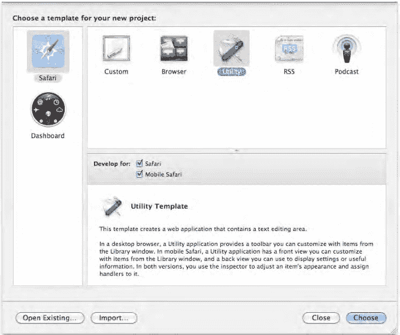

*图1-2. Dashcode 3.0中的新建项目窗口*

Dashcode是一款不错的工具，能生成小巧但功能齐全的Web应用程序，并在视图之间实现流畅过渡。此外，Dashcode大量使用模型-视图-控制器（MVC）模式来合理化和简化应用程序层之间的交互。然而，它并不适合我们的需求。

首先，它仅在运行Mac OS X的计算机上可用，将其使用范围限制在拥有Mac的开发者；如今，这部分开发者仍只占程序员的一小部分。

其次，它是可视化编程软件。你完全可以用Dashcode构建应用程序，而无需编写一行代码。这可能很方便，但我们的目的并非如此。作为本书的读者和专业的Web开发者，你需要完全控制你的代码，并且希望了解开发过程每个阶段发生的事情，以确保Web应用程序的质量。

最后，就像Dreamweaver和其他图形工具一样，它倾向于生成许多特定于框架的属性，使得整个代码难以修改和维护，并且生成了太多不必要的标记和JavaScript。在开发Web应用时，特别是针对移动浏览器等内存有限的设备时，轻量级代码应是首要考虑因素。

##### 使用正确的浏览器

为Web开发主要是为Web浏览器开发。虽然我们将特别针对Mobile Safari（在iPhone、iPod touch和iPad上使用的浏览器），但对这一领域的现状有清晰的了解会很有帮助。此外，如果你已经是一名Web开发者，你可能习惯于主要使用某个特定浏览器进行开发过程，并且在桌面浏览器上开发通常比在移动设备上更高效。

##### WebKit

为Apple设备开发时，你会始终特别关注Mobile Safari。当然，你可以努力使你的应用程序跨浏览器兼容，但这意味着即使不是功能减少，也需要更多代码。此外，正如你即将看到的，Mobile Safari并不像乍看起来那样局限。

Mobile Safari和Desktop Safari都基于WebKit布局引擎。该引擎从一开始就被设计为轻量级且符合标准。WebKit不仅实现了最新的W3C候选推荐标准，还实现了采用`-webkit-`前缀的草案阶段特性。

WebKit引擎还为开发者提供了一套完整的工具。我们将在第3章详细介绍WebKit的Web Inspector，你很快就会看到它在Web应用程序开发过程中能提供巨大帮助。

> **注意：** 开发iPhone（或iPod touch或iPad）Web应用程序的最佳选择是在Apple平台上工作。然而，你可以在Windows（无论是XP、Vista还是7）上轻松安装Safari。作为Safari的替代方案，我们推荐基于Chromium项目的浏览器，如Google Chrome、Chromium或Iron。这三者都可在Mac OS、Windows和Linux上使用。

WebKit被所有平台（包括移动设备）上的许多浏览器使用。其他你可能感兴趣的包括SymbianOS、Google的Android、ChromeOS、BlackBerry以及最近Palm的webOS。你为Apple浏览器构建的大多数Web应用程序应该也能在其他移动设备上运行。

##### Gecko和狐狸

浏览器市场的另一个重要参与者是Firefox，一个基于Gecko引擎的开源项目。它对标准的遵守非常好，你可能会欣赏Firefox的一个最大优点：它的社区。它通过丰富的附加组件（如Firebug）具有无限的扩展性，Firebug是一个全面且实用的开发和调试工具。这使得Firefox在开发具有与WebKit类似功能的Web应用时成为极佳的伴侣。

##### Opera

Opera也适用于所有操作系统。Opera团队一直将速度和遵守标准放在首位，尽管其浏览器市场份额不大，但它是前面介绍的浏览器的绝佳替代品，也是开发者的良好选择。事实上，Opera自带了一套开发工具Dragonfly。Opera也适用于移动设备（Opera Mini），与Mobile Safari不同，它是浏览器的大幅精简版，因此不会让你享受到桌面浏览器支持的所有标准。

##### Internet Explorer，迷失在大海中

如果你是Windows用户，正在考虑Internet Explorer，恐怕我们极不推荐将这款浏览器用于Web开发目的。尽管从3版到5版它绝对是一款先进的Web浏览器（第一个实现CSS支持的主要浏览器，以及第一个提供当时尚未命名的Ajax功能的浏览器），但它一直偏离标准，截至8版仍缺乏对许多特性的支持，例如CSS选择器和属性（即CSS2选择器和属性），在Acid3测试中得分仅为20/100。Internet Explorer 9似乎在这方面会有重大进步，但目前，基于Trident的浏览器并非一个选项。


#### 开发 Web 智能应用

Web 有标准，首要标准是万维网联盟（W3C）规范。这些规范为你，开发者，提供了构建出色 Web 应用程序的工具。这就是为什么在开发 Web 应用程序时，你首先关心的将是浏览器的 W3C 合规性。你选择作为首要目标的浏览器越合规，你的页面在其他平台上的功能就越完善，你需要做的额外工作就越少。

#### Acid...Acid...Acid

Web 标准项目是一个致力于推广和鼓励尊重及采用 Web 规范的组织。由于并非所有浏览器在完成这项任务上表现一致，该组织提供了一个工具来轻松检查排版引擎的跟进情况。该测试的最新版本称为 Acid3。

> **提示：** 要想知道浏览器在此测试中获得多少分数，只需访问 `http://acid3.acidtests.org/`，你将在几秒钟内得到结果。

Mobile Safari 以 100% 的通过率完成了测试，这很好，因为这意味着有很多可能性来增强你的应用程序。如果你出于开发目的使用另一个浏览器，你应该记住，你可能会无意中丢弃 HTML、CSS 和 JavaScript 中非常有趣的功能。

#### HTML5 一致性

虽然 Acid3 测试是评估浏览器 CSS 标准合规性的好方法，但它并没有明确指出具体支持什么。然而，你可以使用 `http://html5test.com/` 上的测试页面来检查浏览器对 HTML5 功能的支持情况，并获得一份关于已支持和未支持标准的详细表格。

此测试页面将列出所有新的 API、扩展和 HTML5 特性，并指出所用浏览器对它们的支持程度。Mobile Safari 在 300 分中获得了 125 分（以及 5 分额外奖励分）。虽然这看起来可能不高，但它实际上表明了对新标准的出色支持，尤其是对于移动浏览器而言。

要获取有关每个已实现功能的更多详细信息，列表中的每个元素都是一个链接，可将你直接带到规范的相关页面。

#### 你浏览器中的“卫星”

现代前端开发的另一个核心部分——尤其是 Web 应用程序开发——是 JavaScript。我们将在大多数章节中大量使用 JavaScript，并在第 10 章介绍面向对象的 JavaScript 编程。

浏览器脚本引擎对 ECMA-262 规范（最高版本 3）的合规性可以使用 Google 构建并可通过 http://sputnik.google.labs.com/ 访问的 Sputnik 测试来评估。它是一个开源测试，包含超过 5,000 个测试点。Safari 获得了非常好的分数，仅次于 Opera，排名第二。

#### 为 iOS 开发

尽管我们已经为你可能需要的所有工具介绍了跨平台选项，但你将为 iOS 开发，而以下软件，无论多么有用，仅在 Macintosh 系统上可用。如果你没有 Mac，也请继续阅读；虽然你不会从以下部分描述的应用程序中受益，但我们将为你介绍开发之旅的有用资源。

#### 使用 iPhone 和 iPad 模拟器

在开发 Web 应用程序时，不想使用 iPhone 设备的原因有很多。好消息是，只要你注册成为 Apple 开发者，Apple 就提供了一个免费的工具，恰好能完成你需要的工作。只需在 http://developer.apple.com/ios/ 注册即可。然后，下载并安装免费的 iOS 软件开发工具包（SDK），特别是其模拟器，如图 1-3 所示。

> 注意：在下载之前，请准备好一些茶点。这将是一个接近 3GB 的下载。安装完成后，iPhone 和 iPad 模拟器应用程序将位于 /Developer/Platforms/iPhoneSimulator.platform/Developer/Applications/ 文件夹中。如果你不想在每次开始工作前都疯狂地寻找它，请将快捷方式拖到 Dock 栏或桌面上！

模拟器的主要好处是你不需要实际拥有一台合适的设备来进行测试，并通过反复加载页面来耗尽你的电池。此外，它不仅支持 iPhone 模拟，现在还使用真实版本的 Mobile Safari 模拟 iPad。它还允许你在不同版本的 iOS 上运行测试，而无需经历漫长而烦人的设备重新初始化过程。

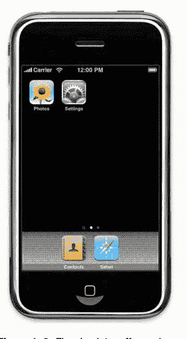

图 1–3。*模拟器仅提供适合开发目的的最小应用程序集*

这将是你能在桌面上获得的最接近 iPhone 的体验。至于非 Mac 用户，我们只能建议你在合适的 iPhone、iPod touch 或 iPad 上对你的所有代码进行双重测试，以正确了解实际设备的行为。

##### 还是使用真实设备

使用模拟器，你将获得更少的功能，仅为开发所需的最低限度。请考虑到模拟器使用你的桌面计算机作为资源，其性能可能比在设备上更好。因此，第 8 章和第 9 章涵盖的过渡、高级视觉效果或多媒体内容应在目标产品上进行系统测试。

此外，由于屏幕尺寸确实有影响，你应该始终检查所有文本和元素（如按钮）是否可读且可用，以免损害 Web 应用程序的用户体验。

##### ADC 是你的朋友

无论你是否有 Mac 可以安装模拟器，注册总是个好主意。Apple 开发者联盟（ADC）是一个资源丰富的地方，可以浏览并获取帮助。成为注册开发者将为你提供提示、屏幕录像、访谈等等。如果你能筛选掉与你无关的信息（即关于原生 iOS 应用程序开发的信息），你会发现 Apple 自己的信息是多么有用。最好的起点是 Safari 开发页面（http://developer.apple.com/safari/），那里有关于受支持功能的有趣信息。

#### 总结

到现在，你应该已经拥有一个功能性的开发环境。无论你选择了 Komodo Edit 还是其他优秀的编辑器；无论你选择了 Safari、其他 WebKit 浏览器，甚至是 Firefox；无论你是否成功安装了模拟器——你都已经具备了使你的开发过程更轻松、更高效所需的一切。你也已经积累了一些背景知识，可以舒适地继续阅读本书。

在接下来的两章中，你将开始动手实践。为了让你拥有完美的开发环境，我们将引导你在计算机上安装服务器，以便你可以托管你的项目。然后，你将通过熟悉一个绝对节省时间和精力的工具——调试工具——来磨砺你的开发工具。

#### 第 2 章

##### 开发环境

你现在有了创建工具和测试工具。在第 1 章中，我们建议为了正确评估你的应用程序，无论你针对的是哪个设备，你都应该始终在合适的设备上进行彻底测试。同样，了解你的页面在用户端表现如何的最可靠方法是从开发过程开始就在接近真实的条件下使用它们。

一旦你的应用程序准备就绪并焕发光彩，你就需要将其托管在服务器上，以便它能在整个万维网上提供服务。同样合理的是，在开发阶段，你可能不想将你的网站托管在生产平台上。因为一些限制和缺点仅在网站托管时才会出现——同时也带来了一些便利——我们将引导你完成在工作机上安装本地服务器的、并不像你想象的那么困难的过程。

你的新服务器将提供你开发 Web 应用程序和学习本书示例所需的一切。请主要将其视为另一个工作工具。只需遵循本章的步骤，你不会接触到高级功能或花哨的配置。无论你的平台是什么，你都将拥有一个准备就绪的服务器，它可以托管你的页面并使它们对共享同一无线网络的外部设备可用。

###### 托管 Web 应用程序

我们提到过，在直接在本地文件上开发 Web 应用程序时会有一些限制。在你着手安装本地 Web 服务器之前，这里有一个例子：你已经构建了一个带有建议功能的搜索应用程序；当用户开始输入一个单词——砰！——他要输入的那个词就出现在他面前了！为此，你从某个远程站点的列表中检查单词。你已经从本地文件彻底测试了你的应用程序，它运行得非常出色。然而，当你将其上线时，魔法消失了——不再有建议出现。这是因为，此类功能的底层技术 Ajax，只有在请求来自同一来源时才有效。当你进行测试时，这种“跨域”限制没有发生，因为本地文件没有域，并且使用 `file://` URL 方案，

执行上下文有所不同。这就是为什么你之前从未注意到这个问题——直到为时已晚。

你在开发过程中使用iPhone模拟器或真实设备时——你也应该这样做——的另一个缺点是，两者都无法访问你本地文件系统上的文件。托管你的页面是使用模拟器以及你的目标设备——iPhone、iPod touch或iPad——的必要步骤。

##### **Mac OS，让事情变得简单**

最新版本的Mac OS X附带了搭建一个可用服务器所需的所有组件。虽然网站托管对开发者（以及其他人员）很有用，但通常这不是他们主要的专业领域。幸运的是，配置过程已经变得极其简单明了。只需按照接下来章节中的步骤操作即可。

##### **你Mac中的Apache**

从苹果菜单中打开系统偏好设置...，然后在出现的窗口中，打开互联网与无线部分。点击共享图标，并选择Web共享复选框（参见图2-1）。搞定了？好消息——你的服务器已经设置好了！

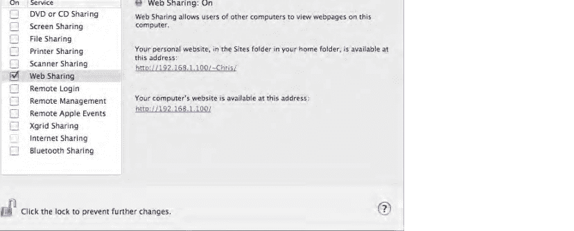

图2-1. Mac OS X共享面板

点击个人网站链接、Safari或你默认的任何网页浏览器，将打开一个窗口，显示你新个人站点的默认文件，如图2-2所示。你可以在/Users/username/Sites/文件夹中修改和添加此站点的文件，其中username是你的会话用户名。

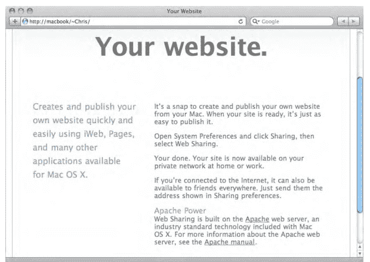

**图2-2.** *默认网站*

第二个链接将引导你到计算机的网站。访问此URL将显示在Apache默认安装中常见的“It works!”消息。此网站的文件位于/Library/Webserver/Documents/文件夹中。

如果你记不住像192.168.1.100这样的URL，或者懒得输入，你也可以使用计算机名访问你的站点。URL看起来像http://computername.local/~username/。

这些简单的步骤允许你使用你的主要语言——HTML、CSS和JavaScript——来构建网站。这是你需要开始构建托管Web应用程序的最小配置，但对于构建现代网站，你可能希望使用某种服务器端脚本语言来增加网站和用户之间的交互。我们将在本书的一些示例中使用PHP，因此我们建议你按照这些步骤操作。这不像安装的第一部分那样“点击即走”，因为你将需要管理员权限来修改配置文件。不过，别担心：它并没有看起来那么难。

###### 脚本引擎

打开一个终端窗口，输入以下命令：

```
sudo vi /private/etc/apache2/httpd.conf
```

系统会要求你输入管理员密码。你可能就是你的计算机的管理员，那么密码就是你的会话密码。但是，如果你使用的是公司电脑，你可能需要请别人帮你输入。apache2配置文件应该会在终端窗口中的Vi编辑器中打开。

> **注意：** 我们在本书中不会经常使用命令行工具编辑文件。但是，当我们使用时，我们将使用众所周知的Vi。如果你不熟悉命令行文本编辑器，你可能会觉得它们有点可怕。它们通常学习曲线很陡峭。然而，因为有些编辑器很流行且功能非常丰富，我们认为在这里介绍一个。

相反，如果你不是Vi的粉丝，并且已经安装了Komodo Edit，请查看在 **Komodo ▶ Preferences...** 菜单项中启用Vi类型行为的选项；选择 **Editor ▶ Key Bindings**，然后选择Enable Vi emulation，即从上往下数第二个选项。

文件打开后，将光标向下移动，直到看到类似这样的行：

```
...
#LoadModule php5_module            libexec/apache2/libphp5.so
#LoadModule fastcgi_module          libexec/apache2/mod_fastcgi.so
...
```

你需要通过删除 # 符号来取消注释这些行，以启用这些模块并允许PHP脚本正确执行。为此，输入 **a**（用于追加），像在任何编辑器中一样取消注释这些行，通过输入 **esc** 退出编辑模式来保存你的更改，然后输入 **:wq**（用于写入并退出）。

要使你的配置更改生效，请通过取消选择并重新选择系统偏好设置中的Web共享选项来重启服务器，或者直接从你的终端窗口输入以下命令：

```
sudo apachectl restart
```

你可能想知道你刚刚做了什么。第一行告诉服务器加载PHP5模块，允许你在服务器端运行PHP脚本。PHP是一种流行的、开源的、功能非常强大的通用脚本语言。在其最新版本中，它具有面向对象编程和许多使开发者生活更轻松的功能。

第二行允许将脚本执行与其他服务器任务分离。简单地说，服务器和PHP模块——或任何其他实现FastCGI协议的模块——作为独立的应用程序运行，具有不同的资源和进程。这相应地意味着，如果一个脚本导致PHP崩溃，服务器不需要重启。

所以，你甚至没有注意到，你就做到了：你已经在你的工作机器上设置了一个带有PHP5的服务器，使开发过程既更简单又更专业。如果你是好奇的那种人，我们打赌你甚至已经在新站点上修改了一些东西（当然，如果你是Mac用户的话）。接下来是在Windows机器上实现类似结果的指南。

##### Windows，选择你的武器

要在Windows机器上安装服务器，你的第一步是获取Internet Information Services (IIS)和运行PHP的组件。微软最近在这方面做出了巨大努力，使这项任务比以前容易得多。http://php.iis.net/，如图2-3所示，是一个专门用于服务器安装的网站。前往那里，点击Install PHP按钮。


**图2-3.** *微软为IIS提供的PHP*

当然，你可以使用任何网页浏览器访问此网站并进行操作，但我们建议你使用Internet Explorer进行以下操作，以确保一切按计划进行。

###### 一体化安装过程

按照屏幕上的说明操作。系统会要求你下载Web Platform Installer (Web PI)，这是一个轻量级工具，它将帮助你以惊人的轻松程度在你的机器上部署完整的Web服务平台。

> **注意：** Web Platform Installer需要.NET Framework 2.0版本。如果令人惊讶的是，你的.NET版本已过时或在Windows XP上不可用，它将引导你完成升级，然后继续常规的服务器安装。

此外，安装程序不能在更基本版本的Windows上工作，包括Windows Vista Home Basic和Windows 7 Starter Edition。

下载完成后，运行该应用程序。如果你使用的是Vista或7，系统将询问你是否允许在浏览器中运行Web PI附加程序。点击浏览器标签页下方的栏（图2-4），并通过选择 **Run ActiveX Control**（适用于Vista）或 **Run Add-on**（适用于7）来批准。如果你有疑虑，可以从下拉菜单中获取将要发生的事情的详细信息。不过，这是Windows软件，所以你可以信任它... 仅在7上，在程序运行之前，你将被再次要求允许。这是常规过程，只需点击Allow继续即可。

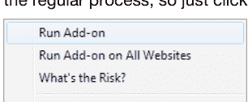

**图2–4.** *点击Run Add-on启动安装程序*

在此阶段，应出现一个窗口，其中已选中Install PHP复选框，如图2–5所示。你可能喜欢的是，从左侧的标签页中，你可以选择在基础服务器之外安装流行组件。这些组件包括开源内容管理系统、电子商务解决方案和维基引擎。如果其中任何软件选择引起了你的兴趣，只需选择相应的框，如图2-6所示，安装将无缝地添加。


图 2–5. *Web 平台安装程序*

图 2–6. *轻松设置*

无论您是否选择为服务器添加额外功能，请接受许可协议，然后等待安装完成。除非您使用拨号上网，否则此过程应该很快。现在您可以返回浏览器并输入 `http://localhost/`。这就是您的本地网站！

现在，您可以掌控您的网站，并且——何乐而不为呢？——使用您在控制面板中可以找到的专用 Internet 信息服务（IIS）管理器管理工具来添加更多网站。

然而，您还需要执行最后一步，才能使此站点对外部设备可用，即允许 Windows 防火墙访问 Web 服务。在 XP 和 Vista 上的操作类似。您会发现，在 Windows 7 防火墙中添加例外略有不同。

##### 安全设置

在 Windows XP 上，打开开始菜单，从控制面板窗口中选择安全中心。选择窗口底部的“管理安全设置：Windows 防火墙”。点击“例外”按钮，您将看到“添加端口...”选项。点击此按钮，添加一条 TCP 端口 80 的条目，使您的站点可用。

> **警告：**如果您安装了某种安全软件，您系统上使用的防火墙可能不是 Windows 防火墙。我们无法涵盖所有此类配置，因此建议您查阅软件文档。

在 Vista 上，从控制面板中，点击安全部分下的“允许程序通过 Windows 防火墙”，如图 2–7 所示。然后按照 XP 的步骤继续操作。

**图 2–7.** *在 Windows Vista 上步骤很简单*

最新的 Windows 系统增加了很多配置功能，失去了在 XP 或 Vista 上可以体验到的一些简单性。不过，只要您知道要去哪里，操作仍然相当简单。

打开控制面板后，在“查看和创建防火墙规则”部分的底部，选择入站规则选项，如图 2-8 所示。然后，在新出现的屏幕中，点击右侧窗格顶部的新建规则。向导将指导您完成后续过程。

图 2-8. *Windows 7 上的具有高级安全性的 Windows 防火墙*

选择添加端口规则，然后点击下一步。在那里，选择 TCP 协议并指定 80 作为本地端口。在接下来的两个屏幕上，保持所有选择不变。然后为您的新规则命名，并点击完成按钮保存它。

至此，您基本准备好在 Windows 服务器上构建 Web 应用程序了！您可以开始将文件添加到默认站点位置，即 *C:\Inetpub\wwwroot\* 目录。

然而，使用您的工作机器向 Apple 设备提供页面有一个限制。因为 Microsoft 和 Apple 使用不同的通信协议，您只能使用 IP 地址访问您的站点。要了解您的 Windows 操作系统正在使用什么 IP，只需在命令提示符处运行 `ipconfig`。这将返回当前使用的 IP。

##### Linux，掌控

对于 Linux 安装过程，我们将带您走命令行路线。这主要有两个原因。首先，我们相信这是在 Linux 机器上安装 Apache 服务器最简单的方法。其次，在众多 Linux 发行版上安装软件包的图形化工具太多了，我们无法一一涵盖。无论如何，通过命令行设置启用 PHP 的 Apache 服务器非常简单，所以不用担心。

> **注意：**我们在示例中使用 `apt-get`，这是广泛使用的高级软件包工具（APT）的前端，特别用于 Debian 和 Ubuntu 发行版。无论您的内核版本如何，软件包名称都是相同的，而且它们很可能就在发行版的软件仓库中。只需检查您应该使用 `yum` (`yum install ...`)、`pacman` (`pacman -S ...`) 还是其他工具。

如前所述，安装从打开终端窗口开始，您的第一个命令将是：

```
sudo apt-get update
```

Shell 将更新您的软件包数据库。这是为了确保您进行干净的安装，版本不会混淆，并且没有依赖问题。接下来是实际的安装命令。然后您再次使用 `apt-get`，但带有 `install` 选项。在一行中输入：

```
sudo apt-get install apache2 libapache2-mod-php5 php5-mysql
```

在软件包安装期间，终端窗口中会出现几秒钟的输出，然后您将再次看到提示符。就是这样！

根据您的发行版，您的服务器文件不会位于相同的目录中。在基于 Debian 的发行版中，根目录是 `/var/www/`。因为我们无法在此列出所有可能的情况，建议您访问 Apache 的 wiki：http://wiki.apache.org/httpd/DistrosDefaultLayout。此页面引用了您需要了解的所有信息，包括最重要的 Apache 文件在您的系统上的位置。无论您使用哪种 Unix 版本，您都可以在浏览器中通过 http://localhost 访问您的站点。

服务器安装的最后一步是将其设为您自己的，即更改为您的所有权。这可以使用 `chown` 命令（CHange OWNership）在命令行上轻松完成：

```
sudo chown -R username /var/www
```

现在，您可以修改网站上的所有文件和目录，而无需使用安装时使用的 `sudo` 命令。这并不难，对吧？

##### 处理多个主机

无论您的开发平台是什么，您都已设置了一个服务器来托管您即将推出的所有 Web 应用程序。如果您想在真实条件下测试您的 Web 应用程序，还有一件事需要设置。

这至少有一个原因：当使用 Ajax 时，所谓的跨域限制当然不会适用，如果您将所有页面都托管在 localhost 域上。

为了解决这个问题，您必须在计算机上创建一个不同的本地主机。您可以通过修改系统上的 hosts 文件来定义新的域名，这些域名应指向您的本地服务器，从而实现这一点。这将反过来允许您在这些域上测试页面，就像它们在万维网上一样。

> 注意：请注意，虽然您可以使用任何顶级域名（TLD）的任何 URL，但我们建议您不要使用现有的 TLD，以避免与现有网站冲突。将您的本地站点命名为 apple.com 意味着您将无法再访问实际的 Apple 网站！

###### 基于 Unix 的系统

hosts 文件通常嵌套在 /etc/ 目录中，与您的 Apache 配置文件相同。在大多数 Unix 和 BSD 系统上，它应该位于此文件夹的根目录下，与其他系统范围的配置文件在一起。由于编辑此类文件需要 root 权限，我们将使用 Vi 在终端中打开它，运行以下命令：

```
sudo vi /etc/hosts
```

屏幕上会出现一个相当短的文件，看起来像这样：

```
##
# Host Database
#
# localhost is used to configure the loopback interface
# when the system is booting.  Do not change this entry.
##

127.0.0.1	localhost
```

在此行之后，按照相同格式向文件添加另一个规则，使用 127.0.0.1 和您的站点名称。

```
127.0.0.1	localhost
127.0.0.1	www.example.local
```

现在您可以保存文件并在浏览器中测试这个新创建的域。您应该看到与之前使用 Web 服务器配置的相同页面。

###### 基于 Windows 的系统

在 Windows 系统上，可以使用任何文本编辑器编辑此文件，无需特殊权限。例如，您可以在这里使用 Komodo Edit。/etc/ 目录位于 C:\\Windows\\System32\\drivers\\，您可以在那里找到 hosts 文件。

其内容看起来与 Unix 和 BSD 系统的很相似。您应该应用与上一节相同的更改。您的更改将自动生效。

###### 配置多个网站

现在，作为额外内容，我们将介绍最后一件事。此步骤不是必需的；我们只是认为你们中的一些人可能会需要它。具体来说，我们将解释如何在服务器上创建多个站点。因此，在处理多个项目时，您不必使用子文件夹，而是可以让您的浏览器理解正确的地址。

除了在不同文件夹中使用不同站点名称的组织优势外，您还将受益于“根目录”的概念，无论是 PHP、HTML 还是 CSS。

实际上，在 PHP 中，您将使用 `$_SERVER['DOCUMENT_ROOT']` 环境变量访问此信息。编写 HTML 和 CSS 时，如果 URL 以斜杠 (/) 字符开头，浏览器将理解您调用的路径将从目录结构的顶部向下开始。在站点 http://localhost/example/ 上，/images/hey.png 表示 http://localhost/images/hey.png。

###### Apache 2：尽情发挥

以下步骤适用于 Apache 服务器，换句话说，是您在 Mac OS X 和 Linux 平台上安装的服务器类型。作为幸运的 Unix 用户，您仍然需要稍作调整，因为正如您之前所经历的，所有平台安装 Apache 的方式并不相同。您必须找到 Apache 的主配置文件，您将对其进行修改。管理虚拟主机还有其他方法，但这最接近平台无关性。

###### 检查配置

就像安装部分一样，您将再次在终端中使用 Vi 编辑文件。打开终端窗口，根据您的系统输入以下两个命令之一：

```
sudo vi /private/etc/apache2/httpd.conf     # 在 MacOSX 上
sudo vi /etc/apache2/apache2.conf           # 在 Debian 上
```

将打开一个文件，其内容因系统而异。您要做的第一件事是检查以下两行：


##### 确保 Apache 在端口 80 上监听

Listen 80

##### 在所有 IP 地址上监听虚拟主机请求

NameVirtualHost *:80

如果它们已存在，很好，你可以进入下一步。如果不存在，你应该在文件末尾添加它们。要在 Vi 中执行此操作，请将光标移至文件末尾，并再次输入 a（用于追加）进入编辑模式。这些规则确保你的 Apache 服务器将在端口 80 上监听 HTTP 请求，无论 IP 地址是什么（这就是使用 * 的原因）。

##### 配置你的第一个虚拟主机

接下来是创建实际的虚拟主机。至少，你需要为你的站点命名（一个 URL）以及文档根目录的路径（你的文件将放置的位置）。在配置文件的末尾，使用你想要的名称和路径添加以下代码：

```
<VirtualHost *:80>
    DocumentRoot /var/www/example
    ServerName www.example.local
</VirtualHost>
```

> **警告：** 使用此指令添加虚拟主机将覆盖最初安装的主主机。为防止这种情况，你应该在添加新的虚拟主机之前，使用该主机的全局服务器名称和文档根目录创建一个虚拟主机。你需要在你正在编辑的主 Apache 配置文件中找到所需的信息。

一旦你完成了所有需要的更改，你可以保存文件并退出 Vi，方法是按 Esc 键，然后输入 :wq（写入并退出）。然后，重启你的服务器。如果你是 Mac 用户并且已经按照 Apache 安装过程操作，你已经知道如何做了。对于 Debian 用户，运行以下命令：

```
sudo /etc/init.d/apache2 restart
```

Apache 现在知道你的站点存在，但系统的其余部分不知道，除非你将其添加到 hosts 文件中。为此，你应该按照前面解释的步骤修改此文件。

你现在可以在浏览器中检查你的新站点，输入你选择的服务器名称。应该会出现一个相当空的页面，因为你的文档根目录没有文件。然而，它是可用的，所以我们将在接下来的章节中与你相遇，用令人兴奋的自制 Web 应用程序填充它。

##### Windows 的情况

如果你是 Windows 用户，是否能设置虚拟主机取决于你安装了哪个操作系统。在 Vista 之前，无法在工作站上配置多个站点。XP 用户只能通过编辑他们的 hosts 文件来模拟多个站点，如前所述。

然而，对于 Vista 和 7 用户，你可以通过更改**控制面板 ▸ 管理工具 ▸ 计算机管理**中的 Internet 信息服务配置来访问此功能。然后，在出现的窗口中，在左窗格中展开“服务和应用程序”部分，并选择 Internet 信息服务管理器。

> **注意：** 如果在 Windows 7 下没有出现相关菜单，请从右上角的弹出菜单中将控制面板窗口的显示模式更改为小图标或大图标。

此时，你的窗口应如图 2-9 所示。

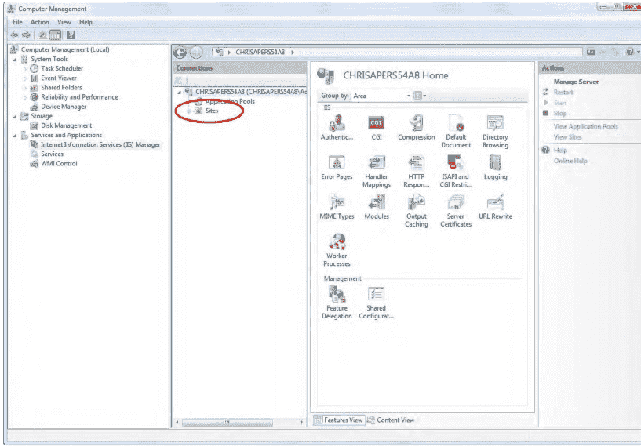

接下来，在左侧第二个窗格中右键单击 Sites 目录，然后从上下文菜单中选择**添加网站**。出现的表单非常简单，如图 2-10 所示。只需填写你想要的站点列表名称、其根目录路径以及你希望通过其访问的 URL。

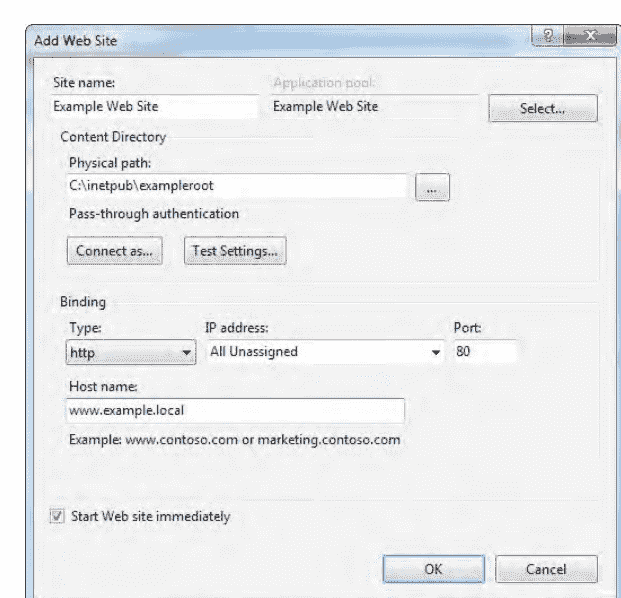

图 2-10. Web 站点配置面板

你的站点现在可以启动了！如果你似乎无法从 Web 浏览器访问所需的 URL，请检查它是否已添加到你的 hosts 文件中。否则，你的机器将不知道应在本地查找此地址。

##### 你成功了吗？

这不比你预期的更容易吗？设置基本服务器不一定是一项复杂的任务，尤其是因为两大操作系统公司已付出巨大努力使其更易于访问。如果你是“眼见为实”类型，这里有一个完美的测试给你。在你的服务器根目录中创建一个 PHP 文件。在 Komodo Edit 中，可以通过菜单项 File > New > New file… 并选择 PHP 文件模板来完成此操作。在新创建的文件中，输入以下代码：

```
<?php
    phpinfo();
?>
```

将文件保存到你的服务器根目录，命名为 index.php。现在在浏览器中打开你的本地站点：你应该会看到包含服务器配置详细信息的表格。这意味着两件事。首先，你运行了一个 PHP 脚本，这意味着一切正常；其次，你可以检查新服务器上所有可用的选项。

> **警告：** 如果你的浏览器提供下载文件，说明安装过程中出了问题。检查前面描述的步骤，找出遗漏了什么。

此时，你甚至可以在你最喜欢的 Apple 设备中打开此页面。只需要检查几个条件：对于所有系统，你需要你的计算机和设备使用相同的 Wi-Fi 连接。使用 SDK 模拟器时总是如此，因为服务器和模拟器共享同一台计算机。在 Windows 系统上，如前所述，你必须输入 IP 地址，而不是计算机名称。

在所有情况下，如果你选择 IP 地址方案，请注意大多数 Wi-Fi 连接使用动态主机配置协议（DHCP）。这意味着 IP 地址将是动态分配的，因此可能会改变：虽然你可能在任何时间在家庭或办公室使用相同的 IP 访问你的服务器，但从一个切换到另一个——或在星巴克建立连接——可能需要你进行更改。

##### 打赌你成功了！

好了，你已经开始在这里做令人兴奋的事情了。也许第一次，你设置了一个功能齐全的服务器，在向世界展示之前托管并提供你的进行中的作品。也可能你现在对网站如何运作有了更好的理解，这也是一个优点。现在，最后但绝对不是最不重要的是，我们必须做的一件事是介绍你将通过你的 Web 应用开发者生活广泛使用的工具：调试工具。

## 第 3 章

### 介绍开发者和调试工具

为 Web 开发是否需要特定的调试工具，或者这些工具是否存在，这并不明显。不久前，前端开发严重缺乏分析和调试页面组件的良好工具。但 Web 已经发生了巨大变化：前端调试工具蓬勃发展，如今大多数主要浏览器都内置了调试工具或易于添加的扩展。

这些解决方案的激增是最近的事情，但绝非令人惊讶。构建网站通常意味着将标记语言、样式语言和脚本语言紧密结合起来。随着网站变得越来越复杂，跟踪所有这些构建块的所有元素可能会变得越来越复杂。

因为我们即将专门使用 Mobile Safari，这是一个基于 WebKit 的浏览器，并且因为 WebKit 为 Desktop Safari 提供的调试工具设计得非常好，所以让我们从 Safari 的开发者工具开始。你现在距离处理真实代码只有一步之遥，我们向你保证，掌握这些工具将为你节省大量时间和麻烦。

在本章中，我们将讨论 Safari 中的开发者工具。我们介绍的功能大多数在其他 WebKit 浏览器中也可用，但我们不能保证所有功能都能在相同的位置或使用相同的过程找到。

#### 与 WebKit 的开发者工具交朋友

WebKit 不仅提供了对网络标准的出色支持，还提供了高级工具，例如出色的实时文档和样式编辑器以及功能齐全的 JavaScript 调试器，以使前端开发人员的工作更加轻松。这些将帮助你在开发过程的不同阶段大大加快你的开发速度。从简单的 HTML 标记控制到遵循最新 HTML5 标准的数据库管理，我们将帮助你激活并最好地使用这些工具。


#### 启用开发菜单

要在 Safari 上使用这些工具，第一步自然是启动 Safari。从偏好设置窗口（文件 ▶ 偏好设置…）中，选择“高级”选项卡。在此部分，你需要选中“在菜单栏中显示开发菜单”选项（参见图 3-1）。现在，你的浏览器菜单中多了一个名为“开发”的菜单项。你还可以在工具栏中添加一个“i”按钮，并且随时可以通过在网页上右键点击任何元素，并从上下文菜单中选择“检查元素”来访问这些工具。

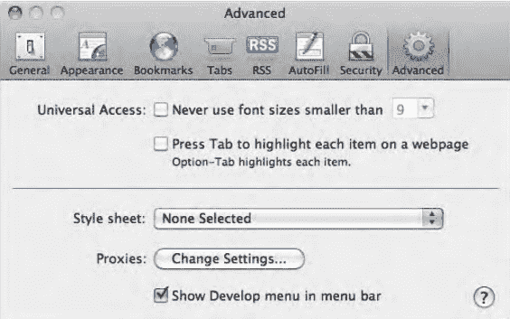

**图 3-1。** *你可以在高级偏好设置中启用开发菜单*

#### 开发菜单详解

现在，让我们来探索一下图 3-2 所示的开发菜单。你的第一个选项允许你在计算机上任何其他可用的浏览器中打开当前页面。由于我们主要针对 Safari，你可能不太会用到这个选项。

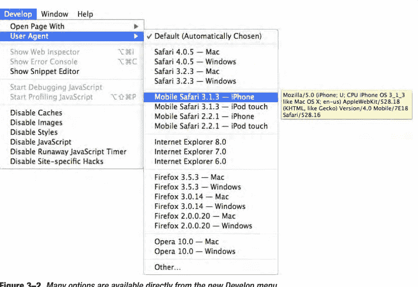

**图 3-2。** *许多选项都可以直接从新的开发菜单中访问*

然而，第二个选项可能会更常用。启用 WebKit 开发者工具后，你可以更改 Safari 的用户代理（User Agent），这在技术上意味着更改浏览器发送给远程服务器的、用以标识自身身份的字符串，包括引擎、引擎版本等。如果你正在桌面版 Safari 上进行开发，但想要实现浏览器或平台嗅探功能（而不是依赖功能检测）来为特定用户启用某些功能，或者想要访问一个被阻止其他浏览器（非 Mobile Safari）访问的网站，这将会很有帮助。通过此菜单更改桌面浏览器发送的用户代理头信息，将使网站将你的客户端识别为 iPhone、iPod touch 或 iPad 上的 Mobile Safari。

“显示 Web 检查器”和“显示错误控制台”这两个选项都会打开 Web 检查器，分别聚焦于“元素检查器”和“控制台”部分，我们很快会详细讨论它们。

“代码片段编辑器”菜单项会打开一个不同的窗口。代码片段编辑器背后的理念是，构建或调整网页可能是一个繁琐的过程。创建文件、修改、保存、在浏览器窗口中重新加载以及重新开始，这个过程可能很长，并且需要在许多窗口和应用程序之间切换。代码片段编辑器在同一个双面板窗口中处理所有这些操作。我们在这本书中广泛使用它来测试代码示例，因此我们相信它对你也会有很大帮助。

窗口的上半部分用于编写代码。它支持 HTML、CSS 和 JavaScript，并且可以处理大量代码。下半部分会在你输入时实时更新，显示代码在正常浏览器窗口中的呈现效果。在原型设计阶段，这可以让你轻松地测试代码并尝试多种替代方案。

接下来的条目让你可以直接访问 Web 检查器窗口内的高级 JavaScript 调试工具。这些工具将通过提供选择性研究代码行为和组件的工具，让你快速调试脚本。同样，我们很快会深入探讨这些内容。

最后一组选项允许你修改浏览器的行为。显然，最终用户削弱浏览器功能的情况不太可能发生，因为所有这些特性，尤其是图形界面和 JavaScript 功能，都是 Web 应用程序身份的核心。在 JavaScript 被禁用的情况下访问如今丰富多彩的 Web 几乎是一项不可能的任务，并且你可能不希望在没有客户端脚本的情况下开发应用程序。不过，你应该考虑到你的一些用户可能不会启用脚本执行，因此仍然应该提供可理解的内容。

尽管如此，**禁用缓存**选项会带来一些好处，因为它不仅是测试首次访问加载时间的最佳方式，还会让你在 HTML5 高级缓存功能不可用时测试你的页面。

#### 在 Mobile Safari 上开发

我们花点时间来谈谈 Mobile Safari。与我们即将介绍的内容相比，iPhoneOS 浏览器上可用的功能有限，因为你只能使用控制台。你可以通过轻点 **设置 ▸ Safari ▸ 开发者**（在最底部）并将调试控制台选项切换为开启（参见图 3-3）来打开控制台。还要注意，你将能够禁用 JavaScript 或 Cookie，并清空浏览器缓存以模拟特定的浏览条件。

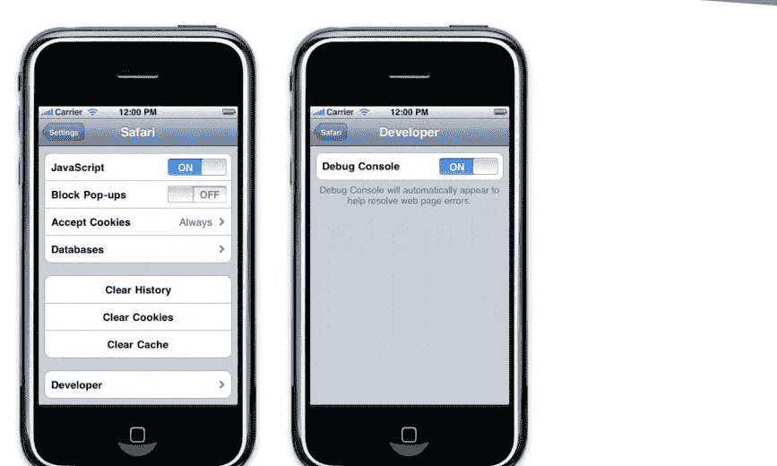

**图 3-3。** *你可以从 iPhone 设置中打开控制台*

之后，调试控制台将显示在 Mobile Safari 窗口地址栏的正下方，显示页面中 HTML、CSS 和 JavaScript 错误的数量，如果没有错误发生，则显示“无错误”（图 3-4）。提示和自定义消息也可以通过我们将在本章后面探讨的 Console API 来显示。


**图 3-4。** *调试控制台出现在地址栏下方*

轻点错误数量将打开一个错误列表，显示每个错误发生的行号，并提供按类型（HTML、CSS、JavaScript 或全部）过滤错误的选项（参见图 3-5）。

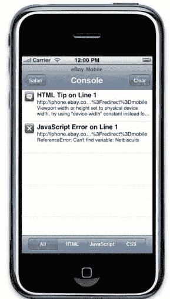

**图 3-5。** *控制台显示所有消息*

不过要小心：控制台会在日志条目过长时将其截断。尽量不要生成超过两或三行的日志，并始终专注于你需要的核心信息。为了减少这种限制，你仍然可以旋转设备以使行变长，这样你的两行可以容纳稍多的内容。

#### Web 检查器概览

在分别介绍 WebKit 的 Web 检查器的每一项功能之前，最好的方法是先从整体上了解这个工具。首次调用开发窗口时，默认情况下会启动一个新窗口。一旦你使用过一次，你上次的选择——独立窗口或停靠窗口——将自动应用。

> **注意：** 从现在开始，我们将把 Web 检查器统称为 *窗口*，无论其处于窗口还是停靠状态。同样，我们将检查器与浏览器窗口相关联，尽管显然你可以为任何浏览器标签页打开一个 Web 检查器实例。

#### 开发者工具窗口

在窗口顶部（图 3-6），你会找到一系列作为标签页的主要图标，让你可以访问各种调试工具。它们按出现顺序分别代表元素检查器、资源跟踪器、脚本调试器、时间线检查器、脚本分析器、客户端存储管理器、审计和控制台。

同样在 Web 检查器的上部右侧，是一个搜索字段。这个字段是上下文相关的：它允许你在当前视图的主区域内执行高级搜索。例如，如果你正在处理 HTML 标记，在此字段中执行搜索将搜索文档中的元素；在“分析”选项卡上运行查询将返回所有分析数据中的查询元素。

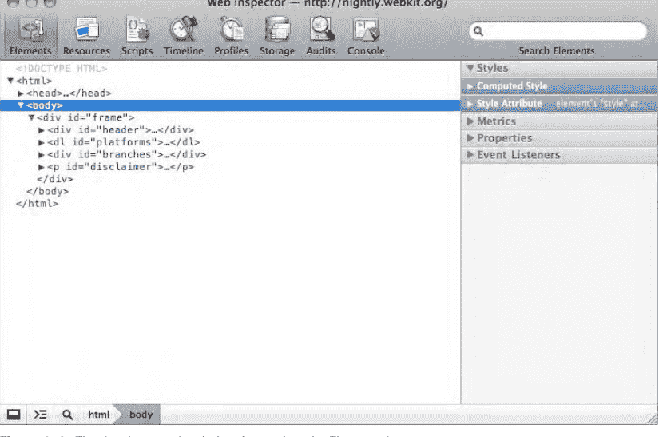

在窗口底部，有几个图标会因你使用的工具不同而有所不同。不过，在调试工具的所有部分中，你都会找到一个窗口图标和一个显示箭头的线条图标。第一个图标让你可以将 Web 检查器窗口停靠到其父窗口，如果你同时处理多个页面并为每个页面启动一个调试器实例，这非常有用。它还可以防止你不小心从错误的窗口查找和编辑代码！

第二个图标将启动一个控制台。控制台无论你当前使用哪个工具都可以访问。可以通过按 Esc 键触发。在这些图标旁边，

如果你正在检查页面中的某个HTML元素，该元素在文档树中的路径将以“面包屑”方式呈现（如图3-6中的“html > body”），帮助你轻松导航文档。

检查窗口的一个强大功能是它与你当前工作的页面紧密关联。该窗口中的数据会随着页面的修改而更新。如果你点击链接跳转到不同页面，检查器的内容也会完全改变。因此，每个调试器实例只能检查一个窗口。这应该不是问题，因为无论你打开了多少个页面，都可以根据需要打开任意数量的检查器窗口。

#### 错误通知

如果页面中出现问题——这是检查代码的合理理由——你应该首先查看的位置之一是Web Inspector窗口的右下角（图3-7）。在那里，如果WebKit解释器识别出代码中的错误，你会看到一个红色数字，前面是白底红叉表示错误，旁边还有另一个黄色数字和警告标志表示警告。

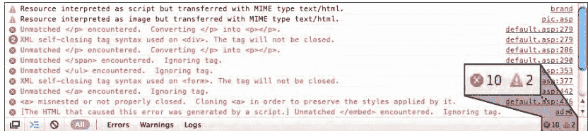

**图3-7。** *两个图标指示当前页面抛出的错误和警告；这些将在控制台中描述*

点击这些数字会打开一个控制台区域，其中列出了报告的错误和警告，以及WebKit为修复它们而执行的操作和它们在文件中出现的行号。

例如，在XHTML文档中，经常会混淆自闭合标签和需要完全闭合的标签。如果你使用`<link>`标签并用对应的`</link>`将其闭合，你会收到以下消息：

未匹配的`</link>`遇到。忽略标签。YourPage.html:14

这允许你使用指定的行号在源代码中搜索该元素，该行号也是一个链接，将直接带你到相关行，使用我们即将介绍的资源查看器。

这里的“忽略标签”并不意味着你的链接将被完全丢弃；它只是意味着意外的闭合标签将被忽略，不会出现在DOM树中。这就是WebKit解释你的代码以渲染页面的方式。请注意这些错误，因为它们可能导致副作用；例如，不闭合`<script>`或`<canvas>`等标签会导致其后的元素被视为脚本或画布内容——并且不会显示。

#### 掌握你的代码

或许开始使用WebKit的Web Inspector最明显的方式是从你的Web应用程序的基础开始：HTML标记。这可能也是最简单的方式。元素检查器可以通过不同的操作访问。所有方法都有其优点，我们现在将介绍。

#### 让文档为你所用

检查页面组件的主要方式是通过选择顶部栏的第一个选项卡，名为“Elements”。它将为你的页面打开一个呈现良好、语法着色的树，占据Web Inspector窗口的大部分（见图3-8）。在右侧，你可以看到一个侧边栏，其中包含几个可折叠的面板。默认情况下，`<body>`标签被高亮显示，但你总是可以通过右键单击页面中的任何区域并从上下文菜单中选择**检查元素**来调用Elements选项卡。

> 信息：因为调试工具是用HTML、CSS和JavaScript构建的，你可能会错误地开始检查调试器窗口而不是你打算检查的代码。尽管这似乎是检查器的局限性，但对于那些愿意扩展工具的人来说，这可能很有用。检查器的演进很大程度上由社区驱动。如果你有技能和时间，我们鼓励你加入并帮助改进它们。

这种方法的主要优点是，当调试页面时，你通常大致知道问题所在。通过从页面中的特定区域调用检查器，文档树将展开到你想要分析的节点。

更重要的是，当悬停在页面中的某个元素上时，该元素将被高亮显示，半透明的浅蓝色显示其内部边界，较深的蓝色显示其内边距和外边距。这意味着即使不深入文档树，你也可以掌握页面组成部分的布局。

## 第3章：介绍开发者和调试工具

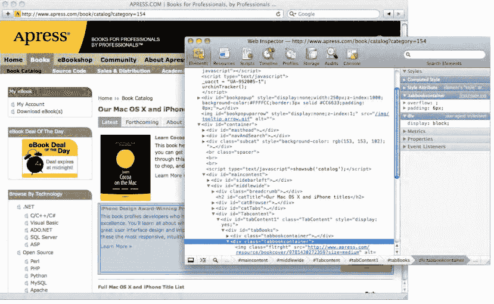

**图3-8。** *检查书籍封面图像下代码时的视觉反馈*

因为获得页面布局的直观概念可能是一个吸引人的工具，你会满意地了解到后者功能可通过点击底部状态栏中的放大镜图标从调试工具的大多数部分获得。

当然，获得元素布局的表示通常不足以严重分析代码中发生的情况。让我们更仔细地看看元素检查器。

无论你编写的代码如何呈现，检查器的文档树都会适当地缩进，每个新节点开始都另起一行。此外，代码将清晰地着色以使其更具可读性：标签为紫色，属性名为橙色，属性值为蓝色。你甚至会看到内联注释为绿色。点击任何节点开始左侧的展开三角形将切换其状态，这样你就不会以无尽的换行结束需要滚动。

#### 深入你的样式

在第一个面板中，你有几个类别，代表应用于你的元素的所有样式，如图3-9所示。

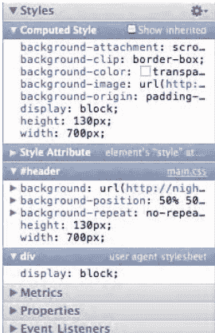

**图3-9。** *元素检查器侧边栏*

从顶部开始的第一个类别非常有用；“计算样式”是WebKit渲染器考虑、计算并应用的样式。这很方便，因为它让你一目了然地看到你的元素实际拥有的所有样式。由于多种原因，计算样式对于涉及数值的规则也很有用，如图3-9中的宽度和高度。CSS广泛使用相对值，如em或百分比。因为所有计算大小都以像素表示，所以比较更容易。

但是，如果你无法确定样式是从哪里计算出来的，计算样式在调试页面时就毫无用处。这就是后续子面板发挥作用的地方。每个子面板代表一种单独的样式应用方式，按从最新应用到最早应用的顺序排列。CSS中的样式规则特异性按以下顺序考虑：使用style属性应用的样式（内联样式）首先应用；然后，来自<link>和<style>标签、id和类选择器；然后是文档树选择器（选择器特异性越强意味着优先级越高——注意父级的“权重”，无论是用id、类还是标签名调用，都计入）；最后是标签名。

> **提示：** 默认情况下，所有与颜色相关的规则都使用RGB或颜色名称（如果可用）表示。如果你更喜欢在代码中使用其他颜色格式，可以通过点击规则旁边的彩色方块（这只会更改当前规则的格式）或通过使用侧边栏左上角的齿轮图标更改格式，在十六进制、RGB和HSL之间切换。

所有规则都将被列出。然而，由于并非所有规则最终都会应用，你会注意到在侧边栏的其他部分中，一些规则被排除，显示哪个样式被另一个规则覆盖。再次，这种呈现方式让你深入了解页面样式的运作方式。

#### 编辑样式

理解是好的，但能够直接从侧边栏修改样式规则甚至更好。你可以通过三种方式完成。首先，要停用规则，你只需取消选择规则右侧的方框。你的页面将立即表现得好像这个规则从未存在过，并且样式继承将相应更新。

更进一步，你可以通过双击任何值来编辑规则，如图3-10所示。这将显示规则为可编辑状态，并允许你输入任何内容。按回车键或点击编辑区域外部以保存并应用新规则。

最后，在检查器的最新版本中，你可以从头创建新的选择器，一次将样式应用于多个元素。这是通过选项菜单完成的，该菜单由侧边栏右上角的齿轮表示。同样，将出现一个新字段，但你将能够输入样式规则及其应用的选择器。如前所述，按回车键或点击编辑区域外部使更改生效。


#### 属性

页面中的每个元素都可以通过一个 DOM 对象实例来访问，这使你能够在 JavaScript 代码中操作该元素。因此，每个元素都有其自身的属性和继承的属性。例如，一个 `<h1>` 标签是一个 DOM `HTMLHeadingElement` 实例，它具有 `HTMLHeadingElement` 属性，也继承了 `HTMLElement` 对象的属性和方法，依此类推，直到 `Object` 对象属性。

属性窗格中不同的折叠分类以字母顺序列出了当前选中对象的所有属性和方法（图 3-12）。当然，DOM 元素的属性值并非固定不变。例如，`innerHTML` 属性会因所在的页面不同而异；属性窗格列出了检查时所有这些可变的值。

图 3-12. 属性窗格

了解所有这些信息可能在编辑 HTML 或 CSS 时并无太大帮助，但在编写 JavaScript 时绝对有用。它为你提供了大量信息，可以基于或利用这些信息进行构建，这些信息代表了 DOM 及其所有的动态潜力。我们不仅说“利用（build with）”，还说“基于（build upon）”，因为在使用 JavaScript 编写脚本时，你可能会为元素添加属性。属性窗格会在你输入或执行脚本时更新，因此你始终可以获取文档和对象状态的相关视图。

#### 事件监听器

通过检查器完善你对 DOM 视野的最后一个技巧，恰恰在于观察页面中哪些对象可能会发生变化。现在，通过切换到侧边栏的最后一个窗格——事件监听器（如图 3-13 所示），你可以查看是否有任何 JavaScript 事件（如点击或加载事件）附加到该对象上。

图 3-13. 显示监听器层级结构的事件监听器窗格

事件按类型分组，每个事件都可以展开，以按调用顺序显示与其相关的函数。例如，这将让你能够看到为什么你的监听器可能永远不会被调用——因为可以从监听器中停止事件传播。它还能让你发现由于匿名函数监听器意外堆叠而导致的内存泄漏，这些监听器比常规监听器更难停止。

当你想知道某个元素是否与某个脚本相关时，拥有一份事件附加的节点列表很有用，但尤其有用的是拥有所有动态元素的列表，作为检查 DOM 和发现诸如 JavaScript 冲突等 bug 原因的新方法。

#### 高级搜索

除了文档树的可折叠表示和允许直接选择元素位置的放大镜工具外，在检查 HTML 文档时，还有另一个更高级的工具可供使用。它就是 Web 检查器窗口右上角的搜索字段。我们现在讨论这个工具，因为它最巧妙的用途是关于 HTML 搜索的，但该搜索字段始终可用于当前使用的调试工具，并将返回与你眼前内容相关的搜索结果。

搜索 HTML 标记可以使用高级选项。如果你的搜索返回任何结果，匹配项的数量将显示在搜索字段的左侧，如图 3-14 所示。所有匹配的实例都将在文档树中高亮显示，并且第一个匹配项将被选中。

图 3-14. 搜索字段左侧显示匹配项数量

最明显的搜索选项是简单地查找纯文本。这是针对文档内容（区分大小写）以及标签和属性名称（不区分大小写）进行的。尽管对于大型或不熟悉的文档来说，这可能效率不高，但它至少易于理解和使用，并且由于结果展示清晰，总体上应该会很有用。

你还可以使用 CSS 语法和选择器来查找文档中的标签。选择器是模式匹配规则，允许进行简单的标签定向搜索和复杂的选择。这当然对前端开发者很有吸引力，因为这是一种你应该熟练掌握的语言。只需注意——搜索标签名将触发不区分大小写的搜索，但 ID 和类名在搜索字段中的大小写敏感性与在 XHTML 文档中相同。

尽管我们将在后续章节中更深入地介绍选择器，但这里有一个简单的示例，只是为了说明问题：

```
<h1>A Big Title</h1>
<p> <span>The strong and quick brown <strong>fox</strong>
jumps over the lazy<strong>dog</strong>.</span> </p>
```

如果你对本文档执行简单的文本搜索 *strong*，将找到三个匹配项。当然，你可能预期有五个，但搜索引擎识别出其中两个实际上是与开始标签配对的结束标签，因此只考虑后者。这是最简单的情况。

如果文档更大，你可能想找到所有作为 <h1> 标题后紧跟的 <p> 元素后代的第二个 <strong> 标签。有点复杂了？这正是 CSS 选择器可以大显身手的地方。尝试在搜索字段中输入以下内容：

```
h1 + p strong:nth-child(2)
```

这对前端开发者来说应该很熟悉。对于不太熟悉这类选择器的读者来说，值得记住的选择器并不多，因此这绝对值得深入研究。

最后，你还有选项对文档执行 XPath 搜索。XPath 语言是专门为在 XML 上执行搜索而设计的。HTML 与 XML 有许多相似之处。XPath 语法允许高级结构查询。应用于前面的示例，你的搜索查询将是：

```
//h1/following-sibling::p//strong[2]
```

关于 XPath 不想深入太多细节，我们只想强调两种方法都有其优势和局限性。例如，在我们的示例中，你应该注意到 CSS 选择器使用 + 号表示 <p> 标签紧跟在标题后面，而这无法转换为 XPath。另一方面，CSS 选择器无法执行向后搜索（查找具有另一个元素作为父元素的元素），而 XPath 可以。

#### 资源查看器

资源查看器以图形方式概述为当前页面下载的元素（见图 3-15）。你可以从左侧边栏的顶部区域在两种图形之间选择：时间和大小。

第一个视图“时间”显示了所有需要下载的元素的时间线以及总检索时间。浅色区域代表延迟期，即从请求发送到服务器发送响应的时间。较深的区域是实际下载时间。每种元素类型用不同颜色表示，因此可以通过阅读顶部图形栏中的图例轻松识别它们。你可以根据需要使用 Web 检查器窗口顶部的按钮过滤类别，并可以选择数据应按什么标准排序。蓝色和红色垂直线分别指示 `DOMContentLoaded` 和 `load` 事件何时触发，这应该有助于你理解页面的加载方式，并从此优化其设计。

图 3-15. 资源查看器

第二个视图“大小”简单地按重要性（从大到小）显示所有为页面下载的元素的大小。带有两个区域的图形栏仍然存在，以便于理解。这里，第一个条形代表实际传输文件的大小，而当使用 HTTP 压缩时，第二个条形代表实际下载文件的大小。因此，图像将只有一个较深的条形。

你可以区分实际文件大小和传输大小进行过滤。如果你选择传输大小，会考虑某些元素可能被缓存的事实，因此获取时间最长的文件可能不是最大的。要了解资源是否来自缓存，只需将鼠标悬停在图形中的相关条形上；如果文件已被缓存，工具提示将显示文件大小为 0 字节。当然，因为缓存元素不占用空间，它们默认会全部显示在列表末尾。

要获取有关资源的更多信息，你可以单击左侧边栏中的任何元素。这将在主区域显示图像和文本文件，如图 3-16 所示，包含内容详情，以及客户端和服务器发送的相关标头（使用主视图上方的标签页）将出现在主视图中。双击侧边栏中的资源将在新的浏览器窗口中打开它。


**图3-16。** *资源头部的详细信息*

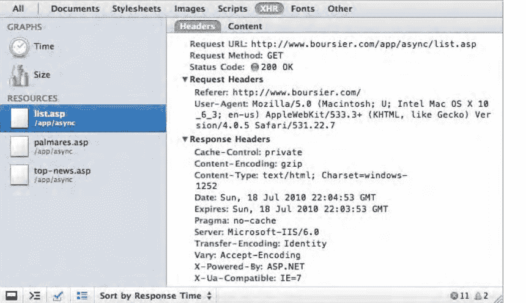

当然，这可以帮助你优化网站设计，通过检查缓存过程并查看哪些元素可能拖慢页面渲染速度。但同时，它也非常适合追踪Ajax操作，因为它能让你看到加载的文件及其HTTP头和内容。

#### 调试JavaScript

和大多数脚本语言一样，JavaScript也有让人抓狂的时候，你可能很难准确找出脚本为何无法运行。Web Inspector为此提供了多种非常便捷的工具，从最简单的脚本执行时间线到更复杂的观察辅助工具（如断点）。现在，我们将介绍开发工具如何帮助你更快、更少猜测地从脚本混乱中解脱出来。

开始之前，请注意，与Elements Inspector中HTML代码以结构化树状清晰显示不同，JavaScript代码将以其原始编写形式呈现。因此，我们显然不建议你在压缩代码（即为了减小文件大小而移除了不必要空格和换行符的代码）上使用这些工具。

#### 输出到控制台

如果你已经编写过JavaScript代码，很可能在开发过程中某个特定时刻使用过`alert()`方法来获取对象或变量的值。由于这种方式存在不少缺点（例如，不要在循环中使用），你可能已经转而使用一些追踪选项，这通常更自然、更高效。好消息是，Web Inspector提供了一个完整的Console API供你使用。

**表3-1。** *日志函数*

| 函数 | 描述 |
| :--- | :--- |
| `console.log(format, ...);`<br>`console.info(format, ...);`<br>`console.debug(format, ...);`<br>`console.warn(format, ...);`<br>`console.error(format, ...);` | 将消息或对象属性记录到控制台。这五个函数仅在消息左侧显示的图标上有所不同。在Safari Mobile上，只有这些命令可用；此外，下一表中列出的格式选项也不可用。 |
| `console.assert(condition, format, ...);` | 仅在条件不满足时记录到控制台。 |
| `console.group(format, ...);`<br>`console.groupEnd();` | 开始并结束一组日志。每个新组相对于其他日志将会有缩进。 |
| `console.time(name);`<br>`console.timeEnd(name);` | 分别启动和结束一个计时器，大概用于跟踪代码执行时间。name用于标识计时器，以便停止它。 |
| `console.count(name);` | 设置一个函数调用计数器。name用于标识该计数器。计数器为函数的每次新调用记录一个递增的数字。 |
| `console.dir(object);` | 将对象的所有属性记录到控制台。 |
| `console.dirxml(node);` | 将HTML节点及其所有子节点作为可折叠树记录。在最新版本的检查器中，`console.log()`对HTML元素的作用类似。 |
| `console.trace();` | 记录当前函数调用栈及传递的参数值。 |
| `inspect(object);` | 根据传递的对象打开相应的检查器标签页。触发的标签页是元素、数据库或存储检查器。 |
| `console.profile(name);`<br>`console.profileEnd(name);` | 开始和结束分析脚本执行。 |

上面列出的几个表达式可以接受类似于C语言`printf()`函数的模式，并带有一些变量。因此，你可以特别使用`%s`插入字符串或`%o`添加一个可折叠的对象结构。这可以帮助你在整个开发过程中保持日志的组织性和一致性。

**表3-2。** *格式选项*

| 格式 | 描述 |
| :--- | :--- |
| `%s` | 字符串。 |
| `%d` 或 `%i` | 整数。不支持像`%02d`这样的数字格式。 |
| `%f` | 浮点数。不支持像`%4.2f`这样的数字格式。 |
| `%o` | 对象。可以使用披露三角查看对象详情。 |

以下是两个使用控制台日志的例子：

```
console.log("My %s is great!", "iPhone");
console.log("My", "iPhone", "is great!");
```

为了便于阅读，控制台会在必要时自动添加空格，并以树状格式表示对象。这两条命令将在控制台中产生相同的输出，并附带一个指向其运行行的链接。点击该链接将聚焦并高亮相关行。

#### 使用交互式Shell

有时，通过重复的日志操作来找出对象或变量的值会很繁琐。编辑文件、保存、重新加载页面等等，既耗时又整体效率低下。好吧，得益于检查器的交互特性，部分工作可以在窗口底部的控制台提示符中直接输入命令来完成。命令的返回值将立即打印到控制台。你可以用这个功能做很多事情。

得到结果最快的方法是使用我们之前列出的日志命令，但你也可以运行页面中存在的脚本。这将允许你评估代码中的变量，观察它们的行为，并调整你的页面，因为你执行的操作产生的所有更改将直接应用于受影响的元素（如果有的话）。按上方向键将打开你已输入命令的历史记录，从最新到最旧排列。

检查器的交互式控制台甚至支持代码补全：开始输入一个命令，就会出现补全单词的建议。通过按右方向键或Tab键接受它们。此外，在终端内，输入`clear()`将清除屏幕上的所有输出，尽管此功能也可以通过点击窗口左下角最右侧的图标来使用。

#### 让调试器来完成工作

在我们目前介绍的所有内容中，你都是输入命令、决定在哪里做什么以及如何做的人。如果这还不够，你可以利用Web Inspector中实现的高级调试器。我们将使用以下代码来说明调试器的各种工具：

```
<html>
<head>
    <title>Testing Scripts</title>
    <script>
        var counter = 0;
        var timerID = window.setInterval(myTimer, 10000);

        function myTimer() {
            var span = document.getElementById("count");
            span.textContent = incrementCounter();

            for (var n = 0; n < 100000; n++) {
                new Object().toString();
            }

            if (counter > 1) {
                errorGenerator();
            }
        }

        function incrementCounter() {
            return ++counter;
        }
    </script>
</head>

<body>
    Timer executions: <span id="count">0</span>
</body>
</html>
```

这段代码的作用是启动一个计时器，每十秒调用另一个函数`myTimer()`。该函数反过来递增浏览器中显示的计数器，然后运行一个重要的循环，最后通过调用一个未定义的函数来生成一个异常。

页面加载完成后，你可以通过菜单，或者如果Web Inspector窗口已经打开，则通过点击Scripts标签页来激活调试器。

你刚刚打开的窗口有两个主要部分，如图3-17所示。左侧是当前脚本在文件中的写法，并带有行号；如果脚本直接位于你HTML文档的<script>标签中（如本例所示），你将看到此文件。右侧，你将找到关于当前脚本的各种信息。目前，这部分是空的。

#### 断点

窗口的每个部分都有专用按钮。在左上角，你可以从下拉菜单中选择所有可用的脚本。在右侧边栏上方，你可以使用单步执行按钮来暂停脚本执行、单步执行到下一个函数调用、进入下一个函数调用或退出当前函数，以及禁用断点。

即使你大致知道脚本在哪个阶段停止工作，要找出哪里出错可能更棘手。这就是断点可以帮到你的地方。

> **警告：** 你无法通过从控制台运行脚本来使用调试器。无论你设置了什么断点或生成了什么异常，在这种情况下执行都不会暂停。因此，你还必须考虑使用有用的日志函数来跟踪你的脚本。

点击窗口左侧的行号区域将切换该行脚本部分的蓝色断点。使用上面的代码，例如，你可以在定义`myTimer()`函数的行上添加一个断点。当脚本运行时，它会

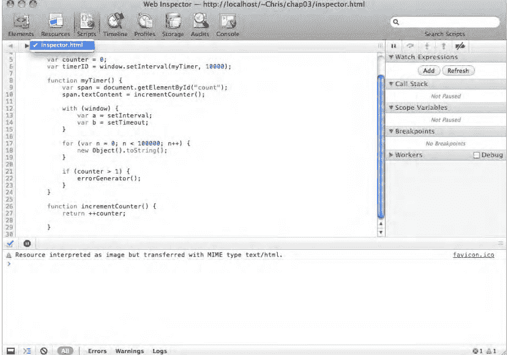

**图3-17。** *脚本调试器*


#### 分步执行

在重新遍历整个流程之前，仅查看脚本的一部分并不高效，也不自然。为了解决这个问题，让我们仔细看看侧边栏顶部的分步按钮，如图 3–21 所示。

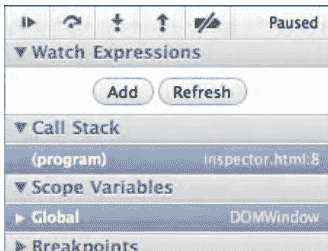

**图 3–21。** *带有分步按钮的脚本调试器*

您可以使用第一个按钮在当前脚本刷新之前暂停执行，这样您就可以在不安装断点的情况下观察脚本的运行，但它也可以让您在调试会话期间在断点之间导航。单击第二个图标将简单地运行下一条指令。第三个图标将允许您进入执行光标下方的函数中的代码（如果其代码可见的话；对于属于脚本引擎的函数则不行）。最后一个图标则反向允许您退出当前正在检查的函数并提升一个层级。

#### 监视表达式

在侧边栏中，另一个面板可以帮助您检查脚本中的特定元素：监视表达式部分。您可以监视任何表达式，例如变量、测试表达式、实例等。收集到的信息既可以是本地的也可以是全局的，并且会随着脚本的执行而更新。

继续使用相同的示例，单击“添加”按钮（图 3–22），并输入 counter 来观察其演变。刷新不是自动进行的，因此当到达断点时，您需要单击“刷新”按钮来更新数据。

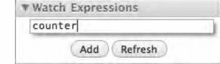

**图 3–22。** *要监视表达式，请单击“添加”按钮并输入要评估的表达式*

#### 调用堆栈

从上往下数的第二个面板标记为“调用堆栈”。在此处，列出所有已调用但尚未返回的函数，最近的调用位于顶部。

您可以在 `incrementCounter()` 声明处添加第二个断点，并启动调试运行至该函数；这将产生如图 3–23 所示的结果。从那里，您可以通过单击面板中的条目向上移动堆栈。

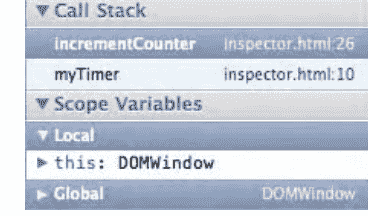

**图 3–23。** *调用堆栈在侧边栏的相关面板中显示*

> **提示：** 如果您希望在某种方式下使调用堆栈中的函数名称更易读，您可以很容易地在调试器中通过 `displayName` 属性为其分配一个特定名称。因此，扩展为 `myTimer.displayName = "Main Loop"` 的函数 `myTimer()` 将在调用堆栈中显示为"Main Loop"。这对于即将介绍的剖析器也同样有效。

这当然在观察连续脚本的执行或嵌套在彼此内部的脚本时，可以大大节省时间。

#### 作用域变量

脚本侧边栏中最后一个，也是最丰富的一部分是在“作用域变量”面板之下。在任何时候，当前执行上下文的作用域中或当前脚本使用的所有元素的所有值都将在此列出。在示例中的第一个断点处停止，数据应如图 3–24 所示，显示所有可用于 `myTimer()` 函数的变量，无论它们是否已初始化。

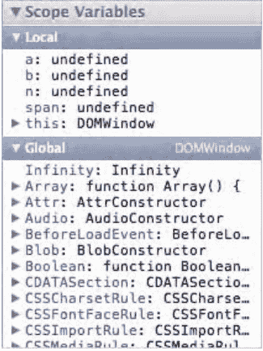

**图 3–24。** *当前作用域中的变量（无论是否已初始化），以及巨大的全局列表*

为了便于阅读，这些元素根据其类型和在当前作用域中的使用情况进行分类：本地、全局，以及在可用时带块或闭包。此视图不仅使查找和脚本可用元素变得更容易，还可以帮助您理解发生了什么以及如何更改它。与 CSS 和 HTML 值一样，您可以通过双击在“作用域变量”面板中更改值。全局面板将特别给出脚本引擎级别可用的类列表及其完整的原型。

#### 异常

您已经学习了如何查找错误以及如何查看脚本行为。然而，您可能已经注意到，JavaScript 控制台和脚本部分仅通知异常——控制台中的一条日志，脚本中的彩色行——它们不会停止执行。为了使函数的执行在发生异常时自动停止（图 3–25），您可以单击 Web 检查器窗口左下角的“暂停”图标。

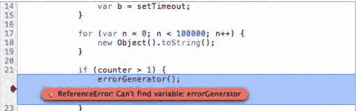

**图 3–25。** 单击“暂停”按钮将使调试器在异常时停止

单击一次会将图标设为蓝色，这意味着所有异常都会导致脚本暂停，这样您就可以检查该阶段可用的信息，如图 3–25 所示。单击两次将导致脚本仅在未捕获的异常时停止——而不是那些被 `try...catch` 语句捕获的异常。

这些工具汇集在一起将使您的开发过程变得更容易且更快。JavaScript 调试器不仅有助于精确定位脚本出错的位置，而且随着您逐渐习惯使用它，它还将帮助您在优化阶段构建整体更优秀的 Web 应用程序。

#### 页面的生命周期

始终可以有趣地了解整个页面生命周期中发生的一切。哪些脚本被执行，它们需要多长时间完成，加载了多少代码、标记或图像，以及以何种顺序……这些信息在 Web 开发时非常重要。时间线选项卡以有序清晰的方式向您展示所有这些详细信息（见图 3–26）。


**图 3–26。** *时间线部分，底部带有控制按钮*

通过单击 Web 检查器窗口左下角的圆形图标来触发录制。如果您单击此按钮并重新加载页面，您将看到一切都被记录，包括初始页面加载后发生的事情，以及在绘图区域顶部使用三个并行时间线表示的内容——用于加载页面的元素、用于脚本评估和页面加载时触发的事件、以及用于绘制到屏幕上的所有内容、重新绘制的内容以及如何损害性能。

> **警告：** 请谨慎使用此检查器工具，并始终记住，您目标设备不会与您的桌面系统和浏览器共享相同的规格，特别是在连接速度方面。也就是说，使用此工具获取信息，但最重要的是，在解释这些信息时要牢记，您并不是在调试设备上进行开发。

为了使用方便，虽然记录了所有操作，您可以通过从时间线左侧侧边栏取消选中类别，轻松地仅显示某些类型的事件。这将使时间线中的事件从蓝色（加载）、黄色（脚本执行）和紫色（渲染）变为灰色。

时间线宽度仅限于您的屏幕宽度，意味着时间刻度将根据其内容而变化。您可以通过从顶部时间线区域的左右边缘拖动手柄来细化您的检查目标。这将强调事件树的相关部分。如果您的页面包含动态内容或 JavaScript 计时器，这将特别有用，因为在这种情况下，时间线将继续绘制对屏幕的更改，显示新渲染的浏览器区域和计时器迭代。

## 第三章：介绍开发和调试工具


#### 分析你的脚本

除了页面中所有活动的时间线，你还可以获取正在运行的脚本和 CPU 使用率的分析数据。此功能可通过点击“分析”图标（参见图 3–28）来启用。

首次打开此部分时，其中仅包含说明文字。这些说明会引导你点击位于窗口左下角区域的“录制”按钮（与“时间线”部分相同），以显示脚本活动随时间的变化。点击一次将开始录制，你需要再次点击以停止录制，并查看屏幕上显示的已评估数据。

你也可以通过控制台使用前面提到的 `console.profile()` 和 `console.profileEnd()` 来开始分析。使用控制台而非“录制”按钮的一个好处是，你可以同时录制多个分析数据。

无论你选择哪种方法，都不要忘记取消你可能在“脚本”部分设置的断点，以免干扰分析。另外请注意，与 Web 检查器中的其他工具不同，分析工具是全局性的，适用于所有浏览器窗口和标签页，因此关闭所有不需要研究的窗口可能会很有用。

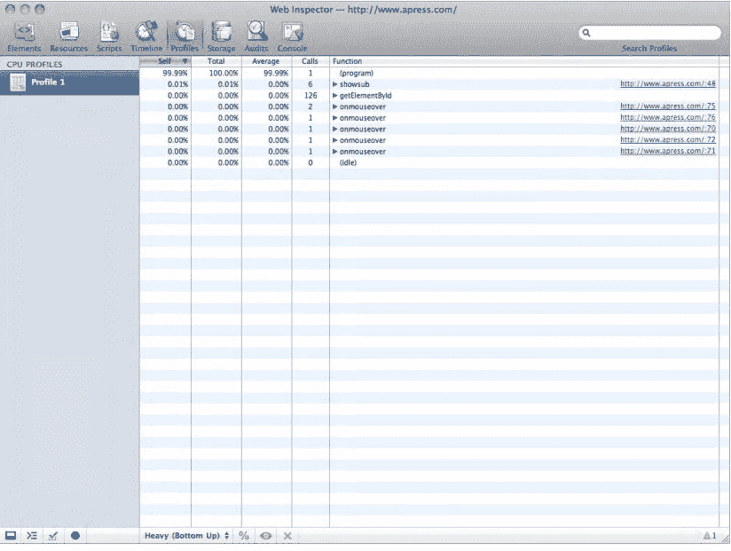

*图 3–28. 分析器*

对于每个新的分析，左侧边栏中都会出现一个分析图标。如果一个分析录制在另一个分析内部开始，上级分析将变为可折叠，并带有一个展开三角形。

#### 理解分析数据

我们将使用与脚本调试器相同的示例来说明分析器的工作原理。打开 Web 检查器，点击“录制”图标，然后重新加载页面。当计数器达到 2 时，点击同一图标停止录制，并查看你新获取的数据（图 3–29）。

| Self | Total | Average | Calls | Function |
| :--- | :--- | :--- | :--- | :--- |
| 91.43% | 92.10% | 30.48% | 3 | ► myTimer  [inspector.html:8](inspector.html:8) |
| 7.90% | 100.00% | 7.90% | 1 | ► (program) |
| 0.39% | 0.39% | 0.00% | 200000 | ► toString |
| 0.29% | 0.29% | 0.00% | 200000 | ► Object |
| 0.00% | 0.00% | 0.00% | 2 | ► incrementCounter  [inspector.html:26](inspector.html:26) |
| 0.00% | 0.00% | 0.00% | 2 | ► getElementById |
| 0.00% | 0.00% | 0.00% | 0 | (idle) |

*图 3–29. 收集的数据显示在分析器的结果表中*

分析数据以五列的形式显示在 Web 检查器窗口的右侧部分。它详细列出了所有函数调用和执行时间，默认情况下是一个列表，其中消耗资源最多的函数位于顶部。默认视图以占总时间的百分比显示值。你可以使用窗口底部的弹出菜单更改这些视图选项。这样，你可以以树状视图查看函数，强调调用栈而非资源消耗。

右侧的所有函数都可以展开以显示调用栈。调用栈的基础始终是“(program)”。这个可折叠区域还显示函数被调用的次数。这就是为什么 myTimer() 在同一组中出现两次。

同样，你可以使用弹出菜单旁边的 % 按钮，将整个视图的值从百分比更改为毫秒为单位的绝对值。如果你专注于特定的列（表 3–3），你可能只想更改该列的数据视图。这可以通过双击列标题来实现。

**表 3–3.** *数据列说明*

| 列 | 说明 |
| --- | --- |
| Self | 函数自身的总执行时间。 |
| Total | 函数的全局执行时间，包括对外部函数的调用。 |
| Average | 跨调用的平均执行持续时间。 |
| Calls | 函数被调用的次数。 |
| Functions | 被调用的函数列表及其相关的调用栈。 |

此外，为了完美满足你的需求，你可以通过点击列标题来更改列数据的排序顺序。

在函数列表中，如果某个函数不属于 WebKit 脚本引擎（如图 3–29 中的 getElementById()），最右侧将提供一个链接，该链接将带你到相关文件，并在“资源”选项卡中高亮显示相关行。

为了更轻松地阅读如此大量的数据，你可以使用状态栏中的眼睛图标聚焦于特定函数。如果执行链很复杂，这当然会更舒适。也可以通过点击同一位置的叉号图标从视图中移除函数。使用其中一个选项将自动使“重新加载”按钮出现在状态栏上，以便你可以无缝恢复视图的初始状态。

#### 使用搜索字段进行筛选

从“分析”部分，如同任何其他部分一样，你可以通过 Web 检查器窗口右上角的文本字段对数据执行搜索。此搜索字段在查找函数名称或资源 URL 时理解字符串。不过，它也应接受数值和运算符，例如 <、>、<=、>= 和 =。这将允许你，例如，找到所有完成时间超过特定时长的函数。值将在表格中突出显示，如图 3–30 所示。

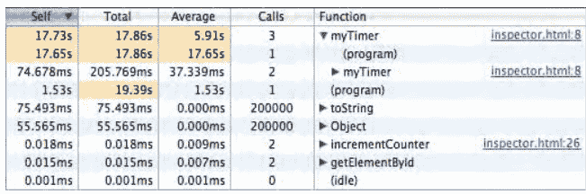

*图 3–30. 搜索 >4s 将突出显示所有相关的表格条目*

你可以使用与表格数据中相同的数值单位，即百分比、毫秒或秒。一旦查询返回结果，你可以通过按回车键在不同的元素间导航。

#### 客户端数据存储

WebKit 中一个令人兴奋的新功能是能够在用户端存储数据，不仅使用 Cookie，还可以使用直接在浏览器中设置的数据库。我们将在第 15 章中详细讨论此功能；现在，我们将看看“存储”部分（在旧版本中为“数据库”部分）如何让你检查几种客户端存储类型（参见图 3–31）。

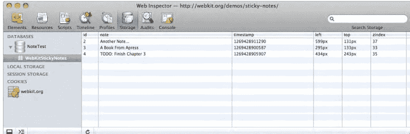

*图 3–31. 存储检查器*

存储检查器的布局此时应该看起来很熟悉，具有常规的边栏和主视图。在左侧的边栏中，列出了存储类型的窗格，每个窗格下你将看到正在使用的各种存储组或 Cookie（如果有的话）。

##### 数据库存储

第一个组是用于数据库的。每个数据库都可以使用数据库图标前面的箭头进行折叠。要显示存储块的表，只需点击它。选中的表将作为数据网格显示在窗口的右侧，展示所有列和行。

与“脚本”部分一样，如果你想进一步检查，可以通过点击存储块来调用一个交互式 Shell。这里的 Shell 专门用于 SQL 命令，允许你在自动补全的帮助下查询数据。请注意，在当前版本中，在此处运行命令是与表交互的唯一方式，不能像其他存储功能那样直接编辑。但是，查询结果会立即显示在屏幕上，因此过程相当快速简单。

##### Cookie

Cookie 是一种众所周知的客户端存储方法。从左侧选择“Cookie”窗格可以极大地简化你的 Cookie 管理。当前页面可用的所有 Cookie 都将以表格形式呈现，每个 Cookie 包含其名称、值、域名（是来自你的页面还是来自第三方网站，如广告）、路径、到期日期、大小、HTTP 和 HTTPS 专用标志。你可以删除任何 Cookie；但是，所有 Cookie 删除都是永久性的，因此请谨慎使用——你可能不想因为搞砸而丢失所有你喜爱网站的偏好设置。

##### 其他存储功能

Cookie 的大小限制为 4KB。除了数据库存储，WebKit 通过本地存储和会话存储为你提供了解决方案，以存储超出这些限制的数据。每个都在左侧边栏中有一个专用的窗格。像 Cookie 一样，它们以信息的键值对形式工作。为了说明这一点，你可以在控制台中输入以下内容：

```
localStorage.myKey = "Some value";
sessionStorage.anotherKey = "Some other value";
```

这些行将分别在本地存储和会话存储区域中创建新的存储部分。与 Cookie 类似，你可以通过点击表格下方的叉号图标来删除条目，但与 Cookie 和数据库存储不同，你可以直接从表格中修改值，并通过双击空白处添加新条目。

##### 审计你的页面

“审计”部分可以通过提供与页面加载相关的指南和最佳实践来帮助你优化网站。这些指南主要基于 W3C WebApps 工作组 (WWAWG) 对更好的基于 Web 的应用程序的建议。在撰写本文时，你无法扩展审计能力，但这


- 这是一个面向未来版本的项目，应允许你专门针对问题类别，例如安全性或特定设备。

同样，审计列表可从左侧边栏获取，而窗口右侧则显示数据及运行新审计的选项（图 3–32）。你将能够在“网络利用率”、“页面性能”和“全部”之间进行选择。你还可以选择在页面加载时进行审计，或对当前页面状态进行审计。准备就绪后，只需点击窗口底部的“运行”按钮，稍后审计结果便会出现在检查器中。

图 3–32. *审计结果*

结果会根据其重要程度进行分类——红色表示重要问题，绿色表示次要改进。在建议中，你可能会发现未使用的 CSS 选择器列表、浏览器缓存技巧或 Cookie 处理技巧。例如，你可能被建议将静态内容放在单独的服务器上，以避免每次新请求时产生无用的 Cookie 移动（图片、样式表等）；显然，这徒然增加了流量负载，因为静态内容（如图片）几乎不会在服务器上处理 Cookie。

如果此前我们提醒得还不够，那么你所针对的设备连接质量不可靠，且整体性能低于台式电脑或笔记本电脑。

# **仍不确定？**

虽然我们认为 WebKit 网络检查器是前端调试的绝佳工具，但在开发过程中，你或许更倾向于其他浏览器或工具。如果你已是前端开发者，可能已习惯 Firefox 上的 Firebug 或 Opera 上的 Dragonfly。即使是 Internet Explorer，最新版本也自带开发者工具。无论何种情况，请牢记，当今大多数浏览器均内置或可通过扩展提供调试和开发工具。网络检查器并非从零构建：例如，控制台 API 最早即应用于广受好评的 Firebug。归根结底，这关乎习惯与个人选择。

如果你喜欢 Firebug 或希望在目标设备上获得更强大的直接调试功能，我们建议你关注 Firebug Lite 的更新。该工具是一款轻量版 Firebug，可用作书签脚本供所有浏览器使用。目前它在 iPhone 上功能尚不强大，但随着发展，它有望成为 Web 应用开发者的严肃选项。

# **总结**

你如今应已牢固掌握可用于加速开发过程的各类工具。你也应感到安心：日常浏览器中已备有众多实用工具，能极大简化开发者工作。你并非孤军奋战；且由于我们介绍的工具均基于 Web 语言构建，来自社区的未来演进必将大有裨益：又有谁比 Web 开发者更清楚自身所需？我们将在后续章节中根据需要对这些工具提供更详细的介绍。你定已察觉到局势正日益具体。下一章，我们将剖析通用的 Web 应用元素，随后进入 Mobile Safari 开发的核心。

## 第二部分

# 使用 HTML5 和 CSS3 构建 Web 应用

# ## 第 4 章

### Web 应用的结构

如今智能手机已能浏览互联网。回溯移动互联网起步之初，其体验远非今日所知模样：网络速度严重受限且费用高昂，屏幕尺寸狭小，设备通常仅支持黑白显示；用户每次只能阅读寥寥几行文字，若运气好还能看到一张缩略图般的图片。彼时，网页大小不过数 KB，部分受限于设备内存，用户还需借助 0–9 数字键进行导航。显然，即便这堪称某种技术革命，但在手机上浏览互联网对终端用户而言并不具吸引力。

设备不断演进，屏幕日益宽大，触控手机应运而生。手机引擎整体性能大幅提升，但连接费用依然高昂，网站布局亦难以为继。自 WAP（一种基于 XML 的轻量级 HTML，首个标准）问世以来，技术虽已有显著改进，但网站大多未作优化，导致页面布局及更令人烦恼的导航成为确定性问题。此外，由于浏览并非手机制造商的优先事项，仅仅访问在线服务通常意味着需深入众多菜单及子菜单。

也就是说，长期以来，移动互联网虽已存在，但绝非开发者颇具吸引力的领域。

# ## iPhone 革命

当 Apple 发布 iPhone 时，用户发现了一种全新的移动体验，为开发者构建应用提供了全面可能性。访问互联网骤然变得无缝流畅，浏览页面过程优美自然。依托革命性的图形用户界面（GUI），iPhone 以触控为基础，在设备与终端用户之间建立了紧密关系。

# 第 4 章：Web 应用的结构

在 iPhone 发布之前，无论使用何种设备，用户均须借助某种配件（如键盘、鼠标或触控笔）来交互内容与访问功能。iPhone 发布之后，人们似乎拒用这些便携设备，设计师也逐步摒弃小按钮，转而模拟 Apple 多点触控系统所提供的亲密体验。

此种新连接不仅具有革命性意义，Apple 更将手机用户体验引向真正的 Web。通过发布一系列依赖 Web 的应用，尤其是实施了真正的、专为移动优化的浏览器——Mobile Safari，Apple 提供了接近桌面浏览的即时感。

Apple 还大力推广手机上的网络服务使用，举措卓有成效：在 iPhone 首发之际，公司成功促使运营商将该设备以几乎无故障的互联网接入方式商业化，使得用户在多数情况下能充分且相对廉价地发挥设备潜能。

#### 对 Web 应用的信心

远在 iPhone SDK 发布之前，Apple 便寄希望于 Web 应用拓展其智能手机的可能性。其主要佐证莫过于：大多数 Web 应用均通过 Apple 网站上的专用板块（www.apple.com/webapps/）分发（见图 4–1），该页面至今仍是 Mobile Safari 的默认书签之一。

尽管 Apple 或许早已计划推出原生 iPhone 应用，但相较于 Web 应用，其更广泛的开发可能由开发者自身发起——他们敦促 Apple 提供完整工具集以构建这些特定应用。如今，从科技爱好者到跨国企业， eclectic 各类群体纷纷开发原生 iPhone 应用（迄今已超 150,000 款）已不足为奇。Web 应用一度被边缘化，而原生开发工具包则大获成功。然而，Apple 仍持续支持如 Dashcode 等项目。虽然 Dashcode 主要设计用于桌面小部件创建，但很快它也成为构建 Web 应用的有趣工具，并针对 Mobile Safari 提供了新功能，例如受 iPhone 启发的 Web 应用模板。

最近，人们开始质疑 PastryKit 和 AdLib 框架是否将分别面向 iPhone 和 iPad 开发公开。这两个强大的框架专为 iOS 集成式 Web 应用设计，解决了诸如 CSS 无法实现固定定位元素等长期存在的问题。它们还带来了旨在增强用户体验的 desirable 功能，例如允许用户在浏览时无需滚动并可在应用中导航的固定标题栏。

目前，PastryKit 框架似乎仅用于 iPhone 用户指南（http://help.apple.com/iphone/guide/）（见图 4-2），很可能也在你的 iPhone 书签中；但围绕它的热情与好奇表明，不仅 Apple 仍在致力于 Web 应用的未来，开发者也致力于在该领域推出更优质的服务。

图 4-2. iPhone 用户指南在...iPhone 上


其他类似的框架确实已被开源爱好者发布，显示出他们在 iPhone Web 应用开发过程中寻求帮助的迫切需求。例如，你可以查看 iUI（原名 iPhoneNav，由 Firebug 的幕后开发者 Joe Hewitt 开发），它在第一款 iPhone 发布后不久就出现了；WebApp.Net，这是一个轻量级、优化的框架；或者 jQTouch，它基于 jQuery 库。

iPhone 上的 Web 应用正变得越来越有吸引力。Mobile Safari 的性能不断提升，对前沿 Web 标准的支持也在持续发展。最近，iOS 浏览器甚至获得了地理定位能力等核心工具。由于越来越多的公司提供可集成到 Web 应用中的 Web 服务，并且 iPad 的发布受到热烈欢迎，Web 应用领域的未来显得更加充满希望。

##### 但 Web 应用到底是什么？

为 iPhone 开发时，你有三种选择：制作原生应用、构建常规网页，或者构建 Web 应用（介于前两者之间）。Web 应用应该类似于原生 iOS 应用，但可通过与网页相同的方式访问，并且基本使用相同的技术（例如 HTML 和 JavaScript）。

Apple 关于构建 Web 应用的指南在这方面强调了几点，最终都归结为非常精确的设备定向。根据 Apple 的说法，Web 应用应针对用户的特定需求提供特定的解决方案。它应该模拟其余的 iOS 界面，因此在适当时使用特殊的 iOS 用户体验特性。

其理念是尽量减少浏览器体验的感觉，以促进与用户更紧密的关系，换句话说，让用户实际使用页面而不是浏览它。为此，Apple 建议严格遵守 Web 标准并使用 Ajax 以避免重新加载页面。

这一切使得区别更加清晰，但当然不是绝对的。如果你想知道你设想的项目是否真的是 Web 应用，而不仅仅是“网页”，请注意这一切都是关于用户导向的：如果你构建的东西是专门服务于最终用户的，并且你认为它是一个 Web 应用，那么它很可能就是。在现实生活中，如果你的用户带着相同的目标反复访问你的页面，你也可以认为你的页面是一个 Web 应用。因此，像 iPhone 优化的 Gmail 或 Google Maps 这样的产品可以被视为 Web 应用（图 4-3）。

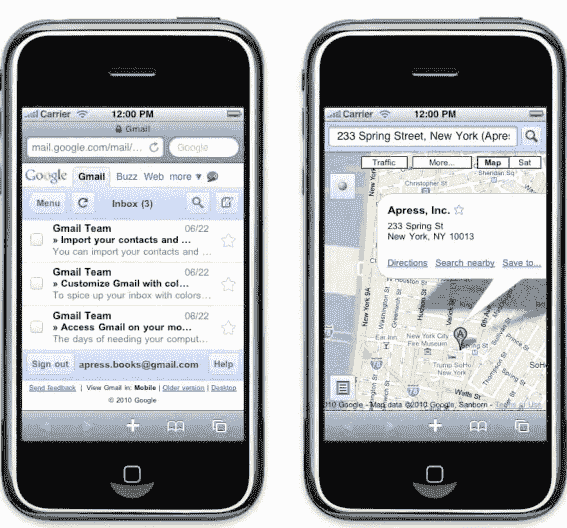

##### 应用的世界：谁主沉浮

许多人通过流行的 App Store 涉足 iPhone 应用市场。你可能想知道，为什么在 Apple 支持原生应用并且许多人已经迅速致富的情况下，你还要构建 Web 应用。这一点需要澄清：App Store 上的应用数量巨大；因此，在那里建立知名度是一项复杂的任务。强大的营销越来越重要，以便脱颖而出，但很少有人取得成功。此外，要在 App Store 上分发需要 Apple 的批准，这可能需要时间和额外精力，即使你以为你的应用已经完成。当然，这个辩论不仅仅关乎这些考量。

##### 跨平台大师

构建 Web 应用在几个方面可能比构建原生 iPhone 应用更好，而首先想到的便利就是跨平台兼容性——实际上是双重跨平台兼容性。

确实，你不依赖于特定的操作系统或特定的工具来构建 Web 应用。你基本上可以使用任何东西，从最简单的纯文本编辑器到复杂的所见即所得编辑器和 IDE，而原生应用在没有 Mac OS X 上的 Xcode 时往往构建效率低下。

然后你的 Web 应用本身应该在某种程度上是平台无关的。Google 的 Android 浏览器和 Palm 的 webOS 都基于 WebKit，因此它们渲染页面的方式与 Mobile Safari 类似。WebKit 引擎越来越受欢迎，不仅适用于桌面浏览器（Epiphany 最近从 Gecko 转向了 WebKit），而且适用于越来越多的移动设备，例如 RIM 的 BlackBerry。无论 iOS 有多受欢迎，针对它的应用都依赖于其底层平台和 API，并且可能永远无法在其他设备上直接运行。

##### 硬件访问不再是禁忌武器

你可能听说过原生应用与 iOS 本身的结合更为紧密，能够访问更多硬件能力、更多平台资源，以及在无连接（或不需要连接）时拥有更多可能性。这已经不再完全正确了。

首先，你的应用不太可能需要比 Mobile Safari 提供的更多运行能力——原生应用也不会使用它们被赋予的所有能力。至于存储，从版本 2.0 开始，你可以选择直接在设备上使用 JavaScript 数据库，从而使你的应用数据在每次执行后都可用。

此外，用户现在可以访问离线模式的 Web 应用，这意味着即使没有连接，所有静态内容也将可用。考虑到你的页面的静态元素不再需要每次查看页面时重新加载，并且考虑到 HTML5 的新存储能力，即使没有连接，你也可以让大量内容对用户可用。

最后，虽然原生应用确实从操作系统获得了更多可用工具，但这一方面也在发生变化：在版本 3.0 中，iOS 允许浏览器访问地理定位信息。这可能是 Apple 押注 Web 应用未来的另一个迹象。

##### 释放你的内容

Web 应用开发比原生应用开发更具吸引力的第二点在于你作为开发者对内容的自由度。在 App Store 分发需要 Apple 验证你的应用，这确实意味着在你可以展示什么以及你的应用是关于什么方面存在一些限制。这个过程也可能很长，一旦你设法通过这个阶段，你仍然需要让用户从众多其他应用中选择你的应用。

构建 Web 应用，你可以每天发布一个新应用，完全不用担心 Apple，而且可以关于你想要的大部分内容。你仍然需要吸引用户，但是，嘿！你正在为他们制作东西，所以，没有什么比这更自然的了。

##### 发布模式

然而，在用户方面，无论过程多么容易，原生应用都需要安装，并且可能需要更新。前者显然对 Web 应用不成立，而后者会自动发生。对于原生应用，即使更新也依赖于 Apple 的验证，这必然意味着延迟，即使是短暂的延迟。最后，Web 应用是可发现的，并且可以从任何设备访问，只要用户有浏览器，这似乎比绑定在仍然令人惊叹的 App Store 上要好。

##### Web 应用：不再是小弟

与常听到的相反，Web 应用并不比原生应用更容易构建。这就像比较苹果和橙子：它们都是水果，但它们完全不同。自由度并不会让页面创建变得更容易。与原生应用开发者不同，Web 应用开发者每次开始一个新应用时都会面对一个空白页面。尽管在浏览器中显示元素可能比为 Objective-C 应用安排它们更容易，但 CocoaTouch 框架在处理此类任务方面非常高效。此外，我们已经解释了模拟 iPhone GUI 有多重要，这可能使 Web 应用开发在布局和外观方面变得棘手。为 iPhone 开发对 Web 开发者来说是一整套新的限制。

开发者应始终记住，Web 应用专注于向用户一次呈现少量的特定功能。使用和访问信息必须始终尽可能清晰。尽管如此，不要担心。存在框架可以帮助你完成这个过程。而且，更重要的是，我们也会这样做。

#### Mobile Safari 上的 Web 应用

你将为运行在 iOS 上的 Mobile Safari 制作 Web 应用。虽然这比制作原生应用涉及的平台限制少得多，但你必须完全了解你所针对设备的特性。特别是，你应该知道你的 Web 应用将如何显示。到目前为止，目标设备 iPhone 和 iPod touch 具有完全相同的屏幕尺寸、视觉行为和 GUI 复现性。随着 iPad 的发布，你将不得不考虑不同的屏幕尺寸和略有不同的 GUI 组件。

##### 精通浏览器

如果有一个你应该深入了解的元素，那就是 Mobile Safari。正如 Apple 喜欢说的，它不是一个浏览器的微型版：与市场上的许多移动产品不同，它是一个完全成熟的 Web 解释器，完全支持 HTML、CSS 和 JavaScript——包括 Ajax 技术。这意味着，或多或少，任何基于 Web 标准构建的网站都将在 Mobile Safari 上正确显示。它不仅是一个合适的浏览器，而且还可以炫耀对 HTML5 和 CSS3 前沿特性的高级支持。


规范（尽管这些仍处于工作草案阶段）。对此的一个小限制可能是，我们讨论的三个设备中没有一个使用鼠标。它们都通过触摸事件模拟鼠标事件，从而实现比仅使用鼠标更自然的交互。在大多数情况下，这种差异不会损害可用性。

我们只能一遍又一遍地建议你紧密关注由万维网联盟（W3C；www.w3.org）和网页超文本应用技术工作组（WHATWG；www.whatwg.org）发起的所有演进。你将在那里找到大多数未来的网络技术。

##### 浏览器度量

Mobile Safari 的默认行为是缩放页面内容以适应屏幕。这当然使得浏览体验与桌面浏览器或 Opera Mini 不同，后者会重新排列和调整页面大小，以便在小屏幕上可读。用户需要借助特定手势，将视图调整为他们想要阅读的内容。这通过捏合张开（放大）、捏合闭合（缩小）和双击（聚焦特定页面元素）来完成。此外，对于 Mobile Safari 来说，“页面”的隐喻不像桌面浏览器那样存在。这意味着用户不会在屏幕侧面和底部视觉辅助下上下左右滚动页面。他们将通过手指轻扫来平移视图，以显示他们想在视口中看到的任何内容。

页面的可见区域不仅受限于屏幕尺寸；你还必须处理分别位于屏幕顶部和底部的地址栏和导航栏。但是，地址栏会在用户平移时向上移动，并通过点击状态栏来访问，以节省屏幕显示空间。iPad 在这里的布局略有不同：由于屏幕更宽，地址区域和导航选项被组合在屏幕顶部的单个栏中。当用户平移时，此栏不会消失。

表 4-1 列出了你将要处理的尺寸。请记住它们。每次为 Apple 设备设计 Web 应用程序时，你都应该考虑它们。

表 4-1. Safari 和全屏模式下的浏览器度量

| 设备 | 竖屏模式 | 横屏模式 |
|---|---|---|
| iPhone, iPod touch | **320x460**<br>减去 44px 导航栏<br>减去 60px 地址栏<br>减去 50px 控制台 | **480x300**<br>减去 32px 导航栏<br>减去 60px 地址栏<br>减去 50px 控制台 |
| iPad | **768x1004**<br>减去 58px 导航栏<br>减去 50px 控制台 | **1024x748**<br>减去 58px 导航栏<br>减去 50px 控制台 |

这些度量并非绝对限制，因为所有三个设备都允许 Web 应用程序以全屏方式运行。在这种情况下，只有状态栏可见，你的应用程序将在屏幕的其余部分自由运行。

##### 以“Web 应用”方式思考

这种浏览模型的问题在于它与 Web 应用体验的核心原则相冲突。Web 应用程序的目标是无缝地提供服务。对于最终用户来说，必须通过缩放来访问菜单或特定内容很容易产生误导，从你的角度来看，访客忠诚度将会受损。你必须完全掌控分配给你的应用程序的空间。为此，你必须完美地了解它，并完全专注于你提供的核心功能。默认的浏览器导航应该消失，让用户通过 Web 应用程序处理的高效内部导航。我们很快会解释如何引导用户将你的应用程序添加到主屏幕，以及如何让他以全屏模式启动它。这将使你的 Web 应用程序看起来更像一个原生应用程序。

Ajax 在实现应用体验方面非常有帮助，但当仅用于完全页面刷新时，它确实会引发新问题。请注意不要因为糟糕的导航或不完美的应用体验而破坏你的应用程序。例如，重要的是用户应该能够直接从 URL 轻松返回到你 Web 应用程序的特定部分。为了避免过多透露后续章节的内容，但我们将介绍至少两种创建 Web 应用程序的方式，这些应用程序可以使用唯一 URL 进行导航而无需刷新页面。一种依赖于广泛使用的 JavaScript 方法（`window.location.hash`），另一种使用尖端的 CSS3 工具（`:target` 伪选择器）。这些方法的一大优势是，如果用户收藏了某个页面并稍后返回，你可以显示与 URL 相关的正确内容，而不仅仅是默认加载的内容。

##### 配置视口

iOS 上的视口概念并不代表浏览器客户端部分的尺寸——更不代表屏幕尺寸。它是一个可以显示网页的逻辑区域。它可以比设备屏幕大，也可以比设备屏幕小。访问页面时，整个内容将被调整大小以最适合视口，同时保持相同的纵横比。视口的默认宽度设置为 980 像素，这适用于当今绝大多数网站。然而，你知道 Web 应用程序的方法是不同的。你不希望你的页面被缩放：用户应该以尽可能少的操作直接访问他们要寻找的内容。让他们从缩放手势开始是不好的。你必须构建你的页面来防止这种情况。

视口选项可以在你的网页的 `<head>` 标签内使用 viewport 元标签来定义。这里展示的代码在大多数情况下都能满足你的需求，我们建议你将其用于你的大多数页面。它的作用是将初始缩放设置为 1.0，然后防止用户缩放：

```
<meta name="viewport" content="initial-scale=1.0; maximum-scale=1.0; user-scalable=no">
```

因此，你的应用程序在加载时不会被缩放，无论是在 iPhone 还是 iPad 上，它都将以你决定的最优尺寸显示。现在，你可能想知道如果默认视口是 980px 宽，而你的 Web 应用程序没有被缩放，你的页面将如何正确显示。诀窍在于 viewport 元标签还有其他选项，我们这里没有使用，因为它们可以从我们写的选项中推断出来。这里的 width 选项，你可以设置为任何你想要的值，由于初始缩放设置为 1.0，因此假定其等于设备屏幕宽度。因此，前面的元规则等同于：

```
<meta name="viewport" content="width=device-width; initial-scale=1.0; maximum-scale=1.0; user-scalable=no">
```

建议尽可能在元标签中使用 device-width 和 device-height 常量，而不是硬编码值。这是你的页面将占据设备屏幕的最佳保证，即使在从竖屏切换到横屏或反之亦然时也是如此。让你的页面自适应也是一个好主意，即让它们占据屏幕上所有可用的空间，以确保无论用户配置如何，你的应用程序都将全屏显示。

所有参数都是可选的，这意味着 Mobile Safari 将为你未指定的参数猜测值。content 属性的规则可以按任何顺序声明，只要你用分号加空格分隔它们。表 4–2 列出了 viewport 元标签所有可用的属性和值。这些属性和值自 iOS 的第一个版本起就已存在。

###### 表 4–2. 视口属性

| 属性 | 描述 |
|---|---|
| width | 视口的宽度（以像素为单位）。默认值是 980，范围从 200 到 10,000。此属性也可以接受 device-width 和 device-height 常量。 |
| height | 视口的高度（以像素为单位）。默认值根据 width 属性的值和设备的纵横比计算得出。范围从 223 到 10,000 像素。此属性也可以接受 device-width 和 device-height 常量。 |
| initial-scale | 视口的初始缩放比例（作为乘数）。默认值计算为适合网页在可见区域中的显示。范围由 minimum-scale 和 maximum-scale 属性决定。在此处设置为 1.0 会自动将 width 默认值更改为 device-width。 |
| minimum-scale | 指定视口的最小缩放值。默认值是 0.25。范围从 0 到 10.0。 |
| maximum-scale | 指定视口的最大缩放值。默认值是 1.6。范围从 0 到 10.0。 |
| user-scalable | 确定用户是否可以放大和缩小。默认值为 "yes"。设置为 "yes"（或 1）允许缩放，设置为 "no"（或 0）则禁止缩放。 |


##### 严肃应用：使用独立模式

既然你已经拥有一个恰好能适配用户设备屏幕的网页应用，你希望你的应用能真正像原生应用一样被使用。好消息是，iOS 用户不仅可以选择将网页添加到书签，还能将网页快捷方式以“网络剪辑”的形式放置在主屏幕上。这使得网页应用能像任何原生应用一样快速访问，尤其是可以通过 Spotlight 搜索到。用户只需选择“添加到主屏幕”选项，并为快捷方式命名即可。之后，点击主屏幕上的新图标，就能直接在 Mobile Safari 中启动你的网页应用。

###### 展示合适的图标

默认情况下，系统为用户主屏幕生成的图标是你应用的截图，并被缩放以适配页面上其他图标的大小。虽然添加了一点光泽使其更像图标，但说实话，它既不美观也不易辨认（见图4-4）。你希望最终用户能轻松找到你的网页应用，并在众多其他快捷方式中一眼认出它。


**图4-4。** *使用网页截图生成的默认图标……不够美观*

为此，你必须为你的网页应用制作自己的图标。最好让它成为你应用的象征，无论是通过使用相同的颜色、相似的形状等等。它将用于任何被转换为网络剪辑的页面，就像传统网页浏览器中的收藏图标（favicon）一样，因此你需要一个漂亮的图标。让 iOS 使用你的图标的最简单方法是将其保存为 `apple-touch-icon.png` 格式，放在网站根目录下。

让你的图标在主屏幕上显示固然很好，但让它闪闪发光则更佳。iPhone GUI 中典型的光泽和投影效果会自动叠加在你的图标上，因此如果你创建一个方形且足够大以能高质量显示的图标，用户会觉得它就像原生图标一样（见图4-5）。

iPhone 上的图标宽度为 57 像素，而 iPad 默认图标尺寸为 72 像素。构建通用尺寸（如 128 或 256 像素）的图标似乎是相当好的做法。只需注意不要自己添加光效，以免干扰操作系统添加的默认效果。


**图4-5。** *Apress 图标在被主屏幕应用样式前后的对比*

不过，在某些情况下，光泽效果可能并不合适，或者你想做一些略有不同的事情。如果你制作一个列举东欧素人画家的浏览地点的应用，你可能希望图标看起来相当扁平。闪亮的曲线会显得格格不入。为防止操作系统应用全套效果，只需将图标重命名为 `apple-touch-icon-precomposed.png`。你仍然会得到圆角和投影，但图标本身将保持不变（见图4-6）。


**图4-6。** *使用“预组合”选项的图标*

当你的网页应用提供的不同服务范围较小时，使用一个图标就足够了。然而，如果你构建的是一个带有不同类别、部分或服务的标签式应用，为应用的不同部分设置醒目的图标可以为用户带来额外的价值。你可以通过在页面头部使用带有特殊 `rel` 属性值 `apple-touch-icon` 和 `apple-touch-icon-precomposed` 的 `<link>` 标签来实现这一点。仅为某个页面使用图标的完整代码如下所示：

```html
<link rel="apple-touch-icon" href="/path/to/custom-icon.png">
<link rel="apple-touch-icon-precomposed" href="/path/to/custom-icon.png">
```

这些值产生的结果与其对应的图标名称效果相同，并且适用相同的规则。

##### 让你的应用全屏运行

在打造“非浏览器”的应用体验方面，你又迈进了一步。然而，如果这个图标启动 Mobile Safari 并将你的网页应用置于其中，浏览器的存在感无法隐藏。这时就需要另一个 meta 选项了。从 iOS 1.1.3 版本开始，你可以让你的页面默认以全屏模式打开。只有状态栏保持可见；屏幕的其余部分将专门用于显示你的页面。所谓的独立模式（stand-alone mode）不是在 Mobile Safari 中运行你的网页；它使用与 Mobile Safari 相同的渲染引擎，用户可以使用来自 Mobile Safari 的功能，但视图本身将是你的应用。

操作方法如下：

```html
<meta name="apple-mobile-web-app-capable" content="yes">
```

不要忘记：你的应用不是在 Mobile Safari 中运行，也不是在它的“精简版”中运行。它是一种不同的模式，需要彻底测试以确保在显示和行为方面不会出现问题。同时，请务必为最终用户提供一个清晰高效的导航系统，因为浏览器的导航选项将无法使用。进入一个用户实际上无法进行任何操作或很快陷入困境的应用页面，显然会欺骗任何用户。

当需要时，你可以使用 JavaScript 通过 `window.navigator.standalone` 布尔值来检查此模式是否已启用。它是一个只读属性，因此你无法动态更改它；但是，我们将在本章后面介绍如何利用此特定模式的选项和操作。

##### 精美的启动画面

特殊的 `<link>` 标签还允许你在应用首次加载时触发显示一张启动画面（splash screen）。页面打开时的默认行为是显示上次访问时的页面，直到页面加载充分可以显示。这不仅相当不个性化，还会让用户感觉应用在启动时卡住了，从而将他们吓跑。

在 iPhone 上，操作系统允许你通过指定启动图像来更改此行为，如下面的代码所示。但请注意，这在 iPad 上无法实现；它会系统性地显示你页面的截图。

```html
<link rel="apple-touch-startup-image" href="/path/to/startup-image.png">
```

你的图像应为 460 像素高，320 像素宽（纵向方向）。请注意，此高度已包含状态栏的高度。如果你的图像占据了设备屏幕的整个宽度，那么将有 20 像素被平台界面遮挡。

##### 调整状态栏

你已经注意到，iOS 界面中唯一对用户始终可见的元素是状态栏。虽然它能轻松融入许多不同的设计，但你可能希望对其外观有所控制。这就是苹果的做法：你无法真正改变状态栏的外观。但是，你可以选择不同的变体，使其更好地满足你的需求。

要更改状态栏的外观，请在页面的头部使用另一个 meta 标签。

```html
<meta name="apple-mobile-web-app-status-bar-style" content="default">
```

`content` 属性有三个可用选项。除了 `default`，你还可以在 `black` 和 `black-translucent` 之间选择。请记住，此选项仅在全屏模式下有效。如果应用在加载后才切换到全屏，则无法使用。同样，这在 iPad 上无法实现，无论是独立模式还是原生应用。

##### 保持在独立模式

独立模式的主要问题是，默认情况下，每当用户点击链接跳转到另一个页面时，他们都会以普通模式启动 Mobile Safari，这会让你大部分的辛苦工作化为乌有。这里的解决方法是使用 JavaScript 处理所有链接并阻止默认行为。

如果你的应用主要由 Ajax 驱动，页面上只有少量链接，这没什么大不了的。你可以直接从 HTML 代码为链接绑定事件，如下所示：

```html
<a href="http://www.apress.com/" onclick="window.location.href=this.href; return false">Apress 网站</a>
```

这里发生的事情很简单。`this.href` 从 href 属性中收集链接地址；`window.location` 告诉浏览器使用给定的地址刷新此页面；最后，`return false` 阻止默认的锚点行为（即打开新页面）发生。你甚至可以更进一步，将部分工作转移到一个外部函数中，该函数可能如下所示：

```javascript
function openLink(anchor) {
    window.location.href = anchor.href;
    return false;
}
```

你的函数将从每个锚点标签中这样调用：

```html
<a href="http://www.apress.com/" onclick="return openLink(this)">
    Apress 网站</a>
```

然而，如果你的应用更广泛地使用链接，类似于经典的网页导航，我们建议你使用更高级的链接处理系统。其工作原理可能如下：

```javascript
/* 创建一个文档范围的点击监听器 */
```


document.addEventListener("click", clickHandler, false);

function clickHandler(e) {
    var element = e.target;

    /* 仅处理锚点元素上的点击 */
    if (element.localName.toUpperCase() != 'A') {
        return;
    }

    /* 忽略指定了target值的元素，因为“target”属性在全屏模式下无法完全处理
       这些链接应在移动版Safari中常规打开 */
    if (!!element.getAttribute('target')) {
        return;
    }
    var url = element.href;

    /* 忽略非HTTP(S)协议和不同源的链接 */
    var match = url.match(/^https?:\/\/(.+?)\/.*$/);
    if (!match || match[1] != window.location.host) {
        return;
    }

    /* 最后在全屏视图中打开链接并阻止默认行为 */
    window.location.href = url;
    e.preventDefault();
}

正如你从这段代码的注释中可以看出的，这个特定的脚本并不处理复杂（或不那么复杂…）的情况。更重要的是，它不处理包含子标签的链接。例如，如果你有这样一个常见的HTML代码块：

```html
<a href="/pictures/question-mark.png" title="See this picture full screen">
    
</a>
```

那么脚本将无法正常工作，因为接收到事件的会是图像，而不是链接。然而，这个解决方案很容易扩展，其主要优点在于它的非侵入性，即分离了HTML标记和JavaScript代码。当然，只要你的链接指向页面内部或其他属于Web应用程序的页面，它就能安全地让你保持在独立模式下。对于外部链接，让操作系统启动适当的浏览器似乎是合理的，因为你无法确定远程站点是否适合独立模式，也不希望它们与你的网站过于紧密地关联。

#### 构建你的第一个Web应用基础项目

所有这些基础知识都已足够清晰，是时候开始构建Web应用了。为了保持连贯性，我们将展示如何从零开始构建一个基础项目。这将使后续章节中的示例更容易理解，并且当你扩展这个模板时，它能极大地提升你的工作流程。遵循本章前面提出的指导原则，并为了简化，我们将坚持使用iOS的默认颜色和尺寸。同时，这也是时候介绍一些使用CSS（而非不久之前可能使用的图像）的技巧了（这些技巧将在相关章节中详细解释）。

##### 在Komodo Edit中创建你的文档模板

要在Komodo Edit中创建一个新项目，选择“文件 > 新建 > 新建项目”。将新项目命名为Web App Template，或任何你喜欢的名字，并选择保存文件的目录。如果项目的侧边栏已激活，你将看到新项目以你给定的名称和Komodo Edit项目扩展名.kpf显示在那里。如果侧边栏未打开，可以从“视图”菜单中激活它，具体路径为：视图 > 标签页和侧边栏 > 项目。

> **注意**：此项目定义基于Komodo Edit 5.x版本。菜单布局和选项在编辑器的较新版本中可能有所不同。

现在，让我们添加你的第一个HTML文件。你可以通过右键单击侧边栏中的项目名称并选择“添加 > 新建文件”，或者通过选择菜单项“项目 > Web App Template.kpf > 添加 > 新建文件”来完成此操作。一个新窗口将弹出。从其右列中选择适当的文件类型（目前是HTML）。在列下方的文本字段中选择index.html作为文件名；你会注意到保存它的正确文件夹已被选中，因此只需单击“打开”。你的新文件将显示在编辑区。

此文件并非空白。因为你选择了HTML文件类型，Komodo Edit已经为你完成了一些工作，你的基本结构已经存在。然而，为了完全符合我们的需求，我们将更改或添加一些元素。下一步你的文件应如下所示：

```html
<!DOCTYPE html>
<html>
<head>
    <title>Web Application Template</title>
    <meta name="apple-mobile-web-app-capable" content="yes">
    <meta name="apple-mobile-web-app-status-bar-style" content="default">
    <meta name="viewport" content="initial-scale=1.0; maximum-scale=1.0; user-scalable=no">
    <link rel="stylesheet" href="styles/main.css">
    <script src="scripts/main.js"></script>
</head>
<body>
    <div class="view">
        <div class="header-wrapper">
            <h1>Web App Header</h1>
        </div>
        
        <div class="group-wrapper">
            <h2>iPhone</h2>
            <p>Hello World!</p>
        </div>
    </div>
</body>
</html>
```

你可以看到我们本章一直在讨论的特殊标签。当然，如果你想让它们都按预期工作，你应该在根文件夹中创建一个*images*文件夹，并按照前面的说明放入一个*startup.png*文件。你应该注意到，我们将DOCTYPE从Komodo Edit默认HTML文件中的格式更改为HTML5 doctype，我们将在本书中使用它来展示HTML5的新特性，同时生成有效的文档。大写字母是旧的前端开发者习惯；自HTML5起，doctype声明不区分大小写。

如果你现在在浏览器中打开此文件（或选择在Komodo Edit中直接查看，使用菜单中的“视图 > 在浏览器中预览”），你可能不会印象深刻。没有应用任何样式，而且内容几乎为零。然而，你会注意到我们的模板骨架有几个类和ID。这些将帮助你定位元素并为其设置样式，使其看起来像一个合适的应用程序。

创建一个新文件夹，仍然位于网站根目录下，命名为*styles*。现在，像几分钟前创建HTML文件一样创建一个CSS文件，并将其命名为*main.css*。此文件已在文档的head中被调用，因此你在其中所做的任何更改都应立即生效，所以让我们添加一些样式。

按照我们前面介绍的建议，你将添加到样式表的第一条样式规则应声明文档应占据整个屏幕高度。为了模拟iOS界面，你还将通用字体设置为Helvetica。

后续章节将更深入地探讨CSS的可能性，因此我们不会在这里解释一切。简单来说，你可能不熟悉*-webkit-*前缀。它是一个专有前缀（意味着它不会被非基于WebKit的浏览器解释），用于那些特定于浏览器或在CSS3规范及其实现方面被认为是不稳定的属性和值。

```css
html { height: 100%; }
body {
    height: 100%;
    margin: 0;
    font-family: helvetica, sans-serif;
    -webkit-text-size-adjust: none;
}
```

为了始终使文本尽可能易读，Mobile Safari会在视口方向每次改变时自动调整文本大小。这并不总是理想的，因为它可能会打乱你的布局，或者如果你以特定方式设计页面，最终看起来会很奇怪。为了防止这种行为并保持对页面外观的控制，我们将*-webkit-text-size-adjust*设置为none，这会禁用自动文本调整。

接下来，使用-webkit-gradient()背景扩展，我们甚至无需使用图像就能创建一个通用背景。这个背景的构建方式使得你只需更改background-color属性，即可更改元素颜色而不失去iOS外观。至于.view规则，它适用于文档视图的主容器。

```css
body {
    -webkit-background-size: 100% 21px;
    background-color: #c5ccd3;
    background-image:
        -webkit-gradient(linear, left top, right top,
            color-stop(.75, transparent),
            color-stop(.75, rgba(255,255,255,.1)) );
    -webkit-background-size: 7px;
}

.view {
    min-height: 100%;
    overflow: auto;
}
```

然后，使用与body背景相同的规则添加头部样式。

```css
.header-wrapper {
    height: 44px;
    font-weight: bold;
    text-shadow: rgba(0,0,0,0.7) 0 -1px 0;
    border-top: solid 1px rgba(255,255,255,0.6);
    border-bottom: solid 1px rgba(0,0,0,0.6);
    color: #fff;
    background-color: #8195af;
    background-image:
        -webkit-gradient(linear, left top, left bottom,
            from(rgba(255,255,255,.4)),
            to(rgba(255,255,255,.05)) ),
        -webkit-gradient(linear, left top, left bottom,
            from(transparent),
            to(rgba(0,0,64,.1)) );
    background-repeat: no-repeat;
    background-position: top left, bottom left;
    -webkit-background-size: 100% 21px, 100% 22px;
    -webkit-box-sizing: border-box;
}

.header-wrapper h1 {
    text-align: center;
    font-size: 20px;
    line-height: 44px;
    margin: 0;
}
```

最后，这将允许我们以样式显示内容：

```css
.group-wrapper {
    margin: 9px;
}

.group-wrapper h2 {
    color: #4c566c;
}
```


```
.font-size: 17px;
line-height: 0.8;
font-weight: bold;
text-shadow: #fff 0 1px 0;
margin: 20px 10px 12px;
```

```css
.group-wrapper p {
    background-color: #fff;
    -webkit-border-radius: 10px;
    font-size: 17px;
    line-height: 20px;
    margin: 9px 0 20px;
    border: solid 1px #a9abae;
    padding: 11px 9px 12px;
}
```

这里展示的最后一个激动人心的特性是`border-radius`属性，它将让你能够为任何类型的元素添加圆角边框。现在，在浏览器中重新加载你的页面（图4-7）。这看起来熟悉吗？

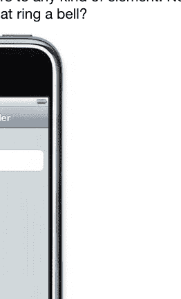

图4-7. 看，你的第一个Web应用！

#### 隐藏移动版Safari的地址栏

只要你在全屏模式下查看网站，一切都很美好。然而，你无法完全确定最终用户会以这种方式使用它。一个理想的技巧是在网站于移动版Safari中查看时隐藏地址栏——以及错误控制台（如果需要的话）。让我们看看具体情况。这些页面元素会随着用户平移视口而消失。页面将至少占据视口高度的100%，这意味着如果其部分元素移出可视区域，它不一定能足够高以覆盖整个屏幕。因此，我们的目标将是根据需要重新调整页面高度，使其占据视口的100%，即使部分内容被隐藏。

让我们开始编写代码。在你的项目中创建一个名为*scripts*的新目录。从Komodo Edit创建一个名为*main.js*的JavaScript文件，并将以下代码复制到其中：

```javascript
if (!window.navigator.standalone) {
    document.addEventListener("DOMContentLoaded", adjustHeight, false);
}

function adjustHeight() {
    var html = document.documentElement;
    var size = window.innerHeight;

    html.style.height = (size + size) + "px";
    window.setTimeout(function() {
        if (window.pageYOffset == 0) {
            window.scrollTo(0, 0);
        }
        html.style.height = window.innerHeight + "px";
    }, 0);
}
```

这段代码的作用是检查是否处于独立模式；如果用户不是在全屏查看你的页面，`adjustHeight()`函数将与DOM加载完成关联。该函数使页面高度变为屏幕高度的两倍，这在大多数情况下足够了，因为用户界面元素很少会占用那么多空间。`window.setTimeout()`为页面在魔法发生前提供了足够的修改时间。魔法分两步进行：我们使用`scrollTop()`方法将页面上移，使页面顶部与屏幕顶部对齐；然后，我们重新调整页面高度，使其再次恰好适合屏幕高度。

你可能会觉得奇怪，为什么只在垂直页面偏移量等于0时才重新调整页面位置。实际上，只要有一个像素没有移出屏幕，`pageYOffset`的值就会是0。即使用户平移了地址栏一半的高度，`pageYOffset`值也将保持为0。因此，我们可以逐次调用来保持页面位置。结果是当用户加载页面时，它将几乎全屏显示，为应用程序提供最大的焦点。

#### 处理屏幕方向变化

然而，由于页面高度已被动态修改，如果用户在非全屏模式下旋转屏幕，页面可能会变得过高而超出屏幕。我们也必须为此情况添加事件监听器。请注意，`pageYOffset`测试在这里特别有用，因为位置不会在每次旋转时重新初始化。以下是处理旋转的代码行：

```javascript
window.addEventListener("orientationchange", adjustHeight, false);
```

此代码将让我们知道用户何时旋转设备。事件监听器必须设置在附加到当前窗口的`DOMWindow`对象上，而不是设置在`document`上。你将能够随时使用`window.orientation`属性检查方向值，例如，如下例所示，以适当地修改样式：

```javascript
switch (window.orientation) {
    /* Normal orientation, home button on the bottom */
    case 0:
        document.body.className = "portrait";
        break;

    /* Rotated 90 degrees to the left */
    case 90:
        document.body.className = "landscape";
        break;

    /* Upside down */
    case 180:
        document.body.className = "portrait";
        break;

    /* Rotated 90 degrees to the right */
    case -90:
        document.body.className = "portrait";
        break;
}
```

这样，我们避免使用定时器（这会耗尽电池电量）来定期检查窗口尺寸的变化——通知是自动的。请注意，在iPad上，你也可以使用CSS或带有`media`属性的`link`标签来针对某个方向。

```html
<link rel="stylesheet" media="all and (orientation:portrait)" href="portrait.css">
<link rel="stylesheet" media="all and (orientation:landscape)" href="landscape.css">

<!-- Or in a style tag or stylesheet -->

<style>
    @media all and (orientation:portrait) { /* Your style here */ }
    @media all and (orientation:landscape) { /* Your style here */ }
</style>
```

这仅在iPad上可行。对于其他设备，一个好的做法是用JavaScript在`body`标签上添加一个类或id，以便在方向改变时应用不同的样式。

#### 最终修饰

前面那段JavaScript处理的是用户在移动版Safari中打开你的应用程序时的视口问题。如果不是，我们已经看到你应该用JavaScript处理链接；我们将把相关的脚本添加到我们的*main.js*中，以防止这种情况下的默认行为。为此，添加如下事件监听器，并将`clickHandler()`函数附加到你的脚本文件：

```javascript
if (!window.navigator.standalone) {
    document.addEventListener("DOMContentLoaded", adjustHeight, true);
    window.addEventListener("orientationchange", adjustHeight, true);
} else {
    /* Target only standalone mode */
    document.addEventListener("click", clickHandler, true);
}
```

#### 准备就绪

你在这里构建的文件和文件结构正是你开始大多数Web应用项目所需要的。如果你已经安装了Komodo Edit，你现在可以将此项目保存为模板，以便在常规工作流程中轻松重用它。为此，从Project菜单中选择你的项目名称，然后点击Create template from project。模板的默认位置是在安装Komodo Edit时创建的用户文件夹中的*Template*文件夹。你将能够通过从Project菜单中选择New project from template从此模板创建新项目。

如果你没有选择安装Komodo Edit，我们建议你找到其他方法来轻松重用此代码和结构。从本章中，你已经了解了我们的模板存根所满足的需求对于用户满意度——以及你的Web应用成功的重要性。使用模板作为辅助工具将帮助你快速度过项目初期有些烦人的阶段。这也是让你的Web应用实现其首要目标的第一步：成为一个合格的应用程序。

# 第5章

### 用户体验和界面指南

上一章的核心不是关于屏幕尺寸、技术可能性，甚至不是对iOS在iPhone、iPod touch和iPad上行为的理解的信息。当然，你必须掌握这些方面才能为这些设备构建高质量的Web应用程序，但实现这些的技术只是成功过程中的工具。本书的建议都归结于用户。苹果便携设备的触摸交互系统在设备和用户之间建立了一种特定的、绝对以用户为中心的关系。这意味着你，作为开发者，需要认真考虑你的应用程序设计。

应用于计算机开发，认知人机工程学是一门实用科学，旨在使应用程序的功能易于用户理解和访问。苹果工程师已经考虑了iOS的一些人机工程学。例如，多点触控交互模型允许用户轻松执行大多数网站的常见任务，如缩放、聚焦或打开上下文菜单。

苹果产品人机工程学的一个重要方面，尤其是在苹果便携设备上更为关键的是视觉吸引力。iOS具有强烈的视觉标识，并且由于与iPhone图形用户界面紧密集成的原生应用程序的成功，它变得更加易于识别。因此，从用户角度判断应用程序的质量，通常是看其视觉质量与iOS图形用户界面相比如何。

当然，仅仅依靠设计并不能让你的Web应用成功。虽然漂亮的外表可以吸引用户进入应用程序，但如果他们在实际使用时没有找到预期的质量，他们会很快离开。这在像应用程序开发这样竞争激烈的领域尤其如此。

在本章中，我们将探讨一些规则和最佳实践，这些将帮助你构建更好的Web应用程序，即那些在移动设备上（与桌面电脑上不同）的用户体验达到最佳状态的应用程序。


#### 从桌面端网页到移动端网页

认为无论通过何种设备访问，网络体验都是一样的，这是一个常见但危险的错误。虽然 Web 应用程序是基于 Web 技术构建的，但它们与传统的网页截然不同。显然，设备能力各不相同。如果你在桌面端 Safari 浏览器或移动端 Safari 浏览器中查看像 Gmail 这样的 Web 应用程序，你会看到一个明显不同的界面。

尽管如此，在你的 iPhone 上使用 Gmail 是可能的，因为 Mobile Safari 旨在适应有限的屏幕空间。然而，用户的体验不如在 iMac 甚至 MacBook 上使用时那么好。缩放使得内容更难以阅读和交互，如图 5–1 所示。因此，Google 尝试为其 Web 应用程序提供适配移动设备的版本——界面更轻量、功能通常更少、加载时间也经过优化。

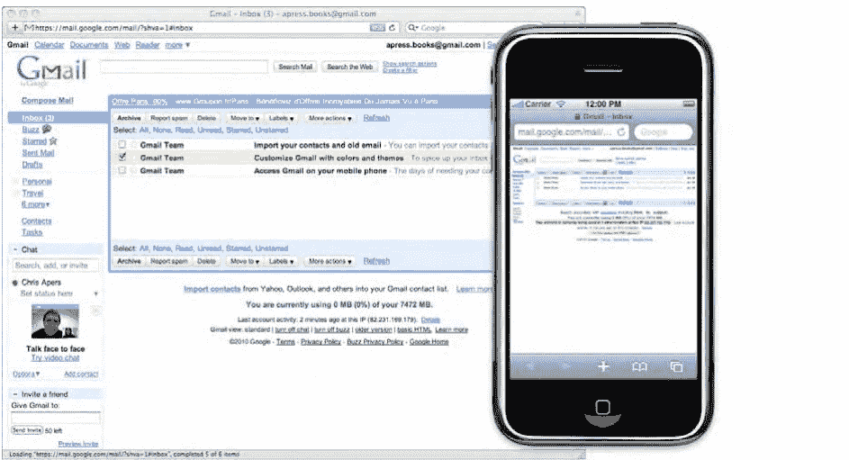

不同的屏幕尺寸不仅意味着不同的视图：更换设备意味着一种完全不同的体验，具有不同的行为和期望。开发 Web 应用程序时，你应将界面和交互方案与功能紧密联系起来，而独立于具体设备。同样，Web 技术（如 CSS 或 JavaScript）应始终被视为可用于定义界面和交互可能性的工具，这些可能性源于特定功能——但绝不能决定界面和功能应该是什么样子。

#### 忘记桌面端

通常，应该忘掉桌面隐喻，以及进行密集多任务处理的习惯。要习惯这样一个事实：iOS 设备——更不用说所有移动设备——并非以这种方式工作。使用台式计算机时，最终用户可以同时执行多项任务，处理多个窗口，并且如果愿意，可以随时将它们并排放置显示。对于所有这些任务，他拥有充足的屏幕空间，最重要的是，他将使用功能丰富的设备（即鼠标和键盘）与桌面进行交互。

计算机拥抱桌面隐喻，并且可以自豪地提供生产力工具以及对许多活动实用或娱乐性的处理方式。然而，对于 iOS，虽然你可以有几个后台任务，例如播放音乐、下载应用程序或获取电子邮件，但无法并排运行多个原生应用程序。iOS 旨在让用户一次高效地完成一项任务。小屏幕意味着用户一次只能专注于一个区域——因此也专注于一系列操作。

#### 改变导航习惯

在开发移动 Web 时，重要的是不要在 Web 应用程序体验过程中失去你的最终用户。传统的 Web 体验允许用户从网站的任何部分访问所有部分。这通常通过导航栏和大量的内部链接来实现。作为 Web 用户，你可能已经遇到过一个根本搞不清楚的网站。如果一切顺利，你很快就能找到你需要的东西；如果不是，像大多数用户一样，你可能已经转到下一个网站了。

这种情况在移动 Web 上更为关键。用户期望找到一条从一点到另一点的清晰、直接的路径。重要的概念是*流畅性*（flow）。虽然在用户进行的任何过程中打断他们似乎很明显是不可取的，但显示一个模态对话框很容易就会打断用户。对于这种情况，你应始终为用户提供一种简单的方式来关闭对话框，并使后续事件变得显而易见。

开发者可能会受到诱惑，通过要求输入（无论是通过文本框还是单选按钮）来让应用程序对最终用户更具个性化。在 iPhone 上，这会减慢用户的体验，并推迟他们实现目标的时间。

在 iPad 上，后果可能更加令人烦恼。Apple 建议 iPad 应用程序应以非线性方式工作，这意味着用户应在主视图中看到他们任务的内容，并且能够从屏幕的导航部分访问选项和交互工具。也就是说，无论用户在应用程序中做什么，都应该能够执行大多数任务。即使在你看来这很相关，也要谨慎要求用户在事物之间进行选择，因为这既会打断用户在主视图中的流畅性，也可能导致导航区域中的选项被切断，这可能会令人沮丧。例如，在邮件应用程序中，你不会希望因为用户正在阅读邮件就丢失“撰写”选项。根据经验，你应该谨慎假设用户所处的上下文以及用户可能想要做什么。

还要记住，制造商已经深思熟虑过其设备的可用性。因此，你不应该重新创造已经存在并且用户已经习惯使用的功能。

#### 考虑周全地展示广告

网站通常提供免费内容，并依靠广告获得经济收入。如果这是你的计划，你应该认真考虑如何去做。在传统的网页上，各种研究已经证明，用户普遍被“训练”到甚至不注意广告。虽然你可能认为在 iPhone 上这问题不大，因为广告必然会占用更多的屏幕空间，而且显示通常不那么杂乱，但你不应该让你的页面超载。存在一个明显的风险：强迫用户平移以浏览不相关的内容，或缩放以远离它，可能会很快让用户离开你的 Web 应用程序。

对于 Web 应用程序和原生应用程序，广告标准早已确立；你通常会在页面顶部或底部显示一个小横幅。然而，原生应用程序更进一步，在大多数情况下会在短暂延迟后自动隐藏广告，将全部空间留给实际内容。这样做有一个好处，既能吸引用户对广告的注意力，又不会显得突兀。将这种行为引入 Web 应用程序将是一个积极的举措，特别是因为使用 CSS 过渡效果，你几乎不需要使用任何 JavaScript。以下是一个简单的示例，你可以使用本书前面创建的模板轻松测试。首先，在页面的 `<head>` 中添加以下内容：

```css
.ads {
    z-index: -1;
    position: relative;
    -webkit-transition: margin-top 0.35s ease-out;
    border-bottom: 0;
    margin: 0 auto 34px;
    width: 320px;
}

.ads img { display: block; }

.ads .tab:before {
    color: red;
    content: 'AD ';
}

.ads .tab {
    position: absolute;
    background-image: -webkit-gradient(
        linear, left top, left bottom,
        from(black), to(#666));
    color: white;
    font: bold 11px/24px verdana;
    height: 24px;
    bottom: -24px;
    left: 0;
    width: 100%;
    padding: 0 5px;
    -webkit-box-sizing: border-box;
}
```

首先，你定义样式，通过修改广告的 z-index 和 position 值，使广告堆叠在标题下方。然后，你为广告区域以及广告显示后应保持可见的区域块创建样式。与过渡相关的代码以粗体标出，表示当 margin-top 属性改变时，应发生平滑的 35 毫秒过渡。

接下来，你依赖一个脚本来触发动画：

```javascript
function hideAds() {
    setTimeout(hide, 5000);
}

function hide() {
    var ads = document.querySelector(".ads");
    ads.style.marginTop = (-ads.offsetHeight) + "px";
}

function reveal() {
    var ads = document.querySelector(".ads");
    ads.style.marginTop = "";
    hideAds();
}
```

> **注意：** `querySelector()` 方法返回与作为参数传递的 CSS 选择器匹配的第一个实例。它是 W3C 选择器 API 的一部分，Mobile Safari 完全支持。

这样，每当你想要隐藏你的广告时，你只需调用 `hide()` 函数，它将根据横幅的高度确定新的 margin-top 值并启动动画。

`reveal()` 函数将允许你通过恢复 margin-top 的初始值并再次触发动画来重新显示广告。以下是相关的 HTML 标记：

```html
<body onload="hideAds()">
...
    <div class="header-wrapper">
        <h1>Web App Header</h1>
    </div>

    <div class="ads">
        
        <div class="tab" onclick="reveal()">
            Apress sales. 20% off on all books.</div>
    </div>
...
```


#### 让用户自行决定

无论你想出什么点子，都要记住本书已经或将会介绍的使用特点，以及你从自身 iPhone 用户体验中收集到的元素。

第 9 章将更详细地介绍 CSS 过渡效果。用户将能够点击标签再次查看广告，五秒后隐藏过程会再次发生。图 5–2 展示了结果。

**图 5–2。** *广告在几秒后自动隐藏*

此外，你应该避免使用弹出式元素。如前所述，你应当限制任何对用户体验流程产生负面影响的元素。因此，你应考虑仅在特定时刻使用弹出式元素，例如首次加载页面时。在所有情况下，都应该提供一个明显且便捷的方式让用户关闭广告——使用 iPhone UI 默认的 "X" 是一个合理的选择（图 5–3）。总体而言，你应该深入思考你的广告会如何影响你的应用程序。

**图 5–3。** *你应该始终为用户提供便捷的隐藏广告的方式*

在 iPad 上，可以使用类似的过程，只是格式不同。尽管 iPad 的大屏幕使其更接近桌面网页，但如前一章所述，用户与设备之间建立了一种特殊的连接。因此，你应该考虑新的、适配的方式来在你的页面中引入广告。你可以利用的可能性，包括声音、视频和丰富的交互，这些都应该鼓励你让用户成为推广内容中的核心角色。

无论你想出什么点子，都要记住本书已经或将会介绍的使用特点，以及你从自身 iPhone 用户体验中收集到的元素。

#### 让用户自行决定

作为开发者，在引导用户体验无缝流程、让他们选择从 Web 应用中想要什么，以及在整个过程中不加干预之间找到恰当的态度，确实可能非常棘手。然而，有些时候很明显你应该将决定权留给用户。尽管用户的挫败感并非直接关乎用户界面或设计问题，但它会对你的应用程序的感知质量产生负面影响。例如，根据用户使用的设备来过滤他们并用 "仅限 iPhone" 的消息阻止他们，是你应该避免的事情。首先，一个更好且整体上更有效的方法是针对功能而非用户代理。其次，如果你的 Web 应用在 iPhone 上可以工作，它很可能在 iPad、Android 设备、webOS 设备等上也能类似地工作。

同样，你不应该强推一个特定于 iPhone 的网站给 iPhone 用户。用户可能有理由更喜欢使用常规的桌面网站。你已经看到 Mobile Safari 渲染网站的方式与 Desktop Safari 相似，并提供了工具以便在最佳条件下查看页面。给用户一个选择（图 5–4），记住这个选择（无论是通过 cookie 还是其他存储方式），并始终给用户改变主意的机会。


**图 5–4。** *Google 翻译的移动版为用户提供了使用常规网页版的选项*

#### 简洁易用

对于传统桌面开发和 Web 开发为真的原则，在移动 Web 领域甚至更为关键。因为便携设备本就设计用于移动场景，用户很可能同时在关注其他事情。这就是为什么你必须让用户清楚地知道如何通过你的应用程序实现他们的目标。虽然反复平移可能很烦人，但你不应该将大部分内容集中在页面顶部；相反，如果你有很多内容，你应该对其进行分类并让你的分类清晰明了。用户应该能够立即识别出你的 Web 应用程序的主要功能以及应用程序的整体运作方式，即使他们同时在关注其他事情。

#### 避免杂乱

整体的 iOS 用户界面简洁而精致，带有微妙的渐变、有限的色彩和干净的线条。这是用户评判你的 Web 应用程序的标准，而 Apple 的选择绝非随意。杂乱始于刺眼的颜色、过多的颜色，以及使内容难以浏览的颜色。同样的原则也适用于你的 Web 应用程序元素。分散的内容可能难以理解，并且会使用户从重要内容上分心。图 5–5 展示了一个杂乱的应用程序的例子。

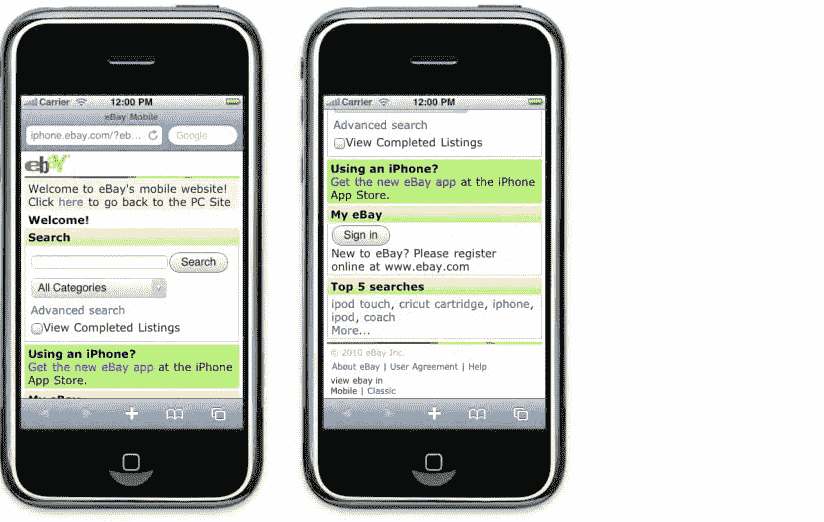

**图 5-5。** *eBay 未针对 iPhone 优化，给人杂乱的印象，但由于只有一个搜索字段，仍然保持了效率*

这并不意味着你应该大量使用空白区域。在 iPhone 上使用过多的空白会迫使用户大量平移，而整体内容的可见性却很有限。在 iPad 这样较大的屏幕上滥用空白可能会稀释内容，并留下体验分散的印象。

如果你的 Web 应用本质上包含许多不同的内容元素，那么获得满意用户体验的关键可能是一个高效的菜单。同样，你不能保留可能为桌面 Web 开发而养成的习惯。你的菜单必须快速切中要点，在清晰明了地展示可用选项的同时，将用户操作限制在最少。应优先使用简短、表达力强的文本，而不是冗长、描述性的文本或下拉菜单。如果你确信你的目标受众会知道那些能用更少字符清楚表达选项的技术术语或缩写词，那就使用它们。所有与导航相关的内容都应易于快速浏览和使用，因此这些准则同样适用于按钮、链接和偶发的弹出窗口。简单地说，不要忘记所有这些元素都是次要的，不应将用户的注意力从你所提供的核心服务上移开。恰当地平衡所有这些方面将极大地帮助吸引用户的注意力，并最终提高用户忠诚度。

#### 用户界面

在屏幕尺寸有限的移动环境中，用户界面的概念需要用好奇的眼光来审视。我们谈论的是一个经常在移动中使用你的 Web 应用的人，虽然他们使用的是比习惯更小的屏幕，并且仅用手指手势与你的应用程序以及整个设备进行交互。

开发桌面应用程序时，你可以放心地将按钮排列在全屏窗口的最边缘，以便轻松点击。为 Web 开发时，你可以依靠鼠标悬停工具提示来引导用户朝正确方向操作。这些技术在 iOS 上开发时不适用。没有什么特别措施能防止用户错过屏幕的边缘，并且实际上没有鼠标悬停让用户可以“探索”页面。为了使用户界面保持其在桌面端时的定位——一组作为整体运作以使功能易于访问的图形元素——你必须重新思考应该应用哪些关键规则。

#### 适应触控

你应该考虑的第一个参数是定位设备——用户的手指。Apple 建议大多数用户的手指需要大约 44 像素宽的区域才能快速准确地点击某物。如果你想使用更小的按钮或链接，请确保留出足够的周围空间，以免多个活动区域被同时点击。

另一个关键点是，操作应该被清晰地标示出来。如果没有人真正想到去点击它们，那么拥有完美大小的点击区域是没有意义的。让你的元素看起来可点击。确保用户能识别出按钮的最佳方法是遵循主流的 Apple 用户界面风格。如果你偏离了它，你应该小心不要让人们误解你的元素。在 iPhone 上，创建可点击元素的通用建议是让它们“看起来真实”。Apple 按钮因其渐变和阴影而在屏幕上突出显示（见图 5–6）。它们看起来像你可以实际触摸的按钮——这恰恰是你需要暗示的。

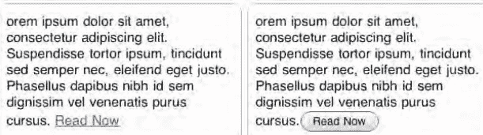

**图 5–6。** *用户更可能点击按钮而非普通链接*

在为 iPad 开发时，这一点将更为重要：随着专门为 iPad 更大屏幕设计的应用程序和网站数量的增加，真实世界风格的应用程序界面很可能会被认真地向前推进一步。

最后，不要忘记，与使用鼠标不同，用户没有办法激活悬停状态。如果你的应用程序依赖工具提示或复杂的悬停效果，它很可能只会让失望的用户离开。


#### 适应尺寸

事实是，你可能并非针对尺寸大得多的移动设备进行开发。虽然屏幕分辨率可能会提升用户体验，但如果设备要保持移动性，屏幕尺寸不太可能变得更大。iPad 的体验则截然不同。尽管它拥有更大的屏幕，但不应被视为一种新型的笔记本电脑，而且虽然绝对不应被视为更大的 iPod touch，但以下原则同样适用于 iPad 开发：务必极其谨慎地确保所有文本内容都易于阅读。宽屏上的小字体令许多人烦恼——而在移动设备的小屏幕上，这可能会完全让用户失去兴趣。

当然，一种解决方案是提供增大或减小字体大小的功能（图 5–7）。然而，最终的最佳技术是在设备上测试你的字体，并诚实地评估自己视力的准确性。请在创建图标时也考虑同样的限制。当你通过尺寸让一个区域易于点击时，请记住，图标的目的在于比文本更快、更通用地表达一个动作、快捷方式或链接。这在移动设备上尤为重要。

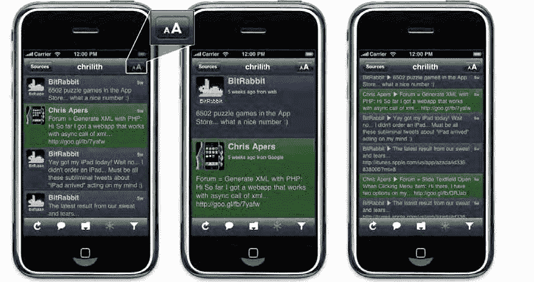

*图 5–7. Twitterific 应用程序在导航栏中提供了一个按钮，用于更改文本大小*

#### 避免不必要的交互

我们已经强调，用户体验应尽可能流畅。在传统网络上填写表单可能会阻碍用户进一步操作，而在移动网络上，这很快就会变成一件苦差事。在所有情况下，你都应该优先使用单选按钮、复选框或下拉选项，而不是文本字段，因为在 iPhone 上打字可能因情况而异，会比较困难。同样的指导原则也应适用于 iPad；Apple 建议 iPad 应用程序应完全能够单手操作，而使用双手则应带来额外的舒适性和更快的功能访问速度。

#### 利用新的输入类型功能

如今，表单是网络用户日常生活的一部分。人们习惯于填写表单，并且考虑得越来越少。因此，他们可能对审美和可用性的标准更高，耐心也更少。在移动设备上尤其如此，浏览条件往往使用户变得不耐烦，而输入过程也可能很困难。

HTML5 引入了许多新的输入类型来解决这些问题，这些类型具有向后兼容性。表 5–1 列出了 Mobile Safari 支持的类型。

*表 5–1. Mobile Safari 支持的新输入类型*

| 类型 | 描述 |
| --- | --- |
| tel | 电话号码（通常是一组数字字符） |
| search | 搜索字段 |
| url | 绝对 URL |
| email | 一个或多个有效的电子邮件地址 |
| number | 数值 |

核心思想是，在处理表单时，浏览器应能够为用户提供界面，并向开发者提交格式信息。Mobile Safari 为这些输入类型提供了上下文键盘，方便用户提交。例如，点击 tel 类型输入会触发数字键盘，如图 5–8 所示。

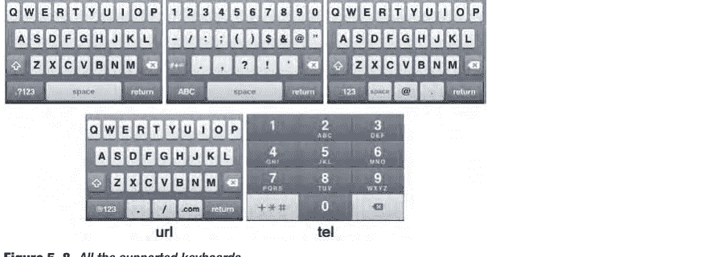

这些功能显然可以通过减少操作次数来提升用户体验，实现无缝交互。iPhone 在 2.0 版本之前，在某种程度上已经提供了类似功能，它会自动为名为 zip 或 phone 的输入元素显示数字键盘。然而，此功能在 iOS 2.0 中被弃用，直到 3.1 版本才重新开始支持这些新类型。

#### 慎重对待用户提供的信息

尽管可以简化用户输入，但请始终问自己：你是否真的需要计划询问的信息，换句话说，这些信息对最终用户来说是否是首要关注点。如果你的应用程序根据各种标准返回书籍列表，那么询问是否偏好精装本、特定编辑器或任何出版年份似乎就是次要的了。在这种情况下，最好的做法是将查询分阶段进行，就像亚马逊所做的那样（图 5–9）。首先，按标题、作者或主题搜索——理想情况下，这只需要一个文本字段，由服务器端脚本判断哪个是相关的。然后，提供过滤结果的选项，例如按日期、编辑器或封面类型过滤。最后，你可以让用户对最后的结果进行分类，比如按价格或书店库存情况。


*图 5–9. 亚马逊没有在搜索区域堆满过滤器。相反，它将过滤延迟到结果页*

加快此类应用程序响应速度的另一种方法是跟踪用户输入。在这里，你的忠实用户很可能主要在寻找同一出版商的书籍。你可以使用传统的 cookie 或 HTML5 最新的客户端存储技巧（我们将在第 15 章使用）来存储用户的选择。这样，每当用户返回你的网络应用时，他们会感激不用再次输入 *Mephistofeles 的古董书架珍藏*。

用户输入背后的关键原则是，无论你要求提供什么信息，你都应该提供尽可能多的额外功能作为回报。当然，收集用户信息可以大大提升你所提供服务的质量。关键在于让“大大提升”相对于“收集信息”而言尽可能显著。

#### 避免增加步骤

在前面的例子中，用户经历了三个步骤——筛选、搜索和排序——其中只有第一步是必需的。正如我们之前所述，用户来寻找的功能应尽快通过一个直接的过程提供。将书籍搜索应用分成三个独立的页面，仅仅是为了简化每个阶段——这在传统网络上很常见，例如在创建账户的表单中——在这里并不合适。这种决策的好处——更少的平移操作、更少的杂乱——会被用户被迫等待的事实所阻碍，他们甚至可能不知道过程需要多长时间或下一步是什么。此外，对于开发者来说，赌网络会连续三次高效运行是有风险的。

#### 精神：专注

iPhone 不是电脑，iPad 也不是。不要期望用户像使用电脑一样操作它们，也不要以电脑应用为思路来开发你的网络应用。iOS 应用应专注于为特定需求或问题提供具体而令人满意的解决方案，并且应几乎只专注于以最直接的方式提供预期功能。因此，容纳你网络应用的视口应是一个承载着作为一个整体运行的精选元素的地方，一个整洁、简洁、清晰的地方，就像时钟应用（图 5–10）那样。尽管这可能源于硬件限制——重负载下渲染缓慢、有限的屏幕空间——但这已经成为用户的一种期望，他们的忠诚度会因你针对用户首要问题提供恰当答案而得到回报。这对于 iPad 也同样适用，至少是继承了这种理念，因此，始终专注于提供一项恰当的服务，而不是多项近似的服务。

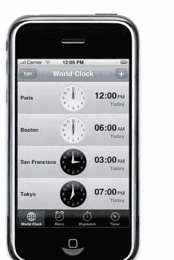

*图 5–10. 时钟应用专注于预期功能：时间服务*

#### 让事物保持响应性

移动设备上的用户期望事情快速发生。任何操作都应立即得到反应。我们在上一章解释过，全屏模式网络应用的默认启动屏幕是上次网络应用屏幕状态的视图，这可能会给人一种应用或设备已无响应的印象。这至少会让用户感到沮丧。即使相当短暂的等待也可能赶走一些用户，并且在所有情况下都会损害用户忠诚度。

##### 让你的网络应用保持响应性

这一点在整个网络应用体验中始终适用。你应该避免增加对处理器要求高的操作、过多的 JavaScript，以及耗时过长的操作，例如需要大量服务器端活动才能显示结果。所有这些都应在开发的优化阶段彻底考虑，同时也应在开始阶段，即在头脑风暴和功能设计阶段就开始考虑。

为了从你的网络应用加载开始就最小化等待时间，请始终将图像的使用限制在最低限度，注意文件大小，并避免页面过长需要大量平移才能使用。关于图像，正如我们将在后面的章节中看到的，你可以用 CSS 渐变、Canvas 或 Web 字体替换许多图像。你应该意识到，只要文档没有完全加载，你页面的其余部分很可能

无法与用户进行交互——而用户实际上并不理解原因，因为页面中尚未加载的部分将位于视图之外。最后，尽管将标记、样式和功能（即 HTML、CSS 和 JavaScript）分离并依赖外部文件是一种良好的实践，但你应该尽可能减少 HTTP 请求的数量，因为再次强调，你无法预测连接类型或质量，而且在移动设备上服务器响应时间可能会更长。

当然，你提供的体验中出现的明显延迟步骤可能是不可避免的。如果在某个阶段你必须启动一个将花费相当长时间的操作，请始终记住向用户反馈 Web 应用程序的活动（图 5-11）。虽然每个操作都应该带来快速的响应，但如果无法做到这一点，如果你能及时让用户了解当前进展，他们会更有耐心和宽容。顺便说一句，这对大多数类型的用户交互都适用。

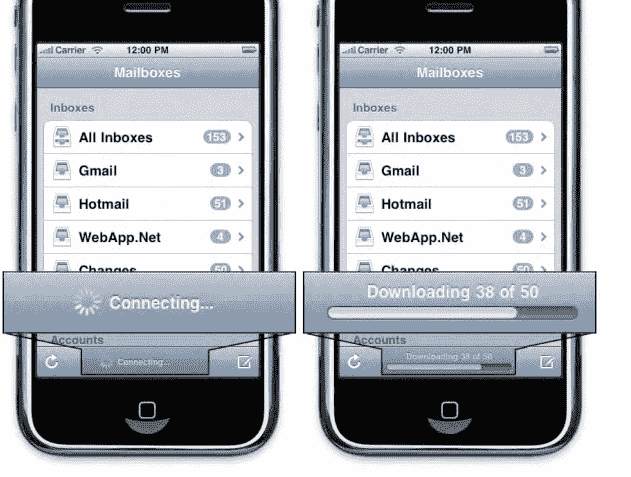

**图 5-11。** *Mail 应用在连接期间使用旋转指示器，然后在可能较长的消息加载过程中使用进度条*

对于等待阶段，除非你绝对确定等待时间很短，无论连接质量如何，进度条都比旋转指示器更好，因为它能告知用户当前进程的进展。同样地，如果发生多个操作，逐步告知用户正在发生什么将会是有益的。屏幕上变化的视觉元素告诉用户确实有事情在发生，也就是说，Web 应用程序没有卡在一个旋转指示器视图上——如果你处理得当，这甚至可以在一定程度上变得有趣。

##### 让你的 Web 应用具有响应性

以类似的方式，即使操作不会花费时间完成，你也应该引导用户完成操作。iOS 使用 `-webkit-tap-highlight-color` CSS 属性为点击的按钮提供内置反馈。你可以以此为例，了解可以做些什么来加强用户与其设备之间的联系——以及你的应用程序——因为屏幕对手指操作的反应就像一个真正的按钮。在传统 Web 上，这通常通过悬停状态实现：当鼠标悬停在菜单项上时改变颜色、出现工具提示、元素放大，或者切换其透明度。

你知道在移动设备上这不是一个选项，因为没有鼠标，就没有真正的悬停动作。相反，你应该格外关注用户点击时应该发生的任何事情。另一个来自原生 iOS 功能的启发性例子是开/关切换按钮。Apple 设计师不使用常规复选框，甚至不使用功能激活时看起来被按下的按钮，而是使用“开关”隐喻。这给用户一种 GUI 元素具体性的优越感，而状态的变化则成为一个精细的动画，确认操作已被考虑。尽管如此，在模仿原生 iOS UI 时要始终小心，因为用户会期望你的元素表现得与它们模仿的元素完全一样。因此，不同的行为或结果将是欺骗性的，并会对应用程序的感知质量产生负面影响。

作为 iOS 开发者，在很多情况下，超越 `-webkit-tap-highlight-color` 效果去创建你自己的效果（但请记住事情应该保持简单且易于理解）、管理你自己的自定义效果，或者例如模仿原生效果或菜单选择列表原生效果，可能是很有趣的。

#### iOS 界面设计最佳实践

除了前面介绍的可用性指南外，还有许多用户界面设计指南你在开发 Web 应用程序时应该考虑。这些源于设备的特殊性或原生 iOS GUI。遵循它们可以帮助你提供用户期望的良好体验，并且是成功应用的重要一步。

#### 适应性

iOS 的一个棘手特性是它允许用户随时在纵向和横向方向之间选择视口。与传统 Web 开发人员相比，这是不寻常的，他们可以轻松依赖最小屏幕尺寸，最终依赖滚动。此外，用户在访问页面时不太可能反复更改浏览器窗口的大小，这意味着不会直接比较不同的显示效果。iPad 的发布使情况变得更加复杂，其屏幕尺寸是 iPhone 和 iPod touch 的五倍。为了向用户提供满意的体验，你的 Web 应用程序必须完美适应这些情况至关重要。

因为遵循本书中的建议，你已经防止了对你的 Web 应用程序进行缩放，所以你必须确保它适应视口的宽度（设置为 device-width）。如果你是一名前端 Web 开发人员，你知道什么是流体布局。基本思想是你的页面占据屏幕的 100%，无论屏幕大小如何，都不会分解成一堆无序的元素。这意味着你应该禁止所有布局元素的固定尺寸，作为一般规则，完全避免它们。本书中将有许多关于如何实现这一点的例子。你已经在你构建的项目模板中看到，标题和段落占据了整个屏幕的宽度，无论方向如何。

你可以使用的另一种方法是根据视口方向应用 CSS 规则。这需要谨慎使用，因为如果你最终对每种配置应用完全不同的规则，你可能会轻易地将文件大小加倍。最好的方法是记住你的页面将有两种可能的布局，并在每个开发阶段测试两者。如果你以这种方式构建了标记和样式，你可能不需要使用特定的样式。

#### 列表 vs. 图标方法

为了清晰直接地呈现数据，你将经常使用列表。Apple 建议在针对运行 iOS 设备的网页和应用程序中使用列表，实际上列表有很多优势。它们通过减少完整句子的数量让你更简洁，并将大量信息组织成清晰的数据组。此外，它们在形式上类似于 iOS 和桌面应用程序菜单的默认菜单，因此用户会熟悉它们。

但是，请注意不要使列表过长。虽然前面列出的要点都与我们已经写过的好做法相交，但列表——甚至网页——如果变得太长，将迫使用户平移，可能错过他们正在寻找的内容或在信息中迷失方向。长列表的另一个严重问题是它们通常会使浏览器变慢，这将再次使用户感到沮丧。为了避免列表变得太长，如前所述，你应该问自己什么信息最重要，以及你如何对其进行分类。

因为列表存在于 iOS GUI 中，所以存在你可以模仿的现有样式，以为你的 Web 应用程序实现吸引人的界面。有三种类型的列表可用，即全宽列表、带圆角边框的列表和图标网格列表（见图 5-12）。

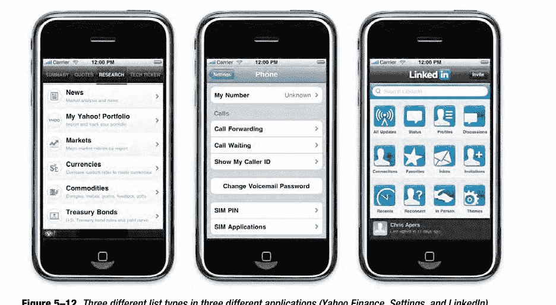

**图 5-12。** *三个不同应用程序中的三种不同列表类型（Yahoo Finance、Settings 和 LinkedIn）*

如果你遵循本书中的所有示例，并从我们建议的文件和代码片段创建模板，你很快将拥有一个坚实的基础，可以从中选择来构建 Web 应用程序。

第一种列表类型特别适合长列表。它紧凑、简单且可读。如果你已经开始了你的项目模板和模板文件的构建，你可以创建一个新的 HTML 文件，并将以下代码添加到 `.view` 容器中：

```html
<div class="list-wrapper">
    <h2>A</h2>
    <ul>
        <li>Apple</li>
        <li>Application</li>
    </ul>
</div>
```

接下来是让基本列表看起来像 iPhone 的 CSS。将其附加到你已经在 Web 应用程序模板中开始的 `styles.css` 样式表中：

```css
.list-wrapper h2 {
    line-height: 1;
    font-size: 18px;
    padding: 1px 12px;
    font-weight: bold;
    text-shadow: rgba(0,0,0,0.5) 0 1px 0;
    background: left 1px -webkit-gradient(linear,
            left top, left bottom,
            from(rgba(0,0,0,0.18)), color-stop(0.65, transparent))
        rgba(178,187,194,0.89);
    -webkit-box-sizing: border-box;
```


.list-wrapper ul {
    padding: 0;
    background: #fff;
    font-size: 20px;
    line-height: 23px;
    margin: 0;
}

.list-wrapper ul li {
    border-bottom: 1px solid #dfdfdf;
    padding: 10px;
}

第二种列表类型与边到边列表类型非常相似，但它的第一个和最后一个列表项带有圆角边框。因此，它更适合用于不太长的列表，这样列表的顶部和底部边缘就能一览无余。HTML与之前的标记非常相似，不过样式会将内边距直接应用到链接上，因此应用到获得焦点元素的效果会考虑到圆角。要查看效果，只需将以下代码放在`.group-wrapper`内：

```
<h2>Group List</h2>
<ul>
    <li><a href="item1.html">Item 1</a></li>
    <li><a href="item2.html">Item 2</a></li>
    <li><a href="item3.html">Item 3</a></li>
</ul>
```

相关样式则放入同一个样式表中：

```
.group-wrapper ul {
    background-color: #fff;
    -webkit-border-radius: 10px;
    font-size: 17px;
    line-height: 20px;
    margin: 9px 0 10px;
}
```

```
.group-wrapper ul li {
    padding: 11px 9px 12px;
}
```

```
.group-wrapper ul {
    font-weight: bold;
    margin-bottom: 20px;
    list-style: none;
    padding: 0;
    border: solid 1px #a9abae;
}
```

```
.group-wrapper ul li:not(:last-child) {
    border-bottom: inherit;
}

.group-wrapper ul li a {
    padding: inherit;
    color: inherit;
    text-decoration: inherit;
    margin: -11px -9px -12px;
    display: block;
}

.group-wrapper ul li:first-child a {
    -webkit-border-top-right-radius: 10px;
    -webkit-border-top-left-radius: 10px;
}

.group-wrapper ul li:last-child a {
    -webkit-border-bottom-right-radius: 10px;
    -webkit-border-bottom-left-radius: 10px;
}
```

你的第三种列表替代方案，图标网格显示，适用于需要在最小区域内呈现众多选项的情况。它允许进行直观展示，可用于向用户呈现选项。你也可以用这种显示方式替代上下文菜单中的标签，例如用户长按以使用复制粘贴功能时。只需记住，始终确保可点击区域足够大，便于使用。

#### 考虑UI替代方案

在考虑可用性设计的同时，你还需要彻底重新思考Web应用程序的实际图形设计。你有几个选择，这些都是合理的。由于移动设备界面设计存在相当多不同的指导方针，你可以在多大程度上遵循这些准则，完全取决于你自己。

#### 模仿iOS UI

在开发Web应用程序时，模仿目标设备的原生GUI是一个相当稳妥的选择。使用用户已经熟悉的外观和感觉将加速他们的导航体验，并为你的应用程序带来积极的印象。你的目标应该是提供流畅的体验，因此让你的应用程序模仿整体的Apple界面，并使用Apple提供的精心设计的元素，似乎是一个显而易见的想法。

模仿iOS的主要缺点是，如果你的应用程序在另一个设备上查看，可能会显得格格不入。webOS或Android用户看到你的Web应用程序，就像在iPhone上看到的一样——但周围的环境、内置功能，甚至设备本身都不是iPhone。

最后，你可能会认为，即使Apple推荐模仿iOS UI，这也不是很有个性，最终可能会让你的应用程序不如具有类似功能但拥有更鲜明身份的应用程序令人难忘。

在某些情况下，即使不实际模仿原生界面，你也应该依赖它。iOS对于表单`<select>`元素和弹出模态窗口有特定的内置行为。如果偏离Apple的实现方式，这些功能通常很难以可用的方式呈现，尤其是因为用户应该清楚在执行此类元素上的操作时会发生什么。

在某些情况下，你别无选择，只能依赖iPhone UI。如果你想使用特殊的URL方案，例如`mailto:`或`tel:`，你将再次把控制权交给操作系统。同样，当使用音频或视频播放器时也是如此，因为Mobile Safari在iPhone和iPod touch上并未直接集成这些功能。

#### 构建iPad体验

iPad对于开发市场来说是新颖的。尽管它与iPhone和iPod touch共享GUI（因为它也使用iOS），但你应该为这个设备重新思考你的设计原则。iPad很可能为用户带来全新的设备体验——构建一个新的、相关的应用程序体验就取决于你了。

iPad的屏幕大致与上网本大小相当，其分辨率高于iPhone和iPod touch。但是，你不应该以笔记本电脑为思路来开发应用程序，或者简单地将iPad视为一个更大的iPhone。iPad带来的功能显然与电脑和智能手机不同。

##### 不是笔记本电脑，不是iPhone

iPad的初始方向是纵向，且没有滚动条。清晰的体验至关重要，这一点与iPhone同样重要。仅仅因为你的应用程序有更多可用的屏幕空间，绝不意味着你应该尝试使用全部空间。保持将用户注意力集中在Web应用的一个目的上，并使其交互方式易于理解。总的来说，应用与iPhone开发相同的指导原则。

同样，iPad不是一台大型iPhone。如果遵循iPhone UI指南，你应该在可能或必要的地方进行调整。你可以保持对列表的偏好，但可以考虑让每个项目包含更完整的内容。此外，你可能需要考虑，在iPhone应用程序中需要两个视图的地方，在iPad上如果看起来相关，可以将元素组合成一个视图，如图5-13所示。


**图5–13.** *一种创造性且实用的方式来实现分屏视图*

一种有趣的iPad内容布局设计方式称为*分屏视图*。其想法是，由于iPad屏幕更大，开发者可以采用主从样式，将主要焦点与辅助内容及更高级的功能分开。

在纵向模式下，详细视图会全屏显示，而主视图会浮在上面；用户通过点击按钮在可见状态和隐藏状态之间切换。在横向模式下，你将应用程序的浮动框转换为侧边栏。这有显著的优势，但不要忘记始终让用户自行选择。如果你认为应该建议使用横向视图甚至强制使用，你可能是在进行糟糕的设计，或者制作一个并非真正意义上的iPad应用程序。

在iPad上，触摸仍然是与操作系统、应用程序和内容交互的理想方式。这一点很重要，因为它强烈影响用户如何使用和感知你的页面和应用程序。由于屏幕尺寸允许你更轻松地模仿现实世界中的元素，并具有更高的细节水平，你可以依赖一种新的真实感，让你的应用程序更易于理解和使用。看看iBooks（图5-14），它在图书馆隐喻上做得很到位。这个应用程序非常直观，因为用户被邀请从书架上取下一本书来阅读。


**图5-14.** *iPad上的iBooks就像真实的图书馆书架，邀请用户取书阅读*

由于你有更多可用空间，空间中的交互不再局限于垂直移动，而且它也不那么繁琐了，至少因为用户能更清楚地看到他们正在做什么。最早在iPad上推出的应用程序是用于阅读书籍、更新日历，甚至进行文字处理。这些都是桌面活动（我们这里指的是一个合适的、木制的桌面），被移植到了更清洁的移动生活中。这强烈地暗示你应该允许用户获得类似他们正在做的事情的物理感受。


##### 为 iPad 创建界面

如果你打算在应用设计中大量使用分屏视图（图 5–15），那么你应该再次认真考虑构建可复用的模板，以加快开发进程。构建分屏视图有几个地方可能会比较棘手。

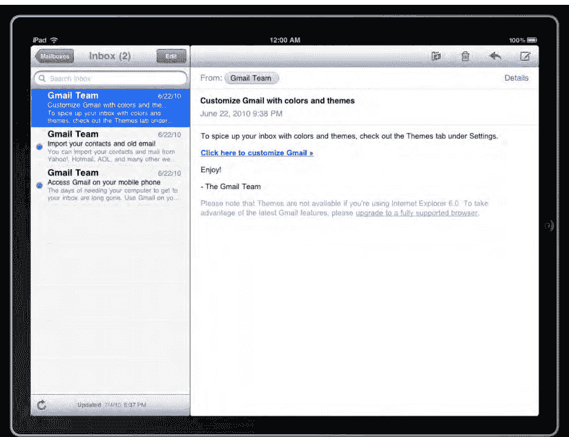

首先，你必须专门针对 iPad 进行设计——显然分屏视图在 320x480 像素的屏幕上会崩溃。这可以通过 CSS 的 `@media` 规则实现，如下所示：

```
@media only screen and (min-device-width:640px) { ... }
```

这意味着我们仅针对最小宽度为 640px 的屏幕设备。也就是说，你可以将其放入你的主样式表中：

```
@media only screen and (min-device-width:640px) {
    body {
        background: #e1e4e9;
    }

    .header-wrapper {
        color: #727880;
        text-shadow: rgba(255,255,255,0.7) 0 1px 0;
        border-top-color: #fff;
        border-bottom-color: #3e4149;
        background: -webkit-gradient(linear,
            left top, left bottom,
            from(#f4f5f7), to(#a8adb8));
        -webkit-background-size: 100%;
    }

    .group-wrapper p,
    .group-wrapper ul {
        -webkit-box-shadow: 0 1px 0 #fff;
        border-color: #b2b5b9;
    }
}
```

目前，你只需更改标题栏的颜色以符合 iPad 的配色方案。然而，不必无谓地让 iPhone 样式表超载，因为当你的 Web 应用在 iPad 或桌面浏览器上使用时，你也可以加载不同的特定文件。这可以通过在 `<link>` 标签的 `media` 属性中指定设备宽度来实现：

```
<link rel="stylesheet" href="styles/big.css"
media="only screen and (min-device-width:640px)">
```

这样，如果用户使用的是 iPhone，则什么都不会加载，但你可以为更大的设备添加合适的样式。将上述代码添加到你模板样式目录下名为 *big.css* 的文件中。

现在，既然你已经有了专门面向 iPad 的样式表，让我们在其中添加一些代码来实现前面提到的分屏视图。你将按照原生 iPad 内置应用的实现方式来应用它。请注意，在横屏方向下，两列的高度相同这一点很重要。因此，你对主视图和辅助视图使用 `table` 和 `table-cell` 显示属性值，这样可以避免不得不借助 JavaScript 或使用背景图片制造视觉假象，后者会加重渲染引擎负担、加载时间更长，而且整体上不够优雅、难以维护。

```
.split-view {
    display: table;
    width: 100%;
    height: 100%;
}

.split-view .view {
    display: table-cell !important;
}

.split-view .view:first-child {
    border-right: solid 1px black;
    width: 320px;
}
```

你的标记可以简单到如下程度：

```
<div class="split-view">
    <div class="view">
        ...
    </div>
    <div class="view">
        ...
    </div>
</div>
```

现在，只需不要忘记对 iPhone 用户隐藏辅助内容，将以下内容放入你的主样式表中：

```
.split-view .view:first-child {
    display: none;
}
```

这不会被应用到 iPad 上，因为你之前在 `display:table-cell` 规则中指定了 `!important`。`!important` 声明会覆盖样式表或内联中的所有其他规则。

#### 发挥创意与创新

你现在已具备知识和工具，可以高效地开始构建 iPhone 和 iPad 应用程序。一个轻松的起点是在保持整体布局不变的情况下做出改变——你理解所呈现的版式选择对你的 Web 应用可用性有积极作用——但调整应用的配色方案。iOS 的默认颜色虽然经典，但对某些用途来说可能有些冷淡。其相关性还取决于你可能面向的受众。例如，灰色和蓝色的选择可能让青少年受众感到无聊。

一个轻松而有趣的方式来玩转配色方案，是访问网站 http://kuler.adobe.com/。在那里，你可以在无数用户提交的主题中进行选择，或者创建你自己的主题。对你来说，其主旨是轻松生成符合 Apple 设计初衷的色彩搭配。你也可以去那里了解流行趋势或寻找灵感。

当然，寻找设计 Web 应用的原创方式，最好的方法是尽可能多地实际使用你 targeted 的设备。不仅要作为开发者，还要作为用户去深入了解它们，这将极大地帮助你理解什么“行得通”，什么不行。

模拟你 targeted 的操作系统 UI 是让应用更易上手的好开端。即使是懒惰的用户也应该能轻松适应他们熟悉的环境。因此，你的应用界面应该设计良好且直观，建立在已有基础之上。

尽管如此，你通常也可以在日常生活中找到很好的灵感。你喜欢整理文件来让自己井井有条吗？你需要舒缓的风景画来在良好的条件下工作吗？找到将这些移植到你应用中的方法。你的情况很可能不是孤例，这种创新能造就良好与卓越之间的差异。为了提供不同的体验，要在简洁、清晰的 iOS 界面基础上，创造美观的新环境。

#### 总结

为移动设备开发并非易事。你必须摒弃许多在传统 Web 领域行之有效的原则和习惯，才能打造出成功的 Web 应用。所有基于 iOS 的设备都为标准提供了出色的支持、简洁的界面，以及让你的应用——从而让用户——受益的精妙功能。但即便如此，这也伴随着一定的约束。你必须极其谨慎，不要让你的用户失望，始终为他们带来尽可能最佳的体验，考虑到他们已经习惯看到的标准。

从头开始思考你的设计过程，但不要忘记从以往开发中学到的经验。你有大量工具可供使用，因此要通过创造相关且独特的体验来充分利用它们。在接下来的章节中，我们将更深入地探讨使用 WebKit 和 iOS 技术可以实现的功能。

## 第 6 章

### Web 应用用户界面的有趣 CSS 特性

HTML5 将文档语义推向比该语言以往版本更高的层次。然而，如果你已经做了一段时间的前端开发，你一定意识到吸引人的设计往往意味着艰难的抉择和冗余的标记。在本章中，我们将介绍一系列 CSS 特性，它们将让你的 Web 应用开发过程更加快速、丰富和简洁。有些实现了期待已久的增强功能，且易于维护；另一些则更为复杂，但将为你的 Web 应用在 Mobile Safari 上打开全新的版式和设计机会。

请注意，本章介绍的许多特性要么相当新且被认为不稳定，要么是 WebKit 专属的，因此需要加上 WebKit 专有的 `-webkit-` 前缀。这可能对属性值有必要，而且对于我们即将解释的大多数属性都是必需的。作为一个好的实践，你应该始终声明 WebKit 专属规则，然后跟上适当的无前缀规则，以实现最大的前向兼容性。

牢记所有这些，让我们深入探索 Mobile Safari 为你带来的新奇迹。

#### 用 CSS 改善用户体验

在我们介绍 CSS3 规范带来的一系列 CSS 亮点，以及另一些常为浏览器兼容性所牺牲的特性之前，让我们先了解一些 Mobile Safari 专属的 CSS 特性。虽然本章将要呈现的 CSS 优点将帮助你提升和精炼对页面版式和设计，但你 targeted 的是特定的操作系统和浏览器，两者都有强大的用户界面，并为其用户创造了习惯和期望。我们将要开始的 Mobile Safari 功能将让你构建出更好地融入用户设备的应用，从而改善他们的用户体验。

##### 用户反馈

在交互如此紧密的设备上，用户操作触发 Web 应用中的视觉反馈非常重要，正如我们在第 5 章中所解释的。

Mobile Safari 中实现的初始交互状态基于 `-webkit-tap-highlight-color` 属性，它定义了一个颜色，用于覆盖框，该框会在用户操作时高亮显示视口中可点击的区域。例如，可以在任何被点击的链接上看到它。以下rule 会在用户触摸可点击元素时加深（图 6–1）这些区域：

```
a { -webkit-tap-highlight-color: rgba(0, 0, 0, 0.5); }
```

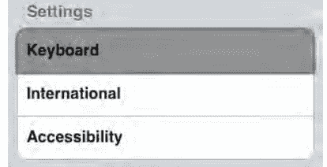

**图 6–1.** *带有自定义高亮颜色的被触摸元素*

你可能一直认为 Mobile Safari 中没有其他的“已点击”状态。这并不完全正确。然而，要访问这个特性，需要一点技巧，通过 CSS 的 `:active` 和 `:hover` 伪类来实现。

许多人建议使用 Multi-Touch 的 `mouseover` 和 `mouseout` 等价物 `touchstart` 和 `touchend`，通过添加和移除带有事件处理程序的特定类来实现。这确实有效，但使用起来有些笨拙和繁重，尤其考虑到有简单得多的方法可以实现这一点。

你可以通过在 `window` 上添加事件处理程序来激活这些等价物，甚至无需为该处理程序添加功能，它就能工作并触发所需的行为。因此，将以下代码添加到我们 Web 应用模板中的 `main.js` 文件，就能让我们将后续规则添加到 `main.css` 文件中，如图 6–2 所示：

```
/* main.js */
document.addEventListener("touchstart", new Function(), false);

/* main.css */
.group-wrapper ul li a {
    ...
}
```


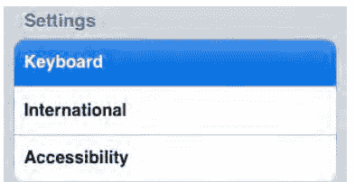

**图 6-2。** *就像原生 iPhone 菜单一样*

同样，我们以一种使这些样式易于调整的方式制作了它们。在这里，简单地更改背景颜色将允许您更改按钮的外观，而不会改变渐变效果。

#### 禁用复制/粘贴功能

用户可以轻松地在页面的元素上执行长按操作，这会触发复制/粘贴功能，并显示一个丑陋的框，这在一定程度上可能会破坏用户体验，如图 6-3 所示。

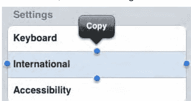

**图 6-3。** *长按可能会触发复制/粘贴功能*

当这种行为不被需要或当您希望为该操作添加一些自定义功能时，可以禁用这种行为。您可以仅使用 CSS，通过 `-webkit-user-select` 属性来实现这一点。该属性可以是以下值之一：`auto`，允许选择；`text`，仅允许用户选择文本；或 `none`，完全禁用。

尽管如此，请注意不要降低可用性，例如通过移除选择文本字段的能力。以下代码会为您处理这种情况，使用通用选择器：

```
*:not(input):not(textarea):not(select),
    input[type=image],
    input[type=file],
    input[type=submit],
    input[type=button],
    input[type=reset] {

    -webkit-user-select: none;
}
```

这将阻止除文本输入（考虑所有新的输入类型）以外的所有元素的选择，使您的 Web 应用程序体验更接近原生 Mobile Safari 应用程序。

#### 对调用出的控制

对链接执行触摸和保持操作将触发如图 6–4 所示的菜单。如果您的 Web 应用程序已制作成与原生应用程序相似，那么这种行为可能不需要，可能不被您期望，或者不被用户预期。

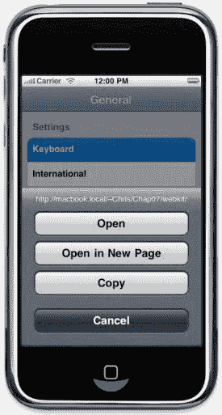

**图 6–4。** *触摸并保持链接或图像等元素可能会触发选项调用*

幸运的是，可以再次通过简单的 CSS 禁用它，方法是设置 `-webkit-touch-callout` 属性为 `none`。与前面的属性一样，请考虑用户可能期望该功能的情况，以免引起另一方的挫败感。

```
body {
  ...
  -webkit-touch-callout: none;
}
```

为文档正文添加此规则将足以全局禁用所有元素的行为。

#### 选择器

在深入 CSS3 布局和样式功能的魔力之前，我们认为花点时间浏览编写现代浏览器 CSS 最激动人心的一面之一——选择器很重要。事实上，如果您过去仅使用 ID、类和后代来针对元素，那么您就错过了大部分乐趣。WebKit 浏览器实现了所有 CSS1 和 CSS2 选择器，以及 CSS3 引入的大多数选择器。

> **注意：** 这里讨论的所有选择器都可以在 WebKit 的 Web 检查器（位于 Develop 菜单下）的搜索字段中使用，这在您的开发过程中可能非常有用。

这使您可以几乎完全控制要针对的元素，而无需识别太多带有额外标识符的标签。CSS 选择器允许您精确地在文档结构中移动，仅选择具有给定特征的元素。

##### 可用 CSS 选择器概述

随着 CSS3，可用选择器的数量变得非常令人印象深刻，但我们将只进入那些处理起来更复杂的细节。您可以在规格页面 www.w3.org/TR/css3-selectors/#selectors 上找到包含每个选择器描述的完整列表。

您将看到，那里呈现的大多数选择器要么已经知道，要么相当自明。您可能还会注意到一些有趣的 newcomers，它们允许对部分属性进行负选择或选择。在第 9 章中，我们还将使用多功能的 `:target`，它可以为您节省大量 JavaScript。然而，其他有用的选择器可能不太明显。以下是一些笔记和解释：

首先，伪元素现在通过使用双冒号标记（::）而不是单个标记（:）与伪类区分开来。这似乎微不足道，但 CSS2 没有做出这种区别。它在选择器的性质中有意义：伪元素不属于文档树。通常它们属于文档文本内容，并且通常无法通过文档语言访问，而伪类旨在根据元素在 DOM 中的位置进一步识别元素。

其次，您应该小心空格，因为“空选择器”可以针对任何元素。

```
/* 2 个等效定义...（带空格） */
p ::first-letter { ... }
p *::first-letter { ... }

/* ...但不同于 */
p::first-letter { ... }
```

接下来，请注意您可以连接选择器。例如，您可能希望为所有文章末尾添加视觉标记。假设 `<div>` 的最后一个子元素是一个段落元素，则可以按以下方式完成：

```
div p:last-child::after {
    content: "The End";
    font-weight: bold;
}
```

这可以相当复杂，因为正如您可能从下文想象的那样，您对精确度的限制实际上几乎没有：

```
a.class1.class2:not(#id1):first-child:hover {
    color: red;
}
```

在这里，我们针对具有 `.class1` 和 `.class2` 类但不具有 ID `id1` 的任何锚点，并且是其在父元素中的第一个子元素，以便对其悬停状态应用特定颜色。

##### Suite 选择器中的位置：结构伪类

您可能习惯于使用 `:first-child` 和 `:last-child` 选择器。如果是这样，您可能会知道它们可能会令人沮丧，有两个原因。

第一个限制是，显然，它们只允许针对第一个和最后一个子元素（分别）。然而，通常希望对元素的前一个子元素、每隔一个元素，或此类或那种类型的第一个子元素应用不同的样式。

第二个原因是这两个选择器在 `p:first-child` 不针对第一个 `<p>` 元素，而是针对其父元素的第一个元素（如果它是 `<p>` 类型）的情况下具有歧义行为。因此，在以下代码中，没有任何段落会以不同的方式样式化：

```
<style>
    div p:first-child {
        font-weight: bolder;
    }
</style>

<div>
    <h1>Some Title</h1>
    <p>First paragraph, but not first element: will not be bold text.</p>
    <p>Second paragraph.</p>
</div>
```

所有这些限制都在 CSS3 中得到解决。但是，这些新选择器的语法需要一些解释。我们要在这里查看的选择器是那些暗示在树中计数元素的选择器：`:nth-child()`、`:nth-last-child()`、`:nth-of-type()`、`:nth-last-of-type()`。

这些选择器都具有一个奇特语法，其中您可以针对的元素数量可以用单个数字表示，仅针对第 n 个孩子；或用匹配 `xn+y` 模式的表达式表示。如果 `xn` 和 `y` 等于 0，两者都可以省略，但其中之一必须不等于 0。此外，`y` 可以具有负值。这里有一个应用：

```
<style>
    /* 此处不会有重复，等同于 nth-child(3) */
    ul li:nth-child(0n+3) {
        font-weight: bolder;
    }

    ul li:nth-child(2n) {
        /* 每一行都会受到影响 */
        color: red;
    }
</style>

<ul>
    <li>Item</li>
    <li>Red Item</li>
    <li>Bolder Item</li>
    <li>Red Item</li>
    <li>Item</li>
    <li>Red Item</li>
</ul>
```

`xn` 始终代表表达式中的可变增量部分，`+` 后面的数字是增量应该开始的位置。当变量设置为 `0n` 时，您仅针对一个元素，正如我们的第一个示例所示。

因此，表达式 `ul li:nth-child(1n+3)` 必须针对从父元素的第三个子元素开始的所有 `<li>` 元素。使用 `nth-child(4n+1)` 将针对从第一个子元素开始计数的每第四个元素（1, 5, 9, 13...）。

对于 `nth-last-child()`，语法相同，但 `n` 是一个减量因子。`:nth-last-child(2n+0)` 针对从末尾开始计数的每个偶数元素。同样要注意，对于向前和向后计数，`+y` 可以是 `-y`，如 `(3n-1)`。

理解这种语法为您提供大量可能性来样式化重复的布局模式或在不使用额外标记的情况下针对特定元素。同样要注意，所有这些选择器都可以将奇数（odd）和偶数（even）关键字作为参数。因此，以下两条规则是相同的：

```
section div:nth-child(2n+0)::after { content: "even"; }
section div:nth-child(even)::after { content: "even"; }

以及这两条：

section div:nth-child(2n+1)::after { content: "odd"; }
section div:nth-child(odd)::after  { content: "odd"; }
```


另一方面，前面的示例可能与后面不同，也可能相同，因为起点不同：

```
section div:nth-last-child(2n+0)::after { content: "odd or even"; }
section div:nth-last-child(even)::after { content: "odd or even"; }
```

最后，请注意，这些选择器作为参数的表达式不应包含空格。以下是无效的，将被忽略：

```
ul li:nth-child(n + 3) { font-weight: bolder; }
```

正如我们所说，这些全局子选择器会搜索容器的所有子元素，无论其类型如何。通常更倾向于只针对一种子元素，就像我们的第一个示例那样。这里再次展示修改后以达到预期效果的代码：

```
<style>
    div p:first-of-type {
        font-weight: bolder;
    }
</style>
```

<div>
    <h1>Some Title</h1>
    <p>First paragraph <b>now bolder!</b></p>
    <p>Second paragraph.</p>
</div>

因此，你可以完全控制对元素的选取。

#### 高级背景处理

尽管之前版本的 CSS 提供的可能性已经实现许多启发性的设计，但这通常使设置背景的任务变得困难。

从设计师的角度来看，CSS2 的背景定义可能性可以说是粗略的。尽管如此，随着设计变得更加复杂和丰富，并包含更多页面元素，背景今天被广泛使用。

此外，背景应用于比以前更复杂、更精细的结构。因此，开发者需要更精确地显示背景。

CSS3 提供了一套新的背景属性，使以前棘手和繁琐的任务变得更容易、更高效。更好的定位和多层背景功能已经可用。我们将解释目前 Mobile Safari 所支持的那些特性。

> **注意：** 许多 CSS3 功能暂时需要 `-webkit-` 前缀。这允许你更早地实现新规范，但也意味着这些规则将被替换并消失。因此，在你的样式表中，你应该始终先声明带 `-webkit-` 前缀的规则，然后声明应该是正确的、不带前缀的规则，以避免未来版本不支持“草稿”实现时出现意外。此外，由于最终实现可能会更好（更快、更干净……），你希望一旦它准备就绪，就应用它而不是草稿实现。因此，它应该被声明在第二个位置。

##### 背景的来源

定义背景时，通常将其应用于一个框（box），该框具有一些内边距（padding）、一个边框（border）和一个外边距（margin）。背景颜色将从边框的外边缘运行，直到在框的中心相遇，而背景图像将相对于边框的内边缘进行定位。

这可以通过 CSS3 的 `background-origin` 属性进行微调，该属性在某种程度上扩展了 `background-position`，允许你指定定位的原点。以下是一些示例，将最清楚地说明这一点：

```
<style>
    div {
        float: left;
        border: dashed 10px #000;
        background-color: #ccc;
        padding: 20px;
        width: 240px;
        height: 240px;
        margin: 20px;
        background-position: bottom right;
        background-repeat: no-repeat;
        background-image: url(images/flower.jpg);
    }

    div:nth-of-type(1) {
        -webkit-background-origin: border-box;
    }

    div:nth-of-type(2) {
        -webkit-background-origin: padding-box; /* default */
    }

    div:nth-of-type(3) {
        -webkit-background-origin: content-box;
    }
</style>

<!-- Our 3 boxes -->
<div></div>
<div></div>
<div></div>
```

在这个例子中，我们创建了三个尺寸相同、背景颜色相同且背景图像相同的方框。唯一的区别是 `background-origin` 属性的值。你可以在图 6-5 中查看它们的行为。


**图 6-5。** *背景的三种可能来源，即边框、内边距（默认）和框的内容*

当然，你可能认为这可以通过 CSS 2.1 的属性实现——你可以确定背景的位置，同时考虑边框和内边距的宽度。这显然有严重的局限性。

例如，你无法让图像移动到边框区域，即使通过设置负值让它从内边距区域移回边框区域也不行。此外，为 `background-position` 等样式定义固定值通常会导致代码重用性降低和类似规则的倍增，因为每个独立的框大小都必须更新值。使用 `background-origin` 属性不仅为你提供了更多可能性，还允许更全局的样式，从而让你编写更少、更高效的代码。

##### 全局背景裁剪

上一节解释的设计好处也适用于下一个属性 `background-clip`。虽然背景的“原点”只影响背景图像，但 `background-clip` 属性允许你通过定义背景绘制区域，为所有背景元素（即图像和颜色）指定规则。

我们几乎可以使用前面的例子，只需在样式中将 `origin` 替换为 `clip`——因为这个属性的值与 `background-origin` 相同。

```
<style>

   div {
      background-position: bottom right;
      background-repeat: no-repeat;
      background-image: url(images/flower.jpg);
      -webkit-background-origin: border-box;
   }

   div:nth-of-type(1) {
       -webkit-background-clip: border-box; /* default */
   }

   div:nth-of-type(2) {
       -webkit-background-clip: padding-box;
   }

   div:nth-of-type(3) {
       -webkit-background-clip: content-box;
   }
</style>
```

这将产生图 6-6 所示的行为。

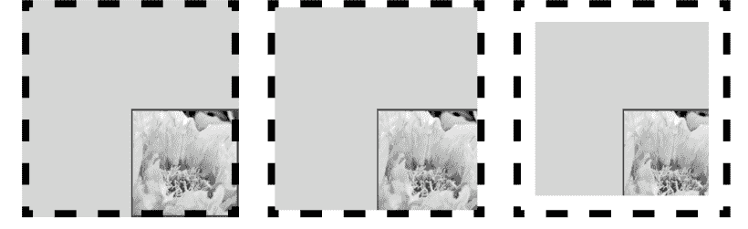

**图 6-6。** *背景裁剪的三种可能状态：从边框的外边缘（默认），然后排除边框，然后排除内边距（从内容区域内开始）*

默认行为是将背景颜色扩展到框的边框中。其他值的行为与背景原点一致，只是也包含了背景颜色。

但是，当使用 `background-clip` 属性的 `content-box` 值时要小心：WebKit 按照 CSS3 规范早期版本中的定义实现了它。然而，由于此值已从规范中移除，你应该尽可能优先将 `background-clip` 与其另外两个值之一结合使用，以实现所需的效果，以防该值在浏览器中被移除。对于 `background-clip` 属性，`padding-box` 值可能是最有趣的，因为它允许使用图像——正如我们很快将看到的——或半透明效果来丰富边框样式。

##### 基于文本的背景裁剪

WebKit 还提供了使用 `text` 值将背景与容器中的文本关联裁剪的可能性，如图 6-7 所示。

```
<style>
    div {
        background-image:
            -webkit-gradient(linear,
                left top,
                left bottom,
                from(yellow), to(red));
        -webkit-background-clip: text;
        color: transparent;
    }
</style>

<div>Background Clip</div>
```

**图 6-7。** *无图像的文本渲染为渐变*

如代码所示，文本颜色需要设置为透明，以便容器背景能够透出。这样做的问题是，不支持此背景值的浏览器版本实际上将不显示任何文本。幸运的是，你可以通过使用仅支持该背景属性值的版本才支持的 WebKit 特定属性 `-webkit-text-fill-color` 来解决这个问题。你可以这样使用它：

```
-webkit-text-fill-color: transparent;
color: red;
```

这样，对于不支持这些新属性的浏览器，文本将显示为红色，但在 Mobile Safari 的最新版本中仍将呈现为渐变。

##### 背景尺寸调整

你可能曾抱怨过 CSS2 背景的另一个缺点，即背景图像与正规 HTML 图像不同，无法调整大小。CSS3 通过 `background-size` 属性（带 `-webkit-` 前缀）为这个恼人的问题提供了一个易于使用的解决方案。

我们很快将看到如何利用这个新功能，将“照片”原生应用程序的吸引力带到你的 Web 应用程序中。“照片”应用程序在视觉上具有吸引力的一个方面是，所有图片都以格式和对齐方式相同的规则缩略图网格呈现——如图 6-8 所示，相同大小的小正方形。这产生了连贯的布局，而不会损害图片的质量，因为它们都被缩放或裁剪以适应该格式。


#### 类照片画廊

在开发原生应用时，你可以使用 Cocoa Touch 框架中的 UIImageView 对象，通过“适应”、“填充”或“适应填充”等参数，让图片适应各种容器尺寸，如图 6-9 所示。我们将利用新提供的 CSS 特性来实现非常相似的设计。Mobile Safari 的调整大小算法很出色，因此你可以获得极佳的效果。

`background-size` 属性接受两个值：一个水平值和一个垂直值。当然，你也可以只指定一个值，它将同时应用于两个方向。你可以使用自己喜欢的任何常用 CSS 单位；然而，在我们的示例中，百分比是最佳选择，因为这使得代码易于重用。

最明显的值是“填充”，这样你就不需要知道图片的宽高比。图片将被调整大小以填充可用空间，并相应地拉伸或压缩：

```css
/* 填充 */
-webkit-background-size: 100%;
```

`background-size` 属性的其他值要求你知道图片的方向。要实现“适应填充”效果，你应该将图片最窄的部分设置为 100%，另一部分设置为 `auto`。这意味着你的图片将被垂直裁剪，或者对于横向图片将被水平裁剪。

```css
/* 横向图片的“适应填充”... */
-webkit-background-size: auto 100%;

/* ... 以及纵向图片 */
-webkit-background-size: 100% auto;
```

反转这些值将导致“适应”调整，这意味着整个图片将出现在指定区域内，但在垂直或水平方向上留出空白。明确指定两个值将强制调整后的图片尺寸。

> **警告：** 请注意，你的图片高度不要超过容器高度的两倍。Mobile Safari 在处理这种情况时存在一个 bug，会显示被裁剪的图片。避免此问题的唯一方法是使用更小的图片。

CSS3 规范提供了可以轻松实现所需效果的值。然而，这些值——`contain` 和 `cover`——在 iOS 3.2 版本中不受支持。

#### 开发类照片画廊

在本节中，我们将通过使用这些新的 CSS 属性和值来复制前面所示的“照片”画廊的外观，展示它们所能提供的可能性的一个实际示例。该画廊如此高效且吸引人的特点之一是，无论最初显示的图片格式如何，它们都能很好地适应分配给它们的正方形区域。

和往常一样，我们将在 Komodo Edit 项目和我们已经使用过的目录结构基础上进行构建。首先，你需要在项目中添加一个新的物理文件夹，命名为 *images*，用于存储画廊的所有图片。

在 Komodo Edit 中，转到 **项目 ▶ 添加 ▶ 新建实时文件夹**，并点击相应的图标创建一个名为 *images* 的新目录。然后选中它。

接下来，因为我们将使用 PHP 来读取 *images* 文件夹的内容，并将其内部图片的引用动态添加到某些 JavaScript 代码中，你需要将 *index.html* 文件重命名为 *index.php*。它应该看起来像这样：

```php
<?php require_once("index_code.php"); ?>
<!DOCTYPE html>
<html>
<head>
    <title>画廊演示</title>
    <link rel="stylesheet" href="styles/main.css">
    <link rel="stylesheet" href="styles/gallery.css">
    <script src="scripts/main.js"></script>
    <script>
        var images = <?php writeImages('images'); ?>;
    </script>
    <script src="scripts/gallery.js"></script>
</head>
<body onload="showImages()">
    <h1>画廊</h1>
    <div id="gallery"></div>
</body>
</html>
```

然后，在与 *index.php* 同级的位置创建一个 *index_code.php* 文件。它将包含画廊工作所需的函数。换句话说，它允许你从 *images* 文件夹中收集图片列表。文件内容如下：

```php
<?php

# 解析给定的文件夹并返回收集到的文件数组
function getImages($path) {
    $handle = opendir($path);
    $files = array();

    if ($handle) {
        while (($name = readdir($handle)) !== false) {
            if (is_file("$path/$name")) {
                $files[] = "$path/$name";
            }
        }
    }

    closedir($handle);
    return $files;
}

# 将我们的 PHP 数组转换为 JavaScript 数组
function writeImages($path) {
    $all = implode(', ', getImages($path));
    echo !$all ? '[]' : '[' . $all . ']';
}
?>
```

```css
.header-wrapper {
  background-color: #444;
}

.view {
  background-color: #fff;
}

div#getgallery {
  padding: 2px;
  float: left;
}

#gallery > div {
  border: solid 1px rgba(0,0,0,0.1);
  width: 75px;
  height: 75px;
  margin: 2px;
  float: left;
  -webkit-box-sizing: border-box;
  -webkit-background-size: 100%;
  background-position: center top;
  background-repeat: no-repeat;
  -webkit-background-origin: border-box;
}

#gallery > div.portrait {
  -webkit-background-size: 100% auto;
}

#gallery > div.landscape {
  -webkit-background-size: auto 100%;
}
```

```javascript
img.src = src;

var div = document.createElement("div");
container.appendChild(div);

img.onload = function() {
    div.className = (this.width < this.height) ? "portrait" : "landscape";
    div.style.backgroundImage = "url(" + this.src + ")";
}
```

`showImages()` 函数首先清空画廊容器，以避免加载新内容时出现显示问题。然后，它使用全局 `images` 数组获取要显示的图片，并为每个新项目调用 `loadImage()` 函数。该函数为每个新项目创建一个带有正确类和图像背景的 `<div>` 容器。`Image` 对象仅用于在加载每张图片后确定其当前方向。

现在，如果你在 Mobile Safari 中打开此页面的 URL，你应该会看到一个与原生“照片”应用类似的、风格一致的画廊，如图 6–10 所示。

为了更利于搜索引擎优化，你也可以在服务器端直接将图片添加到标记中，并直接为每张图片应用 `onload` 属性。但是，你需要将所有图片的 `src` 替换为空白像素图像，以便最终只显示背景。

#### 多层背景

正如你所看到的，使用 CSS3 背景可以实现的效果远比 CSS2 丰富。然而，这还不是新规范提供的全部内容。处理背景图像时，你现在可以将多个背景应用到单个元素上。通过使用逗号分隔的 URL 值列表作为背景，所有图片都将被考虑，按照声明顺序从下到上堆叠。主要限制是，你只能指定一个背景颜色，并且它只位于最底层。

然而，WebKit 扩展了此功能，不仅允许 `background-image` 属性，还允许除颜色之外的所有背景属性使用此功能。例如，这意味着滑动门技术的终结，或者为流体布局提供了更多可能性，因为使用 `-webkit-gradient()` 绘制的渐变背景将是可调整大小的。你也可以通过以下代码实现如图 6–11 所示的效果，而不是使用背景重复：

```css
.multiple {
    width: 400px;
    height: 300px;

    background-repeat: no-repeat;
    background-image: url(flower.jpg);

    background-position:
        90px 90px,
        70px 70px,
        50px 50px;

    -webkit-background-size:
        60% auto,
        50% auto,
        40% auto,
        30% auto,
        20% auto;
}
```

**图 6–11.** *图片堆叠，从最底下的第一张到最顶上的最后一张*

在此示例中，我们为所有背景层保持 `background-image` 属性不变，但逐步改变其位置和大小以模拟放大效果。


理解解释器在属性层数多于值时如何处理值非常重要。应用的规则是以循环方式重复可用值列表，直到达到正确的数量。

然而，需要注意：尽管规范表明层数应仅由 `background-image` 属性的数量决定，但 WebKit 会在其他背景属性拥有更多值时重复该属性。因为按照规范，多余的值应被忽略，所以我们建议你不要依赖这一点进行设计，因为无论是 WebKit 的实现还是规范本身都可能会发生变化。

例如，该属性可以让你为被选中的元素设置不同的背景。我们将在下一章关于画布和 SVG 的内容中使用它为列表项添加箭头，并且它还被用于我们的 Web 应用模板头部，结合渐变以及我们接下来要讲解的新颜色定义方式。

#### 颜色

颜色对设计至关重要，随着设备上颜色渲染效果的提升，其使用变得越来越复杂。然而，构建具有复杂颜色搭配的界面通常迫使我们求助于图片（例如为了处理透明度）或第三方工具（通常是为了构建配色方案）。CSS3 规范带来了一系列新的选项，帮助你构建更复杂但更轻量、无需图片的界面，同时让你的工作流程更加高效。

#### Alpha 通道

使用 CSS2 时，颜色通常通过 RGB 表示法来定义，即 `#rrggbb`、`#rgb` 以及 `rgb()` 函数。CSS3 对此进行了扩展，允许使用 `rgba()` 函数添加 alpha 通道。alpha 通道的值是一个从 0 到 1 的浮点数。这在处理透明盒子背景时尤为有用，因为传统上使用 `opacity` 属性的不便之处在于它会被继承。例如，要为盒子设置半透明背景同时让其中的文字完全清晰可读，你以往需要借助背景图片或复杂的定位。现在这已不再必要，因为你只需为 `background-color` 属性设置透明度即可。

以下代码说明了这将如何改变你的工作：

```css
<style>
    body { background-color: yellow; }
    .main { position: relative; }

    .opacity-layer {
        position: absolute;
        background-color: blue;
        opacity: 0.25;
        left: 0;
        right: 0;
        top: 0;
        bottom: 0;
    }

    .content-layer {
        position: relative;
        color: red;
    }
</style>

<div class="main">
    <div class="opacity-layer"></div>
    <div class="content-layer">
        <h1>Some Title</h1>
        <p>A nice paragraph.</p>
    </div>
</div>
```

以下使用新颜色函数的等价代码：

```css
<style>
    body { background-color: yellow; }

    .content-layer {
        background-color: rgba(0,0,255,0.25);
        color: red;
    }
</style>

<div class="content-layer">
    <h1>Some Title</h1>
    <p>A nice paragraph.</p>
</div>
```

当然，alpha 通道的另一个优势在于，由于它仅仅是一种颜色定义，你可以将其应用于任何接受颜色值的属性，包括文字或边框。你还会发现它可以用于创建复杂的 CSS 背景渐变。

#### 新的颜色定义方式

alpha 通道还可以与新的 CSS3 颜色定义函数 `hsl()` 一起使用。尽管 RGB 被广泛使用，许多前端开发者也能熟练使用，但它通常被认为不够直观。确实，在"日常生活中"，人们习惯于颜色的减色混合（就像混合颜料颜色），而 RGB 基于加色混合（如"将所有颜色混合在一起会产生纯白色"，这是光的情况）。RGB 用户实际上通常是通过潜意识地将其转换为色调、饱和度和亮度的变化来逐渐适应它的。

色调（`hsl()` 和 `hsla()` 函数中的 *h*）是一个角度，以度为单位（不指定单位），取值范围从 0 到 360。它通常用一个色环表示，每度代表颜色的一个偏移，从红色（0）到红色（360）。饱和度和亮度以百分比指定。

```
hsl(<hue>, <saturation>, <lightness>)
hsla(<hue>, <saturation>, <lightness>, <alpha>)
```

以下是一组等价的 CSS 规则：

```css
.red { color: red; }
.red { color: #f00; }
.red { color: rgb(255, 0, 0); }
.red { color: hsl(0, 100%, 50%); }
.red { color: hsl(360, 100%, 50%); }
.red { color: hsla(0, 100%, 50%, 1.0); }
```

由于围绕色调"色环"的进展很容易理解，你可以相当轻松地在其中移动，如图 6–12 所示，这是该色环的展开版本，带有标记基本颜色的停靠点。

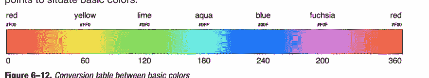

HSL 让你以更自然的方式调整颜色值。如果你想要橙色，只需在红色和黄色之间选一个值（0 到 60 度之间）。想要浅一点的橙色？增加一些亮度。需要不那么鲜艳的橙色？减少一些饱和度。

使用 `rgb()` 表示法时uwe，你必须确定每种颜色的数量，而使用 `#rrggbb` 表示法时，你还得应付为每种颜色转换为十六进制值的额外困难。

##### 使用渐变

前面的属性允许对背景属性进行精细调整。然而，WebKit 提供了新的属性，让你可以用代码代替图片来实现一个非常有趣的目的：渐变。这可以极大地改变你处理设计元素的方式，因为它具有不少优势。

首先，CSS 渐变对终端用户来说更加轻量，因为不需要加载任何图片，当然也不会有额外的 HTTP 请求——正如我们之前所指出的，这在移动设备上可能相当缓慢。

其次，一旦你掌握了 CSS 渐变，在网站上修改它们会更快、更直接，因为你只需要一个工具——这通常也意味着只需要一个人——而且你不必担心尺寸问题。

##### 基本语法

截至本文撰写时，关于 CSS 渐变的实际语法还没有规范；每个浏览器厂商都以其自己的方式实现了这一功能。以下是为 WebKit 浏览器创建渐变最基本的语法：

```css
-webkit-gradient(
    linear,
    left top,
    right bottom,

    from(black),
    to(yellow)
)
```

例如，你可以通过以下方式将其应用于元素的背景：

```html
<style>
    button {
        background-image:
            -webkit-gradient(
                linear,
                left top,
                right bottom,

                from(white),
                to(lightgrey)
            );
        border: 1px solid gray;
    }
</style>

<button>Click Me</button>
```

这个例子绘制了一个从盒子左上角到右下角的线性渐变，将创建从白色到浅灰色的过渡，如图 6–13 所示。在我们的示例中，为了清晰起见我们将使用命名颜色，但你可以使用 CSS3 支持的任何颜色命名约定，包括透明值。

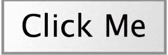

你可以使用命名位置、像素（隐式单位）或百分比来确定位置：示例中的 `left top` 和 `right bottom` 值分别等价于 `0 0` 和 `100% 100%`。

渐变值可以应用于支持图片的属性，即 `background-image`、`border-image`、`list-style-image`，甚至 `content`。然而，目前还无法在 `color` 属性上设置该值——这意味着你无法直接将渐变应用于文字。

#### 调整渐变的大小

对于背景而言，渐变的默认行为是会扩展到其所属元素的尺寸。由于 `-webkit-gradient()` 函数被视为一种图像，你可以使用前面介绍的属性来调整此行为，特别是 `background-size`，它将改变渐变的绘制区域。

例如，将背景尺寸设置为 `5px`，就会将渐变限制在一个边长为5像素的正方形区域内。`background-repeat` 的默认值是 `repeat`，因此如果你没有设置具体值，渐变会像图案一样重复出现，覆盖整个盒子区域，如图 6-14 所示。

```css
.gradient-box {
  ...
  -webkit-background-size: 5px;
}
```

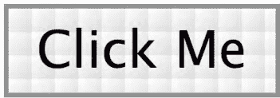

**图 6-14。** *由于绘制区域被重新定义，渐变变成了重复的图案*

当然，如果绘制区域不够大，无法容纳整个渐变，渐变可能会被截断。这通常发生在使用固定尺寸时（就像你使用径向渐变时必须做的那样）。

#### 完整的渐变语法

尽管渐变为 HTML 元素的样式化提供了大量新的可能性，但 WebKit 对渐变的实现还有更多内容。以下是 WebKit 文档中描述的完整语法：

```
-webkit-gradient(<type>, <point> [, <radius>]?, <point> [, <radius>]? [, <stop>]*)
```

与正则表达式类似，问号表示该项可以出现零次或一次，星号表示它可以使用一次或多次，也可以完全不使用。当然，指定一个没有颜色的渐变似乎是个奇怪的想法。

你可以使用 CSS 创建两种渐变：你已经见过的线性渐变（linear gradients），以及径向渐变（radial gradients）。要定义径向渐变，你必须指定一个半径，以及我们已经介绍过的其他元素。请注意，半径的值只能以像素为单位表示，尽管不应指定单位。你无法使用相对单位来适应盒子的任何尺寸，因此你只能实现规则的圆形，而无法实现更复杂的椭圆。你可以通过将第一个示例中的渐变代码替换为以下代码，来查看径向渐变的效果（如图 6-15 所示）：

```css
-webkit-gradient(
    radial,
    100 100, 25, /* <point> and <radius> (for radial gradients only) */
    100 100, 100,
    from(black), /* 2 <stop> values */
    to(yellow)
);
```

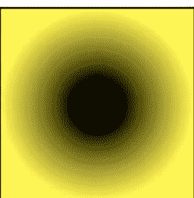

这个语法可能看起来有点棘手或令人困惑。重要的是要理解每个值的确切含义。渐变类型之后的第一对值，是渐变应该开始的起始位置。紧随其后的是被第一个颜色完全填充的区域的半径。

第二对值再次表示渐变的终止圆，最后一个数字是颜色混合发生的半径。最后一个圆之外的其余可用空间将被最后一个颜色纯色填充。

最后的值决定了用于绘制渐变的颜色。如前所述，并且我们将在下一节中解释，你可以为这些值设置任意数量的颜色。

#### 高级颜色处理

`from()` 和 `to()` 函数都是 `color-stop()` 函数的简写形式，该函数具有以下签名：

```css
color-stop(<stop value>, <color>)
```

第一个参数可以定义为百分比，也可以定义为 0 到 1 之间的浮点数。第二个参数接受任何有效的 CSS 颜色定义。因此，这个函数允许你确定渐变的整个调色板，以及它们应该开始、停止和混合的步骤。`from(<color>)` 和 `to(<color>)` 因此等同于 `color-stop(0, <color>)` 和 `color-stop(1, <color>)`。

这为使用渐变开辟了新的方式，因为你可以为单个渐变多次使用 `color-stop()` 函数。这是前面带有一个额外颜色的示例：

```css
-webkit-gradient(
  radial,
  100 100, 25,
  100 100, 100,

  from(black),
  to(yellow),
  color-stop(50%, red)
);
```

如果你使用 Photoshop，这种逻辑应该很熟悉，你会认出渐变编辑器，如图 6–16 所示。

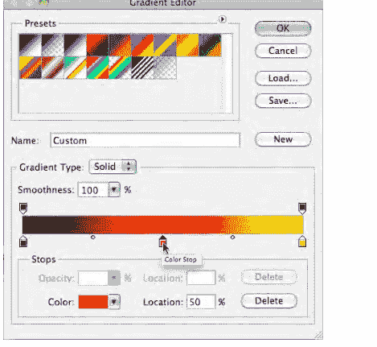

**图 6–16。** *Photoshop 渐变编辑器，带有颜色色标和色标之间的中点圆*

然而，在 CSS 中，要使一种颜色比另一种颜色更重要（就像在 Photoshop 中使用颜色中点一样），或者构建不规则渐变的唯一方法，就是添加更多具有相同颜色的色标。

在指定这些颜色色标时，顺序并不重要，除非有多个色标位于同一位置，例如在构建硬边缘过渡时，如下面的示例（图 6–17）：

```css
-webkit-gradient(
  radial,
  50% 50%, 0,
  50% 50%, 100,

  from(red),
  color-stop(50%, red),
  color-stop(50%, yellow),
  color-stop(99%, yellow),
  color-stop(99%, transparent),
  to(transparent)
);
```

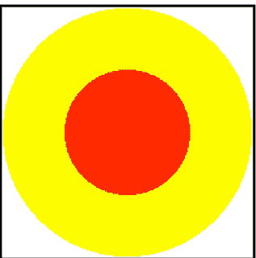

**图 6–17。** *使用多个 color-stop() 绘制的两个同心圆*

使用这种技术，你可以绘制具有清晰边界的圆形，而无需担心渐变的结束颜色填充整个盒子。在我们的 Web 应用程序模板中，我们使用了这种技术来添加条纹背景。它也将在第 9 章中与灵活的盒模型（flexible box model）结合使用，以创建一个吸引人的选项卡栏，该模型将在本章后面解释。

#### 盒子与边框

传统上，CSS 中的“盒子”并未提供许多样式选项。除了少数支持参差不齐的边框样式外，你不得不求助于背景图像，以及该过程所带来的所有重复样式和近似处理，才能为你的元素增添一些额外的光彩。

一个简单的网络搜索就能找到数百个页面，承诺提供终极的斜面或圆角边框解决方案；这要么导致多余的标记、沉重的 JavaScript，要么是额外的图像。CSS3 几乎使这些做法过时了，许多最新的浏览器都支持一些非常有趣的功能，包括 Mobile Safari。

#### 盒子尺寸

在深入讨论盒子的样式之前，让我们先看看关于盒子尺寸的一个新特性。`box-sizing` 属性源于对不兼容的 Internet Explorer 的观察，它没有按照 CSS2 规范描述的方式来计算盒子尺寸。尽管 HTML 渲染器应该将盒子尺寸处理为其宽度、内边距、边框和外边距的总和，但 Internet Explorer 却将内边距视为内容宽度的一部分，而不是将其相加。

```css
.box {
    -webkit-box-sizing: border-box;
}
```

`box-sizing` 属性的默认值是 `content-box`，这是 CSS2 中预期的行为。然而，将值设置为 `border-box` 将导致内边距和边框被计入内容区域内部，而不是其周围。图 6–18 显示了区别。

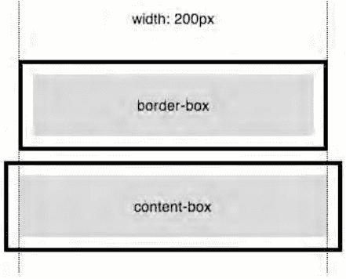

如果你已经使用 CSS2 盒模型一段时间了，这可能会让你感到不寻常。尽管如此，使用此属性值意味着你不必担心将盒子设置为 100% 宽度或为容器添加边框。

通常，你会设计一个具有全局容器、一个 680 像素宽的左列用于主要内容、以及一个 300 像素侧边栏的网站。更改盒子的内边距或为侧边栏添加边框将被证明是一项艰巨的任务。在这里，你不必担心这一点，因为你的盒子将保持其外部宽度。

#### 圆角盒子

在页面元素上添加圆角已经流行了一段时间；然而，同样，这可能难以以灵活的方式实现。此外，iPhone 用户界面广泛使用了圆角。为了实现与此一致的设计，你可能也会想要模仿 iOS 盒子。

CSS3 带来了终极解决方案：`border-radius` 属性。通过一个简单的 CSS 声明，你应该能够实现大多数关于圆角的设计师梦想，如图 6–19 所示。

请注意，WebKit（以及必然的 Mobile Safari）并不完全符合规范。这只是一个限制，因为规范允许你生成

在单个声明中定义不同圆角。如果需要使用不同效果的圆角，WebKit 的语法要求你分别声明每个角。

不过，Mobile Safari 的语法可以说更加直观。你在属性名中指定目标边框，并将半径设为值。因此，你的规则如下所示：

```css
/* 四个角使用相同的值 */
-webkit-border-radius: 16px;

/* 等同于分开声明 */
-webkit-border-top-left-radius: 16px;
-webkit-border-top-right-radius: 16px;
-webkit-border-bottom-left-radius: 16px;
-webkit-border-bottom-right-radius: 16px;
```

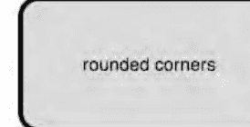

图 6–19。一个带有圆角的简单盒子

当然，你并不局限于规则形状。虽然给每个角相同的值会返回一个带有圆角的规则盒子，并最终形成一个完美的圆形，但你可以通过为宽度和高度指定平行值来创建更椭圆形的形状，如图 6–20 所示：

```css
/* 再次，四个角使用相同的值 */
-webkit-border-radius: 24px 48px;

/* 同样，等同于分开声明 */
-webkit-border-top-left-radius: 24px 48px;
-webkit-border-top-right-radius: 24px 48px;
-webkit-border-bottom-left-radius: 24px 48px;
-webkit-border-bottom-right-radius: 24px 48px;
```

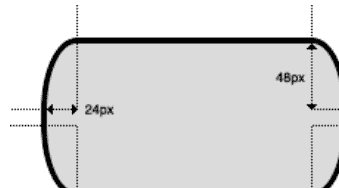

图 6–20。一个带有扭曲圆角的盒子

该属性适用于所有元素，就像边框属性一样，但它并不依赖于边框的实际使用。同样，你可以使用任何测量单位，无论是像像素这样的固定值，还是像 em 或百分比这样的相对值。

使用百分比时，半径的值将根据盒子的总宽度和高度进行评估（即在 box-sizing 使用 border-box 值时考虑的维度）。另外请注意，你不需要担心背景溢出其容器，因为它们会被适当裁剪。

#### 使用图片绘制边框

尽管 border-radius CSS3 功能非常棒，但新的规范中边框还有更多用途。实际上，你也可以通过 border-image 属性集成更精致的边框样式。这将负责将图片适配到你的边框大小，可以通过缩放图片或重复图片来实现。

在以下示例中，我们将使用图 6–21 中的图片，该图片宽和高均为 300 像素，作为由九个不同区域组成的边框图案。这些区域将按与边距、填充或边框相同的顺序声明，有两种模式：拉伸（stretch）和重复（repeat）。该方法的主要限制是你无法为相对的边框指定不同的模式。


**图 6–21。** 用作边框图案的图片

图 6–22 显示了以下代码的结果，仅更改了模式：

```css
.border {
    -webkit-border-image: url(diamonds.png) 100 100 100 100 stretch stretch;
    width: 400px;
    height: 350px;
    border-width: 100px;
}
```


**图 6–22。** *拉伸和重复模式下的结果盒子*

还有一种模式是 round，它会重复图案并缩放它，使其不被截断。然而，Mobile Safari 目前尚不支持此模式。作为补偿，因为带有图片的边框本质上仍然是边框，你可以在 border-image 声明中直接指定边框宽度，如下所示：

```css
.border {
    -webkit-border-image: url(diamonds.png) 100 / 100px stretch stretch;
    width: 400px;
    height: 350px;
}
```

这是该属性的简写形式。因为所有边的尺寸相同，我们将切片区域放在一起。该值不带单位；图片部分的像素是隐含的。斜杠将切片区域与边框大小分开，以避免任何混淆。

因为我们的图片中的区域宽度为 100 像素，并不意味着我们需要同样宽度的边框：通过定义更窄的边框，图片区域将缩放以适应边框宽度。因此，在以下示例中，我们的图片将分别对应顶部、右侧、底部和左侧边框，宽度分别为 50px、25px、100px 和 25px（图 6–23）。

```css
.border {
-webkit-border-image: url(diamonds.png) 100 / 50px 25px 100px stretch;
width: 400px;
height: 350px;
}
```


此规则在创建吸引人的按钮以替换默认操作系统按钮时非常有用。

#### 阴影

对边框的更多控制是在构建网页时的一个有趣特性，因为识别块有助于可读性，并可以使内容脱颖而出。CSS3 在这方面提供了另一个久待的功能，即使用 box-shadow 属性的块外部阴影。WebKit 浏览器也实现了 CSS2 的 text-shadow 属性。由于该属性是官方推荐的一部分且被认为稳定，你不需要使用 -webkit- 前缀。

这两个功能不仅允许创建投射阴影，还可以绘制发光效果，这对于创建按钮效果非常有用。除了视觉吸引力之外，此解决方案的一个优点是阴影不会扩展块或文本的维度，意味着你的布局不会受到影响。此外，你可以使用单个声明对同一元素应用多个阴影。

#### 盒子阴影

盒子阴影的语法相当简单。`box-shadow` 属性接受四个参数：颜色、水平偏移、垂直偏移和模糊半径。将模糊值设为 0 会产生整齐切割的阴影；值越大，阴影越模糊且更透明。

这种属性最常见的用途可能是页段的轮廓或按下按钮时提供用户反馈。尽管如此，在以下示例中，我们将使用它来创建一个看起来像 iOS 的图标，仅使用一张图片，即图标本身。

```css
<style>
    .icon {
        display: inline-block;
        text-shadow: rgba(0,0,0,0.5) 2px 2px 2px;
        color: #000;
        font: bold 11px helvetica;
        text-align: center;
        margin: 8px;
    }

    .icon div {
        -webkit-border-radius: 8px;
        width: 57px;
        height: 57px;
        margin: 0 auto 4px;
        -webkit-box-shadow: 0 4px 4px rgba(0,0,0,0.5);
        -webkit-box-sizing: border-box;
        background-image: 
            -webkit-gradient(radial,
                50% -40, 37,
                50% 0, 100,
                from(rgba(255,255,255, 0.75)),
                color-stop(30%, rgba(255,255,255, 0)),
                color-stop(30%, rgba(0,0,0, 0.25)),
                to(rgba(0,0,0, 0))
            ),
            url(flower.png);
        -webkit-background-size: auto auto, 100% 100%;
    }
</style>

<div class="icon">
    <div></div>
    Flowers
</div>
```

你在图 6-24 中首先注意到的事情是阴影跟随边框。因此，如果你给角添加半径，阴影也会圆角化。


图 6–24。*iOS Dashboard 风格的图标*

> **注意：** zoom 属性不是有效的 CSS。它首先由 Internet Explorer 实现，其他浏览器随后也实现了它，但从未将其纳入任何规范。

使用此代码有趣之处在于它是完全可缩放的。例如，将 zoom 属性设置为 0.57 会将你的 57 像素图标更改为常规的 32 像素 iPhone 菜单图标；只需更改一个值，就会调整图标大小，同时保持整体尺寸和质量。

##### 文本阴影

前面的示例使用了另一种应用于文本的阴影。text-shadow 属性的语法与 box-shadow 非常相似；唯一的区别是你应该先声明颜色值，而不是最后。以下两个类分别对其应用的文本片段应用投射阴影和发光效果（图 6–25）：

```css
.shadow {
    text-shadow: #000 2px 2px 5px;
}

.glow {
    text-shadow: #000 0 0 2px;
    color: #fff;
}
```


图 6–25。*阴影和发光效果*

正如我们在 Web 应用程序模板中看到的，投射阴影不仅可以用于阴影。之前，我们使用投射阴影来创建浮雕效果。


使用 JavaScript，您甚至可以通过动态扩展和缩小文本阴影的模糊度，来创建生动的发光动画。

#### 带阴影和轮廓的文本效果

通过学习`text-shadow` 属性，您已经掌握了创建一种高度类似轮廓的真实发光效果。为了探索 Mobile Safari在这一领域所提供的丰富可能性，让我们绘制一个更先进的标题，使用那些能让您精细控制文本笔画渲染的属性：

```
<style>
div {
    color: lightgrey;
    -webkit-text-stroke: 2px gray;
    font-size: 100px;
    text-shadow:
        gray 1px 1px 0,
        gray 2px 2px 0,
        gray 3px 3px 0,
        gray 4px 4px 0,
        gray 5px 5px 0,
        gray 6px 6px 0
}
</style>
```

<div>文本笔画</div>

`text-stroke` 属性是 `text-stroke-width` 和 `text-stroke-color` 属性的简写。这使得定义轮廓变得极其简单，如图 6–26 所示。在本例中，我们还添加了一个投影阴影以在视觉上增强标题。


**图 6–26.** *轮廓仅使用 CSS 属性即可简单定义*

这再次说明了新的 CSS 功能如何帮您省去使用图像的麻烦，并使开发和维护过程更快、更简便。在特定情况下，这在处理不同语言时尤为明显。您将在学习下一章时看到，使用可下载字体时，这种优化会变得更加显著。

#### 在页头添加按钮

一次性处理这么多内容可能会有些难以消化。何不稍作休息，为您的 Web 应用程序模板添加一些内容呢？将以下代码添加到您的 `main.css` 样式表中，将允许您在 Web 应用程序的页头中使用时尚的按钮：

```
.view {
    ...
    position: relative;
}
.header-wrapper .header-button {
    /* 按钮大小和位置（锚定于右侧） */
    position: absolute;
    top: 7px;
    right: 6px;
    width: auto;
    height: 29px;
    min-width: 44px;     /* 可点击元素的最小尺寸 */

    margin: 0;
    padding: 0 10px;

    /* 圆角按钮的框样式 */
    -webkit-border-radius: 5px;
    border: solid 1px rgba(0,0,0,.25);
    border-top-color: rgba(0,0,0,.6);

    -webkit-box-sizing: border-box;
    -webkit-box-shadow: 0 1px 0 rgba(255,255,255,.3);

    /* 文本样式 */
    font-family: inherit;
    font-size: 12px;
    font-weight: bold;
    text-shadow: rgba(0,0,0,.4) 0 -1px 0;
    text-decoration: none;
    text-align: center;
    line-height: 29px;
    color: #fff;

    /* 背景的光泽效果 */
    background-color: rgba(0,0,0,.3);
    background-image:
        -webkit-gradient(linear, left top, left bottom,
            color-stop(0, rgba(255,255,255,0.25)),
            color-stop(0.1, rgba(255,255,255,.4)),
            color-stop(1, rgba(255,255,255,.1)) ),
        -webkit-gradient(linear, left top, left bottom,
            from(transparent),
            to(rgba(0,0,64,.05)) );
    background-repeat: no-repeat;
    background-position: top left, bottom left;
    -webkit-background-size: 100% 14px, 100%;
}
.header-wrapper .header-button:disabled {
    color: rgba(255,255,255,0.65)
}

.header-wrapper .header-button:active:not(:disabled) {
    background-color: rgba(0,0,64,.5);
}

.header-wrapper .header-button.left {
left: 6px; right: auto;
}
```

所述按钮将绘制在页头的右侧。若要将其移至屏幕左侧，只需将以下类添加到您的样式中：

```
left: 6px; right: auto;
}
```

这段代码易于使用且可重复利用，无论是用于创建表单按钮还是简单链接。以下代码将产生如图 6–27 所示的区域：

```
<div class="header-wrapper">
    <h1>Web App</h1>
    <a href="edit.php" class="header-button">编辑</a>
    <button class="header-button left">返回</button>
</div>
```


**图 6–27.** *页头中的两个按钮*

`header-button` 类使用了称为 *自适应样式* 的方法，这意味着按钮的颜色会自动适应其父元素的背景色。该方法此前已用于页头本身。因为它仅使用半透明的黑白色作为背景和边框，所以它只会暗化或亮化透出的颜色，而不会发生混色——就像原生的 iOS 按钮一样。

但是，如果您想要创建一个彩色的按钮（例如 iPhone 上的蓝色操作按钮），您只需更改 `background-color` 的值，如下所示：

```
.header-wrapper .header-button.action {
    background-color: #0f6cd7;
}
```

如您所见，这段代码易于重复利用和适配，这正是轻量级 Web 应用程序所需的。

#### 列布局

在第 4 章中，我们使用表格类型的显示来创建为 iPad 所需的分割视图。主容器的 display 属性被设置为 table，其内部框的 display 被设置为 table-cell 并扩展以具有完全相同的高度。这也允许您垂直居中和内容。使用此方法来模仿报纸或杂志中的列布局似乎很有吸引力。

然而，这会导致语义上多余的字面标记。此外，这将难以维护，甚至难以实现，因为您必须评估每段内容并适当包裹的长度。

#### CSS 列属性

比布局技巧更好的是，CSS3 自动处理列流。此功能自 iOS 2.0 版本以来已实现。您不必考虑内容的长度，甚至也不必通过用 HTML 标签包裹内容片段来物理表示您的列。Mobile Safari 将自行确定在哪里切割文本，以实现特定数量的列或特定列宽。这使得全局样式成为可能，从而在多种容器尺寸内实现一致的布局。以下代码在 iPhone 或 iPad 上查看时将产生不同的布局效果，如图 6–28 和图 6–29 所示：

```
.newspaper {
    -webkit-column-width: 200px;
    -webkit-column-gap: 20px;
    -webkit-column-rule: 1px dotted black;
    padding: 20px;
}
```


Lorem ipsum dolor sit amet, consectetur adipiscing elit. Cras pharetra mollis pharetra. Suspendisse laoreet elit felis tristique sit amet nec massa tempus. Suspendisse consectetur vulputate proin dui erat, nisl quam sit amet metus ultrices, a nibh at, nisl. Donec molestie lectus nunc semper cursus blandit. Nam non ligula massa, sed suscipit turpis. Etiam eget ligula elit turpis venenatis dictum in eifend augue. Duis tellus lectus, vulputate et adipiscing aliquet. Aenean suscipit convallis mauris gravida. Integer lectus ligula, consectetur sit amet venenatis sed, scelerisque eget nisl. Nunc dapibus posuere eros, vitae tempor nibh lacus et. Vestibulum hendrerit in nisl arcu, Mauris luctus, lorem.


**图 6–29.** *……以及 iPad 横屏模式下的四列布局*

在我们的示例中，我们将列的最小宽度定义为 200 像素。渲染引擎将尽可能接近此值，同时适应可用空间。这就是为什么 iPhone 上的列宽为 280 像素。

这些属性相当自明。请注意`column-gap` 属性如何解决水平布局中常见的一个问题，即不同块之间的空白。在这里，您不必担心布局一侧出现不协调的边距。发生的事情是，Mobile Safari 会评估需要在列之间共享的内容量以及容器的宽度。

还要注意，`column-rule` 属性是一个简写，可以接受与`border` 属性相同的样式值，并允许您定义独立的规则，例如颜色或宽度。

只要容器还有足够的剩余空间，就会创建新列。当渲染器确定理想的列数后，内容将被尽可能均匀地分配。

如果您的内容长度已有足够的概念，可以将内容包裹在固定高度的框中。只需注意，如果您的文本长得比预期更长，将会在新列中继续生成，超出容器向左延伸。


#### 将印刷内容移植到网页

您现在可以使用第四个列布局属性`column-count`。该属性与`column-width`的作用相反，因为它允许您指定内容应分布的列数。移动版Safari会尝试渲染预期的列数（注意，它可能认为一个字母宽的列也是可接受的），但如果水平空间不足，它会让列垂直增长。

当然，可以同时关联这两个属性，例如在1,000像素宽的容器内渲染两个300像素宽的列。同时使用这两个属性时，请记住`column-width`会优先生效。

随着iPad的发布，这些原本已经很有趣的CSS3特性焕发出新的光彩，其中一个显而易见的应用场景就是在线报纸和杂志。在下面的示例中，我们将尝试使用CSS3属性来重现杂志布局。首先，我们创建一个名为*magazine.html*的文件，内容如下：

```
<!DOCTYPE html>
<html>
    <head>
        <title>Columns Layout</title>
        <meta name="viewport" content="width=device-width, initial-scale=1, maximum-scale=1, user-scalable=0">
        <link rel="stylesheet" href="page.css">
    </head>
    <body>
        <div class="mag">
            <hgroup>
                <h1>Flowers</h1>
                <h2>Lorem ipsum dolor sit amet, consectetur adipiscing elit. Cras pharetra mollis pharetra. Suspendisse lacinia orci et felis tristique sit amet semper massa tempus. Suspendisse consectetur tempor pulvinar.</h2>
            </hgroup>
            <p>Lorem ipsum dolor sit amet, consectetur adipiscing elit. Cras pharetra mollis pharetra. Suspendisse lacinia orci et felis tristique sit amet semper massa tempus. Suspendisse consectetur tempor pulvinar. Proin dui eros, ultricies vel malesuada vel, tempor at ante. Nam eget nisl dui. Donec molestie lectus a nunc scelerisque blandit. Nam non ligula massa, sed suscipit turpis. Etiam eget ligula sit amet turpis venenatis dictum in eleifend augue. Duis tellus lectus, volutpat et adipiscing a, pellentesque eu metus. Aenean suscipit congue mauris at gravida. Integer lectus ligula, consectetur sit amet venenatis id, scelerisque eget nisl. Nunc dapibus posuere risus, vitae tempor nibh iaculis et.</p>
        </div>
    </body>
</html>
```

接下来，在一个名为*page.css*的文件中添加相应的样式：

```
* { margin: 0; }
html { height: 100%; }
body {
    height: 100%;
    color: white;
}

.mag {
    background: black url(flower.jpg) center center no-repeat;
    -webkit-background-size: auto 150%;
    width: 100%;
    min-height: 100%;
    padding: 20px;
    -webkit-box-sizing: border-box;
    position: relative;
    font-weight: bold;
    text-shadow: 1px 1px 3px black;
}

h1 {
    margin: 0;
    font-size: 50px;
}

p {
    margin: 0;
    position: absolute;
    max-width: 420px;
    -webkit-column-gap: 20px;
    -webkit-column-width: 200px;
    -webkit-column-rule: 1px dotted white;
    font-size: 16px;
    text-shadow: 1px 0 0 black;
    bottom: 20px;
    right: 20px;
}

p:first-letter {
    font-size: 36px;
    margin-right: 4px;
    margin-bottom: -6px;
    float: left;
}

p:after {
    content: '';
    display: inline-block;
    width: 10px;
    height: 10px;
    background-color: white;
    margin-left: 10px;
    -webkit-box-shadow: black 1px 1px 1px;
}
```

如图6-30所示，无论标记多么简单，我们都实现了一个有趣的效果。我们通过将背景大小设置为容器空间的150%，确保了背景将占据所有可见空间——尽管无论图像格式如何，您都可以使用前面解释的方法来获得更适应的结果。然后，通过简单的标题、副标题和段落关联，我们构建了一个简单的杂志风格布局，无论设备方向如何，它都能一致地显示。


**图6-30.** *一个精美的页面*

> **警告：** Safari存在一个bug，当内容应用了垂直阴影时，它会错误地评估文本大小。该算法实际上会截断字母，而不是使列变高或将文本移到下一列。

与往常一样，您可以构建特定的规则，以便在iPad或较小屏幕上查看时提供略有不同的页面。可以这样做：

```
@media only screen and (max-device-width:760px) {
    h1 { font-size: 30px; }
    h2 { font-size: 20px; margin-bottom: 20px; }
    p  { position: relative; bottom: auto; right: auto; }
}
```

这样，您的文本在iPhone或iPod touch上看起来只是缩放了，而您仍然拥有控制权，并且整体布局不会因为空间不足而崩溃。

#### 弹性盒模型

正如前面在前一章中解释的那样，我们已经使用了有趣的`table`和`table-cell`显示属性来获得对元素放置和大小的更多控制。这是一种简单而高效的方法，但CSS3为盒模型带来了更多的控制。我们在这里要解释的内容，是最新规范带来的最有趣的特性之一——然而它似乎鲜为人知，因为它从Mobile Safari的第一个版本开始就已经实现了！

##### 处理列布局的简洁灵活方式

这种“盒模型”方法简单、高效且功能强大。它允许完全控制后续的方框。让我们从一个简单的例子开始。相关代码如下：

```
<style>
    .group {
        display: -webkit-box;
        min-height: 100px;
        padding: 5px;
        background-color: lightgrey;
    }

    .group .box {
        text-align: center;
        border: 10px groove green;
        padding: 10px 30px;
        margin: 1px;
        background-color: white;
    }
</style>

<div class="group">
    <div class="box">Box 1</div>
    <div class="box">Box 2</div>
    <div class="box">Box 3</div>
</div>
```

您首先应该注意到的是，这段代码不需要任何多余的标记。现在，看看图6-31，您就会明白它在布局方面的意义。


**图6-31.** *实现列布局的新方法*

我们的三个方框的高度会适应外部方框，并且如下所述，如果您指定了`box-flex`值，我们的方框将占据其父元素宽度的100%，这解决了自前端开发人员从表格布局转向CSS布局以来一直存在的两个问题。`box`值使容器表现得像一个块级元素。您也可以通过使用`inline-box`值来触发行内块行为——使您的元素保持在文档流中。

##### 方框排序

这当然非常有用，但这个新盒模型的妙处远不止于此。在我们的示例中，您可能对内部方框按照代码中出现的顺序显示在文档流中并不感到惊讶。这是方框的默认行为，相当于使用值为`normal`的`box-direction`属性。将此属性的值设置为`reverse`将导致我们的方框从最后一个到第一个呈现，如图6-32所示。

```
.group {
    display: -webkit-box;
    min-height: 100px;
    ...
    -webkit-box-direction: reverse;
}
```


**图6-32.** *无缝反转布局*

您甚至可以更进一步，使用`box-ordinal-group`属性对方框进行排序。此属性接受一个整数作为值，默认为1。这允许您重新排列方框，例如将方框3放在第一位，方框1放在第二位，或者对它们进行分组。您也可以将其与CSS3选择器结合使用，例如使用如下规则：

```
.group .box:nth-child(2) {
    -webkit-box-ordinal-group: 2;
}
```

在此示例中，由于所有未更改的方框的`box-ordinal-group`值都为1，第二个方框最终将位于第三个位置，因为所有其他方框具有更靠前的位置，如图6-33所示。


#### 灵活性

此处盒子的默认行为是水平排列。这也可以通过`box-orient`属性进行更改。将值设置为`vertical`，盒子将垂直堆叠，此外还有一点：将它们的`box-flex`值设置为`1.0`，我们的盒子将适应垂直布局，这意味着示例中的每个盒子的高度都将是三分之一（图 6–34）。

```
.group {
    display: -webkit-box;
    min-height: 200px;
    ...
    -webkit-box-orient: vertical;
}

.group .box {
    ...
    -webkit-box-flex: 1.0;
}
```

**图 6–34。** *具有默认`box-flex`值（为 0.0）的布局，以及将`box-flex`设置为 1.0*

`box-flex`属性决定每个盒子的柔韧程度。默认情况下，垂直堆叠的盒子占据 100% 的可用宽度，仅占用必要的垂直空间。通过给盒子分配柔韧值，它们将试图填满整个可用的垂直空间。

因此，如果所有盒子的柔韧值相同，它们将以相同的程度扩展以填满其容器。如果其中一个或多个盒子具有更高的柔韧值，它们将扩展得更厉害。例如，在以下代码中，第二个盒子将根据盒子是水平排列还是垂直堆叠而变得更宽或更高。

```
.group .box:nth-child(2) {
    -webkit-box-flex: 2.0;
}
```

请小心，这并不意味着您的第二个盒子会比其他盒子宽或高两倍，如图 6–35 所示。它的意思只是它更具灵活性，因此会在一定程度上更大。然而，赋予盒子灵活性允许您使用具有固定宽度或高度的盒子，同时仍能够完全占据某个区域。

**图 6–35。** *柔韧性是相对的；第二个盒子并不比其他盒子大两倍*

当然，因为这些属性与页面流程有关，所以您不能对绝对定位或浮动的元素使用它们。这种行为不仅不会符合预期，甚至可能不可预测地破坏您的布局，而这些属性的通用回退方案是常规盒子模型。

#### 包装和对齐

正如您所看到和想象的，灵活性充满了潜力。然而，有时更明确的布局是更可取的。在这种情况下，您可能希望控制当元素不完全契合时的行为方式。

当所有子元素达到其确切大小后，如果盒子容器中仍有可用空间，您可能希望决定子元素相对于该空白区域应如何显示。

为此，您可以使用两个属性：`box-pack`和`box-align`。修改我们之前示例中的`.group`类的样式可以说明这一点：

```
.group {
    display: -webkit-box;
    min-height: 100px;
    ...
    -webkit-box-pack: justify;
    -webkit-box-align: end;
}
```

结果如图 6–36 所示。

**图 6–36。**

确实，`box-pack`和`box-align`属性告诉盒子在容器内何处安放。`box-pack`告诉子元素如何沿其方向轴对齐；`box-align`显示如何沿垂直于其方向轴的线对齐。两者都可以取`start`、`end`和`center`值。`box-pack`属性还可以将`justify`作为值，而`box-align`可以取`baseline`和`stretch`。后者是默认值，这也是当未指定任何内容时盒子会占据所有可用空间的原因。

结合起来使用，所有这些属性允许您微调元素的布局。当然，您可以在任何类型的元素上使用这些值和属性，这意味着这种控制不仅可以用于整体布局，还可以用于您的代码的小区域，例如布局均匀的选项卡式菜单。虽然这组属性目前只是草案，但它相当可靠，因为它已通过桌面版 Safari 3.0 版和移动 Safari 的初始版本实现。我们只列出了我们认为最有趣的属性，但该部分规范的内容更多，所以请尽情深入探究！

#### 专门针对 WebKit 的目标

虽然我们之前提到针对的是移动版 Safari，但现在许多设备对标准的兼容性都很好，因此使用其他浏览器的便携式设备上的网页应用程序很可能也能满意运行。如果您计划在一定程度上支持此类浏览器，您可能希望仅向 Safari 提供某些规则。这可以通过与设备像素比率相关的专用 WebKit 目标特性来实现。操作方法如下：

```
@media screen and (-webkit-min-device-pixel-ratio:0) {
    /* 此处放置您特定的 CSS */
}
```

或使用链接元素：

```
<link rel="stylesheet" href="some.css"
      media="screen and (-webkit-min-device-pixel-ratio:0)">
```

这似乎也得到了 Opera 9.5+ 的支持。在本文撰写之时，您可以使用以下代码来绕过此问题以支持 Opera：

```
@media all and (-webkit-min-device-pixel-ratio: 10000),
    not all and (-webkit-min-device-pixel-ratio: 0) {
        /* 此处放置您的代码，仅针对 Opera */
}
```

然而，黑客手段本质上是不稳定的，无法保证上述方法不会因市场上主要浏览器的未来版本而过时。

#### 总结

您刚刚一窥最新版 CSS 及其在移动版 Safari 中实现的潜力。该版本专为现代功能和美学设计，解决了前端开发者近期遇到的许多问题。现在，您唯一的限制就是自己的想象力了。如果您还没有被本章说服，只需在互联网上快速搜索一下 CSS3 教程和展示案例，肯定会彻底说服您。凭借这些内容，您可以几乎不使用图像或 JavaScript 即可模拟 iOS 用户界面。事实上，CSS 是限制文件大小和带宽使用（通过减少图像请求）的严肃方法，总体而言可以带来更好的代码。这些原则指导了我们第 4 章中网页应用模板的开发。

作为一个一般性建议，我们建议限制您在标记中所需的类别数量。请记住，类和 ID 都有其存在的意义；努力不要每次构建新块时都创建一个新 ID，并避免成倍增加重复的样式声明。类别旨在从视觉上分组具有共同特征的元素。因此，您应使用类别来定义将在代码中多次使用的特征。相反，ID 应专门用于非常具体的模块，在应用它们时，请尽量选择最外层块。如您所见，CSS 选择器可以极大地帮助您减少代码中对标识符的需求。

在后续的章节中，我们将深入探讨 Safari 中实现的其它令人兴奋的 CSS3 功能，例如带有 SVG 的下载字体、动画和硬件变换，因此请开始练习这些功能并构建清晰优雅的网页应用程序。

## 第 7 章

### 位图和矢量图形，以及使用 Canvas 和 SVG 的下载字体

移动版 Safari 中最引人关注的元素之一是它不支持 Adobe Flash。互联网已成为多媒体和动画发挥重要作用的场所，虽然大多数人在无法创建基于 Flash 的网站或休闲游戏时可能没有问题，但主要问题是如今大多数网站都以某种方式使用 Flash，无论是标题中的图形动画、广告还是视频。在查看经典网站时，不支持 Flash 可能会给 iPhone 和 iPad 的用户体验带来真正的问题。

虽然画布（canvas）和 SVG 通常被介绍为 iOS 设备上 Flash 的替代方案，但它们不仅限于以高昂代价创建界面元素和确定的模块。由于缺乏创作工具，使其不适合用于强度高的开发工作。然而，这些新技术有许多有趣的应用，特别是我们将在本章介绍的专用 WebKit 扩展功能。

通过使用这两项新功能（现已在移动版 Safari 中支持）以及一些脚本编写，您将能够实现许多以前需要大量图像或服务器端处理的图形和效果。

#### 使用画布区域

HTML5 中引入的新`<canvas>`标签本身不做任何事情，但它可以让您以全新的方式与浏览器协同工作；它让您定义一个区域，您可以在其中

#### 绘图上下文

要访问画布并进行操作，首先需要获取一个上下文。这可以通过 API 中的 `getContext()` 方法来实现。以下代码允许你使用二维位图上下文：

```javascript
var canvas = document.getElementById("area");
var context = canvas.getContext("2d");
```

一旦你以这种方式获得了对上下文的引用，就可以开始在画布区域进行绑制了。每次调用 `getContext("2d")` 都会返回相同的实例。请记住，你在画布区域内创建的任何内容都无法通过任何 DOM 接口访问。你只是在绘制表面上绘制像素。例如，要动画化一条线，你必须重新绘制这条线；你无法像操作 DOM 元素那样移动它或更改其属性。

> **注意：** 请注意，目前只能使用二维上下文。一个非常有前景的 3D 版本正在研究中，主要由 Khronos Group 负责。它基于 OpenGL ES 2.0，并将被命名为 WebGL。其发展的一个优势是它直接与硬件绑定（GPU 加速），从而使得更复杂、更流畅的动画成为可能。我们希望这项技术很快能在 iPhone 上实现。

WebKit 引入了另一种灵活的方式来定义画布，允许你直接在样式声明中使用画布，从而让你可以将画布用作背景或任何其他可以接受图像的属性的值。例如，这将让你轻松创建一个旋转指示器，而无需实际使用图像。当然，这不仅会为你节省一些带宽和加载时间，还将允许真正的 alpha 透明度和颜色适应性，正如前面所解释的。

```css
/* 在 CSS 声明中将画布用作值非常简单 */
.css-canvas {
    background-image: -webkit-canvas(area);
}
```

在前面的示例中，我们指明应该创建一个标识符为 `area` 的新画布。此画布在此阶段不存在，但从那里你可以初始化它，并通过 `document` 对象的 `getCSSCanvasContext()` 方法获取其上下文，如下所示：

```javascript
var context = document.getCSSCanvasContext("2d", "area", 37, 37);
```

与 `getContext()` 一样，第一个参数是所需的上下文类型，第二个参数，如你所料，是你的画布的标识符。接下来的两个参数是你期望画布具有的尺寸。每次使用相同参数调用此画布都将返回相同的实例，而在此方法调用中更改尺寸将导致画布被清除，就像常规的画布处理过程一样。

这种使用画布的一个有趣特性是，定义的画布可以同时用于任意多个元素。在我们的示例中，如果你在其中创建一个动画，该动画将为任何使用类 `.css-canvas` 的元素绘制。

现在，让我们进一步推进我们的动画旋转指示器示例，看看能够使其生动起来的代码。在接下来的代码片段中，我们将使用相当多的 HTML 画布属性，但不用担心：所有内容都将得到适时的解释。

首先，我们将定义一个对象，使你能够轻松地初始化和动画化我们的画布，并将其添加到我们的 Web 应用程序模板中。再次说明，如果你不习惯面向对象的 JavaScript 编程，请不要担心。这一切将在第 10 章中解释。目前，你可以将此代码视为一系列可重用的函数。

```javascript
/* 对象构造函数 */
var BigSpinner = new Function();

BigSpinner.prototype.init = function(id, color, shadow) {
    /* 初始化画布并保存上下文 */
    this.context = document.getCSSCanvasContext("2d", id, 37, 37);

    /* 旋转指示器的线条样式 */
    this.context.lineWidth = 3;
    this.context.lineCap = "round";
    this.context.strokeStyle = color;

    /* 定义旋转指示器的阴影 */
    if (shadow) {
        this.context.shadowOffsetX = 1;
        this.context.shadowOffsetY = 1;
        this.context.shadowBlur = 1;
        this.context.shadowColor = shadow;
    }

    /* 动画变量 */
    this.step = 0;
    this.timer = null;
}

BigSpinner.prototype.draw = function() {
    /* 在每一帧清除画布 */
    this.context.clearRect(0, 0, 37, 37);

    /* 准备画布状态并绘制旋转指示器线条 */
    this.context.save();
    this.context.translate(18, 18);
    this.context.rotate(this.step * Math.PI / 180);

    for (var i = 0; i < 12; i++) {
        this.context.rotate(30 * Math.PI / 180);
        this.drawLine(i);
    }
    this.context.restore();

    /* 递增动画 */
    this.step += 30;
    if (this.step == 360) {
        this.step = 0;
    }
}

BigSpinner.prototype.drawLine = function(i) {
    /* 绘制一条线，其透明度根据迭代次数变化 */
    this.context.beginPath();
    this.context.globalAlpha = i / 12;
    this.context.moveTo(0, 8 + 1);
    this.context.lineTo(0, 16 - 1);
    this.context.stroke();
}

BigSpinner.prototype.stop = function() {
```

你将能够使用强大的 JavaScript API 直接进行绘制。这是你应该如何将其插入代码中：

```html
<canvas id="area" width="200" height="200">
    备用信息。
</canvas>
```

你放置在 `<canvas>` 标签上的 `id` 属性非常重要，因为它是你将能够与定义的绘图区域交互的标识符。打开和关闭 `<canvas>` 标签之间的任何内容仅在最终用户在设备上禁用脚本时才会显示。

然而，如果用户因某种原因在 Mobile Safari 中禁用了脚本，`<canvas>` 标签将毫无用处，因为无法在其定义的区域绘制任何内容。在这种情况下，你插入的文本应表明需要脚本才能访问不可用的内容，并且你应该提供有关如何操作的信息。

画布区域的范围应通过 `width` 和 `height` 属性来定义，在我们的示例中是一个 200 像素宽的正方形。如果你通过样式确定画布的大小，渲染引擎将缩放画布绘图区域以适应默认边界，而不是按预期渲染脚本输出。如果你未指定这些尺寸，区域的默认大小为水平 300 像素，垂直 150 像素。

但是请注意，使用样式设置画布区域的大小在脚本被禁用时对于维护布局很有用，因为在这种情况下 `width` 和 `height` 属性将被忽略。如果画布未浮动，你还应该将其 `display` 属性设置为 `inline-block`，以保持区域的默认内联行为。

```css
#area {
    display: inline-block;
    width: 200px;
    height: 200px;
    font-weight: bold;
    color: red;
}
```

关于尺寸，还请记住，每当你通过脚本调整画布区域的大小时，整个绘图区域都会被清除和重置。

画布绑定的绘图区域是透明的。因此，你可以像使用带 alpha 通道的 PNG 图像一样使用它。这为其用途开辟了多种可能性；例如，它允许你替换 GIF 图像，与 PNG 图像不同，GIF 图像允许动画但仅支持完全透明和完全不透明的像素（参见图 7-1）。


后者当然一旦你想在透明图像背景上绘制弯曲或对角线就会成为问题，因为显示的线会显得粗糙且不规则。通常，如果你想让一个标志适应多种背景，就无法将其用于表示圆形形状的 GIF 图像。

尽管有 `<canvas>` 标签的这些初步优势，但要小心不要在其他标签在语义上更合适的地方使用它，主要是因为无障碍访问问题。带有 `alt` 属性的图像可以清楚地表明存在哪种内容，并且应该充分描述内容。

以下第一个示例是 `<canvas>` 标签的适当用法，因为旋转指示器没有特定含义，可以轻松忽略，而第二个应该避免使用。

```html
<!-- 推荐使用 -->
<canvas width="45" height="45" id="spinner">页面加载中</canvas>
<i>请稍候...</i>

<!-- 不推荐 -->
<canvas width="450" height="200" id="comic-strip-cell">一幅连环画</canvas>
<i>享受乐趣吧！</i>
```

`` 标签非常适合第二个示例中呈现的数据类型。在此处使用画布可能会导致残障用户访问性变差，并且肯定不会被搜索引擎很好地考虑。请注意，我们将在本章后面进一步解释如何将画布用作合适的图像。

现在，我们敢打赌你已经迫不及待想看到令人兴奋的 JavaScript API 运行起来了。开始吧。


#### 绘制简单形状

使用 Canvas API，最简单的绘制形状是矩形。要绘制更复杂的形状（如圆形），则需要处理复杂的路径函数（我们稍后会解释）。相反，绘制矩形有三种选择，都非常直接。这三种方法接受相同的参数：作为参考点的原点坐标 `(x,y)`，以及矩形的尺寸 `（宽度，高度）`。图 7-3 展示了其工作原理。

```
/* 使用当前的填充样式绘制一个矩形 */
context.fillRect(10, 10, 180, 80);

/* 使用当前的描边样式绘制给定矩形的轮廓边框 */
context.strokeRect(10, 110, 180, 80);

/* 将区域清空为透明 */
context.clearRect(50, 50, 100, 100);
```

**图 7–3。** *使用 Canvas API 绘制的简单形状*

请注意，在执行此代码时，使用 `strokeRect()` 方法绘制的矩形线条会有些模糊，并且比预期更粗——默认边框宽度为 1 像素。为了解决这个问题，通常只需将原点坐标增加 0.5 即可，如下所示：

```
context.strokeRect(10.5, 110.5, 180, 80);
```

这是因为，虽然线条并非沿像素网格绘制，但绘制过程确实依赖于不可分割的像素单元。由于无法绘制半个像素，渲染器会使用抗锯齿来降低线条的密度，并给人以线条沿轴线、且具有预期宽度的印象。通过将线条移动半个像素，你就能使线条绘制在完整的像素上，而不是两个半像素上，从而使线条看起来清晰锐利。图 7–4 强调了这一行为，其中每条线代表一个轴线，每个方块代表一个物理像素。

**图 7–4。** *根据线条位置和宽度的不同而变化的像素渲染效果*

这三幅图都表示绘制一条高度为 2 像素的线。第一个例子说明了前面描述的问题，在坐标 `(0,0)` 处绘制宽度为 1 像素的线。像素被抗锯齿处理，并向垂直轴的两侧延伸。通过将同一条线定位在 `(0.5,0)` 点上，延伸发生在新的轴线上，线条便能完整地落在物理像素内，无需任何视觉特效。图 7–4 右侧的插图显示了一条与第一条特性相同但宽度为 2 像素的线。在这种情况下，每个像素都可以显示在轴线的一侧。

#### 颜色、渐变与图案

Canvas 中默认的绘制和填充颜色是黑色，当然你随时可以修改它。具体操作如下：

```
context.fillStyle = "red";
context.fillRect(10, 10, 180, 80);
```

```
context.strokeStyle = "rgba(0, 255, 0, 0.5)";
context.strokeRect(10, 110, 180, 80);
```

在这些过程中，你可以使用上一章中介绍的任何 CSS 颜色，包括带 alpha 通道的颜色，如前面两个示例所示。你也可以使用相应的语法来使用渐变甚至图案。

##### 使用渐变

Canvas API 中渐变的语法与 CSS 中 `-webkit-gradient()` 的语法非常相似。你需要选择线性渐变或径向渐变，并使用相应的方法来实例化一个新的 `CanvasGradient` 对象。

```
/* createLinearGradient(x0, y0, x1, y1) */
var linear = context.createLinearGradient(0, 0, 100, 100);
```

```
/* createRadialGradient(x0, y0, r0, x1, y1, r1) */
var radial = context.createRadialGradient(100, 100, 90, 100, 100, 10);
```

第一个例子将绘制一个从点 `(0,0)` 到点 `(100,100)` 的线性渐变——即沿对角线方向。超出这些点后，颜色将继续填充整个 canvas 区域。坐标指的是 canvas 空间中的点；因此，显示效果会随着使用此渐变的形状的位置而变化。

第二个例子应绘制一个径向渐变，其参数指定了初始圆的中心 `(100,100)`、其半径 10，以及第二个圆的位置 `(100,10)`，半径为 90 像素。

一旦定义了渐变的区域和停止点，你就可以使用 `addColorStop()` 方法为其添加颜色。如前所述，其定义与 CSS 中的非常相似。

```
linear.addColorStop(0.0, "yellow");
linear.addColorStop(1.0, "green");
```

第一个参数是颜色开始的偏移量，范围从 0.0 到 1.0；第二个参数当然是颜色。现在你的渐变已经准备就绪，你可以将其用于前面展示的方法，无论是描边还是填充（图 7–5）。

```
context.fillStyle = linear;
context.strokeStyle = linear;
```


**图 7–5.** *渐变可用于填充和描边*
这已经提供了相当多的可能性。尽管如此，Canvas API 还允许使用图像对象、视频甚至画布（包括当前画布）作为绘图区域内的图案。

#### 定义图案

新图案通过 `createPattern()` 方法创建，该方法使用图像、视频甚至画布对象，接受两个参数：源对象和重复模式，类似于 CSS 的 `background-repeat` 属性。

```javascript
var image = document.getElementById("someImage");
var pattern = context.createPattern(image, "repeat-x");
```

一旦创建了新图案，就可以像纯色和渐变一样，通过 `fillStyle` 和 `strokeStyle` 属性使用它。然而，请记住，一旦创建了图案对象，即使用于创建它的源图像被更改或源画布被清空并重新绘制，它也不会改变。因此，即使使用视频或多层 GIF 图像，也无法自动使图案动画化。

#### 使用路径绘制更复杂的形状

当然，之前的所有方法和属性都有许多可取的用途。但目前，你仍然受限于直线和矩形。当然，API 还有更多功能。使用路径（类似于 Illustrator 或 Photoshop 钢笔工具中使用的路径），你可以实现非常复杂的插图。

在画布区域中，路径应使用一个或多个子路径来定义，这些子路径本身由直线或曲线上的多个点组成。一个子路径可以被指定为封闭的，意味着它的最后一个点通过直线连接到第一个点。表 7–1 列出了用于定义路径的不同方法。

**表 7–1. *定义路径的方法***

| 方法 | 描述 |
| :--- | :--- |
| `context.beginPath()` | 重置子路径列表。 |
| `context.moveTo(x, y)` | 用给定点创建一个新子路径。 |
| `context.lineTo(x, y)` | 将给定点添加到子路径，并通过直线连接到前一个点。 |
| `context.rect(x, y, w, h)` | 添加一个表示给定矩形的新封闭子路径。 |
| `context.arc(x, y, radius, startAngle, endAngle, anticlockwise)` | 向子路径添加表示给定弧的点，并通过直线连接到前一个点。角度以弧度为单位。 |
| `context.arcTo(cpx1, cpy1, cpx2, cpy2, radius)` | 添加两个控制点，使用前一个子路径的最后一点，定义与参数定义的圆相切的两个相交线段。生成的子路径是从与第一条切线的交点开始、到与第二条切线的交点结束的弧线。第一个点通过直线连接到前一个子路径。 |
| `context.quadraticCurveTo(cpx, cpy, x, y)` | 将给定点添加到子路径，通过带有给定控制点的二次贝塞尔曲线连接到前一个点。 |
| `context.bezierCurveTo(cp1x, cp1y, cp2x, cp2y, x, y)` | 将给定点添加到子路径，通过带有给定控制点的三次贝塞尔曲线连接到前一个点。 |
| `context.fill()` | 使用当前填充样式填充子路径。 |
| `context.stroke()` | 使用当前描边样式描边子路径。 |
| `context.closePath()` | 显式关闭当前子路径，并以与前一个点相同的点开始一个新子路径。 |

路径应使用上下文对象的 `beginPath()` 方法初始化，该方法清空子路径列表。`closePath()` 方法关闭当前子路径（而不是路径本身），绘制一条从其最后一个点到第一个点的直线，如图 7–6 所示。`fill()` 和 `stroke()` 方法会隐式关闭子路径，但不会像 `closePath()` 方法那样关闭活动路径。一次只能有一个当前路径，这就是为什么你应该始终指定路径的起点和子路径的结束点。如果要使用相似样式定义多个子路径但不应连接它们，这一点至关重要。

```javascript
context.beginPath();

/* 绘制第一个三角形 */
context.moveTo(20, 90);
context.lineTo(70, 40);
context.lineTo(120, 90);

/* 然后移动并绘制另一个三角形 */
context.moveTo(80, 110);
context.lineTo(130, 160);
context.lineTo(180, 110);
context.closePath();

/* 填充子路径并描边 */
context.fill();
context.stroke();
```

**图 7–6.** *第一个三角形是隐式关闭的，而第二个三角形是使用 closePath() 方法关闭的*

在这个例子中，我们首先创建一个子路径来绘制一个只有两条边的三角形，然后使用 moveTo() 在路径内移动到另一个区域开始另一个子路径。因此，`closePath()` 方法只会关闭第二个子路径。

#### 绘制弧线

使用之前的方法仍然有许多可能性；然而，这些例子仍然局限于直线。要充分发挥 Canvas API 的全部功能，你必须掌握更复杂的路径方法，即用于绘制曲线的方法。从 `arcTo()` 方法开始，你会注意到它作为参数的两个点实际上并不属于它允许你绘制的子路径。它们是控制点，即用于计算弧线从起点到终点位置的点。

图 7–7 展示了使用以下代码绘制的弧线：

```javascript
context.beginPath();
context.moveTo(120, 18);
context.arcTo(140, 20, 110, 100, 100);
context.lineTo(200, 100);
context.stroke();
```

**图 7–7.** *弧线由其控制点（灰点）相对于前一个子路径的最后一点（黑点）定义*

如你所见，较浅的点（控制点）都不是子路径的一部分。相反，它们仅用于定义切线，切线的交点用于确定实际子路径的点，弧线从一个交点延伸到另一个交点。如表 7–1 所述，第一个点通过直线连接到前一个子路径。

#### 绘制曲线

还有两种其他类型的曲线：二次和三次 B 样条曲线。它们使用 `quadraticCurveTo()` 和 `bezierCurveTo()` 方法绘制，分别使用一个和两个控制点，如图 7–8 所示。这些曲线在图形行业中广泛使用，无论是 3D 创作还是汽车设计行业（它们就是在那里开发的）。

```javascript
/* 二次曲线 */
context.beginPath();
context.moveTo(20, 100);
context.quadraticCurveTo(100, 20, 180, 100);
context.stroke();

/* 三次曲线 */
context.beginPath();
context.moveTo(20, 100);
context.bezierCurveTo(70, 20, 140, 180, 180, 100);
context.stroke();
```

图 7–8. *两条贝塞尔曲线——一条二次，一条三次*

同样，较浅的点表示控制点。你会注意到实际曲线比相应的控制点低得多。基本上，绘制贝塞尔曲线就是绘制一条从一条确定线段的中心到与之相连的下一条确定线段的中心的确定直线。这给出了曲线的初始位置。新创建的线将以与前面解释相同的方式使用。当然，这非常图示化，但它是过程的基础，经过一些练习，应该能让你获得预期的结果。

#### 线条样式

所有先前的方法都是可配置的，因此你可以以多种方式设置所有线条的样式，超越之前介绍的颜色和渐变。配置可通过上下文对象获得。

因此，`lineWidth` 允许你调整线条的粗细，`lineCap` 让你选择每条线的端点样式，`lineJoin` 让你指定线条应如何相交。这些分别在图 7–9 和 7–10 中进行了说明。

```javascript
context.lineCap = "butt";   // 默认，还有 'round', 'square'
context.lineJoin = "miter"; // 默认，还有 'round', 'bevel'
```

图 7–9. *不同的线端样式*


图 7-10. *不同的线条混合选项*

斜接的默认大小为 10.0。这可以通过 `miterLimit` 属性进行修改。如果渲染引擎没有找到足够的空间来绘制斜接，它会将其扩展到定义的限制，然后像处理斜角参数一样将其切断。

#### 为菜单增添样式

现在你已经知道如何创建具有不同样式的路径，你可以为你的 Web 应用程序模板添加一个新功能：列表菜单中缺失的箭头。将以下样式和脚本添加到 `main.css` 和 `main.js` 文件中，结果如图 7-11 所示。

```
/* main.css */

.group-wrapper ul li a {
    background: -webkit-canvas(chevron-normal) right center no-repeat;
}

.group-wrapper ul li a:active {
    background:
        -webkit-gradient(linear,
            left top, left bottom,
            from(rgba(255, 255, 255, .25)), to(transparent) ),
        -webkit-canvas(chevron-active) right center no-repeat #015de6;
}

/* main.js */

initChevron("chevron-normal", "hsl(0, 0%, 50%)");
initChevron("chevron-active", "hsl(0, 0%, 100%)");

function initChevron(id, style) {
    var context = document.getCSSCanvasContext("2d", id, 22, 13);
    context.save();
    context.clearRect(0, 0, 20, 13);
    context.strokeStyle = style;
    context.lineWidth = 3;

    context.beginPath();
    context.moveTo(4, 1);
    context.lineTo(10, 6.5);
    context.lineTo(4, 12);
    context.stroke();

    context.restore();
}
```

**图 7–11.** *你的模板菜单又向原生应用样式迈进了一步*

在前面的章节中，你创建了用于区分 `:active` 和 `:hover` 状态的样式。在这里，你只需扩展相关的类，利用多背景支持即可。

同样，这段代码易于重用和定制，例如，你可以为正常状态和活动状态使用不同的绘制样式。

#### 应用变换

Canvas API 提供了多种实现变换的方法，让你能够采用流畅的工作流程。你将能够修改缩放比例、应用旋转或移动画布的网格以及元素的点。这些变换只会应用于即将绘制的形状——已经描边的形状将不会被更改。

```
/* 将网格在两个方向上移动 100 像素 */
context.translate(100, 100);

/* 将网格旋转 60 度 */
context.rotate(60 * Math.PI / 180);

/* 缩放网格，宽度加倍，高度减半 */
context.scale(2, 0.5);
```

所有变换都从网格的原点（最初是左上角 (0,0)）开始计算。`translate()` 方法允许你更改此值。`rotate()` 方法（接受以弧度为单位的值）将从 `translate()` 方法定义的新点顺时针计算。这些方法的优点在于，缩放不仅仅是像素的乘法运算。就像在矢量图形编辑器中一样，会进行适当的缩放。

这些基本变换方法实际上是仿射变换，通过矩阵计算，每个新的变换都会给先前的矩阵带来新的变换。你可以使用以下形式定义自己的矩阵。

> **注意：** 如果你不熟悉矩阵，别担心，因为这只是用于非常高级的画布变换用法。你将在第 9 章看到如何使用 `CSSMatrix` 对象轻松计算结果矩阵。

这是通过以下方法之一完成的：

```
context.transform(a, b, c, d, e, f);
context.setTransform(a, b, c, d, e, f);
```

第一个方法将当前矩阵参数定义的矩阵进行乘法运算。第二个方法会先清除变换矩阵，然后像 `transform()` 方法一样应用新矩阵。

```
/* 这些方法... */
context.translate(100, 100);
context.rotate(45 * Math.PI / 180);

/* ... 等同于以下操作 */
var cos = Math.cos(45 * Math.PI / 180);
var sin = Math.sin(45 * Math.PI / 180);
context.transform(cos, sin, -sin, cos, 100, 100);
```

要完全重置整个变换矩阵，你可以使用这段非常有用的代码：

```
context.setTransform(1, 0, 0, 1, 0, 0);
```

这样，你就不必回溯所有的先前变换操作。当然，这会使你的代码更简洁、更轻量。

##### 简化绘图状态修改

上一节介绍的方法可以让你轻松重置所有变换。但是，HTML5 规范允许对连续操作的变换进行微调，方法是提供保存和恢复画布不同状态的手段。

每个上下文都可以在内存中保存一个不同绘图状态的栈。因此，任何先前定义的线端、颜色或变换属性都可以通过 `save()` 方法推入此栈，并稍后通过 `restore()` 方法弹出，遵循后进先出的原则。以下代码说明了这种行为：

```
/* 这是当前状态 */
context.strokeStyle = "red";

/* 将当前状态推送到栈中
   并绘制一个绿色矩形 */
context.save();
context.strokeStyle = "green";
context.strokeRect(10, 10, 180, 180);

/* 恢复并绘制一个红色矩形 */
context.restore();
context.strokeRect(20, 20, 160, 160);
```

你可以随意调用 `save()` 方法任意多次而不调用 `restore()`，这可能很有用，例如，如果你正在构建几个绘制不同图形元素的函数，因为你不必担心绘图上下文的状态。然而，每次调用 `save()` 方法都要求你在某个阶段调用 `restore()` 方法以返回到初始状态。

这同样是代码精简和良好的优化操作，因为这些方法由脚本引擎原生执行，无需解释。

##### 使用文本

尽管文本渲染是 Canvas 规范的一部分，但在 iOS 3.2 版本中尚未正确实现。但是，可以访问 Text API 的所有方法和属性而不会引发任何异常。你只会看到画布区域没有任何结果。不过，由于规范的这一部分已经在桌面版 Safari 中实现，我们相信这些功能很快就会添加到未来版本的 Mobile Safari 中。

字体及其特性应类似于 CSS 中的 `font` 简写属性来定义。默认值是 `sans-serif`, `10px`, 权重为 `400`（即正常）。但是，你无法更改 `line-height`，它被设置为一个常见值，如果定义了则会被忽略。

```
context.font = "italic 18px Georgia";
```

与 CSS 一样，你可以使用相对值（如 `em`）定义字体大小。在这种情况下，实际字体大小将根据创建画布时适用的计算 `font-size` 属性值计算，而不是基于上下文对象上的任何先前字体声明。另一方面，如果画布是用 JavaScript 动态生成的，而不在文档的源代码中，相对值将基于上下文字体属性的默认值。

```
<style>
    div { font-size: 13px; }
</style>

<div>
    <canvas id="area" width="200" height="200"></canvas>
</div>

<script>
    var canvas = document.getElementById("area");
    var context = canvas.getContext("2d");

    context.font = "italic 1.4em Georgia";
    context.fillStyle = "red";
    context.fillText("Some Text", 10, 100);
</script>
```

在这个例子中，因为字体大小是相对的，它将相对于样式声明中找到的 CSS 定义进行计算。因为 `<canvas>` 标签从其 `<div>` 父元素继承，所以字体大小将是 18px（13*1.4）。

在我们稍后对画布的描述中，我们还将看到如何通过 `@font-face` 规则和可下载字体，将字体更改为设备上未安装的其他字体。

##### 绘制文本

要绘制文本片段，你有两种可用的方法：要么像经典 HTML 一样填充文本，要么只绘制文本的轮廓。以下说明了这两种方法：

```
/* 经典渲染 */
context.fillText("Some Text", 0, 20);

/* 轮廓文本 */
context.strokeText("Some Text", 0, 20);
```

两种方法都应该接受第三个可选参数 `maxWidth`，该参数将内容宽度限制为确定的值。如果文本将超出此宽度，则会压缩它以保持在定义的区域内。但是，第三个参数在 Safari 中尚不支持。因此，你必须将缩放方法与 `measureText()` 方法一起使用，该方法返回传递文本的大小。以下示例展示了如何使用它来获得这样的结果，图 7–12 显示了结果：

```
context.font = "bold 15px 'Marker Felt'";
```


 ```javascript
/* The string to be drawn */
var str = "The quick brown fox jumps over the lazy dog.";

/* Measurement */
var maxWidth = 200;
var metrics = context.measureText(str);

/* Draw with and without constrains */
context.fillText(str, 0, 20);
if (maxWidth < metrics.width) {
    context.scale(maxWidth / metrics.width, 1);
}
context.fillText(str, 0, 40);
```

目前唯一可用的 FontMetrics 属性是 width，它是只读的。它表示传递给 measureText() 方法的字符串的渲染宽度。遗憾的是，目前无法确定行高或渲染文本的实际高度，这意味着你无法判断文本是否能在垂直方向上适应预期的区域。这可能会带来特别的问题，例如，在尝试绘制按钮等对象时，或者在容器内垂直居中文本时。

#### 文本基线

尽管如此，了解字体大小可以让你对内容所占垂直空间有一个相当接近的估算。因此，你需要确定文本在所占空间内将如何显示。这可以通过 textBaseline 属性进行调节。虽然文本内容的默认基线是方块 em 的基线，但例如，你可以通过将 textBaseline 设置为 middle 来强制文本在该区域的中间对齐。

> 注意：方块 em（发音为 "M"，不是 "e.m."）是一个固定高度（尽管它会随字体大小而变化），字体集中的任何字符都可以在其中绘制——包括大写字母上的重音符号、升部和降部字母等。

textBaseline 属性的其他可用值有 alphabetic（默认）、top 和 bottom。这些值在图 7–13 中进行了说明。还有其他值，但目前不受支持。

**图 7–13.** *`textBaseline` 属性的不同值*

这当然会让你的代码结果更可预测。以下示例将文本在其容器内居中（见图 7–14）。

```javascript
context.font = "15px Zapfino";
context.textBaseline = "middle";
context.strokeRect(50.5, 0.5, 100, 80);
context.fillText("Zapfino", 50, 40);
```

**图 7–14.** *垂直居中的文本*

在我们的示例中，我们知道 Zapfino 字体相当大，因此我们绘制了一个略高于 15 像素字体大小的边框。然后，我们的文本从边框左侧绘制，并在垂直方向上居中。要使其也在水平方向上居中，我们当然可以使用 `measureText()` 根据其文本大小来计算位置。不过，还有一种更简单的方法。

#### 文本对齐

水平对齐的工作方式与垂直对齐大致相同，不过这里没有 em 方块的考虑——只有文本的起点、中点和终点，它们将作为 `textAlign` 属性的值。因此，我们之前的示例中的文本可以通过添加以下声明轻松实现双向居中（图 7–15）：

```javascript
...
context.textAlign = "center";
context.fillText("Zapfino", 100, 40);
```

**图 7–15.** *文本在边框内完美居中*

前面的值取决于在 HTML 文档中使用 dir 属性定义的文本方向。dir 的默认值是 ltr（从左到右），这意味着默认值 start 会使文本从给定位置开始并从左向右扩展；使用 end 时，则相反。如果你将 dir 属性设为 rtl——例如在用希伯来语或阿拉伯语书写时——这些行为将会反转。

如果你不希望 canvas 依赖于文本方向，可以使用不区分方向的 left 和 right 值。当然，center 值不会成为问题，因为文本会均匀地向初始点的两侧扩展。

#### 阴影

与 CSS 和 HTML 一样，你可以为 canvas 内绘制的所有内容应用阴影。阴影是使用 context 对象的四个属性来定义的。要查看阴影定义的效果，只需将以下行添加到之前示例的代码中（结果见图 7–16）：

```javascript
context.shadowColor = "gray";
context.shadowOffsetX = 2;
context.shadowOffsetY = 2;
context.shadowBlur = 4;

context.textAlign = "center";
context.fillText("Zapfino", 100, 40);
```

**图 7–16.** *在 canvas 中文本阴影的等效效果*

通过这几行代码，所有渲染的形状都会获得一个投影阴影。请注意，shadowColor 只能接受颜色作为值，不像 strokeStyle 和 fillStyle 可以接受渐变或图案。Canvas 尚未准备好实现彩虹阴影。还要记住，偏移不受变换的影响。因此，即使经过旋转，阴影的方向也总是一致的；即使经过缩放操作，阴影的大小也总是一样的。

> **注意：** WebKit 实现中有一个顽固的 bug 会影响所有浏览器版本。如果 `shadowBlur` 属性的值设置为 0（默认值），`shadowOffsetY` 的值将被系统性地视为负数。避免此问题的最简单方法是给 `shadowBlur` 属性一个无效值，即 `NaN`、`Infinite` 或负值。此外，如果形状样式基于渐变或图案，阴影将完全无法工作。

`shadowBlur` 属性让你可以控制阴影的模糊程度。它的值应为正数或 null，并会对阴影应用二维高斯模糊。任何其他值都应被忽略，但 WebKit 会自动将其设置为 0。

#### 裁剪与合成

默认情况下，所有形状都在 canvas 的指定区域内一个叠一个地绘制。然而，你可以将绘制约束到 canvas 的特定区域。

#### 裁剪到绘制区域

要将元素的渲染绑定到特定区域，你应该使用 `clip()` 方法。这个方法的作用是将当前路径定义为绘制区域，超出该区域的点或线都不会被绘制。以下示例说明了这一行为，结果见图 7–17：

```javascript
/* The path */
context.beginPath();
context.moveTo(30, 70);
context.lineTo(70, 70);
context.lineTo(100, 30);
context.lineTo(130, 70);
context.lineTo(170, 70);
context.lineTo(100, 160);

/* Clip and implicitly close the path (for clipping only) */
context.clip();

/* Create a gradient and draw a filled box */
var linear = context.createLinearGradient(50, 70, 100, 200);
linear.addColorStop(0.0, "red");
linear.addColorStop(0.6, "yellow");

context.fillStyle = linear;
context.fillRect(0, 0, 200, 200);

/* Prepare a shadow */
context.shadowOffsetX = 3;
context.shadowOffsetY = 5;
```

```javascript
context.shadowColor = "rgba(0,0,0,0.3)";

/* You can stroke your path too since it is drawn across the line (3 in, 3 out) */
context.lineWidth = 6;
context.closePath();
context.stroke();
```

**图 7-17.** *同一形状带裁剪和不带裁剪的绘制效果*

这段代码定义了一个形状，后续的绘制将被绑定到该形状内。如图 7-17 所示，可以对一条路径应用多种操作——我们示例中的 `clip()` 和 `stroke()`。我们为路径描边添加了阴影，阴影只在裁剪区域内绘制。如果你注释掉 `context.clip()` 这一行，你将看到相同的未裁剪绘制，具有更粗的线条样式和跨越图形区域之外的阴影。因此，裁剪可以让你创建略微内凹的阴影。

对 `clip()` 方法的调用是累积的，这意味着你定义的每个新裁剪区域本身也会被裁剪到任何先前定义的裁剪区域。因此，例如，你无法通过用 canvas 本身的尺寸调用 `clip()` 方法来恢复初始裁剪状态。你必须求助于前面解释的 `save()` 和 `restore()` 方法。

`clip()` 方法的另一个限制是它只能与路径一起使用。虽然路径是 canvas 绘制的主要部分，但你无法使用文本等来定义裁剪区域。如果你想使用文本内容进行裁剪，可以定义一个包含所需材料的图案，并将其用作 `fillStyle` 或 `strokeStyle`，如前面的示例所示。

#### 合成与全局透明度

Canvas 最初是透明的，这意味着你可以创建将 HTML 元素背后的背景与 canvas 中的元素相结合的效果。

要进一步探索，你还可以从 Canvas API 的高级合成特性中受益，使用 `globalCompositeOperation` 属性。合成是一种操作，通过

你可以将多张图像组合起来，创建最终的一幅插图。以下代码用于绘制图 7–18：

```
/* 在目标图像上绘制源图像（默认行为） */
compositing("source-over", 0, 0);

/* 在源图像和目标图像之间执行 eXclusive OR（异或）运算 */
compositing("xor", 160, 0);

/* 用源形状填充空白像素 */
compositing("destination-over", 320, 0);

function compositing(mode, x, y) {
    context.save();
    context.translate(x, y);

    context.fillStyle = "yellow";
    context.fillRect(0, 0, 100, 100);

    context.globalCompositeOperation = mode;
    context.fillStyle = "blue";
    context.fillRect(50, 50, 100, 100);

    context.restore();
}
```


**图 7–18.** *合成功能的示意图*

表 7–2 列出了 Mobile Safari 支持的 `globalCompositeOperation` 属性的所有值。请注意：所有值都是大小写敏感的。混合效果发生在要绘制的元素与当前画布内容之间，既考虑透明像素（alpha 值小于 1.0 但大于 0.0），也考虑不透明像素。

另一个与合成相关的特性是由 `globalAlpha` 属性提供的，我们已经在旋转轮示例中使用了它。我们用它来调整旋转轮线条的不透明度。正如从其名称可以清楚看到的那样，`globalAlpha` 属性允许你为所有渲染元素定义一个不透明度值（范围从 0.0 到 1.0）。这使得即使是对本身不支持 alpha 通道的元素（如图像）也能应用 alpha 通道。需要注意的是，不受变换影响的阴影将采用由 `globalAlpha` 属性定义的 alpha 值。

##### 表 7–2. 支持的 globalCompositeOperation 属性值

| 值 | 描述 |
|---|---|
| `source-over` | 将源图像绘制在目标图像之上。这是默认行为。 |
| `source-atop` | 将源图像绘制在目标图像之上。目标图像充当蒙版。 |
| `destination-over` | 将源图像绘制在目标图像之下。这是 `source-over` 的逆运算。 |
| `destination-out` | 从目标图像中删除相交的像素。 |
| `lighter` | 显示源图像和目标图像的和，颜色值以 1 为极限。 |
| `darker` | 与 `lighter` 相同，但颜色值以 0 为极限。 |
| `xor` | 在两张图像之间执行异或运算，移除完全不透明的相交像素。 |

# 处理 Canvas 像素

在 Canvas 内绘制形状可以产生出色的效果。然而，若要进一步挖掘，可以直接通过 Canvas API 包含图像内容。以下方法允许你将完整的图像作为 Canvas 的一部分使用，如图 7–19 所示：

```
context.drawImage(image, dx, dy);
context.drawImage(image, dx, dy, dw, dh);
context.drawImage(image, sx, sy, sw, sh, dx, dy, dw, dh);
```

调用的图像可以是 `` 元素、视频或 Canvas（外部 Canvas 或当前 Canvas）。在视频的情况下，浏览器将只考虑当前播放位置的帧进行插入。这些方法受到与合成或裁剪等其他功能相同的约束。

> 注意：在当前版本的 Mobile Safari 中，尝试访问视频帧总是会抛出 `SECURITY_ERR` 异常。这应该仅在使用 `drawImage()` 方法从执行代码之外的源复制图像时发生。Desktop Safari 中不存在此错误。

# 第 7 章：使用 Canvas 和 SVG 处理位图、矢量图形和可下载字体


**图 7–19.** `drawImage()` 方法配合不同参数的用法

以下代码将绘制带有圆角的图像：

```
<canvas id="area" width="400" height="300"></canvas>
```

```
<script>
    /* 创建一个新的 Image 对象并为其附加 onload 事件处理器 */
    var image = new Image();
    image.onload = drawImage;
    image.src = "panda.jpg";

    function drawImage() {
        /* 获取 Canvas 上下文 */
        var canvas = document.getElementById("area");
        var context = canvas.getContext("2d");

        /* 读取图像尺寸 */
        var w = canvas.width;
        var h = canvas.height;

        /* 准备一个圆角矩形并将其作为裁剪区域 */
        context.save();
        roundedRect(context, 20, 20, w - 40, h - 40, 64);
        context.clip();

        /* 最后，绘制图像 */
        context.drawImage(this, 20, 20, w - 40, h - 40);
        context.restore();
    }

    function roundedRect(ctx, x, y, w, h, radius) {
        var x1 = x + radius;
        var x2 = x + w - radius;
        var y1 = y + radius;
        var y2 = y + h - radius;

        ctx.beginPath();
        ctx.arc(x1, y1, radius, Math.PI * 1.0, Math.PI * 1.5);
        ctx.arc(x2, y1, radius, Math.PI * 1.5, Math.PI * 2.0);
        ctx.arc(x2, y2, radius, Math.PI * 2.0, Math.PI * 0.5);
        ctx.arc(x1, y2, radius, Math.PI * 0.5, Math.PI * 1.0);
        ctx.closePath();
    }
</script>
```

这个示例应该很容易理解。我们定义了一条路径，该路径绘制一个带有圆角的矩形，并将其用作裁剪区域。当然，我们将上下文状态推入堆栈，以便重置裁剪。然后，使用 `drawImage()` 方法在该区域内渲染图像。图 7–20 显示了生成的 Canvas。


**图 7–20.** *带有圆角的图像*

必须在调用 `drawImage()` 时加载图像，否则不会显示任何内容。这就是为什么我们在图像 onload 事件之后调用我们的函数。`drawImage()` 方法的第一参数设为 `this`，因为执行上下文是发送事件的对象——即前面定义的图像。

虽然以这种方式使用图像提供了有趣的possibilities，但 API 允许我们更进一步，直接访问 Canvas 的像素。因此，你将能够应用特殊效果。在下一个示例中，我们将简单地将使用的图像从彩色转换为黑白，并反转其颜色。

```

<canvas id="area" width="400" height="300"></canvas>

<script>
    function snap() {
        var canvas = document.getElementsByTagName("canvas")[0];
        var context = canvas.getContext("2d");

        /* 将图像绘制到 Canvas 上 */
        var w = canvas.width;
        var h = canvas.height;
        context.drawImage(document.images[0], 0, 0, w, h);

        /* 获取输入缓冲区并创建输出缓冲区 */
        var inp = context.getImageData(0, 0, w, h);
        var out = context.createImageData(inp.width, inp.height);

        /* 遍历图像像素 */
        for (var y = 0; y < inp.height; y++) {
            var line = y * inp.width * 4;

            for (var x = 0; x < inp.width; x++) {

                /* 获取像素并计算其亮度 */
                var pixel = x * 4 + line;
                var light = 255 - (inp.data[pixel + 0] * 0.30           // 红
                                 + inp.data[pixel + 1] * 0.59           // 绿
                                 + inp.data[pixel + 2] * 0.11);          // 蓝

                var out_r = light;
                var out_g = light;
                var out_b = light;
                var out_a = inp.data[pixel + 3];   // Alpha

                /* 将新像素写入缓冲区 */
                out.data[pixel + 0] = out_r;
                out.data[pixel + 1] = out_g;
                out.data[pixel + 2] = out_b;
                out.data[pixel + 3] = out_a;
            }
        }

        /* 将缓冲区刷新到 Canvas 区域 */
        context.clearRect(0, 0, w, h);
        context.putImageData(out, 0, 0);
    }
</script>
```

颜色的亮度大致由 30% 红色、59% 绿色和 11% 蓝色成分构成。要反转图像颜色，你需要反转这三个值，并将新值赋予每种颜色。在我们的示例中，我们读取 `getImageData()` 方法返回的 `ImageData` 对象的数据数组中找到的每个像素颜色分量——并获得如图 7–21 所示的结果。


# 图 7-21. 原始图片和使用 Canvas API 变换后的图片

为了保存变换后的像素，我们使用`createImageData()`方法创建的缓冲区，该方法可以接受缓冲区的尺寸，或者一个已有的`ImageData`对象，从中获取尺寸数据。无论哪种情况，缓冲区都是空的。
`data`属性是一个一维数组，按照 RGBA 表示法保存每个像素的颜色分量，这就是为什么我们在像素之间移动时要乘以四。

一旦缓冲区保存了我们所有变换后的像素，我们就使用`putImageData()`方法将数据写入画布，该方法需要一个`ImageData`对象作为参数，以及图像应该绘制的坐标。此外，你还可以使用此方法指定一个"脏"矩形，即要更新的区域，这样只有定义的矩形会被渲染到画布上。

#### 使用矢量图形

与位图图像相比，矢量图形的最大优势在于它们独立于渲染分辨率，并且可以在不损失质量的情况下进行缩放。
这在需要以全屏尺寸绘制相同的背景时非常有用，无论设备尺寸如何——例如在 iPhone 和 iPad 上。

SVG 是一种基于 XML 的演示标记语言。与 Canvas API 一样，它轻量、易于压缩（因为它是文本），因此在支持 HTTP 压缩的设备（如 iPhone 上的 Mobile Safari）上加载速度快，即使是复杂的文档。不过要注意，使用 SVG 的性能会比使用 canvas 差一些。

利用其基于 XML 的特性（而且与使用不可更改绘图过程的 canvas 不同），SVG 配备了特定的 DOM 接口，类似于 HTML 的 DOM 接口，使其既具有动态性，又可能具有交互性。此外，动态性不仅可以通过脚本实现。它对动画有很好的原生支持，通过集成同步多媒体集成语言（SMIL），这是一种基于 XML 的规范，旨在简化交互式视听演示的创建。

#### 将 SVG 插入你的文档

HTML5 允许你直接在标记中使用`<svg>`标签，甚至不需要指定命名空间。遗憾的是，Mobile Safari 尚未支持这一点。要在页面中嵌入 SVG 文档，你必须么使用``标签，在`src`属性中指定文件位置；要么使用`<iframe>`标签（这种方法不推荐，因为在 Mobile Safari 中它不够灵活）；要么使用`<object>`标签，以 SVG 位置作为`data`属性的值，如下例所示（**图 7–22**）：

```html

<object data="tiger.svg" width="400" height="400" type="image/svg+xml"></object>
```

Mobile Safari 会忽略给`<iframe>`设置的任何`width`和`height`值，因为它会自动调整框架大小以容纳链接的文档。这当然对于 SVG 文档来说是个问题，因为 SVG 文档本质上没有定义大小。

#### 理解坐标系统

这里不是深入细节的地方，但理解浏览器如何渲染 SVG 文档是至关重要的。因此，我们将解释必要的基础知识，以理解 SVG 文档在 Mobile Safari 的 HTML 页面中是如何缩放的。

SVG 画布的大小最初是无限的，但通常由`<svg>`标签上的`width`和`height`属性固定。如果没有给出度量单位，大小将被视为像素。对于渲染，坐标会根据 96dpi 的分辨率转换为像素。这意味着一条 4 厘米长的线——只要 HTML 文档的视口正确设置用于缩放且缩放比例设置为 1.0——将被渲染为 151 像素，即 4 / 2.53 * 96（其中 2.53 是 1 英寸的近似值）。

举个例子，让我们来看一个简单的 SVG 文档，其中使用`<rect>`和`<circle>`标签绘制了一个矩形和一个圆（**图 7–23**）。注意，XML 声明和 doctype 不是必需的。

```xml
<?xml version="1.0" ?>
<!DOCTYPE svg PUBLIC "-//W3C//DTD SVG 1.1//EN"
        "http://www.w3.org/Graphics/SVG/1.1/DTD/svg11.dtd">
<svg xmlns="http://www.w3.org/2000/svg">

    <rect x="0" y="0" width="100%" height="100%" fill="lightgrey"
          stroke="black" stroke-width="4" />

    <circle cx="110" cy="110" r="100" fill="yellow"
          stroke="red" stroke-width="2" />

</svg>
```

要将这个添加到我们的 HTML 文档中，我们将使用`<object>`标签。``标签不是插入 SVG 元素的最佳解决方案，而且你很可能永远不会需要选择那个选项。因此，我们将系统地使用`<object>`标签，并在出现显著行为差异时提供更多信息。现在，让我们将对象设为 320 平方像素。

因为我们没有为 SVG 画布指定任何尺寸，所以`<object>`标签上标明的尺寸将用于设置渲染大小，这与 SVG 视口相同，即文档将要绘制的区域。在**图 7–23**中，矩形完全勾勒出了视口，并且如预期的那样，圆的半径为 100 像素（`r`属性），跨度为 200 像素。

现在，让我们通过在`<svg>`标签上添加`width`和`height`属性来显式设置文档视口大小：

```xml
...
<svg xmlns="http://www.w3.org/2000/svg" width="400" height="400">
    ...
</svg>
```

由于定义的视口比对象区域大，矩形超出了区域范围（**图 7–24**），内容被裁剪。这里，如果使用``标签，行为会有所不同。事实上，使用``时，SVG 文档被视为位图元素，因此它会缩放到适合由其自身属性定义的区域，而不考虑初始比例。

如果在 SVG 文档内未定义某个值，它将被认为与宿主 HTML 文档具有相同的尺寸。在我们看来，这是``标签的一个限制，尽管在特定情况下它可能会派上用场。

这一限制尤为明显，因为在需要确定文档中某个区域以使其拉伸适应特定容器时——例如为了对这样的区域应用焦点——可以使用`viewBox`属性来实现。该属性允许你设置要绑定到视口的矩形坐标。默认情况下，缩放将在保持初始比例的同时进行（**图 7–25**）。

```xml
...
<svg xmlns="http://www.w3.org/2000/svg"
     width="320" height="320" viewBox="0 0 150 800">
    ...
</svg>
```

为了澄清，我们再次调整视口的尺寸，使其与`<object>`元素的尺寸匹配。如你在**图 7–25**中所见，`viewBox`属性对与坐标的属性（如为矩形定义的那些）有影响，但不会裁剪绘制的线条，而且圆超出了区域。此外，由于定义的区域比视口高（800px），图像被缩放了。

这种默认行为可以用`preserveAspectRatio`修改，例如将其设置为 none。这样，缩放将不考虑定义的区域而进行，并且会向两侧延伸以填充视口，如**图 7–26**所示。

这些就是在 HTML 文档中使用 SVG 时可供你使用的主要功能。所有功能都与`<object>`标签兼容。使用``标签，不仅关于尺寸的行为会有所不同，而且动画将不会被渲染，你也无法使用文档中定义的脚本或交互。此外，你还会失去从宿主文档通过 JavaScript 访问 SVG DOM 的能力。


#### 绘制形状

如前所述，SVG 是一种表现性语言，提供了大量标签来绘制矢量图形中常用的大多数形状——直线、矩形、多边形和路径——以及定义颜色、描边样式、填充、渐变和过渡效果。所有适用于 canvas 区域的选项在 SVG 中同样可用，不过它们不是通过脚本处理，而是使用 XML 来描述。以下代码示例展示了相当多种可用形状，其效果如图 7–27 所示：

```xml
<svg xmlns="http://www.w3.org/2000/svg">
    <g fill="yellow" stroke="red" stroke-width="4" transform="translate(5,5)">
        <circle cx="45" cy="45" r="45" />
        <rect x="100" y="0" width="90" height="90" rx="10" ry="10" />
        <ellipse cx="245" cy="45" rx="45" ry="30" />
    </g>

    <g fill="yellow" stroke="red" stroke-width="4" transform="translate(5,105)">
        <polyline
            points="0,0
                    0,90 20,90       20,80 30,80
                    30,90 40,90       40,80 50,80
                    50,90 60,90       60,80 70,80
                    70,90 90,90       90,45" />

        <polygon transform="translate(100, 0)"
            points="0,0
                    0,90 20,90       20,80 30,80
                    30,90 40,90       40,80 50,80
                    50,90 60,90       60,80 70,80
                    70,90 90,90       90,45" />

        <line x1="200" y1="0" x2="290" y2="90" />
    </g>
</svg>
```


这段代码已经让你领略了 SVG 的各种可能性。如你所见，你无需使用路径来绘制矩形的圆角，只需在 `rect` 元素上设置可选属性 `rx` 和 `ry` 即可。你还会注意到 `<polyline>` 和 `<polygon>` 元素之间唯一的区别是前者不会自动闭合形状。

为了更清楚地说明这一点，我们的两个形状使用了相同的点（除了初始坐标，以免第二个形状覆盖第一个）。最后，`transform` 属性不仅允许平移：你还可以旋转、缩放或倾斜（水平或垂直，使用 `skewX` 和 `skewY`），或者像在 Canvas 中一样使用自定义矩阵。请注意，虽然 Canvas API 原生不支持倾斜，但使用矩阵很容易实现。如前所述，所有变换实际上都是仿射变换。

我们不会深入探讨实际编写 SVG 的细节，因为创建 SVG 文档最有效的方法可能是使用专用工具，例如 Adobe Illustrator 或 Inkscape。例如，路径通常很复杂，使用鼠标和视觉反馈更容易掌握、绘制和修改。出于我们在前面关于 Komodo Edit 提出的同样原因，我们建议使用 Inkscape，这是一个功能丰富、可靠、免费、开源的 SVG 图形编辑器。

> **注意：** Inkscape 是矢量图形创作的参考开源工具。它适用于所有操作系统，可从官方网站 `www.inkscape.org` 免费且无限制地下载。

#### 互操作性

一旦创建了文档，你就可以将其添加到 HTML 文档中。由于通常希望不仅仅是将图像（尤其是 SVG 图像）留在屏幕中间，而是对其进行更多操作，因此我们将进一步探索 SVG 的可能性。为了演示互操作性，让我们从在 canvas 中创建与早期示例中相同的 chevron 开始，并将其用作 CSS 背景。由于这是一个相当简单的图形，我们可以直接在 Komodo Edit 中创建它，而无需使用专门的创作工具。以下是 *chevron.svg* 文档的代码：

```xml
<svg xmlns="http://www.w3.org/2000/svg" width="23" height="13">
    <polyline
        fill="none" stroke="gray" stroke-width="3"
        points="4,1 10,6.5 4,12"
    />
</svg>
```

这将产生与之前 canvas JavaScript 完全相同的结果，但只是简单地使用了 XML。你可以用以下代码替换 chevron 的 CSS 规则：

```css
/* main.css */
.group-wrapper ul li a {
    ...
    background: url(images/chevron.svg) right center no-repeat;
}
```

请注意，`no-repeat` 规则至关重要。你不仅无法对 SVG 图像应用重复，而且不对此类图像应用 `no-repeat` 规则很可能导致屏幕不渲染任何内容。此外，将无法再使用 CSS3 的 `background-size` 属性。

> **注意：** 如你所知，可以在 iPhone 和 iPad 设置中启用辅助功能。启用后，你会发现为视力部分受损者提供的缩放功能并未利用 SVG 文档的缩放优势。实际上，此选项是对屏幕像素应用缩放：它不会缩放 SVG 图形或字体。

通过这个新的定义，无论屏幕分辨率如何以及可能应用的缩放比例如何，你的 chevron 都将完美渲染。例如，你可以将视口设置为 2.4 的缩放因子，使你的 Web 应用在 iPhone 和 iPad 上具有相同的宽度（虽然你可能不太会想这样做），代码如下：

```html
<meta name="viewport" content="initial-scale=2.4; maximum-scale=2.4; user-scalable=no">
```

通过此配置，你应该能清楚地看到图形质量的差异，如图 7–28 所示。


**图 7–28.** *缩放时，位图 (canvas) 和矢量 (SVG) 之间的差异显而易见*

然而，目前你无法用 SVG 实现 canvas 的所有功能。实际上，在我们之前的示例中，我们可以使用 `initChevron()` 函数轻松修改 chevron 的颜色。对用作图像的 SVG 则无法以同样的方式完成。

为了能够更改颜色，我们将把 SVG 代码直接添加到 JavaScript 代码中——这没问题，因为代码非常短——并使用 data URL 方案加载它，这是一个 IETF 标准 (RFC 2397)，允许例如在 HTML、CSS 或 JavaScript 文件中内联包含。这也将有助于节省一些 HTTP 请求。

该方案可以采用 base64 编码的数据（特别适合承载图像等二进制数据）或编码后的 URL，我们现在将使用后者。

首先，将我们的 SVG 文档放入一个 JavaScript 变量中，注意删除换行符：

```javascript
/* 初始文档为纯文本格式，以便于修改 */
var chevron = '<svg xmlns="http://www.w3.org/2000/svg" width="23" height="13">
    <polyline fill="none" stroke="ADD_COLOR" stroke-width="3"
    points="4,1 10,6.5 4,12" /></svg>';

/* 对字符串进行 URL 编码 */
chevron = encodeURIComponent(chevron);
```

这样做时，请注意我们将描边颜色替换为了 `ADD_COLOR`，以便稍后轻松替换字符串。然后，data URL 将采用以下形式：

```javascript
chevron = "data:image/svg+xml;charset=utf-8," + chevron;
```

URL 以相关方案开头，本例中是 `data:`。然后你声明 SVG 文档的 MIME 类型和字符集，用分号分隔。实际数据从逗号之后开始。现在，让我们看看这在 main.css 样式表中是如何处理的：

```css
/* main.css */
.group-wrapper ul li a {
    ...
    background: url(#chevron,gray) right center no-repeat;
}
.group-wrapper ul li a:active {
    ...
    background:
        -webkit-gradient(linear,
            left top, left bottom,
            from(rgba(255, 255, 255, .25)), to(transparent) ),

        url(#chevron,white) right center no-repeat #015de6;
    ...
}
```

我们添加了一个标识符以允许与 SVG 进行通信，为了更灵活，颜色直接添加到样式中，这实际上非常合理！当然，此样式声明是完全有效的 CSS，因为 `#chevron` 是一个应该调用当前文档一部分的哈希值。接下来，我们需要一个脚本，使用 data URL 动态修改 CSS 定义：


/* main.js */
var list = { "chevron": chevron };
applySVGBackground();

function applySVGBackground() {
    /* 获取文档关联的所有 CSS */
    var css = document.styleSheets;

    /* 解析它们，寻找 background url() */
    for (var i = 0; i < css.length; i++) {
        var rules = css[i].rules;

        for(var j = 0; j < rules.length; j++) {
            var rule = rules[j].style.getPropertyCSSValue("background-image");

            /* 返回单个对象，一个空集合。
               确保始终有一个对象列表 */
            if (!rule) {
                continue;
            } else if (!rule.length) {
                rule = [rule];
            }

            for (var k = 0; k < rule.length; k++) {
                /* 仅处理特定对象 */
                if (!rule[k].getStringValue) {
                    continue;
                }

                var r = rule[k],
                    text = r.getStringValue(r.CSS_URI) || "";

                /* 如果有哈希值，尝试应用 SVG 样式 */
                var start = text.indexOf("#");
                if (start != -1) {
                    var defs = text.substr(start + 1).split(",");
                    r.setStringValue(r.CSS_URI, getSVG(defs[0], defs[1]));
                }
            }
        }
    }
}

function getSVG(id, color) {
    if (list[id] != undefined) {
        color = color.replace("[", "%28").replace("]", "%29");
        return list[id].replace("ADD_COLOR", color);
    }
}
```

首先，我们将 chevron（人字形符号）保存到 list 对象中，这将允许 CSS 文件中读取的哈希值与要使用的数据 URL 之间进行通信。`applySVGBackground()` 函数使用 `document.styleSheets` 属性收集一个对象集合，该属性包含来自 HTML 文档的样式，无论它们是声明为外部样式表的链接还是内联样式声明。此集合被解析以寻找与我们目的相关的规则。解析后的规则处于计算样式状态，这就是为什么我们可以在实际样式表中使用 background 简写属性的地方访问 background-image 属性。我们必须小心处理多个背景定义，以免在此过程中丢失样式。

接下来，一旦我们获得了一个包含两个元素的长数组（标识符和颜色），我们就将该数组传递给 `getSVG()` 函数。此函数返回与标识符相对应的数据 URL，并将传递的颜色插入到预期位置。从那里开始，一切都是自动的。

所有 CSS2.1 颜色定义都可以使用，SVG 引入的命名颜色也可以使用。另一方面，对于写成 `rgb()` 声明的颜色，您应该用方括号替换圆括号，这样您就不会生成一个无法访问且因此无法被我们的脚本修改的错误 CSS 规则。`getSVG()` 函数将负责将方括号改回通常的形式。

```
/* 无效定义 */
url(#chevron,rgb(0,0,0))

/* 正确的定义 */
url(#chevron,rgb[0,0,0])
url(#chevron,black)
url(#chevron,#000)
```

此脚本的优点在于它非常通用，无需任何更改即可使用。要将其与其他 SVG 文档一起使用，只需做一件事（除了在 CSS 中声明样式）就是将其添加到 list 对象中，并包含标识符和编码后的数据。

```
var list = { "chevron": chevron, "identifier": svgDataUrl };
```

现在，您可能想知道如果处理更复杂的文档，如果希望直接影响 DOM，会发生什么。正如我们之前所说，使用 `` 标签插入 SVG 文档时这是不可能的——当 SVG 用作背景图像时也是不可能的。但是，如果您的 SVG 是使用 `<object>` 标签引入文档的，只要其 DOM 已完全加载且与 HTML 和脚本具有相同的源（即位于同一域上），您就可以与 SVG 文档通信。在这种情况下，我们可以使用 HTML 文档的 `onload` 事件；但是，我们将体验 SVG 和 HTML 之间的通信可能性。

#### 通信

正如我们所说，SVG 支持脚本，因此我们可以直接将 JavaScript 添加到 SVG 文档中。以下是我们修改之前的文件的方式：

```
<?xml version="1.0" ?>
<!DOCTYPE svg PUBLIC "-//W3C//DTD SVG 1.1//EN"
"http://www.w3.org/Graphics/SVG/1.1/DTD/svg11.dtd">
<svg xmlns="http://www.w3.org/2000/svg" onload="notify()">
    <rect x="0" y="0" width="100%" height="100%" fill="lightgrey"
        stroke="black" stroke-width="4" />

    <circle cx="110" cy="110" r="100" fill="yellow"
        stroke="red" stroke-width="2" />
```

```
<script type="text/ecmascript"><![CDATA[
	function notify() {
		parent.svgLoaded(this);
	}
	]]></script>
```

`onload` 事件直接添加到 SVG 文档中。被调用的函数通知 HTML 文档 SVG 已准备就绪。从那里，SVG 文档可以使用 `parent` 对象访问 HTML 元素。默认情况下，SVG 的脚本语言是 ECMAScript，JavaScript 继承自该规范。因此，代码应该非常清晰。在 HTML 文档内部，我们添加以下代码和 JavaScript：

```
<script>
function svgLoaded(svg) {
	var circles = svg.document.getElementsByTagName("circle");
	circles[0].setAttribute("r", 200);

	var ellipse =
		svg.document.createElementNS("http://www.w3.org/2000/svg", "ellipse");

	ellipse.setAttribute("cx", "50%");
	ellipse.setAttribute("cy", "50%");
	ellipse.setAttribute("rx", "150")
	ellipse.setAttribute("ry", "50");

	circles[0].parentNode.appendChild(ellipse);
}</script>
<object data="notify.svg" width="320" height="320"
type="image/svg+xml" id="mySVG"></object>
```

`svgLoaded()` 函数接收对 SVG 文档的引用，修改圆的半径，并创建一个椭圆插入到文档中。这里有必要使用 `createElement()` 方法的命名空间版本。否则，创建的对象将具有错误的元素类型，无法添加到 SVG 文档中。

> **注意：** 在此示例中，SVG 与 HTML 文档建立通信。HTML 中的 JavaScript 并未显式请求访问 SVG 文档（正如我们将在本节稍后所做的那样）。因此，识别相关文档可能很有用。为此，您可以使用 SVG 文档对象的 `location` 属性，该属性保存文档 URL 的各个部分。要获取 ID，例如，可以在 `<object>` 标签的 `data` 参数中包含 SVG 的 URL 中添加一个哈希值，并使用 Location 对象的 `hash` 属性收集此信息。

在图 7-29 中，此方法在 SVG 文档的 document 对象上使用，但我们也本可以在 HTML DOM 的 document 对象上使用它。


图 7–29。*修改后的文档*

您也可以从宿主文件获得对 HTML 文档的完全控制。以下是我们本可以用来从 SVG 中的脚本在 HTML 文档中创建 HTML 标签的代码。

```
/* 在宿主文档中创建一个新的 <div> 元素 */
var div = document.createElementNS("http://www.w3.org/1999/xhtml", "div");
div.style.width = "100px";
div.style.height = "100px";
div.style.backgroundColor = "green";
parent.document.body.appendChild(div);
```

在这里，应该是 SVG 指示它何时可用，以便它可以被其宿主引用。如果我们使用了 HTML 文档的 `onload` 事件，我们可以使用 `getSVGDocument()` 方法获取对 SVG 的引用。这可能如下所示：

```
var svg = document.getElementById("mySVG").getSVGDocument();
```

从那里，其余的代码仍然有效，并且应该产生相同的结果。这只是从 HTML 文档访问 SVG 代码的另一种方法。这些技术甚至允许您使用脚本为页面设置动画，无论是从 XML 还是从 HTML。

#### 有脚本和无脚本的动画

虽然您可以使用脚本语言为 SVG 元素设置动画，但这并不是唯一的方法。事实上，SVG 集成了同步多媒体集成语言（SMIL），该语言目前广泛用于制作多媒体内容，特别是由 SMIL 和 SVG 工作组共同制定的 SMIL 动画规范。SVG 从这些技术中继承了许多功能和动画可能性。

我们将再次首先采用我们之前在 canvas 中创建的旋转器示例，并将其调整为纯 SVG。第一步是使用 XML 绘制旋转器。

```
<svg xmlns="http://www.w3.org/2000/svg"
```


# 第 7 章：位图和矢量图形以及 Canvas 和 SVG 的可下载字体

```xml
xmlns:xlink="http://www.w3.org/1999/xlink"
viewBox="0 0 37 37"></defs>
<line x1="0" y1="9" x2="0" y2="15" id="line" />
</defs>
<g transform="translate(18,18)" stroke="rgb(0,0,0)" opacity="0.5"
stroke-width="3" stroke-linecap="round">
<use xlink:href="#line" transform="rotate(-30)" opacity="0.85">
<use xlink:href="#line" transform="rotate(-30)" opacity="0.85">
<use xlink:href="#line" transform="rotate(-30)" opacity="0.85">
<use xlink:href="#line" transform="rotate(-30)" opacity="0.85">
<use xlink:href="#line" transform="rotate(-30)" opacity="0.85">
<use xlink:href="#line" transform="rotate(-30)" opacity="0.85">
<use xlink:href="#line" transform="rotate(-30)" opacity="0.85">
<use xlink:href="#line" transform="rotate(-30)" opacity="0.85">
<use xlink:href="#line" transform="rotate(-30)" opacity="0.85">
<use xlink:href="#line" transform="rotate(-30)" opacity="0.85" />
</use>
</use>
</use>
</use>
</use>
</use>
</use>
</use>
</use>
</use>
<animateTransform attributeName="transform" attributeType="XML"
type="rotate" values="0;30;60;90;120;150;180;210;240;270;300;330"
calcMode="discrete" repeatCount="indefinite" additive="sum" dur="1.2s" />
</g>
</svg>
```

此代码背后的逻辑仍然非常接近使用 Canvas API 所做的工作，您会发现结果与画布（canvas）的结果相同。即使是线条端点和描边样式也是以相同的逐像素方式计算。

首先，我们添加命名空间，以便从某些标签引用对象。<defs>标签旨在定义可复用元素，在我们的示例中，它对于创建带有圆角端点的主线非常有用，我们将此主线在 `<g>` 标签内重复使用。

在 `<g>` 标签上，我们添加了几个属性以定义其子元素的基本样式。SVG 也可以采用 CSS 规则，因此也可以使用以下代码来完成。但是，在进行此操作时要小心，因为将不再可能使用 `setAttribute()` 方法修改元素属性。

```xml
<!-- Styles defined with the style attribute -->
<g transform="translate(18,18)"
style="stroke:rgb(0,0,0);opacity:0.5;stroke-width:3;stroke-linecap:round">
</g>

<!-- Styles defined using the <style> tag -->
<defs>
    <style type="text/css"><![CDATA[
        g {
            stroke: rgb(0,0,0);
            opacity: 0.5;
            stroke-width: 3;
            stroke-linecap: round;
        }
    ]]></style>
</defs>
```

接下来，我们添加多个 `<use>`标签，以便每个都从其父元素继承，从而总共绘制出我们的 12 个分支的旋转仪。因此，每个分支的定义相同，但因为每个分支都从父元素继承，且旋转和不透明度相对于父元素是相对的，所以最终形成一个具有渐进褪色效果的圆形形状。

`<use>` 标签允许您通过 `xlink:href`属性引用通过其 id 定义的对象。从此处开始，就像任何其他形状一样，您可以为其附加样式或转换属性。

最后使用的标签是 `<animateTransform>` 标签。它的目的显而易见，是给应用于对象的转换——如我们的示例中的 `rotate()`——带来动画效果。为了避免在动画的不同步骤之间进行插值，而是获得形状的整体流畅运动，我们使用`values`属性，它允许您定义要应用于您想要执行的动画属性的一系列值。将 `calcMode` 属性设置为 `discrete` 避免了插值。这样，形状本身似乎没有移动，出现的是一种颜色旋转。为了得到一个完整的旋转，耗时 100ms，我们已将 `dur` 属性固定为 1.2s——因为还有 12 步。

将 `additive` 属性设置为`sum`使动画累积，因此不会丢失任何转换。如果将其设置为`replace`，我们将失去平移，形状将从第一次迭代改变其原点。

当然，旋转仪的绘制本可以写得更短，从而可能更容易维护——但我们希望代码易于理解。例如，您可以将 `<g>` 标签后的所有 `<use>` 标签替换为以下脚本：

```js
...
<script type="text/ecmascript"><![CDATA[
    var g = document.getElementsByTagName("g");
    var use, prev = g[0];
    for (var i = 0; i < 12; i++) {
        use = document.createElementNS("http://www.w3.org/2000/svg", "use");
        use.setAttributeNS("http://www.w3.org/1999/xlink", "href", "#line");
        use.setAttribute("transform", "rotate(-30)");
        use.setAttribute("opacity", "0.85");
        prev.appendChild(use);
        prev = use;
    }
]]></script>
...
```

为了正确创建对象，我们再次使用 `createElementNS()`，然后使用`setAttributeNS()`设置 href 属性（该属性不属于 SVG 命名空间）。循环将为您创建 12 个 `<use>`标签，进而绘制 12 个分支，将它们相互缠绕，就像之前的 XML 代码一样。

新的旋转仪现在已准备好添加到您的任何 HTML 文档中，与图 7–30 所示的一样，在任何尺寸下都保持相同的质量。事实上，因为我们在示例中使用了`viewBox`，SVG 绘图将适应其容器。您只需要设置 width 和 height 属性以满足您的需求。


#### 处理临时错误

唯一坏消息是，Safari 中最近的 Bug 导致使用占位符标签插入 SVG 图形时无法显示半透明。这意味着白色背景将始终出现在完全或部分透明区域的后方。您可以通过向我们之前的脚本添加选项来至少修复这种情况（就像我们为 chevron 颜色所做的那样），如果您能够为您的图形定义纯色背景。我们也可以从哈希值中获取此选项。<object>定义如下：

```xml
<object data="spinner.svg#green,red,0.5"
        width="320" height="320" type="image/svg+xml"></object>
```

然后，只需在 SVG 文档之前脚本的末尾添加以下内容：

```js
var hash = window.location.hash;
if (hash != "") {
    var defs = hash.substr(1).split(",");
    
    /* Create the background color */
    if ((defs[0] || "transparent") != "transparent") {
        var rect = document.createElementNS("http://www.w3.org/2000/svg", "rect");
        rect.setAttribute("width", "100%");
        rect.setAttribute("height", "100%");
        rect.setAttribute("fill", defs[0]);
        g[0].parentNode.insertBefore(rect, g[0]);
    }

    /* Additionally change the spinner color and opacity if defined */
    if (defs[1]) {
        g[0].setAttribute("stroke", defs[1]);
    }
    if (defs[2]) {
        g[0].setAttribute("opacity", defs[2]);
    }
}
```

SVG 代码将能够识别 URL 中的这些信息，仍然使用`location.hash`属性，并使用它们来更改背景颜色（绿色）、旋转仪颜色（红色）和分支不透明度（0.5）。

与在主机 HTML 文档中使用脚本来应用修改相比，这种方法的一个优点是您不必担心在调用函数之前等待 SVG 文档加载。由于文档之间没有依赖关系，处理功能更容易。

##### 预装和可下载字体

使用默认 `serif`、`sans-serif` 和 `monospace`之外的其他字体通常是通往更吸引人的网页的关键步骤。iOS 配备了一些已安装的字体，您可以放心依赖。以下是列表，图 7-31 显示了每个字体的屏幕外观：

- American Typewriter
- Arial
- Arial Rounded MT Bold
- Courier New
- Georgia
- Helvetica
- Marker Felt
- Times New Roman
- Trebuchet MS
- Verdana
- Zapfino

这只敏捷的棕色狐狸跳过了那只懒惰的狗。
这只敏捷的棕色狐狸跳过了那只懒惰的狗。
这只敏捷的棕色狐狸跳过了那只懒惰的狗。
这只敏捷的棕色狐狸跳过了那只懒惰的狗。
这只敏捷的棕色狐狸跳过了那只懒惰的狗。
这只敏捷的棕色狐狸跳过了那只懒惰的狗。


安装了其他字体，但仅用于渲染不同的字母表，如希伯来语、日语或阿拉伯语。您不能在样式表中仅通过名称使用这些字体，因为它们是外国字母表的系统字体的扩展字符集。然而，其中一些提供了罗马字符集的有趣版本。例如，您可以尝试"Heidi J"或".Helvetica LT MM"（不要忘记前面的点）。

> 注意：如果您想发现设备上可用的所有字体，您可以从 App Store 下载由 Tomoaki Nakano 提供的免费应用 Typefaces（以前称为 Cédille）。

尽管如此，如果已安装字体不一定符合您的特定需求，您也可以使用未安装在系统上的字体。在这种情况下，您可能已经诉诸图像和或多或少复杂的 CSS 技巧。为每一页创建这种技术所需的标题可能会被证明无效且令人烦恼，特别是对于多语言网站——这可能导致您放弃最初的设计。

Mobile Safari 从 3.1 版本开始支持 CSS3`@font-face`属性，这将允许您指定来自不断增长的可适当授权字体列表中的可下载字体。这当然要灵活得多，因为这将使字体几乎像安装在 OS 上的任何其他字体一样可用。


> **警告：** 该属性最重要的限制在于授权问题。某种字体已安装在你自己的系统上，或可以免费下载，并不一定意味着它在所有情况下、用于所有目的都是合法的。对于你选择使用的任何字体，你都应该检查它在你的特定情况下是否可以安全使用。在使用字体之前，务必先查看许可证或联系作者。

Mobile Safari 仅支持 SVG 字体。SVG 允许你使用 `<font>` 标签定义多种字体，并可以直接将它们添加到文档中。然而，由于字符定义通常使用许多复杂的路径，并且需要大量的字距调整定义，因此使用字体创建应用程序会更加高效。

FontForge 是一款功能强大的开源字体编辑器和转换器，可在所有平台上运行，而且完全免费。它支持 TrueType (TTF)、OpenType (OTF)，当然还有 SVG。你可以从 SourceForge 网站 http://fontforge.sourceforge.net/ 下载它。

通常情况下，你不会自己创建字体；你只是想转换现有字体。无论是已安装在你系统上但已知在某些其他系统上不常见的字体，还是你下载的字体，启动软件时它都会让你选择一种字体。显然，你不太可能想要转换 Arial、Verdana 或 Times 等字体以用于 @font-face 包含。表 7–3 列出了不同操作系统上字体文件的默认文件夹。

##### 表 7–3. 主要操作系统上字体的可用位置

| Mac OS X | Windows | Linux |
| --- | --- | --- |
| ~/Library/Fonts/ | %windir%\fonts\ | ~/.fonts/ |
| /Library/Fonts/ | （%windir% 通常是 C:\Windows） | /usr/share/fonts/ |
| /System/Library/Fonts/ |  |  |

选择你要使用的字体，然后点击 OK。如果该字体包含许可证信息，FontForge 会询问你是否拥有编辑该字体的必要权限（见图 7–32）。


> **图 7-32.** FontForge 可能会请求加载字体的权限

将字体加载到软件后，会出现一个新窗口，其中包含所有可用的字形（图 7–33）。在该窗口的菜单中，选择 File > Generate Fonts….，为你的字体命名，选择 SVG 格式，然后保存。你几乎完成了。


**图 7-33.** *包含字体字形和导出对话框的字体窗口*

我们说*几乎*完成，因为正如前面所述，Mobile Safari 需要命名空间定义才能正确解释字体——然而，FontForge 并不会添加这个。因此，你需要编辑字体源文件，例如使用 Komodo Edit。你需要修改的是 `<svg>` 标签，如下所示：

```
<svg xmlns="http://www.w3.org/2000/svg">
```

完成之后，只需保存文档即可。现在你的字体就可以用于网页了！你所要做的就是在相应的样式表中添加以下规则。Desktop Safari 在下载字体之前会请求许可，而浏览器的移动版本则会直接下载，不会发出任何提示。

```
@font-face {
    font-family: "My Font Face";
    src: local("Baskerville"), url("pathto/mybaskerville.svg#fontID") format("svg");
}
```

这里有几个重要的步骤。首先，你需要为该字体命名，以便后续使用 *font-family* 属性时引用。为此，避免使用真实的字体系列名称，以免与其他字体冲突。在我们的示例中，我们导出了 "Baskerville" 字体，并将其命名为 "My Font Face"。

因为无法证明该字体在未来的 iOS 版本中不会被安装，所以你不会希望它被系统地下载——以防它可能毫无用处。因此，我们向浏览器指示的第一个字体来源是实际的字体名称，直接在操作系统字体中搜索。这是通过 *local()* 函数实现的。*url()* 函数与 background-image 一样，用于指定远程 URL，在本例中即可下载字体的路径。指定格式对于规则的正常工作是必要的，URL 哈希中对 `<font>` 标签标识符的引用也是如此（我们示例中的 fontID）。请注意，即使文档中只有一个字体标签，后者也是必需的。由于 SVG 本质上是一种用于描述矢量文档的格式，因此完全可以在一个文档中定义多种字体。当然，如果你需要定义多种 SVG 字体，这会很有用，因为它可以减少 HTTP 请求的数量。

你现在可以像使用任何其他字体一样，在文档中使用新定义的字体了（图 7–34）。

```html
<!DOCTYPE html>
<html>
<head>
<title>Definition</title>
<meta name="viewport" content="initial-scale=1.0; maximum-scale=1.0; user-scalable=no">
<style>
body {
    background: #fce9cb -webkit-gradient(linear, left top, left 50%, from(rgba(95,66,21,0.5)), to(transparent)) repeat-x;
    color: #5f4215;
    font-family: "Marker Felt";
    font-size: 16px;
    margin:15px;
}
h1 {
    font: 100 normal 35px/50px "Anagram";
    text-shadow: #fce9cb -1px -1px 3px;
    border-bottom: 1px dotted currentColor;
    text-align: center;
}
p:nth-of-type(3) {
    font-family: "Zapfino";
    text-align: right;
}
@font-face {
    font-family: "Anagram";
    src: url("anagram.svg#Anagram") format("svg");
}
</style>
</head>
<body>
<h1>Anagram</h1>
<p>Lorem ipsum dolor sit amet, consectetur adipiscing elit. In tristique sodales dui, in porttitor orci sodales quis. Vivamus et lobortis nisl. Nullam et varius ante. Sed ante erat, laoreet vitae tristique sed, placerat ut lacus. Sed at dictum odio. Nam iaculis dictum quam, et fermentum tellus ultricies vel.</p>
Pellentesque habitant morbi tristique senectus et netus et malesuada fames ac turpis egestas. Donec fringilla odio vel arcu ullamcorper pretium. Mauris arcu ipsum, semper eu auctor accumsan, dignissim et diam.</p>
<p>by Lorem Ipsum</p>
</body>
</html>
```


**图 7–34.** *使用 Nick Curtis 的 Anagram 字体和内置字体呈现的美观效果*

如果你按照我们所说的方式导出了字体，你可能已经注意到文件大小相当大。这是因为 SVG 字体包含了原始字体中的所有字形——而这对你的用途来说可能并非必要。一个典型的例子是，某些字体定义会将大写字母复制到小写字母中。对于这类情况，你可以充分利用 FontForge 的脚本功能。

选择字体后，你应该注意到选择字形时，窗口顶部会显示一些信息，特别是字形的 Unicode 编码（图 7–35）——这正是我们需要的，以便只选择某些字形添加到导出的 SVG 字体中。


**图 7-35.** *脚本窗口*

我们将使用脚本仅导出所需的字符。脚本功能可从菜单 **File > Execute Script...** 访问。在出现的新窗口中，从底部选择 FF——以激活 FontForge 模式——然后输入以下代码：

```
Select(0u0041);
```

该命令仅选择大写字母 A。要同时选择多个字形，只需指定系列的第一个和最后一个字形即可。以下代码将选择从 A 到 Z 的所有大写字母：

```
Select(0u0041, 0u005z);
```

Select() 函数的作用是允许使用成对的引用来选择字符组，先是列表的第一个字符，然后是列表的最后一个字符。区间内的所有字符都将被选中。如果只想选择一个字形，只需指定一个引用；如果想在区间列表中只选择一个字形，只需为该行指定相同的起点和终点即可。以下是允许我们按需导出 SVG 字体的代码：

```
Select(0u0030, 0u0039, 0u0041, 0u005A, 0u0061, 0u007a, 0u00ab, 0x00bb);
SelectInvert();
Cut();
Generate("exported.svg");
SelectNone();
Revert();
```

这段代码导出了 0-9、a-z 和 A-Z 字符集，以及左尖引号和右尖引号。然后，我们反转选择以使用 Cut() 函数并从字体中删除未使用的字形。当然，请务必为 Generate() 函数输入正确的路径。为了完成脚本，我们取消选择并恢复到初始字体，以避免意外。你的字体文件现在应该明显更小了。

注意，如果你只想使用大写字母，你应该注意所有文字都要么用大写字母书写，或者更好的是，让样式规则来为你处理：

 ```
.upper {
    text-transform: uppercase;
}
```

尽管如此，请记住通过`@font-face`导入的字型在 WebKit 浏览器中存在一些限制。主要的限制是，即使您已经导入了大写字形，您也无法将`font-variant`设置为`small-caps`值。尽管规范明确指出如果未定义则代理应使用缩放的大写字母作为小写，但 WebKit 会简单忽略`@font-face`定义的字型，如果设置了`font-variant`规则，则会回退到默认继承的字型。

```
.small-caps {
    font-size: 0.71em;        /* Reduce text */
    text-transform: uppercase;
}
```

```
.small-caps::first-letter {
    font-size: 1.41em;        /* Reset to 100% of the inherited font-size */
}
```

尽管此解决方案仅涵盖首字母，但对于许多用途来说已足够。另一个需要您注意的限制是，与已经安装在用户系统上的字型不同，Web 字型必须下载（在首次访问时可能会缓存）。这可能需要很长时间，因为 SVG 字型本质上比 TTF 或 OTF 更重，渲染时间更长，尤其是当您的字型复杂且依赖大量代码时。要注意 Mobile Safari 可能会卡住，并始终将此做法限制在合理的文件大小范围内。

#### 摘要

本章中使用的示例仅让您瞥见了可以使用 canvas 和矢量图形完成的工作。然而我们创建的转盘非常有实用价值——例如与 Ajax 结合使用以向用户提供反馈——我们仅使用了少量的代码和简单重复的形状。如果您对某些矢量图形创建软件有一定经验，您很快就会看到 SVG 支持所能提供的可能性。Canvas 的使用也具有巨大潜力，适合更喜欢脚本设计而非图形设计的人。此外，请查阅我们要讲的关于视频和动画的后续章节，它们可以帮助您将图形栩栩如生地呈现出来。

我们将在后续章节中使用这些技术，例如在第 14 章中构建指南针，以及在第 12 章中，我们将使用转盘在 Ajax 请求期间为用户提供反馈。深入体验这些新功能的丰富性，但始终要问自己这两种方案中哪一种最佳，以及其中是否比另一种替代方案（例如基于 CSS 的解决方案）更好。至于位图图像、Flash 以及 Web 上的大多数事物，在它们能创造更好的用户体验时使用。

### 8

### 在您的 Web 应用程序中嵌入音频和视频内容

如前所述，Mobile Safari 不支持 Flash 内容。然而，iOS 是一个非凡的多媒体平台，继承了 iPod 的音频和视频内容质量。YouTube 应用程序随操作系统默认提供，这象征着 Apple 和第三方网站都高度重视多媒体的重要性。越来越多的公司针对 iPhone 和 iPad 优化其网站，例如 Vimeo（如图 8-1 所示），其中流行的 Adobe Flash 内容被替换为 H.264 视频，这是 Apple 推出的格式。即使是 YouTube 也提供了其网站的新的移动版本，利用新的 HTML5 功能超越了 iPhone 内置的原生应用程序。

许多迹象表明，网络参与者越来越严肃对待替代的 Web 专用格式——甚至 Adobe 已在其 Flash Player 中实施了 H.264。这一运动也得益于移动浏览器（如 Mobile Safari）对最新 Web 标准的优秀支持，允许高效支持多媒体内容。确实，如您即将看到，Apple 不再建议您使用 Safari 下的`<embed>`标签，并推荐使用新的 HTML5 `<audio>`和`<video>`标签，这些标签附带了坚实的 API，可以让您控制许多方面 Grade B 播放并使用一系列事件收集有关内容状态的实时信息。

> **注意：** 为了阐明本章内容，我们将使用优秀的动画电影《Big Buck Bunny》（创用 CC 许可，© Blender Foundation），您可以从 www.bigbuckbunny.org 下载多种格式——包括 iPhone 格式。

在 HTML5 之前，由于没有将媒体内容嵌入 Web 页面的标准，浏览器通常采用外部插件，这可能要求用户安装，这在 Mobile Safari 下是不可能的。这已不再必要——轮到您开始了。

#### 嵌入视频内容

如今，视频无疑是 Web 上最受欢迎的一种媒体。即使您不自己制作内容，也可以轻松向您的网站添加媒体。以 YouTube 为例，这很容易完成，代码与以下类似：

```
<a href="http://www.youtube.com/v/VIDEO_IDENTIFIER">
    
</a>
```

`VIDEO_IDENTIFIER`是 YouTube 视频 URL 中所有 v 参数的值。然而，以这种方式嵌入此类视频内容将启动 YouTube 应用程序，并且在序列结束时，用户将被留在这个应用程序内。

当然，在构建您的 Web 应用程序时，您的目标将是尽可能长时间地将用户留在应用程序内，并使体验尽可能接近原生应用程序。使用 HTML5，直接在浏览器中播放媒体就像使用新的`<video>`标签一样简单。这是一种简单但内容丰富嵌入视频内容的方式，在某些方面与以前使用的`<embed>`标签类似，并且与其共享几个属性。

```
<video src="myvideo.m4v" poster="preview.png"
      id="myvideo" width="320" height="240"></video>
```

与`<canvas>`标签一样，`<video>`标签的默认尺寸为宽 300 像素，高 150 像素，您应使用 width 和 height 属性指定任何其他尺寸。如果电影的宽高比与定义区域的宽高比不同，则沿未占用的空间将显示黑色条纹，视频将调整大小并保持其初始比例。不幸的是，无法更改条纹的颜色，就像您可能期望的那样通过应用背景色。

默认情况下，`<video>`标签是行内元素，应按我们的示例进行关闭；如果不是，随后的代码将被视为回退内容。如您将很快看到的，`<video>`标签不仅可以包含回退信息，还可以包含其他标签，例如`<object>`或`<embed>`标签，或者其他元素可以细化媒体类型定义并提供额外的功能来增强简单的播放。

##### 获取视频信息

如果您出于某种原因不知道您嵌入的电影的初始比例，您可以使用 HTMLVideoElement 对象的属性访问此信息，例如适当调整容器的大小。如果您使用电影默认格式但根据用户设备的连接速度提供多种格式，这可能证明是有用的。

> **注意：** 在 adjustVideo()函数中使用 width 和 height属性，返回的值是其属性对应值的值。然而，如果未设置这些值或使用百分比设置，则返回的值将无法使用。因此，我们更喜欢 DOM offsetWidth 和 offsetHeight 属性。

```
var video = document.getElementById("myvideo");
video.addEventListener("loadedmetadata", adjustVideo, false);

function adjustVideo(event) {
    var video = event.target;

    /* Intrinsic size (read only) */
    var vw = video.videoWidth;
    var vh = video.videoHeight;

    /* Element size */
    var ew = video.offsetWidth;    // Could be video.width
    var eh = video.offsetHeight;  // Could be video.height

    /* adjust container size if needed */
    var vratio = vw / vh;
    var eratio = ew / eh;

    if (vratio != eratio){
        video.height = ew / vratio;
    }
}
```

如果浏览器尚未下载足够的信息以识别视频，则有关电影的特定数据将不可用。`preload`属性——指示应将视频元数据随 HTML 页面一起预加载——目前不受 Mobile Safari 支持，主要是为了限制 HTTP 流量。只有在`loadedmetadata`事件提升后，才能访问此类信息。附加到新 HTML5 媒体标签的 API 提供了许多其他特定事件，例如 `timeupdate`，这将让我们处理自定义字幕。我们将在本章稍后讨论它们。

#### 视频占位符

在 Mobile Safari 上，直到视频启动之前，不会下载任何有关视频的数据——至少没有任何对您有用的数据。当您等待这些数据时，如果设置了`poster`属性，则定义的图片将用作占位符，具有与电影本身相同的图像比例。当然，您选择的图片应该尽可能代表视频。如果没有定义图片或源 URL 错误，在 iPhone 和 iPod touch 上都将使用蓝色渐变作为占位符，如图 8–2 所示。

**图 8–2。** *iPhone 上的默认视频占位符*

这适用于操作系统 3.2 之前的版本，但对于最新版本（包括随最近 iPad 推出的 3.2），如果未指定`poster`属性，整个视频区域将显示为黑色，没有任何其他指示。这可能是因为其中一个巨大的
```

iPad 所采取的步骤之一是，你可以直接在浏览器中播放电影，而无需像早期版本那样启动全屏的 QuickTime Player。因此，你可以创建与页面集成的媒体内容，而中性的黑色背景可以使这一操作更加灵活多变。

#### 播放视频

在 iPhone 和 iPod touch 上，要播放视频，用户必须点击占位图，这将启动外部播放器（图 8-3）。自然，当我们离开浏览器上下文时，你可能会认为所有附加到标签的事件都会丢失。实际上并非如此。使用外部播放器并不会阻止与视频相关的事件或对视频执行的操作被执行，例如前面所示的调整容器大小。


在 iPad 上，使用 `<video>` 标签不会产生相同的结果。电影不会自动启动，点击占位图也不会发生任何事情。要允许视频播放idc播放，你必须么添加 controls 属性，这表示播放器应显示用户可见的标准控件，要么使用视频对象上的 play() 方法来动态启动视频。第一种方式，播放器将具有一个播放按钮，与以前的版本一样。启用控件后，它们会覆盖部分电影（如图 8-4 所示），但会在几秒钟后自动消失，使最终用户的体验与如今大多数现代媒体应用程序一样无缝。

```
<video src="myvideo.mp4" poster="preview.png"
    id="myvideo" width="320" height="240" controls></video>

<!-- 使用 JavaScript 处理视频播放 -->
<button onclick="document.getElementById('my微笑').play()">观看视频</button>
```


图 8-4。启用控件后，视频上会出现一个播放图标。按下按钮会启动电影并显示其他控件

请注意，视频元素本身不支持 onclick 事件，以免干扰这些控件，即使它被封装在其他容器内也是如此。这就是为什么你要使用一个单独的按钮，该按钮应该位于视频占位图之外。

无论你选择哪种解决方案，视频只能在最终用户执行操作后才能启动。autoplay 属性仅在非常特定的情况下受支持，我们将在本章后面解释。同样的限制也适用于 play() 方法，这意味着你不能使用 window.setTimeOUT() 方法来延迟启动你的视频。这很可能是因为在使用蜂窝网络时，按数据单元收费仍然很常见，而因网页应用设计者在未经你同意的情况下让你下载大文件而被收取高昂费用，是一种糟糕的用户体验。

#### 嵌入音频内容

`<embed>` 标签曾经不仅被推荐用于视频，也被推荐用于音频内容。随着 HTML5 的出现，这一情况已经改变，因为现在为开发者提供了一种新的优雅解决方案，如下所示：

`<audio src="myaudio.mp3" id="myaudio"></audio>`

相关的 DOM 接口是 HTMLAudioElement，你可以使用普通的 createElement() DOM 方法轻松动态创建音频对象，也可以使用一种新的 HTML5 构造函数，该构造函数将源 URL 作为参数。这种方法的好处是，由于只涉及声音，元素可以立即初始化和播放，而无需添加到文档树中。

```
var audio1 = document.createElement("audio");    // DOM 方式
var audio2 = new Audio("myaudio.mp3");    // HTML5 方式
```

由于没有图像或序列可显示，不支持 width 和 height 属性。该块将默认为 200 像素宽、16 像素高的块。在 iPhone 和 iPod touch 上，将显示与 `<video>` 标签相同的占位图，具有这些尺寸，允许通过点击启动音频内容，并允许使用样式调整其大小。此占位图是在设备上启动声音的唯一方法，无需借助 JavaScript。

在 iPad 上，配置略有不同。`<audio>` 标签的默认显示是一个纯空白区域，当设置 `controls` 属性时， incarnation with proper controls (Figure 8–5) when the `controls` attribute is set, as shown with the `<video>` tag. With controls enabled, sound control is rendered with the default dimensions or with the dimensions defined by any style rules. Be aware, however, that the controls can be made wider but cannot be forced to be taller. If you specify a height value larger than 16 pixels, the controls will simply be aligned vertically inside the defined area.


**图 8–5.** *iPad 音频控件*

In either case, the audio player isn't specially attractive. Finding an alternative solution would allow you to both enhance the user experience and unify the cross-device experience—without resorting to the `DOMWindow` `navigator.platform` or `navigator.userAgent` property. You can easily attach an event to an image, such as an album cover, and launch the `play()` method for your `<audio>` tag this way.

#### 保持适度

As you have seen, it has become extremely easy to embed audio content into your pages. Be careful, however, not to overdo it. If you want to display a list of videos on a page, for instance, as is done on YouTube or Vimeo (see Figure 8–6), we don't recommend using a `<video>` tag for each element. Because on the iPhone and iPod touch tapping the player launches QuickTime, you could be tempted to do this to make accessing your content easier. Nonetheless, you should be aware that multiplying media tags on the same page can considerably slow down navigation and make the browser less snappy.

Instead, you could display a list of images, each one sending the user to a dedicated play page. This will enhance user experience, especially for iPad users who will play the video directly in the browser and expect a viewing experience superior to that provided by a small-sized video in a thumbnail list.

#### 掌控你的内容

As stated earlier, once the user has launched the video or audio content, you can gather information about this content. The API bound to the new HTML5 media tags ships with a whole range of new DOM events that will let you know exactly what is going on while media content is played.

To illustrate some of the possibilities offered by the API, we are going to create a page that will display real-time information about the state of a playing movie. Mainly, we will use the `TimeRanges` object—used in the `HTMLMediaElement` interface from which the video and audio objects inherit—and its attached properties for the audio and video objects.

This interface is very simple, containing only a `length` property that holds information about the number of available ranges, and two methods, `start()` and `end()`, that give data in seconds about the range with the index passed as a parameter. If an error occurs with this parameter, that is, if it is out of range, an `INDEX_SIZE_ERR` exception will be thrown.

#### 理解并使用范围

The HTMLMediaElement interface has several properties, including buffered, which gives information about the state of downloaded data available to play the media content, and played, which indicates the already played ranges. Note that in Mobile Safari, it is most often considered that the played property has only one range.

The seekable property, which also uses the TimeRanges object, indicates which ranges are seekable by the browser. We are not going to use it here, because it generally returns a range equal to the range from the startTime property (for the video object) to the duration property. Cases where this is not true include media on web servers that do not support HTTP range that allows for partial download—which is used, for instance, to let users resume an interrupted download. Also, on older versions of the iOS, the range will be set to the available buffer and will raise an INDEX_SIZE_ERR if you try to set the currentTime property out of this range.

> **注意：** 尽管媒体在 iPad 上直接在浏览器中播放，信息也会在其他 iOS 设备上更新。但是，在 3.2 之前的版本中，played 属性不持握任何范围，这不应该是个问题，因为通常最好使用 startTime 和 currentTime 属性来获取播放位置。

对于我们的示例，让我们从应用程序的 HTML 标记开始：

```
<!DOCTYPE html>
<html>
    <head>
        <title>Media Demo</title>
        <meta name="viewport" content="initial-scale=1.0; maximum-scale=1.0; user-scalable=no">
        <link rel="stylesheet" href="styles/video.css">
        <script src="scripts/video.js"></script>
    </head>
    <body onload="setup()">
        <div class="info">
            <h1>Big Buck Bunny</h1>
            <p>A fantastic movie under Creative Commons License freely available for download to everyone.</p>
        </div>
        <div class="video">
            <div class="media">
                <time>Waiting...</time>
                <video src="media/BigBuckBunny_640x360.m4v" width="100%" height="360" controls></video>
            </div>
            <div id="buffered"><meter></meter><mark></mark></div>
            <div id="played"></div>
        </div>
```


注意，被标识为缓冲区域的`<div>`包含两个子元素。第一个元素是附加到缓冲完成的进度条，第二个元素则包含指示当前播放位置的箭头。已播放的范围将被添加到被标识为"played"的`<div>`中。

接下来，我们为视频页面创建一个特定的样式表，毫不意外地将其命名为*video.css*：

```css
body {
    background-color: #444;
    color: white;
    font-family: helvetica;
    text-shadow: black 2px 2px 2px;
}

.video { margin-right: 200px; }
.media { position: relative; }

.media time {
    position: absolute;
    top: 0;
    left: 0;
    right: 0;
    background-color: rgba(0, 0, 0, 0.5);
    padding: 5px;
    color: white;
    font: bold 10px verdana;
}

.media video {
    display: block;
    background: black;
    -webkit-box-shadow: 0 4px 20px black;
}

.info {
    float: right;
    width: 190px;
    font-size: 13px;
}

.info h1 { font-size: 18px; }

#buffered, #played {
    position: relative;
    background-color: black;
    -webkit-box-shadow: 0 4px 20px black;
    margin: 1px;
}

#buffered {
    background-color: #444;
}

/* Progress bars */
meter, mark {
    display: block;
    height: 10px;
}

#buffered meter {
    background-color: gray;
    -webkit-box-sizing: border-box;
    border: 1px solid black;
    border-width: 0 1px;
}

/* 箭头指示器 */
#buffered mark {
    position: absolute;
    border: 5px solid transparent;
    border-bottom-color: white;
    margin: -10px 0 0 -5px;
    height: 0;
}
```

最后，如果没有适当的脚本来展示预期信息，以上所有操作都将毫无意义。我们创建一个名为*video.js*的文件，并加入前文所示的 `adjustVideo()` 函数。紧接着，我们创建的第一个函数是随文档 `onload` 事件调用的函数；它用于初始化监听器。

```javascript
function setup() {
    var video = document.getElementsByTagName("video")[0];

    window.setInterval(checkBuffered, 500, video);
    video.addEventListener("timeupdate", checkPlayed, false);
    video.addEventListener("loadedmetadata", adjustVideo, false);
}
```

`checkBuffered()` 函数每 500 毫秒检查视频的缓冲状态，并将其显示为视频下方的灰色进度条。在桌面版 Safari 中，可用内存要多得多，但在便携式设备上，浏览器分配的内存较少，这意味着缓冲状态将不断改变，而永远无法容纳整部电影的时长。另外请注意，我们使用定时器，因为对应缓冲状态更新的进度事件目前尚不受支持。

```javascript
function checkBuffered(video) {
    if (video.buffered.length && video.duration) {
        var pos = calcPosition(video.buffered.start(0),
            video.buffered.end(0), video.duration);

        var bar = document.getElementById("buffered");
        updateBar(bar.firstChild, pos);
    }
}
```

接下来，`checkPlayed()` 函数显示已播放的范围，同样是作为视频下方的进度条显示。在移动设备版 Safari 中，由于始终只有一个从视频开头延伸到当前播放状态的已播放范围，因此只会有一个进度条显示，而在桌面版 Safari 中，每个范围都将独立渲染。

因此，当使用时间光标跳转到电影的另一个帧时，将添加一个新的范围。如果两个范围重叠，它们将被合并为单个范围以减少范围数量。这就是为什么我们在每次 `timeupdate` 事件更新时清空"已播放"容器，从而使进度条进行更新的原因。

```javascript
function checkPlayed(event) {
    var video = event.target;

    /* 更新时间光标位置 */
    var progress = document.getElementById("buffered");
    progress.lastChild.style.left = (video.currentTime / video.duration * 100) + "%";

    /* 更新文本形式的视频时间进展 */
    updateTime(video);

    /* 如果有已播放范围，则清空并添加 */
    var container = document.getElementById("played");
    container.innerHTML = "";

    for (var i = 0; i < video.played.length; i++) {
        var pos = calcPosition(video.played.start(i), video.played.end(i), video.duration);
        addRange(container, pos);
    }
}

function addRange(dest, pos) {
    var bar = document.createElement("meter");
    bar.style.backgroundColor = "hsl(" + (pos.from * 360 / 100 | 0) + ", 100%, 50%)";

    updateBar(bar, pos);
    dest.appendChild(bar);
}
```

以下函数用于计算进度并控制进度条的显示。第一个函数确定百分比，以便第二个函数能够正确地将进度条定位在其容器中，并在视觉上表示作为参数传递给 `calcPosition()` 的已播放范围。

```javascript
function calcPosition(start, end, max) {
    return {
        from: (start / max * 100),
        to: (end / max * 100)
    }
}

function updateBar(bar, pos) {
    bar.style.width = (pos.to - pos.from) + "%";
    bar.style.marginLeft = pos.from + "%";
}
```

最后，我们需要处理时长。`updateTime()` 函数评估流逝时间和剩余时间，并使用 `formatTime()` 函数将它们从秒转换为更易读的时间格式。

```javascript
function updateTime(video) {
    if (video.duration) {
        var elapsed = video.currentTime - video.startTime;
        var state = video.paused ? "Paused" : "Playing";

        document.getElementsByTag chinois"时间"][0].textContent = state + ": " +
            formatTime(elapsed) + " / " +
            formatTime(video.duration) + " (-" +
            formatTime(video.duration - elapsed) + ")";
    }
}
```

```javascript
function formatTime(time) {
    /* 我们是否有时分？ */
    var cut = time < 3600 ? 4 : 1;
    var str = "";

    for (var i = 2; i >= 0; i--) {
        var step = Math.pow(60, i);
        var part = (time / step) | 0;              // 快速执行 Math.floor() 的方法

        time -= part * step;
        str  += ":" + ("0" + part).substr(-2);     // 添加前导零
    }

    return str.substr(cut);
}
```

现在，在移动设备版 Safari 中（或您的开发浏览器中查看多个范围）打开创建的页面并启动视频。您应该会得到与图 8–7 相似的结果。


与移动设备版 Safari 一样，只有当用户执行操作时，视频下载才会开始。在此之前，绝对没有任何数据可用，包括电影的时长。一旦下载开始，信息将被收集并显示，进展将得到准确表示。

支持的事件数量

在我们之前的示例中，只提到了少数可用的事件，但您可以使用更多的事件。表 8–1 展示了由 iOS 支持的完整支持事件列表及其含义。作为参数传递给处理程序的 Event 对象没有与事件类型本身直接相关的特定属性（当前播放时间本身即便是 timeupdate 事件也是如此）。必要的数据直接通过接收事件的主体（event.target）提供，正如示例中您所见的那样。

**表 8–1. 移动设备版 Safari 支持的事件列表**

| 事件名称 | 描述 |
| :--- | :--- |
| abort | 在浏览器完成媒体下载之前，获取被中断。 |
| emptied | 已初始化的媒体被重置回其初始状态。 |
| play | 播放已启动，例如用户在按下播放按钮之后。 |
| pause | 播放已暂停，例如用户在按下暂停按钮之后。 |
| loadedmetadata | 媒体的尺寸和时长数据已可用。 |
| loadeddata | 媒体播放所需的数据已可供使用。 |
| waiting | 播放已停止，因为下一个帧不可用。 |
| playing | 播放已开始。 |
| canplay | 数据已供播放使用，但不能确定在不缓冲的情况下是否可播放。 |
| canplaythrough | 数据已可供播放媒体，并且浏览器估算在不缓冲的情况下将可播放。 |
| seeking | 浏览器必须查找新的播放位置。只有当搜索过程超出合理范围时才会触发此事件。 |
| seeked | 浏览器已完成切换搜索新位置。 |
| timeupdate | 当前播放位置已更改。 |
| ended | 播放已停止，因为媒体已到达结束。 |
| ratechange | 播放速率已修改。 |
| durationchange | 媒体的长度已更改，例如如果媒体的源被修改。 |
| volumechange | 音量已更改。通过播放器控件修改音量不会触发此事件。 |


这些事件的某些行为可能出人意料。`ratechange` 和 `volumechange` 事件虽然被支持，但在移动版 Safari 上用途有限。实际上，媒体对象上的相关属性目前不起作用。修改 `playbackRate`、`defaultPlaybackRate` 和 `volume` 的值（这些值本应改变播放速度和音量）会触发事件，但不会影响播放。

要实现快进功能，你必须使用 `currentTime` 属性，但你将无法获得与直接使用影响播放速度的属性相同的播放流畅度。

使用 `currentTime` 属性会自动触发 `seeked` 事件。从技术上讲，使用 `currentTime` 会将 `seeking` 属性设置为 `true`，以表示正在进行跳转操作。当该属性被设置回 `false` 时，`seeked` 事件将被发送。如果该过程耗时比预期的要长，并且仅在此情况下，才会触发 `seeking` 事件。

当媒体内容播放结束，并且 `<audio>` 或 `<video>` 标签上的 `loop` 属性被设置时，也会触发相同的事件。在这种情况下，`ended` 事件永远不会触发，因为播放不会停止。因此，你必须使用 `currentTime` 和 `duration` 属性以及 `seeked` 事件来手动检查播放是否完成。如果你只想让媒体循环播放特定次数，这将很有用。

#### 为你的媒体添加字幕和章节

HTML5 规范计划将外部资源链接到媒体内容，以使媒体更易于访问，特别是对于残障用户。在撰写本文时，此功能仍在开发中，尚未在任何浏览器中实现。最终，你应该能够使用 `<track>` 标签指定一个或多个资源，如下例所示：

```
<video src="myvideo.mp4" poster="preview.png"
    id="myvideo" width="320" height="240">

    <track kind="subtitles"
        src="mysubtitles-us.srt" srclang="en-US" label="English Subtitles">

    <track kind="subtitles"
        src="mysubtitles-fr.srt" srclang="fr-FR" label="Sous-Titres en Français">
</video>
```

特定属性允许你确定资源类型——在我们的简单示例中是字幕——以及所使用的语言（采用 BCP 47 格式），类似于 `window` 对象的 `navigator.language` 属性为浏览器返回的格式。`label` 属性包含轨道的标题，可用于菜单中选择资源。因此，它不应留空，应具有代表性，并且理想情况下，对于具有相同 `kind` 值的属性值，它应该是不同的。

#### 创建你自己的自定义字幕

因为字幕可以是一项提升用户体验并使你的 Web 应用程序更具吸引力的理想功能，所以我们将编写一些代码来替代不支持的 `<track>` 标签。当然，只有当你针对的是支持直接在浏览器内播放媒体的设备时，字幕才有意义——你无法为外部播放器添加功能。相反，由于事件可以传递给播放器，章节导航功能将在所有设备上可用。

从我们之前的示例中，你已经学会了如何获取当前播放位置。因此，你只需要找到一种方法，在正确的时间将相关元素插入到页面中。为此，我们将为字幕使用一种简单且广泛使用的格式：SRT。`.srt` 文件最初是为 SubRip 应用程序创建的，该应用程序用于从视频流中实时提取字幕。这种格式接近于 WHATWG 正在开发的 WebSRT 格式，并且比当前的 W3C 定时文本标记语言 (TTML) 更简单，这就是我们将使用它的原因。

##### 显示字幕

SRT 文件是文本文件，包含一系列多行块，表示以下信息：

-   序号
-   字幕应出现的时间范围
-   字幕文本（可以跨越多行并包含换行，但不能有空行）
-   空行，表示新字幕即将到来

在我们的示例中，我们将使用一个包含五条字幕的 SRT 文件，并允许 HTML 标记，以便我们轻松转换内容：

```
1
00:00:16,000 --> 00:00:18,000
Tweet tweet! I'm a bird!

2
00:00:19,500 --> 00:00:20,000
Tweeet… <span>Ouch!</span>

3
00:00:20,000 --> 00:00:21,000
Tweeet… Ouch!

4
00:00:47,000 --> 00:00:50,000
Oh, it's already morning.
What a beautiful day!

5
00:01:03,000 --> 00:01:05,000
Humm, that smells nice… what is it?
```

显然，这些字幕的趣味性有限，但足以向我们的动画角色传递对话。我们仍然使用 *Big Buck Bunny* 电影，来探讨此解决方案提供的可能性。

首先，让我们定义一个样式表，它将允许我们使文本发生演变，例如在字幕 2 和 3 之间。我们希望当几秒钟后 "Ouch!" 部分出现时，文本 ("Tweet...") 不会闪烁。在之前示例的样式表中，添加以下内容：

```
#textual span {
    visibility: hidden;
}
```

当然，你还需要通用样式来定位和设置字幕的样式。你将它们放置在视频底部，并应用 text-shadow，以便无论渲染的视频图像如何，文本都保持可读性。

```
#textual {
    position: absolute;
    left: 0;
    right: 0;
    bottom: 16px;
    text-align: center;
    color: white;
    font-weight: bold;
    text-shadow:
        black 0 0 3px,
        black 1px 1px 2px;
}
```

接下来，让我们修改 HTML 代码以添加字幕的容器（ID 为 textual）：

```
...
<div class="media">
    <div id="time">Waiting...</div>
    <video src="media/BigBuckBunny_640x360.m4v"
           width="100%" height="360" controls>

        <track kind="subtitles"
               src="srt/subtitles-us.srt" srclang="en-US" label="English Subtitles">

        <track kind="subtitles"
               src="srt/subtitles-fr.srt" srclang="fr-FR" label="Sous-Titres en Français">

    </video>
    <div id="textual">(Press Play)</div>
</div>
...
```

现在，你将使用 JavaScript 将所有这些整合起来：

```
var TimedInfo = function(media, container) {
    this.owner = media;
    this.element = container;

    /* Active track */

    this.current = 0;

    /* Self initialization */
    this.parse();
    var that = this;
    this.owner.addEventListener("timeupdate", function() {
        that.shouldDisplay();
    }, false);
}

TimedInfo.prototype.parse = function() {
    var tracks = this.owner.getElementsByTagName("track");

    /* Push all available tracks information */
    this.data = [];
    for (var i = 0; i < tracks.length; i++) {
        this.data.push({
            src: tracks[i].getAttribute("src"),
            label: tracks[i].getAttribute("label") || "Untitled",
            readyState: 0
        });
    }
}

TimedInfo.prototype.loadResource = function(index) {
    var that = this;
    var req = new XMLHttpRequest();
    req.open("get", this.data[index].src);
    req.onreadystatechange = function() { that.handleAsyncState(this, index) };
    req.send();
}

TimedInfo.prototype.handleAsyncState = function(req, index) {
    if (req.readyState == 4) {
        if (req.status != 200) {
            this.data[index].readyState = 3;
        } else {
            this.data[index].srt = this.extract(req.responseText);
            this.data[index].readyState = 2;
            this.shouldDisplay();
        }
    }
}

TimedInfo.prototype.extract = function(text) {
    var i, j, res = [];
    var parts = text.split("\n\n");

    /* Iterate through each block */
    while ((i = parts.shift())) {

        /* Split the block lines ... */
        i = i.split("\n");
        j = i[1].split(" --> ");

        /* ... and take the time information (start and end) */
        for (var n = 0; n < 2; n++) {


#### 语言自动选择

这是一段相当有分量的代码。你创建了一个名为 `TimedInfo` 的对象，其设计部分灵感来源于 HTML5 规范中的 `TimedTrack` 对象。该对象会读取与传递给构造函数的媒体相关的 `<track>` 标签，然后通过处理 `timeupdate` 事件来显示字幕。这样一来，无论是在播放模式还是跳转模式下，字幕都能恰当地显示出来。

你可以简单地通过传递媒体对象和字幕容器来创建该对象的一个实例。构造函数会保存这些参数，使用 `parse()` 方法获取所需的轨道数据，然后注册 `timeupdate` 通知，并使用 `shouldDisplay()` 方法适当地显示字幕。

```javascript
var ti = new TimedInfo(mediaObject, containerObject);
```

`parse()` 方法会读取轨道中的属性，并将它们收集到 `data` 数组中。因为此时还没有可用数据，所以我们添加一个 `readyState` 属性并设置为 0，表示资源尚未下载。

当 `timeupdate` 事件触发时，`shouldDisplay()` 方法会检查当前活动的资源是否可用。如果不可用，它会请求使用 `loadResource()` 方法下载 SRT 文件，并将 `readyState` 属性更改为 1，表示已发起下载请求。只要资源不可用，`shouldDisplay()` 方法就会一直等待。一旦数据加载完成，该方法会查找与当前播放时间相关的字幕，如果找到则进行显示。

我们将要详细介绍的 `XMLHttpRequest` 对象被 `loadResource()` 用于以异步模式启动资源下载。一旦请求完成，`handleAsyncState()` 函数会通过 `responseText` 属性提取服务器返回的数据，并将其传递给 `extract()`，该函数会解析 SRT 文件并返回一个包含组织化数据的数组。

一旦将这个对象添加到 `video.js` 文件中，你只需修改之前创建的 `setup()` 函数并添加以下几行：

```javascript
var timed; // Globally stored for future use

function setup() {
    ...
    timed = new TimedInfo(video, document.getElementById("textual"));
}
```

在 Mobile Safari 中启动你的页面，你将看到电影以及与播放画面相对应的字幕，如图 8-8 所示。


**图 8–8。** *实时字幕*

你只使用了 `<track>` 标签的少量属性，并且尽管你收集了所有已定义的 `<track>` 标签，但代码中只使用了第一个。通过以下代码，你将使用 `srclang` 属性根据浏览器语言自动选择字幕语言。相关信息将被保存到数组中。

```javascript
TimedInfo.prototype.parse = function() {
    ...
    for (var i = 0; i < tracks.length; i++) {
        var l1 = tracks[i].getAttribute("srclang");
        var l2 = window.navigator.language;
        if (l1.toLowerCase() == l2.toLowerCase()) {
            this.current = i;
        }

        this.data.push({
            language: l1,
    ...
        });
    }
}
```

要测试这段代码，你只需在 `<video>` 标签的第二个位置添加与你的浏览器相对应的语言，并创建相关的 SRT 文件。这是字幕的法语版本：

```
1
00:00:16,000 --> 00:00:18,000
Cui cui ! Je suis un oiseau !

2
00:00:19,500 --> 00:00:20,000
Cuuiii... <span>Aïe !</span>

3
00:00:20,000 --> 00:00:21,000
Tweeet... Ouch!

4
00:00:47,000 --> 00:00:50,000
Oh, et bien c’est déjà le jour. Quelle belle journée !

5
00:01:03,000 --> 00:01:05,000
Humm, ça sent bon… Qu’est-ce que c’est ?
```

不要忘记检查你的浏览器语言，以便在测试时正确设置 `srclang` 属性。你可以很容易地通过在控制台输入 `window.navigator.language` 来检查。

#### 让终端用户选择

自动选择很好，但一如既往地，让用户自己选择更好。这就是为什么你现在将添加一些方法来获取给定类型可用的轨道列表并激活你想要的轨道。

规范允许此属性有多个值，如表 8-2 所示。这些值可以在等待该功能正式支持期间，为你创建什么提供一些思路。当然，有些关键字将很难实现，因为它们与系统及其通信能力紧密相关，例如 `descriptions` 值。

**表 8–2。** *HTML5 规范定义的 `kind` 关键字*

| 关键字 | 描述 |
| :--- | :--- |
| subtitles | 媒体在有声音但声音不被理解时使用的翻译 |
| captions | 声音被静音时以及为残障观众提供的音轨转录 |
| descriptions | 显示图像的转录，用于与语音合成器配合为盲人提供帮助 |
| chapters | 章节划分，旨在使媒体的各部分更容易访问 |
| metadata | 由开发者定义的轨道，用于与脚本配合使用 |

在 `parse()` 方法中，你没有收集关于 `kind` 属性的信息。你可以使用以下代码来过滤轨道类型：

```javascript
TimedInfo.prototype.parse = function() {
    ...
    this.data.push({
        kind: tracks[i].getAttribute("kind"),
        src: tracks[i].getAttribute("src"),
        label: tracks[i].getAttribute("label") || "Untitled",
        language: l1,
        readyState: 0
    });
    ...
}
```

接下来，让我们添加两个简单的方法：一个用于获取为特定类型定义的可用轨道列表，另一个用于激活相关资源。`activate()` 方法将根据类型为文本数据容器添加一个类，以便最终根据其值添加不同的样式。

```javascript
TimedInfo.prototype.getFilteredIndex = function(kind) {
    var list = [];

    for (var i = 0; i < this.data.length; i++) {
        if (this.data[i].kind == kind) {
            list.push(i);
        }
    }

    return list;
}

TimedInfo.prototype.activate = function(index) {
    if (index >= 0 && index < this.data.length) {
        this.current = index;
        this.element.className = this.data[this.current].kind;
    }
}
```

接下来，你可以根据 `getFilteredIndex()` 返回的数据构建一个选择框：

```javascript
function buildList() {
    var list = timed.getFilteredIndex("subtitles");
    var select = document.createElement("select");

    for (var i = 0; i < list.length; i++) {
        var index = list[i];
        var option = document.createElement("option");

        option.textContent = timed.data[index].label;
        option.value = index;
        option.selected = (timed.current == option.value);

        select.appendChild(option);
    }

    select.onchange = selectionChanged;
    return select;
}

function selectionChanged(event) {
}
```

```javascript
TimedInfo.prototype.shouldDisplay = function() {
    if (!this.checkReadyState(this.current)) {
        return;
    }

    /* 数据已加载 */
    var st = this.data[this.current].srt;
    var ct = this.owner.currentTime - this.owner.startTime;

    /* 查找合适的字幕 */
    this.element.innerHTML = "";
    for (var i = 0; i < st.length; i++) {
        if (ct >= st[i].time[0] && ct < st[i].time[1]) {
            this.element.innerHTML = st[i].text;
            break;
        }
    }
}
```

```javascript
TimedInfo.prototype.checkReadyState = function(index) {
    if (index == -1) {
        return false;
    }

    /* 检查数据是否可用 */
    switch (this.data[index].readyState) {
        case 0:
            this.loadResource(index);
            this.data[index].readyState = 1;
        case 1:
        case 3:
            return false;
    }

    return true;
}
```

```javascript
for (var t = 0, m = 0; m < 3; m++) {
    t = t * 60 + 1 * j[n][m].replace(",", ".");
}
j[n] = t;
}

/* 推送信息 */
res.push({ time: j, text: i.slice(2).join("<br>") });
}

return res;
}
```


 timed.activate(event.target.value);

}

buildList() 函数创建一个填充了 tracks 标签的 `<select>` 元素，直接从 TimedInfo 对象的 data property 中读取数据。因为现在当 parse() 方法初始化时语言已自动选中，你只需激活关联选项即可，避免向用户显示错误信息。在 `<select>` 标签上添加了一个处理器，以便在修改部分时立即更改语言。

现在你可以修改 HTML 代码以添加列表容器来接收 `<select>` 标签：

```
<div class="info">
...
    <form id="list"></form>
</div>
```

这里定义样式以对右侧视频上方的选择框进行定位：

```
#list {
    height: 20px;
    border: 1px solid gray;
    -webkit-border-radius: 4px;
    -webkit-box-shadow: 2px 2px 4px black;
    background-image: -webkit-gradient(
        linear, left bottom, left top,
        from(transparent), to(rgba(255,255,255,0.2))
    );
}

#list select {
    border: 0;
    background: none;
    color: white;
    font-size: 13px;
    line-height: 18px;
    text-shadow: black 1px 1px 1px;
}

/* Create a small arrow on the left */
#list::before {
    content: '';
    display: inline-block;
    width: 10px;
    height: 10px;
    margin-right: -10px;
    border: 5px solid transparent;
    border-left-color: gray;
    -webkit-box-sizing: border-box;
}
```

在移动版的 Safari 浏览器中，`<select>` 元素可以完全进行样式定制。例如，你可以去掉边框和箭头，正如我们这里所做的。

最后的步骤是调用 buildList() 函数，并将返回的对象添加到标记中。再次，修改 setup() 函数，在末尾添加一行：

```
function setup() {
...
    document.getElementById("list").appendChild(buildList());
}
```

现在，在浏览器中测试所有内容；它应该看起来有点像图 8–9。


#### 通过章节轻松浏览媒体

通过之前的示例，你已经在默认媒体实现中添加了可观的功能。为了使体验更接近正规的媒体播放器应用程序，我们现在将向用户提供从媒体的一处特定移动到另一处的可能性，或者在同一个媒体标签中加载多个音频并针对用户的某些操作触发其中之一。我们将继续扩展之前的示例。

首先，在 JavaScript 代码中添加一个对象来处理类型为章节的轨道：

TimedInfo = function(media, container) {
...
    /* Active track */
    this.current = 0;
    this.chapter = { index: -1 };
...
}

接下来是用于根据给定资源（索引）激活特定章节（编号）的方法：

```
TimedInfo.prototype.play = function(index, number, shouldStop) {
    /* Don't request twice the same chapter while loading SRT file */
    if (index != this.chapter.index || number != this.chapter.number) {
        this.chapter.index = index;
        this.chapter.number = number;
        this.chapter.shouldStop = shouldStop;
        this.chapter.timeChanged = false;

        this.handleChapter();
    }
}

TimedInfo.prototype.handleChapter = function() {
    if (!this.checkReadyState(this.chapter.index)) {
        return;
    }

    var nb = this.chapter.number - 1;
    var st = this.data[this.chapter.index].srt;

    /* We have data, we can set the current position */
    if (!this.chapter.timeChanged) {
        if (this.owner.paused) {
            this.owner.play();
        }
        if (this.owner.readyState == this.owner.HAVE_NOTHING) {
            return;
        }
        this.owner.currentTime = this.owner.startTime + st[nb].time[0];
        this.chapter.timeChanged = true;
    }

    /* If we have to stop at the end of the chapter */
    if (this.chapter.shouldStop) {
        var ct = this.owner.currentTime - this.owner.startTime;
        var et = st[nb].time[1];

        if (ct >= et) {
            this.chapter = { index: -1 };
            this.owner.pause();
        }
    }
}
```

`handleChapter()` 方法是最棘手的，因为必须考虑许多参数。正如之前所示，你必须在异步下载 SRT 文件的同时处理媒体数据的状态，以避免在修复 currentTime 属性时获得 INVALID_STATE_ERR 异常。

> **NOTE:** 设备中集成的解压算法不允许精确定位。你可能需要将时间提前几秒钟才能到达确切位置。虽然读取该属性没有问题，但不能保证 currentTime 写入的值是准确的。

首先，检查视频是否正在播放，读取 paused 属性，如有必要则启动播放。然后检查 readyState 属性的状态，该值至少必须为 1（HAVE_METADATA），表示数据可用于播放的最小值（见表格 8–3）。如果值更低，则会引发之前提到的错误。从那时起，我们可以根据所选章节的数据设置读取位置。

设置一个不适合浏览器可寻址范围之外的 currentTime 值将在 iPhone 和 iPod touch 上抛出 INDEX_SIZE_ERR 异常。然而，在 iPad 上，浏览器将开始下载新范围以使读取指定位置成为可能。

**表格 8–3. readyState 属性的可能值**

| Constant | Description |
|:---|:---|
| *media*.HAVE_NOTHING (0) | 没有关于媒体的信息可用。 |
| *media*.HAVE_METADATA (1) | 可用数据足以确定媒体的持续时间。对于视频，尺寸也是已知的。可用数据不足以播放媒体。 |
| *media*.HAVE_CURRENT_DATA (2) | 可用数据足以播放媒体的当前位置但不能在其上向前移动。 |
| *media*.HAVE_FUTURE_DATA (3) | 已收集足够的数据，无需立即中断即可播放媒体。 |
| *media*.HAVE_ENOUGH_DATA (4) | 有足够的数据可以正确播放媒体。 |

shouldStop 属性确定在章节完成后是否应停止播放。如果将其设置为 true，我们测试 currentTime 的值以告诉播放器播放是否到达视频末尾，如果在该时刻则使用 pause() 方法。为了处理此选项，handleChapter() 也需要在 timeupdate 事件期间被调用。为了实现这一点，你必须将这两种方法组合在同一处理器中。

```
TimedInfo.prototype.handleTracks = function() {
    this.handleChapter();
    this.shouldDisplay();
}
```

当然，你必须使用这个新处理器修改监听器：

```
TimedInfo = function(media, container) {
    ... /* Self initialization */
    this.parse();
    var that = this;
    this.owner.addEventListener("timeupdate", function() {
        that.handleTracks();
    }, false);
}
```

```
TimedInfo.prototype.handleAsyncState = function(req, index) {
    ... } else {
            this.data[index].srt = this.extract(req.responseText);
            this.data[index].readyState = 2;
            this.handleTracks();
        }
    ... }
```

最后，你必须防止将章节作为字幕激活：

```
TimedInfo.prototype.parse = function() {
    ...
    if (tracks[i].getAttribute("kind") != "chapters" &&
        l1.toLowerCase() == l2.toLowerCase()) {
        this.current = i;
    }
    ...
}
```

这样，如果你修改 HTML 代码以添加对章节资源的引用，则不会被错误选中。

```
<video src="BigBuckBunny_640x360.m4v" width="100%" height="360" controls>
    <track kind="subtitles"
           src="subtitles-us.srt" srclang="en-US" label="English Subtitles">
    <track kind="subtitles"
           src="subtitles-fr.srt" srclang="fr-FR" label="Sous-Titres en Français">
    <track kind="chapters"
           src="srt/chapters-us.srt" srclang="en-US" label="English Chapters">
</video>
```

到目前为止，你可以使用类似于 `buildList()` 函数的东西来显示章节列表，并使用 `TimedInfo` 对象的 `play()` 方法启动章节。使用我们之前的代码，例如，你可能拥有以下 SRT 文件：


#### 变通方案……开始吧

在移动Safari中，媒体资源本不应自动播放，因为需要用户执行操作才能开始播放。这可能会让人恼火，因为你可能希望自动播放某个声音文件——考虑到它的体积可能与一张普通图片差不多大。你的声音文件会很快下载完成，与其他不受限制的文件一样快。你可以在iOS 3.2（及更新版本）上使用`load()`方法来绕过这一限制。该方法会强制下载媒体，使其可以自动播放，代码如下所示。注意，你可能需要等待一小段时间来缓冲，然后再调用`play()`。

```javascript
var audio = document.getElementsByTagName("audio (...)"audio")[0];
audio.load();
audio.play();
```

因此，要在SRT加载后立即启动一个章节，你只需要在`setup()`函数中添加对`load()`方法的调用。

```javascript
function setup() {
    var video = document.getElementsByTagName("video")[0];
    video.load();
    ...
}
```

实际上，浏览器总是会下载最少量的信息来检查媒体的完整性，这就是当与`src`属性相关的格式不受移动Safari支持时，你的播放器上会出现一个带删除线的播放按钮的原因（图8-10）。浏览器还会将`networkState`属性设置为1（`NETWORK_IDLE`），表示资源处于活动状态，尽管此刻网络并未被使用。然而，这不会触发任何事件，甚至不会触发`loadedmetadata`，直到用户点击播放按钮，开始实际下载可播放的数据。


**图 8–10。** *如果媒体无法播放或找不到，Safari将显示一个带删除线的播放按钮*

当调用`load()`方法时，浏览器首先会检查`networkState`，如果它不是0（`NETWORK_EMPTY`，表示元素尚未初始化），则会重置它，并依次发送两个事件——`abort`和`emptied`——然后从头开始重新初始化。最后，一旦资源通过验证，它就会继续下载元数据和播放所需的数据。

使用这种方法，你将能够不受前述限制地启动音频和视频媒体。不过，请注意移动Safari一次只能播放一个媒体，因为某些媒体只能直接使用硬件播放，这意味着多个源无法同时解码。也就是说，你不能，例如，叠加多个音效。

#### 适用于iPhone和iPad的媒体内容

在电脑上，Safari可以通过多种第三方编解码器处理许多不同的音频和视频格式，但iOS仅支持少数几种。不过，大多数受支持的格式都基于非常丰富的标准，应用广泛。一旦你了解每种格式的特点，它们也很容易使用。

#### 了解视频格式

视频解码是非常消耗资源的操作，因此iPhone使用特定的芯片直接从硬件解码视频比特流。这比使用主处理器要轻量得多，从而节省了宝贵的电池寿命。

> **警告：** H.264编解码器的使用需要支付版税，无论是用于视频内容的分发还是使用。作为视频内容制作者，你应确保自己拥有适合需求的适当许可证，该许可证不会随你可能用于制作H.264可读媒体的视频压缩软件一起提供。所有Apple和Adobe软件都附带许可证，允许个人和非商业用途使用该编解码器。然而，互联网广播AVC视频许可证规定，免费分发内容在2015年之前无需支付版税。如果你对此主题特别感兴趣，可以从MPEG LA网站www.mpegla.com获取详细信息。

表8–4展示了当前受支持的特性，可帮助你正确配置视频创作软件。

**表 8–4. *支持的视频格式***

| 视频/音频 | 最大比特率 | 最大格式 | 帧率/声道 | 视频配置文件 | 容器 |
| :--- | :--- | :--- | :--- | :--- | :--- |
| H.264<br>AAC-LC | 1.5 Mbps<br>160 Kbps | 640x480<br>48 KHz | 30 fps<br>立体声音频 | Baseline Profile<br>的低复杂度版本 | .m4v,<br>.mp4,<br>.mov |
| H.264<br>AAC-LC | 2.5 Mbps<br>160 Kbps | 640x480<br>48 KHz | 30 fps<br>立体声音频 | Baseline Profile<br>Level 3.0 | .m4v, .mp4,<br>.mov |
| MPEG-4<br>AAC-LC | 2.5 Mbps<br>160 Kbps | 640x480<br>48 KHz | 30 fps<br>立体声音频 | Simple Profile | .m4v, .mp4,<br>.mov |
| H.264<br>AAC-LC | 14 Mbps<br>160 Kbps | 1280x720<br>48 KHz | 30 fps<br>立体声音频 | （仅iPad）Main Profile<br>Level 3.1<br>720p | .m4v, .mp4,<br>.mov |
| M-JPEG<br>PCM | 35 Mbps | 1280x720<br>μ-law编码 | 30 fps<br>立体声音频 | （仅iPad）<br>Motion JPEG | .avi |

H.264常被称为MPEG-4/AVC或MPEG-4 Part 10。这与表中的MPEG-4（Part 2）不同，后者依赖于不同的行业标准并使用不同的压缩方法。不过，受支持的格式总体上都是MPEG-4标准，如今应用广泛，也用于3GP格式——一种低质量视频格式，常用于多媒体移动服务，因为它在移动网络上易于读取，且被移动电话广泛支持。M-JPEG在带视频功能的数码相机上应用广泛。

相关的配置文件和级别决定了该格式支持的具体特性，如压缩模式、比特率和帧率、最大分辨率等。iOS对级别的支持并不完整，因此表中标注了最高可能的值。

当然，你不必了解这些编解码器的每个细节就能使用它们。但要注意，低复杂度Baseline Profile不是MPEG-4/AVC标准的一部分，而是Baseline Profile的简化变体，仅使用一个参考帧。视频的压缩基于视频中一帧或多帧之间的差异，只保存这些差异，从而减少需要保存的数据量。使用一个参考帧时，要显示的图像仅从一帧计算得出，这也简化解码过程，但会导致ReachedEndOfStream压缩效率较低且画质较差。

视频媒体的音轨使用高级音频编码——低复杂度（AAC-LC），这是目前最常用的格式。AAC是一种有损压缩格式，继MP3之后出现，但在相似比特率下能产生更好音质，且更具灵活性。然而，与MPEG-4一样，支持并不完整，仅限于48KHz采样率的立体声，而AAC本身可以达到96kHz和48声道——以获得好得多的音质。AAC与MPEG-4不同，分发时无需任何许可证，使用AAC的媒体可以自由分发，无论采用何种分发方式。

#### 处理支持的音频格式

自然地，Apple设备还支持其他可用于`<audio>`标签的格式。表8–5列出了部分格式。

##### 表 8–5. 支持的音频格式

| 格式 | 描述 |
| :--- | :--- |
| AAC（MPEG-4高级音频编码）和HE-AAC（高效率） | HE-AAC是AAC格式的扩展，针对低比特率进行了优化，非常适合例如使用流式传输的应用。 |
| ALAC（Apple Lossless） | Apple创建的格式。与MP3和AAC不同，其压缩是无损的，你不会看到质量下降。压缩后的视频大小约为原始大小的一半。 |
| IMA4（IMA/ADPCM） | 交互式多媒体协会（IMA）是一种压缩算法，专为娱乐多媒体应用设计。它编码和解码速度特别快。 |
| Linear PCM（未压缩，线性脉冲编码调制） | 与WAV（Windows）和AIFF（Mac）一样，它是一种未压缩的格式，通过软件播放。由于无需解码，所以处理需求很小，但文件大小可能很大。 |
| MP3（MPEG-1 audio layer 3） | 众所周知的通用格式。压缩比优于AAC，但音质不如AAC。也支持VBR模式（可变比特率）。 |


有时您会选择为用户提供质量更好的文件格式，但仍需考虑您的目标受众。WAV 文件比 AAC 文件更大，需要更多带宽，下载时间更长，且对用户而言成本可能更高。如果您知道您的受众可能会受到此类缺点的影响，您可以考虑采用其他格式，例如互联网低比特率编解码器（iLBC）、µ-law 和 a-law（电信中使用的低质量格式，通常用于语音编码），或者自适应多速率（AMR）（用于多媒体消息服务 MMS 的音频）。

#### 网络编码

当计划对任何媒体（尤其是视频内容）进行编码时，您应使用高质量素材开始，因为压缩通常是有损的。同样地，如果您想测试或生成多种格式，每次新的制作都应始终使用原始源文件，因为连续压缩可能导致质量严重下降。这很重要，因为在 Web 环境下工作时，提供多种格式供 QuickTime 根据具体情况（尤其是用户的网络状况）选择是一种良好的做法。后一种行为是通过使用引用电影来实现的。

*引用电影* 是一个二进制文件，它根据网络情况引用链接到不同的资源。当我们稍后解释时，QuickTime Player 在您为 Web 导出视频时会自动生成此类文件。如果您无法或不想使用专业软件（如苹果的 Final Cut 或 Adobe 的 Premiere），作为 Snow Leopard 用户，您可以依靠 QuickTime X，它允许您无需额外费用即可为 iPhone 导出视频媒体。对于 Windows 用户和 Mac OS X（版本号低于 10.6）用户，您需要购买 QuickTime Pro（版本 7 或更新）。其价格仍远低于前述专业软件。

#### 使用 QuickTime Player

使用 QuickTime Player 的过程非常简单。启动软件，并从菜单加载视频：点击 **文件 ▸ 打开文件...** 。一个新的播放窗口会出现，显示视频的起始帧。从 **文件** 菜单中，只需选择 **Web 专用保存...** 。将显示一个选项窗口，如图 8-11 所示。


**图 8–11。**QuickTime 中的导出窗口

完成导出时，为视频指定新名称，选择保存目录（此处为桌面），并选择需要导出的格式。通常，您可以勾选所有格式。例如，第一种将在 iPhone 使用 Wi-Fi 连接时使用，第二种用于 3G 或 EDGE 连接，第三种用于连接到 Wi-Fi 的 iPad 或电脑。点击保存按钮，将显示进度窗口（图 8-12）。等待导出完成；随着导出完成，进度条将消失。


**图 8–12。**导出进度窗口

所有操作完成后，您选择的目录中将包含一个带有多个文件的新文件夹；这里我们仍使用同一个示例电影：

- *Big Buck Bunny – Computer.m4v*
- *Big Buck Bunny – iPhone (Cellular).3gp*
- *Big Buck Bunny – iPhone.m4v*
- *Big Buck Bunny.html*
- *Big Buck Bunny.jpg*
- *Big Buck Bunny.mov*

前三个是视频本身，使用不同的格式和导出窗口中指定的相同命名。HTML 文件保存了将媒体嵌入常规网页的相关标记和信息。JPEG 文件应作为 `<video>` 标签的 poster 属性使用，而 .mov 文件则设置为 src 属性——这就是引用电影。此外，不要忘记将视频文件与 .mov 文件放在同一级别，以便播放器在解析引用电影时能找到所有数据。

#### 一种替代的编码器

这是一种非常简便——对幸运的 Snow Leopard 用户来说也很具性价比——压缩视频内容的方法；然而，您无法控制媒体的尺寸或比特率。如果您的目标是 iPad 用户，可能您希望拥有更大的格式和更好的质量。此外，其他平台的开发者会被迫付费购买此类服务而感到沮丧，更不用说那些无法原生安装 QuickTime 的 Linux 用户了。因此，我们要再次介绍一种免费、开源且跨平台的替代方案，它也提供了对导出选项的更好控制。它名为 HandBrake，您可以从 http://handbrake.fr/ 下载。下载完成后，您通过了相当简单的安装过程后，即可启动程序。文件选择器会出现，让您从文件系统选择一个待转换的媒体。如果没有出现，只需点击窗口顶部的“源”按钮即可。当选择的电影加载后，界面将更新（图 8-13），默认输出参数根据右侧边栏中出现的预设显示（常规 > 标准）。您可以更改这些设置以适应您的需求。首先从侧边栏选择 Apple > iPhone & iPod Touch 配置文件，以筛选可用选项并简化配置。例如，这将禁用“高级”选项卡上的 B 帧选项，因为该设备不支持此功能。

## 第 8 章：在您的 Web 应用程序中嵌入音频和视频内容


在“视频”选项卡（位于窗口中心附近），您可以访问视频流编码的配置选项。默认情况下，优先考虑质量。因此，比特率将被评估以获得尽可能最佳的质量，但这并不一定适合面向 Web 设备的操作。适当地，我们可以设置特定的比特率。使用 QuickTime，我们的移动网络媒体版本的默认比特率为 80 Kb/s，Wi-Fi 连接的 iPhone 为 1 Mbit/s，最佳质量为 5 Mbit/s。我们将通过选择“质量”部分下的“平均比特率”选项来设定这些值。

> **注意：**视频尺寸越重要，应设置更高的比特率以保持最佳质量。在开始编码过程之前，请始终预览内容以检查结果是否符合预期。此外请记住，比特率越高，在蜂窝网络上观看视频的难度就越大。

现在，我们将制作比特率最低（80 Kb/s）的视频并缩小视频以获得令人满意的质量。这通过点击工具栏中的“图像设置”按钮完成（或者如果您不在 Mac 上，则为“图像”选项卡），并在出现的窗口中从“变形”组合框中选择"无”（图 8-14）。将宽度更改为 176，保持宽高比以使媒体不变形，然后关闭窗口。


**图 8–14。**图像设置窗口

再次在“视频”选项卡中，如果尚未设置，将视频编解码器设置为 H.264 (x264)（而非 FFmpeg（用于 MPEG-4 Part 2）），并将帧率设置为与源相同，以保持播放时的良好流畅度。然后，在“音频”选项卡中（如图 8-15 所示），如果您是在 Mac 用户上，请检查音频编解码器是否设置为 AAC (CoreAudio)，或者在其他平台上设置为较差但可用的 AAC (faac)。如果必要，您可以通过限制采样率、比特率或两者来显式降低音频质量。这可能对于目标设备是必需的，例如如果源比特率超过 160 Kb/s（您支持的设备限制）。


**图 8–15。**音频设置

现在您可以完成面向 Web 的导出配置。在窗口顶部的“输出设置”区域，格式应设置为"MP4 文件”。您还应选择"Web 优化”选项，以允许渐进式下载并让用户在所有数据可用之前播放视频。


要检查导出前的视频质量，请在主窗口中点击“预览窗口”按钮，然后在弹出的窗口中点击“实时预览”，如图8–16所示。如果结果符合预期，点击“开始”启动转换。


这应该能让你充分了解所有选项，从而创建出你所需的确切媒体格式。HandBrake 是一款强大的工具，它还允许你创建批处理并进行媒体分组编码。软件网站上的文档非常丰富；你可以利用它来找到获得你所寻求的确切结果的最佳方法。

#### 总结

如你所见，以 HTML5 的方式嵌入媒体内容比开发者以前可用的可能性更具体、更丰富。它不仅使你的标记更具语义性，还提供了一整套与媒体交互的方式，并为用户带来更好、更深入、更可定制的体验。结合 `<canvas>` 标签及其相关 API 以及 SVG 的使用，你可以创建真正鲜活的应用程序，给用户带来他们可能在设备上所期待的即时性和动感印象。

### 使用 CSS 处理变换、动画和特效

桌面版 Safari 长期以来一直允许你直接从样式表中制作高级视觉效果，因此移动版 Safari 自然也继承了这些能力。现在不仅可以对页面中的许多元素应用二维和三维效果，还可以精确地定义高级动画，使你的 Web 应用程序在视觉上更生动、更具吸引力——所有这些都无需使用一行 JavaScript 或依赖外部插件。再次强调，当脱离静态页面时，Flash 不再是必需品。这些增强功能得益于新的 CSS3 规范，WebKit 自身还提供了一些额外的特性，例如 CSS 遮罩。

#### 变换你的元素

从 iOS 2.0 版本开始就支持变换。变换可以以类似于我们为 Canvas 或 SVG 元素所见的方式应用，使用矩阵。所有这些都可以通过 `-webkit-` 前缀的 `transform` CSS 属性来使用，尽管该属性已经被支持了一段时间。

有四种基本变换，即 `rotate()`、`translate()`、`scale()` 和 `skew()`。大多数都允许多种变体，我们将在本章中介绍它们。你也可以使用 `matrix()` 函数定义自己的矩阵。

`transform` 属性接受一个以空格分隔的变换列表作为值。但是，请记住，变换规则不是累积的，这意味着 `transform` 属性的每个新规则定义都会清除先前的定义。

```css
.transformation {
    -webkit-transform: rotate(90deg) scale(2.0) translateX(15px);
}
```

在前面的代码中，我们已经做了相当多的工作。首先，我们将元素顺时针旋转 90 度，然后将其尺寸加倍，最后将其沿 x 轴向右移动 15 像素。请注意，x 轴是相对于元素在空间中的位置的，这意味着在我们的示例中，向“右”移动意味着向下移动。

在前面的示例中，变换不是依次应用的。渲染引擎处理不同的变换以应用所得的矩阵。这样做的优点是非常高效。效率也因为变换在硬件上处理而得到提升，这与 Canvas 或 SVG 相比，在 iPhone 上绘制多个元素时速度更快，有显著差异。

> 注意：所有影响变换后元素的样式规则也会被变换修改。因此，与旋转组合的阴影将相对于它们所附着的元素显示，而不是与周围元素保持一致。这与 Canvas 的行为不同。

另外，请注意，就像设置了 `relative` 或 `absolute` 位置的元素一样，应用了 `transform` 的元素不会影响文档流。变换是就地应用的。

然而，关于父元素的 `overflow` 值存在一些差异。与相对定位的元素一样，变换后的元素不会显示在设置了 `overflow: hidden` 的父元素边界之外；但是，与绝对定位的元素一样，如果父元素的 `overflow` 值设置为 `auto`，变换后的块不会导致滚动条出现。最后，变换不能应用于内联元素。

##### 检查变换支持

要在仅支持变换的浏览器中尝试变换，你可以依赖媒体查询来定位它们，使用以下代码：

```css
@media all and (-webkit-transform-2d) { ... }
```

这将允许你直接从样式表中构建回退行为，而无需借助 JavaScript。

##### 应用旋转

旋转使用 `rotate()` 函数顺时针定义。因为我们是在二维区域中工作，所以该函数只接受一个参数，即以度为单位的角度（记为 deg），默认情况下从元素中心应用。

> **注意：** 请记住，块元素除非指定了 *width* 值，否则会占据所有可用宽度。因此，你的元素的中心很可能就是屏幕的中心，并且你可能会在旋转后，奇怪你的块内容消失到哪里去了。解决这个问题的一个方法是将块的 *display* 值更改为 *inline-block*，因为它将适应其内容的宽度。

使用此函数，你可以绘制垂直或对角线文本，这是一种常用于图像的技术，无论是为了节省屏幕空间还是为了创造更具吸引力的设计。

```css
<style>
ul {
    background: lightgrey;
    height: 44px;
    font: bold 12px/2.5 sans-serif;
    margin: 0;
    padding: 0;
    list-style: none;
    border: solid 1px black;
}

li {
    -webkit-transform: rotate(-45deg);
    width: 100px;
    background: white;
    display: inline-block;
    margin: 0 -65px 0 10px;
    text-indent: 10px;
    border: black 1px solid;
}

div {
    overflow: hidden;
    padding-bottom: 30px;
}
</style>
<div>
    <ul>
        <li>Home</li>
        <li>Tools</li>
        <li>Contact</li>
    </ul>
</div>
```

前面的代码将产生如图9–1所示的布局。应用旋转后，页面流保持不变，但选项卡彼此相距太远。这就是为什么我们为每个列表项添加负边距。


图9–1. 选项卡倾斜了45度

这样的能力可以让你的开发过程更轻松，并使你的 Web 应用程序在体积方面更高效。例如，你现在可以无需借助显示不同方向的各种图像，就能获得 iPad 的“照片”应用程序中看到的效果。

##### 平移元素坐标

`translate()` 函数允许你相对于元素在页面中的物理位置重新定位它们，而不会影响布局。它接受平移的 x 和 y 偏移值作为参数，尽管规范也提供了简写函数 `translateX()` 和 `translateY()`，以便仅操作一个坐标。

因此，可以通过以下规则轻松增强前面的示例，在鼠标悬停时移动我们的选项卡，为用户提供视觉反馈：

```css
li:hover {
  -webkit-transform: rotate(-45deg) translateX(-10px);
}
```

这已经可以让你实现相当多的视觉效果。尽管如此，平移（以及更一般的变换）结合过渡（transitions）将会更有价值，正如我们将看到的，过渡允许你仅使用 CSS 就能使元素随时间动画化。

##### 缩放页面内容

`scale()` 函数的工作方式类似于 `translate()`，并且同样提供了简写函数 `scaleX()` 和 `scaleY()`。`scale()` 接受两个缩放系数作为参数，分别应用于 x 轴和 y 轴。如果你只指定一个值，它将同时用于两个参数。与所有变换函数一样，变换的原点是元素的中心。

就像使用 CSS 的 zoom 属性一样，所有样式都会被缩放，这意味着即使使用极端值，渲染质量也能保持。`scale()` 函数相对于 zoom 属性的一个优势是，你可以控制两个轴；因此，你可以只沿一个方向拉伸元素，如图9–2中的文本所示。然而，对于图像，你会注意到其限制与使用 CSS 或 `` 标签的 `width` 和 `height` 属性强制设置图像大小时相同。与原始图像大小的差异越大，显示质量就越低。


##### 扭曲元素

规范允许你使用 `skew()` 函数对元素应用扭曲矩阵。此函数的参数是应用变换所需的角度（图 9–3）。

```css
div {
    width: 320px;
    border: 5px solid black;
    padding: 5px;
    font: bold 15px helvetica;
    text-align: center;
    -webkit-transform: skewX(-30deg);
}
```

```html
<div>Some text content.</div>
```

与 `translate()` 和 `scale()` 类似，你有两个简写函数 `skewX()` 和 `skewY()`，用于构建单向变换。

##### 使用矩阵进行自定义变换

规范不仅允许你链接预定义的变换来实现目标，还允许你使用 `matrix()` 函数定义一个完整的变换矩阵。这对于缩小代码体积或创建自定义变换非常有用。`matrix()` 函数接受六个参数，它们用于以下矩阵：

$$ T = \begin{bmatrix} a & c & e \\ b & d & f \\ 0 & 0 & 1 \end{bmatrix} $$

所有可用选项都可以组合使用，让你完全控制希望通过 `transform` 规则创建的效果。这允许你在单个声明中定义一整套变换，既减小了样式表的文件大小，也影响了整体代码的可读性。这与布局引擎在应用变换之前计算的内容相对应。我们将在本章后面通过 JavaScript 的 `CSSMatrix` 对象，进一步探讨如何使用矩阵进行变换。

##### 变换的原点

如前所述，变换的默认原点是被变换元素的中心。这可以通过 `transform-origin` 属性进行修改（图 9-4）。

规范还提供了新属性，允许你定义透视级别，以及如何处理元素的背面。

不过，请注意，与对 x 轴和 y 轴应用变换不同，针对 z 轴的变换不会缩放样式，并且随着变换因子的变化，质量会下降。

与 2D 变换类似，你可以通过媒体查询中的 `-webkit-transform-3d` 条件，仅针对支持这些功能的浏览器进行样式应用。

##### 新的变换函数

规范扩展了 2D 变换模块，增加了处理 z 轴的新函数。二维函数的新变体，以 `Z()` 和 `3d()` 结尾，现在都可以使用。由于旋转现在可以在完整空间中执行，新的 `rotateX()`、`rotateY()`、`rotateZ()` 和 `rotate3d()` 函数也已可用。

所有 3D 函数都使用一个 4x4 齐次矩阵，使你能够在三维空间中工作并应用透视投影。因此，`matrix3d()` 函数接受 16 个值，按列主序排列（从上到下、从左到右读取矩阵元素），如下所示：

$$T = \begin{bmatrix} m11 & m21 & m31 & m41 \\ m12 & m22 & m32 & m42 \\ m13 & m23 & m33 & m43 \\ m14 & m24 & m34 & m44 \end{bmatrix}$$

参考前面的矩阵，以下定义是等效的：

`matrix(a, b, c, d, e, f)`
`matrix3d(a, b, 0, 0, c, d, 0, 0, 0, 1, 0, e, f, 0, 1)`

> **注意：** 再次强调，你不必完全理解矩阵才能使用它。`CSSMatrix` 会提供帮助。从矩阵中提取的最有用信息将是 `m41` 和 `m42` 成员，它们给出了元素计算后的 x 和 y 位置。

然而，只要未指定透视级别，使用 3D 替代方案将不会产生显著效果，因为不会观察到任何投影。例如，在 y 轴上的旋转只会水平压缩元素，而不会将其投影。

##### 设置透视

透视可以通过以下两种方式之一来渲染：`perspective()` 函数，你可以在 `transform` 属性中使用它来修改单个元素；或者 `perspective` 属性，你可以使用它来改变应用该属性元素的变换子元素的透视效果。两者都接受一个非负值，没有明确单位。

```css
/* 元素级别 */
.perspective {
    -webkit-transform: perspective(500) rotateY(45deg);
}

/* 子元素级别 */
.perspective {
    -webkit-perspective: 500;
}

.child {
    -webkit-transform: rotateY(45deg);
}
```

这种方法的一个巨大优势是，所有子元素都在一个统一的 3D 环境中渲染，这将允许你创建具有丰富且逼真深度效果的动画。

要估算 `perspective` 属性的值，你应将其视为观察者与 z 轴上元素之间的距离。z 位置设置为 0 的元素将以正常大小显示，而位置设置为该距离一半的元素将显示为两倍大小。

```css
/* 该元素看起来将是两倍大小 */
.perspective {
    -webkit-transform: perspective(1000) translateZ(500px);
}
```

> **注意：** 请记住，平移是相对于元素平面应用的。因此，对于 y 轴的 90 度旋转，平移将应用于感知到的 x 轴，而不是 z 轴。

随着观察者靠近，距离变小，灭点彼此靠近，平行线发散，创造出极端的透视效果（如图 9–5 所示）。因此，值越小，元素在 z 轴上被拉伸的程度越大；值越大，透视效果越不明显。通常，透视值应在 500 到 1000 之间。

图 9-5. 一个 100x100 像素的元素，其透视值依次设置为 125、250 和 1000

灭点的位置默认位于元素的中心。这可以通过 `perspective-origin`（带 -webkit- 前缀）来更改。它可以接受三个值，表示点在三维环境中的位置——先是 x 点，然后是 y，最后是 z。这意味着你也可以仅通过更改 z 的值并保持透视值不变来改变距离。

##### 保持 3D 效果

当一个元素在其父元素内以透视方式渲染时，它实际上是绘制到屏幕上以营造透视感。但是，如果在 3D 环境中对父元素应用了变换，子元素无论其自身在空间中的位置如何，都会被扁平化在其父元素的平面上。当然，最好让每个元素保持其深度，以便所有内容都能在使用相同透视的 3D 空间中连贯地渲染。以下代码展示了如何实现这一点：

```html
<style>
div { border: 5px solid black; }

.perspective {
    border: 0;
    -webkit-perspective: 150;
}

.parent {
    margin: 0 auto;
    width: 100px;
    height: 100px;
    padding: 10px;
    -webkit-transform: rotateY(60deg);
    -webkit-transform-style: preserve-3d;
}

.child {
    height: 100%;
    -webkit-box-sizing: border-box;
    -webkit-transform: translateZ(-50px) rotateX(45deg);
}
</style>
<div class="perspective">
    <div class="parent">
        <div class="child"></div>
    </div>
</div>
```

如图 9–6 所示，使用 `transform-style` 属性的默认值 `flat`，元素不会被投影到其父元素“之外”。结果将类似于对二维元素应用旋转，就像图像一样。`preserve-3d` 值允许你保持每个元素的深度，这将让你能够创建非常逼真的效果，特别是在我们即将介绍的 CSS 动画中。

**图 9–6.** *第二幅插图使用了 `transform-style` 属性的 `flat` 值；第三幅插图的值设置为 `preserve-3d`*

##### 背面可见性

在 3D 空间中，一个元素有两个面，有点像一张透明的卡片。最初显示的一侧是经典的 HTML 展示面。当元素绕 y 轴旋转 180 度时，逻辑上另一侧是相同的视图，只是镜像了，如图 9–7 所示。

**图 9–7.** *元素的初始状态、180 度旋转以及旋转后的状态*


在动画过程中，当两个元素背靠背放置时，如果两个元素都是不透明的，通常不会显示任何不一致，因为像素会重叠而不会显示元素后方的内容；然而，由于两个元素使用相同的空间，渲染效果并非预期那样，在大多数情况下，两个元素会以无序的方式交替交换。

```css
<style>
.parent {
    width: 110px;
    margin: 0 auto;
    -webkit-perspective: 1000;
}

.parent div {
    width: 100%;
    height: 150px;
    line-height: 150px;
    text-align: center;
    position: absolute;
    float: left;
    color: white;
    background: black;
    -webkit-border-radius: 8px;
    -webkit-transition: -webkit-transform 1s linear;
}

.face { -webkit-transform: rotateY(0deg); }
.back { -webkit-transform: rotateY(-180deg); }

.parent:hover .face { -webkit-transform: rotateY(180deg); }
.parent:hover .back { -webkit-transform: rotateY(0deg); }

</style>
```

```html
<div class="parent">
    <div class="face">FACE</div>
    <div class="back">BACK</div>
</div>
```

在我们的示例中，我们创建了两个背靠背的元素。第二个元素旋转了180度，以便在过渡之后其正面可见。现在，如果你将鼠标或手指指向该元素，卡片将会翻转，但渲染效果会具有欺骗性。你可以通过沿z轴将两个元素移动足够的距离来解决这个问题，使它们不再占据相同的空间，但你也必须修改变换的原始位置，这会使位置处理变得不必要的繁琐。

为了解决这个问题，你应该使用`backface-visibility`属性，它可以设置为`visible`（默认值）或`hidden`。

```css
.parent div {
    ...
    -webkit-backface-visibility: hidden;
}
```

这将强制引擎在旋转过程中隐藏元素的背面。它将简单地消失，留下一个透明区域，从而解决近似定位问题。这个新属性与前面介绍的属性一起，让你能够精细地控制3D平面中的元素。

#### 结合样式与JavaScript

像所有CSS属性一样，变换可以通过JavaScript读取和修改。这可用于构建与用户的交互性或创建动画。

##### 访问当前样式

要通过JavaScript访问和应用变换，你应该使用`CSSStyleDeclaration`对象的`webkitTransform`属性，该属性附加到任何相关元素。

```javascript
var element = document.getElementById("myElement");
element.style.webkitTransform = "translateX(100px)";
```

非常自然地，与任何CSS声明一样，任何修改都会覆盖先前的修改。如果你需要在当前状态的基础上应用变换，你必须首先使用`DOMWindow`对象的`getComputedStyle()`方法读取其计算样式。这将返回一个`CSSStyleDeclaration`对象，让你能够访问正在使用的样式（通过样式表或脚本），就像`style`属性一样。

```javascript
var iter = 0;

var timerID = window.setInterval(function() {
    var current = window.getComputedStyle(element);
    element.style.webkitTransform = current.webkitTransform + " translateY(10px)";

    if(iter++ == 5) {
        window.clearInterval(timerID);
    }
}, 200);
```

在这段代码中，我们每200毫秒将元素向下移动10像素。移动是相对于之前的位置，因为我们将新的变换添加到当前状态，而当前状态考虑了之前的变换。查看`current.webkitTransform`返回的值，你会注意到它总是一个唯一的`matrix()`函数（或者如果元素在3D环境中被变换过，则是`matrix3d()`），而不是一系列函数调用；如前所述，引擎总是计算一个矩阵来综合所有应应用的矩阵。

##### 用于计算矩阵的本机对象

我们在上一个示例中使用的过程产生了预期结果，但不是很灵活，也不是最优的，因为它迫使你处理可能很长的字符串，如果许多参数连在一起，这会很麻烦。变换规范引入了一个新的对象来补救这一点：`CSSMatrix`。自iOS 2.0版本以来，它一直受到支持，并允许你轻松计算矩阵。以下是它的使用方法：

```javascript
var timerID = window.setInterval(function() {
    var current = window.getComputedStyle(element);
    var matrix = new WebKitCSSMatrix(current.webkitTransform);
    element.style.webkitTransform = matrix.translate(0, 10);

    if(iter++ == 5) {
        window.clearInterval(timerID);
    }
}, 200);
```

正如我们的示例中所示，此对象以前一个矩阵作为参数。你可以向构造函数传递一个包含`matrix()`或`matrix3d()`函数的字符串，或者另一个`CSSMatrix`对象。如果未指定参数，将返回一个新的空矩阵。表9-1显示了与矩阵交互的不同可用方法。

###### 表9-1. 适用于CSSMatrix对象的方法

| 方法 | 描述 |
|--------|-------------|
| `matrix.setMatrixValue(newMatrix)` | 使用作为参数传递的矩阵修改矩阵。 |
| `matrix.multiply(matrix)` | 返回一个新的`CSSMatrix`对象，该对象是当前矩阵与作为参数传递的矩阵相乘的结果。 |
| `matrix.inverse()` | 返回一个新的`CSSMatrix`对象，该对象是应用此方法的矩阵的逆矩阵。 |
| `matrix.translate(x, y, z)` | 返回一个新的`CSSMatrix`对象，该对象是矩阵与使用传递的参数值作为平移矩阵相乘的结果。z参数可以省略；它将默认为0。 |
| `matrix.scale(x, y, z)` | 返回一个新的`CSSMatrix`对象，该对象是矩阵与使用传递的参数值作为缩放矩阵相乘的结果。z可以省略，默认为1。此外，y也可以省略，在这种情况下，它将采用与x相同的值。 |
| `matrix.rotate(x, y, z)` | 返回一个新的`CSSMatrix`对象，该对象是矩阵与使用传递的参数值作为旋转矩阵相乘的结果。旋转按参数顺序依次应用。角度以度为单位设置。如果未定义y和z，为了与`CSSMatrix`对象的2D版本兼容，该调用将被视为`(0, 0, z)`。 |

| 方法 | 描述 |
|---|---|
| `matrix.rotateAxisAngle(x, y, z, angle)` | 此方法允许你定义一个新轴并围绕它进行旋转。与之前的方法一样，这将返回一个新矩阵。 |
| `matrix.toString()` | 返回矩阵的字符串表示形式，该字符串包含一个`matrix()`或`matrix3d()`函数，如`transform` CSS属性所定义的那样。 |

只有第一个方法修改`CSSMatrix`对象。其他方法只是返回一个包含结果矩阵的新`CSSMatrix`对象。令人惊讶的是，没有`skew()`方法，因此你必须创建自己的矩阵。以下是操作示例：

```javascript
/* 定义一个skew(45deg, 30deg)矩阵 */
var matrix = new WebKitCSSMatrix();
matrix.b = Math.tan(30 * Math.PI / 180);
matrix.c = Math.tan(45 * Math.PI / 180);
```

矩阵的每个值都可以通过相应的属性访问，如前所述，对于2D版本，这些属性名为a到f（自OS版本3.0起支持），对于3D版本，名为m11到m44。这意味着二维矩阵有六个值，三维矩阵有十六个值。请注意，当然，你可以使用类似的函数在画布内计算矩阵，使用`CanvasRenderingContext2D`对象的`transform()`和`setTransformation()`方法。这可以按如下方式完成：

```javascript
context.translate(50, 50);
context.rotate(Math.PI * 0.5);
```

这等同于以下内容：

```javascript
var matrix = new WebKitCSSMatrix().translate(50, 50).rotate(45);
context.transform(matrix.a, matrix.b, matrix.c, matrix.d, matrix.e, matrix.f);
```

如你所见，画布中角度的指定方式与`CSSMatrix`对象中的不同。但是，从`CSSMatrix`对象读取属性时，表示角度的值将转换为弧度。此对象还可以让你知道元素在给定时刻的位置，例如在动画（如过渡）期间读取当前矩阵。

#### 过渡

我们已经了解了如何使用计时器和`CSSMatrix`对象在页面中移动元素，该对象用于读取应用于元素的矩阵的当前状态。然而，你可以直接使用CSS规则定义这样的过渡，而无需借助JavaScript。


**警告：** 为了获得更好的渲染效果，引擎会对元素进行栅格化，以便动画可以直接由硬件处理。这并不意味着你可以在使用 CSS 时随意而为，完全不用担心性能问题。如果样式表过于复杂，尤其是 iPhone 和 iPod touch 上，你很容易遇到动画卡顿的情况。你会发现，过多使用相对定位或绝对定位的元素会增加渲染引擎的负担，从而导致质量下降。务必检查有无无用的样式，并尝试找到最高效的解决方案来实现你的目标。

许多 CSS 属性都可以进行动画处理：颜色和渐变（前提是保持相同数量的色标）、尺寸、字体大小等。你应该能够以这种方式与大多数样式规则进行交互。请注意，由于透明度和变换是在硬件层面处理的，因此这些属性的性能会比其他样式更好。前面介绍的大多数变换通过过渡效果获得了更丰富的表现力。

#### **transition CSS 属性**

CSS 过渡的原理是将一个初始 CSS 值插值到另一个值，这可以通过简单地使用 transition 属性来实现；其用法如下：
transition: `<property> <duration> <timing-function> <delay>`
transition 属性是一系列与过渡相关属性的简写。因此，以下两种声明是等效的：

```css
/* 简写形式 */
-webkit-transition: opacity 0.5s linear 200ms;

/* 展开形式 */
-webkit-transition-property: opacity;
-webkit-transition-duration: 0.5s;
-webkit-transition-timing-function: linear;
-webkit-transition-delay: 200ms;
```

你也可以在单个声明中定义多个过渡（使用一次 transition 属性），只需用逗号分隔各个过渡即可。transition-property 默认为 all，即所有支持过渡的属性都会受到影响。

#### **启动过渡**

过渡在属性值被修改的那一刻开始，但在 `transition-delay` 属性设置的延迟之后。修改必须发生在值的初始定义之外，这意味着你可以通过用户的某些操作来触发过渡。

```html
<style>
.box {
    width: 100px;
    height: 100px;
    background-color: black;

    -webkit-transition-property: -webkit-transform;
    -webkit-transition-duration: 2s;
}

.box:hover {
    -webkit-transform: translateX(100px);
}
</style>

<div class="box"></div>
```

> **注意：** 在 iOS 3.x 上，硬件加速在某些平移操作中存在 bug，会导致渲染出现交错。若要仅对这些属性进行动画处理，应使用 `translate3d()` 方法以获得流畅的过渡效果。

在我们的示例中，用户将手指放在 `<div>` 上时，黑色方块会在两秒内向右移动 100 像素。当用户离开方块区域时，属性值会被还原，动画将反向播放，即使第一次移动尚未完成。

然而，这意味着如果使用了相同的过渡配置，动画将是不对称的，因为起始点不会与之前预期的目标点匹配。这显然对用户来说是不自然的，他们会期望相同的反向运动。这个问题在使用非线性计时函数时会出现。

规范针对这种情况描述了特定行为，以在反向过渡时保持一致性。渲染引擎将计算计时函数的曲线，并找出当前关键帧应处的阶段。然后，反向动画将从该点开始。

#### **计时函数曲线**

如前所述，动画曲线并不总是线性的——实际上，在大多数情况下它完全不是线性的。Mobile Safari 支持多个可与 `transform-timing-function` 属性一起使用的关键字，这让你能够定义最常见的动画曲线，如表 9–2 和图 9–8 所示。

**表 9–2. 支持的 `transform-timing-function` 关键字及其对应的 `cubic-bezier()` 定义**

| 关键字 | 配置 |
| :--- | :--- |
| ease（默认） | cubic-bezier(0.25, 0.1, 0.25, 1.0) |
| linear | cubic-bezier(0.0, 0.0, 1.0, 1.0) |
| ease-in | cubic-bezier(0.42, 0, 1.0, 1.0) |
| ease-out | cubic-bezier(0.0, 0.0, 0.58, 1.0) |
| ease-in-out | cubic-bezier(0.42, 0.0, 0.58, 1.0) |

所有这些都基于三次贝塞尔曲线，可以使用 `cubic-bezier()` 函数来定义。该函数的参数为曲线的控制点 P1 和 P2 的坐标，范围从 0.0 到 1.0。起点和终点（P0 和 P3）分别位于 (0,0) 和 (1,1)。


**图 9–8.** 与 `transform-timing-function` 关键字相关的曲线及自定义曲线定义。

其目的是为动画定义一条进度曲线。例如，使用图 9–8 中的最后一条曲线，动画将先是缓慢进行，然后临时加速，最后恢复到与开始时相同的速度。

#### **判断过渡何时完成**

在使用过渡和动画时，你通常需要知道它们何时已经完成。与其使用一个设置为过渡时长的定时器，不如依靠 transitionend 事件。

```javascript
var box = document.getElementsByClassName("box")[0];

box.addEventListener("webkitTransitionEnd", function(event) {
    alert("方块在 " + event.elapsedTime + " 秒后到达了目标点。");
}, false);
```

该事件在过渡完成时立即触发，即使过渡被反向。当然，这比定时器要准确得多，因为它始终与过渡保持同步。此外，由于处理程序是在触发事件的对象上下文中执行的，因此你可以直接通过 event.target 属性或关键字 this 来访问它，而无需事先保存它们。

> **警告：** 在 Mobile Safari 中，事件名称是区分大小写的，这意味着你必须小心使用 webkitTransitionEnd 事件，使用正确的大写字母，事件监听器才能正常工作。

该事件的类型为 TransitionEvent，并包含两个额外的属性 elapsedTime 和 propertyName，分别让你知道过渡所花费的时间（以秒为单位，与 transition-delay 属性无关）以及与过渡相关联的属性。

#### **准备类似 Cover Flow 的体验**

现在你已经对过渡的工作原理以及如何使用它们有了大致了解，让我们将所有这些内容整合到一个示例中，这在不久之前还是 CSS 的梦想。我们将创建一个 Cover Flow 效果，使用过 iTunes、Mac OS X Finder、iPod 或 iPad App Store 的人对此都不会陌生（图 9–9）。


#### **主文档**

首先，我们来准备好 HTML 文件。我们需要以下代码：

```html
<html>
<head>
    <title>Cover Flow Demo</title>
    <meta name="viewport" content="initial-scale=1.0; maximum-scale=1.0; user-scalable=no">
    <link rel="stylesheet" href="styles/coverflow.css">
    <script src="scripts/coverflow.js"></script>
</head>
<body>
    <div id="coverflow">
        <div id="left"></div>
        <div id="right"></div>
    </div>
</body>
</html>
```

接下来是与该文档相关的样式：

```css
body { background-color: black; }

#coverflow {
    position: relative;
    height: 320px;
    background-color: #333;
    white-space: nowrap;
    overflow: hidden;
    -webkit-border-radius: 32px;
    border: solid 3px white;
    -webkit-perspective: 1000;
}

#left {
    width: 50%;
    height: 100%;
    float: left;
}

#right {
    width: 50%;
    height: 100%;
    float: right;
}
```

我们将 overflow 属性设置为 hidden，并将 white-space 规则设置为 nowrap，这样我们的封面在移动时不会改变位置，不会跨越多行或超出 #coverflow 容器。目前，文档只包含主要容器，即定义透视效果的 #coverflow 父容器，以及将容纳实际封面的左右区域。为了添加封面，我们将使用脚本来创建元素并设置颜色，以便在动画过程中能够识别它们。

创建一个新的 *coverflow.js* 文件，并向其中添加以下内容：

```javascript
function init() {
    var m = 8;           // 封面数量
    var s = 360 / m;     // 颜色步长

    /* 添加左侧和右侧封面 */
    var o = document.getElementById("left");
    createCovers(o, m, s);
    o = document.getElementById("right");
    createCovers(o, m, s);

    /* 添加当前封面 */
    o = document.getElementById("coverflow");
    createCovers(o, 1, 0);
    o.lastChild.className = "current";
}

function createCovers(o, max, step) {
```


var color = step;
for (var n = 0; n < max; n++, color += step) {
    var span = document.createElement("span");
    span.style.backgroundColor = "hsl(" + (color) + ", 100%, 50%)";
    o.appendChild(span);
}

封面的数量可以通过修改 `init()` 函数中的 m 值来调整。这可以让你关注性能问题，因为每个封面都会单独进行动画处理。

现在，将使用以下样式来正确地在容器中放置封面：

```
#coverflow span {
    width: 160px;
    height: 240px;
    border: solid 5px rgba(0, 0, 0, 0.25);
    margin-top: 40px;
    -webkit-box-sizing: border-box;
    -webkit-border-radius: 16px;
}

#left span {
    float: right;
    margin-left: -130px; /* 30px between each cover */
    -webkit-transform: translate3d(-30px, 0, -80px) rotateY(+60deg);
}

#right span {
    float: left;
    margin-right: -130px;
    -webkit-transform: translate3d(+30px, 0, -80px) rotateY(-60deg);
}

#coverflow .current {
    position: absolute;
    left: 50%;
    top: 50%;
    margin-left: -80px;
    margin-top: -120px;
}
```

这种变换使得封面以 60 度旋转进行显示，并将它们向后移动到三维平面上，使其比聚焦的封面更远。因为我们工作在 3D 环境中，我们无法使用 z-index 来处理元素的堆叠。为了使当前封面放置得更靠前，我们将其置于视图中心并绝对定位。

接下来，更改 HTML 文档以在文档加载时执行 init() 函数。

```
...
<body onload="init()">
...
```

您的文档现在应如图 9–10 所示。


图 9–10。*封面流体验从近到最终状态的过程*

目前，虽然 CSS 性能相当可观，但我们的显示中没有什么真正有用的东西。然而，一切都已就位，可以为本页面添加封面流动画。

#### 封面流动画

为了使封面动起来，我们将首先向页面中添加按钮以触发动画：

```
...
    <div id="coverflow">
        <div id="left"></div>
        <div id="right"></div>

        <button onclick="slide(-1)">&laquo;</button>
        <button onclick="slide(+1)">&raquo;</button>
    </div>
...
```

以下是相关的样式：

```
button {
    font-size: 80px;
    color: white;
    text-shadow: black 1px 1px 10px;
    border: 0;
    background: none;
    position: absolute;
    top: 100px;
}

button:first-of-type { left:0; }
button:last-of-type { right:0; }
```

一个函数 slide() 附加到按钮元素的点击事件上，接受一个参数以指示封面应该滑动的方向。这是初始定义，以及将用于控制移动的第一个函数：

```
function slide(dir) {
    document.getElementById("coverflow").className = "slide";
```

```
/* Move covers */
moveSides("left",  dir, +1);
moveSides("right", dir, -1);
moveCurrent(dir);
}
```

```
function moveSides(str, dir, coef) {
    var s = document.getElementById(str).childNodes;
    for (var n = 0; n < s.length; n++) {
        s[n].style.webkitTransform = getMatrix(s[n], dir, coef, 30);
    }
}
```

```
function moveCurrent(dir) {
    var s = document.querySelector(".current");
    var styles = window.getComputedStyle(s);

    var matrix = new WebKitCSSMatrix(styles.webkitTransform);
    matrix = matrix.translate(30 * dir, 0, 0);
    s.style.webkitTransform = matrix;
}
```

```
function getMatrix(s, dir, coef, move) {
    var styles = window.getComputedStyle(s);
    var matrix = new WebKitCSSMatrix(styles.webkitTransform);

    /* Read values from the matrix */
    var angle = Math.acos(matrix.m11) * 180 / Math.PI * coef;
    var x = matrix.m41 + move * dir;
    var y = matrix.m42;
    var z = matrix.m43;

    /* Return a new matrix */
    return new WebKitCSSMatrix().translate(x, 0, z).rotate(0, angle, 0);
}
```

当用户点击按钮时，slide() 函数会为主容器添加 .slide 类。这允许你定义要使用的过渡效果，该效果仅通过 CSS 定义：

```
.slide span {
    -webkit-transition: -webkit-transform .35s linear;
}
```

The moveSlides() 函数收集每个侧面的封面，然后使用 getMatrix() 和 CSSMatrix 对象读取每个封面的变换信息。由于旋转改变了 x 轴的位置，我们不能简单地应用新的平移来移动封面，否则封面会向前或向后移动而不是向左或向右移动。这就是为什么我们在计算了每个元素的当前位置后重新创建矩阵的原因。然而，对于聚焦的封面，因为没有旋转，我们可以简单地使用 translate() 函数来改变其位置。

#### 翻转当前封面

如果你现在尝试这段代码，你会注意到所有封面都向左或向右移动。现在为了让聚焦的封面返回封面堆叠并将焦点切换到下一个，我们需要在恢复动画之前拦截 transitionend 事件。

```
function slide(dir) {
    ...
    var current = document.querySelector(".current");
    current.addEventListener("webkitTransitionEnd", function(event) {
        this.removeEventListener(event.type, arguments.callee, false);

        document.getElementById("coverflow").className = "flip";
        prepareFlipSide(dir);
        prepareFlipCurrent(dir);
    }, false);
}
```

收到事件时，我们立即删除监听器，因为它为每次点击事件新定义，不再有用。然后我们又为主容器添加了以下 .flip 类：

```
.flip span {
    -webkit-transition: -webkit-transform 0.2s ease-in-out;
}
```

然后我们调用负责封面旋转的函数：

```
function prepareFlipSide(dir) {
    var s = document.getElementById(dir > 0 ? "left" : "right").firstElementChild;
    s.style.webkitTransform = "translateX(" + (dir * 80) + "px)";
}

function prepareFlipCurrent(dir) {
    var current = document.querySelector(".current");

    /* Apply a new matrix based on the style of the side covers */
    var base = document.getElementById(dir < 0 ? "left" : "right").firstElementChild;
    current.style.webkitTransform = getMatrix(base, dir, -dir, (80 - 30));
}
```

将被聚焦的侧封面将使用 prepareFlipSide() 函数重新定位；然后，prepareFlipCurrent() 函数收集来自堆叠的元素的变换以将其矩阵应用于先前聚焦的元素。最后是转移封面的节点到它们的新父节点，以便可以启动新动画。

#### 动画的最终润色

为了保持文档的一致性，我们打算在第二次动画后移动封面，以恢复它们的原始样式。这使用以下代码完成：

```
function prepareFlipCurrent(dir) {
    ...
    current.addEventListener("webkitTransitionEnd", function() {
```

```
this.removeEventListener(event.type, arguments.callee, false);

/* Reset elements to their initial state */
reset("left");
reset("right");
document.getElementById("coverflow").className = "";
this.style.webkitTransform = "";
this.className = "";

/* Append the current cover to its new parent */
var c, e = document.getElementById(dir < 0 ? "left" : "right");
e.insertBefore(this, e.firstElementChild);

/* Append the new current cover to the main container */
e = document.getElementById(dir > 0 ? "left" : "right");
c = e.firstElementChild;
e.parentNode.appendChild(c);
c.className = "current";
}, false);
}

function reset(str) {
    var s = document.getElementById(str).childNodes;
    for (var n = 0; n < s.length; n++) {
        s[n].style.webkitTransform = "";
    }
}
```

与之前一样，我们添加一个监听器以通知动画结束。然后，所有元素都重置为其初始状态，并移动封面。

#### 双重检查：防止意外行为

在此阶段，如果用户在动画完成前点击按钮，由于动画被中断，移动将变得不一致，因此矩阵不再是预期的那些。为了解决这个问题，我们添加一个变量以让我们检查动画的状态。

```
var animate = false;

function slide(dir) {
    var c1 = (document.getElementById("left").childNodes.length == 1);
    var c2 = (document.getElementById("right").childNodes.length == 1);

    if (animate || (c1 && dir == +1) || (c2 && dir == -1)) {
        return;
    }
    animate = true;
...
}

function prepareFlipCurrent(dir) {
...
    current.addEventListener("webkitTransitionEnd", function() {
...
```


animate = false;
}, false);
}
```

除了 `animate` 变量，我们还在 `slide()` 函数中增加了一个控制，用于检查 Cover Flow 显示区域两侧剩余的子元素数量。如果一侧的窗格中没有剩余元素，而用户试图从该侧移动元素，则不会发生任何操作。

这就是你的 Cover Flow 设置。当然，我们示例中使用的彩色方块并不十分美观，应替换为相关内容。为了获得最佳效果，我们建议你尝试过渡效果，例如修改动画曲线或添加更多封面，以估算对页面性能的影响。

#### 高级动画和关键帧

到目前为止，所解释的过渡只允许你让某个属性的值从一个值逐步滑动到另一个值，而且每个属性都需要自己的定义。此外，它们使用的是隐式动画，因为动画是由属性值的改变触发的。当你需要对动画进行更精细的控制，并且必须从样式表中显式声明动画时，你应该使用苹果公司新的 CSS 动画模块。这将允许你使用 `@` 规则精确地在时间线上定义一系列事件。

#### 关键帧

关键帧指定了动画在某个确定时间阶段的状态。一系列关键帧通过 `@keyframes` 规则定义，方法是为序列命名（该名称将被 `animation-name` 属性使用），并列出要动画化的 CSS 规则。

```
@-webkit-keyframes "mySequence" {
    0% {
        left: 100px;
        top: 0;
        background-color: red;
    }

    25% {
        left: 75px;
        background-color: green;
    }

    75% { background-color: blue; }

    100% {
        left: 200px;
        top: 100px;
    }
}
```

例如，将此序列应用于一个绝对定位的元素，该元素将被设置到位置 (100, 0)，背景为红色。然后，在定义的动画时长内使用 25% 的时间，它将向左滑动直到到达位置 (75, 0)，同时颜色从红色混合到绿色。最后，在分配的时间的 50% 内会发生一次新的颜色切换，之后元素将在动画剩余的 25% 时间内移动到坐标 (200, 100)。

> **注意：** 与过渡一样，动画针对某些属性进行了优化，为了获得更好的性能从而节省电池寿命并提供整体更好的用户体验，你最好使用变换而不是常规的 CSS 定位。

要准备你的动画，你必须确定初始状态 (0%)、可选的过渡状态以及最终状态 (100%)。这些状态的位置必须使用后跟 `%` 符号的数值来设置，否则该规则将被视为无效。此外，`0%` 和 `100%` 点是强制性的。但是请注意，它们可以替换为 `from` 和 `to` 关键字。声明的顺序并不重要，但要小心，因为任何单个错误都会使整个序列无效并破坏整个动画。

#### 启动和计时动画

要触发一个动画，你只需使用 `animation-name` 属性，将一个序列的名称关联给它，并给动画一个持续时间。计时使用与过渡类似的属性，你可以使用 `animation-duration` 属性来声明持续时间，使用 `animation-delay` 来延迟动画的开始。然后，持续时间将被分割以确定序列中每一步的持续时间。

```
div {
    -webkit-animation-name: "mySequence";
    -webkit-animation-duration: 10s;
    -webkit-animation-delay: 2s;
    -webkit-animation-iteration-count: 3;
}
```

在前面的例子中，我们指定了动画应该遵循 `mySequence` 序列，并持续十秒钟，在两秒钟的延迟之后。这个延迟自然不计入动画持续时间。动画将重复三次后停止，因此将持续三十秒。`animation-iteration-count` 属性也可以设置为 `infinite`，这是不言而喻的。

#### 动画属性

与过渡一样，并非所有属性都可以被动画化。然而，在 `@keyframes` 语句中使用这样一个属性（例如 `box-shadow`）不会引发错误，动画将继续，只是忽略错误的规则。

当一个属性被动画化时，其计算值会受到整个动画过程中应用的变换的影响。此外，因为所有与动画相关的属性都可以接受多个以逗号分隔的值，所以可以为一个元素指定多个序列。在这种情况下，如果相同的属性被动画化，最后的定义将覆盖之前的定义。

```
<style>

@-webkit-keyframes "blue-yellow" {
    from { background-color: blue; }
    to   { background-color: yellow; }
}

@-webkit-keyframes "red-green" {
    from { background-color: red; }
    to   { background-color: green; }
}

div {
    width: 100px;
    height: 100px;
    -webkit-animation-name: "red-green", "blue-yellow";
    -webkit-animation-duration: 10s, 2s;
}

</style>
```

```
<div></div>
```

在这个特殊的例子中，动画将以从蓝色到黄色的混合开始，因为在两个 `@keyframes` 中都动画化了相同的属性，并且 `blue-yellow` 是最后被调用的。然而，因为 `red-green` 动画持续时间更长，动画将继续，就好像红色到绿色的动画已经发生一样，并将以一个略带绿色的红色方块恢复，在第十秒变为完全的绿色。

请注意，如果初始状态声明与实际要动画化的元素的某些属性不同，则不会发生从一种样式到另一种样式的过渡，并且过渡初始状态声明将立即应用。这可能会引起不愉快的效果，例如元素在实际过渡之前发生跳动。此外，与过渡发生的情况不同，动画完成后元素的状态不会持久，元素将立即返回到其初始状态，并产生同样的跳动效果。

在构建 Web 应用程序的动画时，请始终牢记这些特性，不要因为某些不是真正的问题而只是实现细节的微妙之处而卡住。

#### 变化曲线

动画曲线使用 `animation-timing-function` 定义，与过渡相同，并使用 `cubic-bezier()` 函数。该曲线不是作为整体全局应用于动画，而是逐个关键帧应用。因此，你可以在 `@` 规则内为动画的每个步骤定义不同的曲线。`animation-timing-function` 属性是唯一可以在 `@` 规则内直接使用的属性。

```
@-webkit-keyframes "mySequence" {
    0% {
        left: 100px;
        top: 0;
        background-color: red;
    }

    25% {
        left: 75px;
        background-color: green;
        -webkit-animation-timing-function: ease-in;
    }
    ...
}
```

计时函数必须在目标关键帧上定义，否则它要么不会被应用，要么不会在预期的位置应用。如果你希望该函数应用于序列的所有步骤，你可以直接将其与 `animation-name` 一起定义。

#### 使用事件

动画附带了三个新事件。前两个，`animationstart` 和 `animationend`，将让你知道动画何时开始或到达其结束；第三个，`animationiteration`，当动画由于 `animation-iteration-count` 属性值而在第一次发生后再次运行时触发。

```
var div = document.getElementsByTagName("div")[0];

div.addEventListener("webkitAnimationStart", function(event) {
    alert('The animation "' + event.animationName + '" has started.');
}, false);
```

与过渡一样，名称在与 `addEventListener()` 方法一起使用时区分大小写，你应该遵循前面示例中使用的驼峰命名语法。

所有三个事件都使用新的 `AnimationEvent` 对象，该对象通过 `animationName` 属性将动画名称添加到基础 `Event` 对象。对于 `animationiteration` 和 `animationend`，与过渡一样，`elapsedTime` 属性让你可以估算动画期间经过的时间。

当然，对于 `animationstart`，此属性将始终返回 0，因为动画之前的延迟不计入。该事件实际上只有在延迟确定后才会触发。另请注意，由于 `animationiteration` 在最后一次迭代时被 `animationend` 替换，因此如果计数器设置为 1，你将永远不会收到 `animationiteration` 事件。

#### 使用 CSS 的特殊效果

WebKit 的最新版本实现了新属性，可以使 Web 开发人员的工作轻松得多，例如反射或蒙版。这些还不是 CSS3 规范的一部分，因此在一段时间内还无法导出到其他浏览器。


##### 创建倒影

尽管倒影效果流行已久，但至今仍未有将其集成到页面中的最佳方案。以往的方法包括为每个需要倒影的元素创建特定图像（这并不灵活），或在图像下方堆叠1像素高的元素，并通过调整透明度为每个元素应用定位背景——这种方法同样缺乏灵活性，因为它仅适用于图像，且需要大量额外标记。这两种方案自然都会给渲染引擎带来较大负担。WebKit 提供了新的 `-webkit-box-reflect` 属性，使用方法如下：

```
-webkit-box-reflect: <direction> <offset> <mask-box-image>
```

方向参数决定倒影应生成在元素的哪一侧，可接受四个值：below（下方）、above（上方）、left（左侧）或 right（右侧）。偏移量可使用任何有效的 CSS 尺寸单位（包括百分比）设置，用于确定原图与其倒影之间的距离。最后，遮罩可以是 `background-image` 属性支持的任何图像，如图 9–11 所示。使用 CSS 渐变作为遮罩无疑会使过程更简单轻量。

```
<style>
    img {
        -webkit-box-reflect: below 3px
            -webkit-gradient(
                linear,
                left top, left bottom,
                color-stop(0.7, transparent), to(rgba(0, 0, 0, 0.75))
            )
    }
</style>
```

```

```

使用渐变（如同其他图像格式）时，最关键的元素是 alpha 通道，因为用作遮罩的图像中可见的像素在倒影中也会可见。因此，尽管支持所有格式，但你通常会使用 PNG。如果使用不支持透明度的格式（或图像中没有透明或半透明像素），效果将等同于未指定 mask-box-image 参数：会应用完全遮罩，所有像素均可见。请注意，图像会被拉伸以填满整个倒影框。

还需注意的是，定义倒影遮罩时，即使使用渐变，它也会根据方向进行反转：若倒影沿 x 轴投射，它会像镜像一样反转；若投射方向是垂直的，则会显示为倒置。


图 9–11. *使用渐变的简单倒影*

> **注意：** 在较旧的 WebKit 版本中，倒影无法与变换结合使用。在 iOS 3.2 或更早版本中使用 Cover Flow 效果时，你只会看到焦点元素的倒影。此问题已在最新版本的 Safari 中得到解决。

你当然也可以使用 SVG，其中颜色的透明度将决定像素的透明度；或者使用画布（通过第 7 章介绍的 WebKit 特定函数 `-webkit-canvas()`）。这样，你便可以轻松地为遮罩定义动画，例如，若想创建波浪水波倒影效果。

同样地，如果生成倒影的元素发生变化（例如鼠标悬停时），倒影也会考虑这一变化。最后请记住，与阴影一样，CSS 倒影不会改变元素的尺寸，也不会以其他方式影响布局。

##### 使用真实遮罩

倒影函数的第三个参数是遮罩，一旦掌握其细微之处，便能实现相当有趣的效果。WebKit 中的遮罩本身也具备许多高级选项，可让你精细地裁剪页面元素的部分区域。CSS 遮罩支持的项目与倒影相同，即图像、渐变、SVG 和画布。遮罩的声明方式与背景类似，这意味着所有用于背景的调整——包括第 6 章介绍的内容——均可用于遮罩，你掌握这些新功能应该不会感到困难。图 9–12 展示了以下规则的效果：

```
<style>
img {
-webkit-mask-image: url(mask.png);
-webkit-mask-repeat: repeat-x;
-webkit-mask-size: 50%;
}
</style>


```


图 9–12. 内容、遮罩以及两者通过 CSS 的结合

你不仅可以将遮罩用于背景，还可以通过 `-webkit-mask-box-image` 属性将其应用于边框，该属性的工作方式类似于 `border-image` 属性。但请注意，与边框图像不同，边框遮罩不会适应边框的尺寸；这意味着角部将未经缩放直接渲染，而遮罩的其余部分将根据你指定的参数进行平铺或拉伸，与边框本身无关。

##### 使用遮罩创建类似 iOS 的标签栏

为了让你了解遮罩及其选项所提供的可能性，我们将创建一个类似于 Cocoa Touch API 中 UITabBar 对象的标签栏，该对象常用于原生应用（图 9–13）。

**图 9–13.** *Phone 应用底部的经典标签栏*

为此，我们将依赖画布、遮罩以及第 6 章介绍的灵活盒模型。此外，我们将使用新的 `:target` 伪类来激活当前标签，因此完全不需要脚本或图像。

###### 准备初始标签栏

我们的示例将基于前面章节中使用和扩展的 Web 应用模板。只需添加与标签相关的代码：

```
...
<body>
    <div class="view">
        <div class="header-wrapper">
            <h1>Tab Bar Demo</h1>
        </div>

        <nav class="tabbar-wrapper">
            <ul>
                <li id="tab1"><a href="#tab1"><b><i></i></b>Most Recent</a></li>
                <li id="tab2"><a href="#tab2"><b><i></i></b>Favorites</a></li>
                <li id="tab3"><a href="#tab3"><b><i></i></b>Search</a></li>
                <li id="tab4"><a href="#tab4"><b><i></i></b>Bookmarks</a></li>
                <li id="tab5"><a href="#tab5"><b><i></i></b>History</a></li>
            </ul>
        </nav>
    </div>
</body>
...
```

`:target` 伪类将让我们能够聚焦于与 URL 中活动哈希相关的标签。为此，我们为列表的每个列表项添加一个 ID，该 ID 与锚点 `href` 指定的哈希值相同。`<i>` 和 `<b>` 标签仅用作标签图标及其阴影的占位符。这一点将在本章后续详细说明。

接下来，我们在 *main.css* 文件中添加一些规则来设置标签栏的样式。它与页眉有些相似，只是更高一些，并使用了略有不同的渐变，因为其基色是黑色。

```
.tabbar-wrapper {
    background-color: black;
    background-image:
      -webkit-gradient(linear, left top, left bottom,
          from(rgba(255, 255, 255, 0.2)),
          to(rgba(255, 255, 255, 0.1)) );
    background-repeat: no-repeat;
    background-position: top left;
    -webkit-background-size: 100% 50%;
    border-top: solid 1px rgba(0,0,0,0.6);
    position: absolute;
    bottom: 0;
    width: 100%;
}
```

然后，是与列表本身相关的规则：

```
.tabbar-wrapper ul {
    border-top: solid 1px rgba(255, 255, 255, 0.2);
    height: 48px;
    display: -webkit-box;
    margin: 0;
    padding: 2px;
    text-align: center;
    color: hsla(0,0%,100%, 0.65);
    font-weight: bold;
    font-size: 9px;
    line-height: 1;
    -webkit-box-sizing: border-box;
}
```

```
.tabbar-wrapper li {
    width: 100%;
    list-style: none;
    -webkit-box-flex: 1;
    padding: 2px;
    margin-top: -1px;
}
```

```
.tabbar-wrapper li a {
    color: inherit;
    text-decoration: none;
    display: block;
}
```


为了不必担心标签页的大小，我们为容器（`<ul>`）使用了盒模型显示模式。在此基础上，为了让标签页无论数量多少、各自宽度如何，都能占据所有可用宽度，我们将它们的 `box-flex` 属性设置为 1。这样，即使用户改变设备方向，我们的标签栏也能持续横跨整个屏幕。

##### 图标占位符

在向标签页添加图标之前，让我们先按照之前的说明，使用 `:target` 伪类来处理标签页的选中状态。具体做法如下：

```
.tabbar-wrapper li:target {
    color: white;
    -webkit-border-radius: 3px;
    background-color: hsla(0, 0%, 100%, 0.2);
    text-shadow: rgba(0, 0, 0, .5) 1px 1px 1px;
}
```

现在，我们可以为标签图标添加占位符了。在应用蒙版绘制图标之前，我们先定义好用于承载阴影和蓝色图标的容器。

```
.tabbar-wrapper li b {
    display: block;
    width: 36px;
    height: 36px;
    margin: -3px auto -1px;
    padding: 2px;
    -webkit-box-sizing: border-box;
}
```

```
.tabbar-wrapper li i {
    display: block;
    width: 32px;
    height: 32px;
    background-image: -webkit-gradient(
        linear, left top, left bottom, from(#bbb), to(#666)
    );
}
```

```
.tabbar-wrapper li:target i {
    background-image:
        -webkit-gradient(radial, 72 170, 160, 72 170, 184,
            from(rgba(255,255,255,0)),
            color-stop(0, rgba(255, 255, 255, 0.3)),
            color-stop(0, rgba(255, 255, 255, 0.35)),
            to(white)
        ),
        -webkit-gradient(linear, left top, left bottom, from(#0062db), to(#44d5fe));
    -webkit-background-size: 48px 32px;
    background-position: right top;
}
```

这些背景定义了标签页在未聚焦和聚焦状态下的灰色与蓝色渐变（图9-14）。一旦定义了蒙版，这些渐变就会透过蒙版显示出来。你现在就可以在浏览器中加载页面，来测试 `:target` 伪类的行为了。


##### 图标管理

为了创建我们的图标，我们将使用“精灵图”（sprite）技术，这种技术通常用于限制背景图片的 HTTP 请求次数；它同样可以用于蒙版。和背景一样，你只需在容器内移动图片，就能显示蒙版的不同区域。

我们已经定义了两个容器：一个是由 `<b>` 标签表示的 36x36 像素的容器，用于包含阴影；另一个是由 `<i>` 标签表示的 32x32 像素的容器，用于承载图标蒙版。阴影占位符略大于实际图标占位符，因为为了可见，阴影必须超出图标的边界（在这种情况下，是向右下方）。

对于我们的图标，我们需要一张图片，其 alpha 通道代表了我们想使用的象形图的形状；我们将使用 canvas 来构建一个模板，该模板将表示各个显示阶段。图9-15 代表了我们将要使用的模板。

对于每个形状，我们将从这个模板中垂直对齐三个区域。第一个元素代表图标本身。承载蒙版的图片需要在透明背景上绘制黑色图案，宽高不超过30像素，并从顶部和左侧各偏移1像素。为了获得更好的效果，图标应在30x30像素的区域内居中。另外请注意，在黑色区域内，你可以绘制一些透明像素。`<i>` 容器额外的两个像素将使我们能够在标签栏中正确放置图标。

第二个元素将用于未聚焦标签页上的阴影，它将通过灰色渐变来凸出显示图标（如前所述）。这个区域将直接从 canvas 中复制第一个区域（不带1像素的垂直偏移），并设置较低的不透明度值来绘制。这就是为什么图标必须用黑色绘制。


**图9-15.** *用于构建图标的模板*

为了绘制最后一个元素（投影），我们可以再次复制第一个元素，并改变三次不透明度值（图9-16）。这样处理，我们就不必担心用于渲染阴影的实际图标形状了。


**图9-16.** *一个基本图标由三个元素组成：图标、凸出阴影和普通阴影*

现在我们可以创建我们的图标，并在标签页中使用蒙版来应用它们。

##### 创建图标

承载不同图像的 canvas 定义应该在客户端代码中声明，而不是在主样式表中，因为在同一个 Web 应用中，你可能在某个阶段需要多个标签栏。我们将使用 `-webkit-canvas()` 函数，如下面的代码所示：

```
<style>

.tabbar-wrapper li i {
    -webkit-mask-image: -webkit-canvas(tabbar-icons);
}

.tabbar-wrapper li b {
    background-image: -webkit-canvas(tabbar-icons);
}

</style>
```

如前所述，`<i>` 标签承载图标，我们将使用之前定义的渐变。蒙版让我们能够从渐变中“裁剪”出图标的形状。`<b>` 标签将承载一个用于模拟阴影的背景；我们不需要为此使用蒙版，因为阴影将直接从 canvas 中定义。

以下是图标最终的定义方式：

```
<script>

const AREA_SIZE = 36;

/* Prepare the 3 states of 3 icons */
initTabBarIcons("tabbar-icons", 3, createIcons);

function initTabBarIcons(id, count, src) {
    var ctx = document.getCSSCanvasContext("2d", id, AREA_SIZE * count, AREA_SIZE * 3);

    if (typeof src == 'function') {
        src(ctx);
        createShadows(ctx);

    } else {
        var i = new Image();
        i.onload = function() {
            ctx.drawImage(this, 0, 0);
            createShadows(ctx);
        }
        i.src = src;
    }
}

</script>
```

`initTabBarIcons()` 函数接受三个参数。前两个参数相当直观——第一个是承载图标状态的 canvas 的 ID，第二个是图标数量，以便正确适配 canvas 的宽度。最后一个参数可以是一个函数，也可以是一个图片的 URL。在第一种情况下，函数将被调用，使用 Canvas API 在相关上下文（作为第一个参数传入）中绘制图标。在第二种情况下，图片将被加载，然后使用 `drawImage()` 方法绘制到 canvas 上。图片必须按照前面解释的方案构建。

目前，让我们使用第一种配置，通过 `createIcons()` 函数来绘制我们的图标。我们稍后会讲解更常见的场景。

```
function createIcons(ctx) {
    ctx.save();

    /* Offset of 1x1 pixel */
    ctx.translate(1, 1);
    ctx.fillStyle = "black";

    /* A circle icon */
    ctx.beginPath();
    ctx.arc(15, 15, 15, 0, Math.PI * 2, false);
    ctx.fill();

    /* A square icon */
    ctx.translate(AREA_SIZE, 0);
    ctx.fillRect(0, 0, 30, 30);

    /* A triangle icon */
    ctx.translate(AREA_SIZE, 0);
    ctx.moveTo(15, 0);
    ctx.lineTo(30, 30);
    ctx.lineTo(0, 30);
    ctx.fill();

    ctx.restore();
}
```

现在，我们的 canvas 有了三个基本图标，`createShadows()` 函数将为它们构建阴影，如前所述，通过复制图标并改变其不透明度和位置来实现。图9-17 展示了最终结果。

```
function createShadows(ctx) {
    var c = ctx.canvas;
    var w = c.width;
    var h = c.height / 3;

    ctx.save();

    /* Draw the emboss shadow */
    ctx.globalAlpha = 0.25;
    ctx.drawImage(c, 0,0,w,h, 0,h*1-1,w,h);

    /* Draw the drop shadow */
    ctx.globalAlpha = 0.1;
    ctx.drawImage(c, 0,0,w,h, 1,h*2+0,w,h);
    ctx.drawImage(c, 0,0,w,h, 2,h*2+1,w,h);
    ctx.drawImage(c, 0,0,w,h, 3,h*2+2,w,h);

    ctx.restore();
}
```


**图9-17.** *展示图标及其阴影的最终结果*

现在 canvas 已经准备就绪，我们只需要添加样式来定位阴影在其区域内的位置。以下是需要添加到主样式表中的代码：

```
.tabbar-wrapper li b {
    background-position: 2px -34px;
}
.tabbar-wrapper li:target b {
    background-position: 2px -70px;
}
```

因为我们有 2 像素的内边距，我们调整了背景阴影（`<b>`）的位置，使其与图标（`<i>`）对齐。然后，我们根据图标的状态，通过向上移动 canvas 来选择相应的阴影。

如果你现在测试页面，你会看到所有标签页都有相同的圆形图标。要为每个标签页使用不同的图标，仍然使用“精灵图”技术，你只需将背景移动特定的像素量。因为我们的区块宽36像素，阴影需要2像素的偏移，所以添加到 CSS 文件中的以下代码将处理这个问题：

```
<style>
...
    .tabbar-wrapper li:nth-child(2) i { -webkit-mask-position-x: -36px; }
    .tabbar-wrapper li:nth-child(3) i { -webkit-mask-position-x: -72px; }
    .tabbar-wrapper li:nth-child(4) i { -webkit-mask-position-x: -36px; }

    .tabbar-wrapper li:nth-child(2) b { background-position-x: -34px; }
    .tabbar-wrapper li:nth-child(3) b { background-position-x: -70px; }
    .tabbar-wrapper li:nth-child(4) b { background-position-x: -34px; }
</style>
```

因为我们只有三个图标用于五个标签页，所以我们复用了两个图标，如图9-18所示。精灵图是一种定义背景图片的非常便捷和灵活的方式，如前所述，它们通常有助于让应用程序加载更快，因为它们限制了 HTTP 请求的数量，这在移动设备上尤其值得称赞。


##### 使用图像自定义图标

我们的 `initTabBarIcons()` 函数可以将图像 URL 作为其第三个参数。当然，对于开发者来说，这通常比使用 Canvas API 绘制图标更灵活、更熟悉。图像应包含所需的黑色图标数量，置于透明背景上，使用前面展示的模板。以下对该函数的调用使用了图 9-19 中呈现的图像，以创建图 9-20 所示的标签栏：

```javascript
<script>
    initTabBarIcons("tabbar-icons", 5, "icons.png");
</script>

<style>
...
    .tabbar-wrapper li:nth-child(4) i { -webkit-mask-position-x: -108px; }
    .tabbar-wrapper li:nth-child(5) i { -webkit-mask-position-x: -144px; }
...
    .tabbar-wrapper li:nth-child(4) b { background-position-x: -106px; }
    .tabbar-wrapper li:nth-child(5) b { background-position-x: -142px; }

</style>
```

**图 9-19.** *icons.png* 被用于标签栏图标

**图 9-20.** 使用外部图像的标签栏

首先，图像被复制到画布上，构建过程随即启动。然后，一切都像使用画布定义时一样进行，图标被定位。这个过程设置起来非常简单，并且使代码维护变得容易，因为只需要一个图像来处理图标及其阴影。

#### 总结

尽管本章引入的新 CSS 属性可能看起来陌生且有些令人不安，但您很快会发现，它们可以极大地增强 Web 应用程序的用户体验，既通过动画和蒙版使其在视觉上更具吸引力，也通过依赖硬件优化的转换实现更好的性能。

通过限制实现吸引人的效果所需的图像和脚本数量，您不仅应该能够限制 HTTP 请求的数量、减少页面加载的总文件大小，并使页面更容易被渲染引擎处理，而且最终应该得到更易于维护、更灵活，并且经过一些实践后构建速度更快的代码。

### 进一步使用 JavaScript 和 Web 标准

## 第 10 章
### JavaScript 面向对象编程入门

正如前面章节所示，您很可能会大量依赖 JavaScript 来构建 Web 应用程序。随着时间的推移，客户端脚本已经成为开发者越来越重要的工具，这得益于硬件的进步、用户期望的演变，以及最近将最理想的功能引入 Web 内容的新 API。

然而，要高效使用这种语言，开发者需要理解它的一些特性，例如弱类型和其对象模型。我们将解释面向对象编程的部分，这应该有助于您为程序带来更多的模块化，封装一些 API 使其使用更灵活、更通用，并使其更易于维护。本章还将帮助您更好地理解在使用事件处理程序或回调函数（如后续章节中广泛使用的）时可能遇到的执行上下文问题。您还将了解在需要使用第三方脚本增强 Web 应用程序或自己向其他站点提供脚本时，如何有效解决代码执行隔离的问题。

#### 从过程式模型...

过程式编程模型在当今仍然很普遍。就像在 BASIC 中一样，这意味着您使用一系列函数通过修改变量并更改其值来控制程序的状态。最常见的做法如下：

```javascript
var state = add(5, 6, 7);

function add(a, b, c) {
    return a + b + c;
}
```

以这种方式进行，您会增加独立且可能冗余的函数和变量的数量。然而，在 JavaScript 中，这实际上已经是面向对象编程（OOP）了。一旦您定义一个函数，脚本引擎就会创建一个 `Function` 对象的实例。因此，前面的代码与下面的代码是相同的：

```javascript
var add = new Function("a", "b", "c", "return a + b + c");
```

`Function` 对象接受一系列字符串作为参数，最后一个始终是要执行的代码，其他则是定义函数时使用的参数。有几种方式可以声明这些参数。可以像我们之前那样声明，也可以将逗号分隔的参数组合在同一个字符串中来形成函数的参数列表。因此，前面的示例也可以写成这样：

```javascript
var add = new Function("a, b", "c", "return a + b + c");
var add = new Function("a, b, c", "return a + b + c");
```

当然，`function` 关键字是一个非常有用的快捷方式，因为像使用 `Function` 对象那样在字符串中声明函数很快就会变得难以处理。

对我们之前的示例使用实例化，显然会产生类似于以下示例的代码：

```javascript
var add = function(a, b, c) {
    return a + b + c;
}
```

注意，您还可以为函数添加名称，以便它可以在函数内部引用自身。具体来说，这种声明类型是创建对象的基础。

#### ...到面向对象编程

当一个函数被声明时，内部会创建一个附加到宿主环境全局对象上的对象。对于 JavaScript，在浏览器上下文中，这是浏览器的 `DOMWindow` 对象，可以通过 `window` 属性访问。这意味着当您声明一个函数时，您扩展了 `window` 对象，并且该函数将像任何变量一样通过此属性可访问。

```javascript
var state = window.add(5, 6, 7);
var result = window.state;
```

利用对象能够通过属性和方法进行扩展的特性，我们将创建一个简单的程序来说明 OOP 的优势。

#### 第一个自定义对象

使用面向对象编程，任何对象都像在 .NET 或 Java 等语言中一样，继承自基础对象 `Object`。这意味着 `Object` 对象的所有属性和方法都将对继承对象可用。最常见的例子是 `toString()` 方法。因此，开始创建我们的对象时，我们使用 `new` 关键字创建一个 `Object` 实例。从那里，我们可以用以下代码扩展它：

```javascript
var animal = new Object();

/* 附加属性 */
animal.family = "Unnamed";
animal.noise = "Silent";
animal.legs = 4;

/* 新方法 */
animal.makeNoise = function() {
    console.log("The noise of " + this.family + " is " + this.noise + ".");
}
```

调用该函数并读取对象的属性很容易：

```javascript
animal.makeNoise();
console.log(animal.legs);
```

```
--- result ---
> The noise of Unnamed is Silent.
> 4
```

在我们的示例中，我们采用该语言的命名约定，即 *驼峰式命名法*，对象定义首字母大写，其属性首字母小写。

关键字 `this` 将让您访问当前执行上下文。在我们的示例中，这是对象的实例，它允许我们访问先前定义的属性并使用它们来构建可读的字符串。执行上下文是一个重要的概念，我们稍后将更详细地解释。

前面代码实现的效果也可以通过稍有不同的语法达到。

```javascript
var animal = {
    family: "Unnamed",
    noise: "Silent",
    legs: 4,

    makeNoise: function() {
        console.log("The noise of " + this.family + " is " + this.noise);
    }
};
```

这种创建对象的方法称为 *对象初始化器*。它对于动态创建匿名对象很有用，例如从函数返回多个值；然而，它不提供其他面向对象语言提供的灵活性，因为这里的对象定义不容易重用。

#### 使用合适的构造函数

我们创建的动物显然还不太活跃。让我们解决这个问题。为了使对象结构可重用，我们需要使用 Function 对象添加一个构造函数。


ECMAScript 没有实际的类，而是使用构造函数来让你分配对象并初始化其属性。以下代码正是如此：

```
/* Constructor */
var Animal = function() {
    /* Properties */
    this.family = "Unnamed";
    this.noise = "Silent";
    this.legs = 4;

    /* Method */
    this.makeNoise = function() {
        console.log("The noise of " + this.family + " is " + this.noise + ".");
    }
}
```

这允许你再次使用 `new` 关键字获取一个 Animal 实例。

```
/* Create a first instance of Animal */
var animal1 = new Animal();
animal1.family = "Mussel";

/* Create a new instance of Animal */
var animal2 = new Animal();
animal2.family = "Plankton";

animal1.makeNoise();
animal2.makeNoise();
```

--- result ---
> 噪音的 Mussel 是 Silent。
> The noise of Plankton is Silent.

这意味着我们可以根据需要多次使用我们的对象，每个实例都持有自己的属性。不过，这并不是最优选的，因为声明每个方法所使用的语法迫使引擎为 makeNoise() 方法的每个实例创建一个新的 Function 对象，而不是使用对象的引用。这意味着将占用更多内存，如果该对象被密集使用，这可能成为一个问题。

#### 原型获得更好的性能

ECMAScript 引入了一个名为 prototype 的属性来解决这个重新实例化的问题。每个构造函数都有此属性可用于实现继承和共享属性。因此，我们可以进一步优化我们的对象：

```
/* Constructor */
var Animal = function() {
    this.family = "Unnamed";
    this.noise = "Silent";
    this.legs = 4;
}

/* A more efficient way to define a method */
Animal.prototype.makeNoise = function() {
    console.log("The noise of " + this.family + " is " + this.noise + ".");
}
```

这样定义的方法将由所有 Animal 对象的实例共享，并且只会被实例化一次。对于这样定义的所有属性都是如此。

**警告：** 这是一个重要的概念：使用 prototype 定义的所有属性将被该对象的所有实例共享。因此，修改属性的值将影响所有实例。

当然，这种语法使用的代码更多；因此，你应该始终在简洁代码和内存使用之间寻求良好的平衡。不过，引用 Function 对象而不是实例化它在性能上会产生很大差异，因为分配内存是一个非常贪婪的操作。Safari 的 Web Inspector 应该能在一定程度上有助于评估这一点，如第 3 章所示。

#### 实现继承

尽管 JavaScript 是一门面向对象的编程语言，但它不像 C++ 或 Java 等语言那样基于类概念。相反，它依赖于构造函数和原型，每个构造函数都拥有一个可用于的原型属性。引擎隐式将此属性的值设置为指向 Object 实例的引用，这意味着它继承了 Object。该实例将与你对象的所有实例共享，这也是使用 prototype 定义的所有方法也共享的原因，因为它们扩展了 prototype。

##### 基于原型的继承

要实现你自己对象的基于原型的继承，你只需重新定义原型，使其从你的对象而不是 Object 继承。因此，要进一步指定你的动物，你可以使用以下代码：

```
/* Constructor */
var Dog = function() {
    this.family = "Dog";
    this.noise = "Woof!";
}

/* Dog will inherit from Animal */
Dog.prototype = new Animal;

/* Add a new method to Dog */
Dog.prototype.showLegs = function() {
    console.log("The " + this.family + " has " + this.legs + " legs.");
}
```

我们定义了一个名为 Dog 的新对象，其默认属性通过构造函数修改以真正适应狗。其他属性已经通过 Animal 构造函数定义，如下面的代码块所示。前面的脚本首先实例化一个 Animal，当代码被求值时，它与 Dog 对象的 prototype 属性相关联。对 Dog 构造函数的调用仅在此初始化之后使用 `new` 关键字发生。

```
var dog = new Dog();
dog.makeNoise();
dog.showLegs();

--- result ---
> The noise of Dog is Woof!.
> The Dog has 4 legs.
```

这里，尽管未在 Dog 的构造函数中定义，但存在 `legs` 属性，并且 makeNoise() 方法返回带有 family 和 noise 适当值的字符串。证明了 Dog 从 Animal 继承了属性。

##### 共享属性

虽然限制内存使用和函数实例乘法可能很有利，但你可能会以痛苦的方式学到，使用继承时，所有来自继承对象的属性（数组、匿名对象等）也通过此原则定义，因此被你的对象的所有实例共享。例如，你可以向你的初始对象添加一个数组来存储动物的所有眼色值。

```
var Animal = function() {
  ...
    this.eyeColor = [];
}

You would then create two dogs with their own eye color:

var dog1 = new Dog();
dog1.eyeColor.push("brown", "brown");

var dog2 = new Dog();
dog2.eyeColor.push("blue", "brown");
console.log(dog1.eyeColor);
console.log(dog2.eyeColor);

--- result ---
> ["brown", "brown", "blue", "brown"]
> ["brown", "brown", "blue", "brown"]
```

然后你会创建两只狗，它们各自有自己的眼色。

```
var Animal = function() {
  ...
    this.initialize();
}

Animal.prototype.initialize = function() {
    this.eyeColor = [];
}

var Dog = function() {
...
    this.initialize();
}

--- result ---
> ["brown", "brown"]
> ["blue", "brown"]
```

这个便利的方法防止继承对象收集其父对象包含的内容并初始化。直接从 Dog 构造函数重新初始化属性是可行的，但这会降低代码的可维护性，因为你必须每次更改 Dog 时都改变它。不过，在继承对象中重新定义属性并不意味着其初始值丢失，如下例所示：

```
Animal.prototype.initialize = function() {
    this.eyeColor = ["initial value"];
}
...
console.log(dog1.eyesColor);
delete dog1.eyesColor;         // Delete the property created with initialize()
console.log(dog1.eyesColor);   // Return the property from Animal
console.log(dog2.eyesColor);   // Other instances are not affected

--- result ---
> ["brown", "brown"]
> ["initial value"]
> ["blue", "brown"]
```

对象 dog1 被实例化，这在其原型上创建了一个新的 eyeColor 属性。这样，之前的代码将返回我们第一只狗的正确眼色值。然后，我们使用 delete 运算符清空此属性。在下次访问此属性时，脚本引擎将沿着原型层次结构向上移动，直到找到一个具有相同名称的属性并返回该属性的值（如果有的话）。这就是为什么我们会得到为 Animal 对象定义的数组内容。

通常，这个初始化问题不会出现在具有更原始类型的属性上，例如 Boolean 或 Number，因为最常见的技术是直接重新定义属性上的值。相反，使用方法来填充数组（如 push() 或 unshift()）或扫描它（如 pop() 或 shift()）是常见的；因此，你将在 Array 对象的共享实例上直接工作，而不是在属性上工作。

##### 原型链

ECMAScript 引入了原型链概念。prototype 属性允许你（如前面所表明的）移动到原始继承对象属性的链的上层。这就是引擎在调用方法时所做的。因此，调用 dog.makeNoise()，引擎检查 Dog 是否有此方法；如果不是这种情况，

它将沿着继承链向上移动，直到找到被调用的方法——或者找不到。这种特异性可用于调用基对象的方法。为此，你只需获取原型（base prototype）并带着正确的执行上下文调用该方法即可。

```javascript
var Dog = function() {
    this._base = this.constructor.prototype;
   ...
}
```

```javascript
Dog.prototype.makeNoise = function() {
    console.log("Modified Version...");
    this._base.makeNoise.call(this);
}
```

```javascript
var dog = new Dog();
dog.makeNoise();
```

```--- result ---
> Modified Version...
> The noise of Dog is Woof!.
```

我们利用内部构造属性（internal constructor property）来访问原型，以免依赖于初始对象。作为 `_base` 的值，我们也可以使用 `Animal.prototype`。**_base** 属性用于通过函数对象的 **call()** 方法调用 **makeNoise()**。该方法允许你指定执行上下文，从而使用当前对象属性的值，而不是基对象的值。

#### 执行上下文（The Execution Context）

在使用 JavaScript 编程时，“执行上下文”是一个至关重要的概念。它决定了在代码执行的某一刻以及函数被访问之时，哪些是可调用的、哪些是不可调用的。**Function** 对象的 **call()** 方法至少需要一个作为第一个参数的执行上下文；随后你可以添加其余参数（以逗号分隔的列表），这些参数将被传递给被调用的函数。

#### 使用 call() 和 apply() 方法（Using the call() and apply() Methods）

一个问题是你可能无法确切知道调用函数时需要传递多少个参数。此外，在 **call()** 方法中显式固定参数不利于代码的可维护性和可重用性。下面请看一个例子：

```javascript
Animal.prototype.initialize = function() {
   ...
    this.colors = [];
}
```

```javascript
Animal.prototype.setColors = function(color1, color2) {
    this.colors.splice(0, this.eyesColor.length);
    this.colors.push(color1);
    this.colors.push(color2);
}
```

（注：此处原文存在 `}` 单独成行的情况，可能是排版错误，翻译时保留原格式意图但忽略孤立符号导致的语义断裂。）

```javascript
Dog.prototype.setColors = function(color1, color2) {
    console.log("Adding colors: " + color1 + ", " + color2);
    this._base.setColors.call(this, color1, color2);
}

dog.setColors("white", "maroon");
```

在这里很明显，该过程并不够灵活，因为只能为动物分配两种颜色。这可以通过简单地使用可变参数数量的变量来解决，这些变量将使用 **arguments** 属性在循环中被处理，如下所示：

```javascript
Animal.prototype.setColors = function() {
    this.colors.splice(0, this.eyesColor.length);

    for (var i = 0; i < arguments.length; i++) {
        this.colors.push(arguments[i]);
    }
}
```

为解决继承自 **Animal** 的对象中遇到的 **setColor****s**()**方法的问题，你可以使用函数对象的 **apply()** 方法。该方法像在使用 **call()** 时一样接受一个作为参数的执行上下文；但与 **call()**不同的是，它接受的参数是一个数组而不是列表。因此，我们的代码可以得到优化。

```javascript
Animal.prototype.setColors = function() {
    this.colors.splice(0, this.eyeColor.length); // 注：原文此处为 eyeColor，可能是前文 eyesColor 的笔误或特定命名，依原文翻译
    this.colors.push.apply(this.colors, arguments);
}

Dog.prototype.setColors = function() {
    console.log("Adding colors: " + arguments.join(", "));
    this._base.setColors.apply(this, arguments);
}
```

因为我们知道函数期望哪种类型的参数，所以不需要在函数声明中列出它们；唯一未知的元素是参数的数量。对于 **Animal** 对象的 **setColors()**方法，我们在其上的 **push****()**方法是使用apply****,**该方法最初接受一个要添加到数组中的元素的列表。在这种情况下，虽然无需修改上下文（context），但必须指定它，因此我们使用"this.colors"**来保持正确的上下文。**然后，为了简化在 Dog 内部调用基对象方法的代码，我们将call****(**替换为 apply()**，以使参数的数量完全无关紧要。无论函数签名如何，你都将能够调用基对象的任何方法。

当应用程序依赖于长度动态变化的列表时（例如 Web 应用开发中），apply ****(**方法将大有用武之地。举例来说，该方法可用于处理一个存储数据的对象数组，以显示电子邮件列表并允许用户通过"More**按钮查看更多消息，就像 iPhone Mail 应用中那样。**在这种情况下，apply****()****只需使用 Array 对象的 push() **方法即可简单地将对象添加到列表中**。

这种方法效率更高，因为该过程由脚本引擎原生处理，而不需要像使用循环那样进行解释。

#### 妥善处理执行上下文（Taking Care of the Execution Context）

这一切相**当***simple，但有时很难定位一段代码出问题的地方，尤其是当你参考到一个方法时。**举例来说，如果使用 Dog 的第一个定义，你可能会期望func****Ref*****()***返回之前看到的相同字符串：

```javascript
var funcRef = dog.makeNoise;
funcRef();

--- result ---
> The noise of undefined is.undefined
```

相反地（On the contrary），在这里，属性是不可用的，因此它们的返回值是 **undefined**。这是因为引用是在函数make****Noise *****()***上获取的。虽然 make****Noise*****()***是通过 Dog 的一个实例被引用的，但它与任何上下文都没有关系。**在这种情况下**，dog.make****NOISE ***是一个指向函数的实例的引用（reference）。

调用 dog.make****noise ****(), *context是由狗对象固定的。因为方法是用dog调用的，而该方法的呼叫者就是函数（caller），所以 this 指的是 Dog 的实例，结果也是预期的那样。另一方面当定义funcRef时，只使用**Dog来访问指向函数实例的引用而已**。在那之后，执行上下文从 dog移开并去执行下一条指令。**因此**，当我们实际调用 func****ref ****()***时，呼叫上下文（calling context）被设置为默认上下文中文对象 window object。这很容易验证，如下所示:

```javascript
...
var family = "Bird";
funcRef();

--- result ---
> The noise of Bird is undefined. (注：原文这里显示为"undefined"，可能是示例运行结果中的拼写错误或逻辑展示)
```

这类问题在构建 Web 应用程序时经常出现，因为你将经常引用定义事件处理程序和时间器。使用add****EventListener()***，上下文总是附加监听器的对象（object）本身；对于managing setTimeout****(**和setInterval*****())***——这些是Window对象的**方法**, **其上下文将是 Window 自身**。

#### 通过处理程序和回调设置适当的上下文化境（Setting the Proper Context with Handlers and Callbacks）

在第7章中，我们用 canvas 和 javascript******创建了*spinner。在我们使用的函数中，你可能注意到我们将这个的值（value of this）放入变量that****,**然后在一个匿名函数中将调用封装起来。**这种技术让你**使用正确的上下文并从而能够正确地对应用实例执行方法**。

这里是相关代码的部分：BigSpinner对象中的*****animate***()******方法:

```javascript
BigSpinner.prototype.animate = function() {
    /* 已经在运行中？退出... */ 
 if (this.timer) { return; } 

   /* setInterval()(the execution context（本此）将是 window 对象。保存正确的上下文化境在 "that" variable变量并运行定时器 */  
 var that=this;

 this.timer=window.setInterval(function(){
      that.draw();
    },100);
}
```

变量 **that****是**局部作用域的。**不过**，由于它在定时器中被引用，它会被保留在内存中，其范围将有效直到用clear*****interrval ***()方法取消计时器**。这就是通过引用来调用一个方法的***最常用方式。为了使这种技术在你的代码中的语法更简单**,你可以扩展原生Function对象,添加一个新方法来将一个执行绑定（bind）到一个特定的上下文化境**。**注意所有本机对象都可以被扩展。你也应该注意到，我们测试了是否存在这样的一种方法；这是因为它已经在 ECMAScript 规范的第五版中计划好了**。我们的版本是简化的：

```javascript
if (!Function.prototype.bind) { Function.prototype.bind= function(ctx){var that=this; return function(){that.apply****(ctx,arguments);} } 
}  
```

虽然这种写法可能很方便，**但要注意的是每次你调用这个函数时，Function对象都会实例化一个新的。因此****,**如果你需要多次使用此引用来访问某些功能（function），考虑将其关联到一个变量或者一个属性中，以免占用过多内存**。同时要注意保存该引用是必要的以移除事件监听器。**在以下代码中**你不会得到预期的结果,***因为有两个不同的实例分别传入add*****EventListener()和remove****EventListener()*方法:

```javascript
/* 监听“load"event */ document.body.addEventListener("click", some.method.bind(someParameter), false); 

/* Try to remove listener, but nothing happens (尝试移除监听器，但什么都没发生)*/document.body.removeEventListener("click",some.method.bind(someParameter), false);  
     
```

相反，你应该这样做（如下列代码所示）并会有效:

```javascript
/* Get a reference */ var ref = some.method.bind(some); 


#### 访问属性与方法

正如本章所阐述的，通过 `object.property` 形式的命令可以轻松访问属性。方法也是如此，因为它们是引用 `Function` 对象实例的属性。所有这些属性实际上都以键值对的形式存储在哈希表中。因此，可以使用 `object["property"]` 语法来访问它们。例如，当为角色扮演游戏角色设置属性时，这种语法特别有用。这类似于 DOM 的 `setAttribute()` 方法。

```javascript
var Character = function(name) {
  this.patronym = name || "The Unknown";

  this.characteristics = {
    stamina: 10,
    mana: 10,
    skill: 10,
    health: 100
  };
}

Character.prototype.setCharacteristic = function(prop, value) {
  if (this.characteristics.hasOwnProperty(prop)) {
    if (value >= 0 && value <= 250) {
      this.characteristics[prop] = value;
    }
  }
}

Character.prototype.showCharacteristics = function() {
  console.log("Characteristics of " + this.patronym + ":");
  for (var prop in this.characteristics) {
    console.log("=>" + prop + ": " + this.characteristics[prop]);
  }
}

var paladin = new Character("Danis");
paladin.setCharacteristic("health", 200);
paladin.setCharacteristic("mana", 0);
paladin.showCharacteristics();
```

```
--- result ---
> Characteristics of Danis:
> => stamina: 10
> => mana: 0
> => skill: 10
> => health: 200
```

为了防止 `characteristics` 对象人为增长，我们在调用 `setCharacteristic()` 时检查请求的属性是否存在。此外，我们检查值是否在合理范围内。检查属性是否存在还可以防止因大小写引起的错误，因为属性总是区分大小写的。

在我们的示例中，我们使用哈希表语法通过 `for...in` 语句遍历属性并显示它们的值。但是要小心，因为示例中属性显示的顺序与它们声明的顺序相同，但这并不一定会发生。在遍历对象的属性时，永远不要期望有特定的顺序。

#### 定义 Getter 和 Setter

在之前的示例中，我们使用方法来设置多个属性的值，这与其他面向对象编程语言中使用 setter 非常相似。JavaScript 也允许你定义 getter 和 setter，也称为*访问器*，尽管这用途有限，因为与一些更复杂的语言不同，你无法定义除*公共*属性以外的对象属性。没有原生方式来定义仅用于特定对象内部的私有属性。因此，在使用其他语言编程时，你会尝试保护某些变量的访问以使代码更易于维护，而在 JavaScript 中，通常会让对象实例的变量对客户端代码可用。

在 JavaScript 中编程时，你应该将元素从现有对象中分离出来作为属性使用，而不是使用方法。访问器还可以控制对属性的访问以及属性可关联的值。例如，如果你想创建一个对象来计算函数执行期间经过的时间以比较一种技术与另一种技术，你可以使用 getter 创建的属性来公开从毫秒到秒的转换。

```javascript
/* Object definition */
var Timing = function() {
    this.elapsed = 0;
}

Timing.prototype.test = function(iter, func) {
    var time = new Date();

    for (var i = 0; i < iter; i++) {
        func();
    }
    this.elapsed = new Date() - time;
}

Timing.prototype.__defineGetter__("seconds",
    function() { return this.elapsed / 1000; });
```

```javascript
/* Using the object... */
var timer = new Timing();

/* Test Math.floor() speed */
timer.test(1000000, function() { var a = Math.floor(10.6) });
console.log(timer.seconds);

/* Test shorter/faster way */
timer.test(1000000, function() { var a = (10.6 << 0) });
console.log(timer.seconds);
```

```
--- result ---
> 0.035
> 0.011
```

我们有一个只读属性，可以使用 `__defineGetter__` 方法以秒为单位获取经过的时间。该方法将要创建的属性的名称作为第一个参数，要调用的函数作为第二个参数。然而，这只允许你读取值。要能够写入该属性，还需要定义一个 setter。你应该像定义 getter 一样定义这样一个函数，只是将一个值传递给关联的函数。

```javascript
Timing.prototype.__defineSetter__("reset",
    function(value) {
        if (value === true) {
            this.elapsed = 0
        }
    });
```

访问器可以添加到对象上（如此处所示），也可以动态添加到实例上。你也可以直接在对象初始化器中使用它们，使用 `get` 和 `set` 关键字作为相关属性的前缀。

```javascript
var something = {
    prop: "value",
    get someProp() { return this.prop },
    set someProp(value)  { this.prop = value }
};
```

这在某些情况下可能很有用，但请记住，这些访问器的执行速度比执行相同功能的方法慢——而方法本身又比常规属性慢。请注意，尽管这些访问器不是标准，但它们得到了 Mobile Safari 和许多其他浏览器的支持。因此，它们在需要严格控制属性以确保代码正确执行的大型 JavaScript 应用程序中可能更有用。

#### 代码隔离与库

通常希望将代码与网页或网站中的其他脚本尽可能隔离，以避免在使用第三方代码片段或向其他 Web 应用程序提供库时发生冲突。这可以通过作用域链来实现。作用域链定义了函数执行时的环境，该环境与执行上下文绑定。
换句话说，它是一个对象列表，在计算属性时会扫描该列表。每次调用函数都会向该链推送新元素。

##### 隔离你的代码

隔离代码的实现相当简单：你只需将函数括在括号内以强制求值，然后像启动任何函数引用一样启动执行。

```javascript
(function() {
    /* Your code here */
})();
```

在此函数内声明的任何内容都将被推送到作用域链中，并且无法从其外部函数访问，因为其上下文将绑定到此函数。因此，只要使用 `var` 关键字强制定义新变量，就不会有覆盖外部属性的风险。不使用此关键字将导致对作用域链的搜索，该搜索可能上升到函数外部的相应声明。

```javascript
var variable1 = "This is external variable 1.";
var variable2 = "This is external variable 2.";

function someFunc() {
    console.log("External someFunc() called.");
}

(function() {
    var variable0 = "Not accessible from external code.";
    var variable1 = "This is internal variable 1.";
    variable2 = "This is bad... replaced external variable 2.";

    function someFunc() {
        console.log("Internal someFunc() called.");
        console.log("Am I in 'window' context: " + (this == window));
    }

    /* Trace starts here... */
    someFunc();
    window.someFunc();
})();

/* ...and continues here */
console.log(variable0);
console.log(variable1);
console.log(variable2);
someFunc();
```

```
--- result ---
> Internal someFunc() called.
> Am I in 'window' context: true
> External someFunc() called.
```


ReferenceError: Can't find variable: variable0
> 这是外部变量 1。
> 这很糟糕……外部变量 2 被替换了。
> 外部函数 `someFunc()` 被调用了。

在之前的代码中，我们定义了两个外部变量和一个名为 `someFunc` 的全局函数；然后，我们编写了一些被隔离并立即执行的代码。你可能已经注意到，第二个内部变量并没有覆盖其外部对应项，因为它是使用 `var` 关键字定义的。相反，对于最后一个变量，没有使用关键字——因此引擎会在作用域链中查找具有此名称的属性，找到后，会为其设置一个新的值。最后，`someFunc()` 没有被覆盖，因为它的定义等价于以下内容：
```javascript
var someFunc = function() { ... }
```
因此，它将被推入作用域链，并在每次调用 `someFunc()` 时被找到。当然，你也可以通过指定其附加的对象（在我们的示例中是 `window`）来调用先前定义的 `someFunc()` 方法。`var` 关键字在函数外部的工作方式不同，并将变量和函数绑定为全局对象的属性。

##### 创建库

现在，让我们假设我们的隔离函数可能会返回某些内容，比如一个对象初始化器；那么，你将定义一个带有私有变量和函数的静态对象。

```javascript
var MyStatic = (function() {
    var localVariable = "LOCAL";

    var public = {
        someProp: "PUBLIC",
        someMethod: function() {
            console.log(localVariable);
        }
    };

    localVariable += " " + public.someProp;

    return public;
})();

MyStatic.someMethod();

--- result ---
LOCAL PUBLIC
```

使用像我们示例中 `public` 这样的对象初始化器，我们实际上创建了 `Function` 的一个实例。因此，这等价于以下内容：

```javascript
var public = new function() {
    this.someProp = "PUBLIC";
    ...
}
```

##### 增强你的加载动画

现在，你应该对 JavaScript OOP 是什么有了相当扎实的掌握。我们现在将利用前面介绍的一些原则来改进第 7 章中的 BigSpinner 对象。新对象将让你能够通过专注于动画渲染来创建不同的加载动画。当然，部分代码将原封不动地取自原始对象。

首先，将 `BigSpinner` 对象重命名为 `CanvasAnimator`，并应用以下更改：

```javascript
/* 要被继承的基础对象 */

var CanvasAnimator = function() {
    /* 默认尺寸 */
    this.width = this.width || 37;
    this.height = this.height || 37;

    this._base = CanvasAnimator.prototype;
}

CanvasAnimator.prototype.init = function(id, color, shadow) {
    /* 初始化画布并保存上下文 */
    this.context = document.getCSSCanvasContext("2d", id, this.width, this.height);

    /* 动画变量 */
    this.step = 0;
    this.timer = null;
}

CanvasAnimator.prototype.stop = function() {
    ...
    this.context.clearRect(0, 0, this.width, this.height);
    ...
}

CanvasAnimator.prototype.animate = function() { ... }

/* 抽象方法 */
CanvasAnimator.prototype.draw = null;
```

#### 总结

尽管 JavaScript OOP 比其他语言更受限，但通过这个应用，你已经证明它可以使你的代码显著更灵活、更可用。

请始终记住，对象（和方法一样）应尽可能专注于做一件事或尽可能属于一个操作领域。同时，在定义你的对象是什么以及包含什么时，也要时刻权衡继承或组合各自的优点。

对象并不能解决所有问题，设计和架构更为重要，因为它们将决定你的应用程序将有多灵活、可维护和易于扩展。

## 第 11 章

### 跨文档通信

在许多情况下，将外部内容集成到网页中可以真正丰富其内容。Web 不再像最初那样静态，这已不是秘密，包含来自其他页面的内容片段、导入原始数据、RSS 订阅源或所谓的小组件已成为一种常态，如 Netvibes 或 iGoogle（如图 11-1 所示）所见，其中来自多个来源的内容和工具被恰当地整合到一个页面中，为用户提供其兴趣的综合信息。


**图 11–1.** *iGoogle 允许你通过分组外部内容来创建自己独特的页面*

这可以通过处理 XML 或 JSON 订阅源（分别优选用于后端和前端处理）来相当容易地实现，但将一个页面包含到另一个页面的最简单方法是在你的页面中使用 iframe 虚拟地创建一个新页面。在许多情况下，你可能会选择后一种方法。获取订阅源可能需要大量工作，因为你必须处理获取订阅源以进行解析或存储，以及首先处理其在你的页面中的布局。

因为 `<iframe>` 标签充当将一个页面原始包含到另一个页面的方式，你只需指定源 URL 并让魔法自行运作。这省去了大部分维护工作，将其留给你加载页面的网站。此外，它还处理了使用不受信任或不可靠代码时出现的安全问题，因为 `<iframe>` 标签和主页面之间无法进行通信。

然而，你页面各部分之间的通信通常是可取的，无论是为了添加功能、对导入的内容进行调整，还是从外部文档收集特定信息。传统上，这只能在页面首次加载时单向实现，通过将颜色或其他样式信息等数据传递到 iframe 源查询字符串。

使用 iframe 最恼人的问题之一可以说是，由于你的主文档对外部文档一无所知，没有直接的方法来确定应该为 `<iframe>` 分配哪个高度。这通常会导致滚动条出现或内容被截断。虽然在 iPhone 上这具体来说不是问题（你很快就会看到），但如果框架的内容能够向父文档传达这种信息，或者，例如，它可以发送一条消息来通知其内容已成功加载以触发主文档中的某些进程，那将非常有用。这一切现在都得益于新的跨文档消息 API。

#### 跨文档通信的限制

多年来，出于安全原因和隐私考虑，不同域名——甚至不同子域名——的页面之间的通信一直被阻止。让任何页面自由访问任何其他页面可能导致无法控制的攻击和恶意程序的传播。

这种限制在某种程度上也保护了知识产权。实际上，你无法将样式应用于包含的内容，也无法使用脚本语言访问它。因此，像以下代码这样基本的请求会返回一个异常：

```html
<!DOCTYPE html>
<html>
<head>
    <title>Quick Sample</title>
</head>
<body>
    <iframe src="http://www.apress.com/"></iframe>
    <script>
```


```markdown
window.addEventListener("load", function() {
    var frame = document.getElementsByTagName("iframe")[0];
    alert(frame.contentWindow.document.title);
}, false);

</script>
</body>
</html>

这个异常之所以发生，是因为就你的页面而言，`contentWindow` 框架对象没有 `document` 属性。

> 注意：如果你尝试在通过 `file://` URL 方案访问的页面中加载 iframe，这段代码将不会产生异常，因为在这种情况下，安全上下文是完全不同的。

因此，始终在真实条件下测试你的页面，以避免在将 Web 应用程序上线时产生误解。

到目前为止，还没有简单的方法可以摆脱这个陷阱。如果你的冲突涉及单个域上的不同域前缀，你可能已经将相关文件从一个位置移动到另一个位置，以使问题完全消失；但如果你处理的是多个站点，唯一可用的解决方案既令人费解又难以维护。

#### HTML5 方式的通信

HTML5 引入了一个 API，旨在允许文档之间进行通信，无论它们的源域如何，同时尽可能防止跨站脚本攻击。这看起来可能像梦想；以下部分详细介绍了它的工作原理。

#### 跨文档消息传递 API

API 本身相当简单。它只是引入了 `MessageEvent` 对象和一个用于发送消息的方法，该方法可应用于 `window` 对象。表 11–1 展示了当事件对象发送到远程文档时的主要属性。此事件不能取消，它不会冒泡，并且没有默认行为。

表 11–1. `MessageEvent` 对象的主要属性

| 属性 | 描述 |
|---|---|
| data | 消息传递的数据 |
| origin | 发送消息的文档的源，以 URL 形式表示 |
| lastEventId | 最后一个事件 ID，与服务器发送的事件一起使用 |

`MessageEvent` 对象通过 `postMessage()` 方法发送到目标窗口。移动版 Safari 当前支持的参数，列于表 11-2 中，是*全部*必需的。

表 11-2. `postMessage()` 方法的参数

| 参数 | 描述 |
|---|---|
| message | 将在目标窗口中通过事件对象的 data 属性访问的消息 |
| targetOrigin | 你接受向其传递消息的目标 |

`targetOrigin` 参数可以用三种形式定义：绝对 URL、`/` 表示相同源，或者 `*` 通配符，表示将不执行源检查。

出于安全原因，如果 `targetOrigin` 的值与目标窗口的实际源不匹配，消息将被忽略。如果 `targetOrigin` 参数未定义，将抛出 `SYNTAX_ERR` 异常。

#### 数据类型支持和处理

该 API 规定了 `data` 属性应支持多种数据类型。不幸的是，截至 OS 3.2，移动版 Safari 仅支持字符串格式。

尽管如此，处理其他几种类型有相当简单的解决方法。例如，`Number`、`Boolean` 或 `Date` 对象都有一个方便的 `toString()` 方法，该方法将返回适当的值并允许进一步处理——包括重新转换为对象。但请记住，由于作为参数传递的元素将是纯字符串，你将无法访问它们的任何初始属性，如下面的示例所示：

`var o = { someProperty: 'someValue' };`

前面的内容在 `data` 属性中将显示为 `[object Object]`，一个 15 个字符的字符串。这当然要求你注意作为参数传递给 `postMessage()` 方法的元素，还要求你格外注意检查收到的数据。

移动版 Safari 对 API 的实现限制并不比 API 本身多多少。跨文档消息传递 API 并不打算让 `postMessage()` 方法处理原生 DOM 对象。因此，你应该永远无法通过 `document.getElementById()` 方法访问对象或获取有关页面结构的信息。

#### 安全注意事项

HTML5 规范指出了开发人员在使用该方法时应特别警惕的多个处理阶段，并推荐了良好的实践。这是因为使用跨文档消息传递很容易导致脚本攻击漏洞，最终会影响最终用户。

开发人员应注意的主要阶段是接收消息时。首先，你应该验证消息的源，并且仅当源是可信的，并且预期在操作的特定上下文中进行通信时才处理它。你必须能够依赖源代码，因为其中的安全漏洞可能会使你的站点受到攻击，而源站点甚至没有意识到这一点。然后，你应该将收到的数据与预期的数据格式进行对比。

同样，如果你收到的数据与你要求的数据不同，而你没有注意到这一点，你就暴露在跨站脚本攻击之下。最后，处理敏感数据（如用户信息）时，切勿对 `targetOrigin` 参数使用通配符，因为无法验证接收者。

#### 案例研究

为了使跨文档消息传递 API 更具体，我们将构建一个基于小部件的 Web 应用程序，其中一个位于 `www.example1.local` 域的文档将从其包含的 `<iframe>` 中收集小部件信息，该 iframe 加载来自 `www.example2.local` 的文档。你可以按照第 2 章关于开发环境的说明轻松地在你的计算机上设置此示例。

请注意，按照这些说明，你的文件将托管在相同的目录中；但是，域和目录结构是两个完全不同的现实，因此你实际上可以为主文档和 `iframe` 源调用相同的文件，只要你使用不同的域或子域。

##### 主文档

如果你创建了第 4 章中介绍的 Komodo Edit 项目模板，你需要在 *index.html* 文件中更改以下**粗体**元素：

```
<!DOCTYPE html>
<html>
<head>
    <title>Messaging Example</title>
    <meta name="viewport" content="initial-scale=1.0;
        maximum-scale=1.0; user-scalable=no">

    <link rel="stylesheet" href="styles/main.css">
    <script src="scripts/main.js"></script>
```

```
<style>
    .group-wrapper p iframe {
        width: 100%;
        height: 1px;
        border: 0;
    }

    .header-wrapper .header-button {
        background-color: #2070e9;
    }

    .widget h2 {
        -webkit-border-top-left-radius: 8px;
        -webkit-border-top-right-radius: 8px;
        background-color: #c5ccd3;
        border: 1px solid #a9abae;
        border-bottom: 0;
        margin: 0;
        color: gray;
        font-size: 14px;
        line-height: 25px;
        padding: 0 10px;
    }

    .widget p {
        margin-top: 0;
        border-top: 0;
        -webkit-border-top-left-radius: 0;
        -webkit-border-top-right-radius: 0;
    }
</style>
</head>

<body>
    <div class="view">
        <div class="header-wrapper">
            <h1>Messaging</h1>
            <button class="header-button" onclick="sendMessageToFrame()">Send</button>
        </div>

        <div class="group-wrapper">
            <div class="widget">
                <h2>Loading Widget...</h2>
                <p><iframe src="http://www.example2.local/calculator.html"></iframe></p>
            </div>
        </div>
    </div>
</body>
</html>
```

因为样式不是本例的重点，所以我们将其保持得尽可能简单。因此，我们将样式保留在页面的 `<head>` 区域，而不是从外部样式表中包含它们。

##### 托管文档

以下是 `calculator.html` 文件，它将通过一个代表小部件的 `<iframe>` 标签包含在主文档中。因为它需要是一个合适的 HTML 文档，所以不要忘记创建一个有效的 HTML 结构（例如，使用 doctype 声明）。然而，因为它的目的只是为主文档提供内容，所以你不必为内容区域使用额外的标记，也不必使用特定的外部样式表。

```
<!DOCTYPE html>
<html>
<head>
    <title>Calculator</title>

    <style>
        body {
            font-family: helvetica;
            font-size: 14px;
            margin: 0;
        }

        p { margin: 0; }
    </style>
</head>

<body>

    <p>Hello, I'm a calculator widget.<br>
        Click "Send" to request the widget title.</p>

</body>
</html>
```

事情正在步入正轨，正如你在图 11–2 中看到的那样。你会注意到 `<iframe>` 已经有了合适的高度，因此其内容可以适应。我们将在本章后面解释这种行为。但现在，下一步是做一些 API 魔法，使 `<iframe>` 上方的标题适应 iframe 的实际内容。
```


图 11-2. 初始文档，未自定义小部件名称

##### 让我们发送一条消息

我们将假设托管的文档能够通过返回与其自身内容相关的标题来响应我们主文档的请求。以下是使用 API 实现此功能所需的代码。将其添加到主文档的 `<head>` 中。

```
<script>

    /* 注册接收应答 */
    window.addEventListener("message", handleFrameMessage, false);

    /* 向 iframe 发送消息 */
    function sendMessageToFrame() {
        var frame = document.getElementsByTagName("iframe")[0];
        frame.contentWindow.postMessage("getFrameTitle", "http://www.example2.local");
    }

    /* 期望收到格式为 "title:文档标题" 的字符串 */
    function handleFrameMessage(e) {
        if (e.origin == "http://www.example2.local") {
            if (e.data && e.data.indexOf("title:") == 0) {
                var h2 = document.getElementsByTagName("h2")[0];
                h2.textContent = e.data.substr(6);
            }
        }
    }

</script>
```

首先，我们注册了消息事件通知。然后，我们在头部添加一个按钮，以便我们可以使用 `sendMessageToFrame()` 函数手动发送消息。当然，我们也可以使用 `<body>` 的 `onload` 事件在文档加载完成后立即触发消息。

##### 处理响应

最后一步发生在 `<iframe>` 文档端。我们希望加载在内联框架中的文档通过发送其 `<title>` 标签的内容来响应主文档的消息。以下代码放在托管文档的 `<head>` 中，应该可以实现：

```
<script>
    window.addEventListener("message", handleParentMessage, false);

    function handleParentMessage(e) {
        if (e.origin == "http://www.example1.local") {
            if (e.data == "getFrameTitle") {
                e.source.postMessage("title:" + document.title, e.origin);
            }
        }
    }
</script>
```

我们添加了一个新的事件处理程序，以便在收到消息时启动 `handleParentMessage()` 函数。注意检查过程是如何进行的：首先，我们检查消息是否来自正确的域；然后，我们检查收到的消息是否符合预期的格式（在我们的示例中，我们检查的是一个确切的字符串）。只有完成此安全检查后，我们才会发送包含请求数据的消息。然后，托管页面将执行类似的检查，然后才会将 `<h2>` 标题替换为内联框架发送的标题（参见图 11-3）。

响应将通过 `handleFrameMessage()` 函数捕获。注意我们在主文档处理函数中使用的是 `textContent` 属性，而不是更常见的 `innerHTML`。这是一个额外的安全措施，因为 `innerHTML` 会将接收到的变量内容原样写入，而 `textContent` 会将特殊字符编码为适当的 HTML 实体。


图 11-3. *标题已使用 API 更改*

当然，你也绝不能搞错目标源参数，否则你会得到如图 11-4 所示的错误，并且由于消息被忽略而无法获得数据。


图 11-4. *错误的源值将引发异常*

最重要的是，你不应忽略我们介绍的任何安全步骤。如果你想增加更多步骤，那就更好了。最终用户自己显然无法应对跨站脚本攻击，因此你有责任确保页面的安全，尤其是在涉及其他站点时。

那么，让我们再重复一遍：使用跨文档消息传递时，至少始终确保你收到的消息来自正确的文档或站点，其内容格式正确并包含适当的数据，并且你不会为脚本留出空间。

#### <iframe> 在移动版 Safari 中的特定行为

HTML5 中已经废弃了框架。你不应再使用 `<frameset>`、`<frame>` 和 `<noframes>` 标签。这样做有几个原因。

首先，它们往往参与糟糕的用户体验，同时没有给网页带来太多优势。此外，它们通常对搜索引擎的可见性非常不利，并且屏幕阅读器对它们的支持也很差。

然而，`<iframe>` 标签仍然是该语言的一部分，尽管它已从 XHTML Strict 规范中消失。但是，只应在绝对必要时才使用它，尤其是在移动版 Safari 中，因为 `<iframe>` 内容需要双指手势才能平移（这相当不方便——试试看）。如果你能在不滚动的情况下显示此内容，缺点就会减少。为此，你需要让内联框架的大小适应其嵌套的浏览上下文的大小。

在移动版 Safari 中使用 iframe 可能会导致奇怪的渲染，因为滚动条本身不存在。因此，如果你的内容超出了框架窗口的限制，它将直接显示为截断，这对用户来说可能不清楚。

然而，移动版 Safari 处理 iframe 的方式与桌面浏览器不同。通过为你的 `<iframe>` 同时指定宽度和高度，你将触发 iOS 特有的行为：框架将适应其内容的大小（参见图 11-5）。


**图 11-5.** *如果设置了两个维度，框架将扩展以适应其内容*

这就是为什么在前面的案例研究的主文档中，我们将框架的高度设置为 1px。请注意，如果宽度或高度设置为 0，此行为将不会被触发。此外，反向操作也不会适用。如果你确定的宽度或高度大于内容的尺寸，框架不会变小。

#### 使用正确的窗口

内联框架是一种处理外部内容的方式，具有完全活动的浏览上下文和子浏览上下文。然而，在某些情况下，最好创建一个辅助浏览上下文，即第二个窗口，因为外部内容在视觉上不适合你页面的设计，或者你希望启动一个仍能与宿主文档通信的独立小部件。

> **注意：** 这当然可以在移动版 Safari 中实现。但是，如果你创建的是旨在以独立模式运行的 Web 应用程序，以这种方式打开新窗口会导致更改该窗口——而不会实际打开 Safari——并丢失主文档。因此，执行上下文可能会丢失。

以下是在一个单独的窗口中打开新浏览上下文以及在主文档和第二个文档之间建立通信的示例。

首先，通过将此代码添加到你的 *index.html* 文件来修改案例研究：

```
<script>
    var win;        // 全局变量，稍后用于操作窗口

    function openChildWindow() {
        if (!win) {
            win = window.open('http://www.example2.local/calculator.html', "childWin");
        }
        return false;
    }

    function sendMessageToWindow() {
        win.postMessage("getFrameTitle", "http://www.example2.local");
    }
...

</script>
...
    <div class="header-wrapper">
        <h1>消息传递</h1>
        <button class="header-button" onclick="openChildWindow()">窗口</button>
    </div>
    <div class="group-wrapper">
        <h2>正在加载小部件...</h2>
        <p>此处无 iframe。<br>请点击 "窗口" 按钮。</p>
    </div>
</div>
```

因为弹出窗口阻止程序通常默认开启，我们将打开新窗口的操作绑定到用户通过按钮和 `onclick` 处理程序执行的操作。此外，最好在主文档完全加载后才打开辅助浏览上下文，以使窗口之间的同步更可靠。

只有 childWin 窗口才知道它何时完全加载，而打开它的窗口对其控制有限。主窗口可以对其辅助上下文执行的操作只有关闭它或更改其位置。

接下来，修改 `handleFrameMessage()` 函数，以便你可以获得“页面已加载”的通知，然后请求你想要的标题信息：

```
function handleFrameMessage(e) {
    if (e.origin == "http://www.example2.local") {
        if (e.data == "loaded") {
            sendMessageToWindow();

        } else if (e.data && e.data.indexOf("title:") == 0) {
...
        }
    }
}
```

下一步是修改子窗口内的代码，以便在其内容加载时发出通知。

#### 通知页面已加载

你希望子窗口在准备好进行通信时通知其父窗口。方便的是，辅助浏览上下文有一个 `opener` 对象，它保留了对其父浏览上下文的记忆。

因此，它们既可以与打开它的上下文通信，也可以与该打开程序的顶级浏览上下文通信。以下是新开窗口 calculator.html 文件的 `<head>` 中需要的代码：

```
...
    function contentLoaded() {
        if (window.opener) {
            window.opener.postMessage("loaded", "*");
        }
    }
...
<body onload="contentLoaded()">
```

window 对象的 opener 属性记录了打开上下文以便进一步处理。如果父窗口存在且仍然可用，它将返回一个与父窗口相关的 WindowProxy 对象。

不过，请务必小心，因为无法检查 window.opener 对象所引用的窗口的域名；因此，注意不要向其发送隐私信息。在我们的示例中，你只是通知文档的加载状态。一旦两个文档准备就绪，它们就可以通过 postMessage() 方法进行通信，正如我们之前所见。

请注意，这种加载通知方法适用于窗口，但也可以使用下一节介绍的属性用于内联框架。

#### Window 对象的属性

opener、top 和 parent 属性最初属于 DOM Level 0 的一部分；也就是说，它们是由用户代理首先引入的 DOM 属性。

HTML5 将它们纳入了 Web 规范，这意味着不久之后你就能够更可靠地使用它们来确定浏览上下文在父/子层级结构中的位置。图 11–6 展示了浏览上下文之间的不同可能关系。


opener 相对于打开子窗口的浏览上下文。当从 `<iframe>` 创建新的浏览上下文时，可以使用 DOMWindow 对象的常用属性来引用其父级。因此，你只需将 window.opener 替换为 window.parent。

```
...
function contentLoaded() {
	/* Do not post a message to self */
	if (window.parent && window.parent != window) {
		window.parent.postMessage("loaded", "*");
	}
}
```

记住，要始终像在我们的示例中那样进行检查，确保 parent 不引用当前窗口，因为当浏览上下文是顶层时，parent 和 top 与 window 相同。

#### 封装 API 以简化通信

到目前为止，在示例中，你只处理了一个小组件，代码仅针对一个宿主页面、一个小组件和一个外部源。当然，正如任何开发过程中一样，最好创建能够处理多个元素的代码，以避免不断重复创建流程。在这里，你想做的是创建一个能够为任何此类小组件发起通信的流程。

为此，我们将之前实现的所有功能整合到两个对象中：一个用于宿主文档，它将发送请求来创建标题；另一个用于小组件，它将使内容提供者不必在源端进行任何特定的实现，只需使用对象和少数特定函数。这将提高双方的维护性。

##### 用于宿主文档的对象

在新的 `host.js` 文件中，我们将为承载小组件的文档创建我们的对象。如前所述，我们希望实现加载多个小组件的功能，且通信过程主要是自动的，同时仍要考虑安全问题。

```
var Communicator = function(element) {
	var widget = Communicator.widgetFromElement(element);
	this.title = widget.getElementsByTagName("h2")[0 iterators][0];
	this.iframe = widget.getElementsByTagName("iframe")[0];

	/* Force same origin if the domain cannot be extracted */
	var match = this.iframe.src.match(/^(https?:\/\/.+?)\/.*/);
	this.domain = (match) ? match[1] : "";
}
```

```
Communicator.prototype.setTitle = function(title) {
	if (!title) {
		this.iframe.contentWindow.postMessage("getFrameTitle", this.domain);
	} else {
		this.title.lastChild.textContent = title;
	}
}
```

构造函数以小组件为参数，收集要在小组件中修改的 HTMLHeadingElement 和 HTMLIFrameElement 对象。domain 直接从 `<iframe>` 元素的 src 属性中获取，将用于确保通信安全。如前所述，这是通过验证消息的来源来实现的。

setTitle() 方法允许你为小组件设置标题，可以直接给它一个新的标题，或者通过 postMessage() 方法从小组件本身获取标题。

最后，我们需要一个全局流程来接收消息并将它们分发给相关的小组件。为了避免用过多的监听器使浏览器过载，我们定义了一个全局监听器来监听来自小组件的消息。

```
/* Static part of the Communicator object */

Communicator.listen = function() {
    window.addEventListener("message", Communicator.handleMessages, false);
}

Communicator.handleMessages = function(e) {
    var iframe = Communicator.containerFromSource(e.source);

    if (iframe) {
        /* When the widget is loaded,
           append a new property to the iframe element */
        if (e.data == "loaded") {
            iframe._com = new Communicator(iframe);
            iframe._com.setTitle("Loaded!");

        /* Handle messages and dispatch request to proper object */
        } else if (iframe._com) {
            if (e.data.indexOf("title:") == 0) {
                iframe._com.setTitle(e.data.substr(6));
            }
        }
    }
}
```

第一个方法用于初始化并触发消息监听。它是客户端代码显式调用的唯一函数，将立即启动，无需等待 load 事件，以免错过来自小组件的任何消息。这样做是因为浏览器在文档树完全加载之前就会下载元素。

第二个方法是接收通知的处理程序。它的第一个操作是查找与消息来源匹配的 `<iframe>`，然后检查接收到的消息类型。如果是 "loaded" 消息，它会实例化一个新的 Communicator 对象，该对象将附加到小组件的 HTMLIFrameElement 上，向其附加一个新的 _com 属性以便日后轻松查找和使用。对于其他消息类型，它将在先前实例化的 Communicator 对象上调用相应的方法，在我们的示例中是 setTitle()。

```
Communicator.containerFromSource = function(source) {
    var widgets = document.getElementsByClassName("widget");
    for (var i = 0; i < widgets.length; i++) {
        var iframe = widgets[i].getElementsByTagName("iframe")[0];

        if (iframe.contentWindow == source) {
            return iframe;
        }
    }
}
```

```
Communicator.widgetFromElement = function(o) {
    return (o && o.className != "widget") ?
        Communicator.widgetFromElement(o.parentNode) : o;
}
```

最后，我们使用两个便捷方法，分别用于搜索小组件容器（一个 `<iframe>`）或使用其子元素之一查找 "widget" 块。

##### 用于小组件的对象

Widget 对象将使小组件能够向其宿主发送信息并执行宿主要求的操作。在我们的示例中，这非常简单，因为操作只会显示每个小组件上方的标题。在新的 `widget.js` 文件中，你需要添加以下代码：

```
var Widget = function(allowed) {
    this.allowed = allowed || [];
}
```

```
Widget.prototype.loaded = function() {
    /* The wildcard is not a problem here,
       there is no sensitive data sent to the parent window */
    window.parent.postMessage("loaded", "*");

    /* Prepare message handling */
    var that = this;
    window.addEventListener("message", function(e) {
        that.handleParentMessage(e);
    }, false);
}
```

```
Widget.prototype.isAllowed = function(origin) {
    for (var i = 0; i < this.allowed.length; i++) {
        if (origin == this.allowed[i]) {
            return true;
        }
    }
    return false;
}
```

```
Widget.prototype.handleParentMessage = function(e) {
    if (this.isAllowed(e.origin)) {
        if (e.data == "getFrameTitle") {
            e.source.postMessage("title:" + this.getTitle(), e.origin);
        }
    }
}
```

同样，这里的元素在之前的示例中已经使用过。我们的首要关注点是安全性，因此我们将可信来源列表传递给构造函数。这样，如果小组件

对使用该处定义的 API 的多个合作伙伴可用，只需填充一个数组。如果小部件的源地址与数组中的条目不匹配，则可以停用该小部件并加载不同的内容。

loaded() 方法会在发生加载事件时被小部件调用，以确保主机和小部件之间的通信按预期进行。它向主机发送“loaded"消息，该主机将实例化通信进程所需的 Communicator 对象。消息由 handleParentMessage() 函数处理，该函数首先通过检查源地址来测试有效请求，然后发送文档标题。最后，我们需要小部件特定的部分：

```
Widget.prototype.getTitle = function() {
    return document.title;
}
```

使用这个小型 API，所有合作伙伴需要做的就是实现该方法以返回文档标题。它在 handleParentMessage() 中被使用。因此，添加一个新操作就像向该函数添加一个处理器，并向对象原型添加一个适当的方法一样简单。

##### 主机文档和小部件

为了使这切实有效，我们需要在主文档中调用我们的新脚本。从本章之前创建的 *index.html* 文件中，删除处理消息的内联脚本，并添加以下代码：

```
<head>
...
    <script src="scripts/main.js"></script>
    <script src="scripts/host.js"></script>
    <script>
        Communicator.listen();
    </script>
    <style>
        h2 a {
            float: right;
            color: inherit;
            text-decoration: none;
        }
    </style>
...
</head>
```

然后，在第一个之后添加两个小部件调用以使用新代码：

```
... <div class="widget">
        <h2><a href="#" onclick="return getTitle(this)">&raquo;Title</a>
        <span>Loading Widget...</span></h2>
        <p><iframe src="http://www.example2.local/calculator.html"></iframe></p>
    </div>

    <div class="widget">
        <h2><a href="#" onclick="return getTitle(this)">&raquo;Title</a>
        <span>Loading Widget...</span></h2>
        <p><iframe src="http://www.example2.local/game.html"></iframe></p>
    </div>
    <div class="widget">
        <h2><a href="#" onclick="return getTitle(this)">&raquo;Title</a>
            <span>Loading Widget...</span></h2>
        <p><iframe src="http://www.example2.local/weather.html"></iframe></p>
    </div>
...
```

为了使从“Title”链接收集标题的过程更简单，您可以使用一个函数，该函数是绑定到每个帧的 Communicator 对象的快捷方式：

```
function getTitle(o) {
    var widget = Communicator.widgetFromElement(o);
    var iframe = widget.getElementsByTagName("iframe")[0];
    iframe._com.setTitle();

    return false;    // 取消点击事件
}
```

最后，修改小部件文件 *calculator.html*，删除初始脚本并添加以下内容：

```
...
</style>
<script src="scripts/widget.js"></script>
<script>
    function contentLoaded() {
        var allowed = ["http://www.example1.local"];
        new Widget(allowed).loaded();
    }
</script>
</head>
<body onload="contentLoaded()">
```

您在不将其与变量关联的情况下实例化一个新 Widget 对象。不过，没有风险会被垃圾回收器删除，因为它的某个方法在事件监听器中被引用。
最后一步是实际创建更多小部件。因为文档相当简单，您只需要更改每个文档中的 <title> 和 <p> 元素的内容。现在，在浏览器中刷新主机文档，您应该会看到类似于图 11–7 的内容。
您可以通过单击小部件标题右侧的 Title 链接来触发标题请求。这里的重点是说明如何使用消息 API 封装请求。


图 11–7。可以加载多个小部件并与主机文档通信，而无需特定脚本

#### 放宽子域通信

在处理子域通信时，我们提出了只需更改其中一个文件的位置即可使两个文档都在同一域上调用的可能性。当然，如果可以做到的话，这相当令人烦恼，并且可能会产生问题，因为它可能会损害初始架构。毕竟，如果两个文档在不同的子域上，其中肯定是有原因的。实际上，有更优雅的方法来处理后域通信。它存在缺点，但是一种可靠的方法。

#### 更改域名

DOM Level 1 允许您为共享相同后缀的文档重新定义域名。相关属性最初返回提供页面的服务器的主机名；它还可以分配域名后缀，以允许相同顶级域的帧之间的通信。

例如，使用以前案例研究中的文件，如果您在 someplace.example1.local 上使用 `calculator.html` 而不是 www.example2.local，您可以将两个文档的 domain 属性都设置为 example1.local，从而启用通信。这使您可以在非严格必要时不需要诉诸跨文档消息 API，从而让您使用更少的代码直接访问标题。

```
document.domain = "example1.local";
```

这是您的主文档代码的样子：

```
...
    function getFrameTitle() {
        var frame = document.getElementsByTagName("iframe")[0];
        var h2 = document.getElementsByTagName("h2")[0];
        h2.textContent = frame.contentWindow.document.title;
    }
...
<body onload="getFrameTitle()">
```

不仅代码变得简单得多，这种方法还允许您直接读取子文档的整个 DOM，就像它是相同的浏览上下文一样。此外，子文档中不再需要任何代码，只需更改 domain 即可。

#### 安全

使用后者方法，您再次必须格外注意安全问题。首先要小心的是您使用的托管类型。如果您的页面托管在共享托管上，并且为所有托管站点使用相同的顶级域（例如 people.wordpress.com、computers.wordpress.com 等），那么明显的风险是任何其他使用该域的站点都可以以相同方式访问您的站点，特别是通过构建专门影响您站点的页面（实际上有些人确实会这样做）。

#### 最后一条消息

HTML5 引入的跨文档消息 API 为开发人员构建更好的网站和应用开辟了全新的机遇。事实上，由于网络变得越来越动态，混合源内容成为提供丰富内容和更好服务的不可避免的方式，因此能够利用外来内容取得巨大进步。

然而，HTML4 及以前版本中对 iframe 施加的限制的原因仍然需要予以考虑。与外来内容通信必然意味着风险，即该内容可能产生有害后果——即使您的同事开发人员并没有这样的意图。

因此，请务必仔细检查并反复检查任何嵌入或从不您无法控制的站点调用的内容或消息。网络安全是一项集体努力，您也需要参与其中。

## 第 12 章

### Ajax 和动态内容

虽然内联帧可以作为将外部内容加载到网页中的适当方式，但它们并不像现代功能所要求的那样灵活。构建 Web 应用程序时，您通常会尝试为用户提供针对某些请求的特定答案，因此您可能需要动态加载外部内容以响应用户的操作，或者诉诸服务器端脚本来处理用户输入。

这传统上需要您使用多个表单，并在用户完成重要的信息部分时每次加载新页面，这当然违反了我们在前面章节中提出的多项原则。因为用户体验应尽可能无缝，所以强加令人望而生畏的表单、在没有确信连接稳定的情况下定期加载新页面，以及最终破坏用户对身处适当应用程序的印象，理应避免。

多年来，异步 JavaScript 和 XML（Ajax）已被广泛接受为以这种方式提供功能的适当解决方案。Ajax 的原则是 JavaScript 可以在您的页面加载后执行 HTTP 客户端功能。这是通过使用特定 API 完成的，该 API 由 W3C 维护，基于 XMLHttpRequest 对象。

#### 构建 HTTP 请求

XMLHttpRequest 对象允许客户端脚本执行 HTTP 功能。这意味着您可以执行传统上通过加载新页面而不出离当前页面、并将外部内容加载到当前文档中的操作。这通常以异步方式完成，尽管该对象支持同步请求；异步请求的优势在于它们不依赖于全局页面加载过程，并且由于请求是在后台执行的，因此它们不会影响页面的其余活动，无论是简单的渲染还是其他脚本的执行。

#### 使用 XMLHttpRequest 对象发起请求

使用 XMLHttpRequest 对象的过程相当直接。所有版本的 Mobile Safari 都有一个符合 W3C 标准的实现。以下是最基本的用法：

```javascript
function ajaxHandler() {
    /* Test state of the request and handle response */
}

var ajax = new XMLHttpRequest();
ajax.onreadystatechange = ajaxHandler;
ajax.open("GET", "file.xml");
ajax.send();
```

执行一个典型的 Ajax 请求有四个步骤。首先，你需要创建一个新的 XMLHttpRequest 实例；然后，使用 `open()` 方法打开一个连接；最后，发送请求并处理来自服务器的响应（如果有的话）。

##### open() 方法

`open()` 方法的主要目的是为你要执行的请求设置参数和选项。我们示例中的两个参数——请求方法和 URL——是必需的。其他可选参数应按如下方式传递：

```javascript
ajax.open(method, url, async, login, password);
```

async 参数让你指定请求是否应该异步运行。如果设置为 `false`，引擎将在执行任何其他脚本之前完成该请求。默认值是 `true`，这对于大多数请求来说是最佳选择，因为同步请求常常给人一种网页应用已经卡住的印象。

其他两个参数允许你在需要时传递用户名和密码，以访问 url 参数指向的服务器。

浏览器应检查请求的有效性。例如，如果方法是 CONNECT、TRACE 或 TRACK，将会抛出一个 SECURITY_ERR 异常。

##### 使用 GET 或 POST 发送请求

使用 XMLHttpRequest 对象时，GET 和 POST 请求之间的区别与常规 HTML 表单相同。POST 请求的优势在于你可以传递更大量的数据，并使用更多样的格式。所有 POST 请求的另一个显著特点是用户代理不应该使用缓存数据来显示内容。

然而，尽管通过 GET 请求传递数据非常直接——你只需在调用 `open()` 时向 URL 添加查询字符串——使用 POST 方法传递数据则是一个不同的过程。随请求传递的数据应该是 `send()` 方法的参数，但首先，你必须告诉服务器你正在通过请求提交数据；这是通过设置自定义 Content-Type 头来完成的：

```javascript
var data = "firstname=John&lastname=Doe";

/* Pass data using GET... */
ajax.open("GET", "script.php?" + data);
ajax.send();

/* ... or using POST */
ajax.open("POST", "script.php");
ajax.setRequestHeader("Content-Type", "application/x-www-form-urlencoded");
ajax.send(data);
```

##### 处理请求状态

自然，你需要定义一个函数来处理你从请求中收集的任何数据；在前面的示例中，这个函数被称为 `ajaxHandler()`。在此示例中，我们通过 `onreadystatechange` 属性监听附加到 XMLHttpRequest 对象的 `readystatechange` 事件。请注意，每次请求状态变化时都会调用此事件，对于每次请求应该调用四次。当然，你也可以使用传统的 `addEventListener()` 方法：

```javascript
ajax.addEventListener("readystatechange", ajaxHandler, false);
```

从处理函数中，你可以使用 `readyState` 属性访问当前状态。表 12–1 展示了可能的值。

**表 12-1。** XMLHttpRequest readyState 属性的可能状态

| 常量 | 描述 |
| :--- | :--- |
| ajax.UNSENT (0) | 对象已创建，但除此之外没有其他任何事情发生。 |
| ajax.OPENED (1) | open() 方法已成功运行。 |
| ajax.HEADERS_RECEIVED (2) | 所有头信息已接收。 |
| ajax.LOADING (3) | 正在接收来自服务器的响应（在大多数情况下，这意味着正在加载外部文档）。 |
| ajax.DONE (4) | 要么所有外部数据传输已完成，要么发生了错误。 |

当实例化一个新的 `XMLHttpRequest` 对象时，其 `readyState` 属性被设置为 UNSENT。当对象的 open() 方法被成功调用后，此值变为 OPENED。一旦收到头信息，该属性被设置为 HEADERS_RECEIVED，并且开始加载远程文档（LOADING）。一旦请求的所有操作完成，状态就被设置为 DONE。

应该使用 `readyState` 属性来检查你是否可以安全地使用你请求的数据。例如，当接收到的内容不是预期的格式时，你可以中止请求以防止响应体被加载。这可以通过使用 `getResponseHeader()` 方法检查响应 HTTP 头的值来实现。

```javascript
ajax.onreadystatechange = ajaxhandler;
...
function ajaxHandler() {
    if (this.readyState > this.HEADERS_RECEIVED) {
        if (this.getResponseHeader("Content-Type") != "text/xml") {
            this.abort();
        }
    }
}
```

这也将为用户节省一些加载的字节数。请注意，无论过程中发生什么，`readyState` 属性最终都会以值 DONE 结束。

##### 处理进度事件

除了 `onreadystatechange` 事件外，Mobile Safari 还支持许多 XMLHttpRequest 对象 Level 2 特有的事件。表 12-2 列出了这些事件及其用途。

**表 12-2。** *XMLHttpRequest 对象可用的事件*

| 事件 | 描述 |
| :--- | :--- |
| `onreadystatechange` | HTTP 请求期间 readyState 已更改。 |
| `loadstart` | 请求已开始。 |
| `progress` | 正在接收数据。根据请求完成所需的时间，一个请求可能会多次发送此事件。 |
| `load` | 请求已成功完成。 |
| `abort` | 请求被中断，例如通过 abort() 方法。 |
| `error` | 请求期间发生错误；例如，尝试发送跨源请求，或者远程页面未找到（HTTP 404）。 |

所有这些事件，除了 `onreadystatechange` 事件，都返回一个 `XMLHttpRequestProgressEvent` 对象，该对象允许你在数据下载时向用户提供反馈。

你可以从 `lengthComputable` 属性查看下载时间是否可计算，然后使用 `loaded` 和 `total` 属性评估加载时间。

```javascript
ajax.addEventListener("progress", progressHandler, false);

function progressHandler(e) {
    if (e.lengthComputable && e.total != 0) {
        var progress = 100 * e.loaded / e.total;
        /* Do something with progress value */
    } else {
        /* Not supported or not computable, do something else... */
    }
}
```

在大多数情况下，进度是可计算的；尽管如此，你应该始终构建一个备用方案，以防它不可计算——正如前面的示例中计划的那样。

##### 检查响应

然而，这还不足以确保数据确实可用，因为它只表示请求的状态。你还应该在收到头信息后检查 status 属性。如果操作正确完成，此属性返回 HTTP 状态码 200，否则返回错误码——通常是 404，表示找不到请求的文档，或者 500，如果服务器返回致命错误。请注意，重定向（例如，代码 301 或 302）是自动处理的，所以你不必担心这一点。

还有两种情况 HTTP 状态码被设置为特定值 0：当尝试未经授权的跨源请求时，或者当从具有 `file://` URL 方案的文件执行请求时。

一旦完成这些验证，你将希望收集服务器返回的数据。这有两种格式之一：XML 文档或纯文本内容。根据格式，它将存储在 XMLHttpRequest 实例的 responseXML 或 responseText 属性中。

通过 HTTP 请求收集数据，尤其是在移动设备上，很容易出错。因此，你应该在所有这些阶段检查请求的状态。这可以通过向 `ajaxHandler()` 函数添加验证来完成。因为 send() 方法只能在 readyState 值设置为 OPENED 时调用，我们也将把它移动到条件语句内部。

```javascript
function ajaxHandler() {
    switch (this.readyState) {
        /* When possible, send the request */
        case this.OPENED:
            this.send();
            break;

        /* Test if the loading process has end */
        case this.DONE:
            if (this.status != 200) {
                console.log("An error occurred.");

            } else {
                /* Code to run if the response body is in XML format */
```


```html
<div class="code-block">if (this.responseXML) {
    console.log("XML response received.");

    /* Code to run if the body entity is of another format */
} else if (this.responseText) {
    console.log("Plain text response received.");
} else {
    console.log("No data received.");
}
    break;
}
}
</div>

<p>通过这种方式处理，只有在响应看起来有效时，文档才会被接受。由于 `responseXML` 属性是一个 Document 对象，你可以像遍历 HTML 文档一样遍历它。另一方面，`responseText` 属性可以用多种方式处理。</p>

<h2 id="handling-return-formats">处理返回格式</h2>
<p>对于使用 Ajax 加载的信息格式，你有三种主要选择：XML、JSON 和 HTML。每种格式都有其狂热的拥护者，但最终取决于你如何收集数据以及你需要用它做什么。XML 实际上是 Ajax 中 <em>X</em> 的事实不应该误导你，因为这仅仅是出于历史原因。</p>

<div class="note">
<p><strong>注意：</strong> `responseText` 属性可以保存任何其他文本数据，例如我们在第 8 章中使用过的 SRT 字幕。这些可以以类似方式处理，以便动态地为视频添加字幕。</p>
</div>

<h2 id="most-common-return-formats">最常见的返回格式</h2>
<p>从前端开发人员的角度来看，在页面上显示数据最明显且最直接的解决方案可能是直接从服务器获取已经格式化好的 HTML，因为这样的数据将无缝集成到目标页面中，无需任何解析即可被浏览器直接渲染，并且可以轻松使用 CSS 进行样式设置。</p>

<div class="code-block">
&lt;!-- publications.html --&gt;
&lt;ul id="books"&gt;
    &lt;li&gt;
        &lt;em&gt;Oliver Twist&lt;/em&gt;
        &lt;span&gt;&lt;b&gt;DICKENS&lt;/b&gt;, Charles&lt;/span&gt;
        &lt;span&gt;1838&lt;/span&gt;
    &lt;/li&gt;
    &lt;li&gt;
        &lt;em&gt;The Picture of Dorian Gray&lt;/em&gt;
        &lt;span&gt;&lt;b&gt;WILDE&lt;/b&gt;, Oscar&lt;/span&gt;
&lt;span&gt;1890&lt;/span&gt;
    &lt;/li&gt;
&lt;/ul&gt;
</div>

<p>你可以直接使用 innerHTML 属性将这个片段注入到你的文档中，如下所示：</p>

<div class="code-block">&lt;section id="publications"&gt;&lt;/section&gt;</div>

```html
<script>
var ajax = new XMLHttpRequest();
ajax.onreadystatechange = ajaxHandler;
ajax.open("GET", "publications.html");
ajax.send();

function ajaxHandler() {
    if (this.readyState == this.DONE && this.status == 200) {
        document.getElementById("publications").innerHTML = this.responseText;
    }
}
</script>
```

<p class="note"><strong>注意：</strong></p>
<ol><li>后端开发人员与前端开发人员可能不是同一个人。</li><li>与其他格式（XML、JSON）不同，HTML 的描述性相当宽松。<br /> <small>（原文："However, requesting HTML from the server will typically be less flexible... primarily because ... the back-end developer may not be the same person ... and also because, unlike the two other formats, the descriptive nature of HTML is rather loose.")</small></li></ol>

<h2 id="parsing-xml-for-use-in-html-documents">解析 XML 以用于 HTML 文档</h2>
<p>XML 替代方案是最冗长的选项，不仅因为其格式基于标签，还因为处理它需要大量代码。当接收 XML 格式的响应时，你可以使用 JavaScript 解析 XML 将数据转换为 HTML 插入页面，或者开发特定的样式表，使用 XSLT 将 XML 转换为 HTML。这两种解决方案的设置都相当繁重。</p>

<p class="lead">以下是一个示例 XML 文件，以及两个如何将其渲染为前面所示 HTML 的示例：</p>

<div class="code-block"><?xml version="1.0" encoding="utf-8" ?>
<!-- publications.xml -->
&lt;publications&gt;
    &lt;books&gt;
        &lt;book title="Oliver Twist"&gt;
            &lt;author&gt;
                &lt;lastname&gt;DICKENS&lt;/lastname&gt;
                &lt;firstname&gt;Charles&lt;/firstname&gt;
            &lt;/author&gt;
            &lt;year&gt;1838&lt;/year&gt;
        &lt;/book&gt;
        &lt;book title="The Picture of Dorian Gray"&gt;
            &lt;author&gt;
                &lt;lastname&gt;WILDE&lt;/lastname&gt;
                &lt;firstname&gt;Oscar&lt;/firstname&gt;
            &lt;/author&gt;
        &lt;/book&gt;
    &lt;/books&gt;
&lt;/publications&gt;</div>

<h3 id="parsing-the-dom-with-javascript">使用 JavaScript 解析 DOM</h3>
<p>以下是 `ajaxHandler()` 函数，它使用 W3C Selectors API Level 1 来解析 XML 代码，并在转换后将其存储在 html 变量中：</p>

<div class="code-block" id="block-code-2">...<br />ajax.open("GET", "publications.xml");<br />...</div>
<p><em>（注意：OCR 文本显示 `this.readyState = this.DONE`，这在原文中是一个语法错误；逻辑上应该是一个相等性检查。此外，HTML 生成的字符串拼接涉及解析 'title' 和 'author/lastname' 等属性。）</em></p>

<div class="code-block">    function ajaxHandler() {
        if (!(this.readyState == this.DONE && this.status == 200)) {
            return;
        }
        var input = this.responseXML.documentElement;
        var books = input.querySelectorAll("books book");
      phtml += &lt;ul id="books"&gt;<br />P +   &lt;em&gt;" <br />+     books[i].getAttribute(“title") + `<em></em>`<br />+       &lt;span&gt;&lt;b&gt;+    books[i].querySelector("author lastname").textContent + "<b>, "</br />+ booksi.querySelectorAll(” author first Name”), textContent + <br />P      /&gt;<span>
</div>

<h3 id="using-xml-style-sheet-transformations">使用 XML 样式表转换</h3>
<p><strong>我们的第二个选择是使用 XSL 解析 XML。</p> 
<div class="note"><small>（OCR 纠错注释：原文中的 "XLSI XLST" 应读作 "XSL. XSLT... 受 Mobile Safari 2.0 及更新版本支持"。此外，'anml' 意为 HTML。）</small></div>
<p>XSLT 是一种非常适合将 XML 转换为 HTML 文档的语言。</p> 

<p>你首先需要创建一个名为 publications.xsl 的新文档，包含以下代码：</p>

<div class="code-block" id="block-code-3"><?xml version="I.O" encoding="utf-B"?><br />
&lt;xsl:stylesheet version= "1-O" xmlns:xsl=”hup://www.W3.org/1999/XSL/Tonform&quot;<br />>   <xsl;tempate match= //">&lt;&gt;        &lt;br&gt;<br /><ul id="books "><&br/>             ibr-each =lect="//booka </bolk"<br />              lli</div>

<div class="code-block" id="block-code-4">
&lt;/publications.xml?&gt;</body></html><!-- block-code-content-end -->
```


# JSON 安全注意事项

尽管 JSON 的多种方括号和花括号可能让人难以阅读，但解析它的 JavaScript 代码却因 JSON 与 JavaScript 的共同根源而变得清晰明了。这使其在文件大小方面相对于 XML 的优势翻倍。注意不要忘记 JSON 字面量周围的括号，这是强制性的，以避免对象字面量与代码块混淆。

然而，由于 JSON 与 JavaScript 高度相似，你必须对求值的代码保持谨慎，因为 JSON 数据中的实际脚本当然会被执行。不过，由于 JSON 的语法是 JavaScript 字面量记法的更严格版本，你可以通过使用正则表达式检查接收到的代码格式是否符合预期，来相当轻松地消除大多数安全风险。在未加引号的情况下，JSON 格式中仅允许少量表达式（其中包括数字、布尔值和 null）；因此，你可以轻松隔离不可接受的数据。属性和值需要用引号包裹，其中嵌套的引号应进行转义。这意味着你可以轻松构建一个可复用的函数来检查接收到的 JSON 数据。

以下验证脚本基于 MooTools 精简 JavaScript 框架的方案：

```javascript
function getJSON(s) {
    var check = s.replace(/\\./g, '').replace(/"[^\\"]*"/g, '');
    var regexp = /^[,:{}\[\]s\d.\-+eEfalr-un]*$/;

    if (regexp.test(check)) {
        try {
            return eval('(' + s + ')');
        } catch(e) {
            /* Ignore */
        }
    }
    return null;
}

function ajaxHandler() {
    ...
    var json = getJSON(this.responseText);
    ...
}
```

该函数的第一行移除所有转义字符，然后移除所有带引号的值。在此阶段，不应再有任何反斜杠或引号——这些可能被用于脚本注入攻击。在得到的"精简"字符串上，我们使用 test() 方法和表示 JSON 对象正常语法的正则表达式，检查是否仍有意外字符残留；然后使用 eval() 返回结果对象。使用这个小函数，你可以相当确定 JSON 数据中不会隐藏实际脚本，并将求值后的对象添加进去以访问其数据。

#### 使用返回数据进行客户端渲染

当处理来自你自己站点的敏感数据时，大多数渲染在服务器端完成是相当明显的。然而，当处理高度动态的内容，或当渲染页面所需的数据来自订阅源或更一般地来自外部站点时，在客户端进行渲染可能会很有用。为此，最简单的格式如前所述是 JSON，因为它与 JavaScript 的交互非常直接。

##### 处理模板变量

处理 JSON 的一种流行方式是构建一个模板，供脚本使用，该脚本将识别特定关键字并用动态内容替换它们，使用全局 RegExp 对象。Prototype JavaScript 库中使用了类似的系统。模板可能如下所示：

```javascript
var template = "<h2>#{title}</h2><p>#{content}</p>";
```

可以使用以下形式的数据填充此模板：

```javascript
var json = { "title": "Some title", "content": "Some cool content coming..." };
```

以下是应用相关修改的函数：

```javascript
function applyTemplate(template, data) {
    var item, regexp = /#\{(\w+)\}/g;
    var index = 0;

    while (item = regexp.exec(template)) {
        var pattern = new RegExp(item[0], "g");
        template = template.replace(pattern, data[item[1]]);

        var last = regexp.lastIndex;
        regexp.lastIndex = index;
        index = last;
    }

    return template;
}

var formatted = applyTemplate(template, json);
console.log(formatted);
```

```
--- result ---
> <h2>Some title</h2><p>Some cool content coming...</p>
```

使用全局搜索标识符 g，我们的正则表达式在整个文档中搜索所有以 #{ 开头、以 } 结尾并包含一个或多个单词字符（由 \w 表示）的子字符串。RegExp 对象的 exec() 方法返回一个数组，其第一个条目是找到的字符串；我们使用该字符串对模板执行新的正则表达式搜索，并将其替换为 json 变量中的相关数据。后续条目列出捕获的模式。

**lastIndex** 属性存储在模板中找到的最后一次出现的索引位置，以知晓从何处继续搜索；为了不遗漏任何出现，我们将 **lastIndex** 的值改为使用 **index** 变量记录的先前搜索位置，该变量随后被用作下一次 **exec()** 调用的起点。这可以防止因替换后模板长度变化而导致的错误，但也可用于对模板应用递归更改。

##### 格式化变量

用某些值替换模板项很有用，但有时还不够。由于 JSON 没有特定的日期格式，你可能通常希望在显示前格式化日期元素。为了说明如何做到这一点，我们将构建一个格式化器，在需要时调用以转换时间戳。以下是我们修改后的模板和 JSON 对象：

```javascript
var template = "<h2>#{title}</h2><p>#{content}</p>\n<time>#{dateFormatted}</time>";
var json = {
    "title": "Some title",
    "content": "Some cool content coming...",
    timestamp: 207698400000              /* Aug 1st, 1976 */
}
```

```javascript
function applyTemplate(template, data, formatters) {
    ...
    var value = undefined;
    if (item[1].substr(-9) == "Formatted") {
        var property = item[1].substr(0, item[1].length - 9);

        var func = formatters[property];
        if (typeof func == "function") {
            value = func(data[property], data);
        }
    } else {
        value = data[item[1]];
    }
    template = template.replace(pattern, value);
    ...
}
```

```javascript
function formatDate(value, data) {
    var date = new Date(data.timestamp);
    return date.getFullYear();
}

var formatters = { "date": formatDate };
var formatted = applyTemplate(template, json, formatters);
console.log(formatted);
```

```
--- result ---
> <h2>Some title</h2><p>Some cool content coming...</p>
  <time>1976</time>
```

格式化器的属性不一定需要与 JSON 对象的属性匹配；在这种情况下，value 将被设置为 undefined。否则，它将保存相应 JSON 属性的值，以使其格式化更加容易。无论哪种情况，data 参数都将保存构建复杂方案所需的所有数据，同时考虑多个属性。

#### 跨域通信

Ajax 最令人沮丧的部分可能莫过于同源限制，它尤其阻止从其他域名访问内容。尽管不幸的是无法像第 11 章那样使用 Document 对象的 domain 属性来绕过此限制，但有几种变通方案可供你使用。

##### 使用代理

要执行跨域 XMLHttpRequest，你可以将请求发送到代理。代理是充当客户端与另一服务器之间中介的服务器。对于跨站通信而言，此过程的优势在于服务器不会像 Ajax 请求那样受到同源规则的限制。因此，你不是查询远程站点——这会返回错误——而是让你自己的服务器来完成这项工作，只需传递查询的相关数据：

```javascript
ajax.open("GET", "proxy.php?url=" +
    encodeURIComponent("http://www.example2.local/file.xml"));
```

在此示例中，请求从 www.example1.local 发起，需要来自 www.example2.local 的数据。为了创建 *proxy.php* 脚本，我们将使用 PHP 以及 cURL API，后者广泛可用、稳定可靠且相当易于理解和使用。

```php
<?php

if ($url = $_GET['url']) {

    # Process the request using the cURL API.
    if ($curl = curl_init($url)) {
        curl_setopt($curl, CURLOPT_FOLLOWLOCATION, 1);
        curl_setopt($curl, CURLOPT_RETURNTRANSFER, 1);
        $data = curl_exec($curl);

        # Read the response information
        $code = curl_getinfo($curl, CURLINFO_HTTP_CODE);
        $type = curl_getinfo($curl, CURLINFO_CONTENT_TYPE);

        # Return the content and quit.
        if ($code == 200) {
            header("Content-Type: $type", true, $code);
            exit($data);
        }
    }
}
```


# 如果没有有效内容，我们将发送一个 HTTP 500 错误响应。
header('Content-Type: text/plain', true, 500);
echo 'UNEXPECTED RESPONSE';
?>
```

我们的 PHP 脚本期望在查询字符串中传入一个 `url` 参数。如果找到此条目，则使用 `curl_init()` 函数初始化一个新的 cURL 会话，并设置请求选项。`CURLOPT_FOLLOWLOCATION` 会应用 HTTP 重定向（如果有的话），而 `CURLOPT_RETURNTRANSFER` 常量则允许我们使用 `curl_exec()` 函数将请求结果存储在 `$data` 变量中。

一旦请求执行完毕，我们使用 `curl_getinfo()` 函数获取 HTTP 状态码以及内容类型，这将使您能够返回预期的头部。如果没有错误发生，内容将使用初始内容类型返回；否则，将返回一个 HTTP 500 错误代码。

我们在此处对 API 的使用相当简单，但您使用 cURL 可用的选项非常多，并且可以根据您的需求进行精细定制。虽然这个过程非常直接，但在发送头部时应特别小心，因为您的客户端脚本可能会检查状态属性（PHP 文件中的 `$code`）的值以停止其执行。尽管如此，结果是，您的 Ajax 请求会无缝地在同一个域上进行，同时仍然从远程服务器收集数据。

由于服务器端脚本通常比客户端脚本更快（特别是因为客户端脚本的性能部分取决于设备），直接在服务器上运行任何您需要执行的安全检查或预处理是一个好主意。不要忘记，与任何向非您维护的站点发出的请求一样，存在返回的数据并非您所预期的风险。

##### JSONP 方式

如果您不想使用代理或 Ajax 请求，并且您期望从请求中获取的数据格式为 JSON，那么有一种更简单的方法——尽管它意味着更大的安全风险——即 JSONP。JSONP 代表带填充的 JSON（JSON with Padding）。这种方法背后的理念是，以 JSON 格式返回的数据需要被求值，并且旨在被处理和使用，而且应该在不使代码混乱的情况下完成。为此，服务器应返回的不仅是请求的 JSON 格式数据，还包括对处理该数据的函数的调用。这样，当收到响应时，它将自动被适当地处理。

让我们从服务器端脚本开始。我们将使用 `json_encode()` PHP 函数从数组生成 JSON 格式的数据。这是您可以添加到服务器的 *json.php* 文件的内容。

```php
<?php
$json = json_encode(requestData());
```

# 我们有一个回调，处理 JSONP 行为
if ($callback = $_GET['callback']) {
    header('Content-Type: text/javascript');
    echo "$callback($json);";
} else {
    header('Content-Type: application/json');
    echo $json;
}

# 从数据库或其他地方请求数据...
function requestData() {
    return array(
        'firstname' => 'John',
        'lastname' => 'Doe'
    );
}

?>
```

该脚本期望传入一个回调参数，用于在客户端处理 JSON 数据。如果未设置该参数，脚本将简单地返回原始 JSON 格式数据。这允许您将此文件同时用于 JSONP 请求和代理请求。

在客户端，您将定义一个函数，用于保存需要在客户端文档中对数据执行的操作。这相当于我们在 Ajax 请求中使用的处理函数。当 `<script>` 标签被添加到文档时，它将被运行。

```html
<script>
    function useJSON(data) {
        /* 对数据执行某些操作 */
    }
</script>
```

您需要通知服务器，当数据发送时要运行此函数。为此，您只需在调用远程文件时，像任何其他外部脚本一样，在查询字符串中传递相关的函数名。

```html
<script src="http://www.example2.com/json.php?callback=useJSON"></script>
```

当此 `<script>` 标签被求值时，它将产生类似以下的结果：

useJSON({"firstname":"John","lastname":"Doe"});

使用这种方法，您无需定义复杂的方法来处理数据可用时的时刻：JSON 格式的数据可以在您的函数中求值，相关信息可以直接在页面中使用。这在页面可能接收不同类型信息并对每种信息进行不同处理时显然很有用，因为您可以将特定函数与特定数据紧密关联。

##### 跨域资源共享

如您所见，有许多高效的方法可以让您从远程页面收集数据，包括来自不同域的文档。然而，执行跨域请求最有效的方法是使用由 Web 应用程序工作组维护的新跨域资源共享 (CORS) 规范。该规范在 Mobile Safari 上受支持，它允许您在服务器端定义一组 HTTP 头部，客户端应用程序将读取这些头部以检查请求是否被授权。我们将了解如何将其用于执行 GET 和 POST 请求。

> 注意：对于更复杂的 HTTP 请求（如 DELETE 或 PUT），您可以参考规范详细信息，网址为 www.w3.org/TR/cors/。

当然，这种方法的缺点是它要求您对服务器配置和将返回头部的服务器端脚本具有一定的控制权，或者要求您想从中检索信息的站点实现此规范。

以下是使用 PHP 实现的最基本授权用法的示例：

```php
<?php
header("Access-Control-Allow-Origin: *");
?>
```

```xml
<?xml>Data Sample</xml>
```

与我们的代理示例一样，如果此脚本托管在 www.example1.local 上，并且请求从 www.example2.local 发送，则请求将被正确执行，并且客户端将收到预期的数据。`Access-Control-Allow-Origin` 头部被设置为 `*`，这充当所有来源的通配符。

当然，您可以通过显式设置 URL 将授权限制在某些选定的源，从安全角度来看这是更好的做法。

Access-Control-Allow-Origin: http://www.example2.local

请注意，Mobile Safari 不允许您使用此头部设置多个 URL，但规范要求浏览器应发送一个 `Origin` 头部来指示请求的来源。因此，服务器端脚本将能够维护一个授权域列表，并在请求来自这些域之一时返回相关的头部。

```php
<?php
$whitelist = Array('http://www.example2.local', 'http://www.domain.other');
foreach ($whitelist as $origin) {
    if ($_SERVER["HTTP_ORIGIN"] == $origin) {
        header("Access-Control-Allow-Origin: $origin");
        break;
    }
}
}
?>
```

```xml
<?xml>Data Sample</xml>
```

在此示例中，我们读取与 PHP 中客户端头部 `Origin` 对应的 `HTTP_ORIGIN` 服务器变量的值。然后，如果头部值在授权来源数组中被识别，则发送授权。否则，不添加额外的头部，并且请求将失败。

##### 实际示例：展示 Twitter 趋势

如今，许多网站都提供可用于丰富或增强您应用程序的内容。远程数据甚至越来越多地通过专门开发的 API 提供，以帮助开发人员以多种方式将其集成到他们的站点中。自然而然地，这些信息通常以 XML 和 JSON 格式给出。

微博客网络服务 Twitter 就是其中之一。越来越多的 API 供开发者使用，以关注热门话题或对用户帖子进行搜索。因此，构建一个让用户了解 Twitter 上讨论最多的话题的应用程序是相当容易的。

###### Twitter 趋势 Feed

在我们的示例中，我们将展示当前最热门的话题，因为要处理的数据最短。对于这个特定的查询，唯一可用的格式是 JSON。

可以获取 JSON 数据的 URL 是 http://api.twitter.com/1/trends.json。

```json
{
  "as_of": "Tue, 07 Sep 2010 9:10:11 +0000",
  "trends": [
    {
      "url": "http://search.twitter.com/search?q=Apress",
      "name": "New Book!"
    }
  ]
}
```

查看此位置，您会看到它包含一个 JSON 对象，其中有一个 `trends` 属性，包含一系列 `url`/`name` 对。前面是一个仅限第一个趋势的示例。

###### 获取和渲染数据

使用此 JSON 数据，我们将构建一个可更新的热门话题列表，主要使用我们在前面章节中构建的 Web 应用程序模板中的元素。首先，让我们看看标记：


...
    <div class="header-wrapper">
        <button class="header-button" onclick="init()">获取</button>
    </div>

    <div class="group-wrapper">
        <h2>Twitter 趋势</h2>

        <ul id="trends" class="template">
            <li><a href="#{url}">#{name}</a></li>
        </ul>
    </div>
...

```

当然，我们不希望这个列表在没有内容的情况下显示；因此，我们在文档头部添加一条规则，默认隐藏该列表。

```
<style>
    .template { display: none; }
</style>
```

如你所见，按钮的 onclick 事件上附加了一个函数调用。`init()` 函数创建一个新的 XMLHttpRequest 对象，并向 Twitter 网站发送请求。这里，我们使用了本章前面解释过的代理；`proxy.php` 的代码与之前完全相同。

```
function init() {
    var xml = new XMLHttpRequest();
    xml.onreadystatechange = showTrends;
    xml.open("get", "proxy.php?url=" +
        encodeURIComponent("http://api.twitter.com/1/trends.json"));
    xml.send();
}

function buttonState() {
    var but = document.querySelector("button.header-button");
    but.disabled = true;
}
```

同样，`showTrends()` 中使用的 `getJSON()` 函数就是之前用来检查 JSON 对象是否安全的那个函数。

```
function showTrends() {
    if (this.readyState == this.DONE && this.status == 200) {
        var txt = this.responseText;
        var json = getJSON(txt);

        if (json) {
            renderTrends(json);
            buttonState();
        }
    }
}
```

最后，一旦我们从 Twitter 网站获取并检查了 JSON，就可以将数据插入到模板中：

```
function renderTrends(feed) {
    var list = document.getElementById("trends");
    var template = list.innerHTML;
    var trends = feed.trends;
    var html = "";

    for (var n = 0; n < trends.length; n++) {
        html += applyTemplate(template, trends[n]);
    }

    appendContent(list, html);
}

function appendContent(list, html) {
    var dummy = document.createElement("div");
    dummy.innerHTML = html;

    list.innerHTML = "";
    while(dummy.hasChildNodes()) {
        list.appendChild(dummy.firstChild);
    }
    list.className = null;

}
```

图 12–1 展示了从 JSON 源收集到的趋势数据填充后的结果页面。


你可能认为直接执行 `list.innerHTML = html;` 会更简单，然而，由于渲染问题，Mobile Safari 无法正确地将样式应用于直接通过此方式设置的列表元素。因此，我们将 `html` 变量的内容添加到一个虚拟元素中，然后将每个节点从虚拟元素移动到列表中。令人惊讶的是，这种方法比最初可能预期的 `innerHTML` 方法快一倍。

#### 对等待的用户友善一些

正如多次所述，在移动设备上，HTTP 响应时间可能不稳定，加载时间也取决于用户当前连接的质量。因此，特别是对于基于 Ajax 的 Web 应用程序，在加载和处理期间，你应始终为用户提供视觉反馈。

##### 添加视觉反馈

为此，你可以再次依赖 `readyState` 属性，通过向之前使用的函数添加条件来实现。例如，你可以使用一个旋转指示器作为应接收内容的元素的背景。这样做的优点是轻量级且灵活。这里，我们使用第 7 章创建的 `BigSpinner` 对象。

```
var spinner = new BigSpinner();

function init() {
    spinner.init("spinner", "white");
...
}

function showTrends() {
    if (this.readyState == this.OPENED) {
        buttonState(true);
    } else if (this.readyState == this.DONE && this.status == 200) {
...
        buttonState(false);
    }
}

function buttonState(loading) {
    var but = document.querySelector("button.header-button");
    if (loading) {
        but.disabled = true;
        but.className += " spinning";
        spinner.animate();
    } else {
        but.className = but.className.replace(" spinning", "");
        spinner.stop();
    }
}
```

新的 `buttonState()` 函数添加 `.spinning` 类到按钮以显示旋转指示器。为了在按钮中显示旋转指示器，你需要用一个 `<span>` 包裹按钮文本。

```
<button class="header-button" onclick="init()"><span>获取</span></button>
```

最后一步是将相关样式添加到 *main.css* 文件中，以便在其他项目中轻松使用。你可以在图 12–2 中看到最终的按钮效果。

```
.header-wrapper .header-button.spinning span {
    color: transparent;
    text-shadow: none;
    background: -webkit-canvas(spinner) center center no-repeat;
    -webkit-background-size: auto 22px;
    padding: 4px;
    margin: -4px;
}
```


**图 12-2.** *旋转按钮*

CSS 类 `.spinning` 通过将颜色设置为透明来隐藏按钮文本，并使用 `-webkit-canvas()` 函数更改其背景。因为旋转指示器有点太大，我们使用 `background-size` 属性调整其大小，使其完美地适配在按钮内部。

##### 处理过长的等待时间

此外，你应该为可能的错误或过长的等待时间做好计划。为此设置计时器是最直接的解决方案；根据你需要加载的内容类型，你可能需要调整“合理”等待时间的值。

```
var timerID;

function checkTime(msecs, ajax) {
    timerID = window.setTimeout(function() {
        ajax.abort();
        alert("服务器响应时间过长... \n 
            请尝试重新加载此页面。");
    }, msecs);
}

function showTrends() {
    if (this.readyState == this.OPENED) {
        checkTime(1000, this);
...
    } else if (this.readyState == this.DONE && this.status == 200) {
        window.clearTimeout(timerID);
...
    }
}
```

特别是当一切并不完全取决于你自己时，你无法确保你的应用程序没有任何问题地运行。处理可能的错误是良好用户体验的额外保障。

#### 总结

构建 Web 应用程序不应被视为一项孤立的任务。当今网络的丰富性部分取决于网站之间的交互，你可以从外部来源以及众多第三方源和 API 中受益匪浅，从而构建更好的应用程序。你现在拥有了充分利用那些促成 Web 2.0 时代成功的元素所需的工具，这些元素对于人们消费网络内容方式的即将到来的变化应该是基础。

彻底掌握它们，更进一步，并始终记住，关于外部内容的使用，没有绝对的最佳解决方案。某种格式或技术可能对某个项目更合适，而另一种可能对另一个项目要好得多——更不用说并非所有情况都能使用所有方案。

### 使用触摸和手势事件

iPhone、iPad 和 iPod touch 与当今许多便携式设备一样，使用手指作为唯一的指向设备。苹果的设备甚至支持多个同时接触点，这与简单、直观的图形界面相结合，使其使用流畅、高效，并总体上令用户愉悦。正如我们在前面章节中所解释的，这需要用户与设备之间紧密、几乎亲密的联系。这种特殊的关系有利于现实主义的设计；例如，在构建一个扑克游戏应用程序时，你可以允许用户通过简单的手指“轻弹”将牌虚拟地“扔”到桌子上，增添现实生活的印象。

自操作系统版本 2.0 起，你可以在 Mobile Safari 中使用 Multi-Touch API，将用户与你的 Web 应用程序之间的交互带入一个重要的新阶段。在本章中，我们将解释如何实现此 API 的功能来捕获触摸事件，如何解释大多数用户动作，并最终利用这一点来构建一个简单的手写识别 Web 应用程序。

#### 如何处理事件

使用 JavaScript 捕获事件，开发者习惯于像 `onclick` 这样的属性——在 HTML5 规范中已标准化——直接放在元素上，或者使用 DOM `addEventListener()` 方法，有时甚至不太理解监听器应如何组织或事件捕获意味着什么。透彻理解这一点对于高效处理事件至关重要。

##### 处理函数的调用优先级

不考虑事件捕获阶段，处理函数之间实际上没有优先级；它们只是按照定义的顺序被调用。因此，HTML 标记中的事件属性通常比脚本更早被解释，并且当事件发生时，使用属性引入的代码将首先执行，这很容易通过以下示例证明：


 <div onclick="console.log('attribute')">Click Me</div>

<script>
    var div = document.getElementsByTagName("div")[0];
    div.addEventListener("click", function() { console.log("listener") }, false);
</script>

--- result ---
> attribute
> listener

然而，如果在脚本中使用 `element.onclick` 定义新的点击事件，`onclick` 属性将会被覆盖，先前的处理程序将被移除，并创建一个全新的处理程序：

```
<div onclick="console.log('attribute')">Click Me</div>

<script>
    var div = document.getElementsByTagName("div")[0];
    div.addEventListener("click", function() { console.log("listener") }, false);
    div.onclick = function() { console.log("property") };
</script>
```

--- result ---
> listener
> property

属性（attribute）基本只允许你一次定义一个处理程序。但这并不意味着在定义新处理程序时不能保留先前通过属性定义的处理程序。以下是一种实现方法：

```
/* 首先，我们从 onclick 属性中读取处理程序 */
var old = div.onclick;

/* 接下来，我们将所有相关函数集中到全局处理程序中 */
div.onclick = function() {
    old();
    console.log("property");
};
```

--- result ---
> listener
> attribute
> property

显然，这种方法不够灵活，而且意味着所有处理程序只有在全局处理程序被调用时才会触发。在大多数情况下，应优先使用 `addEventListener()` 和 `removeEventListener()` 方法。

#### 捕获阶段

`addEventListener()` 方法的第三个参数用于指定是否只为捕获阶段添加监听器，这意味着它在目标阶段和冒泡阶段都不会被触发。捕获阶段是这样一个过程：事件可以在分配给目标本身之前，由目标的父级元素先行处理。

```
<div>0<div>1<div>2<div>3<div>4
      <div>5</div>
</div></div></div></div></div>
```

```
<script>
    var div = document.getElementsByTagName("div");

    div[0].addEventListener("click", handleEvent, false);
    div[1].addEventListener("click", handleEvent, false);
    div[2].addEventListener("click", handleEvent, false);
    div[3].addEventListener("click", handleEvent, false);
    div[4].addEventListener("click", handleEvent, false);
    div[5].addEventListener("click", handleEvent, false);

    function handleEvent(event) {
        console.log("(" + event.eventPhase + ") " + this.firstChild.nodeValue);
    }
</script>
```

在这段代码中，每个 `<div>` 都是下一个 `<div>` 的父元素。因此，点击任意数字都会到达直接目标（目标阶段），然后沿 DOM 树向上冒泡到最顶层祖先（冒泡阶段）。例如，点击 4 会导致 4、3、2、1、0 被记录到控制台。当然，祖先元素只有在存在监听器时才会接收到事件。

要精确识别事件目标，你可以依赖 Event 对象的两个属性。`target` 属性保存事件的实际目标；在前面的例子中点击 4，它会返回对包含字符串 "4" 的元素的引用。`currentTarget` 属性则是对在冒泡阶段或捕获阶段接收事件的对象的引用。在前面定义的处理程序中，`this` 和 `currentTarget` 是相等的；反之，如果我们的处理程序绑定到了一个对象上，`this` 将指向该对象。此外，你可以通过 `eventPhase` 属性简单确定接收事件的相对阶段，其可能值如表 13-1 所示。

##### 表 13–1. 不同事件阶段使用的常量

| 常量 | 说明 |
| :--- | :--- |
| `event.CAPTURING_PHASE` (1) | 当前事件阶段是捕获阶段。 |
| `event.AT_TARGET` (2) | 当前事件阶段是目标阶段。 |
| `event.BUBBLING_PHASE` (3) | 当前事件阶段是冒泡阶段。 |

现在，如果你将第一个监听器的第三个参数从 `false` 改为 `true`，日志的顺序将会改变，因为事件首先处于捕获阶段。控制台将显示 0、4、3、2、1。捕获处理程序始终被添加到调用栈的顶部。

#### 控制事件传播

如果你想精确控制网页应用中的每次点击——例如我们在第 4 章所做的那样，以保持应用处于全屏模式——你需要使用捕获（将第三个参数设为 `true`）。例如，捕获可以让你在用户未登录时阻止用户点击某些元素。Event 对象的 `stopPropagation()` 方法允许你在任意选定的时刻阻止事件传播。这样，尝试将前面的处理程序修改如下：

```
div[0].addEventListener("click", handleEvent, true);
...
function handleEvent(event) {
    console.log("(" + event.eventPhase + ") " + this.firstChild.nodeValue);

    if (event.eventPhase == event.CAPTURING_PHASE) {
        event.stopPropagation();
    }
}
```

只有值 0 会被记录到控制台，对应于第一个 `<div>` 的文本，因为任何子 `<div>` 的传播在捕获阶段就被直接阻止了。这并不意味着使用相同 `currentTarget` 且处于相同阶段的监听器不会被调用，但使用此方法意味着无法保证你的处理程序一定会被触发，因为该过程可能在任何时刻被更高层次的处理程序中断。

#### 阻止默认行为

通常还需要局部阻止浏览器对某些事件的默认行为，例如点击链接或提交按钮时更改 URL，或使用 `touchstart` 事件阻止手势效果。这可以通过 `preventDefault()` 方法实现，前提是该事件可以被取消。你可以通过读取 Event 对象的 `cancelable` 属性来检查这一点。注意，该方法的优势在于不会停止传播。

#### 处理程序与对象方法

在某些情况下，你需要使用基于对象方法的处理程序，并且必须恢复调用上下文，如第 10 章所示，将该方法封装到一个新的 Function 对象中。这当然意味着更多的内存使用。为解决此问题，自 DOM Level 2 起，你可以使用 `EventListener` 接口的 `handleEvent()` 方法。要利用此方法的优势，你只需使用 `this` 关键字或任何其他实现了该函数的对象实例，来替代通常作为 `addEventListener()` 方法参数的 Function 对象。

```
someObject.addEventListener("click", this, false);
```

这样做时，脚本引擎会寻找附加到 `this` 的 `handleEvent()` 方法，并调用该方法，将 Event 派生对象（MouseEvent、TouchEvent 等）及其所有属性传递给它。当 `handleEvent()` 位于 window 级别或直接位于对象定义下时，可以使用关键字 `this`。在其他情况下，你需要传递对象实例，如下所示：

```
<div>Click Me</div>

<script>
    /* 一个示例对象 */
    var Example = function(name) {
        this.name = name;
    }

    Example.prototype.handleEvent = function(event) {
        switch (event.type) {
            case "mousedown":
            case "mouseup":
                this[event.type + "Handler"](event);
        }
    }

    Example.prototype.mousedownHandler = function(event) {
        console.log("The 'mousedown' handler was called with " + this.name + ".");
    }

    Example.prototype.mouseupHandler = function(event) {
        console.log("The 'mouseup' handler was called with " + this.name + ".");
    }

    /* 创建 2 个对象并将它们用作事件处理程序 */
    var div = document.getElementsByTagName("div")[0];
    var obj1 = new Example("Object 1");
    var obj2 = new Example("Object 2");

    div.addEventListener("mousedown", obj1, false);
    div.addEventListener("mouseup", obj2, false);

</script>
```


#### Mobile Safari 中的经典事件

尽管 Apple 便携设备不支持外部指点设备，但 Mobile Safari 仍然支持通常与鼠标相关的事件。然而，其实用性有限，因为这些事件只是模拟出来的，反应方式可能与桌面环境中的预期不同。

#### 鼠标事件的行为

虽然鼠标事件会被触发，但它们只有在用户松开手指压力后才会发送。此外，所有事件都是同时发送的，这意味着，例如，一系列典型的事件如 `mouseover`、`mousemove`、`mousedown`、`mouseup` 和 `click` 会在最后一个事件结束后同时发送，且按照这一精确顺序。`mouseout` 事件只会在用户指向一个跟踪鼠标事件的新元素且之前已记录过 `mouseover` 事件时才会发送。最后，`mousemove` 事件会在手指压力结束时发送，这意味着你无法像使用真正的鼠标事件那样跟踪移动。

这些事件都属于默认的 `touchstart` 事件行为的一部分。由于触摸事件（我们稍后会看到）总是在常规鼠标事件之前发送，因此可以在 `touchstart` 事件上使用本章前面介绍的 `preventDefault()` 方法来阻止鼠标事件的发送。这样可以让你为 Mobile Safari 和传统设备浏览器定义不同的行为。

#### 滚动信息

另一个可以派上用场的事件是 `scroll` 事件。例如，它可以用来模拟 CSS 的 `position:fixed` 规则，因为这在 iPhone 上不受支持。在桌面浏览器中，当滚动条位置变化时，此事件会重复发送；而在 Mobile Safari 中，该事件只会在用户手指离开屏幕表面时发送。这一切都说明了需要特定事件来实现与用户的交互。自 iOS 2.0 版本起，相应的触摸事件就已经可用了。

#### 多点触控事件

Apple 便携设备上触摸事件优于鼠标事件并非必然，其他便携设备制造商更倾向于更精确地实现鼠标事件。然而，在 iPhone、iPod touch 和 iPad 上对触摸事件——更确切地说是使用多个同时触摸点的多点触控事件——的青睐，是实现流畅、自然且高效导航体验的基础。

#### 新的交互过程

手指相当于插入设备的多个鼠标；每个手指都可以从一个点"跳"到另一个点，而鼠标只能沿着桌面移动，可能会触发 mousemove 事件。此外，鼠标*通常*有多个不同的按钮，你可以通过 MouseEvent 对象的 button 属性来识别其点击。而使用触摸事件时，点击自然只有一个状态。

触摸事件基本上有三种状态。每个触摸事件都以 touchstart 事件开始，以 touchend 事件结束，中间可能会经过 touchmove 事件。与 mousemove 不同，touchmove 在 touchstart 事件后触发，并会将每个新的接触点都纳入考虑，无论使用了多少根手指（尽管同时接触点的上限似乎是 11 个），直到发送 touchend 事件为止。

#### 处理多点触控事件

触摸事件的监听应与其他事件类似，使用 `addEventListener()` 和 `removeEventListener()` 方法。但是，请务必小心，不要随意阻止浏览过程中必需的一些手势，如平移。下面这个简单的示例会阻止用户进行平移操作，从而无法查看视口外的页面部分或显示隐藏的地址栏：

```
document.addEventListener("touchstart", function(event) {
    event.preventDefault();
}, false);
```

iOS 有几个预定义的多点触控手势，如捏合（缩放）或旋转。大多数都可以使用触摸事件来覆盖。我们很快会更详细地讨论手势。

> **警告**：作为经验法则，在修改浏览器和操作系统界面的默认行为时，一定要格外小心。用户有其习惯和预期，当这些被改变或令人失望时，会严重损害用户体验的质量。

#### 无限触摸点

同时可捕获事件的数量限制在开发过程中理论上不应成为你的障碍，因为你可以轻松地每个手指处理一个事件。每个手指的位置可以通过新的 TouchEvent 对象及其 `touches` 属性来获取。该属性提供一个 TouchList，其中包含每个接触点的 Touch 对象，无论事件目标是什么。每当接收到新的手指按压时，就会触发新的 touchstart 事件，并且列表会更新一个新的 Touch 对象。还有两个使用 TouchList 对象的属性：`targetTouches`，它包含与触发事件的目标相关的所有 Touch 对象；以及 `changedTouches`，应如下例所示使用：

```
<!DOCTYPE html>
<html>
<head>
    <title>Multi-Touch Demo</title>
    <meta name="viewport" content="width=device-width; initial-scale=1.0;
        maximum-scale=1.0; user-scalable=no">

    <style>

    div {
        -webkit-user-select: none;
        position: absolute;
        width: 44px;
        height: 44px;
        text-align: center;
        background-color: black;
        -webkit-border-radius: 22px;
    }

    div span {
        display: block;
        font: bold 9px/15px sans-serif;
        margin-top: -15px;
    }

    </style>

    <script>

    document.addEventListener("touchstart", handleTouch, false);
    document.addEventListener("touchmove", handleTouch, false);
    document.addEventListener("touchend", handleTouch, false);

    function handleTouch(event) {
        var touch = event.changedTouches;

        for (var n = 0; n < touch.length; n++) {
            var id = "i" + touch[n].identifier;
            var div = document.getElementById(id);
            if (!div) {
                div = document.createElement("div");
                div.innerHTML = "<span>" + id.substr(1) + "<span>";
                div.id = id;
                document.body.appendChild(div);
            }
            div.style.left    = (touch[n].pageX - 22) + "px";
            div.style.top     = (touch[n].pageY - 22) + "px";
            div.style.opacity = (event.type == "touchend") ? 0.05 : 1.0;
        }

        event.preventDefault();
    }

    </script>
</head>
<body></body>
</html>
```

这段代码简单地为一个新的接触点添加了一个圆盘形的 `<div>`（图 13-1），用于跟随手指移动，类似于一种拖放风格。为了确定新的接触点，我们使用 `changedTouches` 属性，它包含所有触发事件的、新增或修改的 Touch 对象。这又独立于初始对象目标发生，这让你可以只删除相关的元素。


**警告**：从 iOS 3.2 版本开始，touchend 事件的触摸属性不可靠，`touches` 和 `targetTouches` 会始终保持为空。这意味着只有 `changedTouches` 属性可以让你适当地处理触摸的释放，但这将包含所有当前的触摸，使其使用变得困难，甚至不可能。如果你需要使用此事件，请在 iPad 上进行彻底测试，以避免应用上线时出现不愉快的意外。

Touch 对象有一个 `identifier` 属性，为每个实例保存唯一的标识符。由于触摸发生的顺序不固定，用户可能按特定顺序伸出手指，然后无序地离开屏幕，因此我们用此属性来确定先前创建的 div。由于标识符可以被系统回收和重用，我们不删除之前的圆盘；而是简单地改变其透明度，以便在其标识符被回收时观察其移动。

Table 13-2：Touch 对象属性

| 属性 | 说明 |
| --- | --- |
| touch.pageX 和 touch.pageY | 表示触摸事件相对于整个页面的位置。 |
| touch.clientX 和 touch.clientY | 应表示事件相对于客户区的位置，但返回的值与 pageX 和 pageY 相同。 |
| touch.screenX 和 touch.screenY | 应表示事件相对于屏幕的位置，但返回的值与 pageX 和 pageY 相同。不过，数值会根据视口的缩放比例进行调整。 |
| touch.identifier | Touch 实例的唯一标识符。 |
| touch.target | 此次触摸的事件目标。 |

表 13-2 描述了 Touch 对象的所有可用属性。如你所见，虽然该对象有三个不同的属性来根据你的需要精确定位事件，但它们的返回值都相同。还要注意，虽然 TouchEvent 对象有 `pageX` 属性和 `pageY` 属性，但这些属性始终返回 0，迫使你始终依赖 Touch 对象本身的属性。

#### 取消的触摸事件

操作系统可以随时中止触摸序列，此时会发送 touchcancel 事件。例如，当操作系统启动内部事件时就会发生这种情况，比如长按会启动复制/粘贴操作，选中用户指向的元素。使用此事件可以让你正确地中止代码的执行，因为任何当前或待处理的操作都将不会恢复。


#### 使用触控和变换构建页面视图

在经典网页中，通常将事件与标记的更改相关联，例如显示下拉菜单。借助 Mobile Safari，你可以利用元素移动时流畅的 CSS 过渡效果。在以下示例中，我们将使用多点触控事件和过渡功能实现拖放功能，以达到类似于 iPhone 相册应用行为的效果。在 Cocoa Touch 中，你可以使用 UIPageView 对象来实现此功能。

#### 我们将要做什么

在相册中，虽然通常包含多张图片或照片，但无需为每张图片都创建占位符，因为一次只有一张图片处于焦点状态。当用户向右或向左移动图片时，下一张或上一张图片的部分内容会显露出来。这意味着我们只需要三个区域来显示图片，如图 13-2 所示。


每次向右移动时，左侧持有图片的节点将被移动到焦点区域，而右侧区域将被移动到焦点区域的左侧（向左移动时则相反）。每次移动后，需要更新隐藏区域中的占位符以显示相关的新图片。

#### 容器

我们需要动态创建三个必要的区域，以便更轻松地处理页面视图。我们只需要定义一个容器（带有 `.pageview-wrapper` 类）及其尺寸。以下是设置区域所需的样式：

```
.pageview-wrapper {
    position: relative;
    overflow: hidden;
}

.pageview-wrapper div {
    position: absolute;
    top: 0;
    left: 0;
    width: 100%;
    height: 100%;
}

.pageview-group div {
    border: solid 5px black;
    -webkit-box-sizing: border-box;
}

.pageview-group div:first-child { left: -100%; }
.pageview-group div:last-child  { left: +100%; }
```

我们的三个区域采用绝对定位，以便于布局。我们将它们分组在一个容器（`.pageview-group`）内，这样它们就不需要独立移动，从而减少代码量。为了使区域在不显示图片时也可见，我们为区域添加了边框。接下来，让我们简单地为容器设置尺寸：

```
html, body {
    margin: 0;
    height: 100%;
}

.box {
    width: 100%;
    height: 100%;
    background-color: lightgrey;
}
```

在我们的示例中，我们为容器设置了相对宽度，以便它能够占据测试设备上的所有可用空间。当然，你可以根据需要设置任何尺寸。

容器在 HTML 标记中的定义非常直接：

```
<div class="box pageview-wrapper"></div>
```

目前，这只会显示一个灰色矩形。组和区域将在我们创建的 PageView 对象初始化时添加。

#### 引入元素和交互

这里创建的 PageView 对象将添加必要的元素，以在容器中添加分页功能，并处理与图片区域移动相关的用户触发事件。

```
var PageView = function(target) {
    this.target = target;
    this.state = this.WAITING;

    /* 初始化阶段 */
    this.createElements();
    this.registerEvents();
}

/* PageView 正在等待用户操作 */
PageView.prototype.__defineGetter__("WAITING", function() { return 0 });

/* 用户指向 PageView 容器 */
PageView.prototype.__defineGetter__("ATTACHED", function() { return 1 });

/* 用户释放容器，PageView 正在移动到新位置 */
PageView.prototype.__defineGetter__("DETACHING", function() { return 2 });
```

容器作为参数传递给构造函数，并存储在 `target` 属性中。然后使用 getter 中定义的常量将页面视图状态设置为 `WAITING`。构造函数随后调用初始化方法。

```
PageView.prototype.createElements = function() {
    /* 创建页面组 */
    this.group = document.createElement("div");
    this.group.className = "pageview-group";
    this.target.appendChild(this.group);

    /* 添加 3 个页面 */
    for (var n = 0; n < 3; n++) {
        var div = document.createElement("div");
        this.group.appendChild(div);
    }
}

PageView.prototype.registerEvents = function() {
    this.target.addEventListener("touchstart", this, false);
    this.target.addEventListener("touchmove", this, false);
    this.target.addEventListener("touchend", this, false);
}
```

`createElements()` 方法创建页面组，当用户想要更改焦点图片时，该组将被移动。三个页面被添加到此容器中，触摸事件监听器附加到主容器。由于我们传递了 `this` 作为处理程序，因此需要定义一个 `handleEvent()` 方法，如前所述。

```
PageView.prototype.handleEvent = function(event) {
    switch (event.type) {
        case "touchstart":
        case "touchmove":
        case "touchend":
            var handler = event.type + "Handler";
            this[handler](event);
    }
}
```

然后，每个事件都被定向到相关的函数。

```
PageView.prototype.touchstartHandler = function(event) {
    if (this.state == this.DETACHING) {
        return;
    }
    this.state = this.ATTACHED;
    this.origin = event.touches[0].pageX;
    event.preventDefault();
}
```

当用户触摸 PageView 的容器时，状态更改为 `ATTACHED`，表示对象应该捕获用户操作。记录手指移动的起点，`origin` 属性将让我们计算 `touchmove` 事件期间的移动距离。

为了防止任何不相关的行为，我们还取消了浏览器的任何默认操作。

```
PageView.prototype.touchmoveHandler = function(event) {
    if (this.state != this.ATTACHED) {
        return;
    }
    var distance = event.touches[0].pageX - this.origin;
    this.group.style.webkitTransform = "translate3d(" + distance + "px, 0, 0)";
}
```

当用户在屏幕上移动手指时，我们调整页面组的位置，使其同步移动。如第 9 章所述，`translateX()` 方法目前不可靠，因为它缺乏流畅性。我们依赖 `translate3d()` 方法，它没有这个问题。

当用户释放压力时，我们需要激活新获得焦点的图片。因为我们不希望页面视图从一个区域突然跳到另一个区域，所以我们使用 CSS 过渡。这样，区域会平滑地移动到新位置。使用过渡需要将整个控制（时间、缓动函数）转移到样式表，这比使用 JavaScript 硬编码值更易于维护。

```
.pageview-group {
    -webkit-transition: -webkit-transform 0.35s ease-out;
}
```

为了在 `touchmove` 事件期间防止过渡，需要修改 `createElements()` 方法以将时间初始化为 0，这将阻止过渡发生。

```
PageView.prototype.createElements = function() {
    /* 创建页面组 */
    this.group = document.createElement("div");
    this.group.className = "pageview-group";
    this.group.style.webkitTransitionDuration = 0;
    this.target.appendChild(this.group);
...
}
```

此外，如果你没有对绝对定位的元素进行全局光栅化，在动画过程中可能会出现闪烁。从一个状态转换到另一个状态有时可能需要进行渲染近似，特别是对于大元素。在 iPad 上这种差异很明显。只需向要动画的元素添加以下 CSS 属性即可完成此操作。

> **注意：** 处理非常大的元素时，如果你不需要让元素的背面可见，将 `backface-visibility` 属性设置为 `hidden` 将提高性能。

```
.pageview-wrapper div {
    -webkit-transform: translate3d(0, 0, 0);
    position: absolute;
}
...
```

我们现在可以定义 `touchend` 事件的处理程序：

```
PageView.prototype.touchendHandler = function(event) {
    if (this.state == this.DETACHING) {
        return;
    }

    var matrix = new WebKitCSSMatrix(this.group.style.webkitTransform);
    if (matrix.e == 0) {
        this.state = this.WAITING;
    } else {
        var jump = this.target.offsetWidth;
        matrix.e = (matrix.e > 0) ? +jump : -jump;

        this.group.addEventListener("webkitTransitionEnd", this, false);
        this.group.style.webkitTransitionDuration = "";
        this.group.style.webkitTransform = matrix;
        this.state = this.DETACHING;
    }
}
```

`touchendHandler()` 方法从当前矩阵收集数据以确定是否发生了移动。如果没有发生移动，对象将简单地返回到 `WAITING` 状态；否则，该方法将确定移动方向并更改矩阵，以便在正确的方向上应用距离等于容器宽度的平移。恢复样式表中定义的平移持续时间，以便动画正确执行，并将对象的状态设置为 `DETACHING`。这告诉其他方法正在运行动画，因此不应监听任何事件。

为了结束移动，为 `transitionend` 事件添加了一个监听器。我们需要修改 `handleEvent()` 方法以考虑这一点：

```
PageView.prototype.handleEvent = function(event) {
    switch (event.type) {
        case "webkitTransitionEnd":
            this.moveNodes();
    }
}
```

动画完成后，系统会调用`moveNodes()`方法。此方法同样读取矩阵以确定方向，然后相应地移动节点。最后，移除事件监听器，将组重置为初始状态。对象状态返回到`WAITING`，等待用户的下一个动作。

```javascript
PageView.prototype.moveNodes = function() {
    var matrix = new WebKitCSSMatrix(this.group.style.webkitTransform);
    var first = this.group.firstChild;

    if (matrix.e < 0) {
        this.group.appendChild(first);
    } else {
        var last = this.group.lastChild;
        this.group.insertBefore(last, first);
    }

    this.group.removeEventListener("webkitTransitionEnd", this, false);
    this.group.style.webkitTransitionDuration = 0;
    this.group.style.webkitTransform = "";
    this.state = this.WAITING;
}
```

剩下的工作就是将对象与主容器关联起来，这非常简单：

```javascript
var wrap = document.querySelector(".pageview-wrapper");
var view = new PageView(wrap);
```

如你所见，这段代码非常简短，并且使得定义过渡和尺寸非常灵活，因为所有处理都在样式表中完成。现在运行这段代码，你就可以让区域从右向左和从左向右移动了。当然，这还不太令人满意，因为目前定义的区域内还没有显示任何内容。

#### 创建自定义事件

为了处理图像在不同区域中的渲染，我们将创建新的事件。第一个事件`PageChanged`将初始化页面视图图像。另外两个事件`PageMovedLeft`和`PageMovedRight`将在图像向左或向右移动时发送。这通过首先创建一个`sendEvent()`方法来实现，如下所示：

```javascript
PageView.prototype.sendEvent = function(dir) {
    /* 创建一个新的Event实例 */
    var type, event = document.createEvent("Event");

    /* 准备事件类型 */
    if (dir > 0) {
        type = "PageMovedRight";
    } else if (dir < 0) {
        type = "PageMovedLeft";
    } else {
        type = "PageChanged";
    }

    /* 初始化新事件 */
    var vendor = "book";
    event.initEvent(vendor + type, false, false);

    /* 向Event对象添加'pages'属性 */
    var nodes = this.group.childNodes;
    event.pages = {
        left: nodes[0],
        view: nodes[1],
        right: nodes[2]
    };

    /* 将事件分派给目标 */
    this.target.dispatchEvent(event);
}
```

DOM `DocumentEvent`接口的`createEvent()`方法返回作为参数传递的对象的实例。在这里，我们通过传递字符串`Event`来创建一个基本事件。我们也可以传递`MouseEvent`、`TouchEvent`等来创建这些事件的实例。

每个实现`Event`接口的对象都有自己的初始化方法。对于`Event`对象，那就是`initEvent()`，它只接受三个参数。例如，`MouseEvent`的初始化方法就明显更长。`initEvent()`方法的签名如下：

`event.initEvent(eventType, canBubble, cancelable);`

我们的事件无法取消，因为它是在标记构建和组移动之后发送的：默认行为无法取消，因为它已经执行了。`book`前缀被添加到我们的事件类型中，以确保与本机事件的前向兼容性。当然，你也可以使用DOM中的事件名称，从而模拟`click`等。

`Event`对象初始化后，我们向其添加一个新的`pages`属性，让处理程序可以随时访问和修改区域。然后，事件被发送到其目标，即主容器。

现在，我们可以调用新的`sendEvent()`函数。我们只需修改构造函数，让客户端代码使用`PageChanged`事件初始化区域内容。

```javascript
var PageView = function(target) {
    ...
    this.sendEvent();
}
```

接下来，我们需要在过渡完成后通知客户端代码。因此，我们修改`moveNodes()`方法，在其末尾添加一个函数调用。

```javascript
PageView.prototype.moveNodes = function() {
    ...
    this.sendEvent(matrix.e);
}
```

`PageView`对象现在已准备好向客户端代码发送其自定义事件。

#### 处理自定义事件

我们不会进行过于冗长的开发，只是简单地更改区域的背景颜色。如果你想在带有合适图像的应用程序中使用它，可以使用第6章介绍的背景定位和尺寸规则，在保持相关比例的同时利用所有可用空间。

自定义事件的捕获与本机事件完全相同。我们将使用新的CSS `hsl()`函数来无缝循环颜色，无需处理颜色变量的值。

第一个要捕获的事件是`PageChanged`，它将指示何时为三个区域初始化颜色。

```javascript
var color = 0;

function makeColor(hue) {
    return "hsl(" + hue + ", 100%, 50%)";
}

wrap.addEventListener("bookPageChanged", function(e) {
    e.pages.left.style.backgroundColor = makeColor(color - 20);
    e.pages.view.style.backgroundColor = makeColor(color);
    e.pages.right.style.backgroundColor = makeColor(color + 20);
}, false);
```

接下来，我们希望随着用户将区域从一侧移动到另一侧而逐渐改变颜色。

```javascript
wrap.addEventListener("bookPageMovedLeft", function(e) {
    color += 20;    // 新的活动颜色
    e.pages.right.style.backgroundColor = makeColor(color + 20);
}, false);

wrap.addEventListener("bookPageMovedRight", function(e) {
    color -= 20;    // 新的活动颜色
    e.pages.left.style.backgroundColor = makeColor(color - 20);
}, false);
```

我们所做的就是简单地增加和减少颜色变量，并根据方向相应地更改相对节点的颜色。监听器需要在实例化`PageView`对象之前添加，否则`PageChanged`事件将在创建捕获它的监听器之前发送。事件在页面视图初始化后从构造函数发送。

#### 处理预计算手势

为了简化对经典iPhone手势的解释，Apple添加了更高级别的事件，这些事件封装了`TouchEvent`，让你只关注这些手势。使用`GestureEvent`时，没有`TouchList`数据，只有与旋转和缩放（旋转和捏合手势）相关的信息。

> 注意：旋转和缩放数据也可以通过`TouchEvent`对象获得。但是，手势事件让你只关注这些信息，而触摸事件会由于`touchmove`事件而不断发送更新，即使没有实际的手势。因此你可以在两者之间做出选择，但要知道`GestureEvent`对资源的消耗更少。

`GestureEvent`对象的`scale`和`rotation`属性让你可以通过`gesturestart`访问各自手势的状态。当`touchstart`事件发送时，它们最初设置为1（`scale`）和0（`rotation`），然后随着用户在屏幕上移动手指而改变。

> 注意：在iOS 3.0中，如果`gestureend`事件紧跟在`gesturestart`事件之后发生，`scale`和`rotation`的值是错误的。在这种情况下，你将收到缩放为0和旋转角度不正确的值。如果你想使用`gestureend`，请始终检查返回的值是否一致；例如，你可以测试是否已发送`gesturechange`事件。

这些手势需要使用两根手指。因此，当第二根手指触摸屏幕表面时，`gesturestart`事件会在`touchstart`事件之前发送。手势事件总是在关联的触摸事件之前发送。同样，当用户释放两根手指中的一根时，`gestureend`事件在`touchend`事件之前发送。同样，`gesturechange`在`touchmove`之前发送。

以下示例说明了如何使用这些事件：

```html
<!DOCTYPE html>
<html>
<head>
	<title>手势演示</title>
	<meta name="viewport" content="width=device-width;
		initial-scale=1.0; maximum-scale=1.0; user-scalable=0;">
	<style>
		body { margin-top: 50% }
		div {
			margin:-125px auto 0;
			text-align: center;
			color: white;
			font: bold 20px/250px sans-serif;
			width: 250px;
```

```html
background: rgba(0,0,255,0.5);
            border: solid 1px blue;
            -webkit-border-radius: 32px;
        }

    </style>
</head>

<body>
    <div>SQUARE</div>

    <script>

        var div = document.getElementsByTagName("div")[0];

        div.addEventListener("gesturestart", startHandler, false);
        div.addEventListener("gesturechange", changeHandler, false);

        function startHandler(event) {
            if (event.target != event.currentTarget) {
                return;
            }
            var computed = window.getComputedStyle(event.target);
            event.target._originalMatrix = 
                new WebKitCSSMatrix(computed.webkitTransform);
        }

        function changeHandler(event) {
            if (event.target != event.currentTarget) {
                return;
            }
            event.target.style.webkitTransform = event.target._originalMatrix 
                .scale(event.scale).rotate(event.rotation);
            event.preventDefault();
        }

    </script>
</body>
</html>
```

毫不意外，我们首先要添加适当的处理器来捕获事件。由于 `<div>` 元素包含一个文本节点，如果手指划过它，针对同一个手势变化会发送两个事件：一个针对主目标，另一个针对 `<div>` 的内容。为了避免无谓地应用两次相同的变换，我们过滤目标，只关注主要的那个。

为确保变换是在对象当前状态的基础上应用的，`startHandler()` 函数会收集目标元素的计算样式，并将其存储在 `_originalMatrix` 属性中，该属性是动态添加到目标节点上的。

接下来，当 `gesturechange` 事件触发时，就可以使用 `CSSMatrix` 对象的 `scale()` 方法计算新的矩阵，并应用旋转 `rotate()`。由于这些方法不会改变原始矩阵，每个新的 `gesturechange` 事件都会产生一个正确的缩放和旋转值变换，这些值会随着用户在一个手势会话中的手指移动而一起变化。

最后，因为事件可以被取消，为确保用户执行手势时视口不会移动，我们对事件使用了 `preventDefault()`。

#### 创建自定义手势

使用手势事件功能丰富，且使得解释经典的 iOS 手势变得更加容易，因为要应用的值已经预先计算好了。然而，这也存在局限性，因为只有两个预定义的手势可用。

一旦想要独立定义每个手势，解释手势很快就会变成一件麻烦事。流行的滑动删除手势处理起来相当简单，因为你只需要记录 `touchstart` 和 `touchend` 事件之间的手指位置，并检查这些点之间的连线是否大致水平。你甚至可以检查移动的方向。然而，试图处理更复杂的动作，比如绘制字母或图形，则完全是另一回事了。

#### 一段代码，多种笔画

我们将构建一个系统，只需一段代码就能识别任何笔画。如果这与你的 Web 应用相关，可以极大地提升其生产力。我们实现的系统灵感来源于 LibStroke 或 Xstroke（在 Linux 系统上使用 C/C++）这样的库，以及以前在 PalmOS 上的 Graffiti 字符识别应用（图 13-3），后者最近已被移植到 Android 设备。注意：Liger Black Widiaracker 的表示。

iPhone 上使用的动作通常不会超过一根手指，因为其他动作通常已经由手势事件解释了，如前所述。因此，我们将使用触摸事件，只考虑第一根手指。脚本首先会记录手指经过的所有点，然后尝试解释这个序列。

解释将通过将动作投射到一个 3x3 的方格网来实现，网格编号从 1 到 9，这将使我们能够提取出与特定形状相关联的特征码。如图 13-4 所示，网格没有固定的尺寸，尺寸将由动作的幅度决定；随着新点的添加，边界框会逐步调整。


**图 13-4.** 字母 C 和 E 分别生成特征码 3214789 和 321454789

为了使解释更精确，需要调整某些形状。确实，如果一个形状在一个方向上显著更大，解释可能会不准确。在这种情况下，网格将通过放大较小跨度来调整，以使绘图居中（图 13-5）。


**图 13-5.** 一个高度明显大于宽度的手势需要被调整

此外，某些字符——例如加号——很可能在一个或多个阶段被描绘时会有压力的释放。这就是为什么如果几个连续的序列在一定时间长度内发生，我们将存储它们并将其相加以返回相关的特征码。

##### 边界框对象

边界框是一个简单的矩形，使用以下定义构建：

```
var Rect = function() {
    var i = Infinity;
    this.coords = new WebKitPoint(+i, +i);
    this.extent = new WebKitPoint(-i, -i);
}
```

```
Rect.prototype.adjust = function(x, y) {
    if (x < this.coords.x) {
        this.coords.x = x;
    }
    if (x > this.extent.x) {
        this.extent.x = x;
    }
    if (y < this.coords.y) {
        this.coords.y = y;
    }
    if (y > this.extent.y) {
        this.extent.y = y;
    }
}
```

```
Rect.prototype.fit = function() {
    var w = (this.extent.x - this.coords.x + 1);
    var h = (this.extent.y - this.coords.y + 1);

    if ((w / h) > 4 || (h / w) > 4) {
        var ax = w < h ? w : 0;
        var ay = w < h ? 0 : h;

        this.coords.x -= ax;
        this.extent.x += ax;
        this.coords.y -= ay;
        this.extent.y += ay;
    }
}
```

为了使代码更易于阅读，我们使用了 `WebKitPoint` 对象，它表示一个具有 `x` 和 `y` 坐标的点。`adjust()` 方法允许在手指划过屏幕时传入坐标，从而适当地调整边界框。最后，`fit()` 方法会在边界框至少在一个方向上宽四倍时对其进行调整。

笔画被记录下来，特征码由 `Recognizer` 对象生成。

```
var Recognizer = function(element, interpreter) {
	this.element = element;
	this.element.addEventListener("touchstart", this, false);
	this.interpreter = interpreter;

	this.strokes = [];
	this.autoEndTimer = null;
	this.strokeSource = null;
}
```

构造函数的第一个参数是用于捕获触摸的对象。它既可以是一个具有明确尺寸的 HTML 元素，也可以是文档对象，后者可以让你捕获设备屏幕的所有事件。第二个参数是一个解释特征码的函数。

用于确定最终特征码的连续动作存储在 `strokes` 数组中。为了结束一个图形并确定一个笔画是当前序列的一部分还是开始一个新的序列，我们使用了一个定时器。这个定时器的标识符存储在 `autoEndTimer` 中，以便对其进行控制。

```
Recognizer.prototype.handleEvent = function(event) {
	var x = event.changedTouches[0].pageX;
	var y = event.changedTouches[0].pageY;
	var t = event.type;

	if (event.touches.length != 1) {
		t = "touchend";
	}

	switch (t) {
	case "touchstart":
		this.saveSource(event.touches[0].target);
		this.startStroke();
		this.savePoint(x, y);
		this.doAutoEnd();
		break;

	case "touchmove":
		this.savePoint(x, y);
		this.doAutoEnd();
		break;

	case "touchend":
		this.endStroke();
		this.savePoint(x, y);
		this.doAutoEnd();
		break;
	}

	event.preventDefault();
}
```


#### 使用识别器对象

录制始于一个 `touchstart` 事件。我们仅在触发该事件时注册新的监听器以启动一个序列，这可以防止录制元素外的初始点。

一个新的对象被推入 `strokes` 数组，该数组将存储所有点和边界框。随着点的添加，边界框会逐步调整大小，这节省了处理签名时的一个循环。对于每个事件，至少会保存一个点，并且 `autoEndTimer` 计时器将被重新初始化。

用户有 500ms 的时间来连接两个手势，在大多数情况下这已经足够长了。超过此限制，录制将自动停止，并删除所有监听器（如果有的话）。

一旦序列结束，将调用 `finalizeStrokes()` 方法来确定签名。

对于每个记录的笔画，边界框会在必要时进行调整，并计算网格的尺寸。然后，调整点以标准化其坐标，并估算它们在网格上的位置。如果到达一个新的网格块，我们将其添加到签名中。最后，`strokes` 数组被清空，并以最终的签名作为参数启动解释器。

至此，使用 `Recognizer` 对象非常简单，因为你只需要实例化该对象并为签名定义一个解释器。我们将使用一个列表来接收手指笔画，并适当地修改列表元素的文本样式。对于这个示例，我们再次基于我们的 Web 应用程序模板进行构建。以下是需要对 *index.html* 进行的更改：

```html
<body onload="init()">
    <div class="view" style = "background: white">
...
        <div class="list-wrapper">
            <h2>Apress</h2>
            <ul>
                <li>Books</li>
                <li>Reviews</li>
                <li>Authors</li>
                <li>Contact</li>
            </ul>
        </div>
    </div>
```

然后，创建一个名为 *strokes.js* 的新 JavaScript 文件，其中包含 `Recognizer` 的代码，以及以下内容：

```javascript
function interpreter(signature, source) {
    switch (signature) {
        case "456":    // 0-->
            sendEvent("SwipeRight", source);
            break;

        case "654":    // <--0
            sendEvent("SwipeLeft", source);
            break;

        default:
            console.log("Unknown stroke received " + signature);
    }
}

function sendEvent(type, target) {
    var vendor = "book";
    var event = document.createEvent("Event");

    event.initEvent(vendor + type, true, false);
    target.dispatchEvent(event);
}
```

如预期的那样，解释器接收签名以及笔画的来源。然后解释签名，并向来源发送一个事件，在 `initEvent()` 中将第二个参数设置为 `true`，从而允许冒泡。然后，你只需实例化该对象并准备监听器，其处理程序将修改列表元素的样式。

```javascript
function init() {
    var ul = document.getElementsByTagName("ul")[0];
    var rs = new Recognizer(ul, interpreter);

    /* 在从右向左滑动事件上更改文本颜色 */
    ul.addEventListener("bookSwipeLeft", function(event) {
        var style = event.target.style;
        style.color = style.color ? "" : "red";
    }, false);

    /* 在从左向右滑动事件上更改文本粗细 */
    ul.addEventListener("bookSwipeRight", function(event) {
        var style = event.target.style;
        style.fontWeight = style.fontWeight ? "" : "bold";
    }, false);
}
```

发送的新事件是从右向左的滑动及其从左向右的对应事件。每个笔画将文本从黑色切换为红色，或从正常粗细切换为粗体，如图 13-6 所示。由于为事件启用了冒泡，因此无需为每个列表元素添加独立的处理程序。事件将到达列表项并向上移动到附加了监听器的父级。这使你可以集中处理程序逻辑。

**图 13–6。** *滑动操作会更改文本样式*

#### 提高准确性

如你所见，实现新的手势事件相当简单。然而，准确性在很大程度上取决于用户发起的笔画，尤其是在处理对角线时可能会降低。对角线通常会跨越多个列和行，从而为单个笔画增加可能的路径。处理这个问题的一个有趣方法是在解释阶段使用正则表达式，以减少确定笔画所需的连续比较次数。这将加快你的应用程序运行速度，因为正则表达式引擎是原生执行的，不像自定义测试那样会随着笔画复杂度的增加而变得更加复杂。

另一种方法是使用方向而非网格，力求确定笔画的方向，而不是试图定位点。这种方法在许多应用程序中都有使用，例如 Firefox 的 FireGestures 扩展，并且已被证明非常准确和高效。

#### 总结

在开发应用程序时，应充分考虑用户与设备之间通过触控建立的独特关系。正确使用和处理触摸和手势不仅可以极大地提升用户体验：只要稍加想象力，你还可以带来新的功能，使你的应用程序在 Web 世界中脱颖而出。

所有这些都要求你完全理解这些事件的工作原理，以及用户可能如何使用他们的设备并对你应用程序的界面做出反应。如今，进一步掌握触摸和手势事件的最佳方式就是体验你自己的应用程序和实验。

## 第 14 章
### 基于位置的 Web 应用程序

App Store 提供了无数应用程序，根据用户在某个特定时刻的位置为其提供服务，例如 uLocate 的 Where（一个多位置服务聚合器）或 Foursquare（提供了一种探索你所在城市的新方式）。

通过将来自不断增长的空间相关数据库的信息与用户的近似位置进行交叉分析，你可以推荐完美的地点去品尝自制辣椒牛肉，通过给用户留下你真正了解他们的印象来定制用户体验，提供相关的下午天气，或显示一张包含前往任何地址的适当路线的地图。自第一版发布以来，iPhone 就具备了在世界地图上定位用户的功能。尽管它最初并未配备辅助全球定位系统（A-GPS）芯片，但它使用了一种混合算法来确定其位置：通过综合来自基站三角测量的数据——这是手机广泛使用的一种方法——并利用通过 Wi-Fi 定位系统（WPS）从网络收集的信息，它可以在合理的时间内返回其位置。

随着基站数量的增加，三角测量变得更加有效，但从未产生优于 100 米精度的结果；从网络信息推断位置可能非常精确和快速，但仍然取决于网络的密度。这个解决方案在大多数情况下都很好，但仍有改进空间。

> 注意：所有设备上的地理位置功能都非常耗电，因此请始终牢记这一点，仅在最终用户需要时才使用这些功能。例如，建议缓存数据，而不是在每次页面加载时请求新位置。

此外，使用的系统使此功能仅对使用 Core Location API 的 iPhone 原生应用程序可用。iOS 3.0 带来了令人兴奋的可能性，可以通过 Mobile Safari 的新 API 直接使用 JavaScript 访问地理位置数据。本章将帮助你开始使用这个为你提供的新、强大的工具。

#### 地理位置 API

此 API 的实现基于 W3C 规范。它允许你使用前述来源来确定主机设备的地理位置，且非常易于上手。所有 API 方法均可通过 `navigator.geolocation` 对象访问，使你能够轻松地请求用户位置，无论是单次请求还是持续跟踪（如果需要的话）。

#### 隐私考虑

在用户不知情的情况下授予对其此类信息的访问权限，始终应在某种程度上受到控制。为了尊重最终用户的隐私，iOS 在发送任何位置信息之前总会征求用户的许可，这在地图和相机应用程序中也是如此（见图 14-1）。


#### 设置考虑

在自己的设备上测试 API 之前，请确保位置服务已激活。你可以在“设置”应用程序的“通用”子菜单中找到它。例如，为了在全新的基础上工作，甚至可以“更彻底地”重置之前授予的地理位置请求授权。这可以通过导航到 **“设置” > “通用” > “还原” > 还原位置与隐私** 来实现。

同样，在桌面浏览器上调试时，别忘了检查 API 是否实际可用——这将为你节省调试无法执行的代码的宝贵时间。只需使用以下代码检查地理位置对象即可：

```
if (window.navigator.geolocation) {
    /* API 可用 */
} else {
    /* 降级提示 */
}
```

同样，针对移动版 Safari，并非所有用户都拥有最新版本的浏览器——尤其是在旧版 iPod touch 上，相关的更新要么需要付费购买，要么根本无法获得。总的来说，以这种方式处理将使你的应用程序在更好的条件下提供更多功能，而预先考虑错误将有助于你提供更好的用户体验。

##### 获取当前位置

此 API 最明显且可能最常见的用途是请求用户的当前位置。如前所述，你将使用地理位置对象，并访问 `getCurrentPosition()` 方法。

```
window.navigator.geolocation.getCurrentPosition(
    function(position) {
        /* 使用 position 对象数据进行某些操作 */
    }
);
```

由于每个请求都需要一些时间，这可能会很快导致用户设备卡顿，因此所有请求都是异步的。你需要传递一个回调函数作为参数，以便在数据可用时调用，如前所述。

##### 经纬度及其他信息

当请求成功时，会使用位置参数调用回调函数，该参数包含有关用户位置的数据。此对象提供八个属性，如表 14-1 所示。

表 14-1. 位置对象的属性

| 属性 | 描述 |
| :--- | :--- |
| `position.timestamp` | 确定位置信息的时间（毫秒）。 |
| `position.coords.accuracy` | 返回的经纬度信息的精度（米；值越低，精度越高）。 |
| `position.coords.latitude` | 用户当前纬度（十进制度数）。 |
| `position.coords.longitude` | 用户当前经度（十进制度数）。 |
| `position.coords.altitudeAccuracy` | 返回的高度信息的精度（米）。通常设置为 null。 |
| `position.coords.altitude` | 用户当前高度（米）。同样存在限制。 |
| `position.coords.heading` | 用户当前移动的方向（十进制度数）。通常设置为 null。 |
| `position.coords.speed` | 用户当前速度。同样存在限制（米/秒）。 |

只要不发生错误（例如用户拒绝请求），无论使用何种设备（无论是旧款 iPhone、iPod touch 还是 iPad），第一个方法属性都将返回一个值，尽管性能和精度各不相同。然而，如你所见，并非所有数据都必然可用。例如，方向和速度显然需要记录足够精度的多个位置点，因此需要跟踪才能返回值，我们很快会进行解释。根据所使用的设备及其使用的技术，并非所有数据都能提供。

此外，由于使用 GPS 通常需要时间来连接卫星，这种定位方法通常会被设备延迟，这会导致性能下降但返回的数据精度较低。它会被用于跟踪，因为位置信息的请求是重复的，从而留有足够的时间进行 GPS 信号获取。

测试你的 Web 应用程序时，你通常需要在户外进行，尤其是在依赖 GPS 精度时，因为 GPS 在室内几乎无法工作（如果能工作的话）。

因此，无论你期望获取基本属性还是更高级属性的信息，都应该始终处理可能出现的错误和近似值。

##### 处理请求错误

幸运的是，`getCurrentPosition()` 接受另一个可选参数，让你能够访问发生错误的代码和描述。这让你有一定余地来理解并处理错误。以下是如何操作的示例：

```
/* 请求用户位置 */
window.navigator.geolocation.getCurrentPosition(successCallback, failureCallback);

function successCallback(position) {
    /* 使用 position 对象数据进行某些操作 */
}

function failureCallback(error) {
    /* 使用 error 对象进行某些操作 */
}
```

错误对象有两个属性，如表 14-2 所示。

表 14-2. 错误对象的属性

| 属性 | 描述 |
| :--- | :--- |
| `error.code` | 以下错误代码之一：<br>`error.UNKNOWN_ERROR` (0)<br>`error.PERMISSION_DENIED` (1)<br>`error.POSITION_UNAVAILABLE` (2)<br>`error.TIMEOUT` (3) |
| `error.message` | 描述发生了什么的消息。 |

`error.code` 属性产生固定的错误代码，而 `error.message` 属性可能因运行函数的设备而有很大差异。显然，单个错误代码可能涵盖多个实际错误。例如，`PERMISSION_DENIED` 在用户拒绝请求时返回，当设备上的地理位置服务被禁用时也会返回。然而，错误消息应该阐明错误代码，这就是为什么这两个属性结合使用很有用。请注意，`error.message` 属性确实仅用于调试目的；绝不应该在用户端显示。

> **警告：** 如果你的成功回调函数内发生异常，则失败回调函数将使用 `UNKNOWN_ERROR` 代码被调用。请务必仔细检查你获得的错误是否真的是位置错误，还是来自你自己的代码。

##### 精度、超时和缓存位置

W3C 规范提供三个选项，使用一个对象类型的参数与你的回调函数一起，来细化你的请求。你可以指定请求成功所需的时间、请求前位置可能被缓存了多久，以及是否要求额外的精度。这些选项按如下方式调用：

```
window.navigator.geolocation.getCurrentPosition(successCallback, failureCallback, {
    timeout: 0,
    maximumAge: 60000,
    enableHighAccuracy: false
});
```

在很多情况下，没有必要要求用户的位置是实时更新的。对于一个基于用户位置返回热门餐厅列表的应用程序，用户很可能经常处于同一区域。在这种情况下，你可能希望使用设备上的缓存数据。

`maximumAge` 选项告诉设备在尝试确定用户的实际位置之前先查找此类数据，并允许你为这些数据设置一个有效期。正如我们之前看到的，此解决方案的另一个优点是减少了电池的消耗。

`maximumAge` 的默认值为 0，这意味着设备将尝试为每次请求返回一个更新的值；如果设置为 `Infinity`，则用户代理将必然返回一个缓存的值（如果有的话）。如果没有缓存，则会获取新位置。

`timeout` 属性强制为位置获取完成设置一个以毫秒为单位的时间限制。默认值是 `Infinity`，这让你可以想象在开发应用程序时超时选项是多么有用。如果未指定，应用程序将一直运行直到终端返回所请求的信息，即使这些信息由于某些原因不可用。如果为 `timeout` 指定了一个值，则在达到限制时，将向错误回调发送一个 `TIMEOUT` 错误。

在前面的示例中，如果没有缓存的位置值，函数的失败回调将立即被调用。请注意，无论用户花费多长时间授对其位置信息的访问权限，都不计算在内。

组合这些选项可以使你的应用程序响应更快。然而，当你确实需要额外的精度时，第三个选项 `enableHighAccuracy` 会告诉 API 获取尽可能接近用户实际位置的答案。此选项默认设置为 `false`。

请记住，用户通常关心超本地化信息，因此你可能希望尝试提供精确的定位。随着你轮询位置，精度会提高。这可以通过使用 API 的跟踪功能来帮助实现。作为最后的手段，如果位置不可用，你可以依靠一个文本字段，以便用户可以指定他们的城市或邮政编码，这通常是最后可接受的精度级别。


#### 在地图上定位用户——使用 Google Maps

为了充分利用位置 API 返回的数据，我们将通过一个示例来演示如何使用 Google Maps 将用户定位在地图上。

Google Maps 提供了丰富的 API，除其他用途外，也被 Cocoa Touch 中的 MapKit 框架用于原生应用程序。它将为你提供与 iPhone 上地图应用相同的功能。其优势在于免费、无需预先注册，并且使用 JavaScript 相当简单。

#### 显示地图

让我们从第一步开始：显示地图。我们的 Web 应用程序将做的是让用户在卫星视图中显示一个位置，其精确度由一个圆圈表示。

首先基于你的 Web 应用程序模板创建一个新项目，并按如下方式修改 *index.html* 文件：

```
...
	<title>Geolocation Example</title>
...
<body>
	<div class="view">
		<div id="map"></div>
		<div class="header-wrapper">
			<h1>Geolocation</h1>
		</div>
	</div>
</body>
```

标识为 `map` 的 `<div>` 是将容纳地图的区域。我们希望它占据所有可用空间，并有一个半透明的页眉重叠显示。以下是实现此效果的样式：

```
<head>
...
	<style>
		.header-wrapper {
			background-color: rgba(0,0,0,0.65);
			position: absolute;
			top: 0;
			width: 100%;
		}
		.view { height: 100%; }
		#map { min-height: 100%; }
	</style>
</head>
```

现在，我们可以调用 Google Maps API 来在我们的容器内渲染地图。`sensor` 参数告诉 API 设备是否具有定位功能；我们将其设置为 `true`。

```
<head>
  ...
  </style>
  <script src="http://maps.google.com/maps/api/js?sensor=true"></script>
  <script>
    var ns = google.maps; // Namespace
    var map;

    function init() {
      var latlng = new ns.LatLng(0, 0);
      var options = {
        zoom: 2,
        center: latlng,
        disableDefaultUI: true,
        scaleControl: true,
        mapTypeId: ns.MapTypeId.SATELLITE
      };

      map = new ns.Map(document.getElementById("map"), options);
    }

  </script>
</head>
<body onload="init()">
```

因为我们将要使用 Map 对象的方法，所以我们将其存储在全局变量 `map` 中。页面加载后，我们调用 `init()` 函数；该函数通过设置一个基础位置（赤道与本初子午线的交点 (0,0)）来初始化地图。

因为目前我们还不知道用户的位置，所以我们将缩放因子设置为 2，这在 Google Maps API 中代表 2000 公里的比例尺。在卫星视图中，缩放级别可以从 0 (10,000 公里) 到 22 (2 米)。这些值之间没有固定的步长：每个值代表一个由 API 确定的比例尺。此外，并非所有比例尺都始终可用，具体取决于地图类型。

`center` 属性将传入的参数位置作为中心点来定位地图。稍后你将能够使用 Map 对象的 `setCenter()` 方法修改此设置。

为了不在地图上显示无用的控件，我们将 `disableDefaultUI` 属性设置为 `true` 作为参数传递。这意味着更改地图类型或缩放滑块的控件不会出现。但是，通过将 `scaleControl` 设置为 `true`，我们将在地图左下角区域（默认隐藏）显示当前比例尺。

接下来，我们实例化一个新的 Map 对象，向其传递将渲染 SATELLITE 模式地图的元素以及前面列出的参数。其他可用的显示模式列于表 14-3 中。

| 常量 | 描述 |
| --- | --- |
| HYBRID | 在卫星视图上显示主要街道的透明图层。 |
| ROADMAP | 显示街道地图。 |
| SATELLITE | 显示卫星视图。 |
| TERRAIN | 显示带有阴影浮雕和地形以及道路的地图。 |

此参数是必需的，因为没有默认值。你现在就可以加载此代码以查看中间结果，并更改地图类型值以测试可用的地图。渲染的地图如图 14-2 所示。


图 14-2. 世界全屏视图

因为 Google Maps 完全适配 Mobile Safari，所以你可以使用与原生地图应用相同的触控操作——双指点击、捏合缩放等。

#### 将地图居中于用户位置

现在你的地图已正确显示，你可以使用 Geolocation API 将用户定位在地图上。为此，我们将在应用程序页眉添加一个按钮，并添加一些代码来启动定位请求。

```
<style>
    .header-wrapper .header-button {
        background-color: #2070e9;
    }
</style>
...
<div class="header-wrapper">
    <h1>Geolocation</h1>
    <button class="header-button" onclick="locate()" disabled>Locate</button>
</div>
```

默认情况下，我们添加的按钮是禁用的，这样用户在地图初始化之前就无法请求其位置。以下是将为你的按钮添加功能的 JavaScript 代码：

```
function button(active) {
    document.getElementsByTagName("button")[0].disabled = !active;
}

function locate() {
    button(false);
    window.navigator.geolocation.getCurrentPosition(successCallback, failureCallback);
}
```

我们修改 `init()` 函数以激活我们的按钮：

```
function init() {
    ...
    button(true);
}
```

最后，让我们添加回调来处理 `getCurrentLocation()` 返回的数据并处理可能的错误：

```
function successCallback(position) {
    var latlng = new ns.LatLng(position.coords.latitude, position.coords.longitude);
    map.setCenter(latlng);
    map.setZoom(17);
    button(true);
}

function failureCallback(error) {
    switch (error.code) {
        case error.PERMISSION_DENIED:
            alert("定位失败。请检查定位服务是否开启，以及您是否已接受该应用程序的定位权限。");
            break;
        case error.TIMEOUT:
        case error.POSITION_UNAVAILABLE:
            alert("定位失败。这种情况通常发生在您处于室内时。");
            break;
        default:
            alert("发生意外错误。");
            break;
    }
}
```

```
        }
        button(true);
    }
```

如果请求成功，在使用设备找到的坐标创建新的 `LatLng` 对象后，我们将更改地图对齐方式使其以用户位置为中心，并通过 `setZoom()` 将缩放值设置为 17（卫星视图下为 50 米）。如果发生错误，我们会尽可能准确地通知用户以帮助其找到解决方案，并重新激活按钮。

#### 标记用户的位置

现在地图聚焦于用户所在的位置，但这显然会让用户感到沮丧，因为他更希望知道自己的确切位置，而不仅仅是一个区域。Google Maps API 允许你向地图添加各种类型的数据，例如标记。在我们的示例中，我们将使用 canvas 创建一个自定义标记；以下是允许我们创建不同颜色圆点而无需借助任何图片的函数：

```
var bullet = document.createElement("canvas");

function createBullet(color) {
    /* Always clear the canvas */
    bullet.width = 16;
    bullet.height = 16;

    /* Get the drawing context */
    var ctx = bullet.getContext("2d");

    /* Create a gradient using the color argument */
    var main = ctx.createRadialGradient(5, 6, 1, 0.5, 6, 20);
    main.addColorStop(0, color);
    main.addColorStop(1, "white");

    /* Create the shiny effect */
    var shine = ctx.createRadialGradient(5, 6, 0.5, 5, 6, 40);
    shine.addColorStop(0, "white");
    shine.addColorStop(0.038, "black");
    shine.addColorStop(1, "white");

    /* Set the drawing styles */
    ctx.strokeStyle = color;
    ctx.fillStyle = main;
    ctx.lineWidth = 2;

    /* Draw the bullet */
    ctx.beginPath();
    ctx.arc(8, 8, 7, 0, Math.PI * 2, false);
    ctx.stroke();
    ctx.fill();

    /* Then apply the shiny effect */
    ctx.save();
    ctx.globalCompositeOperation = "lighter";
    ctx.fillStyle = shine;
```


#### 显示精度

还有一项信息我们希望显示，那就是精度。由于位置 API 返回的位置精度可能因用户位置和内部使用的定位方式（如 WPS、GPS 等）而有所差异，用户可能希望了解所指示位置的精确程度。在我们的 Web 应用中，我们将使用 Google Maps API 的另一个对象——Circle 来直观地表示精度。因为它与位置密切相关，我们修改了 `drawMarker()` 函数。

```javascript
var markerBullet, markerCircle;

function drawMarker(latlng, accuracy, color) {
    ...
    if (markerCircle) {
        markerCircle.setCenter(latlng);
    } else {
        markerCircle = new ns.Circle({
            center: latlng,
            radius: accuracy,
            map: map,
            fillColor: color,
            fillOpacity: 0.25,
            strokeColor: color,
            strokeOpacity: 0.65,
            strokeWeight: 2,
            zIndex: 0
        });
    }
}
```

遵循与标记相同的原则，我们仅使用一个 Circle 对象实例。它同样通过 LatLng 和 Map 对象进行初始化。半径以米为单位设置，其值将由地理定位 API 返回。除了这些参数外，您还可以为指示器的填充和描边定义颜色及其不透明度。与之前一样，现在您只需修改成功回调以考虑精度。

```javascript
function successCallback(position) {
    ...
    drawMarker(latlng, position.coords.accuracy, "#0072f9");    // 一个蓝色标记
}
```

这将为用户提供令人满意的定位服务，不仅显示其位置，还显示定位的精度，如图 14–3 所示。


**图 14–3.** *用户位置与精度一同显示在地图上*

借助 Google Maps API，您可以更进一步，从使用 Google 服务器上定义的路线到通过街景模式展示信息。由于有大量值得探索和用于构建出色应用的功能，我们邀请您查阅在线文档：http://code.google.com/apis/maps/。

#### 跟踪用户位置

您已经了解了如何请求用户位置以及如何在地图上显示这些信息，现在您应该对如何根据计划用于此数据的应用最高效地实现这一点有了相当清晰的思路。

现在，让我们关注地理定位 API 的另一个功能：跟踪设备状态变化的能力。通过持续跟踪用户位置，您将能够在事件发生时做出响应，例如在路线应用程序或结合地理位置标记工具时。

##### 注册更新

此功能通过 `watchPosition()` 方法访问。该方法的使用方式与 `getCurrentPosition()` 相同，参数也相同。然而，后者发送一次位置后便结束，而前者将发送位置并持续运行。

`watchPosition()` 方法还会返回一个唯一标识符，该标识符以后可用于停止跟踪。调用此函数最简单的方式如下：

```javascript
var watchId = window.navigator.geolocation.watchPosition(successCallback);
```

重复请求将在调用 `clearWatch()` 函数并传入相关 ID 作为参数时结束：

```javascript
window.navigator.geolocation.clearWatch(watchId);
```

将此选项始终提供给最终用户似乎是合理的选择，因为用户应始终控制其设备，并且通常知道他们为何启动应用程序，从而知道何时停止它。

尽管如此，根据 `watchPosition()` 的使用情况，`clearWatch()` 也可以在某些特定事件上触发，例如当用户在路线应用程序中到达请求的目的地时。

##### 监视器的特定行为

由于 `watchPosition()` 是一个迭代函数，因此理解当用户在未调用 `clearWatch()` 函数的情况下退出应用程序、设备电池耗尽或其他情况下会发生什么是很有用的。

当用户返回启动器时，如果有足够的空间缓存应用程序状态，该函数将被暂时挂起，并在浏览器再次启动时恢复。如果发生错误，更新尝试将继续，API 将调用失败回调。

您可以使用以下代码检查此行为：

```javascript
window.navigator.geolocation.watchPosition(successCallback, failureCallback);

function successCallback(position) {
    var msg = 'Position: ' + 
        position.coords.longitude + ', ' + 
        position.coords.latitude;
    console.info(msg + '\nAt ' + (new Date()).toTimeString());
}

function failureCallback(error) {
    var err = error.message + ' (' + error.code + ')';
    console.error(err + '\nAt ' + (new Date()).toTimeString());
}
```

加载一个运行此代码的页面，退出 Mobile Safari，并激活或停用地理定位服务。您会看到位置更新仍在继续，这意味着无论是错误还是退出应用程序都不会停止 API 的操作。

如果用户拒绝访问地理定位服务，API 将继续发送错误消息，尽管用户不会有机会更改其对该请求的回答。然而，在这种情况下，在用户退出 Mobile Safari 并重新启动它之后，授权弹出窗口将再次出现；在这种情况下，可以理解 API 为何以这种方式保持轮询活动。

了解了这种特殊行为后，开发者应通过构建适当的回调来告知用户跟踪问题，或在尝试一定次数后使用 `clearWatch()` 方法停止跟踪，从而预见这一点。

##### 在 Google Maps 上跟踪位置

为了说明这种跟踪可能性，我们将修改之前的 Google Maps 示例以考虑跟踪，首先将以下代码绑定到我们的按钮：

```javascript
var firstRun, trackerID, failedCount = 0;

function swapAction() {
    var button = document.getElementsByTagName("button")[0];

    if (trackerID == undefined) {
        trackerID = window.navigator.geolocation.watchPosition(
            successCallback, failureCallback);

        button.textContent = "Stop";
        button.style.backgroundColor = "#c6323d";    // 变为红色
        firstRun = true;
    } else {
        window.navigator.geolocation.clearWatch(trackerID);
        trackerID = undefined;
        button.textContent = "Track";
        button.style.backgroundColor = "";
    }
}
```

这里重要的是让用户随时能够停止跟踪，因为跟踪可能对设备的电池寿命造成压力，因为用户希望在停止移动时停止跟踪，并且根据所使用的定位方法，跟踪返回的数据可能不尽如人意。为此，我们将在跟踪进行时将“跟踪”按钮更改为“停止”按钮。`swapAction()` 函数将完全用于此目的，用于停止操作本身以及在发生错误时停止跟踪。

然后，我们略微修改 `successCallback()` 函数。

```javascript
function successCallback(position) {
    var latlng = new ns.latlng(position.coords.latitude, position.coords.longitude);
    map.panTo(latlng);

    if (firstRun) {
        map.setZoom(17);
        firstRun = false;
    }
...
    failedCount = 0;
}
```

此处，我们用 `panTo()` 替换了 `setCenter()`。`panTo()` 函数相对于 `setCenter()` 的优势在于，它会平滑滑动到新位置，而非直接跳转。此外，我们仅为第一个位置执行缩放操作；这样，如果用户更改了缩放级别，其选择在位置变更时不会被丢弃。

由于在本例中我们的请求已成功，我们将错误计数器设置为 0。另一方面，失败回调函数则需要稍多的处理。

```
function failureCallback(error) {
    /* 在达到 100 次错误后停止追踪 */
    if (error.code != error.PERMISSION_DENIED) {
        failedCount++;
        if (failedCount < 100) {
            return;
        }
    }

    failedCount = 0;
    swapAction();

    switch (error.code) {
        ...
    }
    button(true);
}
```

接收信号可能并不总是最优的，这意味着定位未必每次尝试都能成功，但大多数情况下，它足以成功发送令人满意的数据。因此，我们不能每次失败都向用户抛出错误，也不能在第一次失败时就停止追踪。由于每秒可以执行多次调用，我们将失败次数上限固定为 100 次，这大致意味着在向用户发送错误消息前会有 30 到 60 秒的等待时间。此后，进程将被终止。

#### 从数据到数学

地理定位 API 为您提供了获取静态数据的有用方法，但没有辅助函数来处理这些数据并真正地将其“绘制”在空间中。以下是一些在您工作流程中可能派上用场的计算。我们将对这些公式进行一定程度的解释，以便您了解发生了什么；然而，只要您知道它们产生的结果，就可以直接复制代码片段并在您的代码中使用它们。

#### 两点之间的距离

如果您要将用户从一个点引导到另一个点，那么需要行进的距离很可能是受欢迎的信息。由于您已经学会了如何找到用户当前位置和目标位置的坐标，这一点很容易推导出来。

纬线和经线在地图上相互交叉，形成一个或多或少规则的网格。目前我们将它视为规则的，以便我们可以用一些基本的数学规则计算两点之间的任何距离。

假设一个纬度度（$\phi$）大约代表 69 英里，一个经度度（$\lambda$）大约跨越 53 英里，我们应用勾股定理：我们的距离是沿着纬度和经度“边”的一个假想三角形的斜边。以下公式返回两个给定点之间的距离（以英里为单位）：

> $distance = \sqrt{(69\Delta\phi)^2 + (53\Delta\lambda)^2}$

这是该公式在 JavaScript 中的实现：

```
function computeDistance(p1, p2) {
    var lat1 = p1.coords.latitude;
    var lat2 = p2.coords.latitude;
    var lng1 = p1.coords.longitude;
    var lng2 = p2.coords.longitude;

    return Math.sqrt( Math.pow(69 * (lat2 - lat1), 2) + Math.pow(53 * (lng2 - lng1), 2) );
}
```

这通常将是确定距离的最佳选择。然而，这是一个近似值。实际上，由于地球是一个扁球体，纬线和经线是弧线，而不是直线，这意味着两点之间的距离会根据您在地球上的位置而变化，尤其是对于经度度数。经度度的长度会随着您靠近两极而变小。

#### 更精确的两点距离

可以使用几种基于球面几何的方法来计算曲线上的精确距离。无需过多细节，以下是使用 Haversine 公式确定两点 $a$ 和 $b$ 之间距离的方法：

> $distance = r2\sin^{-1}\left(\sqrt{hav(\Delta\phi) + cos\phi_a cos\phi_b hav(\Delta\lambda)}\right)$

其中

> $hav(\theta) = sin^2\left(\frac{\theta}{2}\right)$

这是该公式的 JavaScript 实现（其中 3959 是地球平均半径 $r$，单位为英里）：

```
function computeDistance(p1, p2) {
    var lat1 = toRad(p1.coords.latitude);
    var lat2 = toRad(p2.coords.latitude);
    var lng1 = toRad(p1.coords.longitude);
    var lng2 = toRad(p2.coords.longitude);

    var deltaLat = (lat2 - lat1);
    var deltaLng = (lng2 - lng1);

    var calc = Math.pow(Math.sin(deltaLat / 2) , 2) + 
               Math.cos(lat1) * Math.cos(lat2) * Math.pow(Math.sin(deltaLng / 2) , 2);

    return 3959 * 2 * Math.asin(Math.sqrt(calc));
}

/* 将度转换为弧度 */
function toRad(deg) {
    return deg * Math.PI / 180;
}
```

尽管这种方法相当精确，但它更复杂，计算时间可能大约是前一种的三倍。同样，当您不需要这种精度时，第一个公式是首选。

#### 行进方向

使用两点，就像计算距离一样，可以计算行进方向，称为 *方位角*。这很容易与航向（heading）混淆，航向是 API 提供的值，但它们是两个不同的概念。航向是用户移动时当前采取的方向；而方位角是需要采取的方向，与任何移动概念无关。换句话说，方位角是连接两点的线与经线之间的夹角，可以如下确定：

$bearing = tan^{-1}\left(\frac{cos\phi_b\sin\Delta\lambda}{cos\phi_a\sin\phi_b - sin\phi_a cos\phi_b cos\Delta\lambda}\right)$

使用 JavaScript 实现如下：

```
function computeBearing(p1, p2) {
    var lat1 = toRad(p1.coords.latitude);
    var lat2 = toRad(p2.coords.latitude);
    var lng1 = toRad(p1.coords.longitude);
    var lng2 = toRad(p2.coords.longitude);

    var deltaLng = (lng2 - lng1);

    var y = Math.cos(lat2) * Math.sin(deltaLng);
    var x = Math.cos(lat1) * Math.sin(lat2) - 
            Math.sin(lat1) * Math.cos(lat2) * Math.cos(deltaLng);

    return (toDeg(Math.atan2(y, x)) + 360) % 360;
}

/* 将弧度转换为度 */
function toDeg(rad) {
    return rad * 180 / Math.PI;
}
```

为了优化我们的代码，我们使用 `Math.atan2()` 而不是 `Math.atan()` 来简化公式；它的优点在于考虑了两个值的符号并将角度放置在正确的象限中。但是，由于 `atan2()` 返回的值范围是 -180 到 +180，我们需要将角度规范化为 0 到 360 度的范围。

#### 构建指南针 Web 应用

在接下来的部分，我们将使用本书介绍的一些元素，从头开始构建一个指南针 Web 应用程序。将使用 Canvas 绘制指南针的元素，同时使用更轻量级（因此更流畅）的 CSS 动画使其生动起来。

> **注意：** 对于这个实际示例，我们建议您在户外进行测试，以增加收集更精确坐标（使用 A-GPS）的概率。另请注意，您的应用程序在模拟器上将无法工作，因为 API 只会返回加利福尼亚州苹果公司的位置。但是，在 iPad 模式下，API 将使用网络信息，至少可以用于轮询。

此应用程序将使用我们之前讨论过的地理定位 API 函数返回的数据；因此，构建它也可以是一种便捷的方式，用于实际测试数据在不同情况下的准确性，以便将来构建更好的应用程序。

图 14–4 展示了我们将使用 Canvas API 构建的指南针的所有图形元素。这将为我们提供对渲染的强大控制，同时保持所需文件的重量低于普通图像。


**图 14–4.** *我们指南针的构成元素*

由于 canvas 元素相当消耗 CPU 时间——它们并非在硬件上绘制——直接使用 API 绘制动画会过于繁重，尤其是处理复杂元素时。因此，为了移动指南针的指针和表盘，我们将采用第 9 章介绍的 CSS 过渡效果。

#### 创建移动元素

首先，我们将构建指南针的所有移动元素。尽管这些将使用 Canvas API 绘制，但我们仍将这些元素用作...


使用图像来简化代码。首先，需要创建一个用于容纳所有元素绘制函数的对象。新建一个名为 `compass.js` 的文件，并添加以下代码：

```
var Compass = function(size) {
  this.dialGraduations = new Image();
  this.bearingNeedle    = new Image();
  this.headingNeedle    = new Image();
  this.dialShine        = new Image();

  this.builder = document.createElement("canvas");
  this.setSize(size);
}

Compass.prototype.setSize = function(size) {
  /* 原始画布尺寸 = 140x140 */
  var scale = size / 140;
  this.builder.width  = 140 * scale;
  this.builder.height = 140 * scale;

  this.context = this.builder.getContext("2d");
  this.context.scale(scale, scale);
  this.context.translate(70, 70);
}

Compass.prototype.clear = function() {
  this.context.clearRect(-70, -70, 140, 140);
}

Compass.prototype.render = function(node) {
  this.clear();
  this.drawDialGraduations();
  this.dialGraduations.src = this.builder.toDataURL();

  this.clear();
  this.drawBearingNeedle();
  this.bearingNeedle.src = this.builder.toDataURL();

  this.clear();
  this.drawHeadingNeedle();
  this.headingNeedle.src = this.builder.toDataURL();

  this.clear();
  this.drawDialShine();
  this.dialShine.src = this.builder.toDataURL();

  /* 将节点追加到文档中 */
  node.appendChild(this.dialGraduations);
  node.appendChild(this.bearingNeedle);
  node.appendChild(this.headingNeedle);
  node.appendChild(this.dialShine);
}
```

画布和图像是动态创建的，因此我们的对象独立于其使用的代码。您只需指定应添加指南针元素的节点。构造函数将预期画布的大小作为参数。它首先定义为一个 140x140 像素的框架，然后使用 `scale()` 方法进行缩放。由于我们将仅使用矢量图形进行渲染，因此不会出现质量损失的问题。

每个元素都有自己的创建方法。在每个阶段，我们清空画布并调用相关方法来创建元素。然后，将画布转换为数据 URL，以便传递给图像，并将其添加到作为参数传递给主函数的节点中。

#### 刻度

所有元素都使用矢量图形绘制，表盘是代码量最多的部分，但仍然相当简单。

> **注意：** 在此操作中，我们略作变通，因为截至 iOS 3.2，文本 API 尚未支持，但将在操作系统的下一个主要版本中支持。为了给我们的指南针增添更多风格并展示文本 API，我们仍然使用了它。

```
Compass.prototype.drawDialGraduations = function() {
  var ctx = this.context;
  ctx.save();

  ctx.beginPath();

  ctx.strokeStyle = "white";
  ctx.arc(0, 0, 15, 0, Math.PI * 2, false);
  ctx.stroke();

  /* 绘制基本方位点 */
  ctx.fillStyle = "white";
  ctx.textAlign = "center";
  ctx.lineWidth = 0.75;

  for (var n = 0; n < 4; n++) {
    /* 字母占位符 */
    ctx.save();
    ctx.beginPath();
    ctx.arc(0, -34, 7, 0, Math.PI * 2, false);
    ctx.fillStyle = "rgba(0, 0, 128, 0.3)";
    ctx.fill();
    ctx.restore();

    /* 基本方位字母 */
    ctx.font = "bold 9px Georgia";
    ctx.fillText("NESW".substr(n, 1), 0, -31);

    /*  内部箭头 */
    ctx.beginPath();
    ctx.moveTo(-3, -15);
    ctx.lineTo(0, -30);
    ctx.lineTo(3, -15);
    ctx.fill();

    /* 刻度线 */
    ctx.beginPath();
    ctx.moveTo(0, -42);
    ctx.lineTo(0, -39);
    ctx.stroke();

    /* 下一个字母... */
    ctx.rotate(90 * Math.PI / 180);
  }

  ctx.rotate(45 * Math.PI / 180);
  for (var n = 0; n < 4; n++) {
    /* 较小的基本方位字母 */
    ctx.font = "bold 5px Georgia";
    ctx.fillText("NESSEWN".substr(n * 2, 2), 0, -34);

    /* 较小的内部箭头 */
    ctx.beginPath();
    ctx.moveTo(-2,-15);
    ctx.lineTo(0, -25);
    ctx.lineTo(2, -15);
    ctx.fill();

    /* 较小的刻度线 */
    ctx.beginPath();
    ctx.moveTo(0,42);
    ctx.lineTo(0,40);
    ctx.stroke();

    /* 下一个较小的字母... */
    ctx.rotate(90 * Math.PI / 180);
  }

  /* 刻度线 */
  ctx.globalAlpha = 0.75;
  for (var n = 0; n < 360 / 5; n++) {
    ctx.beginPath();
    ctx.moveTo(0,42);
    ctx.lineTo(0,41);
    ctx.stroke();
    ctx.rotate(5 * Math.PI / 180);
  }
  ctx.restore();
}
```

首先我们绘制中心圆和四个基本方位点，以及指向外侧的相应箭头。每次迭代时，我们进行 90 度旋转以绘制下一个点。绘制完四个基本方位点后，我们使用相同的过程添加次级刻度线。最后，我们每隔五度绘制一个刻度线。使用 `save()` 和 `restore()` 方法可以防止后续绘图改变画布的状态。

#### 指针

方位指针的代码要短得多。它略带半透明效果，并在背景上投下阴影，使其可见又不过分引人注目。

```
Compass.prototype.drawBearingNeedle = function() {
    var ctx = this.context;
    ctx.save();

    ctx.shadowColor = "rgba(0, 0, 0, 0.3)";
    ctx.shadowOffsetX = 2;
    ctx.shadowOffsetY = 1;
    ctx.shadowBlur = 2;

    ctx.fillStyle = "rgba(0, 0, 128, 0.75)";
    ctx.strokeStyle = "white";

    ctx.beginPath();
    ctx.moveTo(-7, 0);
    ctx.lineTo(0, -38);
    ctx.lineTo(7, 0);
    ctx.lineTo(0, 18);
    ctx.closePath();
    ctx.fill();
    ctx.stroke();

    ctx.restore();
}
```

定义好阴影配置后，我们只需一个路径即可绘制指针的轮廓和填充。

航向指针稍微复杂一些。虽然它使用了与方位指针相同的阴影配置，但其形状和细节需要多个元素来构建。

```
Compass.prototype.drawHeadingNeedle = function() {
    var ctx = this.context;
    ctx.save();

    ctx.shadowColor = "rgba(0, 0, 0, 0.3)";
    ctx.shadowOffsetX = 2;
    ctx.shadowOffsetY = 1;
    ctx.shadowBlur = 2;

    /* 白色部分 */
    ctx.beginPath();
    ctx.moveTo(-5, 0);
    ctx.lineTo(0, 40);
    ctx.lineTo(5, 0);
    ctx.fillStyle = "white";
    ctx.fill();

    /* 红色部分 */
    ctx.beginPath();
    ctx.moveTo(-5, 0);
    ctx.lineTo(0, -40);
    ctx.lineTo(5, 0);
    ctx.fillStyle = "red";
    ctx.fill();

    /* 浮雕效果 */
    ctx.beginPath();
    ctx.moveTo(5, 0);
    ctx.lineTo(0, -43);
    ctx.lineTo(0, 43);
    ctx.fillStyle = "rgba(0, 0, 0, 0.2)";
    ctx.fill();

    /* 螺钉 */
    ctx.beginPath();
    ctx.arc(0, 0, 3, 0 ,Math.PI * 2, false);
    ctx.fillStyle = "white";
    ctx.fill();
    ctx.stroke();

    ctx.restore();
}
```

此指针的每个部分都使用单独的路径绘制，并使用叠加在白色和红色部分上的半透明黑色路径添加浮雕效果。最后，我们绘制将指针固定到指南针表盘的钉头。

#### 表盘光泽

指南针的最后一部分不是活动的，但同样需要绘制，因为它将显示在所有指南针元素之上。

```
Compass.prototype.drawDialShine = function() {
    var ctx = this.context;
    ctx.save();

    var shine = ctx.createLinearGradient(0, -60, 0, 20);
    shine.addColorStop(0, "white");
    shine.addColorStop(1, "rgba(255, 255, 255, 0)");

    ctx.lineWidth = 0.25;
    ctx.strokeStyle = "rgba(255,255,255,0.55)";
    ctx.fillStyle = shine;

    ctx.beginPath();
    ctx.arc(0, 0, 42, Math.PI, Math.PI * 2, false);
    ctx.quadraticCurveTo(0, -17, -43, 0);
    ctx.fill();
    ctx.stroke();

    ctx.restore();
}
```

再次使用路径，我们绘制一个半圆，并使用贝塞尔曲线绘制内曲线，如图 14-4 所示。二次曲线只有一个控制点，这大大简化了弧线的定位。填充使用 `shine` 变量中定义的渐变色应用。

#### 渲染指南针

现在，我们可以绘制指南针缺失的部分，即框架，与其他元素不同，它将直接用作画布元素。为此，我们使用 `render()` 方法，该方法在创建活动部分后调用专门的绘制方法。

```
Compass.prototype.render = function(node) {
    ...
        this.dialShine.src = this.context.canvas.toDataURL();

        this.clear();
        this.drawCompassFrame();
        this.drawDialBackground();
        this.drawDirectionArrow();

        /* 将节点追加到文档中 */
        node.appendChild(this.builder);
    ...
}
```

第一个方法绘制指南针框架。

```
Compass.prototype.drawCompassFrame = function() {
    var ctx = this.context;
    ctx.save();

    var frame = this.context.createRadialGradient(0, 0, 0, 0, 0, 56);
    frame.addColorStop(0.85, "#e7ba5a");
    frame.addColorStop(0.9, "#fcd97c");
    frame.addColorStop(1, "#e7ba5a");

    ctx.beginPath();
    ctx.arc(0, 0, 56, 0, Math.PI * 2, false);
    ctx.strokeStyle = "#444";

    ctx.save();
        ctx.shadowColor = "rgba(0, 0, 0, 0.75)";
        ctx.shadowOffsetX = 1;
        ctx.shadowOffsetY = 1;
        ctx.shadowBlur = 4;
        ctx.stroke();
        ctx.fillStyle = frame;
        ctx.fill();
    ctx.restore();

    /* 光泽效果 */
    ctx.beginPath();
    ctx.fillStyle = "rgba(255, 255, 255, 0.4)";
    ctx.arc(2, 2, 48, 0, Math.PI * 2, false);
    ctx.fill();

    ctx.beginPath();
    ctx.fillStyle = "rgba(0, 0, 0, 0.1)";
    ctx.arc(-2, -2, 48, 0, Math.PI * 2, false);
    ctx.fill();

    ctx.restore();
}
```


框架构建于一个使用金色径向渐变的圆盘之上，该渐变模仿了深度感。为了使效果更加逼真，我们在其之上添加了两个半透明的圆盘。

```javascript
Compass.prototype.drawDialBackground = function() {
    var ctx = this.context;
    ctx.save();

    var back = this.context.createLinearGradient(-50, -50, 50, 50);
    back.addColorStop(0, "#122a91");
    back.addColorStop(1, "#61a1f4");

    ctx.beginPath();
    ctx.fillStyle = back;
    ctx.arc(0, 0, 43, 0, Math.PI * 2, false);
    ctx.fill();
    ctx.stroke();

    ctx.beginPath();
    ctx.fillStyle = "white";
    ctx.moveTo(-1, -38);
    ctx.lineTo(0, -41);
    ctx.lineTo(1, -38);
    ctx.fill();

    ctx.restore();
}
```

表盘背景仅使用一个蓝色渐变填充的圆盘。我们在表盘顶部添加一个小箭头来指示当前方向，这应该能使刻度盘上的位置读数更清晰。

```javascript
Compass.prototype.drawDirectionArrow = function() {
    var ctx = this.context;
    ctx.save();
    ctx.translate(0, -59);

    ctx.strokeStyle = "rgba(0, 0, 0, 0.25)";

    ctx.beginPath();
    ctx.moveTo(-10, 0);
    ctx.lineTo(0, -10);
    ctx.lineTo(10, 0);
    ctx.stroke();

    ctx.strokeStyle = "rgba(255, 255, 255, 0.25)";

    ctx.beginPath();
    ctx.moveTo(-10, 0);
    ctx.lineTo(10, 0);
    ctx.stroke();

    ctx.restore();
}
```

要添加到指南针上的最后一个元素是另一个箭头，它将指示用户行进的方向。这个箭头不会移动：它只是恒定地指示用户所指的方向，以便使指南针更易读。

#### 将元素添加到文档

我们添加指南针元素的文档基于第 4 章创建的 Web 应用程序模板。只需如下修改 *index.html* 文件：

```html
<body onload="init()">
    <div class="view">
        <div class="header-wrapper">
            <h1>Heading</h1>
        </div>
        <div id="compass"><div></div></div>
    </div>
</body>
```

为了使页面的呈现更加合适和有吸引力，请在新的 *compass.css* 样式表中添加以下样式。它们添加了一个棕色渐变背景和一个半透明的标题。

```css
.view {
    background: -webkit-gradient(radial, 0 0, 0, 0 0, 300, from(#a98), to(#654));
}

.header-wrapper { background-color: transparent; }
```

为了让所有元素在可用空间内适当地组合在一起，还需在样式表中添加以下规则：

```css
#compass div {
    position: relative;
    margin: 0 auto;
    top: 10px;
}

#compass canvas {
    display: block;
    margin: 0 auto;
}

#compass img {
    position: absolute;
    top: 0;
    left: 0;
}
```

为了完成我们指南针构建的第一部分，您必须将初始化指南针的代码添加到 *compass.js* 文件中。

```javascript
const COMPASS_SIZE = 220;

var compass = new Compass(COMPASS_SIZE);

function init() {
    var target = document.querySelector("#compass div");
    target.style.width = COMPASS_SIZE + "px";
    compass.render(target);
}
```

接下来，我们希望添加收集、处理和显示定位数据所需的代码。

#### 准备文档以接收位置数据

为了解释用于计算距离和方位的方法，我们将计算用户距离苹果总部的距离以及前往该地所需采取的方向。此外，我们还将显示用户的位置（经度和纬度）。以下元素将被添加到 HTML 文档中：

```html
...
<div id="compass"><div></div></div>

<div class="list-wrapper">
    <div id="location">latitude | longitude</div>
    <ul>
        <li><span>0</span>Distance to Apple's Headquarters</li>
        <li><span>0</span>Bearing</li>
        <li><span>0</span>Current Speed</li>
        <li><span>0</span>Location Accuracy</li>
    </ul>
</div>
...
```

以下样式规则将使我们的字段固定在屏幕底部：

```css
.list-wrapper {
    position: absolute;
    width: 100%;
    bottom: 0;
    border-top: solid 1px black;
}

#location {
    position: absolute;
    bottom: 140px;
    font-size: 10px;
    color: white;
    text-shadow: rgba(0,0,0,0.7) 0 -1px 0;
    width: 100%;
    text-align: center;
}

.list-wrapper li {
    font-size: 12px;
    line-height: 1;
}

.list-wrapper li span { float: right; }
```

标题和列表项将从 `watchPosition()` 方法的回调函数中更新。

#### 使用位置数据

航向（用户行进的方向）仅在用户移动且设备收集的数据精度足够高时才可用，因为我们需要两个点来确定这条信息。与之前一样，我们将使用跟踪。以下是初始化函数应如何修改：

```javascript
function init() {
    ...
    window.navigator.geolocation.watchPosition(successCallback,
        null, { enableHighAccuracy: true });
}
```

如前所述，可用数据需要足够精确，API 才能确定航向。为此，我们将 `enableHighAccuracy` 参数强制设置为 true，以确保在可用时激活 A-GPS。其他所有事情都在此处显示的 `successCallback()` 函数中发生：

```javascript
var appleLocation = {
    coords: {
        latitude : 37.331689,
        longitude: -122.030731
    }
}

function successCallback(position) {
    /* Append location information */
    var loc = document.getElementById("location");
    loc.textContent = position.coords.latitude + " | " + position.coords.longitude;

    /* Read and compute data */
    var heading  = position.coords.heading || 0;
    var accuracy = position.coords.accuracy;
    var speed    = position.coords.speed;

    var bearing  = computeBearing(position, appleLocation);
    var distance = computeDistance(position, appleLocation);

    /* Show current formatted heading */
    var header = document.querySelector(".header-wrapper h1");
    header.innerHTML = getAngleString(heading);

    var list = document.querySelectorAll("li span");
    list[0].textContent = round(distance, 3) + "mi";
    list[1].innerHTML   = getAngleString(bearing);
    list[2].textContent = round(speed, 2) + "m/s";
    list[3].textContent = round(accuracy, 2) + "m";
}
```

首先，我们在位置容器内显示用户的当前位置。然后，我们读取航向、精度和速度的值，并使用 `appleLocation` 位置计算方位和距离。我们的数据随后被添加到标题（航向）和列表（所有其他元素）中。

该回调使用了两个实用函数，它们让我们通过指示罗盘玫瑰（四个基本方位及四个中间方位）上的位置来格式化角度，并将浮点数值四舍五入到作为参数传递的精度。

```javascript
function getAngleString(angle) {
    var position = ((angle + 45 / 2) / 45 | 0) % 8 * 2;
    return (angle * 10 | 0) / 10 + "&deg;" + ("N NE E SE S SW W NW".substr(position, 2));
}

function round(value, prec) {
    prec = Math.pow(10, prec);
    return ((value || 0) * prec << 0) / prec;
}
```

在这个阶段，如果您启动 Web 应用程序，数据将出现在预期位置，但指南针的任何元素都不会移动。最后一步是将信息转化为指南针上的视觉变化。

#### 动画化指南针

为了动画化指针和表盘刻度从一个状态到另一个状态的过渡，我们将使用第 9 章中介绍的 CSS 动画。在常规指南针上，表盘本身并不移动：持握者拿着指南针，等待指针指向北方，然后转动指南针以了解他正在转向哪个方向。为了避免让用户反复转动他们的设备，我们将让表盘转动——与航向指针稍有不同步，以产生逼真的效果。同样，方位指针的移动会更慢一些，以便使指南针更易读。

元素的动画化不需要太多代码。只需将以下内容添加到您的 `compass.css` 文件中：

```css
#compass img {
    -webkit-transform-origin: 50% 50%;
    -webkit-transform: rotate(0);
    -webkit-transition-property: -webkit-transform;
    -webkit-transition-timing-function: ease-out;
}
```

当然，这只是处理动画本身。元素的状态由 JavaScript 处理。只有当航向数据可用时，旋转才会发生。以下代码检查了这一点：

```javascript
function successCallback(position) {
    if (position.coords.heading != null) {
        compass.setHeading(heading);
        compass.setBearing(bearing - position.coords.heading);
    }
    ...
}
```


方位角应相对于航向进行调整，使指针方向相对于用户方向正确指示。因此，我们需要用航向角减去方位角。以下是相关函数：

```
Compass.prototype.setBearing = function(deg) {
    this.rotate(this.bearingNeedle, deg);
}

Compass.prototype.setHeading = function(deg) {
    this.rotate(this.headingNeedle, -deg);
    this.rotate(this.dialGraduations, -deg);
}
```

这三个元素将进行异步动画。动画持续时间通过以下代码定义，该代码应添加到Compass对象的构造函数中：

```
var Compass = function(size) {
    ...
    this.dialShine         = new Image();

    this.dialGraduations.style.webkitTransitionDuration = "2s";
    this.bearingNeedle.style.webkitTransitionDuration  = "5s";
    this.headingNeedle.style.webkitTransitionDuration  = "3s";
    ...
}
```

`rotate()` 方法相对复杂，因为可能在动画完成前收到新的航向值。这种情况下，必须从当前动画位置开始下一次旋转，以避免元素从一个位置跳跃到另一个位置。为此，我们借助CSSMatrix对象。

```
Compass.prototype.rotate = function(item, deg) {
    var gs = window.getComputedStyle(item);
    var mx = new WebKitCSSMatrix(gs.webkitTransform);

    var current = toDeg(Math.acos(mx.a));
    /* 调整象限 */
    if (mx.b < 0) {
        current = 360 - current;
    }
    var delta = deg - current;
    item.style.webkitTransform = mx.rotate(delta);
}
```

首先，读取反映过渡位置的当前矩阵。这将帮助我们推断元素当前应用的角度。然后，使用二维矩阵应用顺时针旋转。

$rotation = \begin{bmatrix} \cos\theta & \sin\theta & 0 \\ -\sin\theta & \cos\theta & 0 \\ 0 & 0 & 1 \end{bmatrix}$

利用该矩阵和三角函数知识，我们可以通过读取矩阵第一个元素(mx.a)的反余弦值来计算当前角度，并根据正弦值(mx.b)的符号确定正确象限。然后，通过从当前角度减去目标角度即可计算出需要应用的新角度。rotate()方法允许你直接应用新角度并将动画恢复到新位置。图14-5展示了最终效果。


**图14-5。** *与用户位置相关的指南针及数据*

#### 防止指针错位

由于位置信息每秒发送多次，可能在渲染引擎处理旋转矩阵时接收到新的航向值。这种情况下，当前位置可能被视为初始位置（旋转前），导致指针从一点跳跃到另一点。为防止这种情况并避免引擎进行无效计算，我们将对接收数据的读取进行延时处理。

```
var prevTime = 0;

function successCallback(position) {
    if ((new Date() - prevTime) < 1500) {
        return;
    }
    prevTime = new Date().getTime();
    ...
}
```

这样，数据将每隔一秒半读取一次，为渲染引擎在过渡期间应用当前矩阵并产生预期效果提供充足时间。

#### 总结

地理定位API允许获取有用数据并构建新型应用，为现代设备上的创新开发开辟了道路。由于该API是W3C规范的实现，为iPhone、iPod touch或iPad构建的应用程序很快也能在所有现代浏览器上使用。

实际上，Apple先在移动版Safari上推出该API，然后再将其引入桌面版。同样，熟悉这个API是个明智之举，因为基于位置的服务很可能越来越受欢迎，从而带来用户新的期待。该API最聪明的用法或许是将其作为附加服务，为非特定位置的应用程序增值。那么，抓住这个机会深入探索吧。

# 第15章 客户端数据存储的更优处理

多年来，当需要在客户端存储数据以增强页面功能或确保其正常工作时，开发者只能依赖cookie。尽管这对各种应用来说效果良好，但cookie的局限性使其不太适合开发复杂功能。存储标识符或会话信息（如购物车数据）时，大小限制不是问题，但在处理更复杂的任务（如日历同步）时，这些限制就变得难以克服。

这并不意味着客户端存储不是有益的实践：限制客户端与服务器间传输的数据量自然能使页面响应更快，从而提供更好的用户体验。然而，对于cookie而言，这仅是部分事实，因为cookie会随每个请求（无论是下载图像、样式表还是其他任何内容）一起发送，在传输过程中不必要地增加每个发送元素的负担。

本章，你将深入探索通过JavaScript API提供给开发者的新型客户端存储选项，并学习如何使用HTML5的新功能正确处理离线模式。

#### 不同的存储区域

为使客户端存储持久化更灵活并突破cookie的限制，现在可以使用由WHATWG维护的Web Storage API。该规范定义了一个新的Storage接口，由window对象的新增属性localStorage和sessionStorage实现。

这种存储模式相比cookie的优势之一在于，大小限制从4KB提高到5MB；此限制适用于完全限定域名(FQDN)。一旦达到此配额，将无法再向客户端存储数据，并会抛出QUOTA_EXCEEDED_ERR错误（图15-1）。


**图15-1。** *尝试存储超出最大限制的数据时会发送错误*

可以说`sessionStorage`属性类似于会话cookie，可在浏览上下文中使用，并在用户退出浏览应用程序时删除。然而，*会话*的含义在cookie和`sessionStorage`属性中略有不同。`localStorage`属性的行为更像永不过期的cookie，这意味着使用该属性存储的数据将一直保留，直到通过脚本删除或用户执行操作为止。这两个属性的工作方式与cookie类似，但访问存储数据时没有路径限制，而是基于协议/主机/端口三元组的源点规则。

#### 如何使用新存储功能

使用Web Storage API存储数据与创建cookie一样，依赖于键值对。键可以定义为任何有效字符串（包括空字符串）。值在当前Mobile Safari的API实现中，也只能是有效字符串。因此，如果尝试存储对象，存储的数据将是对象调用`toString()`方法后的结果。根据规范，你应该能够将多种对象作为克隆（而非引用）存储，存储对象的功能可能很快就会实现。

这种类型限制适用于所有对象，包括数值。例如，若想用键存储计数器，请务必在增减前将检索到的数据转换为Number对象，否则字符串只会与1连接。另外，由于字符串以UTF-16存储，一个字符占两字节，占用空间更大；因此，存储Date对象时，应存储`getTime()`方法的值而非`toString()`返回的字符串。

然而，与cookie设置或检索值的过程相比，这些限制微不足道。使用Web Storage API进行这些基本操作极其简单。该API提供了专门的方法来插入、读取或删除值。

```
/* 写入数据 */
window.localStorage.setItem("myKey", "myValue");
window.localStorage.setItem("anotherKey", "myOtherValue");

/* 读取数据 */
var value1 = window.localStorage.getItem("myKey");
var value2 = window.localStorage.getItem("anotherKey");

/* 删除数据 */
window.localStorage.removeItem("myKey");
```

所有键都可以独立轻松访问，因为你可以像浏览对象一样浏览存储数据。以下代码与上述代码功能相同：

/* 写入数据 */
window.localStorage.myKey = "myValue";
window.localStorage.anotherKey = "myOtherValue";

/* 读取数据 */
var value1 = window.localStorage.myKey;          // "myValue"
var value2 = window.localStorage.anotherKey;  // "myOtherValue"

/* 删除数据 */
delete window.localStorage.myKey;
```

若要整体操作存储对象，你也可以依赖两个有用的方法：`clear()` 方法会通过删除所有键值对来重置对象；`key()` 方法则允许你通过索引（而非名称）来定位键。

```
for (var i = 0; i < window.localStorage.length; i++) {
    console.log(i + ": " + window.localStorage.key(i));
}

--- result ---
0: myKey
1: anotherKey
```

与大多数键值对集合一样，键出现的顺序是不可预测的；但只要没有键被修改，这个顺序应该保持不变。

#### sessionStorage 的特定行为

会话 Cookie 在用户浏览的任何窗口或标签页中都有效，直到用户关闭浏览器。这意味着，例如，无论用户是在当前窗口打开新文档，在不同窗口打开同一网站，还是关闭了电商网站所在的标签页，用户在在线购物车中放入的商品都将保留在内存中。

这种方案的缺点在于，如果用户想使用两个不同的购物车浏览同一购物网站（例如，使用不同的信用卡、选择不同的送货地址或其他原因），他需要在两个不同的浏览器中购物（例如 Safari 和 Firefox），或者完成第一次购物后关闭浏览器，然后才能开始第二次购物。

`sessionStorage` 对象的工作方式有所不同。Cookie 与浏览器会话相关，`localStorage` 对象为每个源创建一个唯一的 `Storage` 实例，而 `sessionStorage` 则为每个浏览上下文创建一个 `Storage` 实例，该实例由初始浏览上下文创建的任何后续浏览上下文继承。这意味着一个框架（子浏览上下文）将与其宿主文档访问同一个 `sessionStorage` 对象；然而，如果从父窗口打开一个新窗口（辅助浏览上下文），这个新的浏览上下文将获得初始 `Storage` 对象的一个副本，此后对该副本的修改将独立于第一个对象。

使用 Mobile Safari 时，这仅适用于由脚本打开的窗口。确实，由于 `target` 属性而打开的窗口被视为用户有意操作后打开的。这意味着当用户打开一个新窗口或标签页时，它会被赋予一个新的空 `sessionStorage` 对象。当然，该对象的内容只能从同一源访问。有关浏览上下文的更多细节，你可以参考第 11 章。

#### 存储区域修改通知

每当存储区域被修改时，都会触发一个存储事件，该事件不可取消且不会冒泡。它可以像任何其他来自 `DOMWindow` 对象的事件一样被捕获。

```
window.addEventListener("storage", function(event) {
    /* do something with the StorageEvent object */
}, false);
```

此事件会发送到所有使用被修改存储区域的文档，但发起修改的文档除外。这意味着，如果只有修改存储区域的文档使用了该存储区域，则不会触发任何事件。相反，如果该文档包含一个 `<iframe>`，无论存储区域是从 `<iframe>` 还是从主文档被修改的，另一个浏览上下文都会收到通知。

存储事件允许你控制修改，例如仅允许源自主文档的更改。然而，你应该小心避免引发无限事件交换，例如将每个浏览上下文都设置为拒绝其他上下文的修改。存储事件不会发送到发起操作的文档，这也有助于防止这种情况。

表 15-1 列出了作为参数传递给事件处理程序的 `StorageEvent` 对象的属性。请注意，工作草案中指定了 `url` 属性，而 WebKit 实现使用的是 `uri` 属性。

**表 15-1.** *StorageEvent 对象的属性*

| 属性 | 描述 |
| :-- | :-- |
| *event*.storageArea | 被修改的存储区域。 |
| *event*.key | 其值在 `Storage` 对象中被添加、修改或删除的键。 |
| *event*.oldValue | 修改前与该键关联的值。 |
| *event*.newValue | 修改后与该键关联的值。 |
| *event*.uri | 发起修改的文档的地址。 |

当使用 `setItem()` 和 `removeItem()` 方法时，属性 `key`、`oldValue` 和 `newValue` 的设置如表 15-1 所示。另一方面，使用 `clear()` 时，这三个属性都将被设置为 `null`，这让你可以轻松识别何时调用此方法来更改项目值。在所有情况下，`storageArea` 和 `uri` 属性都会被设置，这让你能够识别事件的来源。

#### 安全与隐私考虑

与使用 Cookie 或跨文档通信时一样，你会遇到源于安全风险的限制。首先，尽管 `Storage` 对象的大小限制远不如 Cookie 严格，但它的设置是为了防止拒绝服务攻击。

对存储区域的访问仅限于 `scheme/host/port` 元组，并且目前无法通过 `Document` 对象（可通过 DOM Level 1 访问）的 `domain` 属性来放宽存储访问，这与 Cookie 相比是一个限制，但也使得这种存储更安全，尤其是在你使用共享主机名时。

最后，当存储的数据非常敏感时，你应该将存储区域的使用限制在依赖 SSL（或其继任者 TLS）的安全区域，从而仅在提供有效证书以验证请求来源时才允许访问数据。这对保护用户隐私至关重要。

#### 缓存 Ajax 请求

本地存储的一个有趣应用是缓存来自 Ajax 请求的数据。当然，你可以使用 HTTP 缓存，但这可靠性较低。

##### 基础文档

为了说明如何缓存来自 Ajax 请求的数据，我们将订阅一个来自 Apple 的 RSS 源并为用户适当地显示它。我们再次基于我们的 Web 应用程序模板构建，对 `body` 进行以下修改：

```
<body onload="init()">
  <div class="view">
    <div class="header-wrapper">
      <h1>Apple's RSS Feed</h1>
    </div>

    <div class="list-wrapper">
      <h2>Latest News</h2>
      <ul id="feed" class="template">
        <li><a href="#{link}">
          <span>#{title}</span>< fool

就够了，而且这个操作不需要太多代码。然后我们使用 getText() 方法来更容易地读取文本节点。

我们的模板有两个格式化值；因此我们还需要添加两个相关的格式化程序，以便在模板中显示预期值。

```javascript
var formatters = {
    "date": formatDate,
    "content": formatContent
};

function formatDate(value, data) {
    if (typeof value == "string") {
        value = new Date(value);
    }
    return ("0" + value.getDate()).substr(-2) + "/" +
           ("0" + (value.getMonth() + 1)).substr(-2) + " -- ";
}

function formatContent(value, data) {
    return value.replace(/<.+?>/g, "").substr(0, 200) + "...";
}

function processFeed(xml) {
...
        html += applyTemplate(list.innerHTML, data, formatters);
...
}
```

我们的第一步将以对 *main.css* 文件的补充结束，这将为我们的列表项提供特定的样式。

```css
.group-wrapper ul li a,
.list-wrapper ul li a {
    ...
}

.group-wrapper ul li a:active,
.list-wrapper ul li a:active {
    ...
}

.group-wrapper ul li a:active *,
.list-wrapper ul li a:active * {
    ...
}

.list-wrapper ul li a {
    margin: -10px;
    text-decoration: none;
    color: inherit;
}

.list-wrapper ul li a span {
    display: block;
    margin-right: 24px;
    overflow: hidden;
    text-overflow: ellipsis;
    white-space: nowrap;
}

.list-wrapper ul li a small {
    display: block;
    margin-right: 24px;
    font-size: 13px;
    line-height: 15px;
    height: 30px;
    overflow: hidden;
    color: gray;
}
```

现在，如果你将 HTML 文件加载到浏览器中，你会看到订阅源已加载并适当显示，如图 15–2 所示。


**图 15–2。** *Apple 订阅源使用 Ajax 加载并在客户端渲染*

这是一种相当常见的显示订阅源的方式。除非你使用 HTTP 缓存，否则用户每次刷新页面时都会看到最新的订阅源。现在，我们将更进一步，默认从缓存加载订阅源，并将刷新显示的选择权留给用户。使用这种方法，你的应用程序会加载得更快，并为用户提供增强的控制——一个双赢的系统。

#### 添加缓存功能

为了让用户决定何时刷新列表，我们首先创建合适的按钮。让我们在标题中添加一个刷新按钮，如下所示：

```html
<div class="header-wrapper">
    <h1>Apple's RSS Feed</h1>
    <button class="header-button" onclick="refresh()">
        <span>Refresh</span>
    </button>
</div>
```

与第 12 章一样，`<span>` 将用于隐藏文本并在内容加载时显示一个旋转器。用于刷新订阅源的函数是前面使用的那个。然而，当 `processFeed()` 函数第二次被调用时，模板将无法再从标记中读取，因为 HTML 内容已经被修改了：它需要事先保存。最好使用 `sessionStorage` 来完成，因为模板不需要在会话之外存储（模板将在新会话中再次可用），而且你可能还想在某个阶段更改你的模板——这可能会导致错误。该函数的修改方式如下：

```javascript
function processFeed(xml) {
    var list = document.getElementById("feed");
    if (window.sessionStorage.template == undefined) {
        window.sessionStorage.template = list.innerHTML;
    }
    
    html += applyTemplate(window.sessionStorage.template, data, formatters);
}
```

要激活旋转器，你需要第 7 章创建的 `BigSpinner` 对象。将其添加到你的代码中，并按如下方式使用：

```javascript
var spinner = new BigSpinner();
```

```javascript
function init() {
    spinner.init("spinner", "white");
}
```

```javascript
function refresh() {
    buttonState(true);
}
```

```javascript
function showFeed() {
    if (this.readyState == this.DONE && this.status == 200) {
        processFeed(this.responseXML);
        buttonState(false);
    }
}
```

```javascript
function buttonState(loading) {
    var but = document.querySelector("button.header-button");
    
    if (loading) {
        but.disabled = true;
    } else {
        but.className += " spinning";
        spinner.animate();
    } else {
        but.disabled = false;
        but.className = but.className.replace(" spinning", "");
        spinner.stop();
    }
}
```

现在，在订阅源列表加载期间，用户将被告知应用程序的活动。第一级缓存依赖于 `sessionStorage`。第二级缓存使用 `localStorage`，将存储 XML 数据和加载时间，以确定是否发送 Ajax 请求。

```javascript
    function showFeed() {
        if (this.readyState == this.DONE && this.status == 200) {
            /* 日期将被序列化为字符串 */
            window.localStorage.feedDate = new Date();
            window.localStorage.feedXML = this.responseText;
            processFeed(this.responseXML);
            buttonState(false);
        }
    }
```

因为无法存储字符串以外的任何内容，我们使用 `responseText` 将 XML 存储为文本。稍后可以使用 `DOMParser` 对象将其转换为 XML。我们还记录了日期以计算缓存的生存时间（TTL）。我们的缓存现在可以使用了。这在 `refresh()` 方法中进行处理。

```javascript
    function refresh() {
        var last = new Date(window.localStorage.feedDate || 0);
        var ttl = new Date() - 1000 * 60 * 60 * 1;
        if (last <= ttl) {
...
        } else {
            var xml = (new DOMParser()).parseFromString(
                window.localStorage.feedXML, "text/xml");
            processFeed(xml);
        }
    }
```

日期被序列化为字符串，可以通过将结果字符串传递给 Date 对象的构造函数来轻松反转。这样，我们可以计算自上次缓存存储以来经过的时间，并且仅当这个时间超过一小时时才允许 Ajax 请求运行。否则，我们使用 `DOMParser` 对象的 `parseFromString()` 方法将文本转换为 XML 文档。

> 注意：DOMParser 对象实际上不属于任何标准，但在大多数浏览器（包括 Mobile Safari）上都有某种方式的实现，因此你可以安全地依赖它。

目前，当用户点击刷新按钮时，脚本会在合理的情况下使用缓存，否则重新加载内容。

#### 将客户端数据发送到服务器

cookie 的一个问题是它们会随着每个请求自动发送到服务器——不必要地增加数据传输大小——当然，当使用不可靠的连接时，这是一个特别糟糕的问题。

存储区域数据不会以这种方式发送。然而，你可能实际上需要将存储区域中的数据发送到服务器，例如当用户确认购物车时。为此，你可以捕获结账表单验证事件并添加处理购物车所需的信息。假设我们的产品 ID 已存储在 `products` 键下，我们可以使用类似的代码：

```html
<script>

    /* 示例内容 */
    window.sessionStorage.products = "3,5,9,100";

    function appendData(form) {
        var products = form.elements["products"];
        products.value = window.sessionStorage.products || "";
    }

</script>

<form method="get" action="checkout.php" onsubmit="appendData(this)" > 
    <input type="hidden" name="products">
    <input type="submit" value="Checkout"> 
</form>
```

当表单提交时，`products` 输入的值会用 `sessionStorage` 中的值（如果有的话）更新，表单会随相关数据一起提交。

当需要将存储区域中的多个属性传递给表单时，可以遍历表单的元素，检查每个元素是否有可用的属性。因此，通过为存储区域属性和表单字段使用相同的名称，你可以轻松创建一个通用函数来促进数据交换。

```javascript
function exchangeData(form) {
    var all = form.elements;

    for (var i = 0; i < all.length; i++) {
        var data = window.sessionStorage.getItem(all[i].name);
        if (data) {
            all[i].value = data;
        }
    }
}
```


这个功能是基本的。当然，要在真实生活场景中发挥作用，脚本应该处理不同的输入类型，例如复选框，其值不应被更改，而应被选中或取消选中。

你也可以直接在经典链接上使用类似的方法：

```javascript
function appendData(link) {
    var url = link.href;
    link.search += (link.search ? "&" : "") + "products=" +
        encodeURIComponent(window.sessionStorage.products);
}
```

```html
<a href="checkout.php" onclick="appendData(this)">Checkout</a>
```

这种方法产生的结果与之前相同。通过修改作为参数传递给`appendData()`函数的链接的 Location 对象，我们将数据添加到查询字符串中。服务器端脚本将拥有处理用户购物车所需的必要数据。

#### SQL 本地数据库

Storage API 与 cookie 类似，提供了一种处理相对简单数据的有用方式。然而，当需求更具体时，还有另一种在客户端存储数据的替代方案。Web Database 规范由 W3C 的一个实体维护，它可以让你更深入地进行客户端存储。

尽管这个 API 比 Storage API 更复杂，但数据处理更加灵活，例如使用强大的排序、更高级的数据结构可能性，以及更简单的更新流程。此外，还有更多数据类型可用于存储。

使用 Database API 存储的数据可以使用结构化查询语言（SQL)进行查询，SQL 是大多数关系数据库管理系统 (RDBMS) 使用的语言，如 MySQL、SQL Server 或 Oracle。截至目前，所有浏览器中实现的 SQL 方言都基于 SQLite 3.6.19 的一个子集。

> **注意：** RDBMS 的工作原理以及如何使用 SQL 超出了本书的范围。我们的示例中会使用并解释相当多的命令，但你也可以在 www.sqlite.org 的 SQLite 文档中找到详尽的信息。

这个 API 可以在你的 Web 应用程序中使用，因为它已经在 WebKit 浏览器中实现。然而，当前 API 函数的实现混合了同步和异步版本。换句话说，目前打开数据库是同步操作，而查询数据库则是异步进行的。

#### 打开数据库

对于经典的 DBMS，通常使用 SQL 命令`CREATE DATABASE`创建新数据库。对于 Web 数据库，为了保护数据完整性（当架构发生变化时）并限制错误，数据库创建是通过`WindowDatabase`接口的`openDatabase()`函数完成的。没有与数据库本身的创建或修改相关的实际 SQL 命令可用。

```javascript
var db = window.openDatabase("Apress", "1.0", "Apress Storage Demo", 10 * 1024 * 1024);
```

第一个参数设置数据库的物理名称，用于在磁盘上存储数据。第二个参数应指定数据库版本。这很有用，因为它可以防止客户端代码使用已演进的数据库，并尝试添加可能导致错误的数据，从而使 Web 应用程序不稳定。如果版本号出现错误，将发送一个`INVALID_STATE_ERR`致命异常。第三个参数设置数据库的逻辑名称，浏览器将使用它来显示消息。

最后，数据库的大小以字节为单位给出，默认值为 5MB。设置低于默认值的值实际上不会减小数据库的最大大小；然而，如果设置高于此默认值的限制（如我们的示例），用户将收到一条消息，询问是否应为当前操作分配所需的空间，如图 15–3 所示。


如果用户拒绝请求，`openDatabase()`函数将返回`null`。如果操作成功，函数将返回一个 Database 对象，允许你查询数据库中的数据。如果在执行函数时数据库不存在，它将被创建。在这种情况下，在最新版本的 WebKit 中，你可以传递一个回调函数作为最终参数，让你在创建后与数据库交互。然而，此功能尚未在 Mobile Safari 中实现，因此你需要通过其他方式初始化数据库。

```javascript
var globalDB = window.openDatabase("Apress", "1.0", "Apress Storage Demo", 1 * 1024 * 1024);
checkDatabase(globalDB);

function checkDatabase(db) {
    /* 事务已创建 */
    db.transaction(
        function(tran) {
            tran.executeSql("SELECT 1 FROM News LIMIT 1");
        },

        /* 失败？数据库应该尚未初始化 */
        function() {
            initDatabase(db);
        },

        /* 成功？数据库已经初始化 */
        function() {
            /* 开始数据库作业 */
        }
    );
}

function initDatabase(db) {
    /* 使用 'db' Database 对象创建数据库架构 */
}
```

`checkDatabase()`函数尝试使用`transaction()`方法（接受三个参数）和`executeSql()`方法对预期的数据模型执行简单请求，后者我们将在后面看到。我们故意将结果限制为一行，以便快速执行查询，避免检索潜在庞大的结果集。如果查询成功，我们可以假设数据库架构已经创建。此时，由于我们已请求特定版本，工作可以开始，因为我们知道架构是正确的。否则，将引发错误，我们调用架构创建函数。

#### 创建表

一旦你拥有可用的 Database 对象，就可以使用事务（如前所示）来修改数据库内容。事务允许你将一个或多个通常相互依赖的查询分组。如果一个查询失败，所有查询都将被取消。就像你不能直接使用`CREATE DATABASE`命令创建数据库一样，你不能使用`BEGIN TRANSACTION`、`ROLLBACK`或`COMMIT`命令而不引发错误。这些都被封装在 API 的方法内部，你应该使用 Database 对象的`transaction()`方法来执行读/写操作。此方法接受一个回调函数作为参数，调用时会传递一个 SQLTransaction。

使用数据库的第一步是创建将保存数据的表。如前所述，我们将存储来自 RSS 订阅的新闻，因此需要两个表：一个保存信息源，一个保存每个订阅的新闻。

```javascript
function initDatabase(db) {
    db.transaction(function(transaction) {
        createSchema(transaction);
    });
}

function createSchema(tran) {
    var schema = [
        "CREATE TABLE Source (" +
        "    SourceID      INTEGER NOT NULL PRIMARY KEY AUTOINCREMENT," +
        "    Name          VARCHAR(100) NOT NULL," +
        "    URL           VARCHAR(100) NOT NULL," +
        "    LastUpdated   DATETIME NULL" +
        ")",

        "CREATE TABLE News (" +
        "    NewsID        INTEGER NOT NULL PRIMARY KEY AUTOINCREMENT," +
        "    SourceID      INTEGER NOT NULL," +
        "    GUID          CHAR(32)," +
        "    Title         VARCHAR(200) NOT NULL," +
        "    Content       TEXT NOT NULL," +
        "    Date          DATETIME NOT NULL," +
        "    TargetURL     VARCHAR(100) NOT NULL," +
        "    FOREIGN KEY (SourceID) REFERENCES Source(SourceID)" +
        ")"
    ];

    executeSequence(tran, schema);
}
```

> **注意：** 尽管我们为 CHAR 或 VARCHAR 等字段指定了限制，但 Web SQL 的当前实现尚未考虑这些限制，这些类型仅被视为普通字符串。DATETIME 字段类型也是如此。然而，这是保证向前兼容性的必要条件。

```javascript
function executeSequence(tran, list) {
    var i = -1;

    /* 事务已创建 */
    (function recursive(tran) {
        if (++i < list.length) {
            tran.executeSql(list[i], null, recursive);
        }
    })(tran);
}
```


事务的初始化是异步的，这意味着脚本引擎在调用 `transaction()` 后会立即执行后续语句，而无需等待回调执行。然而，由于事务会对数据库产生全局锁，因此事务很可能需要一个接一个地调用。这种异步行为从用户角度来看提供了更大的灵活性，因为Web应用不会在繁重操作期间陷入停滞。

不出所料，`executeSql()` 方法允许你执行SQL语句。与 `transaction()` 方法一样，此函数也以异步方式工作。然而，一个请求可能比另一个请求耗时更长，当查询依赖于前一个查询的成功时（如示例所示），这可能导致错误。在我们的示例中，第二个请求持有对第一个请求创建的表的引用，以确保数据的参照完整性。因此，我们没有循环执行查询，而是定义了一个递归函数，它将遍历请求列表，并在前一个请求完成后才执行下一个。

正如你在本例中看到的，`executeSql()` 函数接受多个参数。以下是其签名：

```
transaction.executeSql(command, parameters, successCallback, failureCallback);

function successCallback(transaction, resultSet) { ... }
function failureCallback(transaction, error) { ... }
```

第一个参数是要执行的SQL查询。然后，应传递一个参数数组以确保查询安全——我们稍后将解释这一点。最后两个参数是回调函数。在我们的示例中，我们使用第一个参数在每次查询成功时执行下一个查询。它接收当前事务作为第一个参数，如果有的话，还接收刚刚完成的查询结果作为第二个参数。失败回调接收一个 `SQLError` 作为第二个参数，这将让你处理问题。由于错误不一定是致命的，你也可以在失败回调中恢复事务。这种情况将在后续章节中单独处理。

#### 向表中添加数据

我们的数据库现在可以存储数据了。首先，我们将使用INSERT指令填充Source表。这仍然在数据库初始化阶段内完成。

```
function initFeedList(tran) {
    var sql = ["INSERT INTO Source (Name, URL) VALUES(?, ?)"];

    var data = [
        ["New York Times", "http://www.nytimes.com/services/xml/rss/nyt/HomePage.xml"],
        ["Financial Times", "http://www.ft.com/rss/world/us"]
    ];

    executeSequence(tran, sql, data);
}
```

这里，我们使用了参数化查询。在查询中，参数由问号表示，每个问号都需要在作为参数传递给 `executeSql()` 的数组中有一个对应的条目。这种技术不仅可以让你避免构建冗长字符串的繁琐，更重要的是，它是防止SQL注入攻击的可靠保护。我们将在后续关于安全的章节中更详细地讨论这一点。

由于查询是异步运行的，我们需要使用回调来链接调用。此外，因为创建表和插入初始数据是一个原子且顺序执行的操作，所以必须使用同一个事务，这样如果发生错误，所有操作都会被取消。因此，我们将对 `initFeedList()` 的引用传递给 `createSchema()` 函数，该函数将在表创建完成后被调用。

```
function initDatabase(db) {
    db.transaction(function(transaction) {
        createSchema(transaction, initFeedList);
    });
}
```

为了使参数化查询可用，我们需要改进 `executeSequence()` 方法以传递参数。另外，因为一个查询可以多次用于同一个数据集，我们增加了对同一组给定参数执行一组查询的循环能力。

```
function createSchema(tran, next) {
...
    executeSequence(tran, schema, null, next);
}
```

```
function executeSequence(tran, list, params, next) {
    params = params || [];
    var max = Math.max(list.length, params.length);
    var i   = -1;

    (function recursive(tran) {
        if (++i < max) {
            tran.executeSql(list[i % list.length], params[i], recursive);

        /* 序列完成 */
        } else if (next) {
            next(tran);
        }
    })(tran);
}
```

我们计算列表和参数参数之间的最大长度，以进行足够次数的迭代来使用所有可用数据。然后，为了执行下一组指令，我们测试next参数，如果设置了，我们就执行它引用的函数。这样，插入操作将在表创建之后发生，而不是在创建过程中发生。

#### 从表中查询数据

我们的数据库现在已经完全初始化。为了填充News表，我们将从Source表中获取数据，并发送Ajax请求以收集数据。

```
function checkDatabase(db) {
...
    function() {
        /* 开始数据库任务 */
        refresh(db);
    });
...
}
```

```
function initDatabase(db) {
    db.transaction(function(transaction) {
        createSchema(transaction, initFeedList);
    }, null, function() {
        refresh(db);
    });
}
```

```
function refresh(db) {
    /* 始终显示之前的内容 */
    processFeed(db);

    /* 然后尝试刷新News表 */
    db.transaction(function (tran) {
        tran.executeSql("SELECT SourceID, URL, LastUpdated FROM Source", null,
            function(tran, res) {
                for (var i = 0; i < res.rows.length; i++) {
                    var row = res.rows.item(i);
                    var last = row.LastUpdated || new Date(0);
                    var ttl = new Date() - 1000 * 60 * 10; // 10分钟
                    /* 如果feed需要更新 */
                    if (last <= ttl) {
                        loadFeed(row.URL, db, row.SourceID);
                    }
                }
            }
        );
    });
}
```

首先，我们在检查事务的成功回调中添加对 `refresh()` 函数的相关调用。然后，使用在 `refresh()` 中创建的新事务，我们从 `SQLResultSet` 对象中读取查询返回的数据，该对象的 `rows` 属性中包含查询结果的所有行。此属性是一个 `SQLResultSetRowList` 类型的列表，其元素只能通过 `item()` 方法访问。表15-2给出了ResultSet对象属性的详细信息。

**表15–2.** *SQLResultSet对象的属性*

| 属性 | 描述 |
| --- | --- |
| `result.insertId` | 当向具有AUTOINCREMENT类型字段的表中插入数据时，此属性保存最后生成的标识值。如果未设置此类字段，它保存插入行的行号。如果没有插入操作，尝试访问此属性将引发 INVALID_ACCESS_ERR 异常。 |
| `result.rowsAffected` | 返回查询修改的行数，如果没有任何更改（例如，如果查询是SELECT语句），则返回0。 |
| `result.rows` | 查询返回的行列表。 |

每一列都可以通过名称访问，就像对象属性一样，大小写与在表中创建时相同。`length` 属性可以让你知道结果集中有多少行。

#### 更新数据

一旦检查了最后更新时间，如果需要，我们就发起Ajax请求以检索数据，然后我们将从RSS源中提取这些数据。

```
function loadFeed(url, db, id) {
    var xml = new XMLHttpRequest();
    xml.onreadystatechange = function() {
        feedLoaded(this, db, id);
    }
    xml.open("get", "proxy.php?url=" + encodeURIComponent(url));
    xml.send();
}

function feedLoaded(xhr, db, id) {
    if (xhr.readyState == xhr.DONE && xhr.status == 200) {
        updateFeed(xhr.responseXML, db, id);
    }
}

function updateFeed(xml, db, id) {
    db.transaction(function (tran) {
        tran.executeSql("UPDATE Source SET LastUpdated = ? WHERE SourceID = ?",
            [new Date(), id]);

        var all = xml.getElementsByTagName("item");
        for (var i = 0; i < all.length; i++) {
            var params = [];

            params.push(getText(all[i], "title"));
            params.push(getText(all[i], "description"));
            params.push(new Date(getText(all[i], "pubDate")));
            params.push(getText(all[i], "link"));
            params.push(id);
```


```javascript
params.push(getText(all[i], "guid"));

        upsertNews(tran, params);
    }
});
}

function upsertNews(tran, params) {
    var len  = params.length;
    var guid = params[len - 1];
    var id   = params[len - 2];

    tran.executeSql(
        "SELECT NewsID FROM News WHERE SourceID = ? AND GUID = ?", [id, guid],

        function(tran, res) {
            var sql = (res.rows.length == 0) ?
                "INSERT INTO News (Title, Content, Date, TargetURL, SourceID, GUID) " +
                "    VALUES(?, ?, ?, ?, ?, ?)"
            :
                "UPDATE News SET " +
                "    Title = ?, Content = ?, Date = ?, TargetURL = ? " +
                "WHERE SourceID = ? AND GUID = ?";
            tru.executeSql(sql, params);
        }
    );
}
```

`loadFeed()`函数会一个接一个地发起Ajax请求，而不会等待前一个请求完成。接着，在收到服务器的每个响应后，我们会立即使用`processFeed()`函数来解析XML。在此阶段，会更新Source表中的`LastUpdated`字段，并且对于来自订阅源的每条新闻条目，我们都会在相关表中添加条目。这里，不需要同步更新行，因为执行此操作的顺序并不重要。因此，执行批量插入就足够了，之后我们可以使用类似`SELECT...ORDER BY`的查询来对新闻进行排序。

如果你熟悉数据库管理系统，可能已经习惯了执行某种自定义的UPSERT（UPDATE或INSERT）。在使用Web Database API时，没有存储过程来执行此操作，SQL语言中也没有适用的条件语句。执行此类操作的唯一方法是将SELECT命令（用于确定数据是否存在）与UPDATE（如果数据存在）或INSERT（如果不存在）链接起来。我们这里选择的关键是`SourceID/GUID`组合，因为尽管GUID理论上应该是全局唯一的，但实际上它只在其来源层面是唯一的。

> **注意：**对于UPDATE操作，我们本可以使用SELECT操作返回的`NewsID`。但是，使用相同的参数数组可以使代码更简单。

我们的News表现在包含了来自两个订阅源的信息。如果你在桌面版Safari上测试此功能，可以使用第3章介绍的Web Inspector的Storage部分来读取存储在数据库中的数据，只需在左侧面板中点击Apress数据库，然后在内置命令提示符中运行查询即可，如图15-4所示。

```sql
> SELECT Title, Date, Name
    FROM News
    INNER JOIN Source
        ON News.SourceID = Source.SourceID
    ORDER BY Date DESC
```


现在，你可以修改Web Storage示例，使其使用数据库而非缓存。

#### 使用数据库替代存储

要让示例应用使用Web Database而非Web Storage，你只需修改`init()`函数，并为`updateFeed()`函数添加一个成功回调，以便在每个订阅源更新后收集数据。

```javascript
function init() {
    spinner.init("spinner", "white");
    checkDatabase(globalDB);
}

function updateFeed(xml, db, id) {
    db.transaction(function (tran) {
    ...
    }, null, function() {
```

[PAGE 460]

```javascript
processFeed(db);
});
```

然后，你需要调整`processFeed()`，使数据不再从localStorage收集，而是从客户端数据库检索。

```javascript
function processFeed(db) {
    db.transaction(function (tran) {
        tran.executeSql(
            "SELECT Title AS title, Content AS content, \n            Date AS date, TargetURL AS link \n            FROM News ORDER BY Date DESC \n            LIMIT 10", null, processFeedCallback
        );
    });
}

function processFeedCallback(tran, res) {
    var all = res.rows;
    var list = document.getElementById("feed");
    if (sessionStorage.template == undefined) {
        sessionStorage.template = list.innerHTML;
    }

    /* 计算生成的HTML */
    var html = "";
    for (var i = 0; i < all.length; i++) {
        var data = all.item(i);
        html += applyTemplate(sessionStorage.template, data, formatters);
    }

    /* 将内容追加到文档 */
    appendContent(list, html);
}
```

为了保持与直接从订阅源读取数据时相同的渲染逻辑，我们使用了列别名，以使属性名称与模板一致。自然，我们保留了模板缓存，因为在每个订阅源更新后可能会连续运行多次调用。

你也可以向Source表添加另一个订阅源，并使用Web Inspector检查生成的数据。

#### 处理事务和查询错误

如前所述，`transaction()`方法也可以像`executeSql()`方法一样接受失败和成功回调。以下是回调签名：

```javascript
database.transaction(initCallback, errorCallback, successCallback);

function initCallback(transaction) { ... }
function failureCallback(error)     { ... }
function successCallback()          { ... }
```

[PAGE 461]

第一个函数是失败回调，它将接收一个`SQLError`对象，其中包含一个`message`属性（详细描述失败原因）和一个`code`属性（包含相应的错误代码）。表15-3列出了使用`executeSql()`的SQL事务和请求的常见错误代码及其含义。与Mobile Safari中实现的其他API不同，规范常量目前不可用，错误代码也不完全匹配；因此，你只能使用数字代码。第二个函数是成功回调，不接受任何参数。

##### 表15-3. 适用于事务和查询的错误代码

| 常量 | 描述 |
|---|---|
| `error.UNKNOWN_ERR` (0) | 发生了一个与数据库无关的未知错误。通常，这是由回调中的错误引起的。 |
| `error.DATABASE_ERR` (1) | 发生了一个与数据库相关的错误。例如，当出现语法错误或找不到表或字段名时，会发送此错误。 |
| `error.VERSION_ERR` (2) | 请求的版本号与数据库版本不匹配。当数据库模式需要更新时，将使用此错误。 |
| `error.TOO_LARGE_ERR` (3) | 查询的结果集太大而无法返回。为避免此错误，你应该使用LIMIT和OFFSET指令，例如对结果进行分页。 |
| `error.QUOTA_ERR` (4) | 分配给数据库的空间已用尽。当用户拒绝数据库扩容请求时，也会发生这种情况。 |
| `error.TIMEOUT_ERR` (5) | 未在合理时间内获得事务的锁。通常，当另一个事务执行时间过长，阻碍数据库正常运行时，会发送此错误。 |
| `error.CONSTRAINT_ERR` (6) | 发生了外键违规。例如，如果你尝试为不存在的`sourceID`在News表中插入一行，就会发生这种情况。 |

这两个回调都很有用，例如，用于跟踪API的行为，并在发生错误时向用户提供相关信息，提示其重试。我们可以修改我们的函数，以构建关于初始化数据库相关性的更精确的响应。

```javascript
function checkDatabase(db) {
    ...
        /* 失败了？数据库不应被初始化 */
        function(error) {
            if (error.code == 1) {    
                initDatabase(db);
            }
        }
    );
}
```

[PAGE 462]

这两个方法都将在事务内容（此处为对`executeSql()`的调用）执行之后被调用。如果某个请求失败，执行将被中止，整个事务将被回滚，数据库将恢复到事务操作之前的状态。如果所有请求都成功，事务将被提交，数据库将被更新。

然而，有可能在SQL命令内部发生错误后继续事务。`executeSql()`方法的失败回调可以返回一个值，指示错误是否致命以及是否可以继续事务。值`false`将允许你继续事务，而值`true`将中止它。如果不返回任何值，将默认为`true`。`upsertNews()`函数可以被修改来实现这一点。

```javascript
function upsertNews(tran, params) {
    ... tran.executeSql(
    ...             tran.executeSql(sql, params, null, function() {
                    /* 出错时不要停止事务 */
                    return false;
                }));
        ...
    );
}
```

采用这种方式，如果更新或插入失败，无论原因如何，其他请求都不会受到影响，并将继续更新表。

#### 通过版本控制维护一致访问

在数据库的生命周期中，总会有需要演进的时候。当然，你可以应用类似于之前使用的测试，在初始化时检查表是否可用，并在不可用时尝试创建，但这会将模式维护逻辑分散到整个代码中。此外，如果现有表的结构需要更改，最好在更高层面控制数据库版本并应用必要的修改。

我们已经看到`openDatabase()`方法接受一个参数，允许你请求数据库的特定版本。如果调用该函数时，存储在浏览器中的版本不匹配，将引发`INVALID_STATE_ERR`异常。这个DOM异常并不十分明确，无法让你确定错误是否是版本问题。为了处理版本演进，你需要传递一个空字符串作为版本参数，并读取Database对象的`version`属性。
```


**警告：** 在 Mobile Safari 中，只有当用户关闭该数据库所在域的所有打开浏览器窗口后，`version` 属性的值才会被修改。因此，即使版本已经发生变化，先前的数据库架构版本仍然会显示，导致迁移代码再次执行。对于这种情况，记得添加验证查询，例如查询新的架构。

利用该属性的值，你可以使用异步的 `changeVersion()` 方法来更新数据库架构。以下是其签名：

```
database.changeVersion(oldVersion, newVersion, \
                           changeCallback, errorCallback, successCallback);
```

每个回调接收的参数与 `transaction()` 方法的参数等效。因此，第一个回调会接收一个 SQLTransaction 对象，允许你执行修改查询；第二个回调会接收一个 SQLError 对象。你可以按如下方式使用它们：

```
var globalDB = window.openDatabase("Apress", "", \
                           "Apress Storage Demo", 1 * 1024 * 1024);

if (globalDB.version == "1.0") {
    /* 执行数据库到新版本的升级工作 */
    globalDB.changeVersion("1.0", "1.2", \
                           changeCallback, errorCallback, successCallback);

} else if (globalDB.version == "1.2") {
    /* 始终检查架构，确认版本是否符合预期 */
    checkDatabase(globalDB);

} else {
    throw("Unexpected database version number.");
}

function changeCallback(tran) {
    tran.executeSql("ALTER TABLE Source RENAME TO Feed");
}

function errorCallback(err) {
    alert("An error occurred:\n" + err.message);
}

function successCallback() {
    alert("Database successfully updated to version 1.2!");
    refresh(globalDB);
}
```

更新完成后，当然，你将无法再访问数据库的旧版本。对于脚本引擎而言，版本号不过是一个字符串；因此，并不存在实际的版本演进，仅仅是版本变更而已。如果 `oldVersion` 参数与当前数据库版本不匹配，将会抛出 `VERSION_ERR` 异常。

#### 删除数据库

创建数据库非常简单。然而，删除数据库可能会更棘手一些。无法从 JavaScript 中删除数据库，而且 SQL 命令 `DROP DATABASE` 也不可用。幸运的是，删除数据库是可行的，但只能由用户执行操作。显然，这在开发阶段非常有用。

#### 桌面版 Safari

在桌面版 Safari 和大多数基于 WebKit 的浏览器中，可以从偏好设置面板中删除数据库。前往 **Safari > 偏好设置...** 并选择"安全性"标签页。此时应出现如图 15–5 所示的窗口。


**图 15–5.** *桌面版 Safari 的安全性面板*

在此，点击屏幕底部的"显示数据库"按钮以触发数据库列表。然后，你可以使用"移除"按钮简单地删除任何数据库。这样，你就可以在干净的基础上根据需要多次测试你的代码。

#### Mobile Safari

在 Mobile Safari 中，一旦数据库被创建，浏览器偏好设置中就会出现一个新的菜单项，如图 15–6 所示。从那里，可以通过"设置"应用程序，在 **Safari > 数据库** 下访问数据库列表。


**图 15–6.** Mobile Safari 中的数据库偏好设置

只需点击屏幕右上角的"编辑"按钮，然后选择要删除的数据库。这里的选项不如桌面版丰富；例如，无法为数据库设置初始大小。

#### 安全性再谈

出于安全考虑，Web Storage 的限制同样适用于 Web Database，即对 scheme/host/port 三元组的严格限制。使用 HTML5 跨文档消息传递 API，可以在子域之间访问数据，如第 11 章所述。

在使用 Web Database 存储时，应谨慎对待关键数据的存储，例如用户密码或个人隐私信息。应优先使用 MD5 等不可逆加密，因为可逆加密意味着加密密钥将存在于代码中的某个地方。当然，由于 Mobile Safari 没有 Web 检查器，你可能会理所当然地认为数据库是安全的，但由于 Web 应用程序可以在任何浏览器中查看，因此你应该考虑到更大的风险并采取相应的安全措施。

使用 Web Database 时需要特别小心的一个安全风险是 SQL 注入，在构建查询时，应当谨慎处理。这种攻击在使用拼接查询时非常常见，即变量中的单引号未被转义，从而允许插入其他查询。由于请求可以从客户端读取，这种攻击尤其容易发生。以下是一个例子，用户输入了他的姓名，该姓名被传递到了查询中：

```
var name = "\'; DELETE FROM Source --";
var sql = "SELECT * FROM Source WHERE Name=\'" + name + "\' AND URL IS NOT NULL;";
```

分号是语句分隔符，双连字符（`--`）表示注释的开始。因此，这段代码应被解释如下——清空 Source 表：

```
SELECT * FROM Source WHERE Name=''; DELETE FROM Source --' AND URL IS NOT NULL;
```

防止这种情况的第一步当然是在用户输入中转义所有单引号，将其替换为两个单引号（`''`），但更好的做法是使用 `executeSql()` 的安全版本，传递一个参数数组。

```
var sql = "SELECT * FROM Source WHERE Name=? AND URL IS NOT NULL;";
transaction.executeSql(sql, [name]);
```

这样，如前所述，脚本引擎会自动将每个问号替换为表中相应的值，从而不可能发生注入。务必将你的代码对此进行双重检查，在将查询上线之前彻底考虑周全，无论是选择查询还是参数列表。

#### 离线 Web 应用程序缓存

除了新的存储可能性之外，你还可以利用 HTML5 带来的新缓存功能，将资源存储在用户的设备中，从而使你的 Web 应用程序的全部或部分可以离线使用。这可以让你的 Web 应用程序在原生应用体验方面更进一步，因为根据用户对你应用程序的使用情况，他们可能无法区分在线和离线使用之间的区别。此外，这还能在所有情况下缩短加载时间。Mobile Safari 从 iOS 2.1 开始支持此规范。

#### 工作原理？

当页面首次在浏览器中加载时，会加载一个关联的清单文档，其中包含如何处理应用程序资源的信息。这样，在后续连接到应用程序时，相关文件会按预期被缓存，而不再从服务器加载。

清单文件读取后，除非清单文件已更改，否则不会检查服务器上的缓存文件或重新加载。清单文件是逐字节比较的，这意味着修改日期的变化不会强制重新评估。服务器上其他文件的更改，或指示更新版本的 HTTP 头，也不会触发浏览器的新下载。

然而，请始终记住，当缓存更新时，新版本文件在 Web 应用程序刷新之前不会被客户端使用，这与桌面计算机上的更新类似。因此，能够在文件新版本可用时通知用户是可取的。这可以通过一个特定的 API 来实现，它可以让你控制缓存并在文件更新期间接收通知。我们将在接下来的章节中介绍相关事件。

#### 清单文件

基本上，清单文件允许你列出要缓存的文件，并附带处理 Web 应用程序元素的规则。它具有特殊的 `.manifest` 扩展名，是一个简单的 UTF-8 编码文件，必须以 `text/cache-manifest` 内容类型提供给浏览器才能被正确解析。你可以使用字节顺序标记（BOM）来标识该文件。请注意，目前大多数服务器不会使用默认配置发送此 MIME 类型，而这对清单文件的正常工作是强制性的。

> **注意：** 自然，对该文件进行本地测试并不容易，因为你无法切断与服务器的连接。进行本地测试的唯一方法是加载你的应用程序，停止本地服务器，然后在重新加载 Web 应用程序时检查显示的内容。另请注意，清单文件不会显示在 Safari 的 Web 检查器的资源查看器部分中，这无助于检查它是否已被加载。

使用以下 *cache.manifest* 文件，我们可以简单地缓存本章开发的 Web 应用程序示例，使其在离线或用户连接速度较差时可用。

```
CACHE MANIFEST
index.html
styles/main.css
scripts/main.js
```

`CACHE MANIFEST` 一行必须是文件的第一行，且不应有额外的空格或换行符。它作为文件签名，向浏览器标识该文件为缓存清单。URL 可以是绝对的或相对的，但要注意相对路径是相对于托管清单文件的目录而言的。因此，为了一致性，将清单文件与调用它的 HTML 文件放在同一目录中是一个好的实践。

> **注意：** 尽管根据规范，调用清单文件的文件会自动缓存，但我们仍将其添加到清单中。

清单文件将在包含它的文档中使用。它应该通过 `<html>` 标签上新的 `manifest` 属性来调用。与任何允许拉取远程文件的属性一样，它可以接受相对路径和绝对路径。

```
<html manifest="cache.manifest">
...
```


这是清单文件最简单的定义，它能让您在设备上存储元素，而无需在每次页面加载时都下载它们。您可以简单地列出要缓存的资源，但也可以更精确地指定应如何处理缓存。

##### CACHE 部分

要缓存的文件可以在清单文件的特定部分中定义，使用 `CACHE` 指令。您可以以类似方式定义多个部分，这对组织文件指示很有帮助。您还可以通过添加注释使文件对人类更易读，如下所示：

```
CACHE MANIFEST

# Our cached resources

CACHE:
index.html
styles/main.css
scripts/main.js
```

任何类型的文件都可以注册进行缓存，甚至是图像或服务器端脚本。当然，服务器端脚本会在其执行后存储，因此使用此功能时要小心。这是可能的，因为缓存应用不仅存储数据，还存储资源元数据，例如 HTTP 头。

##### NETWORK 部分

使用清单文件会使 Web 应用程序在离线模式下工作，这意味着即使设备连接到网络，清单文件中未列出的文件也不会被下载。此行为可以通过 `NETWORK` 部分进行更改。在此部分中，您可以指定在有网络可用时应从服务器下载的资源，这对于应用程序的动态元素特别有用。

该部分仅包含一个在线白名单，类似于 `CACHE` 部分中的内容。然而，此部分的功能不同：每个 URL 都是一个前缀匹配模式。因此，您只需列出某个目录就可以定位该目录下的所有资源。注意不要多次无用地列出相同的前缀。

在我们之前的例子中，如果清单文件中只使用 `CACHE` 部分，我们的 Web 应用程序将无法工作，因为用于获取 RSS 源的代理无法访问。要更改这一点，我们只需在清单中添加以下内容：

```
NETWORK:
proxy.php
```

我们的代理使用查询字符串中的 url 参数来了解应下载哪个源，但由于 `proxy.php` 是一个前缀，浏览器会授权访问完整的 URL。

您也可以使用 `*` 通配符来允许访问所有资源。这自然适用于未列在 `CACHE` 部分下的资源，该部分优先于其他部分。当然，这使得编写清单文件更容易，并降低了忘记文件而导致应用程序部分功能失效的风险。

##### FALLBACK 部分

对于需要网络来获取未缓存资源但没有网络可用的情况，可以定义一个或多个回退部分。

在这些部分中，行由空格或制表符分隔的元素对构建。第一个元素是一个回退命名空间，定义一个前缀匹配模式，让您可以定位来自某个 URL 的一组资源，就像在 `NETWORK` 部分中所做的那样。所有匹配此命名空间的资源都将被缓存，如果第二个元素列出的资源不可用，则将使用它作为替代。

为了观察此部分的行为，我们将指定一个静态 RSS 源（`default.xml`）作为默认源，用于网络不可用的情况。

```
<?xml version="1.0" encoding="UTF-8" ?>
<rss version="2.0">
<channel>
    <title>Offline Application Cache</title>
    <description />
    <link>http://www.apress.com/</link>
    <item>
        <title>Fallback Element</title>
        <description>This is a fallback resource cached to be used
                   when the network is not available.</description>
        <link>http://www.apress.com/</link>
        <guid>http://www.apress.com/guid/</guid>
        <pubDate>Mon, 01 Aug 2011 00:00:00 +0000</pubDate>
    </item>
</channel>
</rss>
```

相关文件将在清单中列出如下：

```
FALLBACK:
proxy.php    default.xml
```

因此，当网络不可用时，RSS 文件将用于替代代理调用，每个要收集的源中将添加唯一可用的元素。您不仅可以使用此部分处理网络不可用的情况，还可以处理任何其他缺失文件的问题，例如 HTTP 404 错误。

但请注意，浏览器不一定会使用最具体的前缀来使用相关资源；因此，声明顺序很重要。在下面的示例中，第一行将用于所有回退，因为它将匹配所有资源，包括那些可能被第二行匹配的资源。

```
FALLBACK:
./ any.html
proxy.php default.xml
```

在这种情况下，您应该先指定最具体的前缀，然后是较不具体的。同时考虑设计一个组织良好的目录结构，以使该过程更容易。无论如何，这对您的目录结构都可能是有益的。

#### 使用 JavaScript 控制缓存

HTML5 允许通过附加到 `ApplicationCache` 对象的 JavaScript API 来控制缓存。每个具有清单的页面都自动附加了一个 `ApplicationCache` 对象实例；可以从 `DOMWindow` 对象访问它。

```
var cache = window.applicationCache;
```

使用此实例，您将能够检查缓存的状态，例如通过读取其 `status` 属性来检查清单文件是否已被考虑。

**表 15–4。** *applicationCache 状态常量*

| 常量 | 描述 |
|---|---|
| cache.UNCACHED (0) | 文档未缓存。 |
| cache.IDLE (1) | 文档可从缓存中获得，并且是最新版本。这是页面首次加载或应用程序在更新后重新加载且所有资源都已加载时的状态。 |
| cache.CHECKING (2) | 文档可从缓存中获得，并且正在检查更新。 |
| cache.DOWNLOADING (3) | 文档可从缓存中获得，并且正在下载更新或新资源。 |
| cache.UPDATEREADY (4) | 文档可从缓存中获得，并且已完成更新或新资源的下载。这些将在下次访问应用程序时可用。 |
| cache.OBSOLETE (5) | 从缓存中获得的文档已过时，这意味着清单不再可用。浏览器收到 HTTP 404（未找到）状态或 410（已消失）状态。 |

这可以用于检查浏览器是否已下载新版本并通知用户：

```
if (window.applicationCache.status == window.applicationCache.UPDATEREADY) {
    if (window.confirm("A new version is available.\nDo you want to use it now?")) {
        window.location.reload();
    }
}
```

此状态不一定立即可用。如果您在资源加载期间检查此状态，发送的状态将是 `CHECKING`。因此，为更新和下载过程添加监听器很有用，我们很快就会看到。

您也可以直接从 JavaScript 控制缓存，使用表 15-5 中介绍的方法。

**表 15–5。** *缓存相关方法*

| 方法 | 描述 |
|---|---|
| cache.update() | 强制验证和更新缓存，前提是资源可从服务器获得。如果文档没有关联缓存，将抛出 `INVALID_STATE_ERR` 异常。 |
| cache.swapCache() | 如果可用（UPDATEREADY），则激活新的缓存资源。否则抛出 `INVALID_STATE_ERR` 异常。 |

例如，即使状态设置为 `IDLE` 且清单文件刚刚被修改，调用 `update()` 方法也会强制重新加载缓存。在新资源下载完成后，状态将更改为 `UPDATEREADY`。调用 `swapCache()` 将强制使用新资源，状态将返回 `IDLE`。

当然，当前页面不会自动更新，您必须等到下次启动 Web 应用程序，用户才能看到更改。但是，您也可以使用 JavaScript 读取新资源。如果 `update()` 调用成功且下载完成，您可以按如下方式调用更新后的资源：

```
/* Update an iframe */
var iframe = document.getElementById("myIframe");
iframe.src = iframe.src;

/* Update the first image of the document */
var image = document.images[0];
image.src = image.src;
```

您也可以关联一个新缓存的资源：

```
image.src = "newlyCachedImage.png";
```

令人惊讶的是，在 Safari 中，缓存是在调用 `swapCache()` 之前就可用的，尽管此方法旨在切换应用程序缓存。因此，您应该只在 `swapCache()` 调用后运行此类操作，而不是简单地在 `update()` 调用后。


#### 响应应用程序缓存发送的事件

在应用程序更新的执行周期中，会发送多个事件，以便让应用程序了解当前发生的情况并作出相应反应。这些事件如表 15–6 所列。

**表 15–6.** *缓存更新事件*

| 事件 | 描述 |
|---|---|
| checking | 浏览器正在尝试首次下载清单文件，或正在检查是否有可用更新。 |
| noupdate | 清单文件未发生更改。 |
| downloading | 已开始下载清单文件中列出的资源，可能是首次收集资源或更新缓存。 |
| progress | 浏览器正在下载清单文件中列出的资源。 |
| cached | 清单文件中列出的资源已全部下载完毕，应用程序现在可从缓存中获取。此事件仅在首次下载时发送。 |
| updateready | 缓存中的资源已全部重新下载完毕。 |
| obsolete | 清单文件不再可用，服务器已返回 404 或 410 状态码。下次启动应用程序时将删除缓存。 |
| error | 未找到清单文件或其中包含错误。 |

可以通过常规 DOM 方法或 `ApplicationCache` 对象属性来注册这些事件。

```
window.applicationCache.addEventListener("updateready", doSomethingHandler, false);

/* 或... */
window.applicationCache.onupdateready = doSomethingHandler;
```

事件序列必然以 `checking` 事件开始，因为文档在 `<html>` 标签中持有对清单文件的引用。

接着，如果文档没有关联的应用程序缓存，且清单文件没有错误，则会触发 `downloading` 事件，随后是一系列 `progress` 事件，直到所有列出的资源都被获取。该序列将以 `cached` 事件结束，表明应用程序缓存已创建，并且 Web 应用程序现已处于缓存状态。

如果文档已有关联的应用程序缓存，且浏览器未检测到清单文件有任何更改，则会发送 `noupdate` 事件，序列将立即中止。否则，序列将与之前相同，但以 `updateready` 事件结束，而不是 `cached` 事件。在这种情况下，你可以如前所述调用 `swapCache()` 方法。

如果清单文件不可访问或很可能包含错误（如签名问题、资源不可用等），序列将被 `error` 事件中断。但是，如果缓存存在且未找到清单文件，则会发送 `obsolete` 事件，缓存将从设备中删除。

规范计划将 `progress` 事件设为 `ProgressEvent` 类型，以便你可以跟踪下载进度。如第 12 章（处理 Ajax）所述，该类型将允许你使用 `lengthComputable` 属性确定下载是否可计算，然后使用 `loaded` 和 `total` 属性评估加载时间。

目前，iOS 尚不支持 `progress` 事件类型，Desktop Safari 也未实现。它将返回一个常规的 `Event` 对象。不过，你仍然可以通过回调函数使用此事件，因为无论如何都无法保证进度是可计算的。

#### 删除缓存

一旦 Web 应用程序被缓存，就无法再删除它。实际上，用户清空浏览器缓存不会影响离线应用程序缓存。因此，用户删除缓存的唯一方法是再次访问该站点，希望有机会卸载应用程序。

如果你的清单文件是动态文件（例如 PHP 脚本），则可以通过设置 cookie 来提供此选项，清单脚本将读取该 cookie，并在应删除缓存时返回 404 错误。

```
<script>
function switchMode(online) {
    var now = new Date().getTime();
    var tenYears = 1000 * 60 * 60 * 24 * 365 * 10;
    var expires = new Date(now + tenYears) * (online ? +1 : -1);
    document.cookie = "online=true; expires=" + expires;
}
</script>
...
<div class="header-wrapper">
    ...
    <button onclick="switchMode(true)">No Cache</button>
</div>
...
```

PHP 清单文件可能如下所示：

```
<?php
$code = ($_COOKIE['online'] == 'true') ? 410 : 200;
header('Content-type: text/cache-manifest', true, $code);
?>CACHE MANIFEST
```

当用户点击 "No Cache" 按钮时，将创建一个布尔值为 true 的新 online cookie。过期日期设置在足够远的未来，不会过期。当再次访问清单文件时，脚本将使用 `$COOKIE` 哈希表检查该 cookie，并根据 `online` 的值发送相应的响应。Web 应用程序最终将收到一个 `obsolete` 事件，如前所述。

#### 用户是否在线？

无论当前文档是否关联了离线应用程序缓存，你都可以轻松检查网络状态。此信息可以从 `navigator` 对象的 `onLine` 属性获取。这样，如果网络不可用，你可以防止从 JavaScript 下载某些元素，例如之前使用的 RSS 订阅源，从而避免访问回调内容。

```
function refresh(db) {
    /* 始终显示之前的内容 */
    processFeed(db);

    /* 如果不在线，不要尝试下载订阅源 */
    if (!window.navigator.onLine) {
        return;
    }
...
}
```

除了此属性外，Mobile Safari 还支持两个新事件：当网络状态发生变化时，会发送 `online` 事件（如果 `onLine` 属性从 false 变为 true）或 `offline` 事件（用户断开连接）。这应该可以让你微调应用程序的加载和行为，以获得最佳的用户体验。

#### 总结

当然，你可以使用 PHP 或任何其他服务器端脚本语言动态生成清单文件，类似于我们在第 6 章中为我们的类相册应用生成图片列表的方式。这为开发复杂而灵活的应用程序开启了多种可能性。

让应用程序在在线和离线状态下都能令人满意地运行，是实现类原生应用体验的一大步，不同的存储 API 应该可以让你根据应用程序的大部分需求定制数据行为。将此与全屏模式、用户界面以及类似于 iOS 的行为相结合，用户会疑惑他们为什么还要去应用商店。

---

## 索引

### 特殊字符和数字

- `!important` 声明，115
- `#coverflow` 容器，276
- `$_COOKIE` 哈希表，466
- `$_SERVER['DOCUMENT_ROOT']` 变量，24
- `$data` 变量，357
- `%` 按钮，59
- `%d` 格式，48
- `%f` 格式，48
- `%i` 格式，48
- `%o` 格式，48
- `%s` 格式，48
- 3D 方面，使用 CSS 保持，265–266

### A

- `a` 命令，Vi 实用程序，16, 25
- AAC（MPEG-4 高级音频编码），250
- AAC-LC（高级音频编码 - 低复杂度），250
- `abort()` 方法，232, 346
- Access-Control-Allow-Origin 头部，359
- 准确性，以及手势，394–395
- `activate()` 方法，241
- 自适应多速率（AMR），251
- 自适应样式方法，152
- ADC（Apple 开发者连接），10–11
- "Add as Snippet" 上下文菜单选项，Komodo Edit 实用程序，5
- "Add port" 选项，20
- "Add to home screen" 选项，77
- "Add web site" 上下文菜单选项，26
- `addColorStop()` 方法，174
- `addEventListener()` 方法，285, 310–311, 345, 367–369, 371, 373
- 地址栏，隐藏 Web 应用程序，85–86
- `adjust()` 方法，389
- `adjustHeight()` 函数，86
- `adjustVideo()` 函数，229
- AdLib 框架，69
- 广告，审慎地展示，92–95
- 高级音频编码 - 低复杂度（AAC-LC），250
- 高级打包工具（APT），22
- 高级选项卡
  - HandBrake，253
  - Safari，30
- Web 应用程序的优势，71–73
  - 无需 App Store，72–73
  - 跨平台，71–72
  - 硬件访问，72
- A-GPS（辅助全球定位系统），397
- Ajax，343–365
  - 构建 HTTP 请求，343–348
    - 相关事件，346–347
    - GET 和 POST 请求，344–345
    - HTTP 状态码，347–348
    - `open()` 方法，344
    - 请求状态，345–346
    - 和 XMLHttpRequest 对象，344
  - 使用 JSON 的客户端渲染，354–356
    - 格式化变量，355–356
    - 使用模板变量，354–355
  - 跨域通信，356–360
    - 使用 CORS，359–360
    - 使用 JSONP，357–358
    - 使用代理，356–357
  - 处理过程中的反馈，363–365
    - 以及过长的等待时间，364–365
    - 视觉反馈，363–364
  - 请求缓存，435–440


## 索引

-   基本文档，435–438
-   返回格式，348–353
-   以及 JSON 安全注意事项，353
-   解析 JSON，352–353
-   解析 XML，349–352
-   Twitter 趋势示例，360–363
-   数据源，360
-   渲染数据，360–363
-   `ajax.DONE (4)` 常量，345
-   `ajaxHandler()` 函数，345, 347, 350
-   `ajax.HEADERS_RECEIVED (2)` 常量，345
-   `ajax.LOADING (3)` 常量，345
-   `ajax.OPENED (1)` 常量，345
-   `ajax.UNSENT (0)` 常量，345
-   ALAC（Apple 无损音频编码），250
-   `alert()` 方法，46
-   对齐
    -   CSS 盒模型的对齐，161–162
    -   `<canvas>` 标签中文本的对齐，186–187
-   允许程序通过 Windows 防火墙选项（控制面板），20
-   用于 CSS 颜色的 alpha 通道，135–136
-   AMR（自适应多速率），251
-   Anamorphic（变形）下拉框，HandBrake，254
-   Animal 构造函数，306
-   `animate()` 方法，170, 172, 311
-   `<animateTransform>` 标签，209
-   在指南针 Web 应用中为指针添加动画，427–429
-   `animation-delay` 属性，283
-   `animation-duration` 属性，283
-   `animationend` 事件，285
-   `animationiteration` 事件，285
-   `animation-iteration-count` 属性，283, 285
-   `animation-name` 属性，282–283
-   `animationName` 属性，285
-   使用 CSS 的动画，282–285
    -   相关事件，285
    -   变化曲线，284–285
    -   关键帧，282–283
    -   相关属性，283–284
    -   启动和计时，283
-   `animationstart` 事件，285
-   `animation-timing-function` 属性，284
-   Apache
    -   在 Mac OS 上，14–15
    -   为 Web 服务器配置虚拟主机，24–25
-   Apache 配置文件，25
-   `apache2` 配置文件，15
-   应用标题栏中的按钮，150–152
-   App Store 与 Web 应用，72–73
-   `appendChild()` 方法，351
-   `appendData()` 函数，442
-   Apple 开发者联盟（ADC），10–11
-   Apple 无损音频编码（ALAC），250
-   `apply()` 方法与 JavaScript 的执行上下文，308–310
-   `applySVGBackground()` 函数，204
-   APT（高级包装工具），22
-   `apt-get` 命令，22
-   `<canvas>` 标签中的弧线，177–178
-   `arcTo()` 方法，177
-   `arguments` 属性，309
-   辅助全球定位系统（A-GPS），397
-   `async` 参数，344
-   `atan2()` 方法，416
-   `ATTACHED` 状态，380
-   音频
    -   在 Web 应用中嵌入，224–225
    -   Web 应用中媒体内容支持的格式，250–251
-   音频编码器选项，HandBrake，255
-   音频选项卡，HandBrake，255
-   `<audio>` 标签，219, 225, 233, 250
-   Web Inspector 中的审计窗格，61–63
-   `AUTOINCREMENT` 字段类型，448
-   `autoplay` 属性，224
-   平均比特率选项，HandBrake，254
-   平均（Average）列，59
-   `<b>` 标签，290, 292, 294
-   背面可见性（`backface-visibility`），使用 CSS 创建三维效果，266–268
-   `background-clip` 属性，126–127
-   `background-color` 属性，84
-   `background-image` 属性，205, 286
-   `background-origin` 属性，125–126
-   `background-repeat` 属性，175
-   使用 CSS 的背景，124–135
    -   裁剪，128
    -   多层背景，134–135
    -   图片库示例，130–133
    -   尺寸调整，128–130
-   `background-size` 属性，129–130, 202
-   `base` 属性，308
-   `<canvas>` 标签中文本的基线，185–186
-   `BEGIN TRANSACTION` 命令，444
-   `beginPath()` 方法，176
-   `bezierCurveTo()` 方法，178
-   `big.css` 文件，114
-   `.bigSpinner` 类，171
-   `bind()` 函数，317
-   `black` 选项（content 属性），80
-   `black-translucent` 选项（content 属性），80
-   `<body>` 标签，37
-   BOM（字节顺序标记），459
-   `border` 属性，154
-   `border-image` 声明，146
-   `border-image` 属性，288
-   `border-radius` 属性，85
-   手势的边界框对象，388–389
-   CSS 盒模型，158–162
    -   效率，158–159
    -   灵活性，160–161
    -   顺序，159–160
    -   打包和对齐，161–162
-   使用 CSS 的盒阴影，148–149
-   `box-align` 属性，161–162
-   `box-direction` 属性，159–160
-   `box-flex` 属性，161, 291
-   `box-ordinal-group` 属性，159
-   `box-orient` 属性，160
-   `box-pack` 属性，161–162
-   `box-shadow` 属性，147–148
-   `box-sizing` 属性，143
-   用于 JavaScript 调试的断点，50–51
-   浏览器，6–7
    -   Firefox，7
    -   Internet Explorer，7
    -   Opera，7
    -   以及对 Web 标准的支持，8
    -   WebKit 引擎，6–7
-   `buffered` 属性，227
-   `buildList()` 函数，242, 246
-   应用标题栏中的按钮，150–152
-   `buttonState()` 函数，364
-   字节顺序标记（BOM），459
    -   `Inetpub\wwwroot` 目录，21
    -   `Windows\System32\drivers\` 目录，24
-   `CACHE` 区段，460–461
-   `cache.CHECKING (2)` 常量，462
-   `cached` 事件，464
-   在位置感知 Web 应用中，已缓存的位置，402
-   `cache.DOWNLOADING (3)` 常量，462
-   `cache.IDLE (1)` 常量，462
-   `cache.manifest` 文件，459
-   `cache.OBSOLETE (5)` 常量，462
-   `cache.swapCache()` 方法，463
-   `cache.UNCACHED (0)` 常量，462
-   `cache.update()` 方法，463
-   `cache.UPDATEREADY (4)` 常量，462
-   `calcMode` 属性，209
-   `calcPosition()` 方法，230
-   `calculator.html` 文件，327, 339
-   `call()` 方法与 JavaScript 的执行上下文，308–310
-   用于 JavaScript 调试的调用堆栈窗格，53
-   回调函数与 JavaScript 的执行上下文，310–312
-   处理程序的调用优先级，367–368
-   使用 CSS 禁用呼叫提示，120–121
-   调用（Calls）列，59
-   取消多点触控事件，376
-   `canplay` 事件，232
-   `canplaythrough` 事件，232
-   Canvas API，171–175, 181, 189, 191, 201, 208
    -   `<canvas>` 标签，165–195
        -   裁剪到绘图区域，188–189
        -   颜色，174
        -   合成与透明度，189–190
        -   `getContext()` 方法，167–172
        -   渐变，174–175
        -   操作像素，191–195
        -   图案，175
        -   保存和恢复状态，183
        -   阴影，187–188
        -   形状，175–181
            -   弧线，177–178
            -   基础，172–173
            -   曲线，178–179
            -   线条样式，179–180
            -   创建原生风格菜单，180–181
        -   文本，183–187
            -   对齐，186–187
            -   基线，185–186
            -   绘制，184–185
            -   变换，181–183
-   `captions` 关键字，240
-   捕获阶段与触控事件，369–370
-   Cédille 应用，212
-   `center` 属性，404
-   `changedTarget` 属性，376
-   `changedTouches` 属性，374–375
-   `changeVersion()` 方法，455
-   章节类型，243
-   用于 Web 应用中媒体内容的章节，243–247
-   `chapters` 关键字，240
-   `CHAR` 字段类型，445
-   `checkBuffered()` 函数，229
-   `checkDatabase()` 函数，444
-   `checking` 事件，464
-   `CHECKING` 状态，463
-   `checkPlayed()` 函数，229
-   `childWin` 窗口，333
-   `chown` 命令，22
-   `<circle>` 标签，197
-   类选择器，39
-   `clear()` 方法，48, 433–434
-   `clearInterval()` 方法，311
-   `clearWatch()` 函数，411–412
-   `clickHandler()` 函数，87
-   客户端数据存储，431–466
    -   离线 Web 应用缓存，458–466
        -   检查网络状态，466
        -   使用 JavaScript 控制，462–463
        -   删除，465–466
        -   工作原理，458–459
        -   清单文件，459–462
        -   响应其发送的事件，464–465
    -   Web Database API，442–458
        -   向表中添加数据，446–447
        -   创建表，444–446
        -   删除数据库，455–457
        -   处理事务和查询错误，452–454
        -   使用版本控制保持一致的访问，454–455
        -   打开数据库，442–444
        -   从表中查询数据，447–449
        -   安全问题，457–458
        -   更新数据，449–451
        -   使用数据库替代存储，451–452
    -   Web Storage API，431–442
        -   缓存 Ajax 请求，435–440
        -   存储区域修改通知，434
        -   安全和隐私注意事项，435
        -   将客户端数据发送到服务器，441–442
        -   `sessionStorage` 的行为，433–434
        -   使用方法，432–433
-   使用 JSON 进行客户端渲染，354–356
    -   格式化变量，355–356
    -   使用模板变量，354–355
-   `clip()` 方法，188–189
-   裁剪
    -   `<canvas>` 标签裁剪到绘图区域，188–189
    -   使用 CSS 裁剪背景，128
-   时钟应用，102–103
-   `closePath()` 方法，176–177
-   避免杂乱，96–97
-   CMS（内容管理系统），18
-   Cocoa Touch 框架，129
-   JavaScript 中的代码隔离，314–317
-   `code` 属性，452
-   颜色
    -   用于 `<canvas>` 标签，174
    -   用于 CSS，135–137
        -   alpha 通道，135–136
        -   `hsl()` 定义，136–137
-   `color-stop()` 函数，140–142
-   `color-stop(0, <color>)` 函数，140
-   `color-stop(1, <color>)` 函数，140
-   `column-gap` 属性，154
-   `column-rule` 属性，154
-   使用 CSS 的多列布局，152–157
    -   列流，152–155
    -   杂志示例，155–157
-   `column-width` 属性，155
-   `COMMIT` 命令，444
-   通信 API，322
-   指南针 Web 应用，416–430
    -   向文档添加元素，424–425
    -   为指针添加动画，427–429
    -   创建移动元素，416–418
    -   表盘光泽，421
    -   刻度，418–419
    -   指针，420–421
    -   准备文档以接收位置数据，425–426
    -   防止指针摆动，429–430
    -   渲染指南针，422–424
    -   使用位置数据，426–427
-   `compass.css` 文件，424, 427
-   `compass.js` 文件，417, 424


### D

Dashcode, 5–6

DHCP（动态主机配置协议），28
指南针网页应用中的拨盘发光效果，421
Safari 开发者菜单中的“禁用缓存”选项，32
`disableDefaultUI` 属性，404
`display`，表格单元格规则，115
`displayName` 属性，53
位置感知网页应用中两点之间的距离，413–415
使用 CSS 扭曲元素，261
`<div>` 元素，133, 386
DOM 的 `DocumentEvent` 接口，383
`document.getElementById()` 方法，324
`dog.makeNoise()` 方法，307, 310
DOM，使用 JavaScript 解析，350
`DOMContentLoaded` 事件，45
`DOMWindow` 的 `navigator.platform` 属性，225
`downloading` 事件，464
`draw()` 方法，318
`drawImage()` 方法，192–193, 295
绘图区域，将 `<canvas>` 标签裁剪到该区域，188–189
`drawMarker()` 函数，409
`DROP DATABASE` 命令，455
虚拟元素，363
`duration` 属性，227, 233
`durationchange` 事件，232
动态主机配置协议（DHCP），28

-   获取视频信息，221–222
-   占位符，222–223
-   播放，222–223
`emptied` 事件，232
Komodo Edit 工具中的“启用 VI 仿真”选项，16
`enableHighAccuracy` 选项，402
为网页应用编码媒体，251–256
    -   使用 HandBrake，253–256
    -   使用 QuickTime Player，251–253
`end()` 方法，226
`ended` 事件，232–233
`error` 事件，346, 464
Web Inspector 中的错误通知，36
`error.code` 属性，401
`error.CONSTRAINT_ERR (6)` 常量，453
`error.DATABASE_ERR (1)` 常量，453
`error.message` 属性，401
`error.QUOTA_ERR (4)` 常量，453
位置感知网页应用中的错误，401
`error.TIMEOUT_ERR (5)` 常量，453
`error.TOO_LARGE_ERR (3)` 常量，453
`error.UNKNOWN_ERR (0)` 常量，453
`error.VERSION_ERR (2)` 常量，453
Vi 工具中的 `esc` 命令，16
`/etc/` 目录，23–24
`eval()` 函数，352–353
用于度量面板的事件监听器面板，42–43
`event.AT_TARGET (2)` 常量，370
`event.BUBBLING_PHASE (3)` 常量，370
`event.CAPTURING_PHASE (1)` 常量，370
`event.data` 属性，323–324
`event.key` 属性，434
`EventListener` 接口，371
`event.newValue` 属性，434
`event.oldValue` 属性，434
`event.origin` 属性，323
`eventPhase` 属性，369
事件
    -   用于 Ajax HTTP 请求，346–347
    -   用于 CSS 动画，285
    -   用于网页应用中的媒体内容，232–233
    -   用于 Mobile Safari，372
    -   用于触摸事件，367–372
        -   处理程序的调用优先级，367–368
        -   与捕获阶段，369–370
        -   基于对象方法的处理程序，371–372
        -   阻止默认行为，370

### E

-   `ease` 关键字，273
-   `ease-in` 关键字，273
-   `ease-in-our` 关键字，273
-   `ease-out` 关键字，273
“编辑断点”上下文菜单选项，51
“编辑”按钮，457
Vi 工具的编辑模式，25
`elapsedTime` 属性，274, 285
CSS 的元素坐标，260
Web Inspector 中的元素检查器，37–38
元素标签页，37
`email` 类型，100
`<embed>` 标签，224
嵌入
    -   网页应用中的音频，224–225
    -   网页应用中的视频，220–224

CSS 转换的 `completed` 事件，274
`<canvas>` 标签的合成，189–190
计算样式，39
控制面板中的“计算机管理”选项，26
`conext.arc(x, y, radius, startAngle, endAngle, anticlockwise)` 方法，176
`CONNECT` 方法，344
控制台，记录日志，46–48
`console.assert(condition)` 函数，47
`console.count(name);` 函数，47
`console.debug(format, .);` 函数，47
`console.dir(object);` 函数，47
`console.dirxml(node);` 函数，47
`console.error(format, .);` 函数，47
`console.groupEnd( );` 函数，47
`console.group(format, .);` 函数，47
`console.info(format, .);` 函数，47
`console.log( )` 函数，47
`console.log(format, .);` 函数，47
`console.profile( )` 函数，57
`console.profileEnd( )` 函数，57
`console.profileEnd(name);` 函数，47
`console.profile(name);` 函数，47
`console.timeEnd(name);` 函数，47
`console.time(name);` 函数，47
`console.trace( );` 函数，47
`console.warn(format, .);` 函数，47
`constructor` 属性，308
JavaScript 中的构造函数，303–304
`content` 属性，76, 80
内容管理系统（CMS），18
`content.html` 文件，333
`Content-Type` 头，345
`context.arcTo(cpx1, cpy1, cpx2, cpy2, radius)` 方法，176
`context.beginPath( )` 方法，176
`context.bezierCurveTo(cp1x, cp1y, cp2x, cp2y, x, y)` 方法，176
`context.closePath( )` 方法，176
`context.fill( )` 方法，176
`context.lineTo(x, y)` 方法，176
`context.moveTo(x, y)` 方法，176
`context.quadraticCurveTo(cpx, cpy, x, y)` 方法，176
`context.rect(x, y, w, h)` 方法，176
`context.stroke( )` 方法，176
`controls` 属性，225
存储检查器中的 Cookies 窗格，61

使用 CSS 禁用复制/粘贴功能，119–120
跨域资源共享（CORS），用于 Ajax 跨域通信，359–360
Cover Flow 示例，使用 CSS，274–282
    -   动画效果，278–281
    -   翻转当前封面，280
    -   主文档，275–278
    -   防止意外行为，281–282
`coverflow.js` 文件，276
`CREATE DATABASE` 命令，442, 444
Komodo Edit 工具中的“从项目创建模板”菜单选项，88
`createBullet( )` 函数，408
`createElement( )` 方法，206, 224
`createElementNS( )` 函数，210
`createElementS( )` 方法，379–380
`createEvent( )` 方法，383
`createIcons( )` 函数，295
`createImageData( )` 方法，195
`createPattern( )` 方法，175
`createSchema( )` 函数，447
`createShadows( )` 函数，295
跨文档通信，321–341
    -   封装 API，335–339
        -   实现脚本，338–339
        -   宿主文档对象，335–337
        -   小部件对象，337–338
    -   示例，325–330
        -   处理响应，329–330
        -   被托管文档，327
        -   主文档，325–326
        -   发送消息，328–329
    -   使用 HTML5，323–325
        -   API，323–324
        -   数据类型支持，324
        -   与安全，325
    -   限制，322–323
    -   Mobile Safari 的行为，330–331
    -   用于子域，340–341
        -   更改域属性，340–341
        -   与安全，341
    -   窗口之间，332–335
        -   通知页面已加载，333–334
        -   `window` 对象的属性，334–335
跨文档消息传递 API，324, 340–341

跨域通信，用于 Ajax，356–360
    -   使用 CORS，359–360
    -   使用 JSONP，357–358
    -   使用代理，356–357

跨域资源共享（CORS），359–360

跨平台，网页应用，71–72

### CSS

-   动画，282–285
    -   事件，285
    -   演变曲线，284–285
    -   关键帧，282–283
    -   属性，283–284
    -   启动和计时，283
-   背景，124–135
    -   `background-clip` 属性，126–127
    -   `background-origin` 属性，125–126
    -   裁剪，128
    -   多层，134–135
    -   使用背景的图片库，130–133
    -   尺寸调整，128–130
-   边框，142–147
    -   使用图像绘制，145–147
    -   圆角，143–145
    -   尺寸调整，142–143
-   盒模型，158–162
    -   效率，158–159
    -   灵活性，160–161
    -   顺序，159–160
    -   打包和对齐，161–162
-   应用头部中的按钮，150–152
-   颜色，135–137
    -   阿尔法通道，135–136
    -   `hsl()` 定义，136–137
-   多栏布局，152–157
    -   栏流，152–155
    -   杂志示例，155–157
-   与 JavaScript 结合，268–270
    -   访问当前样式，268
    -   使用原生对象计算矩阵，268–270
-   Cover Flow 示例，274–282
    -   动画效果，278–281
    -   翻转当前封面，280
    -   主文档，275–278
    -   防止意外行为，281–282
-   禁用功能
    -   使用 CSS 禁用呼叫，120–121
    -   使用 CSS 禁用复制/粘贴功能，119–120
-   渐变，137–142
    -   颜色处理，140–142
    -   尺寸调整，139
    -   语法，137–140
-   选择器，121–124
    -   概述，121–122
    -   使用选择器实现重复布局模式，122–124
-   阴影，147–150
    -   盒阴影，148–149
    -   示例，150
    -   文本阴影，149–150
-   特效，285–288
    -   遮罩，287–288
    -   反射，286–287
-   使用遮罩的标签栏示例，288–298
    -   图标，292–296
    -   使用图像作为图标，297–298
    -   初始标签栏，289–291
    -   图标占位符，291–292
-   针对 WebKit，162–163
-   三维效果，262–268
    -   背面可见性，266–268
    -   函数，263
    -   保持 3D 方面，265–266
    -   设置透视，263–265
-   转换元素，257–262
    -   使用矩阵进行自定义转换，261–262
    -   扭曲，261
    -   转换原点，262
    -   旋转，259–260
    -   缩放，260
    -   支持，258
    -   平移元素坐标，260
-   过渡，270–274
    -   `completed` 事件，274
    -   启动，271–272
    -   属性，271
    -   计时函数曲线，272–273
-   使用 CSS 获取用户反馈，118–119
    -   在 Web Inspector 中，38–40

`cubic-bezier()` 函数，273, 284

cURL API，356

`curl_exec()` 函数，357

`curl_getinfo()` 函数，357

`curl_init()` 函数，357

当前位置，在位置感知网页应用中，399–402

# 472 索引

## 索引

**A**
-   Ajax
    -   跨域通信，356–360
        -   使用 CORS，359–360
        -   使用 JSONP，357–358
        -   使用代理，356–357
-   阿尔法通道，用于 CSS 颜色，135–136
-   动画，CSS，282–285
    -   事件，285
    -   演变曲线，284–285
    -   关键帧，282–283
    -   属性，283–284
    -   启动和计时，283
-   API
    -   用于跨文档消息传递，323–324, 340–341
    -   用于跨文档通信的封装，335–339
-   `<audio>` 标签，224
-   音频，在网页应用中嵌入，224–225

**B**
-   背景，CSS，124–135
    -   `background-clip` 属性，126–127
    -   `background-origin` 属性，125–126
    -   裁剪，128
    -   多层，134–135
    -   使用背景的图片库，130–133
    -   尺寸调整，128–130
-   边框，CSS，142–147
    -   使用图像绘制，145–147
    -   圆角，143–145
    -   尺寸调整，142–143
-   盒模型，CSS，158–162
    -   效率，158–159
    -   灵活性，160–161
    -   顺序，159–160
    -   打包和对齐，161–162
-   按钮，应用头部中使用 CSS，150–152

**C**
-   `<canvas>` 标签
    -   裁剪到绘图区域，188–189
    -   合成，189–190
-   颜色，CSS，135–137
    -   阿尔法通道，135–136
    -   `hsl()` 定义，136–137
-   多栏布局，CSS，152–157
    -   栏流，152–155
    -   杂志示例，155–157
-   将 CSS 与 JavaScript 结合，268–270
    -   访问当前样式，268
    -   使用原生对象计算矩阵，268–270
-   `completed` 事件，用于 CSS 过渡，274
-   `<canvas>` 标签的合成，189–190
-   计算样式，39
-   控制面板中的“计算机管理”选项，26
-   `conext.arc(x, y, radius, startAngle, endAngle, anticlockwise)` 方法，176
-   `CONNECT` 方法，344
-   控制台，记录日志，46–48
-   `console.assert(condition)` 函数，47
-   `console.count(name);` 函数，47
-   `console.debug(format, .);` 函数，47
-   `console.dir(object);` 函数，47
-   `console.dirxml(node);` 函数，47
-   `console.error(format, .);` 函数，47
-   `console.groupEnd( );` 函数，47
-   `console.group(format, .);` 函数，47
-   `console.info(format, .);` 函数，47
-   `console.log( )` 函数，47
-   `console.log(format, .);` 函数，47
-   `console.profile( )` 函数，57
-   `console.profileEnd( )` 函数，57
-   `console.profileEnd(name);` 函数，47
-   `console.profile(name);` 函数，47
-   `console.timeEnd(name);` 函数，47
-   `console.time(name);` 函数，47
-   `console.trace( );` 函数，47
-   `console.warn(format, .);` 函数，47
-   `constructor` 属性，308
-   构造函数，JavaScript 中，303–304
-   `content` 属性，76, 80
-   内容管理系统（CMS），18
-   `content.html` 文件，333
-   `Content-Type` 头，345
-   `context.arcTo(cpx1, cpy1, cpx2, cpy2, radius)` 方法，176
-   `context.beginPath( )` 方法，176
-   `context.bezierCurveTo(cp1x, cp1y, cp2x, cp2y, x, y)` 方法，176
-   `context.closePath( )` 方法，176
-   `context.fill( )` 方法，176
-   `context.lineTo(x, y)` 方法，176
-   `context.moveTo(x, y)` 方法，176
-   `context.quadraticCurveTo(cpx, cpy, x, y)` 方法，176
-   `context.rect(x, y, w, h)` 方法，176
-   `context.stroke( )` 方法，176
-   `controls` 属性，225
-   Cookies 窗格，存储检查器中，61
-   复制/粘贴功能，使用 CSS 禁用，119–120
-   跨域资源共享（CORS），用于 Ajax 跨域通信，359–360
-   Cover Flow 示例，使用 CSS，274–282
    -   动画效果，278–281
    -   翻转当前封面，280
    -   主文档，275–278
    -   防止意外行为，281–282
-   `coverflow.js` 文件，276
-   `CREATE DATABASE` 命令，442, 444
-   Komodo Edit 工具中的“从项目创建模板”菜单选项，88
-   `createBullet( )` 函数，408
-   `createElement( )` 方法，206, 224
-   `createElementNS( )` 函数，210
-   `createElementS( )` 方法，379–380
-   `createEvent( )` 方法，383
-   `createIcons( )` 函数，295
-   `createImageData( )` 方法，195
-   `createPattern( )` 方法，175
-   `createSchema( )` 函数，447
-   `createShadows( )` 函数，295
-   跨文档通信，321–341
    -   封装 API，335–339
        -   实现脚本，338–339
        -   宿主文档对象，335–337
        -   小部件对象，337–338
    -   示例，325–330
        -   处理响应，329–330
        -   被托管文档，327
        -   主文档，325–326
        -   发送消息，328–329
    -   使用 HTML5，323–325
        -   API，323–324
        -   数据类型支持，324
        -   与安全，325
    -   限制，322–323
    -   Mobile Safari 的行为，330–331
    -   用于子域，340–341
        -   更改域属性，340–341
        -   与安全，341
    -   窗口之间，332–335
        -   通知页面已加载，333–334
        -   `window` 对象的属性，334–335
-   跨文档消息传递 API，324, 340–341
-   跨域通信，用于 Ajax，356–360
    -   使用 CORS，359–360
    -   使用 JSONP，357–358
    -   使用代理，356–357
-   跨域资源共享（CORS），359–360
-   跨平台，网页应用，71–72
-   CSS，117–163, 257–298
    -   动画，282–285
        -   事件，285
        -   演变曲线，284–285
        -   关键帧，282–283
        -   属性，283–284
        -   启动和计时，283
    -   背景，124–135
        -   `background-clip` 属性，126–127
        -   `background-origin` 属性，125–126
        -   裁剪，128
        -   多层，134–135
        -   使用背景的图片库，130–133
        -   尺寸调整，128–130
    -   边框，142–147
        -   使用图像绘制，145–147
        -   圆角，143–145
        -   尺寸调整，142–143
    -   盒模型，158–162
        -   效率，158–159
        -   灵活性，160–161
        -   顺序，159–160
        -   打包和对齐，161–162
    -   应用头部中的按钮，150–152
    -   颜色，135–137
        -   阿尔法通道，135–136
        -   `hsl()` 定义，136–137
    -   多栏布局，152–157
        -   栏流，152–155
        -   杂志示例，155–157
    -   与 JavaScript 结合，268–270
        -   访问当前样式，268
        -   使用原生对象计算矩阵，268–270
    -   Cover Flow 示例，274–282
        -   动画效果，278–281
        -   翻转当前封面，280
        -   主文档，275–278
        -   防止意外行为，281–282
    -   禁用功能
        -   使用 CSS 禁用呼叫，120–121
        -   使用 CSS 禁用复制/粘贴功能，119–120
    -   渐变，137–142
        -   颜色处理，140–142
        -   尺寸调整，139
        -   语法，137–140
    -   选择器，121–124
        -   概述，121–122
        -   使用选择器实现重复布局模式，122–124
    -   阴影，147–150
        -   盒阴影，148–149
        -   示例，150
        -   文本阴影，149–150
    -   特效，285–288
        -   遮罩，287–288
        -   反射，286–287
    -   使用遮罩的标签栏示例，288–298
        -   图标，292–296
        -   使用图像作为图标，297–298
        -   初始标签栏，289–291
        -   图标占位符，291–292
    -   针对 WebKit，162–163
    -   三维效果，262–268
        -   背面可见性，266–268
        -   函数，263
        -   保持 3D 方面，265–266
        -   设置透视，263–265
    -   转换元素，257–262
        -   使用矩阵进行自定义转换，261–262
        -   扭曲，261
        -   转换原点，262
        -   旋转，259–260
        -   缩放，260
        -   支持，258
        -   平移元素坐标，260
    -   过渡，270–274
        -   `completed` 事件，274
        -   启动，271–272
        -   属性，271
        -   计时函数曲线，272–273
    -   使用 CSS 获取用户反馈，118–119
    -   在 Web Inspector 中，38–40
-   `cubic-bezier()` 函数，273, 284
-   cURL API，356
-   `curl_exec()` 函数，357
-   `curl_getinfo()` 函数，357
-   `curl_init()` 函数，357
-   当前位置，在位置感知网页应用中，399–402


### F

*   传播，370

### G

*   `event.source` 属性，323
*   `event.storageArea` 属性，434
*   `event.target` 属性，274
*   `event.uri` 属性，434
*   动画演变曲线，用于CSS，284–285
*   异常，用于JavaScript调试，54–55
*   Exceptions（异常）按钮，20
*   `exec()` 方法，354–355
*   Execute Script.（执行脚本）菜单选项，217
*   `executeSequence()` 方法，447
*   `executeSql()` 方法，444, 446, 452–454, 458
*   执行上下文，JavaScript的，308–312
    *   `apply()` 方法，308–310
    *   `call()` 方法，308–310
    *   与 `funcRef()` 方法，310
    *   处理器与回调，310–312
*   导出对话框，214
*   ext 命令，22
*   `extract()` 方法，238
*   `eyeColor` 属性，307
*   FALLBACK（后备）部分，清单文件，461–462
*   处理过程中的反馈，使用Ajax，363–365
    *   与过长的等待时间，364–365
    *   视觉反馈，363–364
*   file，// URL scheme，323
*   `fill()` 方法，176
*   `fillStyle` 属性，175
*   `finalizeStrokes()` 方法，391
*   Firebug Lite 工具，63
*   Firebug 工具，63
*   Firefox 浏览器，7
*   `fit()` 方法，389
*   `.flip` 类，280
*   字体窗口，214
*   `<font>` 标签，213–214
*   FontForge 工具，213–214, 216
*   `FontMetrics` 属性，185
*   字体，预装与可下载，211–218
*   `for.in` 语句，313
*   格式，用于Ajax返回的数据，348–353
    *   与JSON安全注意事项，353
    *   解析JSON，352–353
    *   解析XML，349–352
*   `formatTime()` 函数，230
*   FQDN（完全限定域名），431
*   `<frame>` 标签，330
*   `<frameset>` 标签，330
*   框架
    *   Cocoa Touch，129
    *   MooTools，353
    *   PastryKit，69
*   `from()` 函数，140
*   `from(<color>)` 函数，140
*   全屏，用于独立模式，79–81
*   完全限定域名（FQDN），431
*   `funcRef()` 方法，与JavaScript的执行上下文，310
*   函数曲线，用于CSS过渡的时序，272–273
*   function 关键字，302
*   函数，用于CSS三维效果，263
*   Functions（函数）列，59
*   `<svg>` 标签，208–209
*   gallery.css 文件，132
*   General（通用）子菜单，Settings（设置）应用程序，398
*   `Generate()` 函数，217
*   Generate Fonts.（生成字体）菜单选项，214
*   地理位置 API，397–399
    *   隐私注意事项，398
    *   设置注意事项，398–399
*   `gesturechange` 事件，385–386
*   `gestureend` 事件，385
*   手势
    *   创建，387–395
    *   与准确性，394–395
    *   边界框对象，388–389
    *   一段代码实现，388–395
    *   注册用户笔画，389–392
    *   使用识别器对象，392–393
*   预计算，384–386
*   `gesturestart` 事件，385
*   GET 请求，用于Ajax HTTP请求，344–345
*   `getComputedStyle()` 方法，268
*   `getContext()` 方法，用于 `<canvas>` 标签，167–172
*   `getCSSCanvasContext()` 方法，168
*   `getCurrentLocation()` 方法，406
*   `getCurrentPosition()` 方法，399, 401, 410

### H

*   `<h1>` 标题，44
*   HandBrake，为Web应用编码媒体
    *   使用，253–256
*   `handleAsyncState()` 函数，238
*   `handleChapter()` 方法，245
*   `handleEvent()` 方法，371, 379, 381
*   `handleFrameMessage()` 函数，329, 333
*   `handleParentMessage()` 函数，329, 338
*   处理器
    *   触摸事件
        *   基于对象方法，371–372
        *   调用优先级，367–368
*   与JavaScript的执行上下文，310–312
*   `hash` 属性，206
*   Haversine 公式，414
*   HE-AAC（高效高级音频编码），250
*   `<head>` 标签，75, 326
*   header-button 类，152
*   height 属性，196, 210, 221, 224, 260
*   height 属性，76, 221, 318
*   Hewitt, Joe，70
*   `hide()` 函数，93
*   隐藏地址栏，Web应用程序，85–86
*   高效高级音频编码（HE-AAC），250
*   hosts.js 文件，335
*   href 属性，80, 210
*   `hsl()` 定义，用于CSS颜色，136–137
*   `hsl()` 函数，136, 384
*   html 变量，350, 363
*   `<html>` 标签，459, 464
*   HTML5
    *   跨文档通信，323–325
    *   其API，323–324
    *   数据类型支持，324
    *   与安全性，325
    *   其Web标准，8
*   HTMLAudioElement 接口，224
*   HTMLMediaElement 接口，226–227
*   HTTP 状态码，用于Ajax HTTP请求，347–348
*   HTTP_ORIGIN 变量，360
*   HYBRID 常量，405

### I

*   i 按钮，Safari，30
*   `<i>` 标签，290, 292, 294
*   图标，用于独立模式，77–78
*   id 属性，166
*   id 选择器，39
*   IDE（集成开发环境），3
*   `<iframe>` 标签，196
*   IIS（Internet Information Services，互联网信息服务），16, 20
*   IIS 管理器视图，26
*   iLBC（互联网低比特率编解码器），251
*   images 目录，130–131
*   `` 标签，167, 197–199, 205, 260
*   Inbound Rules（入站规则）选项，控制面板，21
*   `incrementCounter()` 函数，53

## Index

*   JavaScript，301–319
    *   代码隔离，314–317
    *   与CSS结合，268–270
        *   访问当前样式，268
        *   原生对象计算矩阵，268–270
    *   控制离线Web应用程序缓存，462–463
    *   调试，46–57
        *   与断点，50–51
        *   调用栈窗格，53
        *   与异常，54–55
        *   交互式命令行，48
        *   输出日志到控制台，46–48
        *   作用域变量窗格，53
        *   单步执行按钮，53
    *   执行上下文，308–312
        *   `apply()` 方法，308–310
        *   `call()` 方法，308–310
        *   与 `funcRef()` 方法，310
        *   处理器与回调，310–312
    *   获取器与设置器，313–314
    *   继承，305–308
        *   原型链，307–308
        *   基于原型，306–307
        *   共享属性，306–307
    *   创建库，311–312
    *   方法访问，312–313
    *   面向对象编程，305–308
        *   构造函数，306–307
        *   对象，306–308
        *   原型，306–307
    *   过程式模型，301–302
    *   属性访问，312–313
    *   旋转动画示例，317–319
    *   其Web标准，8
*   JavaScript API，166–167
*   jQTouch 框架，69
*   jQuery 库，353
*   JSON
    *   使用其进行客户端渲染，315–316
        *   格式化变量，315–316
        *   使用模板变量，315–316
        *   解析，315–316
    *   安全注意事项，353
    *   `json_encode()` 函数，315–316
*   JSONP，用于Ajax跨域通信，358
*   json.php 文件，352
*   index-code.php 文件，317
*   INDEX_SIZE_ERR 异常，226–227, 343
*   index.html 文件，301–302, 352–353, 306–307, 308
*   index.php 文件，315–316
*   继承，在JavaScript中，305–308
    *   原型链，307–308
    *   基于原型，306–307
    *   共享属性，306–307
*   `init()` 方法，161, 317–318, 305–306, 437
*   `initChevron()` 函数，303
*   `initEvent()` 方法，371, 381
*   `initiateList()` 方法，447
*   `initialize()` 方法，161
*   initial-scale 属性，81
*   `initTabBarIcons()` 函数，394–317
*   innerHTML 方法，263
*   innerHTML 属性，51, 355–356
*   input 元素，108
*   input 类型，与用户体验，301–302
*   INSERT 指令，446
*   Inspect Element（检查元素）上下文菜单选项，Safari，60–61
*   `inspect(object)` 函数，37
*   install Option（安装选项），apt-get 命令，15
*   Install PHP（安装PHP）按钮，20
*   集成开发环境（IDE），3
*   交互式命令行，用于JavaScript调试，48
*   Internet & Wireless（互联网与无线）部分，Apple 菜单，398
*   Internet Explorer，22
*   Internet Information Service Manager（互联网信息服务管理器）选项，26
*   Internet Information Services（IIS，互联网信息服务），16–20
*   Internet Information Services Manager（互联网信息服务管理器）管理员工具，20
*   Internet Low Bitrate Codec（iLBC，互联网低比特率编解码器），251
*   INVALID_ACCESS_ERR 异常，226
*   INVALID_STATE_ERR 异常，226–227, 343
*   iOS Dashboard 风格，309
*   `ipconfig` 命令，22
*   iPhone & iPod Touch profile option（iPhone与iPod Touch配置文件选项），HandBrake，253
*   iPhoneOS UI 用于Web应用，109–110
*   `item()` 方法，443
*   iUI 框架，69


### K

key() 方法，433
关键帧，用于 CSS 动画，282–283
kind 属性，240
Komodo Edit，3–5，16，27

### L

label 属性，233
语言，自动选择，239–240
lastIndex 属性，355
纬度，399–400
length 属性，226，449
lengthComputable 属性，346，465
<li> 元素，123
库，在 JavaScript 中创建，316–317
/Library/Webserver/Documents/ 文件夹，15
局限性，跨文档通信的，322–323
线条样式，在 `<canvas>` 标签中，179–180
linear 关键字，273
线性 PCM（线性脉冲编码调制），250
<link> 标签，36，39，78–79，87，114
Linux，22
列表，与用户体验，106–109
Live Preview 选项，HandBrake，256
load() 方法，247–248
load 事件，45，346
loaded() 方法，338
loaded 属性，346
loadeddata 事件，232
loadedmetadata 事件，222，232，247
loadFeed() 函数，450
loadImage() 函数，133
Loading 时间线，55
loadResource() 方法，238
loadstart 事件，346
local() 函数，214
Local Storage 窗格，在 Storage Inspector 中，61
localStorage 属性，431–432
位置感知型 Web 应用程序，397–430
  - 构建指南针 Web 应用程序，416–430
    - 向文档添加元素，424–425
    - 为指南针添加动画，427–429
    - 创建移动端元素，416–418
    - 表盘光泽，421
    - 刻度，418–419
    - 指针，420–421
    - 准备文档以接收位置数据，425–426
    - 防止指针晃动，429–430
    - 渲染指南针，422–424
    - 使用位置数据，426–427
  - 地理位置 API，397–399
    - 隐私考量，398
    - 设置考量，398–399
  - 获取当前位置，399–402
    - 精度，402
    - 缓存位置，402
    - 处理请求错误，401
    - 经度和纬度，399–400
    - 超时，402
  - 处理数据，413–416
    - 行进方向，415–416
    - 两点间距离，413–414
    - 更精确的两点间距离，414–415
  - 使用 Google 地图将用户置于地图上，403–410
    - 以用户位置为中心显示地图，405–407
    - 标记用户位置，407–408
    - 显示精度，408–410
    - 显示地图，403–405
  - 追踪用户位置，410–413
    - 注册更新，410–411
    - 监视器的具体行为，411–412
    - 在 Google 地图上监视位置，412–413
记录到控制台，JavaScript 调试，46–48
经度，399–400
loop 属性，233

### M

Mac OS，14–16
  - 其上的 Apache，14–15
  - 其的 PHP 脚本引擎，15–16
magazine.html 文件，155
放大镜工具，43
mailto，URL 协议，110
主视图，45
main.css 文件，83，118，150，180，203，290，364，437
main.js 文件，86–87，118，180
makeNoise() 方法，304，306，308，310
管理安全设置，用于 Windows 防火墙选项，20
管理器管理工具，Internet Information Services，20
管理器选项，Internet Information Service，26
manifest 属性，`<html>` 标签，459
清单文件，459–462
  - CACHE 部分，460
  - FALLBACK 部分，461–462
  - NETWORK 部分，460–461
map 变量，404
MapKit 框架，403
遮罩，使用 CSS，287–288
Math.atan() 方法，415
Math.atan2() 方法，415
矩阵
  - 结合 CSS 与 JavaScript，使用原生对象进行计算，268–270
  - 使用矩阵进行自定义变换，261–262
matrix() 函数，257，261，268–270
matrix3d() 函数，263，268–270
matrix.inverse() 方法，269
matrix.multiply(matrix) 方法，269
matrix.rotateAxisAngle(x, y, z, angle) 方法，270
matrix.rotate(x, y, z) 方法，269
matrix.scale(x, y, z) 方法，269
matrix.setMatrixValue(newMatrix) 方法，269
matrix.toString() 方法，270
matrix.translate(x, y, z) 方法，269
maximumAge 选项，402
maximum-scale 属性，76
maxWidth 参数，184
measureText() 方法，184–186
media 属性，87，114
Web 应用程序中的媒体内容，219–256
  - 支持的音频格式，250–251
  - 为其添加章节，243–247
  - 嵌入音频，224–225
  - 嵌入视频，220–224
    - 获取视频信息，221–222
    - 其占位符，222–223
    - 播放，222–223
  - 其编码，251–256
    - 使用 HandBrake，253–256
    - 使用 QuickTime Player，251–253
  - 支持的事件，232–233
  - 自动播放，247–248
  - 其范围，227–232
  - 合理数量，225
  - 其字幕，234–243
    - 显示，234–238
    - 语言自动选择，239–240
    - 相关方法，240–243
  - 支持的视频格式，248–250
media.HAVE_CURRENT_DATA (2) 常量，245
media.HAVE_ENOUGH_DATA (4) 常量，245
media.HAVE_FUTURE_DATA (3) 常量，245
media.HAVE_METADATA (1) 常量，245
media.HAVE_NOTHING (0) 常量，245
message 参数，postMessage() 方法，324
消息传递 API，339
metadata 关键字，240
方法
  - 在 JavaScript 中，访问，312–313
  - 用于字幕，针对 Web 应用程序中的媒体内容，240–243
度量指标
  - Mobile Safari 的，74
  - 视口的，75–76
Metrics 窗格，在 Web Inspector 中，40–43
  - Event Listeners 窗格，42–43
  - Properties 窗格，41–42
minimum-scale 属性，76
MMS（多媒体消息服务），251
Mobile Safari
  - 跨文档通信的行为，330–331
  - 使用其删除数据库，456–457
  - 以及 Web 应用程序，73–75
    - 以及应用程序考量，75
    - 功能齐全，73–74
    - 其度量指标，74
  - 以及 WebKit 开发者工具，32–34
Mobile Safari 调整大小算法，129
模型-视图-控制器（MVC），6
MooTools 框架，353
More 按钮，309
鼠标事件，针对 Mobile Safari，372
moveNodes() 方法，382–383
moveSlides() 函数，279
moveTo() 方法，177
MP3（MPEG-1 音频层 3），250
MPEG-4 高级音频编码（AAC），250
多层，使用 CSS 的背景，134–135
多媒体消息服务（MMS），251
多个主机，用于 Web 服务器，23–24
  - Unix 系统，23
  - Windows 系统，24
多任务用户体验，91
多点触控事件，373–376
  - 取消，376
  - 处理，373
  - 概述，373
  - 不限触点数量，374–376
MVC（模型-视图-控制器），6
myTimer() 函数，49–50，53–54，59

### N

Nakano, Tomoaki，212
Web 应用程序中的原生风格功能，使用 `<canvas>` 标签的菜单，180–181
导航，与用户体验，91–92
navigator.language 属性，233
navigator.userAgent 属性，225
指针，在指南针 Web 应用程序中
  - 概述，420–421
  - 防止指针晃动，429–430
NETWORK 部分，清单文件，460–461
networkState 属性，247–248
new _com 属性，336
new 关键字，303–304，306
New Live Folder 菜单选项，Komodo Edit 工具，130
New project from template 菜单选项，Komodo Edit 工具，88
New Project 菜单选项，Komodo Edit 工具，82
New Rule 选项，控制面板，21
No Cache 按钮，466
`<noframes>` 标签，330
no-repeat 规则，202
noupdate 事件，464
number 类型，100

### O

`<object>` 标签，196–197，199，205–206
面向对象编程，使用 JavaScript，302–305
  - 其中的构造函数，303–304
  - 其中的对象，302–303
  - 其中的原型，304–305
对象，在 JavaScript 中，302–303
obsolete 事件，464，466
离线 Web 应用程序缓存，458–466
  - 检查网络状态，466
  - 使用 JavaScript 控制，462–463
  - 删除，465–466
  - 工作原理，458–459
  - 清单文件，459–462
    - CACHE 部分，460
    - FALLBACK 部分，461–462
    - NETWORK 部分，460–461
  - 响应其发送的事件，464–465
offsetHeight 属性，DOM，221
offsetWidth 属性，DOM，221
onclick 属性，368
onLine 属性，466
onreadystatechange 事件，346
onreadystatechange 属性，345
open() 方法，用于 Ajax HTTP 请求，344
Open File. 菜单选项，QuickTime Player，251
openDatabase() 函数，442–443，454
OpenType 字体（OTF），213
Opera，7
选项菜单，40
排序，CSS 盒模型，159–160
origin 属性，380
_originalMatrix 属性，386
OTF（OpenType 字体），213
输出设置，HandBrake，255
overflow 属性，276

### P

`<p>` 标签，44，122，339
填充，CSS 盒模型，161–162
页面视图状态，379
PageChanged 事件，382–384
PageMovedLeft 事件，382
PageMovedRight 事件，382
pageview-group 容器，378
pageview-wrapper 类，378
pageX 属性，376
pageY 属性，376
panTo() 函数，413
parse() 方法，238，240，242
parseFromString() 方法，440
PastryKit 框架，69
  - 模式，用于 `<canvas>` 标签，175
  - pause() 方法，245
  - pause 事件，232
  - paused 属性，245
  - 透视，使用 CSS 实现三维效果，263–265
  - perspective() 函数，263
  - phone 元素，101
  - 照片库，使用 CSS，130–133
  - PHP 文件模板，Komodo Edit 工具，27
  - PHP 脚本引擎
    - 用于 Mac OS，15–16
    - 用于 Windows，17–20
  - PHP5 模块，16
  - Picture Settings 按钮，HandBrake，254
  - Picture 标签页，HandBrake，254
  - 像素，以及 `<canvas>` 标签，191–195
  - 占位符，用于 Web 应用程序中的视频，222–223
  - play() 方法，223–225，232，246–247
  - playbackRate 属性，233
  - played 容器，230
  - played 属性，227
  - 自动播放 Web 应用程序中的媒体内容，247–248
  - `<polygon>` 元素，201
  - `<polyline>` 元素，201
  - 定位，fixed 规则，372
  - position 属性，40，258
  - position.coords.accuracy 属性，400
  - position.coords.altitude 属性，400
  - position.coords.altitudeAccuracy 属性，400
  - position.coords.heading 属性，400
  - position.coords.latitude 属性，400
  - position.coords.longitude 属性，400
  - position.coords.speed 属性，400
  - position.timestamp 属性，400
  - POST 请求，用于 Ajax HTTP 请求，344–345
  - poster 属性，`<video>` 标签，222，253
  - postMessage() 方法，324，334，336
  - precomposed 选项，78
  - Preferences 窗口，Safari，30
  - prepareFlipCurrent() 函数，280
  - prepareFlipSide() 函数，280
  - preventDefault() 方法，370，372，386
  - 阻止默认行为，触摸事件，370
  - Preview in browser 菜单选项，Komodo Edit 工具，83
  - Preview Window 按钮，HandBrake，256
  - print 函数，47
  - 隐私考量，地理位置 API，398
  - 过程式模型，JavaScript 的，301–302
  - processFeed() 函数，436，439，450–451
  - products 密钥，441
  - Profile 标签页
    - Developer Tools 窗口，35
    - 在 Web Inspector 中，57–60
  - Profiles 图标，57
  - progress 事件，346，464–465
  - ProgressEvent 类型，465
  - Project 菜单，Komodo Edit 工具，88
  - 传播，触摸事件，370
  - 属性
    - 用于 CSS 动画，283–284
    - 在 JavaScript 中
      - 访问，312–313
      - 共享，306–307
  - Properties 窗格，用于 Metrics 窗格，41–42
  - propertyName 属性，274
  - 原型，在 JavaScript 中，304–305
    - 原型链，307–308
    - 基于原型的继承，305–306
  - 代理，用于 Ajax 的跨源通信，356–357
  - proxy.php 脚本，356，361
  - push() 方法，309
  - putImageData() 方法，195

### Q

quadraticCurveTo() 方法，178
Quality 部分，HandBrake，254
querySelector() 方法，93
QuickTime Player，使用其为 Web 应用程序编码媒体，251–253

### R

范围，用于 Web 应用程序中的媒体内容，227–232
ratechange 事件，232–233
readyState 属性，238，245，345–346
recognizer 对象，用于手势，392–393
Record 按钮，57
`<rect>` 标签，197
倒影，使用 CSS，286–287
refresh() 函数，440，448
Refresh 按钮，438，440
rel 属性，78


## 索引

-   刷新按钮，59
-   `removeEventListener()` 方法，311，368，373
-   `removeItem()` 方法，434
-   `render()` 方法，422
-   渲染时间线，55
-   `request` 方法，344
-   调整大小算法，Mobile Safari，129
-   资源查看器，在 Web Inspector 中，44–46
-   `responseText` 属性，238，347–348
-   `responseXML` 属性，347
-   响应性，与用户体验，103–105
    -   处理点击，105
    -   处理等待时间，103–104
-   `restore()` 方法，183，189，419
-   恢复状态，`<canvas>` 标签，183
-   `result.insertId` 属性，448
-   `result.rows` 属性，449
-   `result.rowsAffected` 属性，448
-   Ajax 的返回格式，348–353
    -   以及 JSON 安全注意事项，353
    -   解析 JSON，352–353
    -   解析 XML，349–352
-   `reveal()` 函数，93
-   `rgb()` 函数，135，205
-   `ROADMAP` 常量，405
-   `ROLLBACK` 命令，444
-   `rotate()` 方法，182，257，259，386，428–429
-   `rotate3d()` 函数，263
-   `rotateX()` 函数，263
-   `rotateY()` 函数，263
-   `rotateZ()` 函数，263
-   旋转元素，使用 CSS，259–260
-   运行 ActiveX 控件选项，18
-   运行加载项选项，18

### S

-   Safari，使用其删除数据库，456–457
-   `SATELLITE` 常量，405
-   `save()` 方法，183，189，419
-   “存储用于 Web”菜单选项，QuickTime Player，251
-   保存状态，`<canvas>` 标签，183
-   `scale()` 方法，257，260，386，417
-   `scaleX()` 方法，260
-   `scaleY()` 方法，260
-   缩放元素，使用 CSS，260

-   作用域变量窗格，用于 JavaScript 调试，54
-   屏幕方向，处理变化，86–87
-   `<script>` 标签，36，49，358
-   脚本时间线，55
-   脚本窗口，217
-   脚本目录，86–87
-   脚本选项卡，49
-   `scripts/gallery.js` 文件，132
-   滚动事件，用于 Mobile Safari，372
-   `scrollTop()` 方法，86
-   SDK（软件开发工具包），9
-   搜索类型，100
-   在 Web Inspector 中搜索，43–44
-   安全性
    -   以及使用 HTML5 进行跨文档通信，325
    -   对于子域，341
    -   Windows 设置，20–22
-   安全中心选项，控制面板窗口，20
-   安全性选项卡，456
-   `SECURITY_ERR` 异常，191，344
-   `seekable` 属性，227
-   `seeked` 事件，232–233
-   `seeking` 属性，232–233
-   `Select()` 函数，217
-   `SELECT` 命令，450
-   `SELECT` 语句，448
-   `<select>` 标签，110，242
-   选择器，以及 CSS，121–124
    -   概述，121–122
    -   使用其进行重复布局模式，122–124
-   Self 列，59
-   `send()` 方法，345，347
-   `sendEvent()` 方法，382–383
-   `sendMessageToFrame()` 函数，329
-   `sensor` 参数，404
-   服务和应用程序部分，26
-   会话存储窗格，在 Storage Inspector 中，61
-   `sessionStorage`，其行为，433–434
-   `setAttribute()` 方法，208，312
-   `setAttributeNS()` 函数，210
-   `setCenter()` 方法，404，413
-   `setCharacteristic()` 方法，313
-   `setColor()` 方法，309
-   `setInterval()` 方法，310
-   `setItem()` 方法，434
-   JavaScript 中的 setter 和 getter，313–314

-   `setTimeout()` 方法，310
-   设置应用程序，398，456
-   `setTitle()` 方法，336
-   `setTransformation()` 方法，270
-   `setup()` 函数，238，242，247
-   `setZoom()` 方法，407
-   `shadowBlur` 属性，188
-   `shadowColor` 属性，187
-   `shadowOffsetY` 属性，188
-   阴影
    -   在 `<canvas>` 标签中，187–188
    -   使用 CSS，147–150
        -   盒状阴影，148–149
        -   示例，150
        -   文字阴影，149–150
-   形状，在 `<canvas>` 标签中，175–181
    -   弧线，177–178
    -   基础，172–173
    -   曲线，178–179
    -   线条样式，179–180
    -   使用其制作原生风格菜单，180–181
-   共享属性，JavaScript 中的继承，306–307
-   `shine` 变量，421
-   `shouldDisplay()` 方法，238
-   `shouldStop` 属性，245
-   显示数据库按钮，456
-   在菜单栏中显示开发菜单选项，Safari，30
-   显示错误控制台选项，Safari 开发菜单，31
-   显示 Web Inspector 选项，Safari 开发菜单，31
-   `showImages()` 函数，133
-   `showTrends()` 方法，361
-   用户体验的简洁性
    -   调整文本大小，99
    -   为触摸留出空间，98
    -   避免杂乱，96–97
    -   避免增加步骤，102
    -   以及输入类型，100–101
    -   限制用户提供的信息，101–102
    -   用户界面注意事项，97–98
-   iPhone 和 iPad 模拟器
    -   使用其进行测试，9–10
    -   与使用真实设备对比，10
-   大小视图，45
-   尺寸调整
    -   使用 CSS 调整背景尺寸，128–130
    -   使用 CSS 调整渐变尺寸，139
-   `skew()` 方法，257，261，270
-   `skewX()` 方法，261
-   `skewY()` 方法，261
-   `slide()` 函数，278–279，282
-   `.slide` 类，279
-   SMIL（同步多媒体集成语言），195，207
-   代码片段编辑器菜单，Safari，31
-   软件开发工具包（SDK），9
-   `someFunc()` 函数，316
-   源代码编辑器
    -   Dashcode，5–6
    -   Komodo Edit，3–5
-   Source 表格，446，458
-   空间，为点击留出，98
-   特效，使用 CSS，285–288
    -   遮罩，287–288
    -   反射，286–287
-   旋转动画示例，以及 JavaScript，317–319
-   `.spinning` 类，364
-   启动屏幕，用于独立模式，79
-   `SQLResultSetRowList` 列表类型，448
-   `src` 属性，196
-   防止指针交错，429–430
-   独立模式，用于 Web 应用程序，77–81
    -   图标，77–78
    -   以全屏运行应用，79–81
    -   启动屏幕，79
    -   状态栏，80
-   `start()` 方法，226
-   起始页，Komodo Edit 实用程序，4
-   `startHandler()` 函数，386
-   启动动画，使用 CSS，283
-   `startTime` 属性，227
-   `startup.png` 文件，83
-   状态，`<canvas>` 标签，183
-   状态栏，以及独立模式，80
-   `status` 属性，357
-   单步按钮，用于 JavaScript 调试，52
-   `stop()` 方法，172
-   停止按钮，412
-   `stopPropagation()` 方法，370
-   Storage Inspector，在 Web Inspector 中，60–61
    -   Cookie 窗格，61
    -   数据库窗格，61
    -   本地存储窗格，61
    -   会话存储窗格，61
-   `Storage` 接口，431

-   `storageArea` 属性，434
-   街景模式，410
-   `stroke()` 方法，176，189
-   `strokes.js` 文件，392
-   `strokeStyle` 属性，175
-   `<strong>` 标签，44
-   `style` 属性，39
-   `style` 属性，268
-   `<style>` 标签，39
-   样式目录，114，132
-   样式窗格，41
-   `styles.css` 样式表，107
-   子域，跨文档通信，340–341
    -   更改域属性，340–341
    -   以及安全性，341
-   字幕，用于 Web 应用中的媒体内容，234–243
    -   显示，234–238
    -   语言自动选择，239–240
    -   方法，240–243
-   `subtitles` 关键字，240
-   `successCallback()` 函数，412，426
-   `sudo` 命令，22
-   支持的格式，用于 Web 应用中的媒体内容
    -   音频，250–251
    -   视频，248–250
-   `<svg>` 标签，196，214
-   `svgLoaded()` 函数，206
-   `swapAction()` 函数，412
-   `swapCache()` 方法，463，465
-   同步多媒体集成语言（SMIL），195，207
-   语法，用于 CSS 渐变，137–140
-   `SYNTAX_ERR` 异常，324
-   系统偏好设置，Apple 菜单，14

-   选项卡和侧边栏菜单，Komodo Edit 实用程序，4

-   点击
    -   为点击留出空间，98
    -   点击的响应性，与用户体验，105

-   `:target` 伪类，289，291–292
-   `:target` 伪选择器，75
-   `:target` 伪选择器，CSS，75
-   `targetOrigin` 参数，`postMessage()` 方法，324–325
-   `targetTouches` 属性，374，376
-   `tel`，URL 协议，110
-   `tel` 类型，100
-   模板文件夹，88
-   模板变量，使用 JSON 进行客户端渲染，354–355
-   终端窗口，15–16，22，24
-   `TERRAIN` 常量，405
-   `test()` 方法，353
-   测试
    -   使用真实设备，10
    -   使用 iPhone 和 iPad 模拟器，9–10
    -   用于应用程序的 Web 服务器，27–28
-   文本，在 `<canvas>` 标签中，183–187
    -   对齐，186–187
    -   基线，185–186
    -   绘制，184–185
-   文本 API，183，418
-   文字阴影，使用 CSS，149–150
-   文本大小，调整，99
-   `textAlign` 属性，186
-   `textBaseline` 属性，185–186
-   `textContent` 属性，329
-   `text-shadow` 属性，147，149–150
-   `text-stroke-color` 属性，150
-   `text-stroke-width` 属性，150
-   `this` 关键字，303
-   三维效果，使用 CSS，262–268
    -   背面可见性，266–268
    -   函数，263
    -   保持 3D 比例，265–266
    -   设置透视，263–265
-   生存时间（TTL），440
-   定时文本标记语言（TTML），234
-   Timeline 选项卡，在 Web Inspector 中，55–57
-   超时，在基于位置的 Web 应用程序中，402
-   `TIMEOUT` 类型错误，402

### T

-   带有遮罩的选项卡栏示例，使用 CSS，288–298
    -   图标，292–296
    -   图像作为图标，297–298
    -   初始选项卡栏，289–291
    -   图标占位符，291–292
-   `table` 属性，114
-   表格
    -   向表中添加数据，446–447
    -   创建表，444–446
    -   从表中查询数据，447–449

-   `timeupdate` 事件，222，232，238，245
-   计时
    -   用于 CSS 动画，283
    -   函数曲线，用于 CSS 过渡，272–273
-   Title 链接，339
-   `<title>` 元素，329，339
-   TLD（顶级域），23
-   `to()` 函数，140
-   `to(<color>)` 函数，140
-   `toDataURL()` 方法，172，408
-   顶级域（TLD），23
-   `toString()` 方法，303，324，432
-   Total 列，59
-   `total` 属性，346
-   触摸
    -   为触摸留出空间，98
    -   触摸事件，367–372
        -   处理程序的调用优先级，367–368
        -   以及捕获阶段，369–370
        -   基于对象方法的处理程序，371–372
        -   阻止默认行为，370
        -   传播，370
        -   Mobile Safari 中的事件，372
            -   鼠标事件，372
            -   滚动，372
-   多点触摸事件，373–376
    -   取消，376
    -   处理，373
    -   概述，373
    -   无限触摸点，374–376
    -   使用它们的页面视图示例，377–384
        -   容器，378
        -   创建自定义事件，382–383
        -   元素，378–382
        -   处理自定义事件，384
        -   概述，377
-   `touchcancel` 事件，376
-   `touch.clientX` 属性，376
-   `touch.clientY` 属性，376
-   `touchend` 事件，373，376，381
-   `touchendHandler()` 方法，381
-   `touches` 属性，374，376
-   `touch.identifier` 属性，376
-   `touchmove` 事件，373
-   `touch.pageX` 属性，376
-   `touch.pageY` 属性，376
-   `touch.screenX` 属性，376
-   `touch.screenY` 属性，376
-   `touchstart` 事件，373–374，385，391
-   `touch.target` 属性，376
-   `TRACE` 方法，344
-   跟踪按钮，412
-   `TRACK` 方法，344
-   `<track>` 标签，233–234，237，239
-   追踪用户位置，在基于位置的 Web 应用程序中，410–413
    -   注册更新，410–411
    -   监视器的特定行为，411–412
    -   在 Google Maps 上监视位置，412–413
-   `transaction()` 方法，444–446，452，455
-   `transform()` 方法，182，270
-   `transform` 属性，201
-   `transform` 属性，257–258
-   变换，用于 `<canvas>` 标签，181–183
-   变换元素，使用 CSS，257–262
    -   使用矩阵进行自定义变换，261–262
    -   扭曲，261
    -   以及变换原点，262
        -   旋转，259–260
            -   缩放，260
                -   支持情况，258
                    -   平移元素坐标，260
-   `transform-origin` 属性，262
-   `transform-style` 属性，266
-   `transform-timing-function` 关键字，273
-   `transformToFragment()` 方法，351
-   `transition-delay` 属性，271
-   `transitionend` 事件，274，381
-   `TransitionEvent` 类型，274
-   过渡，使用 CSS，270–274
    -   完成事件，274
        -   启动，271–272
            -   相关属性，271
            -   计时函数曲线，272–273
-   `translate()` 方法，182，257，260，279
-   `translate3d()` 方法，272，380
-   `translateX()` 方法，260，380
-   `translateY()` 方法，260
-   平移元素坐标，用于 CSS，260
-   透明度，以及 `<canvas>` 标签，189–190
-   TrueType 字体（TTF），213
-   `try.catch` 语句，55
-   TTF（TrueType 字体），213
-   TTL（生存时间），440
-   TTML（定时文本标记语言），234
-   Twitter 趋势示例，使用 Ajax，360–363
    -   数据源，360


### U

- 渲染数据，360–363
- 字体应用，212
- UNCACHED 状态，462
- Unix，为 Web 服务器提供多主机支持，23
- update() 方法，463
- UPDATE 操作，450
- updateFeed() 函数，451
- updateready 事件，464
- 更新，用于 Web 应用程序，73
- updateTime() 函数，230
- updatetime 事件，230
- upsertNews() 函数，454
- url 属性，434
- url() 函数，214
- url 参数，344, 460
- url 类型，100
- <use> 标签，209–210
- 用户体验，89–116
    - 与应用焦点，102
    - 设计指南，105–109
        - 适应性，105–106
        - 使用列表，106–109
    - 赋予用户控制权，95
    - iPad 用户界面，110–115
        - 注意事项，110–112
        - 目标定位，113–115
    - iPhoneOS 用户界面，109–110
    - 与多任务处理，91
    - 与导航，91–92
    - 响应性，103–105
        - 处理点击，105
        - 处理等待时间，103–104
    - 深思熟虑地展示广告，92–95
    - 简洁性
        - 调整文本大小，99
        - 为触摸留出空间，98
        - 避免杂乱，96–97
        - 避免增加步骤，102
        - 与输入类型，100–101
        - 限制用户提供的信息，101–102
    - 用户界面注意事项，97–98
- 用户反馈，使用 CSS，118–119
- 用户笔画，注册手势，389–392
- user-scalable 属性，76
- /Users/username/Sites/ 文件夹，14
- .useSpinner 类，171

### V

- v 参数，221
- var 关键字，315
- VARCHAR 字段类型，445
- 矢量图形，195–211
    - 动画，207–210
    - 问题，210–211
    - 坐标系统，196–199
    - 绘制形状，200–201
    - 互操作性，201–207
    - 在文档中使用，196
- version 属性，454
- VERSION_ERR 异常，455
- Vi 工具，16, 23–25
- 视频
    - 在 Web 应用中嵌入，220–224
        - 获取视频信息，221–222
        - 占位符，222–223
        - 播放，222–223
    - Web 应用中媒体内容支持的格式，248–250
- HandBrake 的视频编解码器选项，255
- HandBrake 的视频选项卡，254–255
- <video> 标签，219, 221, 223, 225, 233, 239, 253
- video.css 样式表，228
- video.js 文件，229, 238
- 控制面板中的“查看和创建防火墙规则”部分，21
- .view 容器，107
- Komodo Edit 工具的“视图”菜单，82
- .view 规则，84
- viewBox 属性，198–199
- 视口，度量标准，75–76
- viewport 元标签，76
- 虚拟主机，用于 Web 服务器，24–27
    - 使用 Apache，24–25
    - 在 Windows 上，26–27
- 视觉反馈，处理期间，363–364
- volume 属性，233
- volumechange 事件，232–233

### W

- W3C（万维网联盟），8, 74
- W3C WebApps 工作组（WWAWG），61
- 等待时间
    - 处理期间的反馈，使用 Ajax，364–365
    - 与用户体验，103–104
- waiting 事件，232
- WAITING 状态，381–382
- JavaScript 调试的监视表达式窗格，53
- watchPosition() 方法，411, 426
- Web App Template 项目，82
- Web 应用程序，67–88
    - 优势，71–73
        - 无需 App Store，72–73
        - 跨平台，71–72
        - 硬件访问，72
        - 更新，73
    - 示例项目，81–87
        - 点击处理程序，87
        - 文档模板，82–85
        - 处理屏幕方向变化，86–87
        - 隐藏地址栏，85–86
    - 与应用焦点，102
    - iPhone 革命，67–70
    - 与 Mobile Safari，73–75
        - 应用注意事项，75
        - 功能齐全，73–74
        - 度量标准，74
        - 不比原生应用更容易，73
    - 概述，70
    - 独立模式，77–81
        - 图标，77–78
        - 全屏运行应用，79–81
        - 启动画面，79
        - 状态栏，80
    - 视口度量标准，75–76
- Web Database API，442–458
    - 向表中添加数据，446–447
    - 创建表，444–446
    - 删除数据库，455–457
        - 使用 Desktop Safari，456
        - 使用 Mobile Safari，456–457
    - 处理事务和查询错误，452–454
    - 打开数据库，442–444
    - 从表中查询数据，447–449
    - 安全性问题，457–458
    - 更新数据，449–451
    - 使用数据库代替存储，451–452
    - 版本控制，454–455
- Web 超文本应用技术工作组（WHATWG），74
- Web Inspector，34–44
    - 审计窗格，61–63
    - CSS，38–40
    - 开发者工具窗口，35–36
    - 元素检查器，37–38
    - 错误通知，36
    - 度量窗格，40–43
        - 事件监听器窗格，42–43
        - 属性窗格，41–42
    - 分析器选项卡，57–60
    - 资源查看器，44–46
    - 搜索，43–44
    - 存储检查器，60–61
        - Cookies 窗格，61
        - 数据库窗格，61
        - 本地存储窗格，61
        - 会话存储窗格，61
    - 时间线选项卡，55–57
- HandBrake 的 Web 优化选项，255
- Web PI（Web 平台安装程序），17
- 应用程序的 Web 服务器，13–14
    - 为多个主机提供服务，23–24
    - 测试，27–28
    - 虚拟主机，24–27
        - 使用 Apache，24–25
        - 在 Windows 上，26–27
- 苹果菜单中的 Web 共享复选框，14
- 系统偏好设置中的 Web 共享选项，16
- Web 标准，8–9
- Web Storage API，431–442
    - 缓存 Ajax 请求，435–440
        - 添加缓存功能，438–440
        - 基础文档，435–438
    - 存储区域修改通知，434
    - 安全性和隐私考虑，435
    - 将客户端数据发送到服务器，441–442
    - sessionStorage 的行为，433–434
    - 使用方法，432–433
- WebKit 开发者工具，29–34
    - 开发菜单，30–32
    - 与 Mobile Safari，32–34
- WebKit 引擎，6–7, 162–163
- WebKit 解释器，Web Inspector 窗口，36
- webkit-canvas() 函数，287, 294, 364
- webkit-gradient() 函数，84, 139
- webkit-mask-box-image 属性，288
- webkit-tap-highlight-color 属性，105, 118
- webkit-touch-callout 属性，121
- webkitTransform 属性，268
- webkit-transform-3d 条件，263
- webkitTransitionEnd 事件，274
- webkit-user-select 属性，119
- WHATWG（Web 超文本应用技术工作组），74
- widget.js 文件，337
- width 属性，196, 210, 221, 224, 260
- width 属性，76, 221, 318
- Wi-Fi 定位系统（WPS），397
- window 属性，302
- window.location.hash 方法，JavaScript，75
- window.navigator.language 命令，240
- window.navigator.standalone 属性，79
- window.orientation 属性，87
- Windows，16–22
    - PHP 脚本引擎，17–20
    - 安全设置，20–22
    - Web 服务器
        - 多主机支持，24
        - 虚拟主机，26–27
- 窗口，跨文档通信，332–335
    - 通知页面已加载，333–334
    - window 对象的属性，334–335
- window.setTimeout( ) 函数，86, 224
- 万维网联盟（W3C），8, 74
- WPS（Wi-Fi 定位系统），397
- :wq 命令，Vi 工具，16, 25
- WWAWG（W3C WebApps 工作组），61

### X, Y

- xlink，href 属性，209
- XLST，与 Ajax 返回数据，350–352
- XML，Ajax 返回格式，349–352
    - 使用 JavaScript 解析 DOM，350
    - 使用 XLST，350–352
- XMLHttpRequest 对象，用于 Ajax HTTP 请求，344
- XMLHttpRequest readystate 属性，345

### Z

- zip 元素，101
- zoom 属性，149, 260
